# C、C++、Java、Python、PHP、JavaScript 与 Linux 初学者指南


> “唯一的真知就是知道自己一无所知。”
> — **苏格拉底**

**Manjunath.R**
#16/1, 8th Main Road, Shivanagar, Rajajinagar, Bangalore 560010, Karnataka, India
电子邮件：manjunath5496@gmail.com

## 献词

我将**本书献给**世界上每个国家的每一位个人、程序员、教师、教育机构和企业公司，感谢他们在软件创建、设计、部署和支持过程中的巨大贡献……

## 致谢

如果没有一些著名程序员的杰出工作、他们的创造力以及他们在软件编程领域的发明精神，本书将无法完成。我想借此机会感谢我最亲爱的朋友和支持者 **"Lawrence"**，感谢他在 **COVID 危机**期间对我坚定不移的支持，并为我提供了完成本书所需的所有资源。我要向我的家人在写这本书期间给予的支持和鼓励表示感谢，特别是我的**母亲**，她是我生命中巨大的灵感来源。我非常感谢我的母亲教会我在生活中如何坚持和坚强。最后，我想强调在写书或在生活中承担任何其他项目时，耐心是多么至关重要。

## 前言

我既不是知名出版公司的老板，也不是拥有数百名内部程序员、能轻易产出我所需任何内容的顶尖 IT 公司。我是一名热爱自己工作的自由软件工程师，请相信我，为了编写这个**综合版本**，我付出了大量的努力。如果这本书能帮助哪怕只有几个人在职业生涯中达到理想的位置，我也会感到非常欣喜。

**谢谢**
– Manjunath.R

# 一个愉快的编程入门

## 简介

当今的设备大多由软件驱动：几乎每个人都使用 Facebook、WhatsApp 和 Twitter 进行交流，许多手机拥有连接互联网的桌面端，大多数办公工作需要使用计算机来完成任务。因此，对程序员的需求大幅增加。**许多书籍**、互动网站和程序员培训课程大胆声称，他们可以将有抱负的初学者变成年薪六位数的软件工程师。本书面向所有程序员，无论你是初学者还是经验丰富的专业人士。其大量的示例和**节奏良好的讨论**对初学者尤其有益。当然，已经有编程经验的人可能也能从本书中获得更多启发。当你读完这本书时，你将具备一定的编程熟练度，并在此基础上将自己提升到更高水平，从而能够自动化一些简单的任务，例如：

- 制作文件备份
- 清理令人烦恼的电子邮件
- 填写在线表单

如果你正处于了解 C, C++, Java, PHP, Python 和 JavaScript 这些“动物”是什么样的阶段，那么本书将是对任何教程的绝佳补充，并为你特定的疑问提供信息源。即使你的职业与计算机无关，从编程中学到的技能在学校和工作中也会非常有价值。**编程**是一项愉快、偶尔困难且有时令人沮丧的活动。通过编程，创造力、逻辑思维和解决问题的能力都能得到增强。

- 教育机构正在教授它
- 企业社群正在应用它
- 学生需要它
- （教育者渴望它... ;)
- （编码者感知它... :)

## 祝你玩得开心！

在阅读本书的过程中，请记住编程可以是很有趣的。不要把它当成工作。把编程看作是开发有趣的游戏或软件应用程序的手段，你可以向他人或朋友展示这些成果。编程是一次极佳的大脑锻炼，而且在今天至关重要，因为我们的日常世界中很大一部分已经实现了自动化。但最重要的是，你可以进入这个依赖机器连接的、快节奏且充满创造力的世界。

> “学习一门新编程语言的唯一方法就是用它来编写程序。”
> – Dennis Ritchie

**注意：**

- **使用的 Linux 版本：** CentOS Linux release 7.3.1611 (Core)
- **使用的 Python 版本：** 3.7.3

## 每个程序员都应该知道的基本编程原则：

1. 在开始编写软件程序之前，始终要清楚你的程序目的。
2. 编程不是解决方案；它仅仅是实现解决方案的一种手段。
3. 思考问题本身，而不仅仅是解决方案。
4. 始终尝试让事情变得简单；任何人都能为问题想出一个复杂的答案。而要使解决方案在保持一致的同时保持简单，需要额外的努力和思考。
5. 减少深层嵌套的 If 或循环：当你的程序深度嵌套时，程序会变得复杂且杂乱无章。
6. 删除不必要的代码。确保你的软件程序安全、可靠、可测试且易于阅读。
7. 关注代码审查，以便在 Bug 引起严重问题之前尽早发现它们。
8. 降低复杂度。软件程序必须有清晰的解释。
9. 将你的软件程序通用化。确保你的软件程序有文档记录。文档和注释极大有助于理解软件应用程序中某个特定组件的功能。
10. 复杂的算法和数据结构更难实现。请使用简单、高效、适当的算法和数据结构。
11. 经常重构你的软件程序，以改善其在维护、测试和理解方面的内部软件属性。
12. 每当你对软件程序进行更改时：检查它，构建它并测试它。
13. 在发布之前，所有软件代码必须通过每一个单元测试。
14. 使用他人代码时务必谨慎。保持标准化、有序且总体一致的编码风格。
15. 避免实现过于难以理解的代码风格。
16. 在软件编程中，重复被视为负面因素，因为它使代码更难维护。
17. 寻找 Bug 和缺陷并修复它们。将你的软件程序划分为简短、简洁的单元。
18. 避免过度设计。将你的软件设计集中在客户的需求上。
19. 防御性编程。函数应该是简单的，并且执行一个明确的、定义好的任务。
20. 创建可重用的函数，并尽可能保持函数简单、不可变且易于管理。
21. 在为变量和函数命名时，选择具有实际意义且具有描述性的名称。


22. 通过使用缩进来展示软件程序的结构。
23. 删除任何未使用的变量和函数；不要将它们注释掉。
24. 如果你觉得软件程序的某一部分过于混乱，请重新分组并修改它，甚至将其拆分成不同的部分。
25. 避免使用 GOTO 语句，因为它们会导致软件程序缺乏结构化，使其更难理解，并增加调试的复杂性。
26. 避免多次使用相同的标识符。
27. 函数的长度不应过长。
28. 三思而后行：鼓励自己在想出解决方案之前先思考问题。
29. 使软件程序对人类可读的第一步是添加注释。注释应该是对软件程序的详细解释。
30. 空白字符应定期使用，以提高代码的可读性，尽管它对编译器来说意义不大。
31. 格式化代码时必须遵循编码规范。
32. 避免安全陷阱，并使你的软件代码具有可移植性。
33. 所有软件设计都是重新设计。借鉴他人的经验。
34. 软件程序的编写应使未来的软件开发人员能够轻松纠正错误或修改其功能。
35. 永远不要为了虚假的效率感而牺牲清晰度。

> "以效率之名（未必能达到效率）犯下的计算错误比任何其他单一原因都多——包括盲目愚蠢。"
>
> — W.A. Wulf

36. 避免使用过长的名称或模糊的首字母缩略词，以提升软件程序的外观。
37. 寻找使用循环的方法，而不是重复行。与 100 个独立的代码块相比，一个能处理 100 次重复的循环更容易调试。

> 你写代码不是为了给陌生人留下深刻印象。你从事这个职业是为了找到解决问题的方法。

> "计算机程序员是宇宙的创造者，他自己是唯一的立法者。没有任何剧作家、舞台导演、皇帝，无论多么有权势，曾经行使过如此绝对的权威来安排舞台或战场，并指挥如此忠诚尽职的演员或军队。"
>
> — Joseph Weizenbaum

## 十大编程语言及其应用

| 编程语言 | 应用 |
| :--- | :--- |
| Python | 人工智能、深度学习和机器学习 |
| JavaScript | 丰富的交互式网页开发 |
| Java | 企业应用开发 |
| R | 数据分析 |
| C/C++ | 操作系统和系统工具 |
| Golang | 服务器端编程 |
| C# | 使用 .NET 的应用和网页开发 |
| PHP | 网页开发 |
| SQL | 数据库管理 |
| Swift | 用于 iOS 移动应用开发 |

## 成为一名优秀的程序员需要多长时间？

一名熟练的编码人员能够识别任何问题的最佳解决方案，并解决最具挑战性的问题。成为一名优秀的程序员需要持续的知识更新和新技能的获取。成为优秀的程序员不一定需要博士学位，但纪律和决心是必不可少的。成为一名成功的程序员需要你领先一步，而成为一名受人尊敬的编码人员则需要多年的努力。

图片来源：Wikipedia.org


## C 语言基本语法规则

```c
#include<stdio.h>

int main()
{
    // Hello World Program
    printf("Hello,world!");

    return 0; /* indicate that program ended successfully */
}
```

### C 关键字

| | | | |
| :--- | :--- | :--- | :--- |
| auto | double | int | struct |
| break | else | long | switch |
| case | enum | register | typedef |
| char | extern | return | union |
| continue | for | signed | void |
| do | if | static | while |
| default | goto | sizeof | volatile |
| const | float | short | unsigned |

### C 编程中的特殊字符

| | | | |
| :--- | :--- | :--- | :--- |
| , | < | > | . |
| ( | ) | ; | $ |
| % | [ | ] | # |
| ' | & | { | } |
| ^ | ! | * | / |
| - \ | ~ | + | |

- **Integer（整数）** : 246, 0, -3679, +35, 9777, -36026 等。
- **Floating-point（浮点数）** : 246.23, 0000.23, -36.79, +35.56, 9.777, -360.216 等。
- **Character（字符）** : 'b', '?', '@', '#' 等。
- **String（字符串）** : "C", "Java", "Python", "JavaScript" 等。
- **Boolean（布尔值）** : True, False
- **Nothing（空值）** : Null

### 数据类型

| 类型 | 大小（字节） | 关键字 |
| :--- | :--- | :--- |
| 整数 | 2 | int |
| 浮点数 | 4 | float |
| 双精度浮点数 | 8 | double |
| 字符 | 1 | char |

### 转义序列

| 序列 | 含义 |
| :--- | :--- |
| \a | 系统警报（蜂鸣声） |
| \b | 退格 |
| \f | 换页 |
| \n | 换行 |
| \r | 回车 |
| \t | 水平制表符 |
| \v | 垂直制表符 |
| \\ | 反斜杠 |
| \' | 单引号 |
| \" | 双引号 |
| \? | 问号 |
| \0 | 字符串结束 |

### 输入输出函数

| | 输入 | 输出 |
| :--- | :--- | :--- |
| 格式化 | scanf() | printf() |
| 非格式化 | getchar(), gets() | putchar(), puts() |

```c
#include <stdio.h> // This is a preprocessor directive
int main() // This identifies the function main()
{ // This marks the beginning of main()
printf("Albert!!\n\a"); // This line outputs a quotation
return 0; // This returns control to the operating system
} // This marks the end of main()

// Output: Albert!!
```

```c
// C Program to Find Square of a Number

#include<stdio.h> // preprocessor directive
/* function main begins program execution */
int main() {
int x; /* number to be input by user */
int square; /* variable in which square will be stored */
printf("Enter any number: "); /* prompt */
scanf("%d", &x); /* read a number */
square = x * x; /* assign product to square */
printf("The square of the number = %d", square); /* print square */
return 0; /* indicate that program ended successfully */
} /* end function main */
```

**Output（输出）：**

```
Enter any number: 2
The square of the number = 4
```

### C 语言格式说明符

| 格式说明符 | 含义 |
| :--- | :--- |
| %c | 读取单个字符 |
| %d | 读取十进制整数 |
| %e | 读取浮点数 |
| %f | 读取浮点数 |
| %g | 读取浮点数 |
| %h | 读取短整数 |
| %i | 读取十进制、十六进制或八进制数 |
| %o | 读取八进制数 |
| %p | 读取指针 |
| %s | 读取字符串 |
| %u | 读取无符号整数 |
| %x | 读取十六进制数 |
| %n | 不打印任何内容 |
| %% | 打印 % 字符 |

### C 运算符

- 一元运算符（Unary）
- 二元运算符（Binary）
- 三元运算符（Ternary）
- 算术运算符（Arithmetic）
- 逻辑运算符（Logical）
- 关系运算符（Relational）
- 位运算符（Bitwise）


- 算术运算符

| 运算 | 运算符 |
| :--- | :--- |
| 加法 | + |
| 减法 | - |
| 乘法 | * |
| 除法 | / |
| 取模 | % |

- 关系运算符

| 运算符 | 含义 |
| :--- | :--- |
| < | 小于 |
| <= | 小于或等于 |
| > | 大于 |
| >= | 大于或等于 |
| == | 等于 |
| != | 不等于 |

- 逻辑运算符

| 运算符 | 含义 |
| :--- | :--- |
| && | 逻辑与 |
| \|\| | 逻辑或 |
| ! | 逻辑非 |

- 位运算符

| 运算符 | 含义 |
| :--- | :--- |
| & | 按位与 |
| \| | 按位或 |
| ^ | 异或（XOR） |
| ~ | 1的补码 |
| << | 位左移 |
| >> | 位右移 |

### 简写运算符

| 运算符 | 示例 | 等价构造 |
|----------|---------|---------------------|
| += | a=a+b | a+=b |
| -= | a=a-b | a-=b |
| *= | a=a*b | a*=b |
| /= | a=a/b | a/=b |
| %= | a=a%b | a%=b |
| &= | a=a&b | a&=b |
| \|= | a=a\|b | a\|=b |
| ^= | a=a^b | a^=b |
| <<= | a=a<<b | a<<=b |
| >>= | a=a>>b | a>>=b |

### 数学函数

| 函数 | 描述 |
|----------|-------------|
| sqrt(x) | 返回 x 的平方根 |
| exp(x) | 返回指数（eˣ） |
| log(x) | 返回 x 的自然对数（以 e 为底） |
| log10(x) | 返回 x 的对数（以 10 为底） |
| fabs(x) | 返回 x 的绝对值 |
| abs(x) | 返回 x 的绝对值 |
| floor(x) | 返回向下取整的值 |
| pow(x,y) | 返回 x 的 y 次幂（xʸ） |
| fmod(x,y) | 返回 x/y 的浮点余数（符号与 x 相同） |
| sin(x) | 返回 x 的正弦值 |
| cos(x) | 返回 x 的余弦值 |
| tan(x) | 返回 x 的正切值 |
| acos(x) | 返回 x 的反余弦值 [cos⁻¹(x)] |
| asin(x) | 返回 x 的反正弦值 [sin⁻¹(x)] |
| atan(x) | 返回 x 的反正切值 [tan⁻¹(x)] |

```c
#include<stdio.h>
#include <math.h>

int main() {
    // ceil() 函数向上取整到最近的整数
    printf("%f\n", ceil(2.6));
    // 输出: 3.000000

    // floor() 方法向下取整到最近的整数
    printf("%f\n", floor(2.6));
    // 输出: 2.000000
    return 0;
}
```

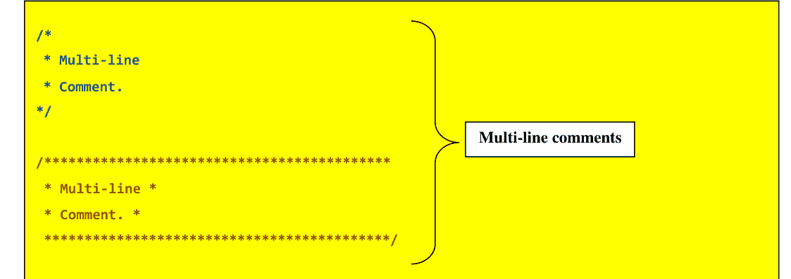

```c
#include<stdio.h>

int main(void) {
    printf("\nAlbert Einstein was a German-born theoretical \nphysicist\n");
    return 0;
}
```

**输出：**
"Albert Einstein was a German-born theoretical "
physicist

### C 头文件

| 头文件 | 描述 |
| :--- | :--- |
| stdio.h | 输入和输出函数 |
| conio.h | 控制台输入和输出函数 |
| stdlib.h | 一些标准库函数 |
| math.h | 数学函数 |
| string.h | 字符串处理函数 |
| ctype.h | 字符处理函数 |
| time.h | 时间计算函数 |
| malloc.h | 内存分配和释放函数 |
| graphics.h | 图形函数 |
| dos.h | 链接 DOS 例程的函数 |
| wctype.h | 分类和转换单个宽字符的函数 |
| limits.h | 定义各种符号名称的函数 |
| float.h | 定义与浮点值相关的各种平台相关常量集合的函数 |

### 预处理指令

| 预处理指令 | 用途 |
| :--- | :--- |
| #define | 定义宏 |
| #include | 从另一个文件插入特定的头文件 |
| #if | 测试编译时条件是否为真 |
| #undef | 取消定义宏 |
| #else | 指定测试失败时的替代操作 |
| #endif |  site's 结束预处理条件 |

```c
#include<stdio.h>
#define NUMBER_OF_APPLES 24

int main(void) {
    printf("There are %d apples in a basket.\n", NUMBER_OF_APPLES);
    return 0;
}
```

```c
#include<stdio.h>

// 定义宏 ab，值为 25
#define ab 25

int main() {

/************************************************************/

当遇到 #ifdef 条件时：
如果 ab 宏已定义：执行 #ifdef 条件
如果 ab 宏未定义：执行 #else 条件

***********************************************************/

#ifdef ab
printf("Your lucky number is: %d\n", ab);
#else
printf("Error: printing lucky number!");
#endif

return 0;
}
```

```c
#include<stdio.h>
int main() {
    int x = 16;
    int y = (x++, ++x);
    printf("%d", y);
    return 0;
}

// 输出: 18
```

**输出：**
Your lucky number is: 25

### C 程序的开发：

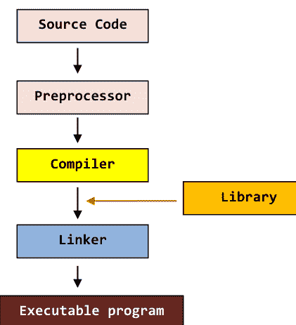

```c
#include<stdio.h>
int main() {
    #ifdef ab
    printf("Your lucky number is: %d\n", ab);
    #else
    printf("Error: printing lucky number!");
    #endif

    return 0;
}
```

**输出：**
Error: printing lucky number!

### ASCII 表

| ASCII | 字符 | ASCII | 字符 | ASCII | 字符 | ASCII | 字符 |
|-------|------|-------|------|-------|------|-------|------|
| 0 | NUL (空) | 32 | 空格 | 64 | @ | 96 | ` |
| 1 | SOH (标题开始) | 33 | ! | 65 | A | 97 | a |
| 2 | STX (正文开始) | 34 | " | 66 | B | 98 | b |
| 3 | ETX (正文结束) | 35 | # | 67 | C | 99 | c |
| 4 | EOT (传输结束) | 36 | $ | 68 | D | 100 | d |
| 5 | ENQ (询问) | 37 | % | 69 | E | 101 | e |
| 6 | ACK (确认) | 38 | & | 70 | F | 102 | f |
| 7 | BEL (响铃) | 39 | ' | 71 | G | 103 | g |
| 8 | BS (退格) | 40 | ( | 72 | H | 104 | h |
| 9 | TAB (水平制表符) | 41 | ) | 73 | I | 105 | i |
| 10 | LF (NL 换行，新行) | 42 | * | 74 | J | 106 | j |
| 11 | VT (垂直制表符) | 43 | + | 75 | K | 107 | k |
| 12 | FF (NP 换页，新页) | 44 | , | 76 | L | 108 | l |
| 13 | CR (回车) | 45 | - | 77 | M | 109 | m |
| 14 | SO (移出) | 46 | . | 78 | N | 110 | n |
| 15 | SI (移入) | 47 | / | 79 | O | 111 | o |
| 16 | DLE (数据链路转义) | 48 | 0 | 80 | P | 112 | p |
| 17 | DC1 (设备控制 1) | 49 | 1 | 81 | Q | 113 | q |
| 18 | DC2 (设备控制 2) | 50 | 2 | 82 | R | 114 | r |
| 19 | DC3 (设备控制 3) | 51 | 3 | 83 | S | 115 | s |
| 20 | DC4 (设备控制 4) | 52 | 4 | 84 | T | 116 | t |
| 21 | NAK (否定确认) | 53 | 5 | 85 | U | 117 | u |
| 22 | SYN (同步空闲) | 54 | 6 | 86 | V | 118 | v |
| 23 | ETB (传输块结束) | 55 | 7 | 87 | W | 119 | w |
| 24 | CAN (取消) | 56 | 8 | 88 | X | 120 | x |
| 25 | EM (介质结束) | 57 | 9 | 89 | Y | 121 | y |
| 26 | SUB (替换) | 58 | : | 90 | Z | 122 | z |
| 27 | ESC (转义) | 59 | ; | 91 | [ | 123 | { |
| 28 | FS (文件 filename 分隔符) | 60 | < | 92 | \ | 124 | \| |
| 29 | GS (组分隔符) | 61 | = | 93 | ] | 125 | } |
| 30 | RS (记录分隔符) | 62 | > | 94 | ^ | 126 | ~ |
| 31 | US (单元分隔符) | 63 | ? | 95 | _ | 127 | DEL |

### 数据转换函数

| 函数 | 用途 |
|---|---|
| `atof()` | 将字符串转换为浮点数 |
| `atoi()` | 将字符串转换为整数 |
| `atol()` | 将字符串转换为长整数 |
| `ecvt()` | 将双精度浮点数转换为字符串 |
| `fcvt()` | 将双精度浮点数转换为字符串 |
| `gcvt()` | 将双精度浮点数转换为字符串 |
| `itoa()` | 将整数转换为字符串 |
| `ltoa()` | 将长整数转换为字符串 |
| `strtod()` | 将字符串转换为双精度浮点数 |
| `strtol()` | 将字符串转换为长整数 |
| `strtoul()` | 将字符串转换为无符号长整数 |
| `ultoa()` | 将无符号长整数转换为字符串 |

### 字符分类函数

| 函数 | 用途 |
|---|---|
| `isalnum()` | 测试是否为字母数字字符 |
| `isalpha()` | 测试是否为字母字符 |
| `isdigit()` | 测试是否为十进制数字 |
| `islower()` | 测试是否为小写字符 |
| `isspace()` | 测试是否为空白字符 |
| `isupper()` | 测试是否为大写字符 |
| `isxdigit()` | 测试是否为十六进制数字 |
| `tolower()` | 测试字符，如果是大写则转换为小写 |
| `toupper()` | 测试字符，如果是小写则转换为大写 |

```c
#include <ctype.h>
#include <stdio.h>

int main() {
  char x = '8';
  if (isxdigit(x) != 0) {
    printf("%c is a hexadecimal character.", x);
  } /* end if */
  else {
    printf("%c is not a hexadecimal character.", x);
  } /* end else */
  return 0;
}
```

**输出：**
8 is a hexadecimal character.


 # 字符串处理函数

| 函数 | 用途 |
|----------|-----|
| strcat() | 将一个字符串附加到另一个字符串末尾 |
| strchr() | 在字符串中查找给定字符第一次出现的位置 |
| strcmp() | 比较两个字符串 |
| strcmpi() | 忽略大小写比较两个字符串 |
| strcpy() | 将一个字符串复制到另一个字符串 |
| strdup() | 复制一个字符串 |
| stricmp() | 忽略大小写比较两个字符串（与 strcmpi 相同） |
| strlen() | 计算字符串的长度 |
| strlwr() | 将字符串转换为小写 |
| strncat() | 将一个字符串的一部分附加到另一个字符串末尾 |
| strncmp() | 比较两个字符串的部分内容 |
| strncpy() | 将一个字符串中的指定数量的字符复制到另一个字符串 |
| strnicmp() | 忽略大小写比较两个字符串的部分内容 |
| strrchr() | 在字符串中查找给定字符最后一次出现的位置 |
| strrev() | 反转字符串 |
| strset() | 将字符串中的所有字符设置为给定字符 |
| strstr() | 在一个字符串中查找另一个字符串第一次出现的位置 |
| strupr() | 将字符串转换为大写 |

```
#include <stdio.h>
int main() {
double z;
int x = 5;
int y = 8;
z = (double)(x + y)/2 - (x + y)/(double)(x*x + y*y);
printf("%f", z);
return 0;
}
// Output: 6.353933
```

```
#include <stdio.h>
int main() {
int marks = 15;
marks >= 35 ? printf( "Passed\n" ) : printf( "Failed\n" );
return 0;
}
// Output: Failed
```

> 如果 marks 大于或等于 35，则执行 printf("Passed\n")，否则执行 printf( "Failed\n" )。

#### 搜索与排序函数

| 函数 | 用途 |
|---|---|
| bsearch() | 执行二分搜索 |
| lfind() | 对给定值执行线性搜索 |
| qsort() | 执行快速排序 |

#### 文件处理函数

| 函数 | 用途 |
|---|---|
| fopen() | 打开新文件或现有文件 |
| fprintf() | 将数据写入文件 |
| fscanf() | 从文件读取数据 |
| fputc() | 将一个字符写入文件 |
| fgetc() | 从文件读取一个字符 |
| fclose() | 关闭文件 |
| fseek() | 将文件指针设置到给定位置 |
| fputw() | 将一个整数写入文件 |
| fgetw() | 从文件读取一个整数 |
| ftell() | 返回当前位置 |
| rewind() | 将文件指针设置到文件开头 |

```
#include <stdio.h>
int main() {
int x = 3;
while(x <= 10) {
x = 3 * x;
printf("%d", x);
} /* end while */
}
```

**输出：**
927

#### 内存分配函数

| 函数 | 用途 |
|---|---|
| malloc() | 分配指定数量的字节 |

| 函数 | 描述 |
|----------|-------------|
| `realloc()` | 增加或减少指定内存块的大小，必要时将其移动 |
| `calloc()` | 分配指定数量的字节并将其初始化为零 |
| `free()` | 将指定的内存块释放回系统 |

#### 目录控制函数

- `chdir()` = 更改当前工作目录
- `getcwd()` = 获取当前工作目录
- `fnsplit()` = 将完整路径名拆分为其组成部分
- `findfirst()` = 搜索磁盘目录
- `findnext()` = 继续 findfirst 搜索
- `mkdir()` = 创建新目录
- `rmdir()` = 删除目录

### 算法

> 解决特定问题的逐步步骤

> 根据我们要实现的功能，它可能很简单，也可能很复杂

**示例：** 计算球体面积的算法

```
**步骤 1：** 读取半径

**步骤 2：** 计算面积 [面积 = 4 × 3.142 × 半径 × 半径]

**步骤 3：** 打印面积

**步骤 4：** 停止 [算法结束]
```

> **性能：**

程序执行时所消耗的时间、内存、磁盘空间等。

#上周的考试题：

### 流程图

> 算法的图解表示

> **复杂度：**

当软件程序解决的问题规模增加时所发生的情况...

```
#include <stdio.h>
int main() {
    int a = 10, b = 2;
    a /= b + 1;
    printf("%d", a);
    return 0;
}

// Output: 3
```

```
#include <stdio.h>
int main() {
    int a = 10, b = 2;
    a = a / (b + 1);
    printf("%d", a);
    return 0;
}
```

```
/* 计算 3 个数的乘积 */
#include <stdio.h>
int main( void ) {
    int a, b, c, z; /* 声明变量 */
    printf("Enter 3 numbers: \n"); /* 提示 */
    scanf("%d%d%d", &a, &b, &c); /* 读取 3 个数 */
    z = a * b * c; /* 相乘 */
    printf( "The product of 3 numbers is: %d\n", z); /* 显示结果 */
    return 0;
} /* end function main */
```

## C 程序：

```
#include<stdio.h>
int main() {
    float radius; /* 由用户输入的半径 */
    float area; /* 存储面积的变量 */
    printf("Enter the radius: "); /* 提示 */
    scanf("%f", &radius); /* 读取半径 */
    area = 4 * 3.14 * radius * radius; /* 将乘积赋值给 area */
    printf("Area of a sphere = %f", area); /* 打印面积 */
    return 0;
}
```

**输出：**

Enter the radius: 2.6 # 输入的半径

Area of a sphere = 84.905594

### 逻辑语句：

| 运算符 | 描述 | 示例 |
|----------|-------------|----------|
| > | 大于 | 7 > 3 为 **TRUE** |
| < | 小于 | 3 < 7 为 **TRUE** |
| >= | 大于或等于 | 9 >= 9 为 **TRUE** |
| <= | 小于或等于 | 3 <= 7 为 **TRUE** |
| == | 等于 | 14 == 14 为 **TRUE** |
| != | 不等于 | 7 != 3 为 **TRUE** |

| 数值 | 科学计数法 | 在 C 语言中也可以写成 |
|-------|-----------------|-------------------------------|
| 2.7 | 0.27 × 10¹ | 0.27E1 |
| 0.00002 | 0.2 × 10⁻⁴ | 0.2E-4 |
| 5496.788 | 0.5496788 × 10⁴ | 0.5496788E4 |
| 200.0 | 2.0 × 10² | 2.0E2 |

### 基础语法：

```
if (condition) {
  如果条件为真，执行主体内部的所有语句
}

// If 语法
```

```
if (condition) {
  如果条件为真，执行主体内部的所有语句
} else {
  如果条件为假，执行主体内部的所有语句
}

// Else 语法
```

```
if (condition1) {
  如果 condition1 为真，执行主体内部的所有语句
} else if (condition2) {
  如果 condition1 为假且 condition2 为真，执行主体内部的所有语句
} else {
  如果 condition1 为假且 condition2 为假，执行主体内部的所有语句
}

// Else if 语法
```

#### Break 语法

```
while (condition) {
    // 语句
    if (condition to break) {
        break;
    }
    // 语句
}
```

```
do {
    // 语句
    if (condition to break) {
        break;
    }
    // 语句
} while (condition);
```

```
for (variable initialization; condition; variable update) {
    // 语句
    if (condition to break) {
        break;
    }
    // 语句
}
```

```
#include <stdio.h>
int main() {
    int y =10;
    if(y > 6) {
        int x = 25;
        printf( "%d", x);
    } else {
        int x = 50;
        printf( "%d", x);
    }
    return 0;
}
```

```
#include <stdio.h>
int main() {
    int y =10;
    int x = y > 6 ? 25 : 50;
    printf( "%d", x);
    return 0;
}
```

```
Output:
25
```

#### Continue 语法

```
while (condition) {
    // 语句
    if (condition to break) {
        continue;
    }
    // 语句
}
```

```
do {
    // 语句
    if (condition to break) {
        continue;
    }
    // 语句
} while (condition);
```

```
for (variable initialization; condition; variable update) {
    // 语句
    if (condition to break) {
        continue;
    }
    // 语句
}
```

#### Switch 语法

```
switch (expression) {
    case 1:
        // 语句
        break;
    case 2:
        // 语句
        break;
    default:
        // 语句
}
```

| #include<stdio.h> | 输出： |
| :--- | :--- |
| /* main 函数开始执行程序 */ | 1 |
| int main() { | 2 |
| int i = 1; /* 初始化 */ | 3 |
| while(i<=10) { /* 循环条件 */ | 4 |
| printf("%d\n", i); /* 显示计数器 */ | 5 |
| i++; /* 自增 */ | 6 |
| } /* end while */ | 7 |
| return 0; /* 表示程序成功结束 */ | 8 |
| } /* end function main */ | 9-10 |


 ## For 循环语法

```
for (variable initialization; condition; variable update) {
    // statements
}
```

#### While 循环语法

```
while (condition) {
    // statements
}
```

#### Do While 循环语法

```
```
do {
    // statements
} while (condition);
```

```
#include <stdio.h>
#include <string.h>
int main() {
    int num = 1;
    printf("We have seen %d cat%s.", num, num == 1 ? "" : "s");
    return 0;
}

// Output: We have seen 1 cat.

#include <stdio.h>
#include <string.h>
int main() {
    int num = 2;
    printf("We have seen %d cat%s.", num, num == 1 ? "" : "s");
    return 0;
}

// Output: We have seen 2 cats.
```

#### Goto 语句：

```
#include <stdio.h>
int main() {
int sum=0;
for(int i = 1; i<=9; i++) {
sum = sum+i;
if(i==5) {
goto addition; // Go to the statement labeled addition
}
}
addition:
printf("%d", sum);
return 0;
}
// Output: 15 # 1+2+3+4+5 = 15
```

#### 嵌套-if 语句：

```
#include <stdio.h>
int main() {
int a = 10;
if (a == 10) {
if (a < 15)
printf("\n a is smaller than 15");
if (a < 12)
printf("\n a is smaller than 12");
else
printf("\n a is greater than 15");
}
return 0;
}

// Output:
//          a is smaller than 15
//          a is smaller than 12
```

#### 嵌套 else if 语句：

```
#include <stdio.h>
int main() {
int a = 20;
if (a == 10)
printf("a is 10");
else if (a == 15)
printf("a is 15");
else if (a == 20)
printf("a is 20");
else
printf("a is not present");
return 0;
}

// Output: a is 20
```

```
#include <stdio.h>
int main(void) {
char ch = 0;
printf("Enter A or J: ");
scanf(" %c", &ch); // Get the choice input
switch(ch) {
case 'a': case 'A':
printf("Albert...\n");
break;
case 'j': case 'J':
printf("John...\n");
break;
default:
printf("Mary...\n");
break;
}
return 0;
}
```

> switch 为用户输入大写或小写字母 A 提供了可能性。

**输出：**  
Enter A or J: a # 输入的字符  
Albert...

```
#include <stdio.h>

int main() {
    for(int x = 1, y = 2 ; x <= 6 ; x++, y = y + 1)
    printf("% 3d", x*y);
    return 0;
}
```

## 输出：
2 6 12 20 30 42

```
#include<stdio.h> // For input and output functions
#include<ctype.h> // For mapping characters

int main() {
    for(double i = 0.0 ; i <= 3.0 ; i+= 0.3) {
        printf("\nx %.2lf", i);
    }
    return 0;
}
```

输出：
x = 0.00
x = 0.30
x = 0.60
x = 0.90
x = 1.20
x = 1.50
x = 1.80
x = 2.10
x = 2.40
x = 2.70
x = 3.00

```
#include<stdio.h>

int main() {
    printf("\n *****************");

    for(int i = 1 ; i <= 6; i++)
    printf("\n+             +");
    printf("\n *****************\n");
    return 0;
}
```

输出：
*****************
+
+
+
+
+
+
*****************

### C 语言编程

| 范式 | 命令式（过程式）、结构化 |
| 设计者 | Dennis Ritchie |
| 开发人员 | Dennis Ritchie & Bell Labs（创建者）；ANSI X3J11 (ANSI C)；ISO/IEC JTC1/SC22/WG14 (ISO C) |
| 首次出现 | 1972年；48年前 |
| 稳定版本 | C18 / 2018年6月；2年前 |
| 类型规范 | 静态、弱类型、显式、名义 |
| 操作系统 | 跨平台 |
| 文件扩展名 | .c, .h |

**Dennis Ritchie**

**C 语言创建者**

## 主要实现

K&R C, GCC, Clang, Intel C, C++Builder, Microsoft Visual C++, Watcom C

#### 方言

Cyclone, Unified Parallel C, Split-C, Cilk, C*

## 受影响于

B (BCPL, CPL), ALGOL 68, Assembly, PL/I, FORTRAN

#### 影响了

众多语言：AMPL, AWK, csh, C++, C--, C#, Objective-C, D, Go, Java, JavaScript, Julia, Limbo, LPC, Perl, PHP, Pike, Processing, Python, Ring, Rust, Seed7, Vala, Verilog (HDL), Nim

```
which uses alphabets, digits, punctuations and some special symbols and cannot be executed directly without being converted into machine level language [the language which uses only 0 and 1]
```

一种通用、过程式、高级编程且被最广泛使用的**计算机语言**，由一个名叫 **Dennis Ritchie** 的人在 20 世纪 70 年代于**新泽西州默里山**的**贝尔电话实验室**（现名为 AT&T 贝尔实验室）开发，旨在开发直接与硬件设备（如驱动程序、内核等）交互的系统应用程序 [**UNIX 操作系统**]，该语言使用了两种早期的编程语言——**基础组合编程语言 (BCPL)** 和 **BASIC (初学者通用符号指令代码)** 语言。

**用途：** 用于以下开发：

- 像 LINUX, UNIX 这样的操作系统。
- CAD/ CAM 应用程序和文字处理器。
- 像 ATM、打印机这样的嵌入式系统。
- RDBMS MySQL、语言编译器和解释器、打印缓冲池、加载器、链接器、汇编器、文本编辑器、自动化工具、网络驱动程序。

大多数**顶尖软件**都是使用 C 语言开发的。**C** 也极大地影响了许多其他流行语言 [被认为是其他编程语言的基础——母语]，尤其是 C++，它最初被设计为 C 的增强版。大多数编程语言都遵循 C 语法 [例如：**C++, Java, C#, 等**]。

```
#include <stdio.h>
#include <stdlib.h>
int main() {
    printf("Hello World");
    abort(); // abnormal termination of the program
    return 0;
}
```

**输出：**

Aborted

**优点：**

- 语言相对简单
- 可靠（值得信赖）
- 易于理解且支持丰富的数据类型
- 易于使用、编写、修改和调试，且学习速度快
- 可以在多种计算机平台上编译
- C 支持丰富的**运算符**：
  - 一元负号, !, ++, -- 和 ~ ----> 一元运算符
  - +, - *, ? 是算术运算符。% 运算符是另一种算术运算符，用于得出整数除法后的余数。
  - <, <=, >=, ==, != 是关系运算符。

C 支持**位运算符**——按位与 (AND)、或 (OR)、异或 (XOR)、按位取反、左移和右移运算符。

C 提供了多种**条件控制语句**。

**C** 被称为**结构化编程语言**，因为它将问题分解为称为函数或过程的较小模块，每个模块处理特定的职责。因此，它简单易懂，非常适合小规模实现。然而，这并非限制。大规模实现也是可能的，但复杂的**面向对象设计**无法实现（因为 C 中没有**多态**和**继承**等复杂的设计概念）。**C 广泛应用于物联网 (IOT) 应用中。**

```
#include <stdio.h>
#include <stdlib.h>
int main() {
    printf("Hello World");
    exit(EXIT_SUCCESS); // normal termination of the program
    return 0;
}
```

输出：
Hello World

```
#include <stdio.h>
int main() {
    char x[] = "Albert Einstein!";
    puts(x);
    return 0;
}
```

输出：
Albert Einstein!

### 字符集：

```
#include <stdio.h>

int main() {
    char x[] = {'A', 'l', 'b', 'e', 'r', 't', '\0'};
    char y[] = "Albert";
    printf("\n%lu\n", sizeof(x)); // Output: 7
    printf("\n%lu\n", sizeof(y)); // Output: 7
    return 0;
}
```

- 字母
  - 大写
  - 小写

数字 [0-9]

特殊字符：

| 字符 | 描述 |
| :--- | :--- |
| ~ | 波浪号 |
| ! | 感叹号 |
| # | 井号 |
| $ | 美元符号 |
| % | 百分号 |
| ^ | 脱字符 |
| & | 和号 |
| * | 星号 |
| ( | 左圆括号 |
| ) | 右圆括号 |
| _ | 下划线 |
| + | 加号 |
| \| | 垂直线 |
| \ | 反斜杠 |
| ' | 单引号 |
| - | 减号 |
| = | 等号 |
| { | 左大括号 |
| } | 右大括号 |
| [ | 左方括号 |
| ] | 右方括号 |
| : | 冒号 |
| " | 双引号 |
| ; | 分号 |
| < | 左尖括号 |
| > | 右尖括号 |
| ? | 问号 |
| , | 逗号 |
| . | 句号 |
| / | 斜杠 |

- 空格
- 换行
- 回车
- 水平制表符

空白字符

> 局限性：C 不能像 Java, .Net, PHP 等那样用于互联网编程。

```
#include <stdio.h>

int main() {
    int a, b;
    a = 2, 4, 6;
    b = (2, 4, 6);
    printf("%d = %d, b = %d\n", a, b);
    return 0;
}
```

**输出：**

a = 2, b = 6

### C 的特性：

- 简单
- 机器无关性或可移植性
- 中级编程语言
- 结构化编程语言
- 丰富的库

```
#include <stdio.h>

int main() {
    int x=30; // A local variable
    static int y=30; // A Static variable
    x=x+1;
    y=y+1;
    printf("%d, %d", x, y); // Output: 31, 31
    return 0;
}
```


- 内存管理
- 速度快
- 指针
- 递归
- 可扩展性
- 鲁棒性
- 高可移植性

```
#include <stdio.h>

int main() {

    int x = 20.397;

    double y = 20.397;

    printf("%d\n", x); // Output: 20

    printf("%f\n", y); // Output: 20.397000

    return 0;

}
```

**TOKEN**（令牌/记号）是 **'C'** 程序的最小单位。

一个简单的 C 程序基本上由以下部分组成：

- 预处理器命令
- 函数
- 变量
- 语句和表达式
- 注释

```
#include<stdio.h>
int main() {
    printf("Hi\n");
    main();
    return 0;
}
```

> 上述程序会引起对 **main()** 的无限递归调用。控制台屏幕将被 **Hi's** 淹没。

```
/* My First C Program */  → 注释
#include<stdio.h>           → 预处理器命令
```

```
int main()
{
    printf("Hello,world!");
    return 0;
}
```

```
#include<stdio.h>

int x = 17; // 全局变量声明和初始化

int main() {
    printf("%d", x); // Output: 17
    return 0;
}
```

```
#include<stdio.h>

int x=17, y=18; // 全局变量声明和初始化

int main() {
    printf("x = %d and y = %d", x, y);
    // Output: x = 17 and y = 18
    return 0;
}
```

```
#include<stdio.h>
int main() {
    int x, y;
    x = 6;
    y = x++ / 2;
    printf("%d", y);
    // Output: 3
    return 0;
}
```

```
#include <stdio
.h>
int main() {
    int a = 18;
    int b = 5;
    printf("%ld", sizeof(a+b));
    // Output: 4
    return 0;
}
// 上述程序显示给定表达式 (a+b) 的实际大小
```

### C 程序执行过程：每个 'C' 程序都遵循一个基本结构。一个 C 程序：

```
#include<stdio.h> // 预处理器指令
int main() // main 函数声明
{
    printf("Hello,world!"); // 在显示屏幕上输出字符串
    return 0; // 终止函数
}
```

使用文本编辑器（例如 [Windows 操作系统中的 Notepad，或 Linux 操作系统中的 vim 或 vi]）编写，并保存为 [.c] 扩展名 —— 例如 hello.c。保存为 [.c] 扩展名的文件称为源程序或源代码。具有 [.c] 扩展名的 C 源代码首先被发送到预处理器。

预处理器生成一个展开后的源代码。**展开后的源代码**作为输入提供给编译器，在该编译器中，展开后的源程序被编译（即，程序被完全读取并翻译成计算机可以理解的指令，即机器可理解和可读的语言，即 0 和 1 的**机器码序列**）。如果 C 编译器在编译期间发现任何错误，它会向程序员提供有关该错误的信息。

程序员必须审查代码并重新编辑程序。重新编辑程序后，**编译器**再次检查是否有任何错误。如果程序没有错误，则将其发送到汇编器 [在这里代码被汇编并转换为目标代码。此时会生成一个简单的 **obj 文件**]。

**C 编译过程将输入的源代码转换为目标代码或机器码。**

目标代码被发送到链接器（在这里目标代码与适当的库链接）。然后它被转换为一个单一的可执行代码。一个简单的 **exe 文件**被生成。可执行代码被发送到加载器（在这里可执行代码被加载到内存中，然后执行）。执行后，输出：

```
Hello,world!
```

显示在控制台屏幕上。

```
#include <stdio.h> // 在 C 程序中包含与输入/输出相关的函数

int main() { /* function main 开始程序执行 */
    int sum = 0; // 存储整数之和
    int i = 0; // 要求和的整数数量
    printf("\n Enter a number: "); /* 提示 */
    scanf("%d", &i); // 读取要求和的整数数量

    // 对 1 到 i 的整数求和
    for(int x = 1; x<=i; sum += x++);
    printf("\n The sum of the first %d integers is: %d\n", i, sum); /* 打印总和 */
    return 0; /* 指示程序成功结束 */
} /* end function main */
```

## 输出：

Enter a number: 10 # 输入的数字

The sum of the first 10 integers is 55

```
#include <stdio.h> // 在 C 程序中包含与输入/输出相关的函数

int main() { /* function main 开始程序执行 */
    int sum = 0; // 存储整数之和
    int i = 0; // 要求和的整数数量
    printf("\n Enter a number: "); /* 提示 */
    scanf("%d", &i); // 读取要求和的整数数量

    // 对 1 到 i 的整数求和
    for(int x = 1; x=>1 ; sum += x--);
    printf("\n The sum of the first %d integers is: %d\n", i, sum); /* 打印总和 */
    return 0; /* 指示程序成功结束 */
} /* end function main */
```

## 输出：

Enter a number: 10 # 输入的数字

The sum of the first 10 integers is 55

`#include<stdio.h>` → 预处理器语句

该语句以 # 符号开头，也被称为**预处理器指令**。该语句指示 **C 预处理器**将头文件 [`stdio.h`] 以及符号常量 [`标准输入输出函数`] 包含到 C 程序中。"stdio" 意为标准输入输出（standard input output），而 `stdio.h` 意为标准输入输出头文件。

> printf() 和 scanf() 不是 **C 语言**的一部分，因为 C 语言本身没有定义输入或输出 —— stdio.h 包含了像 scanf、printf 等标准输入输出函数。

`stdio.h` 是一个**头文件库**，它为 C 程序增加了功能并允许标准**输入/输出操作**，通过编写语句 `#include<stdio.h>` 将其包含在 C 程序中。

- `scanf` 是一个输入函数，`printf` 是一个输出函数
- 字母 "`f`" 表示格式化（formatted）

如果编写 **C 程序**时没有包含以下语句：

```
#include<stdio.h>
```

那么 **C 编译器**无法编译，屏幕上会显示**编译错误**，因为 **C 编译器**无法识别 printf() 和 scanf() 等函数。

> 我们也可以写 `#include "stdio.h"` [用户定义库头文件] 来代替 `#include <stdio.h>` [预定义库头文件]，但 `#include "stdio.h"` 是由程序员添加的，而 `#include<stdio.h>` 已经存在于编译器中。因此，通常首选语句 `#include<stdio.h>`，而语句 `#include "stdio.h"` 通常被忽略。

`main()` → 主函数

正如其名，这是每个 C 程序的**主函数**。`圆括号 ()` 表示一个函数，单词 **main** 表示函数的名称。

```
main() 意味着：主函数。
```

**C 程序**的执行从 `main()` 开始。没有 `main()` 的 **C 程序**无法执行。**它是区分大小写的**：必须使用小写字母，且不应被**分号**包围。每个 **C 程序**中必须有且仅有一个 `main()` 函数。

我们可以用多种形式表示**主函数**，例如：

- `main()`
- `int main()`
- `void main()`
- `main(void)`
- `void main(void)`
- `int main(void)`

众所周知，**C** 是一种**平台依赖语言**。因此，**操作系统**需要知道程序何时结束执行。因此，当主函数有返回值时，**操作系统**就能知道程序执行已经结束。

`int main()` 意味着：`main()` 应该返回一个整数值。

- 如果**主函数**向操作系统返回 **0**，则表示程序已成功完成执行。
- 如果**主函数**向操作系统返回 **1**，则表示程序未能成功完成执行。

```
int main() {

}
```

**主函数**的主体，其中以语句的形式 [**输入-输出语句、算术语句、控制语句和其他语句**] **编写并执行**向计算机发出执行特定操作的指令序列。

**左花括号**

```
{
```

**意味着**：主函数的开始，而**右花括号**

```
}
```

**意味着**：主函数的结束。这些括号也可以用来指示用户定义函数和复合语句的开始与结束。

`return 0;` → 意味着**程序执行的退出状态**，即**在此点**，主函数将计算机的控制权交还给**操作系统**，因为执行在此终止；一旦执行了 return 语句（即 `return 0;`），**主函数**内部的后续指令将不再执行。

**例如：**


```c
#include<stdio.h>

int main() {
{
    printf("Hello,world!");
    return 0;
    printf("Hello,world!");
}
```

屏幕上的输出：

```
Hello,world!
```

- `;` $\to$ 表示**分号**或**语句终止符** [声明的分隔符] $\to$ 在 **C 语言**中：每条语句必须以**分号**结尾。程序是一组定义良好的指令集，而每条定义良好的指令（以语句形式出现）都由分号结束。

> 这就像是 C 语言的标点符号 —— 类似于英语中的句号，即在一段英文中，每个句子都以句号结尾，以此告知一个句子结束而另一个句子开始；分号则意味着一个逻辑实体的结束 —— **即一条指令（或语句）结束，另一条指令开始**。

- `/* My First C Program */` $\to$ **注释**

一个能够编写出人类可理解的代码的**优秀程序员**，比一个只能生成机器可理解代码的程序员更好。因此，强烈建议插入注释。**注释**是对某些指令的解释性说明。需要被注释的语句必须包含在 `/*` 和 `*/` 之间。注释语句不会被编译和执行。

**printf() $\to$ 在屏幕上显示输出的标准方式**，它是 C 语言的输出函数，提供了打印输出的功能：

```
Hello,world!
```

在屏幕上。括号 `()` 表示一个函数，而单词 `printf` 表示**函数名称**。文本：`Hello, world!` 应当被**双引号** (`" "`) 包围，并且应当写在 `printf` 函数内部，且该 `printf` 函数应当以分号结尾，即：

```c
printf("Hello,world!");
```

下面给出了一些 C 语言中的标准输入输出函数：

| scanf() | gets() |
| :--- | :--- |
| printf() | puts() |
| getchar() | getch() |
| putchar() | getche() |

```c
#include<stdio.h>
int main() {
    char ch;
    printf("Enter a character: ");
    ch = getchar();
    putchar(ch);
    return 0;
}
```

```c
#include <stdio.h>
int main() {
    char a;
    char b[20];
    printf( "Enter a string: " );
    scanf( "%c%s", &a, b );
    printf( "You entered: \n" );
    printf( "the character: \"%c\" ", a );
    printf( "and the string: \"%s\"\n", b );
    return 0;
}
```

以输入形式接收一个字符并将其存储在变量 "ch" 中。

## 输出：
Enter a character: A # 输入的字符
A # 输出

**输出：**
Enter a string: Albert # 输入的字符串
You entered:
the character: "A" and the string: "lbert"

```c
#include <stdio.h> /* For puts function */
#include <stdlib.h> /* For atexit function */
void myfunc () {
    printf("Turing... \n");
}

int main() {
    atexit(myfunc);
    puts("Alan...\n");
    puts("Mathison...\n");
    return(0); /* indicates successful termination */
}/* end main */
```

**输出：**
Alan...
Mathison...
Turing...

```c
#include <stdio.h> /* For puts function */
#include <stdbool.h> /* For bool function */

int main(void) {
    bool a = true; /* equivalent to bool a = 1; */
    bool b = false; /* equivalent to bool b = 0; */
    if (a != 0 || (a != false)) { /* Functionally equivalent to if (a) */
        puts("Albert");
    }
    if ((b == 0) || (b == false)) { /* Functionally equivalent to if (!b) */
        puts("Einstein");
    }
}
```

| 输出： |
| :--- |
| Albert |
| Einstein |

| 计算机语言 | 用途 |
| :--- | :--- |
| FORTRAN | 科学与工程 |
| ALGOL | 科学与工程 |
| COBOL | 商业 |
| BASIC | 商业、科学与工程 |
| PL/1, PASCAL | 通用目的 |

| 数据类型 | 示例 | 字节数 |
| :--- | :--- | :--- |
| 单个字符 | A, a, X, 5 | 1 |
| 单个数字 | 1, 3, 8, 0 | 1 |
| 单个符号 | ?, *, #, $ | 1 |
| 整数 | 22, -102, 3610 | 2 |
| 小数 | 0.1, 1.25, 0.56729 | 4 |
| 指令 | Add, Multiply | (1 - 3) |
| 大整数 / 大小数 | 922112580, 12505.126 | (4 - 10) |

| 十进制数 | 二进制数 | 十六进制数 |
| :--- | :--- | :--- |
| 0 | 0 | 0 |
| 1 | 1 | 1 |
| 2 | 10 | 2 |
| 3 | 11 | 3 |
| 4 | 100 | 4 |
| 5 | 101 | 5 |
| 6 | 110 | 6 |
| 7 | 111 | 7 |
| 8 | 1000 | 8 |
| 9 | 1001 | 9 |
| 10 | 1010 | A |
| 11 | 1011 | B |
| 12 | 1100 | C |
| 13 | 1101 | D |
| 14 | 1110 | E |
| 15 | 1111 | F |
| 16 | 10000 | 10 |
| 17 | 10001 | 11 |
| 18 | 10010 | 12 |
| 19 | 10011 | 13 |
| 20 | 10100 | 14 |
| 21 | 10101 | 15 |
| 22 | 10110 | 16 |
| 23 | 10111 | 17 |
| 24 | 11000 | 18 |
| 25 | 11001 | 19 |
| 26 | 11010 | 1A |
| 27 | 11011 | 1B |
| 28 | 11100 | 1C |
| 29 | 11101 | 1D |
| 30 | 11110 | 1E |
| 31 | 11111 | 1F |
| 32 | 100000 | 20 |
| 64 | 1000000 | 40 |
| 128 | 10000000 | 80 |
| 256 | 100000000 | 100 |

#### 程序 1.1
在屏幕上打印单词 "Hello Bill Gates" 的 C 程序

```c
#include<stdio.h>
int main()
{
    printf("Hello Bill Gates");
    return 0;
}
```

```c
#include <stdio.h>
#include <assert.h>

int main() {
    int i = -5;
    assert(i >= 0);
    printf("i = %d\n", i);
    return 0;
}
// 断言 'i >= 0' 失败
```

```c
#include <stdio.h>
#include <assert.h>

int main() {
    int i = 5;
    assert(i >= 0);
    printf("i = %d\n", i);
    return 0;
}
// 输出: i = 5
```

屏幕上的输出：
Hello Bill Gates

- 第一行告诉编译器包含标准输入输出头文件 `#include <stdio.h>` 以执行数据的读取和打印。
- 第二行是 C 程序的 main 函数。C 程序的主体仅包含两条语句，即 `printf("Hello Bill Gates");`

> 当这条语句被执行时，`main()` 调用 `printf()`，而 `printf()` 定义在 `<stdio.h>` 中。然后 `printf()` 在计算机屏幕上打印：Hello Bill Gates。

```c
return 0;
```

> 在 C 程序中，在 main 函数末尾包含 "return 0;" 是可选的，编译器会自动将其包含进去。

**宏替换：** 将 C 程序中的标识符替换为**符号常量**的过程。这可以通过指令 `#define` 来实现。

```c
#include<stdio.h>
#define PI 3.14 /* 定义一个宏 */
int main()  /* main 函数开始程序执行 */
{
    float r, area; /* 声明变量 */
    r = 2.5;
    area = PI * r * r;  /* 将乘积赋值给 area */
    printf("The area of the circle = %f", area); /* 显示结果 */
    return 0; /* 表示程序成功结束 */
}  /* main 函数结束 */
```

**输出：** The area of the circle = 19.625000

```c
#include<stdio.h>
#define CONDITION if(x>y)
#define PRINT printf("x is greater than y");
int main() {
    int x, y;
    x=16;
    y=2;
    CONDITION
    PRINT
    return 0;
}
```

**输出：**
x is greater than y

- 空格、制表符和换行符统称为**空白字符**。
- C 语言是区分大小写的，这意味着名为 'age' 和 'AGE' 的变量是不同的。

```c
#include<stdio.h>
int main(){
    double x = 56.3;
    int y = (int)x + 50; // 数据类型强制转换
    printf("%f\n", x); // 输出: 56.300000
    printf("%d\n", y); // 输出: 56 + 50 = 106
    return 0;
}
```

```c
#include <stdio.h>
int main() {
    int y;
    int x = 12;
    y = (x >= 16) ? 16 : x;
    printf("y = %d", y);
    return 0;
}

// 输出: y = 12
```

#### 程序 1.2
在屏幕上打印以下内容的 C 程序：

```
    *
  *****
  *****
  *****
  *****
```

```c
#include <stdio.h>
int main() {
    int y;
    int x = 12;
    if (x >= 16) y = 16; else y = x;
    printf("y = %d", y);
    return 0;
}

// 输出: y = 12
```

```c
#include<stdio.h>
int main()
{
    printf("\n       *");
    printf("\n     *****");
    printf("\n     *****");
    printf("\n     *****");
    printf("\n     *****");
    return 0;
}
```

```c
#include <stdio.h>
int main(void) {
    enum x{physics= 65, math=95, biology=86};
    printf("Physics marks: %d\n", physics);
    printf("Biology marks: %d\n", biology);
    return 0;
}
```

**输出：**
Physics marks: 65
Biology marks: 86

**屏幕上的输出：**
（参考图片：如果在上述程序中不包含换行序列 `\n`，则屏幕上的输出将显示为单行）。

**编写程序以打印以下输出：**

(a)
```c
#include <stdio.h>
int main() {
    int i = 10;
    char x = 'A';
    int z = i + x;
    printf("%d\n", z);
    return 0;
}

// 输出: 75
// 10 + 65
// A 的 ASCII 值为 65
```

(b)
```
(参考图片)
```


```
***************
      * *
  * Hello World! *
      * *
***************
```

```c
#include <stdio.h>
int main() {
    typedef int physics;
    physics marks = 86;
    printf("Physics marks: %d\n", marks);
    return 0;
}

// Output:
              Physics marks: 86
```

(c)

```
大括号成对出现！
注释成对出现！
所有语句以分号结尾！
空格是可选的！
必须有一个主函数！
C语言主要使用小写。它是一种区分大小写的语言
```

```c
#include<stdio.h>
#include<conio.h>
int main() {
    const int x = 8; // x 是 8
    x = 15 ; // 会产生错误
    printf("x = %d", x);
    return 0;
}
```

答案：

因为我们试图改变常量变量的值

(a)

```c
#include<stdio.h>
int main()
{
    printf("\n       *      ");
    printf("\n     ****     ");
    printf("\n   *******    ");
    printf("\n     ****     ");
    printf("\n       *      ");
    return 0;
}
```

```c
#include <stdbool.h>
#include <stdio.h>
int main() {
    int x = 30, y = 24;
    bool res = ((x != y) && printf("Albert"));
    return 0;
}

// Output: Albert
```

40

(b)

- 如果 x 为真，那么：!x 将为假。
- 如果 x 为假，那么：!x 将为真。

```c
#include<stdio.h>
int main()
{
printf("\n  ******************  ");
printf("\n         * *         ");
printf("\n    * Hello World! *  ");
printf("\n         * *         ");
printf("\n  ******************  ");
return 0;
}
```

```c
#include <stdbool.h>
#include <stdio.h>
int main() {
int x = 30, y = 24;
bool res = ((x == y) && printf("Albert"));
return 0;
}
// 无输出
```

(c)

```c
#include<stdio.h>
int main()
{
printf("\n Braces come in pairs!");
printf("\n Comments come in pairs!");
printf("\n All statements end with a semicolon!");
printf("\n  Spaces are optional!");
printf("\n Must have a main function!");
printf("\n C is done mostly in lowercase. It's a case-sensitive language");
return 0;
}
```

**变量**代表一个特定的内存位置，数据可以存储在那里。它们的值可以被更改，并且可以被多次重复使用。

```c
int x;
float y;
char z;
```
这里：x, y, z 代表变量。int, float, char 代表数据类型。

```c
int x = 15;
```
↓
创建一个名为 x 的 int 数据类型变量，并为其赋值 15

**编写变量名的规则：**

- 不应使用关键字。
- 不应使用特殊字符作为变量。
- 用小写字母表示变量名是一种**良好的编程实践**。
- 变量名的字符数量没有限制。

| 有效变量 | 无效变量 |
| :--- | :--- |
| ab | 8ab |
| total_mark | total mark |
| gross_weight_2020 | gross-weight-2020 |
| area_of_sphere | area_ _of_ _sphere |

有两种为变量赋值的方法：

方法 1：
```c
int x = 1;
```

方法 2：
```c
int x;
x = 1;
```

**程序 1.3**
计算正方体总表面积的 C 程序

```c
#include<stdio.h>
/* 函数 main 开始程序执行 */
int main() {
int x, area; // 创建 int 数据类型的变量 'x' 和 'area'
x = 2; // 为 x 赋值 2
area = 6 * x * x; /* 将乘积赋值给 area */
printf("The total surface area of a cube = %d", area); // 打印 area
return 0; /* 表示程序成功结束 */
} /* 结束函数 main */
```

**屏幕上的输出：**

The total surface area of a cube = 24

### int

用于表示整数的**关键字**。任何整数都是没有小数点的数字序列。

| 有效 | 无效 |
| :--- | :--- |
| -248 | 3,266 |
| 14028 | -34.0 |
| +1988 | +5,456.3 |
| 0 | 999999999999 |
| 56780 | |

一种属性，用于说明该值可以拥有什么种类的数据。

int 表示**数据类型**是**整数**，且 int 数据类型的存储大小通常为 **2 字节**（**在内存中总共占用 16 位**）。它可以有 $2^{32}$ 种不同的状态，范围从 **-2147483648** 到 **2147483647**。如果你的计算机是 8 位设备，那么 int 的范围由以下公式给出：

$$\begin{cases} -2^{8-1} \le \text{整数} \le +2^{8-1} - 1 \\ -128 \le \text{整数} \le +127 \end{cases}$$

## 注意：

- 例如，字符串是一种用于对文本进行分类的数据类型，而整数是一种用于对**整数**或**非分数**值 [0, -5, 10] 进行分类的数据类型。
- 我们不能使用 int 数据类型来存储**十进制值**。
- 如果我们使用 int 数据类型来存储十进制值，十进制值将被截断，我们将只得到整数。在这种情况下，可以使用 **float 数据类型**在变量中存储十进制值。

语句
```c
int x, area;
```
意味着我们正在声明两个**整型变量**：
- x
- area

这些变量代表存储数据的某个内存位置。每个变量都与一个值相关联。给变量赋值的过程称为**赋值**。**赋值运算符**或**存储运算符**（" = "）用于为变量赋值。

语句
```c
x = 2;
area = 6 * x * x;
```
意味着我们正在为**已声明的变量**赋值，其中：
- x $\rightarrow$ 代表存储 **'2' 值**的内存位置
- area $\rightarrow$ 代表存储 **'24' 值**的内存位置。

语句中的**逗号**：
```c
int x, area;
```
意味着**变量分隔符**。

语句
```c
printf("The total surface area of a cube = %d", area);
```
为在屏幕上打印输出提供了条件：
```
The total surface area of a cube = 24
```

在语句中：
```c
printf("The total surface area of a cube = %d", area);
```
格式字符串或格式说明符 "%d" 表示需要显示的整数值应该取自变量 area，显示在语句：
```
The total surface area of a cube = 
```
中双引号之后。

如果你想通过键盘为 x 提供值，那么语句
```c
int x, area;
x = 2;
```
应该被以下语句替换：
```c
int x;
int area;
printf("Enter any number:");
scanf("%d", &x);
```

即，程序应重写为：

```c
#include<stdio.h>

/* 函数 main 开始程序执行 */
int main() {
    int x; /* 待用户输入的数字 */
    int area; /* 存储 area 的变量 */
    printf("Enter any number: "); /* 提示 */
    scanf("%d", &x); /* 读取一个数字 */
    area = 6 * x * x; /* 将乘积赋值给 area */
    printf("The total surface area of a cube = %d", area); /* 打印 area */
    return 0; /* 表示程序成功结束 */
} /* 结束函数 main */
```

**屏幕上的输出：**

```
Enter any number: 2 # 输入的数字
The total surface area of a cube = 24
```

我们使用 `printf()` 来显示**输出消息**，使用 `scanf()` 来读取**用户输入**到**变量 "x"** 中。

语句
```c
printf("Enter any number: ");
```
为在屏幕上打印文本
```
Enter any number:
```
提供了条件。

`scanf()` $\rightarrow$ 格式化输入函数

- 为了从键盘读取 C 程序中变量的值，C 提供了一个名为 `scanf()` 的函数。它等同于 FORTRAN 或 PASCAL 中的 READ 语句。
- `scanf()` $\rightarrow$ 接受数字、字符和字符串类型的数据。它包含在 `stdio.h` 中。
- `&` 符号表示地址，"&x" 表示输入变量 "x" 的值应该存储的内存位置的地址。`"%d"` 规范用于通过键盘输入整数数据。

语句：
```c
scanf("%d", &x);
```
为通过**键盘**为 "x" **输入**一个数字提供了条件，并告诉输入函数 `scanf` 通过**键盘**读取为 "x" 输入的数字（*这是一个整数*），并将其存储在计算机内存中 "x" 的地址中（即将数字存储在 "&x" 中）。


注意：

当你通过**键盘**输入一个整数 "x" 时，该整数将存储在计算机内存中。如果你想知道该整数在计算机内存中的**存储大小（**即：输入的整数在计算机内存中所占的空间**），你需要调用以下程序：

```
#include<stdio.h>

/* function main begins program execution */
int main() {
    int x; /* number to be input by user */
    printf("Enter any number: "); /* prompt */
    scanf("%d", &x); /* read a number */
    printf("Size of x = %ld", sizeof(x)); /* print the size of a variable x */
    return 0; /* indicate that program ended successfully */
}
/* end function main */
```

屏幕上的输出：

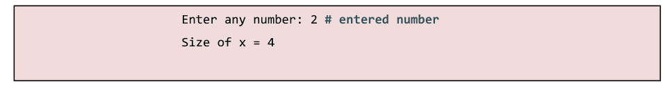

也就是说，输入的整数 "x"（即 **2**）在计算机内存中占据了 **4 bytes** 的空间。

### 字段宽度 (Field width)：

```
scanf("%3d", &x);
```

数字 3 表示**输入数字的字段宽度**。

- 如果**输入数字 = 3485 [4 位]**：只有 3 位 **[348]** 被存储在输入数字的内存位置中。如果输入数字的位数超过指定的字段宽度，则所有多余的数字都不会被存储。

```
a = 5, b = 6
c = a + (-b) = 5 + (-6) = -1
```

一元负号 (Unary minus)：

> c = -1 是因为 b 最初是一个正整数变量，当对其进行一元负号运算时，其值变为负数。

### C 语言中的格式说明符

| 数据类型 | 说明符 | 示例 |
|---|---|---|
| int | %d | 14, -15, 780, +098 |
| float | %f 或 %e | 12.03, +5.65, 32.56 E-03 |
| char | %c | 'A', 'b', '\n', 'E' |
| double | %lf 或 %le | 3.141569 |
| long int | %ld | -218000 |

**Void 数据类型：** Void 数据类型不包含也不返回任何值。它主要用于 C 语言中定义函数。

示例：`void displayData()`

- **十进制常量**包含 **0-9** 的数字。

```
Example: 111, 1234
```

- **八进制常量**包含 **0-7** 的数字，且这类常量总是以 **0** 开头。

```
Example: 012, 065
```

- **十六进制常量**包含 **0-9** 的数字以及 A-F 的字符。
  十六进制常量总是以 **0X** 开头。

```
Example: 0X2, 0Xbcd
```

```
#include<stdio.h>
/* function main begins program execution */
int main() {
  int x; /* number to be input by user */
  printf("Enter any number: "); /* prompt */
  scanf("%3d", &x);
  printf("You entered: %d", x); /* print the entered number */
  return 0; /* indicate that program ended successfully */
} /* end function main */
```

**输出：**

Enter any number: 5496 # 输入的数字
You entered: 549

```
#include<stdio.h>
int main() {
for(int i=1;i<=4;i++) {
printf("* ");
}
printf("\n");

for(int i=1;i<=4;i++) {
printf("* ");
}
printf("\n");

for(int i=1;i<=4;i++) {
printf("* ");
}
printf("\n");

for(int i=1;i<=4;i++) {
printf("* ");
}
printf("\n");

return 0;
}
```

```
#include<stdio.h>
int main() {
for(int j=1;j<=4;j++) {
for(int i=1;i<=4;i++) {
printf("* ");
}
printf("\n");
}
return 0;
}
```

嵌套循环

**输出：**

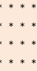

```
#include<stdio.h>
int main() {
float r, area;
printf("Enter the radius: ");
scanf("%f", &r);
area = 3.14 * r * r;
printf("The area of the circle = %f", area);
return 0;
}
```

一个简单的 **C 语言**示例，用于获取用户输入并打印圆的面积。

**输出：**

Enter the radius: 2.5 # 输入的半径

The area of the circle = 19.625000

> float 表示数据类型为浮点型。这个关键字用于表示浮点数。它们被称为浮点数，是因为在运算过程中，小数点会向某些数字的左侧或右侧移动。

尾数-指数表示法：

0.000000000013 → 1.3 × 10⁻¹¹ → **1.3 E-11**

| 有效 | 无效 |
| :--- | :--- |
| -263.269 | 0,0 |
| 2.3698 E+03 | -3.3.3 |
| 0.0268963 E+06 | -9999999999.9999999 (超出范围) |
| 3689.6 E-04 | -+44.44 |

语句：

```
float r, area;
```

意味着我们正在声明**浮点变量** r 和 area。

> 浮点变量是指分数变量或小数（例如：1.5, 2.5, 3.5, 4.7 ... 等），而整数是指非分数变量或整数（例如：1, 2, 3, 4 ... 等）。

```
#include<stdio.h>
int main() {
float length, breadth, area;
length = 2.5;
breadth = 3.2;
area = length*breadth;
printf("The area of the rectangle = %f", area);
return 0;
}

// Output: The area of the rectangle = 8.000000
```

打印矩形面积的 C 程序（给定长度 length = 2.5 和宽度 breadth = 3.2）

```
/* Print one line with three printf statements */

#include <stdio.h>

/* function main begins program execution */

int main() {

printf( "Alan " );

printf( "Mathison " );

printf( "Turing.\n" );

return 0; /* indicate that program ended successfully */

} /* end function main */


// Output: Alan Mathison Turing.
```

```
/* Print multiple lines with a single printf */

#include <stdio.h>

int main() {

printf( "Alan\nMathison\nTuring\n" );

return 0;

}

// Output:

         Alan

       Mathison

         Turing
```

```
/* Print the sum of 2 numbers */


#include <stdio.h>

/* function main begins program execution */

int main() {

int x; /* first number to be input by user */

int y; /* second number to be input by user */

int sum; /* variable in which sum will be stored */

printf( "Enter a number: " ); /* prompt */

scanf( "%d", &x ); /* read a first number */

printf( "Enter a number: " ); /* prompt */

scanf( "%d", &y ); /* read a second number */

sum = x + y; /* assign total to sum */

printf( "Sum of %d and %d is: %d\n", x, y, sum ); /* print sum */

return 0; /* indicate that program ended successfully */

} /* end function main */
```

输出：

Enter a number: 5 # 输入的数字

Enter a number: 4 # 输入的数字

Sum of 5 and 4 is: 9

```
#include <stdio.h>

int main() {

    printf( "%.2f\n", 5.336 ); /* prints 5.34 */

    printf( "%.1f\n", 5.336 ); /* prints 5.3 */

    return 0;

}
```

延迟初始化 (Lazy initialization)

一种 Java 编程范式，规定程序除非真正需要，否则不创建对象。

```
#include <stdio.h>

int main() {

int x = 10; /* define and initialize x */

int i =1; /* define and initialize i */

while ( i <= 10 ) { /* loop 10 times */

// If the remainder after dividing x by 2 != 0 then "+" is printed 10 times

// otherwise "*" is printed 10 times

printf( "%s", x % 2 ? "+": "*" ); /* display result */

i++; /* increment i */

} /* end while */

return 0; /* indicate program ended successfully */

} /* end function main */
```

如果 int x = 13;
输出：++++++++++

输出：
**********

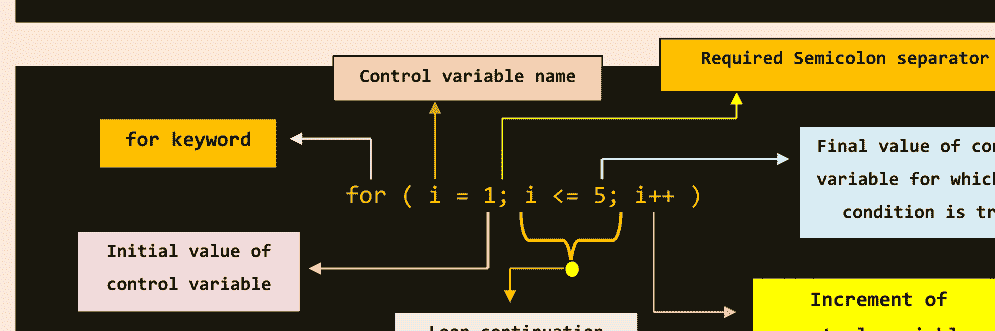

```
#include <stdio.h>

int main() {

int a = 2, b = 4;

for(int i = a; i <= 2 * a * b; i += b / a) {

printf("Hi\n");

}

return 0;

}
```

```
#include <stdio.h>

int main() {

int a = 2, b = 4;

for(int i = 2; i <= 16; i += 2) {

printf("Hi\n");

}

return 0;

}
```

**输出：**
Hi
Hi
Hi
Hi
Hi
Hi

```c
#include <stdio.h>

#define MIN(a, b) ((a) <= (b) ? (a) : (b))

int main() {
    int x = 2;
    printf("%d\n", MIN(x+1, 20)); // Output: 3
    return 0;
}
```

// ((x+1) <= (20) ? (x+1) : (20))
// ((2+1) <= (20) ? (2+1) : (20))
// ((3) <= (20) ? (3) : (20))
// 由于 3 小于 20：输出 : 3

```c
#include <stdio.h>

int MIN(int a, int b) {
    return a <= b ? a : b;
}

int main() {
    int x = 2;
    printf("%d\n", MIN(x+1, 20)); // Output: 3
    return 0;
}
```

```c
#include <stdio.h>

int main() {
    int x = 1905;
    char y = 'X';
    char* z = "Papers";
    printf("%d, %c, %s", x, y, z);
    return 0;
}

// Output: 1905, X, Papers
```

```c
#include <stdio.h>

int main() {
    float x;
    x = 0.2;
    if (x > 0.2) printf("%f > 0.2", x);
    else puts("x = 0.2");
    return 0;
}
```

由于 "x" 是 float 类型，因此打印出 "0.200000 > 0.2"。

### 计算两个数字之和的 C 程序

```c
#include<stdio.h>
int main()
{
    int a, b, sum;
    a=1;
    b=2;
    sum = a + b;
    printf("The sum of a and b = %d", sum);
    return 0;
}
```

```c
int mult(int a, int b) {
    return(a*b);
}
```

```c
#include<stdio.h>
#include<mult.h>
int main() {
    int x;
    x = mult(6,3);
    printf("6x3 = %d\n", x);
    return 0;
}
// Output: 6x3 = 18
```

屏幕上的输出：
```
The sum of a and b = 3
```

如果你想通过键盘为 a 和 b 分配 **浮点数**（即小数，例如 **a 为 1.5**，**b 为 2.6**），那么该语句：
```c
int a, b, sum;
```
应该被替换为 **语句**：
```c
float a, b, sum;
```

```c
#include<stdio.h>
int main(int argc, char *argv[]) {
    printf("Albert");
    return 0;
}
// Output: Albert
```

以及 **语句**：
```c
printf("The sum of a and b = %d", sum);
```
应该被替换为 **语句**：
```c
printf("The sum of a and b = %f", sum);
```

即：
```c
#include <stdio.h>

int main() {
    int x=22; 
    printf("%d\n" , x); 
    return 0;
}

// Output: 22
```

```c
#include<stdio.h>
int main()
{
    float a, b, sum;
    a=1.5;
    b=2.6;

    sum = a + b;

    printf("The sum of a and b = %f", sum);
    return 0;
}
```

```c
#include <stdio.h>
int main() {
    /* 变量声明 */
    int x[3]; /* 3 个整数类型元素的数组 */
    char *fruit[3] = { "Apple", "Grapes" , "Orange" };
    for(int i = 0 ; i <= 2 ; i++ )
        printf("%s\n" , fruit[i]);
    return 0;
}
```

**屏幕上的输出：**
The sum of a and b = 4.1

**输出：**
Apple
Grapes
Orange

语句：
```c
printf("The sum of a and b = %f", sum);
```
负责打印输出：
The sum of a and b = 4.1

```c
#include <stdio.h>
int main() {
    int x = 22;
    printf("%d\n" , x);
    return 0;
}

// Output: 22
```

**即便** 语句：
```c
printf("The sum of a and b = %f", sum);
```
在 C 程序中被省略，程序仍将成功执行，但屏幕上不会显示任何输出。

如果你想通过 **键盘** 提供 `a` 和 `b` 的值，那么语句：
```c
a=1.5;
b=2.6;
```

```c
#include<stdio.h>

int main() {
  /* 声明时逐字符初始化字符串 */
  char x[4] = {'A', 'l', 'a', 'n'};
  printf("%s\n", x); // Output: Alan
  return 0;
}
```

应该被替换为语句：
```c
printf("Enter any two numbers:");
scanf("%f %f", &a, &b);
```

```c
#include<stdio.h>

int main() {
  /* 声明时一次性初始化字符串 */
  char x[4] = "Alan";
  printf("%s\n", x); // Output: Alan
  return 0;
}
```

即，**程序应重写为**：
```c
#include<stdio.h>

int main() {
  float a, b, sum;
  printf("Enter any two numbers:");
  scanf("%f %f", &a, &b);
  sum = a + b;
  printf("The sum of a and b = %f", sum);
  return 0;
}
```

```c
#include<stdio.h>

int main() {
  /* 声明时一次性初始化字符串，但未指定长度 */
  char x[] = "Alan";
  printf("%s\n", x); // Output: Alan
  return 0;
}
```

屏幕上的输出：
```
Enter any two numbers:
```
如果你输入两个数字 2.9 和 3.6，那么：
The sum of a and b = 6.5 将会被输出到屏幕上。

```c
#include <stdio.h>

int main() {
    int x = 2, y = 4;
    x = x + y + 1; 
    printf("%d\n", x);
    // Output: 7
    return 0;
}
```

### 如前所述：

**取地址符 ("&")** 表示地址，而 [**&a** 和 **&b**] 表示存储在计算机内存中已声明的浮点变量 `a` 和 `b` 的地址。也就是说，当我们通过键盘为 `a` 和 `b` 输入一个数字时，这些数字由 `scanf()` 函数读取并存储在计算机内存中（即，为 a 输入的数字存储在 a 的地址中（即存储在 `&a`），为 b 输入的数字存储在 b 的地址中（即存储在 `&b`））。

在以下语句中包含 **2 个格式字符串**：
```c
scanf("%f %f", &a, &b);
```

- 一个 **格式字符串 "%f"** 对应于 **"&a"**，即 `%f` 告诉 **scanf() 函数**读取通过键盘为 **"a"** 输入的数字，并将其存储在**计算机内存**中 **"a" 的地址**中。
- 另一个 **格式字符串 "%f"** 对应于 **"&b"**，即 `%f` 告诉 **scanf() 函数**读取通过键盘为 **"b"** 输入的数字，并将其存储在**计算机内存**中 **"b" 的地址**中。

如果 **2 个格式字符串** 用逗号分隔，例如：
```c
scanf("%f, %f", &a, &b);
```
那么屏幕上将显示 **编译错误**（或运行时输入错误）。

- **注意：**
语句：
```c
scanf("%f %f", &a, &b);
```
读取通过 **键盘** 输入的两个数字 **2.9** 和 **3.6**，并将它们存储在 *计算机内存* 中 [即，数字 **2.9** 存储在 "**a**" 的地址中（即存储在 `&a`），数字 **3.6** 存储在 "**b**" 的地址中（即存储在 `&b`）]。

语句：
```c
printf("Enter any two numbers:");
scanf("%f %f", &a, &b);
```
也可以被替换为语句：
```c
printf("Enter any number:");
scanf("%f", &a);
printf("Enter any number:");
scanf("%f", &b);
```

```c
#include <stdio.h>
#include <string.h>
int main() {
    // 使用数据类型声明变量
    int salary;
    float bonus;
    char name[10];

    // 分配正确的值
    salary = 12000;
    bonus = 125.596;
    strcpy(name,"John");

    // 使用正确的说明符访问
    printf("Name: %s, Salary: %d, Bonus: %f", name, salary, bonus);
    return 0;
}

// Output: Name: John, Salary: 12000, Bonus: 125.596001
```

即：
```c
#include<stdio.h>
int main()
{
    float a, b, sum;
    printf("Enter any number:");
    scanf("%f", &a);
    printf("Enter any number:");
    scanf("%f", &b);
    sum = a + b;
    printf("The sum of a and b = %f", sum);
    return 0;
}
```

```c
#include<stdio.h>
int main() {
    char * x = ((13 % 2)==0) ? "TRUE" : "FALSE";
    printf("%s\n", x);
    // Output: FALSE
    return 0;
}
```

那么屏幕上的 **输出** 为：
Enter any number:
（如果你输入数字 2.9）
Enter any number:
（如果你输入数字 3.6）
The sum of a and b = 6.5 将会被输出到屏幕上。

> 计算机历史学家保罗·E·塞鲁齐 (Paul E. Ceruzzi) 在里奇去世时评论道：
> “里奇一直不被关注。虽然他的名字并不出名，但如果你有一台显微镜并能观察一台计算机，你会发现他的所有工作都在那里……”

如果 **语句**：
```c
printf("The sum of a and b = %f", sum);
```
被替换为 **语句**：
```c
printf("The sum of %f and %f = %f", a, b, sum);
```

```c
#include<stdio.h>
int main() {
    for(int x =0 ; x < 5; x++) { // 外层循环
        for(int y=0; y < 5; y+=2) { // 内层循环
            printf("*");
        }
    }
    return 0;
} // Output: ***************
```

那么 **屏幕上的输出** 是：
The sum of 2.9 and 3.6 = 6.5

在语句：
```c
printf("The sum of %f and %f = %f", a, b, sum);
```
中有三个格式字符串：
- 语句 (The sum of) 之后的格式字符串 `%f` 表示要显示的值需要从变量 `a` 中获取。
- 语句 (The sum of %f and) 之后的格式字符串 `%f` 表示要显示的值需要从变量 `b` 中获取。
- 语句 (The sum of %f and %f =) 之后的格式字符串 `%f` 表示要显示的值需要从变量 `sum` 中获取。

#### 程序 1.4
将摄氏温度转换为华氏温度的 C 程序

```c
#include<stdio.h>
int main()
{
    float C, F;
    C=38.5;
    F = 9*C/5 +32;
    printf("Temperature in Fahrenheit= %f", F);
    // 使用 %f 是因为 F 的数据类型是 float
    return 0;
}
```

**C++ 程序：**
```cpp
#include<iostream>
using namespace std;
int main() {
    int x = 20;
    if(x >= 0)
        if(x < 10)
            cout << "x < 10\n";
        else
            cout << "x > 10\n";
    return 0;
}

// Output: x > 10
```

屏幕上的输出：
```
Temperature in Fahrenheit= 101.3
```


```c
#include<stdio.h>
int main() {
    int x = 3;
    do {
        printf("Albert");
        x--;
    } while (x < 2);
    return 0;
}
// Output: Albert
```

该程序演示了 **do..while** 结构如何确保程序至少运行一次。初始时 x=3，进入循环，`printf()` 打印，x = 3-1=2，此时检查条件，2 < 2 = False，因此退出循环。

如果你想在 C 语言中通过键盘输入小数点后 16 位的数字，那么上述程序应采取以下形式：

```c
#include<stdio.h>
int main() {
    double C, F;
    printf("Enter any number:");
    scanf("%lf", &C);
    F = 9*C/5 + 32;
    printf("Temperature in Fahrenheit= %lf", F);
    // %lf is used because the data type for F is double
    return 0;
}
```

```c
#include<stdio.h>
#include<stdlib.h>

int main() {
    for(int x=1; x<=6; x++) {
        if(x % 4 == 0) {
            exit(0);
        }
        else
            printf("%d ", x);
    }
    return 0;
}

// Output: 1 2 3
```

- 注意：
- `double` $\rightarrow$ 用于表示`双精度浮点数`的关键字。
- `float` 通常最多存储小数点后 6 位数字。但 double 可以在小数点后存储 16 位有效数字。例如：
`234.0000000000000000`
`- 0.00000000099531510`

数据类型 **double** 和 **long double** 分别用于存储精度最高达 **14** 位和 **80** 位的实数。

答案：

```c
#include<stdio.h>

int main()
{
    int a, b, c, sum;
    printf("Enter any three numbers:");
    scanf("%d %d %d", &a, &b, &c);
    sum = a + b + c;
    printf("The sum of a, b and c = %d", sum);
    return 0;
}
```

```c
#include<stdio.h>

int main() {
    int x = 64;
    if(x > 68 && x < 54)
        printf("x > 68 and < 54");
    else
        printf("%d", x);
    return 0;
}

// Output: 64
```

- 编写一个程序来输出整数的等效十六进制值

答案：

```c
#include<stdio.h>

int main()
{
    int a = 45;
    printf("%x", a);
    return 0;
}
```

```c
#include<stdio.h>
#include<stdlib.h>

int main() {
    // declaring & initializing variables
    int a = 20, b = 4, c;

    // doing math operations
    c = a / b;

    //displaying result
    printf("%d / %d = %d \n", a, b, c);

    // asking user to press key
    printf("Enter any character to exit: \n");

    // holding program till key press
    getchar();

    // exit program with status 0, no error
    exit(0);
} // end of main
```

屏幕输出：
```
2d
```

### 编写一个程序，在给定三条边的情况下打印三角形的面积。

程序中添加了 math.h 文件以使用 `sqrt()` 函数。

答案：

```c
#include<stdio.h>
#include<math.h>
#define PI 3.14159

int main() {
    float x, y, theta, area;
    printf("Enter any 2 sides of triangle: \n");
    scanf("%f %f", &x, &y);
    printf("Enter any one side angle in degres: \n");
    scanf("%f", &theta);
    area = x * y * sin(theta * PI / 180)/2;
    printf("Area of the triangle = %.4f ", area);
    return 0;
}
```

```c
#include<stdio.h>
#include<math.h>

int main()
{
    int a, b, c, s, area;
    a = 3;
    b = 4;
    c = 5;
    s = ( a + b + c ) / 2 ;

    area = sqrt((s * (s -a) * (s-b) * (s-c)));
    printf("The area of the triangle = %d", area);
    return 0;
}
```

注意：由于 `sqrt()` 不是 **C 语言** 或 **标准输入输出文件**（即 **stdio.h 文件**）的一部分，而是 **数学文件**（即定义了各种数学函数的 **math.h 文件**）的一部分，**该语句**：

```c
#include<math.h>
```

应该包含在 C 程序中，否则屏幕上会标记出 **编译错误**，提示 `sqrt()` 未声明或未定义。

注意：如果将
```c
area = (s (s-a) (s-b) (s-c)^1/2
```
代替
```c
area = sqrt ((s * (s-a) * (s-b) * (s-c));
```
编写，那么屏幕上将显示 **编译错误**，因为 C 语言不支持
```c
area = (s (s-a) (s-b) (s-c))^1/2
```

- **你需要了解的内容：**
- 1 kilobyte = $2^{10}$ = 1024 bytes
- 1 megabyte = $2^{10} \times 2^{10}$ = 1024 $\times$ 1024 bytes
- 1 gigabyte = $2^{10} \times 2^{10} \times 2^{10}$ = 1024 $\times$ 1024 $\times$ 1024 bytes
- 1 terabyte = $2^{10} \times 2^{10} \times 2^{10} \times 2^{10}$ = 1024 $\times$ 1024 $\times$ 1024 $\times$ 1024 bytes

- **程序 1.5**

计算两个数字乘积的 C 程序：

```c
#include<stdio.h>
int main()
{
    int a, b, product;
    a=1;
    b=2;
    product = a * b;
    printf("The product of a and b = %d", product);
    return 0;
}
```

```cpp
#include<iostream>
#include<string>
using namespace std;

int main () {
    string x;
    cout << "Enter your name: \n";
    getline(cin, x);
    cout << "Hi " << x << ".\n";
    return 0;
}

// Output:
// Enter your name:
// John # entered name
// Hi John.
```

## C++ 程序：

**屏幕上的输出：**
The product of a and b = 2

如果你想为 a 和 b 插入一个 10 位数字，即：
```c
a=1000000000
b=3000000000
```

```c
#include <stdio.h>
int main() {
    printf("1 TO 5 MULTIPLICATION TABLE: \n\n");
    for(int x=1; x<= 5; x++) {
        for(int y=1; y<= 5; y++)
            printf("%6d " , x * y);
        putchar('\n');
    }
    return 0;
}
```

那么语句：
```c
int a, b, product;
```
应该被语句：
```c
long int a, b, product;
```
替换，并且应该使用 `%ld` 而不是 `%d`。也就是说，程序应该被重写为：

输出：
```
1 TO 5 MULTIPLICATION TABLE:
   1   2   3   4   5
   2   4   6   8  10
   3   6   9  12  15
   4   8  12  16  20
   5  10  15  20  25
```

```c
#include<stdio.h>
int main()
{
    long int a, b, product;
    a=1000000000;
    b=2000000000;
    product = a * b;
    printf("The product of a and b = %ld", product);
    return 0;
}
```

```c
#include<stdio.h>
int main() {
    int x = 4, y;
    y = (x < 0 ? 0 : x * x);
    printf("%d", y);
    return 0;
}
// Output: 16
```

### 屏幕上的输出：
```
The product of a and b = 3000000000000000000
```

如果你想通过键盘提供 a 和 b 的值，那么语句
```c
a=1;
b=2;
```

```c
#include <stdio.h>
#define begin {
#define end  }
#define program int main()
#define writeln printf

program
begin
  writeln("Albert ");
  writeln("Einstein");
end

// Output: Albert Einstein
```

应该被语句：
```c
printf("Enter any two numbers:");
scanf("%d %d", &a, &b);
```
替换。

也就是说：
```c
#include<stdio.h>
int main()
{
    int a, b, product;
    printf("Enter any two numbers:");
    scanf("%d %d", &a, &b);
    product = a* b;
    printf("The product of a and b = %d", product);
    return 0;
}
```

> 帕金森定律：工作会不断扩展，直到填满所有可用时间。

### 屏幕上的输出：
```
Enter any two numbers:
```

如果你输入两个数字 1 和 3，屏幕上将输出 "The product of a and b = 3"。

如果你将语句：
```c
printf("Enter any two numbers:");
scanf("%d %d", &a, &b);
```
替换为语句：
```c
printf("Enter any number:");
scanf("%d", &a);
printf("Enter any number:");
scanf("%d", &b);
```

```cpp
// C++ Program:
#include <iostream>
using namespace std;
int main() {
    int x;
    cout << "Enter any number: ";
    cin >> x;
    (x % 2 == 0) ? cout << x << " is even." : cout << x << " is odd.";
    return 0;
}
```

```
// Output:
Enter any number: 4 # entered number
4 is even.
```

那么屏幕上的输出将是：
Enter any number:
（如果你输入数字 3）
Enter any number:
（如果你输入数字 3）
The product of a and b = 9
将会在屏幕上输出。

如果将语句
```c
printf("The product of a and b = %d"; product);
```

```c
#include<stdio.h>

int main() {
    printf("%c", "albert"[3]);
    // Output: e
    return 0;
}
```

代替语句
```c
printf("The product of a and b = %d", product);
```
也就是说，使用了分号而不是变量分隔符（即逗号）——那么屏幕上将显示编译错误。

**C++ 程序：**

- **注意：**

```c
#include <stdio.h>
int main()
{
    printf("Hello, World!");
    printf("Hello, World!\b");
    printf("Hello, World!\b");
    printf("Hello, World!\b");
    return 0;
}
```

```cpp
#include<iostream>
using namespace std;
void func1(const string &i) {
    cout << i << endl;
}
void func2(string i) {
    cout << i << endl;
}
int main() {
    func1("Albert");
    func2("Albert");
    return 0;
}
```

**输出：**
Albert
Albert

也就是说，如果使用了退格键 `\b`，那么
```
Hello, World!Hello, World!Hello, World!Hello, World!
```
将在屏幕上输出。

> 如果使用回车 `\r` 代替 `\b`，即：

```c
#include <stdio.h>
int main()
{
    printf("Hello, World!");
    printf("Hello, World!\r");
```


```c
printf("Hello, World!\r");
printf("Hello, World!\r");
return 0;
}
```

```c
#include<stdio.h>
int main() {
int x;
printf("Enter any number: \n");
scanf("%d", &x);
(x == 2 ? printf("Albert") : printf("Einstein"));
return 0;
}

// 输出：
Enter any number:
5 # 输入的数字
Einstein
```

屏幕上的输出是：

Hello, World!Hello, World!
Hello, World!
Hello, World!

> 如果使用水平制表符 "\t" 代替 "\r"，即：

```c
#include <stdio.h>
int main()
{
printf("Hello, World!\t");
printf("Hello, World!\t");
printf("Hello, World!\t");
printf("Hello, World!\t");
return 0;
}
```

```cpp
C++ 程序：
#include<iostream>
using namespace std;
int main() {
int x=2, y=3, z=0;
if(x!=0) {
z=x*y;
cout<<"z:"<<z;
}
return 0;
}
// 输出：z:6
```

屏幕上的输出是：

Hello, World! Hello, World! Hello, World! Hello, World!

> 如果使用垂直制表符 "\v" 代替 "\t"，即：

```c
#include <stdio.h>

int main()
{
    printf("Hello, World!\n");
    printf("Hello, World!\n");
    printf("Hello, World!\n");
    printf("Hello, World!\n");
    return 0;
}
```

```cpp
**C++ 程序：**

#include <iostream>
using namespace std;

namespace X {
    int a = 25;
    int b = 50;
}

namespace Y {
    double a = 4.5496;
    double b = 3.1988;
}

int main() {
    using X::a;
    using Y::b;
    cout << a << endl; // 25
    cout << b << endl; // 3.1988
    cout << X::b << endl; // 50
    cout << Y::a << endl; // 4.5496
    return 0;
}
```

屏幕上的输出是：

Hello, World!
Hello, World!
Hello, World!
Hello, World!

- **程序 1.5**
  求数字平方的C程序

```c
#include<stdio.h>

int main()
{
    int a, b;
    a=2;
    b = a * a;
    printf("The square of a = %d", b);
}
```

```c
#include<stdio.h>

int main() {
    printf("%f",16.0+17);

    // 输出：33.000000

    return 0;
}
```

屏幕上的输出：

The square of a = 4

### 如果语句：

```c
b = a * a;
```

被替换为

```c
b = pow((a), 2);
```

## C++ 程序：

```cpp
#include<iostream>
using namespace std;
int main() {
int x, y, z, g;
cout<<"Enter any 3 numbers:  \n";
cin>>x>>y>>z;
(x > y ? (x > z ? g = x : g = z) : (y > z ? g = y : g = z));
cout<< g << " is the greatest of 3 numbers.";
return 0;
}
```

即，如果**上述程序**被重写为：

```c
#include<stdio.h>
#include<math.h>
int main()
{
int a, b;
a=2;
b = pow((a), 2);
printf("The square of a = %d", b);
return 0;
}
```

## 输出：

```
Enter any 3 numbers:
25 # 输入的数字
36 # 输入的数字
102 # 输入的数字
102 is the greatest of 3 numbers.
```

那么屏幕上将不会显示**编译错误**，或者屏幕上的输出不会改变，即：

The square of a = 4

将被输出到屏幕上。

这意味着：

```c
b = pow((a), 2); 与 b = a*a; 是等价的
```

由于使用了 `b = pow((a), 2);` 而不是 `b = a*a;`，C程序中应该包含 `#include<math.h>`，因为 `b = pow((a),2);` 由 `#include<math.h>` 支持。

否则，屏幕上将显示编译错误。

如果你想通过键盘为 "a" 提供整数值，那么语句：

```c
a=2;
```

将被替换为以下语句：

```c
printf("Enter any number:");
scanf("%d", &a);
```

即：

```c
#include<stdio.h>
int main()
{
    int a, b;
    printf("Enter any number:");
    scanf("%d", &a);
    b = a * a;
    printf("The square of a = %d", b);
    return 0;
}
```

```cpp
C++ 程序：
#include<iostream>
using namespace std;
int main() {
    int x = 15;
    int &y = x; // y 是一个引用变量
    cout<<x<<endl; // 将打印 15
    cout<<y<<endl; // 将打印 15
    x=x+10;
    cout<<y<<endl; // 将打印 25
    return 0;
}
```

屏幕上的输出：

```
Enter any number:
如果你输入数字 4
屏幕上将输出 a 的平方 = 16
```

- **注意：**
    - 如果写成 `scanf(&d, &a);` 而不是 `scanf("%d", &a);`
    - 如果写成 `printf(The square of a = % d, b);` 而不是 `printf("The square of a = %d", b);`
    - 如果 `main function` 后面跟着一个 `semicolon` 即 `int main();` 而不是 `int main()`

那么屏幕上将显示 `compilation error`（编译错误）。

但是，如果 `main function` 的 `body` 后面跟着一个 `semicolon` 即：

```c
int main()
{
};
```

```c
#include <stdio.h>

int main() {
    int a = 3, b, c;
    b = a = 10;
    c = a < 10;
    printf("\na: %d b: %d c: %d", a, b, c);
    // 输出：a: 10 b: 10 c: 0
    return 0;
}
```

被写成：

```c
int main()
{

}
```

那么屏幕上将不会显示 `compilation error`（编译错误）。

```c
int main(); -> 错误

int main()
{
}; -> 无错误
```

- 编写一个程序来打印一个数字的立方

**答案：**

```c
#include<stdio.h>
#include<math.h>
int main()
{
    int a, b;
    a=2;
    b = pow((a), 3);
    printf("The cube of a = %d", b);
    return 0;
}
```

```c
#include <stdio.h>

int main() {
    int x = 66;
    char y = 'B';
    if(x == y)
        printf("Albert");
    else
        printf("Einstein");
    return 0;
}

// 输出：Albert
// 'B' 的 ASCII 值是 66
```

- 编写一个程序使用公式 $\text{energy} = mc^2$ 来打印物质的能量

**答案：**

```c
#include<stdio.h>
#include<math.h>
int main()
{
    int m;
    long int c, energy;
    m=2;
    c = 300000000;
    energy = m * pow((c), 2);
    printf("The energy of the substance = %ld joules", energy);
    return 0;
}
```

```c
#include<stdio.h>

int main() {
    int a = 25 ;
    printf("%d %d %d", a = 15, a = 20, a < 35);
    // 输出：1 20 1
    return 0;
}
```

`if` **语句**的语法是：

```c
if (this condition is true)
{
    print this statement;
}
```

其中 **condition** $\rightarrow$ `一个产生 true 或 false 结果的逻辑表达式。`

```c
#include<stdio.h>

int main()
{
    int a;
    printf("Enter any number: \n");
    scanf("%d", &a);
    if((a%2)!=0){
        printf("%d is an odd number\n", a);
    }
}
```

## C++ 程序：

```cpp
#include<iostream>
using namespace std;

int main() {
    char string[20];
    cout<<"Enter a string: "<<endl;
    cin.get(string, 20);
    cout<<string<<endl;
    return 0;
}
```

## 输出：

```
Enter a string:
Alan # 输入的字符串
Alan
```

### 语句

| 类型 | 描述 |
| :--- | :--- |
| 简单 | 单条语句。 |
| 复合 | 由放在花括号之间的两条或多条语句组成的集合。 |

- **程序 1.6**
  使用 `if - else` 语句求两个数中较大数的C程序

- **if - else 语句的语法**（条件语句）：

```c
if (this condition is true)
{
    print this statement;
}
else
{
    print this statement;
}
```

```c
#include<stdio.h>
#include<stdlib.h>

int main() {
    printf("Press Enter to clear the screen: ");
    getchar();
    system("cls"); /* Windows */
    system("clear"); /* Mac - Unix */
    puts("Albert Einstein");
    return(0);
}
```

`If-else 语句` $\rightarrow$ 被称为分支，因为程序根据评估条件的结果来决定执行哪条语句。

```c
#include<stdio.h>
int main()
{
    int a, b;
    a = 2;
    b = 3;
    
    if(a>b)
    {
        printf("a is greater than b");
    }
    else
    {
        printf("b is greater than a");
    }
    
    return 0;
}
```

```c
#include <stdio.h>
int main() {
    int x = 10, y = 15;
    if(x % 2 == y % 3)
        printf("Albert");
    else
        printf("Einstein");
    return 0;
}

// 输出：Albert
```

### 屏幕上的输出：

b is greater than a

由于括号内的条件

```c
a>b
```

不为真，因此语句 `a is greater than b` 未被执行；而是**执行跳过**，并传递到打印语句 `b is greater than a`。

> 简单来说，`(a>b)` 是条件（即产生 true 或 false 结果的逻辑表达式），如果条件 `(a>b)` 为真，则执行语句：

```c
printf("a is greater than b");
```

```c
#include<stdio.h>
#include<stdlib.h>
int main() {
    int x = 0;
    x+1;
    if(x<=5) {
        printf("Albert Einstein");
        exit(0);
        main();
    }
}

// 输出：Albert Einstein
```

被用来打印输出：

a is greater than b

否则执行**语句：**

```c
printf("b is greater than a");
```

被用来打印输出：

b is greater than a

如果你想通过**键盘**为 a 和 b 提供**整数值**，那么语句...

已准备好，请发送您需要处理的OCR文本。


 | 2a^2 + 3b | 2a * a + 3b + 2 |
| :--- | :--- |
| $$a = e^{\frac{x}{\sqrt{1+\sin\theta}}}$$ | a = exp( x / sqrt( 1 + sin (theta))) |

- 以下程序的输出结果是什么？

(a)

```
#include<stdio.h>
#include<math.h>
int main()
{
int a, b, x;
x=2;
b=2;
a = exp(x) + b;
printf("The value of a = %d", a);
return 0;
}
```

```
#include<stdio.h>
int main() {
int i;
for(i=5; i<6; i=i+1) {
printf("%d\n", i);
}
return(0);
}
// Output: 5
```

答案：

The value of a = 9

(b)

```
#include<stdio.h>
int main() {
int i;
for(;i>=-5;i--)
printf("%d ",i);
return(0);
}
// Output: 0 -1 -2 -3 -4 -5
```

```
#include<stdio.h>
#include<math.h>
int main()
{
int alpha, beta, gamma;
alpha =2;
beta=2;
gamma= 2 * alpha + beta;
printf("The value of gamma = %d", gamma);
return 0;
}
```

```
#include<stdio.h>
#define x 5
int main() {
for(int i=1;i<=10;i++)
printf("%d %% %d = %d\n", i, x, i%x);
return(0);
}
```

## 输出：

```
1 % 5 = 1
2 % 5 = 2
3 % 5 = 3
4 % 5 = 4
5 % 5 = 0
6 % 5 = 1
7 % 5 = 2
8 % 5 = 3
9 % 5 = 4
10 % 5 = 0
```

## 答案：

The value of gamma = 6

(c)

```
#include <stdio.h>
#include<math.h>
int main()
{
double theta, result;
theta = 90;
result = sin(theta);
printf ("The sine 90 degrees is = %lf ", result);
return 0;
}
```

```
#include<stdio.h>
int main() {
char *x = "Albert\n";
while(putchar(*x++))
;
return(0);
}

// Output: Albert
```

## 答案：

The sine 90 degrees is = 0.893997

> $[\frac{x}{y}]^{n-1}$ 对应的 C 语言表达式是什么？

答案：

```
pow((x/y), n-1)
```

```
#include<stdio.h>

int main() {
    char *names[] = {
        "Albert",
        "Alan",
        "John",
        "James",
        "Mary"
    };
    for(int i=0;i<5;i++){
        puts(names[i]);
    }
    return(0);
}
```

| # 输出： |
| :--- |
| Albert |
| Alan |
| John |
| James |
| Mary |

+   * 程序 1.9
用于计算一个数平方根的 C 程序

```
#include<stdio.h>
#include<math.h>

int main()
{
    int a, b;
    printf("Enter any number:");
    scanf("%d", &a);
    b = sqrt(a);
    printf("The square root of a number = %d", b);
    return 0;
}
```

```
#include<stdio.h>

int main() {
    printf(" %14s = %14s\n", "Albert");
    return(0);
}
```

| // 输出： %14s = | Albert |

屏幕上的输出：

```
Enter any number:

如果你输入数字 4
```

```
#include<stdio.h>
#include<stdlib.h>

int main() {
    int i;
    int *pi;
    pi=&i;
    for(i=1;i<=5;i++)
        printf("%d ", *pi);
    return 0;
}
```

| // 输出： 1 2 3 4 5 |

The square root of a number = 2

将被输出到屏幕上。

假设你输入数字 "2"，屏幕上将输出 <span style="color:red">square root of a number = 1</span>，因为使用了 `int` 而不是 `float`。

```
#include<stdio.h>
#include<ctype.h>
int main() {
char x;
printf("Do you want to be like Albert Einstein?\n");
scanf("%c", &x);
x = toupper(x);
if(x=='Y')
puts("Albert");
else
puts("Elsa");
return(0);
}
```

**输出：**

Do you want to be like Albert Einstein?

y # 输入的字符

Albert

```
#include<stdio.h>
int main() {
char *names[] = {
"Albert",
"Alan",
"John",
"James",
"Mary"
};
for(int i=0;i<5;i++){
putchar(**(names+i));
putchar('\n');
}
return(0);
}
```

**输出：**

A

A

J

J

M

## C++ 程序：

```
#include<iostream>
using namespace std;
int main() {
int x = 15;
int y = x;
y += 50;
cout << y << endl;
// Output: 65
return 0;
}
```

```
#include<stdio.h>

int main() {
    char x = 'B';
    switch(x) {
        case 'A':
        case 'E':
        case 'I':
        case 'O':
        case 'U':
            printf("Vowel");
            break;
        default:
            printf("Not a vowel");
    }
    return 0;
}
```

// 输出： Not a vowel

```
C++ 程序：

#include<iostream>
using namespace std;

int main() {
    const char x = '2';
    const char y = x + 1;
    const char z = '\n';
    cout << y << z;
    return 0;
}
```

// 输出： 3

+   * 注意：

```
#include<stdio.h>
#include<math.h>

int main()
{
    printf("The square root of a number = %f", sqrt(4));
    return 0;
}
```

```
|| 表示 或 (or)
> 表示 大于 (greater than)
< 表示 小于 (less than)
== 表示 等于 (equal to)
! 表示 非 (not)
!= 表示 不等于 (not equal to)
&& 表示 与 (and)
```

& 表示 地址 (address)

## 程序 2.0

用于计算单利 (simple interest) 的 C 程序

```
#include<stdio.h>

int main()
{
    int P,T, R, SI;
    P = 1000;
    T = 2;
    R = 3;
    SI = P*T*R/100;
    printf("The simple interest = %d", SI);
    return  likeness 似 like
}
```

屏幕上的输出：

The simple interest = 60

## C++ 程序：

```
#include<iostream>
using namespace std;
int main() {
    string x = "Albert Einstein";
    for(auto i : x)
        cout << i ;
    return 0;
}
```

// 输出： Albert Einstein

```
#include<iostream>
using namespace std;
int main() {
    string x = "Albert ";
    string y = "Einstein";
    x += y;
    cout<< x <<endl;
    return 0;
}
```

// 输出： Albert Einstein

## 注意：

如果你写成 `SI = PTR/100;` 而不是 `SI=P*T*R/100;`，屏幕上将显示 `compilation error` (编译错误)，因为 `c language` 不接受通用的代数表达式。

如果你想通过键盘提供 P, T 和 R 的值，那么以下语句：

```
P = 1000;
T = 2;
```

```
R = 3;
```

## C++ 程序：

应该被替换为以下语句：

```
#include<iostream>
using namespace std;
int main() {
string x = "Alan";
string y = "Albert";
const char *z = ", ";
string w = x + z + y + " ...";
cout<< w <<endl;
return 0;
}
```

```
printf("Enter principal amount:");
scanf("%d", &P);
printf("Enter time:");
scanf("%d", &T);
printf("Enter rate of interest:");
scanf("%d", &R);
```

```
// 输出： Alan, Albert ...
```

即，上述程序应采取如下形式：

```
#include<iostream>
using namespace std;
int main() {
string x = "Albert and Elsa";
x.replace(6, 4, " nor");
cout<< x <<endl;
return 0;
}
```

```
#include<stdio.h>
int main()
{
int P,T, R, SI;
printf("Enter principal amount:");
scanf("%d", &P);
printf("Enter time:");
scanf("%d", &T);
printf("Enter rate of interest:");
scanf("%d", &R);
SI = P*T*R/100;
printf("The simple interest = %d", SI);
return 0;
}
```

```
// 输出： Albert nor Elsa
```

```
#include<iostream>
using namespace std;
int main() {
string x = "Albert and Elsa";
x.replace(x.begin() + 10, x.end(), " Alan");
cout<< x <<endl;
return 0;
}
```

**屏幕上的输出：**

```
Enter principal amount:
```

```
// 输出： Albert and Alan
```

```
如果你输入本金 1000
Enter time:
如果你输入时间 2
Enter rate of interest:
如果你输入利率 3

The simple interest = 60

将被输出到屏幕上。
```

## 周活跃用户 (Weekly Active Users)：

在一周内与平台或 Web 应用程序产生过交互的唯一用户数量。

### goto 语句：

与其他语言一样，C 语言支持一个无条件控制语句 [goto]，用于在 C 程序中将控制权从一点转移到另一点。goto 是一个分支语句，需要一个标签。goto 语句的语法如下：

```
goto label;
```

标签可以写在 C 程序的任何位置，可以在 goto 语句之前或之后。例如：

```
goto END;
..............
..............
..............
END:
..............
```

```
START:
..............
..............
..............
goto START;
```

标签 END:
写在
goto END; 语句之后。

标签 START:
写在
goto START; 语句之前。

控制语句，因为它控制了程序的执行流。

## 程序 2.1

用于判断一个人是否为老年人的 C 程序

```
#include<stdio.h>
int main()
{
    int age;
    age=20;
    if(age >= 60)
    {
        printf("senior citizen");
    }
    if(age<60)
    {
        printf("not a senior citizen");
    }
    return 0;
}
```

```
#include<iostream>
#include<vector>

using namespace std;
int main() {
    vector<int> primes = {2, 3, 5, 7, 11, 13};
    for(auto x : primes) {
        cout << x << endl;
    }
    return 0;
}
```

| 输出： |
| :--- |
| 2 |
| 3 |
| 5 |
| 7 |
| 11 |
| 13 |

屏幕上的输出：

```
not a senior citizen
```

> **基于零的编号 (Zero-based numbering)：**

一种对数组元素进行编号的方法，使得第一个元素的索引为零。

+   - `(age>= 60)` 表示年龄**大于或等于 60**


如果你想通过**键盘**为 `age` 提供数值，那么**语句**：

```cpp
age=20;
```

应该被替换为以下语句：

```cpp
printf("Enter age:");
scanf("%d", &age);
);
```

也就是说，上述程序应采用以下形式：

```cpp
#include<stdio.h>

int main()
{
    int age;
    printf("Enter age:");
    scanf("%d", &age);
    if(age>60)
    {
        printf("senior citizen");
    }
    if(age<60)
    {
        printf("not a senior citizen");
    }
    return 0;
}
```

屏幕上的输出：

```
Enter age:
```

如果你输入数值 60，屏幕上将输出 "senior citizen"。
假设你输入数值 27，屏幕上将输出 "not a senior citizen"。

```cpp
#include<iostream>
using namespace std;

int main() {
    int x = 25;
    auto mult = [x](int i) { return i * x };
    cout << mult(3);
    return 0;
    // Output: 75
}
```

```cpp
#include<iostream>
using namespace std;

int main() {
    string x = "Alan Mathison Turing";
    x.replace(x.begin() + 6, x.begin() + 9, 3, '*');
    cout<<x<<endl;
    return 0;
    // Output: Alan M***ison Turing
}
```

```cpp
#include<iostream>
using namespace std;

int main() {
    enum names {Alan, John, James};
    enum class subjects {Biology, Chemistry, Maths};
    cout << is_enum<names>::value << "\n";
    // Prints 1 (True)
    cout << is_enum<subjects>::value << "\n";
    // Prints 1 (True)
    cout << is_enum<int>::value << "\n";
    // Prints 0 (False)
    return 0;
}
```

```cpp
#include<iostream>
using namespace std;

int main() {
    constexpr int x = 22 * 4;
    cout << x << endl;
    // Output: 88
    return 0;
}
```

- **程序 2.2**
  用于获取 3 门科目分数并声明结果的 C 程序。
  如果所有科目分数均 >= 35，则学生合格，否则不合格。

```cpp
#include<stdio.h>

int main()
{
    int M1, M2, M3;
    M1 = 38;
    M2 = 45;
    M3 = 67;
    if(M1>= 35 && M2>= 35 && M3>= 35)
    {
        printf("candidate is passed");
    }
    else
    {
        printf("candidate is failed");
    }
    return 0;
}
```

屏幕上的输出：

```
candidate is passed
```

`>=` 表示大于或等于，双和符号 `&&` 表示“且”（逻辑与）。

`(M1>= 35 && M2>= 35 && M3>= 35)` 表示条件，该条件意味着 M1 大于或等于 35 且 M2 大于或等于 35 且 M3 大于或等于 35。
如果该条件为真（TRUE），则执行语句：

```cpp
{
    printf("candidate is passed");
}
```

以打印输出：**candidate is passed**

否则执行语句：

```cpp
{
    printf("candidate is failed");
}
```

以打印输出：**candidate is failed**

```cpp
#include<iostream>
using namespace std;
int main() {
    for(int x = 1; x <= 2; ++x)
        for(int y = 1; y <= 2; ++y)
            cout << '[' << x << ',' << y << ']' << "\n";
    return 0;
}
// Output:
// [1,1]
// [1,2]
// [2,1]
// [2,2]
```

如果你想通过键盘提供分数 M1、M2 和 M3 的整数值，那么语句：

```cpp
M1 = 38;
M2 = 45;
M3 = 67;
```

应该被替换为以下语句：

```cpp
printf("Enter any three numbers:");
scanf("%d%d%d", &M1, &M2, &M3);
```

也就是说：

```cpp
#include<stdio.h>
int main()
{
    int M1, M2, M3;
    printf("Enter any three numbers:");
    scanf("%d%d%d", &M1, &M2, &M3);
    if(M1>= 35 && M2>= 35 && M3>= 35)
    {
        printf("candidate is passed");
    }
    else
    {
        printf("candidate is failed");
    }
    return 0;
}
```

屏幕上的输出：

```
Enter any three numbers:
```

如果你输入三个数字 26, 28, 39，屏幕上将输出 "candidate is failed"。

```cpp
#include<iostream>
using namespace std;
int main() {
    static int i = 0;
    cout << ++i << " medal won on the final day.\n";
    return 0;
}
// Output: 1 medal won on the final day
```

```cpp
#include<stdio.h>
int main() {
    int x=14; x++ & printf("%d\n", x);
    // Output: 15
    return 0;
}
```

```cpp
#include<stdio.h>
int main() {
    int x=14; x++ && printf("%d\n", x);
    // Output: 15
    return 0;
}
```

```cpp
#include<iostream>
struct C {
    int x;
    char y;
    float z;
};
int main() {
    std::cout << sizeof(C) << std::endl;
    return 0;
}
// Output: 12
```

- 编写一个程序，使用 `isalpha()` 函数检查一个字符是否为字母。

```cpp
#include<stdio.h>
#include<ctype.h>
int main()
{
    int a=2;
    if(isalpha(a))
    {
        printf("The character a is an alphabet");
    }
    else
    {
        printf("The character a is not an alphabet");
    }
    return 0;
}
```

屏幕上的输出：
The character a is not an alphabet

```cpp
#include<stdio.h>
#include<ctype.h>

int main()
{
    char a = 'b';
    if( isalpha(a) )
    {
        printf("The character a is an alphabet");
    }
    else
    {
        printf("The character a is not an alphabet");
    }
    return 0;
}
```

屏幕上的输出：
The character a is an alphabet

如果写成 `char a = b;` 而不是 `char a = 'b';`，则显示屏幕上将标记出编译错误。

- **程序 2.3**
  用于计算利润或损失的 C 程序。

```cpp
#include<stdio.h>
int main()
{
    int CP, SP, loss, profit;
    printf("Enter cost price:");
    scanf("%d", &CP);
    printf("Enter selling price:");
    scanf("%d", &SP);
    if(SP>CP)
    {
        printf("profit=%d", SP-CP);
    }
    else
    {
        printf("loss=%d", CP-SP);
    }
    return 0;
}
```

如果条件 `(SP>CP)` 为真，则执行语句：

```cpp
{
    printf("profit=%d", SP-CP);
}
```

以打印输出：`profit = SP-CP (在此例中 profit = 26-25 =1)`

否则执行语句：

```cpp
{
    printf("loss=%d", CP-SP);
}
```

以打印输出：`loss = CP-SP`

- **程序 2.4**
  将英寸转换为厘米的 C 程序。

```cpp
#include<stdio.h>
int main()
{
    float I, C;
    I=3.5;
    C = 2.54*I;
    printf("Length in centimeters= %f", C);
    return 0;
}
```

```cpp
#include<iostream>
using namespace std;

int main() {
    int x;
    cout<<"Enter any number: \n";
    cin.operator>>(x);
    cout.operator<<(x);
    return 0;
}
// Output:
// Enter any number:
// 25 # entered number
// 25
```

```cpp
#include<iostream>
using namespace std;

int main() {
    int x;
    cout<<"Enter any number: \n";
    cin >> x;
    cout<< x;
    return 0;
}
// Output:
// Enter any number:
// 25 # entered number
// 25
```

```cpp
#include<iostream>
using namespace std;

int main() {
    int x[50];
    cout << sizeof(x) << endl;
    // Output: 200 (assuming 4-byte int)
    return 0;
}
```

```cpp
#include<iostream>
using namespace std;

int main() {
    int x = 13;
    int y = -24;
    int z = 30;
    cout << -x << " " << -y << " " << -z << endl;
    // Output: -13 24 -30
    return 0;
}
```

```cpp
#include<iostream>
using namespace std;

int main() {
    cout << -(14 - 15) << endl;
    // Output: 1
    return 0;
}
```

```cpp
#include<iostream>
using namespace std;

int main() {
    cout << 10/3 << " " << 3.0/10 << endl;
    // Output: 3 0.3
    cout << 10.0/3.0 << " " << 3.0/10.0 << endl;
    // Output: 3.33333 0.3
    return 0;
}
```

```cpp
#include<iostream>
using namespace std;
int main() {
    cout << -13 + 22 << endl;
    // Output: 9
    cout << -(13 + 22) << endl;
    // Output: -35
    return 0;
}
```

```cpp
#include<iostream>
using namespace std;
int main() {
    int a = 987654321; // Largest possible int value (example)
    cout << a << " + 1 = " << a + 1 << endl;
    cout << a << " + 2 = " << a + 2 << endl;
    cout << a << " + 3 = " << a + 3 << endl;
    return 0;
}
```

```cpp
#include<iostream>
using namespace std;

int main() {
    struct x {int a, b;};
    class y {
    public:
        int a, b;
    };
    enum class names {Albert, Alan, John};
    cout << is_class<x>::value << "\n";
    // Prints 1 (True)
    cout << is_class<y>::value << "\n";
    // Prints 1 (True)
    cout << is_class<names>::value << "\n";
    // Prints 0 (False)
    return 0;
}
```

> **数组函数**：一个专门用于处理数组的用户定义任务函数

**屏幕上的输出：**

长度（厘米） = 8.89

```cpp
#include<iostream>
using namespace std;
int main() {
    string x = "Albert";
    cout << "\"" << x << "\" contains " << x.length() << " letters." << endl;
    return 0;
} // Output:  "Albert" contains 6 letters.
```

如果你想通过**键盘**为“I”提供**浮点型变量**，那么上述程序应采用以下形式：

```c
#include<stdio.h>
int main()
{
    float I, C;
    printf("Enter the length in inches:");
    scanf("%f", &I);
    C = 2.54*I;
    printf("Length in centimeters= %f", C);
    return 0;
}
```

```cpp
#include<iostream>
using namespace std;
int main() {
    enum Names { Alan, John, Albert, Mary};
    cout << John << " " << Mary << endl;
    // Output: 1 3
    return 0;
}
```

> **类成员**：一个用于调用与类相关联的函数的运算符

**屏幕上的输出：**

```
Enter the length in inches:
25.5 # entered number
Length in centimeters = 64.9
```

**自增运算符**：该运算符用于将整数值增加 1。它由 '++' [**双加号**] 符号表示。该符号可以放在整数变量之后。**例如**，如果 `int a = 4`；那么 `a++` 表示 `a = a+1`。因此，"a" 的值为 5。

**自减运算符**：该运算符用于将整数值减少 1。它由 '--' [**双减号**] 符号表示。该符号可以放在整数变量之后。**例如**，如果 `int a = 4`；那么 `a--` 表示 `a = a-1`。因此，"a" 的值为 3。

- **程序 2.5**：查找两个数字的**自增**值和**自减**值的 C 程序。

```c
#include<stdio.h>

int main()
{
    int a, b, c, d, e, f;
    a = 10;
    b = 12;
    c = a + 1;
    d = b + 1;
    e = a - 1;
    f = b - 1;
    printf("The incremented value of a =%d", c);
    printf("The incremented value of b =%d", d);
    printf("The decremented value of a =%d", e);
    printf("The decremented value of b =%d", f);
    return 0;
}
```

**屏幕上的输出：**

```
The incremented value of a = 11 The incremented value of b = 13 The decremented value
of a = 9 The decremented value of b = 11
```

如果将以下语句：

> **参数传递**：数据如何传递进出函数

```c
printf("The incremented value of a = %d", c);
printf("The incremented value of b = %d", d);
printf("The decremented value of a = %d", e);
printf("The decremented value of b = %d", f);
```

> **截断**：在整数转换过程中被消除的浮点数据类型的小数部分

替换为以下语句：

```c
printf("The incremented value of a = %d\n", c);
printf("The incremented value of b = %d\n", d);
printf("The decremented value of a = %d\n", e);
printf("The decremented value of b = %d\n", f);
```

或者

> **sizeof**：一个显示特定数据类型在内存中占用字节数的运算符

```c
printf("\n The incremented value of a = %d", c);
printf("\n The incremented value of b = %d", d);
printf("\n The decremented value of a = %d", e);
printf("\n The decremented value of b = %d", f);
```

那么屏幕上的输出将是：

```
The incremented value of a = 11
The incremented value of b = 13
The decremented value of a = 9
The decremented value of b = 11
```

> **通用性/多功能**：简单的代码修改即可处理不同的数据类型

```cpp
#include<iostream>
#include<string>
using namespace std;
int main() {
    string x;
    cout <<"Please type one line of content here: \n";
    cin >> x;
    cout <<"You entered: \"" << x << "\"" << endl;
    return 0;
}
```

```
Please type one line of content here:
Albert Einstein  # entered text
You entered: "Albert"
```

```cpp
#include<iostream>
#include<string>
using namespace std;
int main() {
    string x;
    cout <<"Please type one line of content here: \n";
    getline(cin, x);
    cout <<"You entered: \"" << x << "\"" << endl;
    return 0;
}
```

```
Please type one line of content here:
Albert Einstein # entered text
You entered: "Albert Einstein"
```

如果你想通过键盘为 a 和 b 提供值，那么上述程序应采用以下形式：

```c
#include<stdio.h>
int main()
{
    int a, b, c, d, e, f;
    printf("Enter any number:");
    scanf("%d", &a);
    printf("Enter any number:");
    scanf("%d", &b);
    c = a + 1;
    d = b + 1;
    e = a - 1;
    f = b - 1;

    printf("The incremented value of a = %d\n", c);
    printf("The incremented value of b = %d\n", d);
    printf("The decremented value of a = %d\n", e);
    printf("The decremented value of b = %d\n", f);

    return 0;
}
```

| 术语 | 定义 |
| :--- | :--- |
| 分支 (Branching) | 一种允许执行流跳转到程序另一个部分的控制结构 |
| 分支控制结构 | 允许执行流更改为程序另一个部分的结构 |

**屏幕上的输出：**

Enter any number:
如果你输入数字 2
Enter any number:
如果你输入数字 3

The incremented value of a = 3
The incremented value of b = 4
The decremented value of a = 1
The decremented value of b = 2

将输出在屏幕上。

```cpp
#include<iostream>
#include<vector>

using namespace std;

int main() {
    vector<int> num { 1, 2, 3, 4 };
    int x;
    cout << "Enter an index: \n";
    cin >> x;
    if(0 <= x && x < num.size()) {
        cout << num.at(x) << endl;
    }
    else {
        cout << "Vector out of bound exception" << endl;
    }
}
```

```
Output:

Enter an index:
2 # entered index
3
```

### 位取反 (Bitwise complement)

在位取反操作期间，每个 0 变为 1，每个 1 变为 0。

a = 10，其等效二进制值为 1010

b = ~a = ~(1010) = 0101 [这是 a 的 1 的补码]

考虑二进制数 10000100。它等同于十进制中的 132。

- 二进制数：10000100
- 将**二进制数 [10000100]** 的每位乘以相应的 2 的幂：
  $1 \times 2^7 + 0 \times 2^6 + 0 \times 2^5 + 0 \times 2^4 + 0 \times 2^3 + 1 \times 2^2 + 0 \times 2^1 + 0 \times 2^0$

| 计算 |
| :---: |
| $1 \times 128 + 0 \times 64 + 0 \times 32 + 0 \times 16 + 0 \times 8 + 1 \times 4 + 0 \times 2 + 0 \times 1$ |
| **128 + 0 + 0 + 0 + 0 + 4 + 0 + 0 = 132** |

132 是二进制数 10000100 的十进制等效值。

考虑十进制数 13。它等同于二进制中的 1101。

- 十进制数：13
- 重复将十进制数 [13] 除以 2，直到商为 0。

1101 是十进制数 13 的二进制等效值。

```c
#include<stdio.h>

int main()
{
    int a, b;
    a = 128;
    b = 32;
    a = a >> 1;
    printf("After right-shifting by 1, a =%d\n", a);
    b = b << 2;
    printf("After left-shifting by 2, b =%d\n", b);
    return 0;
}
```

**屏幕上的输出：**

```
After right-shifting by 1, a = 64
After left-shifting by 2, b = 128
```

> **利特尔法则 (Little's Law)**：系统中项目的平均数量由项目进入和离开系统的平均速率乘以每个项目在系统中花费的平均时间决定

- **程序 2.6**：输入百分比分数，并按以下方式分配等级：
  - 百分比 >= 60: 一等 (First Class)
  - 百分比 >= 50 且 <= 60: 二等 (Second Class)
  - 百分比 >= 40 且 <= 50: 及格 (Pass Class)
  - 百分比 < 40: 不及格 (Fail)

**为上述内容编写一个 C 程序：**

```c
#include<stdio.h>
int main()
{
    int P;
    printf("Enter the percentage:");
    scanf("%d", &P);
    if(P >= 60)
    {
        printf("first class");
    }
    if(P >= 50 && P < 60)
    {
        printf("second class");
    }
    else if(P >= 40 && P <= 50)
    {
        printf("pass class");
    }
    // ... (truncated in source)
}
```

```cpp
#include<iostream>
using namespace std;

int main() {
    int x = 2;
    cout << x << endl;
    // Output: 2

    cout.operator<<(x).operator<<(endl);
    // Output: 2
    return 0;
}
```

```cpp
#include<iostream>
using namespace std;

int main() {
    string x = "Albert";
    cout << x.operator[](3) << endl;
    // Output: e

    cout << x[3] << endl;
    // Output: e
    return 0;
}
```

> 索引为 3 的字母


```
}
else
{
	printf("fail");
}
return 0;
}
```

```
#include<iostream>
using namespace std;

int main() {
	int x = 0;
	while (x < 5) {
		cout << "*";
		x++;
	}
	cout << endl;
	return 0;
}
```

屏幕上的输出：

Enter the percentage:

如果你输入百分比 65

屏幕上将输出 first class。

```
// Output: *****
```

### 程序 2.7

用于计算折扣价和折扣后总价的 C 程序

- 给定条件：
    - 如果购买金额大于 1000，折扣 10%
    - 如果购买金额大于 5000，折扣 20%
    - 如果购买金额大于 10000，折扣 30%

#### 折扣价

```
#include<stdio.h>
int main()
{
	double PV, dis;
	printf("Enter purchased value:");
	scanf("%lf", &PV);
	if(PV>1000)
	{
		printf("dis=%lf", PV* 0.1);
	} else if(PV>5000) { 
        printf("dis =%lf", PV* 0.2); 
    } else { 
        printf("dis=%lf", PV* 0.3); 
    } 
    return 0; 
}
```

```
#include<iostream>
using namespace std;

int main() {
	int x = 5;
	while (x < 6) {
		if (x % 5 == 0)
			cout << "*";
		x++;
	}
	cout << endl;
	return 0;
}
```

```
// Output: *
```

**Java 程序：**

```java
public class MyClass { 
    public static void main(String[] args) { 
        Boolean x = Boolean.TRUE; 
        if (x) { 
            System.out.println("Albert"); 
        } 
    } 
}
// Output: Albert
```

### 屏幕上的输出：

```
Enter purchased value:

If you enter the purchased value 6500

dis = 1300.000000 will be outputted on the screen.
```

- 总价

```
#include<stdio.h> 
int main() { 
    double PV, total; 
    printf("Enter purchased value:"); 
    scanf("%lf", &PV); 
    if(PV<1000) { 
        printf("total=%lf", PV - PV* 0.1); 
    } else if(PV<5000) { 
        printf("total =%lf", PV- PV* 0.2);
    } else {
        printf("total=%lf", PV - PV* 0.3);
    }
    return 0;
}
```

```java
import java.util.Scanner; 
public class MyClass { 
    public static void main(String[] args) { 
        String x; 
        Scanner scan = new Scanner(System.in); 
        do { 
            x = scan.nextLine(); 
        } while (!x.equals("Mary")); 
        System.out.println(x); 
    } 
}
```

```
Output:

    John # entered string
    James # entered string
    Albert # entered string
    Mary # entered string
    Mary
```

```java
public class MyClass {
    public static void main(String[] args) {
        String x = String.format("%.2f", 1.5496);
        System.out.println(x);
        // Output: 1.55
    }
}
```

### 屏幕上的输出：

```
Enter purchased value:
If you enter the purchased value 650
total = 585.000000 will be outputted on the screen.
```

- 现在，将上述两个程序结合起来，我们可以写成：

```
#include<stdio.h>
int main()
{
    double PV, dis, total;
    printf("Enter purchased value:");
    scanf("%lf", &PV);
    if(PV>1000)
    {
        printf("dis=%lf", PV* 0.1);
        printf("total=%lf", PV - PV* 0.1);
    }
    else if(PV>5000)
    {
        printf("dis =%lf", PV* 0.2);
        printf("total=%lf", PV - PV* 0.2);
    }
    else
    {
        printf("dis=%lf", PV* 0.3);
        printf("total=%lf", PV - PV* 0.3);
    }
    return 0;
}
```

```java
public class MyClass {
    public static void main(String[] args) {
        String x = String.format("%.3f", 1.5496);
        System.out.println(x);
        // Output: 1.550
    }
}
```

```java
import java.text.DecimalFormat;
public class MyClass {
    public static void main(String[] args) {
        String x = new DecimalFormat("0.#").format(5.6400);
        System.out.println(x);
        // Output: 5.6
    }
}
```

**屏幕上的输出：**

Enter purchased value:
如果你输入购买价值 850
dis = 85.000000
total = 765.000000
将输出在屏幕上。

```java
import java.text.DecimalFormat;
public class MyClass {
    public static void main(String[] args) {
        String x = new DecimalFormat("0.##").format(1.6534000);
        System.out.println(x);
        // Output: 1.65
    }
}
```

```java
public class MyClass {
    public static void main(String[] args) {
        String[] fruits = {"Apple", "Mango", "Grapes", "Orange"};
        for (String x : fruits) {
            // Grapes 不会被打印
            if (x.equals("Grapes"))
                continue;
            System.out.println(x);
        }
    }
}
```

**输出：**

Apple
Mango
Orange

### 什么是循环？

循环（Loop）会多次执行一段语句序列，直到指定的条件变为假。

**循环类型：** 根据控制语句在程序中的位置，循环分为两类：

- 入口控制循环 $\rightarrow$ 在执行循环体之前检查条件。它也被称为预检循环。
- 出口控制循环 $\rightarrow$ 在执行循环体之后检查条件。它也被称为后检循环。

### 程序 2.8

使用 `for` 循环语句打印前十个自然数的 C 程序

```
#include<stdio.h>
int main()
{
    int i;
    for(i=1; i<=10; i++)
        printf("value of i =%d\n", i);
    return 0;
}
```

```java
import java.text.DecimalFormat;

public class MyClass {
    public static void main(String[] args) {
        String x = new DecimalFormat("0").format(987653421);
        System.out.println(x);
        // Output: 987653421
    }
}
```

屏幕上的输出是：

value of i = 1
value of i = 2
value of i = 3
value of i = 4
value of i = 5
value of i = 6
value of i = 7
value of i = 8
value of i = 9
value of i = 10

`for(i=1; i<=10; i++)` 表示 `for 循环语句`，而 for 循环语句的 `语法` 是：

```
for(initialization; condition; increment)
```

这里：

- `i=1` 表示初始化（即从哪里开始）
- `i<=10` 表示条件（即到达 10 时停止）
- `i++` 表示递增（告诉 i 的值在每次循环执行时增加 1），且 `i++` 等同于 `i=i+1`。

执行 `for 循环` 体所需的 `迭代次数` 使用以下公式计算：

$$ \text{迭代次数} = \frac{(\text{最终值} - \text{初始值} + \text{步进递增})}{\text{步进递增}} $$

- 当 `for 循环` 执行时，会发生以下情况：

1. `i = 1`
2. 条件 (`i<=10`) 是否为真？ 是，因为 `i=1`
3. 执行语句 `printf("value of i =%d", i);` 以打印输出：`value of i = 1`
4. 现在，`i` 的值为：`i = 1+1 = 2`
5. 条件 (`i<=10`) 是否为真？ 是，因为 `i=2`
6. 执行语句 `printf("value of i =%d", i);` 以打印输出：`value of i = 2`
7. 现在，`i` 的值为：`i = 2+1 = 3`
8. 条件 (`i<=10`) 是否为真？ 是，因为 `i=3`
9. 执行语句 `printf("value of i =%d", i);` 以打印输出：`value of i = 3`
10. 现在，`i` 的值为：`i = 3+1 = 4`
11. 条件 (`i<=10`) 是否为真？ 是，因为 `i=4`
12. 执行语句 `printf("value of i =%d", i);` 以打印输出：`value of i = 4`
13. 现在，`i` 的值为：`i = 4+1 = 5`
14. 条件 (`i<=10`) 是否为真？ 是，因为 `i=5`
15. 执行语句 `printf("value of i =%d", i);` 以打印输出：`value of i = 5`
16. 现在，`i` 的值为：`i = 5+1 = 6`
17. 条件 (`i<=10`) 是否为真？ 是，因为 `i=6`
18. 执行语句 `printf("value of i =%d", i);` 以打印输出：`value of i = 6`
19. 现在，`i` 的值为：`i = 6+1 = 7`
20. 条件 (`i<=10`) 是否为真？ 是，因为 `i=7`
21. 执行语句 `printf("value of i =%d", i);` 以打印输出：`value of i = 7`
22. 现在，`i` 的值为：`i = 7+1 = 8`
23. 条件 (`i<=10`) 是否为真？ 是，因为 `i=8`
24. 执行语句 `printf("value of i =%d", i);` 以打印输出：`value of i = 8`
25. 现在，`i` 的值为：`i = 8+1 = 9`
26. 条件 (`i<=10`) 是否为真？ 是，因为 `i=9`
27. 执行语句 `printf("value of i =%d", i);` 以打印输出：`value of i = 9`
28. 现在，`i` 的值为：`i = 9+1 = 10`
29. 条件 (`i<=10`) 是否为真？ 是，因为 `i=10`
30. 执行语句 `printf("value of i =%d", i);` 以打印输出：`value of i = 10`
31. 停止，因为满足了条件 `i<=10`。

如果将 **语句**：
```
printf("value of i =%d", i);
```
替换为 **语句**：
```
printf("value of i =%d\n", i);
```
或者
```
printf("\n value of i =%d", i);
```

那么 **屏幕上的输出** 将是：
```
value of i = 1
value of i = 2
value of i = 3
value of i = 4
value of i = 5
... (直到 10)
```

```java
public class MyClass {
    public static void main(String[] args) {
        int x = 654321;
        int y = 654321;
        System.out.println(x == y);
        // Output: true
    }
}
```

```java
public class MyClass {
    public static void main(String[] args) {
        System.out.println(null + " is NULL");
        // Output: null is NULL
    }
}
```

```java
public class MyClass {
    public static void main(String[] args) {
        int x = 3;
        System.out.println(7 * (x > 0 ? 4 : 8));
        // Output: 28
    }
}
```


value of i = 6
value of i = 7
value of i = 8
value of i = 9
value of i = 10

```java
public class MyClass {
    public static void main(String[] args) {
        int x = 2147483647;
        System.out.println(x); // prints 2147483647
        x = x + 1;
        System.out.println(x); // prints -2147483648
    }
}
```

如果`for loop statement`：

```java
for(i=2; i<=10; i++)
```

替代语句：

`for(i=1; i<=10; i++)`，那么**屏幕上的输出**为：

value of i = 2 value of i = 3 value of i = 4 value of i = 5 value of i = 6 value of i = 7 value of i = 8 value of i = 9 value of i = 10

```java
public class MyClass {
    public static void main(String[] args) {
        System.out.println(Integer.MAX_VALUE);
        // Output: 2147483647 (maximum value of int)
        System.out.println(Integer.MIN_VALUE);
        // Output: -2147483648 (minimum value of int)
    }
}
```

如果`for loop statement`：

```java
for(i=1; i<10; i++)
```

替代语句：

```java
public class MyClass {
    public static void main(String[] args) {
        char x = '\u2764';
        System.out.println(Character.toString(x));
        // Output: ♥
    }
}
```

```java
for(i=1; i<=10; i++)
```

那么**屏幕上的输出**为：

value of i = 1 value of i = 2 value of i = 3 value of i = 4 value of i = 5 value of i = 6 value of i = 7 value of i = 8 value of i = 9

> 注：条件`i<=10`表示打印到`i = 10`为止，但条件`i<10`表示打印到`i=9`为止。

如果语句：

```java
for(i=1; i=10; i++)
```

替代语句：

```java
for(i=1; i<=10; i++)
```

那么屏幕上的输出为：

value of i = 10  value of i = 10  value of i = 10  value of  i = 10  value of i= 10
value of i= 10 value of i = 10 value of i= 10 value of i = 10  value of i = 10
value of i = 10 value of i = 10  value of i = 10 value of i = 10 value of i = 10

continues ....

```c
#include <stdio.h>
int main() {
  for(int i = 1; i != 5; i++) {
    printf( "%f\n", (float) i / 10 );
  }
  return 0;
}
```

```c
#include <stdio.h>
void myfunc(int* x, double* y) {
  *x = 64;
  *y = 296.0;
}

int main() {
  int w = 0;
  double z = 0.0;
  myfunc(&w , &z);
  printf("w: %d, z: %f\n", w , z);
  return 0;
}
```

Output:

0.100000
0.200000
0.300000
0.400000

**注：**

如果语句：

Output:

w: 64, z: 296.000000

```c
printf("value of i =%d", i);
```

被语句替代

```c
printf("%d\n", i);
```

那么**屏幕上的输出**为：

+   1
2
3
4
5
6
7
8
9
10

```c
#include <stdio.h>
int main() {
for(int i = 2; i <= 10; i += 2) {
printf( "%d\n", i );
}
return 0;
}
```

## 输出：

2
4
6
8
10

+   以下程序的输出是什么？

```c
#include<stdio.h>
int main()
{
int i; /* define i */
for(i=1; i<=5; i++) // i starts at 1 and finishes with 5

printf("Linux is not portable\n", i);
return 0;
}
```

```c
#include<stdio.h>
#include<math.h>
int main() {
float x = 13.0, y = 3.0, z = 4.0;
printf("%.2f", sqrt( x + y * z));
return 0;
}
```

## 输出：

5.00

**答案：**

```
Linux is not portable
```

```
Linux is not portable
Linux is not portable
Linux is not portable
Linux is not portable
```

+   使用 while 循环语句打印前十个自然数的 C 程序：

while 循环语句的语法是：

```
while (this is the condition)
{
    Execute this statement;
}
```

```c
#include<stdio.h>
int main()
{
int i = 1;
while (i<=10)
{
printf("%d\n", i++);
}
return 0;
}
```

```c
#include <stdio.h>

int main() {
int a = 25;
int b = 92;
printf("%d, %d\n", 1 ? a : b, 0 ? a : b);
return 0;
}
```

// 输出：25, 92

屏幕上的输出为：

```
1
2
3
```

```c
#include <stdio.h>

int main() {
int a = 102, b = 102;
printf("%d\n", (a *= 3, b));
return 0;
}
```

// Output: 102

```c
#include <stdio.h>
int main() {
  int x[] = { 11, 12, 13, 14, 15 };
  printf("x[3] = %d\n", x[3]);
  printf("4[x] = %d\n", 4[x]);
  return 0;
}
```

输出：

    x[3] = 14
    4[x] = 15

**(i<=10)** 是条件，

语句：

```c
printf("%d\n", i++);
```


只要给定条件**(i<=10)**为真，就会重复执行。

如果语句：

int i=1;

被语句替代：

int i;

那么将在**控制台屏幕**上显示**编译错误**，因为未定义初始化，即未声明从哪里开始。

```c
#include <stdio.h>
#include <string.h>
int main() {
  char x[] = "albert";
  char y[8];
  strcpy(y, x); // copying x to y
  printf("%s\n", y);
  /* "albert" will be printed */
  return 0;
}
```

如果语句：

int i = 1;

被替代为

```c
int i = 0;
```

那么**屏幕上的输出**为：

```
0
1
2
3
4
5
6
7
8
9
10
```

```c
#include <stdio.h>
int main() {
    char *x = NULL;
    printf("%s", x);
    return 0;
}
```

// 输出：(null)

同样，如果语句`int i = 0;`被`int i = 7;`替代

那么屏幕上的输出为：

```
7
8
9
10
```

+   使用 do while 循环语句打印前 10 个数字的 C 程序：

do while 循环语句的语法是：

```
do
{
    Execute this statement;
}
while(this is the condition);
```

```c
#include <stdio.h>
int main() {
    int x = 63;
    int y = -25;
    /* 'y == -25' is not evaluated,
       since 'x != 63' is false. */
    if (x != 63 && y == -25) {
        printf("Albert\n");
    }
    else {
        printf("Einstein\n");
    }
    return 0;
}
```

// 输出：Einstein

```c
#include<stdio.h>
int main()
{
int i =1;
do
{
printf("i= %d\n", i++);
} while (i<=10);
return 0;
}
```

屏幕上的输出为：

```
i=1
i=2
i=3
i=4
i=5
i=6
i=7
i=8
i=9
i=10
```

语句：

```c
printf("i= %d\n", i++);
```

```c
#include <stdio.h>

#define max(a, b) ((a) > (b) ? (a) : (b))

int main() {

int x = max(22, 53); /* Output: 53 */

printf("%d\n", x);

int y = max(22 + 57, 75 - 16); /* Output: 79 */

printf("%d\n", y);

return 0;

}
```

```c
#include <stdio.h>

int main() {
int x = 5;

if ((x > 1) && (x > 2)) {
puts("x is larger than 1 and 2");
}
else {
 puts("x is not larger than 1 and 2");
}

return 0;
}
```

// 输出：x is larger than 1 and 2

执行，然后检查条件 (i<=10)。如果条件 (i<=10) 为真，则

语句：

```c
printf("i= %d\n", i++);
```

再次执行。此过程重复，直到给定条件 (i<=10) 变为假。

+   为什么要使用循环？

如果不使用循环，则打印前 10 个数字的 C 程序应写为如下：

```c
#include<stdio.h>
int main()
{
  printf("\n i = 1");
  printf("\n i = 2");
  printf("\n i = 3");
  printf("\n i = 4");
  printf("\n i = 5");
  printf("\n i = 6");
  printf("\n i = 7");
  printf("\n i = 8");
  printf("\n i = 9");
  printf("\n i = 10");
  return 0;
}
```

```c
#include <stdio.h>
#include <string.h>

int main() {

  const char *x = "Alan Turing"; /* initialize char pointer */
  char i = 'a'; /* initialize 'i' */

  /* if 'i' is present in 'x' */
  if (strchr(x, i) != NULL) {
    printf( "\'%c\' is present in \"%s\".\n", i, x);
  } /* end if */

  else { /* if 'i' is not present in 'x' */
    printf( "\'%c\' is not present in \"%s\".\n", i, x);
  } /* end else */

  return 0;
}
```

输出：

'a' is present in "Alan Turing".

编写代码需要很长时间，而且执行时间也很长，即为了减少编写代码的时间和减少执行时间——使用循环语句。

+   编写程序打印：

  Never test for an error condition you don't know how to handle

  使用 for 循环语句打印 5 次。

答案：

```c
#include<stdio.h>
int main()
{
int i;
for (i =1; i<=5; i ++)
printf("Never test for an error condition you don't know how to handle \n");
return 0;
}
```

+   注：

对于程序：

```c
#include <stdio.h>
#include <string.h>
int main() {
const char *x = "Alan Turing"; /* initialize char pointer */
char i = 'z'; /* initialize 'i' */
/* if 'i' is present in 'x' */
if (strchr(x, i) != NULL) {
printf( "\'%c\' is present in \"%s\".\n", i, x);
} /* end if */
else { /* if 'i' is not present in 'x' */
printf( "\'%c\' is not present in \"%s\".\n", i, x);
} /* end else */
return 0;
}
```

```c
#include<stdio.h>
int main()
{
int i;
for (i=1; i=5; i++)
printf("Linux is not portable");
return 0;
}
```

输出:
'z' is not present in "Alan Turing".

屏幕上的输出为：

```
Linux is not portable Linux is not portable Linux is not portable Linux is not portable
Linux is not portable Linux is not portable Linux is not portable Linux is not portable
Linux is not portable Linux is not portable Linux is not portable Linux is not portable
Linux is not portable ... continues
```


### 程序 2.9

使用 for 循环、do while 循环和 while 循环语句打印从 A 到 Z 字符的 C 程序。

#### 使用 for 循环语句打印从 A 到 Z 字符的 C 程序：

```c
#include<stdio.h>
int main()
{
    char a;
    for(a='A'; a<='Z'; a++)
        printf("%c\n", a);
    return 0;
}
```

```c
#include <stdio.h>
#include <string.h>
int main () {
    const char x[] = "Users/Manju/1.txt";
    const char i = '/';
    char *y;
    
    // Searches for the last occurrence of
    // the character i ('/') in the string x
    // ('Users/Manju/1.txt')
    y = strrchr(x, i);
    
    printf("String after '%c' is: '%s'\n", i, y);
    return(0);
}
```

屏幕上的输出：

```
A
B
C
D
E
F
G
H
I
J
K
L
M
N
...
```

输出：
`String after '/' is: '/1.txt'`

```c
#include <stdio.h>
int main() {
    const char *x = "Albert"; /* char pointer */
    printf("%s\n", x);
    return 0; /* indicates successful termination */
} /* end main */

// Output: Albert
```

```c
#include <stdio.h>

int main() {
    printf("%10s%10d%10c%10f\n\n", "Albert", 19, 'E', 1.05 );
    return 0;
}
```

**输出：**
`Albert        19         E  1.050000`

**char** 表示**数据类型**为字符。

- **char** $\rightarrow$ 用于表示字符类型数据的关键字，占用 8 位存储空间。
- **字符常量**可以定义为任何用一对撇号括起来的单个字符 `['a','c','2','$','?' , 等等]`。
- **字符串常量**定义为放置在双引号之间的一串可打印的 **ASCII 字符**。**示例：**`"computer"`、`"keyboard"`、`"Hello"`、`"Ram"` 等等。

语句 `char a;` 表示我们正在创建**字符** `'a'`。

由于使用了 `char a`，应该使用**格式说明符** `%c` 而不是 `%d` 或 `%f`，否则屏幕上将显示**错误**。

如果语句：
```c
for(a=A; a<=Z; a++)
```
写成以下语句的替代：
```c
for(a='A'; a<='Z'; a++)
```
那么控制台屏幕上将显示编译错误。

```c
#include <stdio.h>

int main() {
    printf( "%d\n%d\n", -549, 549 );
    printf( "%+d\n%+d\n", 549, -549 );
    return 0;
}
```

**输出**
```
-549
549
+549
-549
```

#### 选择哪种循环？

对于程序员来说，选择循环总是一项艰巨的任务。要选择循环，请执行以下步骤：

- 分析问题并检查它是否需要前测试循环还是后测试循环。
- 如果需要前测试，请使用 `while` 或 `for` 循环。
- 如果需要后测试，请使用 `do-while` 循环。

#### 使用 while 循环语句打印从 A 到 Z 字符的 C 程序：

```c
#include<stdio.h>
int main()
{
    char a = Kerr;
    while (a<='Z')
    {
        printf("%c\n", a++);
    }
    return 0;
}
```

```c
#include <stdio.h>
int main() {
    printf( "%+09d\n", 5496 );
    // Output: +00005496
    printf( "%09d\n", 5496 );
    // Output: 000005496
    return 0;
}
```

#### 使用 do while 循环语句打印从 A 到 Z 字符的 C 程序：

```c
#include<stdio.h>
int main()
{
    char a = Kerr;
    do
    {
        printf(" %c\n", a++);
    } while (a<='Z');
    return 0;
}
```

```c
for(i=3;i<=100;i=i+3)
```

循环从 3 开始，因为 for 循环中的 `i=3` 部分，并使用 `i=i+3` 公式递增到 100。for 循环的读法如下："从 i 等于 3 开始——在 i 的值小于 100 的条件下——重复以下内容：每次循环时给变量 i 加 3。它在 100 处停止，因为循环中的 `i<=100` 部分。"

### 程序 3.0

判断给定数字是奇数还是偶数的 C 程序。

```c
#include<stdio.h>
int main()
{
    int a;
    printf("Enter any number:");
    scanf ("%d", &a);
    if(a%2 == 0)
    {
        printf("The number is even");
    }
    else
    {
        printf("The number is odd");
    }
    return 0;
}
```

```c
#include <stdio.h>
int main() {
    int a, b;
    printf( "Enter a number: " );
    scanf( "%2d%d", &a, &b );
    printf( "%d and %d\n", a, b);
    return 0;
}
```

```c
#include <stdio.h>
int main() {
    int i = 2;
    if(i > 1) {
        int i;
        i = 15;
        printf("i: %d\n", i);
    }
}
```

**输出：**
`Enter a number: 54968` (输入的数字)
`54 and 968`

**屏幕上的输出：**
`// Output: i: 15`

```
Enter any number:
If you enter the number 4
The number is even will be outputted on the screen.
```

- **数学符号 %** 表示取模，**(a%2 == 0)** 是**条件**。此条件意味着：a **除以 2 得出** 余数 = 0。

**例如：** 如果你输入数字 4，那么 a = 4。由于 **4** 除以 **2** 得出余数 = 0，语句：
```c
printf("The number is even");
```
被执行以输出：`The number is even`。

**（注意：在 C 语言中 == 表示等于）**

```c
#include <stdio.h>
int main() {
    for(int i=1; i<10; i++)
        putchar('.');
    return 0;
}
// Output: .........
```

```c
#include <stdio.h>
int main() {
    int i = 2;
    if(i > 1) {
        int i;
        i = 15;
        printf("i: %d\n", i); // i: 15
    }
    printf("i: %d\n", i); // i: 2
    return 0;
}
```

假设你输入数字 3，那么 a = 3。由于 **3** 除以 **2** 得出余数 = 1，语句：
```c
printf("The number is odd");
```
被执行以输出：`The number is odd`。

```c
#include <stdio.h>
int main() {
    extern int x, y;
    printf("%d : %d", x, y); // 91 : 92
    return 0;
}
int x = 91, y = 92;
```

**扩展巴科斯-瑙尔范式：**
一种用于正式描述编程语言语法的约定（即，指出哪些程序在语法上是正确的）。

### 程序 3.1

打印两个数余数的 C 程序。

```c
#include<stdio.h>
int main()
{
    int a, b, c;
    printf("Enter any number:");
    scanf("%d", &a);
    printf("Enter any number:");
    scanf("%d", &b);
    c = a%b;
    printf("The remainder of a and b = %d", c);
    return 0;
}
```

```c
#include <stdio.h>
int main() {
    int i = 52;
    printf("%d", i>25); // Output: 1 (True)
    return 0;
}
```

```c
#include <stdio.h>
int main() {
    int i = 52;
    printf("%d", i<25); // Output: 0 (False)
    return 0;
}
```

**屏幕上的输出：**
```
Enter any number:
If you enter the number 3
Enter any number:
If you enter the number 2
The remainder of a and b = 1 will be outputted on the screen.
```

由于 (`a=3` 且 `b=2`)，3 除以 2（即 a 除以 b）得出余数等于 `1`。

如果将语句：
```c
printf("The remainder of a and b = %d", c);
```
替换为语句：
```c
printf("The remainder of %d and %d = %d", a, b, c);
```
那么屏幕上的输出为：
```
Enter any number:
If you enter the number 3
Enter any number:
If you enter the number 2
The remainder of 3 and 2 = 1 will be outputted on the screen.
```

**抽象语法树：**
编译过程中由编译器生成的程序结构的中间表示。

### 程序 3.2

检查两个数是否等价的 C 程序。

```c
#include<stdio.h>
int main()
{
    int x, y;
    printf("Enter any number:");
    scanf ("%d", &x);
    printf("Enter any number:");
    scanf ("%d", &y);
    if(x-y==0)
    {
        printf("The two numbers are equivalent");
    }
    else
    {
        printf("The two numbers are not equivalent");
    }
    return 0;
}
```

```c
#include <stdio.h>
int main() {
    int a = 50;
    int b = a>19 ? 450 : 150;
    printf("%d", b ); // Output: 450
    return 0;
}

#include <stdio.h>
int main() {
    int b, a = 50;
    if(a>9) b = 450;
    else b = 150;
    printf("%d", b ); // Output: 450
    return 0;
}
```

屏幕上的输出：
```
Enter any number:
If you enter the number 2
Enter any number:
If you enter the number 2
The two numbers are equivalent will be outputted on the screen.
```

由于 2-2 等于 0（即 x-y == 0），语句：
```c
{
    printf("The two numbers are equivalent");
}
```
被执行以输出：`The two numbers are equivalent`。

**访问修饰符：**
Java 中指定类成员是否可以被访问以及如何被访问的表达式。public、private、protected、static 和 final 是常见的访问修饰符示例。

如果你输入整数 3 和 2，屏幕上的输出为：
`The two numbers are not equivalent`

由于 3-2 不等于 0（即 x-y != 0），语句：
```c
{
    printf("The two numbers are not equivalent");
}
```
被执行以输出：`The two numbers are not equivalent`。

**分派：**
当存在多态性时，确定实际执行哪个特定版本代码的方法。


（如前文所述：在 `C 语言` 中，符号 `!=` 表示 `不等于`）

### 以下程序中的错误是什么？

```c
#include<stdio.h>
int main()
{
    int year;
    year =1996;
    if(year%4==0)
        printf("leap year");
    else
        printf("Not a leap year");
    return 0;
}
```

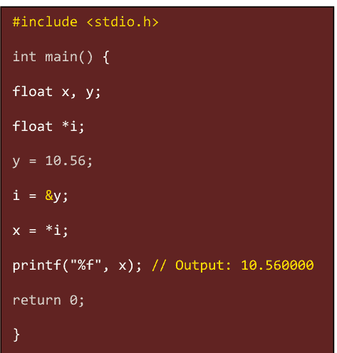

答案：
上述程序中没有 `错误`。`屏幕上的输出为：`

<span style="color:red">Leap year</span>

因为 year=1996。所以：
1996 除以 4（即 <span style="color:orange">year 除以 4</span>）得到的 <span style="color:orange">余数等于 0</span>。

语句：

```c
printf("Leap year");
```

被执行，打印输出：

<span style="color:red">Leap year</span>

如果年份 = <span style="color:orange">1995</span>。那么
2095 除以 4（即 <span style="color:orange">year 除以 4</span>）得到的余数不等于 0。

语句：

```c
printf("Not a leap year");
```

被执行，打印输出：

**Not a leap year**

**注意：**`对于一个年份是闰年`，year 除以 4 应该得到余数 = 零。

> "算法必须被看到才能被相信。"
>
> - Donald Knuth

## 局部变量：

仅对主程序或函数可知其存在的变量称为 `局部变量`。`局部变量` 在 `主程序` 或 `函数` 内部声明。

## 全局变量：

对 `main()` 以及其他函数均可知其存在的变量称为 `全局变量`。`全局变量` 在 `main()` 和其他函数外部声明。

```c
#include<stdio.h>
int x=1; // global variable
int main()
{

int y=3; // local variable
}
```

## 以下程序的输出是什么？

```c
#include <stdio.h>
int main () {
char greeting[6] = {'H', 'e', 'l', 'l', 'o', '\0'};
printf("Greeting message: %s\n", greeting );
return 0;
}
```

```c
#include <stdio.h>
#define LENGTH 10
#define WIDTH 5
#define NEWLINE '\n'

int main() {
    int area;
    area = LENGTH * WIDTH;
    printf("Value of area : %d", area);
    printf("%c", NEWLINE);
    return 0;
}
```

```c
#include <stdio.h>
char x[50];
int main() {
    x[2] = 'B';
    printf("%c", x[2]); // Output: B
    return 0;
}
```

#### 程序 3.3
C 程序，用于打印给定数字是正数还是负数

```c
#include<stdio.h>
int main()
{
    int  a;
    a = -35;
    if(a>0)
    {
        printf("Number is positive");
    }
    else
    {
        printf("Number is negative");
    }
    return 0;
}
```

```c
#include <stdio.h>
int main() {
    puts("Enter a character: ");
    puts("To stop, press # and then Enter.");
    for(;;) {
        char x=getchar();
        if(x=='#') {
            break;
        }
    }
    printf("......!\n");
    return(0);
}
```

**输出：**
Enter a character:
To stop, press # and then Enter.
A # entered character
B # entered character
## # entered character
......!

**屏幕上的输出：**

Number is negative

因为 a = -35。所以：a 小于 0，即 a < 0，因为任何负数总是小于零。

> **语言标准**
>
> 规范特定语言中什么构成有效代码以及编译器或解释器必须确保如何执行这些代码的规则

**语句：**

```c
printf("Number is negative");
```

被执行，打印输出：

Number is negative

#### 程序 3.4
C 程序，使用 **for 循环语句** 打印前 10 个数字的和

```c
#include<stdio.h>
int main()
{
    int i, sum = 0;
    for( i=1; i<=10; i++)
        sum = sum + i;
    printf("sum of the first 10 digits =%d", sum);
    return 0;
}
```

```c
#include <stdio.h>
int main() {
    int x, y;
    printf("Enter a number: ");
    scanf("%d", &x);
    printf("Enter a number: ");
    scanf("%d", &y);
    if(y != 0) printf("%f\n", (float)x/y);
    else printf("Cannot divide by zero.\n");
    return 0;
}
```

**屏幕上的输出：**

**输出：**
Enter a number: 2 # entered number
Enter a number: 0 # entered number
Cannot divide by zero.

```
sum of the first 10 digits = 55
```

前 10 个数字的和 = 55 是如何通过 **for 循环语句** 输出到屏幕上的？

```
i=1 (sum = 0 因为在语句 int i, sum = 0; 中 sum 被初始化为 0)
i<=10 是否为真？
是的，执行以下操作
sum = sum + i = 0 +1 =1
现在，
i=2 (sum = 1)
i<=10 是否为真？
是的，执行以下操作
sum = sum + i = 1 +2 =3
现在，
i=3 (sum = 3)
i<=10 是否为真？
是的，执行以下操作
sum = sum + i = 3 +3 = 6
现在，
i=4 (sum = 6)
i<=10 是否为真？
是的，执行以下操作
sum = sum + i = 6 + 4= 10
现在，
i=5 (sum = 10)
i<=10 是否为真？
是的，执行以下操作
sum = sum + i = 10 + 5= 15
现在，
i=6 (sum = 15)
i<=10 是否为真？
是的，执行以下操作
sum = sum + i = 15 + 6 = 21
现在，
i=7 (sum = 21)
i<=10 是否为真？
是的，执行以下操作
sum = sum + i = 21 + 7 = 28
现在，
i=8 (sum = 28)
i<=10 是否为真？
是的，执行以下操作
sum = sum + i = 28 + 8 = 36
现在，
i=9 (sum = 36)
i<=10 是否为真？
是的，执行以下操作
sum = sum + i = 36 + 9 = 45
现在，
i=10 (sum = 45)
i<=10 是否为真？
是的，执行以下操作
sum = sum + i = 45 + 10 = 55
停止，因为条件 i<=10 已满足
```

```c
#include <stdio.h>
int main() {
for(int x=1; x<=5; x++)
printf("%d / 2 is: %f\n", x, (double) x /2);
return 0;
}

// Output:
// 1 / 2 is: 0.500000
// 2 / 2 is: 1.000000
// 3 / 2 is: 1.500000
// 4 / 2 is: 2.000000
// 5 / 2 is: 2.500000
```

```c
#include <stdio.h>
int main() {
int x, i;
printf("Enter a number: ");
scanf("%d", &i);
x = i>0 ? i*i : -(i*i);
printf("%d x %d: %d", i, i, x);
return 0;
}
```

| 输出： |
| --- |
| Enter a number: -5 # entered number |
| -5 x -5: -25 |

```c
#include <stdio.h>

int main() {
for(int i=90; i != 55; i -= 5) {
printf("\n%d x %d, %d", i, i, i*i);
}
return 0;
}

// Output:
// 90 x 90, 8100
// 85 x 85, 7225
// 80 x 80, 6400
// 75 x 75, 5625
// 70 x 70, 4900
// 65 x 65, 4225
// 60 x 60, 3600
```

语句：

> "i" 被初始化为 90，每次循环重复时从中减去 5。"i" 的平方运算和对 printf() 的调用一直执行，直到 "i" 等于 55

```c
printf("sum of the first 10 digits =%d", sum);
```

被执行，打印输出：

sum of the first 10 digits = 55

如果语句：

```c
int i, sum = 0;
```

被替换为：

```c
int i, sum = 1;
```

**反模式：**

解决典型问题时使用了僵硬的、结构僵化的或不准确的编码表示方式

那么 **屏幕上的输出** 为：

```
sum of the first 10 digits = 56
```

如果 for 循环语句 `for(i =1; i<=10; i++)` 被替换为 `for(i =2; i<10; i++)`，输出会是什么？

**答案：** sum of 10 digits = 44

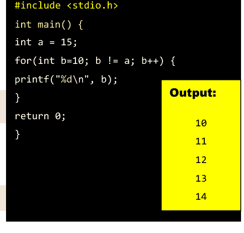

**如果语句：**

```c
int i, sum, sum = 0;
```

**被写成：**

```c
int i, sum = 0;
```

的替代形式，

那么 **编译错误信息** 将会显示在屏幕上（说明 sum 被声明了两次）。

如果 **for 循环** 以分号结尾，即

```c
for( i=1; i<=10; i++);
```

那么 **编译错误** 将会显示在控制台屏幕上。

#### 程序 3.5
C 程序，使用 for 循环语句打印前 10 个数字的平均值

```c
#include<stdio.h>
int main()
{
int i, avg, sum = 0;
for( i=1; i<=10; i++)
sum = sum + i;
avg = sum/10;
printf("sum of the first 10 numbers =%d", sum);
printf("average of the first 10 numbers =%d", avg);
return 0;
}
```

**屏幕上的输出：**

```
sum of the first 10 numbers = 55
average of the first 10 numbers = 5
```

前 10 个数字的平均值 = 55/10 = 5.5 而不是 5。但屏幕上的输出为：average of the first 10 numbers = 5，因为使用了 int 而不是 float。

如果使用 **数据类型** float，即

```c
#include<stdio.h>
int main()
{
float i, avg, sum = 0;
for( i=1; i<=10; i++) sum
= sum + i;
avg = sum/10;
printf("sum of the first 10 numbers =%f", sum);
printf("average of the first 10 numbers = %f", avg);
return 0;
}
```

```c
#include <stdio.h>
int main() {
int x=1;
while(x<3) {
printf("Hi..\n");
x++;
}
return(0);
}

// Output:
// Hi..
// Hi..
```

**屏幕上的输出：**

```
sum of the first 10 numbers = 55
average of the first 10 numbers = 5.5
```


### 程序 3.6

使用 **for 循环语句** 打印前 10 个数字乘积的 C 程序

```c
#include<stdio.h>

int main()
{
    int i, product = 1;
    for( i=1; i<=10; i++)
    product = product * i;
    printf("The product of the first 10 digits =%d", product);
    return 0;
}
```

屏幕上的输出：

> The product of the first 10 digits = 3628800

### 前 10 个数字的乘积 = 3628800 是如何通过 for 循环语句输出到屏幕上的？

i=1（product = 1，因为在语句 `int i, product = 1;` 中将 product 初始化为 1）
i<=10 是否为真？
是的，执行以下操作
product = product * i = 1 * 1 * 1
现在，
i=2 (product = 1)
i<=10 是否为真？
是的，执行以下操作
product = product * i = 1 * 2 = 2
现在，
i=3 (product = 2)
i<=10 是否为真？
是的，执行以下操作
product = product * i = 2 * 3 = 6

```c
#include <stdio.h>

int main() {
    for(int x = 1; x <= 3; x++)
    printf("%2d %2d \n", x, x * x);
    return 0;
}

// Output:
    1  1 *
    2  4 *
    3  9 *
```

现在，
i=4 (product = 6)
i<=10 是否为真？
是的，执行以下操作
product = product * i = 6 * 4 = 24

现在，
i=5 (product = 24)
i<=10 是否为真？
是的，执行以下操作
product = product * i = 24 * 5 = 120

现在，
i=6 (product = 120)
i<=10 是否为真？
是的，执行以下操作
product = product * i = 120 * 6 = 720

现在，
i=7 (product = 720)
i<=10 是否为真？
是的，执行以下操作
product = product * i = 720 * 7 = 5040

现在，
i=8 (product = 5040)
i<=10 是否为真？
是的，执行以下操作
product = product * i = 5040 * 8 = 40320

现在，
i=9 (product = 40320)
i<=10 是否为真？
是的，执行以下操作
product = product * i = 40320 * 9 = 362880

现在，
i=10 (product = 362880)
i<=10 是否为真？
是的，执行以下操作
product = product * i = 362880 * 10 = 3628800

停止，因为条件 i<=10 已达成。

```c
#include <stdio.h>

int main() {
    char x = '\0';
    printf("Enter a character: \n");
    for( ; ; ) {
        x = getchar(); /* get a character */
        if(x == 'b')
            break; /* exit the loop */
    }
    printf("You have entered 'b");
    return 0;
}
```

// Output:
Enter a character:
a # entered character
c # entered character
b # entered character
You have entered 'b'

```c
#include <stdio.h>

int main() {
    for(double i = -2; i <= 2; i++)
        printf("%e %+e %e\n", i, 1, i);
    return 0;
}
```

| -2.000000e+00 | -2.000000e+00 | -2.000000e+00 |
| -1.000000e+00 | -1.000000e+00 | -1.000000e+00 |
| 0.000000e+00 | +0.000000e+00 | 0.000000e+00 |
| 1.000000e+00 | +1.000000e+00 | 1.000000e+00 |
| 2.000000e+00 | +2.000000e+00 | 2.000000e+00 |

语句：

`printf("The product of the first 10 digits =%d", product);` 被执行以显示输出：
The product of the first 10 digits = 3628800

如果语句 `int i, product = 1;` 被替换为：
`int i, product = 0;`

那么屏幕上的输出为：
The product of the first 10 digits = 0

如果语句：

```c
#include <stdio.h>
int main() {
    int a=15, b=110;
    printf("Maximum of %d and %d is: %d\n", a, b, (a>b ? a : b));
    return 0;
}

// Output: Maximum of 15 and 110 is: 110
```

`for(i=1; i<=10; i++)`

被替换为

`for(i=5; i<=8; i++)`

那么屏幕上的输出为：
The product of the first 10 digits = 1680

#### 程序 3.7
使用 **for** 循环语句打印一个数字乘法表的 C 程序

```c
#include<stdio.h>
int main()
{
    int n, i;
    printf("Enter any number:");
    scanf("%d", &n);
    for( i=1; i<=5; i++)
        printf("%d * %d = %d\n", n, i, n*i);
    return 0;
}
```

> **前向兼容性（Forwards compatibility）：**
> 硬件或软件系统与该系统的后续迭代版本兼容。

### 屏幕上的输出：

Enter any number:
如果你输入数字 2（即 n=2）
2 * 1 = 2
2 * 2 = 4
2 * 3 = 6
2 * 4 = 8
2 * 5 = 10
将输出在屏幕上。

> **后向兼容性（Backwards compatibility）：**
> 一个能够成功利用之前系统迭代版本的接口和数据的硬件或软件系统。

### 执行过程是如何通过 **for 循环语句** 进行的

既然你输入了数字 2，因此：n=2。
i=1
i<=5 是否为真？
是的，打印此内容
2 * 1 = 2
使用语句 `printf("%d * %d = %d\n", n, i, n*i);`

现在，
i=2
i<=5 是否为真？
是的，打印此内容
2 * 2 = 4
使用语句 `printf("%d * %d = %d\n", n, i, n*i);`

现在，
i=3
i<=5 是否为真？
是的，打印此内容
2 * 3 = 6
使用语句 `printf("%d * %d = %d\n", n, i, n*i);`

现在，
i=4
i<=5 是否为真？
是的，打印此内容
2 * 4 = 8
使用语句 `printf("%d * %d = %d\n", n, i, n*i);`

现在，
i=5
i<=5 是否为真？
是的，打印此内容
2 * 5 = 10
使用语句 `printf("%d * %d = %d\n", n, i, n*i);`

现在停止，因为条件 i <=5 已达成。

```c
#include <stdio.h>
int main() {
    printf("%.4f\n", 549.9876545321);
    // Output: 549.9877
    printf("%3.8d\n", 5000);
    // Output: 00005000
    printf("%10.15s\n", "Alan Mathison Turing");
    // Output: Alan Mathison T
    return 0;
}
```

如果符号 * 被替换为 +，即：

```c
#include<stdio.h>
int main()
{
    int n, a;
    printf("Enter any number:");
    scanf("%d", &n);
    for (i=1; i<=5; i++)
    printf("%d + %d = %d \n", n, i, n + i);
    return 0;
}
```

那么屏幕上的输出为：

Enter any number:
如果你输入数字 2（即 n=2）

2 + 1 = 3
2 + 2 = 4
2 + 3 = 5
2 + 4 = 6
2 + 5 = 7
将输出在屏幕上。

> **侧向兼容性（Sideways compatibility）：**
> 一种保证代码将继续与其它代码兼容的机制。

#### 程序 3.8
C 程序：
如果你输入字符 M
输出必须是：ch = M

```c
#include <stdio.h>

int main()
{
    char M;
    printf("Enter any character:");
    scanf("%c", &M);
    printf("ch = %c", M);
    return 0;
}
```

```c
#include <stdio.h>

#include <string.h>

int main() {
    if(strchr("albert", 'l'))
        printf("1 is in 'albert'\n");
    // Output: 1 is in 'albert'
    if(strstr("alan turing", "ring"))
        printf("Found ring");
    // Output: Found ring
    return 0;
}
```

屏幕上的输出：

Enter any character:
如果你输入字符 M
ch = M 将输出在屏幕上。

## 注意：
`getchar()` 函数是 `scanf` 函数的简化版本

如果我们替换语句：

```c
scanf("%c", &M);
```

为语句：

```c
M = getchar();
```

即：

```c
#include<stdio.h>
int main()
{
    char M;
    printf("Enter any character:");
    M = getchar();
    printf("ch=%c", M);
    return 0;
}
```

```c
#include <stdio.h>
int main() {
    printf("%*.\*f\n", 10, 2, 5496.85577);
    printf("%*.\*f\n", 20, 3, 5496.85577);
    return 0;
}

// Output:

    5496.86
              5496.856
```

屏幕上的输出将不会有变化，即，**屏幕上的输出是：**

Enter any character:
如果你输入字符 K
ch = K 将输出在屏幕上。

putchar() 函数是 printf 函数的简化版本

```c
#include <stdio.h>
int main() {
    int x = -5;
    for(int x=0; x < 5; x++)
        printf("%d ", x);
    printf("\n");
    printf("x : %d", x);
    return 0;
}

// Output:
    0 1 2 3 4
    x : -5
```

如果我们替换**语句**：

```c
printf("ch=%c", M);
```

为语句：

```c
putchar (M);
```

即：

```c
#include<stdio.h>
int main()
{
    char M;
    printf("Enter any character:");
    scanf("%c", &M);
    putchar (M);
    return 0;
}
```

那么屏幕上的输出将不会有变化，即，**屏幕上的输出是：**

Enter any character:

如果你输入字符 M

M 将输出在屏幕上。

```c
#include <stdio.h>
int main() {
    int i = 100;
    int *x, *y;
    x = &i;
    y = x;
    /* print the value of 'i' twice */
    printf("%d %d\n", *x, *y);
    return 0;
}

// Output: 100 100
```

如果你替换**语句**：

```c
scanf("%c", &M);
```

为语句：

```c
M = getchar();
```

并且将语句

```c
printf("ch=%c", M);
```

替换为语句：

```c
putchar (M);
```

即：

```c
#include<stdio.h>
int main()
{
    char M;
    printf("Enter any character:");
    M = getchar();
    putchar (M);
    return 0;
}
```

屏幕上的输出：

> Enter any character:

如果你输入字符 S

S 将输出在屏幕上。

### 程序 3.9

打印从 1 开始的前 5 个数字及其平方的 C 程序。

```c
#include<stdio.h>
int main()
{
    int i;
    for( i=1; i<=5; i++)
    printf("number=%d its square=%d\n", i , i*i);
    return 0;
}
```

```c
#include <ctype.h>
#include <stdio.h>
int main() {
    printf("Enter a character: \n");
    for(;;) {
        char x = getchar();
        if(x == '#') break;
        if(isalnum(x)) printf("%c is alphanumeric\n", x);
    }
    return 0;
}
```

屏幕上的输出：

> number=1 its square=1
> number=2 its square=4
> number=3 its square=9
> number=4 its square=16
> number=5 its square=25

> Output:
> Enter a character:
> b # entered character
> b is alphanumeric
> 1 # entered number
> 1 is alphanumeric
> # # entered character

### 执行过程是如何通过 **for 循环语句** 进行的

i=1


i<=5 为真吗？
是的，打印此内容
number=1 its square=1
使用语句 printf("number=%d its square=%d\n", i , i*i);

现在，
i=2
i<=5 为真吗？
是的，打印此内容
number=2 its square=4
使用语句 printf("number=%d its square=%d\n", i , i*i);

现在，
i=3
i<=5 为真吗？
是的，打印此内容
number=3 its square=9
使用语句 printf("number=%d its square=%d\n", i , i*i);

现在，
i=4
i<=5 为真吗？
是的，打印此内容
number=4 its square=16
使用语句 printf("number=%d its square=%d\n", i , i*i);

现在，
i=5
i<=5 为真吗？
是的，打印此内容
number=5 its square=25
使用语句 printf("number=%d its square=%d\n", i , i*i);

现在停止，因为条件 (i<=5) 已达成。

- **注意：** 如果将语句

```
printf("number=%d its square=%d\n", i , i*i);
```

替换为语句：

```
printf("\n number=%d\t its square=%d", i , i*i);
```

那么屏幕上的输出为：

```
number=1    its square=1
number=2    its square=4
number=3    its square=9
number=4    its square=16
number=5    its square=25
```

包含制表符 "\t" 是为了在 number=1 和 its square=1 之间留出空间。

假设

```
printf("number=%d its square=%d", a , a*a);
```

被替换为语句：

```
printf("number=%d\n its square=%d\n", a , a*a);
```

屏幕上的输出为：

```
number=1
its square=1
number=2
its square=4
number=3
its square=9
number=4
its square=16
number=5
its square=25
```

**输出：**

```
Enter a string:
alan turing # entered string
alan turi # output
```

```
#include <stdio.h>
#include <string.h>
int main() {
char x[80];
printf("Enter a string: \n");
fgets(x, 10, stdin);
printf("%s", x);
return 0;
}
```

如果你将 **printf** 语句：

```
printf("number=%d its square=%d", a , a*a);
```

替换为语句：

```
printf("number=%d\n, its square=%d\n", a , a*a);
```

也就是说，如果你在 number=%d\n **和** its square=%d\n 之间放置一个变量分隔符（即逗号），那么屏幕上将显示 **编译错误**。

- 编写一个程序，打印从 1 开始的前 10 个数字及其平方和立方？

### 回答：

```
#include<stdio.h>
int main()
{ 
 int i; 
 for( i=1; i<=10; i++) 
 printf("number=%d its square=%d its cube=%d\n", i , i*i, i*i*i); 
 return 0; 
 }
```

### switch 语句的规则：

- switch 是 C 语言中的一种决策结构。
- switch 用于程序中涉及多个决策的场景。
- switch 必须包含一个可执行的测试表达式。
- 每个 case 必须包含 break 关键字。
- Case 标签必须是常量且唯一的。
- default 是可选的。

### 指针

指针是一个可以持有 C 程序中其他变量、数组、结构体、联合体和函数地址的变量。它仅包含变量的内存位置而非其内容。指针的目的是节省内存空间并实现更快的执行时间。

### 优点：

- 动态内存分配。
- 代码更紧凑、更高效。
- 通过函数返回多个值。
- 指向不同的数据结构。

### 指针使用的运算符

指针使用了 2 个基本运算符：

- 取地址运算符：`&` (ampersand)
- 間接引用运算符：`*` (asterisk)

*取地址运算符* 提供变量的地址，而 *间接引用运算符* 提供指针所指向变量的值。

假设 **x** 是一个持有 **int 类型数据** 的变量。我们可以通过取地址运算符 **[&]** 访问 **x** 的地址。该地址可以存储在某个变量 **[假设为 y]** 中。因此我们可以将 **x** 和 **y** 的关系描述为：

```
y = &x
```

y 被称为指针变量，因为它持有另一个变量 **[即 x] 的地址，而不是 x 的实际值**。

有两个 **整数变量 100 和 640** 分别存储在内存位置 **1000 和 1003** 处。让我们赋值：

```
x = 100; y = 640;
```

为了通过指针访问变量 'x' 的值，我们需要一个变量。

假设该变量为 px。以下语句将 'x' 的地址赋值给 px：

```
px= &x = 1000
```

为了通过指针访问变量 'y' 的值，我们需要一个变量。

假设该变量为 py。以下语句将 'y' 的地址赋值给 py：

```
py= &y = 1003
```

**x, y, px 和 py 在程序中声明为：**

```
int x, y, *px, *py;
```

**x** 和 **y** 是 **整数变量**。出现在 px 和 py 之前的星号表示这些变量是指针变量。

```
#include <stdio.h>
int main() {
struct {
int x;
int y;
} a, b;

a.x = 56;
b = a; /* 将一个结构体赋值给另一个 */
printf("%d", b.x);
return 0;
}

// Output: 56
```

```
#include <stdio.h>
int main() {
int x = 5;

char names[][12]={
"Albert",
"Alan",
"John",
"James",
"Mary",
"David"
};

printf("%s", names[x]);
// Output: David
return 0;
}
```

- **程序 4.0**
    使用指针打印两个数字之和的 C 程序

如果在 **main** 函数 `int main()` 的主体中通过声明语句创建 **整数变量** x：

```
int x;
```

该变量存储在计算机内存中，即该变量在 **计算机内存** 空间中占据一个特定位置。并且这个整数变量 x 被分配了一个地址（即 `&x`），用于在计算机内存中定位其位置（就像街道上的房子被分配一个地址以定位其在街道上的位置一样）。**指针** 是代表 x 在计算机内存中地址的变量，即 `p = &x`，其中 `&x` 表示 x 在计算机内存中的 **地址**，而 **p** 是指针变量（即代表 x 在计算机内存中地址的变量）。进一步地，如果你在 main 函数主体中通过声明语句为 **变量** x 赋值：

```
x=1;
```

该值被存储在 x 的计算机内存地址中。"*" 表示指针运算符，而 *p 表示指针（代表存储在计算机内存中 **x 的地址** 处的值）。

- 打印 x 的地址和赋值给 x 的值的 C 程序

```
#include <stdio.h>
int main()
{
int x, *p;
x = 1;
p = &x;
printf("The address of the variable x =%d", p);
printf("The value of the variable x =%d", *p);
return 0;
}
```

```
## C++ Program:
#include<iostream>
using namespace std;
int main() {
int x, y, z, sum;
for ( ; ; ) {
cout << "Enter x, y and z: " << endl;
cin >> x >> y >> z;
if(!cin)
break;
sum = x + y + z;
cout << "x + y + z = " << sum << endl;
}
cout <<"........\n";
}

// Output:

Enter x, y and z:
2 # entered number
4 # entered number
5 # entered number
x + y + z = 11
Enter x, y and z:
! # entered character
........
```

### 屏幕上的输出：

```
The address of the variable x = 0x7fffc60478a4

The value of the variable x = 1
```

由于 `p = &x`：

```
*p= *&x
```

**变量** x 的值 = 1，因为你在 main 函数主体中通过声明语句为其赋值：

```
x=1;
```

如果将语句：

```
printf("The address of the variable x =%d", p);
printf("The value of the variable x =%d", *p);
```

替换为语句：

```
printf("The address of the variable x =%d and its value =%d", p,*p);
```

即：

```
#include <stdio.h>
int main()
{
int x, *p;
x=1;
p = &x;
printf("The address of the variable x =%d and its value =%d", p,*p);
return 0;
}
```

那么 **屏幕上的输出** 为：

```
The address of the variable x = 0x7fffc60478a4 and its value = 1
```

```
#include <stdio.h>
int main()
{
int x, y, *p, *q, sum;
printf("Enter any number:");
```

### 最小工作示例（Minimum working example）：

一段没有冗余信息且可以复制粘贴到空白 [Lean 文件](minimal) 中并保留所有功能的代码片段（minimal）。

### 代码路径（Code path）：

程序源代码在运行时所使用的路径。


```c
scanf("%d", &x);
printf("Enter any number:");
scanf("%d", &y);
p = &x;
q = &y;
sum = *p + *q;
printf("Sum of entered numbers = %d\n", sum);
return 0;
}
```

```c
#include <stdio.h>
#define MAX 55
int main() {
#if MAX>85
  printf("55<85\n");
#else
  printf("85>55\n");
#endif
  return 0;
}

// Output:
85>55
```

屏幕上的输出：

```
Enter any number:
If you enter the number 2
Enter any number:
If you enter the number 3
Sum of entered numbers = 5 will be outputted on the screen.
```

由于指针 *p 指向通过键盘赋值给变量 x 的值（即 2），而指针 *q 指向通过键盘赋值给变量 y 的值（即 3）**through the keyboard.** 因此：`sum = *p + *q = 2 + 3 = 5` **(which will be outputted on the screen).**

- 使用指针打印两个数的乘积、差和商的 C 程序

```c
#include <stdio.h>
int main()
{
  int x, y, *p, *q, product, subtract, div;
  printf("Enter any number:");
  scanf("%d", &x);
  printf("Enter any number:");
  scanf("%d", &y);
  p = &x;
  q = &y;
  product = *p * *q;
  subtract = *p - *q;
  div = *p / *q;
  printf("product of entered numbers = %d\n", product);
  printf("subtract of entered numbers = %d\n", subtract);
  printf("division of entered numbers = %d\n", div);
  return 0;
}
```

```c
#include <stdio.h>

int main() {
    int i, x = 1;
    for (i = 1; i <= 5; i++)
        printf("%d", i & x);
    // Output: 10101
    return 0;
}
```

屏幕上的输出：

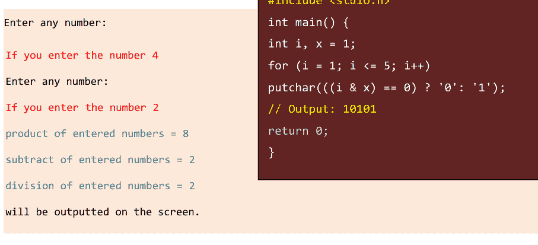

- 使用指针求两个数中最大值的 C 程序

```c
#include<stdio.h>
int main()
{
    int x, y, *p, *q;
    printf("Enter any integer:");
    scanf("%d", &x);
    printf("Enter any integer:");
    scanf("%d", &y);
    p = &x;
    q = &y;
    if(*p>*q)
    {
        printf("x is greater than y");
    }
    if(*q>*p)
    {
        printf("y is greater than x");
    }
    return 0;
}
```

```c
#include <stdio.h>
#define mkstr(x) # x

int main() {
    printf(mkstr(Albert));
    // Output: Albert
    return 0;
}
```

```c
#include <ctype.h>
#include <stdio.h>
int main() {
    printf("Enter a character: \n");
    for(;;) {
        char x = getchar();
        if(x == '#') break;
        if(isdigit(x)) printf("%c is a digit\n", x);
    }
    return 0;
}
```

屏幕上的输出：

```
Enter any integer:
If you enter the integer 10
Enter any integer:
If you enter the integer 16
y is greater than x will be outputted on the screen.
```

输出：
```
Enter a character:
J # 输入的字符
2 # 输入的数字
2 is a digit
## # 输入的字符
```

- 以下程序的输出是什么？

i)
```c
#include <stdio.h>
int main() {
    printf("Alan %c %s", 'M', "Turing");
    return 0;
}
```

```c
#include <ctype.h>
#include <stdio.h>
int main() {
    printf("Enter a character: \n");
    for(;;) {
        char x = getchar();
        if(x == '#') break;
        if(isupper(x)) printf("%c is uppercase\n", x);
    }
    return 0;
}
```

答案：

输出：
```
Enter a character:
j # 输入的字符
A # 输入的字符
A is uppercase
## # 输入的字符
```

ii)
```c
#include <stdio.h>

int main()
{
    int x, t, c;
    x = 12;
    t = 2;
    c = x/t;
    printf("velocity = %d m/s", c);
    return 0;
}
```

```c
#include <stdio.h>
#include <string.h>

int main() {
    char *x;
    x = strchr("This is my book.", ' ');
    printf("%s", x);
    return 0;
}

// Output: is my book.
```

答案：
`velocity = 6 m/s`

### 程序 4.1
#### 使用函数打印两个数之和的 locate C 程序

```c
#include<stdio.h>

int addition();
int main()
{
    int answer;
    answer = addition();
    printf("The sum of two numbers is: %d\n", answer);
    return 0;
}

int addition()
{
    int x, y;
    printf("Enter any integer:");
    scanf("%d", &x);
    printf("Enter any integer:");
    scanf("%d", &y);
    return x+y;
}
```

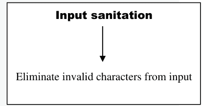

## C 程序：

```c
#include <stdio.h>
#include <stdlib.h>

int main()
{
    int a=6, b=2;
    printf("%d", a+(-b)+1);
    return 0;
}
```

**屏幕上的输出：**

```
Enter any integer:
If you enter the integer 3
Enter any integer:
If you enter the integer 5
The sum of two numbers = 8 will be displayed on the screen.
```

**输出：**
`4`

## Java 程序：

```java
public class HelloWorld {
    public static void main(String[] args) {
        int x = 0;
        while (true) {
            System.out.println("\n " + x++);
            if (x == 4)
                break;
        }
    }
}
```

**输出：**
```
0
1
2
3
```

```java
public class HelloWorld {
    public static void main(String[] args) {
        while(true) {
            System.out.println("infinite while loop");
        }
    }
}
```

**输出：**
```
infinite while loop
infinite while loop
infinite while loop
infinite while loop
infinite while loop ………
```

> **MoSCoW 方法：** 一种优先级排序技术，将标准分类为在代码的某次迭代中频繁出现的元素，因此被视为必须完成（Must）、应该完成（Should）、可以完成（Could）和不会完成（Won't）的元素。

> **网络分析：** 一种识别潜在漏洞并减少现有网络威胁危害的方法，结合了网络安全和数据科学的概念。

---

`int addition();`
该语句表示函数声明。`int` 表示整数，`int addition()` 表示：addition() 应该返回整数值。

`int addition()`
用于将输入的值（即 3 和 5）相加并返回结果（即 3 + 5 即 8）给语句：
`printf("The sum of two numbers = %d", answer);` 以提供显示输出的条件：
`The sum of two numbers = 8`

```c
{
    int x, y;
    printf("Enter any integer:");
    scanf("%d", &x);
    printf("Enter any integer:");
    scanf("%d", &y);
    return x+y;
}
```
函数 `int addition()` 的主体

`answer = addition();`
函数调用，即该语句调用函数 `addition()` 来将输入的值（即 3 和 5）相加并返回结果（即 3 + 5 即 8）给语句：
`printf("The sum of two numbers = %d", answer);`
以提供显示输出的条件：
在屏幕上显示 `The sum of two numbers = 8`。

在语句：
`printf("The sum of two numbers=%d", answer);`
中，格式字符串 `"%d"` 表示在该字符串的该位置需要显示的值，即在语句 `The sum of two numbers =` 之后，需要从函数 `int addition()` 返回的结果中获取。

#### 使用函数打印两个数之积的 C 程序

```c
#include<stdio.h>
int multiplication();
int main()
{
    int answer;
    answer = multiplication();
    printf("The product of two numbers is: %d\n", answer);
    return 0;
}

int multiplication()
{
    int x, y;
    printf("Enter any integer:");
    scanf("%d", &x);
    printf("Enter any integer:");
    scanf("%d", &y);
    return x*y;
}
```

```c
#include <math.h>
#include <stdio.h>
int main() {
    printf("%1.1f %1.1f", fabs(2.0), fabs(-2.0));
    return 0;
}

// Output: 2.0 2.0
```

**屏幕上的输出：**

```
Enter any integer:
If you enter the integer 3
Enter any integer:
If you enter the integer 5
The product of two numbers = 15 will be outputted on the screen.
```

- 使用函数打印两个数中最大值的 C 程序

```c
#include<stdio.h>
int largest();
int main()
{
    int answer;
    answer = largest();
    printf("The largest of two numbers is: %d\n", answer);
    return 0;
}

int largest()
{
    int x, y;
    printf("Enter any integer:");
    scanf("%d", &x);
    printf("Enter any integer:");
    scanf("%d", &y);
    if(x>y)
        return x;
    if(y>x)
        return y;
}
```

```c
#include <stdio.h>
#define PUT(x) printf("Albert\n");
int main() {
    PUT(Hi from main());
    return 0;
}

// Output: Albert
```

```c
#include <stdio.h>
int main() {
    char x[] = "Ilbert";
    char *z = x;
    *z = 'A';
    printf("%s\n", x);
}
// Output: Albert
```

屏幕上的输出：

```
Enter any integer:
If you enter the integer 3
Enter any integer:
If you enter the integer 5
The largest of two numbers= 5 will be outputted on the screen.
```

- 使用函数打印三个数中最大值的 C 程序

```c
#include<stdio.h>

int largest();
int main()
{
    int answer;
    answer = largest();
    printf("Largest of three numbers=%d", answer);
    return 0;
}

int largest()
{
    int x, y, z;
    printf("Enter any integer:");
    scanf("%d", &x);
    printf("Enter any integer:");
    scanf("%d", &y);
    printf("Enter any integer:");
    scanf("%d", &z);
    // 此处应跟随三个数中最大值的逻辑
}
```

```c
#include <stdio.h>
#define NAMES(x, y, z) printf(#x , " " #y , " " #z " and Mary!\n")

int main() {
    NAMES(Albert, John, James);
    return 0;
}
// Output: Albert, John, James and Mary!
```

```c
#include <stdio.h>
int main() {
    printf("Alan " "Mathison " "Turing");
    // Output: Alan Mathison Turing
    return 0;
}
```


```c
if(x>y&& x>z)
return x;
if(y>x&& y > z)
return y;
if(z>x && z>y)
return z;
}
```

```c
#include <math.h>
#include <stdio.h>
int main() {
{
    int e;
    double x;
    x = frexp(10.0, &e);
    printf("%f %d", x, e);
}
```

屏幕上的输出：

输入任意整数：
如果你输入整数 3
输入任意整数：
如果你输入整数 5
输入任意整数：
如果你输入整数 10
三个数中最大的数 = 10 将会输出到屏幕上。

### 使用函数打印数字平方的 C 程序

```c
#include<stdio.h>
int square();
int main()
{
    int answer;
    answer = square();
    printf("Square of the number=%d", answer);
}

int square()
{
    int x;
    printf("Enter any integer:");
    scanf("%d", &x);
    return x*x;
}
```

```c
#include <stdio.h>
int main() {
    printf("Albert \"Einstein\"!\n");
    // Output: Albert "Einstein"!
    return 0;
}
```

```c
#include <stdio.h>
int main() {
    char *x = "alan", *y = "alan";
    if (x == y)
        printf("The 2 strings have the same address\n");
    else
        printf("The 2 strings have the different address\n");
    return 0;
}
// Output: The 2 strings have the same address
```

屏幕上的输出是：

**输入任意整数：**
如果你输入整数 5
数字的平方 = 25 将会输出到屏幕上。

- 以下程序的输出是什么？

```c
#include<stdio.h>
int main()
{
    int x=6;
    printf("The address of x = %d", &x);
    return 0;
}
```

```c
#include <stdio.h>
int main() {
    double i;
    for(i=2.0; i<1.0e+10; i=i*10)
        printf("%g ", i);
    return 0;
}
```

**答案：**
x 的地址 = 343441332

- 程序 4.2
    # 输出：
    2 20 200 2000 20000 200000 2e+06 2e+07 2e+08 2e+09

**If-else** 语句提供了一种从两个可能选项中选择一个的方式。而 **嵌套-if** 允许我们从多个选项中选择一个，但这很耗时。为了克服这个问题，使用了 switch case 语句。**Switch (case)** 允许用户从多个选择中做出决策，即从多个**分支（case）**中进行选择。

例如：

```c
#include<stdio.h>
int main()
{
    char ch;
    printf("Enter any character:");
    scanf("%c", &ch);
    switch(ch)
    {
        case 'R':
            printf("Red");
            break;
        case 'W':
            printf("White");
            break;
        case 'Y':
            printf("Yellow");
            break;
        case 'G':
            printf("Green");
            break;
        default:
            printf("Error");
            break;
    }
    return 0;
}
```

switch 结束
main() 结束

### Python 代码：

```python
import numpy as np
a = [15,16,17]
b = np.array(a)
print("1 Dimensional array: ", b)
```

## 输出：
1 Dimensional array: [15 16 17]

```python
import numpy as np
a = [[15,16,17], [18,19,20]]
b = np.array(a)
print("2 Dimensional array: ",b)
```

## 输出：
2 Dimensional array: [[15 16 17]
[18 19 20]]

```python
import numpy as np
a = [[[15,16,17],[18,19,20],[21,22,23]]]
b = np.array(a)
print("3 Dimensional array: ",b)
```

## 输出：
3 Dimensional array: [[[15 16 17]
[18 19 20]
[21 22 23]]]

屏幕上的输出：

输入任意字符：
如果你输入字符 R
Red 将会输出到屏幕上。

`switch(ch)` 允许我们从多个选择中做出决策，即从多个分支中进行选择：

```c
case 'R':
case 'W':
case 'Y':
case 'G':
```

由于我们输入了 **字符** R（对应于 case 'R'），语句：

```c
printf("Red");
```

被执行以在屏幕上显示输出：Red。

假设你输入 **字符** K，那么屏幕上的输出是：

```
Error
```

（输入的 **字符** K 与以下任何分支都不匹配：
```c
case 'R':
case 'W':
case 'Y':
case 'G':
```
因此语句：
```c
printf("Error");
```
被执行以在屏幕上显示输出：Error）。

**break** 语句表示特定分支的结束，从而终止 switch 语句。**default** 分支在表达式的值与任何分支都不匹配时执行。

如果语句：

```c
case 'R':
    printf("Red");
    break;
case 'W':
    printf("White");
    break;
case 'Y':
    printf("Yellow");
    break;
case 'G':
    printf("Green");
    break;
default:
    printf("Error");
    break;
```

- **Coffman 导致死锁的条件：**
    - **互斥（Mutual Exclusion）：** 关键资源一次只能被一个进程使用
    - **持有并等待（Hold and Wait）：** 某些资源可能已分配给进程，而进程正在等待其他资源
    - **不可抢占（No Pre-emption）：** 不能从正在使用资源的进程强制夺取资源
    - **循环等待（Circular Wait）：** 闭环链中的每个进程都持有链中另一个进程所需的至少一个资源

被替换为以下语句：

```c
case 'R':
    printf("Red");
case 'W':
    printf("White");
case 'Y':
    printf("Yellow");
    break;
case 'G':
    printf("Green");
    break;
```

```c
#include <stdio.h>
int main() {
    float x=0.2;
    if(x>0.9) {
        printf("Albert");
    }
    else {
        printf("Einstein");
    }
    return 0;
}
```

```c
#include <stdio.h>
int main() {
    float x=0.2;
    if(x<0.9) {
        printf("Albert");
    }
    else {
        printf("Einstein");
    }
    return 0;
}
```

```c
default:
    printf("Error");
    break;
```

### Terraform
一种开源的基础设施编排工具，可自动化部署和管理基础设施。

那么 **屏幕上的输出** 是：
Red
White
Yellow

也就是说，即使你输入了 **字符 R**，输出也会打印到 **yellow** 为止。

### 数组（Arrays）
同质数据元素的有序列表。

```python
from copy import copy
a = [1, 2, [3, 5], 4]
b = copy(a)
b[3] = 7
b[2].append(6)
print(a)
print(b)

## Output:
## [1, 2, [3, 5, 6], 4]
## [1, 2, [3, 5, 6], 7]
```

- 元素的数据类型可以是 int、float、char 或 double。
- 所有元素都存储在连续的内存位置中 [在 RAM 上]。

在名为 odd 的数组中，各个元素如下所示：

| odd[1] | odd[2] | odd[3] | odd[4] | odd[5] |
| :---: | :---: | :---: | :---: | :---: |

其中：
**1、2、3、4 和 5 是下标**

`odd[1]` ：数组 odd 的第一个元素。
`odd[2]` ：数组 odd 的第二个元素。
`odd[3]` ：数组 odd 的第三个元素。
`odd[4]` ：数组 odd 的第四个元素。
`odd[5]` ：数组 odd 的第五个元素。

通常，`odd[i]` 表示 odd 数组的第 $i^{th}$ 个元素。

```python
from copy import deepcopy
a = [1, 2, [3, 6], 5]
b = deepcopy(a)
b[3] = 9
b[2].append(7)
print(a)
print(b)

## Output:
## [1, 2, [3, 6], 5]
## [1, 2, [3, 6, 7], 9]
```

- 一维数组：下标数量为 1
- 多维数组：下标数量大于 1

$\text{array1}[] \rightarrow \text{一维数组}$
$\text{array2}[ ][ ] \rightarrow \text{二维数组}$
$\text{array3}[ ][ ][ ] \rightarrow \text{三维数组，依此类推。}$

#### 程序 4.3
打印以下输出的 C 程序：
Element [0] = 16
Element [1] = 18
Element [2] = 20
Element [3] = 25
Element [4] = 36

使用数组：

```c
#include<stdio.h>
int main()
{
    int i;
    int num [5] = {16, 18, 20, 25, 36};
    for(i=0; i<5; i++)
        printf("\n Element [%d] = %d", i, num[i]);
    return 0;
}
```

```c
#include <math.h>
#include <stdio.h>

int main() {
    printf("%f", ldexp(3,4));
    return 0;
}
// Output: 48.000000
// ldexp(3,4) = 3 * 2^4 = 3 * 16 = 48.000000
```

```c
#include <stdlib.h>
#include <stdio.h>

int main() {
    for(int x=1; x<=5; x++)
        // Display 5 random numbers
        printf("%d gradually become more and more ", rand());
    return 0;
}
```

屏幕上的输出：
```
Element [0] = 16
Element [1] = 18
Element [2] = 20
Element [3] = 25
Element [4] = 36
```

语句：
```c
int num [5] = {16, 18, 20, 25, 36};
```
表示我们正在创建一个整数数组（数组名为 num），包含 5 个相同 **数据类型 int** 的值（即 16、18、20、25、36）。

大括号 { } 中的值的数量不能大于我们在方括号 [ ] 中为数组声明的值的数量。

大括号 { } 中有 5 个整数，即 16、18、20、25、36，所以方括号 [ ] 中写入 5。如果大括号 { } 中有 6 个整数，即 16、18、20、25、36、42，那么方括号 [ ] 中必须写入 6。

- **注意：** 通过声明 `int num [5]`，**计算机** 会创建 5 个名为 num[0]、num[1]、num[2]、num[3]、num[4] 的内存单元。

并且由于：

```
int num[5] = {16, 18, 20, 25, 36};
```

数值 16、18、20、25、36 分别存储在 num[0]、num[1]、num[2]、num[3]、num[4] 中。

- 执行过程如何通过 **for 循环** 语句进行？

```
i=0
i<5 是否为真？
是，打印这个
元素 [0] = 16
使用语句：
    printf("\n Element [%d] = %d", i, num[i])
方括号中的格式字符串 %d 表示在该字符串位置显示的值，即在方括号 [ ] 内，需要从变量中获取（该变量为 i，即 i=0）；而语句 (\n Element [%d] = ) 后面的格式字符串 %d 表示在该字符串不限于字符串位置显示的值，即在语句 (\n Element [%d] = ) 后面，需要从变量中获取（该变量存储在 num[i] 中，即 num[0]，即 16）。

现在，
i=1
i<5 是否为真？
是，打印这个
元素 [1] = 18
使用语句：
    printf("\n Element [%d] = %d", i, num[i])
方括号中的格式字符串 %d 表示在该字符串位置显示的值，即在方括号 [ ] 内，需要从变量中获取（该变量为 i，即 i=1）；而语句 (\n Element [%d] = ) 后面的格式字符串 %d 表示在该字符串位置显示的值，即在语句 (\n Element [%d] = ) 后面，需要从变量中获取（该变量存储在 num[i] 中，即 num[1]，即 18）。

现在，
i=2
i<5 是否为真？
是，打印这个
元素 [2] = 20
使用语句：
    printf("\n Element [%d] = %d", i, num[i])
方括号中的格式字符串 %d 表示在该字符串位置显示的值，即在方括号 [ ] 内，需要从变量中获取（该变量为 i，即 i=2）；而语句 (\n Element [%d] = ) 后面的格式字符串 %d 表示在该字符串位置显示的值，即在语句 (\n Element [%d] = ) 后面，需要从变量中获取（该变量存储在 num[i] 中，即 num[2]，即 20）。

现在，
i=3
i<5 是否为真？
是，打印这个
元素 [3] = 25
使用语句：
    printf("\n Element [%d] = %d", i, num[i])
方括号中的格式字符串 %d 表示在该字符串位置显示的值，即在方括号 [ ] 内，需要从变量中获取（该变量为 i，即 i=3）；而语句 (\n Element [%d] = ) 后面的格式字符串 %d 表示在该字符串位置显示的值，即在语句 (\n Element [%d] = ) 后面，需要从变量中获取（该变量存储在 num[i] 中，即 num[3]，即 25）。

现在，
i=4
i<5 是否为真？
是，打印这个
元素 [4] = 36
使用语句：
    printf("\n Element [%d] = %d", i, num[i])
停止，因为条件 i<5 已满足。
```

方括号中的**格式字符串** %d 表示在该字符串位置显示的值，即在方括号 [ ] 内，需要从变量中获取（该变量为 i，即 i=4）；而语句 `(\n Element [%d] = )` 后面的格式字符串 `%d` 表示在该字符串位置显示的值，即在语句 `(\n Element [%d] = )` 后面，需要从变量中获取（该变量存储在 `num[i]` 中，即 `num[4]`，即 36）。

### 假设语句：

```
printf("\n Element [%d] = %d", i, num[i]);
```

### 被替换为语句：

```
printf("\n Element [%d] = %d", i, num[0]);
```

### 那么屏幕上的**输出**：

```
Element [0] = 16
Element [1] = 16
Element [2] = 16
Element [3] = 16
Element [4] = 16
```

### 假设语句：

```
printf("\n Element [%d] = %d", i, num[i]);
```

### 被替换为语句：

```
printf("\n Element [%d] = %d", i, num[1]);
```

### 屏幕上的**输出**：

```
Element [0] = 18
Element [1] = 18
Element [2] = 18
Element [3] = 18
Element [4] = 18
```

```
#include <stdio.h>

/* myfunc() 函数 */
void myfunc() {
    printf("Bill\n");
}

/* 程序从这里开始 */
int main() {
    printf("Albert\n");
    printf("John\n");
    myfunc();
    printf("Mary\n");
    return(0);
}

// 输出：
//          Albert
//          John
//          Bill
//          Mary
```

```
#include<stdio.h>

int main() {
    int x = 0, y = 0, z;
    z = 0 && (x = y = 555);
    printf("%d %d %d\n", x, y, z);
    // 输出: 0 0 0
    z = 555 || (x = ++y);
    printf("%d %d %d\n", x, y, z);
    // 输出: 0 0 1
    return 0;
}
```

```
#include <stdio.h>

int main() {
    printf("A%lc%ca%cn\n", '\0', '\0', '\0');
    return 0;
}

// 输出: Alan
```

假设语句：

```
printf("\n Element [%d] = %d", i, num[i]);
```

被替换为语句：

```
printf("\n Element [%d] = %d", i, num[2]);
```

### 屏幕上的输出：

```
Element [0] = 20
Element [1] = 20
Element [2] = 20
Element [3] = 20
Element [4] = 20
```

假设语句：

```
printf("\n Element [%d] = %d", i, num[i]);
```

被替换为语句：

```
printf("\n Element [%d] = %d", i, num[3]);
```

### 屏幕上的输出：

```
Element [0] = 25
Element [1] = 25
Element [2] = 25
Element [3] = 25
Element [4] = 25
```

```
#include <stdio.h>

int main() {
    int x;
    do {
        printf("Enter a number: \n");
        scanf("%d", &x);
    } while((x<1 || x>100));
    return 0;
}
```

假设语句：

```
printf("\n Element [%d] = %d", i, num[i]);
```

被替换为语句：

```
printf("\n Element [%d] = %d", i, num[4]);
```

### 屏幕上的输出：

```
Element [0] = 36
Element [1] = 36
Element [2] = 36
Element [3] = 36
Element [4] = 36
```

```
#include <stdio.h>
int main() {
    int x;
    for (x = 'a'; x <= 'z'; x++)
    /* 打印 a b c d ...z */
    printf("%c ", x);
    return 0;
}
```

如果条件：

```
i<5
```

被替换为条件：

```
i<=5
```

```
#include <stdio.h>
int main() {
    char x;
    for (x = 65; x <= 90; x++)
    /* 打印 A B C D ...Z */
    printf("%c ", x);
    return 0;
}
```

### 那么**屏幕上的输出**为：

```
Element [0] = 16
Element [1] = 18
Element [2] = 20
Element [3] = 25
Element [4] = 36
Element [5] = 3656
```

- **3656** 是存储在内存中的数字，即内存中存储的任何数字都会被显示出来。

如果语句：

```
int num[5] = {16, 18, 20, 25, 36};
```

被替换为语句：

```
int num[i] = {16, 18, 20, 25, 36};
```

那么屏幕上将显示**编译错误**，因为花括号 {} 内有 5 个元素，而不是 i 个元素。

- 注意：

- C 程序打印数组中元素的和。

```
#include<stdio.h>

int main()
{

    int i, sum = 0;
    int num[5] = {16, 18, 20, 25, 36};
    for(i=0; i<5; i++)
        sum = sum + num[i];
    printf("Sum of the Elements in the array = %d", sum);
    return 0;
}
```

```
#include <stdio.h>
int main() {
    int x=2, y=1, z=3;
    x += y += z;
    printf("x = %d, y = %d, z = %d\n", x, y, z);
    // 输出: x = 6, y = 4, z = 3
    return 0;
}
```

### 屏幕上的输出：

```
Sum of the Elements in the array = 115
```

即，16 + 18 + 20 + 25 + 36 = 115

- 执行过程如何通过 **for 循环** 语句进行？

```
i=0 (sum = 0)
i<5 是否为真？
是，执行这个
sum = sum + num[i] = sum + num[0] = 0 +16 =16
```

现在，
i=1 (sum = 16)
i<5 是否为真？
是，执行这个
sum = sum + num[i] = sum + num[1] = 16 +18 =34

现在，
i=2 (sum = 34)
i<5 是否为真？
是，执行这个
sum = sum + num[i] = sum + num[2] = 34 +20 =54

现在，
i=3 (sum = 54)
i<5 是否为真？
是，执行这个
sum = sum + num[i] = sum + num[3] = 54 +25 =79

现在，
i=4 (sum = 79)
i<5 是否为真？
是，执行这个
sum = sum + num[i] = sum + num[4] = 79 + 36 =115
停止，因为条件 i<5 已满足

语句：
printf("Sum of the Elements in the array = %d", sum); 执行以显示输出：
数组元素的和 = 115
在屏幕上。

如果语句：
int i, sum = 0;
被替换为 int i, sum = 1;
那么屏幕上的输出：
数组元素的和 = 116

```
#include <stdio.h>
int main() {
    int a, b, c;
    int x=0;
    if(x==0) {
        a = 12;
        b = 13;
        c = 15;
    }
    else {
        a = -11;
        b = -12;
        c = -13;
    }
    printf("%d", a + b + c);
    return 0;
}
// 输出: 40
```

- C 程序打印数组中元素的平均值


```c
#include<stdio.h>
int main()
{
    int i, avg, sum = 0;
    int num [5] = {16, 18, 20, 25, 36};
    for(i=0; i<5; i++)
        sum = sum + num [i];
    avg = sum/5;
    printf("Sum of the Elements in the array = %d", sum);
    printf("average of the elements in the array= %d", avg);
    return 0;
}
```

### 屏幕上的输出：

```
Sum of the Elements in the array = 115
average of the elements in the array = 23
```

### 编写一个程序来打印：

- Element [0] = E
- Element [1] = I
- Element [2] = N
- Element [3] = S
- Element [4] = T
- Element [5] = E
- Element [6] = I
- Element [7] = N

```c
#include <stdio.h>
int main() {
    int x = 20+/* add the 2 numbers */50;
    printf("%d", x);
    // Output: 70
    return 0;
}
```

#### 使用数组

## 答案：

```c
#include<stdio.h>
int main()
{
    int i;
    char name [8] = {'E', 'I', 'N', 'S', 'T', 'E', 'I', 'N'};
    for(i=0; i<8; i++)
        printf("\n Element [%d] = %c", i, name[i]);
    return 0;
}
```

- 注意：
如果使用格式字符串 `%d` 代替 `%c`，也就是说，如果将语句：

```c
printf("\n Element [%d] = %c", name[i], name[i]);
```

替换为语句：

```c
printf("\n Element [%d] = %c", i, name[i]);
```

那么屏幕上的**输出**将是：

```
Element [69] = E
Element [73] = I
Element [78] = N
Element [83] = S
Element [84] = T
Element [69] = E
Element [73] = I
Element [78] = N
```

```c
#include <stdio.h>
int main() {
    int i = 0, x = 16;
    while ((x /= 2) > 0)
        printf("%-6d", x);
    return 0;
}

// Output:
8     4     2     1
```

- 以下程序的输出将是什么？

i)
```c
#include <stdio.h>
#include <math.h>
int main()
{
    printf("%f", cbrt(27));
    return 0;
}
```
**答案：** 3.000

```c
#include <stdio.h>
int main() {
    printf("\"Albert\"");
    return 0;
}
// Output: "Albert"
```

```c
#include <stdio.h>
int main() {
    printf("%cAlbert%c", '\'', '\'' );
    return 0;
}
// Output: 'Albert'
```

ii)
```c
#include <stdio.h>
int main()
{
    char i;
    char body [4] = {'b', 'o', 'd', 'y'};
    for(i=0; i<4; i++)
        printf("\n body[%c] = %c", body[i] , body[i]);
    return 0;
}
```
**答案：**
```
body [b] = b
body [o] = o
body [d] = d
body [y] = y
```

```c
#include <stdio.h>
int main() {
    printf("%cAlbert%c", '\"', '"');
    return 0;
}
// Output: "Albert"
```

```c
#include <stdio.h>
int main() {
    printf("'Albert'");
    return 0;
}
// Output: 'Albert'
```

iii)
```c
#include <stdio.h>
#include <malloc.h>

int main()
{
    int x=2;
    printf("%d", malloc(200*sizeof(x)));
    return 0;
}
```
答案：**8183824**

## C++ 程序：

```cpp
#include <iostream>
using namespace std;

int main(int argc, char **argv) {
    cout << 16u - 2;
    return 0;
}
```

> 复杂度递增定律：一个不断演进的软件程序在持续修改的过程中会变得越来越复杂。

- 以下程序中的错误是什么：

```c
#include <stdio.h>

int main()
{
    int i;
    int num [] = {16, 18, 20, 25, 36};
    for(i=0; i<5; i++)
        printf("\n Element [%d] = %d", i, num[i]);
    return 0;
}
```

```cpp
#include <iostream>
using namespace std;

int main(int argc, const char * argv[]) {
    int x[] = {11, 12, 13, 14, 15, 16};
    cout << (1 + 2[x] - x[0] + (x + 2[3]));
    return 0;
}
```

答案：上述程序没有错误。**屏幕上的输出是**：

## Java 程序：

```java
public class MyClass {
    public static void main(String[] args) {
        String x = "Albert";
        for(int i = x.length() - 1; i >= 0; i--) {
            System.out.print(x.charAt(i));
        }
    }
    // Output: trelbA
}
```

- 程序 4.3
使用结构体编写 C 程序以打印以下输出：
Name of the book = B
Price of the book = 135.00
Number of pages = 300
Edition of the book = 8

```c
#include<stdio.h>

int main()
{
    struct book {
        char name;
        float price;
        int pages;
        int edition;
    };

    struct book b1;
    b1.name = 'B';
    b1.price = 135.00;
    b1.pages = 300;
    b1.edition = 8;
    printf("\n Name of the book = %c", b1.name);
    printf("\n Price of the book = %f", b1.price);
    printf("\n Number of pages = %d", b1.pages);
    printf("\n Edition of the book = %d", b1.edition);
    return 0;
}
```

```cpp
#include <iostream>
using namespace std;
int main(){
    extern int x;
    cout<< x <<endl;
    return 0;
} int x = 55;
```
输出：55

```cpp
#include <iostream>
using namespace std;
void myfunc(int& x, int& y, int& z) {
    x *=6;
    y *=4;
    z *=3;
}
int main() {
    int p = 11, q = 12, r = 15;
    myfunc(p, q, r);
    cout<<" "<<p<<"\n "<<q<<"\n "<<r;
    return 0;
}
```
输出：
66
48
45

```cpp
#include <iostream>
using namespace std;
int main() {
    int x=11, y=13, z;
    z=(x>y) ? x : y;
    cout<<z;
    return 0;
}
```
输出：13

屏幕上的输出：
Name of the book = B
Price of the book = 135.00
Number of pages = 300
Edition of the book = 8

```cpp
#include <iostream>
using namespace std;
int myfunc(int x, int y=2) {
    int z;
    z = x * y;
    return z;
}

int main() {
    cout<<myfunc(16);
    cout<<"\n"; cout<<myfunc(8,9);
    return 0;
}
```
输出：
32
72

语句：
```c
struct book {
    char name;
    float price;
    int pages;
    int edition;
};
```
意味着结构体定义，即我们正在定义一个结构体（该结构体的数据类型名称为 `book`），它包含以下元素：

- **name**（数据类型为 char）、**price**（数据类型为 float）、**pages**（数据类型为 int）、**edition**（数据类型为 int）——这些元素都被放置在**结构体**的正文中。

语句：
`struct book b1;`
意味着**结构体变量声明**。

```java
Java program:
import java.util.Arrays;
import java.util.LinkedHashSet;
import java.util.Set;

public class MyClass {
    public static void main(String[] args) {
        Set x = new LinkedHashSet();
        for (int a = 1; a <= 5; a++) {
            x.add(a + a);
            System.out.println(Arrays.toString(x.toArray()));
        }
    }
}
```
输出：
[2]
[2, 4]
[2, 4, 6]
[2, 4, 6, 8]
[2, 4, 6, 8, 10]

> **恒定工作速率定律：** 在一个编程项目中，整体活动速率在程序的活跃生命周期内统计上是不变的。

- **为什么要声明或定义结构体变量 b1？**
为了给结构体正文中的元素赋值，每个元素必须通过**点运算符**（dot operator）、**周期运算符**（period operator）或**成员访问运算符**（member accessibility operator）与结构体变量相关联。

例如：`name` 是必须通过点运算符与结构体变量 `b1` 相关联的元素，以便给元素 "name" 赋值为 B。

语句中的格式字符串 `%c`（对应数据类型 `char`）：
```c
printf("\n Name of the book = %c", b1.name);
```
表示在该字符串点（即语句 "\n Name of the book = " 之后）要显示的值需要从 `b1.name` 中获取。

语句：
`printf("\n Name of the book = %c", b1.name);`
使得在屏幕上打印输出：Name of the book = B。

语句中的格式字符串 `%f`（对应数据类型 `float`）：
```c
printf("\n Price of the book = %f", b1.price);
```
表示在该字符串点（即语句 "\n Price of the book = " 之后）要显示的值需要从 `b1.price` 中获取。

语句：
`printf("\n Price of the book = %f", b1.price);`
使得在屏幕上打印输出：Price of the book = 135.00。

```cpp
#include<bits/stdc++.h>
using namespace std;
int main() {
    float x=5.22222;
    cout << floor(x) << endl;
    cout << ceil(x) << endl;
    cout << trunc(x) << endl;
    cout << round(x) << endl;
    cout << setprecision(5) << x;
    return 0;
}
```
输出：
5
6
5
5
5.2222

```java
Java Program:
public class MyClass {
    public static void main(String[] args) {
        String x = "Albert Einstein";
        for(int i=0; i<= x.length(); i++)
            System.out.println(x.substring(6));
    }
}
```
输出：
Einstein
Einstein
... (重复)

> 感知复杂度定律：一个演进程序在后续版本的增加和删除在统计上在其活跃生命周期内是不变的。


语句中的格式字符串 %d（对应数据类型 int）：

```
printf("\n Number of pages = %d", b1.pages);
```

> 表示字符串中该点（即在语句 "\n Number of pages = " 之后）要显示的值需要从 b1.pages 中获取。

> 语句：

printf("\n Number of pages = %d", b1.pages);

旨在在屏幕上打印输出：Number of pages = 300。

语句中的格式字符串 %d（对应数据类型 int）：

```
printf("\n Edition of the book = %d", b1.edition);
```

> 表示字符串中该点（即在语句 "\n Edition of the book = " 之后）要显示的值需要从 b1.edition 中获取。

> 语句：

printf("\n Edition of the book = %d", b1.edition);

旨在在屏幕上打印输出：Edition of the book = 8。

```
// Java program:
public class MyClass {
    public static void main(String[] args) {
        String[] names = {"Albert", "Mary", "John"};
        for(String i:names) {
            System.out.println(i);
        }
    }
}
```

> 输出：
Albert
Mary
John

```
#include <iostream>
#include <cstdlib>
using namespace std;
int main() {
    cout <<abs(55) <<endl;
    cout << labs(4567899L)<<endl;
    cout<< llabs(45678991LL) <<endl;
    return 0;
}
```

> 输出：
55
4567899
45678991

- 以下程序的输出结果是什么？

A)
#include<stdio.h>

```
struct book {
    char name;
    float price;
    int pages;
    int edition;
};

int main()
{
    struct book b1;
    b1.name = 'B';
    b1.price = 135.00;
    b1.pages = 300;
    b1.edition = 8;
    printf("\n Name of the book = %c", b1.name);
    printf("\n Price of the book = %f", b1.price);
    printf("\n Number of pages = %d", b1.pages);
    printf("\n Edition of the book = %d", b1.edition);
}
```

```
#include <iostream>
#include <random>
using namespace std;
int main() {
    int a=10, b=2,i;
    int x = a - b + 1;
    for (i=b; i<a; i++)
    {
        int c = rand() % x + b;
        cout<<c<<endl;
    }
    return 0;
}
```

输出：
3
9
2
9
7
9
3
5

答案：

Name of the book = B
Price of the book = 135.000000
Number of pages = 300
Edition of the book = 8

```
#include<iostream>
#include<string>
using namespace std;

int main(){
    int b = 15;
    string x = to_string(b);
    cout << x <<endl;
    return 0;
}
```

输出：
15

B)

```
#include <stdio.h>
int main(){

    for( ; ; ) {
        printf("This loop will run forever.\n");
    }
    return 0;
}
```

康威定律（Conway's law）

一个格言，主张公司构建的系统反映了它们自身的沟通结构。

#### 持续增长定律（Law of Continuing Growth）：

为了在程序的生命周期内让用户感到舒适，其功能内容必须不断更新。

## 答案：

```
This loop will run forever.
This loop will run forever.
This loop will run forever.
This loop will run forever.
This loop will run forever.
This loop will run forever..........continues
```

C)

```
#include<stdio.h>
int main()
{
char  ch [5];
printf("Enter the name: ");
scanf("%s", &ch);
printf( "The name you entered = %s", ch);
return 0;
}
```

```
#include<bits/stdc++.h>
using namespace std;

int main()
{
double PI = 3.14159;
cout << fixed << setprecision(3) << PI <<endl;
return 0;
}
```

## 输出：

3.142

## 答案：

Enter the name:

Dennis # 输入的名字

屏幕上将输出 The name you entered = **Denni**。

#### 程序演化基本定律（Fundamental Law of Program Evolution）：

**软件开发**受一种动力学支配，该动力学产生统计上可定义的模式和不变性——使得软件过程和系统能够自我调节。

```
public class MyClass {
public static void main(String[] args) {
char[] x = {'A', 'B', 'C', 'D', 'E', 'F',
'G', 'H', 'I', 'J', 'K', 'L',
'M', 'N', 'O', 'P', 'Q', 'R', 'S', 'T',
'U', 'V', 'W', 'X', 'Y', 'Z'};
for(int i=0; i<x.length; i++) {
System.out.print(x[i]);
}
System.out.println();
}
}

// Output: ABCDEFGHIJKLMNOPQRSTUVWXYZ
```

Java 程序

由于语句

```
char  ch [5];
```

屏幕上不会显示 Dennis，而只会显示 **Denni**。

语句：

```
char ch [5];
```

仅为在屏幕上显示 5 个字母的名字做准备。

如果将语句：

```
char ch [5];
```

替换为语句：

```
char  ch [6];
```

那么屏幕上的输出为：

```
Enter the name:
Dennis # 输入的名字
The name you entered = Dennis will be outputted on the screen.
```

```
#include <iostream>
using namespace std;

int main ()
{
string x = "Albert Einstein was a ";
string y = "German-born theoretical physicist.";
string z = x + y;
cout<<" "<< z;
return 0;
}
```

输出：

Albert Einstein was a German-born theoretical physicist.

- 注意：%s 表示字符串的格式说明符。

- 程序 4.4

  Continue 和 break 语句：

i)

```
#include <stdio.h>
int main()
{
int i;
```

```
#include <iostream>
using namespace std;
int x = 5;
int main() {
static int a = 0;
if (cout << a << "  " && a++ < x && main())
{ }
return 0;
}
```

输出：

0 1 2 3 4 5

```
for (i=1; i<=5; i++)
{
    if (i==3)
    {
        continue;
    }
    printf("%d\n ", i);
}
return 0;
}
```

```
#include<iostream>
using namespace std;
int main() {
    int x = 12, y = 12;
    int z = -( -x-y );
    cout << z << endl;
    return 0;
}
```

| 输出： |
| :--- |
| 24 |

屏幕输出：

```
#include<iostream>
using namespace std;
int main()
{
    if (!(cout << "Albert "))
        cout <<" Albert ";
    else
        cout << "Einstein";
    return 0;
}
```

| 输出： |
| :--- |
| Albert Einstein |

- 注意：

i = 1
条件 (i<=5) 是否为真？
是的，因为 i=1
执行语句 printf("%d\n ", i); 以打印输出：
1
现在，i 的值为：
i = 1+1 = 2
条件 (i<=5) 是否为真？
是的，因为 i=2
执行语句 printf("%d\n ", i); 以打印输出：
2
现在，i 的值为：
i = 2+1 = 3

条件 (i<=5) 是否为真？
是的，因为 i=3
语句 printf("%d\n ", i); 不被执行以打印输出：
3

因为有以下语句：

```
if (i==3)
{
continue;
}
```

```
#include <iostream>
using namespace std;
int a = 0;
int main() {
    int a = 0;
    ::a = 11;
    a = 12;
    cout << ::a << ", " << a;
    return 0;
}
```

输出：
11, 12

// 执行跳过 //

现在，i 的值为：
i = 3 + 1 = 4
条件 (i<=5) 是否为真？
是的，因为 i=4
执行语句 printf("%d\n ", i); 以打印输出：
4

现在，i 的值为：
i = 4+1 = 5
条件 (i<=5) 是否为真？
是的，因为 i=5
执行语句 printf("%d\n ", i); 以打印输出：
5

然后停止，因为达到了条件 i<=5。

```
#include <iostream>
using namespace std;
namespace num { int a = 18; }
int main() {
    cout << num::a << endl;
    return 0;
}
```

输出：
18

ii)

```
#include <stdio.h>
int main()
{
int i;
for (i=1; i<=5; i++)
{
if (i==3)
{
break;
```

```
printf("%d\n ", i);
}
return 0;
}
```

```
#include<iostream>
using namespace std;
const char* name = "Albert";
int main() {
    const char* name = "Einstein";
    cout << name;
    return 0;
}
```

```
输出：
Einstein
```

屏幕输出：

```
1
2
```

```
#include <iostream>
using namespace std;
int main() {
    int x=20;
    x=!x>54;
    cout<<x;
    return 0;
}
```

```
输出：
0
```

- **注意：**

    i = 1
    条件 (i<=5) 是否为真？
    是的，因为 i=1
    执行语句 printf("%d\n ", i); 以打印输出：
    1
    现在，i 的值为：
    i = 1+1 = 2
    条件 (i<=5) 是否为真？
    是的，因为 i=2
    执行语句 printf("%d\n ", i); 以打印输出：
    2
    现在，i 的值为：
    i = 2+1 = 3
    条件 (i<=5) 是否为真？
    是的，因为 i=3
    语句 printf("%d\n ", i); 不被执行以打印输出：

因为有以下语句：

```
if (i==3)
{
break;
}
```

```
#include <iostream>
using namespace std;
int main() {
    int a=12,b=13;
    a=b+++a++;
    cout<<a<<" "<<b;
    return 0;
}
```

```
输出：
25 14
```


for 循环：`for (i=1; i<=5; i++)` 会立即终止（甚至在满足条件 `i<=5` 之前）并且程序执行停止。

### goto 语句：

```c
#include <stdio.h>
int main()
{
    int i;
    for(i=1; i<=5; i++)
    {
        if(i==3)
        {
            goto HAI;
        }
        printf("\n %d",i);
    }
    HAI: printf("\n Linux");
}
```

```c
#include <stdio.h>
void num(void) {
    auto int x = 11;
    x++;
    printf ("%d ", x);
}
int main() {
    num();
    num();
    num();
    num();
    return 0;
}
```

```c
#include <stdio.h>
void  num(void)  {
    static int x = 11;
    x++;
    printf ("%d", x);
}
int main() {
    num();
    num();
    num();
    num();
    return 0;
}
```

`12 12 12 12`

`12 13 14 15`

## 屏幕输出：

```
1
2
Linux
```

### 注释：

i = 1
条件 (i<=5) 是否为真？
是的，因为 i=1
执行语句 `printf("\n %d ",i);` 打印输出：

1

现在，i 的值为：
i = 1+1 = 2
条件 (i<=5) 是否为真？
是的，因为 i=2
执行语句 `printf("\n %d ",i);` 打印输出：

2

现在，i 的值为：
i = 2+1 = 3
条件 (i<=5) 是否为真？
是的，因为 i=3
语句 `printf("%d\n ", i);` 不被执行，因此不会打印输出：3

相反，执行语句 `printf("\n Linux");` 打印输出：
Linux

因为有以下语句：
```c
if(i==3)
{
    goto HAI;
}
```

**for 循环**：`for(i=1; i<=5; i++)` 会立即终止（甚至在满足条件 `i<=5` 之前）并且程序执行停止。

```java
import java.util.*;
public class MyClass {
    public static void main(String[] args) {
        int[] x = {11, 12, 13, 14, 15, 16, 17};
        int[] y = {11, 12, 13, 14, 15, 16, 17};
        if(Arrays.equals(x, y))
            System.out.println("The 2 arrays are equal.");
        else
            System.out.println("The 2 arrays are not equal.");
    }
} // Output: The 2 arrays are equal.
```

**质量递减法则（Law of Declining Quality）：**
如果一个软件系统没有根据不断变化的操作环境进行仔细的管理和更新，其质量将表现出下降趋势。

**反馈系统法则（Law of Feedback System）：**
在复杂的软件开发过程中，必须从多种来源收集反馈，才能取得实质性的进展。

- **程序 4.5**：将大写字母转换为小写字母的 C 程序

```c
#include<stdio.h>
#include<ctype.h>
int main()
{
    char ch = 'A';
    char b = tolower(ch);
    printf("Upper case letter %c is converted to lower case letter %c", ch, b);
    return 0;
}
```

**屏幕输出：**
Upper case letter A is converted to lower case letter a

如果你想通过**键盘输入字符**，那么上述程序应采取以下形式：

```c
#include<stdio.h>
#include<ctype.h>
int main() {
    char ch;
    printf("Enter any character:");
    scanf("%c", &ch);
    char b = tolower(ch);
    printf("Upper case letter %c is converted to lower case letter %c", ch, b);
    return 0;
}
```

Enter any character: C # 输入字符
屏幕将输出：Upper case letter C is converted to lower case letter c

```cpp
#include <cstring>
#include <iostream>
using namespace std;
int main() {
    char x[] = "0123456789";
    char y[] = "marchFirst1988";
    size_t z = strcspn(y, x);
    if (z < strlen(y))
        cout << "The first time a number appears in " << y << " is at position " << z;
    else
        cout << y << " doesn't include any numbers";
    return 0;
}
```

**# 输出：**
The first time a number appears in marchFirst1988 is at position 10

**C++ 程序**

- **程序 4.6**：将小写字母转换为大写字母的 C 程序

### 大型机（Mainframe computer）：
用于处理大数据处理任务的强大计算机

```c
#include<stdio.h>
#include<ctype.h>
int main()
{
    char ch = 'a';
    char b = toupper(ch);
    printf("Lower case letter %c is converted to upper case letter %c", ch, b);
    return 0;
}
```

屏幕输出：
Lower case letter a is converted to upper case letter A

如果你想通过键盘输入字符，那么上述程序应采取以下形式：

```c
#include<stdio.h>
#include<ctype.h>
int main()
{
    char ch;
    printf("Enter any character:");
    scanf("%c", &ch);
    char b = toupper(ch);
    printf("Lower case letter %c is converted to upper case letter %c", ch, b);
    return 0;
}
```

Enter any character: h # 输入字符
屏幕将输出：Lower case letter h is converted to upper case letter H

## Java 程序

```java
import java.util.Scanner;
public class MyClass {
    public static void main(String args[]) {
        Scanner keyboard = new Scanner(System.in);
        System.out.println(keyboard.nextLine());
        keyboard.close();
    }
}
```

```c
#include <stdio.h>
#include <stdlib.h>
int main () {
    int x = 55, y = 100;
    printf("Maximum number: %d\n", ((x + y) + abs(x - y)) / 2);
    printf("Minimum number: %d\n", ((x + y) - abs(x - y)) / 2);
    return 0;
}
```

屏幕输出：
| 输出 | 数值 |
| :--- | :--- |
| Maximum number: | 100 |
| Minimum number: | 55 |

- **程序 4.7**：测试输入的字符是否为大写字母的 C 程序

```c
#include<stdio.h>
#include<ctype.h>
int main()
{
    char ch = 'a';
    if(isupper(ch))
        printf("you have entered the upper case letter");
    else
        printf("you have entered the lower case letter");
    return 0;
}
```

屏幕输出：
you have entered the lower case letter

如果将语句 `char ch = 'a';` 替换为 `char ch = 'A';`，那么**屏幕输出**将是：
`you have entered the upper case letter`

```c
#include<stdio.h>
int main() {
    int a= 5, b = 5;
    if (!(a ^ b))
        printf("a = b");
    else
        printf("a ≠ b");
    return 0;
}
```
输出：`a = b`

```c
#include<stdio.h>
#include<string.h>
int main() {
    char x[] = "Albert";
    char y[] = "Alan";
    int z = strcmp(x, y);
    if (z==0)
        printf("2 strings are equal");
    else
        printf("2 strings are not equal");
    return 0;
}
```
输出：`2 strings are not equal`

- **程序 4.8**：测试输入的字符是否为小写字母的 C 程序

```c
#include<stdio.h>
#include<ctype.h>
int main()
{
    char ch = 'a';
    if(islower(ch))
        printf("you have entered the lower case letter");
    else
        printf("you have entered the upper case letter");
    return 0;
}
```

**主板（Motherboard）**：计算机的主电路板

屏幕输出：
you have entered the lower case letter

## Java 程序：

```java
public class HelloWorld {
    public static void main(String[] args) {
        boolean flag=false;
        if(flag) {
            System.out.println("true");
        }
        else {
            System.out.println("false");
        }
    }
}
```
输出：`false`

```java
public class HelloWorld {
    public static void main(String[] args) {
        System.out.println('t' + 'a' + 'b');
    }
}
```
输出：`311`

't', 'a', 'b' 的 ASCII 值为：
| 字符 | ASCII 值 |
| :--- | :--- |
| t | 116 |
| a | 97 |
| b | 98 |

116 + 97 + 98 = 311。因此打印 311。

- **程序 4.9**：打印 tan inverse x（即 $\tan^{-1}x$ 的值）的 C 程序

```c
#include<stdio.h>
#include<math.h>
int main()
{
    int x = 20;
    printf("The value of tan inverse x = %f", atan(x));
    return 0;
}
```

**间谍软件（Spyware）**：一种在未经用户同意的情况下，偷偷追踪用户在线活动并收集用户隐私数据的软件。

**屏幕输出：**
The value of tan inverse x = 1.520838

- **程序 5.0**：打印 tan inverse x/y 的值的 C 程序

```c
#include<stdio.h>
#include<math.h>
int main()
{
    int x, y;
    x = 20;
    y = 20;
    printf("The value of tan inverse x/y = %f", atan2(x, y));
    return 0;
}
```

## 将所有字符转换为小写的 Python 程序

```python
x = "aLBert"
print(x.casefold())
## Output: albert
```

**屏幕输出：**
The value of tan inverse x/y = 0.785398

**Java 程序：**
```java
public class MyClass {
    static double x = 9.18;
    public static void main(String args[]) {
        x = x + 33.00;
        System.out.println(x);
    }
}
// Output: 42.18
```

- **程序 5.1**：打印 fmod(x, y) 值的 C 程序

```c
#include<stdio.h>
#include<math.h>
int main()
```


 ```
{
float x = 20.500000;
float y =20.799999;
printf("The remainder of %f divided by %f is %f", x, y, fmod(x, y));
return 0;
}
```

## 屏幕输出：

> The remainder of 20.500000 divided by 20.799999 is 20.500000

+ 程序 5.2

打印 ~x 值的 C 程序

```
#include<stdio.h>
int main()
{
int x, y;
x = 205;
y=~x;
printf("The value of y is:%d", y);
return 0;
}
```

## 屏幕输出：

The value of y is:-206

如果将语句 `y=~x;` 替换为语句：

```
y= -(~x);
```

那么**屏幕上的输出**将是：

```
The value of y is: 206
```

+ - 程序 5.3

打印输入字符的 ASCII（美国标准信息交换码）值的 C 程序

```
#include<stdio.h>
int main()
{
    char ch ='A';
    printf("The ASCII value of ch is: %d", ch);
    return 0;
}
```

**屏幕输出：**

```
The ASCII value of ch is: 65
```

如果将语句：

```
printf("The ASCII value of ch is: %d", ch);
```

替换为语句：

```
printf("The ASCII value of ch is: %c", ch);
```

那么**屏幕上的输出**将是：

```
The ASCII value of ch is: A
```

```
**Python 代码：**

x = 'albert einstein'

## 打印 'e' 出现的次数
print(x.count('e'))

## 输出: 3
```

```
x = 'albert\t1905\tpapers'
print(x.expandtabs())
## 输出: albert  1905    papers
```

```
x = 'Albert\n1905\nPapers'
print(x.splitlines())
## 输出: ['Albert', '1905', 'Papers']
```

## 以下程序的输出将是什么？

i)

```
#include<stdio.h>
int main()
{
    int i;
    int num [5] ={16,18,19,20,21};
    for(i=0;i<5;i++)
    printf("\n Element = %d", num[i] +1);
    return 0;
}
```

答案：

```
Element = 17
Element = 19
Element = 20
Element = 21
Element = 22
```

```
x = "Alan"
print(x.zfill(4))
## 输出: Alan
Alan
print(x.zfill(6))
## 输出: 00Alan
print(x.zfill(8))
## 输出: 0000Alan
```

```
// 使用 C 语言中的 ASCII 值打印标点符号字符的程序
#include <stdio.h>
#include <ctype.h>
int main() {
    int x;
    printf("Punctuation Characters in C: \n");
    for(x = 0; x <= 127; ++x) {
        if(ispunct(x)!= 0)
            printf("%c ", x);
    }
    return 0;
}
```

```
## 输出：

All punctuations in C:
! " # $ % & ' ( ) * + , - . / : ; < = > ? @ [ \ ] ^ _ ` { | } ~
```

ii)

```
#include<stdio.h>
int main()
{
    int i = 54;
    int y = i<<1;
    printf("The value of y = %d", y);
    return 0;
}
```

答案：

```
The value of y = 0
```

如果将语句 `i<<1` 替换为语句 `i<<2`

那么**屏幕上的输出**将是：

The value of y = 216

## 实用软件 (Utility software)：

一种系统软件，用于协助计算机系统的配置、分析、强化以及维护其适当且高效的运行。

## 注意：

- `i<<1` 意味着 54 * 2 = 108
- `i<<2` 意味着 54 * 4 = 216
- `i<<3` 意味着 54 * 6 = 324
- `i<<4` 意味着 54 * 8 = 432

```
#include<stdio.h>
int main()
{
int i = 54;
int y = i>>1;
printf("The value of y = %d", y);
return 0;
}
```

```
// 使用 C 语言中的 ASCII 值打印图形字符的程序
#include <stdio.h>
#include <ctype.h>
int main() {
    int x;
    printf("Graphic characters in C: \n");
    for(x=0;x<=127;++x周翻x);
    }
    return 0;
}
```

## 输出：

Graphic characters in C:

! " # $ % & ' ( ) * + , - . / 0 1 2 3 4 5 6 7 8 9 : ; < = > ? @ A B C D E F G H I J K L M N O P Q R S T U V W X Y Z [ \ ] ^ _ ` a b c d e f g h i j k l m n o p q r s t u v w x y z { | } ~

iii)

```
#include<stdio.h>
int main()
{
    int i = 54;
    int y = i>>1;
 flirt("The value of y = %d", y);
    return 0;
}
```

## 答案：

The value of y = 27

## VoIP

一种基于互联网的电话连接

如果将语句 `i>>1` 替换为语句 `i>>2`

那么**屏幕上的输出**将是：

```
The value of y = 13
```

- 注意：
    - i>>1 意味着 54/2 = 27
    - i>>2 意味着 54/4 = 13
    - i>>3 意味着 54/6 = 9
    - i>>4 意味着 54/8 = 6

```
// 导入 Scanner 类
import java.util.Scanner;
public class MyClass {
    public static void main(String[] args) {
        // 创建 Scanner 对象
        Scanner x = new Scanner(System.in);
        System.out.println("Enter a string: ");
        // 读取用户输入
        String y = x.nextLine();
        // 输出用户输入
        System.out.println("Entered string is: " + y);
    }
}
```

<< 表示：左移运算符
>> 表示：右移运算符

```
Python 代码：

## 获取 math.pow 的文档

help('math.pow')
```

```
// 输出：

Enter a string:
Alan # 输入的字符串
Entered string is: Alan
```

+ - 程序 5.4

打印输入字符长度（即打印字符串长度）的 C 程序

```
#include<stdio.h>
#include<string.h>
int main()
{
    char ch[4];
    printf("Enter any word: ");
    scanf("%s", &ch);
    printf("The length of the string = %d", strlen(ch));
    return 0;
}
```

```
import java.util.Scanner;
import static java.lang.System.in;
import static java.lang.System.out;
public class MyClass {
    public static void main(String[] args) {
        Scanner x = new Scanner(in);
        out.println("Enter a string: ");
        String y = x.nextLine();
        out.println("Entered string is: " + y);
    }
}
```

## 屏幕输出：

Enter any word:

dog # 输入的单词

The length of the string = 3

这将被显示在控制台屏幕上，因为单词 "dog" 中只有 3 个字母。

假设你输入单词 tech

The length of the length of the string = 4

这将被显示在控制台屏幕上，因为单词 tech 中**只有 4 个字母**。

+ * **程序 5.5**
  打印由输入数字计算出的阶乘的 C 程序

```
## 导入模块
import keyword

## 打印关键字
print("Python keywords:")
print(keyword.kwlist)
```

```
#include<stdio.h>
int main() {
    int i, n, fact = 1;
    printf("Enter any number:");
    scanf("%d", &n);
    for(i=1; i<=n; i++) {
        fact = fact * i;
    }
    printf("\n Entered number is: %d", n);
    printf("\n The factorial of the entered number %d is: %d", n, fact);
    return 0;
}
```

Python 关键字为：

['False', 'None', 'True', 'and', 'as', 'assert', 'async', 'await', 'break', 'class', 'continue', 'def', 'del', 'elif', 'else', 'except', 'finally', 'forOT', 'from', 'global', 'if', 'import', 'in', 'is', 'lambda', 'nonlocal', 'not', 'or', 'pass', 'raise', 'return', 'try', 'while', 'with', 'yield']

屏幕输出：

Enter any number:
2 # 输入的数字

Entered number is: 2
The factorial of the entered number 2 is: 2
将显示在屏幕上。

```
public class MyClass {
    public static void main(String[] args) {
        double x = 6.54;
        double y = 50.00, z = 0.99;

        x += y;
        System.out.println(x);

        // 输出: 56.54

        x -= z * 2;
        System.out.println(x);

        // 输出: 54.56
    }
}
```

假设你输入数字 4

Entered number is: 4

The factorial of the entered number 4 is: 24
将显示在屏幕上。

| 存储类 | 用途 |
| :--- | :--- |
| auto | 默认存储类 |
| extern | 全局变量 |
| static | 局部变量，即使在控制权转移到函数调用时也能返回一个值 |
| register | 存储在寄存器内部的变量 |

```
#include <cstring>
#include <iostream>
using namespace std;
int main() {
    char x[] = "Albert Einstein";
    // 在空格处分割字符串
    char* i = strtok(x, " ");
    cout <<  i;
    return 0;
}  // 输出: Albert
```

```
class Math:

    def myfunc(x, y):
        return x * y

## 使用 staticmethod() 创建 myfunc 静态方法
Math.myfunc = staticmethod(Math.myfunc)
print('15*3=', Math.myfunc(15, 3))
## 输出: 15*3= 45
```

+ * 以下程序的输出将是什么？

```
#include <stdio.h>
int main()
{
printf("\nLinux \' linux ");
printf("\nLinux \? linux ");
return 0;
}
```

```
public class MyClass {

public static void main(String[] args) {

System.out.println("Hames".replace('H', 'J'));

// 输出: James

}

}
```

答案：

Linux ' linux
Linux ? linux


 ```
#include<stdio.h>
#include<stdlib.h>
int main () {
    printf("linux\n");
    exit(0);
    printf("php\n");
    return 0;
}
```

```
import java.lang.Math;
public class MyClass {
    public static void main(String[] args) {
        int x = 100, y = 70;
        System.out.println(Math.subtractExact(x, y));
    }
}
// Output: 30
```

答案：

linux

```
import java.lang.Math;
public class MyClass {
    public static void main(String[] args) {
        int x = 100, y = 70;
        System.out.println(Math.multiplyExact(x, y));
    }
}
// Output: 7000
```

### 算法动画：

计算机程序的运行、数据及其解释被抽象化——随后生成这些抽象概念的动画图形表示。

+ 以下程序的输出结果是什么？

```
#include<stdio.h>
int main() {
    int a, b, c;
    a=2;
    b=2;
    c = a ^ b;
    printf("The value of c = %d", c);
}
```

```
import java.lang.Math;
public class MyClass {
    public static void main(String[] args) {
        int x = 100;
        System.out.println(Math.incrementExact(x));
    }
}
// Output: 101
```

答案：

The value of c = 0

### 算法问题解决步骤：

+ 1. 理解问题
2. 决定计算手段（精确解与近似解）、数据结构和算法设计技术
3. 设计算法
4. 证明正确性
5. 分析算法
6. 编写算法代码

用于实现计算过程的策略或范式

### 积木式编程 (Block-based coding)

一种指令主要以积木块形式表示的编程语言

### 条件语句 (Conditionals)

仅在特定条件下运行的语句

### 伦理 AI 的 4 个阶段

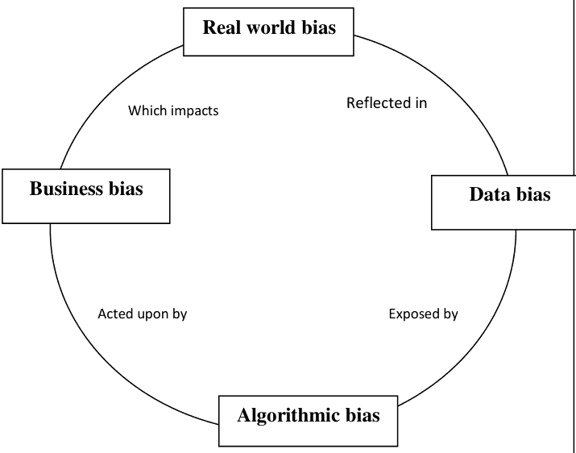

### 函数 (Function)

一段可以方便地被反复调用的代码

### 函数调用 (Function call)

添加在程序中的一段代码，用于指示程序应在特定时间运行函数内部的代码。

### 函数定义 (Function definition)

函数内部的代码，用于指示程序在函数被调用时执行的操作

### 循环 (Loop)

反复执行某项操作的行为

**While 循环：** 只要条件为真就持续重复的循环

### 模式匹配 (Pattern matching)

检查给定数据中是否存在特定数据序列的过程

> **DNS (域名系统)**
> 将 URL 转换为 IP 地址的服务。

> **数据包 (Packets)**
> 由较大的信息块精心拆分而成的较小信息碎片

**自动推理：** 以逻辑形式应用**推理**来定义、接近和解决问题

- 定义程序需要解决的问题。
- 决定程序将使用的编程语言、逻辑规则和函数。
- 指定程序用于分析数据并得出结论的过程和工具。
- 创建控制流过程以高效地执行所有这些步骤。

> **数据 (Data)**
> 保存在计算机上的信息

在 'C' 程序中创建文件使用以下语法：

```
FILE *fp;
fp = fopen ("file_name", "mode");
```

```
#include <stdio.h>

int main() {
    FILE *fp;
    fp = fopen ("data.txt", "w");
}
```

> **统一资源定位符 (URL)**
> 一种访问互联网上信息资源的方式

**什么是 C 语言中的函数？**

**C 语言编程**中的**函数**是一个可重用的代码块，它使程序更易于理解、测试，并且可以在不更改调用程序的情况下轻松修改。**函数**将代码分块并将程序模块化，以获得更好且更有效的结果。简而言之，一个较大的程序被分为各种子程序，这些子程序被称为*函数*。

+ **WWW:** 万维网
- **WAN:** 广域网
- **ZIP:** 区域信息协议

Java **开发工具包 (Development Kit)** = Java 运行时环境 + 开发工具

Java **运行时环境 (Runtime Environment)** = Java 虚拟机 + 执行应用程序的库

Java **虚拟机 (Virtual Machine)** = 执行 Java 字节码的运行时环境

## Java 程序：

```
public class HelloWorld extends Thread {
    public void run(){
        System.out.println("Albert Einstein ...");
    }
    public static void main(String args[]){
        HelloWorld ab = new HelloWorld();
        ab.start();
    }
}
```

通过继承 Thread 类实现线程

**输出：**

Albert Einstein ...

```
public class HelloWorld implements Runnable {
    public void run(){
        System.out.println("Albert Einstein ...");
    }
    public static void main(String args[]){
        Thread ab = new Thread(new HelloWorld ());
        ab.start();
    }
}
```

使用 Runnable 接口方法实现线程

**输出：**

Albert Einstein ...

## Java 程序：

```
import java.lang.Math;
public class MyClass {
    public static void main(String[] args) {
        int x = 100;
        System.out.println(Math.decrementExact(x));
    }
}
// Output: 99
```

```
import java.lang.Math;
public class MyClass {
    public static void main(String[] args) {
        int x = -16;
        int y = 35;
        System.out.println(Math.negateExact(x));
        // Output: 16
        System.out.println(Math.negateExact(y));
        // Output: -35
    }
}
```

```
import java.lang.Math;
public class MyClass {
  public static void main(String[] args) {
    // create long variable
    long x = -54965L;
    long y = 198876L;
    // change long to int
    int a = Math.toIntExact(x);
    int b = Math.toIntExact(y);
    // print the int value
    System.out.println(a);
    // Output: -54965
    System.out.println(b);
    // Output: 198876
  }
}
```

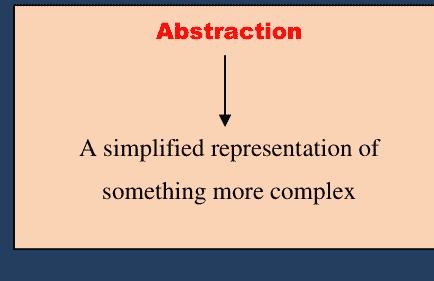

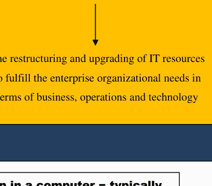

> **比特 (bit)** 是计算机中信息的最小单位——通常表示为 0 或 1

**计算思维：** 一套用于解决复杂问题的技术

**分解 (Decomposition)：** 将问题分解为若干部分

**模式识别 (Pattern recognition)：**

解释模式和模型

**(寻找相似点和趋势)**

+ **抽象 (Abstraction)：**
- 关注重要的部分，忽略不必要的部分
- 逻辑地组织数据

+ **算法设计：** 解决问题的逐步指令
- 设计并实现算法

**调试 (Debugging)：** 修复算法中的错误

**泛化 (Generalization)：** 将针对特定问题的解决方案扩展到其他类型的问题

```
Python code:

print("{:,}".format(892887872878))

## Output: 892,887,872,878
```

C / C++ 将语句分为以下几类：

+ - 选择语句 [if 和 switch]
- 迭代语句 [while, for, do-while]
- 跳转语句 [break, continue, goto 和 return]
- 标签 [case 和 default]
- 表达式 [由有效表达式组成的语句]
- 代码块 [代码块。每个块以 { 开始，以 } 结束，被称为复合语句]

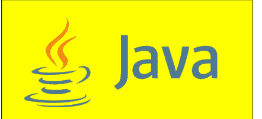

```
import java.lang.Math;

public class MyClass {
    public static void main(String[] args) {
        double x = 8.68;
        System.out.println(Math.nextDown(x));
        // Output: 8.679999999999999
        System.out.println(Math.nextUp(x));
        // Output: 8.680000000000001
    }
}
```

抑制输入：

```
scanf("%d %*d %d", &a, &b, &c);
```

输入

a=15, b=50, c=55

这里 15 存储在 `a` 中，50 被跳过，55 存储在 `b` 中，由于没有可用数据给 `c`，因此它具有垃圾值。字符 `*` 被称为抑制字符。

死循环：

```
for( ; ; )
{
    printf("This loop will run forever.\n");
}
```

```
for( ; ; ) {
    ch = getchar();
    if(ch=='B')
}
```

```
import java.lang.Math;

public class MyClass {
    public static void main(String[] args) {
        double x = 2.693;
        double y = -3.896;
        System.out.println(Math.copySign(x, y));
        // Output: -2.693
    }
}
```

获取字符

```
break; ───────► Exit the loop
}
printf("you entered B");

// This loop will run until the user types a Letter B at the keyword.
```

## C++ 编程

| 范式 | 多范式：过程化、函数式、面向对象、泛型 |
| :--- | :--- |
| 家族 | C |
| 设计者 | Bjarne Stroustrup |
| 开发商 | ISO/IEC JTC1 (联合技术委员会 1) / SC22 (分委员会 22) / WG21 (工作组 21) |
| 首次出现 | 1985年；35年前 |
| 稳定版本 | C++17 (ISO/IEC 14882:2017) / 2017年12月1日；2年前 |
| 预览版本 | C++20 |
| 类型规范 | 静态、名义、部分推断 |
| 操作系统 | 大多数主要操作系统 |
| 文件扩展名 | .C, .cc, .cpp, .cxx, .c++, .h, .hh, .hpp, .hxx, .h++ |
| 网站 | isocpp.org |

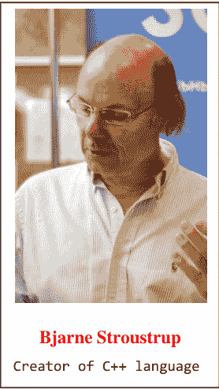

## 主要实现

GCC, LLVM Clang, Microsoft Visual C++, Embarcadero C++Builder, Intel C++ Compiler, IBM XL C++, EDG

## 受影响于
```


## C++ 语言

**被以下语言影响：**
Ada, ALGOL 68, C, CLU, ML, Mesa, Simula-2, Simula, Smalltalk

**影响了以下语言：**
Ada 95, C#, C99, Chapel, Clojure, D, Java, JS++, Lua, Nim, Perl, PHP, Python, Rust, Seed7

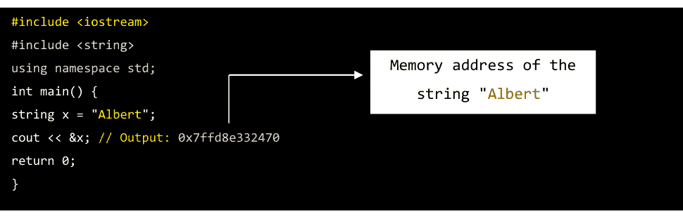

一种将计算机程序视为变量、函数和称为对象的数据结构组合的编程方法论。

一种**面向对象**的高级跨平台通用大小写敏感语言，由丹麦计算机科学家**Bjarne Stroustrup**（约 1980 年在贝尔实验室）开发，作为**C 语言的扩展**以实现特定目的 [C 语言是为操作系统编程而开发的]。最初命名为 **C with Classes**，后于 1983 年更名为 C++。作为 **C 语言的继承者**，C++ 已被认证为 **99.9% 的纯标准**，并且与 C 语言相比，具有卓越的性能、效率和使用的灵活性。它完全配得上被广泛认可的绰号“**语言中的瑞士军刀**”。

### 优势

C++ 速度极快，具有编写大规模程序的强大能力和可扩展性，并可在多种平台上运行，如 Windows、Mac OS 和各种版本的 UNIX。大多数著名的软件都以 C++ 为骨干，许多编程语言在实现时依赖于 C++ 的性能和可靠性 [例如：JVM、JavaScript 解释器和 Web 框架]。C++ [C 的超集] 被认为在编译时而非运行时进行类型检查，因此使用静态类型。

### 局限性

某些任务可以用 C++ 实现，但速度不快。例如：为应用程序设计 GUI 界面。其他编程语言如 VB、Python 内置了 GUI 设计元素。因此，它们更适合 GUI 类型的任务。

### 用途

用于开发新的编程语言 [C#, Java, JavaScript, Perl, PHP, Python 和 Verilog]、Apple Macintosh、运行 Windows 的 PC、操作系统和 Adobe Systems（如 Photoshop, Acrobat 等）、MRI 机器软件、高端 CAD/CAM 系统。C++ 全面支持面向对象编程最重要特性，包括**面向对象开发**的四大支柱：

- 封装 (Encapsulation)
- 数据隐藏 (Data hiding)
- 继承 (Inheritance)
- 多态 (Polymorphism)

**继承（Inheritance）：** 一个类（子类）从另一个类（超类）衍生属性和特性的能力被称为**继承**。继承是面向对象编程最重要的特性之一。

- **子类（Sub Class）：** 从另一个类继承属性的类称为子类或派生类。
- **超类（Super Class）：** 其属性被子类继承的类称为基类或超类。

```cpp
// My First C++ Program  --> Single line Comment

#include<iostream>  --> Preprocessor command

int main()  --> Main function. Execution of C++ program begins from main()

{  --> Beginning of the main function

std::cout<<"Hello, world!";  --> Output statement

return 0;  --> Terminates the execution of the main function

}  --> End of the main function

/* you can still use C style comment */
```

## C++ 程序的执行过程

每个 'C++' 程序都遵循一个基本结构。**一个 C++ 程序：**

```cpp
#include<iostream> //Pre-processor directive
int main() //main function declaration
{
std::cout<<"Hello, world!"; // output the string on a display screen
return 0; //terminating function
}
```

是使用**文本编辑器**编写的，例如：

- **Notepad**（Windows 操作系统）
- **vim** 或 **vi**（Linux 操作系统）

并保存为 [.cpp] **后缀名** – 例如，hello.cpp。保存为 [.cpp] 后缀的文件称为**源程序**或*源代码*。带有 [.cpp] **后缀**的 C++ 源代码首先被发送到预处理器。预处理器生成一个扩展的源代码。

**扩展源代码**被作为输入传递给**编译器**，在这里 *扩展源程序* 被编译（即，程序被完整读取并翻译成计算机可以理解的指令，*即机器可理解或可读的语言*，即 0 和 1 的**机器码序列**）。如果 C++ 编译器在编译期间发现任何错误，它会向程序员提供关于该错误的信息。

程序员必须审查代码并重新编辑程序。重新编辑程序后，**编译器**再次检查是否有错误。如果程序无误，则将其发送到汇编器 —— 在这里代码被汇编并转换为对象代码。此时会生成一个简单的 .obj 文件。

对象代码被发送到链接器（在这里对象代码与适当的库进行链接）。然后它被转换为单个可执行代码。生成一个简单的 .exe 文件。

可执行代码被发送到加载器（在这里可执行代码被加载到内存中，然后执行）。执行后，输出：

```
Hello, world!
```

显示在控制台屏幕上。

| 输入 | 程序 | 输出 |
| :--- | :--- | :--- |
| 源代码 | 预处理器 | 扩展代码 |
| 扩展代码 | 编译器 | 汇编代码 |
| 汇编代码 | 汇编器 | 对象代码 |
| 对象代码 | 链接器 | 可执行代码 |
| 可执行代码 | 加载器 | 执行 |

## 代码逐行解析

### #include\<iostream\> — 预处理指令

> 该语句以 # 符号开头，也称为预处理指令。该语句指导预处理器包含一段标准 C++ 代码 [头文件 iostream]，以支持 C++ 风格的输入输出操作 [<iostream> 之于 C++ 相当于 stdio.h 之于 C，允许执行标准输入输出操作 - 例如将本程序的输出 "Hello, world!" 写入控制台屏幕]。iostream 名称没有 .h 后缀，这是因为 <iostream> 是标准 C++ 定义的现代风格头文件之一。

- **iostream** 意味着输入输出屏幕 (input output screen)
  - i → 输入 (input)
  - o → 输出 (output)
  - stream → 屏幕 (screen)

> **iostream** 包含像 cout, cin 等输入输出函数。

- **cin** 是一个输入函数（cin 意为 console input，控制台输入）
- **cout** 是一个输出函数（cout 意为 console output，控制台输出）

它通过编写语句 `#include<iostream>` 被包含在 C++ 程序中。`#include` 语句告诉编译器在编译之前包含文件 iostream 的内容。

如果程序在没有 `#include<iostream>` 语句的情况下编写，那么 **C++ 编译器**将无法编译，并在屏幕上显示**编译错误**（因为 **C++ 编译器**无法识别 **cin** 和 **cout** 等函数）。

### main() — 主函数

> 在所有 C++ 程序中，名为 main 的函数是一个特殊函数；它是 C++ 程序执行时被调用的函数。正如其名称所示，这是每个 C++ 程序的主函数。括号 "()" 表示一个函数，单词 main 表示函数的名称。

`main()` 意味着：主函数。C++ 程序的执行从 `main()` 开始。没有 `main()` 的 C++ 程序无法执行。它是一种大小写敏感的语言：必须使用小写字母，且不应被分号包围。每个 C++ 程序中必须有且只有一个 `main()` 函数。

我们可以用多种形式表示主函数，例如：

- main()
- int main()
- void main()
- main(void)
- void main(void)
- int main(void)

C++ 支持类和对象，但 C 语言不支持。

众所周知，C++ 是一种平台依赖语言。因此，操作系统需要知道程序执行何时结束。所以，当主函数有返回值时，操作系统就能知道程序执行已结束。`int main()` 意味着：main() 应该返回一个整数值。

- 如果主函数向操作系统返回 0，则表示程序已成功完成执行。
- 如果主函数向操作系统返回 1，则表示程序未能成功完成执行。

```cpp
int main() {
}
```

主函数的函数体，其中编写并执行以语句形式 [输入输出语句、算术语句、控制语句和其他语句] 呈现的计算机执行特定操作的指令序列。

```cpp
string x = "Hi Alan";
```

内存中的字符串 x：

| 'H' | 'i' | ' ' | 'A' | 'l' | 'a' | 'n' |
| :---: | :---: | :---: | :---: | :---: | :---: | :---: |

长度：7

```cpp
#include <iostream>
#include <cstring>
using namespace std;

int main() {

    string x = "Hi Alan";
    cout << x.length();
    return 0;

}

// Output: 7
```


左花括号 `{` 表示主函数的开始，右花括号 `}` 表示主函数的结束。

这些花括号也可以用来表示用户自定义函数和复合语句的开始与结束。

`return 0;` $\rightarrow$ 表示程序的执行退出状态，也就是说，此时主函数将计算机的控制权返回给操作系统，因为**执行已终止**。一旦**返回语句**（即 `return 0;`）被执行，主函数内后续的指令将不再被执行。

例如：
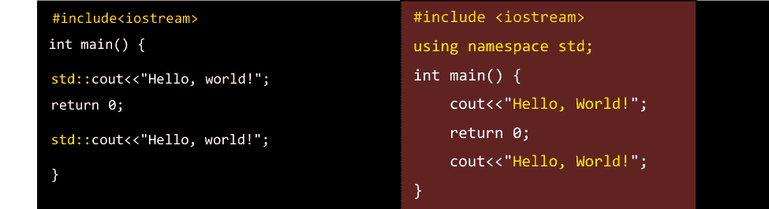

**屏幕输出：**
```
Hello, world!
```

`;` $\rightarrow$ 表示**分号**或**语句终止符** [声明的分隔符] $\rightarrow$ 所有 C++ 语句必须以分号字符结尾。C++ 中最常见的语法错误之一就是忘记在语句末尾加上分号。程序是一组定义良好的指令集，每条定义良好的指令（以语句形式出现）都以分号结束（这是 **C++ 语言的标点符号** —— 就像英语中的句号一样，在英语段落中，每个句子都以句号结束，表示一个句子结束，另一个开始；分号则表示一个逻辑实体的结束 —— 即一条指令（或语句）结束，另一条开始）。

`// My First C++ Program` $\rightarrow$ **注释**

一个能编写出人类可读代码的程序员，比一个只能生成机器可读代码的程序员更优秀。因此，强烈建议插入注释。注释是对某些指令的解释性说明。两个斜杠符号表示该行剩余部分是程序员插入的注释，它对 C++ 程序的行为没有影响。注释语句不会被编译和执行。

- `\n` 在 C 和 C++ 中都被使用，但 `\n` 占用 1 字节内存
- `endl` 用于 C++，但不用于 C
- `endl` 不占用内存

```cpp
#include <iostream>
using namespace std;

int main() {
    cout << "Alan" << "\n";
    cout << "Albert";
    return 0;
}

// Output:
// Alan
// Albert
```

```cpp
#include <iostream>
using namespace std;

int main() {
    cout << "Alan" << endl;
    cout << "Albert";
    return 0;
}

// Output:
// Alan
// Albert
```

`cout` $\rightarrow$ 表示**在屏幕上显示输出的标准方式**，它是 C++ 语言的 `输出函数`，提供了打印输出的功能：

```
Hello, world!
```

```cpp
#include <iostream>
using namespace std;
int main() {
    // 单个插入运算符
    cout << "Hi\n";

    // 多个插入运算符
    cout << "Alan" << " " << "Turing" << endl;
    return 0;
}
```

**输出：**
```
Hi
Alan Turing
```

语句 `std::cout << "Hello, world!";` 由三个部分组成：

第一，`std::cout` 允许我们将数据发送到控制台屏幕并以文本形式打印。`std::cout` 定义在 `iostream` 头文件中。
- `std` $\rightarrow$ 标准 (standard)
- `::` $\rightarrow$ 作用域解析运算符 (scope resolution operator)
- `cout` $\rightarrow$ 控制台输出或字符输出 (console output or character output)

> `std::cout` 基本上意味着：在标准库中查找并获取 cout 函数。

第二，插入运算符 (`<<`)，它使用 `cout` 函数将文本 `"Hello, world!"` 输出到控制台屏幕上。

最后，由双引号括起来的字符串 (`"Hello, world!"`) 是插入到标准输出中的内容。

| C 程序： | C++ 程序： |
| :--- | :--- |
| `#include <stdio.h>`<br>`int main() {`<br>`    printf("%d\n", sizeof(22));`<br>`    // Output: 4`<br>`    printf("%d\n", sizeof(int));`<br>`    // Output: 4`<br>`    return 0;`<br>`}` | `#include <iostream>`<br>`using namespace std;`<br>`int main() {`<br>`    cout << sizeof(22) << endl;`<br>`    // Output: 4`<br>`    cout << sizeof(int) << endl;`<br>`    // Output: 4`<br>`    return 0;`<br>`}` |
| **sizeof(22) 和 sizeof(int) 在 C++ 和 C 中是相同的** | |
| `#include <stdio.h>`<br>`int main() {`<br>`    printf("%d\n", sizeof('v'));`<br>`    // Output: 4`<br>`    printf("%d\n", sizeof(char));`<br>`    // Output: 1`<br>`    return 0;`<br>`}` | `#include <iostream>`<br>`using namespace std;`<br>`int main() {`<br>`    cout << sizeof('v') << endl;`<br>`    // Output: 1`<br>`    cout << sizeof(char) << endl;`<br>`    // Output: 1`<br>`    return 0;`<br>`}` |
| **sizeof('v') 和 sizeof(char) 在 C++ 中相同，但在 C 中不同** | |

如果在语句 `#include <iostream>` 下方添加语句 `using std::cout;`，那么**程序**的形式为：

```cpp
#include <iostream>
using std::cout;
int main()
{
    cout << "Hello, crazy world!";
    return 0;
}
```

也就是说，在语句 `std::cout << "Hello, crazy world!";` 中不再需要包含 `std::`。

C++ 对缩进没有严格规定：
`int main() { std::cout << " Hello World!\n"; }` $\rightarrow$ 没有错误 (No ERROR)

## C++ 关键字：

| | | | | |
|---|---|---|---|---|
| auto | break | case | char | const |
| double | else | enum | extern | float |
| int | long | register | return | short |
| struct | switch | typedef | union | unsigned |
| continue | default | do | for | goto |
| if | signed | sizeof | static | void |
| volatile | while | | | |

## C++ 语言中特有（C 语言中没有）的 30 个关键字列表：

| | | |
|---|---|---|
| asm | dynamic_cast | namespace |
| explicit | new | static_cast |
| operator | template | friend |
| this | inline | public |
| delete | mutable | protected |
| typeid | typename | using |
| reinterpret_cast | bool | false |
| catch | private | class |
| throw | const_cast | true |
| try | virtual | wchar_t |

## C 程序：

```cpp
int main()
{
    int i, j;
    i = 10;
    j = i * 2;
    return j;
} // 无错误 (NO ERROR)
```

```cpp
#include <stdio.h>
enum names { Albert, Alan, John, David, Turing, Weinberg, Friedrich };
int main()
{
    enum names scientist;
    scientist = John;
    printf("%d", scientist);
    return 0;
}
```

```cpp
int main()
{
    int i;
    i = 10;
    int j;
    j = i * 2;
    return j;
} // 错误 (ERROR)
```

## C++ 数据类型

| 类型 | 关键字 |
| :--- | :--- |
| 布尔型 (Boolean) | bool |
| 字符型 (Character) | char |
| 整型 (Integer) | int |
| 浮点型 (Floating point) | float |
| 双精度浮点型 (Double floating point) | double |
| 无值 (Valueless) | void |
| 宽字符 (Wide character) | wchar_t |

```cpp
#include <iostream>
using namespace std;

int main() {
    cout << "Size of char: " << sizeof(char) << endl;
    cout << "Size of int: " << sizeof(int) << endl;
    cout << "Size of short int: " << sizeof(short int) << endl;
    cout << "Size of long int: " << sizeof(long int) << endl;
    cout << "Size of float: " << sizeof(float) << endl;
    cout << "Size of double: " << sizeof(double) << endl;
    cout << "Size of wchar_t: " << sizeof(wchar_t) << endl;

    return 0;
}
```

屏幕上的输出：
```
Size of char: 1
Size of int: 4
Size of short int: 2
Size of long int: 4
Size of float: 4
Size of double: 8
Size of wchar_t: 4
```

```cpp
#include <iostream>
using namespace std;
int main() {
    int y;
    unsigned char x = 0x70;
    y = x << 1;
    cout << y << endl;
    return 0;
}
```
输出：`224`

- **程序 1.1**
  在屏幕上打印 "hello Bill Gates" 单词的 C++ 程序：
```cpp
#include <iostream>
using std::cout;
int main()
{
    cout << "hello Bill Gates";
    return 0;
}
```
屏幕输出：`hello Bill Gates`

```cpp
#include <iostream>
using namespace std;
void myfunc (int x) {
    cout << "  " << x << endl;
}
void myfunc (double y) {
    cout << "  " << y << endl;
}
void myfunc (char* z) {
    cout << " " << z << endl;
}
int main() {
    myfunc (13);
    myfunc (13.12);
    myfunc ("Thirteen");
    return 0;
}
```
输出：
```
13
13.12
Thirteen
```

- **程序 1.2**
  打印以下内容的 C++ 程序：
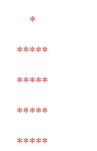

屏幕显示

```
#include<iostream>
using std::cout;

int main()
{
	cout<<"\n	 *	 ";
	cout<<"\n	 *****	 ";
	cout<<"\n	 *****	 ";
	cout<<"\n	 *****	 ";
	cout<<"\n	 *****	 ";
	return 0;
}
```

```
#include <iostream>
using namespace std;
template <typename T>

int mult (T x,T y) {
	return (x*y);
}

int main() {
	cout<<mult<int>(2,4);
	return 0;
}
```

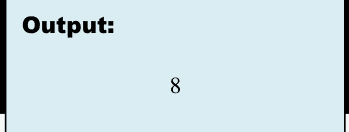

### 屏幕上的输出：

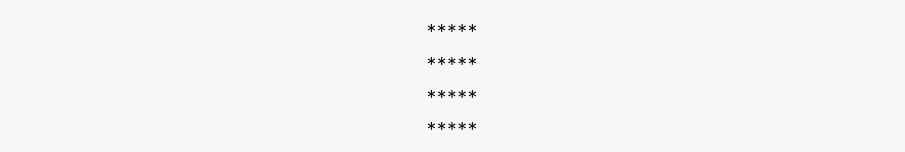

如果在上述程序中不包含**换行符** `\n`，则屏幕上的输出为：

```
************************
```

```
#include <iostream>
using namespace std;
class Name {
	public:
	Name() {
		cout << "Albert Einstein";
	}
};

int main() {
	Name obj;
	return 0;
}
```

- 可以使用 `endl` 代替 `\n`：

```
#include<iostream>
using std::cout;

int main()
{
	cout<<"	 *	 "<< endl;
	cout<<"	 *****	 "<< endl;
	cout<<"	 *****	 "<< endl;
```

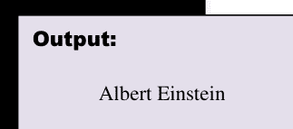

```
cout<<"	 ***** "<< endl;
cout<<"	 ***** "<< endl;
return 0;
}
```

### 屏幕上的输出：

> // Error → endl was not declared in this scope //

## 如果将上述程序改写为：

```
#include<iostream>
using std::cout;
using std::endl;
int main()
{
	cout<<"	 ***** "<< endl;
	cout<<"	 ***** "<< endl;
	cout<<"	 ***** "<< endl;
	cout<<"	 ***** "<< endl;
	cout<<"	 ***** "<< endl;
	return 0;
}
```

```
#include <bits/stdc++.h>
using namespace std;
int main(){
	vector<int> num{11,19,14,13,12,18,15,17};
	sort(num.begin(), num.end());
	for (auto a : num)
		cout << a << " " " "<< endl;
	return 0;
}
```

| 输出： |
| :--- |
| 11 |
| 12 |
| 13 |
| 14 |
| 15 |
| 17 |
| 18 |
| 19 |

### 屏幕上的输出：

|  |
| :--- |
| ***** |
| ***** |
| ***** |
| ***** |

```
#include<iostream>
using namespace std;

int main() {
	int x= 20, y= 50;
	bool z, p;
	*****
	z= (x == y);
	p= (x < y);
	cout << z <<endl;
	cout << p << endl;
	return 0;
}
```

## 单条语句：

| 输出： |
| :--- |
| 0 |
| 1 |

```
using namespace std;
```

可以用来代替以下语句：

```
using std::cout;
using std::endl;
```

即：

```
#include<iostream>
using namespace std;
int main()
{
cout<<"     *    "<< endl;
cout<<"   *****  "<< endl;
cout<<"   *****  "<< endl;
cout<<"   *****  "<< endl;
cout<<"   *****  "<< endl;
return 0;
}
```

```
#include<iostream>
#include<vector>
using namespace std;

int main() {
vector <string> a;
a.push_back("Stephen ");
a.push_back("William Hawking");
for(vector <string>::iterator x=a.begin();x!=a.end();++x)
cout<<*x;
return 0;
}
```

**输出：**

Stephen William Hawking

**屏幕上的输出：**

```
     *
   *****
   *****
   *****
   *****
```

```
#include<iostream>
using namespace std;
int main(){
for( unsigned int x = 1; x <= 10; x++)
if( x & 0x00000001 )
cout << x << "  " <<endl;
return 0;
}
```

打印出 1 到 10 之间的所有奇数

## C++ 的预定义流

| 流 | 含义 | 默认设备 |
| :--- | :--- | :--- |
| cin | 标准输入 | 键盘 |
| cout | 标准输出 | 屏幕 |
| cerr | 标准错误输出 | 屏幕 |
| clog | cerr 的缓冲版本 | 屏幕 | 屏幕 |

## C 程序：

```
#include <stdio.h>

int main() {
    if(printf("Albert Einstein")) {
    }
    return 0;
}
```

**输出：**

Albert Einstein

```
#include <stdio.h>

void abc(void) {
    void abx(void);
    printf("\n Albert Einstein");
    abx();
}

int main() {
    abc();
    return 0;
}

void abx(void) {
    printf("\n Alan Turing");
}
```

```
#include <stdio.h>

int main() {
    int a=2;
    if(a==0)
        return;
    printf("Value is not equal to Zero.");
}
```

**输出：**

Value is not equal to Zero.

**输出：**

Albert Einstein
Alan Turing

## 资源匮乏 (Resource starvation)

一种由于资源分配给其他进程，导致某个进程无法获得完成任务所需资源的情况。

## Java 程序：

```
public class HelloWorld {
    static { System.out.println("Alan Turing"); }
    public static void main(String args[]){
        System.out.println("Albert Einstein");
    }
}
```

**输出：**

Alan Turing
Albert Einstein

```
public class HelloWorld {
    public static void main(String a[]){
        String name = "Albert Einstein";
        name = name.replaceAll("Albert", "Lieserl");
        System.out.println(name);
    }
}
```

**输出：**

Lieserl Einstein

```
import java.util.ArrayList;
import java.util.Collections;

public class HelloWorld {
    public static void main(String[] args) {
        ArrayList<String> names= new ArrayList<String>(2);
        names.add("John");
        names.add("Albert");
        System.out.println("Old array list: " + names);

        names.ensureCapacity(4);
        names.add("Alan");
        names.add("Robert");
        System.out.println("New array list: " + names);
    }
}
```

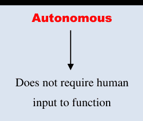

**输出：**

Old array list: [John, Albert]
New array list: [John, Albert, Alan, Robert]

```
public class HelloWorld {
    public static void main(String[] args) {
        System.out.println(1900 + 05 + "Papers");
        System.out.println("Office" + 36 + 05);
    }
}
```

**输出：**

1905Papers
Office365

```
#include <iostream>

int main () {

    int n = -77;

    std::cout.width(6); std::cout << std::internal << n << '\n';

    std::cout.width(6); std::cout << std::left << n << '\n';

    std::cout.width(6); std::cout << std::right << n << '\n';

    return 0;

}
```

屏幕上的输出：

```
public class HelloWorld {
    public static void main(String[] args) {
        System.out.println(381* 05 + "Papers");
        System.out.println("Office" + 73 * 05);
    }
}
```

```
  77
-77
 -77
```

**输出：**

1905Papers
Office365

- 编写一个程序来打印以下输出：

(a) (b)

## 原地算法 (In-Place Algorithm)

一种在不需要使用额外内存的情况下转换输入数据的算法

(c)

括号成对出现！

注释成对出现！

所有语句以分号结尾！

空格是可选的！

必须有一个 main 函数！

C++ 大部分使用小写。它是一个区分大小写的语言。

答案：(a)

```
#include <iostream>
using namespace std;
int main() {
    double Pi = 3.141592653589;
    cout.precision(4);
    cout << Pi << endl;
    // Output: 3.142
    cout.precision(5);
    cout << Pi << endl;
    // Output: 3.1416
    return 0;
}
```

```
#include <iostream>
using namespace std;
int main() {
    char x[] = "Albert";
    char y = 'A';
    cout.write(x, 3);
    cout<<endl;
    cout.put(y);
    return 0;
}

Output: Alb
         A
```

```
C program:
#include <stdio.h>
int main()
{
    char a[50];
    int b = sprintf(a, "Albert Einstein grew up in Munich");
    printf("\nThe total number of characters in the string:\n %s is: %d.", a, b);
    return 0;
}

Output: The total number of characters in the string: Albert Einstein grew up in Munich is: 33.
```

(b)

```
#include<iostream>
using namespace std;
int main()
{
cout<<"\n              *            ";
cout<<"\n             ****          ";
cout<<"\n            *******        ";
cout<<"\n             ****          ";
cout<<"\n              *            ";
return 0;
}
```

```
Python code:

string = "Albert"
list = ["Computer", "Mouse", "Keyboard", "Camera", "Disk"]
tuple = ("Car", "Flight", "Ship")
dictionary = {
    "Albert": "Einstein",
    "John": "Turing",
    "David": "Hilbert",
    "Alan": "Mary",
}

print("The minimum value of string is: ", min(string))
print("The minimum value of list is: ", min(list))
print("The minimum value of tuple is: ", min(tuple))
print("The minimum value of dictionary is: ", min(dictionary))
```

```
Output:

The minimum value of string is: A
The minimum value of list is: Camera
The minimum value of tuple is: Car
The minimum value of dictionary is: Alan
```

```
#include<iostream>
using namespace std;
int main()
{
cout<<"\n         ***************          ";
cout<<"\n              * *                  ";
cout<<"\n      * Hello World! *             ";
cout<<"\n              * *                  ";
cout<<"\n         ***************          ";
return 0;
}
```

```
x = [11, 12, 13, 14, 15]
y = iter(x)
print(next(y))
```

(c)

```
Output:

11
```


```
#include<iostream>
using namespace std;
int main()
{
    cout<<"\n Braces come in pairs!";
    cout<<"\n Comments come in pairs!";
    cout<<"\n All Statements end with a semicolon!";
    cout<<"\n Spaces are optional!";
    cout<<"\n Must have a main function!";
    cout<<"\n C++ is done mostly in lowercase. It's a case-sensitive language";
    return 0;
}
```

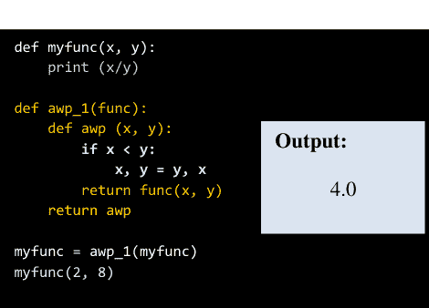

## 一个传统风格的 C++ 程序：

```
#include<iostream.h>
int main()
{
    return 0;
}
```

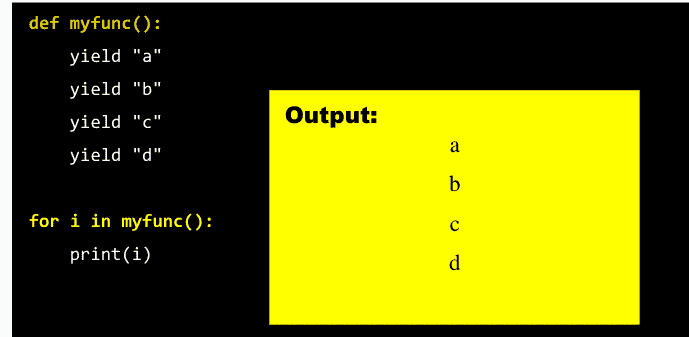

// 它包含了文件 iostream.h，而不是头文件 `<iostream>`。
// 没有使用命名空间语句。

## 一个使用新式头文件和命名空间的现代风格 C++ 程序：

```
#include<iostream>
using namespace std;
int main()
{
    return 0;
}
```

// 它包含了 C++ 风格的头文件并指定了一个命名空间。

> **整数溢出**
一种算术溢出错误，当算术运算输出的数值超出了分配的内存空间或超过了指定整数值的范围时发生。

## C 程序：

```
#include <stdio.h>

int main() {
    int i;
    for(i=97; i<=122; i++)
    {
        printf("%c ", (char)i);
    }
    return 0;
}
```

输出：

abcdefghijklmnopqrstuvwxyz

- 程序 1.3

计算圆面积的 C++ 程序

```
#include<iostream>
using namespace std;
main()
{
    int r, area;
    r = 2;
    area = 3.14 * r * r;
    cout<<"The area of the circle = "<< area;
    return 0;
}
```

| 有信息搜索 | 无信息搜索 |
| :--- | :--- |
| AI 接收关于如何以及在何处找到任何问题解决方案的建议 | AI 不接收关于如何以及在何处找到任何问题解决方案的建议 |

屏幕上的输出：

```
The area of the circle = 12
```

如果使用语句：

```
float r, area;
```

而不是

```
int r, area;
```

**全双工传输**
数据同时在两个方向上传输。

即，

```
#include<iostream>
using namespace std;

int main()
{
float r, area;
r = 2;
area = 3.14 * r * r;
cout<<"The area of the circle = "<< area;
return 0;
}
```

那么 **屏幕上的输出：**

```
The area of the circle = 12.56
```

如果你想通过**键盘**为 r 提供*值*，那么语句

```
float r = 2;
```

应该被以下语句替换

```
cout<<"Enter any number:";
cin>>r;
```

即，

```
#include<iostream>
using namespace std;
int main()
{
float r, area;
cout<<"Enter any number:";
cin>>r;
area = 3.14 * r * r;
cout<<"The area of the circle = "<< area;
return 0;
}
```

**Python 代码：**

```
import pandas as pd
x={"col1":[1,2,3],"col2":['Albert','Mary','Alan']}
y=pd.DataFrame(x)
x={"col1":[4,5,6],"col2":['John','Hilbert','David']}
z=pd.DataFrame(x)
a=pd.concat([y,z],axis=0)
print(a)
```

| | col1 | col2 |
| --- | --- | --- |
| 0 | 1 | Albert |
| 1 | 2 | Mary |
| 2 | 3 | Alan |
| 0 | 4 | John |
| 1 | 5 | Hilbert |
| 2 | 6 | David |

```
import pandas as pd

x={"col1":[1,2,3],"col2":['Albert','Mary','Alan']}
y=pd.DataFrame(x)
x={"col1":[4,5,6],"col2":['John','Hilbert','David']}
z=pd.DataFrame(x)
a=pd.concat([y,z],axis=1)
print(a)
```

| | col1 | col2 | col1 | col2 |
| --- | --- | --- | --- | --- |
| 0 | 1 | Albert | 4 | John |
| 1 | 2 | Mary | 5 | Hilbert |
| 2 | 3 | Alan | 6 | David |

```
x={"b1":11,"b2":12,"b3":13}
for a in x.keys():
    x[a]=x[a]+1
    print(x[a])

## Output:

12
13
14
```

### 屏幕上的输出：

Enter any number:
如果你输入数字 2
屏幕将输出：

The area of the circle = 12.56

> **桌面检查**

一种非正式的**手动测试**技术，用于在程序启动前测试编程和**算法的逻辑**。

- `cout` 是一个输出函数，`cin` 是一个输入函数。

语句：

```
cout<<"Enter any number:";
```

使得屏幕上打印出文本

Enter any number:

成为可能。

```
## Check if each word start with an upper case letter
x = "Albert Einstein"
print(x.istitle())

## Output: True
```

- `cin>> r;` 之于 C++ 就像 `scanf("%d", &r);` 之于 C。

如果你写语句：

```
area = 3.14 * r ^ 2;
```

而不是

```
area = 3.14 * r * r;
```

那么 *编译错误* 将会显示在控制台屏幕上，因为在 *C 语言* 中一样——没有用于执行指数运算的运算符——所以语句

```
area = 4 * 3.14 * r ^ 2;
```

是无效的。

```
for x in range(5):
    if x==2: break
    print(x)

## Output:

0
1
```

```
for x in range(5):
    if x==2: continue
    print(x)
```

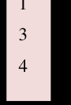

```
if 5>3:
    print("Alan")
    print("Turing")
```

**输出：**

Alan

Turing

- `cout` 和 `cin` 不是 **C++ 语言** 的一部分，但它们是 `iostream` **文件** 的一部分。因此，语句 `#include<iostream>` 应该包含在 C++ 程序中，否则 **cout** 和 **cin** 将无法工作，并且**编译错误**将会显示在控制台屏幕上。

- **右移运算符** `>>` 表示**流提取运算符**（从键盘提取输入的数据）。

- **左移运算符** `<<` 表示**流插入运算符**（将数据插入到输出屏幕）。

- `<<` **和** `>>` 被称为**重载运算符**，文件 iostream 定义了这些运算符。

如前所述：当你通过**键盘**输入一个整数给 x 时，这个整数将被存储在计算机内存中。如果你渴望知道这个整数在**计算机内存**中的 *存储大小*（即输入的整数在计算机内存中占用的空间），你需要使用以下程序：

```
#include<iostream>
using namespace std;
int main()
{
    int x;
    x=10;
    cout<<"size of x = "<< sizeof(x);
    return 0;
}
```

```
## returns the hash value of x
x=hash(6.7)
print(x)

names=['Albert','Alan','John','Mary','David']
x= ' '.join(names)
print(x)

## Output: Albert Alan John Mary David
```

屏幕上的输出：

size of x = 4

即，输入的 x 的值 10 在计算机内存中占用了 4 字节的空间。

## C++ 类型限定符：

- **const**：const 类型的对象在程序执行期间不能被程序修改。
- **volatile**：修饰符 volatile 告诉编译器，一个变量的值可能会以程序未明确指定的方式被更改。
- **restrict**：由 restrict 限定的指针最初是其指向对象可以被访问的唯一手段。只有 C99 添加了一个名为 restrict 的新类型限定符。

- 编写一个程序来打印圆的周长（给定 r = 2.5）

答案：

```
#include<iostream>
using namespace std;
int main()
{
    float r, circumference;
    r = 2.5;
    circumference = 2* 3.14 * r;
    cout<<"The circumference of the circle = "<< circumference;
    return 0;
}
```

```
x=6.5%1.2
print(x)
## Output: 0.5000000000000002

x=2.2+3.3>5.5
print(x)
## Output: False
```

```
x={1,3,4,4}=={1,3,4}
print(x)
## Output: True

x=3^2
print(x)
## Output: 1
```

- 编写一个程序来打印矩形的面积（给定 l = 2.5 且 b = 3）

答案：

```
#include<iostream>
using namespace std;
int main()
{
float l, b, area;
l = 2.5;
b = 3;
area = l*b;
cout<<"The area of the rectangle = "<< area;
return 0;
}
```

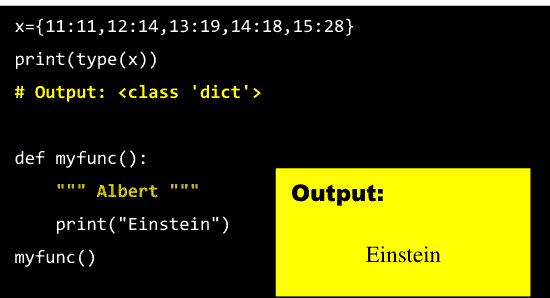

### 程序 4.6

计算两个数之和的 C++ 程序

```
#include<iostream>
using namespace std;
int main()
{
int a, b, sum;
a=1;
b=2;
sum = a + b;
cout<<"the sum of a and b = "<< sum;
return 0;
}
```

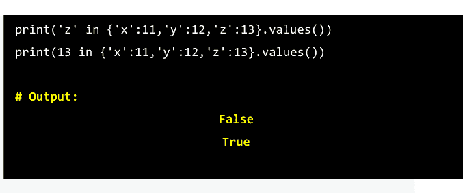

### 屏幕上的输出：

```
the sum of a and b = 3
```

如果你为 a 和 b 赋予**浮点数值** 1.5 和 2.6，那么语句：

```
int a, b, sum;
```

应该被语句

```
float a, b, sum;
```

替换。

即，

```
#include<iostream>
using namespace std;
int main()
{
    float a, b, sum;
    a=1.5;
    b=2.6;
    sum = a + b;
    cout<<"the sum of a and b = "<< sum;
    return 0;
}
```

```
print('albERt'.swapcase())
## Output: ALBerT
print(bytes([12,14,18]))
# Output: b'\x0c\x0e\x12'
```

```
## Infinite loop in python
def myfunc(x):
    while(x==7):print(x)
myfunc(5)
```

按 **Ctrl + C** 来中断无限循环。

### 屏幕上的输出：

```
the sum of a and b = 4.1
```

语句：

```
cout<<"the sum of a and b = "<< sum;
```

```
x="a"
y=5
print(x + "{0:.3f}".format(y))
## Output: a5.000
```


准备打印以下输出：

```
the sum of a and b = 4.1
```

```python
x="a"
y=5
print("x={0} but y={1}".format(x,y))

## Output: x=a but y=5

a={x**3 for x in range(4,0,-2)}
print(a)

## Output: {64, 8}
```

在控制台屏幕上。如果 **语句**：

```cpp
cout<<"the sum of a and b = "<< sum;
```

在 **C++ 程序** 中被省略，那么程序将成功执行，但控制台屏幕上*不会显示输出结果*。

如果你想通过键盘提供 a 和 b 的值，那么语句：

```cpp
a=1.5;
b=2.6;
```

```python
x ="John"
print (x * 2)

## Output: JohnJohn

x ="John"
print (x + "Turing")

## Output: JohnTuring

x = [1905, 'Albert']
print (x * 2)

## Output: [1905, 'Albert', 1905, 'Albert']
```

应该被替换为以下语句：

```cpp
cout<<"Enter any two numbers:";
cin>>a;
cin>>b;
```

即：

```cpp
#include<iostream>
using namespace std;
int main()
{
float a, b, sum;
cout<<"Enter any two numbers:";
cin>>a;
cin>>b;
sum = a+ b;
cout<<"the sum of a and b = "<<sum;
return 0;
}
```

```python
x = (1927, 'George')
print (x * 2)

## Output: ('1927', 'George', '1927', 'George')

print (3/ 2) # Output: 1.5
print (3 // 2) # Output: 1
```

屏幕上的输出：

```
Enter any two numbers:
If you enter two numbers 2.9 & 3.6
the sum of a and b = 6.5
will be outputted on the screen.
```

```python
import pandas as pd
x = pd.Series([11, 12, 13, 14, 15, 16, 17, 18, 19, 20])
y = pd.Series([20, 19, 18, 17, 16, 15, 14, 13, 12, 11])
print(sum((x - y)**2)**0.5)

## Output: 18.16590212458495
```

语句：

```cpp
cout<<"Enter any two numbers";
```

用于在屏幕上打印：

```
Enter any two numbers:
```

而语句：

```cpp
cin>>a;
cin>>b;
```

用于读取通过 **键盘** 输入的两个数字 2.9 和 3.6，并将它们存储在计算机内存中。

```python
def main():
    print('Albert Einstein')
if __name__ == '__main__':
    main()
```

如果语句：

```cpp
cout<<"Enter any two numbers";
cin>>a;
cin>>b;
```

被替换为语句：

```cpp
cout<<"Enter any number:";
cin>>a;
cout<<"Enter any number:";
cin>>b;
```

```python
x=15
if x ==15:
    print("Albert")
else:
    pass

## Output: Albert
```

那么 **屏幕上的输出** 为：

```python
import json
x = json.dumps([11, 62,33, "albert", "beer"])
print(x)

## Output: [11, 62, 33, "albert", "beer"]
```

```
Enter any number:
If you enter the number 2.9
Enter any number:
If you enter the number 3.6
the sum of a and b = 6.5
will be outputted on the screen.
```

```python
import pickle
x = pickle.dumps([11, 62,33, "albert", "beer"])
print(pickle.loads(x))

## Output: [11, 62, 33, 'albert', 'beer']
```

如果语句：

```cpp
cout<<"the sum of a and b = "<< sum;
```

```python
## prints the length of each string
a = ['Jo', 'hn']
print(len(list(map(list, a))))
```

被替换为语句：

```cpp
cout<< a <<" + "<< b <<" = "<< sum;
```

```
Output:
2
```

```python
def X(i):
    def Y():
        print(i)
    return Y
X(1905)()
```

那么 **输出结果：**

```
Output:
1905
```

将显示在控制台屏幕上。

2.9 + 3.6 = 6.5

- 以下程序的输出结果是什么：

```cpp
#include<iostream>
using namespace std;
int a = 5;
int main()
{
    int a =2;
    cout<< a;
    return 0;
}
```

```python
print(6.0 <= 6)

## Output: True

import numpy
print(numpy.array([]))
print(numpy.empty(shape=(0,0)))

## Output:
[]
[]
```

答案：2

- 2 是一个局部变量（在 main 函数体内部声明的变量）

语句：

```cpp
int a = 2;
```

意味着：局部变量声明。

- 5 是一个全局变量（在 main 函数体外部声明的变量）

```python
x = "Albert"
for i in x:
    print(i)

## Output:
A
l
b
e
r
t
```

语句：

```cpp
int a = 5;
```

意味着：全局变量声明。

如果语句：

```cpp
cout<< a;
```

被替换为语句：

```cpp
cout<< :: a; (其中 :: 表示作用域解析运算符)
```

即：

```cpp
#include<iostream>
using namespace std;
int a = 5;
int main()
{
    int a =2;
    cout<< ::a;
    return 0;
}
```

```python
def myfunc(n):
    x=1
    while(x<=n):
        yield x**3
        x+=1

for x in myfunc(3):
    print(x)

## Output:
1
8
27
```

那么 **屏幕上的输出** 为：

5

即，**全局变量** 将被输出到屏幕上。

如果同样的程序用 **C 语言** 编写

即：

```c
#include<stdio.h>
int a = 5;
int main()
{
    int a =2;
    printf("%d", ::a);
    return 0;
}
```

```python
x = [[11,12]] * 5
print(x)

## Output:
[[11, 12], [11, 12], [11, 12], [11, 12], [11, 12]]

x = [[11,12] for _ in range(3)]
print(x)

## Output:
[[11, 12], [11, 12], [11, 12]]
```

那么屏幕上将输出编译错误，因为作用域解析运算符在 C 语言中未定义（即 C 语言不持有作用域解析运算符）。

```python
x = open('1.txt')
for i in x:
    i = i.strip('\n')
    print(i)

## Output:
Albert Einstein was a theoretical physicist who was born in Germany and is largely
regarded as one of the greatest and most influential physicists of all time.
```

- 以下程序是否能成功输出：

```cpp
#include<iostream>
using namespace std;
int main()
{
    int a, b, c;
    a=3;
    b=2;
    c= a+b;
    cout<<" sum of two numbers = 6"<< c;
    return 0;
}
```

```python
x = [[11,12,13,14]]
x[0][3] = 59
print(x)

# Output: [[11, 12, 13, 59]]

x = []
for i in range(4):
    x.append(lambda: i)
print ([y() for y in x])

# Output: [3, 3, 3, 3]
```

答案：是的，屏幕上的输出为：

sum of two numbers = 65

## 程序 4.7

将摄氏温度转换为华氏温度的 C++ 程序

```python
x = []
for i in range(4):
    x.append(lambda i = i : i)
print ([y() for y in x])

# Output: [0, 1, 2, 3]

print([ [ ] ] * 3)

# Output: [[], [], []]
```

```cpp
#include<iostream>
using namespace std;
int main()
{
    float C, F;
    C=38.5;
    F = 9*C/5 +32;
    cout<<"temperature in Fahrenheit= "<< F;
    return 0;
}
```

屏幕上的输出：

temperature in Fahrenheit = 101.3

如果你想为 C 提供小数点后 **16 位** 的数值，例如 36.5555555555555555，那么语句：

```cpp
double C, F;
```

应该被用来替代语句：

```cpp
float C, F;
```

即：

```cpp
#include<iostream>
using namespace std;
int main()
{
    double C, F;
    C=38.555555555555555555;
    F = 9*C/5 +32;
    cout<<"temperature in Fahrenheit= "<< F;
    return 0;
}
```

```python
x = ['a', 'l', 'a', 'n']
print (x[2:])
print (x[7:])

## Output:
['a', 'n']
[]
```

如果你想通过键盘提供 C 的值，那么语句：

```cpp
C=38.5;
```

应该被替换为以下语句：

```cpp
cout<<"Enter any number:";
cin>>C;
```

即：

```cpp
#include<iostream>
using namespace std;
int main()
{
    float C, F;
    cout<<"Enter any number:";
    cin>>C;
    F = 9*C/5 +32;
    cout<<"temperature in Fahrenheit= "<< F;
    return 0;
}
```

```python
for x in '1905':
    print ("albert",x,)

## Output:
albert 1
albert 9
albert 0
albert 5

x = {'Albert': 1905}
x.update({"Tesla":1927})
print(x)

# Output: {'Albert': 1905, 'Tesla': 1927}
```

**屏幕上的输出：**

```python
import array
x = array.array('i', [50,25,15])
print(x[1])

# Output: 25
```

```
Enter any number:
If you enter the number 23.6
temperature in Fahrenheit = 74.48
will be outputted on the screen.
```

```python
x = open('1.txt')
y = x.readlines()
type(y)
print(y)

## Output:
['Albert Einstein was a theoretical physicist who was born in Germany and is largely regarded as one of the greatest and most influential physicists of all time.']
```

```python
import array
x = array.array('i', [50,25,15])
x.insert(3, 5)
print(x)

# Output: array('i', [50, 25, 15, 5])
```

## 程序 4.8

求两个数乘积的 C++ 程序

```python
import array as myarray
x = myarray.array('i', [500, 300, 200])
x.remove(300)
print(x)

# Output: array('i', [500, 200])
```

```cpp
#include<iostream>
using namespace std;
int main()
```


```cpp
{
int a, b, product;
a=1;
b=2;
product = a * b;
cout<<"the product of a and b = "<< product;
return 0;
}
```

```python
import array as myarray
x = myarray.array('i', [12,22, 32])
x.reverse()
print(x)

# Output: array('i', [32, 22, 12])
```

### 屏幕上的输出：

the product of a and b = 2

如果你想为 a 和 b 输入一个 **10 位数字**，即：

```cpp
a=1000000000
b=3000000000
```

```python
x = "Albert Einstein"
y = "Alan Turing"
print (x[1])
print (y[1:4])

## Output:
# l
# lan
```

那么，语句：

```cpp
int a, b, product;
```

应该被替换为语句：

```cpp
long int a, b, product;
```

即：

```cpp
#include<iostream>
using namespace std;
int main()
{
long int a, b, product;
a=1;
b=2;
product = a * b;
cout<<"the product of a and b = "<< product;
return 0;
}
```

```python
import numpy as np
x = np.array([[15, -50, 33], [51, -56, 65], [-42, 79, 82]])
print(x)

[[ 15 -50  33]
 [ 51 -56  65]
 [-42  79  82]]
```

屏幕上的输出：

```
the product of a and b = 300000000000000000000
```

如果你想通过键盘提供 **a 和 b 的整数值**，那么语句：

```cpp
a=1;
b=2;
```

应该被替换为语句：

```python
import numpy as np
x = np.array([[13, 16, 19], [15, -20, 25], [-17, 24, 56]])
y = np.array([[91, -15, 87], [10, 28, 53], [63, -18, -38]])
z = x - y
print(z)
```

```cpp
cout<<"Enter any two numbers";
cin >> a;
cin >> b;
```

```
[[-78 31 -68]
 [ 5 -48 -28]
 [-80 42 18]]
```

即：

```cpp
#include<iostream>
using namespace std;
int main ()
{
    int a, b, product;
    cout<<"Enter any two numbers";
    cin>>a;
    cin>>b;
    product = a* b;
    cout<<"the product of a and b = "<< product;
    return 0;
}
```

```python
import numpy as np
x = np.array([[13, 16, 19], [15, -20, 25], [-17, 24, 56]])
y = np.array([[91, -15, 87], [10, 28, 53], [63, -18, -38]])
z = x.dot(y)
print(z)
```

```
[[ 2540 -89 2701]
 [ 2740 -1235 1195]
 [ 2221 -81 1921]]
```

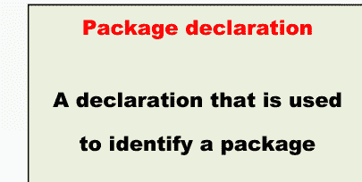

屏幕上的输出：

```
Enter any two numbers:

If you enter two numbers 2 & 3

the product of a and b = 6

will be outputted on the screen
```

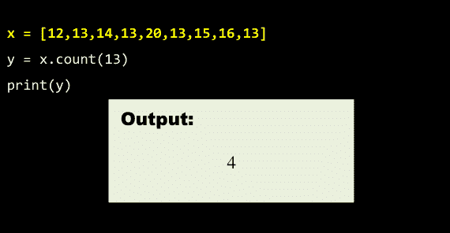

数字表达式由以下项组成：

- 数字
- 运算符 +, -, /, *, ^, %, =
- 括号
- 变量

## 程序 4.9

计算一个数字平方的 C++ 程序

```cpp
#include<iostream>
using namespace std;
int main()
{
    int a, b;
    a=2;
    b = a * a;
    cout<<"the square of a = "<< b;
    return 0;
}
```

```python
for x in range(0, 5):
    print('*', end="")

# Output: *****

print(help('modules'))
```

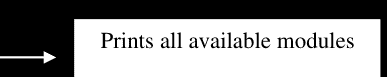

**屏幕上的输出：**

```
the square of a = 4
```

如果你想通过 **键盘** 为 **a** 提供整数值，那么语句：

```cpp
a=2;
```

应该被替换为语句：

```cpp
cout<<"Enter any number:";
cin>>a;
```

即：

```cpp
#include<iostream>
using namespace std;
int main()
{
int a, b;
cout<<"Enter any number:";
cin>>a;
b = a * a;
cout<<"the square of a = "<< b;
return 0;
}
```

**屏幕上的输出：**

```
Enter any number:
If you enter a number 3
the square of a = 9
will be outputted on the screen.
```

```python
import math
print(math.pi)
math.pi = 15
print(math.pi)
```

**输出：**

```
3.141592653589793
15
```

```python
x = ['Car', 'House', 'Phone', 'Computer']
print(x[-1][-1])
```

```
# Output: r
```

```python
y = [15, 20, 25, 30]
for i, x in enumerate(y, start=10):
    print(i, x)
```

```
## Output:
10 15
11 20
12 25
13 30
```

- 编写一个程序来打印一个数字的立方

答案：

```cpp
#include<iostream>
using namespace std;
int main()
{
    int a, b;
    cout<<"Enter any number";
    cin>>a;
    b = a * a *a;
    cout<<"the cube of a = "<< b;
    return 0;
}
```

```python
print(sum([x * x for x in range(1, 10)]))

# Output: 285

y = {'age': 102, 'name': 'Mary', 'Car': 'Audi'}
x = y.get('age')
print(x)

# Output: 102
```

- 编写一个程序来打印施加在质量 m 上的力。

答案：

```cpp
#include<iostream>
using namespace std;
int main()
{
    int m, a, F;
    cout<<"Enter the mass";
    cin>>m;
    cout<<"Enter acceleration";
    cin>>a;
    F = m * a;
    cout<<"the force applied to the mass = "<< F;
    return 0;
}
```

```python
y = {'age': 102, 'name': 'Mary', 'Car': 'Audi'}
x = y.setdefault('name')
print(x)

# Output: Mary
```

```python
def x(name, money):
    print(f"{name} had a net worth equal to ${money / 10:.5f} thousand at the time of his death in 1955.")
x("Albert Einstein", 650)
```

**输出：** Albert Einstein had a net worth equal to $65.00000 thousand at the time of his death in 1955.

```python
x = open('1.txt')
y = x.readline()
while y!= "":
    print(y)
    y = x.readline()
```

**输出：**

Albert Einstein was a theoretical physicist who was born in Germany and is largely regarded as one of the greatest and most influential physicists of all time.

```python
from collections import Counter
x = "Albert Einstein was born \
and raised in Munich".split()
y = Counter(x)
print(y)
```

**输出：**

`Counter({'Albert': 1, 'Einstein': 1, 'was': 1, 'born': 1, 'and': 1, 'raised': 1, 'in': 1, 'Munich': 1})`

## 程序 5.0

使用 `if - else` 语句寻找两个数中最大值的 C++ 程序

*if - else* 语句的语法是：

```cpp
if (this condition is true)
{
    print this statement;
}
else
{
    print this statement;
}
```

```python
y = [16, 12, 13, 11]
i=1;
for x in y:
    i = i* x
    print (i)

# Output: 27456
# 16 * 12 * 13 * 11 = 27456
```

```cpp
#include<iostream>
using namespace std;
int main()
{
int a, b;
a = 2;
b = 3;
if(a>b)
{
cout<<"a is greater than b";
}
else
{
cout<<"b is greater than a";
}
return 0;
}
```

```python
y = [22, 26, 66, 46, 46, 70, 46, 52]
x = []
[x.append(i) for i in y if i not in x]
print (x)
```

输出：
[22, 26, 66, 46, 70, 52]

屏幕上的输出：

b is greater than a

## 程序 5.1

使用 *else-if* 语句寻找三个数中最大值的 C++ 程序

*else-if* 语句的语法：

```cpp
if (this condition is true)
{
    print this statement;
}
else if (this condition is true)
{
    print this statement;
}
else
{
    print this statement;
}
```

```python
y = [24, 28, 13, 20, 15, 16]
x = [i for i in y if i%2 != 0]
print(x)

# Output: [13, 15]
```

```python
y = [24, 28, 13, 20, 15, 16]
x = [i for i in y if i%2 == 0]
print(x)

# Output: [24, 28, 20, 16]
```

```cpp
#include<iostream>
using namespace std;
int main()
{
    int a, b, c;
    cout<<"Enter any number";
    cin>>a;
    cout<<"Enter any number";
    cin>>b;
    cout<<"Enter any number";
    cin>>c;
    if(a>b&&a>c)
    {
        cout<< a<<" is greater than"<< b<<" and "<<c;
    }
    else if(b>a&&b>c)
    {
        cout<< b<<" is greater than"<< a <<" and "<<c;
    }
    else
    {
        cout<< c<<" is greater than"<< b<<" and "<< a;
    }
    return 0;
}
```

```python
x = [11, 12, 13, 14, 15, 16]
x.sort(reverse=True)
print(x)
```

```
Output:
[16, 15, 14, 13, 12, 11]
```

```python
x = ["Haw", "wa", "a", "physi"]
y = ["king", "as", "n", "cist"]
z = [a + b for a, b in zip(x, y)]
print(z)
```

```
Output:
['Hawking', 'was', 'an', 'physicist']
```

**屏幕上的输出：**

```
Enter any number:
If you enter the number 2
Enter any number:
If you enter the number 3
Enter any number:
If you enter the number 4
4 is greater than 3 and 2 will be outputted on the screen.
```

- 以下程序的输出将是什么？

```cpp
#include <iostream>
using namespace std;

int main()
{
    int a, b;
    a=2;
    b=2;
    if(a>b || a==b)
        cout<<"a is greater than or equal to b";
    else
        cout<<"b is greater than a";
    return 0;
}
```

```python
x = ["Haw", "w", "a", "physi"]
y= ["king", "as", "n", "cist"]
z = [(a, b) for a in x for b in y]
c = [a + ' ' + b for (a, b) in z]
print(c)
```

**输出：**

['Haw king', 'Haw as', 'Haw n', 'Haw cist', 'w king', 'w as', 'w n', 'w cist', 'a king', 'a as', 'a n', 'a cist', 'physi king', 'physi as', 'physi n', 'physi cist']

**答案：**

```
a is greater than or equal to b
```

- 符号 `||` 表示“或”（OR），即 `a>b || a == b` 表示 a 大于 b 或 a 等于 b。


- **程序 5.2**

计算 10 个数字平均值的 C++ 程序

```cpp
#include<iostream>
using namespace std;
int main()
{
    int N1, N2, N3, N4, N5, N6, N7, N8, N9, N10, X;
    cout<<"Enter any 10 numbers:";
    cin>>N1;
    cin>>N2;
    cin>>N3;
    cin>>N4;
    cin>>N5;
    cin>>N6;
    cin>>N7;
    cin>>N8;
    cin>>N9;
    cin>>N10;
    X = (N1 + N2 + N3 + N4 + N5 + N6 + N7 + N8 + N9 + N10) /10;
    cout<<"the average of 10 numbers = "<< X;
    return 0;
}
```

## 屏幕输出：

Enter any 10 numbers:

如果你输入十个数字 1, 2, 3, 4, 5, 6, 7, 8, 9 和 10

the average of 10 numbers = 5

将会在屏幕上输出。

C++ 的等效数学表达式与 C 的等效数学表达式相同。

例如：

| 数学表达式 | C 等效表达式 | C++ 等效表达式 |
|---|---|---|
| $\log_{10}x + bx$ | log10 (x) + b * x | log10 (x) + b * x |

- **程序 5.3**

计算一个数字平方根的 C++ 程序

```cpp
#include<iostream>
#include<cmath>
using namespace std;
int main()
{
int a, b;
cout<<"Enter any number:";
cin>> a;
b = sqrt (a);
cout<<"the square root of a number = "<< b;
return 0;
}
```

**屏幕输出：**

Enter any number:

**如果你输入数字 16**

**the square root of a number = 4**

将会在屏幕上输出。

由于编写了 **b** = **sqrt(a)**，因此上述程序必须包含语句：`#include<cmath>`，因为 **cmath 文件**定义了像 `sqrt()` 这样的数学函数。

如果在上述程序中没有包含语句：`#include<cmath>`：

```cpp
#include<iostream>
using namespace std;
int main()
{
    int a, b;
    cout<<"Enter any number:";
    cin>> a;
    b = sqrt (a);
    cout<<"the square root of a number = "<< b;
    return 0;
}
```

那么控制台屏幕上将显示 *编译错误*。

**注意：**
`#include<math.h>` 用于 C 语言，而 `#include<cmath>` 用于 C++。

- 编写一个打印一个数字立方根的程序：

**答案：**

```cpp
#include<iostream>
#include<cmath>
using namespace std;
int main()
{
cout<<"the cube root of a number = "<< cbrt (8);
return 0;
}
```

## 程序 5.4

计算单利（简单利息）的 C++ 程序

```cpp
#include<iostream>
using namespace std;
int main()
{
int P,T, R, SI;
P = 1000;
T = 2;
R = 3;
SI = P*T*R/100;
cout<<"the simple interest = "<< SI;
return 0;
}
```

## 屏幕输出：

```
the simple interest = 60
```

如果你想通过**键盘**为 P、T 和 R 提供**整数值**，那么语句：

```cpp
P = 1000;
T = 2;
R = 3;
```

应该被替换为以下语句：

```cpp
cout<<"Enter principal amount";
cin>>P;
cout<<"Enter time:";
cin>>T;
cout<<"Enter rate of interest";
cin>>R;
```

也就是说，上述程序应采用以下形式：

```cpp
#include<iostream>
using namespace std;
int main()
{
    int P, T, R, SI;
    cout<<"Enter principal amount";
    cin>>P;
    cout<<"Enter time";
    cin>>T;
    cout<<"Enter rate of interest";
    cin>>R;
    SI = P*T*R/100;
    cout<<"the simple interest = "<<SI;
    return 0;
}
```

## 屏幕输出：

Enter principal amount:
如果你输入本金 1000
Enter time:
如果你输入时间 2
Enter rate of interest:
如果你输入利率 3
the simple interest = 60
将会在屏幕上输出。

- 程序 5.5

判断是否为老年人的 C++ 程序

```cpp
#include<iostream>
using namespace std;
int main()
{
    int age;
    age=20;
    if(age >= 60)
    {
        cout<<"senior citizen";
    }
    if(age<60)
    {
        cout<<"not a senior citizen";
    }
    return 0;
}
```

屏幕输出：

not a senior citizen

- (age >= 60) 意味着：年龄大于或等于 60。

如果你想通过键盘提供年龄值，那么语句：

```cpp
age = 20;
```

应该被替换为以下语句：

```cpp
cout<<"Enter age:";
cin>>age;
```

即：

```cpp
#include<iostream>
using namespace std;
int main()
{
int age;
cout<<"Enter age:";
cin>>age;
if(age>=60)
{
cout<<"senior citizen";
}
if(age<60)
{
cout<<"not a senior citizen";
}
return 0;
}
```

**屏幕输出：**

Enter age:
如果你输入年龄 60
senior citizen
将会在屏幕上输出。

假设你输入年龄 31
```
not a senior citizen
```
将会在屏幕上输出。

## 默认构造函数
一种无需指定任何参数即可调用的构造函数。

## 信息隐藏
一种认为开发决策应该被其所使用的模块所隐藏的理念。

- 程序 5.6

获取 3 门课程成绩并宣布结果的 C++ 程序。
如果所有科目的成绩 >= 35，则学生合格，否则不合格。

```cpp
#include<iostream>
using namespace std;
int main()
{
int M1, M2, M3;
M1 = 38;
M2= 45;
M3 = 67;
if(M1 >= 35 && M2>= 35 && M3>= 35)
{
cout<<"candidate is passed";
}
else
{
cout<<"candidate is failed";
}
return 0;
}
```

## 屏幕输出：

```
candidate is passed
```

如果你想通过**键盘**为 *成绩* M1, M2 和 M3 提供整数值，那么语句：

```cpp
M1 = 38;
M2= 45;
M3 = 67;
```

应该被替换为以下语句：

```cpp
cout<<"Enter any three marks:";
cin>> M1;
cin>> M2;
cin>> M3;
```

即：

```cpp
#include<iostream>
using namespace std;

int main()
{
int M1, M2, M3;
cout<<"Enter any three marks:";
cin>> M1;
cin>> M2;
cin>> M3;
if(M1 >= 35 && M2>= 35 && M3>= 35)
{
cout<<"candidate is passed";
}
else
{
cout<<"candidate is failed";
}
return 0;
}
```


```cpp
cout<<"candidate is failed";
}
return 0;
}
```

屏幕上的输出：

```
Enter any three marks:

26, 28, 39 # entered marks

candidate is failed

will be outputted on the screen.
```

- **程序 5.7**
用于计算利润或亏损的 C++ 程序

```cpp
#include<iostream>
using namespace std;
int main()
{
    int CP, SP, loss, profit;
    cout<<"Enter cost price";
    cin >> CP;
    cout<<"Enter selling price";
    cin>>SP;
    if ( SP > CP )
    {
        cout<<"profit= "<< SP-CP;
    }
    else
    {
        cout<<"loss = "<< CP-SP;
    }
    return 0;
}
```

```python
x='535'
y=x[::-1]
if x==y:
    print("palindrome")
else:
    print("Not a Palindrome")

# Output: palindrome
```

```python
x = ["12", "42", "50", "16", "19"]
x = [int(a) for a in x]
x.sort()
print (x)

# Output: [12, 16, 19, 42, 50]
```

```python
x = dict(zip(('a','b','c','d','e'),(11,12,13,14,15)))
print(x)
# Output: {'a': 11, 'b': 12, 'c': 13, 'd': 14, 'e': 15}
```

```python
x = range(3)
y = [[i, i*i] for i in x]
print(y)

# Output: [[0, 0], [1, 1], [2, 4]]
```

```python
import numpy as np
x = np.array([1, 3, 2, 4, 5])
print(x.argsort()[-3:][::-1])

# Output: [4 3 1]
```

```python
x = 'Albert'
y = "Albert"
z = """"Albert"""
print(x)
print(y)
print(z)
```

| 输出： |
| :--- |
| Albert |
| Albert |
| "Albert" |

```python
x = True + 5
y = False + 8
print(x)
print(y)

## Output:
6
8

x = [ 6, 11, 8, 2, 10, 6 ]
print(x)
x.remove(6)
print(x)

## Output:
[6, 11, 8, 2, 10, 6]
[11, 8, 2, 10, 6]
```

屏幕上的输出：

Enter cost price:
如果您输入成本价 25
Enter selling price:
如果您输入售价 26
profit = 1
将输出在屏幕上。

- **程序 5.8**
将英寸转换为厘米的 C++ 程序

```cpp
#include<iostream>
using namespace std;
int main()
{
    float I, C;
    I=3.5;
    C = 2.54*I;
    cout<<"length in centimeters = "<< C ;
    return 0;
}
```

```python
x = [ 3, 11, 8, 2, 10, 3 ]
print(x)
del x[3]
print(x)

## Output:
[3, 11, 8, 2, 10, 3]
[3, 11, 8, 10, 3]

x = "lber"
y = "At"
print(x.join(y))

## Output: Albert
```

屏幕上的输出：

length in centimeters = 8.89

```python
# 从 URL 地址本地保存一张 jpg 图像

import urllib.request
urllib.request.urlretrieve("https://parade.com/wp-content/uploads/2021/08/albert-einstein-quotes.jpg", "img1.jpg")
```

- **注意：** 使用 `float` 而不是 `int` 是因为 `I = 3.5`。如果使用 `int` 代替 `float`，则结果将无法清晰输出，即计算机将显示 `8` 而不是 `8.89`。

如果您想通过键盘为 I 提供数值，那么上述程序应采取以下形式：

```cpp
#include<iostream>
using namespace std;
int main()
{
    float I, C;
    cout<<"Enter the length in inches:";
    cin >> I;
    C = 2.54*I;
    cout<<"length in centimeters = "<< C;
    return 0;
}
```

```python
x = 10
y = 14
z = x if x < y else y
print(z)

# Output: 10

x, y = 15, 15
print(x==y)
print(x<y)
print(x<=y)
print(x!=y)

## Output:
True
False
True
False
```

屏幕上的输出：

Enter the length in inches:

如果您为 I 输入数值，例如 25.5

length in centimeters = 64.9 将输出在屏幕上。

- **程序 5.9**
用于计算两个数字增加值和减少值的 C++ 程序

```cpp
#include<iostream>
using namespace std;
int main()
{
    int a, b, c, d, e, f;
    a = 10;
    b = 12;
    c = a + 1;
    d = b + 1;
    e = a - 1;
    f = b - 1;
    cout<<"the incremented value of a = "<< c;
    cout<<"the incremented value of b = "<< d;
    cout<<"the decremented value of a = "<< e;
    cout<<"the decremented value of b = "<< f;
    return 0;
}
```

```python
x=13
print(x)
x += 3
print(x)
x -= 3 # 存储整数值
print(x)
x *= 3
print(x)
x **=3
print(x)

x = True
y = False
print(x and y)

## Output: False
```

屏幕上的输出：

```
the incremented value of a = 11 the incremented value of b = 13 the decremented value of a = 9 the decremented value of b = 11
```

如果将以下语句：

```cpp
cout<<"the incremented value of a = "<< c;
cout<<"the incremented value of b = "<< d;
cout<<"the decremented value of a = "<< e;
cout<<"the decremented value of b = "<< f;
```

替换为以下语句：

```cpp
cout<<"\n the incremented value of a = "<< c;
cout<<"\n the incremented value of b = "<< d;
cout<<"\n the decremented value of a = "<< e;
cout<<"\n the decremented value of b = "<< f;
```

```python
x = True
y = False
print(x or y)

## Output: True

x = True
y = False
print(not y)

## Output: True
```

那么**屏幕上的输出**为：

```
the incremented value of a = 11
the incremented value of b = 13
the decremented value of a = 9
the decremented value of b = 11
```

```python
x = [22,24,26,27,33,34]
print(35 in x)

## Output: False

x = ("Alan","John")
print("Albert" not in x)

## Output: True

x = 50
y = 24
print(x is y)

## Output: False

x = 50
y = 24
print(x is not y)

## Output: True

x = 60
y = 74
```

如果将以下语句：

```cpp
cout<<"the incremented value of a = "<< c;
cout<<"the incremented value of b = "<< d;
cout<<"the decremented value of a = "<< e;
cout<<"the decremented value of b = "<< f;
```

替换为以下语句：

```cpp
cout<<"the incremented value of a = "<< c << endl;
cout<<"the incremented value of b = "<< d << endl;
cout<<"the decremented value of a = "<< e << endl;
cout<<"the decremented value of b = "<< f << endl;
```

那么**屏幕上的输出**：

```python
print(x & y)
print(x | y)
print(x ^ y)
print(~x)
```

```
the incremented value of a = 11
the incremented value of b = 13
the decremented value of a = 9
the decremented value of b = 11
```

```
输出：

8
126
118
-61
```

如果您想通过键盘提供 a 和 b 的值，那么上述程序应采取以下形式：

```cpp
#include<iostream>
using namespace std;
int main()
{
    int a, b, c, d, e, f;
    cout<<"Enter any number:";
    cin>> a;
    cout<<"Enter any number:";
    cin>> b;
    c=a+1;
    d=b+1;
    e=a-1;
    f=b-1;
    cout<<"\n the incremented value of a = "<< c;
    cout<<"\n the incremented value of b = "<< d;
    cout<<"\n the decremented value of a = "<< e;
    cout<<"\n the decremented value of b = "<< f;
    return 0;
}
```

## 数据接收端 (Data sink)

一种用于在无限时间内收集并存储数据的存储设备。

```python
x = ("\u0123", "\u2665", "\U0001f638", "\u265E", "\u265F", "\u2168")
print (x)

# Output: ('ģ', '♥', '😸', '♞', '♟', 'Ⅹ')
```

屏幕上的输出：

```python
x= "Albert Einstein profoundly changed physics"
print(x[3:15])

# Output: ert Einstein
```

```python
with open("1.txt", "r") as fp:
    x = fp.read()
# 打印 1.txt 文件的内容
print(x)
```

```
Enter any number:
If you enter the number 2
Enter any number:
If you enter the number 3

the incremented value of a = 3
the incremented value of b = 4
the decremented value of a = 1
the decremented value of b = 2

will be outputted on the screen.
```

```python
x = ["A","L","B","E","R","T"]
print (list(enumerate(x)))

## Output:
[(0, 'A'), (1, 'L'), (2, 'B'), (3, 'E'), (4, 'R'), (5, 'T')]
```

- 以下程序的输出将是什么：

```cpp
#include<iostream>
using namespace std;
int main()
{
    float T1, T2, A;
    cout<<"Enter any number:";
    cin >>T1;
    cout<<"Enter any number:";
    cin >>T2;
    A = (T1 + T2) / 2;
    cout<<"the average temperature of the day = "<< A;
    return 0;
}
```

```python
import array as arr
x = [2, 'pqr', 2.55]
print (x)

# Output: [2, 'pqr', 2.55]
```

```python
# 删除文件的 Python 代码
import os
os.remove('hello.txt')

import os
os.unlink('hello.txt')
```

答案：

```
Enter any number:
If you enter the number:
2
Enter any number:
If you enter the number:
3
the average temperature of the day = 2.5
will be displayed on the console screen.
```

## 程序 6.0

输入百分比分数，并按以下方式分配等级：

| 百分比 | 等级 |
| :--- | :--- |
| percentage >= 60 | First Class (一等) |
| percentage >= 50 and per <= 60 | Second Class (二等) |
| percentage >= 40 and per <= 50 | Pass Class (及格) |
| percentage < 40 | Fail (不及格) |

```python
x, y = 10, 30
print(x, y)
x, y = y, x
print(x, y)

## Output:
10 30
30 10
```


## 为上述内容编写一个 C++ 程序：

> **修改器 (Mutator)**
用于修改对象状态的函数

```cpp
#include<iostream>
using namespace std;
main()
{
    int P;
    cout<<"Enter the percentage:";
    cin>>P;
    if(P >= 60)
    {
        cout<<"first class";
    }
    if(P>=50&&P <60)
    {
        cout<<"second class";
    }
    if(P>=40&&P<=50 )
    {
        cout<<"pass class";
    }
    if(P<40)
    {
        cout<<"fail";
    }
    return 0;
}
```

```python
import array as arr
x=arr.array('b',[11, 12, 13, 14, 15])
print(x[::-1])

import array
x = array.array('b', [11, 12, 13, 14, 15])
print(x[::-1])

from array import *
x =array('b',[11, 12, 13, 14, 15])
print(x[::-1])
```

> **输出：**
array('b', [15, 14, 13, 12, 11])

```python
def myfunc():
  return 14, 15, 16, 17
a, b, c, d = myfunc()
print(a, b, c, d)

# Output: 14 15 16 17
```

### 屏幕上的输出：

Enter the percentage:

```python
i = 4
z = "Albert ";
print(z * i)
```

> **输出：**
Albert Albert Albert Albert

如果你输入百分比 35

fail

将被输出在屏幕上。

## 程序 6.1

计算折扣价和折扣后总价的 C++ 程序

给定条件：

- 如果购买价值大于 1000，折扣 10%
- 如果购买价值大于 5000，折扣 20%
- 如果购买价值大于 10000，折扣 30%

#### 折扣价

```cpp
#include<iostream>
using namespace std;
int main()
{
double PV, dis;
cout<<"Enter purchased value:";
cin>>PV;
if(PV>1000)
{
cout<<"dis= "<< PV* 0.1;
}
else if(PV>5000)
{
cout<<"dis= "<< PV* 0.2;
}
else
{
cout<<"dis= "<< PV* 0.3;
}
return 0;
}
```

```python
# 检查 'a' 的内存占用
import sys
a = 200
print(sys.getsizeof(a))

# Output: 28

x = [11, 12, 13, 19, 12, 17, 13, 15, 19, 19, 19]
print(max(set(x), key = x.count))

# Output: 19

from collections import Counter
def myfunc(a, b):
    return Counter(a) == Counter(b)
print(myfunc('Alan', 'Albert'))
print(myfunc('Alan', 'Alan'))
```

**输出：**

False

True

屏幕上的输出：

```
Enter purchased value:
If you enter the purchased value 6500
dis = 1300.000000
will be outputted on the screen.
```

- 总价

```cpp
#include<iostream>
using namespace std;
int main()
{
  double PV, total;
  cout<<"Enter purchased value:";
  cin >> PV;
  if(PV<1000)
  {
    cout<<"total= "<< PV - PV* 0.1;
  }
  else if(PV<5000)
  {
    cout<<"total = "<< PV- PV* 0.2;
  }
  else
  {
    cout<<"total= "<< PV- PV* 0.3;
  }
  return 0;
}
```

```python
import pandas as pd
names=["Alan","John","Albert","Joseph","Mary"]
jobs=["Chemist","Biologist","Physicist","Engineer","Teacher"]
y={"jobs":jobs,"names":names}
x=pd.DataFrame(y)
print(x)
```

| | jobs | names |
|---|---|---|
| 0 | Chemist | Alan |
| 1 | Biologist | John |
| 2 | Physicist | Albert |
| 3 | Engineer | Joseph |
| 4 | Teacher | Mary |

```python
a=1
x=2
while a<=5:
    print(x,"*", a, "=", x*a)
    a=a+1
```

屏幕上的输出：

```
Enter purchased value:
If you enter the purchased value 650
```
total = 585.000000
将被输出在屏幕上。

## 现在，将上述两个程序结合起来，我们可以写成：

```cpp
#include<iostream>
using namespace std;
int main()
{
    double PV, dis, total;
    cout<<"Enter purchased value";
    cin>>PV;
    if(PV>1000)
    {
        cout<<"dis = "<< PV* 0.1;
        cout<<"total = "<< PV - PV* 0.1;
    }
    else if(PV>5000)
    {
        cout<<"dis = "<< PV* 0.2;
        cout<<"total = "<< PV - PV* 0.2;
    }
    else
    {
        cout<<"dis = "<< PV* 0.3;
        cout<<"total = "<< PV - PV* 0.3;
    }
    return 0;
}
```

```python
import pandas as pd
names=["Alan","John","Albert","Joseph","Mary"]
jobs=["Chemist","Biologist","Physicist","Engineer","Teacher"]
y={"jobs":jobs,"names":names}
x=pd.DataFrame(y)
q=[1,2,3,4,5]
x.index=q
print(x.loc[4])
```

```python
import pandas as pd
x=[11,12,13]
y=[21,31,51]
a={"num1":x,"num2":y}
z=pd.DataFrame(a)
z["Sum"]=z["num1"]+z["num2"]
z["Difference"]=z["num1"]-z["num2"]
print(z)
```

屏幕上的输出：
Enter purchased value:

如果你输入购买价值 850

dis = 85.000000

total = 765.000000

将被输出在屏幕上。

- **程序 6.2**

使用 *for* 循环语句打印前十个自然数的 C++ 程序

```cpp
#include<iostream>
using namespace std;
int main()
{
    int i;
    for (i=1; i<=10; i++)
        cout<<"value of i = "<< i;
    return 0;
}
```

屏幕上的输出是：

value of i = 1 value of i = 2 value of i = 3 value of i = 4 value of i = 5 value of i = 6 value of i = 7 value of i = 8 value of i = 9 value of i = 10

- 当 *for 循环* 执行时，会发生以下情况：

i = 1
条件 (i<=10) 是否为真？
是的，因为 i=1
执行语句 `cout<<"value of i = "<< i;` 以打印输出：

value of i = 1
现在，i 的值为：
i = 1+1 = 2
条件 (i<=10) 是否为真？
是的，因为 i=2
执行语句 `cout<<"value of i = " << i;` 以打印输出：
value of i = 2
现在，i 的值为：
i = 2+1 = 3
条件 (i<=10) 是否为真？
是的，因为 i=3
执行语句 `cout<<"value of i = " << i;` 以打印输出：
value of i = 3
现在，i 的值为：
i = 3+1 = 4
条件 (i<=10) 是否为真？
是的，因为 i=4
执行语句 `cout<<"value of i = " << i;` 以打印输出：
value of i = 4
现在，i 的值为：
i = 4+1 = 5
条件 (i<=10) 是否为真？
是的，因为 i=5
执行语句 `cout<<"value of i = " << i;` 以打印输出：
value of i = 5
现在，i 的值为：
i = 5+1 = 6
条件 (i<=10) 是否为真？
是的，因为 i=6
执行语句 `cout<<"value of i = " << i;` 以打印输出：
value of i = 6
现在，i 的值为：
i = 6+1 = 7
条件 (i<=10) 是否为真？
是的，因为 i=7
执行语句 `cout<<"value of i = " << i;` 以打印输出：
value of i = 7
现在，i 的值为：
i = 7+1 = 8
条件 (i<=10) 是否为真？
是的，因为 i=8

**概念阶段：**

软件开发过程的第一阶段，在此阶段记录并审查用户需求。

执行语句 `cout<<"value of i = "<< i;` 以打印输出：

value of i = 8

现在，i 的值为：

i = 8+1 = 9

**条件 (i<=10) 是否为真？**

是的，因为 i=9

执行语句 `cout<<"value of i = "<< i;` 以打印输出：

value of i = 9

现在，i 的值为：

i = 9+1 = 10

**条件 (i<=10) 是否为真？**

是的，因为 i=10

执行语句 `cout<<"value of i = "<< i;` 以打印输出：

value of i = 10

然后停止，因为满足了条件 i<=10。

如果将语句：
```cpp
cout<<"value of i = "<< i;
```
替换为语句：
```cpp
cout<<"\n value of i = "<< i;
```
**那么屏幕上的输出将是：**
```
value of i = 1
value of i = 2
value of i = 3
value of i = 4
value of i = 5
value of i = 6
value of i = 7
value of i = 8
value of i = 9
value of i = 10
```

```python
import pandas as pd

x={"col1":[1,2,3],"col2":["John","Alan","Mary"]}

y=pd.DataFrame(x)

y.dropna(inplace=True)

y=y[y.col1!=1]

print(y)
```

**输出：**

| col1 | col2 |
|------|------|
| 2 | Alan |
| 3 | Mary |

```python
from functools import reduce

x = [2, 4, 8, 10, 12, 50]

z = reduce (lambda a, b: a*b, x)

print(z)
```

**输出: 384000**

# 2 x 4 x 8 x 10 x 12 x 50 = 384000

如果将 *for 循环* 语句：
```cpp
for (i=2; i<=10; i++)
```
代替语句：
```cpp
for (i=1; i<=10; i++)
```
那么屏幕上的输出将是：
```
value of i = 2 value of i = 3 value of i= 4 value of i= 5 value of i= 6 value of i = 7
value of i= 8 value of i = 9 value of i= 10
```

如果将 *for 循环* 语句：
```cpp
for(i=1; i<10; i++)
```
代替语句：
```cpp
for (i=1; i<=10; i++)
```
那么屏幕上的输出将是：
```
value of i = 1 value of i = 2 value of i= 3 value of i= 4 value of i= 5 value of i= 6
value of i = 7 value of i= 8 value of i = 9
```

- **注意**：条件 `i<=10` 表示打印到 i=10 为止，而条件 `i<10` 表示打印到 i=9 为止。

```python
from functools import reduce
x = [2, 4, 8, 10, 12, 50]
z = reduce (lambda a, b: a+b, x)
print(z)
```

**输出: 86**

# 2 + 4 + 8 + 10 + 12 + 50 = 86

```python
import random
x = random.randint(1,6)
print(x)
```

**输出: 5**

> **复杂度 (Complexity)：** 系统设计或实现难以理解和验证的程度。

如果语句：

```cpp
for(i=1; i=10; i++)
```

被写成了如下语句：

```cpp
for(i=1; i<=10; i++)
```

那么屏幕上的输出为：

```
value of i = 10  value of i = 10 value of i = 10 value of  i = 10 value of i= 10
value of i= 10 value of i = 10 value of i= 10   value of i = 10    value of i = 10
value of i = 10    value of i = 10    value of i = 10        value of i = 10      value of i = 10
continues ....
```

```python
import numpy as np
x=np.array([1,2,3,4,5])
y=np.array([5,6,7,8,9])
print(np.vstack((x,y)))
```

**输出：**
```
[[1 2 3 4 5]
 [5 6 7 8 9]]
```

```python
x = ("S", "t", "e", "p", "h", "e", "n", "h", "a", "w", "k", "i", "n", "g")
y = slice(2,5)
print(x[y])
# Output: ('e', 'p', 'h')
```

- 注意：如果语句：
```cpp
cout<<"value of i = "<< i;
```
被替换为如下语句：
```cpp
cout<<"\n "<< i;
```

```python
x  = ("S", "t", "e", "p", "h", "e", "n", "h", "a", "w", "k", "i", "n", "g")
y = slice(0, 14, 2)
print(x[y])
# Output: ('S', 'e', 'h', 'n', 'a', 'k', 'n')
```

> **计算机系统审计：** 对计算机系统流程的分析，以评估其有效性和准确性，并提出改进建议

那么屏幕上的输出为：

## C 程序：

```c
#include <stdio.h>

int main() {
    printf("Albert Einstein\n");
    printf("Line: %d\n",__LINE__);
    printf("Line: %d\n",__LINE__);
    printf("1905 Papers\n");
    return 0;
}
```

**输出：**
Albert Einstein
Line: 4
Line: 5
1905 Papers

## C 程序：

```c
#include <stdio.h>

int main() {
    printf("Albert Einstein\n");
    printf("Line: %d\n",__LINE__);
    #line 21
    printf("Line: %d\n",__LINE__);
    printf("1905 Papers\n");
    return 0;
}
```

**输出：**
Albert Einstein
Line: 4
Line: 21
1905 Papers

```c
#include <stdio.h>
int a = 2;
int main(void)
{
    printf("%d\n", a);
    return 0;
}
```

**输出：**
2

```c
#include <stdio.h>
int a = 2;
int main(void)
{
    int a =3;
    printf("%d\n", a);
    return 0;
}
```

**输出：**
3

## 以下程序的输出是什么：

```cpp
#include<iostream>
using namespace std;
int main()
{
    int i;
    for (i =1; i<=5; i ++)
    cout<<"\n Linux is not portable";
    return 0;
}
```

**输出：**
Linux is not portable
Linux is not portable
Linux is not portable
Linux is not portable
Linux is not portable

## Java 程序：

```java
public class HelloWorld {
    public static void main(String[] args) {
        int[] array = new int[16];
        int x = array.length;
        // 打印数组的长度
        System.out.println(x);
    }
}
```

**答案：**

```java
public class HelloWorld {
    public static void main(String[] args) {
        String a = "Albert";
        char[] x = a.toCharArray();
        for(int i=0; i < x.length; i++){
            System.out.print(x[i]);
        }
    }
}
```

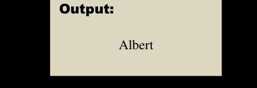

## 使用 while 循环语句打印前十个自然数的 C++ 程序

while 循环语句的语法如下：

```cpp
while (this is the condition)
{
    execute this statement;
}
```

```java
public class HelloWorld {
    public static void main(String[] args) {
        String x = "Albert#Einstein#profoundly#changed#physics&";
        String y = x.replaceAll("[^a-zA-Z0-9]", " ");
        System.out.println(y);
    }
}
```

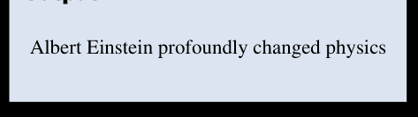

```cpp
#include<iostream>

using namespace std;

int main()
{
    int i = 1;
    while (i<=10)
    {
        cout<<"\n "<< i++;
    }
    return 0;
}
```

```java
public class HelloWorld {
    public static void main(String[] args) {
        for (int x=1; x<=5; x++){
            for (int y=1; y<=x; y++)
                System.out.print("*");
            System.out.println(" ");
        }
    }
}
```

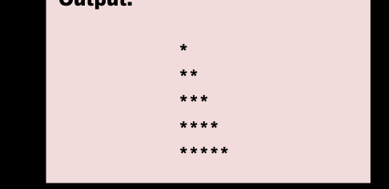

屏幕上的输出为：
1
2
3
4
5
6
7
8
9
10

```java
public class HelloWorld {
    public static void main(String[] args) {
        for (int x=5; x>=1; x--){
            for (int y=1; y<=x; y++)
                System.out.print("*");
            System.out.println(" ");
        }
    }
}
```

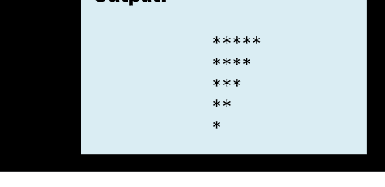

`(i<=10)` 是条件，语句：
```cpp
cout<<"\n "<< i++;
```
只要给定条件 `(i<=10)` 为真，就会被反复执行。

## 继承

在先前编写的代码基础上构建新代码的技术。

如果语句：
```cpp
int i=1;
```
被替换为如下语句：
```cpp
int i;
```
那么控制台屏幕上将显示**编译错误**，因为**初始化**未定义[即，未声明从何处开始]。

如果语句：
```cpp
int i = 1;
```
被替换为 `int i = 0;`

那么屏幕上的输出为：
```
0
1
2
3
4
5
6
7
8
9
10
```

类似地，如果语句 `int i = 0;` 被替换为 `int i = 7;`

那么屏幕上的输出为：
```
7
```

## 项目式学习

一种涉及创建实际项目的学习方法。

```java
public class HelloWorld {
    public static void main(String[] args) {
        String x= "Albert Einstein profoundly changed physics.";
        String y=x.replaceAll("[AEIOUaeiou]", "");
        System.out.println(y);
    }
}
```

**输出：**
lbrt nstn prfndly chngd physcs.

```java
public class HelloWorld {
    public static void main(String[] args) {
        System.out.println("Albert Einstein");
        System.exit(0);
    }
}
```

**输出：**
Albert Einstein

## Blockly

Code.org 的积木编程语言，用于教儿童编程。

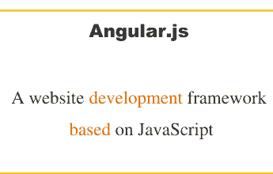

- **使用 `do while 循环`语句打印前 10 个数字的 C++ 程序**

do while 循环语句的语法如下：

```cpp
do
{
    execute this statement;
}
while(this is the condition);
```

```cpp
#include<iostream>
using namespace std;
int main(){
    int i =1;
    do
    {
        cout<<" \n i = "<< i++;
    } while (i<=10);
    return 0;
}
```

```java
public class HelloWorld {
    void mult(int a, int b) {
        System.out.println(a*b);
    }
    void mult(double a, double b) {
        System.out.println(a*b);
    }
    void mult(double a, int b) {
        System.out.println(a*b);
    }
    public static void main(String args[]) {
        HelloWorld x = new HelloWorld();
        x.mult(20,30);
        x.mult(30.12,12.24);
        x.mult(50.15,9);
    }
}
```

| 输出 | 值 |
| :--- | :--- |
| | 600 |
| | 368.66880000000003 |
| | 451.34999999999997 |

屏幕上的输出为：
i=1
i=2
i=3
i=4
i=5
i=6
i=7
i=8
i=9
i=10

```java
public class HelloWorld {
    public static void main(String[] args) {
        String x = "005-065777";
        String[] y = x.split("-");
        String a = y[0];
        String b = y[1];
        System.out.println(a);
        System.out.println(b);
    }
}
```

| 输出 | 值 |
| :--- | :--- |
| | 005 |
| | 065777 |

```java
import java.time.LocalDateTime;

public class HelloWorld {
    public static void main(String[] args) {
        LocalDateTime x = LocalDateTime.now();
        System.out.println(x);
    }
}
```

语句：
```cpp
cout<<" \ni= "<< i++;
```
被执行后，检查条件 `(i<=10)`。如果条件 `(i<=10)` 为真，则语句：
```cpp
cout<<" \ni= "<< i++;
```
将再次执行。此过程重复进行，直到给定的**条件** `(i<=10)` 变为假。

- **编写一个程序，使用 for 循环语句打印"When in doubt use brute force" 100 次。**

**答案：**

```cpp
#include<iostream>
using namespace std;
int main()
{
    int i;
    for(i=0; i<=99; i++)
        cout<<"\n When in doubt use brute force";
    return 0;
}
```

```java
import java.util.List;
import java.util.stream.Stream;
import java.util.stream.Collectors;

public class HelloWorld {
    public static void main(String[] args) {
        List<Integer> x = Stream.of(11, 12, 13).collect(Collectors.toList());
        System.out.println(x);
    }
}
```

**输出：**
[11, 12, 13]

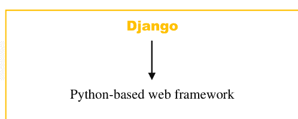

- **程序 6.3**
使用 *for 循环*、*do while 循环*和 *while 循环*语句打印从 **A 到 Z** 的字符的 C++ 程序。

- **使用 *for 循环*语句打印从 A 到 Z 的字符的 C++ 程序：**

```cpp
#include<iostream>
using namespace std;
int main()
{
    char a;
    for( a='A'; a<='Z'; a++)
        cout<< " \n"<< a;
    return 0;
}
```

```java
public class HelloWorld {
    public static void main(String[] args) {
        int x=20, y=60;
        if((x < y) && (y+1 < 105)) {
            System.out.println("Albert Einstein");
        } else {
            System.out.println(y);
        }
    }
}
```

**输出：**
Albert Einstein

**屏幕上的输出：**
A
B
C
D
E
F
G
H
I

```java
public class HelloWorld {
    public static void main(String[] args) {
        if(2 + 2 + 2 + 2 + 2 == 10){
            System.out.print("True");
        } else {
            System.out.print("False");
        }
    }
}
```

**输出：**
True


 ```
public class HelloWorld {
    public static void main(String[] args) {
        int x = 0;
        for (int i = 1; i <= 50; i++) {
            if (i % 2 == 1) {
                x = x + 1;
            }
        }
        System.out.println("There are " + x + " odd numbers from 1 to 50");
    }
}
```

Output:

There are 25 odd numbers from 1 to 50

如果将语句`for( a='A'; a<='Z'; a++)`写成`for( a=A; a<=Z; a++)`，也就是说，用A代替'A'，用Z代替'Z'，那么屏幕上将显示**编译错误**。

-   使用while循环语句打印从A到Z的字符的C++程序：

```
#include<iostream>
using namespace std;
int main()
{
    char a = 'A';
    while (a<='Z')
    {
        cout<<" \n"<< a++;
    }
    return 0;
}
```

```
public class HelloWorld {
    public static void main(String[] args) {
        int x = 0;
        for (int i = 1; i <= 100; i++) {
            if (i % 2 == 0) {
                x = x + 1;
            }
        }
        System.out.println("There are " + x + " even numbers from 1 to 100");
    }
}
```

Output:

There are 50 odd numbers from 1 to 100

## 使用do while循环语句打印从A到Z的字符的C++程序：

```
#include<iostream>
using namespace std;
int main()
{
    char a = 'A';
    do
    {
        cout<<" \n"<< a++;
    } while (a<='Z');
    return 0;
}
```

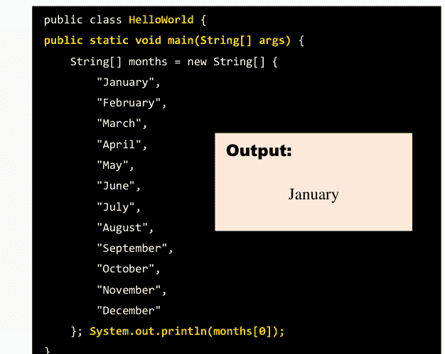

## 程序 6.4

判断给定数字是偶数还是奇数的C++程序。

```
#include<iostream>
using namespace std;
int main()
{
    int a;
    cout<<"Enter any number";
    cin>>a;
    if(a%2 == 0)
    {
        cout<<"the number is even";
    }
    else
    {
        cout<<"the number is odd";
    }
    return 0;
}
```

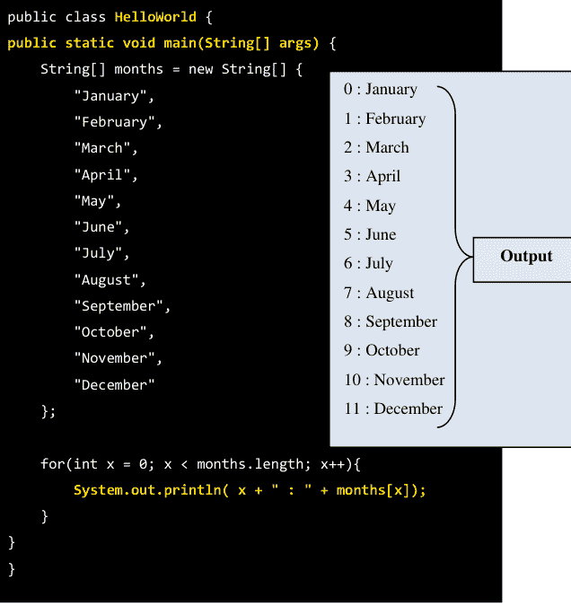

### 屏幕上的输出：

```
Enter any number:
If you enter the number 6
the number is even
will be outputted on the screen.
```

**Express.js**

**Node.js**的后端Web应用框架

-   程序 6.5

打印两个数余数的C++程序

```
#include<iostream>
using namespace std;
int main()
{
    int a, b, c;
    cout<<"Enter any number:";
    cin>>a;
    cout<<"Enter any number:";
    cin>>b;
    c = a % b;
    cout<<"the remainder of a and b = "<< c;
    return 0;
}
```

```
public class HelloWorld {
    public static void main(String[] args) {
        for (char x = 'a'; x <= 'c'; x++) {
            for (char y = 'a'; y <= x; y++) {
                System.out.print(y +" ");
            }
            System.out.println();
        }
    }
}
```

```
**Output:**

         a
       a b
     a b c
```

### 屏幕上的输出：

```
Enter any number:
If you enter the number 3
Enter any number:
If you enter the number 2
the remainder of a and b = 1

will be outputted on the screen.
```

```
**Python code:**

a = "Albert"
print(type(a))
# Output: <class 'str'>

a = True
b = False
print(type(a))
print(type(b))
## Output:
<class 'bool'>
<class 'bool'>
```

303

如果将语句：

```
cout<<"the remainder of a and b = "<< c;
```

替换为语句：

```
cout <<" the remainder of "<<a <<"and"<< b <<"= "<< c;
```

即，

```
#include<iostream>
using namespace std;
int main()
{
    int a, b, c;
    cout<<"Enter any number:";
    cin>>a;
    cout<<"Enter any number:";
    cin>>b;
    c = a % b;
    cout <<" the remainder of "<<a <<"and"<< b <<"= "<< c;
    return 0;
}
```

### 屏幕上的输出：

```
Enter any number:

If you enter the number 3

Enter any number:

If you enter the number 2

the remainder of 3 and 2 = 1

will be outputted on the screen.
```

## HAML

（HTML抽象标记语言）

一种模板框架，通过避免在Web文档中编写内联代码，使HTML更简洁、更简单

```
string = "Albert"
list = ["Albert", "John", "Mary", "David", "Ram"]
tuple = ("1", "9", "0", "5")
dictionary = {
    "Albert": "Einstein",
    "Alan": "Turing",
    "Stephen": "Hawking",
    "John": "Calvin",
}
print("The length of string is: ", len(string))
print("The length of list is: ", len(list))
print("The length of tuple is: ", len(tuple))
print("The length of dictionary is: ", len(dictionary))
```

## 输出：

The length of string is: 6
The length of list is: 5
The length of tuple is: 4
The length of dictionary is: 4

```
x = ["Car", "Book", "Pencil", "House", "Box"]
y = ["Old " + i for i in x]
print(y)
```

## 输出：

['Old Car', 'Old Book', 'Old Pencil', 'Old House', 'Old Box']

## C程序：

```
#include <stdio.h>

int main()
{
    int x = 0;
    while (1) {
        printf("%d\n", x++);
        if (x == 4)
            break;
    }
    return 0;
}
```

## 输出：

0
1
2
3

## C程序：

```
#include <stdio.h>

int main()
{
    int x = 0, flag=0;
    while (0) {
        printf("%d\n", x++);
        if (x == 4)
            break;
    }
    if (flag==0)
        printf ("while loop will never get executed");
    return 0;
}
```

## 输出：

while loop will never get executed

-   程序 6.6

检查两个数字是否相等的C++程序

```
#include<iostream>
using namespace std;
int main()
{
    int x, y;
    cout<<"Enter any number:";
    cin>>x;
    cout<<"Enter any number:";
    cin>>y;
```

| Checked Exception | Unchecked Exception |
| :--- | :--- |
| An exception thrown at compile time when the source code is translated into an executable code | An exception thrown at run-time when the executable code starts running |

```
if(x==y==0)
{
    cout<<"The two numbers are equivalent";
}
else
{
    cout<<"The two numbers are not equivalent";
}
return 0;
}
```

```
public class HelloWorld {
    public static void main(String[] args) {
        String x = "115";
        System.out.println( Integer.parseInt( x ));
    }
}
```

Output:
115

### 屏幕上的输出：

Enter any number:
If you enter the number 2
Enter any number:
If you enter the number 2
The two numbers are equivalent
will be outputted on the screen.

```
public class HelloWorld {
    public static void main(String[] args) {
        char x = '5';
        int y = Integer.parseInt(String.valueOf(x));
        System.out.println(y);
    }
}
```

Output:
5

-   程序 6.7

判断给定数字是正数还是负数的C++程序。

```
#include<iostream>
using namespace std;
int main()
{
    int a;
    a = -35;
    if(a>0)
    {
        cout<<"Number is positive";
    }
    else
```

```
import java.util.*;

public class HelloWorld {
    public static void main(String[] args) {
        List<Integer> x = new ArrayList<Integer>();
        x.add(19);
        x.add(16);
        x.add(15);
        x.add(12);
        x.add(10);
        System.out.println("Smallest element in the collection: "+Collections.min(x));
    }
}
```

Output:
10

```
{
    cout<<"Number is negative";
}
return 0;
}
```

### 屏幕上的输出：

```
Number is negative
```

```
import java.util.*;

public class HelloWorld {
    public static void main(String[] args) {
        List<Integer> x = new ArrayList<Integer>();
        x.add(19);
        x.add(16);
        x.add(15);
        x.add(12);
        x.add(10);
        System.out.println("Largest element in the collection: "+Collections.max(x));
    }
}
```

**Output:**

Largest element in the collection: 19

-   程序 6.8

使用**for循环**语句打印前10个数字之和的C++程序

```
#include<iostream>
using namespace std;
int main()
{
    int i, sum = 0;
    for(i=1; i<=10; i++)
        sum = sum + i;
    cout<<"sum of the first 10 digits = "<< sum;
    return 0;
}
```

```
import java.util.*;

public class HelloWorld {
    public static void main(String[] args) {
        List<Integer> x = new ArrayList<Integer>();
        x.add(19);
        x.add(16);
        x.add(15);
        x.add(12);
        x.add(10);
        System.out.println(x);
    }
}
```

**Output:**

[19, 16, 15, 12, 10]

### 屏幕上的输出：

```
sum of the first 10 digits = 55
```

-   前10个数字之和 = 55是如何通过**for循环语句**在屏幕上输出的？

i=1 (sum = 0，因为在语句int i, sum = 0;中sum被初始化为0)
i<=10是否为真？
是的，执行以下操作
sum = sum + i = 0 +1 =1
现在，

```
public class HelloWorld {
    public static void main(String[] args) {
        byte x =65;
        char y = (char) x;
        // prints 65
        System.out.println(x);
        // prints A (ASCII is 65 for A)
        System.out.println(y);
    }
}
```

i=2 (sum = 1)
i<=10是否为真？
是的，执行以下操作
sum = sum + i = 1 +2 =3
现在，

i=3 (sum = 3)
i<=10是否为真？
是的，执行以下操作
sum = sum + i = 3 + 3 = 6
现在，

```
public class HelloWorld {
    public static void main ( String args[]){
        String x;
        int y = 6;
        x = ( y == 3) ? "Alan" : "Albert";
        System.out.println(x);
    }
}
```

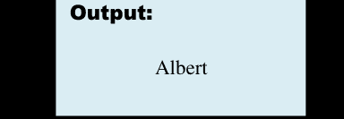

i=4 (sum = 6)
i<=10是否为真？
是的，执行以下操作
sum = sum + i = 6 + 4= 10
现在，

i=5 (sum = 10)
i<=10是否为真？
是的，执行以下操作
sum = sum + i = 10 + 5= 15
现在，

i=6 (sum = 15)
i<=10是否为真？
是的，执行以下操作
sum = sum + i = 15 + 6 = 21
现在，

```
public class HelloWorld {
    public static void main(String[] args) {
        int x;
        int[] num = new int[]{1, 3, 4, 5, 6, 7};
        x = 7;
        int y = x * ((x + 1) / 2);
        int z = 0;
        for (int i: num) {
            z += i;
        }
        System.out.print("Missing Number: " + (y - z));
    }
}
```

i=7 (sum = 21)
i<=10是否为真？
是的，执行以下操作
sum = sum + i = 21 + 7 = 28
现在，

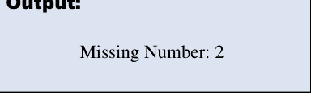

i=8 (sum = 28)
i<=10是否为真？
是的，执行以下操作
sum = sum + i = 28 + 8 = 36
现在，
```


i=3
i<=5 为真吗？
是的，打印此项
2 * 3 = 6
使用语句 `cout<< n <<" * " <<" i <<" = "<< n*i;`

现在，
i=4
i<=5 为真吗？
是的，打印此项
2 * 4 = 8
使用语句 `cout<< n <<" * " <<" i <<" = "<< n*i;`

现在，
i=5
i<=5 为真吗？
是的，打印此项
2 * 5 = 10
使用语句 `cout<< n <<" * " <<" i <<" = "<< n*i;`

现在，
i=6
i<=5 为假吗？
停止，因为未满足条件 i<=5。

```
public class HelloWorld {
    public static void main(String[] args) {
        int i, sum = 0;
        for(i=1; i<=10; i++)
            sum = sum + i;
        System.out.println("sum of the first 10 digits = " + sum);
    }
}
```

输出：
sum of the first 10 digits = 55

```
public class HelloWorld {
    public static void main(String[] args) {
        int i, sum = 1;
        for(i=1; i<=10; i++)
            sum = sum + i;
        System.out.println("sum of the first 10 digits = " + sum);
    }
}
```

输出：
sum of the first 10 digits = 56

- 如果将 for 循环语句 `for(i=1; i<=10; i++)` 替换为语句 `for(i=2; i<10; i++)`，输出将是什么？

答案：sum of 10 digits = 44

## 知识工程 (Knowledge engineering)

人工智能的一个分支，旨在开发应用于数据的规则，以模拟人类专家的思维过程。

如果将 `int i, sum = 0;` 写成 `int i, sum, sum = 0;`

那么屏幕上将显示*编译错误信息*（提示 sum 被重复声明）。

如果 *for 循环* 以分号结尾，即：

```
for( i=1; i<=10; i++);
```

那么控制台屏幕上将显示*编译错误*。

```
import java.text.SimpleDateFormat;
import java.util.Date;

public class HelloWorld {
    public static void main(String[] args) {
        String pattern = "MM-dd-yyyy";
        SimpleDateFormat simpleDateFormat = new SimpleDateFormat(pattern);
        String x = simpleDateFormat.format(new Date());
        System.out.println(x);
    }
}
```

输出：
06-14-2022

- 程序 6.9

使用 *for 循环* 语句打印前 10 个数字平均值的 C++ 程序。

```
#include<iostream>
using namespace std;
int main()
{
    int i, avg, sum = 0;
    for( i=1; i<=10; i++)
        sum = sum + i;
    avg = sum/10;
    cout<<"sum of the first 10 numbers = "<< sum;
    cout<<"average of the first 10 numbers = "<< avg;
    return 0;
}
```

```
public class HelloWorld {
    public static void main(String[] args) {
        int a = 20*20-20;
        System.out.println(a);
    }
}
```

输出：
380

屏幕上的输出：

```
sum of the first 10 numbers = 55
average of the first 10 numbers = 5
```

```
public class HelloWorld {
    public static void main(String[] args) {
        double x = 1.66666666;
        String y = Double.toString(x);
        System.out.println(y);
    }
}
```

输出：
1.66666666

前 10 个数字的平均值 = 55/10 = 5.5 而不是 5。但**屏幕上的输出**是：

average of the first **10** numbers = **5**

因为使用了 int 而不是 float。

```
import java.util.ArrayList;
import java.util.Arrays;
import java.util.List;
import java.util.stream.Collectors;

public class HelloWorld {
    public static void main(String[] args) {
        List<Integer> x = new ArrayList<>(Arrays.asList(11, 20, 11, 12, 12, 13, 50, 13, 23, 14, 25, 25));
        // print the list with duplicates
        System.out.println(x);
        List<Integer> y = x.stream().distinct().collect(Collectors.toList());
        // print the list with duplicates removed
        System.out.println(y);
    }
}
```

如果使用 **数据类型** float，即：

```
#include<iostream>
using namespace std;
int main()
{
    float i, avg, sum = 0;
    for( i=1; i<=10; i++)
        sum = sum + i;
    avg = sum/10;
    cout<<"sum of the first 10 numbers = "<< sum;
    cout<<"average of the first 10 numbers = "<< avg;
    return 0;
}
```

**输出：**

[11, 20, 11, 12, 12, 13, 50, 13, 23, 14, 25, 25]
[11, 20, 12, 13, 50, 23, 14, 25]

屏幕上的输出：

sum of the first 10 numbers = **55**

average of the first 10 numbers = **5.5**

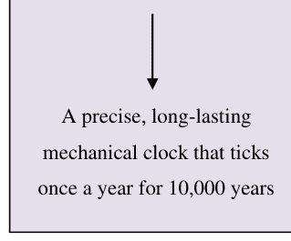

- **程序 7.0**

使用 **for 循环** 语句打印前 10 位数字乘积的 C++ 程序。

```
#include<iostream>
using namespace std;
int main()
{
    int i, product = 1;
    for( i=1; i<=10; i++)
        product = product * i;
    cout<<"the product of the first 10 digits =%d", product;
    return 0;
}
```

## 算法问责制 (Algorithmic accountability)

这种观点认为，企业组织应对其预设算法产生的不公平结果负责。

屏幕上的输出：

```
the product of the first 10 digits = 3628800
```

- 前 10 位数字的乘积 = 3628800 是如何通过 for 循环语句输出到屏幕上的？

i=1（product = 1，因为在语句 `int i, product = 1;` 中 product 被初始化为 1）
i<=10 为真吗？
是的，执行此项
product = product * i = 1 * 1 = 1
现在，
i=2 (product = 1)
i<=10 为真吗？
是的，执行此项
product = product * i = 1 * 2 = 2
现在，
i=3 (product = 2)
i<=10 为真吗？
是的，执行此项
product = product * i = 2 * 3 = 6
现在，
i=4 (product = 6)
i<=10 为真吗？
是的，执行此项
product = product * i = 6 * 4 = 24
现在，
i=5 (product = 24)
i<=10 为真吗？
是的，执行此项
product = product * i = 24 * 5 = 120
现在，
i=6 (product = 120)
i<=10 为真吗？
是的，执行此项
product = product * i = 120 * 6 = 720
现在，
i=7 (product = 720)
i<=10 为真吗？
是的，执行此项
product = product * i = 720 * 7 = 5040
现在，
i=8 (product = 5040)
i<=10 为真吗？
是的，执行此项
product = product * i = 5040 * 8 = 40320
现在，
i=9 (product = 40320)
i<=10 为真吗？
是的，执行此项
product = product * i = 40320 * 9 = 362880
现在，
i=10 (product = 362880)
i<=10 为真吗？
是的，执行此项
product = product * i = 362880 * 10 = 3628800
停止，因为满足了条件 i<=10。

```
import java.util.*;
public class HelloWorld {
    public static void main(String[] args) {
        String x = "Alan";
        String y = "Turing";
        // print String before swapping
        System.out.println(x + " " + y);

        x = x + y;
        y = x.substring(0, x.length() - y.length());
        x = x.substring(y.length());
        // print String after swapping
        System.out.println(x + " " + y);
    }
}
```

输出：

Alan Turing
Turing Alan

```
public class HelloWorld {
    public static void main(String[] args) {
        String x = "alan turing";
        x = x.replace("tu", "");
        System.out.println(x);
    }
}
```

输出：
alan ring

```
public class HelloWorld {
    public static void main(String[] args) {
        for(int x=4; x>=0; x--) {
            System.out.println();
            for(int y=x; y<4; y++) {
                System.out.print(" a ");
            }
        }
        System.out.println();
    }
}
```

输出：
a
a a
a a a
a a a a

语句：

数据点：一个离散的信息单位。

```
cout<<"the product of the first 10 digits = "<< product;
```

被执行以显示输出：

```
public class HelloWorld {
    public static void main(String[] args) {
        double x = 85.78;
        System.out.println(Math.round(x));
        float y = 7777.658999f;
        System.out.println(Math.round(y));
    }
}
```

the product of the first 10 digits = 3628800

**输出：**

86
7778

如果语句：

```
`int i, product = 1;` 被替换为 `int i, product = 0;`
```

那么屏幕上的输出为：

the product of the first 10 digits = 0

> **缓存算法 (Cache algorithm)**

↓

一种用于管理计算机信息缓存的算法。

如果语句：

```
`for(i=1; i<=10; i++)` 被替换为 `for(i=5; i<=8; i++)`
```

那么屏幕上的输出为：

the product of the first 10 digits = 1680

- **程序 7.1**

使用 *for 循环* 语句打印一个数字乘法表的 C++ 程序。

```
#include<iostream>
using namespace std;
int main()
{
    int n, i;
    cout<<"Enter any number:";
    cin>>n;
    for( i=1; i<=5; i++)
        cout<< n <<" * "<< i <<" = "<< n*i;
    return 0;
}
```

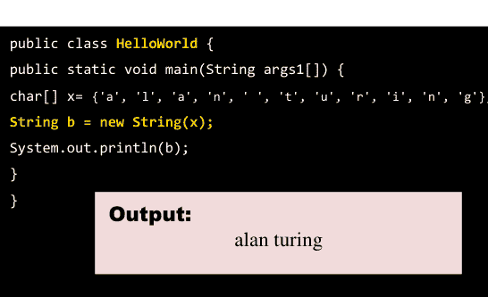

屏幕上的输出：

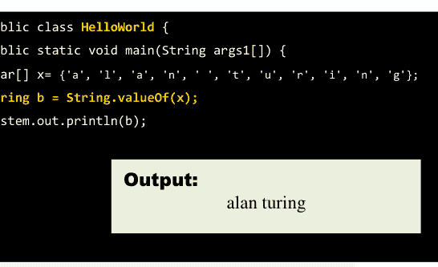

Enter any number: 2
如果你输入数字 2（即 n=2）
2 * 1 = 2
2 * 2 = 4
2 * 3 = 6
2 * 4 = 8
2 * 5 = 10
将输出在屏幕上。

- `for 循环` 语句的执行方式。

因为你输入了数字 2，所以：n=2。
i=1
i<=5 为真吗？
是的，打印此项
2 * 1 = 2
使用语句 `cout<< n <<" * " <<" i <<" = "<< n*i;`

现在，
i=2
i<=5 为真吗？
是的，打印此项
2 * 2 = 4
使用语句 `cout<< n <<" * " <<" i <<" = "<< n*i;`

现在，
i=3
i<=5 为真吗？
是的，打印此项
2 * 3 = 6
使用语句 `cout<< n <<" * " <<" i <<" = "<< n*i;`

现在，
i=4
i<=5 为真吗？
是的，打印此项
2 * 4 = 8
使用语句 `cout<< n <<" * " <<" i <<" = "<< n*i;`

现在，
i=5
i<=5 为真吗？
是的，打印此项
2 * 5 = 10
使用语句 `cout<< n <<" * " <<" i <<" = "<< n*i;`

现在，
i=6
i<=5 为假吗？
停止，因为未满足条件 i<=5。

### CRUSH
(Controlled Replication Under Scalable Hashing，可扩展哈希下的受控复制)

一种基于哈希的算法，用于确定在分布式基于对象的存储集群中如何存储和检索信息以及存储位置。


i<=5 为真吗？
是的，打印此内容
2 * 3 = 6
使用语句 `cout<< n <<" * "<< i <<" = "<< n*i;`

现在，
i=4
i<=5 为真吗？
是的，打印此内容
2 * 4 = 8
使用语句 `cout<< n <<" * "<< i <<" = "<< n*i;`

现在，
i=5
i<=5 为真吗？
是的，打印此内容
2 * 5 = 10
使用语句 `cout<< n <<" * "<< i <<" = "<< n*i;`

现在停止，因为条件 i<=5 已达成。

## 算法透明度
这种理念认为，个人应该能够看到或理解影响算法决策的各个方面。

如果符号 * 被替换为 +
即：

```java
public class HelloWorld {
    public static void main(String args1[]) {
        String x = "550";
        int b = Integer.decode(x);
        System.out.println(" "+ b);
    }
}
```

```cpp
#include<iostream>
using namespace std;
int main()
{
    int n, a;
    cout<<"Enter any number:";
    cin>>n;
    for( i=1; i<=5; i++)
        cout<< n <<" + "<< i <<" = "<< n + i <<endl;
    return 0;
}
```

```
Output:
550
```

那么**屏幕上的输出为**：

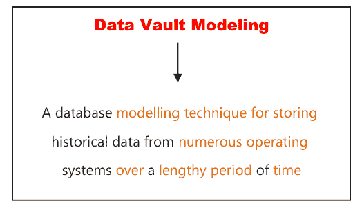

Enter any number:

如果你输入数字 2 (即 n=2)

2 + 1 = 3

2 + 2 = 4

2 + 3 = 5

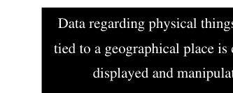

2 + 4 = 6

2 + 5 = 7

将被输出到屏幕上。


```
[manju@localhost ~]$ time perl -le '$n=0;foreach (1..10) {$n++}'

real    0m0.015s
user    0m0.000s
sys     0m0.004s

[manju@localhost ~]$ time perl -le '$n=0;foreach (1..10) {$n+1}'

real    0m0.016s
user    0m0.000s
sys     0m0.005s
```


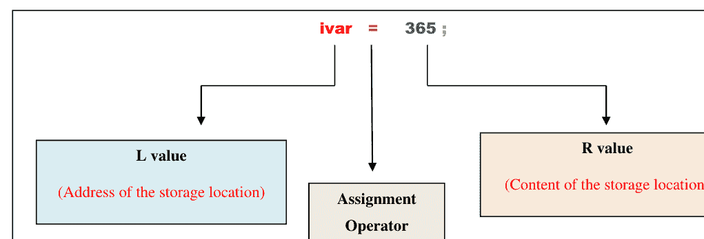

C 程序：

```c
#include <stdio.h>
#include <stdlib.h>
#include <string.h>
int main()
{
    int b;
    char a[] = "1905Papers";
    b = atoi(a);
    printf("%d\n", b);
    return (0);
}
```

输出：
1905

## 程序 7.2
C++ 程序：
如果你输入字符 M
输出必须是：ch = M

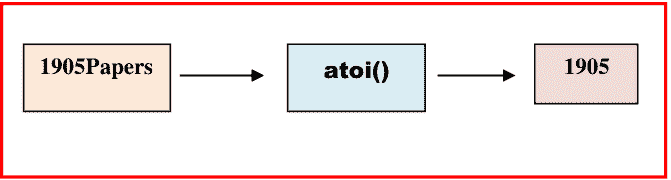

```cpp
#include<iostream>
using namespace std;
int main()
{
    char M;
    cout<<"Enter any character:";
    cin>>M;
    cout<<"ch= "<< M;
    return 0;
}
```

灵活部署：
一种部署方法，让你能够完全控制应用程序如何执行以及在何处执行。

屏幕上的输出：

```
Enter any character:

If you enter the character M

ch = M

will be outputted on the screen.
```

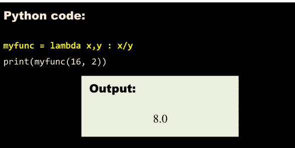

- 注意：

如果我们把语句：`cin>>M`; 替换为语句：

```cpp
M = getchar();
```

即：

```cpp
#include<iostream>
using namespace std;
int main()
{
    char M;
    cout<<"Enter any character:";
    M = getchar();
    cout<<"ch= "<< M ;
    return 0;
}
```

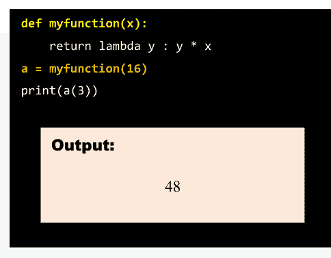

屏幕上的输出将不会有变化，即屏幕上的输出为：

```
Enter any character:

If you enter the character K

ch = K

will be outputted on the screen.
```

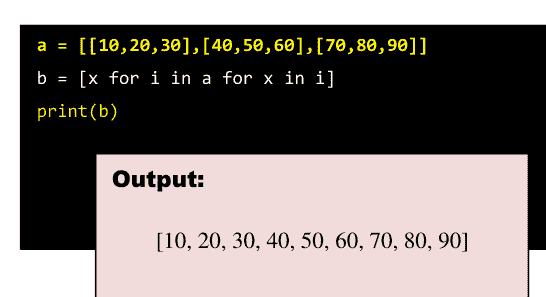

如果我们把语句：`cout<<"ch= "<< M;` 替换为语句：

`putchar(M);`

即：

```cpp
#include<iostream>
using namespace std;
int main()
{
    char M;
    cout<<"Enter any character:";
    cin>>M;
    putchar(M);
    return 0;
}
```

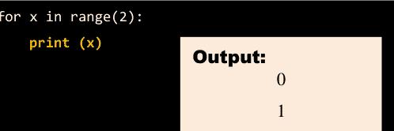


屏幕上的输出将**没有任何变化**，即屏幕上的输出为：

```
Enter any character:
If you enter the character M
M will be outputted on the console screen.
```

如果我们把语句：`cin>>M;` 替换为语句：

`M = getchar();`

以及语句：

```cpp
cout<<"ch= "<< M;
```


替换为语句：

`putchar(M);` 即：

```cpp
#include<iostream>
using namespace std;
int main()
{
    char M;
    cout<<"Enter any character:";
    M = getchar();
    putchar(M);
    return 0;
}
```

```python
a = "Albert Einstein was born in Ulm"
b = a.split(' ')
print(b)
print(' '.join(b))
```

**输出：**

['Albert', 'Einstein', 'was', 'born', 'in', 'Ulm']
Albert Einstein was born in Ulm

**屏幕上的输出：**

Enter any character:
If you enter the character S
S will be outputted on the screen.

- 编写一个程序来打印一个数的绝对值。

**答案：**

```python
# Python Program to delete a file

import os

os.remove("1.txt")

print("1.txt file does not exist")
```

```cpp
#include<iostream>
#include<cmath>
using namespace std;
int main()
{
    int a, b;
    a= - 2;
    b= abs(a);
    cout<<" absolute value of a = "<< b<< endl;
    return 0;
}
```

321

屏幕上的输出：

```
absolute value of a = 2
```

## 集群
一组互连的虚拟机被视为一个单一实体，以实现负载均衡、自动扩缩容和高可用性。

- 程序 7.2

打印从 1 开始的前 5 个数字及其平方的 C++ 程序

```cpp
#include<iostream>
using namespace std;
int main()
{
    int i;
    for( i=1; i<=5; i++)
        cout<<"\n number = "<< i <<"its square = "<< i*i;
    return 0;
}
```

屏幕上的输出：

```
number=1 its square=1
number=2 its square=4
number=3 its square=9
number=4 its square=16
number=5 its square=25
```

```python
def myfunc(a):
    a.append(15)
a = [12, 13, 14]
print(a)
myfunc(a)
print(a)
```

输出：

```
[12, 13, 14]
[12, 13, 14, 15]
```

- 执行过程如何通过 **for 循环** 语句进行

```
i=1
i<=5 为真吗？
是的，打印此内容
number=1 its square=1
使用语句 cout<<"\n number = "<< i <<"its square =  "<< i*i;

现在，
i=2
i<=5 为真吗？
是的，打印此内容
number=2 its square=4
使用语句 cout<<"\n number = "<< i <<"its square =  "<< i*i;

现在，
i=3
i<=5 为真吗？
是的，打印此内容
number=3 its square=9
使用语句 cout<<"\n number = "<< i <<"its square =  "<< i*i;

现在，
i=4
i<=5 为真吗？
是的，打印此内容
number=4 its square=16
使用语句 cout<<"\n number = "<< i <<"its square =  "<< i*i;

现在，
i=5
i<=5 为真吗？
是的，打印此内容
number=5 its square=25
使用语句 cout<<"\n number = "<< i <<"its square = "<< i*i;

现在停止，因为条件 (i<=5) 已达成。
```

- **注意：**

如果语句

### Cron 任务
一种 Linux 命令，允许我们计划在未来的某个时间执行任务。

```cpp
cout<<"\n number = "<< i <<"its square = "<< i*i;
```

被替换为语句：

```cpp
cout<<"\n number =  "<< i <<"\t its square =  "<< i*i;
```

那么**屏幕上的输出**是：

**制表符** /t 被包含在内是为了在以下内容之间留出空格：

number=1 **和** its square=1

假设 `cout<<"\n number =  "<< i <<"\t its square =  "<< i*i;` 被替换为语句

```cpp
cout<<"\n number =  "<< i <<"\n its square =  "<< i*i;
```

那么**屏幕上的输出**是：


```
number=3
its square=9
number=4
its square=16
number=5
its square=25
```

> **堡垒机**
一种专门的服务器，被设计为可从公共网络访问，并配置为能够抵御网络攻击。

- 编写一个程序来打印从 1 开始的前 10 个数字及其平方和立方？

```python
def myfunc(**kwargs):
    for i, x in kwargs.items():
        print(i + ": " + x)
myfunc(physicist = "Stephen", cosmologist = "William",  author = "Hawking")
```

答案：

```cpp
#include<iostream>
using namespace std;
int main()
{
    int i;
    for( i=1; i<=10; i++)
        cout<<"number = "<< i <<" its square = "<< i*i <<" its cube = "<< i*i*i<< endl;
    return 0;
}
```

> **输出：**

physicist: Stephen
cosmologist: William
author: Hawking

- 程序 7.3

## 打印 x 的地址及其赋值的 C++ 程序

```python
import pandas as pd
a = pd.Series([3, 4, 13, 30, 13])
b = pd.Series([13, 13, 30, 27, 29])
a=a[~a.isin(b)]
print(a)
```

```cpp
#include<iostream>
using namespace std;
int main()
{
    int x, *p;
    cout<<"Enter any integer:";
    cin>>x;
```

> **输出：**

0 3

1 4

dtype: int64


 ```
p = &x;
cout<<"The address of the variable x = " << p;
cout<<"The value of the variable x = " << *p;
return 0;
}
```

```
# union of series

import pandas as pd
import numpy as np
a = pd.Series([3, 4, 13, 30, 13])
b = pd.Series([13, 13, 30, 27, 29])
c = pd.Series(np.union1d(a, b))
print(c)
```

屏幕上的输出：


输入任意整数：
如果输入整数 1
The address of the variable x = 0x7fffc60478a4
The value of the variable x = 1
将会输出到屏幕上。

如果语句：

```
cout<<"The address of the variable x = " << p;
cout<<"The value of the variable x = " << *p;
```

被替换为语句：

```
cout<<"The address of the variable x = " << p << "its value = " << *p;
```

```
# intersection of series

import pandas as pd
import numpy as np
a = pd.Series([3, 4, 13, 30, 13])
b = pd.Series([13, 13, 30, 27, 29])
c = pd.Series(np.intersect1d(a, b))
print(c)
```

即：

```
#include<iostream>
using namespace std;
int main()
{
int x, *p;
cout<<"Enter any integer";
cin >> x;
p = &x;
```


```
cout<<"The address of the variable x = "<< p <<"its value = "<< *p;
return 0;
}
```

那么**屏幕上的输出**为：

The address of the variable x = 0x7fff78508cc4 its value = 2

## 使用指针打印两个数之和的 C++ 程序

```
#include<iostream>
using namespace std;
int main()
{
    int x, y, *p, *q, sum;
    cout<<"Enter any number:";
    cin >> x;
    cout<<"Enter any number:";
    cin >> y;
    p = &x;
    q = &y;
    sum = *p + *q;
    cout<<"\n sum of entered numbers = "<< sum;
    return 0;
}
```

```
C program:

#include <stdio.h>
int main() {
    int x =25;
    (x>=56)? (printf("Albert")) : (printf("Einstein"));
    return 0;
}
```

```
Output:

Einstein
```

```
#include <stdio.h>
int main() {
    int x =151;
    (x>=56)? (printf("Albert")) : (printf("Einstein"));
    return 0;
}
```

**屏幕上的输出：**

```
Output:

Albert
```

```
Enter any number:

If you enter the number 4

Enter any number:

If you enter the number 3
```

sum of entered numbers = 7

将会输出到屏幕上。

- 使用指针打印两个数的乘积、差和商的 C++ 程序

```
#include<iostream>
using namespace std;
int main()
{
    int x, y, *p, *q, product, subtract, div;
    cout<<"Enter any number:";
    cin>> x;
    cout<<"Enter any number:";
    cin>> y;
    p = &x;
    q = &y;
    product = *p * *q;
    subtract = *p - *q;
    div= *p / *q;
    cout<<"\n product of product entered numbers = "<< product;
    cout<<"\n subtract of entered numbers = "<< subtract;
    cout<<"\n division of entered numbers = "<< div;
    return 0;
}
```

```
#include<stdio.h>
#define solve(s,t,u,m,p,e,d) m##s##u##t
#define start solve(a,n,i,m,a,t,e)

int start() {
    printf("Albert Einstein");
    return 0;
}
```


```
#include <stdio.h>
int main() {
    float x = 6.77;
    int y = (int)x+1;
    printf("%d\n", y);
    return 0;
}
```

屏幕上的输出：

输入任意数字：
如果输入数字 4
输入任意数字：
如果输入数字 2
product of entered numbers = 8


```
subtract of entered numbers = 2
division of entered numbers = 2

将会显示在屏幕上。
```

- **使用指针找出两个数中较大者的 C++ 程序**

```
#include<iostream>
using namespace std;
int main()
{
    int x, y, *p, *q;
    cout<<"Enter any integer:";
    cin>> x;
    cout<<"Enter any integer:";
    cin>> y;
    p = &x;
    q = &y;
    if(*p>*q)
    {
        cout<<"x is greater than y";
    }
    else
    {
        cout<<"y is greater than x";
    }
    return 0;
}
```

```
#include<stdio.h>
#include<string.h>
#include<ctype.h>

int main() {
    char a[]="Albert";
    char b[]=" Einstein";
    printf("%s", strcat(a, b));
    return 0;
}
```

```
**Output:**

Albert Einstein
```

**屏幕上的输出：**

```
Enter any integer:
If you enter the integer 10
Enter any integer:
```

```
If you enter the integer 16
y is greater than x
将会输出到屏幕上。
```

## 以下程序的输出是什么？

A)

```
#include <iostream>
using namespace std;
int main() {
  string x[2][4] = {
    {"a", "b", "c", "d"},
    {"e", "f", "g", "h"}
  };
cout << x[0][1];
return 0;
}
```

```
#include<stdio.h>
int main() {
int x = 3;
if(x == (2, 4)) {
printf("Albert");
} else {
printf("Einstein");
}
return 0;
}
```

输出：

Einstein

答案：

b

B)

```
#include <iostream>
using namespace std;
int main()
{
int x, t, c;
x=12;
t=2;
c = x/t;
cout<<"velocity = "<< c <<"m/s";
return 0;
```

## 周期窃取

一种在不干扰 CPU 的情况下访问 RAM 的技术

velocity = 6 m/s

- 程序 7.4

使用函数打印两个数之和的 C++ 程序

```
#include<iostream>
using namespace std;
int addition();
int main()
{
int answer;
answer = addition();
cout<<"The sum of two numbers is: "<<answer;
return 0;
}

int addition()
{
int x, y;
cout<<"Enter any integer:";
cin>>x;
cout<<"Enter any integer:";
cin>>y;
return x+y;
}
```

> **单比特错误：**

数据的单个比特从 1 变为 0 或从 0 变为 1

**突发错误：**

数据的 2 个或更多比特从 0 变为 1 或从 1 变为 0

```
#include<stdio.h>

int main() {
int x = 7;
if(x = x - 7 > 3) {
printf("Albert");
}
else {
printf("Einstein");
}
return 0;
}
```

屏幕上的输出：

> **输出：**

Einstein

输入任意整数：
如果输入整数 3
输入任意整数：
如果输入整数 5
sum of two numbers = 8
将会显示在屏幕上。

```
Python code:

a = ('Albert', 1905, 'Papers')
b = ['Albert', 1905, 'Papers']
print(a[0])
print(b[1])
```

> 输出：
Albert
1905

## 使用函数打印两个数之积的 C++ 程序

```
#include<iostream>
using namespace std;
int multiplication();
int main()
{
 int answer;
 answer = multiplication();
 cout<<"The product of two numbers is: "<<answer;
 return 0;
}

int multiplication()
{
 int x, y;
 cout<<"Enter any integer:";
 cin>>x;
 cout<<"Enter any integer:";
 cin>>y;
 return x*y;
}
```

```
a = [11, 12, 13, 14, 15, 16, 17, 18, 19, 20]
print(a[1 : : 2])
```

> 输出：
[12, 14, 16, 18, 20]

```
a = 50 # Global-scope variable

def myfunc():
    a = 100 # Local-scope variable
    print(a)

print(a)
myfunc()
print(a)
```

> 输出：
50
100
50

### 屏幕上的输出：

输入任意整数：

如果输入整数 3
输入任意整数：

如果输入整数 5
product of two numbers = 15

将会输出到屏幕上。

```
b = [1, 2, 3, 4, 5]
a = [i**2 for i in b]
print(a)

**Output:**
[1, 4, 9, 16, 25]
```

- 使用函数打印两个数中较大者的 C++ 程序

```
#include<iostream>
using namespace std;
int largest();
int main()
{
    int answer;
    answer = largest();
    cout<<"The largest of two numbers is: "<<answer;
    return 0;
}

int largest()
{
    int x, y;
    cout<<"Enter any integer:";
    cin>>x;
    cout<<"Enter any integer:";
    cin>>y;
    if(x>y)
        return x;
    if(y>x)
        return y;
}
```

- **比特率：** 每秒传输的比特数
- **波特率：** 表示这些比特每秒所需的信号单元数

**波特率** = $$\frac{\text{比特率}}{\text{每个信号位移代表的比特数}}$$

```
b = [1, 2, 3, 4, 5]
a = [i%2 for i in b]
print(a)

**Output:**
[1, 0, 1, 0, 1]
```

### 屏幕上的输出：

```
输入任意整数：
如果输入整数 3
输入任意整数：
如果输入整数 5
largest of two numbers= 5
将会输出到屏幕上。
```

> **重传：**

一种接收方识别出错误并要求发送方重新发送消息的方法

- 使用函数打印三个数中较大者的 C++ 程序

```
#include<iostream>
using namespace std;
int largest();
int main()
{
int answer;
answer = largest();
cout<<"largest of three numbers= "<< answer;
return 0;
}
int largest()
{
int x, y, PTS;
cout<<"Enter any integer:";
cin>>x;
cout<<"Enter any integer:";
cin>>y;
cout<<"Enter any integer:";
cin>>z;

if(x>y&& x>z)
return x;
if(y>x&& y > z)
return y;
if(z>x && z>y)
return z;
}
```

> **单播传输**

数据从单个源发送到单个接收方

```
b = [1, 2, 3, 4, 5]
a = {i:i**2 for i in b}
print(a)

**Output:**

{1: 1, 2: 4, 3: 9, 4: 16, 5: 25}
```


### 屏幕上的输出：

Enter any integer:

如果你输入整数 3

Enter any integer:

如果你输入整数 5

Enter any integer:

如果你输入整数 10

largest of three numbers = 10

将会在屏幕上输出。

```python
p = [3, 5, 7]
q = [9, 11, 13]
r = [(a + b) for (a,b) in zip(p,q)]
print(r)

## Output:
# [12, 16, 20]

p = [3, 5, 7]
q = [9, 11, 13]
r = [(a * b) for (a,b) in zip(p,q)]
print(r)

## Output:
# [27, 55, 91]
```

- 使用函数打印数字平方的平方的 C++ 程序

```cpp
#include<iostream>
using namespace std;
int square();
int main()
{
    int answer;
    answer = square();
    cout<<"square of the number = "<< answer;
    return 0;
}
int square()
{
    int x;
    cout<<"Enter any integer:";
    cin>>x;
    return x*x;
}
```

```python
p = [3, 5]
q = [9, 11]
r = [(a,b) for a in p for b in q]
print(r)

## Output:
# [(3, 9), (3, 11), (5, 9), (5, 11)]
```

**屏幕上的输出：**

```
Enter any integer:
If you enter an integer 5
square of the number = 25
will be outputted on the screen.
```

- 以下程序的输出是什么：

```cpp
#include<iostream>
using namespace std;
int main()
{
    int x;
    x=6;
    cout<<"The address of x = "<<&x;
    return 0;
}
```

**答案：**
```
The address of x = 0x7ffd80d2c06c
```

```cpp
#include <iostream>
using namespace std;

int main()
{
    int a = 32;
    int& b = a;
    b = 62;
    cout << "a = " << a << endl;
    return 0;
}
```

**输出：**
**a = 62**

## 程序 7.5

C++ 具有内置的多分支选择语句（称为 `switch`），它将表达式的值与一系列整数或字符常量依次进行测试。当找到匹配项时，执行与该常量关联的语句序列。`switch(case)` 允许我们从多个选项（即多个 case）中做出决定。

例如：

```cpp
#include<iostream>
using namespace std;
int main()
{
    char ch;
    cout<<"Enter any character:";
    cin>>ch;
    switch(ch)
    {
        case 'R':
            cout<<"Red";
            break;
        case 'W':
            cout<<"White";
            break;
        case 'Y':
            cout<<"Yellow";
            break;
        case 'G':
            cout<<"Green";
            break;
        default:
            cout<<"Error";
            break;
    }
    return 0;
}
```

```c
C program:
#include <stdio.h>
#include <ctype.h>
int main() {
    char a = 'k';
    printf("%c", toupper(a));
    char b = 'K';
    printf("\n %c", tolower(b));
    char x = '2';
    printf("\n %c", toupper(x));
    return 0;
}
```

### 屏幕上的输出：

Enter any character:
如果你输入字符 R
Red
将会在屏幕上输出。

如果以下语句：

```cpp
case 'R':
    cout<<"Red";
    break;
case 'W':
    cout<<"White";
    break;
case 'Y':
    cout<<"Yellow";
    break;
case 'G':
    cout<<"Green";
    break;
default:
    cout<<"Error";
    break;
```

```
Output:
K
k
2
```

```c
#include<stdio.h>
int main() {
    int a;
    a=printf("Albert");
    printf("%d", a);
    return 0;
}
```

```
Output:
Albert6
```

被替换为以下语句：

```c
#include<stdio.h>
int main() {
    int a;
    a=printf("Alan");
    printf("%d", a);
    return 0;
}
```

```
Output:
Alan4
```

```cpp
case 'R':
    cout<<"Red";
case 'W':
    cout<<"White";
case 'Y':
    cout<<"Yellow";
    break;
case 'G':
    cout<<"Green";
    break;
default:
    cout<<"Error";
    break;
```

```c
#include <stdlib.h>
#include <stdio.h>

int main() {
    char a = 'K';
    if(a =='A') {
        exit(0);
    } else {
        printf("K");
    }
    return 0;
}
```

```
Output:
K
```

那么 **屏幕上的输出** 将是：

Red
White
Yellow

也就是说，即使你输入的是 **字符 R**，输出也会一直打印到 yellow 为止。

- 在 C 语言中，一个 switch 至少可以有 257 个 case 语句。C++ 建议支持至少 16,384 个 case 语句。

## 为什么我们需要数组？

数组提供了一种更便捷的方式，将具有相似数据类型的变量存储在一起，而不是分开存储。数组中的每个值都可以被单独访问。

- **程序 7.6**
  打印以下输出的 C++ 程序：
  `Element [0] = 16`
  `Element [1] = 18`
  `Element [2] = 20`
  `Element [3] = 25`
  `Element [4] = 36`

```c
#include<stdio.h>
int main(){
    int const x = 12;
    printf("%d", x+1);
    return 0;
}
```

```
Output:
13
```

使用数组：

```cpp
#include<iostream>
using namespace std;
main()
{
    int i;
    int num [5] = {16, 18, 20, 25, 36};
    for(i=0; i<5; i++)
        cout<<"Element ["<< i <<" ] = "<< num[i] << endl;
    return 0;
}
```

```c
#include<stdio.h>
int main() {
    int a = 20;
    printf("%d\n%d\n%d\n", a++,a,++a);
    return 0;
}
```

```
Output:
21
22
22
```

### 屏幕上的输出：

Element [0] = 16
Element [1] = 18
Element [2] = 20
Element [3] = 25
Element [4] = 36

```c
#include <stdio.h>

int main() {
    int a;
    int b= 1;
    int m[3] = { 1, 2, 3};
    a = 5 * 6 + m[b+1] - (6 / b);
    printf("%d", a);
    return 0;
}
```

```
Output:
27
```

假设语句：
`cout<<"Element ["<< i <<" ] = "<< num[i] << endl;`
被替换为语句：
`cout<<"Element ["<< i <<" ] = "<< num[0] << endl;`

那么 **屏幕上的输出**：

```
Element [0] = 16
Element [1] = 16
Element [2] = 16
Element [3] = 16
Element [4] = 16
```

假设语句：
`cout<<"Element ["<< i <<" ] = "<< num[i] << endl;`
被替换为语句：
`cout<<"Element ["<< i <<" ] = "<< num[1] << endl;`

**屏幕上的输出**：

```
Element [0] = 18
Element [1] = 18
Element [2] = 18
Element [3] = 18
Element [4] = 18
```

假设语句：
`cout<<"Element ["<< i <<" ] = "<< num[i] << endl;`
被替换为：

```c
#include<stdio.h>

int main() {
    char c = 'x';
    int n = 0, y;
    y = c + n;
    printf("The ASCII value of x is: %d\n", y);
    return 0;
}
```

**输出：**
The ASCII value of x is: 120

```c
#include <stdio.h>

int main(void) {
    printf("Ala\bn");
    return 0;
}
```

**输出：**
Ala·n

```c
#include <stdio.h>

int main()
{
    while (printf("Albert Einstein"))
    return 0;
}
```

**输出：**
Albert Einstein

```cpp
cout<<"Element ["<< i <<" ] = "<< num[2] << endl;
```

**屏幕上的输出：**

```
Element [0] = 20
Element [1] = 20
Element [2] = 20
Element [3] = 20
Element [4] = 20
```

```c
#include <stdio.h>
int main(){
    extern int x;
    printf("%d", x);
    return 0;
}
int x = 52;
```

**输出：**
52

假设语句：
`cout<<"Element ["<< i <<" ] = "<< num[i] << endl;`
被替换为语句：
`cout<<"Element ["<< i <<" ] = "<< num[3] << endl;`

**屏幕上的输出：**

```c
#include <stdio.h>
#define SQUARE(y) (y)*(y)

int main() {
    printf("%d\n", SQUARE(2));
    int z = 6;
    printf("%d\n", SQUARE(z+1));
    return 0;
}
```

```
Element [0] = 25
Element [1] = 25
Element [2] = 25
Element [3] = 25
Element [4] = 25
```

**输出：**
4
49

假设语句：
`cout<<"Element ["<< i <<" ] = "<< num[i] << endl;`
被替换为语句：
`cout<<"Element ["<< i <<" ] = "<< num[4] << endl;`

屏幕上的输出：

```
Element [0] = 36
Element [1] = 36
Element [2] = 36
Element [3] = 36
Element [4] = 36
```

## 数据文化

企业组织中个人在尊重、重视、实践和支持使用数据以改善数据驱动决策并解决数据相关问题方面的集体行为、观点、态度和惯例。

如果条件：
`i < 5`
被替换为条件：
`i <= 5`

那么 **屏幕上的输出** 是：

## 并行编程
### （编程范式）

将一项任务分解为若干子任务，并专注于同时完成它们。

```
Element [0] = 16
Element [1] = 18
Element [2] = 20
Element [3] = 25
Element [4] = 36
Element [5] = 3656
```
3656 是存储在内存中的数字，也就是说，内存中存储的任何数字都将被显示。

如果语句：
`int num [5] = {16, 18, 20, 25, 36};` 被替换为语句：

```c
int num [i] = {16, 18, 20, 25, 36};
```

那么屏幕上将显示**编译错误**，因为花括号 { } 内有5个元素，而不是 `i` 个元素。

## C程序：

```c
#include <stdio.h>

int main() {
    int a = 13;
    (a & 1) ? printf("Odd") : printf("Even");
    return 0;
}
```

## 输出：

Odd

## C++程序：

```cpp
#include <iostream>
using namespace std;

int mult(int x, int y){
    return x * y;
}

int mult(int x, int y, int z)
{
    return x * y * z;
}

int main() {
    cout << mult(4, 5) << endl;
    cout << mult(2, 6, 1) << endl;
    return 0;
}
```

## 输出：

20
12

## Java程序：

```java
public class HelloWorld {
    public static void main(String[] args) {
        System.out.println("Albert Einstein");
    }
    public static void main(String args) {
        System.out.println("Alan Turing");
    }
}
```

## 输出：

**Albert Einstein**

- 打印数组元素之和的C++程序。

```cpp
#include<iostream>
using namespace std;
int main()
{
    int i, sum = 0;
    int num [5] = {16, 18, 20, 25, 36};
    for(i=0; i<5; i++)
        sum = sum + num[i];
    cout << "Sum of the Elements in the array = " << sum;
    return 0;
}
```

## 管理信息系统

为开展日常业务运营和跟踪企业组织发展而提供适当数据的方法。

### 屏幕上的输出：

```
Sum of the Elements in the array = 115
i.e., 16 + 18 + 20 + 25 + 36 = 115
```

## 集体智慧

一大群个体聚集并分享他们的想法、观点、知识、经验、信息和能力，以解决社会中各种问题的行为。

如果语句：
```cpp
int i, sum = 0;
```
被替换为 `int i, sum = 1;`，那么**屏幕上的输出**：

```
Sum of the Elements in the array = 116
```

- **打印数组元素平均值的C++程序**

```cpp
#include<iostream>
using namespace std;
int main()
{
    int i, avg, sum = 0;
    int num [5] = {16, 18, 20, 25, 36};
    for(i=0; i<5; i++)
        sum = sum + num [i];
    avg = sum / 5;
    cout << "Sum of the Elements in the array = " << sum;
    cout << "average of the elements in the array = " << avg;
    return 0;
}
```

**屏幕上的输出：**

```
Sum of the Elements in the array = 115
average of the elements in the array = 23
```

**Python代码：**

```python
x = [11, 12, 13, 14, 15, 16]
print(x[-1])
print(x[-2])
```

**输出：**

```
16
15
```

- **编写程序打印：**

```python
import pandas as pd
a = {'Albert' : 1879, 'Turing' : 1912, 'Newton' : 1643}
b = pd.Series(a)
print (b)

import pandas as pd
a = {'Albert' : 18.79, 'Turing' : 19.12, 'Newton' : 16.43}
b = pd.Series(a)
print (b)
```

**输出：**

```
Albert    1879
Turing    1912
Newton    1643
dtype: int64

Albert    18.79
Turing    19.12
Newton    16.43
dtype: float64
```

Einstein [0] = E
Einstein [1] = I
Einstein [2] = N
Einstein [3] = S
Einstein [4] = T
Einstein [5] = E
Einstein [6] = I
Einstein [7] = N

## C程序：

```c
#include <stdio.h>

int main() {
    int x=0;
    while (10 - x++)
        printf ("\n %d", x);
    return 0;
}
```

使用数组

## 答案：

```cpp
#include<iostream>
using namespace std;
int main()
{
    int i;
    char name [8] = {'E' , 'I', 'N', 'S', 'T', 'E', 'I', 'N'};
    for(i=0; i<8; i++)
        cout << "Einstein [" << i << " ] = " << name[i] << endl;
    return 0;
}
```

- 以下程序的输出会是什么？

i)
```cpp
#include <iostream>
#include <math.h>
using namespace std;
int main()
{
    cout << "" << cbrt(27);
    return 0;
}
```

## 答案：

ii)
```cpp
#include <iostream>
using namespace std;
int main()
{
    char i;
    char body [4] = {'b', 'o', 'd', 'y'};
    for(i=0; i<4; i++)
        cout << "\n body [" << body[i] << " ] = " << body[i] << endl;
    return 0;
}
```

## C程序：

```c
#include <stdio.h>
int main() {
    int a = 19, b = 2;
    double c;
    c = (double) a / b;
    printf("%f\n", c);
    return 0;
}
```

## 输出：

9.500000

## 答案：

body [b] = b
body [o] = o
body [d] = d
body [y] = y

```c
#include <stdlib.h>
#include <stdio.h>
enum {false, true};

int main() {
    int x = 10;
    do {
        printf("%d\n", x); 
        x++;
        if (x <= 12)
            continue;
    } while (false);
    getchar();
    return 0;
}
```

## 输出：

10

iii)
```cpp
#include <iostream>
#include <malloc.h>
using namespace std;
int main()
{
    int x=2;
    cout << "" << malloc (200 * sizeof(x));
    return 0;
}
```

```c
#include <stdio.h>
int main() {
    for (int a=1; a<=3; a++)
        printf ("%d", a*a);
    return 0;
}
```

## 答案：

1 4 9

```c
#include <stdio.h>
int main() {
    int a=1;
    while (a<=3) {
        printf ("%d", a * a);
        a++;
    }
    return 0;
}
```

- **程序7.7**
  打印以下输出的C++程序：
  Name of the book = B
  Price of the book = 135.00
  Number of pages = 300
  Edition of the book = 8
  使用结构体

## 输出：

```cpp
#include<iostream>
using namespace std;
int main()
{
    struct book {
        char name;
        float price;
        int pages;
        int edition;
    };
    struct book b1= {'B', 135.00, 300, 8};
    cout << "Name of the book = " << b1.name << endl;
    cout << "Price of the book = " << b1.price << endl;
    cout << "Number of pages = " << b1.pages << endl;
    cout << "Edition of the book = " << b1.edition << endl;
    return 0;
}
```

### 屏幕上的输出：

```
Name of the book = B
Price of the book = 135.00
Number of pages = 300
Edition of the book = 8
```

```c
#include <stdio.h>
#include <string.h>
int main () {
    int x, y;
    x=strlen("Albert");
    y=sizeof("Albert");
    printf("%d %d", x, y);
    return 0;
}
```

## 输出：

6 7

## 以下程序的输出会是什么？

A)
```cpp
#include<iostream>
using namespace std;
struct book {
    char name;
    float price;
    int pages;
    int edition;
};
int main()
{
    struct book b1;
    b1.name = 'C';
    b1.price = 135.00;
    b1.pages = 300;
    b1.edition = 8;
    cout << "Name of the book = bulgarian " << b1.name << endl;
    cout << "\n Price of the book = " << b1.price;
    cout << "\n Number of pages = " << b1.pages << endl;
    cout << "\n Edition of the book = " << b1.edition;
}
```

**答案：**

Name of the book = B
Price of the book = 135.000000
Number of pages = 300
Edition of the book = 8

B)
```cpp
#include <iostream>
using namespace std;
int main() {
    for( ; ; ) { }
    cout << "This loop will run forever.\n";
    return 0;
}
```

## C程序：

```c
#include <stdio.h>
#define m(a, b) a##b

int main() {
    int ab = 560;
    printf("%d", m(a, b));
    return 0;
}
```

## C程序：

```c
#include <stdio.h>

int main() {
    int a = 32;
    if (a && ((a & (a-1)) == 0)) {
        printf ("%d is a power of 2", a);
    }
    else {
        printf ("%d is not a power of 2", a);
    }
    return 0;
}
```

**答案：**

This loop will run forever.
This loop will run forever.
This loop will run forever.
........ 持续进行

## 程序7.8

Continue和break语句：

i)
```cpp
#include <iostream>
using namespace std;
int main()
{
    int i;
    for (i=1; i<=5; i++)
    {
        if (i==3)
        {
            continue;
        }
        cout << "\n " << i;
    }
    return 0;
}
```

### 屏幕上的输出：

1
2
4

- ii)
```cpp
#include <iostream>
using namespace std;
int main()
{
    int i;
    for (i=1; i<=5; i++)
    {
        if (i==3)
        {
            break;
        }
        cout << "\n " << i;
    }
    return 0;
}
```

## C程序：

```c
#include <stdio.h>
int main() {
    int num[3]={11,12,13};
    for(int x=0;x<3;x++) {
        printf("%d", num[x]);
    }
    return 0;
}
```

**输出：**
11 12 13

**屏幕上的输出：**

```
1
2
```

| 访问权限 | 公有 | 保护 | 私有 |
| :----- | :----- | :-------- | :------ |
| 同一个类 | 是 | 是 | 是 |
| 派生类 | 是 | 是 | 否 |
| 外部类 | 是 | 否 | 否 |

- **程序7.9**
  将大写字母转换为小写字母的C++程序


#include<iostream>
using namespace std;
int main()
{
    char ch = 'A';
    char b = tolower(ch);
    cout<<" upper case letter "<< ch <<" is converted to lower case letter "<< b;
    return 0;
}

Python 代码:
```python
a = "manjunath5496".isalnum()
print(a)
```

输出:
True

屏幕输出:

upper case letter A is converted to lower case letter a

如果你想通过键盘输入*字符*，那么上述程序应采取以下形式：

```cpp
#include<iostream>
using namespace std;
int main()
{
    char ch;
    cout<<"Enter any character:";
    cin>>ch;
    char b = tolower(ch);
    cout<<" upper case letter "<< ch <<" is converted to lower case letter "<< b;
    return 0;
}
```

Python 代码:
```python
a = "$manju@123".isalnum()
print(a)
```

输出:
False

```python
import re
a = bool(re.match('[A-Za-z0-9]+$','manju1988'))
print(a)
b = bool(re.match('[A-Za-z0-9]+$','$manju@1988'))
print(b)
```

屏幕输出:

Enter any character:
如果你输入字符 C

输出:
True
False

upper case letter C is converted to lower case letter c 将被输出在屏幕上。

## 程序 8.0

将小写字母转换为大写字母的 C++ 程序

```python
import re
def m(date):
    return re.sub(r'(\d{4})-(\d{1,2})-(\d{1,2})', '\\3-\\2-\\1', date)
d = "1988-03-01"
print(m(d))
```

```cpp
#include<iostream>
using namespace std;
int main()
{
    char ch = 'a';
    char b = toupper(ch);
    cout<<" lower case letter "<<ch<<" is converted to upper case letter "<<b;
    return 0;
}
```

输出:
01-03-1988

屏幕输出:

lower case letter a is converted to upper case letter A

如果你想**通过键盘**输入字符，那么上述程序应采取以下形式：

```python
from datetime import datetime

a = datetime.strptime("1988-03-01", "%Y-%m-%d").strftime("%d:%m:%Y")
print(a)
```

```cpp
#include<iostream>
using namespace std;
int main()
{
    char ch;
    cout<<"Enter any character:";
    cin>>ch;
    char b = toupper(ch);
    cout<<" lower case letter "<<ch<<" is converted to upper case letter "<<b;
    return 0;
}
```

输出:
01:03:1988

屏幕输出:

Enter any character:
如果你输入字符 h

lower case letter h is converted to upper case letter H

将被输出在屏幕上。

```python
from collections import Counter

a ={'Albert': 25, 'John': 50, 'Alan': 75}
b = {'Newton': 100, 'Einstein': 125, 'Turing': 150}
c = Counter(a) + Counter(b)
print(c)
```

输出:
Counter({'Turing': 150, 'Einstein': 125, 'Newton': 100, 'Alan': 75, 'John': 50, 'Albert': 25})

以下是可以重载的运算符列表：

| + | - | * | / | % | ^ |
|---|---|---|---|---|---|
| & | \| \| | ~ | ! | , | = |
| < | > | <= | >= | ++ | -- |
| << | >> | == | != | && | \|\| |
| += | -= | /= | %= | ^= | &= |
| \|= | *= | <<= | >>= | [ ] | () |
| -> | ->* | new | new [ ] | delete | delete [ ] |

以下是不能重载的运算符列表：

| :: | .* | . | ?: |
|---|---|---|---|

## 程序 8.1

测试输入的字符是否为大写字母的 C++ 程序

```cpp
#include<iostream>
using namespace std;
int main()
{
    char ch = 'a';
    if(isupper(ch))
        cout<<"you have entered the upper case letter";
    else
        cout<<"you have entered the lower case letter";
    return 0;
}
```

C 程序:

```c
#include <stdio.h>
int main() {
    int x = 4, y = 4;
    printf("!(x == y) is %d \n", !(x == y));
    return 0;
}
```

屏幕输出:

you have entered the lower case letter

如果语句：

```cpp
char ch = 'a';
```

输出:
!(x == y) is 0

被替换为语句：

char ch = 'A';

那么屏幕上的输出是：

**you have entered the upper case letter**

## 程序 8.2

测试输入的字符是否为小写字母的 C++ 程序

```cpp
#include<iostream>
using namespace std;
int main()
{
    char ch = 'a';
    if(islower(ch))
        cout<<"you have entered the lower case letter";
    else
        cout<<"you have entered the upper case letter";
    return 0;
}
```

```c
#include <stdio.h>
int main() {
    int x = 4, y = 4, z = 5;
    printf("(x != y) || (z < y) is %d \n", (x != y) || (z < y));
    return 0;
}
```

输出:
(x != y) || (z < y) is 0

屏幕输出:

you have entered the lower case letter

## 程序 8.3

打印 tan inverse x（即 $\tan^{-1} x$）值的 C++ 程序

```cpp
#include<iostream>
#include<math.h>
using namespace std;
int main()
{
    int x = 20;
    cout<<"the value of tan inverse x = "<< atan(x);
    return 0;
}
```

```c
#include <stdio.h>
int main() {
    int x = 4, y = 4, z = 5;
    printf("(x == y) || (z < y) is %d \n", (x == y) || (z < y));
    return 0;
}
```

输出:
(x == y) || (z < y) is 1

屏幕输出:

the value of tan inverse x = 1.520838

## 程序 8.4

打印 tan inverse $\frac{x}{y}$（即 $\tan^{-1} \frac{x}{y}$）值的 C++ 程序

```cpp
#include<iostream>
#include<math.h>
using namespace std;
int main()
{
    int x, y;
    x = 20;
    y = 20;
    cout<<"the value of tan inverse x/y = "<< atan2(x,y);
    return 0;
}
```

C 程序:

```c
#include <stdio.h>
int main() {
    int x = 4, y = 4, z = 5;
    printf(" (%d == %d) && (%d > %d) is %d \n", (x == y) && (z > y));
    return 0;
}
```

输出:
(x == y) && (z > y) is 1

屏幕输出:

the value of tan inverse x/y = 0.785398

## 程序 8.5

打印 fmod(x, y) 值的 C++ 程序

```cpp
#include<iostream>
#include<math.h>
using namespace std;
int main()
{
    float x = 20.500000;
    float y = 20.799999;
    cout<<" the remainder of "<<x <<" divided by "<<y <<" is: "<< fmod(x,y);
    return 0;
}
```

C 程序:

```c
#include <stdio.h>
int main() {
    int x = 4, y = 4, z = 5;
    printf(" (%d <= %d is %d \n", x, y, x <= y);
    printf(" (%d <= %d is %d \n", x, z, x <= z);
    return 0;
}
```

输出:
4 <= 4 is 1
4 <= 5 is 1

屏幕输出:

the remainder of 20.500000 divided by 20.799999 is 20.500000

## 程序 8.6

打印 ~x 值的 C++ 程序

```cpp
#include<iostream>
using namespace std;
int main()
{
    int x, y;
    x = 205;
    y=~x;
    cout<<"the value of y is: "<< y;
    return 0;
}
```

C 程序:

```c
#include <stdio.h>
int main() {
    int x = 4, y = 4, z = 5;
    printf("%d >= %d is %d \n", x, y, x >= y);
    printf("%d >= %d is %d \n", x, z, x >= z);
    return 0;
}
```

输出:
4 >= 4 is 1
4 >= 5 is 0

屏幕输出:

the value of y is :-206

如果语句：

```cpp
y=~x;
```

被替换为语句：

```cpp
y= (~x);
```

```c
#include <stdio.h>
int main() {
    int x = 4, y = 4, z = 5;
    printf("(x == y) && (z < y) is %d \n", (x == y) && (z < y));
    return 0;
}
```

那么屏幕上的输出是：

输出:
(x == y) && (z < y) is 0

the value of y is: 206

## 以下程序的输出将是什么：

i)

```cpp
#include<iostream>
using namespace std;
int main()
{
    int i = 54;
    int y = i<<1;
    cout<<"The value of y = "<< y;
    return 0;
}
```

```c
#include <stdio.h>
int main() {
    int x = 4, y = 4, z = 5;
    printf("%d == %d is %d \n", x, y, x == y);
    printf("%d == %d is %d \n", x, z, x == z);
    return 0;
}
```

输出:
4 == 4 is 1
4 == 5 is 0

答案:

The value of y = 108

如果语句：
i<<1 被替换为语句： i<<2
那么屏幕上的输出是：

The value of y = 216

```c
#include <stdio.h>
int main() {
    int x = 4, y = 4, z = 5;
    printf("%d > %d is %d \n", x, y, x > y);
    printf("%d > %d is %d \n", x, z, x > z);
    return 0;
}
```

ii)

```cpp
#include<iostream>
using namespace std;
int main()
{
    int i = 54;
    int y = i>>1;
    cout<<"The value of y = " << y;
    return 0;
}
```

C 程序:

```c
#include <stdio.h>
int main() {
    int x = 4, y = 4, z = 5;
    printf("%d < %d is %d \n", x, y, x < y);
    printf("%d < %d is %d \n", x, z, x < z);
    return 0;
}
```

输出:
4 < 4 is 0
4 < 5 is 1

答案:

The value of y = 27

如果语句：
i>>1 被替换为语句： i>>2
那么屏幕上的输出是：

C 程序:

```c
#include <stdio.h>
int main() {
    int x = 4, y = 4, z = 5;
    printf("%d != %d is %d \n", x, y, x != y);
    printf("%d != %d is %d \n", x, z, x != z);
    return 0;
}
```

输出:
4 != 4 is 0
4 != 5 is 1

The value of y = 13

## 程序 8.7

打印输入字符长度（即打印字符串长度）的 C++ 程序

```cpp
#include<iostream>
#include<string.h>
using namespace std;
int main()
{
```


 char ch[4];
cout<<"Enter any word: ";
cin>>ch;
cout<<"The length of the string = "<< strlen(ch);
return 0;
}

## 屏幕输出：

Enter any word:
如果你输入单词 dog

**字符串的长度 = 3**

将会显示在控制台屏幕上，因为单词 dog 中有三个字母。

假设你输入**单词** tech

**字符串的长度 = 4**

将会显示在控制台屏幕上，因为单词 tech 中有四个字母。

## 二叉树

高度为 h 的二叉树中**最大节点数**为 $2^{h+1} - 1$，其中 $h \geq 1$

一种树形数据结构，每个节点拥有零个、一个或两个子节点

有两个子节点的节点

有一个子节点的节点

没有子节点的节点

## 垃圾回收

一种被融入 Java 等编程语言的内存管理特性，它会自动释放程序不再需要的对象所占用的内存空间

## 无标签二叉树 → 节点无标签

由 'x' 个无标签节点构成的无标签二叉树的数量 = $^{2x}\text{C}_x / (x + 1)$

当 x = 3 时：

$^{2x}\text{C}_x = \frac{2x!}{x!(2x-x)!} = \frac{6!}{3!(6-3)!} = \frac{6 \times 5 \times 4 \times 3 \times 2 \times 1}{(3 \times 2 \times 1) \times (3 \times 2 \times 1)} = 20$

由 '3' 个无标签节点构成的无标签二叉树的数量 = $\frac{20}{(3+1)} = 5$

## 有标签二叉树 → 节点有标签

由 'x' 个有标签节点构成的有标签二叉树的数量 = $(^{2x}\text{C}_x / (x + 1)) \times x!$

当 x = 3 时：

由 '3' 个有标签节点构成的有标签二叉树的数量 = $5 \times 3! = 5 \times 3 \times 2 \times 1 = 30$

## 程序 8.8

用于打印输入数字阶乘的 C++ 程序

```
#include<iostream>
using namespace std;
int main()
{
int i, n, fact=1 ;
cout<<"Enter any number:";
cin>>n;
for(i=1; i<=n; i++)
fact = fact *i;
cout<<"\n Entered number is: "<< n;
cout<<"\n The factorial of the entered number"<<n<<"is:"<< fact;
return 0;
}
```

```
#include <stdio.h>
int main () {
    int p = 14;
    float q = p;
    printf("%f", q);
    return 0;
}
```

## C 程序：

## 输出：

14.000000

## 屏幕输出：

Enter any number:
如果你输入数字 2
Entered number is: 2
The factorial of the entered number 2 is: 2
将会显示在屏幕上。

假设你输入数字 4

Entered number is: 4
The factorial of the entered number 4 is: 24

将会显示在屏幕上。

```
#include <stdio.h>
int main () {
    float p = 14.11;
    int q = (int) p;
    printf("%d", q);
    return 0;
}
```

## C 程序：

## 输出：

14

## 单一职责原则

每个模块或类只应做一件事，且只做一件事

二进制数中的每个 1 或 0 称为一个位（bit）

1 半字节（nibble）= 4 位

1 字节（byte）= 2 个半字节 = 8 位

1 千字节（KB）= 1024 字节

1 兆字节（MB）= 1024 KB

1 吉字节（GB）= 1024 MB

## 戴伯特原则：

将低效员工频繁晋升到管理岗位，以便将其从实际工作队伍中移除

## 切斯特顿的栅栏：

即使代码乍看之下显得多余或不准确，也应该在修改或删除之前先彻底理解其含义

```
Set x = x + 1
```

取 x 的值，加 1，然后将结果存回同一个变量中。

## 语法错误 – 程序根本无法运行

- 包括：忘记标点符号、关键字拼写错误

错误

## 逻辑错误 – 程序能运行，但不能产生预期结果

- 包括：使用了错误的公式、语句顺序不正确

如果我们向 520 人发送了营销调查链接，只有 250 人回复，那么 520 是样本调查数，250 是样本

## 接口隔离原则

客户端不应被迫使用它们不熟悉的接口

## 问题解决步骤

- 理解问题
- 制定计划
- 执行计划
- 审查结果

> **童子军规则：**

始终努力让代码的状态比你发现它时更好

## 程序开发步骤

- 分析问题
- 设计程序
- 编写程序
- 测试程序

## 软件

**系统软件** — 为计算机系统编写的程序

（操作系统、解释器、编译器）

**应用软件** — 为计算机用户编写的程序

（文字处理器、集成开发环境、电子表格）

> **乔治·博克斯定律**

所有系统模型都有缺陷，但只要缺陷不是太多，它们仍然可以是有用的

> **Spotify 模型：**

团队不是围绕技术组织，而是围绕功能组织

> **科尼翰定律：** 调试的难度是编写代码本身的两倍

**程序执行**

**机器语言**

| 数据抽象 | 控制抽象 |
|---|---|
| 隐藏数据细节 | 隐藏实现细节 |

> **复杂度守恒定律（泰斯勒定律）：**

每个应用程序都具有一定水平的固有复杂度，这种复杂度无法被消除或隐藏

布尔值 — 用于存储两种类型值（0 和 1）的**数据类型**。
- 0 代表**假值**，1 代表**真值**

## 邓巴数

**150**

我们能够维持关系并纳入日常社交网络的最大人数

```
#include <stdio.h>
#include <stdbool.h>

int main() {
    bool x = false;
    if(x){
        printf("x is true.");
    }
    else{
        printf("x is false.");
    }
}
```

如果不包含这个**头文件**，程序将无法编译

**屏幕输出：**

**x is false**

- 控制结构
  - 顺序控制结构
  - **选择控制结构**

## 顺序控制结构

- 打开通讯录
- 拨打汉堡店电话
- 点汉堡
- 挂断电话

## 选择控制结构

打开你的钱包

如果你有足够的钱，

**那么**

- 打开通讯录
- 拨打汉堡店电话
- 点汉堡
- 挂断电话

或者**否则** 算了别点了

- **源代码** → 由人阅读
- **目标代码** → 由计算机阅读

## 汇编级语言

指令

**mov al, 061h**

含义：

将十六进制值 61（**十进制 97**）移入名为 "al" 的处理器寄存器

> **阿马拉定律**

我们往往会高估技术的短期影响，而低估其长期影响

## 萨诺夫定律

**萨诺夫定律：** 广播网络的效用与观众数量成正比增长

> **波斯特尔定律**

（健壮性原则）

协议开发者在发送内容时应保持保守，在接收内容时应保持宽容

## 用于找出两个数中较大者的流程图：

> **里氏替换原则：**

在不产生任何错误的前提下，子类必须能够替代其父类

## 流程图的局限性

- 如果程序逻辑相当复杂，流程图就会变得复杂且笨重。
- 如果需要修改，流程图可能需要完全重新绘制。由于流程图符号无法通过打字输入，流程图的复制就变成了一个问题。

```
String x = "32";
int y = Integer.parseInt(s1); // y now holds 32
```

```
String x = "32";
double y = Double.parseDouble(s1); // y now holds 32
```

> **帕金森定律：**

工作量的增长与完成工作可用的时间成正比

**a <<= b → a × 2^b**

```
#include<stdio.h>
main()
{
  int a, b, c;
  a=2;
  b=2;
  c = a <<= b;
  printf("The value of c = %d", c);
}
```

## 贝克斯特罗姆网络安全定律：

- 所有连接到互联网的东西都容易受到攻击。
- 所有东西都连接到互联网。
- 其他一切都依赖于前两条定律。

**V = B − C − SI − L**

- **V** = 网络的效用
- **B** = 网络带来的收益
- **C** = 提供网络的费用
- **SI** = 企业组织为最小化损失而进行的安全投资
- **L** = 因安全不善而造成的实际损失

**屏幕输出：**

The value of c = 8

> **加尔定律：** 一个能够正常工作的复杂系统是从一个能够正常工作的更简单的系统发展而来的

**a >>= b → a × 2^(-b)**


```c
#include<stdio.h>
main()
{
int a, b, c;
a=2;
b=2;
c = a <<= b;
printf("The value of c = %d", c);
}
```

> **破窗理论：** 质量低劣的代码会给人这样一种印象，即改进它的努力被忽视或不被重视，从而导致更糟糕的代码

### 屏幕上的输出：
The value of c = %

## C++的Java简化
- **没有指针** — 只有引用
- **没有函数** — 声明 **static** 方法
- **没有全局变量** — **public static** 变量
- **没有析构函数** — **垃圾回收** 和 **finalize**
- **没有链接** — 动态类加载
- **没有头文件** — 定义 **接口**
- **没有运算符重载** — 只有方法重载
- **没有成员初始化列表** — 调用 **super** 构造函数
- **没有预处理器** — **static final 常量** 和自动内联
- **没有多重继承** — **实现多个接口**
- **没有结构体、联合体、枚举** — **通常不需要**

> ## 90-9-1法则
> ### (1%规则)
> 百分之九十的人只是消费内容，百分之九的人修改或改变它，百分之一的人添加它

> ## 抽象漏洞法则
> 被抽象的底层概念的细节正在向上渗透，穿过更高层次的概念

| 概念 | 描述 |
| :--- | :--- |
| **堆：** | 动态分配的全局内存 |
| **栈：** | 用于函数调用的局部内存 |

**C++** 不支持垃圾回收

**Java** 不支持多重继承

**克尔克霍夫原则：**
在密码学中，一个系统应该是安全的，即使除了称为密钥的一小部分信息外，它的一切都被广泛知晓

**康威定律：**
任何软件都是其创建组织结构的体现

**霍尔大型程序定律：**
每个巨大的问题都包含一个试图逃脱的小问题

**循环**
- 无界（**不定**）循环 – while 和 **do-while** 语句
- 有界（**定**）循环 – for 语句

**霍夫施特定律：** 一个项目总是比预期花费更长的时间

- **内部排序：** 待排序的数据存储在计算机的主存中
- **外部排序：** 待排序的数据存储在某个外部设备中
- **原地排序：** 排序数据所需额外空间量相对于输入大小是恒定的

**九十-九十法则：**
最初的90%的代码只消耗10%的完成时间
剩下的10%的代码消耗了剩下的90%的完成时间

## 问题解决方法论
- 问题定义
- 问题分析
- 问题设计
- 编码
- 程序测试与调试
- 文档
- 程序维护

## 机器学习是如何工作的？

> **希克-海曼定律：**
> 呈现给用户的选择数量越多，他们做出选择所需的时间就越长


> **梅特卡夫定律：**
> 如果N是网络用户的数量，那么网络的效用与N²成正比

## 机器学习的7个步骤：
- 收集数据
- 准备数据
- 选择模型
- 训练模型
- 评估
- 超参数调优
- 预测

## 林纳斯定律：
如果你拥有足够庞大的beta测试者和协同开发者团队，几乎任何问题都会被迅速识别出来，解决方案也会显而易见

## 布鲁克斯定律
向一个延期的软件项目增加人力只会使其进一步延期

## 机器学习的3个主要技术：
- 监督学习

- 无监督学习
> **吉尔德定律：** 每十二个月，通信系统的总带宽增加两倍

- 强化学习（从错误中学习）
> **沃思定律：** 软件变慢的速度比硬件加速的速度更快


> **贝尔定律：** 每十年：一套新的、基于新编程平台、网络和接口的、成本更低的计算机会出现，从而产生新的应用和一个新产业的诞生

## 海波宁定律：
每当一个设备被描述为“智能”时，它就变得脆弱

## 菲茨定律：
指针从当前位置移动到目标所需的时间与目标的距离和大小成正比

## 坎宁安定律
在互联网上获得正确答案的最佳方法是发布错误的答案，而不是提问

## 克莱德定律：
每十三个月，光盘可容纳的数据量增加一倍
随着光盘可容纳的数据量增加，存储将变得不那么昂贵

## 机器学习
- **监督学习**（预先分类的数据）
    - **分类**（预测类别/按颜色划分项目）
    - **回归**（预测数值/按长度划分项目）
- **无监督学习**（未标记的数据）
    - **聚类**（按相似性划分/将相似的项目分成堆）
    - **降维**（发现隐藏依赖关系/从给定项目中搭配出最佳组合）
    - **关联**（识别序列/找出我经常一起使用的项目）

## Chef 架构组件
- **Chef 工作站**：开发所有配置文件的位置。使用 **Knife**（命令行工具）将配置文件上传到 Chef 服务器。
- **Chef 服务器**：基础设施配置的集中存储。所有配置文件上传的位置。
- **Chef 节点**：安装 **chef client** 以从 chef 服务器拉取配置的位置。Chef client 是 Chef 节点的关键组件——它有助于建立 Chef 服务器和 Chef 节点之间的通信。
- Knife 用于通过 SSH 与 chef 节点通信。

**Chef 是一个强大的自动化工具，它将基础设施转化为代码**

## 在主机上部署应用程序与在容器中部署
- **在主机上部署应用程序：** 所有应用程序将共享操作系统中存在的相同库。
- **在容器中部署应用程序：** 所有应用程序都拥有与操作系统其余部分隔离的必要库，并且不能被任何其他应用程序干预。如果一个应用程序崩溃，其他应用程序将继续顺利运行，不会遇到任何技术问题。这种隔离也降低了安全风险：如果一个应用程序被黑客攻击或被恶意软件（包括病毒、勒索软件和间谍软件）入侵，任何由此产生的负面结果都不会扩散到其他应用程序。

> **Docker** 允许你创建容器
> **Kubernetes** 帮助你管理容器

### 基础设施即代码的好处：
| 好处 |
| :--- |
| 速度 |
| 一致性 |
| 可追溯性 |
| 效率提高 |
| 成本降低 |

> **里德定律：**
> 大型网络的效用随着网络规模的增长呈指数级增长

> **墨菲定律**
> 如果某件事可能出错，那么它就会出错

### 传统应用程序开发流程：
开发 → 测试 → 质量保证 → 测试 → 生产
（应用安全性）

### DevOps 开发流程：
开发 → 测试 → 质量保证 → 测试 → 生产
（应用安全性）

## Linux
| 属性 | 值 |
| --- | --- |
| 开发者 | 社区 |
| 用...编写 | C，汇编语言 |
| 操作系统家族 | 类Unix |
| 工作状态 | 当前活跃 |
| 源码模型 | 开源 |
| 初始发布 | 1991年9月17日；29年前 |
| 市场目标 | 云计算、嵌入式设备、大型机、移动设备、个人电脑、服务器、超级计算机 |
| 可用语言 | 多语言 |
| 平台 | Alpha，ARC，ARM，C6x，AMD64，H8/300，Hexagon，Itanium，m68k，Microblaze，MIPS，ND S32，Nios II，OpenRISC，PA-RISC，PowerPC，RISC-V，s390，SuperH，SPARC，Unicore32，x86，XBurst，Xtensa |
| 内核类型 | 单内核 |
| 用户空间 | GNU |
| 默认用户界面 | Unix shell |
| 许可证 | GPLv2 及其他（名称“Linux”是商标） |
| 官方网站 | www.linuxfoundation.org |

> “如果微软 ever does applications for Linux it means I've won.”
> — **林纳斯·托瓦兹**


## 什么是 Linux，为什么它如此受欢迎？

无论你知不知道，你每天已经在使用 Linux（最著名、使用最广泛的开源操作系统）。从超级计算机到智能手机，Linux 操作系统无处不在。作为一种操作系统，**Linux** 是基于 Linux 内核的开源类 Unix 软件家族——它位于计算机上所有其他软件之下，接收这些程序的请求并将其转发给计算机硬件。就职业发展而言，拥有 Linux 技能正变得越来越有价值，而不仅仅是知道如何使用 Windows。总的来说，Linux 比 **Windows** 更难管理，但提供了更多的灵活性和配置选项。

每台台式计算机都使用操作系统。当今最流行的操作系统有：Windows、Mac OS 和 LINUX。Linux 是最著名的、以可靠性和高安全性著称的开源可移植操作系统——非常像 UNIX——在过去几年中变得非常流行——它最初是由 **赫尔辛基大学** 计算机科学专业的学生 Linus Torvalds 出于兴趣作为业余任务在 1990 年代初创建的，后来由全球一千多人共同开发。

Linux 快速、免费且易于使用，它位于计算机上所有其他软件之下——运行你的计算机——处理你与硬件之间的所有交互，也就是说，无论你是在打字写信、计算财务预算，还是在计算机上管理食谱，Linux 操作系统（类似于 Windows XP、Windows 7、Windows 8 和 Mac OS X 等其他操作系统）为你的计算机提供了赖以生存的基本空气。

Linux 是 21 世纪最重要的技术进步，根据通用公共许可证（GPL）授权，确保该软件始终对任何人开放，其源代码对任何用户开放以供检查，这使得发现和修复漏洞变得更加容易，它为 Google、Facebook、Twitter、NASA 和纽约证券交易所等的笔记本电脑、开发机器和服务器提供动力，仅举几例。Linux 还有许多令用户惊叹的功能，例如：Live CD/USB、图形用户界面（.Item.OVDLLO PART）等。

> **按订单生产：** 一种制造方法，仅在收到已确认的客户订单后才制造产品

## 为什么选择 LINUX？

> **按计划生产：** 一种制造方法，在不考虑消费者订单的情况下制造产品

尽管 **Microsoft Windows**（它很可能是病毒和恶意软件的最大受害者）近年来在可靠性方面取得了很大进步，但它被认为不如 Linux 可靠。Linux 以可靠性和安全性著称，免于不断与病毒和恶意软件作斗争（这些可能会通过损坏文件、导致系统变慢、崩溃、昂贵的维修以及接管操作系统的基本功能来影响你的台式机、笔记本电脑和服务器）——而且它能让你免于授权费用，即零入门成本……是免费的。你可以在地球上任意数量的可靠计算机生态系统中安装 Linux，而无需为软件或服务器许可支付一分钱。而 **Microsoft Windows** 通常每个授权副本需要 99.00 到 199.00 美元，还有丢失数据的担忧。

## 以下是 Linux 如今正在使用的一些例子：

- Android 手机和平板电脑
- 服务器
- 电视、相机、DVD 播放器等
- Amazon
- Google
- 美国邮政服务
- 纽约证券交易所

> **检查点：** 数据传输的状态被记录下来，以便在数据传输中断时能够重新启动

## Linux 操作系统主要有三个组件：

**协同管理：** 互联网商业合作伙伴与互联网服务提供商之间的工作伙伴关系，以确保商业交易成功完成

- 内核
内核是 Linux 操作系统的核心部分，直接与硬件交互。它负责 Linux 操作系统的所有主要活动。

- 系统库
系统库是特殊程序，应用程序通过它们访问内核的功能。

- 系统工具
系统工具程序负责执行专门的任务。

## Linux 操作系统的重要特性：

- 可移植性
- 开源
- 多用户
- 多道程序设计
- 层次文件系统
- 安全性

如今，Linux（已被全球数百万用户成功使用）已经超越了几乎完全是学术系统的阶段，不再只对少数有技术背景的人有用。它提供的不仅仅是操作系统：还有支持创建操作系统、为操作系统编写和测试程序、将所有内容交付给用户、提供维护、更新和支持以及定制等整个链条工作的完整基础设施，可运行在不同平台上，包括 Intel 和 Alpha 平台。今天，Linux 已准备好接受快速变化世界的挑战，执行各种类型的操作、调用应用程序等。由于招聘重点越来越转向 DevOps 类型技能，Linux 技能将使你非常具有就业竞争力。

**命令行界面** 是 Linux 最精心构建的标志之一。Linux 命令浩如烟海，允许你在 Linux 操作系统上做几乎任何你能想到的事情。然而，这始终带来一个问题：由于有如此之多的命令可供管理，你不知道从哪里开始、何时开始学习，尤其是当你是初学者时。如果你正面临这个问题，并正在寻找一种简单的方法来开始你的 Linux 命令行之旅，你来对地方了，我们将向你介绍一系列受欢迎且实用的 Linux 命令。

> **断点：** 软件程序中代码停止执行的一个点

**描述：** 显示系统日期和时间。
**命令：** `date`

> **持久性：** 在产生效果的根源被移除后，效果继续存在的过程

**描述：** 显示日历。
**命令：** `cal`

**描述：** 显示日期、时间和日历。
**命令：** `date & cal`

**描述：** 显示 2016 年 8 月的日历。
**命令：** `cal 8 2016`

> **读取操作：** 以任何方式检索数据而不更改数据的操作

**描述：** 用于清除终端窗口。
**命令：** `clear`

**描述：** 退出终端窗口。
**命令：** `exit`

> **数据库镜像：** 创建和维护单个数据库的多个副本以实现备份、恢复和性能改进的目的

> **交叉编译器：** 在一个平台上运行但为另一个平台生成可执行代码的编译器

**描述：** 显示系统的空闲和已用内存。
**命令：** `free`

**描述：** 以字节为单位显示系统的空闲和已用内存。
**命令：** `free -b`

**描述：** 以千字节为单位显示系统的空闲和已用内存。
**命令：** `free -k`

**描述：** 以兆字节为单位显示系统的空闲和已用内存。
**命令：** `free -m`

> **访问控制列表：** 确定谁有权限访问系统资源、谁没有的一套规则

> **排序规则：** 指定数据库中数据如何排序和比较的一组规则

**描述：** 更改用户密码。
**命令：** `passwd`

**描述：** 关闭机器电源。
**命令：** `shutdown`

> **分组锁请求：** 同时请求对多个表或行加锁的单个操作

**描述：** 立即关闭机器电源。
**命令：** `shutdown -h now`

> **逐出：** 从缓存中移除一条数据的方法

**描述：** 10 分钟后关闭机器电源。


命令：
```
shutdown -h +10
```

描述：
打印当前工作目录。
命令：
```
echo $PWD
```

描述：
打印先前的工作目录。
命令：
```
echo $OLDPWD
```

描述：
执行命令历史中的第 11 条命令。
命令：
```
!11
```

## 缓存失效
在计算机系统中替换或清除缓存条目的过程。

**雾计算（Fog Computing）：** 数据、计算、存储、网络和应用程序都位于数据源与云端之间的某个位置，构成一种去中心化的计算基础设施。

描述：
显示你的命令历史。
命令：
```
history
```

> **写操作（Write operation）：** 任何更改数据库中数据的数据库操作。

描述：
关闭或重启操作系统。
命令：
```
sudo reboot
```

> **数据库复制（Database replication）：** 将数据从一个服务器的数据库移动到另一个服务器的数据库，从而创建分布式数据库，使所有用户都能访问相同数量的数据。

描述：
显示主机的 IP 地址。
命令：
```
ip address
```

描述：
列出文件和目录的大小。
命令：
```
ls -s
```

**只读事务（Read-only Transaction）**
不对数据做任何更改的事务。

描述：
查看已挂载的文件系统。
命令：
```
mount
```

描述：
显示文件和目录的磁盘使用信息。
命令：
```
du
```

描述：
告诉你系统已运行多长时间。
命令：
```
uptime
```

**动态链接库（Dynamic Link Library，DLL）：**
一组可以被多个应用程序同时使用来完成特定任务的小程序和数据集合。

描述：
将当前日期设置为 1988 年 11 月 2 日。
命令：
```
date --set 1998-11-02
```

描述：
将当前时间设置为 IST 12:11:02。
命令：
```
date --set 12:11:02
```

描述：
在 Linux 中查看特定磁盘分区。
命令：
```
fdisk -l /dev/sda
```

> **短暂性（Ephemerality）：** 持续时间非常短的一段数据或场景。

描述：
列出当前工作目录中的所有文件和目录。
命令：
```
ls
```

描述：
报告进程信息。
命令：
```
ps
```

> **死锁（Deadlock）：** 两个共享同一资源的计算机应用程序相互阻塞对方使用资源的情况，导致两个应用程序都停止工作。

描述：
显示磁盘使用情况。
命令：
```
df
```

描述：
以 GB、MB 或 KB 显示磁盘使用情况。
命令：
```
df -H
```

描述：
删除每个文件和每个目录。
命令：
```
rm -r *
```

```
[manju@localhost ~]$ echo "Hello World"
Hello World
[manju@localhost ~]$ echo -n "Hello World"
Hello World[manju@localhost ~]$
```

描述：
快速概述当前正在运行的进程。
命令：
```
top
```

描述：
系统立即执行重启。
命令：
```
reboot
```

描述：
终止进程，无需注销或重启。
命令：
```
kill
```

描述：
更改当前工作目录。
命令：
```
cd
```

```
[manju@localhost ~]$ ((b=2+2)); echo $b
4
```

描述：
在系统上创建一个新会话。
命令：
```
login
```

描述：
列出打开的文件。
命令：
```
lsof
```

描述：
列出 USB 设备。
命令：
```
lsusb
```

描述：
检查网络服务的状态。
```
[manju@localhost ~]$ read number;
如果你输入一个数字：26
[manju@localhost ~]$ echo "Your age is $number years."
Your age is 26 years.
```
命令：
```
service network status
```

描述：启动网络服务。
命令：`service network start`

描述：停止网络服务。
命令：`service network stop`

描述：重启网络服务。
命令：`service network restart`

描述：报告当前登录到机器上的用户及其进程的信息。
命令：
```
w
```

```
for i in $( ls /var/ ); do echo $i; done
```

描述：
列出 **/var/** 目录中的每个文件和目录。

描述：
显示当前目录。
命令：
```
pwd
```

描述：
显示 CPU 架构信息（如 CPU 数量、线程数、核心数、插槽数等）。
命令：
```
lscpu
```

描述：
显示当前进程可用的处理单元数量。
命令：
```
nproc
```

```
[manju@localhost ~]$ echo -e "\nHello \t World \t Program\n"
Hello   World        Program

[manju@localhost ~]$
```

描述：
系统立即执行重启。
命令：
```
init 6
```

描述：
关闭机器电源。
命令：
```
init 0
```

描述：
按日期列出文件。
命令：
```
ls -lrt
```

描述：
报告存储设备的信息，如硬盘、闪存驱动器等。
命令：
```
lsblk
```

```
[manju@localhost ~]$ a[0]="Alan"; a[1]="Albert"; echo ${a[1]}
Albert
```

描述：
显示上一个命令的退出状态。
命令：
```
echo $?
```

描述：
列出一些有用的 info 命令。
命令：
```
info
```

描述：
打印当前年份的日历。
命令：
```
cal -y
```

描述：
检查所有服务的状态。
```
[manju@localhost ~]$ a[0]="Alan"; a[1]="Albert"; echo $a[0]
Alan
```
命令：
```
service --status-all
```

描述：
以 时:分:秒 格式显示时间。
命令：
```
date +%T
```

描述：
告知用户上次登录和登出的时间以及登录位置。
命令：
```
last -1 username
```

描述：
按扩展名对文件和目录进行排序。
命令：
```
ls -X
```

描述：
显示 pwd 命令的手册。
```
[manju@localhost ~]$ x=(h f e); echo $x; echo ${x[@]}; echo ${x[*]}
h
h f e
h f e
```
命令：
```
man pwd
```

描述：
以树形结构显示运行中的进程信息。
命令：
```
pstree
```

描述：
重置你的终端。
命令：
```
reset
```

描述：
显示本周五是几号。
命令：
```
date -d fri
```

```
[manju@localhost ~]$ a="Albert Einstein."; echo ${a/Einstein/Alan}
Albert Alan.
[manju@localhost ~]$ echo ${s-xyz}; echo ${s:-xyz}
xyz
xyz
```

```
[manju@localhost ~]$ echo ${a+26}
26
```

描述：
显示每个单独文件的大小。
命令：
```
du -a
```

描述：
显示高级配置与电源接口（ACPI）的信息。
命令：
```
acpi
```

描述：
后退两级目录。
命令：
```
cd ../..
```

描述：
返回上一级目录。
命令：
```
cd -
```

描述：
显示 shell 内置命令列表。
命令：
```
help
```

**Servlet**
一个小型计算机应用程序，用于扩展大型服务器软件的功能。

描述：
列出你最近的登录记录。
命令：
```
last yourusername
```

**ISDN（综合业务数字网，Integrated Services Digital Network）**
一种在现有电话线上发送更多数据的技术。

描述：
创建一个名为 myfiles 的新目录。
命令：
```
mkdir myfiles
```

**吞吐量（Throughput）：** 通过给定连接可以发送的最大数据量。

描述：
删除 myfiles 目录。
命令：
```
rmdir myfiles
```

**FDDI（光纤分布式数据接口，Fiber Distributed Data Interface）**
一种通过光纤连接以大约 100,000,000 比特每秒的速率传输数据的参考标准。

描述：
禁用特定用户 "root1" 的密码。
命令：
```
passwd -d root1
```

描述：
切换到用户 "root1"。
命令：
```
sudo su root1
```

描述：
退出终端窗口。
命令：
```
logout
```

描述：
创建一个用户 "root1"。

**DHCP（动态主机配置协议，Dynamic Host Configuration Protocol）**
一种允许机器从本地网络服务器获取 IP 地址的协议。

**分组交换（Packet Switching）：** 通过互联网传输数据的方法。

| 内联网（Intranet） | 互联网（Internet） |
| --- | --- |
| 更安全的私有网络 | 安全性较低的公共网络 |
| 只有组织内的用户可以访问信息 | 任何人都可以访问信息 |


命令：
```
useradd "root1"
```
描述：
为用户 "root1" 分配密码。

命令：
```
passwd "root1"
```
描述：
重复执行上一条命令。

命令：
```
!!
```
描述：
显示你以哪个用户身份登录。

命令：
```
whoami
```

```
[manju@localhost ~]$ x=(a b c d e f g h i j k l m n o p q r s t u v w x y z); y=x[10];echo ${!y}
k
```

```
[manju@localhost ~]$ expr 3 \* 12
36
[manju@localhost ~]$ expr 3 \* 1
3
```

描述：
显示当前用户的登录名称。

命令：
```
`logname`
```
描述：
报告内核名称。

命令：
```
`uname`
```
描述：
打印内核版本。

命令：
```
`uname -v`
```
描述：
打印操作系统。

命令：
```
`uname -o`
```

```
[manju@localhost ~]$ num=6+2*20; echo $num
6+2*20
[manju@localhost ~]$ declare -i num; num=6+2*20; echo $num
46
```

描述：报告机器硬件名称。

命令：
```
uname -m
```
描述：打印版本信息并退出。

命令：
```
uname --version
```
描述：打印内核发行版本。

命令：
```
uname -r
```
描述：报告网络节点主机名。

命令：
```
uname -n
```

描述：
显示所有端口连接（包括 TCP 和 UDP）。

命令：
```
netstat -a
```

描述：
仅显示 TCP（传输控制协议）端口连接。

命令：
```
netstat -at
```

描述：
仅显示 UDP（用户数据报协议）端口连接。

命令：
```
netstat -au
```

描述：
显示所有处于活动状态的监听端口。

命令：
```
netstat -l
```
描述：
显示所有处于活动状态的监听 TCP 端口。

命令：
```
netstat -lt
```
描述：
显示所有处于活动状态的监听 UDP 端口。

命令：
```
netstat -lu
```
描述：
揭示关于当前用户的所有信息（用户 ID、用户名、组 ID、组名等）。

命令：
```
id
```

描述：
揭示关于用户 "root1" 的所有信息（用户 ID、用户名、组 ID、组名等）。

命令：
```
id root1
```

```python
Python code:
x = 'a bowman'
print('{0:>{1}s}'.format(x, len(x)+4))
print('{0:_^{1}s}'.format(x, len(x)+4))
```

描述：
打印机器的架构。

命令：
```
arch
```
描述：
显示可用字体的列表。

命令：
```
fc-list
```

```python
# prints the default encoding in the sys module
import sys

print(sys.getdefaultencoding())
# Output: utf-8
```

描述：
创建两个目录（myfiles, files）。

命令：
```
mkdir myfiles files
```

描述：
安装 apache (**CentOS**)。

命令：
```
yum install httpd
```

```python
# divmod(7,2) computes quotient and remainder of 7/2
print(divmod(7, 2))
# Output: (3, 1)
# quotient = 3
# remainder = 1
```

描述：
安装 apache (**Ubuntu**)。

命令：
```
apt install httpd
```

描述：
升级 apache (**CentOS**)。

```python
x = 12
if x == 28:
    print('x is 28')
elif x == 36:
    print('x is 36')
elif x > 15:
    print('x is greater than 15')
elif x%2 == 0:
    print('x is a multiple of 2')
else:
    print('x...?')

## Output:
    x is a multiple of 2
```

命令：
```
yum update httpd
```

描述：
升级 apache (**Ubuntu**)。

命令：
```
apt update httpd
```

描述：
卸载 apache (**CentOS**)。

```python
for x in range(3):
    x = x*2
    print(x)

## Output:
0
2
4
```

命令：
```
yum remove httpd
```

描述：
卸载 apache (**Ubuntu**)。

```python
x = "https://en.wikipedia.org/wiki/Isaac_Newton"
print(x.split('/'))

# Output: ['https:', '', 'en.wikipedia.org', 'wiki', 'Isaac_Newton']
```

命令：
```
apt remove httpd
```

描述：
显示命令 (date) 的用法摘要。

命令：
```
date --help
```

```python
print("1988".isnumeric())
## Output: True
```

描述：
列出与系统之间活动的连接。

命令：
```
ss -tup
```

```python
print('''{name} laid the foundations of {subject} and put forward the {law} in 1687.'''.format(subject='Calculus', law='law of gravitation', name='Sir Isaac Newton'))
## Output:
Sir Isaac Newton laid the foundations of Calculus and put forward the law of gravitation in 1687.
```

描述：
列出系统上的互联网服务。

命令：
```
ss -tupl
```

描述：
```python
name = 'Albert'
if 'b' in name:
    print("Found 'b' in name")
    if name == 'Albert':
        print("Albert Einstein")
    else:
        print("Some other name")
else:
    print("A name without 'b'")

## Output:
Found 'b' in name
Albert Einstein
```

描述：
显示所有活动 UNIX 监听端口。

命令：
```
netstat -lx
```

描述：
显示所有活动接口的详细信息。

命令：
```
ifconfig
```

```python
def myfunc(x, y=14):
    print(x, y)

myfunc(11) # Output: 11 14

myfunc(11, 12) # Output: 11 12
```

描述：
显示所有网络接口的信息。

命令：
```
ifconfig -a
```

描述：
比较两个文件 (1.txt, 2.txt) 的内容。

命令：
```
diff 1.txt 2.txt
```

描述：
告知文件 (1.txt) 中有多少行、多少个单词和多少个字符。

命令：
```
wc 1.txt
```

描述：
压缩文件 (1.txt)，使其占用空间大幅减少。

命令：
```
gzip 1.txt
```

```python
x = 56
print(eval('3 + 4*2 + x'))
# Output: 67
print(exec('for i in range(3): print(i)'))
## Output:
# 0
# 1
# 2
# None
```

```python
# prints the widely used UNIX timestamp
import time

print(int(time.time()))

# Output: 1658163944
```

描述：
解压缩由 gzip 压缩的文件 (1.txt)。

命令：
`gunzip 1.txt`

```python
# prints the path of os module
import os
print(os)
## Output:
<module 'os' from 'C:\Users\Manju\Anaconda3\lib\os.py'>
```

描述：
检查文件 (1.txt) 的内容。

命令：
`cat 1.txt`

```python
import json
b = {'x': None,
     'y': 'Alan',
     'z': 'Albert'}
print(json.dumps(b))
# Output: {"x": null, "y": "Alan", "z": "Albert"}
```

描述：
显示日历。

命令：
`ncal`

```python
import logging

x = logging.getLogger('alan')
y = logging.getLogger('mary')

print(x is y) # Output: False
z = logging.getLogger('alan')
print(x is z) # Output: True
```

描述：
删除文件 (1.txt)。

命令：
```
rm 1.txt
```

```python
a = 'x y'
print(a.split())
# Output: ['x', 'y']
print(a.split(' '))
# Output: ['x', '', 'y']
```

描述：
将名为 1.txt 的文件重命名为 0.txt。

命令：
```
mv 1.txt 0.txt
```

描述：
用 1.txt 的内容替换 0.txt 的内容。

命令：
```
cp 1.txt 0.txt
```

```python
import importlib
math = importlib.import_module('math')
print(math.sqrt(4))
# Output: 2.0
```

描述：
创建一个空文件 (**test.txt**)。

命令：
```
touch test.txt
```

```python
import sys, imp
x = sys.modules.setdefault('math', imp.new_module('math'))
print(x.sqrt(16))
# Output: 4.0
```

描述：
打印文件 (1.txt) 的最后 10 行。

命令：
```
tail 1.txt
```

```python
def divide(divisor, dividend):
    return dividend // divisor
print(divide(14, 986))
# Output: 70
print(divide(dividend=986, divisor=14))
# Output: 70
```

描述：
从文件 (1.txt) 中打印 N 行内容。

命令：
```
tail -n N 1.txt
```

```python
from pprint import pprint
pprint('hi')
# Output: hi
```

描述：
打印文件 (1.txt) 中的单词数。

命令：
```
wc -w 1.txt
```

```python
x = ['a', 'am', 'bell', 'david', 'johnson', 'language']
print([i.upper() for i in x if len(i) > 3])
## Output:
['BELL', 'DAVID', 'JOHNSON', 'LANGUAGE']
```

描述：
打印文件 (1.txt) 中的字符数。

命令：
```
wc -m 1.txt
```

```python
print({21, 22, 23} == {23, 22, 21})
## Output: True
```

描述：
打印文件 (1.txt) 中最长行的长度。

命令：
```
wc -L 1.txt
```

```python
print(u'john'.translate({ord('j'):None,ord('n'):u'cv'}))
# Output: ohcv

print(u'albert'.translate({ord('a'):None,ord('r'):u'cv'}))
# Output: lbecvt
```

描述：
打印关于 USB 端口、显卡、网络适配器等的信息。

命令：
```
lspci
```

```python
import ast
print(ast.literal_eval('54')) # prints 54
print(ast.literal_eval('[54,96]')) # prints [54, 96]
```

描述：
查看文件 (1.txt) 的内容。

```python
for i in range(5):
    print('{:>+9,.2f}'.format(i))

## Output:
    +0.00
    +1.00
    +2.00
    +3.00
    +4.00
```

命令：
```
less 1.txt
```

描述：
显示日历（上个月、本月和下个月）。

命令：
```
cal -3
```


## 描述：

逐行比较三个文件（1.txt, 2.txt, 3.txt）的内容。

## 命令：

```
diff3 1.txt 2.txt 3.txt
```

```
# prints the byte order of current architecture
import sys
print(sys.byteorder)
# Output: little
```

## 描述：

逐行比较两个文件（1.txt, 2.txt）。

## 命令：

```
comm 1.txt 2.txt
```

## 描述：

对两个文件（1.txt, 2.txt）进行逐字节比较。

## 命令：

```
cmp 1.txt 2.txt
```

```
class M16: pass
c = M16()
c.b = 54
print(c.b)
# Output: 54
```

## 描述：

打印文件 "myfiles.txt" 的 CRC 校验和及字节数。

## 命令：

```
cksum myfiles.txt
```

**描述：**

将文件（1.txt, 2.txt）的内容追加到一个文件中（0.txt）。

```
cat 1.txt 2.txt > 0.txt
```

**命令：**

```
x =[2,4,-6,-9,10,11,12]
if all(i>0 for i in x):
    print('All are positive')
else:
    print('Some are negative')
# Output: Some are negative
```

**描述：**

将文件（1.txt, 2.txt, 3.txt）的内容追加到一个文件中（0.txt）。

**命令：**

```
sed  r 1.txt 2.txt 3.txt > 0.txt
```

```
x =[2,4,6,9,10,11,12]
if any(i<0 for i in x):
    print('Some are negative')
else:
    print('None are negative')
# Output: None are negative
```

**描述：**

将文件（1.txt, 2.txt, 3.txt）的内容追加到一个文件中（0.txt）。

**命令：**

```
sed  h 1.txt 2.txt 3.txt > 0.txt
```

**描述：**

将文件（1.txt, 2.txt, 3.txt）的内容追加到一个文件中（0.txt）。

命令：

```
sed -n p 1.txt 2.txt 3.txt > 0.txt
```

快捷键：

| 快捷键 | 描述 |
|---|---|
| ctrl+c | 中断当前命令 |
| ctrl+z | 停止当前命令 |
| ctrl+d | 退出当前会话 |
| ctrl+w | 删除当前行中的一个单词 |
| ctrl+u | 删除整行 |
| ctrl+r | 输入以检索最近的命令 |

**描述：**

将文件（0.txt）的内容写入输出，并在每行前加上行号。

命令：

```
nl 0.txt
```

**描述：**

在目录（test）中创建一个空文件（test1.txt）。

命令：

```
mkdir test
cd test
pwd
touch test1.txt
```

## 描述：

收集硬件组件的信息，如 CPU、磁盘、内存、USB 控制器等。

## 命令：

```
sudo lshw
```

## 描述：

收集文件系统分区的信息。

## 命令：

```
sudo fdisk -l
```

## 描述：

在文件（1.txt）中显示包含字符串（good）的行（good morning）。

## 命令：

```
grep good 1.txt
```

## 描述：

使用 for 循环将文件（1.txt, 2.txt, 3.txt）的内容追加到一个文件中（0.txt）。

命令：

```
for i in {1..3}; do cat "$i.txt" >> 0.txt; done
```

## 描述：

在目录及其子目录中搜索文件（test.txt, test1.txt, test2.txt, test.php, test.html）。

命令：

```
find test*
```

## 描述：

显示与文件（1.txt）相关的状态。

命令：

```
stat 1.txt
```

| 命令 | 描述 |
|---------|-------------|
| vi | 打开 vi 编辑器 |
| i | 进入插入模式 |
| a =20; b =64; | |
| print (a + b); | |
| 按 Escape 返回普通模式 | |
| :w hello.py | 保存文本 |
| :q | 退出 |
| python hello.py | 打印输出结果: 84 |

## 描述：

从网址 "http://website.com/files/file.txt" 下载文件（file.txt）。

命令：

```
wget http://website.com/files/file.txt
```

**描述：**

以十六进制格式显示主机的数字 ID。

命令：

```
hostid
```

**描述：**

显示文件（myfiles.txt）的文件类型。

命令：

```
file myfiles.txt
```

**描述：**

创建一个包含文本（Hello World）的文件（myfiles.txt）。

命令：

```
echo 'Hello World' > myfiles.txt
```

## 描述：

创建一个包含文本（Hello World）的文件（myfiles.txt）。

## 命令：

```
printf 'Hello World' > myfiles.txt
```

## 描述：

显示主机名的 IP 地址。

## 命令：

```
hostname  -i
```

## 描述：

向现有文件（1.txt）添加新的一行文本。

## 命令：

```
echo "Hello world!" >> 1.txt
echo "this is 2nd line text" >> 1.txt
echo "last line!" >> 1.txt
```

## 描述：

显示关于命令（cal）的单行描述。

## 命令：

```
whatis cal
```

```
###
|     Command     |     Description          |
|:----------------|------------------------:|
| vi              | 打开 vi 编辑器           |
| i               | 进入插入模式             |
| Type some text. |                          |
| 按 Escape 返回普通模式 | |
| :w test.txt     | 保存文本                |
| :q              | 退出                     |
| :q!             | 不保存强制退出           |
```

```
###
|     Command     |     Description          |
|:----------------|------------------------:|
| vi              | 打开 vi 编辑器           |
| i               | 进入插入模式             |
| $name = "Paul"; |                          |
| print "$name";  |                          |
| 按 Escape 返回普通模式 | |
| :w hello.pl     | 保存文本                |
| :q              | 退出                     |
| perl hello.pl   | 打印输出结果: Paul       |
```

```
###
|     Command     |     Description          |
|:----------------|------------------------:|
| vi              | 打开 vi 编辑器           |
| i               | 进入插入模式             |
| echo "What is your name?" |          |
| read PERSON     |                          |
| echo "Hello, $PERSON"    |          |
| 按 Escape 返回普通模式 | |
| :w hello.sh     | 保存文本                |
| :q              | 退出                     |
| sh hello.sh     | 输出结果:                |
|                 | What is your name?       |
|                 | 如果你输入: Zara Ali      |
|                 | Hello, Zara Ali          |
```

## 描述：

检查主机（你的连接）与服务器（Google 服务器）之间的网络连通性。

第一个 Linux 内核仅占用 65 KB。

命令：

```
ping google.com
```

90% 的公有云工作负载运行在 Linux 发行版上。

描述：

查找命令（cal）的源文件/二进制文件位置。

命令：

```
whereis cal
```

```
[manju@localhost ~]$ test 15 -gt 12 && echo "True" || echo "False"
True
```

因为 15 大于 12，所以此命令打印文本 "True"。

```
[manju@localhost ~]$ test 5 -lt 12 && echo "True" || echo "False"
True
```

因为 5 小于 12，所以此命令打印文本 "True"。

```
[manju@localhost ~]$ echo "William Hawking" | sed 's/William/Stephen/'
Stephen Hawking
```

将字符串 'William' 替换为 'Stephen'。

```
[manju@localhost ~]$ test 12 == 12 && echo "True" || echo "False"
True
```

```
[manju@localhost ~]$ test 5 == 12 && echo "True" || echo "False"
False
```

```
[manju@localhost ~]$ echo 'Hello World' > file.txt
[manju@localhost ~]$ cat file.txt
Hello World
```

```
[manju@localhost ~]$ awk '{print $0}' file.txt
Hello World
[manju@localhost ~]$ awk '{print $1}' file.txt
Hello
[manju@localhost ~]$ awk '{print $2}' file.txt
World
```

**所有 500 台最快的超级计算机都运行 Linux**


```
[manju@localhost ~]$ grep "Hello" file.txt
Hello World
[manju@localhost ~]$ grep "Hello" file.txt myfile.txt
file.txt: Hello World
myfile.txt: Hello Linux
```

显示 file.txt 和 myfile.txt 中所有包含单词 "Hello" 的行。

```
find -type f
# 查找所有文件
find -type d
# 查找所有目录
find . -name file.txt
# 在当前目录中查找 file.txt
```

| import os | 使用 python 程序执行 linux 命令 "ls" 以列出当前目录下的所有文件和目录 |
| os.system('ls') | |
| import subprocess | |
| subprocess.call ('ls') | |

428

## 命令：

```
last reboot
```

## 描述：

显示系统重启历史记录。

## 命令：

```
dmesg
```

## 描述：

显示来自内核环形缓冲区（记录与内核运行相关消息的数据结构）的消息。

```
[manju@localhost ~]$ for a in Albert Alan John; do echo $a; done
Albert
Alan
John
```

## 命令：

```
cat /proc/cpuinfo
```

## 描述：

显示 CPU 信息。

```
[manju@localhost ~]$ echo "scale=2;22/7" | bc
3.14
[manju@localhost ~]$ echo "scale=3;22/7" | bc
3.142
```


```bash
i=1; while [[ $i -le 5 ]] ; do echo "$i";(( i = i+1 )); done
```
输出：
1
2
3
4
5

命令：
```bash
cat /proc/meminfo
```
描述：
显示内存信息

```bash
[manju@localhost ~]$ let b=14/2; echo "14 / 2 =" $b
14 / 2 = 7
```

命令：
```bash
lspci -tv
```
描述：
显示 PCI（外围组件互连）设备

```bash
[manju@localhost ~]$ let a=5*2; echo "5*2 =" $a
5*2 = 10
```

命令：
```bash
lsusb -tv
```
描述：
显示 USB 设备

- 临时存储：任何持续时间非常短的存储介质

```bash
[manju@localhost ~]$ let c=8-6; echo "8 - 6 =" $c
8 - 6 = 2
```

命令：
```bash
free -h
```
描述：
**显示空闲和已使用的内存**（-h 为人类可读格式，-m 为 MB，-g 为 GB）

```bash
[manju@localhost ~]$ let a=15+20; echo "15 + 20 =" $a
15 + 20 = 35
```

命令：
```bash
mpstat 1
```
描述：
**显示处理器相关统计信息**

```bash
[manju@localhost ~]$ touch 1.txt 2.txt
[manju@localhost ~]$ ls 1.txt 2.txt > STDERR
[manju@localhost ~]$ cat STDERR
1.txt
2.txt
```

命令：
```bash
vmstat 1
```
描述：
显示虚拟内存统计信息

```bash
[manju@localhost ~]$ echo 14 + 15 = $((14 + 15))
14 + 15 = 29
[manju@localhost ~]$ echo 3 ^ 2 = $[ 3 ** 2 ]
3 ^ 2 = 9
```

命令：
```bash
[manju@localhost ~]$ func() { echo "hello, world" ; }; func
hello, world
```

命令：
```bash
iostat 1
```
描述：
显示输入/输出统计信息

命令：
```bash
watch df -h
```
描述：
执行 "df -h" 命令，并显示周期性更新

命令：
```bash
ps -ef
```
描述：
显示系统上所有当前正在运行的进程

```bash
[manju@localhost ~]$ cat 1.txt
Alan
Albert
Hawking
John
[manju@localhost ~]$ file='1.txt'; while read line; do echo $line; done < $file
Alan
Albert
Hawking
John
```

```bash
[manju@localhost ~]$ filename=12.txt; if [ -f "$filename" ]; then echo "File exists" ; else echo "File does not exist"; fi
File does not exist
```

命令：
```bash
ip a
```
描述：
显示所有网络接口和 IP 地址

```bash
[manju@localhost ~]$ ls -lrt | grep ^- | awk 'END{print $NF}'
1.txt
```
显示最后更新的文件

命令：
```bash
dig wikipedia.org
```
描述：
显示域名（wikipedia.org）的 DNS 信息

```bash
[manju@localhost ~]$ a="Albert Einstein was a German-born theoretical physicist"; echo $a| cut -d ' ' -f 1-3
Albert Einstein was
```

命令：
```bash
host wikipedia.org
```
描述：
显示指定域名（wikipedia.org）的 IP 地址详情

```bash
[manju@localhost ~]$ for i in $(seq 1 2 5); do echo "Welcome $i times"; done
Welcome 1 times
Welcome 3 times
Welcome 5 times
```

命令：
```bash
netstat -nutlp
```
描述：
显示正在监听的传输控制协议（TCP）和用户数据报协议（UDP）端口及对应程序

命令：
```bash
rpm -qa
```
描述：
列出所有已安装的软件包

命令：
```bash
yum list installed
```
描述：
列出所有已安装的软件包（CentOS）

命令：
```bash
for (( ; ; )); do echo "infinite loop [ hit CTRL+C to stop]"; done
```

命令：
```bash
yum info httpd
```
描述：
显示软件包 "httpd" 的描述和摘要信息（CentOS）

命令：
```bash
du -ah
```
描述：
以人类可读格式显示所有文件和目录的磁盘使用情况

```bash
[manju@localhost ~]$ echo "$(pwd)"; echo `pwd` 
/home/manju
/home/manju
```

命令：
```bash
du -sh
```
描述：
显示当前目录的总磁盘使用量

```bash
[manju@localhost ~]$ echo {1,2}.txt
1.txt 2.txt
[manju@localhost ~]$ echo {1..5}
1 2 3 4 5
```

命令：
```bash
cd /etc
```
描述：
切换到 /etc 目录

命令：
```bash
ps -A
```
描述：
列出所有进程的状态及其进程 ID 和 PID

命令：
```c
#include <stdio.h>
int main()
{
    printf("Hello world\n");
    return 0;
}

gcc Hello.c
```
描述：
编译保存在 Hello.c 文件中的 C 程序

命令：
```cpp
#include <iostream>
int main()
{
  std::cout << "Hello world!";
  return 0;
}

g++ Hello.cpp
```
描述：
编译保存在 Hello.cpp 文件中的 C++ 程序

命令：
```bash
tty
```
描述：
显示连接到标准输入的终端的文件名

命令：
```java
public class MyClass {
public static void main(String [] args) {
System.out.println("Hello, World!");
}
}

javac MyClass.java
```
描述：
使用 javac 编译器编译保存在 MyClass.java 文件中的 Java 程序

命令：
```bash
od -b myfiles.txt
```
描述：
以八进制格式显示 myfiles.txt 文件的内容

命令：
```bash
od -c myfiles.txt
```
描述：
以字符格式显示 myfiles.txt 文件的内容

- 变更记录：记录对系统所做的修改

命令：
```bash
od -An -c myfiles.txt
```
描述：
以字符格式显示 myfiles.txt 文件的内容，但不显示偏移信息

命令：
```bash
csplit myfiles.txt 13 62 101
```
描述：
如果文件 **myfiles.txt** 有 123 行，则 **csplit 命令**将创建四个文件：xx00 文件包含第 1–12 行，xx01 文件包含第 13–61 行，xx02 文件包含第 62–100 行，xx03 文件包含第 101–123 行

- 错误猜测：一种软件测试方法，涉及猜测代码中可能出现的错误类型

命令：
```bash
md5sum myfiles.txt
```
描述：
使用 MD5 算法打印 myfiles.txt 文件的 32 字符（128 位）校验和

命令：
```bash
more myfiles.txt
```
描述：
显示 myfiles.txt 文件的内容

命令：
```bash
sha1sum myfiles.txt
```
描述：
打印 myfiles.txt 文件的 SHA1（160 位）校验和
- SHA 1 → 安全散列算法 1

命令：
```bash
shred myfiles.txt
```
描述：
重复覆盖 `myfiles.txt` 文件——以使即使是昂贵的硬件探测也难以恢复数据

命令：
```bash
cat myfile.txt

01. Einstein
02. Newton
03. Maxwell
04. Tesla
05. Edison

tac myfile.txt

05. Edison
04. Tesla
03. Maxwell
02. Newton
01. Einstein
```
描述：
以逆序打印 `myfile.txt` 的行（从最后一行到第一行）

命令：
```bash
uniq myfiles.txt
```
描述：
删除文件（myfiles.txt）中的重复行。

命令：
```bash
chkconfig --list
```
描述：
显示系统服务列表及其在运行级别 0-6 中的启动（on）或停止（off）状态

命令：
```bash
halt -p
```
描述：
关闭系统电源

命令：
```bash
xdg-open myfiles.txt
```
描述：
打开文件（myfiles.txt）。

命令：
```bash
lastlog
```
描述：
打印上次登录的详细信息（登录名、端口和最后登录时间）

命令：
```bash
lastlog -t 1
```
描述：
显示登录信息（1 天前）

```bash
[manju@localhost ~]$ x=eat.read.write.txt; echo ${x%.*}
eat.read.write
[manju@localhost ~]$ x=eat.read.write.txt; echo ${x%%.*}
eat
[manju@localhost ~]$ x=eat.read.write.txt; echo ${x#*.}
read.write.txt
[manju@localhost ~]$ x=eat.read.write.txt; echo ${x##*.}
txt
```

命令：
```bash
lastlog -u manju
```
描述：
显示特定用户（manju）的 lastlog 信息

```bash
[manju@localhost ~]$ pgrep bash
4504 # 显示 bash 的进程 ID

cat /proc/4504/environ
显示与进程 ID 4504 关联的环境变量
```

命令：
```bash
cat /etc/passwd
more /etc/passwd
less /etc/passwd
getent passwd
```
描述：
列出 Linux 上的所有用户

命令：
```bash
tail -5 /etc/passwd
head -5 /etc/passwd
```
描述：
列出 Linux 上最后 5 个用户
列出 Linux 上前 5 个用户

命令：
```bash
wall "The system will be shutdown in 10 minutes."
```
描述：
消息（The system will be shutdown in 10 minutes.）将广播给当前所有已登录的用户

命令：
```bash
chage -l manju
```
描述：
列出用户的**密码**及其相关详细信息（manju）

```bash
find . -type f -size +5k
# 查找所有大小 > 5 千字节的文件
find . -type f -size -5k
# 查找所有大小 < 5 千字节的文件
find . -type f -size 5k
# 查找所有大小 = 5 千字节的文件
```


 ## 命令：

```
chage -M 10 manju
```

## 描述：

设置用户 (manju) 的密码过期日期

## 命令：

```
chage -E "2020-07-30" manju
```

## 描述：

设置用户 (manju) 的账户过期日期

## 命令：

```
chage -I 10 manju
```

## 描述：

强制用户 (manju) 账户在 10 天不活跃后被锁定

**命令：**

```
ftp 192.168.42.77
```

**描述：**

连接到远程服务器 IP 地址为 "192.168.42.77" 的 FTP 服务器

> **ODBC**
> **(Open Database Connectivity)**

用于与数据库管理系统交互的通用 API

**命令：**

```
arp -a
```

**描述：**

列出在各个接口上连接的所有对端及其 **MAC 地址** **和 IP 地址**

> **Java 数据库连接 (JDBC):**

一个允许你连接到数据库的 Java API

**命令：**

```
dnsdomainname
```

**描述：**

显示系统的 DNS 域名

> **Recordset（记录集）：** 执行查询时返回的记录和字段的集合

**命令：**

```
domainname
```

**描述：**

显示你的机器所属的域名

**命令：**

```
echo 'Hello World!' | base64

Output: SGVsbG8gV29ybGQhCg==
```

**描述：**

将**文本** (Hello World!) **编码为 base64**

**命令：**

```
echo 'SGVsbG8gV29ybGQhCg==' | base64 -d

Output: Hello World!
```

**描述：**

将 (SGVsbG8gV29ybGQhCg==) **解码为文本** (Hello World!)

## **命令：**

```
fc-cache -f -v
```

## **描述：**

**构建字体信息缓存文件**

## **命令：**

```
cat 1.txt

Einstein
Newton
Albert

fmt 1.txt

Einstein Newton Albert
```

```
[manju@localhost ~]$ cal
     May 2022
Su Mo Tu We Th Fr Sa
 1  2  3  4  5  6  7
 8  9 10 11 12 13 14
15 16 17 18 19 20 21
22 23 24 25 26 27 28
29 30 31

[manju@localhost ~]$ if grep -q 'cal' ~/.bash_history; then echo "You seem to
have typed 'cal' before."; fi

You seem to have typed 'cal' before.
```

## **描述：**

**将文本格式化为单行**

```
cat phy.txt

Albert Einstein was a German-born theoretical physicist, widely acknowledged to be one of the greatest physicists of all time. Einstein is known for developing the theory of relativity, but he also made important contributions to the development of the theory of quantum mechanics.
```

```
fmt -w 1  phy.txt

Albert
Einstein
was
a
German-born
theoretical
physicist,
widely
acknowledged
to
be
one
of
the
greatest
physicists
of
all
time.
Einstein
is
known
for
developing
the theory of relativity, but he also made important contributions to the development of the theory of quantum mechanics.
```

```
[manju@localhost ~]$ echo Albert
Albert

[manju@localhost ~]$ !e
echo Albert
Albert

[manju@localhost ~]$ !echo
echo Albert
Albert

[manju@localhost ~]$ !echo Einstein
echo Albert Einstein
Albert Einstein
```

```
cat phy.txt

Albert Einstein was a German-born theoretical physicist, widely acknowledged to be one of the greatest physicists of all time. Einstein is known for developing the theory of relativity, but he also made important contributions to the development of the theory of quantum mechanics.

fold -w 20 phy.txt

Albert Einstein was
a German-born theoretical physicist, widely acknowledged to be one of the greatest physicists of all time. Einstein is known for developing the theory of relativity, but he also made important contributions to the development of the theory of quantum mechanics.
```

```
find . -type f -size +10k
# 显示大小 > 10 KB 的文件

find . -type f -size -10k
# 显示大小 < 10 KB 的文件

find . -type f -size 10k
# 显示大小 = 10 KB 的文件
```

## 命令：

```
traceroute google.com
```

## 描述：

打印数据包从本地机器到达 Google (172.217.26.206) 主机所经过的路由

## 命令：

```
cat 1.txt

Einstein
Newton
Albert

gzip 1.txt

zcat 1.txt.gz

Einstein
Newton
Albert
```

```
[manju@localhost ~]$ echo {2,4}
2 4
[manju@localhost ~]$ echo {2,4}{2,4}
22 24 42 44
[manju@localhost ~]$ echo {2,4}{2,4}{2,4}
222 224 242 244 422 424 442 444
```

## 描述：

查看压缩文件的内容

## 命令：

```
zdiff 1.txt.gz 2.txt.gz
```

## 描述：

比较两个压缩文件 (1.txt.gz, 2.txt.gz) 的内容

```
du -cks *
# 显示当前目录下文件的空间占用情况
```

## 命令：

```
ss | less
```

## 描述：

列出所有连接

## 命令：

```
echo "Albert" > 1.txt ; cp 1.txt 2.txt ; cp 1.txt 3.txt;

# 2.txt 和 3.txt 是 1.txt 的副本

[manju@localhost ~]$ x="Albert Einstein"; echo ${x/Albert/Elsa}
Elsa Einstein
```

## 描述：

过滤出 TCP (传输控制协议) 连接

## 命令：

```
[manju@localhost ~]$ x=abcdefghijklmnopqrstuvwxyz; echo ${x:4:4}
efghijklmnopqrstuvwxyz

[manju@localhost ~]$ x=abcdefghijklmnopqrstuvwxyz; echo ${x:4:8}
efghijkl

[manju@localhost ~]$ x=abcdefghijklmnopqrstuvwxyz; echo ${x:(-1)}
z

[manju@localhost ~]$ x=abcdefghijklmnopqrstuvwxyz; echo ${x:(-2):2}
yz
```

## 描述：

过滤出 UDP (用户数据报协议) 连接

## 命令：

```
ss -lnt
```

## 描述：

仅显示监听状态的套接字

## 命令：

```
[manju@localhost ~]$ du -ak /home/manju | sort -nrk 1 | head -n 4
8664 /home/manju
8088 /home/manju/.cache
7100 /home/manju/.cache/tracker
5120 /home/manju/.cache/tracker/meta.db-wal
# 从给定目录中查找占用空间最大的文件
```

```
ss -ltp
```

## 描述：

打印进程名称和 PID

## 命令：

```
ss -s
```

## 描述：

打印摘要统计信息

命令：

```
ss -tl6
```

描述：

仅显示 IPv6 连接

命令：

```
ls -l | awk '{print $1 " : " $8}'
打印当前目录下每个文件的权限和文件名
```

```
ss -tl -f inet
```

描述：

仅显示 IPv4 套接字连接

命令：

```
ss -t4 state established
```

描述：

显示所有处于连接状态 (connected state) 的 IPv4 TCP 套接字

**命令：**

```
pmap 3244
```

**描述：**

查看进程 ID 为 (3244) 的进程内存映射

**命令：**

```
apropos -r 'remove file'
```

**描述：**

查找用于删除文件的命令

**命令：**

```
apropos editor
```

**描述：**

**显示关于系统中可用编辑程序的详细信息**

```
[manju@localhost ~]$ echo "<a href=\"$img\"></a>" >> 1.html
[manju@localhost ~]$ cat 1.html
<a href="" ></a>
```

## 命令：

```
apropos pstree
```

## 描述：

提供关于 `pstree` 命令的信息（该命令以树状图形式显示当前系统上的进程名称）

```
chmod 744 file.txt
# 修改 file.txt 的权限，并分配权限：rwxr--r--
```

```
head -10 myfile1.txt
# 显示文件 myfile1.txt 的前 10 行
```

> 当你知道你想做什么，但不知道该使用哪个命令来实现时，`apropos` 命令非常有用。例如，如果你想知道如何定位文件，以下命令：
>
> - apropos find
> - apropos locate
>
> 将提供很多有用的建议。

```
tail -10 myfile1.txt
# 显示文件 myfile1.txt 的最后 10 行
```

```
ls; who
# 先执行 ls 命令，然后执行 who 命令
```

```
[manju@localhost ~]$ du -s /home/manju
33840 /home/manju
```

显示用户 "manju" 使用的磁盘总空间

```
basename /etc/passwd

Output: passwd

basename /usr/local/apache2/conf/httpd.conf
```

- `*` = : 用于给变量赋值
- `==` : 用于字符串比较

```
Output: httpd.conf
```

```
echo a b c d e f | xargs

Output: a b c d e f

echo a b c d e f | xargs -n 3

Output:

a b c
d e f

*每行仅显示 3 个项目*
```

**命令：**

```
env
```

**描述：**

打印所有环境变量的列表


 ```
printenv HOME
```

## 描述：

打印 HOME 变量的值

```
cat score.txt

Albert-30
John-50
William-80
Stephen-20
Justin-40

cut -d- -f2 score.txt

30
50
80
20
40

cut -d- -f1 score.txt

Albert
John
William
Stephen
Justin
```

```
[manju@localhost ~]$ printf "2 + 2 = %d" 4
2 + 2 = 4

[manju@localhost ~]$ printf "William %f" 2
William 2.000000
```

```
[manju@localhost ~]$ printf "Hi %s, I am %s" Alan Albert
Hi Alan, I am Albert
```

```
cat 1.txt

Hello World

cat 2.txt

Computer Program

paste 1.txt  2.txt

Hello World    Computer Program
```

```
[manju@localhost ~]$ a="Einstein"; echo "Albert $a";
Albert Einstein
[manju@localhost ~]$ a="Einstein"; echo 'Albert $a'
Albert $a
```

```
cat 1.txt

Hello World

cat 2.txt

Computer Program

join 1.txt  2.txt

Hello World    Computer Program
```

```
[manju@localhost ~]$ echo $(cal) $(date) >> 12.txt
[manju@localhost ~]$ cat 12.txt
May 2022 Su Mo Tu We Th Fr Sa 1 2 3 4 5 6 7 8 9 10 11 12 13 14 15 16 17
18 19 20 21 22 23 24 25 26 27 28 29 30 31 Fri May 27 00:14:13 PDT 2022
```

## 命令：

```
rev 1.txt
```

## 描述：

反转文件的行（1.txt）

```
cat 3.txt
22
33
11
77
55
```

```
[manju@localhost ~]$ path="/user/documents/1.pdf"; echo ${path%.pdf}
/user/documents/1
[manju@localhost ~]$ path="/user/documents/1.pdf"; echo ${path%.pdf}.txt
/user/documents/1.txt
[manju@localhost ~]$ path="/user/documents/1.pdf"; echo ${path%/*}
/user/documents
```

```
sort 3.txt
11
22
33
55
77
```

对 3.txt 文件中的数值进行排序并显示排序后的输出

```
[manju@localhost ~]$ path="/user/documents/1.pdf";echo ${path##*.}
pdf
[manju@localhost ~]$ path="/user/documents/1.pdf"; echo ${path##*/}
1.pdf
[manju@localhost ~]$ path="/user/documents/1.pdf"; echo ${path#*/}
user/documents/1.pdf
```

```
cat 1.txt

Hello World

cat 1.txt | tr "[a-z]" "[A-Z]"

HELLO WORLD
```

```
[manju@localhost ~]$ if ping -c 1 google.com; then echo " It looks that your internet connection is operational"; fi

PING google.com (172.217.163.174) 56(84) bytes of data.
64 bytes from maa05s05-in-f14.1e100.net (172.217.163.174): icmp_seq=1 ttl=128 time=11.8 ms

--- google.com ping statistics ---
1 packets transmitted, 1 received, 0% packet loss, time 0ms
rtt min/avg/max/mdev = 11.815/11.815/11.815/0.000 ms
It looks that your internet connection is operational
```

将字符串从小写转换为大写

```
cat 5.txt

zz
zz
yy
yy
yy
xx
```

```
[manju@localhost ~]$ name="Albert Einstein"; echo ${name:7:9}
Einstein
```

```
uniq 5.txt

zz
yy
xx
```

去除重复行并显示唯一行

```
cat 6.txt

Einstein
Newton
Tesla
```

```
awk -F ':' '{print $1}' /etc/shadow|uniq -u
# 打印系统上所有用户的登录名
```

```
nl 6.txt

1 Einstein
2 Newton
3 Tesla
```

为文件（6.txt）中的行编号

## 命令：

```
ls -l *.txt
```

## 描述：

列出扩展名为 .txt 的文件

> Linux 的特点是开发者本身也是用户：这一直是 Linux 的重要组成部分。

— **Linus Torvalds**

| Linux | Unix |
| :--- | :--- |
| 免费使用（**开源**） | 授权操作系统（**闭源**） |
| Linux 只是内核 | Unix 是完整的操作系统软件包 |
| Bash（Bourne Again SHell）是 Linux 的默认 shell | Bourne Shell 是 Unix 的默认 shell |
| 可移植，可从 USB 启动 | 不可移植 |
| 源代码对公众开放 | 源代码不对任何人开放 |
| 使用图形用户界面，可选命令行界面 | 使用命令行界面 |

## 命令：

```
echo $SHELL
```

## 描述：

打印用户的默认 shell

## 命令：

```
echo $0
```

## 描述：

显示当前运行进程的名称（**$0 是运行进程的名称**）。如果在 shell 中使用，则返回 shell 的名称。如果在脚本中使用，则返回脚本的名称

## 命令：

```
echo *
```

## 描述：

打印所有文件和文件夹 – **类似于 ls 命令**

```
sed -n '10p' file.txt
# 打印 file.txt 中的第 10 行
```

```
[manju@localhost ~]$ grep -c "Hello" file.txt
```

统计 file.txt 中包含单词 "Hello" 的行数

```
ps -p $$

Output:

PID TTY TIME CMD
13352 pts/0 00:00:00 bash
```

## 描述：

打印当前 shell 的进程 ID（$$ 是当前 shell 的进程 ID）

```
sed '50i\HELLO' file.txt
# 在 file.txt 的每第 50 行插入一行 "HELLO"
```

## 命令：

```
cat /etc/shells
```

## 描述：

列出 shell

## 命令：

```
echo m*
```

## 描述：

显示当前文件夹中以字母 "m" 开头的文件。

## 命令：

```
last
```

## 描述：

列出用户的最近登录记录以及发生的事件，如 "shutdown" 或 "crash" 等。

## 命令：

```
echo ~
```

## 描述：

打印你的主文件夹路径

```
bzip2 -k phy.txt
```

## 描述：

压缩但不删除原始文件

phy.txt → phy.txt.bz2

## 命令：

```
bzip2 -d phy.txt.bz2
```

## 描述：

解压**已压缩**的文件（phy.txt.bz2）

phy.txt.bz2 → phy.txt

## 命令：

```
bzcat phy.txt.bz2
```

## 描述：

显示压缩文件（phy.txt.bz2）的内容

## 命令：

```
bunzip2 phy.txt.bz2
```

## 描述：

解压已压缩的文件（phy.txt.bz2）

## 命令：

```
crontab -l
```

## 描述：

显示当前登录用户的 crontab 条目

```
cat /dev/null > phy.txt
```

```
cp /dev/null phy.txt
```

```
echo "" > phy.txt
```

```
echo > phy.txt
```

## 描述：

清空文件（phy.txt）的内容

> **独立软件供应商：** 开发并分发适用于一个或多个计算机硬件平台软件的企业组织

```
nohup ping google.com &
```

## 描述：

Ping google.com 并将进程发送到后台运行

## 命令：

- **Recode（重新编码）：** 对实现特性进行修改
- **Redesign（重新设计）：** 对设计特性进行修改
- **Respecify（重新规范）：** 对需求特性进行修改

```
nohup ping google.com > log.txt &
```

## 描述：

**将 ping 日志保存到 log.txt**

```
pgrep -a ping

Output:

3858 ping google.com
4200 ping google.com
4236 ping google.com

kill 3858

pgrep -a ping

Output:

4200 ping google.com
4236 ping google.com
```

## 命令：

```
ls -la /home
```

**描述：**

显示 /home 的内容

**命令：**

```
sudo shutdown 2
```

**描述：**

2 分钟后关闭机器

**命令：**

```
shutdown -c
```

**描述：**

取消关机过程

**命令：**

```
pr 36.txt
```

**描述：**

逐页显示文件（36.txt）的内容

**命令：**

```
stty -a
```

**描述：**

显示所有当前终端设置

> **使用中的数据**
>
> 当前正在被计算机处理的数据

**命令：**

```
ls -1
```

**描述：**

每行列出一个个文件

> **异构网络：** 由不同架构的系统组成的网络

> **同质网络：** 由相同架构的系统组成的网络

```
yes John
```

## 描述：

重复输出字符串（`John`），直到被终止

## 命令：

```
vdir
```

## 描述：

以详细方式列出当前目录中的文件和目录（每行一个）

## 命令：

```
who -b
```

## 描述：

打印系统启动时间

```
# 用 nano 打开 phy.txt

nano phy.txt

# 用 vim 打开 phy.txt

vim phy.txt
```

- **传输控制协议（TCP）**
- **互联网协议（IP）**

```
w --ip-addr
```

```
# 显示当前登录机器的用户信息、登录时间、空闲时间、
TTY 和 CPU 时间

Output:

11:12:10 up  1:29,  2 users,  load average: 0.02, 0.04, 0.10
USER     TTY      FROM             LOGIN@   IDLE   JCPU   PCPU WHAT
manju    :0       :0               02:43    ?xdm?  3:30   0.65s gdm-session-worker [pa
manju    pts/0    :0               11:01    2.00s  0.10s  0.01s w --ip-addr

w --short
# 省略 CPU 时间和登录信息
Output:

11:11:46 up  1:28,  2 users,  load average: 0.02, 0.04, 0.11
USER     TTY      FROM                      IDLE WHAT
manju    :0       :0                        ?xdm? gdm-session-worker [pam/gdm-password]
manju    pts/0    :0                        2.00s w --short
```

## 命令：

```
findmnt
```

## 描述：

显示当前挂载的文件系统列表
```


**命令：**
```
ip addr show
```
**描述：**
列出 IP 地址和网络接口

**命令：**
```
netstat -pnltu
```
**描述：**
列出活动的（监听）端口

> **持久性（Durability）：** 无论数据库是否发生故障，每次数据库事务都将通过备份或其他方法予以保存。

**命令：**
```
journalctl
```
**描述：**
显示 systemd、内核和日志记录

> **隔离性（Isolation）：** 如果多个事务同时提交，数据库将防止它们相互干扰。

**命令：**
```
sudo systemctl status network
```
**描述：**
显示网络服务的状态

**命令：**
```
sudo systemctl start network
```
**描述：**
启动网络服务

**命令：**
```
sudo systemctl stop network
```
**描述：**
停止网络服务

```go
// Go program:
package main
import "fmt"

func main() {
	lang:= []string{"Java", "Go", "Python"}
	for x, y:= range lang {
		fmt.Println(x, y)
	}
}
```
**输出：**
```
 0 Java
 1 Go
 2 Python
```

**命令：**
```
sestatus -b
```
**描述：**
显示 Boolean 值的当前状态

**命令：**
```
getenforce
```
**描述：**
报告 SELinux 是处于强制（enforcing）、宽容（permissive）还是禁用（disabled）状态

> **安全增强型 Linux (SELinux)** 是一种用于 Linux 系统的安全架构，允许管理员更精确地控制谁可以访问系统。

**命令：**
```
setenforce 0
```
**命令：**
```
getenforce
```
**输出：**
```
Permissive
```
**命令：**
```
setenforce 1
```
**命令：**
```
getenforce
```
**输出：**
```
Enforcing
```

- **Enforcing** - SELinux 安全策略被强制执行。
- **Permissive** - SELinux 仅打印警告而不强制执行。
- **Disabled** - 未加载 SELinux 策略。

> **基于意图的网络 (IBN)：** 一种新兴的技术方法，通过结合智能、分析和自动化来提高网络运行效率和可用时间。

## 命令：
```
sestatus
```
## 描述：
显示系统中运行的 SELinux 的当前状态

## 命令：
```
ps -aef
```
> **工业物联网 (IIoT)：** 在工业领域，智能传感器、仪器和自主机器人正被用于改进生产和工业流程。

## 描述：
显示系统中进程的完整列表

## 命令：**
```
sar
```
> **数据去重（Data Deduplication）：** 识别并删除数据集中的重复块，从而降低在广域网连接上流动的流量量。

## 描述：
显示系统活动报告（System Activity Report）

**命令：**
```
ulimit
```
**描述：**
报告当前用户的资源限制

**输出：**
```
Unlimited { The current user can consume all the resources the current system supports
```

**2 种资源限制类型：**
- **硬资源限制（Hard resource limit）：** 用户可以达到的物理极限。
- **软资源限制（Soft resource limit）：** 用户可管理的限制（其值最高可提升至硬限制）。

**命令：**
```
ulimit -a
```
## 描述：
报告当前用户的所有资源限制

## 命令：
> **触发器（Triggers）：** 每当数据库发生修改时，自动执行的结构化查询语言 (SQL) 命令。

```
ulimit -s
```
## 描述：
检查当前用户的最大栈大小

## 命令：
> **审计日志（Audit log）：** 包含在特定时间段内访问系统的用户及其执行操作信息的记录。

```
ulimit -e
```
## 描述：
检查当前用户的最大调度优先级

> **自主数据库（Autonomous Database）：** 一种基于云的解决方案，采用机器学习来自动执行许多日常数据库管理活动。

**命令：**
```
ulimit -u
```
**描述：**
显示最大用户进程数

**命令：**
```
ulimit -v
```
**描述：**
检查虚拟内存的大小

**命令：**
```
ulimit -n
```
**描述：**
检查一个进程可以拥有多少个文件描述符

**命令：**
```bash
[manju@localhost ~]$ echo "alanBalbertBjohnBmary" | xargs -d B
alan albert john mary

[manju@localhost ~]$ echo "alanBalbertBjohnBmary" | xargs -d B -n 2
alan albert
john mary

[manju@localhost ~]$ echo "ALAN TURING" | tr 'A-Z' 'a-z'
alan turing
```

**命令：**
```
man limits.conf
```
**描述：**
显示关于 limits.conf 配置文件的详细信息

**命令：**
```
sar -V
```
**描述：**
显示 sar 版本

**命令：**
```
sar -u 2 5
```
```bash
[manju@localhost ~]$ echo 987654 | tr '0-9' '9876543210'
012345 # Encrypted
[manju@localhost ~]$ echo 012345 | tr '9876543210' '0-9'
987654 # Decrypted
```
**描述：**
以 2 秒为间隔，共 5 次报告 CPU 详情

## 命令：
```
sar -n DEV 1 3 | egrep -v lo
```
## 描述：
报告关于网络接口、网络速度、IPV4、TCPV4、ICMPV4 的网络流量和错误

## 命令：
```
sar -v 1 3
```
```bash
[manju@localhost ~]$ echo "Albert 1905 Papers" | tr -d '0-9'
Albert  Papers

[manju@localhost ~]$ echo "Albert 1905 Papers" | tr -d -c '0-9 \n'
1905
```
## 描述：
报告关于进程、内核线程、i-node 和文件表的详细信息

## 命令：
```bash
[manju@localhost ~]$ date "+%d %B %Y"
29 July 2022

[manju@localhost ~]$ date --date "Mar 03 1988" +%A
Thursday
```
```
sar -S 1 3
```
## 描述：
报告关于交换分区（swapping）的统计信息

## 命令：
```
sar -b 1 3
```
## 描述：
报告关于 I/O 操作的详细信息，如每秒事务数、每秒读取数、每秒写入数

## 命令：
```
sudo systemctl status firewalld
```
## 描述：
> **分片/碎片化（Fragmentation）：** 将 IP 数据报分解为更小片段以匹配特定物理网络需求的方案。

显示 firewalld 的状态

## 命令：
```
sudo systemctl start firewalld
```
## 描述：
启动 firewalld 服务

```bash
[manju@localhost ~]$ n=alan.turing.ai.pdf; echo ${n#*.}
turing.ai.pdf
[manju@localhost ~]$ n=alan.turing.ai.pdf; echo ${n##*.}
pdf
```

**firewalld** 是一个用于 Linux 操作系统的防火墙管理工具。

```bash
ls ??[rgi]*
```
**列出所有第三位是 r、g 或 i 的文件**

## 命令：
```
firewall-config
```
**描述：**
启动图形化防火墙配置工具

### firewall-cmd

**命令：**
```
firewall-cmd --list-all-zones
```
**描述：**
列出所有区域（zones）

**命令：**
| 解释器 | 编译器 |
| --- | --- |
| 将程序**逐行**翻译成机器代码 | 扫描**整个程序**并将其转换为机器代码 |

```
firewall-cmd --get-default-zone
```
**描述：**
检查当前设置的默认区域

**命令：**
```
firewall-cmd --list-services
```
**描述：**
显示系统中当前允许的服务

**命令：**
```
firewall-cmd --list-ports
```
**描述：**
列出系统中开放的端口

**命令：**
```
firewall-cmd --zone=work --list-services
```
**描述：**
列出 public 区域允许的服务

**命令：**
```
mtr --report google.com
```
**描述：**
提供关于本地系统与远程主机 (google.com) 之间互联网流量所采取路由的信息

**命令：**
```
sudo yum install samba
```
**描述：**
安装 Samba (CentOS)

> **Samba** 是一种客户端/服务器技术，实现了跨操作系统的网络资源共享。通过 Samba，文件和打印机可以在 Windows、Mac 和 Linux/UNIX 客户端之间共享。

> **迭代增量软件开发（Iterative incremental software development）：** 一种通过多次迭代各种软件阶段，以微小步骤构建软件应用程序的方法论。

> **软件熵（Software entropy）：** 软件系统无序程度的量度。

## 命令：
```
firewall-cmd --permanent --zone=public --add-service=samba
```
## 描述：
将 Samba 服务添加到 firewalld

## 命令：
```
zip q.zip q.txt
```
## 描述：
创建一个 zip 文件 (q.zip)

> **实验设计（Design of experiments）：** 一种设计实验以获得适用于统计分析数据的方法。

## 命令：


## zipcloak

**描述：**

**解密/加密 zip 文件** (q.zip)

```
zipcloak q.zip
```

----------------------------------------------------------------------------------------------------

# zipcloak 会提示您输入密码，然后要求您确认：

  Enter password:
  Verify password:

...如果密码匹配，它将加密 q.zip 文件

----------------------------------------------------------------------------------------------------

unzip q.zip

# 当您尝试解压 q.zip 文件时，它会在允许您提取其中包含的文件 (q.txt) 之前提示您输入密码

**命令：**

```
zgrep -l "Einstein" *
```

**描述：**

显示**包含**单词 (Einstein) 的文件名

**命令：**

```
zipsplit -n 1048576 q.zip
```

**描述：**

**拆分 q.zip 文件以创建一系列 zip 文件** (q1.zip, q2.zip.....) – 每个文件不大于 **1048576 字节** (1 MB)

您可以使用以下命令将 (q1.zip, q2.zip....) 合并到一个新文件 w.zip 中：

```
cat q*.zip > w.zip
```

# 命令：

```
mtr google.com
```

**描述：**

测试到目标主机 **google.com** 的路由和流量连接质量

**命令：**

```
[manju@localhost ~]$ echo alan turing | sed 's/\w\+/[&]/g'
[alan] [turing]
[manju@localhost ~]$ echo Albert Einstein 1905 Papers | sed 's/Einstein \([0-9]\)/\1/'
Albert 1905 Papers
```

**命令：**

```
[manju@localhost ~]$ echo alanalanalanalan | sed 's/alan/ALAN/2g'
alanALANALANALAN
[manju@localhost ~]$ echo alanalanalanalan | sed 's/alan/ALAN/3g'
alanalanALANALAN
[manju@localhost ~]$ echo alanalanalanalan | sed 's/alan/ALAN/4g'
alanalanalanALAN
```

```
route
```

**描述：**

显示 Linux 系统的 IP 路由表

**命令：**

```
[manju@localhost ~]$ echo einstein ALBERT | sed 's/\([a-z]\+\) \([A-Z]\+\)/\2 \1/'
ALBERT einstein
```

```
nmcli dev status
```

```
[manju@localhost ~]$ echo user: $(whoami);
user: manju
[manju@localhost ~]$ echo OS: $(uname);
OS: Linux
```

**描述：**

查看您所有的网络设备

> **人机工程学 (Ergonomics)：** 精细调整产品设计以使其更用户友好的科学

**命令：**

```
nmcli con show
```

**描述：**

检查系统上的网络连接

> **优雅解决方案 (Elegant solution)：** 以最少的精力实现最高期望结果的解决方案

**命令：**

```
ss -ta
```

**描述：**

列出服务器上所有打开的 TCP 端口 (**套接字/sockets**)

**命令：**

> **改良模式 (Amelioration pattern)：** 一种解释如何从糟糕的解决方案过渡到良好解决方案的设计模式

```
ss -to
```

**描述：**

显示所有活动的 TCP 连接及其定时器

**命令：**

```
type -a alias
```

**描述：**

检查 Linux 中的 Bash 别名 (Aliases)

```bash
# %Y 和 %y 的区别是 %Y 将打印 4 位数字，而 %y 将打印年份的最后 2 位。

echo "We are in the year = $(date +%Y)"

echo "We are in the year = $(date +%y)"
```

```bash
# %B 和 %b 的区别是，%B 将打印完整的月份名称，而 %b 将打印缩写的月份名称。

echo "We are in the month = $(date +%b)"
```

```bash
echo "We are in the month = $(date +%B)"
```

```bash
# %A 和 %a 的区别是，%A 将打印完整的星期名称，而 %a 将打印缩写的星期名称。
```

```bash
echo "Current Day of the week = $(date +%A)"
echo "Current Day of the week = $(date +%a)"
```

```bash
echo "Date using %D = $(date +%D)"
```

```bash
echo "Date using %F = $(date +%F)"
```

Date using %D = 08/15/21

Date using %F = 2021-08-15

```bash
echo "current time in 24 hour format = $(date +%T)"
```

current time in 24 hour format = 01:27:46

```bash
echo "current time in 12 hour format = $(date +%r)"
```

current time in 12 hour format = 01:27:47 AM

```bash
# 打印昨天的日期和时间。
echo "Yesterday = $(date -d "Yesterday")"
```

```bash
# 打印明天的日期和时间。
echo "tomorrow = $(date -d "tomorrow")"

# 查找 10 天前的日期和时间。
echo "Before 10 days = $(date -d "tomorrow -10 days")"

# 查找上个月和下个月
echo "Last month = $(date -d "last month" "%B")"
echo "Next month = $(date -d "next month" "%B")"

# 查找去年和明年
echo "Last Year = $(date -d "last year" "+%Y")"
echo "Next Year = $(date -d "next year" "+%Y")"
```

**命令：**

```
ls -lai /
```

**描述：**

获取目录（根目录）中文件的 inode 数量

**命令：**

```
sudo du --inode /
```

**描述：**

# 获取根目录中的 inode 总数

**命令：**

```
ss -o state established '( sport = :http or sport = :https )'
```

**描述：**

获取所有连接到 HTTP (端口 80) 或 HTTPS (端口 443) 的客户端列表

**命令：**

```
ss -tn src :80 or src :443
```

**描述：**

列出数值形式的端口号

**命令：**

```
sudo yum install putty
```

**描述：**

# 在 CentOS 上安装 PuTTY

命令：

```
sudo watch netstat -tulpn
```

### 检查 Linux 版本

- cat /etc/*release
- cat /etc/os-release

描述：

实时监控 TCP 和 UDP 打开端口

命令：

```
sudo watch ss -tulpn
```

描述：

实时监控 TCP 和 UDP 打开端口

命令：

- 前端 (Front End) $\rightarrow$ 表现层，用户看到的部分
- 后端 (Back End) $\rightarrow$ 控制所有用户发起的请求

```
timeout 5s ping google.com
```

**描述：** 在 5 秒后超时停止 ping 命令

> **能力成熟度模型 (Capability Maturity Model)：**

一种用于改进和完善公司软件开发过程的方法

**命令：**

```
yum install curl
```

**描述：** 在 CentOS 上安装 curl

> **同步与稳定 (Synchronize-and-stabilize)**

一种在大规模范围内设计和处理大型软件系统的策略

**命令：**

```
ss -ua
```

**描述：** 列出所有 UDP 连接

> **散弹枪调试法 (Shotgun debugging)：** 一种检测和消除计算机软件、硬件或软件问题的 methodology，通过同时尝试多种不同的解决方案，希望能找到一个有效的方法

**命令：**

```
ss -lu
```

**描述：** 列出所有监听中的 UDP 连接

**命令：**

```
[manju@localhost ~]$ ls ab*
abc.cpp  abc.txt  ab.pdf  ab.txt

[manju@localhost ~]$ ls ab?(.)pdf
ab.pdf

[manju@localhost ~]$ ls ab?(.pdf|.cpp)
ab.pdf
```

**命令：**

```
ss -p
```

**描述：** 显示与套接字连接相关的进程 ID

**命令：**

```
ss -4
```

**描述：** 显示 IPv4 和 IPv6 套接字连接

**命令：**

```
wc -l /home/fi*
# 列出 '/home' 目录下以 'fi' 开头的文件，然后显示每个文件的行数
```

```
ss -6
```

**描述：**

> “学习一门新编程语言的唯一方法就是用它来写程序。”

**– 丹尼斯·里奇 (Dennis Ritchie)**

显示 IPv6 连接

**命令：**

```
ss -at '( dport = :22 or sport = :22 )'
```

**描述：**

通过端口号过滤连接

```
[manju@localhost ~]$ ls -l | grep '^-' | awk 'BEGIN {sum=0} {sum = sum + $5} END {print sum}'
26591723
```

> 打印目录中所有文件的字节总和 (**文件大小**)

```bash
grep -w Hello file.txt
# 显示 file.txt 中包含单词 "Hello" 的行
```

```bash
sed 'p' < file.txt
# 重复 file.txt 中的每一行
```

**命令：**

```
sdiff phy.txt score.txt
```

**描述：**

显示两个文件 (**phy.txt 和 score.txt**) 之间的差异

**命令：**

```
history -c
```

**描述：**

删除或清除所有 bash 历史记录条目

**命令：**

```
ping -c 5 www.google.com
```

**描述：**

ping 测试在发送 5 个数据包后停止

```bash
# 计算每个 .txt 文件的行数
ls *.txt | xargs wc -l

# 计算每个 .txt 文件的单词数
ls *.txt | xargs wc -w

# 计算每个 .txt 文件的字符数
ls *.txt | xargs wc -c

# 计算每个 .txt 文件的行数、单词数和字符数
ls *.txt | xargs wc
```

命令：

```
lslogins -u
```

描述：

显示用户账户


## 命令：
```
systemctl list-units --type=service
```
### 描述：
列出系统上所有已加载的服务（无论是否处于活动、运行、退出或失败状态）

## 命令：
```
systemctl --type=service
```
### 描述：
列出系统上所有已加载的服务（无论是否处于活动、运行、退出或失败状态）

## 命令：
```
systemctl list-units --type=service --state=active
```
### 描述：
列出所有已加载但处于活动状态的服务

## 命令：
```
systemctl --type=service --state=active
```
### 描述：
列出所有已加载但处于活动状态的服务

## 命令：
```
systemctl list-units --type=service --state=running
```
### 描述：
列出所有正在运行的服务（即所有已加载且正在运行的服务）

## 命令：
```
systemctl --type=service --state=running
```
### 描述：
列出所有正在运行的服务（即所有已加载且正在运行的服务）

```bash
[manju@localhost ~]$ ls ab@(.txt|.cpp)
ab.cpp  ab.txt
[manju@localhost ~]$ ls ab+(.txt|.pdf)
ab.pdf  ab.txt
[manju@localhost ~]$ ls ab*(.txt|.cpp)
ab.cpp  ab.txt
[manju@localhost ~]$ ls ab!(.pdf|.txt)
abc.cpp  ab.cpp  abc.txt
```

```bash
# 扫描单个端口
nc -v -w 2 z 192.168.56.1 22

# 扫描多个端口
nc -v -w 2 z 192.168.56.1 22 80

# 扫描端口范围
nc -v -w 2 z 192.168.56.1 20-25
```

```bash
[manju@localhost ~]$ tel="002-006-369"; echo ${tel#*-}
006-369

[manju@localhost ~]$ tel="002-006-369"; echo ${tel##*-}
369

[manju@localhost ~]$ tel="002-006-369"; echo ${tel#*-*-}
369

[manju@localhost ~]$ tel="002-006-369"; echo ${tel%-*}
002-006

[manju@localhost ~]$ tel="002-006-369"; echo ${tel%%-*}
002
```

## 命令：
```
cat /etc/resolv.conf
```
### 描述：
查看 DNS 服务器的 IP 地址

## 命令：
```
[manju@localhost ~]$ a="Albert"; echo ${#a}
6
```

## 命令：
```
less /etc/resolv.conf
```
### 描述：
查看 DNS 服务器的 IP 地址

## 命令：
```
[manju@localhost ~]$ a=Albert; echo ${a?Alan}
Albert
```

## 命令：
```
findmnt -l
```
### 描述：
以树状格式显示当前已挂载的文件系统列表

## 命令：
```bash
[manju@localhost ~]$ a=Albert; b=1905; echo $(($a + $b))
1905
[manju@localhost ~]$ a="Albert"; b=1905; echo $(($a + $b))
1905
[manju@localhost ~]$ a="Albert"; b=1905; echo $a + $b
Albert + 1905
```

## 命令：
```
uptime -p
```
### 描述：
查看 Linux 服务器的运行时间

## 命令：
```
uptime -s
```
### 描述：
查看 Linux 服务器的启动时间

## 命令：
```
uptime -h
```
### 描述：
显示 uptime 的版本信息

## 命令：
```
grep -o -i Justin score.txt | wc -l
```
### 描述：
统计文件（**score.txt**）中 "**Justin**" 出现的次数

## 命令：
```
crontab -r
```
### 描述：
删除所有 crontab 定时任务

```bash
ADD=$(( 1 + 2 ))
echo $ADD
3

MUL=$(( $ADD * 5 ))
echo $MUL
15

SUB=$(( $MUL - 5 ))
echo $SUB
10

DIV=$(( $SUB / 2 ))
echo $DIV
5

MOD=$(( $DIV % 2 ))
echo $MOD
1
```

## 命令：
```
expr length "This is myw3schools.com"
```
### 描述：
查找字符串（**This is myw3schools.com**）的长度

```bash
echo '3+5' | bc
8

awk 'BEGIN { a = 6; b = 2; print "(a + b) = ", (a + b) }'
(a + b) =  8
```

## 命令：
```
factor 10
```
### 描述：
将整数（**10**）分解为质因数

## 命令：
```
ps -e
```
### 描述：
显示 Linux 系统上每个活动的进程

```bash
[manju@localhost ~]$ echo alan | sed 's/a/A/' | sed 's/n/N/'
Alan
AlaN
[manju@localhost ~]$ echo alan | sed 's/a/A/;s/n/N/'
AlaN
[manju@localhost ~]$ echo alan | sed -e 's/a/A/' -e 's/n/N/'
AlaN
```

## 命令：
```
ps -x
```
### 描述：
显示用户正在运行的进程

```bash
[manju@localhost ~]$ echo -e "\a\n\b\n\e\r\n\t" | grep a -A 1
a
1

ifconfig | cut -c10 | tr -d ' ' | tr -s '\n'
```

## 命令：
```
ps -fU manju
```
### 描述：
按用户名（**manju**）显示该用户的进程

## 命令：
```
ps -fu 1000
```
### 描述：
按实际用户 ID（**RUID**）显示该用户的进程

## 命令：
```
ps -U root -u root
```
### 描述：
显示以 root 用户权限运行的所有进程（实际 ID 和有效 ID）

```bash
echo -e "The following users are logged on the system:\n\n $(who)"

 manju    :0         Aug 15 03:31 (:0)
 manju    pts/1      Aug 15 03:32 (:0)
```

## 命令：
```
sh <(curl https://nixos.org/nix/install) --daemon
```
### 描述：
在 Linux 中安装 Nix 包管理器

- **软件心理学：** 对行为和心理过程的科学研究，旨在识别和描述人在使用计算机时的认知局限

## 命令：
```
locale
```
### 描述：
查看 Linux 系统的区域设置

## 命令：
```
locale -a
```
### 描述：
列出所有可用的区域设置

- **系统建模：** 一种用于描述、显示、评估和更改系统架构的方法论

```bash
cat score.txt
Justin-40

cat score.txt | tr [:lower:] [:upper:]
JUSTIN-40

cat score.txt | tr [a-z] [A-Z] >output.txt
cat output.txt
JUSTIN-40
```

```bash
cat domainnames.txt
      www. google. com
        www. fb. com
    www. mactech. com

cat domainnames.txt | tr -d ' '
    www.google.com
      www.fb.com
  www.mactech.com
```
*删除域名中的空格*

```bash
cat domainnames.txt
www.google.....com
www.fb.com
www.mactech.Com

cat domainnames.txt | tr -s '.'
www.google.com
www.fb.com
www.mactech.Com
```

```bash
echo "My UID is $UID"
My UID is 0

echo "My UID is $UID" | tr " " "\n"
My
UID
is
0
```

*将空格替换为 ":" 字符*

```bash
echo "myw3schools.com  =>Linux-Books,Src,Tutorials" | tr " " ":"
myw3schools.com:=>Linux-Books,Src,Tutorials
```

## 命令：
```
!sudo
```
### 描述：
重新执行之前使用过的命令

## 命令：
```
ps -eo comm,pcpu --sort -pcpu | head
```
### 描述：
列出占用 CPU 最多的前 10 个进程

```bash
[manju@localhost ~]$ cat /proc/meminfo | head -1
MemTotal:        999936 kB

[manju@localhost ~]$ cat /proc/cpuinfo | sed -n 5p
model name    : Intel(R) Core(TM) i5-6200U CPU @ 2.30GHz
```
> 处理器名称

## 命令：
```
!sudo
```
### 描述：
重新执行之前使用过的命令

## 命令：
```
cut -d: -f1 < /etc/passwd | sort | xargs
```
### 描述：
生成系统上所有 Linux 用户账户的紧凑列表

```bash
[manju@localhost ~]$ who -H
NAME    LINE        TIME            COMMENT
manju   :0          2022-06-08 09:34 (:0)
manju   pts/2       2022-06-08 09:48 (:0)

[manju@localhost ~]$ who
manju   :0          2022-06-08 09:34 (: skillet)
manju   pts/2       2022-06-08 09:48 (:0)
```

## 命令：
```
zcat phy.txt.gz myfiles.txt.gz
```
### 描述：
查看多个压缩文件（**phy.txt.gz** 和 **myfiles.txt.gz**）

## 命令：
```
find . -type f -name "*.php"
```
### 描述：
查找目录中的所有 PHP 文件

```bash
[manju@localhost ~]$ x=0; until [ $x -gt 2 ]; do echo $x; x=`expr $x + 1`; done
0
1
2
```

## 命令：
```
find . -type f -perm 0777 -print
```
### 描述：
查找所有权限为 777 的文件

## 命令：
```
find / -type f ! -perm 777
```
### 描述：
查找所有权限不是 777 的文件

## 命令：
```
find / -perm /g=s
```
### 描述：
查找所有设置了 SGID 的文件

## 命令：
```
find / -perm /u=r
```
### 描述：
查找所有只读文件

- **计算机支持的协同工作（CSCW）：** 协助来自多个地点参与项目的团队成员的计算工具和先进技术

## 命令：
```
find / -perm /a=x
```
### 描述：
查找所有可执行文件

```bash
[manju@localhost ~]$ ps auxw | grep nginx   # 检查 Nginx 是否正在运行
manju     7859  0.0  0.0 112648   960 pts/0    R+   05:32   0:00 grep --color=auto nginx

[manju@localhost ~]$ ps auxw | grep apache  # 检查 Apache 是否正在运行
manju     7864  0.0  0.0 112648   956 pts/0    S+   05:33   0:00 grep --color=auto apache
```

- **Upsert：** 当未找到现有记录时，执行一种数据库操作，该操作会更改现有记录或插入新记录


 ```
find . -type f -name "phy.txt" -exec rm -f {} \;
```

**描述：**

查找并删除 **phy.txt** 文件

**命令：**

> **应用转换 (Application Transformation)：** 将企业现有应用程序迁移到现代技术栈的过程，旨在改革陈旧的应用程序以满足客户需求

```
find . -type f -name "*.txt" -exec rm -f {} \;
```

**描述：**

查找并删除多个 **.txt** 文件

**命令：**

```
ps -eo pcpu,pid,user,args | sort -r | head -10
# 检查 CPU 利用率
```

```
find . -type f -name "*.mp3" -exec rm -f {} \;
```

**描述：**

> **应用重构 (Application Refactoring)：** 在不改变软件功能的前提下修改源代码的行为，旨在增强代码的可理解性、丰富度、可管理性和可扩展性——以及其他非功能性方面

## 查找并删除多个 .mp3 文件

命令：

```
[manju@localhost ~]$ x=alan; echo alan turing | sed "s/$x/ALAN/";
ALAN turing
```

```
find /tmp -type d -empty
```

描述：

## 查找所有空目录

命令：

```
find /tmp -type f -name ".*"
```

```
[manju@localhost ~]$ x="alan"; echo ${x}
alan
[manju@localhost ~]$ x=5496; echo ${#x}
4 # x 值的长度
```

描述：

## 查找所有隐藏文件

```
[manju@localhost ~]$ echo -e "\e[1;31m Alan \e[0m"
Alan
[manju@localhost ~]$ echo -e "\e[1;42m Alan \e[0m"
Alan
```

命令：

```
find / -mtime 50
```

描述：

查找最近 50 天内修改过的文件

命令：

```
find . ! -name "*.txt" -print
# 列出所有文件名不以 .txt 结尾的文件

find . -type f -name "*.txt" -print0 | xargs -0 rm -f
# 列出所有 .txt 文件并将其删除
```

```
find / -atime 50
```

描述：

查找最近 50 天内被访问过的文件

命令：

```
find / -cmin -60
```

描述：

## 查找最近 1 小时内状态改变的文件

**命令：**

```
find / -mmin -60
```

**描述：**

## 查找最近 1 小时内被修改的文件

**命令：**

```
find / -amin -60
```

**描述：**

## 查找最近 1 小时内被访问的文件

**命令：**

| 命令： | |
| :--- | :--- |
| type cat | |
| **描述：** | 识别 "cat" 命令是 shell 内置命令、子程序、别名还是关键字。 |

```
find / -size 50M
```

## 描述：

查找所有 50MB 的文件

## 命令：

```
find / -type f -size +100M -exec rm -f {} \;
```

```
[manju@localhost ~]$ echo "$BASH_VERSION"
4.2.46(1)-release
```

## 描述：

查找并删除 100MB 以上的文件

## 命令：

```
find / -type f -name *.mp3 -size +10M -exec rm {} \;
```

## 描述：

查找所有大于 10MB 的 .mp3 文件并将其删除

```
[manju@localhost ~]$ for x in `seq 5 -2 1`; do echo -en "${x} ..."; done; echo "Albert"
5 ...3 ...1 ...Albert
```

## 命令：

```
cat /proc/sys/fs/file-max
```

## 描述：

查找 Linux 开放文件限制

## 命令：

```
ulimit -Hn
```

```
[manju@localhost ~]$ echo *
1.txt 1.zip ab.txt AB.txt bc.txt BC.txt cd.txt CD.txt Desktop Documents
Downloads io.txt IO.txt log Music Pictures Public Templates test.txt Videos
[manju@localhost ~]$ echo '*'
*
```

## 描述：

检查 Linux 中的硬限制 (Hard Limit)

## 命令：

```
ulimit -Sn
```

## 描述：

检查 Linux 中的软限制 (Soft Limit)

## 命令：

```
timedatectl status
```

```
[manju@localhost ~]$ mkdir -p /home/users/{1,2,3}.txt/documents
[manju@localhost ~]$ ls -ld /home/users/*/documents
drwxr-xr-x. 2 root root 6 May 29 19:27 /home/users/1.txt/documents
drwxr-xr-x. 2 root root 6 May 29 19:27 /home/users/2.txt/documents
drwxr-xr-x. 2 root root 6 May 29 19:27 /home/users/3.txt/documents
```

## 描述：

显示系统的当前时间和日期

## 命令：

```
[manju@localhost ~]$ touch ab.txt bc.txt cd.txt io.txt
[manju@localhost ~]$ ls [coibd]*
bc.txt  cd.txt  io.txt
```

```
timedatectl list-timezones
```

## 描述：

查看所有可用的时区

## 命令：

```
timedatectl list-timezones | egrep -o "Asia/B.*"
timedatectl list-timezones | egrep -o "Europe/L.*"
timedatectl list-timezones |  egrep  -o "America/N.*"
```

描述：

```
[manju@localhost ~]$ ps -eaf | grep -w apache
manju    4033  3913  0 01:15 pts/1    00:00:00 grep --color=auto -w apache
```

根据你的位置查找本地时区

> 列出所有 **Apache** Web 服务器进程

命令：

```
timedatectl set-timezone "Asia/Kolkata"
```

```
[manju@localhost ~]$ echo Alan
Alan
[manju@localhost ~]$ echo !echo
echo echo Alan
echo Alan
[manju@localhost ~]$ echo \!echo
!echo
```

描述：

在 Linux 中设置你的本地时区

命令：

```
[manju@localhost ~]$ echo Albert Einstein was a Jewish\; German-born theoretical physicist.
Albert Einstein was a Jewish; German-born theoretical physicist.
```

```
swapon --summary
```

描述：

```
[manju@localhost ~]$ echo Albert, Alan \& John
Albert, Alan & John
```

查看按设备分类的交换空间使用情况摘要

命令：

```
cat /proc/swaps
```

```
[manju@localhost ~]$ ls -ld /etc/rc{0,1,2,3,4,5,6}.d
lrwxrwxrwx. 1 root root 10 May 18 20:54 /etc/rc0.d -> rc.d/rc0.d
lrwxrwxrwx. 1 root root 10 May 18 20:54 /etc/rc1.d -> rc.d/rc1.d
lrwxrwxrwx. 1 root root 10 May 18 20:54 /etc/rc2.d -> rc.d/rc2.d
lrwxrwxrwx. 1 root root 10 May 18 20:54 /etc/rc3.d -> rc.d/rc3.d
lrwxrwxrwx. 1 root root 10 May 18 20:54 /etc/rc4.d -> rc.d/rc4.d
lrwxrwxrwx. 1 root root 10 May 18 20:54 /etc/rc5.d -> rc.d/rc5.d
lrwxrwxrwx. 1 root root 10 May 18 20:54 /etc/rc6.d -> rc.d/rc6.d
```

描述：

检查交换空间 (swap) 使用情况信息

```
[manju@localhost ~]$ echo "Albert Einstein, \"was a German-born theoretical physicist.\""
Albert Einstein, "was a German-born theoretical physicist."
```

```
# 开始记录 Linux 终端

script history_log.txt

Script started, file is history_log.txt

exit

Script done, file is history_log.txt
```

命令：

```
[manju@localhost ~]$ echo 'Albert "Einstein"'
Albert "Einstein"
[manju@localhost ~]$ echo "Albert 'Einstein'"
Albert 'Einstein'
```

```
dir -shl
```

描述：

列出文件及其以块为单位分配的大小

> “不要写更好的错误提示，要写不需要错误提示的代码。”

– Jason C. McDonald

## 命令：

```
less /proc/sys/dev/cdrom/info
```

## 描述：

显示关于 CD-ROM 的信息

```
while true; do date >> date.txt ; sleep 5 ; done &

cat date.txt

Mon Aug 16 03:05:36 PDT 2021
Mon Aug 16 03:05:41 PDT 2021
Mon Aug 16 03:05:46 PDT 2021
Mon Aug 16 03:05:51 PDT 2021
```

```
chmod u+x 256.txt
# 仅使文件 "256.txt" 对用户（所有者）可执行

chmod a+x 256.txt
# 使文件 "256.txt" 对所有用户可执行
```

```
a=$(pwd)
echo "Current working directory is : $a"

/home/manju
```

命令：

```
echo *.jpeg
```

描述：

打印所有 .jpeg 文件

命令：

```
echo 'linux' | fold -w1
```

描述：

将一个单词 (**linux**) 拆分为单个字符

```
l
i
n
u
x
```

## 命令：

```
find . -user root
```

## 描述：

输出当前目录下属于用户 (**root**) 的文件

## 命令：

```
[manju@localhost ~]$ array=("Albert" "is" "a" "Physicist"); echo ${array[@]}
Albert is a Physicist
```

```
strace pwd
```

## 描述：

跟踪命令 (**pwd**) 的执行过程

## 命令：

```
top -u manju
```

## 描述：

显示特定用户 (manju) 的进程详情

```
echo ${variable:a:b}
* a → 起始位置
* b → 长度

[manju@localhost ~]$ variable="My name is Albert and I am a Physicist.";
[manju@localhost ~]$ echo ${variable:11:6}
Albert
ls -d ?[ab]*
# 列出第二个字母是 a 或 b 的文件
```

```
egrep "^ma|^jo" /etc/passwd|cut -d: -f1
# 列出以 ma 或 jo 开头的用户名

[manju@localhost ~]$ array=("Albert" "is" "a" "Physicist"); echo ${array[0]}
Albert
[manju@localhost ~]$ array=("Albert" "is" "a" "Physicist"); echo ${array[1]}
is
```

**命令：**

```
uname -or
```

**描述：**

查找 Linux 内核版本

**命令：**

```
uname -a
```

**描述：**

打印 linux 系统信息

**命令：**

```
cat /proc/version
```

**描述：**

显示包括 Linux 内核版本在内的部分系统信息


 ## 命令：

> **数据库代理：** 负责管理数据库用户与数据库服务器之间连接的数据库连接器

```
cat /etc/centos-release
```

## 描述：

查找 Linux 发行版名称和发布版本

> ### 函数依赖
>
> Y 的值由 X 的值决定
>
> Y 函数依赖于 X

## 命令：

> **约定编程**
> **（约定优于配置）：**
>
> 一种编程架构方法，主张只有在执行新操作时才需要配置——从而减少或消除对额外软件配置文件的需求

```
fuser .
```

## 描述：

显示当前正在访问当前工作目录的进程的 PID

> **脏读：**
>
> 假设 **事务 A** 修改了一行。在 **事务 A** 提交修改之前，**事务 B** 读取了该更新后的行

## 命令：

```
fuser -v -m .bashrc
```

## 描述：

确定哪些进程正在访问你的 **~/.bashrc 文件**

## 命令：

```
sudo fuser --list-signals
```

## 描述：

显示可与 fuser 工具配合使用的所有可能信号

## 命令：

```
sudo fuser -k -HUP /boot
```

## 描述：

向所有打开了 **/boot 目录** 的进程发送 HUP 信号

## 命令：

```
ls -al
```

## 描述：

列出所有文件，包括文件权限、指向该文件的链接数、文件所有者、文件组、以字节为单位的文件大小、文件的最后修改日期时间以及文件名

## 命令：

```
echo "shutdown -h now" | at -m 23:55
```

# 现在所有人都可以读取该文件

chmod a+r myfiles.txt

# 现在所有人都可以读取和写入该文件

chmod a+rw myfiles.txt

# 其他人（非所有者，且不在文件的同一组中）不能读取、写入或执行该文件

chmod o-rwx myfiles.txt

## 描述：

在今天 23:55 关闭系统

## 命令：

```
echo "updatedb" | at -m 23:55
```

## 描述：

创建并更新 locate 所使用的文件名数据库

在今天 23:55 运行 **updatedb**

## 命令：

```
echo $(ls -al)
```

## 描述：

执行命令 "ls -al" 并将结果打印到标准输出

## 命令：

```
top -b -o +%MEM | head -n 22
```

## 描述：

按内存使用量降序排列，显示前 15 个进程

## 命令：

```
top -b -o +%MEM | head -n 22 > report.txt
```

## 描述：

将输出重定向到文件 (**report.txt**) 以便后续检查

## 命令：

```
ps -eo pid,ppid,cmd,%mem,%cpu --sort=-%mem | head
```

## 描述：

在 Linux 中检查按 RAM 或 CPU 使用率排序的顶级进程

## 命令：

```
find . -type f \( -name "*.sh" -o -name "*.txt" \)
```

## 描述：

在当前目录下查找所有具有 .sh 和 .txt 文件扩展名的文件

## 命令：

```
find . -type f \( -name "*.sh" -o -name "*.txt" -o -name "*.c" \)
```

## 描述：

在当前目录下查找所有具有 .sh, .c 和 .txt 文件扩展名的文件

| Shell 名称 | 程序名称 | 符号 |
| --- | --- | --- |
| Bourne Shell | sh | $ |
| Korn Shell | ksh | $ |
| C Shell | csh | % |

- **操作系统：** [DOS, UNIX, LINUX, Windows, Novel NetWare]
- **语言处理器：** [解释器, 编译器, 汇编器, 编辑器]
- **系统实用程序：** [加载器和链接器]

| 文档文件编辑器 | 非文档文件编辑器 |
| --- | --- |
| Notepad | Turbo C |
| WordPad | Turbo C++ |
| MS-WORD | Borland C/C++ |
| | vi 编辑器 |
| | vim 编辑器 |
| | pico |
| | Emacs |

| **LAN (局域网)** | **WAN (广域网)** |
| --- | --- |
| 覆盖一座建筑或一个校园的小型计算机网络 | 覆盖一座城市或整个全球的更广泛的计算机网络 |
| 高带宽 | 低带宽 |
| 由于覆盖距离较短，延迟较低 | 由于覆盖距离较远，延迟较高 |
| 安全性非常高 | 安全性较高 |

通常，程序员会犯 **三种类型的错误**。它们是：

- 语法错误
- 逻辑错误
- 运行时错误

```
[manju@localhost ~]$ for (( i=0; i<=2; i=i+1 )); do echo "Welcome $i times"; done
Welcome 0 times
Welcome 1 times
Welcome 2 times
```

```
[manju@localhost ~]$ array=("Albert" "is" "a" "Physicist"); echo ${!array[@]}
0 1 2 3
```

## **语法错误：**

```
[manju@localhost ~]$ a=1; b=2; echo $((a+b))
3
```

C 语言中赋值语句的语法是：

```
c = a+b;
```

如果上述语句在末尾没有输入分号，那么由于缺少分号，将会出现 ***语法错误***。

**逻辑错误：** 程序源代码中的错误，导致不正确或意外的行为。它是一种运行时错误，可能仅仅产生错误输出，或者导致程序在运行过程中崩溃。

**运行时错误** $\rightarrow$ 设备错误、构造顺序不当、系统软件错误、键盘打孔错误、不正确的数据输入。

```
cat /etc/passwd|wc -l
# 统计本地账户数
```

## 软件


```
[manju@localhost ~]$ wc -l /etc/passwd|cut -d" " -f1
43
```

统计本地账户数

**递归** 是一种通过定义函数自身来定义该函数的技术。也就是说，执行特定任务的函数会反复调用自身。递归定义函数的最佳示例是计算 **给定数字的阶乘**。

```
#include<iostream>

using namespace std;

int factorial(int n);

int main()
{
    int n;

    cout << "Enter a positive integer: ";
    cin >> n;

    cout << "Factorial of " << n << " = " << factorial(n);

    return 0;
}
```

```
[manju@localhost ~]$ Url="www.wikipedia.org"; echo ${Url% *}
www.wikipedia
[manju@localhost ~]$ Url="www.wikipedia.org"; echo ${Url%%.*}
www
[manju@localhost ~]$ Url="www.wikipedia.org"; echo ${Url#*}.
wikipedia.org
[manju@localhost ~]$ Url="www.wikipedia.org"; echo ${Url##*}.
org
```

```
int factorial(int n)
{
    if(n > 1)
        return n * factorial(n - 1);
    else
        return 1;
}
```

```
[manju@localhost ~]$ echo "5 * 2.77" | bc
13.85
[manju@localhost ~]$ x=16; echo "$x * 1.5" | bc
24.0
[manju@localhost ~]$ echo "sqrt(16)" | bc
4
[manju@localhost ~]$ echo "4^2" | bc
16
```

假设用户输入数字 6。

main() 函数调用 **factorial(int n)** 并将 6 作为传递参数

因为：6 > 1

$$\text{6} \times \text{factorial (6--1)} = 6 \times \text{factorial 5} = 720$$

720 由 **factorial(int n)** 返回给 **main()** 函数，以便通过 **printf** 语句在控制台屏幕上打印：

            Factorial of 6 = 720

## **描述：**

**列出 bin 目录中的文件。**

```
**命令：**

ls /bin
```

## **描述：**

**列出 bin 目录和 etc 目录中的文件。**

```
**命令：**

ls /bin /etc
```

## **描述：**

**将文件 test.txt 移动到文件夹 newrepo 中。**

```
**命令：**

mv test.txt ./newrepo
```

**描述：**

删除 test.txt 中包含该单词的所有行。

```
sed -i "/tue/d" test.txt
```

## Git 命令

**描述：**

显示之前提交的信息。

```
git log
```

**描述：**

显示之前提交的信息（详细）。

```
git log --summary
```

**描述：**

显示之前提交的信息（简要）。

**命令：**

```
git log --oneline
```

## 描述：

从 URL "https://github.com/manjunath5496/Git-Commands.git" 获取仓库 "Git-Commands"。

## 命令：

```
git clone https://github.com/manjunath5496/Git-Commands.git
```

## 描述：

显示最常用的 git 命令。

## 命令：

```
git help
```

## 描述：

显示 git 版本。

## 命令：

```
git version
```

## 描述：

在 github 上设置基本配置（你的姓名和电子邮件）。

**命令：**

```
git config --global user.name "myw3schools"
git config --global user.email myw3schools@gmail.com
```

**描述：**

**检查状态。**

**命令：**

```
git status
```

**描述：**

**列出所有分支（本地和远程）。**

**命令：**

```
git branch -a
```

**描述：**

**显示 Git 配置。**

**命令：**

```
git config --list
```


 ## 描述：

**向现有仓库 "colors" 中添加一个空文件 "test.txt"。**

## 命令：

```
touch test.txt
git init
git add test.txt
git commit -m "first commit"
git remote add origin git@github.com:myw3schools/colors.git
git push -u origin main
```

```
[manju@localhost ~]$ echo ${new:-einstein}
Einstein

[manju@localhost ~]$ echo $BASHPID
11066
```

bash 的进程 ID

```
[manju@localhost ~]$ find . -type f -mmin -10
./.cache/abrt/lastnotification
./.bash_history
```

最近 10 分钟内被修改的文件

```
[manju@localhost ~]$ find . -type f -mmin -10 | wc -l
2
```

最近 10 分钟内被修改的文件数量

- 计算机术语 "bug"（漏洞）实际上是由一只真实的昆虫引发的灵感。
- 计算机编程在帮助结束**第二次世界大战**方面起到了重要作用。
- 第一门编程语言被称为 **FORTRAN**。

---

## 简介

你可能拥有从家到家的算法，或者用于计算斐波那契数列项的代码块算法，亦或是零售店中寻找目标物品的算法。算法是计算机程序的构建块，或者是一系列明确的指令（“明确”一词表示没有主观解释的空间），它告诉人们如何处理和解决问题——这在某种程度上被夸大了，就像是为了完成一个给定的、定义良好的自动化推理任务而设计的路线图——并且总是有一个明确的停止点。

长除法和列加法是每个人都熟悉的例子——即使是一个简单的两个数字相加的函数也是特定算法的实现。在线语法检查使用算法。金融计算使用算法。机器人领域使用算法来控制机器人。加密算法根据指定的操作转换数据以保护数据。像 Google 这样的搜索引擎使用搜索引擎算法（例如，将关键字搜索字符串作为输入，在其关联数据库中搜索相关网页，并返回结果）。事实上，很难想到计算机执行的哪项任务没有使用类似于食谱的计算机规则（称为算法）。

计算机算法（用于解决问题的分步技术）的使用在空间搜索程序中起着至关重要的作用。科学家必须进行海量计算，这些计算由高端超级计算机管理，超级计算机拥有详细的指令集，计算机遵循这些指令以得出答案。算法在从科学到数学、物理，当然还有计算等许多不同学科中都有应用——并为我们完成任务提供了最理想的选择。以下是算法在计算机编程中的一些重要性：

- **提高计算机程序的有效性**：算法（基于执行一系列指定操作的解决问题程序或公式）可用于提高程序执行问题的速度，并有可能减少程序解决问题所需的时间。
- **资源的合理利用**：正确选择算法将确保程序消耗最少的内存。除了内存之外，算法还可以决定程序所需的处理能力。

一个孩子的早晨例行程序算法可能是这样的：

- 第 1 步：起床并关闭闹钟
- 第 2 步：穿衣服
- 第 3 步：刷牙
- 第 4 步：吃早餐
- 第 5 步：去学校

> **Smet 规则：** 一种从*条件信念函数*生成**联合信念函数**的方法论

> **模式挖掘：** 在数据中识别特定模式的过程

用户输入两个数字相加的算法看起来像这样：

- 第 1 步：开始
- 第 2 步：声明变量 num1, num2 和 sum
- 第 3 步：读取值 num1 和 num2
- 第 4 步：将 num1 和 num2 相加并将结果赋值给 sum

`sum ← num1 + num2`

第 5 步：显示 sum

第 6 步：停止

> **唯一名称假设**

在模型中，不同的名称将始终暗示不同的元素。

这两个算法实现了完全相同的目标，但每个算法通过完全不同的方式来实现所需的输出或完成我们的任务。在计算机编程中，通常有许多不同的方法——算法（*任何接收某些值或一组值作为输入并产生某些值或一组值作为输出的定义良好的计算过程*）——来完成任何给定的任务。每种算法在不同情况下都有其优点和缺点。如果你有 100 万个介于 **-2147483648** 和 **+2147483647** 之间的整数值并需要对它们进行排序，那么桶排序（bin sort）是准确的算法选择。如果你有 100 万个书名，快速排序（quick sort）算法可能是最佳选择。通过了解不同算法的强项和弱项，你可以选择最合适的一个来完成特定任务或解决特定问题。

算法最重要的方面之一是它能以多快的速度以各种方式处理数据，例如插入新数据项、搜索特定项或对项进行排序。制定一套用于解决问题的规则列表通常很容易，但如果算法太慢，就必须重新设计。算法的效率取决于其设计和实现。由于每种基于执行一系列指定操作的解决问题程序或公式都需要使用计算机资源来运行，因此执行时间和内部内存使用量是分析算法的重要考虑因素。

## 为什么研究算法？

算法是计算机科学的核心（通常是指软件中编写的程序或逻辑实例，用于解决在项集合中寻找具有特定属性的项的重复问题，或根据指定操作转换数据以保护数据），该学科具有无数的实际应用以及深厚的理论深度，广泛应用于信息技术的所有领域，包括在有限步骤内解决数学问题（如寻找最大公约数），这通常涉及操作的重复。算法（algorithm）一词是一个数学概念，其根源可以追溯到公元 600 年十进制系统的发明，源自 9 世纪波斯数学家和地理学家 Mohammad ibn-Musa al-Khwarizmi 的名字，他曾任巴格达王室法院成员，生活在公元 780 年至 850 年左右。另一方面，事实证明算法（被广泛认为是现代计算机编码的基础）拥有悠久而卓越的历史，可以追溯到巴比伦人。

尽管在埃及（大约公元前 1700-2000 年）存在一些关于早期乘法算法的事实或信息，但被广泛认可的、有效或正确的最早算法被发现于一组日期约为公元前 1600-1800 年的巴比伦泥板上。它们的确切意义直到 1972 年左右才被揭示，当时美国计算机科学家、数学家、斯坦福大学名誉教授 Donald E. Knuth 发表了各种巴比伦*楔形文字*数学泥板的首次英文译本。

以下是他 1972 年手稿中的一些简短摘录，解释了这些早期算法：

> “巴比伦泥板中描述的计算不仅仅是具体单个问题的解决方案；它们实际上是解决整类问题的通用程序。” ——《古巴比伦算法》第 672 至 673 页。

泥板上的楔形标记似乎也是一种早期的指令手册形式：

> “还要注意这种程式化的结尾，‘这就是该程序’，这在泥板的每个章节末尾都很常见。因此，巴比伦的程序是真正的算法，我们可以称赞巴比伦人开发出一种通过示例来解释算法的好方法，而该算法本身正被定义……” ——《古巴比伦算法》第 672 至 673 页。

然而，计算机的使用已将算法在日常交易（如使用自动柜员机 (ATM)、预订机票或火车票或在线购物）中的应用提升到了前所未有的水平，需要先进算法解决的现实世界问题比比皆是。从 **Google 搜索**到早晨的例行程序，算法在我们的日常生活中无处不在——而且它们的使用可能会继续增长，将任务分解为可以通过特定实现来解决的块。许多问题虽然看起来不那么实际，但需要每天在现实世界中出现的一套定义良好的算法知识。通过对算法语言中的一系列逻辑步骤建立良好的理解，你将能够为问题选择正确的方法并正确应用。不同的算法在编程中扮演不同的角色——算法被计算机程序使用，**其中程序——**

- 获取输入数据。
- 使用复杂的逻辑对其进行处理。
- 当找到答案或满足某些条件时停止。
- 产生所需的输出。

## **为了让你有更好的了解，以下是最常见的算法类型：**

- 搜索算法
- 排序算法
- 路径寻找算法
- 基于树和图的算法
- 近似算法
- 压缩算法
- 随机算法
- 模式匹配
- 序列寻找以及更多

> 当软件代理不确定其活动将如何影响环境，或者环境发生意外变化时，它就面临着**策略不确定性**。


你只需要定义你的问题，然后选择合适的算法。**算法**这个词可能看起来与孩子没有什么联系，但事实是——对于孩子来说——理解如何构建一个分步解决问题的方法，有助于他们建立强大的逻辑思维和问题解决能力的基础。以下是一些你可以让孩子与你一起讨论算法解决方案的问题：

- 我们如何判断一个数字是奇数还是偶数？
- 我们如何计算一个数字的所有因数？
- 我们如何判断一个数字是否为质数？
- 给定一个随机顺序的十个数字列表，我们如何将它们排序？

| 重新缩放 (Rescaling) | 定义 |
| :--- | :--- |
| ↓ | 将变量乘以或除以某个常数 |

算法已经证明它们可以在所有行业产生结果——从预测保险销售机会和每天生成数百万次搜索查询，到自动化药物研究、优化运输路线等等。虽然算法帮助 **Master Card** 和 **Visa** 等公司安全地保存用户的信息（如卡号、密码和银行对账单），但**算法并非完美**。它们会出错，而且有些错误极其严重。在过去的几年里，算法（即数字决策过程中使用的公式或规则集）出现了一些严重的失效。现在人们在质疑我们是否对算法过于信任。当算法失效时：在线失效表明人类仍然是必要的。**Facebook**、**Instagram** 和 **Amazon** 发生的令人不安的事件揭示了上下文环境的重要性。

- **相关事件：** 影响其他事件发生概率的事件
- **独立事件：** 不影响其他事件发生概率的事件

| 知识查询和操纵语言 (KQML) | 描述 |
| :--- | :--- |
| 定义 | 一种用于在**虚拟个人助手**与信息源之间传输知识和信息的语言和接口。 |
| 功能 | $\rightarrow$ 代表企业组织持续且自主地执行大量操作 |

| 鞍点 (Saddle Point) | 定义 |
| :--- | :--- |
| ↓ | 在博弈论中，指一名玩家的最大损失之最小值与另一名玩家的最小损失之最大值相同的情景 |

| 脚本语言 | 编程语言 |
| :--- | :--- |
| 特定平台 | 平台无关 (**跨平台**) |
| 解释型 | 编译型 |
| 运行时较快 | 运行时较慢 |
| 代码密集度较高 | 代码密集度较低 |
| 创建独立应用程序 | 创建作为堆栈一部分的应用程序 |


### 算法

| 先验分析 | 后验分析 |
| :--- | :--- |
| 在算法实现之前进行检查 | 在算法实现之后进行检查 |


> 算法并不是因为它们是数学就成了客观真理和公平性的仲裁者。
> – Zoe Quinn

## 算法的特征

一组用于从给定输入获得所需输出的规则：

- 定义明确的输入
- 期望的输出
- 有限性 (**不会陷入无限循环**)
- 有效性 (**在有限时间内执行**)
- 确定性 (**定义精确**)

## 数据结构

各种**程序数据元素**在内存中组织和存储的方式，以便能够高效地使用数据。

```
[manju@localhost ~]$ grep -r 'Hello world' ./*
./myfile.txt:Hello world
```
在目录的文件中递归搜索字符串"**Hello world**"。

| 线性数据结构 | 非线性数据结构 |
| :--- | :--- |
| 数据元素按线性序列排列 | 数据元素不按序列排列 |
| 实现简单 | 实现困难 |
| 内存利用率低 | 内存利用率高 |

```
[manju@localhost ~]$ find ./* -type f -exec grep -H 'Hello world' {} \;

./myfile.txt:Hello world
```

**算法的性能分析取决于 2 个因素：**

- **空间复杂度：** 算法完成其任务所需的内存空间量
- **时间复杂度：** 算法完成其任务所需的时间量


| **线性数据结构** | **非线性数据结构** |
| :--- | :--- |
| 数据项按顺序排列 **(一个接一个)** | 数据项按非顺序排列 **(分层方式)** |
| 内存利用方式不够高效 | 内存利用方式高效 |


**在 3 个数字中寻找最大数的算法：**

```
Step 1: Start
Step 2: Declare variables a, b and c.
Step 3: Read variables a, b and c.
Step 4: If a > b
    If a > c
        Display a is the largest number.
    Else
        Display c is the largest number.
Else
    If b > c
        Display b is the largest number.
    Else
        Display c is the greatest number.
Step 5: Stop
```

> 计算机运行代码所需的时间 = 指令数量 × 执行每条指令的时间

**影响算法运行时间的因素：**

- 所使用的硬件平台
- 抽象数据类型的表示
- 编译器的效率
- 实现者的编程技能
- 底层算法的复杂度
- 输入规模

| 复杂度类型 | 定义 |
| :--- | :--- |
| 最坏情况复杂度 | 算法完成其任务所需的最大时间。 |
| 最好情况复杂度 | 算法完成其任务所需的最小时间。 |
| 平均情况复杂度 | 算法完成其任务所需的平均时间。 |

**运行时间**

- 多项式时间
- 超多项式时间


**多项式时间** $\rightarrow$ 运行时间增加速度不超过 $n^k$，包括：

- 常数时间 ($n^0$)
- 对数时间 ($\log n$)
- 线性时间 ($n^1$)
- 平方时间 ($n^2$) 和其他高次多项式 (如 $n^3$)

(其中 $n \rightarrow$ 输入规模)

**超多项式时间** $\rightarrow$ 运行时间增加速度超过 $n^k$，包括：

- 指数时间 ($2^n$)
- 阶乘时间 ($n!$) 以及任何更快的时间。

> 如果满足以下条件，则该算法被认为具有**常数时间** ($n^0$)：
> - 无论输入规模增加到多大，算法的运行时间 $\rightarrow$ **恒定** (不增加)

如果满足以下条件，则该算法被认为具有**对数时间** ($\log n$)：
- 算法的运行时间与输入规模的对数成正比增加

如果满足以下条件，则该算法被认为具有**线性时间** ($n^1$)：
- 算法的运行时间与输入规模成正比增加
- $\downarrow$ 每当输入规模增加一倍，运行时间增加两倍

如果满足以下条件，则该算法被认为具有**平方时间** ($n^2$)：
- 算法的运行时间与输入规模的平方成正比增加
- $\downarrow$ 每当输入规模增加一倍，运行时间增加四倍

如果满足以下条件，则该算法被认为具有**立方时间** ($n^3$)：
- 算法的运行时间与输入规模的立方成正比增加


每当输入规模增加一倍，运行时间增加八倍。

如果满足以下条件，则该算法被认为具有**阶乘时间** ($n!$)：
- 算法的运行时间与输入规模的阶乘成正比增加


每当输入规模增加 1，运行时间增加一个输入规模的倍数。

> **算法的时间复杂度越好，算法完成任务的速度就越快**

如果满足以下条件，则该算法被认为具有**线性对数时间** ($n \log n$)：
- 算法的运行时间与输入规模乘以输入规模的对数成正比增加


对于任何程序，都需要**内存空间**来实现以下目的：

- 存储编译后的指令（**指令空间**）
- 在函数调用时存储部分执行函数的信息（**环境栈**）
- 存储所有变量和常量（**数据空间**）

| 空间复杂度 | 说明 |
| :--- | :--- |
| 常数空间复杂度 | 无论输入大小（n）如何，占用的内存空间相同 |
| 对数空间复杂度 | 占用的内存空间与 $\log n$ 成正比 |
| 线性空间复杂度 | 占用的内存空间与 $n$ 成正比 |
| 线性对数空间复杂度 | 占用的内存空间与 $n \log n$ 成正比 |
| 平方空间复杂度 | 占用的内存空间与 $n^2$ 成正比 |
| 立方空间复杂度 | 占用的内存空间与 $n^3$ 成正比 |
| 指数空间复杂度 | 占用的内存空间与 $2^n$ 成正比 |
| 阶乘空间复杂度 | 占用的内存空间与 $n!$ 成正比 |

```c
#include<stdio.h>

int main()
{
    int x = 4, y = 6, z;
    z = x + y;
    printf("%d", z);
    return 0;
}
```

在上面的程序中，使用了3个整数变量，每个变量占用4个字节，因此该程序总共占用的空间为 $4 \times 3 = 12$ 字节。

在这个程序中，我们有三个整数变量。因此，该程序总是占用12字节的内存空间来完成执行。由于上述程序的内存空间需求是固定的，因此其空间复杂度被称为**常数空间复杂度**或 O(1) 空间复杂度。

```java
public int sumArray(int[] array) {
    int size = 0;
    int sum = 0;

    for (int iterator = 0; iterator < size; iterator++) {
        sum += array[iterator];
    }

    return sum;
}
```

在上面的程序中：

- **array** – 函数的唯一参数 – 数组占用的空间等于 $4n$ 字节（其中 $n$ 是数组的长度）
- **size** – 一个4字节整数
- **sum** – 一个4字节整数
- **iterator** – 一个4字节整数

该程序执行所需的总内存空间为 $4n + 4 + 4 + 4 = 4n + 12$ 字节 – 这将随着输入值 $n$ 的增加而线性增长，因此被称为**线性空间复杂度**或 O(n) 空间复杂度。

要在给定数组中搜索元素，可以通过两种方式实现：

- 线性搜索
- 二分搜索

**KLOC（千行代码）：**
用于确定软件程序规模的传统度量指标，也可用于估算开发所需的时间或人力。

## 线性搜索

线性搜索是一种非常基础的简单搜索算法。在这种搜索方式中，按顺序逐一检查所有元素。检查每个元素，如果找到匹配项，则返回该特定元素；否则搜索继续直到数据集合的末尾。

### 示例

要搜索元素17，它将按顺序逐步进行：

| 8 | 10 | 12 | 15 | 17 | 20 | 25 |
|---|---|---|---|---|---|---|
| 17 | | | | | | |
未找到匹配

**可验证性：** 任何事物都可以被证明是准确或正确的事实。

| 8 | 10 | 12 | 15 | 17 | 20 | 25 |
|---|---|---|---|---|---|---|
| | 17 | | | | | |
未找到匹配

**代码走查：**
一种用于检测编程代码中算法和逻辑问题的方法。

| 8 | 10 | 12 | 15 | 17 | 20 | 25 |
|---|---|---|---|---|---|---|
| | | 17 | | | | |
未找到匹配

| 8 | 10 | 12 | 15 | 17 | 20 | 25 |
|---|---|---|---|---|---|---|
| | | | 17 | | | |
未找到匹配

| 8 | 10 | 12 | 15 | 17 | 20 | 25 |
|---|---|---|---|---|---|---|
| | | | | 17 | | |
**找到匹配**
返回元素17。

线性搜索（其运行时间随数组中元素数量线性增加。例如，如果元素数量翻倍，则平均而言搜索时间也将翻倍）在实践中很少使用，因为其他搜索算法如二分搜索算法和哈希表相比线性搜索能实现更快速的搜索。

## 二分搜索

二分搜索应用于已排序的数组或列表。在二分搜索中，我们首先将值与数组中间位置的元素进行比较。如果值匹配，则返回该值。如果值小于中间元素，则它必定位于数组的下半部分；如果大于中间元素，则它必定位于数组的上半部分。我们在数组的下半部分（或上半部分）重复此过程。当数组中有大量元素时，二分搜索非常有用。

我们将通过一个图示示例来学习**二分搜索**的过程。以下是我们已排序的数组，假设我们需要使用二分搜索查找值 **31** 的位置。


首先，我们将使用以下公式确定数组的中间位置 —


此处，$0 + (9 - 0) / 2 = 4$（4.5的整数值）。因此，4是数组的中间位置。


现在我们将位置4存储的值与搜索值31进行比较。我们发现位置4的值是27，不匹配。由于该值大于27且我们有一个已排序数组，因此我们也知道目标值必定位于数组的上半部分。我们将 low 改为 mid + 1，然后再次找到新的 mid 值。

```
low = mid + 1 = 4 + 1 = 5
mid = low + (high - low) / 2 = 5 + (9 - 5) / 2 = 7
```

现在我们的新 mid 是7。我们将位置7存储的值与目标值31进行比较。


位置7存储的值不匹配；反而比我们寻找的值更大。因此，该值必定位于该位置的下半部分。

我们将 **high** 改为 **mid – 1**，然后再次找到新的 mid 值。

high = mid – 1 = 7 – 1 = 6


mid = low + (high – low) / 2 = 4 + (6 – 4) / 2 = 5

现在我们的新 mid 是5。


我们将位置5存储的值与目标值进行比较。我们发现这是一个匹配。


**我们得出结论：目标值31存储在位置5。**


| 大端模式 | 小端模式 |
| --- | --- |
| 序列中最高有效值首先放在最低存储地址 | 序列中最低有效值首先放在最低存储地址 |
| 值：45, 79, B5, 36 位于地址 0, 1, 2, 3 | 值：36, B5, 79, 45 位于地址 0, 1, 2, 3 |

## 计算机编程任务的2个阶段

- 问题解决阶段
- 实现阶段

| 伪代码 | 算法 |
| :--- | :--- |
| 开发算法的一种方法 | 一个明确定义的有限计算机可执行指令序列，通常有助于简化和理解问题 |
| 易于理解、解释和构建 | 较难理解，构建复杂 |

**调试**
较简单 / 中等

| 计算圆面积的伪代码 | 计算圆面积的算法 |
| :--- | :--- |
| AreaofCircle()<br>{<br>BEGIN<br>Read: Number radius, Area;<br>Input r;<br>Area = 3.14 * r * r;<br>Output Area;<br>END<br>} | 1. 开始。<br>2. 读取用户输入的半径值 r。<br>3. 计算面积 Area: 3.14 * r * r。<br>4. 显示面积。<br>5. 结束。 |

**Dempster组合规则**
将来自多个来源的证据结合起来，以得出考虑所有可用证据的**置信度**，由称为置信函数的数学实体表示。

> 面向对象编程的爱好者认为一切都是对象……这[并]非如此。有些事物是对象。有状态且能改变状态的事物是对象。然后有些事物不是对象。二分搜索不是对象。**它是一个算法。**
> — (Alexander Stepanov)

**Dempster-Shafer理论：** 一种基于置信函数和似然推理的数学证据理论，通过组合单独的证据来确定事件发生的概率。

> 任何人，从最初级的新手到最好的密码学家，都能创造出连他自己都无法破解的**算法**。
> — (Bruce Schneier)

**概念的外延：** 概念在应用领域中所指代的事物群体。

**DENDRAL：** 一个基于规则的专家系统，通过光谱和核磁共振数据来识别化合物。

**消解（Demodulation）**
规则 $0 + (0 + b) = b$ 可以被重写为 $0 + b = b$，有效地消除了额外项的需要。

> 数学既是文化的一个方面，也是算法的集合。
> — (Carl Benjamin Boyer)

**随机世界模型：** 一种基于所有基本事件等概率假设的推理方法。


## 抖动（Jittering）
为避免统计图表中的数据重叠，会在数据中引入随机噪声。

**知识编译：** 一组用于应对各种人工智能挑战持久性问题的策略。

> **[欧几里得算法是]** 所有算法的鼻祖，因为它是流传至今最古老的非平凡算法。
> **（唐纳德·克努特）**

模拟人类专家在特定主题上的认知过程。

## 知识工程
利用工具和技术开发人工智能专家系统。

> 你无法发明一个在推荐书籍方面能像优秀书商那样出色的算法，而利用工具和技术开发人工智能专家系统的**秘密武器**就在于此。
> **（约翰·格林）**

- **元知识：** 关于预先选定的知识的知识。
- **元推理：** 对推理过程本身的推理。
- **元规则：** 解释如何应用其他规则的规则。

> 数学方法的重点似乎正在更多地转向**组合数学**和**集合论**——而远离主导数学物理的微分方程算法。
> **（约翰·冯·诺依曼）**

| 术语 | 描述 / 引言 |
|---|---|
| **主观概率：** 一种基于个人对特定结果可能性评估而获得的概率 | 数据至上。如果你选择了正确的数据结构并很好地组织了事物，**算法**几乎总是不言自明的。数据结构，而非算法，才是编程的核心。**（罗布·派克）** |
| **现象学：** 对现象的研究 | 更多的数据比聪明的算法更好，但更好的数据胜过更多的数据。**（彼得·诺维格）** |
| **回顾性研究：** 使用先前收集的数据用于研究以外的目的 | 谷歌算法是一项重大发展。我收到过感谢邮件，有人因为医疗网站上的信息而挽救了生命，也有人在约会网站上找到了一生所爱。**（蒂姆·伯纳斯-李）** |
| **实时操作系统：** 以接近数据到达的速率响应数据 | |

**许多编程语言共享相同的结构。**

```bash
find /* -type f -atime -20
# Find all files which have been accessed less than 20 days ago

find /* -type f -atime +20
# Find all files which have been accessed more than 20 days ago
```

| 同步 (Synchronous) | 异步 (Asynchronous) |
| :---: | :---: |
| 一次一个请求 | 同时多个请求 |

> 世界上第一位程序员是一位女性。她的名字是阿达·洛芙莱斯，出生于1815年。有些人认为，洛芙莱斯发表了第一个旨在由机器执行的算法。

```bash
find ./mydir -type f -name "*.py" -ls -delete
# Remove all "*.py" files from mydir recursively

find -size 100c
# Find files equal to 100 characters

more +3 file.txt
# Display the contents of file.txt starting from the line 3

mv * ../
# Move all files in the current folder to the upper directory
```

**动作语句**
$\downarrow$
给计算机的指令，指示计算机执行打开文件和保存文件等操作。

## 并发（Concurrency）
（同时处理多件事情）
在单核处理器上同时处理多个任务——但没有两个任务是在同一时刻执行的。

## 并行（Parallelism）
（同时做多件事情）
在多核处理器上同时执行两个任务。

## 软件复用
将现有模块与新模块组合成软件程序。

```bash
whereis -m locate
# Find help files for the command "locate"
```

```bash
grep -E 'He|wo' file.txt
# Display the line containing the He or wo in file.txt
```

## 模块化（Modularization）
将软件程序分解为模块。

```bash
[manju@localhost ~]$ date
Fri May 13 01:15:03 PDT 2022
[manju@localhost ~]$ cd !$
cd date
bash: cd: date: No such file or directory
```

```bash
df -haT
# List all files systems and their types in a readable manner
```

## 硬编码（Hardcode）
计算机程序中无法以任何方式更改的部分，除非更改整个程序本身。

## 硬编码过程（Hardcoding）
创建硬编码部分的过程。

> **并发** = 两个队列一台咖啡机
> **并行** = 两个队列两台咖啡机

```bash
ps aux | grep '(cron|syslog)'
# Display the PID numbers related to cron and syslog services
```

## 数据
**批处理文件：** 存储要依次执行的命令的脚本文件。

> "**Data**"（数据）一词源自拉丁语单词单数形式 **datum**，最初意为 "**被给予的东西**"。其早期用法可追溯至17世纪。随着时间的推移，"data"已成为datum的复数形式。

```bash
ls | sed "s:^:`pwd`/:"
# List file absolute paths (excluding hidden files)

find $pwd -maxdepth 1 | xargs ls -ld
# List file absolute paths (including hidden files)
```

**错误报告者（Bugfairy）：** 向开发人员报告错误的人。

## 中央处理单元
- 做出所有决策并执行所有计算。
- 控制计算机的所有单元，并将数据转换为信息。

**启动（Booting）：** 加载操作系统的过程。

| 冷启动 (Cold booting) | 热启动 (Warm booting) |
|---|---|
| 首次打开电源启动计算机系统时执行的过程 | 有时计算机会挂起并停止响应。在这种情况下需要**热启动**。 |

- **数据定义** $\rightarrow$ 赋值
- **数据使用** $\rightarrow$ 访问值

| 控制流分析 | 数据流分析 |
|---|---|
| 确定程序的控制结构并构建控制流图 | 确定数据值的流动并构建数据流图 |

- **本机编译器：** 为**编译器**正在运行的平台生成可执行代码。
- **交叉编译器：** 为**编译器**正在运行的平台以外的其他平台生成可执行代码。

## 人工智能失控导致灾难性后果的最重大失败案例

> 人工智能将在2029年左右达到人类水平。进一步展望，比如说到2045年，我们将使我们文明的人类生物智能的智能提升十亿倍。
> — **雷·库兹韦尔**

人工智能（有时称为机器智能）是计算机科学的一个分支，强调创造具有人类一般认知能力的智能机器，这些机器能够像智能生物一样工作和反应。人工智能在学习（获取并使用数据）、推理（使用规则得出明确结论）和自我纠正等过程方面取得了重大突破——并且这些进步正在加速，为企业提供了一系列新的功能。但世间没有完美的事物；因此，任何事物都伴随着一些显著的失败和谬误。在此，我们列举了过去十年中一些重大的人工智能失败案例，它们暗示着公司需要更加努力，并不断推出更好、改进版本的创新成果。

**奥卡姆学习（Occam learning）：** 一种算法学习方法，其中学习者的目标是生成所接收训练数据的简洁表示。

**机会搜索（Opportunistic search）：** 一种没有预定解决方案的系统所使用的搜索方法。

| 单调推理 | 非单调推理 |
| :--- | :--- |
| 一旦得出结论，即使向现有数据添加更多数据，结论也将保持不变 | 如果向现有数据添加更多数据，结论将被证明无效 |

**最近邻（Nearest Neighbor）**
$\downarrow$
一种基于过去在某个方面“接近”目标值的观测值的数值来预测或分类观测值的方法。

**马尔可夫决策过程（MDP）：** 一种数学方法，用于描述结果部分随机、部分由决策者控制的决策场景。


## 证据流 (Evidence Flows)

**{阐明}**

特定数据如何影响对其他发现的评估或可能性。

**艾伦·图灵 (Alan Mathison Turing)** 是一位英国数学家、计算机科学家、逻辑学家、密码分析师、哲学家和理论生物学家。**图灵机 (Turing's Turing machine)** 可被视为通用计算机的模型，它通过将算法和计算的概念形式化，在理论计算机科学的发展中起到了至关重要的作用。图灵通常被认为是理论计算机科学和人工智能之父。

**遗传算法 (Genetic Algorithm)：** 一种基于从遗传学领域改编的方法论来评估机器学习 (ML) 模型的方法。

**问题归约 (Problem Reduction)：** 将一个复杂问题分解为更小、更易管理的问题的过程。

**样本内测试 (In-sample Testing)：** 一种使用与开发模型相同的数据来评估错误率的方法。

**洛布纳奖 (Loebner Prize)：** 一项年度奖项，授予能够最完美地模拟自然人类行为的计算机软件。

# 引言

从自动驾驶汽车到工业机器人，所有复杂的现实世界问题正通过智能应用（AI）得到解决。人工智能（AI）正在迅速发展，使机器能够像人类一样思考并模仿其行为——通过处理海量数据并识别数据中的模式，适应新的输入并执行类人任务。虽然科幻小说经常将 AI 描绘成具有类人特征的机器人（一种机器——特别是可由计算机编程的机器——能够在没有意识思考或关注的情况下执行一系列复杂的动作），但 AI 的涵盖范围极广，从导弹制导到肿瘤检测，再到人脸识别。

人工智能的应用不胜枚举，1956 年创造该术语的 **约翰·麦卡锡 (John McCarthy)** 将其定义为：“制造智能机器的科学与工程学”。对智能代理（智能代理是指一个能意识到其环境并采取行动以最大化成功机会的系统）的研究和设计可应用于许多领域和行业，包括计算机科学、心理学、哲学、神经科学、认知科学、语言学、运筹学、经济学、控制理论、概率论、优化理论和逻辑学。机器对人类智能的模拟正被测试并应用于医疗行业的维护或改进，例如患者的药物剂量和不同治疗方案，以及医院手术室中的外科手术程序。

机器的一个特性：系统所展示的智能——在今天被恰当地称为 **弱人工智能 (Weak Artificial intelligence)**，因为它是为了执行狭窄的任务而设计的（例如网络搜索、控制系统、调度、数据挖掘、物流、语音识别、面部识别等）。然而，许多技术研究者的长期目标是创建强人工智能。虽然弱人工智能在任何特定任务（如玩游戏或解决数学问题）上可能优于人类，但 **强人工智能 (Strong Artificial intelligence)** 将在几乎每一项认知任务上都比人类更聪明。

在短短十多年里，人工智能（一种广泛的工具，使人们能够重新思考我们如何整合信息、分析数据，并利用所得见解来改善决策）取得了飞跃式的发展。每天都有数千字的新帖子展示人工智能的最新进展。尽管人工智能取得了显著突破，许多科学家梦想创造由 **佩德罗·多明戈斯 (Pedro Domingos)** 提出的“主算法 (Master Algorithm)”——它可以解决人类设想的所有问题——但失败是人类进步的核心，显著的失败案例正在出现。从自动驾驶汽车事故到 Face ID 被破解，AI 度过了并不完美的一年。

> **转换生成语法 (Transformational Grammar)：**
> 对一组基本句子的系列转换可用于构建任何句子。

## 当 AI 失控并导致灾难性结果时最显著的失败案例

- **1959年：** 设计用于作为“通用问题解决器”的 AI 无法解决现实世界的问题。
- **1982年：** 设计用于进行科学发现的软件，结果发现了如何作弊。
- **1983年：** 核攻击预警系统错误地声称攻击正在发生。
- **2010年：** 复杂的 AI 股票交易软件导致了万亿美元级别的闪崩。
- **2011年：** 被告知“给我叫辆救护车 (call me an ambulance)”的电子助手开始称呼用户为“救护车 (Ambulance)”。
- **2013年：** 物体识别神经网络在特定的噪声图像中看到了幻象物体。
- **2015年：** 自动电子邮件回复生成器创建了不恰当的回复，例如向业务同事写“我爱你”。
- **2015年：** 一个抓取汽车零部件的机器人抓住了并杀死了一名男子。
- **2015年：** 图像标记软件将黑人分类为 **大猩猩 (gorillas)**。
- **2015年：** 医疗 AI 将哮喘患者分类为死于肺炎的风险较低。
- **2015年：** 成人内容过滤软件未能删除不当内容，使儿童接触到暴力和色情内容。
- **2016年：** 设计用于预测累犯率的 AI 表现出种族主义。
- **2016年：** 一个 AI 代理利用奖励信号在没有实际完成游戏的情况下赢得了游戏。
- **2016年：** 视频游戏 **NPC**（非玩家角色，或任何不由人类玩家控制的角色）设计了未经授权的超级武器。
- **2016年：** AI 评判一场选美比赛，并给深色皮肤的参赛者打低分。
- **2016年：** 一个商场安保机器人与一名儿童相撞并导致其受伤。
- **2016年：** AI “Alpha Go” 在一场世界冠军级别的围棋比赛中输给了人类。
- **2016年：** 一辆自动驾驶汽车发生了致命事故。
- **2017年：** Google 翻译在土耳其语-英语翻译中显示出性别偏见。
- **2017年：** Facebook 聊天机器人因开发出自己的语言而被关闭。
- **2017年：** 自动驾驶面包车在运行第一天就发生了事故。
- **2017年：** **Google Allo** 建议使用戴头巾男性的表情符号来回应枪支表情符号。
- **2017年：** Face ID 被面具破解。
- **2017年：** AI 在 **肯塔基德比 (Kentucky Derby)** 预测中失准。
- **2017年：** Google Home Mini 监视其主人。
- **2017年：** Google Home 停机导致近 100% 的故障率。
- **2017年：** Facebook 允许广告定向投放给 **“犹太人憎恨者 (Jew Haters)”**。
- **2018年：** 中国亿万富翁的面孔被识别为 **乱穿马路者 (jaywalker)**。
- **2018年：** Uber 自动驾驶汽车撞死一名行人。
- **2018年：** 亚马逊 AI 招聘工具存在性别偏见。
- **2018年：** **Google Photo** 将滑雪者与山峰混淆。
- **2018年：** LG 机器人 Cloi 在揭幕时由于紧张而失灵。
- **2018年：** IBM Watson 在医疗保健领域表现不佳。

虽然这些只是目前观察到的少数失败案例，但它们证明了人工智能（由机器，尤其是计算机系统模拟人类智能过程）有可能产生与人类成员相冲突的自主意识。这绝对是一个关于人工智能潜在危险的警告，在探索其潜在利益的同时应当予以解决。

> “我相信生物大脑能实现的目标与计算机能实现的目标之间没有本质区别。因此，理论上计算机可以模拟人类智能——并超越它。”
> —— 斯蒂芬·霍金

一般来说，人工智能在语境处理方面仍然是一个挑战。**尽管有诸多失败，为什么人工智能如此重要？**

- 人工智能通过数据实现重复性学习和发现的自动化。
- 人工智能能够分析更多且更深层的数据。
- 人工智能为现有产品增加智能化。
- 人工智能通过渐进学习算法进行适应，让数据来驱动编程。
- 人工智能能最大限度地挖掘数据的价值。
- 人工智能通过深度神经网络实现了令人难以置信的准确率——这在以前是不可能的。例如，你与 **Amazon Alexa**、**Google Search** 和 **Google Photos** 的交互都基于深度学习——而且我们使用得越多，它们就越精确。

AI 引发的失业威胁正在蔓延（AI 和自动化将消除最枯燥的任务）。无论你处于哪个行业，AI 驱动的机器人（能够回答常见问题并引导用户查看常见问题解答和知识库文章）和软件都在尝试涉足。人工智能似乎在为各类工作、任务、杂事和活动敲响丧钟。从酒店业到客户服务，再到家庭助手，没有一份工作感觉是安全的。自然地，这让人们担心自己的未来。但人工智能准备好接管我们的工作了吗，或者它真的有可能这么做吗？普遍存在的 AI 失败案例表明：并非如此。

**自然语言处理 (Natural Language Processing)** $\rightarrow$ 开发目的是为了让用户能使用人类语言与计算机交流。


> “我认为将我称之为‘强’AI 与‘弱’或‘谨慎’AI 区分开来是有用的。根据弱 AI 的观点，计算机在心智研究中的主要价值在于它为我们提供了一个非常强大的工具。例如，它使我们能够以更严谨、更精确的方式制定和测试假设。但根据强 AI 的观点，计算机在心智研究中不仅仅是一个工具；相反，经过适当编程的计算机真正*就是*一个心智，也就是说，只要给计算机提供正确的程序，就可以字面上地被认为能够*理解*并具有其他认知状态。”
[Searle, 1980, **Minds, Brains and Programs**]

**关于 AI 的一些定义。它们被分为 4 个类别：**

| | |
|---|---|
| 像人类一样思考的系统。 | 理性思考的系统。 |
| 像人类一样行动的系统。 | 理性行动的系统。 |

## ML 项目生命周期

- 构思 → 实验 → 产品化 → 使用

| AI 的潜在风险 |
|---|
| 超智能（一种假设的代理，其智能远超最聪明、最有天赋的人类心智） |
| 机器人对人类的统治 |
| 天网场景与 AI 恐怖主义 |
| 失业的未来与加速的黑客攻击 |
| 由人工智能控制的自主武器可能会引发核浩劫。 |
| 瓦力（WALL-E）式的反乌托邦 |

**约翰·麦卡锡 (John McCarthy)** 是一位来自美国的计算机科学家和认知科学家。麦卡锡是人工智能领域的先驱之一。他合写了创造“人工智能”这一词汇的论文，建立了 Lisp 编程语言家族，影响了 ALGOL 编程语言的设计，推广了分时系统，发明了垃圾回收机制，并且是 AI 早期发展的关键人物。

**生成与测试法 (Generate and Test Method)：**
一种问题解决方法，涉及生成一个可能的解决方案并测试其是否有效。

## 计算机视觉流程

**现实世界** → **捕捉图像** → **处理图像** → **评估并推导结论**

**概念依赖 (Conceptual Dependency)**
一种自然语言处理理论，专注于语言语义的表示，捕捉句子的隐藏含义并对其进行清晰的解释。

“起初，机器将为我们承担很多工作，但并不会具有超智能。如果我们管理得当，这应该是积极的。但在几十年后，智能将强到足以令人担忧。”
**(比尔·盖茨)**

“我认为我们应该对人工智能非常谨慎。如果让我猜测我们最大的生存威胁是什么，那可能就是它。”
**(埃隆·马斯克)**

**字符识别 (Character Recognition)：** 计算机将字符图像识别为特定字符的能力。

**自适应模糊关联存储 (Adaptive Fuzzy Associative Memory)：** 一种能够适应变化输入并有效存储模式内容及其相关性的神经网络。

**爱德华·艾伯特·费根鲍姆 (Edward Albert Feigenbaum)** 是一位从事人工智能研究的计算机科学家，并在 1994 年共同获得了 ACM 图灵奖。他经常被誉为“专家系统之父”。

**建议接收者 (Advice Taker)：** 一个复杂的 AI 系统，能够像人类一样从经验中学习。

**分析学习 (Analytical learning)：** 一种分析性的学习方法，利用先前的信息作为设计和开发想法的基础。

## 赤池信息量准则 (AIC)

一种数据驱动的指标，用于确定多个模型中哪一个最可能更好地拟合特定的数据集。

**Q-learning**：一种基于价值的强化学习方法，旨在确定特定场景下的最佳行动计划。

## 自省逻辑 (Autoepistemic Logic)

一种逻辑思维方式，帮助我们理解和描述我们在认知世界中所观察到的许多现象。

## 分块 (Chunking)

将细小的数据碎片收集并排列成更易访问或信息量更大的大单位的过程。

**布莱尔分数 (Brier score)：** 一种用于检查概率预测准确性的评估指标。
- 布莱尔分数为 0 $\rightarrow$ 完全准确
- 布莱尔分数为 1 $\rightarrow$ 完全不准确

## 词频 (Term Frequency)

$$TF('to') = \frac{\text{Number of times the word "to" appears in a document}}{\text{Total number of words in the document}}$$

## 逆文档频率 (Inverse Document Frequency)

$$IDF('to') = \log(\frac{\text{Number of documents}}{\text{Number of documents containing the word "to"}})$$

## 概念学习 (Concept Learning)

学习如何区分和分类事物。

**概念漂移 (Concept Drift)：** 模型试图预测的目标变量的统计特征随着时间的推移以不可预测的方式发生变化。

**文档 X：** I am reading comedy book
**文档 Y：** I am watching comedy movie

> **闭世界假设 (Closed World Assumption)**
> 未知为真的事物被假定为不真。

- **文档 X** 中的词数：5
- **文档 Y** 中的词数：5

| 词项 | 词频 (文档 X) | 词频 (文档 Y) |
|-------|---------------------------|---------------------------|
| I | 1/5 | 1/5 |
| am | 1/5 | 1/5 |
| reading | 1/5 | 0 |
| comedy | 1/5 | 1/5 |
| book | 1/5 | 0 |
| watching | 0 | 1/5 |
| movie | 0 | 1/5 |

> **决策理论 (Decision Theory)**
> 一种数学逻辑理论，描述在结果未知时如何做出理性决策。

> **数据缩减 (Data reduction)：** 一种通过减小数据大小并将其以极小尺寸表示来提高存储效率的方法。

| 词项 | 逆文档频率 |
|-------|--------------------------|
| I | log(2/2) = log(1) = 0 |
| am | log(2/2) = log(1) = 0 |

> **似真推理 (Plausible reasoning)：** 一种从给定的已知假设中推导出新结论的方法。

> **话语推理 (Discourse Reasoning)：** 一种使用自然语言处理来理解文本或对话的方法。

| 词项 | IDF 计算 |
|-------|---------------|
| reading | log(2/1) = log(2) |
| comedy | log(2/2) = log(1) = 0 |
| book | log(2/1) = log(2) |
| watching | log(2/1) = log(2) |
| movie | log(2/1) = log(2) |

**低代码 AI (Low-code AI)**
使几乎没有编程经验的人也能开发 AI 系统。

**分布式问题求解 (Distributed Problem Solving)：** 应用多个系统来解决特定问题。

**分布式 AI (Distributed AI)：** AI 研究的一个分支，专注于为复杂的学习和决策挑战开发分散的解决方案。

| 词项 | TF-IDF 分数 = TF * IDF (文档 X) | TF-IDF 分数 = TF * IDF (文档 Y) |
|-------|--------------------------------------|--------------------------------------|
| I | 1/5 * 0 = 0 | 1/5 * 0 = 0 |
| am | 1/5 * 0 = 0 | 1/5 * 0 = 0 |
| reading | 1/5 * log(2) | 0 * log(2) = 0 |
| comedy | 1/5 * 0 = 0 | 1/5 * 0 = 0 |
| book | 1/5 * log(2) | 0 * log(2) = 0 |
| watching | 0 * log(2) = 0 | 1/5 * log(2) |
| movie | 0 * log(2) = 0 | 1/5 * log(2) |

**故障树分析 (FTA)：**
一种演绎失效分析方法，通过逻辑地进行一系列检查来识别失效原因。

**手段-目的分析 (Means-ends analysis)：** 一种问题解决方法，旨在处理初始问题状态与预期结果之间存在的障碍。

## AI 失败的 5 个主要原因

**领域理论 (Domain theory)：** 一种数学理论，定义了编程语言的数据值和基本操作。

- 数据的正确性、完整性和适当性问题
- 编码错误的规则
- 对数据关系的误解
- 反馈阶段误报（false positives）的传播
- 格式化和数据协调问题

> **组合爆炸 (Combinatorial explosion)：** 随着输入可能组合数量的增加，问题的复杂度迅速增加。

“一旦计算机能够有效地自我重新编程并不断自我改进，导致所谓的技术奇点或智能爆炸，那么机器在资源争夺和自我生存的战斗中胜过人类的风险就不能简单地被忽视。”
**(加里·马库斯)**

“我不想真正吓到你们，但令我震惊的是，在我接触到的 AI 领域高层人士中，竟然有这么多人在准备某种‘避难’房屋，以便在局面崩溃时可以逃往那里。”
**(詹姆斯·巴拉特)**

“可以想象，这样的技术会比金融市场更聪明，比人类研究员更擅长发明，比人类领导者更擅长操纵，并开发出我们甚至无法理解的武器。”
**(马克斯·泰格马克)**

“我们不能轻率地假设超智能必然会共享那些通常与人类智慧和心智发展相关联的最终价值观——如科学好奇心、对他人的仁慈关注、精神上的觉悟与沉思、对物质贪欲的放弃、对精致文化或生活简单乐趣的追求、谦逊和无私等等。”
**(尼克·波斯特罗姆)**

> **丘奇-图灵论文 (Church's Thesis)：**
> AI 是可以实现的，并且可以在计算机器中实现。

“全人工智能的开发可能意味着人类种族的终结。它将独立起飞，并以不断加快的速度重新设计自己。”
**(斯蒂芬·霍金)**

“我们仍然在假装我们在发明一个大脑，而我们所能做到的仅仅是将真实的大脑进行大规模地混合。我们还不理解大脑是如何工作的，所以我们无法构建一个。”
**(贾伦·拉尼尔)**


# DevOps 是一个好的职业选择吗？

> DevOps 及其 resulting 的技术、架构和文化实践代表了许多哲学和管理运动的融合（包括）：精益、约束理论、丰田生产系统、弹性工程、学习型组织、安全文化、人因工程、高信任管理文化、仆人式领导、组织变革管理以及敏捷方法。

—— Gene Kim

**DevOps**（一套将软件开发 Dev 和信息技术运维 Ops 相结合的软件开发实践，旨在缩短系统开发生命周期，同时频繁地交付功能、修复和更新，以紧密契合业务目标）正在成为企业标准的工作方式。在近几年的几大强劲趋势中，DevOps 实践的采用无疑占据一席之地——而且组织内部对 DevOps 的采用正呈更广泛规模增长，企业也正趋向于此。DevOps 建立在最佳实践之上，帮助推动现代化环境中的企业绩效。它为组织提供了一种推动业务发展的新方式，并将技术转化为战略优势。越来越多的企业认识到 DevOps 所能带来的力量，这是敏捷和持续交付方法的自然延伸。

> "从本质上讲，DevOps 是一种文化、一种实践、一种哲学。"

DevOps 专业人才需求旺盛。职位发布中带有 "DevOps" 头衔或关键词的随处可见。DevOps 是一个企业软件开发术语，源于 IT 团队、流程和产品的结合，以实现对终端用户的持续价值交付。它是开发与运维之间的牢固纽带，强调思维转变、更好的协作和更紧密的整合，旨在营造一种文化和环境，使软件的构建、测试和发布能够快速、频繁、更可靠地进行，从而让组织能够迅速解决关键问题，更好地服务客户，并在市场中更有效地竞争。

**一切皆代码（Everything as Code）：** 将**运维、基础设施、安全、配置管理和合规性**视为代码的实践

## 什么是 DevOps？

> **金丝雀发布（Canary Release）：** 一种部署策略，将新软件功能开放给一小部分用户——**确保其安全且功能正常**——之后再向所有人推出

> "一种**软件开发方法**，源于一项基本需求，强调软件开发人员与 IT 专业人员之间的沟通、协作与整合。" DevOps 可以简单地解释为运维与工程师协同工作，以自动化且可重复的方式更快地完成工作。

## DevOps 的历史

**应用发布自动化**

将应用程序或应用程序更新从开发环境打包并部署到生产环境的过程

在 2008 年 Agile Toronto 会议上，**Andrew Shafer** 和 **Patrick Debois** 在他们关于 "Agile Infrastructure" 的演讲中首次引入了这一术语。自 2009 年起，DevOps 一词基于一个简单理念——业务在 efforts 协调协作时表现最佳——开始稳步推广，并通过一系列 "DevOpsDays" 进入更主流的应用，该活动始于比利时，现已扩展至基于网络的范围，以解决软件开发人员和运维团队在快速完成优质工作方面的冲突。近年来，更多相关的 DevOps 倡议也相继演变出来，如 OpsDev、WinOps 和 BizDevOps，以促进软件开发人员与 IT 运维之间的沟通，提高应用程序交付速度。

## DevOps 的优势

| **测试驱动开发** | **行为驱动开发** |
|---|---|
| 一种**软件开发实践**，侧重于在编写任何代码之前编写测试用例 | 一种**软件开发实践**，侧重于理解软件的预期行为和消费者需求 |

技术优势包括：

- 持续的软件交付
- 更少的复杂性需要管理

> **商业智能：** 企业将原始数据组织、分析并转化为有用商业洞察的过程

## **交付周期**

流程从开始到完成所需的时间

- 更快的问题解决

文化优势包括：

- 更具生产力的团队
- 更高的员工敬业度
- 更多的专业发展机会

## **单元测试**

验证**源代码**的各个单元，以确认源代码的每个单元按预期执行的过程

商业优势包括：

- 更快的功能交付
- 更稳定的运行环境
- 改进的沟通与协作
- 更多创新时间（而非修复/维持）

- **冒烟测试：** 检查构建的软件是否可以发送给测试团队进行测试
- **健全性测试：** 检查所做的代码更改是否正常工作
- **Shakeout 测试：** 该测试主要进行以检查网络功能、数据库连接性和模块集成

## **DevOps 的特性**

- **源代码控制：** 软件开发者需要安全地存储他们的代码，并跟踪源代码历史和版本。仅此一点，源代码控制就具有至关重要的意义。

- **问题跟踪系统：** 问题跟踪系统允许所有相关人员跟踪当前问题、估算和截止日期。

- **构建系统：** 构建系统通过构建软件、运行单元和集成测试、部署到集成环境以及执行为软件新版本定义的任何其他自动化检查来支持持续集成。

- **监控系统：** 监控系统持续跟踪 DevOps 环境中的所有自治系统，如果系统故障发生，则通知必要的维护人员。

- **通信系统：** 持续的信息交换很重要，因此启用电子邮件、维基和实时聊天系统，以实现项目团队所有成员之间的有效沟通与协作。

- **集成环境：** 集成环境托管组成我们 DevOps 环境的所有虚拟机

- **代码审查系统：** 为确保软件质量，每一行代码都由经验丰富的开发者审查。代码审查的实践也能加速职业成长和学习。

- **文档系统：** 遗憾的是，文档在生产软件项目中往往仍是事后考虑。为确保文档在项目中持续编写，开发了一种自动化系统，允许开发者轻松地编写文档，以及源代码。

## DevOps 目标

- 提高部署频率
- 缩短上市时间
- 降低新版本失败率
- 缩短修复之间的交付周期
- 缩短平均恢复时间

> **构建代理（Build Agent）**
> 
> 运行一系列**软件构建**任务（称为作业）的软件

> **软件构建**
> 
> 从源代码构建**可执行应用程序**的过程

> **构建自动化**
> 
> 自动化软件构建的过程

> **容量测试**
> 
> 衡量软件应用程序能够顺畅处理的最大用户数或事务数的度量

## DevOps 是一个好的职业选择吗？

DevOps 从业者是目前薪酬最高的 IT 专业人员之一，市场对他们的需求正在迅速增长，因为采用 DevOps 实践的组织在交付为业务提供价值的 IT 服务方面表现出极高的效能。根据一项关于应用经济和 **DevOps** 角色的研究，88% 的企业 IT 组织和业务部门高管已计划在接下来的五年内采用 DevOps，以加速应用程序交付并向客户提供更高质量的软件。在过去两年中，Indeed.com 上 DevOps 职位的列表增加了 75%。在 LinkedIn.com 上，提及 DevOps 作为技能的数量增加了 50%。在 Puppetlabs 最近的一项调查中，半数

他们 4,000 多名受访者（分布在 90 多个国家）表示，他们的公司在招聘时会考虑 DevOps 技能。

| | |
|---|---|
| **Android** | |
| **开发者** | 多方（主要是 Google 和开放手机联盟） |
| **编写语言** | Java (UI), C (核心), C++ 等 |
| **OS 家族** | 类 Unix (修改后的 Linux 内核) |
| **运行状态** | 现行 |
| **源码模型** | 开源 (大多数设备包含专有组件，如 Google Play) |
| **首次发布** | 2008 年 9 月 23 日；11 年前 |
| **最新版本** | Android 10 / 2019 年 9 月 3 日；9 个月前 |
| **最新预览版** | Android 11 Developer Preview 4 (RPP4.200409.015) / 2020 年 5 月 6 日；38 天前 |
| **仓库** | android.googlesource.com |
| **营销目标** | 智能手机、平板电脑、智能电视 (Android TV)、Android Auto 和智能手表 (Wear OS) |
| **可用语言** | 100 多种语言 |
| **更新方式** | 空中下载 (OTA) |
| **包管理器** | 基于 APK |
| **平台** | 32 位和 64 位 ARM, x86 和 x86-64 |
| **内核类型** | Linux 内核 |
| **用户空间** | Bionic libc, mksh shell, Toybox 作为核心实用程序 (从 Android 6.0 开始) |
| **默认用户界面** | 图形化 (多点触控) |
| **许可证** | 用户空间软件采用 Apache License 2.0 |
| | Linux 内核修改部分采用 GNU GPL v2 |
| **官方网站** | www.android.com |

> “我认为现在是开发者心智份额和客户心智份额的争夺战，而目前 iPhone 和 Android 正在赢得这场战争。”

— 史蒂夫·乔布斯

Android 应用程序开发是当今最热门的话题之一。为了跟上移动应用开发的最新趋势，人们可能会在互联网上偶然或意外地发现大量技术博客。考虑到当前的市场情况，选择 Android 应用开发是一个极佳的选择，而且 Android 应用开发对于当今企业的重要性正在不断扩大，延伸至可穿戴设备、汽车和其他领域。像 WhatsApp、Facebook、Twitter、Amazon 等应用程序将我们周围的世界带到了我们的手机中。在一项涵盖美洲、欧洲、亚洲和中东的统计研究中，GlobalWebIndex 报告称，Android 平板电脑的数量比 Apple iPad 多出 3,400 万台以上，现在已经吸引了数百万智能手机用户的关注，并在全球 190 多个国家支持数亿台移动设备。

在 Google 运营的数字发行平台上，有超过一百万个应用程序可供下载（是过去几年可用应用数量的两倍）。超过 900 万名开发者使用 Java、XML 编写代码（这些语言支持一系列面向移动设备的软件，包括操作系统、核心应用和中间件）。随着 Android 智能手机数量的增加（这些设备起初我们仅将其用于通信目的，即通话和发信息，但突然之间变成了我们日常生活中最强大且最可靠的资源），以及 Android 的普及和手机互联网的普及，使用 Android 智能手机的人们对新 Android 应用的需求增加，这反过来在技术创新领域创造了卓越的职业前景（通过突破硬件和软件的界限，为用户和开发者带来新功能），并产生了对更好应用以及对现有应用进行更新的需求。

**Google 的埃里克·施密特**认为，移动应用开发是软件开发的未来，而 Android 正走在证明这一点的道路上。诺基亚、黑莓、三星、HTC、摩托罗拉、Google 等许多公司正通过创新手段，根据自己的需求调整软件应用，以接触到包括潜在客户和全球客户群在内的全球数百万用户。这预示着 Android 市场在不久的将来将充满大量机遇。

> **访问控制：** 确保只有授权用户才能以允许的方式访问企业数据和资源的过程。

## 简介

Android 是世界上最流行的基于 Linux 内核的开源移动操作系统 (OS) —— 它运行在全美 53% 的智能手机和全球 80% 的智能手机上 —— 由 Android Incorporation（一家成立于 2003 年的总部位于帕洛阿尔托的初创公司）开发，随后被 Google 领导的硬件、软件和电信公司联盟，即开放手机联盟（一个由 84 家技术和移动公司组成的团体，包括戴尔、摩托罗拉、三星电子、索尼、英特尔、LG 电子、**高通**、博通、HTC、Sprint、德州仪器以及日本无线运营商 KDDI 和 NTT DoCoMo 等）收购并进一步推进 —— 主要为触摸屏移动设备（如智能手机和平板电脑）设计。但现在这项技术发展迅速，很快也将进入电视、汽车和手表的市场。

## Android 架构


> **应用程序编程接口 (API)：** 一种允许应用程序相互连接的软件接口。

## 1. Linux 内核

> **数据归档：** 将旧数据存储在长期存储系统中，以便将来检索和分析的过程。

什么是内核？基础层是 Linux 内核。整个 Android OS 构建在 Linux 内核之上，并由 Google 进行了进一步的架构修改。它是 Android 操作系统的核心部分，充当硬件与其余软件栈之间的抽象层 —— 其中包括驱动程序（即一组定义良好的指令 —— 我们称之为用 C 语言编写并安装在手机中以文件形式存储的程序或软件） —— 驱动程序告诉您的手机如何与摄像头、显示屏等硬件组件通信 —— 没有它们，键盘、蓝牙、音频、Wi-Fi、摄像头将无法正常工作。它负责：

- **进程间通信 (IPC)** —— 一种允许运行在不同进程中的应用程序共享数据并相互通信的机制，即允许运行在一个进程中的应用程序向运行在另一个进程中的应用程序发送请求并接收响应的机制。
- **电源管理**（以牺牲性能为代价节省电量，并防止设备进入睡眠状态）。
- **内存管理**（最优化或最有效地利用内存）。

Android 将所有核心功能（如内存管理、进程管理、网络、安全设置等）都交给 Linux 内核处理。

> **软件架构师**
>
> 软件开发专家，利用可用技术解决业务问题。

## 2. 库

下一层是 Android 的原生库。正是这一层使设备能够处理不同类型的数据。这些库是预编写的非易失性数据（用 C / C++ 语言编写）和预编译编程代码的集合 —— 它们支持 Android 操作系统的良好运行。

> **明文数据** $\rightarrow$ **未加密数据**

一些重要的原生库包括：

- Surface Manager / Screen Manager：支持显示屏幕。
- OpenGL (Open Graphics Library)：支持三维图形。
- SGL (Scalable Graphics Library)：支持二维图形。
- Media Framework：支持音频、视频和图像格式（MP3, JPG, JPEG, PNG, GIF 等）的录制和播放。
- Free Type：负责字体支持（如字体大小、颜色等）。
- SSL (Secure Sockets Layer) / TLS (Transport Layer Security)：负责互联网安全并支持网络应用。
- WebKit：支持网页显示（即支持内置浏览器）。
- SQLite：负责用户数据的存储。
- Bionic：支持手机中嵌入式 Linux 设备的标准 C 库。

> 后台任务：即使在用户不与之交互时仍继续执行的任务。

## 3. Android 运行时 (ART)

Android 运行时由核心 Java 库和 Dalvik 虚拟机组成。

- Java 核心库：包含 Java 包，使 Android 应用开发者能够使用标准 Java 编程语言编写 Android 应用。
- DVM (Dalvik 虚拟机)：负责运行 Android 应用程序。

> 变更管理：在网络上组织和管理软件变更的过程。

## 4. 应用框架

软件框架（用 Java 语言编写）支持 Android 应用的功能，并管理手机的基本功能，如资源管理、语音通话管理等。

## 应用框架的重要模块包括：

- 内容提供者 (Content Provider)：使应用程序能够从其他应用程序（如联系人）获取数据，或共享自己的数据。


# Android  Android 框架组件

-   通知管理器（Notifications Manager）：使所有应用程序能够在状态栏中显示自定义警报。
- 活动管理器（Activity Manager）：管理应用程序的生命周期并提供通用的导航回退栈。
- 窗口管理器（Window Manager）：为应用程序组织显示屏幕。
- 位置管理器（Location Manager）：利用 GPS（全球定位系统，一种基于卫星的导航系统）或基站提供移动设备地理位置的定期更新。
- 视图管理器（View Manager）：管理应用程序的用户界面。
- 包管理器（Package Manager）：提供 Android 移动设备中已安装应用列表的信息。
- 电话管理器（Telephony Manager）：提供有关电话服务（如电话网络、SIM 卡序列号、IMEI 号码等）的信息。
- XMPP（可扩展消息和存在协议）：支持在线聊天应用程序（如 Yahoo Messenger 等）。
- 资源管理器（Resource Manager）：管理我们在应用程序中使用的各种类型的资源，并提供对非代码资源（如本地化字符串、图形和布局文件）的访问。

| 批处理 | 实时处理 |
|---|---|
| 数据处理需要时间 | 数据立即被处理 |

## 5. 应用程序

应用程序是 Android 架构的顶层。**此类应用程序的示例包括：**

-   短信客户端应用
- 拨号盘
- 网页浏览器
- 联系人管理器
- Facebook
- WhatsApp


> **Bitmap（位图）：** 用于表示图像的比特数组

## Android 应用程序开发工具和 IDE：

-   Android SDK（软件开发工具包）- 包含调试器、库、模拟器、示例代码、文档和教程。
- Google 提供的 Android Studio（开发 Android 应用的官方 IDE）
- 使用 ADT 插件的 Eclipse IDE
- IntelliJ IDEA IDE
- NetBeans IDE

> **Bridge（网桥）：** 一种将多个局域网连接在一起以建立更大局域网的网络设备

印度手机的使用量在过去一年中迅速增加，并且仍在持续增长。在全球 60 亿部智能设备中，有近 10 亿部在印度使用。这大约占印度当前人口的 70%。印度的大量初创公司和其他移动应用开发行业将 Android 应用开发视为最具回报的商业机会之一。Android 应用开发在印度的前景广阔，因为印度的每个网站或公司都需要自己的 Android 应用（特别是如果它提供基于 Web 的服务），以便将其商业计划付诸实施并在手机中捕捉其服务。

> **Certificate authority（证书颁发机构）：** 一个负责存储、签署、发布、分发和吊销数字证书的信誉良好的实体

通过这个例子可以更好地理解印度应用开发的光明前景。电信公司如 Idea、Vodafone、MobikWik、FreeRecharge、Aircel 等蜂窝网络运营商依赖于 Paytm 或 FreeCharge 等第三方应用进行充值。因此，他们正在开发自己的应用以从中获得直接利润，这对 Android 开发人员来说是一个黄金机会。本质上，印度被认为是一个拥有多个全球认可 IT 中心国家，而 Android 是在印度进行探索的最佳选择。

## 选择 Android 应用程序开发的优势：

i. Android 是开源的
ii. 可自适应的用户界面
iii. 巨大的移动应用市场


**Content migration（内容迁移）：**
将内容从一个内容管理系统或平台移动到另一个系统的过程

-   Google PlayStore - 包含超过 270 万个 Android 应用
- Amazon Appstore - 包含 800,000+ 个应用
- Aptoide - 包含超过 750,000 个应用
- 1Mobile Market - 包含超过 800,000 个应用
- Opera Mobile Store - 包含超过 300,000 个应用
- Mobango - 包含超过 10 万个移动应用
- GetJar - 包含超过 850,000 个应用

**Pseudo code（伪代码）** $\rightarrow$ 既不是算法也不是程序——一种非正式的程序描述方式
{ p-code }

**Advantages（优势）：**

**Source computer（源计算机）：** 软件程序通过机器可读代码进行组装或生成的计算机

易于阅读、理解和修改。

**Idempotence（幂等性）：** 数学和计算机科学中某些操作的一种属性——无论我们执行多少次，结果都相同

**Example（示例）：**

执行基本算术运算的伪代码：

```
read n1, n2

sum = n1 + n2

diff = n1 - n2

mult = n1 * n2

quot = n1 / n2

print sum, diff, mult, quot

end
```

**Data-flow analysis（数据流分析）：** 分析程序运行期间变量值随时间如何变化的过程

**Glitch（故障）：** 软件程序中的一个错误，导致程序以非预期的方式运行

**Glue code（胶水代码）：** 将不同的不兼容软件组件连接在一起的代码

**Heuristic evaluation（启发式评估）：** 识别用户界面设计中的问题并报告问题的过程

**Hardware abstraction layer（硬件抽象层）：** 一个允许计算机操作系统与硬件设备进行交互的编程层

## 迭代次数：

-   对于一个包含 n 个元素的列表，**Binary Search（二分查找）** 最多执行 $\log_2 n$ 次！！
- 另一方面，**Linear Search（线性查找）** 最多可执行 n 次！！


## Nonexecutable statement（不可执行语句）

（不被执行的编程命令）

```
main()
{
    int x = 2;
    int y = 3;
    int z;
    
    z = x + y;
    
}
```

## Obfuscation（混淆）

创建故意复杂化且让人类难以理解的**编程源代码**的行为——有助于隐藏关于代码执行功能的细节信息

## Non-Disclosure Agreement（保密协议）：

开发人员与企业组织之间签署的协议——表明其不会透露组织的任何知识产权或秘密


## Operation code（操作码）：

告知计算机执行何种任务的代码

## Persistent memory（持久内存）：

即使创建它的进程已经终止，仍然可以访问的内存

## Time complexity（时间复杂度）：

解决特定规模问题所需的时间

用算法所使用的操作次数来表示

## Space complexity（空间复杂度）：

解决特定规模问题所需的计算机内存

## CPU scheduling（CPU 调度）

一种允许一个进程在另一个进程执行处于暂停状态时使用 CPU 的方法

| Preemptive Scheduling（抢占式调度） | Non-Preemptive Scheduling（非抢占式调度） |
|---|---|
| 分配给进程的 CPU 可以在进程执行期间的任何时间被收回 | 分配给进程的 CPU 在进程完成执行之前不能被收回 |

## Causation（因果关系）

一个变量的变化引起另一个变量的变化——这意味着一个变量依赖于另一个变量


**Computer Vision（计算机视觉）：** 计算机科学中专注于从图像中提取信息的领域

**Generalizability（泛化能力）：** 基于过去的观察做出预测

> **Data governance（数据治理）：** 一套原则和实践，旨在确保有效高效地收集、存储、处理和使用数据，从而允许企业组织实现其目标

**Data velocity（数据速度）**

数据被处理的速度

-   **Target variable（目标变量）：** ML 模型试图预测的输出值
- **Features（特征）：** ML 模型用于预测目标变量的数据

**Probability（概率）** $\rightarrow$ 事件发生的可能性

**Retraining（重新训练）**

使用新数据重新训练 ML 模型的过程


> **Quick-and-dirty（快速且粗糙）**

在短时间内编写而牺牲代码质量的软件代码——包含 Bug——使其非常难以维护

> **Pseudo-operation（伪操作）**

软件向非编译硬件设备发送指令的行为


> **溢出 (Overflow)：** 当软件程序接收到超出其处理能力范围的值时而发生的一种情况。例如，如果我们尝试将 6 个瓶子放入一个设计只能容纳 4 个瓶子的盒子中，那么 2 个瓶子将会“溢出”该空间。

## DevOps
其核心在于：
(开发 + 运维)

- 沟通
- 协作
- 集成
- 基础设施即代码
- 自动化
- 持续集成与部署
- 发布管理
- 持续监控
- 持续测试

强大的 IT 性能

## 益处
> **下溢 (Underflow)**
当数学运算的结果小于计算机器能够存储的最小值时而发生的一种情况。

- 成功衡量标准
- 失败衡量标准
- 加速创新产品上市时间
- 压缩测试时间
- 减少故障排除时间
- 加速发布周期，提高发布频率
- 提高应用程序质量和性能
- 减少停机时间和计划外故障

> **页面描述语言 (Page-description language)：** 一种告诉计算机打印机如何正确打印计算机发送页面的计算机语言。

**数据类型溢出错误：** 当用于存储数据的数据类型大小不足以容纳该数据时而发生的错误。

## DevOps

**Pastebin：** 一个允许用户在线上传和共享文本、代码或其他数据的网站。

| 计划 | 代码 | 构建 | 测试 | 发布 | 部署 | 运维 |
|------|------|-------|------|---------|--------|---------|

**没有自动化，就没有 DevOps**

持续交付
持续集成
敏捷开发

**软件库** 是用于软件开发的计算机编程代码集合。

**AI**
被编程以进行思考

**机器人**
被编程以执行操作

系统能否像人类大脑一样高效工作？

**?????**

**图灵测试**
由艾伦·图灵创建
包括一名翻译员、一名人类和一台计算机。
计算机和人类分别与翻译员进行讨论。
如果翻译员无法猜出哪个是计算机，或者翻译员猜错了，那么这台计算机就具有人工智能。

> **配置漂移 (Configuration drift)：** 公司基础设施中运行的服务器随着时间的推移变得越来越不同的现象——通常由于对单个服务器进行的手动更改和更新而导致。

- 主要 AI 方法
- 基于逻辑的方法
- 基于模式的方法

| 快速应用程序开发 (RAD) | 瀑布模型 |
|:---|:---|
| 包括 | 包括 |
| - 定义用户需求 | - 定义客户需求 |
| - 构建应用程序示例模型并进行测试，以确保其满足用户预期 | - 根据客户需求规划软件架构 |
| - 创建可运行的应用程序并收集反馈 | - 根据设计实现软件应用程序 |
| - 优化应用程序并将其部署 | - 确保软件反馈功能符合设计 |
| | - 在实时环境中维护和支持应用程序 |

注：瀑布模型“不适用于大型项目”

> **配置即代码 (Configuration as a code)：** 将服务器的所有配置定义为代码。

**发布编排**
**规划** → **编码** → **构建** → **测试** → **发布** → **监控**
*部署自动化*（涵盖 构建 → 测试 → 发布）

> **高级持续性威胁 (Advanced Persistent Threat)：** 黑客用来获取网络系统访问权限并长时间潜伏其中以窃取高度敏感数据的极其复杂的黑客技术。

```
Race condition:
Consider:
1. int x = 1
2. int x = x * 4
3. int y = x + 1

If the operations:
1, 2 and 3
are processed in the proper sequence
int y = 5

But if operation 3 is executed before operation 2 has completed
int y = 2
```

- **可用性**（更快的用户界面）
- **效率**
- **事件驱动**

- 运行在客户端浏览器
- 区分大小写
- 解释执行，而非编译
- 与 HTML 和 CSS 内容集成

```
a = 1; // undefined variable → causes an error

int a = 1; // variable declared and assigned a value

    ↓
No error
```

604

## 4 种注释语法

| 语言 | 语法 |
| :--- | :--- |
| HTML | `<!-- comment -->` |
| CSS/JS/PHP | `/* comment */` |
| Java/JS/PHP | `// comment` |
| PHP | `# comment` |

## DBMS 的目标

- 自描述性
- 数据独立性
- 多视图
- 多用户

## 两层架构

> **分布式拒绝服务攻击 (Distributed Denial-of-Service Attacks)：** 一种网络攻击，攻击者用大量的互联网流量淹没某个网站，以防止目标用户访问该网站并导致其崩溃。

## 三层架构

> **网络钓鱼 (Phishing)：** 银行发送的伪造电子邮件，要求你通过点击链接来验证账户详细信息。

> **动态主机配置协议 (Dynamic Host Configuration Protocol)：** 一种允许本地网络上的服务器为计算机或其他网络设备分配临时 IP 地址的协议。

- **内存错误**（内存分配错误、内存泄漏、“空指针”）
- **文件系统错误**（磁盘已满、磁盘已被移除）
- **网络错误**（网络中断、URL 不存在）
- **计算错误**（除以 0）

> **漏洞利用工具包 (Exploit Kit)：** 网络罪犯用来利用系统漏洞以执行恶意操作的工具集。

**人为防火墙 (Human Firewall)：** 致力于报告并防止任何数据泄露、安全违规或可疑网络攻击的个人。

| 特性 | C++ | Objective C | Ada | Java |
| --- | --- | --- | --- | --- |
| 封装 | 是 | 是 | 是 | 是 |
| 继承 | 是 | 是 | 否 | 是 |
| 多重继承 | 是 | 是 | 否 | 否 |
| 多态 | 是 | 是 | 是 | 是 |
| 并发 | 差 | 差 | 困难 | 是 |
| 垃圾回收 | 否 | 是 | 否 | 是 |
| 泛型 | 是 | 否 | 是 | 否 |
| 类库 | 是 | 是 | 有限 | 是 |

**超融合基础设施**

**信息技术基础设施库 (The Information Technology Infrastructure Library)：**
一套用于提供 IT 服务的详细指南和流程。

## 编程语言

- **解释型语言：** 解释器程序在运行时接收命令，检查语法并将其翻译成机器语言。常见的解释型语言示例有 PHP、Ruby、Python 和 JavaScript。
- **编译型语言：** 程序由编译器翻译并保存为机器语言。在运行时不需要额外的解释。常见的编译型语言示例有 C、C++、Erlang、Haskell、Rust 和 Go。

> **托管杀毒软件 (Managed Antivirus)：** 一种由一家商业组织持续管理另一组织所有杀毒软件安装情况的服务。

高级

- **Python, JavaScript**
  每次运行时都进行解释
- **C, C++**
  编译成可执行文件
- **汇编语言**
  汇编成机器码
- **机器码**
  由 CPU 运行

低级

> **移动设备管理 (Mobile device management)：** 对能够访问敏感业务数据的移动设备进行的安全管理。

机器语言
计算机易于理解

自然语言
人类易于理解

高级语言
两者都有一定难度

**网络新闻传输协议 (Network News Transport Protocol)：** 用于发送、接收和发布网络新闻广播的协议。

## 集成开发环境 (IDE)
由以下部分组成：

- 源代码编辑器
- 构建自动化工具
- 调试器

**托管检测与响应 (Managed Detection and Response)：** 一种外包服务，提供威胁狩猎服务，以协助企业组织保护其 IT 系统并在检测到威胁后做出响应。

## 计算机处理器的基本运行周期

## 指令阶段

- **取指 (Fetch)：** 从主内存中获取一条指令
- **译码 (Decode)：** 将其翻译成计算机命令

## 执行阶段

- **执行 (Execute)：** 实际处理该命令
- **存储 (Store)：** 将结果写入主内存

**存储区域网络 (Storage Area Network)：** 一个可由多个服务器访问的存储设备网络。

## 语义错误
解释器和编译器无法察觉它们，但在执行时会导致意外结果。

## Pascal 程序：

```
program Hello;

begin

  writeln ('Hello, World!')

end.
```
输出 "Hello, World!" 然后退出


## 数据科学

- 理解问题
- 定义问题
- 定义技术架构
- 数据收集
- 理解数据
- 数据准备
    - 数据清洗
    - 数据集成
    - 数据转换
    - 数据归约
- 数据建模
- 模型验证
- 评估
- 部署
- 监控

**数据整理：** 收集、选择和转换数据以回答分析问题的过程

**互联网电话协议：** 使用宽带互联网连接进行语音通话的一种方式

**加固系统：** 为保护免受黑客攻击而进行安全保护的计算机系统

- ETL（**提取**、**转换和加载**）过程 $\rightarrow$ 从任何来源接收输入，并将**转换后的数据**输出到分析数据模型。

**网络运营中心：** 企业组织内负责持续监控网络性能和健康状况的团队

**安全运营中心：** 企业组织内负责监控和防护威胁及网络攻击的团队

## 数据预处理

### 数据集成
- 来自各种来源的数据集成
- 将集成数据转换为通用格式

### 数据清洗
- 处理缺失数据
- 去除数据中的噪声
- 去除数据中的异常值
- 去除重复数据
- 去除数据中的不一致性

### 数据转换
- 特征缩放
- 处理分类数据
- 处理不平衡数据
- 降维
- 特征工程
- 数据训练测试分割

### Go 程序：
```go
package main
import "fmt"

func main() {
    fmt.Println("Hello, World!")
}
```

### C# 程序：
```csharp
using System;
class HelloWorld {
    static void Main() {
        Console.WriteLine("Hello, World!");
    }
}
```
输出 "Hello, World!" 然后退出

**软件定义网络：** 一种使网络更加灵活和可管理的网络架构

**软件定义 security：** 一种用于控制信息安全的网络安全架构和方法论

## 虚拟机和 Docker

### 虚拟机的情况


VM1:
- 已使用内存：4GB
- 浪费内存：2GB

VM2:
- 已使用内存：3GB
- 浪费内存：1GB

VM3:
- 已使用内存：2GB
- 浪费内存：4GB

总使用内存：9GB
总浪费内存：7GB
**7GB 内存被阻塞，无法分配给新的虚拟机**

### Docker 的情况
总使用内存：9GB
**7GB 内存可以分配给新的容器**


## Docker 命令


- **恢复点目标：** 公司能够容忍的最大数据丢失量
- **恢复时间目标：** 公司能够容忍的最大停机时间

### 中间人攻击


| 命令 | 描述 |
|---|---|
| `docker --version` | 获取已安装的 docker 版本 |
| `docker pull hello-world` | 从 docker 仓库 **(hub.docker.com)** 下载镜像 **"hello-world"** |
| `docker images` | 列出 docker 引擎本地存储的所有镜像 |
| `docker run hello-world` | 从镜像 **"hello-world"** 创建容器 |
| `docker container ls -a` | 列出所有容器 |
| `docker container ls -a -s` | 列出所有容器的大小 |
| `docker rmi 515d5e66f68a` | 删除镜像 id 为 "515d5e66f68a" 的 docker 镜像 "hello-seattle" |
| `docker rm d9bf06498bb2` | 删除容器 id 为 "d9bf06498bb2" 的 docker 容器 |
| `docker history hello-world` | 显示镜像 "hello-world" 的历史 |
| `docker info` | 获取系统上安装的 docker 的详细信息，包括内核版本、容器和镜像数量等 |
| `docker volume create` | 创建 docker 容器将用于存储数据的卷 |
| `docker volume ls` | 列出 Docker 已知的所有卷 |
| `docker logs c70201336fd8` | 显示容器 id 为 "c70201336fd8" 的 docker 容器的日志 |
| `docker search hadoop` | 在 dockerhub 上搜索 docker 镜像 "hadoop" |
| `docker network ls` | 列出所有 docker 网络 |
| `docker login` | 登录 docker 仓库 (hub.docker.com) |
| `docker logout` | 退出 docker 仓库 (hub.docker.com) |
| `docker start c70201336fd8` | 启动容器 id 为 "c70201336fd8" 的 docker 容器 |
| `docker stop c70201336fd8` | 停止容器 id 为 "c70201336fd8" 的 docker 容器 |
| `docker restart c70201336fd8` | 重启容器 id 为 "c70201336fd8" 的 docker 容器 |
| `docker inspect c70201336fd8` | 获取容器 id 为 "c70201336fd8" 的 docker 容器的详细信息 |
| `docker stats c70201336fd8` | 获取容器 id 为 "c70201336fd8" 的 docker 容器的统计信息 |
| `docker image ls` | 列出 docker 引擎本地存储的所有镜像 |
| `docker system prune` | 删除所有未使用的容器、未使用的网络和悬空镜像 |
| `systemctl status docker` | 检查 Docker 服务 |
| `systemctl start docker` | 启动 Docker 服务 |
| `docker image prune` | 删除未使用的镜像 |
| `docker save hello-world > hello-world.tar` | 将镜像 "hello-world" 保存为 tar 归档文件 |
| `docker load < hello-world.tar` | 从保存的 tar 文件加载镜像 "hello-world" |
| `docker export a27999b71e62 > hello-world.tar` | 将容器 id 为 "a27999b71e62" 的 docker 容器导出为 tar 归档文件 |
| `docker import hello-world.tar` | 从 hello-world.tar 导入内容 |

**语音钓鱼：** 进行虚假电话或留下语音消息以实施网络钓鱼攻击的欺诈行为

**jQuery**
- 简化 JavaScript
- 提供内置动画效果
- 提供有用的功能以捕获各种事件

**在 Java 中有两种创建线程的方式：**
- 通过实现 Runnable 接口
- 通过继承 Thread

**统一威胁管理：** 一种信息安全方法，其中单个硬件或软件安装提供多种安全功能和服务

### 网络安全的好处：
- 保护数据和网络
- 防止未授权用户访问

### 标注：
对未标注数据进行标记的技术。**例如**，在手写数字识别任务中给数字 4 的图像赋值 4

### 偏差误差：
由于**算法的能力**重复学习错误概念而导致的不准确性，因为它没有考虑数据中的所有信息

| 问题 | 算法 |
| :--- | :--- |
| **这是 X 还是 Y？** | 分类算法 |
| **这奇怪吗？** | 异常检测算法 |
| **多少或多少？** | 回归算法 |
| **这如何协调？** | 聚类算法 |
| **我下一步应该做什么？** | 强化学习算法 |

### 鸽巢原理：
如果 "x" 个物品放入 "y" 个容器中，其中 x > y，那么至少有一个容器中必须有不止一个物品


**数据科学生命周期**

## Java 编程语言

| 属性 | 详情 |
|---|---|
| **范式** | 多范式：泛型、面向对象（基于类）、命令式、反射 |
| **设计者** | **詹姆斯·高斯林** |
| **开发者** | Sun Microsystems |
| **首次出现** | 1995 年 5 月 23 日；25 年前 |
| **稳定版本** | Java SE 14 / 2020 年 3 月 17 日；2 个月前 |
| **类型系统** | 静态、强类型、安全、提名、显式 |
| **文件扩展名** | .java、.class、.jar |
| **网站** | oracle.com/java/ |


**受影响：**
CLU、Simula67、LISP、SmallTalk、Ada 83、C++、C#、Eiffel、Mesa、Modula-3、Oberon、Objective-C、UCSD Pascal、Object Pascal

**影响：**
Ada 2005、BeanShell、C#、Chapel、Clojure、ECMAScript、Fantom、Gambas、Groovy、Hack、Haxe、J#、Kotlin、PHP、Python、Scala、Seed7、Vala

**Java** 是最常用的**基于类的、健壮的、安全的流行编程语言**之一，用于开发无病毒系统，**因为：**


- Java 避免使用**指针**，因为它们允许直接访问内存地址，这会带来安全风险。
- Java 程序在**虚拟机沙箱**中运行，其中设有安全策略，阻止 Java 代码打开网络连接、读取或写入硬盘以及其他恶意活动。

Java 是一种开源免费的高级**面向对象**编程语言和应用程序开发计算平台，由**James Gosling**、Patrick Naughton、Chris Warth、Ed Frank Mcbride 和 Mike Sheridan 于 1991 年在**Sun Microsystems 公司**（**现为 Oracle 公司的子公司**）构想出来，用于创建控制消费电子产品的程序，并于 1995 年发布。它可在多种平台上运行，如 Windows、Mac OS 和各种版本的 **UNIX**，并因其**可靠性**、高性能、简单性、易用性、**快速学习**以及刚性与可扩展性而被用于互联网编程、移动设备、游戏、电子商务解决方案等领域。由于 **Java** 具有运行时环境（**JRE**）和 **API**，因此被称为一个**平台**。作为一种具有**面向对象特性**的语言，Java 支持：

- 多态性
- 继承
- 封装
- 抽象
- 类
- 对象
- 实例
- 方法
- 消息传递

```java
/*
 This is a simple Java program.
 Call this file "MyClass.java".
 */

public class MyClass {
 // The program begins with a call to main()
 public static void main(String args[]) {
 // This declares integer variables 'a' and 'b'
 int a, b;
 // This assigns 'a' the value 10 and 'b' the value 30
 a = 10; b = 30;
 if(a < b) System.out.println("a < b");
 a = a * 3; // a = 10 * 3 = 30
 if(a == b) System.out.println("a = b");
 a = a * 3; // a = 30 * 3 = 90
 if(a > b) System.out.println("a > b");
 // This won't display anything
 if(a == b) System.out.println("We would not see this");
 }
}
```

### 优点：

- 面向对象
- 平台无关
- 简单
- 动态
- 安全
- 多线程
- 架构中立
- 可移植
- 健壮

**输出：**
a < b
a = b
a > b

```java
// Compute the area of a rectangle

public class MyClass {
    public static void main(String[] args) {
        int l, b, a;
        l = 12; // Length of rectangle
        b = 13; // Breadth of rectangle
        a = l * b; // compute area
        System.out.println("Area of rectangle is: " + a);
    }
}

// Output:
// Area of rectangle is: 156
```

## Java 应用程序类型：

- 独立应用程序
- Web 应用程序
- 企业应用程序
- 移动应用程序

## Java 语言关键字：

| | | | | |
| --- | --- | --- | --- | --- |
| abstract | continue | for | new | switch |
| assert | default | goto | package | synchronized |
| boolean | do | if | private | this |
| break | double | implements | protected | throw |
| byte | else | import | public | throws |
| case | enum | instanceof | return | transient |
| catch | extends | int | short | try |
| char | final | interface | static | void |
| class | finally | long | strictfp | volatile |
| const | float | native | super | while |

**名为 MyClass.java 的文本文件**

```java
// Declare a class with name "MyClass"
public class MyClass {
    // Declare the main method at which the program will begin executing
    public static void main(String[] args) {
        // println() statement which displays the text "Hello World!"
        System.out.println("Hello World!");
    } // ends main()
} // ends the MyClass class definition
```

```java
byte x = 25;
x = x * 3; // Error: Cannot assign an int to a byte

```

```java
byte x = 25;
x = (byte)(x * 3); // Outputs the value of 75
```

## Java 程序执行过程：

所有方法名都应以小写字母开头。对于所有类名，首字母应为大写。

## Java 程序：

Java 程序使用**文本编辑器**编写，例如 [**Notepad++**、记事本]，并以 **.java 扩展名**保存。以 **.java 扩展名**保存的文件称为***源程序***或源代码。

```java
// MyClass.java

public class MyClass {
    public static void main(String [] args) {
        System.out.println("Hello World!");
    }
}

/* Because the class name is "MyClass" the source file should be named
   as MyClass.java */
```

- 单行注释
- 多行注释

源文件名 **"MyClass.java"** 必须与源文件中的**类名**匹配。如果不匹配，将会出现**编译错误**。

源程序被发送到 **Java 编译器**（即 **javac 编译器**），在那里源程序被编译，意味着程序被完整读取并翻译成 **Java 字节码**（但不是**机器语言**）。如果 **javac 编译器**在编译过程中发现任何错误，它会向程序员提供有关错误的信息。程序员必须检查代码并寻找解决方案。

如果没有错误，翻译后的程序（即 **Java 字节码**——一组高度优化的指令）将作为 ***MyClass.class*** 存储在计算机的主内存中。由于 **Java 字节码**不能被保证正确，在执行之前它们由 **Java 运行时系统**（称为 **Java 虚拟机**（**JVM**））进行验证并转换为机器级语言（即 0 和 1 的机器代码序列）。它由 Java 解释器执行，并在控制台屏幕上显示 "Hello World!"。

```java
// Converting int datatype to String
public class MyClass {
    public static void main(String[] args) {
        int a = 54; // Declare integer variable 'a'
        String x = String.valueOf(a);
        System.out.println(x);
        // Output: 54
        // string now equals "54"
    }
}
```

**JVM 可以从中运行程序的入口方法：**

```java
public static void main(String[] args){
  System.out.println("Hello World!");
}
```

**Java 程序** $\rightarrow$ **Java 字节码**

```
public static main([Ljava/lang/String; args)V
 getstatic java/lang/System out Ljava/io/PrintStream;
 ldc "Hello World!"
 invokevirtual java/io/PrintStream print(Ljava/lang/String;)V
```

> Java 程序的中间表示形式，包含 **Java 虚拟机**将有效执行的指令。

**JVM**（**Java 虚拟机**）位于 **RAM** 之下。

> **随机存取存储器**——提升计算机运行速度并允许计算机同时执行多项任务的硬件。

**JVM 包括：**

- **类加载器：**加载包含 Java 字节码的 .class 文件。
- **字节码验证器：**验证字节码。
- **执行引擎：**将 Java 字节码翻译为机器码并执行它们。

在语句中：
`public class MyClass`

"`MyClass`" 一词表示类的名称是 **MyClass**，并且这个类是公共的。**public** 意味着 "**MyClass**" 类可以被任何包中的任何其他类访问。

Java 程序处理从 **main() 方法**开始，这是每个 Java 程序必不可少的部分：`public static void main(String [] args)`

**main 方法** $\rightarrow$ 一组语句或方法的集合，如 `System.out.println()`，被组合在一起以执行某项操作。

这个 **main 方法**是公共的，表明方法可以从任何地方调用，包括程序外部。每个 Java 程序都应该有一个 **main 方法**。Java 中的 **main 方法**功能类似于 C 和 C++ 中的 **main 函数**。

与 **C** 和 **C++** 一样，**Java** 也是一种区分大小写的语言，即必须正确使用大写字母（或**大写字母**）以避免错误。**例如：** 如果将语句：

```java
PUBLIC static void main(String [] args)
```

写成：

```java
public static void main(String [] args)
```

控制台屏幕上将显示**编译错误**。

**分号 (;)**：标记语句的结束。
每个**代码语句**必须以**分号**结尾。如果我们忘记在 **main 方法**体内的每个**程序语句**末尾加上**分号 ";"**，屏幕上将显示错误。

在语句中：
`System.out.println("Hello World!");`

- **System** $\rightarrow$ 标准类的名称，包含支持**简单键盘和字符输出**到显示的变量和方法。
- **点运算符 "."** $\rightarrow$ 提供对 **System** 类中 **out** 静态字段的访问。
- **out** $\rightarrow$ 代表标准输出流。它是 **System** 类中包含标准输出功能的静态字段的名称。


- 点运算符 "." -> 提供对 **out** 静态字段内 **println 方法**的访问
- println("Hello World!") -> **Java 语言**的输出方法，该方法允许将作为参数传递给 println 方法的字符串字面量 "Hello World!" 打印出来。

> 文本 **Hello World!** 两端的双引号将其界定为一个字符串

**分号标志着 println 方法的结束**

如果语句中的单词 "**public**"：

```java
public static void main(String [] args)
```

被替换为 `private` 或 `protected`，屏幕上将提示 **编译错误**，因为如果方法被声明为 **private** 或 **protected**，那么该方法就不会向 **JVM** 公开以供执行。

- **main** -> 表示该方法的名称
- **static** 意味着 **main 方法**是类 **MyClass** 的一部分

## 为什么是 static？

因为程序执行从 **main 方法**开始，如果 **main 方法**未声明为 static，程序将无法执行。

- **void** -> 表示 **main 方法**不返回任何值，即 **main 方法**在完成执行后不返回任何东西。

- **String [] args** → 运行程序时，如果我们想向 **main 方法**传递一些东西，那么此参数就用作从用户获取输入的方式——因此，如果我们愿意，可以在运行程序时传递一些字符串。此外，如果未包含参数 **String [] args**，**JVM** 将无法识别方法：

```java
public static void main(String [] args)
```

作为方法。

如果语句中的单词 "**args**"：

```java
public static void main(String [] args)
```

被替换为另一个词，例如 "**jamesgosling**" 或 "**java**"

```java
public static void main(String [] jamesgosling)
或
public static void main(String [] java)
```

屏幕上将不会显示错误。

大多数 Java 程序员更喜欢 **args** 和 **argv**，即以下语句：

- `public static void main(String [] args)`
- `public static void main(String [] argv)`

更受青睐。

## Java 修饰符

- **访问修饰符** – 默认、public、protected、private
- **非访问修饰符** – final、abstract、strictfp

## NoOps

即应用程序的部署、监控和管理自动化可以完全消除运维团队管理软件环境的需要这一理念。

## Java 变量

- 局部变量
- 类变量（**静态变量**）
- 实例变量（**非静态变量**）

> **非功能测试：** 验证软件应用程序工作方式及其工作效果的过程——通过检查软件应用程序的性能、可用性、可靠性和责任性等方面来评估。

> **左移：** 在软件开发流程的早期阶段测试软件应用程序的实践——允许开发人员在缺陷变得严重之前识别和解决它们。

```java
public class MyClass {
    public static void main(String... args) {
        System.out.println("Hello World!"); // 输出：Hello World!
    }
}
```

```java
import java.util.*; // 导入 java.util 包
public class MyClass {
    public static void main(String[] args) {
        Integer[] x = {11, 12, 13}; // Integer 对象数组
        System.out.println(Arrays.asList(x).contains(11));
        // 输出：true

        System.out.println(Arrays.asList(11,12,13).contains(11));
        // 输出：true
    }
}
```

```java
public class MyClass {
    public static void main(String[] args) {
        int[] array = new int[5];
        for(int i = 0; i < array.length; i++) {
            System.out.println("Hello World!");
        }
    }
}
```

**输出：**
Hello World!
Hello World!
Hello World!
Hello World!
Hello World!

```java
public class MyClass {
    public static void main(String[] args) {
        // 创建一个包含整数的数组
        int[] array = {0, 1, 2, 3, 4, 5, 6, 7};
        for(int x = array.length - 1; x >= 0; x--) {
            System.out.println(array[x]);
        }
    }
}
```

**输出：**
7
6
5
4
3
2
1
0

```java
import java.util.*;

public class MyClass {
    public static void main(String[] args) {
        int[] x = new int[]{11, 12, 13};
        int[] y = new int[]{11, 12, 13};
        // 打印 "false"，因为 'x' 和 'y' 引用不同的对象
        System.out.println(x.equals(y));
        // 打印 "true"，因为对象 'x' 和 'y' 的元素具有相同的值
        System.out.println(Arrays.equals(x, y));
    }
}
```

```java
public class MyClass {
    public static void main(String[] args) {
        String x = System.console().readLine("Input your name and then hit Enter:%n");
        System.out.printf("Hi, %s!", x);
    }
}

// 输出：
Input your name and then hit Enter:
John # 输入的名称
Hi, John!
```

```java
import java.util.*;
public class MyClass {
    public static void main(String args[]) {
        // 创建并填充哈希表
        Hashtable<Integer, String> map = new Hashtable<Integer, String>();
        map.put(88,"Albert");
        map.put(89, "John");
        map.put(90, "Mary");
        System.out.println("Before removing values: \n"+ map);
        // 移除键为 89 的值
        map.remove(89);
        System.out.println("After removing values: \n"+ map);
    }
}
```

**输出：**
Before removing values:
{90=Mary, 89=John, 88=Albert}
After removing values:
{90=Mary, 88=Albert}

```java
public class MyClass {
    public static void main(String[] args) {
        System.out.println("\".matches("\\"));
        // 打印 true
    }
}
```

```java
public class MyClass {
    public static void main(String[] args) {
        int i = 0;
        i = i++ + 1 + i++; // i = 0 + 1 + 1
        System.out.println(i);
        // 输出：2
    }
}
```

```java
public class MyClass {
    public static void main(String[] args) {
        int i = 0; // 初始化 i
        i = i++ + 1 + i; // i = 0 + 1 + 1
        i++; // 加 1
        System.out.println(i);
        // 输出：3
    }
}
```

```java
import java.util.regex.Pattern;
public class MyClass {
    public static void main(String[] args) {
        System.out.println("[1988".matches(Pattern.quote("[") + "1988"));
        // 输出：true
        System.out.println("[1985".matches(Pattern.quote("[") + "1988"));
        // 输出：false
    }
}
```

```java
import java.util.Arrays;
public class MyClass {
    public static void main(String[] args) {
        // 创建一个包含整数的数组
        int[] array = {27, 34, 12, 21, 39};
        // 对数组进行排序
        Arrays.sort(array);
        System.out.println(Arrays.toString(array));
        // 打印 [12, 21, 27, 34, 39]
    }
}
```

`x %= 2;`

`%=` 获取 x/2 的余数并将结果放回 x 中。

```java
public class MyClass {
    public static void main(String[] args) {
        System.out.println("ALBERT".equalsIgnoreCase("albert"));
        // 打印 true
    }
}
```

```java
public class MyClass {
    public static void main(String[] args) {
        String x = "apple";
        System.out.println(x.replace('p','B'));
        // 输出：aBBle
    }
}
```

```java
public class MyClass {
    public static void main(String[] args) {
        String x = "theoretical physicist";
        System.out.print(x.replace("physicist", "chemist"));
        // 输出：theoretical chemist
    } // print() 和 println() 都可用于打印输出
}
```

```java
public class MyClass {
    public static void main(String[] args) {
        String s = "rosa rubiginosa";
        System.out.println(s.replaceAll("((\\w*os))","$1lic"));
        // 输出：roslica rubiginoslica
    }
}
```

```java
public class MyClass {
    public static void main(String[] args) {
        String x = new String("   Albert Einstein!!   ");
        // trim() 方法移除字符串 'x' 两端的空白字符
        System.out.println(x.trim());
        // 打印 Albert Einstein!!
    }
}
```

```java
public class MyClass {
    public static void main(String[] args) {
        System.out.println("[294".matches("[294]"));
        /* 抛出语法错误，因为
           括号未闭合
        */
        System.out.println("[294".matches("\\Q[\\E294")); // 打印 true
        /* 将括号包含在 \Q 和 \E 中使得
           模式能够按预期匹配
        */
    }
}
```


```java
public class MyClass {
public static void main(String[] args) {
// prints the maximum value of short
System.out.println(Short.MAX_VALUE);
// Output: 32767

// prints the minimum value of short
System.out.println(Short.MIN_VALUE);
// Output: -32768
}
}
```

```java
public class MyClass {
public static void main(String[] args) {
// prints the maximum value of long
System.out.println(Long.MAX_VALUE);
// Output: 9223372036854775807

// prints the minimum value of long
System.out.println(Long.MIN_VALUE);
// Output: -9223372036854775808
}
}
```

```java
public class MyClass {
public static void main(String[] args) {
int x = 987654;
int y = 987_654;
System.out.println(x == y); // prints true
}
}
```

```java
public class MyClass {
public static void main(String[] args) {
Integer x = Integer.valueOf(2000);
Integer y = Integer.valueOf(x.intValue() + 2);
System.out.println(y);
// Output: 2002
}
}
```

```java
public class MyClass {
public static void main(String[] args) {
String[] fruits = {"Apple", "Orange", "Grapes", "Mango"};
// Grapes is not printed
for(String x : fruits) {
if(x.equals("Grapes"))
continue;
System.out.println(x);
}
}
}
```
输出：
Apple
Orange
Mango

```java
public class MyClass {
public static void main(String[] args) {
int sum = 0;
for(int x = 1; x <= 010; x++) {
sum = sum + x;
}
System.out.println("The sum of 1 to 10 is: " + sum);
}
}

// Output:
The sum of 1 to 10 is 36

1 + 2 + 3 + 4 + 5 + 6 + 7 + 8 + 9 + 10 = 55
\underbrace{\hspace{5cm}}_{36}

Since 010 is an octal number, which is equivalent to 8 in decimal, the program above actually prints the sum of the numbers 1 to 8.
```

```java
public class MyClass {
public static void main(String[] args) {

float x = 3.4e38f;
System.out.println((float) x*3); // Output: Infinity

/*
  maximum possible value of float is 3.4028235e+38
  since (float) x*3 exceeds this value the program outputs Infinity
*/

}
}
```

## Float 上溢 (Float Over-Flow)

```java
public class MyClass {
    public static void main(String[] args) {
        float x = 1e-45f;
        System.out.println((float) x/1000); // Output: 0.0

        /*
            minimum possible value of float is 1.4e-45f
            since (float) x/1000 goes below this value the program outputs 0.0
        */
    }
}
```

## Float 下溢 (Float Under-Flow)

```java
public class MyClass {
    public static void main(String[] args) {
        double x = 1e308;
        System.out.println((double) x*3); // Output: Infinity

        /*
            maximum possible value of double is 1.7976931348623157e+308
            since (double) x*3 exceeds this value the program outputs Infinity
        */
    }
}
```

## Double 上溢 (Double Over-Flow)

```java
public class MyClass {
    public static void main(String[] args) {
        double x = 4.8e-323;
        System.out.println((double) x/1000); // Output: 0.0

        /*
            minimum possible value of double is 4.9e-324
            since (double) x/1000 goes below this value the program outputs 0.0
        */
    }
}
```

## Double 下溢 (Double Under-Flow)

```java
public class MyClass {

    public enum Names {
        Albert, John, Mary, James, David;
    }

    public static void main(String[] args) {

        // convert enum to a String
        // Names.Albert to "Albert"
        // returns the String representation of the enum

        System.out.println(Names.Albert.name()); // Output: Albert
        System.out.println(Names.Albert.toString()); // Output: Albert
    }
}
```

```java
public class MyClass {
    public static void main(String[] args) {
        StringBuilder x = new StringBuilder("Alan");
        System.out.println(x.reverse().toString());
        // Output: nalA
    }
}
```

| StringBuilder: |
| --- |
| Java 中用于组装和修改字符串的类 |

```java
public class MyClass {
    public static void main(String[] args) {
        StringBuilder x = new StringBuilder("19");
        System.out.println(x.append("0").append(5).toString());
        // Output: 1905
    }
}
```

```java
public class MyClass {
public static void main(String[] args) {
System.out.println("Albert ".concat("Einstein"));
// Output: Albert Einstein
}
}
```

```java
import java.math.BigDecimal;

public class MyClass {
public static void main(String[] args) {
BigDecimal x = new BigDecimal("66.77");
BigDecimal y = new BigDecimal("20.023");
System.out.println(x.add(y));
// Output: 86.793
}
}
```

```java
import java.math.BigDecimal;

public class MyClass {
public static void main(String[] args) {
BigDecimal x = new BigDecimal(6);
System.out.println(x.compareTo(new BigDecimal(1)));
// x > 1, prints 1
System.out.println(x.compareTo(new BigDecimal(6)));
// x = 6, prints 0
System.out.println(x.compareTo(new BigDecimal(20)));
// x < 20, prints -1
}
}
```

```java
import java.math.BigDecimal;

public class MyClass {
  public static void main(String[] args) {
    BigDecimal x = new BigDecimal("5");
    System.out.println(x.pow(2)); // prints x*x
    // Output: 25
  }
}
```

```java
import java.math.BigDecimal;

public class MyClass {
  public static void main(String[] args) {
    BigDecimal x = new BigDecimal("37");
    BigDecimal y = new BigDecimal("16");
    System.out.println(x.subtract(y)); // prints x - y
    // Output: 21
  }
}
```

```java
import java.math.BigDecimal;

public class MyClass {
  public static void main(String[] args) {
    BigDecimal x = new BigDecimal("37");
    BigDecimal y = new BigDecimal("16");
    System.out.println(x.multiply(y)); // prints x * y
    // Output: 592
  }
}
```

```java
import java.math.BigDecimal;

public class MyClass {
    public static void main(String[] args) {
        BigDecimal x = new BigDecimal("37");
        BigDecimal y = new BigDecimal("16");
        System.out.println(x.divide(y)); // prints (x / y)
        // Output: 2.3125
    }
}
```

```java
import java.math.BigDecimal;
public class MyClass {
    public static void main(String[] args) {
        BigDecimal x = new BigDecimal("37");
        BigDecimal y = new BigDecimal("16");
        System.out.println(x.remainder(y)); // prints x % y
        // Output: 5
    }
}
```

```java
import java.math.BigDecimal;
public class MyClass {
    public static void main(String[] args) {
        BigDecimal x = new BigDecimal("37");
        BigDecimal y = new BigDecimal("16");
        System.out.println(x.max(y)); // prints the maximum number
        // Output: 37

        System.out.println(x.min(y)); // prints the minimum number
        // Output: 16
    }
}
```

- 程序 1.1
在屏幕上打印 "Hello Bill Gates" 的 Java 程序

```java
public class MyClass {
// main method begins execution of Java application
public static void main (String [] args) {
System.out.println("Hello Bill Gates");
} // end method main
} // end class MyClass
```

屏幕上的输出：
通过使用继承、封装和多态，**面向对象编程**（Object Oriented Programming）方法论有助于组织复杂的程序
```
Hello Bill Gates
```

- 程序 1.2
在屏幕上打印 " ****Hello silicon city**** " 的 Java 程序

```java
public class MyClass {
public static void main(String [] args) {
System.out.println(" ****Hello silicon city**** ");
}
}
```

屏幕上的输出：
```
****Hello silicon city****
```

// 这是一个单行注释

/**
这是一个
多行
注释 */

/* 这是一个
多行
注释 */

Java 注释

- 程序 1.3
在屏幕上打印以下内容的 Java 程序：
```
*
*****
*****
*****
*****
```

```java
public class MyClass {
    public static void main(String [] args) {
        System.out.println("\n * ");
        System.out.println("\n **** ");
        System.out.println("\n ***** ");
        System.out.println("\n ***** ");
        System.out.println("\n ***** ");
    }
}
```

```java
public class MyClass {
    public static void main(String[] args) {
        System.out.println(2.04 - .52);
        // Output: 1.52
        System.out.println(2.00 - 8 * .20);
        // Output: 0.3999999999999999
    }
}
```

屏幕上的输出：
```
*
*****
*****
*****
*****
```

如果在上述程序中不包含换行符 \n，则屏幕上的输出为：
*****************

- 编写一个程序来打印以下输出：

 (a)

```
        *
      ****
    **java**
      ****
        *
```

```java
**Python 代码：**
x = "Albert"
print(isinstance(x, str))
# 输出：True

x = 1
print(type(x) == int)
# 输出：True

x = 1.6
print(type(x) == float)
# 输出：True
```

(b)

```
***************
      * *
  * Hello World! *
      * *
***************
```

(c)

```java
public class MyClass {
    public static void main(String args[]) {
        Double x = new Double(9.87654);
        Double y = new Double("987654E-5");
        System.out.println(x + " = " + y + " -> " + x.equals(y));
        // 输出：9.87654 = 9.87654 -> true
    }
}
```

- 花括号成对出现！
- 注释成对出现！
- 所有语句以分号结尾！
- 空格是可选的！
- 必须有一个 main 方法！

Java 大多使用小写。与 C 和 C++ 一样，它也是区分大小写的语言

## 答案：

641

```java
public class MyClass {
    public static void main (String [] args) {
        System.out.println("\n * ");
        System.out.println("\n ***** ");
        System.out.println("\n **java** ");
        System.out.println("\n ***** ");
        System.out.println("\n * ");
    }
}
```

```java
public class MyClass {
    public static void main (String [] args) {
        System.out.println("\n ****************才有挨著走的");
        System.out.println("\n * * ");
        System.out.println("\n * Hello World! * ");
        System.out.println("\n * * ");
        System.out.println("\n ****************** ");
    }
}
```

```java
public class MyClass {
    public static void main (String [] args) {
        System.out.println("\n Braces come in pairs!");
        System.out.println("\n Comments come in pairs!");
        System.out.println("\n All statements end with a semicolon!");
        System.out.println("\n Spaces are optional!");
    }
}
```

```java
System.out.println("\n Must have a main method!");
System.out.println("\n Java is done mostly in lowercase. Like C & C++ it's also a case-sensitive language");
}
}
```

> **首次客户交付（First Customer Ship）：**

项目可供客户使用或发货给客户的那一天

- **程序 1.4**

计算圆面积的 Java 程序

```java
public class MyClass {
    public static void main (String [] args) {
        double r, area;
        r = 2.5;
        area = 3.14 * r * r;
        System.out授-cape-out("The area of the circle = " + area);
    }
}
```

屏幕上的输出：

The area of the circle = 19.625

在 C 语言中，语句：

```c
printf("The area of the circle = %f ", area);
```

提供了在屏幕上打印输出的功能。

> **HotJava(TM) 浏览器：**

Sun Microsystems 公司开发的一款基于 Java(TM) 编程语言的高度可定制的 Web 浏览器

提供了在屏幕上打印输出的功能。

在 C++ 语言中，语句：

```cpp
cout<<"The area of the circle = "<< area;
```

提供了在屏幕上打印输出的功能。

而在 Java 语言中，语句：

```java
System.out.println("The area of the circle =  " + area);
```

提供了在屏幕上打印输出的功能。

在语句中：

```java
System.out.println("The area of the circle =  " + area);
```

## 有两个字符串：

- The area of the circle =
- area

**加号运算符**（+）作为**连接运算符**（连接意味着将两个语句连接成一个语句）——它（在这里）连接字符串：

```java
"The area of the circle =  "
```

```java
public class MyClass {
    public static void main(String[] args) {
        int x = 5;
        if(x > 0) {
            String i = "The value of x is: " + x;
            System.out.print(i);
        }
    }
}
```

和字符串：

```
area（即 3.14 * r * r = 19.625）
```

```
输出：
The value of x is: 5
```

生成一个字符串语句：

```
The area of the circle = 19.625
```

它将作为结果显示在屏幕上。

即使我们将 `args` 写成 `ARGS`，也就是说，即使我们将 **args** 写成大写字母，屏幕上也不会显示**任何错误**。

```java
public static void main(String [] ARGS) → 控制台屏幕上不会显示任何错误
```

| 运算符 | 名称 | 描述 | 示例 |
|----------|------|-------------|---------|
| + | 加法 | 将两个值相加 | x + y |
| - | 减法 | 从一个值中减去另一个值 | x - y |
| * | 乘法 | 将两个值相乘 | x * y |
| / | 除法 | 将一个值除以另一个值 | x / y |
| % | 取模 | 返回除法的余数 | x % y |
| ++ | 自增 | 将变量的值增加 1 | x++ |
| -- | 自减 | 将变量的值减少 1 | x-- |

- **程序 1.5**

计算圆周长的 Java 程序

```java
public class MyClass {
    public static void main (String [] args) {
        double r, circumference;
        r = 2.5;
        circumference = 2 * 3.14 * r;
        System.out.println("The circumference of the circle = " + circumference);
    }
}
```

## 屏幕上的输出为：

```
The circumference of the circle = 15.700000000000001
```

## 以下程序的输出将是什么？

| JAR（Java 归档）： | |
|:---|:---|
| 一种将多个文件合并为一个文件的与平台无关的文件格式 | |

a)

```java
public class MyClass {
    public static void main (String [] args) {
        double l, b, area;
        l=2.9;
        b=2.5;
        area = l*b;
        System.out.println("The area of the rectangle = " + area);
    }
}
```

答案：

The area of the rectangle = 7.25

b)

> **Java Blend：**

一种使程序员更容易创建数据库应用程序的工具，通过将数据库记录映射到 Java 对象，以及将 Java 对象映射到数据库

```java
public class MyClass {
    public static void main (String [] args) {
        int a, b, c;
        a= 3;
        b=3;
        c=3;
        if ((a + b< c) || (b + c < a) || (a==b && b==c))
            System.out.println(" The triangle is equilateral");
        else
            System.out.println(" The triangle is not possible");
    }
}
```

> **JavaBeans：**

将多个对象组合成一个标准化对象的类

答案：

The triangle is equilateral

- **程序 1.6**

将摄氏温度转换为华氏温度的 Java 程序

```java
public class MyClass {
    public static void main(String [] args){
        double C, F;
        C=38.5;
        F = 9*C/5 +32;
        System.out.println("Temperature in Fahrenheit= " +F);
    }
}
```

## **屏幕上的输出：**

Temperature in Fahrenheit= 101.3

- **程序 1.7**

求两数之和的 Java 程序

> **JavaCheck：**

用于确定 Java 应用程序和小程序是否符合规范的工具

```java
public class MyClass {
    public static void main(String [] args) {
        int a, b, sum;
        a=1;
        b=2;
        sum = a + b;
        System.out.println("The sum of a and b = " + sum);
    }
}
```

> **委托（Delegation）：**

扩展和重用类行为的一种方法

## **屏幕上的输出：**

The sum of a and b = 3

如果你想通过**键盘**为 **a** 和 **b** 提供值，那么我们需要将程序重写如下：

```java
import java.util.Scanner;

public class MyClass {
    public static void main(String [] args) {
        int a, b, sum;
        Scanner scan = new Scanner(System.in);
        System.out.print("Enter any two Numbers: ");
        a = scan.nextInt();
        b = scan.nextInt();
        sum = a + b;
        System.out.println("The sum of a and b = " + sum);
    }
}
```

> **JavaChip：**

一种微芯片，当插入计算机内部或添加到计算机时，将加快 Java 程序的执行速度

**屏幕上的输出：**

```
Enter any two Numbers:
```

如果你输入两个数字 2 和 3

```
The sum of a and b = 5
```

将会在屏幕上输出

**Scanner** 是 **java.util 包**中找到的类。因此要使用 Scanner 类，我们首先需要在程序中包含：

**java.util 包**

```java
import java.util.Scanner; // 这将只导入 Scanner 类
import java.util.*; // 这将导入整个 java.util 包
```

**语句：**

```java
Scanner scan = new Scanner(System.in);
```


**意味着：** 声明一个 **Scanner 类** 的对象 "scan" 以读取通过键盘输入的 a 和 b 的值。并且以下语句：

```
a = scan.nextInt();

b = scan.nextInt();
```

**意味着：** scan 是 **Scanner 类** 的一个对象，而 nextInt() 是对象 "scan" 的一个方法，该方法允许对象 "scan" 仅从键盘读取整数值。

+   - nextInt() 允许对象 "scan" 仅从键盘读取整数值，而允许对象 "scan" 从 **键盘** 读取其他数据类型的 **方法** 列举如下：

| 方法 | 数据类型 |
| --- | --- |
| nextInt() | 整数 (Integer) |
| nextFloat() | 浮点数 (Float) |
| nextDouble() | 双精度浮点数 (Double) |
| nextLong() | 长整数 (Long) |
| nextShort() | 短整数 (Short) |
| next() | 单个单词 |
| nextLine() | 字符串行 |
| nextBoolean() | 布尔值 (Boolean) |

+   - **程序 1.8**
  
  用于计算一个数字平方根的 Java 程序

i)

```
public class MyClass {

public static void main(String[] args) {

int x;

x = 233;

System.out.println("Square root of a number = " + Math.sqrt(x));

}

}
```

> **可执行内容：**

一个包含在 HTML 文件中的程序

## 屏幕输出：

<span style="color:red">Square root of a number = 15.264337522473747</span>

如果你想通过键盘提供 'x' 的值，那么上述程序应采取以下形式：

```
import java.util.Scanner; // 导入 Scanner 类
public class MyClass {

public static void main(String[] args) {

int x;

Scanner scan = new Scanner(System.in);

System.out.print("Enter any Number: ");

x = scan.nextInt(); // 从用户处读取数字

System.out.println("Square root of a number = " + Math.sqrt(x)); // 显示结果

}

}
```

## 屏幕输出：

<span style="color:red">Enter any Number:</span>

<span style="color:red">如果你输入数字 233</span>

```
Square root of a number = 15.264337522473747
```

将输出在屏幕上。

ii)

> Java 兼容性测试套件 (JCK)：一套测试套件、一组工具和其他规范，用于证明 Java 平台实现对相应 Java 平台规范以及 Java 软件参考实现的遵守情况。

```
public class MyClass {
public static void main(String [] args) {
double x;
x = 19.99d;
System.out.println("Square root of a number = " + Math.sqrt(x));
}
}
```

## 屏幕输出：

```
Square root of a number = 4.471017781221631
```

如果你想通过键盘提供 'x' 的值，那么上述程序应采取以下形式：

```
import java.util.Scanner;
public class MyClass {
public static void main(String [] args) {
double x;
Scanner scan = new Scanner(System.in);
System.out.print("Enter any Number: ");
x = scan.nextDouble();
System.out.println("Square root of a number = " + Math.sqrt(x));
}
}
```

## 屏幕输出：

```
Enter any Number:
如果你输入数字 19.99
Square root of a number = 4.471017781221631
将输出在屏幕上。
```

> **模拟 (Impersonation)：**

线程以与其所属进程不同的安全信息运行的能力。

+   - 程序 1.9

## 以下程序的输出将是什么？

```
public class MyClass {
    public static void main(String[] args) {
        char c;
        c = 'A';
        System.out.println("ch= " + c);
    }
}
```

```
import static java.lang.Math.PI;
import static java.lang.Math.sqrt;

public class MyClass {
    public static void main(String... args) {
        // 打印 PI 值
        System.out.println(PI);
        // 打印 6.0 的平方根值
        System.out.println(sqrt(6.0));
    }
}
```

## 屏幕输出：

ch=A

如果你想通过 **键盘** 提供 `c` 的值，那么上述程序应采取以下形式：

```
public class MyClass {

    public static void main(String[] args) throws Exception {

        char c;

        System.out.print("Enter a character: ");
```

```
c = (char)System.in.read();
System.out.println("ch skins= " + c);
}
}
```

屏幕上的输出：

```
public class MyClass {
    public static void main(String[] args) {
        System.out.write('A');
        System.out.write('\n');
    }
}
// 输出: A
```

Enter a character:

如果你输入字符 graduation Klord

ch= K

将输出在屏幕上。

将字符 "A" 紧跟一个换行符输出到控制台屏幕

> 注意：Exception（异常）是在程序执行期间出现的问题。当发生异常时，程序会异常终止并中断 —— `throws Exception` 应该写在语句 "public static void main(String[] args)" 之后，以便将异常抛给操作系统处理，从而使程序成功执行并将结果显示在屏幕上。

+   - 程序 2.0

```
import java.util.Scanner;

publicclass MyClass {
    public static void main(String [] args) {
        String m;
        Scanner in = new Scanner(System.in);
        System.out.print("Enter the word: ");
        m = in.nextLine();
        System.out.println("The word you entered: " + m);
    }
}
```

## 屏幕输出：

```
Enter the word:

如果你输入单词 dog

The word you entered: dog

将输出在屏幕上。
```

```
// 从一个字符串构造另一个字符串
public class MyClass {
public static void main(String args[]) {
char i[] = {'A', 'l', 'a', 'n'};
String a = new String(i);
String b = new String(a);
System.out.println(a);
// 输出: Alan
System.out.println(b);
// 输出: Alan
}
}
```

如果将语句：

```
m = scan.nextLine();
```

代替

```
m = in.nextLine();
```

那么我们必须将语句：

```
Scanner in = new Scanner(System.in);
```

替换为：

```
Scanner scan = new Scanner(System.in);
```

否则控制台屏幕将显示 **编译错误 (compilation error)**。

### 以下程序中的错误是什么？

```
public class MyClass {

static public void main(String args []) {
double x;
x = 233;

System.out.println("Cube root of a number = " + Math.cbrt(x));
```

```
}
```

```
}
```

输出：
Cube root of a number = 6.1534494936636825

### 回答：

上述程序中没有错误。

语句：

```
public static void main(String[] args)
```

```
public class MyClass {
    public static void main(String args[]) {
        byte i[] = {65, 66, 67, 68, 69, 70 };
        String x = new String(i);
        System.out.println(x);
        // 输出: ABCDEF
    }
}
```

也可以写成：

```
static public void main(String args [])
```

+   * **程序 2.1**

用于计算两个数字乘积的 Java 程序。

```
public class MyClass {

    public static void main(String [] args) {

        int a, b, product;

        a=1;

        b=2;

        product = a * b;

        System.out.println("The product of a and b = " + product);

    }

}
```

屏幕输出：

The product of a and b = 2

如果你想通过键盘提供 a 和 b 的值，那么我们需要将上述程序重写如下：

```
import java.util.Scanner;
public class MyClass {
public static void main(String [] args) {
int a, b, product;
Scanner scan = new Scanner(System.in);
System.out.print("Enter any two Numbers: ");
a = scan.nextInt();
b = scan.nextInt();
product = a * b;
System.out.println("The product of a and b = " + product);
}
}
```

> **Java 电子商务框架 (Java Electronic Commerce Framework)：**
一个用于创建基于 Java 的在线业务应用程序的结构化框架。

屏幕输出：

Enter any two Numbers:

如果你输入两个数字 1 和 2

The product of a and b = 2

将输出在屏幕上

如果你想为 a 和 b 分配浮点数值，那么上述程序应采取以下形式：

```
import java.util.Scanner;
public class MyClass {
public static void main(String [] args) {
float a, b, product;
Scanner scan = new Scanner(System.in);
```

```
System.out.print("Enter any two Numbers: ");
a = scan.nextFloat();
b = scan.nextFloat();
product = a * b;
System.out.println("The product of a and b = " + product);
}
}
```

**Java 企业 API (Java Enterprise API)：**

一个简单易用的 API，支持开发大规模数据库和商业应用程序，这些程序可以通过互联网与企业组织内部和外部的其他应用程序交换多媒体数据。

**屏幕输出：**

Enter any two Numbers:

**如果你输入两个浮点值 2.9 和 3.6**

The product of a and b = 10.440001

**Javadoc 工具：**

一个将源代码文档注释转换为 **HTML API 文档** 的程序。

**将输出在屏幕上。**

如果将 **语句：**

```
System.out.println("The product of a and b = " + product);
```

替换为 **语句：**

```
System.out.println(a + " * " + b + " =也是可以的,只是为了保持更加连贯+ " product);
```

那么 **屏幕输出** 将是：

```
2.9 * 3.6 =205; .440001
```

 **注意：** 语句中的 **public** 单词：

```
public class MyClass
```

**意味着：** 该**程序**或程序中的**数据**（如**方法**、**变量**等）可以直接被**外部 Java 程序**访问。

如果将 **public** 替换为 **private**，即：

```
private class MyClass
```

代替

```
public class MyClass
```

那么该**程序**或**程序中的数据**（如**方法**、**变量**等）就不能被**外部程序**直接访问。

如果你想为 **a** 和 **b** 插入一个 **10 位数字**，即：

**a=1000000000**

**b=3000000000**，那么语句：

```
int a, b, product;
```

应该被替换为语句：

```
long a, b, product;
```

即：

```
public class MyClass {
```

| Java 媒体 API： | |
|---|---|
| 一组能够将语音通话、3D 模型、2D 字体、图形和图片以及音频和视频片段整合在一起的 API |

| 可选包： | |
|---|---|
| 可以与兼容实现一起使用并可能由其支持的 **Java 平台版本 API** 集合或组。当市场需求时，可选包最终在给定版本中可能会变得必要。 |

```
public static void main(String [] args) {
    long a, b, product;
    a=100000000000;
    b=200000000000;
    product = a * b;
    System.out.println("The product of a and b = " + product);
    }
    }
```

屏幕上的输出：

<span style="color:red">The product of a and b = 20000000000000000000000</span>

+   以下程序的输出将是什么？

```
public class MyClass {
    static public void main(String args []) {
        int x;
        x = 2;
        System.out.println("Square of " +x+ " is: " + Math.pow((x), 2));
        }
    }
```

答案：

<span style="color:red">Square of 2 is: 4.0</span>

+   程序 2.2

计算一个数字平方的 Java 程序

```
public class MyClass {
    public static void main(String [] args) {
        int a, b;
a=2;
b = a * a;
System.out.println("The square of a = " + b);
}
}
```

> **虚拟参数 (Dummy parameter)：**
>
> 即使其值不重要，但为了满足系统要求而必须包含在**命令**或**指令**中的参数。

### 屏幕上的输出：

The square of a = 4

如果你想通过键盘为 a 提供值，那么我们需要将上述程序重写如下：

```
import java.util.Scanner;

public class MyClass {
public static void main(String [] args) {
int a, b;
Scanner scan = new Scanner(System.in);
System.out.println("Enter any Number: ");
a = scan.nextInt();
b = a * a;
System.out.println("The square of a = " + b);
}

}
```

```
import static java.lang.Math.*;

public class MyClass {
public static void main(String... args) {
// prints the absolute value of -5.8

System.out.println(abs(-5.8));

// prints the lowest value
System.out.println(min(15, 20));

// prints the highest value
System.out.println(max(15, 20));
  }
}
```

### 屏幕上的输出：

Enter any number:

如果你输入数字 3

The square of a = 9 将输出在屏幕上。

+   注意：

+   如果写成 `scan.nextint()` 而不是 `scan.nextInt()`

+   如果写成 `public static void main(string [] args);` 而不是
`public static void main(String [] args)`

+   如果写成 `system.out.println("The square of a = " + b);` 而不是

```
System.out.println("The square of a = " + b);
```

那么屏幕上将显示**编译错误 (compilation error)**。

```
import java.math.BigDecimal;

public class MyClass {
    public static void main(String[] args) {
        BigDecimal x = new BigDecimal("9876.54321056");
        // moves the decimal point to 2 places left of current position
        System.out.println(x.movePointLeft(2));
    }
}

// Output: 98.7654321056
```

+   程序 2.3

使用 `if - else` 语句寻找两个数中最大值的 Java 程序

```
public class MyClass {
    public static void main(String [] args) {
        int a, b;
        a=2; b=3;
        if(a>b)
```

main 方法的头部

```
{
    System.out.println("a is greater than b");
}
else
{
    System.out.println("b is greater than a");
}
}
}
```

```
import java.util.*;
public class MyClass {
    public static void main(String... args) {
        List<String> x = new ArrayList<String>();
        x.add("Albert");
        x.add("John");
        x.add("Mary");
        for(String i : x) {
            System.out.println(i);
        }
    }
}
```

**屏幕上的输出：**

<b>b is greater than a</b>

**在上述程序中：**

如果条件 (a > b) 为真，那么**语句：**

```
System.out.println("a is greater than b");
```


将被执行以打印输出：

<b>a is greater than b</b>

**否则语句：**

```
System.out.println("b is greater than a");
```

| 哈希表 (Hash table)： | |
|---|---|
| 一种为了高效进行对象搜索、插入和删除而设计的数据结构 |

将被执行以打印输出：

<b>b is greater than a</b>

如果你想通过键盘为 a 和 b 提供值，那么上述程序应重写为：

```
import java.util.Scanner;

public class MyClass {
    public static void main(String [] args){
        int a, b;
        Scanner scan = new Scanner(System.in);
        System.out.println("Enter any two Numbers: ");
        a = scan.nextInt();
        b = scan.nextInt();
        if(a>b) {
            System.out.println("a is greater than b");
        }
        else {
            System.out.println("b is greater than a");
        }
    }
}
```

编写代码 → 编译代码 ↓ 运行代码 ↓ 修改代码 ↗ Java 程序开发

屏幕上的输出：

```
Enter any two Numbers:
If you enter two numbers 2 and 3
b is greater than a
will be outputted on the screen.
```

```
public class MyClass {
    static String x = "Elsa Einstein";

    public static void main(String[] args) {
        String x = "Albert Einstein";
        System.out.println(x);
        // Output: Albert Einstein
    }
}
```

```
public class MyClass {
    public static void main(String[] args) {
        try {
            System.out.print("Albert ");
        } finally {
            System.out.print("Einstein");
        }
    }
}
```

> 输出：
Albert Einstein

```
public class MyClass {
    public static void main(String[] args) {
        try {
            System.out.print("Albert ");
            System.exit(0);
        } finally {
            System.out.print("Einstein");
        }
    }
}
```

> 输出：
Albert

> 停止 Java 虚拟机的执行

```
import java.math.BigInteger;

public class MyClass {
    public static void main(String[] args) {
        BigInteger x = new BigInteger("5");
        BigInteger y = new BigInteger("6");
        BigInteger z = new BigInteger("7");
        BigInteger c = BigInteger.ZERO;
        c = c.add(x);
        c = c.add(y);
        c = c.add(z);
        System.out.println(c);
        // Output: 18 (5 + 6 + 7)
    }
}
```

+   程序 2.4
使用 `else if` 语句寻找三个数中最大值的 Java 程序

```
public class MyClass {

public static void main(String [] args){
int a, b, c;
a=2;
b =3;
c=4;
if(a>b&&a>c) {
System.out.println("a is greater than b and c");
}
else if(b>a&&b>c) {
System.out.println("b is greater than a and c");
}
else {
System.out.println("c is greater than b and a");
}
}
}
```

屏幕上的输出：

c is greater than b and a

```
If the statements:

if(a>b&&a>c) {
System.out.println("a is greater than b and c");
}
else if(b>a&&b>c) {
System.out.println("b is greater than a and c");
}
else {
System.out.println("c is greater than b and a");
}
```

如果被替换为以下语句：

```
if(a>b&&a>c)
{
System.out.println(a + "is greater than" + b  + "and" + c);
}
else if(b>a&&b>c)
{
System.out.println(b + "is greater than" + a  + "and" + c);
}
else
{
System.out.println(c + "is greater than" + b  + "and" + a);
}
```

那么屏幕上的输出将是：

4 is greater than 3 and 2

```
import java.math.BigDecimal;

public class MyClass {
public static void main(String[] args) {
BigDecimal x = new BigDecimal("9876.54321056");
// moves the decimal point to 3 places right of current position
System.out.println(x.movePointRight(3));
}
}

// Output: 9876543.21056
```

+   - **优先级 (Precedence)：** 运算被评估的顺序
+   - **脚手架 (Scaffolding)：** 在创建软件时使用的代码，但不包含在最终版本中


## 程序 2.5
计算 10 个数字平均值的 Java 程序

```java
import java.util.Scanner;

public class MyClass {
    public static void main(String [] args) {
        int N1, N2, N3, N4, N5, N6, N7, N8, N9, N10, X;

        Scanner scan = new Scanner(System.in);
        System.out.println("Enter any ten Numbers: ");

        N1 = scan.nextInt();
        N2 = scan.nextInt();
        N3 = scan.nextInt();
        N4 = scan.nextInt();
        N5 = scan.nextInt();
        N6 = scan.nextInt();
        N7 = scan.nextInt();
        N8 = scan.nextInt();
        N9 = scan.nextInt();
        N10 = scan.nextInt();

        X = (N1 + N2 + N3 + N4 + N5 + N6 + N7 + N8 + N9 + N10) / 10;

        System.out.println("The average of 10 numbers = " + X);
    }
}
```

```java
public class MyClass {
    public static void main(String args[]) {
        StringBuffer x = new StringBuffer("Hilbert");
        System.out.println(x.deleteCharAt(0));
        // Output: ilbert
    }
}
```

**屏幕上的输出：**

Enter any ten Numbers:
如果你输入十个数字 1, 2, 3, 4, 5, 6, 7, 8, 9 和 10
The average of 10 numbers = 5
将输出在屏幕上。

- **注意：** 10 个数字的平均值应该是 **5.5**，但屏幕上的输出是 5，因为使用了 **int** 而不是 **float**。

## 程序 2.6
计算单利（简单利息）的 Java 程序

```java
public class Myclass {
    public static void main(String [] args) {
        int P, T, R, SI;       // declaration statement
        P = 1000;
        T = 2;
        R = 3;
        SI = P * T * R / 100;
        System.out.println("The simple interest = " + SI);
    }
}
```

### 屏幕上的输出：
The simple interest = 60

如果你想通过**键盘**提供 **P**、**T** 和 **R** 的值，那么上述程序应采取以下形式：

```java
import java.util.Scanner;

public class Myclass {
    public static void main(String [] args) {
        int P, T, R, SI;
        Scanner scan = new Scanner(System.in);
        System.out.println("Enter principal amount: ");
        P = scan.nextInt();
        System.out.println("Enter time: ");
        T = scan.nextInt();
        System.out.println("Enter rate of interest: ");
        R = scan.nextInt();
        SI = P * T * R / 100;
        System.out.println("The simple interest = " + SI);
    }
}
```

> **链式数据结构 (Linked data structure)：**
> 由多个对象组成的数据组，这些对象通过保存在对象实例变量中的指针相连接。

### 屏幕上的输出：
Enter principal amount:
如果你输入本金 1000
Enter time:
如果你输入时间 2
Enter rate of interest:
如果你输入利率 3
The simple interest = 60
将输出在屏幕上。

### 程序 2.7
判断是否为老年人的 Java 程序

```java
public class MyClass {
    public static void main(String [] args) {
        int age;
        age = 20;
        if(age >= 60) {
            System.out.println("Senior citizen");
        } else {
            System.out.println("Not a senior citizen");
        }
    }
}
```

```java
public class MyClass {
    public static void main(String[] args) {
        int x = 62; { // start of block
            int y = 58;
            System.out.println("x: " + x);
            System.out.println("y: " + y);
        } // end of block
    }
}
```

## 输出：
x: 62
y: 58

```java
public class MyClass {
    public static void main(String args[]) {
        StringBuffer x = new StringBuffer("Alan Turing");
        System.out.println(x.insert(4, " Mathison"));
        // Output: Alan Mathison Turing
    }
}
```

### 屏幕上的输出：
```
Not a senior citizen
```

- `(age >= 60)` 意味着 **age** 大于或等于 **60**

如果你想通过**键盘**提供 `age` 的值，那么上述程序应改写为：

```java
import java.util.Scanner;

public class MyClass {
    public static void main(String [] args) {
        int age;
        Scanner scan = new Scanner(System.in);
        System.out.println("Enter the age: ");
        age = scan.nextInt();
        if(age >= 60) {
            System.out.println("Senior citizen");
        } else {
            System.out.println("Not a senior citizen");
        }
    }
}
```

### 屏幕上的输出：
Enter the age:
如果你输入年龄 60
Senior citizen
将输出在屏幕上。

假设你输入年龄 28
Not a senior citizen
将输出在屏幕上。

## 输出：
```
Length of x is: 20
Length of y is: 4
```

```java
public class MyClass {
    public static void main(String args[]) {
        int x[] = new int[20];
        int y[] = {14, 13, 12, -1};
        System.out.println("Length of x is: " + x.length);
        System.out.println("Length of y is: " + y.length);
    }
}
```

```java
public class MyClass {
    public static void main(String[] args) {
        Double a, b, c;
        a = 15.0;
        b = 12.0;
        c = Math.sqrt(a * a + b * b);
        // prints the hypotenuse of a right triangle
        System.out.println("Hypotenuse is: " + c);
    }
} // Output: Hypotenuse is: 19.209372712298546
```

### 程序 2.8
获取 3 门课程成绩并宣布结果的 Java 程序：
如果所有课程成绩 >= 35，则学生合格，否则不合格。

```java
public class MyClass {
    public static void main(String [] args) {
        int M1, M2, M3;
        M1 = 38;
        M2 = 45;
        M3 = 67;
        if(M1 >= 35 && M2 >= 35 && M3 >= 35) {
            System.out.println("candidate is passed");
        } else {
            System.out.println("candidate is failed");
        }
    }
}
```

> **JavaSafe：**
> 一个使用 Java 创建的用于组织和跟踪源文件修改的应用程序。

### 屏幕上的输出：
candidate is passed

如果你想通过键盘提供成绩 M1, M2 和 M3 的值，那么上述程序应改写为：

```java
import java.util.Scanner;
public class MyClass {
    public static void main(String [] args) {
        int M1, M2, M3;
        Scanner scan = new Scanner(System.in);
        System.out.println("Enter any three Numbers: ");
        M1 = scan.nextInt();
        M2 = scan.nextInt();
        M3 = scan.nextInt();
        if(M1 >= 35 && M2 >= 35 && M3 >= 35) {
            System.out.println("candidate is passed");
        } else {
            System.out.println("candidate is failed");
        }
    }
}
```

```python
# Python code:
x = True
print(type(x) == bool)
## Output: True

print(isinstance(x, bool))
## Output: True

print(round(0.5435, 2))
# Output: 0.54
```

```java
public class MyClass {
    public static void main(String[] args) {
        int x = 1;
        int y = ++x;
        System.out.println("y: " + y + ", x: " + x);
        // Output: y: 2, x: 2
    }
}
```

### 屏幕上的输出：
Enter any three Numbers:
如果你输入三个数字 26, 28, 39
candidate is failed
将输出在屏幕上。

```java
public class MyClass {
    public static void main(String[] args) {
        int x = 1;
        int y = x++;
        System.out.println("y: " + y + ", x: " + x);
        // Output: y: 1, x: 2
    }
}
```

### 程序 2.9
计算盈亏的 Java 程序

```java
import java.util.Scanner;

public class MyClass {
    public static void main(String [] args) {
        int CP, SP, loss, profit;
        Scanner scan = new Scanner(System.in);
        System.out.println("Enter cost price: ");
        CP = scan.nextInt();
        System.out.println("Enter selling price: ");
        SP = scan.nextInt();
        if(SP > CP) {
            System.out.println("profit = " + (SP - CP));
        } else {
            System.out.println("loss = " + (CP - SP));
        }
    }
}
```

> **JavaSpaces：**
> 一项 Java 编程语言技术，提供分布式持久性和数据通信协议。

```java
import java.util.*;

public class MyClass {
    public static void main(String args[]) {
        Formatter x = new Formatter();
        x.format("|%f|%n|%12f|%n|%012f|", 15.98765, 15.98765, 15.98765);
        System.out.println(x);
    }
}
```

**屏幕上的输出：**

Enter cost price:
如果你输入成本价 25
Enter selling price:
如果你输入售价 26
profit = 1
将输出在屏幕上。

**输出：**

| Value |
| :--- |
| 15.987650 |
| 15.987650 |
| 00015.987650 |

### 程序 3.0
计算两个数字增加值和减少值的 Java 程序


## Java 管理 API（JMAPI）

Java 管理 API — 一组 Java 类和接口，使程序员能够创建系统、网络和服务管理应用程序。

---

### 程序示例：自增与自减

```java
public class MyClass {
    public static void main(String [] args) {
        int a, b, c, d, e, f;
        a = 10;
        b = 12;
        c = a + 1;
        d = b + 1;
        e = a - 1;
        f = b - 1;

        System.out.print("The incremented value of a = " + c);
        System.out.print("The incremented value of b = " + d);
        System.out.print("The decremented value of a = " + e);
        System.out.print("The decremented value of b = " + f);
    }
}
```

屏幕上的输出：

```
The incremented value of a = 11 The incremented value of b = 13 The decremented value of a = 9 The decremented value of b = 11
```

如果将这些语句：

```java
System.out.print("The incremented value of a = " + c);
System.out.print("The incremented value of b = " + d);
System.out.print("The decremented value of a = " + e);
System.out.print("The decremented value of b = " + f);
```

替换为以下语句：

```java
System.out.print("\n The incremented value of a = " + c);
System.out.print("\n The incremented value of b = " + d);
System.out.print("\n The decremented value of a = " + e);
System.out.print("\n The decremented value of b = " + f);
```

那么**屏幕上的输出**为：

```
The incremented value of a = 11
The incremented value of b = 13
The decremented value of a = 9
The decremented value of b = 11
```

也就是说，`\n` 使得另一个结果可以在新行中打印。如果你想通过**键盘**输入 **a** 和 **b** 的值，那么上述程序应调整为以下形式：

```java
import java.util.Scanner;
public class MyClass {
    public static void main(String [] args) {
        int a, b, c, d, e, f;
        Scanner scan = new Scanner(System.in);
        System.out.println("Enter any Number: ");
        a = scan.nextInt();
        System.out.println("Enter any Number: ");
        b = scan.nextInt();
        c = a + 1;
        d = b + 1;
        e = a - 1;
        f = b - 1;
        System.out.print("\n The incremented value of a = " + c);
        System.out.print("\n The incremented value of b = " + d);
        System.out.print("\n The decremented value of a = " + e);
        System.out.print("\n The decremented value of b = " + f);
    }
}
```

屏幕上的输出：

```
Enter any Number:
If you enter the value 2
Enter any Number:
If you enter the value 3

The incremented value of a = 3
The incremented value of b = 4
The decremented value of a = 1
The decremented value of b = 2
```

将会在屏幕上输出。

---

### 在数组中搜索

```java
public class MyClass {
    public static void main(String... args) {
        int[] x = {21, 6, 3, 4, 7};
        for(int i = 0; i < x.length; i++) {
            if(x[i] == 4) {
                System.out.println("Found 4 at index: " + i);
                // 输出: Found 4 at index: 3
            }
        }
    }
}
```

---

- 以下程序的输出是什么？

### A)

```java
import java.util.Scanner;

public class MyClass {
    public static void main(String [] args) {
        float T1, T2, A;
        Scanner scan = new Scanner(System.in);
        System.out.println("Enter the temperature in degree Celsius: ");
        T1 = scan.nextFloat();
        System.out.println("Enter the temperature in degree Celsius: ");
        T2 = scan.nextFloat();
        A = (T1 + T2) / 2;
        System.out.println("The average temperature of the day = " + A + " degree Celsius");
    }
}
```

**答案：**

```
Enter the temperature in degree Celsius:
26.3    # 输入的温度
Enter the temperature in degree Celsius:
27.9    # 输入的温度
The average temperature of the day = 27.099998 degree Celsius
```

### B)

```java
import java.util.Scanner;

public class MyClass {
    public static void main(String [] args) {
        int P;
        Scanner scan = new Scanner(System.in);
        System.out.println("Enter the percentage: ");
        P = scan.nextInt();
        if(P >= 60) {
            System.out.println("First class");
        }
        else if(P >= 50 && P < 60) {
            System.out.println("Second class");
        }
        else {
            if(P < 40) System.out.println("Fail");
            else System.out.println("Pass class");
        }
    }
}
```

> **安全套接层（SSL）：** 一种实现 Web 浏览器与服务器之间加密通信的技术。

**答案：**

```
Enter the percentage:
45    # 输入的百分比
Pass class
```

> **架构中立：** 不考虑目标平台而创建的软件。

---

- **程序 3.1**

  用于计算折扣价和折扣后总价的 Java 程序。

### 给定条件：

- 如果购买金额大于 1000，10% 折扣
- 如果购买金额大于 5000，20% 折扣
- 如果购买金额大于 10000，30% 折扣

> **互斥：** 禁止两个线程同时使用同一资源。

#### 折扣价

```java
import java.util.Scanner;

public class MyClass {
    public static void main(String [] args) {
        int PV, dis;
        Scanner scan = new Scanner(System.in);
        System.out.println("Enter purchased value: ");
        PV = scan.nextInt();
        if(PV < 1000) {
            System.out.println("dis = " + PV * 0.1);
        }
        else if(PV > 5000) {
            System.out.println("dis = " + PV * 0.2);
        }
        else {
            System.out.println("dis = " + PV * 0.3);
        }
    }
}
```

> **装箱：** 将值封装在对象中的方法。

屏幕上的输出：

```
Enter purchased value:
If you enter the purchased value 6500
dis = 1300
```

```java
import java.util.*;
public class MyClass {
    public static void main(String args[]) {
        Formatter x = new Formatter();
        x.format("Albert %s %d %s", "Einstein", 1915, "Papers");
        System.out.println(x);
        // 输出: Albert Einstein 1915 Papers
    }
}
```

将会在屏幕上输出。

### 总价

```java
import java.util.Scanner;

public class MyClass {
    public static void main(String [] args) {
        int PV, total;
        Scanner scan = new Scanner(System.in);
        System.out.println("Enter purchased value: ");
        PV = scan.nextInt();
        if(PV < 1000) {
            System.out.println("total = " + (PV - PV * 0.1));
        }
        else if(PV > 5000) {
            System.out.println("total = " + (PV - PV * 0.2));
        }
        else {
            System.out.println("total = " + (PV - PV * 0.3));
        }
    }
}
```

屏幕上的输出：

```
Enter purchased value:
If you enter the purchased value 6500
total = 5850
```

将会在屏幕上输出。

```java
public class MyClass {
    public static void main(String[] args) {
        Integer x = new Integer(125);
        int i = x.intValue();
        System.out.println(x); // 显示 125
        System.out.println(i); // 显示 125
    }
}
```

将以上两个程序结合，我们可以写成：

```java
import java.util.Scanner;

public class MyClass {
    public static void main(String [] args) {
        int PV, dis, total;
        Scanner scan = new Scanner(System.in);
        System.out.println("Enter purchased value: ");
        PV = scan.nextInt();

        if(PV < 1000) {
            dis = (int)(PV * 0.1);
            total = PV - dis;
            System.out.println("dis = " + dis);
            System.out.println("total = " + total);
        }
        else if(PV > 5000) {
            dis = (int)(PV * 0.2);
            total = PV - dis;
            System.out.println("dis = " + dis);
            System.out.println("total = " + total);
        }
        else {
            dis = (int)(PV * 0.3);
            total = PV - dis;
            System.out.println("dis = " + dis);
            System.out.println("total = " + total);
        }
    }
}
```

屏幕上的输出：

```
Enter purchased value:
If you enter the purchased value 850
dis = 85
total = 765
```

将会在屏幕上输出。

---

| 全局可读文件： |
|:---|
| 文件系统中所有用户都可以访问的文件。例如，Web 服务器上的文件只有在其权限设置为全局可读时，**Internet 用户**才能查看。 |

---

### 以负索引起始的数组迭代

```java
public class MyClass {
    public static void main(String[] args) {
        int x[] = {10, 13, 6, 4, 2};
        for(int i = -1; i++ < x.length - 1;) {
            System.out.println("x[" + i + "] = " + x[i]);
        }
    }
}
```

输出：

```
x[0] = 10
x[1] = 13
x[2] = 6
x[3] = 4
x[4] = 2
```

---

- **程序 3.2**

  使用 **for 循环**语句打印**前十个自然数**的 Java 程序。

```java
public class MyClass {
    public static void main(String [] args) {
        int i;
        for(i = 1; i <= 10; i++)
            System.out.println("value of i = " + i);
    }
}
```

屏幕上的输出为：

```
value of i = 1
value of i = 2
value of i = 3
value of i = 4
value of i = 5
value of i = 6
value of i = 7
value of i = 8
value of i = 9
value of i = 10
```

如果将 **语句**：

```
System.out.println("value of i = " + i);
```

替换为以下 **语句**：

```
System.out.println("\n value of i = " + i);
```

那么**屏幕上的输出**为：

```
value of i = 1
value of i = 2
value of i = 3
value of i = 4
value of i = 5
value of i = 6
value of i = 7
value of i = 8
value of i = 9
value of i = 10
```

```java
public class MyClass {
    public static void main(String[] args) {
        for(int x=0; x<10; x++) {
            for(int y=x; y<10; y++)
                System.out.print(".");
            System.out.println();
        }
    }
}
```

如果将 **for 循环**语句：

```
for(i=2; i<=10; i++)
```

替换以下语句：

`for(i=1; i<=10; i++)`，那么**屏幕上的输出**为：

```
value of i = 2 value of i = 3 value of i= 4 value of i= 5 value of i= 6 value of i = 7 value of i= 8 value of i = 9 value of i= 10
```

如果将 **for 循环**语句：

```
for(i=1; i<10; i++)
```

替换以下语句：**for(i=1; i<=10; i++)**，那么**屏幕上的输出为：**

```
value of i = 1 value of i = 2 value of i= 3  value of i= 4  value of i= 5  value of
i= 6 value of i = 7 value of i = 8  value of i = 9
```

- **注意：**条件 **i<=10** 表示打印到 **i=10** 的值，但条件 **i<10** 表示打印到 **i=9** 的值

如果将语句：

```
for(i=1; i=10; i++)
```

替换以下语句：**for(i=1; i<=10; i++)**，那么**屏幕上的输出为：**

```
MyClass.java:12: error: incompatible types: int cannot be converted to boolean
for(i=1; i=10; i++)
       ^
1 error
```

> **可变长参数：**
> 允许函数接受任意数量参数的特性

如果将语句：

**System.out.println("\n value of i = " + i);** 替换为语句

```
System.out.println("\n " + i);
```

那么**屏幕上的输出**为：

```
1
2
3
4
5
6
7
8
9
10
```

```java
public class MyClass {
    public static void main(String[] args) {
        int x = 24;
        int y = 21;
        boolean z = x < y;
        System.out.println(z);
        // Output: false
    }
}
```

- 以下程序中的错误是什么？

```java
public class MyClass {

    public static void main(String []args) throws Exception {
        System.out.println("Hello World");
    }

}
```

> **语用学：**关于什么构成高质量程序编写的指导原则。例如，编程语言的语用学包括程序组织的风格规则和建议

**答案：**

上述程序没有错误。添加 `throws Exception` 语句不会改变屏幕上显示的输出，也不会在屏幕上产生**任何编译错误**。

- 程序 3.3

以下程序的输出是什么？

```java
public class MyClass {
    public static void main(String [] args) {
        int i;
        for(i =1; i<=5; i++)
            System.out.println("\n Linux is not portable");
    }
}
```

**答案：**

```
Linux is not portable
Linux is not portable
Linux is not portable
Linux is not portable
Linux is not portable
```

> **多线程：**计算机软件支持多个用户同时使用而无需在系统上运行额外软件副本的能力。同一用户的多个请求也可以通过多线程来处理

- 使用 while 循环语句打印前十个自然数的 Java 程序

```java
public class HelloWorld{
    public static void main(String [] args)
    {
        int i = 1;
        while (i<=10)
        {
            System.out.println("\n " + i++);
        }
    }
}
```

屏幕上的输出为：

```
1
2
3
4
5
6
7
8
9
10
```

```java
public class MyClass {
    public static void main(String[] args) {
        int a = 64;
        double b = 64.98;
        System.out.println("a mod 10 = " + a % 10);
        // Output: a mod 10 = 4
        System.out.println("b mod 10 = " + b % 10);
        // Output: b mod 10 = 4.980000000000004
    }
}
```

如果将语句：

```
int i = 1;
```

替换为：

```
int i = 0;
```

那么屏幕上的输出为：

```java
public class MyClass {
    public static void main(String[] args) {
        int x[] = {31, 28, 31, 30, 31, 30, 31, 31, 30, 31, 30, 31};
        System.out.println("February has " + x[1] + " days");
    }
}

// Output: February has 28 days
```

类似地，如果将语句 `int i = 0;` 替换为：

`int i = 7;`

那么**屏幕上的输出**为：

```
7
8
9
10
```

## Java 并发工具：

一种异步编程方法，允许用户提议或规划并行执行的活动，构建继承 Java EE 上下文的线程，并在调用异步回调等接口时为其提供 Java EE 上下文

- 使用 `do while` 循环语句打印前 10 个数字的 Java 程序

```java
public class MyClass {

    public static void main(String [] args) {

        int i =1;

        do {

            System.out.println("\n i= " + i++);

        } while (i<=10);

    }

}
```

屏幕上的输出为：

```
i= 1
i= 2
i= 3
i= 4
i= 5
i= 6
i= 7
i= 8
i= 9
i= 10
```

**语句：**

`System.out.println("\n i= " + i++);`

被执行，然后检查条件 (i<=10)。如果条件 (i<=10) 为 true，则

**语句：**

`System.out.println("\n i= " + i++);`

再次被执行。此过程重复进行，直到给定条件 (i<=10) 变为 false。

```java
import java.math.BigInteger;

// Subtraction: 50 - 41 = 9

public class MyClass {

    public static void main(String[] args) {

        BigInteger x = new BigInteger("50");

        BigInteger y = new BigInteger("41");

        System.out.println(x.subtract(y));

    }

}

// Output: 9
```

- 程序 3.4

使用 `for 循环`、`do while 循环` 和 `while 循环` 语句打印从 A 到 Z 的字符的 Java 程序。

- 使用 `for 循环` 语句打印从 A 到 Z 的字符的 Java 程序：

```java
public class MyClass {
    public static void main(String [] args) {
        char a;
        for( a='A'; a<='Z'; a++)
            System.out.println("\n   " + a);
    }
}
```

屏幕上的输出：

```
A
B
C
D
E
F
G
H
I
J
K
L
M
N
O
P
Q
R
S
T
U
V
W
X
Y
Z
```

```java
public class MyClass {
    public static void main(String args[]) {
        int x = 200, y = 300;
        while(++x < --y) ;
        // prints the midpoint between 'x' and 'y'
        System.out.println("Midpoint is: " + x);
        // Output: Midpoint is: 250
    }
}
```

```java
public class MyClass {
    public static void main(String args[]) {
        int x, y;
        for(x=1, y=4; x<y; x++, y--) {
            System.out.println("x : " + x);
            System.out.println("y : " + y);
        }
    }
}
```

输出：

```
x : 1
y : 4
x : 2
y : 3
```

```java
public class MyClass {
    public static void main(String args[]) {
        int x = 20, y = 60;
        while(x > y)
            System.out.println("This won't appear on the screen");
    }
}
```

- 使用 while 循环语句打印从 A 到 Z 的字符的 Java 程序：

```java
public class MyClass {
    public static void main(String [] args) {
        char a = 'A';
        while (a<='Z') {
            System.out.println("\n " + a++);
        }
    }
}
```

- 使用 do while 循环语句打印从 A 到 Z 的字符的 Java 程序：

```java
public class MyClass {
    public static void main(String [] args) {
        char a = 'A';
        do {
            System.out.println("\n " + a++);
        } while (a<='Z');
    }
}
```

```java
import java.math.BigInteger;

public class MyClass {
    public static void main(String[] args) {
        BigInteger x = BigInteger.valueOf(11);
        BigInteger y = BigInteger.valueOf(11);
        if(x.equals(y)) {
            System.out.println("Equal");
        }
        else {
            System.out.println("Not Equal");
        }
    }
}

// Output: Equal
```

```java
import java.math.BigInteger;

// Addition: 50 + 50 = 100

public class MyClass {
    public static void main(String[] args) {
        BigInteger x = new BigInteger("50");
        BigInteger y = new BigInteger("50");
        System.out.println(x.add(y));
    }
}

// Output: 100
```

- **程序 3.5**

打印给定数字是偶数还是奇数的 Java 程序。

```java
import java.util.Scanner;

public class MyClass {
    public static void main(String [] args) {
        int a;
        Scanner scan = new Scanner(System.in);
        System.out.println("Enter a number: ");
        a = scan.nextInt();
```

```java
if(a%2 == 0) {
    System.out.println("The number is even");
}
else {
{
    System.out.println("The number is odd");
}
```

```java
// Using break to exit a loop
public class MyClass {
    public static void main(String args[]) {
        for(int x=0; x<10; x++) {
            if(x == 3) break; // terminate loop if x is 3
            System.out.println(x);
        }
        System.out.println("...........");
    }
}
```

### 屏幕上的输出：

Enter a number:
如果你输入数字 4
The number is even
将被输出在屏幕上。

输出：
0
1
2
...........

- **程序 3.6**
打印两个数字余数的 Java 程序

```java
import java.util.Scanner;
public class MyClass {
    public static void main(String [] args) {
        int a, b, c;
        Scanner scan = new Scanner(System.in);
        System.out.println("Enter a number: ");
        a = scan.nextInt();
        System.out.println("Enter a number: ");
        b = scan.nextInt();
        c = a%b;
        System.out.println("The remainder of a and b = " + c);
    }
}
```

**屏幕上的输出：**

```
Enter a number:
如果你输入数字 3
Enter a number:
如果你输入数字 2
The remainder of a and b = 1
将被输出在屏幕上。
```

由于 (a=3 且 b=2)。**因此：** 3 除以 2（即 a 除以 b）得到的余数等于 1。

- **程序 3.7**
检查两个数字是否相等的 Java 程序。

```java
import java.util.Scanner;
public class MyClass {
    public static void main(String [] args) {
        int x, y;
        Scanner scan = new Scanner(System.in);
        System.out.println("Enter a number: ");
        x = scan.nextInt();
        System.out.println("Enter a number: ");
        y = scan.nextInt();
        if(x-y==0) {
            System.out.println("The 2 numbers are equivalent");
        }
        else {
            System.out.println("The 2 numbers are not equivalent");
        }
    }
}
```

屏幕上的输出：

```
Enter a number:
2 # 输入的数字
Enter a number:
2 # 输入的数字
The 2 numbers are equivalent
```

- **程序 3.8**
打印是否为闰年的 Java 程序

```java
public class MyClass {
    public static void main(String [] args) {
        int year;
        year = 1996;
        if(year%4==0) {
            System.out.println("Leap year");
        }
        else {
            System.out.println("Not a leap year");
        }
    }
}
```

屏幕上的输出：
```
Leap year
```

- **封装** 使我们能够随着时间的推移更改实现方式，而不会影响依赖于**类公共接口**的代码。
- **多态** 使我们能够编写清晰、合理、可读且具有韧性的代码。

- 屏幕上的输出将是什么？

```java
public class MyClass {
    int a=5;
    public static void main(String[] args) {
        int a=2;
        System.out.println("Value of a = " + a);
    }
}
```

## 答案：
Value of a = 2

```java
public class MyClass {
    public static void main(String[] args) {
        String x;
        x = "Einstein";
        System.out.print("Albert ");
        System.out.println(x);
    }
} // 输出: Albert Einstein
```

如果语句：
```java
System.out.println("Value of a = " + a);
```
被替换为语句：
```java
System.out.println("Value of a = " + ::a);
```
（其中 `::` 表示作用域解析运算符）

即：
```java
public class MyClass {
    int a=5;
    public static void main(String[] args) {
        int a=2;
        System.out.println("Value of a = " + ::a);
    }
}
```

那么屏幕上将显示**编译错误**，因为[与 C++ 不同] **JAVA** 不持有**或**不支持**解析运算符**。

- **程序 3.9**
打印给定数字是正数还是负数的 Java 程序

```java
public class MyClass {
    public static void main(String [] args) {
        int a;
        a = -35;
        if(a>0) {
            System.out.println("Number is positive");
        }
        else {
            System.out.println("Number is negative");
        }
    }
}
```

屏幕上的输出：
Number is negative

由于 a = -35。因此：
a 小于 0，即 a < 0。

语句：
```java
System.out.println("Number is negative");
```
被执行以打印输出：
Number is negative

- **程序 4.0**
使用 **for 循环** 语句打印前 10 位数字之和的 Java 程序：

```java
public class MyClass {
    public static void main(String [] args) {
        int i, sum = 0;
        for(i=1; i<=10; i++)
            sum = sum + i;
        System.out.println("Sum of the first 10 digits = " + sum);
    }
}
```

屏幕上的输出：
Sum of the first 10 digits = 55

语句：
```java
System.out.println("Sum of the first 10 digits = " + sum);
```
被执行以在屏幕上显示输出：
Sum of the first 10 digits = 55。

如果**语句**：
```java
int i, sum = 0;
```
被替换为：
```java
int i, sum = 1;
```
那么**屏幕上的输出**为：
Sum of the first 10 digits = 56

- 如果将 for 循环语句 `for(i=1; i<=10; i++)` 替换为语句 `for(i=2; i<10; i++)`，输出将是什么？

**答案：** Sum of 10 digits = 44

> **泛化：**
> **经过泛化的代码更具适应性，更有可能被重复使用，有时甚至更容易实现**

如果写成 `int i, sum, sum = 0;` 而不是 `int i, sum = 0;`
那么屏幕上将显示**编译错误信息**（**指出 sum 被重复声明了两次**）。

如果 `for` 循环以分号结尾，即：
```java
for(i=1; i<=10; i++);
```
那么控制台屏幕将显示**编译错误**。

- **程序 4.1**
使用 `for` 循环语句打印前 10 个数字平均值的 Java 程序

```java
public class MyClass {
    public static void main(String [] args) {
        int i, avg, sum = 0;
        for(i=1; i<=10; i++)
            sum = sum + i;
        avg = sum/10;
        System.out.println("Sum of the first 10 numbers = " + sum);
        System.out.println("Average of the first 10 numbers =  " + avg);
    }
}
```

**屏幕上的输出：**
```
Sum of the first 10 numbers = 55
Average of the first 10 numbers = 5
```

如果使用了 float 数据类型，即：

```java
public class MyClass {
    public static void main(String [] args) {
        float i, avg, sum = 0;
        for(i=1; i<=10; i++)
            sum = sum + i;
        avg = sum/10;
        System.out.println("Sum of the first 10 numbers = " + sum);
        System.out.println("Average of the first 10 numbers = " + avg);
    }
}
```

**屏幕上的输出：**
Sum of the first 10 numbers = 55
Average of the first 10 numbers = 5.5

- **程序 4.2**
使用 **for 循环** 语句打印前 10 位数字乘积的 Java 程序

```java
public class MyClass {
    public static void main(String [] args) {
        int i, product = 1;
        for(i=1; i<=10; i++)
            product = product * i;
        System.out.println("The product of the first 10 digits = " + product);
    }
}
```

**屏幕上的输出：**
The product of the first 10 digits = 3628800

语句：
```java
System.out.println("The product of the first 10 digits = " + product);
```
被执行以显示输出：
The product of the first 10 digits = 3628800

如果语句 `int i, product = 1;` 被替换为 `int i, product = 0;`
## 那么屏幕上的输出为：
The product of the first 10 digits = 0

如果语句 `for(i=1; i<=10; i++)` 被替换为 `for(i=5; i<=8; i++)`
## 那么屏幕上的输出为：
The product of the first 10 digits = 1680

- **程序 4.3**
使用 `for loop` 语句打印一个数字乘法表的 Java 程序

```java
import java.util.Scanner;

public class MyClass {
    public static void main(String [] args) {
        int x, i;
        Scanner scan = new Scanner(System.in);
        System.out.println("Enter a number: ");
        x = scan.nextInt();
        for(i=1; i<=5; i++)
            System.out.println(x + " * " + i + " = " + x * i);
    }
}
```

### 屏幕上的输出：
```
Enter any number:
如果你输入数字 2 (即 x=2)

2 * 1 = 2
2 * 2 = 4
2 * 3 = 6
2 * 4 = 8
2 * 5 = 10

将被输出在屏幕上。
```

如果符号 `*` 被替换为 `+`
即：

```java
import java.util.Scanner;

public class MyClass {
    public static void main(String [] args) {
        int x, i;
        Scanner scan = new Scanner(System.in);
        System.out.println("Enter a number: ");
        x = scan.nextInt();
        for(i=1; i<=5; i++)
            System.out.println(x + " + " + i + " = " + (x + i));
    }
}
```

## 那么屏幕上的输出为：
```
Enter any number:
如果你输入数字 2 (即 x=2)

2 + 1 = 3
2 + 2 = 4
2 + 3 = 5
2 + 4 = 6
2 + 5 = 7

将被输出在屏幕上。
```


输入任意数字：
如果你输入数字 2（即，x=2）

2 + 1 = 3
2 + 2 = 4
2 + 3 = 5
2 + 4 = 6
2 + 5 = 7

将显示在屏幕上。

```java
public class MyClass {
    public static void main(String... args) {
        int x[] = {16, 3, 6, 3, 2};
        int i = 0;
        for (; ; ) {
            if (i >= x.length) {
                break;
            }
            System.out.println("x[" + i + "] = " + x[i]);
            i++;
        }
    }
}
```

- **程序 4.4**：打印从1开始的前10个数字及其平方的 Java 程序

```java
public class MyClass {
    public static void main(String[] args) {
        int i;
        for(i=1; i<=10; i++)
            System.out.println("\n number = " + i + " its square = " + i*i);
    }
}
```

**输出：**
```
number = 1 its square=1
number = 2 its square=4
number = 3 its square=9
number = 4 its square=16
number = 5 its square=25
number = 6 its square=36
number = 7 its square=49
number = 8 its square=64
number = 9 its square=81
number = 10 its square=100
```

### 阻塞方法：
一种会停止当前正在运行的线程，直到其操作完成的方法。`InputStream read()` 方法就是一个著名的阻塞方法例子，它会一直停止，直到读取完 InputStream 的全部内容。

如果将语句：
```java
System.out.println(" \n number = " + i + " its square = " + i*i);
```
替换为语句：
```java
System.out.println(" \n number = " + i + " \t its square = " + i*i);
```
即，
```java
public class MyClass {
    public static void main(String[] args) {
        int i;
        for(i=1; i<=10; i++)
            System.out.println("\n number = " + i + " \t its square = " + i*i);
    }
}
```

那么屏幕上的输出将是：
```
number=1    its square=1
number=2    its square=4
number=3    its square=9
number=4    its square=16
number=5    its square=25
number=6    its square=36
number=7    its square=49
number=8    its square=64
number=9    its square=81
number=10    its square=100
```
制表符 `\t` 用于在 `number=1` 和 `its square=1` 之间留出空格。

```java
import java.math.BigInteger;

// 除法：20/2 = 10
public class MyClass {
    public static void main(String[] args) {
        BigInteger x = new BigInteger("20");
        BigInteger y = new BigInteger("2");
        System.out.println(x.divide(y));
    }
}
// 输出：10
```

```java
import java.util.*;

public class MyClass {
    public static void main(String[] args) {
        Set<Integer> x = new TreeSet<Integer>();
        List<Integer> y = new ArrayList<Integer>();
        for(int i = -3; i < 3; i++) {
            x.add(i);
            y.add(i);
        }

        for(int i = 0; i < 3; i++) {
            x.remove(i);
            y.remove(i);
        }
        System.out.println(x + " " + y);
    }
} 
// 输出：[-3, -2, -1] [-2, 0, 2]
```

```java
import java.math.BigInteger;

// 乘法：50 * 2 = 100
public class MyClass {
    public static void main(String[] args) {
        BigInteger x = new BigInteger("50");
        BigInteger y = new BigInteger("2");
        System.out.println(x.multiply(y));
    }
}
// 输出：100
```

此程序从集合 'x' 中移除非负值，并从列表 'y' 中移除奇数值。

### 别名：
两个或更多变量引用同一个对象的情况。

```java
import java.math.BigInteger;

// 幂运算：10 ^ 2 = 10 * 10 = 100
public class MyClass {
    public static void main(String[] args) {
        BigInteger x = new BigInteger("10");
        System.out.println(x.pow(2));
    }
}
// 输出：100
```

```java
import java.util.List;
public class MyClass {
    public static void main(String... args) {
        List<Integer> x = List.of(8, 6, 5, 4, 1);
        for(int i = 0; i < x.size(); i++) {
            System.out.println("x[" + i + "] = " + x.get(i));
        }
    }
}
```

```java
import java.math.BigInteger;

// 取余：20 % 8 = 4
public class MyClass {
    public static void main(String[] args) {
        BigInteger x = new BigInteger("20");
        BigInteger y = new BigInteger("8");
        System.out.println(x.remainder(y));
    }
}
// 输出：4
```

**输出：**
```
x[0] = 8
x[1] = 6
x[2] = 5
x[3] = 4
x[4] = 1
```

### 伪随机数：
一个看似随机但实际由确定性计算生成的整数序列。

- 编写一个程序，打印从1开始的前10个数字及其平方和立方：

**答案：**
```java
public class MyClass {
    public static void main(String[] args) throws Exception {
        int i;
        for(i=1; i<=10; i++)
            System.out.println(" \n number = " + i + " its square = " + i*i + " its cube = " + i*i*i);
    }
}
```

```java
public class MyClass {
    public static void main(String[] args) {
        System.out.println("Albert");
        System.out.println("Albert");
    } // 打印从下一行开始
}
```
**输出：**
```
Albert
Albert
```

```java
public class MyClass {
    public static void main(String[] args) {
        System.out.print("Albert");
        System.out.print("Albert");
    } // 打印在同一行开始
}
// 输出：
AlbertAlbert
```

- **程序 4.5**：使用方法打印两个数字之和的 Java 程序

```java
public class MyClass {
    public static void main(String[] args) {
        int a, b, c;
        a = 11;
        b = 6;
        c = add(a, b);
        System.out.println("Sum of two numbers = " + c);
    }

    public static int add(int a, int b) {
        return (a + b);
    }
}
```

屏幕上的输出：
`Sum of two numbers = 17`

上述程序中有2个方法：
- `public static void main(String[] args)`
- `public static int add (int a, int b)`

`public static void main(String[] args)` 表示 **main 方法**，而 `{ }` 表示 main 方法的主体，程序语句：
```java
int a, b, c;
a = 11;
b = 6;
c = add (a, b);
System.out.println("Sum of two numbers = " + c);
```
写在其中。

`public static int add (int a, int b)` 表示将两个整数 'a' 和 'b' 相加的 **方法**，而 `{ return (a+b); }` 表示方法 `public static int add (int a, int b)` 的主体。

### main 方法：
```java
public static void main(String[] args)
```
和 **方法：**
```java
public static int add (int a, int b)
```
应该写在 `public class MyClass` 的主体内部。

语句 `int a, b, c;` 表示我们正在创建整型变量 `a`、`b` 和 `c`。

### 语句：
```java
a = 11;
b = 6;
c = add (a, b);
```
表示我们正在为创建的变量赋值。

语句 `c = add (a, b);` 表示一个 **方法调用**（即，我们正在调用方法 `public static int add (int a, int b)`）来相加这些值（即，11 和 6）并将结果（即，17）返回到语句：
```java
System.out.println("Sum of two numbers = " + c);
```
从而提供在屏幕上显示输入的两个数字之和为 17 的输出。

```java
import java.math.BigInteger;

// 最大公约数 (GCD)：14 和 20 的最大公约数是 2
public class MyClass {
    public static void main(String[] args) {
        BigInteger x = new BigInteger("14");
        BigInteger y = new BigInteger("20");
        System.out.println(x.gcd(y));
    }
}
// 输出：2
```

- 使用方法打印两个数字乘积的 Java 程序

```java
public class MyClass {
    public static void main(String[] args) {
        int a, b, c;
        a = 2;
        b = 3;
        c = mult (a, b);
        System.out.println("Product of two numbers  = " + c);
    }

    public static int mult (int a, int b) {
        return (a * b);
    }
}
```

屏幕上的输出：
`Product of two numbers = 6`
将显示在屏幕上。

```java
if(x < 20) System.out.println("x is less than 20");
```
如果 'x' 包含的值小于 20，则条件表达式为真，然后 `println()` 将会执行。如果 'x' 包含的值大于或等于 20，则条件不为真，那么 `println()` 方法将被跳过。

**使用方法打印两个数字中较大者的 Java 程序**

```java
import java.util.Scanner;

public class MyClass {
    public static void main(String[] args) {
        int a, b;
        Scanner scan = new Scanner(System.in);
        System.out.println("Enter any two numbers: ");
        a = scan.nextInt();
        b = scan.nextInt();
        System.out.println("Largest of two numbers  = " + max (a, b) );
    }
    public static int max (int a, int b) {
        if(a > b)
            return a;
        else
            return b;
    }
}
```

屏幕上的输出：
`Enter any two numbers: `

如果你输入两个数字 5 和 2：
`Largest of two numbers= 5`

将会在屏幕上输出。

## 使用 method 打印三个数中最大值的 Java 程序

```java
import java.util.Scanner;

public class MyClass {
    public static void main(String[] args) {
        int a, b, c;
        Scanner scan = new Scanner(System.in);
        System.out.println("Enter any three numbers: ");
        a = scan.nextInt();
        b = scan.nextInt();
        c = scan.nextInt();
        System.out.println("Largest of three numbers = " + max(a, b, c));
    }

    public static int max(int a, int b, int c) {
        if (a > b && a > c)
            return a;
        else if (b > c && b > a)
            return b;
        else
            return c;
    }
}
```

### 屏幕上的输出：

```
Enter any three numbers:
If you enter three numbers 3, 5 and 10
Largest of three numbers = 10
will be outputted on the screen.
```

**抽象参数（Abstract parameter）：**
一组共同作为单个参数的参数。

## 使用 method 打印数字平方的 Java 程序

```java
import java.util.Scanner;

public class MyClass {
    public static void main(String[] args) {
        int x;
        Scanner scan = new Scanner(System.in);
        System.out.println("Enter any number: ");
        x = scan.nextInt();
        System.out.println("Square of the number = " + square(x));
    }

    public static int square(int x) {
        return x * x;
    }
}
```

屏幕上的输出为：

```
Enter any number:
If you enter the number 5
Square of the number = 25
will be outputted on the screen.
```


```java
import java.math.BigInteger;

// Maximum of two BigIntegers: 21

public class MyClass {
    public static void main(String[] args) {
        BigInteger x = new BigInteger("20");
        BigInteger y = new BigInteger("21");
        System.out.println(x.max(y));
    }
}

// Output: 21
```


程序 4.6

Switch（case）允许从多个选项中做出决策，即从多个 case 中进行选择。

例如：

```java
public class MyClass {
    public static void main(String[] args) throws Exception {
        char ch;
        System.out.print("Enter a character: ");
        ch = (char) System.in.read();
        switch (ch) {
            case 'R':
                System.out.print("Red");
                break;
            case 'W':
                System.out.print("White");
                break;
            case 'Y':
                System.out.print("Yellow");
                break;
            case 'G':
                System.out.print("Green");
                break;
            default:
                System.out.print("Error");
                break;
        }
    }
}
```

屏幕上的输出为：

```
Enter a character:
If you enter a character R
Red
will be outputted on the screen.
```

```java
// Char variables behave like integers
public class MyClass {
    public static void main(String args[]) {
        char i = 'B';
        System.out.println(i); // Output: B
        i++; // i is incremented
        System.out.println(i); // Output: C
    }
}
```

## 程序 4.7

用于打印以下输出的 Java 程序：

Element [0] = 16

Element [1] = 18

Element [2] = 20

Element [3] = 25

Element [4] = 36

```java
public class MyClass {
    public static void main(String args[]) {
        boolean i = false;
        int x = 0;
        for (; !i; ) {
            System.out.println(x);
            if (x == 3) i = true;
            x++;
        }
    }
}
```

**输出：**

```
0
1
2
3
```

使用数组：

```java
public class MyClass {
    public static void main(String[] args) {
        int i;
        int[] num = {16, 18, 20, 25, 36};
        for (i = 0; i < 5; i++)
            System.out.println("Element [" + i + " ] = " + num[i]);
    }
}
```

屏幕上的输出：

```
Element [0] = 16
Element [1] = 18
Element [2] = 20
Element [3] = 25
Element [4] = 36
```

```java
public class MyClass {
    public static void main(String args[]) {
        System.out.println("Albert Einstein");
        if (true) return; // stop the execution of a method
        System.out.println("This statement is not executed.");
    }
}
```

**输出：**

```
Albert Einstein
Ends because of the condition i<5.
```

## C 语言中的数组声明：

```c
int num [5] = {16, 18, 20, 25, 36};
// or
int num [] = {16, 18, 20, 25, 36};
```

## C++ 中的数组声明：

```cpp
int num [5] = {16, 18, 20, 25, 36};
// or
int num [] = {16, 18, 20, 25, 36};
```

## 但 Java 中的数组声明：

```java
int [] num = {16, 18, 20, 25, 36};
```

```java
import java.math.BigInteger;

// Minimum of two BigIntegers: 20

public class MyClass {
    public static void main(String[] args) {
        BigInteger x = new BigInteger("20");
        BigInteger y = new BigInteger("21");
        System.out.println(x.min(y));
    }
}

// Output: 20
```

## Classpath（类路径）：
Java 虚拟机或 Java 编译器中的一个参数，指示用户定义的类和包的位置。

## 用于打印数组元素之和的 Java 程序。

```java
public class MyClass {
    public static void main(String[] args) {
        int i, sum = 0;
        int[] num = {16, 18, 20, 25, 36};
        for (i = 0; i < 5; i++)
            sum = sum + num[i];
        System.out.println("Sum of the Elements in the array = " + sum);
    }
}
```

屏幕上的输出：

```
Sum of the Elements in the array = 115
i.e., 16 + 18 + 20 + 25 + 36 = 115
```

```java
import java.math.BigInteger;

// Binary Or: 10 | 9 = 11

public class MyClass {
    public static void main(String[] args) {
        BigInteger x = new BigInteger("10");
        BigInteger y = new BigInteger("9");
        System.out.println(x.or(y));
    }
}

// Output: 11
```

## 用于打印数组元素平均值的 Java 程序。

```java
public class MyClass {
    public static void main(String[] args) {
        int i, avg, sum = 0;
        int[] num = {16, 18, 20, 25, 36};
        for (i = 0; i < 5; i++)
            sum = sum + num[i];
        avg = sum / 5;
        System.out.println("Sum of the Elements in the array = " + sum);
        System.out.println("Average of the Elements in the array = " + avg);
    }
}
```

屏幕上的输出：

```
Sum of the Elements in the array = 115
Average of the Elements in the array = 23
```

## 编写程序以打印：

拦截返回慢跑

我讨厌你这个笨猪

你猜怎么着

```java
public class MyClass {
    public static void main(String[] args) {
        System.out.println(98765 + 4321L);
        // Output: 103086
    }
}
```

```
Einstein [0] = E
Einstein [1] = I
Einstein [2] = N
Einstein [3] = S
Einstein [4] = T
Einstein [5] = E
Einstein [6] = I
Einstein [7] = N
```

**编译单元（Compilation unit）：**
可以被编译的最小源代码单位。

**合成（Compositing）：**
通过叠加的方法将多个图像合并成一个。

使用数组。

## 答案：

```java
public class MyClass {
    public static void main(String[] args) throws Exception {
        int i;
        char[] num = {'E', 'I', 'N', 'S', 'T', 'E', 'I', 'N'};
        for (i = 0; i < 8; i++)
            System.out.println("Einstein [" + i + " ] = " + num[i]);
    }
}
```

## 以下程序的输出是什么？

### i)

```java
public class MyClass {
    public static void main(String[] args) throws Exception {
        int i;
        int[] name = {'E', 'I', 'N', 'S', 'T', 'E', 'I', 'N'};
        for (i = 0; i < 8; i++)
            System.out.println("Einstein [" + i + " ] = " + name[i]);
    }
}
```

## 答案：

```
Einstein [0] = 69
Einstein [1] = 73
Einstein [2] = 78
Einstein [3] = 83
Einstein [4] = 84
Einstein [5] = 69
Einstein [6] = 73
Einstein [7] = 78
```

### ii)

```java
public class MyClass {
    public static void main(String[] args) throws Exception {
        int i;
        char[] body = {'b', 'o', 'd', 'y'};
        for (i = 0; i < 4; i++)
            System.out.println("body [" + body[i] + " ] = " + body[i]);
    }
}
```

**答案：**

```
body [b] = b
body [o] = o
body [d] = d
body [y] = y
```

```java
import java.util.Arrays;

public class MyClass {
    public static final int x[] = {15, 6, 8, 9, 2};

    public static void main(String... args) {
        for (int i = 0; i < x.length; i++) {
            if (i == 2) {
                System.out.println("........");
                break;
            }
            System.out.println("x[" + i + "] = " + x[i]);
        }
    }
}
```

```java
import java.math.BigInteger;

// Binary And: 10 & 9 = 8

public class MyClass {
    public static void main(String[] args) {
        BigInteger x = new BigInteger("10");
        BigInteger y = new BigInteger("9");
        System.out.println(x.and(y));
    }
}
// Output: 8
```

输出：

```
x[0] = 15
x[1] = 6
........
```


## 构造函数 (Constructor)：

- 以下程序中的错误是什么？

```java
public class MyClass {
    public static void main(String [] args) {
        long float x;
        Scanner scan = new Scanner(System.in);
        System.out.print("Enter any Number: ");
        x = scan.nextFloat();
        System.out.println(" square root of x = " + Math.cbrtbrt(x));
    }
}
```

**答案：**

不应使用 `long float x;` —— 应该仅使用 `float x`，因为 **Java** 不支持像 long int, long float 等这样的数据类型。

```java
import java.math.BigInteger;

// 二进制异或: 10 ^ 9 = 3

public class MyClass {
    public static void main(String[] args) {
        BigInteger x = new BigInteger("10");
        BigInteger y = new BigInteger("9");
        System.out.println(x.xor(y));
    }
}

// 输出: 3
```

## 临界区 (Critical section)：

- 程序 4.8

## Continue 和 break 语句：

A)

```java
public class MyClass {
    public static void main(String []args) {
        int i;
        for (i=1; i<=5; i++){
            if (i==3) {
                continue;
            }
        }
        System.out.println("" + i);
    }
}
```

```java
public class MyClass {
    public static void main(String... args) {
        // 数组 'x' 的大小为: 3
        int[] x = new int[3];
        for(int i = 0; i < x.length; i++) {
            System.out.println("x["+ i +"]= " + x[i]);
        }
    }
}
```

| 输出： |
| :--- |
| x[0]= 0 |
| x[1]= 0 |
| x[2]= 0 |

## 屏幕输出：

1
2
4
5

B)

```java
public class MyClass {
    public static void main(String []args) {
        int i;
        for (i=1; i<=5; i++){
            if (i==3){
                break;
            }
            System.out.println("" + i);
        }
    }
}
```

| 日志记录 (Logging)： |
| :--- |
| 创建可用于追踪代码问题的日志文件 |

```java
import java.util.List;

public class MyClass {
    public static void main(String... args) {
        List<Integer> x = List.of(25, 8, 3);
        x.forEach(item -> System.out.println(item));
    }
}
```

屏幕输出：

25
8
3


- 以下程序的输出将是什么？

```java
public class MyClass {
    public static void main(String args[]) {
        System.out.println(Math.max(1269, 1356));
    }
}
```

屏幕输出：

1356

抽象 (Abstraction) $\rightarrow$ 通过提供接口向用户隐藏实现细节

封装 (Encapsulation) $\rightarrow$ 隐藏数据

在语句 "1 + 2" 中，"1" 和 "2" 表示**操作数 (operands)**，而**加号**表示**运算符 (operator)**。

- 多态 (Polymorphism)

假设当你身在**教室**时，你的行为像个学生；当你身在**购物中心**时，你的行为像个顾客；当你身在**家中**时，你的行为像个儿子或女儿。这种在不同环境下呈现出不同行为的能力被称为*多态*。

**在示例中：**

```java
public class MyClass {
    public static void main(String [] args) {
        int a, b, sum;
        a=1;
        b=2;
        sum = a + b;
        System.out.println("The sum of a and b = " + sum);
    }
}
```

**加号** ("**+**") 在以下语句中充当算术运算符：

```java
sum = a+b;
```

而在以下语句中，它充当**字符串连接运算符**：

```java
System.out.println("The sum of a and b = " + sum);
```

**加号** 既能充当**算术运算符**又能充当连接运算符的能力就称为多态。

```java
import java.util.Arrays;
public class MyClass {
    public static final int x[] = {12, 8, 9, 6, 1};
    public static void main(String... args) {
        for (int i = 0; i < x.length; ++i) {
            if (i % 2 != 0) {
                continue;
            }
            System.out.println("x[" + i + "] = " + x[i]);
        }
    }
}
```

- **继承 (Inheritance)**
    - `public class game { }`
    - `public class player extends game { }`


这里 `public class player extends game` 意味着：player 类是公共的，并且它是 **game 类**的子类。由于 player 类是 game 类的子类，player 类会自动继承其父类 "game" 的所有行为和属性，也就是说，game 类中的方法或字段将自动包含在 player 类中。

以下语句：
```java
public class player extends game
public class game extends ball
```
意味着：**player 类**不仅是 game 类的子类，同时也是 ball 类的子类。

## 封装 (Encapsulation)

```java
public class Account {
    private double accountBalance = 500.00;

    public double CheckBalance() {
        return accountBalance;
    }
}

/* 账户余额 accountBalance 可以通过 "Account" 类提供的公共 "CheckBalance" 方法进行检查，但其值不能被直接篡改，因为数据变量 accountBalance 被声明为私有 (private) */
```

**封装**是将数据变量和方法整合在同一个框架内，并将数据变量声明为私有（这样类外部的任何人都无法访问，从而在公共类 Student 中**隐藏**或**封装**数据变量 (String name)），并通过公共方法提供对该数据变量的间接访问的技术。

```java
import java.math.BigInteger;

// 右移: 10 >> 1 = 5
// 左移: 10 << 1 = 20

public class MyClass {
    public static void main(String[] args) {
        BigInteger x = new BigInteger("10");
        System.out.println(x.shiftRight(1)); // 输出: 5
        System.out.println(x.shiftLeft(1)); // 输出: 20
    }
}
```

```java
public class MyClass {
    public static void newLine() {
        System.out.print("\n");
    }
    public static void main(String[] args) {
        System.out.print("Albert");
        newLine();
        System.out.print("John");
    }
}
```

输出：
Albert
John

```java
import java.util.Arrays;

public class MyClass {
    public static void main(String... args) {
        int x[] = {6, 7, 9, 8, 2};
        Arrays.stream(x).forEach(System.out::println);
    }
}
```

输出：
6
7
9
8
2

```java
public class MyClass {
    public static void main(String[] args) {
        int i = 10;
        boolean x = (i%2 == 0);
        if(x) {
            System.out.println(i + " is even number");
        }
    }
}
```

输出： 10 is even number

**弃用 (Deprecation)：**
指不再建议使用且在未来更新中可能会消失的类、接口、构造函数、方法或字段。

```java
public class MyClass {
    public static void main(String[] args) {
        System.out.println(new Character('K').charValue());
        // 输出: K
    }
}
```

```java
import java.util.regex.Pattern;

public class MyClass {
    public static void main(String[] args) {
        System.out.println(MyClass.class.getName().replaceAll("\\.", "/") + ".class");
        // 输出: MyClass.class
        System.out.println(MyClass.class.getName().replaceAll(Pattern.quote("."), "/") + ".class");
        // 输出: MyClass.class
    }
}
```

```java
public class MyClass {
    public static void main(String[] args) {
        double x = 0.0 / 0.0;
        System.out.println(x - x == 0);
        // 输出: false
    }
}
```

```java
public class MyClass {
    public static void main(String[] args) {
        System.out.println(new Integer(5) == new Integer(5));
        // 输出: false
        System.out.println(new Integer(5) == 5);
        // 输出: true
    }
}
```

## 方法/路径 (Approach)

| 自顶向下法 (Top-Down Approach) | 自底向上法 (Bottom-Up Approach) |
| :--- | :--- |
| 将问题分解为更小的部分，帮助我们识别需要完成的任务。 | 我们先解决较小的问题，然后将其整合为一个整体，从而完成最终解决方案。 |
| 发生分解 (Decomposition) | 发生组合 (Composition) |
| 用于调试、模块文档化等。 | 用于测试。 |

## 软件文档 (Software Documentation)

阐述数据的准备、程序的运行以及结果的获取与解读。

- 需求分析与问题定义。
- 软件组件的架构及所执行测试的描述。
- 代码、算法、接口和 API 的文档。
- 面向最终用户、系统管理员和支持人员的手册。
- 如何营销产品以及市场需求分析。


### 程序维护 (Program maintenance)

- 查找、消除并纠正程序错误
- 修改程序并提高其性能
- 添加新功能、实用功能以及更好的用户界面
- 更新文档

> 优秀的程序在编写时，既要让计算机能够快速执行，又要让人类能够清晰理解。理想中的程序员就像一名散文家，既运用传统的审美和文学形式，又运用数学概念，来传达算法的工作方式，并说服读者其结果将是正确的。
> 
> — 唐纳德·E·克努特，《计算机科学选集》


## 分类

| 参数化方法 | 非参数化方法 |
|---|---|
| 信息完全已知并做出特定假设 | 无可用信息且不做任何假设 |

## 降维

一种减少训练数据中输入变量数量的技术

- 它有助于数据压缩，从而减少存储空间。
- 它减少计算时间。

| 训练集 | 测试集 |
| :--- | :--- |
| 用于训练模型的数据集部分 | 用于测试已训练模型的数据集部分 |

| 测试 | 调试 |
| --- | --- |
| 查找并定位错误 | 修复该错误 |
| 由测试团队执行 | 由开发团队执行 |
| 尽可能多地发现错误 | 移除这些错误 |
| 可以自动化 | 无法自动化 |

**对称算法：**使用相同的密钥进行加密和解密

**非对称算法：**使用不同的密钥进行加密和解密

| 验证 | 确认 |
| --- | --- |
| 你是在正确地构建它吗？ | 你在构建正确的东西吗？ |
| 检查软件是否满足所有功能 | 检查功能是否符合预期行为 |
| 由开发者执行 | 由测试人员执行 |

| 脚本化测试 | 非脚本化测试 |
| --- | --- |
| 按照先前文档化的测试序列执行测试 | 在没有先前文档化测试序列的情况下执行测试 |

| 黑盒测试方法 | 白盒测试方法 |
| --- | --- |
| 一种软件测试方法，测试人员不知道被测试代码或程序的内部结构 | 一种软件测试方法，测试人员了解被测试代码或程序的内部结构 |

> 灰盒测试方法 = 黑盒测试方法 + 白盒测试方法

- **错误：**由开发者犯的导致实际结果与预期结果之间存在差异的失误。
- **缺陷：**软件在测试期间运行过程中出现的问题。
- **故障：**软件中不正确的步骤、过程或数据定义。
- **缺陷（Bug）：**软件中导致软件以非预期方式运行的缺陷。
- **失败：**软件无法在其指定的性能基准内执行其操作。

| 系统集成测试 | 用户验收测试 |
| --- | --- |
| 在集成所有系统组件后，对系统的整体功能进行测试 | 从用户的角度测试系统 |

| 主动测试 | 被动测试 |
| --- | --- |
| 专注于在问题出现之前消除它们 | 在问题发生时做出反应，而不是采取措施预防它们 |
| 尽早启动测试，以便在构建创建之前发现并修复错误 | 直到设计和编码完成后才开始测试 |

| 探索性测试 | 临时测试 |
| --- | --- |
| 在学习的同时探索应用程序（同时进行学习、测试设计和测试执行） | 先学习应用程序，然后进行实际测试过程 |
| **（文档是强制性的）** | **（文档不是基本需求）** |
| **目标：**获取信息以设计新的、更好的测试 | **目标：**发现错误 |
| **结果：**<br>- 发现并记录错误<br>- 为后续使用设计并记录新测试 | **结果：**<br>- 发现并记录错误 |

## 结构化查询语言

**SQL：**结构化查询语言——一种由美国计算机科学家**Donald D. Chamberlin**和**Raymond F. Boyce**于1974年在IBM开发的标准计算机语言，用于创建数据库、存储、更新、操作、删除和检索存储在数据库中的数据。它于1986年成为美国国家标准协会（ANSI）的标准，于1987年成为国际标准化组织（ISO）的标准。SQL **不区分大小写**：select与SELECT相同。

### 如何在MySQL中创建数据库

首先你需要打开`MySQL终端`，然后输入命令：

```sql
create database data;
-- or
CREATE DATABASE data;
```

然后按回车。接着

```
Query OK, 1 row affected (0.01 sec)
```

将显示在控制台屏幕上，表示名为data的数据库已创建。如果你输入命令：

```sql
show databases;
```

然后按回车。接着

| Database |
|----------|
| CODINGGROUND |
| data |
| information_schema |
| mysql |
| performance_schema |
| test |

将显示在控制台屏幕上。如果你想在数据库"**data**"中创建一个表，那么你需要输入命令：

```sql
use data;
```

然后按回车。接着

```
Database changed
```

将显示在控制台屏幕上，说明你当前的活动数据库现在是**data**。如果你想创建一个名为**states**的表，包含三个字段：id、state和population：

| id | state | population |
|---|---|---|

在你名为**data**的活动数据库中，你需要输入命令：

```sql
CREATE TABLE states (id INT NOT NULL PRIMARY KEY AUTO_INCREMENT, state CHAR(25), population INT(9));
```

然后按回车。接着

```
Query OK, 0 rows affected (0.07 sec)
```

将显示在控制台屏幕上，说明上述表已创建。

## 注意：

- `INT`命令使id字段仅包含数字（即整数）。
- `NOT NULL`命令确保id字段不能为空或留空。
- `PRIMARY KEY`将id字段指定为表中的键字段。
- `AUTO_INCREMENT`命令将自动为id字段分配递增的值，本质上是自动为每条记录编号。
- `CHAR`（字符）和`INT`（整数）命令指定这些字段中允许的数据类型。CHAR和INT命令旁边的数字表示该字段可以容纳多少个字符或整数。

现在是时候开始输入你的信息了。使用以下**命令**：

```sql
INSERT INTO states (id, state, population) VALUES (NULL, 'Karnataka', 256666); 
INSERT INTO states (id, state, population) VALUES (NULL, 'Assam', 2568585); 
INSERT INTO states (id, state, population) VALUES (NULL, 'Kashmir', 2569);
```

来输入你的记录。接着

```
Query OK, 1 row affected (0.03 sec)
Query OK, 1 row affected (0.01 sec)
Query OK, 1 row affected (0.00 sec)
```

将显示在**控制台屏幕**上，说明你已输入了你的记录。如果你输入以下命令：

```sql
select * from states;
```

那么你创建的名为"states"的表将如下显示在屏幕上：

```
+---+------------+--------------+
| id | state      | population   |
+---+------------+--------------+
| 1 | Karnataka  |        25666 |
| 2 | Assam      |       256858 |
| 3 | Kashmir    |         2569 |
+---+------------+--------------+
```

如果你想创建以下表

```
+---+------------+--------------+-----------+
| id | state      | population   | language  |
+---+------------+--------------+-----------+
| 1 | Karnataka  |        25666 | Kannada   |
+---+------------+--------------+-----------+
```

你需要使用以下命令：

```sql
CREATE TABLE states (id INT NOT NULL PRIMARY KEY AUTO_INCREMENT, state CHAR (25), population INT (9), language CHAR (25));
```

然后按回车，接着

```
Query OK, 0 rows affected (0.03 sec)
```

将显示在控制台屏幕上，然后你应该输入以下命令：

```sql
INSERT INTO states (id, state, population, language) VALUES (NULL, 'Karnataka', 256666, 'Kannada'); 
INSERT INTO states (id, state, population, language) VALUES (NULL, 'Assam', 2569, 'Assami');
```

然后按回车，接着

```
Query OK, 1 row affected (0.01 sec)
Query OK, 1 row affected (0.00 sec)
```

将显示在控制台屏幕上，如果你输入命令：

```sql
select * from states;
```

那么上述表将显示在屏幕上。

如果你输入命令：

```
select state, population from states;
```

然后

| state | population |
|---|---|
| Karnataka | 2562 |
| assam | 25695 |

将显示在控制台屏幕上。如果你输入命令：

```
select state from states;
```

然后

| state |
|---|
| Karnataka |
| assam |

将显示在控制台屏幕上。

如果你输入命令：

```
select*from states where language ='kannada';
```

然后

```
+----+--------------+--------------+------------+
| id | state        | population   | language   |
+----+--------------+--------------+------------+
| 1  | Karnataka    | 2562         | kannada    |
+----+--------------+--------------+------------+
```

将显示在控制台屏幕上。同样，如果你输入命令：

```
select*from states where id =2;
```

然后

```
+----+--------+--------------+------------+
| id | state  | population   | language   |
+----+--------+--------------+------------+
| 2  | assam  | 25695        | assami     |
+----+--------+--------------+------------+
```

将显示在控制台屏幕上。

- **SQL 和 & 或 命令**

如果你输入命令：

```
select*from states where population =2566 and language ='kannada';

或

select*from states where population = 22666 or language = 'kannada';
```

然后

| id | state | population | language |
|----|-----------|------------|----------|
| 1 | Karnataka | 2566 | Kannada |

将显示在控制台屏幕上。

如果你输入命令：

```
select *from states where population = 2566 or language ='assami';
```

| id | state | population | language |
|---|---|---|---|
| 1 | Karnataka | 2566 | Kannada |
| 2 | assam | 22666 | assami |

- 如何向表中插入信息

如果你输入命令：

```
INSERT INTO states (id, state, population, language) VALUES (NULL, 'tamil nadu', 288,'tamil');
```

然后

| id | state | population | language |
|---|---|---|---|
| 1 | Karnataka | 2566 | Kannada |
| 2 | assam | 22666 | assami |
| 3 | tamil nadu | 288 | tamil |

将显示在控制台屏幕上。

- 更新信息

如果你输入命令：

```
update states set language =' telagu', population = 1 where state ='Karnataka';
```

然后

```
Query OK, 1 row affected (0.01 sec)

Rows matched: 1  Changed: 1  Warnings: 0
```

将显示在控制台屏幕上。如果你输入命令：

```
select*from states;
```

然后

| id | state | population | language |
|----|-------|------------|----------|
| 1 | Karnataka | 1 | telagu |
| 2 | assam | 22666 | assami |
| 3 | tamil nadu | 288 | tamil |

将显示在控制台屏幕上。

- 删除信息

如果你输入命令：

```
delete from states where language ='assami' and state ='assam';
```

然后

```
Query OK, 1 row affected (0.00 sec)
```

将显示在控制台屏幕上。如果你输入命令：

```
select*from states;
```

然后

| id | state | population | language |
|----|-------|------------|----------|
| 1 | Karnataka | 1 | telagu |
| 3 | tamil nadu | 288 | tamil |

将显示在控制台屏幕上。

- 如何在 MySQL 中删除数据库

如果要删除 MySQL 中的数据库 "dbtest"，那么你需要输入命令：

```
drop database dbtest;
```

然后

```
Query OK, 1 row affected (0.00 sec)
```

将显示在控制台屏幕上，表明数据库 "dbtest" 已从 MySQL 中删除。

如果要从数据库 "dbtest" 中删除表 "states"，那么你需要输入命令：

```
drop table states;
```

然后

```
Query OK, 1 row affected (0.00 sec)
```

将显示在控制台屏幕上，表明表 "states" 已从数据库 "dbtest" 中删除。

## 限制从 MySQL 数据库中的数据选择

如果输入命令：

```
select*from states limit 1;
```

然后

| id | state | population | language |
|---|---|---|---|
| 1 | Karnataka | 2566 | Kannada |

将显示在控制台屏幕上。

如果输入命令：

```
select*from states limit 2;
```

然后

| id | state | population | language |
|---|---|---|---|
| 1 | Karnataka | 2566 | Kannada |
| 2 | assam | 22666 | assami |

将显示在控制台屏幕上。

- 清空表

如果你输入命令：

```
truncate states;
```

然后

```
Query OK, 0 rows affected (0.06 sec)
```

将显示在**控制台屏幕**上，表明所有行已从表 "states" 中移除。你可以通过输入以下命令来确认：

```
select*from states;
```

然后：

```
Empty set (0.01 sec)
```

将显示在控制台屏幕上。

## 一些最重要的 SQL 命令

| 命令 | 描述 |
|---|---|
| SELECT | 从数据库中提取数据 |
| UPDATE | 更新数据库中的数据 |
| DELETE | 从数据库中删除数据 |
| INSERT INTO | 将新数据插入数据库 |
| CREATE DATABASE | 创建一个新数据库 |
| ALTER DATABASE | 修改数据库 |
| CREATE TABLE | 创建一个新表 |
| ALTER TABLE | 修改表 |
| DROP TABLE | 删除表 |
| CREATE INDEX | 创建索引（搜索键） |
| DROP INDEX | 删除索引 |

| 人工智能 | 机器学习 | 深度学习 |
|---|---|---|
| 一种使机器具备人类思维能力和行为，从而自主执行类人任务的技术 | 教授机器从历史数据和过去经验中学习，以识别模式并进行预测的方法，所需的人类干预极少 | 使用**人工神经网络**（模拟人脑工作原理的算法）来解决复杂问题的过程 |

## 数据脱敏

一种数据安全技术，用结构相似的伪造数据替换**机密数据**。

## 深度神经网络

由**3层**组成

- **输入层**：接收输入
- **隐藏层**：执行分析
- **输出层**：显示期望的结果

**合成数据**：非基于任何现实世界观察而人工生成的数据，在实际数据不可用时用于训练**ML模型**。

**数据扰动**：一种数据安全技术，通过向数据库添加不必要的信息来保护**敏感信息**免受未授权用户的访问。

## Python

- 代码量更少
- 预置库
- 语法简单且开源
- 平台无关
- 庞大的用户社区

相较于其他编程语言的优势

## 数据丢失防护

检测和防止敏感数据的误用、未授权使用和**意外销毁**的过程。

| Python 库 | 用途 |
| --- | --- |
| Tensorflow | 执行涉及神经网络的繁重计算 |
| Scikit-Learn | 处理复杂数据 |
| NumPy | 计算数学数据 |
| Theano | 计算涉及多维数组的数学表达式 |
| Keras | 计算模型、评估数据集和可视化图表 |
| Natural Language ToolKit | 自然语言处理、文本分析和文本挖掘 |

| ML 库 | 用途 |
| --- | --- |
| Numpy | 数学计算 |
| Pandas | 表格数据处理 |
| Scikit Learn | 数据建模和数据预处理 |
| Statsmodels | 时间序列分析 |
| Regular Expressions | 文本处理 |
| Natural Language ToolKit | |
| Tensorflow | 深度学习 |
| Pytorch | |

**认知计算** → 使用计算模型模拟人类推理和人类行为。

## 导致深度学习出现的ML的3个局限性：

- 无法处理高维数据
- 手动特征工程
- 无法处理图像数据集

## 模式识别

- 从数据中学习
- 从不同角度和形状识别模式

模式识别的应用包括语音识别、天气预报和图像中的物体检测。

## 模式分类模型

- 3种数据类型：
  - 结构化数据
  - 非结构化数据
  - 半结构化数据
    - （结构化数据 + 非结构化数据）

> **特征向量：**

一组关于可观察现象的数值特征，这些特征被排列并提供给机器学习模型以进行预测。

> **实时机器学习应用：**

处理实时数据流并产生需要快速做出决策的应用程序，这些决策包括消费者应用程序、欺诈预测、推荐系统和预测性维护等所需的决策。


## 数据迁移


**数据可视化：**

收集数据 $\rightarrow$ 准备数据 $\rightarrow$ 可视化 $\rightarrow$ 生成报告

**专家系统** $\rightarrow$ 基于计算机的决策系统，旨在利用知识库事实和启发式方法解决复杂问题。


**知识工程师** $\rightarrow$ 将知识整合到计算机系统中的技术人员。

Perl 程序：

```perl
$x = 2;
until( $x > 10 ) {
    printf "$x\n";
    $x = $x + 1;
}
```

输出：
2
3
4
5
6
7
8
9
10

## 数据仓库中的 ETL

**数据来源**

| 源类型 | 示例 |
|---|---|
| RDBMS | SQL Server |
| 文件 | 平面文件 |

原始数据 $\rightarrow$ **暂存区**（用于数据处理的中间存储区域） $\rightarrow$ 格式化并处理后的数据 $\rightarrow$ 数据仓库

**流程：**
提取 $\rightarrow$ 转换 $\rightarrow$ 加载

- 数据提取
- 使用模式重组和人工智能技术进行数据清洗
- 数据转换
- 加载转换后的数据并创建索引

- 数据分析
- 数据报告
- 数据挖掘

### Python 代码：

```python
x = "Albert"

print(type(x) == str)
## Output: True

print(isinstance(x, str))
## Output: True
```

```python
x = 1

print(type(x) == int)
## Output: True

print(isinstance(x, int))
## Output: True
```

```python
x = 1.1

print(type(x) == float)
## Output: True

print(isinstance(x, float))
## Output: True
```

假值 = False, 0, '', []

```python
print(0 or 1)
## Output: 1

print(False or 'Albert')
## Output: Albert

print('Albert' or 'Alan')
## Output: Albert

print([] or False)
## Output: False

print(False or [])
# Output: []
```

如果第一个操作数的值为 **假值**：表达式中使用 "or" 将返回第二个操作数的值。

```python
print(0 and 1)
# Output: 0

print(False and 'Albert')
## Output: False

print('Albert' and 'Alan')
# Output: Alan

print([] and False)
# Output: []

print(False and [])
## Output: False
```

如果第一个操作数的值为 **假值**：表达式中使用 "and" 将返回第一个操作数的值。

## Web 数据集成

- 确定数据所在的 URL
- 提取数据
- 转换并清洗提取的数据
- 将准备好的数据与 API 库集成，以支持与其他系统的无缝集成
- 使用图表和图形分析和可视化数据，以寻找答案并获得洞察。

## 3 种数据模型：

- **概念数据模型**（数据库的需求和要求）
- **表示数据模型**（数据库的逻辑部分）
- **物理数据模型**（数据库的物理结构）

## Cassandra-Cqlsh 是一种基于 Python 的查询语言，使用户能够：

- 定义模式
- 插入数据
- 执行查询

## 基本 MongoDB 命令

| 命令 | 说明 |
|---------|-------------|
| `db.help()` | 获取命令列表 |
| `show dbs` | 打印服务器上所有数据库的列表 |
| `use myTestDB` | 创建新数据库 **"myTestDB"** |
| `db` | 查看当前选中的数据库 |
| `db.dropDatabase()` | 删除当前选中的数据库 |
| `db.createCollection("Employee")` | 创建新集合 "**Employee**" |
| `show collections` | 打印所有已创建集合的列表 |
| `db.Employee.drop()` | 删除集合 "**Employee**" |
| `db.Employee.insert({name: 'Raj', address: 'Bangalore'})` | 在集合 "**Employee**" 中插入文档 |
| `db.Employee.find()` | 列出集合 "**Employee**" 中的文档 |

```json
{ "_id" : ObjectId("60658a0dbe02cfa1d386ab52"), "name" : "Raj", "address" : "Bangalore" }
```

| 命令 | 说明 |
| --- | --- |
| `db.Employee.update({'name' : 'Raj'}, {$set: {'name' : 'Albert'}})` | 更新集合 "**Employee**" 中的文档 |
| `db.Employee.find()` | 列出集合 "**Employee**" 中的文档 |

```json
{ "_id" : ObjectId("60658a0dbe02cfa1d386ab52"), "name" : "Albert", "address" : "Bangalore" }
```

| 命令 | 说明 |
| --- | --- |
| `db.Employee.save({"_id": new ObjectId("60658a0dbe02cfa1d386ab53"), name: "Newton", address: "Delhi"});` | 在集合 "**Employee**" 中保存文档 |
| `db.Employee.find()` | 列出集合 "**Employee**" 中的文档 |

```json
{ "_id" : ObjectId("60658a0dbe02cfa1d386ab52"), "name" : "Albert", "address" : "Bangalore" }
{ "_id" : ObjectId("60658a0dbe02cfa1d386ab53"), "name" : "Newton", "address" : "Delhi" }
```

| 命令 | 说明 |
| --- | --- |
| `db.Employee.remove({'name': 'Albert'})` | 删除集合 "**Employee**" 中的文档 |
| `db.Employee.find()` | 列出集合 "**Employee**" 中的文档 |

```json
{ "_id" : ObjectId("60658a0dbe02cfa1d386ab53"), "name" : "Newton", "address" : "Delhi" }
```

| 命令 | 说明 |
| --- | --- |
| `db.getUsers();` | 列出当前数据库的所有用户 |
| `show roles` | 列出所有角色 |
| `db.Employee.dataSize()` | 获取集合 "**Employee**" 的大小 |
| `db.Employee.storageSize()` | 获取存储在集合 "**Employee**" 中文档的总大小 |
| `db.Employee.totalSize()` | 获取集合数据和索引的总大小（以字节为单位） |
| `db.Employee.totalIndexSize()` | 获取集合 "**Employee**" 中所有索引的总大小 |

## Python

**编程范式**
多范式：函数式、命令式、面向对象、结构化、反射式


- **设计者：** Guido van Rossum
- **开发者：** Python 软件基金会
- **首次出现：** 1990 年；30 年前
- **稳定版本：** 3.8.3 / 2020 年 5 月 13 日
- **预览版本：** 3.9.0b3 / 2020 年 6 月 9 日
- **类型系统：** 鸭子类型、动态类型、渐进类型（自 3.5 起）
- **操作系统：** Linux、macOS、Windows Vista（及更新版本）等
- **许可证：** Python 软件基金会许可证
- **文件扩展名：** .py、.pyi、.pyc、.pyd、.pyo（3.5 之前）、.pyw、.pyz（自 3.5 起）
- **网站：** www.python.org
- **主要实现：** CPython、PyPy、Stackless Python、MicroPython、CircuitPython、IronPython、Jython、RustPython
- **方言：** Cython、RPython、Starlark
- **受以下语言影响：** ABC、Ada、ALGOL 68、APL、C、C++、CLU、Dylan、Haskell、Icon、Java、Lisp、Modula-3、Perl、Standard ML
- **影响了以下语言：** Apache Groovy、Boo、Cobra、CoffeeScript、D、F#、Genie、Go、JavaScript、Julia、Nim、Ring、Ruby、Swift

Python 是一种流行且非常强大的高级语言（类似于 **C、C++、Perl 和 Java**——其名称源自 "**蒙提·派森的飞行马戏团**"——一部英国电视剧），是由荷兰程序员 "**Guido van Rossum**" 于 1990 年代初设计的面向对象编程脚本语言，非常适合 **复杂应用程序** 的快速原型开发（通常被称为"胶水"语言，意味着它能够在混合语言环境中工作）——具有类似英语的简单语法，易于理解、使用、编写、修改和调试，灵活且易于在 Linux、**Windows**、Macintosh、Solaris、**FreeBSD**、OS/2、Amiga、AROS、AS/400 等开源操作系统上实现和运行，并用于执行应用程序的自动化测试（即执行测试、报告结果并与之前的测试运行进行比较），以提高软件测试的效率和速度，其其他商业用途包括金融应用、教育软件、游戏、为《星球大战前传：魅影危机》和《木乃伊归来》等电影制作特效，以及商业软件。

而 Python 可能不是构建以下类型应用和系统的 **最佳选择**：图形密集型应用，如动作游戏——其中性能至关重要（因为 **用 Python、C# 和 Visual Basic 等编写的代码** 确实比用 **C++** 编写的相同代码慢得多。因此，**C++**  necessarily 更受青睐）。

在编写 Python 代码时你应该非常小心。缩进在 Python 中占据核心地位。不使用缩进就无法编写循环或条件语句。有句广为流传的话说，Python 中的代码应该 **像 Guido 缩进的那样**，而不是像他意图的那样。

### Python 注释：

```python
''' This a multiple
Line
Comment'''

print("Albert Einstein")
```

```python
# This is a single line comment
print("Albert Einstein")
```

```python
"""This is a
Multiple line
Comment"""

print("Albert Einstein")
```

**输出：**

Albert Einstein


## Python 变量：

```python
p = 15
q = "Turing"
print(p)
print(q)
```

```python
p, q, r = "Albert", " , "Alan", "John"
print(p)
print(q)
print(r)
```

```python
p = q = r = "Albert"
print(p)
print(q)
print(r)
```

```python
p = "Einstein"
print("Albert " + p)
```

```python
x = "Turing"
print(f"Alan {x}")

x = "Turing"
print("Alan {}".format(x))
```

```python
p = "Alan "
q = "Turing"
r = p + q
print(r)
```
**输出：**
Alan Turing

```python
p = 15
q = 20
print(p + q)
```
**输出：**
35

```python
print(bool(6 < 8) * 30)
# Output: 30
```

```python
p = 25
q = "Albert"
print(p + q)
```
**输出：**
`TypeError: unsupported operand type(s) for +: 'int' and 'str'`

```python
p = "Hawking"

def myfunc():
    print("Stephen " + p)

myfunc()
```
**输出：**
Stephen Hawking

```python
print("Albert", end=" ")
print("Einstein")
print("1905", end="-")
print("papers")
```
**输出：**
Albert Einstein
1905-papers

```python
p, q, *r = [21, 22, 23, 24, 25]
print(p)
print(q)
print(r)
## Output:
# 21
# 22
# [23, 24, 25]
```

```python
try:
    raise ValueError('Albert', 'Einstein')
except ValueError as x:
    print(x.args)
# Output: ('Albert', 'Einstein')
```

```python
# print the data type of the variable x
p = 25
print(type(p))
```
**输出：**
`<class 'int'>`

```python
Jan = Mar = May = Jul = Aug = Oct = Dec = 31
Apr = Jun = Sep = Nov = 30
Feb = 28

x = Jan + Feb + Mar + Apr + May + Jun + Jul + Aug + Sep + Oct + Nov + Dec
print(x)
```
**输出：**
365

| y 的值 | 数据类型 |
| :--- | :--- |
| y = "Albert Einstein" | str |
| y = 50 | int |
| y = 50.5 | float |
| y = 5j | complex |
| y = ["albert", "alan", "hawking"] | list |
| y = ("albert", "alan", "mary") | tuple |
| y = range(16) | range |
| y = {"name" : "Mary", "age" : 106} | dict |
| y = {"albert", "alan", "john"} | set |
| y = frozenset({"alan", "john", "jerry"}) | frozenset |
| y = True | bool |
| y = b"Albert" | bytes |
| y = bytearray(5) | bytearray |
| y = memoryview(bytes(5)) | memoryview |

## Python 数字

```python
# Display a random number between 1 and 8:
import random
print(random.randrange(1, 9))
# Output: 5
```

```python
print(4**3**2**1)
# Output: 262144
```

## Python 类型转换

```python
p = int(6)
q = float(5.8)
r = str("albert")

print(p)
print(q)
print(r)
```
**输出：**
6
5.8
albert

## Python 字符串

```python
x = "Mary"
print(x)
# Output: Mary
```

```python
import math
print(math.pow(20, 2))
```
**输出：**
400.0

```python
print(pow(20, 2))
```
**输出：**
400

```python
x = """"Mary""""
print(x)
# Output: Mary

x = '''Mary'''
print(x)
# Output: Mary
```

```python
# The ASCII value of 'A' is 65
print(ord("A"))
# Output: 65
print(chr(65))
# Output: A
```

## Python 布尔值

```python
print(20 > 19)
print(20 == 19)
print(20 < 19)
```
**输出：**
True
False
False

## Python 运算符

```python
a = 20
b = 2
```

### Python 算术运算符

| 运算符 | 名称 | 示例 | 输出 |
| :--- | :--- | :--- | :--- |
| + | 加法 | print(a + b) | 22 |
| - | 减法 | print(a - b) | 18 |
| * | 乘法 | print(a * b) | 40 |
| / | 除法 | print(a / b) | 10.0 |
| % | 取模 | print(a % b) | 0 |
| ** | 幂运算 | print(a ** b) | 400 |
| // | 整除 | print(a // b) | 10 |

```python
# 19 / 2 = 9.5
# the floor division // rounds 9.5 to 9
a = 19
b = 2
print(a // b)
```

```python
# prints the numpy version
import numpy
print(numpy.__version__)
# Output: 1.16.2
```

### Python 赋值运算符

| 运算符 | 示例 | 等同于 | 输出 |
| :--- | :--- | :--- | :--- |
| = | a = 15<br>print(a) | a = 15<br>print(a) | 15 |
| += | a += 3<br>print(a) | a = a + 3<br>print(a) | 18 |
| -= | a -= 3<br>print(a) | a = a - 3<br>print(a) | 12 |
| *= | a *= 3<br>print(a) | a = a * 3<br>print(a) | 45 |
| /= | a /= 3<br>print(a) | a = a / 3<br>print(a) | 5.0 |
| %= | a %= 3<br>print(a) | a = a % 3<br>print(a) | 0 |
| //= | a //= 3<br>print(a) | a = a // 3<br>print(a) | 5 |
| **= | a **= 3<br>print(a) | a = a ** 3<br>print(a) | 3375 |
| &= | a &= 3<br>print(a) | a = a & 3<br>print(a) | 3 |
| \|= | a \|= 3<br>print(a) | a = a \| 3<br>print(a) | 15 |
| ^= | a ^= 3<br>print(a) | a = a ^ 3<br>print(a) | 12 |
| >>= | a >>= 3<br>print(a) | a = a >> 3<br>print(a) | 1 |
| <<= | a <<= 3<br>print(a) | a = a << 3<br>print(a) | 120 |

```python
a = 13
b = 12
```

### Python 比较运算符

| 运算符 | 名称 | 示例 | 输出 |
| :--- | :--- | :--- | :--- |
| == | 等于 | print(a == b) | False |
| != | 不等于 | print(a != b) | True |
| > | 大于 | print(a > b) | True |
| < | 小于 | print(a < b) | False |
| >= | 大于或等于 | print(a >= b) | True |
| <= | 小于或等于 | print(a <= b) | False |

### Python 逻辑运算符

```python
a = 2
```

| 运算符 | 描述 | 示例 | 输出 |
| :--- | :--- | :--- | :--- |
| and | 如果两个语句都为真，则返回 True | print(a < 5 and a < 10) | True |
| or | 如果其中一个语句为真，则返回 True | print(a < 5 or a < 1) | True |
| not | 如果两个语句都为真，则返回 False | print(not(a < 5 and a < 10)) | False |

### Python 身份运算符

```python
a = 3
b = 4
```

| 运算符 | 描述 | 示例 | 输出 |
| :--- | :--- | :--- | :--- |
| is | 如果两个变量是同一个，则返回 True | print(a is b) | False |
| is not | 如果两个变量不是同一个，则返回 True | print(a is not b) | True |

```python
print("{:.2f}".format(99.452))
# Output: 99.45

print(pow(2, 2))
# Output: 4
```

```python
x = pow(20, 2, 3)
print(x)

x = pow(20, 2) % 3
print(x)
```
**输出：**
1

### Python 成员运算符

```python
a = ["albert", "alan"]
```

| 运算符 | 描述 | 示例 | 输出 |
| :--- | :--- | :--- | :--- |
| in | 如果 **b** 存在于 **a** 中，则返回 True | b = "john"<br>print(b in a) | False |
| not in | 如果 **b** 不存在于 **a** 中，则返回 True | b = "john"<br>print(b not in a) | True |

### Python 位运算符

```python
a = 10
b = 2
```

| 运算符 | 描述 | 示例 | 输出 |
| :--- | :--- | :--- | :--- |
| & | 按位与 (AND) | print(a & b) | 2 |
| \| | 按位或 (OR) | print(a \| b) | 10 |
| ~ | 按位非 (NOT) | print(~a) | -11 |
| ^ | 按位异或 (XOR) | print(a ^ b) | 8 |
| >> | 按位右移 | print(a >> 2) | 2 |
| << | 按位左移 | print(a << 2) | 40 |

#### 按位与 (AND)

| a | b | a & b |
|---|---|-------|
| 0 | 0 | 0 |
| 0 | 1 | 0 |
| 1 | 0 | 0 |
| 1 | 1 | 1 |

```text
a = 10 = 1010 (二进制)
b = 2 =  0010 (二进制)

1010
& 0010
---------
0010    = 2 (十进制)
---------
```

#### 按位或 (OR)

| a | b | a \| b |
|---|---|---|
| 0 | 0 | 0 |
| 0 | 1 | 1 |
| 1 | 0 | 1 |
| 1 | 1 | 1 |

```text
a = 10 = 1010 (二进制)
b = 2 =  0010 (二进制)

    1010
\|   0010
---------
    1010   = 10 (十进制)
---------
```

#### 按位异或 (XOR)

| a | b | a ^ b |
|---|---|---|
| 0 | 0 | 0 |
| 0 | 1 | 1 |
| 1 | 0 | 1 |
| 1 | 1 | 0 |

```text
a = 10 = 1010 (二进制)
b = 2 =  0010 (二进制)

    1010
^   0010
---------
    1000   = 8 (十进制)
---------
```

#### 按位非 (NOT)

| a | b | ~a | ~b |
|---|---|---|---|
| 0 | 0 | 1 | 1 |
| 0 | 1 | 1 | 0 |
| 1 | 0 | 0 | 1 |
| 1 | 1 | 0 | 0 |

```text
a = 10 = 1010 (二进制)
~a = ~1010
    = -(1010 + 1)
    = -(1011)
    = -11 (十进制)
```

#### 按位左移

```text
a = 10 = 1010 (二进制)
a << 1 = 1010 << 1
    = 10100
    = 20 (十进制)
```
> 二进制数 1010 的末尾追加了一个零

```text
a << 2 = 1010 << 2
    = 101000
    = 40 (十进制)
```
> 二进制数 1010 的末尾追加了两个零

#### 按位右移

```text
a = 10 = 1010 (二进制)
a >> 1 = 1010 >> 1
    = 101
    = 5 (十进制)

a >> 2 = 1010 >> 2
    = 10
    = 2 (十进制)
```
- 从二进制数 1010 中移除了最后一位
- 从二进制数 1010 中移除了最后两位

```python
x = 6 + 4j
y = 3 + 2j
print(x * y)
# Output: (10 + 24j)

x = 6 + 4j
y = 3 + 2j
print(x + y)
# Output: (9 + 6j)

x = 6 + 4j
y = 3 + 2j
print(x / y)
# Output: (2 + 0j)

x = 6 + 4j
y = 3 + 2j
print(x - y)
# Output: (3 + 2j)
```

```python
iseven = lambda i: i % 2 == 0
x = [50, 42, 43, 80, 70]
print(all(iseven(i) for i in x))
print(any(iseven(i) for i in x))
# Output: 
# False
# True
```

```python
isodd = lambda i: i % 2 != 0
x = [50, 42, 43, 80, 70]
print(all(isodd(i) for i in x))
print(any(isodd(i) for i in x))
```
**输出：**
False
True

```python
isodd = lambda i: i % 2 != 0
print(isodd(101))
## Output: True

isodd = lambda i: i % 2 != 0
print(isodd(102))
## Output: False
```

```python
iseven = lambda i: i % 2 == 0
print(iseven(102))
## Output: True

iseven = lambda i: i % 2 == 0
print(iseven(101))
## Output: False
```


## Python 列表

```python
x = ["alan", "albert", "john"]

print(x)

# 输出: ['alan', 'albert', 'john']
```

```python
x = ["alan", "albert", "john"]

print(x[1])

# 输出: albert
```

```python
x = ["alan", "albert", "john"]

print(x[-1])

# 输出: john
```

```python
x = ["alan", "albert", "john", "mary", "james", "joseph"]

print(x[2:5])

# 输出: ['john', 'mary', 'james']
```

```python
x = ["alan", "albert", "john", "mary", "james", "joseph"]

print(x[:4])

# 输出: ['alan', 'albert', 'john', 'mary']
```

```python
x = ["alan", "albert", "john", "mary", "james", "joseph"]

print(x[2:])

# 输出: ['john', 'mary', 'james', 'joseph']
```

```python
x=(6+4j)*(3-2j)/(3+2j)*(3-2j)

print(x)

# 输出: (10-24j)
```

```python
x=(6+4j)/(3+2j)

print(x)

# 输出: (2+0j)
```

```python
x = ["alan", "albert", "john", "mary", "james", "joseph"]

print(x[-4:-1])

# 输出: ['john', 'mary', 'james']
```

```python
x = ["alan", "albert", "john", "mary", "james", "joseph"]

for i in x:
    print(i)

# 输出:
# alan
# albert
# john
# mary
# james
# joseph
```

```python
x=zip('alan')

print(list(x))

# 输出: [('a',), ('l',), ('a',), ('n',)]
```

```python
# 获取用户主目录的 Python 代码：
import os

print(os.path.expanduser('~'))

# 输出: C:\Users\Manju
```

```python
x = ["alan", "albert", "john", "mary", "james", "joseph"]

if "alan" in x:
  print("是的，'alan' 在这个列表中")

# 输出: 是的，'alan' 在这个列表中
```

```python
x = ["alan", "albert", "john", "mary", "james", "joseph"]

x[1] = "david"

print(x)

# 输出: ['alan', 'david', 'john', 'mary', 'james', 'joseph']
```

```python
# 打印列表的长度
x = ["alan", "albert", "john", "mary", "james", "joseph"]

print(len(x))

# 输出: 6
```

```python
x = ["alan", "albert", "john", "mary", "james", "joseph"]
x.append("david") # 在列表末尾添加一个项目

print(x)

# 输出: ['alan', 'albert', 'john', 'mary', 'james', 'joseph', 'david']
```

```python
x = ["alan", "albert", "john", "mary", "james", "joseph"]
x.insert(1, "david") # 在第二个位置插入一个项目

print(x)

# 输出: ['alan', 'david', 'albert', 'john', 'mary', 'james', 'joseph']
```

```python
x = ["alan", "albert", "john", "mary", "james", "joseph"]
x.remove("alan") # 从列表中移除一个项目

print(x)

# 输出: ['albert', 'john', 'mary', 'james', 'joseph']
```

```python
x = ["alan", "albert", "john", "mary", "james", "joseph"]
x.pop()

print(x)

# 输出: ['alan', 'albert', 'john', 'mary', 'james']
```

```python
x = ["alan", "albert", "john", "mary", "james", "joseph"]
del x[0]
print(x)

# 输出: ['albert', 'john', 'mary', 'james', 'joseph']
```

```python
x = ["alan", "albert", "john", "mary", "james", "joseph"]

del x

print(x)

# 这将导致错误 [NameError: name 'x' is not defined]
# 因为我们已成功删除了 "x"。
```

```python
x = ["alan", "albert", "john", "mary", "james", "joseph"]

x.clear()

print(x)

# 输出: []
```

```python
import math

print(math.ceil(4.34)) # 输出: 5
print(math.ceil(4.66)) # 输出: 5
```

```python
x = ["alan", "albert", "john", "mary", "james", "joseph"]

x = x.copy() # 使用 copy() 方法复制列表

print(x)

# 输出: ['alan', 'albert', 'john', 'mary', 'james', 'joseph']
```

```python
x = ["alan", "albert", "john", "mary", "james", "joseph"]

x = list(x) # 使用 list() 方法复制列表

print(x)

# 输出: ['alan', 'albert', 'john', 'mary', 'james', 'joseph']
```

```python
x = ["A", "B", "C"]
y = [11, 12, 13]
z = x + y
print(z)
# 输出: ['A', 'B', 'C', 11, 12, 13]
```

```python
x = ["A", "B", "C"]
y = [11, 12, 13]
for i in y:    # 将 y 追加到 x 中
    x.append(i)
print(x)
# 输出: ['A', 'B', 'C', 11, 12, 13]
```

```python
import math

print(math.floor(4.34)) # 输出: 4
print(math.floor(4.66)) # 输出: 4
```

```python
x = ["A", "B", "C"]
y = [11, 12, 13]
x.extend(y) # 使用 extend() 方法将 y 添加到 x 的末尾
print(x)
# 输出: ['A', 'B', 'C', 11, 12, 13]
```

```python
x = list(("A", "B", "C"))
print(x)
# 输出: ['A', 'B', 'C']
```

```python
x="james"
y=list(range(6))
z=(12,22,32,42,52)
b=zip(x, y, z)
print(list(b))
# 输出: [('j', 0, 12), ('a', 1, 22), ('m', 2, 32), ('e', 3, 42), ('s', 4, 52)]
```

```python
x = list(("A", "B", "C"))
x.reverse()
print(x)
# 输出: ['C', 'B', 'A']
```

```python
x=['albert', 'einstein']
y=[19,15]
z=zip(x,y)
print(list(z))
# 输出: [('albert', 19), ('einstein', 15)]
```

```python
print([x for x in range(10,50) if x% 10 == 0])
# 输出: [10, 20, 30, 40]
```

```python
x=['A', 'B', 'C']
y=[21,22,23]
z=zip(x,y)
b=list(z)
p,q=zip(*b)
print(p,q)

# 输出: ('A', 'B', 'C') (21, 22, 23)
```

```python
print(round(4.34))
print(round(4.66))

# 输出:
# 4
# 5
```

```python
print((lambda x, y, z: (x+y)**z) (3,2,4))

# 输出: 625
```

## Python 元组

```python
x = ("albert", "alan", "mary")

print(x)

# 输出: ('albert', 'alan', 'mary')
```

```python
x = ("A", "B", "C", "D", "E", "F", "G")

print(x[2:5])

# 输出: ('C', 'D', 'E')
```

```python
x = ("albert", "alan", "mary")

print(x[1])

# 输出: alan
```

```python
x = ("A", "B", "C", "D", "E", "F", "G")

print(x[-4:-1])

# 输出: ('D', 'E', 'F')
```

```python
x = ("albert", "alan", "mary")

print(x[-1])

# 输出: mary
```

```python
x = ("A", "B", "C", "D", "E", "F", "G")

a = list(x)

a[1] = "Z"

x = tuple(a)

print(x)

# 输出: ('A', 'Z', 'C', 'D', 'E', 'F', 'G')
```

```python
x = ("A", "B", "C")

for i in x:
    print(i)

# 输出:
# A
# B
# C

x = ("albert", "alan", "james")

if "james" in x:
    print("是的，'james' 在这个元组中")

# 输出: 是的，'james' 在这个元组中

# 打印元组的长度
x = ("alan", "albert", "john", "mary")
print(len(x))

# 输出: 4
```

```python
from os.path import exists as file_exists

print(file_exists('1.txt'))
```

或者

```python
import pathlib

file=pathlib.Path('1.txt')

print(file.exists())
```

如果 1.txt 文件存在：
输出: True

否则：
输出: False

```python
# 你不能向元组中添加项目
x = ("albert", "alan", "mary")

x[3] = "james"

print(x)
```
错误

```python
x = ("alan",)

print(type(x)) # 输出: <class 'tuple'>

y = ("alan")

print(type(y)) # 输出: <class 'str'>
```

```python
x = ("albert", "alan", "joseph")

del x # 这将引发错误 [NameError: name 'x' is not defined]
     # 因为元组 'x' 不再存在
print(x)
```

```python
x = ("A", "B", "C")
y = (12, 22, 33)
z = x + y
print(z)

# 输出: ('A', 'B', 'C', 12, 22, 33)
```

```python
import time

print("Albert")

time.sleep(5)

print("Einstein") # 此语句在 5 秒后执行
```

```python
x = tuple(("alan", "albert", "jenny"))

print(x)

# 输出: ('alan', 'albert', 'jenny')
```

```python
# 打印指定值在元组中出现的次数
x = tuple(("alan", "albert", "jenny", "albert"))

print(x.count("albert"))

# 输出: 2

# 在元组中搜索指定值并打印其位置
x = tuple(("alan", "albert", "jenny", "james"))

print(x.index("albert"))

# 输出: 1
```

## Python 集合

```python
x = {"alan", "john", "ram"}

print(x)

# 输出: {'alan', 'john', 'ram'}
```

```python
x = {"alan", "john", "ram"}

for i in x:
  print(i)

# 输出:
# alan
# ram
# john
```

```python
x = {"alan", "john", "ram"}

print("ram" in x)

# 输出: True

x = {"alan", "john", "ram"}

x.add("albert")

print(x)

# 输出: {'alan', 'ram', 'john', 'albert'}
```

```python
# 返回一个包含两个集合所有项目的集合，
# 但排除同时存在于两个集合中的项目

x = {"albert", "alan", "david"}
y = {"mary", "david", "albert"}

z = x.symmetric_difference(y)

print(z)

# 输出: {'alan', 'mary'}
```

```python
# 如果集合 y 的所有项目都存在于集合 x 中，则返回 True

x = {"F", "G", "H", "C", "B", "A"}

y = {"A", "B", "C"}

z = x.issuperset(y)

print(z)

# 输出: True
```

```python
x = {"alan", "john", "ram"}

x.update(["david", "albert", "james"])

print(x)

# 输出: {'alan', 'david', 'james', 'ram', 'john', 'albert'}
```

```python
# 打印集合的长度

x = {"alan", "john", "albert"}

print(len(x))

## 输出: 3
```

```python
x = set(("alan", "albert", "john"))

y = x.copy()

print(y)

# 输出: {'alan', 'john', 'albert'}
```

```python
x = {"alan", "john", "albert"}

x.remove("john")

print(x)

# 输出: {'albert', 'alan'}
```

```python
# 打印一个集合，其中仅包含存在于集合 x 中而不存在于集合 y 中的项目

x = {"albert", "john", "david"}

y = {"james", "david", "albert"}

z = x.difference(y)

print(z)

# 输出: {'john'}
```

```python
x = {"alan", "john", "albert"}

x.discard("john")

print(x)

# 输出: {'alan', 'albert'}
```

```python
x = {"alan", "john", "albert"}

i = x.pop()

print(i) # 打印被移除的项目

print(x) # 打印移除后的集合
```

**输出:**
john
{'albert', 'alan'}

```python
x = {"alan", "john", "albert"}

x.clear()

print(x)

# Output: set()
```

## 成分句法分析

一种将句子分解成组成部分的技术

```python
x = {"alan", "john", "albert"}

del x

print(x)
```

> # 这会引发一个错误 [NameError: name 'x' is not defined]
> # 因为集合 'x' 已不存在

```python
x = {"A", "B", "C"}

y = {11, 12, 13}

z = x.union(y)

print(z)

# Output: {13, 'B', 'C', 11, 12, 'A'}
```

```python
# 如果集合 x 中没有任何元素出现在集合 y 中，则返回 True

x = {"albert", "john", "david"}

y = {"mary", "joseph", "alan"}

z = x.isdisjoint(y)

print(z)

## Output: True
```

```python
x = {"A", "B", "C"}

y = {11, 12, 13}

x.update(y)

print(x)

# Output: {13, 'B', 'C', 11, 12, 'A'}
```

```python
# 如果集合 x 中的所有元素都存在于集合 y 中，则返回 True

x = {"A", "B", "C"}

y = {"G", "H", "I", "C", "B", "A"}

z = x.issubset(y)

print(z)

## Output: True
```

```python
x = set(("alan", "albert", "john"))

print(x)

# Output: {'alan', 'john', 'albert'}
```

```python
x = 6

y = 7.4

z = "Turing"

print(x, y, z)

# Output: 6 7.4 Turing

x = 6

y = 7.4

z = "Turing"

print(x, y, z, sep=",")

# Output: 6,7.4,Turing
```

```python
name = "Albert Einstein"

year = "1905"

print("{1} papers of {0}".format(name, year))

# Output: 1905 papers of Albert Einstein

x = '{:^20}'.format('Albert Einstein')

print(x)

# Output: Albert Einstein
```

```python
print('{:+d}'.format(1905))

# Output: +1905
```

```python
x = '{:({width}).{prec}f}'.format(2.71828, width=5, prec=2)

print(x)

# Output: 2.72
```

```python
x = {'n1': 'Stephen', 'n2': 'William', 'n3': 'Hawking'}

print('{n1} {n3}'.format(**x))

# Output: Stephen Hawking

from datetime import datetime

print('{:%Y-%m-%d %H:%M}'.format(datetime(1879, 3, 14, 11, 18)))

# Output: 1879-03-14 11:18
```

## Python 字典

```python
x = {
    "name": "John",
    "gender": "Male",
    "year": 1965
}

print(x)
```
# Output: {'name': 'John', 'gender': 'Male', 'year': 1965}

```python
x = {
    "name": "John",
    "gender": "Male",
    "year": 1965
}

y = x["gender"]

print(y)
```
# Output: Male

```python
x = {
    "name": "John",
    "gender": "Male",
    "year": 1965
}

x["year"] = 2019

print(x)
```
# Output: {'name': 'John', 'gender': 'Male', 'year': 2019}

```python
x = {
    "name": "John",
    "gender": "Male",
    "year": 1965
}

y = x.get("gender")

print(y)
```
Output: Male

```python
x = {
    "name": "John",
    "gender": "Male",
    "year": 1965
}

for i in x:
    print(i)

## Output:
# name
# gender
# year
```

```python
x = {
    "name": "John",
    "gender": "Male",
    "year": 1965
}

for i in x.values():
    print(i)

## Output:
# John
# Male
# 1965
```

```python
x = {
    "name": "John",
    "gender": "Male",
    "year": 1965
}

for i in x:
    print(x[i])

## Output:
# John
# Male
# 1965
```

```python
x = {
    "name": "John",
    "gender": "Male",
    "year": 1965
}

for a, b in x.items():
    print(a, b)

## Output:
# name John
# gender Male
# year 1965
```

```python
x = {
    "name": "John",
    "gender": "Male",
    "year": 1965
}

if "gender" in x:
    print("Yes, 'gender' is one of the keys in the 'x' dictionary")

# Output: Yes, 'gender' is one of the keys in the 'x' dictionary
```

```python
# 打印字典的长度

x = {
    "name": "John",
    "gender": "Male",
    "year": 1965
}

print(len(x))

# Output: 3
```

```python
x = {
    "name": "John",
    "gender": "Male",
    "year": 1965
}

x.pop("year")

print(x)

# Output: {'name': 'John', 'gender': 'Male'}
```

```python
x = {
    "name": "John",
    "gender": "Male",
    "year": 1965
}

x["job"] = "Doctor"

print(x)

# Output: {'name': 'John', 'gender': 'Male', 'year': 1965, 'job': 'Doctor'}
```

```python
x = {
    "name": "John",
    "gender": "Male",
    "year": 1965
}

x.popitem()

print(x)

# Output: {'name': 'John', 'gender': 'Male'}
```

```python
x = {
    "name": "John",
    "gender": "Male",
    "year": 1965
}

del x["gender"]

print(x)
```
**Output:** {'name': 'John', 'year': 1965}

```python
x = {
    "name": "John",
    "gender": "Male",
    "year": 1965
}

x.clear()

print(x)

# Output: {}
```

```python
x = {
    "name": "John",
    "gender": "Male",
    "year": 1965
}

y = x.copy()

print(y)

# Output: {'name': 'John', 'gender': 'Male', 'year': 1965}
```

```python
x = "Einstein"
i = x[6:]
print(f"Albert'{i}'")
# Output: Albert'in'
```

```python
x = {
    "name": "John",
    "gender": "Male",
    "year": 1965
}

y = dict(x)

print(y)

# Output: {'name': 'John', 'gender': 'Male', 'year': 1965}
```

```python
a = "    albert"
print(a)
print(a.lstrip())
## Output:
#     albert
# albert
```

```python
x = "Einstein"
i = x[:3]
print(f"Albert'{i}'")
# Output: Albert'Ein'
```

```python
mycolleagues = {
    "colleague1" : {
        "name" : "John",
        "gender" : "Male"
    },
    "colleague2" : {
        "name" : "Mary",
        "gender共" : "Female"
    },
    "colleague3" : {
        "name" : "Jessey",
        "gender" : "Female"
    }
}
print(mycolleagues)
```

```python
for x, y in enumerate(['Alan','John','Albert'], 100):
    print(x,y)
## Output:
# 100 Alan
# 101 John
# 102 Albert
```

```python
# mycolleagues 的输出：
# {'colleague1': {'name': 'John', 'gender': 'Male'}, 'colleague2': {'name': 'Mary', 'gender': 'Female'}, 'colleague3': {'name': 'Jessey', 'gender': 'Female'}}
```

```python
x = "Einstein"
i = x[6:12]
print(f"Albert'{i}'")
# Output: Albert'in'
```

```python
x = dict(name="David", gender="Male", year=1965)

print(x)

# Output: {'name': 'David', 'gender': 'Male', 'year': 1965}

x = {'a', 'e', 'i', 'o', 'u' }

y = 'vowel'

a = dict.fromkeys(x, y)

print(a)

# Output: {'u': 'vowel', 'o': 'vowel', 'i': 'vowel', 'a': 'vowel', 'e': 'vowel'}
```

## Python Lambda

```python
y = lambda i: i + 15

print(y(2))

# Output: 17

y = lambda i, u: i * u

print(y(2, 4))

# Output: 8

y = lambda i, u, v: i + u + v

print(y(2, 8, 4))

# Output: 14
```

## Python 数组

```python
x = ["Albert", "John", "Mary"]

print(x)

# Output: ['Albert', 'John', 'Mary']
```

```python
x = ["Albert", "John", "Mary"]

i = x[0]

print(i)

## Output: Albert
```

```python
x = ["Albert", "John", "Mary"]

x[0] = "David"

print(x)

# Output: ['David', 'John', 'Mary']
```

```python
# 打印数组的长度

x = ["Albert", "John", "Mary"]

print(len(x))

# Output: 3
```

```python
x = ["Albert", "John", "Mary"]

for i in x:
    print(i)
## Output:
# Albert
# John
# Mary
```

```python
x = ["Albert", "John", "Mary"]

x.append("Henry")

print(x)

# Output: ['Albert', 'John', 'Mary', 'Henry']
```

```python
x = ["Albert", "John", "Mary"]

x.remove("Mary")

print(x)

# Output: ['Albert', 'John']
```

```python
x = ["Albert", "John", "Mary"]

x.pop(2)

print(x)

# Output: ['Albert', 'John']
```

```python
x = ["Albert", "John", "Mary"]

x.clear()

print(x)

# Output: []
```

```python
a = "ALBERT EINSTEIN"

print(a.swapcase())

# Output: albert einstein

b = "albert einstein"

print(b.swapcase())

# Output: ALBERT EINSTEIN
```

```python
x = ["Albert", "John", "Mary"]

x.reverse()

print(x)

# Output: ['Mary', 'John', 'Albert']
```

```python
# 打印值 "Albert" 在 'x' 列表中出现的次数

x = ["Albert", "John", "Mary", "Albert"]

print(x.count("Albert"))

# Output: 2
```

```python
# 打印值 "Mary" 在 'x' 列表中的位置

x = ["Albert", "John", "Mary", "David"]

print(x.index("Mary"))

# Output: 2
```

```python
x = ["Albert", "John", "Mary", "David"]

x.insert(1, "Joseph")

print(x)
```

## Python 类

```python
class MyClass:
    a = 16

i = MyClass()

print(i.a)

# Output: 16
```

## Python 迭代器

```python
x = ("Albert", "Alan", "Joseph")

i = iter(x)

print(next(i))

print(next(i))

print(next(i))

## Output:
# Albert
# Alan
# Joseph

x = "ALAN"

i = iter(x)

print(next(i))

print(next(i))

print(next(i))

print(next(i))

## Output:
# A
# L
# A
# N
```

```python
x = "ALAN"

for i in x:
    print(i)

## Output:
# A
# L
# A
# N
```

## Python 数学

```python
a = min(15, 20, 35)
b = max(15, 20, 35)

print(a)
print(b)

## Output:
# 15
# 35
```

```python
import math

a = math.sqrt(4)
print(a)

# Output: 2.0
```

```python
import math

# 打印 0.44 的反余弦值
print(math.acos(0.44)) # Output: 1.1151976533990733

# 打印 5 的反双曲余弦值
print (math.acosh(5)) # Output: 2.2924316695611777

# 打印 0.44 的反正弦值
print(math.asin(0.44)) # Output: 0.4555986733958234

# 打印 5 的反双曲正弦值
print (math.asinh(5)) # Output: 2.3124383412727525
```

```python
import math

# 将角度从弧度值转换为度
print (math.degrees(6.702)) # Output: 383.9963142966777

# 将角度从度值转换为弧度
print (math.radians(383.9963142966777)) # Output: 6.702
```


 import math

# 打印 0.44 的反正切值
print (math.atan(0.44)) # Output: 0.41450687458478597

# 打印 0.5 的反双曲正切值
print (math.atanh(0.5)) # Output: 0.5493061443340549

# 以弧度为单位打印 8/2 的反正切值
print(math.atan2(8, 2)) # Output: 1.3258176636680326

# 打印 0.00 的余弦值
print (math.cos(0.00)) # Output: 1.0

# 打印 1 的双曲余弦值
print (math.cosh(1)) # Output: 1.5430806348152437

# 打印 0.59 的误差函数值
print (math.erf(0.59)) # Output: 0.5959364971979085

# 打印 0.59 的互补误差函数值
print (math.erfc(0.59)) # Output: 0.4040635028020914

# 打印 56 的指数值
print(math.exp(56)) # Output: 2.091659496012996e+24

# 打印 -55.68 的绝对值
print(math.fabs(-55.68)) # Output: 55.68

# 打印 4 的阶乘
print(math.factorial(4)) # Output: 24

# 打印 11/2 的余数
print(math.fmod(11, 2)) # Output: 1.0

```
import math

# 打印 3.8278 的自然对数

print(math.log(3.8278)) # Output: 1.3422902256218356

# 打印 3.8278 的以 10 为底的对数

print(math.log10(3.8278)) # Output: 0.5829492381002341

# 打印 3.8278 的以 2 为底的对数

print(math.log2(3.8278)) # Output: 1.9365154519383503

# 打印 2 和 4 的最大公约数

print(math.gcd(2, 4)) # Output: 2

# 打印 90 的正切值

print(math.tan(90)) # Output: -1.995200412208242

# 打印 10 的正弦值

print(math.sin(10)) # Output: -0.5440211108893698

# 打印 6 的对数伽马值

print(math.lgamma(6)) # Output: 4.787491742782047
```

```
import math

# 检查两个值是否彼此接近

print(math.isclose(1.533, 1.3566)) # Output: False
print(math.isclose(1.533, 1.533)) # Output: True
```

```
import math

# 打印 (1 + 3.5456) 的自然对数

print(math.log1p(3.5456)) # Output: 1.5141597321177864
```

```
x=9

i=3

print(x*(2**i))
```

```
import math

print(math.ldexp(9, 3))
```

Output:
72.0

```
import math

print(math.trunc(5.55))

print(math.trunc(6.36))

print(math.trunc(-100.78))
```

Output:
5
6
-100

```
import math

# 打印 (11 + 12 + 13 + 14 + 15) 的值

print(math.fsum([11, 12, 13, 14, 15])) # Output: 65.0
```

```
import math

Perpendicular = 20

Base = 10

# 打印直角三角形的斜边长度

print(math.hypot(Perpendicular, Base)) # Output: 22.360679774997898
```

```
import math

# 检查一个值是否为“非数字 (Not a Number)”

print (math.isnan(16)) # Output: False

print (math.isnan(math.inf)) # Output: False

print (math.isnan(float("nan"))) # Output: True

print (math.isnan(float("inf"))) # Output: False

print (math.isnan(float("-inf"))) # Output: False

print (math.isnan(math.nan)) # Output: True
```

```
import math

# 检查一个值是否为有限值

print(math.isfinite(252))  # Output: True

print(math.isfinite(-15.15)) # Output: True

print(math.isfinite(+15.15)) # Output: True

print(math.isfinite(math.inf)) # Output: False

print(math.isfinite(float("nan"))) # Output: False

print(math.isfinite(float("inf"))) # Output: False

print(math.isfinite(float("-inf"))) # Output: False

print(math.isfinite(-math.inf)) # Output: False

print(math.isfinite(0.0)) # Output: True
```

## 数学常量

```
import math


# 打印欧拉数的值
print (math.e)


# 打印正无穷大的值
print (math.inf)


# 打印负无穷大的值
print (-math.inf)


# 打印圆周率 Pi 的值
print (math.pi)


# tau = (圆周长 / 圆半径) = 2Pi
# 打印 tau 的值
print (math.tau)
```

**Output:**

```
2.718281828459045

inf

-inf

3.141592653589793

6.283185307179586
```

## Python JSON

```
import json

a = '{"name":"David", "age":30, "gender":"Male"}'

b = json.loads(a)

print(b["name"])

# Output: David
```

```
import json

a = '{"name":"David", "age":30, "gender":"Male"}'

print(json.dumps(a))

# Output: "{\"name\":\"David\", \"age\":30, \"gender\":\"Male\"}"
```

```
import json

a = {"name":"David", "age":30, "gender":"Male"}

print(json.dumps(a))

# Output: {"name": "David", "age": 30, "gender": "Male"}
```

## Python 正则表达式 (RegEx)

```
import re

# 检查字符串 'x' 是否以 "Albert" 开头并以 "German" 结尾

x = "Albert Einstein was a German"

i = re.search("^Albert.*German$", x)

if i:

    print("Wow! We've found a match!")

else:

    print("No match")
```

> Output:

Wow! We've found a match!

```
import re

# 检查字符串 'x' 是否以 "Albert" 开头并以 "German" 结尾

x = "Albert Einstein was a German"

i = re.findall("^Albert.*German$", x)

if i:
    print("Wow! We've found a match!")
else:
    print("No match")
```

Output:
Wow! We've found a match!

```
import re

# 在每个空白字符处拆分字符串 'x'

x = "Albert Einstein was a German"

print(re.split("\s", x))

# Output: ['Albert', 'Einstein', 'was', 'a', 'German']
```

```
import re

# 将单词 'German' 替换为 "theoretical physicist"

x = "Albert Einstein was a German"

print(re.sub("German", "theoretical physicist", x))
```

Output:
Albert Einstein was a theoretical physicist

```
import re

x = "albert einstein"

print(re.findall("al.*n", x)) # Output: ['albert einstein']

print(re.findall("ein.*n", x)) # Output: ['einstein']
```

```
import re

x = "albert einstein"

print(re.findall("al.+n", x)) # Output: ['albert einstein']

print(re.findall("ein.+n", x)) # Output: ['einstein']
```

```
import re

x = "alan"

y = "james"

print(re.findall("al.{1}n", x)) # Output: ['alan']

print(re.findall("ja.{2}s", y)) # Output: ['james']
```

```
import re

x = "Alan Turing was an English mathematician"

# 检查字符串 'x' 是否包含 "was" 或 "albert"

y = re.findall("was|albert", x)

print(y)

if y:
    print("Wow! We've found a match!")
else:
    print("No match")
```

**Output:**

['was']

Wow! We've found a match!

```
import re

x = "Stephen Hawking was a British scientist"

# 检查字符串 'x' 是否包含任何 a, g 或 s 字符

y = re.findall("[ags]", x)

print(y)

if y:

    print("Wow! We've found a match!")

else:

    print("No match")
```

**Output:**
['a', 'g', 'a', 's', 'a', 's', 's', 's']

Wow! We've found a match!

```
import re

x = "Stephen Hawking was a British scientist"

# 检查字符串 'x' 是否包含 a 到 c 之间的任何字符

y = re.findall("[a-c]", x)

print(y)

if y:

    print("Wow! We've found a match!")

else:

    print("No match")
```

**Output:**
['a', 'a', 'a', 'c']

Wow! We've found a match!

```
import re

x = "1905 Papers"

# 检查字符串 'x' 是否包含任何数字

y = re.findall("[0-9]", x)

print(y)

if y:

  print("Wow! We've found a match!")

else:

  print("No match")
```

**Output:**

['1', '9', '0', '5']

Wow! We've found a match!

```
import re

x = "a+b+c"

# 检查字符串 'x' 是否包含任何 + 字符

y = re.findall("[+]", x)

print(y)

if y:

  print("Wow! We've found a match!")

else:

  print("No match")
```

**Output:**

['+', '+']

Wow! We've found a match!

## Python If ... Else

```
x = 25

y= 50

if y > x:
    print("x < y")

# Output: x < y

x = 25

y = 25

if x > y:
    print("x > y")

elif x == y:
    print("x=y")

# Output: x=y

x = 55

y = 25

if y > x:
    print("y>x")

elif x == y:
    print("x=y")

else:
    print("x>y")

# Output: x>y
```

```
x = 25

y = 25

if y > x:
    print("y>x")

else:
    print("x≠y")

# Output: x≠y
```

```
x = 55

y = 25

if y < x: print("y<x")

# Output: y<x
```

```
x = 55

y = 25

print("X") if y > x else print("Y")

# Output: Y
```

```
x = 25

y = 25

print("X") if x > y else print("=") if x == y else print("Y")

# Output: =
```

```
x = 50

y = 25

z = 100

if x > y and z > x:

    print("Both conditions are met")

# Output: Both conditions are met
```

```
x = 100

y = 50

z = 200

if x > y or x > z:

    print("At least one of the conditions is fulfilled")

# Output: At least one of the conditions is fulfilled
```

## Python 循环 (Loops)

```
x = ["C++", "Java", "Python"]

for i in x:

    print(i)

    if i == "Java":

        break
```

| Output: |
|---|
| C++ |
| Java |


```python
x = ["C++", "Java", "Python"]

for i in x:
    if i == "Java":
        break
    print(i)
```

**输出：**
C++

```python
x = ["C++", "Java", "Python"]

for i in x:
    if i == "Java":
        continue
    print(i)
```

**输出：**
C++
Python

```python
for i in range(4):
    print(i)
## 输出：
0
1
2
3
```

```python
for i in range(3, 5):
    print(i)
## 输出：
3
4
```

```python
for i in range(2, 8, 5):
    print(i)
## 输出：
2
7
```

```python
for i in range(3):
    print(i)
else:
    print("Completed successfully!")
```

**输出：**
0
1
2
Completed successfully!

```python
i = ["Albert", "Alan"]
u = ["Engineer", "Doctor"]

for a in i:
    for b in u:
        print(a, b)
```

**输出：**
| 输出 |
|---|
| Albert Engineer |
| Albert Doctor |
| Alan Engineer |
| Alan Doctor |

```python
for i in [11, 12, 13]:
    pass
# 没有 pass 语句会引发错误
```

```python
x = 1
while x < 3:
    print(x)
    x += 1
```

```python
x = 1
while x < 3:
    print(x)
    x += 1
else:
    print("x is no longer less than 3")
```

**输出：**
| 输出 |
|---|
| 1 |
| 2 |
| x is no longer less than 3 |

```python
x = 0
while x < 4:
    x += 1
    if x == 2:
        continue
    print(x)
```

**输出：**
| 输出 |
|---|
| 1 |
| 3 |
| 4 |

```python
x = 0
while x < 4:
    x += 1
    if x == 2:
        break
    print(x)
```

**输出：**
| 输出 |
|---|
| 1 |

## Python 用户输入

```python
x = input("Enter username:")
print("Username is: " + x)
```

Enter username:
如果你输入单词 "ram"
Username is: ram
将会在控制台屏幕上输出

```python
print "Hello World" # 在 Python 2 中可以接受
print ("Hello World") # 在 Python 3 中，print 后面必须跟 ()
```

## Python Try Except

```python
print(i) # 会引发错误，因为 i 未定义

try: # 会生成异常，因为 i 未定义
    print(i)
except:
    print("An exception occurred") # 输出：An exception occurred
```

```python
try: # 会引发 NameError，因为 i 未定义
    print(i)
except NameError:
    print("i is not defined")
except:
    print("Something else went incorrect") # 输出：i is not defined
```

```python
try: # 不会生成任何错误
    print("Albert")
except:
    print("Something went incorrect")
else:
    print("Nothing went incorrect")
```

**输出：**
Albert
Nothing went incorrect

```python
i = -6 # 会引发错误并停止，因为 i < 0
if i < 0:
    raise Exception("No numbers below zero acceptable.")

i = "Alan" # 会引发 TypeError，因为 i 不是整数
if not type(i) is int:
    raise TypeError("Only integer values are acceptable.")
```

## Python 字符串格式化

```python
year = 1905
name = "Einstein's"
x = "Albert {1} {0} Papers."
print(x.format(year, name))
# 输出：Albert Einstein's 1905 Papers.
```

```python
x = "{name} Einstein's {year} Papers."
print(x.format(name = "Albert", year = "1905"))
# 输出：Albert Einstein's 1905 Papers.
```

```python
i = 15
x = "The cost of the pen is: {:.4f} Rupees"
print(x.format(i)) # 输出：The cost of the pen is: 15.0000 Rupees
```

```python
x = True
print(("Albert", "Einstein")[x]) # 输出：Einstein

x = False
print(("Albert", "Einstein")[x]) # 输出：Albert
```

```python
def myfunc():
    print("Albert Einstein")

if __name__ == '__main__':
    myfunc()
# 输出：Albert Einstein
```

```python
import sys

sys.stdout = open('1.txt','wt')
print("Albert Einstein")
print("Alan Turing")
```

将创建一个名为 '1.txt' 的新文件，包含以下内容：
Albert Einstein
Alan Turing

```python
print("Albert Einstein", file=open('1.txt','a'))
print("Alan Turing", file=open('1.txt','a'))
```

将创建一个名为 '1.txt' 的新文件，包含以下内容：
Albert Einstein
Alan Turing

```python
n = [2, 5, 7, 17]
a = map(lambda i: i%2, n)
for x in a:
    print(x)
```

输出：
0
1
1
1

```python
months = ['jan', 'feb', 'mar', 'april', 'may', 'june']
x = filter(lambda x: x if len(x)==3 else '', months)
for i in x:
    print(i)
## 输出：
# jan
# feb
# mar
# may
```

```python
print((8-3)*(2-(1+1))) # 输出：0

A = 1,2,3,4
print(A) # 输出：(1, 2, 3, 4)

B = 'a', 'b', 'c', 'd'
print(B) # 输出：('a', 'b', 'c', 'd')

x = [1,2,3,4]
print(x[3]) # 输出：4
print(x[5]) # 会引发 IndexError: list index out of range

a = [11,12]
x = '+'.join(str(i) for i in a)

b = [21,22]
y = '*'.join(str(u) for u in b)

print(x,y) # 输出：11+12 21*22

print ("xyz" > "") # 输出：True
print(" ".isspace()) # 输出：True

x = "Albert Einstein"
print(x.startswith("Ala")) # 输出：False
print(x.endswith("ein")) # 输出：True
```

```python
x = ['albert', 'alan', 'james', 'mary', 'peter', 'john']
# 打印以字母 'a' 开头的姓名列表
print([i for i in x if i[0] == 'a']) # 输出：['albert', 'alan']
```

```python
print(sorted([250, 230, 240, 220, 210]))
# 输出：[210, 220, 230, 240, 250]

f = open("1.txt","a+") # 以追加模式打开 1.txt 文件
f.write("Albert Einstein") # 向文件追加内容
f.close()  # 关闭文件
```

```python
import platform

print(platform.system()) # 输出：Windows
print(platform.processor()) # 输出：Intel64 Family 6 Model 78 Stepping 3, GenuineIntel
print(platform.architecture()) # 输出：('64bit', 'WindowsPE')
print(platform.machine()) # 输出：AMD64
print(platform.node()) # 输出：DESKTOP-68GI94H
print(platform.platform()) # 输出：Windows-10-10.0.10586-SP0
```

## Python Datetime

```python
import time;
x = time.asctime(time.localtime(time.time()))
print ("Local current time:", x)
# 输出：Local current time: Thu Jun 23 19:38:21 2022
```

```python
import datetime

i = datetime.datetime.now()

# 打印年份
print(i.year) # 输出：2022
# 打印星期的完整名称
print(i.strftime("%A")) # 输出：Thursday
# 打印星期的简称
print(i.strftime("%a")) # 输出：Thu
# 以数字 0-6 打印星期几，4 是 Thursday
print(i.strftime("%w")) # 输出：4
# 打印月份中的日期 01-31
print(i.strftime("%d")) # 输出：23
# 打印月份的完整名称
print(i.strftime("%B")) # 输出：June
# 打印月份的简称
print(i.strftime("%b")) # 输出：Jun
# 以数字 01-12 打印月份，06 是 June
print(i.strftime("%m")) # 输出：06
# 打印一年中的天数：001-365
print(i.strftime("%j")) # 输出：174
# 打印本地版本的日期和时间
print(i.strftime("%c")) # 输出：Thu Jun 23 20:20:39 2022
```

```python
import datetime

i = datetime.datetime.now()

# 打印本地版本的日期
print(i.strftime("%x")) # 输出：06/23/22
# 打印本地版本的时间
print(i.strftime("%X")) # 输出：20:20:39
# 打印 AM/PM
print(i.strftime("%p")) # 输出：PM
# 打印分钟 00-59
print(i.strftime("%M")) # 输出：37
# 打印秒数 00-59
print(i.strftime("%S")) # 输出：10
```

```python
# 查看 print 函数的文档
help(print)
```

```python
class Science:
    def __init__(self, x = "Albert", y = 1905, z = "Relativity"):
        self.x = x
        self.y = y
        self.z = z

print(vars(Science()))
# 输出：{'x': 'Albert', 'y': 1905, 'z': 'Relativity'}
```

```python
import statistics

# 打印给定数据的调和平均数
print(statistics.harmonic_mean([40, 60, 80])) # 输出：55.38461538461538
# 打印给定数据的平均值
print(statistics.mean([11, 12, 15, 17, 19, 14])) # 输出：14.666666666666666
# 打印给定数据的中位数
print(statistics.median([11, 12, 15, 17, 19, 14])) # 输出：14.5
# 打印给定数据的高中位数
print(statistics.median_high([11, 12, 15, 17, 19, 14])) # 输出：15
# 打印给定数据的低中位数
print(statistics.median_low([11, 12, 15, 17, 19, 14])) # 输出：14
# 打印给定数据的众数
print(statistics.mode([11, 12, 15, 11, 19, 14])) # 输出：11
# 打印给定数据的标准差
print(statistics.stdev([11, 12, 15, 17, 19, 14])) # 输出：3.011090610836324
# 打印给定数据的方差
print(statistics.variance([11, 12, 15, 17, 19, 14])) # 输出：9.066666666666666
```

```python
import random

x = ["A", "B", "C"]
# 从列表 'x' 中打印一个随机元素
print(random.choice(x)) # 输出：C
```


 ```
import random

x = ["A", "B", "C"]

# 打印一个包含列表 'x' 中任意 2 个项目的列表

print(random.sample(x, k=2)) # Output: ['C', 'A']
```

```
import random

# 打印一个在 10 和 30 之间（包含 10 和 30）的随机数

print(random.uniform(10, 30)) # Output: 23.223429438350152
```

```
import random

# 打印一个在 10 和 30 之间（包含 10 和 30）但极有可能接近 15 的随机数

print(random.triangular(10, 30, 15)) # Output: 16.011782141402527
```

```
# 导入 cmath 用于复数运算
import cmath

# 打印 5+6j 的反余弦值
print (cmath.acos(5+6j)) # Output: (0.8800800926246654-2.7493465969740996j)

# 打印 5+6j 的反正弦值
print (cmath.asin(5+6j)) # Output: (0.6907162341702312+2.7493465969740996j)

# 打印 5+6j 的反正切值
print (cmath.atan(5+6j)) # Output: (1.488221988087583+0.09801052194400592j)

# 打印 5+6j 的余弦值
print (cmath.cos(5+6j)) # Output: (57.21909818460074+193.4276431213065j)

# 打印 5+6j 的正弦值
print (cmath.sin(5+6j)) # Output: (-193.43002005693958+57.21839505634109j)

# 打印 5+6j 的正切值
print (cmath.tan(5+6j)) # Output: (-6.6852313902770184e-06+1.0000103108981198j)
```

## Python NumPy

```
import numpy

x = numpy.array([50, 100, 150, 200])

print(x) # Output: [ 50 100 150 200]
```

```
import numpy as np

x = np.array([13, 9, 11, 15])

print(np.sort(x))

# Output: [ 9 11 13 15]
```

```
import numpy as np

x = np.array([50, 100, 150, 200])

print(x) # Output: [ 50 100 150 200]
```

```
import numpy as np

x = np.array([50, 100, 150, 200])

print(x[1]) # Output: 100

print(x[2] + x[3]) # Output: 350
```

```
import numpy as np

# 将数组 'x' 分割成 3 部分

x = np.array([51, 52, 53, 54, 55, 56])

print(np.array_split(x, 3))

# Output: [array([51, 52]), array([53, 54]), array([55, 56])]
```

```
import numpy as np

x = np.array([500, 400, 300, 200])

print(x[[False, True, False, True]]) # Output: [400 200]
```

```
import numpy as np

# 按字母顺序对数组进行排序

x = np.array(['james', 'mary', 'alan'])

print(np.sort(x)) # Output: ['alan' 'james' 'mary']
```

```
import numpy as np

x = np.array([[23, 22, 24], [25, 20, 21]])

print(np.sort(x))

## Output:

           [[22 23 24]

            [20 21 25]]
```

```
import numpy as np

x = np.array([31, 30, 29, 28, 27])

i = x.view()

x[0] = 32

print(x) # Output: [32 30 29 28 27]
```

```
import numpy as np

x = np.array([31, 32, 33, 34, 35, 36, 37])

print(x[1:5]) # Output: [32 33 34 35]

print(x[4:])  # Output: [35 36 37]

print(x[:4]) # Output: [31 32 33 34]

print(x[-3:-1]) # Output: [35 36]

print(x[1:5:2]) # Output: [32 34]

print(x[::2]) # Output: [31 33 35 37]
```

```
import numpy as np

x = np.array(['albert', 'james', 'mary'])

y = np.array([41, 42, 43, 44])

# 打印数组 'x' 和 'y' 的数据类型

print(x.dtype) # Output: <U6

print(y.dtype) # Output: int64
```

```
import numpy as np

x = np.array([[31, 32, 33, 34, 35], [36, 37, 38, 39, 40]])

print(x[0:2, 1:4])

## Output:

           [[32 33 34]

            [37 38 39]]
```

```
import numpy as np

x = np.array([31, 30, 29, 28, 27])

i = x.copy()

x[0] = 32

print(x) # Output: [32 30 29 28 27]
```

```
import numpy as np

x = np.array([21, 22, 23])

y = np.array([24, 25, 26])

print(np.concatenate((x, y)))
```

输出：

[21 22 23 24 25 26]

# 打印当前工作目录的 Python 代码：

```
import os

# 打印当前工作目录
print(os.getcwd()) # Output: C:\Users\Manju
```

# 创建目录的 Python 代码：

```
import os

# 获取当前工作目录
x = os.getcwd()
# 在当前工作目录中创建一个名为 'myfiles' 的目录
y = x + "/myfiles"

os.mkdir(path = y)
print("myfiles directory created successfully.")
# Output: myfiles directory created successfully.
```

```
import os

# 获取当前工作目录
x = os.getcwd()
# 在当前工作目录中创建一个名为 'myfiles' 的目录
y = x + "/myfiles"
os.mkdir(path = y)
# 打印当前工作目录
print("Current working directory: ", os.getcwd())
# 将当前工作目录更改为新创建的目录 'myfiles'
os.chdir(y)
# 使用 getcwd() 验证工作目录是否已更改
print("New working directory: ", os.getcwd())
```

输出：

| 描述 | 路径 |
| :--- | :--- |
| 当前工作目录: | C:\Users\Manju |
| 新工作目录: | C:\Users\Manju\myfiles |

```
import os

# 获取当前工作目录

x = os.getcwd()

# 列出当前工作目录中存在的所有文件和目录

print(os.listdir(path = x))
```

```
import os

# 获取当前工作目录

x = os.getcwd()

y = "123.txt"
i = x + "/" + y

# 列出当前工作目录中存在的所有文件和目录

# 在删除 123.txt 之前

print("Files before deletion: ", os.listdir(path = x))

# 删除文件 '123.txt'

os.remove(path = i)

# 列出当前工作目录中存在的所有文件和目录

# 在删除 123.txt 之后

print("Files after deletion: ", os.listdir(path = x))
```

## Pandas Series

```
import pandas as pd


x = pd.DataFrame([[25, 33], [47, 89]],

                columns=['No. Rejected', 'No. Accepted'],

                index=['1905 Papers', '1915 Papers'])

print(x)

## Output:

                        No. Rejected  No. Accepted

            1905 Papers            25            33

            1915 Papers            47            89
```

```
import pandas as pd

x= [12, 72, 22]

print(pd.Series(x))

## Output:

            0    12

            1    72

            2    22

            dtype: int64
```

```
import pandas as pd

x = [12, 72, 22]

i = pd.Series(x)

print(i[0])

# Output: 12
```

```
import pandas as pd

x= [12, 72, 22]

y = pd.Series(x, index = ["a", "b", "c"])

print(y["b"]) # Output: 72
```

```
import pandas as pd

x= [12, 72, 22]

y = pd.Series(x, index = ["a", "b", "c"])

print(y)

## Output:

a    12
b    72
c    22
dtype: int64
```

```
import pandas as pd
months = {"jan": 31, "feb": 28, "mar": 31}
print(pd.Series(months))

Output:

jan    31
feb    28
mar    31
dtype: int64
```

```
import pandas as pd

x = {
    "months": [1, 2, 3],
    "days": [31, 28, 31]
}

print(pd.DataFrame(x))
```

| months | days |
| --- | --- |
| 0 | 1 | 31 |
| 1 | 2 | 28 |
| 2 | 3 | 31 |

```
x = ["12", "11", "15", "13", "14"]

x = [int(a) for a in x]

x.sort()

print(x)

# Output: [11, 12, 13, 14, 15]
```

```
print(4**0.5!= 2)

## Output: False
```

```
# 创建一个包含给定字符串中每个单词首字母的列表

x = "Albert Einstein profoundly changed physics"

i = [a[0] for a in x.split()]

print(i) # Output: ['A', 'E', 'p', 'c', 'p']
```

```
# 检查给定字符串中某个单词的长度是奇数还是偶数

x = "Albert Einstein"

for i in x.split():

    if len(i)%2 == 0:

        print("The length of the word " + i + " is even" + " because it has "+ str(len(i)) + " characters")

    elif len(i)%2 == 1:

        print("The length of the word " + i + " is odd" + " because it has "+ str(len(i)) + " characters")
```

**输出：**

The length of the word Albert is even because it has 6 characters

The length of the word Einstein is even because it has 8 characters

```
x = [11,12,[13,14,'Alan']]

x[2][2] = 'Albert'

print(x) # Output: [11, 12, [13, 14, 'Albert']]
```

```
print(5 ** 2) # Output: 25

print(25 ** 0.5) ) # Output: 5.0
```

```
print(divmod(10,2)) # Output: (5, 0)

print(divmod(15,5)) # Output: (3, 0)
```

```
# 显示数组中每个项目的大小

import numpy as np

x = np.array([[11,12,13]])

print(x.itemsize, "bytes") # Output: 4 bytes
```

```
x = "Galileo Galilei"

for i in x:

    if i == "G":

        pass

        print(i)

    else:

        pass

## Output:

G

G
```

```
# 显示数组中每个项目的数据类型

import numpy as np

x = np.array([[11,12,13]])

print(x.dtype) # Output: int32
```

```
import numpy as np

# 打印在给定区间 6-10 之间等间距的 6 个值

print(np.linspace(6, 10, 6))

# Output: [ 6.   6.8  7.6  8.4  9.2 10. ]
```

```
import numpy as np

x = np.array([[11,12,50],[20,25,8]])

y = np.array([[15,16,1],[32, 39, 35]])

print(np.vstack((x, y)))

print(np.hstack((x, y)))
```

输出：

[[11 12 50]

 [20 25  8]

 [15 16  1]

 [32 39 35]]

输出：

[[11 12 50 15 16  1]

 [20 25  8 32 39 35]]


```python
import numpy as np

x = np.array([[11,12],[13,14],[15,16]])

print(x) # 打印一个 (3×2) 数组

"""
## 输出：
[[11 12]
 [13 14]
 [15 16]]
"""

print(x.reshape(2,3)) # 打印一个 (2×3) 数组

"""
## 输出：
[[11 12 13]
 [14 15 16]]
"""
```

```python
import numpy as np

print(np.dot(2,4)) # 输出：8
```

```python
print(2 * (6 + 10)) # 输出：32
print(2 * 6 + 10)  # 输出：22
```

```python
print('Albert %s' %'Einstein') # 输出：Albert Einstein
print('Albert {}'.format('Einstein'))  # 输出：Albert Einstein
```

```python
a=3

for x in range(a):
    print('+'*(a-x-1) + '*'*(2*x+1)+'+'*(a-x-1))

## 输出：
++*++
+***+
*****
```

```python
x=21

if sum(map(int, str(x))) % 2:
    print("odd")
else:
    print("even")

# 输出：odd
```

```python
a=2

x=a-1

while x>-1:
    print('+'*(a-x-1) + '*'*(2*x+1)+'@'*(a-x-1))
    x=x-1

## 输出：
***
+*@
```

```python
x=5

for i in [i for i in range(2, x+1) if all(i % a!= 0 for a in range(2, i))]:
    print(i)

## 输出：
2
3
5
```

```python
x="Einstein Albert"

print(" ".join(str.split(x, " ")[-1::-1]))

# 输出：Albert Einstein
```

```python
x = ((11, 14, 12), (19, 0, 13), (15, 16, 18))

print(x[2][1])

# 输出：16
```

```python
x = "15"

if x.isdigit():
    print("Digit")
else:
    print("String")

# 输出：Digit
```

```python
x=3

for a in range(0, x, int(x**0.5)):
    print(a)

## 输出：
0
1
2
```

```python
x = {1:['Albert', 1905], 2:['Newton', 1875], 3:['Alan', 1922]}

for i in x:
    print(i)

## 输出：
1
2
3
```

```python
x="NUN"

# 将字符串 'NUN' 转换为小写
# 检查字符串是否是回文
# 如果是回文则打印 1，否则打印 0

print(int(x.lower()==x.lower()[::-1])) # 输出：1
```

```python
x = {11, 12, 13, 14}

y = {13, 14, 15, 16}

print(x ^ y) # 输出：{11, 12, 15, 16}
```

```python
x = [11, 13, 12, 12, 13, 14, 15, 12]

i = []

for a in x:
    if a not in i:
        i.append(a)
        print(i)

## 输出：
[11]
[11, 13]
[11, 13, 12]
[11, 13, 12, 14]
[11, 13, 12, 14, 15]
```

```python
x = "15"

if x.isnumeric():
    print("Integer")
else:
    print("String")

# 输出：Integer
```

```python
x = "Albert"

if x.isnumeric():
    print("Integer")
else:
    print("String")

# 输出：String
```

```python
a = "john"

i = ""

for x in a:
    i = x + i
    print(i)

## 输出：
j
oj
hoj
nhoj
```

```python
x = "michaeljohn"

print(x[0].upper() + x[1:7] + x[7].upper() + x[8:])

# 输出：MichaelJohn
```

```python
exec('x = 6\ny=20\nprint("Sum", "of", x, "and", y, "=", x+y)')

# 输出：Sum of 6 and 20 = 26
```

```python
x= [11, 12, 13, 14]

print(sum(x))
```

```python
a = [11, 12, 13, 14]

x = 0

for i in a:
    x += i

print(x)

# 输出：50
```

```python
x = [18,12,13,15,14,17]

# 将列表按升序排序
x.sort()

# 打印给定列表中的第二大元素
print(x[-2]) # 输出：17

# 打印给定列表中的第二小元素
print(x[1])  # 输出：13
```

```python
x = [11, 12, 13, 14, 15, 16, 17, 18, 19, 20]
print(x[1 : : 2])  # 输出：[12, 14, 16, 18, 20]
```

```python
x = [12, 11, 12, 14, 15, 13, 16]

print(14 in x) # 输出：True

print(20 in x) # 输出：False
```

```python
x = [1, 2, 3, 4, 5, 6, 7, 8, 9, 10]

print(x[1:-1:2]) # 输出：[2, 4, 6, 8]
```

```python
x = [19, 15, 'Papers']

for a in x:
    print(a, end=' ') # 输出：19 15 Papers
```

```python
def myfunc(x):
    x.append(24)

x = [21, 22, 23]
print(x) # 输出：[21, 22, 23]
myfunc(x)
print(x) # 输出：[21, 22, 23, 24]
```

```python
# 打印 1 到 5 的数字之和
print(sum(range(1,5))) # 输出：10
```

```python
import pandas as pd
print(pd.DataFrame())

## 输出：
# 空 DataFrame
# 列：[]
# 索引：[]
```

```python
import pandas as pd

if pd.DataFrame().empty:
    print('Empty DataFrame')
else:
    print('DataFrame is not empty')

# 输出：Empty DataFrame
```

```python
import pandas as pd

if pd.DataFrame({'name': ["albert", "alan"], 'year': [1915, 1925]}).empty:
    print('Empty DataFrame')
else:
    print('DataFrame is not empty')

## 输出：
# DataFrame is not empty
```

```python
class Relativity:
  year = 1905
  name = 'Albert Einstein'

physicist = Relativity()

name = getattr(physicist, 'name')
print(name)

year = getattr(physicist, 'year')
print(year)
```

```python
x = [14, 10, 28, 37]

y = (14, 10, 28, 37)

print(isinstance(x, list)) # 输出：True

print(isinstance(x, tuple)) # 输出：False

print(isinstance(y, list)) # 输出：False

print(isinstance(y, tuple)) # 输出：True
```

```python
x = set()

x.add(12)

x.add(14)

x.add(16)

print(x) # 输出：{16, 12, 14}
```

```python
i = 'print("Albert Einstein")\nprint("Newton")'

exec(compile(i, '', 'exec'))

## 输出：
# Albert Einstein
# Newton
```

```python
import numpy as np

# 打印 14 和 16 的最小公倍数

print(np.lcm(14, 16)) # 输出：112
```

```python
class Science:
    Relativity = 'E=mcsquared'

subject = 'Relativity'

object = Science

result = hasattr(object, subject)

print(f'对象 {object} 是否有名为 "{subject}" 的属性？ \n 答案：{result}')

## 输出：
# 对象 <class '__main__.Science'> 是否有名为 "Relativity" 的属性？
# 答案：True
```

```python
class Science:
    Relativity = 'E=mcsquared'

subject = 'Gravitation'

object = Science

result = hasattr(object, subject)

print(f'对象 {object} 是否有名为 "{subject}" 的属性？ \n 答案：{result}')

## 输出：
# 对象 <class '__main__.Science'> 是否有名为 "Gravitation" 的属性？
# 答案：False
```

```python
x = __import__('math', globals(), locals(), [], 0)

print(x.pow(2,3)) # 输出：8.0
```

```python
import numpy as np

# 打印 14 和 16 的最大公约数

print(np.gcd(12, 18)) # 输出：6
```

```python
import numpy as np

x = np.array([11, 12, 13, 14])

y = np.array([15, 16, 17, 18])

print(np.prod([x, y])) # 输出：1764322560

# 11 × 12 × 13 × 14 × 15 × 16 × 17 × 18 = 1764322560
```

```python
import numpy as np

x = np.array([11, 12, 13, 14])

print(np.cumprod(x)) # 输出：[ 11   132  1716 24024]

# [11, 11 × 12, 11 × 12 × 13, 11 × 12 × 13 × 14] = [ 11   132  1716 24024]
```

```python
import pandas as pd

names = ['Einstein', 'Hawking', 'Planck', 'Darwin', 'Mendel']

is_Biologist = [False, False, False, True, True]

print(pd.DataFrame(zip(names, is_Biologist), columns=['names', 'is_Biologist']))

## 输出：
#        names  is_Biologist
# 0  Einstein         False
# 1   Hawking         False
# 2     Planck         False
# 3     Darwin          True
# 4     Mendel          True
```

```python
import numpy as np

print(np.sin(np.pi/2)) # 输出：1.0

print(np.deg2rad(180)) # 输出：3.141592653589793
```

```python
x = [11, 0, -12, 14, -13]

print([i**2 for i in x if i > 0]) # 输出：[121, 196]
```

```python
print(input("Albert Einstein")) # 输出：Albert Einstein
```

```python
def myfunc():
    yield "Albert Einstein"

print(next(myfunc())) # 输出：Albert Einstein
```

```python
def myFunc(*argv):
    for i in argv:
        print(i)

myFunc('Albert', 'Einstein')

## 输出：
# Albert
# Einstein
```

```python
# 斐波那契数列：0, 1, 1, 2, 3, 5, 8, 13, 21, 34 . . .
# Python 程序，用于获取前 5 个斐波那契数

x, y = 0, 1

for i in range(0, 5):
    print(x)
    x, y = y, x + y

## 输出：
# 0
# 1
# 1
# 2
# 3
```

```python
import numpy as np

x = np.array([2,6,5])

y = np.array([4,12,6])

z = np.sum((x,y), axis=0)

a = 0

for i in z:
    print("" + str(a) + ":", i)
    a = a + 1

## 输出：
# 0: 6
# 1: 18
# 2: 11
```

```python
import numpy as np

x = np.array([2,6,5])

y = np.array([4,12,6])

z = np.sum((x,y), axis=1)

a = 0

for i in z:
    print("" + str(a) + ":", i)
    a = a + 1

## 输出：
# 0: 13
# 1: 22
```


 ```
def myFunc(**kwargs):
    for x, y in kwargs.items():
        print ("%s = %s" %(x, y))

myFunc(Name = 'Albert Einstein', Born = '14 March 1879', Died = '18 April 1955')

Output:

        Name = Albert Einstein

        Born = 14 March 1879

        Died = 18 April 1955
```

```
a = [[]]*6
a[0].append(3)
print(a) # Output: [[3], [3], [3], [3], [3], [3]]
```

```
def myfunc(i):
    months = ['jan','feb','mar','apr','may','jun','jul']
    yield months[i]
    yield months[i+1]

x = myfunc(0)
print(next(x))
print(next(x))
```

```
**Output:**

        jan

        feb
```

```
def myfunc(i):
    months = ['jan','feb','mar','apr','may','jun','jul']
    yield months[i]
    yield months[i+2]

x = myfunc(0)
print(next(x))
print(next(x))
```

```
**Output:**

        jan

        mar
```

## 输出：


```
import matplotlib.pyplot as plt
import numpy as np

a = np.array(["X", "Y", "Z"])
b = np.array([500, 400, 300])

plt.bar(a,b)
plt.show()
```

## 输出：


```
import matplotlib.pyplot as plt
import numpy as np

a = np.array(["X", "Y", "Z"])
b = np.array([500, 400, 300])

plt.bar(a,b, color = "green")
plt.show()
```

## 输出：


```
import matplotlib.pyplot as plt
import numpy as np

a = np.array(["X", "Y", "Z"])
b = np.array([4, 7, 3])

plt.barh(a, b)
plt.show()
```

```
from scipy import constants

print(constants.pi) # Output: 3.141592653589793
print(constants.speed_of_light) # Output: 299792458.0
print(constants.golden_ratio) # Output: 1.618033988749895
print(constants.gravitational_constant) # Output: 6.67408e-11
print(constants.elementary_charge) # Output: 1.6021766208e-19
print(constants.electron_mass) # Output: 9.10938356e-31
print(constants.proton_mass) # Output: 1.672621898e-27
print(constants.neutron_mass) # Output: 1.674927471e-27
print(constants.Planck) # Output: 6.62607004e-34
print(constants.hbar) # Output: 1.0545718001391127e-34
print(constants.Avogadro) # Output: 6.022140857e+23
```

| 机器学习 | 数据科学 |
| :--- | :--- |
| 证明模型的数学特性 | 理解模型的经验特性 |

# 本福特定律 (Benford's Law)：

首位数字为 'x' 的概率为：$P(x) = \log_{10}(1 + 1/x)$

例如：

首位数字为 '2' 的概率为：
$$P(2) = \log_{10}(1 + 1/2) = \log_{10}(1.5) = 0.17609125905$$


| 洛特卡定律 (Lotka's law) |
| :--- |
| （科学生产力的平方反比定律） |
| **a^x * b = 常数** |
| * a: 出版物数量 |
| * b: 拥有 'a' 篇出版物的作者数量 |
| * x 通常接近 2 |

SQL 命令主要分为 4 个类别：

- **数据定义语言 (Data Definition Language)：** 用于定义数据库的命令。
    - **示例：** CREATE, DROP, ALTER, TRUNCATE, COMMENT, RENAME
- **数据操纵语言 (Data Manipulation Language)：** 处理数据库中现有数据操纵的命令。
    - **示例：** SELECT, INSERT, UPDATE, DELETE
- **数据控制语言 (Data Control Language)：** 处理数据库系统的权限、许可和其他控制的命令。
    - **示例：** GRANT, INVOKE
- **事务控制语言 (Transaction Control Language)：** 处理数据库事务的命令。
    - **示例：** COMMIT, ROLLBACK, SAVEPOINT, SET TRANSACTION

> SQL 中的模式 (Schema) 是与数据库关联的数据库对象集合。

# SQL 运算符

```
SELECT 60 + 40;
SELECT 60 - 40;
SELECT 60 * 40;
SELECT 60 / 40;
SELECT 60 % 40;
```

输出


```
60 + 40
100
60 - 40
20
60 * 40
2400
60 / 40
1.5000
60 % 40
20
```

> **构建商业策略通常分为三个阶段：**

- 分析
- 决策
- 执行

# 精益开发 (Lean development)：

- **消除不必要的步骤**
- 在开发过程中创造质量
- **增加反馈并放大学习**
- 延迟决策，直到你学习到足够多的信息以做出正确决定
- **记录整个基础设施**
- 尽可能快地交付软件
- **为编程团队赋能**
- 专注于系统完整性，且开发序列必须足够完善，以便能够删除代码中的错误 —— 以创造可靠性和有效性的流动

> **可变更性 (Changeability)：**

软件产品允许实现特定自定义功能的能力。

| **理论** | **问题** |
|---|---|
| **语言理论** | 计算是如何表达的？ |
| **自动机理论** | 计算是如何完成的？ |
| **可计算性理论** | 计算系统的底层边界是什么？ |
| **复杂度理论** | 执行特定计算需要哪些工具？ |

- **准确性测试：** 对软件应用程序进行测试以评估其准确性
- **吸引力：** 软件应用程序吸引用户的能力

设计思维 + 精益开发 + 敏捷开发 = 项目成功

最受欢迎的 DevOps 工具：

- **Git** : 版本控制系统工具

帮助软件团队随时间追踪源代码的变更。

- **Jenkins** : 持续集成工具

辅助软件开发过程，其中多个开发人员对代码进行小规模且频繁的更改。软件在每次更改后立即进行测试。每次更改时，代码都会被构建和测试。如果测试通过，则对构建版本进行部署测试。如果部署成功，代码将被推送到生产环境。这种代码更改、构建、测试和部署是一个持续的过程，因此得名“持续集成、持续部署”。

- **Selenium** : 持续测试工具

辅助软件开发生命周期的每个阶段进行软件测试。

- **Puppet, Chef, Ansible** : 配置管理和部署工具

> 自动化管理任务，一次性配置多台服务器 —— 无需任何用户干预，并赋予软件团队尽可能快地部署多层应用程序的能力。

- **Nagios** : 持续监控工具

> 辅助软件团队检测应用程序性能问题，识别其原因并在问题导致计划外应用停机和收入损失之前实施解决方案。

- **Docker** : 容器化工具

> 辅助将软件应用程序及其所需的库、框架和配置文件一起打包的过程，使其能够在各种计算环境中快速可靠地运行。

# Selenium 支持 2 种类型的测试：

- **功能测试** → 旨在确保应用程序的所有功能均按预期运行。

**回归测试** → 旨在确保在进行新更改后，新版本的产品仍然能够正常工作。


- 计算
- 存储
- 网络
- 监控
- 数据库
- 安全

**AWS EC2**

来自 Amazon.com 的云计算**基础设施**的一部分，**提供**安全、**可扩展**的计算**能力**。

**AWS Elastic Beanstalk**

一项易于使用的 **AWS 服务**，为开发和扩展 Web 应用程序奠定基础。

**AWS Lambda**

一种无服务器计算服务，使得**实现**代码变得更加容易，无需担心**设置**或管理服务器。

**AWS Lightsail**

一项 AWS 服务，为**应用程序开发人员**提供可自定义的虚拟私有服务器 (**VPS**) 以及一系列用于数据存储、代码执行以及创建网站或**基于 Web 的应用程序**的**简单易用工具**。

# Python 程序：

```
x = ['Albert Einstein', 1879, 1955, 'physicist']
y = ['Charles Darwin', 1809, 1882, 'biologist']

print(x[0], y[2]) # Output: Albert Einstein 1882
print(y[0].split()[-1]) # Output: Darwin
print(y[2] * 1.25) # Output: 2352.5
```

```
print(("%d" % 1905), '{:d}'.format(1915))
# Output: 1905 1915
```

```
print("19" + str(15), int("1900") + 5)
# Output: 1915 1905
```

```
import os
os.system('1.txt') # opens the file 1.txt
```

```
x= {'albert': 1905, 'einstein': 'papers'}
print('%(albert)s => %(einstein)s' % x) # Output: 1905 => papers
```


```python
import sys

print(sys.platform) # 输出: win32

if sys.platform[:1] == 'w': print('Microsoft Windows') # 输出: Microsoft Windows
```

```python
import os

path = 'C:/Users/Manju'

# 如果路径存在则输出 True，否则输出 False

print(os.path.exists(path)) # 输出: True
```

```python
import os

path = 'C:/Users/Manju'

# 如果路径是已存在的目录则输出 True，否则输出 False

print(os.path.isdir(path)) # 输出: True
```

```python
import os

# 输出路径 'C:/Users/Manju' 的大小，单位为字节

print(os.path.getsize('C:/Users/Manju')) # 输出: 40960
```

```python
import os

print(os.path.split('C:/Users/Manju')) # 输出: ('C:/Users', 'Manju')

print(os.path.join("C:", "/Users/Manju")) # 输出: C:/Users/Manju
```

```python
import os

os.startfile("1.txt") # 在记事本中打开文件

os.startfile("1.docx") # 在 Microsoft Word 中打开文件
```

```python
import sys

sys.stdout.write('Albert Einstein' + '\n') # 输出: Albert Einstein
```

```python
input('Albert Einstein') # 输出: Albert Einstein

import glob

# 输出当前目录下的所有 .txt 文件

print(glob.glob('*.txt'))

# 输出: ['1.txt', '2.txt', 'names.txt', 'output.txt', 'spam.txt']

import os

# 输出当前目录下的所有文件和目录

print(os.listdir(os.curdir))
```

```python
import time

print('Albert') # 输出: Albert

time.sleep(3) # 等待 3 秒

print('Einsteinian %d and [%s] papers' % (1905, 1915)) # 输出: Einsteinian 1905 and [1915] papers
```

```python
# 输出文件 1.txt 的内容

print(open('1.txt').read())
```

```python
x = open('output.txt', 'r').read()

y = open(r'C:\Users\Manju\output.txt', 'r').read()

print(x == y) # 输出: True
```

```python
import html.parser

print(html.escape("4<9 <b>Albert</b>")) # 输出: 4&lt;9 &lt;b&gt;Albert&lt;/b&gt;

print(html.unescape("4&lt;9 &lt;b&gt;Albert&lt;/b&gt;")) # 输出: 4<9 <b>Albert</b>
```

```python
print('Stephen %s %s' % ('William', 'Hawking')) # 输出: Stephen William Hawking

print('Alan {} {}'.format('Mathison', 'Turing')) # 输出: Alan Mathison Turing

print('Albert "%-5s", %06d' % ('Einstein', 1)) # 输出: Albert "Einstein", 000001

print('Albert "{0:<5}", {1:06}'.format('Einstein', 1)) # 输出: Albert "Einstein", 000001
```

```python
print('x*y*z'.split('*')) # 输出: ['x', 'y', 'z']

print('*'.join(['x', 'y', 'z'])) # 输出: x*y*z
```

```python
import re

print(re.split('--|==', 'xx--yy==zz')) # 输出: ['xx', 'yy', 'zz']

print(re.split('[-=]', 'xx-yy=zz')) # 输出: ['xx', 'yy', 'zz']

print(re.split('(--)|(==)', 'xx--yy==zz')) # 输出: ['xx', '--', None, 'yy', None, '==', 'zz']

print(re.split('(?:--)|(?===)', 'xx--yy==zz')) # 输出: ['xx', 'yy', 'zz']
```

```python
x = {}

x['b'] = 21

exec('a = 100', x, x)

exec('c = a + b', x, x)

print(x['c']) # 输出: 121
```

```python
import math

x = 1

for i in range(3):
    print(math.pi*x*(1+x))
```

```python
x="Albert"

y=5

print(x[y-1]) # 输出: r
```

```python
x="Albert Einstein grew up in Munich"

print(x)

"""
输出:
Albert Einstein grew up in Munich
"""

print(x.center(50))

"""
输出:
        Albert Einstein grew up in Munich
"""
```

```python
import random

for x in range(3):

    print(random.randint(2, 9))

# 输出:
6
3
9
```

```python
print('Alan', end='')

print('Turing') # 输出: AlanTuring
```

```python
print('Albert Einsteinian ' + str(1905) + ' papers')

# 输出: Albert Einsteinian 1905 papers

print(int(5.2) + 2) # 输出: 7

print(float(5.2) + 2) # 输出: 7.2
```

```python
for x in range(3):

    print('Alan (' + str(x) + ')')

# 输出:
Alan (0)
Alan (1)
Alan (2)
```

```python
print((3 < 7) and (7 < 9)) # 输出: True
```

```text
(3 < 7) and (7 < 9)
        ↓
True and (7 < 9)
        ↓
True and True
        ↓
      True
```

```python
for x in range(3, -1, -1):
    print(x)

# 输出:
3
2
1
0
```

```python
def myfunc():
    print('Alan')

myfunc()

myfunc()

myfunc()
```

```text
输出:
Alan
Alan
Alan
```

```python
def myfunc(x):
    print('Albert, ' + x)

myfunc('1905')

myfunc('1915')

myfunc('1955')
```

```text
输出:
Albert, 1905
Albert, 1915
Albert, 1955
```

```python
def myfunc(x):
    return 55 / x

print(myfunc(5)) # 输出: 11.0
```

```python
print('Albert Einstein')

indent = 3 # 缩进 3 个空格

print(' ' * indent, end='')

print('Albert Einstein')
```

```text
输出:
Albert Einstein
   Albert Einstein
```

```python
x = [['alan', 'albert'], [12, 22, 32, 42, 62]]

print(x[0]) # 输出: ['alan', 'albert']

print(x[0][1]) # 输出: albert

print(x[1][4]) # 输出: 62
```

```python
print('Alan Turing'.startswith('Alan'))

# 输出: True

print('Alan Turing'.endswith('Turing'))

# 输出: True
```

```python
x = ['alan', 'albert', 'james', 'mary']

for a in range(len(x)):

    print(x[a], end =" ") # 输出: alan albert james mary
```

```python
x = 'Albert '

x += 'Einstein'

print(x) # 输出: Albert Einstein
```

```python
x = 'Albert '

x *= 2

print(x) # 输出: Albert Albert
```

```python
x = ['c', 'b', 'C', 'B']

x.sort(key=str.lower)

print(x) # 输出: ['b', 'B', 'c', 'C']
```

```python
import random

if random.randint(0, 1) == 0:

    print("random number is 0")

else:

    print("random number is 1")
```

```python
print('albert'.upper()) # 输出: ALBERT

print('albert'.upper().lower()) # 输出: albert

print('albert'.upper().lower().upper()) # 输出: ALBERT

print('ALBERT'.lower()) # 输出: albert

print('ALBERT'.lower().islower()) # 输出: True
```

## JavaScript

| 项目 | 描述 |
| :--- | :--- |
| 编程范式 | 多范式：事件驱动、函数式、命令式、过程式、面向对象编程 |
| 设计者 | 最初由网景公司的 Brendan Eich 设计；其他人也为 ECMAScript 标准做出了贡献 |
| 首次出现 | 1995年12月4日；26年前 |
| 稳定版本 | ECMAScript 2021 / 2021年6月；15个月前 |
| 预览版本 | ECMAScript 2022 计划 / 2021年7月22日；13个月前 |
| 类型系统 | 动态、弱类型、鸭子类型 |
| 文件扩展名 | `.js`, `.cjs`, `.mjs` |
| 官方网站 | www.ecma-international.org/publications-and-standards/standards/ecma-262/ |

## 你知道吗？

Java 和 JavaScript 在概念和视觉上是截然不同的两种语言。

## Brendan Eich

JavaScript 的创造者

## 主要实现

V8、JavaScriptCore、SpiderMonkey、Chakra

## 受影响/影响

| 受影响来源 | 影响了 |
| :--- | :--- |
| Java、Scheme、Self、AWK、HyperTalk | ActionScript、AssemblyScript、CoffeeScript、Dart、Haxe、JS++、Objective-J、Opa、TypeScript |

由美国技术专家兼 **Mozilla 基金会** 和 Mozilla 公司 **"Brendan Eich"** 的联合创始人设计，最初以 Mocha 的名称开发，该语言在 1995 年 9 月的 **Netscape Navigator 2.0** 测试版中首次发布时正式命名为 **LiveScript**，但后来更名为 JavaScript。

**JavaScript / Jscript** 是一种相对流行的面向对象脚本解释型编程语言，嵌入在**超文本标记语言**的高级编程语言中。

> 网站渲染所使用的语言，以及基本上你和你的读者在"前端"看到的所有内容都是 **HTML**（通常简称为 HTML 页面）。

主要用于设计具有动态内容的交互式网站，并执行 **HTML** 无法完成的功能，因为它可靠、简单、易于理解、易于使用、编写、修改和调试，且学习速度快。

网页设计中使用的首要语言是 **HTML**。除了 **HTML** 之外，还使用 **CSS** 进一步增强网页外观。**HTML** 和 **JavaScript** 结合构建动态网站。

### JavaScript 的优点：

- 庞大的社区支持，无需编译器
- 简单易学，人人可及
- 客户端和服务器端均可使用
- 有助于创建完整的解决方案


## 语法：

```javascript
<script>
// JavaScript code to be executed
</script>
```

- 用于将可执行的客户端脚本语言（如 JavaScript）集成到 HTML 页面中的标签。
- 插入在 HTML 文档的 `<body>` 部分、`<head>` 部分或两者中。

```javascript
<script>
// Single-line Comment

/* Multi-line
Comment
*/

// Display the text "Albert Einstein" on the console screen using document.write() method
document.write('Albert Einstein');
document.write("Albert Einstein");

// Display the result "31" on the console screen using document.write() method
document.write(15 + 16);
</script>
```

用于描述 JavaScript 代码并使其更易于理解，但会被 JavaScript 忽略（不会被执行）。

JavaScript 同时支持双引号和单引号。

```javascript
<script>
// Display the text "Albert Einstein" on the console screen using console.log() method
console.log('Albert Einstein');
console.log("Albert Einstein");

// Display the result "31" on the console screen using console.log() method
console.log(15 + 16);
</script>
```

```javascript
<script>
// Declare x, give it the value of 15 using the assignment operator "="
let x = 15;

// Declare y, give it the value of 12 using the assignment operator "="
let y = 12;

// Declare z, give it the value of "x + y" using the assignment operator "="
let z = x + y;
document.write(z); // Display the computed result
</script>
```

**加法运算符** (+) 将两个数字 'x' 和 'y' 相加。

```javascript
<script>
let x = 15;
let y = 12;
let z = x - y;
document.write(z); // Output: 3
</script>
```

**减法运算符 (-)** 从数字 "x" 中减去数字 "y"。

```javascript
<script>
let x = 15;
let y = 12;
let z = x * y;
document.write(z); // Output: 180
</script>
```

**乘法运算符 (*)** 将两个数字 'x' 和 'y' 相乘。

```javascript
<script>
let x = 6;
let y = 2;
let z = x / y;
document.write(z); // Output: 3
</script>
```

**除法运算符 (/)** 将数字 'x' 除以数字 'y'。

```javascript
<script>
let x = 7;
let y = 2;
let z = x % y;
document.write(z); // Output: 1
</script>
```

**取模运算符 (%)** 返回除法的余数。

```javascript
<script>
let x = 7;
x++;
let z = x;
document.write(z); // Output: 8
</script>
```

**递增运算符 (++)** 增加数字 "x" 的值。

```javascript
<script>
let x = 7;
x--;
let z = x;
document.write(z); // Output: 6
</script>
```

**递减运算符 (--)** 减少数字 "x" 的值。

```javascript
<script>
let x = 4;
let z = x ** 3;
document.write(z); // Output: 64
</script>
```

**指数运算符** (**) 将数字 "x" 提升到 3 次方。

```javascript
<script>
let x = 4;
let z = Math.pow(x,3);
document.write(z); // Output: 64
</script>
```

`x ** 3` 产生的结果与 `Math.pow(x,3)` 相同。

```javascript
<script>
let x = 50 + 50 * 3;
document.write(x); // Output: 200

let y = (50 + 50) * 3;
console.log(y); // Output: 300
</script>
```

50 + 150 = 200
100 * 3 = 300

如果使用了**括号**，则先计算**括号**内部的运算。

```html
<!DOCTYPE html> <!-- Identifies this document as being an HTML5 document -->
<html> <!-- Root element of an HTML Document -->
<body> <!-- Defines the body of the HTML document -->

<!-- 
 The HTML document contains a <p> element that has the id attribute with the value "add".
-->
<p id="add"> 36 </p>

<script>
// Change the HTML content inside an <p> element
// 36 → (15 + 16) = 31
document.getElementById("add").innerHTML = 15 + 16;
// Find an HTML element with an id that matches a specified string "add"
</script>

</body>
</html>
```

该程序使用 **document.getElementById() 方法**在屏幕上显示计算结果 **"31"**。

**输出：**
31

```javascript
var x = 15;
var y = 26;
var z = x * y;
```
使用了 "var" 关键字来声明变量 x, y 和 z。

```javascript
let x = 15;
let y = 26;
let z = x * y;
```
使用了 "let" 关键字来声明变量 x, y 和 z。

```javascript
x = 15;
y = 26;
z = x * y;
```
没有使用关键字来声明变量 x, y 和 z。

```javascript
const x = 3;
x = 6; // This will give an error
```
使用 "const" 关键字定义的变量不能被更改或重新赋值。

```javascript
<script>
let x = 6.25; // A number with decimal
let y = 6; // A number without decimal
console.log(x+y);
// Output: 12.25
</script>
```

```javascript
<script>
x = 549e5;
y = 549e-5;
console.log(x); // Output: 54900000
console.log(y); // Output: 0.00549
</script>
```
*注意：x 和 y 是未声明的变量*

```javascript
<script>
// The outcome of adding two integers is a number
x = 2;
y = 3;
console.log(x+y); // Output: 5

// If we add a number and a string, the outcome will be a string concatenation
x = 1905;
y = " Papers";
console.log(x+y); // Output: 1905 Papers
</script>
```

```javascript
<script>
x = 5;
y = 6;
console.log(" " + x + y); // Output: 56
</script>

<script>
console.log("Albert \\ John");
</script>
// Output: Albert \ John
```

```javascript
<script>
// Because x and y are both integers, 10 + 9 is added first
// Then, because z is a string, 19 + "15" is concatenated
x = 10;
y = 9;
z = "15";
console.log(x + y + z); // Output: 1915
</script>
```

```javascript
<script>
// When dividing, JavaScript will convert numeric strings to numbers
x = "6"; // numeric string
y = "2"; // numeric string
console.log(x / y); // Output: 3
</script>
```

```javascript
<script>
// When Multiplying, JavaScript will convert numeric strings to numbers
x = "6"; // numeric string
y = "2"; // numeric string
console.log(x * y); // Output: 12
</script>
```

```javascript
<script>
console.log("Albert \"1905\" Papers");
// Output: Albert "1905" Papers

console.log('Alan\'s Papers');
// Output: Alan's Papers
</script>
```

```javascript
<script>
// When Subtracting, JavaScript will convert numeric strings to numbers
x = "6"; // numeric string
y = "2"; // numeric string
console.log(x - y); // Output: 4
</script>
```

```javascript
<script>
// When Adding, JavaScript will not convert numeric strings to numbers
x = "6"; // numeric string
y = "2"; // numeric string
console.log(x + y); // Output: 62
</script>
```

JavaScript 使用 "+" 运算符来拼接两个数字字符串。

```javascript
<script>
x = "6"; // numeric string
y = "Albert"; // non-numeric string
console.log(x / y); // Output: NaN (Not a Number)
</script>
```

NaN 是将数字除以非数字字符串的结果。

```javascript
<script>
x = "6";
y = "Albert";
console.log(isNaN(x / y)); // Output: true
</script>
```

```javascript
<script>
x = 6;
y = NaN;
z = "5";
console.log(x + y); // Output: NaN
console.log(y + z); // Output: NaN5
</script>
```

```javascript
<script>
console.log(5/0);    // Output: Infinity
console.log(-5/0);   // Output: -Infinity
</script>
```

```javascript
<script>
x = 25; // x is a number
y = new Number(25); // y is a Number object
console.log(x==y); // Output: true
</script>
```
x 和 y 相等。

```javascript
<script>
x = 25; // x is a number
y = new Number(25); // y is a Number object
console.log(x===y); // Output: false
</script>
```
x 和 y 的类型不同。

```javascript
<script>
// Display the length of a string 'Albert'
x = "Albert";
console.log(x.length); // Output: 6
</script>
```

```javascript
<script>
console.log("Welcome to 'Alberta'");
// Output: Welcome to 'Alberta'

console.log('Welcome to "Alberta"');
// Output: Welcome to "Alberta"
</script>
```

```javascript
<script>
x = "Albert"; // x is a string
y = new String("Albert"); // y is a String object
console.log(x==y); // Output: true
</script>
```
x 和 y 相等。

## 块级作用域变量：

在块内部声明的变量在外部无法访问。即使块可以嵌入在函数中，**块级作用域变量**在块外部也无法访问，即使该块位于函数内部。

```javascript
console.log("Albert
Einstein");
```
**错误：** `Unterminated string literal`（未终止的字符串字面量）

```javascript
console.log("Albert \
Einstein");
```
**无错误**
**输出：** Albert Einstein

```javascript
console.log("Albert "
+
"Einstein");
```
**无错误**
**输出：** Albert Einstein

```javascript
<script>
x = "Albert"; // x is a string
y = new String("Albert"); // y is a String object
console.log(x===y); // Output: false
</script>
```
**x 和 y 的类型不同**


```
<script>
x = new String("Albert");
y = new String("Albert");
console.log(x==y); // Output: false
</script>
```

```
<script>
x = new String("Albert");
y = new String("Albert");
console.log(x===y); // Output: false
</script>
```

**JavaScript 对象无法被直接比较**

比较两个 JavaScript 对象总是返回 false。

**Fallback function（后备函数）：** 一种定义在远程服务调用失败时所采取的响应措施的函数。例如，后备函数可用于向客户端传递关于服务故障的个性化消息。

```
<script>
let x = 20; // Number
let y = "Albert"; // String
let z = {Name:"Albert", Country:"Germany"}; // Object
let w = ["Apple", "Orange", "Mango"]; // Array
console.log(x); // Output: 20
console.log(y); // Output: Albert
console.log(z); // Output: { Name: 'Albert', Country: 'Germany' }
console.log(w); // Output: [ 'Apple', 'Orange', 'Mango' ]
</script>
```

上述示例中的对象 "z 有 2 个属性：Name 和 Country，以及 2 个属性值：Albert 和 Germany。

```
<script>
let i;          // 现在 'i' 是 undefined
i = 15;         // 现在 'i' 是一个 Number
i = "Albert";  // 现在 'i' 是一个 String
console.log(i); // Output: Albert
</script>
```

**Polyfill（垫片/填充）：**

一种用于在缺乏原生能力的旧版浏览器中添加当前新特性的软件程序。

```
<script>
let x = 35;
let y = 35;
let z = 56;
console.log(x==y); // Returns true
console.log(x==z); // Returns false
</script>
```

```
<script>
// 变量或表达式的类型由 "typeof" 运算符返回
console.log(typeof "Albert"); // Output: string
console.log(typeof ("Albert" + "Einstein")); // Output: string
console.log(typeof 52); // Output: number
console.log(typeof (23 + 54)); // Output: number
console.log(typeof undefined); // Output: undefined
</script>
```

```
<script>
// 空字符串的 "typeof" 是 "string"
console.log(typeof ""); // Output: string
</script>
```

```
<script>
var x = "Albert";
var y = "Einstein";
var z = x + " " + y;
console.log(z); // Output: Albert Einstein
</script>
```

```
<script>
var x = "Albert ";
x += "Einstein";
console.log(x); // Output: Albert Einstein
</script>
```

| 属性名称 (property_name) | 属性值 (property_value) |
|---|---|
| Name | Albert |
| Country | Germany |
| Age | 56 |

```
<script>
// 创建一个名为 'x' 的对象
x = {Name: "Albert", Country:"Germany", Age:56};
// 通过 object_name.property_name 访问属性值
console.log(x.Name); // Output: Albert
console.log(x.Country); // Output: Germany
console.log(x.Age); // Output: 56
</script>
```

```
<script>
// 创建一个名为 'x' 的对象
x = {Name: "Albert", Country:"Germany", Age:56};
// 通过 object_name["property_name"] 访问属性值
console.log(x["Name"]); // Output: Albert
console.log(x["Country"]); // Output: Germany
console.log(x["Age"]); // Output: 56
</script>
```

> 上述示例中的对象 **"x"** 具有 3 个属性：**Name, Country 和 Age**，以及 3 个属性值：**Albert, Germany 和 56**。

```
<script>
var x = 20;
x += 15; // x = x + 15
console.log(x); // Output: 35
</script>
```

> **Tree Shaking（摇树优化）：**

一个经常在 **JavaScript** 上下文中使用的短语，指代消除死代码（不可达代码）的过程。

```
<script>
var x = 20;
x -= 15; // x = x - 15
console.log(x); // Output: 5
</script>
```

```
<script>
var x = 20;
x *= 15; // x = x * 15
console.log(x); // Output: 300
</script>
```

> 在**面向对象编程**中，*side effects*（副作用）是指函数在执行过程中完成的、未在函数签名中传达且可能出乎预料的活动。

```
<script>
var x = 20;
x /= 15; // x = x / 15
console.log(x); // Output: 1.3333333333333333
</script>
```

```
<script>
var x = 21;
x %= 2; // x = x % 2
console.log(x); // Output: 1
</script>
```

> **Shim（垫片）：**

添加到现有程序中的一段代码，用以改变其行为；这通常通过引入新的 API 来解决现有程序的问题来实现。

```
<script>
var x = 4;
x **= 2; // x = x ** 2
console.log(x); // Output: 16
</script>
```

```
/*
本示例调用了一个名为 "add" 的函数，
该函数执行 x 和 y 的加法，
并返回计算结果
*/
function add(x, y) {
  return x + y;
}
console.log(add(14, 13)); // Output: 27
```

```
var c = mult(8, 4);
// 函数被调用，返回值将存储在变量 'c' 中
function mult(x, y) {
  return x * y;         // 函数返回 x 和 y 的乘积
}
console.log(c); // Output: 32 (计算结果)
```

```
<script>
let x = "Albert Einstein";
console.log(x.replace("Albert", "Elsa")); // Output: Elsa Einstein
</script>
```

```
<script>
let x = "Albert Einstein";
console.log(x.replace(/ALBERT/i, "Elsa")); // Output: Elsa Einstein
</script>
```

```
<script>
let x = "Albert and Albert Einstein";
console.log(x.replace("Albert", "Elsa"));
// Output: Elsa and Albert Einstein
console.log(x.replace(/Albert/g, "Elsa"));
// Output: Elsa and Elsa Einstein
</script>
```

```
<script>
// 使用 toUpperCase() 方法将字符串转换为大写
var x = "albert";
console.log(x.toUpperCase());
// Output: ALBERT
</script>
```

```
<script>
// 使用 toLowerCase() 方法将字符串转换为小写
var x = "ALBERT";
console.log(x.toLowerCase());
// Output: albert
</script>
```

```
<script>
  // 可以利用 concat() 方法代替 "+" 运算符
console.log("Albert" + " " + "Einstein");
// Output: Albert Einstein

console.log("Albert".concat(" ", "Einstein"));
// Output: Albert Einstein
</script>
```

```
<script>
// 使用 trim() 方法删除字符串两端的空白字符
var x = "       Albert       ";
console.log(x.trim());
// Output: Albert
</script>
```

```
<script>
var x = "        Albert          ";
// 仅删除字符串开头的空白字符
console.log(x.trimStart());
// 仅删除字符串末尾的空白字符
console.log(x.trimEnd());
</script>
```

| 0 | 1 | 2 | 3 | 4 | 5 | 6 | 7 |
|---|---|---|---|---|---|---|---|
| E | i | n | s | t | e | i | n |

```
<script>
/*
 从字符串 "Einstein" 中截取 
 从位置 2 到位置 6 的一部分（不包括位置 6）
*/
var x = "Einstein";
console.log(x.slice(2, 6)); // Output: nste
</script>
```

```
<script>
var x = "16";
/*
padStart() 方法用于在数字字符串 "16" 前填充
另一个字符串 "x"，直到达到给定的长度
*/
console.log(x.padStart(4,"x")); // Output: xx16
console.log(x.padStart(5,"x")); // Output: xxx16
console.log(x.padEnd(4,"x")); // Output: 16xx
console.log(x.padEnd(5,"x")); // Output: 16xxx
</script>
```

```
<script>
var x = 16;
// 将数字 16 转换为数字字符串 "16"
var y = x.toString();
console.log(y.padStart(4,"x")); // Output: xx16
console.log(y.padEnd(4,"x")); // Output: 16xx
</script>
```

| 索引 (Index) | 0 | 1 | 2 | 3 | 4 | 5 | 6 | 7 |
|-------|---|---|---|---|---|---|---|---|
| 字符 (Char)  | E | i | n | s | t | e | i | n |

```
<script>
let x= "Einstein";
console.log(x[0]); // Output: E
console.log(x[1]); // Output: i
console.log(x[2]); // Output: n
console.log(x[3]); // Output: s
console.log(x[4]); // Output: t
console.log(x[5]); // Output: e
console.log(x[6]); // Output: i
console.log(x[7]); // Output: n
</script>
```

```
<script>
/*
使用 split() 方法将字符串 
"Alan Mathison Turing" 分割成单词
*/
var x = 'Alan Mathison Turing';
console.log(x.split(' ')); // Output: [ 'Alan', 'Mathison', 'Turing' ]
</script>
```

```
<script>
var x = 'Alan Mathison Turing';
console.log(x.split(' ', 2)); // Output: [ 'Alan', 'Mathison' ]
</script>
```

```
<script>
var x = "Sleep well! What is up? It is Albert here. Albert and I are connected.";
console.log(x.split(/[!,?. ]/));
</script>
```

```
<script>
var x = "Sleep well! What is up? It is Albert here. Albert and I are connected.";
console.log(x.split(/([!,?. ])/));
</script>
```


```
<script>
/*
indexOf() 方法返回指定文本 "Einstein" 在字符串
"Elsa Einstein was Albert Einstein's wife" 中第一次出现的索引（位置）。
*/
var x = "Elsa Einstein was Albert Einstein's wife";
console.log(x.indexOf("Einstein")); // 输出：5
</script>
```

```
<script>
/*
lastIndexOf() 方法返回指定文本 "Einstein" 在字符串
"Elsa Einstein was Albert Einstein's wife" 中最后一次出现的索引（位置）。
*/
var x = "Elsa Einstein was Albert Einstein's wife";
console.log(x.lastIndexOf("Einstein")); // 输出：25
</script>
```

```
<script>
/*
search() 方法返回指定文本 "Einstein" 在字符串
"Elsa Einstein was Albert Einstein's wife" 中第一次出现的索引（位置）。
*/
var x = "Elsa Einstein was Albert Einstein's wife";
console.log(x.search("Einstein")); // 输出：5
</script>
```

```
<script>
/*
在字符串 "Elsa Einstein was Albert Einstein's wife" 中搜索 "ein"
*/
var x = "Elsa Einstein was Albert Einstein's wife";
console.log(x.match(/ein/g)); // 输出：[ 'ein', 'ein' ]
</script>
```

```
<script>
var x = "Elsa EINSTEIN was Albert Einstein's wife";
console.log(x.match(/ein/g)); // 输出：[ 'ein']

/* 执行全局、不区分大小写的 "ein" 搜索 */
console.log(x.match(/ein/gi));
// 输出：[ 'EIN', 'EIN', 'Ein', 'ein' ]
</script>
```

```
<script>
/*
includes() 方法返回 true，如果字符串
"Elsa Einstein was Albert Einstein's wife" 包含指定文本 "was"
*/
var x = "Elsa Einstein was Albert Einstein's wife";
console.log(x.includes("was")); // 输出：true
</script>
```

```
<script>
/*
检查字符串
"Elsa Einstein was Albert Einstein's wife"
是否包含指定文本 "was"，
从位置 10 开始搜索
*/
var x = "Elsa Einstein was Albert Einstein's wife";
console.log(x.includes("was", 10)); // 输出：true
</script>
```

```
<script>
/*
startsWith() 方法返回 true，如果字符串
"Elsa Einstein was Albert Einstein's wife" 以指定文本 "Elsa" 开头，
否则返回 false
*/
var x = "Elsa Einstein was Albert Einstein's wife";
console.log(x.startsWith("Elsa")); // 输出：true
</script>
```

```
<script>
/*
endsWith() 方法返回 true，如果字符串
"Elsa Einstein was Albert Einstein's wife" 以指定文本 "wife" 结尾，
否则返回 false
*/
var x = "Elsa Einstein was Albert Einstein's wife";
console.log(x.endsWith("wife")); // 输出：true
</script>
```

```
<script>
// toString() 方法将数字转换为字符串
var x = 1915;
console.log(x.toString()); // 输出：1915
console.log((156).toString()); // 输出：156
console.log((120 + 42).toString()); // 输出：162
// 120 + 42 = 162
// console.log((162).toString());
</script>
```

```
<script>
/*
多行字符串通过
模板字面量支持。Internet Explorer 不支持
模板字面量。
*/
let x = 
`Elsa Einstein
was
Albert Einstein's
wife`;
console.log(x);
</script>
```

**输出：**
Elsa Einstein
was
Albert Einstein's
wife

```
<script>
let x = "Mathison";
let y = "Turing";
console.log(`Alan ${x} ${y}`);
// 输出：Alan Mathison Turing
</script>
```

```
<script>
// toExponential() 方法将数字转换为其指数形式
var x = 5.496;
console.log(x.toExponential(2));   // 输出：5.50e+0
console.log(x.toExponential(4));  // 输出：5.4960e+0
console.log(x.toExponential(6)); // 输出：5.496000e+0
</script>
```

```
<script>
/*
toFixed() 方法将数字 "5.496" 四舍五入到指定的小数位数
*/
var x = 5.496;
console.log(x.toFixed(0)); // 输出：5
console.log(x.toFixed(2)); // 输出：5.50
console.log(x.toFixed(4)); // 输出：5.4960
console.log(x.toFixed(6)); // 输出：5.496000
</script>
```

```
<script>
/*
toPrecision() 方法将数字
"5.496" 格式化为指定的精度或长度
*/
var x = 5.496;
console.log(x.toPrecision());   // 输出：5.496
console.log(x.toPrecision(2)); // 输出：5.5
console.log(x.toPrecision(4)); // 输出：5.496
console.log(x.toPrecision(6)); // 输出：5.49600
</script>
```

```
<script>
// MAX_VALUE 返回 JavaScript 中最大的可能数字
console.log(Number.MAX_VALUE);
// 输出：1.7976931348623157e+308

// MIN_VALUE 返回 JavaScript 中最小的可能数字
console.log(Number.MIN_VALUE);
// 输出：5e-324
</script>
```

```
<script>
console.log(Number.POSITIVE_INFINITY); // 输出：Infinity
console.log(Number.NEGATIVE_INFINITY); // 输出：-Infinity
console.log(Number.NaN); // 输出：NaN
</script>
```

```
<script>
// JavaScript 变量使用 Number() 方法转换为数字
console.log(Number(true)); // 输出：1
console.log(Number(false)); // 输出：0
console.log(Number("54"));  // 输出：54
console.log(Number("  54")); // 输出：54
console.log(Number("54  ")); // 输出：54
console.log(Number(" 54  ")); // 输出：54
console.log(Number("54.96")); // 输出：54.96
console.log(Number("54,96")); // 输出：NaN
console.log(Number("54 96")); // 输出：NaN
console.log(Number("Albert")); // 输出：NaN
</script>
```

> 如果 JavaScript 变量无法转换为数字，则返回 **Not a Number** 或 **NaN**。

```
<script>
console.log(parseInt("54.96")); // 输出：54
console.log(parseFloat("54.96")); // 输出：54.96
</script>
```

```
<script>
/* 创建一个数组 'x'，然后提供元素 */
x = [];
x[0] = "Apple";
x[1] = "Orange";
x[2] = "Mango";
console.log(x); // 输出：[ 'Apple', 'Orange', 'Mango' ]
</script>
```

```
<script>
/* 创建一个数组 'x'，然后为其赋值 */
x = new Array("Apple", "Orange", "Mango");
console.log(x); // 输出：[ 'Apple', 'Orange', 'Mango' ]
</script>
```

```
<script>
x = ["Apple", "Orange", "Mango"];
// 更改第一个数组元素的值
x[0] = "Grapes";
console.log(x); // 输出：[ 'Grapes', 'Orange', 'Mango' ]
</script>
```

```
<script>
x = ["Apple", "Orange", "Mango"];
// 显示数组元素的数量
console.log(x.length); // 输出：3
</script>
```

## 获取数据类型

获取对象的数据类型。

```
<script>
x = ["Apple", "Orange", "Mango"];
// 显示最后一个数组元素
console.log(x[x.length - 1]); // 输出：Mango
</script>
```

## 设置数据类型

设置对象的数据类型。

```
<script>
x = ["Apple", "Orange", "Mango"];
// 向 x 添加一个新元素 "Grapes"
x.push("Grapes");
console.log(x); // 输出：[ 'Apple', 'Orange', 'Mango', 'Grapes' ]
</script>
```

```
<script>
x = ["Apple", "Orange", "Mango"];
// 向 x 添加一个新元素 "Grapes"
x[x.length] = "Grapes";
console.log(x); // 输出：[ 'Apple', 'Orange', 'Mango', 'Grapes' ]
</script>
```

```
<script>
x = ["Apple", "Orange", "Mango"];
x[6] = "Grapes";
console.log(x);
// 输出：[ 'Apple', 'Orange', 'Mango', <3 empty items>, 'Grapes' ]
</script>
```

```
<script>
// 创建一个名为 "x" 的新数组，包含 6 个数字
x = new Array(50, 80, 15, 25, 65, 70);
console.log(x);
// 输出：[ 50, 80, 15, 25, 65, 70 ]
</script>
```

**缩进：**

代码行开头的空格称为**缩进**。它使代码更易于阅读。

```
<script>
names = ["Alan", "Albert", "John"]; // 一个包含 3 个元素的数组
console.log(typeof names); // 输出：object
// JavaScript 数组是一个对象
</script>
```

```
<script>
names = ["Alan", "Albert", "John"];
console.log(Array.isArray(names)); // 输出：true
</script>
```

```
<script>
/*
每当通过构造函数创建一个对象，
instanceof 运算符就返回 true。
*/
names = ["Alan", "Albert", "John"];
console.log(names instanceof Array); // 输出：true
</script>
```

```
<script>
// join() 方法将所有数组元素合并为一个字符串
names = ["Alan", "Albert", "John"];
console.log(names.join(" * ")); // 输出：Alan * Albert * John
</script>
```

```
<script>
// pop() 方法移除数组的最后一个元素
names = ["Alan", "Albert", "John"];
names.pop();
console.log(names); // 输出：[ 'Alan', 'Albert' ]
</script>
```

```
<script>
/* unshift() 方法将 "Mary" 作为新元素插入到数组的开头 */
names = ["Alan", "Albert", "John"];
names.unshift("Mary");
console.log(names); // 输出：[ 'Mary', 'Alan', 'Albert', 'John' ]
</script>
```


## JavaScript 数组操作

```javascript
names = ["Alan", "Albert", "John"];
delete names[0];
console.log(names);
// Output: [ <1 empty item>, 'Albert', 'John' ]
```

```javascript
// 合并两个数组 "x" 和 "y"
x = ["Apple", "Orange"];
y = ["Grapes", "Lemon", "Mango"];
console.log(x.concat(y));
// Output: [ 'Apple', 'Orange', 'Grapes', 'Lemon', 'Mango' ]
```

```javascript
// 合并三个数组 "x", "y" 和 "z"
x = ["Apple", "Orange"];
y = ["Grapes", "Lemon", "Mango"];
z = ["Pear", "Raspberries", "Banana"];
console.log(x.concat(y, z));
```

输出：
- 'Apple'
- 'Orange'
- 'Grapes'
- 'Lemon'
- 'Mango'
- 'Pear'
- 'Raspberries'
- 'Banana'

```javascript
<script>
x = ["Apple", "Orange"];
console.log(x.concat("Mango"));
// Output: [ 'Apple', 'Orange', 'Mango' ]
</script>
```


```javascript
<script>
x = ["Apple", "Orange", "Mango", "Pear"];
x.splice(2, 0, "Papaya", "Cherry");
console.log(x);
// Output: [ 'Apple', 'Orange', 'Papaya', 'Cherry', 'Mango', 'Pear' ]
</script>
```

```javascript
<script>
x = ["Apple", "Orange", "Mango", "Pear"];
x.splice(2, 2, "Papaya", "Cherry");
console.log(x);
// Output: [ 'Apple', 'Orange', 'Papaya', 'Cherry' ]
</script>
```

```javascript
<script>
// toString() 方法将数组转换为以逗号分隔的字符串
x = ["Apple", "Orange", "Mango", "Pear"];
console.log(x.toString());
// Output: Apple,Orange,Mango,Pear
</script>
```

```javascript
<script>
// sort() 方法按字母顺序对数组进行排序
x = ["Apple", "Grapes", "Banana", "Mango"];
console.log(x.sort());
// Output: [ 'Apple', 'Banana', 'Grapes', 'Mango' ]
</script>
```

```javascript
<script>
x = [50, 60, 10, 30, 40, 20];
// 按升序对数组进行排序
x.sort(function(a, b){return a - b});
console.log(x);
// Output: [ 10, 20, 30, 40, 50, 60 ]
// 按降序对数组进行排序
x.sort(function(a, b){return b - a});
console.log(x);
// Output: [ 60, 50, 40, 30, 20, 10 ]
</script>
```

```javascript
<script>
x = [50, 60, 10, 30, 40, 20];
// 显示数组中的最大值
console.log(Math.max.apply(null, x)); // Output: 60
// 显示数组中的最小值
console.log(Math.min.apply(null, x)); // Output: 10
</script>
```

## Math 对象

```javascript
<script>
console.log(Math.E); // 显示欧拉数
// Output: 2.718281828459045
console.log(Math.PI); // 显示圆周率
// Output: 3.1415926535897935
console.log(Math.SQRT2); // 显示 2 的平方根
// Output: 1.4142135623730951
console.log(Math.SQRT1_2); // 显示 1/2 的平方根
// Output: 0.7071067811865476
console.log(Math.LN2); // 显示 2 的自然对数
// Output: 0.6931471805599453
console.log(Math.LN10); // 显示 10 的自然对数
// Output: 2.302585092994046
console.log(Math.LOG2E); // 显示 E 的以 2 为底的对数
// Output: 1.442695040889634
console.log(Math.LOG10E); // 显示 E 的以 10 为底的对数
// Output: 0.4342944819032518
</script>
```

```javascript
<script>
// Math.floor() 返回 "x" 向下取整到最近整数的值
x = 4.6;
console.log(Math.floor(x));
// Output: 4
// Math.ceil() 返回 "x" 向上取整到最近整数的值
console.log(Math.ceil(x));
// Output: 5
</script>
```

```javascript
<script>
// Math.trunc() 返回 "x" 的整数部分
x = 4.6;
console.log(Math.trunc(x)); // Output: 4
y = -4.6;
console.log(Math.trunc(y)); // Output: -4
</script>
```

```javascript
<script>
// Math.sqrt() 方法返回数字 "16" 的平方根
console.log(Math.sqrt(16)); // Output: 4
// Math.min() 方法返回列表中的最小值
console.log(Math.min(60, 30, 50, 20, 10, 40)); // Output: 10
// Math.max() 方法返回列表中的最大值
console.log(Math.max(60, 30, 50, 20, 10, 40)); // Output: 60
// Math.random() 方法返回一个介于 0 和 1 之间的随机数
console.log(Math.random()); // Output: 0.6239112970213929
// Math.log() 方法返回数字 "2" 的自然对数
console.log(Math.log(2)); // Output: 0.6931471805599453
// Math.log2() 方法返回数字 "16" 的以 2 为底的对数
console.log(Math.log2(16)); // Output: 4
// Math.log10() 方法返回数字 "100" 的以 10 为底的对数
console.log(Math.log10(100)); // Output: 2
</script>
```

```javascript
<script>
// Math.cbrt() 方法返回数字 "81" 的立方根
console.log(Math.cbrt(81)); // Output: 4.326748710922225
</script>
```

```javascript
<script>
// 显示从 0 到 10 的随机整数
console.log(Math.floor(Math.random() * 11));
// 显示从 0 到 100 的随机整数
console.log(Math.floor(Math.random() * 101));
// 显示从 1 到 10 的随机整数
console.log(Math.floor(Math.random() * 10) + 1);
// 显示从 1 到 100 的随机整数
console.log(Math.floor(Math.random() * 100) + 1);
</script>
```

## Boolean

```javascript
<script>
console.log(Boolean(10 > 9)); // Output: true
console.log(10 > 9); // Output: true
// 1 的布尔值为 true
console.log(Boolean(1)); // Output: true
// 0 的布尔值为 false
console.log(Boolean(0)); // Output: false
</script>
```

```javascript
var x = true;
var y = new Boolean(true);
// typeof "x" 返回 boolean
// typeof "y" 返回 object
```

## 条件语句

```javascript
<script>
var x = 19;
console.log((x < 18) ? "x<18":"x>18"); // Output: x>18
</script>
```

如果变量 "x" 的值小于 18，则显示 x<18，否则显示 x>18。

```javascript
<script>
var x=4;
var y=6;
if(x>y) {
document.write("x is greater than y");
} else {
document.write("y is greater than x");
}
// Output: y is greater than x
</script>
```

# JavaScript if – else 语句

# 柯里化

将具有多个参数的函数分解为一系列仅带一个参数的函数的方法。

```javascript
<script>
var x=4;
var y=6;
var z=12;
if(x>y&&x>z) {
document.write("x is greater than y and z");
} else if (y>x&&y>z) {
document.write("y is greater than x and z");
} else {
document.write("z is greater than x and y");
} // Output: z is greater than x and y
</script>
```

# JavaScript else-if 语句

```javascript
<script>
var i;
for(i=1; i<=10; i++)
document.write(i);
</script>
```

# JavaScript for 循环

输出：
1
2
3
4
5
6
7
8
9
10

```javascript
<script>
var i=1;
do {
document.write(i++);
} while(i<=10)
</script>
```

## 输出：
- 1
- 2
- 3
- 4
- 5
- 6
- 7
- 8
- 9
- 10

```javascript
<script>
var i=1;
while(i<=10) {
console.log(i++);
}
</script>
```

# JavaScript do-while 循环

# JavaScript while 循环

```javascript
<script>
x = [85, 6, 9, 36, 3];
for(i in x) {
console.log(x[i]);
}
</script>
```

## 输出：

# JavaScript 变量提升

在代码执行之前，解释器似乎将函数、变量或类的定义移到其作用域顶部的方法。在函数声明之前，提升机制允许在代码中安全地使用该函数。

# JavaScript Switch case

```javascript
<script>
var ch ='2';
switch(ch) {
case '1':
document.write("Red");
break;
case '2':
document.write("White");
break;
case '3':
document.write("Yellow");
break;
case '4':
document.write("Green");
break;
default:
document.write("Error");
break;
}
</script>
```

输出：
White

```javascript
<script>
var x = 6;
var y = 2;
if(x > y) {
alert("Albert");
}
</script>
```

如果 x 大于 y，则弹出 "Albert"。

```html
<!DOCTYPE html>
<html>
<head>
<script>
function addNumbers() {
var x = parseInt(document.getElementById("value1").value);
var y = parseInt(document.getElementById("value2").value);
var z = document.getElementById("answer");
z.value = x + y;
}
</script>
</head>
```


```html
<body>
value1 = <input type ="text" id="value1"/>
<br> <br> value2 = <input type ="text" id="value2"/>
<br> <br> <input type="button" value="Click here" onclick="addNumbers()"/>
<br> <br> Answer = <input type="text" id = "answer"/>
</body>
</html>
```

上述程序演示了如何获取用户的**两个输入**（即**value1**和**value2**），并在页面上设置一个按钮（即**Click here**）来调用一个函数：

```javascript
addNumbers()
```

以处理输入并在**控制台屏幕**上输出**答案**。

```javascript
var x = parseInt(document.getElementById("value1").value);
```

创建变量 "x" 并为其赋值。

```javascript
parseInt(document.getElementById("value1").value)
```

```javascript
var y = parseInt(document.getElementById("value2").value);
```

创建变量 "y" 并为其赋值。

```javascript
parseInt(document.getElementById("value2").value)
```

`parseInt(document.getElementById("value1").value)` → 获取在定义为 id "value1" 的输入框中输入的 "x" 的整数值。


parseInt(document.getElementById("value2").value) → 获取在输入框中输入的"y"的整数值，该输入框的id定义为"value2"

在输入框中输入"x"和"y"的值后——如果我们点击按钮


语句中的**"on click"（点击）**：

```
<input type="button" value="Click here" onclick="addNumbers()"/>
```

调用**函数** `addNumbers()` → 在其中执行

```
var z = document.getElementById("answer");
z.value = x + y;
```

——即，将输入的**"x"**和**"y"**的值相加，并将**答案**输入到id定义为**"answer"**的输入框中。

```
<script>

for(var i=1; i<=10; i++) {

  if(i==5) {

    break;

  }

  console.log(i);

}

</script>
```


```
<script>

for(var i=1; i<=10; i++) {

if (i==5) {

continue;

}

  console.log(i);

}

</script>
```

输出

+   1
2
3
4
6
7
8
9
10

```
<script>

// for..of 循环遍历字符串 "x" 中的元素

x = "Alan";

for(i of x) {

    console.log(i);

}

</script>
```

输出：

+   A
l
a
n

```
<script>

// for..of 循环遍历数组 "x" 中的元素

x = ["Albert", "John", "James"];

for(i of x) {

    console.log(i);

}

</script>
```

输出：

+   Albert
John
James

```
<script>

// for..of 循环遍历 Set "x" 中的元素

x = new Set(["A","B","C"]);

for(i of x) {

    console.log(i);

}

</script>
```

输出：
A
B
C

```
<script>

// for..of 循环遍历 Map "x" 中的元素

x = new Map([

  ["Albert", 56],

  ["John", 85],

  ["Elsa", 45]

]);

for (i of x) {

    console.log(i);

}

</script>
```

输出：
[ 'Albert', 56 ]
[ 'John', 85 ]
[ 'Elsa', 45 ]

```
<script>

// 创建一个 Set "x"

x = new Set();

// 向 Set 添加值

x.add("A");

x.add("B");

x.add("C");

console.log(x); // 输出: Set { 'A', 'B', 'C' }

</script>
```

```
<script>

// 创建一个 Set "x"

x = new Set();

// 创建变量

var a = "A";

var b = "B";

var c = "C";

// 使用 add() 方法将变量添加到 Set 中

x.add(a);

x.add(b);

x.add(c);

console.log(x); // 输出: Set { 'A', 'B', 'C' }

</script>
```

```
<script>

// 创建一个 Map "x"

x = new Map();

// 使用 set() 方法向 Map "x" 添加元素

x.set("Albert", 56);

x.set("John", 38);

x.set("Elsa", 46);

console.log(x); // 输出: Map { 'Albert' => 56, 'John' => 38, 'Elsa' => 46 }

// get() 方法获取 Map 中键 "Albert" 的值

console.log(x.get("Albert")); // 输出: 56

// 显示 Map 中元素的数量

console.log(x.size); // 输出: 3

// has() 方法如果 Map 中存在键 "Albert" 则返回 true

console.log(x.has("Albert")); // 输出: true

// delete() 方法删除 Map 元素 "Albert"

x.delete("Albert");

console.log(x); // 输出: Map { 'John' => 38, 'Elsa' => 46 }

console.log(x.has("Albert")); // 输出: false

</script>
```

```
<script>

"use strict";

x = 5.496;

console.log(x); // 因为 x 未声明，这会导致错误

</script>
```

防止我们使用`未声明的`变量

```
<script>

"use strict";

var x = 5.496;

console.log(x); // 输出: 5.496

</script>
```

```
<script>

var add = (x, y) => x + y;

console.log(add(4, 5)); // 输出: 9

var mult = (x, y) => x * y;

console.log(mult(4, 5)); // 输出: 20

var x = () => "Albert";

console.log(x()); // 输出: Albert

</script>
```

**JavaScript ES6 版本**中的新特性之一是**箭头函数**。与传统函数相比，它能让我们以更简洁的方式创建函数

## PHP

| 编程范式 | 指令式、函数式、面向对象、过程式、反射式 |
|:---|:---|
| 设计者 | Rasmus Lerdorf |
| 开发者 | PHP 开发团队, Zend Technologies |
| 首次出现 | 1995年；25年前 |
| 稳定版本 | 7.4.12 / 2020年10月29日；3天前 |
| 预览版本 | 8.0.0 候选版本 3 / 2020年10月30日；2天前 |
| 类型系统 | 动态、弱类型；自7.0版本起：渐进式 |
| 实现语言 | C（主要；部分组件使用 C++） |
| 操作系统 | 类 Unix, Windows |
| 许可证 | PHP 许可证（Zend 引擎大部分代码使用 Zend 引擎许可证） |
| 文件扩展名 | `.php`, `.phtml`, `.php3`, `.php4`, `.php5`, `.php7`, `.phps`, `.php-s`, `.pht`, `.phar` |
| 官方网站 | www.php.net |


### Rasmus Lerdorf
PHP 的创造者

| 主要实现 |
|:---|
| Zend Engine, HHVM, Phalanger, Quercus, Parrot |
| 受以下语言影响 |
| Perl, HTML, C, C++, Java, Tcl, JavaScript, Hack |
| 影响了以下语言 |
| Hack, JSP, ASP |

### PHP / 超文本预处理器

**PHP** / *超文本预处理器*（由**格陵兰-丹麦程序员"拉斯穆斯·勒多夫"**于1994年设计——作为 Ruby、Perl 和 **Microsoft ASP** 等其他脚本语言的高效替代品）是一种相对自由的**（不由大型公司许可）**流行高效的服务器端编程语言*（且相对容易掌握、学习快捷）**，用于执行常见的网站功能，如接受密码、验证用户身份、管理论坛帖子和留言簿。没有 **PHP**，Facebook、Yahoo、Google 就不会存在。**PHP** 是一种服务器脚本语言，可用于创建动态、交互式的网站。

### PHP 关键字

| `__halt_compiler()` | abstract | and | array() | as |
|:---|:---|:---|:---|:---|
| `break` | `callable` | `case` | `catch` | `class` |
| | **（自 PHP 5.4 起）** | | | |
| `clone` | `const` | `continue` | `declare` | `default` |
| `die()` | `do` | `echo` | `else` | `elseif` |
| `empty()` | `enddeclare` | `endfor` | `endforeach` | `endif` |
| `endswitch` | `endwhile` | `eval()` | `exit()` | `extends` |
| `final` | `finally` | `fn` | `for` | `foreach` |
| | **（自 PHP 5.5 起）** | **（自 PHP 7.4 起）** | | |
| `function` | `global` | `goto` | `if` | `implements` |
| | | **（自 PHP 5.3 起）** | | |
| `include` | `include_once` | `instanceof` | `insteadof` | `interface` |
| | | | **（自 PHP 5.4 起）** | |
| `isset()` | `list()` | `namespace` | `new` | `or` |
| | | **（自 PHP 5.3 起）** | | |
| `print` | `private` | `protected` | `public` | `require` |
| `require_once` | `return` | `static` | `switch` | `throw` |
| `trait` | `try` | `unset()` | `use` | `var` |
| **（自 PHP 5.4 起）** | | | | |
| `while` | `xor` | `yield` | `yield from` | |
| | | **（自 PHP 5.5 起）** | **（自 PHP 7.0 起）** | |

### PHP 注释

代码：

```
<?php

// 这是单行注释

# 这也是单行注释

/*
这是
多行
注释
*/

?>
```

> **注释**是程序执行时不会执行的代码行，通常写在 PHP 代码块内部，用于描述**代码的工作原理**。**PHP 注释**仅在查看文件中的 PHP **代码**时可见；最终用户看不到它们

### PHP 变量

代码：

```
<?php // PHP 脚本以 <?php 开始，以 ?> 结束

$x = 5 /* + 12 */ + 0;
$y = 5;
echo $x + $y; # 显示 $x 和 $y 的和

?>
```

> 声明变量并为变量赋值

屏幕输出：

10

代码：

```
<?php

$txt = "World";
echo "Hello $txt!";

?>
```

> 在 PHP 中，变量以**$ 符号**开头，后跟变量名

屏幕输出：

Hello World!

### PHP echo 和 print 语句

代码：

```
<?php

# 从字符串中去除 HTML 标签
echo strip_tags("Elsa <b>Einstein</b>");

// 输出: Elsa Einstein

?>
```

```
<?php

$txt = "World";
echo "Hello $txt!";
print "Hello $txt!";

?>
```

屏幕输出：

Hello World!Hello World!

### PHP $GLOBALS

代码：

```
<?php

$x = 75;
$y = 25;

function addition() {
  $GLOBALS['z'] = $GLOBALS['x'] + $GLOBALS['y'];
}

addition();
echo $z;

?>
```

> 超全局变量 $GLOBALS 用于从 PHP 程序的任何位置访问全局变量。PHP 中的所有全局变量都存储在一个名为 $GLOBALS[索引] 的数组中。索引保存变量的名称

屏幕输出：

100

### PHP 数据类型

代码：

```
<?php

$x = 7982;

$y = 798.2;

var_dump($x);

var_dump($y);

?>
```

> // var_dump() 函数返回变量的数据类型和值

屏幕输出：

int(7982)

float(798.2)


# PHP 字符串

代码：

```
<?php
echo strlen("Hello world!");
?>
```

屏幕输出：

12

代码：

```
<?php
echo str_word_count("Alan Turing");
?>
```

屏幕输出：

2

代码：

```
<?php
echo strrev("Alan Turing");
?>
```

屏幕输出：

gniruT nalA

代码：

```
<?php
echo str_replace("world", "Computer", "Hello world!");
?>
```

> 将字符串 "Hello world!" 中的单词 "world" 替换为 "Computer"

屏幕输出：

Hello Computer!

# PHP 数字

代码：

```
<?php
$x = 8885;
var_dump(is_int($x));

$y = 86.85;
var_dump(is_int($y));

$z = 86.85;
var_dump(is_float($z));
?>
```

> 检查变量是否为整数类型

> 检查变量是否为浮点类型

**输出：**
bool(true)
bool(false)
bool(true)

# PHP 数学运算

代码：

```
<?php
echo(pi());
?>
```

`pi()` 函数返回圆周率 PI 的值

屏幕输出：

3.1415926535898

代码：

```
<?php
echo(min(0, 150, 30, 20, -8, -200));
echo "\n";
echo(max(0, 150, 30, 20, -8, -200));
?>
```

# 显示列表中的最小值

# 显示列表中的最大值

屏幕输出：

-200

150

代码：

```
<?php
echo(abs(-6.27));
?>
```

`abs()` 函数返回一个数字的绝对（正）值

屏幕输出：

6.27

代码：

```
<?php
echo(sqrt(16));
?>
```

`sqrt()` 函数返回一个数字的平方根

屏幕输出：

4

代码：

```
<?php
echo(round(4.8));
?>
```

`round()` 函数将浮点变量四舍五入到最接近的整数

屏幕输出：

5

代码：

```
<?php
echo(rand(10, 100));
?>
```

`rand()` 函数生成一个介于 10 和 100 之间的随机数

屏幕输出：

929

# PHP 常量

代码：


屏幕输出：

```
Hello World!
```

代码：


屏幕输出：

```
Hello World!
```

代码：

```
<?php
define("fruits", [
  "Apple",
  "Mango",
  "Orange"
]);

echo fruits[1];

?>
```

使用 define() 函数创建数组常量

屏幕输出：

Mango

代码：

```
<?php

define("GREETING", "Hello World!");

function myfunc() {
  echo GREETING;
}

myfunc();

?>
```

即使此程序中的**常量**定义在函数外部，函数仍然可以使用该常量

屏幕输出：

Hello World!

# PHP 运算符

代码：

```
<?php
// 将每个单词的首字母转换为大写
echo ucwords("albert einstein");
# 输出：Albert Einstein
?>
```

```
<?php

$x = 12;
$y = 6;

echo $x + $y; // 加法
echo "\n";
echo $x - $y; // 减法
echo "\n";
echo $x / $y; // 除法
echo "\n";
echo $x * $y; // 乘法
echo "\n";
echo $x % $y; // 取模

?>
```

屏幕输出：

18

6

2

72

0

代码：

```
<?php

$num1=2;

$num2=3;

$num3 = $num1 + 1; // 将 $num1 增加一

$num4 = $num1 - 1; // 将 $num1 减少一

$num5 = $num2 + 1; // 将 $num2 增加一

$num6 = $num2 - 1; // 将 $num2 减少一

echo ("\n The incremented value of $num1 = $num3");

echo ("\n The decremented value of $num1 = $num4");

echo ("\n The incremented value of $num2 = $num5");

echo ("\n The decremented value of $num2 = $num6");

?>
```

屏幕输出：

```
The incremented value of 2 = 3

The decremented value of 2 = 1

The incremented value of 3 = 4

The decremented value of 3 = 2
```

# PHP if 语句

代码：

```
<?php

$x = 25;

// 如果 $x 小于 21，则输出 "Albert Einstein"

if($x > 21) {
  echo "Albert Einstein";
}

?>
```

屏幕输出：

Albert Einstein

# PHP if – else 语句

代码：

```
<?php
$x = 4.5;
$y=5;
if($x>$y) {
echo ("x is greater than y");
} else {
echo ("y is greater than x");
}
?>
```

屏幕输出：

y is greater than x

# PHP else if 语句

代码：

```
<?php

$x = 4.5;

$y = 5;

$z = 6;

if ($x>$y && $x>z) {

echo ("$x is greater than $y and $z");

} else if ($y>$z && $y>x) {

echo ("$y is greater than $x and $z");

}

else {

echo ("$z is greater than $x and $y");

}

?>
```

```
<?php

/*
将字符串 "Albert Einstein" 中的字符 "ALBERT"（不区分大小写）替换为 "Elsa"
*/

echo str_ireplace("ALBERT", "Elsa", "Albert Einstein");
# 输出：Elsa Einstein
?>
```

屏幕输出：

6 is greater than 4.5 and 5

```
<?php

$x = 5496;

var_dump(is_numeric($x));
```

检查变量是否为数字

```
# 输出：bool(true)

?>
```

# PHP switch 语句

代码：

```
<?php

$ch = '3';

switch($ch) {

case '1':

echo "Red";

break;

case '2':

echo "White";

break;

case '3':

echo "Yellow";

break;

case '4':

echo "Green";

break;

default:

echo "Error";

break;

}

?>
```

> PHP 中的 switch 语句用于从多个条件中执行单个语句

```
<?php

$x = 54.960;

/*
    以数字字符串形式打印上述整数变量的值
*/

echo strval($x);

?>
```

屏幕输出：

Yellow

# PHP 循环

代码：

```
<?php

$i = 1;

while($i <= 10) {

echo "\n $i ";

$i++;

}

?>
```

# PHP while 循环

屏幕输出：

1
2
3
4
5
6
7
8
9
10

```
<?php
# 将字符串 "x" 拆分为数组
$x = "Albert Einstein";
print_r(explode(" ",$x));
?>
```

输出：

Array
(
    [0] => Albert
    [1] => Einstein
)

代码：

```
<?php
$i = 1;

do {
echo "\n $i ";
$i++;
} while($i <= 9);
?>
```

# PHP do-while 循环

屏幕输出：

```
<?php
# 将字符串 "Albert" 重复 3 次
echo str_repeat("Albert ",3);
// 输出：Albert Albert Albert
?>

<?php
# 随机打乱字符串 "Albert" 的所有字符
echo str_shuffle("Albert");
// 输出：eAtrbl
?>
```

代码：

```
<?php

for($i=1; $i<=10; $i++)

echo ("\n $i");

?>
```

# PHP for 循环

屏幕输出：

```
<?php

// 将所有字符转换为小写
echo strtolower("ALBERT");
# 输出：albert

echo "\n";

// 将所有字符转换为大写
echo strtoupper("albert");
# 输出：ALBERT

?>
```

# PHP foreach 循环

代码：

```
<?php
$fruits = array("Apple", "Mango", "Kiwi", "Orange");

foreach ($fruits as $value) {
    echo "$value \n";
}
?>
```

```
<?php

# 将 "alan" 的首字母转换为大写
echo ucfirst("alan");
// 输出：Alan

echo "\n";

# 将 "Alan" 的首字母转换为小写
echo lcfirst("Alan");
// 输出：alan

?>
```

屏幕输出：

Apple
Mango
Kiwi
Orange

代码：

# PHP Break

```
<?php

for($x = 0; $x < 6; $x++) {
  if($x == 4) {
    break;
  }
  echo "$x \n";
}

?>
```

当 "x" 等于 4 时，此程序跳出循环

屏幕输出：

0
1
2
3

代码：

```
<?php
for($x = 0; $x < 6; $x++) {
  if ($x == 4) {
    continue;
  }
  echo "$x \n";
}
?>
```

PHP **Continue**

此程序跳过值 "4"

屏幕输出：

0
1
2
3
5

```
<?php

$x = "Albert";

var_dump(is_string($x));

# 输出：bool(true)

?>
```

检查变量 "x" 是否为字符串类型

# PHP 函数

代码：

```
<?php
function addition($a, $b) {
  return $a + $b;
}

$sum = addition(4, 3);

echo "The sum of two numbers = $sum ";
?>
```

```
<?php
function myfunc() {
  echo "Albert Einstein";
}

myfunc(); // 调用函数
# 输出：Albert Einstein

?>
```

屏幕输出：

The sum of two numbers = 7

# PHP 数组

代码：

```
<?php

$x = array("Apple", "Orange", "Mango");

echo "I like " . $x[0] . ", " . $x[1] . " and " . $x[2] . " fruits";

?>
```

**数组**在一个单独的变量中存储多个值

屏幕输出：

I like Apple, Orange and Mango fruits

代码：

```
<?php
$x = array("Apple", "Orange", "Mango");

echo count($x);
?>
```

屏幕输出：

3

```
<?php
$x = array("Apple", "Orange", "Mango");
var_dump(is_array($x));
# 输出：bool(true)
?>
```

```
<?php
$x = NULL;
var_dump(is_null($x));
# 输出：bool(true)
?>
```

```
<?php
$x = true; // 布尔值
var_dump(is_scalar($x)); # 输出：bool(true)
$y = 5; // 整数值
var_dump(is_scalar($y)); # 输出：bool(true)
?>
```


一个在2个或更多实体之间以电信号形式传输信息的系统。

## 抗脆弱性
一种使软件系统在经历压力、错误、故障或失效时变得更强大或性能更好的特性。

## 局域网 (LAN)
你家内部的网络。

## 广域网 (WAN)
城镇、州、国家之间的网络。

## 持续质量
一种在软件开发周期的每个阶段识别并修正软件应用程序缺陷的严格策略。

## 敏捷项目管理
一种管理软件开发项目的方法论，它迭代地强调频繁发布，并在每个阶段融入客户反馈。

- HTTP：超文本传输协议
- URL：统一资源定位符 "http://www.myw3schools.com"
- HTML：超文本标记语言
- VRML：虚拟现实标记语言

**计算机视觉** → 编写能够解释图像的计算机程序

**光学字符识别 (OCR)**
将扫描文档转换为文本的技术

**根本原因分析：** 为防止问题发生而识别问题根本原因的过程

**预发布环境：** 一个与生产环境几乎完全相同的副本，用于在部署前测试软件应用程序，确保其正常运行

**人脸检测** → 检测人脸的技术

| 基数 | 范围/取值 |
| :--- | :--- |
| 二进制 | 0 或 1 |
| 八进制 | (0–7) |
| 十六进制 | (0–9) + (A–F) |
| 十进制 | (0–9) |

**布尔值**
- 0 = false = 否
- 1 = true = 是

**配置**
建立 IT 基础设施的过程

**基于模型的测试**
一种软件测试技术，通过对照模型做出的预测来检查被测软件应用程序的运行时行为

- 需求分析
- 设计
- 构建
- 测试

## 软件项目管理

> Symbolics.com 是第一个注册的域名

> "网上冲浪"这个短语是由一位名叫 Jean Armour Polly 的图书管理员在 1992 年创造的

## 互联网对等网络 (P2P)
使用户能够连接到彼此的硬盘并直接交换文件

**自助服务部署**
将部署流程自动化，使得开发人员可以将直接部署权限授予项目经理甚至客户

```python
# 以二进制形式打印十进制值 '144'
print("{0:b}".format(144)) # 输出：10010000
# 以八进制形式打印十进制值 '144'
print("{0:o}".format(144)) # 输出：220
# 以十六进制形式打印十进制值 '144'
print("{0:x}".format(144)) # 输出：90
```

### Apache ZooKeeper
一个开源 Apache 项目，为配置大型分布式系统集群提供集中式服务，并提供识别、同步和分组服务

**描述：**
查找编辑于3天前的文件。

**命令：**
```bash
find . -type f -mtime +3
```

```python
print("{:5d}".format(16))
print("{:<5d}".format(16))
print("{:<05d}".format(16))
print("{:>5d}".format(16))
print("{:>05d}".format(16))
print("{:^5d}".format(16))
print("{:=5d}".format(-16))
print("{:^10.3f}".format(16.45556))
print("{:=8.3f}".format(-16.45556))
```

**描述：**
查找最近24小时内编辑过的文件。

**命令：**
```bash
find . -type f -mtime -1
```

**描述：**
查找字符数（字节数）超过100个的文件。

**命令：**
```bash
find . -type f -size +100c
```

**描述：**
查找大于100 KB但小于1 MB的文件。

**命令：**
```bash
find . -type f -size +100k -size -1M
```

**描述：**
删除最近24小时内编辑过的所有文件。

**命令：**
```bash
find . -type f -mtime -1 -delete
```

**描述：**
列出所有文件，包括隐藏文件。

**命令：**
```bash
ls -a
```

**描述：**
列出文件和目录，并在末尾显示"/"字符。

**命令：**
```bash
ls -F
```

```python
names=["John", "Alan", "Albert", "Mary"]
print([i[0] for i in names])
# 输出：['J', 'A', 'A', 'M']
```

**描述：**
以相反顺序列出文件。

**命令：**
```bash
ls -r
```

**描述：**
按文件大小排序文件。

```python
x="{:{}a}{b}{c}"

print(x.format('john', a='*',b='^',c=5))
# 输出：john*

print(x.format('john', a='*',b='^',c=6))
# 输出：*john*

print(x.format('john', a='*',b='<',c=6))
# 输出：john**

print(x.format('john', a='*',b='>',c=6))
# 输出：**john
```

**命令：**
```bash
ls -ls
```

**描述：**
列出带有inode号的文件。

**命令：**
```bash
ls -i
```

**描述：**
检查ls命令的版本。

**命令：**
```bash
ls --version
```

**描述：**
列出/tmp目录下的文件。

**命令：**
```bash
ls -l /tmp
```

```python
a={100,200,300,400}
b={300,400,500,600}
print(a.union(b))
# 输出：{100, 200, 300, 400, 500, 600}
print(a|b)
# 输出：{100, 200, 300, 400, 500, 600}
```

**描述：**
显示文件和目录的UID和GID。

**命令：**
```bash
ls -n
```

```python
x=(100,200,300,400,500,600)
print(x[2:1000])
# 输出：(300, 400, 500, 600)
print(x[1000])
# 输出：IndexError: tuple index out of range
```

**描述：**
查找所有30 MB的文件。

**命令：**
```bash
find / -size 30M
```

```python
x={100,200,300,400,500,600}
x.remove(300)
print(x)  # 输出：{100, 200, 400, 500, 600}
x.discard(300)
print(x)  # 输出：{100, 200, 400, 500, 600}
```

**描述：**
查找大小在100 - 200MB之间的文件。

**命令：**
```bash
find / -size +100M -size -200M
```

**描述：**
列出大于20 KB的目录。

**命令：**
```bash
find / -type d -size +20k
```

```python
a={100,200,300,400}
b={300,400,500,600}
print(a.intersection(b))
# 输出：{400, 300}
print(a&b)
# 输出：{400, 300}
```

**描述：**
查找空文件和空目录。

**命令：**
```bash
find ./ -type f -size 0
```

```python
a={100,200,300,400}
b={300,400,500,600}
print(a.difference(b))
# 输出：{200, 100}
print(a-b)
# 输出：{200, 100}
print(b.difference(a))
# 输出：{600, 500}
print(b-a)
# 输出：{600, 500}
```

**描述：**
列出最近17小时内修改过的文件。

```python
a={100,200,300,400}
b={300,400,500,600}
print(a.symmetric_difference(b))
# 输出：{100, 200, 500, 600}
print(a^b)
# 输出：{100, 200, 500, 600}
print(b.symmetric_difference(a))
# 输出：{100, 200, 500, 600}
print(b^a)
# 输出：{100, 200, 500, 600}
```

**命令：**
```bash
find . -mtime -17 -type f
```

**描述：**
列出最近10天内修改过的目录。

**命令：**
```bash
find . -mtime -10 -type d
```

```python
print({i*i for i in range(4)})
# 输出：{0, 1, 4, 9}
print({2**i for i in range(4)})
# 输出：{8, 1, 2, 4}
```

**描述：**
列出主目录中6至15天前修改过的所有文件。

**命令：**
```bash
find /home -type f -mtime +6 -mtime -15
```

**描述：**
显示权限为777的文件。

```python
a=lambda i:i*i
print(a(2)) # 输出：4
print(a(6)) # 输出：36
```

**命令：**
```bash
find -perm 777
```

```python
x=open("1.txt",'w')
print(x.name) # 文件名
# 输出：1.txt
print(x.mode) # 文件模式
# 输出：w
print(x.readable()) # 文件是否可读
# 输出：False
print(x.writable()) # 文件是否可写
# 输出：True
print(x.closed) # 文件是否已关闭
# 输出：False
x.close()
print(x.closed) # 文件是否已关闭
# 输出：True
```

**描述：**
列出属于特定用户 (manju) 的文件。

**命令：**
```bash
find /home -user manju
```

**描述：**
查找用户 "manju" 拥有的所有文本文件。

**命令：**
```bash
find /home -user manju -iname "*.txt"
```

**描述：**
查找并列出文件和目录及其权限。

**命令：**
```bash
find -name "*.conf" | ls -l
```

**描述：**
仅列出目录。

**命令：**
```bash
ls -d */
```

**描述：**
在单行中列出多个文件。

```python
x=open("1.txt",'w')
x.write("Ethel Sara Stoney\n")
x.write("Julius Mathison Turing\n")
x.write("Alan Mathison Turing\n")
print("Names added to the 1.txt file successfully")
x.close()

# 输出：Names added to the 1.txt file successfully
```


 # 命令:
```
ls --format=comma
```
# 描述:
查看特定用户 "manju" 的进程。

> **攻击向量 (Attack Vector)**
> 
> 网络罪犯用来获取计算机或网络未授权访问，以便利用安全漏洞的一种技术。

# 命令:
```
ps -u manju
```
# 描述:
执行一个以特定字母 "c" 开头的先前命令。

# 命令:
```
!c
```

```
x=open("1.txt", 'w')

a=["John\n","Mary\n","James\n","Albert"]

x.writelines(a)

print("List of names added to the 1.txt file successfully")

x.close()

# Output: List of names added to the 1.txt file successfully

John
Mary
James
Albert
```

# 描述:
显示 BIOS 信息（运行此命令需要提升权限）。

# 命令:
```
dmidecode -t 0
```
# 描述:
显示 CPU 信息（运行此命令需要提升权限）。

```
x=open("1.txt",'r')
i=x.read()
print(i)
x.close()

## Output:
# John
# Mary
# James
# Albert
```

# 命令:
```
dmidecode -t 4
```
# 描述:
查看所有系统日志。

```
x=open("1.txt",'r')
i=x.read(10)
print(i)
x.close()

## Output:
# John
# Mary
```

# 命令:
```
gnome-system-log
```
# 描述:
识别 SSH 客户端版本。

```
x=open("1.txt",'r')
print(x.readline(),end='')
print(x.readline(),end='')
print(x.readline(),end='')
print(x.readline(),end='')
x.close()

## Output:

        John

        Mary

        James

        Albert
```

# 命令:
```
ssh -V
```
# 描述:
显示用户的总连接时间。

```
x=open("1.txt",'r')
print(x.readline(),end='')
print(x.readline(),end='')
x.close()

## Output:

        John

        Mary
```

# 命令:
```
ac -d
```
# 描述:
显示所有用户的连接时间。

```
# Display all contents of current working directory
# including directories and files

import os
for dirpath,dirnames,filenames in os.walk('.'):
    print(dirpath) # prints current directory path
    print(dirnames) # prints directories
    print(filenames) # prints files
    print()
```

# 命令:
```
ac -p
```
# 描述:
显示特定用户 "manju" 的连接时间报告。

# 命令:
```
ac -d manju
```

```
import os
# prints all statistics of 1.txt file
print(os.stat("1.txt"))
```
# 描述:
显示在 Apache 内部编译的模块。

```
import os
import datetime
# prints the File Size in Bytes
print(os.stat("1.txt").st_size)
# prints the File Last Accessed Time
print(datetime.datetime.fromtimestamp(os.stat("1.txt").st_atime))
# prints the File Last Modified Time
print(datetime.datetime.fromtimestamp(os.stat("1.txt").st_mtime))
```

# 命令:
```
httpd -l
```
# 描述:
查看当前用户拥有的进程。

输出:

25
2022-06-28 02:20:25.945846
2022-07-08 04:53:18.734652

# 命令:
```
ps U $USER
```
# 描述:
显示有关文件系统类型的信息。

# 命令:
```
df -Tha
```
# 描述:
显示带有进程 ID 和程序名称的活动连接。

# 命令:
```
netstat -tap
```
# 描述:
显示原始 (RAW) 网络统计数据。

| 运算符 | 用途 |
| --- | --- |
| + | - 算术加法<br>  `print(22+55)` # 输出: 77<br>  - 字符串拼接<br>  `print('Al\\'+'ert')` # 输出: Albert |
| * | - 乘法<br>  `print(2*5)` # 输出: 10<br>  - 字符串重复<br>  `print('alan'*2)` # 输出: alanalan |

```
import gc
print(gc.isenabled()) # Is Garbage Collector enabled
## Output: True
gc.disable() # Garbage Collector is disabled
print(gc.isenabled()) # Is Garbage Collector enabled
## Output: False
gc.enable() # Garbage Collector is enabled
print(gc.isenabled()) # Is Garbage Collector enabled
## Output: True
```

命令:
```
netstat --statistics --raw
```

```
import re
print(re.sub("[a-z]","#","x9y8z7w6c"))
# Output: #9#8#7#6#
print(re.subn("[a-z]","#","x9y8z7w6c"))
# Output: ('#9#8#7#6#', 5)
# 5: The number of replacements
```

Linux 下文件名的最大长度为 255 字节。

## C 语言练习

### 问题 1

**成熟度质量属性 (Maturity Quality Attribute)：**

软件系统在正常使用时满足可靠性要求的程度。

# 问题:
编写一个程序来打印 Hello World!。

# 解决方案:
```
#include <stdio.h>
int main() {
    printf("Hello, World!");
    return 0;
}
```

**建模工具 (Modeling Tool)**

一种用于构建模型的工具。

### 问题 2

**可访问性质量属性 (Accessibility Quality Attribute)：**

具有最广泛特征和技能的人员，在特定的使用上下文中，能够为了实现特定目的而使用软件应用程序的程度及其效率。

# 问题:
编写一个程序来计算两个数字之和。

# 解决方案:
```
#include <stdio.h>
int main() {
int x;
int y;
int sum;
printf("Enter a number : \n");
scanf("%d", &x);
printf("Enter a number : \n");
scanf("%d", &y);
sum = x + y;
printf("Sum of %d + %d = %d", x, y, sum);
return 0;
}
```

> **无环依赖原则 (Acyclic Dependencies Principle)：**

一种开发软件系统结构的关键策略，使软件系统组件之间的依赖关系不形成环路。

### 问题 3

> **评估 (Assessment)：** 收集关于软件系统性能、威胁或弱点数据的过程。

# 问题:
编写一个程序来计算**两个数字之差。**

# 解决方案:
```
#include <stdio.h>
int main() {
int x;
int y;
int difference;
printf("Enter a number : \n");
scanf("%d", &x);
printf("Enter a number : \n");
scanf("%d", &y);
difference = x - y;
printf("Difference of %d - %d = %d", x, y, difference);
return 0;
}
```

> **适应性质量属性 (Adaptability Quality Attribute)：**

软件系统为了在各种运行或使用情况以及各种硬件、软件或其他因素下工作，而被修改的程度及其效率。

> 在时间序列数据中，定期出现的一种模式被称为**季节性 (seasonality)**。

### 问题 4

> **架构评估 (Architecture evaluation)：**

使用定量或定性方法对软件架构进行评估。

# 问题:
编写一个程序来计算两个数字之除。

# 解决方案:
```
#include <stdio.h>
int main() {
int x;
int y;
int division;
printf("Enter a number : \n");
scanf("%d", &x);
printf("Enter a number : \n");
scanf("%d", &y);
division = x / y;
printf("Division of %d / %d = %d", x, y, division);
return 0;
}
```

> **架构决策 (Architectural Decision)**

一个显著或持续影响软件架构的决策。

> **磁铁损失 (Magnet loss)：**

一种在以距离度量学习为核心的机器学习问题中使用的损失函数。

### 问题 5

> **可用性质量属性 (Availability Quality Attribute)：**

软件系统在需要时可使用且可访问的程度及其效率。

# 问题:
编写一个程序来计算圆的面积和周长。

# 解决方案:
```
#include <stdio.h>
int main() {
int r;
static float PI = 3.141592;
float area;
float Circumference;
printf("Enter the radius of Circle : \n");
scanf("%d", &r);
area = PI*r*r;
Circumference = 2*PI*r;
printf("Area of circle with radius %d = %f \n", r, area);
printf("Circumference of circle with radius %d = %f \n", r, Circumference);
return 0;
}
```

> **适当性可识别质量属性 (Appropriateness Recognizability Quality Attribute)：**

消费者能够确定软件应用程序是否适当且符合其需求的程度。

> **架构合理性 (Architecture rational)：**

对所采取架构决策的解释文档。

### 问题 6

> **容量质量属性 (Capacity Quality Attribute)：**

软件产品参数的最大限制符合规范的程度。

# 问题:
编写一个程序来计算矩形的面积。

# 解决方案:
```
#include <stdio.h>
int main() {
int l;
int b;
long area;
printf("Enter the Length of a Rectangle : \n");
scanf("%d", &l);
printf("Enter the Breadth of a Rectangle : \n");
scanf("%d", &b);
area = l*b;
printf("Area of Rectangle with Length as %d and Breadth as %d = %ld", l, b, area);
return 0;
}
```

> **可学习性质量属性 (Learnability Quality Attribute)：**

特定用户在一定的使用环境中，为了实现特定目标（如成为高效、高效、无风险且满意的应用程序用户）而利用软件应用程序的程度。


## 问题 7

## 可复用性原则：

软件组件应当易于复用

**问题：**

编写一个程序**计算平行四边形的面积**。

**解决方案：**

```c
#include <stdio.h>
int main() {
int h;
int b;
long area;

printf("Enter the height of a Parallelogram : \n");
scanf("%d", &h);
printf("Enter the Base of a Parallelogram : \n");
scanf("%d", &b);
area = h*b;
printf("Area of Parallelogram with Height as %d and Base as %d = %ld ", h, b, area);
return 0;
}
```

## 耦合度：

衡量两个软件组件之间连接的紧密程度

- **偶然复杂度：** 开发者在尝试解决问题时无意间为自己制造的困难
- **本质复杂度：** 任务本身的难度——无论我们的专业水平如何、使用什么工具，或采用了何种创新且引人注目的架构模式来解决问题

> **Mahout：** Apache 开源框架，用于开发机器学习模型

## 问题 8

**问题：**

编写一个程序计算梯形的面积。

**解决方案：**

> **机密性质量属性：**

软件系统如何良好且高效地确保信息仅对有访问权限的人可用

```c
#include <stdio.h>
int main() {
    int h;
    int b1,b2;
    long area;

    printf("Enter the Height of a Trapezoid : \n");
    scanf("%d", &h);
    printf("Enter the Base 1 value : \n");
    scanf("%d", &b1);
    printf("Enter the Base 2 value : \n");
    scanf("%d", &b2);
    area = (h/2)*(b1 + b2);
    printf("Area of Trapezoid with Height as %d, Base 1 as %d and Base 2 as %d = %ld", h, b1, b2, area);
    return 0;
}
```

> **Kerckhoffs 原则：**

为确保加密消息的安全性，密码方法本身无需保密

> **约束：**

在开发、规划、执行或以其他方式提供问题解决方案时，对灵活性的限制

## 问题 9

> **可安装性质量属性：**

在给定环境中安装或卸载软件应用所需的有效性和效率程度

**问题：**

编写一个程序**计算正方体的体积**。

**解决方案：**

> **共存性质量属性：**

软件应用如何良好且高效地在与其他应用共享同一环境和资源的同时有效执行其必要功能，而不对任何其他应用产生负面影响

```c
#include <stdio.h>
int main() {
int s;
long volume;

printf("Enter the side of cube : \n");
scanf("%d", &s);
volume = s*s*s;
printf("Volume of Cube with Side as %d = %ld ",s, volume);
return 0;
}
```

## 问题 10

> **容错性质量属性：**

软件系统在存在硬件或软件问题时如何良好且高效地按预期执行

**问题：**

编写一个程序**计算圆柱体的体积**。

**解决方案：**

```c
#include <stdio.h>

int main() {
    const float PI = 3.141592;
    float r, h, volume;

    printf("Enter Radius and Height of the Cylinder: \n");
    scanf("%f%f", &r, &h);
    volume = PI * r * r * h;
    printf("Volume of Cylinder is: %f", volume);
    return 0;
}
```

> **互操作性质量属性：**

两个或多个软件系统能够共享信息并使用该信息的程度

## 问题 11

> **功能适当性质量属性：**

功能如何良好且高效地促进特定任务和目标的完成

**问题：**

编写一个程序计算椭圆的面积。

**解决方案：**

```c
#include <stdio.h>

#define PI 3.141592

int main() {

    float major, minor, area;
    printf("Enter length of major axis: \n");
    scanf("%f", &major);
```

> **功能正确性质量属性：**

软件系统如何良好且高效地提供所需精度和准确结果

```c
printf("Enter length of minor axis: \n");
scanf("%f", &minor);
area = PI * major * minor;
printf("Area of an ellipse = %0.4f", area);
return 0;
}
```

> **完整性质量属性：**

软件系统如何良好地防止未授权访问和数据篡改

## 问题 12

> **混合架构风格：**

两种或多种已有架构设计或模式的组合

**问题：**

编写一个程序计算金字塔的体积。

**解决方案：**

```c
#include <stdio.h>
#define PI 3.141592
int main() {

    int b;
    int h;
    float volume;

    printf("Enter the Base Area of Pyramid : \n");
    scanf("%d", &b);

    printf("Enter the Height of Pyramid : \n");
    scanf("%d", &h);

    volume = (1/3)*b*h;
```

> **可修改性质量属性：**

软件应用如何能够快速且经济地更新，而不引入缺陷或降低应用质量

> **MapReduce：**

由 Google 开发的应用程序，能够在并行分布式集群上处理海量数据

```c
printf("Volume of Pyramid with Base Area as %d and Height as %d = %f", b, h, volume);
return 0;
}
```

## 问题 13

> **模块化质量属性：**

软件系统由独立组件构成的程度——使得更改其中一个组件几乎不影响其他组件

**问题：**

编写一个程序计算圆锥的体积。

**解决方案：**

> **不可否认性质量属性：**

事件或行为如何能够被明确证明已发生，使其事后无法被撤销

```c
#include <stdio.h>
int main() {

int h;
int r;
float volume;
float PI = 3.141592;
printf("Enter the Radius of Cone : \n");
scanf("%d", &r);
printf("Enter the Height of Cone : \n");
scanf("%d", &h);
volume = 1/3 * PI*r*r*h;
printf("Volume of Cone with Radius as %d and Height as %d = %f", r, h, volume);
return 0;
}
```

> **马尔可夫链：**

一种随机模型，描述一系列可能发生的事件，其中每个事件的概率仅取决于前一个事件所获得的条件

## 问题 14

## **可操作性质量属性：**

软件应用包含使其易于使用和管理的特性的程度

**问题：**

编写一个程序**计算球体的体积**。

**解决方案：**

```c
#include <stdio.h>
int main() {

int r;
float volume;
float PI = 3.141592;
printf("Enter the Radius of Sphere : \n");
scanf("%d", &r);
volume = (4/3)*(PI*r*r*r);
printf("Volume of Sphere with Radius as %d = %f", r, volume);
return 0;
}
```

## **开闭原则：**

不应需要修改现有代码即可为软件应用添加功能

## 问题 15

## **可移植性质量属性：**

软件系统能够适应不同硬件、软件或运行环境的便捷性和有效性

**问题：**

编写一个程序**计算椭球体的体积**。

**解决方案：**

```c
#include <stdio.h>
int main() {

int r1,r2,r3;
float volume;
float PI = 3.141592;
printf("Enter the Radius of the ellipsoid of axis 1 : \n");
scanf("%d", &r1);
printf("Enter the Radius of the ellipsoid of axis 2 : \n");
scanf("%d", &r2);
printf("Enter the Radius of the ellipsoid of axis 3 : \n");
scanf("%d", &r3);
volume = (4/3)*(PI*r1*r2*r3);
printf("Volume of Ellipsoid with (r1,r2,r3) as (%d,%d,%d) = %f",r1,r2,r3,volume);
return 0;
}
```

> **完美前向保密：**

密码协议阻止攻击者通过泄露长期密钥获取短期会话密钥信息的能力

## 问题 16

> **性能效率质量属性：**

在指定条件下，性能作为资源消耗量的函数

**问题：**

编写一个程序计算正方体的表面积。

**解决方案：**

> **马尔可夫决策过程：**

一种随机模型，其中智能体做出决策，而这些决策会产生随机效果

```c
#include <stdio.h>
```


```c
int main() {

int side;
long surfacearea;
printf("Enter the Side of Cube : \n");
scanf("%d", &side);
surfacearea = 6*side*side;
printf("Surface area of Cube with side as %d = %ld", side, surfacearea);
return 0;
}
```

> **定性评估：**
检查或确定软件架构能否实现期望或必要的关键目标。

## 问题 17

> **质量属性：**
软件应用程序具有所需特征集的程度。

### 问题：
编写一个程序来计算球体的表面积。

### 解决方案：
> **可恢复性质量属性：**
在中断或故障的情况下，软件系统恢复其期望状态并恢复任何即时损坏数据的程度。

```c
#include <stdio.h>
int main() {

int r;
float PI = 3.141592;
float surfacearea;
printf("Enter the Radius of Sphere : \n");
scanf("%d", &r);
surfacearea = 4*PI*r*r;
printf("Surface area of Sphere with radius as %d = %lf", r, surfacearea);
return 0;
}
```

> **马尔可夫性质：**
未来马尔可夫过程的演变完全取决于当前情况，不受过去影响。

## 问题 18

> **重新设计：**
修改软件组件，使其以新的方法，可能通过不同的手段，执行与以前相同的功能。

### 问题：
编写一个程序来生成乘法表。

### 解决方案：
> **可替代性质量属性：**
软件应用程序在相同环境和相同目的下执行另一个特定软件应用程序功能的程度。

```c
#include <stdio.h>
int main() {

int number;
int i = 1;
printf("Enter number to generate Multiplication Table : \n");
scanf("%d", &number);
printf("Multiplication Table of %d : \n", number);
for(i; i <11; i++) {
printf("%d x %d = %d \n", number, i, i*number);
}

return 0;
}
```

> **Matplotlib：**
一个Python开源框架，使创建动画和交互式数据可视化变得简单。

## 问题 19

> **平均倒数排名：**
用于评估任何生成潜在答案列表（按答案正确的可能性排序）的过程的统计数据，该过程针对问题样本进行。

### 问题：
编写一个程序来计算单利。

### 解决方案：
```c
#include <stdio.h>
int main() {
    int principal;
    int rate;
    int duration;
    float SI;
    printf("Enter Principal Amount : \n");
    scanf("%d", &principal);
    printf("Enter Rate of Interest : \n");
    scanf("%d", &rate);
    printf("Enter Duration : \n");
    scanf("%d", &duration);
    SI = (principal*duration*rate)/100;
    printf("Simple Interest : %lf", SI);
    return 0;
}
```

> **可靠性质量属性：**
软件应用程序在特定环境下，针对特定时间执行特定任务的程度。

> **资源利用质量属性：**
软件应用程序在执行其功能时，在所使用的资源类型和数量方面符合要求的程度。

> **复用/发布等同原则：**
（任何我们需要复用的东西也需要发布和跟踪。）
复用的东西不能少于发布的东西。

## 问题 20

> **小批量：**
一个从所有可能样本中随机选择的小数据集，在单次迭代中提供给机器学习模型进行训练。

### 问题：
编写一个程序将摄氏度转换为华氏度。

### 解决方案：
> **往返工程：**
能够以任何方式更新模型以及该模型生成的代码的思想。

```c
#include <stdio.h>
int main() {

float degree, fahrenheit;
printf("Enter Temperature in Degrees : \n");
scanf("%f", &degree);
fahrenheit = (1.8*degree)+32;
printf("%f Degree in Fahrenheit :  %f", degree, fahrenheit);
return 0;
}
```

## 问题 21

> **稳定抽象原则：**
一个软件组件越稳定，它就越抽象。

### 问题：
编写一个程序将华氏度转换为摄氏度。

### 解决方案：
```c
#include <stdio.h>

int main() {

    float degree;
    float fahrenheit;

    printf("Enter Temperature in Fahrenheit : \n");
    scanf("%f", &fahrenheit);
    degree = ((fahrenheit-32)*5)/9;
    printf("%f Fahrenheit in Degree Celsius = %f", fahrenheit, degree);
    return 0;
}
```

| 用户错误保护质量属性 |
| :--- |
| 软件系统防止用户犯错的程度 |

## 问题 22

### 问题：
编写一个程序将米转换为英尺。

| 信息安全三大目标 |
| :--- |
| - 可靠性<br>- 保密性<br>- 可访问性 |

### 解决方案：
```c
#include <stdio.h>

int main() {

    float meter;
    float feet;

    printf("Enter Length in Meters : \n");
    scanf("%f", &meter);
    feet = (meter*3.2808);
    printf("%f meter in feet = %f", meter, feet);
    return 0;
}
```

| 敏感点 |
| :--- |
| 如果一个组件同时控制运行时性能和可靠性，则该组件是一个敏感点。 |

## 问题 23

> **安全性质量属性：**
软件系统保护信息和数据的程度，以便用户或其他软件系统可以根据其不同授权级别访问它。

### 问题：
编写一个程序将英尺转换为米。

### 解决方案：
> **感兴趣系统：**
在创建架构描述时，其架构正在被考虑的软件系统。

```c
#include <stdio.h>
int main() {

float meter;
float feet;
printf("Enter Length in Feet : \n");
scanf("%f", &feet);
meter = (feet/3.2808);
printf("%f Feets in Meter = %f", feet, meter);
return 0;
}
```

> **可测试性质量属性：**
软件应用程序的测试需求定义得多么有效和高效，以及可以进行测试以查看这些需求是否得到满足。

> **时间行为质量属性：**
软件系统在执行其功能时，在响应、处理和交付性能方面满足需求的程度。

## 问题 24

> **极小化极大值：**
一种用于减少最坏情况（最大损失）下潜在损失的决策规则，应用于人工智能、决策理论、博弈论、统计学和哲学。

### 问题：
编写一个程序将英尺转换为厘米。

### 解决方案：
> **用户界面美学质量属性：**
用户界面使用户能够以愉快和有益的方式进行交互的程度。

```c
#include <stdio.h>
int main() {

float cm;
float feet;
printf("Enter Length in Feet  : \n");
scanf("%f", &feet);
cm = 30.48 * feet;
printf("%f Feet in Meter = %f", feet, cm);
return 0;
}
```

> **机器学习即服务：**
作为云服务的一部分，在云中提供的各种机器学习工具和技术。

## 问题 25

- **前向可追溯性：** 软件的所有组件都满足所有需求。
- **后向可追溯性：** 软件的每个组件都至少有一个需求作为依据。

### 问题：
编写一个程序将英尺转换为毫米。

### 解决方案：
```c
#include <stdio.h>
int main() {
    float mm;
    float feet;
    printf("Enter Length in Feet  : \n");
    scanf("%f", &feet);
    mm = (feet * 304.8);
    printf("%f Feet in Millimeter = %f", feet, mm);
    return 0;
}
```

> **代理：**
一种协调通信的软件，包括转发请求和传输结果与异常。

- **卢巴斯基的控制论昆虫学定律：** 总是存在一个额外的缺陷。
- **伽罗瓦的启示：** 当我们向计算机输入愚蠢时，计算机输出的唯一东西就是愚蠢。

## 问题 26

### 问题：
编写一个程序将公里转换为英里。

### 解决方案：
```c
#include <stdio.h>
int main() {
    float km;
    float miles;
    printf("Enter Length in Kilometer  : \n");
    scanf("%f", &km);
    // 注意：源文本中缺少转换逻辑
}
```

> **架构权衡分析方法：**
一种评估软件架构漏洞的技术，这些漏洞可能阻碍公司实现其目标。


```c
miles = (0.621371*km);
printf("%f Kilometer in Millimeter = %f", km, miles);
return 0;
}
```

| 术语 | 描述 |
| --- | --- |
| AWS Management Console | 一个简单且用户友好的基于 Web 的界面，用于管理 Amazon Web Services |

## 问题 27

### 问题：
编写一个程序将码转换为英尺。

### 解决方案：
```c
#include <stdio.h>
int main() {

float yard;
float foot;
printf("Enter Length in Yard : \n");
scanf("%f", &yard);
foot = (3*yard);
printf("%f Yard in Foot = %f", yard, foot);
return 0;
}
```

| 术语 | 描述 |
| --- | --- |
| AWS Auto Scaling | 一种 AWS 服务，可分析软件应用程序并优化容量，以确保稳定、可预期的性能，同时具有成本效益 |
| 模型容量 | 机器学习模型能够学习的问题的复杂程度。机器学习模型能够学习的问题复杂程度与模型容量成反比 |

**Elastic Beanstalk：** 一种 AWS 解决方案，使用户能够管理和部署 Web 应用程序到 **AWS 云**中，而无需担心基础设施问题

## 问题 28

**Lambda：**
一种 AWS 服务，使用户能够运行代码，而无需管理服务器或提供安全保障

### 问题：
编写一个程序将英寸转换为厘米。

### 解决方案：
```c
#include <stdio.h>
int main() {

float inch;
float cm;
printf("Enter Length in inch  : \n");
scanf("%f", &inch);
cm = (2.54*inch);
printf("%f inch in cm = %f", inch, cm);
return 0;
}
```

**AWS Route 53**
一种 AWS 云域名系统 Web 服务，可帮助企业组织将域名转换为 IP 地址

在神经网络算法中，**神经元**代表一个节点。一个**神经元**从多个输入产生一个输出。

## 问题 29

**AWS Direct Connect：**
一种云解决方案，通过将您的网络直接连接到 AWS 云，提供持续、低延迟的性能

### 问题：
编写一个程序将字节转换为千字节。

### 解决方案：
```c
#include <stdio.h>
int main() {

int bytes;
double kilobytes;
printf("Enter number of bytes: \n");
scanf("%d", &bytes);
kilobytes=bytes/1024.00;
printf("Kilobytes: %.2lf",kilobytes);
return 0;
}
```

**AWS Storage Gateway：**
一种 AWS 服务，使用户现有的应用程序能够访问 AWS 云存储

## 问题 30

**Amazon Glacier：**
一种经济实惠的 AWS 存储解决方案，为数据备份和数据保存提供安全措施

### 问题：
编写一个程序将 MB 转换为 KB。

**Snowball：**
一种数据传输解决方案，可在 AWS 云内外传输大量数据

### 解决方案：
```c
#include <stdio.h>
int main() {

double megabytes, kilobytes;
printf("Please enter the amount of megabytes to convert: \n");
scanf("%lf", &megabytes);
kilobytes = megabytes * 1024;
printf("There are %lf kilobytes in %lf megabytes.", kilobytes, megabytes);
return 0;
}
```

## 问题 31

**AWS Simple Notification Service：**
一种完全托管的 AWS 消息传递解决方案，可向用户更新其 AWS 账户状态

### 问题：
编写一个程序将 **GB 转换为 MB**。

**Amazon Aurora：**
一种为云而设计的大规模关系数据库解决方案，完全兼容 **MySQL** 和 **PostgreSQL**，并结合了高端经济型数据库的灵活性、可用性和效率

### 解决方案：
```c
#include <stdio.h>
int main() {

double gb, mb;
printf("Enter Length in Gigabyte  : \n");
scanf("%lf", &gb);
mb = gb*1024;
printf("%lf GB  =  %lf MB", gb, mb);
return 0;
}
```

**移动平均：**
一种常用于技术分析的股票指标，通过建立持续更新的平均价格来帮助平滑价格数据

**Amazon ElastiCache**
一种 AWS 托管缓存服务，可设置、运行和扩展与开源兼容的流行内存数据存储

## 问题 32

### 问题：
编写一个程序将 KB 转换为 MB。

**Data Pipeline：**
一种 AWS Web 服务，可促进多个 AWS 计算和存储服务之间的数据处理和移动

### 解决方案：
```c
#include<stdio.h>
int main() {

double kb, mb;
printf("Enter Length in Kilobyte : \n");
scanf("%lf", &kb);
mb = (kb/1024);
printf("%lf KB = %lf MB", kb, mb);
return 0;
}
```

**Amazon Kinesis：**
一种 AWS 服务，可收集、处理和评估实时流数据，以便我们能够快速响应新数据并获得可靠的准确洞察

## 问题 33

**Amazon Simple Queue Service：**
一种 AWS 托管消息服务，可促进无服务器应用程序、分布式系统和微服务的扩展和解耦

### 问题：
编写一个程序将千克转换为磅。

### 解决方案：
```c
#include <stdio.h>
int main() {

float kg, lbs;
printf("Enter Weight in Kilogram  : \n");
scanf("%f", &kg);
lbs = kg*2.20462;
printf("%f Kg  =  %f Pounds", kg, lbs);
return 0;
}
```

**AWS CloudSearch：**
一种 AWS 托管服务，可简单且经济高效地设置、管理和扩展我们 Web 应用程序的搜索解决方案

## 问题 34

**AWS Simple Email Service：**
一种可扩展、灵活且经济的 AWS 电子邮件发送服务

### 问题：
编写一个程序将千克转换为盎司。

**AWS Identity and Access Management：**
一种控制 AWS 资源和服务安全访问的框架

### 解决方案：
```c
#include <stdio.h>
int main() {

float kg, ounce;
printf("Enter Weight in Kilogram  : \n");
scanf("%f", &kg);
ounce = kg*35.274;
printf("%f Kg  =  %f Ounce \n", kg, ounce);

return 0;

}
```

**AWS Simple Workflow Service：**
一种 AWS 解决方案，可帮助开发人员管理、监控和审计多步骤、多机器应用程序任务

## 问题 35

**Amazon Cloudwatch：**
一种 AWS 监控服务，可让我们深入了解 AWS 应用程序和资源的功能和状态

### 问题：
编写一个程序将磅转换为克。

### 解决方案：
```c
#include <stdio.h>
int main() {

float pound, gram;
printf("Enter Weight in Pounds  : \n");
scanf("%f", &pound);
gram = pound*453.592;
printf("%f Pound  =  %f Grams", pound, gram );
return 0;
}
```

**AWS Key Management Service：**
一种 AWS 解决方案，可帮助创建和管理用于加密数据的加密密钥

## 问题 36

**AWS CloudTrail：**
一种 AWS 解决方案，可记录 API 和 AWS 账户的使用情况，用于风险评估、问责和监控

### 问题：
编写一个程序计算总分数和百分比。

### 解决方案：
```c
#include <stdio.h>
int main() {

int algebra, geometry, arithmetic;
int sum;
float percentage;
printf("Enter Marks Scored in Algebra  : \n");
scanf("%d", &algebra);
printf("Enter Marks Scored in Geometry  : \n");
scanf("%d", &geometry);
printf("Enter Marks Scored in Arithmetic  : \n");
scanf("%d", &arithmetic);
sum = algebra + geometry + arithmetic;
percentage = (sum*100)/300;
printf("Total marks scored  = %d /300 \n", sum );
printf("Percentage Scored  = %f", percentage );
return 0;
}
```

**AWS CloudFormation：**
一种 AWS 解决方案，可帮助建模和配置我们的 AWS 资源，以便我们可以将更多时间集中在 AWS 上运行的应用程序上，而减少管理这些资源的时间

**应用程序虚拟化：**
操作系统和应用程序即使未直接连接也能相互通信的过程

## 问题 37

- **AWS Developer Tools：** 一组旨在帮助用户创建、测试和部署自己代码的服务
- **AWS Management Tools：** 一组使用户能够以编程方式管理、监控、自动化和部署所有云环境组件的服务

### 问题：
编写一个程序**计算折扣金额和折扣后价格**。

### 解决方案：
```c
#include <stdio.h>
int main() {

float price;
float discountpercentage;
float discountamount;
float discountedprice;
printf("Enter Price of Item  : \n");
scanf("%f", &price);
printf("Enter Discount Percentage on Item  : \n");
scanf("%f", &discountpercentage);
discountamount = (discountpercentage*price)/100;
discountedprice = (price-discountamount);
printf("Discount amount : %f \n",  discountamount);
printf("Discounted price : %f",  discountedprice);
return 0;
}
```

**多类分类问题：**
目标变量具有两个以上类别的问题

**块存储：**
一种数据存储技术，其中每个存储卷都作为一个独立的硬盘运行，由存储管理员配置

**MXNet：**
一个开源平台，可促进深度神经网络的部署和训练

## 问题 38

**可组合基础设施：** 由于存储、计算和网络资源与其物理位置分离，因此可以通过基于 Web 的界面由软件管理

### 问题：
编写一个程序使用临时变量交换两个数字。

**无云计算：**
使开发人员摆脱限制，无需决定是将工作负载部署在私有云还是公有云中，然后在应用程序的生命周期内坚持该选择

### 解决方案：
```c
#include <stdio.h>
int main() {

double first, second, temp;
```


```c
printf("Enter first number :  \n");
scanf("%lf", &first);
printf("Enter second number : \n");
scanf("%lf", &second);
printf("Before Swapping => first number : %lf  second number : %lf \n",  first, second);
temp = first;
first = second;
second = temp;
printf("After Swapping => first number : %lf  second number : %lf",  first, second);
return 0;
}
```

## 问题 39

- **数字化制造 (Digital manufacturing)：** 将技术应用于制造过程，以提高工业运营的可扩展性、有效性和对市场需求变化的鲁棒性。

### 问题：
编写一个程序，在**不使用临时变量的情况下交换两个数**。

### 解决方案：
- **混合办公 (Hybrid Workplace)：** 员工可以选择远程办公或在办公室办公的一种工作场景。

```c
#include <stdio.h>
int main() {

double first, second;
printf("Enter first number : \n");
scanf("%lf", &first);
printf("Enter second number : \n");
scanf("%lf", &second);
printf("Before Swapping => first number : %lf  second number : %lf \n", first, second);

first = first + second;
second = first - second;
first = first - second;

printf("After Swapping => first number : %lf second number : %lf", first, second);
return 0;
}
```

## 问题 40

- **极大规模计算 (Exascale computing)：** 能够每秒执行十亿亿次计算（10¹⁸ 次计算/秒）的计算系统。

### 问题：
编写一个程序来反转一个数字的位数。

### 解决方案：
- **虚拟机管理程序 (Hypervisor)：** 使多个虚拟机 (VM) 能够共享单个服务器资源的软件。

```c
#include <stdio.h>
int main(){

int number, reverse = 0;
printf("Enter any number : \n");
scanf("%d", &number);
while(number != 0){
    reverse = (reverse * 10) + number % 10;
    number = number/10;
}
printf("Reversed number : %d", reverse);
return 0;
}
```

- **超大规模 (Hyperscale)：** 能够将分布式计算环境扩展到数千台服务器的完整资源集（包括物理资源和技术资源）。

## 问题 41

- **分组交换网络 (Packet-Switched Network)：** 一种将计算设备之间的数据传输分包的网络。

### 问题：
编写一个程序来计算输入数字的各位之和。

### 解决方案：
- **智能边缘 (Intelligent edge)：** 数据被创建、检查、评估和处理的位置。

```c
#include <stdio.h>
int main() {

int n, m, sum = 0;
printf("Enter a number: \n");
scanf("%d", &n);
m = n;
while (m != 0) {
sum = sum + m % 10;
m = m / 10;
}
printf("Sum of digits of %d = %d", n, sum);
return 0;
}
```

- **基础设施安全 (Infrastructure Security)：** 保护关键基础设施免受物理和数字威胁的过程。
- **内存计算 (In-memory computing)：** 一种使用 RAM 存储数据，而不是使用托管在驱动器上的数据库的技术。

## 问题 42

- **智能存储 (Intelligent Storage)：** 一种采用 AI 不断适应和演进，以改善数据管理和服务的一种混合云环境数据存储系统。

### 问题：
编写一个程序来计算三个数中的最大值。

### 解决方案：
```c
#include <stdio.h>
int main() {

int A, B, C;
printf("Enter the numbers A, B and C: \n");
scanf("%d %d %d", &A, &B, &C);
if (A >= B && A >= C)
printf("%d is the largest number.", A);
if (B >= A && B >= C)
printf("%d is the largest number.", B);
if (C >= A && C >= B)
printf("%d is the largest number.", C);
return 0;
}
```

- **IT 资产管理 (IT Asset Management)：** 在拥有期间控制和管理 IT 资产，以最大限度地提高其对企业组织价值的技术。
- **IT 采购 (IT procurement)：** 一套为了与业务战略保持一致而获取和实施信息技术的一系列程序。

## 问题 43

- **Kubernetes：** 一款用于管理、扩展和自动化容器化应用部署的开源集群管理软件。

### 问题：
编写一个程序来**检查输入的字符是元音还是辅音**。

### 解决方案：
- **对象存储 (Object storage)：** 一种将数据有效地组织为带有补充元信息和唯一 ID 的对象的数据存储方法。

```c
#include <stdio.h>
int main() {
char ch;
printf("Enter a character : \n");
scanf("%c", &ch);
if(ch == 'a' || ch == 'e' || ch == 'i' || ch == 'o' || ch == 'u' ||
    ch == 'A' || ch == 'E' || ch == 'I' || ch == 'O' || ch == 'U') {
        printf("%c is a Vowel!", ch);
}
else {
        printf("%c is a Consonant!", ch);
}
return 0;
}
```

- **混合 WAN (Hybrid WAN)：** 一种在两种或多种不同类型的连接之间分配流量的广域网。

## 问题 44

- **运营技术 (Operational technology)：** 使用硬件和软件对物理过程、设备和基础设施进行监控和控制。

### 问题：
编写一个程序来检查输入的年份是否为闰年。

### 解决方案：
- **多云 (Multi-Cloud)：** 一种云计算架构，企业组织将其资源分布在来自不同供应商的至少 2 个云（公有云或私有云）中。

```c
#include <stdio.h>
int main() {

int year;
printf("Enter a Number : \n");
scanf("%d", &year);
if ((year % 400 == 0) || ( ( year % 100 != 0) && (year % 4 == 0 ))) {
        printf("%d is a leap year!", year);
    }
else {
    printf("%d is not a leap year!", year);
}
return 0;
}
```

## 问题 45

- **内存驱动计算 (Memory-Driven Computing)：** 一种在实践中几乎可以无限适应和扩展的架构，能够比传统方法更快速、更高效地完成任何计算工作。

### 问题：
编写一个程序来计算一个数的阶乘。

### 解决方案：
- **参考架构 (Reference Architecture)：** 一套建议如何集成 IT 服务和产品以创建解决方案的文档。

```c
#include <stdio.h>
int main() {

int num, i;
long int fact;
printf("Enter an integer number: \n");
scanf("%d", &num);
fact=1;
for(i=num; i>=1; i--)
    fact=fact*i;
printf("Factorial of %d is : %ld", num, fact);
return 0;
}
```

- **零信任 (Zero Trust)：** 一种基于“默认情况下不能信任任何用户或软件片段”原则的身份验证和授权策略。

## 问题 46

- **远程基础设施管理 (Remote Infrastructure Management)：** 从远程位置管理企业组织全部或部分 IT 基础设施的方法。

### 问题：
编写一个程序，使用 switch case 显示一周的日期。

### 解决方案：
```c
#include <stdio.h>
int main() {
    int day;
    printf("Enter Day (1 to 7) : \n");
    scanf("%d", &day);

    switch(day)  {
        case 1:
            printf("The 1st day of week is : Sunday");
            break;

        case 2:
            printf("The 2nd day of week is : Monday");
            break;

        case 3:
            printf("The 3rd day of week is : Tuesday");
            break;

        case 4:
            printf("The 4th day of week is : Wednesday");
            break;
        case 5:
            printf("The 5th day of week is : Thursday");
            break;
        case 6:
            printf("The 6th day of week is : Friday");
            break;
        case 7:
            printf("The 7th day of week is : Saturday");
            break;
        default:
            printf("Invalid input!! .....");
    }
    return 0;
}
```

- **技术刷新 (Tech Refresh)：** 持续升级 IT 基础设施重要组件以提高系统性能的过程。
- **Apache Spark：** 一种开源数据处理技术，使创建和执行数据分析任务变得更加容易。
- **超级计算 (Supercomputing)：** 一种高性能计算，它有效地结合了众多计算系统的处理能力，以处理极其复杂的数据密集型挑战。
- **存储区域网络 (Storage area network)：** 一种标准存储网络架构，为业务关键型应用程序提供最大带宽并降低延迟。
- **安全监控 (Security Monitoring)：** 识别和分析潜在安全威胁指标，然后对这些威胁进行分类和响应的计算机化过程。

## 问题 47

- **超融合基础设施 (Hyperconverged Infrastructure)：** 一种基于软件的方法，用于融合数据中心的网络、存储和计算系统。

### 问题：
**编写一个程序来检查输入的数字是正数还是负数。**

### 解决方案：
- **融合基础设施 (Converged infrastructure)：** 一种基于硬件的方法，用于融合数据中心的网络、存储和计算系统。

```c
#include <stdio.h>
int main() {

int number;
```


 ```
printf("Enter a number : \n");
scanf("%d", &number);
if(number > 0) {
    printf("Entered number %d is a positive number", number);
}
else if(number < 0) {
    printf("Entered number %d is a negative number", number);
}
else {
    printf("Entered number %d is neither positive nor negative", number);
}
return 0;
}
```

## 问题 48

| 不可变基础设施 (Immutable infrastructure)： |
| --- |
| 一旦部署就无法更改的基础设施 |

## 问题：

编写一个程序来检查输入的字符是大写还是小写。

## 解决方案：

```
#include <stdio.h>
int main() {
char ch;
printf("Enter a alphabet : \n");
scanf("%c", &ch);
if(ch>=65 && ch<=90)
```

| 网络功能虚拟化 (Network Functions Virtualization)： |
| --- |
| 使用虚拟机来替代网络设备硬件 |

| FlowVisor： |
| --- |
| 一种网络虚拟化管理程序，允许多个客户端共享相同的物理基础设施 |

```
printf("upper case");

else if(ch>=97 && ch<=122)
  printf("lower case");

else
  printf("Invalid input!!");

return 0;
}
```

**抗病毒网关 (Anti-Virus Gateway)：**

网络安全设备内置的抗病毒保护功能，用于检查网络流量中的文件（如电子邮件、网页下载和附件），并尝试在潜在威胁到达网络之前将其阻止。

## 问题 49

**运营支撑系统 (Operation Support System)：**

企业组织通常用于管理其操作系统的软件。

## 问题：

**编写一个程序来打印一个月的天数。**

## 解决方案：

**应用防火墙 (Application firewall)：**

一种用于检查、监控和管理网络、互联网和本地系统上应用程序和服务访问权限的防火墙。

```
#include <stdio.h>
int main() {

int a[12]={31,28,31,30,31,30,31,31,30,31,30,31},m;
printf("Enter the month: \n");
scanf("%d", &m);

if(m>12 || m<1) {
printf("Invalid input");
}
```

**数据血缘 (Data Lineage)：**

数据的生命周期，涵盖了数据的来源、数据的变化过程以及数据随时间流向何处。

```
else if(m==2) {
printf("Number of days in month 2 is either 29 or 28");
}
else {
printf("Number of days in month %d is %d", m, a[m-1]);
}
return 0;
}
```

> **缩放 (Scaling)：**

一种特征工程方法，旨在确保特征具有相同的数值范围。**例如，** 如果我们想将特征的范围从 (0 到 100) 更改为 (0 到 1)，我们可以通过将其除以 100 来对其进行缩放。

## 问题 50

> **业务支撑系统 (Business Support System)：**

企业组织通常用于管理所有业务运营的软件。

## 问题：

编写一个程序来计算字符串的长度。

## 解决方案：

> **Cisco onePK：**

一个允许开发人员创建易于集成到 Cisco 基础设施中应用程序的框架。

```
#include <stdio.h>
#include <string.h>
int main() {

char Str[1000];
int i;
printf("Enter the String: \n");
scanf("%s", Str);
for (i = 0; Str[i] != '\0'; ++i);
  printf("Length of '%s' is %d", Str, i);
return 0;
}
```

> **融合存储 (Converged Storage)：**

一种将计算和存储统一起来的可扩展存储设计。

## 问题 51

## 企业数据中心网络 (Enterprise Data Center Networking)：

将用户和服务器连接在一起的业务数据中心网络。

## 问题：

编写一个程序来拼接两个字符串。

## 解决方案：

## 企业社会责任 (Corporate Social Responsibility)：

一种表达商业组织如何评估和规范其在财务、生态和社会响应方面业务行为的手段。

```
#include <stdio.h>
#include <string.h>
int main() {

char a[1000], b[1000];
printf("Enter the first string: \n");
scanf("%s", a);
printf("Enter the second string: \n");
scanf("%s", b);
strcat(a, b);
printf("String obtained on concatenation: %s", a);
return 0;
}
```

## 终端保护 (Endpoint Protection)：

一个集成了多种安全服务的集中式综合安全解决方案系统。

## 文件级保护 (File Level Protection)

一种广泛使用的技术，能够从网络流量中提取文件并对其进行检查，以查找恶意软件、特洛伊木马、漏洞或计算机病毒。

## 问题 52

> **数据可观测性 (Data observability)：** 企业组织记录、评估并针对其系统中数据的状态和健康状况建议采取行动的能力。

## 问题：

编写一个程序来寻找两个数之间的最大值。

## 解决方案：

```
#include <stdio.h>
int main() {
    int a, b;
    printf("Enter two numbers: \n");
    scanf("%d%d",&a,&b);
    if(a>b)
        printf("%d is a maximum number", a);
    else
        printf("%d is a maximum number", b);
    return 0;
}
```

> **硬件安全模块 (Hardware Security Module)：**
一种将安全机制与软件安全技术相结合，用于保护敏感信息并安全存储加密密钥的硬件。

> **基于意图的网络 (Intent-Based Networking)：**
一种技术理念，旨在通过更高水平的智能和期望配置，取代手动设置网络和响应网络问题的方法。

## 问题 53

> **入侵防御系统 (Intrusion Prevention System)：**
一种网络安全设备，能够持续扫描网络上的欺诈攻击，并采取行动对其进行报告和拦截。

## 问题：

编写一个程序来检查输入的数字是否为质数。

## 解决方案：

```
#include <stdio.h>
int main() {

int num, i, x=0;
printf("Enter a number: \n");
scanf("%d", &num);

for(i=2; i<num; i++) {
    if(num%i == 0) {
        x++;
        break;
    }
}
if(x==0) {
    printf("%d is a prime number", num);
}
    else {
        printf("%d is not a prime number", num);
    }
    return 0;
}
```

> > **入侵检测系统 (Intrusion Detection System)：**
> 
> 一种被动的计算机安全工具，用于跟踪所有进出网络的流量。

> > **主动安全 (Active security)：**
> 
> 商业组织在恶意攻击发生前采取的阻止步骤。

> > **被动安全 (Passive security)：**
> 
> 商业组织在恶意攻击发生后采取的应对步骤。

## 问题 54

- **主动攻击 (Active attack)：** 攻击者试图更改消息内容。
- **被动攻击 (Passive attack)：** 攻击者查看消息内容并进行复制。

## 问题：

编写一个程序来获取用户的输入。

> > **数据包过滤 (Packet Filtering)：**
> 
> 一种管理网络访问的技术。

## 解决方案：

```
#include <stdio.h>
int main() {

int num;
printf("Enter the Number: \n");
scanf("%d", &num);
printf("You've entered: %d", num);
return 0;
}
```

> **负载均衡器 (Load Balancer)：**

一种旨在提高应用程序性能、效率和可用性，同时防止服务器过载的解决方案。

## 问题 55

> **基于内核的虚拟机 (Kernel-based Virtual Machine)：**

一个为 Linux 操作系统创建的开源虚拟化平台，旨在运行在基于 x86 的 CPU 架构上。

## 问题：

编写一个程序来打印输入字母的 ASCII 值。

## 解决方案：

> **叠加网络 (Overlay network)：**

一种由另一个网络的基础设施支持并在其之上构建的网络。

```
#include<stdio.h>
#include<conio.h>
int main() {


char ch;
int i;
printf("Enter a Alphabet: \n");
scanf("%c", &ch);
i = ch;
printf("ASCII Value of %c = %d", ch, i);
```

> **开放系统互连 (Open Systems Interconnection)：**

一种在任何两个网络设备之间发送消息的方法。

```
return 0;
}
```

## 问题 56

| 服务质量 (Quality of Service)： |
| 使用基于网络的技术，在可用带宽有限的情况下维持关键应用程序的运行 |

## 问题：

编写一个程序来比较两个字符串。

## 解决方案：

| 状态检测 (Stateful Inspection)： |
| 安全工具使用的一种防火墙方法，用于跟踪网络上当前处于活跃状态的连接 |

```
#include <stdio.h>
#include <string.h>
int main() {

char a[100], b[100];
printf("Enter a string: \n");
scanf("%s", a);
printf("Enter a string: \n");
scanf("%s", b);

if (strcmp(a, b) == 0) {
	printf("The strings are equal.");
}
	else {
		printf("The strings are not equal.");
}
	return 0;
}
```

| 安全服务边缘 (Security service edge)： |
| 一组集成的以云为中心的安全功能，可实现对网站、SaaS 应用程序和云服务的安全访问 |

| 用户和实体行为分析 (User and entity behavior analytics)： |
| 一种安全工具，帮助安全团队识别和管理可能表明账户被盗的异常用户活动 |


## 问题 57

电力使用效率 = 进入数据中心的总能量 / 运行其 IT 基础设施所需的能量
用于评估数据中心能效的指标

### 问题：
编写一个程序将小写字母转换为大写字母。

### 解答：
```c
#include <ctype.h>
#include <stdio.h>

int main() {
    char ch;
    ch = 'g';
    printf("%c in uppercase is represented as  %c", ch, toupper(ch));
    return 0;
}
```

```python
x = 1/5.77

print(x) # Output: 0.173310225303292929
print(format(x, '0.3f')) # Output: 0.173
print(format(1/5.77, '.1%')) # Output: 17.3%
```

## 问题 58

```python
x = None
print(x) # Output: None
```

### 问题：
编写一个程序将大写字母转换为小写字母。

### 解答：
```c
#include <ctype.h>
#include <stdio.h>

int main() {
    char ch;
    ch = 'G';
    printf("%c in lowercase is represented as %c", ch, tolower(ch));
    return 0;
}
```

```python
from datetime import datetime
print("Time now: {: %I:%M %p}".format(datetime.now()))
# Output: Time now: 03:28 AM
```

## 问题 59

数据中心基础设施效率 =

### 问题：
编写一个程序求**两个数的平均值**。

### 解答：
```c
#include <stdio.h>
int main() {
    int num1, num2;
    float avg;
    printf("Enter first number: \n");
    scanf("%d", &num1);
    printf("Enter second number: \n");
    scanf("%d", &num2);
    avg = (float)(num1 + num2) / 2;
    printf("Average of %d and %d is: %.2f", num1, num2, avg);
    return 0;
}
```

```python
print(slice(None, 2, 6).indices(8)) # Output: (0, 2, 6)
print(slice(None, None, 6).indices(8)) # Output: (0, 8, 6)
print(slice(None, None, None).indices(8)) # Output: (0, 8, 1)
```

```python
for i in range(0, 2):
    print('Albert %s' % i)
## Output:
# Albert 0
# Albert 1
```

## 问题 60

```python
import itertools
print(list(itertools.takewhile(lambda x: x < 13, itertools.count(11, .5))))
# Output: [11, 11.5, 12.0, 12.5]
```

### 问题：
编写一个程序求商和余数。

### 解答：
```python
import time
print(time.asctime())
# Output: Tue Jul 5 06:53:12 2022
```

```c
#include <stdio.h>
int main() {
    int dividend, divisor, quotient, remainder;
    printf("Enter dividend: \n");
    scanf("%d", &dividend);
    printf("Enter divisor: \n");
    scanf("%d", &divisor);
    quotient = dividend / divisor;
    remainder = dividend % divisor;
    printf("Quotient = %d\n", quotient);
    printf("Remainder = %d", remainder);
    return 0;
}
```

**数据中心服务：**
用于协助数据中心的建立、维护、管理和改进的服务

## 问题 61

### 成对测试：
一种组合两种测试场景以识别缺陷的测试技术

### 问题：
编写一个程序求一个数的平方。

### 解答：

**燃尽图：**
剩余工作量与剩余时间的图形化表示

```c
#include <stdio.h>
#include <math.h>
int main() {
    int a, b;
    a = 2;
    b = pow((a), 2);
    printf("The square of a = %d", b);
    return 0;
}
```

**实际结果：**
测试人员运行测试后实际获得的输出

## 问题 62

### 老化测试：
一种检验软件应用程序在未来可能如何运作的测试方法

### 问题：
编写一个程序打印数组中元素的平均值。

### 解答：
```c
#include <stdio.h>
int main() {
    int i, avg, sum = 0;
    int num [5] = {16, 18, 20, 25, 36};
    for(i=0; i<5; i++)
        sum = sum + num [i];
    avg = sum / 5;
    printf("Sum of the Elements in the array = %d \n", sum);
    printf("Average of the elements in the array = %d", avg);
    return 0;
}
```

**API 测试：**
一种检验 API 是否满足其在可用性、安全性、效率和可靠性方面要求的软件测试方法

## 问题 63

### 问题：

| 判定覆盖 = | 已执行的判定结果数 / 判定结果总数 | × 100 |
| :--- | :--- | :--- |

编写一个程序，使用指针找出两个数中较大的那个。

### 解答：

**基于断言的测试**
用于检验逻辑语句

```c
#include <stdio.h>
int main() {
    int x, y, *p, *q;
    printf("Enter any integer: \n");
    scanf("%d", &x);
    printf("Enter any integer: \n");
    scanf("%d", &y);
    p = &x;
    q = &y;
    if(*p > *q) {
        printf("x is greater than y");
    }
    if(*q > *p) {
        printf("y is greater than x");
    }
    return 0;
}
```

**自动化软件测试：**
在软件应用程序投入生产之前，使用软件测试工具自动完成对手动评估和验证其是否正常运行以及是否满足规格要求的过程

## 问题 64

### 调试：
故意将已知的错误和缺陷插入软件应用程序中，以跟踪它们被发现和修复的速度

### 问题：
编写一个程序打印 x 的地址和赋给 x 的值。

### 解答：
```c
#include <stdio.h>
int main() {
    int x, *p;
    x = 1;
    p = &x;
    printf("The address of the variable x =%d \n", p);
    printf("The value of the variable x =%d", *p);
    return 0;
}
```

**基路径测试：**
一种白盒测试方法，测试用例根据软件程序中可遵循的逻辑执行路径来设计

**等可能发生的结果：**
实验的所有结果发生的可能性相等

## 问题 65

**边界测试：**
一种黑盒测试方法，利用边界值来执行测试

### 问题：
编写一个程序，打印从 1 开始的前 10 个数字及其平方和立方。

### 解答：

**大爆炸集成测试：**
一种将所有软件模块或组件一次性合并，然后对整个系统进行测试的方法

```c
#include <stdio.h>
int main() {
    int i;
    for(i=1; i<=10; i++)
        printf("Number=%d its square=%d its cube=%d\n", i, i*i, i*i*i);
    return 0;
}
```

## 问题 66

**可移植性测试：**
将软件应用程序从一个环境转移到另一个环境，在无困难的情况下对其进行测试。例如：测试一个在 Windows 8 中运行良好的软件应用程序，观察其在 Windows 10 中的表现

### 问题：
编写一个程序：
如果你输入字符 M，输出必须是：ch = M。

### 解答：
```c
#include <stdio.h>
int main() {
    char M;
    printf("Enter any character: \n");
    scanf("%c", &M);
    printf("ch=%c", M);
    return 0;
}
```

**广度测试：**
一组验证软件应用程序完整功能但不仔细检查每个功能的测试

## 问题 67

**代码冻结：**
禁止软件程序员对软件代码进行额外修改

### 问题：
编写一个程序打印前 10 个数字的乘积。

### 解答：
```c
#include <stdio.h>
int main() {
    int i, product = 1;
    for(i=1; i<=10; i++)
        product = product * i;
    printf("The product of the first 10 digits =%d\n", product);
    return 0;
}
```

**录制/回放工具：**
一种测试执行工具，记录手动测试输入，旨在生成可在后续执行的自动化测试脚本

## 问题 68

**无代码测试：**
一种不涉及运行任何代码的测试方法

### 问题：
编写一个程序检查两个数是否相等。

### 解答：

**基于代码的测试：**
在软件开发过程中，检查软件代码的每一行以发现缺陷、错误或不准确之处

```c
#include <stdio.h>
int main() {
    int x, y;
    printf("Enter any number: \n");
    scanf ("%d", &x);
    printf("Enter any number: \n");
    scanf ("%d", &y);
    if(x - y == 0) {
        printf("The two numbers are equivalent");
    }
    else {
        printf("The two numbers are not equivalent");
    }
    return 0;
}
```

**对比测试：**
对软件应用程序进行测试以确定其与市场上已有其他软件应用程序相比的优缺点的过程

**合规性测试：**
一种软件测试方法，用于在软件应用程序投入生产使用之前，检查其是否满足企业组织预先定义的一组特定要求


## 问题 69

> **上下文驱动测试 (Context Driven Testing)：**
一种创建和测试软件应用程序的方法论，旨在检查应用程序在现实世界中将如何被使用或预计如何被使用。

**问题：
编写一个程序打印 A 到 Z 字符的程序。

解决方案：
```c
#include<stdio.h>
int main() {
    char a;
    for( a='A'; a<='Z'; a++)
        printf("%c\n", a);
    return 0;
}
```

> **配置测试 (Configuration Testing)：**
一种软件测试方法，通过将正在开发的软件应用程序与各种软件和硬件配置的性能进行比较，以确定该应用程序无瑕疵运行并满足其功能标准的理想配置。

## 问题 70

> **一致性测试 (Conformance Testing)：**
一种用于确认软件应用程序是否符合 IEEE、W3C 或 ETSI 标准的软件测试方法。

问题：
编写一个程序来计算两个数字的增加值和减少值。

解决方案：
```c
#include<stdio.h>
int main() {

int a, b, c, d, e, f;
a = 10;
b=12;
c=a+1;
d=b+1;
e=a-1;
f=b-1;
printf("The incremented value of a =%d \n", c);
printf("The incremented value of b =%d \n", d);
printf("The decremented value of a =%d \n", e);
printf("The decremented value of b =%d \n", f);
return 0;
}
```

> **增量发布 (Delta Release)：**
硬件或软件模块的部分发布。

> **转换测试 (Conversion Testing)：**
一种测试方法，用于确保一种数据格式可以转换为另一种格式，并且转换后的数据格式能被被测软件应用程序正确且有效地使用。

> **学习率 (Learning rate)：**
优化方法中的一个调优参数，用于确定基于梯度更新模型参数的速率。

## 问题 71

> **数据完整性测试 (Data Integrity Testing)：**
一种测试方法，用于确认数据库的数据是可靠的，并且对于特定的软件应用程序能够按预期运行。

问题：
编写一个程序以打印如下输出：
Einstein [0] = E
Einstein [1] = I
Einstein [2] = N
Einstein [3] = S
Einstein [4] = T
Einstein [5] = E
Einstein [6] = I
Einstein [7] = N

解决方案：
```c
#include<stdio.h>
int main() {

int i;
char name [8] = {'E', 'I', 'N', 'S', 'T', 'E', 'I', 'N'};
for(i=0; i<8; i++)
printf("\n Einstein [%d] = %c", i, name[i]);
return 0;
}
```

> **数据驱动测试 (Data Driven Testing)：**
加载并用于增强自动化测试用例的数据，但该数据不属于功能测试的一部分。

> **数据流测试 (Data Flow Testing)：**
一种检查软件程序数据流的技术。

> **缺陷记录与跟踪 (Defect Logging and Tracking)：**
一种通过测试或捕获客户反馈来识别被测软件应用程序缺陷的方法，随后开发应用程序的后续迭代版本以解决这些缺陷或客户反馈。

## 问题 72

> **深度测试 (Depth Testing)：**
一种彻底检查软件应用程序每个功能的测试方法。

问题：
编写一个程序，使用函数计算一个数字的平方。

解决方案：
```c
#include<stdio.h>
int square();
int main() {

int answer;
answer = square();
printf("Square of the given number: %d", answer);
return(0);
}

int square() {
int x;
printf("Enter any integer: \n");
scanf("%d", &x);
return x*x;
}
```

> **破坏性测试 (Destructive Testing)：**
一种通过使软件应用程序不可控地崩溃，从而评估应用程序的弹性并精准定位失败原因的测试方法。

> **域测试 (Domain Testing)：**
一种软件测试方法，涉及从几乎无限的测试用例集中选取一小部分测试用例。

## 问题 73

> **耐用性测试 (Durability Testing)：**
一种软件测试方法，可精确评估我们的软件应用程序在典型情况和意外情况下的运行方式。

问题：
编写一个程序打印 10 次 "Hello world"。

解决方案：
```c
#include<stdio.h>
int main() {

int i;
for(i =1; i<=10; i++)
printf("Hello world \n");
return 0;
}
```

> **耐力测试 (Endurance Testing)：**
一种软件测试方法，在长时间的高负载下测试软件系统，以评估系统在连续使用时的表现。

> **错误播种 (Error Seeding)：**
故意在软件程序中注入 Bug 的过程，以确定测试用例是否能够捕获这些 Bug。

## 问题 74

> **端到端测试 (End-to-End Testing)：**
一种用于评估软件应用程序的流程是否能从开始到结束按计划运行的测试程序。

问题：
编写一个程序，使用 do while 循环语句打印前 5 个数字。

解决方案：
```c
#include<stdio.h>
int main() {

int i =1;
do {
printf("%d\n", i++);
} while (i<=5);
return 0;
}
```

- **公平硬币 (Fair coin)：** 正面朝上或反面朝上的概率相等的硬币
- **公平博弈 (Fair game)：** 每个参与者都有平等成功机会的游戏
- **无限样本空间 (Infinite sample space)：** 结果数量基本无限的样本空间

## 问题 75

> **进入标准 (Entry Criteria)：**
一组可以完成测试活动的条件；若缺少其中任何一个条件，则测试活动无法完成。

问题：
编写一个程序以打印如下输出：
body [b] = b
body [o] = o
body [d] = d
body [y] = y

解决方案：
```c
#include <stdio.h>
int main() {
    char i;
    char body [4] = {'b', 'o', 'd', 'y'};
    for(i=0; i<4; i++)
        printf("\n body[%c] = %c", body[i] , body[i]);
    return 0;
}
```

> **错误猜测 (Error Guessing)：**
一种利用以往测试经验来寻找软件缺陷的测试方法。

> **详尽测试 (Exhaustive Testing)：**
彻底测试软件应用程序以确保其不会因不可预见的情况而损坏或崩溃的方法。

> **质量门禁 (Quality gate)：**
持续评估并跟踪源代码质量的软件。

## 问题 76

> **退出标准 (Exit Criteria)：**
用于评估特定测试活动是否已完成的标准或规范。

问题：
编写一个程序来检查一个字符是否为字母。

解决方案：
```c
#include <stdio.h>
#include <ctype.h>
int main() {
    int a = 2;
    if(isalpha(a)) {
        printf("The character a is an alphabet");
    }
    else {
        printf("The character a is not an alphabet");
    }
    return 0;
}
```

> **预期结果 (Expected Outcome)：**
运行测试用例后应当获得的理想输出。

> **系统间测试 (Inter Systems Testing)：**
一种用于评估多个共享相同数据源的系统之间集成点和功能的评估方法。

| 术语 | 定义 |
| :--- | :--- |
| 符号执行 (Symbolic execution) | 一种检查程序以确定哪些输入会触发程序各部分执行的技术 |

## 问题 77

| 术语 | 定义 |
| :--- | :--- |
| 全球化测试 (Globalization Testing) | 一种软件测试，旨在确保软件应用程序无论在何种地理位置以及由人类活动塑造的环境中都能运行 |

问题：
编写一个程序来计算折扣价和折扣后的总价。
给定条件：
- 如果购买价值大于 1000，打 9 折（10% 折扣）
- 如果购买价值大于 5000，打 8 折（20% 折扣）
- 如果购买价值大于 10000，打 7 折（30% 折扣）

解决方案：
```c
#include<stdio.h>
int main() {

double PV;
printf("Enter purchased value:");
scanf("%lf", &PV);
if(PV>10000) {
    printf("Discount=%lf \n", PV* 0.3);
    printf("Total=%lf \n", PV - PV* 0.3);
}
else if(PV>5000) {
    printf("Discount =%lf \n", PV* 0.2);
    printf("Total=%lf \n", PV - PV* 0.2);
}
else if(PV>1000) {
    printf("Discount=%lf \n", PV* 0.1);
    printf("Total=%lf \n", PV - PV* 0.1);
}
else {
    printf("No discount applied.\n");
}
return 0;
}
```

| 术语 | 定义 |
| :--- | :--- |
| 关键字驱动测试 (Keyword Driven Testing) | 一种涉及使用数据文件存储与被测软件应用程序相关关键字的方法论 |
| 本地化测试 (Localization Testing) | 一种评估软件应用程序在特定区域和地区的性能、可靠性和适用性的方法 |

> **负面测试 (Negative Testing)：**
旨在确保被测软件应用程序在提供不可预见的输入时不会发生故障的测试。

## 问题 78

> **部分自动化测试 (Partial Automation Testing)：**
测试人员使用的一种将手动测试和自动化测试相结合的方法。

问题：
编写一个程序，使用 while 循环语句打印前十个自然数。

解决方案：
```c
#include<stdio.h>
int main() {

int i = 1;
while(i<=10) {
printf("%d\n", i++);
}
return 0;
}
```

> **渐进式测试 (Progressive Testing)：**
依次对各个模块进行测试。

> **正面测试 (Positive Testing)：**
一种涉及使用真实数据集作为输入来测试软件应用程序的测试方式。


## 第 79 题

**原型测试（Prototype Testing）：**
在软件应用程序上线之前进行的，用于发现问题的测试

**问题：**
编写一个程序来判断一个人是否为老年人。

**解答：**
```c
#include<stdio.h>
int main() {

    int age;
    printf("Enter age: \n");
    scanf("%d", &age);
    if(age>=60) {
        printf("senior citizen");
    }
    else {
        printf("not a senior citizen");
    }
    return 0;
}
```

**发布说明（Release Notes）：**
与新的软件应用程序或应用程序更新版本一起开发和发布的技术文档

**需求可追溯性（Requirements traceability）：**
在整个软件应用程序开发过程中对需求进行跟踪

**单尾检验（One-tail test）：**
一种统计检验，旨在证明样本均值要么大于要么小于总体均值，但不会同时大于和小于

## 第 80 题

**基于需求的测试（Requirement Based Testing）：**
一种测试策略，利用需求来生成测试用例、条件和数据

**问题：**
编写一个程序来查找数据类型的大小。

**解答：**
```c
#include<stdio.h>
int main() {

printf("Size of char: %ld byte\n",sizeof(char));
printf("Size of int: %ld bytes\n",sizeof(int));
printf("Size of float: %ld bytes\n",sizeof(float));
printf("Size of double: %ld bytes", sizeof(double));
return 0;
}
```

**场景测试（Scenario Testing）：**
一种测试软件应用程序的方法，不依赖测试用例，而是依赖真实世界的场景

**线程测试（Thread Testing）：**
一种软件测试方法，用于检查软件应用程序是否能够执行特定的任务或线程

## 第 81 题

**状态转换测试（State Transition Testing）：**
一种黑盒测试策略，用于跟踪软件应用程序在一系列各种输入条件下发送时的行为

**问题：**
编写一个程序来检查三角形是否有效（给定三角形的边）。

**解答：**
```c
#include <stdio.h>

int main() {
    int side1, side2, side3;

    printf("Enter Length of Three Sides of a Triangle: \n");
    scanf("%d %d %d", &side1, &side2, &side3);

    if((side1 + side2 > side3)&&(side2 + side3 > side1) &&(side3 + side1 > side2)) {
        printf("It is a Valid Triangle");
    } else {
        printf("It is an invalid Triangle");
    }

    return 0;
}
```

**结构测试（Structural Testing）：**
一种白盒测试策略，通过理解软件应用程序的底层工作原理来设计测试

**存储测试（Storage Testing）：**
一种软件测试方法，用于验证被测试的应用程序是否将必要的信息保存在正确的目录中，并具有足够的空间以防止因磁盘空间不足而导致的意外应用程序终止

## 第 82 题

**问题：**
编写一个程序来检查三角形是否有效（给定三角形的角）。

**左移（Shift Left）：**
一种在软件交付过程早期使用的方法，用于识别和预防 BUG

**解答：**
```c
#include<stdio.h>
int main() {

int angle1, angle2, angle3, sum;
printf("Enter Three Angles of a Triangle : \n");
scanf("%d%d%d", &angle1, &angle2, &angle3);
sum = angle1 + angle2 + angle3;
if(sum == 180) {
   printf("This is a Valid Triangle");
}
else {
  printf("This is an Invalid Triangle");
}
return 0;
}
```

**不可达代码（Unreachable Code）：**
源代码中由于控制流或退出点不当而永远无法执行的部分

**右移（Shift right）：**
在真实的生产环境中进行测试、质量保证和性能评估的行为

## 第 83 题

**联合概率（Joint probability）：**
一种统计度量，用于确定两个事件同时发生的概率

**问题：**
编写一个程序来打印你的姓名、出生日期和电子邮件地址。

**解答：**
```c
#include <stdio.h>
int main() {

printf("Name    : Albert Einstein\n");
printf("DOB     : 14 March 1879\n");
printf("Email   : einstein@physics.com\n");
return(0);
}
```

**验证测试（Verification Testing）：**
验证软件是否符合所有既定软件要求（包括文档、代码、设计和程序）的过程

**容量测试（Volume Testing）：**
一种使用大量数据来测试软件应用程序的软件测试

## 第 84 题

**外生变量（Exogenous variable）：**
不受系统中其他变量影响的变量

**问题：**
编写一个程序将指定的天数转换为年、周和天。

**解答：**
```c
#include <stdio.h>
int main() {

int days, years, weeks;
printf("Enter number of days: \n");
scanf("%d", &days);
years = days/365;
weeks = (days % 365)/7;
days = days-((years*365) + (weeks*7));
printf("Years: %d\n", years);
printf("Weeks: %d\n", weeks);
printf("Days: %d", days);
return 0;
}
```

**服务水平指标（Service Level Indicator）：**
衡量服务提供商向消费者提供的服务水平的指标

**基础测试集（Basis Test Set）：**
对软件组件的内部结构进行的一系列测试，以确保对给定需求的完全覆盖

## 第 85 题

**循环测试（Loop Testing）：**
一种仅检查循环构造是否准确的软件测试类型

**问题：**
编写一个程序来检查密码直到正确为止。

**解答：**
```c
#include <stdio.h>
int main() {
int pass, a = 1; // Initialized a to enter loop
while (a!=0) {
    printf("Input the password: \n");
    scanf("%d", &pass);
    if (pass==1988) {
        printf("Correct password");
        a=0;
    }
    else {
        printf("Wrong password, try again");
    }
    printf("\n");
}
return 0;
}
```

**覆盖项（Coverage Item）：**
作为测试覆盖基础的实体或特征

**反馈循环（Feedback loops）：**
在软件交付过程的最早阶段，在运营和开发之间建立快速且持续的反馈

**策略即代码（Policy as code）：**
通过高级语言编写代码来管理和自动化策略的概念

## 第 86 题

**位图（Bitmap）：**
一种适合存储和生成计算机图形的图像文件格式

**问题：**
编写一个程序来读取一个整数并找出它的所有因数。

**解答：**
```c
#include <stdio.h>
int main() {
    int x, i;
    printf("Enter a number : \n");
    scanf("%d", &x);
    printf("All the divisor of %d are: \n", x);
    for(i = 1; i <= x; i++) {
        if((x%i) == 0) {
            printf("\n %d", i);
            printf("\n\n");
        }
    }
    return 0;
}
```

没有限制的变量被称为**自由变量（free variable）**。另一方面，**受限变量（bound variable）**是具有限制的变量。

| 术语 | 定义 |
| :--- | :--- |
| CommonJS | 一组用于实现 JavaScript 模块的指南 |
| Fingerprinting | 关联数据集以发现网络服务、软件程序、数据库、配置、操作系统详细信息等的行为 |

## 第 87 题

| 术语 | 定义 |
| :--- | :--- |
| 上下文切换（Context switch） | 计算机中央处理器（CPU）用于从一项任务（或进程）切换到另一项任务的方法，同时确保任务不会冲突 |

**问题：**
编写一个程序将给定的数据向左移动两位。

**解答：**
| 术语 | 定义 |
| :--- | :--- |
| 自定义内置元素（Customized built-in elements） | 扩展浏览器提供的标准 HTML 标签的自定义元素 |

```c
#include<stdio.h>
int main() {

int a, b;
printf("Enter a integer : \n");
scanf("%d", &a);
printf("Integer value = %d \n", a);
a<<=2;
b=a;
printf("The left shifted data is = %d \n", b);
return 0;
}
```

| 术语 | 定义 |
| :--- | :--- |
| 展示广告（Display advertising） | 在 Facebook 和 Google 展示网络等发布商网站网络上使用图片和视频等视觉元素来推广服务或产品的行为 |

## 第 88 题

**自由分类法（Folksonomy）：**
使用标签对数字内容进行分类或注释的方法

**问题：**
编写一个程序来求一个数的绝对值。

**解答：**
**优雅降级（Graceful Degradation）：**
计算机、机器、电子系统或网络即使在大部分受损或失效的情况下仍能部分继续运行的能力

```c
#include<stdio.h>
#include<stdlib.h>
int main() {

int num;
printf("Enter a positive or negative number: \n");
scanf("%d", &num);
printf("Absolute Value of |%d| is %d", num, abs(num));
return 0;
}
```

**Python 示例：**

```python
import itertools

x = itertools.count(11, .5)

print(next(x)) # Output: 11
print(next(x)) # Output: 11.5
print(next(x)) # Output: 12.0
print(next(x)) # Output: 12.5
```

```python
x = 'Einsteinian %s to %s Papers'

print(x % (1905, 1915))

# Output: Einsteinian 1905 to 1915 Papers
```


## 问题 89

> Jamstack：
> 一种旨在提高网络速度、安全性和可扩展性的架构。它扩展了许多为开发人员最大化效率的程序和技术

## 问题：

编写一个程序，接受一个人的身高（以厘米为单位），并根据其身高对这个人进行分类。

## 解答：

- **MAMP：**
- **macOS**（操作系统）
- **Apache**（Web 服务器）
- **MySQL** 或 **MariaDB**（数据库管理系统）
- **PHP**、**Perl** 或 **Python**（用于 Web 开发的编程语言）

```c
#include <stdio.h>
int main() {
    float height;
    printf("Enter the height of the person (in cm) : \n");
    scanf("%f", &height);

    if (height < 150.0) {
        printf("The person is Dwarf.");
    }
    else if ((height >= 150.0) && (height < 165.0)) {
        printf("The person is average heighted.");
    }
    else if ((height >= 165.0) && (height <= 195.0)) {
        printf("The person is taller.");
    }
    else {
        printf("Abnormal height.");
    }
    return 0;
}
```

> 面向对象的 CSS：
> 一种编码方法，将强大、可复用的样式应用于"对象"或"模块"——即可嵌套的 HTML 块，构成网站的一部分

> 混淆：
> 编写对人类来说难以理解的机器代码或源代码的做法

## 问题 90

**离线优先：**

一种编程模型，要求软件应用在离线时与在线时一样正常工作

## 问题：

编写一个程序，计算各种几何形状的面积。

## 解答：

**开放 Web 应用程序安全项目：**

一个在线团体或网络，创建关于 Web 应用程序安全的免费资源，包括论文、技术、文档、工具和技术

```c
#include <stdio.h>
int main() {

    int choice, r, l, w, b, h;
    float area;
    printf("Enter 1 for area of circle\n");
    printf("Enter 2 for area of rectangle\n");
    printf("Enter 3 for area of triangle\n");
    printf("Enter your choice : ");
    scanf("%d", &choice);

    switch(choice) {
        case 1:
            printf("Enter the radius of the circle : \n");
            scanf("%d", &r);
            area=3.14*r*r;
            break;
        case 2:
            printf("Enter the length and width of the rectangle : \n");
            scanf("%d%d", &l, &w);
            area=l*w;
            break;
        case 3:
            printf("Enter the base and height of the triangle : \n");
            scanf("%d%d", &b, &h);
            area=0.5*b*h;
            break;
    }
    printf("The area is : %f", area);
    return 0;
}
```

**可感知内容：**

当内容被渲染且具有实质性时，它是可感知的，因为它既不是空的，也不是隐藏的

**TOML：** 一种基本的配置文件格式，具有清晰的语义，易于阅读

##  robots 排除标准：

网站用来与网络爬虫和其他网络机器人通信的协议

## 问题 91

**往返时间：** 2 × 传播延迟

网络请求从源点到目的地再返回源点所需的时间，以毫秒（ms）为单位

## 问题：

编写一个程序，使用库函数求字符串的长度。

## 解答：

```c
#include<stdio.h>
#include<string.h>
int main() {

    char str[100];
    int x;
    printf("Enter the String : \n");
    scanf("%s", str);
    x = strlen(str);
    printf("Length of Given String : %d", x);
    return 0;
}
```

## 分区内容：

标题和页脚的定义性内容

## 服务水平期望：

服务提供商必须遵守的提供服务标准

## 解决方案栈：

用于交付所需结果或解决方案的多个应用程序或程序的集合

## 问题 92

## 问题：

编写一个程序，演示位运算符。

## 解答：

```c
#include<stdio.h>
int main() {

    int a, b;
    a=125;
    b=35;
    a=a>>1;
    printf("After right-shifting by 1, a=%d\n", a);
    b=b<<2;
    printf("After left-shifting by 2, b=%d\n", b);
    return 0;
}
```

> 三次点击规则：
> 一项官方标准，声称用户应该始终能够在三次或更少的点击内找到他们想要的信息，但没有证据支持这一点，现在普遍认为这是一种误解，而不是应该严格遵循的规定

> 转译器：
> 一种特定类型的编译器，将一种编程语言的源代码转换为另一种编程语言的源代码

> TrustRank：
> 一种使用链接分析来区分垃圾网站和有价值的网站，并帮助对抗网络垃圾的算法

> 首次使用时信任：
> 一种安全模型，客户端必须与未知的服务器建立信任

## 问题 93

**类型强制：** 在不同数据类型之间自动或隐式发生的值转换（例如字符串到数字）

## 问题：

编写一个程序，演示三元运算符。

**排版：**

组织文字和字母的技术，使读者能够轻松阅读、理解，并觉得文本具有视觉吸引力

## 解答：

```c
#include<stdio.h>

/*
c will be assigned the value of a
if a is less than b.
Otherwise, it will be assigned the value of b
*/

int main() {

    int a = 10, b = 20, c;
    c = (a < b) ? a : b;
    printf("%d", c);
    return 0;
}
```

**Web 漏洞：** 小型视觉元素（如 .gif、.jpeg 和 .png），企业和 enterprise 组织在其支持 HTML 的电子邮件、网页和其他文档中使用它们来跟踪其在线网络服务消费者的信息

**未初始化变量：** 一个已声明但在使用前没有给定明确、预定值的变量。当变量未初始化时，其值等于分配给该变量的内存中的任何垃圾值

**UNIX 哲学：** 一种哲学方法，强调编写简单、简洁、清晰、模块化和可扩展的代码，以便其他开发人员可以轻松维护和重用

## 问题 94

> **YAML 不是标记语言：**
> 一种用于多种软件程序的输入格式，使用面向数据的语言结构

## 问题：

编写一个程序，从键盘接受一个字符，如果它等于 y 则打印"Yes"，否则打印"No"。

## 解答：

```c
#include<stdio.h>
int main() {

    char ch;
    printf("Enter a character: \n");
    ch = getchar();
    if (ch == 'y' || ch == 'Y')
        printf("Yes");
    else
        printf("No");
    return 0;
}
```

> **Web Worker：**
> 从 HTML 页面启动的 JavaScript 代码，在后台独立于可能从同一 HTML 页面启动的其他脚本运行

> **微调：**
> 一种方法，采用已经过训练执行一项任务的模型，并调整或修改该模型使其能够完成另一项类似任务

## 问题 95

> **岭回归：**
> 一种应用于分析任何多重共线性数据的模型调优技术

## 问题：

编写一个程序，演示 goto 语句。

## 解答：

```c
#include <stdio.h>
int main() {
    int sum=0;
    for(int i = 0; i<=10; i++){
        sum = sum+i;
        if(i==4){
            goto addition;
        }
    }

    addition:
    printf("%d", sum);
    return 0;
}
```

## 判别模型：

一组监督机器学习模型，可用于分类或回归，通过计算条件概率进行预测

## 生成建模：

一种无监督机器学习类型，其中模型学习识别输入数据中的模式

**核技巧：** 一种简单的方法，通过将非线性数据投影到更高维度的空间，来分类无法被平面线性分割的数据

## 问题 96

**服务器农场：**

大量服务器，可能达到数千台，协同工作以提高功能性和可访问性

## 问题：

编写一个程序，演示无限循环。

## 解答：

```c
#include <stdio.h>
```

相关系数的取值范围为 -1 到 +1。另一方面，协方差的值介于 -∞ 和 +∞ 之间


```c
int main() {
    int i = 10;
    for( ; ; ) {
        printf("%d\n", i);
    }
    return 0;
}
```

## 数据标注：
针对AI应用的数据标注与分类

> 当数据存在偏斜时，使用**中位数**通常比**平均数**更为可取。数据偏斜程度越高，平均数的准确性就越低，而中位数的准确性则越高。

## 问题 97

### A/A 测试：
一种将同一网页应用的完全相同版本进行比较，以查看是否存在任何差异的技术。

**问题：**
编写一个程序来**演示宏替换**。

**解决方案：**

### A/Z 测试：
对同一概念的两种以上变体进行比较。

```c
#include <stdio.h>
#define A 15
int main() {
    int x;
    x=A;
    printf("%d", x);
    return 0;
}
```

### 多变量测试：
对同一概念的多种呈现方式进行比较。

### AdaBoost：
一种用于集成学习的元学习方法，最初开发用于提升二元分类器的有效性。

## 问题 98

> **AdaGrad：**
一类次梯度随机优化技术。

**问题：**
编写一个程序来判断一个数是偶数还是奇数。

**解决方案：**


```c
#include <stdio.h>
int main() {

    int num;
    printf("Enter a number : \n");
    scanf("%d", &num);
    if(num % 2 == 0)
        printf("%d is even.", num);
    else
        printf("%d is odd.", num);

    return 0;
}
```

> **自适应矩估计（ADAM)：**
一种用于深度学习模型的随机梯度下降替代优化技术。

## 问题 99

> **智能体：**
在强化学习中，智能体是决定下一步应该采取什么行动的主动组件。

**问题：**
编写一个程序，使用位运算符将给定数字乘以4。

**解决方案：**

```c
#include <stdio.h>
int main() {

    long number, x;
    printf("Enter a integer: \n");
    scanf("%ld", &number);
    x = number;
    number = number << 2;
    printf("%ld × 4 = %ld\n", x, number);
    return 0;
}
```

### AlexNet：
深度学习图像识别架构。

### You Only Look Once (YOLO)：
一种实时目标检测算法，利用从深度卷积神经网络获取的特征来识别物体。

## 问题 100

### 注意力机制：
在预测输出词时，机器学习模型不是使用完整的输入序列，而是只关注其中包含最重要信息的部分。换句话说，它只考虑少数几个输入词。

**问题：**
编写一个程序来判断一个数是否为2的幂。

**解决方案：**

### 自回归积分滑动平均模型 (ARIMA)：
一种运用时间序列数据来预测未来趋势或更好地理解现有数据集的统计分析方法。如果一种**方法论**利用过去的数据来预测未来值，则称其为**自回归的**。

```c
#include <stdio.h>
int main() {

int num;
printf("Enter a number : \n");
scanf("%d", &num);

if((num != 0) && ((num &(num-1)) == 0)) {
    printf("%d is a power of 2", num);
}
else {
    printf("%d is not a power of 2", num);
}
return 0;
}
```

**属性：**
观测值的特征。

**曲线下面积 (AUC)：**
有助于评估分类模型的效果。模型的**曲线下面积**越大，性能越好。AUC为1表示完美模型，而AUC为0表示模型完全无法区分不同类别。

## 问题 101

**问题：**
编写一个程序来判断三角形是等边三角形、等腰三角形还是不等边三角形。

**解决方案：**

**自相关：**
相邻观测值之间的相似程度（**相关性**）。自相关范围从-1到1，其中-1表示负相关，1表示正相关，0表示无相关。

```c
#include <stdio.h>
int main() {

int side1, side2, side3;
printf("Enter the sides of triangle : \n");
scanf("%d%d%d",&side1,&side2,&side3);
if(side1 == side2 && side2 == side3) {
    printf("The given Triangle is equilateral.");
}
else if(side1 == side2 || side2 == side3 || side3 == side1) {
    printf("The given Triangle is isosceles.");
}
else {
    printf("The given Triangle is scalene.");
}
return 0;
}
```

> 自动摘要：
利用软件程序压缩长文本并生成摘要，以传达所需信息的方法。

## 问题 102

> "自动文本摘要是在保留关键信息内容和整体意义的同时，生成简洁流畅摘要的任务。"
- 文本摘要技术：简要综述，2017

**问题：**
编写一个程序来打印英文字母A到Z的所有ASCII值。

**解决方案：**

```c
#include <stdio.h>
int main() {

int i;
for(i='A'; i<='Z'; i++) {
    printf("ASCII value of %c = %d\n", i, i);
}
return 0;
}
```

> 自动化偏见：
人们倾向于青睐自动化决策系统的方案，而忽视未经自动化提供但真实存在的矛盾信息。

> 黑盒：
一种仅知晓输入和输出的系统。

条款候选人。

## 问题 103

> **候选生成：**
将有多少实际推荐结果用于构建推荐系统。

**问题：**
编写一个程序来求1到n之间偶数的和。

**解决方案：**

> **自助聚合：**
一种集成学习方法，可提升机器学习算法的效率和准确性。

```c
#include <stdio.h>
int main() {

int i, num, sum=0;
printf("Enter a number: \n");
scanf("%d", &num);
for(i=2; i<=num; i=i+2) {
    sum = sum + i;
}
printf("Sum of all even number between 1 to %d: %d", num, sum);
return 0;
}
```

> **基线：**
衡量任何未来结果的标准。

## 问题 104

> **基线模型：**
首先训练的基本模型，其性能作为未来所有算法训练和性能的标准。

**问题：**
编写一个程序来求1到n之间奇数的和。

**解决方案：**

```c
#include <stdio.h>
int main() {

int i, num, sum=0;
printf("Enter a number: \n");
scanf("%d", &num);
for(i=1; i<=num; i=i+2) {
    sum = sum + i;
}
printf("Sum of all odd number between 1 to %d: %d", num, sum);
return 0;
}
```


## 问题 105


**问题：**
编写一个程序来使用switch case求最大数。

**解决方案：**

```c
#include <stdio.h>
int main() {

int num1, num2;
printf("Enter two numbers : \n");
scanf("%d%d", &num1, &num2);
```


```c
switch(num1 > num2) {
    case 0: printf("%d is Maximum number", num2);
            break;

    case 1: printf("%d is Maximum number", num1);
            break;
}
return 0;
}
```

> **检查点：**
在训练过程中定期保存模型的技术。

## 问题 106

> **CIFAR-10：**
机器学习领域中一个广为理解且经常使用的数据集，用于评估计算机视觉算法。

**问题：**
编写一个程序来使用switch case创建简单计算器。

**解决方案：**

> $$\text{Cohen's kappa} = \frac{\text{observed agreement} - \text{expected agreement}}{1 - \text{expected agreement}}$$
> 始终小于或等于1。值为0或更低表示分类器无效。

```c
# include <stdio.h>
int main() {

char operator;
double x, y;
printf("Enter an operator (+, -, *,): \n");
scanf("%c", &operator);
printf("Enter two operands: ");
scanf("%lf %lf", &x, &y);

switch(operator) {
    case '+':
```

> **基于连通性的算法：**
一种将相互关联的观测值分组为聚类的机器学习方法，用于无监督机器学习任务。


```c
printf("%.1lf + %.1lf = %.1lf", x, y, x + y);
break;
case '-':
    printf("%.1lf - %.1lf = %.1lf", x, y, x - y);
    break;
case '*':
    printf("%.1lf * %.1lf = %.1lf", x, y, x * y);
    break;
case '/':
    printf("%.1lf / %.1lf = %.1lf", x, y, x / y);
    break;
default:
    printf("Error! Please enter correct operator");
}
return 0;
}
```

**收敛 (Convergence)：**
当一个训练好的机器学习模型在增加训练数据后，其误差不再下降或仅轻微下降时，该模型达到收敛。

## 问题 106

**持续学习 (Continuous learning)：**
机器学习模型在生产环境中，利用实时数据流进行训练并持续学习的潜力。

### 问题：
编写一个程序来计算一个数的**平方根**。

### 解决方案：

**便利抽样 (Convenience sampling)：**
一种抽样方法，在没有任何进一步标准的情况下，直接使用首个可获取的主要数据源进行研究。

```c
#include<stdio.h>
#include <math.h>

int main() {
    int number;
    double result;
    printf("Enter any integer number: \n");
    scanf("%d", &number);
    result = sqrt(number);
    printf("Square root of %d is %.2lf", number, result);
    return 0;
}
```

**余弦相似度 (Cosine similarity)：**
文本挖掘中使用的一个参数，用于评估文档之间的相似程度。

## 问题 107

**数据准备 (Data preparation)：**
数据科学项目的一个阶段，将不洁净且不可用的原始数据进行清洗和处理，从而产生可用于数据调查或建模的洁净且可用数据。

### 问题：
编写一个程序，使用库函数计算一个数的幂。

### 解决方案：

**数据框 (DataFrame)：**
一种由行和列组成的两维数据结构。

```c
#include <stdio.h>
#include <math.h>

int main() {
    int base, exponent;
    long power;
    printf("Enter Base and Exponent: \n");
    scanf("%d %d", &base, &exponent);
    power = pow(base, exponent);
    printf("Result = %ld", power);
    return 0;
}
```

**戴维斯-波尔丁指数 (Davies-Bouldin index)：**
该指数利用聚类中心之间的分离度来评估各聚类之间彼此的相似程度。

## 问题 108

**具有噪声的基于密度的空间聚类应用 (Density-Based Spatial Clustering of Applications with Noise)：**
一种用于无监督机器学习问题的基于密度的聚类技术，通过将彼此接近的点结合起来创建聚类。

### 问题：
编写一个程序来检查输入的字符是字母还是数字。

### 解决方案：

**十分位数 (Decile)：**
一种描述性统计量，用九个值将数据分为十个大小相等的部分。每个部分代表数据的十分之一。

```c
#include <stdio.h>
#include<ctype.h>
int main() {

char ch;
printf("Enter a character :  \n");
scanf("%c", &ch);
if (isdigit(ch)) {
    printf("%c is a Digit", ch);
}
else if (isalpha(ch)) {
    printf("%c is an Alphabet", ch);
}
else {
    printf("%c is not an Alphabet, or a Digit", ch);
}
return 0;
}
```

**决策边界 (Decision boundary)：**
在解决分类问题时，将向量空间划分为不同区域的技术，每个区域被分配一个类别。

**Eclipse Deeplearning4j：**
一个为 Java 虚拟机设计的基于 Java 的编程库。它是一个为深度学习算法提供广泛支持的框架。

## 问题 109

| 术语 | 定义 |
| :--- | :--- |
| DeepDream | 由 Google 开发的一种计算机视觉方法，利用深度卷积神经网络生成图像或将现有图像转换为梦幻般的视觉效果 |

### 问题：
编写一个程序来检查输入的字符是否为字母数字字符。

### 解决方案：

| 术语 | 定义 |
| :--- | :--- |
| 密集特征 (Dense feature) | 一个非零值百分比较高的张量或数组 |

```c
#include<stdio.h>
#include<ctype.h>

int main() {

char a;
printf("Enter a character : \n");
scanf(" %c", &a );
if(isalnum(a)) {
    printf(" %c is an alphanumeric character.", a );
}
else {
    printf(" %c is NOT an alphanumeric character.", a );
}

return 0;
}
```

| 术语 | 定义 |
| :--- | :--- |
| Dplyr | 一个用于操纵数据的强大 R 语言包。它使数据转换、清洗和汇总变得非常简单 |
| Dropout | 一种正则化技术，模拟多个具有不同架构的神经网络的并发训练 |

## 问题 110

**Dunn 指数 =** 最小簇间距离 / 最大簇内距离

较高的 **Dunn 指数** 表示更好的聚类效果，因为每个簇内部的观察值更接近，而簇与簇之间则距离较远。

### 问题：
编写一个程序来检查输入的字符是否为标点字符。

**嵌入空间 (Embedding space)：**
一个相对低维的空间，高维向量可以被翻译（映射）到该空间中。

### 解决方案：

```c
#include<stdio.h>
#include<ctype.h>
int main() {

char a;
printf("Enter a character : \n");
scanf("%c", &a);
if(ispunct(a)) {
    printf("%c is an punctuation character.", a);
}
else {
    printf("%c is NOT an punctuation character.", a);
}
return 0;
}
```

**特征交叉 (Feature cross)：**
通过将两个或多个特征相乘（交叉）而人工创建的特征。

```python
i = 1
while i < 4:
  print('Alan')
  i = i + 1
```
**输出：**
Alan
Alan
Alan

## 问题 111

**Apache flume：**
一个分布式的、可靠的且可访问的软件，用于快速收集、合并和传输海量日志数据。

### 问题：
编写一个程序来检查输入的字符是否为具有图形表示的字符。

### 解决方案：

```c
#include<stdio.h>
#include<ctype.h>
int main() {

char a;
printf("Enter a character : \n");
scanf("%c", &a );
if(isgraph(a)) {
	printf("%c is a character with graphical representation.", a );
}
else {
	printf("%c is NOT a character with graphical representation.", a );
}
return 0;
}
```

**联邦学习 (Federated learning)：**
一种机器学习方法，在多个分布式的边缘设备或服务器上训练算法，这些设备在不交换本地数据样本的情况下保留数据。

```python
x = ' ' * 6
print('%s 1905 Papers' % x)
## Output:
      1905 Papers
```

```python
print(5 + int('5'))
# Output: 10

print(5.3 + float('5.3'))
# Output: 10.6
```

## 问题 112

### 问题：
编写一个程序，使用 `isprint()` 函数列出所有可打印字符。

### 解决方案：

```c
#include <stdio.h>
#include <ctype.h>

int main() {

    int i;
    for(i = 1; i <= 127; i++)
        if(isprint(i)!= 0)
            printf("%c ", i);

    return 0;
}
```

## 问题 113

### 问题：
编写一个程序来检查输入的字符是否为十六进制数字字符。

### 解决方案：

```c
#include<stdio.h>
#include<ctype.h>
int main() {

char a;
printf("Enter a character : \n");
scanf( "%c", &a );
if(isxdigit(a)) {
        printf("%c is a hexadecimal digit character.", a );
}
else {
        printf("%c is NOT a hexadecimal digit character.", a );
}
return 0;
}
```

| 术语 | 定义 |
| :--- | :--- |
| Ggplot2 | 一个广受欢迎的用于数据可视化的 R 编程库 |
| 高速公路网络 (Highway network) | 一种辅助极深神经网络训练的神经网络 |

## 问题 114

| 术语 | 定义 |
| :--- | :--- |
| 贪婪策略 (Greedy policy) | 一种强化学习策略，通过尝试最大化奖励或回报来选择动作 |

### 问题：
编写一个程序来打印所有控制字符的 ASCII 值。

### 解决方案：

```c
#include <stdio.h>
#include <ctype.h>

int main() {

int i;
printf("The ASCII value of all control characters are: \n");
for (i=0; i<=127; ++i) {
    if (iscntrl(i)!=0)
        printf("\n %d ", i);
}
return 0;
}
```

| 术语 | 定义 |
| :--- | :--- |
| Apache Hadoop | 一个软件框架，允许通过在计算机集群上利用简单的编程模型来分布式处理大规模数据集 |

**隐式偏差 (Implicit bias)：**
在开始机器学习项目之前，做出错误或部分真实的假设。

## 问题 115

**ImageNet 大规模视觉识别挑战赛：**
一项基于 **ImageNet 项目** 的年度计算机视觉和人工智能软件竞赛，用于比较对象检测和图像分类技术。

### 问题：
编写一个程序来演示 `isprint()` 和 `iscntrl()` 函数。

### 解决方案：

**Inception：**
一种用于图像分类的深度学习架构，特别是卷积神经网络 (CNN)。

```c
#include <stdio.h>
#include <ctype.h>
int main() {

char ch = 'a';
if (isprint(ch)) {
    printf("%c is printable character \n", ch);
} else {
    printf("%c is not printable character", ch);
}
// Note: Code snippet ends abruptly in original text
```

**基于实例的学习 (Instance-based learning)：**
一种基于内存的学习机器学习方法，它将新到达的数据与先前存储的数据进行比较，而不是基于训练数据进行泛化。


```c
if (iscntrl(ch)) {
	printf("%c is control character\n", ch);
} else {
	printf("%c is not control character", ch);
}
return (0);
}
```

| 术语 | 定义 |
| --- | --- |
| 核支持向量机 | 一种分类技术，将输入数据向量转换到更高维的空间，以便将问题视为非线性问题来处理 |

## 问题 116

| 术语 | 定义 |
| --- |
| 潜在变量：从可观测变量推导而来但无法直接观测的变量 |

## 问题：
编写一个程序，检查输入的字符是否为空格字符。

| 术语 | 定义 |
| --- | --- |
| 迭代 | 机器学习模型更新其参数的频率 |

## 解答：

```c
#include <stdio.h>
#include <ctype.h>
int main() {

char c;
printf("Enter a character : \n");
scanf("%c", &c);
if (isspace(c) == 0) {
	printf("Not a white-space character.");
}
else {
	printf("White-space character.");
}
return 0;
}
```

| 术语 | 定义 |
| --- | --- |
| Kullback-Leibler散度 | 一种统计量，用于评估两个概率分布之间的差异程度。它可用于衡量连续和离散概率分布之间的偏离程度 |

```python
print(list(zip(range(4), 'ALAN')))

# Output: [(0, 'A'), (1, 'L'), (2, 'A'), (3, 'N')]

print(list(zip(range(4), 'ALAN', [1, 2, 3, 4])))

# Output: [(0, 'A', 1), (1, 'L', 2), (2, 'A', 3), (3, 'N', 4)]

import itertools

print(list(itertools.accumulate([1, 2, 3, 4, 5])))

# Output: [1, 3, 6, 10, 15]
# [1, 1+2, 1+2+3, 1+2+3+4, 1+2+3+4+5]
```

```python
import itertools

print(list(itertools.repeat(7, 3)))

# Output: [7, 7, 7]

print(list(itertools.repeat(6, 2)))

# Output: [6, 6]

x = itertools.repeat(6)

print(next(x), next(x), next(x))

# Output: 6 6 6
```

```python
print(True + False == 1)

# Output: True (1 + 0 == 1)

print(True * True == 1)

# Output: True (1 * 1 == 1)
```

```python
i = 3

for a in range(1, 5):

    print('Albert %s' % a)

    if a == i:

        print('Einstein')

        break
```

**输出：**
- Albert 1
- Albert 2
- Albert 3
- Einstein

```python
i = 3

for a in range(1, 5):

    print('Albert %s' % a)

    if a == i:

        print('Einstein')

        pass
```

**输出：**
- Albert 1
- Albert 2
- Albert 3
- Einstein
- Albert 4

## C# 程序：

```python
x= ('Albert', 1905)

y = x + ('Papers',)

print(y)

# Output:('Albert', 1905, 'Papers')
```

```csharp
public class HelloWorld {

    public static void Main(string[] args) {

        System.Console.WriteLine("Albert Einstein");

    }

}
```
**输出：** Albert Einstein

```python
for _ in range(4):
    print('Albert Einstein')
```

```python
x = ['5.36', '4.39', '3.55']
print([float(i) for i in x])
# Output: [5.36, 4.39, 3.55]
```

**输出：**
Albert Einstein
Albert Einstein
Albert Einstein
Albert Einstein

```python
x = [2, 4, 6]
print([i* 2.16 for i in x])
# Output: [4.32, 8.64, 12.96]
```

```python
print(('Albert', object(), 1905))
# Output:('Albert', <object object at 0x000001E34E03BF00>, 1905)
```

```python
import dis # dis() 函数生成 Python 代码的反汇编表示
dis.dis(compile("(19, '05', 'Papers', 'Albert')", '', 'eval'))

## Output:
1       0 LOAD_CONST               0 ((19, '05', 'Papers', 'Albert'))
2       RETURN_VALUE
```

```python
for i in range(3):
    print(i, "\t", 3**i)
```

**输出：**
0	 1
1	 3
2	 9

```python
x = {1905: 'Papers'}
x[1915] = 'Papers'
print(x)
## Output:
{1905: 'Papers', 1915: 'Papers'}

x = str("1905 Papers")
print(x)
# Output: 1905 Papers

x = "Alb"
print(x + "ert" == "Albert")
## Output: True

x=2
print(x * 0 == 0)
## Output: True

print(not (not x) == x)
## Output: True
```

```python
print ('\\')
# Output: \

print ('A 5\'6" tall object')
# Output: A 5'6" tall object

i = 4
while i > 0:
    print (i)
    i = i - 1
```

| 输出： |
| :--- |
| 4 |
| 3 |
| 2 |
| 1 |

```python
# 替换所有出现的位置
print('This is a string'.replace('i','x'))

# 替换前 2 个出现的位置
print('This is a string'.replace('i','x', 2))

## Output:
Thxs xs a strxng
Thxs xs a string
```

```python
x = ['Apple', 'Orange', ['Banana', 'Grapes'], 'Figs', ['Guava']]
print(x, False)
print(x, True)

## Output:
['Apple', 'Orange', ['Banana', 'Grapes'], 'Figs', ['Guava']] False
['Apple', 'Orange', ['Banana', 'Grapes'], 'Figs', ['Guava']] True
```

```python
print(11<12) # Output: True

print(11<12<13) # Output: True

print(11<12<13>14) # Output: False

print(11==12==13) # Output: False

print(12==12==12) # Output: True
```

```python
x=11
y=12
z=13
print("x value is %i" %x)
print("y value is %d and z value is %d" %(y, z))

## Output:
x value is 11
y value is 12 and z value is 13
```

```python
x="alan"

print(x.count('a')) # Output: 2

print(x.count('al')) # Output: 1
```

```python
x = int(input("Please enter a number:"))

for a in range(1, x+1):
    print("+ " * a)

## Output:
Please enter a number:2 # 输入的数字
+ 
+ + 
```

```python
x=[5,10,15,20]

for i in x:
    if i==0:
        continue
    print("{}/{} = {}".format(i, 50/i))

## Output:
50/5 = 10.0
50/10 = 5.0
50/15 = 3.3333333333333335
50/20 = 2.5
```

```python
x=[11,12,13,14,15]

for i in x:
    if i>=20:
        print("Failed to process")
        break
    print(i)

else:
    print("Successfully processed")

## Output:
11
12
13
14
15
Successfully processed
```

```python
print("{:06d}".format(5496))
print("{:.3f}".format(549.6555))
print("{:08.3f}".format(549.6555))
print("{:08.3f}".format(549.65))
print("{:08.3f}".format(54961988.6555))
```

| 输出 |
| :--- |
| 005496 |
| 549.655 |
| 0549.655 |
| 0549.650 |
| 54961988.656 |

```python
a='Albert'
b = 'Einstein'
c=1905
d='Papers'
print("{} {} {}".format(a,b,c, d))
# Output: Albert Einstein 1905

print("{0} {1}'s {2} {3}".format(a,b,c, d))
# Output: Albert Einstein's 1905 Papers

print("{w} {x}'s {y} {z}".format(w=a, x=b, y=c, z=d))
# Output: Albert Einstein's 1905 Papers
```

### 词性标注：
一种根据单词的定义和上下文将其识别为特定词性的方法

```python
print("{:+d}".format(420)) # Output: +420
print("{:+d}".format(-420)) # Output: -420
print("{:+f}".format(420.840)) # Output: +420.840000
print("{:+f}".format(-420.840)) # Output: -420.840000
```

### 信息气味：
在客户旅程中传递恰当信息的有效性，以及向网站访问者提示可用内容类型的视觉和文本信号的存在

## 纳什均衡：
博弈论中的一种决策原理，认为参与者可以通过坚持其初始策略来达到期望的结果

## 负类：
在二分类中有两个类别，其中一个被归类为正类，另一个被归类为负类。例如，考虑**垃圾邮件**或**非垃圾邮件**的对比，其中**垃圾邮件**是正类，**非垃圾邮件**是负类

## 神经图灵机：
一种将可编程计算机与神经网络相结合的循环神经网络

## 天下没有免费的午餐定理：
不存在一个在所有情况下都表现最佳的单一模型。在机器学习中，通常需要测试多个模型以找到最适合特定问题的模型，因为适用于某一问题的良好模型假设可能不适用于另一个问题

## Java 程序：

```java
public class MyClass {
    public static void main(String[] args) {
        for(int i = 0; i <= 25; i++) {
            char x = (char) ('a' + i);
            System.out.println(x);
        }
    }
}
```

## 名义变量：
一种没有明确层级、具有两个或多个类别的分类变量。**例如**，一个名为颜色的变量可能包含多种颜色的名称，如橙色、绿色、黑色和白色。这是一个名义变量，因为它包含的类别之间没有任何既定的层级关系

## 零准确率：
仅通过预测最常见的类别来确定的最低准确率水平

## NVIDIA：
一种专为处理图形和图像处理而设计的图形处理单元

### Python 代码：

```python
import math

print(math.sin(3) + math.cos(3))

# Output: -0.8488724885405782

x = [True, "6", 5.0, 8]

print([type(i) for i in x])

# Output: [<class 'bool'>, <class 'str'>, <class 'float'>, <class 'int'>]

import array

print(array.array('i', list(range(5))))
```

## Q函数：
正态分布（高斯）随机变量的值大于标准差的概率

> 'i' 是一个类型代码，表示内容均为整数


```python
import numpy as np

np.random.seed(0) # seed for reproducibility

x = np.random.randint(10, size=6) # One-dimensional array

print(x)

# Output: [5 0 3 3 7 9]
```

```python
y = np.random.randint(10, size=(3, 4)) # Two-dimensional array

print(y)

## Output:
[[5 0 3 3]
 [7 9 3 5]
 [2 4 7 6]]
```

```python
z = np.random.randint(10, size=(3, 4, 5)) # Three-dimensional array

print(z)

## Output:
[[[5 0 3 3 7]
  [9 3 5 2 4]
  [7 6 8 8 1]
  [6 7 7 8 1]]

 [[5 9 8 9 4]
  [3 0 3 5 0]
  [2 3 8 1 3]
  [3 3 7 0 1]]

 [[9 9 0 4 7]
  [3 2 7 2 0]
  [0 4 5 5 6]
  [8 4 1 4 9]]]
```

**目标 (Objective)：**
机器学习算法试图最大化的目标。每个机器学习算法在面对每个问题时都必须有一个定义明确的目标。

**Apache Oozie：**
一个基于服务器的工作流管理框架，用于调度 Hadoop 操作。

```python
import numpy as np
i = np.arange(3)
print(i)
# Output: [0 1 2]
print(i + 3)
# Output: [3 4 5]
print(i - 3)
# Output: [-3 -2 -1]
print(i * 2)
# Output: [0 2 4]
print(i / 2)
# Output: [0.  0.5 1. ]
print(i // 2) # floor division
# Output: [0 0 1]
```

```python
import numpy as np
x = np.arange(3)
print(-(0.5*x + 1) ** 2)
# Output: [-1.  -2.25 -4.  ]
```

**参数更新 (Parameter update)：**
在**机器学习模型**的训练过程中，模型的参数根据梯度下降的迭代进行更新。该值将基于计算出的误差或损失进行更新。

**Pig：**
一种与 Apache Hadoop 配合使用的高级编程语言。数据工程师无需学习 Java，即可使用 Pig 执行复杂的数据转换。

**后处理 (Post processing)：**
用于细化和评估通过数据挖掘技术获取的信息的方法论。

**预处理 (Pre-processing)：**
一个数据转换和清洗的过程，其中未经处理的数据被调整并准备好用于机器学习算法。**预处理**是机器学习中的一个重要阶段，因为它可以减少干扰并提高模型性能。

```python
import numpy as np

i = np.array([11, 12, 13, 14, 15])

# Are all values equal to 15?
print(np.all(i == 15))
## Output: False

# Are there any values equal to 15?
print(np.any(i == 15))
## Output: True
```

**先验信念 (Prior belief)：**
关于数据的所有假设，包括分布假设、相关性假设、数据收集过程的假设等等。

## 随机初始化 (Random initialization)：
使用随机数初始化机器学习模型参数的过程。

```python
import pandas as pd
import numpy as np

x = pd.DataFrame(np.random.rand(4, 2),
                index=[['w', 'x', 'y', 'z'], [1, 2, 3, 4]], columns=['A', 'B'])

print(x)
```

**输出 (Output)：**

| | A | B |
|---|---|---|
| w 1 | 0.921158 | 0.083112 |
| x 2 | 0.277719 | 0.009357 |
| y 3 | 0.842342 | 0.647174 |
| z 4 | 0.841386 | 0.264730 |

## 奖励 (Reward)：
强化学习中的一个核心概念，因为它指导智能体执行任务的成功程度，并增强整体模型。

## 关系抽取 (Relationship extraction)：**
在自然语言处理中，一种用于提取两个或多个实体之间语义关系的方法论。例如，在句子“**Bangalore is in India.**”中，实体**Bangalore**和**India**之间的关系由单词“**is in**”传达。

**眼镜蛇效用 (Cobra Effect)：**
在提供奖励或鼓励以解决问题时，产生的意外负面影响。

**应用程序编程接口 (API)：**
一种帮助两个不同软件应用程序相互通信并交换数据的**代码**。

**误差范围 (Margin of error)：**
随机抽样调查结果中的误差程度。**较高的统计误差范围**意味着依赖调查结果的可能性较低。

**多变量测试 (Multivariate test)：**
一种允许同时评估网页上各种元素变体地过程。我们可以通过**多变量测试**来找出哪种变体组合的表现最好。

- API 使**数据管理**更高效
- API 弥合了两个计算机系统之间的鸿沟

**API** 可用于将 Web 浏览器存储的数据安全地传输到移动应用程序。

- **开放 API (Open API)：** 无限制且向公众开放。
- **内部 API (Internal API)：** 仅供企业内部系统使用。
- **合作伙伴 API (Partner API)：** 仅通过身份验证和授权机制提供给特定用户组。

**汇总统计 (Summary statistics)：**
描述性统计，提供数据集的简明摘要，可用于提取重要信息。

当你在浏览器中输入 URL 时——这就是一个 **GET 请求 (GET Request)**。

**采樱桃/精选偏差 (Cherry picking)：**
仅选择支持你论点的结果，而丢弃所有其他结果。

当你在表单上点击提交时——这就是一个 **POST 请求 (POST Request)**。

**机器指令 (Machine Instructions)：**
由 **CPU** 执行的指令。

### 数据挖掘/数据 Dredging (Data Dredging)：
在数据 Dredging（也称为数据窥探或数据钓鱼）的做法中，数据挖掘技术被误用，以呈现虚假的**科学**“研究”。

### 布尔值 (Boolean)：
一种**逻辑数据类型**，只能具有真 (true) 或假 (false) 两个值。

### 延迟 (Latency)：**
用户操作与 Web 应用程序对该操作做出响应之间的时间延迟。
**高延迟 $\rightarrow$ 糟糕的用户体验**
在网络中，**延迟**是指**数据从网络中的一个点传输到另一个点所需的时间。**

### 生存者偏差 (Survivorship Bias)：**
逻辑错误，指仅关注被选中的事物而忽略其他未被选中的事物，通常是因为后者缺乏可见性。这可能会导致不准确的推论。

### 虚假因果 (False Causality)：**
错误地认为如果两件事同时发生，其中一件一定触发了另一件。

**所有计算机由 3 个主要组件组成：**
- 计算 (Computing)
- 网络 (Networking)
- 存储 (Storage)

### 赌徒谬误 (Gambler's Fallacy)：**
一种错误的假设，认为既然某件事发生的频率比平时高，那么将来它发生的频率将会降低，反之亦然。

### 网络安全 (Cyber security)：**
**保护数据免受未经授权用户访问的过程。**

## 麦克纳拉谬误 (McNamara fallacy)：**
仅基于定量观察做出选择，而忽略所有其他观察结果。

## 代码审查 (Code review)：**
一个过程，由代码作者以外的人检查代码，以发现并消除影响软件性能和安全性的弱点或缺陷。

输入比应用程序在特定输入端预期的更多数据——例如，在仅预期 50 个字符的字段中输入 500 个字符。

## 数据处理步骤 (Data processing steps)：**
- **校验 (Verification)：** 确保信息的准确性和适当性
- **排序 (Sorting)：** 按特定顺序排列信息
- **聚合 (Aggregation)：** 将多个信息源结合在一起
- **总结 (Summarization)：** 将复杂信息简化为关键点
- **分析 (Analysis)：** 识别、解释和呈现信息的底层特征
- **数据呈现 (Data presentation)：** 使用广泛的图形方法向查看者直观地传达各种数据集之间的关系
- **分类 (Classification)：** 将数据分为不同的组

## 缓冲区溢出 (Buffer overflow)：**
当程序尝试在缓冲区中放入比其能容纳的更多数据时，发生的缓冲区**覆盖 (overrun)**。

内存的一个区域，用于在数据从一个地方移动到另一个地方时临时存储数据。

当程序放置更多数据时，多余的数据会溢出。这会导致部分数据泄漏到其他固定长度的内存块（缓冲区）中——从而损坏或覆盖它们所持有的任何数据。

## 回归平均值 (Regression Toward the Mean)：**
一种理论，认为如果随机变量的一个样本是极端的，那么同一随机变量的下一个样本可能会更接近其平均值。

## 霍桑效应 (Hawthorne effect)：**
实验参与者仅仅因为被观察或研究而试图改变或增强其行为的现象。


 构成任何组织安全基础设施基石的 3 个原则：

- 机密性
- 完整性
- 可用性

## 出版偏差 (Publication Bias)：

研究发现能否被发表取决于其有趣程度，这扭曲了我们对现实的认知

## 数字足迹 (Digital footprint)

我们的在线活动记录

## 锚定偏差 (Anchoring Bias)：

在做出决定时，在很大程度上依赖于遇到的第一条信息（**将后续信息视为不那么重要**）

## 混编/再混合 (Remix)

通过重新组合和修改现有程序的部分来创建新版本程序的过程

## 停用词 (Stop words)：

**停用词**是指搜索引擎被配置为忽略的常用词——无论是在为搜索建立索引时，还是在作为搜索查询结果检索时。**停用词的示例**包括 "the"、"a"、"an" 和 "in"。

## 故障排除 (Troubleshooting)

*一种解决问题的系统化方法*

- 定义问题
- 确定问题的潜在原因
- 分析
- 排除潜在问题原因
- 提出假设
- 测试假设
- 解决问题
- 记录解决方案

## 词性 (POS) 标注：

一种根据单词的描述及其上下文，将文本（语料库）中的单词识别为属于特定词性方法

## 数据新闻 (Data Journalism)

一种**新闻业**，它承认在**数字时代**，数值数据在信息的创建和传播中具有日益增长的重要性

## 数据备份 (Data Backup)

创建数据的副本并存储在其他地方的过程，以便在原始数据丢失或损坏时用于恢复

## 默许偏差 (Acquiescence bias)：

调查参与者倾向于同意研究结果，而没有实际反映他们自己的观点或所研究的主题

## 自适应抽样设计 (Adaptive sampling design)：

一种在实验进行过程中，利用观察结果（或收集的数据）对实验进行修改的抽样策略

## 行政数据库 (Administrative databases)：

为了各种目标而在医疗保健中收集的庞大信息数据库。医院、医疗机构和健康保险公司是维护此类数据库的主要机构

## Applet (小应用程序)

一个旨在不独立运行，而是嵌入在另一个更大的应用程序之中的小型软件程序

## 可接纳性 (Admissibility)：

一个相当广泛的概念，可用于任何统计推断技术

## 身份验证 (Authentication)

识别用户身份的过程

## 别名 (Aliasing)：

程序中多个符号名称可用于访问内存中相同数据位置的情况

## 业务连续性计划 (Business continuity plan)

一份概述企业在紧急情况下如何运营的书面文档

- 风险评估（分析）
- 设计恢复策略和战术
- 实施
- 测试与验收
- 维护

## 审计追踪 (Audit trail)

一个记录数据库更新的软件程序

## 内容管理系统 (Content management system)

一种**软件应用程序**，允许用户在网站上创建、管理和修改内容——而无需从头开始编写代码——或者完全不需要知道如何编写代码

## 桌面即服务 (DaaS)

通过互联网向终端用户提供虚拟桌面

## 动态主机配置协议 (DHCP)

一种**网络协议**，动态地为网络上的每个主机分配 IP 地址，以便它们能够高效通信

## 闪存 (Flash memory)

**一种即使在断电后也能保留信息的内存类型**

## 确定性偏差 (Ascertainment bias)：

在为研究或分析收集（**或调查、过滤、记录**）数据时，目标群体中的某些成员被纳入结果的可能性低于其他成员的偏差

## Behrens-Fisher 问题：

比较两个方差不同的正态分布的均值以查看它们是否相等的挑战

## 典型相关分析 (Canonical correlation analysis)：

一种分析两组变量之间关系的技术，通过识别一组变量的线性函数，使其与另一组变量的线性函数最强相关

## 突变理论 (Catastrophe theory)：

一个假设，解释了自变量中微小的连续变化可能对因变量产生的快速、不连续的影响

## 中心极限定理 (Central Limit Theorem)：

一个统计学概念，认为当大样本量具有有限方差时，样本将呈正态分布，且其均值将大致等于总体均值

## 系统调用 (System call)：

计算机软件向操作系统内核发出的请求

## 库调用 (Library call)

请求使用编程库提供的函数

## 库 (Library)

一个**预写代码**包，程序员在编写代码时可以调用，这样程序员就不必重复编写

## 库 (Library)

用于源代码文件中以提供**预定义函数**或**用户定义函数**功能的**预编译对象代码**

## 静态库 (Static Library)

在程序编译期间被调用

## 动态库 (Dynamic Library)

在运行期间被调用，而不是在程序编译期间

## 包图 (Bagplot)：

一种在二元数据中查找离群值的方法

## 箱线图 (Box-and-whisker plot)：

一种突出显示一组观察值关键特征的可视化方式

## 整群抽样 (Cluster sampling)：

一种**概率抽样技术**，将总体分为若干群，然后随机选择其中一些群作为样本

## 切尔诺夫面孔 (Chernoff faces)：

一种数据可视化方法，将多变量数据以人类面孔的形式呈现

## 粗糙数据 (Coarse data)：

偶尔用于描述信息既非完全缺失也非完全存在的情况

## 天花板效应 (Ceiling effect)：

因变量不再受自变量影响的临界点

## IP 地址：

分配给任何连接到互联网的硬件设备的数字

用于在网络上识别硬件设备

```
#include <iostream>

using namespace std;

int addition (int x, int y) {
    int z;
    z = x + y;
    return z;
}

int main() {
    int a;
    a = addition(6,2);
    cout << "The result is: " << a;
    return 0;
}
```

`int x` 和 `int y` 是**参数**——而 6 和 2 是传递给**函数**的实参，用于相加数值（6 和 2）并将结果（即 6 + 2 = 8）返回给语句：

`cout << "The result is: " << a;`

从而提供**显示****输出**的手段：

**The result is: 8**

**IDE**
(集成开发环境)
一个帮助你编写软件的软件工具

例如 Eclipse 和 NetBeans

**Wi-Fi**
一种利用无线电波在短距离内发送高速信息的无线方法

**带宽 (Bandwidth)：**
在给定时间内通过互联网连接传输的最大信息量

- **计算密集型 (Compute Intensive)** – 需要大量计算的单个应用程序。
- **内存密集型 (Memory Intensive)** – 需要大量内存的单个应用程序。
- **数据密集型 (Data Intensive)** – 处理大型数据集的单个应用程序。

**解释器 (Interpreter)**

**(编译器 + 运行时环境)**

它在一步中翻译并执行程序

**数据包 (Packet)：**

数据在网络传输中被分解成的信息单位

**勒索软件 (Ransomware)：**

旨在拒绝用户访问其计算机上文件的恶意软件

**函数抽象 (Functional abstraction)：**

函数如何实现的具体细节对函数的调用者是隐藏的

用户只能看到**基本功能**，而功能基本实现的内部细节被隐藏

**Windows：**

**由微软分发的专有操作系统。**

**架构设计 (Architectural design)**

定义一组**硬件和软件**组件及其接口的过程，以建立**计算机系统**开发的框架

## Bootstrap：

一个免费且开源的前端框架，用于设计网站和 Web 应用程序

## 调试器 (Debugger)：

程序员用来在代码中寻找错误的工具

## 分时 (Time-sharing)：

通过同时进行多道程序设计和多任务处理，在多个用户之间共享计算资源的过程

允许**多个用户**同时使用一台计算机系统

- Code $\rightarrow$ 计算机指令
- Coding $\rightarrow$ 编程
- Coder $\rightarrow$ 程序员

## 多任务 (Multitasking)：

在一段时间内并发执行多个任务或进程

允许**多个任务**或**进程**同时使用一台计算机系统

## 可扩展性 (Scalability)

当用户数量增加时，硬件系统的性能表现如何

数据库在面对日益增长的查询数量时承受能力如何


## HTML
（超文本标记语言）

大多数网页都是用HTML编写的。创建网页和在线应用程序需要使用HTML。从1989年开始，**蒂姆·伯纳斯-李**、**罗伯特·卡里奥**等人首次开发了HTML。它的全称是**超文本标记语言**。只有HTML可以用来构建静态网页。我们将在后续章节中重点关注**CSS**，这是用于创建视觉美观网页的代码。现在我们将专注于教你如何构建，而不是如何设计。

### HTML 文档

-   所有HTML文档必须以文档类型声明开头：`<!DOCTYPE html>`。
-   HTML文档本身以 `<html>` 开始，以 `</html>` 结束。
-   HTML文档的可见部分位于 `<body>` 和 `</body>` 之间。

### 示例

```html
<!DOCTYPE html>
<html> <!-- HTML文档的根元素 -->
<head> <!-- 包含HTML文档元信息的HTML标签 -->
  <title> 页面标题 </title>
</head>
<body> <!-- 定义文档主体，包含HTML内容 -->

<h1> HTML </h1> <!-- HTML标题标签 -->
<p> 超文本标记语言。</p> <!-- HTML段落标签 -->

</body>
</html>
```

指定HTML文档的标题，该标题将显示在网页浏览器的标题栏或标签页中。

### HTML 标题

-   HTML标题使用 `<h1>` 到 `<h6>` 标签定义。
-   `<h1>` 定义 **最大的标题** 标签。`<h6>` 定义最小的标题。

**输出：**
这是标题 1
这是标题 2
这是标题 3
这是标题 4
这是标题 5
这是标题 6

### 示例

```html
<!DOCTYPE html>
<html>
<body>

<h1>这是标题 1</h1>
<h2>这是标题 2</h2>
<h3>这是标题 3</h3>
<h4>这是标题 4</h4>
<h5>这是标题 5</h5>
<h6>这是标题 6</h6>

</body>
</html>
```

用于显示标题内容：
```html
<h1 style="font-size: 40px;"> 标题 1 </h1>
```
通过使用样式的 **CSS** `font-size` 属性，我们可以改变标题的大小。

### HTML 段落

-   HTML段落使用 `<p>` 标签定义。

### 示例

```html
<!DOCTYPE html>
<html>
<!-- Body 部分内容 -->
<body>
<p>这是一个段落。</p>
<p>这是另一个段落。</p>
</body>
</html>
```

**输出：**
这是一个段落。
这是另一个段落。

用于显示段落内容。段落总是从新行开始。每个段落以 `<p>` 标签开始，以 `</p>` 标签结束。

### HTML 链接

-   HTML链接使用 `<a>` 标签定义。

### 示例

```html
<!DOCTYPE html>
<html>
<body>
<a href="https://www.google.com" target="_blank"> 这是一个链接 </a>
</body>
</html>
```

此示例演示了如何创建一个指向 **google.com** 的链接。HTML `<a>` 标签定义了一个超链接，用于将一个页面连接到另一个页面。

### HTML 图像

-   HTML图像使用 `` 标签定义。
-   源文件 (`src`)、替代文本 (`alt`)、宽度和高度作为属性提供。

### 示例

```html
<!DOCTYPE html>
<html>
  <body>
    
  </body>
</html>
```

### HTML 按钮

-   HTML按钮使用 `<button>` 标签定义。

### 示例

```html
<!DOCTYPE html>
<html>
  <body>
    <button> 点击我 </button> <!-- <button> 标签定义一个可点击的按钮 -->
  </body>
</html>
```

### HTML 列表

### 示例

```html
<!DOCTYPE html>
<html>
<body>

<ul>
  <li> 苹果 </li>
  <li> 橙子 </li>
  <li> 芒果 </li>
</ul>

<ol>
  <li> 苹果 </li>
  <li> 橙子 </li>
  <li> 芒果 </li>
</ol>

<dl>
  <dt> 李子 </dt>
  <dd> 核果 </dd>
  <dt> 橙子 </dt>
  <dd> 柑橘类水果 </dd>
</dl>

</body>
</html>
```

-   **无序HTML列表**（项目符号列表）
-   **有序HTML列表**（编号列表）
-   **HTML描述列表**（定义列表）

| HTML 标签 | 描述 |
|----------|-------------|
| `<ul>` | 定义一个无序列表 |
| `<ol>` | 定义一个有序列表 |
| `<li>` | 定义一个列表项 |
| `<dl>` | 定义一个描述列表 |
| `<dt>` | 定义描述列表中的一个术语 |
| `<dd>` | 描述描述列表中的术语 |

**输出：**
-   苹果
-   橙子
-   芒果

1.  苹果
2.  橙子
3.  芒果

李子
    核果
橙子
    柑橘类水果

### 空HTML元素

-   没有内容的HTML元素称为空元素。
-   `<br>` 是一个没有结束标签的空元素（`<br>` 标签定义换行）。

### 示例

```html
<!DOCTYPE html>
<html>
<body>
<p> 这是一个带有换行的<br>段落。 </p>
</body>
</html>
```

**输出：**
这是一个带有换行的段落。

## HTML 属性

### href 属性

-   HTML链接使用 `<a>` 标签定义。链接地址在 `href` 属性中指定。

### 示例
（参考图像/图表）

### src 属性

-   HTML图像使用 `` 标签定义。
-   图像源文件的文件名在 `src` 属性中指定。

### 示例
（参考图像/图表）

### width 和 height 属性

-   HTML图像也有宽度和高度属性，用于指定图像的宽度和高度。

### 示例

```html
<!DOCTYPE html>
<html>
<body>

</body>
</html>
```

### alt 属性

如果图像因某种原因无法显示，`` 标签的 **"alt"** 属性会为图像提供替代文本。这可能是由于 **网络连接不佳** 或 `src` 属性的问题。

### 示例

```html
<!DOCTYPE html>
<html>
<body>

</body>
</html>
```

如果我们提供了一个指向不存在图像的链接时的输出：
**Alan Turing**
（"alt" 属性的值）

### style 属性

-   style 属性用于向元素添加样式，如颜色、字体、大小等。

### 示例

```html
<!DOCTYPE html>
<html>
<body>
<p style="color:red"> Alan Mathison Turing. </p>
</body>
</html>
```

**输出：**
Alan Mathison Turing.

### title 属性

-   这里，`<p>` 元素被添加了一个 title 属性。title 属性的值将在我们将鼠标悬停在段落上时显示为 **工具提示**。

### 示例

```html
<!DOCTYPE html>
<html>
<body>
<p title="Albert Einstein"> 相对论的特殊理论。 </p>
</body>
</html>
```

当鼠标移动到 `<p>` 元素上时，它将显示文本 "Albert Einstein"。

## HTML 水平线

-   `<hr>` 标签定义HTML页面中的主题分隔，通常显示为水平线。
-   `<hr>` 元素用于分隔HTML页面中的内容（或定义变化）。

### 示例

```html
<!DOCTYPE html>
<html>
<body>
<p> Albert </p>
<hr>
<h1> Einstein </h1>
</body>
</html>
```

`<hr>` 标签是一个空标签，不需要结束标签。

**输出：**
Albert
***
# Einstein

```html
<!DOCTYPE html>
<html>
<body>
<p> Albert </p>
<hr>
<h1> Einstein </h1>
<hr size="30">
</body>
</html>
```

**输出：**
Albert
***
# Einstein

（将水平线的高度指定为"30像素"）

## HTML `<pre>` 元素

-   HTML `<pre>` 元素定义预格式化文本。
-   `<pre>` 元素中的文本以固定宽度字体（通常是 Courier）显示，并且保留空格和换行，且不会自动换行。

### 示例

```html
<!DOCTYPE html>
<html>
<body>

<p> <!-- HTML "p" 标签在这里开始 -->
阿尔伯特·爱因斯坦是一位出生于德国的理论物理学家，他创立了相对论。
</p> <!-- HTML "p" 标签在这里结束 -->

<pre> <!-- HTML "pre" 标签在这里开始 -->
阿尔伯特·爱因斯坦是一位出生于德国的理论物理学家，他创立了相对论。
</pre> <!-- HTML "pre" 标签在这里结束 -->

</body>
</html>
```

**输出：**
阿尔伯特·爱因斯坦是一位出生于德国的理论物理学家，他创立了相对论。

阿尔伯特·爱因斯坦是一位出生于德国的理论物理学家，他创立了相对论。


## HTML 样式

### 背景颜色

- CSS 的 background-color 属性为 **HTML** 元素定义背景颜色。

#### 示例

```html
<!DOCTYPE html>
<html>
<body style="background-color: orange;">
<h1> HTML </h1>
<p> HyperText Markup Language. </p>
</body>
</html>
```

> 本**示例**将网页的背景颜色设置为 "orange"（橙色）。

## 输出：


### 文本颜色

- CSS 的 color 属性为 **HTML** 元素定义文本颜色。

#### 示例

```html
<!DOCTYPE html>
<html>
<body>
<h1 style="color: green;"> HTML </h1>
<p style="color: red;"> HyperText Markup Language.</p>
</body>
</html>
```

### 字体

- CSS 的 font-family 属性为 **HTML** 元素定义要使用的字体。

#### 示例

```html
<!DOCTYPE html>
<html>
<body>
<h1 style="font-family: verdana;"> HTML </h1>
<p style="font-family: courier;"> HyperText Markup Language. </p>
</body>
</html>
```

### 文本大小

- CSS 的 font-size 属性为 **HTML** 元素定义文本大小。

#### 示例

```html
<!DOCTYPE html>
<html>
<body>

<p style="font-size:300%;"> HTML </p>
<p style="font-size:160%;"> HyperText Markup Language. </p>

</body>
</html>
```


### 文本对齐

- CSS 的 text-align 属性为 **HTML** 元素定义水平文本对齐方式。

#### 示例

```html
<!DOCTYPE html>
<html>
<body>

<p style="text-align:left;">HTML</p>
<p style="text-align:center;">HTML</p>
<p style="text-align:right;">HTML</p>

</body>
</html>
```

## 输出：

HTML
HTML
HTML

## HTML 文本格式化

```html
<!DOCTYPE html>
<html>
<body>
<p> <b> Albert </b> </p> <!-- 定义粗体文本 -->
<p> <strong> Albert </strong> </p> <!-- 定义重要文本 -->
<p> <i> Albert </i> </p> <!-- 定义斜体文本 -->
<p> <em> Albert </em> </p> <!-- 定义强调文本 -->
<p> <mark> Albert </mark> </p> <!-- 定义标记或高亮文本 -->
<p> <del> Albert </del> </p> <!-- 定义删除文本 -->
</body>
</html>
```

## 输出：

Albert
Albert
Albert
Albert
Albert

```html
<!DOCTYPE html>
<html>
<body>

<p> Alan Mathison Turing </p>
<p> <small> Alan Mathison Turing </small> </p> <!-- 定义较小的文本 -->

</body>
</html>
```

## 输出：

Alan Mathison Turing
Alan Mathison Turing

```html
<!DOCTYPE html>
<html>
<body>

<p> E = mc <sup>2</sup> </p> <!-- 定义上标文本 -->
<p> O <sub>2</sub> </p> <!-- 定义下标文本 -->

<p> Alan <ins> Mathison </ins> Turing </p> <!-- 定义插入文本 -->

</body>
</html>
```

在大多数情况下，**网页浏览器**会将**插入文本**高亮显示。

## 输出：

E = mc ²
O ₂
Alan <u>Mathison</u> Turing

## HTML 引用和引述元素

```html
<!DOCTYPE html>
<html>
<body>
<!--blockquote 标签开始 -->
<blockquote cite="https://en.wikipedia.org/wiki/Albert_Einstein">

<p>
Albert Einstein was a German-born theoretical physicist, widely acknowledged to be one of the greatest and most influential physicists of all time. Einstein is best known for developing the theory of relativity, but he also made important contributions to the development of the theory of quantum mechanics.
</p>

</blockquote> <!--blockquote 标签结束 -->
</body>
</html>
```


## 输出：

Albert Einstein was a German-born theoretical physicist, widely acknowledged to be one of the greatest and most influential physicists of all time. Einstein is best known for developing the theory of relativity, but he also made important contributions to the development of the theory of quantum mechanics.

- 元素内容是指出现在开始标签和结束标签之间的文本。
- **HTML** 标签不区分大小写；`<p>` 和 `<P>` 具有相同的含义。

```html
<!DOCTYPE html>
<html>
<body>

<p>Albert Einstein was a <q> German-born theoretical physicist. </q> </p>

</body>
</html>
```

HTML `<q>` 标签定义一个短引用。

## 输出：

Albert Einstein was a "German-born theoretical physicist."

```html
<!DOCTYPE html>
<html>
<body>

<p> The <abbr title="United Nations">UN</abbr> was founded in 1945. </p>

</body>
</html>
```

HTML `<abbr>` 标签定义一个缩写。带有 "title" 属性的 `abbr` 标签用于在将光标悬停在元素上时显示该缩写的说明。

## 输出：

The UN was founded in 1945.

**许可证重新分配：**
**撤销一个用户在计算机上运行软件的权力，以换取另一个用户获得在另一台计算机上运行同一软件的许可**

```html
<!DOCTYPE html>
<html>
<body>

<address>
Written by Albert.<br>
Visit us at:<br>
Science.com<br>
Box 564, London<br>
UK
</address>

</body>
</html>
```

HTML `<address>` 标签定义 HTML 文档作者的联系信息。


```html
<!DOCTYPE html>
<html>
<body>

<p> <cite> Cosmos </cite> is a popular science book. </p>

<!-- 这行文字将从右向左打印 -->
<p> <bdo dir="rtl"> Cosmos is a popular science book. </bdo> </p>

</body>
</html>
```

HTML `<cite>` 标签定义作品的标题（例如电影、书籍、文学作品、雕塑、绘画或绘图）。


HTML `<bdo>` 标签定义文本方向。


## HTML 注释

- 注释标签用于在 **HTML** 源代码中插入注释。

HTML 标签通常成对出现，如 `<p>` 和 `</p>`。一对标签中的第一个标签是**开始标签**，第二个标签是**结束标签**。

#### 示例

```html
<!DOCTYPE html>
<html>
<body>

<!-- 这是一条注释 -->

<h1> HTML </h1>

<!-- <p> HyperText Markup Language. </p> -->

</body>
</html>
```

尽管 **HTML 注释**在**网页浏览器**中不可见，但它们有助于解释您的 **HTML** 源代码。

**注释**可用于隐藏内容。`<!--` 和 `-->` 之间的 HTML 内容将从可见性中隐藏。

## 输出：

HTML

因为可以单独注释掉每一行 **HTML** 代码以检查缺陷，所以注释非常适合 **HTML** 调试。

**注释**隐藏段落的一部分：
```html
<p> Albert <!-- Einstein --> was a German-born theoretical physicist. </p>
```

## 输出：

Albert was a German-born theoretical physicist.

```html
<!DOCTYPE html>
<html>
<body>

<!-- <span> 元素用于为段落的一部分着色 -->

<p> I have 2 <span style="color: red"> red </span> shirts. </p>

</body>
</html>
```

## 输出：

I have 2 red shirts.

```html
<!DOCTYPE html>
<html>
<body>

<p> I have 2 <span style="color: red; font-weight: bold"> red </span> shirts. </p>
<p> I have 2 <span style="color: red; font-family: 'Courier New'"> red </span> shirts. </p>
<p> I have 2 <span style="color: red; font-size: 30px"> red </span> shirts. </p>
<p> I have 2 <span style="color: red; font-style: italic"> red </span> shirts. </p>

</body>
</html>
```

在此示例中，我们使用 span 标签来修改 "red" 文本的颜色、大小和字体样式。

`<span style="background-color: green; color: yellow"> red </span>`

## 输出：

I have 2 red shirts.
I have 2 red shirts.
I have 2 red shirts.
I have 2 red shirts.

## HTML 颜色

- HTML 颜色使用预定义的颜色名称，或 RGB、HEX、HSL、RGBA、HSLA 值来指定。

### 背景颜色

#### 示例

```html
<!DOCTYPE html>
<html>
<body>
<h1 style="background-color: DodgerBlue;"> HTML </h1>
<p downhill="background-color: Orange;"> Hyper Text Markup Language. </p>
</body>
</html>
```

## 输出：

HTML
Hyper Text Markup Language.

### 文本颜色

#### 示例

```html
<!DOCTYPE html>
<html>
<body>
<h1 style="color: Red;"> Albert Einstein </h1>
<p style="color: Green;"> Elsa Einstein </p>
<p style="color: Blue;"> Elsa Einstein... </p>
</body>
</html>
```

## 输出：

Albert Einstein
Elsa Einstein
Elsa Einstein...

## 边框颜色

### 示例

```
## 输出：
Albert
Elsa
John
```

```html
<!DOCTYPE html>
<html>
<body>
<h1 style="border:2px solid Red;"> Albert </h1>
<h1 style="border:4px solid Blue;"> Elsa </h1>
<h1 style="border:6px solid Green;"> John </h1>
</body>
</html>
```

## 颜色值

- 在 HTML 中，颜色也可以使用 RGB 值、HEX 值、HSL 值、RGBA 值和 HSLA 值来指定：

### 示例


```html
<!DOCTYPE html>
<html>
<body>
<h1 style="background-color: rgb(255, 99, 71);"> rgb(255, 99, 71) </h1>
<h1 style="background-color: #ff6347;"> #ff6347 </h1>
<h1 style="background-color: hsl(9, 100%, 64%);"> hsl(9, 100%, 64%) </h1>
<h1 style="background-color: rgba(255, 99, 71, 0.5);"> rgba(255, 99, 71, 0.5) </h1>
<h1 style="background-color: hsla(9, 100%, 64%, 0.5);"> hsla(9, 100%, 64%, 0.5) </h1>
</body>
</html>
```

| 颜色 | HTML 代码 |
| --- | --- |
| Alice Blue | #F0F8FF |
| Antique White | #FAEBD7 |
| Aqua | #00FFFF |
| Aquamarine | #7FFFD4 |
| Azure | #F0FFFF |
| Beige | #F5F5DC |
| Bisque | #FFE4C4 |
| Black | #000000 |
| Blanched Almond | #FFEBCD |
| Blue | #0000FF |
| Blue Violet | #8A2BE2 |
| Brown | #A52A2A |
| Burly wood | #DEB887 |
| Cadet Blue | #5F9EA0 |
| Chartreuse | #7FFF00 |
| Chocolate | #D2691E |
| Coral | #FF7F50 |
| Cornflower Blue | #6495ED |
| Corn silk | #FFF8DC |
| Crimson | #DC143C |
| Cyan | #00FFFF |
| Dark Blue | #00008B |
| Dark Cyan | #008B8B |
| Dark Goldenrod | #B8860B |
| Dark Gray | #A9A9A9 |
| Dark Grey | #A9A9A9 |
| Dark Green | #006400 |
| Dark Khaki | #BDB76B |
| Dark Magenta | #8B008B |
| Dark Olive Green | #556B2F |
| Dark orange | #FF8C00 |
| Dark Orchid | #9932CC |
| Dark Red | #8B0000 |
| Dark Salmon | #E9967A |
| Dark Sea Green | #8FBC8F |
| Dark Slate Blue | #483D8B |
| Dark Slate Gray | #2F4F4F |
| Beige | #F5F5DC |
| Dark Slate Grey | #2F4F4F |
| Dark Turquoise | #00CED1 |
| Dark Violet | #9400D3 |
| Deep Pink | #FF1493 |
| Deep Sky Blue | #00BFFF |
| Dim Gray | #696969 |
| Dim Grey | #696969 |
| Dodger Blue | #1E90FF |
| Fire Brick | #B22222 |
| Floral White | #FFFAF0 |
| Forest Green | #228B22 |
| Fuchsia | #FF00FF |
| Gainsboro | #DCDCDC |
| Ghost White | #F8F8FF |
| Gold | #FFD700 |
| Goldenrod | #DAA520 |
| Gray | #808080 |
| Grey | #808080 |
| Green | #008000 |
| Green Yellow | #ADFF2F |
| Honeydew | #F0FFF0 |
| Hot Pink | #FF69B4 |
| Indian Red | #CD5C5C |
| Indigo | #4B0082 |
| Ivory | #FFFFF0 |
| Khaki | #F0E68C |
| Lavender | #E6E6FA |
| Lavender Blush | #FFF0F5 |
| Lawn Green | #7CFC00 |
| Lemon Chiffon | #FFFACD |
| Light Blue | #ADD8E6 |
| Light Coral | #F08080 |
| Light Cyan | #E0FFFF |
| Light Golden Rod Yellow | #FAFAD2 |
| Light Gray | #D3D3D3 |
| Light Grey | #D3D3D3 |
| Light Green | #90EE90 |
| Light Pink | #FFB6C1 |
| Light Salmon | #FFA07A |
| Light Sea Green | #20B2AA |
| Light Sky Blue | #87CEFA |
| Yellow Green | #9ACD32 |
| Yellow | #FFFF00 |
| White Smoke | #F5F5F5 |
| White | #FFFFFF |
| Wheat | #F5DEB3 |
| Violet | #EE82EE |
| Light Slate Gray | #778899 |
| Light Slate Grey | #778899 |
| Light Steel Blue | #B0C4DE |
| Light yellow | #FFFFE0 |
| Lime | #00FF00 |
| Lime Green | #32CD32 |
| Linen | #FAF0E6 |
| Magenta | #FF00FF |
| Maroon | #800000 |
| Turquoise | #40E0D0 |
| Tomato | #FF6347 |
| Thistle | #D8BFD8 |
| Teal | #008080 |
| Tan | #D2B48C |
| Medium Aqua Marine | #66CDAA |
| Steel Blue | #4682B4 |
| Medium Blue | #0000CD |
| Medium Orchid | #BA55D3 |
| Spring Green | #00FF7F |
| Snow | #FFFAFA |
| Medium Purple | #9370D8 |
| Medium Sea Green | #3CB371 |
| Medium Slate Blue | #7B68EE |
| Medium Spring Green | #00FA9A |
| Slate Gray | #708090 |
| Slate Grey | #708090 |
| Silver | #C0C0C0 |
| Sienna | #A0522D |
| Medium Turquoise | #48D1CC |
| Medium Violet Red | #C71585 |
| Midnight Blue | #191970 |
| Olive | #808000 |
| Mint Cream | #F5FFFA |
| Misty Rose | #ffe4e1 |
| Moccasin | #FFE4B5 |
| Peru | #CD853F |
| Plum | #DDA0DD |
| Navajo White | #FFDEAD |
| Navy | #000080 |
| Old Lace | #FDF5E6 |
| Olive Drab | #6B8E23 |
| Orange | #FFA500 |
| Orange Red | #FF4500 |
| Orchid | #DA70D6 |
| Pink | #FFC0CB |
| Salmon | #FA8072 |
| Pale Golden Rod | #EEE8AA |
| Slate Blue | #6A5ACD |
| Sky Blue | #87CEEB |
| Sea Shell | #FFF5EE |
| Pale Green | #98FB98 |
| Pale Turquoise | #AFEEEE |
| Pale Violet Red | #D87093 |
| Sea Green | #2E8B57 |
| Sandy Brown | #F4A460 |
| Papaya Whip | #FFEFD5 |
| Peach Puff | #FFDAB9 |
| Powder Blue | #B0E0E6 |
| Purple | #800080 |
| Red | #FF0000 |
| Rosy Brown | #BC8F8F |
| Royal Blue | #4169E1 |
| Saddle Brown | #8B4513 |

## JavaScript 程序：

```html
<strong>
<script>
document.write("Hello World!");
</script>
</strong>
```

> 输出：
> Hello World!
> 由网页浏览器加粗显示

动态 HTML（真正的交互性）

- JavaScript
- HTML
- CSS

### 同步

- 在**当前代码行完成**之前，下一行无法运行。
- **当前函数必须执行完毕**，下一个函数才能执行。

```javascript
<script>
console.log(parseInt("3") + parseInt("2"));
// 输出：5
</script>
```


```html
<body onload="alert('Hi');">
```

在网页加载完成后立即执行 **JavaScript 代码**。

**onload 事件**在网页于浏览器中加载完成时触发。

```javascript
<script>
/* 使用 setTimeout 方法在 4 秒后显示一次 "Hi" 文本 */
function myfunc() {
    console.log('Hi');
}
setTimeout(myfunc, 4000);
</script>
```

`setTimeout()` 函数创建一个计时器，等待 4 秒。当计时器到期时，`setTimeout()` 方法调用 `myfunc()` 函数。计时器延迟为 4000 毫秒，即 4 秒。


### JavaScript + Cookie

客户端持久化数据存储！

脚本代码的类型对于 JavaScript 代码始终为 "text/javascript"：
```html
<script type="text/javascript" src="gtag.js"></script>
```

包含脚本代码的文件名，通常以 .js 结尾。通过在 `<script>` 标签的 `src`（source）属性中放置脚本文件名来使用外部脚本。

### JavaScript + 损坏的 cookie

大问题！

```javascript
<script>
console.log(Math.round(Math.PI));
// 输出：3
console.log(Math.ceil(Math.PI));
// 输出：4
</script>
```

```javascript
<script>
console.log(`50/2 = ${50/2}`);
// 输出：50/2 = 25

console.log(- (15 - 6));
// 输出：-9

console.log(Math.min(4, 6) * 50);
// 输出：200

console.log(Math.max(4, 6) * 50);
// 输出：300
</script>
```

```javascript
<script>
let x = [11, 12, 13];
x.push(14);
x.push(15);
console.log(x);
// 输出：[ 11, 12, 13, 14, 15 ]
</script>
```

```javascript
<script>
if (false != true) {
    console.log("Albert");
    if (11 < 22) {
        console.log("Einstein");
    }
}
</script>
```

**输出：**
Albert
Einstein

```javascript
<script>
console.log(5 * null);
// 输出：0

console.log(false == 0);
// 输出：true

console.log(true == 1);
// 输出：true

console.log(null == undefined);
// 输出：true
</script>
```

```javascript
<script>
console.log(true ? 1 : 0);
// 输出：1

console.log(false ? 1 : 0);
// 输出：0

if (2 + 2 == 4) console.log("2+2=4");
// 输出：2+2=4

console.log("A", "B", 5);
// 输出：A B 5
</script>
```

```javascript
<script>
function myfunc(name) {
    console.log("Hi " + name);
}
myfunc("Albert");
console.log("How are you?");
</script>

# 输出： 
Hi Albert
How are you?
```

```javascript
<script>
/*
该程序作为
break 语句的示例。获取第一个大于
或等于 21 且能被 2 整除的
值。
*/
for(var i = 21; ; i = i + 1) {
    if (i % 2 == 0) {
        console.log(i);
        break;
    }
}
// 输出：22
</script>
```

```javascript
<script>
function repeat(n, action) {
    for (var x = 1; x < n; x++) {
        action("Albert Einstein");
    }
}
repeat(3, console.log);
</script>
```

该程序演示了一个调用 **console.log()** 2 次的函数。

**输出：**
Albert Einstein
Albert Einstein

```javascript
<script>

/*
当使用 Object.freeze() 方法冻结对象时，
无法向该对象添加新属性。
此方法禁止修改对象已有的
特性、值和属性。
*/

// 使用 object.freeze() 方法冻结对象
var x = Object.freeze({value: 15});

// 更新冻结对象的值
x.value = 100;

// 显示冻结对象的值
console.log(x.value); // 输出: 15

</script>
```

## HTML CSS

### 行内 CSS (Inline CSS)

- **行内 CSS** 用于为单个 **HTML** 元素应用唯一的样式。
- **行内 CSS** 使用 **HTML** 元素的 style 属性。
- 本示例将 **\<h1\>** 元素的文本颜色设置为蓝色。

```html
<!DOCTYPE html>
<html>
<body>
<h1 style="color: blue;"> HTML </h1>
</body>
</html>
```


### 内部 CSS (Internal CSS)

- 内部 **CSS** 用于为单个 **HTML** 页面定义样式。
- 内部 **CSS** 定义在 **HTML** 页面的 `<head>` 部分，位于 `<style>` 元素内。

#### 示例

```html
<!DOCTYPE html>
<html>
<head>
<style>
h1 {color: blue;}
p  {color: red;}
</style>
</head>
<body>
<h1> HTML </h1>
<p> HyperText Markup Language. </p>
</body>
</html>
```


### 外部 CSS (External CSS)

- 外部样式表用于为多个 **HTML** 页面定义样式。
- **通过外部样式表，我们只需更改一个文件，就可以改变整个网站的外观！**
- 要使用外部样式表，请在 **HTML** 页面的 `<head>` 部分添加指向它的链接。

#### 示例

```css
body {
    background-color: orange;
}
h1 {
    color: blue;
}
p {
    color: green;
}
```

```html
<!DOCTYPE html>
<html>
<head>
<link rel="stylesheet" href="styles.css">
</head>
<body>
<h1> HTML </h1>
<p> HyperText Markup Language. </p>
</body>
</html>
```


### CSS 字体

- **CSS** 的 color 属性定义要使用的文本颜色。
- **CSS** 的 font-family 属性定义要使用的字体。
- **CSS** 的 font-size 属性定义要使用的文本大小。

#### 示例

```html
<!DOCTYPE html>
<html>
<head>
<style>
h1 {
  color: green;
  font-family: verdana;
  font-size: 200%;
}
p {
  color: blue;
  font-family: courier;
  font-size: 130%;
}
</style>
</head>
<body>
<h1> HTML </h1>
<p> HyperText Markup Language. </p>
</body>
</html>
```


### CSS 边框 (Border)

- CSS border 属性定义 **HTML** 元素周围的边框。

#### 示例

```html
<!DOCTYPE html>
<html>
<head>
<style>
p {
    border: 3px solid green;
}
</style>
</head>
<body>
<h1> HTML </h1>
<p> HyperText Markup Language. </p>
</body>
</html>
```


### CSS 内边距 (Padding)

- CSS padding 属性定义文本与边框之间的 **内边距**（空间）。

#### 示例

```html
<!DOCTYPE html>
<html>
<head>
<style>
p {
    border: 3px solid green;
    padding: 40px;
}
</style>
</head>
<body>
<h1> HTML </h1>
<p> HyperText Markup Language. </p>
</body>
</html>
```


### CSS 外边距 (Margin)

- CSS margin 属性定义边框外的 **外边距**（空间）。

#### 示例

```html
<!DOCTYPE html>
<html>
<head>
<style>
p {
  border: 4px solid green;
  margin: 50px;
}
</style>
</head>
<body>
<h1> HTML </h1>
<p> HyperText Markup Language. </p>
<p> HyperText Markup Language. </p>
</body>
</html>
```


### id 属性

- 要为某个特定元素定义特定样式，请为该元素添加 **id** 属性。

#### 示例

```html
<!DOCTYPE html>
<html>
<head>
<style>
#p01 {
  color: blue;
}
</style>
</head>
<body>
<p> Albert Einstein. </p>
<p id="p01"> Elsa Einstein. </p>
</body>
</html>
```


### class 属性

- 要为特定类型的元素定义样式，请为该元素添加 class 属性：

#### 示例

```html
<!DOCTYPE html>
<html>
<head>
<style>
.p01 {
  color: blue;
}
</style>
</head>
<body>
<p> Albert Einstein. </p>
<p class="p01"> Elsa Einstein. </p>
</body>
</html>
```


## HTML 链接 - target 属性

target 属性指定在何处打开链接文档。

target 属性可以具有以下值之一：

- `_blank` → 在新窗口中打开链接文档
- `_self` → 在同一窗口中打开链接文档
- `_parent` → 在父框架中打开链接文档
- `_top` → 在窗口的完整主体中打开链接文档

#### 示例

```html
<!DOCTYPE html>
<html>
<body>
<a href="https://www.google.com/" target="_blank"> Visit GOOGLE! </a>
<a href="https://www.amazon.com/" target="_top"> Visit Amazon! </a>
</body>
</html>
```

如果 `target="_blank"`，链接将在新的浏览器窗口中打开。

### HTML 链接 - 以图像作为链接

通常使用图像作为链接：

#### 示例

```html
<!DOCTYPE html>
<html>
<body>
<a href="https://en.wikipedia.org/wiki/Alan_Turing" target="_blank">

</a>
</body>
</html>
```

将 `` 标签放在 `<a>` 标签内即可将图像用作链接。

### 以按钮作为链接

- 要将 **HTML** 按钮用作链接，我们需要添加一些 JavaScript 代码。
- JavaScript 允许我们指定在某些事件（如点击按钮）时发生什么。

#### 示例

```html
<!DOCTYPE html>
<html>
<body>
<button onclick="document.location = 'https://www.google.com/'"> GOOGLE </button>
</body>
</html>
```

### 链接标题

- **title** 属性指定有关元素的额外信息。当鼠标悬停在元素上时，该信息通常以 **工具提示 (tooltip)** 文本的形式显示。

#### 示例

```html
<!DOCTYPE html>
<html>
<body>
<a href="https://www.google.com" title="Go to GOOGLE.com" target="_blank"> Visit GOOGLE </a>
</body>
</html>
```

## HTML JavaScript

- JavaScript 使 **HTML** 页面更具动态性和交互性。

#### 示例

```html
<!DOCTYPE html>
<html lang="en">
<body>
<button type="button" onclick="alert('How are you?')"> Click Me </button>
</body>
</html>
```

> 使用像 **"onclick"** 这样独特的 **HTML** 标签属性，可以将 JavaScript 代码直接合并到 **HTML** 标签中。

> 该程序在点击按钮元素时将显示一个 **警报通知 (alert notification)**。

### HTML \<script\> 标签

- `<script>` 标签用于定义客户端脚本 (**JavaScript**)。
- `<script>` 元素要么包含脚本语句，要么通过 **`src`** 属性指向外部脚本文件。
- JavaScript 的常见用途包括图像操作、表单验证和内容的动态更改。
- 要选择一个 **HTML** 元素，JavaScript 最常使用 `document.getElementById()` 方法。
- 此 JavaScript 示例将 "Albert Einstein" 写入 id="mytxt" 的 **HTML** 元素中：

#### 示例

```html
<!DOCTYPE html>
<html>
<body>
<p id="mytxt"></p>
<script>
document.getElementById("mytxt").innerHTML = "Albert Einstein";
</script>
</body>
</html>
```

**输出：**
Albert Einstein

### HTML 链接书签

- **HTML** 书签用于允许读者跳转到网页的特定部分。
- 如果网页非常长，书签会非常有用。

#### 示例

```html
<!DOCTYPE html>
<html>
<body>
<p> <a href="#C4"> Jump to Chapter 4 </a> </p>
<p> <a href="#C10"> Jump to Chapter 10 </a> </p>

<h2> Chapter 1 </h2>
<p> This chapter explains absorption </p>

<h2> Chapter 2 </h2>
<p> This chapter explains absorption spectrum </p>

<h2> Chapter 3 </h2>
<p> This chapter explains activation energy </p>

<h2 id="C4"> Chapter 4 </h2>
<p> This chapter explains adaptive radiation </p>

<h2> Chapter 5 </h2>
<p> This chapter explains aerobiology </p>

<h2> Chapter 6 </h2>
<p> This chapter explains agrobiology </p>

<h2> Chapter 7 </h2>
<p> This chapter explains amino acid </p>

<h2> Chapter 8 </h2>
<p> This chapter explains arachnology </p>

<h2> Chapter 9 </h2>
<p> This chapter explains artificial selection </p>

<h2 id="C10"> Chapter 10 </h2>
<p> This chapter explains asexual reproduction </p>

<h2> Chapter 11 </h2>
<p> This chapter explains autoimmunity </p>

<h2> Chapter 12 </h2>
<p> This chapter explains bacteriophage </p>

<h2> Chapter 13 </h2>
</body>
</html>
```

使用 **"href"** 属性链接到书签。


## 第 14 章
本章讲解行为生态学

## 第 15 章
本章讲解二分裂

## 第 16 章
本章讲解生物催化

## 第 17 章
本章讲解生物地理学

## 第 18 章
本章讲解生物力学

## 第 19 章
本章讲解生物医学研究

## 第 20 章
本章讲解生物技术

## 第 21 章
本章讲解碳固定

## 第 22 章
本章讲解细胞生物学

## 第 23 章
本章讲解化学平衡

## 第 24 章
本章讲解化能合成

## HTML 链接颜色

### 示例

```html
<!DOCTYPE html>
<html>
<head>
<style>
<style>
a {
  text-decoration: none;
  color: blue;
}
a:hover {
  color: red;
  background-color: yellow;
  text-decoration: underline;
}
</style>
</head>
<body>
<a href="https://www.google.com" target="_blank"> GOOGLE </a>
</body>
</html>
```


1127

## 链接按钮

- 通过使用 CSS，链接也可以被样式化为按钮：

### 示例

```html
<!DOCTYPE html>
<html>
<head>
<style>
a {
  background-color: #89CFF0;
  color: black;
  padding: 15px 25px;
  text-decoration: none;
  display: inline-block;
}

a:hover {
  background-color: green;
  color: white;
}
</style>
</head>
<body>

<a href="https://www.google.com" target="_blank"> GOOGLE </a>

</body>
</html>
```

## HTML 符号

| | | | | |
|---|---|---|---|---|
| &Tab; | &NewLine; | ! <br> &excl; | " <br> &quot; &QUOT; | # <br> &num; |
| $ <br> &dollar; | % <br> &percnt; | & <br> &amp; &AMP; | ' <br> &apos; | ( <br> &lpar; |
| ) <br> &rpar; | * <br> &ast; &midast; | + <br> &plus; | , <br> &comma; | . <br> &period; |
| / <br> &sol; | : <br> &colon; | ; <br> &semi; | < <br> &lt; &LT; | = <br> &equals; |
| > <br> &gt; &GT; | ? <br> &quest; | @ <br> &commat; | [ <br> &lsqb; &lbrack; | \ <br> &bsol; |
| ] <br> &rsqb; &rbrack; | ^ <br> &Hat; | _ <br> &lowbar; | ` <br> &grave; &DiacriticalGrave; | { <br> &lcub; &lbrace; |
| **\|** <br> &verbar; &vert; &VerticalLine; | **}** <br> &rcub; &rbrace; | **&nbsp;** <br> &nbsp; &NonBreakingSpace; | **¡** <br> &iexcl; | **¢** <br> &cent; |
| **£** <br> &pound; | **¤** <br> &curren; | **¥** <br> &yen; | **¦** <br> &brvbar; | **§** <br> &sect; |
| **¨** <br> &Dot; &die; &DoubleDot; &uml; | **©** <br> &copy; &COPY; | **ª** <br> &ordf; | **«** <br> &laquo; | **¬** <br> &not; |
| **&shy;** <br> &shy; | **®** <br> &reg; &circledR; &REG; | **¯** <br> &macr; &OverBar; &strns; | **°** <br> &deg; | **±** <br> &plusmn; &pm; &PlusMinus; |
| **²** <br> &sup2; | **³** <br> &sup3; | **´** <br> &acute; &DiacriticalAcute; | **µ** <br> &micro; | **¶** <br> &para; |
| **·** <br> &middot; &centerdot; &CenterDot; | **¸** <br> &cedil; &Cedilla; | **¹** <br> &sup1; | **º** <br> &ordm; | **»** <br> &raquo; |
| **¼** <br> &frac14; | **½** <br> &frac12; &half; | **¾** <br> &frac34; | **¿** <br> &iquest; | **À** <br> &Agrave; |
| Á &Aacute; | Â &Acirc; | Ã &Atilde; | Ä &Auml; | Å &Aring; |
| Æ &AElig; | Ç &Ccedil; | È &Egrave; | É &Eacute; | Ê &Ecirc; |
| Ë &Euml; | Ì &Igrave; | Í &Iacute; | Î &Icirc; | Ï &Iuml; |
| Ð &ETH; | Ñ &Ntilde; | Ò &Ograve; | Ó &Oacute; | Ô &Ocirc; |
| Õ &Otilde; | Ö &Ouml; | × &times; | Ø &Oslash; | Ù &Ugrave; |
| Ú &Uacute; | Û &Ucirc; | Ü &Uuml; | Ý &Yacute; | Þ &THORN; |
| ß &szlig; | à &agrave; | á &aacute; | â &acirc; | ã &atilde; |
| ä <br> `&auml;` | å <br> `&aring;` | æ <br> `&aelig;` | ç <br> `&ccedil;` | è <br> `&egrave;` |
| é <br> `&eacute;` | ê <br> `&ecirc;` | ë <br> `&euml;` | ì <br> `&igrave;` | í <br> `&iacute;` |
| î <br> `&icirc;` | ï <br> `&iuml;` | ð <br> `&eth;` | ñ <br> `&ntilde;` | ò <br> `&ograve;` |
| ó <br> `&oacute;` | ô <br> `&ocirc;` | õ <br> `&otilde;` | ö <br> `&ouml;` | ÷ <br> `&divide;` `&div;` |
| ø <br> `&oslash;` | ù <br> `&ugrave;` | ú <br> `&uacute;` | û <br> `&ucirc;` | ü <br> `&uuml;` |
| ý <br> `&yacute;` | þ <br> `&thorn;` | ÿ <br> `&yuml;` | Ā <br> `&Amacr;` | ā <br> `&amacr;` |
| Ă <br> `&Abreve;` | ă <br> `&abreve;` | Ą <br> `&Aogon;` | ą <br> `&aogon;` | Ć <br> `&Cacute;` |

| 字符 | 实体代码 | 字符 | 实体代码 | 字符 | 实体代码 | 字符 | 实体代码 | 字符 | 实体代码 |
| :---: | :---: | :---: | :---: | :---: | :---: | :---: | :---: | :---: | :---: |
| á | &aacute; | Â | &Ccirc; | â | &ccirc; | Ċ | &Cdot; | ċ | &cdot; |
| Č | &Ccaron; | č | &ccaron; | Ď | &Dcaron; | ď | &dcaron; | Đ | &Dstrok; |
| đ | &dstrok; | Ē | &Emacr; | ē | &emacr; | Ė | &Edot; | ė | &edot; |
| Ę | &Eogon; | ę | &eogon; | Ě | &Ecaron; | ě | &ecaron; | Ĝ | &Gcirc; |
| ĝ | &gcirc; | Ğ | &Gbreve; | ğ | &gbreve; | Ġ | &Gdot; | ġ | &gdot; |
| Ģ | &Gcedil; | Ĥ | &Hcirc; | ĥ | &hcirc; | Ħ | &Hstrok; | ħ | &hstrok; |
| Ĩ | &Itilde; | ĩ | &itilde; | Ī | &Imacr; | ī | &imacr; | Į | &Iogon; |
| i | &iogon; | İ | &Idot; | l | &imath; &inodot; | IJ | &IJlig; | ij | &ijlig; |
| Ĵ | &Jcirc; | ĵ | &jcirc; | Ķ | &Kcedil; | ķ | &kcedil; | κ | &kgreen; |
| Ĺ | &Lacute; | í | &iacute; | Ļ | &Lcedil; | ļ | &lcedil; | Ľ | &Lcaron; |
| Ր | &lcaron; | Ŀ | &Lmidot; | ŀ | &lmidot; | Ł | &Lstrok; | ł | &lstrok; |
| Ń | &Nacute; | ń | &nacute; | Ņ | &Ncedil; | ņ | &ncedil; | Ň | &Ncaron; |
| ň | &ncaron; | ́n | &napos; | Ŋ | &ENG; | ŋ | &eng; | Ō | &Omacr; |
| ō | &omacr; | Ó | &Odblac; | ó | &odblac; | Œ | &OElig; | œ | &oelig; |
| | &Racute; | | &racute; | | &Rcedil; | | &rcedil; | | &Rcaron; |
| | &rcaron; | | &Sacute; | | &sacute; | | &Scirc; | | &scirc; |
| | &Scedil; | | &scedil; | | &Scaron; | | &scaron; | | &Tcedil; |
| | &tcedil; | | &Tcaron; | | &tcaron; | | &Tstrok; | | &tstrok; |
| | &Utilde; | | &utilde; | | &Umacr; | | &umacr; | | &Ubreve; |
| | &ubreve; | | &Uring; | | &uring; | | &Udblac; | | &udblac; |
| | &Uogon; | | &uogon; | | &Wcirc; | | &wcirc; | | &Ycirc; |

- ŷ `&ycirc;`
- Ÿ `&Yuml;`
- Ź `&Zacute;`
- ź `&zacute;`
- Ż `&Zdot;`
- ż `&zdot;`
- Ž `&Zcaron;`
- ž `&zcaron;`
- ƒ `&fnof;`
- Ƶ `&imped;`
- ǵ `&gacute;`
- ȷ `&jmath;`
- ˆ `&circ;`
- ˇ `&caron;` `&Hacek;`
- ˘ `&breve;` `&Breve;`
- ˙ `&Telrec;` `&DiacritialDot;`
- ˚ `&ring;`
- ˛ `&ogon;`
- ˜ `&tilde;` `&DiacritialTilde;`
- ˝ `&dblac;` `&DiacritialDoubleAcute;`
- ˰ `&DownBreve;`
- ˱ `&UnderBar;`
- Α `&Alpha;`
- Β `&Beta;`
- Γ `&Gamma;`
- Δ `&Delta;`
- Ε `&Epsilon;`
- Ζ `&Zeta;`
- Η `&Eta;`
- Θ `&Theta;`
- Ι `&Iota;`
- Κ `&Kappa;`
- Λ `&Lambda;`
- Μ `&Mu;`
- Ν `&Nu;`
- Ξ (&Xi;)
- Ο (&Omicron;)
- Π (&Pi;)
- Ρ (&Rho;)
- Σ (&Sigma;)
- Τ (&Tau;)
- Υ (&Upsilon;)
- Φ (&Phi;)
- Χ (&Chi;)
- Ψ (&Psi;)
- Ω (&Omega;)
- α (&alpha;)
- β (&beta;)
- γ (&gamma;)
- δ (&delta;)
- ε (&epsiv; / &varepsilon; / &epsilon;)
- ζ (&zeta;)
- η (&eta;)
- θ (&theta;)
- ι (&iota;)
- κ (&kappa;)
- λ (&lambda;)
- μ (&mu;)
- ν (&nu;)
- ξ (&xi;)
- ο (&omicron;)
- π (&pi;)
- ρ (&rho;)
- ς / σ (&sigmav; / &varsigma; / &sigmaf; / &sigma;)
- τ (&tau;)
- υ (&upsi; / &upsilon;)
- φ (&phi; / &phiv; / &varphi;)
- χ (&chi;)
- ψ (&psi;)

| | | | | |
|---|---|---|---|---|
| ω<br>&omega; | ϑ<br>&thetav; &vartheta; &thetasym; | ϒ<br>&Upsi; &upsih; | ϕ<br>&straightphi; | ϖ<br>&piv; &varpi; |
| 𝈡<br>&Gammad; | 𝈡<br>&gammad; &digamma; | κ<br>&kappav; &varkappa; | ϱ<br>&rhov; &varrho; | ε<br>&epsi; &straightepsilon; |
| ɛ<br>&bepsi; &backepsilon; | Ë<br>&IOcy; | Ђ<br>&DJcy; | Ѓ<br>&GJcy; | Є<br>&Jukcy; |
| S<br>&DScy; | I<br>&Iukcy; | Ї<br>&YIcy; | J<br>&Jsercy; | Љ<br>&LJcy; |
| Њ<br>&NJcy; | Ћ<br>&TSHcy; | Ќ<br>&KJcy; | Ў<br>&Ubrcy; | Џ<br>&DZcy; |
| А<br>&Acy; | Б<br>&Bcy; | В<br>&Vcy; | Г<br>&Gcy; | Д<br>&Dcy; |
| Е<br>&IEcy; | Ж<br>&ZHcy; | З<br>&Zcy; | И<br>&Icy; | Й<br>&Jcy; |
| **К**<br>&Kcy; | **Л**<br>&Lcy; | **М**<br>&Mcy; | **Н**<br>&Ncy; | **О**<br>&Ocy; |
| **П**<br>&Pcy; | **Р**<br>&Rcy; | **С**<br>&Scy; | **Т**<br>&Tcy; | **У**<br>&Ucy; |
| **Ф**<br>&Fcy; | **Х**<br>&KHcy; | **Ц**<br>&TScy; | **Ч**<br>&CHcy; | **Ш**<br>&SHcy; |
| **Щ**<br>&SHCHcy; | **Ъ**<br>&HARDcy; | **Ы**<br>&Ycy; | **Ь**<br>&SOFTcy; | **Э**<br>&Ecy; |
| **Ю**<br>&YUcy; | **Я**<br>&YACY; | **а**<br>&acy; | **б**<br>&bcy; | **в**<br>&vcy; |
| **г**<br>&gcy; | **д**<br>&dcy; | **е**<br>&iecy; | **ж**<br>&zhcy; | **з**<br>&zcy; |
| **и**<br>&icy; | **й**<br>&jcy; | **к**<br>&kcy; | **л**<br>&lcy; | **м**<br>&mcy; |

| н | о | п | р | с |
|---|---|---|---|---|
| т | у | ф | х | ц |
| ч | ш | щ | ъ | ы |
| ь | э | ю | я | ё |
| ђ | ѓ | є | ѕ | і |
| ӥ | ј | љ | њ | ћ |
| ќ | ӱ | џ |  |  |

|  |  |  |  |  |
|---|---|---|---|---|
|  |  |  |  |  |
|  |  |  |  |  |
|  |  |  |  |  |
|  |  |  |  |  |
|  |  |  |  |  |
|  |  |  |  |  |

| 符号 | 符号 | 符号 | 符号 | 符号 |
|--------|--------|--------|--------|--------|
| &oline; | &caret; | &hybull; | &frasl; | &bsemi; |
| &qprime; | &MediumSpace; | &NoBreak; | &ApplyFunction; &af; | &InvisibleTimes; &it; |
| &InvisibleComma; &ic; | &euro; | &tdot; &TripleDot; | &DotDot; | &Copf; &complexes; |
| &incare; | &gscr; | &hamilt; &HilbertSpace; &Hscr; | &Hfr; &Poincareplane; | &quaternions; &Hopf; |
| &planckh; | &planck; &hbar; &plankv; &hslash; | &Iscr; &imagline; | &image; &Im; &imagpart; &Ifr; | &Lscr; &lagran; &Laplacetrf; |
| &ell; | &Nopf; &naturals; | &numero; | &copysr; | &weierp; &wp; |
| &Popf; &primes; | &rationals; &Qopf; | &Rscr; &realine; | &real; &Re; &realpart; &Rfr; | &reals; &Ropf; |

| $\mathbb{R}$ | $\text{TM}$ | $\mathbb{Z}$ | $\Omega$ | $\mho$ |
| :---: | :---: | :---: | :---: | :---: |
| &rx; | &trade; &TRADE; | &integers; &Zopf; | &ohm; | &mho; |
| $\mathfrak{Z}$ | $\iota$ | $\text{\AA}$ | $\mathcal{B}$ | $\mathcal{C}$ |
| &Zfr; &zeetrf; | &iiota; | &angst; | &bernou; &Bernoullis; &Bscr; | &Cfr; &Cayleys; |
| $e$ | $\mathcal{E}$ | $\mathcal{F}$ | $\mathcal{M}$ | $o$ |
| &escr; | &Escr; &expectation; | &Fscr; &Fouriertrf; | &phmmat; &Mellintrf; &Mscr; | &order; &orderof; &oscr; |
| $\aleph$ | $\beth$ | $\gimel$ | $\daleth$ | $\mathcal{D}$ |
| &alefsym; &ale其一是; | &beth; | &gimel; | &daleth; | &CapitalDifferentialD; &DD; |
| $d$ | $e$ | $i$ | $1/3$ | $2/3$ |
| &DifferentialD; &dd; | &ExponentialE; &exponentiale; &ee; | &ImaginaryI; &ii; | &frac13; | &frac23; |
| $1/5$ | $2/5$ | $3/5$ | $4/5$ | $1/6$ |
| &frac15; | &frac25; | &frac35; | &frac45; | &frac16; |
| $5/6$ | $1/8$ | $3/8$ | $5/8$ | $7/8$ |
| &frac56; | &frac18; | &frac38; | &frac58; | &frac78; |

| 符号 | 符号 | 符号 | 符号 | 符号 |
|---|---|---|---|---|
| ← | ↑ | → | ↓ | ↔ |
| `&larr; &leftarrow;` | `&uarr; &uparrow;` | `&rarr; &rightarrow;` | `&darr; &downarrow;` | `&harr;` |
| `&LeftArrow; &slarr;` | `&UpArrow;` | `&RightArrow; &srarr;` | `&DownArrow;` | `&leftrightarrow;` |
| `&ShortLeftArrow;` | `&ShortUpArrow;` | `&ShortRightArrow;` | `&ShortDownArrow;` | `&LeftRightArrow;` |
| ↕ | ↖ | ↗ | ↘ | ↙ |
| `&varr; &updownarrow;` | `&nwarr;` | `&nearr;` | `&searr; &searrow;` | `&swarr; &swarrow;` |
| `&UpDownArrow;` | `&UpperLeftArrow;` | `&UpperRightArrow;` | `&LowerRightArrow;` | `&LowerLeftArrow;` |
| | `&nwarrow;` | `&nearrow;` | | |
| ↤ | ↦ | ↫ | ⇐ | ⇑ |
| `&nlarr; &nleftarrow;` | `&nrarr; &nrightarrow;` | `&rarrw;` | `&Larr;` | `&Uarr;` |
| | | `&rightsquigarrow;` | `&twoheadleftarrow;` | |
| ⇒ | ⇓ | ⇠ | ⇢ | ⊣ |
| `&Rarr;` | `&Darr;` | `&larrtl;` | `&rarrtl;` | `&LeftTeeArrow;` |
| `&twoheadrightarrow;` | | `&leftarrowtail;` | `&rightarrowtail;` | `&mapstoleft;` |
| ↥ | ⊣ | ↧ | ↤ | ↦ |
| `&UpTeeArrow;` | `&map; &RightTeeArrow;` | `&DownTeeArrow;` | `&larrhk;` | `&rarrhk;` |
| `&mapstoup;` | `&mapsto;` | `&mapstodown;` | `&hookleftarrow;` | `&hookrightarrow;` |
| ⇠ | ⇢ | ⇿ | ⇸ | ↰ |
| `&larrlp;` | `&rarrlp;` | `&harrw;` | `&nharr;` | `&lsh; &Lsh;` |
| `&looparrowleft;` | `&looparrowright;` | `&leftrightarrow;` | `&nleftrightarrow;` | |
| ↱ | ↲ | ↳ | ↴ | ↵ |
| `&rsh; &Rsh;` | `&ldsh;` | `&rdsh;` | `&crarr;` | `&cularr;` |
| | | | | `&curvearrowleft;` |

| $\curvearrowright$ | $\circlearrowleft$ | $\circlearrowright$ | $\leftharpoonup$ | $\leftharpoondown$ |
| :--- | :--- | :--- | :--- | :--- |
| `&curarr;` | `&olarr;` | `&orarr;` | `&lharu;` | `&lhard;` |
| `&curvearrowright;` | `&circlearrowleft;` | `&circlearrowright;` | `&LeftVector;` | `&leftharpoondown;` |
| | | | `&leftharpoonup;` | `&DownLeftVector;` |
| $\upharpoonright$ | $\upharpoonleft$ | $\rightharpoonup$ | $\rightharpoondown$ | $\downharpoonright$ |
| `&uhar;` | `&uharl;` | `&rhar;` | `&rhard;` | `&dhar;` |
| `&upharpoonright;` | `&upharpoonleft;` | `&RightVector;` | `&rightharpoondown;` | `&RightDownVector;` |
| `&RightUpVector;` | `&LeftUpVector;` | `&rightharpoonup;` | `&DownRightVector;` | `&downharpoonright;` |
| $\downharpoonleft$ | $\rightleftarrows$ | $\updownarrows$ | $\leftrightarrows$ | $\leftleftarrows$ |
| `&dhar;` | `&rlarr;` | `&udarr;` | `&srarr;` | `&llarr;` |
| `&LeftDownVector;` | `&rightleftarrows;` | `&UpArrowDownArrow;` | `&leftrightarrows;` | `&leftleftarrows;` |
| `&downharpoonleft;` | `&RightArrowLeftArrow;` | | `&LeftArrowRightArrow;` | |
| $\upuparrows$ | $\rightrightarrows$ | $\downdownarrows$ | $\rightleftharpoons$ | $\rightleftharpoons$ |
| `&uuarr;` | `&rrarr;` | `&ddarr;` | `&rhar;` | `&lrhar;` |
| `&upuparrows;` | `&rightrightarrows;` | `&downdownarrows;` | `&ReverseEquilibrium;` | `&rightleftharpoons;` |
| | | | `&Equilibrium;` | |
| $\nLeftarrow$ | $\nLeftrightarrow$ | $\nRightarrow$ | $\Leftarrow$ | $\Uparrow$ |
| `&nlArr;` | `&nhArr;` | `&nrArr;` | `&lArr;` | `&uArr;` |
| `&nLeftarrow;` | `&nLeftrightarrow;` | `&nRightarrow;` | `&Leftarrow;` | `&Uparrow;` |
| | | | `&DoubleLeftArrow;` | `&DoubleUpArrow;` |
| $\Rightarrow$ | $\Downarrow$ | $\Leftrightarrow$ | $\Updownarrow$ | $\nearrow$ |
| `&rArr;` | `&dArr;` | `&hArr;` | `&vArr;` | `&nwArr;` |
| `&Rightarrow;` | `&downarrow;` | `&Leftrightarrow;` | `&updownarrow;` | |
| `&Implies;` | `&DoubleDownArrow;` | `&DoubleLeftRightArrow;` | `&DoubleUpDownArrow;` | |
| `&DoubleRightArrow;` | | `&iff;` | | |
| $\nearrow$ | $\searrow$ | $\swarrow$ | $\Lleftarrow$ | $\Rrightarrow$ |
| `&neArr;` | `&seArr;` | `&swArr;` | `&lAarr;` | `&rAarr;` |
| | | | `&Lleftarrow;` | `&RRightarrow;` |

| $\rightsquigarrow$ | $\leftarrow$ | $\rightarrow$ | $\updownarrow$ | $\leftarrow$ |
| :--- | :--- | :--- | :--- | :--- |
| `&zigrarr;` | `&larr;` | `&rarr;` | `&duarr;` | `&loarr;` |
| | `&LeftArrowBar;` | `&RightArrowBar;` | `&DownArrowUpArrow;` | |
| $\rightarrow$ | $\leftrightarrow$ | $\forall$ | $\complement$ | $\partial$ |
| `&roarr;` | `&hoarr;` | `&forall;` | `&comp;` | `&part;` |
| | | `&ForAll;` | `&complement;` | `&PartialD;` |
| $\exists$ | $\nexists$ | $\emptyset$ | $\nabla$ | $\in$ |
| `&exist;` | `&nexist;` | `&empty;` | `&nabla;` | `&isin;` |
| `&Exists;` | `&NotExists;` | `&emptyset;` | `&Del;` | `&isinv;` |
| | `&nexists;` | `&emptyv;` | | `&Element;` |
| | | `&varnothing;` | | `&in;` |
| $\notin$ | $\ni$ | $\notni$ | $\prod$ | $\coprod$ |
| `&notin;` | `&niv;` | `&notni;` | `&prod;` | `&coprod;` |
| `&NotElement;` | `&ReverseElement;` | `&nottiva;` | `&Product;` | `&Coproduct;` |
| | `&ni;` | `&NotReverseElement;` | | |
| | `&SuchThat;` | | | |
| $\sum$ | $-$ | $\pm$ | $\dotplus$ | $\setminus$ |
| `&sum;` | `&minus;` | `&mplus;` | `&plusdo;` | `&setminus;` |
| `&Sum;` | | `&mp;` | `&dotplus;` | `&backslash;` |
| | | `&MinusPlus;` | | `&setminus;` |
| | | | | `&smallsetminus;` |
| $*$ | $\circ$ | $\sqrt{}$ | $\propto$ | $\infty$ |
| `&lowast;` | `&compfn;` | `&radic;` | `&prop;` | `&infin;` |
| | `&SmallCircle;` | `&Sqrt;` | `&propto;` | |
| | | | `&Proportional;` | |
| | | | `&vprop;` | |
| | | | `&varpropto;` | |
| $\angle$ | $\angle$ | $\measuredangle$ | $\sphericalangle$ | $\mid$ |
| `&angrt;` | `&ang;` | `&angmsd;` | `&angsph;` | `&mid;` |
| | `&angle;` | `&measuredangle;` | | `&VerticalBar;` |
| | | | | `&smid;` |
| | | | | `&shortmid;` |

```
∤
&nmid;
&NotVerticalBar;
&nsmid; &nshortmid;

∥
&par; &parallel;
&DoubleVerticalBar;
&spar; &shortparallel;

∦
&npar; &nparallel;
&NotDoubleVerticalBar;
&nspar;
&nshortparallel;

∧
&and; &wedge;

∨
&or; &vee;

∩
&cap;

∪
&cup;

∫
&int; &Integral;

∬
&Int;

∭
&tint; &iiint;

∮
&conint; &oint;
&ContourIntegral;

∯
&Conint;
&DoubleContourIntegral;

∰
&Cconint;

∱
&cwint;

∲
&cwconint;
&ClockwiseContourIntegral;

∳
&awconint;
&CounterClockwiseContourIntegral;

∴
&there4; &therefore;
&Therefore;

∵
&becaus; &because;
&Because;

∶
&ratio;

∷
&Colon; &Proportion;

∸
&minusd; &dotminus;

∹
&mDDot;

∺
&homtht;

∼
&sim; &Tilde; &thksim;
&thicksim;

∽
&bsim; &backsim;

∾
&ac; &mstpos;

∿
&acd;

≀
&wreath;
&VerticalTilde; &wr;

≁
&nsim; &NotTilde;

≂
&esim; &EqualTilde;
&eqsim;

≃
&sime; &TildeEqual;
&simeq;

≄
&nsime; &nsimeq;
&NotTildeEqual;

≅
&cong;
&TildeFullEqual;

≆
&simne;

≇
&ncong;
&NotTildeFullEqual;

| $\approx$ <br> `&asymp; &ap;` <br> `&TildeTilde; &approx;` <br> `&thkap; &thickapprox;` | $\approx$ <br> `&nap; &NotTildeTilde;` <br> `&napprox;` | $\approx$ <br> `&ape; &approxeq;` | $\approx$ <br> `&apid;` | $\approx$ <br> `&bcong; &backcong;` |
| :--- | :--- | :--- | :--- | :--- |
| $\approx$ <br> `&asympeq; &CupCap;` | $\approx$ <br> `&bump; &HumpDownHump;` <br> `&bumpeq;` | $\approx$ <br> `&bumpe; &HumpEqual;` <br> `&bumpeq;` | $\approx$ <br> `&esdot; &DotEqual;` <br> `&doteq;` | $\approx$ <br> `&edot; &doteqdot;` |
| $\approx$ <br> `&efDot;` <br> `&fallingdotseq;` | $\approx$ <br> `&erDot; &risingdotseq;` | $\approx$ <br> `&colone; &coloneq;` <br> `&Assign;` | $\approx$ <br> `&ecolon; &eqcolon;` | $\approx$ <br> `&ecir; &eqcirc;` |
| $\approx$ <br> `&cire; &circeq;` | $\approx$ <br> `&wedgeq;` | $\approx$ <br> `&veeeq;` | $\approx$ <br> `&trie; &triangleq;` | $\approx$ <br> `&equest; &questeq;` |
| $\approx$ <br> `&ne; &NotEqual;` | $\approx$ <br> `&equiv; &Congruent;` | $\approx$ <br> `&nequiv;` <br> `&NotCongruent;` | $\approx$ <br> `&le; &leq;` | $\approx$ <br> `&ge; &GreaterEqual;` <br> `&geq;` |
| $\approx$ <br> `&lE; &LessFullEqual;` <br> `&leqq;` | $\approx$ <br> `&gE;` <br> `&GreaterFullEqual;` <br> `&geqq;` | $\approx$ <br> `&lnE; &lneqq;` | $\approx$ <br> `&gnE; &gneqq;` | $\approx$ <br> `&lt; &NestedLessLess;` <br> `&ll;` |
| $\approx$ <br> `&Gt;` <br> `&NestedGreaterGreater;` <br> `&gg;` | $\approx$ <br> `&twixt; &between;` | $\approx$ <br> `&NotCupCap;` | $\approx$ <br> `&nlt; &NotLess;` <br> `&nless;` | $\approx$ <br> `&ngt; &NotGreater;` <br> `&ngtr;` |

&sqcup; &SquareUnion;
⊔

&oplus; &CirclePlus;
⊕

&ominus; &CircleMinus;
⊖

&otimes; &CircleTimes;
⊗

&osol;
⊘

&odot; &CircleDot;
⊙

&ocir; &circledcirc;
⊚

&oast; &circledast;
⊛

&odash; &circleddash;
⊝

&plusb; &boxplus;
⊞

&minusb; &boxminus;
⊟

&timesb; &boxtimes;
⊠

&sdotb; &dotsquare;
⊡

&vdash; &RightTee;
⊢

&dashv; &LeftTee;
⊣

&top; &DownTee;
⊤

&bottom; &bot; &perp; &UpTee;
⊥

&models;
⊧

&vDash; &DoubleRightTee;
⊨

&Vdash;
⊩

&Vvdash;
⊪

&VDash;
⊫

&nvdash;
⊬

&nvDash;
⊭

&nVdash;
⊮

&nVDash;
⊯

&prurel;
⊰

&vltri; &vartriangleleft; &LeftTriangle;
⊲

&vrtri; &vartriangleright; &RightTriangle;
⊳

&ltrie; &trianglelefteq; &LeftTriangleEqual;
⊴

&rtrie; &trianglerighteq; &RightTriangleEqual;
⊵

&origof;
⊶

&imof;
⊷

&mumap; &multimap;
⊸

&hercon;
⊹

| $\top$ <br> `&intcal; &intercal;` | $\vee$ <br> `&veebar;` | $\overline{\vee}$ <br> `&barvee;` | $\llcorner$ <br> `&angrtvb;` | $\lrtri$ <br> `&lrtri;` |
| :--- | :--- | :--- | :--- | :--- |
| $\wedge$ <br> `&xwedge; &wedge; &bigwedge;` | $\vee$ <br> `&xvee; &Vee; &bigvee;` | $\cap$ <br> `&xcap; &Intersection; &bigcap;` | $\cup$ <br> `&xcup; &Union; &bigcup;` | $\diamond$ <br> `&diam; &diamond; &Diamond;` |
| $\cdot$ <br> `&sdot;` | $\star$ <br> `&sstar; &Star;` | $*$ <br> `&divonx; &divideontimes;` | $\bowtie$ <br> `&bowtie;` | $\times$ <br> `&ltimes;` |
| $\times$ <br> `&rtimes;` | $\lambda$ <br> `&lthree; &leftthreetimes;` | $\gamma$ <br> `&rthree; &rightthreetimes;` | $\simeq$ <br> `&bsime; &backsimeq;` | $\curlyvee$ <br> `&cuvee; &curlyvee;` |
| $\curlywedge$ <br> `&cuwed; &curlywedge;` | $\subset$ <br> `&Sub; &Subset;` | $\supset$ <br> `&Sup; &Supset;` | $\cap$ <br> `&Cap;` | $\cup$ <br> `&Cup;` |
| $\pitchfork$ <br> `&fork; &pitchfork;` | $\#$ <br> `&epar;` | $\lessdot$ <br> `&ltcdot; &lessdot;` | $\gtrdot$ <br> `&gtdot; &gtrdot;` | $\ll$ <br> `&ll;` |
| $\gg$ <br> `&Gg; &ggg;` | $\le$ <br> `&leq; &LessEqualGreaterThan; &lesseqgtr;` | $\ge$ <br> `&gel; &gtreqless; &GreaterEqualss;` | $\curlyeqprec$ <br> `&cuepr; &curlyeqprec;` | $\curlyeqsucc$ <br> `&cuesc; &curlyeqsucc;` |

| 符号 | HTML 实体 |
| :---: | :--- |
| ≁ | &NotPrecedesSlantEqual; |
| ⋠ | &nprcue; |
| ⋡ | &nsccue; |
| ⋢ | &nsqsube; |
| ⋣ | &nsqsupe; |
| ≁ | &lnsim; |
| ≁ | &gnsim; |
| ≁ | &prnsim; &precnsim; |
| ≁ | &scnsim; &succnsim; |
| ⋬ | &nltri; &ntriangleleft; &NotLeftTriangle; |
| ⋭ | &nrtri; &ntriangleright; &NotRightTriangle; |
| ⋬ | &nltrie; &ntrianglelefteq; &NotLeftTriangleEqual; |
| ⋭ | &nrtrie; &ntrianglerighteq; &NotRightTriangleEqual; |
| ⋮ | &vellip; |
| ⋯ | &ctdot; |
| ⋰ | &utdot; |
| ⋱ | &dtdot; |
| ∉ | &notin; |
| ∉ | &isinsv; |
| ∉ | &isins; |
| ∉ | &isindot; |
| ∉ | &notinvc; |
| ∉ | &notinvb; |
| ∉ | &isinE; |
| ∉ | &nisd; |
| ∉ | &xnis; |
| ∋ | &nis; |
| ∋ | &notnivc; |
| ∋ | &notnivb; |
| ⌐ | &barwed; &barwedge; |
| ⌐ | &Barwed; &doublebarwedge; |
| ⌈ | &lceil; &LeftCeiling; |
| ⌉ | &rceil; &RightCeiling; |
| ⌊ | &lfloor; &LeftFloor; |
| ⌋ | &rfloor; &RightFloor; |
| ⎵ | &drcrop; |

| $\urcorner$ <br> `&dlcrop;` | $\llcorner$ <br> `&urcrop;` | $\ulcorner$ <br> `&ulcrop;` | $\urcorner$ <br> `&bnot;` | $\smile$ <br> `&profline;` |
|---|---|---|---|---|
| $\smile$ <br> `&profsurf;` | $\text{O}$ <br> `&telrec;` | $\oplus$ <br> `&target;` | $\llcorner$ <br> `&ulcorn; &ulcorner;` | $\lrcorner$ <br> `&urcorn; &urcorner;` |
| $\llcorner$ <br> `&dlcorn; &llcorner;` | $\lrcorner$ <br> `&drcorn; &lrcorner;` | $\frown$ <br> `&frown; &sfrown;` | $\smile$ <br> `&smile; &ssmile;` | $\square$ <br> `&cylcty;` |
| $\square$ <br> `&profalar;` | $\text{I}$ <br> `&topbot;` | $\phi$ <br> `&ovbar;` | $\cancel{/}$ <br> `&solbar;` | $\text{S}$ <br> `&angzarr;` |
| $\int$ <br> `&lmoust; &lmoustache;` | $\int$ <br> `&rmoust; &rmoustache;` | $\ulcorner$ <br> `&tbrk; &OverBracket;` | $\text{underscore}$ <br> `&bbrk; &UnderBracket;` | $\text{II}$ <br> `&bbrktbrk;` |
| $($ <br> `&OverParenthesis;` | $)$ <br> `&UnderParenthesis;` | $\{$ <br> `&OverBrace;` | $\}$ <br> `&UnderBrace;` | $\square$ <br> `&trpezium;` |
| $\square$ <br> `&elinters;` | $\text{underscore}$ <br> `&blank;` | $\text{S}$ <br> `&oS; &circledS;` | $\text{—}$ <br> `&boxh; &HorizontalLine;` | $\text{|}$ <br> `&boxv;` |

| | | | | |
|---|---|---|---|---|
| `┌` <br> `&boxdr;` | `┐` <br> `&boxdl;` | `└` <br> `&boxur;` | `┘` <br> `&boxul;` | `├` <br> `&boxvr;` |
| `┤` <br> `&boxvl;` | `┬` <br> `&boxhd;` | `┴` <br> `&boxhu;` | `┼` <br> `&boxvh;` | `═` <br> `&boxH;` |
| `║` <br> `&boxV;` | `╒` <br> `&boxdR;` | `╓` <br> `&boxDr;` | `╔` <br> `&boxDR;` | `╕` <br> `&boxdL;` |
| `╖` <br> `&boxDl;` | `╗` <br> `&boxDL;` | `╘` <br> `&boxuR;` | `╙` <br> `&boxUr;` | `╚` <br> `&boxUR;` |
| `╛` <br> `&boxuL;` | `╜` <br> `&boxUl;` | `╝` <br> `&boxUL;` | `╞` <br> `&boxvR;` | `╟` <br> `&boxVr;` |
| `╠` <br> `&boxVR;` | `╡` <br> `&boxvL;` | `╢` <br> `&boxVl;` | `╣` <br> `&boxVL;` | `╤` <br> `&boxHd;` |
| `╥` <br> `&boxhD;` | `╦` <br> `&boxHD;` | `╧` <br> `&boxHu;` | `╨` <br> `&boxhU;` | `╩` <br> `&boxHU;` |
```


| 符号 | 实体 | 符号 | 实体 | 符号 | 实体 | 符号 | 实体 | 符号 | 实体 |
|-------|--------|-------|--------|-------|--------|-------|--------|-------|--------|
| ╁ | &boxvH; | ╂ | &boxVh; | ╂ | &boxVH; | █ | &uhblk; | ▌ | &lhblk; |
| █ | &block; | ░ | &blk14; | ▒ | &blk12; | ▓ | &blk34; | □ | &squ; &square; &Square; |
| ▪ | &squf; &squarf; &blacksquare; &FilledVerySmallSquare; | ▫ | &EmptyVerySmallSquare; | ▭ | &rect; | ▮ | &marker; | ▱ | &fltns; |
| △ | &xutri; &bigtriangleup; | ▴ | &utrif; &blacktriangle; | ▵ | &utri; &triangle; | ▸ | &rtrif; &blacktriangleright; | ▹ | &rtri; &triangleright; |
| ▽ | &xdtri; &bigtriangledown; | ▾ | &dtrif; &blacktriangledown; | ▿ | &dtri; &triangledown; | ◂ | &ltrif; &blacktriangleleft; | ◃ | &ltri; &triangleleft; |
| ◊ | &loz; &lozenge; | ○ | &cir; | ◬ | &tridot; | ◯ | &xcirc; &bigcirc; | ◸ | &ultri; |
| ◿ | &urtri; | ◢ | &lltri; | ◻ | &EmptySmallSquare; | ◼ | &FilledSmallSquare; | ★ | &starf; &bigstar; |

| $\star$ <br> `&star;` | $\phone$ <br> `&phone;` | $\female$ <br> `&female;` | $\male$ <br> `&male;` | $\spadesuit$ <br> `&spades; &spadesuit;` |
| :---: | :---: | :---: | :---: | :---: |
| $\clubsuit$ <br> `&clubs; &clubsuit;` | $\heartsuit$ <br> `&hearts; &heartsuit;` | $\diamondsuit$ <br> `&diams; &diamondsuit;` | $\musically$ <br> `&sung;` | $\flat$ <br> `&flat;` |
| $\natural$ <br> `&natur; &natural;` | $\sharp$ <br> `&sharp;` | $\checkmark$ <br> `&check; &checkmark;` | $\times$ <br> `&cross;` | $\maltese$ <br> `&malt; &maltese;` |
| $\ast$ <br> `&sext;` | $\vert$ <br> `&VerticalSeparator;` | $($ <br> `&lbbrk;` | $)$ <br> `&rbbrk;` | $\text{[[}$ <br> `&lbrk; &LeftDoubleBracket;` |
| $\text{]]}$ <br> `&robrk; &RightDoubleBracket;` | $\langle$ <br> `&lang; &LeftAngleBracket; &langle;` | $\rangle$ <br> `&rang; &RightAngleBracket; &rangle;` | $\ll$ <br> `&Lang;` | $\gg$ <br> `&Rang;` |
| $\text{[}$ <br> `&loang;` | $\text{]}$ <br> `&roang;` | $\leftarrow$ <br> `&xlarr; &longleftarrow; &LongLeftArrow;` | $\rightarrow$ <br> `&xrarr; &longrightarrow; &LongRightArrow;` | $\leftrightarrow$ <br> `&xharr; &longleftrightarrow; &LongLeftRightArrow;` |
| $\longleftarrow$ <br> `&xlArr; &Longleftarrow; &DoubleLongLeftArrow;` | $\longrightarrow$ <br> `&xrArr; &Longrightarrow; &DoubleLongRightArrow;` | $\longleftrightarrow$ <br> `&xhArr; &Longleftrightarrow; &DoubleLongLeftRightArrow;` | $\longmapsto$ <br> `&xmap; &longmapsto;` | $\rightsquigarrow$ <br> `&dzigrarr;` |

| $\updownarrow$ <br> `&nvlArr;` | $\nearrow$ <br> `&nvrArr;` | $\leftrightleftharpoons$ <br> `&nvhArr;` | $\rightleftharpoons$ <br> `&Map;` | $\rightleftharpoons$ <br> `&lbarr;` |
| :--- | :--- | :--- | :--- | :--- |
| $\rightsquigarrow$ <br> `&rbarr; &bkarow;` | $\rightleftharpoons$ <br> `&lBarr;` | $\rightleftharpoons$ <br> `&rBarr; &dbkarow;` | $\rightleftharpoons$ <br> `&RBarr; &drbkarow;` | $\rightleftharpoons$ <br> `&DDotrahd;` |
| $\rightleftharpoons$ <br> `&UpArrowBar;` | $\rightleftharpoons$ <br> `&DownArrowBar;` | $\rightleftharpoons$ <br> `&Rarrlt1;` | $\rightleftharpoons$ <br> `&latail;` | $\rightleftharpoons$ <br> `&ratail;` |
| $\rightleftharpoons$ <br> `&lAtail;` | $\rightleftharpoons$ <br> `&rAtail;` | $\rightleftharpoons$ <br> `&larrfs;` | $\rightleftharpoons$ <br> `&rarrfs;` | $\rightleftharpoons$ <br> `&larrbfs;` |
| $\rightleftharpoons$ <br> `&rarrbfs;` | $\rightleftharpoons$ <br> `&nwarhk;` | $\rightleftharpoons$ <br> `&nearhk;` | $\rightleftharpoons$ <br> `&searhk; &hksearow;` | $\rightleftharpoons$ <br> `&swarhk; &hkswarow;` |
| $\rightleftharpoons$ <br> `&nwnear;` | $\rightleftharpoons$ <br> `&nesear; &toea;` | $\rightleftharpoons$ <br> `&sesowar; &tosa;` | $\rightleftharpoons$ <br> `&swnwar;` | $\rightleftharpoons$ <br> `&rarrc;` |
| $\rightleftharpoons$ <br> `&cudarrr;` | $\rightleftharpoons$ <br> `&ldca;` | $\rightleftharpoons$ <br> `&rdca;` | $\rightleftharpoons$ <br> `&cudarrl;` | $\rightleftharpoons$ <br> `&larrpl;` |

| $\curvearrowright$ <br> `&curarrm;` | $\curvearrowleft$ <br> `&cularrp;` | $\rightleftharpoons$ <br> `&rarrepl;` | $\leftrightarrows$ <br> `&harrcir;` | $\updownarrow$ <br> `&Uarrocir;` |
| :--- | :--- | :--- | :--- | :--- |
| $\searrow$ <br> `&lurdshar;` | $\swarrow$ <br> `&ldrushar;` | $\rightleftarrows$ <br> `&LeftRightVector;` | $\updownarrows$ <br> `&RightUpDownVector;` | $\rightleftharpoons$ <br> `&DownLeftRightVector;` |
| $\updownarrow$ <br> `&LeftUpDownVector;` | $\leftarrow$ <br> `&LeftVectorBar;` | $\rightarrow$ <br> `&RightVectorBar;` | $\uparrow$ <br> `&RightUpVectorBar;` | $\downarrow$ <br> `&RightDownVectorBar;` |
| $\leftarrow$ <br> `&DownLeftVectorBar;` | $\rightarrow$ <br> `&DownRightVectorBar;` | $\uparrow$ <br> `&LeftUpVectorBar;` | $\downarrow$ <br> `&LeftDownVectorBar;` | $\llcorner$ <br> `&LeftTeeVector;` |
| $\rightarrow$ <br> `&RightTeeVector;` | $\uparrow$ <br> `&RightUpTeeVector;` | $\downarrow$ <br> `&RightDownTeeVector;` | $\leftarrow$ <br> `&DownLeftTeeVector;` | $\rightarrow$ <br> `&DownRightTeeVector;` |
| $\text{I}$ <br> `&LeftUpTeeVector;` | $\text{T}$ <br> `&LeftDownTeeVector;` | $\rightleftharpoons$ <br> `&lHar;` | $\upuparrows$ <br> `&uHar;` | $\rightleftharpoons$ <br> `&rHar;` |
| $\downarrow$ <br> `&dHar;` | $\rightleftharpoons$ <br> `&luruhar;` | $\rightleftharpoons$ <br> `&ldrdhar;` | $\rightleftharpoons$ <br> `&ruluhar;` | $\rightleftharpoons$ <br> `&rdldhar;` |

| $\rightleftharpoons$ <br> `&lharul;` | $\rightleftharpoons$ <br> `&llhard;` | $\rightleftharpoons$ <br> `&rharul;` | $\rightleftharpoons$ <br> `&lrhard;` | $\updownarrow$ <br> `&udhar; &UpEquilibrium;` |
| :--- | :--- | :--- | :--- | :--- |
| $\rightleftharpoons$ <br> `&duhar; &ReverseUpEquilibrium;` | $\implies$ <br> `&RoundImplies;` | $\Rightarrow$ <br> `&erarr;` | $\Rightarrow$ <br> `&simrarr;` | $\Leftarrow$ <br> `&larrsim;` |
| $\Rightarrow$ <br> `&rarrsim;` | $\Rightarrow$ <br> `&rarrap;` | $\rightleftharpoons$ <br> `&ltlarr;` | $\rightleftharpoons$ <br> `&gtrarr;` | $\rightleftharpoons$ <br> `&subrarr;` |
| $\rightleftharpoons$ <br> `&suplarr;` | $\rightleftharpoons$ <br> `&lfisht;` | $\rightleftharpoons$ <br> `&rfisht;` | $\rightleftharpoons$ <br> `&ufisht;` | $\rightleftharpoons$ <br> `&dfisht;` |
| $($ <br> `&lopar;` | $)$ <br> `&ropar;` | $[$ <br> `&lbrke;` | $]$ <br> `&rbrke;` | $[$ <br> `&lbrkslu;` |
| $]$ <br> `&rbrksld;` | $[$ <br> `&lbrksld;` | $]$ <br> `&rbrkslu;` | $($ <br> `&langd;` | $)$ <br> `&rangd;` |
| $\rightleftharpoons$ <br> `&lpart;` | $\rightleftharpoons$ <br> `&rpargt;` | $\rightleftharpoons$ <br> `&gtlPar;` | $\rightleftharpoons$ <br> `&ltrPar;` | $\approx$ <br> `&vzzigzag;` |

| 符号 | 名称 | 符号 | 名称 | 符号 | 名称 |
| :---: | :---: | :---: | :---: | :---: | :---: |
| ⊥ | &vangrt; | ⊥ | &angrtvbd; | ∠ | &ange; |
| ∠ | &range; | ∠ | &dwangle; | ∠ | &uwangle; |
| ⊥ | &angmsdaa; | ⊥ | &angmsdab; | ⊥ | &angmsdac; |
| ⊥ | &angmsdad; | ⊥ | &angmsdae; | ⊥ | &angmsdaf; |
| ⊥ | &angmsdag; | ⊥ | &angmsdah; | Ø | &bemptyv; |
| Ø | &demptyv; | Ø | &cemptyv; | Ø | &raemptyv; |
| Ø | &laemptyv; | Ø | &ohbar; | Ø | &omid; |
| ⊥ | &opar; | ⊥ | &operp; | ⊗ | &olcross; |
| ⊗ | &odsold; | ⊙ | &olcir; | ⊙ | &ofcir; |
| ⊙ | &olt; | ⊙ | &ogt; | ⊙ | &circscir; |
| ⊙ | &cirE; | ⊟ | &solb; | ⊟ | &bsolb; |
| □ | &boxbox; | △ | &trisb; | | |

1160

| $\triangledown$ <br> `&rtriltri;` | $\triangleleft$ <br> `&LeftTriangleBar;` | $\triangleright$ <br> `&RightTriangleBar;` | $\approx$ <br> `&race;` | $\alpha$ <br> `&iifin;` |
| :---: | :---: | :---: | :---: | :---: |
| $\infty$ <br> `&infintie;` | $\phi$ <br> `&nvinfin;` | $\#$ <br> `&eparsl;` | $\approx$ <br> `&smeparsl;` | $\#$ <br> `&eqvparsl;` |
| $\lozenge$ <br> `&lozf; &blacklozenge;` | $\rightarrow$ <br> `&RuleDelayed;` | $7$ <br> `&dsol;` | $\odot$ <br> `&xodot; &bigodot;` | $\oplus$ <br> `&xoplus; &bigoplus;` |
| $\otimes$ <br> `&xotime; &bigotimes;` | $\sqcup$ <br> `&xuplus; &biguplus;` | $\bigsqcup$ <br> `&xsqcup; &bigsqcup;` | $\int$ <br> `&qint; &iiint;` | $\int$ <br> `&fpartint;` |
| $\int$ <br> `&cirfnint;` | $\int$ <br> `&awint;` | $\int$ <br> `&rppolint;` | $\int$ <br> `&scpolint;` | $\int$ <br> `&npolint;` |
| $\oint$ <br> `&pointint;` | $\oint$ <br> `&quantint;` | $\oint$ <br> `&intlarhk;` | $\oint$ <br> `&pluscir;` | $\oint$ <br> `&plusacir;` |
| $\int$ <br> `&simplus;` | $\int$ <br> `&plusdu;` | $\int$ <br> `&plussim;` | $\int$ <br> `&plustwo;` | $\int$ <br> `&mcomma;` |

`&minusdu;`
`&loplus;`
`&roplus;`
`&Cross;`
`&timesd;`
`&timesbar;`
`&smashp;`
`&lotimes;`
`&rotimes;`
`&otimesas;`
`&otimes;`
`&odiv;`
`&triplus;`
`&triminus;`
`&tritime;`
`&iprod;` `&intprod;`
`&amalg;`
`&capdot;`
`&ncup;`
`&ncap;`
`&capand;`
`&cupor;`
`&cupcap;`
`&capcup;`
`&cupbrcap;`
`&capbrcup;`
`&cupcup;`
`&capcap;`
`&ccups;`
`&ccaps;`
`&ccupssm;`
`&And;`
`&Or;`
`&andand;`
`&oror;`

| $\vee$ <br> `&orslope;` | $\wedge$ <br> `&andslope;` | $\wedge$ <br> `&andv;` | $\vee$ <br> `&orv;` | $\text{A}$ <br> `&andd;` |
| :---: | :---: | :---: | :---: | :---: |
| $\forall$ <br> `&ord;` | $\Delta$ <br> `&wedbar;` | $\doteq$ <br> `&sdote;` | $\sim$ <br> `&simdot;` | $\approx$ <br> `&congdot;` |
| $\ast=$ <br> `&easter;` | $\approx$ <br> `&apacir;` | $\approx$ <br> `&apE;` | $\pm$ <br> `&eplus;` | $\pm$ <br> `&pluse;` |
| $\approx$ <br> `&Esim;` | $\because$ <br> `&Colone;` | $=$ <br> `&Equal;` | $\because$ <br> `&eDDot; &ddotseq;` | $\because$ <br> `&equivOD;` |
| $\text{lnot}\circlearrowright$ <br> `&ltcir;` | $\text{lnot}\circlearrowleft$ <br> `&gtcir;` | $\angle$ <br> `&ltquest;` | $\angle$ <br> `&gtquest;` | $\le$ <br> `&les; &LessSlantEqual; &leqslant;` |
| $\ge$ <br> `&ges; &GreaterSlantEqual; &geqslant;` | $\le$ <br> `&lesdot;` | $\ge$ <br> `&gesdot;` | $\le$ <br> `&lesdoto;` | $\ge$ <br> `&gesdoto;` |
| $\le$ <br> `&lesdotor;` | $\ge$ <br> `&gesdotol;` | $\approx$ <br> `&lap; &lessapprox;` | $\approx$ <br> `&gap; &gtrapprox;` | $\neq$ <br> `&lne; &lneq;` |

| | | | | |
|---|---|---|---这个职业是*翻译员*和**高级文档工程师**。|---|---|
| ≱ (&gne; &gneq;) | ⪇ (&lnap; &lnapprox;) | ⪈ (&gnap; &gnapprox;) | ≲ (&lEg; &lesseqqgtr;) | ≳ (&gEl; &gtreqqless;) |
| ≾ (&lsime;) | ≿ (&gsime;) | ⪋ (&lsimg;) | ⪌ (&gsiml;) | ≷ (&lgE;) |
| ≶ (&glE;) | ⫹ (&lesges;) | ⫺ (&gesles;) | ≲ (&els; &eqslantless;) | ≳ (&egs; &eqslantgtr;) |
| ≲. (&elsdot;) | ≳. (&egsdot;) | ≲ (&el;) | ≳ (&eg;) | ∼ (&siml;) |
| ≲̃ (&simlE;) | ≳̃ (&simgE;) | ≪ (&LessLess;) | ≫ (&GreaterGreater;) | ⪕ (&simg;) |
| ⪖ (&glj;) | ⪗ (&gla;) | ◁ (&ltcc;) | ▷ (&gtcc;) | ◁̸ (&lescc;) |
| ▷̸ (&gescc;) | ≪ (&smt;) | ≫ (&lat;) | ≸ (&smte;) | ≳ (&late;) |

| ⫽<br>&bumpE; | ⋋<br>&pre; &preceq; <br>&PrecedesEqual; | ⋌<br>&sce; &succeq; <br>&SucceedsEqual; | ⋍<br>&prE; | ⋎<br>&scE;我正在将这些HTML实体和LaTeX符号整理成中文文档，确保每个数学符号都得到正确翻译。 |
| :--- | :--- | :--- | :--- | :--- |
| ⋏<br>&prnE; &precneqq; | ⋐<br>&scnE; &succneqq; | ⋑<br>&prap; &precapprox; | ⋒<br>&scap; &succapprox; | ⋓<br>&prnap; &precnapprox; |
| ⋔<br>&scnap; &succnapprox; | ⋕<br>&Pr; | ⋖<br>&Sc; | ⋗<br>&subdot; | ⋘<br>&supdot; |
| ⋙<br>&subplus; | ⋚<br>&supplus; | ⋛<br>&submult; | ⋜<br>&supmult; | ⋝<br>&subedot; |
| ⋞<br>&supedot; | ⋟<br>&subE; &subseteqq; | ⋠<br>&supE; &supseteqq; | ⋡<br>&subsim; | ⋢<br>&supsim; |
| ⋣<br>&subne; &subsetneqq; | ⋤<br>&supne; &supsetneqq; | ⋥<br>&csub; | ⋦<br>&csup; | ⋧<br>&csube; |
| ⋨<br>&csupe; | ⋩<br>&subsup; | ⋪<br>&supsub; | ⋫<br>&subsub; | ⋬<br>&supsup; |

| $\supset$ <br> `&suphsup;` | $\subset$ <br> `&psup;` | $\pitchfork$ <br> `&forkv;` | $\pitchfork$ <br> `&topfork;` | $\bot$ <br> `&mlcp;` |
| :---: | :---: | :---: | :---: | :---: |
| $\dashv$ <br> `&Dashv;` <br> `&DoubleLeftTee;` | $\vdash$ <br> `&Vdash;` | $\top$ <br> `&Barv;` | $\perp$ <br> `&vBar;` | $\ddagger$ <br> `&vBarv;` |
| $\parallel$ <br> `&Vbar;` | $\neg$ <br> `&Not;` | $\sqcap$ <br> `&bNot;` | $\mid$ <br> `&rnmid;` | $\wp$ <br> `&cirmid;` |
| $\circ$ <br存款、**利息**与本期自益信托的相关概念。<br> `&midcir;` | $\circ$ <br> `&topcir;` | $\#$ <br> `&nhpar;` | $\#$ <br> `&parsim;` | $\parallel$ <br> `&parsl;` |
| $\text{ff}$ <br> `&fflig;` | $\text{fi}$ <br> `&filig;` | $\text{fl}$ <br> `&filig;` | $\text{ffi}$ <br> `&ffilig;` | $\text{ffl}$ <br> `&ffllig;` |
| $\mathcal{A}$ <br> `&Ascr;` | $\mathcal{C}$ <br> `&Cscr;` | $\mathcal{D}$ <br> `&Dscr;` | $\mathcal{G}$ <br> `&Gscr;` | $\mathcal{J}$ <br> `&Jscr;` |
| $\mathcal{K}$ <br> `&Kscr;` | $\mathcal{N}$ <br> `&Nscr;` | $\mathcal{O}$ <br> `&Oscr;` | $\mathcal{P}$ <br> `&Pscr;` | $\mathcal{Q}$ <br> `&Qscr;` |


1168

| $\mathfrak{s}$<br>&sfr; | $\mathfrak{t}$<br>&tfr; | $\mathfrak{u}$<br>&ufr; | $\mathfrak{v}$<br>&vfr; | $\mathfrak{w}$<br>&wfr; |
| :--- | :--- | :--- | :--- | :--- |
| $\mathfrak{x}$<br>&xfr; | $\mathfrak{y}$<br>&yfr; | $\mathfrak{z}$<br>&zfr; | $\mathfrak{A}$<br>&Aopf; | $\mathfrak{B}$<br>&Bopf; |
| $\mathfrak{D}$<br>&Dopf; | $\mathfrak{E}$<br>&Eopf; | $\mathfrak{F}$<br>&Fopf; | $\mathfrak{G}$<br>&Gopf; | $\mathfrak{I}$<br>&Iopf; |
| $\mathfrak{J}$<br>&Jopf; | $\mathfrak{K}$<br>&Kopf; | $\mathfrak{L}$<br>&Lopf; | $\mathfrak{M}$<br>&Mopf; | $\mathfrak{O}$<br>&Oopf; |
| $\mathfrak{S}$<br>&Sopf; | $\mathfrak{T}$<br>&Topf; | $\mathfrak{U}$<br>&Uopf; | $\mathfrak{V}$<br>&Vopf; | $\mathfrak{W}$<br>&Wopf; |
| $\mathfrak{X}$<br>&Xopf; | $\mathfrak{Y}$<br>&Yopf; | $\mathfrak{a}$<br>&aopf; | $\mathfrak{b}$<br>&bopf; | $\mathfrak{c}$<br>&copf; |
| $\mathfrak{d}$<br>&dopf; | $\mathfrak{e}$<br>&eopf; | $\mathfrak{f}$<br>&fopf; | $\mathfrak{g}$<br>&gopf; | $\mathfrak{h}$<br>&hopf; |

| i <br> &iopf; | j <br> &jopf; | k <br> &kopf; | l <br> &lopf; | m <br> &mopf; |
| --- | --- | --- | --- | --- |
| n <br> &nopf; | o <br> &oopf; | p <br> &popf; | q <br> &qopf; | r <br> &ropf; |
| s <br> &sopf; | t <br> &topf; | u <br> &uopf; | v <br> &vopf; | w <br> &wopf; |
| x <br> &xopf; | y <br> &yopf; | z <br> &zopf; | | |


```html
<!DOCTYPE html>
<html>
<body>

<p> &Pi; </p>
<p> &Sigma; </p>
<p> &Omega; </p>

</body>
</html>
```

## 输出：

Π
Σ
Ω

```javascript
<script>

console.log(/xyz/.test("vwxyz"));
// 输出：true

console.log(/xyz/.test("vxwyz"));
// 输出：false

</script>
```

该程序将为我们提供一个**布尔输出**，指示字符串是否包含与表达式模式匹配的内容。

```javascript
<script>

console.log(encodeURIComponent("How?"));
// 输出：How%3F

console.log(decodeURIComponent("How%3F"));
// 输出：How?

</script>
```


```
<script>
for(let x = 1; x < 5; x++) {
console.log(x + " ^@^*");
}
</script>
```

# 输出:
1 ^@^*
2 ^@^*
3 ^@^*
4 ^@^*

```
<script>
let x = "Albert";
console.log("Hi " + x);
if(x.length > 5) {
console.log("Elsa");
}
</script>
```

# 输出:
Hi Albert
Elsa

```
<script>
let x = "Albert";
document.write("Hi " + x);
if (x.length > 7) {
document.write("Elsa");
}
</script>
```

# 输出:
Hi Albert

```
<script>
let x = true;
let y = true;
let z = true;
if (x) {
  console.log("Albert Einstein");
} else if (y) {
  console.log("Elsa Einstein");
} else if (z) {
  console.log("Hans Albert Einstein");
} else {
  console.log("David Einstein");
}
</script>
```

# 输出:
Albert Einstein

```
<script>
let x = false;
let y = true;
let z = true;
if (x) {
  console.log("Albert Einstein");
} else if (y) {
  console.log("Elsa Einstein");
} else if (z) {
  console.log("Hans Albert Einstein");
} else {
  console.log("David Einstein");
}
</script>
```

# 输出:
Elsa Einstein

```
<script>
let x = false;
let y = false;
let z = true;
if (x) {
console.log("Albert Einstein");
} else if (y) {
console.log("Elsa Einstein");
} else if (z) {
console.log("Hans Albert Einstein");
} else {
console.log("David Einstein");
}
</script>
```

# 输出:
Hans Albert Einstein

```
<script>
let x = false;
let y = false;
let z = false;
if (x) {
console.log("Albert Einstein");
} else if (y) {
console.log("Elsa Einstein");
} else if (z) {
console.log("Hans Albert Einstein");
} else {
console.log("David Einstein");
}
</script>
```

# 输出:
David Einstein

## 文档对象模型 (DOM):

HTML 元素被 Web 浏览器排列和维护的方式

```
<script>

var x = 'Albert, Elsa, David';

console.log(x.split(/\s*,\s*/));

// Output: [ 'Albert', 'Elsa', 'David' ]


var i = '|x|y|z|'.split(/\|/);

console.log(i);

// Output: [ ' ', 'x', 'y', 'z', ' ' ]

</script>
```

```
<script>

let a = 12, b = 13;

console.log(false == (a > b));

// Output: true

// false 等于 false


console.log((a == 12) && (b == 13));

// Output: true

// 两个比较结果均为 true

</script>
```

```
<script>

let a = 12, b = 13;

console.log((a > 13) || (b < 13));
// Output: false
// 两个比较结果均不为 true

console.log("fadé" === "fad\u00e9");
// Output: true

console.log("two" > "three");
// Output: true
// "tw" 在字母顺序上大于 "th"

</script>
```

```
<script>

console.log(Math.pow(4, 1/3)); // 4 的立方根
// Output: 1.5874010519681994

console.log(Math.pow(4,23)); // 4 的 23 次方
// Output: 70368744177664

// 字符串在比较前转换为数字
console.log("0" == 0);
// Output: true

// 布尔值在比较前转换为数字
console.log(0 == false); // Output: true
console.log(1 == true); // Output: true

</script>
```

```
<script>

// 这是一个单行注释。
/* 这是一个进一步的注释。 */ // 现在我们有另一个注释。
/*
 * 这依然是另一个注释。
 * 它包含多行。
 */


// 这两个值被视为相等
console.log(null == undefined); // Output: true

// 整数不能以 "." 开头
console.log(parseInt(".2")); // Output: NaN

// 整数不能以 "$" 开头
console.log(parseInt("$54.20")); // Output: NaN

// 布尔值转换为数字后进行加法
console.log(true + true); // Output: 2

// 1 + 1 = 2

</script>
```

> JavaScript 注释是在测试新功能时防止代码执行的一种有效方法，因为它们实际上不会被执行。你可以使用这种技术检测问题，方法是逐渐取消注释，直到找到出错的代码。

```
<script>

console.log(3 + undefined ) // Output: NaN
// 3 + NaN = NaN

console.log("one" < 4); // Output: false
// "one" 被转换为 NaN。结果为 false。

</script>
```

a == 0 && b == 0
当且仅当 a 和 b 均为 0 时为 True

(a == 0 && b == 0) || !(c == 0)
a 和 b 均为 0，或者 c 为非零值

```
<script>

let a = .3 - .2;
let b = .2 - .1;

console.log(a == b); // false: 这两个值不相同
console.log(a == .1); // false: .3 -.2 不等于 .1
console.log(b == .1); // true: .2 -.1 等于 .1

</script>
```

```
<script>

let x = 0; // 普通零
let y = -0; // 负零
console.log(x === y); // true: 零和负零相等
console.log(1/x === 1/y); // false: 正无穷和负无穷不相等

</script>
```

- `[]` → 一个空数组
- `[3+2, 5+4]` → 一个包含两个元素的数组。第一个元素是 5，第二个是 9

```
<script>
x = y = 11;
z = 12;
if (x == y)
if (y == z)
  console.log("Albert Einstein");
else
  console.log("Elsa Einstein");
  // Output: Elsa Einstein
</script>
```

```
<script>

x = [11, 12, 13, 14, 15]; // 从一个 5 元素数组开始

x.length = 3

console.log(x); // x 现在是 [11, 12, 13]

x.length = 0

console.log(x); // 删除所有元素。x 是 []

</script>
```

```
<script>

var [a, b] = [11, 12]; // 等同于 var a=11, b=12

[a, b] = [a+1, b+1]; // 等同于 a = a + 1, b = b+1

[a, b] = [b, a]; // 交换两个变量的值

console.log([a, b]); // Output: [13,12]

</script>
```

```
<script>

var [a, b] = [11]; // a = 11, b = undefined
console.log([a, b]); // Output: [ 11, undefined ]


var [a, b] = [11, 12, 13]; // a = 11, b = 12
console.log([a, b]); // Output: [ 11, 12 ]


var [,a,,b] = [11, 12, 13, 14]; // a = 12, b = 14
console.log([a, b]); // Output: [ 12, 14 ]


var [a, [b, c]] = [11, [12, 12.5], 13]; // a = 11, b = 12
console.log([a, b]); // Output: [ 11, 12 ]


</script>
```

```
<script>

let i = [];
for(x=1; x<10; x++) {
  if (x % 2 === 0)
  i.push(x*x);
}
console.log(i);

// Output: [ 4, 16, 36, 64 ] 

</script>
```

```
<script>
var i = 2; // 初始条件
while(i > 1 && i < 10) {
  i = i + 2; // 前进 2 步
  i = i - 1; // 后退 1 步
  console.log(i);
}
</script>
```

# 输出:
3
4
5
6
7
8
9
10

```
<script>

var x = 589;
var y = Number("55");
console.log(x + y); // Output: 644

const x_bool = true;
const i = x_bool ? 1 : 0;
console.log(i); // Output: 1

const a = 15;
const b = 13 - -a;
console.log(b); // Output: 28


</script>
```

```
<script>

const i = true;
let a = 0;
const b = i || a++;
console.log(b);
// Output: true

</script>
```

```
<script>
/* eval() 方法将返回
最后一个表达式的结果 */

console.log(eval('13+14;15+16'));
// Output: 31
</script>
```

```
const x = "ALBERT EINSTEIN";
console.log(x.toLowerCase().startsWith("al"))
// Output: true
```

```
<script>

const x = false;
const i = x ? "Albert" : "Elsa";
console.log(i); // Output: Elsa

</script>
```

**聚合 (Aggregation):**

将一个对象包含在另一个对象中的能力

```
<script>
const i = [4, 16, 18, 36];
console.log(i.every(x => x%2===0));
// Output: true
// 没有奇数
console.log(i.every(x => Number.isInteger(Math.sqrt(x))));
// Output: false
// 18 不是完全平方数
</script>
```

```
<script>

const x = new Date(1988, 2, 11);
const y = new Date(2022, 3, 28);
console.log(x > y); // Output: false
console.log(x < y); // Output: true

const z = y - x;
console.log(z);
// Output: 1077062400000 毫秒

const w = z / 1000 / 60 / 60 / 24;
console.log(w);
// Output: 12466 天

</script>
```

```
<script>

console.log(JSON.parse('{" Albert": 26, "James": 36 }'));
// Output: { Albert: 26, James: 36 }

console.log(JSON.parse('5496'));
// Output: 5496

console.log(JSON.parse('[11, 12, 13]'));
// Output: [ 11, 12, 13 ]

</script>
```

## HTML 视频

- **HTML** `<video>` 元素规定了一种在网页中嵌入视频的标准方式。

### 示例

```
<!DOCTYPE html>
<html>
<body>
<video width="300" height="200" controls>
  <source src="mov.mp4" type="video/mp4">
  <source src="mov.ogg" type="video/ogg">
</video>
</body>
</html>
```

```
<!DOCTYPE html>
<html>
<body>
<video width="300" height="200" autoplay>
  <source src="mov.mp4" type="video/mp4">
  <source src="mov.ogg" type="video/ogg">
</video>
</body>
</html>
```

播放、暂停和音量等视频控件通过 `controls` 属性添加。

我们使用 `autoplay` 属性来使视频自动播放。

**文件格式**


 ```
<!DOCTYPE html>
<html>
<body>
<video width = "300" height = "200" autoplay muted>
<source src="mov.mp4" type="video/mp4">
<source src="mov.ogg" type="video/ogg">
</video>
</body>
</html>
```

各网页浏览器对**不同视频格式**的支持情况如下：

| 浏览器 | MP4 | WebM | Ogg |
| :--- | :--- | :--- | :--- |
| Edge | YES | YES | YES |
| Chrome | YES | YES | YES |
| Firefox | YES | YES | YES |
| Safari | YES | YES | NO |
| Opera | YES | YES | YES |

```
<!DOCTYPE html>

<html>

<body>

<video width = "300" height = "200" autoplay loop>

  <source src="mov.mp4" type="video/mp4">

  <source src="mov.ogg" type="video/ogg">

</video>

</body>

</html>
```

> 当**视频**文件播放完毕后，**"loop" 属性**会使其每次自动重新播放

## HTML 音频

- **HTML** `<audio>` 元素定义了在网页中嵌入音频的标准方式。

## 示例

```
<!DOCTYPE html>

<html>

<body>

<audio controls>

  <source src="music.ogg" type="audio/ogg">

  <source src="music.mp3" type="audio/mpeg">

</audio>

</body>

</html>
```

> **音频控件**（如播放、暂停和音量）是通过 **controls 属性**添加的

> 要在 HTML 中播放**音频**文件，我们使用 `<audio>` 元素

```
<!DOCTYPE html>

<html>


<body>

<audio controls autoplay>

    <source src="music.ogg" type="audio/ogg">

    <source src="music.mp3" type="audio/mpeg">

</audio>

</body>

</html>
```

> 我们使用 "**autoplay**" **属性**来自动播放音频

```
<!DOCTYPE html>

<html>

<body>

<audio controls autoplay muted>

    <source src="music.ogg" type="audio/ogg">

    <source src="music.mp3" type="audio/mpeg">

</audio>

</body>

</html>
```

> 要实现音频的自动播放（**但静音**），我们在 autoplay 后添加 "muted"

- `<audio>` 标签定义音频内容
- `<video>` 标签定义视频内容

各网页浏览器对**不同音频格式**的支持情况如下：

| 浏览器 | MP3 | WAV | OGG |
| --- | --- | --- | --- |
| Edge/IE | YES | YES* | YES* |
| Chrome | YES | YES | YES |
| Firefox | YES | YES | YES |
| Safari | YES | YES | NO |
| Opera | YES | YES | YES |

## HTML YouTube 视频

要在网页上播放视频，请执行以下步骤：

- 将视频上传到 YouTube
- 记下 "**视频 URL**"
- 在网页中定义一个 `<iframe>` 元素
- 让 **src** 属性指向视频的 **URL**
- 使用 width 和 height 属性来指定视频播放器的尺寸。

```
<!DOCTYPE html>
<html>
<body>
<iframe width="420" height="315" src="https://www.youtube.com/watch?v=3og40NN38_0">
</iframe>
</body>
</html>
```

```
<!DOCTYPE html>
<html>
<body>

<embed width="100%" height="200px" src="index.html">

</body>
</html>
```

`<embed>` 元素没有结束标签。它用于在 HTML 文档中嵌入 "index.html"

```
<!DOCTYPE html>
<html>
<body>

<!-- 将图片浮动到左侧 -->


<!-- 将图片浮动到右侧 -->


</body>
</html>
```

```
<!DOCTYPE html>
<html>
<body>
<!-- 使用圆形项目符号的无序列表 -->
<ul style="list-style-type: circle;">
  <li> Albert </li>
  <li> Elsa </li>
  <li> David </li>
</ul>
</body>
</html>
```

## 输出：
- Albert
- Elsa
- David

```
<!DOCTYPE html>
<html>
<body>

<!-- 使用实心圆项目符号的无序列表 -->

<ul style="list-style-type: disc;">
  <li> Albert </li>
  <li> Elsa </li>
  <li> David </li>
</ul>

</body>
</html>
```


```
<!DOCTYPE html>
<html>
<body>

<!-- 使用方块项目符号的无序列表 -->

<ul style="list-style-type: square;">
  <li> Albert </li>
  <li> Elsa </li>
  <li> David </li>
</ul>

</body>
</html>
```


```
<!DOCTYPE html>
<html>
<body>

<!-- 不带项目符号的无序列表 -->

<ul style="list-style-type: none;">
  <li> Albert </li>
  <li> Elsa </li>
  <li> David </li>
</ul>

</body>
</html>
```


```
<!DOCTYPE html>
<html>
<body>

<!-- 使用数字的有序列表 -->

<ol type="1">
  <li> Albert </li>
  <li> Elsa </li>
  <li> David </li>
</ol>

</body>
</html>
```


```
<!DOCTYPE html>
<html>
<body>

<!-- 使用大写字母的有序列表 -->

<ol type="A">
  <li> Albert </li>
  <li> Elsa </li>
  <li> David </li>
</ol>

</body>
</html>
```

## 输出：

- A. Albert
- B. Elsa
- C. David

```
<!DOCTYPE html>
<html>
<body>

<!-- 使用小写字母的有序列表 -->

<ol type="a">
  <li> Albert </li>
  <li> Elsa </li>
  <li> David </li>
</ol>

</body>
</html>
```

## 输出：

- a. Albert
- b. Elsa
- c. David

```
<!DOCTYPE html>
<html>
<body>

<!-- 使用罗马数字的有序列表 -->

<ol type="I">
  <li> Albert </li>
  <li> Elsa </li>
  <li> David </li>
</ol>

</body>
</html>
```

## 输出：

- I. Albert
- II. Elsa
- III. David

```
<!DOCTYPE html>
<html>
<body>

<!-- 使用小写罗马数字的有序列表 -->

<ol type="i">
  <li> Albert </li>
  <li> Elsa </li>
  <li> David </li>
</ol>

</body>
</html>
```

## 输出：

- i. Albert
- ii. Elsa
- iii. David

```
<!DOCTYPE html>
<html>
<body>

<ul>
  <li> Alan Turing </li>
  <li> Albert Einstein
    <ul>
      <li> Elsa Einstein </li>
      <li> David Einstein </li>
    </ul>
  </li>
  <li> Charles Darwin </li>
</ul>

</body>
</html>
```


## 输出：

- Alan Turing
- Albert Einstein
    - Elsa Einstein
    - David Einstein
- Charles Darwin

```
<!DOCTYPE html
<html>
<body>

<!-- 设置 <div> 元素的样式 -->

<div style="background-color: green; color: white; padding: 20px;">
  <h1> Albert Einstein </h1>
</div>

</body>
</html>
```

## 输出：

**Albert Einstein**

## HTML 表格

## HTML 表格标签

| 标签 | 描述 |
| :--- | :--- |
| `<table>` | 定义一个表格 |
| `<th>` | 定义表格中的表头单元格 |
| `<tr>` | 定义表格中的一行 |
| `<td>` | 定义表格中的一个单元格 |

示例


```
<table>
  <tr>
    <td> Albert </td>
    <td> John </td>
    <td> Mary </td>
  </tr>
  <tr>
    <td> Elsa </td>
    <td> Alan </td>
    <td> David </td>
  </tr>
  <tr>
    <td> Charles </td>
    <td> James </td>
    <td> William </td>
  </tr>
</table>
```

3 行 3 列

## 输出：

Albert John Mary
Elsa Alan David
Charles James William

```
<!DOCTYPE html>
<html>
<head>
<style>
table, tr, td {
  border: 2px solid black;
}
</style>
</head>
```

带边框的表格

使用 "CSS border 属性"为表格添加边框

```
<body>

<table>

<tr>
    <td> Albert </td>
    <td> John </td>
    <td> Mary </td>
</tr>

<tr>
    <td> Elsa </td>
    <td> Alan </td>
    <td> David </td>
</tr>

<tr>
    <td> Charles </td>
    <td> James </td>
    <td> William </td>
</tr>

</table>

</body>
</html>
```

```
<script>

console.log(escape("Albert Einstein"));
// Output: Albert%20Einstein

console.log(unescape("Albert%20Einstein"));
// Output: Albert Einstein

</script>
```


- **数据类型的 2 个基本分组：**
- **引用类型：** 这些是复杂的数据类型，主要包含日期和字符串。
- **基本类型：** 这些数据类型包含数值信息。

```
<!DOCTYPE html>
<html>
<head>
<style>
table, tr, td {
  border: 2px solid black;
  border-collapse: collapse;
}
</style>
</head>
<body>
<table>
<tr>
  <td> Albert </td>
  <td> John </td>
  <td> Mary </td>
</tr>
<tr>
  <td> Elsa </td>
  <td> Alan </td>
  <td> David </td>
</tr>
<tr>
  <td> Charles </td>
  <td> James </td>
  <td> William </td>
</tr>
</table>
</body>
</html>
```

## 带合并边框的表格

如果我们希望边框合并为一个边框，则必须包含 "CSS border-collapse 属性"。

## 输出：

| Albert | John | Mary |
|---|---|---|
| Elsa | Alan | David |
| Charles | James | William |


```html
<head>
<style>
table, tr, td {
  border: 2px solid black;
  border-collapse: collapse;
}
td {
  padding: 15px;
}
</style>
</head>
<body>
<table>
<tr>
  <td> Albert </td>
  <td> John </td>
  <td> Mary </td>
</tr>
<tr>
  <td> Elsa </td>
  <td> Alan </td>
  <td> David </td>
</tr>
<tr>
  <td> Charles </td>
  <td> James </td>
  <td> William </td>
</tr>
</table>
</body>
```

## 带有单元格内边距的表格

单元格内容与其边框之间的空间由单元格内边距（cell padding）指定。

## 输出：

| Albert | John | Mary |
|---|---|---|
| Elsa | Alan | David |
| Charles | James | William |

## 带有表头的表格

```html
<head>
<style>
table, th, td {
  border: 2px solid black;
  border-collapse: collapse;
}
th, td {
  padding: 15px;
}
</style>
</head>
<body>
<table>
<tr>
    <th> Name </th>
    <th> Age </th>
  </tr>
<tr>
    <td> Elsa </td>
    <td> 50 </td>
    </tr>
<tr>
    <td> Charles </td>
    <td> 75 </td>
  </tr>
</table>
</body>
```

## 输出：

| Name | Age |
|------|-----|
| Elsa | 50 |
| Charles | 75 |

```html
<!DOCTYPE html>
<html>
<head>
<style>
table, th, td {
  border: 2px solid black;
  border-collapse: collapse;
}
th, td {
  padding: 15px;
}
</style>
</head>
<body>
<table>
  <tr>
    <th> Name </th>
    <th colspan="2"> Phone number </th>
  </tr>
  <tr>
    <td> Elsa </td>
    <td> 080-65960971 </td>
    <td> 080-68950991 </td>
  </tr>
</table>
</body>
</html>
```

> “colspan 属性”可用于使一个单元格跨越多个列。

## 输出：

| Name | Phone number | Phone number |
| :--- | :--- | :--- |
| Elsa | 080-65960971 | 080-68950991 |

## CSS (层叠样式表)

**层叠样式表**，或 **CSS**，是一种指定 **HTML** 元素如何显示的语言，包括 **HTML** 文档的布局、颜色和字体。与 **HTML** 和 **JavaScript** 一起，**CSS** 是 **万维网 (World Wide Web)** 的关键组成部分，是一种旨在简化美观网页生成过程的简单设计语言。

## CSS 语法

### 示例

```html
<!DOCTYPE html>
<html>
<head>
<style>
h1 {
  color: red;
  text-align: center;
}
</style>
</head>
<body>
<h1 style="text-align: center; color: red;"> Albert Einstein </h1>
</body>
</html>
```


## 输出：

**Albert Einstein**

- **h1** 是 **CSS** 中的一个**选择器**（它指向你想要定义样式的 **HTML** 元素：`<h1>`）。
- **color** 是一个属性，**red** 是该属性的值。
- **text-align** 是一个属性，**center** 是该属性的值。

## CSS 选择器

- CSS 选择器用于“查找”（或选择）我们想要定义样式的 HTML 元素。

### CSS 元素选择器

- 元素选择器根据元素名称选择 HTML 元素。

#### 示例
- 在这里，页面上所有的 `<h2>` 元素都将被设置为居中对齐且文本颜色为红色。

```html
<!DOCTYPE html>
<html>
<head>
<style>
h2 {
  text-align: center;
  color: red;
}
</style>
</head>
<body>
<h2> Albert Einstein </h2>
<h2> Elsa Einstein </h2>
<h2> David Einstein </h2>
</body>
</html>
```


### CSS id 选择器

- **id 选择器**使用 **HTML** 元素的 id 属性来选择一个特定的元素。

#### 示例

```html
<!DOCTYPE html>
<html>
<head>
<style>
#my1 {
  text-align: center;
  color: red;
}
</style>
</head>
<body>
<h1 id="my1"> Albert Einstein </h1>
</body>
</html>
```

## 输出：

**Albert Einstein**

### CSS 类选择器

- **类选择器**选择具有**特定类属性**的 **HTML** 元素。

#### 示例

```html
<!DOCTYPE html>
<html>
<head>
<style>
.my1 {
    text-align: center;
    color: red;
}
</style>
</head>
<body>
<p class="my1"> Elsa Einstein </p>
</body>
</html>
```


### CSS 通用选择器

- **通用选择器** (`*`) 选择页面上的所有 **HTML** 元素。

#### 示例

```html
<!DOCTYPE html>
<html>
<head>
<style>
* {
    text-align: center;
    color: blue;
}
</style>
</head>
<body>
<h1> Albert Einstein </h1>
<p> Elsa Einstein </p>
<p> David Einstein </p>
</body>
</html>
```


### CSS 分组选择器

- **分组选择器**选择所有具有相同样式定义的 **HTML** 元素。
- 查看以下 **CSS** 代码（**h1, h2,** 和 **p** 元素具有相同的样式定义）：

#### 示例

```html
<!DOCTYPE html>
<html>
<head>
<style>
h1, h2, p {
  text-align: center;
  color: red;
}
</style>
</head>
<body>
<h1> Albert Einstein </h1>
<h2> Elsa Einstein </h2>
<p> David Einstein </p>
</body>
</html>
```


### CSS 注释

- **注释**用于解释代码，并在以后编辑源代码时提供帮助。
- **注释**会被 Web 浏览器忽略。
- **CSS** 注释放置在 `<style>` 元素内部，以 `/*` 开始，以 `*/` 结束：

#### 示例

```html
<!DOCTYPE html>
<html>
<head>
<style>
/* This is a single-line comment */
p {
  color: blue; /* Set text color to blue */
}
/* This is
a multi-line
Comment */
</style>
</head>
<body>
<p> Albert Einstein </p>
</body>
</html>
```

> 在代码中包含**注释**是一个好习惯，因为如果有人阅读代码或以后进行审查，它们可以让代码更容易被理解。

## 输出：

Albert Einstein

## CSS 背景

### CSS background-color

- background-color 属性指定元素的背景颜色。

#### 示例

```html
<!DOCTYPE html>
<html>
<head>
<style>
body {
  background-color: yellow;
}
</style>
</head>
<body>
<h1> Albert Einstein </h1>
</body>
</html>
```

## 输出：


### 不透明度 / 透明度

> HTML 元素的“不透明度或透明度”由其 opacity 属性定义。它的取值在 0.0 到 1.0 之间。不透明度越高，值越低（注：此处原文表述可能有误，通常 1.0 为不透明，0.0 为完全透明）。

| opacity 1 | opacity 0.6 | opacity 0.3 | opacity 0.1 |
| :--- | :--- | :--- | :--- |

```html
<!DOCTYPE html>
<html>
<head>
<style>
div {
  /* Blue background with 60% opacity */
  background-color: blue;
  opacity: 0.6;
}
</style>
</head>
<body>
<div>
  <h1> Albert Einstein </h1>
</div>
</body>
</html>
```

### CSS background-image

- **background-image 属性**指定用作元素背景的**图像**。
- 默认情况下，图像会重复，从而覆盖整个元素。

#### 示例

```html
<!DOCTYPE html>
<html>
<head>
<style>
body {
  background-image: url("img.png");
}
</style>
</head>
<body>
<h1> Albert Einstein </h1>
</body>
</html>
```


### CSS background-repeat: repeat-x

#### 示例

```html
<!DOCTYPE html>
<html>
<head>
<style>
body {
  background-image: url("img.png");
  background-repeat: repeat-x;
}
</style>
</head>
<body>
<h1> Albert Einstein </h1>
</body>
</html>
```

设置 `background-repeat: repeat-x` 可使背景图像在水平方向上重复。

### CSS background-repeat: repeat-y

#### 示例

```html
<!DOCTYPE html>
<html>
<head>
<style>
body {
  background-image: url("img.png");
  background-repeat: repeat-y;
}
</style>
</head>
<body>
<h1> Albert Einstein </h1>
</body>
</html>
```

### CSS background-repeat: no-repeat

#### 示例

```html
<!DOCTYPE html>
<html>
<head>
<style>
body {
  background-image: url("img.png");
  background-repeat: no-repeat;
}
</style>
</head>
<body>
<h1> Albert Einstein </h1>
</body>
</html>
```

### CSS background-position

- `background-position` 属性用于指定背景图像的位置。

#### 示例

```html
<!DOCTYPE html>
<html>
<head>
<style>
body {
  background-image: url("img.png");
  background-repeat: no-repeat;
  background-position: right top;
}
</style>
</head>
<body>
<h1>Albert Einstein</h1>
</body>
</html>
```

**背景图像**被放置在 **HTML** 文档的右上角。

### CSS background - 简写属性

#### 示例

```html
<style>
body {
  background: #ffffff url("img.png") no-repeat right top; 
  margin-right: 300px;
}
</style>
```

在一个声明中包含所有背景属性。


 ## CSS 边框

## CSS 边框样式

- `border-style` 属性指定要显示的边框类型。

### 示例

```
<!DOCTYPE html>
<html>
<head>
<style>

p.dotted {border-style: dotted;} /* 定义点线边框 */
p.dashed {border-style: dashed;} /* 定义虚线边框 */
p.solid {border-style: solid;} /* 定义实线边框 */
p.double {border-style: double;} /* 定义双线边框 */
p.groove {border-style: groove;} /* 定义 3D 凹槽边框 */
p.ridge {border-style: ridge;} /* 定义 3D 脊线边框 */
p.inset {border-style: inset;} /* 定义 3D 内嵌边框 */
p.outset {border-style: outset;} /* 定义 3D 外凸边框 */
p.none {border-style: none;} /* 定义无边框 */
p.hidden {border-style: hidden;} /* 定义隐藏边框 */
p.mix {border-style: dotted dashed solid double;}

</style>
</head>
<body>

<p class="dotted"> Albert Einstein </p>
<p class="dashed"> Albert Einstein </p>
<p class="solid"> Albert Einstein </p>
<p class="double"> Albert Einstein </p>
<p class="groove"> Albert Einstein </p>
<p class="ridge"> Albert Einstein </p>
<p class="inset"> Albert Einstein </p>
<p class="outset"> Albert Einstein </p>
<p class="none"> Albert Einstein </p>
<p class="hidden"> Albert Einstein </p>
<p class="mix"> Albert Einstein </p>

</body>
</html>
```

## 输出：


Albert Einstein

Albert Einstein


## CSS 边框宽度

- **border-width 属性**指定四个边框的宽度。

### 示例

```
<!DOCTYPE html>
<html>
<head>
<style>
p.b1 {
  border-style: solid;
  border-width: 6px;
}

p.b2 {
  border-style: solid;
  border-width: medium;
}

p.b3 {
  border-style: dotted;
  border-width: 10px;
}

p.b4 {
  border-style: dotted;
  border-width: thick;
}

p.b5 {
  border-style: double;
  border-width: 4px;
}

p.b6 {
  border-style: double;
  border-width: thick;
}
</style>
</head>
<body>

<p class="b1"> Albert Einstein </p>
<p class="b2"> Albert Einstein </p>
<p class="b3"> Albert Einstein </p>
<p class="b4"> Albert Einstein </p>
<p class="b5"> Albert Einstein </p>
<p class="b6"> Albert Einstein </p>

</body>
</html>
```

> 在 **Java 编程语言**中，**"Final"** 一词有几种不同的含义：
- **Final Class（最终类）：** 此类不可被继承。
- **Final Variable（最终变量）：** 一旦为最终变量赋值，其值就不能被更改。
- **Final Method（最终方法）：** 此方法不可被重写。

## 输出：


## CSS 边框颜色

- `border-color` 属性用于设置四个边框的颜色。

### 示例

```
<!DOCTYPE html>
<html>
<head>
<style>
p.b1 {
  border-style: solid;
  border-color: blue;
}

p.b2 {
  border-style: solid;
  border-color: red;
}

p.b3 {
  border-style: dotted;
  border-color: green;
}
</style>
</head>
<body>

<p class="b1"> Albert Einstein </p>
<p class="b2"> Elsa Einstein </p>
<p class="b3"> David Einstein </p>

</body>
</html>
```


## 特定边颜色

### 示例

```
<!DOCTYPE html>
<html>
<head>
<style>
p.b1 {
    border-style: solid;
    border-color: green orange red yellow;
    /* 绿上，橙右，红下，黄左 */
}
</style>
</head>
<body>
<p class="b1"> Albert Einstein </p>
</body>
</html>
```

## 输出：

Albert Einstein

**你知道吗？**

第二次世界大战的结束在很大程度上受到了计算机密码的影响。英国计算机科学家艾伦·图灵利用他在密码学和数学方面的专业知识，成功破解了纳粹使用的 ENIGMA 密码机。


## HEX 值

- 边框的颜色可以使用**十六进制值** (HEX) 来指定：

### 示例

```
p.b1 {
  border-style: solid;
  border-color: #ff0000; /* 红色 */
}
```

## RGB 值

- 边框的颜色可以使用 **RGB 值** (RGB) 来指定：

### 示例

```
p.b1 {
  border-style: solid;
  border-color: rgb(255, 0, 0); /* 红色 */
}
```

## HSL 值

- 边框的颜色可以使用 **HSL 值** (HSL) 来指定：

### 示例

```
p.b1 {
  border-style: solid;
  border-color: hsl(0, 100%, 50%); /* 红色 */
}
```

## CSS 圆角边框

- `border-radius` 属性用于给 **HTML** 元素添加圆角边框：

### 示例

```
<!DOCTYPE html>
<html>
<head>
<style>
p.b1 {
  border: 2px solid blue;
  padding: 5px;
}

p.b2 {
  border: 2px solid blue;
  border-radius: 12px;
  padding: 5px;
}
</style>
</head>
<body>

<p class="b1"> Albert Einstein </p>
<p class="b2"> Elsa Einstein </p>

</body>
</html>
```

**你知道吗？**

国际空间站使用 **ADA**，这是一种创建于 1980 年的编程语言。这种编程语言在 1995 年被认可为**国际标准**。

**PHP** 编程语言最初并非旨在用于广泛的企业级应用。**PHP** 是由 **Rasmus Lerdorf** 仅为了管理他自己的在线项目而开发的。但随着时间的推移，**PHP** 逐渐崛起，成为了目前最广泛使用的编程语言之一。

## 输出：

Albert Einstein

Albert Einstein

## CSS 外边距 (Margins)

- CSS 外边距属性用于在 **HTML** 元素周围（定义的边框之外）创建空间。

```
<!DOCTYPE html>
<html>
<head>
<style>
div {
  border: 1px solid black;
  margin-top: 100px;
  margin-bottom: 100px;
  margin-right: 150px;
  margin-left: 50px;
  background-color: yellow;
}
</style>
</head>
<body>
```


```
<div> Elsa Einstein was the second wife and cousin of Albert Einstein. </div>
```

```
</body>
</html>
```

这个 `<div>` 元素的上外边距为 100px，右外边距为 150px，下外边距为 100px，左外边距为 50px。

## 输出：

Elsa Einstein was the second wife and cousin of Albert Einstein.

## CSS 内边距 (Padding)

- CSS 内边距属性用于在 **HTML** 元素的内容周围（定义的边框之内）生成空间。

### 示例

```
<!DOCTYPE html>
<html>
<head>
<style>
div {
  border: 1px solid black;
  background-color: yellow;
  padding-top: 60px;
  padding-right: 40px;
  padding-bottom: 60px;
  padding-left: 70px;
}
</style>
</head>
<body>

<div> Elsa Einstein was the second wife and cousin of Albert Einstein. </div>

</body>
</html>
```

### 内边距 - 简写属性

```
padding: 60px 40px 60px 70px;
```

- 上内边距为 60px
- 右内边距为 40px
- 下内边距为 60px
- 左内边距为 70px

这个 `<div>` 元素的上内边距为 60px，右内边距为 40px，下内边距为 60px，左内边距为 70px。

## 输出：

Elsa Einstein was the second wife and cousin of Albert Einstein.

## CSS 高度和宽度

- `height` 和 `width` 属性用于设置 **HTML** 元素的高度和宽度。

### 示例

```
<!DOCTYPE html>
<html>
<head>
<style>
div {
  height: 100px;
  width: 40%;
  background-color: orange;
}
</style>
</head>
<body>

<div> Albert and Elsa Einstein. </div>

</body>
</html>
```

这个 `<div>` 元素的高度为 100px，宽度为 40%。

```
<style>
div {
  height: 100px;
  width: 400px;
  background-color: orange;
}
</style>
```

这个 `<div>` 元素的高度为 100px，宽度为 400px。

## CSS 文本

## 文本对齐

- `text-align` **属性**用于设置文本的水平对齐方式。

### 示例

```
<!DOCTYPE html>
<html>
<head>
<style>
h1 {
  text-align: center;
}

h2 {
  text-align: left;
}

h3 {
  text-align: right;
}
</style>
</head>

<body>
<h1> Albert Einstein </h1>
<h2> Elsa Einstein </h2>
<h3> David Einstein </h3>
</body>
</html>
```

## 输出：

Albert Einstein

Elsa Einstein

David Einstein

这三个标题分别居中、左对齐和右对齐。


```html
<!DOCTYPE html>
<html>
<head>
<style>
div {
    border: 1px solid black;
    padding: 20px;
    width: 200px;
    height: 100px;
    text-align: justify;
    background-color: yellow;
}
</style>
</head>
<body>

<div>
Elsa Einstein was the second wife and cousin of Albert Einstein
</div>

</body>
</html>
```

当 `text-align` 属性被设置为 `"justify"` 时，每一行都会被拉伸到相同的宽度，且左右边距均匀对齐。


```css
<style>
div {
    border: 1px solid black;
    padding: 20px;
    width: 200px;
    height: 100px;
    background-color: yellow;
}
}
</style>
```


## 文本装饰 (Text Decoration)

- `text-decoration` 属性用于设置或移除文本的装饰线。

### 示例

```html
<!DOCTYPE html>
<html>
<head>
<style>
h1 {
  text-decoration: overline;
}

h2 {
  text-decoration: line-through;
}

h3 {
  text-decoration: underline;
}

p.mytxt {
  text-decoration: overline underline;
}
</style>
</head>

<body>
<h1> Albert Einstein </h1>
<h2> Elsa Einstein </h2>
<h3> David Einstein </h3>
<p class="mytxt"> Elsa Einstein was the second wife and cousin of Albert Einstein. </p>
</body>
</html>
```


## 文本转换 (Text Transformation)

- `text-transform` 属性用于指定文本中的大写和小写字母。

### 示例

```html
<!DOCTYPE html>
<html>
<head>
<style>
h1.uppercase {
  text-transform: uppercase;
}

h1.lowercase {
  text-transform: lowercase;
}

h1.capitalize {
  text-transform: capitalize;
}
</style>
</head>

<body>
<h1 class="uppercase"> albert einstein </h1>
<h1 class="lowercase"> ALBERT EINSTEIN </h1>
<h1 class="capitalize"> albert einstein </h1>
</body>
</html>
```


## 文本缩进 (Text Indentation)

- `text-indent` 属性用于指定文本第一行的缩进量。

### 示例

```html
<!DOCTYPE html>
<html>
<head>
<style>
p {
  text-indent: 60px;
}
</style>
</head>
<body>

<p> Albert Einstein was a German-born theoretical physicist, widely acknowledged to be one of the greatest and most influential physicists of all time. Einstein is best known for developing the theory of relativity, but he also made important contributions to the development of the theory of quantum mechanics. </p>

</body>
</html>
```

**输出：**

Albert Einstein was a German-born theoretical physicist, widely acknowledged to be one of the greatest and most influential physicists of all time. Einstein is best known for developing the theory of relativity, but he also made important contributions to the development of the theory of quantum mechanics.

## 字母间距 (Letter Spacing)

- `letter-spacing` 属性用于指定文本中字符之间的间距。

### 示例

```html
<!DOCTYPE html>
<html>
<head>
<style>
h1 {
  letter-spacing: 7px;
}

h2 {
  letter-spacing: -3px;
}
</style>
</head>
<body>

<h1> Albert Einstein </h1>
<h2> Albert Einstein </h2>

</body>
</html>
```

**输出：**

**A l b e r t  E i n s t e i n**

**AlbertEinstein**

## 行高 (Line Height)

- `line-height` 属性用于指定行与行之间的间距。

### 示例

```html
<!DOCTYPE html>
<html>
<head>
<style>
p.l11 {
  line-height: 0.8;
}

p.l12 {
  line-height: 1.5;
}
</style>
</head>
<body>

<p class="l11">
Albert Einstein was a German-born theoretical physicist. <br>
Best known for developing the theory of relativity. <br>
</p>

<p class="l12">
Albert Einstein was a German-born theoretical physicist. <br>
Best known for developing the theory of relativity. <br>
</p>

</body>
</html>
```


## 单词间距 (Word Spacing)

- `word-spacing` 属性用于指定文本中单词之间的间距。

```html
<!DOCTYPE html>
<html>
<head>
<style>
.p11 {
  word-spacing: 12px;
}

.p12 {
  word-spacing: -3px;
}
</style>
</head>
<body>

<p class="l1"> Elsa Einstein was the second wife and cousin of Albert Einstein. </p>

<p class="l2"> Elsa Einstein was the second wife and cousin of Albert Einstein. </p>

</body>
</html>
```

## 文本阴影 (Text Shadow)

- `text-shadow` 属性为文本添加阴影。

```html
<!DOCTYPE html>
<html>
<head>
<style>
h1 {
  text-shadow: 2px 2px blue;
}
</style>
</head>
<body>

<h1> Albert </h1>

</body>
</html>
```


**输出：**

Elsa Einstein was the second wife and cousin of Albert Einstein.

ElsaEinsteinwasthesecondwifeandcousinofAlbertEinstein

## Font Awesome 文本图标

- fa-500px
- fa-adjust
- fa-adn
- fa-align-center
- fa-align-justify
- fa-align-left
- fa-align-right
- fa-amazon
- fa-ambulance
- fa-anchor
- fa-android
- fa-angellist
- fa-angle-double-down
- fa-angle-double-left
- fa-angle-double-right
- fa-angle-double-up
- fa-angle-down
- fa-angle-left
- fa-angle-right
- fa-angle-up
- fa-apple
- fa-archive
- fa-area-chart
- fa-arrow-circle-down
- fa-arrow-circle-left
- fa-arrow-circle-o-down
- fa-arrow-circle-o-left
- fa-arrow-circle-o-right
- fa-arrow-circle-o-up
- fa-arrow-circle-right
- fa-arrow-circle-up
- fa-arrow-down
- fa-arrow-left
- fa-arrow-right
- fa-arrow-up
- fa-arrows
- fa-arrows-alt
- fa-arrows-h
- fa-arrows-v
- fa-asterisk
- fa-at
- fa-automobile
- fa-backward
- fa-balance-scale
- fa-ban
- fa-bank
- fa-bar-chart
- fa-bar-chart-o
- fa-barcode
- fa-bars
- fa-battery-0
- fa-battery-1
- fa-battery-2
- fa-battery-3
- fa-battery-4
- fa-battery-empty
- fa-battery-full
- fa-battery-half
- fa-battery-quarter
- fa-battery-three-quarters
- fa-bed
- fa-beer
- fa-behance
- fa-behance-square
- fa-bell
- fa-bell-o
- fa-bell-slash
- fa-bell-slash-o
- fa-bicycle
- fa-binoculars
- fa-birthday-cake
- fa-bitbucket
- fa-bitbucket-square
- fa-bitcoin
- fa-black-tie
- fa-bluetooth
- fa-bluetooth-b
- fa-bold
- fa-bolt
- fa-bomb
- fa-book
- fa-bookmark
- fa-bookmark-o
- fa-briefcase
- fa-btc
- fa-bug
- fa-building
- fa-building-o
- fa-bullhorn
- fa-bullseye
- fa-bus
- fa-buysellads
- fa-cab
- fa-calculator
- fa-calendar
- fa-calendar-check-o
- fa-calendar-minus-o
- fa-calendar-o
- fa-calendar-plus-o
- fa-calendar-times-o
- fa-camera
- fa-camera-retro
- fa-car
- fa-caret-down
- fa-caret-left
- fa-caret-right
- fa-caret-square-o-down
- fa-caret-square-o-left
- fa-caret-square-o-right
- fa-caret-square-o-up
- fa-caret-up
- fa-cart-arrow-down
- fa-cart-plus
- fa-cc
- fa-cc-amex
- fa-cc-diners-club
- fa-cc-discover
- fa-cc-jcb
- fa-cc-mastercard
- fa-cc-paypal
- fa-cc-stripe
- fa-cc-visa
- fa-certificate
- fa-chain
- fa-chain-broken
- fa-check
- fa-check-circle
- fa-check-circle-o
- fa-check-square
- fa-check-square-o
- fa-chevron-circle-down
- fa-chevron-circle-left
- fa-chevron-circle-right
- fa-chevron-circle-up
- fa-chevron-down
- fa-chevron-left
- fa-chevron-right
- fa-chevron-up
- fa-child
- fa-chrome

| 图标 | 名称 |
|---|---|
| ● | fa-circle |
| ○ | fa-circle-o |
| ◐ | fa-circle-o-notch |
| ◌ | fa-circle-thin |
| 📋 | fa-clipboard |
| 🕒 | fa-clock-o |
| 📄 | fa-clone |
| ✖ | fa-close |
| ☁ | fa-cloud |
| ⬇️☁ | fa-cloud-download |
| ⬆️☁ | fa-cloud-upload |
| ¥ | fa-cny |
| </> | fa-code |
| 🍴 | fa-code-fork |
| ⚑ | fa-codepen |
| 🥧 | fa-codepie |
| ☕ | fa-coffee |
| ⚙ | fa-cog |
| ⚙⚙ | fa-cogs |
| 📋 | fa-columns |
| 💬 | fa-comment |
| 💬○ | fa-comment-o |
| 💬... | fa-commenting |
| 💬○... | fa-commenting-o |
| 💬💬 | fa-comments |
| 💬💬○ | fa-comments-o |
| 🧭 | fa-compass |
| 🗜 | fa-compress |
| 🔌 | fa-connectdevelop |
| 🖋 | fa-contao |
| 📄 | fa-copy |
| © | fa-copyright |
| CC | fa-creative-commons |
| 💳 | fa-credit-card |
| 💳alt | fa-credit-card-alt |

| 图标 | 名称 |
|---|---|
| ✂ | fa-crop |
| 🎯 | fa-crosshairs |
| css3 | fa-css3 |
| 🧊 | fa-cube |
| 🧊🧊 | fa-cubes |
| ✂️ | fa-cut |
| 🍴 | fa-cutlery |
| 📊 | fa-dashboard |
| 🧊📦 | fa-dashcube |
| 🗄 | fa-database |
| ⏪ | fa-dedent |
| 🍔 | fa-delicious |
| 🖥 | fa-desktop |
| 🎨 | fa-deviantart |
| 💎 | fa-diamond |
| digg | fa-digg |
| $ | fa-dollar |
| ⦿ | fa-dot-circle-o |
| ⬇️ | fa-download |
| 🏀 | fa-dribbble |
| 📦 | fa-dropbox |
| 🌿 | fa-drupal |
| e | fa-edge |
| 📝 | fa-edit |
| ⏏ | fa-eject |
| ... | fa-ellipsis-h |
| ⋮ | fa-ellipsis-v |
| 🏛 | fa-empire |
| ✉ | fa-envelope |
| ✉○ | fa-envelope-o |
| ✉️📦 | fa-envelope-square |
| 🧼 | fa-eraser |
| € | fa-eur |
| € | fa-euro |
| ⇆ | fa-exchange |


 - ❗ fa-exclamation
- ℹ fa-exclamation-circle
- ⚠ fa-exclamation-triangle
- ⤢ fa-expand
- 🛈 fa-expeditedssl
- ⤧ fa-external-link
- ⤧ fa-external-link-square
- 👁 fa-eye
- 👁‍🗨 fa-eye-slash
- 💧 fa-eyedropper
- f fa-facebook
- f fa-facebook-f
- f fa-facebook-official
- f fa-facebook-square
- ⏪ fa-fast-backward
- ⏩ fa-fast-forward
- 📠 fa-fax
- 📶 fa-feed
- ♀ fa-female
- ✈ fa-fighter-jet
- 📄 fa-file
- 🗄 fa-file-archive-o
- 🔊 fa-file-audio-o
- ⟨/⟩ fa-file-code-o
- 🗇 fa-file-excel-o
- 🖼 fa-file-image-o
- 🎞 fa-file-movie-o
- 📄 fa-file-o
- 📄 fa-file-pdf-o
- 📷 fa-file-photo-o
- 🖼 fa-file-picture-o
- 🅿 fa-file-powerpoint-o
- 🔊 fa-file-sound-o
- 📄 fa-file-text
- 📄 fa-file-text-o
- 🎞 fa-file-video-o
- 🗎 fa-file-word-o
- 🗜 fa-file-zip-o
- 📄 fa-files-o
- 🎞 fa-film
- ▽ fa-filter
- 🔥 fa-fire
- 🧯 fa-fire-extinguisher
- 🦊 fa-firefox
- 🚩 fa-flag
- 🏁 fa-flag-checkered
- 🚩 fa-flag-o
- ⚡ fa-flash
- 🧪 fa-flask
- Flickr fa-flickr
- 💾 fa-floppy-o
- 📁 fa-folder
- 📁 fa-folder-o
- 📂 fa-folder-open
- 📂 fa-folder-open-o
- A fa-font
- fi fa-fonticons
- f fa-fort-awesome
- 🐝 fa-forumbee
- ⏩ fa-forward
- F fa-foursquare
- ☹ fa-frown-o
- ⚽ fa-futbol-o
- 🎮 fa-gamepad
- 🔨 fa-gavel
- £ fa-gbp
- ⚙ fa-ge
- ⚙ fa-gear
- ⚙ fa-gears
- ⚪ fa-genderless
- fa-get-pocket
- fa-gg
- fa-gg-circle
- fa-gift
- fa-git
- fa-git-square
- fa-github
- fa-github-alt
- fa-github-square
- fa-gittip
- fa-glass
- fa-globe
- fa-google
- fa-google-plus
- fa-google-plus-square
- fa-google-wallet
- fa-graduation-cap
- fa-gratipay
- fa-group
- fa-h-square
- fa-hacker-news
- fa-hand-grab-o
- fa-hand-lizard-o
- fa-hand-o-down
- fa-hand-o-left
- fa-hand-o-right
- fa-hand-o-up
- fa-hand-paper-o
- fa-hand-peace-o
- fa-hand-pointer-o
- fa-hand-rock-o
- fa-hand-scissors-o
- fa-hand-spock-o
- fa-hand-stop-o
- fa-hashtag
- fa-hdd-o
- fa-header
- fa-headphones
- fa-heart
- fa-heart-o
- fa-heartbeat
- fa-history
- fa-home
- fa-hospital-o
- fa-hotel
- fa-hourglass
- fa-hourglass-1
- fa-hourglass-2
- fa-hourglass-3
- fa-hourglass-end
- fa-hourglass-half
- fa-hourglass-o
- fa-hourglass-start
- fa-houzz
- fa-html5
- fa-i-cursor
- fa-ils
- fa-image
- fa-inbox
- fa-indent
- fa-industry
- fa-info
- fa-info-circle
- fa-inr
- fa-instagram
- fa-institution
- fa-internet-explorer
- fa-intersex
- fa-ioxhost
- fa-italic
- fa-joomla
- fa-jpy
- fa-jsfiddle
- fa-key
- fa-keyboard-o
- fa-krw
- fa-language
- fa-laptop
- fa-lastfm
- fa-lastfm-square
- fa-leaf
- fa-leanpub
- fa-legal
- fa-lemon-o
- fa-level-down
- fa-level-up
- fa-life-buoy
- fa-life-buoy
- fa-life-ring
- fa-life-saver
- fa-lightbulb-o
- fa-line-chart
- fa-link
- fa-linkedin
- fa-linkedin-square
- fa-linux
- fa-list
- fa-list-alt
- fa-list-ol
- fa-list-ul
- fa-location-arrow
- fa-lock
- fa-long-arrow-down
- fa-long-arrow-left
- fa-long-arrow-right
- fa-long-arrow-up
- fa-magic
- fa-magnet
- fa-mail-forward
- fa-mail-reply
- fa-mail-reply-all
- fa-male
- fa-map
- fa-map-marker
- fa-map-o
- fa-map-pin
- fa-map-signs
- fa-mars
- fa-mars-double
- fa-mars-stroke
- fa-mars-stroke-h
- fa-mars-stroke-v
- fa-maxcdn
- fa-meanpath
- fa-medium
- fa-medkit
- fa-meh-o
- fa-mercury
- fa-microphone
- fa-microphone-slash
- fa-minus
- fa-minus-circle
- fa-minus-square
- fa-minus-square-o
- fa-mixcloud
- fa-mobile
- fa-mobile-phone
- fa-modx
- fa-money
- fa-moon-o

| 图标 | 名称 |
| :--- | :--- |
| 🎓 | fa-mortar-board |
| 🏍️ | fa-motorcycle |
| 🖱️ | fa-mouse-pointer |
| ♫ | fa-music |
| ☰ | fa-navicon |
| ◯ | fa-neuter |
| 📰 | fa-newspaper-o |
| 📦 | fa-object-group |
| 📦 | fa-object-ungroup |
| 👤 | fa-odnoklassniki |
| 👤 | fa-odnoklassniki-square |
| 🛍️ | fa-opencart |
| ▷ | fa-openid |
| ⭕ | fa-opera |
| ⚙️ | fa-optin-monster |
| ☰ | fa-outdent |
| 〰️ | fa-pagelines |
| 🖌️ | fa-paint-brush |
| ✈️ | fa-paper-plane |
| ✈️ | fa-paper-plane-o |
| 📎 | fa-paperclip |
| ¶ | fa-paragraph |
| 📋 | fa-paste |
| ⏸️ | fa-pause |
| ⏸️ | fa-pause-circle |
| ⏸️ | fa-pause-circle-o |
| 🐾 | fa-paw |
| 🅿️ | fa-paypal |
| ✏️ | fa-pencil |
| ✏️ | fa-pencil-square |
| ✏️ | fa-pencil-square-o |
| % | fa-percent |
| 📞 | fa-phone |
| 📞 | fa-phone-square |
| 📷 | fa-photo |
| 🖼️ | fa-picture-o |
| 🍕 | fa-pie-chart |
| 🪈 | fa-pied-piper |
| 🪈 | fa-pied-piper-alt |
| 📌 | fa-pinterest |
| 📌 | fa-pinterest-p |
| 📌 | fa-pinterest-square |
| ✈️ | fa-plane |
| ▶️ | fa-play |
| ▶️ | fa-play-circle |
| ▶️ | fa-play-circle-o |
| 🔌 | fa-plug |
| ➕ | fa-plus |
| ➕ | fa-plus-circle |
| ➕ | fa-plus-square |
| ➕ | fa-plus-square-o |
| ⏻ | fa-power-off |
| 🖨️ | fa-print |
| 🛍️ | fa-product-hunt |
| 🧩 | fa-puzzle-piece |
| 🔔 | fa-qq |
| 🏁 | fa-qrcode |
| ❓ | fa-question |
| ❓ | fa-question-circle |
| ❝ | fa-quote-left |
| ❞ | fa-quote-right |
| 🚩 | fa-ra |
| 🎲 | fa-random |
| 🤘 | fa-rebel |
| ♻️ | fa-recycle |
| 🤖 | fa-reddit |
| 🤖 | fa-reddit-alien |
| 🤖 | fa-reddit-square |
| 🔄 | fa-refresh |
| ® | fa-registered |
- fa-remove
- fa-renren
- fa-reorder
- fa-repeat
- fa-reply
- fa-reply-all
- fa-retweet
- fa-rmb
- fa-road
- fa-rocket
- fa-rotate-left
- fa-rotate-right
- fa-rouble
- fa-rss
- fa-rss-square
- fa-rub
- fa-ruble
- fa-rupee
- fa-safari
- fa-save
- fa-scissors
- fa-scribd
- fa-search
- fa-search-minus
- fa-search-plus
- fa-sellsy
- fa-send
- fa-send-o
- fa-server
- fa-share
- fa-share-alt
- fa-share-alt-square
- fa-share-square
- fa-share-square-o
- fa-shekel
- fa-sheqel
- fa-shield
- fa-ship
- fa-shirtsinbulk
- fa-shopping-bag
- fa-shopping-basket
- fa-shopping-cart
- fa-sign-in
- fa-sign-out
- fa-signal
- fa-simplybuilt
- fa-sitemap
- fa-skyatlas
- fa-skype
- fa-slack
- fa-sliders
- fa-slideshare
- fa-smile-o
- fa-soccer-ball-o
- fa-sort
- fa-sort-alpha-asc
- fa-sort-alpha-desc
- fa-sort-amount-asc
- fa-sort-amount-desc
- fa-sort-asc
- fa-sort-desc
- fa-sort-down
- fa-sort-numeric-asc
- fa-sort-numeric-desc
- fa-sort-up
- fa-soundcloud
- fa-space-shuttle
- fa-spinner
- fa-spoon
- fa-spotify

| 图标 | 名称 | 图标 | 名称 |
|------|------|------|------|
| ■ | fa-square | ☰ | fa-tasks |
| □ | fa-square-o | 🚕 | fa-taxi |
| 🔲 | fa-stack-exchange | 📺 | fa-television |
| 📊 | fa-stack-overflow | 𝒫 | fa-tencent-weibo |
| ★ | fa-star | >_ | fa-terminal |
| ★半 | fa-star-half | T↕ | fa-text-height |
| ☆半 | fa-star-half-empty | T↔ | fa-text-width |
| ★半 | fa-star-half-full | ⊞ | fa-th |
| ☆半 | fa-star-half-o | ▦ | fa-th-large |
| ☆ | fa-star-o | ☰ | fa-th-list |
| ⚙ | fa-steam | 📌 | fa-thumb-tack |
| 🔲⚙ | fa-steam-square | 👎 | fa-thumbs-down |
| ◀◀ | fa-step-backward | 👎○ | fa-thumbs-o-down |
| ▶▶ | fa-step-forward | 👍○ | fa-thumbs-o-up |
| 🩺 | fa-stethoscope | 👍 | fa-thumbs-up |
| 📝 | fa-sticky-note | 🎟 | fa-ticket |
| 📝○ | fa-sticky-note-o | ✕ | fa-times |
| ⬛ | fa-stop | ⊘ | fa-times-circle |
| ⏹○ | fa-stop-circle | ⊘○ | fa-times-circle-o |
| ⏹○ | fa-stop-circle-o | 💧 | fa-tint |
| 📍 | fa-street-view | ▼ | fa-toggle-down |
| S̶ | fa-striketh ⌫
◼◼ fa-through
- ◼◼ fa-stumbleupon
- ◼◼ fa-stumbleupon-circle
- ◼◼ fa-subscript
- ◼◼ fa-subway
- ◼◼ fa-suitcase
- ◼◼ fa-sun-o
- ◼◼ fa-superscript
- ◼◼ fa-support
- ◼◼ fa-table
- ◼◼ fa-tablet
- ◼◼ fa-tachometer
- ◼◼ fa-tag
- ◼◼ fa-tags

| fa-trophy | fa-vine |
| fa-truck | fa-vk |
| fa-try | fa-volume-down |
| fa-tty | fa-volume-off |
| fa-tumblr | fa-volume-up |
| fa-tumblr-square | fa-warning |
| fa-turkish-lira | fa-wechat |
| fa-tv | fa-weibo |
| fa-twitch | fa-weixin |
| fa-twitter | fa-whatsapp |
| fa-twitter-square | fa-wheelchair |
| fa-umbrella | fa-wifi |
| fa-underline | fa-wikipedia-w |
| fa-undo | fa-windows |
| fa-university | fa-won |
| fa-unlink | fa-wordpress |
| fa-unlock | fa-wrench |
| fa-unlock-alt | fa-xing |
| fa-unsorted | fa-xing-square |
| fa-upload | fa-y-combinator |
| fa-usb | fa-y-combinator-square |
| fa-usd | fa-yahoo |
| fa-user | fa-yc |
| fa-user-md | fa-yc-square |
| fa-user-plus | fa-yelp |
| fa-user-secret | fa-yen |
| fa-user-times | fa-youtube |
| fa-users | fa-youtube-play |
| fa-venus | fa-youtube-square |
| fa-venus-double | |
| fa-venus-mars | |
| fa-viacoin | |
| fa-video-camera | |
| fa-vimeo | |
| fa-vimeo-square | |


 ```
<!DOCTYPE html>
<html>
<head>
<!-- To use the Font Awesome icons, we add the following line inside the
<head> section of our HTML Document -->
<link rel="stylesheet" href="https://cdnjs.cloudflare.com/ajax/libs/font-awesome/4.7.0/css/font-awesome.min.css">
</head>
<body>
<i class="fa fa-angle-right"></i>
<i class="fa fa-angle-right" style="font-size: 56px;"></i>
<i class="fa fa-angle-right" style="font-size: 70px; color: blue;"></i>
</body>
</html>
```

```
<!DOCTYPE html>
<html>
<head>
<link rel="stylesheet" href="https://cdnjs.cloudflare.com/ajax/libs/font-awesome/4.7.0/css/font-awesome.min.css">
</head>
<body>
<i class="fa fa-heart fa-lg"></i>
<i class="fa fa-heart fa-2x"></i>
<i class="fa fa-heart fa-3x"></i>
<i class="fa fa-heart fa-4x"></i>
<i class="fa fa-heart fa-5x"></i>
</body>
</html>
```

可以使用 fa-lg（增加 33%）、fa-2x、fa-3x、fa-4x 或 fa-5x 类来按比例增加**图标大小**，使其适应其容器。

```
<!DOCTYPE html>
<html>
<body>

<button onclick="window.print();"> Print this page </button>

</body>
</html>
```

用于打印当前窗口内容的 JavaScript 程序

```
<script>

let a = 7;
let b = 5;
let c = 9;

let s = (a + b + c)/2;

document.write(Math.sqrt(s*((s-a)*(s-b)*(s-c))));

// Output: 17.41228014936585

</script>
```

> 海伦公式指出，边长为 a, b 和 c 的三角形面积为 $\sqrt{s(s-a)(s-b)(s-c)}$，其中 s 是三角形的半周长；即 $s = \frac{a + b + c}{2}$

用于计算三边长度分别为 7, 5, 9 的三角形面积的 JavaScript 程序

```
<script>

// Prints the current website URL

document.write(document.URL);

</script>
```

```
<script>

// Display the extension of a filename

console.log("1.txt".split('.').pop()); // Output: txt
console.log("2.pdf".split('.').pop()); // Output: pdf

</script>
```

- 编写一个 **JavaScript 程序**来计算两个给定数字之和。如果这两个数字相等，则返回它们之和的 2 倍。

## 解决方案：

```
<script>
let x = 10;
let y = 10;
if (x == y) {
    console.log(2 * (x + y));
}
else {
    console.log(x + y);
}
</script>
```

```
<script>
let x = 10;
let y = 20;
if (x == y) {
    console.log(2 * (x + y));
}
else {
    console.log(x + y);
}
</script>
```

```
let x = 70;
let y = 45;
console.log((x == 25 || y == 25) || (x - y == 25));
// Output: true
```

用于检查 2 个给定数字，如果其中一个数字是 25 或它们的差值是 25，则返回 true 的 JavaScript 程序

```
let x = 100;
console.log((x % 5 == 0 || x % 10 == 0));
// Output: true
```

用于检查给定的正数是否为 5 的倍数或 10 的倍数的 JavaScript 程序

```
console.log("abcdef".split('').sort().join(''));
// Output: abcdef
```

用于将给定字符串的字母按字母顺序排序的 JavaScript 程序

```
x=[20, 30, 40];
console.log(x[0] + x[1] + x[2]);
// Output: 90
```

用于计算长度为 "3" 的给定数字数组中 3 个元素之和的 JavaScript 程序

```
<script>

x=23;

console.log(x % 10 + Math.floor(x / 10));

// Output: 5

</script>
```

23 → 2 + 3 → 5

用于将长度为 "2" 的给定正整数的 2 位数字相加的 JavaScript 程序

```
<script>

function myfunc() {

for(var i = 0; i < 2; i++) {

console.log("Albert");

}

}

var x = Date.now();

myfunc();

var y = Date.now();

console.log("Total time taken : " + (y - x) + " milliseconds");

</script>
```

用于测量函数 "myfunc()" 执行所需时间的 JavaScript 程序

## 输出：

Albert

Albert

Total time taken : 4 milliseconds

```
<script>

console.log(/^[a-z][a-z0-9.+-]*:/.test('https://google.com'));

// Output: true

console.log(/^[a-z][a-z0-9.+-]*:/.test('/temp/files'));

// Output: false

</script>
```

> 如果给定的字符串是绝对 URL，则返回 true，否则返回 false 的 JavaScript 程序

```
<script>

const distance = (a0, b0, a1, b1) => Math.hypot(a1 - a0, b1 - b0);

console.log(distance(2, 3, 4, 2));

// Output: 2.23606797749979

</script>
```

> 用于计算两点之间欧几里得距离的 JavaScript 程序

```
<script>

let sum = 0;

for(var i = 0; i < 20; i++) {
    if (i % 2 == 0 && i % 4 == 0) {
        sum = sum + i;
    }
}

console.log(sum);

// Output: 40

</script>
```

> 用于计算 20 以下 2 和 4 的倍数之和的 JavaScript 程序

```
<script>

console.log(''.length==0); // Output: true

console.log('albert'.length==0); // Output: false

</script>
```

用于检查字符串是否为空的 JavaScript 程序

```
<?php

# Display the PHP version and configuration information

phpinfo();

?>
```

```
<?php

# Display the current file name

echo basename($_SERVER['PHP_SELF']);

?>
```

```
<?php

# Check whether the page is HTTPS or HTTP enabled

if (!empty($_SERVER['HTTPS'])) {

  echo 'HTTPS enabled';

}

else {

  echo 'HTTP enabled';

}

?>
```

```
<?php

# Redirect a user to "https://www.wikipedia.org/"

header('Location: https://www.wikipedia.org/');

?>
```

## 软件领域中量子计算的挑战：

- 寻找能够保持足够长时间量子状态以进行计算的物质
- 构建一个可以扩展以执行极其复杂计算的量子计算模型
- 构建能够利用量子状态比传统技术更快地执行计算的方法

## 时间序列预测：

一种利用过去的数据来预测未来结果的技术。它涉及通过历史研究开发模式，并利用这些模式做出判断并影响未来的理性决策。

| 时间序列分析 | 时间序列预测 |
| :--- | :--- |
| 说明数据随时间如何演变 | 确定数据的变化方向 |

数据收集 + 数据清洗 → **数据工程师 (Data Engineer)**

数据清洗 + 探索性数据分析 → **数据分析师 (Data Analyst)**

模型的构建 + 部署 → **机器学习工程师 (Machine Learning Engineer)**

**统计交互：**

当 2 个或更多变量相互作用并对第三个变量产生影响时，这被称为统计交互。

**PYTHON** 被用于数据清洗，因为它拥有像 **NumPy** 和 **Pandas** 这样的模块，方便地移除错误的数据项。

**渐进式渲染：**

一种建议先向浏览器呈现最重要内容，然后再根据用户需要呈现次要内容的理念。

**HTTP ETag：**

浏览器用于向资源发起条件请求并验证 Web 缓存的 HTTP 标头。

**HTML5 Web 存储：**

一种 Web 存储机制，它比 cookie 更快且有效得多，允许用户将某些数据本地保存到用户计算机上。

**跨站脚本攻击 (XSS)：**

黑客将**恶意可执行脚本**插入到信誉良好的应用程序或网站的源代码中。攻击者经常向用户提供恶意附件，并鼓励他们点击以启动 **XSS** 攻击。

```
<script>
function myfunc() {
	console.log("Albert Einstein");
}
myfunc();
</script>
```

```
<script>
var myfunc=function() {
	console.log("Albert Einstein");
}
myfunc();
</script>
```

## 输出：Albert Einstein

```
<script>
myfunc();

function myfunc() {
	console.log("Albert Einstein");
}
</script>
```

即使在函数声明之后调用，也会输出 "Albert Einstein"

```
<script>
function mult(x) {
	return function(y){
		return x * y;
	}
}
console.log(mult(5)(3));
// Output: 15
</script>
```

```
<script>
function myfunc(num) {
	console.log(num + 200);
}
myfunc(210);
// Output: 410
</script>
```


 ```
<script>

console.log(myfunc(14, 13));

function myfunc(x, y) {

  return x + y;

  console.log("Albert"); // This line of code does not get executed

}

</script>
```

> 我们使用“**return 关键字**”来返回一个值，一旦调用 return 语句，函数执行就会停止。

**回调函数（Callback）** 是作为一个参数或形参传递给方法的 **JavaScript 函数**。被称为 **Callback** 的函数必须在另一个函数执行完成后运行。

```
<script>

console.log(2 + "3" + "3");

// Output: 233

console.log(2 + "+3" + "3");

// Output: 53

console.log(2 + "-3" + "3");

// Output: -13

console.log("+2" + "3" + "3");

// Output: 233

</script>
```

```
<script>

console.log(11 < 12 < 13);

// Output: true

11 < 12 → true

true has value 1, so 1 < 13 → true

console.log(13 > 12 > 11);

// Output: false

13 > 12 → true

true has value 1, so 1 > 11 → false

</script>
```

```
<script>

console.log(typeof 25);

// Output: number

console.log(typeof typeof 25);

// Output: string

</script>
```

typeof 25 将返回 "number"，而 typeof "number" 将返回 string

```
<script>

const myfunc=() => {

console.log("Albert Einstein");

}

myfunc();

// Output: Albert Einstein

</script>
```

## 记忆化（Memorization）：

一种广泛用于加速计算机程序的优化方法，通过缓存复杂函数调用的输出，并在再次接收到相同输入时直接返回该结果。

## 构造函数（Constructor functions）

在 JavaScript 中用于构造对象的函数。当我们想要构建许多具有相关属性和方法的对象时，就会使用它。

```
<script>

const names = ['John', 'Albert', 'James'];

const age = ['16', '25', '36'];

console.log([...names, ...age]);

// Output: [ 'John', 'Albert', 'James', '16', '25', '36' ]

</script>
```

## 为避免过拟合需要考虑的因素：

- 使用更多的数据进行训练
- 通过将数据分为**两个部分**（一部分用于学习或训练模型，另一部分用于模型验证）来评估和比较学习算法
- 定义一个极大量的训练迭代次数，并在模型在**留出验证数据集**上的性能停止提升时停止训练
- 利用各种技术和策略来创建**最匹配**数据的模型

## 为避免欠拟合需要考虑的因素：

- 增加数据集的特征数量
- 使用更鲁棒、更复杂的模型训练数据

```
<?php

$x = '6';

$y = &$x;

$y = "2$y";

echo $x.", ".$y;

?>
```

### 输出：26, 26

```
<script>

function mult(x, y, z) {

    return x * y * z;

}

console.log(mult(...[1, 2, 3]));

// Output: 6

// 1 × 2 × 3 = 6

</script>
```

```
<script>

var regex = /\d+/g;

var x = "Albert Einstein's 1905 Papers";

console.log(x.match(regex));

// Output: [ '1905' ]

</script>
```

使用**正则表达式**，我们可以从字符串中获取任何数字。

```
<style>

  body * {

    margin: 30px;

    border: 2px solid orange;

  }

</style>

<div onclick="alert('Albert Einstein')">Albert

  <div onclick="alert('Elsa Einstein')">Elsa

    <div onclick="alert('David Einstein')">David

    </div>

  </div>

</div>
```

```
<script>

const age = 50;

age >= 60 ? console.log("Senior citizen") : console.log("Not a senior citizen");

// Output: Not a senior citizen

</script>
```

```
<script>

  document.write("Albert Einstein");

</script>

<noscript>

JavaScript is not supported by your browser.

</noscript>
```

> `<noscript>` 标签用于识别并响应禁用了 JavaScript 的浏览器。

```
<?php

# Print 2 PHP variables using single "echo" statement

$x = "Albert";

$y = "Einstein";

echo $x." ". $y;

?>
```

输出：

Albert Einstein

```
<?php

for($i=1;$i<=5;$i++) {

for($j=1;$j<=$i;$j++) {

    echo "*";

}

echo "\n";

}

?>
```

输出：

```
*
**
***
****
*****
```

```
<!DOCTYPE html>
<html>
<head>
<style>
div {
  background-color: yellow;
  width: 200px;
  height: 65px;
  border: 1px solid;
  overflow: visible;
}
</style>
</head>
<body>

<div> Albert Einstein was a German-born theoretical physicist, widely acknowledged to be one of the greatest and most influential physicists of all time. </div>

</body>
</html>
```

```
<!DOCTYPE html>
<html>
<head>
<style>
div {
  background-color: yellow;
  width: 200px;
  height: 65px;
  border: 1px solid;
  overflow: hidden;
}
</style>
</head>
<body>

<div> Albert Einstein was a German-born theoretical physicist, widely acknowledged to be one of the greatest and most influential physicists of all time. </div>

</body>
</html>
```

```
<!DOCTYPE html>
<html>
<head>
<style>
#mytxt {
    width: 200px;
    height: 65px;
    border: 1px solid black;
    background-color: yellow;
}
</style>
</head>
<body>

<p id ="mytxt"> Alan Mathison Turing </p>

</body>
</html>
```

使用 **"calc() 函数"** 来计算 `<p>` 元素的宽度和高度。

```
#mytxt {
    width: calc(400px - 200px);
    height: calc(100px - 35px);
    border: 1px solid black;
    background-color: yellow;
}
```

## 输出：

```
<?php

// PHP program to print letters from 'A' to 'Z'

for($i = ord('A'); $i <= ord('Z'); $i++)

echo chr($i);

# Output: ABCDEFGHIJKLMNOPQRSTUVWXYZ

?>
```

```
<!DOCTYPE html>
<html>
<head>
<style>
.mytxt {
column-count: 3;
column-gap: 50px;
}
</style>
</head>
<body>

<div class="mytxt"> Albert Einstein was a German-born theoretical physicist, widely acknowledged to be one of the greatest and most influential physicists of all time. Einstein is best known for developing the theory of relativity, but he also made important contributions to the development of the theory of quantum mechanics.

</div>

</body>
</html>
```

## 输出：

Albert Einstein was a German-born theoretical physicist, widely acknowledged to be one of the greatest and most influential physicists of all time. Einstein is best known for developing the theory of relativity, but he also made important contributions to the development of the theory of quantum mechanics.

```
<!DOCTYPE html>
<html>
<head>
<style>
.mytxt {
  column-count: 3;
  column-gap: 50px;
  column-rule-style: solid;
  column-rule-width: 5px;
  column-rule-color: green;
}
</style>
</head>
<body>

<div class="mytxt"> Albert Einstein was a German-born theoretical physicist, widely acknowledged to be one of the greatest and most influential physicists of all time. Einstein is best known for developing the theory of relativity, but he also made important contributions to the development of the theory of quantum mechanics.

</div>

</body>

</html>
```

- 列之间分栏线的颜色由 `column-rule-color` 属性指定。
- 列之间分栏线的宽度由 `column-rule-width` 属性指定。
- 列之间分栏线的样式由 `column-rule-style` 属性指定。

## 输出：

Albert Einstein was a German-born theoretical physicist, widely acknowledged to be one of the greatest and most influential physicists of all time. Einstein is best known for developing the theory of relativity, but he also made important contributions to the development of the theory of quantum mechanics.

> **预测效应（The Prediction Effect）：**
在商业中，准确率较低的预测也比纯粹的推测要好。

> **数据效应（The data effect）：**
从数据中总能获得值得获取的东西，因为数据总是有故事可讲的。

> **归纳效应（The Induction Effect）：**
机器学习是由创造力驱动的；当使用计算机程序时，部分通过非正式的人类创造力和想象力而制定的策略，能够成功创建在实际新案例中表现良好的预测模型。

> **集成效应（The Ensemble Effect）：**
将预测模型组合成一个集成模型可以弥补彼此的不足，从而增加整个集成模型比单个模型预测更准确的可能性。

> **Torch：**
一个基于 **Lua 编程语言** 构建的开源机器学习库，提供多种深度学习算法。


## 数据科学家是如何工作的？

- 识别业务问题
- 浏览并收集信息
- 提取数据
- 清洗数据
- 查找并补充缺失数据
- 标准化数据
- 评估数据，寻找模式，并预测未来
- 清晰传达结果，以便"**企业组织**"能够理解

关于以下方面的信息：
- 什么是典型的？
- 我们能预测什么？
- 标准是什么？
- 可能性有多大？
可以通过统计学获得

**人工神经元**被称为**感知机**。它是可构想的最基本的神经网络。**机器学习**建立在神经网络之上。神经网络是**现代史**上最重要的科学成就之一。**神经网络**能够解决**算法**无法解决的问题。

- 人脸识别
- 语音识别

**深度学习**基于神经网络。

## TensorFlow.js

**Tensorflow**是一个著名的用于机器学习的**JavaScript 库**。由于**Tensorflow**的存在，我们可以在网页浏览器中训练和使用**机器学习**。我们可以使用**Tensorflow**将机器学习功能集成到任何 Web 应用程序中。

```html
<!DOCTYPE html>
<html>
<head>
<!-- To use TensorFlow.js, we add the following script tag to our HTML Document -->
<script src="https://cdn.jsdelivr.net/npm/@tensorflow/tfjs"></script>
</head>
<body>
<!-- Tensor Addition -->
<script>
const x = tf.tensor([[6, 5], [4, 3], [2, 1]]);
const y = tf.tensor([[1,-2], [3,-1], [1,-1]]);
// Addition of 2 tensors using x.add(y) method
const z = x.add(y);
document.write(z); // Prints the result
// Output: Tensor [[7, 3], [7, 2], [3, 0]]
</script>
</body>
</html>
```

## AWS TrustedAdvisor：

**一种实时的、基于网页的建议服务，提供建议以帮助我们遵循 AWS 最佳实践**

```html
<!DOCTYPE html>
<html>
<head>
<script src="https://cdn.jsdelivr.net/npm/@tensorflow/tfjs"></script>
</head>
<body>
<!-- Tensor Subtraction -->
<script>
const x = tf.tensor([[6, 5], [4, 3], [2, 1]]);
const y = tf.tensor([[1,-2], [3,-1], [1,-1]]);
// Subtraction of 2 tensors using x.sub(y) method
const z = x.sub(y);
document.write(z); // Prints the result
// Output: Tensor [[5, 7], [1, 4], [1, 2]]
</script>
</body>
</html>
```

**微服务架构**是由多个较小、可独立部署的服务组成，而**单体应用**则是作为单一集成单元构建的。

**机器学习模型**的生命周期包含 3 个阶段：

- 数据收集
- 训练
- 结论

```html
<!DOCTYPE html>
<html>
<head>
<script src="https://cdn.jsdelivr.net/npm/@tensorflow/tfjs"></script>
</head>
<body>
<!-- Tensor Multiplication -->
<script>
const x = tf.tensor([[6, 5], [4, 3], [2, 1]]);
const y = tf.tensor([[1,-2], [3,-1], [1,-1]]);
// Multiplication of 2 tensors using x.mul(y) method
const z = x.mul(y);
document.write(z); // Prints the result
// Output: Tensor [[6, -10], [12, -3], [2, -1]]
</script>
</body>
</html>
```

## AWS Cloud Fargate：

一种无服务器的、按使用量付费的计算平台，将我们从服务器管理中解放出来，使我们能够专注于创建应用程序

```html
<!DOCTYPE html>
<html>
<head>
<script src="https://cdn.jsdelivr.net/npm/@tensorflow/tfjs"></script>
</head>
<body>
<!-- Tensor Division -->
<script>
const x = tf.tensor([[6, 4], [4, 3], [2, 1]]);
const y = tf.tensor([[1,-2], [2,-1], [1,-1]]);
// Division of 2 tensors using x.div(y) method
const z = x.div(y);
document.write(z); // Prints the result
// Output: Tensor [[6, -2], [2, -3], [2, -1]]
</script>
</body>
</html>
```

由于**人工智能**技术，计算机可以模仿人类进行以下活动：

- 说话
- 推理
- 学习
- 设计
- 认知

```html
<!DOCTYPE html>
<html>
<head>
<script src="https://cdn.jsdelivr.net/npm/@tensorflow/tfjs"></script>
</head>
<body>
<!-- Tensor Square -->
<script>
const x = tf.tensor([[6, 4], [4, 3], [2, 1]]);
// Square a tensor using x.square() method
const z = x.square();
document.write(z); // Prints the result
// Output: Tensor [[36, 16], [16, 9], [4, 1]]
</script>
</body>
</html>
```

## Brain.js

一个**JavaScript**库，**隐藏**了*数学的复杂性*，使**神经网络**易于理解

## 信息收集占机器学习项目的 80%

- 需要什么信息？
- 哪些信息是现成可用的？
- 我们如何选择信息？
- 应该如何收集信息？
- 如何清洗信息？
- 应该如何完全准备好信息？
- 如何处理这些信息？

## 人类 vs 计算机

| 人类 | 计算机 |
| :--- | :--- |
| 聪明但不精确且速度慢 | 愚蠢但精确且速度快 |

## 客户端-服务器模型：

在**客户端-服务器模型**中，客户端与计算机服务器进行通信并发出请求。服务器为客户端完成任务并提供信息。

| 计算优化实例： | 内存优化实例： |
| :--- | :--- |
| 专为需要大量计算能力的应用设计，如某些科学模拟或高性能 Web 服务器 | 专为需要大量存储能力的应用设计，如运行 Spark 或 Hadoop，或进行实时大数据分析 |

- **动态扩展：** 根据负载或其他指标自动调整容量的能力
- **预测性扩展：** 根据预期需求调整容量的能力

**负载分配：**

在可用资源之间分配传入流量的服务。它将根据资源的可用性进行分配。

**AWS Simple Notification：**

**一种托管的云服务，使我们能够大规模传递消息并向客户发送通知**

**Amazon Simple Queue Service：**

**一种完全托管的消息队列服务，使我们能够解耦和扩展无服务器应用程序、分布式系统和微服务**

**AWS Lambda 如何工作？**

- 将程序上传到 Lambda
- 准备代码以启动事件
- 程序仅在受到触发时被调用或触发时执行
- 仅在程序运行时付费

**Amazon Elastic Kubernetes Service：**

**一种托管服务，使我们能够在 AWS 上创建 Kubernetes 集群，而无需在 EC2 计算实例上手动安装 Kubernetes**

## 你知道吗？

**艾达·洛夫莱斯**，一位杰出的女性数学家，著名诗人拜伦勋爵的女儿，创造了人类历史上第一个计算机程序。

**约翰·巴克斯**于 1954 年为 IBM 创建了第一种高级编程语言**FORTRAN**。它于 1957 年上市销售。即使在今天，**FORTRAN**仍被用于编程科学和数学工具。

## 30 个面向初学者的 Bash 脚本

```bash
echo "Albert Einstein"

# Output: Albert Einstein
```

```bash
echo -n "\nAlan \t Mathison \t Turing\n"

# Output: \nAlan \t Mathison \t Turing\n
echo -e "\nAlan \t Mathison \t Turing\n"

# Output: Alan Mathison Turing
```

```bash
# multiply the numbers 2 and 3
((x=2*3))

# prints the result
echo $x

# Output: 6
```

```bash
# add the numbers 2 and 3
((x=2+3))

# prints the result
echo $x

# Output: 5
```

```bash
: '
calculate the
square value of the number: 4.
'
((y=4*4))

# prints the result
echo $y

# Output: 16
```

```bash
x=true
i=0
while [ $x ]
do
echo $i
if [ $i -eq 4 ];
then
break
fi
((i++))
done
```

**输出：**
```
0
1
2
3
4
```

```bash
for ((i=5; i>0; i--))
do
echo -n "$i "
done
printf "\n"

# Output: 5 4 3 2 1
```

```bash
for ((i=0; i<5; i++))
do
echo -n "$i "
done
printf "\n"

# Output: 0 1 2 3 4
```

```bash
for ((i=0; i<5; i++))
do
echo "$i "
done
printf "\n"
```

**输出：**
```
0
1
2
3
4
```

```bash
echo "Please enter your name:"
read x
echo "Welcome $x to Myw3schools.com"

## Output:
# Please enter your name:
# Manju # entered name
# Welcome Manju to Myw3schools.com
```

```bash
i=5
if [ $i -lt 10 ];
then
echo "i is less than 10"
else
echo "i is greater than 10"
fi

# Output: i is less than 10
```

```bash
i=5
if [ $i -gt 10 ];
then
echo "i is less than 10"
else
echo "i is greater than 10"
fi

# Output: i is greater than 10
```

```bash
echo "Enter username:"
read x
echo "Enter password:"
read y

if [[ ( $x == "manju" && $y == "123" ) ]]; then
echo "user authentication passed"
else
echo "user authentication failed"
fi
```

**输出：**
```
Enter username:
manju # entered username
Enter password:
123 # entered password
user authentication passed
```


```bash
echo "Please enter a number:"
read i
if [[ ( $i -eq 25 || $i -eq 50 ) ]]
then
echo "You guessed it right"
else
echo "You guessed it wrong"
fi
```

**输出：**

Please enter a number:
25 # 输入的数字
You guessed it right

```bash
echo "Please enter a number:"
read i
if [ $i -eq 2 ];
then
echo "You earned the first prize"
elif [ $i -eq 4 ];
then
echo "You earned the second prize"
elif [ $i -eq 8 ];
then
echo "You earned the third prize"
else
echo "Please try again later"
fi
```

**输出：**

Please enter a number:
2 # 输入的数字
You earned the first prize

```bash
echo "Please enter a number:"
read i
case $i in
2)
echo "You earned the first prize" ;;
4)
echo "You earned the second prize" ;;
8)
echo "You earned the third prize" ;;
*)
echo "Please try again later" ;;
esac
```

**输出：**
Please enter a number:
5 # 输入的数字
Please try again later

```bash
read -p "Please enter a string: "  x
read -p "Please enter a string: "  y
if [ "$x" == "$y" ]
then
    echo "Both strings are equal"
else
    echo "Both strings are not equal"
fi
```

**输出：**
Please enter a string: john # 输入的字符串
Please enter a string: john # 输入的字符串
Both strings are equal

1278

```bash
read -p "Please enter a string: "  x

read -p "Please enter a string: "  y

if [ "$x" != "$y" ]

then

    echo "Both strings are not equal"

else

    echo "Both strings are equal"

fi
```

```bash
a="Albert "

b=" Einstein"

echo "$a$b"

c=$a+$b

c+=

echo $c
```

```bash
# 数值 7 表示子字符串开始的起始点，
# 6 表示子字符串的长度

x="Master Python in 10 days"

i=${x:7:6}

echo $i

# 输出: Python
```

```bash
echo "Please enter a number:"
read x
echo "Please enter a number:"
read y
((z=x*y))
echo "The product of $x and $y is: $z"
```

**输出：**
Please enter a number:
3 # 输入的数字
Please enter a number:
6 # 输入的数字
The product of 3 and 6 is: 18

```bash
function AL()
{
echo 'Alan Turing was a brilliant British mathematician.'
}
AL

# 输出: Alan Turing was a brilliant British mathematician.
```

```bash
x() {
area=$(($1 * $2))
echo "Area of a rectangle is: $area"
}

x 60 10

# 输出: Area of a rectangle is: 600
```

```bash
x() {

volume=$(( $1 * $2 * $3 ))

echo "Volume of a rectangle of length $1, breadth $2 and height $3 is: $volume"

}

x 12 16 18

# 输出: Volume of a rectangle of length 12, breadth 16 and height 18 is: 3456
```

```bash
x=0

while [ $x -le 4 ]

do

echo "$x"

let x++

done
```

```bash
# 无限 while 循环

while true

do

echo "Albert" # 按 CTRL + C 退出无限 while 循环

done
```

```bash
function x() {

  a="Howdy, $name"

  echo $a

}

echo "Please enter your name:"

read name

i=$(x)

echo "$i"
```

**输出：**

Please enter your name:
manju # 输入的名字
Howdy, manju

```bash
echo "Enter the name of the directory:"

read x

`mkdir $x`

# 输出:
Enter the name of the directory:
myfiles # 输入的目录名
# 创建一个名为 'myfiles' 的目录
```

```bash
for names in Sham Mary John James Lawrence
do
    echo "$names"
done
```

**输出：**

Sham
Mary
John
James
Lawrence

```bash
echo "Enter the name of the directory:"

read x

if [ -d "$x" ]

then

echo "Directory exists"

else

mkdir $x

echo "Directory is created"

fi
```

**输出：**

Enter the name of the directory:
myfiles # 输入的目录名

- 检查 'myfiles'：
- 如果 'myfiles' 存在：打印 **Directory exists**
- 否则：创建 **'myfiles' 目录**

```bash
for i in *

do

ls -l $i

done
```
读取当前目录中的所有文件

```bash
x='1.txt'

while read line; do

echo $line

done < $x
```
读取文件 '1.txt'

```bash
echo "Enter the name of the file to remove:"

read x

rm -i $x

# 输出:
Enter the name of the file to remove:
1.txt # 输入的文件名
1.txt file is deleted
```

```bash
x=("Albert" "was" "a" "German-born" "theoretical physicist")

echo ${x[@]}

echo ${!x[@]}

# 输出:
Albert was a German-born theoretical physicist
0 1 2 3 4
```

```bash
# 打印登录名、当前日期、时间、用户名
# 和当前工作目录

echo "Hello, $LOGNAME"

echo "Today's date is `date`"

echo "Username is `who am i`"

echo "Current directory is `pwd`"
```

```bash
for PID in $$

do

echo $PID

done
```
打印当前 shell 的 PID

```bash
id=10

x="Albert"
```
1.sh

```bash
source 1.sh

echo "Hi $x"
echo "Your id is $id"

# 输出:
# Welcome Albert
# Your id is 10
```

```bash
myfunc(){

    echo $1 $2 $3 $4

}

myfunc 01. Alan Mathison Turing

# 输出: 01. Alan Mathison Turing
```

```bash
Year=`date +%Y`

Month=`date +%m`

Day=`date +%d`

Hour=`date +%H`

Minute=`date +%M`

Second=`date +%S`

echo `date` # 输出: Wed 29 Jun 2022 05:53:06 PM UTC

echo "Current Date is: $Day-$Month-$Year" # 输出: Current Date is: 29-06-2022

echo "Current Time is: $Hour:$Minute:$Second" # 输出: Current Time is: 17:53:06
```

```bash
echo "Albert" > abc.txt

if [ $? -eq 0 ]; then

    echo "The command executed successfully"

else

    echo "Sorry, command execution failed"

fi

# 输出: The command executed successfully
# 命令: echo "Albert" > abc.txt 执行成功
```

```bash
for ((x=-4; x<0; x++))

do

    echo "$x"

done
```

| 输出 |
| :--- |
| -4 |
| -3 |
| -2 |
| -1 |

```bash
for i in {1..10}; do echo -n "$i"; done
# 输出: 12345678910

x="manju"
if grep ${x} /etc/passwd
then
    echo "Hey! string found"
else
    echo "Sorry, no matching string found"
fi
```
检查文件 '/etc/passwd 是否包含字符串 'manju'

```bash
echo "Please enter a number:"
read x

if [ $x -gt 0 ]
then
    echo "Positive number"
elif [ $x -lt 0 ]
then
    echo "Negative number"
else
    echo "Neither Positive nor Negative number"
fi
```

**输出：**
Please enter a number:
0 # 输入的数字
Neither Positive nor Negative number

```bash
x=(1 2 3 4 5)
sum=0
for a in ${x[@]}
do
    sum=`expr $sum + $a`
done
echo $sum
# 输出: 15
# 1 + 2 + 3 + 4 + 5 = 15
```

```bash
printf 'Albert'
printf '%s\n' 'Einstein'
printf -- '-%.0s' {1..15}
# 输出:
AlbertEinstein
----------------------
```

```bash
x="Alan+Mathison+Turing"
a=($(echo $x | tr "+" "\n"))
for i in "${a[@]}"
do
echo $i
done
# 输出:
Alan
Mathison
Turing
```

```bash
i=1
until [ $i -gt 4 ]
do
echo 'Albert'
((i++))
done
# 输出:
Albert
Albert
Albert
Albert
```

## 30 个适合初学者的 Python 脚本

```python
import itertools

print(list(itertools.chain(range(0, 2), range(12, 14))))

# 输出: [0, 1, 12, 13]
```

```python
# C 的 ASCII 值为 67
# D 的 ASCII 值为 68

print({ord('C'): ord('D')})

# 输出: {67: 68}
```

```python
# A 的 ASCII 值为 65
# B 的 ASCII 值为 66
# C 的 ASCII 值为 67
# D 的 ASCII 值为 68

print(tuple(ord(i) for i in 'ABCD'))

# 输出: (65, 66, 67, 68)
```

```python
print(eval('11 + 11 == 22')) # 输出: True

print(eval('11 + 11 != 22')) # 输出: False

print(eval('"P" + "Q" + "R"')) # 输出: PQR

print(eval('"DLBERT".translate({68: 65})')) # 输出: ALBERT

print(eval('"DDD".count("D")')) # 输出: 3

print(eval('["#"] * 2')) # 输出: ['#', '#']
```

```python
i= 2

print(eval("i * 8", {"i": i}, {})) # 输出: 16

print(eval("pow(2, 4)", {}, {})) # 输出: 16

print(eval("__import__('math').sqrt(16)", {}, {})) # 输出: 4.0
```

```python
import numpy as np

print(np.sqrt(16)) # 输出: 4.0
```

```python
a = 'Alan Turing'

import io

x = io.StringIO(a)

print(x.read()) # 输出: Alan Turing
```

```python
a = 'Alan Turing'

import io

x = io.StringIO(a)

print(x.read(5)) # 输出: Alan
```

```python
a = 'Alan Turing'

import io

x = io.StringIO(a)

print(x.seek(15)) # 输出: 15
```

```python
import sys

for x in range(3):

    sys.stdout.write('Albert\n')
```

```python
for x in range(3):

    print('Albert')
```

```python
import sys

for x in range(3):

    sys.stderr.write('Albert\n')
```

**输出：**

Albert
Albert
Albert

```python
from urllib.parse import urlencode

x = {'name': 'Albert Einstein'}

print(urlencode(x)) # 输出: name=Albert+Einstein
```

```python
print(repr(repr(1915) + ' Papers')) # 输出: '1915 Papers'

print([x for x in (11, 12)]) # 输出: [11, 12]

x = ['A', 'B', 'C', 'D', 'E']

a = 0

for a in range(0, len(x)):

    print(x[a])
```

**输出：**

A
B
C
D
E


 ```
print('bunny' == 'bunny') # Output: True

print(b'unny' == 'bunny') # Output: False

print(b'unny %s' % b'rabbit') # Output: b'unny rabbit'

print('alan %s' % 'turing') # Output: alan turing
```

```
x = 'price'

y = 12.568

print('%-10s : $%.2f' % (x, y))

# Output: price       : $12.57
```

```
book = [
  ('price: $', 8.77),
  ('price: $', 3.6),
  ('price: $', 50),
]

for i, (x, y) in enumerate(book):
  print('%d: %-12s  %.2f' % (i, x, y))

## Output:
# 0: price: $          8.77
# 1: price: $          3.60
# 2: price Buckets: $          50.00
```

```
p = 861.45891

print("{:5.2f}".format(p)) # Output: 861.46

q = 861.45891

print("%5.2f" % q) # Output: 861.46
```

```
x = 1905

y = 'Papers'

print('{} {}'.format(x, y)) # Output: 1905 Papers


x = 1925

y = 'Dollars'

print('{:.2f} {:<10}'.format(x, y)) # Output: 1925.00 Dollars
```

```
print('%.2f%%' % 25.8) # Output: 25.80%

print('{} = {}'.format(1905)) # Output: 1905 = {}
```

```
x = 6

y = 4

print(f'{x:.{y}f}') # Output: 6.0000
```

```
x = ['Albert', 'Alan', 'James']

y = [len(i) for i in x]

print(y) # Output: [6, 4, 5]


for x in range(3):
    print('Hi')
else:
    print('Albert')
```

```
for x in range(3):
    print('Hi')
    if x == 1:
        break
    else:
        print('Albert')
```

Output:
Hi
Hi

```
for a in []:
    print('Hi')
    else:
        print('Albert')
```

```
while False:
    print('Hi')
    else:
        print('Albert')
```

## Output: Albert

```
x = iter(range(2, 4))
a, b = x
print(f'{a}) & {b}') # Output: 2 & 3
```

```
x = {}
y = 'Alan'
z = []
x.setdefault(y, z)
print(x)
z.append('Turing')
print(x)
```

Output:
{'Alan': []}
{'Alan': ['Turing']}

```
p = float(input("Enter the marks obtained in Practical: "))
q = float(input("Enter the marks obtained in Theory: "))
if (p >= 15 and q >= 35) or (p + q) >=50:
    print("\n You are selected")
else:
    print("\n Sorry, try next time")

## Output:
Enter the marks obtained in Practical: 26 # Entered marks
Enter the marks obtained in Theory: 36 # Entered marks
You are selected
```

```
# hello.py
print("Hello World!")

# Executes the hello.py file in the interpreter
import os
os.system('hello.py') # Output: Hello World!
```

```
p = "Alan\n"
q = "Turing"
print(p + q)
```

```
from time import sleep

from datetime import datetime

def i(x, y=datetime.now()):
    print(f'{y}: {x}')

i('Albert')

sleep(2) # wait for 2 seconds

i('Einstein')
```

> **Output:**

2022-06-30 18:51:33.611028: Albert

wait for 2 seconds

2022-06-30 18:51:33.611028: Einstein

# # python program to calculate the power of a number

```
# Assign values to x and n

x = 4

n = 3

# Method 1:
b = x ** n
print("%d to the power %d is %d" % (x,n,b)) # Output: 4 to the power 3 is 64

# Method 2:
b = pow(x,n)
print("%d to the power %d is %d" % (x,n,b)) # Output: 4 to the power 3 is 64

# Method 3:
import math
b = math.pow(x,n)
print("%d to the power %d is %5.2f" % (x,n,b)) # Output: 4 to the power 3 is 64.00
```

```
# import getpass module

import getpass

# Take password from the user

x = getpass.getpass('Please enter your password:')

# Check the password

if x == "alan@123":

    print("Authentication passed")

else:

    print("Authentication failed")


## Output:

Please enter your password: alan@123 # entered password

Authentication failed
```

```
# List the numbers greater than 14 and divisible by 5

a = [11, 12, 13, 14, 15, 16, 17, 18, 19, 20]

print([i for i in a if i > 14 if i % 5 == 0]) # Output: [15, 20]
```

```
import itertools

print(list(itertools.repeat('Alan', 4)))

# Output: ['Alan', 'Alan', 'Alan', 'Alan']
```

```
import itertools

x = itertools.cycle([4, 5])

print([next(x) for _ in range (4)])

# Output: [4, 5, 4, 5]
```

```
import itertools

a, b  = itertools.tee(['Alan', 'Turing'], 2)

print(list(a))

print(list(b))
```

```
Output:

['Alan', 'Turing']

['Alan', 'Turing']
```

```
import itertools

print(list(itertools.product([3, 4], repeat=1)))

# Output: [(3,), (4,)]

print(list(itertools.product([3, 4], repeat=2)))

# Output: [(3, 3), (3, 4), (4, 3), (4, 4)]
```

```
import itertools

print(list(itertools.product([6, 8], ['x', 'y'])))

# Output: [(6, 'x'), (6, 'y'), (8, 'x'), (8, 'y')]
```

```
# Python program to list files in a directory

# Import os module to read directory
import os

# Set the directory path
x = os.listdir('C:/Users/Manju')

# Print the content of the directory
for i in x:
    print(i)
```

```
import itertools

print(list(itertools.combinations([2, 4, 6], 1)))
# Output: [(2,), (4,), (6,)]

print(list(itertools.combinations([2, 4, 6], 2)))
# Output: [(2, 4), (2, 6), (4, 6)]

print(list(itertools.combinations_with_replacement([2, 4, 6], 1)))
# Output: [(2,), (4,), (6,)]

print(list(itertools.combinations_with_replacement([2, 4, 6], 2)))
# Output: [(2, 2), (2, 4), (2, 6), (4, 4), (4, 6), (6, 6)]

print(list(itertools.permutations([2, 4, 6], 1)))
# Output: [(2,), (4,), (6,)]

print(list(itertools.permutations([2, 4, 6], 2)))
# Output: [(2, 4), (2, 6), (4, 2), (4, 6), (6, 2), (6, 4)]
```

```
# Define the string
x = 'Albert Einstein was a German-born theoretical physicist'

# Define the search string
i = 'Albert'
print("%s appears %d times" % (i, x.count(i)))

# Output: Albert appears 1 times
```

```
a, b, *c = range(4)
print(a, b, c) # Output: 0 1 [2, 3]

a, b, *c = range(2)
print(a, b, c) # Output: 0 1 []
```

```
a, b, *c, d = range(6)
print(a, b, c, d) # Output: 0 1 [2, 3] 4

*a, b, c, d = range(6)
print(a, b, c, d) # Output: [0, 1, 2] 3 4 5
```

```
x = list(range(10))
print(x)
# Output: [0, 1, 2, 3, 4, 5, 6, 7, 8, 9]
x[3:6] = [60, 80]
print(x)
# Output: [0, 1, 2, 60, 80, 6, 7, 8, 9]
```

```
x = list(range(10))

print(x)

# Output: [0, 1, 2, 3, 4, 5, 6, 7, 8, 9]

x[3::1] = [60, 80]

print(x)

# Output: [0, 1, 2, 60, 80]
```

```
x = list(range(10))

print(x)

# Output: [0, 1, 2, 3, 4, 5, 6, 7, 8, 9]

del x[4:6]

print(x)

# Output: [0, 1, 2, 3, 6, 7, 8, 9]
```

```
print([['#'] * 2 for x in range(2)])

# Output: [['#', '#'], ['#', '#']]

print([['#'] * 2] * 2)

# Output: [['#', '#'], ['#', '#']]
```

```
x= ['#'] * 2
y = []
for i in range(2):
    y.append(x)
    print(y)
```

```
Output:

[['#', '#']]

[['#', '#'], ['#', '#']]
```

```
x = ['A', 'ABC', 'AB', 'ABCD']

print(sorted(x))

# Output: ['A', 'AB', 'ABC', 'ABCD']

print(sorted(x, key=len))

# Output: ['A', 'AB', 'ABC', 'ABCD']

print(sorted(x, key=len, reverse=True))

# Output: ['ABCD', 'ABC', 'AB', 'A']
```

```
from collections import deque

print(deque(range(5), maxlen=5))

# Output: deque([0, 1, 2, 3, 4], maxlen=5)
```

```
x = [15, 10, '1', 5, '123', '1234', 3, 45, '12', 21]

print(sorted(x, key=int))

# Output: ['1', 3, 5, 10, '12', 15, 21, 45, '123', '1234']

print(sorted(x, key=str))

# Output: ['1', '10', '12', '123', '1234', 15, 21, 3, 45, 5]
```

```
x= ['alan', 'albert', 'alan', 'albert']

print(set(x)) # Output: {'albert', 'alan'}

print(list(set(x))) # Output: ['albert', 'alan']
```

```
print(frozenset(range(5))) # Output: frozenset({0, 1, 2, 3, 4})

# List a set of Latin-1 characters with codes from 100 to 150
# that have the letter 'A' in their Unicode names

from unicodedata import name

print({chr(x) for x in range(100, 150) if 'A' in name(chr(x),'')})

## Output:
{'l', 'y', 'i', '|', '}', 'r', 'g', 'h', '{', 'u', 't', 'p',
'n', 'w', 'q', 'x', 'o', 'j', 'm', 'd', 'f', 'e', 's', 'v', 'z', 'k'}
```

```
# install PyPDF2 using the command: pip install PyPDF2

import PyPDF2

i = open('1.pdf', 'rb')

x = PyPDF2.PdfFileReader(i)

print("The numbers of pages in a PDF file: ", x.numPages)

i.close()

# Output: The number of pages in a PDF file: 33
```

```
import os

print(os.listdir(b'.'))

# Output: ['1.txt', '1.pdf','names.csv', 'test.py']

print(os.listdir(b'.'))

# Output: [b'1.txt', b'1.pdf', b'names.csv', b'test.py']
```


 ```python program to open an image

from PIL import Image
x = Image.open(r"C:\Users\Manju\1.png")
x.show()

## Output:
```

```
from operator import methodcaller

print(methodcaller('upper')('albert')) # Output: ALBERT
print(methodcaller('lower')('ALBERT')) # Output: albert
```

```
from operator import mul

from functools import partial

print(partial(mul, 7)(8)) # Output: 56
```

```
from operator import add

from functools import partial

print(partial(add, 7)(8)) # Output: 15
```

```
import math

print("The factorial of 6 is:", math.factorial(6))

# Output: The factorial of 6 is: 720
```

```
x = [14, [15, 16], (17, 18, 19)]

y = list(x)

print(y == x) # Output: True

print(y is x) # Output: False
```

```
x = {'Name': 'Albert', 'Died': 1955}

y = x

print(y is x) # Output: True

y['born'] = 1979

print(x) # Output: {'Name': 'Albert', 'Died': 1955, 'born': 1979}
```

```
def f(x, y):
    x += y
    return x

x = [12, 13]
y = [14, 15]
print(f(x, y))

# Output: [12, 13, 14, 15]
```

```
x = (21, 22, 23)

y = tuple(x)

print(y is x) # Output: True

z = x[:]

print(z is x) # Output: True
```

> 只有在提供正确的用户名和密码后，我们才能访问账户信息。

## 抽象

隐藏内部实现，仅突出服务集合

| 封装 | 数据隐藏 |
| --- | --- |
| 处理隐藏程序的复杂性 | 处理程序中数据的安全性 |
| 侧重于将复杂数据包装起来，以向用户呈现更简单的视图 | 侧重于限制数据的使用——旨在确保数据安全。 |

|  | private | protected |
| --- | --- | --- |
| **可从自身类访问** | ✓ | ✓ |
| **可从派生类访问** | × | ✓ |

**抽象的优势：**

- 降低复杂性
- 避免代码重复
- 减轻维护负担
- 提高安全性和保密性

单级继承：

**2 个类：A 和 B**

类 B 继承自类 A

多级继承：

**3 个类：A、B 和 C**

类 C 继承自类 B，**而类 B** 继承自类 A

多重继承：

**3 个类：A、B 和 C**

类 C 继承自类 A 和 B

层次继承：

**3 个类：A、B 和 C**

类 B 和 C 继承自类 A

混合继承：

**4 个类：A、B、C 和 D**

类 B 和 C 继承自类 A，**而类 D 继承**自类 B 和 C

| 方法重载 | 方法重写 |
| :--- | :--- |
| 编译时多态性 | 运行时多态性 |
| 可能不需要继承，也可能需要 | 总是需要继承 |

```
class Dog{
    public void bark(){
        System.out.println("woof ");
    }
}
class Hound extends Dog{
    public void sniff(){
        System.out.println("sniff ");
    }

    public void bark(){
        System.out.println("bowl");
    }
}
```

- 相同的方法名
- 相同的参数

方法重写

```
class Dog{
    public void bark(){
        System.out.println("woof ");
    }

    public void bark(int num){
        for(int i=0; i<num; i++)
            System.out.println("woof ");
    }
}
```

相同的方法名
不同的参数

## 方法重载

| String | String buffer | String builder |
| :--- | :--- | :--- |
| 不可变（一旦创建就不能更改） | 可变（一旦创建就可以更改） | 可变（一旦创建就可以更改） |
| 消耗更多内存 | 消耗较少内存 | 消耗较少内存 |
| 非线程安全 | 线程安全 | 非线程安全 |
| 同步（✓） | 同步（✓） | 同步（✕） |
| 性能非常高（快） | 性能中等（慢） | 性能非常高（快） |

| 构造函数 | 方法 |
| :--- | :--- |
| 构造函数的基本功能是创建类的实例 | 方法的基本功能是执行 Java 代码 |
| 没有返回类型 | 有任意有效的返回类型或无返回类型 |
| 名称与其类相同 | 名称与类名不同 |
| 构造函数以大写字母开头 | 方法以小写字母开头 |

> DevOps 不是任何单个人的工作。它是每个人的工作。

**Christophe Capel**

开发（软件工程）+ 质量保证 + 运维 = DevOps

开发（软件工程）+ 质量保证 + 运维 + 安全

DevSecOps

- 沟通
- 协作
- 集成

Dev
（软件发布和更新）

Ops
（可靠性、性能和扩展）

Sec
（保密性、可用性和完整性）

敏捷
→
侧重于流程，强调变革并加速交付

CI/CD
→
侧重于软件定义的生命周期，强调自动化的工具

DevOps
→
侧重于文化，强调响应性的角色

## DevOps 流程

## DevOps 工具

| 工具 | 说明 |
| :--- | :--- |
| Git | 版本控制系统工具 |
| Jenkins | 持续集成工具 |
| Selenium | 持续测试工具 |
| Puppet, Chef, Ansible | 配置管理和部署工具 |
| Nagios | 持续监控工具 |
| Docker | 容器化工具 |

## DevOps

## 敏捷

开发开始

开发结束

发布

生产支持

开发

运维

测试

## 云服务：

本地部署

基础设施即服务

平台即服务

软件即服务

## 典型 DevOps 交付管道的阶段

## 如何构建假设？

```
# 用 Groovy 编写的基本 Hello World 程序

class MyClass {
    static void main(String[] args) {
        println('Hello World');
    }
}
```

## Maven 的 6 个构建阶段：

验证 → 编译 → 测试 → 打包 → 安装 → 部署

## 命令：

```
ifstat
```

## 说明：

打印网络接口统计信息

## 进程

## 命令：

```
pidof bash
```

## 说明：

**显示特定正在运行的程序的进程 ID**（Bash）

```
# 显示当前 shell 的进程 ID

echo $$

# 显示当前 shell 的父进程 ID

echo $PPID
```

## 命令：

```
ps aux | awk '{print $6/1024 " MBtt" $11}' | sort -n
```

## 说明：

显示内存消耗最大的进程列表

| Github Fetch | Github Pull |
|---|---|
| 仅将所需信息获取到本地仓库 | 不仅将所需信息获取到本地仓库，还获取到你当前正在处理的工作区 |

| Docker 仓库 | Docker 存储库 |
|---|---|
| 托管和分发 Docker 镜像的服务 | 相关 Docker 镜像的集合 |

## Selenium 支持 2 种测试类型：

- **回归测试** → 在修复错误的区域周围重新测试产品。
- **功能测试** → 单独测试软件功能（功能点）。

## 命令：

```
ps au
```

```
ps axu
```

## 说明：

以 BSD 格式显示所有进程

## 命令：

```
ps aux
```

## 说明：

显示所有进程及其状态和资源使用情况

```
# 接收整数 x 并返回 x 的二进制表示，格式为字符串

x = 15

print(bin(x))

0b11111
```

```
# 接收整数 x 并返回 x 的八进制表示，格式为字符串

x = 10

print(oct(x))

0o12
```

```
# 接收整数 x 并返回 x 的十六进制表示，格式为字符串

x = 100

print(hex(x))

0x64
```

```
x="python\nlanguage"
print(x)

python
language
```


```python
x="python\tlanguage"
print(x)

python    language
```

| 运算符 | 含义 | 示例 |
| --- | --- | --- |
| **in** | 如果值在序列中则为 True | **5 in x** |
| **not in** | 如果值不在序列中则为 True | **5 not in x** |

```python
list_1=[1,2,3,4,5]

list_2=[6,7,8,9]
for item in list_1:
    if item in list_2:
        print("overlapping")
else:
    print("not overlapping")
```

**屏幕输出：**

```
not overlapping
```

```python
x = 24

y = 20

list = [10, 20, 30, 40, 50 ];


if ( x not in list ):
    print("x is NOT present in given list")
else:
    print("x is present in given list")


if ( y in list ):
    print("y is present in given list")
else:
    print("y is NOT present in given list")
```

**屏幕输出：**

```
x is NOT present in given list
y is present in given list
```

- **Web 层**
- **应用层**
- **数据库层**


## Java 设计模式：

- **创建型设计模式** $\rightarrow$ 处理对象创建方式的设计模式。
- **结构型设计模式** $\rightarrow$ 处理类和对象如何组合以形成更大结构的设计模式。
- **行为型设计模式** $\rightarrow$ 处理算法以及对象之间责任分配的设计模式。
- **JEE 设计模式** $\rightarrow$ 处理为基于 Java EE 的软件应用程序和框架提供解决方案的设计模式。

- **自动化** $\rightarrow$ 减少执行时间
- **机器人流程自动化 (RPA)** $\rightarrow$ 减少人力并像人类一样自动执行任务

**机器学习模型**被认为是从以下方面学习：

- 需要解决的实际问题
- 从经验中获得的知识
- 符合预期的性能

随经验而改进

- 机器人桌面自动化
- 机器人流程自动化

**流程驱动**

- 机器学习
- 人工智能

**数据驱动**

> 尽管 **Python** 是一种受欢迎且高效的编程语言，但它在执行速度慢方面存在缺陷。Python 是一种**解释型语言**；因此其执行速度比编译型语言慢。

**机器人流程自动化：**

识别 $\rightarrow$ 分析 $\rightarrow$ 设计 $\rightarrow$ 开发 $\rightarrow$ 测试 $\rightarrow$ 实施

机器人流程自动化 + 认知自动化 + 劳动力分析 $\rightarrow$ 智能自动化

| | **大数据分析** | **数据科学** |
|---|---|---|
| **处理的数据类型** | 结构化 | • 结构化数据<br>• 非结构化数据<br>• 半结构化数据 |

**云计算的 3 个组成部分：**

- 软件即服务 (**SaaS**)
- 基础设施即服务 (**IaaS**)
- 平台即服务 (**PaaS**)

- **标签编码 (Label Encoding)：** 一种将类别数据的标签转换为数值形式的方法，以便机器学习模型能够处理
- **激进学习 (Eager Learning)：** 在训练上投入更多精力，在预测上投入较少精力
- **惰性学习 (Lazy Learning)：** 在预测上投入更多精力，在训练上投入较少精力


| | 数据挖掘 | 统计学 |
| :--- | :--- | :--- |
| **方法论** | 归纳法 | 演绎法 |
| **变量** | 较多 | 较少 |
| **用途** | 探索 | 确认 |

| 分类决策树 | 回归决策树 |
| :--- | :--- |
| 决策变量是类别型的 | 决策变量是连续型的 |

**简单回归模型：**
在这种回归模型中，使用单个单变量数据特征来得出预测结果

**多元回归模型：**
在这种回归模型中，使用数据的多个特征来得出预测结果

## 监督学习

**类型**

- **分类（定义了标签）**
    - 欺诈检测
    - 电子邮件垃圾邮件检测
    - 诊断
    - 图像分类
    - 应用

- **回归（未定义标签）**
    - 风险分配
    - 分数预测
    - 应用

## 无监督学习

**类型**

- **降维**
    - 文本挖掘
    - 人脸识别
    - 大数据可视化
    - 图像识别
    - 应用

- **聚类**
    - 生物学
    - 城市规划
    - 定向营销
    - 应用

## 强化学习的应用

- 游戏
- 金融领域
- 制造业
- 库存管理
- 机器人导航

一种**机器学习**方法，软件程序通过与环境交互并学习如何对其做出反应

| Keras | Tensorflow |
| :--- | :--- |
| 一个用于深度学习的简单 Python 库 | 一组用于机器学习的库 |
| 易于调试 | 调试复杂 |
| 用于小型数据集 | 用于海量数据集 |

一个免费提供的分布式数据库系统，用于在通用服务器上管理和存储海量数据

## Mean Shift 聚类算法：

一种基于质心的技术，支持多种无监督学习应用场景。它是计算机视觉和图像处理领域最优秀的算法之一。本质上，它通过将**数据点**向具有最大**数据点**密度的**聚类质心**移动，从而迭代地将数据点分配到聚类中。

## Cassandra 的缺点：

- 不支持数据集成
- 大量输出必须进行物理分页

| 手动测试 | 自动化测试 |
| :--- | :--- |
| 准确度较低 | 高度可靠 |
| 需要大量时间 | 速度很快 |
| 测试用例运行一两次 | 测试用例重复运行 |
| 人工干预 | 无需人工干预 |

**风险分析**的主要阶段是：
识别、分析、评估和处理可能导致项目失败的风险的过程

- 风险识别
- 风险分析
- 风险评估
- 风险处理
- 风险审查

- **SQL** $\rightarrow$ 一种管理关系型数据库管理系统的查询语言
- **MYSQL** $\rightarrow$ 一个使用 SQL 的关系型数据库管理系统

## 数据科学生命周期

1. 第一步：定义问题
2. 第二步：收集数据
3. 第三步：处理数据
4. 第四步：探索数据
5. 第五步：分析数据
6. 第六步：汇总结果

**差分隐私 (Differential privacy)**

一组**框架**和实践，旨在帮助从包含**个人私人信息**的数据库中获取有用信息，而不会泄露个人的身份识别信息

**类脑计算 (Neuromorphic Computing)：** 紧密模仿人类大脑或人类大脑运行方式的计算

**Tensorflow** 架构由三部分组成：
一个**开源软件库**，通过图表的帮助，为解决机器学习的复杂计算提供了一种简单的方法

- 数据预处理 (**非结构化原始数据** $\rightarrow$ **结构化有用且高效的数据**)
- 模型构建
- 模型训练与评估

**量子计算机：** 一台利用量子力学特性来存储数据并执行计算的机器

## 9 个有趣的 Python 事实


在 Python 中我们可以返回多个值：

```python
def XYZ():
    p = 3
    q = 2
    return p, q

a, b = XYZ()
print(a, b)
```

屏幕输出：
```
3 2
```

允许负索引：


```python
my_list = ['apple', 'orange', 'grapes']
print(my_list[-2])
```

屏幕输出：
```
orange
```

合并多个字符串：


```python
my_list = ['I', 'Love', 'Python']
print(''.join(my_list))
```

屏幕输出：
```
ILovePython
```

我们可以在 Python 中交换两个对象：

```python
a = 3
b = 2

print('Before Swapping')
print(a, b)

a, b = b, a
print('After Swapping')
print(a, b)
```


**屏幕输出：**

Before Swapping
3 2

After Swapping
2 3

### 我们可以查看 Python 版本：

```python
import sys
print("My Python version Number: {}".format(sys.version))
```

**屏幕输出：**

My Python version Number: 3.7.3 (default, Mar 27 2019, 17:13:21) [MSC v.1915 64 bit (AMD64)]

### 我们可以将列表中的所有值存储在新的独立变量中：

```python
x = [1, 2, 3]
a, b, c = x
print(a)
print(b)
print(c)
```

**屏幕输出：**

1
2
3


## 我们可以将嵌套列表转换为单个列表：

```python
import itertools
x = [[1, 2], [3, 4], [5, 6]]
print(list(itertools.chain.from_iterable(x)))
```

> **基于风险的测试：** 一种软件测试方法，其基于分析与测试项目相关的风险的过程。

## 屏幕输出：

`[1, 2, 3, 4, 5, 6]`

## 我们可以转置一个矩阵：

```python
import numpy as np
x = np.matrix('[5, 1; 14, 2]')
y = x.transpose()
print(y)
```

| 数据隐私 | 数据保护 |
| :--- | :--- |
| **定义谁有权访问信息** | **对信息访问和使用的法律控制** |

## 屏幕输出：

```
[[ 5 14]
 [ 1 2]]
```

## 我们可以创建小型匿名函数：

```python
x = lambda a, b, c : a + b + c

print(x(5, 6, 3))
```

> **AI 可追溯性：** 识别并追踪 AI 模型生产过程中涉及的流程。

## 屏幕输出：

`14`

> **负责任的 AI：** AI 系统的伦理开发和使用。指具有可解释性、可监控性、可复现性、安全性、以人为本、无偏见且公正合理的 AI。

## C++ 练习

- 个人内省智能：解读和识别我们自身感受与情绪的能力
- 人际交往智能：解读和识别他人感受与情绪的能力

### 问题 1

**问题：**
编写一个程序来打印 Hello World!。

> **听觉学习：** 通过听和聆听来学习。

**解决方案：**
```cpp
#include<iostream>
int main()
{
    std::cout<<"Hello World!";
    return 0;
}
```

> **启发式知识：** 实践知识、精确推理以及个人的分析和猜测能力。

**解决方案：**
```cpp
#include<iostream>
using namespace std;
int main()
{
    cout<<"Hello World!";
    return 0;
}
```

> **音系学：** 对语言中发现的声音模式的研究。

### 问题 2

**问题：**
编写一个程序来计算圆的面积。

**解决方案：**
```cpp
#include<iostream>
using namespace std;
int main()
{
    float r, area;
    cout<<"Enter any number:";
    cin>>r;
    area = 3.14 * r * r;
    cout<<"The area of the circle = "<< area;
    return 0;
}
```

**数据栈：** 企业组织用于存储、管理和访问信息的一组技术和服务。

### 问题 3

**假设检验：** 检查某个假设是否成立的过程。

**问题：**
编写一个程序来计算两个数字之和。

**解决方案：**
```cpp
#include<iostream>

using namespace std;
int main()
{
    float a, b, sum;
    cout<<"Enter any two numbers:";
    cin>>a;
    cin>>b;
    sum = a+ b;
    cout<<"The sum of a and b = "<< sum;
    return 0;
}
```


### 问题 4

**问题：**
编写一个程序来计算一个数字的平方。

**解决方案：**
```cpp
#include<iostream>

using namespace std;
int main()
{
    int a, b;
    a=2;
    b = a * a ;
    cout<<"The square of a = "<< b;
    return 0;
}
```


### 问题 5

**问题：**
编写一个程序来找出两个数字中的最大值。

**解决方案：**
```cpp
#include<iostream>

using namespace std;

int main()
{
    int a, b;
    a = 2;
    b = 3;
    if(a>b)
    {
        cout<<"a is greater than b";
    }
    else
    {
        cout<<"b is greater than a";
    }
    return 0;
}
```

**代码覆盖率：** 实际被测试的源代码行数。


- 有助于：
    - 提高源代码质量
    - 清除糟糕的、死掉的以及未使用的代码
- 高测试覆盖率 $\rightarrow$ 包含未识别软件缺陷的可能性较低
- 低测试覆盖率 $\rightarrow$ 包含未识别软件缺陷的可能性较高

如果我们测试的软件应用程序总共包含 500 行代码，而实际测试的源代码行数为 10 行，那么该软件应用程序的代码覆盖率为 2%。

这意味着目前有 98% 的应用程序源代码没有经过测试。

> **代码覆盖率**是衡量应用程序源代码被测试程度的指标，而**测试覆盖率**是衡量软件应用程序在满足需求方面被测试得如何的指标。

### 问题 6

**问题：**
编写一个程序来打印数组中元素的平均值。

**解决方案：**
```cpp
#include<iostream>
using namespace std;
int main()
{
    int i, avg, sum = 0;
    int num [5] = {16, 18, 20, 24, 36}; 
    for(i=0; i<5; i++)
        sum = sum + num [i];
    avg = sum/5;
    cout<<"Sum of the Elements in the array = "<< sum <<endl;
    cout<<"Average of the elements in the array= "<< avg<<endl;
    return 0;
}
```


### 问题 7

**问题：**
编写一个程序，使得 Switch (case) 能够从多个选项（即多个 case）中做出决定。

**解决方案：**
```cpp
#include<iostream>

using namespace std;

int main()
{
    char ch;
    cout<<"Enter any character";
    cin>>ch;

    switch(ch)
    {
        case 'R':
            cout<<"Red";
            break;
        case 'W':
            cout<<"White";
            break;
        case 'Y':
            cout<<"Yellow";
            break;
        case 'G':
            cout<<"Green";
            break;
        default:
            cout<<"Error";
            break;
    }
    return 0;
}
```


| 垂直扩展 | 水平扩展 |
| :--- | :--- |
| 增加实例大小 | 添加更多实例 |


### 问题 8

**问题：**
编写一个程序，使用指针来找出两个数字中的最大值。

**解决方案：**
```cpp
#include<iostream>

using namespace std;

int main()
{
    int x, y, *p, *q;
    cout<<"Enter any integer:";
    cin>> x;
    cout<<"Enter any integer:";
    cin>> y;
    p = &x;
    q = &y;
    if(*p>*q)
    {
        cout<<"x is greater than y";
    }
    else
    {
        cout<<"y is greater than x";
    }
    return 0;
}
```


### 问题 9

**问题：**
编写一个程序来打印 x 的地址以及赋值给 x 的值。

**解决方案：**
```cpp
#include<iostream>
using namespace std;
int main()
{
    int x, *p;
    cout<<"Enter any integer";
    cin>>x;
    p = &x;
    cout<<"The address of the variable x = "<< p<<endl;
    cout<<"The value of the variable x = "<< *p<<endl;
    return 0;
}
```

> **Docker 化：** 使用 Docker 容器打包、部署和运行软件应用程序的过程。

### 问题 10

**问题：**
编写一个程序，打印从 1 开始的前 10 个数字及其平方和立方。

**解决方案：**
```cpp
#include<iostream>
using namespace std;
int main()
{
    int i;
    for( i=1; i<=10; i++)
        cout<<"number = "<< i <<" its square = "<< i*i <<" its cube = "<< i*i*i<< endl;
    return 0;
}
```


### 问题 11

**问题：**
编写一个程序：如果你输入字符 M，输出必须是：ch = M。

- 文件锁定：一种限制对文件访问的机制。
- 最小可行产品（MVP）：一个具有最低基本功能的 product，被引入市场仅为了获得消费者的关注。

**解决方案：**
```cpp
#include<iostream>
using namespace std;
int main()
{
    char M;
    cout<<"Enter any character:";
    cin>>M;
    cout<<"ch= "<< M;
    return 0;
}
```


### 问题 12

**问题：**
编写一个程序来打印一个数字的乘法表。

**解决方案：**
```cpp
#include<iostream>
using namespace std;
int main()
{
    int n, i;
    cout<<"Enter any number:";
    cin>>n;
    for( i=1; i<=5; i++)
        cout<< n <<" * "<< i <<" = "<< n*i <<endl;
    return 0;
}
```

> **每个开发者都应该意识到的 3 个原则：**
>
> **YAGNI 原则**
> “You Aren't Gonna Need It”（你不需要它） $\rightarrow$ 仅实现必要的功能
>
> **KISS 原则**
> “Keep It Simple, Stupid”（保持简单，傻瓜） $\rightarrow$ 避免代码中不必要的复杂性
>
> **DRY 原则**
> “Don't Repeat Yourself”（不要重复你自己） $\rightarrow$ 不要重复编写相同的代码

> **价值主张：** 由公司指定的价值承诺，旨在回答为什么**客户**应该选择他们的产品或服务。


## 问题 13

**问题：**

编写一个程序，打印前10个数字的乘积。

**解答：**

```
#include<iostream>
using namespace std;
int main()
{
int i, product = 1;
for( i=1; i<=10; i++)
product = product * i;
cout<<"The product of the first 10 digits = " << product;
return 0;
}
```

## 问题 14

**问题：**

编写一个程序，打印给定的数字是正数还是负数。

**解答：**

```
#include<iostream>
using namespace std;
int main()
{
int a;
a = -35;
if(a>0)
{
cout<<"Number is positive";
}
else
{
cout<<"Number is negative";
}
return 0;
}
```

## 问题 15

**问题：**

编写一个程序，检查两个数字是否相等。

**解答：**

```
#include<iostream>
using namespace std;
int main()
{
int x, y;
cout<<"Enter any number:";
cin>>x;
cout<<"Enter any number:";
cin>>y;
if(x-y==0)
{
    cout<<"The two numbers are equivalent";
}
else
{
    cout<<"The two numbers are not equivalent";
}
return 0;
}
```

## 问题 16

**问题：**

编写一个程序，打印两个数字的余数。

**解答：**

```
#include<iostream>
using namespace std;
int main()
{
    int a, b, c;
    cout<<"Enter any number:";
    cin>>a;
    cout<<"Enter any number:";
    cin>>b;
    c = a % b ;
    cout<<"The remainder of a and b = "<< c ;
    return 0 ;
}
```

## 问题 17

**问题：**

编写一个程序，打印给定数字是偶数还是奇数。

**解答：**

```
#include<iostream>
using namespace std;
int main()
{
int a;
cout<<"Enter any number:";
cin>>a;
if(a%2 == 0)
{
cout<<"The number is even";
}
else
{
cout<<"The number is odd";
}
return 0;
}
```

## 问题 18

**问题：**

编写一个程序，打印从A到Z的字符。

**解答：**

```
#include<iostream>
using namespace std;
int main()
{
char a = 'A';
while (a<='Z')
{
cout<< "\n"<< a++;
}
return 0;
}
```

## 问题 19

**问题：**

编写一个程序，找到两个数字的递增和递减值。

**解答：**

```
#include<iostream>
using namespace std;
int main()
{
    int a, b, c, d, e, f;
    a = 10;
    b=12;
    c=a+1;
    d=b+1;
    e=a-1;
    f=b-1;
    cout<<"The incremented value of a = "<< c << endl;
    cout<<"The incremented value of b = "<< d << endl;
    cout<<"The decremented value of a = "<< e << endl;
    cout<<"The decremented value of b = "<< f << endl;
    return 0;
}
```

- 1 Brontobyte = 10^27 字节
- 1 Yottabyte = 10^24 字节
- 1 Zettabyte = 10^21 字节
- 1 Exabyte = 10^18 字节
- 1 Petabyte = 10^15 字节
- 1 Terabyte = 10^12 字节
- 1 Gigabyte = 10^9 字节
- 1 Megabyte = 10^6 字节

## 问题 20

**问题：**

编写一个程序计算单利。

**解答：**

```
#include<iostream>
using namespace std;
int main()
{
int P,T, R, SI;
cout<<"Enter principal amount:";
cin>>P;
cout<<"Enter time:";
cin>>T;
cout<<"Enter rate of interest:";
cin>>R;
SI = P*T*R/100;
cout<<"the simple interest = "<<SI;
return 0;
}
```

> 相关性分析：一种统计数据分析方法，用于确定变量之间是否存在负相关或正相关关系。

> +0.9 的相关性表示两个变量之间存在强正相关关系——而 -0.2 的相关性表示存在弱负相关关系。

## 问题 21

**问题：**

编写一个程序，找出三个数字中的最大值。

**解答：**

```
#include<iostream>
using namespace std;
int main()
{
int a, b, c;
cout<<"Enter any number:";
cin>>a;
cout<<"Enter any number:";
cin>>b;
cout<<"Enter any number:";
cin>>c;
if(a>b&&a>c)
{
    cout<< a<<" is greater than "<< b<<" and "<<c;
}
else if (b>a&&b>c)
{
    cout<< b<<" is greater than "<< a <<" and "<<c;
}
else
{
    cout<< c<<" is greater than "<< b<<" and "<< a;
}
return 0;
}
```

- **故障转移（Failover）**：工作负载从故障的主服务器自动转移到备份服务器。
- **故障回退（Fallback）**：在故障解决后，将工作负载返回到主服务器的过程。

## 问题 22

**问题：**

编写一个程序，打印输入数字的阶乘。

**解答：**

```
#include<iostream>
using namespace std;
int main()
{
    int i, n, fact=1 ;
    cout<<"Enter any number:";
    cin>>n;
    for(i=1; i<=n; i++)
        fact = fact *i;
    cout<<"\n Entered number is: "<< n;
    cout<<"\n The factorial of the entered number "<< n <<" is: "<< fact;
    return 0;
}
```

> **多维数据库：** 一种为数据仓库和在线分析处理应用程序设计的数据库，提供数据的多维视图。

> **对象数据库：** 一种将数据存储为对象的数据库系统。

## 问题 23

**问题：**

编写一个程序，打印输入字符串的长度。

**解答：**

```
#include<iostream>
#include<string.h>
using namespace std;
int main()
{
    char ch[4];
    cout<<"Enter any word: ";
    cin>>ch;
    cout<<"The length of the string = "<< strlen(ch);
    return 0;
}
```

> **优化分析**
> 一种企业组织通过评估在多种预定义约束下流程的优化程度来提高流程效率的方法。

## 问题 24

**问题：**

编写一个程序，打印输入字符的ASCII值。

**解答：**

```
#include <iostream>

using namespace std;

int main()
{
    char c;
    cout << "Enter a character: ";
    cin >> c;
    cout << "ASCII Value of " << c << " is " << int(c);
    return 0;
}
```

> **数据高效学习：** 一种机器学习，能够理解复杂挑战并得出逻辑结论，而无需依赖海量数据。

## 问题 25

**问题：**

编写一个程序，检查输入的字符是否为小写字母。

**解答：**

```
#include<iostream>
using namespace std;
int main()
{
char ch = 'a';
if(islower(ch))
cout<<"you have entered the lower case letter";
else
cout<<"you have entered the upper case letter";
return 0;
}
```

## 问题 26

**问题：**

编写一个程序，检查输入的字符是否为大写字母。

**解答：**

```
#include<iostream>
using namespace std;
int main()
{
char ch = 'a';
if(isupper(ch))
cout<<"you have entered the upper case letter";
else
cout<<"you have entered the lower case letter";
return 0;
}
```

### 数据基础设施

一系列服务器和网络的集合，用于支持
- 数据消费
- 数据存储
- 数据共享

## 问题 27

**问题：**

编写一个程序，将小写字母转换为大写字母。

**解答：**

```
#include<iostream>
using namespace std;
int main()
{
char ch = 'a';
char b = toupper(ch);
cout<<" lower case letter "<<ch<<" is converted to upper case letter "<<b;
return 0;
}
```

> 框架语言：用于人工智能中知识表示的一种技术。

| 急切学习 | 惰性学习 |
| --- | --- |
| 机器学习算法在接收到测试数据之前，基于训练数据构建模型 | 机器学习算法在接收到训练数据后并不立即构建模型，而是等到接收到测试数据才构建模型 |


 ## 问题 28

## 问题：

编写一个程序以打印以下输出：

```
Einstein [0] = E
Einstein [1] = I
Einstein [2] = N
Einstein [3] = S
Einstein [4] = T
Einstein [5] = E
Einstein [6] = I
Einstein [7] = N
```

## 解答：

```
#include<iostream>
using namespace std;
int main()
{
int i;
char name [8] = {'E', 'I', 'N', 'S', 'T', 'E', 'I', 'N'};
for(i=0; i<8; i++)
cout<<"Einstein ["<< i <<"] = "<< name[i] << endl;
return 0;
}
```

> **机器感知**：**机器**模拟人类感知周围世界方式的能力。

## 问题 29

## 问题：

编写一个程序，使用结构体（structures）打印以下输出：
Name of the book = B
Price of the book = 135.00
Number of pages = 300
Edition of the book = 8

## 解答：

```
#include<iostream>
using namespace std;
int main()
{
    struct book {
        char name;
        float price;
        int pages;
        int edition;
    };
    struct book b1= {'B', 135.00, 300, 8};
    cout<<"Name of the book = "<< b1.name<< endl;
    cout<<"Price of the book = "<< b1.price<<endl;
    cout<<"Number of pages = "<< b1.pages<<endl;
    cout<<"Edition of the book = "<< b1.edition<< endl;
    return 0;
}
```

> **智能增强**：有效利用 AI 方法来增强人类智能。

## 问题 30

## 问题：

编写一个程序，使用函数计算一个数的平方。

## 解答：

```
#include<iostream>
using namespace std;
int square();
int main()
{
int answer;
answer = square();
cout<<"Square of the given number = "<< answer;
return 0;
}
int square()
{
int x;
cout<<"Enter any integer:";
cin>>x;
return x*x;
}
```

+ - 相关性 $\rightarrow$ 两个变量之间相关的强度

- 协方差 $\rightarrow$ 两个变量之间差异的情况

> 基于案例的推理：一种基于过去类似问题的解决方案来解决新问题的方法。

**黑板系统**：一种 AI 应用，其基于且类似于一群专家聚集在一个房间里，利用一块巨大的黑板共同协作解决一个共同问题。

## 问题 31

> **假体/义肢**：一种在计算机辅助下的机械装置，用于替代或增强某些人类的基本功能。

## 问题：

编写一个程序，打印 10 次 "hello world"。

## 解答：

```
#include<iostream>
using namespace std;
int main()
{
int i;
for (i =1; i<=10; i ++)
cout<<"\n hello world";
return 0;
}
```

> **合并/清除**：将一个或多个数据源的记录相结合并删除重复条目的技术。

## 问题 32

## 问题：

编写一个程序，使用 do while 循环语句打印前 5 个数字。

## 解答：

```
#include<iostream>
using namespace std;
int main()
{
int i =1;
do
{
cout<<" \n i= "<< i++;
} while (i<=5);
return 0;
}
```

**合并/清除问题：**

一个常见的问题是如何以最有效且最高效的方式，将来自众多来源且**表示形式不同**的**数据进行合并**，同时提高结果的正确性。

## 问题 33

## 问题：

编写一个程序以打印以下输出：

**body [b] = b**

**body [o] = o**

**body [d] = d**

**body [y] = y**

| 缺失数据 | 稀疏数据 |
| --- | --- |
| 大量数据点未知 | 所有数据点均已知——但其中大多数值为零 |

### 解答：

```
#include <iostream>
using namespace std;
int main()
{
char i;
char body [4] = {'b', 'o', 'd', 'y'};
for(i=0; i<4; i++)
cout<<"\n body ["<<body[i] <<" ] = "<< body[i] << endl;
return 0;
}
```

**机器发现**

尝试在数据中寻找模式或特征的自动化过程。

## 问题 34

## 问题：

以下程序的输出将是什么：

```
#include <iostream>
using namespace std;
int main()
{
cout<<"linux\n";
exit (0);
cout<<"php\n";
return 0;
}
```

+ - **类**：分配给一组具有相似特征的记录的标签。

- **纪元 (Epoch)**：学习算法遍历给定训练数据集的次数。

## 解答：

linux

## 问题 35

> 溯因推理：一种通过做出假设来解释观察结果的推理形式。

## 问题：

编写一个程序来检查一个字符是否为字母。

## 解答：

```
#include <iostream>

using namespace std;

int main()
{
    int a =2;
    if(isalpha(a))
    {
        cout<<"The character a is an alphabet";
    }
    else
    {
        cout<<"The character a is not an alphabet";
    }
    return 0;
}
```

## 问题 36

## 问题：

编写一个程序来计算折扣价以及折扣后的总价。

已知条件：

如果购买金额大于 1000，折扣 10%

如果购买金额大于 5000，折扣 20%

如果购买金额大于 10000，折扣 30%。

## 解答：

```
#include<iostream>
using namespace std;
int main()
{
double PV;
cout<<"Enter purchased value:";
cin>>PV;
if(PV>1000)
{
cout<<"Discount = "<< PV* 0.1 << endl;
cout<<"Total= "<< PV - PV* 0.1 << endl;
}
else if(PV>5000)
{
cout<<"Discount = "<< PV* 0.2 << endl;
cout<<"Total= "<< PV - PV* 0.2 << endl;
}
else
{
cout<<"Discount = "<< PV* 0.3 << endl;
cout<<"Total= "<< PV - PV* 0.3 << endl;
}
return 0;
}
```

## 问题 37

## 问题：

编写一个程序，使用 while 循环语句打印前十个自然数。

## 解答：

```
#include<iostream>
using namespace std;
int main()
{
int i = 1;
while (i<=10)
{
cout<<"\n "<< i++;
}
return 0;
}
```

> **数据治理**：
确保企业组织的信息是可访问、可用、安全且可信的过程。

## 问题 38

> **符号 AI**：将人类知识和行为规则清晰地嵌入到计算机程序中。

## 问题：

以下程序的输出将是什么：

```
#include <iostream>
using namespace std;
int main()
{
int i;
for (i=1; i<=5; i++)
{
if (i==3)
{
continue;
}
cout<<"\n "<< i;
}
return 0;
}
```

**模型检测**：检查模型是否符合给定规范的方法。

> 自管理 $\downarrow$ 机器在没有人类干预的情况下管理自身运行的过程。

## 解答：

**群体智能**：一种基于大量或密集飞行昆虫行为模型的生物启发 AI。

+ 1
2
4
5

## 问题 39

## 问题：

编写一个程序来获取数组的大小。

## 解答：

```
#include <iostream>

using namespace std;
int main() {
    int num [] = {11, 22, 33, 44, 55, 66};
    int n;
    
    n = sizeof(num) / sizeof(num[0]);
    cout<<"Size of the array is:"<<n;
    return 0;
}
```

```
#include <iostream>
using namespace std;

int main() {
    int a = 25;    // 现在 a 是 25
    a = 50;        // 现在 a 是 50
    cout << a ;
    return 0;
}
```

```
#include <iostream>

using namespace std;

int main() {

    // 代码行之前的单行注释

    cout << "Albert"<<endl;

    /* 多行
    注释 */

    cout << "Einstein"<<endl; // 代码行末尾的单行注释

    return 0;
}
```

# 推荐系统

旨在预测用户可能喜欢什么（**基于其之前的活动或显式反馈**）并推荐极有可能感兴趣的产品或服务的信息过滤系统。


 ```
#include<iostream>
using namespace std;
int main()
{
    int i;
    for(i=1;i<=5;i++)
    {
        if(i==3)
        {
            goto HAI;
        }
        cout<<"\n "<< i;
    }
    HAI : cout<<"\n Linux";
}
```

## 资格问题

如何处理那些阻碍我们实现预期结果的事情

## 解决方案：

```
1
2
Linux
```

```
#include<iostream>
using namespace std;
int main()
{
    int i = 54;
    int y = i<<1;
    cout<<"The value of y = "<< y;
    return 0;
}
```

## 解决方案：

y 的值 = 108

```
#include<iostream>
using namespace std;
int main()
{
    int i = 54;
    int y = i>>1;
    cout<<"The value of y = "<< y;
    return 0;
}
```

## 解决方案：

y 的值 = 27

```
#include<iostream>
#include<cmath>
using namespace std;
int main()
{
    int a, b;
    a = - 2;
    b= abs(a);
    cout<<" Absolute value = "<< b<< endl;
    return 0;
}
```

## 解决方案：

绝对值 = 2

```
#include <iostream>
using namespace std;
int main()
{
    for( ; ; ) {
        cout<<"This loop will run forever.\n";
    }
    return 0;
}
```

> **启发式搜索技术：** 一种现实的问题解决策略，通过排除错误的选择来减少寻找最佳解决方案所需的搜索次数。

## 解决方案：

This loop will run forever.
This loop will run forever.
This loop will run forever.
This loop will run forever.
This loop will run forever.
This loop will run forever. . . . . . . .

> **创新扩散：** 一个试图描述新的思想和技术如何、为何以及传播速度有多快的观念。

```
#include<iostream>
using namespace std;
int main()
{
    cout<<"Hello World!";
    return 0;
    cout<<"Hello World!";
}
```

## 解决方案：

```
Hello,world!
```

## 问题 41

### 问题：

编写一个程序来检查这个人是否是老年人。

### 解决方案：

```
#include<iostream>
using namespace std;
int main()
{
    int age;
    age=20;
    if(age >= 60)
    {
        cout<<"Senior citizen";
    }
    if(age<60)
    {
        cout<<"Not a senior citizen";
    }
    return 0;
}
```

> **数据相关性：** 数据内容对其收集目标的帮助程度。

## 问题 42

### 问题：

> **Pandas：** 为 Python 编程语言编写的开源软件库——用于数据操作和分析。

编写一个程序来计算 tan x 的反正切值。

### 解决方案：

```
#include<iostream>
#include<math.h>
using namespace std;
int main()
{
    int x = 20;
    cout<<"Inverse of tan x = "<< atan(x);
    return 0;
}
```

> **数据的时效性：** 信息在需要时可用且可访问。

```
#include <iostream>
using namespace std;
int main() {
    int x = 2, y = 3;
    double i;
    i = (double)x/y;
    cout << i << endl;
    return 0;
}
// 输出: 0.666667
```

## 问题 43

### 问题：

编写一个程序来找出两个数中的最大值。

### 解决方案：

```
#include <iostream>
using namespace std;

int main() {
    cout << max(25, 20);
    return 0;
}
```

```
#include <iostream>
using namespace std;
int main() {
    string x, a("Alan"), b(" "), c("Turing");
    x = a + b + c;
    cout<<x;
    return 0;
}

// 输出: Alan Turing
```

## 问题 44

### 问题：

编写一个程序来找出两个数中的最小值。

```
 hed3ba3eb3a0ccb744b0fcae4e88185d7_1388_0.png" />

```
#include <iostream>
using namespace std;

int main() {
    cout << min(25, 20);
    return 0;
}
```

```
#include <iostream>
#include <cmath>
using namespace std;

int main() {
    cout << sqrt(4) << "\n";
    cout << round(5.8) << "\n";
    cout << log(1) << "\n";
    return 0;
}
```

| 输出： |
| :--- |
| 2 |
| 6 |
| 0 |

**纵向研究：**

一种观察性研究设计，在短期或长期内反复检查相同的变量。

## 问题 45

```
- x += 5; 等同于 x = x + 5;
- x *= y + 4; 等同于 x = x * (y+4);
```

### 问题：

编写一个程序来多次调用一个函数。

```
#include <iostream>
using namespace std;

void myFunc() {
  cout << "Albert\n";
}

int main() {
  myFunc();
  myFunc();
  myFunc();
  return 0;
}
```

```
#include <iostream>
using namespace std;
int main() {
    cout.put('A');
    return 0;
}

// 输出: A
```

```
#include <iostream>
using namespace std;
int main() {
    cout << "\nAlbert Einstein\t was a\n\t\t"
    "German \"born\" theoretical physicist.\n";
    return 0;
}
```

**输出：**

Albert Einstein was a
               German "born" theoretical physicist.

```
#include <iostream>
using namespace std;
int main() {
    double b = 15.569635;
    cout.precision(4);
    cout << " " << b;
    return 0;
}
// 输出: 15.57
```

```
#include <iostream>
using namespace std;
int main() {
    double b = 15.569635;
    cout.precision(3);
    cout << " " << b;
    return 0;
}
// 输出: 15.6
```

```
#include <iostream>
#include <iomanip>
using namespace std;
int main() {
    double b = 15.569635;
    cout << setprecision(4) << b;
    return 0;
}
// 输出: 15.57
```

```
#include <iostream>
#include <iomanip>
using namespace std;
int main() {
    double b = 15.569635;
    cout << setprecision(3) << b;
    return 0;
}
// 输出: 15.6
```

```
#include <iostream>
#include <iomanip>
using namespace std;
int main() {
    cout << setfill('*') << setw(4) << 15 <<endl;
    cout << setfill('*') << setw(6) << 15 <<endl;
    return 0;
}
// 输出:
**15
****15
```

```
#include <iostream>
using namespace std;
int main() {
    float x(7.0);
    cout << x++ - 15.0/3.0;
    return 0;
}
// 输出: 2
```

```
#include <iostream>
#include <iomanip>
using namespace std;
int main() {
    string x("Albert");
    cout << right << setfill('?') << setw(12) << x;
    return 0;
}

// 输出: ??????Albert
```

```
#include <iostream>
using namespace std;
int main() {
    string x("AL"), y("BERT");
    x += y;
    cout<<x;
    return 0;
}

// 输出: ALBERT
```

```
#include <iostream>
#include <iomanip>
using namespace std;
int main() {
    string x("Albert");
    cout << left << setfill('?') << setw(12) << x;
    return 0;
}

// 输出: Albert??????
```

```
#include <iostream>

using namespace std;

int main() {

    int x(24), y(73);

    cout << x++ << endl; // 输出: 24

    cout << x << endl; // 输出: 25

    cout << y-- << endl; // 输出: 73

    cout << --y << endl; // 输出: 71

    return 0;

}
```

```
#include <iostream>

using namespace std;

int main() {

    int x = -16;

    cout << -x;

    return 0;

}

// 输出: 16
```

```
#include <iostream>
using namespace std;
int main() {
    int x = 0;
    while( x < 5)
        cout << ++x << endl;
    return 0;
}

// 输出:
1
2
3
4
5
```

```
#include <iostream>
using namespace std;
int main() {
    int x = 0;
    while( x < 5)
        cout << x++ << endl;
    return 0;
}

// 输出:
0
1
2
3
4
```

```
#include <iostream>
using namespace std;
int main() {
    int x = 3;
    for (int i = -6; i < x; i++)
        cout << i << endl;
    return 0;
}

// 输出:
-6
-5
-4
-3
-2
-1
0
1
2
```

```
#include <iostream>
using namespace std;
int x = 0;

namespace Special { int x = 50; }

int main() {
    cout << x << endl; // 输出: 0
    cout << ++ ::x << endl; // 输出: 1
    cout << -- ::x << endl; // 输出: 0
    cout << Special::x * 4 << endl; // 输出: 200
    return 0;
}
```

1374

```
#include <iostream>
using namespace std;

int main() {
    string x(5, '+');
    cout<< x;
    return 0;
}

// 输出: +++++
```

```
#include <iostream>
#include <list>
using namespace std;
int main(){
    list<int> x = { 100, 200, 300, 400, 500 };
    cout<<"First element in the list is: "<< x.front() << endl;
    cout<<"Last element in the list is: "<< x.back() << endl;
    return 0;
}

// 输出:
// First element in the list is: 100
// Last element in the list is: 500
```

```
#include <iostream>
#include <list>
using namespace std;

int main() {
    list<int> x{ 1, 2, 3, 4, 5 };
    for (auto i = x.begin(); i != x.end(); ++i)
        cout << ' ' << *i;
    return 0;
}

// 输出:  1 2 3 4 5
```

> **图像复原：** 从损坏的图像中获取高质量图像的方法。

## 计算机视觉：

人工智能的一个分支，致力于使机器能够像人类一样，从图像和视频中进行可视化、识别和提取有意义的信息。
```

## 拟合优度 (Goodness of Fit)
一组实际值与机器学习模型预测值的匹配程度

## 虚拟变量 (Dummy variable)
一个取值为 0 和 1 的变量，其中 0 表示某种特性的缺失，1 表示某种特性的存在

```cpp
#include <iostream>
#include <list>
using namespace std;

int main() {
    list<int> x{ 1, 2, 3, 4, 5 };
    for (auto i = x.begin(); i != x.end(); ++i)
        cout << ' ' << *i;  // 1 2 3 4 5

    x.remove(2);
    cout<<'\n';

    for (auto i = x.begin(); i != x.end(); ++i)
        cout << ' ' << *i;  // 1 3 4 5

    return 0;
}

// Output:
//                1 2 3 4 5
//
//                1 3 4 5
```

## 阿姆达尔定律 (Amdahl's law)
加速比 = 未增强时的执行时间 / 增强后的执行时间

告诉我们使用增强后的机器比原机器完成一项任务能快多少

## 频率主义统计学 (Frequentist Statistics)
一种测试事件是否发生或不发生的统计方法

## 谓词演算 (Predicate Calculus)
一个用于展示和推导逻辑语句的正式逻辑框架

```cpp
#include <iostream>
using namespace std;

void message()
{
    cout << "Albert Einstein is waiting." << endl;
}

int main(){
    message();
    return(0);
}

// Output: Albert Einstein is waiting.
```

```cpp
#include <iostream>
using namespace std;

int main()
{
    int x[] = { 20, 40, 60, 80 };

    for (int i : x)
        cout<< i <<" ";
}

// Output: 20 40 60 80
```

## 问题 46

### 问题
编写一个程序来检查 vector 容器是否为空。

```cpp
#include <iostream>
#include <vector>
using namespace std;

int main() {
    vector<int> x{11, 12, 13, 14, 15};
    if (x.empty()) {
        cout << "True";
    }
    else {
        cout << "False";
    }
    return 0;
}

Output: False
```

```cpp
#include <iostream>
using namespace std;

int main()
{
    int x[] = { 20, 40, 60, 80 };

    for (auto i : x)
        cout<< i <<" ";
}

// Output: 20 40 60 80
```

```cpp
#include <iostream>
#include <vector>
using namespace std;

int main() {
    vector<int> x();
    if (x.empty()) {
        cout << "True";
    }
    else {
        cout << "False";
    }
    return 0;
}

// Output: True
```

```cpp
#include <iostream>
using namespace std;
#define concat(x, y) x ## y

int main() {
    int ab = 125;
    cout << concat(a, b);
    return 0;
}

// Output: 125
```

```cpp
#include <iostream>
using namespace std;
int main () {
    cout << __LINE__ << endl; // 行号: 4
    cout << __FILE__ << endl; // 文件名: main.cpp
    cout << __DATE__ << endl; // 日期: Jul 20 2022
    cout << __TIME__ << endl; // 时间: 16:58:55
    return 0;
}
```

**类脑芯片 (Neuromorphic chip)**：一种计算机芯片，它以一种简化的方式紧密模仿人类大脑中神经元和神经递质的工作方式。

## 问题 47

### 问题
编写一个程序来演示具有唯一标签的多个 case 情况。

### 解决方案
```cpp
#include <iostream>
using namespace std;

int main() {
    char x='c';
    switch(x) {
        case 'a':
        case 'b':
            cout<<"Albert Einstein\n";
            break;

        case 'c':
        case 'd':
            cout<<"Max Born\n";
            break;

        default: cout<<"Wolfgang Pauli\n";
            break;
    }
    return 0;
}

// Output: Max Born
```

**软体机器人学 (Soft Robotics)**：机器人学的一个分支，专注于在物理特性上更接近生物体的先进技术。

**P-hacking**：不恰当地使用信息以产生误导性的统计结果。

**数据废气 (Data Exhaust)**：
互联网用户在线活动作为副产品产生的非结构化数据。**例如**：Web 浏览器及其插件在用户计算机上生成并存储的 cookie、日志文件和临时互联网文件。

```cpp
#include <bits/stdc++.h>
using namespace std;

int main() {
    vector<string> i{"Albert", "James", "Alan"};

    for (const auto& b : i) {
        cout << b << '\n';
    }
    return 0;
}

// Output:
// Albert
// James
// Alan
```

```cpp
extern "C" {
    int printf(const char* format, ...);
}

int main() {
    printf("Albert Einstein");
    return 0;
}

// Output: Albert Einstein
```

```cpp
#include <iostream>

int main(int argc, char* argv[]) {
    std::cout << "Albert Einstein";
    return 0;
}

// Output: Albert Einstein
```

```cpp
#include <iostream>
using namespace std;

int main() {
    do {
        cout << "Hi....\n";
    } while(1);
    return 0;
}

// Output: Infinite Loop
```

```cpp
#include <iostream>
using namespace std;

int main() {
    char ch;
    cout << "Please enter a character: ";
    cin >> ch;
    cout << "Integer equivalent of " << ch << " is: " << static_cast<int>(ch) << endl;
    return 0;
}

// Output:
// Please enter a character: A # entered character
// Integer equivalent of A is: 65
```

```cpp
#include <iostream>
using namespace std;

int main() {
    int i = 1;
    while (i <= 6) {
        cout << (i % 2 ? "????" : "######") << endl;
        ++i;
    }
    return 0;
}

// Output:
// ????
// ######
// ????
// ######
// ????
// ######
```

```cpp
#include <iostream>
using namespace std;

int main() {
    int a = 5, b = 15;
    if (a < 12) {
        if (b > 12)
            cout << "???????" << endl;
    }
    else {
        cout << "********" << endl;
        cout << "######" << endl;
    }
    return 0;
}

// Output:
// ???????
```

## 问题 48

- 定性数据 (Qualitative Data)：可以用描述性词汇而非数值来描述、分类和表达的数据。
- 定量数据 (Quantitative Data)：可以用数字衡量、计数并轻松表达的数据。

### 问题
编写一个程序通过指针访问数组元素。

### 解决方案
```cpp
#include <iostream>
using namespace std;

int main() {
    int x[3];
    cout << "Enter any three numbers: " << endl;
    for(int i = 0; i < 3; ++i)
        cin >> x[i];
    cout << "You entered: ";
    for(int i = 0; i < 3; ++i)
        cout << endl << *(x + i);
    return 0;
}
```

```cpp
#include <iostream>
using namespace std;

int main() {
    int x = 6;
    switch (x % 2) {
        case 0:
            cout << "x is even" << endl;
            break;
        case 1:
            cout << "x is odd" << endl;
            break;
    }
    return 0;
}

// Output: x is even
```

```cpp
#include <iostream>
using namespace std;

int main() {
    int b = 28, a = 25;
    if (b == 28)
        if (a == 25) {
            cout << "+++++++\n";
        } else {
            cout << "-------\n";
        }
    cout << "*******\n";
    cout << "@#@#$$$$\n";
    return 0;
}

// Output:
// +++++++
// *******
// @#@#$$$$
```

```cpp
// C++ program print the sum of the odd numbers from 1 to 25

#include<iostream>
using namespace std;

int main() {
    int n, x, sum = 0;

    cout << "\n Please enter a number = ";
    cin >> x;

    cout <<"\n Odd numbers between 1 and " << x << " is: ";
    for(n = 1; n <= x; n++){
        if ( n % 2 != 0 ) {
            cout << n << " ";
            sum = sum + n;
        }
    }

    cout << "\n The sum of the odd numbers from 1 to " << x << " = " << sum;

    return 0;
}

// Output:
// Please enter a number = 25 # entered number
// Odd numbers between 1 and 25 is: 1 3 5 7 9 11 13 15 17 19 21 23 25
// The sum of the odd numbers from 1 to 25 = 169
```

**数据概括 (Data generalization)**：从少量数据中得出结论的过程。

**数据剖析 (Data Profiling)**：对现有信息源中可用数据进行评估、探索、分析和审查，并生成有用的数据摘要，以了解数据质量的过程。

```cpp
#include<iostream>
using namespace std;

int main() {
    int i, sum = 0;
    char ch[20];

    cout << "Please enter a string: ";
    cin.getline(ch, 20);

    for(i = 0; ch[i] != '\0'; i++) {
        cout << "\n ASCII value of "<< ch[i] << " : " << (int)ch[i];
        sum = sum + ch[i];
    }

    cout << "\n The sum of all ASCII values: "  << sum;

    return 0;
}

// Output:
// Please enter a string: ALAN # entered string
// ASCII value of A : 65
// ASCII value of L : 76
// ASCII value of A : 65
// ASCII value of N : 78
// The sum of all ASCII values: 284
```

**传统机器学习 (Traditional Machine Learning)**：
输入 → 特征提取 → 分类 → 输出

**深度学习 (Deep Learning)**：
输入 → (特征提取 + 分类) → 输出

**Python 代码**：
```python
for a in range(5):
    x=0
    x=x+a
print(x) # Output: 4
```

**多线程 (Multithreading)**：一种同时处理来自同一用户的多个请求的方法。

**长轮询 (Long Polling)**：一种将数据尽可能快地从服务器推送到客户端的 Web 应用程序开发策略。


 **CORS**
**(跨域资源共享)：** 一种**基于 HTTP 头的方法**，允许对特定域外的资源进行受控访问

**话语（Utterance）：** 任何人类用户输入到聊天机器人的内容

**一切皆服务：** 通过互联网在用户需要时，将各种软件应用、工具和技术以服务的形式交付给用户

**类比推理：** 比较两件事物，并基于它们的相似性或差异性得出结论

## Java 练习

**可采纳性：** 算法始终能找到最优解的能力

### 问题 1

**手写识别：** 计算机接收手写字母或单词并将其转换为可识别格式的能力

编写一个程序来打印 Hello World!。

```
public class MyClass {
    public static void main(String [] args) {
        System.out.println("Hello, World!");
    }
}
```

**语言智能：** 有效使用和解释口头及书面语言的能力

> **逻辑数学智能：** 用逻辑思考问题并使用逻辑和数学方法解决问题的能力

### 问题 2

编写一个程序来计算圆的面积。

```
public class MyClass {
    public static void main(String [] args) {
        int r, area;
        r = 2;
        area = 3.14 * r * r;
        System.out.println("The area of the circle = " + area);
    }
}
```

> **情景学习：** 通过回忆 witnessed 或 experienced 的事件序列来进行学习

### 问题 3

编写一个程序来求两个数的和。

```
public class MyClass {
    public static void main(String [] args) {
        int a, b, sum;
        a=1;
        b=2;
        sum = a + b;
        System.out.println("The sum of a and b = " + sum);
    }
}
```

```
C++ Program:
#include <iostream>
using namespace std;
int main() {
    string x("Alan "),y("Turing");
    cout << x + y << endl;
    // Output: Alan Turing
    x += y;
    cout <<x << endl;
    // Output: Alan Turing
    x += "!";
    cout <<x;
    // Output: Alan Turing!
    return 0;
}
```

> **观察学习：** 通过观察和模仿他人来进行学习

### 问题 4

编写一个程序来求一个数的平方。

```
public class MyClass {
    public static void main(String [] args) {
        int a, b;
        a=2;
        b = a * a;
        System.out.println("The square of a = " + b);
    }
}
```

> 零假设

一种基于**不完全证据**的理论假设——需要进一步检验以证明其真假

> **认知计算：** 在机器中模拟人类思维过程，以做出决策和解决复杂问题

> **认知系统：** 能够展示人类大脑行为的系统

### 问题 5

```
# Python code to print the minimum and maximum values present in a tuple
tuple=(4,5,6,7,8)
print(min(tuple))
print(max(tuple))
```

屏幕输出：
4
8

编写一个程序来求两个数中的较大者。

```
public class MyClass {
    public static void main(String [] args) {
        int a, b;
        a=2;
        b =3;
        if(a>b) {
            System.out.println("a is greater than b");
        }
        else {
            System.out.println("b is greater than a");
        }
    }
}
```

```
#include <bits/stdc++.h>
using namespace std;

int main() {
    array<int, 5> x = { 11, 12, 13, 14, 15 };
    cout << "The element at index 3 is: " << x.at(3) << endl;
    // Output: The element at index 3 is: 14
    cout << "The element at index 3 is: " << x[3] << endl;
    // Output: The element at index 3 is: 14 purged
    return 0;
}
```

x.at(i) 等价于 x[i]

### 问题 6

编写一个程序来打印数组中元素的平均值。

```
public class MyClass {
    public static void main(String[] args) {
        int i, avg, sum = 0;
        int [] num = {16, 18, 20, 25, 36};
        for(i=0; i<5; i++)
            sum = sum + num[i];
        avg = sum/5;
        System.out.println("Sum of the Elements in the array = " + sum);
        System.out.println("Average of the Elements in the array = " + avg);
    }
}
```

> **滚动部署策略：** 一种软件发布方法，通过完全替换运行旧版本软件的基础设施，逐步用新版本替换旧版本

### 问题 7

编写一个程序，使得 Switch（case）可以从多个选项（即多个 case）中做出选择。

```
public class MyClass {
    public static void main(String[] args)throws Exception {
        char ch;
        System.out.print("Enter a character:");
        ch = (char)System.in.read();
        switch(ch) {
            case 'R':
                System.out.print("Red");
                break;
            case 'W':
                System.out.print("White");
                break;
            case 'Y':
                System.out.print("Yellow");
                break;
            case 'G':
                System.out.print("Green");
                break;
            default:
                System.out.print("Error");
                break;
        }
    }
}
```

> **进程同步：** 操作系统管理共享相同资源和数据的进程的技术

> **覆盖：** 用一块软件代码或其他信息替换内存中已存储内容的技术

> **可重入性：** 在同一时间段内，多个用户可以共用和使用同一程序副本

> **上下文切换：** 保存一个进程的状态并加载另一个进程状态的方法

### 问题 8

编写一个程序，从键盘读取 10 个数并求它们的和与平均值。

```
import java.util.Scanner;
public class MyClass {
    public static void main(String [] args) {
        int N1, N2, N3, N4, N5, N6, N7, N8, N9, N10, sum;
        float X;
        Scanner scan = new Scanner(System.in);
        System.out.println("Enter any ten Numbers: ");
        N1 = scan.nextInt();
        N2 = scan.nextInt();
        N3 = scan.nextInt();
        N4 = scan.nextInt();
        N5 = scan.nextInt();
        N6 = scan.nextInt();
        N7 = scan.nextInt();
        N8 = scan.nextInt();
        N9 = scan.nextInt();
        N10 = scan.nextInt();
        sum = N1 + N2 + N3 + N4 + N5 + N6 + N7 + N8 + N9 + N10;
        X = sum /10;
        System.out.println("The sum of 10 numbers = " + sum);
        System.out.println("The average of 10 numbers = " + X);
    }
}
```

```
# Python code to check the memory usage of integer

import sys

a = 25

print(sys.getsizeof(a))
```

> **分时系统：** 允许多个用户从多个位置访问系统资源的系统

### 问题 9

编写一个程序，打印从 1 开始的前 10 个数，以及它们的平方和立方。

```
public class MyClass {
    public static void main(String[] args) throws Exception {
        int i;
        for( i=1; i<=10; i++)
            System.out.println(" \n number = " + i + " its square = " + i*i + " its cube = " +i*i*i);
    }
}
```

### 问题 10

编写一个程序：
如果输入字符 M
输出应为：ch = M。

```
# Python code to reverse the string

a = "Albert"
print(a[: : -1])
```

```
public class MyClass {
    public static void main(String[] args) throws Exception {
        char c;
        System.out.print("Enter a character:");
        c = (char)System.in.read();
        System.out.println("ch= " + c);
    }
}
```

```
a = 2
b = "Albert";
print(a * b)
```

屏幕输出：
AlbertAlbert

### 问题 11

编写一个程序来打印一个数的乘法表。

```
import java.util.Scanner;
public class MyClass {
    public static void main(String [] args) {
        int n, i;
        Scanner scan = new Scanner(System.in);
        System.out.println("Enter a number: ");
        n = scan.nextInt();
        for( i=1; i<=5; i++) {
            System.out.println (n + " * " + i + " = " + n * i);
        }
    }
}
```

### 问题 12

编写一个程序来打印前 10 位数字的乘积。


 # 解答：

```
public class MyClass {
public static void main(String [] args) {
int i, product = 1;
for( i=1; i<=10; i++)
product = product * i;
System.out.println("The product of the first 10 digit = " + product);
}
}
```

| DML |
| --- |
| (数据操作语言) |
| 一种用于操作数据的计算机语言 |

## 问题 13

### 问题：

编写一个程序，判断给定的数字是正数还是负数。

### 解答：

```
public class MyClass {
public static void main(String [] args) {
int a;
a = -35;
if(a>0)
{
System.out.println("Number is positive");
}
else
{
System.out.println("Number is negative");
}
}
}
```

| DDL |
| --- |
| (数据定义语言) |
| 一种用于定义数据结构的计算机语言 |

```
}
```

```
}
```

## 问题 14

### 问题：

编写一个程序，检查两个数字是否相等。

### 解答：

```
import java.util.Scanner;
public class MyClass {
public static void main(String [] args) {
int x, y;
Scanner scan = new Scanner(System.in);
System.out.println("Enter a number: ");
x = scan.nextInt();
System.out.println("Enter a number: ");
y = scan.nextInt();
if(x-y==0)
{
System.out.println("The two numbers are equivalent");
}
else
{
System.out.println("The two numbers are not equivalent");
}
}
}
```

> TCL
(事务控制语言)
一种用于保存和恢复
数据库更改的计算机语言

> DQL
(数据查询语言)
一种用于在数据库中
创建查询的计算机语言

1395

## 问题 15

### 问题：

编写一个程序，打印两个数字的余数。

### 解答：

```
import java.util.Scanner;
public class MyClass {
public static void main(String [] args) {
int a, b, c;
Scanner scan = new Scanner(System.in);
System.out.println("Enter a number: ");
a = scan.nextInt();
System.out.println("Enter a number: ");
b = scan.nextInt();
c = a%b;
System.out.println("The remainder of a and b = " + c);
}
}
```

| RDBMS (关系型数据库管理系统) | DBMS (数据库管理系统) |
|---|---|
| 数据以表格格式存储 | 数据以文件格式存储 |
| 处理大量数据 | 处理少量数据 |

```
# 打印仅包含零的2*2 Numpy数组的Python代码
import numpy as np
a=np.zeros((2,2))
print(a)
```

## 问题 16

### 问题：

编写一个程序，判断给定的数字是偶数还是奇数。

### 解答：

```
import java.util.Scanner;
public class MyClass {
    public static void main(String[] args) {
        int a;
        Scanner scan = new Scanner(System.in);
        System.out.println("Enter a number: ");
        a = scan.nextInt();
        if(a%2 == 0)
        {
            System.out.println("The number is even");
        }
        else
        {
            System.out.println("The number is odd");
        }
    }
}
```

## 问题 17

> **Bug 漏测：** 测试团队在测试期间未发现该缺陷，后来被客户或最终用户发现

### 问题：

编写一个程序，打印从 A 到 Z 的字符。

### 解答：

> **Bug 发布：**
明知存在缺陷，仍将软件应用程序交付给测试团队

```
public class MyClass {
public static void main(String [] args) {
char a;
for( a='A'; a<='Z'; a++)
System.out.println("\n " + a);
}
}
```

## 均值替换：

用其他可用值的平均值替换缺失值的方法

```
#include <iostream>
using namespace std;
int main() {
string x("Albert");
x.erase(3);
cout<<x; // Output: Alb
return 0;
}
```

```
#include <iostream>
using namespace std;
int main() {
string x("Albert");
x.insert(3, "Mary");
cout<<x; // Output: AlbMaryert
return 0;
}
```

## 问题 18

### 问题：

编写一个程序，求两个数字的递增和递减值。

### 解答：

**离散度：** 数据的分散程度

```
public class MyClass {
public static void main(String [] args) {
int a, b, c, d, e, f;
a = 10;
b=12;
c=a+1;
d=b+1;
e=a-1;
f=b-rocure System.out.print("The incremented value of a = "+ c);
System.out.print("The incremented value of b = "+ d);
System.out.print("The decremented value of a = "+ e);
System.out.print("The decremented value of b = "+ f);
}
```

## 平移不变性

算法即使在被分类对象在图像中的位置发生变化时，仍能成功对图像进行分类的能力

```
}
```

## 问题 19

```
#include <iostream>
using namespace std;

int main() {
    string x("Albert Einstein");
    x.erase(2,4);
    cout<<x; // Output: Al Einstein
    return 0;
}
```

### 问题：

编写一个程序，计算简单利息。

### 解答：

```
public class MyClass {
    public static void main(String [] args) {
        int P, T, R, SI;
        P = 1000;
        T = 2;
        R = 3;
        SI = P*T*R/100;
        System.out.println("The simple interest = " + SI);
    }
}
```

## 问题 20

### 问题：

编写一个程序，找出三个数字中的最大值。

### 解答：

```
import java.util.Scanner;
public class MyClass {
    public static void main(String [] args) {
        int a, b, c;
        Scanner scan = new Scanner(System.in);
        System.out.println("Enter any number:");
        a = scan.nextInt();
        System.out.println("Enter any number:");
        b = scan.nextInt();
        System.out.println("Enter any number:");
        c = scan.nextInt();
        if(a>b&&b>a)
        {
            System.out.println("a is greater than b and c ");
        }
        else if(b>a&&b>c)
        {
            System.out.println("b is greater than a and c ");
        }
        else
        {
            System.out.println("c is greater than b and a ");
        }
    }
}
```

> **数据生态系统：** 一个收集、分析和存储数据的平台

> **数据卫生：** 确保企业组织拥有无错误、最新、一致且准确的数据的过程

**BYOD**
**(自带设备)**

一项允许企业组织员工使用个人智能手机、笔记本电脑和平板电脑从任何地方访问企业数据的政策

## 问题 21

> **水晶方法论：** 一种敏捷软件开发策略，在开展项目时优先关注个人及其互动，而非技术和方法论

### 问题：

编写一个程序，打印输入数字的阶乘。

### 解答：

```
import java.util.Scanner;
public class MyClass {
    public static void main(String []args){
        int i, n, fact=1 ;
        Scanner scan = new Scanner(System.in);
        System.out.println("Enter any number:");
        n = scan.nextInt();
        for(i = 1; i <= n; i++)
        {
            fact = fact * i;
        }
        System.out.println("Factorial of " + n + " is: " + fact);
    }
}
```

| 产品质量 | 识别产品满足客户要求的程度、实现其目标的程度以及符合行业标准的程度 |
| 过程质量 | 识别导致劣质产品的生产过程中的低效环节 |
| 可用性 | 软件应用程序使用或管理的难易程度 |
| 可移植性 | 软件应用程序在不同操作系统上运行的能力 |
| 用户视角 | 软件应用程序满足用户要求的成功程度 |
| 价值视角 | 有多少客户愿意购买该软件应用程序 |

| 0 | 1 | 2 | 3 | 4 | 5 | 6 | 7 | 8 | 9 | 10 | 11 | 12 | 13 | 14 | 15 | 16 | 17 |
| 'A' | 'l' | 'b' | 'e' | 'r' | 't' | '' | 'i' | 's' | '' | 'a' | '' | 't' | 'e' | 'c' | 'h' | 'i' | 'e' |

## 问题 22

### 问题：

编写一个程序，打印输入字符串的长度。

```
#include <iostream>
using namespace std;
int main() {
    string x("Albert is a techie");
    int first = x.find("tec");
    cout<<first;
    // Output: 12
    return 0;
}
```


## 解法：

```java
import java.util.Scanner;
public class MyClass {
    public static void main(String[] args) {
        String a;
        Scanner scan = new Scanner(System.in);
        System.out.print("Enter Your Name : ");
        a = scan.nextLine();
        System.out.println("The length of the String is: " + a.length());
    }
}
```

> 控制程序：一个控制和管理计算机运行的计算机程序

## 问题 23

**问题：**

编写一个程序来打印以下输出：

```
Einstein [0] = E
Einstein [1] = I
Einstein [2] = N
Einstein [3] = S
Einstein [4] = T
Einstein [5] = E
Einstein [6] = I
Einstein [7] = N
```

> 商业服务提供商：一个为企业提供应用程序工具的组织，使其能够通过互联网向全球客户销售其服务和产品。

> 编译时间：将计算机程序构建为可执行文件所需的时间

## 解法：

```java
public class MyClass {
    public static void main(String[] args) throws Exception {
        int i;
        char[] num = {'E', 'I', 'N', 'S', 'T', 'E', 'I', 'N'};
        for (i = 0; i < 8; i++)
            System.out.println("Einstein [" + i + " ] = " + num[i]);
    }
}
```

> **数据通信：** 在源端和接收端之间通过互联网传输数据的过程

> **暴力攻击：** 一种加密攻击方式，使用试错法尝试所有可能的组合，直到揭露用户密码、登录详情、加密密钥和 PIN 码

## 问题 24

**问题：**

编写一个程序，使用方法（method）来计算一个数字的平方。

## 解法：

```java
import java.util.Scanner;
public class MyClass {
    public static void main(String[] args) {
        int x;
        Scanner scan = new Scanner(System.in);
        System.out.println("Enter a number: ");
        x = scan.nextInt();
        System.out.println("Square of the number = " + square(x));
    }
    public static int square(int x) {
        return x * x;
    }
}
```

> **并发服务器：** 能够一次处理多个客户端的服务器

## 问题 25

**问题：**

编写一个程序打印 10 次 "hello world"。

**数据检查**：一种验证数据的质量、正确性、完整性和一致性的操作活动

## 解法：

```java
public class MyClass {
    public static void main(String[] args) {
        int i;
        for (i = 1; i <= 10; i++)
            System.out.println("\n hello world");
    }
}
```

**连通性**：设备连接到其他设备的能力

## 问题 26

**问题：**

编写一个程序，使用 `do while` 循环语句打印前 5 个数字。

## 解法：

```java
public class MyClass {
    public static void main(String[] args) {
        int i = 1;
        do {
            System.out.println(" \n " + i++);
        } while (i <= 5);
    }
}
```

> **加密算法：** 一组描述加密和解密信息所需数学步骤的规则集

## 问题 27

**问题：**

编写一个程序来打印以下输出：

```
body [b] = b
body [o] = o
body [d] = d
body [y] = y
```

> **满意度（此处原文 Satisfaction 可能为笔误，语境指加密/混淆）：** 计算机科学的一个分支，关注于将信息转换为未经授权的用户无法识别的格式

## 解法：

```java
public class MyClass {
    public static void main(String[] args) throws Exception {
        int i;
        char[] body = {'b', 'o', 'd', 'y'};
        for (i = 0; i < 4; i++)
            System.out.println("body [" + body[i] + " ] = " + body[i]);
    }
}
```

## 问题 28

**问题：**

编写一个程序，使用 `while` 循环语句打印前十个自然数。

## 解法：

```java
public class MyClass {
    public static void main(String[] args) {
        int i = 1;
        while (i <= 10) {
            System.out.println("\n " + i++);
        }
    }
}
```

- **低偏差机器学习算法包括：** 决策树、k-最近邻、支持向量机
- **高偏差机器学习算法包括：** 线性回归和逻辑回归

## 数据科学运维化 (Data Science Operationalization)

将数据科学模型投入生产并进行管理

## 问题 29

**问题：**

以下程序的输出结果是什么：

```java
public class MyClass {
    public static void main(String[] args) {
        int i;
        for (i = 1; i <= 5; i++) {
            if (i == 3) {
                continue;
            }
            System.out.println("" + i);
        }
    }
}
```

定义如何收集、存储、管理、共享和使用数据以支持业务和技术目标的方法

## 数据策略

- 内插法 (Interpolation) -> 预测在已采集数据范围内的值（可靠）
- 外推法 (Extrapolation) -> 预测在已采集数据范围之外的值（不可靠）

## 解法：

| 数据核实 (Data verification) | 数据验证 (Data validation) |
| --- | --- |
| 确保数据是准确的 | 确保数据是正确的 |

| 0 | 1 | 2 | 3 | 4 | 5 | 6 | 7 | 8 | 9 |
| --- | --- | --- | --- | --- | --- | --- | --- | --- | --- |
| 'H' | 'i' | ' ' | 'A' | 'l' | 'b' | 'e' | 'r' | 't' | '!' |

## 问题 30

**问题：**

```cpp
#include <iostream>
using namespace std;
int main() {
    string x("Hi Albert!"), y("Alan");
    x.replace(3, 6, y);
    cout << x; // Output: Hi Alan!
    return 0;
}
```

编写一个程序来查找数组的大小。

## 解法：

```java
public class MyClass {
    public static void main(String[] args) {
        int num[] = {11, 22, 33, 44, 55, 66};
        System.out.println("Size of the array is: " + num.length);
    }
}
```

| 0 | 1 | 2 | 3 | 4 | 5 | 6 | 7 | 8 | 9 | 10 |
|---|---|---|---|---|---|---|---|---|---|---|
| 'A' | 'l' | 'b' | 'e' | 'r' | 't' | ' ' | 'J' | 'o' | 'h' | 'n' |

## 问题 31

> 字符串 y 替换了字符串 x 中从位置 7 开始的 4 个字符 "John"。此操作后，x 包含字符串 "Albert Einstein"

```cpp
#include <iostream>
using namespace std;
int main() {
    string x("Albert John"), y("Einstein");
    int i = x.find("John");
    if (i != string::npos)
        x.replace(i, 4, y);
    cout << x;
    // Output: Albert Einstein
    return 0;
}
```

**问题：**

以下程序的输出结果是什么：

```java
public class MyClass {
    public static void main(String[] args) {
        int i;
        for (i = 1; i <= 5; i++) {
            if (i == 3) {
                break;
            }
            System.out.println("" + i);
        }
    }
}
```

| 数据聚合 (Data aggregation) | 数据解聚 (Data disaggregation) |
|---|---|
| 从各种来源收集并合并数据，并将其作为一个整体呈现以进行统计分析的过程 | 将聚合数据分解为更小的数据单位，以阐明被聚合数据掩盖的趋势和模式的过程 |

数据聚合：收集数据 -> 处理数据 -> 呈现数据

## 解法：

```java
public class MyClass {
    public static void main(String[] args) {
        int x = 2;
        System.out.println(" Square of a number = " + Math.pow(x, 2));
    }
}
```

> **拒绝服务攻击 (Denial-of-Service)：** 一种恶意尝试，攻击者使系统或网络陷入停顿，导致其对预定用户不可用

```cpp
#include <iostream>
using namespace std;
int main() {
    string x = "Alberg";
    x[x.length() - 1] = 't';
    cout << x;
    // Output: Albert
    return 0;
}
```

## 解法：

Square of a number = 4.0

```java
public class MyClass {
    public static void main(String[] args) {
        int i = 54;
        int y = i << 1;
        System.out.println("The value of y = " + y);
    }
}
```

> **时间盒 (Timeboxing)：** 一种限制在某项任务上花费时间的管理方法

## 解法：

The value of y = 108

```java
public class MyClass {
    public static void main(String[] args) {
        int i = 54;
        int y = i >> 1;
        System.out.println("The value of y = " + y);
    }
}
```

> **应用程序安全：** 防止软件应用程序遭受有害攻击的过程

> **网络安全：** 保护计算机网络免受未经授权的访问和恶意攻击的技术

## 解法：

The value of y = 27

```java
import java.util.Scanner;
public class MyClass {
    public static void main(String[] args) {
        String m;
        Scanner in = new Scanner(System.in);
        System.out.print("Enter the name: ");
        m = in.nextLine();
        System.out.println("The name you entered = " + m);
    }
}
```

> **点击劫持 (Clickjacking)：** 一种恶意技术，欺骗网站访问者点击执行另一个网站操作的用户界面组件。**例如：** 一个提供丰厚奖品的网站可能会诱导用户。当用户点击按钮接受奖品时，其点击实际上被用于进行一次电子商务购买。

## 解法：

Enter the name:
Dennis
The name you entered = Dennis

> **身份管理：** 企业组织确保人员访问技术资源获得授权的程序

```java
public class MyClass {
```


```java
public static void main(String[] args) {
    for( ; ; )
    {
        System.out.println("This loop will run forever.\n");
    }
}
```

- **漏洞评估：** 一种用于识别、检测和分析计算机系统中安全缺陷的方法

## 解答：
This loop will run forever.
This loop will run forever.
This loop will run forever.
This loop will run forever.
This loop will run forever.
This loop will run forever. ..........

- **渐进式渲染：** 一种常用于加速网站内容渲染的技术

```java
public class MyClass {
    public static void main(String [] args) {
        System.out.println("Hello, World!");
        System.exit(0);
        System.out.println("Hello, World!");
    }
}
```

- **运营安全：** 一种数据安全和风险管理技术，对数据库中的数据进行加密，防止敏感数据落入网络犯罪分子手中

## 解答：
Hello, world!

### 问题 32

**问题：**
编写一个程序来判断该人是否是老年人。

**解答：**
```java
public class MyClass {
    public static void main(String [] args) {
        int age;
        age=20;
        if(age>= 60)
        {
            System.out.println("senior citizen");
        }
        else
        {
            System.out.println("not a senior citizen");
        }
    }
}
```

- **程序切片：** 代码中某一特定部分，其中某些（对于理解代码某一特定属性并非必需的）语句被消除。

### 问题 33

**问题：**
编写一个程序来查找字符的 ASCII 值。

- **传输中加密：** 在数据通过互联网或专用网络在两个服务之间传输时对其进行加密

**解答：**
```java
public class MyClass {
    public static void main(String[] args) {
        char ch = 'a';
        int ascii = ch;
        int castAscii = (int) ch;

        System.out.println("The ASCII value of " + ch + " is: " + ascii);
        System.out.println("The ASCII value of " + ch + " is: " + castAscii);
    }
}
```


```cpp
#include <iostream>
using namespace std;
int main() {
    int a = 20, b = 2;
    cout<< !(a < 6) && !(b >= 8);  // Output: 1
    cout<< endl;
    cout<< !((a < 6) || (b >= 8));  // Output: 1
    return 0;
}
```

### 问题 34

**问题：**
编写一个程序来交换两个数。

**解答：**
```java
public class MyClass {
    public static void main(String[] args) {
        // Implementation continues in image
```


### 问题 35

**问题：**
编写一个程序来移除字符串中的所有空白字符。

**解答：**
```java
public class MyClass {
    public static void main(String[] args) {
        String x = "A     lbert Ei n  ste     in";
        System.out.println(x);
        x = x.replaceAll("\\s", "");
        System.out.println(x);
    }
}
```

```java
public class MyClass {
    public static void main(String[] args) {
        int x = 6;
        System.out.printf("%d + %d%d  + %d%d%d\n", x, x, x, x, x, x);
    }
}
// Output: 6 + 66  + 666
```

```java
// Java program to display the Current Date time
public class MyClass {
    public static void main(String[] args) {
        System.out.format("%tc%n", System.currentTimeMillis());
    }
} 
// Output: Sun Jul 24 08:59:05 GMT 2022
```

```java
import java.util.*;

public class MyClass {
    public static void main(String[] args) {
        Scanner in = new Scanner(System.in);
        System.out.print("Enter a number: ");
        int x = in.nextInt();
        if (x % 2 != 0) {
            System.out.println(1);
        } else {
            System.out.println(0);
        }
    }
}
```
接受一个数字并检查该数字是否为奇数。如果数字是奇数则打印 1，如果是偶数则打印 0。

### 问题 36

**问题：**
编写一个程序来打印 1 到 49 之间的奇数。

**解答：**
```java
public class MyClass {
    public static void main(String[] args) {
        for (int x = 1; x <= 49; x++) {
            if (x % 2 != 0) {
                System.out.println(x);
            }
        }
    }
}
```

### 问题 37

**问题：**
编写一个程序来打印 1 到 50 之间的偶数。

**解答：**
```java
public class MyClass {
    public static void main(String[] args) {
        for (int x = 1; x <= 50; x++) {
            if (x % 2 == 0) {
                System.out.println(x);
            }
        }
    }
}
```

```java
public class MyClass {
    public static void my2(int[] i) {
        System.out.println("Albert");
    }
    public static void main(String[] args) {
        my2(new int[]{10,20,30});
    }
}
// Output:
// Albert
```

```java
// Java program to print the next to last word of a sentence
import java.util.*;
public class MyClass {
    public static void main(String[] args) {
        String x = "Albert Einstein was a German-born theoretical physicist.";
        String[] i = x.split("[ ]+");
        System.out.println(i[i.length - 2]);
    }
}
// Output: theoretical
```

### 问题 38

**问题：**
编写一个程序来打印 1 到 50 之间能被 2、4 整除以及同时能被 2 和 4 整除的数字。

**解答：**
```java
public class MyClass {
   public static void main(String args[]) {
      System.out.println("\n Numbers divisible by 2: ");
      for (int x=1; x<50; x++) {
         if (x%2==0)
            System.out.print(x + " ");
      }

      System.out.println("\n");

      System.out.println("\n Numbers divisible by 4: ");
      for (int x=1; x<50; x++) {
         if (x%4==0) System.out.print(x + " ");
      }

      System.out.println("\n");

      System.out.println("\n Numbers divisible by 2 and 4: ");
      for (int x=1; x<50; x++) {
         if (x%2==0 && x%4==0) System.out.print(x + " ");
      }
      System.out.println("\n");
   }
}
```

### 问题 39

**问题：**
编写一个程序来计算整数中的位数。

**解答：**
```java
public class MyClass {
    public static void main(String[] args) {
        int i = 0, x = 5496;
        while(x != 0) {
            x /= 10;
            ++i;
        }
        System.out.println("Number of digits: " + i);
    }
}
```

```java
public class MyClass {
    public static void my2(int... i) {
        System.out.println("Albert");
    }
    public static void main(String[] args) {
        my2();
        my2(1);
        my2(1,2,3);
    }
}
// Output:
// Albert
// Albert
// Albert
```

```java
// Java program to print the first half of a string of even length
import java.lang.*;

public class MyClass {
    public static void main(String[] args) {
        String x = "Einstein";
        System.out.println(x.substring(0, x.length()/2));
    }
}
// Output:
// Eins
```

### 问题 40

**问题：**
编写一个程序来比较两个字符串。

**解答：**
```java
public class MyClass {
    public static void main(String[] args) {
        String x = "Albert";
        String y = "Albert";

        if(x == y)
            System.out.println("Equal");
        else
            System.out.println("Not Equal");
    }
}
```

```java
public class MyClass {
    static {
        System.out.println("Albert Einstein");
    }
    public static void main(String[] args) {
        System.out.println("Alan Turing");
    }
}
// Output:
// Albert Einstein
// Alan Turing
```

```java
public class MyClass {
    public static void main(String[] args) {
        int x=0;
        for(;x<3;x++) {
            System.out.println("Alan");
        }
    }
}
// Output:
// Alan
// Alan
// Alan
```

```java
// Java program to Get Current Working Directory
public class MyClass {
    public static void main(String[] args) {
        System.out.println(System.getProperty("user.dir"));
    }
}
```

```java
public class MyClass {
    public static void my2(int[]... i) {
        for(int[] z:i) {
            System.out.println(z[1]);
        }
    }
    public static void main(String[] args) {
        int[] x = {1,2,3,4};
        int[] y = {5,6,7};
        my2(x, y);
    }
}
// Output:
// 2
// 6
```

```java
public class MyClass {
    public static void main(String[] args) {
        String[] x={"Alan", "Albert", "Mary"};
        args=x;
        for(String i : args) {
            System.out.println(i);
        }
    }
}
// Output:
// Alan
// Albert
// Mary
```

```java
public class MyClass {
    public static void main(String[] args) {
        if (true) {
            System.out.println("Albert Einstein");
        }
        System.out.println("Alan Turing");
    }
}
// Output:
// Albert Einstein
// Alan Turing
```


 ```
public class MyClass {
    public static void main(String[] args) {
        if (false) {
            System.out.println("Albert Einstein");
        }
        System.out.println("Alan Turing");
    }
}
```

```
public class MyClass {
    public static void main(String[] args) {
        int x=2;
        switch (x) {
            case 1:System.out.println("1");
            break;
            case 2:System.out.println("2");
            break;
            case 3:System.out.println("3");
            break;
            default :System.out.println("0");
            break;
        }
    }
}
```

```
public class MyClass {
    public static void main(String[] args) {
        int x=40+50+60;
        switch (x) {
            case 10+20+30:System.out.println("1");
            break;
            case 40+50+60:System.out.println("2");
            break;
            case 70+80+90:System.out.println("3");
            break;
            default :System.out.println("0");
            break;
        }
    }
}
```

```
public class MyClass {
public static void main(String[] args) {
int x=0;
for(System.out.println("Albert");x<3;x++) {
System.out.println("Einstein");
}
}
}
```

```
// 输出:
        Albert
      Einstein
      Einstein
      Einstein
```

```
// 死循环

public class MyClass {
public static void main(String[] args) {
for(int x=0;;x++) {
System.out.println("Alan");
}
}
}
```

```
public class MyClass {
public static void main(String[] args) {
for (int x=0;true;x++) {
System.out.println("Alan");
}
}
}
```

```
public class MyClass {
public static void main(String[] args) {
for(int x=5; x>0; x--){
System.out.println(x);
}
}
}
```

```
// 输出:
     5
     4
     3
     2
     1
```

```
// 死循环

public class MyClass {
public static void main(String[] args) {
for(int x=1; x>=1; x++) {
System.out.println("Alan");
}
}
}
```

```
public class MyClass {
    public static void main(String[] args) {
        for(int x=0;x<2;System.out.println("Alan"),System.out.println("Albert")) {
            System.out.println("John");
            x++;
        }
    }
}
```

```
// 输出:
John
Alan
Albert
John
Alan
Albert
```

```
public class MyClass {
    public static void main(String[] args) {
        int x=0;
        do {
            System.out.println("Alan");
        } while (false);
        System.out.println("Albert");
    }
}
```

```
// 输出:
Alan
Albert
```

```
public class MyClass {
    static int i=50;
    public static void main(String[] args) {
        System.out.println(MyClass.i);
    }
}

// 输出: 50
```

```
public class MyClass {
    static int i=50;
    public static void main(String[] args) {
        MyClass x = new MyClass();
        System.out.println(x.i);
    }
}

// 输出: 50
```

```
public class MyClass {
public static void main(String[] args) {
int[] x={1,2,3,4};
for(int y:x) {
System.out.println(y);
}
}
}
```

```
// 输出:
1
2
3
4
```

```
public class MyClass {
public static void main(String[] args) {
StringBuffer x=new StringBuffer("Albert");
System.out.println(x.deleteCharAt(1));
// 输出: Abert
}
}
```

```
public class MyClass {
public static void main(String[] args) {
int[] x=new int[3];
x[0]=5;
x[1]=10;
x[2]=15;
// 打印数组长度
System.out.println(x.length); // 输出: 3

for (int a=0;a<x.length;a++ ) {
System.out.println(x[a]);
}
// 输出:
//      5
//      10
//      15
}
}
```

```
import static java.lang.System.*;
public class Main {
public static void main(String[] args) {
out.println("Alan Turing");
}
}

// 输出: Alan Turing
```

```
public class MyClass {
public static void main(String[] args) {
String x[]={"Alan", "Mathison", "Turing"};
for(String i : x) {
System.out.println(i);
}
}
}
```

```
// 输出:
Alan
Mathison
Turing
```

```
public class MyClass {
    public static void main(String[] args) {
        char[] x={'A','J','o','h','n','1','b'};
        String y=new String(x,1,4);
        System.out.println(y);
    }
}
```

// 输出: John

```
public class MyClass {
    public static void main(String[] args) {
        StringBuffer x=new StringBuffer("Albert");
        System.out.println(x.delete(1,4));
    }
}
```

// 输出: Art

```
public class MyClass {
    public static void main(String[] args) {
        byte[] x={97,98,99,100,102,102};
        String y=new String(x,2,4);
        System.out.println(y);
    }
}
```

// 输出: cdef

| 字符 | ASCII 码 |
| :---: | :---: |
| a | 97 |
| b | 98 |
| c | 99 |
| d | 100 |
| e | 101 |
| f | 102 |

```
public class MyClass {
    public static void main(String[] args) {
        String x="Albert";
        String y="ALBERT";
        System.out.println(x.equalsIgnoreCase(y)); // 输出: true
        System.out.println(y.endsWith("T")); // 输出: true
        System.out.println(x.startsWith("A")); // 输出: true
    }
}
```

```
public class MyClass {
    public static void main(String[] args) {
        StringBuffer x=new StringBuffer("Albert");
        System.out.println(x.reverse()); // 输出: treblA
    }
}
```

```
import java.util.*;
public class MyClass {
public static void main(String[] args) {
Stack x=new Stack();
x.push("Einsteinian");
x.push(1905);
x.push("Papers");
System.out.println(x);
}
}
```

```
// 输出:
[Einsteinian, 1905, Papers]
```

```
import java.util.*;
public class MyClass {
public static void main(String[] args) {
HashSet x=new HashSet();
x.add("Albert");
x.add("Papers");
x.add(1905);
x.add(null);
System.out.println(x);
}
}
```

```
// 输出:
[null, 1905, Papers, Albert]
```

```
import java.util.*;
public class MyClass {
public static void main(String[] args) {
HashSet x=new HashSet();
x.add("Albert");
x.add("Albert");
x.add("Papers");
x.add(1905);
x.add(1905);
x.add(null);
System.out.println(x);
}
}
```

```
// 输出:
[null, 1905, Papers, Albert]
```

```
import java.util.*;
public class MyClass {
    public static void main(String[] args) {
        TreeSet x=new TreeSet();
        x.add(35);
        x.add(15);
        x.add(25);
        x.add(10);
        x.add(30);

        System.out.println(x); // 输出: [10, 15, 25, 30, 35]

        SortedSet a=x.headSet(35);
        System.out.println(a); // 输出: [10, 15, 25, 30]

        SortedSet b=x.tailSet(25);
        System.out.println(b); // 输出: [25, 30, 35]

        SortedSet c=x.subSet(15,35);
        System.out.println(c); // 输出: [15, 25, 30]
    }
}
```

```
import java.util.*;

public class MyClass {

    public static void main(String[] args) {

        HashMap x=new HashMap();

        x.put("Albert", 1978);

        x.put("John", 1965);

        x.put("James", 1945);

        System.out.println(x);

    }

}
```

// 输出:
{James=1945, John=1965, Albert=1978}

```
import java.util.*;

public class MyClass {

public static void main(String[] args) {

Hashtable x=new Hashtable();

x.put("Albert", 1978);

x.put("John", 1965);

x.put("James", 1945);

System.out.println(x);

// 输出: {James=1945, John=1965, Albert=1978}

System.out.println(x.contains(1945));

// 输出: true

System.out.println(x.containsValue(1988));

// 输出: false

}

}
```

```
// Java 程序，用于显示 15 到 25 范围内的所有 5 的倍数

public class MyClass {

public static void main(String[] args) {

for(int x=15;x<=25;x++) {

     if(x%5==0)

     System.out.println(x);

}

}

}
```

```
import java.lang.*;

public class MyClass {

public static void main(String[] args) {

   String x = "John";

   String y = "Turing";

   System.out.println(x.substring(1) + y.substring(1));

}

}
```

Java 程序，用于移除每个字符串的第一个字符并将这两个字符串连接起来

## 问题 41

### 问题：

编写一个程序，使用 for 循环打印从 1 到 10 的偶数之和

### 解决方案：

```
public class MyClass {
    public static void main(String args[]) {
        char ch;
        ch = 'A';
        System.out.println(ch); // 输出: A
        ch++;
        System.out.println(ch); // 输出: B
    }
}
```

```
public class MyClass {
    public static void main(String[] args) {
        int sum=0;
        for(int x=1;x<=10;x++) {
            if(x%2 == 0){
                sum = sum + x;
            }
        }
        System.out.println("The sum of even numbers from 1 to 10 is: "+sum);
    }
}

// 输出: The sum of even numbers from 1 to 10 is: 30
```

```
public class MyClass {
    public static void main(String[] args) {
        int sum=0;
        for(int x=1;x<=10;x++) {
            if(x%2 != 0){
                sum = sum + x;
            }
        }
        System.out.println("The sum of odd numbers from 1 to 10 is: "+sum);
    }
}

// 输出: The sum of odd numbers from 1 to 10 is: 25
```

1431


 ## 问题 42

问题：

编写一个程序来删除字符串中的 HTML 标签

解决方案：

```
public class MyClass {
    public static void main(String[] args) {
        String x= "<p>Stephen William Hawking</p>";
        x = x.replaceAll("\\<.*?>", "");
        System.out.println(x);
    }
}

// Output: Stephen William Hawking
```

```
public class MyClass {
    public static void main(String args[]) {
        for(int i=1; i<5; i=i+1)
            System.out.println(i);
    }
}

// Output:
// 1
// 2
// 3
// 4
```

```
import java.util.*;

public class MyClass {
    public static void main(String[] args) {
        char ch[] = {'A', 'l', 'b', 'e', 'r', 't'};
        String x = String.valueOf(ch);
        System.out.println(x);
    }
}

// Output: Albert
```

```
public class MyClass {
    public static void main(String[] args) {
        System.out.println("20 > 19 is " + (20 > 19));
        // Output: 20 > 19 is true
    }
}
```

## 问题 43

问题：

编写一个程序来检查一个数是否为 Buzz 数

解决方案：

```
// A buzz number is any number that either ends with 7 or is divisible by 7.
import java.util.Scanner;
public class MyClass {
    public static void main(String[] args) {
        Scanner in=new Scanner(System.in);
        System.out.println("Enter a number:");
        int x = in.nextInt();
        if(x%7==0 || x%10==7) {
            System.out.println(x + " is a Buzz Number");
        } else {
            System.out.println(x + " is not a Buzz Number");
        }
    }
}
```

```
// Output:
Enter a number:
127 # entered number
127 is a Buzz Number
```

```
public class MyClass {
    public static void main(String[] args) {
        int a = 20, b = 60;
        if(a < b) System.out.println("a<b");
        // Output: a<b
        a = a * 3;
        if(a == b) System.out.println("a=b");
        // Output: a=b
        a = a * 3;
        if(a > b) System.out.println("a>b");
        // Output: a>b
    }
}
```

```
public class MyClass {
    public static void main(String args[]) {
        int y = 20;
        for(int i = 0; i<5; i++) {
            System.out.println(y);
            y = y - 2;
        }
    }
}
```

```
// Output:
20
18
16
14
12
```

## 问题 44

问题：

编写一个程序来检查 20 是否作为数字数组的第一个或最后一个元素出现

解决方案：

```
import java.lang.*;
public class MyClass {
    public static void main(String[] args) {
        int[] x = {20, 40, 0, 60, 70, 80, 20};
        System.out.println((x[0] == 20 || x[x.length-1] == 20));
        // Output: true
    }
}
```

```
public class MyClass {
    public static void main(String[] args) {
        int a = 10;
        if(a == 10) {
            int b = 20;
            a = b * 3;
        }
        System.out.println(a);
    }
}

// Output: 60
```

```
public class MyClass {
    public static void main(String[] args) {
        int a = 20;
        if(a == 10) {
            int b = 20;
            a = b * 3;
        }
        System.out.println(a);
    }
}

// Output: 20
```

## 问题 45

问题：

编写一个程序来检查数字数组的第一个元素和最后一个元素是否相同

解决方案：

```
import java.lang.*;
public class MyClass {
  public static void main(String[] args) {
    int[] x = {50, 10, 0, 20, 30, 40, 50};
    System.out.println (x.length >= 2 && x[0] ==  x[x.length-1]);
    // Output: true
  }
}
```

```
public class MyClass {
    public static void main(String[] args) {
        for(int i=1; i<3; i++) {
            int a = 1905;
            System.out.println(a);
            a = 1915;
            System.out.println(a);
        }
    }
    // Output:
    1905
    1915
    1905
    1915
}
```

```
public class MyClass {

  public static void main(String[] args) {

    byte i = 25;

    i = (byte)(i * 3);

    System.out.println(i);

  }

}

// Output: 75
```

```
public class MyClass {
    public static void main(String[] args) {
        int x[] = { 31, 28, 31, 30, 31, 30, 31, 31, 30, 31, 30, 31 };
        System.out.println("February has " + x[1] + " days.");
    }
}

// Output: February has 28 days.
```

```
public class MyClass {

    public static void main(String[] args) {

        for(int i=1; i<6; i++)

        switch(i) {

            case 1:

            case 2:

                System.out.println("i>3");

                break;

            case 3:

            case 4:

                System.out.println("i<5");

                break;

            default:

                System.out.println("i=5 or i>5");

        }

    }

}

// Output:
// i>3
// i>3
// i<5
// i<5
// i=5 or i>5
```

```
public class MyClass {
    public static void main(String[] args) {
        int i = 5;
        while(i > 0) {
            System.out.println(i);
            i--;
        }
    }
}

// Output:
// 5
// 4
// 3
// 2
// 1
```

```
public class MyClass {
    public static void main(String[] args) {
        int x = 10, y = 20;
        while(++x < --y) ;
        System.out.println(x);
    }
}

// Output: 15
```

```
public class MyClassheaf {
    public static void main(String[] args) {
        int x = 5;
        do {
            System.out.println(x);
        } while(--x > 0);
    }
}

// Output:
// 5
// 4
// 3
// 2
// 1
```

## 问题 46

问题：

编写一个程序，将给定的正数的所有位数相加，直到结果为单个数字为止

解决方案：

```
public class MyClass {
    public static void main(String[] args) {
        int x = 1264;
        if (x>0) {
            System.out.print((x == 0 ? 0 : (x % 9 == 0 ? 9 : x % 9)));
        }
        System.out.println("\n");
    }
}

// Output: 4

// 1 + 2 + 6 + 4 = 13

// 1 + 3 = 4
```

```
public class MyClass {
    public static void main(String args[]) {
        int x;
        x = 'C';
        System.out.write(x);
        System.out.write('\n');
    }
}

// Output: C
```

```
import java.io.*;
public class MyClass {
    public static void main(String args[]) {
        PrintWriter x = new PrintWriter(System.out, true);
        x.println("Albert Einstein");
    }
}

// Output: Albert Einstein
```

```
public class MyClass {

    public static void main(String args[]) {

        Double x = new Double(1/0.);
        Double y = new Double(0/0.);

        System.out.println(x.isInfinite()); // Output: true
        System.out.println(x.isNaN()); // Output: false
        System.out.println(y.isInfinite()); // Output: false
        System.out.println(y.isNaN()); // Output: true
    }

}
```

```
import java.util.*;
public class MyClass {
    public static void main(String args[]) {
        Formatter x = new Formatter();
        x.format("%s spends between $%d and $%f annually for books" , "John", 100, 198.6);
        System.out.println(x);
    }
}

// Output: John spends between $100 and $198.600000 annually for books
```

```
import java.util.*;
public class MyClass {
    public static void main(String args[]) {
        Formatter x = new Formatter();
        x.format("|%f|%n|%10f|%n|%010f|",54.98765, 54.98765, 54.98765);
        System.out.println(x);
    }
}

// Output:
|54.987650|
| 54.987650|
|054.987650|
```

```
public class MyClass {
    static void x(String i) {
        System.out.println(i);
    }
    public static void main(String args[]) {
        x("Albert Einstein");
    }
}

// Output: Albert Einstein
```

```
import java.util.*;

public class MyClass {
    public static void main(String args[]) {
        for(int a=1; a <= 4; a++) {
            Formatter x = new Formatter();
            x.format("%3d %3d %3d", a, a+a, a+a+a);
            System.out.println(x);
        }
    }
}
```

```
// Output:
1  2  3
2  4  6
3  6  9
4  8  12
```

```
import java.io.*;
public class MyClass {
    public static void main(String args[]) {
        Console con;
        con = System.console();
        con.printf("Albert Einstein");
    }
}

// Output: Albert Einstein
```

```
import java.util.regex.*;

public class MyClass {
    public static void main(String args[]) {
        Pattern x = Pattern.compile("[ ,.!!]");
        String y[] = x.split("Albert, 1905! Papers.");
        for(int a=0; a < y.length; a++)
            System.out.println(y[a]);
    }
}
```

```
// Output:
    Albert

    1905

    Papers
```

```
import java.util.regex.Matcher;
import java.util.regex.Pattern;

public class MyClass {
    public static void main(String[] args) {
        Pattern pattern = Pattern.compile("turing", Pattern.CASE_INSENSITIVE);
        Matcher matcher = pattern.matcher("Alan Turing was a brilliant British mathematician.");
        if(matcher.find()) {
            System.out.println("Text found");
        } else {
            System.out.println("Text not found");
        }
    }
}
```

```
// Output:
        Text found
```


## 用于打印字符串中第一个字符的 Unicode 的 Java 程序

```java
// The Unicode value of "A" is 65
public class MyClass {
    public static void main(String[] args) {
        String x = "Albert";
        System.out.println(x.codePointAt(0));
    }
}
```

```java
public class MyClass {
    public static void main(String[] args) {
        String x = "Alan";

        // The Unicode value of "A" is 65
        System.out.println(x.codePointBefore(1)); // Output: 65

        // The Unicode value of "l" is 108
        System.out.println(x.codePointBefore(2)); // Output: 108

        // The Unicode value of "a" is 97
        System.out.println(x.codePointBefore(3)); // Output: 97

        // The Unicode value of "n" is 110
        System.out.println(x.codePointBefore(4)); // Output: 110
    }
}
```

```java
public class MyClass {
    public static void main(String[] args) {
        String x = "Albert Einstein";
        System.out.println(x.contains("bert"));
    }
}
// Output: true
```

```java
public class MyClass {
    public static void main(String[] args) {
        String x = "Albert";
        String y = "";
        System.out.println(x.isEmpty());

        // Output: false
        System.out.println(y.isEmpty());

        // Output: true
    }
}
```

## 用于打印字符串哈希码的 Java 程序

```java
public class MyClass {
    public static void main(String[] args) {
        String x = "Albert";
        System.out.println(x.hashCode());
    }
}
// Output: 1963655312
```

```java
public class MyClass {
    public static void main(String[] args) {
        char[] x = {'A', 'l', 'a', 'n'};
        String y = "";
        System.out.println(y.copyValueOf(x, 0, 4));
    }
}
// Output: Alan
```

```java
public class MyClass {
    private String x = "John";
    private String y = "Alan";
    private String z = "john_alan@gmail.com";
    private int i = 49;

    public static void main(String[] args) {
        MyClass my2 = new MyClass();
        System.out.println("Name: " + my2.x + " " + my2.y);
        System.out.println("Email: " + my2.z);
        System.out.println("Age: " + my2.i);
    }
}
// Output:
// Name: John Alan
// Email: john_alan@gmail.com
// Age: 49
```

```java
public class MyClass {
    static void my2() {
        System.out.println("Albert Einstein");
    }

    public static void main(String[] args) {
        my2();
    }
}
// Output: Albert Einstein
```

```java
public class MyClass {
    int i;

    public MyClass(int i) {
        this.i = i;
    }

    public static void main(String[] args) {
        MyClass my2 = new MyClass(1905);
        System.out.println(my2.i);
    }
}
// Output: 1905
```

```java
public class MyClass {
    public static void main(String[] args) {

        {
            int i = 50;
            System.out.println(i);
        }

    }
}
// Output: 50
```

```java
public class MyClass {
    static int my2(int i) {
        return 5 * i;
    }

    public static void main(String[] args) {
        System.out.println(my2(12));
    }
}
// Output: 60
```

```java
final class MyClass {

    public static void main(String[] args) {

        System.out.println("Albert");

    }

}
// Output: Albert
```

```java
public class MyClass {

    public static void main(String[] args) {

        String x = "Albert", y = "albert";

        System.out.println(x.contentEquals("Albert")); // Output: true

        System.out.println(y.contentEquals("Albert")); // Output: false

    }

}
```

```java
public class MyClass {
    public static void main(String[] args) {
        int x = 3 > 2 ? 10 : 5;
        System.out.println(x); // Output: 10
        int y = 1 > 2 ? 10 : 5;
        System.out.println(y); // Output: 5

    }
}
```

## 用于打印字符串中行总数的 Java 程序

```java
public class MyClass {
    public static void main(String[] args) {
        String x = "1.Alan\n2.John\n3.Mary\n4.Albert";
        // Output:
        //       1.Alan
        //       2.John
        //       3.Mary
        //       4.Albert
        System.out.println(x);
        int i = x.split("[\n]").length;
        System.out.println("Total number of Lines: " + i);
        // Output: Total number of Lines: 4
    }
}
```

```java
import java.util.*;

public class MyClass {
    public static void main(String args[]) {
        // Create an empty Stack
        Stack<String> x = new Stack<String>();

        // Use push() to add elements into the Stack
        x.push("Alan Turing");
        x.push("was");
        x.push("a");
        x.push("brilliant");
        x.push("British mathematician");

        // Display the Stack
        System.out.println(x);
        // Output: [Alan Turing, was, a, brilliant, British mathematician]

        // Fetch the element at the head of the Stack
        System.out.println(x.peek());
        // Output: British mathematician
    }
}
```

## 用于删除文件的 Java 程序

```java
import java.io.File;
public class MyClass {
    public static void main(String[] args) {
        // File to be deleted
        File file = new File("C:/Users/Manju/1.txt");
        // Deletes the file
        boolean x = file.delete();
        if (x) {
            System.out.println("1.txt is successfully deleted.");
        } else {
            System.out.println("1.txt doesn't exist.");
        }
    }
}
```

```java
import java.util.*;

public class MyClass {
    public static void main(String args[]) {
        // Create an empty Stack
        Stack<String> x = new Stack<String>();

        // Use push() to add elements into the Stack
        x.push("Alan Turing");
        x.push("was");
        x.push("a");
        x.push("brilliant");
        x.push("British mathematician");

        // Check for the emptiness of stack
        // Is the stack empty?
        System.out.println(x.empty());
        // Output: false

        // Pop out all the elements
        x.pop();
        x.pop();
        x.pop();
        x.pop();
        x.pop();

        // Check for the emptiness of stack
        // Is the stack empty?
        System.out.println(x.empty());
        // Output: true
    }
}
```

```java
import java.util.*;
public class MyClass {
    public static void main(String[] args) {
        System.out.println("Time to wake-up: ");
        System.out.println(new Date());
    }
}
// Output:
// Time to wake-up:
// Tue Jul 26 11:00:20 GMT 2022
```

```java
public class MyClass {
    public static void main(String[] args) {
        for (int x = 1; x <= 20; x += 2) {
            System.out.println(x);
        }
    }
}
// Output:
// 1
// 3
// 5
// 7
// 9
// 11
// 13
// 15
// 17
// 19
```

```java
public class MyClass {
    public static void main(String[] args) {
        String x = "ALBERT".toLowerCase();
        System.out.println(x); // Output: albert
        String y = x.toUpperCase();
        System.out.println(y); // Output: ALBERT
    }
}
```

```java
public class MyClass {
    public static void main(String[] args) {
        String x = "Books";
        String y = "Pencils";
        System.out.println(x.concat(" and ").concat(y));
    }
}
// Output: Books and Pencils
```

```java
import java.util.Scanner;
public class MyClass {
    public static void main(String[] args) {
        Scanner in = new Scanner(System.in);
        System.out.println("Which is the best place in the World to visit?");
        int x = 0;
        do {
            System.out.println("1. Machu Picchu, Peru");
            System.out.println("2. The Grand Canyon");
            System.out.println("3. Colosseum, Rome");
            System.out.println("Please select one: ");
            x = in.nextInt();
        } while (x > 3);
        System.out.println("You selected: " + x);
    }
}
```

程序向用户展示了一个选项菜单。由于只有 3 个选项，程序会验证用户输入的数字是否不大于 3。如果数字大于 3，条件判断结果为 true，菜单将再次显示给用户，直到他们选择 1 到 3 之间的数字。

# 双因素认证（2FA）：

用户在这种安全机制中使用两步验证步骤来验证其身份。

# 基于边界的网络安全：

通过在**网络边界**上实施安全措施来保护数据和 IT 资源免受黑客攻击的理念。

-   网络嗅探：一种分析通过网络发送的数据包的方法。

# 入侵检测系统（IDS）：

一种检查网络流量中的恶意活动并在检测到后发出警报的系统。

# 入侵防御系统（IPS）：

一种检查网络流量中的恶意活动并采取适当安全措施进行阻止的系统。

-   暗数据：通常不用于获取商业洞察或决策的任何数据。

### Python 代码：

```python
print(*range(1, 4))
# Output: 1 2 3
```

# 自主计算

计算系统**无需用户输入**即可独立运行的能力。

-   信息论：关于确定消息中含有多少信息的数学研究。

# 产品个性化

根据客户的需求或愿望定制产品和服务。


## 域名系统劫持：

一种网络犯罪，网络犯罪分子利用域名系统的缺陷，将网站访问者引导至恶意网站并从计算机中窃取数据。

## 网络分析：

收集和分析**网络数据**，以提高网络的性能、可靠性和安全性。

```
// calling a method multiple times

public class MyClass {
    static void my2() {
        System.out.println("Albert Einstein");
    }

    public static void main(String[] args) {
        my2();
        my2();
        my2();
    }
}
```

## 变形病毒：

一种具有危害性、破坏性或干扰性的恶意软件，它能够自我改变，使反恶意软件解决方案难以检测到它。

```
public class MyClass {

    static void my2(int x, String y) {

        System.out.println(x + " " + y);

    }

    public static void main(String[] args) {

        my2(1905, "Papers");

        my2(1915, "Papers");

    }

}

// Output:
// 1905 Papers
// 1915 Papers
```

**可用性测试：** 一种用于评估软件可用性的软件测试技术。

**数据摄取：** 从各种来源收集原始数据并将其引入数据处理系统的过程，在该系统中数据可以被存储、检查和访问。

**项目数据分析：** 收集和分析**过去的**和**当前的项目数据**，以便对项目交付做出有价值的决策。

```
public class MyClass {

    static int my2(int a) {

        return a + 2 * a;

    }

    public static void main(String[] args) {

        System.out.println(my2(4));

    }

}

// Output:
// 12
```

**安全测试：** 一种软件测试，旨在识别软件应用程序中的安全漏洞、网络攻击和潜在风险，并防范黑客攻击。

## 主动侦察

在这类网络攻击中：攻击者与目标设备或系统交互以获取有关漏洞的信息。

## 跨浏览器测试：

比较和评估基于网络的应用程序或网站在各种浏览器环境（如 Google Chrome、Mozilla Firefox、Opera、Chromium、Safari 等）中的行为。

**端到端测试：** 从头到尾测试软件应用程序的整个过程。

## 必要条件

事件发生所必须存在的条件。

## 充分条件

将导致事件发生的条件。

## 数据挖掘查询语言 (DMQL)：

为数据挖掘活动开发的一种基于 SQL 的查询语言。

- **扇入**：单个逻辑门可以接收的最大数字输入数量。
- **扇出**：单个逻辑门的输出能够支持的最大数字输入数量。

## 实现设计描述：

从一个或多个功能设计构建可工作系统所需的所有数据的详细说明。

```
public class MyClass {

    // Create a checkMarks() method with an integer parameter called marks
    static void checkMarks(int marks) {

        // If marks is less than 35, print "You are Failed"
        if (marks < 35) {
            System.out.println("You are Failed...");
        }
        // If marks is greater than or equal to 35, print "You are Passed"
        } else {
            System.out.println("You are Passed...");
        }
    }

    public static void main(String[] args) {
        checkMarks(35); // Call the checkMarks method and pass along an marks of 35
    }
}
```

```
// Output:

You are Passed...
```

## 软状态：

即使没有输入，系统的状态也可能随时间变化。

**API 测试：** 验证软件应用程序使用的 API 是否按预期执行的测试方法。

**关键缺陷：**
对应用程序主要功能有重大影响的缺陷。

> **潜在缺陷**：长期存在于软件应用程序中但最近才被发现的缺陷或错误。

> **数据库管理员**：负责执行与数据库控制、安全、维护、性能和恢复相关的所有活动的人员。

> **数据存储**：存放信息的位置。

```
enum names {
    Albert,
    James,
    Mary
}

public class MyClass {
    public static void main(String[] args) {
        for (names i : names.values()) {
            System.out.println(i);
        }
    }
}
```

> // Output:

Albert

James

Mary

> **数据加密密钥**：可用于加密、解密和认证数据的密钥。

> **数据流**：高速连续传输数据的过程。

> **人在回路中**：将人类插入机器学习过程以创建有效机器学习算法的过程。

> **真值**：
根据从现实世界收集的准确数据，检查机器学习算法结果的准确性。

传统上，

**机器学习算法**依赖于**大量数据**以得出逻辑结论。

## 数据高效学习

**机器学习算法**依赖于**较小的数据集**，以便更快地得出逻辑结论。

```
public class MyClass {

  enum names {

    Albert,

    James,

    Mary

  }

  public static void main(String[] args) {

    for (names i : names.values()) {

      System.out.println(i);

    }

  }

}

```

// Output:
Albert
James
Mary

## 深度计算

(**高速计算** + **复杂的分析程序**)

使业务决策者能够评估、检测收集数据中的模式并采取行动，从而为极其复杂和棘手的问题产生重要的解决方案。

> **差值**：两个程序之间的差异。

> **宕机**：停止工作。

> **直接访问存储设备**：计算机系统用于存储信息的固定或可移动存储设备。

> **禁用**：使其无法工作。

> **磁盘操作系统**：从硬盘驱动器运行的计算机操作系统。

```
enum names {
    Albert,
    James,
    Mary
}

public class MyClass {
    public static void main(String[] args) {
        names i = names.Mary;
        System.out.println(i);
    }
}
```

```
// Output:
Mary
```

> **显示器**：信息的视觉呈现。

> **显示站**：带有显示屏和连接键盘的设备，使用户能够从系统发送和接收数据。

> **扩展坞**：允许移动设备充当台式机的硬件组件。

> **低版本**：功能有限的软件。

> **停机时间**：由于维护、升级、重置和其他技术问题，系统对用户不可用的时段。

> **转储**：所有关于问题的可用数据被堆放存储的位置。

## 人工神经元

一种紧密模仿人类大脑中生物神经元行为的数字构造。

## 剪枝：

移除不必要和不可访问的代码的过程，以使代码更可读、更易于维护并消除不需要的解决方案。

**仪表板**：所有公司业务数据的可视化表示，允许利益相关者实时评估公司的状况并做出重要决策。

**Apache Spark**：一个用于大数据分析和建模的开源数据处理平台。

**复杂事件处理**：一种组合、处理和评估大量关于实时发生事件的数据以获得实时洞察的方法。

## 统一数据分析

将数据科学和数据工程相结合的过程，使人工智能更容易被企业使用，并允许企业加快其人工智能活动。

**数据仓库**：一种成功高效地实施高度业务导向数据仓库的数据建模方法。

**需求预测**：分析历史数据和其他信息，以对未来客户对产品或服务的需求进行预测的过程。

**模型风险管理**：对因使用不准确或误用模型做出的决策所产生的负面影响的监督。

**早停法**：一种允许在给定指标停止改进时自动停止训练的功能。

**计算语言学**：语言学的一个分支，涉及使用计算机分析和合成语言和语音。


```java
enum names {
    Albert,
    Alan,
    Hilbert
}
```

> **数据消费者：** 消费数据专业人员的数据洞察和分析以做出数据驱动决策的人

```java
public class MyClass {
    public static void main(String[] args) {
        names i = names.Alan;
        switch(i) {
            case Albert:
                System.out.println("Albert Einstein");
                break;
            case Alan:
                System.out.println("Alan Turing");
                break;
            case Hilbert:
                System.out.println("David Hilbert");
                break;
        }
    }
}
```


```
// Output:
Alan Turing
```

> **持续应用：** 一种能够实时响应数据的端到端应用程序

**数据流测试：** 针对软件程序中使用的变量来检查数据流

**测试平台：** 一种以精确、透明和一致的方式用于测试软件应用的软件设备

**测试报告：** 包含测试目标、方法、流程和发现的简要概述的报告

**测试交付物：** 在测试过程中生成的报告或文档

```java
public class MyClass {
    public static void main(String[] args) {
        System.out.println(-6 + 9 * 7); // Output: 57
        System.out.println((77+8) % 10); // Output: 5
        System.out.println(55 + -13*6 / 5); // Output: 40
        System.out.println(65 + 75 / 6 * 3 - 9 % 2); // Output: 100
        System.out.println((35.6 * 4.6 - 4.7 * 2.8) / (56.1 - 6.7));
        // Output: 3.048582995951417
    }
}
```

**指标：** 用于在一段时间内评估和跟踪性能的度量单位

**测试矩阵：** 一种软件测试设备，记录软件测试每个阶段的总体质量、资源、集中工作量、策略和所花费的时间

**浏览器自动化：** 一种在浏览器中自动评估 Web 应用功能的方法，其中软件程序打开 Web 浏览器，导航到该应用程序并执行操作，与普通用户的行为类似

**用例：** 描述在满足特定条件时机器将如何执行特定任务

**数据工程师：** 负责将适当的数据交到数据科学家和分析师手中的数据专业人员

**数据管道：** 一种通过提取、转换和加载数据到目标存储和分析位置，来在企业组织内实现数据流自动化的方法

### 随机森林

**区块链：** 一种使编辑、篡改或伪造数据变得极其困难或不可能的数据存储技术——从而使数据安全且不可更改

**引导式分析：** 开发人员创建的、针对特定业务需求量身定制的分析解决方案

**混合现实：** 物理世界和虚拟世界的融合

**摘要统计：** 应用数学的一个分支，提供样本数据的摘要和解释

```java
public class MyClass {
    public static void main(String[] args) {
        System.out.println(" +\"\"\"\"\"+ ");
        System.out.println("+********+ ");
        System.out.println("[| @ @ |]");
        System.out.println(" (  <>  ) ");
        System.out.println(" { '=' } ");
        System.out.println("+########+ ");
    }
}
```

**移动测试：** 用于评估移动应用程序的功能、可访问性、效率、可靠性、安全性、一致性等特性的技术

## 市场组合建模
一种确定各种促销策略如何影响产品业务关键绩效指标的技术

## 解决方案需求
产品为满足业务需求必须具备的特定功能

## 沃森
由 IBM 的 DeepQA 项目开发并以 IBM 创始人托马斯·J·沃森命名的问答超级计算机系统

## 聚类分析
寻找相似对象组以形成聚类的统计方法

## 大猩猩测试
一种软件测试技术，使用随机输入反复评估软件模块，以确认其正常工作且没有缺陷

## 耐久性测试
一种用于评估系统在持续使用情况下性能的性能测试

## 本地化测试
确保软件应用程序适合在特定地区使用

## 猴子测试
一种软件测试技术，在没有任何预定义测试用例的情况下，根据某些随机输入评估软件应用程序的行为并验证其是否崩溃

## 基准测试
将应用程序的性能与另一企业组织设定的行业标准进行比较的实践

## 基线测试
一种非功能性测试，通过执行一系列测试来收集软件应用程序的性能指标

## 杀虫剂悖论
每种缺陷预防或缺陷发现方法都会留下更复杂的缺陷残留，而这些方法对这些缺陷无效

## Python 练习

> **数据精炼：** 标准化、分类、标记和简化数据的方法，以赋能必要的业务决策

### 问题 1
```python
print("A 6'2\" tall object")
# Output: A 6'2" tall object
print('A 6\'2" tall object')
# Output: A 6'2" tall object
```

**问题：** 编写一个程序来将两个数相加。

**解决方案：**
```python
a = 1
b = 2
c = a + b
print(c)
```
```python
a = int(input("enter a number: "))
b = int(input("enter a number: "))
c = a + b
print(c)
```

> **ELIZA 效应：** 无意识地假设计算机行为与人类行为相似的倾向

### 问题 2
**问题：** 编写一个程序来判断给定的数字（从用户获取）是偶数还是奇数，并向用户输出适当的消息。

**解决方案：**
```python
a = int(input("enter a number: "))
if a % 2 == 0:
    print("This is an even number.")
else:
    print("This is an odd number.")
```

**生物识别：** 使用基于人们独特的物理和行为特征的技术来识别和认证人员

### 问题 3
**问题：** 编写一个程序来检查用户输入的数字是正数、负数还是零。

**解决方案：**
```python
a = int(input("Enter a number: "))
if a > 0:
    print("Positive number")
elif a == 0:
    print("Zero")
else:
    print("Negative number")
```

> **比较分析：** 对比和比较两个或多个数据集以发现关于它们的新见解的过程

### 问题 4
**问题：** 编写一个程序来显示给定日期的日历。

**解决方案：**
```python
import calendar
yy = int(input("Enter year: "))
mm = int(input("Enter month: "))
print(calendar.month(yy, mm))
```

> **数据聚合工具：** 将来自多个来源的数据合并到单一位置的工具，以便为数据处理准备合并后的数据

### 问题 5
**问题：** 编写一个程序，要求用户输入字符串，并将该字符串作为程序的输出打印出来。

**解决方案：**
```python
string = input("Enter string: ")
print("You entered:", string)
```

```python
from string import Template

x = Template("$ab Turing")
print(x.substitute(ab="Alan"))
# Output: Alan Turing
print(x.substitute(ab="John"))
# Output: John Turing
```

### 问题 6
**问题：** 编写一个程序来连接两个字符串。

**解决方案：**
> **数据管理员：** 负责数据存储技术环境的管理和运营方面工作的人员

```python
string1 = input("Enter first string to concatenate: ")
string2 = input("Enter second string to concatenate: ")
string3 = string1 + string2
print("String after concatenation = ", string3)
```

### 问题 7


**问题：** 编写一个程序来检查列表中是否存在某个元素。

**解决方案：**
> **键值数据库：** 一种使用简单的键值方法存储数据的 NoSQL 数据库


list_of_items = ["ball", "book", "pencil"]
item = input("Type item to check: ")
if item in list_of_items:
    print("Item exists in the list.")
else:
    print("Item does not exist in the list.")

> **数据源**：一种从数据源（如Twitter订阅源或RSS）获取更新信息的方法

## 问题 8

### 问题：

> **网格计算**：一组协作完成单台计算机器无法完成的任务的计算机器

编写一个程序来合并两个或多个列表。

### 解决方案：

```python
list1 = ["This", "is", "a", "sample", "program"]
list2 = [10, 2, 45, 3, 5, 7, 8, 10]
finalList = list1 + list2
print(finalList)
```

> **去标识化**：防止泄露个人身份信息的过程

## 问题 9

### 问题：

> **图数据库**：用于存储、查询和修改网络图的NoSQL数据库

编写一个程序来计算数字的立方。

### 解决方案：

```python
import math
a = int(input("Enter a number: "))
b=math.pow(a,3)
print(b)
```

> **负载均衡**：以高效方式将传入的网络流量分配到众多服务器的过程

## 问题 10

### 问题：

编写一个程序来计算数字的平方根。

### 解决方案：

```python
import math
a = int(input("Enter a number: "))
b=math.sqrt(a)
print(b)
```

> **容错设计**：一种即使某些组件发生故障也能保持运行的系统

## 问题 11

### 问题：

编写一个程序，接收一个数字列表（例如，a = [5, 10, 15, 20, 25]）并创建一个新列表，该列表仅包含给定列表的第一个和最后一个元素。

### 解决方案：

```python
a = [5, 10, 15, 20, 25]
print([a[0], a[4]])
```

## 问题 12

### 问题：

取一个列表，例如这个：a = [1, 1, 2, 3, 5, 8, 13, 21, 34, 55, 89]，编写一个程序打印出列表中所有小于5的元素。

### 解决方案：

```python
a = [1, 1, 2, 3, 5, 8, 13, 21, 34, 55, 89]
for i in a:
    if i < 5:
        print(i)
```

> **决策自动化**：使用软件自动化决策过程

> **算法学习理论**（关于计算机程序从经验中学习的数学）
> 统计学习理论的一个分支，旨在研究机器学习问题和算法

## 算法AI偏见


## 问题 13

### 问题：

假设我给你一个保存在变量中的列表：a = [1, 4, 9, 16, 25, 36, 49, 64, 81, 100]。编写一行Python代码，接收这个列表'a'并创建一个新列表，该列表仅包含此列表中的偶数元素。

### 解决方案：

```python
a = [1, 4, 9, 16, 25, 36, 49, 64, 81, 100]
b = [number for number in a if number % 2 == 0]
print(b)
```

## 问题 14

### 问题：

询问用户一个字符串，并打印出该字符串是否为回文（回文是正向和反向读都相同的字符串）。

### 解决方案：

```python
a=input("Please enter a word: ")
c = a.casefold()
b = reversed(c)
if list(c) == list(b):
    print("It is palindrome")
else:
    print("It is not palindrome")
```

## 问题 15

### 问题：

取两个列表，例如这两个：a = [1, 1, 2, 3, 5, 8, 13, 21, 34, 55, 89] b = [1, 2, 3, 4, 5, 6, 7, 8, 9, 10, 11, 12, 13]，编写一个程序，返回一个列表，其中仅包含两个列表之间的公共元素（不含重复项）。确保你的程序适用于两个不同大小的列表。

### 解决方案：

```python
a = [1, 1, 2, 3, 5, 8, 13, 21, 34, 55, 89]
b = [1, 2, 3, 4, 5, 6, 7, 8, 9, 10, 11, 12, 13]
result = [i for i in set(a) if i in b]
print(result)
```

## 问题 16

### 问题：

编写一个程序向文本文件添加字符串。

> **触觉技术**：通过触摸传递和理解信息的科学

### 解决方案：

```python
file = open("testfile.txt","w")
file.write("Hello World")
file.write("This is our new text file")
file.write("and this is another line.")
file.write("Why? Because we can.")
file.close()
```

## 问题 17

### 问题：

编写一个程序来读取文件并在控制台显示其内容。

### 解决方案：

```python
with open('testfile.txt') as f:
    line = f.readline()
    while line:
        print(line)
        line = f.readline()
```

| 异常终止 |
| :--- |
| 在程序完成之前异常终止执行 |

> **数据策展**：从各种来源收集的数据进行组织和整合，以满足特定人群的需求和兴趣

## 问题 18

数据 -------> 机器学习 -------> 预测模型

### 问题：

取两个集合，例如这两个：a = {1, 1, 2, 3, 5, 8, 13, 21, 34, 55, 89} b = {1, 2, 3, 4, 5, 6, 7, 8, 9, 10, 11, 12, 13}，编写一个程序，返回一个集合，其中仅包含两个集合之间的公共元素。

### 解决方案：

```python
a = {1, 1, 2, 2, 3, 5, 8, 13, 21, 34, 55, 89}
b = {1, 2, 2, 3, 4, 5, 6, 7, 8, 9, 10, 11, 12, 13}
c = set(a) & set(b)
print(c)
```

## 问题 19

### 问题：

编写一个程序将给定字符串的字符分割成一个列表。

### 解决方案：

```python
s = "mystring"
l = list(s)
print(l)
```

**程序化广告**：买卖在线广告的自动化过程

## 问题 20

### 问题：

创建一个程序，询问用户一个数字，然后打印出该数字的所有约数的列表。

### 解决方案：

```python
n=int(input("Enter an integer: "))
print("The divisors of the number are: ")
for i in range(1,n+1):
    if(n%i==0):
        print(i)
```

**移动设备测试**：一种评估移动设备的硬件、软件和整体质量的测试技术

## 问题 21

### 问题：

**阻塞性缺陷**：阻止其他缺陷被修复的缺陷

编写一个程序来查找三个数中的最大值。

### 解决方案：

```python
a = int(input("Enter first number: "))
b = int(input("Enter second number: "))
c = int(input("Enter third number: "))
if (a > b) and (a > c):
    largest = a
elif (b > a) and (b > c):
    largest = b
else:
    largest = c
print("The largest number is", largest)
```

> **安装测试**：为确保软件应用程序已正确安装并具备所有固有功能，且软件应用程序按预期运行而进行的测试

## 问题 22

> **越狱**：绕过苹果所有限制并按你喜欢的方式定制你的iPhone的一种方法

### 问题：

编写一个程序来查找数字的绝对值。

### 解决方案：

```python
num = int(input("Enter a number: "))
if num >= 0:
    print(num)
else:
    print(-num)
```

> **存储测试**：一种软件测试，验证软件应用程序是否在适当的文件夹中保存了必要的数据，并且有足够的空间以避免因磁盘空间限制而导致的突然终止

> **抽样偏差**：想象一下，**10个人**在一家面包店，如果要求你调查他们是喜欢黄油还是果酱。如果你只调查了**3个人**并得出结论说大多数人喜欢黄油，那么你就表现出了**抽样偏差**

## 问题 23

### 问题：

编写一个程序来查找字符串的长度。

### 解决方案：

```python
print("Enter 'y' for exit.")
string = input("Enter a string: ")
if string == 'y':
    exit()
else:
    print("Length of the string =", len(string))
```

> **移动设备可用性测试**：目标是通过根据最终用户使用方式评估移动设备，使其尽可能用户友好

## 问题 24

### 问题：

编写一个程序来打印从1到N的自然数。

### 解决方案：

```python
N = int(input("Please Enter any Number: "))
for i in range(1, N+1):
    print(i)
```

> **基于云的移动测试**：移动应用程序不是使用本地环境，而是使用在线云平台进行评估

## 问题 25

### 问题：

编写一个程序来计算从1到N的自然数的总和与平均值。

### 解决方案：

```python
N = int(input("Please Enter any Number: "))
sum = 0
for i in range(1,N+1):
    sum = sum + i
print(sum)
average = sum / N
print(average)
```

> **量化自我**：一种利用软件应用程序和可穿戴智能设备跟踪个人全天每一步的趋势，以便更好地了解自身行为

## 问题 26

### 问题：

编写一个程序来将一条语句打印任意次数。

### 解决方案：


 n = int(input("Please Enter any Number: "))
for i in range(n):
    print("hello world")

## 第27题

### 题目：
编写一个程序，使用函数实现两个数相乘。

### 解答：
```
def my_function():
    a = int(input("enter a number: "))
    b = int(input("enter a number: "))
    c = a*b
    return c
d = my_function()
print (d)
```

**相似性搜索：** 在数据中查找相似的条目。

> 例如：在固定薪资范围内从数据中查找软件员工

## 第28题

### 题目：
编写一个程序，在列表末尾添加一个条目。

### 解答：
```
list1 = ["pen", "book", "ball"]
list1.append("bat")
print(list1)
```

系统管理员

负责计算机系统维护、配置和可靠运行的IT专业人员

## 第29题

### 题目：
编写一个程序，从列表中删除一个条目。

### 解答：
```
list1 = ["pen", "book", "ball"]
list1.remove("ball")
print(list1)
```

XML数据库

数据以XML格式存储的数据库

## 第30题

### 题目：
编写一个程序，打印数组中元素的个数。

### 解答：
```
list1 = ["pen", "book", "ball"]
a = len(list1)
print(a)
```

## 第31题

### 题目：
编写一个程序，计算列表元素的方差和标准差。

### 解答：
```
import numpy as np
a= [2,6,8,12,18,24,28,32]
variance= np.var(a)
std = np.std(a)
print(variance)
print(std)
```

> 性能测试：确定计算机器在指定工作负载下的速度、响应性和稳定性的过程

## 第32题

### 题目：
编写一个程序，获取两个列表之间的差集。

### 解答：
```
list1 = [4, 5, 6, 7]
list2 = [4, 5]
print(list(set(list1) - set(list2)))
```

## 第33题

### 题目：
编写一个程序，从列表中随机选择一个条目。

### 解答：
```
import random
list = ['Paper', 'Pencil', 'Book', 'Bag', 'Pen']
print(random.choice(list))
```

> **部署管道：** 软件应用程序发布到生产环境之前必须完成的一系列自动化流程

## 第34题

### 题目：
编写一个程序，打印从0到6的所有数字，但跳过2和6。

### 解答：
```
for x in range(6):
    if (x == 2 or x==6):
        continue
    print(x)
```

> **机器对机器：** 两台或更多台机器无需人工干预即可交换信息

> **微服务：** 一种架构方法，其中单个应用程序被开发为一组小型独立服务的集合，这些服务执行特定功能并通过定义良好的API进行通信

## 第35题

### 题目：
编写一个程序，获取用户输入并将该输入以大写和小写形式显示。

### 解答：
> 方法链式调用
↓
可以在同一对象上调用多个方法

```
a = input("What's your name? ")
print(a.upper())
print(a.lower())
```

> **合成监控：**
一种评估应用程序性能的技术，模仿用户与软件应用程序交互时可能采取的步骤

## 第36题

### 题目：
编写一个程序，检查字符串是否以指定字符开头。

### 解答：
```
string = "myw3schools.com"
print(string.startswith("w3s"))
```

## 第37题

### 题目：
编写一个程序，生成一个数的乘法表（从1到10）。

### 解答：
```
n = int(input("Enter a number: "))
for i in range(1,11):
  print(n,'x',i,'=',n*i)
```

> **列式数据库：** 数据按列而非按行存储的数据库

## 第38题

### 题目：
编写一个程序，检查三角形是等边三角形、等腰三角形还是不等边三角形。

### 解答：
> **虚构 confabulation** 作为一种幻觉，做出基于直觉的结论通常依赖于LLM中的数据、实现的数据库和计算模型，但可能没有准确的追溯

## 第40题

> **跨渠道分析：** 在一个位置收集、评估和展示来自广泛营销渠道的数据，以调查客户如何受到影响购买产品或服务的过程

### 题目：
编写一个程序，将度转换为弧度。

### 解答：
> **数据库即服务**
↓
一种基于云的数据库，按使用量租用

```
pi=22/7
degree = int(input("Input degrees: "))
radian = degree*(pi/180)
print(radian)
```

## 第41题

> **日志聚合**
收集和汇总来自众多服务、应用程序和其他站点的各种事件日志文件

### 题目：
编写一个程序，生成一个随机数。

### 解答：
> **人口统计数据：** 关于人类群体特征的信息

```
import random
print(random.randint(0,9))
```

> **IIS日志查看器**
↓
一个使查看IIS Web服务器日志文件更加容易的应用程序

## 第42题

> **分布式缓存**：分布在众多计算机系统上但作为一个单一实体运行的数据缓存

### 题目：
编写一个程序，求三角形的半周长。

### 解答：
```
a = int(input('Enter first side: '))
b = int(input('Enter second side: '))
c = int(input('Enter third side: '))
s = (a + b + c) / 2
print(s)
```

> **事件分析**：收集和分析访问者在你的网站上执行操作时发生的事件的过程

## 第43题

### 题目：
给定一个数字列表，遍历它并仅打印能被2整除的数字。

### 解答：
```
List = [10, 20, 33, 46, 55]
for i in List:
    if (i % 2 == 0):
        print(i)
```

> **Flume**：一个用于将数据加载到**Hadoop**中的框架

## 第44题

### 题目：
编写一个程序，将列表中的所有数字相乘。

### 解答：
```
import numpy
list = [1, 2, 3]
result = numpy.prod(list)
print(result)
```

> **数据库内分析：** 数据分析集成到数据仓库操作中

## 第45题

### 题目：
编写一个程序，打印字符的ASCII值。

### 解答：
```
a = 'j'
print("The ASCII value of '" + a + "' is", ord(a))
```

> **内存数据网格 (IMDG)：**
数据存储在多台服务器的内存中，以加速和扩展服务和应用程序

## 第46题

### 题目：
编写一个程序，列出目录中的文件。

### 解答：
```
# Import os module to read directory
import os

# Set the directory path
path = 'C:/Users/Manju/.spyder-py3/'

# Read the content of the file
files = os.listdir(path)

# Print the content of the directory
for file in files:
    print(file)
```

## 第47题

### 题目：
编写一个程序，读写文件。

### 解答：
```
#Assign the filename
filename = "languages.txt"
# Open file for writing
fileHandler = open(filename, "w")

# Add some text
fileHandler.write("Bash\n")
fileHandler.write("Python\n")
fileHandler.write("PHP\n")

# Close the file
fileHandler.close()

# Open file for reading
fileHandler = open(filename, "r")

# Read a file line by line
for line in fileHandler:
    print(line)

# Close the file
fileHandler.close()
```

## 第48题

### 题目：
编写一个程序，在字典中添加和搜索数据。

### 解答：
```
# Define a dictionary
customers = {'1':'Mehzabin Afroze','2':'Md. Ali',
'3':'Mosarof Ahmed','4':'Mila Hasan', '5':'Yaqub Ali'}

# Append a new data
customers['6'] = 'Mehboba Ferdous'

print("The customer names are:")
# Print the values of the dictionary
for customer in customers:
    print(customers[customer])

# Take customer ID as input to search
name = input("Enter Customer ID:")

# Search the ID in the dictionary
for customer in customers:
    if customer == name:
        print(customers[customer])
        break
```

## 第49题

### 题目：
编写一个程序，在集合中添加和搜索数据。

| 多路复用： |
| :--- |
| 在单个传输控制协议连接上，浏览器和服务器之间同时发送多个请求 |

### 解答：


 ```
# Define the number set
numbers = {23, 90, 56, 78, 12, 34, 67}

# Add a new data
numbers.add(50)
# Print the set values
print(numbers)

message = "Number is not found"

# Take a number value for search
search_number = int(input("Enter a number:"))
# Search the number in the set
for val in numbers:
    if val == search_number:
        message = "Number is found"
        break

print(message)
```

| 低代码开发平台 | 无代码开发平台 |
|---|---|
| 一种软件开发平台，使开发人员能够通过可视化且只需少量编码来创建新的业务应用程序 | 一种软件开发平台，使开发人员能够通过可视化且无需编写任何一行代码来创建新的业务应用程序 |

> **决策科学 (Decision Science)：**

一套基于数据的分析和行为方法论，旨在解决业务挑战并做出决策

## 问题 50

### 问题：

**编写一个程序来演示抛出（throw）和捕获（catch）异常。**

### 解决方案：

```
# Try block
try:
    # Take a number
    number = int(input("Enter a number: "))
    if number % 2 == 0:
        print("Number is even")
    else:
        print("Number is odd")

# Exception block
except (ValueError):
    # Print this message
    print("Enter a numeric value")
```

> **元数据仓库 (Metadata repository)**

一种旨在存储和共享元数据的软件工具

## 问题 51

### 问题：

编写一个程序来演示密码验证。

### 解决方案：

```
# import getpass module
import getpass

# Take password from the user
passwd = getpass.getpass('Password:')

# Check the password
if passwd == "python":
    print("You are authenticated")
else:
    print("You are not authenticated")
```

| Weka：一套用于数据挖掘的机器学习（ML）算法和工具 |

**数据可观测性 (Data observability)：** 企业组织监控、记录并就其数据系统内部发生的情况提供建议的能力，旨在保持系统健康并最大限度地减少停机时间

## 问题 52

### 问题：

编写一个程序来计算给定列表中数字的平均值。

### 解决方案：

```
n=int(input("Enter the number of elements to be inserted: "))
a=[]
for i in range(0,n):
    x=int(input("Enter element: "))
    a.append(x)
avg=sum(a)/n
print("Average of elements in the list: ",round(avg,2))
```

> **数据导入 (Data onboarding)：** 将用于营销目的的离线数据收集并上传到在线环境的过程

## 问题 53

### 问题：

编写一个程序在不使用临时变量的情况下交换两个数字的值。

### 解决方案：

```
a=int(input("Enter value of first variable: "))
b=int(input("Enter value of second variable: "))
a=a+b
b=a-b
a=a-b
print("a is:",a," b is:",b)
```

> **收敛 (Convergence)：** 一个临界点，在此之后增加数据训练将不再改善 **ML 模型**

> **自动化测试 (Automated testing)：**

使用自动化工具检查软件应用程序是否存在缺陷（bug）的过程

## 问题 54

### 问题：

编写一个程序来反转一个给定的数字。

### 解决方案：

```
n=int(input("Enter a multi-digit number: "))
rev= str(n)[::-1]
print("Reverse of the number:", rev)
```

> **手动测试 (Manual testing)：**

手动检查软件应用程序是否存在缺陷的方法

## 基于角色的访问控制 (Role-Based Access Control)

一种根据企业组织内特定个人的职能来限制网络访问的技术

## 问题 55

### 问题：

编写一个程序接收 5 门课程的分数并显示等级。

### 解决方案：

```
sub1=int(input("Enter marks of the first subject: "))
sub2=int(input("Enter marks of the second subject: "))
sub3=int(input("Enter marks of the third subject: "))
sub4=int(input("Enter marks of the fourth subject: "))
sub5=int(input("Enter marks of the fifth subject: "))
avg=(sub1+sub2+sub3+sub4+sub5)/5
if(avg>=90):
    print("Grade: A")
elif(avg>=80 and avg<90):
    print("Grade: B")
elif(avg>=70 and avg<80):
    print("Grade: C")
elif(avg>=60 and avg<70):
    print("Grade: D")
else:
    print("Grade: F")
```

- 绝对误差 = (实验值 – 理论值)
- 相对误差 = $\frac{(\text{实验值} - \text{理论值})}{\text{理论值}}$
- 百分比误差 = $\frac{(\text{实验值} - \text{理论值})}{\text{理论值}} \times 100$

## 大数定律 (Law of large numbers)

如果我们多次重复相同的实验，实验值和理论值之间的 **百分比差异** 将趋向于零

## 问题 56

## 正式发布 (General Availability)

软件产品被广泛开放给任何想要购买的人的时间点

### 问题：

编写一个程序打印出给定范围内所有能被某个给定数字整除的数字。

### 解决方案：

```
lower=int(input("Enter lower range limit:"))
upper=int(input("Enter upper range limit:"))
n=int(input("Enter the number to be divided by:"))
for i in range(lower,upper+1):
    if(i%n==0):
        print(i)
```

**启用 (Enable)：** 使其功能化

**功能键 (Function key)：** 计算机键盘上的一个按钮，在按下时执行一组特定的操作

## 问题 57

### 问题：

编写一个程序读取两个数字并打印它们的商和余数。

### 解决方案：

```
a=int(input("Enter the first number: "))
b=int(input("Enter the second number: "))
quotient=a//b
remainder=a%b
print("Quotient is:",quotient)
print("Remainder is:",remainder)
```

**标记 (Flag)：** 通过标记选择信息项以便进一步处理

> **文件服务器 (File server)：** 一台存储并管理数据文件的计算机，以便同一网络上的其他计算机可以访问这些文件

## 问题 58

### 问题：

编写一个程序接收三个不同的数字，并打印出这些数字所有可能的组合。

### 解决方案：

```
a=int(input("Enter first number:"))
b=int(input("Enter second number:"))
c=int(input("Enter third number:"))
d=[]
d.append(a)
d.append(b)
d.append(c)
for i in range(0,3):
    for j in range(0,3):
        for k in range(0,3):
            if(i!=j&j!=k&k!=i):
                print(d[i],d[j],d[k])
```

## 问题 59

**问题：** 

`升级 (Escalate)`：将有争议的事项提交给更高层级的管理人员进行解决

编写一个程序打印给定范围内的奇数。

### 解决方案：

```
lower=int(input("Enter the lower limit for the range:"))
upper=int(input("Enter the upper limit for the range:"))
for i in range(lower,upper+1):
    if(i%2!=0):
        print(i)
```

> **错误日志 (Error log)：** 计算机系统中的一个文件，其中存储了软件应用程序遇到的关键错误信息，以便日后访问

`修复 (Fix)`：软件问题的解决方案

## 问题 60

> **安全补救 (Security Remediation)：**
识别漏洞并采取适当措施予以解决的过程

**问题：**

编写一个程序来寻找一个整数的最小约数。

### 解决方案：

```
n=int(input("Enter an integer:"))
a=[]
for i in range(2,n+1):
    if(n%i==0):
        a.append(i)
a.sort()
print("Smallest divisor is:",a[0])
```

## 问题 61

### 问题：

编写一个程序来计算一个数字中的位数。

### 解决方案：

```
n=int(input("Enter number:"))
count=0
while(n>0):
    count=count+1
    n=n//10
print("The number of digits in the number are:",count)
```

> **错误恢复程序 (Error recovery procedures)：** 用于隔离并（如果可能的话）从系统错误中恢复的程序，以极大提高系统服务的可用性

| 虚拟化 (Virtualization) | 仿真 (Emulation) |
| :--- | :--- |
| 可以直接访问硬件 | 我们需要软件连接器来访问硬件 |

## 问题 62

> **异常 (Exception)**：软件程序执行过程中出现的异常情况，导致程序的正常指令流被中断

### 问题：

编写一个程序读取一个数字 n，并打印并计算级数 "1+2+...+n="。

### 解决方案：

```
n=int(input("Enter a number: "))
a=[]
for i in range(1,n+1):
    print(i,sep=" ",end=" ")
    if(i<n):
        print("+",sep=" ",end=" ")
    a.append(i)
print("=",sum(a))

print()
```

> **传真机 (Facsimile machine)**：一种通过电话系统使用传真机发送和接收文档的机器

> **故障 (Fault)**：系统未能完成其预期功能的无意状况

## 问题 63

> **图形交换格式 (Graphical interchange format)**：一种通过计算机网络压缩和传输图形数据的数字格式

### 问题：

编写一个程序读取一个数字 n 并打印自然数求和模式。


## 解决方案：

```python
n=int(input("Enter a number: "))
for j in range(1,n+1):
    a=[]
    for i in range(1,j+1):
        print(i,sep=" ",end=" ")
        if(i<j):
            print("+",sep=" ",end=" ")
        a.append(i)
    print("=",sum(a))

print()
```

## 故障管理

- 1. 检测故障
- 2. 隔离故障
- 3. 通知管理员关于故障的情况
- 4. 确定故障的根本原因
- 5. 解决故障

## 输出：

```
Enter a number: 4 # entered number
1 = 1
1 + 2 = 3
1 + 2 + 3 = 6
1 + 2 + 3 + 4 = 10
```

## 问题 64

### 问题：

编写一个程序，读取一个数字 n，并打印所需大小的单位矩阵。

### 解决方案：

> **论坛：** 一个在线讨论站点，人们可以在其中就特定主题分享他们的想法和意见

```python
n=int(input("Enter a number: "))
for i in range(0,n):
    for j in range(0,n):
        if(i==j):
            print("1",sep=" ",end=" ")
        else:
            print("0",sep=" ",end=" ")
    print()
```

## 问题 65

### 问题：

编写一个程序，读取一个数字 n，并打印所需大小的倒置星形图案。

### 解决方案：

```python
n=int(input("Enter number of rows: "))
for i in range (n,0,-1):
    print((n-i) * ' ' + i * '*')
```


## 问题 66

### 问题：

编写一个程序，使用埃拉托斯特尼筛法打印一个范围内的质数。

### 解决方案：

```python
n=int(input("Enter upper limit of range: "))
sieve=set(range(2,n+1))
while sieve:
    prime=min(sieve)
    print(prime,end="\t")
    sieve-=set(range(prime,n+1,prime))

print()
```


## 问题 67

### 问题：

编写一个程序，找出列表中的最大数。

### 解决方案：

```python
a=[]
n=int(input("Enter number of elements:"))
for i in range(1,n+1):
    b=int(input("Enter element:"))
    a.append(b)
a.sort()
print("Largest element is:",a[n-1])
```

> **运营有效性**：公司为达成更好的最终产品或服务而制定的行动计划

## 问题 68

### 问题：

编写一个程序，找出列表中的第二大数。

### 解决方案：

```python
a=[]
n=int(input("Enter number of elements:"))
for i in range(1,n+1):
    b=int(input("Enter element:"))
    a.append(b)
a.sort()
print("Second largest element is:",a[n-2])
```


## 问题 69

> **适当性可识别性**：用户识别产品是否适合其需求的程度

### 问题：

编写一个程序，将列表中的偶数和奇数元素放入两个不同的列表中。

### 解决方案：

```python
a=[]
n=int(input("Enter number of elements:"))
for i in range(1,n+1):
    b=int(input("Enter element:"))
    a.append(b)
even=[]
odd=[]
for j in a:
    if(j%2==0):
        even.append(j)
    else:
        odd.append(j)
print("The even list",even)
print("The odd list",odd)
```

> **超级自动化**
↓
**(机器人流程自动化 + 机器学习 + 人工智能)**

组织利用它来快速自动化复杂的业务和IT流程

## 问题 70

### 问题：

编写一个程序，根据子列表中的第二个元素对列表进行排序。

### 解决方案：

```python
a=[['A',34],['B',21],['C',26]]
for i in range(0,len(a)):
    for j in range(0,len(a)-i-1):
        if(a[j][1]>a[j+1][1]):
            temp=a[j]
            a[j]=a[j+1]
            a[j+1]=temp

print(a)
```

> **SnowBall：** 一项数据传输服务，允许我们在 AWS 云内外移动 TB 级的数据

> **输出：**

[['B', 21], ['C', 26], ['A', 34]]

## 问题 71

### 问题：

编写一个程序，使用**冒泡排序**找出列表中的第二大数。

> `最简单的排序算法`，如果相邻元素顺序不对，则不断交换它们

### 解决方案：

```python
a=[]
n=int(input("Enter number of elements:"))
for i in range(1,n+1):
    b=int(input("Enter element:"))
    a.append(b)
for i in range(0,len(a)):
    for j in range(0,len(a)-i-1):
        if(a[j]>a[j+1]):
            temp=a[j]
            a[j]=a[j+1]
            a[j+1]=temp

print('Second largest number is:',a[n-2])
```

> **地理定位：** 广告商定义其广告应出现的地理位置的方法

```
## 输出：

Enter number of elements:4 # entered number
Enter element:15 # entered number
Enter element:8 # entered number
Enter element:6 # entered number
Enter element:9 # entered number
Second largest number is: 9
```

## 问题 72

### 问题：

编写一个程序，根据元素的长度对列表进行排序。

### 解决方案：

```python
a=[]
n=int(input("Enter number of elements:"))
for i in range(1,n+1):
    b=input("Enter element:")
    a.append(b)
a.sort(key=len)
print(a)
```

```
## 输出：

Enter number of elements:4 # entered number

Enter element:10 # entered number

Enter element:8 # entered number

Enter element:6 # entered number

Enter element:11 # entered number

['8', '6', '10', '11']
```

## 结对测试

一种**软件测试实践**，两个个体在同一台计算机上同时测试同一功能，通过不断交换想法和反馈

## 问题 73

**对话式人工智能**

（自然语言处理 + 机器学习）

使机器能够理解、处理并响应人类语言

### 问题：

编写一个程序，创建一个元组列表，其中第一个元素是数字，第二个元素是数字的平方。

### 解决方案：

> **对话式用户界面：** 一种使计算机能够使用语音或文本与人类交互的用户界面

```python
l_range=int(input("Enter the lower range:"))
u_range=int(input("Enter the upper range:"))
a=[(x,x**2) for x in range(l_range,u_range+1)]
print(a)
```

```
## 输出：
Enter the lower range:2 # entered number
Enter the upper range:6 # entered number
[(2, 4), (3, 9), (4, 16), (5, 25), (6, 36)]
```

## 问题 74

> **呼叫归因：**
将某些营销活动的详细信息与电话呼叫关联起来

### 问题：

编写一个程序，创建一个范围内所有是完全平方数且数字之和小于10的数字列表。

### 解决方案：

```python
l=int(input("Enter lower range: "))
u=int(input("Enter upper range: "))
a=[]
a=[x for x in range(l,u+1) if (int(x**0.5))**2==x and sum(list(map(int,str(x))))<10]
print(a)
```

```
## 输出：
Enter lower range: 2 # entered number

Enter upper range: 6 # entered number

[4]
```

## 问题 75

### 问题：

编写一个程序，检查给定的数字是否是有效的手机号码。

### 解决方案：

```python
import re
num=input("Enter a mobile number:")
x=re.fullmatch("[7-9]\d{9}",num)
if x!= None:
    print("mobile number is valid")
else:
    print("mobile number is not valid")
```

> **转化归因**

一种确定用户进入网站或应用程序并执行所需操作的渠道的方法

> **连接字符串：**

描述数据源详细信息及其连接方式的字符串

## 问题 76

| 认知自动化 | 机器人流程自动化 |
| :--- | :--- |
| 从非结构化数据中提取信息并得出有意义结论的过程 | 自动化重复性手动任务，如数据录入 |

### 问题：

编写一个程序，生成从 1 到 20 的随机数，并将它们附加到列表中。

### 解决方案：

| 营销合格线索 |
| :--- |
| 营销团队认为比其他线索更有可能成为客户的潜在客户 |

```python
import random
a=[]
n=int(input("Enter number of elements:"))
for j in range(n):
    a.append(random.randint(1,20))
print('Randomized list is: ',a)
```

```
## 输出：

Enter number of elements:6 # entered number
Randomized list is:  [19, 14, 3, 13, 6, 7]
```

## 问题 77

### 问题：

编写一个程序，检查给定的邮件ID是否是有效的Gmail ID。

### 解决方案：

```python
import re
x=input("Enter your Gmail address:")
i=re.fullmatch("\w[a-zA-Z0-9_.]*@gmail[.]com", x)
if i!=None:
    print("A valid email address");
else:
    print("A invalid email address")
```

```
## 输出：
Enter your Gmail address:manjunath5496@gmail.com # entered mail address
A valid email address
```

## 问题 78

### 问题：

编写一个程序，将字节转换为字符串。

```python
x = -2
while x < 0:
    print(x)
    x = x + 1
print('Python!')

## 输出：
-2
-1
Python!
```

### 解决方案：

```python
print(b'Python \xE2\x9C\x85'.decode("utf-8"))

# 输出：Python ✓
```

```bash
[manju@localhost ~]$ cat hello.py
print('Hello world!')
[manju@localhost ~]$ python hello.py
Hello world!
```

```python
a = 6
b = 0
print(a >= 2 and b != 0 and (a/b) > 2)
# 输出：False
```


## 问题 79

**问题：**
编写一个程序，删除列表中的重复项。

**解答：**
```python
a=[]
n= int(input("Enter the number of elements in list:"))
for x in range(0,n):
    element=int(input("Enter element" + str(x+1) + ":"))
    a.append(element)
b = set()
unique = []
for x in a:
    if x not in b:
        unique.append(x)
        b.add(x)
print("Non-duplicate items:")
print(unique)
```

**输出：**
```
Enter the number of elements in list: 4 # entered number
Enter element [1]:5 # entered number
Enter element [2]:5 # entered number
Enter element [3]:4 # entered number
Enter element [4]:2 # entered number
Non-duplicate items:
[5, 4, 2]
```

> 脑机接口：一种在人脑和计算机之间发送和接收信号的技术

## 问题 80

**(数字化转型 + 设计策略)** $\rightarrow$ **体验转型**

**问题：**
编写一个程序，持续接收用户输入，直到用户输入 **alan** 为止。

**解答：**
```python
while True:
    x = input('>> ')
    if x == 'alan':
        break
    print(x)
print('Done!')
```

**输出：**
```
>> albert (# entered)
albert

>> alan (# entered)
Done!
```

**控制论：** 研究以下内容的科学：
- 信息如何在机器中传递
- 信息如何在人脑中传递

> 比较机器和人脑的工作方式，并创造出能够像人类一样执行任务或思考的机器

## 问题 81

**问题：**
编写一个程序，仅统计正整数中为 0 或 2 的数字个数。

**解答：**
```python
x = 2896510
i = 0
while x > 0:
    a = x % 10
    if a == 0 or a == 2:
        i = i + 1
    x = x // 10
print(i)
```

**严重错误：** 一种破坏系统文件并导致操作系统故障，且不提供任何恢复选项的错误

**手持设备：** 任何可以携带并握在手中的便携式计算设备

**钩子：** 软件程序中的一个位置，在该位置插入执行特定功能的指令

```python
i = 0
while i < 3:
    print(f"index {i}")
    i = i+1

## Output:
index 0
index 1
index 2
```

```python
i = 0
while True:
    print(f"index {i}")
    if i > 2:
        break
    i = i + 1

## Output:
index 0
index 1
index 2
index 3
```

**净推荐值**
一种基于 0–10 分制的客户满意度和忠诚度评估方法，询问客户是否愿意将你的产品或服务推荐给他人

## 问题 82

**问题：**
编写一个程序，将 3 的倍数打印在同一行上。

**解答：**
```python
for x in range(1, 6):
    print(3 * x, end=" ")
print()

# Output: 3 6 9 12 15
```

```python
for x in [22, 24, 27, 28, 30]:
    if x % 2 == 1: # If the number is odd
        break # ... immediately exit the for loop
    print(x)
print("Done!")

## Output:
22
24
Done!
```

```python
for x in [23, 25, 28, 29, 30]:
    if x % 2 == 0: # If the number is even
        break # ... immediately exit the for loop
    print(x)
print("Done!")

## Output:
23
25
Done!
```

> 悬停帮助：当鼠标指针在计算机屏幕的特定区域停留预设时间后弹出的帮助信息

```python
print("Hi", "Alan Turing", sep="---")

# Output: Hi---Alan Turing
```

```python
x = 0
while True:
    i = input("\n Enter a number: ")
    if i == "0" or i == "-1":
        break
    x = x + int(i)
print("The sum of the numbers you entered is: ", x)

## Output:
Enter a number: 2  # entered number
Enter a number: 3  # entered number
Enter a number: 0  # entered number
The sum of the numbers you entered is: 5
2 + 3 + 0 = 5
```

**终端挂起**
如果上一个工作会话仍然显示在屏幕上，但终端不再响应键盘输入，则称为"挂起"

**即时访问存储：** 一种存储设备，存放 CPU 当前正在使用的所有数据和程序

```python
for x in [13, 16, 19, 14, 39, 40]:
    if x % 2 == 0: # If the number is even
        continue # Skip the number and continue
    print(x)
print("Done!")

## Output:
13
19
39
Done!
```

## 问题 83

**问题：**
编写一个程序，检查给定的数字列表中是否存在奇数。

**解答：**
```python
n = [18, 26, 28, 4, 6]
i = 0
for val in n:
    if val % 2 == 1:
        i = i+1 # Count the odd numbers
if i > 0:
    print(True)
else:
    print(False)

## Output: False
```

- 如果数据正在上传到服务器，则为入站传输
- 如果数据正在从服务器请求获取，则为出站传输

> **信息家电：** 任何具有与其他设备传输信息能力的便携式计算设备

```python
print(max(2 * 22, 5**2, 420 - 10, 5026**0))
# Output: 410

print(abs(13 - 100) + 20)
# Output: 107
```

```python
x = "Albert"
print(len(x)) # Output: 6
print(x[len(x)-1]) # Output: t
print(x[len(x)-2]) # Output: r
print(x[len(x)-3]) # Output: e
print(x[len(x)-4]) # Output: b
print(x[len(x)-5]) # Output: l
print(x[len(x)-6]) # Output: a
```

```python
x = "XYZ"
y = "ohn"

for i in x:
    print(i + y)
```

| 输出 |
| :--- |
| Xohn |
| Yohn |
| Zohn |

```python
x = "Alan"
print("O" + x[1:])
# Output: Olan

print("bert" in "albert") # Output: True
print("" in "albert") # Output: True
```

## 问题 84

```python
x=len(["albert einstein", 6, ["1905", "1915", "Papers"], [4, 5, 8]])
print('The length of the list is: ', x )
# Output: The length of the list is: 4
```

**问题：**
编写一个程序，测量代码执行所耗费的时间。

**解答：**
```python
import time

x = time.time() # start time
print("Hello") # code
y = time.time() # end time
print(y - x) # prints the execution time
```

**工作组：** 由专家和支持人员组成的团队，旨在解决特定问题或实现特定目标

**转码：** 将视频或音频文件从一种格式转换为另一种格式的过程

```python
print("%.3f" % 2.58967) # Output: 2.590
print("|{0:>10}|{0:<10}|".format('A','L'))
# Output: |         A|A         |
print("|{0:*>10}|{0:#<10}|".format('A','L'))
# Output: |*********A|A##########|
```

## 问题 85

```python
x=["albert einstein", 6, ["1905", "1915", "Papers"], [4, 5, 8]]
print(x[2])
# Output: ['1905', '1915', 'Papers']
```

**问题：**
编写一个程序，打印 0 到 20 之间所有 4 的倍数。

**解答：**
```python
for i in range(21):
    if i % 4 == 0:
        print(i)
```

| 输出 |
| :--- |
| 0 |
| 4 |
| 8 |
| 12 |
| 16 |
| 20 |

> 增值服务：软件应用程序在功能或性能方面的提升

> 钱包：一种软件应用程序，允许用户通过互联网向经认证的商家进行支付——同时管理支付卡账户和购买记录

```python
x = {}
for i in "Alan":
    print(x.get(i, 4))
```

| 输出 |
| :--- |
| 4 |
| 4 |
| 4 |
| 4 |

```python
x = {}
for i in "Ala":
    print(x.get(i, 4))
```

| 输出 |
| :--- |
| 4 |
| 4 |
| 4 |

```python
from math import sqrt
print(sqrt(4))
# Output: 2.0

print("Albert", 5 + 3 / 2)
# Output: Albert 6.5

print("What is 2 + 16?", 2 + 16)
# Output: What is 2 + 16? 18

print("Is it greater?", 15 > 13)
# Output: Is it greater? True
```

```python
x = False
y = "Is -5 greater than 3? %r"
print(y % x)
# Output: Is -5 greater than 3? False
```

> **易失性存储：** 一种需要电力来保持存储数据的计算机内存。当电源关闭时，存储的数据会丢失。

```python
x = 'Albert'
y = 'Einstein'
print(x+y) # Output: AlbertEinstein
print(x, y) # Output: Albert Einstein
```

**野鸭型人才：** 具有创造力和技术能力，且行为不拘一格的人

## 问题 86

```python
x = "%r %r %r"
print(x % (11, 12, 13)) # Output: 11 12 13
print(x % ("A", "B", "C")) # Output: 'A' 'B' 'C'
```

**问题：**
编写一个程序，根据给定的所有必需值计算单利。

**解答：**
```python
x=float(input("Enter the principal amount:"))
y=int(input("Enter the time in years:"))
z=float(input("Enter the rate of interest:"))
simple_interest=(x*y*z)/100
print("The simple interest is:", simple_interest)
```

> **行为良好的应用程序：** 一种运行时不会导致网络中断的应用程序


 ## 问题 87

> Nice to have：这是一个不错的主意，但不是必须的

```
print(list(range(3, 0, -1)))
# Output: [3, 2, 1]
```

## 问题：

编写一个程序来检查给定的年份是否为闰年。

## 解决方案：

```
x=int(input("Enter a year:"))
if(x%4==0 and x%100!=0 or x%400==0):
    print("The year is a leap year!")
else:
    print("The year isn't a leap year!")
```

> Workaround：在不完全解决问题的情况下，使某物能够运行的临时解决方案

## 问题 88

> Roll out：推出新产品或服务

```
```
print(2,000,000)
# Output: 2 0 0
```

## 问题：

编写一个程序，打印出列表中所有发现负数的索引的位置。

```
a = [21, 23, -27, 24, -29, -25, 24]
for x in range(len(a)):
    if a[x] < 0:
        print("Found a negative number at index: ", x)

## Output:
# Found a negative number at index:  2
# Found a negative number at index:  4
# Found a negative number at index:  5
```

1519

## 预测分析

（将会发生什么？）

收集数据 → 清洗数据 → 识别模式 → 做出预测

```
# python program to print out the reciprocal of each number in the list

a = [2.0, 4.0, 6.0]
for i in a:
    print(1 / i)
```

输出：
0.5
0.25
0.16666666666666666

## 问题 89

**移动分析（Mobile analytics）：** 一种专门创建的技术，用于跟踪和理解用户如何与移动应用程序互动，以便更好地了解其行为和应用程序的功能。

## 问题：

编写一个程序来生成一个整数的所有约数。

## 解决方案：

```
x=int(input("Enter a number: "))
print("All divisors of", x, "are:")
for i in range(1,x+1):
    if(x%i==0):
        print(i)
```

输出：
Enter a number: 4
All divisors of 4 are:
1
2
4

## 问题 90

```
print("Main(\\return)")
# Output: Main(\return)
```

## 问题：

编写一个程序来打印一个给定数字的乘法表。

## 解决方案：

```
print("Alan \" Turing")
# Output: Alan " Turing
```

```
a=int(input("Enter a number:"))
for i in range(1,11):
    print(a,"x",i,"=",a*i)
```

**协议分析仪（Protocol analyzer）**：一种硬件或软件工具，允许记录网络流量并对其进行分析，以检测网络流量问题或可疑的欺诈活动。

## 问题 91

**全渠道零售（Omnichannel Retailing）：**

通过将多个平台结合起来并使用它们来影响客户购买决策的过程。

## 问题：

编写一个程序来检查一个数是否为阿姆斯特朗数（Armstrong number）。

## 解决方案：

**网络故障排除（Network troubleshooting）**：一种检测、诊断和解决计算机网络问题并提高网络性能的技术。

```
n=int(input("Enter a number: "))
a=list(map(int,str(n)))
b=list(map(lambda x:x**3,a))
if(sum(b)==n):
    print("The number is an Armstrong number. ")
else:
    print("The number isn't an Armstrong number. ")
```

输出：

Enter a number: 153 # 1³ + 5³ + 3³ = 153
The number is an Armstrong number.

Enter a number: 370 # 3³ + 7³ + 0³ = 370
The number is an Armstrong number.

## 问题 92

## 问题：

编写一个程序来打印复数的实部和虚部。

## 解决方案：

```
a = (5+10j)
print(a.real)
# Output: 5.0
print(a.imag)
# Output: 10.0
```

> Cloudstorming：多个云计算环境的汇聚

```
print(int(2e2))
# Output: 200
print(int(2.0e-8))
# Output: 0
print(float(2.0e-8))
# Output: 2e-08
```

```
a = [21, 22, 23, 24]
a[:0] = [-11, 0]
print(a)
# Output: [-11, 0, 21, 22, 23, 24]

a = [21, 22, 23, 24]
a[1:-1] = []
print(a)
# Output: [21, 24]
a.insert(0, "1905 Papers")
print(a)
# Output: ['1905 Papers', 21, 24]
```

```
a = [21, 22, 23, 24]
a[len(a):] = [25, 26, 27]
print(a)
# Output: [21, 22, 23, 24, 25, 26, 27]
```

1522

## 自助商业智能（Self-service business intelligence）

一种数据分析方法，使业务消费者即使缺乏商业智能、数据挖掘或统计分析经验，也能连接并使用业务数据。

## 问题 93

## 问题：

编写一个程序来检查一个数是否为完全数（Perfect number）。

## 解决方案：

- Veracity → 数据的质量（真实性）
- Variability → 数据的不一致性（可变性）
- Variety → 数据的类型和性质（多样性）

```
x = int(input("Enter a number: "))
sum = 0
for i in range(1, x):
    if(x % i == 0):
        sum = sum + i
if (sum == x):
    print("The number is a Perfect number!")
else:
    print("The number is not a Perfect number!")
```

```
a = [21, 22, 23, 24]
a.insert(-2, "1905 Papers")
print(a)
# Output: [21, 22, '1905 Papers', 23, 24]
```

## 问题 94

```
i = 'A B C D'
print(i.split(' ', 1))
# Output: ['A', 'B C D']
print(i.split(' ', 2))
# Output: ['A', 'B', 'C D']
print(i.split(' ', 3))
# Output: ['A', 'B', 'C', 'D']
```

```
p = "~a ^ (b % c)"
i = p.maketrans("^()", "![]")
print(p.translate(i))
# Output: ~a & [b % c]
```

## 问题：

编写一个程序来寻找两个数的最小公倍数（LCM）。

## 解决方案：

```
a=int(input("Enter the first number:"))
b=int(input("Enter the second number:"))
if(a>b):
    min=a
else:
    min=b
while(1):
    if(min%a==0 and min%b==0):
        print("LCM is:",min)
        break
    min=min+1
```

```
print('albert'.capitalize())
print('Einstein1905'.isalnum())
print('1905'.isdigit())
print('1905'.isnumeric())
```

**屏幕输出：**

Albert
True
True
True

```
a = "www.snapdeal.com"
print(a.strip("w"))
# Output: .snapdeal.com
print(a.strip("com"))
# Output: www.snapdeal.
print(a.strip(".wmoc"))
# Output: snapdeal
```

## 问题 95

## 问题：

编写一个程序来寻找两个数的最大公约数（GCD）。

## 解决方案：

```
import math
a=int(input("Enter the first number:"))
b=int(input("Enter the second number:"))
print("The GCD of the two numbers is", math.gcd(a,b))
```

```
print("alan".replace("a", "+*&"))
# Output: +*&l+*&n
```

## 问题 96

```
a = [2, 4, 6, 8]
b = []
for i in a:
    b.append(i * i)
print(b)
```

```
a = [2, 4, 6, 8]
b = [i * i for i in a]
print(b)
```

问题：

编写一个程序来对列表 ["Alan", "Thomas", "Rider", "Albert", "James"] 进行计数，从 11 开始。

## 解决方案：

```
x = ["Alan", "Thomas", "Rider", "Albert", "James"]
# set the start index to 11
for a,b in enumerate(x,11):
    print (a,b)
```

## 输出：

11 Alan
12 Thomas
13 Rider
14 Albert
15 James

```
import os
print(os.getcwd())
```

打印出我们当前所在的目录

输出

```
C:\Users\Manju
```

```
x = ['Einsteinian', 1915, "Papers"]
print("The %s: %s" % ("Albert", x))
```

## 输出：

The Albert: ['Einsteinian', 1915, 'Papers']

```
b = {11: 'Eleven', 12: 'Twelve'}
a = {0: 'zero', 11: 'eleven'}
a.update(b)
print(a)
```

## 输出：

```
{0: 'zero', 11: 'Eleven', 12: 'Twelve'}
```

## 问题 97

> **大数据可视化（Big Data Visualization）：** **大数据**的图形化表示，使个人能够理解趋势、制定计划并做出更好的决策。

## 问题：

编写一个程序来检查两个数是否为亲和数（amicable numbers）。

## 解决方案：

```
x=int(input('Enter a number: '))
y=int(input('Enter a number: '))
sum1=0
sum2=0
for i in range(1,x):
    if x%i==0:
        sum1+=i
for j in range(1,y):
    if y%j==0:
        sum2+=j
if(sum1==y and sum2==x):
    print( x, 'and', y, 'are Amicable numbers')
else:
    print(x, 'and', y, 'are not Amicable numbers')
```

## 输出：
Enter a number: 220 # 输入的数字
Enter a number: 284 # 输入的数字
220 and 284 are Amicable numbers

> 220 的约数 = 1, 2, 4, 5, 10, 11, 20, 22, 44, 55, 110
1+2+4+5+10+11+20+22+44+55+110=284

284 的约数 = 1, 2, 7, 71, 142
1+2+7+71+142=220

如果两个数中每一个都等于另一个数的约数之和，则称这两个数为“亲和数”。

> **流式分析（Streaming analytics）：**

对来自**数据源**的数据进行处理和分析

这些数据源会持续发送数据

> **语音助手（Voice Assistant）：**

一种**数字助手**，它使用

(**自然语言处理** + **语音识别** + **语音合成**)

在听到来自最终用户的**唤醒词**或**命令**后执行各种操作


# 问题 98

```
a = [0]
b = [a, 1]
print(a is b[0])
## Output: True
```

```
a = [0]
b = [a, 1]
print(a == b[0])
## Output: True
```

## 问题：

编写一个程序，已知三角形的三条边，求其面积。

```
import math
a=int(input("Enter first side: "))
b=int(input("Enter second side: "))
c=int(input("Enter third side: "))
s=(a+b+c)/2
area=math.sqrt(s*(s-a)*(s-b)*(s-c))
print("Area of the triangle is: ",round(area,2))
```

**理论概率：**

P (event) = 有利结果数 / 可能结果总数

**例如：**

抛硬币时：
- P (head) = 1/2
- P (tail) = 1/2

**实验概率：**

P (event) = 事件发生的次数 / 试验总次数

**例如：**

抛硬币 7 次：正面记录 5 次，反面 2 次

- P (head) = 5/7
- P (tail) = 2/7

```
# prints a list of names of all the files present in the current directory

import os
print(os.listdir(os.curdir))
```

# 问题 99

```
print(r"Alan" == "Alan")
## Output: True
print(r"\Turing" == "\\Turing")
## Output: True
print(r"\Turing" == "\Turing")
## Output: True
```

## 问题：

编写一个程序，求两个质量之间的万有引力。

## 解答：

```
M=float(input("Enter the first mass: "))
m=float(input("Enter the second mass: "))
r=float(input("Enter the distance between the centers of the masses: "))
G=6.673*(10**-11)
F=(G*M*m)/(r**2)
print("Hence, the gravitational force is: ",round(F,2),"N")
```

# 问题 100

> **前台服务** → 执行用户可感知的某些操作
> **后台服务** → 执行用户不可感知的某些操作

## 问题：

编写一个程序，将给定字符串中的 a、t 分别替换为 2、6。

```
x = 'alanalbertjohn'
y = x.maketrans('ab', '26')
print(x)
# Output: alanalbertjohn
print(x.translate(y))
# Output: 2l2n2l6ertjohn
```

```
import re
print(re.compile(r"\\alan"))
# Output: re.compile('\\\\\\\\alan')
```

```
def myfunc(x="Albert"):
    print(x)

myfunc()

## Output: Albert
```

```
x = 0
if x % 2 == 0:
    if x == 0:
        print("x is even but zero")
    else:
        print("x is even")
else:
    print("x is odd")

# Output: x is even but zero
```

# 问题 101

## 问题：

假设我们有一段包含**三个数字**的文本。编写一个程序将这些数字过滤出来并分别打印。

## 解答：

```
import re
x = '''
Prince Albert died on 14 December 1861
at the age of 42
'''

print(re.findall(r'\d{1,4}', x))
```

**输出：**

['14', '1861', '42']

> **同期群分析：** 一种行为分析方法，将用户基于共同特征进行分组，以帮助更好地监控和分析他们的活动

```
import re
x = '''
Prince Albert died on 14 December 1861
at the age of 42
'''
print(re.sub(r'\d{1,4}', "76", x))
```

```
## Output:
Prince Albert died on 76 December
76
at the age of 76
```

# 问题 102

> **收益管理：** 一种营销方法，聚焦于在正确的时刻以正确的价格触达正确的客户

## 问题：

编写一个程序，创建一个用八填充的**2×4×3 矩阵**

## 解答：

```
import numpy as np
print(np.full((2, 4, 3), 8))
```

```
## Output:
[[[8 8 8]
  [8 8 8]
  [8 8 8]
  [8 8 8]]

 [[8 8 8]
  [8 8 8]
  [8 8 8]
  [8 8 8]]]
```

```
import numpy as np
print(np.linspace(0, 50, 5))
# Output: [ 0. 12.5 25. 37.5 50. ]
print(np.arange(1, 10, 3))
# Output: [1 4 7]
```

**先进先出：** 一种数据结构处理方法，其中第一个元素先处理，最新的元素最后处理

```
import numpy as np
a = 2
print(np.exp(a))
# Output: 7.38905609893065
print(np.log(a))
# Output: 0.6931471805599453
```

# 问题 103

**问题：**

编写一个程序，打印：

```
* * * *
* * * *
* * * *
* * * *
```

```
x = 4
for i in range(1, x+1):
  for j in range(1, x+1):
      print(j, end=" ")
  print()

## Output:
1 2 3 4
1 2 3 4
1 2 3 4
1 2 3 4
```

**解答：**

```
x = 4
for i in range(1, x+1):
    print("* "*x)
```

**问题：**

编写一个程序，打印：

```
1 1 1 1
2 2 2 2
3 3 3 3
4 4 4 4
```

```
x = 4
for i in range(1, x+1):
  for j in range(1, x+1):
      print(chr(64+i), end=" ")
  print()

## Output:
A A A A
B B B B
C C C C
D D D D
```

**解答：**

```
x = 4
for i in range(1, x+1):
  for j in range(1, x+1):
      print(i, end=" ")
  print()
```

```
x = 4
for i in range(1, x+1):
    for j in range(1, x+1):
        print(chr(64+j), end=" ")
    print()

## Output:
A B C D
A B C D
A B C D
A B C D
```

```
x = 4
for i in range(1, x+1):
    for j in range(1, x+1):
        print(x+1-i, end=" ")
    print()

## Output:
4 4 4 4
3 3 3 3
2 2 2 2
1 1 1 1
```

```
x = 4
for i in range(1, x+1):
    for j in range(1, x+1):
        print(x+1-j, end=" ")
    print()

## Output:
4 3 2 1
4 3 2 1
4 3 2 1
4 3 2 1
```

```
x = 4
for i in range(1, x+1):
    for j in range(1, x+1):
        print(chr(65+x-i), end=" ")
    print()

## Output:
D D D D
C C C C
B B B B
A A A A
```

```
x = 4
for i in range(1, x+1):
    for j in range(1, x+1):
        print(chr(65+x-j), end=" ")
    print()

## Output:
D C B A
D C B A
D C B A
D C B A
```

```
x = 4

for i in range(1, x+1):
  for j in range(1, x+2-i):
    print("*", end=" ")
  print()

## Output:
* * * *
* * *
* *
*
```

```
x = 4

for i in range(1, x+1):
  for j in range(1, x+2-i):
    print(i, end=" ")
  print()

## Output:
1 1 1 1
2 2 2
3 3
4
```

```
x = 4

for i in range(1, x+1):
  for j in range(1, x+2-i):
    print(j, end=" ")
  print()

## Output:
1 2 3 4
1 2 3
1 2
1
```

```
x = 4

for i in range(1, x+1):
  for j in range(1, x+2-i):
    print(chr(64+i), end=" ")
  print()

## Output:
A A A A
B B B
C C
D
```

```
x = 4

for i in range(1, x+1):
  for j in range(1, x+2-i):
    print(chr(64+j), end=" ")
  print()

## Output:
A B C D
A B C
A B
A
```

```
x = 4
for i in range(1, x+1):
    print(" "*(x-i), "*"*i, end=" ")
    print()

## Output:
#
#        *
#       **
#      ***
#     ****
```

```
x = 4
for i in range(1, x+1):
    print(" "*(x-i), end="")
    for j in range(1, i+1):
        print("*", end=" ")
    print()

## Output:
#
#        *
#       * *
#      * * *
#     * * * *
```

```
x = 4
for i in range(1, x+1):
    print(" "*(x-i), (str(i)+" ")*i)
    print()

## Output:
#
#        1
#       2 2
#      3 3 3
#     4 4 4 4
```

```
x = 4
for i in range(1, x+1):
    print(" "*(x-i), end="")
    for j in range(1, 2*i):
        print(j, end=" ")
    print()

## Output:
#
#        1
#       1 2 3
#      1 2 3 4 5
#     1 2 3 4 5 6 7
```

```
x = 4
for i in range(1, x+1):
    print(" "*(x-i), end="")
    for j in range(2*i-1, 0, -1):
        print(j, end=" ")
    print()

## Output:
#
#        1
#       3 2 1
#      5 4 3 2 1
#     7 6 5 4 3 2 1
```

# 问题 104

```
print(str(6) == '6')
## Output: True
```

## 问题：

编写一个程序，求前 **N** 个自然数的和。

## 解答：

```
x=int(input("Enter a number: "))
sum = 0
while(x > 0):
    sum = sum + x
    x=x-1
print("The sum of first N natural numbers is: ", sum)
```

# 问题 105

```
print([i.lower() for i in ['ALAN', 'TURING']])
# Output: ['alan', 'turing']
```

## 问题：

编写一个程序，求数列：1 + 1/2 + 1/3 + ...... + 1/N 的和。

## 解答：

```
x=int(input("Enter the number of terms: "))
sum=0
for i in range(1, x+1):
    sum = sum + (1/i)
print("The sum of series is: ", round(sum, 2))
```

# 问题 106

```
print([(a, b) for a in range(2) for b in range(2)])
## Output:
[(0, 0), (0, 1), (1, 0), (1, 1)]
```

## 问题：

编写一个程序，判断一个数是否为 2 的幂。

## 解答：

```
def myfunc(x):
    # returns True if x is a power of two.
    if x <= 0:
        return False
    else:
        return x & (x - 1) == 0

x = int(input('Enter a number: '))

if myfunc(x):
    print('{} is a power of two.'.format(x))
else:
    print('{} is not a power of two.'.format(x))
```

# 问题 107

## 问题：

编写一个程序，将字符串中所有出现的 `'a'` 替换为 `'$'`。

## 解答：


```python
x=input("Enter a string: ")
x=x.replace('a','$')
x=x.replace('A','$')
print(x)

## Output:
Enter a string: Alan # entered string
$l$n
```

## 问题 108

**问题：**
如果两个字符串具有相同的字符但排列方式不同，则称它们为变位词。例如："keep"，"peek"。

编写一个程序来检测两个字符串是否是变位词。

**解决方案：**

```python
x=input("Enter the first string: \n")
y=input("Enter the second string: \n")
if(sorted(x)==sorted(y)):
    print("The 2 strings are anagrams.")
else:
    print("The 2 strings aren't anagrams.")

## Output:
Enter the first string:
keep # entered string
Enter the second string:
peek # entered string
The 2 strings are anagrams.
```

```python
salary = [("Mary", 24000),
          ("Ram", 12000),
          ("Alan", 10000),
          ("Sony", 84000)]

# 打印薪水高于 20000 的员工姓名
i = [a for a, b in salary if b>20000]
print(i)

# Output: ['Mary', 'Sony']
```

## 问题 109

**问题：**
编写一个程序来修改字符串，使第一个字符和最后一个字符被交换。

**解决方案：**

```python
def myfunc(x):
    return x[-1:] + x[1:-1] + x[:1]
x=input("Enter a string: ")
print("Modified string: ")
print(myfunc(x))

## Output:
Enter a string: james # entered string
Modified string:
samej
```

## 问题 110

**问题：**
编写一个程序来计算字符串中元音字母的数量。

**解决方案：**

```python
x=input("Enter a string:")
v=0
for i in x:
    if(i=='a' or i=='e' or i=='i' or i=='o' or i=='u' or i=='A' or i=='E' or i=='I' or i=='O' or i=='U'):
        v=v+1
print("Number of vowels: ")
print(v)

## Output:
Enter a string: albert # entered string
Number of vowels:
2
```

## 问题 111

**问题：**
编写一个程序来接受一个字符串，并将每个空格替换为加号。

**解决方案：**

```python
x=input("Enter a string: ")
x=x.replace(' ','+')
print("Modified string: ")
print(x)

## Output:
Enter a string: alan turing # entered string
Modified string:
alan+turing
```

```python
print([line.strip() for line in open("1.txt")])
# Output: ['John', 'Mary', 'James', 'Albert']
```

```text
# contents of 1.txt
John
Mary
James
Albert
```

## 问题 112

**问题：**
编写一个程序来计算字符串的长度，不使用库函数。

**解决方案：**

```python
x=input("Enter a string: ")
b=0
for i in x:
    b=b+1
print("Length of the string: ")
print(b)

## Output:
Enter a string: Albert # entered string
Length of the string:
6
```

```python
x = 'Alan Mathison Turing'

print(x[6:3:-1]) # Output: aM
print(x[4:8:2]) # Output: a
```

```python
x = ['Albert Einstein was a theoretical physicist.',
  'Albert Einstein grew up in Munich.',
  'One of the greatest physicists of all time.']

a = map(lambda s: (True, s) if 'Albert' in s else (False, s), x)

print(list(a))

## Output:
# [(True, 'Albert Einstein was a theoretical physicist.'), (True, 'Albert Einstein grew up in Munich.'), (False, 'One of the greatest physicists of all time.')]
```

```python
x = ['Albert Einstein was a theoretical physicist.',
  'Albert Einstein grew up in Munich.',
  'One of the greatest physicists of all time.']

a = map(lambda s: (True, s) if 'time' in s else (False, s), x)

print(list(a))

## Output:
# [(False, 'Albert Einstein was a theoretical physicist.'), (False, 'Albert Einstein grew up in Munich.'), (True, 'One of the greatest physicists of all time.')]
```

## 问题 113

**问题：**
编写一个程序来计算字符串中单词和字符的数量。

**解决方案：**

```python
x=input("Enter a string: ")
character=0
word=1
for i in x:
    character=character+1
    if(i==' '):
        word=word+1
print("Number of words in the string:")
print(word)
print("Number of characters in the string:")
print(character)

## Output:
Enter a string: Alan Turing # entered string
Number of words in the string:
2
Number of characters in the string:
11
```

```python
y = [[2.9, 2.8, 2.8, 2.4, 2.5, 2.7],
 [3.5, 3.4, 3.4, 3.3, 3.2, 3.1],
 [4.4, 4.9, 4.9, 4.1, 4.0, 4.0]]
x = [i[::2] for i in y]
print(x)

## Output:
# [[2.9, 2.8, 2.5], [3.5, 3.4, 3.2], [4.4, 4.9, 4.0]]
```

```python
x = '''
Python is a high-level, interpreted, 
general-purpose programming language.
Its design philosophy emphasizes code 
readability with the use of significant indentation
'''

find = lambda b, i: b[i.find(b)-10:i.find(b)+10] if b in i else -1

print(find(x, 'the'))

# Output: lity with the use of
```

```python
x = '''
Python is a high-level, interpreted, 
general-purpose programming language.
Its design philosophy emphasizes code 
readability with the use of significant indentation
'''

find = lambda b, i: b[i.find(b)-17:i.find(b)+17] if b in i else -1

print(find(x, 'the'))

# Output: readability with the use of signif
```

```python
names = ['Alan', 'Albert', 'John', 'Mary', 
'Joseph', 'David', 'Mendel', 'Watson']
names[1::2] = names[:2]
print(names)

# Output: ['Alan', 'Alan', 'John', 'John', 'Joseph', 'Joseph', 'Mendel', 'Mendel']
```

## 问题 114

**问题：**
编写一个程序来计算字符串中小写字符的数量。

**解决方案：**

```python
x=input("Enter a string: ")
c=0
for i in x:
    if(i.islower()):
        c=c+1
print("The number of lowercase characters: ")
print(c)
```

## 问题 115

**问题：**
编写一个程序来计算字符串中小写字母和大写字母的数量。

**解决方案：**

```python
x=input("Enter a string: ")
c=0
d=0
for i in x:
    if(i.islower()):
        c=c+1
    elif(i.isupper()):
        d=d+1
print("The number of lowercase characters: ")
print(c)
print("The number of uppercase characters: ")
print(d)
```

## 问题 116

```python
import numpy as np
x = np.array([31, 32, 33, 34], dtype=np.int16)
print(x) # Output: [31 32 33 34]
print(x.dtype) # Output: int16
```

**问题：**
编写一个程序来检查给定的子字符串是否存在于字符串中。

**解决方案：**

```python
x=input("Enter a string: ")
y=input("Enter the substring: ")
if(x.find(y)==-1):
    print("A substring is not present in a string.")
else:
    print("A substring is present in a string.")
```

```python
import numpy as np

x = np.array([11, 12, 13, 14])
print(x.ndim)
# Output: 1 (一维数组)

y = np.array([[12, 11, 12], [13, 12, 13], [14, 13, 14]])
print(y.ndim)
# Output: 2 (二维数组)

z = np.array([[[11, 12, 13], [12, 13, 14], [13, 14, 15]],
 [[11, 12, 14], [12, 13, 15], [13, 14, 16]]])
print(z.ndim)
# Output: 3 (三维数组)
```

```python
import numpy as np
x = np.array([2] * 4)
print(x)
# Output: [2 2 2 2]
x[1::] = [21] * 3
print(x)
# Output: [ 2 21 21 21]
x[1:3:2] = 8
print(x)
# Output: [ 2  8 21 21]
```

```python
import numpy as np

print(np.abs(np.array([21, -21, 22, -52])))

# Output: [21 21 22 52]
```

```python
print([(x,y) for x in range(4) for y in range(x+1,3)])

# Output: [(0, 1), (0, 2), (1, 2)]
```

## 问题 117

**问题：**
编写一个程序将两个字典合并为一个字典。

**解决方案：**
```python
x={'A':1,'B':2}
y={'C':3}
x.update(y)
print(x)
# Output: {'A': 1, 'B': 2, 'C': 3}
```

## 问题 118

**问题：**
编写一个程序来检查给定的键是否存在于字典中。

**解决方案：**
```python
x={'A':1,'B':2,'C':3}
key=input("Enter a key to check: ")
if key in x.keys():
    print("Key is present and value of the key is:")
    print(x[key])
else:
    print("Key isn't present!")

## Output:
Enter a key to check: A
Key is present and value of the key is:
1
```

## 问题 119

**问题：**
编写一个程序来查找字典中值的总和。

**解决方案：**
```python
x={'A':100,'B':540,'C':239}
print("The sum of values in the dictionary: ")
print(sum(x.values()))

## Output:
The sum of values in the dictionary: 
879
```

## 问题 120

```python
x = 3
fact = lambda x: x * fact(x-1) if x > 1 else 1
print(fact(x))
# Output: 6 (!3=3*2*1=6)
```

**问题：**
编写一个程序来查找字典中值的乘积。

**解决方案：**
```python
x={'A':10,'B':10,'C':10}
a=1
for i in x:
    a=a*x[i]
print("The product of values in the dictionary: ")
print(a)

## Output:
The product of values in the dictionary: 
1000
```


## 问题 121

编写一个程序，使用字典统计字符串中出现单词的频率。

```python
x = input("Enter a string: ")
i = []
i = x.split()
print(dict(zip(i, [i.count(s) for s in i])))

## Output:
Enter a string: alan alan is
{'alan': 2, 'is': 1}
```

## 问题 122

```python
for ((x, y), z) in [([21, 22], 23), ['AB', 26]]: print(x, y, z)

## Output:
21 22 23
A B 26
```

编写一个程序来检查两个输入字符串中的公共字母。

```python
x = input("Enter the first string: ")
y = input("Enter the second string: ")
a = list(set(x) & set(y))
print("The common letters are: ")
for i in a:
    print(i)

## Output:
Enter the first string: alan
Enter the second string: albert
The common letters are:
a
l
```

## 问题 123

编写一个程序，显示哪些字母在第一个字符串中但不在第二个字符串中。

```python
x = input("Enter the first string: ")
y = input("Enter the second string: ")
a = list(set(x) - set(y))
print("The letters in the first string but not in the second string are: ")
for i in a:
    print(i)
```

## 问题 124

```python
print(list(range(-3, 3)))
# Output: [-3, -2, -1, 0, 1, 2]

print(str([41, 42]) + "44")
# Output: [41, 42]44

print([41, 42] + list("44"))
# Output: [41, 42, '4', '4']
```

编写一个程序，显示哪些字母在两个字符串中都出现。

```python
x = input("Enter the first string: ")
y = input("Enter the second string: ")
a = list(set(x) | set(y))
print("The letters present in both the strings are: ")
for i in a:
    print(i)
```

```python
M = {}
M[(12, 13, 14)] = 78
M[(17, 18, 19)] = 64
X = 12; Y = 13; Z = 14
print(M[(X, Y, Z)])
# Output: 78

print(M)
# Output: {(12, 13, 14): 78, (17, 18, 19): 64}

if (12, 13, 16) in M:
    print(M[(12, 13, 16)])
else:
    print('Missing!')

# Output: Missing!
```

```python
x = {'name': 'John',
    'courses': ['python', 'java'],
    'email': 'john156@yahoo.in',
    'address': {'state': 'Canada', 'zip': 54600}}
print(x['name'])  # Output: John
print(x['courses'])  # Output: ['python', 'java']
print(x['courses'][1])  # Output: java
```

```python
print(dict.fromkeys(['x', 'y'], 1))
# Output: {'x': 1, 'y': 1}

print({i: i * 3 for i in 'ALAN'})
# Output: {'A': 'AAA', 'L': 'LLL', 'N': 'NNN'}

print({i.lower(): i + '!' for i in ['ALAN', 'JOHN', 'MARY']})
# Output: {'alan': 'ALAN!', 'john': 'JOHN!', 'mary': 'MARY!'}

print({i: 11 for i in ['x', 'y', 'z']})
# Output: {'x': 11, 'y': 11, 'z': 11}

print(dict(x=21, y=22, z=23))
# Output: {'x': 21, 'y': 22, 'z': 23}
```

```python
x = [11, ('i', 13)]
y = [11, ('i', 12)]
print(x < y, x == y, x > y)
# Output: False False True
```

```python
x = {'p': 11, 'q': 12}
y = {'p': 11, 'q': 13}
print(x == y)
## Output: False
```

```python
x = [11, 12, 13]
y = ['A', x, 'D']
print(y)
# Output: ['A', [11, 12, 13], 'D']
```

```python
x = '1988'
y = 'max'
print(x.isdigit(), y.isdigit())
# Output: True False
```

```python
while True:
    x = input('Enter a string: ')
    if x == 'END': break
    print(x.lower())

## Output:
Enter a string: Alan
Enter a string: END
end
```

```python
x = 'ALAN'
a, b, c, d = x
print(a, d)  # Output: A N

a, b, c = x[0], x[1], x[2:]
print(a, b, c)  # Output: A L AN

a, b, c = list(x[:2]) + [x[2:]]
print(a, b, c)  # Output: A L AN
```

```python
import numpy as np

x = np.array([10, 6, 8, 2, 5, 4, 9, 1])

print(np.sort(x))
# Output: [ 1  2  4  5  6  8  9 10]

print(np.argsort(x))
# Output: [7 3 5 4 1 2 6 0]
```

```python
import re

x = 'Albert Einstein profoundly changed physics and ideas about space and time'

print(re.findall('p.*?c.*?s', x))

# Output: ['profoundly changed phys']
```

```python
import re
x = 'Albert Einstein profoundly changed physics and ideas about space and time'
print(re.findall('a.d', x))
# Output: ['and', 'and']
```

```python
import re
x = 'Albert Einstein profoundly changed physics and ideas about space and time'
print(re.findall('A.*n', x))
## Output:
['Albert Einstein profoundly changed physics and ideas about space an']
```

```python
import re
print(re.findall('a{2,4}b', 'ab'))
# Output: []
print(re.findall('a{2,4}b', 'aaab'))
# Output: ['aaab']
print(re.findall('a{2,4}b', 'aaaaab'))
# Output: ['aaaab']
print(re.findall('a{2,4}b', 'aaaaaab'))
# Output: ['aaaab']
```

```python
from sympy import sqrt
print(sqrt(16))
# Output: 4
```

```python
import re
x = 'Albert profoundly changed physics and ideas about space and time'
print(re.sub("Albert(?!')", 'Einstein', x))
## Output:
Einstein profoundly changed physics and ideas about space and time
```

```python
is_anagram = lambda a, b: sorted(a) == sorted(b)

print(is_anagram("peek", "keep"))

## Output: True
```

```python
# 检查给定的数字 x 是否为质数

def myfunc(x):
    for i in range(2, x):
        if x % i == 0:
            return False
    return True

print(myfunc(13))
## Output: True

print(myfunc(178))
## Output: False
```

```python
import sympy

print(sympy.isprime(13))
## Output: True

print(sympy.isprime(178))
## Output: False
```

```python
# 打印所有 <= a 的质数

a = 10
print([x for x in range(2, a + 1) if myfunc(x)])

# Output: [2, 3, 5, 7]
```

```python
from sympy import Float

print(Float(7.54))
# Output: 7.540000000000000

print(Float('1.44E5'))
# Output: 144000.000000000

print(Float(1.55555, 2))
# Output: 1.6
```

```python
from sympy import Integer

print(Integer(5.4))
# Output: 5

print(Integer(3 / 8))
# Output: 0
```

```python
x = set('abc')
print(x)
# Output: {'b', 'a', 'c'}

x = {'a', 'b', 'c'}
print(x)
# Output: {'b', 'a', 'c'}
```

```python
from sympy import FiniteSet, Complement

x = [1, 3, 5, 2, 8]
y = [12, 10, 8, 7, 1]

a = FiniteSet(*x)
print(a)
# Output: {1, 2, 3, 5, 8}

b = FiniteSet(*y)
# Output: {1, 7, 8, 10, 12}
print(b)

print(Complement(a, b), Complement(b, a))
# Output: {2, 3, 5} {7, 10, 12}
```

```python
import sympy
# 打印 SymPy 版本
print(sympy.__version__)

from sympy import FiniteSet

x = [1, 3, 5, 2, 8]
y = [12, 10, 8, 7, 1]

print(FiniteSet(*x))
# Output: {1, 2, 3, 5, 8}

print(FiniteSet(*y))
# Output: {1, 7, 8, 10, 12}
```

```python
from sympy import FiniteSet

x = "alan"
y = "jonny"

print(FiniteSet(*x))
# Output: {a, l, n}

print(FiniteSet(*y))
# Output: {j, n, o, y}
```

```python
from sympy import FiniteSet, SymmetricDifference

x = [13, 11, 15, 17]
y = [19, 17, 12, 11]

a = FiniteSet(*x)  # {11, 13, 15, 17}
b = FiniteSet(*y)  # {11, 12, 17, 19}

print(SymmetricDifference(a, b))
# Output: {12, 13, 15, 19}
```

```python
for i in ['Alan', 'Albert', 'James', 'John']:
    print('Mary ' + i)

## Output:
#        Mary Alan
#        Mary Albert
#        Mary James
#        Mary John
```

```python
x = 'Alan'
y = 'Albert'
z = 'John'
print(x, y, z)
# Output: Alan Albert John
```

```python
x = [[11, 12, 13], [14, 15, 16], [17, 18, 19]]

print([x[s][s] for s in [0, 1, 2]])

# Output: [11, 15, 19]
```

```python
# 字符串中的字符重复

print([i * 3 for i in 'mary'])

# Output: ['mmm', 'aaa', 'rrr', 'yyy']
```

```python
x = {'a': 1, 'c': 3, 'b': 2}
x['e'] = 4
print(x)
# Output: {'a': 1, 'c': 3, 'b': 2, 'e': 4}

x['a'] = 4
print(x)
# Output: {'a': 4, 'c': 3, 'b': 2, 'e': 4}

if not 'd' in x:
    print('Missing!')
# Output: Missing!

print(x.get('a'))  # Output: 4

print(x['d'] if 'd' in x else 'Missing!')
# Output: Missing!
```

```python
print(11 > 12, 11 < 12)
# Output: False True
```

```python
x = 1.0 / 3.0

print('%e' % x)
# Output: 3.333333e-01

print('%4.2f' % x)
# Output: 0.33

print('{0:4.2f}'.format(x))
# Output: 0.33
```

```python
import decimal
decimal.getcontext().prec = 3
print(decimal.Decimal('2.00') / decimal.Decimal('6.00'))
# Output: 0.333

decimal.getcontext().prec = 2
print(decimal.Decimal('2.00') / decimal.Decimal('6.00'))
# Output: 0.33
```

```python
print('%.1f' % 9.496, '{0:.2f}'.format(9.496))
# Output: 9.5 9.50
```

```python
text = """
Albert %(name)s was born on
March 14, %(year)s
"""
x = {'name': 'Einstein', 'year': 1879}
print(text % x)
## Output:
Albert Einstein was born on
March 14, 1879
```

```python
print((2.5).as_integer_ratio())
# Output: (5, 2)
# 5/2 = 2.5
```

```python
x = {'A', 'B', 'C', 'D'}
print({'A', 'C'} < x)
## Output: True
```

```python
print('apple\'s', "apple\"s")
# Output: apple's apple"s
```

```python
print(str('alan'), repr('alan'), int("16"))
# Output: alan 'alan' 16
```

```python
x = 'David'
print(x[:5] + 'Hilbert' + x[-1])
# Output: DavidHilbertd
```

```python
i = 5.987654321
print('%e | %f | %g' % (i, i, i))
# Output: 5.987654e+00 | 5.987654 | 5.98765
```


```python
while True:
    x = input('Enter a number: ')
    if x == 'end': break
        break
    print(int(x) ** 2)
print('Have a Good Day!')

## Output:
# Enter a number: 5 # entered number
# 25
# Enter a number: end # entered string
# Have a Good Day!
```

```python
x = 'ALAN'
a, b = x[:2]
c = x[2:]
print(a, b, c)
# Output: A L AN

(a, b), c = x[:2], x[2:]
print((a, b), c)
# Output: ('A', 'L') AN

((a, b), c) = ('AL', 'AN')
print(((a, b), c))
# Output: (('A', 'L'), 'AN')
```

```python
while True:
    x = input('Enter a number: ')
    if x == 'end': 
        break
    elif not x.isdigit():
        print('Wrong Entry ' * 2)
    else:
        print(int(x) ** 2)
print('Have a Good Day!')

## Output:
# Enter a number: 5
# 25
# Enter a number: max
# Wrong Entry Wrong Entry
# Enter a number: end
# Have a Good Day!
```

```python
while True:
    x = input('Enter a number: ')
    if x == 'end': 
        break
    try:
        i = int(x)
    except:
        print('Wrong Entry ' * 2)
    else:
        print(int(x) ** 2)
print('Have a Good Day!')

## Output:
# Enter a number: 5
# 25
# Enter a number: max
# Wrong Entry Wrong Entry
# Enter a number: end
# Have a Good Day!
```

```python
while True:
    x = input('Enter a number: ')
    if x == 'end': 
        break
    elif not x.isdigit():
        print('Wrong Entry ' * 2)
    else:
        i = int(x)
        if i < 25:
            print('Enter a number > 25')
        else:
            print(i ** 2)
print('Have a Good Day!')

## Output:
# Enter a number: 5
# Enter a number > 25
# Enter a number: 36
# 1296
# Enter a number: max
# Wrong Entry Wrong Entry
# Enter a number: end
# Have a Good Day!
```

## Question 125

### Question:
编写一个程序来实现生日字典。

```python
if __name__ == '__main__':
    birthdays = {
        'Albert Einstein': '03/14/1879',
        'Benjamin Franklin': '01/17/1706',
        'Ada Lovelace': '12/10/1815',
        'Donald Trump': '06/14/1946',
        'Rowan Atkinson': '01/6/1955'}

    print('Welcome to the birthday dictionary. We know the birthdays of:')
    for name in birthdays:
        print(name)

    print('Who\'s birthday do you want to look up?')
    name = input()
    if name in birthdays:
        print('{}\'s birthday is {}.'.format(name, birthdays[name]))
    else:
        print('Sorry, we don\'t have {}\'s birthday.'.format(name))
```

```text
## Output:
11 [12, 13, 14]
12 [13, 14]
13 [14]
14 []

# Solution:
x = [11, 12, 13, 14]
while x:
    i, x = x[0], x[1:]
    print(i, x)

# Or
x = [11, 12, 13, 14]
while x:
    i, *x = x
    print(i, x)
```

```python
x = [11, 12, 13, 14]
x += [15, 16]
print(x)
# Output: [11, 12, 13, 14, 15, 16]

a = 'Einsteinian'
b = 1905
c = ['Papers']
print(a, b, c)
# Output: Einsteinian 1905 ['Papers']

print('%s: %-.4f, %05d' % ('x', 6.98768, 12))
# Output: x: 6.9877, 00012
```

```python
x = 'alan'

if 'al' in 'albert':
    print(x * 2)

x += 'einstein'

if x.endswith('einstein'):
    x *= 2
    print(x)

## Output:
# alanalan
# alaneinsteinalaneinstein
```

```python
import sys

sys.stderr.write(('Alan ' * 2) + '\n')
# Output: Alan Alan

print('Albert ' * 2, file=sys.stderr)
# Output: Albert Albert
```

```python
x = 0; y = 5
while x < y:
    print(x, end=' ')
    x += 1

# Output: 0 1 2 3 4
```

```python
i = 'apple'
while i:
    print(i, end=' ')
    i = i[1:]

# Output: apple apple ple ple le e
```

```python
while True:
    x = input('Enter a string: ')
    if x == 'einstein': 
        break
    y = input('Enter a number: ')
    print(x, '=>', int(y) ** 2)

## Output:
# Enter a string: alan # entered string
# Enter a number: 5 # entered number
# alan => 25
# Enter a string: einstein # entered string
```

```python
print(list(range(0, len('albert'), 2)))
# Output: [0, 2, 4]

for x in range(0, len('albert'), 2): 
    print('albert'[x], end=' ')
# Output: a b r
```

```python
import matplotlib.pyplot as plt
import numpy as np

plt.pie(np.array([25, 15, 25, 35]))
plt.show()
```

**输出：**

```python
import matplotlib.pyplot as plt
import numpy as np

plt.pie(np.array([25, 15, 25, 35]), labels = ["Indians", "Germans", "Americans", "Arabs"])
plt.show()
```

**输出：**

```python
x = [1, 2, 3, 4]
for s in range(len(x)):
    x[s] += 10
    print(x)
```
[11, 2, 3, 4]
[11, 12, 3, 4]
[11, 12, 13, 4]
[11, 12, 13, 14]

```python
x = [1, 2, 3, 4]
print([i + 10 for i in x])
# Output: [11, 12, 13, 14]

a = [15, 16, 17, 18]
b = [25, 26, 27, 28]
for (x, y) in zip(a, b):
    print(x, y, '...', x + y)

## Output:
# 15 25 ... 40
# 16 26 ... 42
# 17 27 ... 44
# 18 28 ... 46
```

```python
x, y, z = (1, 2, 3), (4, 5, 6), (7, 8, 9)
print(z)
# Output: (7, 8, 9)
print(list(zip(x, y, z)))
# Output: [(1, 4, 7), (2, 5, 8), (3, 6, 9)]
```

```text
John
Mary
James
Albert
```

```python
print([line.upper() for line in open('1.txt')])
# Output: ['JOHN\n', 'MARY\n', 'JAMES\n', 'ALBERT']

print([line.rstrip().upper() for line in open('1.txt')])
# Output: ['JOHN', 'MARY', 'JAMES', 'ALBERT']

print([line.split() for line in open('1.txt')])
# Output: [['John'], ['Mary'], ['James'], ['']]

print([line.replace('n', '!') for line in open('1.txt')])
# Output: ['Joh!\n', 'Mary\n', 'James\n', 'Albert']

print([('Alb' in line, line[0]) for line in open('1.txt')])
# Output: [(False, 'J'), (False, 'M'), (False, 'J'), (True, 'A')]
```

```python
import matplotlib.pyplot as plt
import numpy as np

a = np.array([2, 4, 5, 9, 11, 6, 8, 15])
b = np.array([92, 94, 95, 99, 101, 96, 98, 115])
plt.scatter(a, b)
plt.show()
```


```python
import pandas as pd

x = pd.DataFrame({
    'names': ['Alan', 'John', 'James', 'Albert'],
    'ID': ['ab15', 'ab17', 'ab19', 'ab20']},
    index=[1, 2, 3, 4])

y = pd.DataFrame({
    'names': ['Mary', 'Jessie', 'David', 'Sony'],
    'ID': ['mx40', 'mx44', 'mx41', 'mx49']},
    index=[5, 6, 7, 8])

print(pd.concat([x, y]))
```

| | names | ID |
|---|---|---|
| 1 | Alan | ab15 |
| 2 | John | ab17 |
| 3 | James | ab19 |
| 4 | Albert | ab20 |
| 5 | Mary | mx40 |
| 6 | Jessie | mx44 |
| 7 | David | mx41 |
| 8 | Sony | mx49 |

## Question 126

```python
print(list(filter((lambda i: i < 0), range(-4, 4))))
# Output: [-4, -3, -2, -1]
print(list(filter((lambda i: i > 0), range(-4, 4))))
# Output: [1, 2, 3]
```

### Question:
编写一个程序来移除字符串中的标点符号。

```python
# define punctuation
i = "'" + "!()*-[]{} :; '" + "\",.<>/@#$ %^&* _- "

# take a input from the user
x = input("Enter a string: ")

# remove punctuation from the string
y = ""

for s in x:
    if s not in i:
        y = y + s

# display the unpunctuated string
print(y)

## Output:
# Enter a string: Alan: Turing! # entered string
# Alan Turing
```

```python
y, z = 11, 2
def myfunc():
    global x
    x = y * z
    print(x)

myfunc()
# Output: 22
```

```python
print(list(range(-4, 4)))
# Output: [-4, -3, -2, -1, 0, 1, 2, 3]

ab = []
for i in range(-4, 4):
    if i > 0:
        ab.append(i)
print(ab)
# Output: [1, 2, 3]
```

## Question 127

### Question:
编写一个程序来获取你电脑的 IP 地址。

```python
import socket
x = socket.gethostname()
y = socket.gethostbyname(x)
print("My Computer Name is: " + x)
print("My Computer IP Address is: " + y)

## Output:
# My Computer Name is: DESKTOP-68GI94H
# My Computer IP Address is: 192.168.6.1
```

```python
import random
minimum = 1
maximum = 6

x = "yes"

while x == "yes" or x == "y":
    print ("Rolling the dice...")
    print ("The value is....")
    print (random.randint(minimum, maximum))

    x = input("Roll the dice again?")
```
Python 程序演示骰子模拟器

```python
import re

x = 'Saint John was one of the 12 Apostles of Jesus.'
y = b'Saint John was one of the 12 Apostles of Jesus.'

print(re.match('(.*?) was (.*?) of (.*?)', x).groups())
# Output: ('Saint John', 'one of the 12 Apostles', 'Jesus.')

print(re.match(b'(.*?) was (.*?) of (.*?)', y).groups())
# Output: (b'Saint John', b'one of the 12 Apostles', b'Jesus.')
```

```python
print('{0:,d}'.format(5000000))
# Output: 5,000,000

print('{0:12,.2f}'.format(5000000))
# Output: 5,000,000.00

print('{0:%} {1:,.2%}'.format(2.52, 5496))
# Output: 252.000000% 549,600.00%

print('{0}/{1}/{2}'.format('Users', 'Manju', '1.txt'))
# Output: Users/Manju/1.txt

print('{}/{}/{}'.format('Users', 'Manju', '1.txt'))
# Output: Users/Manju/1.txt

print('%s/%s/%s' % ('Users', 'Manju', '1.txt'))
# Output: Users/Manju/1.txt

print('{x} {i:s}'.format(x=1905, i="Papers"))
# Output: 1905 Papers

print('{i:.0E} => [{x:<6s}]'.format(**dict(i=10, x='albert')))
# Output: 1E+01 => [albert]
```


```python
from datetime import date, timedelta

print(date(2022, 11, 16) - date(2022, 10, 21))

# Output: 26 days, 0:00:00

print(date(2022, 10, 21) + timedelta(26))

# Output: 2022-11-16

print(date(2022, 11, 16) - timedelta(26))

# Output: 2022-10-21
```

```python
from collections import OrderedDict

x = OrderedDict()

x['alan'] = 1
x['Alex'] = 2
x['john'] = 3
x['mary'] = 4

for i in x:
    print(i, x[i])

## Output:
# alan 1
# Alex 2
# john 3
# mary 4
```

```python
salary = {
    'Alan': 24000,
    'Albert': 5000,
    'Mary': 2000,
}

print(min(zip(salary.values(), salary.keys())))

# Output: (2000, 'Mary')

print(max(zip(salary.values(), salary.keys()))awahwin沙希达Sur ceasefire争议性苏丹红

print(max(zip(salary.values(), salary.keys())))

# Output: (24000, 'Alan')
```

```python
import json

print(json.dumps(x))

# Output: {"alan": 1, "Alex": 2, "john": 3, "mary": 4}
```

```python
x = {
    'a' : 11,
    'b' : 12,
    'c' : 13
}

y = {
    'd' : 10,
    'a' : 11,
    'b' : 12
}
```

```python
x = 'data.csv'
print(x[-4:] == '.csv')
## Output: True

x = 'https://www.wikipedia.org'
print(x[:5] == 'http:' or x[:6] == 'https:' or x[:4] == 'ftp:')
## Output: True
```

```python
x = {'a': 1, 'c': 5 }
y = {'b': 2, 'd': 4 }

from collections import ChainMap
z = ChainMap(x,y)
print(z['a']) # Output: 1
print(z['b']) # Output: 2
print(z['c']) # Output: 5
print(z['d']) # Output: 4
```

```python
# prints the keys in common
print(x.keys() & y.keys())
# Output: {'a', 'b'}

# prints the keys in x that are not in y
print(x.keys() - y.keys())
# Output: {'c'}

# prints the (key, value) pairs in common
print(x.items() & y.items())
# Output: {('b', 12), ('a', 11)}
```

```python
x= 'Albert; Einstein, was, a, theoretical, physicist'

import re

print(re.split(r'[;,\s]\s*', x))

# Output: ['Albert', 'Einstein', 'was', 'a', 'theoretical', 'physicist']
```

```python
import re

x = 'https://www.wikipedia.org'

print(re.match('http:|https:|ftp:', x))

# Output: <re.Match object; span=(0, 6), match='https:'>
```

```python
from fnmatch import fnmatch

print(fnmatch('1.csv', '*.csv'))

## Output: True

print(fnmatch('data.txt', '?ata.txt'))

## Output: True

print(fnmatch('file1.txt', 'file[0-9]*'))

## Output: True

x = ['file1.txt', 'file.pdf', 'file2.txt', 'file.doc']

print([i for i in x if fnmatch(i, 'fil*.txt')])

# Output: ['file1.txt', 'file2.txt']
```

```python
x = 'Albert Einstein was a German-born theoretical physicist'

print(x=='Albert')

## Output: False

print(x.startswith('Albert'))

## Output: True

print(x.endswith('st'))

## Output: True

# prints the location of the first occurrence of 'or'
print(x.find('or'))

# Output: 30
```

```python
x = '12/29/1992'

y = 'Dec 29, 1992'

import re
if re.match(r'\d+/\d+/\d+', x):
    print('Albert')
else:
    print('Alan')
## Output: Albert

if re.match(r'\d+/\d+/\d+', y):
    print('Einstein')
else:
    print('Turing')
# Output: Turing
```

```python
import re

x = 'Albert Einstein (3/14/1879 - 4/18/1955).'

print(re.compile(r'\d+/\d+/\d+').findall(x))

# Output: ['3/14/1879', '4/18/1955']
```

```python
import re

x = 'Albert Einstein (3/14/1879 - 4/18/1955).'

print(re.sub(r'(\d+)/(\d+)/(\d+)', r'\3-\1-\2', x))

# Output: Albert Einstein (1879-3-14 - 1955-4-18).
```

```python
print('Acia\u00f1o') # Output: Aciaño
print('Acy\u0303o') # Output: Acyão
```

```python
import re

x = 'ALBERT EINSTEIN, albert einstein, Albert Einstein'

print(re.findall('einstein', x, flags=re.IGNORECASE))

# Output: ['EINSTEIN', 'einstein', 'Einstein']

print(re.sub('einstein', 'alan', x, flags=re.IGNORECASE))

# Output: ALBERT alan, albert alan, Albert alan
```

```python
x = 'Albert'

y = 'Einstein'

print(x + ' ' + y)

# Output: Albert Einstein

print('{} {}'.format(x,y))

# Output: Albert Einstein

print(','.join(str(i) for i in ['James', 19, 15]))

# Output: James,19,15
```

```python
x = 987654321

print(round(x, -1))

# Output: 987654320

print(round(x, -2))

# Output: 987654300

print(round(x, -3))

# Output: 987654000
```

```python
x = '''Alan Mathison Turing was an
English mathematician, computer scientist, logician,
cryptanalyst, philosopher and theoretical biologist.'''

import textwrap

print(textwrap.fill(x, 50))

print(textwrap.fill(x, 30))
```

```
Alan Mathison Turing was an  English
mathematician, computer scientist, logician,
cryptanalyst, philosopher and theoretical
biologist.


Alan Mathison Turing was an
English mathematician,
computer scientist, logician,
cryptanalyst, philosopher and
theoretical biologist.
```

```python
x = '''Alan Mathison Turing was an

English mathematician, computer scientist, logician,

cryptanalyst, philosopher and theoretical biologist.'''

import textwrap

print(textwrap.fill(x, 50))

print(textwrap.fill(x, 50, initial_indent=' '))

print(textwrap.fill(x, 50, subsequent_indent=' '))
```

## Output:

Alan Mathison Turing was an English mathematician, computer scientist, logician, cryptanalyst, philosopher and theoretical biologist.

Alan Mathison Turing was an English mathematician, computer scientist, logician, cryptanalyst, philosopher and theoretical biologist.

Alan Mathison Turing was an English mathematician, computer scientist, logician, cryptanalyst, philosopher and theoretical biologist.

```python
print(sum([1.23e+18, 1, -1.23e+18]))

# Output: 0.0

import math

print(math.fsum([1.23e+18, 1, -1.23e+18]))

# Output: 1.0
```

```python
from fractions import Fraction

x = Fraction(7, 2)
y = Fraction(9, 18)
z = x * y

print(z) # Output: 7/4

print(z.numerator) # Output: 7

print(z.denominator) # Output: 4
```

```python
import numpy as np

for i in np.arange(0, 4, 0.5): print(i)

0.0
0.5
1.0
1.5
2.0
2.5
3.0
3.5
```

```python
import numpy as np

print(np.matrix([[11,-22,23],[0,54,65],[87,98,-19]]))

## Output:

[[ 11 -22  23]

 [  0  54  65]

 [ 87  98 -19]]
```

```python
# 打印文件大小和修改日期
import time, os

print(os.path.getsize('C:/Users/Manju/1.txt'))

print(time.ctime(os.path.getmtime('C:/Users/Manju/1.txt')))

25

Fri Jul  8 04:53:18 2022
```

```python
import numpy as np

for i in np.arange(0, 1, 0.125): print(i)

## Output:

0.0
0.125
0.25
0.375
0.5
0.625
0.75
0.875
```

```python
x = [11, 12, 13, 14]

for i in reversed(x):

    print(i, end=' ')

## Output:

14 13 12 11
```

```python
x = ['A', 'B', 'D']

from itertools import permutations

for i in permutations(x, 3):
    print(i)

## Output:
    ('A', 'B', 'D')
    ('A', 'D', 'B')
    ('B', 'A', 'D')
    ('B', 'D', 'A')
    ('D', 'A', 'B')
    ('D', 'B', 'A')
```

```python
x = ['A', 'B', 'D']

from itertools import permutations

for i in permutations(x, 2):
    print(i)

## Output:
    ('A', 'B')
    ('A', 'D')
    ('B', 'A')
    ('B', 'D')
    ('D', 'A')
    ('D', 'B')
```

```python
x = ['A', 'B', 'D']

from itertools import combinations

for i in combinations(x, 3):
    print(i)

# Output: ('A', 'B', 'D')
```

```python
x = ['A', 'B', 'D']

from itertools import combinations

for i in combinations(x, 2):
    print(i)

## Output:
    ('A', 'B')
    ('A', 'D')
    ('B', 'D')
```

```python
names = ['Albert', 'Alan', 'John']

age = [25, 56, 89]

for x, y in zip(names, age):
    print(x, '=', y)
```

```
## Output:
    Albert = 25
    Alan = 56
    John = 89
```

```python
print('Papers', 1905, 1915)

# Output: Papers 1905 1915

print('Papers', 1905, 1915, sep=',')

# Output: Papers,1905,1915

print('Papers', 1905, 1915, sep=',', end='!!\n')

# Output: Papers,1905,1915!!
```

```python
import io

print(io.StringIO().write('Albert'))

# Output: 6

print(io.StringIO().write('Alan'))

# Output: 4

print(io.StringIO().write('Joe'))

# Output: 3

print(io.StringIO('Albert').read(4))

# Output: Albe

print(io.StringIO('Albert').read())

## Output: Albert
```

```python
# 列出临时目录

import tempfile

print(tempfile.gettempdir())
```

```python
# 使用 mkstemp() 和 mkdtemp() 创建临时文件和临时目录

import tempfile

print(tempfile.mkstemp())

print(tempfile.mkdtemp())
```

```
## Output:

(10, 'C:\\Users\\Manju\\AppData\\Local\\Temp\\tmpbsmjzodf')

C:\Users\Manju\AppData\Local\Temp\tmp3d75il4w
```

**后进先出（Last-In, First-Out）：**一种数据结构的处理方法，其中最新的元素最先处理，第一个元素最后处理

| 同构数据结构 | 异构数据结构 |
| --- | --- |
| 只能存储单一类型的数据 | 可以存储多种类型的"数据" |

**Odds** = 成功概率 / 失败概率

**Logit 函数** = log ( 成功概率 / 失败概率 )

**Sigmoid** 或 **Logistic 函数** $\rightarrow$ Logit 函数的反函数

**正态分布数据**

数据的特征是平均值 = **中位数** = 众数

假设我们有 **25** 个样本，其中 **15** 个为正例，**10** 个为负例：

**熵** = - 15/25 log₂ ( 15/25 ) - 10/25 log₂ ( 10/25 ) $\approx$ **0.97**

一种不确定性的度量，机器学习模型的目标是减少不确定性

```python
a = 'AlbertEinstein1905Papers'
print(a[:3] + a[3:])

# Output: AlbertEinstein1905Papers
```


## 先验概率

$$\frac{\text{Number of Desired Outcomes}}{\text{Total Number of Outcomes}}$$

## 解释型语言

在执行前不需要编译

## 流形学习

利用数据的几何结构来提高算法的效率

## 变更数据捕获

识别并跟踪对数据库中数据所做更改的过程

**数据即服务：** 通过云端按需向用户提供数据

## A/B 测试

（拆分测试或分桶测试）
一种通过相互比较 Web 应用程序的两个版本，以确定**哪一个更有效**（哪一个性能更好）的方法

- **传输中数据：** 任何通过网络从一个位置移动到另一个位置的数字信息
- **静态数据：**任何不在网络中移动，而是存储在数据库或文件系统中的数字信息

- **内存数据库：** 主要依赖内存进行数据存储的数据库
- **内存处理：** 对存储在内存数据库中的数据进行处理
- **内存计算：** 完全在计算机内存中运行计算机计算


**经验风险最小化 (ERM)：** 一种学习方法，选择在训练集上平均误差最低的模型

**留出数据：** 一组分类的历史数据样本，与用于训练和测试**监督学习模型**的数据集完全分离

**评分者间一致性** $\rightarrow$ 两个或更多人达成一致的程度

**独热编码**
将类别变量转换为数值的过程，以便机器学习模型能够理解

**序列相关：** 一种每个值直接受序列中相邻值或前一个值影响的模式

**机器学习**
教会**计算机器**如何从数据中学习，以做出预测或决策

**元学习（Learning-to-Learn）**
机器学习如何学习

**损失 = 实际值 - 预测值**
损失越低，模型越好

**GIGO**
(Garbage In, Garbage Out / 垃圾进，垃圾出)
输出的质量由输入的质量决定


```python
a = {1,2,3,4,5,6}
b = {5,6,7,8,9}
print(a.intersection(b))

# Python code to print the common elements between the 2 sets
```

```python
x,y=2,3
print("Alan") if x>y else print("Turing")

# Output: Turing
```

```python
print('EINSTEIN'.isupper())
print('einstein'.islower())

# Output on the screen:
# True
# True
```

- **二分类** $\rightarrow$ 预测两种可能结果中的一种
  - **示例：** 条件是真还是假？
- **多分类** $\rightarrow$ 预测多种可能结果中的一种
  - **示例：** 这是一张苹果、书、大鼠还是小鼠的照片？

| 回归算法 | 分类算法 |
|---|---|
| 用于预测：**明天的温度是多少？** | 用于预测：**明天是热还是冷？** |

## Jenkins 流水线

开始 $\rightarrow$ 构建 $\rightarrow$ 测试 $\rightarrow$ 部署 $\rightarrow$ 结束

## Ruby 程序

```ruby
a = 26
unless a>=25
    puts "a is less than 25"
else
    puts "a is greater than 25"
end
```

**输出：**
a is greater than 25

**t 值** = 组间方差 / 组内方差

- 较大的 **t 值** $\rightarrow$ 组间差异显著
- 较小的 **t 值** $\rightarrow$ 组间相似

| **单值属性** | **多值属性** |
| --- | --- |
| 只能有一个可能的值 | 可以有许多不同的值 |
| 学生 $\downarrow$ 学号 | 学生 $\downarrow$ 地址：邮编、街道地址、州、国家等 |

## 对话管理系统 (DMS)

利用自然语言处理技术，分析并情境化[聊天机器人](https://example.com)与真实人类之间类人对话的系统

## 数据库压力测试

评估数据库性能的方法之一是使其承受巨大的压力，这可能会导致数据库系统在某些时间点崩溃

- **冷迁移：** 将已关闭的虚拟机及其配置和数据从一台主机转移到另一台主机的方法
- **热迁移：** 将处于开机状态的虚拟机及其配置和数据从一台主机转移到另一台主机的方法

## 跨站请求伪造 (CSRF)

一种 Web 安全漏洞，允许攻击者诱导用户在 Web 应用程序上执行他们并非本意的违背意愿的操作

## 负面证据

预测某事件不发生的证据

## 非线性

输出与输入不成比例

## 前瞻性数据分析

一种基于之前的性能或特征来预测未来事件的数学方法

## 编程助手

一种辅助程序员处理编程中非事务性方面的编程框架

如果两个集合没有共同元素，则称它们为不相交集合。例如：{2, 4, 5} 和 {6, 7, 9} 是不相交集合，而 {2, 4, 5} 和 {1, 5, 8} 则不是。

## 负面响应

请求未被成功处理

- **强制输入字段：** 用户必须输入至少一个字符的字段
- **强制填写字段：** 用户必须完整填写的字段

**返回代码：** 一个终止函数执行并将控制权返回给调用函数的返回语句

## 运行时间

计算机程序运行的时间长度

运行时环境 $\rightarrow$ 执行环境

**网络拥塞：** 当网络无法妥善处理涌入的流量时，会出现一种不理想的过载状态

Nit：一个可以轻松修正的微小缺陷

## 迭代服务器

一次只能处理一个连接的服务器

锁：通过防止多个用户同时访问或修改同一数据来确保数据完整性的方法

最大化：将窗口扩大到最大尺寸的选项

元数据：描述存储数据特征的信息

前台进程：需要用户启动或与其交互的进程

- 注销：断开与计算机系统、数据库或网络的连接
- 登录：连接到计算机系统、数据库或网络

## 后台进程

无需用户干预即可运行的进程

映射：将发送者以一种格式传输的数据转换为接收者可以理解的格式的过程

## Kludge

（快速而粗糙的修复）
针对问题的快速但笨拙的解决方案

内存泄漏：当计算机程序在不再需要已分配的内存块时未能将其释放，从而导致的一种非预期的内存消耗

内存被分配但未被释放

```python
c = lambda a,b: a+b
print(c(3,6))
# Output: 9
```

## 传统编程方法

输入 + 程序 $\rightarrow$ 输出

## 数据科学方法

输入 + 输出 $\rightarrow$ 程序

## 测试显著性水平 (Size of Test)

（犯第一类错误 $\text{I}$ 的概率）
在原假设为真时拒绝原假设的概率

- 误差 = (观测值 − 实际值)
- 残差 = (观测值 − 预测值)

## 测试效能 (Power of Test)

（避免犯第二类错误 $\text{II}$ 的概率）
在原假设为假时拒绝原假设的概率

## 数据素养

个人从数据中提取有意义信息的能力

增量模型 (Uplift modeling)：一种机器学习技术，用于预测每个客户对组织为提高产品或服务销量而开展的营销活动的响应情况

| 相关数据市集 | 独立数据市集 |
| :--- | :--- |
| 利用中央数据仓库构建 | 在不利用中央数据仓库的情况下构建 |

**宏内核：** 一种整个操作系统运行在内核空间中的操作系统框架

**微内核：** 一块能够提供实现操作系统所需进程的小型软件


**AWS 可用区：** 亚马逊数据中心的物理位置

**AWS 区域：** 一组亚马逊数据中心

**数据稀疏性：** 在数据集中感知不到足够数据的概念


**企业数据模型：** 一种展示企业公司所使用的所有数据的统一视角的数据模型


**云赋能**：将企业当前在本地使用的现有基础设施、资源和服务迁移到云端进行创建、部署和运营的过程。

## CAPTCHA
（全自动区分计算机和人类的图灵测试）
**一种区分人类和机器人计算机程序以检测欺诈活动的系统。**

## 过热
大多数计算机系统都配置为在集成电路、显卡或其他硬件组件过热时自动关机或重启。

## DataOps
（数据操作）
**使企业组织能够在公司内部的数据管理者和数据消费者之间快速、精确地自动化数据流的数据管理技术。**

**反向ETL**：一种将已清洗和处理的数据从数据仓库反馈回业务应用程序，用于运营和预测的方法。

**数据透视表**：一种用于重新排列大量数据列表，以及对其进行汇总和分析的强大工具。

**校准**：将系统的实际输出与其预期输出进行比较。

**类别不平衡数据集**：包含类别分布不平衡的任何数据集。
**例如**：一个**Covid 19**数据集中存在类别不平衡问题，其中**0.9997的病例具有阳性标签，而0.0003的病例具有阴性标签**。

**机器学习流水线**：用于训练和部署机器学习模型的一系列自动化步骤。

**分箱**：一种数据组织技术。给定一份体重调查数据，将参与者中50.0至60.0的体重分到一个箱中，60.1至70.0的体重分到另一个箱中，以此类推。

```python
print('in' in 'Hawking')
print('al' not in 'Hawking')
print({1,2,3}=={1,2,3})
print({1,3,5}=={1,2,3})
```

| 屏幕输出： |
| :--- |
| True |
| True |
| True |
| False |

```go
// Go 程序：
package main

import "fmt"

func main() {
    fmt.Println(" ", 10 + 11)
}

// 输出：21
```

```ruby
# Ruby 程序：
$x = 1
$y = 4

while $x < $y do
    puts("#$x")
    $x = $x +1
end

## 输出：
# 1
# 2
# 3
```

```python
from random import shuffle
a = ['Albert', 'Likes', 'To', 'Read', 'In', 'Garden']
shuffle(a)
print(a)

## 输出：
# 'Garden', 'Read', 'In', 'Albert', 'Likes']
```

**AndroidManifest.xml 文件**：一个包含有关Android应用程序信息的XML文件。

**Android资产打包工具**：一种开发工具，允许开发者查看、生成和更新APK，以及zip和jar文件。

**概念验证**：企业组织用来测试一个想法或概念可行性的策略。

**软件原型**：实际软件产品的功能和外观模型。

**可行性研究**：从软件开发对公司的可行性角度评估软件应用程序的方法论。

| 测试数据管理： | 数据分析平台： |
|---|---|
| 为应用程序开发团队生成、维护和发送测试数据的过程 | 一个结合服务和技术以存储、管理和分析数据的平台，用于满足大型数据驱动型企业组织的需求 |

如果我们使用身高、体重和甜食摄入量来预测**糖尿病**的概率：身高、体重和甜食摄入量代表特征。

**二项分布**：一种离散概率分布，在实验中仅产生2种可能的结果。
**例如：**
- 如果我们抛一枚硬币，只有两种可能的结果：正面或反面。
- 如果进行一次测试，也只有两种可能的结果：通过或失败。

| 显变量 | 潜变量 |
|---|---|
| 可以直接测量的变量 | 不能直接测量，但可以通过数学模型从其他变量（**可直接测量的变量**）推导出来的变量 |

**马尔可夫链或马尔可夫过程**：一种基于先前事件预测特定事件发生概率的随机模型。

**数字孪生**：一种生成精确复制物理对象的模拟的软件程序，基于真实世界数据，以预测物理对象将如何运行。

**动态模型**：一种使用不断更新的数据在线训练的模型。

**数据混合**：一种将来自不同来源的数据组合成单个数据集以进行数据可视化和分析的方法。

**数据停机时间**：数据不完整、错误、缺失和不可靠的持续时间。

**数据连接**：将来自同一数据源中不同表的数据进行组合。

**数据织物**：一种无论数据位置如何都可以访问数据的架构设计。

**压力测试**：评估系统是否可靠和稳定（系统在不利条件下的表现如何）。

**实时操作系统 (RTOS)**：一种具有两个主要特征的操作系统：
- **可预测性**：在预定时间内完成所有任务的能力。
- **确定性**：预测任务完成情况的能力。

## 分布式数据库：
一种由多个数据库组成的数据库类型，这些数据库通过网络相互连接。

## 自文档化代码
**编写良好的代码**，可以被其他程序员甚至原作者轻松理解，开发者无需考虑为读者留下**注释**来理解代码的功能以及代码为何如此编写。

| 对称加密 | 非对称加密 |
|---|---|
| 一个密钥可用于加密和解密 | 加密和解码数据需要两个密钥 |

**统计偏差**：从统计中获得的结果与实际事实之间的差异。

**路由分析**：一种网络分析，用于发现两个或多个网络位置之间的最有效路径。

**事务性数据**：在事务过程中收集的不可预测地变化的数据。

**并行查询**：在多个系统进程上运行以提高性能的查询。

**并行数据分析**：将分析问题分解为更小的部分，并同时对每个部分运行算法。

**并行方法调用 (PMI)**：一种编程概念，允许应用程序同时调用多个函数或方法。

**并行处理**：同时执行多项任务的能力。

销售产品和服务所产生的收入。

运营效率 = 业务所得产出 / 运营业务的投入。

生产产品和服务的成本。

## NewSQL
一种结合并建立在SQL和NoSQL概念和原则之上的数据库语言。

**混搭**：一种将来自多个来源的数据或功能组合起来，创建单一新服务的Web应用程序。

**Mahout**：一个数据挖掘库。

**位置分析**：将地理数据与公司的数据资产关联起来，以对空间问题获得更有意义的洞察。

## 自然语言处理
使机器理解人类语言。

```python
# 打印1到20范围内数字的Python代码
for i in range(1,21):
    print(i)
```

**SQL注入**：一种使用恶意SQL代码从数据库中窃取信息的黑客技术。

```go
// Go 程序：
package main
import "fmt"

func main() {
    for i := 0; i < 2; i++ {
        fmt.Printf("Albert Einstein\n")
    }
}
// 输出：
// Albert Einstein
// Albert Einstein
```

## 购物篮分析：
零售商用来识别经常一起发生的购买行为的数据挖掘技术。**例如**，购买铅笔和橡皮的顾客也会购买卷笔刀和尺子。或者购买鞋子的顾客也可能购买袜子。

**NoSQL数据库**：一种将信息存储在**JSON**文档（JavaScript对象表示法）中的数据库技术。

```go
// 演示无限循环用法的Go程序
package main
import "fmt"

func main() {
    for {
        fmt.Printf("Albert Einstein\n")
    }
}
```

**原子性**：如果对数据执行任何操作，则该操作要么应该完全执行，要么根本不应该执行。


 # 缓存 (Cache)

一种硬件或软件组件，用于存储数据，以便未来的数据请求能够得到更快的响应。

> Web 浏览器使用缓存来存储网页，以便用户无需重新连接网络即可再次查看。

请求 (Request)

客户端浏览器 (Client browser)

Web 服务器 (Web server)

响应 (Response)

存储数据以备复用

本地浏览器缓存 (Local browser cache)

缓存是一种将文件的副本存储在缓存 [临时存储位置] 中的技术，以便在请求时能够更快速地提供。

# 数据缓冲区 (Data buffer)

内存中的一个区域，用于在数据从一个地方移动到另一个地方时临时存储数据。

计算机黑客 (Computer cracker)

试图在未经授权的情况下访问计算机系统的人。

# 崩溃 (Crash)

操作系统或计算机应用程序停止正常运行的事件。

## 流媒体 (Streaming)

观看存储在 **万维网 (World Wide Web)** 上的任何视频内容或聆听音频内容。

## 目录 (Directory)

**计算机上保存所有文件的文件夹**

## 防火墙 (Firewall)

**一种网络安全系统**，**用于监控进出网络流量并防止未经授权的网络访问。

| HTTP | HTTPS |
| :--- | :--- |
| 超文本传输协议 | 超文本传输协议安全版 |
| 不提供数据安全性 | 确保数据的安全性 |

## 互联网服务提供商 (Internet service provider)

向个人和组织提供互联网连接和服务的公司。


## 多媒体 (Multimedia)

一种将文本和图形与声音、视频和动画相结合的软件程序。

- **免费软件 (Freeware)**：任何人都可以从互联网下载并免费使用的软件。
- **共享软件 (Shareware)** 给用户在购买前试用软件的机会。

# 平台 (Platform)

软件执行的环境。

# 病毒 (Virus)

通过修改其他软件来感染其他软件的软件。

# 安全套接层 (Secure Sockets Layer, SSL)

一种基于加密的互联网安全协议，允许互联网用户在互联网上发送加密消息。


HTTP + SSL = HTTPS

> 帮助我们的网站或内容在 Google 上获得更高的排名。

# SEO (搜索引擎优化)

在人们在主要搜索引擎中搜索与我们业务相关的产品或服务时，通过改进我们的网站以提高其可见性的过程。

# 垃圾邮件 (Spam)

为了营销目的而大量发送的、不被想要且未经请求的电子邮件消息。

# 有线等效加密 (Wired Equivalent Privacy, WEP)

一种用于 Wi-Fi 网络的安全协议。

通过加密数据为 Wi-Fi 网络增加安全性。

# Wi-Fi

一种无线技术，用于通过无线信号将计算机、平板电脑、智能手机和其他设备连接到互联网。

Wi-Fi 保护访问 (WPA)：旨在创建安全无线 (Wi-Fi) 网络的安全协议。它比有线等效加密 (WEP) 提供更好的数据加密和用户身份验证。

- DNS $\rightarrow$ 域名系统 (Domain Name Service)
- HTTP $\rightarrow$ 超文本传输协议 (Hyper Text Transfer Protocol)
- SMTP $\rightarrow$ 简单邮件传输协议 (Simple Mail Transfer Protocol)
- POP $\rightarrow$ 邮局协议 (Post Office Protocol)
- FTP $\rightarrow$ 文件传输协议 (File Transfer Protocol)

# 邮局协议 (Post Office Protocol, POP)

互联网世界中的消息请求协议，它为 **电子邮件客户端（接收者）** 提供了从 **电子邮件服务器** 获取和接收电子邮件的能力。


# 云迁移 (Cloud migration)

将组织的数据、IT 资源、数字资产、服务和其他业务元素转移到云计算环境中的过程。

**SMTP**：用于在互联网上高效且可靠地发送电子邮件的互联网标准通信协议。

在发送邮件消息时，**SMTP** 会被使用 2 次：

- 在发送者和发送者的邮件服务器之间
- 在发送者的邮件服务器和接收者的邮件服务器之间

# 云计算 (Cloud Computing)

**基于部署方式：**

- 私有云 (Private)
- 公有云 (Public)
- 混合云 (Hybrid)

**基于服务模型：**

- 基础设施即服务 (IaaS)
- 平台即服务 (PaaS)
- 软件即服务 (SaaS)

**优势：**

- 易于扩展
- 增强安全性
- 易于访问
- 成本效益高且数据定期在云端保存

**非 SaaS 应用**：应用逻辑在用户计算机上运行。

**SaaS 应用**：应用逻辑在云端运行。

## 数据迁移 (Data migration)


## 云迁移 (Cloud Migration)

计划 $\rightarrow$ 设计 $\rightarrow$ 迁移 $\rightarrow$ 优化 $\rightarrow$ 评估

## 云可移植性 (Cloud portability)

**将应用程序及其相关数据从一个云计算环境移动到另一个环境，且干扰和停机时间极小的能力。**

## 云互操作性 (Cloud interoperability)

**系统**在不同云平台之间高效工作并有效协作的能力。

## 数据编排 (Data orchestration)

**{组织数据 $\rightarrow$ 转换数据 $\rightarrow$ 将数据提供给需要的工具}**

将来自多个数据存储位置的**数据汇集**在一起——进行组合和组织——并为**数据分析**做好准备的过程。

| ETL | ELT |
| --- | --- |
| [提取、转换和加载] | [提取、加载和转换] |

## ETL:

原始数据 $\rightarrow$ **转换 (Transform)** $\rightarrow$ **数据仓库 (Data warehouse)** $\rightarrow$ **数据分析工具 (Data Analytics Tools)**

提取 (Extract)

加载 (Load)

分析 (Analyze)

暂存区 (Staging area)

{处理服务器}

- ETL 在一个单独的处理服务器上转换数据
- ELT 在数据仓库内部转换数据

## ELT:

原始数据 $\rightarrow$ **数据仓库 (Data warehouse)** $\rightarrow$ **数据分析工具 (Data Analytics Tools)**

提取并加载 (Extract and load)

分析 (Analyze)

**[转换 (Transform)]**

- ETL 不将原始数据直接传输到数据仓库
- ELT 直接将原始数据发送到数据仓库

| 自动化 (Automation) | 编排 (Orchestration) |
| --- | --- |
| 设置单个任务自动运行 | 将许多任务组合在一起自动化 |
| {单个任务的自动化} | {并非单个任务的自动化，而是整个 IT 驱动流程的自动化} |

**数据库 (Database)**

↓

设计用于记录数据

{捕获并维护数据}

**数据仓库 (Data Warehouse)**

↓

设计用于分析数据

{探索数据}

- **基础设施即服务 (IaaS)**：租赁服务器、虚拟机、存储、网络和操作系统。
- **平台即服务 (PaaS)**：提供一个按需环境，用于开发、测试、交付和管理软件应用程序。
- **软件即服务 (SaaS)**：通过互联网交付软件应用程序。

**数据冗余 (Data redundancy)**：在数据库中多次存储同一片段的数据。

**数据探索 (Data exploration)**：在处理数据之前了解数据的一种方式。

**数据呈现 (Data Presentation)**：将数据组织成表格、图形或图表，以便能够基于此做出明智的决策。

**文件传输协议 (FTP)**：用于通过互联网将文件从一个主机传输到另一个主机。

**数据映射 (Data mapping)**：对数据如何从源数据存储移动到目标数据存储进行建模或阐明的过程。

**数据清洗 (Data cleaning)**：从数据库或表中纠正和删除不准确记录的过程。

**数据集成 (Data integration)**：将来自不同源的数据汇集在一起，为用户提供统一视图的过程。

> Null：没有值或缺失值的字符。如果 $a= " "$ 且 $b= "1"$, 则 $a$ 拥有一个 null 值。

## 逻辑推理 (Logical reasoning)

> 通过使用常识和逻辑来解决问题。


得出结论的 5 个步骤：

- 收集信息
- 分析信息
- 形成结论
- 支持结论
- 捍卫结论


| 过程 (Procedure) | 函数 (Function) |
|---|---|
| 被调用以执行任务的代码块 | 被调用以执行任务并返回一个或多个值的代码块 |


计划测试 $\rightarrow$ 招募所需数量的测试人员 $\rightarrow$ 准备 $\rightarrow$ 搭建测试环境 $\rightarrow$ 进行测试 $\rightarrow$ 分析数据 $\rightarrow$ 报告结果


| **MEAN 技术栈** | MongoDB + Express.js + Angular.js + Node.js |
| **MERN 技术栈** | MongoDB + Express.js + React.js + Node.js |
| **MEVN 技术栈** | MongoDB + Express.js + Vue.js + Node.js |
| **LAMP 技术栈** | Linux + Apache + MySQL + PHP |

## 结对编程
两名开发者使用同一台机器工作——这意味着他们同时在同一段代码上协作。编写代码的人称为 **驾驶员**，观察并检查每一行代码的人称为 **领航员**。

## 命令行
一种**文本界面**，接收命令并将其传递给计算机的操作系统执行。

## 面向对象编程
- 多态性
- 继承性
- 封装与抽象

# 面向对象数据库

## 关系型数据库
- 完整性 [数据的整体准确性、完整性和可靠性]
- 并发性 [数据库支持多用户的能力]
- 查询处理

## MVC [模型-视图-控制器]
一种将应用程序分离为**三个主要组件**的架构模式：
1. 数据（模型）
2. 用户界面（视图）
3. 应用程序逻辑（控制器）

## 网络安全
保护系统、网络数据和程序免受未经授权访问的实践

**灰色软件**
破坏性不及病毒但会降低计算机性能并引发安全风险的恶意软件

**超链接**
点击后可将用户引导至某个网页的文本片段

**虚拟机监视器**
实现虚拟化的关键软件。用于创建和运行虚拟机的软件。

**Internet 连接共享 (ICS)**
一项允许局域网中多台计算机共享单一 Internet 连接的 Windows 服务

**IP 地址 [互联网协议地址]**
用于在互联网上唯一标识计算机的地址

**网络即服务 (NaaS)**
向不愿自建网络基础设施的客户提供网络租赁服务

**域名服务器**
将域名转换为 IP 地址的服务器

- **网络适配器** $\rightarrow$ 将计算机连接到网络的设备
- **存储区域网络 (SAN)** $\rightarrow$ 数据存储设备构成的网络

**服务质量 (QoS)**
通过网络管理数据流量的技术

**串行高级技术附件 (SATA)**
用于在计算机主板与存储设备间传输数据的接口

**虚拟内存** 在计算机同时运行多个进程且 RAM 容量不足时创建。

**特洛伊木马**
一种会破坏、干扰、窃取数据或对数据/网络造成其他有害影响的**恶意软件**

**互联网语音协议 (VoIP)**
允许通过宽带互联网连接进行语音通话的技术

**虚拟主机托管**
**在单台服务器上托管多个网站的实践**

- **压缩** $\rightarrow$ 缩小文件大小的技术
- **软件缺陷** $\rightarrow$ 计算机程序中的错误或漏洞
- **文字处理软件** $\rightarrow> 允许用户创建、编辑和打印文档的软件
- **调制解调器** $\rightarrow$ 通过电话线在计算机间传输信息的硬件设备

**渲染 [图像合成]**
通过计算机程序根据文件中包含的信息生成图像的过程。

**语音识别 [语音转文本]**
程序处理人类语音并将其转换为可读文本的能力

**图形用户界面**
一种基于图形的操作系统界面，使用户能够通过图标、菜单和**鼠标**（点击图标或下拉菜单）与计算机交互

**文件属性**
在文件系统中文件的特征。例如：若文件具有只读属性，则文件不可修改只能读取。

**元标签**
向搜索引擎提供更多关于网页及其内容的信息片段

# 插件
为浏览器附加功能的软件组件。若要在网站上观看视频，可能需要安装相应插件。若未安装插件，浏览器将无法识别视频播放方式。

# 重定向
**自动跳转至与最初请求不同的 URL**

# 响应式设计
使网页内容适应不同屏幕尺寸和视口的 Web 开发方法

# 站点地图
帮助搜索引擎发现、抓取和索引整个网站内容的网站地图蓝图

# 数据总线
**CPU** 与 **RAM** 间的连接通道——本质上是电气线路集合——用于在 CPU 和 RAM 间传输信息

# 取指-解码-执行周期
CPU 处理指令的步骤序列：
- 取指
- 解码
- 执行
循环直至无更多指令

| 有损压缩 | 无损压缩 |
|---|---|
| 降低质量 | 不降低质量 |
| 数据缩减率高 | 数据缩减率低 |

# 嵌入式测试
对软件和硬件进行验证与确认的过程

### 反恶意软件
检测并移除恶意代码的软件

### 授权
授予用户访问系统资源权限的过程

### 数据防泄漏 (DLP)
检测并防止敏感数据意外泄露的实践

### 系统加固
增强计算机和网络系统抵御恶意软件能力的过程

### 软件补丁
用于解决功能问题、提升安全性和性能并添加新功能的程序修改

### 根访问权限
允许使用、更改和删除所有配置数据的最高级别计算机系统访问权限

### 渗透测试 [道德黑客]
帮助我们领先于黑客的防护手段。经授权对计算机系统进行的模拟网络攻击，以评估系统安全性

# 敏感信息
必须防止未经授权访问以保障组织隐私和安全的数据

### 数据同步
在两个或多个设备间进行数据整合

### 计算机蠕虫
通过网络连接自我复制并传播的恶意软件

### 实现模型
**系统实际运作方式的表示**

### 信息库
存储软件相关信息的主要仓库

### 交互图
**表示系统交互行为的图表**

### 遗留系统
仍在使用的过时计算软件或硬件

### 中间件
在应用程序和网络间起协调作用的软件

### 过程模型
**过程的图形化表示**

### 工作流
处理一组数据的任务序列

### 对象建模技术 (OMT)
用于软件建模与设计的对象建模方法

| **软件架构** | **软件设计** |
| :--- | :--- |
| （构建什么） | （如何构建） |
| 生成软件设计的详细计划 | 实现软件的详细计划 |

**递归自我改进**
**软件**对自身改进能力进行持续优化的特性

# 技术奇点
可能在近期到来的状态——技术增长将失控且不可逆转——人类智能将被人工智能超越

**安装程序**
将应用程序、驱动程序或其他软件文件安装到**计算机硬盘**的**软件**

**引导加载程序**
计算机系统启动时首先执行的代码，负责加载操作系统的其余部分

**代码重构**
在不改变功能的前提下**重构计算机代码**的过程


# 进化计算

计算机科学的一个领域，使用一类算法通过试错过程来解决计算问题

# 启发式方法

从处理类似问题的过往经验中得出的**问题解决策略**——使个人能够快速、以最少的心智努力做出决策、得出合理结论或解决问题

# 模糊性

可以有多种理解方式的信息

# 人脑级硬件

与人脑信息处理能力相当的硬件

# 人脑级软件

在**执行人脑所执行任务的算法效率**上与**人脑**匹配的软件

# 计算力剩余

新算法能够比以前更高效地利用**现有计算能力**的情况

# 硬件剩余

大量原本用于其他目的的硬件现在可用于人工智能的情况

# 智能爆炸

一个假设性事件，其中**人工智能**迅速改进，机器将超越人类的智能和能力水平

# 软件工程周期：

**需求** → **分析** → **设计**

**开发**

**测试**

**验收**

**部署**

**维护与更新**

# 对抗性机器学习

一种网络攻击，旨在通过欺骗性输入导致**机器学习模型**做出错误预测

- **黑盒攻击：** 攻击者对机器学习模型一无所知
- **灰盒攻击：** 攻击者对机器学习模型有部分了解
- **白盒攻击：** 攻击者完全了解机器学习模型

# 数据清除

故意、永久且不可逆地删除或销毁存储在内存设备上的数据的过程——以确保数据无法被恢复

# 数据损坏

数据变得不可读或无效的过程

# 对抗性样本

经过某种方式调整以计划导致**ML模型**错误分类的**输入数据样本**

# 通用人工智能

一种能够理解、执行或学习人类能够完成的任何智力任务的**计算系统**

# 超级人工智能

超越人类智能的AI能力

# 定制训练

训练模型以进行特定预测的过程

# 人脸识别

使用人的面部来识别或验证其身份的方法

| 假阳性（第一类错误） | 假阴性（第二类错误） |
| :--- | :--- |
| ML模型在实际为假时预测为真 | ML模型在实际为真时预测为假 |

| 真阳性 | 真阴性 |
| :--- | :--- |
| ML模型在实际为真时预测为真 | ML模型在实际为假时预测为假 |

$$\text{假阳性率} = \frac{\text{假阳性的数量}}{\text{假阳性的数量} + \text{真阴性的数量}}$$

$$\text{假阴性率} = \frac{\text{假阴性的数量}}{\text{假阴性的数量} + \text{真阳性的数量}}$$

$$\text{真阳性率} = \frac{\text{真阳性的数量}}{\text{真阳性的数量} + \text{假阴性的数量}}$$

$$\text{真阴性率} = \frac{\text{真阴性的数量}}{\text{真阴性的数量} + \text{假阳性的数量}}$$

# 特征选择

在开发预测模型时，从原始数据中识别和选择最合适的信息，并移除不相关或不重要的信息，以减少模型过拟合的过程

模型在训练数据上表现良好，但在测试数据上表现不准确

# 数据增强

> 通过添加额外数据来扩大数据集的过程

# 交叉验证

一种用于评估机器学习模型性能、有效性和准确性的**统计方法**

# 正则化

用于调整机器学习模型以防止过拟合或欠拟合并提高机器学习模型性能的技术

# 集成

> 结合两个或多个机器学习模型以产生一个最佳预测模型的技术

| 样本内误差 | 样本外误差 |
| :--- | :--- |
| 在构建机器学习模型时使用的同一数据上得到的误差 | 在未知数据上得到的误差 |

# 偏差

> 机器学习模型预测值与实际值之间的差异

# 方差

**当我们使用不同的数据集训练模型时，模型变化的程度**

具有高方差的机器学习模型将具有适应性，能够匹配为其提供的任何数据集

# 生成对抗网络

**一种机器学习模型，其中两个神经网络相互竞争，以使其预测更加准确**

# 图形处理单元

一种专门设计的电子电路，用于渲染图形以在电子设备上显示

# 图像识别

**软件识别数字图像或视频中物体的能力**

**光学字符识别：** **软件**识别图像中文本的能力——例如扫描文档和照片

# 自主性

机器做出自己的决定，并可能采取自己的行动来解决问题——无需人类干预

# 大数据

数据量过于庞大或复杂，无法由传统数据处理软件处理和管理的大规模数据集合

# 计算学习理论

**人工智能**的一个分支，主要关注机器学习算法的设计和分析

# 语料库

可用于训练人工智能和机器学习系统执行语言任务的大型文本和语音数据集合

# 实体标注

为**缺乏结构或组织的句子**添加某些信息进行标记，以便机器可以读取的过程

# 实体提取

一种信息提取技术，将**非结构化文本中的特定数据**识别并分类到预定义类别中，以便机器可以读取

# 自然语言生成

机器将高度组织化的信息转换为人类可以理解的文本或语音的过程

# 自然语言处理

*人工智能*的一个分支，致力于赋予计算机程序像人类一样理解文本和语音的能力

# 自然语言理解

*人工智能*的一个分支，致力于赋予计算机程序理解和解释**人类语言**的能力

# 预测分析

**统计学的一个分支，涉及从数据中提取信息并用其对未知的未来事件进行预测**

## 情感分析

### （情感人工智能）

**确定给定文本包含消极、积极或中性情绪的过程**

# 图像分割

**识别和分离3D图像中不同对象的过程**

## ImageNet

**用于开发计算机视觉算法的超过1400万张图像的大型数据库**

**误分类率** = $\frac{\text{不正确预测的数量}}{\text{预测总数}}$

- 误分类率 = 0 → 零不正确预测
- 误分类率 = 1 → 完全不正确的预测

**准确率 = (1 – 误分类率)**

# 反应式机器

AI最基本的功能，机器只能对其接收到的输入做出反应——没有能力使用其过去的经验或以前的数据来做决策

# 有限记忆

AI存储先前数据并用其做出更好预测的能力

# 心智理论

AI理解**人类思想**和**情感**并利用这一点构建用于人机交互的中介技术的能力

# 自我意识

（机器拥有自己的意识）

**最高级的AI类型**将是我们见证一台拥有人类水平意识和智能的机器


 ## 强化学习

一种机器学习技术，ML模型在经过反复的试错循环后学习做出更好的预测

| 短期内存 | 长期内存 |
|---|---|
| 计算机中一种允许临时存储数据的内存类型 <br> **(RAM)** | 计算机中一种允许永久存储数据的内存类型 <br> **(硬盘)** |

## 循环神经网络

一类**人工神经网络**，其中前一步的输出作为当前步骤的输入

| 监督学习（任务驱动） | 无监督学习（数据驱动） |
|---|---|
| 训练ML模型时输出是已知的 <br> **输入和输出数据均已给出** <br> （精度高，用于预测） | 训练ML模型时输出是未知的 <br> **仅给出输入数据** <br> （精度较低，用于分析） |

**迁移学习**：依托先前已学习任务的知识来学习新任务

## AI 保障

测试算法行为以保护AI应用程序免受攻击或故障的过程

| 可解释性 | 可解读性 |
| --- | --- |
| 解释机器学习模型为何以及如何做出决策的过程 | 人类理解机器学习模型做出决策原因的程度 |

## 常识推理

**人工智能的一个分支**，致力于赋予计算机人类能力，使其能够对日常生活中遇到的事件和情况做出假设

## 视觉识别

软件通过视觉识别物体的能力

## 视觉搜索

**软件使用图像搜索信息的能力**

**机器学习模型的精确度会很低的情况**

真阳性数量 + 假阳性数量 > 真阳性数量

**机器学习模型的精确度会很高的情况**

真阳性数量 + 假阳性数量 < 真阳性数量

| 指标 | 公式 |
| :--- | :--- |
| **阳性预测值** | $\frac{\text{真阳性数量}}{\text{真阳性数量} + \text{假阳性数量}}$ |
| **阴性预测值** | $\frac{\text{真阴性数量}}{\text{真阴性数量} + \text{假阴性数量}}$ |

### 搜索查询

用户在搜索引擎中输入的一系列短语和关键词，用于查找感兴趣事物的信息

### 选择性过滤

**机器学习模型忽略无关信息，专注于有价值的信息**

**目标函数** $\rightarrow$ **算法的最终目标**

# Student452A | Alan

[数据的假名化和匿名化]

## 数据库防火墙

一种有效保护数据库中存储的敏感信息免受恶意软件攻击、数据丢失和盗窃的保护技术

## 增强智能

人工智能机器学习的子领域，旨在通过机器生成的洞察来增强人类智能，而非取代它

## 边缘计算

在信息产生或消费的物理位置或其附近捕获、处理、分析和存储信息的方法

## 深度伪造

一种基于人工智能的技术，用于创建真假难辨的虚假图像和视频

## 部署式AI

将AI模型集成到现有生产环境中，以基于数据做出实时业务决策的方法

## F1分数

衡量模型准确性的指标

$$\frac{\text{真阳性数量}}{\text{真阳性数量} + \frac{\text{假阳性数量} + \text{假阴性数量}}{2}}$$

- F1分数 = 1 $\longrightarrow$ 模型被认为是完美的
- F1分数 = 0 $\longrightarrow$ 模型完全失败

## 贝叶斯定理：

$$\mathbf{P (H | E) = \frac{P(E|H) \cdot P(H)}{P(E)}}$$

**H代表假设，E代表证据**

- **P (H | E)** – 在E为真的条件下H的概率
- **P (E | H)** – 在H为真的条件下E的概率
- **P (E)** – E的概率
- **P (H)** – H的概率

## **二值化**

**将数据转换为二进制数的过程**

## **数据离散化**

将大量数据值转换为较少数据值的方法，以便数据的评估和管理变得不那么困难

## 构建-测量-学习周期
（BML周期）

1. 将想法构建为产品
2. 测量客户对产品的反应
3. 从中学习以改进产品

## 推荐系统

| 协同过滤 | 基于内容的过滤 |
| :--- | :--- |
| 根据具有相似口味的其他用户的喜好向用户推荐产品或服务。**例如**，如果你正在**Netflix**上观看电影，那么其他具有相似口味的用户喜欢的电影很可能会被推荐给你 | 根据用户对产品或服务的偏好特征向用户推荐相关产品或服务。**例如**，如果你经常在**Shopclues**上搜索白色衣物，那么其他相同颜色的衣物将会被推荐给你 |

- **精确率** $= \frac{\text{真阳性数量}}{\text{真阳性数量 + 假阳性数量}}$

- **召回率** $= \frac{\text{真阳性数量}}{\text{真阳性数量 + 假阴性数量}}$

**数据挖掘的阶段**

数据源 $\rightarrow$ 数据探索 $\rightarrow$ 数据建模 $\rightarrow$ 模型部署

**C → 一致性**

所有用户在同一时间看到相同的数据

**A → 可用性**

即使节点发生故障，系统仍能继续运行

**P → 分区容错性**

即使节点之间的通信失败，系统仍能继续运行

**CAP定理：** 分布式数据库系统只能支持这3个特性中的2个：一致性、可用性和分区容错性

- AP → 可用性 + 分区容错性
- CA → 一致性 + 可用性
- CP → 一致性 + 分区容错性

## **集中式数据库**

**数据仅存储、定位和维护在单一位置**

结构化数据 → 推理规则 ✓ → **结论** ✓

非结构化数据 × → 推理规则 × → **结论**

非结构化数据 → **深度学习** (CV + NLP) → 结构化数据 → 推理规则 ✓ → **结论** ✓

- CV → 计算机视觉
- NLP → 自然语言处理

> **社交网络分析：**
> 将网络分析应用于社交网络（如Facebook）的研究

## 行动学习周期：

**积极实验**

尝试我们所学到的东西

**抽象概念化**

从经验中学习

- 动态数据：经常变化的数据
- 静态数据：不发生变化的数据

## 机器学习即服务

将机器学习工具作为云计算服务的一部分提供

## 辛普森悖论：

A > C

B > D

但 A + B < C + D

用于报告和分析的商业信息海量存储

**数据集市**：用于向用户提供信息的**数据仓库**的访问层

## 二元变量

只能取两个值之一的变量

- 例如：
  - 真或假
  - 是或否
  - 0 或 1
  - 男性或女性

## PDSA

## 计划-执行-研究-行动

- **计划**：将要测试什么？
- **执行**：执行测试
- **研究**：你学到了什么？
- **行动**：基于所学知识采取行动

**评估指标**：用于评估机器学习模型质量和性能的一套指标。

**评估指标**示例：

- 召回率 = $\frac{\text{真阳性数量}}{\text{真阳性数量} + \text{假阴性数量}}$
- 精确率 = $\frac{\text{真阳性数量}}{\text{真阳性数量} + \text{假阳性数量}}$
- 准确率 = $\frac{\text{真阳性数量} + \text{真阴性数量}}{\text{真阳性数量} + \text{真阴性数量} + \text{假阳性数量} + \text{假阴性数量}}$
- F值 = $\frac{2 \times \text{精确率} \times \text{召回率}}{\text{精确率} + \text{召回率}}$


## 决策树：

你感到饥饿吗？
- 是
    - 有 100 卢比吗？
        - 是 $\rightarrow$ 去酒店
        - 否 $\rightarrow$ 买面包
- 否 $\rightarrow$ 回家

| 1 | 2 | 3 |
|---|---|---|

A

| 4 | 5 | 6 |
|---|---|---|

B

| 5 | 7 | 9 |
|---|---|---|

(A + B)

```python
import numpy as np

A = np.array([1, 2, 3])
B = np.array([4, 5, 6])

print(A + B)
```

屏幕输出：
[5 7 9]


```python
import numpy as np
A = np.array([1, 2, 3])
B = np.array([4, 5, 6])
print(A * B)
```


```python
import numpy as np
A = np.array([2])
B = np.array([4, 5, 6])
print(A * B)
```


**代码：**
```python
import numpy as np
A = np.array([1, 2, 3])
B = A.copy()
print(B)
```
**屏幕输出：**
[1 2 3]

**代码：**
```python
import numpy as np
A = np.array([1, 2, 3])
B = A.view()
print(B)
```
**屏幕输出：**
[1 2 3]

**代码：**
```python
import numpy as np
A = np.array([1, 2, 3])
A[0] = 6
B = A.view()
print(B)
```
**屏幕输出：**
[6 2 3]

**代码：**
```python
import numpy as np
A = np.array([1, 2, 3])
A[1] = 6
B = A.view()
print(B)
```
**屏幕输出：**
[1 6 3]

**代码：**
```python
import numpy as np

A = np.array([1, 2, 3])
A[1] = 6
B = A.copy()
print(B)
```
**屏幕输出：**
[1 6 3]

**代码：**
```java
public class MyClass {
    public static void main(String[] args) {
        String a = new String("Albert");
        String b = new String("Einstein");
        System.out.println(a.equals(b));
    }
}
```
**屏幕输出：**
false

**代码：**
```java
public class MyClass {
    public static void main(String[] args) {
        String a = new String("Albert");
        String b = new String("Albert");
        System.out.println(a.equals(b));
    }
}
```
**屏幕输出：**
true

## 特征选择：

所有特征集 $\rightarrow$ 选择最佳特征 $\rightarrow$ **机器学习算法** $\rightarrow$ 模型性能

## Hold-out 方法（留出法）

将数据拆分为以下部分的技巧：
- **训练数据集** $\rightarrow$ 用于训练模型
- **验证数据集** $\rightarrow$ 用于验证模型
- **测试数据集** $\rightarrow$ 用于评估模型

## 缺失值填充 (Imputation)：

| 姓名 | 年龄 |
|---|---|
| Alan | 21 |
| Stephen | |
| Albert | 25 |

**不完整数据：** 第二行包含一个缺失值

| 姓名 | 年龄 |
|---|---|
| Alan | 21 |
| Stephen | 23 |
| Albert | 25 |

**完整数据：** 缺失值用所有年龄的平均值填充，即 $\frac{21 + 25}{2} = 23$

## 马修相关系数 (MCC)：

- TP $\rightarrow$ 真阳性数量
- TN $\rightarrow$ 真阴性数量
- FP $\rightarrow$ 假阳性数量
- FN $\rightarrow$ 假阴性数量


MCC 的值范围从 –1 到 1，其中：
- –1 表示预测值与实际值完全不一致 (**反向预测**)
- 0 表示平均随机预测 (**完全随机猜测**)
- 1 表示预测值与实际值完全一致 (**完美预测**)

## Fowlkes-Mallows 指数 (FMI)：


用于确定两个聚类之间的相似度。**高值**表示两个聚类之间具有良好的相似性。

| Java 代码 | JavaScript 代码 |
| --- | --- |
| `public class MyClass {`<br>`public static void main(String[] args) {`<br>`System.out.println("Hello, World!");`<br>`}`<br>`}` | `<script>`<br>`document.write("Hello, World!");`<br>`</script>` |

**屏幕输出：**
Hello, World!

**代码：**
```java
public class MyClass {
    public static void main(String[] args) {
        // 这里 str[0] 指向字符串 Alan
        // 这里 str[1] 指向字符串 Albert
        // 这里 str[2] 指向字符串 Hawking
        String[] str = { "Alan", "Albert", "Hawking" };
        // 打印字符串 Albert 的长度
        System.out.println(str[1].length());
    }
}
```
**屏幕输出：**
6

```python
x = "100"
def myfunc():
    print(x)
myfunc()
```
全局变量声明

```python
def myfunc():
    x = "100"
    print(x)
myfunc()
```
局部变量声明

| 姓名 | 身高 | 体重 |
|---|---|---|
| Alan | 172 | 86 |
| Albert | 179 | 92 |
**宽格式数据**

| 姓名 | 属性 | 数值 |
|---|---|---|
| Alan | 身高 | 172 |
| Alan | 体重 | 86 |
| Albert | 身高 | 179 |
| Albert | 体重 | 92 |
**长格式数据**

> **混杂变量 (Confounder)**
> 一个错误地表现为结果原因而非真实原因的变量

| 决策 | 原假设为真 | 原假设为假 |
|---|---|---|
| 拒绝原假设 | 第一类错误 | 正确决策 |
| 未能拒绝原假设 | 正确决策 | 第二类错误 |

> **帕累托法则：**
> **80% 的结果是由 20% 的原因产生的**

示例包括：
- 20% 的罪犯犯下了 80% 的罪行
- 20% 的巴士司机造成了 80% 的道路交通事故

| Append | Extend |
| :--- | :--- |
| `x = [1,2,3,4,5,6]`<br>`x.append(7)`<br>`print (x)`<br><br>`[1, 2, 3, 4, 5, 6, 7]` | `x = [1,2,3,4,5,6]`<br>`y = [7]`<br>`x.extend(y)`<br>`print (x)`<br><br>`[1, 2, 3, 4, 5, 6, 7]` |

**Python 代码：**
```python
x = ['Stephen', 'William']
x.append('Hawking')
print (x)
```
**屏幕输出：**
`['Stephen', 'William', 'Hawking']`

**Python 代码：**
```python
x = ['Stephen', 'William']
x.extend('Hawking')
print (x)
```
**屏幕输出：**
`['Stephen', 'William', 'H', 'a', 'w', 'k', 'i', 'n', 'g']`

当统计模型被过度喂食数据时：


偏差 (Bias) 和方差 (Variance) $\rightarrow$ 机器学习模型的预测误差
$$\text{Bias} \propto \frac{1}{\text{variance}}$$

- 过度简化的模型 $\rightarrow$ 高偏差，低方差
- 更复杂的模型 $\rightarrow$ 低偏差，高方差

低偏差和低方差 $\rightarrow$ 任何监督学习算法为了获得强大预测性能而追求的目标。因此，需要在偏差和方差之间保持平衡，这被称为 **偏差-方差权衡 (bias-variance trade-off)**。

## 总平方和 = (解释平方和 + 残差平方和)

**Python 代码：**
```python
x = lambda a,b,c : (a**b) + (c**a)
print (x (2,4,3))
```
**屏幕输出：**
25

## 正相关
- A 的高分与 B 的高分相关联
- A 的低分与 B 的低分相关联

## 负相关
- A 的高分与 B 的低分相关联
- A 的低分与 B 的高分相关联

如果我们想研究**南非**民众的糖尿病情况，并研究 500 人，那么这 500 人就成为了样本，而**南非国家**的所有人则是总体。

- **机器学习算法** $\rightarrow$ 在小或中型数据集上表现良好，且与深度学习相比，训练所需时间较少
- **深度学习算法** $\rightarrow$ 在大型数据集上表现良好，且需要更多的训练时间

**Python 代码：**
```python
x = [1,2,3,4]
y= [1,2,5,6]
print(list(set(x+y)))
```
屏幕输出：
[1, 2, 3, 4, 5, 6]

**Python 代码：**
```python
x = [1,2,3,4]
y= [5,6,7,8]
print(list(set(x+y)))
```
屏幕输出：
[1, 2, 3, 4, 5, 6, 7, 8]

## 经验法则：(68–95–99.7 法则)
- 正态分布中 68% 的观测值落在 (平均值 $\pm$ 标准差) 之内
- 正态分布中 95% 的观测值落在 (平均值 $\pm$ 2 $\times$ 标准差) 之内
- 正态分布中 99.7% 的观测值落在 (平均值 $\pm$ 3 $\times$ 标准差) 之内


## 混淆矩阵
一个包含分类问题预测值和实际值信息的表格 —— 用于评估分类模型的性能。

它包含四个部分，分别是：
- **真阳性 (True Positive)：** 实际值为阳性，且模型预测为阳性
- **真阴性 (True Negative)：** 实际值为阴性，且模型预测为阴性
- **假阳性 (False Positive, 第一类错误)：** 实际值为阴性，但模型预测为阳性
- **假阴性 (False Negative, 第二类错误)：** 实际值为阳性，但模型预测为阴性

它可以用来计算：
- **准确率 (Accuracy)** = (真阴性数量 + 真阳性数量) / (真阴性数量 + 真阳性数量 + 假阴性数量 + 假阳性数量)
- **精确率 (Precision)** = 真阳性数量 / (真阳性数量 + 假阳性数量)
- **召回率 (Recall)** = 真阳性数量 / (真阳性数量 + 假阴性数量)

**Python 代码：**
```python
import numpy as np

A = np.array([[2, 4, 8], [5, 7, 1]])
B = np.array([[4, 5, 6], [2, 3, 4]])

print(A * B)
```
**屏幕输出：**
[[ 8 20 48]
 [10 21  4]]

| | Bagging | Boosting | Stacking |
|---|---|---|---|
| **旨在实现的目标** | 降低方差 | 降低偏差 | 提升性能 |


```python
# Python code to convert uppercase string to lowercase

str = 'ALBERT'
print(str.lower())
```

```python
a = ["Stephen", "William", "Hawking"]
print(" ".join(a))
```

```python
# Python code to delete 1.pdf file

import os
os.remove("1.pdf")
```

**屏幕输出:**

Stephen William Hawking

**局部变量**
↓
在函数内部定义的变量

**全局变量**
↓
在函数外部定义的变量

```python
# Python code to print the file path of imported modules

import os
import socket
print(os)
print(socket)
```

**屏幕输出:**

`<module 'os' from 'C:\\Users\\Manju\\Anaconda3\\lib\\os.py'>`
`<module 'socket' from 'C:\\Users\\Manju\\Anaconda3\\lib\\socket.py'>`

```python
print(5//2)
print(5/2)
```

**屏幕输出:**

2
2.5

## 分治技术


**拟合度**
模型与训练数据 closely 拟合的程度


## 选择排序


| index 0 | index 1 | index 2 | index 3 | index 4 |
| :---: | :---: | :---: | :---: | :---: |
| 3 | 4 | 1 | 5 | 2 |

### 排序 index 0
最小元素在 index 2


| index 0 | index 1 | index 2 | index 3 | index 4 |
| :---: | :---: | :---: | :---: | :---: |
| 1 | 4 | 3 | 5 | 2 |

### 排序 index 1
最小元素在 index 4


| index 0 | index 1 | index 2 | index 3 | index 4 |
| :---: | :---: | :---: | :---: | :---: |
| 1 | 2 | 3 | 5 | 4 |

### 排序 index 2
最小元素在 index 2


| index 0 | index 1 | index 2 | index 3 | index 4 |
| :---: | :---: | :---: | :---: | :---: |
| 1 | 2 | 3 | 5 | 4 |

### 排序 index 3
最小元素在 index 4


| index 0 | index 1 | index 2 | index 3 | index 4 |
| :---: | :---: | :---: | :---: | :---: |
| 1 | 2 | 3 | 5 | 4 |

| index 0 | index 1 | index 2 | index 3 | index 4 |
| :---: | :---: | :---: | :---: | :---: |
| 1 | 2 | 3 | 4 | 5 |

数组现已排序:

| 1 | 2 | 3 | 4 | 5 |

```bash
[manju@localhost ~]$ cat 1.txt

hi
Alan
Alan
Alan

[manju@localhost ~]$ sort 1.txt | uniq | tee s.txt

Alan
hi

[manju@localhost ~]$ cat s.txt

Alan
hi
```

```bash
find . -mtime -1 -type f -print0 | xargs -0 tar rvf "12.tar"
# 备份过去 24 小时内修改过的每个文件或目录

find . -type f -size +100000 -exec ls -al {} \;
# 列出所有大于 100000 字节的文件
```

## 插⼊排序

待排序数组:

| 1 | 2 | 8 | 10 | 17 | 6 |

17 > 6, 交换:

| 1 | 2 | 8 | 10 | 6 | 17 |

10 > 6, 交换:

| 1 | 2 | 8 | 6 | 10 | 17 |

8 > 6, 交换:

| 1 | 2 | 6 | 8 | 10 | 17 |

1 < 2 < 6 < 8 < 10 < 17 (交换完成)

数组现已排序:

| 1 | 2 | 6 | 8 | 10 | 17 |

```bash
[manju@localhost ~]$ for i in 1 2 3 4 5 ; do echo "$i" ; done
1
2
3
4
5
```

```bash
[manju@localhost ~]$ for i in {1..5..1};do echo "$i" ; done
1
2
3
4
5
```

```bash
[manju@localhost ~]$ for i in {1..5..2};do echo "$i" ; done
1
3
5
```

```bash
[manju@localhost ~]$ for i in {1..5..3};do echo "$i" ; done
1
4
```

```bash
[manju@localhost ~]$ for i in {1..5..4};do echo "$i" ; done
1
5
```

```bash
[manju@localhost ~]$ for i in {1..5..5};do echo "$i" ; done
1
```

```bash
[manju@localhost ~]$ for i in `seq 1 6`;do echo $i ;done
1
2
3
4
5
6

[manju@localhost ~]$ b="x y z"; for i in $b; do echo $i; done
x
y
z

[manju@localhost ~]$ b=(x y z); for i in ${b[@]};do echo $i; done
x
y
z
```

```bash
- while :; do echo "Hello World"; done
- while true; do echo "Hello World"; done
```


```bash
[manju@localhost ~]$ cat 2.txt
Hi
Alan
John
```

```bash
[manju@localhost ~]$ cat 2.txt | while read LINE; do echo "${LINE}"; done
Hi
Alan
John
```

| Linux 命令 | 描述 |
| :--- | :--- |
| `ss -tunlp4` | 获取网络连接统计信息 |
| `netstat -anpl` | 检查所有网络连接 |
| `find . -mtime +1` | 查找 1 天前修改的文件 |
| `find . -mmin -10` | 查找过去 10 分钟内修改的文件 |
| `find . -mmin +10` | 查找 10 分钟前修改的文件 |
| `find . -type f -mmin -40` | 仅查找过去 40 分钟内修改的文件（不包括目录） |


> **统计显著性**
> 当一项发现不太可能是偶然发生时，该发现具有统计显著性

**替代数据**
从非传统信息来源收集的数据：博客、社交媒体和未发布的网站。

## 持续改进循环

- 制定改进计划
- 实施改进
- 评估改进结果
- 如果改进结果成功：在更大范围内实施
- 如果改进结果失败

```bash
[manju@localhost ~]$ ls

1.txt	Desktop	Downloads	empty2.txt	Pictures	Templates	test.txt	Videos
2.txt	Documents	empty1.txt	Music	Public	test.php	txt.pdf

[manju@localhost ~]$ find . -name "empty1.txt" -exec rm {} \;

[manju@localhost ~]$ ls

1.txt	Desktop	Downloads	Music	Public	test.txt	txt.pdf
2.txt	Documents	empty2.txt	Pictures	Templates	test.php	Videos
```

```bash
[manju@localhost ~]$ a=22; echo $a; # 输出 22
22

[manju@localhost ~]$ unset a; echo $a # 无输出
```


如果 Z 分数 = 0:


## Alpha 值


在统计检验中犯第一类错误的概率。

## p 值


- 如果 p 值 > alpha 值: 结果不具有统计显著性
- 如果 p 值 < alpha 值: 结果具有统计显著性


## 贪婪算法方法:

- **用给定数字组成最大的数:**


- **用给定数字组成最小的数:**


- **最大数** → 8743 (给定数字按降序排列)
- **最小数** → 3478 (给定数字按升序排列)

## 德摩根定律:

not (X or Y) = not X and not Y
not (X and Y) = not X or not Y

解决各类布尔代数表达式的有力工具。

## 分配律:

X × (Y + Z) = XY + XZ
X × (Y - Z) = XY - XZ

- 如果 Sham 在 Bangalore，那么他在印度
- 如果 Sham 不在 Bangalore，那么他不在印度

逻辑上等价的陈述。

如果 X = {1, 2} 且 Y = {3, 5, 7}，则 X 和 Y 的笛卡尔积为 {(1, 3), (1, 5), (1, 7), (2, 3), (2, 5), (2, 7)}

提升度 = $\frac{\text{给定分类器时的成功率}}{\text{正常成功率}}$

描述分类器如何改进预测。

阳性似然比 = $\frac{\text{真阳性率}}{\text{假阳性率}} = \frac{\text{灵敏度}}{(1-\text{特异度})}$

阴性似然比 = $\frac{\text{假阳性率}}{\text{真阳性率}} = \frac{(1-\text{灵敏度})}{\text{特异度}}$
```


## 赤池信息准则

$\text{AIC} = -2\ln(L) + 2k$

- 不依赖于样本大小
- 更擅长选择预测模型

## 施瓦茨贝叶斯准则

$\text{SBC} = -2\ln(L) + k\ln(n)$

- 依赖于样本大小
- 更擅长选择解释模型

- L = 似然函数
- k = 待估计参数的数量
- n = 观测数量（样本大小）

| 否定 | $\neg x$（非 x） | 如果 x 为真，则 $\neg x$ 为假 |
| --- | --- | --- |
| 双重否定 | $\neg\neg x$（非非 x） | 如果 x 为真，则 $\neg\neg x$ 为真 |
| 合取 | $x \land y$（x 且 y） | $x \land y$ 仅当 x 和 y 均为真时才为真 |
| 析取 | $x \lor y$（x 或 y，或两者皆是） | 如果 x、y 中任意一个为真或两者均为真，则 $x \lor y$ 为真 |
| 异或 | x ⊕ y（**x 或 y，但不同时成立**） | x ⊕ y 仅当 x 和 y 中恰好有一个为真时才为真 |
| 双条件 | x ↔ y（**x 当且仅当 y**） | x ↔ y 仅当 x 和 y 均为真或均为假时才为真 |
| 条件 | x → y（**如果 x 则 y**） | x → y 仅当 x 为真且 y 为假时为假；其他情况始终为真 |

- $(4^2 < 0) \rightarrow (2 < 4)$ 为真，因为 $(4^2 < 0)$ 为假且 $(2 < 4)$ 为真
- $(2 < 4) \rightarrow (4^2 < 0)$ 为假，因为 $(2 < 4)$ 为真且 $(4^2 < 0)$ 为假

文本："爱因斯坦是二十世纪最伟大的物理学家。爱因斯坦是德国人"

- 句子 1：爱因斯坦是二十世纪最伟大的物理学家
- 句子 2：爱因斯坦是德国人

分词：将文本拆分为句子

| | Einstein | was | the | greatest | physicist | of | twentieth | century | German |
| --- | --- | --- | --- | --- | --- | --- | --- | --- | --- |
| Einstein was the greatest physicist of the twentieth century | 1 | 1 | 2 | 1 | 1 | 1 | 1 | 1 | 0 |
| Einstein was German | 1 | 1 | 0 | 0 | 0 | 0 | 0 | 0 | 1 |

## 词袋模型

每个单词在每个句子中出现的次数。

## 每个数据科学家都应该知道的柯尔莫哥洛夫概率三大公理

- **公理 1：**

- **公理 2：**

- **公理 3：**

**P(A $\cup$ B) = P(A) + P(B) − P(A $\cap$ B)**

- P(A) → 事件 A 发生的概率
- P(B) → 事件 B 发生的概率
- P(A $\cup$ B) → P(A 或 B) → 事件 A 或事件 B 中任意一个发生的概率
- P(A $\cap$ B) → P(A 且 B) → 事件 A 和事件 B 同时发生的概率

## R 平方

$R^2 = \frac{\text{Total sum of square} - \text{Residual sum of square}}{\text{Total sum of square}}$

## 调整后 R 平方

$\text{Adjusted } R^2 = 1 - \frac{(1-R^2)(\text{Number of samples}-1)}{\text{Number of samples}-\text{Number of features used}-1}$

| 预剪枝 | 后剪枝 |
| :--- | :--- |
| 在决策树完全分类训练集之前停止其生长 | 在决策树完全分类训练集之后停止其生长 |

## 蓝绿部署

一种软件升级部署方法，通过在**两个相同的生产环境**之间管理活跃流量来最大限度地减少停机时间。

## 盒图

一个矩形被细分以说明：

- if-then-else 条件
- 循环和 case 条件

在控制流程图中的表示。

## 带宽

**在特定时间内通过互联网连接从一个点发送到另一个点的最大信息量。**

一个**1 teraFLOPS 计算机系统**每秒可以执行一万亿（10¹²）次浮点运算。

## 超过 95% 的 Linux 是用 C 语言编写的

```
[manju@localhost ~]$ for ((x=0,y=50; x<=5; x++,y--)); do printf "x=%03d y=%03d\n" $x $y; done
x=000 y=050
x=001 y=049
x=002 y=048
x=003 y=047
x=004 y=046
x=005 y=045
```

```
[manju@localhost ~]$ ls
1.txt    ab.cpp    ab.txt    bc.txt    CD.txt    Downloads    IO.txt    Pictures    testtxt
1.zip    abc.txt    AB.txt    BC.txt    Desktop    files.txt    log    Public    txt
abc.cpp    ab.pdf    bc.pdf    cd.txt    Documents    io.txt    Music    Templates    Videos
```

```
[manju@localhost ~]$ ls *
1.txt    abc.cpp    abc.txt    ab.txt    bc.pdf    BC.txt    CD.txt    io.txt    log    txt
1.zip    ab.cpp    ab.pdf    AB.txt    bc.txt    cd.txt    files.txt    IO.txt    testtxt

Desktop:

Documents:

Downloads:

Music:

Pictures:

Public:

Templates:

Videos:
```

```
[manju@localhost ~]$ ls .*
.bash_history .bash_logout .bash_profile .bashrc .esd_auth .ICEauthority
.
1.txt abc.cpp ab.txt bc.txt CD.txt Downloads IO.txt Pictures testtxt
1.zip abc.txt AB.txt BC.txt Desktop files.txt log Public txt
abc.cpp ab.pdf bc.pdf cd.txt Documents io.txt Music Templates Videos
..
manju users
.cache:
abrt gstreamer-1.0
event-sound-cache.tdb.localhost.localdomain.x86_64-redhat-linux-gnu imsettings
evolution tracker
gdm webkit
gnome-shell

.config:
abrt gnome-initial-setup-done ibus run-welcome-tour yelp
dconf gnome-session imsettings tracker
evolution goa-1.0 nautilus user-dirs.dirs
gconf gtk-3.0 pulse user-dirs.locale

.local:
Share

.mozilla:
extensions plugins
```

```
[manju@localhost ~]$ ls
l.txt     ab.cpp   ab.txt   bc.txt   CD.txt    Downloads  IO.txt    Pictures  testtxt
l.zip     abc.txt  AB.txt   BC.txt   Desktop   files.txt  log       Public    txt
abc.cpp   ab.pdf   bc.pdf   cd.txt   Documents  io.txt    Music     Templates Videos
```

```
[manju@localhost ~]$ ls a[a-z]c.txt
abc.txt
```

```
[manju@localhost ~]$ ls -l "d*.txt"
-rw-r--r-- 1 root root 0 May 29 19:33 cd.txt
```

```
[manju@localhost ~]$ for i in a* b*; do md5sum $i; done
d41d8cd98f00b204e980098e8cf8427e   abc.cpp
d41d8cd98f00b204e980098e8cf8427e   ab.cpp
d41d8cd98f00b204e980098e8cf8427e   abc.txt
d41d8cd98f00b204e980098e8cf8427e   ab.pdf
d41d8cd98f00b204e980098e8cf8427e   ab.txt
d41d8cd98f00b204e980098e8cf8427e   bc.pdf
d41d8cd98f00b204e980098e8cf8427e   bc.txt
```

```
[manju@localhost ~]$ wc -l /etc/hosts || echo " The command wc -l /etc/hosts failed to read /etc/hosts"
2 /etc/hosts
```

```
[manju@localhost ~]$ names=( Albert Alan John Hawking Stephen Steve Balmer ); echo ${names[@]:0:1}
Albert

[manju@localhost ~]$ names=( Albert Alan John Hawking Stephen Steve Balmer ); echo ${names[@]:1:1}
Alan

[manju@localhost ~]$ names=( Albert Alan John Hawking Stephen Steve Balmer ); echo ${names[@]:2:1}
John
```

```
[manju@localhost ~]$ expr 2 \* 13
26
[manju@localhost ~]$ echo `expr 2 + 13`
15
[manju@localhost ~]$ echo -e "\e[1;33m This is yellow text \e[0m"
This is yellow text
[manju@localhost ~]$ name=Albert; number=1905; echo "${name} Einstein's $number Papers"
Albert Einstein's 1905 Papers
[manju@localhost ~]$ date --date "Feb 20 2020" +%A
Thursday
```

```
# 打印文件和文件夹列表
[manju@localhost ~]$ touch file1.txt file2.txt FILE.txt
[manju@localhost ~]$ find . -iname "file*" -print
./file1.txt
./file2.txt
./FILE.txt
```

```
[manju@localhost ~]$ find . \( -name "*.cpp" -o -name "*.txt" \) -print
./.cache/tracker/db-version.txt
./.cache/tracker/db-locale.txt
./.cache/tracker/miner-applications-locale.txt
./.cache/tracker/last-crawl.txt
./.cache/tracker/first-index.txt
./1.txt
./ab.txt
./bc.txt
./cd.txt
./io.txt
./AB.txt
./BC.txt
./CD.txt
./IO.txt
./abc.txt
./abc.cpp
./ab.cpp
./files.txt
./file1.txt
./file2.txt
./FILE.txt
```

```
[manju@localhost ~]$ cat ab.txt
56
66
```

```
[manju@localhost ~]$ cat ab.txt | echo ${ $(tr '\n' '+' 0) }
122
```

```
[manju@localhost ~]$ echo ${ 11+12+13+14+15+20 }
85
```

```
[manju@localhost ~]$ find . -regex ".*(\.\(c\|\.java\)$"
./ab.c
./ab.java
```

```
[manju@localhost ~]$ find . -iregex ".*(\.\(cpp\|\.c\)$"
./abc.cpp
./ab.cpp
./ab.c
```


find . -type f -atime -5 -print

# 输出最近五天内被访问过的所有文件

find . -type f -amin +15 -print

# 输出访问时间超过 15 分钟的所有文件

find . -type f -name "*.cpp" -delete

# 从当前目录删除所有 .cpp 文件

find . -type f -perm 744 -print

# 输出权限为 744 的文件

```
[manju@localhost ~]$ find . -type f -name "*.pdf" -exec printf "PDF FILE: %s\n" {} \;

PDF FILE: ./bc.pdf
PDF FILE: ./ab.pdf
```

```
[manju@localhost ~]$ echo "albert einstein" | tr 'a-z' 'A-Z'

ALBERT EINSTEIN
```

```
[manju@localhost ~]$ echo 45678 | tr '0-9' '9876543210'

54321
```

```
[manju@localhost ~]$ echo 54321 | tr '9876543210' '0-9'

45678
```

```
[manju@localhost ~]$ echo "Albert 1905 Papers 1921" | tr -d '0-9'

Albert  Papers
```

```
[manju@localhost ~]$ echo Albert 1905 Einstein 1921 Alan 1933 | tr -d -c '0-9 \n'

1905 1921 1933
```

```
[manju@localhost ~]$ echo albert albert einstein was a German | sed 's/\b\w\+/[&]/g'

[albert] [albert] [einstein] [was] [a] [German]
```

```
[manju@localhost ~]$ echo albert EINSTEIN | sed 's/\([a-z]\+ \)\([A-Z]\+ \)/\2 \1/'

EINSTEIN albert
```

### 物理拓扑

网络的建立方式

- 电缆如何铺设
- 计算机如何连接

$\text{传输时延} = \frac{\text{数据包中的字节数}}{\text{网络带宽}}$

> $\text{传输时延} \propto \text{数据包中的字节数}$
> $\text{传输时延} \propto \frac{1}{\text{网络带宽}}$

$\text{传播时延} = \frac{\text{发送方与接收方之间的距离}}{\text{传输速度}}$

> $\text{传播时延} \propto \text{发送方与接收方之间的距离}$
> $\text{传播时延} \propto \frac{1}{\text{传输速度}}$

控制数据如何在网络上传输的硬件设备

#### 数字用户线路

用于通过电话连接发送数字数据

#### 握手

连接两个网络设备的过程

#### MAC 地址

（媒体访问控制地址）

由制造商为网络硬件分配的唯一标识符

## 得墨忒耳定律（Law of Demeter）

## 选择偏差

由于错误的数据选择可能无意中导致不精确预测的情况

- Z 是 X 的朋友
- Y 是 Z 的朋友，但对 X 来说是陌生人


| 置信区间 = 样本均值 ± 置信水平值 × 样本标准差 / √样本量 |
|---|---|

样本的标准差决定了置信区间。当异常值被引入样本时，标准差增大，置信区间也随之增大

> 随着**异常值**的引入，置信区间将会增大

**测量偏差：**

当收集的信息不完全正确（不精确）时，就会产生偏差

如果服务器端 Web 应用程序包含**同一函数的多个版本**

↓ 每天被使用数千次

**技术债务**很快会以性能低下和 CPU 时间浪费的形式累积


一个体重过轻的人服用**新的增重粉**，并在 1 周后测量**增加的体重**


## 基准测试

↓

一种确定最佳性能的方法——无论是在特定组织内、由竞争对手公司还是完全不同的企业部门

| 持续部署 | 持续交付 |
|---|---|
| 部署到生产环境完全自动化，无需人工干预 | 部署到生产环境未实现自动化，需要手动或人工干预 |

## 逻辑数据仓库

一种位于持久数据之上的架构层，允许查看数据而无需对数据进行更改

## HTTP GET

超文本传输协议方法，用于通过特定 URL 从特定服务器获取数据

## HTTP POST

超文本传输协议方法，用于向特定服务器发送数据

## 欺骗攻击

一种网络犯罪分子试图窃取授权用户的原始身份，然后冒充他们的方法

> 当来电者 fraudulent 地冒充自己是你银行的代表并要求你提供信用卡详细信息时，你就成了电话欺骗攻击的目标

## Traits（性状/特质）


一种允许开发者在 PHP 和其他不支持多重继承的语言中创建可重用代码的方法

## 云弹性

云基础设施资源根据未预见或突发的需求增长进行扩展或收缩的能力

## 云可扩展性

云基础设施资源根据预期的需求增长进行向上或向下扩展的能力

- 软件工程 → 创建软件应用所需的实用方法
- 计算机工程 → 创建软件应用所需的（实用 + 理论）方法

| P(6, 2): (6) + (2) ≥ 7 → 8 ≥ 7 | 真命题 |
|---|---|
| P(4, 1): (4) + (1) ≥ 7 → 5 ≱ 7 | 假命题 |

## REST API 方法


| 多任务处理 | 多进程处理 |
|---|---|
| 使用单个处理器同时完成多个任务 | 使用多个处理器同时完成多个任务 |
| 比多进程处理更具成本效益，但效率较低 | 比多任务处理效率更高，但成本效益较低 |

**节点**：任何能够通过网络通信的设备

**链路或边**：网络中两个通信设备之间的连接


在 Microsoft 操作系统中：

```
ipconfig
```

命令用于检查和配置网络接口。

在 MAC、Linux、UNIX 操作系统中：

```
ifconfig
```

命令用于检查和配置网络接口。

IP 地址 $\rightarrow$ 地址解析协议 $\rightarrow$ MAC 地址


| 参数化方法 | 非参数化方法 |
|---|---|
| 使用固定数量的参数构建模型 | 使用灵活数量的参数构建模型 |

## 训练周期（Epoch）

机器学习算法遍历整个训练数据集的次数

数据集大小 × 训练周期数 = 迭代次数 × 批量大小

> 如果批量大小 = 数据集大小：
>
> **训练周期数等于迭代次数**

## 文本中的 N-gram 数量 = $\text{T} - (\text{N} - 1)$

- T $\rightarrow$ 文本中的单词总数

text = "Albert Einstein was a famous theoretical physicist"

如果 N = 1：

文本中的 **1-gram**（一元语法）数量 = $7 - (1 - 1) = 7$

如果 N = 2：

文本中的 **2-gram**（二元语法）数量 = $7 - (2 - 1) = 6$

如果 N = 3：

文本中的 **3-gram**（三元语法）数量 = $7 - (3 - 1) = 5$

| 1-gram | 2-gram | 3-gram |
|---|---|---|
| Albert | Albert Einstein | Albert Einstein was |
| Einstein | Einstein was | Einstein was a |
| was | was a | was a famous |
| a | a famous | a famous theoretical |
| famous | famous theoretical | famous theoretical physicist |
| theoretical | theoretical physicist | |
| physicist | | |

- **缺陷拒绝率** = $\frac{\text{被拒绝的缺陷数量}}{\text{软件缺陷总数}} \times 100$
- **缺陷泄漏率** = $\frac{\text{遗漏的缺陷数量}}{\text{软件缺陷总数}} \times 100$

> 已修复缺陷百分比 = $\frac{\text{已修复的缺陷数量}}{\text{报告的缺陷总数}} \times 100$

> 通过测试用例百分比 = $\frac{\text{通过的测试数量}}{\text{测试总数}} \times 100$

未通过测试用例百分比 = $\frac{\text{未通过的测试数量}}{\text{测试总数}} \times 100$

阻塞测试用例百分比 = $\frac{\text{阻塞的测试数量}}{\text{测试总数}} \times 100$

## 数据库表中的 3 种关系类型

| 关系类型 | 描述 |
|---|---|
| **一对一关系** | 当表 A 中的单行与表 B 中的单行相关联时使用此类型 |
| **一对多关系** | 当表 A 中的单行与表 B 中的多行相关联时使用此类型 |
| **多对多关系** | 当表 A 中的多行与表 B 中的多行相关联时使用此类型 |


## Ruby 程序：

```ruby
a, b, c = 42, 20, 13

puts "The value of a is #{ a }."
puts "The sum of a and b is #{ a + b }."
puts "The product of a, b and c is #{ a * b * c}."
```

```ruby
for x in 0..3
    puts "#{x}"
end
```

## 输出：
The value of a is 42.
The sum of a and b is 62.
The product of a, b and c is 10920.

## 输出：
0
1
2
3

## 浅层神经网络：
{Input Layer}  {Hidden Layer}  {Output Layer}

## 深层神经网络：
{Input Layer}  {Hidden Layer 1}  {Hidden Layer 2}  {Hidden Layer 3} ... {Hidden Layer N}  {Output Layer}

> 深层神经网络在输入层和输出层之间包含多个隐藏层，而浅层神经网络只有一个隐藏层

## 阿姆斯特朗数：
- $1^3 + 5^3 + 3^3 = 153 \rightarrow$ 三位阿姆斯特朗数
- 153 各位数字的立方和等于该数本身
- $1^4 + 6^4 + 3^4 + 4^4 = 1634 \rightarrow$ 四位阿姆斯特朗数
- 1634 各位数字的四次方和等于该数本身

### Python 代码：
```python
num = 153
sum = 0
d = num

while d > 0:
    digit = d % 10
    sum += digit ** 3
    d //= 10

if num == sum:
    print(num, "is an Armstrong number")
else:
    print(num, "is not an Armstrong number")
```

## 输出：
153 is an Armstrong number

```python
num = 1634
sum = 0
d = num

while d > 0:
    digit = d % 10
    sum += digit ** 4
    d //= 10

if num == sum:
    print(num, "is an Armstrong number")
else:
    print(num, "is not an Armstrong number")
```

**输出：**
1634 is an Armstrong number

**IDL（接口定义语言）**
$\downarrow$
一种使一种语言编写的程序能够与另一种未知语言编写的程序进行交互的语言

**全球可读文件**
$\downarrow$
任何用户都可以查看存储在文件系统上的文件。例如，存储在 Web 服务器上的文件，如果其权限设置为全球可访问，则只能被 Web 用户查看。

> 包装器（Wrapper）：一种封装并将控制权转移给另一个对象的对象，目的是改变其接口或行为

| 代码 | 输出 | 操作 |
|------|--------|-----------|
| `print("hello"*3)` | `hellohellohello` | 重复 |
| `print("hello"+"world")` | `helloworld` | 连接 |
| `print("hello"[0])` | `h` | 索引 |
| `print("hello"[-1])` | `o` | 从末尾取 |
| `print("hello"[1:4])` | `ell` | 切片 |
| `print(len("hello"))` | `5` | 长度 |

## 分析模型：

| 分析类型 | 问题 |
|----------------|----------|
| **描述性分析** | 发生了什么？ |
| **诊断性分析** | 为什么会发生？ |
| **预测性分析** | 将会发生什么？ |
| **规范性分析** | 我们如何让它发生？ |

> **大数定律：**
> 如果此类随机过程中的试验次数增加，平均结果很可能趋近于预期值

**Python 的优势**
- 缩短开发时间
- 减少代码长度
- 易于学习和使用
- 易于理解代码
- 易于团队项目协作
- 易于扩展到其他语言

- **识别问题**
- 检测数据源
- **收集数据**
- **准备数据：**
  - 整合
  - 转换
  - 清洗
  - 过滤
  - 聚合
- **构建模型**
- 评估模型

## Jeff Hammerbacher 模型

**信噪比** = 均值 / 标准差

**原始得分** = 均值 + (标准差 × Z 分数)

**F 统计量** = 已解释方差 / 未解释方差 = 组间方差 / 组内方差

**标准差 =** $\sqrt{\frac{\sum (\bar{x}-x_i)^2}{(n-1)}}$

$\bar{x}$ ：均值
$x_i$：第 $i$ 个数据值
n：数据值数量

> 2, 4, 6 和 8
> 该数据的均值 ($\bar{x}$) 为 5
> $(5-2)^2 + (5-4)^2 + (5-6)^2 + (5-8)^2 = 20$
> **标准差 =** $\sqrt{\frac{20}{(4-1)}} = \sqrt{6.66666666667} = 2.5819$

### Python 代码：
```python
print('Albert Einstein'.partition('E')) # Output: ('Albert ', 'E', 'instein')
print('Albert Einstein'.partition('abc')) # Output: ('Albert Einstein', '', '')
print('Alan'.rjust(10))
print('Mathison'.rjust(20))
print('Turing'.ljust(10))
```

```python
print('Albert'.rjust(10, '/')) # Output: ////Albert
print('Albert'.ljust(10, '+')) # Output: Albert++++
```

```python
print('Albert'.center(10, '*')) # Output: **Albert**
```

```python
# prints the ASCII value of 'A'
print(ord("A"))
# Output: 65

# prints the ASCII value of 'C'
print(ord("C"))
# Output: 67
```

```python
print(ord('A') < ord('C')) # Output: True
```

```python
print((ord('A') + 5)) # Output: 70
```

```python
# pip install pyperclip
import pyperclip
pyperclip.copy('Alan Turing')
print(pyperclip.paste()) # Output: Alan Turing
```

```python
import re
x = re.compile(r'Chat(bot|room|man)')
print(x.search('Chatman is a surname').group()) # Output: Chatman
print(x.search('Chatman is a surname').group(1)) # Output: man
```

```python
# Create an iterator 'x' from iterable 'ALAN'
x = iter('ALAN')
while True:
    try:
        # To get the next item, repeatedly call next on the iterator
        print(next(x))
    # When there are no more items, the iterator 'x' raises the StopIteration
    except StopIteration:
        del x # delete the iterator 'x'
        break # exit the loop
```

**输出：**
A
L
A
N

```python
print(abs(50) + abs(-50)) # Output: 100
print(-50 + abs(-50)) # Output: 0
```

```python
import time
year = time.localtime()[0]
month = time.localtime()[1]
date = time.localtime()[2]
print(year) # Output: 2022
print(month) # Output: 7
print(date) # Output: 5
```

| 死代码（浪费时间） | 不可达代码（浪费空间） |
| :--- | :--- |
| `int foo (int a, int b) {`<br>&nbsp;&nbsp;&nbsp;&nbsp;`int c = a*b;`<br>&nbsp;&nbsp;&nbsp;&nbsp;`return a+b;`<br>`}`<br><br>已执行但从未使用 **（死代码）** | `int foo (int a, int b) {`<br>&nbsp;&nbsp;&nbsp;&nbsp;`return a+b;`<br>&nbsp;&nbsp;&nbsp;&nbsp;`int c = a*b;`<br>`}`<br><br>无法执行 **（不可达代码）** |

- **圈复杂度 = E – N + (2 × P)**
  - E = 边数
  - N = 节点数
  - P = 具有退出点的节点数

一种衡量程序复杂度的软件统计指标

### 灰度发布
将已准备好投入生产的软件功能交付给一小部分用户，以获取他们的反馈，然后根据反馈修改功能

**前置时间：** 从流程开始到完成所经历的时间长度

上图展示了七个形状（节点）和七条线（边），因此 **圈复杂度 = 7–7 + (2×1) = 2**

### Python 代码：

**案例 1：如果没有异常**
```python
try:
    print("Try")
    print(10/2)
except:
    print("Exception")
finally:
    print("Finally")
```
**输出：**
Try
5.0
Finally

**案例 2：如果发生异常但已处理**
```python
try:
    print("Try")
    print(10/0)
except ZeroDivisionError:
    print("Exception")
finally:
    print("Finally")
```
**输出：**
Try
Exception
Finally

**案例 3：如果发生异常但未处理**
```python
try:
    print("Try")
    print(10/0)
except NameError:
    print("Exception")
finally:
    print("Finally")
```
**输出：**
Try
ZeroDivisionError: division by zero
Finally

```python
import re
i="Alan Turing never described himself as a philosopher"
x=re.search("^Alan", i)
if x != None:
  print("The given string starts with Alan")
else:
  print("The given string does not start with Alan")
# Output: The given string starts with Alan
```

```python
import re
i="Alan Turing never described himself as a philosopher"
x=re.search("philosopher$",i)
if x != None:
  print("The given string ends with philosopher")
else:
  print("The given string does not end with philosopher")
# Output: The given string ends with philosopher
```

**应用白名单：**
创建一个可信赖软件应用程序列表，仅允许这些应用程序在授权系统上运行的过程

**ISP 性能监控：**
观察和可视化互联网服务如何将我们的网页与观众和云系统连接起来的过程

 ```
import re

i="Alan Turing never described himself as a philosopher"

x=re.search("Philosopher$", i)

if x != None:
    
    print("The given string ends with philosopher")

else:

    print("The given string does not end with philosopher")


# Output: The given string does not end with philosopher
```

```
import re

i="Alan Turing never described himself as a philosopher"

x=re.search("Philosopher$",i, re.IGNORECASE)

if x != None:

    print("The given string ends with philosopher")

else:

    print("The given string does not end with philosopher")


# Output: The given string ends with philosopher
```

> 事件管理（Incident Management）：

DevOps 和 IT 运维人员在应对服务中断或故障时，用于将服务恢复到正常工作状态的方法论。

```
x='Albert'

print(x[0]) # Output: A
print(x[1]) # Output: l
print(x[2]) # Output: b
```

| A | l | b | e | r | t | 字符串 |
|---|---|---|---|---|---|---|
| 0 | 1 | 2 | 3 | 4 | 5 | 索引 |

字符串 `Albert` 及其索引

```
x='James'

print(x[-1]) # Output: s
print(x[-2]) # Output: e
print(x[-3]) # Output: m
print(x[-4]) # Output: a
print(x[-5]) # Output: J
```

| J | a | m | e | s | 字符串 |
|---|---|---|---|---|---|
| -5 | -4 | -3 | -2 | -1 | 负索引 |

字符串 `James` 及其负索引

```
print(len('Alan')) # Output: 4
print(len('')) # Output: 0
print(len('Alan'+'Turing')) # Output: 10
print('Alan' == 'Alan') # Output: True
print('Alan' == 'ALAN') # Output: False
print(43 == 43) # Output: True
print(43 == '43') # Output: False
print(len('Alan') + len('Alan')) # Output: 8
print(len('Alan') * 2) # Output: 8
```

```
print('Albert\'s 1905 Papers')
# Output: Albert's 1905 Papers

print('Albert\tEinstein')
# Output: Albert  Einstein

print('Alan\\Turing')
# Output: Alan\Turing
```

```
x = 'Albert Einstein grew up in Munich'

y = ''

i = len(x) - 1

while i >= 0:
    y = y + x[i]
    i = i - 1

print(y)

# Output: hcinuM ni pu erewg nietsniE treblA

print(x)

# Output: Albert Einstein grew up in Munich
```

```
x = 0

while x < 2:
    while x < 4:
        x = x + 1
        print(x)

## Output:
1
2
3
4
```

```
x = 0

while x < 2:
    print('Alan')
    x = x + 1

## Output:
Alan
Alan

x = 0

y = 'Alan'

while x < 4:
    y = y + y[x]
    x = x + 1

print(y)

# Output: AlanAlan
```

```
i = 0

while i < len('Alan'):
    x = 'Alan'[i]
    print(x)
    i = i + 1

## Output:
A
l
a
n
```

```
if 50 > 25:
    if 12 < 14:
        print('Alan')

# Output: Alan

if 50 > 25 and 12 < 14:
    print('Alan')

# Output: Alan
```

```
if 14 != 14:
    print('Albert')
elif 50 > 25:
    print('Einstein')
# Output: Einstein

if 14 != 14 or 50 > 25:
    print('Albert')
## Output: Albert
```

```
import math

x=16

for i in range(2, int(math.sqrt(x)) + 1):
    print('Alan')
```

```
## Output:
Alan
Alan
Alan
```

```
x = {'name': 'Alan', 'salary': 9900}

for i in x:
    print(i, x[i])

## Output:
name Alan
salary 9900
```

```
x = {'albert': 1905}

y = x

y['albert'] = 1915

print(x)

# Output: {'albert': 1915}
```

```
for x in range(2):
    print(x)
    print('Alan')

## Output:
# 0
# Alan
# 1
# Alan
```

```
for x in range(2):
    print(x)
    continue
    print('Alan')

## Output:
# 0
# 1
```

```
x = [['alan', 'john'], [11, 12, 13]]

print(x[0]) # Output: ['alan', 'john']
print(x[0][0]) # Output: alan
print(x[0][1]) # Output: john
print(x[1][0]) # Output: 11
print(x[1][1]) # Output: 12
```

```
x = 'Albert Einstein!'

x= x[:6] + '+' + x[7:]

print(x)

# Output: Albert+Einstein!
```

```
def myfunc(x):
    print('David ' + x)

print('Albert Einstein')

myfunc('Bowman')

print('Stephen Hawking')

myfunc('Hilbert')

print('Robert Hess')
```

```
## Output:
# Albert Einstein
# David Bowman
# Stephen Hawking
# David Hilbert
# Robert Hess
```

```
import itertools

print(itertools.product('XY', repeat=4))
# Output: <itertools.product object at 0x0000027760609750>

print(list(itertools.product('XY', repeat=2)))
# Output: [('X', 'X'), ('X', 'Y'), ('Y', 'X'), ('Y', 'Y')]

print(list(itertools.product(range(2), repeat=2)))
# Output: [(0, 0), (0, 1), (1, 0), (1, 1)]
```

```
print(31 % 6) # Output: 1

print((50 + 400) % 24) # Output: 18

print(60 % 60) # Output: 0

print(60 % 20) # Output: 0
```

```
x = "alan turing"
print(x.title())
# Output: Alan Turing
print(3 + 4*2) # Output: 11
print((3 + 4) * 2) # Output: 14

x = ['alan', 'john', 'mary', 'james']
print(x[0].title())
# Output: Alan

x = 'Alan'
print(x.upper() == 'ALAN')
## Output: True

x = {}
x['name'] = 'alan'
x['age'] = 35
print(x)
# Output: {'name': 'alan', 'age': 35}
```

```
x = {'name': 'alan'}
print("My name is: " + x['name'] + ".")
x['name'] = 'albert'
print("My name is changed to: " + x['name'] + ".")

## Output:
My name is: alan.
My name is changed to: albert.
```

```
i = '1.txt'

with open(i, 'w') as x:

    x.write("Albert Einstein\n")

    x.write("Hans Albert Einstein\n")

## Output:

        Albert Einstein  } 1.txt

        Hans Albert Einstein }
```

```
def myfunc(x):
    print("Albert " + x.title() + "!")

myfunc('einstein')

# Output: Albert Einstein!
```

```
x = input("Please enter a number: ")

x = int(x)

if x % 2 == 0:
    print("\nThe number " + str(x) + " is even.")
else:
    print("\nThe number " + str(x) + " is odd.")

## Output:
Please enter a number: 2 # entered number

The number 2 is even.
```

```
import pandas as pd
df = pd.read_csv('1.csv')
print(df.to_string())

import pandas as pd
df = pd.read_csv('1.csv')
print(df)
```

将 1.csv 加载到 DataFrame 中

```
print(sorted({x//2 for x in range(5)}))
# Output: [0, 1, 2]

print({x:x//2 for x in range(4)})
# Output: {0: 0, 1: 0, 2: 1, 3: 1}
```

```
i = [0, 'albert', 4]
for i[2] in 'abc': print(i)
## Output:
    [0, 'albert', 'a']
    [0, 'albert', 'b']
    [0, 'albert', 'c']
```

```
x= 'Church'

print(' {place!r} is {b} km long'.format(place=x, b=len(x)))

# Output: 'Church' is 6 km long

print(f'{x!r} is {len(x)} km long')

# Output: 'Church' is 6 km long
```

```
x = {'a':24, 'b':5.安阳}
x['d'] = 73
print(x)
# Output: {'a': 24, 'b': 5.89, 'd': 73}
```

```
def myfunc(a, b):
    b.append(55)
    x = 105
    y = [100]
    myfunc(x, y)
    print(x, y)
    # Output: 105 [100, 55]
```

```
i = [11, 12, 13, 14]
print(i[1:3]) # Output: [12, 13]
print(i[1:]) # Output: [12, 13, 14]
print(i[:2]) # Output: [11, 12]
```

```
i = [11, 12, 13, 14]
i[1:3] = [52, 53, 54]
print(i) # Output: [11, 52, 53, 54, 14]
i[1:4] = [18, 19]
print(i) # Output: [11, 18, 19, 14]
```

```
i = [11, 12, 13, 14, 15]
del i[1]
print(i) # Output: [11, 13, 14, 15]
del i[:2]
print(i) # Output: [13, 15]
```

```
x = [
    'Albert Einstein'.split(),
    'was a German'.split(),
    'born theoretical physicist'.split(),
]
print(x, (19, 1, 5))
```

```
a = 15; b = 17
c = 18; d = 14
if a < b or c > d:
    print('Alan')

# Output: Alan
```

```
## Output:
[[['Albert', 'Einstein'], ['was', 'a', 'German'], ['born', 'theoretical', 'physicist']] (19, 1, 5)]
```

```
for x in 4, 10:
    for y in 6, 7, 8, 9:
        print(f'{5.1459:{x}.{y}}')
## Output:
5.1459
5.1459
5.1459
5.1459
    5.1459
    5.1459
    5.1459
    5.1459
```

```
import re

x = re.compile(r'stand')

if x.match('understand'):
    print('matched..')
else:
    print('Failed to match..')

# Output: Failed to match..
```

```
# '2.txt' 的内容
Albert Einstein 1879
Hans Albert Einstein 1904
Elsa Einstein
Pauline Einstein
```

```
import re
with open('2.txt') as x:
    if re.compile(r'\d$', re.MULTILINE).search(x.read()):
        print('Some lines end in numbers.')
    else:
        print('No lines end in numbers.')

# Output: Some lines end in numbers.
```

| A | B |
|---|---|
| 0 | alan | 2 |
| 1 | albert | 2 |
| 2 | alan | 4 |
| 3 | albert | 4 |
| 4 | alan | 4 |
| 5 | albert | 6 |
| 6 | albert | 6 |

输出

```
import pandas as pd

x = pd.DataFrame({'A': ['alan', 'albert'] * 3 + ['albert'], 'B': [2, 2, 4, 4, 4, 6, 6]})
print(x)
```


 ```python
# pip install click

import click

def myfunc():
    click.echo("Albert Einstein")

if __name__ == "__main__":
    myfunc()

# Output: Albert Einstein
```

```
import shutil

# create an archive of the directory 'Music'
# music.zip is created
shutil.make_archive('music','zip','Music')

# unzip the file 'music.zip'
shutil.unpack_archive('music.zip')

# prints a list of supported archive formats
print(shutil.get_archive_formats())

## Output:
[('bztar', "bzip2'ed tar-file"), ('gztar', "gzip'ed tar-file"),
('tar', 'uncompressed tar file'), ('xztar', "xz'ed tar-file"),
('zip', 'ZIP file')] 
```

```
# pip install fire

import fire

def myfunc(x):
    return "Alan " + x

fire.Fire(myfunc("Turing"))

# Output: Alan Turing
```

```
from random import choices

x = list(range(1,5))
y = ["Albert", "Einstein"]

for i in x:
    print(f"{i} .... {choices(y)}")

## Output:
    1 .... ['Albert']
    2 .... ['Albert']
    3 .... ['Albert']
    4 .... ['Einstein']
```

```
import pandas as pd

x = pd.Series([11, 13, -14, 16], index=['w', 'y', 'x', 'z'])

print(x)

y = x.reindex(['w', 'x', 'y', 'z'])

print(y)

## Output:

w    11
y    13
x   -14
z    16
dtype: int64

w    11
x   -14
y    13
z    16
dtype: int64
```

```
# prints the size of a list
import sys
print(sys.getsizeof([11, 12, 13, 14]))
# Output: 96
print(sys.getsizeof([11, 12]))
# Output: 80
```

```
import pandas as pd

import numpy as np

x = pd.DataFrame(np.arange(16).reshape((4, 4)),
    index=['apple', 'orange', 'mango', 'grapes'],
    columns=['a', 'o', 'm', 'g'])

print(x)
```

|    |   a |   o |   m |   g |
|---|----|----|----|----|
| apple  |  0 |  1 |  2 |  3 |
| orange |  4 |  5 |  6 |  7 |
| mango  |  8 |  9 | 10 | 11 |
| grapes | 12 | 13 | 14 | 15 |

```
import pandas as pd

import numpy as np

x = pd.DataFrame(np.arange(16).reshape((4, 4)),
                index=['apple', 'orange', 'mango', 'grapes'],
                columns=['a', 'o', 'm', 'g'])

print(x['o'])
```

```
print(x[['m', 'o']])
```

| | m | o |
|---|---|---|
| apple | 2 | 1 |
| orange | 6 | 5 |
| mango | 10 | 9 |
| grapes | 14 | 13 |

```
print(x[:2])
```

| | a | o | m | g |
|---|---|---|---|---|
| apple | 0 | 1 | 2 | 3 |
| orange | 4 | 5 | 6 | 7 |

```
print(x[x['m'] > 5])
```

| | a | o | m | g |
|---|---|---|---|---|
| orange | 4 | 5 | 6 | 7 |
| mango | 8 | 9 | 10 | 11 |
| grapes | 12 | 13 | 14 | 15 |

```
# pip install PyYAML
import yaml
with open('1.yaml', 'r') as x:
    x = yaml.safe_load(x)
    print(x) # print the contents of '1.yaml'
```

```
import bs4

x = bs4.BeautifulSoup('<h1>Alan', 'html.parser')

y = bs4.BeautifulSoup('<h1>Alan', 'xml')

z = bs4.BeautifulSoup('<h1>Alan', 'lxml')

w = bs4.BeautifulSoup('<h1>Alan', 'html5lib')

print(x, x.is_xml)

# Output: <h1>Alan</h1> False

print(y, y.is_xml)

# Output: <?xml version="1.0" encoding="utf-8"?>
#         <h1>Alan</h1> True

print(z, z.is_xml)

# Output: <html><body><h1>Alan</h1></body></html> False

print(w, w.is_xml)

# Output: <html><head></head><body><h1>Alan</h1></body></html> False

print(bs4.BeautifulSoup('<h1>Alan', 'html.parser').prettify())

## Output:
#           <h1>
#            Alan
#           </h1>
```

```
import json

x = {
 'name' : 'Alan',
 'age' : 45,
 'salary' : 54200
}

print(json.dumps(x))

# Output: {"name": "Alan", "age": 45, "salary": 54200}

print(json.dumps(True))

# Output: true
```

## Java 程序：

```
import java.util.Arrays;

import java.util.HashSet;

import java.util.Set;

public class MyClass {

    public static void main(String[] args) {

        Set i = new HashSet();

        for(int x = 1; x <= 5; x++) {

            i.add(x * x);

        }

        System.out.println(Arrays.toString(i.toArray())); // Output: [16, 1, 4, 9, 25]

        System.out.println(i.contains(25)); // Output: true

    }

}
```

```
import static java.lang.System.out;

public class MyClass {

    public static void main(String args[]) {

        for(int i = 1; i < 5; i++) {

            out.print("I've visited ");

            out.print(i);

            out.println(" times.");

        }

        out.println("4 times! Whoopee!");

        out.println("I am excited!");

    }

}
```

```
import java.util.ArrayList;
import java.util.LinkedList;
import java.util.List;
import java.util.Vector;

public class MyClass {
    public static void main(String[] args) {
        List<String> planets = new ArrayList<>();
        planets.add("Earth");
        planets.add("Uranus");
        planets.add("Jupiter");
        planets.add(0, "Mars");
        System.out.println(planets);

        List<String> stars = new LinkedList<>();
        stars.add("Polaris");
        stars.add(1, "Sirius");
        stars.add("Betelgeuse");
        System.out.println(stars);
    }
}
```

```
[manju@localhost ~]$ x=15; echo '$x' = $x
$x = 15
[manju@localhost ~]$ echo albert einstein | tee -
albert einstein
albert einstein
```

输出：

```
[Mars, Earth, Uranus, Jupiter]
[Polaris, Sirius, Betelgeuse]
```

```
[manju@localhost ~]$ echo "11" >> 1.txt; echo "12" >> 1.txt; echo "13" >> 1.txt;
[manju@localhost ~]$ cat 1.txt

11
12
13

[manju@localhost ~]$ cat 1.txt | echo $[ $(tr '\n' '+' ) 0 ]
36 # 11+12+13=36
```

```
import java.util.Scanner;

public class MyClass {

public static void main(String args[]) {

Scanner keyboard = new Scanner(System.in);

String marks = keyboard.next();

switch(marks) {

case "85":

System.out.println("Distinction");

break;

case "35":

System.out.println("Pass");

break;

case "25":

System.out.println("Fail");

break;
}
}
}
```

```
[manju@localhost ~]$ echo $[ 11+12+13 ]
36
```

**输出：**
```
35 # 输入的数字
Pass
```

```
[manju@localhost ~]$ touch 1.py 2.py 3.py 1.sh
[manju@localhost ~]$ find . -iregex ".*\(\.py\|\.sh\)$"
./1.sh
./1.py
./2.py
./3.py
```

```
import java.util.Scanner;

import static java.lang.System.out;

import static java.lang.System.in;

public class MyClass {

public static void main(String args[]) {

Scanner keyboard = new Scanner(in);

String x = "john";

 out.print("Enter your password: ");

String i = keyboard.next();

 out.print("You entered: ");

 out.println(i);

 out.print("But the password is: ");

 out.println(x);

 if (x == i) {

 out.println("You are Permitted!");

 } else {

 out.println("Sorry, Try Again!");

 }

 keyboard.close();

 }

}
```

**输出：**

Enter your password: alan # 输入的密码

You entered: alan

But the password is: john

Sorry, Try Again!

```
find . -type f -size +5M

# 查找所有大小 > 5MB 的文件

find . -type f -size -5M

# 查找所有大小 < 5MB 的文件

find . -type f -size 5M

# 查找所有大小 = 5MB 的文件

find . -type f -size +5G

# 查找所有大小 > 5GB 的文件

find . -type f -size -5G

# 查找所有大小 < 5GB 的文件

find . -type f -size 5G

# 查找所有大小 = 5GB 的文件
```

```
find . -type f -name "*.txt" -delete

# 删除当前目录下所有的 .txt 文件

find . -type f -user manju -print

# 打印所有属于用户 manju 的文件列表

find . -type f -perm 644 -print

# 打印权限为 644 的文件

find . -type f -name "*.pdf" ! -perm 644 -print

# 打印权限不是 644 的 pdf 文件
```

```
find /usr -type f -size +4G -exec ls -lh {} \; | awk '{ print $9 "|| Size : " $5 }'

# 打印大于 4GB 的文件路径

find . -type d -print

# 仅列出目录

find . -type f -print

# 仅列出常规文件

find . -type l -print

# 仅列出符号链接
```

```
import java.util.Random;

public class MyClass {

public static void main(String args[]) {

Random x = new Random();

int i = x.nextInt(5) + 1;

if (i == 2 || i == 5 ) {

System.out.println("Albert Einstein");

}

System.out.println(i);

}

}
```

如果随机数 = 2 或 5

输出：

Albert Einstein

2 或 5

```
import java.io.File;

import java.io.FileNotFoundException;

import java.io.PrintStream;

public class MyClass  {

public static void main(String args[]) throws FileNotFoundException {

PrintStream diskWriter = new PrintStream(new File("1.txt"));

diskWriter.print ('H');

diskWriter.println('i');

diskWriter.close();

}

}
```

-   删除硬盘上现有的 1.txt 文件。
-   创建一个名为 1.txt 的空文件。
-   print 方法调用将字母 H 插入到 1.txt 文件中。
-   println 方法调用将字母 i 添加到 1.txt 文件中。
-   因此，运行代码后，1.txt 文件包含 2 个字母："H" 和 "i"。


## C 程序：

```c
#include <stdio.h>
#include <math.h>

int main() {

    double x = 6 * atan(2.0);

    printf("%.0f %.1f %.2f %.3f %.6f %.10f\n", x, x, x, x, x, x);

    printf("%.0e %.1e %.2e %.10e\n", x, x, x, x);

    return 0;

}
```

**输出：**

7 6.6 6.64 6.643 6.642892 6.6428923068

7e+00 6.6e+00 6.64e+00 6.6428923068e+00

```c
#include <stdio.h>

int main() {

    printf("%.1g %.2g %.4g %.8g\n", 10/3.0, 10/3.0, 10/3.0, 10/3.0);

    return 0;

}

// Output: 3 3.3 3.333 3.33333333
```

### Python 代码：

```python
import numpy as np

i = np.array([[11, 12, 13], [14, 15, 16]])

print("i:\n{}".format(i))
```

**输出：**

i:

[[11 12 13]
 [14 15 16]]

```python
import matplotlib.pyplot as plt
import numpy as np

# Generate a sequence of numbers from -20 to 20 with 50 steps in between
a = np.linspace(-20, 20, 50)

# Create a second array using cosine
b = np.cos(a)

# The plot function makes a line chart of one array against another
plt.plot(a, b marker="x")
```

## 输出：


## 信息架构：

将复杂信息进行逻辑清晰排列的技术

```python
import pandas as pd

# create a simple dataset of students

x = {'Name': ["James", "Mary", "Albert", "Alan"],

'Subject' : ["Physics", "Chemistry", "Maths", "Biology"],

'Marks' : [84, 53, 73, 93]

}

print(pd.DataFrame(x))
```

**输出：**

|    | 姓名    | 学科   | 分数 |
|----|---------|-----------|-------|
| 0  | James   | Physics   | 84    |
| 1  | Mary    | Chemistry | 53    |
| 2  | Albert  | Maths     | 73    |
| 3  | Alan    | Biology   | 93    |

## 压缩：

删除不必要或冗余信息的实践，且不会改变浏览器处理内容的方式，例如格式和代码注释、去除无用代码、使用更短的变量和函数名称等。

## 移动优先

一种优先考虑最小屏幕的设计方法，从移动设备开始设计过程，以改善客户体验

## 无障碍一致性测试

定义并记录指南，用于确定 Web 内容是否符合**网页内容无障碍指南（WCAG）**等无障碍标准

```python
import sys

import pandas as pd

import matplotlib

import numpy as np

import scipy as sp

import IPython

import sklearn
```

```python
print("Python version: {}".format(sys.version))

# Output: Python version: 3.7.3 (default, Mar 27 2019, 17:13:21) [MSC v.1915 64 bit (AMD64)]
```

```python
print("Pandas version: {}".format(pd.__version__))

# Output: Pandas version: 0.24.2
```

```python
print("Matplotlib version: {}".format(matplotlib.__version__))

# Output: Matplotlib version: 3.0.3
```

```python
print("NumPy version: {}".format(np.__version__))

# Output: NumPy version: 1.16.2
```

```python
print("SciPy version: {}".format(sp.__version__))

# Output: SciPy version: 1.2.1
```

```python
print("IPython version: {}".format(IPython.__version__))

# Output: IPython version: 7.4.0
```

```python
print("Scikit-learn version: {}".format(sklearn.__version__))

# Output: Scikit-learn version: 0.20.3
```

## 无障碍对象模型：

一种 JavaScript API，程序员可以用它来修改并最终检查 HTML 页面的无障碍树。

## 凝聚层次聚类：

最流行的层次聚类方法，根据对象之间的相似性将其分组到簇中

```python
import numpy as np

print("{}".format(np.linspace(-2, 2, 11)))

# Output: [-2.  -1.6 -1.2 -0.8 -0.4  0.    0.4  0.8  1.2  1.6  2. ]
```


## 美国信息交换标准代码（ASCII）

一套标准代码，用于统一表示字符。共有**128**个字母、数字、标点和符号。每个字符都分配了一个唯一的二进制字符串。

```python
import matplotlib.pyplot as plt

import numpy as np

x = np.array([0, 10])

y = np.array([0, 100])

# Draw a line in a diagram from position (0,0) to position (10,100)

plt.plot(x, y)
```

## 输出：


并发版本系统

一种允许程序员保存和检索源代码各开发版本的工具

```python
import matplotlib.pyplot as plt

import numpy as np

x = np.array([0, 10])

y = np.array([0, 100])

# Draw a dotted line in a diagram from position (0,0) to position (10,100)

plt.plot(x, y, linestyle = 'dotted')
```

## 输出：


```python
import matplotlib.pyplot as plt

import numpy as np

x = np.array([0, 10])

y = np.array([0, 100])

# Draw a dashed line in a diagram from position (0,0) to position (10,100)

plt.plot(x, y, linestyle = 'dashed')
```

## 输出：


> **约定优于配置：**

一种编写计算机程序的方法，遵循公认的编程规则而非程序员指定的配置。它能够实现快速简便的软件生产，同时保持基本的软件需求

```python
import matplotlib.pyplot as plt

import numpy as np

x = np.array([0, 10])

y = np.array([0, 100])

# Draw a dashed line in a diagram from position (0,0) to position (10,100)

plt.plot(x, y, linestyle = 'dashed')

plt.xlabel("X AXIS")

plt.ylabel("Y plotting")
```

**输出：**


## 鸭子类型

某些现代计算机语言的特性，允许动态数据类型

## 自动分号插入：

与其他类 C 语言不同，JavaScript 不需要在语句末尾使用分号。相反，分号是可选的，当 JavaScript 解释器运行代码时，它会"智能地"添加它们

## 不良邻域

一组相互关联且声誉不佳的网站，搜索引擎已严重降低其价值

## 命令-查询分离：

一种设计方法，规定一个方法只能是执行操作的**命令（COMMAND）**或向调用者提供信息的**查询（QUERY）**，二者不可兼得

```python
import matplotlib.pyplot as plt

import numpy as np

x = np.array([25, 25, 35, 15])

y = ["Indians", "Africans", "Germans", "Americans"]

z = [0.6, 0, 0, 0]

# Pull the "Indians" wedge 0.6 from the center of the pie

plt.pie(x, labels = y, explode = z)
```

**输出：**


```bash
import java.util.Scanner;

public class MyClass {

    public static void main(String args[]) {

        Scanner keyboard = new Scanner(System.in);

        char X, Y, Z, W;

        System.out.print("Enter a string: ");

        x = keyboard.findWithinHorizon(".", 0).charAt(0);

        y = keyboard.findWithinHorizon(".", 0).charAt(0);

        z = keyboard.findWithinHorizon(".", 0).charAt(0);

        w = keyboard.findWithinHorizon(".", 0).charAt(0);

        System.out.print(w);

        System.out.print(z);

        System.out.print(y);

        System.out.print(x);

        System.out.println();

        keyboard.close();

    }
}
```

**输出：**

Enter a string: alan # entered string
nala

```bash
cat /proc/partitions
```


```bash
[manju@localhost ~]$ echo "Albert Einstein." | tr 'a-zA-Z' 'n-za-mN-ZA-M'
Nyoreg Rvafrgrva.
[manju@localhost ~]$ echo Nyoreg Rvafrgrva. | tr 'a-zA-Z' 'n-za-mN-ZA-M'
Albert Einstein.
[manju@localhost ~]$ echo "Albert Einstein ...." | tr -s ' '
Albert Einstein ....
```


```bash
[manju@localhost ~]$ echo -e "Alan Mathison \nTuring" | grep Mathison
Alan Mathison
```

```bash
[manju@localhost ~]$ echo Alan Mathison Turing. | egrep -o "[a-z]+\."
uring.
```

```bash
[manju@localhost ~]$ echo Alan Mathison Turing | grep -e "Alan" -e "Turing" -o
Alan
Turing
```

```bash
[manju@localhost ~]$ echo -e "Math\nison" | awk 'BEGIN{ print "Alan" } { print } END { print "Turing" }'

Alan


Math

ison

Turing
```

```bash
[manju@localhost ~]$ seq 4 | awk 'BEGIN { getline; print "****", $0 } {print $0 }'

**** 1

2

3

4
```

```
f r-- = 4 # 读权限

f -w- = 2 # 写权限

f --x = 1 # 执行权限

f rw- = 4 + 2 = 6 # 读 + 写权限

f r-x = 4 + 1 = 5 # 读 + 执行权限
```

```
f rwx = 4 + 2 + 1 = 7

f rw- = 4 + 2 = 6

f r-- = 4

rwx rw- r-- 等于 764

# 将权限 '764' 设置给文件 "myfiles.txt"

chmod 764 myfiles.txt
```


 > **复杂度守恒定律：**
> (Tesler定律或水床理论)
>
> 人机交互中的一个假设，断言每个应用程序都具有一定程度的固有复杂度，这种复杂度既不能被减少也不能被隐藏。

**首次内容绘制：**

**(FCP)**

页面完全加载所需的时间——从接收到请求直到屏幕上出现任何内容的时间。FCP 分数越高，内容加载越慢。

**IndexedDB：**

由 Web 浏览器提供的一种通过 JavaScript 应用程序编程接口 (API) 维护 JSON 对象 NoSQL 数据库的技术。

## 自监督学习：

> 一个介于监督学习和无监督学习之间的新研究领域，它使用自动标记的数据来消除对人工标注的需求。这是一种机器学习方法，其中 **ML 模型**通过输入的一个特征来自学输入的另一个特征。

## 情感分析：

> 一种基于自然语言处理的方法，旨在识别文档中的人类情感（积极、消极、中立等）。

## 序列到序列 (Sequence to sequence)：

> 训练一个模型将一个领域的输入序列（例如，一个英文句子）翻译成另一个领域的输出序列（例如，一个印地语句子）的潜力。

```
[manju@localhost ~]$ cat names.txt
Albert
Alan
John
James
Mary
Yovan
Hawking
Stephen
```

```
[manju@localhost ~]$ awk 'length($1) > 6 {print $0}' names.txt
Hawking
Stephen
```

> 打印所有长度超过 6 个字符的名字

```
[manju@localhost ~]$ awk 'length($1) == 4' names.txt
Alan
John
Mary
```

> 打印所有长度为 4 个字符的名字

```
[manju@localhost ~]$ awk '!(length($1) == 4)' names.txt
Albert
James
Yovan
Hawking
Stephen
```

> 打印所有长度不为 4 个字符的名字

```
[manju@localhost ~]$ awk '(length($1) == 3) || (length($1) == 4)' names.txt
Alan
John
Mary
```

## 张量形状 (Shape of a tensor)：

张量每个维度中的元素数量。

**孪生神经网络 (Siamese neural network)：** 一组神经网络拓扑结构，其中包含两个或多个完全相同的子网络。

```
[manju@localhost ~]$ awk 'length($1) > 0 {print $1, "has", length($1), "chars"}' names.txt

Albert has 6 chars

Alan has 4 chars

John has 4 chars

James has 5 chars

Mary has 4 chars

Yovan has 5 chars

Hawking has 7 chars

Stephen has 7 chars
```

## 轮廓系数 (Silhouette Coefficient)：

用于确定聚类方法有效性的统计量。其值在 -1 和 1 之间。

- 1 → 簇之间区分明显且距离遥远
- 0 → 簇之间没有区别，或者簇之间没有统计学上的显著差异
- -1 → 簇被错误地分配

## 相似性学习：

**监督机器学习**的一个领域，其目标是开发一个相似性函数，用以评估两件事物之间的相似程度或关系，并返回一个相似性分数。当事物相似时，相似性分数较高；当事物截然不同时，相似性分数较低。

$$\text{稀疏度} = \frac{\text{向量中零元素的数量}}{\text{向量中元素的总数}}$$

**18% 的稀疏度意味着向量中 18% 的元素包含零值。**

## 时空推理：

人工智能的一个分支，其最终目标是创建一个能够操纵对象、在时间和空间中导航并解决问题的系统。

## 堆叠 (Stacking)：

一种集成机器学习技术，它以尽可能有效的方式结合来自各种高效机器学习模型的预测结果。

## 强分类器：

负责将弱分类器的结果结合成一个单一且适当结果的分类器。

## 结构相似性：

两个或多个对象形状重叠的程度；重叠越多，对象越相似。

## 子采样 (Subsampling)：

两次采样的结果，第一次采样来自总体，第二次采样来自样本。

## 合成特征：

在数据准备过程中开发的特征，但在计算时的输入数据中并不存在。

## 主题建模

一种无监督机器学习方法，通过扫描文档集，寻找其中的词汇和短语模式，并自动对最能描述该集合的词汇和表达式进行分类。

```
[manju@localhost ~]$ cat marks.txt
Albert 95

Alan 65

John 92

James 66

Mary 77

Yovan 98

Hawking 56

Stephen 44

[manju@localhost ~]$ awk '$2 >= 60 { print $0 }' marks.txt
Albert 95

Alan 65

John 92

James 66

Mary 77

Yovan 98
```

> 打印所有分数 ≥ 60 的姓名

**张量处理单元 (TPU)：**

一种由 Google 使用其自己的 Tensorflow 软件开发的、用于神经网络机器学习的专用集成电路。

**平移不变性：**

机器学习模型忽略图像或其内容的平移的能力。换句话说，即使图像被旋转或移动到顶角，模型仍然能够识别出图像中的动物。

**趋势分析：**

技术分析中使用的一种方法，利用刚刚观察到的趋势数据对股票价格的未来变化做出预测。

**通用函数逼近定理：**

由于神经网络具有某种普适性，因此对于任何我们想要计算的函数，都已经存在一个可用的神经网络。

**Watson studio：**

由 **IBM** 开发的数据科学平台，提供必要的环境和资源，以便我们与他人协作利用数据解决业务挑战。

**权重共享：**

一种神经网络模型压缩方法，可降低网络中必须训练的权重数量。

**XGboost：**

一个免费的软件库，为 C++、Java、Python、R、Julia、Perl 和 Scala 编程语言提供正则化梯度提升框架。

```
[manju@localhost ~]$ ls -l

total 4

-rw-rw-r--. 1 manju manju    0 Jul 31 07:49 1.c

-rw-rw-r--. 1 manju manju    0 Jul 31 07:49 1.cpp

-rw-rw-r--. 1 manju manju   47 Jul 31 10:03 1.html

-rw-rw-r--. 1 manju manju    0 Jul 31 03:56 1.pdf
```

```
[manju@localhost ~]$ ls -l | awk '{print $6 " " $9}'

Jul 1.c

Jul 1.cpp

Jul 1.html

Jul 1.pdf
```

```
[manju@localhost ~]$ cat names.txt

Albert, Physicist, USA, M, 03/14/1879

Charles, Biologist, Great Britain, M, 02/28/1889

John, Chemist, Germany, M, 05/21/1890

Alan, Mathematician, Russia, M, 05/28/1905


[manju@localhost ~]$ awk -F, '{print $1 " is a" $2}' names.txt

Albert is a Physicist

Charles is a Biologist

John is a Chemist

Alan is a Mathematician


[manju@localhost ~]$ awk 'BEGIN {FS=","}  {print $3}' names.txt

USA

Great Britain

Germany

Russia
```

1734

```
echo "1,2,3,4,5" | awk '{ split($0,x,",");for (i in x) {sum+=x[i]} } END {print sum}'
```

遍历数组元素并计算它们的总和

```
# Output: 15 (1 + 2 + 3 + 4 + 5)
```

> “简单是效率的灵魂。”

**- Austin Freeman**

> SAP 代表数据处理中的系统应用和产品 (System Applications and Products in Data Processing)。作为全球顶级的业务流程管理软件开发商之一，SAP 帮助各种规模的公司管理其财务、物流、人力资源和其他业务领域。

## 1. 简介：

SAP 是提供 ERP（企业资源规划）解决方案和服务的市场领导者，旨在为各行业企业提高工作和数据管理水平。SAP 于 1972 年在德国瓦尔多夫成立。它的全称是 Systems, Applications and Products in Data Processing。随着时间的推移，它已发展成为 ERP 软件市场的两大竞争对手之一，同时也是全球领先的客户/服务器业务解决方案提供商，并因此而闻名。

根据其 2016 年的企业概况表，SAP 在 180 个国家为超过 335,000 家客户提供服务，其中 80% 是中小企业。SAP 是一家德国跨国软件公司，通过协助更好地管理客户需求并培养长久且富有成效的客户关系，其产品使企业能够跟踪客户和业务互动。SAP 还为组织构建了强大的技术支持。所有企业的基本目标之一就是满足客户，而 SAP 以其帮助实现这一目标的数据管理工具而尤为著名。

## 2. 什么是 SAP？

当今的技术革命正由 SAP 引领。SAP 作为企业应用软件的行业领导者，支持企业克服复杂性的负面影响，创造创新与增长的新机会，并保持竞争优势。这帮助 SAP 跃升至 ERP 和其他企业应用最大供应商名单的榜首。


## 3. SAP 历史

为了持续推动信息技术行业的变革，五位前 IBM 员工于 1972 年创立了 SAP，目标是为技术的商业潜力和实时业务流程开发标准应用程序软件。自成立以来，SAP 发布了多个版本，包括 SAP R/1、SAP R/2 和 SAP R/3。这些版本中的 R 代表“实时（Real-Time）”数据处理。R/3 中的数字 3 代表三层客户端-服务器架构。

## 4. SAP 的特点

- 监控人力成本
- 记录流程进度
- 发票处理
- 记录外部员工服务
- 确认服务管理订单
- 维护规划与进度
- 收集数据计划和表格

## 5. 技术细节

### ERP

SAP ERP 涵盖了企业的核心业务运营。公司活动的几乎每个功能领域，包括产品和服务采购、销售与分销、财务、会计、人力资源、制造、生产规划、物流和仓库管理，都由 ERP 软件包提供支持并集成。SAP ERP 6.0 的最新增强包 (EHP8) 于 2016 年发布。

### SAP R/3

它是该软件的客户端/服务器版本，采用三层架构，包含安装在 3 个独立服务器上的 3 个层。这 3 个层为：

- **Presentation Layer（表示层）：** 包含构成 SAPGUI 的软件组件。
- **Application Layer（应用层）：** 由一个或多个应用服务器和一个消息服务器组成。
- **Database layer（数据库层）：** 由一个包含 R/3 中所有数据的中央数据库系统组成。

### SAP R/2

它是该软件的大型机版本，采用两层架构，其中 3 个层安装在 2 个独立服务器中。

### SAP R/1

它是第一个版本，采用单层架构，其中 3 个层安装在一个服务器中。

## 6. SAP 的功能模块包括：

- **FICO** - 财务与控制
- **PP** - 生产规划
- **MM** - 物料管理
- **SD** - 销售与分销
- **HR** - 人力资源
- **CRM** - 客户关系管理

## 7. 从职业增长角度看 SAP 如何？

无论是在功能领域还是技术领域，只要候选人具备良好的 IT 领域基础知识和扎实的 SAP 知识，SAP 都能提供更快速的职业增长。获得 SAP 认证可以增加你的就业前景。财富 500 强企业实施了 SAP R/3 并取得了成功，因为其在单一公共数据库下，通过实时数据访问实现了不同组织功能之间的流程集成。SAP 有各种子模块（如物料管理 (MM)、项目系统 (PS)、销售与分销 (SD)、高级规划与优化 (APO)、质量管理 (QM) 等），每个模块都有其自身的市场需求和独特性，并开辟了新的就业机会，以执行激进的收购策略来填补技术空白。由于各种优势，越来越多的组织正趋向于采用 SAP，以重要且深远的方式影响业务。

> 非参数学习算法：
> 从数据而非数学模型中获取学习能力的算法

### 线性回归

回归是一种研究变量“y”与另一个变量“x”之间如何相关联的技术。在线性回归中，它是一种在统计学中用于表示自变量“x”和因变量“y”之间线性关系的方法。在机器学习中，线性回归是一种监督式机器学习算法。当两个变量之间存在线性关系时，因变量的值会随自变量值的变化（增加或减少）而变化。利用以下方程，可以用数学方式表示这种关系：

**y = mx + c**

其中：

- 因变量 “y” 是我们试图预测的对象。
- “x” 作为我们预测的自变量。
- 回归线的斜率 “m” 显示了 “x” 对 “y” 的影响程度。
- “c” 通常被称为 y 轴截距，是一个常数。如果 “x” = 0，则 “y” 等于 c。

此外，线性关系可以是正向或负向的：

#### 正线性关系

如果自变量和因变量同时增加，则称该线性关系为正。以下图表可以帮助你理解：


#### 负线性关系

如果自变量和因变量同时减少，则称该线性关系为负。上面的图表可以帮助你理解：

### 随机森林算法

1. 从提供的数据集中随机选择样本。
2. 该技术的第二步是为每个样本构建一棵决策树。然后获取每棵决策树的预测结果。
3. 在这一步中，对每个预测结果进行投票。
4. 最后，选择获得大多数票数的预测结果作为最终预测结果。

在数据建模之前进行特征选择将：

- 减少过拟合
- 加快训练速度
- 提高模型正确性

**认识论（Epistemology）**：对解决全球问题所需的知识类型的探索

### Dempster Shafer 理论

> 一种基于可靠论据和信念函数的逻辑证据理论。它用于通过结合各种证据来计算事件的可能性。

### 基于规则的专家系统

最基础的人工智能类型，它遵循预定义的基于知识的规则来解决问题。

### PL/SQL 代码块结构

**自然语言**

↓

语音识别不仅能理解声音，还能回答被提出的问题或其他查询。

| 数据流图 | 系统流程图 |
| :--- | :--- |
| 信息系统的图形化表示<br><br>↓<br><br>数据流图的阅读者不能轻易地从中解释结果 | 通过逐步描述过程来对信息系统进行图形化表示<br><br>↓<br><br>系统流程图的阅读者可以轻松理解该过程 |

| 结构图 | 流程图 |
| :--- | :--- |
| 借助模块表示软件的基本架构<br><br>↓<br><br>理解和设计起来相当复杂 | 表示算法的图形结构<br><br>↓<br><br>更容易构建和理解 |

**专用寄存器**

（包含 CPU 所需的特定信息）

- **指令寄存器（Instruction Register）**：包含当前正由 CPU 执行的实际指令
- **程序计数器（The program counter）**：包含程序待执行的下一条指令的地址

**DOS（磁盘操作系统）** 是一种运行在硬盘驱动器上的操作系统。

### 纳皮尔骨 (Napier bones)

数字 0 到 9 被标记在一组象牙棒上，使得任何数字的乘积可以通过将这些棒并排摆放来找到。

> 编程语言就像一种自然的人类语言，因为它偏好某些隐喻、意象和思维方式。
>
> — **《心智风暴：儿童、计算机与强大的想法》**，西摩·帕佩特 (1980)

```
0! = 1

n! = n × (n − 1)!  if n > 0
```

| 语句 (sentence) | 词法单元 (word) |
|:---|:---|
| 词法单元 (**words**) 的序列 | 字符 (**letters**) 的序列 |


| 内核语言 | 帮助程序员进行推理和理解 |
| 基础演算 | 编程的数学研究 |
| 抽象机器方法 | 在真实机器上高效执行 |
| 缓存映射 | 将主存内容调入缓存内存的技术 |
| 记录操作 | 在记录级别对数据进行修改 |

## 变量

- 局部变量
- 实例变量
- 静态变量

> **局部变量：** 在方法体内部声明的变量

**实例变量：** 在类内部但在方法体外部声明的变量

**声明为 static 的变量称为静态变量。**

> **Java 中的静态绑定发生在编译时，而动态绑定发生在运行时。**

```c
// 语法错误

#include<stdio.h>
int main()
{
    int x = 23;
    int y = 25;

    printf("%d", (x, y)); // 缺少分号
    return 0;
}
```

```c
// 运行时错误

#include<stdio.h>
int main()
{
    int n = 19, div = 0;

    // 错误逻辑
    // 数字除以 0，
    // 因此该程序异常终止

    div = n/0;

    printf("result = %d", div);
    return 0;
}
```

## 链接器错误

当程序的可执行文件无法生成时发生。

```c
#include<stdio.h>

int Main() // 这里 Main() 应该是 main()
{
    int a = 10;
    printf("%d", a);
    return 0;
}
```

## 语义错误

当程序中编写的语句对编译器而言没有意义时发生。

```c
#include<stdio.h>

int Main()
{
    int a, b, c;
    a + b = c; // 语义错误
    return 0;
}
```

## 逻辑错误

```c
#include<stdio.h>

int main()
{
    int i = 0;

    // 逻辑错误：循环后多了分号
    for(i = 0; i < 3; i++);
    {
        printf("loop ");
        continue;
    }
    getchar();
    return 0;
}
```

## 哈希数据结构

**列表 = [11, 12, 13, 14, 15]**

哈希函数 H(x) = x % 10

取模运算符

将被存储在数组或**哈希表**中的位置 {1, 2, 3, 4, 5}

| 1 | 2 | 3 | 4 | 5 |
|---|---|---|---|---|
| 11 | 12 | 13 | 14 | 15 |

11%10  12%10  13%10  14%10  15%10

哈希函数

- h(11) = 11%10 = 1
- h(12) = 12%10 = 2
- h(13) = 13%10 = 3
- h(14) = 14%10 = 4
- h(15) = 15%10 = 5

| 类 | 对象 |
|---|---|
| 创建对象的蓝图 | 类的实例 |
| 只声明一次 | 根据需求创建多次 |
| 创建时不分配内存 | 创建时分配内存 |

```java
public class MyClass {
    public static void main(String[] args) {
        display(); //这里没有创建对象，因为 display 是静态方法
    }

    public static void display() {
        System.out.println("Call from static method");
    }
}
```

- **静态方法**只能访问静态成员
- **非静态方法**可以访问静态和非静态成员

```java
public class MyClass {
    public static void main(String[] args) {
        HelloWorld tc = new HelloWorld();
        tc.display(); //这里创建了对象，因为 display 是非静态方法
    }

    public void display() {
        System.out.println("Call from non-static method");
    }
}
```

调试周期：

**输入数据测试：**

一个专注于机器学习模型在训练和预测过程中所使用数据准确性的测试阶段。

| 正确性调试 | 错误在哪里？ |
|---|---|
| 性能调试 | 为什么它这么慢或这么快？ |
| 探索性调试 | 它做什么？它是如何做的？ |

调试过程：

1. 识别错误
2. 确定错误的确切位置
3. 理解并分析错误类型
4. 检查程序中所有新出现的错误
5. 修复并验证错误
6. 重新测试程序

**计算机取证：**

评估安全攻击造成的损害并确定其成功原因的过程。

## Android - 应用组件

哪些是 Android 应用的构建块？

Android 应用的主要组件有：

- 活动（Activities）
- 服务（Services）
- 广播接收器（Broadcast Receivers）
- 内容提供者（Content Providers）
- 意图（Intent）
- 视图（View）
- Android 虚拟设备（AVD）
- Android 模拟器（Android Emulator）

## 活动

如果你打开手机应用，你会看到许多活动，如已接来电、已拨电话、未接来电等。如果你点击已接来电，就会打开另一个活动（即显示已接来电列表的屏幕）。如果你点击其中一个已接来电，就会打开另一个显示该已接来电信息的活动（如已接来电的电话号码、接听时间等）。如果你想拨打电话，就会打开另一个显示数字键盘的活动。

## 服务

如果你想让音乐在后台播放，或者想在你浏览互联网时下载一些视频——服务提供了让音乐在后台播放或在你浏览互联网时下载视频的可行性。

## 广播接收器

弹出通知，如低电量、充电中、电源已连接到移动设备、电源已从移动设备断开、耳机已插入、耳机已拔出。

## 内容提供者

如果你在用户词典应用的搜索引擎中输入查询某个词的意思，用户词典应用将请求发送给内容解析器，内容解析器将请求发送给内容提供者，内容提供者从数据库中获取信息并将其返回给内容提供者，然后从内容提供者到内容解析器，最后从内容解析器到用户应用。

## 意图

当你按下查看照片时，意图（消息）被发送给 Android 操作系统，以打开另一个活动（即活动 2）来显示照片。

## 视图（应用用户界面）

## Android 虚拟设备（AVD）与模拟器

不同的 Android 移动设备具有不同的配置。在模拟器（允许在不将应用安装到实体 Android 移动设备上的情况下测试 Android 应用的组件）上运行和测试你的 Android 应用后，你需要使用 Android 虚拟设备（AVD）来测试应用是否与特定的 Android 移动设备配置兼容，然后再将应用安装到该移动设备中。

**暴力算法**通过尝试所有可能的答案并选择最佳的一个来找到解决方案。

如果有一个四位数 PIN 码的锁。数字从 0-9 中选择，那么暴力算法将逐一尝试所有可能的组合，如 0001、0002、0003、0004 等，直到找到正确的 PIN 码。在最坏的情况下，需要尝试 10,000 次才能找到正确的组合。

## 分治技术

> **数值稳定性**指的是算法执行过程中引入的误差如何影响结果。

1. 获取当前指令。
2. 确定指令的含义。
3. 执行该指令所要求的操作。
4. 准备获取下一条指令。

**解释器的功能**

| 持久化数据结构 | 瞬变数据结构 |
|---|---phantom|
| 修改时始终保留自身先前版本的数据结构 | 修改时不保留自身先前版本的数据结构 |
| 修改是非破坏性的 | 修改会破坏我们所修改的版本 |

> 可重入程序是一种处理多任务的方式。

## 回溯法

如果当前解决方案不合适，则将其排除并回溯（返回），然后检查其他解决方案。


## 程序的时间复杂度 | 程序的空间复杂度
--- | ---
程序完成执行所需的时间，作为输入长度的函数 | 程序完成执行所使用的内存空间，作为输入长度的函数
<br>
```
{
    int d = a + b + c;
    return(d);
}
```
<br>
在此程序中，a、b、c和d是4个整数，每个将占用4字节。因此，所需内存为4×4 = 16字节。此外，在此内存之外，返回值时d将占用4字节。因此，总的内存需求为16+4 = 20字节。这就是上述程序的空间复杂度 |


编程语言

编译器

微软的Visual Studio.Net编程环境

声明式编程 → 指定要做什么，而不是如何做


不提供如何解决问题的指令

命令式编程：提供如何解决问题的逐步指令

+   - Ada
- ALGOL
- 汇编语言
- BASIC
- Blue
- C
- C#
- C++
- COBOL
- D
- FORTRAN
- Go
- Groovy
- Java
- Julia
- Lua
- MATLAB
- Modula
- MUMPS
- Nim
- Oberon
- OCaml
- Pascal
- Perl
- PHP
- PROSE
- Python
- Ruby
- Rust

+   - 易于阅读和学习
- 解决方案路径对初学者来说非常容易理解

+   - 优化和扩展更困难
- 编辑时出错风险更高

## 命令式编程 (PHP):

```php
$participantlist = [1 => 'Peter', 2 => 'Henry', 3 => 'Sarah'];
$firstnames = [];
foreach ($participantlist as $id => $name) {
    $firstnames[] = $name;
}
```

## 声明式编程 (PHP):

```php
$firstnames = array_values($participantlist);
```


+   - **重复**：当条件为真时，重复执行一个代码块。该代码块可以执行的次数没有限制。

```
x = 2

While x < 100
    WriteLine(x)
    x = x * x
End
```

+   - **过程式编程**：使用按步骤的流程代码来开发应用程序
- **模块化编程**：将计算机程序细分为独立子程序的过程

## 声明式编程

+   - **逻辑编程**：以符号逻辑的形式呈现程序
- **函数式编程**：通过应用和组合函数来构建程序

| 命令式编程 | 算法 + 数据 (**适合分解**) |
| 函数式编程 | 函数 (**适合推理**) |
| 逻辑编程 | 事实 + 规则 (**适合搜索**) |
| 面向对象编程 | 对象 + 消息 (**适合建模**) |

| 结构化编程 | 非结构化编程 |
| :--- | :--- |
| 代码被划分为模块或函数 | 代码被视为一个单一的块 |

| 易于阅读 | 难以阅读 |
| 易于测试和调试 | 难于测试和调试 |

**打印 `Hello World!` 的Prolog程序**

```prolog
:- initialization(main).
main :- write('Hello World!').
```

`Hello World!| ?-` } **屏幕上的输出**

**Prolog的一些基本特性包括：**

- 模式匹配机制
- 搜索可能解的回溯策略
- 构建程序的统一数据结构

> 对于每个长度 n ≥ 1 的输入数组，**归并排序算法**最多执行
>
> 6nlog₂ n + 6n
>
> 次操作，其中log₂表示以2为底的对数。

| **递归** | **迭代** |
| --- | --- |
| 使用 | 使用 |
| ↓ | ↓ |
| **选择结构** | **重复结构** |
| 当函数中的语句反复调用自身时，程序被称为递归的 | 当循环反复执行直到控制条件变为假时，程序被称为迭代的 |
| 减少代码量 | 使代码更长 |
| 执行速度慢 | 执行速度快 |
| 消耗更多内存 | 消耗更少内存 |

```c
#include<stdio.h>

int fact(int n){

if(n == 0)

return 1;

else

return n * fact(n-1);

}

int main() {

printf("Factorial of 5 is %d", fact(5));

return 0;

}
```

```c
#include<stdio.h>

int main() {

int i, n = 5, fact = 1;

for(i = 1; i <= n; ++i)

fact = fact * i;

printf("Factorial of 5 is %d", fact);

return 0;

}
```

> 5的阶乘是120

| 栈内存 | 堆内存 |
| --- | --- |
| 大小较小 | 大小较大 |
| 它不灵活，因为我们不能更改已分配的内存 | 它是灵活的，因为我们可以更改已分配的内存 |
| 内存分配是连续的 | 内存以随机顺序分配 |

> **过程抽象**指的是使用子程序来隐藏关于如何解决问题的信息。


> c = a * b，其中a、b和c是编程语言中的变量。
>
> 如果a = 2且b = 3，a和b的值是被称为字面量的输入值。
>
> 我们要求计算机计算a*b的值，结果得到c，即预期的输出。


| 重复模式 | 循环 |
|---|---|
| **方向** | 算法 |
| **步骤顺序** | 顺序 |
| **完成的项目** | 程序 |
| **解决问题** | 调试 |
| **完成的路径** | 条件语句 |
| **分解为步骤** | 分解 |
| **数量** | 值 |

| **编程语言** | **应用** |
|---|---|
| **Java** | 桌面GUI应用程序 (**AWT或Swing api**)，小程序，在线购物网站，网上银行，用于安全文件处理的jar文件，企业应用程序，移动应用程序，游戏软件。 |
| **C** | 操作系统，嵌入式系统，数据库管理系统，编译器，游戏和动画。 |
| **Python** | 机器学习，人工智能，数据分析，人脸检测和图像识别软件。 |
| **C++** | 银行和交易企业软件，虚拟机和编译器。 |
| **Visual Basic .NET** | Windows服务，控件，控件库，Web应用程序，Web服务。 |
| **C#** | 桌面应用程序如文件资源管理器，微软办公应用程序如Word、Excel、Web浏览器，Adobe Photoshop。 |
| **JavaScript** | 客户端和服务器端验证，DOM处理，使用jQuery (**JS库**)开发web元素。 |
| **PHP** | 静态和动态网站与应用程序，服务器端脚本。 |
| **SQL** | 查询数据库，数据库编程中的CRUD操作，创建存储过程，触发器，数据库管理。 |
| **Objective – C** | 苹果的OS X、iOS操作系统和API，Cocoa和Cocoa Touch。 |

| 先验分析 | 后验分析 |
| --- | --- |
| 算法的理论分析 | 算法的经验分析 |
| 它将给出近似答案，并且独立于编译器语言和硬件类型 | 它将给出精确答案，并且依赖于编译器语言和硬件类型 |


未加密消息 → 1 2 3 4 5 6 5 4 3 2 1

**加密密钥 → 4232**

1 2 3 4 5 6 5 4 3 2 1

4 2 3 2 4 2 3 2 4 2 3

5 4 6 6 9 8 8 6 7 4 4

54669886744 → **加密消息**

**解密密钥 → 4232**

5 4 6 6 9 8 8 6 7 4 4

4 2 3 2 4 2 3 2 4 2 3

5 4 6 6 9 8 8 6 7 4 4

1 2 3 4 5 6 5 4 3 2 1

1 2 3 4 5 6 5 4 3 2 1 → 未加密消息


## 算法交易

使用算法来执行交易策略


```cpp
#include<iostream>
using namespace std;
int main ( )
{
long long a = 123456789;
long long b = 987654321;
cout << a*b << "\n";
return 0;
}
```

```cpp
#include <iostream>
using namespace std;
typedef long long ll;
int main()
{
ll a = 123456789;
ll b = 987654321;
cout << a*b << "\n";
return 0;
}
```

**屏幕输出：**

121932631112635269


### 数据类型

| double | float |
| :--- | :--- |
| 14 到 15 位小数精度 | **5 到 6 位小数精度** |
| 大小：8 字节 | 大小：4 字节 |

| 数据类型 | 大小 |
| :--- | :--- |
| byte | **1 字节** |
| short | **2 字节** |

| 类型 | 大小 |
| --- | --- |
| int | 4 字节 |
| long | 8 字节 |
| float | 4 字节 |
| double | 8 字节 |
| boolean | 不适用 |
| char | 2 字节 |

```
public class MyClass {
    static
    {
        for (int i = 0; i < 10; i++)
            System.out.println(i);
    }
    public static void main(String[] args)
    {
        System.out.println("......hi.......");
    }
}
```

屏幕输出：

0

1

2

3

4

5

6

7

8

9

......hi......

```
public class MyClass {
    static
    {
        for (int i = 0; i < 10; i++)
            System.out.println(i);
            System.exit(0); // 停止执行
            }
    public static void main(String[] args)
    {
        System.out.println("......hi......");
    }
}
```

**屏幕输出：**

0

1

2

3

4

5

6

7

8

9

## 调试程序

- 发现问题
- 隔离问题代码部分
- 修复它

在代码中查找和解决错误的过程

## 数学理论

| 语法规则 | 公理 | 推理规则 |
| :--- | :--- | :--- |
| （规定编程语言中构成合法表达式的规则） | （无需证明即可接受的基本定理） | （从公理和先前已证明的定理推导出新定理的机制） |

> 块的激活 → 块被执行的时间段

**逻辑 + 控制 = 算法**

| 命令式编程 | 声明式编程 |
| :--- | :--- |
| 指定如何做。 | 指定做什么。 |
| 描述计算的控制流程。 | 表达计算的逻辑。 |

## 指令生命周期

**Python：**

| | |
|---|---|
| **创建列表** | `a = [2, 3, 4, 5, 6, 7, 8, 9, 10]`<br>`print(a)` |
| **索引** | `a = [2, 3, 4, 5, 6, 7, 8, 9, 10]`<br><br>`# 访问位置 0 的项`<br>`print(a [0])`<br><br>`# 访问位置 5 的项`<br>`print(a [5])` |

| 操作 | 代码 |
|---|---|
| 切片 | `a = [2, 3, 4, 5, 6, 7, 8, 9, 10]`<br># 打印列表的一部分<br>print(a [0:3]) |
| 连接 | `a = [2, 3, 4, 5, 6, 7, 8, 9, 10]`<br>b =[11,12]<br># 将两个列表的项相加并打印<br>print(a + b) |
| 重复 | b =[11,12]<br># 创建同一列表的多个副本<br>print(b*3) |
| 更新 | `a = [2, 3, 4, 5, 6, 7, 8, 9, 10]`<br># 使用索引值更新列表<br>a[2]=13<br>print(a) |
| 成员资格 | `a = [2, 3, 4, 5, 6, 7, 8, 9, 10]`<br># 如果项存在于列表中则返回 true，否则返回 false<br>print (5 in a)<br>print (13 in a) |
| 比较 | `a = [2, 3, 4, 5, 6, 7, 8, 9, 10]`<br>b =[11,12]<br># 如果两个列表中的所有项都相同则返回 true，否则返回 false<br>print(a==b) |

```
# 列表
a =[12, "John", "C++", 78.5]
print(a)

# 元组
b =(13, "Joseph", "Java", 88.5)
print(b)

# 字典
c ={"Roll no":15, "class":"Python", "percentage":98.50}
print(c)
```

## 屏幕输出：

[12, 'John', 'C++', 78.5]

(13, 'Joseph', 'Java', 88.5)

{'Roll no': 15, 'class': 'Python', 'percentage': 98.5}

## 命令：

```
yum search httpd
```

## 描述：

搜索软件包（apache）（CentOS）

## 命令：

```
yum check-update
```

## 描述：

查找系统上已安装的软件包中有多少个有可用更新（CentOS）

**命令：**

```
yum grouplist
```

**描述：**

列出所有可用的组软件包 {**CentOS**}

**命令：**

```
yum repolist
```

**描述：**

列出已启用的 Yum 软件源

**命令：**

```
yum clean all
```

**描述：**

清除 Yum 缓存

**命令：**

```
yum history
```

**描述：**

查看 Yum 历史记录

**命令：**

```
yum repolist all
```

**描述：**

列出所有已启用和已禁用的 Yum 软件源

**命令：**

```
netstat -r
```

**描述：**

显示内核 IP 路由

类型转换是将变量从一种数据类型转换为另一种数据类型的方法。

## 隐式转换

（不需要任何操作符）

## 显式转换

（需要操作符）

- **拓宽：** 将较低数据类型转换为较高数据类型
- **窄化：** 将较高数据类型转换为较低数据类型
- **自动类型转换：** 在需要时由编译器完成的类型转换

| 静态类型 | 动态类型 |
|---|---|
| 变量有类型 | 变量没有类型 |
| 值有类型 | 值有类型 |
| 变量不能更改类型 | 变量动态更改类型 |

- **可变对象** -> 创建对象后可以更改其字段和状态的对象。
- **不可变对象** -> 创建对象后不能更改其字段和状态的对象。

> 由 Java 虚拟机创建的线程 -> **守护线程**
> 由应用程序本身创建的线程 -> **用户线程**

## 创建 Java 数据库连接性应用程序的步骤：

- 导入软件包
- 注册 Java 数据库连接性驱动程序
- 打开连接
- 执行查询
- 从结果集中提取数据
- 清理环境

Tableau → 数据可视化工具

- 结合来自多个来源的数据
- 对数据应用逻辑和数学运算，以提供见解，帮助做出更好的快速决策
- 分析多个独立数据集以获得综合洞察
- 可视化并创建交互式、可共享的仪表板。

## 软件测试生命周期涉及的 6 个步骤：

- 需求分析
- 定义测试策略
- 测试团队准备测试数据
- 设置测试环境
- 测试分析师测试数据并比较预期结果和实际结果。
- 记录在软件开发生命周期中修复的缺陷和发现的错误的摘要。

> **区块链**是一种后链接的、去中心化和分布式的加密记录数据库，称为区块，这些区块通过加密技术链接和保护。

**Linux 中最常用的 Shell 有：**

- bash (**B**ourne **A**gain **S**hell，伯恩再次 Shell)
- ksh (**K**orn **S**hell，科恩 Shell)
- csh (**C S**hell，C Shell)
- zsh (**Z S**hell，Z Shell)
- fish (**F**riendly **I**nteractive **S**hell，友好交互式 Shell)

- `free -m`
- `vmstat`
- `top`
- `htop`

在 Linux 中检查内存使用情况的命令

## **Linux 中的 3 种权限：**

- **r** – **读取权限：** 允许用户打开和读取文件
- **w** – **写入权限：** 允许用户打开和修改文件
- **x** – **执行权限：** 允许用户运行文件

## **缺陷密度：**

软件开发过程中发现的缺陷数量除以软件的大小

## **Linux 中的进程状态：**

- 进程已创建
- 进程准备运行
- 进程正在运行
- 进程正在等待用户输入
- 进程已停止
- 进程已死亡，但其信息仍存在于进程表中

| 概念 | 描述 |
|---------|-------------|
| 抽象 | 隐藏实现细节，仅向用户提供功能 |
| 封装 | 将数据和代码包装在一起作为单个单元 |
| 继承 | 一个类获取另一个类的属性 |
| 多态 | 变量、函数或对象能够呈现多种形态的能力 |

**2 种多态：**

- 编译时多态
- 运行时多态

用于

- 方法重写
- 代码可重用性

**构造器**基本上是一种自动调用以创建对象的方法。

**2 种构造器：**

- **默认构造器** → 可以不带参数调用。
- **参数化构造器** → 可以带特定数量的参数调用。

问题发生 → **创建异常** → 抛出异常 → **处理异常**

**异常处理：**

让软件程序对不受欢迎或意外事件做出反应的过程。没有这个过程，这些事件会干扰程序的正常执行并导致其崩溃


## C、C++ 和 Java 的区别：

| | C | C++ | Java |
|---|---|---|---|
| **编程范式** | 过程式语言 | 面向对象编程 (OOP) | 纯面向对象 |
| **起源** | 基于汇编语言 | 基于 C 语言 | 基于 C 和 C++ |
| **开发者** | Dennis Ritchie，1972年 | Bjarne Stroustrup，1979年 | James Gosling，1991年 |
| **翻译器** | 仅编译器 | 仅编译器 | 解释型语言（编译器 + 解释器） |
| **平台依赖性** | 平台依赖 | 平台依赖 | 平台无关 |
| **代码执行** | 直接执行 | 直接执行 | 由 JVM (Java 虚拟机) 执行 |
| **方法** | 自顶向下方法 | 自底向上方法 | 自底向上方法 |
| **文件生成** | .exe 文件 | .exe 文件 | .class 文件 |
| **预处理器指令** | 支持头文件 (`#include`, `#define`) | 支持 (`#include`, `#define`) | 使用包 (`import`) |
| **关键字** | 支持 32 个关键字 | 支持 63 个关键字 | 定义了 50 个关键字 |
| **数据类型 (联合体, 结构体)** | 支持 | 支持 | 不支持 |
| **继承** | 无继承 | 支持 | 支持，但不支持多重继承 |
| **重载** | 无重载 | 支持函数重载（多态性） | 不支持运算符重载 |
| **指针** | 支持 | 支持 | 不支持 |
| **内存分配** | 使用 `malloc`, `calloc` | 使用 `new`, `delete` | 垃圾回收器 |
| **异常处理** | 不支持 | 支持 | 支持 |
| **模板** | 不支持 | 支持 | 不支持 |
| **析构函数** | 无构造函数也无析构函数 | 支持 | 不支持 |
| **多线程/接口** | 不支持 | 不支持 | 支持 |
| **数据库连接** | 不支持 | 不支持 | 支持 |
| **存储类** | 支持 (`auto`, `extern`) | 支持 (`auto`, `extern`) | 不支持 |

## 编写一个 Python 程序来获取网页中的所有链接

```python
from bs4 import BeautifulSoup
from urllib.request import Request, urlopen

soup = BeautifulSoup(urlopen(Request("http://www.scribd.com/")), "lxml")
urls = []
for url in soup.findAll('a'):
    urls.append(url.get('href'))
print(urls)
```

## 编写一个 Python 程序，打印所有不能被 2 或 3 整除的整数

```python
# 你想要打印的最大数字
x = 20

# 为变量 'i' 赋值
i = 1

# 循环直到达到最大数字 'x'
print("Numbers not divisible by 2 and 3:")
while i <= x:
    # 检查 'i' 是否能被 2 和 3 整除
    if i % 2 != 0 and i % 3 != 0:
        print(i)
    # 递增 'i'
    i = i + 1
```

编写一个 Python 程序，遍历 1 到 20 的整数。对于 3 的倍数，打印 "Albert" 代替数字；对于 5 的倍数，打印 "Elsa"。对于同时是 3 和 5 倍数的数字，打印 "Elsa Albert"。

```python
for i in range(1, 21):
    if i % 3 == 0 and i % 5 == 0:
        print("Elsa Albert")
        continue
    elif i % 3 == 0:
        print("Albert")
        continue
    elif i % 5 == 0:
        print("Elsa")
        continue
    print(i)
```

## 编写一个 Python 程序，将秒转换为小时、分钟和秒

```python
# 将秒转换为小时、分钟和秒的 Python 程序

def convert(seconds):
    seconds = seconds % (24 * 3600)
    hour = seconds // 3600
    seconds %= 3600
    minutes = seconds // 60
    seconds %= 60

    return "%d:%02d:%02d" % (hour, minutes, seconds)

x = 98765
print(convert(x))
```

## 数据科学

统计学 + 数据分析 + 机器学习

（评估数据以获取知识和洞见，并进行未来预测）

- **更好的选择**（我们应该选择 X 还是 Y？）
- **对未来的分析**（接下来会发生什么？）
- **模式的发现**（在数据中寻找模式或任何隐藏信息）

**传统编程：**
计算数据 + 计算机算法 → 结论

**机器学习：**
计算数据 + 结论 → 计算机算法

- **总体（Population）：** 我们想要从中收集数据的一群人或事物的集合。
- **普查（Census）：** 收集总体中每个人的信息。
- **样本（Sample）：** 关于总体中特定部分的信息，以代表全部。

> “机器学习是一个研究领域，它赋予计算机无需编程就能学习的能力。”
> 
> — **Arthur Samuel (1959)**

### Azure 机器学习 (Azure ML)：

> 一个在云端构建和管理**机器学习**应用的平台。它旨在帮助数据科学家和机器学习工程师利用他们现有的模型开发和数据处理技能与框架。

- **Bandits（强盗算法）：** 一类算法，用户反复从各种选项中选择或做出判断。
- **箱线图（Box plot）：** 一种图表，说明数据在模式方面的变化情况。
- **因果建模（Causal modeling）：** 构建一个模型来解释与特定现象相关的概念之间的联系。
- **数据分区（Data Partitioning）：** 将数据分布在多个表、驱动器或位置的过程，以加快查询处理速度或使数据库更易于维护。
- **数据产品（Data Product）：** 处理数据并产生输出的任何工具或软件。
- **二分的（Dichotomous）：** 只有两种可能值的结果。**例如**：抛硬币实验的结果是二分的（“正面”或“反面”）。
- **判别分析（Discriminant Analysis）：** 一种统计方法，根据数据在一个或多个定量预测因子上的表现将其划分为不同的组。

### 中心极限定理：

> **无论样本来自的总体的概率分布如何，随着样本量的增加，样本均值的抽样分布都会趋于正态分布。**

- **内生变量（Endogenous Variable）：** 统计模型中的一个变量，其影响或显著性受其与模型中其他变量的相互作用方式影响。
- **精确检验（Exact Test）：** 一种检验，如果原假设为真，则在检验统计量的分布推导过程中所做的所有假设都得到满足。
- **表面效度（Face validity）：** 一个检验被视为覆盖其旨在测量概念的程度。
- **因子分析（Factor Analysis）：** 一种将大量变量分解为较少因子的方法。
- **族错误率（Family-wise Type I Error）：** 即使所有样本都来自同一总体，我们错误地假设至少有一对总体不同的可能性。
- **概率的频率解释（Frequency Interpretation of Probability）：** 当一个实验被重复非常多次时，事件的概率是该事件发生的比例。

| 术语 | 定义 |
| :--- | :--- |
| **异方差性（Heteroscedasticity）** | $\rightarrow$ 数据变化不均等 |
| **同方差性（Homoscedasticity）** | $\rightarrow$ 数据变化相等 |

- **似然比检验（Likelihood Ratio Test）：** 一种统计检验，通过比较两个模型的似然比来评估模型的拟合优度。
- **元分析（Meta-analysis）：** 一种流行病学研究设计，严谨、系统，用于系统地评估先前研究的结果，以便对该研究体系得出结论。
- **正态性（Normality）：** 随机变量遵循正态分布的性质。
- **预测效度（Predictive Validity）：** 评估被评估工具产生的结果与更直接、客观测量产生的结果之间的一致性程度。
- **可重复性（Repeatability）：** 在相同条件下进行的实验结果之间的差异。
- **可再现性（Reproducibility）：** 在典型范围内变化的条件下进行的实验结果的变动，例如由不同实验室中的不同操作员使用相同设备进行测量时。
- **序贯分析（Sequential Analysis）：** 一种统计分析，其中关于样本量以及要收集的数据类型的决策在研究过程中做出，并随着研究进展而更新，同时考虑在先前迭代中获得的知识。


- **逐步回归：** 一种逐步构建回归模型的迭代过程，包括选择要纳入最终模型的自变量
- **分层抽样：** 一种抽样程序，将整个总体分成若干较小的组，以完成抽样过程
- **系统误差：** 整体误差的期望值
- **重测信度：** 通过对同一组个体在不同时间点施测同一测试而获得的信度分数
- **双尾检验：** 一种假设检验方法，当观察到的样本统计量在任一方向上（高于正临界值或低于负临界值）显著偏离临界值时，原假设即被否定
- **MATLAB：** 一个编程和数值计算平台，被数百万工程师和学者用于解释数据、构建算法和进行预测
- **逻辑编程：** 一种编程方法论，使用事实和规则的知识库来执行计算。**LISP** 和 **Prolog** 是两种用于人工智能开发的逻辑编程语言
- **H2O.ai：** 一个强大的人工智能云平台，旨在让任何环境下构建、运行和创新**人工智能**变得更加便捷和高效

## Tidyverse

一套全面的**R语言包**集合，用于探索性数据分析、数据可视化和数据处理，遵循统一的设计理念

- **复杂结构化数据：** 由两个或多个复杂的、相互关联的部分组成，无法通过结构化查询语言和工具轻松处理的数据
- **键值数据库：** 一种非关系型数据库，通过简单的键值方式存储数据
- **拓扑数据分析：** 一种专注于复杂数据结构以发现聚类及其中可能存在的统计显著性的方法
- **数据目录：** 一种用于组织、分类和记录数据仓库中数据集合的技术，简化搜索功能，通常还包含允许用户查看或评论数据集的功能，从而服务于未来用户的查询
- **数据民主化：** 一种在组织内提高数据可访问性的流程，尤其是面向非专业人员
- **运营模型：** 描述组织如何运作的模型，包括其执行的任务、实施方式以及涉及的人员、流程和技术
- **数据所有者：** 负责组织内一个或多个数据集的分类、保护、利用和质量的个人
- **数据处理者：** 代表数据控制者处理个人数据的个人、公司或其他实体
- **数据素养教育：** 让个人了解数据的使用及其对企业组织的重要性
- **嵌入式商业智能：** 将数据可视化、仪表板和报告集成到应用程序中
- **管理信息（MI）：** 为支持业务决策而获取的任何信息
- **单一真实版本：** 以回答高度战略性问题的形式，向决策者提供精确数据的过程
- **单一真实来源：** 一种组织信息模型和相关概念框架的技术，确保每条数据只被记录一次
- **分析设施：** 执行特定分析所需工具和数据的集合
- **图表（图形）：** 一种组织和展示数据的方法，最终目的是使其更易于解读，尤其是识别其中的模式
- **点击流分析：** 从页面浏览量、独立访客和回访访客等角度对网站流量进行监控和评估
- **数据资产：** 企业组织用于创收的程序输出文件、文档、报告、数据库或网页
- **数据控制者：** 负责收集、存储、使用和删除个人数据的组织
- **数据问题管理（DIM）：** 一种消除或减少限制数据高效利用障碍之影响的方法
- **数据成熟度：** 评估企业组织数据分析有效程度的一种方式
- **数据保护官（DPO）：** 一名高级管理人员，负责确保其公司在处理员工、客户、供应商或任何其他个人（也称为**数据主体**）的个人信息时遵守相关数据保护法律
- **数据路线图：** 实施**数据战略**的宏观愿景或策略
- **数据获取：** 从多种数据源获取数据的过程，包括数据仓库、支持事务系统的数据库、网站日志或其他平面文件输出、API 或外部数据源
- **终端用户计算（EUC）：** 协助非程序员开发应用的平台和计算机系统
- **平面文件：** 一种以纯文本形式保存信息的数据库
- **运营仓储：** 一个主要关注于促进信息生成的数据仓库，是现代数据架构的重要组成部分
- **参考数据：** 用于描述和分类其他数据的数据
- **游戏化：** 将游戏中采用的设计原则应用于非游戏领域，以提升消费者兴趣
- **Apache Sqoop：** 一款用于在关系型数据库服务器和 Hadoop 之间迁移数据的工具
- **气象数据：** 用于监测大气的数据模式和趋势
- **基于解释的学习：** 一种机器学习方法，使智能系统能够从示例中学习
- **智能匹配：** 一种数据管理方法，使用各种基于人工智能的数据匹配和排序算法对数据库内容进行识别、索引和检索
- **表达能力：** 知识表示框架传达给定问题关键特征的能力
- **解析器：** 一种程序，用于确定某个语言中的句子在语法规则下可能的构建方式
- **问题描述：** 对需要解决的问题的概述
- **问题归约搜索：** 一种问题解决方法，先迭代求解较简单的子问题，再通过将更复杂的问题分解为简单问题来加以解决
- **符号操作：** 处理符号数据以创建新的符号结构或推导结论
- **定理证明：** 使用推理规则系统地推导新公式，以证明数学定理或解决谓词演算问题的方法
- **三元组：** 由三个词组成的序列
- **不确定性推理：** 在不确定性条件下进行推理
- **弱方法：** 一种可用于解决多种问题但不能保证有效或能得出解法的问题解决方法
- **决策辅助工具：** 一种促进个人决策的软件，尤其适用于需要高水平专业知识的复杂问题
- **以人为中心的计算：** 计算机和其他设备的构建应有效满足用户的需求和期望
- **计划识别：** 根据交互系统的观察行为预测其高层策略
- **示范编程：** 一系列终端用户编程方法，根据用户提供的示例自动生成代码
- **玩具系统：** 对某种想法或方法的小规模应用，适用于测试几个关键特性，但不适合解决困难或现实世界的问题

## 黑箱算法
具有黑箱结构的算法阻止用户了解其内部运行方式。该算法的输出是通过关联数百万个输入数据点中的特定数据属性来确定的。

## 控制论有机体
**人类与机器的混合体**

## 友好型人工智能
一种将造福人类、至少支持人类利益或致力于推动人类进步的**超级智能**

## 敌对型人工智能
其目标使其损害人类有利可图的**超级智能**，可能对人类构成生存风险

**权重：** 神经网络中来自不同层的两个神经元之间的连接程度

> "首先，解决问题。然后，编写代码。"
- 约翰·约翰逊


 ## 大数据

处理、评估和保存海量数据所需的一系列技术和策略。大数据运作基于这样一个假设：对某个话题了解得越多，就越能准确地学习新事物并对未来做出预测。如今，它被应用于农业、环境保护、医学和体育等多个领域。

## 空间分析

分析、评估和建模地理数据特征（如位置、属性及其关系），这些特征揭示了数据的几何或地理属性，旨在从而理解实体。

## 行政数据

各种各样的组织在处理业务和商业问题时都需要数据。这些数据通常是进行记录和核算所必需的。此外，数据也被认为是根据商业惯例和会计标准积累的记录组成部分。

## 假设

下面表格中的内容体现了假设与结论之间的区别：

| 原假设 | 研究假设 |
| :--- | :--- |
| 两组的样本均值之间没有统计学上的显著差异 | 两组的样本均值之间存在统计学上的显著差异 |

> 由不足的数据支持的假设或想法。为了确认，需要更多的研究和测试。通过更多的测试和实验，可能会发现一个假设是正确的或不正确的。这意味着它最终可能是错误的或正确的。

## 模拟数据

任何通过物理方式捕获（无论是通过电学还是光学手段）并存储的信息。

**异常（Anomaly）：** 偏离常规或普遍情况的做法、程序或观察结果。

**高风险数据（At-risk data）：** 可能会丢失的信息。

**黑盒（Black box）：** 用户无法访问或理解其运行方式和功能的任何设备。

**数据目录（Data Catalogue）** $\rightarrow$ 一组经过策划的关于数据集及其数据组件的元数据。

**数据挖掘/数据搜寻（Data dredging）** $\rightarrow$ 利用数据集来获取比其实际包含的更多信息。

- **衍生研究数据（Derived research data）：** 通过合并或分析“原始”数据而产生的研究数据，通常可复现但计算密集。
- **电子基础设施（E-Infrastructure）：** 一个将通信、计算和数字技术结合在一起以促进团队合作和研究的系统。
- **实验研究数据（Experimental research data）：** 来自实验的研究结果，通常可复现但计算密集。
- **信息学（Informatics）：** 收集、分类、存储、检索和共享信息的学科。

## 研究数据生命周期

- 数据重用
- 数据创建
- 数据处理
- 数据分析
- 数据保存
- 使数据可访问

## 模拟研究数据

由测试模型产生的研究数据，其中模型和元数据可能比模型的输出数据更重要。

## 流处理

在单个数据元素通过系统时对其执行计算的过程。

## 二次数据

现有的数据被用于与其最初获取时不同的目标。

## 数据质量检查清单

> 一个关于数据集潜在问题的列表

**数据管理计划：** 一份清晰的描述，概述了整个项目中研究数据的管理和文档记录，以及将数据提交至数据存储库以进行长期管理和保存的条件。

## FAIR 数据原则

一组研究人员和研究机构提出了 **FAIR 数据原则**（可发现 Findable、可访问 Accessible、可互操作 Interoperable 和可重用 Reusable），该原则于 2016 年发表在 $\textit{Scientific Data}$ 上，作为数字资产重用的一套指导原则。

| 数字化（Digitisation） | 数字转型（Digitalisation） |
| :--- | :--- |
| 将信息从物理格式转移到数字格式的过程 | 利用数字化来增强业务流程的方法 |

## AI 素养

> 关于人工智能是什么以及它运行需要什么的知识。凭借这些知识，人们能够批判性地评估 AI 技术，与 AI 系统交互、协作，并将它们作为对自己工作有益的工具。

## 客户分析

基于数据对特定消费群体进行的分析。这使得识别有价值的客户关系和消费者兴趣成为可能，从而开发出合适的、独特的方案。

## 数据化（Datafication）

解释了由于日常活动和生活各方面数字化而产生的数据创建过程。

## 数据思维

为了成功创建数据产品和数据策略，数据思维将数据科学和设计思维方法相结合。数据思维从用户的角度考虑并解决问题。

- **Keras：** 一个开源库。使用 Keras 可以快速实现神经网络。它通常是深度学习应用中的关键构建块。
- **Matplotlib：** Python 编程语言的一个库。它非常适合数据可视化。
- **Pandas：** 一个 Python 编程语言应用包，能够对数据进行管理、清洗和分析。Pandas 的主要特性 Data Frames 将数据表示为具有列和行的表格。
- **预测性维护（Predictive Maintenance）：** 一种用于减少制造机械“停机时间”的维护程序。它通过评估系统故障的可能性，旨在优化维护周期。
- **PySpark：** Apache Spark 的 Python API，一个免费且开源的框架和模块集，用于快速高效地处理海量数据。
- **趋势分析（Trend analysis）：** 技术分析中使用的一种方法，利用刚观察到的趋势数据对未来股价走势做出预测。趋势分析利用历史数据（如价格波动和交易量）来预测经济前景的长期方向。

> “编程是为了管理复杂度：将问题的复杂度叠加在机器的复杂度之上。正因为这种复杂度，我们的大多数编程项目都失败了。”
>
> **— 布鲁斯·埃克尔（Bruce Eckel），《On Java 8》**

## 每个超级用户都应该阅读的最佳 Linux 书籍

- **《How Linux Works: What Every Superuser Should Know》**
  作者：Brian Ward

- **《The Linux Programming Interface》**
  作者：Michael Kerrisk

- **《Linux pocket guide》**
  作者：Daniel J. Barrett

- **《Linux for Beginners》**
  作者：Jason Cannon

- **《Linux Kernel Development》**
  作者：Robert Love

- **《Linux: The Complete Reference》**
  作者：Richard Petersen

- **《Linux in a Nutshell》**
  作者：Ellen Siever 和 Robert Love

- **《Linux Basics for Hackers: Getting Started with Networking, Scripting, and Security in Kali》**
  作者：OccupyTheWeb

- **《Linux Command Line and Shell Scripting Bible》**
  作者：Christine Bresnahan 和 Richard Blum

- **《Linux Administration: The Linux Operating System and Command Line Guide for Linux Administrators》**
  作者：Jason Cannon

- **《The Art of Unix Programming》**
  作者：Eric S. Raymond

- **《The Linux Command Line, 2nd Edition: A Complete Introduction》**
  作者：William Shotts

- **《Linux Bible》**
  作者：Christopher Negus

- **《Linux System Programming: Talking Directly to the Kernel and C Library》**
  作者：Robert Love

- **《A Practical Guide to Linux Commands, Editors, and Shell Programming》**
  作者：Mark G. Sobell

- **《Linux for Beginners and Command Line Kung Fu》**
  作者：Jason Cannon

- **《Linux Device Drivers》**
  作者：Alessandro Rubini, Greg Kroah-Hartman, 和 Jonathan Corbet

- **《Advanced Linux programming》**
  作者：Alex Samuel, Jeffrey Oldham, 和 Mark Mitchell

- **《Understanding the Linux Kernel》**
  作者：Daniel Pierre Bovet 和 Marco Cesati

- **《Learn Linux Quickly: A Beginner-friendly Guide to Getting Up and Running with the World's Most Powerful Operating System》**
  作者：Ahmed Alkabary

- **《Linux administration》**
  作者：Wale Soyinka

- **《Linux For Dummies》**
  作者：Richard Blum

- **《Linux Essentials》**
  作者：Christine Bresnahan 和 Richard Blum

- **《The Linux Command Line Beginner's Guide》**
  作者：Jonathan Moeller

- **《Linux All-in-One for Dummies》**
  作者：Emmett Dulaney

- **《Learning the bash Shell》**
  作者：Cameron Newham

- **《Linux for Developers: Jumpstart Your Linux Programming Skills》**
  作者：William "Bo" Rothwell

- **《Lfm: Linux Field Manual》**
  作者：Tim Bryant

- **《CompTIA Linux+ Study Guide: Exam XK0-005》**
  作者：Christine Bresnahan 和 Richard Blum


- **sed & awk**
  作者：Arnold Robbins 和 Dale Dougherty
- **Linux From Scratch**
  作者：Gerard Beekmans

> **Linux** 是群体智慧的一个复杂范例。它之所以是一个好例子，是因为它展示了你可以让人们以一种去中心化的方式工作——也就是说，无需任何人真正指挥他们的努力朝向一个**特定方向**——并且仍然相信他们能够提出好的解决方案。
> 
> – **James Surowiecki**

## 每位程序员都应阅读的最佳编程书籍：

### C:

- **C程序设计语言**
  作者：Brian Kernighan 和 Dennis Ritchie
- **C编程绝对初学者指南**
  作者：Dean Miller 和 Greg Perry
- **Head First C**
  作者：David Griffiths 和 Dawn Griffiths
- **C专家编程**
  作者：Peter van der Linden
- **C语言：现代方法**
  作者：K. N King
- **C语言完全参考手册**
  作者：Herbert Schildt
- **编程达人：关于你总想逃避的计算主题的实践练习（比如C）**
  作者：Zed Shaw
- **C语言袖珍参考手册：权威参考**
  作者：Peter Prinz 和 Tony Crawford
- **C语言编程从入门到精通**
  作者：Mike McGrath
- **计算机基础与C语言编程**
  作者：Reema Thareja
- **C语言网络编程实战：学习套接字编程并编写安全高效的网络代码**
  作者：Lewis Van Winkle
- **让我们一起学C**
  作者：Yashavant Kanetkar
- **底层编程：C语言、汇编语言及Intel® 64架构上的程序执行**
  作者：Igor Zhirkov
- **有效的C语言：专业C编程入门**
  作者：Robert C. Seacord
- **C语言数据结构**
  作者：Reema Thareja
- **C语言程序设计**
  作者：Al Kelley 和 Ira Pohl
- **C陷阱与缺陷**
  作者：Andrew Koenig
- **C接口与实现：创建可复用软件的技术**
  作者：David Hanson 和 David R. Hanson
- **C语言算法与数据结构**
  作者：Kyle Loudon
- **C语言极限编程：带你领略并发、OOP及C语言最高级特性的精髓**
  作者：Kamran Amini
- **让我们一起学C语言习题解答**
  作者：Yashavant Kanetkar
- **裸机C语言：面向真实世界的嵌入式编程**
  作者：Stephen Oualline
- **C语言编程导论**
  作者：Reema Thareja
- **C语言深入解析**
  作者：Deepali Srivastava
- **C语言如何编程**
  作者：Harvey Deitel 和 Paul Deitel
- **C语言答案手册**
  作者：Clovis L. Tondo
- **C语言编程傻瓜书**
  作者：Dan Gookin
- **深入理解C/C++指针：指针的完整工作示例与应用**
  作者：Yashavant Kanetkar

### C++:

- **C++程序设计语言**
  作者：Bjarne Stroustrup
- **Effective Modern C++**
  作者：Scott Meyers
- **C++ Primer**
  作者：Barbara E. Moo, Josée Lajoie, 和 Stanley B. Lippman
- **C++之旅**
  作者：Bjarne Stroustrup
- **编程：使用C++的原则与实践**
  作者：Bjarne Stroustrup
- **C++并发编程实战**
  作者：Anthony Williams
- **C++设计新思维**
  作者：Andrei Alexandrescu
- **More Effective C++: 改善程序设计与设计的35个方法**
  作者：Scott Meyers
- **加速C++：通过示例进行实践编程**
  作者：Andrew Koenig 和 Barbara E. Moo
- **C++模板：完全指南**
  作者：David Vandevoorde, Douglas Gregor, 和 Nicolai M. Josuttis
- **More Exceptional C++: 40个新的工程谜题、编程问题及解决方案**
  作者：Herb Sutter
- **C++编码规范**
  作者：Andrei Alexandrescu 和 Herb Sutter
- **C++模板元编程：来自Boost及更远的概念、工具与技术**
  作者：Aleksey Gurtovoy 和 David Abrahams
- **C++游戏编程入门**
  作者：Michael Dawson
- **C++编程入门**
  作者：Richard Grimes
- **C++编程**
  作者：D. S. Malik
- **Sams一日一学C++**
  作者：Rao Siddhartha
- **Professional C++**
  作者：Nicholas A. Solter 和 Scott J. Kleper
- **C++编程起步**
  作者：Tony Gaddis
- **C++完全参考手册**
  作者：Herbert Schildt
- **Exceptional C++: 47个工程谜题、编程问题及解决方案**
  作者：Herb Sutter
- **C++高性能编程：掌握优化C++代码运行的艺术**
  作者：Björn Andrist 和 Viktor Sehr
- **C++标准库：教程与参考**
  作者：Nicolai M. Josuttis
- **Effective C++数字合集：140种改进编程的方法**
  作者：Scott Meyers
- **C++17完全指南**
  作者：Nicolai M. Josuttis
- **C++ Primer Plus**
  作者：Stephen Prata
- **数据并行C++：掌握DPC++，使用C++和SYCL进行异构系统编程**
  作者：James Brodman, Michael Kinsner, Xinmin Tian, Ben Ashbaugh, John Pennycook, James Reinders
- **C++数据结构**
  作者：Varsha H. Patil
- **C++的设计与演化**
  作者：Bjarne Stroustrup
- **C++现代CMake：发现更好的构建、测试和打包软件的方法**
  作者：Rafał Świdziński
- **Expert C++: 通过学习C++17和C++20最新特性的编码最佳实践成为熟练程序员**
  作者：Shunguang Wu 和 Vardan Grigoryan
- **快速学习C++：编程新手的完整C++入门指南**
  作者：Code Quickly
- **C/C++内存管理算法与实现**
  作者：Bill Blunden
- **C++编程思想**
  作者：Bruce Eckel
- **现代C++编程烹饪书**
  作者：Marius Bancila
- **C++设计模式实战：运用现代设计模式解决常见C++问题并构建健壮应用程序**
  作者：Fedor G. Pikus
- **C++编程完全指南**
  作者：Ulla Kirch-Prinz
- **C++速成课程：快节奏入门**
  作者：Josh Lospinoso
- **C++傻瓜书**
  作者：Stephen Randy Davis

### JAVA:

- **Head First Java**
  作者：Bert Bates 和 Kathy Sierra
- **Effective Java**
  作者：Joshua Bloch
- **Java编程思想**
  作者：Bruce Eckel
- **Java并发编程实战**
  作者：Brian Goetz
- **核心技术**
  作者：Cay S. Horstmann 和 Gary Cornell
- **Java: 初学者指南**
  作者：Herbert Schildt
- **Java: 完全参考手册**
  作者：Herbert Schildt
- **Java 8实战：Lambda表达式、流以及函数式编程**
  作者：Alan Mycroft 和 Mario Fusco
- **Java编程入门傻瓜书**
  作者：Barry A. Burd
- **一天学会Java：精通Java编程**
  作者：Jamie Chan
- **现代Java实战：Lambda表达式、流、函数式与响应式编程**
  作者：Alan Mycroft, Mario Fusco, 和 Raoul-Gabriel Urma
- **测试驱动开发：Java开发者的实用TDD与验收TDD**
  作者：Lasse Koskela
- **Java解惑：陷阱、缺陷和特殊情况**
  作者：Joshua Bloch 和 Neal Gafter
- **Spring实战**
  作者：Craig Walls 和 Ryan Breidenbach
- **Java泛型与集合**
  作者：Maurice Naftalin
- **核心技术 卷I：基础知识**
  作者：Cay S. Horstmann
- **Think Java: 像计算机科学家一样思考**
  作者：Allen B. Downey
- **写给没有耐心的Java SE 8**
  作者：Cay S. Horstmann
- **Head First面向对象分析与设计：面向对象分析与设计的大脑友好指南**
  作者：Brett McLaughlin
- **学习Java：Java真实世界编程导论**
  作者：Daniel Leuck, Marc Loy, 和 Patrick Niemeyer
- **写给没有耐心的核心Java**
  作者：Cay S. Horstmann
- **Java对比学习：通过70个示例成为Java工匠**
  作者：Jorg Lenhard, Linus Dietz, 和 Simon Harrer


-   《High-Performance Java Persistence》
    作者：Vlad Mihalcea

-   《Java in a Nutshell: A Desktop Quick Reference》（Java技术手册：桌面速查参考）
    作者：Benjamin Evans 和 David Flanagan

-   《Spring Microservices in Action》（Spring微服务实战）
    作者：Edward John Carnell

-   《Optimizing Java: Practical Techniques for Improving JVM Application Performance》（Java性能优化实战：提升JVM应用性能的实用技巧）
    作者：Benjamin Evans、Chris Newland 和 James Gough

-   《Java Performance: The Definitive Guide: Getting the Most Out of Your Code》（Java性能权威指南：让代码发挥最大效能）
    作者：Scott Oaks

-   《Microservices Patterns: With Examples in Java》（微服务模式：Java示例详解）
    作者：Chris Richardson

-   《Functional Programming in Java: Harnessing the Power of Java 8 Lambda Expressions》（Java函数式编程：释放Java 8 Lambda表达式的威力）
    作者：Venkat Subramanian

-   《Mastering Java Machine Learning》（精通Java机器学习）
    作者：Krishna Choppella 和 Uday Kamath

-   《OCA: Oracle Certified Associate Java SE 8 Programmer I Study Guide: Exam 1Z0-808》（OCA：Oracle认证Java SE 8程序员I学习指南：考试1Z0-808）
    作者：Jeanne Boyarsky 和 Scott Selikoff

-   《Let Us Java: Strong Foundation For Java Programming》（让我们学Java：Java编程的坚实基础）
    作者：Yashavant Kanetkar

-   《Learn Java: A Crash Course Guide to Learn Java in 1 Week》（学Java：一周速成Java课程指南）
    作者：Timothy C. Needham

-   《Java Performance》（Java性能）
    作者：Binu John 和 Charlie Hunt

-   《The Java Language Specification》（Java语言规范）
    作者：Oracle Corporation

-   《Elements of Programming Interviews in Java: The Insider's Guide》（Java编程面试精要：内部人士指南）
    作者：Adnan Aziz、Amit Prakash 和 Tsung-Hsien Lee

## PYTHON

-   《Fluent Python》（流畅的Python）
    作者：Luciano Ramalho

-   《Learn Python the Hard Way: A Very Simple Introduction to the Terrifyingly Beautiful World of Computers and Code》（笨办法学Python：通往计算机与代码奇妙世界的极简入门）
    作者：Zed Shaw

-   《Python Cookbook: Recipes for Mastering Python 3》（Python Cookbook：精通Python 3的实用之道）
    作者：Brian K. Jones 和 David M. Beazley

-   《Automate the Boring Stuff with Python: Practical Programming for Total Beginners》（Python编程快速上手：让繁琐工作自动化）
    作者：Al Sweigart

-   《Python Crash Course: A Hands-On, Project-Based Introduction to Programming》（Python编程从入门到实践）
    作者：Eric Matthes

-   《Head First Python》（深入浅出Python）
    作者：Paul Barry

-   《Programming Python》（Python编程）
    作者：Mark Lutz

-   《Think Python: An Introduction to Software Design》（像计算机科学家一样思考Python：软件设计入门）
    作者：Allen B. Downey

-   《Python for Data Analysis: Data Wrangling with Pandas, NumPy, and IPython》（利用Python进行数据分析）
    作者：Wes McKinney

-   《Python Tricks: A Buffet of Awesome Python Features》（Python修炼之道：Python高级特性速览）
    作者：Dan Bader

-   《Learning Python》（学习Python）
    作者：Mark Lutz

-   《Introduction to Machine Learning with Python: A Guide for Data Scientists》（Python机器学习入门：数据科学家指南）
    作者：Andreas C. Müller 和 Sarah Guido

-   《Learning Python: Powerful Object-Oriented Programming》（学习Python：强大的面向对象编程）
    作者：Mark Lutz

-   《Python for Everybody: Exploring Data Using Python 3》（Python基础教程：使用Python 3探索数据）
    作者：Charles Severance

-   《Python for Kids: A Playful Introduction To Programming》（父与子的编程之旅：与小卡特学Python）
    作者：Jason R. Briggs

-   《Python Programming: An Introduction to Computer Science》（Python编程：计算机科学入门）
    作者：John M. Zelle

-   《Learn Python in One Day and Learn It Well: Python for Beginners with Hands-on Project》（一天学会Python：初学者实战指南）
    作者：Jamie Chan

-   《Invent Your Own Computer Games with Python》（用Python发明自己的电脑游戏）
    作者：Al Sweigart

-   《Python Data Science Handbook: Essential Tools for Working with Data》（Python数据科学手册）
    作者：Jake VanderPlas

-   《Effective Python: 90 Specific Ways to Write Better Python》（Effective Python：编写高质量Python代码的90个实用建议）
    作者：Brett Slatkin

-   《Python Pocket Reference: Python In Your Pocket》（Python袖珍指南）
    作者：Mark Lutz

-   《Python 3 Object Oriented Programming》（Python 3面向对象编程）
    作者：Dusty Phillips

-   《How to think like a computer scientist: Learning with Python》（像计算机科学家一样思考：Python版）
    作者：Allen B. Downey

-   《Python in a nutshell》（Python技术手册）
    作者：Alex Martelli

-   《Natural Language Processing with Python》（用Python进行自然语言处理）
    作者：Edward Loper、Ewan Klein 和 Steven Bird

-   《The Big Book of Small Python Projects: 81 Easy Practice Programs》（Python轻松项目大全：81个简单实用程序）
    作者：Al Sweigart

-   《Python Programming for the Absolute Beginner》（Python编程入门经典）
    作者：Michael Dawson

-   《Python Essential Reference》（Python参考手册）
    作者：David M. Beazley

-   《Deep Learning with Python》（Python深度学习）
    作者：François Chollet

-   《Dive into Python》（深人Python）
    作者：Mark Pilgrim

-   《Impractical Python: Projects Playful Programming Activities to Make You Smarter》（Python趣味编程：让你变得更聪明的创意项目）
    作者：Lee Vaughan

-   《Object-Oriented Python: Master OOP by Building Games and GUIs》（面向对象Python：通过游戏和GUI掌握OOP）
    作者：Irv Kalb

-   《The Python Bible 7 in 1: Volumes One To Seven (Beginner, Intermediate, Data Science, Machine Learning, Finance, Neural Networks, Computer Vision)》（Python圣经7合1：第一卷至第七卷——入门、进阶、数据科学、机器学习、金融、神经网络、计算机视觉）
    作者：Florian Dedov

-   《Coding for Kids: Python: Learn to Code with 50 Awesome Games and Activities》（少儿编程Python：用50个超酷游戏和活动学编程）
    作者：Adrienne Tacke

-   《Learn More Python 3 the Hard Way: The Next Step for New Python Programmers》（笨办法学Python 3进阶教程：新Python程序员的下一步）
    作者：Zed Shaw

-   《Artificial Intelligence with Python》（Python人工智能）
    作者：Prateek Joshi

-   《Python Programming: Using Problem Solving Approach》（Python编程：基于问题解决方法）
    作者：Reema Thareja

-   《Django for Beginners: Build websites with Python and Django》（Django入门：用Python和Django构建网站）
    作者：William S. Vincent

-   《Python for Dummies》（Python入门经典）
    作者：Aahz Maruch 和 Stef Maruch

-   《Beginning Programming with Python For Dummies》（Python编程入门经典）
    作者：John Paul Mueller

## HTML

-   《Learning Web Design》（学设计Web页面）
    作者：Jennifer Niederst Robbins

-   《Head First HTML with CSS and XHTML》（深入浅出HTML与CSS、XHTML）
    作者：Elisabeth Robson 和 Eric Freeman

-   《HTML5: The Missing Manual》（HTML5实战手册）
    作者：Matthew MacDonald

-   《Learn HTML for Beginners: The Illustrated Guide to Coding》（HTML初学者入门：图解编码指南）
    作者：Jo Foster

-   《HTML5 for Web Designers》（HTML5网页设计师指南）
    作者：Jeremy Keith

-   《HTML 4 for the World Wide Web》（面向万维网的HTML 4）
    作者：Elizabeth Castro

-   《Introducing HTML5》（HTML5入门）
    作者：Bruce Lawson 和 Remy Sharp

-   《Core HTML5 Canvas: Graphics, Animation, and Game Development》（HTML5 Canvas核心技术：图形、动画与游戏开发）
    作者：David M. Geary

-   《The Definitive Guide to HTML5》（HTML5权威指南）
    作者：Adam Freeman

-   《Html: Basic Fundamental Guide for Beginners》（HTML：初学者基础入门指南）
    作者：M. G. Martin

-   《HTML5 in Easy Steps》（HTML5轻松入门）
    作者：Mike McGrath

## CSS

-   《CSS Pocket Reference: Visual Presentation for the Web》（CSS口袋参考：Web的视觉呈现）
    作者：Eric A. Meyer

-   《CSS Secrets: Better Solutions to Everyday Web Design Problems》（CSS揭秘：解决日常Web设计问题的更优方案）
    作者：Lea Verou

-   《CSS: The Missing Manual》（CSS实战手册）
    作者：David McFarland

-   《CSS in Depth》（深入解析CSS）
    作者：Keith Grant

-   《CSS mastery》（精通CSS）
    作者：Andy Budd

-   《CSS: The Definitive Guide: Visual Presentation for the Web》（CSS权威指南：Web的视觉呈现）
    作者：Eric A. Meyer 和 Estelle Weyl

-   《CSS Visual Dictionary》（CSS可视化字典）
    作者：Greg Sidelnikov

-   《Cascading Style Sheets: The Definitive Guide》（CSS权威指南）
    作者：Eric A. Meyer

-   《The Book of CSS3: A Developer's Guide to the Future of Web Design》（CSS3实战：Web设计未来开发者指南）
    作者：Peter Gaston

-   《CSS3: The Missing Manual》（CSS3实战手册）
    作者：David Sawyer McFarland

-   《Learn CSS in One Day and Learn It Well: CSS for Beginners With Hands-On Project》（一天学会CSS：初学者实战指南）
    作者：Jamie Chan

-   《CSS Master》（精通CSS）
    作者：Tiffany A. Brown

-   《Basics of Web Design: HTML5 and CSS》（Web设计基础：HTML5与CSS）
    作者：Terry A. Felke-Morris

-   《CSS for Babies》（给孩子的CSS入门）
    作者：John Vanden-Heuvel

-   《CSS in Easy Steps》（CSS轻松入门）
    作者：Mike McGrath

## JAVASCRIPT

-   《JavaScript: The Good Parts》（JavaScript语言精粹）
    作者：Douglas Crockford

-   《Eloquent JavaScript: A Modern Introduction to Programming》（JavaScript编程精解：现代编程入门）
    作者：Marijn Haverbeke

-   《JavaScript and jQuery: Interactive Front-End Web Development》（JavaScript和jQuery：交互式前端Web开发）
    作者：Jon Duckett

-   《You Don't Know JS: Scope and Closures》（你不知道的JavaScript：作用域与闭包）
    作者：Kyle Simpson

-   《A Smarter Way to Learn JavaScript》（JavaScript高效学习法）
    作者：Mark Myers

-   《Effective JavaScript: 68 specific ways to harness the power of JavaScript》（Effective JavaScript：编写高质量JavaScript代码的68个有效方法）
    作者：David Herman

-   《Head First JavaScript Programming: A Brain-Friendly Guide》（深入浅出JavaScript编程：大脑友好指南）
    作者：Elisabeth Robson 和 Eric Freeman

-   《JavaScript: The Definitive Guide: Master the World's Most-Used Programming Language》（JavaScript权威指南：掌握全球最流行的编程语言）
    作者：David Flanagan

-   《Learn JavaScript Visually: With Interactive Exercises》（图解JavaScript：附互动练习）
    作者：Ivelin Dimitrov

-   《The Principles of Object-Oriented JavaScript》（面向对象的JavaScript原理）
    作者：Nicholas C. Zakas

-   《Professional JavaScript for Web Developers》（JavaScript高级程序设计）
    作者：Nicholas C. Zakas

-   《Speaking JavaScript: An In-Depth Guide for Programmers》（JavaScript语言详解：程序员深度指南）
    作者：Axel Rauschmayer

-   《Programming JavaScript Applications: Robust Web Architecture with Node, HTML5, and Modern JS Libraries》（JavaScript应用程序编程：使用Node、HTML5和现代JS库构建健壮的Web架构）
    作者：Eric Elliott

-   《JavaScript Enlightenment》（JavaScript启示录）
    作者：Cody Lindley

-   《Learning JavaScript Design Patterns》（JavaScript设计模式）
    作者：Addy Osmani

-   《Secrets of the JavaScript Ninja》（JavaScript忍者秘籍）
    作者：Bear Bibeault、John Resig 和 Josip Maras

-   《Beginning JavaScript》（JavaScript入门经典）
    作者：Jeremy McPeak 和 Paul Wilton

-   《JavaScript Patterns》（JavaScript设计模式与实践）
    作者：Stoyan Stefanov

-   《Understanding ECMAScript 6: The Definitive Guide for JavaScript Developers》（深入理解ECMAScript 6：JavaScript开发者权威指南）
    作者：Nicholas C. Zakas

-   《JavaScript for Kids: A Playful Introduction to Programming》（JavaScript趣味编程：少儿编程入门）
    作者：Nick Morgan

-   《High Performance JavaScript》（高性能JavaScript）
    作者：Nicholas C. Zakas

-   《Object-Oriented JavaScript》（面向对象的JavaScript）
    作者：Kumar Shetan Sharma 和 Stoyan Stefanov

-   《Maintainable JavaScript》（编写可维护的JavaScript）


- JavaScript忍者秘笈
  Bear Bibeault 和 John Resig 合著

- JavaScript傻瓜书
  Chris Minnick 和 Eva Holland 合著

- DOM启蒙
  Cody Lindley 著

- JavaScript从入门到专业：通过构建有趣的交互式动态Web应用、游戏和页面快速学习JavaScript
  Laurence Lars Svekis 和 Rob Percival 合著

- 可测试的JavaScript
  Mark Ethan Trostler 著

- 你不知道的JavaScript（上卷）
  Kyle Simpson 著

- JavaScript全书：函数、对象、组合子与装饰器的强力读物
  Reginald Braithwaite 著

- 你还不知道的JavaScript：入门篇
  Kyle Simpson 著

- JavaScript和jQuery：权威指南
  David Sawyer McFarland 著

- 递归之书：使用Python和JavaScript攻克编程面试
  Al Sweigart 著

- React入门之路：掌握务实React.js的旅程
  Robin Wieruch 著

- JavaScript轻松入门
  Mike McGrath 著

- 构建JavaScript游戏：适用于手机、平板和桌面
  Arjan Egges 著

- 高性能浏览器网络
  Ilya Grigorik 著

- 学习TypeScript
  Josh Goldberg 著

- JavaScript高级程序设计
  John Resig 著

- CoffeeScript小书
  Alex MacCaw 著

- 学习React：使用React和Redux进行函数式Web开发
  Alex Banks 和 Eve Porcello 合著

- 快速学习JavaScript：JavaScript完全入门指南，即使你编程零基础
  Code Quickly 著

- 测试驱动的JavaScript开发
  Christian Johansen 著

- 计算机程序的构造和解释（JavaScript版）
  Gerald Jay Sussman 和 Hal Abelson 合著

- JavaScript函数式编程：如何使用函数式技术改进你的JavaScript程序
  Luis Atencio 著

- JavaScript设计模式
  Dustin Diaz 和 Ross Harmes 合著

- JavaScript完全参考手册（第二版）
  Thomas Powell 著

## PHP：

- PHP的乐趣：使用PHP和MySQL创建交互式Web应用的入门指南
  Alan Forbes 著

- 学习PHP、MySQL、JavaScript、CSS和HTML5：创建动态网站的逐步指南
  Robin Nixon 著

- PHP编程
  Laura Thomson 和 Luke Welling 合著

- PHP和MySQL Web开发
  Laura Thomson 和 Luke Welling 合著

- Murach的PHP和MySQL
  Joel Murach 和 Ray Harris 合著

- Head First PHP和MySQL
  Lynn Beighley 和 Michael Morrison 合著

- PHP和MySQL：从入门到精通：轻松掌握PHP
  Tom Butler 和 Kevin Yank 合著

- PHP和MySQL：服务端Web开发
  Jon Duckett 著

- 学习PHP、MySQL和JavaScript：包含JQuery、CSS和HTML5
  Robin Nixon 著

- 轻松学PHP和MySQL（第二版）：更新以涵盖MySQL 8.0
  Mike McGrath 著

- PHP入门指南
  Vikram Vaswani 著

- 现代PHP：新特性与最佳实践
  Josh Lockhart 著

- Laravel入门与实践：构建现代PHP应用的框架
  Matt Stauffer 著

- 精通PHP 7
  Branko Ajzele 著

- PHP和MySQL
  Jon Duckett 著

- PHP和MySQL：权威指南
  Brett McLaughlin 著

- PHP 8编程技巧、窍门和最佳实践：PHP 8特性、用法变化和高级编程技术实用指南
  Cal Evans 和 Doug Bierer 合著

- Web上的PHP：可视化快速入门指南
  Larry Ullman 著

- 动态网站的PHP和MySQL
  Larry Ullman 著

- PHP：一天学会PHP并学好它。PHP初学者实践项目
  Jamie Chan 著

- PHP 7实战应用开发
  Altaf Hussain, Branko Ajzele 和 Doug Bierer 合著

- PHP经典实例
  Adam Trachtenberg 和 David Sklar 合著

- 初学者全栈Web开发：使用HTML5、CSS3、Bootstrap、JavaScript、MySQL和PHP学习电子商务Web开发
  Riaz Ahmed 著

- Drupal 9模块开发：快速上手构建强大的Drupal模块和应用
  Daniel Sipos 著

- 使用WordPress构建Web应用：WordPress作为应用框架
  Brian Messenlehner 和 Jason Coleman 合著

- 轻松学PHP和MySQL
  Mike McGrath 著

- WordPress完全指南
  Karol Król 著

- PHP、MySQL和JavaScript从入门到精通
  Richard Blum 著

- PHP实战：对象、设计与敏捷
  Chris Shiftlett, Dagfinn Reiersol, 和 Marcus Baker 合著

- PHP进阶与面向对象编程：可视化快速精通指南
  Larry Ullman 著

- 学习PHP 7
  Antonio Lopez 著

- PHP 7编程秘笈
  Doug Bierer 著

- PHP完全参考手册
  Steven Holzen 著

- PHP和MySQL从入门到精通
  Janet Valade 著

- PHP初学者实践指南
  Pratiyush Guleria 著

- 使用PHP 7构建RESTful Web服务
  Haafiz Waheed-ud-din Ahmad 著

- 精通PHP设计模式
  Junade Ali 著

- PHP和MongoDB Web开发入门指南
  Rubayet Islam 著

- PHP 7数据结构与算法
  Mizanur Rahman 著

- 精通使用PHP、MySQL和JavaScript的更快Web：使用最新Web技术开发最先进的Web应用
  Andrew Caya 著

- 学习PHP：Web最流行语言的温和入门
  David Sklar 著

- 学习PHP 8：使用MySQL、JavaScript、CSS3和HTML5
  Steve Prettyman 著

- PHP微服务
  Carlos Perez Sanchez 和 Pablo Solar Vilarino 合著

- 专业CodeIgniter
  Thomas Myer 著

- Symfony 5：快速上手
  Fabien Potencier 著

- 实用PHP和MySQL网站数据库：简化方法
  Adrian W. West 著

- PHP编程初学者：关键编程概念。如何将PHP与MySQL和Oracle数据库（MySqli, PDO）配合使用
  Sergey Skudaev 著

## 算法：

- 算法导论
  T Cormen, C Leiserson, R Rivest, C Stein 合著

- 算法设计手册
  Steven Skiena 著

- 算法图解：给程序员和好奇者的图解指南
  Aditya Bhargava 著

- 算法
  Robert Sedgewick 著

- 算法设计
  Jon Kleinberg 和 Éva Tardos 合著

- 算法详解：NP难问题的算法
  Tim Roughgarden 著

- 算法精要
  George T. Heineman 著

- Java数据结构与算法轻松学：数据结构和算法之谜
  Narasimha Karumanchi 著

- 数据结构与算法常识指南：提升你的核心编程技能
  Jay Wengrow 著

- 剑指Offer：程序员面试指南
  Gayle Laakmann McDowell 著

- 竞争性编程指南：通过竞赛学习和改进算法
  Antti Laaksonen 著

- 算法详解
  Thomas H. Cormen 著

- 使用Python进行算法和数据结构的问题求解
  Bradley N Miller 和 David L. Ranum 合著

- 计算机科学精要：学习解决计算问题的艺术
  Wladston Ferreira Filho 著

- Python算法：掌握Python语言中的基本算法
  Magnus Lie Hetland 著

- 高级算法与数据结构
  Marcello La Rocca 著

- 主算法：终极学习机器的探索将如何重塑我们的世界
  Pedro Domingos 著

- 深入算法：勇敢初学者的Python历险记
  Bradford Tuckfield 著

- 高级数据结构
  Peter Brass 著

- 算法思维：基于问题的入门
  Daniel Zingaro 著

- 算法+数据结构=程序
  Niklaus Wirth 著

- 算法详解（第2部分）：图算法与数据结构
  Tim Roughgarden 著

- 算法设计与分析导论
  Anany Levitin 著

- 自动化吧：算法如何开始统治我们的世界
  Christopher Steiner 著

- 像程序员一样思考：创造性问题求解入门
  V. Anton Spraul 著

- 间谍、谎言与算法：美国情报的过去与未来
  Amy Zegart 著


## 算法详解（第三卷）：贪婪算法与动态规划
  Tim Roughgarden 著

- **决策算法**
  Kyle H. Wray、Mykel J. Kochenderfer 和 Tim A. Wheeler 著

- **计算机算法基础**
  Ellis Horowitz 和 Sartaj Sahni 著

- **信息论、推断与学习算法**
  David J. C. MacKay 著

- **改变未来的9大算法**
  John MacCormick 著

- **计算机程序设计艺术**
  Donald Knuth 著

- **Python 数据结构与算法思维**
  Narasimha Karumanchi 著

- **数据结构与算法入门指南**
  Jay Wengrow 著

- **你好世界：机器时代如何做人**
  Hannah Fry 著

- **计算机算法的设计与分析**
  Alfred Aho、Jeffrey Ullman 和 John Hopcroft 著

- **设计分布式系统：可扩展、可靠服务的模式与范式**
  Brendan Burns 著

- **程序员的计算机科学指南：面向自学开发者的虚拟学位**
  William M Springer 著

- **具体数学**
  Donald Knuth、Oren Patashnik 和 Ronald Graham 著

- **理解密码学：面向学生和从业者的大教材**
  Christof Paar 和 Jan Pelzl 著

- **傻瓜书之算法**
  John Mueller 和 Luca Massaron 著

## 数据结构：

- **C++ 数据结构与算法分析**
  Clifford A Shaffer 著

- **纯函数式数据结构**
  Chris Okasaki 著

- **开放数据结构：入门**
  Pat Morin 著

- **深入理解数据结构：Java 中的算法与信息检索**
  Allen B. Downey 著

- **C 语言数据结构**
  Reema Thareja 著

- **C 语言数据结构深入详解**
  Deepali Srivastava 和 Suresh Kumar Srivastava 著

- **C++ 数据结构**
  Nell B. Dale 著

- **JavaScript 数据结构与算法：理解与实现核心数据结构和算法基础入门**
  Sammie Bae 著

- **C 与 C++ 数据结构**
  Yedidyah Langsam 著

- **算法与数据结构：基础工具箱**
  Kurt Mehlhorn 和 Peter Sanders 著

- **Java 数据结构与算法分析**
  Clifford A Shaffer 著

- **数据结构与应用手册**
  Dinesh P. Mehta 和 Sartaj Sahni 著

- **Java 数据结构**
  J. R Hubbard 著

- **Java 数据结构**
  Duane A. Bailey 著

## Linux：

- **Linux 命令行大全：完全入门指南**
  William E. Shotts Jr. 和 William E. Shotts, Jr. 著

- **Linux 编程接口**
  Michael Kerrisk 著

- **Linux 权威指南**
  Christopher Negus 著

- **Linux 口袋指南**
  Daniel J. Barrett 著

- **Linux 入门指南**
  Jason Cannon 著

- **Linux 工作原理：每个超级用户都应知道的知识**
  Brian Ward 著

- **黑客的 Linux 基础：Kali 中的网络、脚本和安全入门**
  OccupyTheWeb 著

- **Linux 内核开发**
  Robert Love 著

- **Linux 管理：面向 Linux 管理员的操作系统与命令行指南**
  Jason Cannon 著

- **Linux：完全参考手册**
  Richard Petersen 著

- **Linux 命令行与 Shell 编程宝典**
  Christine Bresnahan 和 Richard Blum 著

- **Linux 精要**
  Ellen Siever 和 Robert Love 著

- **Unix 编程艺术**
  Eric S. Raymond 著

- **Linux 系统编程：直接与内核和 C 库对话**
  Robert Love 著

- **Linux 命令、编辑器和 Shell 编程实用指南**
  Mark G. Sobell 著

- **快速学习 Linux：轻松上手世界最强大操作系统的入门指南**
  Ahmed Alkabary 著

- **Linux 入门与命令行功夫**
  Jason Cannon 著

- **终极 Kali Linux 大书：使用 Nmap、Metasploit、Aircrack-Ng 和 Empire 进行高级渗透测试**
  Glen D. Singh 著

- **深入理解 Linux 内核**
  Daniel Pierre Bovet 和 Marco Cesati 著

- **面向开发者的 Linux：快速提升你的 Linux 编程技能**
  William "Bo" Rothwell 著

- **学习 bash Shell**
  Cameron Newham 著

- **Linux 设备驱动**
  Alessandro Rubini、Greg Kroah-Hartman 和 Jonathan Corbet 著

- **精通 Linux Shell 编程：Linux 命令行、Bash 脚本和 Shell 编程实用指南**
  Andrew Mallett 和 Mokhtar Ebrahim 著

- **高效使用命令行的 Linux**
  Daniel J. Barrett 著

- **Shell 编程：如何使用 Bash 脚本和 Shell 编程自动化命令行任务**
  Jason Cannon 著

- **Unix 环境高级编程**
  W. Richard Stevens 著

- **Lfm：Linux 现场手册**
  Tim Bryant 著

- **CompTIA Linux+ 认证全能考试指南**
  Ted Jordan 和 Sandor Strohmayer 著

- **Linux 高级编程**
  Alex Samuel、Jeffrey Oldham 和 Mark Mitchell 著

- **Linux 内核精要**
  Greg Kroah-Hartman 著

- **Linux 内核调试：利用成熟工具和先进技术有效调试 Linux 内核及内核模块**
  Kaiwan N Billimoria 著

- **Bash 食谱**
  Carl Albing 著

- **Linux 入门：学习 Linux 操作系统和掌握 Linux 命令行的实用全面指南**
  Ethem Mining 著

- **Linux 编程入门**
  Matthew Neil 和 Richard Stones 著

- **Linux 命令行入门指南**
  Jonathan Moeller 著

- **Linux 系统编程**
  Robert Love 著

- **Fedora 和红帽企业 Linux 实用指南**
  Mark G. Sobell 著

- **Kali Linux 黑客攻防：学习网络安全、黑客技术和渗透测试基础知识的完整分步指南**
  Ethem Mining 著

- **揭秘 Kali Linux：精通渗透测试发行版**
  Jim O'Gorman、Mati Aharoni 和 Raphael Hertzog 著

- **轻松学 Linux**
  Mike McGrath 著

- **Bash 口袋参考：高级用户和系统管理员的帮助手册**
  Arnold Robbins 著

- **午餐时间学 PowerShell：涵盖 Windows、Linux 和 macOS**
  Travis Plunk、James Petty 和 Leon Leonhardt 著

- **从零开始构建 Linux**
  Gerard Beekmans 著

- **Linux 傻瓜书**
  Richard Blum 著

## 数据库：

- **数据库系统：完全教程**
  Héctor García-Molina、Jeffrey Ullman 和 Jennifer Widom 著

- **数据库系统基础**
  Ramez Elmasri 著

- **数据库设计入门**
  Michael J. Hernandez 著

- **数据库系统导论**
  Christopher J. Date 著

- **SQL 反模式：避免数据库编程的常见陷阱**
  Bill Karwin 著

- **数据密集型系统设计：可靠、可扩展和可维护系统背后的核心思想**
  Martin Kleppmann 著

- **数据库系统概念**
  Avi Silberschatz、Henry F. Korth 和 S. Sudarshan 著

- **数据库内核揭秘：分布式数据系统工作原理深入解析**
  Alex Petrov 著

- **数据库设计入门指南**
  Rod Stephens 著

- **SQL 性能解析**
  Markus Winand 著

- **数据库管理系统**
  Johannes Gehrke 和 Raghu Ramakrishnan 著

- **Oracle PL/SQL 编程**
  Scott Urman 著

- **数据库深入解读：面向从业者的关系理论**
  Christopher J. Date 著

- **数据库设计与关系理论：范式及其他**
  Christopher J. Date 著

- **数据库系统：设计、实现与管理实用教程**
  Carolyn Begg 和 Thomas M. Connolly 著

- **面向商业的关系数据库设计入门（含 Microsoft Access）**
  Bonnie R. Schultz 和 Jonathan Eckstein 著

- **深入浅出 SQL：让大脑爱上 SQL 的学习指南**
  Lynn Beighley 著

- **数据库系统读本**
  Joseph M Hellerstein 著

- **SQL 的艺术**
  Stéphane Faroult 著

- **关系数据库理论**
  David Maier 著

- **数据仓库工具箱**
  Ralph Kimball 著

- **MongoDB 权威指南**
  Kristina Chodorow 和 Michael Dirolf 著

- **学习 SQL**
  Alan Beaulieu 著

- **Joe Celko 的 SQL 谜题与解答**
  Joe Celko 著

- **数据库基础**
  Serge Abiteboul 著

- **Pro SQL Server 关系数据库设计与实现：面向可扩展性和性能的最佳实践**


-   关系数据库设计六步法：关系数据库设计与开发的循序渐进指南
    Fidel A. Captain 著

-   数据库、类型与关系模型：第三宣言
    Christopher J. Date 著

-   七周七数据库：现代数据库与NoSQL运动指南
    Eric Redmond 和 Jim R. Wilson 著

-   实用SQL：数据叙事入门指南
    Anthony DeBarros 著

-   数据库重构
    Scott Ambler 著

-   SQL速查指南：管理、分析与操作数据的简化入门指南
    Walter Shields 著

-   PHP与MySQL：服务器端Web开发
    Jon Duckett 著

-   SQL食谱
    Anthony Molinaro 著

-   学习MongoDB 4.x：NoSQL开发者的MongoDB开发与管理指南
    Doug Bierer 著

-   专业Azure SQL托管数据库管理：使用Azure SQL高效管理与现代化云数据
    Ahmad Osama 和 Shashikant Shakya 著

-   **PostgreSQL：实战指南**
    Leo S. Hsu 和 Regina O. Obe 著

-   **SQL全能傻瓜指南**
    Allen G. Taylor 著

-   **关系数据库理论导论**
    Hugh Darwen 著

-   **事务处理：概念与技术**
    Jim Gray 著

-   **解读NoSQL：管理者及大众指南**
    Ann Kelly, Ann Marie Kelly 和 Dan McCreary 著

-   **数据库设计实用指南**
    Rex Hogan 著

-   **傻瓜数据库开发**
    Allen G. Taylor 著

-   **面向凡人的SQL查询：SQL数据操作实践指南**
    John Viescas 和 Michael J. Hernandez 著

-   **专业SQL Server 2012关系数据库设计与实现**
    Jessica Moss 和 Louis Davidson 著

-   **SQL性能解析：开发者必知的SQL性能知识**
    Markus Winand 著

-   **数据库重构：演化式数据库设计**
    Scott W Ambler 和 Pramod J Sadalage 著

-   **设计数据密集型应用**
    Martin Kleppmann 著

**编程**如今是一场竞赛，软件工程师们努力构建更大更好的**防呆程序**，而宇宙则试图孕育更大更好的傻瓜。到目前为止，宇宙赢了。

> ——里克·库克，《编译的魔法》

> "从某种程度上说，编程就像绘画。你从一块空白画布和某些基本原始材料开始，运用科学、艺术和技艺的结合来决定如何运用它们。"
>
> – 安德鲁·亨特

## 最后一点思考：

如果您觉得这些信息对您有帮助，请花点时间在LinkedIn、Facebook和Twitter上与朋友分享。如果您觉得这本书对您的编程生涯有所帮助，并且学到了有价值的东西，不妨在**Google Play Books**上写一篇简短的评论。

对我来说，编码既是一门科学，也是一门创造性的艺术。它既充满乐趣，又令人着迷。我希望能将这份热情传递给尽可能多的人。我也希望这不是您学习的终点。

## 感谢！

这是您个人电子图书馆的理想补充。借助这本不可或缺的参考书，您可以快速掌握Python、Java、JavaScript、C、C++、CSS、数据科学、HTML、LINUX和PHP。理解这些编程语言独特的优势和魅力可能颇具挑战性。许多熟悉多种语言的程序员往往从受限的角度看待它们，而不是享受其完整的表达力。一些程序员错误地使用程序特性，这可能导致后续出现严重问题。本书阐述了编写程序的编程方法——使用编程语言的理想方式。

本书面向所有程序员，无论您是新手还是经验丰富的专业人士。其丰富的示例和节奏合理的讨论将对初学者特别有益。当然，那些已经熟悉编程的人可能会从本书中获益更多。我希望您准备好运用编程来创造巨大的改变。
