# C++ 终极速成指南：从基础到高级

# 引言

如果你正在阅读这本书，说明你正在主动学习 C++。C++最初由比雅尼·斯特劳斯特鲁普于 1979 年开发。它是一种通用且高效的编程语言，具有高度的不可替代性。

C++是 C 编程语言的扩展。比雅尼对 SIMULA 语言及其面向对象模型的了解，帮助他为 C 语言创建了类扩展。它最初被命名为“带类的 C”，后来更名为 C++。

C++具有多种特性，包括：

* C++高效。
* C++是一种静态编程语言。
* C++是一种面向对象的语言：使用对象可以通过类和对象将大型程序划分为更小的子集。
* C++是多范式的：这使开发者可以自由选择他们想要使用的编程风格，共有 7 种不同的风格可供选择。
* C++使用标准库：这意味着 C++能够通过使用库中的项目来扩展其语言能力。

学习 C++可以让你的简历提升到一个新的水平。它仍然被用于许多主要应用程序、游戏、浏览器等。人们不断开发和扩展 C++的功能。像 GitHub 这样的开源平台拥有成千上万个 C++仓库。

随着 C++的发展，C++开发者的机会也在增加。在这些职位中，平均薪资可达 10 万美元，每月有数千个职位发布。

尽管这本书是一个完美的起点，但不要指望一夜之间学会 C++。这门语言需要练习、坚持和毅力。如果你想知道，不，你不需要先掌握 C 语言才能理解 C++。

将以下章节和练习作为你 C++编程之旅的路线图，知识在等待着你。

# 第 1 章 – 开始学习 C++


在开始用 C++开发之前，你必须先搭建一个能够高效工作的环境。也就是说，你需要一种运行和编译 C++程序的方式。这可以通过多种方式实现，包括以下几种：

1. 在线：在线运行和编译程序是一种避免过多下载或安装新软件的简单方法。当需要快速运行程序时，这也是一个不错的选择。有很多网站支持这一功能。由于易于使用，本书将采用这种方式。Ideone.com 是一个很好的选择。
2. Mac OS X：可以使用名为 XCode 的程序在 MAC 操作系统上运行程序。可以从苹果开发者页面下载。强烈推荐使用最新版本。
3. Linux：为了在 Linux 机器上有效运行程序，你需要安装一个编译器。对于初学者或刚接触该操作系统编程的用户，推荐使用 GNU GCC 编译器。你还需要下载一个文本编辑器，例如 Gedit。
4. Windows：由于 Windows 是一个标准且广泛使用的平台，有多个选项可供使用，包括 Code::Blocks、JGrasp 或 Eclipse。

为了更好地理解 C++程序的结构，我们将使用“Hello World”作为模板。“Hello World”程序通常用于各种编程语言的初学者。

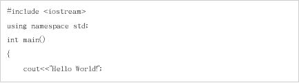

程序的第一行用于在程序中包含头文件。这允许你使用其中包含的操作。需要使用命名空间`std`才能准确引用各种操作。它还能帮助你不必在每个`cout`语句前都写`std`。这一行基本上指的是使用标准命名空间。

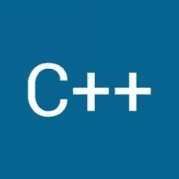

第三行表示这是程序的`main`函数。程序的主体位于花括号内。`cout`语句用于打印引号内的内容，或者在某些情况下打印变量名。这取决于`cout`语句中列出的内容。花括号前的最后一行很重要，因为它本质上关闭或终止了程序的`main`函数。

如果你熟悉其他编程语言，很容易理解所有程序只是一系列有序的指令或命令，供计算机执行。这些指令由语句组成。语句是编程语言的最小单元，相当于英语中的句子。在 C++中，使用分号而不是句号来结束语句。变量的概念也是编程中广泛使用且非常重要的。变量是内存中一个空间的名称，可以根据程序的指令进行更改。

变量可以有多种类型。这些类型指示该变量中可以存储什么内容。变量类型包括：

整数（`int`）——此变量类型仅存储不带小数的整数。例如 5 或 4509。它们必须至少为 16 位。例如 7854 或 34。

字符（`char`）——此类型指单个字符，如`'a'`，至少为 8 位。

`float`——存储浮点值，如 3.1555。通常为 32 位。

`double`——与 float 类似，但精度是其两倍。通常为 64 位。

布尔值（`bool`）——存储真/假值。

`void`——不能直接存储数据，但有点像占位符。


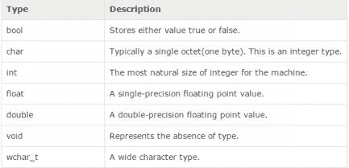

## 使用变量

变量是程序非常基本的组成部分。它们可以由字母数字组成，但必须以字母开头。变量在程序中的各种语句中使用。

语句有 3 种类型，包括声明语句、赋值语句和输出语句。下面提供了所有类型的示例。

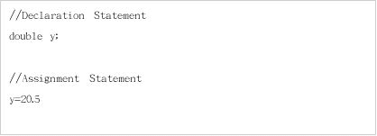

在程序中可以使用变量之前，必须先通过声明语句声明它。声明语句为内存中一个将保存特定值的位置赋予名称和类型。在上面的示例中，名称是`y`，类型是`double`。

赋值语句为变量`y`赋予一个特定值。在示例中，`y`被赋值为 20.5。

输出语句只是打印特定项或变量的值。上面的示例输出为 20。

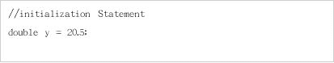

变量的声明和赋值也可以同时进行，这称为初始化。重要的是要记住，只有在定义变量时才进行初始化。


变量也可以使用一条语句而不是多条语句一起声明。只需遵循下面的语法即可。


上述语句只是将 `x`、`y` 和 `z` 都声明为 `double` 类型（即十进制数）。

## 练习题

使用下面的练习题来确保你理解了 C++ 编程的基础知识。

1. 以下哪一种是 C++ 中编写注释的正确方式？
    a) `/*Here is a comment*/`
    b) `\\Here is another comment\\`
    c) `//Here is the last comment`

2. 从下列选项中，选出正确声明并初始化为 10 的变量：
    a) `int a 10;`
    b) `int b=10;`
    c) `double c=10;`

3. 下列选项中，哪一项展示了如何声明一个名为 `number` 的 `double` 类型变量并将其初始化为 5？
    a) `double number 5;`
    b) `double number =5`
    c) `double number =5;`

4. 以下哪一种是正确将名为 `sum` 的整数打印到屏幕的方式？
    a) `cout<<sum<<endl;`
    b) `cout"sum"<<endl;`
    c) `cout>>sum>>endl;`

5. 在 C++ 程序中，可以一次性声明多个数据类型吗？`sum, age, group;`
    a) 可以
    b) 不可以

6. C++ 中有多种数据类型。`double` 数据类型存储什么类型的信息？
    a) 整数
    b) 双整数
    c) 小数

7. 从用户输入中读取一个名为 `check` 的 `double` 类型数据的正确方式是什么？
    a) `cout>>"check";`
    b) `cin>>check;`
    c) `cin<<check;`

8. 从用户输入中读取一个名为 `sum` 的 `double` 类型数据的正确方式是什么？
    a) `cin<<sum;`
    b) `cout>>sum;`
    c) `cin>>sum;`

9. 为什么整数不能除以自身？
    a) 它们的值会被截断
    b) 你会收到错误消息而不是实际答案
    c) 一旦执行该语句，你的程序就会崩溃

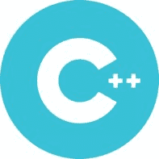

## 解答

1. 以下哪一种是 C++ 中编写注释的正确方式？
    a) `/*Here is a comment*/`
    b) `\\Here is another comment\\`
    c) `//Here is the last comment`

2. 从下列选项中，选出正确声明并初始化为 10 的变量：
    a) `int a 10;`
    b) `int b=10;`
    c) `double c=10;`

3. 下列选项中，哪一项展示了如何声明一个名为 `number` 的 `double` 类型变量并将其初始化为 5？
    a) `double number 5;`
    b) `double number =5`
    c) `double number =5;`

4. 以下哪一种是正确将名为 `sum` 的整数打印到屏幕的方式？
    a) `cout<<sum<<endl;`
    b) `cout"sum"<<endl;`
    c) `cout>>sum>>endl;`

5. 在 C++ 程序中，可以一次性声明多个数据类型吗？`sum, age, group;`
    a) 可以
    b) 不可以

6. C++ 中有多种数据类型。`double` 数据类型存储什么类型的信息？
    a) 整数
    b) 双整数
    c) 小数

7. 从用户输入中读取一个名为 `check` 的 `double` 类型数据的正确方式是什么？
    a) `cout>>"check";`
    b) `cin>>check;`
    c) `cin<<check;`

8. 从用户输入中读取一个名为 `sum` 的 `double` 类型数据的正确方式是什么？
    a) `cin<<sum;`
    b) `cout>>sum;`
    c) `cin>>sum;`

9. 为什么整数不应该被其他整数除？
    a) 它们的值会被截断
    b) 你会收到错误消息而不是实际答案
    c) 一旦执行该语句，你的程序就会崩溃

## 使用修饰符与限定符

修饰符也可以用于各种类型。修饰符可以指示数字的符号，或提供关于变量的更详细信息。修饰符可用于字符、整数以及任何 `double` 类型。修饰符用于将变量调整为适合特定场景。

数据类型修饰符类型包括：

* Unsigned（无符号）
* Signed（有符号）
* Short（短）
* Long（长）

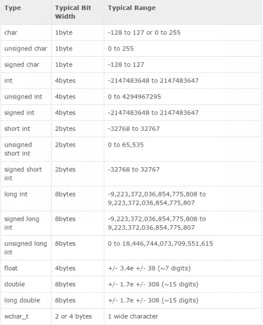

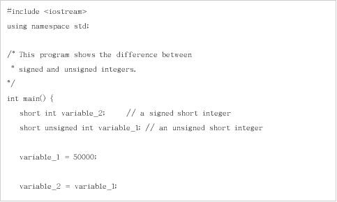运行以下程序以更好地理解修饰符。

程序的输出是：-15536 <-- 变量 1 和 变量 2 --> 50000。上述输出是由于将 50000 表示为短无符号整数的位模式被短整型解释为 -15536。

C++ 中有 3 种限定符。包括 `const`（常量）、`volatile` 和 `restrict`。

`const` 用于在程序运行时不能更改的对象。`volatile` 则相反，这种类型的变量中的值可能在程序运行过程中被更改，即使是以未明确指定的方式。带有 `restrict` 限定符的指针只能通过该指针进行访问。

## 关键字

C++ 与许多编程语言一样，也使用一组关键字。关键字是语言中具有特殊含义的单词，不能以任何其他方式使用。由于它们的特殊含义，它们被保留。

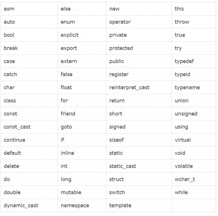

## 注释

注释是任何程序的重要组成部分，它们允许读者或其他开发者理解程序的预期目的以及每一行代码的作用。

在代码中创建注释有两种方式。

```
/* 这是多行注释
 * 因为它可以跨越多行
 */
```

```
//这是单行注释。
```

## C++ 基础练习

1. `<iostream>` 在编程中被称为？
    a) 指令
    b) 预处理指令
    c) 文件

2. `using namespace` 在编码中是否有意义？如果没有它，我们还能使用 `cout` 和 `cin` 吗？
    a) 能
    b) 不能

3. 如果程序开头没有声明命名空间，使用 `cout` 打印需要什么？
    a) `std::cout<<"Hello";`
    b) 没有任何变化
    c) `std:namespace:cout<<"Hello";`

4. 在 `int main()` 中，缩写 `int` 实际上代表什么？
    a) 集成
    b) 没有值
    c) 整数

5. 正确打印到屏幕的方式是什么？
    a) `cout<<"This is a displayed statement"<<endl;`
    b) `cout<< ("I can finally program);`
    c) `cin<<"This is my 18th program of this type<<endl;`

6. `end1` 是什么意思/它有什么作用？
    a) 结束整个程序
    b) 换行
    c) 什么也不做

7. 所有 C++ 程序结束时返回什么数字？
    a) 0
    b) 04
    c) 3

## 练习解答

1. `<iostream>` 在编程中被称为？
    a) 指令
    b) 预处理指令
    c) 文件

2. `using namespace` 在编码中是否有意义？如果没有它，我们还能使用 `cout` 和 `cin` 吗？答案相同。
    a) 能
    b) 不能

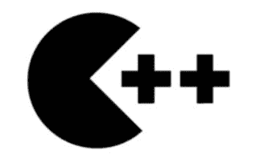

3. 如果程序开头没有声明命名空间，使用 `cout` 打印需要什么？
    a) `std::cout<<"Hello";`
    b) 没有任何变化
    c) `std:namespace:cout<<"Hello";`

4. 在 `int main()` 中，缩写 `int` 实际上代表什么？
    a) 集成
    b) 没有值
    c) 整数

5. 正确打印到屏幕的方式是什么？
    a) `cout<<"This is a displayed statement"<<endl;`
    b) `cout<< ("I can finally program);`
    c) `cin<<"This is my 18th program of this type<<endl;`

6. `end1` 是什么意思/它有什么作用？
    a) 结束整个程序
    b) 换行
    c) 什么也不做

7. 所有 C++ 程序结束时返回什么数字？
    a) 0
    b) 04
    c) 3

# 第 2 章 – 基本输入与输出

编程中最常见的功能之一就是输入和输出。在 C++ 中，输入和输出发生在流中。流也被称为字节序列。

如果给定的字节来自键盘或磁盘驱动器并流向主内存，这被归类为输入操作。输出则被归类为字节从主内存流向屏幕或显示器。

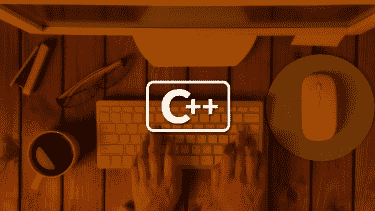

程序中的头文件行对于输入和输出至关重要。程序开头的 `<iostream>` 行是定义输入和输出对象的头文件。其他头文件类型包括 `<iomanip>` 和 `<fstream>`。

## 使用 cout


`cout` 对象是 `ostream` 类的一个实例，它连接到输出设备或显示器。这是一个相当简单的命令，大多数情况下与 `cin` 一起使用，但也可以单独使用。

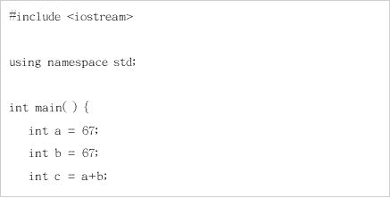运行下面的程序，以便准确观察 `cout` 语句的工作方式。

上述程序的输出应为给定语句中 `c` 的正确值。

该程序中需要注意的两个重要内容包括插入运算符 `<<` 和 `end1`。`end1` 用于在给定字符串行的末尾添加一个新行。`<<` 可以多次使用，如上所示。

## 使用 cin

使用 `cin` 允许用户向给定变量输入信息。该对象属于 `istream` 家族，它连接到输入设备，通常类似于键盘。提取运算符与插入运算符相反，即 `>>`，如下面的程序示例所示。

```
#include <iostream>
using namespace std;
int main() {
 char petname[40];
 char yourname[60];
cout << "请输入你的宠物名字：";
cin >> petname;
cout << "你的名字是：" << petname << endl;
cout << "请输入你的全名：";
cin >> yourname;
cout << "你的名字是：" << yourname << endl;
}
```

运行程序后，系统会提示你输入宠物的名字，然后将其打印出来。接着会提示你输入你的名字，同样会打印出来。

请自行尝试这个练习，以获得更多输入和输出的实践。

1. 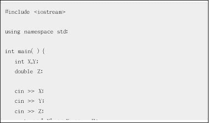回答下面的提示，使输入值分别为 23、55.7 和 12。

# 第 3 章 – 条件语句

C++ 编程中的另一个主要组成部分是条件语句的使用。条件语句是那些根据程序当前值导致程序改变其预期路径的语句。首先要讨论的最基本的条件语句之一是 `if` 语句。

在深入探讨各种类型的条件语句之前，我们必须首先知道在语句中使用哪些关系运算符以及它们的含义。


`>` 大于 `8 > 6` 真  
`<` 小于 `1 < 9` 真  
`>=` 大于或等于 `3 >= 0` 真  
`<=` 小于或等于 `6 <= 10` 真  
`==` 等于 `6 == 6` 真  
`!=` 不等于 `7 != 3` 真  
`&&` 与  
`||` 或  
`!` 非

## 使用 If 语句

为了完全理解 C++ 中的 `if` 语句，你必须首先了解它们是如何工作的。

`if` 语句的结构如下：

```
if (真)
{
执行下一条语句
}
if (真)
{
    如果为真，执行此语句块
}
else
{
    如果为假，执行此语句块
}
```

在第一个示例中，如果给定表达式为真，则执行该语句。然而，在第二个语句中，如果表达式为真，则执行该语句；如果表达式为假，则执行 `else` 语句。


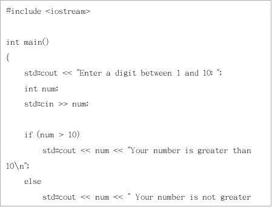下面的程序将演示 `if` 语句如何操作和执行。

你可能已经猜到，有时需要多个 `if` 语句。因此，可以使用多个 `if` 语句。

下面的示例程序展示了多个 `if` 语句如何执行。为了成功执行多个 `if` 语句，我们可以使用块。

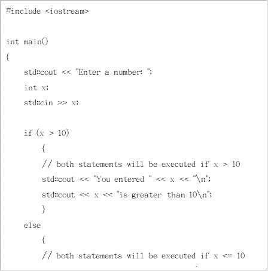

块本质上就是使用花括号 `{}`。使用这些花括号可以让用户告诉程序 `if` 语句的起始和结束位置。如果没有指定块，程序足够智能，可以隐式地定义块。

`if` 语句也可以通过使用 `else if` 链接在一起，如下面的程序所示。

除了能够输入链式 `if` 语句外，在 C++ 中嵌套 `if` 语句也是完全可行的。以下是嵌套函数的示例。

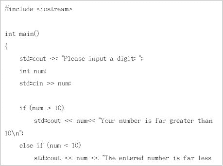上面的代码之所以令人困惑，仅仅是因为缺少花括号。在 `else` 周围添加块会使代码更清晰。这种歧义被称为悬空 else。

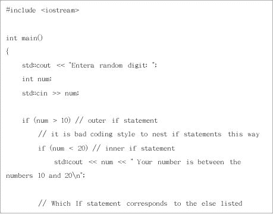

仍然对如何实现 `if` 或 `if-else` 语句感到困惑？使用下面的问题作为练习。

1. 以下哪一项提供了 `if` 语句的正确结构？  
   A. `if this then that`  
   B. `if { expression}`  
   C. `if ( expression )`  
   D. `else expression if`

2. 编写一个程序，允许用户向系统输入一个数字。然后程序应根据该数字大于或小于 50 输出两条不同的语句。这需要使用输入和条件语句。如果数字大于 50，程序应打印“哇，这个数字真大”。如果数字小于 50，程序应打印“哎呀，这个数字太小了”。

3. 如果 `x` 等于 10，`y` 等于 30，这个条件会执行吗？`if(x > y)`  
   a) 是  
   b) 否

4. 条件语句对程序有什么作用？  
   a) 提高处理速度  
   b) 增加程序的灵活性，同时缩短其长度  
   c) 破坏程序

5. `else` 语句的作用是什么？  
   a) 为给定条件提供替代路径  
   b) 从不执行  
   c) 在程序中看起来不错

6. 在条件语句的上下文中，以下条件是什么意思？`if (a!=b)`  
   a) `a` 等于 `b`  
   b) 检查 `a` 是否不等于 `b`  
   c) 以上都不对

7. 在 `if` 语句中，何时需要使用花括号？  
   a) 总是  
   b) 通常当条件语句中有两行或更多行时应该使用  
   c) 从不

8. 以下条件用通俗英语表示什么意思？`if (y!=x)`  
   a) 如果 `y` 不等于 `x`  
   b) 如果 `x` 不等于 `y`  
   c) 如果 `x` 小于 `y`

9. 如果 `a` 等于 20，`b` 等于 20，这个条件会执行吗？`if (a!=b)`  
   a) 是  
   b) 否

10. 以下语句是什么意思？`if (a==b)`  
    a) 如果 `a` 大于 `b`  
    b) 如果 `a` 等于 `b`  
    c) 如果 `b` 大于或等于 `a`

11. 如果 `x` 等于 20，`y` 等于 8，以下条件能否执行？`if(x<=y)`  
    a) 是  
    b) 否

答案

1. C.

2. ```
   #include <iostream>
   using namespace std;
   int main()
   {
       cout << "请输入你的数字 " << endl;
       int number;
       cin >> number;
       if(value < 50)
       {
           cout << "哎呀，这个数字太小了";
       }
       else
       {
           cout << "哇，这个数字真大。";
       }
       return 0;
   }
   ```

3. b) 否

4. b) 增加程序的灵活性，同时缩短其长度

5. a) 为给定条件提供替代路径

6. b) 检查 `a` 是否不等于 `b`

7. b) 通常当条件语句中有两行或更多行时应该使用

8. a) 如果 `y` 不等于 `x`

9. b) 否

10. b) 如果 `a` 等于 `b`

11. b) 否

## 循环

除了条件语句之外，当需要重复执行部分代码时，会使用循环。循环用于替代重写或复制代码段。循环允许用户反复执行代码的某些部分，直到完成。

C++ 程序中最简单的循环是 `for` 循环。`for` 循环的语法如下：

```
for ( 变量初始化; 条件; 变量更新 ) {
  只要括号中的条件为真，就执行这些语句。
}
```

循环使用两个你必须熟悉的运算符才能继续深入学习。它们是递增和递减符号（`++` 和 `--`）。

为了进一步分解 `for` 循环的结构，请参见下面的示例。

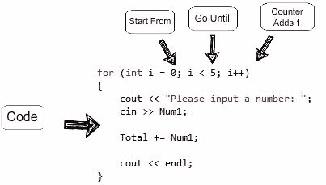

上面的 `for` 循环中的代码将一直执行，直到计数器变量达到 4。一旦变量达到 5，它将不再执行，因为不再满足 `for` 循环的条件。


另一种常用的循环类型是 `while` 循环。只要 `while` 的测试语句为 `true`，`while` 循环就会持续执行一段语句块。

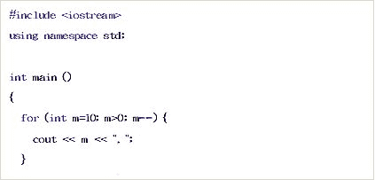

执行以下代码，观察 `for` 循环的实际运行效果。

该 `for` 循环将输出以下内容：

| 10, 9, 8, 7, 6, 5, 4, 3, 2, 1, 结束！ |  |

下图展示了 `while` 循环的工作方式。

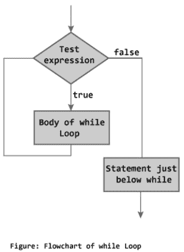

测试表达式可以是布尔表达式的任意组合。但只要该语句为 `true`，循环体就会执行。

`while` 循环的语法如下：

```
while ( w < 25 ) { // 当 w 小于 25 时
    cout<< w <<endl;
    w++;             // 修改 w 以使条件得以满足
}
```

与 `while` 循环类似的一种循环是 `do while` 循环。`do while` 循环虽然与 `while` 循环相似，但它会在给定语句执行之后才检查条件。当某件事至少需要执行一次时，就会使用 `do while` 循环。`do while` 循环的语法如下：

```
do {
} while ( condition );
```

需要注意的是，只要条件保持为 `true`，`do` 内部的语句就会继续执行。同样重要的是，`do while` 必须以分号结尾，也称为尾部分号。

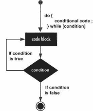

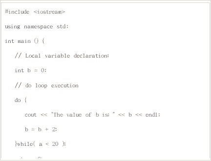上图是 `do while` 循环工作方式的图形参考。执行以下代码，观察 `do while` 循环的实际运行效果。

使用以下练习题来加深你对循环的理解。

1.  以下代码会打印什么？

    ```
    var x = 0;
    while (x < 3) {
        println("bye");
        x++;
    }
    ```

2.  以下代码会打印什么？

    ```
    var x = 0;
    while (x < 3) {
        println("hi");
        x++;
    }
    println("bye");
    ```

3.  以下代码会打印什么？

    ```
    var y = 0;
    while (y < 0) {
        println("hi");
    }
    ```

4.  哪个 `for` 循环无法正常工作？

    a) `for (i=0; i<5; i++)`

    b) `for (i=5; i<=10; i++)`

    c) `for (i=5; i=10; i++)`

5.  哪种类型的循环至少会执行一次？

练习题答案：

1.  ```
    bye
    bye
    bye
    ```

2.  ```
    hi
    hi
    hi
    bye
    ```

3.  这段代码不会打印任何内容，因为 `y` 等于 0，因此它永远不可能小于 0。

4.  C。

5.  `do while` 循环至少会执行一次。

## Break 与 Continue 语句

`break` 和 `continue` 语句会改变程序的正常流程。`break` 语句在出现时立即终止循环和 `switch` 语句（`switch` 语句将在后面介绍）。

`break` 语句可用于 `while`、`do while` 和 `for` 循环。下图展示了 `break` 在每种循环类型中的工作方式。

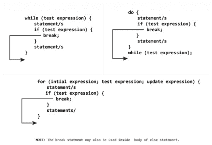

`continue` 语句用于跳过循环中的某些条件。该语句在条件语句内部使用。下图说明了 `continue` 语句的工作方式。

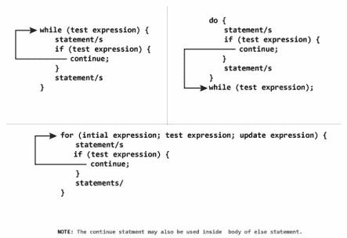

运行以下程序，观察 `continue` 语句在代码中的实际运行效果。

```
#include <iostream>
using namespace std;

int main()
{
    for (int j = 1; j <= 10; ++j)
    {
        if ( j == 6 || j == 9)
        {
            continue;
        }
        cout << j << "\t";
    }
    return 0;
}
```

## Switch 语句

当需要多个 `if else` 语句时，可以使用 `switch` 语句。`switch` 语句通常比多个嵌套的 `if` 语句执行得更快，也更易于理解和编程。

`switch` 语句的语法如下：

```
switch (n)
{
    case constant1:
        // 如果 n 等于 constant1 则执行的代码
        break;
    case constant2:
        // 如果 n 等于 constant2 则执行的代码
        break;
    default:
        // 如果 n 不匹配任何常量则执行的代码
}
```

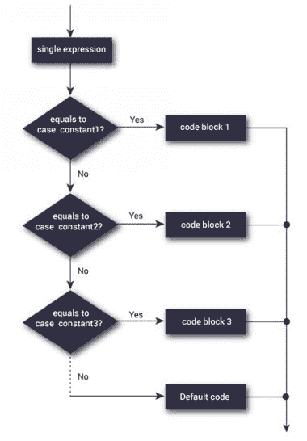

上述语法和图示表明，当找到与 `n` 匹配的 case 常量时，程序的控制权会转移到相应的 case 块。代码块会一直执行，直到程序遇到 `break` 语句或到达块的末尾。

## Switch 语句练习

使用以下问题来练习 `switch` 语句及其用法。

1.  编写一个程序，根据学生的数字成绩确定其字母等级。程序应输出该学生的字母等级。`switch` 应判断成绩是 A、B、C、D 还是 F。

2.  在 `switch` 中，每个 case 后面都有一个特定的东西。那是什么？

3.  case 中包含条件语句是否合法？

4.  解释以下 case 有什么错误：`case (x > 3):`

5.  解释以下 case 有什么错误：`case 3:`

6.  case 是否总是需要花括号？正确还是错误。

答案

1.  ```
    switch (grade){
    case(1):
        if (numAvg < 60)
            grade = 'F';
        break;
    case(2):
        if (numAvg < 70)
            grade = 'D';
        break;
    case(3):
        if (grade < 80)
            grade = 'C';
        break;
    case(4):
        if (grade < 90)
            grade = 'B';
        break;
    default: grade = 'A';
    }
    ```

2.  C. Break

3.  不可以，switch 中不能有条件。

4.  这是错误的，因为 case 不能包含条件。

5.  这个语句没有错误。

6.  错误。

# 第 4 章 – 使用数组

数组不仅可以将数据存储在一个变量名下，还可以以有序列表的格式存储元素，因此非常有用。它们最终用于组织大量数据和信息。当需要遍历数组时，循环是赋值和打印输出的非常实用的工具。

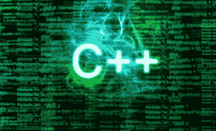

当你遇到像下面这样有多个变量的情况时，使用数组会更简单。下面的信息仅显示了 5 个人的年龄。

```
int Person1=15;
int Person2=24;
int Person3=54;
int Person4=33;
int Person5=120;
```

与其将每个人声明为不同的变量，不如直接声明一个包含 5 个元素、存储不同人年龄的数组。

该数组的声明如下：`int person_ages [5];`

```
int person_ages [5];
```

数组类型为 `int`，这是要存储的信息的类型。第二个元素是数组名称，这里名称是 `person_ages`。方括号内的最后一个部分表示数组中的元素数量。

## 初始化数组

有两种方法可以初始化数组。第一种方法是直接列出数组位置并设置值。如下所示：

```
person_age[0]=43;
person_age[1]=49;
person_age[2]=5;
person_age[3]=10;
person_age[4]=70;
```

手动设置数组中的值时，也可以像下面这样设置：

```
// 初始化
person_age = {43,49,5,10,70};
```

虽然对于只有 5 个元素的数组来说，手动设置可能没问题，但当数组有 500 个元素时该怎么办？这时就需要使用 `for` 循环。使用循环更高效，工作量也更少，尽管其工作方式相同。下面的示例使用 `for` 循环遍历数组以进行打印，但同样的方法也可以用于初始化，具体取决于代码的功能。

```
#include <iostream>
using namespace std;

int main()
{
    int a; // a 是你的计数器变量
    int person_age [5];
    ages={45,24,5,95,12};

    for (a=0; a<5; a++) // 将 'a' 设为 0，当 'a' 小于 5 时执行
    {
        cout<<person_age[a]<<endl;
    }

    return 0;
}
```

在你的环境中运行上述程序，观察其实际效果并查看打印内容。

下面的示例展示了如何使用 `for` 循环来遍历数组的初始化过程，而不是手动设置。

```
#include <iostream>
using namespace std;

int main()
{
    int a;
    int person_ages [5];
    for (a=0; a<5; a++)
    {
        cout<<"请输入该人的年龄"<<endl;
        cin>>ages[a];
    }

    for (a=0; a<5; a++)
    {
        cout<<ages[a]<<endl;
    }
```


```
   }

return 0;

}
```

## 数组练习

使用以下问题来练习数组，并更好地理解如何应用这一概念。

1. 从以下选项中，如何声明一个数组？
   - a) `this_array [15];`
   - b) `this_array (15);`
   - c) `this_array {15};`

2. 数组的通用目的是什么？它们有什么作用？
   - a) 数组的目的是存储地址
   - b) 数组的目的是在单个名称下存储多个值
   - c) 数组的目的是存储一个值

3. `double test [8];` 这里声明的数组名称是什么？
   - a) 数据类型 double
   - b) 数组没有名称
   - c) `test`

4. 参考问题 3。test 数组存储了多少个值？
   - a) 它存储了 7 个
   - b) 它存储了 8 个
   - c) 数组存储了 6 个

5. 参考问题 3。通过查看数组声明，最大的索引值是多少？
   - a) 最大值为 7
   - b) 最大值为 6
   - c) 最大值为 8

6. 从给定的选项中，以下哪个选项展示了初始化数组值的正确方式？
   - a) `sample_array [15] = (5,3,4,2,7);`
   - b) `sample_array [15] = {5;3;4;2;7};`
   - c) `sample_array [15] = {5,3,4,2,7};`

7. 参考问题 6。位于 `this_array [3]` 位置的值是多少？
   - a) 值为 7
   - b) 值为 3
   - c) 值为 4


8. 有没有办法一次性打印出整个数组？
   - a) 有
   - b) 没有

9. 尝试打印或赋值数组中的元素时，必须使用什么？
   - a) 指针
   - b) 条件语句
   - c) 循环

## 练习题答案

1. 从以下选项中，如何声明一个数组？
   - a) `this_array [15];`
   - b) `ths_array (15);`
   - c) `this_array {15};`

2. 数组的通用目的是什么？它们有什么作用？
   - a) 数组的目的是存储地址
   - b) 数组的目的是在单个名称下存储多个值
   - c) 数组的目的是存储一个值

3. `double number [8];` 这里声明的数组名称是什么？
   - a) 数据类型 double
   - b) 数组没有名称
   - c) `test`

4. 参考问题 3。test 数组存储了多少个值？
   - a) 它存储了 7 个
   - b) 它存储了 8 个
   - c) 数组存储了 6 个

5. 参考问题 3。通过查看数组声明，最大的索引值是多少？
   - a) 最大值为 7
   - b) 最大值为 6
   - c) 最大值为 8

6. 从给定的选项中，以下哪个选项展示了初始化数组值的正确方式？
   - a) `sample_array [5] = (5,3,4,2,7);`
   - b) `sample_array [5] = {5;3;4;2;7};`
   - c) `sample_array [5] = {5,3,4,2,7};`

7. 参考问题 6。位于 `this_array [3]` 位置的值是多少？
   - a) 值为 7
   - b) 值为 3
   - c) 值为 4

8. 有没有办法一次性打印出整个数组？
   - a) 有
   - b) 没有

9. 尝试打印或赋值数组中的元素时，必须使用什么？
   - a) 指针
   - b) 条件语句
   - c) 循环

# 第 5 章 – 指针

指针使某些复杂任务变得更容易，而且它们使用起来相当简单。指针被定义为存储另一个变量地址的变量。与变量类似，在使用之前必须先定义它。

`type *var-name;`

使用指针时，类型就是基类型的类型。例如，如果我的指针指向一个 double 变量，那么我的指针必须是 double 类型。var-name 是指针的名称。必须使用星号来表示指针。

```
int    *int_point;    // 指向整数的指针
double *dou_point;    // 指向 double 的指针
float  *flo_point;    // 指向 float 的指针
char   *ch_point;     // 指向字符的指针
```

以下示例展示了指针中存储的信息，运行以下代码以更好地理解指针。

```
#include  <iostream>
using  namespace std;
int main ()  {
 int variable  =  10; // 实际变量声明
 int *ipointer; // 指针变量
cout <<  "Value of variable: ";
cout <<  variable  << endl;
 // 访问指针中地址处的值
cout <<  "Value of *ipointer variable: ";
cout <<  *ipointer << endl;
 return  0;
}
```

## 空指针

被赋值为 NULL 的指针称为空指针。空指针在声明时被赋值。空指针通常是常量，其值为零。

## 指针运算

由于指针存储数值，它们也能够执行基本的算术运算。

在某些程序中，开发者可能选择使用指针而不是数组。部分原因是指针可以递增，而数组在没有循环的情况下无法递增。

以下程序展示了如何成功递增指针变量以访问数组的每个后续元素：

```
#include  <iostream>
using  namespace std;
const  int MAX =  4;
int main ()  {
 int var[MAX]  =  {10,  100,  200, 300};
 int *ptr;
 // 将数组地址放入指针
ptr =  var;
 for  (int j =  0; j < MAX; j++)  {
cout <<  "Value of var["  << j <<  "] = ";
cout <<  *ptr << endl;
 // 指向下一个位置
      ptr++;
 }
 return  0;
}
```

由于指针可以递增，它们也可以递减。运行以下代码以展示指针如何递减。

```
#include  <iostream>
using  namespace std;
const  int MAX =  4;
int main ()  {
 int var[MAX]  =  {10,  100,  200,300};
 int *ptr;
ptr =  &var[MAX-1];
 for  (int j = MAX; j >  0; j--)  {
cout <<  "Value of var["  << j <<  "] = ";
cout <<  *ptr << endl;
 // 指向前一个位置
      ptr--;
 }
 return  0;
}
```

除了递增和递减，指针还可以使用关系运算符进行比较。这包括 ==、< 和 > 等运算符。

# 第 6 章 – 函数

函数是非常有用的代码段，它们被编写出来以完成特定的任务。当它们一起使用时，可以创建更复杂、更整洁的程序。

函数的基本结构如下所示。请注意，原型是函数声明的另一种说法或分类。

`return type name (data type variable, data type variable....)`

返回类型：返回类型指的是函数完成后将返回什么。例如，如果我要创建一个程序来计算大学生的平均年龄，我会使用 int，因为我不需要也不想要小数位。因此，截断是可以接受的。那么我的返回类型就是 int。

名称：这只是函数的名称。使用同样的例子，我可以将这个函数命名为 average_age。

数据类型：数据类型仅指变量。这些是函数可以接收并使用的项。可以是一个，也可以是多个。

函数的开头如下例所示。

`int average_age(int x, int y)`

原型的放置位置如下例所示。

```
#include <iostream>
int average_age (int x, int y);
int main()
{
//主程序
return 0;
}
double mult (int x, int y) //注意没有分号
{
//函数将在这里编写
}
```

运行以下示例程序以了解函数如何运作。以下程序中的函数用于将两个变量相加并返回它们的和。

```
//完整的工作程序
#include <iostream>
double summation (int a, int b); // 原型
int main()
{
int x,y;
int c;
cin>>x;  //用户输入 x 的值
cin>>y;  //用户输入 y 的值
c = summation(x,y); //调用 summation 函数，并传入已读取的变量
cout<<"The sum of the 2 numbers is "<<c<<endl;
return 0;
}
```


```
double summation (int a, int b) //定义函数
{
    double z;
    //'a' 保存 'x' 的值，'b' 保存 'y' 的值
    z = a+b;
    return z; //将 'z' 的值返回给 main 中的变量 'c'
}
```

除了返回数字或变量的函数外，还有不返回任何内容的函数。这些是 `void` 函数。

`void sum (int x)`

这仅仅意味着不会有任何值被返回，正如上一个示例所示。

## 函数练习

1. 使用函数时，你首先要做什么？
    a) 声明变量
    b) 原型声明
    c) 初始化

2. 原型声明在程序中的什么位置？
    a) `int main()` 之前
    b) `int main()` 之前和之后
    c) 程序末尾

3. 根据给出的示例 `int books (int y)`，所创建的函数名称是什么？
    a) `int`
    b) `int y`
    c) `books`

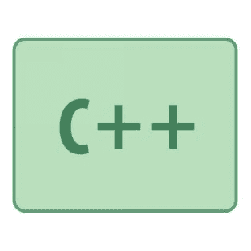

4. 根据问题 3 中的示例，该函数将返回什么数据类型？
    a) `int`
    b) `string`
    c) `double`

5. 根据问题 3 中的示例，该函数将接收什么数据类型？
    a) `char`
    b) `String`
    c) `int`

6. `char my_function (int a)`，该函数将接收什么类型的数据？
    a) `double`
    b) `char & double`
    c) `int`

7. 给定函数 `double summation (double a, double b)`，从主程序中调用该函数的正确方式是什么？
    a) `summation (x)`
    b) `summation (y)`
    c) `summation (x,y)`

8. 如果有一个变量在函数内部声明，这是什么类型的变量？
    a) 全局变量
    b) 局部变量
    c) 扩展变量

9. 如果我们有一个函数 `double go (double b)`，我们能否在主程序中向它传递一个不同的变量，还是必须传递 `b`？例如 `go (x)`
    a) 可以
    b) 不可以

## 函数练习答案

1. 使用函数时，你首先要做什么？
    a) 声明变量
    b) 原型声明
    c) 初始化

2. 原型声明在程序中的什么位置？
    a) `int main()` 之前
    b) `int main()` 之前和之后
    c) 程序末尾

3. 根据给出的示例 `int books (int y)`，所创建的函数名称是什么？
    a) `int`
    b) `int y`
    c) `books`

4. 根据问题 3 中的示例，该函数将返回什么数据类型？
    a) `int`
    b) `string`
    c) `double`

5. 根据问题 3 中的示例，该函数将接收什么数据类型？
    a) `char`
    b) `String`
    c) `int`

6. `char my_function (int a)`，该函数将接收什么类型的数据？
    a) `double`
    b) `char & double`
    c) `int`

7. 给定函数 `double summation (double a, double b)`，从主程序中调用该函数的正确方式是什么？
    a) `summation (a)`
    b) `summation (a,b)`
    c) `summation (b)`

8. 如果有一个变量在函数内部声明，这是什么类型的变量？
    a) 全局变量
    b) 局部变量
    c) 扩展变量

9. 如果我们有一个函数 `double go (double b)`，我们能否在主程序中向它传递一个不同的变量，还是必须传递 `b`？例如 `go (x)`
    a) 可以
    b) 不可以

# 第 7 章 – 类与对象

C++ 的主要功能之一是在 C 语言的基础上增加了面向对象特性。因此，类是 C++ 程序所涉及的特性之一。它们有时被称为用户定义类型。

## 为什么使用类？

类用于详细描述对象的结构。它还包含了操作对象及其任何特性所需的方法。类中的函数和数据被称为其成员。

## C++ 类定义

实际上，类并不定义任何形式的数据类型。它仅仅是一个大纲或蓝图。类定义了类名的含义以及它所代表对象的组成部分。它还定义了对象可以执行哪些操作。

在定义类时，必须始终以关键字 `class` 开头。其后应立即跟上类的名称。然后是类体，所有内容必须用花括号括起来。类定义之后必须跟一个分号或声明列表，具体取决于用户的需求。以下是类声明的示例。

```
class  Person  {

 public:

 double weight; // 一个人的体重

 double height; // 一个人的身高（英寸）

 int age; // 一个人的年龄

};
```

如上所示，你会看到关键字 `public` 的使用。它用于确定类成员的访问级别。任何标记为 `public` 的内容都可以从类外部的任何地方访问，但仍处于类对象的作用域内。`Public` 并不是唯一的访问方式。内容也可以被描述为 `private` 或 `protected`，这将在本章后面讨论。

## 定义 C++ 对象

由于类被认为是对象的蓝图，因此对象是从类创建的。对象的声明方式与声明变量相同。下面是上一节中开始定义的 person 对象的定义。

```
Person Person1;          // 声明 Person1 为 Person 类型
Person Person2;          // 声明 Person2 为 Person 类型
```

对象 `Person1` 和 `Person2` 都将拥有自己的数据成员副本。

## 访问数据成员

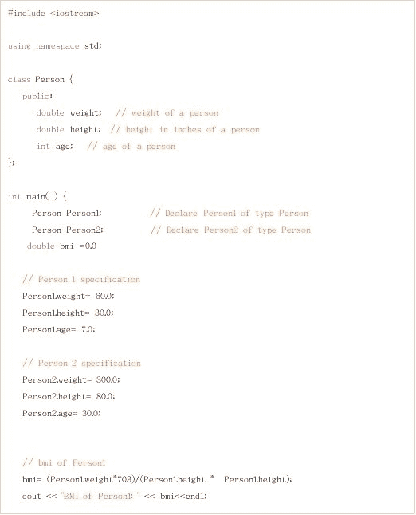

任何 `public` 访问类型的数据成员都可以通过使用（`.`）来访问。这是访问运算符。

运行上面的程序，看看访问运算符是如何使用的，以及如何正确使用对象。请记住，`private` 和 `protected` 成员不能使用访问运算符（`.`）访问。

以上提供的信息只是对象和类的基本概述。有几个概念需要深入复习。

## 类成员函数

成员函数操作类的对象。它是定义在类定义内部的函数。除了在类定义内部，成员函数也可以在使用作用域解析运算符 `::` 时单独定义。这相当于将函数声明为 `inline`。

上述示例如下所示。

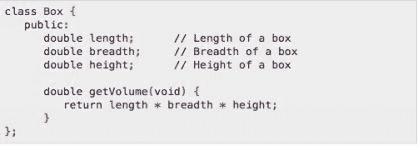

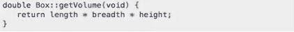

## 类成员修饰符

`Public`、`private` 和 `protected` 对类体内的不同类成员提供访问限制。这些关键字可以称为说明符。一个类可以有多个不同访问级别的块。默认情况下，成员和类的访问类型为 `private`。

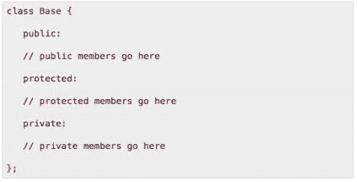

## 构造函数与析构函数

构造函数是每当创建新对象时都会执行的一个类函数。它们与类同名，但没有任何返回类型或 `void`。下面的示例展示了如何使用构造函数。

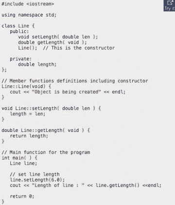

虽然构造函数通常没有参数，但它仍然可以有参数。这有助于你在创建对象时赋值。下面是一个带参数构造函数的示例。

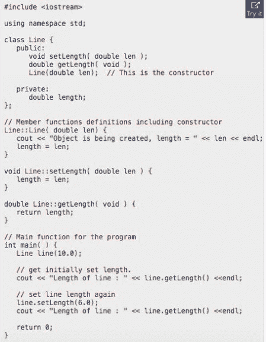

当对象超出作用域时，析构函数会被执行。当对指向对象的指针应用 `delete` 表达式时，它也会被执行。

析构函数与类同名，但前面带有波浪号。它不能返回任何值，也不能接受参数。它在释放资源时非常有用。以下是析构函数的示例。

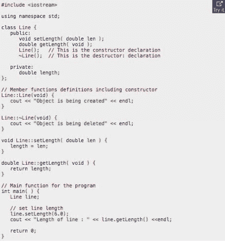

## 友元函数


友元函数定义在类的作用域之外，但它能够访问所有私有和受保护成员。成员函数不能作为友元函数。要声明一个函数为友元，必须在函数前加上关键字 `friend`。下面的示例展示了如何使用友元函数。

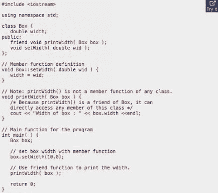

## 静态类成员

静态类成员使用关键字 `static` 定义。这意味着无论存在多少个对象，静态类成员都只有一份副本。

下面的示例展示了如何使用静态类成员。

静态成员函数甚至可以在不存在任何类对象的情况下被调用。需要记住的是，静态函数只需通过类名和作用域解析运算符 `::` 即可访问。静态成员函数只能访问静态数据成员、静态成员函数以及类外部的任何其他函数。

静态数据成员、静态成员函数以及类外部的任何其他函数都可以被静态成员函数访问。它还可以用于判断对象是否已被创建。

以下是使用静态函数成员的示例。


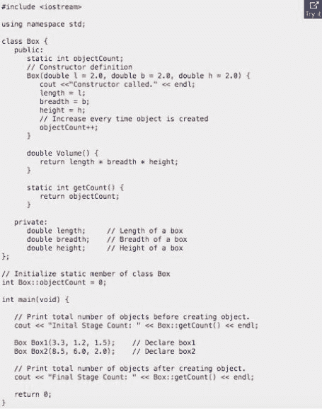

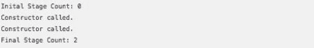

## 基础练习题

1. 编写一个使用类的程序，从用户处获取姓名和年龄，并将这些信息打印到屏幕上。你的类应包含人的姓名和年龄。

2. 假设一个类被公有继承，下列哪个陈述是正确的？
   - A) 基类的公有成员将保持为派生类的受保护成员。
   - B) 派生类的私有成员变为派生类的私有成员。
   - C) 基类的私有成员变为派生类的受保护成员。
   - D) 基类的公有成员变为派生类的公有成员。

3. 在 C++ 中，类的默认访问类型是以下哪一个？
   - A) 私有
   - B) 公有
   - C) 静态
   - D) 绑定

4. 类的实例也被称为 _____？
   - A) 函数
   - B) 类
   - C) 对象

## 练习题解答

1. ```cpp
   /*  Creating Basic Classes in C++
   */

   #include <iostream>
   using namespace std;

   // Class -------------------
   class person
   {
   public:
   //Varibale Declaration
     string name;
     int age;
   };
   //----------------------
   //Main Function
   int main()
   {
       person info;
       //Get Input Values For Object Varibales
       cout<<"Enter the Name :";
       cin>>info.name;
       cout<<"Enter the Age :";
       cin>>info.age;
       //Show the Output
       cout << info.name << ": " << info.age << endl;
       return 0;
   }
   ```

2. 假设一个类被公有继承，下列哪个陈述是正确的？
   - A) 基类的公有成员将保持为派生类的受保护成员。
   - B) 派生类的私有成员变为派生类的私有成员。
   - C) 基类的私有成员变为派生类的受保护成员。
   - D) 基类的公有成员变为派生类的公有成员。

3. 在 C++ 中，类的默认访问类型是以下哪一个？
   - A) 私有
   - B) 公有
   - C) 静态
   - D) 绑定

4. 类的实例也被称为 _____？
   - A) 函数
   - B) 类
   - C) 对象

# 第 8 章 – 继承

C++ 是一种面向对象的编程语言，它以对象而非动作为核心进行建模。面向对象编程有 7 个主要组成部分。

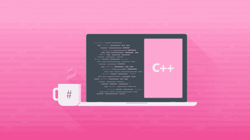

这些组成部分包括：

* 抽象 – 指隐藏某个特性的细节，只展示其本质特征。
* 封装 – 将函数与变量绑定在一起。
* 继承 – 允许代码复用，无需重复编写。同时也允许类从基类继承信息。
* 多态 – 允许创建名称相同但参数不同的函数。尽管这些函数命名约定相似，但它们的行为不同。

本章将重点介绍继承以及在 C++ 中使用继承。继承能让你的代码更清晰、更易于理解。

## 派生类

一个类可以从多个类派生而来。这意味着它可以继承多个基类的函数和数据。

类派生列表用于定义派生类。它列出一个或多个基类。派生列表的形式如下所示。

`class derived-class: access-specifier base-class`

## 访问控制与继承

派生类能够访问基类中所有非私有的成员，这意味着基类的私有成员不应被派生类的函数访问。

下表根据谁可以访问以及以何种特定方式访问，展示了不同的访问类型。

| 访问权限 | 公有 | 受保护 | 私有 |
| --- | --- | --- | --- |
| 同类 | 是 | 是 | 是 |
| 派生类 | 是 | 是 | 否 |
| 外部类 | 是 | 否 | 否 |

## 继承类型

当从基类派生一个类时，基类可以通过三种不同的方式被继承：公有继承、受保护继承或私有继承。继承类型由访问说明符决定，这在上一节中已经介绍过。

最常用的继承是公有继承。私有和受保护继承很少使用，但了解它们仍然有用。在使用不同类型的继承时，应遵循以下规则。

* 公有继承：使用公有继承时，关键是要记住，所有知道基类和子类的对象也会知道子类继承了基类。
* 受保护继承：使用受保护继承时，必须记住只有子类及其子类知道它们继承了基类。
* 私有继承：使用私有继承时，它更加封闭。除了子类之外，没有人知道继承关系。

## 多重继承

在 C++ 中，一个类可以继承多个类的成员。多重继承的语法如下。

`class derived-class: access baseA, access baseB....`

在上述语法中，access 可以是以下之一：public、protected 或 private。该访问权限将应用于每一个基类。

# 第 9 章 – 新版本：C++ 11

C++ 的第一次迭代大约发生在 1998 年。尽管等待了很长时间，C++ 11 于 2011 年 8 月获得批准，距离第一次迭代已经过去了 13 年。有人说，尽管第 11 版是对同一语言的改进，但它感觉像是全新的。


C++11 支持许多新功能，包括以下内容：

* Lambda 表达式
* 委托构造函数
* 删除和默认的函数声明
* 空指针
* 右值引用
* C++ 标准库的革新
  * 新算法
  * 新容器类
  * 类型特征
  * 原子操作
  * 多线程库

在本章中，你将了解更多关于 C++11 的核心功能及其运作方式。

## Lambda 表达式


Lambda 表达式可以定义为可执行语句的大块或小块，类似于函数，可以插入到函数调用的位置。这些表达式不仅高效，而且安全。

在实现这些表达式之前，C++ 提供了成员函数、内联函数和函数对象的使用方式。然而，这些方法更加繁琐。

下面的示例展示了如何在编程中使用 lambda 表达式。

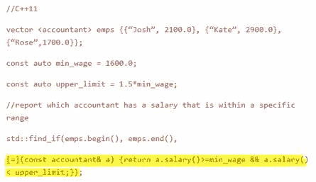


高亮显示的语句以 lambda 引入符 `[]` 开头。`{}` 之间的语句作为要执行的函数，类似于普通函数。在上面的示例中，该表达式用于判断当前会计对象收到的薪水是否高于给定的最低工资且低于上限。如上所示，由于这些表达式只有一行，因此更容易集成到代码中。

lambda 表达式的形式如下：

`capture->return-type {body}`

形式中显示的第一项是捕获子句。lambda 表达式能够引用外部变量，这意味着它可以访问“封闭作用域”中的变量。在给定的示例中，`min_wage` 和 `upper_limit` 位于封闭作用域内。

外部引用可以通过两种方式捕获：按值捕获或按引用捕获。捕获方法很重要，因为它决定了表达式如何操作这些变量。每个编译器都会将每个表达式转换为一个函数对象。


要将表达式转换，必须遵循一些准则。这些准则包括：

*   将 lambda 的主体转换为重载运算符的主体。
*   表达式的参数列表也成为重载运算符的参数列表。
*   被捕获的变量成为重载运算符的数据成员。

闭包对象是 lambda 表达式的重要组成部分。这是编译器生成的函数对象。

当变量“按值捕获”时，它会成为封闭作用域中该变量的一个副本数据成员。当变量“按引用捕获”时，它会作为对封闭作用域中某个变量的引用进行绑定。当一个项被归类为默认捕获时，它表示封闭作用域内所有项的捕获方式。

以下是按值捕获和按引用捕获的示例。下面给出按值捕获：

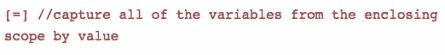

下面给出按引用捕获：

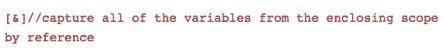

很容易判断 lambda 是否有外部引用。空的捕获子句表示没有外部引用，这意味着它只访问 lambda 内部的局部变量。

```
[] (int a, int b) {return a*b;}
```


下面展示的 lambda 提供了各种捕获子句的示例。

```
vector<int> v3={0,8,9}, v4={11,12,14,15}; // 这是 C++11 中的新初始化语法

&v3 {vi.push_back(a); }; 

// 按引用捕获的示例。捕获 v3。

[&]  (int m) {v1.push_back(m); v4.push_back(m) };

// 这展示了按引用捕获 vi 和 vi2。

[v3]() // 此示例展示了按值捕获 v3。

{for_each(auto y=v3.begin(), y!=v3.end(), y++) {cout<<y<<" ";}};
```

C++11 还允许将 lambda 表达式像普通函数和变量一样存储在变量中。下面展示了此功能的一个示例：

```
auto fact = [](int e, int f) {return e * f;};
```

上面的 auto 声明定义了 `fact`，它是一个闭包类型。之后可以调用它，而无需输入整个 lambda 表达式。闭包类型是编译器生成的函数类。

```
int arr{1,2,3,4,5,6,7,8,9,10,11,12};

long res = std::accumulate(arr, arr+12, 1, factorial);

cout<<"12!="<<res<<endl; //
```

在上面的示例中，`factorial` 闭包在每次迭代中将当前元素的值与累积的值相乘。结果将是 12 的阶乘。如果不使用 lambda，则需要定义一个单独的函数，如下所示：

```
inline int factorial (int a, int b)

{

return a*b;

}
```

## 自动类型推导与 decltype

在 C++ 的早期版本（版本 3）中，声明时必须指定类型。对象的声明通常包含一个初始化器。C++11 允许声明对象时不指定其类型。下面提供了一些示例：

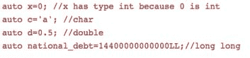

类型推导常用于模板中，当对象自动生成时。它也可以用于对象类型冗长的情况。

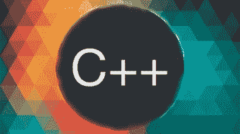

这个新版本提供了一种捕获表达式类型的机制。`decltype` 返回表达式的类型。

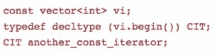

`decltype` 的主要预期用途是声明函数模板。这些函数模板的类型依赖于参数的类型。

## 删除和默认函数

下面展示的示例称为默认函数。

```
struct A

{

A()=default; //C++11

virtual ~A()=default; //C++11

};
```

代码中加粗的部分 `=default` 告诉编译器创建默认实现。

默认函数有两个主要优点。包括：

*   与手动实现相比，默认函数效率更高。
*   默认函数还使开发者免于手动定义函数。

默认函数也有对应的反面。默认函数的反面是删除函数。

该函数的结构如下：

```
int func()=delete;
```

这些函数在试图防止对象复制时非常有用。为了成功禁用复制，必须声明以下两个成员函数。

```
struct NoCopy

{

NoCopy & operator =( const NoCopy & ) = delete;

NoCopy ( const NoCopy & ) = delete;

};

NoCopy a;

NoCopy b(a); // 编译错误，复制构造函数已被删除
```

## nullptr


自 C 语言诞生以来，0 不仅用作空指针，还用作常量整数的表示。`nullptr` 现在取代了长期以来被用作替代品的 `NULL` 和字面量 0。`nullptr` 是一个新的关键字，可以表示 NULL 指针。换句话说，无论你打算在哪里写 NULL，都可以使用 `nullptr` 代替。

C++11 引入了 `nullptr` 关键字作为新的空常量指针。该关键字的类型是 `nullptr_t`。此类型可转换并能与任何指针类型进行比较。但是，除了 bool 之外，它不能转换为整数类型。

以下是使用空指针之前程序实现的示例：

```
void g(int);

void g(char*);

void h()

{

  g(0); // 调用 g(int)

}
```

使用 C++11 创建空指针后，相同的语句块将如下所示：

```
void h()

{

  g(nullptr); // 调用 g(char*)

}
```

空指针适用于所有指针类型。这些包括函数指针和指向成员的指针。由于 `nullptr` 是指针类型，因此不能转换为整数类型。因此，它只能转换为其他指针类型。

## 委托构造函数


委托构造函数指的是将多个构造函数链接在一起的能力，或者调用同一类的另一个构造函数。下面展示了这些构造函数的示例：

```
class Z //C++11 委托构造函数

{

 int a, b;

char *p;

public:

Z(int v) : a(v), b(0), p(new char [MAX]) {} //#1 目标构造函数

 Z(): Z(0) {cout<<"delegating ctor"<<endl;} //#2 委托构造函数

};
```

在示例中，委托构造函数是 2 号，而构造函数 1 是它调用的目标。

## 右值引用

右值引用是 C++11 引入的另一项特性。在 C++ 的早期版本（C++3）中，引用类型只能绑定到左值。这些新的右值引用能够绑定到右值，例如字面量或临时对象。

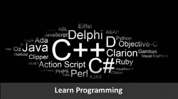

作为复习，在 C 的上下文中，左值是可以出现在赋值语句右侧或左侧的表达式。右值，顾名思义，只能出现在赋值的右侧。下面列出了一些左值的示例。

```
int c = 47;
```


`int d = 33;`

在上面的例子中，`c` 和 `d` 都是左值：

```
c = d;
d = c;
c = c * d;
```

在上述项中，`c * d` 是一个右值。

```
int e = c * d;
```

这条语句是可行的，因为右值位于赋值操作的右侧。

```
c * d = 47;
```

这条语句不可行，因为右值位于赋值操作的左侧。


引入这些右值引用的原因是移动语义。移动操作不能直接与对象的复制相提并论。在移动中，目标对象从源对象中获取资源。这本质上使源对象失去所有资源，变得“空”。移动操作通常用于不需要复制或复制代价可能很高的情况。

为了充分利用移动语义（包括利用性能提升），应考虑字符串交换。

一个非常基础的实现类似于下面列出的示例：

```
void basicswap(string &b, string & c){

string temporary = b;

b=c;

c= temporary;

}
```

上述示例可以被归类为基础或幼稚的实现，因为这种实现代价高昂。字符串的复制还意味着需要分配原始内存。这也意味着需要将源中的字符移动到目标中。然而，当移动字符串时，数据成员只是简单地交换。这一过程无需分配内存、无需删除内存，也无需复制字符。

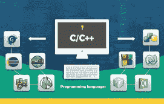

右值引用的行为与常规引用类似，但右值引用有几个例外情况。

除了解决移动语义问题外，它还旨在解决完美转发。完美转发允许开发者编写构造函数或函数，并将参数作为右值或左值进行转发。

以下代码展示了字符串的移动，它仅仅交换了两个数据成员，无需分配或删除内存，也无需复制字符数组。

```
void moveswap(string& blank, string & full){

//伪代码

size_t sz=blank.size();

const char *p= blank.data();

//将 full 的资源移动到 blank

empty.setsize(full.size());

empty.setdata(full.data());

//full 变为 blank

full.setsize(sz);

full.setdata(p);

}
```

如果你正在实现一个支持移动的类，可以声明移动构造函数和移动赋值运算符。示例如下：

```
class Ablemove

{

Ablemove (Ablemove &&); //移动构造函数

Ablemove && operator=( Ablemove &&); //移动赋值运算符

};
```

需要注意的是，C++11 标准库大量使用了移动语义。因此，许多算法和容器现在都针对移动进行了优化。

## C++11 标准库

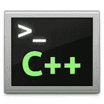

库技术报告 1 最初在 C++03 中引入。随着该库的实现，C++ 经历了一次重大革新。它包含了多种新的容器类以及用于正则表达式、函数包装器等组件的新库。C++11 正式将技术报告 1 纳入标准，随之带来了许多新库。

C++11 为 C++ 语言引入了大量新库，包括：

* 正则表达式库
* 线程库
* 原子操作库
* 容器库中的多种特性

## 线程库

C++11 的一个显著新增是并发支持，即同时执行多条指令。C++11 现在为开发者提供了一个表示执行线程的线程类。这被称为 promise 和 future。这些对象主要用于在并发环境中进行同步。

使用新的线程功能很简单，如下例所示。只需添加线程头文件即可：

```
#include <thread>
```

下面的示例简单地使用了“Hello World”，这是最基础的编程教程。

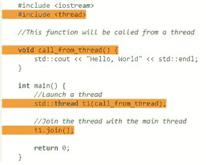

在你的机器上运行上述代码。C++11 还允许在线程中使用参数。我们可以根据需要添加任意数量的参数。以下代码已修改为使用参数，并给出了相应的输出。

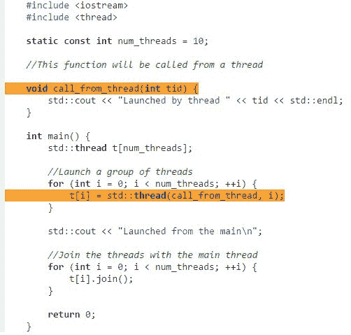

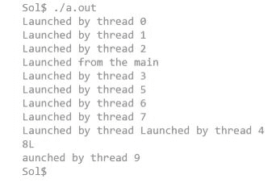

你可能会注意到一些结果混乱或错乱。这是因为所有线程都在竞争同一个资源——标准输出。

这些混乱的结果可以通过使用互斥量或屏障来避免。这些屏障允许开发者组织线程如何共享特定资源。

## 新的智能指针类


如果你不了解，智能指针目前定义在内存头文件的 `std` 命名空间中。它们是 RAII 的关键因素。RAII 代表“资源获取即初始化”惯用法，确保“资源获取与对象初始化同时发生”（MDSN）。

智能指针也是一个类模板。该模板在栈级别声明。它通过将原始指针指向堆分配的对象来初始化。完成后，智能指针拥有该原始指针。智能指针现在负责删除原始指针所指定的内存。

C++ 的早期版本 C++98 包含一个智能指针类 `auto_ptr`，该类型已被弃用。C++11 引入了两个新的智能指针类：`shared_ptr` 和 `unique_ptr`。这两个新组件都与标准库的其他组件兼容。因此，这些指针可以存储在标准容器中，并使用标准算法进行操作。


以下定义取自 MDSN.com，准确解释了新的库组件。

`unique_ptr`

底层指针的 `unique_ptr` 只允许有一个所有者。除非你确定需要 `shared_ptr`，否则将其作为 POCO 的默认选择。可以移动到新所有者，但不能复制或共享。取代已弃用的 `auto_ptr`。与 `boost::scoped_ptr` 类似。`unique_ptr` 小巧高效；大小为一个指针，并支持右值引用，以便快速插入和检索 STL 集合。头文件：`<memory>`。

下图展示了所有权如何在两个 unique_ptr 之间转移。


下面的示例演示了如何在代码中传递和创建 unique_ptr 实例。


`shared_ptr`

这种指针类型是引用计数的智能指针。当多个指针需要拥有同一个原始指针的所有权时，使用 `shared_ptr`。例如，当你从容器中返回指针的副本但希望保留原始指针时。一旦所有 `shared_ptr` 所有者超出作用域或放弃所有权，原始指针就会被删除。大小为两个指针；对象使用其中一个指针，而共享控制块包含的引用计数使用另一个指针。头文件：`<memory>`。

下图显示了一个内存位置，有多个 shared_ptr 指向它。


以下代码示例说明了 shared_ptr 实例的声明和初始化。一旦对象被分配，这些实例将拥有该对象的所有权。


shared_ptr 也可以传递给其他函数。可以通过以下方式实现：

* 按值传递
* 按引用传递


*   传递给底层对象

## 新的 C++ 算法

C++11 还引入了多种新算法。确切地说是 8 种算法。这些新算法包括：

*   `all_of()`
*   `any_of()`
*   `none_of()`
*   `is_sorted()`
*   `is_sorted_until()`
*   `is_partitioned()`
*   `is_permutation()`
*   `minmax_element()`

### All_of、any_of、none_of 算法

这三种算法非常相似。它们本质上检查一元谓词是否对无、全部或部分元素返回 true。


### is_sorted()

该算法本质上检查指定范围内的元素是否按升序排序。范围内的元素使用 `operator<` 进行比较，也使用二元比较函数 `comp` 进行比较。

下面给出了其用法示例以及输出结果。


### is_sorted_until()

该算法与 `is_sorted()` 算法类似。它执行相同的功能，检查一组元素是否按升序排序，但此算法返回一个迭代器。该迭代器指向最大子范围的上界，该范围当然是已排序的。以下是一个使用 `is_sorted_until()` 的程序示例及其输出。


### is_partitioned()

该算法正如其名所暗示的那样工作。它检查一个范围是否已分区。这意味着它检查一个范围是否根据给定的一元谓词进行了排序。所有不满足给定谓词的元素必须出现在满足谓词的元素之后。

以下程序展示了如何使用 `is_partitioned()` 算法。


### minmax_element()

`minmax_element()` 算法在给定范围内查找最小值和最大值。成功运行后，它会返回一对指向相应元素的迭代器。关于此算法，我们需要记住三点：

*   当给定范围没有值或为空时，算法将简单地返回 `std::make_pair(first, first)`。
*   如果给定值集合中有多个最小值，它将简单地返回第一个。
*   如果给定值集合中有多个最大值，它将简单地返回最后一个。

以下代码展示了该函数的使用及其输出：


### is_permutation()

该算法用于判断一个元素范围是否由另一个元素范围排列而成。下面给出了 `is_permutation()` 的使用示例。


总体而言，C++11 引入了许多变化。变化之多以至于有些人认为它几乎是一种不同的语言。你需要时间来适应这些变化，不要期望一夜之间就能全部理解。C++14 对 C++11 引入的许多内容进行了重大修订。下一章将重点介绍这些组件及其示例。

# 第 10 章 – 新版本：C++14

C++14 于 2014 年 12 月发布。在发布之前，它常被称为“C++1y”。C++14 为核心语言添加了大量更新。在许多情况下，C++14 建立在 C++11 添加的功能之上。总体而言，它是一个更轻巧的版本，对用户的影响较小。


## 返回类型推导

C++11 引入了 lambda 表达式，并允许它们根据表达式确定返回类型。这个新版本将这一能力赋予了所有函数。需要使用 `auto` 来确定返回类型。


## 放宽的 constexpr 限制


C++11 还引入了 `constexpr` 声明函数的概念。这本质上是一个可以在编译时执行的函数。在 C++11 中，`constexpr` 函数只能有一个表达式。

C++14 减少了版本 11 中存在的限制数量。这些函数现在可以包含以下内容：

*   除 `thread_local` 或静态变量类型或任何无初始化的声明之外的所有声明
*   包含 `if` 语句和 switch 的条件
*   包含 `for` 或 `while` 的任何循环语句

在此版本的 C++ 中，禁止使用 `goto` 语句。

## 数字分隔符

C++14 现在允许用户使用数字分隔符。这只是在数字字面量中使用单引号，包括整数和浮点数。

这个特性虽然算不上惊天动地，但对于阅读数字很有用。分隔符不会改变数字的求值结果，除了可读性之外没有特别的编码优势。

下面的示例展示了如何使用它。


## 关键字：auto

`auto` 关键字是 C++14 中的新特性。虽然它之前在 C++3 中引入过，但现在有了不同的含义。其目的是使编码更简单、更清晰且更少出错。以下是 `auto` 的使用示例及其等价形式。


上述示例替代了以下代码：


使用 `auto` 也不会对速度产生任何负面影响。这是因为 `auto` 在编译时而非运行时推导。与 C++11 不同，`auto` 现在可以用于函数。你现在可以编写：


### 示例程序

以下是 `auto` 关键字在 C++11 和 C++14 中的使用示例。

1) 这是 C++11 版本的程序。


C++14 版本如下：


## 泛型 Lambda


Lambda 函数在 C++11 中引入，当时需要声明为具体类型。C++14 对此要求更为宽松。它允许将 lambda 参数声明为 `auto` 类型。

`auto f = [](auto x){ return func(normalize(x)); };`

上述定义等价于以下伪代码：


在上述示例中，lambda 将参数 `x` 转发给 `normalize`。上面列出了闭包的函数调用运算符。

为了正确编写 lambda，`x` 必须完美转发给 `normalize`。为此，在上述代码中，`x` 必须是通用引用，并且必须通过 `std::forward` 传递给 `normalize`。


下面是一个完整程序示例，展示了泛型 lambda 的基本用法。


运行上述代码的结果如下：


## 新的标准库特性

随着 C++14 的到来，出现了新的标准库特性。这些特性包括：

*   锁定和共享互斥量
*   关联容器中的异构查找
*   用户定义的标准字面量
*   元组寻址

这是 C++14 提供的主要库特性列表，此外还有大量较小的库补充。

## 用户定义的字面量

C++14 添加了许多后缀，用于指定定义字面量的类型。这些后缀的一些示例包括 `'s'` 或 `'st'`，用于字符和字符串类型。


给定示例的最后一行会抛出错误。这是因为 `str` 将被确定为 `const char*` 类型，而 `str1` 将被确定为字符串类型。

以下后缀——`'h'`、`'min'`、`'s'`、`'ms'`、`'us'`、`'ns'`——用于表示各种时间间隔类型。


## 二进制字面量


在 C++14 出现之前，像 `11111101` 这样的二进制字面量是不被支持的。要使用它们，需要先转换为支持的类型。以下代码片段展示了它们在编程中的用法。


二进制字面量以 `0b` 或 `0B` 开头，后面跟着一串 0 和 1。许多其他编程语言中也能找到类似的语法，包括 Java、Perl 和 Python，这些语言都已经支持二进制字面量。

二进制字面量的类型是 `int`。它可以在任何接受常量字面量的地方使用。

## 变量模板

变量模板的初衷是让编码更简单，并简化常量的定义和使用。变量模板本质上是一组变量的定义。

在声明变量的位置使用 `template` 声明即可创建变量模板。

 

这些只是 C++14 引入的部分特性。虽然还引入了其他一些特性，但都不是重大的进步。C++14 包含的一些次要特性包括有大小定义的释放操作和一些语法整理。尽管 C++14 的版本更新无法与 C++11 的重大更新相比，但它仍然是必要的。

# 结论

恭喜你！通过学习和应用各章节中列出的内容，你已经读完了这本书！请记住，这仅仅是个开始。要真正掌握 C++，你必须持续学习并应用所学知识。既然你已经踏上了 C++ 的学习之旅，保持警惕至关重要。

C++ 是一种通用语言，既能用于大型系统，也能用于小型系统。在创建商业应用时，它是一种重要的语言。用 C++ 编写的项目种类繁多，包括：

*   操作系统，如 Linux 和 Mac OS X
*   游戏，如《魔兽世界》和《暗黑破坏神》系列
*   流行的 Wii、PlayStation 和 XBOX 游戏
*   编程语言的虚拟机（这些语言包括 Python、Java、Rudy、PFP、Perl）
*   流行软件，如 MS Office、Adobe Photoshop、Inventor 和 AutoCAD
*   网页浏览器（Chrome、Internet Explorer 和 Firefox）
*   许多 Apple iOS 应用

这份清单证明，C++ 是一种几乎无所不能的通用语言。

如果你想知道 C++ 在未来或未来 10 年内是否仍然重要，答案是肯定的！

C++ 及其前身 C 提供了对硬件的访问和高层次的抽象。它是使用率第三高的语言，仅次于 C，而 C 则落后于排名第一的 Java。目前还没有能取代 C++ 的竞争对手。

C++ 速度快，能够高效地利用资源。大多数质量尚可的嵌入式系统应用都是用 C 和 C++ 创建的。

C++ 于 1985 年 10 月首次商业化发布。C++ 在其生命周期中不断演进，并遵循一套明确的规则。这些规则如下，摘自 Bjarne Stroustrup 的《在现实世界中演化语言：C++ 1991-2006》。

## 通用规则

*   C++ 的演进必须由实际问题驱动。
*   不要陷入对完美无意义的追求。
*   C++ 必须在当下有用。
*   每个特性都必须有合理明显的实现方式。
*   始终提供过渡路径。
*   C++ 是一种语言，而不是一个完整的系统。
*   为每种支持的风格提供全面支持。
*   不要试图强迫人们使用特定的编程风格。

## 设计支持规则：

*   支持合理的设计理念。
*   提供程序组织的设施。
*   表达你的意图。
*   所有特性都必须是可负担的。
*   允许一个有用的特性比防止所有误用更重要。
*   支持由独立开发的部件组合成软件。

## 语言技术规则：

*   不隐式违反静态类型系统。
*   为用户定义类型提供与内置类型同等的支持。
*   局部性是好事情。
*   避免顺序依赖。
*   如有疑问，选择最容易教授的特性变体。
*   语法很重要（通常以反常的方式）。
*   应消除预处理器的使用。

## 底层编程支持规则：

*   使用传统（傻瓜式）链接器。
*   不与 C 产生无谓的不兼容。
*   不给 C++ 之下留出更低级语言的空间（汇编除外）。
*   不用则不付费（零开销原则）。
*   如有疑问，提供手动控制的手段。

总的来说，人们使用 C++ 的原因有很多。简单来说，C++ 是：

*   **灵活** – C++ 很灵活，因为它没有限制必须使用某种特定编程语言。它可以几乎毫不费力地用于各种应用领域。
*   **高效** – 支配 C++ 的基本概念与日常计算机的运作方式一致。
*   **易获取** – 所有计算机上通常都有可用的 C 编译器。此外，还有可用的工具和其他资源，使开发者无需从头编写代码。
*   **可移植** – 移植用 C++ 编写的项目相当简单，通常也是可行的。

你已经了解了 C++11 和 C++14 之间的区别，以及它们各自提供的功能。然而，你的知识并不止于此。

要充分利用 C++11 和 C++14 高效地进行编程，你必须继续努力。这包括持续不断地学习、阅读和应用这些知识。很快你就能掌握 C++17。虽然它尚未发布，但展望未来并做好准备是很重要的。

 

请记住，每个版本的 C++ 都提供了新的、独特的、有用的东西。C++14 本质上是建立在 C++11 之上的，理应如此。它在版本 11 开始但未完成的工作领域取得了进展。

非常感谢你购买这本书！

我希望你会喜欢阅读它。如果你想帮助我创作更多类似的内容，请在亚马逊上留下好评。

这真的很有帮助！

我想接下来的书也会让你感兴趣：

[Windows 10](https://www.amazon.com/dp/B06XJ57Y5H)

 

[Java](https://www.amazon.com/dp/B01G7U2VNK)


