# Cam机器人 micro:bit Javascript：线路追踪器 第二版 (发现！如何？ 第24册)


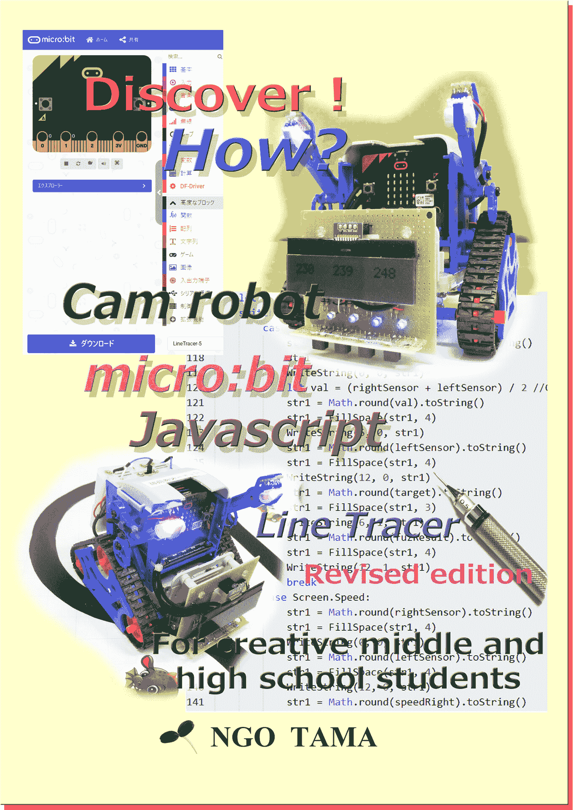

# 引言

双手摆动……，你在走路吗？
还穿着毛毛虫橡胶鞋，真是引人注目！
你能轻松爬上这附近的斜坡，不是吗！
什么！“沿着黑线走”？
我明白了……哎呀！你伸出来的时候还会后退！
就算稍微突出一点也绝不会摔倒！
哦！！你身体这么大，转弯却很顺畅，不是吗！真让我佩服！
我喜欢你！你叫什么名字？
“凸轮机器人”
嗯，~凸轮？凸轮装在哪里？
“稍作改装，用微型计算机代替了凸轮。”
哦~！用了微型计算机~
那么，那个微型计算机内部到底有什么玄机呢？
“这些就写在这本书里！”
嗯？让我看看………
于是，本方案利用市售的凸轮机器人上搭载的名为“micro:bit”的微型计算机，让机器人沿着黑线移动。
它可以利用一个名为 MakeCode 的实用免费工具。也可以用 MakeCode 的积木编辑器编写，但画面可能会变得复杂，所以最好切换到 Javascript。
使用最新的 Javascript 编辑器时，它能告诉你错误发生的位置和原因。
巡线的目标很明确，而且是为 micro:bit 编写的简单 Javascript，所以即使是中学生和高中生也能完全掌握。
就像世界上几乎所有事物一样，看似复杂的行为都是由简单的小部分构成的。
那么，让我们充满信心地前进吧！
这本书会帮助你。

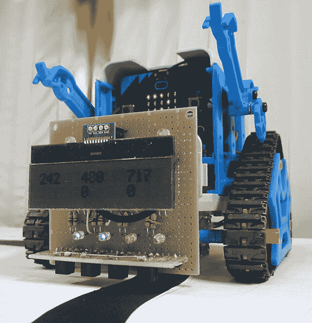

视频示例的网址如下。
在第 2 版中，增加了 RGB LED 显示。此外，为了应对道路交叉的情况，只处理了沿道路中心运行的程序。

https://youtu.be/LIoKmstp0kk

“注意”
如果在向 micro:bit 下载程序时显示 [Bad response for 130->255]，则需要更新 micro:bit 的固件。
由于我们的固件版本是 241，我们将其更新到最新版本 (253) 后问题得到解决。
如果适用，请按以下说明进行更新。
使用 WebUSB 排除下载故障

https://makecode.microbit.org/device/usb/webusb/troubleshoot

# [1] 整体配置

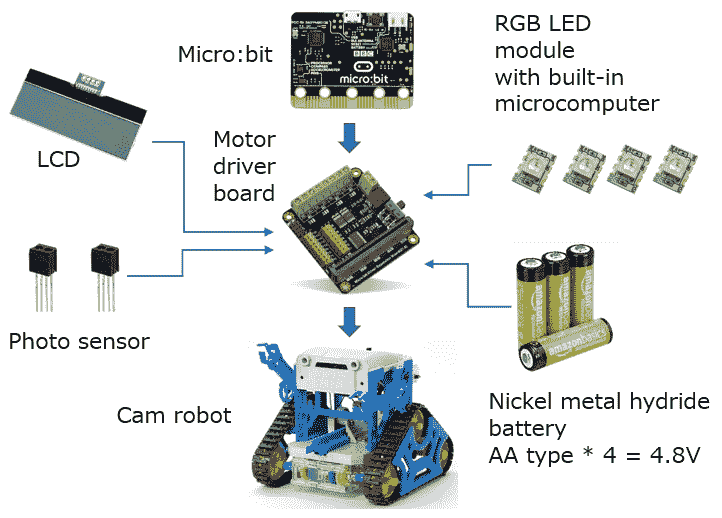

配置示例：

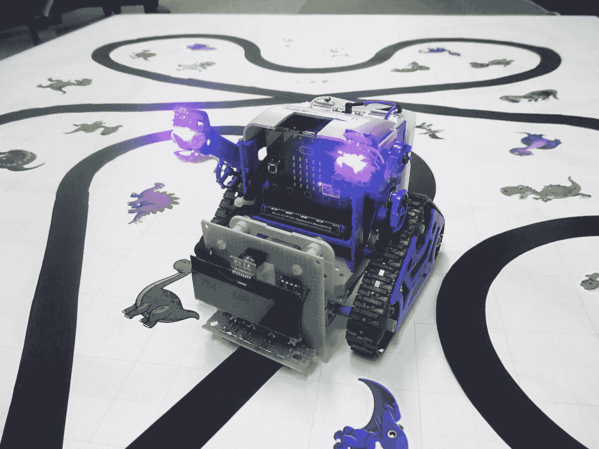

## (1) 硬件准备

1) 凸轮程序机器人工作套装 70227（田宫 No.227）＞参考页面  https://www.amazon.co.jp/dp/B073S47B11 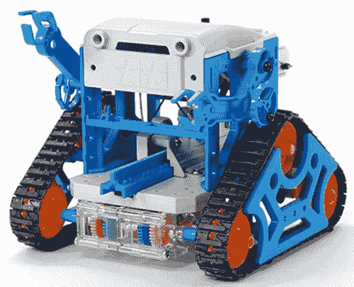

2) micro:bit


> 参考页面：https://www.amazon.co.jp/BBC-micro-bit/dp/B074M58PL7
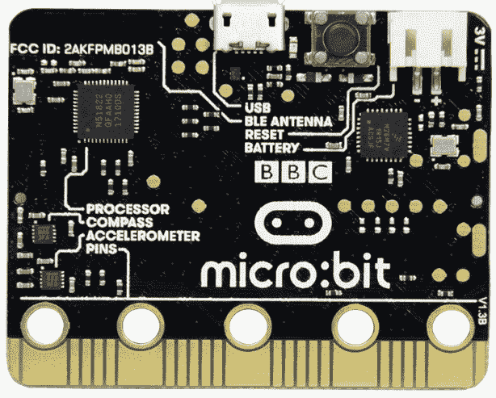

3) 电机驱动扩展板（DFROBOT SKU_DFR0548）
> 参考页面：https://www.switch-science.com/catalog/4016/
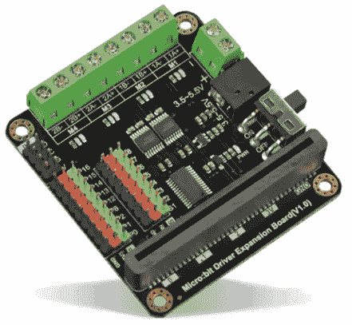

4) 反射式光电传感器（ROHM RPR-220）2 个
> 参考页面：http://akizukidenshi.com/catalog/g/gI-11401/
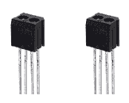

5) LCD 面板（I2C AQM1602）
> 参考页面：http://akizukidenshi.com/catalog/g/gK-08896/
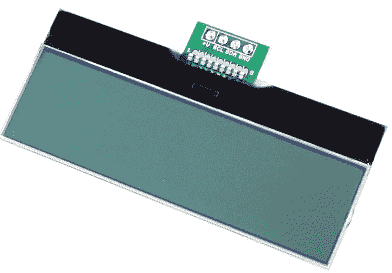

6) I2C 总线双向电压电平转换模块（FXMA2102）
> 参考页面：http://akizukidenshi.com/catalog/g/gM-05825/
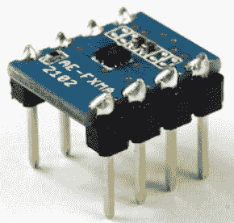

7) 4 节 AA 电池盒
> 参考页面：https://www.amazon.co.jp/dp/B01H1P6KEQ
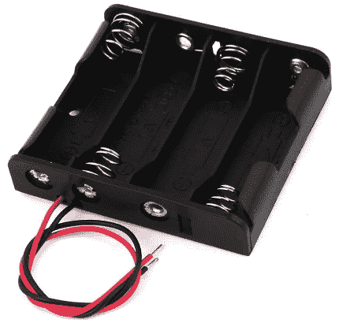

8) 可充电镍氢电池 4 节
> 参考页面：https://www.amazon.co.jp/dp/B00CWNMR5Y


9) 内置微电脑的 RGB LED 模块 4 个
> 参考页面：http://akizukidenshi.com/catalog/g/gM-08414/


## (2) 凸轮程序机器人的准备

以下页面对于组装非常有用。

1) 组装方法说明页面
https://sanuki-tech.net/micro-bit/tamiya/assembly-cam-program-robot/
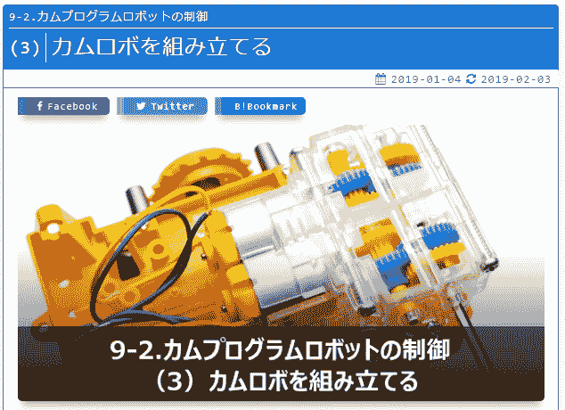

除了凸轮机器人附带的组装手册中的第 1、6 和 7 号零件外，其余部分进行组装。第 14 和 17 号电池盒按照上述说明页面制作。

2) 如何集成 micro:bit 的说明页面
https://sanuki-tech.net/micro-bit/tamiya/mounting-of-microbit/
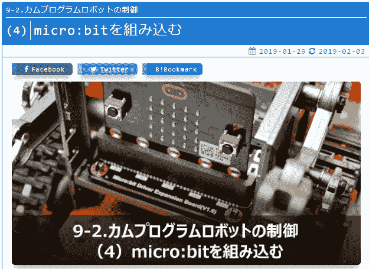

3) 控制凸轮机器人的方法说明页面
https://sanuki-tech.net/micro-bit/tamiya/programming-of-cam-program-robot/
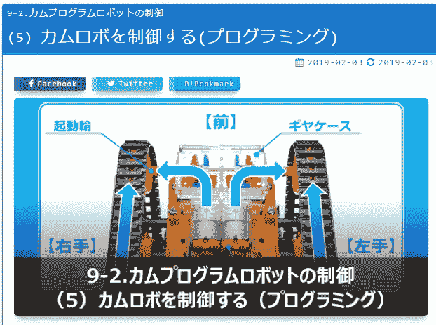

## (3) 基板的准备

光电传感器板、LCD 板和 RGB LED 板按如下方式制作。
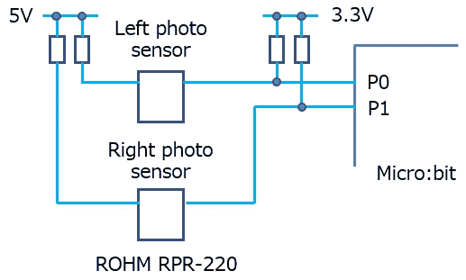
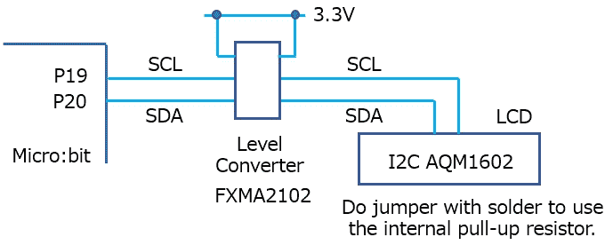
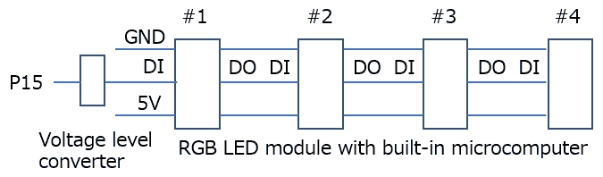
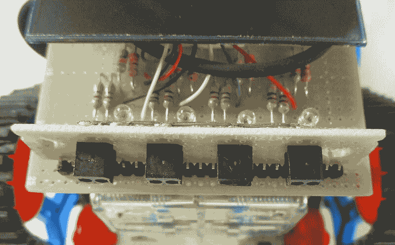

照片中有四个光电传感器，但只使用中间的两个。电机驱动扩展板具有以下配置。
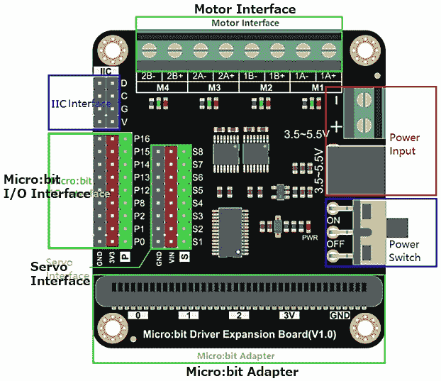

## (4) 软件创建的准备

1) Makecode 编辑器
从以下网址下载 Makecode 编辑器。
https://www.microsoft.com/en-us/p/makecode-for-micro-bit/9pjc7sv48lcx?activetab=pivot:overviewtab


2) 添加驱动程序并检查电机的 ON/OFF 操作。
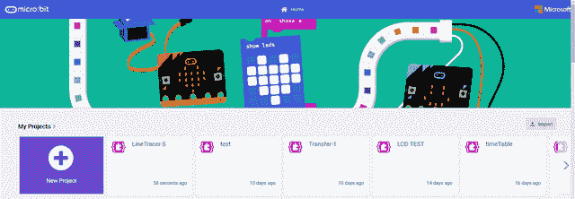

将用于操作电机的驱动程序添加到程序中。在 MakeCode 编辑器中，进入“新建项目”、“高级块”、“扩展”，然后在搜索字段中输入 `https://github.com/DFRobot/pxt-motor`。然后会显示 `motor`，点击它。
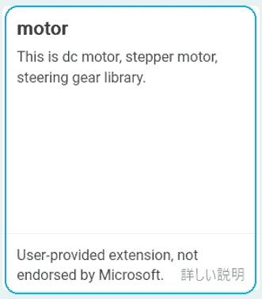

这将把 `DF-Driver` 添加到块列表中。
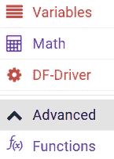

面向凸轮机器人的前进方向，每个电机连接到以下端子。
- 左电机 ... M1 端子
- 右电机 ... M2 端子

在块编辑器中点击 `DF-Driver`，显示如下所示的项目。
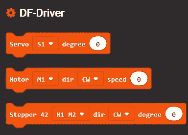

选择 `Motor` 并指定电机、旋转方向和速度。速度是一个从 0 到 255 的值，但首先用大约 100 的值来检查。
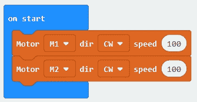

按下 `Download` 按钮将程序写入 micro:bit。


打开凸轮机器人并操作电机。电机工作吗？暂时停止（在此阶段关闭电源）并重写速度值。再次 `Download` 并观察电机从低速到高速旋转。

接下来，让我们切换到 Javascript 编辑器。在 Javascript 屏幕上，用块编辑器编写的内容显示如下。

```
motor.MotorRun(motor.Motors.M1, motor.Dir.CW, 100)
motor.MotorRun(motor.Motors.M2, motor.Dir.CW, 100)
basic.forever(function () {})
```

使用这些，准备前进和后退程序。

## (5) 前进/后退运动的确认

```
===========================
//面向凸轮机器人的前进方向，M1：左轮，M2：右轮
function Advance(speed1: number, speed2: number) {
    motor.MotorRun(motor.Motors.M1, motor.Dir.CW, speed1)
    motor.MotorRun(motor.Motors.M2, motor.Dir.CW, speed2)
}
function FallBack(speed1: number, speed2: number) {
    motor.MotorRun(motor.Motors.M1, motor.Dir.CCW, speed1)
    motor.MotorRun(motor.Motors.M2, motor.Dir.CCW, speed2)
}
function MotorStop(){
    motor.motorStopAll()
}
===========================
```

让我们从主循环中调用这些函数。

```
===========================
// 主循环
basic.forever(function () {
    Advance(80, 80)
    basic.pause(1000)  //ms
    MotorStop()
    basic.pause(1000)  //ms
    FallBack(80, 80 )
    basic.pause(1000)  //ms
    MotorStop()
    basic.pause(1000)  //ms
})
===========================
```

如果 `Advance(80, 80)` 的参数设置为负值，电机将反转，因此可以使用 `Advance(-80, -80)` 代替 `FallBack(80, 80)`。当改变凸轮机器人的行驶方向时，可以通过改变左右旋转方向（如 `Advance(80, -80)`）来大幅改变方向。

## (6) RGB LED 显示

虽然与驱动控制没有直接关系，但这种变色 LED 非常适合享受凸轮机器人的操作。在本书中，LED 显示颜色根据车轮速度和光电传感器值分别左右改变。即使从远处也可以检查传感器值和速度的变化，这可能有助于审查驱动软件。

从 Makecode 编辑器中，按下 `advanced block` `extension` 并点击屏幕上显示的 `neopixel`。
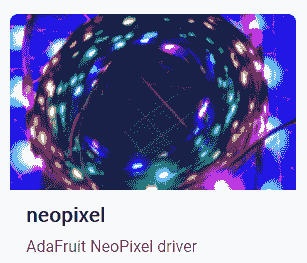

`Neopixel` 被添加到块列表中。
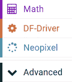

当你点击 `Neopixel` 时，会显示如下所示的项目。
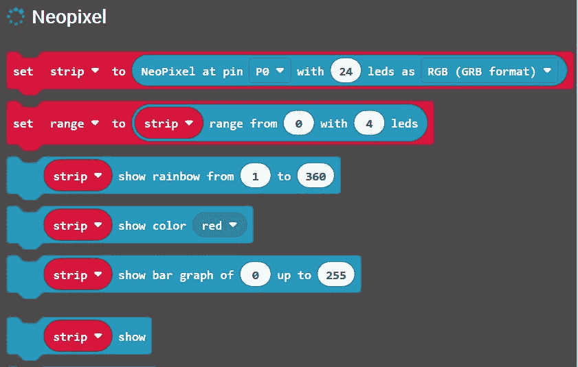

其中，使用下面显示的工具。


```
let strip = neopixel.create(DigitalPin.P0, 24, NeoPixelMode.RGB)
```


```
strip.setPixelColor(0, neopixel.colors(NeoPixelColors.Red))
```


```
strip.show()
```

使用这个工具，我已经准备了以下函数。根据速度和传感器值的颜色分配如下图所示。
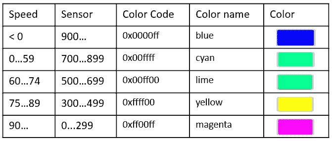

```
===========================
let item = neopixel.create(DigitalPin.P15, 4, NeoPixelMode.RGB)
let colorTable = [0X0000ff, 0x00ffff, 0x00ff00, 0xffff00, 0xff00ff]

//用于速度
function NeoSpeed(pos: number, speed: number) {
    //-40...60...120
    let index = 0
    if (speed < 0)
        item.setPixelColor(pos, colorTable[0])
    else {
        if (speed >= 60) {  //60...120
            speed -= 60 //0..60
            index = speed / 15  //0...3
            if (index > 3)
                index = 3
        }
        else
            index = 0
        index += 1
        item.setPixelColor(pos, colorTable[index])
    }
    return index
}

//用于传感器
function NeoSensor(pos: number, sensor: number) {
    //0...1023
    let index = 0
    sensor -= 300
    if (sensor >= 0) {
        index = sensor / 200    //0,1,2,3..
        index += 1
        if (index > 4)
            index = 4
    }
    item.setPixelColor(pos, colorTable[4 - index])
    return index
}

//0=左前, 1=左后, 2=右后, 3=右前
//仅当值不同时显示
let oldIndex = 0
function NeoShow() {
    let a = NeoSensor(0, leftSensor)
    let b = NeoSensor(3, rightSensor)
    let c = NeoSpeed(1, speedLeft)
    let d = NeoSpeed(2, speedRight)
    let val = a << 12 + b << 8 + c << 4 + d
    if (oldIndex != val) {
        oldIndex = val
        item.show()
    }
}
===========================
```

# [2] 传感器值的获取与 LCD 显示

现在，我们的目标是改变左右电机的旋转速度，并调整凸轮机器人沿线路行驶的方向。这个判断基于左右传感器的值。所以接下来，让我们获取传感器值。

## (1) 传感器值的获取

面向凸轮机器人的行驶方向，
- 左侧传感器连接到 P0 端子，
- 右侧传感器连接到 P1 端子。

当在块编辑器中如下编写时，
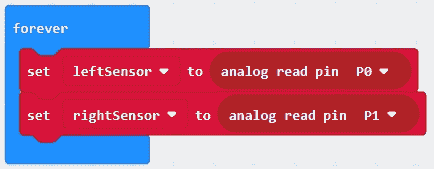

在 Javascript 中，表示如下。

```
let leftSensor = 0
let rightSensor = 0
basic.forever(function () {
    leftSensor = pins.analogReadPin(AnalogPin.P0)
    rightSensor = pins.analogReadPin(AnalogPin.P1)
})
```

我们可以用这个来获取传感器值。由于 micro:bit 的模拟输入转换为 10 位，该值范围为 0 到 1023。但是，用 micro:bit 的 LED 面板确认该值很困难，所以让我们在外部 LCD 面板上显示它。

将来，随着程序变长，需要高效编辑。在当前版本的 Makecode 编辑器中，在块和 Javascript 之间切换会改变函数和变量的位置。作为对策，
1) 不要切换到块
2) 有一种方法是用另一个编辑器（开发环境）编辑 Javascript，然后粘贴到 Makecode 的 Javascript 屏幕上。

我们使用 Microsoft Visual Studio Community 2019，因为用 Makecode 编辑器编辑 Javascript 很困难。请也参考这个方法。

## (2) 程序准备

现在，根据 LCD 面板（I2C AQM1602）的说明创建软件。创建以下基本程序并从 LCD 显示程序中调用。

1) 初始设置
2) 写入命令和字符

在初始设置中，按顺序发送以下命令，但需要在命令之间留出比内部处理时间更多的时间。即使时间比 AQM1602 手册中写的微秒稍长，也无法进行初始化，所以这里我们大幅设置为长时间（毫秒）。另外，由于块编辑器中准备的 I2C 传输方式与 AQM1602 手册中显示的方式略有不同，这里我们使用缓冲区方法。缓冲区的说明如下。
https://makecode.microbit.org/types/buffer

通过 I2C 发送到 LCD 的信号如下所示。LCD 地址是 `0x3E`。在下图中，发送了用于指定显示矩阵的命令（`0x80`）和显示数据（`"ABC123"`）。
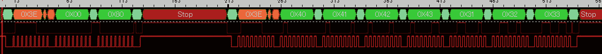

命令部分展开
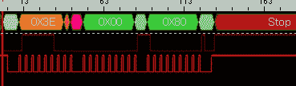

数据部分展开
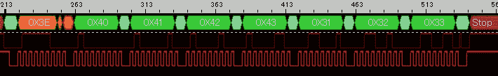

## (3) 流程图

根据下面的流程图创建 LCD 初始化。
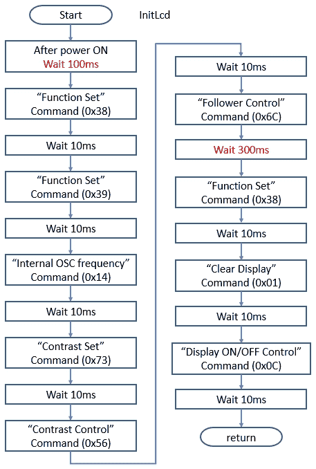

```
===========================
// LCD 初始化
let initList = [0x38, 0x39, 0x14, 0x73, 0x56, 0x6C, 0x38, 0x01, 0x0C]
// 用于 AQM1602
function InitLcd() {
    basic.pause(100)
    let len = initList.length
    for (let n = 0; n < len; n++) {
        WriteCommand(0, initList[n])
        basic.pause(10)
        if (n == 5)
            basic.pause(300)
    }
}
===========================
```

根据下面的流程图写入命令和字符串。
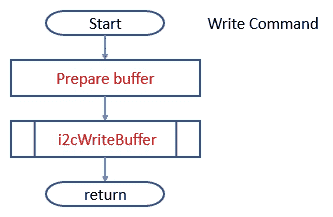
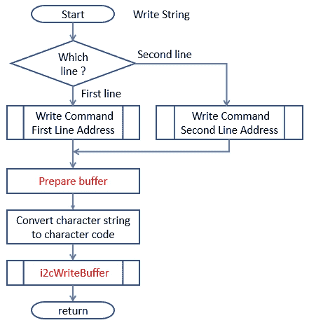

```
===========================
// LCD
function WriteCommand(regi: number, data: number) {
    let cmd = pins.createBuffer(2);
    cmd[0] = regi
    cmd[1] = data
    pins.i2cWriteBuffer(0x3e, cmd, false);
    control.waitMicros(30)
}

// LCD
function WriteString(col: number, row: number, str: string) {
    if (row == 0)
        WriteCommand(0, 128 + col)
    else if (row == 1)
        WriteCommand(0, 192 + col)
    else
        return
    let len = str.length
    let buff = pins.createBuffer(len + 1)
    buff[0] = 64
    for (let n = 0; n <= len - 1; n++)
        buff[n + 1] = str.charCodeAt(n)
    pins.i2cWriteBuffer(0x3e, buff, false)
}
===========================
```

由于传感器值从 0 变化到 1023，因此始终在 4 个字符的区域内显示，当位数较少时，用空格填充。

```
===========================
//LCD
function FillSpace(str: string, len: number) {
    let m = len - str.length
    if (m > 0) {
        for (let n = 0; n < m; n++)
            str += " "
    }
    return str
}
===========================
```

## (4) 传感器值的显示

让我们在 LCD 上显示左右传感器值。将右传感器和左传感器的值写在 LCD 的第一行。
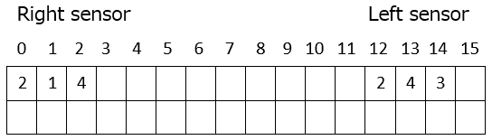

```
===========================
let leftSensor = 0
let rightSensor = 0

//LCD
function ShowLcd() {
    let str1 = Math.round(rightSensor).toString()
    str1 = FillSpace(str1, 4)
    WriteString(0, 0, str1)
    str1 = Math.round(leftSensor).toString()
    str1 = FillSpace(str1, 4)
    WriteString(12, 0, str1)
}
===========================
```

## (5) 后台

在凸轮机器人运行期间，始终需要传感器值，因此在后台捕获它们。在 Makecode 的 Javascript 中，编写方法是打开 `New project`，然后从 `Advanced block` `Control` 中选择 `Run in background`。
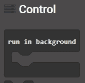

如果切换到 Javascript，你会发现应该如下编写。

```
control.inBackground(function () {})
```

在这个函数中，编写捕获左右传感器值的部分。

```
===========================
// 后台工作器
control.inBackground(function () {
    while (true) {
        leftSensor = pins.analogReadPin(AnalogPin.P0)
        rightSensor = pins.analogReadPin(AnalogPin.P1)
        basic.pause(5)  //ms
    }
})
===========================
```

后台也使用 CPU 时间，因此需要上面的 `basic.pause()`。如果没有这个，大部分 CPU 时间将被后台占用，主程序将无法运行。`pause()` 的时间是在考虑后续模糊控制的控制周期后确定的。

现在我们已经准备好了，在主循环中调用 LCD 显示函数。

```
===========================
//起始点
InitLcd()

// 主循环
basic.forever(function () {
    ShowLcd()
    basic.pause(500)  //ms
})
===========================
```

怎么样？显示了吗？当在传感器下移动黑纸时，值会改变吗？这次使用的凸轮机器人的手工传感器板上，左右值是不同的。是由于环境光的影响、元件常数的差异，还是因为安装位置不准确，例如如下图所示。
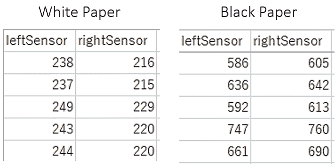

如果没问题，你已经找到了了解最重要传感器值的方法，那么让我们进入下一步。

# [3] 操作策略

现在，你用什么策略来控制凸轮机器人的运动？沿着道路行驶，但沿着道路的哪一部分行驶？道路中心？还是道路边缘？

这次创建的板的传感器浓度如下所示。由于白纸反射大量光线，由于硬件配置，值较低。在黑纸上，由于反射光少，输入到微电脑的值较高。下图显示了用手将黑纸从右向左移动时每个传感器的值。
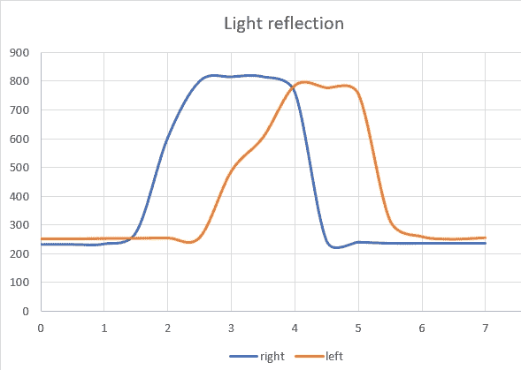

## (1) 道路中心

如果你想将凸轮机器人控制到道路中心，你将控制使得连接左右传感器值的直线的斜率为水平（即左右传感器值的差值为 0）。即使在相同黑色区域中左右传感器值存在差异，也应该存在斜率几乎水平的地方。以此为目标进行控制。
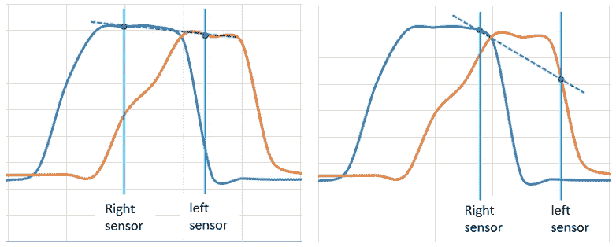

为了应对道路线的交叉口，本书的第二版仅处理沿道路中心行驶。这里解释的只是一个例子。除此之外，你的读者可能会发现创新的方法。控制没有正确答案。失败是自然的。最重要的是自己思考各种方法并努力尝试。

## (2) 操作步骤

通电后，
1) 将凸轮机器人放在画有路线的纸的白色部分，按下 B 按钮读取白色传感器值。为了确认已按下，它会在 micro:bit LED 屏幕上显示数字 1。
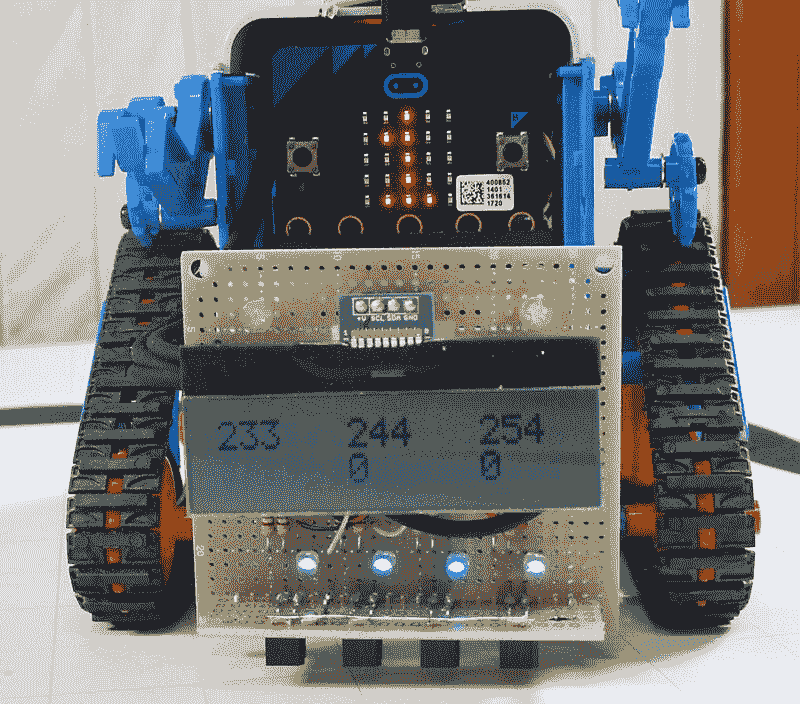
2) 将左右传感器放在纸的黑色部分，按下 B 按钮读取黑色传感器值。同样，micro:bit 的 LED 屏幕上会显示数字 2。
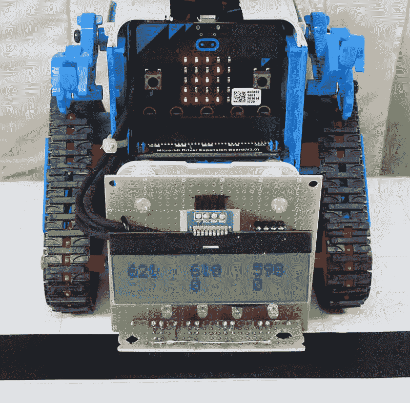

1) 和 2) 的顺序可以颠倒。此操作结束时，确定白色和黑色的代表值以及中值。如果省略此操作，将使用默认值。
3) 将两个中央传感器放在线上，按下 A 按钮开始。
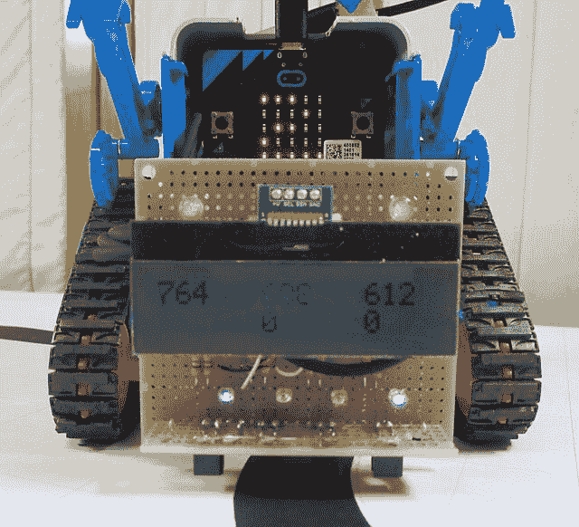
4) 随时按下 B 按钮停止。由于记住了黑色和白色的典型值，只需按下 A 按钮即可重新启动操作。

## (3) 流程图

流程图如下所示。
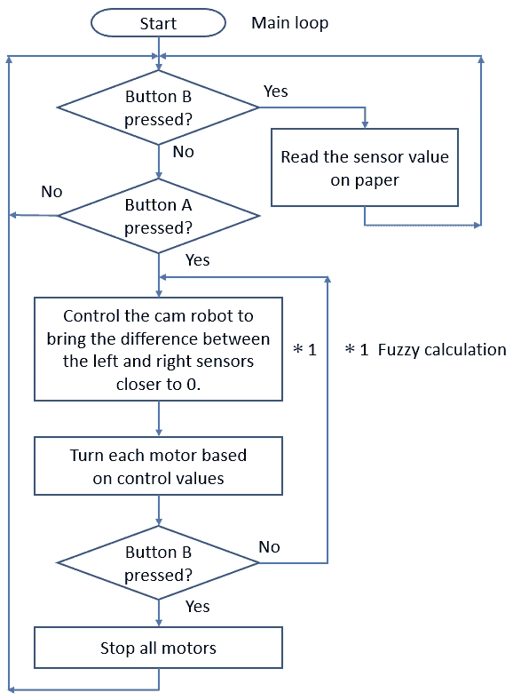

## (4) 模糊计算

上述模糊计算在与本文档相同的 `Discover How` 系列的 `Fuzzy & PID2` 中有详细描述，但使用其自身的模糊计算。如下面的图表所示确定。
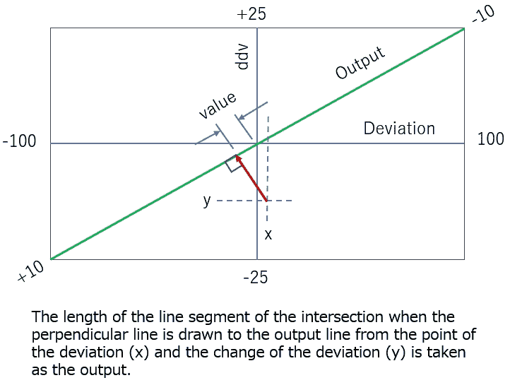

下面 `fuzzyList[]` 的含义如下。
- `fuzzyList[0]` 最大偏差值（横轴）
- `fuzzyList[1]` 最大偏差变化量（纵轴）
- `fuzzyList[2]` 输出最大值

模糊计算程序如下。

```
===========================
//模糊
//fuzzyList[2] 乘以 10，因此结果应为 1/10
let fuzzyList = [200, 40, 200]
let oldDiff = 0
let fuzResult = 0
let target = 0

//模糊 计算抑制量
function Fuzzy(val: number) {
    let x0 = target - val  //与中值的偏差
    let y0 = x0 - oldDiff   //偏差变化量
    oldDiff = x0
    let dv = fuzzyList[0]     //最大偏差
    let ddv = fuzzyList[1]    //最大偏差变化量差值
    let lout = -fuzzyList[2]    //输出最大值
    let a = ddv / dv //斜率 = 偏差变化量 / 偏差
    let d = x0 + a * y0 //分子
    let x1 = d / (a * a + 1)    //交点的 X 坐标 = 分子 / 分母
    let lx = dv   //偏差
    let result = (x1 * lout) / lx
    //限制输出
    let limit = fuzzyList[2]
    if (result < -limit)
        result = -limit
    else if (result > limit)
        result = limit
    return result / 10
}
===========================
```

## (5) 电机反转

顺便说一下，如果电机速度低于某个值，车轮几乎不动。例如：`Advance(80, 30)` 右轮不动。因此，如下图所示，我们在一定速度以下反转电机。

例如，
- 如果 `fuzzyList = [200, 40, 200]`，Fuzzy 的输出范围为 -20～20。
- 如果 `speedList = [60, 80, 100, 120]`，速度范围为 `中心速度 ± Fuzzy`，如下表所示。
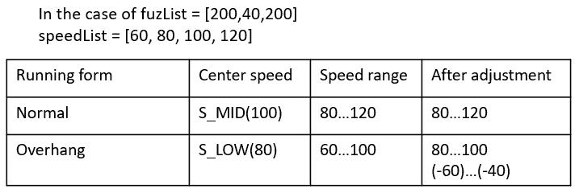

当 `fuzzyList = [200, 40, 300]` 时，Fuzzy 的输出范围为 -30 到 30，如下表所示。
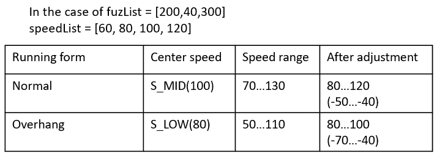

如下图所示。
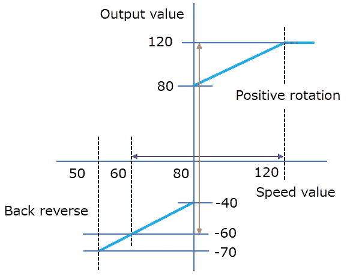

限制电机速度的程序如下。

```
===========================
let speedList = [60, 80, 100, 120]    //SLOW,LOW,MID,HIGH
let S_SLOW = speedList[0]  //SLOW
let S_LOW = speedList[1]    //LOW
let S_MID = speedList[2]    //MID
let S_HIGH = speedList[3]  //HIGH
let speedLeft = 0
let speedRight = 0

//速度限制
function Restrict(spLeft: number, spRight:number) {
    if (spLeft > S_HIGH)
        speedLeft = S_HIGH
    else if (spLeft < S_LOW)
        speedLeft = spLeft - S_SLOW * 2
    else
        speedLeft = spLeft
    if (spRight > S_HIGH)
        speedRight = S_HIGH
    else if (spRight < S_LOW)
        speedRight = spRight - S_SLOW * 2
    else
        speedRight = spRight
}
===========================
```

# [4] 主程序的创建

让我们根据前面的流程图编写主程序。模糊控制部分 (*1) 的流程图如下。
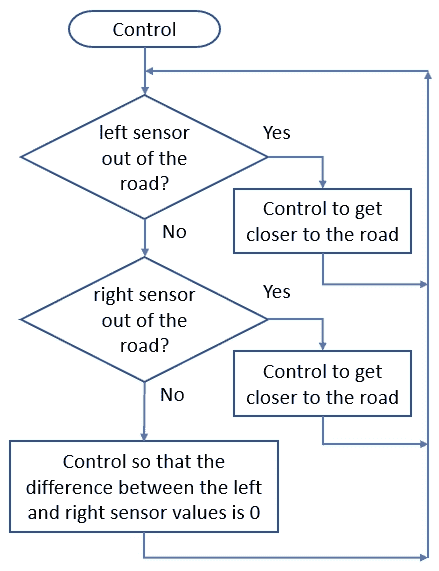
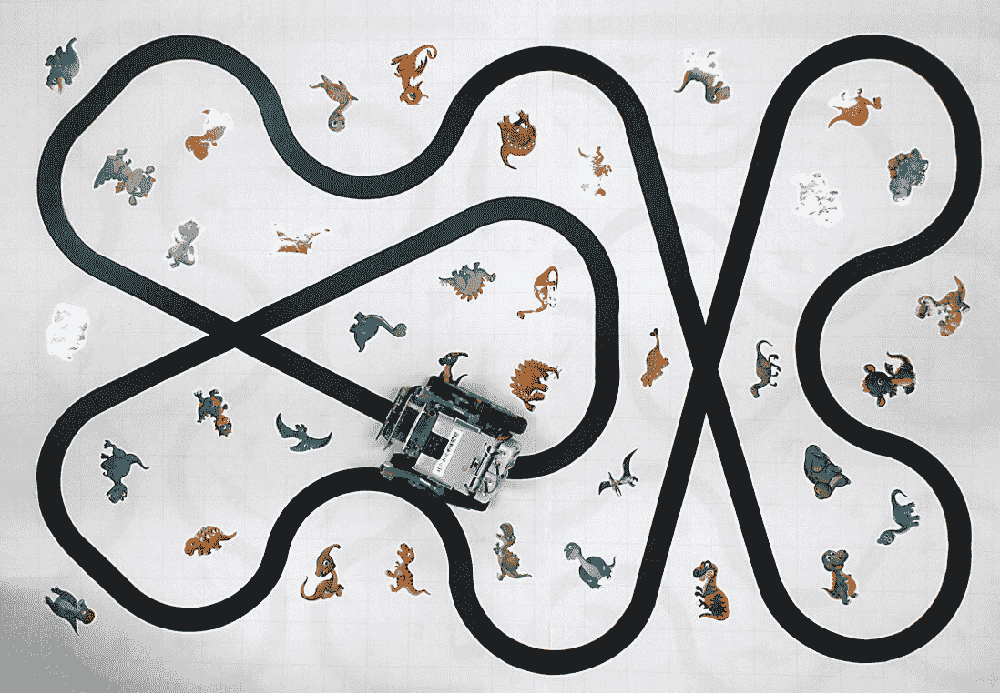

## (1) 变量定义

定义各种变量。

```
===========================
//传感器值
let roadList = [250, 450, 650]    //WHITE, GRAY, BLACK
let R_WHITE = roadList[0]    //WHITE
let R_GRAY = roadList[1]    //GRAY
let R_BLACK = roadList[2]    //BLACK
let offset = [30, 40]   //White, Black
let offRoad = 0
let onRoad = 0
let leftVal = 0
let rightVal = 0

//序列步骤
let Step = {
    STOP: 0,
    START: 1 ,
    FORWARD: 2,
}
let step = Step.STOP
===========================
```

## (2) 主程序

主程序如下。

```
===========================
function IsStart() {
    return input.buttonIsPressed(Button.A)
}
function IsStop() {
    return input.buttonIsPressed(Button.B)
}

//起始点
InitLcd()

//主循环
basic.forever(function () {
    if (IsStart() == true && step == Step.STOP) {  //开始
        basic.clearScreen()
        step = Step.START
    }
    else if (IsStop() == true && step != Step.STOP) { //停止
        MotorStop()
        basic.clearScreen()
        step = Step.STOP
    }
    switch (step) {
        case Step.STOP: //停止时
            //获取传感器值并设置 roadList
            if (IsStop() == true) {
                if (leftSensor < R_GRAY && rightSensor < R_GRAY) {
                    R_WHITE = Math.max(leftSensor, rightSensor)
                    basic.showNumber(1)
                }
                else if (leftSensor > R_GRAY && rightSensor > R_GRAY) {
                    R_BLACK = Math.min(leftSensor, rightSensor)
                    basic.showNumber(2)
                }
                R_GRAY = (R_WHITE + R_BLACK) / 2
            }
            break
        case Step.START:    //开始前进
            offRoad = R_WHITE + offset[0]
            onRoad = R_BLACK - offset[1]
            speedLeft = S_LOW
            speedRight = S_LOW
            basic.pause(500)
            Advance(speedLeft, speedRight)    //开始前进
            step = Step.FORWARD
            break
        case Step.FORWARD: //前进时
            //使用判断时的值
            leftVal = leftSensor
            rightVal = rightSensor
            let speed = S_LOW
            if (leftVal < offRoad) {
                speed = S_LOW
                fuzResult = Fuzzy(leftVal - R_GRAY)
                led.plot(1, 4)
            }
            else if (rightVal < offRoad) {
                speed = S_LOW
                fuzResult = Fuzzy(R_GRAY - rightVal)
                led.plot(2, 4)
            }
            else {
                speed = S_MID
                //执行模糊计算（偏差）
                //控制使得左右传感器的密度差为 0
                fuzResult = Fuzzy(leftVal - rightVal)
                led.plot(3, 4 )
            }
            let spLeft = speed - fuzResult
            let spRight = speed + fuzResult
            Restrict(spLeft, spRight)  //速度限制
            Advance(speedLeft, speedRight)
            basic.pause(timeTable[Timer.PERIOD]) //控制周期
            for (let n = 0; n < 4; n++)
                led.unplot(n, 4)
            break
    }
})
===========================
```

将此程序下载到 micro:bit 并查看其工作方式。怎么样？

# [5] 定时器的创建

在确认运动到一定程度后，让我们能够在 LCD 屏幕上确认开始前进行的白色和黑色传感器值。LCD 屏幕上的显示间隔，例如，如果设置为 0.1 秒，对人眼来说太快而无法跟随变化，所以这里我们使用 0.5 秒。此外，在这 0.5 秒的时间内，车轮根据传感器值进行控制，我们不能写成 `basic.pause(500) // ms`。所以让我们在主循环之外运行一个定时器，并时不时地从主循环检查经过的定时器时间。这里我们将讨论如何使用运行定时器以及如何使用 PWM 定时器。

## (1) 公共部分

首先，描述两个定时器共有的部分。
- `TIMERSIZE` 定时器数量
- `timeValue[]` 倒计数值
- `timeTable[]` 定时器设置值（ms）
- `State` 定时器状态（OFF, ON, UP）

我准备了 5 个定时器，每个将用于以下目的。
- `SHOW` LCD 显示周期
- `PERIOD` 控制周期
- `SURE` 悬空确认时间
- `WAIT` 等待时间
- `BACK` 后退时间限制

```
===========================
let TIMERSIZE = 5
let timeValue = [0, 0, 0, 0, 0]
let Timer = {
    SHOW: 0,
    PERIOD: 1,
    SURE: 2,
    WAIT: 3,
    BACK: 4
}
let timeTable = [500, 2, 200, 400, 4000] //ms
let State = {
    OFF: 0,
    ON: 1,
    UP: 2
}
===========================
```

这些是通用的定时器操作函数。
- `OnTimer()` 启动指定的定时器
- `OffTimer()` 停止指定的定时器
- `CheckTimer()` 检查指定的定时器是否已超时
- `InitTimer()` 初始化定时器

## (2) 运行时间

使用 Makecode 编辑器中的 `input` 和 `other uptime` 块。


通过执行以下操作可以找出经过的时间。


```
let elapsed = 0
let startTime = input.runningTime()
basic.forever(function () {
    elapsed = input.runningTime() - startTime
})
```

1) 运行定时器
让我们用运行时间配置定时器。添加以下变量和常量。
- `startTime[]` 定时器开始时间

```
===========================
//定时器
let startTime = [0, 0, 0, 0, 0]
===========================
```

2) 运行时间定时器操作

```
===========================
// 定时器
function OnTimer(n: number) {
    if (n < TIMERSIZE) {
        startTime[n] = input.runningTime()
        timeValue[n] = timeTable[n]
    }
}
function OffTimer(n: number) {
    if (n < TIMERSIZE) {
        timeValue[n] = 0
    }
}
function CheckTimer(n: number) {
    let result = 0
    if (n < TIMERSIZE) {
        if (timeValue[n] == 0)
            result = State.OFF
        else {
            let elapsedTime = input.runningTime() - startTime[n]
            if (timeValue[n] <= elapsedTime)  //ms
                result = State.UP
            else
                result = State.ON
        }
    }
    return result
}
function InitTimer() {
    for (let n = 0; n < TIMERSIZE; n++)
        timeValue[n] = 0
    OnTimer(Timer.SHOW)
}
===========================
```

## (3) PWM 输出

另一种方法是使用 CPU 中提供的精确 PWM 输出，如下所示。在下图中，P12 和 P16 端子连接。


```
pins.onPulsed(DigitalPin.P16, PulseValue.High, function () {})
pins.analogWritePin(AnalogPin.P12, 512)
pins.analogSetPeriod(AnalogPin.P12, 10000)
```

下图显示了上述设置下的 PWM 输出波形。（周期 10ms）


1) PWM 定时器
配置一个使用 PWM 输出的定时器。
- `timeState[]` 定时器状态（OFF, ON, UP）

```
===========================
let timeState = [0, 0, 0, 0, 0]
===========================
```

2) PWM 定时器操作
`pins.onPulsed()` 由 PWM 脉冲调用并倒计时。

```
===========================
//每 10ms 调用一次
pins.onPulsed(DigitalPin.P16, PulseValue.High, function () {
    for (let n = 0; n < TIMERSIZE; n++) {
        if (timeState[n] == State.ON) {
            if (timeValue[n] > 0)
                timeValue[n] -= 10
            if (timeValue[n] <= 0) {
                timeState[n] = State.UP
            }
        }
    }
})

// 定时器
function OnTimer(n: number) {
    if (n < TIMERSIZE) {
        timeValue[n] = timeTable[n]
        timeState[n] = State.ON
    }
}
function OffTimer(n: number) {
    if (n < TIMERSIZE) {
        timeState[n] = State.OFF
    }
}
function CheckTimer(n: number) {
    if (n < TIMERSIZE)
        return timeState[n]
    else
        return State.OFF
}
function InitTimer() {
    for (let n = 0; n < TIMERSIZE; n++) {
        timeValue[n] = 0
        timeState[n] = State.OFF
    }
    OnTimer(Timer.SHOW)
}
===========================
```

虽然两种方法没有太大区别，但使用 PWM 输出会稍微缩短检查超时的时间，因为不需要计算运行时间。
1) 使用 PWM 输出时的处理时间（约 20us）

2) 使用运行时间时的处理时间（约 93us）


然而，主循环的周期时间没有太大差异，所以使用哪一个都无所谓。下图显示了在执行操作控制时测量的周期时间，但由于处理循环的不同而有所变化，仅供参考。
1) 使用 PWM 输出时的周期时间（短时 36ms）

2) 使用运行时间时的周期时间（短时 35ms）


并且，由于控制周期也包含在定时器列表中，因此如下更改。

```
===========================
:Advance(speedLeft, speedRight)
basic.pause(timeTable[Timer.PERIOD]) //控制周期
break:
===========================
```

## (4) 初始化

首先，初始化定时器和 LCD。当使用 PWM 定时器时，从这里开始。

```
===========================
//操作
function Initial() {
    InitTimer()
    InitLcd()
    // 对于 PWM 定时器
    pins.analogWritePin(AnalogPin.P12, 512)     //Duty 50%
    pins.analogSetPeriod(AnalogPin.P12, 10000)  //Period 10ms
}
===========================
```

LCD 显示函数从主循环中定期调用，如下所示。

```
===========================
//起始点
Initial()

//主循环
basic.forever(function () {
    (上面提到的按钮部分)
    switch (step) {
        (上面提到的控制部分)
    }
    if (CheckTimer(Timer.SHOW) == State.UP) {
        OnTimer(Timer.SHOW)
        ShowLcd()
    }
})
===========================
```

添加以便在 LCD 屏幕上同时显示左右传感器的中心值。另外，能够显示电机速度也很方便，所以让我们如图所示切换显示屏幕。
1) 左右传感器和模糊计算结果显示（屏幕 = 0）

2) 电机速度和模糊计算结果（屏幕 = 1）

3) LCD 屏幕关闭（屏幕 = 2）

```
===========================
let Screen = {
    Sensor: 0,
    Speed: 1,
    Off:2
}
let screen = Screen.Sensor

//LCD
function ShowLcd() {
    led.toggle(4, 3) //就绪指示灯
    let str1 = ""
    switch (screen) {
        case Screen.Sensor:
            str1 = Math.round(rightSensor).toString()
            str1 = FillSpace(str1, 4)
            WriteString(0, 0, str1)
            let val = (rightSensor + leftSensor) / 2 //中心
            str1 = Math.round(val).toString()
            str1 = FillSpace(str1, 4)
            WriteString(6, 0, str1)
            str1 = Math.round(leftSensor).toString()
            str1 = FillSpace(str1, 4)
            WriteString(12, 0, str1)
            str1 = Math.round(fuzResult).toString()
            str1 = FillSpace(str1, 4)
            WriteString(6, 1, str1)
            break
        case Screen.Speed:
            str1 = Math.round(rightSensor).toString()
            str1 = FillSpace(str1, 4)
            WriteString(0, 0, str1)
            str1 = Math.round(leftSensor).toString()
            str1 = FillSpace(str1, 4)
            WriteString(12, 0, str1)
            str1 = Math.round(speedRight).toString()
            str1 = FillSpace(str1, 4)
            WriteString(0, 1, str1)
            str1 = Math.round(fuzResult).toString()
            str1 = FillSpace(str1, 4)
            WriteString(6, 1, str1)
            str1 = Math.round(speedLeft).toString()
            str1 = FillSpace(str1, 4)
            WriteString(12, 1, str1)
            break
    }
}
===========================
```

现在传感器值应该定期显示在 LCD 屏幕上。怎么样？

# [6] 调试准备

既然有了一些运动，你可能想进一步调整运动。程序中写入的速度常数和模糊常数是根据我们的环境临时设置的，所以请适应你的环境。但是，每次重写程序都很耗时。所以，如果你有能力，使用另一个 micro:bit 并从外部 PC 重写这些值会非常方便。这对于以后检查程序流程非常有用。

## (1) 监视器配置

如下图所示。


micro:bit 内置的无线通信功能使其易于实现。

## (2) 凸轮机器人侧

在凸轮机器人侧使用以下函数。


切换到 Javascript 时，如下所示。

```
--------------------------------------------
radio.onReceivedString(function (receivedString) {})
radio.setTransmitPower(7)
radio.setGroup(1)
basic.forever(function () {
    radio.sendString("12345")
})
--------------------------------------------
```

## (3) 用于中继的 micro:bit 侧

此外，在专门用于发送和接收的 micro:bit 侧，准备以下块并写入。


## (4) PC 侧

从以下 URL 下载用于串行通信的驱动程序，并将其设置在与此专用发送/接收 micro:bit 进行串行通信的 PC 上。
（下载 URL）https://os.mbed.com/docs/mbed-os/v5.15/tutorials/windows-serial-driver.html

此外，PC 侧需要具有显示从 micro:bit 发送的字符串以及轻松向 micro:bit 发送命令字符串功能的终端软件。我们使用以下两个终端软件。
1) Tera Term
https://ttssh2.osdn.jp/

2) RS232C 测试工具（Rs232cTool）
http://nonsoft.la.coocan.jp/Download/Rs232cTool/index.html
有各种语言的软件，但这是日语软件。


micro:bit 串行通信波特率固定为 115200。写入发送字符串并按下 `TEXT transmission` 按钮将其发送到 micro:bit。

## (5) 命令

程序中使用的以下常量可以从外部更改。
1) 模糊常量列表 `fuzzyList[]`
2) 速度常量列表 `speedList[]`
3) 定时器表 `timeTable[]`
4) LCD 显示指令 `screen`
5) 死区值 `dZone`
6) 后退偏移 `offset[]`
7) 启动/停止指令 `step`
8) 引用当前设置

从终端软件发送的命令格式如下。为了方便 micro:bit 串行通信，终止符为 `#`。
1) 写入模糊常量列表 `fuzzyList = [200, 40, 200]`
   `F (列表顺序) = (值)#`
   示例：`F0=200#, F1=40#, F2=200#`
2) 写入速度常量列表 `speedList = [60, 80, 100, 120]`
   `S (列表顺序) = (值)#`
   示例：`S0=60#, S1=80#, S2=100#, S3=120#`
3) 写入定时器表 `timeTable = [500, 2, 200, 400, 4000]`
   `T (列表顺序) = (值)#`
   示例：`T0=500#, T1=2#, T2=200#, T3=400#, T4=4000#`
4) LCD 屏幕显示指令 `screen`
   `D (显示屏幕编号)#`
   示例：`D0#, D1#, D2#`
5) 死区值 `dZone`（我们将在将来使用）
   （设置模糊计算的死区。它小于 `fuzzyList[0]`。）
   `Z (死区值)#`
   示例：`Z20#`（如果偏差在此数字内，模糊计算返回 0）
6) 后退偏移 `offset = [30, 40]`（我们将在将来使用）
   用于调整传感器在后退时检测线路时的值。
7) 启动/停止指令 `step`
   `R (启动/停止选择)#`
   示例：`R0#`（停止）`R1#`（启动）
8) 引用当前设置
   （查询上述 1 到 6 的当前设置）
   `Q (查询编号)#`
   示例：
   `Q0#`（模糊常量列表）
   `Q1#`（速度常量列表）
   `Q2#`（定时器表 1）
   `Q3#`（定时器表 2）
   `Q4#`（LCD 显示屏幕编号）
   `Q5#`（死区值）
   `Q6#`（偏移）

## (6) 接收程序

无线接收到字符串时的程序如下。

```
===========================
let dZone = 20  //死区
let offset = [30, 40]

//无线电
radio.onReceivedString(function (receivedString) {
    let str = receivedString
    //DispString(str)
    let k = 0
    let data = 0
    //首先，取出第一个字符
    let header = str[0]
    //找到 '=' 的位置
    let m = str.indexOf('=')
    //如果 '=' 不存在
    if (m == -1) {
        //找到 '#' 的位置
        let n = str.indexOf('#')
        //如果 '#' 不存在
        if (n == -1)
            return
        //提取 str 中从 1 到 n-1 的字符
        let str1 = str.slice(1, n)
        //将 str1 转换为数字
        k = parseInt(str1)
    }
    else {
        //提取 str 中从 1 到 m-1 的字符
        let str1 = str.slice(1, m)
        //将 str1 转换为数字
        k = parseInt(str1)
        //找到 '#' 的位置
        let n = str.indexOf('#')
        //如果 '#' 不存在
        if (n == -1)
            return
        //提取 str 中从位置 m+1 到 n-1 的字符
        str1 = str.slice(m + 1, n)
        //将 str1 转换为数字
        data = parseInt(str1)
    }
    if (header == 'F') { //模糊
        if (k >= 0 && k <= 2)
            fuzzyList[k] = data
    }
    else if (header == 'S') { //速度
        if (k >= 0 && k <= 3)
            speedList[k] = data
    }
    else if (header == 'D') { //显示
        if (k >= 0 && k <= 2)
            screen = k
    }
    else if (header == 'T') { //定时器
        if (k >= 0 && k < TIMERSIZE)
            timeTable[k] = data
    }
    else if (header == 'R') { //运行
        if (k == 0) {
            MotorStop()
            step = Step.STOP
        }
        else if (k == 1)
            step = Step.START
    }
    else if (header == 'Z') { //死区
        if (k >= 0 && k <= fuzzyList[0])
            dZone = k
    }
    else if (header == 'B') { //后退偏移
        if (k >= 0 && k <= 1 )
            offset[k] = data
    }
    else if (header == 'Q') {    //查询
        if (k == 0)     //模糊
            header = 'F'
        else if (k == 1)    //速度
            header = 'S'
        else if (k == 2)    //定时器 1
            header = 'T'
        else if (k == 3)    //定时器 2
            header = 'U'
        else if (k == 4)    //显示
            header = 'D'
        else if (k == 5)    //死区
            header = 'Z'
        else if (k == 6)    // 后退偏移
            header = 'B'
    }
    basic.pause(50)  //ms
    SendRadio(header)
})
===========================
```

## (7) 响应程序

无线响应的程序如下。由于 micro:bit 的无线通信，一次最多可以发送 18 个单字节字符。

```
===========================
function SendRadio(str: string) {
    let str1 = ""
    let str2 = ""
    let str3 = ""
    let str4 = ""
    switch (str) {
        case 'F':
            str1 = fuzzyList[0].toString()
            str2 = fuzzyList[1].toString()
            str3 = fuzzyList[2].toString()
            str4 = "Fuzzy " + str1 + ": " + str2 + ": " + str3
            break
        case 'S':  // 由于字符限制，省略 speedList [0]
            str1 = speedList[1].toString()
            str2 = speedList[2].toString()
            str3 = speedList[3].toString()
            str4 = "Speed " + str1 + ": " + str2 + ": " + str3
            break
        case 'T':  // 由于字符限制，省略 timeTable [1]
            str1 = timeTable[0].toString()
            str2 = timeTable[2].toString()
            str4 = "Time1 " + str1 + ": " + str2
            break
        case 'U':
            str1 = timeTable[3].toString()
            str2 = timeTable[4].toString()
            str4 = "Time2 " + str1 + ": " + str2
            break
        case 'D':
            str1 = screen.toString()
            str4 = "Screen " + str1
            break
        case 'Z':   //死区
            str1 = dZone.toString()
            str4 = "Zone " + str1
            break
        case 'B':   //后退偏移
            str1 = offset[0].toString()
            str2 = offset[1].toString()
            str4 = "Offset " + str1 + ": " + str2
            break
        default:
            return
    }
    radio.sendString(str4)
}
===========================
```

将无线通信的初始设置添加到初始化部分。

```
===========================
//操作
function Initial() {
    :
    :
    radio.setTransmitPower(7)
    radio.setGroup(1)
}
===========================
```

## (8) 确认

然后下载它，并从 PC 上的终端软件发送查询命令。是否显示了当前设置？


其他配置命令是否正确工作？

# [7] 实现平滑控制

## (1) 死区

由于从传感器检测到实际运动反映存在时间延迟，您可能会看到类似摇头的行为。如果与目标值的差异很小，忽略它会如何改变行为？这称为死区，如下图所示，它在一定的输入范围内控制输出，实现平滑控制，主要用于工业领域。


如下所示，当模糊计算中与目标值的差异很小时，程序可以简单地通过返回控制量 = 0 来实现。

```
===========================
function Fuzzy(val: number) {
    let x0 = target - val  //与中值的偏差
    if (-dZone < x0 && x0 < dZone) {   //死区
        oldDiff = 0
        return 0
    }
    :
===========================
```

## (2) 噪声去除

通常，从外部输入到 CPU 板的数字信号和模拟信号都有噪声。这里，由于传感器值是模拟信号，使用取中值的方法来消除突变值。通过添加以下函数来更改后台工作器，以使用连续输入的三个值的中值。

```
===========================
//求三个值的中值
function CalcMedian(a: number, b: number, c: number) {
    let center = 0
    if (a < b) {
        if (c < a)
            center = a
        else if (c > b)
            center = b
        else
            center = c
    }
    else {
        if (c < b)
            center = b
        else if (c > a)
            center = a
        else
            center = c
    }
    return center
}

//后台工作器
control.inBackground(function () {
    let pointer = 0
    let buffL = [0, 0, 0]
    let buffR = [0, 0, 0]
    let buffSize = 3 //buffL.length
    while (true) {
        buffL[pointer] = pins.analogReadPin(AnalogPin.P0)
        buffR[pointer] = pins.analogReadPin(AnalogPin.P1)
        if (++pointer >= buffSize)
            pointer = 0
        leftSensor = CalcMedian(buffL[0], buffL[1], buffL[2])
        rightSensor = CalcMedian(buffR[0], buffR[1], buffR[2])
        basic.pause(5)  //ms
    }
})
===========================
```

# [8] 冲出道路时的应对

现在，我们要考虑如果冲出道路该如何处理。例如，
1) 检查是否确实冲出了道路。（通过定时器）
2) 如果冲出，暂时停止并开始后退。
3) 如果在后退过程中某个传感器检测到道路，则判断该方向有道路，并稍微向该方向转弯。
4) 稍微前进后，当两个传感器都检测到道路时，再次重新启动。

如下所示的方法。冲出后，如果后退时左侧传感器首先检测到道路，则稍微改变行驶方向，使车身向左转。


同样，冲出后，如果后退时右侧传感器首先检测到道路，则稍微改变行驶方向，使车身向右转。


## (1) 流程图

使用此方法创建如下所示的流程图。


在每种情况下，为了检查传感器值的使用方式，让我们添加以下函数。

```
===========================
//发送传感器值
function SendRadio2(str1: string, val1: number, val2: number) {
    let str2 = Math.round(val1).toString()
    let str3 = Math.round(val2).toString()
    let str4 = str1 + ": " + str2 + ": " + str3
    radio.sendString(str4)
}
===========================
```

## (2) 添加到主循环

添加与后退相关的部分。我们使用 `offset[]` 稍微扩大范围以判断是否在道路上。

```
===========================
//序列步骤
let Step = {
    STOP: 0,
    START: 1,
    FORWARD: 2,
    GOBACK: 3,
    BACK: 4,
    RESTART: 5,
    GOSTOP: 6
}
===========================
```

根据上面的流程图创建程序。

```
===========================
//主循环
function IsStart() {
    return input.buttonIsPressed(Button.A)
}
function IsStop() {
    return input.buttonIsPressed(Button.B)
}

basic.forever(function () {
    if (IsStart() == true && step == Step.STOP) {  //开始
        basic.clearScreen()
        step = Step.START
    }
    else if (IsStop() == true && step != Step.STOP) {
        MotorStop()
        basic.clearScreen()
        OnTimer(Timer.WAIT)
        step = Step.STOP
    }
    switch (step) {
        case Step.STOP: // 停止时
            if (CheckTimer(Timer.WAIT) == State.ON)
                break
            //获取传感器值并设置目标
            if (IsStop() == true) {
                if (leftSensor < R_GRAY && rightSensor < R_GRAY) {
                    R_WHITE = Math.max(leftSensor, rightSensor)
                    basic.showNumber(1)
                }
                else if (leftSensor > R_GRAY && rightSensor > R_GRAY) {
                    R_BLACK = Math.min(leftSensor, rightSensor)
                    basic.showNumber(2)
                }
                R_GRAY = (R_WHITE + R_BLACK) / 2
            }
            break
        case Step.START:    //开始前进
            offRoad = R_WHITE + offset[0]
            onRoad = R_BLACK - offset[1]
            speedLeft = S_LOW
            speedRight = S_LOW
            basic.pause(500)
            Advance(speedLeft, speedRight)
            OffTimer(Timer.SURE )
            step = Step.FORWARD
            break
        case Step.FORWARD: //前进时
            //使用判断时的值
            leftVal = leftSensor
            rightVal = rightSensor
            //检查两个传感器是否都离开了道路一段时间
            if (leftVal < offRoad && rightVal < offRoad) {
                let state = CheckTimer(Timer.SURE)
                if (state == State.OFF)
                    OnTimer(Timer.SURE)
                else if (state == State.UP){
                    //停止一次并开始后退
                    MotorStop()
                    OnTimer(Timer.WAIT)
                    led.plot(0, 4)
                    step = Step.GOBACK
                }
            }
            //当任一传感器在道路上时
            else {
                OffTimer(Timer.SURE)
                let speed = S_LOW
                if (leftVal < offRoad) {
                    speed = S_LOW
                    fuzResult = Fuzzy(leftVal - R_GRAY)
                    led.plot(1, 4)
                }
                else if (rightVal < offRoad) {
                    speed = S_LOW
                    fuzResult = Fuzzy(R_GRAY - rightVal)
                    led.plot(2, 4)
                }
                else {
                    speed = S_MID
                    //执行模糊计算（偏差）
                    //控制使得左右传感器的密度差为 0
                    fuzResult = Fuzzy(leftVal - rightVal)
                    led.plot(3, 4)
                }
                let spLeft = speed - fuzResult
                let spRight = speed + fuzResult
                Restrict(spLeft, spRight)  //速度限制
                Advance(speedLeft, speedRight)
                basic.pause(timeTable[Timer.PERIOD]) //控制周期
                for (let n = 0; n < 4; n++)
                    led.unplot(n, 4)
            }
            break
        case Step.GOBACK: //开始后退
            if (CheckTimer(Timer.WAIT) == State.UP) {
                SendRadio2("BACK", leftSensor, rightSensor)
                FallBack(S_LOW, S_LOW)    //低速后退
                OnTimer(Timer.BACK)
                step = Step.BACK
            }
            break
        case Step.BACK:    //后退中
            leftVal = leftSensor
            rightVal = rightSensor
            //当左侧传感器检测到道路时
            if (leftVal > onRoad && rightVal < onRoad) {
                MotorStop()
                SendRadio2("L-ON", leftSensor, rightSensor)
                speedLeft = -S_SLOW
                speedRight = S_LOW //加速右电机
                Advance(speedLeft, speedRight)
                OnTimer(Timer.BACK)
                led.plot(4, 4)
                step = Step.RESTART
            }
            //当右侧传感器检测到道路时
            else if (rightVal > onRoad && leftVal < onRoad) {
                MotorStop()
                SendRadio2("R-ON", leftSensor, rightSensor)
                speedLeft = S_LOW //加速左电机
                speedRight = -S_SLOW
                Advance(speedLeft, speedRight)
                OnTimer(Timer.BACK)
                led.plot(4, 4)
                step = Step.RESTART
            }
            //当两个传感器都检测到道路时
            else if (leftVal > onRoad && rightVal > onRoad) {
                MotorStop()
                led.unplot(4, 4)
                step = Step.START
            }
            else if (CheckTimer(Timer.BACK) == State.UP) {
                MotorStop()
                step = Step.GOSTOP
            }
            break
        case Step.RESTART: //重新启动
            if (leftSensor > onRoad && rightSensor > onRoad) {
                MotorStop()
                SendRadio2("RES", leftSensor, rightSensor)
                led.unplot(4, 4)
                step = Step.START
            }
            else if (CheckTimer(Timer.BACK) == State.UP) {
                MotorStop()
                step = Step.GOSTOP
            }
            break
        case Step.GOSTOP:
            //帮助标记
            basic.showIcon(IconNames.Chessboard)
            OnTimer(Timer.WAIT )
            step = Step.STOP
            break
    }
})
===========================
```

怎么样？顺利吗？似乎后退比前进更困难。在登山的世界里，这就像说，与瞄准山顶相比，转身需要更多的勇气？

整个解释到此结束。之后，如果调整参数后运动仍不理想，请大胆改进。我们最期待你用自己想法进行改进。

最后，由于文本中散布着许多源代码，我们在此发布了所有程序。它还包括 RGB LED 显示。

# [9] 所有程序发布

```
===========================
// JavaScript source code

//电机 ====================
//面向凸轮机器人的前进方向，M1：左轮，M2：右轮
function Advance(speed1: number, speed2: number) {
    motor.MotorRun(motor.Motors.M1, motor.Dir.CW, speed1)
    motor.MotorRun(motor.Motors.M2, motor.Dir.CW, speed2)
}
function FallBack(speed1: number, speed2: number) {
    motor.MotorRun(motor.Motors.M1, motor.Dir.CCW, speed1)
    motor.MotorRun(motor.Motors.M2, motor.Dir.CCW, speed2)
}
function MotorStop() {
    motor.motorStopAll()
}

//用 0 到 255 的值指定要控制的电机速度
let speedList = [60, 80, 100, 120]    //SLOW,LOW,MID,HIGH
let S_SLOW = speedList[0]  //SLOW
let S_LOW = speedList[1]    //LOW
let S_MID = speedList[2]    //MID
let S_HIGH = speedList[3]  //HIGH
let speedLeft = 0
let speedRight = 0

//速度限制
function Restrict(spLeft: number, spRight: number) {
    if (spLeft > S_HIGH)
        speedLeft = S_HIGH
    else if (spLeft < S_LOW)
        speedLeft = spLeft - S_SLOW * 2
    else
        speedLeft = spLeft
    if (spRight > S_HIGH)
        speedRight = S_HIGH
    else if (spRight < S_LOW)
        speedRight = spRight - S_SLOW * 2
    else
        speedRight = spRight
}

//NeoPixel  ====================
let item = neopixel.create(DigitalPin.P15, 4, NeoPixelMode.RGB)
let colorTable = [0X0000ff, 0x00ffff, 0x00ff00, 0xffff00, 0xff00ff]

//用于速度
function NeoSpeed(pos: number, speed: number) {
    //-40...60...120
    let index = 0
    if (speed < 0)
        item.setPixelColor(pos, colorTable[0])
    else {
        if (speed >= 60) {  //60...120
            speed -= 60 //0..60
            index = speed / 15  //0...3
            if (index > 3 )
                index = 3
        }
        else
            index = 0
        index += 1
        item.setPixelColor(pos, colorTable[index])
    }
    return index
}

//用于传感器
function NeoSensor(pos: number, sensor: number) {
    //0...1023
    let index = 0
    sensor -= 300
    if (sensor >= 0) {
        index = sensor / 200    //0,1,2,3..
        index += 1
        if (index > 4)
            index = 4
    }
    item.setPixelColor(pos, colorTable[4 - index])
    return index
}

//0=左前, 1=左后, 2=右后, 3=右前
//仅当值不同时显示
let oldIndex = -1
function NeoShow() {
    let a = NeoSensor(0, leftSensor)
    let b = NeoSensor(3, rightSensor)
    let c = NeoSpeed(1, speedLeft)
    let d = NeoSpeed(2, speedRight)
    let val = a << 12 + b << 8 + c << 4 + d
    if (oldIndex != val) {
        oldIndex = val
        item.show()
    }
}

//传感器引脚连接
//leftSensor=P0,rightSensor=P1,exLeft=P2,exRight=P4(未连接)

// LCD ====================
let initList = [0x38, 0x39, 0x14, 0x73, 0x56, 0x6C, 0x38, 0x01, 0x0C]
// 用于 AQM1602
function InitLcd() {
    basic.pause(100)
    let len = initList.length
    for (let n = 0; n < len; n++) {
        WriteCommand(0, initList[n])
        basic.pause(10)
        if (n == 5)
            basic.pause(300)
    }
}

// LCD
function WriteCommand(regi: number, data: number) {
    let cmd = pins.createBuffer(2);
    cmd[0] = regi
    cmd[1] = data
    pins.i2cWriteBuffer(0x3e, cmd, false);
    control.waitMicros(30)
}

// LCD
function WriteString(col: number, row: number, str: string) {
    if (row == 0)
        WriteCommand(0, 128 + col)
    else if (row == 1)
        WriteCommand(0, 192 + col)
    else
        return
    let len = str.length
    let buff = pins.createBuffer(len + 1)
    buff[0] = 64
    for (let n = 0; n <= len - 1; n++)
        buff[n + 1] = str.charCodeAt(n)
    pins.i2cWriteBuffer(0x3e, buff, false)
}

//LCD
function FillSpace(str: string, len: number) {
    let m = len - str.length
    if (m > 0) {
        for (let n = 0; n < m; n++)
            str += " "
    }
    return str
}

//传感器
let leftSensor = 0
let rightSensor = 0

//屏幕 0-----
//rightSensor   中心    leftSensor
//                   Fuzzy
//屏幕 1-----
//rightSensor              leftSensor
//speedRight   Fuzzy   speedLeft
let Screen = {
    Sensor: 0,
    Speed: 1,
    Off: 2
}
let screen = Screen.Sensor

//LCD
function ShowLcd() {
    led.toggle(4, 3)    //就绪指示灯
    let str1 = ""
    switch (screen) {
        case Screen.Sensor:
            str1 = Math.round(rightSensor).toString()
            str1 = FillSpace(str1, 4)
            WriteString(0, 0, str1 )
            let val = (rightSensor + leftSensor) / 2 //中心
            str1 = Math.round(val).toString()
            str1 = FillSpace(str1, 4)
            WriteString(6, 0, str1)
            str1 = Math.round(leftSensor).toString()
            str1 = FillSpace(str1, 4)
            WriteString(12, 0, str1)
            str1 = Math.round(fuzResult).toString()
            str1 = FillSpace(str1, 4)
            WriteString(6, 1, str1)
            break
        case Screen.Speed:
            str1 = Math.round(rightSensor).toString()
            str1 = FillSpace(str1, 4)
            WriteString(0, 0, str1)
            str1 = Math.round(leftSensor).toString()
            str1 = FillSpace(str1, 4)
            WriteString(12, 0, str1)
            str1 = Math.round(speedRight).toString()
            str1 = FillSpace(str1, 4)
            WriteString(0, 1, str1)
            str1 = Math.round(fuzResult).toString()
            str1 = FillSpace(str1, 4)
            WriteString(6, 1, str1)
            str1 = Math.round(speedLeft).toString()
            str1 = FillSpace(str1, 4)
            WriteString(12, 1, str1)
            break
    }
}

//模糊 ====================
//micro: bit 模拟输入分辨率为 10 位
//fuzzyList[0] : 模糊最大偏差
//fuzzyList[1] : 模糊最大偏差变化量差值
//fuzzyList[2] : 模糊最大输出
//fuzzyList[2] 乘以 10，因此结果应为 1/10
let fuzResult = 0
let target = 0

//模糊 计算抑制量
let fuzzyList = [200, 40, 200]
let oldDiff = 0
let dZone = 20  //死区
function Fuzzy(val: number) {
    let x0 = target - val  //与中值的偏差
    if (-dZone < x0 && x0 < dZone) {   //死区
        oldDiff = 0
        return 0
    }
    let y0 = x0 - oldDiff   //偏差变化量
    oldDiff = x0
    let dv = fuzzyList[0]     //最大偏差
    let ddv = fuzzyList[1]    //最大偏差变化量差值
    let lout = -fuzzyList[2]    //输出最大值
    let a = ddv / dv //斜率 = 偏差变化量 / 偏差
    let d = x0 + a * y0 //分子
    let x1 = d / (a * a + 1)    //交点的 X 坐标 = 分子 / 分母
    let lx = dv   //偏差
    let result = (x1 * lout) / lx
    //限制输出
    let limit = fuzzyList[2]
    if (result < -limit)
        result = -limit
    else if (result > limit)
        result = limit
    return result / 10
}

// 定时器 ====================
let TIMERSIZE = 5
let startTime = [0, 0, 0, 0, 0]
let timeValue = [0, 0, 0, 0, 0]
let Timer = {
    SHOW: 0 ,
    PERIOD: 1,
    SURE: 2,
    WAIT: 3,
    BACK: 4
}
let timeTable = [500, 2, 200, 400, 4000]  //ms
let State = {
    OFF: 0,
    ON: 1,
    UP: 2
}

// 定时器
function OnTimer(n: number) {
    if (n < TIMERSIZE) {
        startTime[n] = input.runningTime()
        timeValue[n] = timeTable[n]
    }
}
function OffTimer(n: number) {
    if (n < TIMERSIZE) {
        timeValue[n] = 0
    }
}
function CheckTimer(n: number) {
    let result = 0
    if (n < TIMERSIZE) {
        if (timeValue[n] == 0)
            result = State.OFF
        else {
            let elapsedTime = input.runningTime() - startTime[n]
            if (timeValue[n] <= elapsedTime)  //ms
                result = State.UP
            else
                result = State.ON
        }
    }
    return result
}
function InitTimer() {
    for (let n = 0; n < TIMERSIZE; n++)
        timeValue[n] = 0
    OnTimer(Timer.SHOW)
}

//无线电====================
//11500 =>14400byte/sec, 20byte/line, 720line/sec, =>1.39ms/line=>约 2ms
//当无线接收到字符串时
radio.onReceivedString(function (receivedString) {
    let str = receivedString
    //DispString(str)
    let k = 0
    let data = 0
    //首先，取出第一个字符
    let header = str[0]
    //找到 '=' 的位置
    let m = str.indexOf('=')
    //如果 '=' 不存在
    if (m == -1) {
        //找到 '#' 的位置
        let n = str.indexOf('#')
        //如果 '#' 不存在
        if (n == -1)
            return
        //提取 str 中从 1 到 n-1 的字符
        let str1 = str.slice(1, n)
        //将 str1 转换为数字
        k = parseInt(str1)
    }
    else {
        //提取 str 中从 1 到 m-1 的字符
        let str1 = str.slice(1, m)
        //将 str1 转换为数字
        k = parseInt(str1)
        //找到 '#' 的位置
        let n = str.indexOf('#')
        //如果 '#' 不存在
        if (n == -1)
            return
        //提取 str 中从位置 m+1 到 n-1 的字符
        str1 = str.slice(m + 1, n)
        //将 str1 转换为数字
        data = parseInt(str1)
    }
    //在 LCD 上显示
    //DispNumber(k, data)
    if (header == 'F') { //模糊
        if (k >= 0 && k <= 2)
            fuzzyList[k] = data
    }
    else if (header == 'S') { //速度
        if (k >= 0 && k <= 3)
            speedList[k] = data
    }
    else if (header == 'D') { //显示
        if (k >= 0 && k <= 2)
            screen = k
    }
    else if (header == 'T') { //定时器
        if (k >= 0 && k < TIMERSIZE)
            timeTable[k] = data
    }
    else if (header == 'R') { //运行
        if (k == 0) {
            MotorStop()
            step = Step.STOP
        }
        else if (k == 1)
            step = Step.START
    }
    else if (header == 'Z') { //死区
        if (k >= 0 && k <= fuzzyList[0] )
            dZone = k
    }
    else if (header == 'Q') {    //查询
        if (k == 0)     //模糊
            header = 'F'
        else if (k == 1)    //速度
            header = 'S'
        else if (k == 2)    //定时器 1
            header = 'T'
        else if (k == 3)    //定时器 2
            header = 'U'
        else if (k == 4)    //显示
            header = 'D'
        else if (k == 5)    //死区
            header = 'Z'
    }
    basic.pause(50)  //ms
    SendRadio(header)
})

//响应 'Query'
function SendRadio(str: string) {
    let str1 = ""
    let str2 = ""
    let str3 = ""
    let str4 = ""
    switch (str) {
        case 'F':
            str1 = fuzzyList[0].toString()
            str2 = fuzzyList[1].toString()
            str3 = fuzzyList[2].toString()
            str4 = "Fuzzy " + str1 + ": " + str2 + ": " + str3
            break
        case 'S': // 由于字符限制，省略 speedList [0]
            str1 = speedList[1].toString()
            str2 = speedList[2].toString()
            str3 = speedList[3].toString()
            str4 = "Speed " + str1 + ": " + str2 + ": " + str3
            break
        case 'T':
            str1 = timeTable[0].toString()
            str2 = timeTable[1].toString()
            str4 = "Time1 " + str1 + ": " + str2
            break
        case 'U':
            str1 = timeTable[2].toString()
            str2 = timeTable[3].toString()
            str4 = "Time2 " + str1 + ": " + str2
            break
        case 'D':
            str1 = screen.toString()
            str4 = "Screen " + str1
            break
        case 'Z':   //死区
            str1 = dZone.toString()
            str4 = "Zone " + str1
            break
        default:
            return
    }
    radio.sendString(str4)
}

//发送传感器值
function SendRadio2(str1: string, val1: number, val2: number) {
    let str2 = Math.round(val1).toString()
    let str3 = Math.round(val2).toString()
    let str4 = str1 + ": " + str2 + ": " + str3
    radio.sendString(str4)
}

//操作  ====================
function Initial() {
    InitTimer()
    InitLcd()
    radio.setTransmitPower(7)
    radio.setGroup(1)
}

//传感器值
let roadList = [250, 450, 650]    //WHITE, GRAY, BLACK, 默认值
let R_WHITE = roadList[0]    //WHITE
let R_GRAY = roadList[1]    //GRAY
let R_BLACK = roadList[2]    //BLACK
let offset = [30, 40]   //White, Black
let offRoad = 0
let onRoad = 0
let leftVal = 0
let rightVal = 0

//序列步骤
let Step = {
    STOP: 0,
    START: 1,
    FORWARD: 2,
    GOBACK: 3,
    BACK: 4,
    RESTART: 5,
    GOSTOP: 6
}
let step = Step.STOP

function IsStart() {
    return input.buttonIsPressed(Button.A)
}
function IsStop() {
    return input.buttonIsPressed(Button.B)
}

//起始点  ====================
Initial()

//主循环 ====================
basic.forever(function () {
    if (IsStart() == true && step == Step.STOP) {  //开始
        basic.clearScreen()
        screen = Screen.Off
        step = Step.START
    }
    else if (IsStop() == true && step != Step.STOP) { //停止
        MotorStop()
        basic.clearScreen()
        screen = Screen.Sensor
        OnTimer(Timer.WAIT)
        step = Step.STOP
    }
    switch (step) {
        case Step.STOP: //停止时
            if (CheckTimer(Timer.WAIT) == State.ON)
                break
            //获取传感器值并设置 roadList
            if (IsStop() == true) {
                if (leftSensor < R_GRAY && rightSensor < R_GRAY) {
                    R_WHITE = Math.max(leftSensor, rightSensor)
                    basic.showNumber(1)
                }
                else if (leftSensor > R_GRAY && rightSensor > R_GRAY) {
                    R_BLACK = Math.min(leftSensor, rightSensor)
                    basic.showNumber(2)
                }
                R_GRAY = (R_WHITE + R_BLACK) / 2
            }
            break
        case Step.START:    //开始前进
            offRoad = R_WHITE + offset[0]
            onRoad = R_BLACK - offset[1]
            speedLeft = S_LOW
            speedRight = S_LOW
            basic.pause(500)
            Advance(speedLeft, speedRight)
            OffTimer(Timer.SURE)
            step = Step.FORWARD
            break
        case Step.FORWARD: //前进时
            //使用判断时的值
            leftVal = leftSensor
            rightVal = rightSensor
            //检查两个传感器是否都离开了道路一段时间
            if (leftVal < offRoad && rightVal < offRoad) {
                let state = CheckTimer(Timer.SURE)
                if (state == State.OFF) {
                    Advance(speedLeft / 2, speedRight / 2)
                    basic.pause(timeTable[Timer.PERIOD])
                    OnTimer(Timer.SURE)
                }
                else if (state == State.UP) {
                    //停止一次并开始后退
                    MotorStop()
                    OnTimer(Timer.WAIT)
                    led.plot(0, 4)
                    step = Step.GOBACK
                }
            }
            //当任一传感器在道路上时
            else {
                OffTimer(Timer.SURE)
                let speed = S_LOW
                if (leftVal < offRoad) {
                    speed = S_LOW
                    fuzResult = Fuzzy(leftVal - R_GRAY)
                    led.plot(1, 4)
                }
                else if (rightVal < offRoad) {
                    speed = S_LOW
                    fuzResult = Fuzzy(R_GRAY - rightVal)
                    led.plot(2, 4)
                }
                else {
                    //执行模糊计算（偏差）
                    //控制使得左右传感器的密度差为 0
                    fuzResult = Fuzzy(leftVal - rightVal)
                    speed = S_MID
                    led.plot(3, 4)
                }
                let spLeft = speed - fuzResult
                let spRight = speed + fuzResult
                Restrict(spLeft, spRight)  //速度限制
                Advance(speedLeft, speedRight)
                basic.pause(timeTable[Timer.PERIOD]) //控制周期
                for (let n = 0; n < 4; n++)
                    led.unplot(n, 4)
            }
            break
        case Step.GOBACK: //开始后退
            if (CheckTimer(Timer.WAIT) == State.UP) {
                SendRadio2("BACK", leftSensor, rightSensor)
                FallBack(S_SLOW, S_SLOW)    //低速后退
                OnTimer(Timer.BACK)
                step = Step.BACK
            }
            break
        case Step.BACK:    //后退中
            //使用判断时的值
            leftVal = leftSensor
            rightVal = rightSensor
            //当左侧传感器检测到道路时
            if (leftVal > onRoad && rightVal < onRoad) {
                MotorStop()
                SendRadio2("L-ON", leftVal, rightVal)
                speedLeft = -S_SLOW
                speedRight = S_LOW //加速右电机
                Advance(speedLeft, speedRight)
                OnTimer(Timer.BACK)
                led.plot(4, 4)
                step = Step.RESTART
            }
            //当右侧传感器检测到道路时
            else if (rightVal > onRoad && leftVal < onRoad) {
                MotorStop()
                SendRadio2("R-ON", leftVal, rightVal)
                speedLeft = S_LOW //加速左电机
                speedRight = -S_SLOW
                Advance(speedLeft, speedRight)
                OnTimer(Timer.BACK)
                led.plot(4, 4)
                step = Step.RESTART
            }
            //当两个传感器都检测到道路时
            else if (leftVal > onRoad && rightVal > onRoad) {
                MotorStop()
                led.unplot(4, 4)
                step = Step.START
            }
            else if (CheckTimer(Timer.BACK) == State.UP) {
                MotorStop()
                step = Step.GOSTOP
            }
            break
        case Step.RESTART: //重新启动
            if (leftSensor > onRoad && rightSensor > onRoad) {
                MotorStop()
                SendRadio2("RES", leftSensor, rightSensor)
                led.unplot(4, 4)
                step = Step.START
            }
            else if (CheckTimer(Timer.BACK) == State.UP) {
                MotorStop()
                step = Step.GOSTOP
            }
            break
        case Step.GOSTOP:
            //帮助标记
            basic.showIcon(IconNames.Chessboard)
            OnTimer(Timer.WAIT )
            step = Step.STOP
            break
    }
    if (CheckTimer(Timer.SHOW) == State.UP) {
        OnTimer(Timer.SHOW)
        ShowLcd()
        NeoShow()
    }
})

//计算中值
function CalcMedian(a: number, b: number, c: number) {
    let center = 0
    if (a < b) {
        if (c < a)
            center = a
        else if (c > b)
            center = b
        else
            center = c
    }
    else {
        if (c < b)
            center = b
        else if (c > a)
            center = a
        else
            center = c
    }
    return center
}

//后台工作器
control.inBackground(function () {
    let pointer = 0
    let buffL = [0, 0, 0]
    let buffR = [0, 0, 0]
    let buffSize = 3    //buffL.length
    while (true) {
        buffL[pointer] = pins.analogReadPin(AnalogPin.P0)
        buffR[pointer] = pins.analogReadPin(AnalogPin.P1)
        if (++pointer >= buffSize)
            pointer = 0
        leftSensor = CalcMedian(buffL[0], buffL[1], buffL[2])
        rightSensor = CalcMedian(buffR[0], buffR[1], buffR[2])
        basic.pause(5)  //ms
    }
})
===========================
```

# 后记

非常感谢您阅读到这里。您觉得怎么样？尽管模糊计算的结果是正负值，但我认为能够在 `Motor()` 函数中不改变 CW 或 CCW 的情况下改变两个车轮的速度是很方便的。然而，令人惊讶的是，模糊参数（`fuzzyList[]`）和速度参数（`speedList[]`）的细微差别会极大地改变行为。而且，起初沿道路边缘的控制效果更好，但调整参数后，沿道路中心的运行变得最佳。这也令人惊讶。而且，正如我之前提到的，在第二版中，只解释了沿道路中心的方法，以便能够处理道路交叉的情况。仍然有许多部分需要探索和改进。为此，我们需要您的想法，您一直陪伴我们走到这里。

很久以前，对于“要让计算机顺利运行需要什么？”这个问题，我看到一篇文章写道：“是东方的耐心。”与其立即放弃，我们需要勇敢地挑战，寻找新的东西，“这个具有挑战性的问题中可能潜藏着宝藏？”旅程可能很长，但“耐心”会支持你。以本书为跳板，我们期待您未来的成功。再次感谢您。

