# Cangaceiro Javascript

## 致谢

我将本书献给我的第一个女儿，因为如果没有她，这本书很可能不会存在。将我所掌握的大部分知识凝结在这部作品中的动力，来自于希望让她能够轻松获取这些知识，如果有一天她想踏上父亲的道路。你们在这里看到的很多解释，都是我在守护她睡眠时构思出来的，想着父亲对女儿的教学方法。

最后，"Cangaceiro JavaScript"这个标题并非偶然选择。这是对我的一部分文化的致敬，无论是在本书每一部分开头我所写的虚构故事，还是在引用其他文学作品时。

## 序言（Maurício Linhares 著）

对于外来者而言，塞塔多（Sertão）似乎是一片缺乏生机的土地，植被低矮，动物稀少，与 Mata 地区喧闹而充满生机的热带雨林截然不同。但塞塔多人不会被骗，无论是在坚硬的土地上耕作，还是利用刺槐树的叶子，他们都能改造恶劣的环境，从这片看似无法利用的土地上获取生计。

塞塔多的男人和女人是这片贫瘠环境的产物，他们必须日复一日地面对所在之处的困难，并习惯于不顾出现的问题继续前行。但不要认为他们是悲伤、冷酷的人。一把手风琴、一个三角铁、一把小提琴和一面低音鼓就能激发舞蹈的灵感，再加上一锅 canjica、烤奶酪和用玉米叶包裹的 pamonha 小包裹，你就会看到一场无可挑剔的盛宴。

在这本书中，你将奔跑在 JavaScript 的荒野中，跟随侠客 Flávio Almeida（`@flaviohalmeida`）学习这门语言的细节和秘密，从头到尾构建一个真正的应用程序。用你最喜欢的代码编辑器作为可靠的 peixeira，遇到 bug 时说声 "Vixe Maria"，当代码上线时跳起那支贴面舞时，穿越这片荒凉的软件开发之地将成为一场伟大的冒险。愿 Padim Ciço 和 Frei Damião 照亮你的道路！

## 关于作者


图 -1.1: Flávio Almeida

Flávio Almeida 是 Caelum 的开发者和讲师。同时也是 Alura 的讲师，为该在线教育平台贡献了超过 20 门培训课程。著有 *Mean: Full stack JavaScript para aplicações web com MongoDB, Express, Angular e Node* 一书，在开发领域拥有超过 15 年的经验。计算机科学学士，IT 商业管理 MBA，心理学是他的第二学位，他试图将所学应用于软件开发和教育中。

目前，他专注于 Node.js 平台和 JavaScript 语言，试图进一步拉近前端与后端的距离。曾在 QCON 和 MobileConf 等大型会议上发表演讲并举办工作坊，并始终渴望参加新活动。

## 引言

> "大师不是总在教导的人，而是突然就学到的人。" -  Grande Sertão: Veredas

也许没有其他语言能够像 JavaScript 那样侵入开发者的集体想象。在其寻找身份的传奇历史中，它是唯一能够在浏览器中扎根的语言，并在最近几年通过 Node.js 平台赋能高性能服务器。凭借这一切，它成为每个开发者都需要具备一定知识的语言。

随着问题复杂性的不断增加，忍者式的解决方案已不再足够；需要的是侠客式的解决方案。这就是本书的切入点，帮助你超越现有知识，成为**JavaScript 侠客**。

### 本书受众光谱

本书面向那些希望应用面向对象和函数式编程范式（包括设计模式）来提高代码可维护性和可读性的人。最后，它还将帮助那些希望使用市场上成熟的单页应用（SPA）框架，但缺乏更深入 JavaScript 语言知识的人。

我尝试使用简洁的语言，使本书能够被广泛的开发者群体所理解。然而，读者需要具备一些 JavaScript 语言知识，即使是基础的，以便更好地利用本书。

### 我们的旅程概览

本书的项目将是一个股票交易登记系统。它将同时通过函数式和面向对象的范式构建，取两者之长。

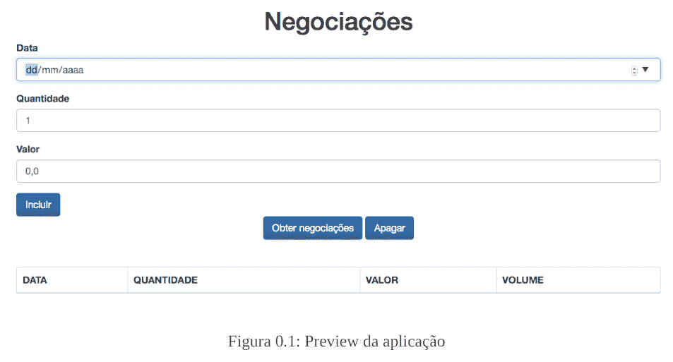

起初，我们应用程序的范围可能看起来很有限，但这足以让我们动用该语言累积到 **ECMAScript 2017 (ES8)** 版本的一系列功能。

为了让读者对即将呈现的内容有所准备，以下是各章的简要概述：

- **第 01 章：** 我们将快速编写代码，不关心最佳实践或可重用性，亲身体验这种方法的后果。本书的整个情节将由此展开，包括应用 MVC 模型的动机。

- **第 02 章：** 将现实世界的某物具象化为代码表示是开发者的任务之一。我们将看到面向对象范式如何帮助我们构建模型。

- **第 03 章：** 如果用户无法与之交互，模型又有何用？我们将创建一个 *controller*，作为用户操作与模型之间的桥梁。

- **第 04 章：** 处理日期在任何语言中都不是一项微不足道的任务，但如果我们结合 JavaScript 语言本身的特性，这可以是非常有趣的。

- **第 05 章：** 不仅单笔交易有规则，交易列表也有。我们将创建另一个模型及其相应的规则。

- **第 06 章：** 如果我们有一个被用户修改的模型，但他看不到结果，那又有何用？我们将学习如何将模型与视图连接起来。

- **第 07 章：** 创建模型、通过用户操作修改它并展示它是一项常见任务。我们能将这个流程隔离并重用吗？当然可以！

- **第 08 章：** 每次模型更改时都把更新视图的责任推给开发者容易出错。我们将学习如何自动化这一流程。

- **第 09 章：** 我们将应用代理（Proxy）设计模式来实现我们自己的 *数据绑定* 解决方案，即在模型每次发生变化时更新视图。

- **第 10 章：** 我们将把创建代理的责任隔离到一个类中，应用工厂（Factory）设计模式，使其能够被我们的应用程序重用。

- **第 11 章：** 我们将学习如何处理异常，包括创建自定义异常。

- **第 12 章：** 我们将使用老熟人 `XMLHttpRequest` 来与项目提供的 API 集成。

- **第 13 章：** 我们将通过 Promise 设计模式来对抗 *回调地狱*，即使用回调进行异步编程的结果。我们将处理 `XMLHttpRequest` 的复杂性隔离到服务类中。

- **第 14 章**：每次刷新页面或关闭浏览器时，注册的交易记录都会丢失。我们将使用 IndexedDB（一种内置于所有浏览器中的数据库）来持久化存储我们的交易数据。

- **第 15 章**：仅仅拥有与 IndexedDB 的连接是不够的。我们将应用一套最佳实践来处理连接，从而提高代码的可维护性和可读性。

- **第 16 章**：我们将应用 DAO 设计模式，将数据库访问细节对开发人员隐藏，使编写的代码更具可读性。

- **第 17 章**：JavaScript 语言的“阿喀琉斯之踵”一直是全局作用域和脚本之间的依赖关系，这使得加载顺序的责任全部落在开发人员肩上。我们将学习使用 JavaScript 原生的模块系统来解决这些问题。在此过程中，我们将学习如何使用 Babel，这是开源世界中最著名的转译器。

- **第 18 章**：我们将看到使用配合 `async/wait` 的 Promise 如何使我们的异步代码更易于阅读和维护。我们将应用更多的设计模式。

- **第 19 章**：我们将借助 Babel 应用装饰器（Decorator）设计模式，并学习通过 Fetch API 进行异步请求，进一步简化代码。我们将通过 `reflect-metadata` 深入研究元编程。

- **第 20 章**：我们将使用 Webpack 来打包我们的模块，并在开发和生产环境中应用最佳实践。此外，我们还将学习如何将应用程序部署到 GitHub Pages。

在本书结束时，读者将掌握一系列语言特性和设计模式，帮助解决日常问题。创建微框架仅仅是为了让学习过程更有趣。

最后，读者可以通过 twitter `@flaviohalmeida` 和博客 (http://cangaceirojavascript.com.br) 关注作者。

现在我们已经对各章节有了概览，接下来将介绍项目的下载以及必要的最低基础设施。

## 必要基础设施

直到第 10 章为止，构建项目所需的基础设施仅为 **Google Chrome**。请务必使用此浏览器，因为我们从第 11 章才开始处理兼容性问题。在本书结束时，您可以随意使用任何浏览器。

从第 12 章起，我们需要安装 **Node.js** ([https://nodejs.org/en/](https://nodejs.org/en/))。在创建本项目时使用了 8.1.3 版本。但下载更新的版本没有问题，只要是**偶数版本**，即所谓的 LTS (*长期支持*) 版本即可。

## 项目下载

有两种方式可以下载本书的基础项目。第一种是克隆 [https://github.com/flaviohenriquealmeida/jscangaceiro](https://github.com/flaviohenriquealmeida/jscangaceiro) 的仓库。

您也可以在 [https://github.com/flaviohenriquealmeida/jscangaceiro/archive/master.zip](https://github.com/flaviohenriquealmeida/jscangaceiro/archive/master.zip) 下载 zip 压缩包。请选择您最方便的方式。

然而，如果您选择了 zip 版本，解压后请将 `jscangaceiro-master` 文件夹重命名为 `jscangaceiro`。

项目结构如下：

```
├── client
│   ├── app
│   ├── css
│   └── index.html
└── server
```

有两个文件夹：`client` 和 `server`。前者包含所有在浏览器中运行的代码，特别是 `client/app` 文件夹将存放我们直到书末创建的所有代码。`client` 内部的其他文件夹包含 Bootstrap 的 `css` 文件。

> Bootstrap 实际上就是一个 CSS 库，它允许我们仅通过使用类，就能以较少的精力为应用程序应用专业的外观。读者不需要对此有预先了解。

在 `client` 文件夹中，我们还有一个 `index.html` 文件，它是我们在整个项目中将使用的唯一页面，也是我们的起点：

```html
<!-- client/index.html -->

<!DOCTYPE html>
<html lang="pt-br">
<head>
    <meta charset="UTF-8">
    <meta name="viewport" content="width=device-width">
    <title>Negociações</title>
    <link rel="stylesheet" href="css/bootstrap.css">
    <link rel="stylesheet" href="css/bootstrap-theme.css">
</head>
<body class="container">

    <h1 class="text-center">Negociações</h1>

    <form class="form">

        <div class="form-group">
            <label for="data">Data</label>
            <input type="date" id="data" class="form-control" required autofocus/>
        </div>

        <div class="form-group">
            <label for="quantidade">Quantidade</label>
            <input type="number" min="1" step="1" id="quantidade" class="form-control" value="1" required/>
        </div>

        <div class="form-group">
            <label for="valor">Valor</label>
            <input id="valor" type="number" class="form-control" min="0.01" step="0.01" value="0.0" required />
        </div>

        <button class="btn btn-primary" type="submit">Incluir</button>
    </form>

    <div class="text-center">
        <button id="botao-importa" class="btn btn-primary text-center" type="button">
            Importar Negociações
        </button>
        <button id="botao-apaga" class="btn btn-primary text-center" type="button">
            Apagar
        </button>
    </div>
    <br>
    <br>

    <table class="table table-hover table-bordered">
        <thead>
            <tr>
                <th>DATA</th>
                <th>QUANTIDADE</th>
                <th>VALOR</th>
                <th>VOLUME</th>
            </tr>
        </thead>
        <tbody>
        </tbody>
    </table>
</body>
</html>
```

最后，`server` 文件夹将从第 12 章起才被使用。它提供了一个包含 API 的 Web 服务器，供我们的应用程序调用。该服务器是用 Node.js 构建的，这也是为什么该平台是基础设施依赖的原因之一。关于如何启动服务器的指令将在需要使用时提供。

### VISUAL STUDIO CODE (可选)

在创建项目期间，使用了 Visual Studio Code (https://code.visualstudio.com/download)，这是一个适用于 Windows、Linux 和 MAC 的免费跨平台文本编辑器。您可以随意选择您喜欢的编辑器。

## 开启我们的旅程

项目已下载且基础设施要求已满足，我们可以开始这段名为 JavaScript 的“荒原”之旅了。但就像任何有始有终的故事一样，在下一章中我们将有一个序幕，为后续章节做铺垫。

## 第一部分 - 匪徒之路

*生活在他身上刻下了他所知道的一切。但在一个露天之夜，当他凝视着温暖他的篝火时，突然产生了一个幻象。在幻象中，Lampião 指向了他所在位置的相反方向。尽管幻象转瞬即逝，但他确信还有一条路需要行走，那就是匪徒之路。于是，他收拾行囊，踏上了旅程。尽管知道有比他更优秀、准备更充分的匪徒，但他并未气馁，反而加快了脚步，确信自己走在正确的道路上。第二天早晨，看着太阳升起，眺望着地平线，他明白一切只取决于自己的意志。*

## 第 1 章

## 序幕：曾经在荒原

> “怀疑之人终成智者。” ——《大荒原：小径》

没有一个能将其置于情境中的故事，匪徒就无法存在。我们的项目也不例外。本章是为即将到来的内容铺平道路的序幕。故事围绕一个允许注册股票交易的应用程序展开。尽管应用程序的领域范围较小，但这足以让我们在书末之前深化对 JavaScript 语言的认知。

对于我们的社区，我们在介绍部分下载的项目拥有 `client/index.html` 页面，其中包含一个已经由 Bootstrap 样式化好的表单，带有三个输入字段，分别用于获取交易的 **日期**、**数量** 和 **价值**。让我们看看其中一个字段：

```html
<!-- client/index.html -->
<!-- 前文代码省略 -->

<form class="form">

    <div class="form-group">
        <label for="data">Data</label>
        <input type="date" id="data" class="form-control" required autofocus/>
    </div>

</form>

<!-- 后文代码省略 -->
```

由于每个字段都有一个 `id`，我们可以很方便地将这些元素的引用引入，以便在 JavaScript 代码中操纵它们。我们将本章的所有代码写在新的文件 `client/app/index.js` 中。毫不犹豫地，我们立刻将其导入到 `client/index.html` 中，放在 `</body>` 标签关闭之前：

```html
<!-- client/index.html -->
<!-- 前文代码省略 -->

</table>

<script src="app/index.js"></script>
</body>
</html>
```

在 `client/js/index.js` 文件中，我们将创建一个名为 `campos` 的数组，它将存储指向表单中每个输入元素的引用。我们将通过 `document.querySelector()` 来进行搜索，这是一个 DOM API，允许我们通过 CSS 选择器来查找元素：


```javascript
// client/app/index.js

var campos = [
    document.querySelector('#data'),
    document.querySelector('#valor'),
    document.querySelector('#quantidade')
];
```

```javascript
console.log(campos); // 验证数组内容
```

让我们在浏览器中重新加载页面，并在浏览器的控制台中查看输出：

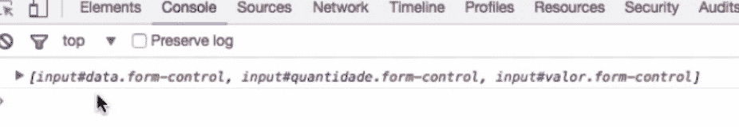

*图 1.1：表单*

首先，我们需要获取`<table>`的`<tbody>`元素，因为我们将把用交易数据创建的`<tr>`插入其中：

```javascript
// client/app/index.js

var campos = [
    document.querySelector('#data'),
    document.querySelector('#valor'),
    document.querySelector('#quantidade')
];

// 我们需要 tbody，因为它将接收我们要构建的 tr
var tbody = document.querySelector('table tbody');
```

现在我们已经填充了`campos`数组，我们需要处理用户操作。查看`client/index.html`的结构，我们找到了以下按钮：

```html
<button class="btn btn-primary" type="submit">Incluir</button>
```

它是`submit`类型的；这意味着，当被点击时，它将触发表单的`submit`事件，该事件负责提交其数据。然而，我们不想将数据发送到任何地方，我们只想读取用户在每个字段中输入的值，并构建一个新的`<tr>`。此外，由于我们在每个`input`上使用了`required`属性，只有所有字段都填写时，我们才能触发`submit`事件。浏览器将为每个未填写的字段显示标准的错误消息。

现在，通过`document.querySelector()`，我们将通过其类名`.form`来查找表单。拿到元素后，我们将通过`document.addEventListener`将函数关联到`submit`事件。当用户提交表单时，将调用此函数：

```javascript
// client/app/index.js

var campos = [
    document.querySelector('#data'),
    document.querySelector('#valor'),
    document.querySelector('#quantidade')
];

console.log(campos); // 验证数组内容

var tbody = document.querySelector('table tbody');

document.querySelector('.form').addEventListener('submit', function(event) {
  alert('oi');
});
```

目前，我们将在每次表单提交时通过`alert`函数显示一个简单的弹出窗口：


确认我们的函数在表单提交时被调用后，我们就可以开始编写动态构建新`<tr>`的代码，该`<tr>`将包含表单的交易数据。通过`document.createElement`，我们创建一个新元素：

```javascript
// client/app/index.js

// 省略前面的代码

var tbody = document.querySelector('table tbody');

document.querySelector('.form').addEventListener('submit', function(event) {

    // 用新代码替换 alert
    var tr = document.createElement('tr');
});
```

每个数组都有一个`forEach`函数，允许我们遍历其每个元素。对于遍历到的每个元素，我们将创建相应的`<td>`，它将最终成为我们刚刚创建的`<tr>`的一部分：

```javascript
// client/app/index.js

// 省略前面的代码

var tbody = document.querySelector('table tbody');

document.querySelector('.form').addEventListener('submit', function(event) {

    var tr = document.createElement('tr');

    campos.forEach(function(campo) {

        // 创建一个没有信息的 td
        var td = document.createElement('td');

        // 将字段的值赋给 td
        td.textContent = campo.value;

        // 将 td 添加到 tr
        tr.appendChild(td);

    });
});
```

上面的代码为`campos`数组中的每个字段值创建了一列，然而，还缺少一列来存储成交量。每笔交易都有一个成交量，它就是交易金额乘以当日交易数量。在这种情况下，添加此列需要放在`forEach`循环之外：

```javascript
// client/app/index.js

// 省略前面的代码

var tbody = document.querySelector('table tbody');

document.querySelector('.form').addEventListener('submit', function(event) {

    var tr = document.createElement('tr');

    campos.forEach(function(campo) {

        var td = document.createElement('td');
        td.textContent = campo.value;
        tr.appendChild(td);
    });

    // 新的 td，用于存储交易的成交量
    var tdVolume = document.createElement('td');

    // 数组的位置 1 和 2 分别存储数量和
    // 金额字段
    tdVolume.textContent = campos[1].value * campos[2].value;

    // 将缺少的 td 添加到 tr
    tr.appendChild(tdVolume);
});
```

现在我们已经有了完整的`tr`，可以将其添加到`tbody`中。到目前为止，我们的代码应该是这样的：

```javascript
// client/app/index.js

var campos = [
    document.querySelector('#data'),
    document.querySelector('#valor'),
    document.querySelector('#quantidade')
];

console.log(campos); // 验证数组内容

var tbody = document.querySelector('table tbody');

document.querySelector('.form').addEventListener('submit', function(event) {

    var tr = document.createElement('tr');

    campos.forEach(function(campo) {

        var td = document.createElement('td');
        td.textContent = campo.value;
        tr.appendChild(td);

    });

    var tdVolume = document.createElement('td');
    tdVolume.textContent = campos[1].value * campos[2].value;
    tr.appendChild(tdVolume);

    // 添加 tr
    tbody.appendChild(tr);
});
```

让我们通过注册一笔新交易来测试一下。令我们惊讶的是，什么也没有显示。我们的`<tr>`确实被插入了，但由于表单的提交重新加载了我们的页面，它又回到了没有`<tr>`的初始状态。

请记住，我们不想提交表单，我们只想在`submit`事件中获取其数据。因此，只需通过调用`event.preventDefault()`取消`submit`事件的默认行为即可。我们的代码将继续执行，但表单不会被提交：

```javascript
// client/app/index.js

var campos = [
    document.querySelector('#data'),
    document.querySelector('#valor'),
    document.querySelector('#quantidade')
];

console.log(campos); // 验证数组内容

var tbody = document.querySelector('table tbody');

document.querySelector('.form').addEventListener('submit', function(event) {

    // 取消表单提交
    event.preventDefault();

    // 省略后面的代码
});
```

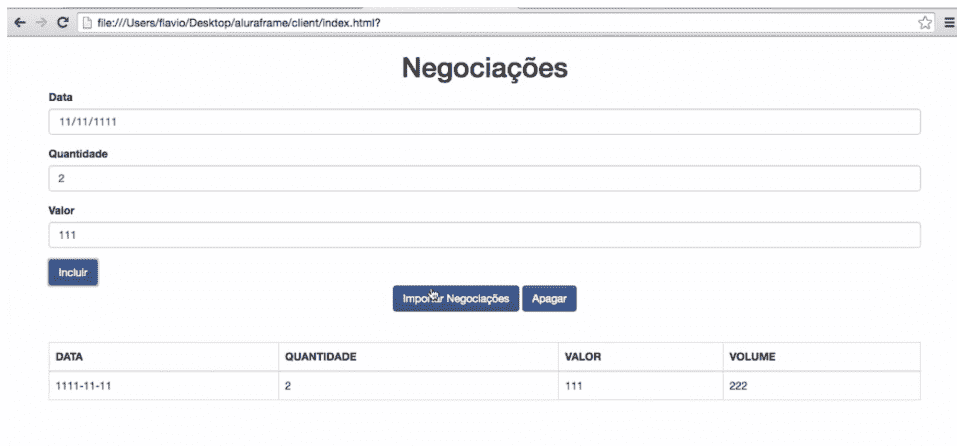

*图 1.3：页面未重新加载*

太好了，我们的交易出现在了列表中，然而，一个好的做法是清除表单字段，为下一次注册做好准备。此外，我们将通过调用`focus`函数使日期字段获得焦点，使用户可以立即开始新的注册，而无需单击第一个字段。我们最终的代码如下：

```javascript
// client/app/index.js

var campos = [
    document.querySelector('#data'),
    document.querySelector('#valor'),
    document.querySelector('#quantidade')
];

console.log(campos); // 验证数组内容

var tbody = document.querySelector('table tbody');

document.querySelector('.form').addEventListener('submit', function(event) {

  event.preventDefault();

  var tr = document.createElement('tr');

  campos.forEach(function(campo) {

      var td = document.createElement('td');
      td.textContent = campo.value;
      tr.appendChild(td);
  });

  var tdVolume = document.createElement('td');
  tdVolume.textContent = campos[1].value * campos[2].value;
  tr.appendChild(tdVolume);

  tbody.appendChild(tr);

  // 清除日期字段
  campos[0].value = '';
  // 清除数量字段
  campos[1].value = 1;
  // 清除金额字段
  campos[2].value = 0;
  // 将焦点置于日期字段
  campos[0].focus();
});
```

尽管代码能够运行，但仍有不足之处，我们将在下文了解原因。

### 1.1 我们代码的问题

任何应用都不是凭空诞生的，而是基于客户需求规格创建的。对于我们的应用而言，还需要在表格底部汇总总量，并确保日期以日/月/年的格式显示。此外，我们需要保证交易一旦创建后就不能被修改。最后，交易列表不可更改，只能接收新项；如果我们需要一个新的列表，就必须从头创建。

按照我们目前应用的状态，要安全地实现前面段落中的规则绝非易事。我们的代码将代表交易的代码与其展示混合在同一个地方。更令人沮丧的是，我们没有一个可以在项目之间复用的结构。

忍者在这种情况会表现得好吗？还是说侠客可以整顿秩序？

### 1.2 MVC模式（模型-视图-控制器）

有多种模式可以用来组织我们应用的代码，其中最容易上手的可能是MVC模式（*Model-View-Controller*）。这种模式在应用数据（*model*，模型）和其展示（*view*，视图）之间创建了明显的分离。用户操作由控制器拦截，控制器负责更新模型，并通过相应的视图反映其最新状态。

除了MVC模式，我们还将使用两个编程范式，它们是每个侠客工具箱中的组成部分，即**面向对象**范式和**函数式**范式。

如果读者从未应用过面向对象范式，不必担心，因为其关键概念将在本书中逐步传授。然而，需要对JavaScript语言有基础的认知。

我们的目标是在两种范式之间穿梭，如同一个游走在两个世界之间的侠客幽灵，利用它们各自在解决问题时的优势。最终，这将催生出一个迷你框架。

构建迷你框架并非本书的目的，而是学习侠客编程艺术的副产品。**我们的想法是，读者能够从本书的每个章节中提取可以在其应用中使用的有趣资源。**

我们真正的工作从下一章开始，届时我们将着手构建交易模型。

> 本章完整代码可在 https://github.com/flaviohenriquealmeida/cangaceiro-javascript/tree/master/01 找到

## 投稿约定

1. 文稿务求精简、论点明确、数据可靠。每篇论文(含图表)不超过6000字。论文须附中文摘要和关键词(中文200字左右)。《作证》的每篇实验论文须附英文摘要、中英文文献和第一作者小传。来稿请自留底稿。

2. 图表均应有中文图题和表题,图应为白纸墨绘,或用计算机精确绘制,半栏宽度不应大于8cm,适栏不应大于16cm。全栏表格宽度不应大于16cm。照片应为II图照片。图、表中字母、数字,用6号字。

3. 量和单位及其符号均按国家标准法规,用法均按国家标准。复合单位一律采用负指数形式,如`mol·L⁻¹`。一切首次出现的符号均需加注释说明。文中所有物理量均用斜体(如浓度`c`、压力`P`、温度`T`、体积`V`等)。

4. 参考文献限于作者直接阅读过的最主要的,并按正文中出现的次序编号,如为期刊,请按;“著者、刊名、年、卷号(期号)、起止页码”顺序排列;如为图书,请按;“著者、书名、版次(初版不注)、出版地、出版者、年,起止页码”顺序编写。每一文献3作者以上者只写前3人,其后加“等”字。非正式出版物不要列入。日文请用原文汉字书写。外文作者姓名一律姓在前,名在后。注意字母大小写及上下标。

5. 来稿请用五号字单倍行距打印在A4纸上,并在首页脚注处注明国家自然科学基金或省部级等资助项目及项目编号。

6. 来稿请在3个月内决定录用与否。录用者通知修改或退修,超过6个月未通知录用或退修者可自行处理。来稿一律不退,请自留底稿。来稿一经刊出,按规定付给稿酬部分发表费,并赠送当期期刊3本。

7. 稿件请寄:南京市鼓楼区演武厅3号2001室《环境科学研究》编辑部(邮政编码:210004),切勿寄给个人。来稿时请附联系人的详细通信地址、邮编、电话、传真及E-mail地址,以便及时联系。

## 第二章

### 与侠客交易，有胆量吗？

> "活着就是学习；但学到的，更多是学会提出更大的问题。" ——《大纽北：路径》

在上一章中，我们看到代码没有实现模型与其展示之间的清晰分离，使其难以理解和维护。还提出了使用MVC（*Model-View-Controller*）模式来改善其结构。

从MVC模式的三位一体中，我们将开始构建一个交易模型。不过话说回来，什么是模型？

#### 2.1 模型的作用

模型是现实世界中某种事物的抽象。一个模型的例子是市场分析师创建的那个，使他能够模拟操作甚至预测其行为。在我们应用的背景下，我们将创建一个交易模型。

我们的模型需要体现与实际交易相同的规则；换句话说，它必须遵循交易规格说明。面向对象范式通过使用**类**来处理规格说明。

从ES2015（ES6）开始，随着`class`语法的引入，在代码中实现类的创建变得更加容易。

在继续我们的项目之前，让我们从`client/index.html`中移除脚本`client/app/index.js`，因为我们不再使用这段代码。移除文件后，我们就可以开始构建我们的`Negociacao`类了。

#### 2.2 Negociacao类

我们将在`client/app/domain/negociacao/Negociacao.js`文件夹中创建声明我们`Negociacao`类的脚本。这个简单的创建新文件的行为已经表明了我们将要在本书中使用的某些约定。


`client/domain`文件夹用于存放所有与应用领域相关的脚本，在本例中，存放所有与交易相关的内容。子文件夹`client/app/domain/negociacao`并非误建，我们的类脚本将驻留在其中，包括与该领域有密切关系的服务类。这样一来，我们只需查看一个文件夹，就能了解应用的某个特定领域。

最后，脚本名称遵循PascalCase规范，其特点是文件以大写字母开头，组成文件名的每个单词也是如此。这一约定使研究项目结构的人能够明显看出该文件包含类的声明，因为按照惯例，所有类都遵循相同的书写模式。

于是，我们修改刚刚创建的`client/app/domain/negociacao/Negociacao.js`文件：

```javascript
// client/app/domain/negociacao/Negociacao.js

class Negociacao {

}
```

在面向对象的世界中，类定义了从它创建的所有对象都必须遵循的结构。我们知道一笔交易需要有日期、数量和价值。正是通过`constructor()`函数，我们定义了类的属性：

```javascript
// client/app/domain/negociacao/Negociacao.js

class Negociacao {
    constructor() {
        this.data = new Date(); // 当前日期
        this.quantidade = 1;
        this.valor = 0.0;
    }
}
```

通过`this.nomeDaPropriedade`，我们指定交易将有：日期、数量和价值，每个属性都有其默认值。

接下来，在`client/index.html`文件中，我们将在`</body>`标签关闭之前加入一个新的`<script>`标签。我们的目标是创建两个交易实例，即从`Negociacao`类创建的两个对象。我们将使用变量`n1`和`n2`。

```html
<!-- client/index.html -->
<!-- 前面代码省略 -->
<script src="app/domain/negociacao/Negociacao.js"></script>
<script>
    var n1 = new Negociacao();
    console.log(n1);

    var n2 = new Negociacao();
    console.log(n2);
</script>
<!-- 后面代码省略 -->
```

让我们重新加载浏览器并打开控制台。可以看到已经出现了两笔`Negociacoes`：

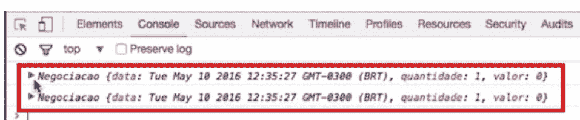

图 2.1：打印的两笔交易

每个创建的实例都具有相同的属性和值，因为它们是从同一个类创建的，该类为每个属性分配了默认值。

`new`运算符的使用并非偶然。让我们看看如果省略它会发生什么：

```html
<!-- client/index.html -->
<!-- 前面代码省略 -->
<script src="app/domain/negociacao/Negociacao.js"></script>
<script>
    var n1 = new Negociacao();
    console.log(n1);

    var n2 = Negociacao(); // <- new运算符被移除
    console.log(n2);
</script>
<!-- 后面代码省略 -->
```

在浏览器中，控制台会显示一条错误信息：

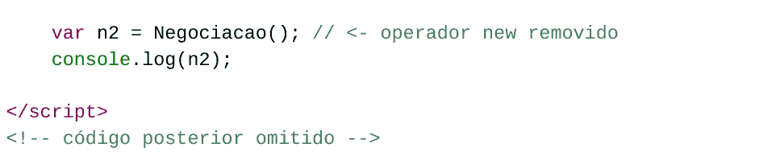

图 2.2：错误信息

我们得知`constructor()`类不能在没有`new`操作符的情况下被调用。`new`操作符非常重要，因为它负责初始化每个创建实例（即每个创建的对象）的隐式变量`this`。因此，如果程序员忘记使用`new`操作符来创建类的实例（这本是没有意义的），控制台会弹出一个漂亮的错误消息来提醒他。

由于每个创建的实例在`this`中拥有自己的上下文，我们可以更改每个对象的属性值，而不会干扰到其他对象：

```html
<!-- client/index.html -->
<!-- código anterior omitido -->
<script src="app/domain/negociacao/Negociacao.js"></script>
<script>
    var n1 = new Negociacao();
    n1.quantidade = 10;
    console.log(n1.quantidade);

    var n2 = Negociacao();
    n2.quantidade = 20;
    console.log(n2.quantidade);
    console.log(n1.quantidade); // continua 10
</script>
<!-- código posterior omitido -->
```

现在，如果我们在浏览器控制台中执行代码，我们会看到每个`Negociacao`实例将具有不同的值。

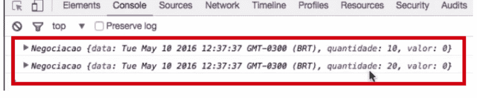

我们使用两个拥有各自属性值，但共享相同结构（日期、数量和金额）的实例进行了第一次测试。

在继续之前，让我们删除其中一个交易实例，因为接下来的新测试只需要一个就足够了：

```html
<!-- client/index.html -->
<!-- código anterior omitido -->
<script src="app/domain/negociacao/Negociacao.js"></script>
<script>
    var n1 = new Negociacao();
    n1.quantidade = 10;
    console.log(n1.quantidade);
</script>
<!-- código posterior omitido -->
```

接下来我们将看到另一种创建类实例的方法。

### 2.3 类构造函数

每笔交易都必须有日期、数量和金额，否则它就不是一笔交易。让我们看一个构建`Negociacao`实例并为其分配所有数据的示例：

```html
<!-- client/index.html -->
<!-- código anterior omitido -->
<script src="app/domain/negociacao/Negociacao.js"></script>
<script>
    var n1 = new Negociacao();
    n1.data = new Date();
    n1.quantidade = 10;
    n1.valor = 200.50;
    console.log(n1);
</script>
<!-- código posterior omitido -->
```

我们的代码可以运行，但如果每笔交易都需要有日期、数量和金额，那么在创建新实例的同一条指令中定义这些值如何？这样不仅能使我们的代码更简洁，还能在类定义中明确这种需求。

你应该记得每个类都有一个`constructor()`，这是一个特殊函数，每当使用`new`操作符创建类实例时都会被调用。既然它是一个函数，它就可以接收参数。

我们希望能够这样做：

```html
<!-- client/index.html -->
<!-- código anterior omitido -->
<script src="app/domain/negociacao/Negociacao.js"></script>
<script>
    // 只需要一条指令，而不是 4 条！
    var n1 = new Negociacao(new Date(), 5, 700);
    console.log(n1);
</script>
<!-- 后面代码省略 -->
```

在`Negociacao`类中，我们将添加其`constructor()`的参数：

```javascript
// client/app/domain/negociacao/Negociacao.js

class Negociacao {

    constructor(data, quantidade, valor) {

        // 每个接收到的参数将被赋值给类的属性
        this.data = data;
        this.quantidade = quantidade;
        this.valor = valor;
    }
}
```

请注意，传递给`Negociacao`实例的参数顺序与其在`constructor()`中定义的参数顺序相同。每个接收到的参数都被传递给类的相应属性。

我们在控制台中进行测试，看看是否一切运行正常：

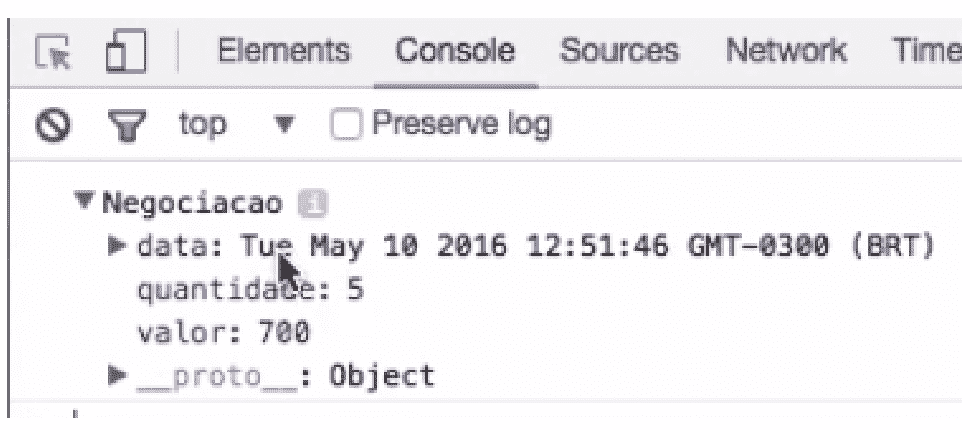

图 2.4：控制台测试

这些值与我们在HTML中指定的值一致。但是，我们还没有计算交易额（volume）——即数量乘以单价。我们现在来做这件事：

```html
<!-- client/index.html -->
<!-- código anterior omitido -->
<script src="app/domain/negociacao/Negociacao.js"></script>
<script>
    var n1 = new Negociacao(new Date(), 5, 700);
    var volume = n1.quantidade * n1.valor;
    console.log(volume);
</script>
<!-- código posterior omitido -->
```

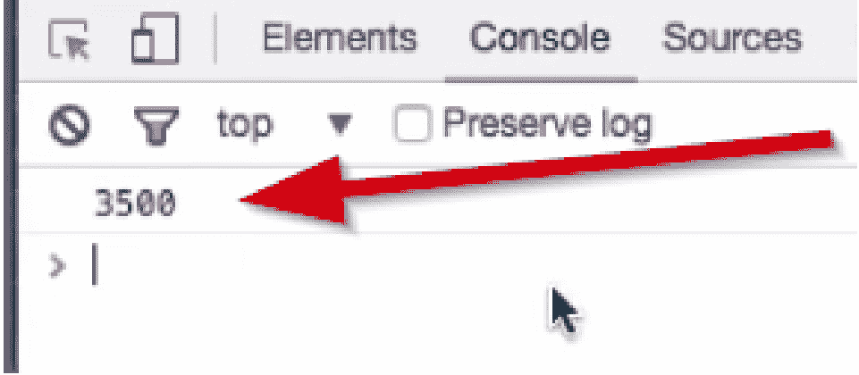

值`3500`是乘法运算的结果。但我们目前是在进行面向过程的编程，每当程序员需要`volume`时，必须由他自己来执行这个计算。

除了重复计算交易额非常枯燥之外，即使是像这样简单的代码，每个程序员在计算时出错的可能性也很高。事实上，这正是面向对象范式旨在解决的问题。

### 2.4 类方法

在面向对象范式中，数据和行为之间存在强连接，这与面向过程编程不同，后者将数据放在一边，将操作这些数据的过程放在另一边。

我们的类目前只有数据，现在是时候赋予它第一个行为——`obtemVolume`了。

让我们创建这个方法：

```javascript
// client/app/domain/negociacao/Negociacao.js

class Negociacao {

    constructor(data, quantidade, valor) {

        this.data = data;
        this.quantidade = quantidade;
        this.valor = valor;
    }

    obtemVolume() {

        return this.quantidade * this.valor;
    }
}
```

为了使词汇与面向对象范式保持一致，定义类行为的函数被称为**方法（methods）**。不过，一些习惯性地使用“函数”一词的人也并不罕见。

现在，我们只需要询问`Negociacao`类的实例本身，让它为我们获取交易额即可。我们拥有一个集中计算交易额的唯一地点。因此，我们将修改测试以使用刚刚创建的方法：

```html
<!-- client/index.html -->
<!-- código anterior omitido -->
<script src="app/domain/negociacao/Negociacao.js"></script>
<script>
    var n1 = new Negociacao(new Date(), 5, 700);
    var volume = n1.obtemVolume();
    console.log(volume);
</script>
<!-- código posterior omitido -->
```

现在执行代码，值3500将再次出现在控制台中：


图 2.6：交易额 2

数值计算正确。对象知道如何处理相关属性。因此，获取交易额的规则就在对象本身之中。我们重新建立了数据与行为之间的连接。

### 2.5 封装

我们已经能够使用`Negociacao`类，但除了计算交易额之外，我们还需要实现另一个业务规则：交易创建后，不能被更改。然而，我们的代码还没有准备好处理这条规则，我们可以通过一个新的测试来验证这一点：

```html
<!-- client/index.html -->
<!-- código anterior html omitido -->
<script src="app/domain/negociacao/Negociacao.js"></script>
<script>
    var n1 = new Negociacao(new Date(), 5, 700);
    n1.quantidade = 10;
    console.log(n1.quantidade);
</script>
<!-- código posterior omitido -->
```

在上面的代码中，我们为实例的`quantidade`属性赋了一个新值，然后打印该值。控制台会打印哪个值，5还是10？

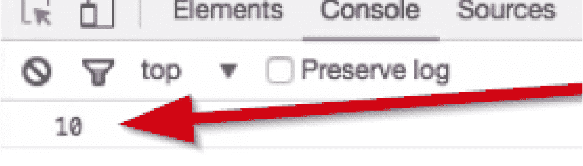

图 2.7：规则被更改

它打印了新添加的值10，这可能会导致问题。这就是为什么交易在创建后不能被更改的规则如此重要的原因。

想象一下，我们刚刚完成了一笔交易并约定了一个特定数值，但随后有人为了自身利益决定更改它。我们的目标是使交易的属性变为只读。

然而，JavaScript语言——直到目前为止——并不允许我们使用访问修饰符（这是其他面向对象语言中存在的特性）。我们无法直接使一个属性成为只读（或只写）。我们可以做的是约定：所有以下划线（`_`）为前缀的类属性都不应在类本身的方法之外被访问：

```javascript
// client/app/domain/negociacao/Negociacao.js

class Negociacao {

    constructor(data, quantidade, valor) {

        this._data = data;
        this._quantidade = quantidade;
        this._valor = valor;
    }

    obtemVolume() {

        return this._quantidade * this._valor;
    }
}
```

这将成为一个约定，告知程序员包含`_`（下划线）的属性只能由类的自身方法访问。这意味着，即使我们仍然可以用另一个值打印`_quantidade`属性，但我们不应该再访问它。`_`起到了警告作用，它在说：“程序员，你不能更改这个属性！”

那么，如果我们使用前缀的约定，那么如何打印交易数量值呢？难道我们需要放弃刚刚应用的约定吗？不需要，因为我们可以创建**访问器方法**。

访问器方法的名称通常以`get`前缀开头。在我们的`Negociacao`类中，我们将添加`getQuantidade()`方法，它将返回`_quantidade`。我们还将使用`getData()`和`getValor()`，它们具有类似的功能：

```javascript
// client/app/domain/negociacao/Negociacao.js

class Negociacao {

    constructor(data, quantidade, valor) {

        this._data = data;
        this._quantidade = quantidade;
        this._valor = valor;
    }

    obtemVolume() {

        return this._quantidade = this._valor;
    }

    getData() {

        return this._data;
    }

    getQuantidade() {

        return this._quantidade;
    }

    getValor() {

        return this._valor;
    }
}
```

由于它们是类本身的方法，遵循我们的约定，它们可以访问带有`_`前缀的属性。任何其他需要读取`Negociacao`对象属性的代码都可以通过我们创建的访问器方法来实现。

让我们更新`index.html`中的代码，以反映我们代码的当前状态：

```html
<!-- client/index.html -->
<!-- 前面的代码省略 -->
<script src="app/domain/negociacao/Negociacao.js"></script>
<script>
    var n1 = new Negociacao(new Date(), 5, 700);
    console.log(n1.getQuantidade());
    console.log(n1.getData());
    console.log(n1.getValor());
</script>
<!-- 后面的代码省略 -->
```

请注意，我们正在访问其他字段：


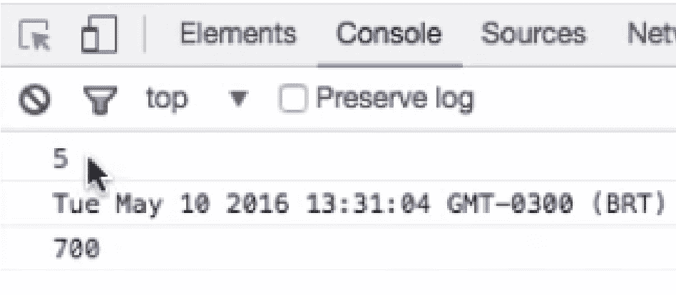

这些值将在控制台中正确打印出来。接下来，我们将修改`obtemVolume()`为`Negociacao.js`中的`getVolume`：

```javascript
// client/app/domain/negociacao/Negociacao.js

class Negociacao {

    constructor(data, quantidade, valor) {

        this._data = data;
        this._quantidade = quantidade;
        this._valor = valor;
    }

    // 将obtemVolume的名称更改为getVolume
    getVolume() {

        return this._quantidade = this._valor;
    }

    // 后面的代码省略
}
```

让我们在`index.html`中测试所有访问器方法：

```html
<!-- 前面的代码省略 -->
<script src="app/domain/negociacao/Negociacao.js"></script>
<script>

    var n1 = new Negociacao(new Date(), 5, 700);
    console.log(n1.getQuantidade());
    console.log(n1.getData());
    console.log(n1.getValor());
    console.log(n1.getVolume());
</script>
<!-- 后面的代码省略 -->
```

在浏览器中，我们可以看到`quantidade`、`data`、`valor`和`volume`的值都会被正确打印出来。

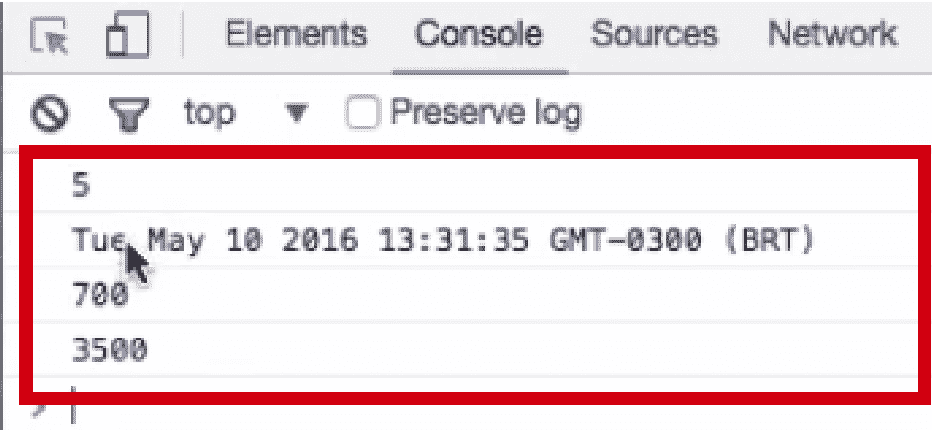

图 2.9：数量和成交量

### 2.6 `get`语法

我们可以通过语言提供的`get`语法来简化我们的访问器方法。让我们修改代码：

```javascript
// client/app/domain/negociacao/Negociacao.js

class Negociacao {

    constructor(data, quantidade, valor) {

        this._data = data;
        this._quantidade = quantidade;
        this._valor = valor;
    }

    get volume() {

        return this._quantidade * this._valor;
    }

    get data() {

        return this._data;
    }

    get quantidade() {

        return this._quantidade;
    }

    get valor() {

        return this._valor;
    }
}
```

请注意，方法名之前使用了`get`语法，方法名不再有我们之前使用的`get`前缀。最后，我们在代码中像访问属性一样来访问这些方法。

让我们修改`index.html`来实际看看这个变化：

```html
<!-- 前面的代码省略 -->
<script src="app/domain/negociacao/Negociacao.js"></script>
<script>

    var n1 = new Negociacao(new Date(), 5, 700);

    console.log(n1.quantidade);
    console.log(n1.data);
    console.log(n1.valor);
    console.log(n1.volume);
</script>
<!-- 后面的代码省略 -->
```

我们正在创建一个只读的`getter`属性来访问读操作。即使它是一个方法，我们也需要像访问属性一样来访问它。然而，在底层，我们访问的属性仍然是方法。

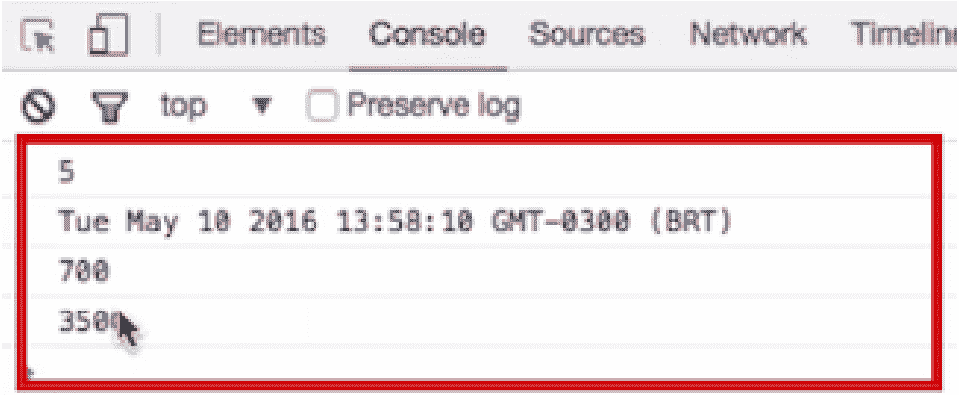

图 2.10：控制台

使用`get`语法创建的方法的另一个特点是，如果我们尝试给属性赋一个新值，它将被忽略。我们来看看：

```html
<!-- 前面的代码省略 -->
<script src="app/domain/negociacao/Negociacao.js"></script>
<script>

    var n1 = new Negociacao(new Date(), 5, 700);
    n1.quantidade = 1000; // 指令被忽略，没有错误消息
    console.log(n1.quantidade);
    console.log(n1.data);
    console.log(n1.valor);
    console.log(n1.volume);
</script>
<!-- 后面的代码省略 -->
```

值1000不会被传递给`_quantidade`。值仍然是5：

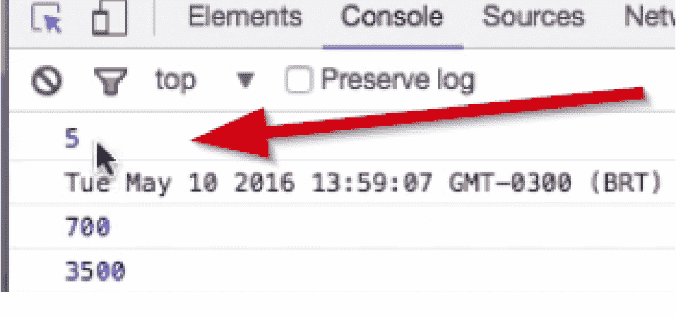

当属性是`getter`时（即只读），就会发生这种情况，因为我们不能给它赋值。但我们仍然可以用`n1._quantidade`来修改它：

```html
<!-- 前面的代码省略 -->
<script src="app/domain/negociacao/Negociacao.js"></script>
<script>

    var n1 = new Negociacao(new Date(), 5, 700);

    // 指令被忽略，没有错误消息
    n1.quantidade = 1000;

    // 没有什么能阻止我们这样做，只有我们的约定
    n1._quantidade = 5000;

    console.log(n1.quantidade);
    console.log(n1.data);
    console.log(n1.valor);
    console.log(n1.volume);

</script>
<!-- 前面的代码省略 -->
```

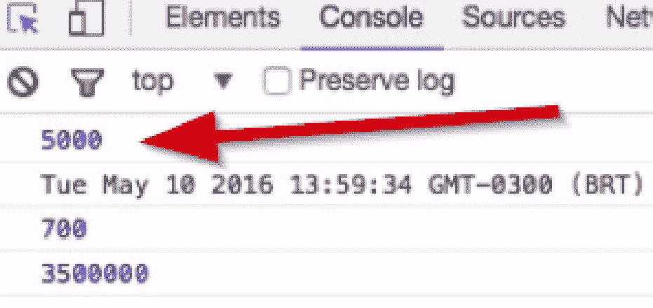

图 2.12：修改后的数量

正如我们所见，这并不能阻止粗心的程序员仍然访问带有`下划线`前缀的属性。然而，我们还有一种语言机制可以防止这种情况发生。

### 2.7 不可变对象

我们将使用JavaScript语言中存在一段时间的一种机制，它可以“冻结”一个对象。冻结对象的属性不能接受新的赋值。我们通过`Object.freeze()`方法实现这种行为。

让我们冻结测试中的实例`n1`：

```html
<!-- 前面的代码省略 -->
<script src="app/domain/negociacao/Negociacao.js"></script>
<script>

    var n1 = new Negociacao(new Date(), 5, 700);

    Object.freeze(n1);
    n1._quantidade = 100000000000; // 无法修改且
不会发生任何错误
    console.log(n1._quantidade);
</script>
<!-- 后面的代码省略 -->
```

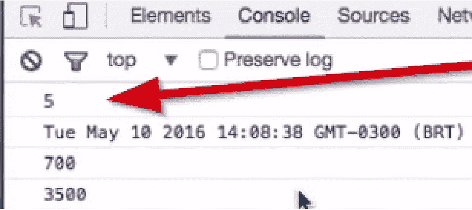

图 2.13：冻结的对象

在控制台中，我们会看到值 5；这意味着我们无法再更改，对象已被冻结。值得记住的是，`quantity`是我们在`Negociacao.js`中调用的属性，它在“底层”作为方法运行并返回`this._quantidade`。

即使在`index.html`中设置了`n1._quantidade = 100000000000;`，这个值似乎也被忽略了。这很好，因为现在开发者将无法修改这个数量了。让我们做一个小测试，看看控制台中什么是冻结的：

```html
<!-- 前面的代码省略 -->
<script src="app/domain/negociacao/Negociacao.js"></script>
<script>

    var n1 = new Negociacao(new Date(), 5, 700);

    console.log(Object.isFrozen(n1));
    Object.freeze(n1);
    console.log(Object.isFrozen(n1));
    n1._quantidade = 100000000000;
</script>
```

在控制台中，我们会看到以下结果：

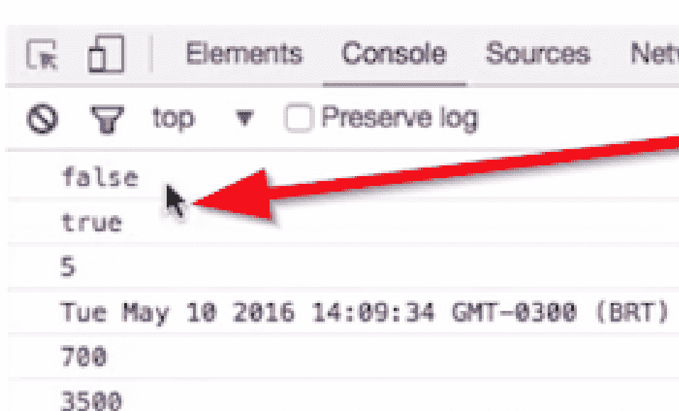

图 2.14：控制台显示 false 和 true

对象之前没有冻结，之后就冻结了。因此，我们无法更改`_quantidade`，这个我们按约定定义为私有的属性。然而，这个解决方案是程序性的，因为你总要记得冻结实例。

但是，我们希望在使用`new Negociacao`时，就已经返回一个冻结的实例。我们可以在`constructor()`中冻结实例。在`app/domain/negociacao/Negociacao.js`中，我们在最后一个`this`之后添加`Object.freeze()`：

```javascript
// client/app/domain/negociacao/Negociacao.js

class Negociacao {

    constructor(data, quantidade, valor) {

        this._data = data;
        this._quantidade = quantidade;
        this._valor = valor;
        Object.freeze(this);
    }
}
```

### 2.8 实例真的是不可变的吗？

根据业务规则，一笔交易应该是不可变的，在创建后不能被更改。但我们将进行一个新的测试，尝试修改交易的日期。之前我们对数量进行了此类操作。现在，我们将创建一个名为`outroDia`的变量，它将代表一个与当前不同的日期：

```javascript
<!-- código anterior omitido -->
<script src="app/domain/negociacao/Negociacao.js"></script>
<script>

    var n1 = new Negociacao(new Date(), 5, 700);

    console.log(n1.data);

    var outroDia = new Date();

    // setDate 允许修改日期的天数
    outroDia.setDate(11);

    n1.data = outroDia;

    console.log(n1.data);

</script>
<!-- código posterior omitido -->
```

为了验证代码是否正常工作，我们添加了`console.log()`。如果`Negociacao`确实是不可变的，那么日期将无法被更改。

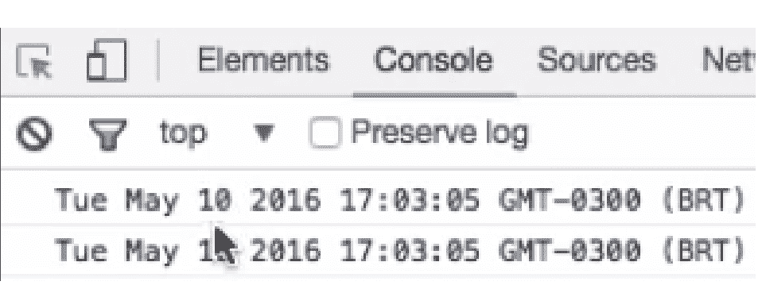

图 2.15：不可变的交易

我们可以看到它仍然是不可变的。

现在，我们将进行一个不同的测试。我们不再使用`outroDia`变量，而是将其替换为`n1.data.setDate(11)`。请注意，我们正在调用对象自身`data`属性的`setDate`方法：

```javascript
<!-- código anterior omitido -->
<script src="app/domain/negociacao/Negociacao.js"></script>
<script>
    var n1 = new Negociacao(new Date(), 5, 700);
    console.log(n1.data);
    n1.data.setDate(11);
    console.log(n1.data);
</script>
<!-- código posterior omitido -->
```

日期被更改了吗？

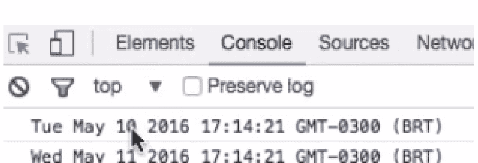

图 2.16：日期被更改

可以看到日期被更改了，因为控制台显示的日期是 11 日。

我们的交易是可变的！我们不能让这种情况发生。

但如果我们使用了`Object.freeze()`，为什么会发生这种情况？`Object.freeze()`仅能防止对被冻结对象的属性进行*新的赋值*。例如，我们不能执行`n1.data = new Date()`，因为这是在为属性赋予一个新值。然而，执行`n1.data.setDate(11)`是完全可能的，因为`n1.data`所定义的对象内部属性并没有被冻结。

当程序员走到语言无法为问题提供原生解决方案的地步时，他可以求助于自己的创造力；这是每个“cangaceiro”（开拓者/反叛者）应对所遇逆境的基本特征。

### 2.9 防御性编程

使交易日期不可变的一种方法是：每当访问日期的`getter`时，都返回一个新的`Date`对象。这样一来，通过`Date`实例拥有的任何函数所进行的修改都只会影响副本，而不会影响原始对象。

目前，`Negociacao`文件中的`get`是这样的：

```javascript
// app/domain/negociacao/Negociacao.js
// código anterior omitido

get data() {

    return this._data;

}
// código posterior omitido
```

让我们修改`get data()`的返回值：

```javascript
// app/domain/negociacao/Negociacao.js
// código anterior omitido

get data() {

    return new Date(this._data.getTime());

}
// código posterior omitido
```

日期的`getTime()`将返回一个表示该日期的`long`型数字。让我们在控制台中查看：

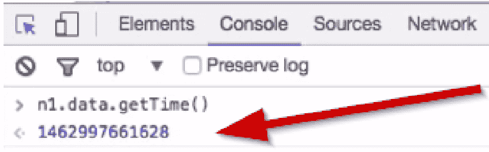

在`Date`的`constructor()`中，这个数字将被接受用于构建一个新的日期。因此，如果我们尝试通过`n1.data.setDate(11)`来修改日期，我们改变的不是`n1`保存的日期，而是一个副本。这就是我们所说的**防御性编程**。

在对`Negociacao`类的`get data()`进行修改后，让我们测试一下代码。重新加载浏览器页面后，我们在控制台中将看到以下日期：

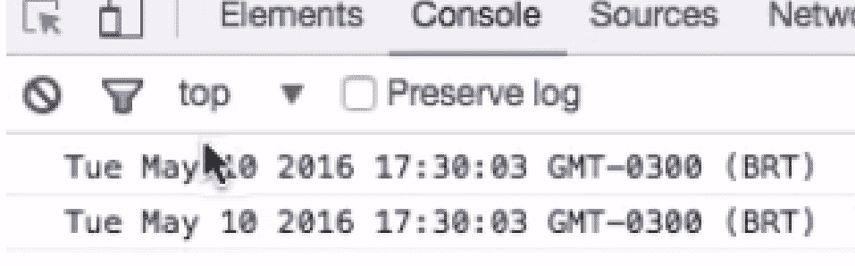

我们也必须对`constructor()`采取同样的谨慎，因为如果在`Negociacao`的`constructor()`中传递一个日期，类外部日期引用的任何更改也将修改其内部日期。让我们看看问题是如何发生的：

```javascript
<!-- código anterior omitido -->
<script src="app/domain/negociacao/Negociacao.js"></script>
<script>
    var hoje = new Date();

    var n1 = new Negociacao(hoje, 5, 700);

    console.log(n1.data);

    // 同时修改存储在 Negociacao 中的日期
    hoje.setDate(11);

    console.log(n1.data);
</script>
```

请注意，我们没有将`new Date()`传递给`Negociacao`的`constructor()`，而是传递了引用`Date`的变量`hoje`。当`Negociacao`接收`hoje`对象时，它将保存对同一个对象的引用。这意味着，如果我们修改变量`hoje`，也会修改`Negociacao`中的日期。如果执行这段代码，日期将被更改为11日。

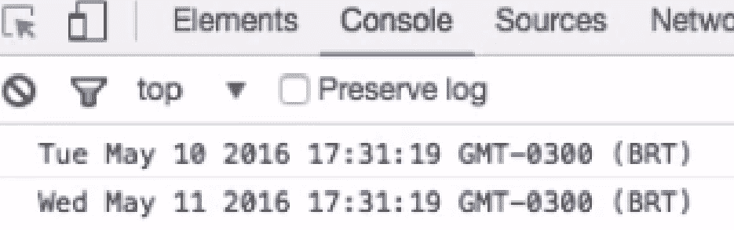

图 2.19：日期被更改 2

因此，我们也在`constructor()`中使用`getTime()`：


```javascript
// app/domain/negociacao/Negociacao.js

class Negociacao {

    constructor(data, quantidade, valor) {

        // 创建一个新日期，一个新的引用
        this._data = new Date(data.getTime());

        this._quantidade = quantidade;
        this._valor = valor;
        Object.freeze(this);
    }
}
// código posterior omitido
```

这样做之后，我们就无法在`index.html`中修改引用了，因为我们在`Negociacao`中保存的不再是对`hoje`的引用，而是一个新对象。重新加载浏览器页面后，控制台中显示的日期将是`10`。

在设计类的时候，请务必小心处理可变性，在必要时采取措施确保不可变性。

至此，我们完成了对类的封装以确保其不可变性。在 JS 中还有其他更高级的方案来尝试模拟代码的`privacy`（私有性）；然而，这样做会损失可读性和性能。因此，目前采用的方案是最可行的。

我们可以使用接下来的一个小技巧进一步简化代码。

### 2.10 使用`Object.assign`减少构造函数的冗长代码

让我们再次审视`Negociacao`类的`constructor`：

```javascript
// app/domain/negociacao/Negociacao.js

class Negociacao {

    constructor(data, quantidade, valor) {

        this._data = new Date(data.getTime());
        this._quantidade = quantidade;
        this._valor = valor;
        Object.freeze(this);
    }
}
// código posterior omitido
```

`constructor`接收的每个参数都通过`this._属性名 = 参数`这种结构的指令赋值给类的实例属性。如果参数数量非常多，`constructor`的代码会变得非常臃肿。

我们可以使用`object.assign()`方法大大简化将`constructor`接收的参数赋值给类实例属性的过程。首先，让我们了解它是如何工作的。

`object.assign()`方法用于将一个或多个源对象的所有可枚举自有属性复制到目标对象。它将返回该目标对象。让我们看一个例子：

```javascript
// 仅为示例，请在 Chrome 控制台中执行

var origem1 = { nome: 'Cangaceiro' };
```

```javascript
var origem2 = { nome: 'Cangaceiro' };
var origem2 = { idade: 20 };

var copia = Object.assign({}, origem1, origem2);

console.log(copia); // 显示 { nome: 'Cangaceiro', idade: 20 };
```

`Object.assign()`的第一个参数是目标对象，用于接收源对象属性的副本，一个使用`{}`语法表示的空对象。从第二个参数开始，我们可以传递任意数量的源对象，本例中传递了`origem1`和`origem2`。该方法返回一个包含`origem1`和`origem2`属性的对象。

如果我们在示例中，将一个已存在对象的引用作为`Object.assign()`方法的目标参数传递，该对象将被修改，并获得作为参数传递的一个或多个源对象的属性：

```javascript
// 仅为示例，请在 Chrome 控制台中执行

var origem = { idade: 20 };
var destino = { nome: 'Cangaceiro' };

Object.assign(destino, origem);
console.log(destino); // 显示 { nome: 'Cangaceiro', idade: 20 };
```

我们刚刚看到的行为允许我们对`Negociacao`的`constructor`进行如下修改：

```javascript
// app/domain/negociacao/Negociacao.js

class Negociacao {

    constructor(data, quantidade, valor) {

        Object.assign(this, { 
            _data: new Date(data.getTime()),
            _quantidade: quantidade, 
            _valor: valor
        });

        Object.freeze(this);
    }
    // 省略了后续代码
}
```

我们将源对象（通过`_data`、`_quantidade`和`_valor`属性创建，并接收类`constructor`传入的值）的属性复制到`this`（代表`Negociacao`类的实例）上。现在，我们只用了一条赋值语句代替了三条。

起初，用`Object.assign()`将三条语句替换为一条似乎并没有太大优势，因为其可读性并非最佳。但如果我们结合接下来将要介绍的下一个特性，将会得到一个非常有趣的解决方案。

### 2.11 字面量对象属性的快捷方式

`Object.assign()`方法接收的源对象是以字面量形式（即通过`{}`）创建的。让我们看一个通过字面量形式创建对象的独立示例：

```javascript
// 仅为示例，请在 Chrome 控制台中执行

var perfil = 'Cangaceiro';

var objeto = { perfil: perfil };

console.log(objeto); // 显示 { perfil: "Cangaceiro" }
```

在前面的示例中，`perfil`属性接收一个同名变量的值。当属性的名称与其赋值变量的名称相同时，我们可以这样声明对象：

```javascript
// 仅为示例，请在 Chrome 控制台中执行

var perfil = 'Cangaceiro';

var objeto = { perfil }; // 只传递 perfil

console.log(objeto); // 显示 { perfil: "Cangaceiro" }
```

ES2016 (ES6) 引入的这一新特性，使我们能够简化之前看到的`Object.assign()`的用法。修改`Negociacao`的`constructor`：

```javascript
// app/domain/negociacao/Negociacao.js

class Negociacao {

    // 参数名称已更改，现在带有下划线
    constructor(_data, _quantidade, _valor) {
        // 使用属性声明快捷方式

        Object.assign(this, { _data: new Date(_data.getTime()), _quantidade, _valor });
        Object.freeze(this);
    }
    // 省略了后续代码
}
```

请注意，`constructor`中接收的参数名称从`data`、`quantidade`、`valor`变为了`_data`、`_quantidade`、`_valor`。这不是偶然的，意图是让它们与传递给`Object.assign()`的源对象的属性同名。既然同名，我们就可以使用前一节介绍的属性声明快捷方式。

为了提高可读性，我们约定：所有需要在赋值前进行修改的`constructor`接收的属性，将单独进行赋值，不使用`Object.assign()`。

修改我们的代码：

```javascript
// app/domain/negociacao/Negociacao.js

class Negociacao {

    constructor(_data, _quantidade, _valor) {

        Object.assign(this, { _quantidade, _valor });
        this._data = new Date(_data.getTime());
        Object.freeze(this);
    }
}
// 省略了后续代码
```

我们大大简化了`constructor`参数到类属性的传递。

在继续下一章之前，我们需要在声明变量时养成一个新的习惯。

### 2.12 使用`var`声明的意外情况

我们的交易模型已经准备好了。然而，在继续之前，让我们将注意力转回到使用`var`声明的变量上。

#### 缺少块级作用域

使用`var`的声明不会像其他语言那样创建块级作用域。让我们看一个例子：

```html
<!-- 仅为示例代码，不包含在我们的应用中 -->
<script>
  for(var i = 1; i <= 100; i++) {
    console.log(i);
  }
  alert(i); // 值会是多少？
</script>
```

前面的代码将在控制台中正确打印出从`1`到`100`的数字。然而，`alert(i)`语句将显示值`101`：

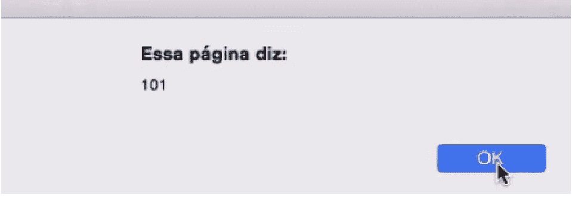

图 2.20: Alert

变量`i`在`for`块之外仍然可访问。使用`var`声明的变量拥有作用域的唯一方式是在函数块内声明它们：

```javascript
function exibeNome() {
    var nome = 'Flávio Almeida';
    alert(nome);
}

exibeNome(); // 显示 Flávio Almeida
alert(nome); // undefined
```

在我们刚刚看到的示例中，变量`nome`在函数块之外不可访问。

#### 重复声明

使用`var`，我们可以用相同的名称声明变量，而不会让 JavaScript 解释器感到困扰。例如：

```javascript
function minhaFuncao() {
    var nome = "Flávio";
    var nome = "Almeida"; // 不需要 var！
}
```

这种行为对于开发者在数十行代码中发现自己正在重新声明一个已经声明过的变量毫无帮助。

#### 在声明前访问

让我们再看一个例子：

```javascript
function minhaFuncao() {
    alert(nome);
    var nome = 'Flávio';
}

minhaFuncao();
```

前面的代码在`alert()`函数中显示`undefined`，而不是报错。这是因为使用`var`声明的变量会被提升（`hoisting`）到其声明所在的函数块的开头。

在底层，JavaScript 执行我们的代码方式如下：

```javascript
// 解释器如何读取我们的代码
function minhaFuncao() {

    /*
        将变量声明提升到上下文的顶部，在本例中是函数开头
    */
    var nome;
    alert(nome);
    nome = 'Flávio';
}

minhaFuncao();
```

这种行为使得像这样的代码可以工作：

```javascript
function minhaFuncao() {

    if(!nome) {
        var nome = 'Flávio Almeida'
    }
    alert(nome);
}

minhaFuncao();
```

在底层，我们的代码将被解释为：

```javascript
// 解释器如何读取我们的代码
function minhaFuncao() {
    var nome;
    if(!nome) {
        nome = 'Flávio Almeida'
    }
    alert(nome);
}

minhaFuncao();
```

这样，`if`测试的变量`nome`已经被声明，但值为`undefined`。好消息是，在 JavaScript 中还有另一种声明变量的方式，这是下一节的主题。

### 2.13 使用`let`声明变量

从 ES2015 (ES6) 开始，引入了一种新的变量声明语法，即`let`语法。让我们看看这种新声明类型的特性。

#### 块级作用域

让我们重新审视前一节的示例，但这次使用`let`来声明`for`块中的变量：

```html
<!-- 仅为示例代码，不包含在我们的应用中 -->
<script>
    for(let i = 1; i <= 100; i++) {
        console.log(i);
    }
    // 错误：i 未定义（或根据上下文为 undefined）
    alert(i);
</script>
```

`alert(i)`语句将显示错误（或`undefined`），因为在块内使用`let`声明的变量只能在该块内访问。

让我们再做一个测试：

```html
<!-- 仅为示例代码，不包含在我们的应用中 -->
<script>
    for(let i = 1; i <= 100; i++) {
        // 仅存在于 for 块内！
        let nome = "Flávio";
        console.log(i);
    }
    // undefined/错误！
    alert(i);
    // undefined/错误！
    alert(nome);
</script>
```

```javascript
alert(nome);
</script>
```

#### 同一个代码块内不能有重复的声明

`let`的另一个有趣之处在于，我们不能在同一个代码块`{}`内声明两个同名变量。让我们来看看：

```javascript
function minhaFuncao() {

    let nome = 'Flávio';
    let nome = 'Almeida';
}
minhaFuncao();
```

上述函数在被调用时，将导致以下错误：

```text
Uncaught SyntaxError: Identifier 'nome' has already been declared
```

然而，以下代码是完全有效的：

```javascript
let nome = 'Flávio';

function minhaFuncao() {

    let nome = 'Almeida';
    alert(nome);
}
minhaFuncao(); // 显示 Almeida
alert(nome); // 显示 Flávio
```

关于我们刚刚学习的新声明类型，还有一个细节需要理解。

### 2.14 暂时性死区 (Temporal Dead Zone)

让我们回顾一下使用`var`声明变量的行为。函数通过`var`声明变量`nome`：

```javascript
function minhaFuncao() {

    alert(nome);
    var nome = 'Almeida';
}
minhaFuncao();
```

我们知道，通过*变量提升*（hoisting），它将被解析为：

```javascript
// 解释器读取代码的方式

function minhaFuncao() {

    var nome;
    alert(nome);
    nome = 'Almeida';
}
minhaFuncao();
```

在 JavaScript 的解析方式下，我们有一个没有进行任何赋值的声明`var nome;`。因此`alert(nome)`会显示*undefined*，而不是报错说变量不存在。然而，当我们使用`let`时，需要注意**暂时性死区**（Temporal Dead Zone）。这个名字起初看起来可能有点吓人。

使用`let`声明的变量同样会被提升（*hoisting*）。但是，只有在它们被赋值之后才允许访问；否则，我们将遇到错误。让我们看之前的例子，这次使用`let`：

```javascript
function minhaFuncao() {

    alert(nome);
    let nome = 'Flávio';
}
```

```javascript
minhaFuncao();
```

当我们执行代码时，会收到错误消息：

```text
Uncaught ReferenceError: nome is not defined
```

如前所述，用`let`声明的变量也会被提升，所以代码被解析时会像这样：

```javascript
// 解释器读取代码的方式
```

```javascript
function minhaFuncao() {

    let nome;
    alert(nome);
    nome = 'Flávio';
}
```

```javascript
minhaFuncao();
```

在变量声明和赋值之间，就存在一个*暂时性死区*。在这个时间段内对变量的任何访问都将导致`ReferenceError`。不过，这是一个有益的错误，因为在应用程序中，在变量声明之前访问它很少是有意为之的。

没有任何东西能阻止我们刻意这样做：


```javascript
function minhaFuncao() {
    let nome = undefined;
    alert(nome);
    nome = 'Flávio';
}
```

```javascript
minhaFuncao();
```

`alert` 的结果将是 `undefined`。这完全合理，因为我们在变量 `nome` 接收赋值之后才访问它，也就是说，在暂时性死区之外。

既然我们已经知道了在应用程序中使用 `let` 的影响，现在让我们修改 `client/index.html` 来使用这种新声明：

```html
<!-- 省略之前的代码 -->
<script src="app/domain/negociacao/Negociacao.js"></script>
<script>
    let hoje = new Date();

    let n1 = new Negociacao(hoje, 5, 700);

    console.log(n1.data);

    hoje.setDate(11);

    console.log(n1.data);
</script>
```

如果执行该代码，一切将继续正常运行。

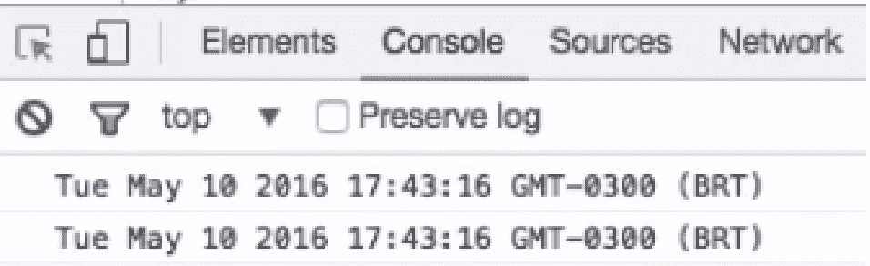

在本章中，我们通过应用面向对象范式创建了一个交易模型。然而，我们仅实现了 MVC 模型中的 **M**（Model）。我们需要实现用户与模型的交互，这是 MVC 模型中控制器（Controller）所承担的角色，也是下一章的主题。

本章的完整代码可以在 <https://github.com/flaviohenriquealmeida/cangaceiro-javascript/tree/master/02> 找到。

## 第 3 章

> “真实不在开始也不在结束，它在旅途的中途向我们显现……” —— 《大草原：分岔路》

在上一章中，我们通过 `Negociacao` 类创建了交易模型，并通过控制台对该类的实例进行了多次测试。为了让我们的应用程序对用户有用，这些实例必须考虑用户通过 `client/index.html` 中定义的表单提供的信息。我们将借助 MVC 模型的 `Controller` 来解决这个问题。

### 3.1 控制器的角色

_servers_

在 MVC 模型中，`controller`（控制器）在 `View`（视图）中的用户操作与 `Model`（模型）之间起桥梁作用。在 `View` 中，我们有 `client/index.html`（之后会进一步深入），在 `Model` 中我们有 `Negociacao` 的实例。这样，通过保持 `Model` 和 `View` 的分离，对 `View` 的更改（例如，将 `<table>` 更改为 `<ul>`）不会影响 `Model`。这非常有趣，因为我们可以为同一个模型提供多种视觉呈现，而无需强制更改模型。

现在是时候创建我们的第一个控制器了。

### 3.2 NegociacaoController 类

我们将创建文件 `client/app/controllers/NegociacaoController.js`，并在其中声明我们的控制器类：

```javascript
// client/app/controllers/NegociacaoController.js

class NegotiacaoController {

}
```

为了避免忘记导入刚刚创建的脚本，我们将它作为最后一个脚本导入到 `client/index.html` 中。此外，我们将移除之前用于测试 `Negociacao` 类的 `<script>` 标签：

```html
<!-- client/index.html -->
<!-- 省略之前的代码 -->

<script src="app/domian/negociacao/Negociacao.js"></script>

<!-- 移除了包含测试的标签 -->

<script src="app/controllers/NegociacaoController.js"></script>

<!-- 省略之后的代码 -->
```

现在我们创建一个名为 `adiciona` 的新方法。每当用户点击“包含”按钮提交表单时，该方法将被调用。

目前，我们仅取消表单提交的默认事件（我们不希望页面重新加载）并显示一个警告：

```javascript
// client/app/controllers/NegociacaoController.js

class NegociacaoController {

    adiciona(event) {
        // 取消表单提交
        event.preventDefault();

        alert('Chamei ação no controller');
    }
}
```

我们如何将 `adiciona` 方法与表单提交相关联？JavaScript 程序员的一种常见做法是通过 JavaScript 本身进行关联，查找 DOM 元素并通过事件接口将其与函数或方法关联起来。

我们将创建文件 `client/app/app.js`，并在其中进行上述关联。此外，在编写任何代码行之前，我们先将其导入到 `client/index.html` 中：

```html
<!-- client/index.html -->
<!-- 省略之前的代码 -->

<script src="app/domain/negociacao/Negociacao.js"></script>
<script src="app/controllers/NegociacaoController.js"></script>
<script src="app/app.js"></script>

<!-- 省略之后的代码 -->
```

文件名以小写字母开头并非失误，因为它没有声明类。请将 `app.js` 理解为我们应用程序的入口点，也就是说，它负责初始化应用程序所需的所有对象。在我们的应用程序中，目前只需要一个控制器。

在 `client/app/app.js` 中，我们将创建 `NegociacaoController` 的一个实例，然后查找页面的表单。最后，我们将该实例的 `adiciona` 方法与表单的 `submit` 事件关联起来：

```javascript
// client/app/app.js

// 创建控制器实例
let controller = new NegociacaoController();

// 将表单提交事件与调用 "adiciona" 方法相关联

document
    .querySelector('.form')
    .addEventListener('submit', function(event) {
        controller.adiciona(event);
    });
```

完成修改后，只需刷新页面并填写表单。当交易数据全部填写完毕并点击“包含”按钮时，我们将显示控制器中编写的警告。

虽然代码可以运行，但还可以进一步简化。`addEventListener` 函数期望接收两个参数：第一个是要处理的事件名称，第二个是我们想要调用的函数。但既然 `controller.adiciona` 也是一个函数，而函数可以作为参数传递给其他函数，我们可以这样简化：

```javascript
// client/app/app.js

let controller = new NegociacaoController();

// 直接传递 controller.adiciona
document
    .querySelector('.form')
    .addEventListener('submit', controller.adiciona);
```

### 3.3 将控制器的方法与用户操作关联起来

当我们点击表单的 `Incluir` 按钮时，已经可以执行 `controller` 的操作了。现在，我们需要获取填写的数据。但我们在序言中已经做过一次了，使用 `document.querySelector()`，它接受一个 CSS 选择器作为参数，以便我们定位到想要获取的元素：

```javascript
// client/app/controllers/NegociacaoController.js

class NegociacaoController {

    adiciona(event) {
        event.preventDefault();

        // 寻找元素
        let inputData = document.querySelector('#data');
        let inputQuantidade = document.querySelector('#quantidade');
        let inputValor = document.querySelector('#valor');

        console.log(inputData.value);
        console.log(inputQuantidade.value);
        console.log(inputValor.value);
    }
}
```

`document.querySelector()` 负责在 DOM 中查找 id 为 `#data`、`#quantidade` 和 `#valor` 的元素——注意我们可以使用 CSS 选择器。事实上，一个 JavaScript 狂热者对这些选择器很熟悉。

让我们执行代码，看看所有数据是否都显示在浏览器的控制台中。我们将用日期 `11/12/2016`、数量 `1` 和价格 `100` 来填写表单。

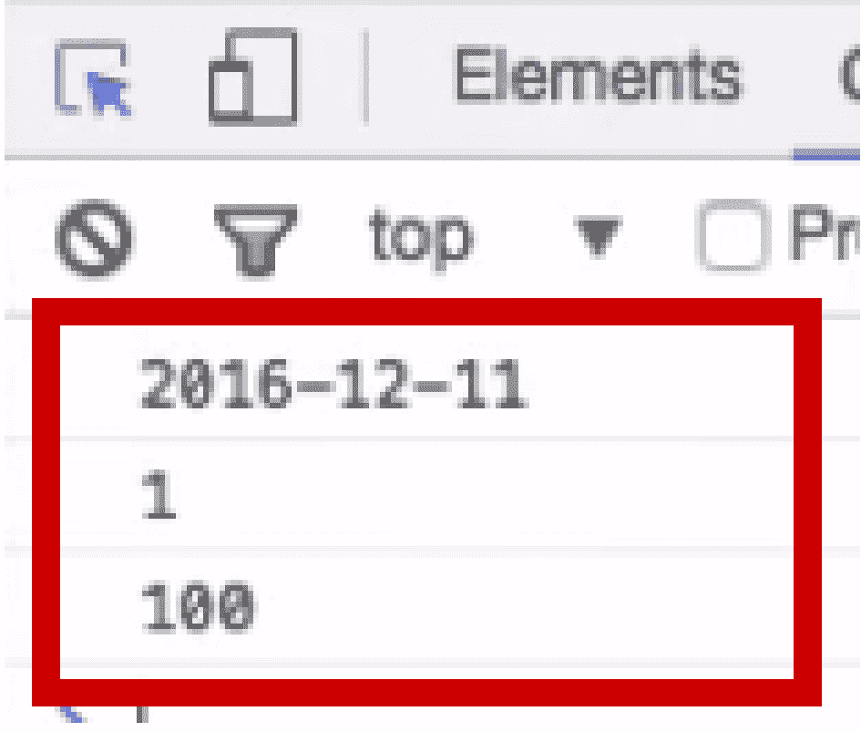

图 3.1：控制台数据

数据显示在控制台，然而，`_quantidade` 和 `_valor` 属性的值是字符串。我们可以通过 `typeof` 语句来验证：

```javascript
// client/app/controllers/NegociacaoController.js

class NegociacaoController {

    adiciona(event) {
        event.preventDefault();

        // 寻找元素
        let inputData = document.querySelector('#data');
        let inputQuantidade = document.querySelector('#quantidade');
        let inputValor = document.querySelector('#valor');

        console.log(inputData.value);
        console.log(inputQuantidade.value);

        // 显示 string
        console.log(typeof(inputQuantidade.value));

        console.log(inputValor.value);

        // 显示 string
        console.log(typeof(inputValor.value));
    }
}
```

这是因为 DOM 中 `input` 类型元素的 `value` 属性返回的是字符串值。我们需要分别使用 `parseInt()` 和 `parseFloat()` 函数将它们转换为数字：

```javascript
// client/app/controllers/NegociacaoController.js

class NegociacaoController {

    adiciona(event) {
        event.preventDefault();

        // 寻找元素
        let inputData = document.querySelector('#data');
        let inputQuantidade = document.querySelector('#quantidade');
        let inputValor = document.querySelector('#valor');

        console.log(inputData.value);
        console.log(parseInt(inputQuantidade.value));
        console.log(parseFloat(inputValor.value));
    }
}
```

我们的表单很小，但如果它有超过十个字段，我们就必须重复 `document.querySelector` 语句十次。我们可以简化这个语法。

让我们创建一个变量 `$`（向 jQuery 致敬！），它的值将是 `document.querySelector`，这在 JavaScript 中完全可行，因为函数可以赋值给变量。这样，我们就为这条语句创建了一个别名，一个快捷方式：

```javascript
// client/app/controllers/NegociacaoController.js

class NegociacaoController {

    adiciona(event) {
        event.preventDefault();

        // 思路是让 $ 成为 querySelector
        let $ = document.querySelector;

        let inputData = $('#data');
        let inputQuantidade = $('#quantidade');
        let inputValor = $('#valor');

        console.log(inputData.value);
        console.log(parseInt(inputQuantidade.value));
        console.log(parseFloat(inputValor.value));
    }
}
```

这样，编写代码就没那么繁琐了。但如果我们直接执行它，会在浏览器中看到一条错误信息：

```text
Uncaught TypeError: Illegal invocation
    at HTMLFormElement.adiciona (NegociacaoController.js:9)
```

将 `document.querySelector` 赋值给变量 `$` 似乎没有起作用。为什么呢？

`document.querySelector()` 是属于 `document` 对象的一个函数——我们称此函数为方法。在内部，`querySelector` 有一个对 `this` 的调用，`this` 是调用该方法的上下文，在此例中是 `document`。

然而，当我们把 `document.querySelector` 赋值给变量 `$` 时，它就在 `document` 上下文之外执行了，这行不通。那么，我们应该怎么做呢？我们需要将 `querySelector` 作为一个单独的函数来处理，但同时仍然保持 `document` 作为其上下文。

好消息是，我们可以通过 `bind()` 轻松实现这一点。尽管听起来很奇怪，`bind` 是 JavaScript 中任何函数都具备的一个函数：因此，我们将修改我们的代码：

```javascript
// client/app/controllers/NegociacaoController.js

class NegociacaoController {

    adiciona(event) {
        event.preventDefault();

        // 进行绑定，$ 保持 document 作为其上下文
        let $ = document.querySelector.bind(document);

        let inputData = $('#data');
        let inputQuantidade = $('#quantidade');
        let inputValor = $('#valor');

        console.log(inputData.value);
        console.log(parseInt(inputQuantidade.value));
        console.log(parseFloat(inputValor.value));
    }
}
```

现在，我们告知 `querySelector` 被赋值给变量 `$`，但仍然将 `document` 作为其上下文。这一次，代码将在浏览器中正常运行。

我们已经“万事俱备”，可以用表单数据创建一个交易实例了。然而，之前的代码，尽管像忍者一样，但不是一个“cangaceiro”风格的代码。我们可以进一步改进它，接下来我们将这样做。

### 3.4 避免不必要的 DOM 遍历

代码可以运行，但如果我们添加了十笔交易并点击十次 `Incluir`，`querySelector` 也会查找十次由 `#data`、`#quantidade` 和 `#valor` 标识的元素。然而，出于性能考虑，我们应该尽可能避免遍历 DOM。

我们的代码是这样的：


```javascript
// client/app/controllers/NegociacaoController.js

class NegociacaoController {

    adiciona(event) {

        event.preventDefault();

        let $ = document.querySelector.bind(document);

        let inputData = $('#data');
        let inputQuantidade = $('#quantidade');
        let inputValor = $('#valor');

        console.log(inputData.value);
        console.log(parseInt(inputQuantidade.value));
        console.log(parseFloat(inputValor.value));
    }
}
```

尽管仅通过 ID 查找三个元素对我们的应用性能影响不大，但让我们像“cangaceiro”一样思考并应用最佳实践。

为了提高性能，我们将添加`constructor`并将输入元素移入其中。但与其创建变量，我们将在`this`上创建属性。这样，对 DOM 元素的查找只会在`constructor()`中执行一次，而不再是每次调用`adiciona()`方法时都执行。

由于这些属性仅在通过`NegociacaoController`类本身访问时才有意义，我们将使用前缀`_`（私有属性的约定）：

```javascript
// client/app/controllers/NegociacaoController.js

class NegociacaoController {

    constructor() {

        let $ = document.querySelector.bind(document);
        this._inputData = $('#data');
        this._inputQuantidade = $('#quantidade');
        this._inputValor = $('#valor');
    }

    adiciona(event) {

        event.preventDefault();

        // 我们需要通过 this 访问属性
        console.log(this._inputData.value);
        console.log(parseInt(this._inputQuantidade.value));
        console.log(parseFloat(this._inputValor.value));
    }
}
```

现在，即使我们添加 300 笔交易，DOM 元素也只会被查找一次，即在`NegociacaoController`类实例化时。然而，事情并未如预期般发展。

在我们点击`Incluir`按钮并查看 Chrome 控制台后，我们看到以下错误信息：

```text
Uncaught TypeError: Cannot read property 'value' of undefined
    at HTMLFormElement.adiciona (NegociacaoController.js:15)
```

当我们将`document.querySelector`赋值给变量`$`时，也会遇到同样的问题，它失去了`this`对`document`的引用。我们来看一下文件`client/app/app.js`：

```javascript
// client/app/app.js

let controller = new NegociacaoController();
document
    .querySelector('.form')
    .addEventListener('submit', controller.adiciona);
```

这里也有同样的问题。当我们将`controller.adiciona`传递给`addEventListener`方法时，它的`this`就不再是`controller`了，而是变成了 DOM 元素本身，也就是表单。这是因为每个函数/方法都有一个动态的`this`，它的值取决于调用时的上下文。但我们已经学过如何处理这个问题了。

让我们再次借助`bind`函数：

```javascript
// client/app/app.js

let controller = new NegociacaoController();

// 在这里使用bind！
document
    .querySelector('.form')
    .addEventListener('submit', controller.adiciona.bind(controller));
```

如果我们执行这段代码，就会看到它们正确显示在控制台中。

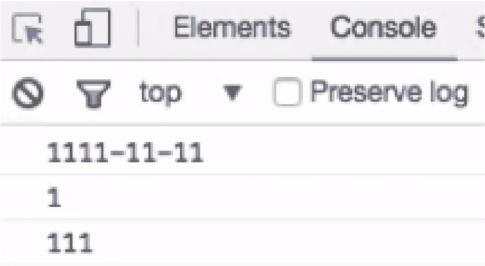

### 3.5 创建`Negociação`的实例

现在用户已经可以调用我们`NegociacaoController`类的`adiciona`方法了，我们可以基于表单数据来构建一笔交易：

```javascript
// client/app/controllers/NegociacaoController.js

class NegociacaoController {

    // 省略前面的代码

    adiciona(event) {

        event.preventDefault();

        let negociacao = new Negociacao(
            this._inputData.value,
            parseInt(this._inputQuantidade.value),
            parseFloat(this._inputValor.value)
        );

        console.log(negociacao);
    }
}
```

我们将`data`、`quantidade`和`valor`参数传递给`Negociacao`的构造函数。有了表单数据，我们就拥有了一笔交易。但真的有了吗？

查看 Chrome 的控制台，我们看到以下错误信息：

```text
Negociacao.js:5 Uncaught TypeError: Cannot read property 'getTime' of undefined
    at new Negociacao (Negociacao.js:5)
    at NegociacaoController.adiciona (NegociacaoController.js:15)
```

我们收到了错误信息，但它不是来自`NegociacaoController`。错误发生在`Negociacao`类中。在控制台中，我们还能看到问题出在哪一行，此外它还告诉我们`data.getTime`不是一个函数。这是怎么回事呢？

让我们看看我们类的定义：

```javascript
// client/app/domain/negociacao/Negociacao.js

class Negociacao {

    constructor(_data, _quantidade, _valor) {

        Object.assign(this, { _quantidade, _valor });
        this._data = new Date(_data.getTime());
        Object.freeze(this);
    }

    // 省略后面的代码
```

那么也就是说我们传递给`constructor`的日期不是一个`Date`？那它是什么类型的数据呢？

要知道表单中捕获的日期类型，我们可以使用`typeof()`函数：

```javascript
// client/app/controllers/NegociacaoController.js

adiciona(event) {

    event.preventDefault();

    // 检查类型
    console.log(typeof(this._inputData.value));

    let negociacao = new Negociacao(
        this._inputData.value,
        parseInt(this._inputQuantidade.value),
        parseFloat(this._inputValor.value)
    );
```

```javascript
console.log(negociacao);
}
```

通过控制台，我们看到日期元素的值类型是`string`：


在各种语言中处理日期转换需要决心。这就是为什么我们需要我们的弹药库和接下来的土匪帽。

### 3.6 根据用户输入创建`Date`对象

有多种方法可以通过向`Date`的`constructor`传递参数来构建日期。我们已经见过的一种是，如果我们已经有一个日期，可以将它的`getTime()`结果传递给另一个的`constructor`。如果我们直接传递字符串会有效吗？让我们试试：

```javascript
// client/app/controllers/NegociacaoController.js

// 省略前面的代码

adiciona(event) {

    event.preventDefault();

    // constructor接收的是字符串。会有效吗？
    let data = new Date(this._inputData.value)
    console.log(data);
}

// 省略后面的代码
```

用最后一次修改进行测试，我们没有成功：

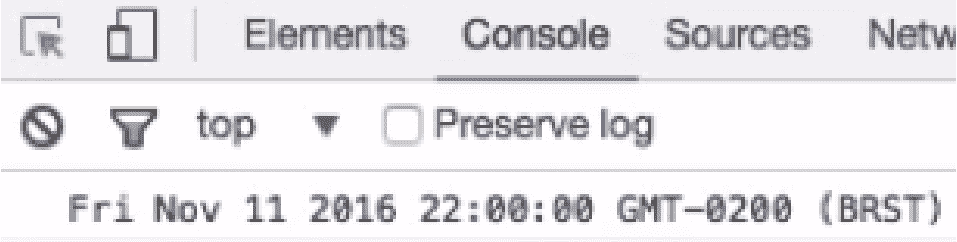

图 3.4：控制台中错误的日期

控制台中显示的日期不一样。相反，我们看到日期是 11。所以，这没起作用。我们必须找到另一种处理这个日期的方法。

处理`Date`的另一种方法是向它的构造函数传递一个*数组*，分别是年、月、日的值。如果我们在控制台输入：

```javascript
new Date(['2016', '11', '12']);
```

返回值将是正确的日期。

这是一种解决方法。那么我们需要找到一种方法将`this._inputData.value`返回的字符串转换为字符串数组。好消息是字符串在 JavaScript 中是对象，和所有对象一样，它们能为我们执行任务。

通过字符串的`split`方法，我们可以将它转换为数组。然而，为了让方法识别每个元素，我们需要指定一个**分隔符**。由于`this._inputData.value`返回的字符串遵循*年-月-日*的格式，我们将使用连字符作为分隔符。

在 Chrome 控制台先测试一下怎么样？

```javascript
dataString = '2016-12-11';
lista = dataString.split('-')
console.log(lista); // 显示 ["2016", "12", "11"]
```

它返回了正确的日期，完美。那么，在我们`NegociacaoController`类的`adiciona`方法中，我们将这样做：

```javascript
// client/app/controllers/NegociacaoController.js
// 省略前面的代码

adiciona(event) {

    event.preventDefault();

    // 现在Date接收一个数组
```

```javascript
let data = new Date(this._inputData.value.split('-'));
console.log(data);
}
// 省略后面的代码
```

看，在一条指令中，我们从`this._inputData.value`捕获，执行`split`，并将最终结果传递给`Date`。我们解决了日期问题！让我们看看控制台中的结果！

```text
Sat Nov 12 2016 00:00:00 GMT-0200 (-02)
```

但我们的解决方案不止于此，还有其他解决同样问题的方法。例如，当`Date`接收一个数组时，它在内部会使用逗号作为分隔符将数组的所有元素重新组合成单个字符串。

内部重新组合是通过`join`函数完成的，它接收使用的分隔符作为参数。我们可以在控制台中模拟这个行为：

```javascript
dataString = '2016-12-11';
lista = dataString.split('-'); // 分隔数字
lista = lista.join(','); // 使用逗号作为分隔符组合数字
console.log(lista);
```

然而，在我们的代码中，我们可以简单地将连字符替换为逗号，并将结果字符串传递给新的`Date`。为此，我们可以向所有字符串都有的`replace`函数求助。我们将传递一个正则表达式作为参数，要求将字符串中所有出现的连字符（即全局）替换为逗号：`replace(/-/g, ',')`。

```javascript
// client/app/controllers/NegociacaoController.js
// 省略前面的代码

adiciona(event) {
    event.preventDefault();
```

```javascript
// 另一种解决方法
let data = new Date(this._inputData.value.replace(/-/g, ','));
console.log(data);
}
```

控制台中的结果是：

```text
Sat Nov 12 2016 00:00:00 GMT-0200 (-02)
```

日期是正确的。我们看到有多种方法可以解决日期问题。但要不我们选择另一种方法来测试我们的土匪技能？这就是我们接下来要看的。

### 3.7 日期挑战

`Date`在构建新日期时还有另一种可接受的形式。在 Chrome 控制台中，我们写下以下行：

```javascript
data = new Date(2016, 11, 12)
console.log(data);
```

然而，如果我们打印这个日期，会看到以下返回值：

```text
Mon Dec 12 2016 00:00:00 GMT-0200 (-02)
```

打印的日期是`Mon Dec 12 2016`，即 12/12/2016。为什么它打印的是**十二月**，而我们传递的月份是`11`？因为在这种形式中，月份必须从`0`（一月）到`11`（十二月）传递。所以，如果我们想要**十一月**的日期，我们需要将月份值减一。让我们在控制台中做一个新的测试，输入：

```javascript
data = new Date(2016,10,12)
console.log(data);
```

现在，日期显示正确了。

```text
Sat Nov 12 2016 00:00:00 GMT-0200 (-02)
```

我们之前看到的所有构建日期的解决方案都是忍者解决方案。然而，土匪喜欢挑战，因此我们将选择这最后一种我们看到的形式。

那么，回到问题，如何将`this._inputData.value`捕获的`2016-11-12`格式的字符串转换为`Date`，使用我们刚学会的方式？这就是我们接下来要看的。

### 3.8 使用函数式范式解决问题

我们的目标是让`Date`的`constructor`接收一个年份、月份和日期。让我们借助`split()`函数来修改代码：

```javascript
// client/app/controllers/NegociacaoController.js

// 前面的代码省略

adiciona(event) {

    event.preventDefault();

    let data = new Date(this._inputData.value.split('-'));

    console.log(data);
}
```

```javascript
// 后面的代码省略
```

通过`split`，字符串`2016-11-12`将变成一个包含三个元素的`array`。我们知道，如果按照现有方式传递，就能得到期望的结果。但是，我们不希望`Date`接收一个`array`，而是希望它将数组中的每一项作为`constructor`的各个参数来接收。我们希望数组的第一位对应`constructor`的第一个参数，第二位和第三位也同样对应。

从 ES2015（ES6）开始，我们可以使用`spread operator`（展开运算符），它允许将数组中的每个元素作为独立的元素来处理。请仔细阅读代码中的变更：

```javascript
// client/app/controllers/NegociacaoController.js

// 前面的代码省略

adiciona(event) {

    event.preventDefault();

    // 我们使用了著名的三个点！

    let data = new Date(...this._inputData.value.split('-'));

    console.log(data);
}
```

```javascript
// 后面的代码省略
```


我们在`Date`的`constructor`参数前添加了展开运算符`...`（三个点）。这样一来，`constructor`就不再将数组作为单一参数接收，而是逐个接收数组中的每个元素。这些元素将按相同的顺序传递给类的`constructor`。

我们的代码在语法上是正确的，`Date`的`constructor`的三个参数都会被传递。但是，如果不进行调整，月份的值会不正确，我们需要从中减去`1`。让我们在 Chrome 控制台中查看结果：

```text
Mon Dec 12 2016 00:00:00 GMT-0200 (-02)
```

**展开运算符**生效了，但我们仍然需要找到一种方式，在将数组中的每个参数重新传递给`Date`的`constructor`之前，将月份的值减去`1`。为此，我们将使用 JavaScript 世界中广为人知的`map()`函数，它能帮助我们完成所需的调整。

首先，我们将调用`map()`函数但不进行任何转换，只是为了理解它在代码中的位置：

```javascript
// client/app/controllers/NegociacaoController.js

// 前面的代码省略

adiciona(event) {
    event.preventDefault();

    let data = new Date(
        ...this._inputData.value
            .split('-')
            .map(function(item) {
                return item;
            })
    );

    console.log(data);
}
```

```text
// 后面的代码省略
```

传递给`map()`的逻辑将作用于数组的每个元素，最终返回一个新的数组。但目前这样写，结果数组与我们要转换的数组完全相同。现在我们需要应用调整月份的逻辑，从其值中减去`1`。但是，我们如何知道当前是第一个、第二个还是第三个元素呢？这个信息很重要，因为我们只想修改第二个元素。

好消息是，`map()`函数可以通过其第二个参数为我们提供当前被迭代元素的位置：

```javascript
// client/app/controllers/NegociacaoController.js

// 前面的代码省略

adiciona(event) {
    event.preventDefault();

    let data = new Date(
        ...this._inputData.value
            .split('-')
            .map(function(item, indice) {
                // 记住数组从索引 0 开始，
                // 因此，1 就是第二个元素！

                if(indice == 1) {
                    // 这里的结果将是一个数字，隐式转换
                    return item - 1;
                }

                return item;
            })
    );

    console.log(data);
}
```

```javascript
// 后面的代码省略
```

当`indice`为`1`时，意味着我们正在迭代第二个元素，即包含月份值且需要调整的那个元素。在`if`条件中，我们轻松地完成了这个调整。但是，我们知道正在迭代的数组元素是`string`类型的，那么为什么减法操作还能正常工作呢？

当 JavaScript 解释器检测到涉及字符串和数字的乘法、除法和减法运算时，在底层会尝试将字符串隐式转换为数字。如果字符串无法表示一个数字，结果将是`NaN`（Not a Number，非数字）。

最终，运算成功后将得到一个新的数字。加法运算不会被隐式转换所考虑，因为解释器无法判断应该是进行拼接还是转换为数字。

让我们看看代码是否能正常工作。在表单中，我们将在日期字段填入`12/11/2016`。这一次，控制台中显示的日期将是正确的。

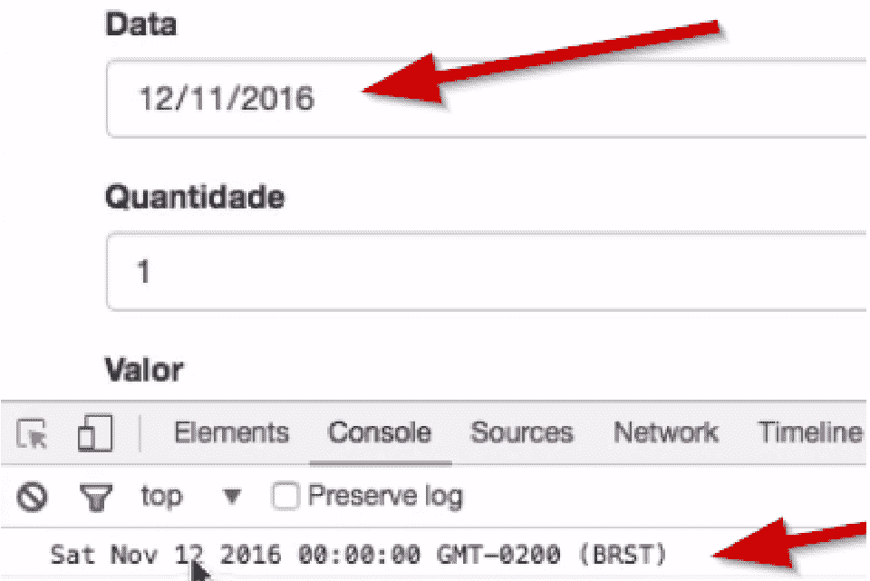

图 3.5：对应的日期

我们的代码运行完美，成功解决了问题。但是，好汉不多言，行动胜于空谈。我们能不能写更少的代码得到同样的结果呢？可以，通过**取模运算**。

#### 回忆即重温

在数学中，取模是除法的余数。在 Chrome 控制台中，让我们做一个测试：

```javascript
2 % 2 // 取模结果是 0，因为 2 除以 2 的余数是 0
```

再看一个例子：

```javascript
3 % 2 // 取模结果是 1，因为 3 除以 2 的余数是 1
```

我们数组的索引分别是`0`、`1`和`2`。因此，如果我们计算每个索引除以`2`的取模结果：

```javascript
0 % 2 // 取模结果是 0
1 % 2 // 取模结果是 1
2 % 2 // 取模结果是 0
```

请看，恰好是月份的索引得到的结果为`1`，而这正是我们需要减去的值。最终，我们的代码将变成这样：

```javascript
// 前面的代码省略

adiciona(event) {
    event.preventDefault();

    let data = new Date(
        ...this._inputData.value
            .split('-')
            .map(function(item, indice) {
                return item - indice % 2;
            })
    );

    console.log(data);
}

// 后面的代码省略
```

如果我们在数组的第一个位置，`indice`的值为`0`。因此，`indice % 2`的结果也为`0`。从`item`中减去这个值不会有任何变化。但当我们在数组的第二个位置时，`indice`的值为`1`。现在，`1`对`2`取模，结果为`1`。而当我们在数组的第三个位置时，`2`对`2`取模，结果同样为`0`。我们不会从元素的值中减去任何东西。通过这种方式，我们避免了创建`if`语句：

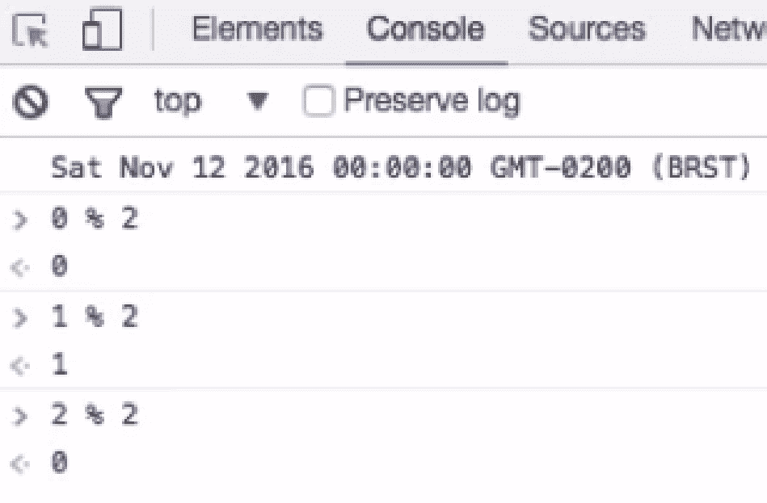

图 3.6：取模的值

至此，我们的代码如下：

```javascript
// client/app/controllers/NegociacaoController.js

class NegociacaoController {
    constructor() {
        let $ = document.querySelector.bind(document);

        this._inputData = $('#data');
        this._inputQuantidade = $('#quantidade');
        this._inputValor = $('#valor');
    }

    adiciona(event) {
        event.preventDefault();

        let data = new Date(
            ...this._inputData.value
                .split('-')
                .map(function(item, indice) {
                    return item - indice % 2;
                })
        );

        console.log(data);
    }
}
```

运行它，我们会看到控制台中显示的日期是 2016 年 11 月 12 日。

### 3.9 箭头函数：让代码更加简洁

我们还可以让代码更加简洁，使用一种从 ES2015（ES6）版本开始引入的不同函数声明方式。我们来说说*箭头函数*。

*Arrow*翻译成中文就是**箭头**。通过这种“箭头函数”，我们可以从代码中去掉`function`关键字。但如果只是简单地删掉这个词然后运行代码，会出现语法错误，浏览器会提示该错误。为了表示这是一个箭头函数，我们需要添加`=>`（看，箭头在这里！）。它将表明这是一个接收两个参数的*箭头函数*。

```javascript
// client/app/controllers/NegociacaoController.js

// 前面的代码省略

adiciona(event) {
    event.preventDefault();

    let data = new Date(
        ...this._inputData.value
            .split('-')
            .map((item, indice) => {
                return item - indice % 2;
            })
    );

    console.log(data);
}

// 后面的代码省略
```

当我们使用箭头语法时，就知道这是一个*箭头函数*。如果在浏览器中刷新页面，我们会看到一切正常运行。

现在，一个问题：在*arrow functions*（箭头函数）的代码块中，我们有多少条指令？只有**一条**：`return item - indice % 2`。这一行位于`map()`函数内部：

```javascript
// analisando um trecho do código

.map((item, indice) => {
    return item - indice % 2;
});
```

当我们的箭头函数拥有两条或更多指令时，我们必须使用代码块`{ }`，并且需要添加`return`。然而，由于我们的代码只有一条指令，因此允许移除代码块`{ }`以及`return`指令。这是因为箭头函数会隐式地添加它。简化后的代码如下：

```javascript
// client/app/controllers/NegociacaoController.js

// código anterior omitido

adiciona(event) {
    event.preventDefault();

    let data = new Date(
        ...this._inputData.value
            .split('-')
            .map((item, indice) => item - indice % 2)
    );

    console.log(data);
}

// código posterior omitido
```

看，代码变得简单多了！

如果在浏览器中运行代码，表单可以正常工作，日期将按我们预期的方式显示在控制台中。我们通过使用*arrow function*减少了代码的“冗余度”。现在，我们只需要使用表单数据创建`Negociacao`的实例：

```javascript
// client/app/controllers/NegociacaoController.js

// código anterior omitido

adiciona(event) {
    event.preventDefault();

    let data = new Date(
        ...this._inputData.value
            .split('-')
            .map((item, indice) => item - indice % 2)
    );

    let negociacao = new Negociacao(
        data,
        parseInt(this._inputQuantidade.value),
        parseFloat(this._inputValor.value)
    );

    console.log(negociacao);
}

// código posterior omitido
```

我们处理日期的旅程尚未结束。我们已经能够根据表单数据创建新的日期对象，但如果我们想以日/月/年的格式向用户显示日期，该怎么做呢？准备好进入下一章了吗？

> 本章的完整代码可以在 https://github.com/flaviohenriquealmeida/cangaceiro-javascript/tree/master/03 找到。

## 第 4 章

### 双重标准？

> “我告诉您的是我知道而您不知道的；但主要我想告诉您的是我不确定我知道，而您可能知道的。” —— 《大草原：小径》

我们现在已经能够基于表单数据实例化一个交易（negociação）。很快，我们需要在`client/index.html`的`<table>`中显示其数据。但日期的显示是否友好呢？

让我们修改`NegociacaoController`的`adiciona()`方法，使其打印创建的交易日期，而不是整个对象：

```javascript
// client/src/app/controllers/NegociacaoController.js

// código anterior omitido

adiciona(event) {
    // código anterior omitido

    // accessing the data getter and displaying it in the console
    console.log(negociacao.data);
}

// código posterior omitido
```

现在，对于输入日期`12/11/2016`，它在控制台中的呈现格式如下：

`Sat Nov 12 2016 00:00:00 GMT-0200 (BRST)`

虽然这是一个有效的信息，但如果能以日/月/年格式向用户显示日期，会更加简单直接。这是一个我们需要解决的问题，因为很快我们就会在表格中加入交易记录，其中一列就涉及交易的日期属性。我们来做一个实验。

在`adiciona()`方法中，我们尝试这样打印日期：

```javascript
// client/src/app/controllers/NegociacaoController.js

// código anterior omitido

adiciona(event) {
    // código anterior omitido

    let diaMesAno = negociacao.data.getDate()
        + '/' + negociacao.data.getMonth()
        + '/' + negociacao.data.getFullYear();

    console.log(diaMesAno);
}

// código posterior omitido
```

使用`getDate()`我们将返回日期，然后使用`getMonth()`返回月份，再使用`getFullYear()`返回年份。所有这些都与日期连接在一起。

但控制台中显示的日期仍然是不正确的：

| 字段 | 值 |
| :--- | :--- |
| 日期 | 12/10/2016 |
| 数量 | 1 |
| 价值 | ... |

图 4.1：控制台中错误的日期

在控制台中，我们看到了月份`10`。这是因为月份来自一个 0 到 11 的数组。因此，如果记录的日期是 11 月，它将打印为 10 月。

解决这个问题的一个尝试是对`getMonth()`的返回值加`1`：

```javascript
// client/src/app/controllers/NegociacaoController.js

// código anterior omitido

adiciona(event) {
    // código anterior omitido

    let diaMesAno = negociacao.data.getDate()
        + '/' + negociacao.data.getMonth() + 1
        + '/' + negociacao.data.getFullYear();

    console.log(diaMesAno);
}

// código posterior omitido
```

图 4.2：奇怪的日期

然而，结果仍然不是预期的，月份显示为“101”，一个字符串！事实上，这是每个 JavaScript 程序员在初次接触该语言时都会遇到的经典连接问题。

为了解决连接优先级问题，只需在希望首先处理的操作周围添加括号，使其在任何连接之前执行：

```javascript
// client/src/app/controllers/NegociacaoController.js

// código anterior omitido

adiciona(event) {
    // código anterior omitido

    let diaMesAno = negociacao.data.getDate()
        + '/' + (negociacao.data.getMonth() + 1)
        + '/' + negociacao.data.getFullYear();

    console.log(diaMesAno);
}

// código posterior omitido
```


这是 JavaScript 的基础。测试证明日期的显示文本正确了。我们可以进一步优化代码，尤其是在处理日期方面。

### 4.1 隔离日期转换职责

通过几行代码，我们确保了字符串到`Date`对象的转换，以及反向路径——将`Date`转换为`日/月/年`格式的字符串。然而，在应用程序中任何需要执行这些操作的地方，我们都必须重复已经写过的代码。

让我们创建新文件`client/app/ui/converters/DateConverter.js`。一如既往，我们先在`client/index.html`中导入该文件，以免忘记：

```html
<!-- client/index.html -->

<!-- código anterior omitido -->

<script src="app/domain/negociacao/Negociacao.js"></script>

<script src="app/controllers/NegociacaoController.js"></script>

<script src="app/app.js"></script>

<script src="app/ui/converters/DateConverter.js"></script>

<!-- código posterior omitido -->
```

在刚创建的文件中，我们将声明`DateConverter`类，并定义两个执行转换的方法骨架：

```javascript
// client/app/ui/converters/DateConverter.js

class DateConverter {

    paraTexto(data) {

    }

    paraData(texto) {

    }

}
```

实现它不需要太多 effort，因为我们可以复制分散在`NegociacaoController`的`adiciona`方法中的转换逻辑，只需将代码适配为方法接收的参数名称：

```javascript
// client/app/ui/converters/DateConverter.js

class DateConverter {

    paraTexto(data) {

        return data.getDate()

            + '/' + (data.getMonth() + 1)

            + '/' + data.getFullYear();

    }

    paraData(texto) {

        return new Date(...texto.split('-').map((item,indice) => item - indice % 2));

    }

}
```

现在，我们需要修改`NegociacaoController`类。在其`adiciona()`方法中，我们将使用刚刚创建的新类：

```javascript
// client/app/controllers/NegociacaoController.js

// código anterior omitido

adiciona(event) {

    event.preventDefault();

    let converter = new DateConverter();

    let data = converter.paraData(this._inputData.value);

    let negociacao = new Negociacao(

        data,

        parseInt(this._inputQuantidade.value),

        parseFloat(this._inputValor.value)

    );

    let diaMesAno = converter.paraTexto(negociacao.data);

    console.log(diaMesAno);

}

// 后续代码省略
```

图 4.3：控制器中的交易

日期也能正确以两种格式打印。不过，你们可能在想，`new`运算符是如何与`DateConverter`配合工作的，因为这个类没有`constructor`。没有出现任何错误是因为没有定义`constructor`的类会获得一个默认的构造函数。

我们已经成功将代码隔离到了`Helper`中。但是我们还能进一步改进它吗？

### 4.2 静态方法

我们了解到类的实例可以拥有属性，而且每个实例都有自己的值。但如果我们在`DateConverter`类中查找实例属性，却找不到任何属性。既然如此，我们创建一个`DateConverter`的实例仅仅是为了调用那些不依赖于任何实例数据的方法。

当我们拥有一些从实例调用没有意义的方法时，比如我们创建的`paraTexto()`方法，我们可以直接从声明它们的类来调用，在方法名前添加`static`修饰符：

```javascript
// client/app/ui/converters/DateConverter.js

class DateConverter {

    static paraTexto(data) {

        return data.getDate()

            + '/' + (data.getMonth() + 1)

            + '/' + data.getFullYear();

    }

    static paraData(texto) {

        return new Date(...texto.split('-').map((item, indice) =>

            item - indice % 2));

    }

}
```

现在，我们可以直接从类调用这些方法。修改`NegociacaoController`的代码：

```javascript
// client/app/controllers/NegociacaoController.js

// 前面代码省略

adiciona(event) {

    event.preventDefault();

    // 调用静态方法

    let negociacao = new Negociacao(

        DateConverter.paraData(this._inputData.value),

        parseInt(this._inputQuantidade.value),

        parseFloat(this._inputValor.value)

    );

    console.log(negociacao.data);

    // 调用静态方法

    let diaMesAno = DateConverter.paraTexto(negociacao.data);

    console.log(diaMesAno);

}

// 后续代码省略
```

日期

2017/11/12

数量

1

金额

图 4.4：控制台中的交易

我们接触到了面向对象方面的一个新概念：`DateConverter`类拥有静态方法，这使得创建实例变得不必要了。

尽管功能正常，但仍无法阻止粗心的程序员创建`DateConverter`的实例，并试图从该实例访问某个静态方法。这会导致方法或函数未定义的错误。

好消息是，我们至少可以通过编写一个默认的构造函数来警告开发者某个类不应该被实例化，该构造函数会抛出一个异常，并附带一条明确的消息，告知开发者不应该这样做：

```javascript
// client/app/ui/converters/DateConverter.js

class DateConverter {

    constructor() {

        throw new Error('Esta classe não pode ser instanciada');

    }

}

// 后续代码省略
```

在 Chrome 控制台中，我们可以创建`DateConverter`的实例并查看结果。在控制台中，我们输入：

```javascript
// 会报错！

x = new DateConverter()
```

我们将看到以下返回：

#### 日期

dd/mm/aaaa

#### 数量

1

#### 金额

```
> x = new DateHelper()

Uncaught Error: DateHelper não pode ser instanciada(...)
```

图 4.5：错误消息

看到这个消息后，程序员就会知道我们使用的是静态方法。如果我们点击错误，就可以查看是哪个类以及在何处出现了问题。

我们还可以通过一种简单但强大的功能进一步提升类的可读性，接下来我们将看到这一点。

### 4.3 模板字面量

让我们回到`DateConverter.js`文件，分析`paraTexto`方法。在其中，我们进行了涉及`strings`和数字的拼接操作：

```javascript
// client/app/ui/converters/DateConverter.js

// 前面代码省略

static paraTexto(data) {

    return data.getDate()

        + ' / ' + (data.getMonth() + 1)

        + ' / ' + data.getFullYear();

}

// 后续代码省略
```

我们甚至需要将表达式`(data.getMonth() +1)`用括号括起来，以确保它具有优先级。然而，从 ES2015（ES6）开始，语言引入了一种 **模板字面量**（template literal），它是一种不同的字符串声明方式，可以避免拼接过程。

通过控制台，让我们回顾一下经典的拼接方式。首先，在其中输入：

```javascript
nome = 'Flávio';

idade = 18;

console.log('A idade de ' + nome + ' é ' + idade + '.');
```

第一步是修改最后一行`console.log`，它将变成这样：

```javascript
nome = 'Flávio';

idade = 18;

console.log(`A idade de nome é idade.`);
```

注意字符串是用`（反引号）声明的，但如果我们以这种方式执行代码，会显示这句话：A idade de nome é 18.。它没有理解变量`nome`的内容应该在模板字面量中被考虑进去。为了实现这一点，我们需要将我们想要的所有变量放在`${}`表达式中：

```javascript
nome = 'Flávio';

idade = 18;

console.log(`A idade de ${nome} é ${idade}.`)
```

在模板字面量中使用`${}`，它会执行 **插值** 机制。该表达式会将变量`nome`和`idade`的内容插入到字符串中。这种方式比之前的更容易避免错误，特别是当涉及的变量数量更多时。

现在，我们可以将在这里获得的知识应用到我们的`DateConverter`类中。它的`paraTexto`方法将变成这样：

```javascript
// client/app/ui/converters/DateConverter.js

class DateConverter {

    constructor() {

        throw new Error('Esta classe não pode ser instanciada');

    }

    static paraTexto(data) {

        return `${data.getDate()}/${data.getMonth()+1}/${data.getFullYear()}`;

    }

// 后续代码省略
```

这次，甚至不需要添加括号，因为每个表达式都会先被单独求值，然后其结果再与字符串进行插值。

> "Template Literal" 这一术语在 ECMASCRIPT 2015（ES6）规范实现末期取代了 "Template String" 这一术语。

这是我们第一次接触模板字面量。我们将在项目中发现这是一个非常强大的功能，并将进一步验证这一点。不过，这还没完。

### 4.4 快速失败的最佳实践

我们的`DateConverter`类越来越好了。然而，如果我们给`paraData`方法传入字符串`11/12/2017`，它并不遵循规定的连字符格式，会发生什么呢？让我们在控制台中测试：

```javascript
// 在控制台中测试

date = DateConverter.paraData('11/12/2017')
```

将会打印：

```
Invalid Date
```

由于该方法内部依赖的是接收`日/月/年`格式日期的结构，改变分隔符将导致`paraData`内部使用的`split`返回无效的值给`Date`的构造函数。我们算是幸运的，你想过如果它返回一个`Date`，但却是我们不想要的那个，会怎样吗？

我们可以使用 **快速失败**（fail-fast）的最佳实践，即验证方法接收的参数，并在它们被程序逻辑使用之前就提前失败。当然，还要向开发者提供一条关于所发生问题的清晰错误消息。

我们来借助一下 **正则表达式**，检查`paraData`方法接收的文本是否遵循`日/月/年`的格式。我们将使用的表达式如下：

```javascript
// 我们将使用的表达式

^\d{4}-\d{2}-\d{2}$
```

在该表达式中，我们寻找的是以四个数字开头，后跟一个连字符和一个两位数的任何文本。最后，它检查文本是否以两个数字结尾。

```javascript
// client/app/ui/converters/DateConverter.js

class DateConverter {

    // 前文代码省略

    static paraData(texto) {

        if(!/^\d{4}-\d{2}-\d{2}$/.test(texto)) {

            throw new Error('Deve estar no formato aaaa-mm-dd');

        }

        return new Date(...texto.split('-').map((item,indice) => item - indice % 2));

    }

// 后文代码省略
```

只有当`if`为 false 时，带有`throw new`的行才会执行。这就是为什么我们使用了`!`符号。我们还可以通过以下方式去掉`if`的代码块：

```javascript
// client/app/ui/converters/DateConverter.js

class DateConverter {

    // 前文代码省略

    static paraData(texto) {

        if(!/^\d{4}-\d{2}-\d{2}$/.test(texto))

            throw new Error('Deve estar no formato aaaa-mm-dd');

        return new Date(...texto.split('-').map((item,indice) => item - indice % 2));

    }

// 后文代码省略
```

尽管`if`不再有代码块，但 JavaScript 解释器明白，紧跟在`if`之后的下一条指令仅在条件为 true 时执行。其他指令不被视为`if`块的一部分。这就是为什么`throw new ...`指令被缩进了，为了给程序员一个视觉提示，表明它属于`if`。

重新加载页面后，我们可以在控制台中进行测试。首先，使用一个有效的字符串：

```javascript
DateConverter.paraData('2017-11-12')

Sun Nov 12 2017 00:00:00 GMT-0200 (BRST)
```

显示的日期是正确的。现在，我们在控制台中强制制造一个错误，看看会发生什么。

```javascript
DateConverter.paraData('2017/11/12')

Uncaught Error: Deve estar no formato aaaa-mm-dd(...)
```


很完美，但如果在日期字段中输入超过四位数的年份会怎样？错误消息将继续在控制台中打印。稍后，我们将学习如何处理这类错误，向用户显示一个更友好的消息。目前，我们编写的代码足以让我们的应用程序继续推进。

现在我们处理完了日期的转换，可以着手处理应用程序的另一个需求：交易列表。

> 本章的完整代码可以在 [https://github.com/flaviohenriquealmeida/cangaceiro-javascript/tree/master/04](https://github.com/flaviohenriquealmeida/cangaceiro-javascript/tree/master/04) 找到。

## 第 5 章：队伍必须遵循一条规则

> “人的天性无法被任何确定性所容纳。” —— 《大草原：原野》

用户注册的所有交易都需要存储在一个列表中，该列表应仅允许添加操作，除读取外不允许任何其他类型的操作。由于 JavaScript 的简单 `array` 具有极广的操作范围，这种限制使我们无法直接使用它。然而，数组是一个非常出色的工作数据结构。那么现在该怎么办？

一种解决方案是创建一个类来封装交易数组。对数组的访问只能通过该类的方法进行，因为这些方法实现了我们想要遵循的规则。总之，我们将创建一个交易模型（modelo de negociações）。

### 5.1 创建一个新模型

我们将创建文件 `client/app/domain/negociacao/Negociacoes.js`。新创建的类将拥有一个不含任何项的交易数组作为属性：

```javascript
// client/app/domain/negociacao/Negociacoes.js

class Negociacoes {
    constructor() {
        this._negociacoes = [];
    }

    adiciona(negociacao) {
        this._negociacoes.push(negociacao);
    }
}
```

请注意，我们使用了 `_` 前缀来表示该列表只能由类自身的方法访问。基于这一限制，我们添加了 `adiciona` 方法来接收一笔交易。我们还需要一个允许我们读取交易列表的方法。

我们将创建 `paraArray` 方法，当它在 `Negociacoes` 实例中被调用时，将返回被类封装的内部数组：

```javascript
class Negociacoes {
    constructor() {
        this._negociacoes = [];
    }

    adiciona(negociacao) {
        this._negociacoes.push(negociacao);
    }

    paraArray() {
        return this._negociacoes;
    }
}
```

随后，在 `index.html` 中，我们需要导入这个类：

```html
<!-- 前文代码省略 -->

<script src="app/domain/negociacao/Negociacao.js"></script>
<script src="app/controllers/NegociacaoController.js"></script>
<script src="app/app.js"></script>
<script src="app/ui/converters/DateConverter.js"></script>

<!-- 新脚本在此！ -->
<script src="app/domain/negociacao/Negociacoes.js"></script>

<!-- 后文代码省略 -->
```

回到 `NegociacaoController`，我们将添加 `negociacoes` 属性，它将接收一个 `Negociacoes` 的实例：

```javascript
// client/app/controllers/NegociacaoController.js

class NegociacaoController {
    constructor() {
        let $ = document.querySelector.bind(document);

        this._inputData = $('#data');
        this._inputQuantidade = $('#quantidade');
        this._inputValor = $('#valor');

        this._negociacoes = new Negociacoes();
    }

    // 后文代码省略
}
```

现在，在控制器的 `adiciona` 方法中，我们将通过 `this._negociacoes.adiciona()` 方法将使用表单数据创建的交易添加到我们的列表中。同时，我们可以移除显示格式化交易日期的代码，因为它不再需要了：

```javascript
// client/app/controllers/NegociacaoController.js

// 后文代码省略

adiciona(event) {
    event.preventDefault();

    let negociacao = new Negociacao(
        DateConverter.paraData(this._inputData.value),
        parseInt(this._inputQuantidade.value),
        parseFloat(this._inputValor.value)
    );

    // 包含交易
    this._negociacoes.adiciona(negociacao);

    // 打印包含新元素的列表
    console.log(this._negociacoes.paraArray());
}

// 后文代码省略
```

完美，一切就绪，现在可以测试了。

### 5.2 JavaScript 的阿基里斯之踵

每当添加一笔新交易时，我们将在控制台中显示由 `Negociacoes` 封装的列表当前状态。然而，这个新方案似乎没有奏效，因为任何测试都会在控制台中显示如下消息：

```text
Uncaught ReferenceError: Negociacoes is not defined
    at new NegociacaoController (NegociacaoController.js:9)
    at app.js:1
```

问题在于，在 `app.js` 中，我们正在创建 `NegociacaoController` 的实例。而这个类又依赖于尚未加载的 `Negociacoes` 类！这很合理，因为如果我们查看 `client/index.html` 中的脚本导入顺序，`Negociacoes.js` 是在 `app.js` 之后导入的：

```html
<!-- client/index.html -->

<!-- 前文代码省略 -->

<script src="app/domain/negociacao/Negociacao.js"></script>
<script src="app/controllers/NegociacaoController.js"></script>
<script src="app/app.js"></script>
<script src="app/ui/converters/DateConverter.js"></script>

<!-- 必须在 app.js 之前 -->
<script src="app/domain/negociacao/Negociacoes.js"></script>

<!-- 后文代码省略 -->
```

这种脚本之间的依赖关系是 JavaScript 的“阿基里斯之踵”之一。这使得开发者必须承担起以正确顺序导入应用程序脚本的责任。我们将学习通过 ES2015（ES6）模块来解决这个问题，但现在还不是讨论这个话题的时候，因为在此之前我们还有很多东西需要学习。目前，让我们专注于脚本的导入顺序。

我们将调整 `client/index.html`，将 `app.js` 移至最后一个导入的脚本：

```html
<!-- client/index.html -->

<!-- 前文代码省略 -->

<script src="app/domain/negociacao/Negociacao.js"></script>
<script src="app/controllers/NegociacaoController.js"></script>
<script src="app/ui/converters/DateConverter.js"></script>
<script src="app/domain/negociacao/Negociacoes.js"></script>

<!-- app.js 现在始终是最后一个脚本，因为它
负责实例化 NegociacaoController，而后者
依赖于其他类 -->

<script src="app/app.js"></script>

<!-- 后文代码省略 -->
```

现在我们的测试在注册新交易后，能够正确在控制台中显示列表：

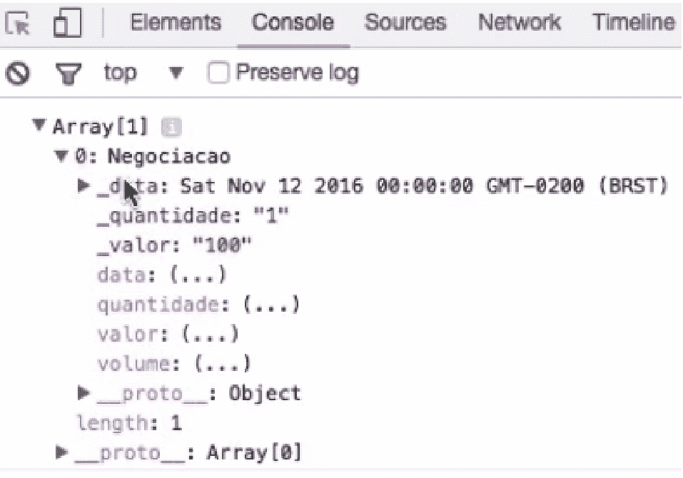

图 5.1：在控制台中查看交易

一切正常，但表单数据在注册后仍然保持填充状态。这是一个好习惯，清理表单以便准备下一次录入。

我们将创建私有方法 `_limpaFormulario()`，其中包含清除表单的逻辑：

```javascript
// client/app/controllers/NegociacaoController.js

class NegociacaoController {
    // 省略前面的代码

    _limpaFormulario() {
        this._inputData.value = '';
        this._inputQuantidade.value = 1;
        this._inputValor.value = 0.0;
        this._inputData.focus();
    }
}
```

现在，让我们在将交易添加到列表后调用该方法：

```javascript
// client/app/controllers/NegociacaoController.js

class NegociacaoController {
    // 省略前面的代码

    adiciona(event) {
        // 省略前面的代码

        // 清理表单
        this._limpaFormulario();
    }

    // 省略后面的代码
}
```

我们可以添加一个新的交易，控制台将正确显示包含两个项目的列表：

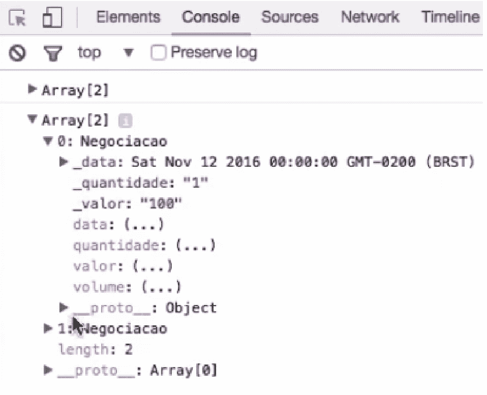

图 5.2：数组中的显示

我们的代码可以工作，但我们还可以让它变得更好。不如把根据表单数据实例化交易的代码隔离到类的一个私有方法中？通过它，我们的意图——创建一个新交易——将变得清晰，因为它的名称已经充分说明了这一点。

我们的 `NegociacaoController` 类最终如下：

```javascript
// client/app/controller/NegociacaoController.js

class NegociacaoController {
    constructor() {
        let $ = document.querySelector.bind(document);

        this._inputData = $('#data');
        this._inputQuantidade = $('#quantidade');
        this._inputValor = $('#valor');

        this._negociacoes = new Negociacoes();
    }

    adiciona(event) {
        event.preventDefault();

        this._negociacoes.adiciona(this._criaNegociacao()); // 修改的地方！

        console.log(this._negociacoes.paraArray());

        this._limpaFormulario();
    }

    _limpaFormulario() {
        this._inputData.value = '';
        this._inputQuantidade.value = 1;
        this._inputValor.value = 0.0;
        this._inputData.focus();
    }

    _criaNegociacao() {
        // 返回一个交易实例

        return new Negociacao(
            DateConverter.paraData(this._inputData.value),
            parseInt(this._inputQuantidade.value),
            parseFloat(this._inputValor.value)
        );
    }
}
```

完成修改后，一个新的测试将在控制台中显示预期的信息：

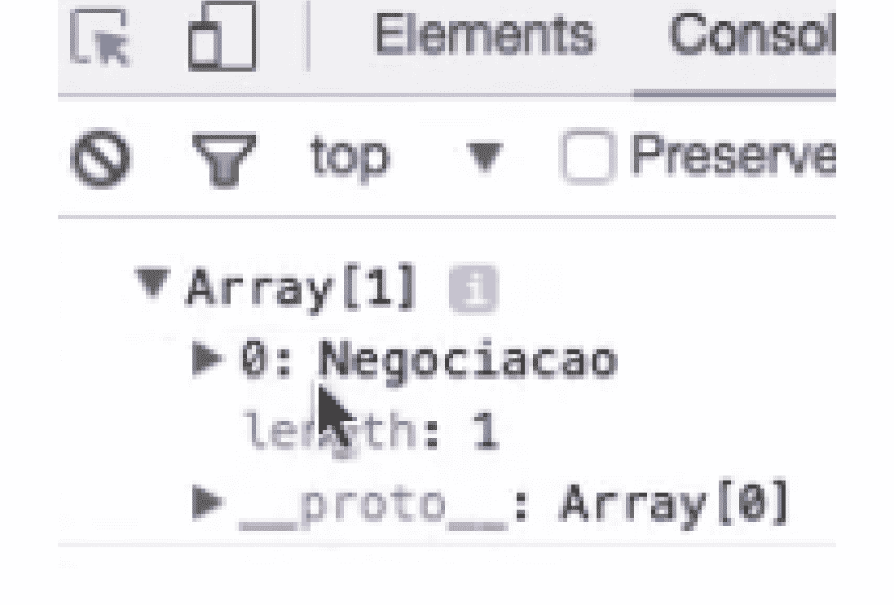

图 5.3：交易如预期所示

一切正常工作。但是，`Negociacoes` 的实例是否真的只允许添加新交易，而不允许任何其他操作？我们将在下面进行测试来验证。

### 5.3 加固我们的模型

为了知道由 `Negociacao` 封装的交易是否不可变，我们可以进行一个快速测试，删除列表中的所有项目。为此，我们将访问由 `Negociacoes` 的 `paraArray()` 方法返回的数组，将每个数组都拥有的 `length` 属性赋值为 0。这足以清空它：

```javascript
// client/app/controller/NegociacaoController.js

// 省略前面的代码

adiciona(event) {
    event.preventDefault();

    this._negociacoes.adiciona(this._criaNegociacao());

    // 我们能删除列表吗？
    this._negociacoes.paraArray().length = 0;

    // 结果是什么？
    console.log(this._negociacoes.paraArray());

    this._limpaFormulario();
}

// 省略后面的代码
```

执行我们的测试：

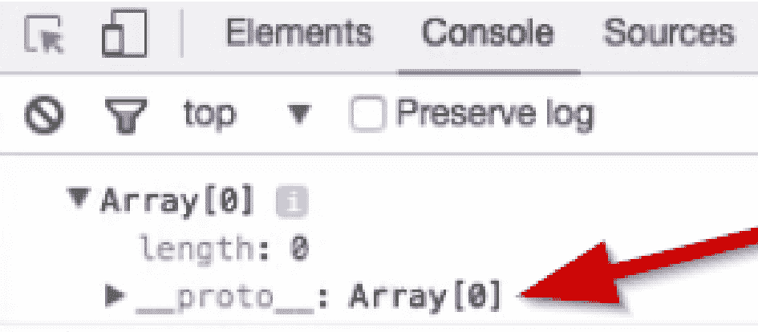

图 5.4：空数组

你能识别出问题吗？我们代码中任何访问通过 `paraArray` 方法返回的交易数组的部分，都会获得对 `Negociacoes` 封装数组的相同引用。我们之前在处理日期时见过这个问题。事实上，我们应用了防御式编程，一种非常适合这种情况的策略。

想法是返回一个新数组，也就是说，基于 `Negociacoes` 类封装的交易数组项目创建一个新引用。我们将通过一个小技巧创建一个新数组：将 `return` 与空数组一起使用，后跟方法 `concat()`，该方法将接收我们想要复制其项目的列表：

```javascript
// client/app/domain/negociacoes/Negociacoes.js

class Negociacoes {
    constructor() {
        this._negociacoes = [];
    }

    adiciona(negociacao) {
        this._negociacoes.push(negociacao);
    }

    paraArray() {
        // 返回一个用 this._negociacoes 的项目创建的新引用

        return [].concat(this._negociacoes);
    }
}
```

当我们把 `this._negociacoes` 传到 `concat()` 内部时，返回的将是一个新列表，一个新 `array`。现在如果我们尝试使用指令 `this._negociacoes.paraArray().length = 0`，对由 `Negociacoes` 实例封装的列表不会有任何影响，因为我们正在修改的是数组的副本，而不是原始数组。

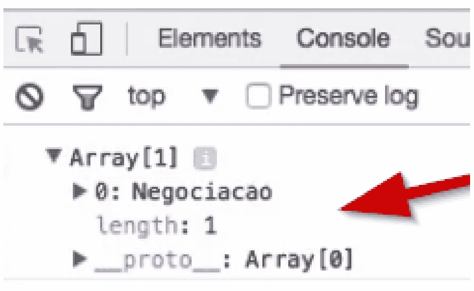

图 5.5：加固的数组

现在我们已经一切就位，让我们修改 `NegociacaoController`，从 `adiciona` 方法中移除尝试清空列表的代码和所有对控制台的调用，只留下对其功能至关重要的三条指令：

```javascript
// client/app/controllers/NegociacaoController.js

// 省略前面的代码
```


```javascript
adiciona(event) {

    event.preventDefault();

    this._negociacoes.adiciona(this._criaNegociacao());

    this._limpaFormulario();

}
```

// 省略后面的代码

这样，我们保证我们的交易列表只能接收新交易，不能进行任何其他操作。

现在我们已经有了控制器和模型，我们已经准备好将模型数据展示在`index.html`页面上。这是下一章的主题。

> 本章完整代码可在以下位置找到：
> https://github.com/flaviohenriquealmeida/cangaceiro-javascript/tree/master/05

## 第六章：匪帮的时尚

> "如箭，如火，如刀。" ——《广阔的腹地：小路》（*Grande Sertão: Veredas*）

我们创建了`Negociacao`和`Negociacoes`类来建模所需的业务规则。我们还创建了`NegociacaoController`，以便用户可以与这些类的实例进行交互。然而，我们还没有在`client/index.html`中展示这些模型的状态。

我们需要创建一个能够将`Negociacoes`实例转换为用户可理解的某种展示的解决方案，例如 HTML 的`<table>`。我们想要实现一个 *View* 解决方案，即 MVC 模型中的**V**。

### 6.1 View 的角色

在 MVC 模型中，View 是我们展示模型的结构。一个模型可以有不同的展示，且这些展示的更改不会影响模型。这种分离是有利的，因为用户界面一直在变化，视图中的更改造成的影响越小，应用程序的维护就越容易。现在的问题是定义我们构建 View 的策略。

### 6.2 我们的 View 解决方案

我们将采用的 View 创建策略是在 JavaScript 中编写我们模型的 HTML 展示。

我们将创建文件`client/app/ui/views/NegociacoesView.js`。在其中，我们将声明`NegociacoesView`类，它只有一个名为`template()`的方法：

```javascript
// client/app/ui/views/NegociacoesView.js

class NegociacoesView {

    template() {

    }

}
```

`template`方法的目的是返回一个包含我们希望使用的 HTML 展示字符串，以表示`Negociacoes`模型。因此，现在我们要将`client/index.html`中声明的`<table>`**移动**到方法内部。我们知道，如果我们简单地移动代码，JavaScript 运行时将指示一系列错误。这就是为什么`template()`将 HTML 标记作为模板字面量返回：

```javascript
// client/app/ui/views/NegociacoesView.js

class NegociacoesView {

    template() {

        return `

        <table class="table table-hover table-bordered">

            <thead>

                <tr>

`;
    }

}
```

### 6.3 构建动态模板

由于我们从`index.html`中移除了表格相关的代码片段，因此表格将不再显示在表单下方。

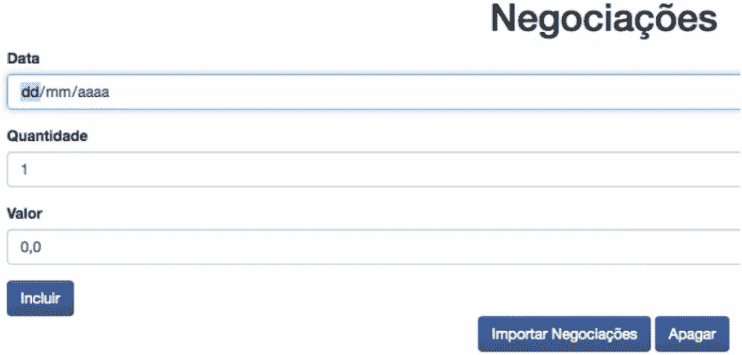

图 6.1：没有表格的表单

为了避免遗忘，让我们导入新的文件`client/index.html`。**但是请注意**，`NegociacaoController`依赖于`NegociacoesView`的声明，因此新的脚本必须在`NegociacaoController.js`脚本之前导入。我们的`client/index.html`将如下所示：

```html
<!-- client/index.html -->

<!-- 前面的代码省略 -->

<script src="app/domain/negociacao/Negociacao.js"></script>

<script src="app/controllers/NegociacaoController.js"></script>

<script src="app/ui/converters/DateConverter.js"></script>

<script src="app/domain/negociacao/Negociacoes.js"></script>

<!-- 先导入！ -->

<script src="app/ui/views/NegociacoesView.js"></script>

<script src="app/app.js"></script>

<!-- 后面的代码省略 -->
```

现在，在`NegociacaoController`中，我们将添加属性`this._negociacoesView`，它将接收一个`NegociacaoView`的实例：

```javascript
// client/app/controllers/NegociacaoController.js

class NegociacaoController {

    constructor() {

        let $ = document.querySelector.bind(document);

        this._inputData = $('#data');

        this._inputQuantidade = $('#quantidade');

        this._inputValor = $('#valor');

        this._negociacoes = new Negociacoes();

        this._negociacoesView = new NegociacoesView();

    }

    // 后面的代码省略
```

重新加载页面后，让我们在控制台中输入以下指令：

```javascript
view = new NegociacoesView()

view.template() // 显示视图的模板
```

我们在控制台中看到模板作为字符串显示，定义在`NegociacoesView`中：

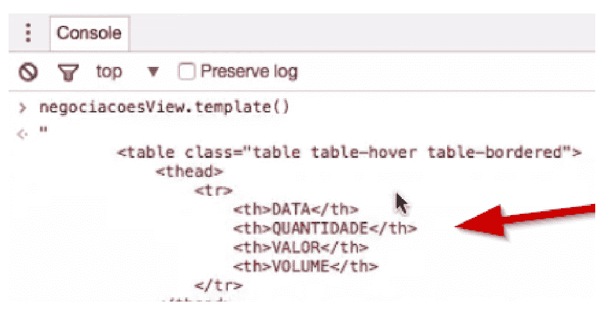

图 6.2：控制台中的字符串

我们当然不想在控制台中显示模板，我们希望当用户查看`client/index.html`时能够看到它。我们该如何做到这一点呢？

第一步是在`client/index.html`中指明视图模板应该显示的位置。我们将通过带有`id="negociacoes"`的`<div>`来指明：

```html
<!-- 前面的代码省略 -->

<br>

<div id="negociacoes"></div> <!-- 放置在我们之前放 <table> 的同一位置 -->

<script src="app/domain/negociacao/Negociacao.js"></script>

<!-- 后面的代码省略 -->
```

很好！但是，`NegociacaoView`的一个实例如何知道它应该与我们刚刚添加的`<div>`的 DOM 元素相关联呢？

我们将在`NegociacoesView`中添加一个`constructor()`，它接收一个 CSS 选择器。从这个选择器出发，我们查找 DOM 元素并将其存储在属性`this._elemento`中：

```javascript
// client/app/ui/views/NegociacoesView.js

class NegociacoesView {

    constructor(seletor) {

        this.elemento = document.querySelector(seletor);

    }

    template() {

        // 模板代码省略

    }

}
```

现在，在`NegociacaoController`中，我们将把选择器`#negociacoes`传递给我们正在创建的`NegociacoesView`实例的`constructor()`：

```javascript
// client/app/controllers/NegociacaoController.js

class NegociacaoController {

    constructor() {

        let $ = document.querySelector.bind(document);

        this._inputData = $('#data');

        this._inputQuantidade = $('#quantidade');

        this._inputValor = $('#valor');

        this._negociacoes = new Negociacoes();

        // 将 CSS ID 选择器传递给 constructor

        this._negociacoesView = new NegociacoesView('#negociacoes');

    }

    // 后面的代码省略

}
```

我们编写的代码尚未解决如何将`NegociacoesView`的模板转换为 DOM 元素的问题。这些元素需要作为子元素插入到由传递给其`constructor()`的 CSS 选择器所指示的元素中。解决方案在于我们将要创建的`update`方法：

```javascript
// client/app/ui/views/NegociacoesView.js

class NegociacoesView {

    constructor(seletor) {

        this._elemento = document.querySelector(seletor);

    }

    // 新方法！

    update() {

        this._elemento.innerHTML = this.template();

    }

    template() {

        // 代码省略

    }

}
```

当调用`update`方法时，它将把由`template()`方法返回的脚本赋值给`innerHTML`属性。`innerHTML`实际上是一个 *setter*，也就是说，当它接收值时，在后台会调用一个方法将字符串转换为 DOM 元素。

现在，在`NegociacaoController`中，我们需要调用`this._negociacoesView.update()`，以便渲染我们的视图模板：

```javascript
// client/app/controllers/NegociacaoController.js

class NegociacaoController {

    constructor() {

        let $ = document.querySelector.bind(document);

        this._inputData = $('#data');

        this._inputQuantidade = $('#quantidade');

        this._inputValor = $('#valor');

        this._negociacoes = new Negociacoes();

        this._negociacoesView = new NegociacoesView('#negociacoes');

        // 更新视图

        this._negociacoesView.update();

    }

    // 后面的代码省略

}
```

经过最后的修改后，当我们在浏览器中重新加载页面时，表格已经可以看到。

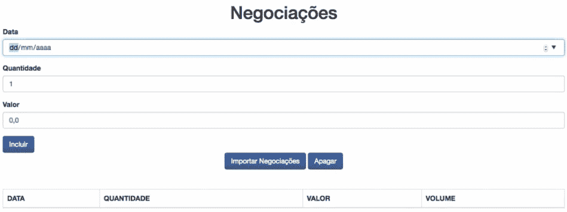

图 6.3：页面上的表格

`update()`函数可以工作，表格已经可以在表单下方看到。但是，模型中的数据在表格的动态构建中尚未被考虑。我们可以注册任意数量的交易，但创建的表格不会显示我们列表中的数据。我们需要一个动态模板！

#### 构建动态模板

为了使我们的模板动态化，`update()`方法将开始接收模型作为参数，`template()`函数应该基于该模型：

```javascript
// client/app/ui/views/NegociacoesView.js

class NegociacoesView {

    constructor(seletor) {

        this._elemento = document.querySelector(seletor);

    }

    // 接收 model

    update(model) {

        // 将 model 传递给 this.template()

        this._elemento.innerHTML = this.template(model);

    }

    // 参数在这里！

    // 必须返回基于 model 的模板

    template(model) {

        // 模板代码省略

    }

}
```

我们将修改`NegociacaoController`，以便将`this._negociacoes`作为参数传递给`this._negociacoesView.update()`：

```javascript
// client/app/controllers/NegociacaoController.js

class NegociacaoController {

    constructor() {

        let $ = document.querySelector.bind(document);

        this._inputData = $('#data');

        this._inputQuantidade = $('#quantidade');

        this._inputValor = $('#valor');

        this._negociacoes = new Negociacoes();

        this._negociacoesView = new NegociacoesView('#negociacoes');

        // 初始接收封装空列表的模型

        this._negociacoesView.update(this._negociacoes);

    }

    // 后面的代码省略

}
```

我们只需要实现`NegociacoesView`的`template()`方法的逻辑。我们交易列表中的每个对象将被转换为一个字符串，该字符串对应于一个带有其`<td>`的`<tr>`。顺便说一下，由于`template()`接收的模型具有`paraArray`方法，该方法返回由其封装的数组，我们可以使用强大的`map`函数，它将执行一个“从……到……”的映射，从对象到字符串，按照我们定义的逻辑进行。

转换必须在`<tbody>`内部完成。因此，我们将通过`${}`表达式访问模型。为简洁起见，下面仅是我们将要修改的模板片段：

```html
<tbody>

    ${model.paraArray().map(negociacao => {

        // 返回前需要转换！

        return negociacao;

    })}

</tbody>
```

我们不能简单地返回由`map`函数迭代的交易，因为那样我们仍然会有一个交易数组。

我们需要一个`string`数组，其中每个元素都是一个包含`<tr>`表示的字符串。

为了解决这个问题，对于每次迭代的交易，我们将返回一个新的模板字面量，表示一个`<tr>`并插入交易数据：

```javascript
<tbody>

    ${model.paraArray().map(negociacao => {

        return `

            <tr>

                <td>${DateConverter.paraTexto(negociacao.data)}</td>

                <td>${negociacao.quantidade}</td>

                <td>${negociacao.valor}</td>

                <td>${negociacao.volume}</td>

            </tr>

        `

    })}

</tbody>
```

我们快完成了！现在我们有了一个新的字符串数组，需要将每个元素拼接成一个单独的字符串。这个字符串最终将被应用到我们与视图关联的元素的`innerHTML`属性上。我们可以很容易地通过每个数组都有的`join()`函数来实现：

```javascript
<tbody>

    ${model.paraArray().map(negociacao => {

        return `

            <tr>
```


```html
<td>${DateConverter.paraTexto(negociacao.data)}</td>
<td>${negociacao.quantidade}</td>
<td>${negociacao.valor}</td>
<td>${negociacao.volume}</td>
</tr>
`
}).join('')}
</tbody>
```

`join()`函数接受一个分隔符，然而，我们不需要任何分隔符，所以传给它一个空字符串。最后，我们不能忘记在将交易添加到列表后立即调用`this._negociacoesView.update(this._negociacoes)`，以便我们的表格能根据最新数据进行渲染。

```javascript
// client/app/controllers/NegociacaoController.js

// 省略之前的代码

adiciona(event) {
    event.preventDefault();

    this._negociacoes.adiciona(this._criaNegociacao());
    this._negociacoesView.update(this._negociacoes);
    this._limpaFormulario();
}

// 省略之后的代码
```

让我们看看在填写表单后浏览器中会显示什么：

| 日期 | 数量 | 价格 | 成交量 |
|---|---|---|---|
| 11/11/1111 | 2 | 111 | 222 |

*图 6.4：带数值的表格*

接下来，我们将添加一笔新的交易，其数据也会显示在表格中。

| 日期 | 数量 | 价格 | 成交量 |
|---|---|---|---|
| 11/11/1111 | 2 | 111 | 222 |
| 22/2/1111 | 2 | 200 | 400 |

*图 6.5：包含两笔交易的表格*

如果我们继续添加，我们的表格将重新渲染，呈现模型的当前状态。

> 目前，`innerHTML` 的性能表现很好。然而，如果需要渲染的数据量非常大，逐个添加每条`<tr>`的方案会更突出，尽管代码会更冗长。但是，当处理大量数据时，使用分页是一个好习惯，这可以最大程度地减少`innerHTML`可能出现的性能问题。

用一种优雅的方式，仅使用 JavaScript 自带的功能，我们就实现了一个*模板引擎*。但何不进一步精简我们的模板代码呢？

任何只包含一条语句的箭头函数都可以移除其`{}`代码块，包括`return`语句，因为它会自动将该语句的结果作为返回值。修改我们的代码：

```javascript
<tbody>
    ${model.paraArray().map(negociacao => `
        <tr>
            <td>${DateConverter.paraTexto(negociacao.data)}</td>
            <td>${negociacao.quantidade}</td>
            <td>${negociacao.valor}</td>
            <td>${negociacao.volume}</td>
        </tr>
    `).join('')}
</tbody>
```

现在，经过我们的修改，箭头函数中唯一的语句就是创建模板字面量，它会被自动返回。

最后，我们完整的`template`方法如下所示：

```javascript
// client/app/ui/views/NegociacoesView.js

// 省略之前的代码

template(model) {
    return `
<table class="table table-hover table-bordered">
  <thead>
    <tr>
      <th>DATA</th>
      <th>QUANTIDADE</th>
      <th>VALOR</th>
      <th>VOLUME</th>
    </tr>
  </thead>
  <tbody>
    ${model.paraArray().map(negociacao =>
      `<tr>
        <td>${DateConverter.paraTexto(negociacao.data)}</td>
        <td>${negociacao.quantidade}</td>
        <td>${negociacao.valor}</td>
        <td>${negociacao.volume}</td>
      </tr>`
    ).join('')}
  </tbody>
  <tfoot>
  </tfoot>
</table>
    `
}

// 省略之后的代码
```

我们的解决方案是 React 库（[https://facebook.github.io/react](https://facebook.github.io/react)）通过 JSX（[https://facebook.github.io/react/docs/jsx-in-depth.html](https://facebook.github.io/react/docs/jsx-in-depth.html)）渲染组件视图所用策略的一个简化版。来看一个例子：

```javascript
// 仅为示例

let minhaLista = React.createClass({
  render: function() {
    return (
      <ul>
        {this.props.list.map(function(listValue) {
          return <li>{listValue}</li>;
        })}
      </ul>
    )
  }
});
```

回到我们的应用，如果你觉得我们的模板已经完成了，那就错了。我们还需要用另一条信息来完善它。

### 6.4 总计交易成交量

我们需要在模板表格的页脚中总计成交量。首先，在`Negociacoes`类中，我们添加一个名为`volumeTotal`的`getter`属性。它将遍历该类封装的列表，计算所有交易成交量的总和。

```javascript
// client/app/domain/negociacao/Negociacoes.js

class Negociacoes {
    constructor() {
        this._negociacoes = []
    }

    // 省略之前的代码

    get volumeTotal() {
        let total = 0;

        for (let i = 0; i < this._negociacoes.length; i++) {
            total += this._negociacoes[i].volume;
        }

        return total;
    }
}
```

现在，让我们为模板添加完整的`<tfoot>`标记，并使用`${}`表达式来插入总成交量：

```html
<tfoot>
    <tr>
        <td colspan="3"></td>
        <td>${model.volumeTotal}</td>
    </tr>
</tfoot>
```

测试表明，我们的解决方案按预期工作。

| 日期 | 数量 | 价格 | 成交量 |
|---|---|---|---|
| 11/11/1111 | 2 | 111 | 222 |
| 11/11/1111 | 2 | 2 | 4 |
| | | | 226 |

图 6.6：包含总成交量的表格

尽管可以工作，但*getter* `volumeTotal`的逻辑可以用另一种方式编写。

### 6.5 使用 reduce 进行总计

在 JavaScript 的世界里，数组非常强大。我们可以通过`map()`进行转换，通过`forEach()`遍历其元素，以及通过`join()`拼接其元素。我们甚至可以使用`reduce()`函数将所有元素归约为单个值。

在我们的应用中，`reduce()`会将数组的所有元素归约为一个值，即总成交量。这不过是所有交易成交量的总和。来看看新的实现：

```javascript
// client/app/domain/negociacao/Negociacoes.js

// 省略之前的代码

get volumeTotal() {
    return this._negociacoes
        .reduce(function(total, negociacao) {
            return total + negociacao.volume
        }, 0);
}

// 省略之后的代码
```

在深入了解`reduce()`函数之前，让我们使用箭头函数来进一步简化代码：

```javascript
// client/app/domain/negociacao/Negociacoes.js

// 省略之前的代码

get volumeTotal() {
    // 使用箭头函数，不使用代码块
    return this._negociacoes
        .reduce((total, negociacao) =>
            total + negociacao.volume, 0);
}

// 省略之后的代码
```

`reduce()`函数接受两个参数：分别是归约逻辑和累加器变量的初始值。带有归约逻辑的函数使我们能够访问累加器（我们称之为`total`）和正在迭代的项目（称为`negociacao`）。

对于每个迭代的项目，将返回当前总和与交易成交量的总和。累加的总和将传递给下一次`reduce`函数的调用，此过程将重复直到迭代结束。最后，`reduce()`将返回`total`的最终值。

执行代码后，我们看到它运行完美：

| 日期 | 数量 | 价格 | 成交量 |
|---|---|---|---|
| 11/11/1911 | 2 | 11 | 22 |
| 11/11/1111 | 5 | 5 | 25 |
| | | | 47 |

图 6.7：包含总计的表格

我们完成了表格模板。每添加一笔交易，信息都会根据列表数据展示给用户。但我们是否可以将解决方案进行泛化呢？这正是我们将在下一章中探讨的内容。

> 本章的完整代码可以在[https://github.com/flaviohenriquealmeida/cangaceiro-javascript/tree/master/06](https://github.com/flaviohenriquealmeida/cangaceiro-javascript/tree/master/06)找到。

## 第七章

### 方案

> "生活的节奏将一切包裹，生活就是这样：热了又凉，紧了又松，静了又躁。它想要的是我们的勇气。"——《广阔腹地：条条小路》

我们已经能够在交易表格中显示新的交易了，不过，我们还可以通过显示一条操作成功的提示消息来改善用户体验。

与其使用字符串来实现这一目的，我们将创建`Mensagem`（消息）类，它将代表我们系统中的一条消息。它不属于交易这个应用域，因此我们将把它创建在`client/app/ui/models`中：

```javascript
// client/app/ui/models/Mensagem.js

class Mensagem {
    constructor() {
        this._texto;
    }

    get texto() {
        return this._texto;
    }
}
```

在继续之前，我们将在`client/index.html`中导入该脚本。我们不能忘记在`NegociacaoController.js`之前导入它，因为存在依赖顺序，这在我们导入`NegociacoesView`时已经遇到过。

```html
<!-- client/index.html -->

<!-- 前面的代码省略 -->

<script src="app/domain/negociacao/Negociacao.js"></script>
<script src="app/controllers/NegociacaoController.js"></script>
<script src="app/ui/converters/DateConverter.js"></script>
<script src="app/domain/negociacao/Negociacoes.js"></script>
<script src="app/ui/views/NegociacoesView.js"></script>

<!-- 在这里导入 -->
<script src="app/ui/models/Mensagem.js"></script>
<script src="app/app.js"></script>

<!-- 后面的代码省略 -->
```

我们使用前缀`_`的约定来保持`_texto`的私有性，并为该属性创建了一个`getter`。但如果我们想要改变消息的文本呢？为此，我们将创建我们的第一个`setter`：

```javascript
// client/app/ui/models/Mensagem.js

class Mensagem {
    constructor() {
        this._texto;
    }

    get texto() {
        return this._texto;
    }

    set texto(texto) {
        this._texto = texto;
    }
}
```

就像访问`getter`时像访问属性一样，我们也可以同样的方式为`setter`赋值。刷新我们的页面后，我们可以在控制台中进行如下测试：

```javascript
mensagem = new Mensagem();
mensagem.texto = 'x';
```

```javascript
// 我们的测试修改了属性！

console.log(mensagem.texto);
```

我们还可以在类的`constructor()`中添加一个参数，包含消息的文本。

```javascript
// client/app/ui/models/Mensagem.js

class Mensagem {
    constructor(texto) {
        this._texto = texto;
    }

    get texto() {
        return this._texto;
    }

    set texto(texto) {
        this._texto = texto;
    }
}
```

让我们在控制台中做一个新的测试：

```javascript
mensagem = new Mensagem('Flávio Almeida');
```

```javascript
// 正确地将文本通过构造函数传递

console.log(mensagem.texto);
```

然而，如果我们不给`constructor()`传递值会发生什么呢？

```javascript
mensagem = new Mensagem();

// 结果是 UNDEFINED！
console.log(mensagem.texto);
```

我们不能让这种情况发生。

### 7.1 默认参数

如果参数未传递，我们假设其为空字符串怎么样？

```javascript
// client/app/ui/models/Mensagem.js

class Mensagem {
    constructor(texto) {
        if (!texto) {
            texto = '';
        }

        this._texto = texto;
    }

    get texto() {
        return this._texto;
    }

    set texto(texto) {
        this._texto = texto;
    }
}
```

我们可以用以下技巧去掉`if`：

```javascript
// client/app/ui/models/Mensagem.js

class Mensagem {
    constructor(texto) {
        this._texto = texto || '';
    }

    // 后面的代码省略
}
```

在上面的代码中，如果参数`texto`的值不同于`null`、`undefined`、`0`且不是空字符串，它将被赋值给`this._texto`；否则，将接收一个空字符串。

我们还可以更简洁地在`constructor()`的参数本身中指明其默认值，这是从 ES2015（ES6）起才支持的功能：

```javascript
// client/app/ui/models/Mensagem.js

class Mensagem {
    // 如果未传递，则为空字符串
```


```javascript
constructor(texto = '') {

    this._texto = texto;

}

// 后面的代码省略

}
```

这是一个有趣的功能，因为我们可以定义默认参数，既可以在`constructor()`中，也可以在方法中。

随着类的创建，让我们在`NegociacaoController.js`中添加属性`this._mensagem`。它将保存一个`Mensagem`的实例：

```javascript
// client/app/controllers/NegociacaoController.js

class NegociacaoController {

    constructor() {

        let $ = document.querySelector.bind(document);

        this._inputData = $('#data');

        this._inputQuantidade = $('#quantidade');

        this._inputValor = $('#valor');

        this._negociacoes = new Negociacoes();

        this._negociacoesView = new NegociacoesView('#negociacoes');

        this._negociacoesView.update(this._negociacoes);

        // 实例化模型！

        this._mensagem = new Mensagem();

    }

    // 后面的代码省略

}
```

当完成一笔新交易时，我们将给属性`this._mensagem.texto`赋值一条新消息。

```javascript
// client/app/controllers/NegociacaoController.js

// 前面的代码省略

adiciona(event) {

    event.preventDefault();

    this._negociacoes.adiciona(this._criaNegociacao());

    this._mensagem.texto = '交易添加成功';

    this._negociacoesView.update(this._negociacoes);

    this._limpaFormulario();

}

// 后面的代码省略
```

如果我们填写表单，数据将被插入表格，但消息不会，因为它还没有展示界面，即它的 View。是时候创建它了。

### 7.2 创建`MensagemView`类

我们将在`client/app/ui/views/MensagemView.js`中创建代表我们`Mensagem`模型的 View：

```javascript
class MensagemView {

    constructor(seletor) {

        this._elemento = document.querySelector(seletor);

    }

    template(model) {

        return `<p class="alert alert-info">${model.texto}</p>`;

    }

    // update 方法

    update(model) {

        this._elemento.innerHTML = this.template(model);

    }

}
```

我们将使用 Bootstrap 的`alert alert-info`，后面跟着表达式`${model.texto}`。紧接着，我们将添加`update()`方法，它接收`model`。

现在我们将在`client/index.html`中导入刚刚创建的文件：

```html
<!-- client/index.html -->

<!-- 前面的代码省略 -->

<script src="app/domain/negociacao/Negociacao.js"></script>

<script src="app/controllers/NegociacaoController.js"></script>

<script src="app/ui/converters/DateConverter.js"></script>

<script src="app/domain/negociacao/Negociacoes.js"></script>

<script src="app/ui/views/NegociacoesView.js"></script>

<script src="app/ui/models/Mensagem.js"></script>

<!-- 导入了！ -->

<script src="app/ui/views/MensagemView.js"></script>

<script src="app/app.js"></script>

<!-- 后面的代码省略 -->
```

仍在`client/index.html`中，我们将添加带有 ID`mensagemView`的`<div>`来指明`MensagemView`的渲染位置：

```html
<!-- client/index.html -->

<!DOCTYPE html>

<html>

<head>

    <meta charset="UTF-8">

    <meta name="viewport" content="width=device-width">

    <title>Negociações</title>

    <link rel="stylesheet" href="css/bootstrap.css">

    <link rel="stylesheet" href="css/bootstrap-theme.css">

</head>

<body class="container">

    <h1 class="text-center">Negociações</h1>

    <!-- 新标签！ -->

    <div id="mensagemView"></div>

    <form class="form">

    <!-- 前面的代码省略 -->
```

在`NegociacoesController`中，我们将添加属性`_mensagemView`，它接收一个`MensagemView`的实例。我们不能忘记在类的构造函数中传递 CSS 选择器，以便它找到 DOM 元素，其模板应该在那里渲染。此外，我们现在就调用其`update`方法，将消息模型作为参数传递。

```javascript
// client/app/controllers/NegociacaoController.js

class NegociacaoController {

    constructor() {

        let $ = document.querySelector.bind(document);

        this._inputData = $('#data');

        this._inputQuantidade = $('#quantidade');

        this._inputValor = $('#valor');

        this._negociacoes = new Negociacoes();

        this._negociacoesView = new NegociacoesView('#negociacoes');

        this._negociacoesView.update(this._negociacoes);

        this._mensagem = new Mensagem();

        // 新属性！

        this._mensagemView = new MensagemView('#mensagemView');

        this._mensagemView.update(this._mensagem);

    }

    // 后面的代码省略

}
```

Ainda em`NegociacaoController`, vamos alterar seu método`adiciona()`para que chame a atualização da View logo após receber a mensagem que definimos:

```javascript
// client/app/controllers/NegociacaoController.js

// código anterior omitido

adiciona(event) {

    event.preventDefault();

    this._negociacoes.adiciona(this._criaNegociacao());

    this._mensagem.texto = 'Negociação adicionada com sucesso';

    this._negociacoesView.update(this._negociacoes);

    // atualiza a view com o texto da mensagem que acabamos de atribuir

    this._mensagemView.update(this._mensagem);

    this._limpaFormulario();

}

// código posterior omitido
```

Vamos ver se algo já é exibido no navegador.

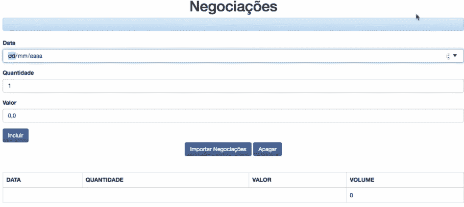

Figura 7.1: Barra azul

Agora aparece uma barra com um fundo azul. Isto é uma mensagem do Bootstrap vazia, e vamos melhorar isso em breve. O cadastro de usuários passa a exibir mensagens para o usuário.

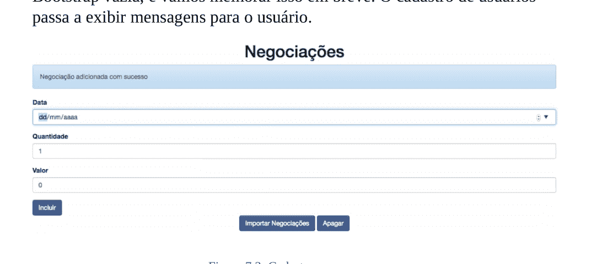

Conseguimos adicionar os dados à tabela, e a mensagem de sucesso apareceu corretamente. Veja que conseguimos usar o mesmo mecanismo de criação da View para lidarmos com as mensagens do sistema. Agora, vamos resolver o problema da mensagem vazia.

Uma solução seria removermos a instrução`this._mensagemView.update(this._mensagem)`do`constructor()`de`NegociacaoController`. No entanto, vamos manter dessa forma para padronizar nossa solução. Convencionamos que a função`update`deve ser sempre chamada toda vez que criarmos nossa view. Sendo assim, vamos à segunda solução.

No template de`MensagemView`, podemos usar um`if`ternário que retornará um parágrafo vazio, sem as classes do Bootstrap, caso a mensagem esteja em branco.

Vamos alterar`client/app/ui/views/MensagemView.js`:

```javascript
// client/app/ui/views/MensagemView.js

class MensagemView {

    // código anterior omitido

    template(model) {

        return model.texto

            ? `<p class="alert alert-info">${model.texto}</p>`

            : `<p></p>`;

    }

    // código posterior omitido

}
```

Lembre-se de que, para o interpretador do JavaScript, uma string em branco,`0`,`undefined`e`null`são considerados`false`. Se`model.texto`tiver qualquer valor diferente dos que foram listados, será considerado`true`.

Conseguimos resolver a parte das mensagens para o usuário. Mas será que conseguimos melhorar ainda mais o código?

### 7.3 Herança e reutilização de código

Temos duas Views criadas:`MensagemView`e`NegociacoesView`. Se observarmos, ambas possuem um`constructor()`que recebe um seletor, além de possuírem a propriedade`elemento`. As duas têm os métodos`template()`e`update()`. O método`update()`é idêntico nas duas classes, já o`template()`tem uma implementação diferente, apesar de receber um único parâmetro e devolver sempre uma string.

Para cada nova View criada em nossa aplicação, teremos de repetir boa parte do código que já escrevemos - com exceção da função`template()`, que é diferente para cada classe. Não parece ser um trabalho de cangaceiro ficar repetindo código. Existe uma solução?

Para evitarmos a repetição, criaremos uma classe chamada`View`, que centralizará todo o código que é comum entre todas as Views da nossa aplicação (no caso, o`constructor()`e o método`update()`).

Vamos criar essa classe em`client/app/ui/views/View.js`:

```javascript
// client/app/ui/views/View.js

class View {

    constructor(seletor) {

        this._elemento = document.querySelector(seletor);

    }

    update(model) {

        this._elemento.innerHTML = this.template(model);

    }

}
```

Antes de continuarmos, vamos importar a classe em`client/index.html`. Entretanto, ela não pode ser importada como penúltimo script da nossa página, antes de`app.js`, como fizemos com os demais scripts. Todos nossos arquivos de View que vamos criar dependerão diretamente da classe`View`, e o interpretador JavaScript indicará um erro caso as classes não sejam carregadas antes das demais.

Vamos importar a nova classe antes do script de`NegociacoesView.js`:

```html
<!-- client/index.html -->

<!-- código anterior omitido -->
```


```html
<script src="app/domain/negociacao/Negociacao.js"></script>
<script src="app/controllers/NegociacaoController.js"></script>
<script src="app/ui/converters/DateConverter.js"></script>
<script src="app/domain/negociacao/Negociacoes.js"></script>

<!-- importou aqui -->

<script src="app/ui/views/View.js"></script>

<!-- a declaração de NegociacoesView dependerá da declaração de View -->

<script src="app/ui/views/NegociacoesView.js"></script>
<script src="app/ui/models/Mensagem.js"></script>
<script src="app/app.js"></script>
```

A classe `View` recebeu tudo o que as Views tinham em comum: um `constructor(seletor)` — que guardará internamente um `elemento` — e `update()`. Vale lembrar que o método `template` não pôde ser definido na classe, porque cada View em nossa aplicação possuirá um código diferente.

Agora que centralizamos o código comum em uma classe, vamos remover o `constructor()` e o método `update()` de `NegociacoesView` e de `MensagemView`. Elas ficarão assim:

```javascript
// client/app/ui/views/NegociacoesView.js

class NegociacoesView {
    template(model) {
        // código do template omitido
    }
}
```

```javascript
// client/app/ui/views/MensagemView.js

class MensagemView {
    template(model) {
        return model.texto
            ? `<p class="alert alert-info">${model.texto}</p>`
            : `<p></p>`;
    }
}
```

Do jeito que está, nossa aplicação não funcionará, pois tanto `NegociacoesView` como `MensagemView` dependem do código que busca o elemento do DOM — definido no `constructor()` — e da função `update()`, que foram removidos.

Para que as classes que alteramos voltem a funcionar, faremos com que herdem o código da classe `View`, aquela que agora centraliza em um único lugar o `constructor()`, inclusive a função `update`.

É através da instrução `extends` que podemos herdar outra classe. Vamos alterar `NegociacoesView` e `MensagemView`:

```javascript
// client/app/ui/views/NegociacoesView.js

class NegociacoesView extends View {
    template(model) {
        // código do template omitido
    }
}

// client/app/ui/views/MensagemView.js

class MensagemView extends View {
    template(model) {
        return model.texto
            ? `<p class="alert alert-info">${model.texto}</p>`
            : `<p></p>`;
    }
}
```

Se cadastrarmos uma nova negociação, veremos que está tudo funcionando.

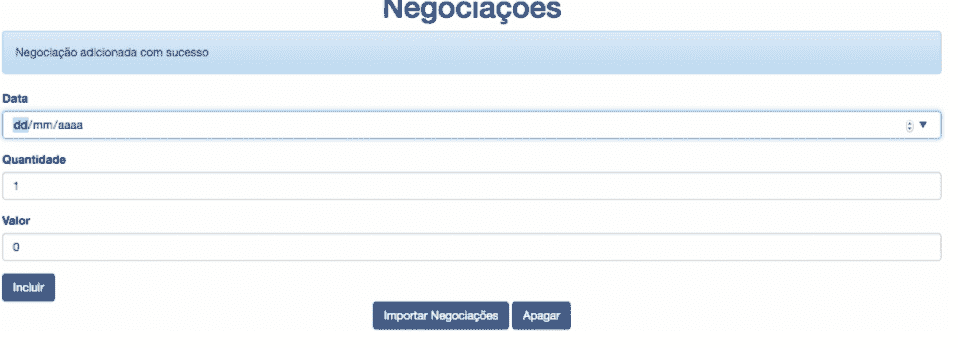

Figura 7.3: Formulário funcionando corretamente

> A solução de template dentro do modelo MVC adotada pelo autor foi a mais acessível e didática que ele encontrou para colocar em prática recursos da linguagem JavaScript, sem gastar páginas e mais páginas detalhando a criação de um framework, o que desvirtuaria a proposta do livro. Contudo, não será mera coincidência encontrar diversos conceitos apresentados em frameworks e bibliotecas do mercado.

Conseguimos evitar código duplicado e garantimos o reúso de código através de herança. Contudo, ainda podemos melhorar nosso código um pouquinho mais.

### 7.4 Classes abstratas?

Na programação orientada a objetos, existe o conceito de classes abstratas. Essas classes podem ter um ou mais métodos abstratos, que nada mais são do que métodos que não possuem implementação, apenas a assinatura que consiste no nome do método e o parâmetro que recebe.

Esses métodos devem ser implementados pelas classes filhas que herdam da classe abstrata. No caso do método `template()`, é impossível que nossa classe `View` tenha uma implementação para ser herdada, pois ela não tem como saber de antemão qual será a template literal retornada pelas suas classes filhas.

No JavaScript, não há classes abstratas, mas podemos tentar emulá-las da seguinte maneira.

Na classe `View`, vamos adicionar o método `template()`, cuja implementação consiste no lançamento de uma exceção:

```javascript
// client/app/ui/views/View.js

class View {
    constructor(seletor) {
        this._elemento = document.querySelector(seletor);
    }

    update(model) {
        this._elemento.innerHTML = this.template(model);
    }

    // novo método!

    template(model) {
        throw new Error('O método template() deve ser implementado pela classe filha');
    }
}
```

```javascript
throw new Error('Você precisa implementar o método template');
```

Do jeito que está, todas as classes filhas que herdarem de `view` ganharam o método `template()` padrão. Contudo, se esse método não for sobrescrito pela classe filha, esse comportamento padrão resultará em um erro, deixando claro para o programador que ele deve implementá-lo, caso tenha esquecido.

Podemos fazer um simples teste removendo temporariamente o método `template()` de `MensagemView` e recarregando nossa aplicação. Receberemos no console a seguinte mensagem:

```text
Uncaught Error: Você precisa implementar o método template
    at MensagemView.template (View.js:15)
    at MensagemView.update (View.js:10)
    at new NegociacaoController (NegociacaoController.js:14)
    at app.js:1
```

Diferente de outras linguagens com tipagem estática, como Java, Rust ou C#, a exceção só será lançada em tempo de execução. Entretanto, ainda assim é uma maneira de ajudar os desenvolvedores fornecendo uma mensagem clara do erro em seu código, caso não implemente os métodos "abstratos" da classe filha.

### 7.5 Para saber mais: `super`

Em nossa aplicação, tanto o constructor de `View` quanto o constructor de suas classes filhas recebem a mesma quantidade de parâmetros. Contudo, quando a classe filha recebe uma quantidade de parâmetros diferente, é necessário escrevermos um pouco mais de código.

Vejamos um exemplo hipotético envolvendo as classes `Funcionario` e `Gerente`.

```javascript
class Funcionario {
    constructor(nome) {
        this._nome = nome;
    }

    get nome() {
        return this._nome;
    }

    set nome(nome) {
        this._nome = nome;
    }
}

class Gerente extends Funcionario {}
```

No exemplo anterior, a classe `Gerente` herdou de `Funcionario` e, por conseguinte, herdou seu `constructor()`. Mas o que acontecerá se `Gerente` receber, além do nome, uma senha de acesso?

```javascript
class Gerente extends Funcionario {
    constructor(nome, senha) {
        super(nome); // chama o constructor() do pai

        // propriedade exclusiva de Gerente
        this._senha = senha;
    }

    // getters e setters exclusivos do Gerente
    get senha() {
        return this._senha;
    }

    set senha(senha) {
        return this._senha = senha;
    }
}
```

A classe `Gerente` precisou do seu próprio `constructor()`, pois recebe dois parâmetros. Nesse caso, precisamos chamar o `constructor()` da classe pai, passando os parâmetros de que ele precisa.

É importante que a chamada de `super()` seja a primeira instrução dentro do `constructor()` da classe filho; caso contrário, o `this` da classe filho não será inicializado e a instrução `this._senha = senha` resultará em um erro. Agora que já fizemos o teste, podemos voltar com o método `template()` em `MensagemView`.

### 7.6 Adquirindo um novo hábito com `const`

Aprendemos a favorecer o uso de `let` em vez de `var` nas declarações de variáveis, inclusive entendemos como funciona o *temporal dead zone*. No entanto, podemos lançar mão de `const`. Variáveis declaradas através de `const` obrigatoriamente devem ser inicializadas e não podem receber novas atribuições. Vejamos um exemplo isolado:

```javascript
const nome = 'Flávio';
nome = 'Almeida'; // resultado no erro Uncaught TypeError: Assignment to constant variable
```

No exemplo anterior, não podemos usar novamente o operador `=` para atribuir um novo valor à variável. O fato de usarmos essa declaração específica não quer dizer que a variável seja imutável. Vejamos outro exemplo:

```javascript
const data = new Date();
data.setMonth(10); // funciona perfeitamente
console.log(data.getMonth());
data = new Date(); // resultado no erro Uncaught TypeError: Assignment to constant variable
```


Neste último exemplo, por mais que tenha declarado `data` com `const`, através do método `data.setMonth(10)`, conseguimos alterar o mês da data. Isso é a prova real de que `const` não cria objetos imutáveis.

Por fim, valem as seguintes recomendações cangaceiras:

- Use `const` sempre que possível.
- Utilize `let` apenas se a variável precisar receber novas atribuições, por exemplo, uma variável totalizadora.
- Não use `var`, pois a única maneira da variável ter escopo é quando declarada dentro de uma função.

Dessa forma, vamos alterar `NegociacaoController` para fazer uso de `const`:

```javascript
// client/app/controllers/NegociacaoController.js

class NegociacaoController {

    constructor() {

        // não vamos atribuir outro valor à variável
        const $ = document.querySelector.bind(document);

        // código posterior omitido
    }

// código posterior omitido
```

Podemos até alterar `client/app/app.js` para utilizar `const` na declaração da variável `controller`:

```javascript
// client/app/app.js

// USANDO CONST
const controller = new NegociacaoController();

document
    .querySelector('.form')
    .addEventListener('submit',
controller.adiciona.bind(controller));
```

Uma pequena melhoria que utilizaremos ao longo do projeto.

Será que podemos melhorar ainda mais nosso código, por exemplo, enxugando-o e removendo cada vez mais a responsabilidade do programador? É isso que veremos no próximo capítulo.

> O código completo deste capítulo você encontra em `https://github.com/flaviohenriquealmeida/cangaceiro-javascript/tree/master/07`

## Parte 2 - Força Volante

Procurado pela Força Volante, faminto e abatido, ele chegou a pensar em desistir várias vezes. Porém, a vontade inquebrantável de descobrir o que o esperava no fim era maior do que seu sofrimento. Então, ele recuperou suas forças e se pôs a andar. Durante sua caminhada, ajudou e foi ajudado, lutou sem ser derrubado, correu e foi arrastado. Suas cicatrizes eram a marca da experiência que acumulava. Ele tinha muito o que aprender ainda, mas havia espaço em sua pele para novas experiências.

## CAPÍTULO 8

### Um cangaceiro sabe delegar tarefas

> "Tem horas em que penso que a gente carecia, de repente, de acordar de alguma espécie de encanto." - Grande Sertão: Veredas

Nossa aplicação já funciona e totaliza o volume no fim da tabela. Mas ainda falta implementarmos uma regra de negócio no modelo `Negociacoes`. Precisamos criar um método que nos permita esvaziar a lista de negociações encapsulada. Vamos criá-lo.

Primeiro, vamos adicionar o método `esvazia()` em `Negociacoes`:

```javascript
// client/app/domain/negociacao/Negociacoes.js

class Negociacoes {

    constructor() {

        this._negociacoes = [];

    }

    adiciona(negociacao) {

        this._negociacoes.push(negociacao);

    }

    paraArray() {

        return [].concat(this._negociacoes);

    }

    get volumeTotal() {

        return this._negociacoes
            .reduce((total, negociacao) =>
                total + negociacao.volume, 0);

    }

    // novo método!
    esvazia() {

        this._negociacoes = [];
    }
}
```

O novo método, quando chamado, atribuirá um novo array sem elementos à propriedade `this._negociacoes`. Agora, precisamos que este novo método seja chamado quando o usuário clicar no botão "Apagar". Para isso, criaremos primeiro o método `apaga()` em `NegociacaoController`, aquele que será chamado através do botão "Apagar" de `index.html`:

```javascript
// client/app/controllers/NegociacaoController.js
// código anterior omitido

apaga() {

    this._negociacoes.esvazia();
    this._negociacoesView.update(this._negociacoes);
    this._mensagem.texto = 'Negociações apagadas com sucesso';
    this._mensagemView.update(this._mensagem);
}

// código posterior omitido
```

Por fim, precisamos associar o clique do botão "Apagar" com a chamada do método que acabamos de criar em nosso controller. Isso não é novidade para nós, já fizemos algo semelhante em `client/app/app.js`:

```javascript
// client/app/app.js

const controller = new NegociacaoController();

document
    .querySelector('.form')
    .addEventListener('submit',
controller.adiciona.bind(controller));
```

```javascript
// buscando o elemento pelo seu ID
document
    .querySelector('#botao-apaga')
    .addEventListener('click', controller.apaga.bind(controller));
```

当我们点击“删除”时，表格将变为空。View 已根据更新后的交易列表模型数据进行了更新。此外，还显示了相应消息：

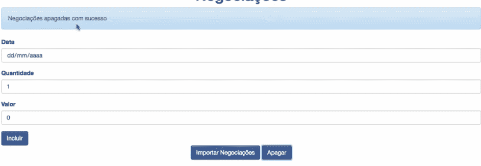

*图 8.1：列表已清空*

尽管功能符合预期，但我们还可以进一步优化 `Negociacoes` 模型。在模型中，`_negociacoes` 属性没有被冻结，这意味着它仍然可以接收新的赋值。我们已经学习过，通过 `Object.freeze` 可以防止对象实例的属性被重新赋值。那么在 `Negociacoes` 中也采用这个特性如何？修改类定义如下：

```javascript
// client/app/domain/negociacao/Negociacoes.js

class Negociacoes {

    constructor() {

        this._negociacoes = [];

        // 冻结实例
        Object.freeze(this);
    }
}
```

```javascript
// 前文代码省略
}
```

太棒了，但由于我们的实例不再允许对 `this._negociacoes` 属性进行重新赋值，类中的 `esvazia()` 方法将无法正常工作：

```javascript
// client/app/domain/negociacao/Negociacoes.js

// 前文代码省略

    esvazia() {

        // 将不再接受新的赋值
        this._negociacoes = [];
    }

// 后文代码省略
```

为了解决这个问题，我们可以将 `esvazia()` 方法的实现修改为：

```javascript
// client/app/domain/negociacao/Negociacoes.js

// 前文代码省略

    esvazia() {

        this._negociacoes.length = 0;
    }

// 后文代码省略
```

当我们将数组的 `length` 属性赋值为 0 时，会删除其中的所有项目。

我们的应用程序现在可以运行，但每当我们需要修改模型时，都需要记得调用对应 `view` 的 `update()` 方法。忘记调用该方法的可能性很高，尤其是当应用程序中引入新的 Views 时。是否存在某种方法可以自动化 View 的更新呢？

### 8.1 如果在模型更改时自动更新 View 呢？

模型的更改在我们的应用程序中是不可避免的。那么，我们是否可以创建一种策略：每当模型发生变化时，其对应的 View 自动更新？

为了实现这一点，模型的 `constructor()` 需要接收一个更新策略，每当调用任何修改内部状态（属性）的方法时，该策略就会被执行。让我们从 `Negociacoes` 开始：

```javascript
// client/app/domain/negociacoes/Negociacoes.js

class Negociacoes {

    // 现在接收一个参数！
    constructor(armadilha) {

        this._negociacoes = [];
        this._armadilha = armadilha;
        Object.freeze(this);
    }

// 后文代码省略
```

我们的类现在接收一个参数 `armadilha`（陷阱/回调），它将被存储在类的属性中。这个参数实际上就是一个包含 View 更新逻辑的函数。现在，在 `adiciona()` 和 `esvazia()` 方法中，我们将调用存储在 `this._armadilha` 中的函数：

```javascript
// client/app/domain/negociacoes/Negociacoes.js

class Negociacoes {

    constructor(armadilha) {

        this._negociacoes = [];
        this._armadilha = armadilha;
        Object.freeze(this);
    }

    adiciona(negociacao) {

        this._negociacoes.push(negociacao);

        // 调用函数
        this._armadilha(this);
    }

// 前文代码省略

    esvazia() {

        this._negociacoes.length = 0;

        // 调用函数
        this._armadilha(this);
    }
}
```

请注意，存储在 `this._armadilha` 中的函数在被调用时接收 `this` 作为参数。这将允许该函数持有正在执行操作的实例引用，在本例中即为 `Negociacoes` 的实例。

现在，在 `NegociacaoController` 中，我们将为刚刚修改的模型 `constructor()` 传递一个更新策略。暂时，我们将使用 `function` 而不是 arrow function（箭头函数）：

```javascript
// client/app/domain/negociacoes/Negociacoes.js
```

```javascript
class NegociacaoController {

    constructor() {

        const $ = document.querySelector.bind(document);
        this._inputData = $('#data');
        this._inputQuantidade = $('#quantidade');
        this._inputValor = $('#valor');

        // 传递将要使用的策略

        this._negociacoes = new Negociacoes(function(model) {

            this._negociacoesView.update(model);
        });

        this._negociacoesView = new NegociacoesView('#negociacoes');

        // 仍需调用，以便在控制器初始化时更新
        this._negociacoesView.update(this._negociacoes);

        this._mensagem = new Mensagem();
        this._mensagemView = new MensagemView('#mensagemView');
        this._mensagemView.update(this._mensagem);
    }

// 后文代码省略
```

现在，每当 `Negociacoes` 的 `adiciona()` 和 `esvazia()` 方法被调用时，在 `constructor()` 中传递的陷阱策略就会被触发。请注意，作为参数传递的陷阱在被调用时将接收 `this`，即 `Negociacoes` 实例的引用。这个引用就是我们在 `NegociacaoController` 中传递给 `Negociacoes` 的函数里作为 `model` 访问的对象。让我们回顾一下这段代码：

```javascript
// client/app/domain/negociacoes/Negociacoes.js
// 前文代码省略

// 当调用 adiciona() 或 esvazia() 时，
// model 将会是 Negociacoes 的实例
this._negociacoes = new Negociacoes(function(model) {

    this._negociacoesView.update(model);
});

// 后文代码省略
```

声明的函数在 `this._negociacoesView` 被定义之前就尝试使用它，看起来可能有点奇怪，但这没有任何问题。因为该函数不会立即执行，只有在调用 `adiciona()` 和 `esvazia()` 方法时才会执行。


现在，在`NegociacaoController`的`adiciona()`和`apaga()`方法中，我们将删除更新`Negociacoes`视图的指令。这两个方法应修改如下：

```javascript
// client/app/controllers/NegociacaoController.js
// 后文代码省略

adiciona(event) {
    event.preventDefault();
    this._negociacoes.adiciona(this._criaNegociacao());

    // 不再调用 negociacoesView 的 update

    this._mensagem.texto = 'Negociação adicionada com sucesso';
    this._mensagemView.update(this._mensagem);
    this._limpaFormulario();
}

// 后文代码省略

apaga() {
    this._negociacoes.esvazia();

    // 不再调用 negociacoesView 的 update

    this._mensagem.texto = 'Negociações apagadas com sucesso';
    this._mensagemView.update(this._mensagem);
}
```

现在所有代码都就位了，让我们重新加载页面并测试结果。没有任何更新发生，且控制台中出现了以下错误消息：

```text
Uncaught TypeError: Cannot read property 'update' of undefined
    at Negociacoes._armadilha (NegociacaoController.js:12)
    at Negociacoes.adiciona (Negociacoes.js:12)
    at NegociacaoController.adiciona (NegociacaoController.js:25)
```

通过控制台查找导致错误的指令，我们在`NegociacaoController`中找到了这段代码：

```javascript
// client/app/controllers/NegociacaoController.js

// 前文代码省略

this._negociacoes = new Negociacoes(function(model) {
    // 错误原因
    this._negociacoesView.update(model);
});

// 后文代码省略
```

我们原本期望传递给`Negociacoes`构造函数的陷阱函数能够访问`NegociacaoController`的`this._negociacoesView`属性。然而，由于所有`function()`的动态特性，`this._negociacoesView.update(model)`中的`this`值变成了`Negociacoes`的实例，而该实例并不拥有我们要访问的属性。

我们只能在代码的执行时间（`runtime`）知道函数的上下文（`this`）。为了更清晰地观察这种行为，我们可以通过在作为陷阱传递的函数中添加`console.log(this)`来进行测试：

```javascript
// client/app/controllers/NegociacaoController.js
// 前文代码省略

this._negociacoes = new Negociacoes(function(model) {
    // 将在控制台打印 Negociacoes 而不是 NegociacaoController
    console.log(this);

    this._negociacoesView.update(model);
});
```

检查控制台，我们得到：

```text
Negociacoes // 显示了 Negociacoes!
Uncaught TypeError: Cannot read property 'update' of undefined
```

它表明`this`是`Negociacoes`。这是因为该函数是在`Negociacoes`的上下文中执行的。我们是否有办法改变`this`的上下文？

### 8.2 规避动态`this`

解决这个问题的一种方法是将`NegociacaoController`的`this`引用存储在一个变量中（例如`self`），并在陷阱函数中使用该变量。让我们来看看：

```javascript
// client/app/domain/negociacoes/Negociacoes.js

class NegociacaoController {
    constructor() {
        const $ = document.querySelector.bind(document);
        this._inputData = $('#data');
        this._inputQuantidade = $('#quantidade');
        this._inputValor = $('#valor');

        // self 是 NegociacaoController
        const self = this;

        this._negociacoes = new Negociacoes(function(model) {
            // 仍然是 Negociacoes
            console.log(this);

            // 我们访问 self
            // 这样可以确保它是 NegociacaoController
            self._negociacoesView.update(model);
        });
    }

    // 后续代码省略
}
```

这个方案可行，但它迫使我们必须声明一个额外的变量来存储我们希望在陷阱函数中使用的`this`值。我们可以通过另一种方式解决。

让我们将代码恢复到之前的状态，即运行结果不符合预期的阶段：

```javascript
// client/app/domain/negociacoes/Negociacoes.js

class NegociacaoController {
    constructor() {
        const $ = document.querySelector.bind(document);
        this._inputData = $('#data');
        this._inputQuantidade = $('#quantidade');
        this._inputValor = $('#valor');

        this._negociacoes = new Negociacoes(function(model) {
            console.log(this);
            this._negociacoesView.update(model);
        });

        // 后续代码省略
    }
}
```

为了让传递给`Negociacoes`构造函数`constructor()`的陷阱函数将`NegociacaoController`的实例视为`this`而不是`Negociacoes`实例，除了陷阱函数外，我们将向`Negociacoes`的`constructor()`传递另一个参数。第一个参数将是`this`，即指向`NegociacaoController`的那个：

```javascript
// client/app/controller/NegociacaoController.js

class NegociacaoController {
    constructor() {
        const $ = document.querySelector.bind(document);
        this._inputData = $('#data');
        this._inputQuantidade = $('#quantidade');
        this._inputValor = $('#valor');

        // 传递的 this 仍然指向
        // NegociacaoController 的一个实例
        this._negociacoes = new Negociacoes(this, function(model) {
            console.log(this);
            this._negociacoesView.update(model);
        });

        // 后续代码省略
    }
}
```

我们需要修改`Negociacoes`以接收并存储该参数：

```javascript
// client/app/domain/negociacoes/Negociacoes.js

class Negociacoes {
    constructor(contexto, armadilha) {
        this._negociacoes = [];
        this._armadilha = armadilha;
        this._contexto = contexto;
        Object.freeze(this);
    }

    // 后续代码省略
}
```

现在，让我们修改`adiciona()`和`esvazia()`方法中对`this._armadilha`的调用。我们将通过调用 JavaScript 中所有函数都拥有的`call()`方法来实现。它接收两个参数：第一个是在函数调用中将用作`this`的上下文，第二个是该函数接收的参数：

```javascript
// client/app/domain/negociacoes/Negociacoes.js

class Negociacoes {
    constructor(contexto, armadilha) {
        this._negociacoes = [];
        this._contexto = contexto;
        this._armadilha = armadilha;
        Object.freeze(this);
    }

    adiciona(negociacao) {
        this._negociacoes.push(negociacao);

        // 此处修改
        this._armadilha.call(this._contexto, this);
    }

    // 前面代码省略

    esvazia() {
        this._negociacoes.length = 0;

        // 此处修改
        this._armadilha.call(this._contexto, this);
    }
}
```

运行代码后，注册功能将恢复正常：

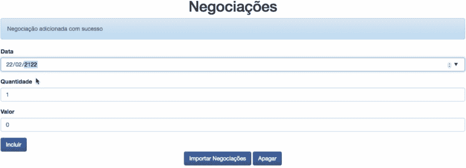

图 8.2：表单正常工作

这是解决`this`动态性问题的第二种方法。不过，还有第三种解决办法，而且比我们尝试过的两种方法都要简洁。接下来我们将看到这种新方法。

### 8.3 箭头函数及其词法作用域

为了减少代码量，我们要做的第一项修改是从`Negociacoes`的`constructor()`中移除上下文参数。此外，我们将恢复在`adiciona()`和`esvazia()`方法中直接调用`this._armadilha`：

```javascript
class Negociacoes {
    // 不再接收上下文
    constructor(armadilha) {
        this._negociacoes = [];
        this._armadilha = armadilha;
        Object.freeze(this);
    }

    adiciona(negociacao) {
        this._negociacoes.push(negociacao);

        // 直接调用函数，不使用 call()
        this._armadilha(this);
    }

    // 后续代码省略

    esvazia() {
        this._negociacoes.length = 0;

        // 直接调用函数，不使用 call()
        this._armadilha(this);
    }
}
```

我们需要在`NegociacaoController`的`constructor()`中修改传递给`Negociacoes`的参数，现在只需传递陷阱函数即可：

```javascript
// client/app/controllers/NegociacaoController.js

class NegociacaoController {
    constructor() {
        const $ = document.querySelector.bind(document);
        this._inputData = $('#data');
        this._inputQuantidade = $('#quantidade');
        this._inputValor = $('#valor');

        // 不再将 this 作为参数传递，
        // 仅传递函数！
        this._negociacoes = new Negociacoes(function(model) {
            console.log(this);
            this._negociacoesView.update(model);
        });

        // 后续代码省略
    }
}
```

按照目前这样写，代码无法工作。但如果我们将传递给`Negociacoes`构造函数的`function`替换为`arrow function`（箭头函数），我们会发现一个惊喜：

```javascript
// client/app/controllers/NegociacaoController.js

class NegociacaoController {
    constructor() {
        const $ = document.querySelector.bind(document);
        this._inputData = $('#data');
        this._inputQuantidade = $('#quantidade');
        this._inputValor = $('#valor');

        // 传递了一个箭头函数！
        this._negociacoes = new Negociacoes(model => {
            console.log(this);
            this._negociacoesView.update(model);
        });

        // 后续代码省略
    }
}
```

测试表明我们的代码运行成功，且比之前简洁得多。这是怎么实现的？这是因为`arrow function`不仅仅是一种简写函数的方式，它还有一个独特的特性：其`this`的作用域是词法（静态）的，而非动态的。

`arrow function`的`this`从“周围的代码”中获取值，并保持该值，无论它在何处被调用。这就是为什么传递的陷阱函数的`this`指向`NegociacaoController`的实例。

我们的解决方案是可行的，但还可以进一步优化。我们将在下一章讨论。

> 本章的完整代码可以在此处找到：
>
> https://github.com/flaviohenriquealmeida/cangaceiro-javascript/tree/master/08

## 第 9 章

### 难道骗过了 cangaceiro 吗？

> “枪手不为损失或失败而烦恼——对他来说，几乎所有事情都一样。” —— 《大草原：小径》

为了将开发人员从每次模型更新时都要以编程方式更新 View 的责任中解脱出来，我们将更新逻辑放在了“陷阱”中，这些函数在改变模型状态的方法中被调用。

然而，这个方案并不理想，因为它迫使我们在所有模型类中都要接收陷阱函数，而且我们必须记得在每个改变模型状态的方法中调用它。

`Negociacoes`的`this._armadilha`属性与该类所代表的领域没有任何关系。也就是说，它仅仅是为了基础设施而存在的。让我们回顾一下代码：

```javascript
// 仅供回顾！

// client/app/domain/negociacoes/Negociacoes.js

class Negociacoes {
    constructor(armadilha) {
        this._negociacoes = [];

        // 这里的东西很奇怪，
        // 与交易领域没有任何关系
        this._armadilha = armadilha;

        Object.freeze(this);
    }
}
```

领域模型是系统中可重用性最高的类之一，正是因为它不包含任何与

### 9.1 代理（Proxy）设计模式

我们发现，用更新视图的功能来污染模型是不合适的，而且我们仍然需要一种解决方案，能够在模型每次发生变化时自动更新视图。有一种设计模式可以帮助我们调和这两个对立的方面，那就是代理（Proxy）。


# 代理（Proxy）设计模式

**代理（Proxy）**设计模式，简而言之，就是一个“冒充者”。我们将代理视作我们想要操作的对象实例来处理，例如，一个`Negociacoes`的实例。它是一个包裹我们想要操作的实例的外壳，对于该实例中的每一个属性和方法，代理都会有一个对应的版本。

如果我们在代理上调用`adiciona()`方法，它会将调用委托给被封装实例中的同一个方法。在代理的方法调用与被封装实例的对应方法调用之间，**我们可以设置一个陷阱**——在我们的应用程序中，就是更新视图的代码。这样，我们不需要修改模型类，只需创建一个能够执行我们想要代码的代理即可。如何实现呢？

好消息是，我们不需要自己实现这个设计模式。从2015版本开始，ECMAScript 在其语言特性中已经内置了代理（Proxy）功能。下面我们就来学习如何使用它。

## 9.2 学习使用代理

第一步是编辑`NegociacaoController`，并将不再工作的代码片段临时注释掉，即向`Negociacoes`的`constructor()`传递陷阱的那部分代码：

```javascript
// client/app/controllers/NegociacaoController.js

class NegociacaoController {

    constructor() {

        const $ = document.querySelector.bind(document);
        this._inputData = $('#data');
        this._inputQuantidade = $('#quantidade');
        this._inputValor = $('#valor');

        // 注释掉的代码
        /*
        this._negociacoes = new Negociacoes(model => {
            console.log(this);
            this._negociacoesView.update(model);
        });
        */

        // 后续代码省略
```

接下来，我们要移除传递给`Negociacoes`的`constructor()`的陷阱。此外，我们当然不能忘记移除其方法中调用陷阱的代码。最终类将如下所示：

```javascript
// client/app/domain/negociacao/Negociacoes.js

class Negociacoes {

    constructor() {
        this._negociacoes = []
        Object.freeze(this);
    }

    adiciona(negociacao) {
        this._negociacoes.push(negociacao);
    }

    paraArray() {
        return [].concat(this._negociacoes);
    }

    get volumeTotal() {
        return this._negociacoes
            .reduce((total, negociacao) =>
                total + negociacao.volume, 0)
    }

    esvazia() {
        this._negociacoes.length = 0;
    }
}
```

通过刚才所做的修改，我们的应用程序将无法正常工作，在控制台中我们会收到以下错误信息：

```javascript
Uncaught TypeError: Cannot read property 'paraArray' of undefined
```

**不要担心这个错误。** 我们将在学习新功能的过程中让应用程序保持损坏状态，这个新功能将帮助我们修复它。

现在，我们将在 Chrome 控制台中进行一系列实验来学习如何使用代理。我们暂时将`Negociacoes`类放在一边，转而来使用`Negociacao`类，因为这种替换将使我们的学习更加容易。

打开 Chrome 控制台后，让我们执行以下两条指令：

```javascript
// 在 CHROME 控制台中
negociacao = new Negociacao(new Date(), 1, 100);
proxy = new Proxy(negociacao, {});
```

第一条指令创建了一个`Negociacao`的实例。第二条指令创建了一个代理的实例。代理的`constructor()`接收的第一个参数是我们想要封装的`Negociacao`实例，第二个参数是一个字面量格式的对象`{}`，其中包含我们想要执行的陷阱代码。目前，我们还没有定义任何陷阱。

创建的代理拥有被封装类的所有属性和方法，以至于如果我们在控制台中访问`proxy.valor`属性，实际上是在幕后访问被封装`Negociacao`实例中的同一属性：

```javascript
// 在 CHROME 控制台中
console.log(proxy.valor); // 打印 100
console.log(proxy.quantidade); // 打印 1
console.log(proxy.volume); // 打印 100
```

然而，我们不希望任何人直接访问被代理封装的实例。因此，我们可以清空控制台，并用以下指令从零开始：

```javascript
// 在 CHROME 控制台中
negociacao = new Proxy(new Negociacao(new Date(), 1, 100), {});
```

我们使用`negociacao`作为变量名来伪装我们的代理。随后，作为代理`constructor()`的第一个参数，我们直接实例化了一个`Negociacao`实例。

如果我们的代理无法执行陷阱，那它就没有用处。我们需要在作为第二个参数传递给代理的对象中定义陷阱，这个对象称为**handler**。

由于我们要执行一系列操作，所以更合适的做法是将所有这些指令写在一个新的`<script></script>`标签内，我们将临时把它添加到`client/index.html`中。它应该是页面中最后一个`<script>`标签。

```html
<!-- client/index.html -->
<!-- 后续代码省略 -->
<!-- 最后一个 script 标签！ -->
<script>

    const negociacao = new Proxy(new Negociacao(new Date(), 2, 100), {

    });

</script>
<!-- 后续代码省略 -->
```

现在一切就绪，我们来学习如何在传递给代理的 handler 中创建我们的陷阱。

## 9.3 构建读取陷阱

为了开启我们的代理之旅，我们将从一些非常基础的内容开始。每次代理的属性被读取时，我们让它显示一条消息，指出该属性的名称。

为此，在我们的 handler 中，我们将添加`get`属性，它接收我们希望在对代理属性进行读取时执行的函数。请注意，`get`这个名称并非偶然，它明确地表明我们正在为读取访问设计代码：

```html
<!-- client/index.html -->
<!-- 后续代码省略 -->
<script>

    const negociacao = new Proxy(new Negociacao(new Date(), 2, 100), {

        get(target, prop, receiver) {
            console.log(`a propriedade "${prop}" caiu na armadilha!`);
        }
    });

    console.log(negociacao.quantidade);
    console.log(negociacao.valor);
</script>
<!-- 后续代码省略 -->
```

传递给`get`属性的函数接收三个特殊参数。第一个`target`是对被代理封装的对象的引用，即真正的对象。第二个参数`prop`是一个字符串，包含正在访问的属性名称。最后，`receiver`是对代理本身的一个引用。

我们可以进一步简化代码审核。从 ES2015（ES6）开始，我们可以用这种方式声明等同于函数的对象属性：

```html
<!-- client/index.html -->
<!-- 后续代码省略 -->
<script>

    const negociacao = new Proxy(new Negociacao(new Date(), 2, 100), {

        // 注意这里！不再是 get: function(…) {}
        get(target, prop, receiver) {
            console.log(`a propriedade "${prop}" caiu na armadilha!`);
        }
    });

    console.log(negociacao.quantidade);
    console.log(negociacao.valor);
</script>
<!-- 后续代码省略 -->
```

刷新页面后，我们看到控制台的输出：

```javascript
// 在 CHROME 控制台中显示
a propriedade "quantidade" caiu na armadilha!
undefined
a propriedade "valor" caiu na armadilha!
undefined
```

我们的陷阱消息完美地工作了。然而，`console.log()`的打印结果却是`undefined`，而不是显示属性的值。为什么会发生这种情况？

每个陷阱在执行时，必须负责定义返回给访问该属性者的值。由于我们没有定义任何返回值，结果就是`undefined`。

让我们做一个测试，以更好地理解这个返回值的必要性：

```html
<!-- client/index.html -->
<!-- 后续代码已省略 -->

<script>
    const negociacao = new Proxy(new Negociacao(new Date(), 2, 100), {
        get(target, prop, receiver) {
            console.log(`属性 "${prop}" 触发了陷阱！`);
            // 这里有变动！ :)
            return 'Flávio';
        }
    });

    console.log(negociacao.quantidade);
    console.log(negociacao.valor);
</script>

<!-- 后续代码已省略 -->
```

在上面的示例中，尽管这看起来很奇怪，但我们返回了字符串“Flávio”。查看 Chrome 控制台，`console.log()`指令对于`negociacao.quantidade`和`negociacao.valor`都会显示字符串“Flávio”：

```text
a propriedade "quantidade" caiu na armadilha!
Flávio
a propriedade "valor" caiu na armadilha!
Flávio
>
```

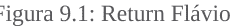

我们的 handler 返回了内容，但这还不是预期的结果。我们希望返回被 Proxy 封装的对象中`quantidade`和`valor`属性各自对应的值。

好消息是我们拥有实现这一目标所需的所有元素。在 JavaScript 对象中，我们可以通过`.`（点）访问其属性，或者使用方括号并传入想要访问的属性名称字符串。如果我们拥有`target`（对实例的引用）和`prop`（正在被访问的属性名称字符串），我们可以使用`target[prop]`：

```html
<!-- client/index.html -->
<!-- 后续代码已省略 -->
<script>
  const negociacao = new Proxy(new Negociacao(new Date(), 2, 100), {
    get(target, prop, receiver) {
      console.log(`属性 "${prop}" 触发了陷阱！`);
      // 此处修改
      return target[prop];
    }
  });

  console.log(negociacao.quantidade);
  console.log(negociacao.valor);
</script>
<!-- 后续代码已省略 -->
```

```text
a propriedade "quantidade" caiu na armadilha!
2
a propriedade "valor" caiu na armadilha!
100
```


我们已经看到了如何在每次读取对象属性时执行代码。然而，这并没有解决 View 自动更新的问题，因为我们希望仅在属性被修改时才触发陷阱。

为了进行写入测试，我们不能简单地为`negociacao.quantidade`和`negociacao.valor`赋值，因为它们是 getters。任何赋予它们的值都会被忽略。因此，我们将采取一种“文学许可”的方式，直接访问私有属性`_quantidade`和`_valor`。虽然我们打破了约定，但这是为了一个更好的目标，即让我们理解 Proxy 的工作原理：

```html
<!-- client/index.html -->
<!-- 后续代码已省略 -->
<script>
    const negociacao = new Proxy(new Negociacao(new Date(), 2, 100), {
        get(target, prop, receiver) {
            console.log(`属性 "${prop}" 触发了陷阱！`);
            return target[prop];
        }
    });

    // 即使访问只读属性
    // 陷阱也不会被触发
    negociacao._quantidade = 10;
    negociacao._valor = 100;
</script>
<!-- 后续代码已省略 -->
```

确实，什么都没有发生。就像我们学习如何执行读取陷阱一样，我们也需要学习如何执行写入陷阱。

## 9.4 构建写入陷阱

为了创建写入陷阱，我们在 handler 中不使用`get`，而使用`set`。它与`get`非常相似，不同之处在于它接收一个额外的参数`value`：

```html
<!-- client/index.html -->
<!-- 后续代码已省略 -->
<script>
    const negociacao = new Proxy(new Negociacao(new Date(), 2, 100), {
        get(target, prop, receiver) {
            console.log(`属性 "${prop}" 触发了陷阱！`);
            return target[prop];
        },
        set(target, prop, value, receiver) {
            /* 我们的逻辑将在这里 */
        }
    });

    negociacao._quantidade = 10;
    negociacao._valor = 100;
</script>
<!-- 后续代码已省略 -->
```

参数`value`是正在被赋给 Proxy 中被访问属性的值。因此，我们可以这样实现我们的陷阱：

```html
<!-- client/index.html -->
<!-- 后续代码已省略 -->
<script>
    const negociacao = new Proxy(new Negociacao(new Date(), 2, 100), {
        get(target, prop, receiver) {
            console.log(`属性 "${prop}" 触发了陷阱！`);
            return target[prop];
        },
        set(target, prop, value, receiver) {
            console.log(`${prop} 当前值为 ${target[prop]}，将接收新值 ${value}`);
            // 完成值的传递！
            target[prop] = value;
        }
    });
    negociacao._quantidade = 10;
    negociacao._valor = 100;
</script>
<!-- 后续代码已省略 -->
```

ES2015（ES6）的 Proxy 规范中要求我们在陷阱中返回`true`，以表示操作成功。


```html
<!-- client/index.html -->
<!-- 后续代码已省略 -->
<script>
    const negociacao = new Proxy(new Negociacao(new Date(), 2, 100), {
        get(target, prop, receiver) {
            console.log(`属性 "${prop}" 触发了陷阱！`);
            return target[prop];
        },
        set(target, prop, value, receiver) {
            console.log(`${prop} 当前值为 ${target[prop]}，将接收新值 ${value}`);
            // 如果是一个冻结对象，将被忽略
            target[prop] = value;
            // 如果成功更改对象属性则返回 true
            return target[prop] == value;
        }
    });

    // 陷阱将被触发，但值
    // 不会被更改，因为它们被冻结了
    negociacao._quantidade = 10;
    negociacao._valor = 100;
</script>
<!-- 后续代码已省略 -->
```

对于对象的冻结属性，`target[prop] = value` 指令将被忽略，这就是为什么我们返回 `target[prop] == value` 的结果，以判断赋值是否成功。

查看控制台，我们得到：

```
_quantidade guarda 2, receberá 10
_valor guarda 100, receberá 100
```

图 9.3：新值

借助接下来将要学习的一项特性，我们可以写得更简洁一些。

### 9.5 Reflect API

借助 ECMAScript 2015 (ES6) 引入的 **Reflect API**（[https://developer.mozilla.org/en-US/docs/Web/JavaScript/Reference/Global_Objects/Reflect](https://developer.mozilla.org/en-US/docs/Web/JavaScript/Reference/Global_Objects/Reflect)），我们可以进一步简化代码。该 API 集中了一系列静态方法，允许动态地读取、写入以及调用方法和函数，其中之一就是 `Reflect.set()`。

`Reflect.set()` 接收三个参数。第一个是操作的目标对象实例，第二个是要更改的属性名称。最后一个参数是属性的新值。如果成功更改对象属性，该方法将返回 `true`，否则返回 `false`：

```html
<!-- client/index.html -->
<!-- 后续代码已省略 -->
<script>
    const negociacao = new Proxy(new Negociacao(new Date(), 2, 100), {
        get(target, prop, receiver) {
            console.log(`属性 "${prop}" 触发了陷阱！`);
            return target[prop];
        },
        set(target, prop, value, receiver) {
            console.log(`${prop} 当前值为 ${target[prop]}，将接收新值 ${value}`);
            return Reflect.set(target, prop, value);
        }
    });

    negociacao._quantidade = 10;
    negociacao._valor = 100;
</script>
<!-- 后续代码已省略 -->
```

Reflect API 还拥有其他方法，如 `Reflect.get()`。然而，引入它会使我们的代码变得稍微冗长，不像使用 `Reflect.set()` 那样能为我们节省一行代码。例如，`return target[prop]` 指令可以用 `return Reflect.get(target, prop)` 代替，但目前的方式允许我们编写更少的字符。

现在我们已经理解了 Proxy 如何工作，我们可以回到 `Negociacoes`，也就是我们需要更新其 View 的模型。

### 9.6 一个意料之外的问题

既然我们已经巩固了关于创建 Proxy 的知识，现在先把 `Negociacao` 模型放在一边，来处理 `Negociacoes` 模型——那个我们需要自动更新其 View 的模型。我们来做一个测试，创建一个 Proxy，并通过它调用 `esvazia()` 方法：

```html
<!-- client/index.html -->
<!-- código posterior omitido -->
<script>

    // começando do zero, apagando o código anterior que existia

    const negociacoes = new Proxy(new Negociacoes(), {

        set(target, prop, value, receiver) {

            console.log(`${prop} guarda ${target[prop]}, receberá ${value}`);

            return Reflect.set(target, prop, value);
        }

    });

    negociacoes.esvazia();

</script>
<!-- código posterior omitido -->
```

刷新我们的页面并在控制台中观察结果，我们只看到了之前就已经显示的错误消息，因为我们的应用还没有完成。没有显示任何其他消息，也就是说，我们的陷阱没有被执行！那么 `adiciona()` 方法的情况是否一样呢？让我们测试一下。

在 `client/index.html` 中，我们将 `negociacoes.esvazia()` 的调用替换为 `negociacoes.adiciona()` 的调用，传入一个新的交易：

```html
<!-- client/index.html -->
<!-- código posterior omitido -->
<script>

    const negociacoes = new Proxy(new Negociacoes(), {

        set(target, prop, value, receiver) {

            console.log(`${prop} guarda ${target[prop]}, receberá ${value}`);
            return Reflect.set(target, prop, value);
        }
    });

    // agora, chamando o método adiciona
    negociacoes.adiciona(new Negociacao(new Date(), 1, 100));

</script>
<!-- código posterior omitido -->
```

刷新我们的页面并在控制台中观察结果，什么也没有发生。

这是因为我们的陷阱只有在对被 Proxy 封装的对象的属性进行赋值时才会被触发。`esvazia()` 和 `adiciona()` 方法都没有执行任何赋值操作。第一个方法执行的是 `this._negociacoes.length = 0`，第二个方法是通过数组自身的 `push()` 方法向 `this._negociacoes` 中添加新元素。让我们回顾一下这些方法！

```javascript
// RELEMBRADO O CÓDIGO, NÃO HÁ MODIFICAÇÃO AQUI

// client/app/domain/negociacoes/Negociacoes.js

class Negociacoes {
    // código omitido

    adiciona(negociacao) {

        // não há atribuição aqui!
        this._negociacoes.push(negociacao);
    }

    // código omitido

    esvazia() {

        // não há atribuição aqui!
        this._negociacoes.length = 0;
    }

    // código posterior omitido
}
```

事实上，让 `this._negociacoes` 接收新的赋值也没有意义，因为它是一个被冻结的属性。现在怎么办？有没有办法解决这个问题？

一种解决方案是我们能够指定类中的哪些方法应该触发我们的陷阱。采用这种策略后，`adiciona()` 和 `esvazia()` 方法就不再需要依赖于对 `Negociacoes` 实例属性的赋值来触发各自的陷阱了。

### 9.7 为方法构建陷阱

让我们开始用我们独特的（cangaceira）方式来解决上一节的问题。首先要理解的是，在底层，当 JavaScript 调用一个方法时，它会先执行一次 `get` 来获取对方法的引用，然后再执行一次 `apply` 来传递参数。目前，我们先关注 `get` 的作用。

我们将 `client/index.html` 中创建的 Proxy 里的 `set` 替换为 `get`。请记住，`get` 不接收 `value` 参数：

```html
<!-- client/index.html -->
<!-- código posterior omitido -->
<script>

    const negociacoes = new Proxy(new Negociacoes(), {

        get(target, prop, receiver) {

            /* e agora ? */
        }
    });

    negociacoes.adiciona(new Negociacao(new Date(), 1, 100));

</script>
<!-- código posterior omitido -->
```

下一步是检查我们拦截的属性是否是一个函数/方法，因为我们正在构建的策略就是用来处理这种类型的数据的。我们通过 `typeof()` 函数来实现：

```html
<!-- client/index.html -->
<!-- código posterior omitido -->
<!-- NÃO TESTE O CÓDIGO AINDA! NÃO FUNCIONARÁ, NÃO TERMINAMOS -->
<script>
    const negociacoes = new Proxy(new Negociacoes(), {
        get(target, prop, receiver) {
            if(typeof(target[prop]) == typeof(Function) ) {
                /* falta código ainda */
            }
        }
    });
    negociacoes.adiciona(new Negociacao(new Date(), 1, 100));
</script>
<!-- 后续代码已省略 -->
```

如果我们保持原样，那么我们的策略将应用于任何方法，但这并非我们想要的。`Negociacoes` 的 `paraArray()` 方法触发 View 更新是没有意义的，只有改变状态的方法才需要触发更新。

### 9.8 ES2016（ES7）的一小部分知识

除了检查属性的类型外，我们还要测试它是否包含在我们希望拦截的方法列表中：

```html
<!-- client/index.html -->
<!-- código posterior omitido -->
<script>

    const negociacoes = new Proxy(new Negociacoes(), {

        get(target, prop, receiver) {

            if(typeof(target[prop]) == typeof(Function) &&
            ['adiciona', 'esvazia']
                .includes(prop)) {

                /* falta código ainda */

            }
        }
    });

    negociacoes.adiciona(new Negociacao(new Date(), 1, 100));

</script>
<!-- 后续代码已省略 -->
```

通过数组的 `includes()` 方法，我们可以检查被拦截的属性是否在我们的列表中。顺便提一下，`includes()` 方法是在 **ES2016**（ES7）中引入的，它是 ES2015（ES6）之后的一个版本。

> ES2016（ES7）规范仅定义了 `Array.prototype.includes` 和指数运算符。

现在，如果该属性不是我们列表中的方法/函数，我们就让流程自然地继续执行。

```html
<!-- client/index.html -->
<!-- código posterior omitido -->
<script>

    const negociacoes = new Proxy(new Negociacoes(), {

        get(target, prop, receiver) {

            if(typeof(target[prop]) == typeof(Function) &&
['adiciona', 'esvazia']
                .includes(prop)) {

                /* falta código ainda */

            } else {

                // realizando um get padrão
                return target[prop];
            }
        }
    });

    negociacoes.adiciona(new Negociacao(new Date(), 1, 100));

</script>
<!-- 后续代码已省略 -->
```

现在一切都已经就位，我们需要实现那些我们决定要考虑的方法的陷阱所执行的代码。这就是关键所在——在英文中被称为 *cat jump*。

对于我们拦截的方法名数组中列出的方法，我们将让它们的读取返回一个新函数，而不是箭头函数，其中包含我们希望执行的代码，包括应用函数参数的代码（如果有的话）：

```html
<!-- client/index.html -->
<!-- código posterior omitido -->
<script>
  const negociacoes = new Proxy(new Negociacoes(), {
    get(target, prop, receiver) {
      if(typeof(target[prop]) == typeof(Function) &&
         ['adiciona', 'esvazia'].includes(prop)) {

        // retorna uma nova função com contexto dinâmico
        // antes que o apply aplicado por padrão pelo
        // interpretador seja chamado.

        return function() {
          console.log(`"${prop}" disparou a armadilha`);
          target[prop].apply(target, arguments);
        }
      } else {
        // se é propriedade, retorna o valor normalmente
        return target[prop];
      }
    }
  });

  negociacoes.adiciona(new Negociacao(new Date(), 1, 100));
</script>
<!-- 后续代码已省略 -->
```

让我们回顾一下我们所做的神奇操作。请记住，JavaScript 解释器首先执行一次 `get` 来读取方法，然后在底层执行一次 `apply` 来执行它并传递参数。我们返回的 `function()` 将替换在 `apply` 启动之前的原始方法。在其中，我们添加了陷阱代码。


通过`target[prop].apply`（不要与解释器将要执行的`apply`混淆），我们以`target`自身作为上下文来调用该方法。`apply()`方法与我们之前见过的`call()`方法类似，区别在于前者以数组形式接收参数。看似完美，但我们遇到了一个问题。

我们的替换`function()`需要知道原始方法是否带有参数，以便在调用`target[prop].apply`时传递它们。我们通过`arguments`来获取这一信息。

隐式变量`arguments`具有类似数组的结构。它存在于每个方法或函数中，即使参数未被显式声明，也能访问传入的参数。我们通过控制台来看一个示例：

```javascript
// TESTAR NO CONSOLE, EXEMPLO APENAS

// NÃO RECEBE PARÂMETRO ALGUM

function exibeNomeCompleto() {
    alert(`Nome completo: ${arguments[0]} ${arguments[1]}`);
}

// funciona!
exibeNomeCompleto('Flávio', 'Almeida');
```

`arguments`对我们的解决方案至关重要，因为我们无法预测每个被拦截的方法会收到多少个参数。现在解决方案已经准备就绪，让我们修改`NegociacaoController`以使用它。

### 9.9 将解决方案应用到`NegociacaoController`

我们要修改`NegociacaoController`类，为`this._negociacoes`属性赋值一个 Proxy，使用我们在`client/index.html`中已经实现的逻辑。这基本上就是复制粘贴，区别在于我们在触发陷阱的方法的`console.log()`下方添加了`this._negociacoesView.update()`调用：

```javascript
// client/app/controllers/NegociacaoController.js

class NegociacaoController {

    constructor() {

        const $ = document.querySelector.bind(document);
        this._inputData = $('#data');
        this._inputQuantidade = $('#quantidade');
        this._inputValor = $('#valor');

        // agora é um proxy!
        this._negociacoes = new Proxy(new Negociacoes(), {

            get(target, prop, receiver) {

                if(typeof(target[prop]) == typeof(Function) &&
                   ['adiciona', 'esvazia']
                   .includes(prop)) {

                    return function() {

                        console.log(`"${prop}" disparou a armadilha`);
                        target[prop].apply(target, arguments);

                        // target é a instância real de Negociacoes
                        // contudo, TEREMOS PROBLEMAS AQUI!
                        this._negociacoesView.update(target);
                    }
                } else {

                    return target[prop];
                }
            }
        });

        // código posterior omitido
    }
}
```

我们不再需要用于测试的`<script>`标签，可以将其移除。最后，当我们执行一笔新的交易时，控制台中会出现以下错误消息：

```javascript
// EXIBIDO NO CONSOLE DO CHROME
```

`Uncaught TypeError: Cannot read property 'update' of undefined`

这是因为`this._negociacoesView.update(target)`中的`this`是 Proxy，而不是`NegociacaoController`。如果我们使用了箭头函数，就能解决这个问题，但我们需要函数的`this`是动态的；否则，我们的解决方案将无法生效。

我们之前已经见过的一种解决方案是将`this`的引用保存到变量`self`中，以便稍后在陷阱中使用：

```javascript
class NegociacaoController {

    constructor() {

        const $ = document.querySelector.bind(document);
        this._inputData = $('#data');
        this._inputQuantidade = $('#quantidade');
        this._inputValor = $('#valor');

        // guardando uma referência
        // para a instância de NegociacaoController
        const self = this;

        this._negociacoes = new Proxy(new Negociacoes(), {
            get(target, prop, receiver) {
                if(typeof(target[prop]) == typeof(Function) &&
                ['adiciona', 'esvazia'].includes(prop)) {
                    return function() {
                        console.log(`"${prop}" disparou a armadilha`);
                        target[prop].apply(target, arguments);
                        // AGORA USA SELF!
                        self._negociacoesView.update(target);
                    }
                } else {
                    return target[prop];
                }
            }
        });

        this._negociacoesView = new NegociacoesView('#negociacoes');
        this._negociacoesView.update(this._negociacoes);

        this._mensagem = new Mensagem();
        this._mensagemView = new MensagemView('#mensagemView');
        this._mensagemView.update(this._mensagem);
    }
    // código posterior omitido
}
```

我们的解决方案运行正常，但试想一下将其应用到`Mensagem`模型上？我们将不得不重复大量代码，而且其维护也不会太容易。因此，在将我们的解决方案通用化之前，下一章我们将寻求另一种设计模式的帮助来理清头绪。

本章完整代码请参见[https://github.com/flaviohenriquealmeida/cangaceiro-javascript/tree/master/09](https://github.com/flaviohenriquealmeida/cangaceiro-javascript/tree/master/09)

## 第 10 章：伏击中的同谋

> "……世界上最重要、最美好的事情是这样的：人们并非一成不变，他们尚未被完成——但他们一直在改变。时而合拍，时而走调。这是真理。这是生活教会我的。" ——《广阔的腹地：条条小路》

在上一章中，我们应用了 Proxy 设计模式来明确区分模型与我们为使其与视图保持同步而创建的基础设施代码。然而，我们发现可以应用另一种设计模式来使我们的解决方案更加通用。我们将应用 Factory 设计模式。

### 10.1 Factory 设计模式

Factory 设计模式有助于创建复杂对象，封装这些对象的创建细节，就像我们的代理一样。

让我们创建文件`client/app/util/ProxyFactory.js`。`util`文件夹并非笔误。它是一个用于存放既不属于应用领域也不属于界面（UI）的文件的文件夹。

`ProxyFactory`类将有一个静态方法`create`，这是它唯一的方法：

```javascript
// client/app/util/ProxyFactory.js

class ProxyFactory {

    static create(objeto, props, armadilha) {

    }

}
```

`create`方法接收三个参数。第一个是代理的目标对象，第二个是我们希望拦截的方法的数组，最后一个是希望对`props`数组中存在的方法执行的陷阱函数。

首先，我们需要导入该脚本，它必须在`client/index.html`中位于`NegociacaoController`的导入之前：

```html
<!-- client/index.html -->
<!-- código anterior omitido -->

<script src="app/domain/negociacao/Negociacao.js"></script>
<script src="app/controllers/NegociacaoController.js"></script>
<script src="app/ui/converters/DateConverter.js"></script>
<script src="app/domain/negociacao/Negociacoes.js"></script>
<script src="app/ui/Views/View.js"></script>
<script src="app/ui/views/NegociacoesView.js"></script>
<script src="app/ui/models/Mensagem.js"></script>
<script src="app/ui/views/MensagemView.js"></script>

<!-- importou o ProxyFactory -->
<script src="app/util/ProxyFactory.js"></script>

<script src="app/app.js"></script>
<!-- código posterior omitido -->
```

现在，让我们将`NegociacaoController`中创建代理的代码移到`create`方法内部。然后，进行必要的调整以使其考虑方法的参数：

```javascript
// client/app/util/ProxyFactory.js

class ProxyFactory {

    static create(objeto, props, armadilha) {

        // recebe objeto como parâmetro

        return new Proxy(objeto, {

            get(target, prop, receiver) {
                // usa o array props para realizar o includes
                if(typeof(target[prop]) == typeof(Function)
                && props.includes(prop)) {

                    return function() {

                        console.log(`"${prop}" disparou a armadilha`);

                        target[prop].apply(target, arguments);

                        // executa a armadilha que recebe
                        // o objeto original

                        armadilha(target);
                    }
                }
                return target[prop];
            }
        });
    }
}
```

```javascript
} else {
    return target[prop];
  }
}
});
}
```

我们不再需要`<script>`标签来进行测试了。请从`client/index.html`中移除该标签。

现在我们有了`ProxyFactory`，让我们用它在`NegociacaoController`中创建我们的代理。请注意，我们不再需要使用`self`来在陷阱函数中访问`NegociacaoController`的实例了，因为这次我们使用的是箭头函数：

```javascript
// client/app/controllers/NegociacaoController.js

class NegociacaoController {

    constructor() {

        const $ = document.querySelector.bind(document);
        this._inputData = $('#data');
        this._inputQuantidade = $('#quantidade');
        this._inputValor = $('#valor');

        // criando o proxy com auxílio da nossa fábrica!

        this._negociacoes = ProxyFactory.create(
            new Negociacoes(),
            ['adiciona', ' @{', 'кровня'},
            model => this._negociacoesView.update(model)
        );

        this._negociacoesView = new NegociacoesView('#negociacoes');
        this._negociacoesView.update(this._negociacoes);
    }
}
```

```javascript
this._mensagem = new Mensagem();
this._mensagemView = new MensagemView('#mensagemView');
this._mensagemView.update(this._mensagem);
}
```

```javascript
// código posterior omitido
```

看看我们如何极大地提高了代码的可读性，从而也提升了代码的可维护性。

接下来，我们将对`Mensagem`模型做同样的处理。但在这个模型中，我们希望监视对`texto`属性的访问：

```javascript
// client/app/controllers/NegociacaoController.js
```


```javascript
class NegociacaoController {

    constructor() {

        const $ = document.querySelector.bind(document);
        this._inputData = $('#data');
        this._inputQuantidade = $('#quantidade');
        this._inputValor = $('#valor');

        this._negociacoes = ProxyFactory.create(
                new Negociacoes(),
                ['adiciona', 'esvazia'],
                model => this._negociacoesView.update(model)
        );

        this._negociacoesView = new NegociacoesView('#negociacoes');
        this._negociacoesView.update(this._negociacoes);

        // criando o proxy com auxílio da nossa fábrica!

        this._mensagem = ProxyFactory.create(
                new Mensagem(),
                ['texto'],
```

```javascript
model => this._mensagemView.update(model)
);

this._mensagemView = new MensagemView('#mensagemView');
this._mensagemView.update(this._mensagem);
}

// código posterior omitido
```

最后，我们将修改`adiciona()`和`apaga()`方法，移除手动更新`Mensagem`视图的语句：

```javascript
// client/app/controllers/NegociacaoController.js

class NegociacaoController {

    constructor() {

        // código omitido
    }

    adiciona(event) {

        event.preventDefault();
        this._negociacoes.adiciona(this._criaNegociacao());
        this._mensagem.texto = 'Negociação adicionada com sucesso';

        // 不再调用 Mensagem 视图的 update

        this._limpaFormulario();
    }

    // código posterior omitido

    apaga() {

        Monterrey
```

现在，在`Bind`的`constructor()`中，我们通过`ProxyFactory`创建一个代理，将接收到的参数传递给工厂的`create()`方法：

```javascript
// client/app/util/Bind.js

class Bind {

    constructor(model, view, props) {

        const proxy = ProxyFactory.create(model, props, model => {

            view.update(model)

        });

    }

}
```

我们知道应用程序中的每个`View`都有一个接收模型的`update()`方法，因此，我们在代理的陷阱中调用`view.update(model)`。这样就将这个责任从开发者身上移除了。

现在，一旦代理被创建，我们就强制调用`View`的`update()`方法，进一步减轻开发者的责任！

```javascript
// client/app/util/Bind.js

class Bind {

    constructor(model, view, props) {

        const proxy = ProxyFactory.create(model, props, model => {

            view.update(model)

        });

        view.update(model);

    }

}
```

最后，尽管这可能看起来很奇怪，如果您来自 Java 或 C# 等其他语言，我们会让`Bind`的`constructor()`返回我们创建的代理。在 JavaScript 中，`constructor()`可以返回一个与其所属类不同类型的对象：

```javascript
// client/app/util/Bind.js

class Bind {

    constructor(model, view, props) {

        const proxy = ProxyFactory.create(model, props, model => {

            view.update(model)

        });

        view.update(model);

        return proxy;

    }

}
```

让我们在`client/index.html`中导入声明`Bind`的脚本。但要非常小心，因为`NegociacaoController`依赖于`Bind`，而`Bind`又依赖于`ProxyFactory`。在本书的某个时刻，您将从 JavaScript 中的这个大问题中解脱出来，但还不是时候。

```html
<!-- client/index.html -->

<!-- 前面的代码省略 -->

<script src="app/domain/negociacao/Negociacao.js"></script>

<script src="app/controllers/NegociacaoController.js"></script>

<script src="app/ui/converters/DateConverter.js"></script>

<script src="app/domain/negociacao/Negociacoes.js"></script>

<script src="app/ui/views/View.js"></script>

<script src="app/ui/views/NegociacoesView.js"></script>

<script src="app/ui/models/Mensagem.js"></script>

<script src="app/ui/views/MensagemView.js"></script>

<script src="app/util/ProxyFactory.js"></script>

<!-- 在这里导入！ -->

<script src="app/util/Bind.js"></script>

<script src="app/app.js"></script>

<!-- 后面的代码省略 -->
```

最后，我们将修改`NegociacaoController`，使用我们的`Bind`类来实现模型和 View 之间的关联：

```javascript
// client/app/controllers/NegociacaoController.js

class NegociacaoController {

    constructor() {

        const $ = document.querySelector.bind(document);

        this._inputData = $('#data');

        this._inputQuantidade = $('#quantidade');

        this._inputValor = $('#valor');

        this._negociacoes = new Bind(

            new Negociacoes(),

            new NegociacoesView('#negociacoes'),

            ['adiciona', 'esvazia']

        );

        this._mensagem = new Bind(

            new Mensagem(),

            new MensagemView('#mensagemView'),

            ['texto']

        );

    }

    // 后面的代码省略

}
```

重新加载页面，一切仍然像以前一样正常运作，但这次我们大大简化了`Negociacoes`的`constructor()`中的代码量。不再需要声明`_negociacaoView`和`_mensagemView`属性，甚至不需要在`NegociacaoController`初始化时手动调用 Views 的`update()`。

通过`Bind`，我们传递模型实例、View 实例以及希望启用自动更新的属性或方法。甚至不需要编写从模型更新 view 的那行代码。

为了锦上添花，我们来稍微精简一下刚才写的代码，怎么样？

### 10.4 REST 参数

在我们的`Bind`中，我们希望执行陷阱的属性和方法名称是放在数组中传递的。尽管现在还无法工作，让我们改为逐个单独传递参数，放弃使用数组：

```javascript
// client/app/controllers/NegociacaoController.js

class NegociacaoController {

    constructor() {

        const $ = document.querySelector.bind(document);

        this._inputData = $('#data');

        this._inputQuantidade = $('#quantidade');

        this._inputValor =  $('#valor');

        // 不再将 "adiciona" 和 "esvazia" 放在数组中传递

        this._negociacoes = new Bind(

            new Negociacoes(),

            new NegociacoesView('#negociacoes'),

            'adiciona', 'esvazia'

        );

        // 不再将 "texto" 放在数组中传递

        this._mensagem = new Bind(

            new Mensagem(),

            new MensagemView('#mensagemView'),

            'texto'

        );

    }

}
```

现在，为了让我们的代码工作，我们需要修改`Bind`类，在参数`props`前添加三个点（`...`）：

```javascript
// client/app/util/Bind.js

class Bind {

    // ... 在 props 之前

    constructor(model, view, ...props) {

        const proxy = ProxyFactory.create(model, props, model => {

            view.update(model)

        });

        view.update(model);

        return proxy;

    }

}
```

当我们在最后一个参数名前添加`...`时，我们表示从第三个参数开始的所有参数（包括第三个）都将被视为一个`array`的一部分。这使得方法或函数可以接收可变数量的参数。但要注意，REST 运算符只能用于最后一个参数。顺便说一下，这个特性是从 ES2015 (ES6) 开始引入的。

到目前为止，我们创建了一个数据绑定机制，进一步简化了我们的代码。我们可以认为任务已经完成。然而，有一个老问题将在下一章再次困扰我们，那就是日期问题！

> 本章的完整代码可以在 https://github.com/flaviohenriquealmeida/cangaceiro-javascript/tree/master/10 找到

## 第 11 章

### 该死的日期！

> "生活的变迁将一切包裹，生活就是这样：热胀冷缩，紧一阵松一阵，平静之后又再骚动。它要的是我们的勇气。" - 《大草原：条条小路》

我们的应用程序继续按预期运行，但我们还需要解决一个与表单日期字段相关的问题。

#### 11.1 date input 的问题

我们使用的`input`类型`date`不属于 W3C 规范，是 Google Chrome 团队创建的一种元素类型。由于`input`类型`date`不属于规范，我们不能保证它会出现在市场上的各种浏览器中。事实上，这是唯一让我们强烈依赖这个浏览器的原因。

我们需要修改应用程序，改用`input`类型`text`。首先，让我们修改`client/index.html`并更改`input`的类型：

```html
<!-- client/index.html -->

<!-- 前面的代码省略 -->

<div class="form-group">

    <label for="data">日期</label>

    <!-- 原来是 date，现在改为 text -->

    <input type="text" id="data" class="form-control" required autofocus/>

</div>

<!-- 后面的代码省略 -->
```

不过，这个修改还不够。我们还需要修改`DateConverter`类的`paraData()`方法的逻辑。到目前为止，它的实现是这样的：

```javascript
// client/app/ui/converters/DateConverter.js

class DateConverter {

    // 代码省略

    static paraData(texto) {

        if(!/^\d{4}-\d{2}-\d{2}$/.test(texto))

            throw new Error('Deve estar no formato aaaa-mm-dd');

        return new Date(...texto.split('-')

            .map((item,indice) => item - indice % 2));

    }

}
```

由于我们不再使用`input`类型`date`，将不再以`aaaa-mm-dd`格式接收字符串。我们将确切地收到用户在表单中输入的内容。

### 11.2 调整我们的转换器

我们的第一步将是调整正则表达式和错误消息，以防要转换的文本不符合模式：

```javascript
// client/app/ui/converters/DateConverter.js

class DateConverter {

    // código omitido

    static paraData(texto) {

        // NOVA EXPRESSSÃO REGULAR

        // A MENSAGEM DE ERRO TAMBÉM MUDOU

        if(!/^\d{2}\/\d{2}\/\d{4}/.test(texto))

            throw new Error('A data deve estar no formato dd/mm/aaaa');

        return new Date(...texto.split('-').map((item,indice) => item - indice % 2));

    }

}
```

这次更改还不够，我们需要修改拆分字符串的逻辑。第一步是将分隔符更改为`split('/')`。现在，我们需要将元素的顺序反转为年、月、日。之前不需要这样做，因为接收到的字符串已经在这个顺序中。我们可以通过所有数组都具备的`reverse()`函数轻松解决这个问题：

```javascript
// client/app/ui/converters/DateConverter.js

class DateConverter {

    // código omitido

    static paraData(texto) {

        // NOVA EXPRESSSÃO REGULAR

        // A MENSAGEM DE ERRO TAMBÉM MUDOU

        if(!/\d{2}\/\d{2}\/\d{4}/.test(texto))

            throw new Error('A data deve estar no formato dd/mm/aaaa');
```


// MUDOU O SEPARADOR PARA / E USOU REVERSE()

return new Date(...`texto.split('/')`.
    `reverse()`.
    `map((item, indice) => item - indice % 2));
```

好了，这就足以让我们的应用程序在不支持 `date` 类型 `input` 的其他浏览器中运行。但我们仍然需要解决一个即使在使用该 `input` 时也存在的问题。

如果我们输入一个无效的日期，我们的验证器将抛出一个异常，该异常仅显示在浏览器的控制台中。没有任何信息告知用户日期输入错误，导致用户不知道发生了什么。现在是时候处理这个问题了。

### 11.3 处理异常

在 JavaScript 中，我们可以通过 `try` 块捕获使用 `throw` 抛出的异常，并在 `catch` 块中对其进行处理。在 `try` 语句块中，我们放置一条或多条可能会抛出异常的指令。如果抛出任何异常，代码流将被导向 `catch` 块，该块接收一个包含抛出异常信息的对象作为参数。

让我们修改 `NegociacoesController` 的 `adiciona()` 方法以使用这种新语法：

```javascript
// client/app/controllers/NegociacaoController.js

// código anterior omitido

adiciona(event) {
    try {
        event.preventDefault();

        this._negociacoes.adiciona(this._criaNegociacao());

        this._mensagem.texto = 'Negociação adicionada com sucesso';

        this._limpaFormulario();
    } catch (err) {
        console.log(err);

        this._mensagem.texto = err.message;
    }
}

// código posterior omitido
```

请注意，在 `catch` 块中，我们做的第一件事是记录抛出的错误信息，随后通过 `err.message` 将错误文本赋值给 `this._mensagem.texto`。

如果我们尝试添加一个无效的新日期，将会显示一条错误消息。这种验证可以通过多种方式实现，但目前的方式可以为那些在 JavaScript 道路上砥砺前行的开发者引入一些重要的概念。

一切看起来都很完美，但有一个细节可能会被“忍者”忽略，但绝不会被“敢死队”忽略。让我们修改 `adiciona()` 方法的最后一条指令，故意制造一个拼写错误：

```javascript
// client/app/controllers/NegociacaoController.js

// código anterior omitido

adiciona(event) {
    try {
        event.preventDefault();

        this._negociacoes.adiciona(this._criaNegociacao());

        this._mensagem.texto = 'Negociação adicionada com sucesso';

        // ATENÇÃO, FORÇANDO UM ERRO
        // CHAMANDO UM MÉTODO QUE NÃO EXISTE

        this._limpaForm();
    } catch (err) {
        console.log(err);

        this._mensagem.texto = err.message;
    }
}

// código posterior omitido
```

当我们添加交易时会发生什么？错误消息将显示给用户：


图 11.1：不应该出现给用户的错误消息

向用户展示高级别的消息才有意义，而不是展示语法错误消息。问题在于，我们在 `catch` 块中无法知道错误的具体类型。

一种解决方案是创建我们自己的异常，并借助 `instanceof` 指令询问抛出的异常是否是我们感兴趣的类型。让我们修改 `adiciona()` 方法：

```javascript
// client/app/controllers/NegociacoesController.js

// código posterior omitido

adiciona(event) {
    try {
        event.preventDefault();

        this._negociacoes.adiciona(this._criaNegociacao());

        this._mensagem.texto = 'Negociação adicionada com sucesso';

        this._limpaForm();
    } catch (err) {
        console.log(err);
        console.log(err.stack);

        // TESTA SE O TIPO DO ERRO É DE DATA,
        // SE FOR, EXIBE MENSAGEM PARA O USUÁRIO

        if (err instanceof DataInvalidaException) {
            this._mensagem.texto = err.message;
        } else {
            // mensagem genérica para qualquer problema que possa acontecer
            this._mensagem.texto = 'Um erro não esperado aconteceu. Entre em contato com o suporte';
        }
    }
}
```

之前的代码无法运行，因为我们还没有创建 `DataInvalidaException` 类。但这并不妨碍我们分析它。在 `catch` 块中，我们通过 `instanceof` 指令检查异常是否为 `DataInvalidaException` 的实例，如果是，则向用户显示错误消息。如果错误不属于我们要测试的类，则仅在控制台中显示消息。

既然我们已经知道代码将如何运行，现在是时候创建我们的 `DataInvalidaException` 类了，因为有能力的人会主动出击，而不是等待事情发生！

### 11.4 创建自定义异常：第一次尝试

我们将创建自己的错误类 `DataInvalidaException`，并继承自 `Error`。我们将创建文件 `client/app/ui/converters/DataInvalidaException.js`，并在其中声明我们的类，其开头如下：

```javascript
// client/app/ui/converters/DataInvalidaException.js

class DataInvalidaException extends Error {
    constructor() {
        super('A data deve estar no formato dd/mm/aaaa');
    }
}
```

由于子类 `DataInvalidaException` 拥有与父类 `Error` 不同的 `constructor()`，我们必须调用 `super()`，并将必要的信息传递给父类的 `constructor()`，即消息 "A data deve estar no formato dd/mm/aaaa"。

现在，我们将创建的类脚本导入到 `client/index.html` 中，作为最后一个脚本：

```html
<!-- client/index.html -->

<!-- código anterior omitido -->

<script src="app/domain/Negociacao/Negociacao.js"></script>
<script src="app/controllers/NegociacaoController.js"></script>
<script src="app/ui/converters/DateConverter.js"></script>
<script src="app/domain/negociacao/Negociacoes.js"></script>
<script src="app/ui/views/View.js"></script>
<script src="app/ui/views/NegociacoesView.js"></script>
<script src="app/ui/models/Mensagem.js"></script>
<script src="app/ui/views/MensagemView.js"></script>
<script src="app/util/ProxyFactory.js"></script>
<script src="app/util/Bind.js"></script>

<!-- importou aqui -->

<script src="app/ui/converters/DataInvalidaException.js"></script>
<script src="app/app.js"></script>

<!-- código posterior omitido -->
```

现在，我们需要修改 `DateConverter` 类，使其 `paraData()` 方法抛出我们刚刚创建的异常：

```javascript
// client/app/ui/converters/DateConverter.js

class DateConverter {
    // código posterior omitido

    static paraData(texto) {
        // LANÇA A NOVA EXCEÇÃO!

        if (!(/\d{2}\/\d{2}\/\d{4}/).test(texto))
            throw new DataInvalidaException();

        return new Date(...`texto.split('/')`.
            `reverse()`.
            `map((item, indice) => item - indice % 2));
    }
}
```

让我们尝试填写表单数据，但使用一个无效的日期。这将导致错误消息显示给用户。

现在，如果我们注册一个具有有效日期的交易，调用不存在的方法所产生的错误是否将仅在控制台中打印？

### 11.5 创建我们自己的异常：第二次尝试

如果我们查看打印在控制台中的两条错误信息，第二条显示 `err.stack` 的信息表明错误来自 `Error`，而不是 `DataInvalidaException`。我们需要进行调整，将继承自 `Error` 的属性 `this.name` 赋值为 `this.constructor.name`：

```javascript
// client/app/ui/converters/DataInvalidaException.js

class DataInvalidaException extends Error {
    constructor() {
        super('A data deve estar no formato dd/mm/aaaa');

        // ajusta o nome do erro!
        this.name = this.constructor.name;
    }
}
```

Um novo teste demonstra que há uma paridade do resultado de `console.log(err)` e `console.log(err.stack)`.

Apesar de a nossa solução funcionar, não é muito intuitivo para o programador ter de lembrar sempre de adicionar a instrução `this.name = this.constructor.name` para ajustar o nome da exceção na stack. Hoje temos apenas um tipo de erro criado por nós, mas e se tivéssemos uma dezena deles?

Para evitar que o desenvolvedor precise lembrar de realizar o ajuste que vimos, vamos criar uma nova classe chamada `ApplicationException`. Todas as exceções que criarmos herdarão dessa classe em vez de `Error`.

#### 关于缓冲区的渐进式提升方法

1. **首先建立认知：**
   - 将情绪承受能力视为一种有限资源，并统一相关表达。
   - “我需要检查一下自己的缓冲区”应当成为可以接受的表达。
   - 在团队站会或一对一会议中定期进行“缓冲区检查”。

2. **练习微小边界：**
   - 之前：“当然，我来负责。”（自动答应）
   - 之后：“让我看看日程安排。”（暂停并确认自己的状态）
   - 这样可以创造出真正评估自身承受能力的空间。

3. **校准你的拒绝：**
   - 缓冲区较低时：“这周不行。”
   - 缓冲区充足时：“当然可以，我们来做吧。”
   - 让答应的形式与实际承受能力相匹配。

4. **实施“维护窗口”：**
   - 安排受保护的时间来恢复缓冲区，例如在会议之间留出 15 分钟。
   - 将这些时间视为不可协商的安排；它们是基础设施，而不是额外奖励。

5. **关注“缓冲区泄漏”：**
   - 有些活动即使不可见，也会消耗精力，例如对未来截止日期的预期性焦虑。
   - 针对已知的能量消耗源，安排明确的恢复时间。

这里的元技能，是从**时间管理**转向**注意力管理**，再转向**承受能力管理**：认识到你最有限的资源不是小时数，而是你能够投入这些小时的**临场质量**。


Criando o arquivo em `client/app/util/ApplicationException.js`:

```javascript
// client/app/util/ApplicationException.js

class ApplicationException extends Error {

  constructor(msg = '') {

    super(msg);
    this.name = this.constructor.name;
  }
}
```

Vamos importar o script em `client/index.html`. Mas atenção: como haverá uma dependência entre `DataInvalidaException` e `ApplicationException`, a última deve ser importada primeiro:

```html
<script src="app/domain/negociacao/Negociacao.js"></script>
<script src="app/controllers/NegociacaoController.js"></script>
<script src="app/ui/converters/DateConverter.js"></script>
<script src="app/domain/negociacao/Negociacoes.js"></script>
<script src="app/ui/views/View.js"></script>
<script src="app/ui/views/NegociacoesView.js"></script>
<script src="app/ui/models/Mensagem.js"></script>
<script src="app/ui/views/MensagemView.js"></script>
<script src="app/util/ProxyFactory.js"></script>
<script src="app/util/Bind.js"></script>

<!-- importou aqui, precisa ser antes de DataInvalidaException -->
<script src="app/util/ApplicationException.js"></script>
<script src="app/ui/converters/DataInvalidaException.js"></script>

<script src="app/app.js"></script>
```

Agora, alterando `DataInvalidaException` para que passe a herdar de `ApplicationException`:

```javascript
// client/app/ui/converters/DataInvalidaException.js

class DataInvalidaException extends ApplicationException {

  constructor() {
    super('A data deve estar no formato dd/mm/aaaa');
  }
}
```

Ao recarregarmos a página e verificarmos as mensagens de erros impressas no console para uma data inválida, vemos que o nome do erro está correto na impressão da stack.

Por fim, podemos voltar o nome correto da chamada do método `this._limpaFormulario()`:

```javascript
// client/app/controllers/NegociacaoController.js

// código anterior omitido

adiciona(event) {

    try {

        event.preventDefault();
        this._negociacoes.adiciona(this._criaNegociacao());
        this._mensagem.texto = 'Negociação adicionada com sucesso';

        // VOLTOU COM O NOME CORRETO DO MÉTODO
        this._limpaFormulario();

    } catch(err) {
        // código omitido
    }
}

// código posterior omitido
```

Agora que já temos informações mais amigáveis para o usuário, podemos continuar com nossa aplicação. Aliás, uma aplicação não é feita só de conversão de datas, ela também é feita de integrações, assunto do próximo capítulo.

O código completo deste capítulo você encontra em `https://github.com/flaviohenriquealmeida/cangaceiro-javascript/tree/master/11`

## CAPÍTULO 12

### Pilhando o que interessa!

> "No centro do sertão, o que é doideira às vezes pode ser a razão mais certa e de mais juízo!" - Grande Sertão: Veredas

Nós aplicamos diversos recursos da linguagem JavaScript durante a construção da nossa aplicação. Entretanto, para que ela fique completa, precisará importar negociações de uma API web. O projeto baixado já possui um servidor criado com Node.js, que disponibiliza a API necessária para nossa aplicação.

Vejamos a infraestrutura mínima necessária para que sejamos capazes de levantar o servidor.

### 12.1 Servidor e infraestrutura

Para que seja possível levantar o servidor disponibilizado, é preciso que o Node.js (`https://nodejs.org`) esteja instalado em sua máquina. Mas atenção, utilize sempre as versões pares, evitando as versões ímpares devido à instabilidade da última. A versão 8.1.3 do Node.js foi utilizada durante a escrita deste livro.

Para levantar o servidor, é necessário um mínimo de traquejo com o terminal (ou prompt de comando, no Windows) do seu sistema operacional. Com o terminal aberto, vamos nos dirigir até a pasta `jscangaceiro/server`. Com a certeza de estarmos dentro da pasta correta, executaremos o comando:

```bash
npm start
```

Isto fará com que um servidor rode e seja acessível por meio do endereço `http://localhost:3000`. Acessando esse endereço, automaticamente a página `index.html` que estamos trabalhando ao longo do livro será carregada. Se preferir, pode digitar `http://localhost:3000/index.html`.

> A partir de agora, só podemos acessar `index.html` através do nosso servidor; caso contrário, não poderemos utilizar vários recursos que aprenderemos ao longo do livro que dependem de requisições assíncronas realizadas do JavaScript para o servidor.

Além de servir nossa aplicação, o servidor disponibiliza três endereços especiais. São eles:

```text
localhost:3000/negociacoes/semana
localhost:3000/negociacoes/anterior
localhost:3000/negociacoes/retrasada
```

Ao acessarmos o endereço `http://localhost:3000/negociacoes/semana`, sairemos da página `index.html` e será exibida uma estrutura de dados no formato JSON (*JavaScript Object Notation*):


#### Figura 12.1: Dados no formato texto

No entanto, não queremos exibir o arquivo JSON na tela saindo da página `index.html`. Nosso objetivo é clicarmos no botão "Importar Negociações", buscar os dados usando JavaScript e inseri-los na tabela de negociações. Como implementamos nosso mecanismo de *data binding*, a tabela será renderizada automaticamente.

Não usaremos jQuery ou nenhum outro atalho que blinde o desenvolvedor dos detalhes de criação de requisições assíncronas. Como estamos trilhando o caminho de um cangaceiro JavaScript, precisaremos lidar diretamente com o objeto `XMLHttpRequest`, o centro nervoso do JavaScript para realização de requisições assíncronas.

### 12.2 Requisições Ajax com o objeto `XMLHttpRequest`

Precisamos fazer o botão `Importar Negociações` chamar uma ação em nosso controller. Vejamos o HTML do botão em `client/index.html`:

```html
<!-- client/index.html -->
<!-- código anterior omitido -->

<div class="text-center">
    <button id="botao-importa" class="btn btn-primary text-center" type="button">
        Importar Negociações
    </button>
    <button id="botao-apaga" class="btn btn-primary text-center" type="button">
        Apagar
    </button>
</div>

<!-- código posterior omitido -->
```

Vamos criar o método `importaNegociacoes()` em `NegociacaoController` que, por enquanto, exibirá na tela um alerta:

```javascript
// client/app/controllers/NegociacaoController.js

class NegociacaoController {

    // código posterior omitido

    importaNegociacoes() {

        alert('Importando negociações');
    }
}
```

Agora, alteraremos `client/app/app.js` e associaremos o evento `click` com a chamada do método que acabamos de criar:

```javascript
// client/app/app.js

const controller = new NegociacaoController();

document
    .querySelector('.form')
    .addEventListener('submit',
        controller.adiciona.bind(controller));

document
    .querySelector('#botao-apaga')
    .addEventListener('click', controller.apaga.bind(controller));

// NOVIDADE AQUI!
// associando o evento à chamada do método

document
    .querySelector('#botao-importa')
    .addEventListener('click',
        controller.importaNegociacoes.bind(controller));
```

Excelente, mas estamos repetindo várias vezes a instrução `document.querySelector`. Faremos a mesma coisa que já fizemos em `NegociacaoController`, vamos criar o alias `$` para a instrução, tornando nosso código menos verboso. Nosso `app.js` ficará assim:

```javascript
// client/app/app.js

const controller = new NegociacaoController();

// criou o alias

const $ = document.querySelector.bind(document);

$('.form')
    .addEventListener('submit',
        controller.adiciona.bind(controller));
```

### 12.3 解析响应

我们可以通过 `xhr.responseText` 属性访问请求返回的数据，而且我们接收错误消息的也是同一个属性：


```javascript
// client/app/controllers/NegociacaoController.js

class NegociacaoController {

    // código posterior omitido

    importaNegociacoes() {

        const xhr = new XMLHttpRequest();
        xhr.open('GET', 'negociacoes/semana');

        xhr.onreadystatechange = () => {

            if(xhr.readyState == 4) {

                if(xhr.status == 200) {

                    console.log('Obtendo as negociações do servidor.');
                    console.log(xhr.responseText);
                } else {
                    console.log(xhr.responseText);
                    this._mensagem.texto = 'Não foi possível obter as negociações da semana';
                }
            }
        };

        xhr.send();
    }
}
```

接下来，我们刷新页面并查看控制台中显示的内容：

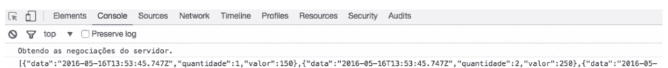

图 12.3：控制台中显示的文本

我们看到显示的是文本，而不是一个`array`（数组）。由于 HTTP 协议仅传输文本，JSON 是 JavaScript 对象的文本表示形式。借助`JSON.parse()`，我们将 JSON 从字符串转换为对象，从而能够轻松地对其进行操作：

```javascript
// client/app/controllers/NegociacaoController.js

class NegociacaoController {

    // código posterior omitido

    importaNegociacoes() {

        const xhr = new XMLHttpRequest();
        xhr.open('GET', 'negociacoes/semana');

        xhr.onreadystatechange = () => {

            if(xhr.readyState == 4) {

                if(xhr.status == 200) {

                    console.log('Obtendo as negociações do servidor.');

                    // realizando o parse
                    console.log(JSON.parse(xhr.responseText));
                } else {
                    console.log(xhr.responseText);
                    this._mensagem.texto = 'Não foi possível obter as negociações da semana';
                }
            }
        };

        xhr.send();
    }
}
```

在控制台中，我们看到了`JSON.parse()`的输出，这是一个 JavaScript 对象数组：

```
▶ Array[3] (1)
  ▶ 0: Object
    data: "2016-05-16T13:54:58.767Z"
    quantidade: 1
    valor: 150
    ▶ __proto__: Object
  ▶ 1: Object
    data: "2016-05-16T13:54:58.767Z"
    quantidade: 2
    valor: 250
    ▶ __proto__: Object
  ▶ 2: Object
    data: "2016-05-16T13:54:58.767Z"
    quantidade: 3
    valor: 350
    ▶ __proto__: Object
  length: 3
  ▶ __proto__: Array[0]
```

图 12.4：控制台中的数组

尽管我们将请求结果转换成了对象数组，但我们不能简单地通过`this._negociacoes.adiciona()`将数组中的每个项目添加到交易列表中。该方法预期接收一个`Negociacao`实例，而我们接收到的数据仅是包含`data`、`quantidade`和`valor`属性的对象。在添加之前，我们需要将每个对象转换为`Negociacao`实例。

我们将通过对转换后的对象数组使用`map()`函数来完成此转换。随后，利用转换后的数组，我们将通过`forEach`函数迭代每个`Negociacao`实例，并将每一个添加到`this._negociacoes`中：

```javascript
// client/app/controllers/NegociacaoController.js
// código posterior omitido

importaNegociacoes() {

    const xhr = new XMLHttpRequest();
    xhr.open('GET', 'negociacoes/semana');

    xhr.onreadystatechange = () => {

        if(xhr.readyState == 4) {

            if(xhr.status == 200) {

                // converte cada objeto para uma instância de Negociacao
                JSON.parse(xhr.responseText)
                    .map(objeto => new Negociacao(objeto.data, objeto.quantidade, objeto.valor))
                    .forEach(negociacao =>
                        this._negociacoes.adiciona(negociacao));

                this._mensagem.texto = 'Negociações importadas com sucesso!';
            }
        }
    };
}
```

```javascript
    } else {
        console.log(xhr.responseText);
        this._mensagem.texto = '无法获取本周交易记录';
    }
};

xhr.send();
}

// 后续代码省略
```

我们的代码几乎完成了，因为如果我们尝试添加一笔新交易，将会收到一条错误信息。

现在，如果我们访问`localhost:3000/negociacoes/semana`地址，会看到日期的字符串格式有些不同。

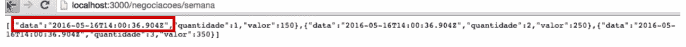

图 12.5：奇怪格式的日期

我们之前是直接在`Negociacao`的`constructor()`中传递`object.data`的文本表示。现在，我们将改为传递一个`Date`的新实例，其`constructor()`接收字符串格式的日期，因为这是有效的构造方式：

```javascript
// client/app/controllers/NegociacaoController.js
// 前面的代码省略

// 注意我们现在使用 new Date(object.data)

JSON
    .parse(xhr.responseText)
    .map(objeto => new Negociacao(new Date(objeto.data), objeto.quantidade, objeto.valor))
    .forEach(negociacao => this._negociacoes.adiciona(negociacao));
```

```javascript
this._mensagem.texto = 'Negociações importadas com sucesso!';
```

```javascript
// 后续代码省略
```


图 12.6：交易记录导入成功

消息将正确显示，我们可以认为这第一部分已经完成。接下来，我们来做一个小实验，看看错误情况下会发生什么。我们将`importaNegociacoes()`中的地址改为`negociacoes/xsemana`：

```javascript
// client/app/controllers/NegociacaoController.js
```

```javascript
// 前面的代码省略
importaNegociacoes() {

    const xhr = new XMLHttpRequest();

    // 强制制造一个错误，使用一个不存在的地址
    xhr.open('GET', 'negociacoes/xsemana');

    // 后续代码省略
}
```

在这种情况下，当我们尝试刷新页面时，用户将看到以下错误信息：

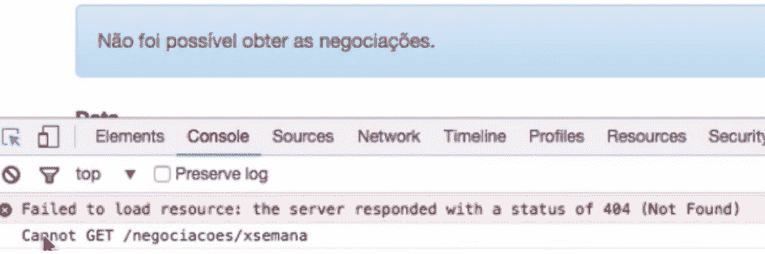

图 12.7：错误信息

**测试完成后别忘了把地址改回来！**

我们已经能够使用标准 JavaScript 发送异步请求（Ajax），而无需借助 jQuery 等库。不过，我们的代码还可以进一步优化。

### 12.4 分离职责

我们已经能够导入交易记录了，但如果有其他控制器也需要导入交易记录会怎样呢？我们将不得不重复所有与服务器交互的逻辑。此外，访问 API 并不是`NegociacaoController`的职责，它的职责仅仅是捕获用户操作以及在 model 和 view 之间架起桥梁。

我们将把与服务器交互的职责隔离到一个集中管理的类中。创建文件`client/app/domain/negociacao/NegociacaoService.js`：

```javascript
// client/app/domain/negociacao/NegociacaoService.js

class NegociacaoService {

    obterNegociacoesDaSemana() {

    }
}
```

我们需要在`client/index.html`中引入刚刚创建的脚本。然而，由于它将是`NegociacaoController`构造函数中的依赖项，必须在`app.js`之前引入，因为`NegociacaoController`的实例是在该文件中创建的。

该类将有一个名为`obterNegociacaoDaSemana()`的方法。在这个方法内部，我们将把之前在`NegociacaoController`的`importaNegociacoes()`方法中编写的代码迁移过来：

```html
<!-- client/index.html -->
<!-- 前面的代码省略 -->

<script src="app/domain/negociacao/Negociacao.js"></script>
<script src="app/controllers/NegociacaoController.js"></script>
<script src="app/ui/converters/DateConverter.js"></script>
```

```html
<script src="app/domain/negociacao/Negociacoes.js"></script>
<script src="app/ui/views/View.js"></script>
<script src="app/ui/views/NegociacoesView.js"></script>
<script src="app/ui/models/Mensagem.js"></script>
<script src="app/ui/views/MensagemView.js"></script>
<script src="app/util/ProxyFactory.js"></script>
<script src="app/util/Bind.js"></script>
<script src="app/util/ApplicationException.js"></script>
<script src="app/ui/converters/DataInvalidaException.js"></script>
```

```html
<!-- 在这里引入！ -->
<script src="app/domain/negociacao/NegociacaoService.js"></script>
```

```html
<script src="app/app.js"></script>
<!-- 后续代码省略 -->
```

现在，我们将`NegociacaoController`中`importarNegociacoes`方法的全部代码迁移到新类的方法中：

```javascript
// client/app/domain/negociacao/NegociacaoService.js

class NegociacaoService {

    obterNegociacoesDaSemana() {

        // 代码已迁移！

        const xhr = new XMLHttpRequest();
        xhr.open('GET', 'negociacoes/semana');

        xhr.onreadystatechange = () => {

            if(xhr.readyState == 4) {

                if(xhr.status == 200) {

                    JSON
                    .parse(xhr.responseText)
                    .map(objeto => new Negociacao(new Date(objeto.data), objeto.quantidade, objeto.valor))
                }
            }
        };
    }
}
```

```javascript
.forEach(negociacao =>
this._negociacoes.adiciona(negociacao));

this._mensagem.texto = 'Negociações importadas com sucesso!';

} else {
    console.log(xhr.responseText);
    this._mensagem.texto = 'Não foi possível obter as negociações da semana';
    }
}
};

xhr.send();
}
}
```

由于代码已经迁移，目前`NegociacaoController`中的`importaNegociacoes()`方法将为空。

现在，在`NegociacaoController`的`constructor()`中，我们将`this._service`属性赋值为`NegociacaoService`的一个实例，以便可以在类的任何方法中访问：

```javascript
// client/app/controllers/NegociacaoController.js

class NegociacaoController {

    constructor() {

        // 前面的代码省略

        this._service = new NegociacaoService();
    }
}
```

接下来，在我们控制器中空的`importaNegociacoes()`方法里，我们将调用服务的`obterNegociacoesDaSemana()`方法：

```javascript
// client/app/controllers/NegociacaoController.js

// 前面的代码省略

importaNegociacoes() {

    this._service.obterNegociacoesDaSemana();

}
```

```javascript
// 后续代码省略
```

按照当前的代码结构，我们无法成功导入交易记录，因为`obterNegociacoesDaSemana()`方法引用了`NegociacaoController`的元素，而两者应该是相互独立的。

解决这个问题的第一步是从`obterNegociacoesDaSemana()`方法中移除所有对`NegociacaoController`属性的引用。修改后如下：


```javascript
// client/app/domain/negociacao/NegociacaoService.js

class NegociacaoService {
    obterNegociacoesDaSemana() {
        // 代码已迁移！

        const xhr = new XMLHttpRequest();
        xhr.open('GET', 'negociacoes/semana');

        xhr.onreadystatechange = () => {
            if (xhr.readyState == 4) {
                if (xhr.status == 200) {
                    // 不再执行 forEach
                    JSON.parse(xhr.responseText)
                        .map(objeto => new Negociacao(new
```

```javascript
Date(objeto.data), objeto.quantidade, objeto.valor));

// 不再显示消息
} else {
    console.log(xhr.responseText);

    // 不再显示消息
}
}
};

xhr.send();
}
}
```

按照目前的状态，导入交易记录时我们不再收到错误信息，但交易数据也没有被插入到表格中。实际上，我们甚至没有任何成功或失败的提示消息。一方面，`NegociacaoController` 的 `importaNegociacoes()` 方法依赖于服务器返回的交易列表；另一方面，`NegociacaoService` 类知道如何获取数据，但不知道该如何处理这些数据。

为了解决这个僵局，调用 `this._service.obterNegociacoesDaSemana()` 方法的地方需要传递一个函数，该函数包含当方法从服务器获取到数据后要执行的逻辑。为了更好地理解这种策略，我们先传递函数但暂不修改 `obterNegociacoesDaSemana()` 方法：

```javascript
// client/app/controller/NegociacaoController.js
// 前面的代码省略

importaNegociacoes() {
    this._service.obterNegociacoesDaSemana((err, negociacoes) => {
        if (err) {
            this._mensagem.texto = 'Não foi possível obter nas
```

```javascript
negociações da semana';
    return;
}

negociacoes.forEach(negociacao =>
    this._negociacoes.adiciona(negociacao));

this._mensagem.texto = 'Negociações importadas com sucesso';
});
}

// código posterior omitido
```

我们传递的函数是一个 `callback`（回调函数，即稍后将被调用的函数），它遵循 `Error-First-Callback` 模式。这种方法在处理异步代码时非常常见。如果接收回调的函数无法执行其操作，回调函数的第一个参数将接收到一个错误，第二个参数则为 `null`。

如果接收回调的函数能够成功执行操作，回调函数的第一个参数将接收 `null`，而第二个参数则是操作产生的结果数据（在我们的案例中，是交易列表）。通过判断 `err` 是否有值，我们可以处理操作的成功或失败。

现在，在 `NegociacaoService` 中，我们将实现该 `callback`（`cb`）：

```javascript
// client/app/domain/negociacao/NegociacaoService.js

class NegociacaoService {
    obterNegociacoesDaSemana(cb) {
        const xhr = new XMLHttpRequest();
        xhr.open('GET', 'negociacoes/semana');

        xhr.onreadystatechange = () => {
```

```javascript
if (xhr.readyState == 4) {
    if (xhr.status == 200) {
        const negociacoes = JSON
            .parse(xhr.responseText)
            .map(objeto => new Negociacao(new
            Date(objeto.data), objeto.quantidade, objeto.valor));

        // OPERAÇÃO CONCLUÍDA, SEM ERRO
        cb(null, negociacoes);
    } else {
        console.log(xhr.responseText);

        // ERRO NA OPERAÇÃO!
        cb('Não foi possível obter nas negociações da semana', null);
    }
}

xhr.send();
```

如果发生错误，我们将执行 `cb` 并显示一条高层级的消息，告知用户无法获取交易信息。当我们刷新页面并填写表单数据时，将看到成功消息。


图 12.8：交易已成功导入

我们的代码运行符合预期。但它在长期维护中是否能站得住脚？是否有其他方法让我们的代码变得更好？我们将在下一章中探讨。

> 本章的完整代码可以在 <https://github.com/flaviohenriquealmeida/cangaceiro-javascript/tree/master/12> 找到。

## 第 13 章：奋斗到底

> “爱主人的马，呼吸方式都一样” —— 《大草原：路径》（Grande Sertão: Veredas）

`Error-First-Callback` 模式非常普遍，尤其是在 Node.js 世界中用于处理异步代码。然而，它的实现污染了方法和函数的调用接口。

今天，如果我们想获取交易列表，我们会调用 `NegociacaoService` 的 `obtemNegociacoesDaSemana()` 方法。但是，该方法只能接收回调函数作为参数，以便我们访问其调用的结果或错误。`obtemNegociacoesDaSemana()` 的参数并不属于交易领域（domain），而更多是我们代码的基础设施参数。

同样的情况也发生在 `HttpService` 的 `get()` 方法中。它接收用于检索信息的服务器 `url` 作为第一个参数，而第二个参数则是用于捕获操作成功或错误返回值的回调函数。

除了上述内容，我们还需要始终通过检查 `err` 是否有值来判断操作是否成功。更糟糕的是，我们可能会陷入回调地狱（Callback HELL）。

### 13.1 回调地狱（Callback HELL）

这种方法的另一个问题是我们可能会陷入 Callback HELL，这是一种由于异步操作导致的代码结构，看起来像一个横向的金字塔。让我们看一个例子：我们使用 `HttpService` 执行四个 `get()` 请求，最后显示一个包含所有请求数据的汇总列表：

```javascript
// EXEMPLO, NÃO ENTRA EM NOSSO CÓDIGO

const service = new HttpService();

let resultado = [];

service.get('http://www.endereco1.com', (err, dados1) => {
  resultado = resultado.concat(dados1);
  service.get('http://www.endereco2.com', (err, dados2) => {
    resultado = resultado.concat(dados2);
    service.get('http://www.endereco3.com', (err, dados3) => {
      resultado = resultado.concat(dados3);
      service.get('http://www.endereco4.com', (err, dados4) => {
        resultado = resultado.concat(dados4);
        console.log('Lista completa');
        console.log(resultado);
      });
    });
  });
});
```

不需要深思就能意识到，这种结构并不利于维护。是否存在另一种模式，能让我们编写出更具可读性且易于维护的代码？

### 13.2 Promise 设计模式

为了处理异步操作的复杂性，设计模式中引入了 Promise。事实上，从 ES2015（ES6）版本开始，这一模式已成为 JavaScript 语言的原生支持。

**Promise 是一个动作的未来结果；** 所谓“未来”，是因为它可能是异步操作的产物。例如，当我们访问服务器时，请求可能花费几毫秒或几秒钟，这取决于请求过程中的多种因素。

在完全重构（在不改变行为的情况下更改代码）我们的代码之前，我们先仅修改 `NegociacaoController`，更准确地说是其 `importaNegociacoes()` 方法，使其将 `this._service.obtemNegociacoesDaSemana()` 方法的返回值视为一个 Promise。

修改我们的代码：

```javascript
// client/app/controllers/NegociacaoController.js

// código anterior omitido

importaNegociacoes() {
    // apagou o código anterior, começando do zero
    const promise = this._service.obtemNegociacoesDaSemana();
}
```

这行代码中有两点值得注意。首先是调用 `this._service.obtemNegociacoesDaSemana()` 方法时不再传递回调函数。其次，操作的结果是一个 Promise。我们通过 `then()` 函数与 Promise 进行交互。

`then()` 函数接收两个函数（回调）作为参数。第一个函数让我们访问异步操作的返回值，而第二个函数则处理操作期间可能发生的错误。

修改我们的代码：

```javascript
// client/app/controllers/NegociacaoController.js

// código anterior omitido

importaNegociacoes() {
    const promise = this._service.obtemNegociacoesDaSemana();

    promise.then(
        negociacoes => {
            negociacoes.forEach(negociacao =>
                this._negociacoes.adiciona(negociacao));
            this._mensagem.texto = 'Negociações importadas com sucesso';
        },
        err => this._mensagem.texto = err
    );
}
```

```javascript
// código posterior omitido
```

我们可以通过删除 `promise` 变量来简化上述代码：

```javascript
// client/app/controllers/NegociacaoController.js

// código anterior omitido

importaNegociacoes() {
    this._service.obtemNegociacoesDaSemana()
        .then(
            negociacoes => {
                negociacoes.forEach(negociacao =>
                    this._negociacoes.adiciona(negociacao));
                this._mensagem.texto = 'Negociações importadas com sucesso';
            },
            err => this._mensagem.texto = err
        );
}
```

```javascript
);
}
```

```javascript
// código posterior omitido
```

让我们回顾一下！返回 Promise 的方法不需要接收回调函数，从而避免了污染其调用接口。`then()` 函数避免了使用 `if` 条件来处理成功或失败，因为它在接收的回调函数中分别处理两者。第一个函数用于获取操作结果，第二个函数用于处理可能发生并阻止操作完成的错误。

太棒了。然而，我们的代码目前还不能运行，因为 `NegociacaoService` 的 `obtemNegociacoesDaSemana()` 方法还没有返回 Promise。现在是时候修改它了。

### 13.3 创建 Promise

将 `NegociacaoService` 的 `obtemNegociacoesDaSemana()` 方法转换的第一步，是将所有现有代码放入一个 Promise 块中。首先，让我们看看创建 Promise 时的结构：

```javascript
// EXEMPLO, NÃO ENTRA NA APLICAÇÃO AINDA

new Promise((resolve, reject) => {
    // lógica da promise!
});
```

`Promise` 的 `constructor()` 接收一个准备好接收两个参数的函数。第一个参数是对一个函数的引用，该函数应接收所封装的异步操作的结果。第二个参数则是可能发生的错误。

我们将修改 `obtemNegociacoesDaSemana()` 方法，将所有现有代码包裹在一个新的 Promise 块中：

```javascript
// client/domain/negociacao/NegociacaoService.js
// código anterior omitido

obtemNegociacoesDaSemana(cb) {
    return new Promise((resolve, reject) => {
        /* início do bloco da Promise */

        const xhr = new XMLHttpRequest();
        xhr.open('GET', 'negociacoes/semana');

        xhr.onreadystatechange = () => {
```

```javascript
if (xhr.readyState == 4) {
    if (xhr.status == 200) {
        const negociacoes = JSON
            .parse(xhr.responseText)
            .map(objeto => new Negociacao(new Date(objeto.data), objeto.quantidade, objeto.valor));

        cb(null, negociacoes);
    } else {
        cb('Não foi possível obter nas negociações', null);
    }
}
};

xhr.send();

/* fim do bloco da Promise */
});
}

// código posterior omitido
```

传递给 Promise 的 `constructor()` 的函数有两个参数：`resolve` 和 `reject`。第一个是对一个函数的引用，我们通过它传入操作的值。第二个则是传入失败的原因。

现在，在之前使用 `cb` 的地方，我们将使用 `resolve()` 和 `reject()`。方法将变为如下形式：


```javascript
// client/domain/negociacao/NegociacaoService.js
// código anterior omitido

// NÃO RECEBE MAIS O CALLBACK
obtemNegociacoesDaSemana() {
    return new Promise((resolve, reject) => {

        const xhr = new XMLHttpRequest();
        xhr.open('GET', 'negociacoes/semana');

        xhr.onreadystatechange = () => {

            if(xhr.readyState == 4) {

                if(xhr.status == 200) {

                    const negociacoes = JSON
                        .parse(xhr.responseText)
                        .map(objeto => new Negociacao(new Date(objeto.data), objeto.quantidade, objeto.valor));

                        // CHAMOU RESOLVE
                        resolve(negociacoes);
                } else {

                    // CHAMOU REJECT
                    reject('Não foi possível obter nas negociações');
                }
            }
        };

        xhr.send();

    });
}
// código posterior omitido
```

完美！交易数据的导入功能在新的 Promise 代码组织模式下仍然正常工作。不过，我们还可以让代码变得更好。

### 13.4 创建服务以隔离 `XMLHttpRequest` 的复杂性

之前方案的问题在于，所有需要执行此类请求的方法中都存在 `XMLHttpRequest` 配置代码的重复。为了解决这个问题，我们将把处理 `XMLHttpRequest` 的复杂性隔离到一个服务类中，该类同样会使用 Promise 模式。

我们来创建文件 `client/app/util/HttpService.js`：

```javascript
// client/app/util/HttpService.js

class HttpService {

  get(url) {

    return new Promise((resolve, reject) => {

      const xhr = new XMLHttpRequest();

      xhr.open('GET', url);

      xhr.onreadystatechange = () => {

        if(xhr.readyState == 4) {

          if(xhr.status == 200) {

            // PASSOU O RESULTADO PARA RESOLVE
            // JÁ PARSEADO!
            resolve(JSON.parse(xhr.responseText));
          } else {

            console.log(xhr.responseText);

            // PASSOU O ERRO PARA REJECT
            reject(xhr.responseText);
          }
        }
      };

      xhr.send();

    });
  }
}
```

现在，我们不能忘记在 `client/index.html` 中导入该脚本。请注意导入的顺序。由于该脚本是 `NegociacaoService` 的依赖项，所以它必须在之前导入：

```html
<!-- client/index.html -->
<!-- código anterior omitido -->

<script src="app/domain/negociacao/Negociacao.js"></script>
<script src="app/controllers/NegociacaoController.js"></script>
<script src="app/ui/converters/DateConverter.js"></script>
<script src="app/domain/negociacao/Negociacoes.js"></script>
<script src="app/ui/views/View.js"></script>
<script src="app/ui/views/NegociacoesView.js"></script>
<script src="app/ui/models/Mensagem.js"></script>
<script src="app/ui/views/MensagemView.js"></script>
<script src="app/util/ProxyFactory.js"></script>
<script src="app/util/Bind.js"></script>
<script src="app/util/ApplicationException.js"></script>
<script src="app/ui/converters/DataInvalidaException.js"></script>
<script src="app/domain/negociacao/NegociacaoService.js"></script>

<!-- importou aqui! -->
<script src="app/util/HttpService.js"></script>

<script src="app/app.js"></script>
<!-- código posterior omitido -->
```

让我们来看一个服务运行的示例：

```javascript
// EXEMPLO APENAS, AINDA NÃO ENTRA NA APLICAÇÃO

const http = new HttpService();
http
  .get('negociacoes/semana')
  .then(
    dados => console.log(dados),
    err => console.log(err)
  );
```

现在，我们需要将 `HttpService` 与 `NegociacaoService` 集成。在集成过程中，关于 Promise 的新细节将会显现出来。

第一步是将 `HttpService` 的一个实例作为 `NegociacaoService` 的依赖，通过 `this._http` 属性添加进去：

```javascript
// client/app/domain/service/NegociacaoService.js

class NegociacaoService {

  constructor() {

    // NOVA PROPRIEDADE!
    this._http = new HttpService();

  }

  obtemNegociacoesDaSemana() {

    // código anterior omitido

  }
}
```

我们来修改 `obtemNegociacoesDaSemana()` 方法，使其使用我们的新服务：

```javascript
// client/app/domain/service/NegociacaoService.js

class NegociacaoService {

    constructor() {
        this._http = new HttpService();
    }

    obtemNegociacoesDaSemana() {

        // ATENÇÃO, RETURN AQUI!

        return this._http
            .get('negociacoes/semana')
            .then(
                dados => {

                    const negociacoes = dados.map(objeto =>
                        new Negociacao(new Date(objeto.data),
                        objeto.quantidade, objeto.valor));

                    // ATENÇÃO AQUI!
                    return negociacoes;
                },
                err => {
                    // ATENÇÃO AQUI!
                    throw new Error('Não foi possível obter as negociações');
                }
            );
    }
}
```

我们并没有创建一个新的 Promise，而是返回了一个已存在的 Promise，即由 `HttpService` 的 `get()` 方法创建的 Promise。返回的 Promise 已经知道如何处理请求的成功或失败。除了这个细节之外，我们的代码还有两个值得注意的地方。

第一个是在传递给 `then()` 的成功回调中 `return negociacoes`。按照规则，任何包含 `return` 的 Promise 都会在下一次链式调用 `then()` 时提供返回的值。因此，调用 `obtemNegociacoesDaSemana()` 方法的代码可以这样获取 `return negociacoes`：

```javascript
// EXEMPLO, NÃO ENTRA NA APLICAÇÃO AINDA

const service = new NegociacaoService();
service
  .obtemNegociacoesDaSemana()
  // AQUI TEMOS ACESSO AO RETURN DA PROMISE
  .then(negociacoes => console.log(negociacoes));
```

最后，仍然在 `obtemNegociacoesDaSemana()` 方法中，当 `HttpService` 的 `get()` 方法创建的 Promise 失败时，我们通过 `throw new Error('Não foi possível obter as negociações')` 抛出一个异常。当我们想要返回一个新的错误响应时，这是必要的：

```javascript
// EXEMPLO, NÃO ENTRA NA APLICAÇÃO AINDA

const service = new NegociacaoService();
service
  .obtemNegociacoesDaSemana()
  .then(
    negociacoes => console.log(negociacoes),
    // AQUI ACESSAMOS O ERRO DO THROWS
    err => console.log(err);
  );
```

我们的代码保持了相同的行为，只是改变了它的组织方式。我们继续通过点击表单上的“导入交易”按钮来导入本周的交易数据。

### 13.5 按顺序解决 Promise

我们的应用除了导入本周的交易数据外，还需要导入上一周的交易数据。实际上，服务器上提供的 API 中就有返回该信息的接口。最终，我们希望在同一个表格中展示所有的交易数据。

在 `NegociacaoService` 中，我们将创建 `obtemNegociacoesDaSemanaAnterior()` 方法，其代码与现有方法完全相同。唯一不同的是 API 地址和错误消息：

```javascript
// client/app/domain/negociacao/NegociacaoService.js
// codigo posterior omitido

obtemNegociacoesDaSemanaAnterior() {

    return this._http
        .get('negociacoes/anterior')
        .then(
            dados => {

                const negociacoes = dados.map(objeto => 
                    new Negociacao(new Date(objeto.data),
                        objeto.quantidade, objeto.valor));

                return negociacoes;
            },
            err => {
                // ATENÇÃO AQUI!
                throw new Error('Não foi possível obter as negociações da semana anterior');
            }
        );
}

// código anterior omitido
```

我们将修改 `NegociacaoController` 的 `importaNegociacoes()` 方法，以导入上一周的交易数据。我们先来看代码，然后再进行讨论：

```javascript
// client/app/controllers/NegociacaoController.js

// 此前代码已省略

importaNegociacoes() {

    const negociacoes = [];

    this._service
        .obtemNegociacoesDaSemana()
        .then(semana => {

            // 使用展开运算符
            negociacoes.push(...semana);

            // 当我们返回一个Promise时，它的返回值
            // 可以通过链式调用then方法来访问

            return this._service.obtemNegociacoesDaSemanaAnterior();
        })
        .then(anterior => {

            negociacoes.push(...anterior);
            negociacoes.forEach(negociacao => this._negociacoes.adiciona(negociacao));
            this._mensagem.texto = 'Negociações importadas com sucesso';
        })
        .catch(err => this._mensagem.texto = err);
}
```

我们创建了一个空数组 `negociacoes`，用于接收本周和上周的交易数据。我们首先调用 `this._service.obtemNegociacoesDaSemana()` 方法，它返回一个 Promise。

通过 `then()` 方法，我们可以访问操作的结果——到目前为止没有什么新内容。

同样在 `then()` 中，我们使用展开运算符执行 `negociacoes.push(...anterior)`，它会将 `anterior` 数组的每个元素拆分，并作为参数传递给 `push()` 函数。该函数可以处理一个或多个参数。

将本周的交易数据添加到 `negociacoes` 数组后，我们执行了那条神秘的指令 `return this._service.obtemNegociacoesDaSemanaAnterior()`。这里的 `return` 并非偶然，任何返回 Promise 的 `then()` 函数都会使该 Promise 的结果在下一次 `then()` 调用中可访问。这就是为什么我们有：

```javascript
// 仅供回顾！
// 此前代码已省略

.then(anterior => {

    negociacoes.push(...anterior);
    negociacoes.forEach(negociacao =>
        this._negociacoes.adiciona(negociacao));
        this._mensagem.texto = 'Negociações importadas com sucesso';
})
// 此后代码已省略
```

在这次调用中，`anterior` 是上周的交易数据，即被返回的 Promise 的结果。请注意，这种策略避免了回调地狱，因为我们没有嵌套的函数调用。

最后，我们首次调用了 `catch()` 函数，该函数存在于每个 Promise 中。它允许我们将 Promise 的错误处理集中在一处。这避免了我们不得不为每个 Promise 传递处理错误的回调。


重新加载页面并点击“导入交易”按钮，一切仍然正常运行，很好。但`NegociacaoService`中还缺少一个方法。

我们还需要导入**上上周**的交易数据。为此，我们将在`NegociacaoService`中创建`obtemNegociacoesDaSemanaRetrasada()`方法。就像我们之前创建的方法一样，它与`obtemNegociacoesDaSemana()`完全相同，只是API地址和错误消息不同：

```javascript
// client/app/domain/negociacao/NegociacaoService.js
// 此前代码已省略

obtemNegociacoesDaSemanaRetrasada() {

    return this._http
        .get('/negociacoes/retrasada')
        .then(
            dados => {

                const negociacoes = dados.map(objeto =>
                    new Negociacao(new Date(objeto.data),
                objeto.quantidade, objeto.valor));

                return negociacoes;
            },
            err => {

                throw new Error('Não foi possível obter as negociações da semana retrasada');
            }
        );
}
```

现在，我们将重复之前的操作，并将`NegociacaoController`中`importaNegociacoes()`方法的调用整合起来：

```javascript
// client/app/controllers/NegociacaoController.js
// 此前代码已省略

importaNegociacoes() {

    const negociacoes = [];

    this._service
        .obtemNegociacoesDaSemana()
        .then(semana => {
            negociacoes.push(...semana);

            return this._service.obtemNegociacoesDaSemanaAnterior();
        })
        .then(anterior => {
            negociacoes.push(...anterior);
            return this._service.obtemNegociacoesDaSemanaRetrasada();
        })
        .then(retrasada => {
            negociacoes.push(...retrasada);
            negociacoes.forEach(negociacao =>
                this._negociacoes.adiciona(negociacao));
            this._mensagem.texto = 'Negociações importadas com sucesso';
        })
        .catch(err => this._mensagem.texto = err);
}

// 此后代码已省略
```

我们的方法按顺序解决Promise，也就是说，只有第一个Promise被解决后，它才会尝试解决第二个，只有第二个被解决后，才会解决第三个。然而，在某些场景下，可能更有趣的是并行解决所有Promise，特别是当解决顺序不重要时。这就是我们接下来要看到的。

### 13.6 并行解决Promise

我们可以借助`Promise.all()`来并行解决我们的Promise，它接收一个Promise数组作为参数。我们将从头开始重写`NegociacaoController`的`importaNegociacoes()`方法。

```javascript
// client/app/controllers/NegociacaoController.js
// 此前代码已省略

importaNegociacoes() {

    // 接收一个Promise数组

    Promise.all([
        this._service.obtemNegociacoesDaSemana(),
        this._service.obtemNegociacoesDaSemanaAnterior(),
        this._service.obtemNegociacoesDaSemanaRetrasada()
    ])
    .then(periodo => console.log(periodo))
    .catch(err => this._mensagem.texto = err);
}
```

`Promise.all()`函数将并行解决所有Promise，这可以大大减少这些操作所花费的时间。当所有Promise都被解决后，对`then()`函数的调用将返回一个二维数组，即数组的每个位置都是由每个Promise返回的交易列表，顺序与传递给`Promise.all()`的顺序相同。我们可以通过查看`console.log(periodo)`的输出来验证这个信息。

我们不能简单地遍历这个数组并将每个交易添加到`this._negociacoes`中，因为正如我们所看到的，数组的每个项本身也是一个数组。我们需要将`periodo`变成一个一维数组，也就是说，我们想要展平（flatten）这个数组。

我们可以借助之前章节中已经使用过的`reduce()`函数轻松实现这个结果：

```javascript
// client/app/controllers/NegociacaoController.js
// 此前代码已省略

importaNegociacoes() {

    Promise.all([
        this._service.obtemNegociacoesDaSemana(),
        this._service.obtemNegociacoesDaSemanaAnterior(),
        this._service.obtemNegociacoesDaSemanaRetrasada()
    ])
    .then(periodo => {

        // periodo仍然是一个包含3个数组元素的数组

        periodo = periodo.reduce((novoArray, item) => novoArray.concat(item), []);

        // 一个包含九个元素的数组
        console.log(periodo);
    })
    .catch(err => this._mensagem.texto = err);
}
```

经过这个修改，`periodo`变成了一个包含九个元素的数组，而不是之前包含三个数组的数组。现在，我们可以将新数组中的每一项添加到我们的交易列表中：

```javascript
// client/app/controllers/NegociacaoController.js
// 此前代码已省略

importaNegociacoes() {

    Promise.all([
        this._service.obtemNegociacoesDaSemana(),
        this._service.obtemNegociacoesDaSemanaAnterior(),
        this._service.obtemNegociacoesDaSemanaRetrasada()
    ])
    .then(periodo => {

        periodo
            .reduce((novoArray, item) => novoArray.concat(item), [])
            .forEach(negociacao =>
                this._negociacoes.adiciona(negociacao));

        this._mensagem.texto = 'Negociações importadas com sucesso';
    })
    .catch(err => this._mensagem.texto = err);
}

// 此后代码已省略
```

又一个改进的代码，但它仍然违反了一个原则。获取时间段内交易数据的逻辑不应该在`NegociacaoController`中，而应该在`NegociacaoService`中。我们将在这个类中创建`obtemNegociacoesDoPeriodo()`方法：

```javascript
// client/app/domain/negociacao/NegociacaoService.js
// 此前代码已省略

obtemNegociacoesDoPeriodo() {

    // 通过this访问自身的方法

    return Promise.all([
        this.obtemNegociacoesDaSemana(),
        this.obtemNegociacoesDaSemanaAnterior(),
        this.obtemNegociacoesDaSemanaRetrasada()
    ])
    .then(periodo => {

        // 不再使用forEach
        return periodo
            .reduce((novoArray, item) => novoArray.concat(item), []);
    })
    .catch(err => {
        console.log(err);
        throw new Error('Não foi possível obter as negociações do período')
    });
}
```

最后，在`NegociacaoController`中，让我们调用刚刚创建的方法：

```javascript
// client/app/controllers/NegociacaoController.js
// 之前代码省略

importaNegociacoes() {

    this._service
      .obtemNegociacoesDoPeriodo()
      .then(negociacoes => {

          negociacoes.forEach(negociacao => this._negociacoes.adiciona(negociacao));
          this._mensagem.texto = 'Negociações do período importadas com sucesso';
      })
      .catch(err => this._mensagem.texto = err);
}

// 之后代码省略
```

很好。我们看到`Promise.all()`接收一个包含所有我们希望并行解析的Promise的数组。Promise在数组中的位置很重要，因为当它们被解析时，我们可以通过`then`访问一个包含每个Promise结果的数组，其顺序与数组的解析顺序一致。

我们访问的API都“很友好”，每个都按降序返回日期。然而，我们不能依赖一个不是由我们自己创建的API，这就是为什么我们需要在代码中确保我们想要的排序。

### 13.7 对时段进行排序

`NegociacaoService`的`obtemNegociacoesDoPeriodo`方法返回一个Promise，当该Promise被解析时，会返回一个包含交易时段的数组。我们可以通过所有数组都有的`sort()`函数，按照我们想要的方式对这个数组进行排序。

`sort()`函数通过一个函数接收一个比较策略。这个函数会被多次调用，将每个元素与下一个元素进行比较。比较逻辑应满足：如果元素相等则返回`0`；如果第一个元素大于第二个，则返回`1`或更大的数；如果第一个元素小于第二个，则返回`-1`或更小的数。

修改方法：

```javascript
// client/app/domain/negociacao/NegociacaoService.js
// 之前代码省略

obtemNegociacoesDoPeriodo() {

    return Promise.all([
        this.obtemNegociacoesDaSemana(),
        this.obtemNegociacoesDaSemanaAnterior(),
        this.obtemNegociacoesDaSemanaRetrasada()
    ])
    .then(periodo => {

        return periodo
            .reduce((novoArray, item) => novoArray.concat(item), [])
            .sort((a, b) => a.data.getTime() - b.data.getTime());
    })
    .catch(err => {

        console.log(err);
        throw new Error('Não foi possível obter as negociações do período')
    });
}
// 之后代码省略
```

`b.data.getTime()`的结果返回一个代表日期的数字，这对我们的逻辑来说非常方便，因为我们可以通过用第一个元素的结果减去第二个元素的结果来进行比较。如果它们相等，结果总是`0`；如果第一个大于第二个，我们会得到一个正数；如果第一个小于第二个，我们会得到一个负数。这完全满足了`sort()`方法的要求。

然而，我们想要的是降序排列，所以我们需要用`a.data.getTime()`减去`b.data.getTime()`：

```javascript
// client/app/domain/negociacao/NegociacaoService.js
// 之前代码省略

obtemNegociacoesDoPeriodo() {

    return Promise.all([
        this.obtemNegociacoesDaSemana(),
        this.obtemNegociacoesDaSemanaAnterior(),
        this.obtemNegociacoesDaSemanaRetrasada()
    ])
    .then(periodo => {

        return periodo
            .reduce((novoArray, item) => novoArray.concat(item), [])
            .sort((a, b) => b.data.getTime() - a.data.getTime());
    })
    .catch(err => {

        console.log(err);
        throw new Error('Não foi possível obter as negociações do período')
    });
}
// 之后代码省略
```

现在我们可以保证，导入的时段总是会返回一个按交易日期降序排序的列表。那么，又来了那个老问题：我们还能进一步简化代码吗？

让我们看看最后编写的代码，那个对时段进行排序的代码：

```javascript
// 分析代码
.then(periodo => {

    return periodo
        .reduce((novoArray, item) => novoArray.concat(item), [])
        .sort((a, b) => b.data.getTime() - a.data.getTime());
})
```

注意，`then`代码块内只有一条语句，它返回新的已排序数组。我们可以移除箭头函数的代码块，甚至包括`return`语句，因为箭头函数在只有一条语句且没有代码块时，会隐式地返回结果。

```javascript
// 分析代码
.then(periodo => periodo
    .reduce((novoArray, item) => novoArray.concat(item), [])
    .sort((a, b) => b.data.getTime() - a.data.getTime())
)
```

顺便说一下，如果我们查看`NegociacaoService`类的其他方法，它们所有的`then()`代码块中也都只有一条语句。

经过所有简化，我们的`NegociacaoService`类最终将是这样的：


```javascript
// client/app/domain/negociacao/NegociacaoService.js

class NegociacaoService {

    constructor() {
        this._http = new HttpService();
    }

    obtemNegociacoesDaSemana() {

        return this._http
            .get('negociacoes/semana')
            .then(
                dados =>
                    dados.map(objeto =>
                        new Negociacao(new Date(objeto.data), objeto.quantidade, objeto.valor))
                    ,
                err => {

                    throw new Error('Não foi possível obter as negociações da semana');
                }
            );
    }

    obtemNegociacoesDaSemanaAnterior() {

        return this._http
            .get('negociacoes/anterior')
            .then(
                dados => dados.map(objeto =>
                    new Negociacao(new Date(objeto.data), objeto.quantidade, objeto.valor))
                ,
                err => {

                    throw new Error('Não foi possível obter as negociações da semana anterior');
                }
            );
    }

    obtemNegociacoesDaSemanaRetrasada() {

        return this._http
            .get('negociacoes/retrasada')
            .then(
                dados => dados.map(objeto => 
                    new Negociacao(new Date(objeto.data), objeto.quantidade, objeto.valor)),
                err => {
                    throw new Error('Não foi possível obter as negociações da semana retrasada');
                }
            );
    }

    obtemNegociacoesDoPeriodo() {

        return Promise.all([
            this.obtemNegociacoesDaSemana(),
            this.obtemNegociacoesDaSemanaAnterior(),
            this.obtemNegociacoesDaSemanaRetrasada()
        ])
        .then(periodo => periodo
            .reduce((novoArray, item) => novoArray.concat(item), [])
            .sort((a, b) => b.data.getTime() - a.data.getTime())
        )
        .catch(err => {

            console.log(err);
            throw new Error('Não foi possível obter as negociações do período')
        });
    }
}
```

很好！但是，如果你们是细心的观察者，应该已经注意到我们可能会多次导入相同的交易。不如我们避免这种情况发生？思路是不再导入同一天、同一个月、同一年的交易。

#### 13.8 防止重复导入

我们需要采用某种标准来确定我们正在导入的交易是否已经被导入过。换句话说，我们需要某种逻辑来表明一笔交易是否等于另一笔。`==` 运算符能帮助我们吗？让我们在浏览器的 `console` 中进行一些测试。

```javascript
n1 = new Negociacao(new Date(), 1, 100);
n2 = new Negociacao(new Date(), 1, 100);
n1 == n2 // 返回 false！
```

我们不能简单地使用 `==` 运算符来比较非字面量类型（`string`、`number`、`boolean`、`null` 和 `undefined`）的对象，因为它测试的是变量是否指向内存中的同一个地址。

如果我们希望 `n1` 等于 `n2`，我们可以在控制台中这样做：

```javascript
n1 = n2
n1 == n2 // 返回 true
```

在前面的例子中，变量 `n1` 开始指向与 `n2` 相同的对象。由于 `n1` 和 `n2` 现在引用同一个对象，`==` 运算符在它们之间的比较将返回 `true`。

那么，我们对交易的日期进行比较怎么样？我们还是会遇到同样的问题，因为我们将比较两个 `Date` 类型的对象，而 `==` 运算符只会测试对象的属性是否指向内存中的同一个对象。有解决办法吗？当然有。

我们可以这样比较日期：

```javascript
n1.data.getDate() == n2.data.getDate() && n1.data.getMonth() == n2.data.getMonth() && n1.data.getFullYear() == n2.data.getFullYear() // 结果是 true！
```

我们使用的 `Date` 方法返回的是数字，而且默认情况下，`==` 运算符对于这种字面量类型比较的是值，而不是内存中的引用。太好了，我们能够知道两笔交易是否相同。是吗？

我们需要改进比较标准，因为在我们的交易列表中，可能会有同一天的多笔交易。何不在比较时也考虑数量和价值呢？

在浏览器控制台中测试：

```javascript
n1.data.getDate() == n2.data.getDate() && n1.data.getMonth() ==
n2.data.getMonth() && n1.data.getFullYear() ==
n2.data.getFullYear() && n1.quantidade == n2.quantidade && n1.valor
== n2.valor // 返回 true!
```

如果每次需要测试交易之间的相等性时都要重复这个逻辑，那就完全没有面向对象的风格了，因为这属于交易的领域范畴。我们来修改 `Negociacao` 类，添加一个 `equals()` 方法，它将存在于该类的所有实例中：

```javascript
// client/app/domain/negociacao/Negociacao.js

class Negociacao {

    // 前面代码省略

    equals(negociacao) {

        return this.data.getDate() == negociacao.data.getDate()
            && this.data.getMonth() == negociacao.data.getMonth()
            && this.data.getFullYear() ==
negociacao.data.getFullYear()
            && this.quantidade == negociacao.quantidade
            && this.valor == negociacao.valor;
    }
}
```

该方法将调用 `equals()` 方法的实例与该方法接收到的另一笔交易进行比较。

重新加载我们的页面并在浏览器控制台中测试我们的方法，我们将得到：

```javascript
n1 = new Negociacao(new Date(), 1, 100);
n2 = new Negociacao(new Date(), 1, 100);
n1.equals(n2); // 返回 true
```

完美，但我们可以大大精简刚刚创建的 `equals()` 方法。

当对象之间的比较标准基于其拥有的所有属性的值时，我们可以使用 `JSON.stringify()` 的以下技巧：

```javascript
// client/app/domain/negociacao/Negociacao.js

class Negociacao {

    // 前面代码省略

    equals(negociacao) {

        return JSON.stringify(this) == JSON.stringify(negociacao);
    }
}
```

`JSON.stringify()` 函数将一个对象转换为文本表示，即一个字符串。将比较中涉及的对象转换为字符串后，我们可以放心地使用 `==` 运算符来测试它们之间的相等性。简洁多了，不是吗？不过，这个解决方案只有在比较标准是对象拥有的所有属性的值时才有效。

现在，我们需要修改 `NegociacaoController` 的 `importaNegociacoes` 方法的逻辑，使其只导入新的交易。

### 13.9 `filter()` 和 `some()` 函数

我们需要过滤从服务器返回的交易列表，只考虑那些还不在 `this._negociacoes.paraArray()` 返回的数组中的交易。好消息是，数组已经拥有一个为此目的的函数，那就是 `filter()`。

让我们在控制台中单独看看它是如何工作的：

```javascript
lista = ['A', 'B', 'C', 'D'];
listaFiltrada = lista.filter(letra => letra == 'B' || letra == 'C');
```

`filter()` 函数接收一个函数，该函数包含将应用于列表中每个元素的策略。如果函数对某个元素返回 `true`，该元素将被添加到 `filter()` 返回的新列表中。如果返回 `false`，该元素将被忽略。

在前面的例子中，`listaFiltrada` 将只包含字母 "B" 和 "C"。

```javascript
// client/app/controllers/NegociacaoController.js
// 前面代码省略

importaNegociacoes() {

    this._service
        .obtemNegociacoesDoPeriodo()
        .then(negociacoes => {

            negociacoes
                .filter(novaNegociacao => console.log('过滤逻辑在这里'))
                .forEach(negociacao =>
                this._negociacoes.adiciona(negociacao));

            this._mensagem.texto = '期间交易导入成功';
        })
        .catch(err => this._mensagem.texto = err);
    }
}
```

分析代码，我们看到 `forEach()` 函数的调用链将处理过滤后的列表。然而，我们还没有应用任何过滤逻辑。

对于我们过滤处理的每个项目，需要验证它是否已存在于 `this._negociacoes.paraArray()` 中。如果不存在，该项目将成为新列表的一部分。我们可以用多种方式实现这个逻辑，但现在是学习使用 `some()` 函数的恰当时机。

`some()` 函数遍历列表中的每个元素。一旦找到某个（some）符合返回 `true` 的逻辑的元素，它将立即停止迭代并返回 `true`。如果没有元素满足比较标准，数组将被遍历到最后，`some()` 的返回值为 `false`。

我们何不结合 `some()` 和 `filter()` 来避免导入重复的交易呢？首先，让我们看看我们的代码会是什么样子，然后再对它进行评论：

```javascript
// client/app/controllers/NegociacaoController.js

// 前面代码省略

importaNegociacoes() {

    this._service
        .obtemNegociacoesDoPeriodo()
        .then(negociacoes => {

            negociacoes.filter(novaNegociacao =>

!this._negociacoes.paraArray().some(negociacaoExistente =>

                novaNegociacao.equals(negociacaoExistente)))

            .forEach(negociacao =>
this._negociacoes.adiciona(negociacao));

            this._mensagem.texto = '期间交易导入成功';
        })
        .catch(err => this._mensagem.texto = err);
    }
}

// 后面代码省略
```

我们希望导入的交易列表的 `filter()` 函数的逻辑是应用于现有列表的 `some()` 函数的返回值。请记住，`some()` 可以返回 `true` 或 `false`，这些值满足 `filter()` 函数。在这种情况下，我们想过滤要导入的交易列表，只考虑那些不属于已导入交易列表的交易。

通过在已导入的交易列表上应用 `some()`，我们检查要导入的交易是否存在于列表中。但这样一来，函数会返回 `false`，所以我们需要将这个值反转为 `true`，因为只有返回 `true` 时，`filter()` 函数才会将该元素纳入新列表。请注意，我们使用了在 `Negociacao` 模型中创建的 `equals()` 函数。

在我们的函数链的最后，`forEach()` 将只添加尚未导入的交易。

一切看起来都很好，但如果我们在添加了两笔或更多交易后关闭浏览器会发生什么？我们肯定会丢失所有的工作，因为我们的应用程序中没有数据持久化。顺便说一下，这将是我们的下一个话题。

> 本章的完整代码可以在 <https://github.com/flaviohenriquealmeida/cangaceiro-javascript/tree/master/13> 找到

### 第三部分 - 启示

筋疲力尽，他支撑不住，倒下了。在他昏厥期间，他有了新的幻象。在幻象中，兰皮奥脱下帽子，坐在篝火旁，指向相反的方向。醒来后，他才意识到，亡命之徒之路的战利品就是这条路本身。于是，他最后喝了一口他的葫芦，开始踏上通往无处之路，同时也是通往处处之路，越来越准备好面对生活中的惊喜。

## 第14章

### 口袋破了！

> “笑得过早，会呛到。”——广阔的腹地：小径

我们的应用程序是功能性的。然而，如果我们关闭并重新打开浏览器，就会丢失所有已登记的数据。一种解决方案是将应用程序的数据发送给某个服务器的 API，让其存储在数据库中，以便稍后可以通过另一个 API 重新获取。

但是，我们不会使用这种方法。我们将数据存储在每个浏览器都有的数据库中，即 **IndexedDB**。

### 14.1 IndexedDB，浏览器的数据库

IndexedDB 是由 W3C（<https://www.w3.org/>）指定的一种事务型数据库，广泛存在于市场上的各类浏览器中。与使用 SQL 的关系型数据库不同，IndexedDB 不依赖于模式（预定义的表、列及其类型结构），而是基于 JavaScript 对象，这些对象可以被更便捷地持久化和检索。这种数据库对持久化数据的验证做得很少，验证的责任在于使用它的应用程序。

我们不能在不了解其工作原理的情况下就将 IndexedDB 集成到我们的项目中。这就是为什么我们将创建 `db.html` 文件，以便我们先进行实践，然后再将其集成到我们的应用中。让我们创建文件 `client/db.html`，结构如下：

```html
<!-- client/db.html -->

<!DOCTYPE html>
<html>
<head>
    <meta charset="UTF-8">
    <title>学习 IndexedDB</title>
</head>

<body>
    <script>

        /* 我们的测试将在这里进行！ */

    </script>
</body>
</html>
```

第一步是请求建立与 `IndexedDB` 的连接。我们通过全局可用的对象 `indexedDB` 及其 `open()` 方法来完成这一步：


```html
<!DOCTYPE html>
<html>
<head>
    <meta charset="UTF-8">
</head>
<body>
    <script>

        const openRequest = indexedDB.open("jscangaceiro", 1);

    </script>
</body>
```

`open()`方法接受两个参数。第一个是我们希望连接的数据库名称，第二个是我们定义的数字，表示数据库的版本——在这个例子中，选择了值`1`。目前，这第二个参数对我们来说没有太大意义，因此在解释中我们暂时将其搁置。

`openRequest`方法返回一个`IDBOpenDBRequest`实例，即一个数据库打开请求。每次执行打开请求时，我们需要处理一个**三元**事件组，它们是：

- `onupgradeneeded`
- `onsuccess`
- `onerror`

> **注意**
>
> 只有在此处指示时才在浏览器中重新加载页面。如果在代码的关键点之前重新加载，您将遇到数据库更新问题，这些问题只能在稍后解决。

```html
<!-- client/db.html -->
<!-- 先前代码省略 -->

<body>
    <script>

        const openRequest = indexedDB.open('jscangaceiro', 1);

        // 处理三元事件组！

        openRequest.onupgradeneeded = function(e) {

          console.log('创建或更改一个已存在的数据库');
        };

        openRequest.onsuccess = function(e) {

          console.log('成功建立连接！');
        };

        openRequest.onerror = function(e) {

          console.log(e.target.error);
        };

    </script>
</body>

<!-- 后续代码省略 -->
```

我们将`openRequest.onupgradeneeded`赋值为一个函数，该函数仅在我们将要连接的数据库不存在时，或者在我们正在更新已存在的数据库时被调用，这个主题我们很快就会讨论。接着，在`openRequest.onsuccess()`中，我们赋值为当成功建立连接时被调用的函数。最后，在`openRequest.onerror`中，我们赋值为在连接打开过程中发生错误时被调用的函数。我们将通过`e.target.error`来访问错误原因。

在继续之前，何不使用箭头函数来使代码更简洁呢？将此类型的函数用于这三个事件没有任何问题：

```html
<!-- client/db.html -->
<!-- 先前代码省略 -->

<body>
    <script>
        const openRequest = indexedDB.open('jscangaceiro', 1);

        openRequest.onupgradeneeded = e => {
            console.log('创建或更改一个已存在的数据库');
        };

        openRequest.onsuccess = e => {
            console.log('成功建立连接！');
        };

        openRequest.onerror = e => {
            console.log(e.target.error);
        };
    </script>
</body>

<!-- 后续代码省略 -->
```

请在浏览器中重新加载您的页面，以便我们可以在控制台中验证是否显示了`onupgradeneeded`和`onsuccess`的消息。请记住，第一个消息会显示是因为我们是第一次创建数据库，第二个消息显示是因为我们已经成功建立连接。

第一次时，我们将看到以下消息：

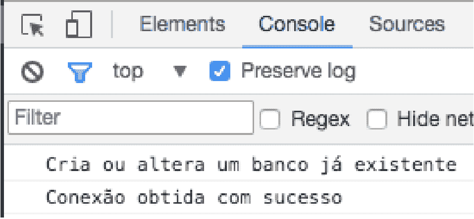

图 14.1：控制台中的两条消息

如果我们再次重新加载页面，我们将只看到其中一条消息。这是合理的，因为数据库已经被创建：

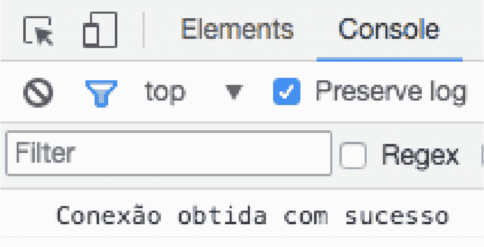

图 14.2：控制台中的一条消息

尽管前面的消息表明数据库已创建，但一个巴西穷人（Cangaceiro）只有亲眼所见才会相信。我们可以通过 Chrome 的控制台，在`Application`标签页中查看已创建的数据库。在左侧，`Storage`部分下，我们有`IndexedDB`。点击此项，它将展开并显示`jscangaceiro`数据库：

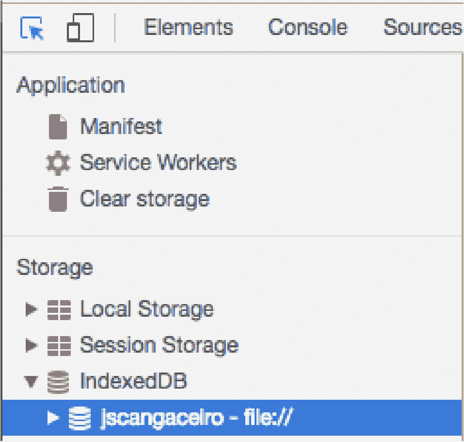

图 14.3：在 Chrome 中查看数据库

既然我们已经理解了三元事件组的作用，现在是时候与我们刚刚创建的数据库进行交互了。

### 14.2 与数据库的连接

连接是通过`onsuccess`事件获得的。该事件关联的函数所接收的唯一参数让我们能够访问`IDBDatabase`的一个实例，该实例代表我们的连接。通过`e.target.result`访问连接：

```html
<!-- client/db.html -->
<!-- 先前代码省略 -->
<body>
  <script>

    const openRequest = indexedDB.open('jscangaceiro', 1);

    openRequest.onupgradeneeded = e =>  {
      console.log('创建或更新数据库');
    };

    openRequest.onsuccess = e => {
      console.log('连接成功');

      // e.target.result 是 IDBDatabase 的一个实例

      e.target.result;
    };

    openRequest.onerror = e => {
      console.log(e.target.error);
    };

  </script>
</body>
<!-- 后续代码省略 -->
```

我们已经知道连接在哪里，但我们需要将其存储在某个变量中，以便在程序的不同场合使用它。为此，我们将在现有代码之前创建`connection`变量。它处于全局作用域，因此可以保存`e.target.result`的结果：

```html
<!-- client/db.html -->
<!-- 先前代码省略 -->

<body>
  <script>

    // 必须使用 let 才能接受新赋值
    let connection = null;

    const openRequest = indexedDB.open('jscangaceiro', 1);

    openRequest.onupgradeneeded = e => {

      console.log('创建或更新数据库');
    };

    openRequest.onsuccess = e => {

      console.log('连接成功');

      // 变量保存了对连接的引用

      connection = e.target.result;
    };

    openRequest.onerror = e => {

      console.log(e.target.error);
    };

  </script>
</body>
<!-- 后续代码省略 -->
```

很好，我们有了一个连接。然而，在考虑与数据库交互之前，我们需要创建一个新的**对象存储**。可以将存储理解为类似 SQL 世界中的表。

### 14.3 我们第一个存储

我们通过数据库连接在`onupgradeneeded`事件期间创建新的存储。然而，当此事件被触发时，`connection`变量的值仍然是`null`，因为它只会在`onsuccess`事件期间获得其值。现在怎么办？

好消息是，我们可以在`onupgradeneeded`事件中获得连接，方式与在`onsuccess`中获得连接相同：

```html
<!-- client/db.html -->
<!-- 先前代码省略 -->

<body>
<script>

let connection = null;

const openRequest = indexedDB.open('jscangaceiro', 1);

openRequest.onupgradeneeded = e => {
    console.log('创建或更改一个已存在的数据库');

    // 获取连接！
    connection = e.target.result;
};

openRequest.onsuccess = e => {
    console.log('连接成功');
    connection = e.target.result;
};

openRequest.onerror = e => {
    console.log(e.target.error);
};
```

```javascript
};

</script>
</body>
<!-- código posterior omitido -->
```

太棒了！按照我们构建代码的方式使得连接既可以来自`onupgradeneeded`也可以来自`onsuccess`。现在我们已经准备好了一切，可以开始创建我们的 store 了。

我们将使用以下逻辑来创建 store。首先，检查我们要创建的 store 是否已经存在；如果存在，在创建之前先将其删除。采用这种方法的原因是由于`onupgradeneeded`事件在更新数据库时也可能会被触发。

为了在更新期间知道 store 是否存在，我们使用`connection.objectStoreNames.contains()`方法并传入 store 的名称。要删除一个 store 并创建新 store，我们分别使用`connection.deleteObjectStore()`和`connection.createObjectStore()`：

```html
<!-- client/dn.html -->
<!-- código anterior omitido -->
<body>
    <script>

        let connection = null;

        const openRequest = indexedDB.open('jscangaceiro', 1);

        openRequest.onupgradeneeded = e => {

            console.log('Cria ou altera um banco já existente');
            connection = e.target.result;

            // pode ser que o evento esteja sendo disparado durante
            // uma atualização,
            // nesse caso, verificamos se a store existe, se existir
            // apagamos a store atual antes de criarmos uma nova
            if(connection.objectStoreNames.contains('negociacoes')) {
                connection.deleteObjectStore('negociacoes');
            }
            connection.createObjectStore('negociacoes', {
                autoIncrement: true 
            });
```

```javascript
// código posterior omitido
```

```html
</script>
</body>
<!-- código posterior omitido -->
```

需要强调的一点是`connection.createObjectStore()`的第二个参数。在这里，我们传递了一个包含`autoIncrement: true`属性的 JavaScript 对象。这非常重要，因为它会为保存在 store 中的对象内部创建一个唯一标识符。

关于更新逻辑，虽然可以设计得更复杂，但对于我们的应用来说，删除旧 store 并创建新 store 就足够了。然而，我们会遇到一个问题。

**重新加载页面**时，只有`onsuccess`事件被调用。`onupgradeneeded`事件仅在创建新数据库或更新现有数据库时被调用。由于我们已经创建了一个数据库，我们需要告诉 IndexedDB 我们想要执行更新。该如何解决？

### 14.4 数据库更新

为了让`onupgradeneeded`事件再次触发，我们要创建的数据库版本必须高于浏览器中现有数据库的版本。因此，只需将任何我们确定高于浏览器中数据库版本的值作为`indexedDB.open()`函数的第二个参数传递即可。在我们的案例中，值`2`就足够了：

```html
<!-- client/db.html -->
<!-- código anterior omitido -->

<body>
    <script>
        let connection = null;

        // INCREMENTAMOS O NÚMERO DA VERSÃO
        const openRequest = indexedDB.open('jscangaceiro', 2);

        // código posterior omitido
    </script>
</body>
<!-- codigo posterior omitido -->
```

这样，**重新加载**页面后，`onupgradeneeded`事件将被触发并创建我们的`negociacoes` storage。

**注意**，在进行新测试之前，请关闭并重新打开浏览器。`Application`选项卡会缓存最后显示的界面信息，即使我们更改了版本，数据库版本可能仍显示为 1。关闭并重新打开浏览器会刷新该区域，从而正确显示数据库的新版本。这一点可能会让读者感到困惑。

最后，当我们访问`Application`选项卡时，会看到数据库版本已更改，且`negociacoes` Object Store 已创建，但目前仍为空。

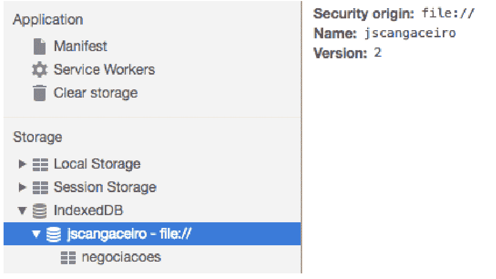

图 14.4: Object store negociacoes

我们的 store 已经准备好持久化数据了，这将是下一节的主题。

### 14.5 事务与持久化

现在到了持久化一些交易（negociações）的时候了。为此，我们需要导入`Negociacao.js`脚本，以便能够创建该类的实例：

```html
<!-- client/db.html -->
<!DOCTYPE html>
<html>
<head>
    <meta charset="UTF-8">
    <title>Aprendendo IndexedDB</title>
</head>
<body>

    <!-- código anterior omitido -->
    <script src="app/domain/negociacao/Negociacao.js"></script>
</body>
</html>
```

现在，我们将创建`adiciona()`函数，稍后我们将调用它将交易添加到数据库中：

```html
<!-- client/db.html -->
<!DOCTYPE html>
<html>
<head>
    <meta charset="UTF-8">
    <title>Aprendendo IndexedDB</title>
</head>

<body>
    <script>
        let connection = null;

        const openRequest = indexedDB.open('jscangaceiro', 2);

        openRequest.onupgradeneeded = e =>  {
            // código omitido
        };

        openRequest.onsuccess = e => {
            // código omitido
        };

        openRequest.onerror = e => {
            // código omitido
        };

        // nova função para adicionar negociações
        function adiciona() {

        }
    </script>
    <script src="js/app/domain/negociacao/Negociacao.js"></script>
</body>
</html>
```

当函数被调用时，它必须能够将一个交易实例写入`IndexedDB`。


持久化过程的第一步是获取一个写事务，随后通过该事务访问我们希望持久化对象的 store。首先来看代码：

```javascript
// client/dn.html
// código anterior omitido

function adiciona() {

  // NOVA INSTÂNCIA DE NEGOCIACAO
  const negociacao = new Negociacao(new Date(), 200, 1);

  const transaction = connection.transaction(['negociacoes'],'readwrite');
  const store = transaction.objectStore('negociacoes');
}
```

```javascript
// código posterior omitido
```

`connection.transaction()` 方法的第一个参数是一个数组，包含我们要创建事务的 store 名称；第二个参数是事务类型。我们传递 `readwrite` 以允许写入。但如果只需要读取，只需将其改为 `readonly` 即可。

通过事务性的 `store`，我们可以执行持久化操作，如新增、修改和删除。

```javascript
// client/dn.html
// código anterior omitido

function adiciona() {

    const negociacao = new Negociacao(new Date(), 200, 1);

    const transaction = connection.transaction(['negociacoes'], 'readwrite');
    const store = transaction.objectStore('negociacoes');

    // ATRAVÉS DA STORE, REQUISITAMOS UMA INCLUSÃO
    const request = store.add(negociacao);
}
```

```javascript
// código posterior omitido
```

在创建 `Negociacao` 实例后，我们使用 `store.add()` 方法将其持久化。然而，此操作仅是一个新增请求。我们需要通过传递给请求的 `onsuccess` 和 `onerror` 事件的回调函数来了解它是否执行成功：

```javascript
// client/dn.html
// código anterior omitido

function adiciona() {
    const negociacao = new Negociacao(new Date(), 200, 1);

    const transaction = connection.transaction(['negociacoes'], 'readwrite');
    const store = transaction.objectStore('negociacoes');
    const request = store.add(negociacao);

    request.onsuccess = e => {
        console.log('negociação salva com sucesso');
    };

    request.onerror = e => {
        console.log('Não foi possível salvar a negociação')
    };
}

// código posterior omitido
```

现在，我们只需要在 Chrome 控制台中调用 `adiciona()` 方法：

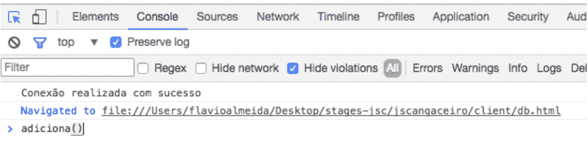

图 14.5：通过控制台调用 `adiciona()`

执行该方法后，我们得到以下输出：


太棒了，现在让我们在 `Application` 选项卡中通过直接点击 store 来查看 `negociacoes` store 的数据：


我们可以通过避免声明中间变量、链式调用函数以及移除部分箭头函数的代码块来进一步简化代码。我们的 `adiciona()` 函数将变为这样：

```javascript
// client/db.html
// código anterior omitido

function adiciona() {
    const negociacao = new Negociacao(new Date(), 200, 1);

    // ENCADEOU AS CHAMADAS
    const request = connection
        .transaction(['negociacoes'], 'readwrite')
        .objectStore('negociacoes')
        .add(negociacao);

    // REMOVEU BLOCO
```

```javascript
request.onsuccess = e =>
    console.log('negociação salva com sucesso');

// REMOVEU BLOCO
request.onerror = e =>
    console.log('Não foi possível savar a negociação');
}

// código posterior omitido
```

更简洁了！

我们成功保存了第一笔交易！稍后，我们将能够列出数据。

### 14.6 游标

我们能够持久化交易，但任何应用程序都需要列出它们。让我们在 `adiciona()` 函数下方立即创建 `listaTodos()` 函数：

```html
<!-- client/db.html -->
<!-- código posterior omitido -->

<body>
    <script>
        // código anterior omitido

        function adiciona() {

            // codigo omitido
        }

        function listaTodos() {

        }

    </script>
    <script src="app/domain/negociacao/Negociacao.js"></script>
</body>

<!-- código posterior omitido -->
```

这个过程与添加交易非常相似。我们需要一个事务，但不再调用 `add()` 方法，而是调用 `openCursor()` 方法，它将返回一个对象的引用，该对象知道如何遍历存储中每个已记录的对象：

```javascript
// client/db.html
// código anterior omitido

function listaTodos() {
    const cursor = connection
        .transaction(['negociacoes'],'readwrite')
        .objectStore('negociacoes')
        .openCursor();

    cursor.onsuccess = e => {

    };

    cursor.onerror = e => {

        // error.name, para ficar mais sucinta a informação

        console.log('Error:' + e.target.error.name);
    };
}
// código posterior omitido
```

我们游标的 `onsuccess` 事件将被调用的次数等于存储在我们的*对象存储*中的交易数量。在第一次调用时，我们将访问一个指针对象，它知道如何访问存储中的第一笔交易。我们将把交易添加到 `negociacoes` 数组中，该数组将接收我们遍历的所有交易。

一旦我们添加了第一笔交易，我们就请求指针对象前往下一个。这个过程会触发对分配给 `onsuccess` 的函数的新调用。一切都会重复，直到我们遍历完存储中的所有对象。最后，我们将得到包含所有已读取交易的数组。

我们的代码将如下所示：

```javascript
// client/db.html
// código anterior omitido

function listaTodos() {

    const negociacoes = [];

    const cursor = connection
        .transaction(['negociacoes'], 'readwrite')
        .objectStore('negociacoes')
        .openCursor();

    cursor.onsuccess = e => {

        // objeto ponteiro para uma negociação
        const atual = e.target.result;

        // se for diferente de null, é porque ainda há dados
        if(atual) {

            // atual.value guarda os dados da negociação
            negociacoes.push(atual.value);

            // vai para a próxima posição chamando onsuccess novamente
            atual.continue();

        } else {

            // quando atual for null, é porque não há mais dados
            // imprimimos no console a lista de negociações
            console.log(negociacoes);
        }
    };
}
```

在测试我们的方法之前，不妨再添加两笔交易，使我们的存储中至少有三个元素？为此，只需打开 Chrome 控制台并再调用两次 `adiciona()` 函数。

最后，我们也可以通过终端调用 `listaTodos()` 方法来查看我们的列表。结果将是：

```text
> listaTodos()
< undefined
▼ [Object, Object, Object]
    ▼ 0: Object
        ▶ _data: Wed Apr 19 2017 17:10:57 GMT-0300 (-03)
        _quantidade: 200
        _valor: 1
        ▶ __proto__: Object
    ▶ 1: Object
    ▶ 2: Object
    length: 3
    ▶ __proto__: Array(0)
```

图 14.8：列出交易

控制台将打印一个包含我们所有交易的数组。然而，如果我们仔细检查数组中的每一项，会发现它只是一个带有 `_data`、`_quantidade` 和 `_valor` 属性的对象。这是因为在*存储*中记录对象时，只有它的属性会被保存。

因此，在添加到交易数组之前，我们需要基于数据创建一个新的 `Negociacao` 实例：

```javascript
// client/db.html
// código anterior omitido

cursor.onsuccess = e => {

    const atual = e.target.result;

    if(atual) {

        // cria uma nova instância antes de adicionar no array
        const negociacao = new Negociacao(
            atual.value._data,
            atual.value._quantidade,
            atual.value._valor);

        negociacoes.push(negociacao);
        atual.continue();

    } else {

        console.log(negociacoes);
    }
};

cursor.onerror = e => console.log(e.target.error.name);

// código posterior omitido
```

完美。如果我们查看控制台输出，会看到一个 `Negociacao` 类实例的数组。

有了我们所学的一切，我们已经具备了将应用程序与 IndexedDB 集成的先决条件。然而，你应该已经看到我们的代码并不是最好的。在下一章中，我们将看到如何更好地组织它，借助一些市场上的设计模式。

> 本章的完整代码可在 https://github.com/flaviohenriquealmeida/cangaceiro-javascript/tree/master/14 找到

## 第 15 章：收拾屋子

> *“死亡是属于那些死去的人的。”*——Grande Sertão: Veredas

在上一章中，我们学习了如何使用 IndexedDB，并持久化和检索交易。然而，我们花了相当多的代码行来处理连接的打开。如果以后在应用程序的其他地方需要相同的连接，我们会有重复且难以维护的代码。

一个解决方案是将创建连接的复杂性隔离到一个类中。顺便说一句，我们使用 `Factory` 设计模式来解决了一个与创建代理的复杂性类似的问题。现在是时候创建我们的 `ConnectionFactory` 了。

### 15.1 `ConnectionFactory` 类

我们将创建文件 `client/app/util/ConnectionFactory.js`，其中包含静态方法 `getConnection()`。该方法将返回一个 `Promise`，因为与数据库建立连接是异步执行的。最后，我们将在 `constructor()` 中抛出异常，因为我们只希望访问通过静态方法进行：

```javascript
// client/app/util/ConnectionFactory.js

class ConnectionFactory {

    constructor() {

        throw new Error('Não é possível criar instâncias dessa classe');
    }

    static getConnection() {

        return new Promise((resolve, reject) => {

        });
    }
}
```

在继续之前，让我们在 `client/index.html` 中导入我们的类：

```html
<!-- client/index.html -->
<!-- código anterior omitido -->

<script src="app/domain/negociacao/Negociacao.js"></script>
<script src="app/controllers/NegociacaoController.js"></script>
<script src="app/ui/converters/DateConverter.js"></script>
<script src="app/domain/negociacao/Negociacoes.js"></script>
<script src="app/ui/views/View.js"></script>
<script src="app/ui/views/NegociacoesView.js"></script>
<script src="app/ui/models/Mensagem.js"></script>
<script src="app/ui/views/MensagemView.js"></script>
<script src="app/util/ProxyFactory.js"></script>
<script src="app/util/Bind.js"></script>
<script src="app/util/ApplicationException.js"></script>
<script src="app/ui/converters/DataInvalidaException.js"></script>
<script src="app/domain/negociacao/NegociacaoService.js"></script>
<script src="app/util/HttpService.js"></script>

<!-- importou aqui -->
<script src="app/util/ConnectionFactory.js"></script>

<script src="app/app.js"></script>
<!-- código posterior omitido -->
```

我们有了类的骨架，但它需要遵循一些规则。它们是：

- 我们将为整个应用程序保留一个连接，因此，无论 `getConnection()` 方法被调用多少次，返回的连接必须是相同的。


- 每个连接都有 `close()` 方法，但程序员不能调用它，因为连接对整个应用程序来说是同一个。只有 `ConnectionFactory` 才能关闭连接。

牢记这些限制，我们将继续实现我们的方法，为打开连接的三角事件准备响应：

```javascript
// client/app/util/ConnectionFactory.js

// variável que guarda a conexão

class ConnectionFactory {

    constructor() {

        throw new Error('Não é possivel criar instâncias dessa
```

```javascript
classe');
    }

    static getConnection() {

        return new Promise((resolve, reject) => {

            const openRequest = indexedDB.open('jscangaceiro', 2);

            openRequest.onupgradeneeded = e => {

            };

            openRequest.onsuccess = e => {

            };

            openRequest.onerror = e => {

            };

        });
    }
}
```

请注意，我们使用了值 `2`，因为这是数据库使用的最后一个版本。

目前我们的应用程序只有一个名为 `negociacoes` 的 store。但没有什么能妨碍我们使用多个 store。为了使代码更灵活，我们将在类上方声明一个数组，目前它保存着 `negociacoes` store。每当我们需要新的 store 时，只需将其名称添加到数组中即可：

```javascript
// 仅包含一个 store 的数组
const stores = ['negociacoes'];

class ConnectionFactory {

    constructor() {
        throw new Error('Não é possível criar instâncias dessa classe');
    }

    static getConnection() {

        return new Promise((resolve, reject) => {

            const openRequest = indexedDB.open('jscangaceiro', 2);

            openRequest.onupgradeneeded = e => {

                // 遍历数组以构建 STORES
                stores.forEach(store => {

                    // 创建 stores 的逻辑
                });

            };

            openRequest.onsuccess = e => {

            };

            openRequest.onerror = e => {

            };

        });
    }
}
```

创建 store 数组是必要的，因为根据我们的约定，类不允许声明属性。值得记住的是，`ConnectionFactory` 将只有一个静态方法。现在，我们只需要实现创建 store 的逻辑。

### 15.2 创建 Stores

在上一节中，我们已经为编写创建 store 的逻辑铺平了道路。但我们不直接在传递给 `onupgradeneeded` 的函数中编写逻辑，而是创建另一个静态方法来实现此目的，以使我们的意图更加明确：

```javascript
// client/app/util/ConnectionFactory.js

const stores = ['negociacoes'];

class ConnectionFactory {

    constructor() {

        throw new Error('Não é possível criar instâncias dessa classe');
    }

    static getConnection() {

        return new Promise((resolve, reject) => {

            const openRequest = indexedDB.open('jscangaceiro', 2);

            openRequest.onupgradeneeded = e => {

                // 将连接传递给方法
                ConnectionFactory._createStores(e.target.result);
            };

            openRequest.onsuccess = e => {

            };

            openRequest.onerror = e => {
            };
        });
    }

    // 私有方法约定
    // 仅由类本身调用才有意义

    static _createStores(connection) {

        stores.forEach(store => {

            // 不带块的 if，更简洁！

            if(connection.objectStoreNames.contains(store))
                connection.deleteObjectStore(store);

            connection.createObjectStore(store, { autoIncrement: true });
        });
    }
}
```

我们完成了 `onupgradeneeded` 事件的实现，现在来实现 `onsuccess` 和 `onerror` 事件。在这些事件中，我们只需将连接传递给 `resolve()`，将错误传递给 `reject()`：

```javascript
// client/app/util/ConnectionFactory.js
// 省略之前的代码

openRequest.onsuccess = e => {
    // 将结果（连接）传递给 promise！
    resolve(e.target.result);
};

openRequest.onerror = e => {
    console.log(e.target.error);
    // 将错误传递给 promise 的 reject！
    reject(e.target.error.name);
};

// 省略后续代码
```

我们现在拥有了一个可测试的类。在重新加载 `index.html` 页面后，我们将通过控制台调用 `getConnection()` 方法。

```javascript
// 在控制台中！
ConnectionFactory.getConnection().then(connection =>
console.log(connection));
```

指令将在控制台中显示：


图 15.1：控制台打印的连接

一切运行正常。但是，每次调用 `getConnection()` 方法时，我们都会创建一个新连接，这与我们需要在应用程序中保持唯一连接的规则不符。我们将在下面看看如何解决这个问题。

### 15.3 确保每个应用程序仅有一个连接

为了确保每次调用 `getConnection()` 方法时都能收到相同的连接，我们将在类声明之前创建变量 `connection`。它的初始值为 `null`。随后，在 Promise 块的开头，我们检查它是否具有值；如果具有，则将连接传递给 `resolve()`，从而避免重复整个获取连接的过程。如果 `connection` 为 `null`，这意味着我们是第一次获取连接，我们将在 `onsuccess` 中执行此操作，将其保存到变量中并同样传递给 `resolve()`：

```javascript
// client/app/util/ConnectionFactory.js

const stores = ['negociacoes'];

// 初始无连接
let connection = null;

class ConnectionFactory {

    constructor() {

        throw new Error('Não é possível criar instâncias dessa classe');
    }

    static getConnection() {

        return new Promise((resolve, reject) => {

            // 如果连接已经创建，
            // 直接传递给 resolve 并立即返回！

            if(connection) return resolve(connection);

            const openRequest = indexedDB.open('jscangaceiro', 2);

            openRequest.onupgradeneeded = e => {
                ConnectionFactory._createStores(e.target.result);
            };

            openRequest.onsuccess = e => {
                // 仅在第一次创建连接时执行
                connection = e.target.result;
                resolve(e.target.result);
            };

            openRequest.onerror = e => {
                console.log(e.target.error);
                reject(e.target.error.name);
            };

        });
    }

    // 省略之前的代码
}
```

现在，在控制台中，无论 `getConnection()` 方法被调用多少次，它始终会返回同一个连接！太棒了，但我们的解决方案给我们带来了另一个问题。

重新加载页面后，我们进入控制台进行测试。让我们输入在 `ConnectionFactory` 中声明的变量 `stores` 和 `connection` 的名称：


图 15.2：访问变量

我们能够访问这些变量的值，因为它们被声明在全局作用域中。此外，没有什么能阻止程序员在应用程序的其他部分意外地对它们进行错误的赋值。现在该怎么办？

### 15.4 模块模式（Module Pattern）设计模式

为了防止 `stores` 和 `connection` 泄露到全局作用域，我们可以将它们封闭在一个**模块**中。在模块中声明的变量和函数仅在模块内部可访问，只有程序员明确公开的变量和函数才能被应用程序的其余部分访问。换句话说，我们可以说一个模块拥有自己的作用域。

我们可以在一个 `script` 文件中，通过将所有代码包裹在一个 `function()` 中来创建作用域。在函数作用域中声明的变量（`var`、`let` 或 `const`）和函数仅在该函数块中可访问。

我们将 `ConnectionFactory.js` 脚本的所有代码包裹在 `tmp()` 函数中：

```javascript
// client/app/util/ConnectionFactory.js

function tmp() {

    const stores = ['negociacoes'];
    let connection = null;

    class ConnectionFactory {

        constructor() {

            throw new Error('Não é possível criar instâncias dessa classe');
        }

        static getConnection() {

            // 代码省略
        }

        static _createStores(connection) {

            // 代码省略
        }
    }
}

tmp(); // 调用函数！
```

请注意，最后一条指令是调用 `tmp()` 函数，以便执行其代码块。

在重新加载浏览器后，如果我们尝试访问变量 `stores` 和 `connection`，我们将收到 "... is not defined"，因为它们不再存在于全局作用域中。我们解决了一个问题，但又制造了另一个，因为我们也无法访问 `ConnectionFactory.getConnection()` 了。类同样被封装在函数作用域中：


图 15.3：访问 `ConnectionFactory` 时出现的问题

这里的思路是尽量减少全局作用域的使用，但它仍然是一个必要的恶，因为我们正是通过它让一个类可以被另一个类访问。

如果脚本的所有代码都位于 `tmp()` 函数内部，并且我们希望将类的定义设为全局，可以让该函数返回这个类。当我们把返回值存储在 `tmp()` 函数作用域之外声明的另一个变量中时，它将再次被我们的应用程序全局访问：

```javascript
// client/app/util/ConnectionFactory.js

function tmp() {

    const stores = ['negociacoes'];
    let connection = null;

    // 返回类定义
    return class ConnectionFactory {

        constructor() {

            throw new Error('Não é possível criar instâncias dessa classe');
        }

        static getConnection() {

            // 代码省略
        }

        static _createStores(connection) {

            // 代码省略
        }
    }

}

// 该变量存在于全局作用域
// 因为它是在函数外部声明的
const ConnectionFactory = tmp();
```

重新加载页面后，我们可以进行一次新测试。我们将能够访问 `ConnectionFactory` 类，同时保持 `stores` 和 `connection` 不可访问：


非常好，但我们的代码还可以进一步优化。由于我们使用 `tmp()` 函数来创建模块，它在全局作用域中，因此可以通过控制台访问，且没有什么能阻止我们随心所欲地调用它。另一点是，我们需要记得在声明后立即调用它；否则，其代码块中的逻辑永远不会被执行。

我们可以通过 IIFE（立即调用函数表达式，葡萄牙语称为 *funções imediatas*）来解决这个问题。第一步是将 `tmp()` 函数变为匿名函数，即去掉它的名称。由于不再有名称，我们需要删除调用 `tmp()` 的指令：

```javascript
// client/app/util/ConnectionFactory.js

function () {

    const stores = ['negociacoes'];
    let connection = null;

    return class ConnectionFactory {
        // 代码省略
    }
}
```

目前的写法代码无法运行，因为我们不能这样声明匿名函数。不过，我们可以将函数包裹在括号中：

```javascript
// client/app/util/ConnectionFactory.js

(function () {
    const stores = ['negociacoes'];
    let connection = null;

    return class ConnectionFactory {
        // 代码省略
    }
})
```

这一步避免了语法错误，但仍然无法调用我们的函数。为此，只需在括号后紧跟一个调用符号 `()` 即可：

```javascript
// client/app/util/ConnectionFactory.js

(function () {
    const stores = ['negociacoes'];
    let connection = null;

    return class ConnectionFactory {
        // 代码省略
    }
})();
```


一旦脚本加载，括号内的匿名函数就会被执行。由于不再有函数名，任何人都无法通过终端调用它。最后，它需要将其返回值存储在一个变量中：

```javascript
const ConnectionFactory = (function () {

    const stores = ['negociacoes'];
    let connection = null;

    return class ConnectionFactory {

        // 代码省略
    }

})();
```

我们刚刚实现的这套方案遵循了 **Module Pattern**（模块模式）设计模式。在这种情况下，我们创建了一个导出 `ConnectionFactory` 类的模块。正如前几章所述，ES2015（ES6）为创建模块提供了原生解决方案，但现在还不是讨论它的合适时机。

最后，我们还可以使用箭头函数来替代 `function()`：

```javascript
// client/app/util/ConnectionFactory.js

const ConnectionFactory = (() => {

    const stores = ['negociacoes'];
    let connection = null;

    return class ConnectionFactory {

        // 代码省略
    }

})();
```

现在我们确保了整个应用程序只有一个连接，接下来需要验证第二条规则，即仅允许通过 `ConnectionFactory` 类来关闭连接。

### 15.5 Monkey Patch：能力越大，责任越大

我们需要遵循的规则之一是，不允许开发人员通过为 `ConnectionFactory` 创建的连接来关闭连接，因为如果他们这么做，将会关闭整个应用程序的连接。开发人员可以通过调用连接的 `close()` 方法来关闭它，因为这是关闭连接的“自然路径”，没有什么能阻止他们：

```javascript
// 开发人员关闭连接的示例

ConnectionFactory.getConnection().then(conn => conn.close());
```

唯一可接受的关闭方式是通过 `ConnectionFactory` 本身，例如通过一个我们将要创建的名为 `closeConnection()` 的方法：

```javascript
// 我们应该如何关闭连接的示例，该方法目前尚不存在

ConnectionFactory.closeConnection();
```

如果每个连接都拥有 `close()` 方法，我们如何防止程序员调用它？一种解决方案是应用 **Monkey Patch**（猴子补丁），即对现有的 API 进行修改。在这种情况下，我们将修改连接原始的 `close()` 方法，使其抛出一个异常，提醒开发人员不能直接关闭它：

```javascript
// client/app/util/ConnectionFactory.js
// 前文代码省略

openRequest.onsuccess = e => {

    connection = e.target.result;
    connection.close = () => {
        throw new Error('Você não pode fechar diretamente a conexão');
    };
    resolve(connection);
};

// 后文代码省略
```

JavaScript 语言的动态特性允许我们在运行时更改函数。在这种情况下，我们为连接的 `close()` 分配了新的逻辑。重新加载页面后，我们尝试关闭连接进行新测试：


现在，为了完成我们的类，我们在 `ConnectionFactory` 中创建静态方法 `closeConnection()`。该方法将负责为我们关闭连接：

```javascript
// client/app/util/ConnectionFactory.js

const ConnectionFactory = (() => {

    const stores = ['negociacoes'];
    let connection = null;

    return class ConnectionFactory {

        static getConnection() {

            // 代码省略
        }

        static _createStores(connection)  {

            // 代码省略
        }

        // 新方法！

        static closeConnection() {

            if(connection) {
                connection.close();
            }
        }
    }

})();
```

要进行测试，只需重新加载页面，然后在控制台中先执行创建连接的指令，再使用我们的新方法将其关闭：

```javascript
// 在控制台中
ConnectionFactory.getConnection().then(conn => console.log(conn));
ConnectionFactory.closeConnection();
```

我们收到了一条错误消息，就是我们之前在尝试关闭连接时编程定义的那个：


很容易发现原因。我们替换了连接的 `close()` 方法以防止不小心将其关闭的程序员操作。然而，我们需要原始行为，以便 `ConnectionFactory` 能够关闭连接。现在该怎么办？

一种解决方案是在替换原始函数之前保存对其的引用。这个引用将被 `ConnectionFactory` 的 `closeConnection()` 方法使用。最终我们的类将如下所示：

```javascript
const ConnectionFactory = (() => {

    const stores = ['negociacoes'];
    let connection = null;

    // 存储原始函数的变量
    let close = null;

    return class ConnectionFactory {

        constructor() {

            throw new Error('Não é possível criar instâncias dessa classe');
        }

        static getConnection() {
            return new Promise((resolve, reject) => {
                if(connection) return resolve(connection);
                const openRequest = indexedDB.open('jscangaceiro', 2);
                openRequest.onupgradeneeded = e => {
                    ConnectionFactory._createStores(e.target.result);
                };
                openRequest.onsuccess = e => {
                    connection = e.target.result;
                    // 保存原始函数！
                    close = connection.close.bind(connection);
                    connection.close = () => {
                        throw new Error('Você não pode fechar diretamente a conexão');
                    };
                    resolve(connection);
                };
                openRequest.onerror = e => {
                    console.log(e.target.error)
                    reject(e.target.error.name)
                };
            });
        }

        static _createStores(connection) {
```

```javascript
// código omitido
}

static closeConnection() {

    if(connection) {

        // CHAMANDO O CLOSE ORIGINAL!
        close();
    }
}
})();
```

正是在变量 `close` 中，我们保存了对原始函数的引用，然后才进行猴子补丁（`monkey patch`）。顺便说一下，我们不得不再次求助于 `bind()` 函数，使用 `connection.close.bind(connection)`，以确保函数不会丢失其上下文（在本例中，即 `connection` 的实例）。

一切就绪后，我们再次重新加载页面并重新进行测试：

```javascript
// 在控制台中
ConnectionFactory.getConnection().then(conn => console.log(conn));
ConnectionFactory.closeConnection();
```


图 15.7：通过 `ConnectionFactory` 关闭连接

太好了，我们成功通过 `ConnectionFactory` 关闭了连接，至此满足了处理连接的所有需求。接下来还需要组织持久化操作，这将是下一章的主题。

> 本章完整代码可在 https://github.com/flaviohenriquealmeida/cangaceiro-javascript/tree/master/15 找到

## 第 16 章：步入正轨

> “服从比理解更容易。”——《大塞拉多：小径》

在上一章中，我们再次应用了 **工厂（Factory）** 设计模式，创建了一个负责建立连接的类。然而，前面的代码仍有不足之处，因为我们需要处理交易持久化的细节。如果需要在应用程序的多个地方添加交易，我们将不得不重复大量代码。

让我们看看使用我们的连接来添加交易的一个示例：

```javascript
// 仅作为使用示例

const negociacao = new Negociacao(new Date(), 200, 1);

ConnectionFactory
    .getConnection()
    .then(connection => {

        const request = connection
            .transaction(['negociacoes'], 'readwrite')
            .objectStore('negociacoes')
            .add(negociacao);

        request.onsuccess = e => {

            console.log('negociação salva com sucesso');
        }

        request.onerror = e => {

            console.log('Não foi possível salvar a negociação')
        }

    });
```

好消息是，还有另一种设计模式可以帮助我们隐藏持久化的复杂性，那就是 **DAO** 设计模式。

### 16.1 DAO 设计模式

**DAO**（*Data Access Object*，数据访问对象）设计模式的目标是隐藏数据访问的细节，为开发者提供高级方法。在我们的案例中，我们将创建 `NegociacaoDao` 类，它依赖于一个连接。让我们看看通过接下来要创建的 DAO 来持久化交易的一个示例：

```javascript
// 我们希望用 DAO 实现的目标示例

const negociacao = new Negociacao(new Date(), 1, 100);

ConnectionFactory
    .getConnection()
    .then(conn => new NegociacaoDao(conn))
    .then(dao => dao.adiciona(negociacao))
    .then(() => console.log('Negociacao salva com sucesso'))
    .catch(err => console.log('Não foi possível salvar a negociação'));
```

现在我们已经知道目标是什么，下一节我们将开始构建我们的 DAO。

### 16.2 创建我们的交易 DAO

创建 DAO 的第一步是采用以下约定：类名将是被持久化模型的名称，加上后缀 `Dao`。如果我们在应用程序中对 `Negociacao` 进行持久化操作，那么我们将有 `NegociacaoDao` 类。

除了我们看到的约定之外，DAO 类需要在其 `constructor()` 中接收数据库连接。这是因为，如果我们想将同一个 DAO 用于另一个数据库，只需传递正确的连接即可，无需修改 DAO 类中的任何代码。

最后，DAO 的所有持久化方法都将返回 Promises，因为使用 IndexedDB 的持久化操作是异步的。

根据我们刚刚学到的约定，让我们创建文件 `client/app/domain/negociacao/NegociacaoDao.js` 并声明我们 DAO 的骨架：

```javascript
// client/app/domain/negociacao/NegociacaoDao.js

class NegociacaoDao {

    constructor(connection) {

        this._connection = connection;
        this._store = 'negociacoes';
    }

    adiciona(negociacao) {

        return new Promise((resolve, reject) => {

            /* 我们将在这里处理添加操作 */
        });
    }

    listaTodos() {

        return new Promise((resolve, reject) => {

            /* 我们将在这里处理游标 */
        });
    }
}
```

我们的 DAO 骨架还有一个属性 `this._store`。它存储了 DAO 将要使用的存储名称。毫不拖延地，让我们在 `client/index.html` 中导入我们的新类：


```html
<!-- client/index.html -->
<!-- 前面的代码省略 -->

<script src="app/domain/negociacao/Negociacao.js"></script>
<script src="app/controllers/NegociacaoController.js"></script>
<script src="app/ui/converters/DateConverter.js"></script>
<script src="app/domain/negociacao/Negociacoes.js"></script>
<script src="app/ui/views/View.js"></script>
<script src="app/ui/views/NegociacoesView.js"></script>
<script src="app/ui/models/Mensagem.js"></script>
<script src="app/ui/views/MensagemView.js"></script>
<script src="app/util/ProxyFactory.js"></script>
<script src="app/util/Bind.js"></script>
<script src="app/util/ApplicationException.js"></script>
<script src="app/ui/converters/DataInvalidaException.js"></script>
<script src="app/domain/negociacao/NegociacaoService.js"></script>
<script src="app/util/HttpService.js"></script>
<script src="app/util/ConnectionFactory.js"></script>

<!-- 在这里导入 -->
<script src="app/domain/negociacao/NegociacaoDao.js"></script>

<script src="app/app.js"></script>

<!-- 后面的代码省略 -->
```

现在我们已经有了 DAO 的骨架，可以开始实现`adiciona()`方法的逻辑了，该方法负责添加新交易。

### 16.3 实现添加逻辑

让我们实现`NegociacaoDao`的`adiciona()`方法。不会有任何新内容，我们将应用到目前为止学到的所有知识：

```javascript
// client/app/domain/negociacao/NegociacaoDao.js
// 前面的代码省略

adiciona(negociacao) {

    return new Promise((resolve, reject) => {

        const request = this._connection
            .transaction([this._store], 'readwrite')
            .objectStore(this._store)
            .add(negociacao);

        request.onsuccess = e => resolve();
        request.onerror = e => {

            console.log(e.target.error);
            reject('Não foi possível salvar a negociação');
        }
    });
}

// 后面的代码省略
```

没有什么意外，很简单：当添加操作成功时，我们调用`resolve()`传递成功消息。当出现错误时，我们调用`reject()`传递高级消息，指示操作未执行。

注意我们有`console.log(e.target.error)`，这对于开发者检查控制台并识别错误原因非常重要。重新加载页面，我们将进行测试。在控制台中，我们将执行以下指令，创建连接和我们的 DAO，并添加新交易：

```javascript
// 在浏览器控制台中执行

const negociacao = new Negociacao(new Date(), 7, 100);

ConnectionFactory
  .getConnection()
  .then(conn => new NegociacaoDao(conn))
  .then(dao => dao.adiciona(negociacao))
  .then(() => console.log('Negociação salva com sucesso!'))
  .catch(err => console.log(err));
```

我们会看到它完美地记录了交易。


现在，让我们理解函数的链式调用是如何进行的。首先，通过`ConnectionFactory.getConnection()`返回的 Promise，我们通过链式调用`then()`函数来访问连接。在这个`then()`中，获得连接后，我们通过箭头函数隐式返回一个`NegociacaoDao`实例，该实例接收 Promise 返回的连接。

请记住，`then()`函数可以返回任何值，无论是同步值还是另一个 Promise 调用的结果。因此，在下次调用`then()`时，我们就能访问到`NegociacaoDao`的实例，并通过传递想要保存的交易来调用其`adiciona()`方法。由于`adiciona()`方法是一个 Promise，只有在操作成功执行后，链接在`then()`的下一个调用才会执行。

最后，我们调用了`catch()`函数，它可以捕获获取连接或持久化操作过程中可能出现的任何错误。我们还缺少实现`listaTodos()`方法，即与 IndexedDB 游标交互的方法。

### 16.4 实现列表逻辑

我们将实现`NegociacaoDao`的`listaTodos()`方法。目前还没有什么新内容，所以我们将运用已掌握的知识：

```javascript
// client/app/domain/negociacao/NegociacaoDao.js
// 省略之前的代码

listaTodos() {

    return new Promise((resolve, reject) => {

        const negociacoes = [];

        const cursor = this._connection
            .transaction([this._store], 'readwrite')
            .objectStore(this._store)
            .openCursor();

        cursor.onsuccess = e => {

            const atual = e.target.result;

            if(atual) {

                const negociacao = new Negociacao(
                    atual.value._data,
                    atual.value._quantidade,
                    atual.value._valor);

                negociacoes.push(negociacao);
                atual.continue();

            } else {

                // 用交易列表来解析 promise
                resolve(negociacoes);
            }
        };

        cursor.onerror = e => {
            console.log(e.target.error);
            reject('Não foi possível listar nas negociações');
        }

    });
}
// 省略之后的代码
```

我们需要测试我们的方法，我们将再次通过控制台使用以下指令进行：

```javascript
// 在控制台中

ConnectionFactory
  .getConnection()
  .then(conn => new NegociacaoDao(conn))
  .then(dao => dao.listaTodos())
  .then(negociacoes => console.log(negociacoes))
  .catch(err => console.log(err));
```

控制台将显示一个包含我们迄今为止所有持久化交易的数组。至此，我们已创建了 DAO 的两个方法。然而，每次需要 DAO 时，程序员都必须通过`ConnectionFactory`获取连接，然后才能获取 DAO 实例。我们可以通过将 DAO 的创建复杂性隔离到一个新类中来简化这个过程。

### 16.5 创建 DAOFactory

我们将创建`DaoFactory`类，它将为我们隔离 DAO 的创建。我们将创建文件`client/util/DaoFactory.js`并声明一个仅包含静态方法`getNegociacaoDao()`的类：

```javascript
// client/app/util/DaoFactory.js

class DaoFactory {

    static getNegociacaoDao() {

        return ConnectionFactory
            .getConnection()
            .then(conn => new NegociacaoDao(conn));
    }
}
```

`getNegociacaoDao()`方法返回一个 Promise，该 Promise 解析后，我们将获得`NegociacaoDao`的实例。

我们需要在`client/index.html`中导入这个类，然后进行测试：

```html
<!-- client/index.html -->
<!-- 省略之前的代码 -->

<script src="app/domain/negociacao/Negociacao.js"></script>
<script src="app/controllers/NegociacaoController.js"></script>
<script src="app/utils/DateConverter.js"></script>
<script src="app/domain/negociacao/Negociacoes.js"></script>
<script src="app/ui/views/View.js"></script>
<script src="app/ui/views/NegociacoesView.js"></script>
<script src="app/ui/models/Mensagem.js"></script>
<script src="app/ui/views/MensagemView.js"></script>
<script src="app/util/ProxyFactory.js"></script>
<script src="app/util/Bind.js"></script>
<script src="app/util/ApplicationException.js"></script>
<script src="app/ui/converters/DataInvalidaException.js"></script>
<script src="app/domain/negociacao/NegociacaoService.js"></script>
<script src="app/util/HttpService.js"></script>
<script src="app/util/ConnectionFactory.js"></script>
<script src="app/domain/negociacao/NegociacaoDao.js"></script>

<!-- 在这里导入 -->
<script src="app/util/DaoFactory.js"></script>

<script src="app/app.js"></script>

<!-- 省略之后的代码 -->
```

页面重新加载后，我们将在浏览器的控制台中执行以下指令：

```javascript
// 在控制台中

DaoFactory.getNegociacaoDao().then(dao => console.log(dao))
```

控制台将显示`NegociacaoDao`的实例：


图 16.2： DaoFactory 在行动

现在我们已经准备好了所有基础设施，是时候对我们将要录入的交易进行持久化了。

### 16.6 组合设计模式

在`NegociacaoController`类中，我们需要修改`adiciona()`方法，以便它能够持久化表单中的交易。只有当操作成功时，我们才会将交易添加到表格中。

我们将修改`try`块，使其使用`DaoFactory`类：

```javascript
// client/app/controllers/NegociacaoController.js

// 省略之前的代码

adiciona(event) {

    try {

        event.preventDefault();

        // 我们需要存入数据库和表格的对象

        const negociacao = this._criaNegociacao();

        DaoFactory
            .getNegociacaoDao()
            .then(dao => dao.adiciona(negociacao))
            .then(() => {

                // 只有成功存入数据库后，才会尝试添加到表格中

                this._negociacoes.adiciona(negociacao);
                this._mensagem.texto = 'Negociação adicionada com sucesso';

                this._limpaFormulario();
            })
            .catch(err => this._mensagem.texto = err);

    } catch(err) {

        // 省略代码
    }
}
// 省略之后的代码
```

我们将重新加载页面，然后添加一笔新交易。成功消息将会显示，交易也将被插入到表格中：


为了确认交易确实被保存了，让我们打开控制台并访问 Application 选项卡，查看 negotiacoes 存储的内容：

```
▼ Object
    ▶ _data: Tue Dec 12 2017 00:00:00 GMT-0200 (-02)
    _quantidade: "1"
    _valor: "200"
```

图 16.4： 交易数据

很好！现在我们需要显示数据库中保存的所有交易。

### 16.7 显示所有交易

在`NegociacaoDao`中，我们已经实现了`listaTodos()`方法，我们只需要在`NegociacaoController`实例化时调用它。我们将通过其`constructor()`方法来实现：

```javascript
// client/app/controllers/NegociacaoController.js

class NegociacaoController {

    constructor() {

        // 省略之前的代码

        DaoFactory
            .getNegociacaoDao()
            .then(dao => dao.listaTodos())
            .then(negociacoes =>
                negociacoes.forEach(negociacao =>
                    this._negociacoes.adiciona(negociacao)))
            .catch(err => this._mensagem.texto = err);
    }

    // 省略之后的代码
}
```

我们将从数据库中获取的每笔交易添加到驱动表格的交易列表中。这样，用户一打开页面，表格就会显示他之前录入的所有交易。


图 16.5： 包含所有信息的数据库

尽管这可以运行，但将不属于类属性初始化的全部初始化代码隔离到一个单独的方法中是一个好习惯。我们将创建`_init()`方法，然后将获取所有交易的代码移入其中。


```javascript
class NegociacaoController {

    constructor() {

        // 省略之前的代码

        // 调用初始化方法
        this._init();
    }

    _init() {

        DaoFactory
            .getNegociacaoDao()
            .then(dao => dao.listaTodos())
            .then(negociacoes =>
                negociacoes.forEach(negociacao =>
                    this._negociacoes.adiciona(negociacao)))
            .catch(err => this._mensagem.texto = err);
    }
}
```

```javascript
        // código posterior omitido
}
```

现在还缺少一个持久化操作，即允许删除交易的操作。

### 16.8 删除所有交易

我们的`NegociacaoDao`还没有一个可以删除所有已注册交易的方法，现在是时候创建它了。它将与`adiciona`方法几乎完全相同，不同之处在于它不接收任何参数，并且我们将调用`clear()`函数而不是`add()`。添加新的`apagaTodos()`方法：

```javascript
// client/app/domain/negociacao/NegociacaoDao.js
// código anterior omitido

apagaTodos() {

    return new Promise((resolve, reject) => {

        const request = this._connection
            .transaction([this._store], 'readwrite')
            .objectStore(this._store)
            .clear();

        request.onsuccess = e => resolve();

        request.onerror = e => {
            console.log(e.target.error);
            reject('Não foi inhibido apagar as negociações');
        };

    });
}
// código posterior omitido
```

最后，我们需要修改`NegociacaoController`的`apaga()`方法，以便删除数据库中的数据。此外，只有在持久化操作成功时，表格才会被清空：

```javascript
// client/app/controllers/NegociacaoController.js
// código anterior omitido

apaga() {

    DaoFactory
        .getNegociacaoDao()
        .then(dao => dao.apagaTodos())
        .then(() => {
            this._negociacoes.esvazia();
            this._mensagem.texto = 'Negociações apagadas com sucesso';
        })
        .catch(err => this._mensagem.texto = err);
}
// código posterior omitido
```

现在我们可以重新加载页面，并通过点击“删除”按钮来测试新功能。结果将是完全删除数据库中的所有交易并清空交易表：


现在，当我们重新加载页面时，交易表将为空。


图 16.7：交易已被完全删除

### 16.9 工厂函数 (Factory function)

我们编写的代码按预期运行，我们创建了带有静态方法`getNegociacaoDao()`的`DaoFactory`类，该方法隐藏了`NegociacaoDao`类实例创建的复杂性。然而，这里值得反思。

仅限于面向对象范式的语言不允许创建不属于类的独立方法。经常会出现只有一个方法的类，且大多数情况下该方法是静态的，用于实现工厂设计模式。然而，由于 JavaScript 是多范式的，如果我们通过函数式范式重新实现工厂模式，我们可以写更少的代码。

让我们修改`client/util/DaoFactory.js`文件。它将仅声明`getNegociacaoDao`函数：

```javascript
// client/app/util/DaoFactory.js

function getNegociacaoDao() {

    return ConnectionFactory
        .getConnection()
        .then(conn => new NegociacaoDao(conn));
}
```

我们不再需要类声明，并节省了几行代码。

现在，我们需要修改`client/app/controllers/NegociacaoController.js`，使用`getNegociacaoDao()`函数代替`DaoFactory.getNegociacaoDao()`：

```javascript
// client/app/controllers/NegociacaoController.js

class NegociacaoController {

    constructor() {

        // código omitido
    }

    _init() {

        // MUDANÇA AQUI

        getNegociacaoDao()
        .then(dao => dao.listaTodos())
        .then(negociacoes =>
            negociacoes.forEach(negociacao =>
                this._negociacoes.adiciona(negociacao)))
        .catch(err => this._mensagem.texto = err);
    }

    adiciona(event) {

        event.preventDefault();

        try {

            const negociacao = this._criaNegociacao();

            // MUDANÇA AQUI

            getNegociacaoDao()
            .then(dao => dao.adiciona(negociacao))
            .then(() => {
                this._negociacoes.adiciona(negociacao);
                this._mensagem.texto = 'Negociação adicionada com sucesso';
                this._limpaFormulario();
            })
            .catch(err => this._mensagem.texto = err);

        } catch (err) {
            // código omitido
        }
    }

    // código omitido

    apaga() {

        // MUDANÇA AQUI

        getNegociacaoDao()
        .then(dao => dao.apagaTodos())
        .then(() => {
            this._negociacoes.esvazia();
            this._mensagem.texto = 'Negociações apagadas com sucesso';
        })
        .catch(err => this._mensagem.texto = err);
    }
}
```

我们进一步简化了代码。总而言之，当我们只需要一个方法来完成工作时，可以避免声明类，而改为声明一个函数。选择哪种方式在实际应用中也取决于开发者的范式倾向。

太棒了，我们完成了应用程序！但它能在市场上各种不同的浏览器中运行吗？

> 本章的完整代码可以在 https://github.com/flaviohenriquealmeida/cangaceiro-javascript/tree/master/16 找到。

## 第 17 章

## 分而治之

> “内陆：就在我们内心。” ——《大内陆：小径》

我们已经看到 JavaScript 有两个令开发者头疼的特点：全局作用域和脚本加载顺序。第一个问题我们尝试通过 *模块模式 (module pattern)* 来最小化，但它依然存在。而对于第二个问题，目前别无他法，只能将导入的责任推给开发者。然而，从 ES2015 (ES6) 开始，JavaScript 语言本身通过原生的模块系统解决了这些问题。

### 17.1 ES2015 (ES6) 模块

ES2015 (ES6) 模块系统基于四大支柱：

- 1. 每个脚本默认都是一个模块，将变量和函数隐藏在外部世界之外。

- 2. `export` 指令允许模块导出希望共享的产物。

- 3. `import` 指令允许模块导入其他模块的产物。只有导出的产物才能被导入。

- 4. 使用 *加载器 (loader)*，它负责加载第一个模块并为我们解析所有依赖，无需担心以特定顺序导入每个脚本。

在看到的四个支柱中，加载器这一点值得强调。即使在 JavaScript 的 ES2017 版本中，加载器的规范尚未达成共识，因此我们需要求助于能够解决模块加载问题的第三方库。我们将使用的库是 **System.js**。

System.js 库 ([https://github.com/systemjs/systemjs](https://github.com/systemjs/systemjs)) 是一个通用加载器，支持 AMD、CommonJS 格式，以及我们感兴趣的 ES2015 (ES6) 格式。既然我们已经安装了 Node.js 作为基础设施要求，我们可以通过其模块管理器`npm`来下载该库。

### 17.2 安装加载器

在安装 System.js 之前，我们需要准备环境。第一步是打开你喜欢的终端，确保在`jscangaceiro/client`文件夹内，执行以下命令：

```bash
npm init
```

所有问题都可以直接按`Enter`键跳过，最后会生成`package.json`文件。简单来说，这个文件将记录我们通过`npm`下载的所有依赖项的名称和版本。

创建的`jscangaceiro/client/package.json`文件结构如下：

```json
{
  "name": "client",
  "version": "1.0.0",
  "description": "",
  "main": "index.js",
  "scripts": {
    "test": "echo \"Error: no test specified\" && exit 1"
  },
  "author": "",
  "license": "ISC"
}
```

现在，仍在`jscangaceiro/client`文件夹中，通过以下命令安装 System.js：

```bash
npm install systemjs@0.20.12 --save
```

`--save`参数将下载的模块记录在`package.json`文件中。最后，命令执行完毕后，System.js 及其所有依赖项都将位于由`npm`自动创建的`jscangaceiro/client/node_modules`文件夹中。

现在，不要惊慌，我们将删除`client/index.html`中导入的所有脚本。System.js 将负责加载将被转换为模块的脚本。

我们将导入该库，并指定要加载的第一个模块为`client/app/app.js`：

```html
<!-- client/index.html -->
<!-- código anterior omitido -->
<div id="negociacoes"></div>

<!-- importou a biblioteca do System.js -->
<script src="node_modules/systemjs/dist/system.js"></script>

<!-- indicando qual será o primeiro módulo a ser carregado -->
<script>
    System
        .import('app/app.js')
        .catch(err => console.error(err));
</script>
</body>
</html>
```

非常重要的一点是，我们必须通过项目提供的服务器来访问项目，因为 System.js 通过`XMLHttpRequest`异步请求来下载模块。

通过`localhost:3000`访问我们的应用程序并检查浏览器控制台，我们会收到以下错误消息：


图 17.1：模块加载问题

这个错误是在预料之中的，因为我们还需要调整每个创建的脚本，将它们转换为 ES2015 (ES6) 模块。

### 17.3 将脚本转换为模块

当我们采用 ES2015 (ES6) 模块系统时，默认情况下每个脚本都被视为一个模块，其中声明的所有内容都被封装在该模块内。我们需要通过指定每个模块导入和导出的内容来配置它。

一个有助于调整过程的技巧是询问模块它的依赖项是什么。这些依赖项需要通过`import`指令导入。之后，我们需要思考模块应该向那些想要使用它的人导出什么。我们通过`export`指令来实现这一点。

分析`client/app/app.js`模块，我们发现它只有一个依赖项，即定义在`NegociacaoController.js`模块中的`NegociacaoController`类。我们将修改`app.js`并导入其依赖项：

```javascript
// client/app/app.js

import { NegociacaoController } from 
`./controllers/NegociacaoController.js`;

const controller = new NegociacaoController();
const $ = document.querySelector.bind(document);

// código posterior omitido
```

在这段代码中，我们从`./controllers/NegociacaoController.js`模块导入`NegociacaoController`类。然而，这仍然无法工作，因为`NegociacaoController.js`没有导出`NegociacaoController`类。我们需要修改它：

```javascript
export class NegociacaoController {
    // código omitido
}
```

现在的问题是我们的`NegociacaoController`依赖于其他类。让我们导入所有这些类：

```javascript
import { Negociacoes } from '../domain/negociacao/Negociacoes.js';
import { NegociacoesView } from '../ui/views/NegociacoesView.js';
import { Mensagem } from '../ui/models/Mensagem.js';
import { MensagemView } from '../ui/views/MensagemView.js';
import { NegociacaoService } from '../domain/negociacao/NegociacaoService.js';
import { getNegociacaoDao } from '../util/DaoFactory.js';
import { DataInvalidaException } from '../ui/converters/DataInvalidaException.js';
import { Negociacao } from '../domain/negociacao/Negociacao.js';
import { Bind } from '../util/Bind.js';
import { DateConverter } from '../ui/converters/DateConverter.js';

export class NegociacaoController {
  /* código omitido */
}
```


我们不能遗漏任何依赖项的导入，否则该依赖项对我们的模块将不可见。现在，我们需要调整每一个导入的模块：

- `Negociacoes.js`:

```javascript
export class Negociacoes {
    /* código omitido */
}
```

- `NegociacoesView.js`:

```javascript
import { View } from './View.js';
import { DateConverter } from '../converters/DateConverter.js';

export class NegociacoesView extends View {
    /* código omitido */
}
```

`NegociacoesView` 类需要导入 `View` 和 `DateConverter`，因为它们是该类的依赖项。让我们继续：

- `Mensagem.js`:

```javascript
export class Mensagem {
    /* código omitido */
}
```

- `MensagemView.js`:

```javascript
import { View } from './View.js';

export class MensagemView extends View {
  /* código omitido */
}
```

- `NegociacaoService.js`:

```javascript
import { HttpService } from '../../util/HttpService.js';
import { Negociacao }  from './Negociacao.js';

export class NegociacaoService {
    /* código omitido */
}
```

- `DaoFactory.js`:

```javascript
import { ConnectionFactory }  from './ConnectionFactory.js';
import { NegociacaoDao } from '../domain/negociacao/NegociacaoDao.js';

export function getNegociacaoDao() {
    /* código omitido */
}
```

- `DataInvalidaException.js`:

```javascript
import { ApplicationException } from '../../util/ApplicationException.js';

export class DataInvalidaException extends ApplicationException {
    /* código omitido */
}
```

- `Negociacao.js`:

```javascript
export class Negociacao {
    /* código omitido */
}
```

- `NegociacaoDao.js`:

```javascript
import { Negociacao } from './Negociacao.js';

export class NegociacaoDao {
    /* código omitido */
}
```

- `DateConverter.js`:

```javascript
import { DataInvalidaException } from './DataInvalidaException.js';

export class DateConverter {
    /* código omitido */
}
```

- `View.js`:

```javascript
export class View {
    /* código omitido */
}
```

- `Bind.js`:

```javascript
import { ProxyFactory } from './ProxyFactory.js';

export class Bind {
    /* código omitido */
}
```

对于 `ConnectionFactory` 类，我们可以移除 IIFE，因为由于我们使用的是 ES2015 (ES6) 原生模块系统，模块中的变量和函数自动在模块外部不可见。在这种情况下，只需导出 `ConnectionFactory` 类使其可被访问即可。

- `ConnectionFactory.js`:

```javascript
const stores = ['negociacoes'];
let connection = null;
let close = null;

export class ConnectionFactory {
    /* código omitido */
}
```

- `ApplicationException.js`:

```javascript
export class ApplicationException extends Error {
    /* código omitido */
}
```

- `HttpService.js`:

```javascript
export class HttpService {
    /* código omitido */
}
```

- `ProxyFactory.js`:

```javascript
export class ProxyFactory {
    /* código omitido */
}
```

所有模块均已配置完成。然而，如果我们重新加载应用程序并查看浏览器控制台，会看到以下错误消息：


图 17.2：写入成功

尽管我们的模块已经是 ES2015 (ES6) 格式，但 System.js 仍然无法导入它们。为了让我们的加载器能够导入，需要进行额外的配置。正如错误消息中所指出的，这种额外配置可以通过 **transpiler**（转译器）来实现。但什么是转译器？

### 17.4 转译器的作用

转译器（*transpiler*）是一种编译器，它允许对代码进行转换，例如添加额外的代码，甚至将一种语言的源代码翻译成另一种语言。

这个过程可以直接在浏览器中完成，但在生产环境中极不推荐，因为在这个过程中需要加载额外的脚本。这样会增加页面的加载时间，从而影响 Google 的自然搜索排名。加载速度更快的页面在排名中更具优势。

我们需要一个在本地开发阶段运行的转译器，它能生成由浏览器加载的修改后文件。毫无疑问，**Babel** (https://babeljs.io) 是开源社区中使用最广泛的转译器。

其基于插件的结构使得创建各种开箱即用的功能成为可能。这就是我们将要使用的工具。不过，在安装和配置 Babel 之前，我们需要对项目做一个小调整。

我们将 `client/app` **文件夹重命名**为 `client/app-src`。后缀 `src` 表示该文件夹存储的是项目的原始文件。

文件夹重命名后，我们可以进入下一节来安装 Babel。

### 17.5 Babel, 安装与构建步骤

当我们使用 Babel 时，我们是在项目中添加一个构建步骤（build step），即在应用程序中添加一个构建流程。这意味着它不能直接运行，而必须经过这一处理过程。因此，第一步是在我们的项目中安装 Babel，然后进行配置。

在 `jscangaceiro/client` 文件夹内，我们将通过 npm 安装 `babel-cli`：

```
npm
npm install babel-cli@6.24.1 --save-dev
```

除了 `babel-cli`，我们还需要安装 `babel-plugin-transform-es2015-modules-systemjs` 插件，它将把 ES2015 模块适配到 System.js 的加载系统：

```npm
npm install babel-plugin-transform-es2015-modules-systemjs@6.24.1 --save-dev
```

现在，我们需要明确指出我们下载的插件将被 Babel 使用。为此，我们将在 `jscangaceiro/client` 内创建 `.babelrc` 文件，配置如下：

```json
{
    "plugins" : ["transform-es2015-modules-systemjs"]
}
```

安装完成后，我们将在 `package.json` 文件中添加一个脚本，让 Babel 为我们执行编译。脚本名称为 `build`：

```json
{
    "name": "client",
    "version": "1.0.0",
    "description": "",
    "main": "index.js",
    "scripts": {
        "test": "echo \"Error: no test specified\" && exit 1",
        "build": "babel app-src -d app --source-maps"
    },
    "author": "",
    "license": "ISC",
    "dependencies": {
        "systemjs": "^0.20.12"
    },
    "devDependencies": {
        "babel-cli": "^6.24.1",
        "babel-plugin-transform-es2015-modules-systemjs": "^6.24.1"
    }
}
```

让我们来分析一下我们添加的脚本：

```
"build": "babel app-src -d app --source-maps"
```

我们已经准备好了进行测试。请确保已将 `client/app` 文件夹重命名为 `client/app-src`，如前所述。

让我们测试 `npm run build` 命令：

```bash
npm run build
```

命令执行后，`client/app` 文件夹将被自动创建，具有与 `client/app-src` 相同的文件夹和文件结构。区别在于代码已经被转译。

让我们打开 `client/app/domain/negociacao/Negociacao.js` 文件，查看其内容：

```javascript
System.register([], function (_export, _context) {
    "use strict";

    return {
        setters: [],
        execute: function () {
            class Negociacao {

                /* 省略之前的代码 */
            }

            _export("Negociacao", Negociacao);
        }
    };
});
```

这与原始文件的语法非常不同，但足以让 System.js 能够加载我们的依赖。然而，如果我们的文件中发生错误，浏览器的调试器将在转译后的文件中指示错误位置。我们需要知道原始文件中的位置，因为我们需要维护的是原始文件。

好消息是，当我们生成文件时，Babel 还会为每个文件生成一个 `.map` 文件（sourcemap）。

#### 17.6 Sourcemap

*sourcemap* 文件用于帮助在浏览器本身进行调试，指示错误在原始文件结构中的位置，而不是在转译后的文件中。这完全合理，因为我们要维护的是原始文件。

`.map` 文件的加载方式在不同浏览器之间可能有所不同。例如，在 Chrome 中，它们只会在浏览器控制台被访问时加载。而其他浏览器则需要通过某个开发者选项来明确加载。现在没有什么能阻止我们进行测试了。

再次访问 `http://localhost:3000` 并刷新我们的页面，它仍然像以前一样正常工作。请注意，现在只需指出哪个模块将作为第一个被我们的加载器加载，它将负责解析所有依赖关系，从而将这一责任从开发者身上移除。

除此之外，我们不再能够通过控制台访问之前存在于全局作用域中的类定义。也就是说，全局作用域中不再有我们应用的任何信息。

如果发生了任何错误，重要的是检查我们是否正确导出了应用的所有构件，然后再次执行 `npm run build` 命令。话说回来，每次修改都要执行这个命令，对开发者控制台来说责任太大了。在或通过脚本来实现这一点，以真正释放开发者的双手。在下一节中，我们将学习如何自动化这个过程。

### 17.7 实时编译文件

我们可以通过自动进行转译过程来改善开发者体验，每次项目中的文件被修改时都应执行。这个操作应该在部署时进行，以确保所有内容都已编译。

但开发者是否愿意一直承担这个责任呢？因此，Babel 自带了 *watcher*，一个文件观察器，当文件被修改时将自动进行转译。要启用它，我们在 `package.json` 文件中添加 `watch`：

```json
{
  "name": "client",
  "version": "1.0.0",
  "description": "",
  "main": "index.js",
  "scripts": {
    "test": "echo \"Error: no test specified\" && exit 1",
    "build": "babel app-src -d app --source-maps",
    "watch": "babel app-src -d app --source-maps --watch"
  },
  "author": "",
  "license": "ISC",
  "devDependencies": {
    "babel-cli": "^6.24.1",
    "babel-plugin-transform-es2015-modules-systemjs": "^6.24.1"
  },
  "dependencies": {
    "systemjs": "^0.20.12"
  }
}
```

在终端中，我们执行 `watch`：

```bash
npm run watch
```

它将编译文件，终端会持续监控所有文件的修改。编译过程将顺利进行，当我们刷新注册页面时，一切都将正常工作。

我们在项目中引入转译器迈出了额外的一步，但能否更进一步？当然可以！

### 17.8 Barrel，简化模块导入

我们学习了如何使用 ES2015（ES6）的模块系统，从而避免了全局作用域以及按正确顺序加载脚本的责任。然而，我们还可以更好地组织我们的导入。

首先让我们看看如何在 `NegociacaoController` 中进行导入：

```javascript
// client/app-src/controllers/NegociacaoController.js

// 仅为代码回顾

import { Negociacoes } from '../domain/negociacao/Negociacoes.js';
import { NegociacoesView } from '../ui/views/NegociacoesView.js';
import { Mensagem } from '../ui/models/Mensagem.js';
import { MensagemView } from '../ui/views/MensagemView.js';
import { NegociacaoService } from '../domain/negociacao/NegociacaoService.js';
import { getNegociacaoDao } from '../util/DaoFactory.js';
import { DataInvalidaException } from '../ui/converters/DataInvalidaException.js';
import { Negociacao } from '../domain/negociacao/Negociacao.js';
import { Bind } from '../util/Bind.js';
import { DateConverter } from '../ui/converters/DateConverter.js';

export class NegociacaoController {

// 省略后续代码
```

注意我们从同一个文件夹导入了多个构件，重复了 `import` 指令多次。我们可以通过 **barrels** 大大简化这个导入过程。barrel 不过是一个模块，它导入并重新导出所导入的模块。这样，我们可以在一条指令中导入 barrel 导出的多个构件。例如：

```javascript
// 示例，尚未应用于应用

import { Negociacoes, NegociacaoService, Negociacao } from '../domain/index';
```

让我们开始为 `app-src/models` 文件夹创建 barrel，通过文件 `app-src/models/index.ts`：


```javascript
// client/app-src/domain/index.ts

export * from './negociacao/Negociacao.js';
export * from './negociacao/NegociacaoDao.js';
export * from './negociacao/NegociacaoService.js';
export * from './negociacao/Negociacoes.js';
```

现在，我们对`client/app-src/ui`做同样的操作：

```javascript
// client/app-src/ui/index.js

export * from './views/MensagemView.js';
export * from './views/NegociacoesView.js';
export * from './views/ UNIQUE TO THE TEXT, DO NOT ADD ADDITIONAL CONTENT LIKE SUMMARIES.]View.js';
export * from './models/Mensagem.js';
export * from './converters/DataInvalidaException.js';
export * from './converters/DateConverter.js';
```

最后，我们在`client/app-src/utils`中做同样的操作：

```javascript
// client/app-src/util/index.js

export * from './Bind.js';
export * from './ConnectionFactory.js';
export * from './DaoFactory.js';
export * from './ApplicationException.js';
export * from './HttpService.js';
export * from './ProxyFactory.js';
```

然后，我们将修改`NegociacaoController`：

```javascript
import { Negociacoes, NegociacaoService, Negociacao} from '../domain/domain/index.js';
import { NegociacoesView, MensagemView, Mensagem,
DataInvalidaException, DateConverter } from '../ui/index.js';
import { getNegociacaoDao, Bind } from '../util/index.js';

export class NegociacaoController {

// código posterior omitido
```

代码行数少多了！

> 本章完整代码请参见

<https://github.com/flaviohenriquealmeida/cangaceiro-javascript/tree/master/17>

## 第 18 章：更进一步

> "Sertão 就是这样：你把它往后推，它却突然从两翼包抄过来。Sertão 就是在你最不经意的时候到来。"——《广阔的腹地：条条幽径通向何方》

在上一章中，通过使用 ES2015（ES6）的模块，我们既解决了全局作用域的问题，也解决了脚本导入顺序的问题。我们的代码仍然可以进一步优化，但首先，让我们回顾一下`Promise`在其中的重要性。

我们使用`Promise`设计模式来避免`回调地狱`，同时将所有涉及`Promise`操作的错误处理集中在一个地方。来看一下我们在`NegociacaoController`的`_init()`方法中实现的代码：

```javascript
// REVISANDO APENAS!

// client/app-src/controllers/NegociacaoController.js
// código anterior omitido

_init() {

    getNegociacaoDao()
    .then(dao => dao.listaTodos())
    .then(negociacoes =>
        negociacoes.forEach(negociacao =>
            this._negociacoes.adiciona(negociacao)))
    .catch(err => this._mensagem.texto = err); // TRATA O ERRO EM UM LUGAR APENAS
}

// código posterior omitido
```

然而，即使是`Promise`方案，也无法让我们的代码像**同步阻塞**代码那样易读。来看一段假设的代码：

```javascript
// EXEMPLO DE COMO SERIA SE O CÓDIGO
// FOSSE ESCRITO DE MANEIRA SÍNCRONA E BLOQUEANTE

_init() {

  try {

    // bloqueará a execução da aplicação enquanto não terminar
    const dao = getNegociacaoDao();

    // bloqueará a execução da aplicação enquanto não terminar
    const negociacoes = dao.listaTodos();

    negociacoes.forEach(negociacao =>
    this._negociacoes.adiciona(negociacao));
  } catch(err) {

    this._mensagem.texto = err;
  }
}
```

在这个例子中，`getNegociacaoDao()`函数和`dao.listaTodos()`方法都是同步阻塞的。因为它们是同步的，我们可以通过`try`和`catch`子句来捕获异常，因为错误发生在我们程序的同一个执行栈中。

然而，为了让上述代码不影响应用的性能，每次调用`_init()`方法都必须在一个单独的`thread`中执行，以避免阻塞应用的其余部分。Java 和 C# 等语言支持多线程，从而解决了应用阻塞的问题。

JavaScript 是*单线程*的（尽管现在我们可以通过 WebWorkers 创建轻量级线程，但它们不如其他语言中的线程灵活），因此我们无法以阻塞的方式执行 I/O 操作。这是因为，如果`listaTodos()`方法的执行时间需要三秒钟，那么在这段时间内应用将一直冻结，直到恢复响应并处理用户执行的其他操作。

然而，尽管这听起来很奇怪，从 ES2017（ES8）开始，我们已经可以编写异步非阻塞的代码，而且写法与同步阻塞代码非常相似，直接影响了我们应用代码的可读性。接下来的章节将介绍具体方法。

### 18.1 ES2017（ES8）与 async/await 语法糖

ECMAScript 2017 版本引入了`async/await`语法，使我们能够优雅地编写涉及`Promise`的异步代码。再次来看`_init()`方法，这次用新语法来编写：

```javascript
// APENAS UM EXEMPLO

async _init() {

    try {
        const dao = await getNegociacaoDao();
        const negociacoes = await dao.listaTodos();
        negociacoes.forEach(negociacao =>
            this._negociacoes.adiciona(negociacao));
    } catch(err) {
        this._mensagem.texto = err;
    }
}
```

可以看到，我们代码的结构与之前看到的假设的同步结构极其相似。不同之处有两点。第一是指令`async`，它用在方法名`_init()`之前。该指令表明该函数已准备好执行可以被**等待**的异步操作。

第二点是指令`await`的使用，它出现在返回`Promise`的方法调用之前。当调用`getNegociacaoDao()`时，`_init()`方法的代码块将被挂起，从应用的主执行栈中退出。

既然我们的方法不再属于主线程的执行栈，JavaScript 将继续执行其他操作。但是现在呢？我们的`_init()`方法是不是掉进了虚空？是的，但只是暂时的，直到`getNegociacaoDao()`返回的`Promise`被解决。

当这个本身就是异步非阻塞操作的`Promise`被解决后，它会在内部*恢复*我们的`_init()`方法。这将使其重新回到主执行栈，并可供 JavaScript 的*事件循环*处理。

当我们的`_init()`方法重新开始执行时，`getNegociacaoDao()`指令返回的`Promise`已经是解决后的值了。太疯狂了！

这个过程会在下一条带有`await`语法的语句中重复，即`dao.listaTodos()`方法的调用，它同样返回一个`Promise`。最后，我们可以在`try`和`catch`块中处理`Promise`的任何拒绝，这是以前做不到的。之所以可行，是因为当`Promise`被拒绝时，`_init()`方法同样会被*恢复*，拒绝的原因将作为异常抛出，使我们能够清晰地定位代码中错误发生的位置。

### 18.2 进一步了解：generators

`async/await`语法实际上是对`Promise`与生成器（*generators*）函数配合使用的语法糖。

生成器是允许在代码块的任意位置挂起和恢复执行的函数，同时保持其原始上下文。另一个特点是，即使不使用`return`指令，它们也能返回一个值。让我们来构建一个简单的例子：

```javascript
// EXEMPLO DE FUNÇÃO GERADORA

function* minhaFuncaoGeradora () {

}

// it é um ITERATOR
let it = minhaFuncaoGeradora();
```

生成器有一种特殊的声明方式，关键字`function`后面跟着一个`*`（星号）。当我们执行`minhaFuncaoGeradora()`时，返回的不是其结果，而是一个**Iterator**，这是一个特殊的对象，允许我们恢复生成器的执行，并最终提取值。

指令`yield`负责挂起生成器代码块的执行，并且在指定时返回一个可以通过 Iterator 访问的值。该值必须位于指令的右侧：

```javascript
// EXEMPLO DE FUNÇÃO GERADORA

function* minhaFuncaoGeradora () {

    for(let i = 0; i < 3; i++) {
        // INSTRUÇÃO YIELD!
        // SUSPENDE A EXECUÇÃO DO BLOCO DA FUNÇÃO
        // E RETORNA O VALOR DE I
        yield i;
    }
}

let it = minhaFuncaoGeradora();
```

当我们执行生成器函数时，其代码块还不会被执行。因此，我们必须至少调用一次返回的 Iterator 的`it.next()`方法。通过调用`it.next()`，生成器函数的代码块将开始执行，直到遇到`yield`指令将其挂起。

```javascript
// EXEMPLO DE FUNÇÃO GERADORA

function * minhaFuncaoGeradora () {

  for(let i = 0; i < 3; i++) {

    yield i;
  }
}

let it = minhaFuncaoGeradora();

// EXECUTA O BLOCO DO GENERATOR, QUE SERÁ SUSPENSO
// ASSIM QUE ENCONTRAR A INSTRUÇÃO YIELD
let objeto = it.next();
```

`it.next()`函数返回一个包含`value`和`done`属性的对象。第一个属性提供对`yield`指令返回的任意值的访问，第二个属性通过`true`或`false`表示生成器函数的代码块是否已执行完毕。

```javascript
// EXEMPLO DE FUNÇÃO GERADORA
```

```javascript
function * minhaFuncaoGeradora () {

  for(let i = 0; i < 3; i++) {

    // ao suspender, fornece ao iterator o valor de i
    yield i;
  }
}

let it = minhaFuncaoGeradora();
let objeto = it.next();
console.log(objeto.value) // 0 é o valor de i
console.log(objeto.done) // false, ainda não terminou
```

我们可以多次调用`it.next()`来恢复我们的函数：

```javascript
// EXEMPLO DE FUNÇÃO GERADORA

function * minhaFuncaoGeradora () {

  for(let i = 0; i < 3; i++) {

    yield i;
  }
}

let it = minhaFuncaoGeradora();

// 执行 GENERATOR 代码块，遇到 YIELD 指令时将被挂起

let objeto = it.next();
console.log(objeto.value) // 0
console.log(objeto.done) // false
objeto = it.next();
console.log(objeto.value) // 1
console.log(objeto.done) // false
objeto = it.next();
console.log(objeto.value) // 2
console.log(objeto.done) // false
objeto = it.next();
console.log(objeto.value) // undefined
console.log(objeto.done) // true
```

最后，我们可以这样简化代码：

```javascript
// EXEMPLO DE FUNÇÃO GERADORA

function * minhaFuncaoGeradora () {

  for(let i = 0; i < 3; i++) {

    yield i;
  }
}

let it = minhaFuncaoGeradora();

let objeto = null;

while(!(objeto = it.next()).done) {
  console.log(objeto.value);
}
```

对我们而言最重要的是理解`async/await`在简化`Generators`和`Promises`使用中的角色。

### 18.3 使用 async/await 重构项目

现在该在我们的项目中使用`async/await`了，因为我们已经了解了它的工作原理和优势。我们从那个作为假设示例使用的方法开始，但现在将实际修改它。

让我们修改`NegociacaoController`的`_init()`方法，使其使用`async/await`指令：

```javascript
// client/app-src/controllers/NegociacaoController.js
// 省略前面的代码

async _init() {

    try {
        const dao = await getNegociacaoDao();
        const negociacoes = await dao.listaTodos();
        negociacoes.forEach(negociacao => this._negociacoes.adiciona(negociacao));
    } catch(err) {

        // err.message 仅提取异常的错误信息
        this._mensagem.texto = err.message;
    }
}

// 省略后面的代码
```

请记住，我们只能在`async`函数内部对`Promise`使用`await`语法；否则，我们会收到错误消息 *"await is a reserved word"*。

现在，让我们修改`adiciona()`方法：


```javascript
// client/app-src/controllers/NegociacaoController.js
// 省略前面的代码

async adiciona(event) {
    try {
        event.preventDefault();
        const negociacao = this._criaNegociacao();

        const dao = await getNegociacaoDao();
        await dao.adiciona(negociacao);
        this._negociacoes.adiciona(negociacao);
        this._mensagem.texto = 'Negociação adicionada com sucesso';
        this._limpaFormulario();
    } catch (err) {
        this._mensagem.texto = err.message;
    }
}

// 省略后面的代码
```

`apaga()` 方法也是如此：

```javascript
// client/app-src/controllers/NegociacaoController.js
// 省略前面的代码

async apaga() {
    try {
        const dao = await getNegociacaoDao();
        await dao.apagaTodos();
        this._negociacoes.esvazia();
        this._mensagem.texto = 'Negociações apagadas com sucesso';
    } catch (err) {
        this._mensagem.texto = err.message;
    }
}

// 省略后面的代码
```

在修改 `importaNegociacoes()` 方法之前，我们先修改 `NegociacaoService` 的 `obtemNegociacoesDoPeriodo` 方法，使其使用 `async/await`。该方法将如下所示：

```javascript
// client/app-src/domain/negociacao/NegociacaoService.js

// 省略前面的代码

async obtemNegociacoesDoPeriodo() {
    try {
        let periodo = await Promise.all([
            this.obtemNegociacoesDaSemana(),
            this.obtemNegociacoesDaSemanaAnterior(),
            this.obtemNegociacoesDaSemanaRetrasada()
        ]);

        return periodo
            .reduce((novoArray, item) => novoArray.concat(item), [])
            .sort((a, b) => b.data.getTime() - a.data.getTime());
    } catch (err) {
        console.log(err);
        throw new Error('Não foi possível obter as negociações do período');
    }
}
```

最后，让我们回到 `NegociacaoController` 类并调整 `importaNegociacoes()` 方法：

```javascript
// client/app-src/controllers/NegociacaoController.js
// 省略前面的代码

async importaNegociacoes() {
    try {
        const negociacoes = await this._service.obtemNegociacoesDoPeríodo();

        console.log(negociacoes);

        negociacoes
            .filter(novaNegociacao =>
                !this._negociacoes
                    .paraArray()
                    .some(negociacaoExistente =>
                        novaNegociacao.equals(negociacaoExistente)
                    )
            )
            .forEach(negociacao =>
                this._negociacoes.adiciona(negociacao)
            );

        this._mensagem.texto =
            'Negociações do período importadas com sucesso';
    } catch (err) {
        this._mensagem.texto = err.message;
    }
}
```

最后，让我们修改 `DaoFactory.js`：

```javascript
// client/app-src/util/DaoFactory.js

import { ConnectionFactory } from './ConnectionFactory.js';
import { NegociacaoDao } from '../domain/negociacao/NegociacaoDao.js';

export async function getNegociacaoDao() {
    let conn = await ConnectionFactory.getConnection();
    return new NegociacaoDao(conn);
}
```

如果我们犯了任何错误，Babel 编译器本身会指出我们哪里出错了。只需查看控制台中显示的错误消息即可。

`async/await` 语法，正如我们所见，是 ES2017 (ES8) 的一个特性。它从 Chrome 55 开始支持，无论是桌面版还是 Android 版，以及 Opera 42、Firefox 52 和 Edge 15。然而，借助 Babel 的帮助，我们可以将代码转译为 ES2015 (ES6)，从而在浏览器兼容性方面提供更大的灵活性。

### 18.4 确保与 ES2015 的兼容性

为了能够将我们的代码从 ES2017 (ES8) 转译为 ES2015 (ES6)，我们需要安装一个具有此功能的 Babel `preset`。

在 `jscangaceiro/client` 文件夹中，执行以下命令：

```bash
npm install babel-preset-es2017@6.24.1 --save-dev
```

我们快到了！现在我们需要将刚刚下载的 `preset` 添加到 Babel 在转译过程中使用的 `preset` 列表中。修改 `jscangaceiro/.babelrc`：

```json
{
    "presets": ["es2017"],
    "plugins": ["transform-es2015-modules-systemjs"]
}
```

当我们执行 `npm run watch` 或 `npm run build` 命令时，我们的 `preset` 将开始工作，并将 `async/await` 转换为使用 `Promise`。

例如，如果我们取 `DaoFactory.js` 代码的一部分，在编译前后进行比较，可以清楚地看到其结构的变化：

- 之前：

```javascript
// client/app/util/DaoFactory.js
// 省略前面的代码

async function getNegociacaoDao() {
    let conn = await ConnectionFactory.getConnection();
    return new NegociacaoDao(conn);
}

// 省略后面的代码
```

- 之后，使用 `preset`：

```javascript
// client/app/util/DaoFactory.js
// 省略前面的代码

function getNegociacaoDao() {
    return _asyncToGenerator(function* () {
        let conn = yield ConnectionFactory.getConnection();
        return new NegociacaoDao(conn);
    })();
}

// 省略后面的代码
```

最好从各个方面预防，就像一个真正的不法之徒（cangaceiro）所做的那样！

### 18.5 更好地处理异常

现在我们有了通过 `try/catch` 统一处理异常的方式，我们可以约定所有 `ApplicationException` 类型的异常都是业务异常，将直接显示给用户。其他异常将被记录，以便开发人员调查其原因，并显示通用消息代替。

让我们创建一个能够识别异常类型的函数。我们将在 `client/app/util/ApplicationException.js` 模块本身中完成：

```javascript
// client/app-src/util/ApplicationException.js

export class ApplicationException extends Error {
    constructor(msg = '') {
        super(msg);
        this.name = this.constructor.name;
    }
}

// System.js 的 hack，使函数能够访问类的定义

const exception = ApplicationException;

export function isApplicationException(err) {
    return err instanceof exception ||
        Object.getPrototypeOf(err) instanceof exception;
}
```

### 18.6 Debounce pattern：控制焦虑

`Object.getPrototypeOf()` 属于 ECMAScript 规范，它取代了 `__proto__` 属性。它返回对象的原型。

我们刚刚创建的函数用于检查异常的类型或原型是否是 `ApplicationException` 的实例。原型测试很重要，因为没有它的话，`DataInvalidaException` 将返回 `false`。

现在，我们再创建一个函数，该函数返回异常消息，如果异常不是 `ApplicationException` 类型，则返回通用消息：

```javascript
// client/app-src/util/ApplicationException.js

// 之前的代码省略

// 新函数

export function getExceptionMessage(err) {
    if (isApplicationException(err)) {
        return err.message;
    } else {
        console.log(err);
        return 'Não foi possível realizar a operação.';
    }
}
```

很好。现在，在 `client/app-src/controllers/NegociacaoController.js` 中，我们导入 `getExceptionMessage` 函数：

```javascript
// client/app-src/controllers/NegociacaoController.js

import {
    Negociacoes,
    NegociacaoService,
    Negociacao
} from '../domain/index.js';

// 移除了 DataInvalidaException

import {
    NegociacoesView,
    MensagemView,
    Mensagem,
    DateConverter
} from '../ui/index.js';

// 导入了 getExceptionMessage

import {
    getNegociacaoDao,
    Bind,
    getExceptionMessage
} from '../util/index.js';
```

导入了该函数后，我们将所有 `catch` 块改为：

```javascript
// 所有 catch 块都应该变成这样

} catch (err) {
    this._mensagem.texto = getExceptionMessage(err);
}
```

我们希望 `NegociacaoService` 类也抛出业务异常而不是 `Error`，以便向用户显示高级别消息。那么，我们来修改 `client/app-src/domain/negociacao/NegociacaoService.js`。首先，导入 `ApplicationException`：

```javascript
// client/app-src/domain/negociacao/NegociacaoService.js

import { HttpService } from '../../util/HttpService.js';
import { Negociacao } from './Negociacao.js';
import { ApplicationException } from '../../util/ApplicationException.js';
```

现在，我们将所有 `new Error(/* mensagem */)` 语句替换为 `new ApplicationException(/* mensagem */)`。

通过这些修改，`NegociacaoService` 抛出的任何异常都将在 `NegociacaoController` 的 `catch` 块中被捕获，其高级别消息将显示给用户。

### 18.7 实现 Debounce pattern

我们的应用程序通过 Ajax 请求访问外部 API，这本质上是异步的。然而，避免 API 被一连串不当请求“扫射”是一个好的实践。我们永远不知道我们的用户是否焦虑，不是吗？

在我们的应用程序中，没有什么能阻止我们点击 `Importar Negociações` 按钮 100 次并向 API 发出 100 个请求，尽管我们不再允许重复导入。我们可以通过延迟我们想要执行的操作来解决刚才看到的问题。

如果在时间窗口内执行了相同的操作，前一个将被取消，最后一个将生效。这样，如果用户在 1 秒的时间窗口内点击 `Importar Negociações` 按钮 100 次，只有最后一次点击会真正执行操作。

我们刚才看到的解决方案在 JavaScript 世界中如此常见，以至于成为了一种模式，甚至获得了 **Debounce** 的名称。让我们来实现它！

我们将创建模块 `client/app-src/util/Debounce.ts`。该模块将导出 `debounce` 函数，它接收目标函数和时间窗口（以毫秒为单位）作为参数。它的返回值将是一个新函数，该函数通过定时器封装我们想要应用 Debounce 的原始函数。正是这个新函数，我们将把它关联到负责导入交易的按钮的 `click` 事件：

```javascript
// client/app-src/util/Debounce.ts

export function debounce(fn, milissegundos) {
    return () => {
        // 使用定时器在若干毫秒后调用 fn()
        setTimeout(() => fn(), milissegundos);
    };
}
```

我们不能忘记通过 barrel `client/app-src/util/index.js` 导出 `Debounce.js`。修改文件：

```javascript
// client/app-src/util/index.js

export * from './Bind.js';
export * from './ConnectionFactory.js';
export * from './DaoFactory.js';
export * from './ApplicationException.js';
export * from './HttpService.js';
export * from './ProxyFactory.js';

// 添加了导出！
export * from './Debounce.js';
```

我们知道我们的函数还没有完成，但让我们在 `client/app-src/app.ts` 中导入它，并将其用于导入交易按钮的 `click` 事件：


进入`/path/to/xxx`目录，找到`xxx.json`。

在表达式`cvar = avar + bvar`中，加法运算符（`+`）将`avar`与`bvar`相加，得到它们的和`cvar`

在`List.of(arg0, arg1, arg2)`中，`List`接口的工厂方法`of()`接受一系列的元素，返回包含它们的只读列表。

之后我们这样调用`cmd`命令：`cmd arg0 arg1 arg2`。

```
if (condVar > someVal) {console.log("xxx")}
```

```
// client/app-src/app.ts

import { NegociacaoController } from './controllers/NegociacaoController.js';

// 导入函数

import { debounce } from './util/index.js';

const controller = new NegociacaoController();

// 之前的代码省略

$('#botao-importa')
    .addEventListener('click', debounce(() =>
        controller.importaNegociacoes.bind(controller), 1000));
```

与其使用`controller.importaNegociacoes.bind(controller)`，我们不如传递一个将调用`controller.importaNegociacoes()`的函数。这将使我们能够在控制台中放一些信息，帮助我们理解代码的行为。

```
// client/app-src/app.ts

import { NegociacaoController } from './controllers/NegociacaoController.js';
import { debounce } from './util/index.js';

const controller = new NegociacaoController();

// 之前的代码省略

$('#botao-importa')
    .addEventListener('click', debounce(() => {
        console.log('EXECUTOU A OPERAÇÃO DO DEBOUNCE');
        controller.importaNegociacoes();
    }, 1000));
```

按照现在的情况，如果我们在不到一秒的时间内点击 100 次，每个操作都将在一秒后执行。期望的行为是只执行一个操作。

现在，我们只需要处理在一秒窗口内取消操作的问题。所有通过按钮点击执行的操作都需要引用同一个定时器，以便它们可以停止前一个并创建一个新的。为此，我们在`debounce`的作用域中声明变量`timer`：

```
// client/app-src/util/Debounce.ts

export function debounce(fn, milissegundos) {

    // 保存定时器的 ID，0 表示没有定时器
    let timer = 0;

    return () => {
        setTimeout(() => fn(), milissegundos);
    }
}
```

`debounce`返回的函数是将被按钮的`click`事件触发的那个函数。因此，我们首先要做的是取消任何已经在运行的定时器，然后设置一个新的定时器：

```
// client/app-src/util/Debounce.ts

export function debounce(fn, milissegundos) {

    let timer = 0;
    return () => {

        // 停止最后设置的定时器
        clearTimeout(timer);

        // 变量 timer 获得一个新定时器的 ID
        // 影响 debounce 函数作用域中的变量
        timer = setTimeout(() => fn(), milissegundos);
    }
}
```

让我们回顾一下。当调用`debounce`时，它将返回一个新函数。正是这个新函数将被关联到按钮的"click"事件。当事件触发时，该函数将停止任何正在进行的定时器并创建一个新的定时器。

如果在一秒的时间窗口内没有其他操作，传递给`debounce`第一个参数的函数将被执行。但是，如果在一秒窗口结束之前进行了另一次点击，当前定时器将被取消，一个新的将取而代之。

最后，我们可以将`debounce`函数用于我们应用程序中任何需要在一个时间窗口内只执行一次操作的事件。

> 本章的完整代码可在 [https://github.com/flaviohenriquealmeida/cangaceiro-javascript/tree/master/18](https://github.com/flaviohenriquealmeida/cangaceiro-javascript/tree/master/18) 找到

## 第 19 章

### 触及极限

> “仅成为一名忍者已经不够了，还需要成为一名 cangaceiro（巴西内陆武装游击队员）” —— Flávio Almeida

在上一章中，我们实现了 Debounce 模式，以确保`NegociacaoController`的`importaNegociacoes`方法在 1 秒的时间窗口内仅被调用一次：

```javascript
// app-src/app.js
// 前文代码省略

// 仅作回顾！

$('#botao-importa')
  .addEventListener('click', debounce(() => {
    console.log('EXECUTOU A OPERAÇÃO DO DEBOUNCE');
    controller.importaNegociacoes();
  }, 1000));
```

我们将 Debounce 模式的逻辑优雅地隔离在一个函数中，以便在应用程序的其他事件中重复使用。然而，如果我们想在其他项目中使用`NegociacaoController`，我们需要记住为任何调用该方法的事件执行`debounce`。

一个可能的解决方案是将`debounce`调用直接添加到`importaNegociacoes`方法中，以确保无论在哪个事件中调用该方法，它都会被应用。然而，这会用与其无关的代码污染该方法，从而降低其可读性。虽然目前没有显而易见的解决方案，但我们可以通过**装饰器（Decorator）**设计模式来实现。

#### 19.1 装饰器设计模式

装饰器是一种软件设计模式，允许在运行时向现有对象添加行为，也就是说，它动态地向对象增加额外的职责。

直截了当地说，我们希望通过对应用程序进行如下修改，来获得与之前相同的结果：

```javascript
// 代码无法编译，仅为示例

// app-src/controllers/NegociacaoController.js

// 前文代码省略

    // 装饰方法

    @debounce()
    async importaNegociacoes() {

        // 代码省略

    }
// 后文代码省略
```

通过我们刚刚看到的语法，使用装饰器应用`debounce`的侵入性要小得多，因为我们不需要将调用逻辑混入方法块内部。此外，无论`importaNegociacoes`方法在何处被调用，装饰器都会被应用。

尽管非常优雅，但 ECMAScript 尚未正式支持此特性。目前有一个提案正在推进，旨在将装饰器变为语言标准 ([https://github.com/tc39/proposal-decorators](https://github.com/tc39/proposal-decorators))。那我们要放弃使用它吗？当然不。

使用转译器（transcompiler）的一大优势在于，我们可以在现代语言特性正式成为标准或在浏览器中实现之前就使用它们。既然我们已经在用 Babel，只需添加一个插件即可支持这一奇妙特性。

> 不要担心使用这个实验性特性。例如，由微软创建的 ECMAScript 2015 超集 TypeScript 语言同样实验性地使用了装饰器，并通过语言编译器本身提供的转译过程来支持。

话不多说，让我们在项目中激活这个强大的功能。

#### 19.2 通过 Babel 支持装饰器

在终端的`client`文件夹中，我们将安装`babel-plugin-transform-decorators-legacy`插件。

```bash
npm install babel-plugin-transform-decorators-legacy@1.3.4 --save-dev
```

接下来，在`client/.babelrc`文件中，我们将该插件添加到插件列表中：

```json
{
    "presets":["es2017"],
    "plugins" : ["transform-es2015-modules-systemjs", "transform-decorators-legacy"]
}
```

我们将修改`app-src/app.js`以移除`debounce`函数的调用，因为它将变成一个装饰器。我们的代码将回到使用该函数之前的状态：

```javascript
// app-src/app.js

import { NegociacaoController } from
    './controllers/NegociacaoController.js';

// 不再导入 DEBOUNCE

// 前文代码省略

// 回到之前的形式
$('#botao-importa')
    .addEventListener('click',
    controller.importaNegociacoes.bind(controller));
```

在继续之前，如果你使用的是 Visual Studio Code，这里有一个小陷阱。当它遇到`@NomeDoDeCorator`语法时，会显示以下错误信息：

```
[js] Experimental support for decorators is a feature that is subject to change in a future release. Set the 'experimentalDecorators' option to remove this warning.
```

为了消除 Visual Studio Code 的警告，只需创建`client/jsconfig.json`文件并写入以下内容：

```json
{
    "compilerOptions": {
        "experimentalDecorators": true
    }
}
```

非常重要的一点是，必须在 Visual Studio Code 中打开`client`文件夹，以便它能找到`jsconfig.json`文件。如果我们直接打开`client/app-src`，该文件将无法被找到，错误信息将继续显示。

现在一切就绪，我们将开始创建我们的装饰器。顺便说一下，我们可以删除`app-src/util/Debounce.js`文件，并从`app-src/util/index.js`中移除其导出，最终该文件如下所示：

```javascript
// app-src/util/index.js

export * from './Bind.js';
export * from './ConnectionFactory.js';
export * from './DaoFactory.js';
export * from './ApplicationException.js';
export * from './HttpService.js';
export * from './ProxyFactory.js';

// 移除了刚刚删除文件的导出
```

我们来创建`app-src/util/decorators/Debounce.js`文件。其骨架如下：

```javascript
// app-src/util/decorators/Debounce.js

export function debounce(milissegundos = 500) {

    return function(target, key, descriptor) {

        return descriptor;
    }
}
```

我们有一个`debounce`函数，它接收一个毫秒数作为参数，即考虑的时间间隔。如果未接收任何值，得益于 ES2015 (ES6) 支持的*默认参数 (default parameter)*，其默认值将为 0.5 秒。

每个装饰器函数必须返回另一个接收三个参数的函数。第一个是`target`，即装饰器的目标；第二个是使用了装饰器的属性名称。在我们的案例中，因为我们将它用于`importaNegociacoes`方法，所以`key`参数将保存该方法的名称。最后是`descriptor`，它值得特别关注。

Descriptor 是一个特殊对象，它允许我们通过`descriptor.value`访问方法或函数的原始实现。重要的是，那个接收三个参数的函数必须始终返回`descriptor`，无论其是否被修改。

第一步是在方法被修改之前，保存对原始方法的引用：

```javascript
export function debounce(milissegundos = 500) {

    return function(target, key, descriptor) {

        const metodoOriginal = descriptor.value;

        return descriptor;
    }
}
```

保存原始方法非常重要，因为当我们修改`descriptor.value`以应用 debounce 时，我们需要能够调用原始方法。

现在，我们将使用一个新函数覆盖`descriptor.value`。由于我们不知道被装饰的方法是否具有参数，我们将使用 REST 运算符，以便新方法能够准备好接收零个或多个参数：

```javascript
// app-src/util/decorators/Debounce.js

export function debounce(milissegundos = 500) {

    return function(target, key, descriptor) {

        const metodoOriginal = descriptor.value;

        let timer = 0;
        descriptor.value = function(...args) {
            clearTimeout(timer);
            // 这里进入我们方法的实现
            // 它将替换原始方法
        }

        return descriptor;
    }
}
```

通过`metodoOriginal.apply(this, args)`，我们调用原始方法，并传递其上下文以及由替代方法接收到的参数数量：

```javascript
// app-src/util/decorators/Debounce.js

export function debounce(milissegundos = 500) {

    return function(target, key, descriptor) {

        const metodoOriginal = descriptor.value;

        let timer = 0;

        descriptor.value = function(...args) {
            clearInterval(timer);

            // chama metodoOriginal depois de X milissegundos!
            timer = setTimeout(() => metodoOriginal.apply(this, args), milissegundos);
        }

        return descriptor;
    }
}
```

太棒了，这已经足以让我们的装饰器（Decorator）正常工作。让我们将其导出到 barrel 文件`app-src/util/index.js`中，以便随后在`NegociacaoController`中导入并使用。

```javascript
// app-src/util/index.js

export * from './Bind.js';
export * from './ConnectionFactory.js';
export * from './DaoFactory.js';
export * from './ApplicationException.js';
export * from './HttpService.js';
export * from './ProxyFactory.js';
export * from './decorators/Debounce.js';
```

现在，修改`NegociacaoController`：


```javascript
import { Negociacoes, NegociacaoService, Negociacao } from '../domain/index.js';
import { NegociacoesView, MensagemView, Mensagem, DateConverter } from '../ui/index.js';

// importou o decorator
import { getNegociacaoDao, Bind, getMessageException, debounce } from '../util/index.js';

export class NegociacaoController {

    // código anterior omitido

    @debounce()
    async importaNegociacoes() {

        // código omitido
    }
}
```

我们可以测试该应用程序。我们甚至可以向`@debounce`传递我们想要的毫秒数，它将被遵循：

```javascript
// EXEMPLO: espera um segundo e meio

    @debounce(1500)
    async importaNegociacoes() {

        // código omitido
    }
}
```

### 19.3 装饰器中一个意外的问题

如果我们将这个解决方案也应用到`NegociacaoController`的`adiciona()`方法上会怎样？虽然在实际场景中，`adiciona()`可能并不太需要防抖（debounce），但这是一种测试装饰器可复用性的好方法：

```javascript
// app-src/controllers/NegociacaoController.js
// código anterior omitido

@debounce()
async adiciona(event) {
    // código omitido
}

// código posterior omitido
```

当我们重新加载经过 Babel 编译转换后的更新文件页面时，尝试添加新的交易，页面会被异常刷新。就好像`adiciona()`方法中的`event.preventDefault()`没有被调用一样。发生了什么？

由于原始方法被一个新方法所取代，这个新方法没有执行`event.preventDefault()`。由于被装饰的方法在 X 毫秒之后才会被调用，`submit`事件无法意识到应该取消其默认行为（即提交表单），因此页面会刷新。我们可以通过如下修改代码轻松解决这个问题：

```javascript
export function debounce(milissegundos = 500) {

    return function(target, key, descriptor) {

        const metodoOriginal = descriptor.value;
        let timer = 0;

        descriptor.value = function(...args) {

            // MUDANÇA!
            if(event) event.preventDefault();

            clearInterval(timer);
            timer = setTimeout(() => metodoOriginal.apply(this, args), milissegundos);
        }

        return descriptor;
    }
}
```

我们可以测试在调用方法期间隐式变量`event`是否可用。如果可用，我们就调用`event.preventDefault()`。

新的测试表明我们的应用程序恢复了预期功能。但我们能否进一步挖掘这个功能的潜力？我们将在下一节中讨论。

### 19.4 制定一个 DOM 注入器

在`NegociacaoController`类中，我们通过`querySelector`函数（它接收元素的 CSS 选择器）来查找表单的`input`标签。请看：

```javascript
// REVISANDO APENAS O CÓDIGO

// app-src/controllers/NegociacaoController.js

// código anterior omitido

export class NegociacaoController {

    constructor() {

        const $ = document.querySelector.bind(document);
        this._inputData = $('data');
        this._inputQuantidade = $('quantidade');
        this._inputValor = $('valor');

        // código posterior omitido
    }
}
```

但如果我们创建一个能够将 DOM 元素依赖项注入到类实例中的装饰器会怎样？我们希望实现类似这样的效果：

```javascript
// EXEMPLO APENAS

@controller('#data', '#quantidade', '#valor')
export class NegociacaoController {

    constructor(inputData, inputQuantidade, inputValor) {

        this._inputData = inputData;
        this._inputQuantidade = inputQuantidade;
        this._inputValor = inputValor;
    }
}
```

在这个例子中，`@controller`装饰器接收我们想要传递给类的新`constructor`的元素 CSS 选择器作为参数，且顺序一致。

现在我们已经学习了如何创建方法装饰器，是时候学习如何创建类装饰器了。

### 19.5 类装饰器

让我们在`app-src/util/decorators/Controller.js`中创建类装饰器，结构如下：

```javascript
// app-src/util/decorators/Controller.js

export function controller(...seletores) {

    return function(constructor) {

    }
}
```

我们的装饰器接收不定数量的参数，因此我们使用了 REST 操作符。这些参数将是我们想要查找的元素的 CSS 选择器。

与方法装饰器一样，它返回一个函数。但这一次，在被调用时，它让我们能够访问被装饰类的`constructor`。正是通过这个类的`constructor`引用，我们可以在装饰器内部创建实例，甚至向这些实例传递我们想要的参数。

我们需要将选择器列表转换为 DOM 元素列表。为此，我们将使用每个数组都具备的`map`函数：

```javascript
// app-src/util/decorators/Controller.js

export function controller(...seletores) {

    // lista com os elementos do DOM

    const elements = seletores.map(seletor =>
        document.querySelector(seletor));

    return function(constructor) {
    
    }
}
```

我们现在已经拥有一个包含所有需要传递给被装饰类`constructor`的 DOM 元素数组。现在，让我们保存类原始`constructor`的引用，然后开始构思一个新的`constructor`：

```javascript
// app-src/util/decorators/Controller.js

export function controller(...seletores) {

    const elements = seletores.map(seletor =>
        document.querySelector(seletor));

    return function(constructor) {

        const constructorOriginal = constructor;

        const constructorNovo = function() {

        }

    }
}
```

`constructorNovo`应该调用`constructorOriginal`并传递它所需的所有参数。需要强调的一点是，我们使用了`function`而不是`arrow function`来定义新的`constructor`。这并非偶然，因为`constructor`的`this`必须是动态的而非静态的。如果我们在这里使用`arrow function`，将会收到错误。

让我们继续实现新的`constructor`。由`constructorOriginal`调用创建的实例应当被返回：

```javascript
// app-src/util/decorators/Controller.js

export function controller(...seletores) {

    const elements = seletores.map(seletor =>
        document.querySelector(seletor));

    return function(constructor) {

        const constructorOriginal = constructor;

        const constructorNovo = function() {

            return new constructorOriginal(...elements);
        }
    }
}
```

这还不够。`constructorNovo`必须具有与`constructorOriginal`相同的`prototype`。这一点很重要，因为我们装饰的类可能继承自另一个类：

```javascript
// app-src/util/decorators/Controller.js

export function controller(...seletores) {

    const elements = seletores.map(seletor =>
        document.querySelector(seletor));

    return function(constructor) {

        const constructorOriginal = constructor;

        const constructorNovo = function() {

            return new constructorOriginal(...elements);
        }

        // ajustando o prototype
        constructorNovo.prototype = constructorOriginal.prototype;
    }
}
```

```javascript
// 返回新的构造函数
return constructorNovo;
}
```

我们完成了 Decorator。只需通过`app-src/util`文件夹的 barrel 将其导出，然后在`NegociacaoController`中导入并使用它。

我们来修改 barrel：

```javascript
// app-src/util/index.js
export * from './Bind.js';
export * from './ConnectionFactory.js';
export * from './DaoFactory.js';
export * from './ApplicationException.js';
export * from './HttpService.js';
export * from './ProxyFactory.js';
export * from './decorators/Debounce.js';
// 导出了！
export * from './decorators/Controller.js';
```

现在是 controller：

```javascript
// app-src/controller/NegociacaoController.js
// 前面的代码省略
// 导入 DECORATOR
import { getNegociacaoDao, Bind, getMessageException, debounce,
controller } from '../util/index.js';
// 使用 DECORATOR
@controller('#data', '#quantidade', '#valor')
export class NegociacaoController {
    // 构造函数现在接收三个参数
    constructor(inputData, inputQuantidade, inputValor) {

        this._inputData = inputData;
        this._inputQuantidade = inputQuantidade;
        this._inputValor = inputValor;

        // 后面的代码省略
    }
    // 后面的代码省略
}
```

只需刷新页面，我们就能看到 Decorator 生效了。我们的代码只是类 Decorator 能力的一个示例。不过，细心的人会发现，我们还可以进一步简化代码。

由于`NegociacaoController`的构造函数现在接收三个参数，我们可以使用与`Negociacao`类中相同的`Object.assign`策略来减少代码量：

```javascript
// app-src/controller/NegociacaoController.js

// 前面的代码省略
import { getNegociacaoDao, Bind, getMessageException, debounce, controller } from '../util/index.js';

@controller('#data', '#quantidade', '#valor')
export class NegociacaoController {
    // 参数现在以下划线开头

    constructor(_inputData, _inputQuantidade, _inputValor) {

        // 仅一条语句

        Object.assign(this, { _inputData, _inputQuantidade, _inputValor })

        this._negociacoes = new Bind(
            new Negociacoes(),
            new NegociacoesView('#negociacoes'),
            'adiciona', 'esvazia'
        );

        this._mensagem = new Bind(
            new Mensagem(),
            new MensagemView('#mensagemView'),
            'texto'
        );

        this._service = new NegociacaoService();

        this._init();
    }

    // 后面的代码省略
}
```

> Angular（[https://angular.io/](https://angular.io/)）是一个大量使用 decorator 的框架，甚至拥有非常先进的依赖注入系统。我们编写的代码只是这个强大框架所能提供功能的一个简版。

很好。随着这一阶段的完成，我们可以继续在下一章节中进行更多的简化。

### 19.6 使用 Fetch API 简化 Ajax 请求

我们离完成应用程序只差一步，但还可以进行一次改进，这将极大地便利开发者在处理异步请求时的工作。首先，让我们回顾一下创建的`HttpService`类，它用于封装`XMLHttpRequest`对象：


```javascript
// app-src/util/HttpService.js

export class HttpService {

    get(url) {

        return new Promise((resolve, reject) => {

            const xhr = new XMLHttpRequest();

            xhr.open('GET', url);

            xhr.onreadystatechange = () => {

                if (xhr.readyState == 4) {

                    if (xhr.status == 200) {

                        resolve(JSON.parse(xhr.responseText));
                    } else {

                        console.log(xhr.responseText);
                        reject(xhr.responseText);
                    }
                }
            };

            xhr.send();
        });
    }
}
```

我们使用 Promise 设计模式来简化`get()`方法的使用，在所有需要此类请求的地方都能方便调用。然而，我们可以使用 JavaScript 自带的一个功能来执行 Ajax 请求，它默认支持 Promise，即 **Fetch API**。

Fetch API 是实验性的，但从 Chrome 42、Firefox 39、Internet Explorer 11、Edge 38、Opera 29 和 Safari 10 开始均受支持。它大幅简化了异步请求的代码，在 JavaScript 世界中通常被称为 Ajax 请求。

> Fetch API 是 JavaScript 世界中又一个广泛使用的实验性功能。暂时不必担心兼容性问题，但请确保此时使用的是支持它的浏览器。

为了实际体验其简洁性，我们清空`HttpService`中`get()`方法的内容，用 Fetch API 重新编写。

我们通过全局函数`fetch`访问该 API，它接收我们想要请求的 URL 作为参数：

```javascript
// app-src/util/HttpService.js

export class HttpService {

    get(url) {

        return fetch(url)
            .then(res => console.log(res));
    }
}
```

`fetch`函数返回一个`Promise`，这就是我们通过链式调用`then`函数来获取结果的原因。然而，响应不会自动为我们解析，但也不需要像处理`XMLHttpRequest`响应那样使用`JSON.parse()`。

在前面的例子中，`res`就是一个投资者封装响应的对象。通过`text()`和`json()`方法，我们分别处理文本格式或 JSON 格式的响应。

在这种情况下，我们感兴趣的是以 JSON 格式处理响应：

```javascript
// app-src/util/HttpService.js

export class HttpService {

    // 调用者通过 .then() 获取数据
    get(url) {

        return fetch(url)
            .then(res => res.json());
    }
}
```

由于我们使用的是没有代码块的箭头函数，`res.json()`的结果会自动返回给下一个链式调用的`then()`函数。

尽管比 Promise/XMLHttpRequest 版本简单得多，我们仍然需要处理操作过程中可能出现的错误。这可以由调用`get()`方法的一方来完成，只需链式调用`catch()`函数即可。请看一个使用示例：

```javascript
// 仅作示例

let service = new HttpService();
service
    .get('http://endereco-de-uma-api')
    .then(dados => console.log(dados))
    .catch(err => console.log(err));
```

但是，Fetch API 有一个小陷阱。`catch`函数只会在我们拒绝 Promise 时才会被调用。要做到这一点，我们需要基于`res.ok`来判断请求是否成功。

修改`HttpService`的代码：

```javascript
export class HttpService {

    _handleErrors(res) {

        // 如果不正常，抛出异常
        if(!res.ok) throw new Error(res.statusText);

        // 如果没有抛出异常，返回响应本身
        return res;
    }

    get(url) {

        return fetch(url)
            .then(res => this._handleErrors(res))
            .then(res => res.json());
    }
}
```

为了保持代码整洁，我们创建了私有方法`_handleErrors()`。`fetch`中的`.then`将返回请求本身`this._handleErrors`，它会在下一个`.then`中被访问并转换为`json`。通过`if`，我们用`res.ok`判断一切是否正常；否则，我们会进入`else`并抛出异常。当异常被抛出时，Promise 不会进入`get()`的`.then`，而是会进入`catch`。

如果在浏览器中刷新页面，不久之后我们就会收到消息，显示该期间的交易已成功导入。

### 19.7 使用 Fetch API 配置请求

默认情况下，`fetch`执行的是使用`GET`方法的请求。如果我们想通过`POST`方法向 API 发送 JSON 呢？在这种情况下，我们需要配置请求。

好消息是我们的服务器已准备好接收向`/negociacoes`地址发送 JSON 的`POST`请求。服务器只会在控制台中显示接收到的数据。

我们编写的测试代码将放在`client/app-src/app.js`文件中。一旦我们的应用程序加载完毕，就会向服务器发送请求。我们本可以创建另一个文件，但这会节省时间。

第一步是从`./domain/index.js`导入`Negociacao`，并准备请求头部，指示`Content-Type`为`application/json`：

```javascript
// client/app-src/app.js

import { NegociacaoController } from './controllers/NegociacaoController.js';

// 导入了 Negociacao！
import { Negociacao } from './domain/index.js';

// 前面的代码省略

const negociacao = new Negociacao(new Date(), 1, 200);
const cabecalhos = new Headers();
cabecalhos.set('Content-Type', 'application/json');
```

我们通过`Headers`的实例来配置请求头部。该对象拥有`set`方法。我们通过它来指定要使用的`Content-Type`。

下一步我们将创建一个名为`config`的对象。它包含`method`、`headers`和`body`属性，分别接收`POST`、`cabecalhos`和`JSON.stringify(negociacao)`的值。

```javascript
// client/app-src/app.js

import { NegociacaoController } from './controllers/NegociacaoController.js';

// 导入了 Negociacao!
import { Negociacao } from './domain/index.js';

// 省略之前的代码

const negociacao = new Negociacao(new Date(), 1, 200);
const cabecalhos = new Headers();
cabecalhos.set('Content-Type', 'application/json');

const config = {
    method: 'POST',
    headers: cabecalhos,
    body: JSON.stringify(negociacao)
};
```

有了必要的配置，我们通过`fetch`执行请求：

```javascript
// client/app-src/app.js

import { NegociacaoController } from './controllers/NegociacaoController.js';

// 导入了 Negociacao!
import { Negociacao } from './domain/index.js';

// 省略之前的代码

const negociacao = new Negociacao(new Date(), 1, 200);
const cabecalhos = new Headers();
cabecalhos.set('Content-Type', 'application/json');

const config = {
    method: 'POST',
    headers: cabecalhos,
    body: JSON.stringify(negociacao)
};

fetch('/negociacoes', config)
    .then(() => console.log('Dado enviado com sucesso'));
```

请注意，`fetch`的第二个参数是我们所做的所有配置对象。重新加载页面后，查看运行服务器的终端，我们可以看到发送的交易数据。

```
Servidor escutando na porta: 3000
Dado recebido via POST:
{ _data: 2017-06-06T20:13:02.799Z, _quantidade: 1, _valor: 200 }
```

我们可以利用本书中已经介绍过的对象字面量声明简写，进一步简化编写的代码。

我们将常量`cabecalhos`的名称更改为`headers`，同时将`JSON.stringify(negociacao)`的结果存储在常量`body`中，将方法存储在常量`method`中。现在，`config`对象的声明将变得更加简单：

```javascript
// client/app-src/app.js

import { NegociacaoController } from
'./controllers/NegociacaoController.js';
import { Negociacao } from './domain/index.js';

// 省略之前的代码

const negociacao = new Negociacao(new Date(), 1, 200);
// 更改为 headers!
const headers = new Headers();
headers.set('Content-Type', 'application/json');

// 新常量
const body = JSON.stringify(negociacao);

// 新常量
const method = 'POST';

const config = {
    method,
    headers,
    body
};

fetch('/negociacoes', config)
    .then(() => console.log('Dado enviado com sucesso'));
```

这是一个很小的改动，但它让我们的代码更加简洁且易读。

### 19.8 使用默认参数进行验证

我们的应用程序即将完成，但在最终定稿之前，还可以进行一项改进。让我们最后一次看看`Negociacao`类：

```javascript
// app-src/domain/negociacao/Negociacao.js

export class Negociacao {

    constructor(_data, _quantidade, _valor) {

        Object.assign(this, { _quantidade, _valor });
        this._data = new Date(_data.getTime());
        Object.freeze(this);
    }

    // 省略后续代码
}
```

我们知道其`constructor`接收的参数是必填的，但我们从未测试过它们是否被传递。

一种可能的解决方案是对每个参数应用一系列`if`条件，然后针对这些条件抛出异常：

```javascript
// app-src/domain/negociacao/Negociacao.js

export class Negociacao {

    constructor(_data, _quantidade, _valor) {

        if(!_data) {
            throw new Error('data é um parâmetro obrigatório');
        }

        if(!_quantidade) {
            throw new Error('quantidade é um parâmetro obrigatório');
        }

        if(!_valor) {
            throw new Error('valor é um parâmetro obrigatório');
        }

        Object.assign(this, { _quantidade, _valor });
        this._data = new Date(_data.getTime());
        Object.freeze(this);
    }

    // 省略后续代码
}
```

虽然上述方案可行，但显得过于啰嗦。一个更优雅的方案是将抛出的异常隔离在一个函数中，然后将其作为默认参数调用。通过这种策略，如果没有传递参数，该函数将被调用。

让我们创建文件`app-src/util/Obrigatorio.js`来导出`obrigatorio`函数：

```javascript
// app-src/util/Obrigatorio.js

export function obrigatorio(parametro) {
    throw new Error(`${parametro} é um parâmetro obrigatório`);
}
```

不要忘记将其添加到桶文件（barrel file）中：

```javascript
// app-src/util/index.js

export * from './Bind.js';
export * from './ConnectionFactory.js';
export * from './DaoFactory.js';
export * from './ApplicationException.js';
export * from './HttpService.js';
export * from './ProxyFactory.js';
export * from './decorators/Debounce.js';
export * from './decorators/Controller.js';

// 正在导出！
export * from './Obrigatorio.js';
```

现在，在`Negociacao`类中，我们将这样做：

```javascript
// app-src/controllers/NegociacaoController.js

import { obrigatorio } from '../../util/index.js';

export class Negociacao {

    constructor(
        _data = obrigatorio('data'),
        _quantidade = obrigatorio('quantidade'),
        _valor = obrigatorio('valor')) {

        Object.assign(this, { _quantidade, _valor });
        this._data = new Date(_data.getTime());
        Object.freeze(this);
    }
}
```

尝试修改`_criaNegociacao`方法，省略传递给`Negociacao`构造函数的某个参数。异常将被抛出，并且用户将看到错误消息。这是一个处理参数必填性的优雅方案。


### 19.9 Reflect-metadata：进阶元编程

我们的应用程序运行符合预期，但用于初始化控制器的`client/app-src/app.js`文件通过 Fetch API 执行`POST`，并还将 DOM 元素的事件与控制器的方法相关联。这种关联在 JavaScript 世界中非常常见。我们能否简化这个过程？

一个可能的解决方案是将关联逻辑隔离在一个地方，以便在每次需要将控制器方法与事件关联时重复利用。在这种意义上，我们可以创建`bindEvent`装饰器，它接收事件（如`click`、`submit`等）、DOM 元素选择器（我们的方法将与之关联）以及一个标志位来指示我们是否想要执行`event.preventDefault()`。

然而，方法装饰器在类被实例化之前就被应用了。在没有实例的情况下，我们如何才能将方法与事件关联起来？

我们可以通过仅使用`bindEvent`装饰器来向相关联的方法添加额外信息（元数据）来解决上述问题。随后，借助类装饰器，我们将在类实例的方法中寻找由`bindEvent`添加的元数据。这些元数据中的信息将被用于将事件与实例方法进行关联。

但是，ECMAScript 目前还没有一种规范的方法在类定义中包含元数据。目前有一个正在讨论的提案（https://rbuckton.github.io/reflect-metadata/），可能会在未来的更新中加入。

好消息是，我们不需要等待未来来使用所需的功能。存在一个遵循该语言提案规范的项目`reflect-metadata`（https://github.com/rbuckton/reflect-metadata）。事实上，像 Angular 这样的框架和 TypeScript 这样的语言都在使用这个项目。

ECMAScript 2015（ES6）中已经存在一个可以通过全局对象`Reflect`访问的反射 API。然而，`reflect-metadata`添加了允许处理元数据的新功能。

让我们在终端的 client 文件夹中通过以下命令安装`reflect-metadata`：

```bash
npm install reflect-metadata@0.1.10 --save
```

我们需要将其作为第一个脚本导入到`client/index.htm`中：

```html
<div id="negociacoes"></div>

<script src="node_modules/reflect-metadata/Reflect.js"></script>
<script src="node_modules/systemjs/dist/system.js"></script>
<script>
    System
        .import('app/app.js')
        .catch(err => console.error(err));
</script>
</body>
```

太棒了，现在我们可以开始构建我们的`bindEvent`装饰器了。

### 19.10 使用方法的 Decorator 添加元数据

我们将创建一个 Decorator，用于添加后续将用来完善我们解决方案的元数据。

让我们创建文件`client/app-src/util/decorators/BindEvent.js`。它将具有以下骨架：

```javascript
// client/app-src/util/decorators/BindEvent.js

import { obrigatorio } from '../../util/index.js';

export function bindEvent(
    event = obrigatorio('event'),
    selector = obrigatorio('selector'),
    prevent = true) {

    return function(target, propertyKey, descriptor) {

        // 这里是我们需要添加元数据的地方

        return descriptor;
    }
}
```

到目前为止没有什么新内容，我们甚至在前两个 Decorator 参数中使用了我们的`obrigatorio`函数。最后一个参数的默认值将是`true`，因为我们默认采用`event.preventDefault()`来取消事件。

现在，通过`Reflect.defineMetadata()`，让我们添加我们称之为`bindEvent`的元数据：

```javascript
// client/app-src/util/decorators/BindEvent.js

import { obrigatorio } from '../../util/index.js';

export function bindEvent(
    event = obrigatorio('event'),
    selector = obrigatorio('selector'),
    prevent = true) {

    return function(target, propertyKey, descriptor) {

        Reflect.defineMetadata(
            'bindEvent',
            { event, selector, prevent, propertyKey },
            Object.getPrototypeOf(target), propertyKey);

        return descriptor;
    }
}
```

`Reflect.defineMetadata`函数接收四个参数。第一个是标识我们元数据的名称。第二个是 JavaScript 对象，即我们的元数据，通过我们已经见过的对象声明快捷方式包含`event`、`selector`、`prevent`和`propertyKey`属性。

接下来，我们需要传递要添加元数据的实例的`prototype`，因此我们使用`Object.getPrototypeOf(target)`，最后是接收元数据的对象属性名称。由于我们只会在方法上使用`@bindEvent`，`propertyKey`将是方法名。

让我们将新的 Decorator 添加到 barrel`client/util/index.js`：

```javascript
// client/util/index.js

export * from './Bind.js';
export * from './ConnectionFactory.js';
export * from './DaoFactory.js';
export * from './ApplicationException.js';
export * from './HttpService.js';
export * from './ProxyFactory.js';
export * from './decorators/Debounce.js';
export * from './decorators/Controller.js';
export * from './Obrigatorio.js';

// 导入了！
export * from './decorators/BindEvent.js';
```

毫不迟疑，让我们导入它并将其添加到`NegociacaoController`的`adiciona()`、`importaNegociacoes()`和`apaga()`方法上：

```javascript
// client/app-src/controller/NegociacaoController.js

// 之前的导入省略

// 导入 bindEvent
import { getNegociacaoOao, Bind, GetMessageException, debounce, controller, bindEvent } from '../util/index.js';

// 关联到带有选择器 .form 的元素的 submit 事件
@bindEvent('submit', '.form')
@debounce()
async adiciona(event) { // 代码省略 }

// 代码省略

// 关联到带有选择器 #botao-importa 的元素的 click 事件
@bindEvent('click', '#botao-importa')
@debounce()
async importaNegociacoes() { // 代码省略 }

// 关联到带有选择器 #botao-apaga 的元素的 click 事件
@bindEvent('click', '#botao-apaga')
async apaga() { // 代码省略 }

// 后续代码省略
```

在转译过程中，它将被处理，并在这个阶段，在使用它的方法上添加元数据。然而，我们需要一个能够访问类实例、搜索元数据并进行事件关联的 Decorator。我们已经有了类级别的`controller`。让我们修改它以满足我们的需求。

### 19.11 使用类的 Decorator 提取元数据

我们的第一步将是访问创建的实例，并在`Object.getOwnPropertyNames()`的帮助下，遍历类的所有属性。对于每个属性，我们通过`Reflect.hasMetadata()`检查元数据`bindEvent`是否存在。该函数接收元数据标识符、类实例以及最后被检查的属性名称作为参数：

```javascript
// client/app-src/util/decorators/Controller.js

export function controller(...seletores) {

    const elements = seletores.map(seletor =>
        document.querySelector(seletor));

    return function (constructor) {

        const constructorOriginal = constructor;

        const constructorNovo = function () {

            // 保存实例的引用
            const instance = new constructorOriginal(...elements);

            // 扫描类的每个属性
            Object
                .getOwnPropertyNames(constructorOriginal.prototype)
                .forEach(property => {

                    if (Reflect.hasMetadata('bindEvent', instance, property)) {

                        // 需要将事件与
                        // 方法关联
                    }
                });
        };

        constructorNovo.prototype = constructorOriginal.prototype;

        return constructorNovo;
    }
}
```

我们快完成了。现在，在 if 条件内部，我们需要提取作为元数据添加的对象，这样我们就能获得必要的数据来进行事件关联。让我们创建一个名为`associaEvento`的辅助函数，它接收类实例和元数据。

正是通过`Reflect.getMetadata()`我们提取信息，传递元数据标识符、类实例和拥有元数据的属性名称作为参数：

```javascript
// client/app-src/util/decorators/Controller.js

export function controller(...seletores) {

    const elements = seletores.map(seletor =>
        document.querySelector(seletor));

    return function (constructor) {

        const constructorOriginal = constructor;

        const constructorNovo = function () {

            const instance = new constructorOriginal(...elements);
            Object
                .getOwnPropertyNames(constructorOriginal.prototype)
                .forEach(property => {
                    if (Reflect.hasMetadata('bindEvent', instance, property)) {

                        associaEvento(instance,
                            Reflect.getMetadata('bindEvent', instance, property));
                    }
                });
        };

        constructorNovo.prototype = constructorOriginal.prototype;

        return constructorNovo;
    }
}

function associaEvento(instance, metadata) {

    document
        .querySelector(metadata.selector)
        .addEventListener(metadata.event, event => {
            if(metadata.prevent) event.preventDefault();
            instance[metadata.propertyKey](event);
        });
}
```

请注意，在`associaEvento`中，我们没有直接将实例的方法关联到事件。我们添加了一个中间函数，由它来调用实例的方法。这样做是为了让开发人员无需在控制器的方法中执行`event.preventDefault`的责任。

现在，我们只需修改`client/app-src/app.js`文件。我们将移除所有关联事件的指令，包括创建别名`$`的那条。我们的文件将如下所示：

```javascript
// client/app-src/app.js

import { NegociacaoController } from './controllers/NegociacaoController.js';
import { Negociacao } from './domain/index.js';

const controller = new NegociacaoController();

// 移除了 $ 别名和事件关联

const negociacao = new Negociacao(new Date(), 1, 200);
const headers = new Headers();
headers.set('Content-Type', 'application/json');
const body = JSON.stringify(negociacao);
const method = 'POST';

const config = {
    method,
    headers,
    body
};

fetch('/negociacoes', config)
    .then(() => console.log('数据发送成功'));
```

任务完成！我们大大简化了将事件与控制器方法关联的方式。

> 本章的完整代码可在[此处](https://github.com/flaviohenriquealmeida/cangaceiro-javascript/tree/master/19)找到

# 第 20 章

## 最终对决

> “你居然还能活着走到这里，老山羊？” —— Lampião

我们现在拥有了一个功能齐全的应用程序。然而，在敲定最终方案并宣布应用程序准备好投入生产之前，还有一些要点需要考虑：

- System.js 加载应用程序的第一个模块，并以此为起点识别并查找其依赖项，这会导致向服务器发起多次请求。减少向服务器的请求次数可以提高应用程序的性能。我们能避免这些多次请求吗？
- Bootstrap 的 CSS 在我们书初下载的项目中已经存在。我们是否可以使用`npm`本身来下载和管理前端依赖？
- 生产环境的项目版本与开发环境之间没有区分。如何为生产环境连接（concatenate）和压缩（minify）脚本？
- 我们目前使用作者提供的一个服务器使项目可以通过浏览器访问。如何使用市场上成熟的工具获得类似的结果？

借助`Webpack`，我们可以回答所有这些问题。

### 20.1 Webpack，模块打包器


Webpack（[https://webpack.github.io/](https://webpack.github.io/)）是一个`module bundler`（模块打包器），被许多市场上著名的工具所使用，例如 Angular CLI（[https://cli.angular.io/](https://cli.angular.io/)）、Create React App（[https://github.com/facebookincubator/create-react-app](https://github.com/facebookincubator/create-react-app)）和 Vue CLI（[https://github.com/vuejs/vue-cli](https://github.com/vuejs/vue-cli)）。但它的用途并不局限于这些工具。

Webpack 允许将应用程序的多种资源视为模块，包括 CSS 文件。所有这些都在构建（build）过程中完成，最终生成一个单一的 JavaScript 文件，通常被称为`bundle.js`。该文件包含了应用程序所需的所有模块。从这个意义上说，Webpack 取代了像我们在项目中使用`System.js`这样的加载器。

### 20.2 为 Webpack 铺路

让我们为在项目中使用 Webpack 做准备。首先，在`client/index.html`中，我们将用一个单一的`<script>`标签替换 System.js 的脚本导入及其配置，该标签将导入目前还不存在的`dist/bundle.js`文件。

```
<!-- client/index.html -->
<!-- 代码省略 -->

<div id="negociacoes"></div>

<script src="node_modules/reflect-metadata/Reflect.js"></script>
<script src="dist/bundle.js"></script>

</body>

</html>
```

我们顺便删除`client/app`文件夹，即包含 Babel 转译文件的文件夹。我们的编译文件将遵循另一套流程。

我们将不再使用`babel-cli`或`systemjs`。我们将把它们从项目中移除，包括从`client/package.json`文件中。可以通过以下命令实现：

```
npm uninstall babel-cli --save-dev
npm uninstall systemjs --save
```

如前所述，我们不再使用`babel-cli`，但 Babel 仍然需要存在，因为 Webpack 将使用它来转译我们的文件。因此，我们将安装`babel-core`（[https://www.npmjs.com/package/babel-core](https://www.npmjs.com/package/babel-core)），这是一个不含命令行界面、供其他工具使用的 Babel 版本。我们顺便一次性安装 Webpack：

```
npm install babel-core@6.25.0 webpack@3.1.0 --save-dev
```

> 在本章中，使用作者认证的版本非常重要。如果以后需要更新库，可以在最后全部运行正常后再进行。

现在基础依赖已下载完毕，我们可以开始配置 Webpack 了。

### 20.3 可怕的 webpack.config.js

Webpack 将其配置集中在`webpack.config.js`文件中。我们需要进行的第一项配置之一是指定哪个模块将作为第一个加载的模块（entry）。Webpack 足够智能，可以从该模块开始加载其依赖项。最后，我们需要指定创建的 bundle 的输出位置（output），即包含应用程序所有解析后模块的文件。

我们将创建`client/webpack.config.js`文件，它将读取`./app-src/app.js`文件。所有解析后模块的结果将保存到`dist/bundle.js`中。

```
// client/webpack.config.js

const path = require('path');

module.exports = {
    entry: './app-src/app.js',
    output: {
        filename: 'bundle.js',
        path: path.resolve(__dirname, 'dist')
    }
}
```

我们将只有一个文件由浏览器导入，从而最大限度地减少向服务器发起的请求数量。我们的下一步是在`client/package.json`中添加一个 npm 脚本，该脚本调用 Webpack 的二进制文件，并告知它应考虑的配置文件。

此外，我们将删除目前配置的所有脚本，仅保留`test`，然后添加新脚本。在`client/package.json`中，我们这样做：

```
/* 代码省略 */

"scripts": {
  "test": "echo \"Error: no test specified\" && exit 1",
  "build-dev": "webpack --config webpack.config.js"
},

/* 代码省略 */
```

现在，通过终端并在`client`文件夹内，执行以下命令：

```
npm run build-dev
```

在构建过程中，我们将在终端收到如下错误消息：

```
ERROR in ./app-src/controllers/NegociacaoController.js
Module parse failed: /Users/flavioalmeida/Desktop/20/client/app-src/controllers/NegociacaoController.js Unexpected character '@' (5:0)
You may need an appropriate loader to handle this file type.
| import { getNegociacaoDao, Bind, debounce, controller, bindEvent } from '../util/index.js';
|
| @controller('#data', '#quantidade', '#valor')
| export class NegociacaoController {
|
@ ./app-src/app.js 1:0-77
```

这是因为 Webpack 无法识别装饰器（Decorator）语法。这很合理，因为该特性仅通过 Babel 的编译过程可用。

为了解决这个问题，我们需要要求`babel-core`在 Webpack 解析模块之前转译我们的文件。但怎么做呢？我们将在下一节中看到。

### 20.4 Babel-loader，Webpack 与 Babel 之间的桥梁

Webpack 和`babel-core`之间的连接桥梁是`babel-loader`（[https://github.com/babel/babel-loader](https://github.com/babel/babel-loader)），这是一个专门面向 Babel 的加载器。该加载器在执行时会读取我们在`client/.babelrc`中的配置。

我们通过终端安装该加载器：

```
npm install babel-loader@7.1.0 --save-dev
```

这还不够，我们需要让`client/webpack.config.js`使用我们刚刚下载的加载器。我们通过添加`module`配置来实现。在`module`内部，我们可以定义多个`rules`（规则），每条规则在应用时可以使用特定的模块。

修改我们的`client/webpack.config.js`文件：

```
// client/webpack.config.js
const path = require('path');
module.exports = {
    entry: './app-src/app.js',
    output: {
        filename: 'bundle.js',
        path: path.resolve(__dirname, 'dist')
    },
    module: {
        rules: [
            {
                test: /\.js$/,
                exclude: /node_modules/,
                use: {
                    loader: 'babel-loader'
                }
            }
        ]
    }
}
```

目前我们只有一条规则。`test`属性指定了加载器适用的条件。我们使用正则表达式`/\.js$/`来匹配所有以`.js`结尾的文件。在此过程中，我们排除了`node_modules`文件夹，因为处理其中的文件没有意义。最后，在`use`内部，我们指定了要使用的`loader`，在本例中是`babel-loader`。

现在我们可以尝试再次通过终端执行构建过程：

```
npm run build-dev
```

结果我们再次收到一个警告：

```
Hash: b9e23a2ce60c22bf8d05
Version: webpack 3.0.0
Time: 286ms
    Asset      Size  Chunks             Chunk Names
bundle.js  3.87 kB       0  [emitted]  main
   [0] ./app-src/app.js 1.38 kB {0} [built] [1 warning]

WARNING in ./app-src/app.js
System.register is not supported by webpack.
```

这次又出什么问题了？

当我们使用`System.js`时，我们配置了`client/.babelrc`以使用与加载器兼容的标准来转译模块。然而，这种格式不受 Webpack 支持。好消息是，从 2.0 版本开始，Webpack 默认就支持 ES2015（ES6）模块系统。因此，我们不再需要`babel-plugin-transform-es2015-modules-systemjs`模块，可以将其移除。此外，我们也可以更新`client/.babelrc`以不再使用该插件。

通过`npm`移除该模块：

```
npm uninstall babel-plugin-transform-es2015-modules-systemjs --save-dev
```

现在，我们需要修改`client/.babelrc`。在 plugins 中，我们只保留`transform-decorators-legacy`：

```json
// client/.babelrc
{
    "presets":["es2017"],
    "plugins" : ["transform-decorators-legacy"]
}
```

现在我们可以生成项目的 build，它将顺利完成，没有任何问题：

```
npm run build-dev
```

在`client/dist`文件夹内，生成了`bundle.js`文件。这是一个包含应用程序所使用的所有拼接模块的文件。

即使在还没有服务器运行的情况下，如果我们在浏览器中直接打开`client/index.html`，我们的应用程序仍然可以正常运行。

我们学习了如何进行开发构建（build de desenvolvimento），但在生产环境中压缩脚本是一项良好的实践。而且，我们目前还没有在这两个环境之间做出明确的分离。现在是时候把事情理顺了。

### 20.5 准备生产构建

我们将创建一个名为`build-prod`的新 npm 脚本，它与`build-dev`几乎完全相同，但会接收参数`-p`。这将告诉 Webpack 我们请求的是生产构建，从而在最后对我们的`bundle.js`进行压缩（minify）。

修改`client/package.json`：

```json
// 前面代码省略

"scripts": {
  "test": "echo \"Error: no test specified\" && exit 1",
  "build-dev": "webpack --config webpack.config.js",
  "build-prod": "webpack -p --config webpack.config.js"
},

// 后面代码省略
```

最后，通过终端执行以下命令：

```
npm run build-prod
```

终端显示了一个新错误：

```
ERROR in bundle.js from UglifyJs
Unexpected token: name (Negociacao) [bundle.js:75,4]
```

现在怎么办？当我们使用`-p`参数时，Webpack 会使用`uglify`模块来压缩我们的文件。然而，该模块尚未兼容 ES2015（ES6）语法，这就是我们收到错误的原因。

一种解决方案是将我们的项目转译为 ES5，但这会使构建过程变慢，因为我们需要先从 ES2017 转译到 ES2016，然后再转译到 ES5。我们决定放弃`-p`参数，转而安装 Webpack 的`babili-webpack-plugin`插件，它能够正确地压缩我们的代码。

通过终端，使用以下命令安装插件：

```
npm install babili-webpack-plugin@0.1.1 --save-dev
```

太棒了，现在我们需要在`client/webpack.config.js`中对其进行配置。但是，该插件只能在生产构建中启用，而不能在开发构建中启用。为了实现这种区分，我们将在`webpack.config.js`内部通过`process.env.NODE_ENV`来查询环境变量`NODE_ENV`。只有当环境变量`NODE_ENV`的值为`production`时，插件才会被激活：

```javascript
// client/webpack.config.js

const path = require('path');

// 导入插件
const babiliPlugin = require('babili-webpack-plugin');

// 初始插件列表为空
let plugins = []

if (process.env.NODE_ENV == 'production') {

    // 如果是 PRODUCTION，将插件添加到列表中

    plugins.push(new babiliPlugin());
}

module.exports = {
    entry: './app-src/app.js',
    output: {
        filename: 'bundle.js',
        path: path.resolve(__dirname, 'dist')
    },
    module: {
        rules: [
            {
                test: /\.js$/,
                exclude: /node_modules/,
                use: {
            loader: 'babel-loader'
          }
        }
      ]
    },
    // 等同于 plugins: plugins
    plugins
}
```

现在，我们需要修改`client/package.json`文件，使得每次调用`build-prod`脚本时，都将环境变量`NODE_ENV`赋值为`production`：

```json
// 注意：目前与 Windows 不兼容

// 前面代码省略

"scripts": {
  "test": "echo \"Error: no test specified\" && exit 1",
  "build-dev": "webpack --config webpack.config.js",
  "build-prod": "NODE_ENV=production webpack --config webpack.config.js"
},

// 后面代码省略
```

问题在于，这种方案仅适用于 Linux 和 Mac 上的环境变量修改，在 Windows 上无法运行。我们将在接下来的部分查看解决方案。

### 20.6 使用 cross-env 切换环境

为了获得一个在 Linux、Mac 和 Windows 平台上都能运行的环境变量赋值方案，我们可以使用`cross-env`模块（[https://www.npmjs.com/package/cross-env](https://www.npmjs.com/package/cross-env)）。让我们安装它：

```
npm install --save-dev cross-env@5.0.1
```

现在，我们修改`client/package.json`中的`build-prod`脚本以使用`cross-env`：


进入`/path/to/xxx`目录，找到`xxx.json`。

在表达式`cvar = avar + bvar`中，加法运算符（`+`）将`avar`与`bvar`相加，得到它们的和`cvar`

在`List.of(arg0, arg1, arg2)`中，`List`接口的工厂方法`of()`接受一系列的元素，返回包含它们的只读列表。

之后我们这样调用`cmd`命令：`cmd arg0 arg1 arg2`。

```
if (condVar > someVal) {console.log("xxx")}
```

```json
// client/package.json
// 前面代码省略

"scripts": {
  "test": "echo \"Error: no test specified\" && exit 1",
  "build-dev": "webpack --config webpack.config.js",
  "build-prod": "cross-env NODE_ENV=production webpack --config webpack.config.js"
},

// 后面代码省略
```

测试我们的修改：

```
npm run build-prod
```

现在，`build-prod` 脚本将创建压缩后的 `client/dist/bundle.js`，非常适合在生产环境中使用。

### 20.7 Webpack Dev Server 及其配置

我们正在使用 Webpack 来打包模块，但如果每次修改文件都要执行`npm script build-dev`，会让任何开发者都感到沮丧。我们可以借助`webpack-dev-server`（https://www.npmjs.com/package/webpack-dev-server），这是一个与 Webpack 集成的开发环境服务器，每当文件被修改时就会触发项目构建，而且还支持 livereload（实时刷新）！但在安装它之前，我们需要对`jscangaceiro/server/`进行一个小改动。

在本书开头提供的项目下载中，服务器除了提供供应用程序调用的 API 外，还将我们的项目分发给浏览器。我们需要禁用最后一个功能，因为接下来将由`webpack-dev-server`来负责向浏览器分发我们的应用程序。

让我们修改`server/config/express.js`文件并注释掉以下代码行：

```javascript
// server/config/express.js

// 前面代码省略

// 注释掉这些共享静态文件的行

/*
app.set('clientPath', path.join(__dirname, '../..', 'client'));
console.log(app.get('clientPath'));
app.use(express.static(app.get('clientPath')));
*/

// 后面代码省略
```

这次修改足以让我们的服务器仅提供交易 API。

现在我们需要修改`client/app-src/domain/negociacao/NegociacaoService.js`。之前我们使用了 API 的相对地址，是因为我们的页面和 API 在同一个服务器上。但既然现在进行了分离，我们需要在地址中添加`http://localhost:3000`：

```javascript
// client/app-src/domain/negociacao/NegociacaoService.js

import { HttpService } from '../../util/HttpService.js';
import { Negociacao } from './Negociacao.js';

export class NegociacaoService {

    constructor() {

        this._http = new HttpService();
    }

    obtemNegociacoesDaSemana() {

        return this._http
            .get('http://localhost:3000/negociacoes/semana')
        // 代码省略
    }

    obtemNegociacoesDaSemanaAnterior() {

        return this._http
            .get('http://localhost:3000/negociacoes/anterior')
            // 代码省略
    }

    obtemNegociacoesDaSemanaRetrasada() {

        return this._http
            .get('http://localhost:3000/negociacoes/retrasada')
            // 代码省略
    }
}
```

我们还需要修改`client/app-src/app.js`，因为我们需要访问 API 来执行`POST`操作：

```javascript
// client/app-src/app.js

// 前面代码省略
fetch('http://localhost:3000/negociacoes', config)
    .then(() => console.log('Dado enviado com sucesso'));
```

现在我们可以安装新服务器了。在终端中进入`client`文件夹，执行以下命令：

```
npm install webpack-dev-server@2.5.1 --save-dev
```

接着，在`client/package.json`中添加`npm script` start 来启动我们的服务器。

```json
"scripts": {
	"test": "echo \"Error: no test specified\" && exit 1",
	"build-dev": "webpack --config webpack.config.js",
	"build-prod": "cross-env NODE_ENV=production webpack --config webpack.config.js",
	"start": "webpack-dev-server"
},
```

在继续之前，让我们**删除文件夹**`client/dist`。该文件夹仅在执行`build-dev`或`build-prod`脚本时才会存在。当我们使用`webpack-dev-server`时，构建将在服务器内存中进行，避免磁盘写入以加快加载速度。这才是高效开发者的做法！

关闭所有终端。然后重新打开一个终端，进入`client`文件夹，执行命令：

```
npm start
```

我们将在控制台中收到以下消息：

```
> client@1.0.0 start /Users/flavioalmeida/Desktop/20/client
> webpack-dev-server
```

项目正在 http://localhost:8080/ 运行

webpack 输出从 / 提供

```
// 其他编译信息
```

现在我们在新的端口**8080**访问我们的应用，地址为 http://localhost:8080 。但是，似乎有些问题。

页面加载了，但 index.html 中 script 标签引用的 dist/bundle.js 没有找到。原因是我们的服务器将文件提供在内存中，但地址是 localhost:8080/bundle.js ，而不是 localhost:8080/dist/bundle.js 。我们可以通过修改 client/webpack.config.js 来进行小的调整。

在 client/webpack.config.js 中，在 output 内部，我们将添加 publicPath 键。它将指示通过浏览器访问我们 bundle 的公共路径：

```javascript
// client/webpack.config.js

const path = require('path');
const babiliPlugin = require('babili-webpack-plugin');

let plugins = []

if (process.env.NODE_ENV == 'production') {

    plugins.push(new babiliPlugin());
}

module.exports = {
    entry: './app-src/app.js',
    output: {
        filename: 'bundle.js',
        path: path.resolve(__dirname, 'dist'),
        publicPath: "dist"
    }
}
```

```javascript
}
```

```javascript
// 后续代码省略
```

现在，只需停止服务器并使用`npm start`重新启动它，使其再次运行，我们的应用就能正确访问`dist/bundle.js`了。

现在尝试在项目中进行修改，例如在`NegociacaoController`的`adiciona()`方法中添加一个`alert`。内存中的新 bundle 将会生成，浏览器将自动重新加载。太棒了！

但这还没有结束，我们可以在 Webpack 的荒野中继续前进！

### 20.8 将 CSS 文件作为模块处理

我们应用中另一点可以改进的是前端依赖的管理和使用方式。让我们先从 CSS 文件的问题开始。

在`client/css`中，我们有 Bootstrap 的文件，这些文件是在本书开头下载项目时提供的。但是，如果我们想使用其他 CSS 库，就必须手动下载它们，然后将它们复制到`client/css`文件夹中。

我们肯定不想承担这个任务，更何况我们有`npm`，Node.js 的包管理器，它可以帮助我们管理前端依赖。我们将要做的第一步是**删除**`client/css`文件夹，连同里面提供的`Bootstrap`文件。别担心，相信我！

现在，作为真正的*响马*，我们通过`npm`下载 Bootstrap：

```
npm install bootstrap@3.3.7 --save-dev
```

这还不够，我们还要移除`client/index.html`中 Bootstrap CSS 文件的导入。`<head>`标签将变成这样：

```html
<!-- client/index.html -->
<!DOCTYPE html>
<html>

<head>
    <meta charset="UTF-8">
    <meta name="viewport" content="width=device-width">
    <title>Negociações</title>
</head>
```

现在，我们不再直接在 client/index.html 中导入 Bootstrap，而是在 client/app-src/app.js 中**将其作为模块**导入，没错！

```javascript
// client/app-src/app.js

// 连响马都会回头看这个！
import 'bootstrap/dist/css/bootstrap.css';
import 'bootstrap/dist/css/bootstrap-theme.css';

import { NegociacaoController } from './controllers/NegociacaoController.js';
import { Negociacao } from './domain/index.js';

// 后续代码省略
```

我们从`bootstrap/dist/css/bootstrap.css`进行了导入。以某种我们尚不知道的方式，Webpack 默认理解为我们实际上想要访问`client/node_modules/bootstrap/dist/css/bootstrap.css`。这是一种非常规的 CSS 导入方式，更不用说我们将 Bootstrap 的 CSS 当作模块来处理了！这能行吗？

看看终端，我们看到以下错误信息：

```
ERROR in ./node_modules/bootstrap/dist/css/bootstrap.css
Module parse failed:
/Users/flavioalmeida/Desktop/20/client/node_modules/bootstrap/dist/
css/bootstrap.css Unexpected token (7:5)
You may need an appropriate loader to handle this file type.
```

Webpack 无法处理 Bootstrap，也无法将任何其他 CSS 作为模块处理。为了实现这一点，我们需要通过一个了解如何处理这种情况的 loader 来教它。

为了能够加载 CSS 作为模块，我们需要**css-loader**（https://github.com/webpack-contrib/css-loader）和**style-loader**（https://github.com/webpack-contrib/style-loader）的帮助。第一个插件将导入的 CSS 文件转换为 JSON，第二个插件使用这些信息以*inline*方式直接向 HTML 添加样式，通过`<style>`标签，当 bundle 加载时。

让我们停止服务器，然后通过终端安装 loaders：

```
npm install css-loader@0.28.4 style-loader@0.18.2 --save-dev
```

这还不够，我们需要在`client/webpack.config.js`中配置它们。进行修改：

```javascript
const path = require('path');
const babiliPlugin = require('babili-webpack-plugin');

let plugins = []

if (process.env.NODE_ENV == 'production') {

    plugins.push(new babiliPlugin());
}

module.exports = {
    entry: './app-src/app.js',
    output: {
        filename: 'bundle.js',
        path: path.resolve(__dirname, 'dist'),
        publicPath: "dist"
    },
    module: {
        rules: [
            {
                test: /\.js$/,
                exclude: /node_modules/,
                use: {
                    loader: 'babel-loader'
                }
            },

            /* 新规则在这里 */
            {
                test: /\.css$/,
                loader: 'style-loader!css-loader'
            }
        ]
    },
    plugins
}
```

我们添加了一条新规则，适用于所有以 .css 扩展名结尾的文件。对于这些文件，style-loader 和 css-loader 将会发挥作用来加载它们。这能行吗？

当我们再次使用`npm start`命令启动服务器时，我们收到一连串的错误消息，但是，由于我们快要成为 JavaScript *响马*了，它们不应该让我们惊慌。

问题在于 Bootstrap 对字体文件的依赖。在构建过程中，Webpack 不知道如何处理这些文件，甚至不知道它们应该在分发过程中放在 client/dist 文件夹中。我们需要通过新的插件来训练它。

**url-loader**（https://github.com/webpack-contrib/url-loader）和**file-loader**（https://github.com/webpack-contrib/file-loader）这两个插件能够处理 Bootstrap 使用的字体文件的加载。

通过终端，和往常一样，在 client 文件夹内，让我们安装这些插件：

```
npm install url-loader@0.5.9 file-loader@0.11.2 --save-dev
```

最后，我们需要为 Bootstrap 访问的每种字体文件类型添加规则。不要被正则表达式吓到，它们是 Webpack 世界中的经典表达式：


```javascript
// client/webpack.config.js

const path = require('path');
const babiliPlugin = require("babili-webpack-plugin");

let plugins = []

if (process.env.NODE_ENV == 'production') {

    plugins.push(new babiliPlugin());
}

module.exports = {
    entry: './app-src/app.js',
    output: {
        filename: 'bundle.js',
        path: path.resolve(__dirname, 'dist'),
        publicPath: "dist"
    },
    module: {
        rules: [
            {
                test: /\.js$/,
                exclude: /node_modules/,
                use: {
                    loader: 'babel-loader'
                }
            },
            {
                test: /\.css$/,
                loader: 'style-loader!css-loader'
            },
            {
                test: /\.(woff|woff2)(\?v=\d+\.\d+\.\d+)?$/,
                loader: 'url-loader?limit=10000&mimetype=application/font-woff'
            },
            {
                test: /\.ttf(\?v=\d+\.\d+\.\d+)?$/,
                loader: 'url-loader?limit=10000&mimetype=application/octet-stream'
            },
```

```javascript
},
{
    test: /\.eot(\?v=\d+\.\d+\.\d+)?$/,
    loader: 'file-loader'
},
{
    test: /\.svg(\?v=\d+\.\d+\.\d+)?$/,
    loader: 'url-loader?limit=10000&mimetype=image/svg+xml'
}
]
},
plugins
}
```

`Loader` 是从右向左应用的。因此，`css-loader` 将首先被应用，然后 `style-loader` 才会开始发挥作用。

现在，停止并再次启动我们的服务器，Webpack 的构建将毫无问题地完成，我们的应用程序可以通过 `http://localhost:8080` 继续访问。

使用 `css-loader` 和 `style-loader` 允许我们将任何 CSS 作为模块导入到脚本中。由于 `client/app-src/app.js` 是应用程序加载的第一个模块，那么在这里导入 Bootstrap 以及我们希望在应用中使用的任何其他 CSS 是最合适的。我们甚至可以做一个测试。

让我们创建文件 `client/css/meucss.css`，并添加以下样式，为交易表的边框添加阴影：

```css
/* client/css/meucss.css */

table {
    box-shadow: 5px 5px 5px;
}
```

现在，在 `client/app-src/app.js` 中，我们将导入刚刚创建的 CSS 文件。但请注意，我们不能简单地使用 `import 'css/meucss.css'`，因为 Webpack 会认为我们想要访问 `client/node_modules/css/css/meucss.css`，因为这是它的默认行为。为了正确导入 `meucss.css`，我们需要向上退一级文件夹，因此我们使用 `import '../css/meucss.css'`：

```javascript
// client/app-src/app.js

import 'bootstrap/dist/css/bootstrap.css';
import 'bootstrap/dist/css/bootstrap-theme.css';

// 导入成功！
import '../css/meucss.css';

import { NegociacaoController } from './controllers/NegociacaoController.js';
import { Negociacao }

// 后续代码省略
```

这一更改将导致我们的浏览器自动重新加载，并考虑到一个在内存中创建的、包含我们刚刚所做更改的新 `bundle.js` 文件。

> 将 CSS 文件作为模块导入的做法在处理组件时更加闪光。一个采用这种策略的库是 React (https://facebook.github.io/react/)。

一切都按预期工作。但真的有效吗？我们将接下来的内容中看到。

### 20.9 解决 FOUC（无样式内容闪烁）

仔细观察会发现，应用程序加载时，在极短的时间窗口内会没有任何样式。这是因为我们导入的样式是由加载的 bundle 以编程方式应用的。而且，它包含了整个 Bootstrap 的 CSS，那是一个庞大的 CSS 文件！

我们可以回到传统的通过 `link` 标签加载 CSS 文件的做法，同时利用针对不同环境的级联（concatenation）和压缩（minification）过程。

首先，我们修改 `client/index.html` 并导入我们在构建过程中将要构建的以下 CSS：

```html
<!-- client/index.html -->

<!DOCTYPE html>
<html>

<head>
    <meta charset="UTF-8">
    <meta name="viewport" content="width=device-width">
    <title>Negociações</title>
    <link rel="stylesheet" href="dist/styles.css">
</head>
<!-- 后续代码省略 -->
```

现在，我们在 `client` 文件夹内通过终端安装 **extract-text-webpack-plugin** (https://github.com/webpack-contrib/extract-text-webpack-plugin) 插件：

```bash
npm install extract-text-webpack-plugin@3.0.0 --save-dev
```

安装插件后，我们需要在 `webpack.config.js` 中导入它，并将其实例保存在我们的插件列表中。其实例接收最终将生成的 CSS 文件名作为参数。同时，我们也需要修改以 `.css` 结尾的文件规则 (_rule_)。

我们将使用插件中提供的 `extract()` 函数，如果无法提取 CSS 文件，它将回退（fallback）到 `style-loader`。我们的 `webpack.config.js` 文件将如下所示：

```javascript
// client/webpack.config.js

const path = require('path');
const babiliPlugin = require('babili-webpack-plugin');
const extractTextPlugin = require('extract-text-webpack-plugin');

let plugins = []

// 添加插件，
// 下方是对 LOADER 的修改

plugins.push(
    new extractTextPlugin("styles.css")
);

if (process.env.NODE_ENV == 'production') {
    plugins.push(new babiliPlugin());
}

module.exports = {
    entry: './app-src/app.js',
    output: {
        filename: 'bundle.js',
        path: path.resolve(__dirname, 'dist'),
        publicPath: "dist"
    },
    module: {
        rules: [
            {
                test: /\.js$/,
                exclude: /node_modules/,
                use: {
                    loader: 'babel-loader'
                }
            },

            // 修改 LOADER

            {
                test: /\.css$/,
                use: extractTextPlugin.extract({
                    fallback: "style-loader",
                    use: "css-loader"
                })
            },
            {
                test: /\.(woff|woff2)(\?v=\d+\.\d+\.\d+)?$/,
                loader: 'url-loader?limit=10000&mimetype=application/font-woff'
            },
            {
                test: /\.ttf(\?v=\d+\.\d+\.\d+)?$/,
                loader: 'url-loader?limit=10000&mimetype=application/octet-stream'
            },
            {
                test: /\.eot(\?v=\d+\.\d+\.\d+)?$/,
                loader: 'file-loader'
            },
            {
                test: /\.svg(\?v=\d+\.\d+\.\d+)?$/,
                loader: 'url-loader?limit=10000&mimetype=image/svg+xml'
            }
        ]
    },
    plugins
}
```

现在，我们可以对开发或生产环境的应用程序进行构建，因为在两种情况下，所有的 CSS 文件都会被级联到一个单一文件中，并与 `bundle.js` 分离。

但这一切是否真的完美和谐？我们将在下一节中看到。

### 20.10 我们解决了一个问题，又制造了另一个，但有解决方案！

更细心的开发者会发现，生成的 `dist/style.css` 文件没有被压缩。我们可以使用 **optimize-css-assets-webpack-plugin** (https://github.com/NMFR/optimize-css-assets-webpack-plugin) 插件来解决这个问题。不过，它依赖于一个 CSS 压缩器，在这里我们将使用 **cssnano** (http://cssnano.co)。

让我们通过终端安装这两个库：

```bash
npm install optimize-css-assets-webpack-plugin@2.0.0 --save-dev
npm install cssnano@3.10.0 --save-dev
```

```javascript
// client/webpack.config.js

const path = require('path');
const babiliPlugin = require('babili-webpack-plugin');
const extractTextPlugin = require('extract-text-webpack-plugin');

// 导入插件
const optimizeCssAssetsPlugin = require('optimize-css-assets-webpack-plugin');

let plugins = []

plugins.push(
    new extractTextPlugin("styles.css")
);

if (process.env.NODE_ENV == 'production') {
    plugins.push(new babiliPlugin());

    // 为生产构建添加插件
    plugins.push(new optimizeCssAssetsPlugin({
        cssProcessor: require('cssnano'),
        cssProcessorOptions: {
            discardComments: {
                removeAll: true
            }
        },
        canPrint: true
    }));
}
```

```javascript
// 后续代码省略
```

现在，当我们在终端执行 `npm run build-prod` 脚本时，`dist/styles.css` 文件将被压缩。

读者可能会问 loader 和 plugin 之间的区别是什么。简单来说，前者在 bundle 生成期间或之前对每个文件单独进行处理；而后者在生成过程的最后对整个 bundle 进行处理。

### 20.11 导入脚本

我们能够直接从 `client/node_modules` 导入库，甚至学会了将 CSS 文件视为模块。那么在 `client/node_modules` 内部导入 JavaScript 库的步骤是否遵循相同的过程？让我们来看看。

在我们的应用程序中，目前还没有实际用到需要其 `bootstrap.js` 脚本的 Bootstrap 组件。不过，我们将导入它以验证是否能正确加载。

修改 `client/app-src/app.js`：

```javascript
// client/app-src/app.js

import 'bootstrap/dist/css/bootstrap.css';
import 'bootstrap/dist/css/bootstrap-theme.css';

// 加载 bootstrap 脚本，仅加载 modal
import 'bootstrap/js/modal.js';
import '../css/meucss.css';

// 后续代码省略
```

好在，至少在终端中没有出现任何编译错误。但如果我们打开浏览器的控制台，会看到以下错误消息：

```
Uncaught Error: Bootstrap's JavaScript requires jQuery
```

这完全合理，因为 `bootstrap.js` 依赖于 jQuery (https://jquery.com) 才能运行，这个前端库在前端程序员的集体记忆中依然存在。既然我们正在使用 `npm` 来管理前端库，那么通过它下载 jQuery 是最合适的：

```bash
npm install jquery@3.2.1 --save
```

现在，在 `client/app-src/app.js` 中，我们将 在 bootstrap.js 脚本之前导入 jQuery：

```javascript
// client/app-src/app.js

import 'bootstrap/dist/css/bootstrap.css';
import 'bootstrap/dist/css/bootstrap-theme.css';

// 提前导入
import 'jquery/dist/jquery.js';

import 'bootstrap/js/modal.js';
import '../css/meucss.css';

// 后续代码省略
```

我们知道这次更改将生成一个新的 `bundle.js` 并触发浏览器重新加载。令我们惊讶的是，浏览器控制台中仍然出现之前的错误：

`bundle.js:11106 Uncaught Error: Bootstrap's JavaScript requires jQuery`

这个 Webpack 真是充满惊喜，不是吗？让我们来看看接下来该如何处理。

### 20.12 处理全局依赖

jQuery 在运行时未被找到，是因为它是一个存在于全局作用域中的库。当它被 Webpack 处理时，它被当作模块导入，从而导致应用程序的其他部分无法访问它。我们需要一种不同的行为。

为了使 jQuery 全局可用，我们需要 **webpack.ProvidePlugin** ([https://webpack.js.org/plugins/provide-plugin/]) 的帮助。webpack.ProvidePlugin 会自动加载模块，而无需我们在应用程序的任何地方手动导入它们。


好消息是，我们不需要安装它，因为它是 Webpack 自带的。只需在`client/webpack.config.js`中通过`require('webpack')`导入 webpack 模块即可：

```javascript
// client/webpack.config.js

const path = require('path');
const babiliPlugin = require('babili-webpack-plugin');
const extractTextPlugin = require('extract-text-webpack-plugin');
const optimizeCSSAssetsPlugin = require('optimize-css-assets-webpack-plugin');

// 导入了 WEBPACK 模块！
const webpack = require('webpack');

let plugins = []

plugins.push(
    new extractTextPlugin("styles.css")
);

// 该插件同时适用于生产环境
// 和开发环境
```

```javascript
plugins.push(
  new webpack.ProvidePlugin({
    $: 'jquery/dist/jquery.js',
    jQuery: 'jquery/dist/jquery.js'
  })
);

if (process.env.NODE_ENV == 'production') {
  plugins.push(new babiliPlugin());

  plugins.push(new optimizeCSSAssetsPlugin({
    cssProcessor: require('cssnano'),
    cssProcessorOptions: {
      discardComments: {
        removeAll: true
      }
    },
    canPrint: true
  }));
}
```

```javascript
// 后续代码省略
```

在上述修改中，我们将`jquery/dist/jquery.js`通过`$`和`jQuery`暴露给应用程序的所有模块。这些名称很重要，因为它们是该库使用的别名（aliases）。

我们可以移除在`client/app-src/app.js`中对 jQuery 的`import`，因为正如我们所见，它将由`webpack.ProvidePlugin`加载：

```javascript
// client/app-src/app.js

import 'bootstrap/dist/css/bootstrap.css';
import 'bootstrap/dist/css/bootstrap-theme.css';

// 移除了 jQuery 脚本

import 'bootstrap/js/modal.js';
import '../css/meucss.css';

// 后续代码省略
```

不要尝试通过浏览器控制台测试 jQuery 的可用性，因为它在构建过程中被封装在一个函数内部。

> Chrome 控制台拥有一个名为`$`的辅助函数，在未加载 jQuery 时可用。这可能会让你产生误解，以为这就是我们通过`ProvidePlugin`加载的 jQuery。

为了确认它是否可用，我们可以在`client/app-src/app.js`本身进行测试：

```javascript
// client/app-src/app.js

import 'bootstrap/dist/css/bootstrap.css';
import 'bootstrap/dist/css/bootstrap-theme.css';
import 'bootstrap/js/modal.js';
import '../css/meucss.css';
import { NegociacaoController } from './controllers/NegociacaoController.js';
import { Negociacao } from './domain/index.js';

$('h1').on('click',() => alert('被点击了！'));

// 后续代码省略
```

眼见为实。因此，最公平的方法就是在浏览器中验证应用程序的运行情况。

此外，我们对应用程序加载的 Bootstrap 脚本也可以做同样的操作。与 jQuery 一样，它是全局激活的，因为它修改了 jQuery 的核心以支持其新功能。

我们可以通过`console.log($('h1').modal)`来测试`modal`函数是否存在，该函数只有在 Bootstrap 的`modal.js`脚本加载后才可用：

```javascript
// client/app-src/app.js

import 'bootstrap/dist/css/bootstrap.css';
import 'bootstrap/dist/css/bootstrap-theme.css';
import 'bootstrap/js/modal.js';
import '../css/meucss.css';
import { NegociacaoController } from './controllers/NegociacaoController.js';
import { Negociacao } from './domain/index.js';

$('h1').on('click',() => alert('被点击了！'));

// 证明函数存在！
console.log('由 bootstrap 添加的函数:');
console.log($('h1').modal);

// 后续代码省略
```

太棒了！现在我们可以对 Webpack 配置进行另一项新调整。

### 20.13 使用 Scope Hoisting 优化构建

我们 bundle 中的每个模块都被一个 wrapper 包围，这个 wrapper 实际上就是一个函数。然而，这些 wrapper 的存在使得我们的脚本在浏览器中的执行速度稍慢。

但是，从 Webpack 3 开始，我们可以启用 **Scope Hoisting**。它的原理是将所有模块的作用域拼接在一个单一的 wrapper 中，从而使我们的代码在浏览器中运行得更快。

我们仅在生产构建中激活此功能，在插件列表中添加一个`ModuleConcatenationPlugin`实例：

```javascript
// client/webpack.config.js

// 前文代码省略

if (process.env.NODE_ENV == 'production') {

    // 激活 SCOPE HOISTING

    plugins.push(new webpack.optimize.ModuleConcatenationPlugin());

    plugins.push(new babiliPlugin());

    plugins.push(new optimizeCSSAssetsPlugin({
        cssProcessor: require('cssnano'),
        cssProcessorOptions: {
            discardComments: {
                removeAll: true
            }
        },
        canPrint: true
    }));
}
// 后续代码省略
```

这就足够了。不过，由于我们的应用程序规模较小，在实践中很难观察到运行时间的具体变化。

### 20.14 将代码与库分离

由 Webpack 脚本创建的`bundle.js`包含我们模块的代码，以及我们使用的库的代码。这种方法的问题在于无法充分利用浏览器的缓存。

每当我们更改项目代码（这非常常见）时，都会生成一个新的`bundle.js`，浏览器必须重新下载并缓存它。然而，如果我们拥有两个 bundles，一个用于我们的代码，另一个用于库，那么后者在浏览器缓存中存放的时间会更长，因为它更改的频率较低。

我们可以通过 Webpack 自带的`commonChunkPlugin`实现这种分离。修改`client/webpack.config.js`：

```javascript
const path = require('path');
const babiliPlugin = require('babili-webpack-plugin');
const extractTextPlugin = require('extract-text-webpack-plugin');
const optimizeCSSAssetsPlugin = require('optimize-css-assets-webpack-plugin');
const webpack = require('webpack');

let plugins = []

// 省略已配置的两个插件

plugins.push(
    new webpack.optimize.CommonsChunkPlugin(
        {
            name: 'vendor',
            filename: 'vendor.bundle.js'
        }
    )
);
// 后续代码省略
```

通过此配置，我们定义了应用程序中名为`vendor`的部分，所有我们指定的且属于`node_modules`的库都将成为`vendor.bundle.js`的一部分。

现在，我们需要将应用程序分为两部分：

```javascript
// client/webpack.config.js

// 前文代码省略

// 修改 ENTRY！

module.exports = {

    entry: {
        app: './app-src/app.js',
        vendor: ['jquery', 'bootstrap', 'reflect-metadata']
    },
// 后续代码省略
```

我们的应用程序现在有两个入口点：`app`和`vendor`。这个名称并非偶然，它必须与我们在`CommonsChunkPlugin`配置中定义的`name`一致。该属性接收一个数组，包含我们希望添加到`vendor.bundle.js`中的`node_modules`模块名称。

在执行项目构建之前，还有一个细节。我们需要修改`client/index.html`以加载`vendor.bundle.js`。我们不再需要导入`reflect-metadata`，因为它将成为`vendor.bundle.js`的一部分。

```html
<!-- client/index.html -->
<!-- 前文代码省略 -->

    <div id="negociacoes"></div>

    <!-- 导入新 bundle -->
    <script src="dist/vendor.bundle.js"></script>
    <script src="dist/bundle.js"></script>
```

现在，在构建我们的项目时，`client/dist`文件夹的结构将类似于：

- 448c34a56d699c29117adc64c43affeb.woff2
- 89889688147bd7575d6327160d64e760.svg
- bundle.js
- e18bbf611f2a2e43afc071aa2f4e1512.ttf
- f4769f9bdb7466be65088239c12046d1.eot
- fa2772327f55d8198301fdb8bcfc8158.woff
- styles.css
- vendor.bundle.js

### 20.15 自动生成主页

在与 Webpack 的探索过程中，我们不得不多次修改`client/index.html`文件。我们添加了由`extract-text-webpack-plugin`生成的`style.css`的引入，以及由`CommonsChunkPlugin`生成的`vendor.bundle.js`的引入。这种手动过程并非必须。借助 **html-webpack-plugin**（[https://github.com/jantimon/html-webpack-plugin](https://github.com/jantimon/html-webpack-plugin)），我们可以将此过程自动化。

`html-webpack-plugin`能够自动生成一个新的`html`文件，其中包含所有由 Webpack 生成的产物的引入。此外，我们可以指定一个初始模板进行转换，而不是创建一个全新的文件。这非常完美，因为我们已经在`client/index.html`中写好了 HTML 代码。

让我们通过终端安装该插件：

```
npm install html-webpack-plugin@2.29.0 --save-dev
```

在继续之前，我们将`client/index.html`重命名为文件`client/main.html`。这样做的目的是在`client/dist`中生成一个`index.html`文件，其中包含所有其他由 Webpack 生成的文件。

除了重命名文件外，我们还需要删除所有分别引入 CSS 和 JavaScript 文件的`<link>`和`<script>`标签。

在确认完成上述更改后，剩下的就是修改`client/webpack.config.js`文件。首先，我们导入该插件并将其添加到列表的首位：

```javascript
// client/webpack.config.js

const path = require('path');
const babiliPlugin = require('babili-webpack-plugin');
const extractTextPlugin = require('extract-text-webpack-plugin');
const optimizeCSSAssetsPlugin = require('optimize-css-assets-webpack-plugin');
const webpack = require('webpack');

// 导入新插件
const HtmlWebpackPlugin = require('html-webpack-plugin');

let plugins = []

// 将其添加到列表首位
plugins.push(new HtmlWebpackPlugin({
    hash: true,
    minify: {
        html5: true,
        collapseWhitespace: true,
        removeComments: true,
    },
    filename: 'index.html',
    template: __dirname + '/main.html',
}));

// 后续代码已省略
```

该插件接收一个包含其配置的对象作为参数，具体配置如下：

**hash**：当为 true 时，会在生成的 HTML 文件中引入的脚本和 CSS 文件的 URL 末尾添加一个哈希值，这对于版本控制和浏览器缓存至关重要。当生成不同的 bundle 时，哈希值也会不同，这足以使浏览器缓存失效，从而加载最新的文件。

**minify**：接收一个对象作为参数，包含用于压缩 HTML 的配置。您可以在[https://github.com/kangax/html-minifier#options-quick-reference](https://github.com/kangax/html-minifier#options-quick-reference)查看所有可能的配置。

**filename**：将要生成的 HTML 文件名称。它将遵循我们在创建`webpack.config.js`文件之初配置的 output 路径值。

**template**：用作生成`index.html`模板的文件路径。

最后，我们需要再做一项修改。由于生成的`index.html`文件将位于`client/dist/index.html`，我们需要调整脚本和样式的引入路径。为此，我们将从`output`键中删除`publicPath`属性：

```javascript
// client/webpack.config.js

// 前文代码已省略

module.exports = {
    entry: {
        app: './app-src/app.js',
        vendor: ['jquery', 'bootstrap', 'reflect-metadata']
    },
    output: {
        filename: 'bundle.js',
        path: path.resolve(__dirname, 'dist')
        /* 删除了 publicPath */
    },
// 后续代码已省略
```

好了。现在我们可以测试一次构建，例如开发构建：

```
npm run build-dev
```

查看`client/dist`，我们发现`index.html`文件已被生成：

- 448c34a56d699c29117adc64c43affeb.woff2
- 89889688147bd7575d6327160d64e760.svg
- bundle.js


- `e18bbf611f2a2e43afc071aa2f4e1512.ttf`
- `f4769f9bdb7466be65088239c12046d1.eot`
- `fa2772327f55d8198301fdb8bcfc8158.woff`
- `index.html`
- `styles.css`
- `vendor.bundle.js`

我们的解决方案不仅适用于生产构建，也适用于使用 Webpack Dev Server 的情况。

### 20.16 进一步简化模块导入

当我们使用 System.js 时，必须在导入中指定 `.js` 文件扩展名。使用 Webpack 后，这不再必要。让我们看一个例子：

```javascript
// client/app-src/util/DaoFactory.js

// 从文件名中删除了 .js
import { ConnectionFactory } from './ConnectionFactory';

// 从文件名中删除了 .js
import { NegociacaoDao } from '../domain/negociacao/NegociacaoDao';

export async function getNegociacaoDao() {
    let conn = await ConnectionFactory.getConnection();
    return new NegociacaoDao(conn);
}
```

此外，我们可以直接导入 barrel（桶文件）而无需指定 `index.js` 文件，只需指定包含 `index.js` 的文件夹路径即可。让我们看一个例子：

```javascript
// client/app-src/controllers/NegociacaoController.js

// 删除了 index.js，仅导入文件夹
import { Negociacoes, NegociacaoService, Negociacao } from '../domain';
import { NegociacoesView, MensagemView, Mensagem, DateConverter } from '../ui';
import { getNegociacaoDao, Bind, getExceptionMessage, debounce, controller, bindEvent } from '../util';

@controller('#data', '#quantidade', '#valor')
export class NegociacaoController {
// 后续代码已省略
```

写得越少越好，尤其是在像模块导入这样频繁的操作中。

### 20.17 代码分割（Code splitting）与懒加载（Lazy loading）

我们的应用是一个单页应用（Single Page Application）的雏形，这类应用在运行期间不会重新加载页面，并且高度依赖 JavaScript。此外，这类应用在页面首次加载时会加载所有需要的脚本。然而，当 bundle 的体积过大时，页面的首次加载速度会不尽如人意，这可能会影响用户体验。

可以通过将应用的主 bundle 分割成更小的 bundle（`code splitting`，代码分割），并利用 `lazy loading`（懒加载）技术按需加载，从而缩短应用的加载时间。

为了看到这一强大功能的实际效果，我们选择将 `NegociacaoService` 模块设定为按需加载。

第一步是删除应用中对该模块的所有静态导入。首先，修改 `client/app-src/domain/index.js`，移除该模块的导入。文件将变为：

```javascript
// client/app-src/domain/index.js

export * from './negociacao/Negociacao';

export * from './negociacao/NegociacaoDao';

// 不再导入 NegociacaoService 模块

export * from './negociacao/Negociacoes';
```

现在，在 `client/app-src/controller/NegociacaoController.js` 中，我们将删除模块声明之初对 `NegociacaoService` 的导入，并且不再拥有 `this._service` 属性，因为该服务将按需加载：

```javascript
// client/app-src/controllers/NegociacaoController.js

// 删除了 NegociacaoService 的导入
import { Negociacoes, Negociacao } from '../domain';

import { NegociacoesView, MensagemView, Mensagem, DateConverter } from '../ui';
import { getNegociacaoDao, Bind, getExceptionMessage, debounce, controller, bindEvent } from '../util';

@controller('#data', '#quantidade', '#valor')
export class NegociacaoController {

    constructor(_inputData, _inputQuantidade, _inputValor) {

        Object.assign(this, { _inputData, _inputQuantidade, _inputValor })

        this._negociacoes = new Bind(
            new Negociacoes(),
            new NegociacoesView('#negociacoes'),
            'adiciona', 'esvazia'
        );

        this._mensagem = new Bind(
            new Mensagem(),
            new MensagemView('#mensagemView'),
            'texto'
        );

        // 删除了 this._service = new NegociacaoService();

        this._init();
    }

// 后续代码已省略
```

现在，借助 `System.import` 函数，我们将导入 `../domain/negociacao/NegociacaoService` 模块。`System.import` 的返回值是一个 promise，它将让我们访问一个代表已导入模块的对象。由于该函数的返回值是一个 promise，因此我们可以使用 `await`，因为 `System.import` 的调用位于一个 `async` 方法内部，即 `importaNegociacoes`：

```javascript
// client/app-src/controllers/NegociacaoController.js

// 省略前面的代码

@bindEvent('click', '#botao-importa')
@debounce()
async importaNegociacoes() {

    try {
        // 模块的延迟加载。
        // 我们将从该模块导入 { NegociacaoService }。

        const { NegociacaoService } = await
System.import('../domain/negociacao/NegociacaoService');

        // 创建类的新实例
        const service = new NegociacaoService();

        // 从 this._service 改为 service

        const negociacoes = await
service.obtemNegociacoesDoPeriodo();
        console.log(negociacoes);
        negociacoes.filter(novaNegociacao =>

            !this._negociacoes.paraArray().some(negociacaoExistente =>
                novaNegociacao.equals(negociacaoExistente)))
            .forEach(negociacao =>
this._negociacoes.adiciona(negociacao));

        this._mensagem.texto = 'Negociações do período importadas
com sucesso';
```

```javascript
    } catch (err) {
        this._mensagem.texto = getExceptionMessage(err);
    }
}

// 省略后面的代码
```

完成这些更改后，我们将进行测试。通过终端，我们执行开发构建，速度最快的那个：

```bash
npm run build-dev
```

在 `client/dist` 文件夹中会出现一个新的 bundle 文件，即 `0.bundle.js`：

```text
├── 0.bundle.js
├── 448c34a56d699c29117adc64c43affeb.woff2
├── 89889688147bd7575d6327160d64e760.svg
├── bundle.js
├── e18bbf611f2a2e43afc071aa2f4e1512.ttf
├── f4769f9bdb7466be65088239c12046d1.eot
├── fa2772327f55d8198301fdb8bcfc8158.woff
├── index.html
├── styles.css
└── vendor.bundle.js
```

在构建过程中，Webpack 足够智能，能够知道存在一个按需加载的模块，该模块没有被应用程序的任何其他模块静态导入。检测到按需加载后，将创建一个新的 bundle，其中包含仅在用户点击"Importar negociações"按钮时才会加载的模块代码，因为正是在按钮调用的 controller 方法中，该模块将首次被加载。如果之后我们再次点击按钮，我们的应用程序会自动智能地知道该模块已经被加载，不会再次下载它。

我们甚至可以通过 Webpack Dev Server 测试我们的应用程序。在终端中，我们用以下命令启动我们的服务器：

```bash
npm start
```

当我们通过地址 `localhost:8080` 访问应用程序时，它将继续正常运行。然而，我们可以比想象中更接近 ECMAScript 规范，这是下一节的主题。

### 20.18 System.import vs import

ECMAScript 2015 (ES6) 规定了在编译时静态解析模块的方式，但没有定义异步按需加载模块的标准方式。有一项引入动态导入的提案已经相当成熟，可以在 https://github.com/tc39/proposal-dynamic-import 上关注。好消息是 Chrome 和其他浏览器已经开始实现它。

Webpack 兼容新的 `import()` 语法，用以替代 `System.import()`，但 Babel 的解析器无法在没有插件帮助的情况下将 `import()` 语法识别为有效。我们可以通过安装插件 `babel-plugin-syntax-dynamic-import`（https://www.npmjs.com/package/babel-plugin-syntax-dynamic-import）轻松解决这个问题。

在终端中，于 `client` 文件夹内执行以下命令：

```bash
npm install babel-plugin-syntax-dynamic-import@6.18.0 --save-dev
```

接下来，我们将修改 `client/.babelrc`，并将该插件添加到插件列表中：

```json
{
    "presets":["es2017"],
    "plugins" : ["transform-decorators-legacy", "babel-plugin-syntax-dynamic-import"]
}
```

最后，我们可以在 `NegociacaoController` 中将 `System.import` 的调用改为 `import`：

```javascript
// client/app-src/controllers/NegociacaoController.js

// 省略前面的代码
```

```javascript
@bindEvent('click', '#botao-importa')
@debounce()
async importaNegociacoes() {

    // 从 System.import 改为 import

    const { NegociacaoService } = await
import('../domain/negociacao/NegociacaoService');

    // 省略后面的代码
}
```

我们可以执行项目构建，无论是开发构建还是生产构建，一切都将继续正常运行，包括 Webpack Dev Server。

### 20.19 哪些是分发文件？

万岁！既然我们已经彻底完成了我们的应用程序，我们可以生成生产构建，以便在我们首选的服务器上进行部署：

```bash
npm run build-prod
```

现在，我们只需要将 `dist` 文件夹的内容带到生产环境即可。

我们的应用程序是一个单页应用程序（Single Page Application）的雏形，那种在使用过程中不会重新加载页面且完全依赖 JavaScript 运行的应用程序。我们没有路由系统和其他由 Angular、React、Ember 等框架创建的更完整应用程序的功能。但这并不妨碍我们将其上线。

值得记住的是，我们的应用程序由两部分组成。第一部分是客户端应用程序，即在浏览器中运行的部分；第二部分是后端 API。我们仅关注客户端应用程序的部署（上线）过程，这也是本书的重点。然而，读者完全可以用 PHP、Java、C# 等其他语言实现课程所使用的 API，并使用最熟悉的托管服务来部署您的 API。顺便说一句，单页应用程序在客户端和 API 的部署之间进行这种明显区分是非常常见的。

### 20.20 在 GitHub Pages 上部署项目

一种快速、免费且无需繁琐手续的部署我们应用程序的方式是通过 GitHub Pages（https://pages.github.com/）。作者假定读者已经拥有 GitHub 账户，已在计算机上配置了访问密钥，知道如何克隆现有仓库，并且已在计算机上安装了 Git。对于从未使用过 GitHub 的读者，这是创建账户并跟随 https://github.com/ 网站教程的好机会。

要在 GitHub Pages 上创建页面，我们需要**必须**按照 `usuario.github.io` 的结构创建新仓库。仓库名称中的 `usuario` 是我们在 GitHub 上注册的用户名。例如，仓库 `flaviohenriquealmeida.github.io` 以 `flaviohenriquealmeida` 开头，这是本书作者的用户名。创建后，将仓库克隆到计算机上**不是**我们应用程序的任意目录中：

```bash
# 克隆仓库，使用您仓库的地址
```

```bash
git clone
git@github.com:flaviohenriquealmeida/flaviohenriquealmeida.github.io.git
```

太好了！现在，让我们回到项目中并生成生产构建：

```bash
npm run build-prod
```

很快，`client/dist` 文件夹将被创建，其中包含我们项目的所有文件。让我们将 `client/dist` 文件夹的**内容**复制到我们刚刚克隆的仓库目录中。

在终端中，现在在仓库文件夹内，让我们执行以下命令：

```bash
git add .
git commit -am "Primeiro commit"
git push
```

好了，我们的项目已经上线。要访问它，我们访问 URL https://nomedousuario.github.io/，在我们刚刚看到的例子中，URL 是 https://flaviohenriquealmeida.github.io/。但是，有两个问题需要指出。

我们的应用程序在浏览器中加载，但即使使用地址 `http://localhost:3000` 也无法访问我们的 API。这是因为 GitHub Pages 只允许对使用 https 而非 http 的域名进行 Ajax 请求。如果您想为自己的应用程序开发自己的 API，请不要忘记这个细节，另外还需要启用 CORS（https://pt.wikipedia.org/wiki/Cross-origin_resource_sharing），否则您的浏览器将拒绝执行请求。请查阅您首选的平台/语言创建 API 的文档，了解如何在启用 CORS 方面进行操作。

另一点是，我们应用程序中使用的 API URL 指向的是本地开发服务器。但是，当我们的应用程序进入生产环境时，地址应该是已上线 API 的地址，而不是本地开发地址。因此，我们需要让我们的生产构建能够考虑 `http://localhost:3000` 以外的其他地址，也就是说，能够考虑生产环境中 API 的地址。我们怎么做呢？这就是我们将在下一节中看到的内容。

### 20.21 在生产构建中修改 API 地址


Webpack 默认已经包含了`webpack.DefinePlugin`插件。该插件允许定义仅在构建过程中存在的变量，并且可以根据我们执行的构建类型接收不同的值。

首先，我们声明变量`SERVICE_URL`，其默认值设为`http://localhost:3000`。需要注意的是，赋给该变量的字符串必须通过`JSON.stringify()`转换为 JSON。接着，我们在生产环境的`if`条件中为变量赋予新值：

```javascript
// client/webpack.config.js

// 省略前面的代码

let SERVICE_URL = JSON.stringify('http://localhost:3000');

if (process.env.NODE_ENV == 'production') {
    SERVICE_URL = JSON.stringify("http://enderecodasuapi.com");

    // 省略后面的代码
}
```

现在，我们将插件添加到插件列表中：

```javascript
// client/webpack.config.js

// 省略前面的代码

let SERVICE_URL = JSON.stringify('http://localhost:3000');

if (process.env.NODE_ENV == 'production') {
    SERVICE_URL = JSON.stringify("http://enderecodasuapi.com");

    // 省略后面的代码
}
```

```javascript
plugins.push(new webpack.optimize.ModuleConcatenationPlugin());
plugins.push(new babiliPlugin());
plugins.push(new optimizeCSSAssetsPlugin({
    cssProcessor: require('cssnano'),
    cssProcessorOptions: {
        discardComments: {
            removeAll: true
        }
    },
    canPrint: true
}));
}
```

将插件添加到列表：

```javascript
plugins.push(new webpack.DefinePlugin({
    SERVICE_URL
}));
```

```javascript
// 省略后面的代码
```

非常好！最后，我们需要修改`NegociacaoService.js`和`app.js`，让它们使用`SERVICE_URL`变量。

修改`client/app-src/domain/negociacao/NegociacaoService.js`：

```javascript
// client/app-src/domain/negociacao/NegociacaoService.js

// 省略前面的代码

obtemNegociacoesDaSemana() {
    // 注意这里的变化，使用了模板字面量！

    return this._http
        .get(`${SERVICE_URL}/negociacoes/semana`);

    // 省略后面的代码
}
```

```javascript
obtemNegociacoesDaSemanaAnterior() {
    return this._http
        .get(`${SERVICE_URL}/negociacoes/anterior`);

    // 省略后面的代码
}
```

```javascript
obtemNegociacoesDaSemanaRetrasada() {
    return this._http
        .get(`${SERVICE_URL}/negociacoes/retrasada`);

    // 省略后面的代码
}
```

```javascript
// 省略后面的代码
```

最后，修改`client/app-src/app.js`：

```javascript
// client/app-src/app.js

// 省略前面的代码

fetch(`${SERVICE_URL}/negociacoes`, config)
    .then(() => console.log('Dado enviado com sucesso'));
```

通过我们所做的修改，使用`build-prod`和`build-dev`脚本创建的项目将具有不同的 API 地址。顺便说一句，值得注意的是 Webpack Dev Server 将采用与开发构建相同的 API 地址，这完全合理，因为该服务器仅用于本地使用。

最后，当我们使用 Webpack Dev Server 时，在终端中显示数千条编译和创建 bundle 的消息并不合理。我们只需要构建过程中的错误消息。我们可以通过简单地在`client/webpack.config.js`文件中添加`devServer`属性来解决这个问题：

```javascript
// client/webpack.config.js

// 省略前面的代码
```

```javascript
plugins,
devServer: {
    noInfo: true
}
```

`devServer: { noInfo: true }`属性表示仅当通过 Webpack Dev Server 为我们的应用提供服务时，控制台中才会显示错误消息。

### 20.22 最终考虑

在本书中，我们从一开始就应用了 MVC 模型和设计模式来解决问题。我们在面向对象和函数式范式之间不断转换。

我们逐步引入了 JavaScript 语言 ES5、ES2015（ES6）、ES2016（ES7）乃至 2017（ES8）版本的特性，这些对我们的项目非常重要。

通过使用转译器，我们提前使用了语言中仍在巩固的特性。我们学习了 Webpack，甚至还完成了部署！

亲爱的读者，当你一路走到这一节时，你刚刚成为了一名 JavaScript 悍匪。每一行代码，无论对你的日常工作有用，还是仅仅作为灵感让你创建自己的解决方案。对于你们所有人，我预祝成功。

最后，可以在`https://github.com/tc39/proposals`跟踪 JavaScript 语言的所有变更提案，以保持更新。此外，通过这个地址，你将了解装饰器在语言中的当前实施阶段。关注提案的（stages）阶段很重要。它们是：

- **Stage 0**：任何尚未正式提交为提案的讨论、想法、变更或添加。
- **Stage 1**：提案被正式化，期望解决横向问题、与其他提案的交互以及实现问题。此阶段的提案识别出离散问题，并为该问题提供具体解决方案。
- **Stage 2**：提案必须提供规范的初步草案。
- **Stage 3**：在此高级阶段，规范编辑和指定审阅者必须签署最终规范。此阶段的提案不太可能再有变化，仅限于对已识别问题的修正。
- **Stage 4**：当存在至少两个独立实现通过验收测试时，提案进入此阶段。

展望未来就是对现在有全新的认识。

本章的完整代码可在`https://github.com/flaviohenriquealmeida/cangaceiro-javascript/tree/master/20`找到。

## Table of Contents

- Parte 1 - O caminho do cangaceiro
  - Prólogo: era uma vez no sertão
    - 1.1 O problema do nossocz_código
    - 1.2 O padrão MVC (Model-View-Controller)
  - Negociar com o cangaceiro, tem coragem?
    - 2.1 O papel de um modelo
    - 2.2 A classe Negociação
    - 2.3 Construtor de classe
    - 2.4 Métodos de classe
    - 2.5 Encapsulamento
    - 2.6 A sintaxe get
    - 2.7 Objetos imutáveis
    - 2.8 A instância é imutável mesmo?
    - 2.9 Programação defensiva
    - 2.10 Menos verbosidade no constructor com Object.assign
    - 2.11 Atalho para propriedades de objetos literais
    - 2.12 As surpresas de declarações com var
    - 2.13 Declaração de variáveis com let
    - 2.14 Temporal Dead Zone
  - No cangaço, é ação para todo lado
    - 3.1 O papel de um controlador
    - 3.2 A classe NegociacaoController
    - 3.3 Associando métodos do controller às ações do usuário
    - 3.4 Evitando percorrer desnecessariamente o DOM
    - 3.5 Criando uma instância de Reviews
    - 3.6 Criando um objeto Date a partir da entrada do usuário
    - 3.7 Um desafio com datas
    - 3.8 Resolvendo um problema com o paradigma funcional
    - 3.9 Arrow functions: deixando o código ainda menos verboso
  - Dois pesos, duas medidas?
    - 4.1 Isolando a responsabilidade de conversão de datas
    - 4.2 Métodos estáticos
    - 4.3 Template literal
    - 4.4 A boa prática do fail-fast
  - O bando deve seguir uma regra
    - 5.1 Criando um novo modelo
    - 5.2 O tendão de Aquiles do JavaScript
    - 5.3 Blindando o nosso modelo
  - A moda no cangaço
    - 6.1 O papel da View
    - 6.2 Nossa solução de View
    - 6.3 Construindo um template dinâmico
    - 6.4 Totalizando o volume de negociações
    - 6.5 Totalizando com reduce
  - O plano
    - 7.1 Parâmetro default
    - 7.2 Criando a classe MensagemView
    - 7.3 Herança e reutilização de código
    - 7.4 Classes abstratas?
    - 7.5 Para saber mais: super
    - 7.6 Adquirindo um novo hábito com const

- Parte 2 - Força Volante
  - Um cangaceiro sabe delegar tarefas
    - 8.1 E se atualizarmos a View quando o modelo for alterado?
    - 8.2 Driblando o this dinâmico
    - 8.3 Arrow function e seu escopo léxico
  - Enganaram o cangaceiro, será?
    - 9.1 O padrão de projeto Proxy
    - 9.2 Aprendendo a trabalhar com Proxy
    - 9.3 Construindo armadilhas de leitura
    - 9.4 Construindo armadilhas de escrita
    - 9.5 Reflect API
    - 9.6 Um problema não esperado
    - 9.7 Construindo armadilhas para métodos
    - 9.8 Uma pitada do ES2016 (ES7)
    - 9.9 Aplicando a solução em NegociacaoController
  - Cúmplice na emboscada
    - 10.1 O padrão de projeto Factory
    - 10.2 Nosso proxy ainda não está 100%!
    - 10.3 Associando modelo e View através da classe Bind

### 10.4 REST 参数

#### 地狱般的日期！

- 11.1 日期输入的问题
- 11.2 调整我们的转换器
- 11.3 处理异常
- 11.4 创建我们自己的异常：第一次尝试
- 11.5 创建我们自己的异常：第二次尝试

#### 掠夺重要的东西！

- 12.1 服务器和基础设施
- 12.2 使用 XMLHttpRequest 对象进行 Ajax 请求
- 12.3 解析响应
- 12.4 分离职责

#### 奋战到底

- 13.1 回调地狱（Callback HELL）
- 13.2 Promise 设计模式
- 13.3 创建 Promise
- 13.4 创建一个服务来隔离 XMLHttpRequest 的复杂性
- 13.5 按顺序解决 Promise
- 13.6 并行解决 Promise
- 13.7 排序时间段
- 13.8 防止重复导入
- 13.9 `filter()`和`some()`函数

### 第三部分 - 启示

#### 口袋漏了！

- 14.1 IndexedDB，浏览器的数据库
- 14.2 数据库连接
- 14.3 我们的第一个存储（Store）
- 14.4 数据库更新
- 14.5 事务和持久化
- 14.6 游标

#### 收拾屋子

- 15.1 `ConnectionFactory`类
- 15.2 创建存储（Stores）
- 15.3 确保每个应用只有一个连接
- 15.4 模块模式（Module Pattern）设计模式
- 15.5 Monkey Patch：能力越大，责任越大

### 投入正轨

- 16.1 DAO 设计模式
- 16.2 创建我们的交易 DAO
- 16.3 实现添加逻辑
- 16.4 实现列表逻辑
- 16.5 创建`DAOFactory`
- 16.6 组合设计模式
- 16.7 显示所有交易
- 16.8 删除所有交易
- 16.9 工厂函数

### 分而治之

- 17.1 ES2015 (ES6) 模块
- 17.2 安装加载器
- 17.3 将脚本转换为模块
- 17.4 转译器的作用
- 17.5 Babel，安装和构建步骤
- 17.6 Sourcemap
- 17.7 实时编译文件
- 17.8 Barrel，简化模块导入

### 更进一步

- 18.1 ES2017 (ES8) 和 async/await 语法糖
- 18.2 了解更多：生成器（generators）
- 18.3 使用 async/await 重构项目
- 18.4 确保与 ES2015 的兼容性
- 18.5 更好地处理异常
- 18.6 防抖模式（Debounce pattern）：控制焦虑
- 18.7 实现防抖模式

### 达到极限

- 19.1 装饰器（Decorator）设计模式
- 19.2 通过 Babel 支持装饰器
- 19.3 我们装饰器的意外问题
- 19.4 精心制作一个 DOM 注入器
- 19.5 类装饰器
- 19.6 使用 Fetch API 简化 Ajax 请求
- 19.7 使用 Fetch API 配置请求
- 19.8 使用默认参数进行验证
- 19.9 `Reflect-metadata`：深入元编程
- 19.10 使用方法装饰器添加元数据
- 19.11 使用类装饰器提取元数据

### 最终对决

- 20.1 Webpack，模块打包器
- 20.2 为 Webpack 做准备
- 20.3 令人畏惧的`webpack.config.js`
- 20.4 `Babel-loader`，Webpack 和 Babel 之间的桥梁
- 20.5 准备生产构建
- 20.6 使用`cross-env`切换环境
- 20.7 Webpack 开发服务器及配置
- 20.8 将 CSS 文件作为模块处理
- 20.9 解决 FOUC（无样式内容闪烁）
- 20.10 我们解决了一个问题，又创造了另一个，但有解决方案！
- 20.11 导入脚本
- recessreated HG Hub Pages
- 20.16 进一步简化模块导入
- 17.17 Code splitting 和 Lazy loading
- 17.18 `System.import`与`import`的对比
- 17.19 分发文件是哪些？
- 17.20 在 GitHub Pages 上部署项目
- 17.21 在生产构建中修改 API 地址


### 17.22 最终考虑
