## CGI 快速入门

# 致读者

如需对本丛书或任何其他`PRIMA TECH`图书发表评论，请访问我们的读者反馈网页：[www.prima-tech.com/comments](www.prima-tech.com/comments)。

# 订购方式

如需了解批量折扣信息，请联系出版商：Prima Publishing, P.O. Box 1260BK, Rocklin, CA 95677-1260; (916) 787-7000。

难的问题之一就是如何处理信息的"过载"问题。在我们的专业知识库中，我们努力寻找能够达到最佳平衡的点，既要保证内容的全面性，又要避免给读者造成过多负担。这种平衡在不同类型的书籍中可能会有所不同——教科书通常需要更详尽的阐述，而指南性质的书籍则需要更精炼的表述。

献给我 wonderful 的妻子Beth，是她让我成为今天的我，走到今天这一步。没有你的支持和持续的奉献，我不可能取得所有的成就。Johnnie R. Christenberry

献给Terry，感谢你让我有机会挑战自我。谢谢。T.C. Bradley III

献给我的妻子Stacey，感谢你对我的信任——123！Troy McKenna

# 致谢

我要感谢上帝赐予我完成这项任务以及我一生中诸多任务所需的能力和技能。

感谢Melody Layne、Kim Spilker和Prima Tech给我写这本书的机会，尤其感谢Melody，她在每个逾期的截止日期时都经受了考验。还要感谢Todd Overbeck将我介绍给Melody和Prima Tech。我也要感谢合著者T. C. Bradley和Troy McKenna，感谢你们帮助我在让Melody精神崩溃之前完成了这本书。

非常感谢Kezia Endsley——世界上最好的编辑，她找到并纠正了我那些显然是在睡觉或脑子不灵光时写出的内容。还要感谢我的技术编辑Angie Denny，谢谢你让我在各种解释、描述和代码中保持正确。

还要感谢IUPUI的写作老师们鼓励我写作，并帮助我提升写作技巧。他们中的大多数人会震惊于我竟然写了一些学位要求之外的东西。感谢Sharon Heimansohn，我的第一门计算机课程的指导老师，是你让我进入了编程世界。因为你，我变成了一个计算机极客。

我要感谢我的儿子们——Jonathan、Shawn和Javan——他们让我明白，只要一个人足够想要，永不放弃尝试，就能完成任何事情。感谢我的父母Alvin和Phyllis，他们总是告诉我："任何值得做的事情都值得第一次就做好。"感谢我的岳父岳母Jim和Ann，他们足够信任女儿，同意她嫁给我。特别感谢我 wonderful 且支持我的妻子Beth，她让我们的生活暂停了这么多周，乃至这么多月，以便我能写这本书。我保证在开始任何新项目之前完成房屋翻新。

我也要感谢你，读者，感谢你购买这本书。我希望你使用它的时候能像我写作时一样享受。

# 关于作者

`Johnnie R. Christenberry`与妻子和最小的儿子住在印第安纳州印第安纳波利斯。他是印第安纳大学普渡大学印第安纳波利斯分校（IUPUI）的全职学生，目前正在攻读宗教学学士学位和计算机科学学士学位。Johnnie是IUPUI电视台的技术协调员/程序员，该电视台由IUPUI学生生活和多样性项目资助。他还通过其公司Christenberry Enterprises及其子公司`wbmstr.com`创建和维护众多商业和教育网站。

`T.C. Bradley`，MCSE，目前负责印第安纳大学布鲁明顿分校学生技术中心的信息系统。过去三年中，他一直使用`ColdFusion`、`Perl CGI`和各种数据库系统为IU教职员工和学生构建集成的内联网应用。T.C.与妻子Lisa及他们的猫Bilbo住在印第安纳州布鲁明顿。

`Troy McKenna`是Command-O Software, Inc.的`Perl`程序员，该公司位于怀俄明州杰克逊霍尔，专门从事Web的`CGI`编程（<http://www.command-o.com>）。Troy与妻子Stacey住在怀俄明州阿尔派恩。你可以通过电子邮件`troy@command-o.com`联系他。

### 开始之前你需要什么

要开始使用本书中的示例，你需要的唯一工具就是进行Web开发所需的基本工具。这些工具包括以下项目：

- 一个文本编辑程序（记事本、写字板等）。如果你愿意，也可以使用HTML编辑器——光盘中已提供了一个。
- 一个可用于存储你的网页和CGI应用程序的Web服务器（相关详细信息包含在本书中）。

### 本书使用的约定

本书包含许多有用的注释，并提供了**提示**、**注意**和**警告**，以帮助你关注需要特别注意的区域。

**警告**通常告诉你如何避免问题。

**注意**提供额外的有用或有趣的信息。

**提示**通常提供使你工作更轻松的技巧和捷径。

### 作者注

我希望我取得了成功，并且你发现本书如我期望的那样有用。如果你对本书中的示例有任何问题、意见，需要澄清，或有修改建议，请联系我（`jchriste@cs.iupui.edu`），我会协助你或将这些建议纳入本书的任何未来修订中。

祝你在Web开发中好运，并希望你创建CGI应用程序时能像我写这本书时一样充满乐趣。

在国家层面并得到全球战略支持下发展H4+，是一个将热带健康纳入全民健康覆盖（UHC）和全球卫生安全图景的新机遇。在全球层面发展H4+，以及这些跨国和国家层面的试点愿景，为跨多个部门的对话提供了起点。借助合作伙伴在研究、培训、政策建议和倡导方面的战略资产，以及通过这次协作行动现在可用的新工具，我们确实有机会将这些愿景和经验教训——融入一个最能支持热带健康、惠及当今和未来最易感人群的体系中——落到实处。

法国发展研究院（Institut de Recherche pour le Développement）是一个法国公共研究组织，专注于与发展中国家建立伙伴关系，以应对热带和地中海地区的可持续发展挑战。60年来，该公共机构一直与热带和地中海国家的合作伙伴合作，推广服务于科学界和社会的科学专长。通过从前沿基础研究到社会和生态系统分析的一系列蓬勃开展的活动，该组织旨在引导可持续发展，并为转型问题（粮食、生态、数字、健康和社会）提供解决方案。其分布在56个国家的1900名合作伙伴、研究人员和员工，为其在水资源、土地、生物多样性、生物资源、粮食、气候、能源和健康领域提供了独特的专业知识。

## 1 CGI与Web

在直接开始`CGI`编程之前，对`CGI`及其工作原理有一个大致的了解是有帮助的。本章首先介绍`CGI`的基本信息及其使用优势。本章使你能够理解本书后续章节中介绍的概念。在本章中，你将学习：

- 什么是`CGI`
- 为什么你应该使用`CGI`
- 还有谁在使用`CGI`
- `CGI`如何工作
- `CGI`服务器的要求
- 如何开始使用`CGI`
- `CGI`编程语言

### 什么是CGI？

你可能知道网页设计师使用`CGI`来增强他们的网站，但你可能不理解`CGI`是什么或它是如何工作的。本节将解释`CGI`是什么，并向你介绍基础知识。`CGI`是*通用网关接口*（Common Gateway Interface）的缩写。好的，这是什么意思？通用网关接口是一种规范，它使得Web服务器能够与服务器上的程序进行通信。基本上，它是一种使一个服务器程序适应另一个服务器程序，以在两者之间建立连接的方法。

本质上，`CGI`允许用不同语言编写的程序相互连接和通信。`CGI`程序可以用任何遵循`CGI`标准的编程语言编写。一些更常见的语言包括`C/C++`、`tcl`、`Visual Basic`、`AppleScript`和`Perl`（最流行的`CGI`编程语言）。

这个过程类似于国际商务人士在出差时使用翻译。商务人士不需要理解各种语言；他或她只需要能够与翻译沟通。这使商务人士能够专注于手头的业务，而不是语言障碍。`CGI`与此场景类似。浏览器不必理解编程语言；它只需要理解主机服务器发送给它的`CGI`输出。`CGI`是HTML（*超文本标记语言*）页面根据用户输入（而非预先设置）创建的方式。`CGI`也是表单提交数据和显示查询结果的方式。

### 为什么使用CGI？

你购买本书可能是为了了解如何使用`CGI`，因为你已经决定在你的网站上使用它。但是，你可能不知道使用它的所有好处。

将`CGI`作为网站一部分使用的好处在于，它提供了用户与你的数据之间的交互。

这种交互可以简单到签署你的留言簿。

它可以是完成一项调查。

它可以是在你的数据中搜索信息。

或者，它可以是在网上搜索特定信息。

通过使用`CGI`，你可以根据用户的规格设计页面，并立即生成页面。HTML只有在用户提交规格之后才会创建。

### 什么是CGI？

这就是Excite、Yahoo!和其他搜索引擎显示每次个人搜索结果的方式。

### CGI对网页设计师为什么重要？

我遇到的关于Web账户的主要问题是空间不足。大多数账户在服务器上被分配了固定的空间，几乎不可能获得更多。当你想创建与访客互动的网页时，这个空间限制就构成了一个问题。`CGI`应用程序可以解决这个问题，它使你能够从单个应用程序生成多个页面。这不仅释放了空间，还为你创建单个页面节省了时间和精力。你可能会发现，创建单个网页比你预期的更耗时。使用`CGI`，你只需一次性创建HTML代码，并将其作为输出包含在`CGI`应用程序中。然后，`CGI`应用程序会在需要时（基于用户的输入）创建各个页面。

### 谁在使用CGI？

> **注意**
>
> 为了使程序能够通过`CGI`运行，它需要用符合`CGI`标准和协议的语言编写。`CGI`程序员最常用的语言是`Perl`、`C/C++`、`tcl`、`Visual Basic`和`AppleScript`。

希望在其网页中包含编程的高级网页设计师使用`CGI`。使用`CGI`的一个优点是，它允许程序员用几乎任何编程语言编写程序。此外，`CGI`允许程序在用户激活对程序的调用时由服务器访问和执行，而不是将程序包含在HTML代码中。

这是一个非常重要的特性，因为它赋予了Web程序员在选择包含在其网站中的程序时极大的灵活性。许多程序员使用各种脚本语言在其网站上执行功能；然而，当涉及到使用用户通过浏览器提供的信息时，`CGI`程序是最强大的。

拥有访客计数器、购物车、搜索引擎或任何类型表单（根据用户输入创建HTML页面）的网站都使用`CGI`。`CGI`允许你创建动态网页来响应用户的请求，而不是静态页面（这些静态页面是预期用户输入而创建的）。这减少了需要创建并存储在你账户中的网页数量。

```perl
print &$PrintHeader
&ReadParse (*input);
print ("<center><h1>Hardware Quiz Results</h1></center><hr>\n");
print ("The number correct is <font color = 'blue'> $correct </font><br>\n");
print ("The number incorrect is <font color = 'red'> $correct </font><br>\n");
$percent = $correct/10 * 100;
Print ("Your score is $percent <br>\n");
```

`CGI`程序根据用户提供的信息创建不同的页面，使你能够创建一个单一的基本HTML页面格式，该格式根据从表单收集的数据生成页面。

哇，以更少的劳动打造更强大的网站。你现在明白为什么`CGI`在Web程序员中如此受欢迎了。

## CGI基础

`CGI`比大多数人想象的要简单得多。这对于几乎没有编程经验的Web设计师来说是个好消息。然而，像任何编程语言一样，程序越复杂，设计、编写、修改和调试的难度就越大。

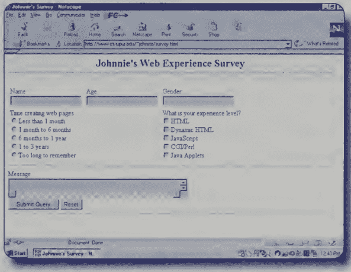

`CGI`的基本概念是用户通过表单从浏览器向服务器提交信息，然后服务器调用`CGI`应用程序。

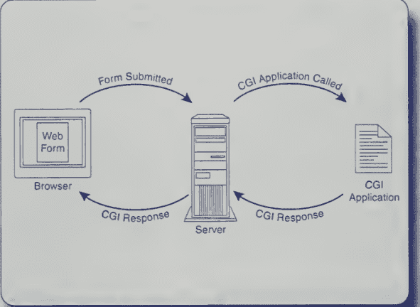

随后，`CGI`应用程序向服务器发送响应，服务器再将`CGI`响应以HTML页面的形式发送回用户的浏览器。

尽管这个过程听起来简单，但这正是`CGI`的核心所在。许多人预期这是一个更复杂的过程，但它确实就是如此基础。通过你的网站运行程序和应用程序的概念应该会让你感到兴奋。这种兴奋来自于能够生成与你的用户交互的动态而强大的网页。

### 运行CGI应用程序需要什么

为了在你的网站上使用`CGI`应用程序，你必须满足一些要求。

> **注意**
>
> 请咨询你的服务器管理员或ISP（互联网服务提供商），以确定你是否被允许运行`CGI`应用程序。许多服务器管理员不允许任何人在他们的服务器上运行`CGI`应用程序，因为当你有权访问服务器上的文件和目录时，会出现安全问题。

第一个要求是`CGI`应用程序需要放在服务器能够找到的位置。

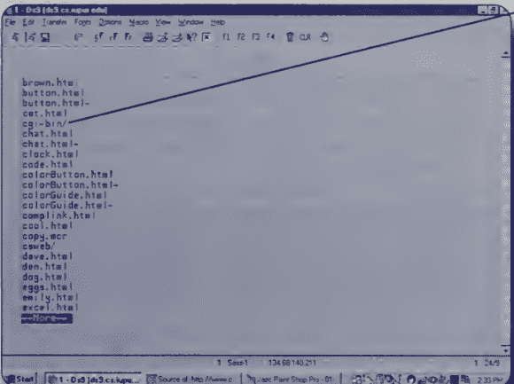

标准位置是一个名为`cgi-bin`的子目录中。

`cgi-bin`子目录需要具有`7-5-5`权限，以便应用程序能够被访问。关于`cgi-bin`目录的权限和详细信息将在本章后面的"建立你的 cgi-bin 目录"一节中解释。

现在你已经了解了`CGI`是什么、为什么要使用它以及它是如何工作的，是时候了解运行`CGI`应用程序的服务器要求了。

### CGI服务器要求

因为`CGI`脚本包含服务器需要处理的独立程序，所以它们会给服务器带来额外的工作。这通常不是问题，除非你的服务器较旧、较慢或可用内存较小。当多个用户正在访问你的`CGI`程序或同一服务器上的其他程序时，就会出现问题。你的最佳选择是与服务器管理员讨论服务器要求。你想要这样做的原因有很多。首先，你需要验证服务器是否配置为使用`CGI`。其次，你需要验证你是否有权通过你的账户在服务器上运行`CGI`应用程序。最后，你需要知道如何访问服务器的`cgi-bin`。请记住，`CGI`应用程序涉及安全风险，因此大多数服务器管理员会对谁可以访问`cgi-bin`施加限制。

> **提示**
>
> 如果你曾在另一台服务器或系统上使用过`CGI`，请要求该服务器管理员为你提供某种形式的书面证明，说明你具备运行`CGI`应用程序的资格。基本上，这证明你知道你在做什么。我收到了每一位允许我访问的服务器管理员的信件，声明他们没有因为我的`CGI`应用程序而出现任何安全问题。

你与服务器管理员讨论这些问题所花费的时间是值得的。花费数小时编写或修改脚本，然后发现你无法在你的账户上运行它，这是没有成效的。服务器管理员还知道服务器支持哪些`CGI`功能和哪些语言。

## CGI入门

在你开始在网站上使用`CGI`之前，你需要准备好你的账户以处理`CGI`。这是一个相当简单的过程，不需要太多时间。有一些项目需要整合到你的账户中，你需要在运行第一个`CGI`应用程序之前设置好它们。

### 创建你的cgi-bin

准备`CGI`应用程序账户的第一步是建立一个`cgi-bin`子目录并设置权限，以便该子目录可以被访问并运行你的`CGI`应用程序。这是在准备`CGI`账户之前需要与服务器管理员讨论的事项之一。

### 什么是cgi-bin？

为了让`CGI`应用程序被执行，它们必须被放在特定的目录中。

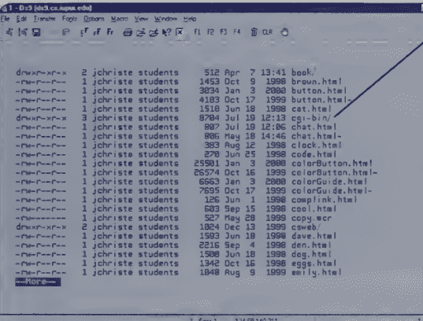

`CGI`应用程序的通用目录是`cgi-bin`目录。

将`CGI`应用程序放在特定目录中是为了安全目的。回想一下，`CGI`应用程序涉及安全风险。如果`CGI`应用程序被包含在一个特定的位置，服务器管理员可以控制它们并有效地监控它们。

这对你也有好处，因为你被迫将所有`CGI`应用程序存储在一个目录中。因此，你消除了可能花在试图定位应用程序上的时间和挫败感。这在你现在听起来可能不重要；然而，你会发现搜索特定文件、文档或应用程序所花费的时间是没有成效的，并且会导致收入损失。

### 建立你的cgi-bin目录

为了创建`cgi-bin`目录，你需要向服务器管理员咨询所需的确切规范。通常，你需要在你的账户中创建一个子目录。

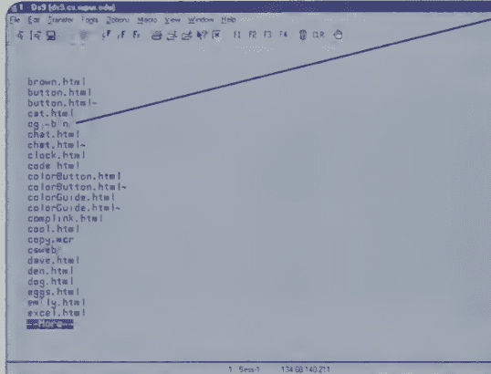

`cgi-bin`子目录需要位于用于你的HTML页面的目录内。

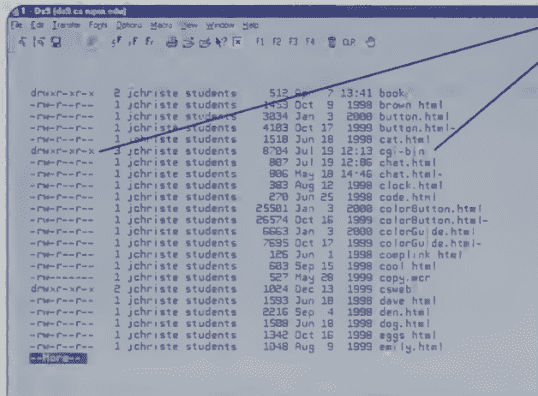

创建`cgi-bin`子目录后，你需要将目录的权限设置为`7-5-5`。这可以使用`chmod`命令来完成，如第3章"更改应用程序的权限"一节所述。

`7-5-5`这个名称设置子目录权限如下。你具有读、写和执行权限（`7`）；你所在组织的组具有读和执行权限（`5`）；其他人具有读和执行权限（`5`）。这使你能够写入该目录，而其他人可以运行子目录中包含的程序，但不能写入。

单个`CGI`应用程序需要`7-1-1`或`7-5-5`权限。

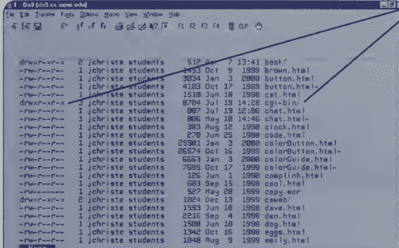

> **注意**
>
> 权限是根据二进制数字组合计算的。所有者具有指定权限的值是`4`，所有者的组具有该权限的值是`2`，世界上所有人具有该权限的值是`1`。这些值相加产生读、写和执行权限的单个数字。

`7-1-1`和`7-5-5`权限的区别在于，使用`7-1-1`时，其他人可以执行应用程序；但是，他们无权读取文件。因此，他们无法访问应用程序的编程代码。这有一些安全优势。如果你不确定是使用`7-1-1`还是`7-5-5`，你可以始终将权限设置为`7-5-5`。

回想一下，这使你能够读、写和执行该目录，而其他人只能读和执行该目录。一旦建立了`cgi-bin`目录并设置了权限，你需要决定要为你的`CGI`应用程序使用哪种语言。

## CGI编程语言

使用`CGI`的最佳特性之一是你可以在应用程序中使用多种语言。可用于构建`CGI`应用程序的语言丰富可能会造成一些混乱；然而，你的最佳选择是坚持使用你理解的语言，或者有预写脚本可用的语言。

### 你的选择


如前所述，有许多符合 CGI 标准和协议的语言可用。这些语言包括 `C/C++`、`tcl`、`Visual Basic`、`AppleScript` 和 `Perl`。你可以使用这些语言中的任何一种来编写 CGI 应用程序；然而，有些比其他语言更难使用。例如，`C/C++` 在处理字符串（文本）时很棘手——字符串在第 2 章“编写你的 CGI 应用程序”中有详细讨论。

### 最流行的 CGI 语言：Perl

目前，最流行的 CGI 编程语言是 `Perl`（实用提取和报告语言）。Larry Wall 于 1986 年创建 `Perl` 以生成报告。`Perl` 经过 Larry 和其他人的修改和改进，已成为一种非常强大的编程语言，除了作为基于 Web 的编程语言外，还有许多其他用途。

## CGI 编程语言

`Perl` 作为 CGI 编程语言的流行主要归功于其强大的文本处理能力。与其他一些语言不同，`Perl` 可以快速地将字符分离成不同的字段和数据，供程序以多种方式使用。此外，`Perl` 提供了多种方法来完成同一任务，而不会在脚本内产生冲突。`Perl` 的强大功能之一是它可以根据所使用的运算符来区分字符串（文本）和数字：因此，你不需要花费时间进行字符串与数字之间的相互转换。这一功能将在第 6 章“标量”中详细介绍。

`Perl` 的另一项受欢迎的特性是其跨平台移植能力——从 Windows 到 UNIX（Uniplexed Information and Computing System），从 UNIX 到 Windows 等等——只需对脚本进行少量修改即可。最后，它是一门非常酷的语言，甚至引发了 Perl 诗歌比赛。

现在你已经了解了可选的语言以及为什么 `Perl` 是与 CGI 一起使用最流行的语言，接下来可以了解如何修改 HTML 页面，以便为 CGI 应用程序做准备。

## 为 CGI 准备你的网页

> **提示**
>
> 关于创建 HTML 页面的信息，你可以参考 Prima Tech 出版的由 Brian Proffitt 和 Ann Zupan 合著的《XHTML 快速简易 Web 开发》。

要在网页中运行 CGI 应用程序，你需要进行某些修改。首先你需要的是一种从用户那里获取信息的方法。这通常通过 HTML 表单来实现。

> **注意**
>
> 关于创建表单及相关输入字段的完整细节，请参见第 4 章“从访客那里获取网页数据”中的“开发你的表单”部分。

创建表单的 HTML 代码包括 `<form>` 和 `</form>` 标签，它们用于设置表单。

`<form>` 标签还定义了表单使用的特定方法。在本例中，方法是 `post`。`post` 方法将在第 4 章“从访客那里获取网页数据”中介绍。

`<form>` 标签还包含当用户提交表单时要执行的操作。

`<input>` 标签在 HTML 代码中执行几种不同的任务。前两个 `<input>` 标签创建文本输入字段。

后两个 `<input>` 标签创建提交按钮和重置按钮。

注意代码中的 `<textarea>` 标签。

## 第 1 章：CGI 与 Web

此标签使用户能够输入他们想说的任何评论。

从这个例子中，你可能已经意识到 `<form>` 标签是在网页中使用 CGI 应用程序时的主要组成部分。`<form>` 标签的 `method` 和 `action` 属性实际上是表单最重要的部分。

注意 `method` 属性告诉表单“post”表单内容，`action` 属性告诉表单在点击提交按钮后转到 URL `http://klingon.cs.iupui.edu/cgi-bin/cgiwrap/jchriste/guest.cgi`。

> **注意**
>
> 需要注意的是，`action` 属性中的 URL 不是标准的网页 URL；它是一个 CGI 程序 URL。这是一个重要的区别，因为 `action` 属性调用的是位于服务器上的可执行程序，而不是像 JavaScript 那样包含在 HTML 页面本身中的程序。将程序放在服务器上而不是包含在 HTML 页面中，可以减少页面从服务器传输到用户浏览器所需的时间。

你可以看出，对标准 HTML 页面所做的修改并不复杂；然而，它们对于 CGI 应用程序被正确访问极为重要。你也可以看到在创建表单和程序之前仔细思考的价值。第 2 章“编写你的 CGI 应用程序”重点讨论了提前规划的重要性以及不首先思考你要完成什么时可能出现的复杂问题。

### 小结

本章介绍了 CGI。你了解了什么是 CGI、为什么要使用 CGI 以及谁在使用 CGI。你还理解了 CGI 的工作原理以及在你的网站上运行 CGI 应用程序需要什么。这种理解包括在你的账户中建立 `cgi-bin` 所需的信息，以及为什么需要创建 `cgi-bin` 的解释。

你获得了关于 CGI 应用程序可用语言选择的知识，并了解了为什么 `Perl` 是首选语言。最后，你扩展了 HTML 代码编写能力，以创建访问 CGI 应用程序的表单。在下一章中，你将开始设计 CGI 应用程序和将用户连接到该应用程序的 HTML 页面的过程。你现在准备好开始 Web 编程的过程了。

## 编写你的 CGI 应用程序

本章向你介绍 CGI 应用程序编程，重点强调提前规划的重要性。前几节重点讨论规划过程以及你从这一经常被忽视的步骤中获得的好处。后几节重点讨论创建 CGI 应用程序时需要考虑的基本构造。在本章中，你将学习：

- 提前规划的重要性
- 如何使用多种语言和多个 HTML 页面
- 适当的表单和数据库设计
- 如何编写伪代码
- 程序和脚本之间的区别
- 数据在 `Perl` 中是如何处理的

### 提前规划很重要

新手程序员经常忽视规划步骤；然而，这是成功程序员采用的第一步。你花在规划上的少量时间可以节省你在编程 CGI 应用程序和创建与应用程序对应的 HTML 页面时的很多挫折和时间。你规划时的第一步是在纸上设计 HTML 页面，并附带注释描述每个页面将实现什么。

### 使用多种语言

为 Web 编程 CGI 应用程序需要你使用多种语言——HTML 用于网页，至少一种编程语言用于应用程序。使用两种语言本身并不一定会带来挑战；问题出在你混淆了，在应该使用另一种语言时使用了其中一种。

我知道你很聪明，能够把语言区分开来。

然而，真正的挑战出现在将 HTML 代码整合到 CGI 应用程序中时。

通过适当的规划，这个挑战是可以克服的。你规划过程中的第一步，如前所述，是绘制应用程序所需的 HTML 页面草图。这听起来可能很基础；然而，每当我省略这一步时，我都在 HTML 代码或程序代码中犯了小错误。你可能会犯这些类型错误的原因很可能不是由于缺乏知识或技能；而是当你急于完成项目、有截止日期要满足，或者有其他紧迫的个人事务时，你经常会犯错误。这引出了下一个可能产生混淆的领域，即使用多个 HTML 页面的结果。

```perl
#get receiver
$receiver = $input{'receiver'};

#get sender
$sender = $input{'sender'};

#get subject
$subject = $input{'subject'};

#get message
$message = $input{'message'};

#send mail
open (MAIL, "|$mailprog $receiver") || die ("couldn't open $mailprog\n");
print MAIL "Subject: $subject \n\n";
print MAIL "Sender: $sender \n\n";
print MAIL "Message: ";
print MAIL $message . " ";
print MAIL "(sent by Johnnie R. Christenberry's e-mail program: June, 1998.)";
print MAIL "\n";
close(MAIL);

#respond to user
#create HTML output
print &PrintHeader;
print "<html><head><title>Email was delivered</title></head>";
print "<body background = http://kilingen.cs.iupui.edu/~jchrist/cgi-bin/firing.jpg><center><h1>Be sure to check your mailbox for any response!</h1></center>";
print "<hr>";
print "receiver: $receiver <br> \n"; #uses "receiver" instead of "Send to"
print "sender: $sender <br> \n"; #uses "sender" instead of "From"
print "subject: $subject <br> \n"; #same as form
print "message: $message <br> \n"; #same as form
print "<hr></body></html>";
```

### 使用多个 HTML 页面

很可能，你熟悉使用多个 HTML 页面来在你的网站上实现各种不同的效果。一个新的挑战出现了——不在于页面的创建，而在于页面的内容。看看下面的 HTML 页面作为例子。第一个页面包含各种输入字段。

### 事先规划至关重要

`Name` 输入框用于获取用户的姓名。

`Subject` 字段提供了一个填写消息主题的位置。

`Message` 字段包含要发送的消息内容。

第二个页面包含用于不同信息的输入字段。

`Send to` 输入框用于获取收件人的电子邮件地址。

`From` 输入框用于填写发件人的电子邮件地址。

`Subject` 输入框显示消息的主题。

而 `Message` 输入框包含要发送的消息内容。

尽管这些页面在设计上非常相似，但输入字段的内容却有很大不同。CGI 应用程序使用这些表单中的输入信息来创建输出 HTML 页面，因此在设计 HTML 表单和 CGI 应用程序时，务必牢记这一点，这一点极为重要。

适当的规划可以避免在设计多个页面和创建 CGI 应用程序时产生后续混乱。如果你设计了多个 HTML 页面，而 CGI 应用程序不生成任何 HTML 代码，规划看起来似乎不那么重要；然而，现在你必须考虑 CGI 应用程序以及它将生成的 HTML 代码。这之所以如此重要，是因为 CGI 应用程序中包含的 HTML 代码依赖于从 HTML 表单中获取的输入信息。

```perl
#send mail
open (MAIL, "|$mailprog $receiver") || die ("Couldn't open $mailprog! \n");
print MAIL "Subject: $subject \n\n";
print MAIL "Sender: $sender \n\n";
print MAIL "Message: ";
print MAIL $message . " ";
print MAIL "(sent by Johnnie R. Christenberry's e-mail program: June, 1998.)";
print MAIL "";
close (MAIL);

#respond to user
#creates HTML output
print PrintHeader;
print "<html><head><title>mail was delivered</title></head>";
print "<body background=\"http://klingon.cs.iupui.edu/~jchricte/cgi-bin/firearing.jpg\"><center><h1>Be sure to check your mailbox for any response!</h1></center>\n<hr>";
print "receiver: $receiver <br> \n"; #uses "receiver" instead of "Send to"
print "sender: $sender <br> \n"; #uses "sender" instead of "From"
print "subject: $subject <br> \n"; #same as form
print "message: <br> \n $message <br> \n"; #same as form
print "</hr></body></html>";
```

仔细观察，你应该会注意到 HTML 代码使用的是“receiver”而不是 HTML 输入表单中使用的“Send to”。

只要在创建生成 HTML 页面的程序时考虑到这一点，这个更改不会在 CGI 应用程序中产生任何问题。你在规划 HTML 页面和 CGI 应用程序上所花的时间，将减少因术语上的细微差异而可能出现的错误。在第 4 章“从访问你网页的访客处获取数据”中，你将了解 CGI 应用程序获取输入信息的过程以及如何使用这些信息。既然你已经了解了使用多个 HTML 页面与 CGI 配合的挑战，你就可以考虑表单设计的重要性了。

### 采用正确的表单设计

> **提示**
>
> 有关创建 HTML 表单的更多信息，可以参考 Prima Tech 出版的 Brian Proffitt 和 Ann Zupan 所著的《XHTML 快速轻松网页开发》一书。

如果你在 HTML 页面中使用表单，你已经了解了正确的表单设计对用户便利性的好处。本节的重点不是从用户角度讨论正确的表单设计——而是从设计者/程序员角度讨论正确的表单设计。

用户和设计者/程序员的角度之间有许多相似之处；然而，不同之处将是你的主要关注点。在设计表单时，你试图使其尽可能地友好，并通常会花时间规划输入字段的排列，同时考虑可用性。然而，作为 Web 程序员，你更关注的是表单的内容以及如何在 CGI 应用程序中使用它来生成预期的 HTML 输出。以下表单对用户友好，并允许用户输入多种类型的信息。

该表单包含文本输入框，用户可以在其中输入信息。

它包含单选按钮输入，允许用户从一组选项中选择一个。

它还包含复选框输入，允许用户从预设选项中进行多项选择。

最后，它包含一个文本区域输入，允许用户输入多行文本。

### 规划数据库设计

这个表单及其设计没有什么特别之处。对你作为 Web 程序员来说重要的方面来自表单中包含的数据以及它在 CGI 应用程序中的处理方式。你已经意识到，显示在输入字段旁边的文本对 CGI 应用程序来说意义不大。表单的重要部分是输入字段的属性。

```html
<!--This starts table data with a label-->
<!--You can change the label to fit your needs-->
<td>Name:
<br>
<!--This creates a textbox named txtName-->
<!--You can change the name to fit your needs-->
<input type = "text"
       name = "txtName">

<td>Age:
<br>
<input type = "text"
       name = "txtAge">

<td>Gender:
<br>
<!--This creates a menu selection input-->
<!--Notice that it requires an end tag-->
<select name = "selGender">
    <option value = "male">Male
    <option value = "female">Female
</select><!--This is the end tag mentioned above-->
</tr><!--This ends the table row-->

<tr>
<td>Time creating Web pages
<br>
<!--This creates radio buttons-->
<!--Notice that the names are the same, but the values are different-->
<input name = "ans1"
       type = "radio"
       value = "less than 1 month">less than 1 month<br>
<input name = "ans1"
       type = "radio"
```

`name` 属性将被你的应用程序用来为数据分配一个键。键的详细说明将在第 5 章“将数据输入你的 CGI 应用程序”和第 8 章“哈希”中进行讲解。

`value` 属性将是应用程序中从表单输入字段使用的实际数据。

CGI 应用程序使用这些属性来生成 HTML 页面和你在应用程序中嵌入的其他输出。这些属性的重要性以及如何使用它们将在第 5 章“将数据输入你的 CGI 应用程序”中详细说明。HTML 表单属性的使用也与你的 CGI 应用程序访问的文件有关，特别是当你使用 CGI 应用程序搜索数据库时。

当你设计一个将与你的网页和 CGI 应用程序配合使用的数据库时，事先规划变得极其重要。同样，最需要关注的不是数据库的物理设计，而是数据库的内容以及 CGI 应用程序如何访问其数据。

回想一下，第 1 章“CGI 与 Web”中的网页展示了用于访问包含 Web 创作课程学生成绩的数据库的表单。

该表单有一个文本字段，学生可以在其中输入其学号的后四位。

请注意，对于后四位以零开头的学生，需要特别说明。

这些特殊说明是有原因的。最初编写程序时，没有考虑到这个四位数序列可能以零开头的情况。包含文字说明比更改搜索数据库的程序花费的时间更少。然而，适当的规划本可以发现这一疏忽。为什么提到这一点如此重要？数据库被设计为列出学号的后四位，并且不允许第一位为零。如果学生输入的后四位中第一位是零，程序就无法在数据库中找到该学号，而是返回以下 HTML 页面。

### 提前规划至关重要

这个 HTML 页面告知学生他们并未在班级名单中。


尽管这个疏忽看似微小，却带来了巨大的困难。许多学生无法查看成绩，由此产生的问题招致了困惑学生们的大量邮件。这并非大问题，因为我每周与学生见面两次，可以指导他们操作；然而，当你创建一个由 CGI 应用程序搜索的数据库时，你可能无法像我这样方便地定期与用户见面，因此你肯定不希望用户在访问数据时遇到问题。

当你为雇主或企业创建 HTML 页面、CGI 应用程序或数据库时，这一点尤其如此。通常你对数据库的设计几乎没有或完全没有发言权。这增加了你在创建访问数据库的 HTML 表单和 CGI 应用程序时所需进行的规划量。

这个特定 CGI 应用程序出现的另一个问题是，一名学生将输入字段留空并提交了数据。

### 编写伪代码

当这种情况发生时，CGI 应用程序返回了数据库中最后一个学生 ID 的 HTML 页面。

这造成了一个非常危险的安全问题，不仅可能导致尴尬，还可能引发法律后果。我包含这些信息是为了强调在 CGI 应用程序中进行适当规划的重要性，并说明缺乏规划可能带来的困难。现在，你需要学习如何防止此类问题的发生。

伪代码，也称为符号代码，是用英语（而非适当的计算机语言）编写程序步骤和过程的过程。

这个短语是一个代表一行简单 HTML 代码的伪代码示例。

你可以使用这个伪代码来编写实际的 HTML 代码。

```
Create a background for the body of a HTML page using the circuit background from the graphics directory.

<body background = "graphics/circuit.jpg">
```

请注意，伪代码并未指明你在 HTML 页面中使用图像的格式。

这是因为你不需要在伪代码中包含具体细节。伪代码的主要目的是帮助你设计和调试 HTML 页面及 CGI 应用程序。初学者常常希望跳过这一步，直接开始编写程序。然而，你会很快发现，你认为通过省略这一步节省的时间，会在以后你不得不花更多时间弄清楚为什么你的程序没有按预期工作时加倍偿还。

```
<!--This creates the text input for Send to with a default value.-->
<!--The reply HTML page will use the term "receiver" instead of "Send to"-->
Send to:
<input type = "text"
       name = "receiver"
       value = "someone@isp.com">

<hr>

<!--This creates the text input for From-->
<!--The reply HTML page will use the term "sender" instead of "From"-->
From:
<input type = "text"
       name = "sender">

<hr>

<!--This creates the text input for Subject -->
Subject:
<input type = "text"
       name = "subject">

<hr>

<!--This creates the text area for the Message-->
Message:<br>
<textarea name = "message" rows="" cols="">
</textarea>
```

请注意，在 `name` 属性中，文本输入框的名称是 "receiver"。

但在 HTML 表单上，它显示为 "Send to:"，而不是 "receiver"。

在创建 HTML 页面时，你很容易忘记这个细微的差别，这会导致你的 CGI 应用程序在生成的 HTML 页面中遗漏这些数据。请注意，HTML 输入表单草图和 CGI 应用程序生成的 HTML 页面显示了这一差异。

## 第 34 页 第 2 章：编写你的 CGI 应用程序

HTML 输入表单在文本输入框旁使用了 "Send to:"。

CGI 应用程序生成的 HTML 页面使用了 "receiver"。

这个草图是你的伪代码的一部分——它包含了编写伪代码所需的基本信息，也是你开始编写伪代码的地方。在开始编写 HTML 代码或 CGI 应用程序代码之前，你可能需要对草图和原始伪代码进行修改。

> **提示**
>
> 我怎么强调都不为过：在开始编写实际代码之前，编写伪代码和绘制 HTML 页面草图是多么重要。即使你获得更多经验，这一点仍然重要。你能犯的最大错误，就是在积累一些经验后省略这一步，因为你觉得它只对业余程序员有帮助。我之所以知道，是因为我曾经也有同样的想法，而且我已经用多种不同语言编写了无数程序。然而，在花了几个小时调试一个简单程序后，我再也不会省略这一步了！

邮件程序的完整伪代码显示，在确定我想要实现的目标的过程中，我意识到了几个要点：

### 学习编程基础

```
I need a program that will allow students to send e-mail from a browser that is not set-up for sending and receiving e-mail.

I will need to:
Create a HTML page to get input from the user.
There needs to be input areas for sender, receiver, subject, and the message.
There needs to be a submit button to send the mail.
There needs to be a way for the user to clear the fields.

The program will generate a HTML page that gets sent back to the user and it will include:
The address to which the message was sent.
The address or name of the person sending the message.
The subject of the message.
The message.

The program will also send the input form data to the address of the receiver.

The input form will need text inputs for the sender, receiver, and subject.
It will also need a textarea input for the message.
It will need a submit button to activate the program.
It will need a reset button to clear the inputs.

I want the sender to be labeled "From" on the input form and "sender" on the reply page.
I want the receiver to be labeled "Send to" on the input form and "receiver" on the reply page.
I want the submit button to be labeled "Send Mail" on the input form.
I want the reset button to be labeled "Clear" on the input form.

The input page need to have instructions telling the user how to use the mail program.
The reply page need to inform the user that they need to check their mail for any response from the person to whom they send the message.

I also want to have my email address as the default value in the receiver/Send to input box.
```

- 我需要不同的输入类型。
- 我将在两个 HTML 页面中使用不同的术语。
- 我需要更改按钮名称。
- 我需要为“receiver/Send to”输入框设置默认值。

编写伪代码的过程让我能够思考如何完成从用户那里获取输入并给他们发送回复的任务。既然你已经了解了提前规划的重要性和编写伪代码的意义，现在是时候介绍 CGI 应用程序的基础知识了。

### 学习编程基础

在第一章的“CGI 编程语言”部分，你了解了可以在 CGI 应用程序中使用的各种语言，包括最流行的一种：Perl。基于 Perl 应用程序的普及度和 Perl 脚本的可用性，本书将重点介绍使用 Perl 作为 CGI 应用程序的主要语言。

## 理解程序与脚本的区别

每当你使用计算机时，无论是在使用文字处理器、视频游戏还是通过网络浏览器访问互联网，你都在使用程序。这些应用程序都是使用代码（即用计算机能理解的语言编写的命令）的程序。每一行代码都告诉计算机要执行什么操作。

例如，当你点击浏览器的“后退”按钮时，代码会告诉浏览器需要返回到上一个 URL。

脚本是告诉计算机执行什么操作的代码行。然而，脚本是在需要时被解释执行的，而程序是预先编译的，因此能在计算机上运行得更快。脚本通常比程序更小、更简单。

### 学习 Perl 基础

需要注意的重要一点是，你不需要任何花哨的工具就可以开始用 Perl 编写脚本：你只需要一个基本的文本编辑器。

我通常使用 Windows 记事本。


在 UNIX 环境下工作时，我使用 Emacs。你也可以使用 SimpleText，这是 Macintosh 操作系统中的标准文本编辑器。

#### Perl 数据

你可以将 Perl 中处理的数据视为三种类型之一。它要么是字符串（文本）或数字；要么是变量或常量；要么是标量、数组或哈希。

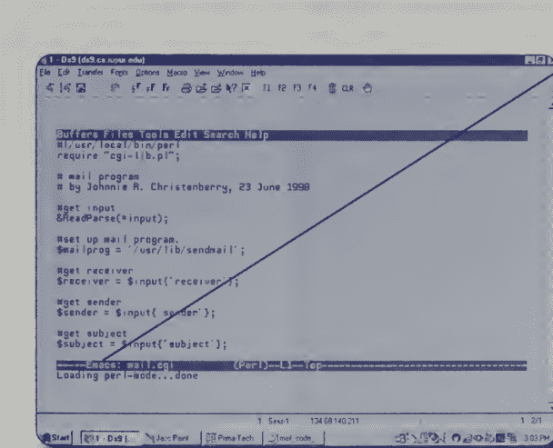

> **提示**
>
> Perl 中的注释以井号（`#`）开头，多于一行的注释需要在每行开头都加上 `#`。你在 HTML 中可能习惯使用的多行注释符在 Perl 中不存在。

在 Perl 中创建新行，需要使用换行符 `\n`。

分号（`;`）用于终止 Perl 中的所有简单语句。

#### 字符串与数字

字符串是任何对应于 ASCII（美国信息交换标准代码）代码 0 到 255 的字母、数字或符号。字符串可以是：

- 单个字符
- 一个词
- 一个短语
- 整个句子
- 甚至是一个数字


字符串可以是常量或变量。当字符串是常量时，通常用直单引号（`'`）或双引号（`"`）括起来。

使用单引号来标记字符串的开始和结束。

使用双引号来包含特殊字符，例如十六进制代码、制表符、换行或回车。

你可以省略引号；然而，保留它们对你有好处——在调试程序时你会发现它们极其有用。关于引号的更多信息，在本章稍后的“引号”部分中有详细介绍。

数字与字符串不同，在 Perl 中不需要任何特殊考虑，也不需要单独设置或以特殊方式格式化。它们就是 Perl 所期望的样子：代表特定数量的数字。例外情况是，如果你将数字用作字符串，此时适用字符串格式化规则。

#### 变量与常量

Perl 中的数据可以是特定数据，也可以是容纳数据的容器。

术语常量（constant）或字面量（literal）用于指代特定数据。这些术语确实描述了数据的特性，因为它不会改变，并且完全按照所见进行解释。

术语变量（variable）指的是容纳数据的容器。变量用于存储会变化的数据，在数据由用户输入控制时非常有用。

使用变量可以避免为每个可能的输入创建常量，而这几乎是不可能做到的。

变量名可以由任何字母数字字符和下划线字符组成；然而，常见做法是使用简短但具有描述性的小写字母。每种变量类型都以特定字符开头。

美元符号用于标量。

at 符号用于数组。

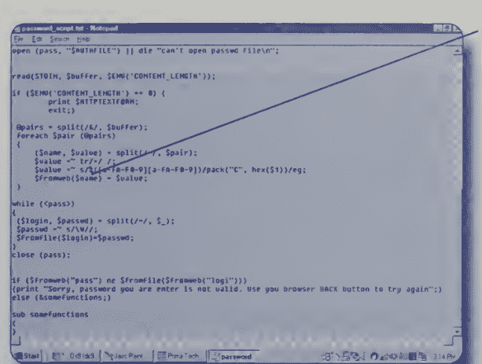

百分号用于哈希。

现在你已经了解了刚才介绍的三种变量类型，可以进一步学习它们的详细信息了。

#### 标量、数组与哈希

标量是单独的数据片段，可以表示数字或字符串，以及带引号的字面量或变量。

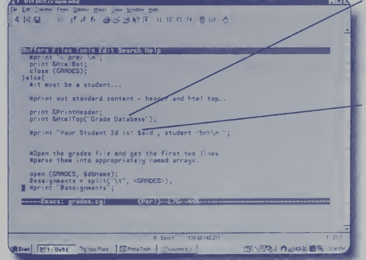

标量带引号的字面量看起来像普通数据。如果标量是字符串，你应该使用引号来标识它。

标量变量以美元符号开头。`$` 的形状代表标量（scalar）中的 `$`。

数组是标量的组合，可以称为列表。数组可以是常量的组合或变量的组合，因为它们由标量组成，而你知道标量要么是带引号的字面量或变量，要么是数字或字符串。数组由任意数量的有序元素组成，每个元素都是独立的标量变量，具有独立的标量值。数组可以包含零个元素，直到可用内存允许的最大数量。列表字面量是用逗号分隔的值，用括号括起来，不必是常量；它们可以是每次访问字面量时都会求值的变量。

```
Arrays.txt - Notepad
File  Edit  Search  Help
("Johnnie",37,"CGI","Author")
("The sender is",$sender)
@Author_info = ("Johnnie R. Christenberry",$age,$book_title,"Author")
```

这个例子是一个仅由常量组成的列表字面量。

这个例子是一个包含常量和变量的列表字面量。

回想一下，数组变量总是以 at 符号开头。`@` 的形状代表数组（array）中的 `@`。

哈希是成对的标量组合。在许多情况下，你会发现哈希比数组更有用。

这是因为哈希将名称和值作为关联的对，可以一起访问。

键是每一对中的第一个元素。

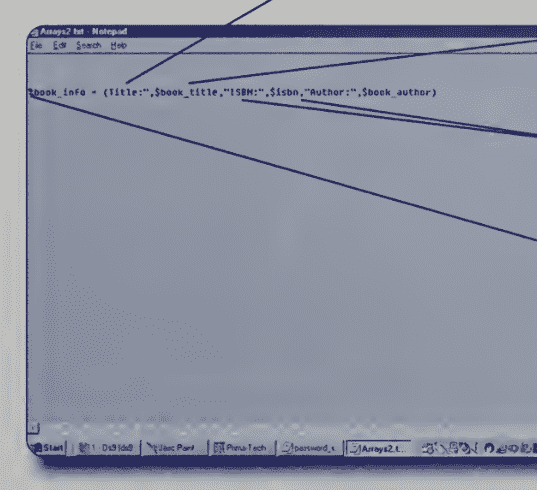

值是每一对中第二个但最重要的元素。

第二对键和值构成哈希中的下一对。

哈希变量总是以百分号开头。

#### 运算符与函数

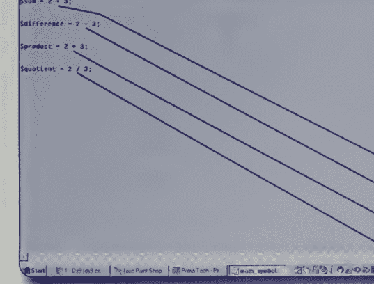

运算符和函数是 Perl 对标量、数组和哈希执行的操作。运算符使用现有值（操作数）产生新值（结果）。

数字运算符的例子包括：

- 加号（`+`）
- 减号（`-`）
- 乘号（`*`）
- 除号（`/`）等。

Perl 还允许使用逻辑比较运算符，包括：

- 小于号
- 小于或等于号
- 等号
- 大于或等于号
- 大于号
- 不等于号。

Perl 还有用于字符串的运算符，允许它们进行连接（拼接）。字符串运算符与数字运算符不同，即使它们执行类似的操作。这些运算符包括：

- 等于
- 不等于
- 小于
- 大于
- 小于或等于
- 大于或等于
- 以及字符串连接。

运算符的这种细微差别可能是一种优势，也可能是一种障碍。Perl 会根据你使用的运算符自动将字符串转换为数字，或将数字转换为字符串。

如果你的代码像这样……

Perl 会将 `"johnnie"` 转换为零；因此代码将转换为 12345。这将显示为与你预期完全不同的结果。

如果你忘记 Perl 会在没有任何警告的情况下这样做，这可能会造成极大的困惑。如果检查一个差异的例子，会更容易理解。

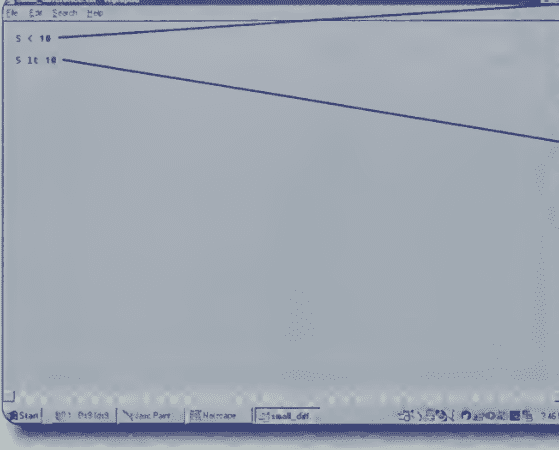

这行代码将返回“真”值，因为数字 5 小于数字 10。

然而，这行代码将返回“假”值，因为转换将使用字符串的 ASCII 值，而 5 的 ASCII 值不小于 1 的 ASCII 值。

函数本质上是用于更复杂过程的命名运算符。

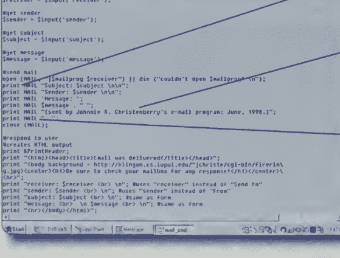

你将使用的主要函数之一是 `print` 函数。

`print` 函数将指定数据（通常在引号中）发送到特定输出。

在这个例子中，输出是 MAIL。

你可以创建自己的函数，称为子程序。这在第十一章“子程序”中有描述。

#### 结果与返回值

数据值受到函数和运算符的影响，方式有两种：它们要么改变所操作的数据，要么返回值供程序分析。

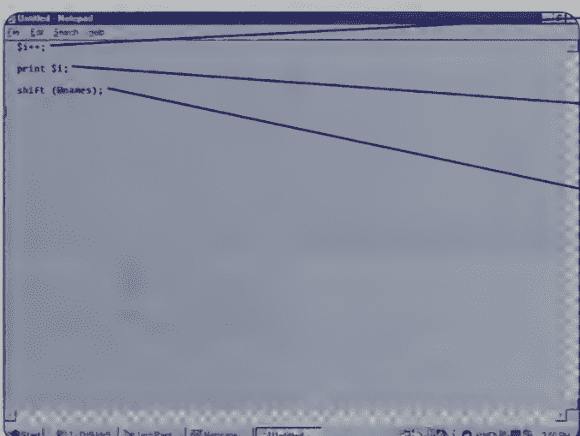

在这种情况下，值增加了 1。

这将返回值供程序分析。

某些函数会改变变量并产生特定的返回值，就像 `shift` 函数那样。

该函数移除最左边的数组元素并返回被移除元素的值，从而改变数组的值。例如，如果 `@names` 包含姓名 (joe, bob, briggs)，`shift` 函数的结果是 (bob, briggs)，返回值为 joe。

#### 引号

使用单引号来括起程序按字面意思理解的文本信息。

使用双引号来括起需要程序在处理之前进行插值（分析）的数据。

使用引号可以节省您的时间，并使您能够使用同一行代码处理不同的用户和不同的输入值。

### 小结

在本章中，您了解了提前规划的重要性，包括使用多种语言、使用多个 HTML 页面、正确的表单和数据库设计，以及编写伪代码的要点。您掌握了程序与脚本之间的区别。您还学习了一些基本的 Perl 编程技术和不同类型的 Perl 数据。讨论的数据类型包括字符串和数字；变量和常量；标量、数组和哈希；运算符和函数；结果和返回值；以及最后的引号。您将在下一章“您的第一个 CGI 应用程序”中使用这些信息。

# 您的第一个 CGI 应用程序


您现在已经了解了提前规划、编写伪代码和使用 Perl 的基础知识；因此是时候编写您的第一个 CGI 应用程序了。请记住，您只需要一个简单的文本编辑器即可完成此任务。本章通过重点关注以下内容，引导您完成编写第一个应用程序的过程：

- 为不同平台创建应用程序
- 将应用程序传输到服务器
- 使用 Perl 启动您的 CGI 应用程序
- 编写您的 Perl 代码
- 向浏览器输出文本
- 运行您的应用程序

### 使用 Perl 创建您的应用程序

本书重点介绍使用 Perl 作为主要语言的 CGI 应用程序。因此，您需要了解使用 Perl 编写应用程序的过程。

#### 向应用程序添加注释

作为程序员，您可能犯的最大错误之一就是在程序中省略注释。要在 Perl 中添加注释，您需要在代码行的开头使用井号（`#`）。这告诉 Perl 忽略后面的文本。

> 尽管您的代码现在看起来很简单，但一周后您再看它时可能会问自己："这是做什么的，我为什么把它放在这里？"

注释使您能够记录代码正在做什么。在这种情况下，注释告诉您条件语句正在检查什么。

此注释指出条件语句已结束。在使用嵌套条件时，这特别有帮助。条件语句在第 9 章"条件语句"中讨论。

### 使用 Perl 创建您的应用程序

注释使您免于为借用您代码的其他程序员编写详细说明。最后，在调试应用程序时，注释也具有很大的价值。

> **提示**

您也可以从注释 HTML 代码中受益。HTML 注释通过使用 `<!--` 和 `-->` 字符来标记。

此注释使您能够解释调用应用程序时应该发生什么。

注释还可以说明输入字段的用途。

注释还可以记录从 HTML 表单到应用程序或响应 HTML 页面的名称中的任何变化。

要在 Perl 中添加注释，请在行的开头键入井号（`#`）。然后键入您想要包含的注释。

您不需要像在 HTML 中那样结束注释行。但是，Perl 不支持多行注释。

为了编写超过单行的注释，您需要在每行的开头使用 `#`。

您还可以在代码行的末尾包含注释。

Perl 要求您注释初始代码行，该行用于在服务器上定位 Perl 解释器。

此特殊注释在本章后面的"在应用程序中使用解释器的位置"部分中详细讨论。在了解使用注释记录应用程序的重要性之后，您现在可以学习如何使用不同平台创建应用程序。

### 在 PC 或 Mac 上创建您的应用程序

使用 PC 和 Mac 创建应用程序之间的差异很小。就您的应用程序而言，这两个操作系统之间的主要区别在于将应用程序发送到服务器时。

#### 使用 PC 创建您的应用程序

要使用 PC 创建 CGI 应用程序，您首先需要打开您的登录文本编辑器。主要选择是记事本和写字板——我更喜欢记事本，因为它几乎不做文本格式设置。

首先，您点击文件，新建以打开一个空白文档窗口。

然后您编写应用程序的代码，本章的"编写您的 Perl 代码"部分详细介绍了这一点。

编写完应用程序的代码后，点击另存为。

您应该将应用程序保存为 `.txt` 文档。这将消除文本编辑器使用的任何格式。文本编辑器格式的问题在于它可能会添加 Perl 解释器可能无法理解的换行符和其他格式字符。

如果您的文本编辑器不允许您在保存时将扩展名从 `.txt` 更改为 `.cgi`，则需要重命名该文件。

要重命名文件，请右键单击它，然后从弹出的菜单中点击重命名。这将突出显示该文件。

点击文件名的末尾，将扩展名 `txt` 替换为 `cgi`。按 Enter 键。

该应用程序现在具有 `cgi` 扩展名。

#### 将您的 PC 应用程序传输到服务器

您将使用 FTP（文件传输协议）程序将应用程序从 PC 传输到服务器。如果您没有 FTP 程序，互联网上提供了许多免费软件和共享软件版本。CD 包含 CoffeeCup Expresso FTP 的试用版，这是以下示例中使用的 FTP 程序。以下步骤将帮助您使用 CoffeeCup Expresso FTP 程序传输应用程序。

您需要打开 FTP 程序并建立与服务器的连接。为此，您需要在主机名/地址字段中输入服务器的名称或 IP（互联网提供商）地址。

在相应字段中输入您的用户名。

接下来，在密码字段中输入您的密码。

下一步是找到您要传输的文件。点击并拖动文件，将其拖放到服务器窗口上。

要在服务器上编辑 HTML、查看服务器上的图像以及备份您的整个网站，请下载并安装 Direct FTP。立即在 `http://www.coffeecup.com/products.html` 获取 Direct FTP。

此文件已传输到服务器。

要在服务器上编辑 HTML、查看服务器上的图像以及备份您的整个网站，请下载并安装 Direct FTP。立即在 `http://www.coffeecup.com/products.html` 获取 Direct FTP。

#### 使用 Mac 创建您的应用程序

要使用 Mac 创建 CGI 应用程序，您首先需要打开文本编辑器。SimpleText 是 Mac 的首选文本编辑器，它包含在大多数 Mac 操作系统中。

### 使用 Perl 创建应用程序

要打开一个空白文档窗口，请点击**文件**、**新建**。编写应用程序的代码。编写完代码后，点击**另存为**以保存您的工作。

将应用程序保存为 `.cgi` 文档格式，以便在服务器上使用。

### 将您的 Mac 应用程序传输到服务器

您将使用 FTP 程序将应用程序从 Mac 传输到服务器。以下步骤将帮助您使用 Fetch FTP 程序完成应用程序的传输。

首先，您需要打开 FTP 程序并建立与服务器的连接。

然后在**主机**字段中输入您的服务器名称或 IP 地址。

在相应的字段中输入您的用户 ID 和密码。这将打开 FTP 屏幕。

现在您有两个选择。您可以将计算机上的文件放到服务器上，或者从服务器获取文件并将其放到您的计算机上。由于您要将文件发送到服务器，请点击**上传文件**按钮。

**打开文件**对话框将出现。这使您能够选择要发送到服务器的文件。突出显示您要发送的文件。

点击**打开**以将文件传输到服务器。

**上传文件**对话框提示您输入要发送到服务器的文件名。在选择文件名后，您需要点击**确定**。这将把文件从您的计算机传输到服务器。

如果您要从服务器将文件传输到您的计算机，请使用**下载文件**。**下载文件**对话框会提示您输入要检索的 URL、文件或目录。在输入字段中输入 URL、文件或目录名称，然后点击**确定**。

### 在 UNIX 服务器上创建您的应用程序

要在 UNIX 服务器上创建您的应用程序，您需要使用 Telnet 连接到服务器，然后找到您的 `cgi-bin` 目录。

> **注意**

> 要更改目录，您需要输入 `cd directory`，其中 `directory` 是目录的名称。这一操作通常需要两次目录更改——一次到您的 HTML 目录，一次到您的 `cgi-bin` 目录。您可以通过用正斜杠（`/`）分隔来同时更改多个目录。

当您到达 `cgi-bin` 目录后，您需要打开一个文本编辑器。最流行的 UNIX 文本编辑器是 Pico、Emacs 和 vi。以下示例使用 Emacs。

在提示符处，输入 `emacs application.cgi`，其中 `application.cgi` 是文件名。

此命令将使用 Emacs 编辑器打开 `application.cgi` 文件。

> **提示**

> UNIX 和 Emacs 区分大小写，并且不支持文件或目录名称中的空格，因此您需要特别注意输入这些名称的方式。这意味着 `cat`、`CAT` 和 `Cat` 都可能是不同的文件或目录。一个好的习惯是使用小写并用下划线（`_`）分隔单词——`my_application.cgi`。另一种约定称为驼峰命名法（camelBack），即使用大写字符来分隔两个单词——`myApplication.cgi`。您使用哪种方法并不重要，只要选择一种并坚持使用即可。

编写完代码后，您需要按 Ctrl + X、Ctrl + S 来保存它。要退出 Emacs 编辑器，您需要按 Ctrl + X、Ctrl + C。您将在本章的"编写您的 Perl 代码"部分了解更多关于编写代码的内容。

### 更改应用程序的权限

要允许您的应用程序被执行，您需要更改 CGI 目录和文件的权限。默认情况下，UNIX 将目录的权限设置为 `7-1-1`，文件设置为 `6-0-0`。您需要将目录设置为 `7-5-5`，CGI 应用程序文件设置为 `7-1-1` 或 `7-5-5`。在 UNIX 服务器上更改权限是一个简单的过程。第一步是通过 Telnet 连接到服务器。接下来，您需要找到您的 `cgi-bin` 目录。

一旦您进入 `cgi-bin` 目录，您需要输入 `chmod 755 application.cgi`，其中 `application.cgi` 是文件名，然后按回车键。

要检查文件的权限，输入 `ls -l` 然后按回车键。这将显示目录中所有文件及其权限。如果目录中有大量文件，您可能看不到您要找的文件。在这种情况下，输入 `ls -l | more`（管道字符（`|`）位于反斜杠键（`\`）上，并且需要同时使用 Shift 键）。这将逐屏显示文件。您可以按空格键翻页。

> **注意**

> 如果您需要更改 `cgi-bin` 目录的权限，应该从它的父目录中进行。

> 在前面的示例中，`cgi-bin` 包含在 `public_html` 目录中，因此在那里更改 `cgi-bin` 的权限是明智的。

> 要返回上一级目录，输入 `cd ..` 并按回车键。

### 使用 Perl 启动您的 CGI 应用程序

现在您已经知道编写 CGI 应用程序需要什么，您已经准备好学习实际编写应用程序的步骤了。本节介绍了为 Web 编写任何 Perl 应用程序所需的基础知识。它还教您如何让服务器执行您的应用程序。

#### 在您的服务器上找到 Perl

编写 Perl 应用程序的第一步是确定 Perl 解释器在服务器上的位置。

您可以通过使用 Telnet 连接到服务器，然后输入 `which perl` 来完成此操作。

响应将标识 Perl 解释器的位置。在本例中，它是 `/bin/perl`。

> ### 提示

> 如果您使用并修改现有代码，可能需要更改 Perl 位置。但是，位置可能略有不同，仍能正常执行。我发现我使用的 UNIX 服务器可以接受位置的许多变体，并且仍能正常执行。我可以使用 `#!/bin/perl`、`#!/usr/bin/perl` 或 `#!/usr/local/bin/perl`，而不会遇到任何问题。

现在您知道了 Perl 在服务器上的位置，您需要知道如何在应用程序中使用该位置。

### 在应用程序中使用解释器的位置

您的应用程序需要知道 Perl 解释器的位置，以便服务器能够执行该应用程序。

这个位置始终是应用程序的第一行，并且必须包含在您编写或使用的每个 Perl 应用程序中。

```perl
#!/usr/local/bin/perl
require perl-lib.pl;

# mail program
# By Jeannie R. Christenberry, 23 June 1990

#get input
$ReadParse(*input);

#set up mail program.
$mailprog = '/usr/lib/sendmail';

#get receiver
$receiver = $input{'receiver'};

#get sender
$sender = $input{'sender'};

#get subject
$subject = $input{'subject'};

#get message
$message = $input{'message'};

#send mail
open (MAIL, "|$mailprog $receiver") || die ("Couldn't open $mailprog! \n");
print MAIL "Subject: $subject \n\n";
print MAIL "Sender: $sender \n\n";
print MAIL "Message: ";
print MAIL $message . " ";
print MAIL "(sent by Jeannie R. Christenberry's e-mail program: June, 1990.)";
print MAIL " ";
close (MAIL);
```

请注意，它实际上是以注释的形式编写的；然而，井号（`#`）后面的感叹号（`!`）告诉服务器，这个特定的注释包含 Perl 解释器的位置。服务器需要访问这个位置，代码才能被执行。

没有这个，应用程序将无法执行，您的应用程序也将无用。

### 编写你的 Perl 代码

你现在可以编写将在应用程序中执行的代码了。

> **提示**

> Perl 解释器的位置必须是应用程序的第一行，且前面不能有任何空格。如果你的应用程序无法执行，这是首先要检查的项目。许多示例中位置代码显示在第二行并且距左边框有两个空格：这是为了让你清楚地看到代码。CD-ROM 上的示例代码是正确的，可以复制粘贴，无需更改第一行。

回顾第 2 章"编写你的 CGI 应用程序"，Perl 中的每个简单语句，不包括注释，都必须以分号（`;`）结尾即止。

遗漏这个分号会给你的应用程序带来许多问题，而且在调试应用程序时往往难以发现。（语句块是此规则的例外，在第 9 章"条件语句"中会有介绍。）

> ## 注意

> 调试应用程序的过程在附录 A"调试你的应用程序"中有详细介绍。你应该标记这个附录，因为在编写你的前几个应用程序时，你会多次参考它。

在代码行的最后一个字符和分号之间不要包含任何空格。

优秀的程序员会在代码的各个部分之间使用空格，以帮助识别不同的过程。这在调试时尤其有帮助。你会发现，在嵌套条件中缩进代码（在第 9 章"条件语句"中解释）会分层出现，以帮助你查看每个单独条件的开始和结束位置。

### 向浏览器输出文本

由于本书涵盖 Web 编程，你需要了解如何将你的应用程序输出到浏览器。第 13 章"输出数据"涵盖了多种实现方式。本节介绍输出到浏览器的基础知识，包括完成此任务所需的最少代码。在学习第 13 章的所有细节之前，这是一个很好的入门。

### 使用 Perl 启动你的 CGI 应用程序

你必须首先告知浏览器它应该期待 text/html 类型的 MIME（多用途互联网邮件扩展）内容。换句话说，它应该期待网页内容。

然后你输入要在网页上显示的代码。

两个换行字符（`\n\`）必须包含在这一行中。

记住，所有要显示的内容，包括 HTML 标签，都必须用引号括起来。

刚才编写的代码显示此文本时没有任何 HTML 格式。

为了更多地控制输出，你可以在 `print` 命令中包含 HTML 标签。

记住要将 HTML 标签放在引号内。

```perl
#!/usr/local/bin/perl
#通知服务器 Perl 的位置

print "Content-type: text/html\n\n";
#这告诉浏览器期待 MIME 类型的内容

print "<html><head><title>My First CGI</title><head>";
#这告诉浏览器显示带有页头和标题的 HTML 页面

print "<body><center><h1>This is my first CGI Application</h1></center></body>";
#这开始页面主体并显示第一行文本

print "<br><br>Cool, huh?</h1></center></body>";
#这显示第二行文本并关闭页面主体

print "</html>";
#这关闭 HTML 页面
```

此代码生成的输出使用 HTML 标签进行了格式化。

请注意，此页面有一个标题页头，在上一个示例中未包含。

此页面看起来比第一个页面更好。此外，通过在代码中使用 HTML 标签，你可以保持对输出外观的控制。现在你已经看到了编写的代码，你需要能够检查它是否有语法错误。

### 检查应用程序的语法

检查应用程序的语法很简单，这个简单的步骤可以为你节省大量时间和许多编程过程中的麻烦。

要检查语法，请在命令行提示符中输入 `perl -c application.cgi`，其中 `application.cgi` 是文件名，然后按 Enter 键。

响应会告知你应用程序语法的状态。

在这种情况下，缺少一个引号。

检查会告诉你哪一行代码包含问题语法。

在这里，你可以看到错误已得到纠正。

当你再次运行检查时，程序会告知你没有语法错误。

应用程序已准备就绪，运行时将正确执行。

### 运行你的 CGI 应用程序

运行你的应用程序让你有机会查看它，并确保它按照你想要的方式运行。这是重新设计和修复任何出现的非语法相关问题的时机，例如显示错误的数据，或者文本连在一起（忘记在连接字符串时包含空格）。你可以使用两种方法来运行你的应用程序。第一种是直接使用 URL。第二种是创建一个测试 HTML 表单并使用它来运行应用程序。

#### 使用 URL 运行应用程序

要使用 URL 运行你的应用程序，你需要打开浏览器并在浏览器中输入应用程序的 URL。

应用程序的 URL 与你通常用于访问文件的 URL 不同。

输入你的正常 URL，并在末尾加上 `cgi-bin/application.cgi`，其中 `application.cgi` 是文件名，将会执行该应用程序。

与执行应用程序不同，此 URL 会以文本格式显示应用程序的代码。

要运行应用程序，你需要使用通向服务器 `cgi-bin` 的 URL。这通常会在你的用户名前包含 `cgi-bin` 字样。

如果你的服务器在用户名前使用波浪号（`~`）字符，在输入 `cgi-bin` 的 URL 时不需要包含它。

应用程序正确运行并显示 HTML 输出。

代码的 URL 与执行应用程序所需的 URL 之间的这种细微差别，就是为什么我经常使用测试 HTML 表单来运行我的应用程序的原因。

#### 使用测试 HTML 表单运行应用程序


为了避免输入上述 URL 的困惑，你可以创建一个测试 HTML 表单来运行应用程序。这需要额外的一个步骤。然而，当你连续几天编写代码或者，就我而言，写这本书时，很容易在应用程序无法运行且浏览器持续显示代码而不是你预期的 HTML 输出时感到沮丧。因此，我使用仅包含提交按钮的测试 HTML 表单。要测试我的应用程序，我只需要更改 URL 末尾的应用程序名称。这消除了输入错误 URL 的可能性。

使用测试 HTML 表单的好处是，你只需要修改表单的 `action` 属性中的应用程序文件名。这几乎不需要思考，而且可以为你省去许多烦恼。

使用测试 HTML 表单经常让我免于砸键盘和把电脑扔出窗外。

### 小结

在本章中，你了解了为代码添加文档注释的重要性。你了解了可用于创建 CGI 应用程序的各种平台以及将文件传输到服务器的方法。你学习了如何更改应用程序在服务器上的权限。最重要的是，你学习了如何在服务器上找到 Perl 解释器以及如何在应用程序中使用这些信息。你学习了如何创建。

## 第三章：你的第一个 CGI 应用程序

通过编写 Perl 代码、向浏览器输出内容以及检查应用程序的语法，你完成了第一个 CGI 应用程序。最后，你学习了两种在浏览器上运行应用程序的技术；它们使你能够检查与语法无关的应用程序问题。

# 第二部分

## 第四章：从网页访问者处获取数据

在了解了编写 CGI 应用程序所需的基础之后，现在是时候考虑如何从访问者那里获取信息了。你可以使用多种类型的输入来将访问者数据插入到你的应用程序中。在本章中，你将学习如何使用多种不同的输入类型，包括：

- 数据标签
- 文本输入字段（文本框、文本区域框和密码框）
- 选择型输入（单选按钮、复选框和菜单）
- 操作按钮
- 默认值
- 链接
- 环境变量
- 标准输入

### 从访问者处收集数据

从访问者处获取数据通常是通过 HTML 页面上的表单来完成的；不过，你也可以通过链接到脚本来收集数据。这两种方法都将在本章中详细介绍。

### 使用数据标签

获取访问者数据最重要的步骤之一就是为其添加标签，以便你知道这些信息是什么以及应该在应用程序中如何使用。你应该决定使用哪些标签以及数据如何被应用程序使用。提前规划的过程，在第二章“编写你的 CGI 应用程序”中已经涵盖，现在开始显现其价值。

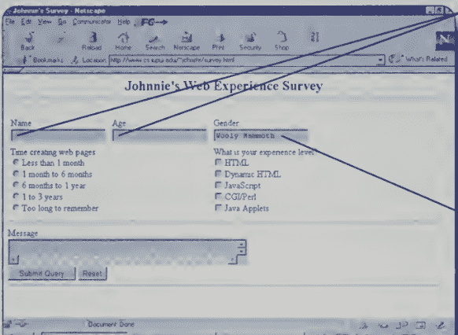

回想一下，调查表单中包含了姓名、年龄和性别的文本框。除非你的应用程序要评估数据并基于数据生成响应，否则你可以将这些输入类型用作数据标签。

问题出现在如果访问者在性别中输入了一个奇怪的数值，比如“长毛猛犸象”。如果你的应用程序正在检查值以确定其为男性或女性，这些数据将导致错误的分析。

因此，你最好将输入字段更改为选择类型，让用户可以在男性和女性之间进行选择。

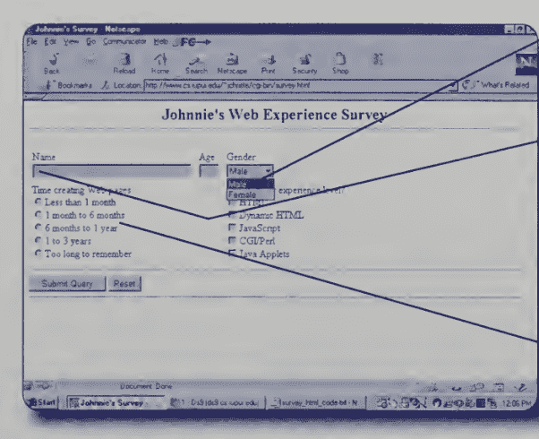

使用表单从访问者处获取输入有两种方式。你可以让用户通过在输入字段中自由输入数据。

你也可以允许用户选择特定的数据。后者需要你设置 `value` 属性，这在本章后面的“使用选择型输入”部分中有详细介绍。

### 使用 `name` 属性或 HTML 标签

`name` 属性与 HTML 标签之间的区别可能会在 HTML 表单和 CGI 应用程序之间处理数据时造成混淆。尽管这个区别很简单，但它经常导致 CGI 应用程序无法正常运行。

CGI 应用程序在将表单数据分配给标量、数组和哈希时使用 `name` 属性的内容。它也是哈希中键值对的键。

`value` 属性也被应用程序使用，并成为哈希中键值对的值以及数组中的元素。

文本字段的上下文也被 CGI 应用程序使用，因为它是字段的值。

CGI 应用程序会忽略 HTML 标签。从技术上讲，你在应用程序中不需要 HTML 标签；HTML 标签用于告诉访问者他们应该在输入字段中包含什么信息。

访问者除非查看 HTML 表单的源代码，否则看不到 `value` 属性；但当他们提交表单时，输入的信息会发送到 CGI 应用程序。现在你已经了解了哪些项目对 CGI 应用程序重要、哪些对用户有用，你可以开始学习如何为你的 CGI 应用程序创建表单了。

### 开发你的 HTML 表单

回想一下，设计 HTML 表单的第一步也是最重要的一步就是提前规划。这包括为你的 CGI 应用程序及其配套的 HTML 页面编写伪代码。

> **提示**
>
> 在设计 HTML 表单或 CGI 应用程序时，不要省略伪代码步骤！如果你认为省略这一步会节省时间，那你就错了。你在规划阶段花费的少量时间，会在编写实际代码时为你节省大量时间，更不用说调试应用程序所花费的时间了。这是我从经验中得知的。我写过无数程序，从不没有草图和伪代码就开始编写代码。

为了编写伪代码，你需要了解可以在 HTML 表单中使用的不同输入类型。

### 使用文本输入字段

文本输入字段使用户能够通过在字段中键入来输入数据。所有从文本输入字段检索到的数据都以字符串形式到达应用程序；然而，Perl 不需要从字符串转换为文本，因为运算符控制数据类型（见第二章的“运算符和函数”部分）。你在本章学习的三种文本输入字段是文本框、密码框和文本区域框。

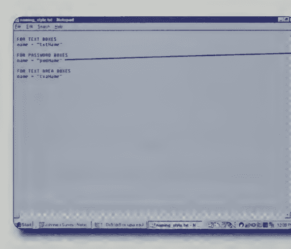

> **提示**
>
> 你会发现，始终一致地命名你的输入字段（在 `name` 属性内，这在以下章节中有详细介绍）在你编写代码和调试应用程序时都非常有帮助。我发现使用与输入类型对应的三字母前缀是一种好方法。我对文本框使用 `txt`，对密码框使用 `pwd`，对文本区域框使用 `txa`。你应该在示例中用与你的输入字段对应的名称替换 Name。引号不是必需的；然而，如果你用引号开始名称，就必须以引号结束。

### 创建文本框

文本框允许用户输入一行文本。文本框通常用于姓名、地址和电话号码。基本上，任何你想让用户手动输入的短文本都适合使用文本框。

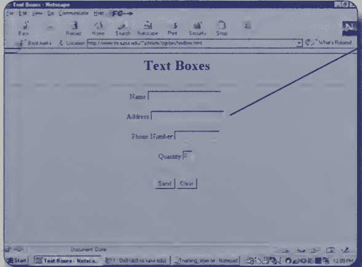

```html
<form name = textboxForm
    method = "post"
    action = "http://klingon.cs.iupui.edu/cgi-bin/cgiwrap/jrchriste/textbox.cgi">

<center>

<h1>Text Boxes</h1>

<hr>

Name:
    <!--This creates a text box named "txtName"-->
    <input type = "text"
        name = "txtName">

<br><br>

Address:
    <!--This creates a text box named "txtAddress"-->
    <input type = "text"
        name = "txtAddress">

<br><br>

Phone Number:
    <!--This creates a text box named "txtPhone"-->
    <!--It has a maximum number of characters that is set to 12-->
    <!--It has the size set to 12, which matches the maximum number of characters-->
    <input type = "text"
        name = "txtPhone"
        maxlength = "12"
        size = "12">

<br><br>

</center>
```

要创建文本框，你使用 `<input type = "text">` 标签。文本框有一些属性，如 `maxlength` 和 `size`，这些非常有用。

你必须使用 `name` 属性来标识输入到应用程序的数据。

当你想限制用户可以输入到文本框中的字符数时，使用 `maxlength` 属性。

你可以用 `size` 属性更改文本框的大小。大小以字符为单位测量；默认大小为 20 个字符。

你可能使用的最后一个属性是 `value`。该属性包含文本框中的默认文本。如果用户不更改它，这些数据将被发送到应用程序。使用默认文本在本章后面的“向表单添加默认值”部分中有详细介绍。

```html
LINED UP BY EQUAL SIGN
<input type = "text"
   name = "txtPhone"
   maxlength = "12"
   size = "12">

LINED UP BY ATTRIBUTE TEXT
<input type = "text"
   name = "txtQuantity"
   size = "2"
   maxlength = "2"
   value = "8">

ONE LINE STARTING WITH NAME
<input type = "text" name = "txtQuantity" size = "2" maxlength = "2" value = "8">

ONE LINE WITH DIFFERENT ARRANGEMENT
<input type = "text" value = "8" maxlength = "2" name = "txtQuantity" size = "2">
```

> **注意**
>
> 属性的顺序并不重要，只要它们在 `<input>` 标签内即可。注意，我通常将属性放在单独的行上，并将等号对齐。这是个人偏好；然而，你应该选择一种风格并始终如一地使用它。我包含了不同的属性格式，以便你可以看到它们都能正常工作。

## 创建密码框

密码框与文本框类似，但它们允许用户输入在屏幕上不可见的密码。星号或圆点会代替用户输入的密码文本显示出来。用户喜欢使用密码框来输入他们不希望房间内其他人看到的信息。

密码信息可以包括社会安全号码、信用卡号码，或者顾名思义，用于访问特定页面或应用程序的密码。

要创建密码框，你需要使用 `<input type = "password">` 标签。密码框包含属性，例如 `maxlength` 和 `size`。

你必须使用 `name` 属性来向你的应用程序标识此输入。

当你想限制用户可以在密码框中输入的字符数量时，请使用 `maxlength` 属性。如果你不希望用户在文本中包含连字符（破折号），这尤其有用。如果希望用户以一长串数字的形式输入其社会安全号码，例如 123456789，请将 `maxlength` 设置为 9。如果他们可以输入为 123-45-6789，则可以使用 `maxlength` 为 12。

你可以使用 `size` 属性更改密码框的大小。在设置了 `maxlength` 时，这是一个好主意。大小以字符为单位衡量；默认大小为 20 个字符。

最后一个密码框属性是 `value`。此属性在密码框中显示默认文本。在密码框中使用 `value` 属性几乎总是适得其反的，因此最好在此处避免使用它。

> **注意**
>
> 密码框不是安全的输入字段。它们仅防止其他人查看插入的文本。它们不会将加密数据发送到服务器；因此，经验丰富的黑客可以访问此信息。

## 创建文本区域框

有时你会希望用户输入大量文本框无法容纳的数据。在这种情况下，你应该使用文本区域框。文本区域框非常适合向用户征求评论和建议。文本区域框也可用作邮件程序中的消息输入字段，例如第 2 章的示例。

请注意，文本区域框不像文本框和密码框那样使用 `<input>` 标签。相反，文本区域框使用 `<textarea>` 标签。

> **注意**
>
> 与不需要结束标签的 `<input>` 标签不同，`<textarea>` 标签必须用结束标签 `</textarea>` 关闭。

你必须使用 `name` 属性来向你的应用程序标识此输入。

使用 `rows` 属性设置行数，这控制了文本区域的高度。默认值为四行高。

要进一步控制文本区域框的大小，你可以使用 `cols` 属性设置文本区域的宽度。宽度以字符为单位衡量，默认宽度为 40 个字符宽。

你可以与文本区域框一起使用的最后一个属性是 `wrap`。当用户键入的文本到达文本区域框边缘时，此属性会自动将其发送到下一行。这使你的文本框看起来更专业。

你可以通过将默认文本放在 `<textarea>` 和 `</textarea>` 标签之间，将其包含在文本区域框中。你不会在文本区域框中使用 `value` 属性来设置默认文本。用户在文本区域框中可以键入的最大字符数为 32,700，并且根据需要会在文本区域框上显示滚动条。

## 使用选择输入控件

选择输入控件让你可以控制用户可以输入到你的应用程序中的值。你选择用户可以选择的值。选项是允许用户选择单个值（使用单选按钮）或多个值（使用复选框或菜单）。你通过使用的选择输入控件来控制此选项。你使用复选框或菜单允许多个选项，而单选按钮使用户只能从列表中选择一个选项。每种选择输入控件中包含的选项数量由你在标签的 HTML 代码中包含的值数量控制。

> **注意**
>
> 如果你没有设置单选按钮、复选框或菜单的 `value` 属性，则会向你的应用程序发送默认值 `on`。此值通常不是你的应用程序期望的值，可能导致应用程序错误。

### 创建单选按钮

单选按钮的设计类似于 20 世纪 80 年代汽车收音机上的按钮。如果你年纪足够大，能记得带有这种收音机的汽车，你会记得你是通过按下一个按钮来选择一个电台的。按下按钮会将电台更改为预设值（电台的呼号），并且任何其他被按下的按钮都会弹回。你一次只能按下一个按钮。表单上的单选按钮的工作方式相同，因此得名。用户一次只能选择其中一个按钮。当他们选择第二个按钮时，第一个按钮会被取消选择。这就像旧的汽车收音机。

你控制每个输入字段的用户可选择的数量，以及他们可以选择的值。与旧的汽车收音机不同，用户无法更改你的单选按钮的预设值。

你还可以将某个特定按钮设置为任何单选按钮输入字段的默认值。在本章后面的“向表单添加默认值”部分详细介绍了使用默认值。

```html
<!-- 创建单选按钮 -->
<input type="radio" name="radSource" value="Yes" checked>是<!-- "checked" 术语使此值成为默认值 -->
<br><input type="radio" name="radSource" value="No">否

你喜欢我的页面吗？<br>
<input type="radio" name="radPage" value="Yes" checked>是<!-- "checked" 术语使此值成为默认值 -->
<br><br>

你是如何听说我们的网站的？<br>
<input type="radio" name="radSource" value="Paper">报纸
<br><input type="radio" name="radSource" value="Magazine">杂志
<br><input type="radio" name="radSource" value="Radio">广播
<br><input type="radio" name="radSource" value="TV">电视
<br><input type="radio" name="radSource" value="Email">电子邮件
<br><input type="radio" name="radSource" value="Friend">朋友
```

你使用 `<input type = "radio">` 标签创建单选按钮。此标签与用于创建文本框和密码框的标签基本相同；然而，`type` 属性被设置为 `radio`。

单选按钮的 `name` 属性与你之前使用的 `name` 属性不同。一组中的每个按钮的 `name` 是相同的。这就是将单选按钮链接在一起的方式，从而只允许一个选择。你必须使用 `name` 属性来向你的应用程序标识此输入。

`value` 属性区分了一组单选按钮中的各个选项。如果未设置 `value` 属性，应用程序将接收到值 `on`，这通常不是你的应用程序期望的值。

你还可以设置默认按钮选择。使用 `checked` 属性来执行此操作。当你想向用户建议一个选择时，此属性很有用。这也可以防止用户跳过输入字段。

从技术上讲，你可以创建一个只包含一个选项的单选按钮列表；然而，大多数用户，包括我自己，都觉得很烦人。如果你需要将此信息发送到你的应用程序，请改用隐藏字段。隐藏字段在第 12 章“保留访客数据”中描述。

### 使用复选框

复选框类似于单选按钮，因为你决定了用户可用的选择。你还设置了选择的数量。复选框和单选按钮之间的区别在于，使用复选框时，用户可以选中任意数量的可用选项。这使用户能够输入所有相关数据，而无需你创建多个输入字段来收集它。就像单选按钮通过 `name` 属性分组一样，复选框也通过 `name` 属性分组为集合。

## 第四章：从访问您网页的用户处获取数据

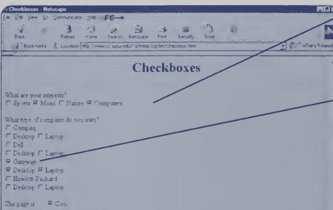

您可以控制用户在每个输入字段中拥有的选择数量以及他们可以选择的值。

您还可以为任何复选框输入字段设置特定的复选框作为默认选项。

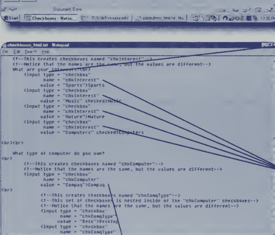

您使用 `<input type="checkbox">` 标签创建复选框。该标签与用于创建文本框和密码框的标签基本相同；但是，`type` 属性设置为 `checkbox`。

复选框的 `name` 属性与单选按钮中的功能相同。一组中的每个复选框的 `name` 是相同的。这将复选框链接在一起。

您必须使用 `name` 属性来识别发送到您应用程序的输入。

`value` 属性用于区分一组复选框中的不同选择。如果未设置 `value` 属性，应用程序将收到值 `on`，这通常不是您应用程序所期望的值。

### 开发您的 HTML 表单

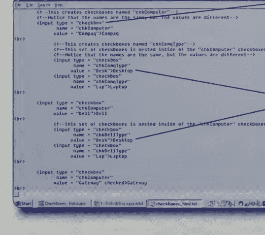

您还可以设置默认的复选框选择。为此，请使用 `checked` 属性。当您想向用户建议一个选择时，此属性很有用。


属于同一组的复选框不必组合在一起，尽管这通常可以避免混淆。请注意，`Desktop`和`Laptop`复选框嵌套在每个单独的计算机制造商名称内。

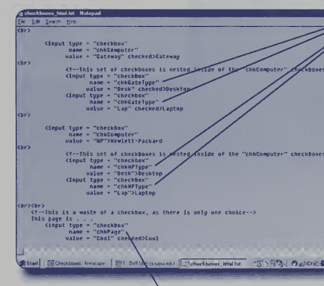

对于每个嵌套的复选框组，`Desktop`和`Laptop`的`name`属性是不同的。为每个嵌套组使用不同的`name`属性，使得编写应用程序时混淆更少，并且在调试应用程序时也会减少混淆。请记住，在 Perl 应用程序中有很多方法可以达到相同的效果；因此，使用相同的`name`属性来处理所有嵌套的`Desktop`和`Laptop`复选框也可以实现所需的结果。

您可以创建一个只包含一个选择的复选框列表；但是，大多数用户（包括我自己）会觉得这很烦人。如果您需要将此信息发送到您的应用程序，请使用隐藏字段。隐藏字段将在第十二章中描述。

### 使用菜单

菜单适合让用户从长列表选项中进行选择。与单选按钮和复选框不同，菜单不必一次显示所有选择。

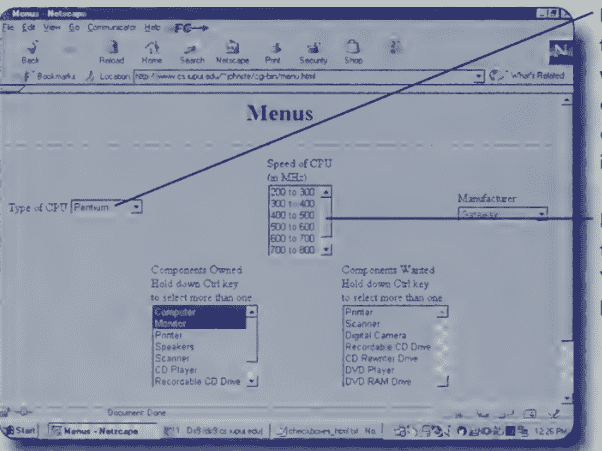

菜单可以设计成看起来像文本框，右侧有一个箭头指示下拉菜单。

菜单也可以设计成选项列表。您可以根据表单设计选择菜单样式。

菜单不使用`<input>`标签。它们使用`<select>`标签，该标签（像`<textarea>`标签一样）需要一个结束标签。您必须使用结束标签`</select>`来结束菜单。

一如既往，使用`name`属性来识别发送到您应用程序的输入。

使用`size`属性可以使菜单以列表而不是文本框样式的下拉菜单显示。如果`size`属性小于选项数量，则会显示一个活动的滚动条。如果`size`属性等于或大于选项数量，则会显示一个非活动的滚动条。

要使您的用户能够从菜单中选择多个选择，请使用`multiple`属性。为了选择多个选择，用户在点击选择时必须按住 Ctrl 键；因此，在表单上包含这些说明是一个好主意。

将`<option>`标签放在`<select>`和`</select>`标签之间，以设置菜单选项的值。

```html
<td>Type of CPU:<br>
<font size="-1"><select name="selCPU">
<option value="Pentium">Pentium
<option value="Pentium2">Pentium II
<option value="Pentium3">Pentium III
<option value="Celeron">Celeron
<option value="AMDX6">AMD K-6
<option value="AMDAthlon">AMD Athlon
</select><!-- This is the end tag mentioned above-->
</td><br>
<td>Speed of CPU<br>
<font size="-1"><select name="selSpeed"
size="1"><!--This sets the size of the number of selections to display-->
<option value="200">200 to 300
<option value="300">300 to 400
<option value="400">400 to 500
<option value="500">500 to 600
<option value="600">600 to 700
<option value="700">700 to 800
<option value="800">800 to 900
</select>
</td><br>
<td>Manufacturer:<br>
<font size="-1"><select name="selManufacturer">
<option value="Compaq">Compaq
<option value="Dell">Dell
<option selected value="Gateway">Gateway
<!--The above value is the value that is displayed initially in the menu box-->
<option value="HP">Hewlett-Packard
</select>
</td><br>
</tr>
```

```html
<td>Components Owned:<br>
Hold down Ctrl key<br>
<font size="-1"><select name="selOwn"
size="4" multiple><!--This sets the size of the number of selections to display-->
<!--The term "multiple" allows the user to choose more than one selection-->
<!--Multiple selections require holding down the Ctrl key when selecting-->
<option value="Computer">Computer
<option value="Monitor">Monitor
<option value="Printer">Printer
<option value="Speakers">Speakers
<option value="Camera">Digital Camera
<option value="CD">CD Player
<option value="CDR">Recordable CD Drive
<option value="CDRW">CD-Writer Drive
<option value="DVD">DVD Player
</select>
</td><br>
<td>Components Wanted:<br>
Hold down Ctrl key<br>
<font size="-1"><select name="selWant"
size="6" multiple><!--This sets the size of the number of selections to display-->
<!--The term "multiple" allows the user to choose more than one selection-->
<!--Multiple selections require holding down the Ctrl key when selecting-->
<option value="Printer">Printer
<option value="Speakers">Speakers
<option value="Camera">Digital Camera
<option value="CDR">Recordable CD Drive
<option value="CDRW">CD-Writer Drive
<option value="DVD">DVD Player
<option value="DVDRAM">DVD RAM Drive
</select>
</td><br>
</tr>
```

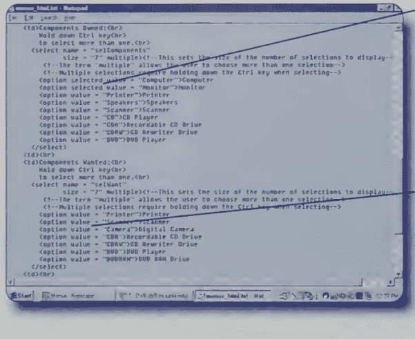

`<option>`标签的`selected`属性包含菜单列表的默认值。默认值在本章后面的“为您的表单添加默认值”部分中有详细说明。

`<option>`标签的`value`属性包含菜单显示的值。

### 创建操作按钮

操作按钮使用户能够将填写好的表单发送到服务器、将表单重置为原始设置，或使用图像将信息发送到服务器。

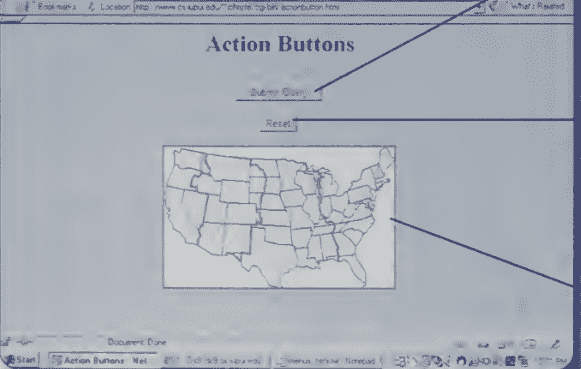

您应该始终包含一个提交按钮，该按钮使用户能够将他们的信息发送到应用程序。

用户欣赏能够通过单击按钮来重置数据的能力，而不是单独删除每个输入字段。

在从用户收集地理位置信息时，图像很有用。

以下部分解释了如何在表单上使用这些各种操作按钮。

#### 使用提交按钮


默认情况下，提交按钮显示“Submit Query”作为标准文本。

您可以更改提交按钮上显示的文本，使其与您正在使用的表单相对应。


您使用`<input type="submit">`标签创建提交按钮。

`value`属性控制提交按钮中显示的文本。可以将此属性设置为最能描述按钮用途的文本。

> **注意：**`name`属性可以与各种提交按钮一起使用，以使不同的按钮向您的应用程序发送不同的值；但是，您可以使用单选按钮来完成相同的任务。使用单选按钮而不是`name`属性，混淆更少。通过省略`name`属性，表单不会向应用程序发送不需要的信息。这些多余的信息包括按钮的名称-值，可能是“submit, Submit Query”。

#### 使用重置按钮

您可以使用重置按钮，使用户无需单独删除每个条目即可更改表单上的信息。重置按钮将表单重置为其原始设置——任何默认值都显示在初始表单上的样子。

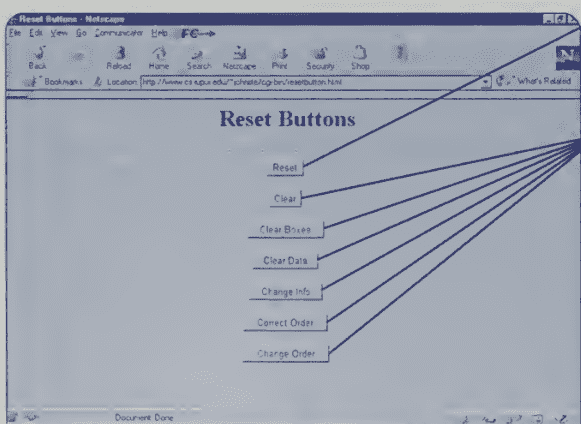

默认情况下，重置按钮显示“Reset”作为标准文本。

您可以将按钮文本更改为更有用且更具指导性的值。

## 开发你的 HTML 表单

103

使用`<input type = "reset">`标签来创建重置按钮。

`<input>`标签的`value`属性控制重置按钮中的文本。该文本应简洁地向用户描述按钮执行的操作。

> **注意**

重置按钮通常不使用`name`属性。只有当你使用了`name`属性时，表单才会发送重置按钮的名称值。与提交按钮类似，这会向应用程序发送一些几乎无用的信息——通常会是"reset、Reset"。

### 使用活动图像

你在表单上可能使用的最后一种操作按钮类型是活动图像。活动图像不是实际的按钮；但是，它们的功能与按钮类似，用于将表单信息提交给服务器。当图像被点击时，所有字段的数据会与光标在图像上的位置一起提交给应用程序。图像会将鼠标光标的坐标作为 x 和 y 值发送，这些坐标会附加到图像的`name`属性上。这些值以每张图像的左上角为原点 (0,0)。

需要告知用户活动图像是将表单提交给应用程序的一种方式。

所有其他输入字段（文本框、单选按钮、菜单等）应置于活动图像之前，因为当图像被点击时，它们的值会被发送给应用程序。

当光标移动到图像上方时显示的文本是活动图像的`name`属性。该`name`属性将在下面解释。

使用`<input type = "image">`标签在表单上创建活动图像。

将`src`属性设置为服务器上图像的 URL，就像标准 HTML 图像标签一样。

`name`属性包含的值会连同 x 和 y 坐标一起发送给服务器。

```html
<html>
<head><title>Active Images</title></head>
<body bgcolor = "white">
<form name = activeImageForm
      method = "post"
      action = "http://klingon.cs.iupui.edu/cgi-bin/cgiwrap/jchristie/activeimage.cgi">
<center>
<h1>Active Images</h1>
<hr>
<br><br>
Click the image to submit the form
<br><br>
<input type = "image"
       name = "Click on your time zone"
       src = "usmap.gif">
<input type = "image"
       name = "Click on your state"
       src = "usmap.gif"
       border = "0">
</form>
</center>
```

`name`属性中的文本会在鼠标光标悬停在图像上时显示。该文本可以进一步指导用户。

`border`属性控制围绕图像的边框。将边框设置为 0 可以移除图像的边框。

移除边框可以使表单看起来更简洁；但是，一些设计师认为保留边框更有用，这样可以让用户知道图像是活动的（这与作为热链接的图像相同）。

注意没有边框的图像在页面上看起来像是标准图像，而有边框的图像则显得突出，像是活动图像（链接）。

还要注意，鼠标光标旁出现的文本比前面网页示例中显示的文本更具信息性。

> **注意**

`value`属性不用于活动图像，因为鼠标光标的位置会将`name`属性附加到点击位置的 x 和 y 坐标上。

### 向表单添加默认值

你已经了解了如何在各个输入字段中设置默认值，但默认值及其用途尚未详细说明。本节解释使用默认值的好处，并向你展示向表单添加默认值的另一种方法。

#### 为什么使用默认值

默认值通常用于显示查询中最常见的答案。如果表单询问用户居住的国家，你的表单上最常见的答案可能是美国——如果是这样，这是一个很好的默认值。

在我的邮件程序中，我将默认的`发送给：`值设置为`jrchrist@iupui.edu`，因为该程序是供学生给我发送电子邮件设计的。但是，用户可以在文本框中输入其他电子邮件地址，程序将使用新数据来发送消息。

默认值的另一个用途是声明数据源的默认值。这在收集程序所需的数据时非常有用。

#### 设置默认值

前面的章节详细介绍了各个输入字段所需的属性，因此你不需要重复阅读这些指令。相反，请考虑这种添加默认值的额外方法。

- 你可以在 HTML 页面的`<form>`标签中包含默认数据。
- 通过使用`action`属性并将默认数据添加到应用程序 URL 的末尾来实现这一点。

```html
<!--This creates a form that calls an application and assigns single data-->
<!--You will need to change the URL to the URL where your CGI application is stored-->
<!--The assigned data is the last section of the URL-->
<form
action = "http://klingon.cs.iupui.edu/cgi-bin/cgiwrap/jchriste/classSyllabus.cgi?class=220Web"
method = "post">

<!--This creates a form that calls an application and assigns multiple data-->
<!--You will need to change the URL to the URL where your CGI application is stored-->
<!--The assigned data is the last section of the URL-->
<form
action = "http://klingon.cs.iupui.edu/cgi-bin/cgiwrap/jchriste/
classSyllabus.cgi?class=220Web&days=TR"
method = "post">
```

默认数据包括问号 (`?`)、数据名称、等号 (`=`)，然后是实际的默认数据。

如果你想包含更多默认数据，请插入与号 (`&`)、第二个数据的名称、等号，然后是第二个数据的值。这直接插入在第一个默认数据值之后，不带任何空格。

最后一步是将`method`属性设置为`post`。`method`属性在本章的“使用环境变量”部分有详细解释。

### 向表单添加链接

你可以使用 URL 链接来访问你的 CGI 应用程序，并作为向应用程序输入数据的一种方式。以这种方式使用链接的好处是减少你需要编写的代码量，无论是在 HTML 还是 Perl 中。

#### 链接到应用程序

- 通过在`<a href>`标签中包含应用程序 URL，可以让链接直接访问你的应用程序。你可能这样做的原因是为了运行一个简单的、不需要用户输入的应用程序。
- 通过使用链接，你无需创建带有输入字段和提交按钮的表单。

#### 从链接获取数据

链接的另一个用途是将数据收集到你的应用程序中。这个过程与本章前面详述的第二种默认值处理类似。区别在于你将数据包含在`<a href>`标签中，而不是`<form>`标签中。

这个简单的链接会激活 CGI 应用程序，并从应用程序的服务器返回当前时间。

你将数据包含在`<a href>`标签的末尾。

默认数据包括问号、数据名称、等号，然后是实际数据的值。

110

## 第 4 章：从网站访客获取数据


`<html>` `<head><title>Web Authoring Course Materials</title></head>` `<body>` `<h3>` `<!--This is a link that has set default data at the end of the URL-->` `The` `<a href = "http://klingon.cs.iupui.edu/cgi-bin/cgiwrap/jchriste/classSyllabus.cgi?class=220&web">` `Syllabus` `</a>` `describes the required textbooks for The Web Authoring Course.` `<br><br><br>` `<!--This is a link that has set multiple default data at the end of the URL-->` `The` `<a href = "http://klingon.cs.iupui.edu/cgi-bin/cgiwrap/jchriste/classSyllabus.cgi?class=220&web&day=TTh">Syllabus` `</a>` `details` `the assignments for the Tuesday/Thursday Web Authoring Course.` `</h3>` `</body>` `</html>`

如果你想包含更多数据，请插入与号、第二个数据的名称、等号，然后是第二个数据的值。这直接插入在第一个数据值之后，不带任何空格。

这些链接看起来没有太大区别；但是，添加到`<a href>`标签末尾的数据会改变你的应用程序接收到的信息。这会导致不同的输出返回给用户。

## 使用环境变量

```perl
#!/usr/bin/perl

# 这一行告知浏览器文本为 HTML，并设置页面格式。
print "<HTML><HEAD><TITLE>REQUEST_METHOD</TITLE></HEAD>";

# 这一行以彩色显示环境变量。
print "<BODY><FONT color=blue>The Request Method used was: </FONT><FONT color=red>";
print "$ENV{'REQUEST_METHOD'}";

# 这一行关闭 HTML 页面。
print "</FONT></BODY></HTML>";
```

环境变量包含一组在浏览器每次向服务器发送信息时设置的数据。这些变量存储在一个名为`%ENV`的特定区域中；这是一个在每次访问应用程序时设置的哈希表。哈希表在第 8 章"哈希表"中有详细解释。对您最有价值的环境变量是那些提供有关发送到服务器的数据信息的变量。

> **注意**

> 本节中的环境变量必须为大写字母。请注意，它们都以`$ENV('`开头，以`')`结尾，并且包含在`print`语句的双引号内。该语句还必须以分号（`;`）结尾。

## 使用 Post 与 Get

前面的示例提到`<form>`标签的`method`属性是向服务器发送数据的方式。为了充分了解此属性的作用以及两种类型之间的区别，您将更仔细地查看它们。

当用户单击**提交**按钮或激活 CGI 应用程序链接时，表单或链接中的数据将发送到服务器。这些数据通过`method`属性的`post`或`get`值发送。`post`允许向服务器发送*不限量*的数据，因此，您通常在表单中使用`post`。

添加到链接中的数据总是使用`get`方法发送到服务器。如果您将包含在`<form>`标签中的数据添加到 URL，则添加的数据将通过`get`方法发送，而表单中的其他数据则通过`post`方法发送。CGI 中一个不错的功能是您能够确定使用了哪种方法将数据发送到服务器。

要确定使用了哪种方法，您可以使用`REQUEST_METHOD`环境变量运行一个简单的应用程序。

当用户单击包含此代码的链接时，它会生成一个 HTML 页面。

生成的 HTML 页面显示用于将数据发送到服务器的方法。

另一个有用的环境变量`QUERY_STRING`显示应用程序从`get`方法接收到的值。

您可以以与`REQUEST_METHOD`变量相同的方式使用此变量，并且通常将这两个变量一起使用。

添加到链接 URL 中的数据以与在 HTML 代码中输入的相同方式显示。

您将用于`post`和`get`方法的最后一个环境变量`CONTENT_LENGTH`显示`post`方法向应用程序发送数据时获取的信息。与`get`方法不同，从`post`方法接收到的信息*不*存储在环境变量中。使用`post`方法发送的数据存储在服务器上一个名为**标准输入**的位置。这就是`post`方法发送的数据没有大小限制的原因。为了在标准输入中找到数据，您必须知道数据中有多少字节。`CONTENT_LENGTH`变量显示所发送数据的大小（以字节为单位）。

```perl
#!/usr/bin/local/perl

# 这些行告知浏览器文本为 HTML，并设置页面格式。
print "Content-type: text/html\n\n";
print "<html><head><title>REQUEST_METHOD</title></head>";

# 这些行检索并显示环境变量。
print "<body><center><h3>The Request Method used was: <font color=red>
$ENV{'REQUEST_METHOD'}</font>";
print "<br>The data sent to the server using GET was: <font color=red>
$ENV{'QUERY_STRING'}</font>";
print "<br><br>The data sent to the server using POST is <font color=red>
$ENV{'CONTENT_LENGTH'}</font> bytes in size.<br>It is located in Standard Input
on the server.";

# 这一行关闭 HTML 页面。
print "</h3></center></body></html>";
```

`CONTENT_LENGTH`变量的用法与`REQUEST_METHOD`和`QUERY_STRING`相同，可以全部包含在同一个应用程序中。

当数据直接从表单提交时，`post`方法将数据发送到服务器。

这将导致显示`post`方法的信息。

注意`get`数据为空，因为使用了`post`方法。

`CONTENT_LENGTH`变量显示所发送数据的大小（以字节为单位）。

最好包含一个关于`post`方法发送数据位置的提醒。

回想一下，某些数据可能会从同一个表单同时使用`post`和`get`方法发送。当您使用`post`方法发送表单数据，并在`<form>`标签的`action`属性中包含默认数据时，就会发生这种情况。

## 确定浏览器和平台信息

您还可以使用环境变量来确定用户用于访问您网页的浏览器。当您想包含并非所有浏览器都支持的设计功能时，此信息很有用，在这种情况下，您应该围绕最常见的浏览器进行设计，或为特定浏览器提供替代页面。

要获取浏览器信息，请以与其他环境变量相同的方式使用`HTTP_USER_AGENT`变量。

应用程序生成的 HTML 页面在所有字段中都包含信息，因为同时使用了`post`和`get`。

此代码只能显示实际从 HTML 页面发送的信息。这样做需要比 shown 更多的知识，这将在第 9 章"条件语句"中介绍。

当用户单击此链接时，该链接访问获取其浏览器信息的应用程序。

生成的页面报告浏览器类型。

它还显示计算机的操作系统。

## 确定导航信息

您可以使用`HTTP_REFERER`环境变量来确定用户在访问您的网页之前正在查看的页面。当您想定位具有指向您页面链接的页面时，这很有用。这种方法的问题在于，当用户在 URL 文本字段中输入您的名称时，此变量将显示他们最后所在的页面，即使该页面不包含指向您网站的链接。

像本节中的其他环境变量一样使用`HTTP_REFERER`。

当单击此链接时，应用程序记录用户当前正在查看的页面。

应用程序显示一个页面，告知用户他们来自的 URL。

## 一次查看所有环境变量

处理环境变量的最后一个过程使您能够查看每个环境变量。就代码而言，此过程比前面的过程更复杂，但这是一个功能强大且有用的应用程序。

生成此响应的代码看起来很复杂，但创建起来很容易。

我添加了字体颜色，以便快速识别变量名称和值。

该应用程序会定位所有可查看的变量并将其显示出来。

> ### 注意

这些示例通过链接来访问应用程序；但是，您也可以在`<form>`标签的`action`属性中使用应用程序的 URL。这样做能让您查看通过`post`方法发送的变量。

此外，这些示例使用 HTML 输出，以便更容易地查看响应内容。如果您需要获取这些信息，可以让响应通过电子邮件发送给您，或者存储到文件中。这种文件使用方法在第15章“文件和目录”中进行了解释。

## 本章总结

在本章中，您学习了如何使用多种方法从网页访客那里获取信息，包括使用文本输入字段、选择框、操作按钮、链接和环境变量。您创建了一些功能强大的 CGI 应用程序并查看了它们的结果。现在，您已经准备好探索如何将这些数据传入您的 CGI 应用程序，而这恰好是下一章的主题。

## 5 将数据传入您的 CGI 应用程序

在上一章中，您学习了如何向用户收集信息，但除非将这些信息传入您的应用程序，否则它毫无用处。在本章中，您将学习：

- 数据在您的应用程序中的重要性

- 如何输入用户数据

- 如何自行输入数据

- 可能出现的数据问题

### 数据在您的应用程序中的重要性

当用户点击提交按钮时，表单中的数据会被发送到服务器；然而，这些数据需要传入您的应用程序才能产生任何价值。如果不将数据传入您的应用程序，您创建的就仅仅是一个 HTML 表单而已。

### 交互能力

通过将数据插入到您的应用程序中，您就能与用户进行交互。如果没有这种交互，您就不需要 CGI 应用程序。用户期望他们填写的表单能够产生某种结果——这可以简单到发送一条消息，也可以复杂到提交一份采购订单。无论结果如何，您的应用程序都需要来自表单的信息来进行处理。

### 与访客沟通的方式

您知道，当点击提交按钮时，您期望得到一个响应。这个响应可以是搜索请求的结果、订单确认，或者是一个利用表单输入来显示特定页面的网页。所有这些都是与用户沟通的方式。沟通的类型取决于您想要实现的结果。虽然这听起来很简单，但这正是 CGI 应用程序设计中最重要的方面。没有用户，就不需要网页或 CGI 应用程序。

### 输入用户数据

您的用户发送到服务器的数据可能来自多种来源。本节将介绍用户数据的三个最常见来源：表单、链接和环境变量。用户数据可能还有其他来源；然而，当您作为 Web 程序员编写或借用应用程序时，这三种类型将是您在大多数应用程序中会见到的。

要理解这些过程，您需要对数据如何发送到服务器有基本的了解。当用户点击链接或提交按钮时，服务器会接收到一个连续的数据流（名称-值对）。为了使您的应用程序能够使用这些数据，它必须被分解成更小的、可用的块——这个过程称为解析。您会发现解析脚本被广泛使用，并且是大多数 Web 应用程序的重要组成部分。

#### 解析来自表单和链接的数据

当您解析数据时，您会获取发送到服务器的连续数据，并将其分解成应用程序可以使用的信息片段。

> 注意

在此示例中，我更改了输入字段的名称，移除了我在第4章“从访客获取数据到您的网页”中建议使用的前缀。这样能更好地展示这个特定解析脚本的工作原理。在本节末尾，我提供了一个更完整的示例，使用了原始的输入字段名称。

当用户填写完输入字段并点击“提交查询”按钮时，数据会作为一个巨大的信息块发送到服务器，其中包含由字符分隔的名称和值。

等号分隔名称和值。

名称/值对由 & 符号分隔。

空格由加号分隔。

正如您所看到的，您的应用程序很难理解这些数据。您也很难分析这种格式的数据。数据分析将在第10章“使用正则表达式处理数据”中进行介绍。

当您解析发送到服务器的数据时，您将数据分解成与应用程序相对应的片段。

在此应用程序中，`name`属性首先列出，后跟一个冒号。在此示例中，第一个名称是“Age”。

然后，为每个对应的`name`属性列出其`value`属性。

为了便于查看，名称-值对位于不同的行上。

从表单发送的数据现在处于可使用的、有意义的格式中。

> 注意

请注意，数据的顺序与您表单上输入字段的顺序不同。事实上，它现在是按字母顺序列出的。随着您在本节技能水平的提高，您将学习各种方法来以最适合您需求的方式排列数据。现在，请专注于数据的解析。

解析数据的概念听起来可能很难；然而，它并不像听起来那么复杂。网络上有大量的解析脚本可供您使用，您可以将它们整合到您的应用程序中。通常，解析脚本是您应用程序中使用的一个子程序。您将在第11章“子程序”中了解子程序的知识。现在，您需要查看一个解析脚本，以理解它的功能以及如何在您的应用程序中使用它。

这是前面示例中使用的完整解析脚本。您可能看着它，想知道这些代码行执行什么功能。考虑到这一点，本节将分解代码并解读令人困惑的元素。

```perl
#!/usr/bin/local/bin/perl

if ($ENV{'REQUEST_METHOD'} eq 'GET') {
    @pairs = split(/&/, $ENV{'QUERY_STRING'});
} elsif ($ENV{'REQUEST_METHOD'} eq 'POST') {
    read(STDIN, $in, $ENV{'CONTENT_LENGTH'});
    @pairs = split(/&/, $in);
} else {
    print "Content-type: text/html\n\n";
    print "<P>Use Post or Get";
}

foreach $pair (@pairs) {
    ($name, $value) = split (/=/, $pair);
    $name =~ s/\+/ /g;
    $value =~ s/\+/ /g;
    $value =~ s/%([\da-f][\da-f])/pack("C", hex($1))/ge;
    $value =~ s/\n/\n/g;
    $value =~ s/<--(.*)\n-->/$1/g;
    if ($value =~ /<!--/) {
        $value =~ s/<!--(.*)-->/"$1"/g;
    } else {
        $value =~ s/\|/ /g;
    }
}

print "Content-type: text/html\n\n";
print "<html><head><title>Survey Values Submitted</title></head><body>";
foreach $name (sort keys(%pairs)) {
    print "<h1>$name: $pairs{$name}</h1>";
}
print "</body></html>";
```

> **注意**

此脚本包含尚未讲解的块条件语句。条件语句在第9章“条件语句”中有详细解释。目前，请只关注代码行在脚本中完成的功能。

```perl
if ($ENV{'REQUEST_METHOD'} eq 'GET') {
    @pairs = split(/&/, $ENV{'QUERY_STRING'});
} elsif ($ENV{'REQUEST_METHOD'} eq 'POST') {
    read(STDIN, $in, $ENV{'CONTENT_LENGTH'});
    @pairs = split(/&/, $in);
} else {
    print "Content-type: text/html\n\n";
    print "<P>Use Post or Get";
}
```

第一行确定`REQUEST_METHOD`是否设置为`Get`。

第二行命名了您创建的用于保存来自表单的名称-值对的数组。您可以为数组选择任何名称；但是，您需要在整个脚本中使用相同的名称。

```perl
if ($ENV{'REQUEST_METHOD'} eq 'GET') {
    @pairs = split(/&/, $ENV{'QUERY_STRING'});
} elsif ($ENV{'REQUEST_METHOD'} eq 'POST') {
    read (STDIN, $in, $ENV{'CONTENT_LENGTH'});
    @pairs = split(/&/, $in);
} else {
    print "Content-type: text/html\n\n";
    print "Please use Post or Get";
}
```

此命令将`GET`方法发送的数据，根据`QUERY_STRING`环境变量中的每个`&`符号进行分割。

第三行用于判断`REQUEST_METHOD`是否被设置为`POST`。

第四行读取包含服务器接收到的未解析数据的变量（如果使用了`POST`方法）。此例中的变量名为`$in`；不过，只要在脚本中保持一致，你可以使用任何名称。


```perl
if ($ENV{'REQUEST_METHOD'} eq 'GET') {
    @pairs = split(/&/, $ENV{'QUERY_STRING'});
} elsif ($ENV{'REQUEST_METHOD'} eq 'POST') {
    read (STDIN, $in, $ENV{'CONTENT_LENGTH'});
    @pairs = split(/&/, $in);
} else {
    print "Content-type: text/html\n\n";
    print "Please use Post or Get";
}
```

`read` 函数需要知道数据的长度才能正确读入。此信息从`$ENV{'CONTENT_LENGTH'}`环境变量中获取。

第五行根据每个`&`符号分割`$in`变量中的数据，并将其赋值给`@pairs`数组。

第六行是为了应对既未使用 POST 也未使用 GET 发送数据的情况。

## 第 5 章：将数据输入到你的 CGI 应用程序

```perl
if ($ENV{'REQUEST_METHOD'} eq 'GET') {
    @pairs = split(/&/, $ENV{'QUERY_STRING'});
} elsif ($ENV{'REQUEST_METHOD'} eq 'POST') {
    read (STDIN, $in, $ENV{'CONTENT_LENGTH'});
    @pairs = split(/&/, $in);
} else {
    print "Content-type: text/html\n\n";
    print "<P>Use Post or Get";
```

第七行提示浏览器接受 HTML 类型的输入。

第八行向浏览器显示一条消息，告知用户使用 POST 或 GET 将数据发送到服务器。此消息仅在最初未使用 POST 或 GET 时显示。

最后一行结束了`else`语句。

你使用此代码块的第一行，对上一代码块中`@pairs`数组包含的名称-值对进行排序。

```perl
foreach $pair (@pairs) {
    ($name, $value) = split (/=/, $pair);
    $name =~ s/\+/ /g;
    $name =~ s/%(..)/pack("c", hex($1))/ge;
    $value =~ s/\+/ /g;
    $value =~ s/%(..)/pack("c", hex($1))/ge;
    $value =~ s/<!--(.|\n)*-->//g;
    if ($parseform{$name}) {
        $parseform{$name} .= ", $value";
    } else {
        $parseform{$name} = $value;
    }
}
```

第二行创建用于保存来自服务器的数据名称和值的变量。

`split`函数根据每个等号分隔名称-值对。

```perl
foreach $pair (@pairs) {
    ($name, $value) = split (/=/, $pair);
    $name =~ s/\+/ /g;
    $name =~ s/%(..)/pack("c", hex($1))/ge;
    $value =~ s/\+/ /g;
    $value =~ s/%(..)/pack("ilateral)", hex($1))/ge;
    $value =~ s/<!--(.|\n)*-->//g;
    if ($parseform{$name}) {
        $parseform{$name} .= ", $value";
    } else {
        $parseform{$name} = $value;
    }
}
```

第二行执行的最后一个函数创建了在`foreach`循环中使用的变量。

这几行代码将传递过来的数据替换并转换成你的应用程序可用且有意义的数据。

```perl
foreach $pair (@pairs) {
    ($name, $value) = split (/=/, $pair);
    $name =~ s/\+/ /g;
    $name =~ s/%(..)/pack("c", hex($1))/ge;
    $value =~ s/\+/ /g;
    $value =~ s/%(..)/pack("c", hex($1))/ge;
    $value =~ s/<!--(.|\n)*-->//g;
    if ($parseform{$name}) {
        $parseform{$name} .= ", $value";
    } else {
        $parseform{$name} = $value;
    }
}
```

第八行判断名称`$parseform`是否已经被赋值到哈希中。

第九行在哈希已存在的情况下，将值追加到现有值后面，并用逗号分隔（如果上一行返回真值）。

第十行准备在第八行返回假值时执行下一行。

第十一行在第八行返回假值时，将名称和值存储到`$parseform`哈希中。

## 第 5 章：将数据输入到你的 CGI 应用程序

```perl
foreach $pair (@pairs) {
    ($name, $value) = split (/=/, $pair);
    $name =~ s/\+/ /g;
    $name =~ s/%(..)/pack("C", hex($1))/ge;
    $value =~ s/\+/ /g;
    $value =~ s/%(..)/pack("C", hex($1))/ge;
    $value =~ s/<!-{2,}.*?-{2,}>//g;
    if ($parseform{$name}) {
        $parseform{$name} .= ", $value";
    } else {
        $parseform{$name} = $value;
    }
}
```

第十二行结束了`else`语句。

第十三行结束了`foreach`语句。

脚本的这部分你可能看起来很熟悉——在你创建第一个 CGI 应用程序的 HTML 输出时，你使用了其中的大部分内容。然而，就像之前那样，我逐行解释这些内容，以防你在没有阅读前面章节的情况下参考本节。

```perl
print "Content-type: text/html\n\n";
print "<html><head><title>Survey Values Submitted</title></head><body>";
foreach $name (sort keys(%parseform)) {
    print "<h1>$name: $parseform{$name}</h1>";
}
print "</body></html>";
```

第一行是标准的 Content-type 行，通知浏览器预期接收 HTML 类型的文本。

第二行打开 HTML 文档，创建标题头，并创建 HTML 文档的`<body>`开始标签。

第三行包含一个`foreach`语句，该语句对`$parseform`哈希中每个键对应的`$name`值进行排序。

第四行打印每个`$name`键，后跟一个冒号。

第四行的最后一部分打印`$parseform`哈希中每个`$name`键对应的值。每个值都与`$name`键相对应。

第五行关闭主体和 HTML 文档。

最后一行结束了`foreach`语句。

脚本至此完成，将显示如下 HTML 页面。

### 预告的示例

在本节开头，我承诺提供一个使用第 4 章输入字段名称的示例。除了以`print`命令开始的最终代码块外，该脚本与前面的示例完全相同；因此，我只解释最终的代码块。

如本书前面所述，要对你的应用程序有更多控制，就需要更复杂的代码——这并不意味着代码更难，只是需要更多的训练。

```perl
print "Content-typelit..
. type uld></boearth">ls.
```

## 从环境变量输入数据

从环境变量输入数据的过程看起来像是前面解析过程与第 4 章环境变量过程的结合。它看起来像这样，是因为事实确实如此。第 4 章中的环境变量过程实际上会解析从表单接收到的数据：多么方便。在本节中，你将这些过程以比第 4 章环境变量示例更合理的方式组合起来。本示例与第 4 章使用的环境变量示例之间最大的区别在于，这里的环境变量被赋值给了标量变量。


- 返回浏览器信息的环境变量被赋值给名为`$browser`的标量变量。
- 返回先前 URL 信息的环境变量被赋值给名为`$where`的标量变量。
- `$browser`变量在`print`命令行的文本中显示浏览器信息，该信息作为 HTML 输出。
- `$where`变量在`print`命令行中显示先前 URL 信息，该信息作为 HTML 输出。

> **注意**
>
> 请记住，Perl 使用等号将值赋给变量——对等号的最佳理解方式是将其视为“获取”。以`$browser`开头的那行代码表示“`$browser`变量获取值`$ENV{'HTTP_USER_AGENT'}`”。如果更容易理解，你可以将等号视为“被赋值为”而不是“获取”。重要的是要理解，`$browser`不等于所赋的值，因为该值在应用程序执行期间可能会改变。


此输出与第 4 章示例中的输出相同；但是，你不必使用完整的环境变量名称来输出值。你只需要使用已赋值为环境变量值的变量即可。

现在你已经了解了将访问者数据输入应用程序的主要方式，接下来需要了解如何手动将数据输入应用程序。

### 自行输入数据

你的应用程序不仅限于从用户发送到服务器的数据：你可以使用标量、数组和哈希将数据直接输入到你的应用程序中。你将在第 6 章“标量”中更好地理解标量，在第 7 章“数组”中理解数组，在第 8 章“哈希”中理解哈希。现在，专注于输入过程，不必担心各个数据片段的所有属性。

#### 从标量输入数据

有时你的应用程序会始终使用相同的数据。你可以使用标量变量将这种数据包含在你的应用程序中。这个过程很简单；但是，它在许多应用程序中都很强大且有用。


- 你通过使用美元符号作为第一个字符，然后加上你想要使用的变量名称来创建标量变量。
- 你使用等号将值赋给变量，等号位于变量名称和你要赋的值之间。
- 如果你赋的值是字符串，则需要用单引号或双引号括起来。我通常使用双引号来区分字符串值和环境变量名称。这在调试时特别有帮助。

数字不需要用引号括起来。


但是，如果数字用作字符串，则应该用引号括起来。

然后你将标量变量包含在值的位置，就好像它们是实际文本一样。

标量变量不必按照创建顺序使用；这是使用这种类型数据输入的好处之一。

文本看起来像是未使用标量变量编写的，这正是你想要的效果。


现在你已经准备好查看一种稍微复杂一些的数据输入方法。

#### 从数组输入数据

你可能需要包含一个列表，其中的数据你希望每次应用程序执行时都使用。你可以使用数组来完成此任务。数组是包含在同一变量中的数据列表。

你使用 at 符号，后跟你选择的变量名称来创建数组变量。

```perl
#!/usr/local/bin/perl

@months = ("January", "February", "March", "April", "May", "June",
           "July", "August", "September", "October", "November", "December");

print "Content-type: text/html\n\n";

print "<html><head><title>Array Input Data</title></head><body>";

print "The 12 months of the year are<br>@months";

print "</body></html>";
```

- 然后你通过包含等号将值赋给变量，等号位于变量名称和你要赋的值之间。
- 你将赋给数组变量的数据用括号括起来。
- 如果数组中的元素是字符串，你需要用引号将它们括起来：下一个示例中会出现一个例外。
- 你可以在文本中包含数组变量，就好像它是实际列表一样。


- 数组元素显示在你使用的数组变量名称的位置。
- 元素在 HTML 页面上显示时，不像数组变量中那样用逗号分隔。它们也没有引号。第 7 章将向你展示如何操作数组变量的显示方式。

### 自行输入数据

字符串用引号括起来的例外情况基本上可以节省时间，并减少创建数组变量时的输入量。

你用 at 符号、数组名称和等号开始数组变量，就像上一个示例一样。

然后你在左括号前使用`qw`。`qw`代表 *quote word*（引用单词），将后面的文本指定为引用的字面量。


- 然后你列出元素，不用引号或逗号；它们在输出中仅用空格分隔。
- 你在文本中包含数组变量名称，就像上一个示例一样。


请注意，HTML 页面与上一个示例的 HTML 页面完全相同。唯一改变的是创建数组所涉及的输入量。

现在你已经了解了如何创建数组，接下来可以继续学习关联数组，通常称为哈希。

#### 从哈希输入数据

哈希与数组的不同之处在于元素的顺序很重要。回想第 2 章，哈希中的元素成对出现——第一个元素是键，第二个元素是值。


但是，元素对可以按任何顺序排列，你可以使用键来访问值。

- 你使用百分号后跟你想要使用的哈希名称来创建哈希变量。
- 像往常一样，你使用等号将值赋给变量，等号位于变量名称和你要赋的值之间。

```perl
#!/usr/local/bin/perl

%birthdays = ("April", "Jawan", "September", "Johnnie and Shawn",
    "October", "Beth and Jonathan");

print "Content-type: text/html\n\n";
print "<html><head><title>Hash Input Data</title></head><body>";
print "<center><h1>Our Family Birthdays</h1></center><hr>";

foreach $month (keys (%birthdays)) {

    print " In $month, it is $birthdays{$month}'s birthday.<br><br>";
}

print "</body></html>";
```

- 然后你将赋给哈希变量的数据用括号括起来。
- 如果哈希中的元素是字符串，你需要用引号将它们括起来。此规则的一个例外是上一个示例中概述的`qw`过程。
- 极其重要的是，你要将元素成对列出，键在前，值在后。

```perl
#!/usr/local/bin/perl

%birthdays = ("April", "Jawan", "September", "Johnnie and Shawn",
    "October", "Beth and Jonathan");

print "Content-type: text/html\n\n";
print "<html><head><title>Hash Input Data</title></head><body>";
print "<center><h1>Our Family Birthdays</h1></center><hr>";

foreach $month (keys (%birthdays)) {

    print " In $month, it is $birthdays{$month}'s birthday.<br><br>";
}

print "</body></html>";
```

你使用`foreach`语句在 HTML 页面中显示哈希元素。`foreach`语句在第 9 章中有详细解释。

- `$month`标量变量获取`%birthdays`哈希中每个元素对的键。这一步和接下来的两个步骤在你阅读第 8 章后会更加清楚；现在，专注于正在发生什么，而不是如何发生。
- 你使用`$month`变量代替键元素，在本例中是月份。

## 第 5 章：将数据输入到你的 CGI 应用程序中


```perl
#!/usr/local/bin/perl

%birthdays = ("April", "Javan", "September", "Johnnie and Shawn", 
             "October", "Beth and Jonathan");

print "Content-type: text/html\n\n";
print "<html><head><title>Hash Input Data</title></head><body>";
print "<center><h1>Our Family Birthdays</h1></center><hr>";

foreach $month (keys (%birthdays)) {
    print " In $month, it is $birthdays{$month}'s birthday.<br><br>";
}

print "</body></html>";
```

你使用`$birthdays{$month}`来替代元素对的值，在这个例子中是指家庭成员的姓名。

为了增加趣味性，我在家庭成员的姓名后面添加了一个撇号（`'`）。请注意，变量和撇号之间没有空格。

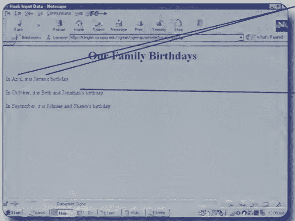

由应用程序生成的 HTML 页面会显示月份以及相应的家庭成员姓名。

撇号看起来就像是它所连接的姓名的一部分。

现在你已经掌握了使用标量（scalars）、数组（arrays）和哈希（hashes）将数据输入到应用程序中的知识。接下来的三章将深入探讨每一种变量。你将学习如何操作它们以适应具体的应用程序。尽管将数据输入到应用程序中的过程看起来很简单，但仍可能会出现破坏应用程序的故障。

> **提示**：只要数组的格式是值紧跟在其键之后（如此处所示：`(key, value, key, value, 依此类推)`），你就可以使用`%hash = @array`将数组转换为哈希，其中`hash`是哈希名称，`array`是数组名称。

### 处理潜在问题

现在你可能对将数据输入到应用程序的能力感到相当自信。但如果用户在输入字段中输入了错误的数据怎么办？你的应用程序还会执行吗？它会正确执行吗？这些问题可能会让你在深夜担忧应用程序和网站的稳定性。这个困境中最困难的部分是你无法预见这类问题。

我将在后面的章节中讨论更常见的问题及其解决方案。如果我现在解释解决方案，你可能会更加困惑，因为你还没有学习到能够发现并纠正这些问题，或者在它们破坏应用程序之前创建安全网的知识。你需要注意的两个领域包括：修复来自用户的错误输入，以及你输入的错误数据。我在本节中提到这些问题而不是其解决方案，是将其作为一种预防性维护程序。我希望通过理解这些问题，你在创建表单和应用程序时能够避免它们。

### 来自用户的错误输入

用户输入可能导致的问题通常涉及使用数字代替字符串，或使用字符串代替数字。这些问题通常不会破坏你的应用程序，但通常会产生奇怪的 HTML 页面输出或没有意义的文本。用户还可能会输入无法正确转换的字符，从而产生无法理解的文本。你在控制用户输入方面的能力有限。你可以使用菜单、单选按钮和复选框代替文本字段，以消除某些问题。你也可以评估数据并告知用户需要纠正错误。关于这一点稍后详细讨论。

### 你输入的数据缺陷

虽然听起来很滑稽，但这是你可以控制的领域，但同时也是最难纠正问题的领域。在这个领域纠正问题的困境在于，你经常会忽略解决方案，因为你的代码在最初创建时看起来是正确的，而且现在看起来依然正确。我经历过的最常见的问题是最容易纠正但最难定位的。

```perl
print "Content-type: text/html\n\n";
print "<html><head><title>Survey Values Submitted</title></head><body>";
print "<br><br>Name: $parseform{'txtName'}";
%birthdays = ("April", "September", "Jason", "Johnnie and Jason",
              "October", "Beth and Jonathan");
```

- 我经常忘记在字符串周围加上其中一个引号。
- 本例在需要双引号的地方使用了单引号。
- 本例在需要单引号的地方使用了双引号。
- 还要小心将哈希变量中的键与正确的值匹配。

还有许多其他难以定位的低级错误，但我认为你已经明白我的意思了。你可能会发现自己经常犯某些特定的错误，因此你会变得擅长在这些错误引发问题之前捕捉到它们。

### 小结

在本章开始时，你已经具备了向用户征集数据的能力，而在本章结束时，你已经知道如何将这些数据插入到你的应用程序中。你现在理解了解析数据的过程以及如何将其应用于你的应用程序。你还能够直接将数据输入到应用程序中，并将其作为可用信息显示给用户。

此外，你应该已经掌握了足够的 CGI 应用程序知识，可以开始询问各项功能是如何实现的。你已经准备好让自己沉浸在标量、数组和哈希的领域中，以便准备好“与鲨鱼共泳”（潜水教练做了太多年，睡眠太少导致的比喻）。如果你准备好了，就大胆尝试吧！

## 6. 标量

在第 2 章“编写你的 CGI 应用程序”中，你简要接触了标量，并在第 5 章“将数据输入到你的 CGI 应用程序中”中使用了标量将数据输入到应用程序中。现在，你将发现标量在 CGI 应用程序中的全部潜力和用途。你知道任何数据片段——字符串或数字，常量或变量——都可以是一个标量，且标量总是以美元符号开始，这代表了 scalar 中的 "s"。你已经使用标量来存储信息；不过，为了防止你跳读，本章将再次呈现这些信息。本章的其余部分重点讨论如何在应用程序中使用标量来执行所需任务。在本章中，你将学习：

- 存储标量信息
- 将数字用作标量变量
- 将字符串用作标量变量
- 给变量赋值

#### 存储标量信息

使用标量存储信息有两种基本方式。第一种是设置标量的初始值，第二种是存储运算结果。你在之前的章节中已经设置了初始值，但还没有使用标量来处理运算结果。

> **注意**：请记住，Perl 使用等号将值分配给变量：在这种语境下，等号的真实含义是“获得”。如果更容易理解，你可以将等号视为意味着“被赋值为”。需要理解的关键点是，变量并不等于被赋的值，因为值在应用程序执行过程中可能会发生变化。

#### 初始数据

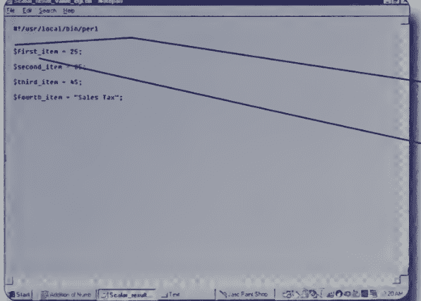

设置标量的初始数据简单直接。

你以美元符号开始标量变量名。

需要注意的是，变量名不能包含空格；因此，请使用下划线字符（`_`）分隔变量名中的术语。

```perl
#!/usr/local/bin/perl

$first_item = 25;

$second_item = 35;

$third_item = 45;

$fourth_item = "Sales Tax";
```

你使用等号将变量名与值分隔开。

你想要赋给变量的值紧跟在等号之后。

最后，用分号结束语句。

记住，如果你在给变量赋字符串值，需要用引号将值括起来。

你赋给变量的值可以在应用程序中被修改，你将在接下来的“操纵变量值”部分学习如何实现这一点。但现在，你需要知道如何使用标量来存储运算结果。

#### 运算结果

你经常会使用标量变量来存储在应用程序中执行的运算结果。这听起来可能具有挑战性；然而，它仅仅是对你已经掌握的设置标量变量初始值的一种修改。运算可以针对字符串、数字、标量、数组或哈希执行。你在本节中看到的示例重点关注涉及标量的运算，因为标量是本章的主题。

## 第六章：标量（SCALARS）

```perl
#!/usr/bin/perl

$second_item = 35;

$third_item = 45;

$fourth_item = "Sales Tax";

$subtotal = $first_item + $second_item + $third_item;

print "Content-type: text/html\n\n";

print "<html><head><title>Subtotal of Items Ordered</title></head><body>";

print "<br><br>Item #1: $first_item";

print "<br><br>Item #2: $second_item";

print "<br><br>Item #3: $third_item";

print "<br><br>Subtotal: $subtotal";

print "</body></html>";
```

你可以使用前面示例中的脚本来启动这个应用程序。

你创建一个新的标量变量（`$subtotal`）来保存你想要执行的操作的结果。

在本例中，`$subtotal`将先前的标量值相加以形成小计。数学运算的详细内容将在下一节“使用数字作为标量变量”中介绍。

```perl
#!/usr/bin/perl

$second_item = 35;

$third_item = 45;

$fourth_item = "Sales Tax";

$subtotal = $first_item + $second_item + $third_item;

print "Content-type: text/html\n\n";

print "<html><head><title>Subtotal of Items Ordered</title></head><body>";

print "<br><br>Item #1: $first_item";

print "<br><br>Item #2: $second_item";

print "<br><br>Item #3: $third_item";

print "<br><br>Subtotal: $subtotal";

print "</body></html>";
```

请注意，原来的标量变量现在已包含在`$subtotal`变量的值中。

这是因为你将操作的结果赋值给了`$subtotal`变量。

通过在前面章节中介绍的 HTML 打印脚本，你可以通过创建表单或链接到应用程序的方式在 HTML 页面中显示结果。我经常使用`test.html`文件。你可以在随书附带的 CD 中找到该文件，位于第三章的示例中。

现在你已经准备好学习使用数学运算的基本概念了。

### 使用数字作为标量变量

数字可能不那么令人困惑，因为你已经熟悉数学运算了。考虑到这一点，你可能会发现本节很容易理解，并且很快就能运用这些概念。Perl 使用日常数学中的基本数学符号；这些被称为*数学运算符*。你在*操作数*上使用数学运算符，操作数就是你执行运算所作用的标量变量。

#### 加法

你在这里进行加法和标准计算器上的操作一样。在上一节中，当你创建并将操作结果存储在标量变量中时，你已经看到了标量变量的加法。

使用加号（`+`）来组合两个标量变量。

你使用一个标量变量（`$total`）来存储数学运算的结果。

操作数可以是保持不变的数字。

操作数可以是标量变量。

操作数可以是一个表达式。

或者，操作数可以是这些的组合。

和之前一样使用 HTML 打印脚本，你可以将结果输出为 HTML 页面，显示数学运算的值。

掌握了加法之后，你就可以开始使用减法了。

#### 减法

正如你可能已经意识到的，减法的实现方式与加法相同。不同之处在于你现在使用正值和负值来组合操作数（参见你的小学数学书）。

- 使用减号（`-`）对操作数执行减法。
- 你使用一个标量变量（`$total`）来存储减法运算的结果。
- 操作数可以是保持不变的数字。
- 操作数可以是标量变量。
- 操作数可以是一个表达式。
- 或者，操作数可以是这些的组合。

### 使用数字作为标量变量

和之前一样使用 HTML 打印脚本，你可以将结果输出为 HTML 页面，显示数学运算的值。

请注意，值的显示方式与前面的示例略有不同。当运算结果为负值时，结果现在显示为负值。

现在你可以使用加法和减法的基本概念来执行乘法和除法运算了。

#### 乘法

乘法基本上是由计算机、计算器或人工执行的多重加法运算。因此，使用这种数学运算的过程与加法和减法类似。

使用星号符号（`*`）对操作数执行乘法。

你使用一个标量变量（`$total`）来存储乘法运算的结果。

```perl
#!/usr/local/bin/perl

$sale_one = 25;

$sale_two = 35;

$sale_three = 45;

$total = $sale_one * $sale_two * $sale_three;

$product = 1 * 2 * 3 * 4 * 5;

$newproduct = $sale_one * $product;

$new_total = $total / 7;

$total_product = $product * $new_total * 25 * $sale_three;

print "Content-type: text/html\n\n";
print "<html><head><title>Multiplication of Numbers</title></head><body>";
print "<br><br>Sale 1: $sale_one";
print "<br><br>Sale 2: $sale_two";
print "<br><br>Sale 3: $sale_three";
print "<br><br>Total: $total";
print "<br><br>Product: $product";
print "<br><br>New Product: $newproduct";
print "<br><br>New Total: $new_total";
print "<br><br>Total Product: $total_product";
print "</body></html>";
```

```perl
#!/usr/local/bin/perl

$sale_one = 25;

$sale_two = 35;

$sale_three = 45;

$total = $sale_one + $sale_two + $sale_three;

$product = 1 * 2 * 3 * 4 * 5;

$newproduct = $sale_one * $product;

$new_total = $total * 7;

$total_product = $product * $new_total * 25 * $sale_three;

print "Content-type: text/html\n\n";
print "<html><head><title>Multiplication of Numbers</title></head><body>";
print "<br><br>Sale 1: $sale_one";
print "<br><br>Sale 2: $sale_two";
print "<br><br>Sale 3: $sale_three";
print "<br><br>Total: $total";
print "<br><br>Product: $product";
print "<br><br>New Product: $newproduct";
print "<br><br>New Total: $new_total";
print "<br><br>Total Product: $total_product";
print "</body></html>";
```

操作数可以是保持不变的数字。

操作数可以是标量变量。

操作数可以是一个表达式。

或者，操作数可以是这些的组合。

和之前一样使用 HTML 打印脚本，你可以将结果输出为 HTML 页面，显示数学运算的值。

有一个乘法的扩展，你可能在高中代数课上记得；它涉及指数。幸运的是，Perl 为此目的提供了一个数学运算符。现在你已经掌握了数字乘法，是时候学习如何在应用程序中使用指数表示法了。

#### 求幂运算

你应该熟悉数学运算中的指数表示法；然而，很有可能距离你上次数学课已经有段时间了，所以本节将详细探讨这一过程。

> **注意**
> 记住，将一个数求幂意味着将该数乘以自身，次数等于指数。（`2^5`等于`2 × 2 × 2 × 2 × 2`，而不是`2 × 5`。）

你可以输入想要提升到指数幂的数，并将其乘以自身，次数等于指数：这适用于较小的指数值。

然而，当数值被提升到较大幂时，手动输入值是不可行的。

要使用指数运算，你输入用于存储结果的标量变量名，后跟等号。

然后输入你要提升到幂的数的操作数。

## 158 CHAPTER 6: SCALARS

用于将数字提升到指数幂的运算符是两个星号（`**`）。星号之间不能有空格——在星号之间放置空格会导致应用程序执行时出现问题。

双星号后面跟着你将初始操作数提升到的幂。

你可以使用标量变量作为指数幂运算的操作数。

数字常量也可以用作操作数。

或者，你可以同时使用数字常量和标量变量的组合作为操作数。

和之前一样使用 HTML 打印脚本，你可以将结果输出为 HTML 页面，显示数学运算的值。

请注意，当数字变得太大而无正常显示时，Perl 会自动将结果转换为科学计数法。这是 Perl 的一个有用特性，可以防止应用程序产生错误。在某些语言中，程序员必须编写代码将值转换为科学计数法以防止错误。

> **注意**
> Perl 在计算数学运算时遵循通用的数学运算顺序。在即将介绍的“使用多个运算符”一节中，你将学习如何强制 Perl 遵循你指定的运算顺序，而非默认顺序。

现在你已准备好进入本节的最后一个数学运算——除法的学习。

### 除法

除法是乘法的逆运算。因此，使用这一数学运算的过程与加法和减法类似。

使用正斜杠（`/`）对操作数执行除法运算。

你使用一个标量变量（`$quotient_new`）来存储除法运算的结果。

- 操作数可以是保持不变的数字。
- 操作数可以是标量变量。
- 操作数可以是一个表达式。
- 或者，操作数可以是这些的组合。


使用之前的 HTML 打印脚本，你可以将结果输出为一个 HTML 页面，显示数学运算的值。

在除法运算中，你可能会有余数。幸运的是，Perl 也有一个用于此目的的数学运算符。既然你已经掌握了除法，现在是时候学习如何获取除法运算的余数了。

### 除法的余数

在除法运算中，商可能不是一个精确的数字，而是包含一个余数。Perl 创建了一个函数来处理这种情况；它被称为取模运算符。

#### 小心

取模运算符不会返回除法运算的商。它只返回除法运算的余数值。如果你想要返回除法运算的商，你需要在一行代码中也包含除法运算符（`/`）。以下示例同时包含了两种运算符，以便同时显示除法运算的结果和余数。请注意，除法运算符仍然将结果显示为十进制数——这个十进制数正是取模运算符显示的余数的基础。

使用百分号显示除法运算的余数。

你使用一个标量变量（`$remainder_quotient_new`）来存储取模运算的结果。

操作数可以是保持不变的数字。

操作数可以是标量变量。

操作数可以是一个表达式。

或者，操作数可以是这些的组合。

使用之前的 HTML 打印脚本，你可以将结果输出为一个 HTML 页面，显示数学运算的值。

既然你知道了如何执行各种数学运算，现在是时候学习如何强制 Perl 遵循你指定的运算顺序，而非通用的数学运算顺序了。

### 使用多个运算符

标准的数学运算顺序遵循一个简单的格式。首先计算括号内的内容，其次是指数，然后是乘法、除法、加法，最后是减法。这些运算总是根据上述规定从左到右完成。

#### 提示

学校老师常用的一个助记口诀可能有助于记住这个顺序：Please Excuse My Dear Aunt Sally。每个单词的首字母是正确顺序下数学运算名称的首字母。（括号、指数、乘法、除法、加法和减法。）

第一个运算，即使用括号，是强制 Perl 遵循你指定的运算顺序的关键。你可以使用括号让 Perl 以适合你应用的方式执行运算。

```perl
#!/usr/local/bin/perl
$first_number = 1;
$second_number = 2;
$third_number = 3;
$fourth_number = 4;
$fifth_number = 5;

$sum = $first_number + $second_number - $third_number / $fourth_number + $fifth_number;

$sum2 = $first_number + ($second_number - $third_number) / $fourth_number + $fifth_number;

$sum3 = 4 * 5 ** 2;

$sum4 = (4 * 5) ** 2;

$sum5 = 1 - 2 + 3 / (4 + 5);

$sum6 = 1 - 2 + 3 / 4 + 5;

print "Content-type: text/html\n\n";
print "<html><head><title>Order of Operations</title></head><body>";
print "<br><br>First Number: $first_number";
print "<br><br>Second Number: $second_number";
print "<br><br>Third Number: $third_number";
print "<br><br>Fourth Number: $fourth_number";
print "<br><br>Fifth Number: $fifth_number";
print "<br><br>Sum: $sum";
print "<br><br>Sum 2: $sum2";
print "<br><br>Sum 3: 4 * 5 ** 2 = $sum3";
print "<br><br>Sum 4: (4 * 5) ** 2 = $sum4";
print "<br><br>Sum 5: 1 - 2 + 3 / (4 + 5) = $sum5";
print "<br><br>Sum 6: 1 - 2 + 3 / 4 + 5 = $sum6";
print "</body></html>";
```

请注意，此示例中的变量和常量排列顺序相同：数学运算结果的不同是由于括号造成的。使用括号改变了运算的顺序。

通过将数字括在括号中，你强制 Perl 在将数字进行指数运算之前先执行乘法。

如果你将括号放在数学表达式的末尾，即使除法在括号的左侧，该部分计算也会首先被执行。

使用括号时需要小心，因为很容易混淆并产生意外的结果。

注意，即使 `$sum` 和 `$sum2` 中的操作数顺序相同，它们的结果也不同。

你已经掌握了足够多关于数字作为标量变量的知识；现在你需要学习如何将字符串用作标量变量。

### 将字符串用作标量变量

与数字不同，字符串没有无数种需要学习和理解的操作。使用字符串时，你有两个选择：连接（拼接）它们和重复它们。你首先学习的选项是连接，这也是两个选项中使用最广泛的一个。

#### 连接字符串

连接字符串的正确术语是拼接。这是一个你可以在聚会上使用，让自己听起来像个程序员或计算机怪才的词。尽管听起来很技术性，但它不过是将两个或多个单词、短语或表达式连接在一起。当你想以可读的格式显示表单内容时，这非常有用。

- 使用句点连接字符串标量变量。
- 你使用一个标量变量（`$full_name`）来存储连接的结果。
- 你必须在引号中包含空格。否则，连接会将单词合并成一个没有空格的字符串。
- 字符串可以是标量变量。
- 字符串可以包含单个字符。
- 字符串可以包含一个术语。
- 表达式或完整的句子可以是字符串。
- 或者，操作数可以是这些的组合。

使用之前的 HTML 打印脚本，你可以将结果输出为一个 HTML 页面，显示连接后的值。

注意字符串是如何连接成一个字符串的。这是因为变量值中没有包含空格。

通过在变量值中的引号中包含空格，你可以确保文本包含空格且易于阅读。

#### 注意

请记住，当你对数字使用连接运算符时，Perl 会将数字作为文本连接在一起。例如，`3 + 4` 的结果是 `7`，但 `3 . 4` 的结果是 `34`。这是一个可能令人沮丧的领域，但在你执行应用程序中的某些功能时非常有用。

这个小而重要的步骤经常被初级程序员忽略，导致输出结果即使可读也令人困惑。既然你知道了如何连接字符串，你需要知道如何在你的应用程序中重复一个字符串。

#### 重复字符串

重复字符串不是你经常使用的操作；然而，我把它包含在这里，是为了让你的 Web 开发工作有一个全面的参考工具。如果你正在创建一个“疯狂填词”应用程序，或者一个使用数据来创作歌曲、副歌或可爱句子的应用程序，这是一个方便的工具。

### 给变量赋值

要重复一个字符串，你需要使用一个字符串或变量名。

在字符串或变量之后加上一个小写的 `x`。

然后跟上你想要重复该字符串的次数。

你可以将这种语法与字符串拼接结合使用，以生成一条有趣的消息。

你可以在输入重复单词时使用这种操作来简化输入，例如在这则可爱的圣诞消息中。

现在，你已经准备好了解操作变量值的方法了。

### 给变量赋值

在某些情况下，你可能想要为变量赋值或更改其值。在本节中，你将学到几种方法来实现这一点。

### 操作变量值

你有几种选项可以用来操作变量的值。这些方法包括使用二元赋值运算符、递增和递减。

- 要使用二元赋值运算符，你需要输入标量变量。
- 在标量变量之后输入等号。
- 然后再次输入该变量。
- 在这个变量之后跟上你想要使用的数学运算符。
- 最后一步是输入你想要赋给数学运算的数字。
- 你可以在二元赋值之间插入打印语句，以输出变化中的值。

此 HTML 输出展示了二元赋值操作带来的变化。

以下快捷方式可以用更少的输入获得相同的结果。

该快捷方式包括输入变量名。

然后跟上你正在使用的数学运算符。

等号紧跟在运算符之后，不带空格。

最后一步是输入将与运算符一起使用的值。

你可以看到结果与较长的版本完全相同。

接下来你将探索的选项是递增或递减变量。在第 9 章“条件语句”中，你会发现这非常有用。

#### 递增变量

递增基本上是将变量的值加 1。在应用程序中有两种方式可以输入：两种方式产生相同的结果。

第一种递增方式是在变量之前直接输入两个加号。

第二种方式是在变量之后直接输入两个加号。

你也可以使用前面的步骤将递增后的变量赋值给另一个变量。如果你希望新赋值使用递增后的值，则将加号放在变量之前。

如果你希望新赋值使用递增前的值，则将加号放在变量之后。

结果展示了在变量之前和之后使用自动递增运算符的区别。

现在你可以探索递减变量的过程了。

### 递减变量

你可能已经意识到，递减是递增的逆操作。规则相同，你只需要将加号改为减号（`--`）。

第一种递减方式是在变量之前直接输入两个减号。

第二种递减方式是在变量之后直接输入两个减号。

你也可以使用前面的步骤将递减后的变量赋值给另一个变量。如果你希望新赋值使用递减后的值，则将减号放在变量之前。

如果你希望新赋值使用递减前的值，则将减号放在变量之后。

结果展示了在变量之前和之后使用自动递减运算符的区别。

> **注意**
>
> 自动递增运算符仅对数字有效，仅当字符串包含数字和字母时有效。自动递减运算符对数字和字符串无效；自动递减运算符仅对数字有效。

### 小结

在本章中，你获得了在不同程度上在应用程序中使用标量变量的必要知识。你知道如何存储值，如何操作数字和字符串，如何存储和操作变量值，以及如何递增和递减变量。这些技能在你接下来几章探索数组和哈希时非常有用，当你在第 9 章开始深入探讨条件语句时将是无价的。好了，现在该学习数组了。

# 7

## 数组

既然你已经了解了标量变量及其用途，你需要对数组有更深入的理解。你知道标量是任何一段数据，在第 2 章“编写你的 CGI 应用程序”中，你学到了数组是标量的组合，可以看作是数据列表。你也知道标量可以是常量的组合或变量的组合，而数组可以是数字或字符串。记住所有数组都以 `@` 符号开头，`@` 形状代表 array 中的“a”。在回顾了基本的数组信息之后，是时候看看本章将学习什么了。在本章中，你将学习如何：

- 将标量拆分为数组
- 确定并存储数组的长度
- 修改数组
- 操作数组

## 第七章：数组

### 将标量拆分为数组

在第 6 章“标量”中，你学习了如何从数据列表创建数组变量；然而，关于数据是如何被引用的，你还没有被告知。数组中的元素会自动编号，从 0 开始。这意味着引用编号将小于元素的数量。

例如，如果你的数组中有六个元素，它们将从 0 到 5 进行编号。

这可能会令人困惑，如果你忘记了这个基本概念，往往会在应用程序中引发问题。引用编号通常称为*数组索引*。当你使用、修改和操作数组时，应用程序会使用数组索引。

#### 拆分标量的原因

你可能想知道何时或为什么需要拆分标量。这是一个好问题。还记得服务器是如何从你的表单接收数据的吗？

服务器接收到的数据是单一的、连续的一行，显示所有的名称和值，由等号、`&` 符号和加号分隔。

在这种状态下，数据对你的应用程序没有用处。此外，解析表单数据的过程会产生一个单一的标量变量，其中的值由逗号分隔。将标量拆分为数组使你能够将标量变量的值转换为具有数组索引的数组。

#### 拆分标量的过程

```perl
#!/usr/local/bin/perl

if ($ENV{'REQUEST_METHOD'} eq 'GET') {
    @pairs = split(/&/, $ENV{'QUERY_STRING'});
} elsif ($ENV{'REQUEST_METHOD'} eq 'POST') {
    read(STDIN, $in, $ENV{'CONTENT_LENGTH'});
    @pairs = split(/&/, $in);
} else {
    print "Content-type: text/html\n\n";
    print "<P>Use Post or Get";
}

foreach $pair (@pairs) {
    ($name, $value) = split (/=/, $pair);
    $name =~ s/\+/ /g;
    $name =~ s/%(..)/pack("C", hex($1))/ge;
    $value =~ s/\+/ /g;
    $value =~ s/%(..)/pack("C", hex($1))/ge;
    $value =~ s/<!--(.|\n)*-->//g;

    if ($parseform($name)) {
        $parseform($name) .= ", $value";
    } else {
        $parseform($name) = $value;
    }
}

print "Content-type: text/html\n\n";
print "<html><head><title>Survey Values Submitted</title></head><body>";
print "<br><br>Name: $parseform('txtName')";
print "<br><br>Age: $parseform('txtAge')";
print "<br><br>Gender: $parseform('selGender')";
print "<br><br>Years of Training: $parseform('radTime')";
print "<br><br>Experience Level: $parseform('chkExperience')";
print "</body></html>";
;
```

将标量拆分为数组的过程很简单。

你已经在第 5 章“将数据导入你的 CGI 应用程序”中创建的 `parseform.cgi` 脚本中见过这个过程。

现在，你可以看到当你在该脚本中使用 `split` 函数时，实际上发生了什么。

# 第 7 章：数组

#### 注意

此拆分过程仅在标量变量包含由逗号分隔的项目列表时有效，例如来自表单的菜单选项或复选框。

第一步是键入要存储标量变量项的数组名称。

接下来，键入等号。

然后键入带有左括号的 `split` 命令。

随后是表达式，通常是逗号，用于分隔标量值。逗号用正斜杠（`/,/`）括起来。

```perl
@skill = split(/,/, $skills);
```

最后，键入逗号、空格、要拆分的标量变量名、右括号以及结束语句的分号。

#### 注意

由于与服务器数据一起使用的主要分隔符是加号，因此如果您没有包含特定表达式，Perl 会使用正则表达式 `/\s+/` 自动将字符串拆分成片段。

这解释了拆分标量变量的过程，您在解析脚本和其他应用程序中会用到它。下一节将向您展示如何确定特定数组中的元素数量。

#### 确定数组的长度

您可能会发现，当数据已输入数组时，了解数组中有多少元素很有用。通常有两种方法可以获取此信息——使用标量变量或使用索引号。两种方法接下来都会讨论。

> **提示**
>
> 以下应用程序中所需的 `subparseform.lib` 文件包含在 CD-ROM 中，可以在本章的示例中找到。

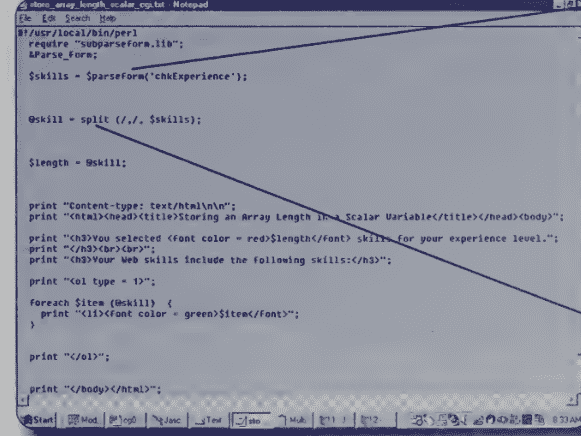

您要做的第一件事是将数据解析为可用术语，即使用表单解析子程序，这将在第 11 章“子程序”中完整讨论。此时不必担心该子程序正在完成什么。专注于后面的代码。

然后，使用上一节中的代码拆分标量。

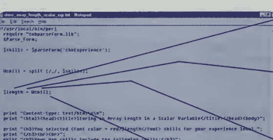

您包含一个标量变量名，用于存储数组的长度。

您使用等号将数组元素的数量分配给您刚刚创建的标量变量。

然后键入要确定其长度的数组名称。

最后，键入分号以结束语句。

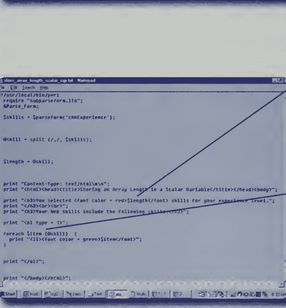

您将包含数组长度的标量名称包含在 `print` 命令的文本中。

#### 确定数组的长度

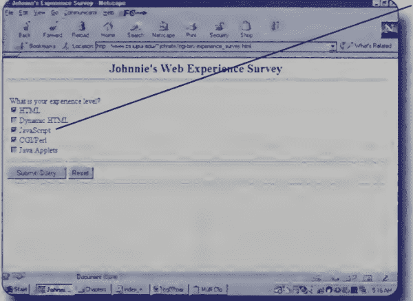

CD 上本章示例中的 `experience_survey_html.txt` 表单调用 `store_array_length.cgi` 应用程序，其中五个选项中有三个被选中。

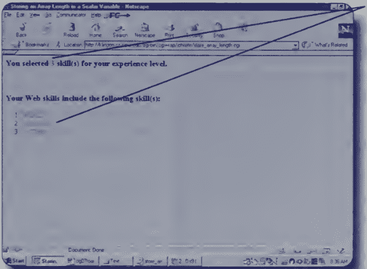

应用程序生成的页面显示元素数量，并在列表中显示所选项目。

#### 使用索引号

您还可以使用索引号来确定数组的长度。有几种不同的方法可以实现这一点。第一种方法返回数组中最后一个元素的索引号；第二种方法返回数组中元素的总数。

> **警告**
>
> 记住，数组的索引号从 0 开始，而不是 1；因此，如果最后一项的索引号是 4，则数组包含五个元素。

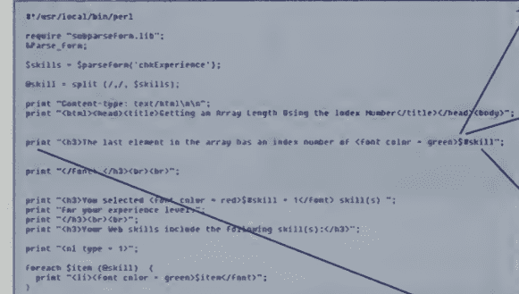

要确定数组中最后一个元素的索引号，请使用美元符号。

然后键入一个井号，字符之间没有空格。

变量名称跟在井号后面，不带 `@` 符号。同样，字符之间没有空格。

您在 `print` 语句中键入此信息，就如同它是文本一样。

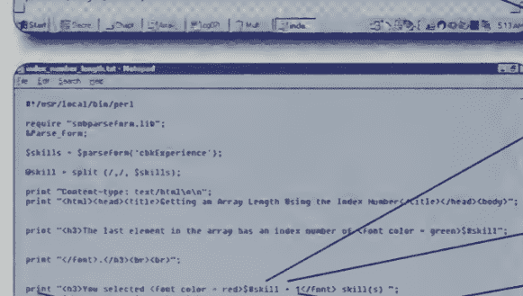

要返回数组中元素的总数，请键入前面的术语。

然后键入加号。

随后键入数字 1，以补偿从 0 开始的索引号。

您还将此代码包含在 `print` 语句中，就如同它是文本一样。

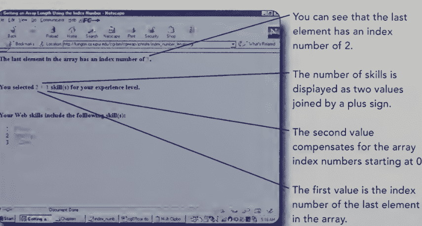

既然您已经知道如何确定数组的长度（或元素数量），您需要知道如何从数组中检索数据。

#### 检索数组数据


当您从数组中检索数据时，您有两个基本选择：您可以检索特定项目，也可以检索多个项目。您使用数组的索引号来完成此操作，您将在本节中学习如何执行这两种操作。

> **警告**
>
> 记住，数组的索引号从 0 开始，因此，元素数量总是比数字值多一个。如果最后一个索引号是 3，则数组中有四个元素。

### 检索特定项目

有时您想从数组中获取特定的数据。您可以从数组中检索任何数据。以下示例将引导您了解各种选项。

您要做的第一件事是键入要从中获取数据的数组名称。请注意，您使用的是美元符号而不是 `@` 符号。这是因为您正在检索单个数据（即标量），而不是数据列表。

然后键入要检索的数据的索引号，用括号（`[]`）括起来。名称和括号之间不能有空格。

将此代码包含在 `print` 语句中，就如同它是文本一样。

```perl
@months = ("January", "February", "March", "April", "May", "June",
           "July", "August", "September", "October", "November", "December");

print "Content-type: text/html\n\n";
print "<html><head><title>Getting a Particular Item From an Array</title></head><body>";

print "<h3>Christmas is celebrated in <font color = green>$months[11]</font>.</h3><br><br>";

print "<h3>Valentine's Day is celebrated in <font color = red>$months[1]</font>.";
print "</h3><br><br>";

print "</body></html>";
```

### 检索数组数据

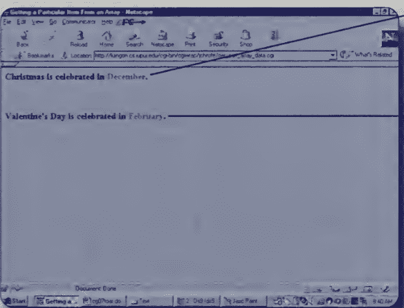

HTML 页面显示与数组元素索引号相对应的月份。

请注意，元素不必按其编号顺序使用。二月在数组中位于十二月之前，但您可以按任意顺序检索它们。

您还可以将数组中的特定数据分配给标量变量。

为此，您包含要用于分配数据的标量变量名。

然后键入等号。

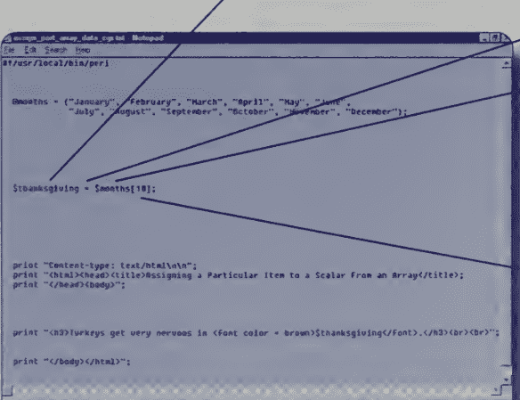

然后键入数组的名称（以美元符号开头——记住您正在检索单个数据），数据将来自该数组。

此代码后跟您要分配给标量变量的元素的索引号。不要忘记用括号将其括起来。

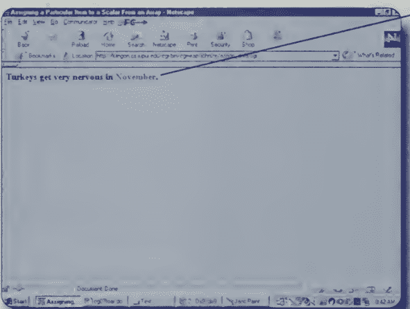

您可以看到正确的月份已从数组中分配。

您可以使用的另一个选项是将元素分配给从第一个元素开始的标量变量。

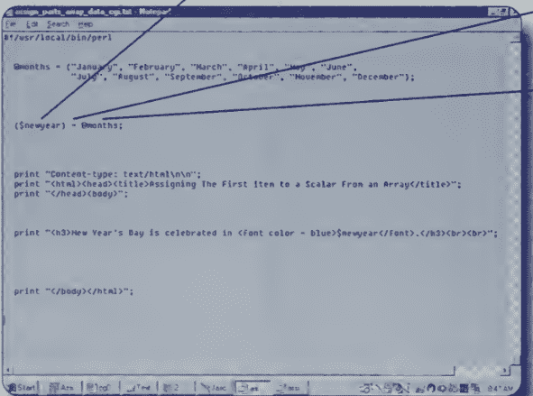

您可以通过键入用括号括起来的标量变量名来完成此操作。

然后键入等号。

最后，键入以 `@` 符号开头的数组名。确保以分号结束语句。

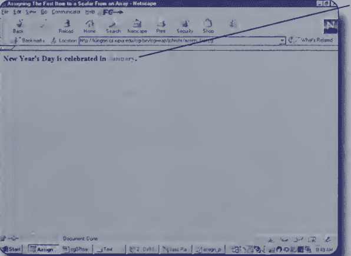

您可以看到正确的月份已从数组中分配。

您可以对要分配的任意数量的元素重复此操作；但是，元素总是按连续顺序分配。

您键入与之前相同的开头，将第一个元素分配给标量变量。

然后使用逗号分隔标量变量名。

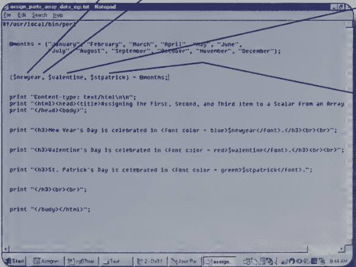

接下来，键入第二个标量变量名，您希望将第二个元素分配给它。

对于将保存顺序数组元素的每个标量变量，重复前面两个步骤。

## 第 7 章：数组 186

请记住以右括号结束标量变量列表。

像往常一样，你输入等号和数组名称，数组名以 `@` 符号开头。确保以分号结束语句。

你可以看到正确的月份已被赋值。

掌握了检索特定项之后，你已经准备好学习如何从数组中检索多个项。

### 检索多个项

有时你可能想要从数组中检索多个项，而这些项可能不是连续排列的。因此，你需要知道如何从数组中检索多个元素。

你需要创建一个包含要检索的值的数组。由于数组的索引号从 0 开始，你可能希望在第一个元素中包含一个虚拟值。使用虚拟值可以避免在使用计数器变量从数组中检索元素时出现的问题。

然后，你创建一个标量变量，并将表单复选框中的解析数据赋值给它。

接着，你将标量变量分割成一个数组。

要使用检索到的数据，你输入原始数组的名称。

后面跟着你创建的用于保存分割标量数据的数组名称。这以 `@` 符号开头，因为你正在检索一个数据列表。

第二个数组名称需要用方括号括起来。

你将前两步包含在 `print` 语句中，就像它们是文本一样。

本示例的完整 HTML 代码，`array_slicing_html.txt`，位于本章示例的 CD 中。

```text
array_slicing_html.txt - 记事本
文件 编辑 搜索 帮助
<html>
<head>
<title>Array Slicing</title>
</head>
<body bgcolor = "white">
<form name = surveyform
method = "post"
action = "http://klingon.cs.iupui.edu/cgi-bin/perlwrap/jchriste/array_slicing.cgi">
<table>
<tr>
<td>What Web skills are you interested in learning?
<br>
<input name = "chkskill[]"
type = "checkbox"
value = "1">HTML<br>
<input name = "chkskill[]"
type = "checkbox"
value = "2">Dynamic HTML<br>
<input name = "chkskill[]"
type = "checkbox"
value = "3">JavaScript<br>
<input name = "chkskill[]"
type = "checkbox"
value = "4">CGI/Perl<br>
<input name = "chkskill[]"
type = "checkbox"
value = "5">Java Applets
</td>
</tr>
</table>
<br>
```

请注意，复选框的值与前面的示例相比已经改变。它们现在是数值，从 1 开始到 5 结束。

这些数字与数组元素的索引号相匹配，对应于表单中使用的标签。回想一下，你创建了一个虚拟的第一个元素来替代从 0 开始的索引号。

表单看起来与前面的示例相同，因为你只改变了值。

应用程序生成的 HTML 页面显示用户选择的内容，嵌入在文本中。

你还可以选择在生成的 HTML 页面上显示数组中的任何元素。

要做到这一点，你用要显示的元素的索引号替换前面示例中的第二个数组名称。

```perl
#!/usr/local/bin/perl
require "subparseform.lib";
&Parse_form;

@skill = (None, HTML, DHTML, JavaScript, CPerl, Java);

$selection = $parseform{'chkSkills'};

@selection = split (/,/, $selection);

print "Content-type: text/html\n\n";
print "<html><head><title>Array Slice</title></head><body>";

print "<h3>You selected <font color = red>@skill[0]</font> as the skill(s) you want to learn.</h3><br><br>";

print "</body></html>";
```

请注意，你可以显示数组中不是表单上可用选项之一的元素。

要使用此选项显示多个元素，输入要显示的元素的索引号，用逗号分隔。

这将显示与数组索引号对应的元素。

> **注意**
>
> 使用索引号而不是第二个数组名称会显示相应的元素，无论用户选择了什么。显示表单数据的最佳选项是本节中的第一个示例。

> **警告**
>
> 有些函数看起来会修改变量，但实际上只对变量的值进行操作。例如平方根函数 `sqrt($element)`，它产生元素的平方根；然而，元素的值保持不变。上一章中使用的自增函数 (`$element++`) 实际上会修改元素的值。

掌握了数据检索之后，是时候继续学习如何修改数组了。

### 修改数组

你可能会问自己，为什么需要修改数组，因为元素是由你或用户的选择来赋值的。有很多修改数组的理由，在你学习以下示例的过程中，这些理由会变得清晰。回想一下，你在上一章中修改了标量变量；现在你将学习如何修改数组。

#### 修改整个数组

在早期的示例中，你看到 `foreach` 循环用于辅助显示数组元素。`foreach` 循环在第 9 章中有详细解释。执行此操作时，数组会被永久修改。了解这一点使你能够使用 `foreach` 循环对整个数组进行修改。

本示例的完整代码，`modify_all_array_cgi.txt`，可以在本章示例的 CD 中找到。

要使用 `foreach` 循环修改所有元素，你首先分割表单中的解析数据。

要实际修改数据，你输入 `foreach` 命令。

然后输入标量的名称，以美元符号开头，因为你正在检索单个数据（标量）。你可以使用任何名称作为标量。我使用了 `$number`，因为它在逻辑上说得通。

后面跟着数组名称，以 `@` 符号开头，因为你正在引用整个元素列表。

数组名称需要用括号括起来。

要启动循环，你需要使用左花括号字符 (`{`)。

接下来，你输入标量名称，以美元符号开头。确保在旁边包含等号。

后面跟着你用于更改数组元素的运算符。

你将标量名称（以美元符号开头）用括号括起来。

然后输入分号以结束语句。

最后，你输入右花括号字符 (`}`) 以结束循环。

本示例的完整代码，`modify_all_array_html.txt`，可以在本章示例的 CD 中找到。

用户在这里进行选择并提交表单。

表单提交后，显示用户选择创建的原始数组元素。

修改后的数组元素也会显示。

基本上，你已经从数组中检索了每个元素，修改了每个元素，并将新元素赋值回原始数组。很简单，对吧？现在你需要知道如何向数组添加元素。

### 向数组中添加元素

向数组中添加元素时，你有两种选择：可以将元素添加到数组的开头，也可以将元素添加到数组的末尾。本节将讨论这两种方法。

以下示例的 HTML 代码位于 CD 中本章的示例文件夹内。

#### 在数组开头添加元素

幸运的是，Perl 提供了一个专门用于在数组开头添加元素的函数。本示例使用 CD 中的 `add_begin_array_html.txt` 示例。

首先，输入 `unshift`。它是执行“添加到开头”功能的 Perl 运算符。

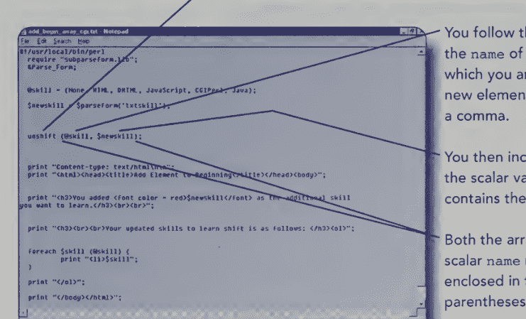

在该运算符后输入要添加新元素的数组名称，后跟一个逗号。

然后输入包含新元素的标量变量的名称。

数组名称和标量名称都需要用同一组括号括起来。

# CHAPTER 7: ARRAYS

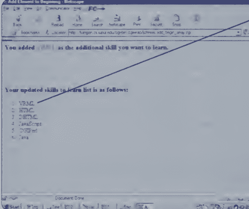

此时数组已将新技能作为第一个元素包含在内。

你也可以将新元素赋值给现有数组。本示例使用 CD 中的 `add_begin_array2.html.txt` 示例。

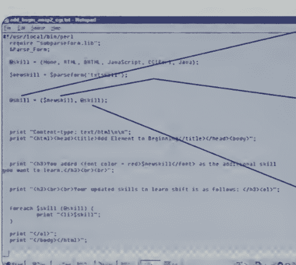

要将新元素赋值给现有数组，输入数组名称，后跟一个等号。

然后，输入你要添加的元素——该元素可以是标量常量、变量或数组——后跟一个逗号。

接着再次输入数组名称。务必将新元素和数组名称用括号括起来，并以分号结尾。

# MODIFYING AN ARRAY

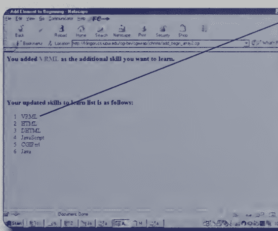

此选项的结果与前面的示例相同。

在数组末尾添加元素的过程与此类似。

#### 在数组末尾添加元素

你可以使用预定义的 Perl 运算符将元素添加到数组的末尾。本示例使用 CD 中的 `add_end_array_html.txt` 示例。

首先输入 `push`，即执行“添加到末尾”功能的 Perl 运算符。

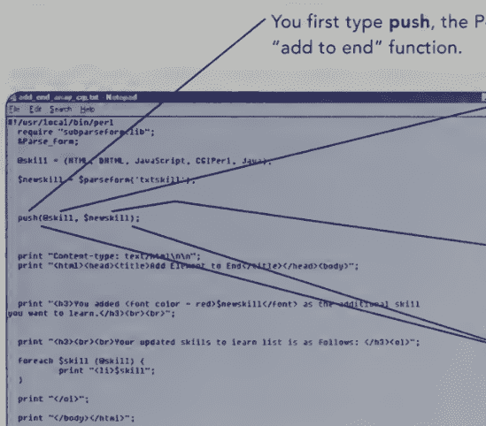

在该运算符后输入要添加新元素的数组名称，后跟一个逗号。

然后输入包含新元素的标量变量的名称。

数组名称和标量名称都需要用同一组括号括起来。

# 198 CHAPTER 7: ARRAYS

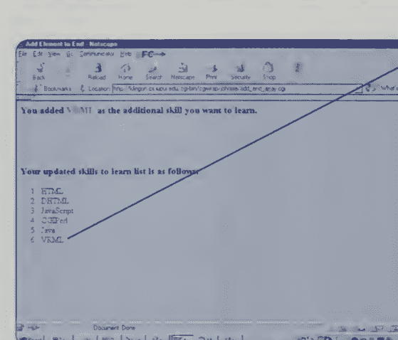

此时数组已将新技能作为最后一个元素包含在内。

你也可以将新元素赋值给现有数组。本示例使用 CD 中的 `add_end_array2_html.txt` 示例。

要将新元素赋值给现有数组，输入数组名称后跟一个等号。

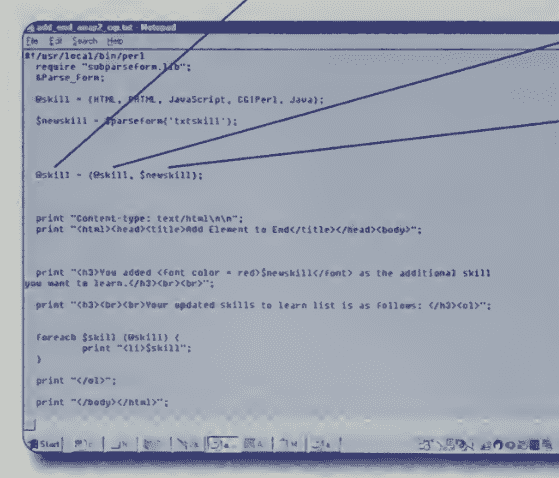

然后再次输入数组名称，后跟一个逗号。

接着输入你要添加的元素——该元素可以是标量常量、变量或数组。务必将数组名称和新元素用括号括起来，并以分号结尾。

# MODIFYING AN ARRAY


此选项的结果与前面的示例相同。

### 删除数组元素

有时你可能需要从数组中删除元素。与添加元素类似，Perl 为此功能也预定义了运算符。


#### 删除第一个元素

如果你想删除数组的第一个元素，请使用 `shift` 运算符。

首先包含 `shift` 运算符，它执行“删除第一个元素”功能。

然后输入要从中删除元素的数组名称。


此过程将从列表中删除第一个元素，如生成的 HTML 页面所示。请注意，单个元素不会列在“removed”句子中。


另一个选项是将删除的元素赋值给标量变量。这使你可以显示已被删除的元素。

最后一步是输入你要修改的数组名称，用括号括起来。


此响应与前面的示例看起来相同，因为它们执行相同的功能。但是，由于你将删除的元素赋值给了标量变量，因此可以在 HTML 页面上显示它。

#### 删除最后一个元素

删除最后一个元素与删除第一个元素类似，只是使用不同的运算符。


首先包含 `pop` 运算符，它执行“删除最后一个元素”功能。

然后输入要从中删除元素的数组名称。

# 202 CHAPTER 7: ARRAYS


此过程将从列表中删除最后一个元素，如生成的 HTML 页面所示。请注意，单个元素不会列在“removed”句子中。

另一个选项是将删除的元素赋值给标量变量。这同样使你可以显示已被删除的元素。

要将删除的元素赋值给标量变量，输入保存该元素的标量名称，后跟等号。

然后输入 `pop` 运算符。

最后一步是输入你要修改的数组名称，用括号括起来。

```perl
#!/usr/local/bin/perl
require "cgi-lib.pl";
&ParseForm;

@skill = ('HTML', 'DHTML', 'JavaScript', 'C++', 'Perl', 'Java');

$omit = pop(@skill);

print "Content-type: text/html\n\n";
print "<html><head><title>Add Element to Beginning</title></head><body>";

print "<h3>You removed <font color=red>$omit</font> as the additional skill you want to learn.</h3><br>";

print "<h3><br>Your updated skills to learn is as follows: </h3><ol>";

foreach $skill (@skill) {
    print "<li>$skill";
}

print "</ol>";
print "</body></html>";
```


此响应与前面的示例看起来相同，因为它们执行相同的功能。但是，由于你将删除的元素赋值给了标量变量，因此可以在 HTML 页面上显示它。

### 替换数组元素

Perl 还预定义了可以替换数组中单个元素的运算符。这可以对单个元素或多个元素执行。

#### 替换单个元素

替换数组中的单个元素是一个简单但功能强大的过程。

# 204 CHAPTER 7: ARRAYS

要替换单个元素，输入你要修改的数组名称。


紧接着输入你要替换的元素的索引号，用方括号括起来。

然后输入一个等号，后跟要插入数组的标量变量或标量常量。请记住，如果使用引用的字面量，必须用引号括起来。


这将删除你使用的索引号对应的原始元素，并用新元素替换它。

### 替换多个元素

替换数组中的多个元素比替换单个元素稍微复杂一些。

要替换多个元素，输入你要修改的数组名称。


紧接着输入要替换的元素的索引号，用方括号括起来，并用逗号分隔。

然后输入一个等号，后跟要插入数组的标量变量或标量常量，用括号括起来。请记住，如果使用引用的字面量，必须用引号括起来。


此过程将删除你使用的索引号对应的原始元素，并用新元素替换它们。

## 反转元素的顺序

Perl 允许你使用预定义运算符来反转数组中元素的顺序。此过程也会改变元素的索引号，因为它们在数组中的顺序已经改变。执行此操作的最佳方法是将反转后的数组赋值给一个新数组。

首先，输入你将用于接收反转数组的新数组名称，后跟等号。

要反转数组中元素的顺序，你需要包含`reverse`运算符。

该运算符后跟你想要反转顺序的数组名称，并用括号括起来。

此过程将反转数组中元素的顺序。

### 操作数组

Perl 中另一个你可能觉得有用的功能是能够使用预定义运算符来操作数组。你使用的方法包括合并数组和排序数组。

#### 合并数组

将两个数组的元素合并在一起的功能可能非常强大，这取决于你在应用程序中如何使用它。尽管听起来很复杂，但实际上这是一个简单的过程。

要开始合并两个数组，你需要输入将用于存储新数组的新变量名称，后跟等号。

然后输入第一个数组的名称、逗号，以及第二个数组的名称。这段文本应该用括号括起来。

> **提示**
>
> 如果你希望第二个数组的元素列在新数组的开头，只需反转括号中原始数组的顺序即可。

结果是一个更大的数组，包含来自两个原始数组的元素。

#### 排序数组

你学习的最后一个操作功能是能够对数组中的元素进行排序。此功能使你能够按字母顺序排列元素。

按字母顺序对元素进行排序的最佳方法是将重新排列后的数组赋值回自身。因此，你需要输入数组名称后跟等号。

然后包含`sort`运算符。

该运算符后跟数组名称，并用括号括起来。

如你所见，元素现在按字母顺序列出。

### 小结

在本章中，你学习了如何将标量拆分为数组、如何确定数组的长度，以及如何从数组中检索数据。你还了解了修改和操作数组的各种形式。既然你已经掌握了数组，你需要理解一种更高级的数组形式，即`哈希`，这将在下一章中介绍。

## 8 哈希

哈希，也称为关联数组，由成对关联的元素组成。这些对以特定顺序出现，先是键，然后是值。键和值的顺序很重要；然而，对的顺序并不重要。

对的顺序并不重要，因为哈希使用键来引用值，而不是像数组那样使用索引号。每个对的键取自接收数据的表单中`input`标签的`name`属性，而哈希的值则来自同一`input`标签的`value`属性。请记住，所有哈希都以百分号（`%`）开头，`%`形状表示哈希中的链接对。在本章中，你将学习：

- 检查键是否存在
- 使用键检索哈希值
- 检索所有哈希值和键
- 检索特定的键和值
- 删除键值对

> **注意**
>
> 本章中的许多示例使用了条件语句（`if/else`、`foreach`、`while`等），这些语句直到第 9 章“条件语句”才会介绍给你。不要担心理解这些条件语句；相反，专注于手头的操作。如果你花时间通读它们，你可能会意识到这些条件语句在做什么；然而，你不必这样做。

### 检查键是否存在

在尝试在应用程序中使用键之前，你可能想要检查哈希以确定特定键是否存在。

#### 为什么检查很重要

在使用键之前检查键不仅可以节省时间，还能让你仔细检查是否使用了正确的拼写。例如，在第 7 章“数组”的应用程序中，你看到一些数组名称仅相差一个“s”；这也可能发生在键上。表单通常必须处理名为`Address1`和`Address2`的输入字段。你可以看到这种相似性可能导致复杂情况，并使使用错误的键名称变得更容易。

#### 如何检查键

检查键需要你使用一个合乎逻辑的运算符，正如你在第 7 章中注意到的运算符一样。

你需要包含`exists`运算符——它搜索哈希键是否存在。

```perl
#!/usr/local/bin/perl
require "parseform.lib";
&Parse_Form;

print "Content-type: text/html\n\n";
print "<html><head><title>Existing Key</title></head><body>";

if (exists $parseform{'txtFirst_Name'}) {
    print "Welcome to my Page, I see that you exist and are a KEY to my success";

} else {
    print "You do not exist as a KEY to my success";

}

print "</body></html>";
```

接下来，输入你想要检查的哈希名称。以美元符号开头哈希名称，因为你正在从哈希中查找单个数据（标量）。

然后输入键的名称，用单引号（`' '`）括起来，而单引号又需要用花括号（`{ }`）括起来。

```perl
#!/usr/local/bin/perl
require "parseform.lib";
&Parse_Form;

print "Content-type: text/html\n\n";
print "<html><head><title>Existing Key</title></head><body>";

if (exists $parseform{'txtFirst_Name'}) {
    print "Welcome to my Page, I see that you exist and are a KEY to my success";

} else {
    print "You do not exist as a KEY to my success";

}

print "</body></html>";
```

因为这是条件语句的一部分，所以整个语句需要用括号括起来，并以左花括号（`{`）而不是分号结束。

所需的分号出现在`print`语句的末尾。

条件语句需要在分号后加上右花括号（`}`）。

此示例的完整代码`exists_key_html.txt`可以在本章示例的 CD 中找到。

此示例显示键存在；应用程序生成一个验证其存在的 HTML 页面。

此示例显示应用程序中键的拼写错误。

此示例的完整代码`exists_key2_html.txt`可以在本章示例的 CD 中找到。

现在，HTML 页面指出该键不存在。

双重响应不是`exists`运算符的一部分，而是条件语句的功能。这里使用它是为了让你了解`exists`运算符如何运作。

### 使用键检索哈希值

既然你知道如何检查键是否存在，你就可以学习如何使用键来检索哈希的值。你可以检索单个值或多个值。

#### 检索单个值

如前所述，哈希中的每对元素通过键和值相互链接，因此它们通常被称为`键值对`。了解这一点，你可以使用键来检索其值。这使你可以在应用程序中使用该值。

首先，键入将用于存储检索到的**值**的标量变量的**名称**。其后是一个等号。

接下来，键入要从中检索值的哈希的**名称**，同样以美元符号开头。请记住，你正在检索的是单个数据片段。

在美元符号之后，是用于检索值的键的名称，该名称被包裹在单引号和花括号内。

这次，你使用分号（`;`）来结束语句。

现在，你可以通过键入存储该值的标量的**名称**，在应用程序中使用这个**值**。你使用这个标量就像使用文本一样。

本示例的完整代码`survey_single_value_html.txt`可以在本章的示例光盘中找到。

## 第 8 章：哈希

这使你能够个性化你的网页。你可能在网页上见过这种效果，并想知道他们是如何将你的名字插入到页面中的。有时，当你再次访问一个网站时，它会个性化地欢迎你，而你并未提供任何数据。在第 12 章“保留访客数据”中，你将了解网页是如何做到这一点的，你也可以将此类技巧融入你的网页。很酷，对吧？

### 检索多个值

很少会从表单中只检索单个数据片段。因此，你需要知道如何使用键来检索多个值。当你使用键的名称从哈希中检索值时，你就是在*切片*哈希。这是你可以在派对上使用的更有用的术语！

要使用键检索多个值，你键入用于存储这些值的数组的名称。注意这是一个数组，而不是标量，所以它以`at`符号开头。这是因为你正在存储多个数据片段。`at`符号后面是一个等号。

### 使用键检索哈希值 217

然后，键入你将从中获取值的数组的名称，同样以`at`符号开头。这又是一个数组，因为你正在处理多个数据片段。

紧随其后的是你希望检索其值的键的名称。这些名称用逗号分隔，每个都包裹在单引号中，整个集合则被包裹在花括号中。

你使用分号结束语句。

你可以像使用文本一样使用这个数组，就像在前面的示例中使用标量一样。如果数组包含在`print`语句的引号内，打印时值会用空格分隔。

本示例的完整代码`survey_multiple_values_html.txt`可以在本章的示例光盘中找到。

注意，从数组打印出的值是用空格分隔的。

### 检索所有哈希数据

有时你可能需要检索哈希的所有值或所有键。Perl 预定义了运算符，你可以用于这两种功能。

#### 查找所有哈希值

首先，键入用于存储值的数组的名称。这个名称以`at`符号开头，因为你正在存储多个数据片段。其后是一个等号。

接下来，键入从哈希检索所有值的运算符。

然后，键入你要从中检索数据的哈希的名称。这是一个包含键值对的哈希，所以它以百分号开头。它需要被包裹在圆括号中。

使用分号结束语句。

### 检索所有哈希数据 219

要显示这些值，请在`foreach`语句中包含标量名称和数组名称。

请记住，你使用带美元符号的标量来表示单个数据。

相反，你使用带`at`符号的数组来表示多个数据片段。

本示例的完整代码`survey_all_value_html.txt`可以在本章的示例光盘中找到。

所有来自表单的值都列在生成的页面上。

#### 所有哈希键

有时你可能需要从哈希中检索所有键。这个过程与检索所有值的过程类似。

## 第 8 章：哈希 220

要检索哈希的所有键，你键入用于存储这些键的数组的名称。因为这个名称存储多个数据片段，所以以`at`符号开头。其后是一个等号。

然后你键入`keys`运算符——它检索哈希的所有键。

在此运算符之后，是包含键值对的哈希的名称。因为它存储多个数据片段，所以以百分号开头。你将哈希名称包裹在圆括号中。

使用分号结束语句。

要显示这些键，你在`foreach`语句中包含标量名称和数组名称。

请记住，你使用带美元符号的标量的单数形式来表示单个数据。

相反，你使用带`at`符号的数组来表示多个数据片段。

### 检索特定的键和值 221

本示例的完整代码`survey_all_key_html.txt`可以在本章的示例光盘中找到。

所有来自表单的键都列在生成的页面上。

### 检索特定的键和值

你可以使用两种方式之一来一起检索哈希的键和值。幸运的是，Perl 为这两种功能都预定义了运算符。Perl 是不是很棒？

#### 检索第一个键和值

要检索哈希的第一个键和值，你使用`each`运算符。

## 第 8 章：哈希

键入保存哈希中键和值的标量。这些标量以美元符号开头，因为你要用它们来存储单个数据片段。你用逗号分隔这些标量，并将它们包裹在圆括号中。

标量后面是一个等号。

然后你键入从哈希检索键和值的运算符。

你键入要从中检索键和值的哈希的名称。这个名称以百分号开头，因为它包含多个数据片段。哈希名称被包裹在圆括号中。

使用分号结束语句。

```perl
#!/usr/local/bin/perl
require "subparseform.lib";
&Parse_Form;

print "Content-type: text/html\n\n";
print "<html><head><title>The First Key and Value</title></head><body>";

print "<h3>The First Key and Value</h3>";

($key, $value) = each(%parseform);

print "<h3>The first key is <font color = red>$key</font><br>";

print "The first value is <font color = green>$value</font></h3><br><br>";

print "</body></html>";
```

在`print`语句中，你可以像使用文本一样使用你创建的标量。

本示例的完整代码`survey_first_key_html.txt`可以在本章的示例光盘中找到。

### 检索特定的键和值

这会生成一个显示第一个键和值的 HTML 页面。

要按顺序检索额外的键和值，请为你想要显示的每个额外键和值重复前面的步骤。

你想要检索的每个连续键和值都需要自己的运算符来访问哈希并检索数据。

每个连续键和值也需要自己的`print`语句。

你可以根据需要重复这些步骤任意多次。

## 第 8 章：哈希

本示例的完整代码`survey_add_key_value_html.txt`可以在本章的示例光盘中找到。

此页面按顺序显示了哈希中所有请求的键和值。

#### 检索每个键和值

要检索哈希的每个键和值，你使用`each`运算符配合`while`条件语句。

此示例包含在一个`while`条件语句中，因此你首先键入该语句。

然后你包含`each`运算符。

在此运算符之后，是你想要检索其键值对的哈希的名称。请确保哈希名称以百分号开头，并将其包裹在圆括号中。

### 检索特定的键和值 225

然后输入右括号，它与`while`语句中的左括号匹配。

接着输入一个左花括号来结束这一行。

然后输入`print`语句，其中使用标量来代替键和值的文本。

最后以右花括号结束。

此示例的完整代码`survey_all_key_value_html.txt`可在本章示例的光盘中找到。

该代码生成一个 HTML 页面，用于显示键及其对应的值。

### 使用 keys 函数检索键值对

检索哈希键和值的第二种方法是使用`keys`函数。`keys`函数的好处在于，你不需要知道所访问哈希中键的名称。当你不是创建该表单的人时，这就很方便了。

此操作包含在一个`foreach`循环中。

首先输入一个标量名称，用于存储从哈希中获取的键。

然后输入一个左括号和用于检索数据的函数名称。本例中使用`keys`函数。这是函数名称，必须完全按原样输入；不能更改此名称，否则应用程序将无法正确执行。

接着输入要从中检索键和值的哈希名称。因为它包含多个数据，所以哈希名称以百分号开头。

输入右括号，后跟左花括号。

然后在`print`语句中输入你创建的用于保存哈希键的标量名称，就像它是一个文本一样。

在`print`语句中用于显示值的项稍微复杂一些。输入哈希的名称（以百分号开头），并直接跟上存储哈希键的标量名称——该标量名称需要用花括号括起来。此代码使用键来检索值并打印它。这一行以分号结束。

你需要输入右花括号来结束`foreach`循环。

此示例的完整代码`survey_key_value_keyfunction_html.txt`可在本章示例的光盘中找到。

该代码生成一个 HTML 页面，用于显示所有键及其对应的值。

### 删除键值对

有时你可能需要从哈希中删除数据，例如当数据过时或对应用程序不再有用时。这就需要删除键值对。幸运的是，Perl 为此功能提供了一个预定义的运算符。

首先输入`delete`运算符——它会从哈希中删除键值对。

然后输入要从中删除数据的哈希名称。这以美元符号开头，因为你要删除的是单个数据项。（一个键值对被视为一个独立的数据项。）

接着输入用于删除键值对的键名称。该名称需要用花括号括起来，如果它是字符串，则需要用单引号括起来。

这一行以分号结束。

此示例的完整代码`survey_remove_key_value_html.txt`可在本章示例的光盘中找到。

键值对现在已被删除，这一点从生成的 HTML 页面中可以看出。

该功能的另一个选项是删除多个键值对。过程类似，但存在一些小的差异，这些差异会导致重大的变化。

以`delete`运算符开始此过程。

然后输入要从中删除数据的哈希名称。此名称以`@`符号开头，因为你要删除的是多个数据项。

接着输入要用于删除键值对的键名称。键之间用逗号分隔。它们需要用花括号括起来，如果它们是字符串，则需要用单引号括起来。

这一行以分号结束。

此示例的完整代码`survey_remove_multi_key_value_html.txt`可在本章示例的光盘中找到。

键值对现在已被删除，这一点从生成的 HTML 页面中可以看出。

如果你想保存被删除的值以备将来参考，或者作为误删数据的备份，可以将其赋给一个标量变量。

为此，输入要赋值的标量名称。

然后输入等号。

接着输入`delete`运算符。

然后输入要从中删除数据的哈希名称。此名称以美元符号开头，因为你要删除的是单个数据项。

接着输入要用于删除键值对的键名称。该名称需要用花括号括起来，如果它是字符串，则需要用单引号括起来。

这一行以分号结束。

你可以使用这个新的标量来显示被删除的信息。我不清楚你为什么要在应用程序中这样做；不过，我在这里展示它是为了证明它已被赋值。

此示例的完整代码`survey_remove_assign_key_value_html.txt`可在本章示例的光盘中找到。

键值对已被删除，并且其值已赋给一个标量变量，该变量显示了该值。

### 总结


在本章中，你获得了理解和使用哈希所需的知识。你现在知道了键的重要性，如何检查键，以及如何使用键来检索单个和多个值。你还知道了如何检索所有的哈希值和键，以及如何使用`keys`函数检索键值对。最后，你知道了如何从哈希中删除键值对，以及如何将被删除的键值对的值存储到标量变量中。在本章和上一章的示例中，你接触到了各种条件语句，当时被告知可以忽略它们。那么，现在是时候详细解释它们了，以便你更好地理解它们，并能够在你的应用程序中使用它们。

## 9 条件语句

前几章的许多示例都使用了条件语句作为实现其全部功能的一种手段。你通常被要求忽略条件语句，专注于该章或该节的重点功能。如果你花时间研究了这些条件语句，你可能能够理解它们的作用。如果没看懂，那也没关系。当你学完本章后，你就能够查看条件语句并确切地理解它们实现了什么以及如何实现的。你也将能够创建自己的条件语句并在应用程序中使用它们。

在本章中，你将学习：

- 进行比较
- 创建你的条件语句
- 使用语句块
- 使用嵌套条件语句

*条件语句*背后的概念很简单：它检查一个特定条件，并根据返回的值（真或假）以及条件语句中的代码，执行或不执行某个动作。听起来很简单，对吧？一个例子涉及早上决定是否吃早餐——如果你饿了，你就吃早餐；如果你不饿，你就不吃早餐。这就是一个简单的条件语句。你在本章中学到的一些条件语句就是这种基本类型，而另一些则很复杂，涉及多个步骤。

### 比较值

值的比较是条件语句的一种基本形式；然而，它通常是高级条件语句的基础。你可以比较数字和字符串，并在不进行比较的情况下对它们进行求值。本节将详细说明它们的区别以及如何使用它们。

#### 数字比较

数字比较在许多应用程序中都会用到。数字可以被比较以确定它们是否相等，或者一个数字比另一个大还是小。数字比较返回`true`或`false`。

在此示例中，一个标量变量（`$Age`）的值与一个常量值进行比较。

### 值比较

你可以判断两个数字是否相等。

你可以判断两个数字是否不相等。

你可以判断一个数字是否大于另一个数字。

你可以判断一个数字是否大于或等于另一个数字。

你可以判断一个数字是否小于另一个数字。

或者，你可以判断一个数字是否小于或等于另一个数字。

### 字符串比较

字符串的比较方式与数字不完全相同。当你比较数字时，通常是在判断哪一个更大。当你比较字符串时，通常想知道它们是否相同。字符串比较返回`true`或`false`。

在这个示例中，一个标量变量（`$First_Name`）的值会与一个常量值进行比较。请记住，所有字符串都必须用引号括起来。

你可以使用`eq`来判断两个字符串是否相等。

你可以使用`ne`来判断两个字符串是否不相等。

你可以使用`gt`来判断一个字符串是否大于另一个字符串。

你可以使用`ge`来判断一个字符串是否大于或等于另一个字符串。

你可以使用`lt`来判断一个字符串是否小于另一个字符串。

或者，你可以使用`le`来判断一个字符串是否小于或等于另一个字符串。

> **注意**
>
> 字符串比较区分大小写；因此，`"Johnnie"`不等于`"johnnie"`。另外，如果你将字符串运算符用于数字，Perl 会将这些数字视为字符串。这可能会极大地改变条件的返回值，因为比较时使用的是 ASCII 值。例如，`37 gt 137`返回`true`，因为`3`的 ASCII 值大于`1`的 ASCII 值。如果你将它们作为数字进行比较，返回值将是`false`。这可能会在你的应用程序中造成严重问题。

### 无需比较的求值

使用比较运算符可能是你创建条件的最简单方式，也绝对是最常见的。但是，任何语句都可以用作条件。幸运的是，Perl 使用一组简单的规则来判断一个语句是`true`还是`false`。任何求值为`0`、空字符串（`""`）或未定义的语句，其返回值都为`false`；否则，其返回值为`true`。这使你能够判断用户是否在任何输入字段中留空。你可能在填写网络上的一些表单时遇到过这种情况。请注意，无论条件求值为`true`还是`false`，包含在你条件中的任何操作都会被执行。这在使用自增函数（`++`）时尤为重要。

### 检查多个比较

你可以同时对多个条件进行求值。好吧，它们不是在同一确切时间被求值的；一个会在另一个之前被求值，但它们是被一起处理的。对于多个比较，有几个选项可以使用。第一个选项要求所有条件都为`true`；第二个选项要求只有一个条件为`true`。这两种选项的详细说明如下。

首先尝试要求所有条件都为`true`的选项。你输入一个左括号来开始你要处理的条件集。

然后，你将要处理的第一个条件用它自己的一对括号括起来输入。

逻辑`and`运算符（`&&`）跟在第一个条件后面。

你将要处理的下一个条件用它自己的一对括号括起来输入。

最后，你输入一个右括号，将整个要处理的条件集包含在内。你可以在主括号中包含任意数量的条件，但尽量不要失控，因为这可能会违背使用多个比较的初衷。

要使用只要求一个条件为`true`的选项，你输入一个左括号来开始你要处理的条件集。

然后，你将要处理的第一个条件用它自己的一对括号括起来输入。

逻辑`or`运算符（`||`）跟在第一个条件后面。你可以通过使用键盘上的 Shift 键和反斜杠（`\`）键来输入运算符中的每个竖线（共两次）来输入此运算符。

你将要处理的下一个条件用它自己的一对括号括起来输入。

最后，你输入一个右括号，将整个要处理的条件集包含在内。

输入这些选项的唯一区别在于逻辑运算符。

### 创建你的条件语句

如果你曾经在收音机上听过摇滚电台，你可能会想起 Pink Floyd 录制的一句熟悉的`if`语句："如果你不吃掉你的肉，你就不能吃布丁；如果你不吃掉你的肉，你怎么能有布丁呢？"这个语句包含了条件语句所需的一切：它有一个`if`，一个条件（你不吃掉你的肉），以及如果条件返回`true`时所采取的操作（你不能吃布丁）。Perl 以大致相同的方式使用`if`语句。

```perl
#!/usr/bin/local/bin/perl
require "subparseform.lib";
&Parse_Form;

print "Content-type: text/html\n\n";
print "<html><head><title>Conditional Statement</title></head><body>";

$fat = $parseform{'txtEat'};

if ($fat eq "meat") {
    print "<h3>You ate your meat, so you get pudding.</h3>";
}

print "</body></html>";
```

- 要创建一个条件语句，你首先使用`if`。
- 然后输入一个左括号。
- 接着输入你想要判断的条件。
- 之后是一个右括号。

```perl
#!/usr/bin/local/bin/perl
require "subparseform.lib";
&Parse_Form;

print "Content-type: text/html\n\n";
print "<html><head><title>Conditional Statement</title></head><body>";

$fat = $parseform{'txtEat'};

if ($fat eq "meat") {
    print "<h3>You ate your meat, so you get pudding.</h3>";
}

print "</body></html>";
```

- 然后输入一个左花括号。
- 你换到下一行，输入当条件返回`true`时要执行的语句。根据需要重复多次，但记住每条语句以分号结尾。
- 换到下一行，输入一个右花括号。这结束了你的条件语句。

此示例的完整代码`condition_html.txt`可以在本书配套光盘中本章的示例文件中找到。

用户填写表单并提交它。

因为条件返回`true`，所以`print`语句被执行并显示。

请记住，Perl 区分大小写。因此，在输入字段中输入文本的方式很重要。这个问题可以通过使用`lc`或`uc`运算符来解决。

此示例中 HTML 表单的完整代码`condition2_html.txt`可以在本书配套光盘中本章的示例文件中找到。

```perl
#!/usr/local/bin/perl
require "snbparseform.lib";
&Parse_Form;

print "Content-type: text/html\n\n";
print "<html><head><title>Conditional Statement</title></head><body>";

$Eat = lc $parseform{'txtEat'};

if ($Eat eq "meat") {
    print "<h3>You ate your meat, so you get pudding.</h3>";
}

print "</body></html>";
```

要使用`lc`运算符（用于将字符串转换为小写），你需要在给`$Eat`标量赋值的等号后插入`lc`。

你需要确保比较值以小写形式书写，以匹配标量值。

```perl
#!/usr/local/bin/perl
require "snbparseform.lib";
&Parse_Form;

print "Content-type: text/html\n\n";
print "<html><head><title>Conditional Statement</title></head><body>";

$Eat = uc $parseform{'txtEat'};

if ($Eat eq "MEAT") {
    print "<h3>You ate your meat, so you get pudding.</h3>";
}

print "</body></html>";
```

此示例中 HTML 表单的完整代码`condition3_html.txt`可以在本书配套光盘中本章的示例文件中找到。

要使用`uc`运算符（用于将字符串转换为大写），你需要在给`$Eat`标量赋值的等号后插入`uc`。

你需要确保比较值以大写形式书写，以匹配标量值。

### 创建条件语句

使用这两种运算符之一可以消除用户输入的单词与你在应用程序中检查的比较值大小写不一致所带来的问题。

你还可以让应用程序在条件返回假值时执行语句。

```perl
#!/usr/local/bin/perl
require "subparseform.lib";
&Parse_Form;

print "Content-type: text/html\n\n";
print "<html><head><title>Conditional Statement</title></head><body>";

$Eat = lc $parseform{'txtEat'};

if ($Eat eq "meat") {
    print "<h3>You ate your meat, so you get pudding.</h3>";

} else {
    print "<h3>How can you have any pudding, if you don't eat your meat?</h3>";
}

print "</body></html>";
```

要在条件返回假值时执行语句，请在右花括号的同一行输入`else`。

然后在同一行输入一个左花括号。

转到下一行，输入当返回值为假时要执行的语句。记得在语句末尾加上分号。

转到下一行，输入一个右花括号。

## 第 9 章：条件语句


本示例中 HTML 表单的完整代码`condition4_html.txt`可在本书附带光盘的本章示例中找到。

- 如果用户在输入框中输入的内容不是全小写的`meat`，无论是全大写还是大小写混合，`else`语句都会被执行。


这会显示`else`语句中的文本，作为对不正确答案的响应。

条件语句用途广泛，从前面示例中的简单过程，到检查多个条件并根据从用户获取的数据生成多个 HTML 页面的复杂过程。使用哪种条件语句取决于你的应用程序。在接下来的章节中，你将学习如何使用各种类型的语句块。有了这些知识，你就能确定在应用程序中使用哪种最佳的条件语句。请记住，任何时候你想评估从用户获取的数据并以特定方式响应时，都要使用条件语句。

## 使用条件语句块

前面的示例都是由条件语句块组成的。它们通常根据用于引出条件的语句类型来命名：第一个示例称为`if`语句或`if`块；第二个示例称为`if/else`语句或块。这是很直观的，因为它们就是语句块中使用的单词。在本节中你将看到许多类型。请注意，它们有许多功能和用途。我会尽可能详细地进行解释，同时避免让你感到乏味。

### if/elsif 语句

基本的`if/else`语句已在上一节中详细说明，因此我将介绍更高级的`if/else`语句。Perl 允许你在`if`条件为假值时评估额外的条件，然后再执行`else`语句。

```perl
#!/usr/bin/perl
require "subparseform.lib";
&Parse_Form;

print "Content-type: text/html\n\n";
print "<html><head><title>elsif Conditional Statement</title></head><body>";

$Eat = lc $parseform{'txtEat'};

if ($eat eq "meat") {
    print "<h3>You ate your meat, so you get pudding.</h3>";

} elsif ($eat eq "fish") {
    print "<h3>Fish is a good substitute for meat. You can have pudding.</h3>";

} else {
    print "<h3>How can you have any pudding, if you don't eat your meat?</h3>";
}

print "</body></html>";
```

首先根据上一节的内容创建`if/else`语句。在`if`语句和`else`语句之间插入`elsif`语句。

首先输入一个右花括号。

紧接着是关键字`elsif`。注意拼写：只有一个"e"。

```perl
#!/usr/local/bin/perl
require "subparseform.lib";
&Parse_Form;

print "Content-type: text/html\n\n";
print "<html><head><title>elsif Conditional Statement</title></head><body>";

$eat = lc $parseform{'txtEat'};

if ($eat eq "meat") {
    print "<h3>You ate your meat, so you get pudding.</h3>";

} elsif ($eat eq "fish") {
    print "<h3>Fish is a good substitute for meat. You can have pudding.</h3>";

} else {
    print "<h3>How can you have any pudding, if you don't eat your meat?</h3>";
}

print "</body></html>";
```

在圆括号中输入你要评估的条件，并在该行末尾输入一个左花括号。

转到下一行，输入当该条件返回真值时要执行的语句，并在该行末尾加上分号。

如果这两个条件都返回假值，则执行`else`语句。

本示例中表单的完整代码`elsif_html.txt`可在本书附带光盘的本章示例中找到。


现在如果用户输入`meat`或`fish`，他们就能吃到布丁，如显示的文本所示。

有时候，知道条件何时为假比知道何时为真更有用。同样，Perl 提供了一个预定义函数来简化这项任务。

### 使用条件语句块 247

要在返回值为假时执行语句，首先输入预定义的关键字`unless`。

该关键字后面跟着要评估的条件，用圆括号括起来。

在该行末尾输入一个左花括号。

转到下一行，输入当条件为假时要执行的语句。该行以分号结尾。

转到下一行，输入一个右花括号。

本示例中表单的完整代码`unless_html.txt`可在本书附带光盘的本章示例中找到。

现在，应用程序仅在条件为假时才执行该语句。

### while/until 语句

你可能希望只要条件为真且保持为真，就一直执行语句。这通常需要一个允许被评估条件发生变化的语句。

要创建这种类型的条件语句，请输入 Perl 预定义的关键字。

该关键字后面跟着要评估的条件，以确定是否执行语句。

该行以左花括号结尾。

然后转到下一行，输入当条件为真时要执行的语句。这些行以分号结尾。

转到下一行，输入右花括号。


```perl
#!/usr/local/bin/perl
require "subparseform.lib";
&Parse_Form;

print "Content-Type: text/html\n\n";
print "<html><head><title>While Conditional Statement</title></head><body>";

$bottles = $parseform{'txtBottles'};
print "<h3>There are this many bottles of beer on the wall...</h3>";

while ($bottles > 0) {
    print "$bottles... ";
    --$bottles;
}

print "All the bottles are gone.";

print "</body></html>";
```

本示例中表单的完整代码`while_html.txt`可在本书附带光盘的本章示例中找到。


用户向表单中输入数据。提交后，应用程序会评估该条件。


HTML 页面显示`while`循环的结果。注意它会持续执行，直到条件为假。

Perl 还允许你在条件为假且保持为假时执行语句。这类似于`while`循环；不同之处在于，此时条件是相反的。

要创建这种类型的条件语句，请输入 Perl 预定义的关键字`until`。


该关键字后面跟着要评估的条件，以确定是否执行语句。

该行以左花括号结尾。

然后转到下一行，输入当条件为假时要执行的语句。这些行以分号结尾。

转到下一行，输入右花括号。


本示例中表单的完整代码`until_html.txt`可在本书附带光盘的本章示例中找到。

用户向表单中输入数据。提交后，应用程序会评估该条件。

## 使用条件语句块


该 HTML 页面显示了`until`循环的结果。请注意，它会持续执行直到条件为真。

### `do { } while/until`语句

使用`while`语句的一个缺点是，如果条件从一开始就是假的，那么块中的语句就永远不会执行。有一种方法可以解决这个问题：你可以使用`do`语句。使用`do`语句时，块中的语句会在检查条件之前先执行一次。使用这个语句时需要小心，因为它可能会产生问题。例如，你可能有一个应用程序，它会向逾期未付款的用户发送提醒。你希望在显示消息之前先检查用户是否逾期，以避免让那些账户正常的用户感到困扰。在这种情况下，你就不应该将逾期消息放在`do`语句中。

要至少执行一次块语句，你需要首先输入`do`结构。

该结构后面跟一个左花括号。

转到下一行，输入你想要至少执行一次的语句。这些行以分号结尾。


转到下一行，输入一个右花括号，后面跟着`while`术语，该术语在条件为真时求值。

然后你输入你想要求值的条件，用括号括起来。

你用分号结束这一行。

本示例中表单的完整代码`do_while_html.txt`可以在本章示例的配套光盘中找到。

现在，当用户输入数据时，语句在检查返回值之前会先执行一次。


即使条件为假，块中的语句在检查条件值之前也会先执行一次。

你也可以让`do`语句在检查条件之前执行一次，然后在返回值为假时再次执行。

要至少执行一次块语句，你需要首先输入该结构。


该结构后面跟一个左花括号。

转到下一行，输入你想要至少执行一次的语句。这些行以分号结尾。

## 第9章：条件语句


转到下一行，输入一个右花括号，后面跟着`until`术语，该术语在条件为假时求值。

然后你输入你想要求值的条件，用括号括起来。请注意，我将条件值从 0 改为了 10：这有助于演示。

你用分号结束这一行。

本示例中表单的完整代码`do_until_html.txt`可以在本章示例的配套光盘中找到。


现在，当用户输入数据时，语句在检查返回值之前会先执行一次。


即使条件为真，块中的语句也会被执行，因为它在检查条件值之前先执行了一次。

### `for`语句

你现在知道了如何在检查条件之前和之后执行块中的语句。你也知道了如何在条件为真或直到条件为真时执行块语句。这些都是有用且强大的工具。然而，还有几个其他条件语句也很强大。其中之一是能够执行特定次数的块语句。这涉及使用一个计数器变量，它跟踪块语句被执行的次数。

## 第9章：条件语句

首先，你输入结构名称。在这个例子中，是一个`for`循环。

然后你输入一个左括号，后面是你将用作计数器的标量名称。


你输入一个等号和一个包含用户输入的标量，以将该标量的值赋给计数器。后面跟一个分号。

然后你输入将被求值的条件，后面跟一个分号。

接着你使用计数器的自动递减函数（`--`）并关闭括号。


你用一个左花括号结束这一行。

转到下一行，输入你希望在条件为真时执行的语句。这一行以分号结尾。

转到下一行，用一个右花括号结束循环。


现在，当用户从表单提交数据时，应用程序使用文本框输入字段的值来设置计数器的起始值，并使用它进行倒计时，直到条件为假，此时执行停止。

本示例中表单的完整代码`for_html.txt`可以在本章示例的配套光盘中找到。


生成的页面与之前的页面看起来没有太大不同，但你知道了幕后发生的差异。

### `foreach`语句

在前面的章节中，你看到了`foreach`结构是如何用于从数组中检索元素的。现在你将学习它是如何做到的，以及如何在你的应用程序中使用它。这里包含的示例在上一章中用于检索哈希表的所有键。

要使用一个块来重复检索数组中的每个项目，你需要使用`foreach`结构。

然后输入你创建的用于保存数组键的标量名称。


这个标量名称后面是存储表单解析数据的数组名称。用括号将数组名称括起来。

用一个左花括号结束这一行。

转到下一行，输入你想要打印的语句。确保用分号结束这一行。

然后转到下一行，输入右花括号。

本示例中表单的完整代码`survey_foreach_html.txt`可以在本章示例的配套光盘中找到。


现在，当用户提交表单时，它会执行`foreach`循环中的语句。现在这更有意义了，不是吗？


执行的语句以列表形式显示哈希表中的所有键。

### 嵌套条件语句

你需要理解的条件语句的最后一个方面是使用嵌套条件语句。基本上，嵌套条件语句是另一个条件语句内部的条件语句。例如，你可以修改刚刚创建的`while`条件语句的代码，以确定用户是否输入了十进制数作为输入。

首先，创建第一个条件语句：你将使用本节前面创建的`while`代码。

现在，你通过输入结构将一个`if`条件语句插入`while`语句内部。


然后你输入一个左括号和标量，后面跟一个减号。

现在添加整数运算符、标量和一个右括号。这一行从`$bottles`中减去整数部分，以检查用户是否输入了十进制数。

用一个左花括号结束这一行。

## 使用条件语句块


转到下一行，输入标量，后面跟一个等号。

然后你再次输入整数运算符和标量。用分号结束这一行。

转到下一行，输入右花括号。

本示例中表单的完整代码`nested_html.txt`可以在本章示例的配套光盘中找到。


如果用户输入了一个十进制数，应用程序会从该值中减去整数部分，并将其存储在标量中。

#### 注意

使用嵌套条件语句最困难的部分是确保每一个左花括号都有对应的右花括号。我见过太多程序因为缺少一个花括号而执行错误。每当我遇到问题时，这总是我首先检查的项目之一。

### 总结

在本章中，你终于学会了如何使用在前几章中一直见到的条件语句。你现在知道如何比较数字和字符串、如何进行无需比较的求值，以及如何在进行多重比较的同时进行求值。你掌握了创建和修改各种语句块的技能和知识，并且可以使用嵌套条件语句。掌握了这些技能后，你已经准备好学习数据分析了。

# 第三部分：高级数据

## 第10章：使用正则表达式处理数据

## 第11章：子程序

## 第12章：保留访问者数据

## 第13章：输出数据

## 第14章：格式

## 第15章：文件和目录

# 第10章：使用正则表达式处理数据

正则表达式是处理基于文本的信息的强大工具。因此，它们也非常适合用于创建你的CGI应用程序。正则表达式一开始可能让人望而生畏，但通过练习，你将能够自信地使用它们。多花些时间学习使用正则表达式的基础知识；你会庆幸自己这样做的。在本章中，你将学习：

- 使用正则表达式的理由
- 如何使用正则表达式匹配文本模式
- 如何在Perl中使用匹配运算符
- 如何使用正则表达式进行替换
- 如何使用`split`函数

## 使用正则表达式

正则表达式是UNIX世界中编程和文本处理的中流砥柱。事实上，正则表达式是`awk`、`sed`和Perl等脚本引擎的基本组成部分。许多其他应用程序，如`vi`和`Emacs`，以及Web搜索引擎，都将正则表达式作为高级用户选项，用于搜索和操作文本。

*正则表达式*是一种描述一组字符或文本字符串的方式，而无需指定集合中每一个可能的字符串或字符。换句话说，正则表达式描述了一个字符模式，你可以将其与许多不同的字符串进行匹配。

像Perl这样的正则表达式工具提供了一种描述这些模式的标准语法。这种语法本身就是一种微型编程语言。正则表达式针对使用这种语法匹配文本模式进行了优化，因此匹配操作速度很快。

我信奉“合适的工具做合适的工作”这句格言。当你处理大量文本时，没有比正则表达式更好的工具了。它们从头到尾都是为处理文本而设计的，而且非常擅长于此。事实上，我想不出在处理大量文本时不使用正则表达式的理由。

正则表达式是高效的。因为它们是专为处理文本而设计的，所以执行速度很快。正则表达式中的每一个操作都经过优化，可以快速高效地处理文本。正则表达式在代码层面也是高效的。它们通常简短而精练。你不必写一大堆代码来用正则表达式解析Web日志中的一行。这使你的代码更易读、更易维护。

正则表达式无处不在。你可以立即将你在某个上下文中的正则表达式知识转移到另一个上下文中。例如，如果你在Perl中学会了使用正则表达式，你可以将这项技能带到ColdFusion或Emacs中，并且同样高效。学会使用正则表达式使你成为更多才多艺的程序员。

## 匹配文本模式

正则表达式全是关于模式的。当你编写正则表达式时，你是在目标文本中定义一个要查找的字符模式。字符有许多类别：字母、数字、标点符号、大写等。正则表达式使你能够根据字符的类别或其字面表示来匹配单个或成组的字符。你还可以创建自己的类别，称为*字符类*。你可以通过使用修饰符来匹配零个、一个、多个或一定范围的字符、类或组的实例。

### 单字符模式

最简单的模式是单字符。例如，如果你在文本行中查找大写字母A，你可以使用匹配运算符（`m//`，或只是`//`）配合单个字符：`m/A/`。你还可以使用方括号（`[ ]`）来创建字符类，它匹配一组字符中的一个。

本例包含一个Web表单，询问一个选择题。答案是一个单个字母（A、B、C或D），提交给Perl脚本进行表单解码。该脚本使用正则表达式来确定用户的答案，并返回适当的响应。

## 第10章：使用正则表达式处理数据

```html
<html>
<head><title>Test Form</title></head>
<body>
<h2>Test Form</h2>
<hr>
<form name="frmTest" action="re-form1-action.pl" method="post">
<p>Who was not a member of the Beatles?<br>
<input type="radio" name="notabeatle" value="A">A. John<br>
<input type="radio" name="notabeatle" value="B">B. Paul<br>
<input type="radio" name="notabeatle" value="C">C. Ringo<br>
<input type="radio" name="notabeatle" value="D">D. Ringo<br>
</p>
<input type="submit" value="Answer">
</form>
</body></html>
```

将表单的`action`属性设置为执行表单解码的Perl脚本。

这个问题有四个可能的选项，但你希望用户只选择一个。因此，你对每个响应使用相同字段名的单选按钮，以限制用户的选择。

确保为每个单选按钮响应设置不同的值。

单选按钮使用户只能选择四个响应中的一个。

表单解码脚本包含你在第5章“将数据输入到你的CGI应用程序”中看到的标准CGI变量解析代码。这段代码是检索或解码表单字段值所必需的，以便你可以在脚本中访问它们。

`$_`变量在Perl中被称为默认模式匹配空间变量。如果你没有指定正则表达式应该在何处查找文本，它会查看这个变量。

将`$parseform{notabeatle}`的值重新赋给默认模式匹配空间变量`$_`。

使用字符类模式作为正则表达式。这个类由字面字符A、B和D组成。当这些字符中的任何一个出现在`$_`中时，匹配运算符返回真值。

如果匹配运算符返回真值，说明它发现了用户响应中的错误答案。在这里，你打印一条消息，告知用户结果以及实际答案是什么。

如果匹配运算符返回假值，则用户回答正确。

哇！我还以为这题很简单呢。始终要告知用户他们所采取行动的结果，以及如果适用的话，要采取什么纠正措施。

## 使用Perl快捷类

Perl创建了一些快捷方式来帮助你编写脚本。本节先介绍快捷方式，然后展示该函数的完整版本。稍后在本章中，你将看到这些快捷类的使用示例。

- 第一个快捷方式匹配任何数字。
- 第二个快捷方式匹配任何非数字字符。
- 第三个快捷方式匹配任何大写或小写字母、数字或下划线字符。
- 第四个快捷方式匹配不是大写或小写字母、数字或下划线字符的字符。
- 第五个快捷方式匹配任何空格、制表符、换行符、回车符或换页符。
- 第六个快捷方式匹配不是空格、制表符、换行符、回车符或换页符的任何字符。

### 分组模式

单个字符匹配固然可以，但你会发现随着正则表达式用途的增加，自己想要匹配的`pattern`越来越大。在这些情况下，正则表达式可以有分组字符来匹配目标文本。你可以通过将一组字符或字符类用括号括起来进行分组。你可以在正则表达式中进行任意次数的分组；甚至可以嵌套多组括号。

正则表达式会按顺序记住这些分组，你可以将它们作为变量`$1`、`$2`、`$3`…`$n`来访问，直到表达式中分组的编号上限。

在这个例子中，你创建了一个字符类，其中包含一个字符列表，包括一个指定字符范围的范围运算符。你还修改了这个类，使其匹配该类中的一个或多个字符。最后，你让正则表达式记住它匹配的字符组。你可以在脚本后面使用这个记住的匹配。你从CGI变量`HTTP_USER_AGENT`中提取Netscape浏览器的兼容级别，并在网页上显示它。

首先，在HTML页面上显示未经修改的CGI变量。这为后续的显示提供了一个参考。

你可以使用上一个示例中的默认模式匹配空间技巧，重新分配`HTTP_USER_AGENT`字符串的值。

这部分正则表达式是对字符串`"Mozilla"`的简单字符匹配。因为你正在使用正斜杠作为匹配操作符的分隔符，所以你需要用反斜杠转义文本中想要匹配的正斜杠。


这是分组匹配的起点，从括号开始。`0-9` 表示从 0 到 9 的所有数字字符范围。句点是字面意义上的句点。因此这里的字符类是 0、1、2、3、4、5、6、7、8、9 或 .（句点）中的任意一个。

类后面的加号告诉 Perl 匹配该类中一个或多个字符。因此像 `"3.4.5"` 这样的字符串会匹配，`"4.61"` 也会匹配。结束括号关闭了分组匹配。

> **注意**
>
> 你可以通过在字符或类后面跟随加号来匹配该字符或类的一个或多个，或使用星号来匹配该字符或类的零个或多个，从而改变类或单个字符的匹配方式。使用星号时要小心；零次匹配可能会匹配到你意想不到的文本模式。

> **注意**
>
> 记住的匹配变量 `$1`、`$2` 等，仅在另一个带有分组匹配的正则表达式使用之前有效。如果你需要在后面使用这些值，最好将它们保存到其他变量中。这样，你在下一次使用正则表达式时就不会覆盖它们。

这是上一个正则表达式的第一个也是唯一的分组匹配结果。它包含匹配的字符，但不包括括号。你可以像使用 Perl 中的任何其他变量一样使用它。使用`print`语句在浏览器中显示匹配结果。

浏览器兼容版本是对当前浏览器支持 Netscape Navigator 功能的程度的一个粗略估计。

你也可以在替换函数中使用分组，来替换目标的特定部分或交换文本块。你在本章后面会看到这如何工作。

### 锚点模式

你可以使用锚点操作符将匹配模式固定到一行的某一端。插入符号（`^`）将模式锚定到行的开头，美元符号操作符（`$`）将模式锚定到行的末尾。当你匹配带有嵌入换行符的文本时，需要小心这些操作符。默认情况下，锚点操作符匹配整个文本字符串的开头或结尾，而不是由嵌入换行符表示的逻辑行。

如果你希望锚点操作符在嵌入换行符周围也能匹配，你需要在匹配操作符的末尾指定`/m`开关。

在这个例子中，你搜索表单提交的日志文件，查找那些包含非空`QUERY_STRING` CGI 变量的条目。你将在本章后面学习如何使用正则表达式创建这个日志文件。日志文件的排列方式是`QUERY_STRING`条目出现在行尾；如果`QUERY_STRING`为空，则行尾有一个裸逗号。

日志文件由日期和时间戳、浏览器的 IP 地址、来自浏览器的`HTTP_USER_AGENT`字符串、请求的脚本和提交的`QUERY_STRING`组成。这些值以逗号分隔。

> **注意**
>
> 编写正则表达式解析文本时，重要的是要知道可以期望什么。如果你不知道自己在找什么，就很难写出正则表达式。在编写代码之前，一定要获取你将处理的文本样本。查看文本中的模式，特别是那些模式中的例外。

打开日志文件并分配文件句柄`LOG`。这个文件路径在你的服务器上可能不同，请相应地进行更改。

使用`while`语句，从`LOG`中一次读取一行。注意`$_`（默认模式匹配空间变量）包含刚从文件中读取的行。使用`chop`函数去掉最后的换行符；这使用`$_`变量作为目标。这使后面的匹配更容易。

```perl
Checking the Form Submission Log... 

The following log entries included a query string:

while (<LOG>) {
  chop;
  if (/$/) {
    print "$_<br>\n";
  }
}
close LOG;
print "</body></html>";
```

正则表达式中的`$`将匹配锚定到行尾。字符类是一个特殊的类。因为插入符号在方括号内，所以它的含义不同。在这种情况下，插入符号是否定操作符。该正则表达式匹配行尾不是逗号的任何字符（因此`QUERY_STRING`不为空）。

现在，将匹配的行（包含在`$_`中）打印到浏览器窗口，并带有换行标签。

别忘了关闭打开的日志文件的文件句柄！

看起来日志文件中只有一行输入了`QUERY_STRING`。

### 优先级

你会发现你处理的很多文本都有重复的模式。有时这是好事，有时则不是。当匹配操作符开始使用正则表达式进行匹配操作时，它会在找到的第一个成功匹配的模式处停止；这种行为称为优先级。这对你这个开发者来说意味着，你必须提前知道自己需要匹配什么。

如果你发现你的正则表达式匹配了非预期的文本，你可能需要优化它。或者，你可能需要分割你处理的文本，然后对较小的文本块进行匹配。

### 使用匹配操作符

匹配操作符（`m/ /`）是应用正则表达式时的主要工具。事实上，你已经在几个示例中使用了该操作符。在 Perl 中，该操作符非常常见，以至于你可以通过省略前面的 `"m"` 来进一步缩写这个已经很短的操作符。

正是匹配操作符完成了正则表达式的所有工作。表达式本身只包含

### 选择不同的目标

默认情况下，匹配运算符会将正则表达式应用于默认模式匹配空间变量`$_`。但这往往不太方便。在前面的示例中，你不得不将想要匹配的变量值重新赋值给`$_`。实际上，你可以指示匹配运算符使用不同的目标来进行模式匹配操作。你可以使用绑定运算符（`=~`）将不同的变量绑定到匹配运算符上。

在本例中，你从表单提交日志文件的`HTTP_USER_AGENT`字符串中提取操作系统信息。你使用了更复杂的正则表达式，并将其绑定到默认模式匹配空间以外的变量上。


打开日志文件并为其指定文件句柄`LOG`。别忘了：你服务器上的路径可能不同，因此需要相应地进行更改。

从文件中逐行读入内容，并用`chop`去除行尾的换行符。这在前面的示例中应该已经很熟悉了。

# 使用匹配运算符 279


使用`split`命令按逗号字符将行拆分成多个部分。将结果保存到名为`@fields`的数组中。

你只对该行中的第三个字段感兴趣，即`HTTP_USER_AGENT`字段。你可以通过数组记法，将数组索引设为 2 来访问该字段。请记住，Perl 中的数组是从零开始的，因此第三个元素的索引是 2，而不是 3。

你可以通过使用绑定运算符`=~`，指示匹配运算符将`$ua`变量作为目标。


该正则表达式使用了多个字符类，其间穿插了字面量和一个分组。例如，第一个字符类匹配以下一个或多个字符：从 A 到 Z 的任何大小写字母、空格、从 0 到 9 的任何数字、`[`、`]`、`.` 或`/`。请注意，这会匹配目标中的`"Mozilla/4.0"`或`"Mozilla/4.61 [en]"`。

围绕最后一个字符类的分组将客户端浏览器的字符串值保存在`$1`变量中。这个字符类可能不足以匹配所有可能的操作系统字符串，但对于示例`forms.log`文件中的数据来说已经足够了。

### 忽略字符串大小写

默认情况下，匹配运算符使用区分大小写的匹配操作。也就是说，默认情况下 A 不等于 a。你可以通过使用`/i`开关来强制匹配运算符忽略目标字符串中的大小写。通过使用此开关，你可以避免将字符类中的引用限制为某一种大小写形式。

在本例中，你重复使用了前面的正则表达式，但通过消除字符类中对大写字母的引用，缩小了正则表达式的规模。


看起来日志文件中有两台 Windows NT 主机和一台 Linux 主机。

# 使用匹配运算符 281

打开日志文件并设置文件句柄为`LOG`，与前面的示例相同。更改日志文件的路径。

逐行读取日志文件，并用`chop`去除行尾的换行符。

像前面的示例一样，按逗号拆分行，然后将第三个元素的值赋给变量`$ua`。


注意匹配运算符末尾的`i`，它指示运算符使用不区分大小写的匹配。

请注意，由于不再需要包含大写字母范围，字符类现在更加简洁，也更易读一些。

本例的结果应与前面示例的结果完全相同。本例中的更改只是使代码更具可读性。更具可读性的代码意味着更容易维护的代码。


如预期的那样，此输出与前面示例的输出完全相同。虽然整洁的代码对于可读性和可维护性很重要，但不要为了形式而牺牲功能。

### 使用不同的分隔符

匹配运算符功能多样。运算符的正斜杠分隔符是默认的，但你可以将其更改为任何你想要的字符。你很可能会遇到需要解析包含大量正斜杠字符的文本的情况。你可以在正则表达式中转义正斜杠，但有一种更好的方法。

将分隔符更改为不出现在你要匹配的文本中的字符。其他标点符号很常用，例如感叹号、竖线或波浪号，但你可以使用在特定情况下最适合的符号。

在本例中，你使用感叹号从表单提交日志中提取操作系统字符串。脚本的逻辑与之前相同，输出也应该完全一致。

# 使用匹配运算符

该脚本的操作与前面的示例相同。打开日志文件，逐行读入，去除行尾换行符，并将`HTTP_USER_AGENT`字符串的值赋给`$ua`。

```perl
#!/usr/bin/perl

print "Content-type: text/html\n\n";
print "<html><head><title>Checking the Form Submission Logs</title></head>\n";
print "<body>\n";
print "<h2>Checking the Form Submission Logs</h2>\n";

open (LOG, "/inetpub/wwwroot/cgi-bin/forms.log") || die "can't open forms.log: $!\n";

print "<p>Operating systems present in form submission log file:</p>\n";
while (<LOG>) {
    chop;
    (@fields) = split(/,/);
    $ua = $fields[6];
    $ua =~ m![a-z ]+\ ([0-9.]+)\ ([a-z0-9 .]+);\ ([a-z0-9 .]+)\(([a-z0-9 .]+)\)!i;
    print "$1<br>\n";
}
close LOG;
print "</body></html>\n";
```

该正则表达式与前面不区分大小写的示例中没有变化。将匹配运算符绑定到`$ua`变量。

现在，你使用感叹号代替正斜杠作为分隔符。

注意，现在你可以移除第一个字符类中正斜杠前面的转义反斜杠。因为正斜杠不再是分隔符，所以不需要对其进行转义来改变其含义。


同样，输出完全一致。代码的更改是为了提高代码的可读性和可维护性。这一改进并没有牺牲任何脚本功能。

### 变量插值

你可能会发现，在编写正则表达式时，并不确切知道要匹配什么内容。你可能想要匹配一个在运行时才填充的变量的内容。为此，你只需将变量放入正则表达式中，连同其前面的美元符号一起。Perl 中的正则表达式引擎会首先在表达式中插值该变量，然后才执行匹配操作。

换句话说，引擎会对表达式进行第一次扫描，查找变量。如果找到任何变量，它会用变量的值重写表达式。然后它获取新重写的表达式并执行匹配操作。

在本例中，你提供一个表单，使用户可以选择一个操作系统，然后在表单提交日志中进行搜索。表单解码脚本使用匹配运算符中的值在日志文件中查找匹配行，并在浏览器中显示。


创建一个表单，将`method`设为`post`，将`action`设为表单解码脚本的名称。

该表单有一个元素，即一个名为`os`的`<SELECT>`标签。

为`<SELECT>`标签添加两个选项：Windows 和 Linux。这些是示例表单提交日志中仅有的操作系统。

### 使用匹配运算符 285

表单提交按钮有一个特定的名称：Search。始终尝试在表单和网页中，对按钮和链接的功能进行描述性命名。

因为此脚本处理的是从表单提交的信息，所以你需要使用前面章节中的 CGI 解析代码来将表单字段解码为 Perl 变量。此脚本的前20行左右就是处理这个解码过程的。

打开日志文件并为其分配`LOG`文件句柄。

这里有一个 Perl 的小技巧。你可以使用`qq()`函数来为字符串添加双引号。这使你能够在字符串中嵌入双引号而无需转义它们。请注意，这一行代码将用户的选项（包含在`$parseform{os}`中）反馈给用户。遵循这种反馈机制是一个良好的实践。

# 286 第10章：使用正则表达式处理数据

像之前一样，你一次读取日志文件的一行，并去除末尾的换行符。

将`$parseform{os}`变量放入匹配运算符中。该变量包含的内容将被匹配。为了进行不区分大小写的匹配，你可以添加`/i`开关。

如果匹配运算符返回真值（即在当前行中找到了匹配项），该行将显示在浏览器中。

日志中只包含一个 Linux 主机。你可以优化脚本，按字段分解日志条目以提高可读性。

### 使用正则表达式进行替换

模式匹配并不止于匹配运算符。你可以使用替换运算符将模式中的文本块替换为其他内容。替换运算符有两个操作数：要匹配的正则表达式和替换表达式（也可以是正则表达式）。

替换运算符（`s///`）具有许多与匹配运算符相同的功能。你可以根据需要更改分隔符。你可以使用`/i`开关进行不区分大小写的模式匹配。替换运算符的第一个操作数是一个正则表达式，它具有与匹配运算符操作数相同的所有规则和能力。换句话说，如果你能用匹配运算符匹配一个模式，你也能用替换运算符匹配它。你可以将绑定运算符应用于默认模式匹配空间之外的其他变量。

你已经使用过替换运算符了。在 CGI 解析代码表单的顶部，有一个替换运算符，它将 CGI 编码的字符替换为其字面量对应字符。现在你有了一些使用正则表达式的背景知识，可以更详细地查看这段代码。

在替换运算符处理编码变量之前，你需要使用`tr///`运算符将加号字符转换为空格。

# 第10章：使用正则表达式处理数据

替换正则表达式查找一个百分号字符，后跟一个表示十六进制值的两字符模式。分组括号记住匹配到的两个十六进制字符。

替换操作数是一个 Perl 函数，它将匹配到的十六进制值（存储在`$1`中）转换为其字面字符，从而解码 CGI 编码的字符。

请注意，`$1`变量包含在替换运算符的第一个操作数中匹配到的两个字符。

`/e`开关指示替换运算符计算替换操作数中的表达式。这会导致运算符执行`pack`函数，该函数检索十六进制匹配所代表的实际字符。`/g`开关指示运算符在目标字符串中的每个位置执行此替换，而不仅仅是第一次匹配。

### 高级替换

前面的表单解码语句是对替换运算符的相当高级的应用，但你可以更进一步。本章的前几个示例使用表单提交日志作为要处理的文本。在这个高级示例中，你将使用模板和带有替换运算符的正则表达式来创建日志文件本身。

# 使用正则表达式进行替换 289

模板只是一个由双尖括号括起来的 CGI 变量名列表。这些结构之间用逗号分隔。

通过为日志文件使用模板，你可以随时更改日志文件的布局。例如，你可能决定在日志中使用不同的分隔符。

打开日志模板文件并将`LOGTPL`文件句柄分配给它。

`$/`变量控制 Perl 中的输入记录分隔符。通过取消定义它，你有效地移除了读取文件时的记录分隔符。现在，当你读取文件时，你将获得整个文件，而不仅仅是一行！

# 第10章：使用正则表达式处理数据

这一行将`LOGTPL`引用的文件的全部内容存储到变量`$log_tpl`中。同时请注意，这一行和前一行包含在花括号中。这确保了当退出花括号时，`$/`的值会被记住并重置。

打开日志文件以进行写入。不要忘记更改路径。

这一行代码有双重作用。第一部分将`$log_tpl`的值复制到`$logline`。然后替换运算符在`$logline`上执行其匹配和替换操作。

正则表达式匹配双尖括号之间的一个或多个字符（不包括右尖括号本身）。分组括号随后记住这个值，以便在替换操作数中使用。

替换操作数是一个内插变量。`$1`被替换为模板文件中 CGI 变量的名称。然后`%ENV`散列根据 CGI 变量名指定的位置检索值。替换运算符随后将`$logline`中的模板占位符替换为 CGI 变量的值。

这是一个演示脚本。此处展示的代码旨在添加到表单解码器脚本中，以便你可以跟踪日志文件中的表单提交。然而，出于演示目的，该脚本会同时输出到 Web 浏览器窗口和日志文件。

这一行输出被写入日志文件。通过编辑模板，你可以更改输出到日志文件的内容。无需更改代码。

### 使用`Split`函数

`split`函数根据模式定义的规则将字符串分成若干部分。事实上，`split`函数的第一个参数是一个修改过的匹配运算符。因此，你可以在`split`操作中使用正则表达式。通过仔细规划，你可以将`split`函数与正则表达式结合使用，将大块文本分割开以进行单独处理或提取。

在这个示例中，你使用带有`split`函数的正则表达式，按照 HTML 段落标签（`<P>`）的定义，将网页内容分割成段落。你使用 CD 上包含的示例 HTML 文件作为函数的目标。

此示例文件包含三个段落，由 HTML 段落标签（`<P>`）定义。

这个段落中间有一个换行标签（`<BR>`）。正则表达式在`split`操作中忽略除段落标签以外的任何内容。

首先，为此示例打开示例 HTML 文件。检查路径以确保它指向示例文件的位置。

取消定义输入记录分隔符，并将整个文件内容读取到`$filecontent`变量中，就像前面的示例一样。

`split`函数返回一个数组，其中包含文本被分割成的若干部分。将此数组保存为`@paras`。

### 使用分割函数

这个正则表达式使用了 Perl 简写类，这在本章前面已经提到过。该正则表达式匹配 HTML 段落标签，并在其前后匹配零个或多个空白字符（由`\s*`表示），这些字符位于`$filecontent`变量中。使用`/i`开关是为了匹配标签中的`<P>`或`<p>`。


现在，你通过使用 `foreach` 控制流函数，循环遍历 `split` 函数找到的每个段落块（并存储在数组 `@paras` 中）。

替换和重新赋值语句是为了清理显示内容。它匹配任何左尖括号并将其更改为转义的 HTML 序列。这可以防止浏览器尝试在最终匹配的字符串中解释 HTML。

你可以显示在示例文件中找到的每个段落，并使用 HTML 格式对文本进行排版，以使显示内容更易于阅读。

结果并不完美。`split` 函数只是分割字符串；它不会以任何方式解释内容。找到的第一个“段落”包含了 HTML 头标签。

### 总结

你现在掌握了使用 Perl 编写正则表达式所需的基本技能。你已经熟悉了匹配运算符、替换运算符和 `split` 函数，以及它们如何使用正则表达式。你了解了什么是字符类，如何创建它，以及如何在正则表达式中使用它。你可以编写代码来执行不区分大小写的模式匹配和分组匹配。你还学习了如何将替换运算符与正则表达式以及文件模板一起使用，以创建动态生成的文件。你现在准备好开始自己编写正则表达式了。你正在迈向一种新的编程方式。

## 11 子程序

子程序是一小段代码或一个迷你程序，用于执行特定任务或一组任务。子程序非常适合处理任务，无论简单还是复杂，只要你需要在 CGI 脚本中多次执行这些任务。子程序也可以存储起来，供将来在新的 CGI 脚本中使用。在本章中，你将学习如何：

- 创建子程序
- 存储子程序
- 使用子程序
- 使用子程序返回的值

### 创建子程序

在第 5 章“将数据输入你的 CGI 应用程序”中，你创建了 `parseform.cgi` 脚本。在第 7 章“数组”中，你将该脚本中的代码放入了名为 `Parse_Form` 的子程序中，该子程序位于 `subparseform.lib` 文件中。通过使用 `require "subparseform.lib";` 和 `&Parse_Form;` 语句，该子程序从程序中被调用。你可以在 CGI 脚本中的任何位置创建子程序，但子程序通常放在脚本的末尾。使用子程序可以为你节省时间，因为你无需多次输入相同的代码。它还可以帮助你保持代码整体长度更短，从而使文件尺寸更小。现在你将学习如何创建一个基本的子程序。

#### 基本子程序

```perl
sub Parse_Form {
    if ($ENV{'REQUEST_METHOD'} eq 'GET') {
        @pairs = split(/&/, $ENV{'QUERY_STRING'});
    } elsif ($ENV{'REQUEST_METHOD'} eq 'POST') {
        read (STDIN, $in, $ENV{'CONTENT_LENGTH'});
        @pairs = split(/&/, $in);
    } else {
        print "Content-type: text/html\n\n";
        print "<P>Use Post or Get";
    }

    foreach $pair (@pairs) {
        ($name, $value) = split (/=/, $pair);
        $name =~ s/\+/ /g;
        $name =~ s/%(..)/pack("C", hex($1))/ge;
        $value =~ s/\+/ /g;
        $value =~ s/%(..)/pack("C", hex($1))/ge;
        $value =~ s/<!--(.|\n)*-->//g;

        if ($parseform{$name}) {
            $parseform{$name} .= ", $value";
        } else {
            $parseform{$name} = $value;
        }
    }
}
```

创建子程序的过程非常简单。你只需将想要在子程序中使用的代码用花括号括起来即可。

首先输入 `sub`；这告诉 Perl 这段代码是一个子程序。

接下来，输入子程序的名称。该名称可以包含字母数字字符和下划线的任何组合。子程序名称不能包含任何空格或标点符号。与变量名一样，子程序名称也区分大小写。

在这个名称后面跟一个左花括号字符。

最后，在子程序的末尾输入一个右花括号字符。

该子程序的代码可以在 `subparseform.lib` 文件中找到。这种基本类型的子程序在使用时不需要任何输入。它只是执行特定的功能（在本例中，是解析表单输入）。当你调用这种子程序时，无法控制或更改哪些数据被处理。

你现在准备学习如何创建一个需要输入的子程序。

#### 需要输入的子程序

在第 7 章中，你创建了一个打印特定假日所在月份的脚本。现在你将学习如何修改该脚本的部分内容，以创建一个需要输入的子程序。

与前面的示例一样，输入 `sub`，子程序的名称，以及一个左花括号。

传递给子程序的任何数据都包含在一个特殊的数组中，称为子程序参数列表。它用 `@_` 字符表示。

子程序参数列表的使用方式与任何其他数组完全相同。在这里，它被拆分成三个单独的标量变量。希望你还记得在第 7 章中做过类似的操作。

接下来，你将新赋值的标量变量用于 `print` 语句中。

最后，你用一个右花括号结束子程序。

### 存储子程序

既然你知道如何创建两种类型的子程序，你将学习如何将创建的子程序存储在库中。库只是一个包含一个或多个子程序的文本文件。

大多数情况下，子程序是为特定 CGI 脚本编写的私有代码。但是，有些子程序可以在新的 CGI 脚本中重复使用。将这些子程序存储在库中，可以使它们易于被你编写的任何 CGI 脚本访问。

正如我之前提到的，子程序存储在库中，库只是文本文件。库通常具有 `.lib` 或 `.pl` 扩展名。

> ### 注意

> 有关重命名文件和删除 `.txt` 扩展名的说明，请参阅第 3 章“你的第一个 CGI 应用程序”中的“使用 PC 创建你的应用程序”部分。

你需要做的唯一特殊事情是在文件底部添加数字 `1`，后跟一个分号。任何 Perl 库的最后一个语句必须计算结果为“真”。你的语句可以是任何计算结果为“真”的内容，例如 `"1 + 1"`；但是，最常用的是简单的 `1` 和一个分号。

然后将文件保存为 `subparseform.lib`。

### 调用子程序

要使用子程序，你需要在 CGI 脚本中创建对该子程序的调用。如你所知，有两种类型的子程序：不需要任何输入的子程序和需要输入的子程序。这两种类型都可以包含在 CGI 脚本中，也可以存储在外部库中。接下来你将学习如何调用每种类型的子程序。

#### 调用基本子程序

子程序调用很简单。你已经在前面的章节中看到过它们的使用。

要调用子程序，输入一个 `&` 符号，后跟子程序的名称和一个分号。

> **注意**

> 当 Perl 在执行 CGI 脚本期间遇到子程序调用时，将执行子程序内的代码。执行将继续到子程序调用之后的下一行代码。

#### 调用需要输入的子程序

在第 7 章中，你看到了一个打印假期所在月份的脚本。

### 使用输入参数调用子程序

后来，你添加了更多的打印语句来打印多个节日。

由于每个打印语句都包含相同的基本元素，你可以编写一个只包含一个打印语句的子程序，从而产生相同的结果。

你现在将学习如何创建一个可以接受任何节日、月份和字体颜色作为输入的子程序。该子程序随后会以与你之前见过的脚本相同的格式打印数据。其优点在于，你可以使用同一个子程序打印任何你选择的节日，并且还能指定字体颜色。

调用需要输入的子程序的唯一区别在于，你需要在调用时包含输入数据。

首先以一个 `&` 符号、子程序的名称和一个左括号开始。

接下来，包含你想发送给子程序的数据，用逗号分隔。

最后，用右括号和分号结束子程序调用。

## 第 302 页 第 11 章：子程序

```perl
#!/usr/local/bin/perl

print "Content-Type: text/html\n\n";

print "<html><head><title>Print Holidays</title></head><body>";

&Print_Holiday("New Year's Day", "January", "blue");
&Print_Holiday("Valentine's Day", "February", "red");
&Print_Holiday("St. Patrick's Day", "March", "green");

print "</body></html>";

exit;

sub Print_Holiday {
    ($holiday, $month, $color) = @_;
    print "<h3>$holiday is celebrated in <font color = $color>$month</font>.</h3><br>";
}
```

当在 CGI 应用程序（如 `print_holidays.cgi`）中正确调用时……

……这个子程序创建的结果与使用三个独立打印语句的脚本相同。

### 从外部文件调用子程序

你从外部库调用子程序的方式与调用 CGI 脚本内部的子程序完全相同。唯一的区别是你必须使用 `require` 语句。`require` 语句使用 `require` 函数。你之前已经见过 `require` 语句，这里再次说明。

`require` 语句自然以 `require` 一词开头。

```perl
require "subparseform.lib";
&parse_form;
```

接下来是包含你要使用的子程序的库的名称。库名必须用双引号或单引号括起来。`require` 函数允许你的 CGI 脚本使用指定库中的子程序。

该语句当然以分号结束。

你可以按照上述方式从你的任何 CGI 应用程序调用 `parse_form` 子程序。这样，你只需在脚本中包含两行代码即可解析表单输入，而不是 23 行！

### 子程序返回值

> **注意**

> 关于真/假比较的信息，请参见第 9 章“条件语句”中的“无比较的求值”部分。

所有子程序都会返回某个值。从子程序返回的值由最后执行的语句或表达式决定。如果表达式求值为真，则返回值 1。如果表达式求值为假，则返回值 0。

一个返回可用值的子程序的简单示例是判断一个数字是否大于另一个数字的程序。

下面是一个完成此操作的子程序。

```perl
sub Compare_Numbers {
    ($first_number, $second_number) = @_;
    $first_number > $second_number;
}
```

你应该熟悉子程序中的第一行。它将输入数据拆分为两个标量变量。

这个子程序的最后一行是一个表达式，用于判断第一个数字是否大于第二个数字。

如果此语句求值为真，则返回值为 1。否则，返回值为 0。

### 使用子程序返回值

要使用子程序的返回值，你可以将该值分配给一个变量，就像 CD-ROM 上的 `compare_numbers.cgi` 脚本那样。操作方法如下：

键入你想使用的变量名，后跟一个等号，就像为任何其他变量赋值一样。

然后，通过键入 `&` 和子程序的名称，后跟左括号来调用子程序。

```perl
#!/usr/bin/perl

require "cgiparseform.lib";

&Parse_form;

$comparison = &Compare_Numbers($parseform('this_number'), $parseform('that_number'));

print "Content-type: text/html\n\n";

print "<html><head><title>Number Comparison Test</title></head></body>";

if ($comparison == 1) {
    print "<p><h3>$parseform('this_number') is greater than $parseform('that_number')</h3>";
} else {
    print "<p><h3>$parseform('that_number') is greater than $parseform('this_number')</h3>";
}

print "<p></body></html>";

sub Compare_Numbers {
    ($first_number, $second_number) = @_;
    $first_number > $second_number;
}
```

然后，键入包含要比较数字的变量名，用逗号分隔。

以右括号和分号结束调用。

当此表达式被求值时，等号左侧的变量的值将为 1 或 0。

现在，你可以在一个简单的 `if/else` 条件语句中使用此变量来打印比较结果。

## 第 11 章：子程序

调用 `compare_numbers.cgi` 应用程序的表单 (`comp_nums_form.html`) 有两个用于提交两个数字的文本输入字段。

应用程序生成的页面显示数字比较的结果。

虽然这个示例相当简单，但你可以看到使用子程序返回值的实用性。

### 手动设置返回值

尽管常规的真/假返回值很有用，但有时它们还不够。在某些情况下，你可能希望自己设置返回值。为此，你必须使用 `return` 语句。正如你可能猜到的，你使用 `return` 函数来手动设置返回值。下面是另一个简单的示例，演示如何在 CD-ROM 上的 `compare_numbers2.cgi` 脚本中执行此操作。首先要注意的区别在于子程序。

```perl
#!/usr/local/bin/perl

require "subparseform.lib";

&Parse_Form;

$comparison = &Compare_Numbers($parseform{'this_number'}, $parseform{'that_number'});

print "Content-type: text/html\n\n";

print "<html><head><title>Number Comparison Test</title></head><body>";

print $comparison;

print "<p></body></html>";

sub Compare_Numbers {
    ($first_number, $second_number) = @_;
    if ($first_number > $second_number) {
        $temp = "<p><h3>$parseform{'this_number'} is greater than " .
                "$parseform{'that_number'}</h3>";
    } else {
        $temp = "<p><h3>$parseform{'that_number'} is greater than " .
                "$parseform{'this_number'}</h3>";
    }
    return $temp;
}
```

子程序的第一行完全相同。它以 `sub`、子程序的名称和一个左花括号开始。

第二行也相同。子程序的输入被拆分为标量变量。

在这个版本中，你将 `if/else` 比较移到了子程序中。`if` 语句包含判断第一个数字是否大于第二个的比较。

## 第 308 页 第 11 章：子程序

如果此语句求值为真，你将一个新变量的值设置为要打印的输出字符串，如下所示：包含变量名、等号，然后是用引号括起来的要打印的字符串。以分号结束该行。

```perl
#!/usr/local/bin/perl
require "cgi/parseform.lib";
&Parse_Form;

$Comparison = &Compare_Numbers($parseform{'this_number'}, $parseform{'that_number'});

print "Content-type: text/html\n\n";
print "<html><head><title>Number Comparison Test</title></head><body>";

print $Comparison;

print "</body></html>";

sub Compare_Numbers {
    ($first_number, $second_number) = @_;
    if ($first_number > $second_number) {
        $temp = "<p><h3>$parseform{'this_number'} is greater than " .
                "$parseform{'that_number'}</h3>";
    } else {
        $temp = "<p><h3>$parseform{'that_number'} is greater than " .
                "$parseform{'this_number'}</h3>";
    }
    return $temp;
}
```

接下来是 `else` 语句的开始。

如果执行 `else` 块，则将新变量设置为输出字符串的替代版本。

最后，你使用 `return` 语句返回新变量的值。键入 `return` 后跟新变量。以分号结束该行。


```perl
#!/usr/local/bin/perl
require "cgi/parseform.lib";
&Parse_Form;

$Comparison = &Compare_Numbers($parseform{'this_number'}, $parseform{'that_number'});

print "Content-type: text/html\n\n";
print "<html><head><title>Number Comparison Test</title></head><body>";

print $Comparison;

print "</body></html>";

sub Compare_Numbers {
    ($first_number, $second_number) = @_;
    if ($first_number > $second_number) {
        $temp = "<p><h3>$parseform{'this_number'} is greater than " .
                "$parseform{'that_number'}</h3>";
    } else {
        $temp = "<p><h3>$parseform{'that_number'} is greater than " .
                "$parseform{'this_number'}</h3>";
    }
    return $temp;
}
```

在子程序执行后，等号左侧的变量的值将是其中一个输出字符串的值。

要在该版本中打印输出，你只需打印该变量即可。

### 摘要 309

调用`compare_numbers2.cgi`应用的表单（`comp_nums_form2.html`）有两个用于提交两个数字的文本输入字段——与之前的表完全相同。

该应用生成的页面也以完全相同的方式显示数字比较的结果。

### 摘要

你在本章学到的知识将帮助你缩短 CGI 脚本的长度，方法是将冗余代码放入子程序中。你现在知道基本子程序与需要输入的子程序之间的区别，以及如何调用这两种类型。创建新的 CGI 应用的工作将会变得容易得多，因为你可以将可重用的子程序保存在你自己的库中，以便反复使用。你现在理解了如何使用子程序返回值、如何手动设置返回值，以及两者的重要性。

## 12 保留访问者数据

在你迄今为止创建的脚本中，如果你重新提交一个表单，服务器会处理该请求，就像你从未提交过一样。必须再次填写表单。这就是所谓的无状态连接。如果你需要某种方式在收集第二个表单的新数据时保留第一个表单中提交的数据，隐藏字段可以让你做到这一点。

如果你希望访问者在首次访问你的网站时进行注册，该怎么办？此外，当访问者返回你的网站时，你希望他们能够跳过注册直接进入登录页面。如果你需要某种方式来记住访问者已经注册并在他们返回时识别他们，Cookie 可以帮助你。在本章中，你将学习如何：

- 创建隐藏字段
- 使用隐藏字段
- 设置 Cookie
- 使用 Cookie

### 创建隐藏字段

隐藏字段是将输入数据传递给脚本的另一种方式。由于用户没有理由查看它，这种输入数据对用户是隐藏的，因此得名“隐藏”。但是，隐藏字段可以在表单的 HTML 源代码中查看到。隐藏字段可以包含在静态 HTML 表单中，例如将收件人电子邮件地址传递给反馈脚本。隐藏字段还为你提供了一种在多表单输入过程中管理从用户收集的数据的方式。

#### 在表单中添加隐藏字段

从外观上看，隐藏字段类似于所有其他表单字段。你可以按如下方式创建隐藏字段。

首先输入一个小于号（`<`）和单词`input`，就像任何其他表单字段的开头一样。

接下来，输入单词`type`、一个等号和左引号。

类型是隐藏的，因此输入单词`hidden`，后跟右引号。

接下来，输入单词`name`、一个等号、左引号，以及你要给这个字段的名称，后跟右引号。

要结束它，输入单词`value`、一个等号、左引号，以及你要给这个字段的值。添加右引号和一个大于号（`>`）。

虽然这个字段不会出现在你的表单中，但你可以放心，当表单提交时，该值将被传递到你的 CGI 脚本。你可以像使用任何其他表单字段的输入一样使用这个值。

> **注意**

隐藏字段必须放置在开始和结束的`form`标签内。

```perl
print "<input type=\"hidden\" name=\"recipient\" value=\"you@yourserver.com\"/>";
```

> **提示**

从 CGI 脚本内部打印隐藏字段时，标签内的引号前面应有反斜杠。

#### 使用隐藏字段存储收集的数据

正如我在本章开头提到的，有时你会需要你的用户连续提交两个或多个表单。隐藏字段可用于在表单之间保留输入数据，如下例所示。

```perl
#!/usr/bin/perl
#!/usr/local/bin/perl

require "subforms.lib";
%form = parse();
$skills = $form{'skillExperience'};

@skilllist = split(/,/, $skills);

$length = @skilllist;

print "Content-type: text/html\n\n";
print "<html><head><title>Storing an Array Length in a Scalar Variable</title></head><body>";

print "<p>You selected <font color = red>$length</font> skill(s) for your experience level.</p>";
print "<p><b>Your web skills include the following skill(s):</b></p>";

print "<ol type = \"1\"> ";

foreach $item (@skilllist) {
    print "<li><font color = green>$item</font>";
}

print "</ol>";

print "</body></html>";
```

在之前的脚本中，你解析了表单输入。

- 然后你处理了表单输入。
- 最后，你向浏览器打印了一些结果。

在这个新脚本（CD-ROM 上的`use_hidden_fields.cgi`脚本）中，你像以前一样解析表单。

```perl
#!/usr/local/bin/perl

require "subparseform.lib";
&Parse_Form;

if ($parseform{'form_name'} eq "final") {

    @skills = $parseform{chkExperience};
    @skill = split (/,/, $skills);
    
    $length = @skill;
    
    print "Content-Type: text/html\n\n";
    print "<html><head><title>Using Hidden Fields</title></head>";
    print "<body bgcolor=white>";
    print "<h3>Your real name is <font color=blue>$parseform{'firstName'}</font>, ";
    print "but people call you <font color=navy>$parseform{'NickName'}</font>.<br><p>";
    print "<h3>You're from <font color=gray>$parseform{'country'}</font> and you claim to ";
    print "be only <font color=maroon>$parseform{'age'}</font> ";
    print "years old.</h3><p>";
    print "<h3>You selected <font color=red>$length</font> skill(s) for your experience level.";
    print "</h3>\n\n";
    print "<h3>Your Web skills include the following skill(s):</h3>\n";
    print "<ol type=\"1\">\n";
    foreach $item (@skill) {
        print "<li><font color=green>$item</font>\n";
    }
    print "</ol>\n";
    print "</body></html>\n";
    
} else {

    print "Content-Type: text/html\n\n";
    print "<html><head><title>Using Hidden Fields</title></head>\n";
    print "<body bgcolor=white>\n";
    ...
```

第二个表单包含一个隐藏字段，将其标识为最终表单。因此，你不是立即处理输入，而是执行一个测试来确定第二个或最终表单是否已被提交。

为了确定最终表单是否已被提交，你使用一个简单的`if/else`块。

如果最终表单已提交，你处理表单数据并打印最终结果。

```perl
    print "<h3>You selected <font color=red>$length</font> skill(s) for your experience level.";
    print "</h3>\n\n";
    print "<h3>Your Web skills include the following skill(s):</h3>\n";
    print "<ol type=\"1\">\n";
    foreach $item (@skill) {
        print "<li><font color=green>$item</font>\n";
    }
    print "</ol>\n";
    print "</body></html>\n";
    
} else {

    print "Content-Type: text/html\n\n";
    print "<html><head><title>Using Hidden Fields</title></head>\n";
    print "<body bgcolor=white>\n";
    print "<h2>What areas do you have experience in?</h2>\n";
    print "<form action=\"/cgi-bin/use_hidden_fields.cgi\" method=\"POST\">\n";
    print "<input type=\"hidden\" name=\"form_name\" value=\"final\">\n";
    while ($key, $value) = each %parseform) {
        print "<input type=\"hidden\" name=\"$key\" value=\"$value\">\n";
    }
    print "<input type=\"checkbox\" name=\"chkexperience\" value=\"HTML\">HTML<br>\n";
    print "<input type=\"checkbox\" name=\"chkexperience\" value=\"DHTML\">DHTML<br>\n";
    print "<input type=\"checkbox\" name=\"chkexperience\" value=\"JavaScript\">JavaScript<br>\n";
    print "<input type=\"checkbox\" name=\"chkexperience\" value=\"CGIPerl\">CGI/Perl<br>\n";
    print "<input type=\"checkbox\" name=\"chkexperience\" value=\"Java Applets\">Java Applets";
    print "<p>\n";
    print "<input type=submit>\n";
    print "<input type=reset>\n";
    print "</form>\n";
    print "</body></html>\n";
    
}
```

如果最终表单尚未提交，你打印第二个表单。

如前所述，这个表单包含一个将其标识为最终表单的隐藏字段。

第二个表单还包含隐藏字段，其中包含在第一个表单中收集的所有数据。

### 创建隐藏字段

> **注意**

参见第 8 章“哈希”中的“检索每个键和值”部分，了解更多关于使用`while`循环以键值对形式检索数据的信息。

当用于调用`use_hidden_fields.cgi`的表单被提交后，会生成一个新表单。

这就是新表单。

这个新表单包含了上一个表单中作为隐藏字段存储的输入数据。

当最终的表单被提交后，最终结果将被打印出来。

### 理解 Cookie

正如我之前提到的，使用 Cookie 是保留访客数据的另一种有价值的方式。现在你将全面了解 Cookie 及其使用方法。

Cookie 仅仅是存储在用户硬盘上的一段信息。当用户再次访问同一网站时，可以检索到这段信息。Cookie 的大小限制为 4K。浏览器每个域名仅允许 20 个 Cookie，且任何时刻最多存储 300 个 Cookie。当达到这些限制并且又发送了新 Cookie 时，Cookie 池中最旧的 Cookie 会被“吃掉”，以便为新 Cookie 腾出空间。

Cookie 可以存储你希望在用户返回网站时检索的任何数据。Cookie 可以帮助你为网站访客个性化体验。通过收集和存储用户偏好信息，你的 CGI 应用程序可以为每个用户量身定制输出内容。你可以存储访客的信息并为他们节省时间，因为他们每次返回时无需再次登录。Cookie 也用于电子商务中，跟踪访客购物车的内容。Cookie 在销售团队中用于跟踪哪个联盟获得了销售的功劳。Cookie 也可以简单地统计某人访问你网站的次数。

### 设置 Cookie

Cookie 是通过向浏览器打印或发送`Set-Cookie`头部来设置的。在第 3 章“你的第一个 CGI 应用程序”的“向浏览器输出文本”部分中，你学习了如何打印`Content-Type`头部以告知浏览器随后的输出是文本或 HTML。`Set-Cookie`头部以相同的方式发送给浏览器；它告知浏览器所包含的信息是“Cookie 原料”，即构成 Cookie 的东西。设置一个 Cookie 只需要两部分信息：你为 Cookie 选择的名称以及 Cookie 的内容或值。

## 第 318 章 第 12 章：保留访客数据

要设置 Cookie，请输入普通`print`语句的开头，包括一个左引号。

然后输入`Set-Cookie`和一个冒号（`:`）。

接下来，输入 Cookie 的名称和值，用等号分隔。

最后，输入一个反斜杠（`\`）、字母`n`、一个右引号和一个分号。

```perl
print "Set-Cookie: customer_id=12345\n";
```

请注意，`\n`是换行符。它告诉 Perl 解释器在打印任何其他内容之前另起一行，并表示`Set-Cookie`头部的结束。

你可以打印多个`Set-Cookie`头部，从而设置多个 Cookie。

```perl
print "Set-Cookie: customer_id=12345\n";
print "Set-Cookie: customer_name=Robert\n";
```

我之前说过，设置 Cookie 只需要名称和值。虽然这是正确的，但你还可以在`Set-Cookie`头部中设置其他参数。这些额外参数如下：

- **Expires（过期时间）。** 这是你希望 Cookie 过期的日期。
- **Domain（域名）。** 这是 Cookie 可以被返回到的域名/服务器。
- **Path（路径）。** 这是 Cookie 可以被返回到的路径。
- **Secure（安全）。** 如果设置了此参数，Cookie 只能通过安全连接返回。

现在你将学习如何使用这些参数中的每一个。

### 设置过期日期

要为 Cookie 设置过期日期，请在`Set-Cookie`内容头部中添加以下内容。

首先，在名称参数后面添加一个分号和一个空格。

添加单词`expires`、一个等号以及你希望 Cookie 过期的日期。

### 将 Cookie 限制到特定域名

日期必须使用以下精确格式：`Weekday, DD-Mon-YYYY HH:MM:SS GMT`。

> **注意**

唯一接受的时间格式是格林威治标准时间。

> **注意**

如果未设置过期日期，Cookie 将在用户关闭浏览器时过期。

你可以通过设置`domain`参数来限制允许检索 Cookie 的域名或服务器。以下是如何将域名限制为`www.yourserver.com`的示例。

在`Set-Cookie`头部添加另一个分号、一个空格、单词`domain`、一个等号以及你服务器的域名。

### 理解 Cookie 第 321 页


像这样手动设置域名的 Cookie 仅返回给 `www.yourserver.com`。它不会返回给 `members.yourserver.com`、`cgi.yourserver.com` 等。要允许 Cookie 返回给 `.yourserver.com` 中的任何服务器，请按以下方式设置 `domain` 参数。

添加另一个分号、单词 `domain` 和一个等号。这与前一个示例一样设置了 `Set-Cookie` 头部。

但是，你服务器的域名不能包含 `www`。

这个 Cookie 会返回给 `www.yourserver.com`、`members.yourserver.com` 等。

注意域名开头的句点。

域名开头的句点不是笔误。它是有原因的。

## 第 322 章 第 12 章：保留访客数据

这里，域名是七个顶级域名之一。

因此，发送给 Cookie 的域名必须包含至少两个句点。

在 Cookie 中手动设置的所有其他域名必须包含三个句点。

如果未手动设置 `domain` 参数，域名将自动设置为等于设置 Cookie 的服务器的 HTTP 主机名。

### 将 Cookie 限制到服务器的特定部分

除了将 Cookie 限制到特定域名外，你还可以通过设置 `path` 参数将它们限制到服务器的特定区域。`path` 参数的设置方式与前面的参数相同。

首先，在上一个参数后面添加另一个分号，然后是单词 `path`、一个等号，接着是你希望限制 Cookie 的路径。

最常见的路径是一个简单的正斜杠（`/`）。

使用正斜杠设置路径允许从设置该 Cookie 的服务器上的任何位置检索此 Cookie。这乍看起来可能并不重要。

## 第 324 章 第 12 章：保留访客数据

```perl
http://www.yourserver.com/join/register.cgi
print "Set-Cookie: username=George\n";
```

然而，假设你在服务器的一个区域中有一个 CGI 脚本。

这个 CGI 脚本设置了一个 Cookie。

```text
http://www.yourserver.com/members/print_page.cgi
```

位于服务器不同区域的第二个 CGI 脚本无法检索和使用同一个 Cookie。

> **注意**
>
> 如果你所有使用 Cookie 的 CGI 应用程序都存储在同一位置（例如 `cgi-bin`），你就不必担心我刚才描述的问题。

### 将 Cookie 限制到安全服务器

将 Cookie 限制到安全服务器可以保证 Cookie 数据的隐私性。它确保信息在安全到达目的地之前都是加密的。

你可以通过在 `Set-Cookie` 头部末尾添加另一个分号、一个空格和单词 `secure` 来将 Cookie 限制到安全连接（SSL）。

安全 Cookie 仅发送到安全 URL（`https://`）。

### 读取你的 Cookie

为了检索和使用你的 Cookie，你需要了解 Cookie 数据如何存储在其变量中，以及如何将其分离为可用的部分。

在第 4 章“从访问者获取网页数据”中，你学习了所有关于在浏览器和服务器之间交换信息时设置的环境变量。

## 第 12 章：保留访客数据


环境变量 `HTTP_COOKIE` 存储了从浏览器发送过来的 Cookie。


等号用于分隔 Cookie 的名称和值。

如果存在多个 Cookie，它们将由分号和空格分隔。

### 处理你的 Cookie

`HTTP_COOKIE` 环境变量可以像任何其他标量变量一样被使用和操作。在第 7 章“数组”中，你学习了如何将标量变量拆分为数组。为了将该字符串拆分为独立的 Cookie，你需要在分号和空格处拆分 `HTTP_COOKIE` 环境变量，并将拆分后的部分放入数组中。

首先，输入数组的名称，后面跟着一个等号。

这个数组将用于存储拆分后的独立 Cookie。

接下来，输入单词 `split`，一个左括号，一个正斜杠，一个分号紧跟一个空格，另一个正斜杠，然后是一个逗号。

这告诉 Perl 解释器在每个分号和空格处拆分字符串。

```perl
@cookies = split (/; /, $ENV{HTTP_COOKIE});

Foreach $cookie (@cookies) {
  ($name, $value) = split (/=/, $cookie);
  $cookies{$name} = $value;
}
```

最后，输入 `HTTP_COOKIE` 环境变量（其中包含你想要拆分的 Cookie 字符串），输入方式为：一个美元符号，单词 `ENV`，一个左大括号，变量名（`HTTP_COOKIE`）和一个右大括号。随后加上一个右括号和一个分号。

现在你拥有了一个包含所有拆分后 Cookie 的数组。然而，每个 Cookie 仍然由两部分组成：由等号分隔的名称和值。你现在需要将这些 Cookie 拆分为独立的部分，并将它们作为键值对分配给一个哈希（hash）。

### 将其整合在一起

```perl
$Cookies = split(/; /, $ENV{HTTP_COOKIE});
foreach $cookie (@Cookies) {
    ($name, $value) = split(/=/, $cookie);
    $Cookies{$name} = $value;
}
```

要实现这一点，请使用 `foreach` 循环遍历数组中的每个 Cookie。

你希望通过在等号处拆分，将每个 Cookie 分成名称和值。

Cookie 拆分后，你可以将每个部分分配给一个哈希。

现在，每个 Cookie 都以键值对的形式存储在哈希中了。

将本章学到的所有知识整合到一个示例脚本中会对你很有帮助。这个示例脚本可以帮助你更好地理解 Cookie 的工作原理。这个示例脚本（`cookie_counter.cgi` 可在 CD-ROM 中找到）使用 Cookie 来设置一个简单的计数器，用于跟踪某人调用该脚本的次数。

```perl
#!/usr/local/bin/perl

$Cookies = split(/; /, $ENV{HTTP_COOKIE});
foreach $cookie (@Cookies) {
    ($name, $value) = split(/=/, $cookie);
    $Cookies{$name} = $value;
}

$Counter = $Cookies{counter} + 1;
print "Set-Cookie: counter=$Counter\n";
print "Content-type: text/html\n\n";
print "<html><title>Cookie Counter</title><body bgcolor=white>\n";
print "<b bgcolor=bgcolor>\n";

if ($Cookies{counter}) {
    print "<b>Welcome! You've been here $Cookies{counter} time(s) before.</b><br>\n";
} else {
    print "<b>Welcome! This is your first time here!</b><br>\n";
}
print "</body></html>\n";
exit;
```

你首先要做的就是将 `HTTP_COOKIE` 环境变量中的任何 Cookie 拆分为一个数组。

当脚本第一次被调用时，不会有任何 Cookie。

然后你遍历每个 Cookie，将单个 Cookie 分离为名称和值，并将这些部分分配到哈希中。


因为这是一个计数器脚本，你需要增加计数器的值。为此，将计数器变量的值设置为计数器 Cookie 中存储的值加 1。

如果没有 Cookie，计数器变量的值等于 1。

现在你已经增加了计数器，可以设置计数器 Cookie 了。

> **注意**
>
> `Set-Cookie` 响应头必须在 `Content-Type` 响应头之前打印。否则，Cookie 头和内容将被视为纯文本，且 Cookie 将无法被设置。

## 第 12 章：保留访客数据（续）

```perl
#!/usr/local/bin/perl

@cookies = split (/; /, $ENV{HTTP_COOKIE});

foreach $cookie (@cookies) {
    ($name, $value) = split (/=/, $cookie);
    $cookies{$name} = $value;
}

$counter = $cookies{counter} + 1;

print "Set-Cookie: counter=$counter\n";

print "Content-Type: text/html\n\n";
print "<html><head><title>Cookie Counter</title></head>\n";
print "<body bgcolor=white>\n";

if ($cookies{counter} > 0) {
    print "<h3>Welcome back! You've been here $cookies{counter} time(s) before.</h3>";
}
else {
    print "<h3>Welcome! This is your first time here!</h3>";
}
print "</body></html>\n";

exit;
```

接下来，你执行一个 `if` 测试，以确定计数器 Cookie 的值是否大于零。

如果计数器 Cookie 的值大于零，你就知道用户之前调用过该脚本，因此打印一条 "Welcome back!"（欢迎回来！）的消息。

否则，这是他们第一次调用该脚本，因此打印一条 "Welcome!"（欢迎！）的消息。


脚本第一次被调用时，没有设置 Cookie。计数器的值被设为 1 并存储在 `counter` Cookie 中。然后打印 Welcome 消息。


脚本第二次被调用时，`counter` Cookie 的值为 1。计数器增加到 2 并再次存储在 `counter` Cookie 中。然后打印 `Welcome back!` 消息，表明用户之前来过。


脚本第三次被调用时，`counter` Cookie 的值为 2。计数器增加到 3 并再次存储在 `counter` Cookie 中。然后打印 `Welcome back!` 消息，表明用户之前来过——以此类推。

### 总结

你现在已经知道如何向静态表单以及由 CGI 应用程序输出的表单中添加隐藏字段。你知道如何使用隐藏字段在多表单输入过程中存储收集的数据。你还知道了如何设置、检索和使用 Cookie。现在，你应该充分理解隐藏字段和 Cookie 如何帮助你弥补无状态连接带来的不足。

## 13

### 输出数据

迟早你都需要向浏览器输出数据（通常是很快）。Perl 为你的 CGI 应用程序显示数据提供了许多选项。虽然工具数量不多，但选项非常丰富。你可以根据具体情况选择如何使用这些工具。Perl 允许你通过多种方式输出相同的数据。在学习了使用这些工具的基础知识后，你将能够以任何你想要的方式输出数据。在本章中，你将学习如何：

- 使用 `STDOUT` 输出
- 使用 `print` 输出原始数据和格式化数据
- 输出 HTML 标签、链接和图像
- 创建页眉和页脚
- 使用 HTML 标签输出哈希和数组
- 使用 `sprintf` 为输出格式化数字和字符串

#### 生成 `STDOUT` 输出

Perl 的输出基于文件句柄（file handles）。文件句柄是对特定输出流的引用。例如，输出流可以是磁盘上的文件、网络套接字或控制台窗口。大多数 Perl 输出函数的默认输出文件句柄是 `STDOUT`（标准输出）。该文件句柄通常指向当前的控制台窗口，但对于你的 CGI 应用程序，`STDOUT` 指的是发送给请求 Web 浏览器的输出。

Perl 中的基本输出函数是 `print` 函数。`print` 函数接受两个参数：用于发送输出的文件句柄以及要输出的表达式列表。由于 `STDOUT` 是默认文件句柄，你在代码中通常看不到它的引用；如果你没有为 `print` 指定文件句柄，Perl 会假设你想打印到 `STDOUT`。对于任何你想要发送到浏览器显示的内容，请使用 `STDOUT`。

#### 使用 `print` 进行常规输出

你可以为 `print` 函数指定以不同方式输出字符串和变量。对于字符串，你可以使用连接运算符（点号 `.`）将字面量字符串和变量合并成一个单一字符串。你也可以列出多个由逗号分隔的字面量或变量。如果你是打印到 `STDOUT`，可以省略 `print` 函数的文件句柄参数。

#### 注意

Perl 中的 `my` 关键字表示该变量是局部变量。局部变量仅对当前代码块中的代码可用。代码块可以是花括号（`{}`）中的任何内容，也可以是单个文件中的内容。全局变量（即未使用 `my` 声明或创建的变量）在变量创建之后对其后调用的所有代码都可用。尽可能使用局部变量，以减少脚本的内存需求。

创建一个名为 `$title` 的变量，用于保存页面的标题字符串。

请注意，用于输出 content-type 的 `print` 语句未指定文件句柄参数。因此，你知道该行正在被打印到默认的 `STDOUT`。

```perl
my $title = 'Printing with Perl';
print "Content-Type: text/html\n\n";
print "<html><head><title>",$title,"</title></head>\n";
print "<body>\n";
print "<h2>$title</h2>\n";
print "<p>The title of this HTML page is <b>", $title, "</b></p>\n";
print "</body></html>\n";
```

你可以通过用句点连接它们来拼接字符串和变量。请注意，变量 `$title` 周围没有引号。

你可以将变量嵌入到字符串字面量中。Perl 会在将字符串交给 `print` 语句输出之前，对字符串中的变量进行插值。

你也可以向 `print` 函数提供逗号分隔的字面字符串和变量列表。这比连接多个字符串稍快一些。

`$title` 变量的值显示在浏览器的标题栏中。

`$title` 变量的值显示在 HTML 标题输出中。

页面的文本输出为单个无缝字符串。没有任何迹象表明 `print` 语句包含了一系列单独的字符串和变量。

#### 使用 `printf` 进行格式化输出

你可以通过使用 `printf` 函数指定数字和字符串格式来格式化输出字符串。`printf` 函数接受三个参数：文件句柄（默认为 `STDOUT`）、指定文本如何格式化的格式字符串，以及要按照指定格式输出的变量或字符串列表。

格式字符串使用特殊的格式化语法来描述后续列表中的值应该如何格式化。你可以将值输出为字符（`%c`）、十进制整数（`%d`）、指数浮点数（`%e`）、定点格式浮点数（`%f`）、紧凑格式浮点数（`%g`）、长十进制整数（`%ld`）、长八进制整数（`%lo`）、长无符号十进制整数（`%lu`）、长十六进制整数（`%lx`）、八进制整数（`%o`）、字符串（`%s`）、无符号十进制整数（`%u`）、十六进制数（`%x`）以及带大写字符的十六进制数（`%X`）。呼！选项真多。

格式语法如下：`%a.bx`，其中 `a` 和 `b` 是可选的大小说明符（通常是填充和小数点精度，但会根据 `x` 有所变化），`x` 是代表上述输出格式之一的字符。

在这个示例中，你为 0 到 63 的十进制数创建了一个十进制到十六进制的查找表。你在 `for` 循环内部使用 `printf` 函数来输出十进制/十六进制对，并以预格式化的 HTML 模式显示结果。

你需要在 HTML 标题标签中为输出提供一个描述性标签。

```perl
print "Content-Type: text/html\n\n";
print "<html><head><title>Printing with Perl</title></head>\n";
print "<body>\n";
print "<h2>Printing with Perl</h2>\n";
print "<h3>Decimal to decimal conversion chart</h3>\n";
print "<pre>\n";
for (my $i=0; $i<=63; $i+=4) {
    printf "%u = %x  %u = %x  %u = %x  %u = %x\n", $i, $i, $i+1, $i+1, $i+2, $i+2, $i+3, $i+3;
}
print "</pre>\n";
print "</body></html>";
```

在 `for` 循环参数中，你在第一个参数中创建变量 `$i` 作为循环索引。第二个参数设置循环索引的条件。只要 `$i` 的值小于或等于 63，循环就会继续处理。第三个参数设置每次循环时循环索引的增量。这里，索引每次增加四。

格式字符串是值格式化并输出到文件句柄（使用默认 `STDOUT`）后字符串应该呈现的样式的图像。格式字符串包含四对数字。第一对包含一个无符号十进制整数，第二对包含一个带大写的十六进制数。因此，格式字符串后面的值列表中需要有八个字段的值。

## 第 13 章：输出数据


```perl
print "Content-type: text/html\n\n";

print "<html><head><title>Printing with Perl</title></head>\n";
print "<body>\n";

print "<h2>Printing with Perl</h2>\n";

print "<h3>Hex to Decimal Conversion Chart</h3>\n";
print "<pre>\n";
for (my $i=0; $i<=63; $i+=4) {
    printf "%u = %x  %u = %x  %u = %x  %u = %x\n", $i, $i, $i+1, $i+1, $i+2, $i+2, $i+3, $i+3;
}
print "</pre>\n";
print "</body></html>";
```

每对数字代表循环索引的十进制和十六进制等效值。为了实现数值的表格布局，每行放置四个数字以产生四列表格。对于离第一个值更远的每个位置，给`$i`加 1。这会在每个表格行中产生四个递增的数字序列。

`printf`函数的结果是一个包含四个转换为十六进制格式的十进制数字的字符串。`for`循环的每次迭代产生一行新的数字。

图表以四列布局，从左到右阅读。

例如，你可以看到 60 的十六进制表示是 3C。`printf`函数只是将数字 60 作为十六进制数输出。这是执行十进制到十六进制以及十六进制到十进制转换的简单方法。

Web 浏览器中的输出并不是最佳的。HTML 预格式化是字面意义上的。这个图表如果用 HTML 表格展示可能会更好看。

### 生成 HTML 格式化输出

你可以直接使用`print`或`printf`函数输出 HTML 格式标签。因为浏览器会接收你的 CGI 应用程序发送到 STDOUT 的任何内容，所以它会将输出解释为你指定的任何 content-type。然后你只需将 HTML 标签放在`print`函数列表参数的双引号内，以及`printf`函数的格式参数中。`print`和`printf`函数将它们作为文本输出到浏览器，浏览器反过来将其解释为 HTML 标签（如果 content-type 是 text/html）。

#### 向输出添加 HTML 格式

在此示例中，你将对十进制到十六进制转换图表的输出进行修改，使用 HTML 表格代替 HTML 预格式化。

```perl
#!/usr/bin/perl -w
print "Content-type: text/html\n\n";

print "<html><head><title>Printing with Perl</title></head>\n";
print "<body>\n";

print "<h2>Printing with Perl</h2>\n";
print "<h3>Decimal to Hex Conversion Chart</h3>\n";
print "<table>";
for ($i=0; $i < $#ARGV; $i++) {
    printf "<tr><td>%u = %x</td><td>%u = %x</td></tr>\n", $i, $i, $i+1, $i+1;
    printf "<td>%u = %x</td><td>%u = %x</td></tr>\n", $i+2, $i+2, $i+3, $i+3;
}
print "</table>\n";
print "</body></html>";
```

- 确保为 CGI 应用程序的输出指定 content-type 为 text/html。
- 使用`print`输出带有 HTML 标签的字符串来启动 HTML 表格。
- 在第一个`printf`语句的格式字符串中启动表格行。为了提高可读性，我将单行输出分成了两行。你可以在这里使用单个`printf`语句。
- 在每个数字对之间，放置你的开始和结束表格单元格标签。
- 使用`print`输出结束表格标签，以关闭 HTML 表格。

这样稍好一些。列的对齐效果比 HTML 预格式化更好。

#### 打印多行

`print`函数有多行模式；因此你可以直接从脚本中逐字打印行。这种模式涉及使用标签。标签只是脚本中的一个标记。在`print`的多行模式中，在文件句柄参数之后，你使用`<<`后跟一个标签，而不是使用字面量和变量的列表。这告诉`print`语句将接下来的每一行视为要打印的参数。直到标签处的所有行都会被打印。使用多行模式的好处是你不需要在行上使用双引号。

### 生成 HTML 格式输出

在本示例中，你使用多行模式输出一段网页，该网页显示一些 CGI 变量。

```perl
print `content-type: text/html\n\n` ;
print `<html><head><title>Printing with Perl</title></head>\n` ;
print `<body><h2>Printing with Perl</h2>\n` ;
print `Everything after this line is output with the multiline mode of the print statement\n`;
print <<ENDHTML;
<hr>
<p>here are some of the CGI variables</p>
HTTP_USER_AGENT: $ENV(HTTP_USER_AGENT)<br>
REQUEST_METHOD: $ENV(REQUEST_METHOD)<br>
CONTENT_LENGTH: $ENV(CONTENT_LENGTH)<br>
QUERY_STRING: $ENV(QUERY_STRING)<br>
SCRIPT_NAME: $ENV(SCRIPT_NAME)<br>
</p>
</body></html>
ENDHTML
```

使用默认文件句柄的`print`函数。使用名为 ENDHTML 的标签标记要输出行文的结束。你可以使用任何你喜欢的标签，但 Perl 关键字除外。常见的惯例是使用全部大写的标签。

你可能会想省略 print 命令末尾的分号；不要这样做。它是必需的，尽管你可能认为后面的输出行是参数列表的一部分。

```perl
print `content-type: text/html\n\n` ;
print `<html><head><title>Printing with Perl</title></head>\n` ;
print `<body><h2>Printing with Perl</h2>\n` ;
print `Everything after this line is output with the multiline mode of the print statement\n`;
print <<ENDHTML;
<hr>
<p>here are some of the CGI variables</p>
HTTP_USER_AGENT: $ENV(HTTP_USER_AGENT)<br>
REQUEST_METHOD: $ENV(REQUEST_METHOD)<br>
CONTENT_LENGTH: $ENV(CONTENT_LENGTH)<br>
QUERY_STRING: $ENV(QUERY_STRING)<br>
SCRIPT_NAME: $ENV(SCRIPT_NAME)<br>
</p>
</body></html>
ENDHTML
```

从这一行开始到结束标签之间的所有内容都将按你看到的样子打印，但变量会被插值输出。

要在这些行中包含要输出的变量，只需在所需位置输入它们，就像处理任何其他嵌入 Perl 变量的字符串一样。

结束标签必须单独占一行，Perl 才能识别它。在这种情况下，不要在行末尾包含分号。

从这个水平分隔线开始，此页面上其他所有内容都是由`print`函数以多行模式输出的。

注意，CGI 变量值被输出到了浏览器窗口中。

#### 图像和路径链接

HTML 中的图像和链接路径作为引用值包含在标签参数中。在``标签中，这个属性是`src`；在`<a>`标签中，这个属性是`<href>`标签。格式正确的 HTML 使用双引号表示这些属性的值。由于双引号恰好是`print`函数的字符串分隔符，这会给你的代码带来一个问题。

你有三种方法可以处理这种情况。你可以在 Perl 字符串中转义 HTML 属性的双引号。通过在引号字符前面添加反斜杠来转义引号。你可以使用 Perl 的 resembling function，`qq`，来为你处理引用和转义。你也可以使用`print`语句的多行模式，如上一节所示。

在本示例中，你使用这三种技术来处理 HTML 图像和链接标签中的双引号。

### 生成页眉和页脚子程序

要在双引号字符串中包含双引号，请在双引号字符前面添加反斜杠进行转义。

使用`qq`函数引用字符串。在`qq`函数的括号中，输入要引用的字符串，包括任何嵌入的双引号，例如`<A>`标签的属性值。

使用`print`的多行模式来逐字打印行。这一行可以包含双引号，无需转义。

查看此网页的源代码，以确认此链接是用双引号显示的。

Perl 再次展示了它在解决问题时的灵活性。根据你的具体情况或编码风格，选择正确的解决方案。

### 生成页眉和页脚子程序

你可以将页面的页眉和页脚代码封装在子程序中，从而省去大量输入工作。这种技术对于维护网站或单个 CGI 应用程序中所有页面的一致性风格特别有用。使用子程序（在第 11 章“子程序”中讨论）进行这些格式选择的最大优势在于能够将网站的“外观和感觉”与内容分离开来。通过将页眉和页脚代码放在单独的文件中，你只需更改这两个文件中的任何一个，就能改变整个网站。

#### 创建页眉和页脚子程序

创建包含子程序的文件很简单。你需要遵循一些规则，但这个过程很简单。打开一个新文件并编写子程序代码。在文件的末尾，在最后一个子程序定义之后，放置一个 1，后跟一个分号。这很重要，因为 Perl 会评估包含文件中的代码，而这个过程必须返回一个真值。你可以在文件末尾使用 1 来满足这个要求。

在本示例中，你创建一个文件，其中包含 Web 浏览器正确解析文件所需的页眉信息。你对 HTML 页脚代码执行同样的操作。

如果缺少这个，当此文件被包含到另一个文件中时，Perl 会返回错误。

在本示例中，你创建一个页脚子程序，显示传递给函数的任意字符串以及包含文件的最后修改日期和时间。要获取此信息，你使用`stat`命令从文件系统中检索有关文件的信息，例如最后修改时间、创建时间、大小等。

```perl
sub htmlFooter {
    my ($footertext) = @_;
    my @statinfo = stat $0;
    my $lastmod = localtime($statinfo[9]);
    print qq(<table border='0' width='100%'>);
    print qq(<tr><td align='center'>$footertext</td></tr>);
    print qq(</table>);
    print qq(<table border='0' width='100%'>);
    print qq(<tr><td align='center'>Last modified: $lastmod</td></tr>);
    print qq(</table>);
    print qq(</body>);
    print qq(</html>);
}
```

将传入的字符串值保存在变量`$footertext`中。

将`stat`函数返回的数组保存在数组变量`@statinfo`中。`$0`特殊变量包含当前执行脚本的完整路径和文件名。

最后修改日期信息位于`@statinfo`数组的第十个位置。你可以使用`localtime`函数从此值返回人类可读的日期和时间。

现在，你输出一个 HTML 表格，其中包含传入的字符串和最后修改日期，分别位于不同的单元格中。你可以随意实验如何显示此页脚信息。我使用了`qq`函数来使代码更易读。

#### 调用页眉子程序

调用子程序是一个两步过程。首先，你必须让子程序对脚本可用。由于你是在单独的文件中创建这些子程序以便在所有 CGI 应用程序文件之间共享，因此你需要告诉 Perl 在哪里可以找到包含这些子程序的文件。Perl 维护着一个数组`@INC`，其中包含包含文件的搜索路径列表。如果找不到您想包括的文件，就需要把路径加到`@INC`数组里。其次，你用适当的参数调用你想要的子程序（如果有的话）。

在本示例中，你创建一个调用上一示例中创建的页眉子程序的 CGI 脚本。

```perl
#!/usr/local/bin/perl
push(@INC, '/var/www/root/cgi-bin');
require 'print-header.pl';

print 'Content-type: text/html\n\n';

htmlHeader("Including a Header Subroutine");

print '<h2>Including a Header Subroutine</h2>\n';
print '<p>You have lots of options for printing data from Perl.</p>\n';

print 'This page includes a header library and calls the <b>htmlHeader</b>';
print 'subroutine to display the HTML document header tags.</p>\n';
print '</body></html>';
```

`push`函数将元素添加到数组的末尾。参数包括要追加的数组和要追加的元素。

当前目录不在`@INC`搜索路径数组中，因此你需要在这里用`push`函数添加它。你的路径可能与这里列出的不同，请相应更改。

使用`require`函数将另一个 Perl 脚本文件包含到当前脚本中。此函数将`print-header.pl`文件中定义的子程序引入到当前脚本中，并使其可供使用。在双引号中指定要包含的文件名。

### 生成页眉和页脚子程序

```perl
#!/usr/bin/perl
use strict;
use CGI;

print "Content-type: text/html\n\n";

# 包含一个页眉子程序
require "print-header.pl";
print htmlheader("包含页眉子程序");

print "<p>页眉子程序打印类似这样的行\n";
print "<p>Perl 在打印数据时提供了很多选项\n";

# htmlheader 子程序打印页眉库并以 </body> 退出
print "<p>用于显示 HTML 文档头部标签的子程序。</p>\n";
print "</body></html>\n";
```

从`print-header.pl`文件中调用`htmlheader`子程序。该子程序需要一个参数：由脚本生成的 HTML 页面的标题。

参数周围的圆括号是可选的。我为了可读性而包含了它们。

##### 调用页脚子程序

调用你创建的页脚子程序所需的步骤与调用页眉子程序相同。

```perl
#!/usr/bin/perl
use strict
use CGI;

require "print-header.pl";
require "print-footer.pl";

print "Content-type: text/html\n\n";
print "<html><head><title>包含页脚/标题/页眉</title></head>\n";

# 包含页眉子程序
print htmlheader("包含页脚\n");

print "<p>文件包含一个页脚函数库并调用它\n";
print "<p>用于显示 HTML 文档页脚标签的子程序。</p>\n";

print "<p>页脚显示 HTTP_HOST 和 SCRIPT_NAME CGI 变量\n";
print "<p>页脚还显示父脚本运行的日期和时间\n";

print htmlfooter("http://$\{ENV{'HTTP_HOST'}\}${ENV{'SCRIPT_NAME'}}");
```

在此示例中，你创建了一个包含页脚脚本的 CGI 脚本。你还使用变量插值将 CGI 变量包含在出现在页脚中的可配置文本中。

当前目录不在`@INC`搜索路径数组中，因此你需要使用`push`函数将其添加到此处。你的路径可能与此处列出的不同。请相应更改。

## 第 13 章：输出数据


- 使用`require`函数将另一个 Perl 脚本文件包含在当前脚本中。
- 使用`print`函数输出你的网页内容。
- 使用括号中的一个参数调用`htmlfooter`函数。使用`HTTP_HOST`和`SCRIPT_NAME` CGI 变量创建当前页面 URL 的字符串。


从水平分隔线往下的所有内容都是从`htmlfooter`子程序显示的。

这是当前页面的 URL。这应该与浏览器上方地址栏中的 URL 匹配。

这一行显示了脚本最后修改的日期和时间。

#### 生成表格和列表输出

网页上的数据通常以表格和列表的形式显示。HTML 擅长以这种方式格式化数据。你现在已经学会了足够的 Perl 数据输出知识，可以轻松地使用 HTML 格式化命令来显示哈希和数组。在本节中，你将编写 Perl 脚本，将哈希显示为 HTML 表格，将数组显示为 HTML 列表。

##### 将哈希作为表格输出

哈希的结构类似于两列表格。第一列包含哈希键值，第二列包含哈希元素值。这两个值组合在一起形成一对，就像表格中的一行。


在此示例中，你创建一个 Perl 脚本，使用本章前面学到的数据输出技术，将键值对的哈希显示为 HTML 表格。你使用`%ENV`环境哈希显示在浏览器中。

首先，将当前目录添加到搜索数组`@INC`。然后`require`页眉和页脚脚本文件，以便访问`htmlheader`和`htmlfooter`子程序。

```perl
push(@INC, 'e:/inetpub/wwwroot/cgi-bin');
require 'print-header.pl';
require 'print-footer.pl';

my $title = '在 HTML 表格中显示哈希';
print "Content-type: text/html\n\n";
htmlheader($title);

print '<h2>$title</h2>\n';
print qq(<table border='1'>);
print qq(<tr><td>环境变量</td><td bgcolor="silver">值</td></tr>);

foreach $item (sort keys %ENV) {
    print "<tr><td><b>$item</b></td><td>$ENV{$item}</td></tr>\n";
}
print '</table>';
htmlfooter("http://$ENV{HTTP_HOST}$ENV{SCRIPT_NAME}");
```

创建一个变量`$title`来保存页面的标题字符串。在下一行中，在调用`htmlheader`子程序时使用此变量。

以`<TABLE>`标签和一个表格行开始 HTML 表格。这用于存放列标题标签。

使用`keys`函数从`%ENV`哈希中提取键，并使用`sort`函数对`keys`函数的结果进行排序。生成的排序数组为`foreach`循环提供值列表。

使用`foreach`控制流命令遍历来自`sort`函数的结果数组中的每个值。

使用`print`函数输出包含两个单元格的表格行的 HTML 标签。在第一个单元格中，放置`foreach`循环控制变量`$item`。此变量保存列表中下一个 CGI 变量的名称。在第二个单元格中，放置对`%ENV`哈希的哈希引用，以检索 CGI 变量的值。

不要忘记使用结束表格标签关闭 HTML 表格。通过调用`htmlfooter`子程序关闭页面。


每列都有一个描述列内容的标题标签。

CGI 变量名称在第一列中按字母顺序排序，关联的值出现在第二列中。


仅仅几行代码就产生了大量的输出。通过一些简单的技术和合理使用 Perl 数据输出函数，你已经向客户端浏览器发送了大量信息。但哈希并不是你可以在 CGI 应用程序中轻松输出的唯一数据结构——你也可以输出数组。

### 将数组作为列表输出

数组类似于简单的值列表，有序或无序。HTML 有两个列表标签可以显示这类列表。你可以遵循与输出哈希相同的基本逻辑来输出数组。

在此示例中，你创建一个 CGI 脚本，输出存储在数组中的无序值列表的值。

设置脚本以包含页眉和页脚子程序，就像你在上一个示例中所做的那样。

创建一个名为`@crewlist`的数组，并用一艘著名星舰船员的姓名填充它。如果你愿意，可以更改姓名的顺序。

```perl
#!/usr/bin/perl -w
use strict;
use CGI qw(:standard);
use lib qw(/usr/lib/perl5/site_perl/5.8.0/i386-linux-thread-multi);
require 'print-header.pl';
require 'print-footer.pl';

my $title = "在 HTML 列表中显示数组";
my @crewlist = ('Kirk', 'Spock', 'McCoy', 'Sulu', 'Scotty', 'Uhura', 'Chekov', 'Chapel');

print "content-type: text/html\n\n";
htmlheader($title);

print "<H2>$title</H2>\n";
print "这是你可能认识的一艘星舰的主要船员列表：<BR><BR>\n";
print "<UL>\n";
foreach $item (@crewlist) {
    print "<LI>$item</LI>\n";
}
print "</UL>";

printfooter("http://$ENV{HTTP_HOST}$ENV{SCRIPT_NAME}");
```

以`<UL>`标签开始 HTML 无序列表。

在`foreach`循环中，遍历`@crewlist`数组的每个值。

使用`print`显示列表中的每个名称（由`$item`表示），并放在 HTML 列表元素标签（`<LI></LI>`）内。

在`foreach`循环之后，不要忘记用结束标签（`</UL>`）关闭无序列表。


这是无序 HTML 列表。如果这是一个有序列表，项目符号将是数字。

你现在拥有了足够的信息，可以使用 Perl 数据结构和输出函数，轻松地从 CGI 应用程序打印大量数据。更少的代码行数意味着更快的开发时间和更少的代码维护。

### 格式化数字和字符串

你已经见过如何使用`printf`函数打印格式化的数字和字符串。当你想立即将格式化的行发送到文件句柄时，这是很好的。但是，如果你需要格式化大量数字和字符串，并在代码的后续部分输出它们呢？如果你想保存格式化的字符串以在 CGI 应用程序的另一部分使用呢？有了 Perl，你可以使用`sprintf`函数做到这一点。`sprintf`函数类似于`printf`函数，但它不是将格式化结果发送到文件句柄，而是简单地将格式化的字符串返回给调用代码行。这样，你可以将`sprintf`函数的返回值保存在变量中，以便稍后使用或输出。

`sprintf`函数接受两个参数：一个指定文本应如何格式化的格式字符串，以及一个要使用指定格式输出的变量或字符串列表。

#### 格式化数据的打印输出

在本示例中，你将对十进制到十六进制的转换图表进行改进，在图表中添加第三个值：十进制数字对应的字符值。你使用`sprintf`构建一个包含这些值的 HTML 表格，并将结果保存在一个变量中，以便在脚本稍后输出。

设置脚本以包含页眉和页脚子程序，正如你在前面的示例中所做的那样。

创建一个名为`$hextable`的变量来存储转换表格文本。用显示 HTML 表格的起始标签对其进行初始化。

```perl
#!/usr/bin/perl
push(@INC, "e:/Epub/wwwroot/cgi-bin");
require "print-header.pl";
require "print-footer.pl";

my $title = 'Displaying Formatted Data';
my $hextable = qq(<table width="100%" border="1">);

print "Content-type: text/html\n\n";

htmlHeader($title);

print "<h2>$title</h2>\n";
print "<h3>Decimal, Hex and Characters from 32 to 95</h3>\n";

for ($i=32; $i<=95; $i+=4) {
    $hextable .= sprintf "<tr><td>%d: hex %x char [%s]</td>", $i, $i, pack("c", $i);
    $hextable .= sprintf "<td>%d: hex %x char [%s]</td>", $i+1, $i+1, pack("c", $i+1);
    $hextable .= sprintf "<td>%d: hex %x char [%s]</td>", $i+2, $i+2, pack("c", $i+2);
    $hextable .= sprintf "<td>%d: hex %x char [%s]</td></tr>", $i+3, $i+3, pack("c", $i+3);
}
$hextable .= "</table>";

print $hextable;

htmlFooter("http://$ENV{HTTP_HOST}$ENV{SCRIPT_NAME}");
```

在`for`循环中，以 4 为步长从 32 循环到 95。32 到 95 之间的字符大多可以打印，因此这个范围是该图表的不错选择。

使用快捷赋值运算符（`.=`）将`sprintf`的结果添加到`$hextable`变量中。

本例的格式字符串类似于第二个十进制到十六进制图表示例，但这次，你添加了第三个格式说明符`%s`来显示十进制数字的字符串值。

使用`pack`函数将十进制数字转换为字符。然后`sprintf`函数将该字符格式化为字符串进行显示。

通过将结束表格标签追加到`$hextable`变量来关闭 HTML 表格。然后，只需打印`$hextable`变量即可显示`sprintf`的所有辛勤工作。

现在，你有了这样一个表格，它并排显示了十进制、十六进制和字符的等效值。

### 将数字格式化为美元和美分

随着电子商务网站的发展，在网页上显示货币`units`格式变得很常见。你可以使用 Perl 的`sprintf`函数来处理这种显示。

在本示例中，你使用`sprintf`将各种类型的一列示例数字转换为美国货币值，并将其保存为字符串。然后，使用标准的`print`函数显示该字符串。

#### 格式化数字和字符串

创建一个用于转换的示例数字数组。

声明一个变量来存放`sprintf`函数的返回值（这里称为`$currencylist`）。

遍历每个示例数字并使用`sprintf`进行转换。

该格式字符串指示`sprintf`输出一个美元符号（注意转义反斜杠），后跟一个浮点数（`f`），保留两位小数（`.2`）。

使用`print`在 HTML 预格式化标签内显示变量`$currencylist`中的结果字符串。

```perl
#!/usr/bin/perl
push(@INC, 'e:/inetpub/wwwroot/cgi-bin');
require 'print-header.pl';
require 'print-footer.pl';

$title = 'Displaying Numbers as Dollars and Cents';
my @samples = (34.89, 3.14159, 0.234569, 123, 0);
my ($currencylist);

print "Content-type: text/html\n\n";
htmlHeader($title);
print "<h2>$title</h2>\n";

foreach $item (@samples) {
    $currencylist .= sprintf "%f => \$%.2f\n", $item, $item;
}

print "<pre>$currencylist</pre>";
htmlFooter("http://$ENV{'HTTP_HOST'}$ENV{'SCRIPT_NAME'}");
```

在此显示中，你可以看到`sprintf`如何对数字进行四舍五入，并以精确到百分位的精度显示它们。

`sprintf`函数可以快速完成 CGI 应用程序中货币数字的转换和四舍五入工作。如果你正在编写数学或工程类的 CGI 应用程序，`sprintf`可以帮助处理这种浮点精度格式化。

### 填充数字

有时，你需要将数字隔开以便对齐列或为数字的增长创建空间。你可以使用`sprintf`函数用空格填充数字。你还可以对显示的数字进行对齐。

在本示例中，你转换一个示例数字列表，并以各种填充和对齐类型显示它们。

在设置子程序脚本包含的页面后，在数组中创建一些示例数字，与前面的示例一样。

```php
<?php
include("header.php");
require("/usr/local/cgi-bin/util.pl");
require("/usr/local/cgi-bin/header.pl");

$currencyList = array(12.34, 123.45, 1234.56, 12345.67);

print "<style> .displaying-numbers-as-dollars-and-cents { font-family: monospace; } </style>";

htmlHeader("title");

print "<div class='displaying-numbers-as-dollars-and-cents'>";

foreach ($currencyList as $item) {
    $currencyList[] = sprintf(" %10.2f ", $item, STERLING);
}

print "<h3>with Padding, left justified</h3><pre>" . implode("", $currencyList) . "</pre>";

foreach ($currencyList as $item) {
    $currencyList[] = sprintf(" %10.2f ", $item, STERLING);
}

print "<h3>with Padding, right justified</h3><pre>" . implode("", $currencyList) . "</pre>";

htmlFooter("http://SERVER_NAME/cgi-bin/next.pl");
?>
```

这与货币示例中的`foreach`循环和`sprintf`调用相同。我在这里呈现它是为了与下面的显示形成对比。

使用适当的表头显示生成的字符串变量，以描述输出。在显示`$currencyList`之后，将其重置为空字符串以供下一次循环使用。每次`foreach`循环后重复此过程。

该格式字符串将数字显示填充到小数点左侧 10 列，小数点后两位。10 前面的负号指示`sprintf`将结果数字左对齐。

该格式字符串将数字显示填充到小数点左侧 10 列，小数点后两位。数字在结果格式化显示中右对齐。

本节将数字显示为无填充的普通货币格式。

本节将数字显示为货币格式，但数字在输出中左对齐。请注意，这与上一节相比似乎没有区别。填充在右侧，不可见。

本节显示相同的数字，但现在它们右对齐。现在，每个数字中最左侧数字与美元符号之间的填充变得明显。

你可以使用填充和 HTML 预格式化与`sprintf`函数一起显示数字和字符串的对齐列。在下一章中，你会发现更多以这种方式显示数据的方法。

## 小结

在本章中，你学习了如何在 Perl 中使用`print`、`printf`和`sprintf`输出函数，以不同方式从你的 CGI 应用程序显示数据。你了解到这些函数的默认文件句柄是`STDOUT`，而`STDOUT`是将数据发送到客户端浏览器进行查看的输出文件句柄。你已输出 HTML 格式化标签，打印多行，并学会如何处理输出字符串中的嵌入引号。你还学会了如何创建标准页眉和页脚子程序，以便在多个 CGI 应用程序页面中使用以保持统一性。你以 HTML 表格和列表的形式分别输出了 Perl 哈希和数组，并学会了如何灵活地格式化数字和字符串。

在下一章中，你将学到更多关于在 Perl 中格式化输出的知识。

# CHAPTER 13: 输出数据

## 14 格式

Perl 擅长处理数据。Perl 被要求执行的最常见的文本处理任务之一是*报告生成*。Perl 的创建者知道这将是一项常见的任务，因此他们加入了一些特殊的格式化函数和语法，让你的工作更加轻松。Perl 的格式与 Perl 的其他函数相比有些不同寻常，但你会庆幸自己花了几分钟时间来熟悉这些格式。

在本章中，你将学到：

- 什么是格式
- 如何定义格式
- 如何使用格式
- 如何使用文本和数字字段
- 如何使用多行字段
- 如何使用页首格式
- 如何更改格式的默认值

## 使用格式（Formats）

Perl 中的*格式（format）*是关于输出外观的模板。该模板可以作为 Perl 应用程序的一部分进行声明，也可以从另一个文件中引入。格式本身简单来说是一组包含名为*字段（fields）*的变量占位符的文本行，其间穿插着其他静态文本元素，如标签、线段、制表符、换行符等等。在格式中，与字段一起嵌入的是 Perl 变量名，它们代表在调用格式进行输出时要放置在字段中的值。你可以将格式想象成文字处理器中的邮件合并信函模板。

格式为要输出的字段使用了一种特殊的语法。你可以使用文本字段、数值字段或多行字段。你可以将字段中的值设置为左对齐、右对齐或居中对齐。你可以在数值字段中嵌入小数点，并使数值列按小数点对齐。

格式的设计初衷是在不需要文字处理器或数据库报表生成器的专业格式化命令时，用于创建针对大量数据的报告模板。格式非常适合报告多种类型的日志文件。一个典型的例子就是 Web 服务器日志文件。

你还可以使用格式来创建 CGI 应用程序使用的电子邮件模板。这相当于一个 CGI 邮件合并系统。可以创建电子邮件模板，以为用户查询提供自动化的自定义电子邮件响应，为系统管理员提供关于 CGI 应用程序中事件（如错误）的电子邮件通知，或者作为关于新产品、网站更新等大规模邮件发送的基础。


从 Web 角度来看，格式在浏览器显示方面的用途较为有限。由于格式的字面文本格式化至关重要（例如，按小数点对齐数字），你将被迫使用 HTML 预格式化标签（`<PRE></PRE>`）来维持格式的原始布局。不过，你可以使用格式来创建 HTML 模板，并在运行时使用标准 HTML 标签和 Perl 变量对其进行填充。

由于格式非常灵活，掌握它需要一些练习。使用格式有两个简单的步骤：

1. 定义格式并在代码中的某处对其进行声明。
2. 使用 `write` 函数调用该格式。

在 Perl 中，格式必须与文件句柄相关联才能工作。因此，每当你向该特定文件句柄写入内容时，你获得的输出将按照相关联的 Perl 格式声明进行格式化。默认情况下，如果在声明格式时未指定文件句柄，则假定为 `STDOUT`。

## 定义格式

你通过使用 `format` 声明函数，后跟一个文件句柄名称和一个等号来定义格式。在接下来的行中，你使用字段和静态文本元素开始实际的格式布局。完成后，在单独的一行首位放置一个句点（点号）以结束格式规范。

> **注意**
>
> 虽然格式可以在 Perl 脚本的任何位置声明，但我在本章中将所有格式都声明在与使用它们的脚本分开的文件中。在示例中，你只需 `require` 这些文件，就像你在第 13 章“输出数据”中对子程序文件所做的那样。

以 `format` 命令开始声明，后跟一个文件句柄名称。每当你向此文件句柄写入时，就会使用此声明的格式。

这是一个字段规范。`@` 表示接下来的文本是一个字段。`<` 是字段中字符的字面占位符。因此，该字段长度为四个字符（`@` 也计算在内）。

`<` 还表示当字段被填充值时，该值在字段中应左对齐。要使字段右对齐，请使用 `>` 字符；要使值在字段中居中，请使用 `|` 字符。

请注意，此文本中的 `|` 是静态文本，因为它们与 `@` 字段之间由空格分隔。这些静态文本元素在值周围创建了一个边界。

在下一行放置与前述字段相对应的变量名，用逗号分隔。多余的空格会被忽略，将变量与其关联的字段对齐有助于提高可读性。

单独一行中的句点结束格式规范的声明。

## 调用格式

调用格式同样简单。你只需向关联的文件句柄写入内容。在本例中，为了简单起见，文件句柄是 `STDOUT`。在调用 `write` 函数之前，你应该确保格式能够访问格式中指定的变量。如果变量不存在或为空，格式在其关联字段中将不显示任何内容，且不会产生错误。

在本例中，你使用之前声明的格式输出一个包含简单值的哈希。

```perl
#!/usr/bin/perl -w
push(@INC, 'e:/inetpub/wwwroot/cgi-bin');
require "fmt-def.pl";

my ($in, @pairs, $pair, $name, $value, %parseform);

if ($ENV{REQUEST_METHOD} eq "POST") {
    read(STDIN, $in, $ENV{CONTENT_LENGTH});
    @pairs = split(/&/, $in);
} elsif ($ENV{REQUEST_METHOD} eq "GET") {
    @pairs = split(/&/, $ENV{QUERY_STRING});
}
foreach $pair (@pairs) {
    ($name,$value) = split(/=/, $pair);
    $value =~ tr/+/ /;
    $value =~ s/%([a-fA-F0-9][a-fA-F0-9])/pack("c",hex($1))/eg;
    if (defined($parseform{$name})) {
        $parseform{$name} .= ",$value";
    } else {
        $parseform{$name} = $value;
    }
}

my %samples = ('a' => 1, 'b' => 2, 'c' => 3, 'd' => 4, 'e' => 5);

print "Content-type: text/html\n\n";
print "<html><head><title>Searching the Form Submission Log</title></head>\n";
print "<body>\n";

print "<h2>A Formatted Table of Values from a Hash</h2><pre>-----------------\n";
foreach $item (keys %samples) {
    $value1 = $item;
    $value2 = $samples{$item};
    write;
}
print "-----------------</pre></body></html>";
```

- 声明一个哈希并为其分配一些键和值。
- 因为直接输出到网页会破坏布局，所以使用 `<PRE></PRE>` HTML 标签来保留纯文本格式。
- 分别将哈希键和哈希值赋给 `$value1` 和 `$value2` 变量。
- 使用 `write` 命令将键和值发送到 `STDOUT`。因为你将格式命名为 `STDOUT`，所以向 `STDOUT` 写入将使用脚本顶部包含的格式规范。

请注意，由于 HTML 预格式化标签，浏览器以等宽字体显示文本。

请注意，表中每一行的模式都与格式规范中的单行相匹配。

这就是全部内容。格式的真正威力在于设计声明本身。

## 使用字段

格式声明的核心是字段。没有字段，格式就只不过是一堆静态文本。字段使你能够设计一个在运行时动态填充的格式。这种灵活性可以产生基于实时数据的动态报告或文档。

字段分为三种类型：

- 文本字段显示对齐方式为左、右或居中的文本。
- 数值字段显示数字，并带有可选的小数点位置。
- 文本块字段显示多行、可变长度的文本数据记录，对齐方式可设置为左、右或居中。

此示例在同一个格式规范中使用了所有三种类型的字段。该示例展示了一个用于获取 Web 客户反馈的 HTML 表单。提交后，一个基于格式的文本文件将被写入 Web 服务器以便后续处理。

创建一个带有适当文档标签的 HTML 表单，并将 `<FORM>` 标签的 `action` 属性设置为 `"fmt-feedback-action.pl"`。此表单处理器将调用该格式。

你使用名为 `past6` 的 `<INPUT>` 字段询问用户在过去六个月中在网上花费了多少钱。

使用名为 `sites` 的 `<INPUT>` 字段询问用户在过去六个月中从多少个网站购买过商品。

要求用户就如何改进你的网站提供一些评论，并将该字段命名为 `comments`。

这只是一个基础的反馈表单。我只包含了足够的问题，以便为格式规范提供字段类型的良好代表。你可以随意扩展此设计。

确保文本框足够大，以便客户能够舒适地输入。你可以调整 `<TEXTAREA>` 标签的 `cols` 和 `rows` 属性来更改文本框的大小。

## 第14章 格式

格式声明被放置在单独的脚本文件中，以便于重复使用。使用 `push` 函数将格式声明文件的位置添加到搜索路径，然后 `require` 该文件。

```perl
#!/usr/bin/perl
push(@INC, "e:/inetpub/wwwroot/cgi-bin");
require "fmt-formsave.pl";

my ($in, @pairs, $pair, $name, $value, %parseform);
if ($ENV{REQUEST_METHOD} eq "POST") {
    $in = getc(STDIN) x $ENV{CONTENT_LENGTH};
    @pairs = split(/\&/, $in);
} elsif ($ENV{REQUEST_METHOD} eq "GET") {
    @pairs = split(/\&/, $ENV{QUERY_STRING});
}
foreach $pair (@pairs) {
    ($name, $value) = split(/=/, $pair);
    $value =~ s/\+/ /g;
    $value =~ s/%([a-fA-F0-9][a-fA-F0-9])/pack("C", hex($1))/eg;
    if ($parseform{$name} ne "") {
        $parseform{$name} .= ", " . $value;
    } else {
        $parseform{$name} = $value;
    }
}

local $today = scalar localtime();
local $past6, $numitems, $ip, $ua, $fd;
$ua = $ENV{HTTP_USER_AGENT};
$ip = $ENV{REMOTE_ADDR};
$past6 = $parseform{past6};
$usercomments = $parseform{comments};

my $formId = time;
open(FORMSAVE, ">e:/inetpub/wwwroot/cgi-bin/$formId-$ip.txt") || die "Can't open file: $!\n";
print FORMSAVE "...";
close FORMSAVE;

print "content-type: text/html\n\n";
print <<ENDHTML;
<html><head><title>感谢...</title></head>
<body>
```

将日期和时间保存为字符串，以供格式声明使用。下一行声明了格式所使用的变量。当你创建格式文件时，就会看到这些变量。

现在为这些变量赋值。从 CGI 变量中获取用户代理字符串和远程客户端地址，并从 `%parseform` 哈希中保存变量值。

你需要为每个收到的反馈提交分配一个唯一的名称。获取唯一编号的一个简便方法是保存 `time` 函数返回的数字（自 1980 年 1 月 1 日以来的秒数）。

打开一个名为 `FORMSAVE` 的文件句柄用于写入。`fmt-formsave.pl` 文件中的格式就是通过这个文件句柄名称来指定的。注意文件名和路径前面的 `>`。这个 `>` 表示脚本正在向文件句柄写入，而不是读取。

所有变量都赋了值并且文件句柄已打开后，剩下的就是用格式规范向文件写入了。

不要忘记关闭文件句柄。

到目前为止，还没有任何内容被发送回客户端浏览器。使用 `print` 函数的多行模式，你可以向用户显示一条简短的感谢信息。

当用户看到这条消息时，他们的回复已经被记录在 Web 服务器上的一个文件中了。

与开头的例子一样，调用格式非常简单。现在是时候为保存此提交创建格式，并查看它的样子了。

### 文本字段

文本字段是你使用的基本字段，也是最常见的字段。你已经了解了构成文本字段的基础知识，因此可以直接进入 `FORMSAVE` 格式。在本节中，你将只关注文本字段。

声明格式并为其命名为 `FORMSAVE`。

首先，为远程客户端地址变量创建一个标签。其后的方括号框定了该变量的字段规范。

通过以 `@` 符号开头来创建一个文本字段。因为这是一个 IP 地址，所以该字段必须容纳 15 个字符。通过添加 15 个 `>` 字符来右对齐字段。这会在字段中额外留出一个空格，以确保万无一失。

在紧随此字段的下一行，放置保存远程客户端地址的变量名 `$ip`。

对用户代理字段规范执行相同的操作，但使用 `<` 字符将其左对齐。用户代理值可能相当长，因此请确保在字段规范中提供足够的字符。

你将在以下部分中处理此格式中的其他字段。现在，让我们看看此格式的输出。

这是此提交的远程客户端地址。请注意，IP 地址在方括号内是右对齐的，正如你在格式声明中指定的那样。

用户代理字符串很长，正如你所料。如果字符串对于字段规范来说太长，格式会截断该字符串。这里确实发生了这种情况；该字符串的结尾括号丢失了。

### 数值字段

你通过以 `@` 字符开头来指定数值字段，就像文本字段一样。但是，你不是使用 `>`、`<` 或 `|` 来填充字段，而是使用井号。你也可以包含一个句点作为小数点的位置。在反馈示例中，你需要在格式中显示两个数字：一个货币值和一个整数。

按照与远程地址和用户代理文本字段相同的步骤，为访问的网站数量创建一个数值字段。这次，使用井号创建一个三位数的数值字段。不要忘记 `@` 符号在字段中占据一个字符列。

对过去六个月的花费金额执行相同的操作，但添加一个句点后跟两个井号，以便以美元和美分显示金额。

在下一行，放置用逗号分隔的变量 `$numsites` 和 `$past6`，以便在调用格式时为数值字段提供值。

从这个显示中，你可以看到此用户访问了三个网站，并在过去六个月中花费了 325 美元。

请注意，两个数值字段在方括号内都是右对齐的。

### 多行字段

有时你需要显示一个跨越多行的值。在这些情况下，你可以使用多行字段。多行字段以脱字符（`^`）开头，并使用 `<`、`>` 和管道（`|`）符号进行对齐。

要指定多行，请根据需要重复字段规范和变量赋值行。

为用户评论部分创建一个标签。在下一行，以 `^` 开头开始一个新的多行字段，后跟 40 个左对齐字符。

在字段规范的下一行，放置表单中用户评论的变量。

再重复此模式五次，总共产生六行来存放用户评论。

以虚线结束格式声明以保持清晰。务必单独用一行添加句号。

以下是表单中的评论。请注意，在格式输出中，它们分布在三行中。

请注意，有三行是空行，因为这些评论只占用了格式中的六行中的三行。

### 填充字段

在前面的示例中，评论部分被空行填充，因为用户评论没有填满所有六行。Perl 格式比这更智能。你可以通过将波浪号（`~`）放在与字段规范相同的行上，来指示格式在没有数据可放入时抑制这些空行。

此格式声明与上一个示例的唯一区别是包含了波浪号。

在每个用户评论数据字段规范的末尾放置一个波浪号。当 `$usercomments` 变量的值未达到该行时，这会抑制该行。

这是另一个表单提交，它没有使用格式中的所有六行。但请注意，这次评论和格式规范末尾的虚线之间没有空行。

## 使用页顶格式

格式化（Formats）还能够执行一些简单的页面格式化操作。您可以通过页顶格式（top-of-page format）声明来指定报告的页面页眉。页顶格式声明与特定的文件句柄相关联，就像普通格式一样。默认情况下，Perl 会寻找一个与当前文件句柄名称相同且附加了 `_TOP` 的页顶格式声明。如果 Perl 找到了这样一个声明，它将在该文件句柄输出的每一页顶部处理该格式。当给定文件句柄输出达到一页后，Perl 会再次输出页顶格式。您将在本章稍后部分学习如何更改每页的默认行数。

要使用页顶格式，您需要声明第二个格式，用于定义您希望页面顶部呈现的样子。Perl 会负责将此格式规范包含在输出中；您不需要对 `write` 进行任何额外的调用。

在本示例中，您将为第 10 章“使用正则表达式处理数据”中创建的表单提交日志文件创建一份报告。您为输出到 `STDOUT` 的报告指定了一个标准格式声明和一个页顶声明。这些声明位于一个单独的文件中。

为 `STDOUT` 默认文件句柄声明标准格式。

报告的每一行都有三个左对齐的字段，分别用于记录时间戳、操作系统和提交表单的 URL。

不要忘记在字段规范之后的行中指定变量。请确保用逗号分隔这些变量。

通过在 `STDOUT` 格式名称后附加 `_TOP` 来声明页顶格式。

在报告标题正下方设置一个居中对齐的字段。该字段保存由 `$today` 表示的报告日期和时间。

Perl 格式还可以使用名为 `$%` 的特殊变量来跟踪页码。在报告日期下方放置一个小的居中字段，以显示当前页码。

现在，为标准格式声明中表示的每个字段的列标题创建一些静态文本标签。

## 使用页顶格式 375

在尝试处理数据之前，能够看到数据总是很有帮助的，即便这不是绝对必要的。本章包含了第 10 章的表单提交日志，以帮您回忆日志格式。

日志中的每一行由时间戳、远程客户端地址、用户代理（User Agent）字符串、提交的 URL 和查询字符串组成。

请确保包含带有格式定义的文件。此步骤与之前的示例相同。

以只读方式打开表单提交日志文件。

循环遍历日志文件的每一行，并使用 `split` 函数提取每个元素。

由于操作系统嵌入在用户代理字符串中，您需要将其提取出来。来自第 10 章的这个正则表达式（匹配运算符中的表达式）可以执行该操作。

将正则表达式匹配到的模式保存为操作系统字符串，然后写入 `STDOUT` 以在报告中产生一行。

这里是页码。这是一个非常短的报告，所以只有一页。

这里是标准格式声明所指定的单行内容。

## 更改格式默认值

因为 Perl 将格式分配给单个文件句柄，因此您可以更改文件句柄使用的一些格式参数。您可以更改文件句柄使用的标准格式名称和页顶格式名称。换句话说，您不必将格式命名为与文件句柄相同的名称；您可以重新分配与文件句柄关联的格式。您还可以将格式的页面长度从默认的 60 行进行更改。这些选项为您的格式提供了额外的灵活性。

### 更改格式名称

与给定文件句柄关联的输出格式名称存储在特殊变量中：标准格式使用 `$~`，页顶格式使用 `$^`。要更改这些变量的值，请先选择文件句柄。您可以使用 `select` 函数来更改当前文件句柄。

在本示例中，您创建的格式名称与您用于输出格式的文件句柄不匹配。然后您使用 `select` 函数选择相应的文件句柄，并更改该文件句柄的标准格式名称和页顶格式名称。本示例的基础是本章之前涵盖的反馈示例。

此格式与之前章节中的多行格式相同。唯一的区别是您将其命名为 `FORMSAVE_NOBLANKS`。

对页顶格式执行相同的操作。请注意，这里您不必使用 `_TOP` 后缀。

在选择之前打开的 `FORMSAVE` 文件句柄的同时，保存旧的当前文件句柄。这样可以在您进行格式变量更改时保留脚本的状态。

将 `$~` 变量（标准格式）的值更改为 `FORMSAVE_NOBLANKS`。

### 更改页面长度


更改默认页面长度同样简单。您遵循与更改格式名称相同的步骤。在本示例中，您将继续之前的示例，在更改格式名称的同时更改每页的行数。

将`$^`变量（页顶格式）的值更改为`FORMSAVE_NOBLANKS_TOP`。

还原旧的默认文件句柄。

现在，当您写入`FORMSAVE`文件句柄时，您将使用新格式`FORMSAVE_NOBLANKS`。

在选择之前打开的`FORMSAVE`文件句柄的同时，保存旧的当前文件句柄。这样可以在您进行格式变量更改时保留脚本的状态。

```
#!/usr/bin/perl
push(@INC, "e:/netpub/wwwroot/cgi-bin");
require "fmt-formsave.pl";

my ($in, @pairs, $pair, $name, $value, %parseform);

if ($ENV{REQUEST_METHOD} eq "POST") {
    read(STDIN, $in, $ENV{CONTENT_LENGTH});
    @pairs = split(/&/, $in);
} elsif ($ENV{REQUEST_METHOD} eq "GET") {
    @pairs = split(/&/, $ENV{QUERY_STRING});
}
foreach $pair (@pairs) {
    ($name,$value) = split(/=/, $pair);
    $value =~ tr/+/ /;
    $value =~ s/%([a-fA-F0-9][a-fA-F0-9])/pack("c", hex($1))/eg;
    if (defined($parseform{$name})) {
        $parseform{$name} .= ",$value";
    } else {
        $parseform{$name} = $value;
    }
}

local $today = scalar localtime();
local $last5, $numsites, $usercomments, $ua, $ip;
$ua = $ENV{HTTP_USER_AGENT};
$ip = $ENV{REMOTE_ADDR};
$last5 = $parseform{last5};
$numsites = $parseform{sites};
$usercomments = $parseform{comments};

my $formid = time;
open(FORMSAVE, ">e:/netpub/wwwroot/cgi-bin/$formid-$ip.txt") || die "can't open file: $!\n";
my $oldfn = select FORMSAVE;
$~ = "FORMSAVE_NOBLANKS";
$^ = "FORMSAVE_NOBLANKS_TOP";
select ($oldfn);

write FORMSAVE;
close FORMSAVE;
```

```
#!/usr/bin/perl
push(@INC, "e:/netpub/wwwroot/cgi-bin");
require "fmt-formsave.pl";

my ($in, @pairs, $pair, $name, $value, %parseform);

if ($ENV{REQUEST_METHOD} eq "POST") {
    read(STDIN, $in, $ENV{CONTENT_LENGTH});
    @pairs = split(/&/, $in);
} elsif ($ENV{REQUEST_METHOD} eq "GET") {
    @pairs = split(/&/, $ENV{QUERY_STRING});
}
foreach $pair (@pairs) {
    ($name,$value) = split(/=/, $pair);
    $value =~ tr/+/ /;
    $value =~ s/%([a-fA-F0-9][a-fA-F0-9])/pack("c", hex($1))/eg;
    if (defined($parseform{$name})) {
        $parseform{$name} .= ",$value";
    } else {
        $parseform{$name} = $value;
    }
}

local $today = scalar localtime();
local $last5, $numsites, $usercomments, $ua, $ip;
$ua = $ENV{HTTP_USER_AGENT};
$ip = $ENV{REMOTE_ADDR};
$last5 = $parseform{last5};
$numsites = $parseform{sites};
$usercomments = $parseform{comments};

my $formid = time;
open(FORMSAVE, ">e:/netpub/wwwroot/cgi-bin/$formid-$ip.txt") || die "can't open file: $!\n";
my $oldfn = select FORMSAVE;
$~ = "FORMSAVE_NOBLANKS";
$^ = "FORMSAVE_NOBLANKS_TOP";
$= = 40;
select ($oldfn);

write FORMSAVE;
```

### 总结 379

```perl
#!/usr/bin/perl
# cgi-bin/printenv.pl
push @INC, '/Inetpub/wwwroot/cgi-bin/';
require "form-foreword.pl";

my ($in, @pairs, $form, $value, %parseform);

if ($ENV{REQUEST_METHOD} eq 'POST') {
    @pairs = split(/&/, $ENV{CONTENT_LENGTH});
    read(STDIN, @pairs[0..$ENV{CONTENT_LENGTH}]);
}
elsif ($ENV{REQUEST_METHOD} eq 'GET') {
    @pairs = split(/&/, $ENV{QUERY_STRING});
}

foreach $pair (@pairs) {
    ($name, $value) = split(/=/, $pair);
    $value =~ tr/+/ /;
    $value =~ s/%([a-fA-F0-9][a-fA-F0-9])/pack("C", hex($1))/eg;
    if ($form{'$name'} ++ ) {
        $form{$name} = "$value";
    }
    else {
        $form{$name} = $value;
    }
}

local $today = scalar localtime();
local $past8, $numsites, $scomments, $ua, $ip;
$ua = $ENV{REMOTE_HOST};
$ip = $ENV{REMOTE_ADDR};
$past8 = $form{$comments};
$sites = $form{$sites};
$comments = $form{$comments};

my $form = time;
open(FORMSAVE, ">/Inetpub/wwwroot/cgi-bin/$form/$ip.txt") || die "can't open file: $!\n";
$form{'$form'} = 1;
$form{'$FORMSAVE_NOBLANKS'} = 1;
$form{'$FORMSAVE_NOBLANKS_TOP'} = 1;
$~ = 40;
select (STDOUT);

write FORMSAVE;
```

将`$~`变量（标准格式）的值更改为`FORMSAVE_NOBLANKS`，并将`$^`变量（页面顶部格式）的值更改为`FORMSAVE_NOBLANKS_TOP`。

将`$=`变量（每页行数）的值更改为 40（默认值为 60）。

现在，对`FORMSAVE`文件句柄的写入操作将使用新的格式，并且页面长度被限制为 40 行。

### 总结

在本章中，你了解了什么是 Perl 格式以及格式在哪些情况下很有用。你学习了如何定义标准格式以及如何使用`write`函数调用格式。你了解了格式中的字段规范，以及如何创建文本、数字和多行字段。你还学习了如何将字段左对齐、右对齐、居中对齐以及按小数点对齐。最后，你学习了如何为报表实现页面顶部格式，以及如何更改与给定文件句柄关联的格式和更改默认页面长度。当你的报表或其他输出只需要基本格式化时，格式可以为你的 CGI 应用程序带来便利。格式是 Perl 在数据格式化和输出方面为你提供多种选择的又一个示例。

## 文件和目录

在前面的章节中，你已经掌握了使用 HTML 表单向应用程序输入数据的过程，并且具备了以输出形式将数据发送到浏览器所需的技能。现在，你将获得从服务器检索数据和向服务器上的文件发送数据所需的知识。你还将获得能够访问和修改服务器上目录的技能。这比简单的浏览器输入和输出更为高级；不过，你会发现这是一个在 CGI 工具库中非常有用且有益的过程。在本章中，你将学习：

- 使用文件

- 使用目录

- 使用文件和目录操作

### 使用文件

你使用文件来存储将在后续应用程序中使用或在同一应用程序重复执行时使用的数据。为了在 Perl 中使用文件，你需要为你想要使用的文件创建一个标签。这个标签被称为文件句柄，在你从应用程序中打开、修改或关闭任何文件时使用。考虑到这一点，你需要知道如何打开文件。

#### 注意

处理文件和目录会涉及服务器上目录和文件的安全性问题。因此，请注意谁有权限修改目录和覆盖你的文件。

#### 提示

使用大写字母作为文件句柄是一种常见的惯例。Perl 并不要求这样做；然而，大多数现有脚本都是按照这种方式格式化的。如果不遵循这一惯例，也会被认为不够专业。

#### 注意

如果你使用单个大于号或双重大于号打开文件，而该文件不存在，Perl 会自动创建该文件。这样可以省去你事先创建文件的步骤，并节省目录空间。另一方面，如果你使用`read`命令而文件不存在，Perl 会忽略该代码。这可能会产生一些问题；不过，在"验证文件和目录"一节中，你将学习如何处理这种情况。

### 打开文件

在对文件执行任何修改之前，你需要从应用程序内部打开该文件。这个过程很简单，只需一行代码即可完成。打开文件有三种方式：第一种是写入文件，覆盖任何现有数据；第二种是写入文件，将新数据追加到现有数据的末尾；第三种是读取文件，或将数据输入到你的应用程序中。你可以在接下来的示例中看到每种方法的代码。

#### 第 15 章：文件和目录

382

```perl
#!/usr/local/bin/perl
require "subparseform.lib";
&Parse_Form;

print "Content-type: text/html\n\n";
print "<html><head><title>Opening a File</title></head><body>";

$Message = $parseform('txaMessage');

open(MESSAGE, ">message.txt");

print MESSAGE "$Message\n";
close (MESSAGE);

print "Your message was: <font color = red>$Message</font><br>";

print "<h3>To see the file, click ";
print "<a href = http://www.cs.iupui.edu/cgi-bin/cgiwrap/jchriste/read_messages.cgi>";
print "Here</a></h3>";

print "</body></html>";
```

要打开一个你想要写入数据且不保留现有数据的文件，请输入`open`命令，后面紧跟一个左括号。

然后输入你将用于该文件的文件句柄名称，后跟一个逗号。

输入一个左双引号，后跟一个大于号。

```perl
#!/usr/local/bin/perl
require "subparseform.lib";
&Parse_Form;

print "Content-type: text/html\n\n";
print "<html><head><title>Opening a File</title></head><body>";

$Message = $parseform('txaMessage');

open(MESSAGE, ">message.txt");

print MESSAGE "$Message\n";
close (MESSAGE);

print "Your message was: <font color = red>$Message</font><br>";

print "<h3>To see the file, click ";
print "<a href = http://www.cs.iupui.edu/cgi-bin/cgiwrap/jchriste/read_messages.cgi>";
print "Here</a></h3>";

print "</body></html>";
```

接下来，输入你要写入数据的文件名。如果该文件与脚本不在同一目录中，则需要包含完整的文件路径。

然后输入右双引号，后跟一个右括号。

以分号结束该行。

本示例中表单的完整代码`open_file_html.txt`可以在本书附带光盘的本章示例中找到。

用户在表单中输入消息并提交。

应用程序会生成一个显示页面，向用户展示他们输入的消息，并包含一个链接使他们能够查看该文件。

本示例中表单的完整代码`read_messages_cgi.txt`可以在本书附带光盘的本章示例中找到。

当用户点击链接时，他们可以看到整个文件。

#### 第 15 章：文件和目录

要打开一个文件并将新数据追加到其中，请输入`open`命令，后面紧跟一个左括号。

然后输入你用于该文件的文件句柄名称，后跟一个逗号。

接下来，输入一个左双引号，后跟两个大于号。

接下来，输入你要写入数据的文件名。如果该文件与脚本不在同一目录中，则需要包含完整的文件路径。

然后输入右双引号，后跟一个右括号。

以分号结束该行。

用户在表单中输入消息并提交。

该应用程序会生成一个显示界面，向用户展示他们的消息，并包含一个链接，以便他们查看文件。

当用户点击该链接时，他们会看到整个文件。此方法会将他们的消息追加到文件中的现有数据里。

本示例中表单的完整代码，`append_file_html.html.txt`，可在本章示例的CD中找到。

若要打开一个文件并将其数据读入或输入到您的应用程序中，请键入`open`命令，后面直接跟一个左括号。

然后键入您将用于该文件的文件句柄名称，后跟一个逗号。

键入一个左双引号，后跟一个小于号。在此情况下，Perl 不要求使用小于号；但是，您可以考虑使用它，以免在调试应用程序时认为自己遗漏了某个字符。

### 关闭文件

接下来，键入您要写入数据的文件名称。如果文件所在的目录与脚本不同，则需要包含完整的文件路径。

然后键入右双引号，后跟一个右括号。

以分号结束这一行。

可以想到，如果您打开了一个文件，那么它在某个时刻就需要被关闭。在接下来的章节中，您将学习如何在文件打开时执行多种功能。通常，您不会打开一个文件又直接将其关闭而不执行任何操作；但是，以下示例以打开文件开始，以关闭文件结束。因此，您在这里学习如何关闭文件。

#### 注意

> Perl 在您退出脚本时会自动关闭文件；但是，在完成文件操作后关闭文件是一个好习惯。这有助于消除当两个应用程序同时尝试访问该文件时出现的问题。

```perl
#!/usr/local/bin/perl
require "cgiexampleform.lib";
#Parse Form;

print "Content-type: text/html\n\n";
print "<html><head><title>Reading a File</title></head><body>";

$message = $parseform('txtMessage');

open(MESSAGE, ">message.txt");

print MESSAGE "$message\n";
close (MESSAGE);

print "Your message was: <font color = red>$message</font><br>";

print "<h3>To see all messages, click ";
print "<a href = http://www.cs.iupui.edu/cgi-bin/cgiwrap/jchris/read_messages.cgi>";
print "Here</a></h3>";

print "</body></html>";
```

要关闭文件，请键入`close`命令。

后跟用括号括起来的文件句柄。

以分号结束这一行。

### 写入文件


在前面的示例中，用户的消息被写入到一个他们可以查看的文件中。现在您将学习如何将数据存入文件，以便日后使用。


要将数据写入文件，首先使用`write`或追加符号打开文件。

然后键入`print`命令。

在此命令后跟上您要写入数据的文件的文件句柄（在本例中为`MESSAGE`）。

然后键入一个左双引号和您要写入文件的数据。这可以是一个字符串或一个变量。变量不需要用引号括起来；但是，为了养成习惯，您可能还是愿意这样做。

如果您想将消息彼此分开，可以在写入文件的数据后包含换行符（`\n`）。

然后关闭引号，并以分号结束该行。

完成写入后，需要关闭文件。

> **注意**
>
> 请记住，单个大于号会覆盖文件中的任何现有数据。务必确保使用正确的符号，否则可能会丢失宝贵的数据。Perl 不会显示任何警告提示您即将覆盖现有数据，因此在选择符号时要小心。

## 从文件中读取数据

您会发现将数据存储在文件中以便稍后或在其他应用程序中访问和使用是很有用的。在本章的“打开文件”部分，您看到了存储在文件中的消息，使用户能够查看它们。在这里，您将学习如何从文件中检索存储的数据。

首先，您需要打开要从中检索数据的文件。由于您只是读取文件，所以使用小于号。

```perl
open (MESSAGE, "<message.txt");
```

然后键入用于存储文件各行内容的数组。

在此数组名称后加上等号。

然后键入一个小于号。

```perl
@pastmessages = <MESSAGE>;
```

```perl
close (MESSAGE);

print "Content-type: text/html\n\n";
print "<html><head><title>Message Record</title></head><body>";
$count=1;

print "<h1>Messages</h1>";

foreach $message (@pastmessages) {
    print "<hr><font color = red>$message</font>\n";
    $count++;
}

print "</body></html>";
```

```perl
#!/usr/local/bin/perl

open (MESSAGE, "<message.txt");
```

紧跟小于号之后键入您正在访问的文件的文件句柄。

```perl
@pastmessages = <MESSAGE>;
```

然后跟一个大于号，并以分号结束该行。

然后关闭文件。

```perl
close (MESSAGE);

print "Content-type: text/html\n\n";
print "<html><head><title>Message Record</title></head><body>";
$count=1;

print "<h1>Messages</h1>";

foreach $message (@pastmessages) {
    print "<hr><font color = red>$message</font>\n";
    $count++;
}

print "</body></html>";
```

## 独占式文件访问

前面您学到，应该在完成文件操作后立即关闭文件，以避免多个用户同时访问时出现的复杂问题。您不希望多个用户同时尝试覆盖或追加同一个文件；这会导致复杂问题，甚至可能损坏文件。为了防止这种情况发生，Perl 设计了一个功能，使您的用户能够获得对文件的独占式访问。`flock`函数在用户打开文件时赋予他们独占式访问权限，在关闭文件时释放该权限。您需要将这两个函数一起使用，以正确执行此过程。

- 打开您想要独占式访问的文件。
- 然后键入独占式访问命令（`flock`）。
- 然后键入一个左括号。
- 然后键入您正在访问的文件的文件句柄，后跟一个逗号。
- 然后键入独占式访问代码（`2`）——即获取独占式访问权限的代码——后跟一个右括号。
- 以分号结束该行。

```perl
#!/usr/local/bin/perl
require "subparseform.lib";
&Parse_Form;
print "Content-type: text/html\n\n";
print "<html><head><title>Opening a File</title></head><body>";
$Message = $parseform{'txtMessage'};

open(MESSAGE, ">message.txt");

flock(MESSAGE, 2);

print MESSAGE "$Message\n";
flock(MESSAGE, 8);
close(MESSAGE);
print "Your message was: <font color = red>$Message</font><br>";
print "<h3>To see the file, click: ";
print "<a href = http://www.cs.iupui.edu/cgi-bin/cgiwrap/jchriste/read_messages.cgi">Here</a></h3>";
print "</body></html>";
```

接下来，修改您打开的文件。

然后键入独占式访问命令。


然后键入一个左括号。

然后紧接键入您正在访问的文件的文件句柄，后跟一个逗号。

键入释放独占式访问代码（`8`）——即释放独占式访问权限的命令——后跟右括号。

以分号结束该行。

在您的应用程序将文件置于`flock`模式期间，其他用户无法访问该文件。因此，您需要在完成修改后立即打开和关闭`flock`函数及文件。

现在您已经掌握了打开、写入和关闭文件的方法，是时候学习如何对文件进行其他修改了。

## 重命名文件

有时您可能需要更改文件的名称。也许您想到了一个更合适的文件名，或者您可能需要定期更改留言板的文件名以跟踪留言。

在特定时间（月份、周等）进行。无论您出于何种原因更改文件名，过程都是相同的，并且可以在您的应用程序内完成。

要重命名文件，请使用`rename`命令，后跟一个左括号。

```
rename("Messages.txt", "June_Messages.txt");
```

然后输入要更改的文件名，后跟一个逗号。请记住，如果它是字符串，需要用双引号括起来。

```
print "<html><title>htmlLib</title>";
print "<body><br>Opening a file(title)</body><br><body bgcolor = white>";
print "<center><h3>June's Message Board</h3></center>";
print "<center><a href='http://www.cs.uofl.edu/~clgl/www/cgi-bin/csugw'>Messages</a></center>";
print "<br>The messages from June have been moved to June_Messages.txt</body>";
print "<br>But since I have a backup of the file now, I can do this!</br></body>";
print "<br><input type = submit value = 'Load Messages'>";
print "<center><input type = reset value = 'Clear Message'</br></form></center>";
print "</body></html>";
```

输入新文件名，后跟一个右括号，并以分号结束该行。

> **注意**
>
> 如果当前已存在同名文件，您的文件将覆盖原始文件的数据。因此，请务必在运行应用程序之前检查您为文件分配的新名称。此过程还会从其现有位置删除旧文件，因此请确保更改访问此文件的任何应用程序中的路径。

本示例中表单的完整代码`change_file_html.txt`可在本章示例的 CD 中找到。您可以创建一个应用程序或链接来显示此示例的 URL。

我创建了一个 HTML 页面，允许用户将消息移动到不同的文件夹。

当用户单击“提交”按钮时，脚本将显示一个更新后的留言板页面，通知他们旧消息已移至新文件。

本示例中应用程序的完整代码`change_file_cgi.txt`可在本章示例的 CD 中找到。您可以创建一个应用程序或链接来显示此示例的 URL。

当用户发送他们的消息时，他们看到一个页面，该页面显示他们的消息以及指向当前消息文件和重命名消息文件的链接。

如果用户单击当前消息链接，他们只会看到自文件重命名以来发布的消息。

本示例中应用程序的完整代码`read_June_messages_cgi.txt`可在本章示例的 CD 中找到。

当用户单击“六月消息”链接时，他们会看到之前在重命名文件中的消息。

## 删除文件

在某些情况下，您可能希望从目录中删除旧文件。它们可能是过时的文件，也可能是您不再需要的临时文件。

要删除文件，首先输入 Perl 的`unlink`运算符。

然后输入一个左括号。

接着是您要删除的文件名。如果是字符串，需要用引号括起来。然后输入一个右括号，并以分号结束该行。

本示例中应用程序和 HTML 页面的完整代码可在本章示例的 CD 中找到。它们按使用顺序命名为`remove_file_html.txt`、`remove_file_cgi.txt`、`removed_file_cgi.txt`和`read_message_cgi.txt`。

## 检查文件状态

有时您会想要确定文件是否存在，或者了解文件的权限。有一些简单的过程可以让您检查文件并检索此类信息。

> **注意**
>
> 为了显示文件状态检查的结果，我在以下示例中使用了`if`语句。因此，进行检查的行以左花括号（`{`）结尾。情况并非总是如此，如果检查不在`if`语句中，它将以分号结尾。此外，检查语句仅由于`if`语句的原因而被括在括号中。

要确定文件是否存在，请输入检查文件存在性的运算符。

然后输入您要检查其存在性的文件名。请记住，如果它是字符串，需要用引号括起来。

本示例中 HTML 页面的完整代码`check_file_exists_html.txt`可在本章示例的 CD 中找到。

生成的 HTML 响应会通知您文件的存在状态。

要确定文件是否具有读取权限，请输入检查此权限的运算符。

然后输入您要检查其权限的文件名。请记住，如果它是字符串，需要用引号括起来。

生成的 HTML 响应会告诉您文件的读取权限。

要确定文件是否具有写入权限，请输入检查此权限的运算符。

然后输入您要检查其权限的文件名。请记住，如果它是字符串，需要用引号括起来。

生成的 HTML 响应会告诉您文件的写入权限状态。

要确定文件是否具有执行权限，请输入检查此权限的运算符。

然后输入您要检查其权限的文件名。请记住，如果它是字符串，需要用引号括起来。

生成的 HTML 响应会告诉您文件的执行权限状态。

要确定文件是否为目录，请输入检查目录的运算符。

然后输入您要检查的文件名。请记住，如果它是字符串，需要用引号括起来。

生成的 HTML 响应会通知您文件的目录状态。

```
#!/usr/local/bin/perl
require "subparseform.lib";
&Parse_Form;

print "Content-type: text/html\n\n";
print "<html><head><title>Checking the Permissions of a File</title></head><body>";

$Your_File = $parseform{'txtfile'};

if (-x $Your_File) {
    print "<h3>The file named <font color = red>$Your_File</font> has execute permissions.</h3>";
} else {
    print "<h3>The file named <font color = red>$Your_File</font> does not have execute permissions.</h3>";
}

print "</body></html>";
```

```
#!/usr/local/bin/perl
require "subparseform.lib";
&Parse_Form;

print "Content-type: text/html\n\n";
print "<html><head><title>Checking to See if a File is a Directory</title></head><body>";

$Your_File = $parseform{'txtfile'};

if (-d $Your_File) {
    print "<h3>The file named <font color = red>$Your_File</font> is a directory.</h3>";
} else {
    print "<h3>The file named <font color = red>$Your_File</font> is not a directory.</h3>";
}

print "</body></html>";
```

现在您已经掌握了使用和修改文件，您已准备好继续学习如何在应用程序中使用和修改目录。

## 使用目录

在上一节中，您看到了在应用程序中使用文件的好处。在本节中，您将学习在应用程序中使用目录。这很有用，因为它使您能够查看目录中包含的文件、更改目录、创建目录以及从应用程序内删除目录。

### 打开目录

您通常通过打开目录来开始目录修改，就像在上一节中处理文件一样。过程类似；但是，您使用不同的运算符。

本示例中表单的完整代码`open_dir_html.txt`可在本章示例的 CD 中找到。

要打开一个目录，请输入`opendir`运算符。

然后输入一个左括号和标签——基本上与文件句柄相同，但用于目录——后跟一个逗号。

然后输入您要打开的目录的名称。如果您打开的是当前工作目录，只需在引号中输入一个句点即可。如果是其他目录，则需要提供目录的完整路径。请记住

```
#!/usr/local/bin/perl
require "parseform.lib";
&Parse_Form;

print "Content-type: text/html\n\n";
print "<html><head><title>Opening a Directory</title></head><body>";
print "<h3>";

$Your_Dir = $parseform{'txtDir'};

opendir(DIR, $Your_Dir);

@Files = readdir(DIR);
closedir(DIR);

if (@Files) {
    print "<P>You can choose from the following files:";
    
    foreach $File (@Files) {
        print "<li><font color = red>$File</font>" unless ($File =~ /^\.+$/);
    }
}

print "</h3></body></html>";
```

### 使用目录

字符串需要用引号括起来。

然后输入一个右括号。

用分号结束这一行。

在打开目录后要尽早关闭目录，就像处理文件一样。

### 关闭目录

关闭目录的过程与关闭文件类似，并且与文件一样，你应该在访问完所需目录数据后闭后，尽快关闭目录。

本例中表单的完整代码`open_dir_html.txt`可在本章示例文件所在的 CD 中找到。

要关闭目录，输入`closedir`操作符。

然后输入一个左括号，接着输入用于打开目录的标签。再输入一个右括号，并用分号结束这一行。

既然你已经掌握了打开和关闭目录的方法，现在该学习如何加以利用。你第一个要学习的函数是查看目录中的文件和目录。

### 查看目录内容

打开目录的主要原因之一是查看目录的内容，包括文件和子目录。这是一个简单的过程，只需一行代码即可完成。

本例中表单的完整代码`open_dir_html.txt`可在本章示例文件所在的 CD 中找到。

首先打开目录。

然后输入用于存储已打开目录的文件和目录名的数组。

接着输入等号和`readdir`操作符。

输入用括号括起来的用于打开文件的标签，并用分号结束这一行。


```perl
#!/usr/local/bin/perl
require "subparseForm.lib";
&parse_Form;

print "Content-type: text/html\n\n";
print "<html><head><title>Opening a Directory</title></head><body>";
print "<h3>";

$Your_Dir = $parseForm{'txtDir'};

opendir(DIR, $Your_Dir);

@files = readdir(DIR);
closedir(DIR);

if (@files) {
    print "<P>You can choose from the following files:";
    
    foreach $file(@files) {
        print "<li><font color = red>$file</font>" unless ($file =~ /^\.+$/);
    }
}

print "</h3></body></html>";
```

> **注意**

本例代码向你展示了如何显示目录内容。这与之前显示数组键值时使用的流程相同。该流程的代码出现在关闭目录的那行代码之后。

#### 更改目录

你可以在脚本所在的目录中工作，也可以移动到不同的目录以访问文件和目录。当你想要访问不在`cgi-bin`中的多个文件时，这个流程非常有用。

本例中表单的完整代码`change_dir_html.txt`可在本章示例文件所在的 CD 中找到。

首先输入`chdir`操作符。

然后输入一个左括号，接着输入要更改到的目录路径。记住如果它是字符串，需要将其用引号括起来。在本例中，你要更改到当前目录的父目录中的某个目录。使用两个句点来访问父目录。

输入一个右括号，并用分号结束这一行。

#### 创建新目录

你可能需要将文件存储在不存在的目录中。在这种情况下，你可以从应用程序内部创建新目录。

本例中表单的完整代码`make_dir_html.txt`可在本章示例文件所在的 CD 中找到。

首先输入`mkdir`操作符。

然后输入一个左括号，接着输入要创建的目录名称以及路径（如有必要）。记住如果这是字符串，需要将其用引号括起来。

输入一个逗号。

接下来，输入要为创建的目录设置的权限。目录通常将权限设置为`0755`。这表示所有者可读、可写、可执行；所有者组可读、可执行；其他用户可读、可执行。

权限后面是右括号和分号，从而结束这一行。

#### 删除目录

Perl 允许你从应用程序内部删除空目录。如果目录包含任何文件或子目录，则无法从应用程序内部删除该目录。

本例中表单的完整代码`remove_dir_html.txt`可在本章示例文件所在的 CD 中找到。

要删除目录，输入`rmdir`操作符。

然后输入一个左括号，接着输入要删除的目录名称以及路径（如有必要）。记住如果它是字符串，需要将其用引号括起来。

然后输入一个右括号，并用分号结束这一行。

### 使用文件和目录操作

你可能还需要对文件和目录执行一些前几节未涵盖的操作。你需要了解如何使用这些操作，因为你经常在借用和修改的代码中遇到它们。

#### 验证文件和目录

> **注意**

错误子程序出现在以下示例中`open_dir_error_cgi.txt`代码的底部。它也包含在 CD-ROM 中。

如果你的应用程序正在访问一个无法打开的文件或目录，Perl 会继续运行脚本而不使用该文件或目录。这可能会导致问题。主要问题是应用程序持续占用服务器资源，并浪费时间等待一个无法正常运行的应用程序。为了消除这个潜在问题，你可以使用一个子程序，当问题发生时发送消息并退出应用程序。

首先输入要执行的函数：在本例中，你是要打开一个目录。

在打开目录命令之后，输入逻辑或操作符（`||`）。该操作符判断两个操作中是否有一个为真；因此，如果打开目录函数失败，逻辑或操作符后面的函数将执行。

然后输入你创建的用于处理这种情况的子程序名称。子程序调用通常以&符号开头；不过，Perl 5 允许你在子程序名称后使用空括号——例如`ErrorMessage()`。

用分号结束这一行。

#### 在应用程序中更改权限

如果文件或目录的权限设置不正确，你的应用程序可能无法打开它。当应用程序依赖文件中的数据来正确继续执行时，这会导致问题。幸运的是，Perl 允许你从应用程序内部更改权限。

本例中表单的完整代码`new_perm_html.txt`可在本章示例文件所在的 CD 中找到。

输入`chmod`操作符。

然后输入一个左括号，接着输入要为文件或目录设置的新权限，后面跟一个逗号。

输入要更改权限的文件或目录名称及路径（如有必要）。记住如果它是字符串，需要将其用引号括起来。然后用右括号和分号结束这一行。

#### 消除字符

从表单或文件中输入的数据可能包含额外的空格或换行符。现在你将学习如何消除这些额外字符。

#### 删除字符串末尾的字符

你可以通过一个专门为此设计的简单流程，删除字符串末尾的任意字符。

本例中表单的完整代码`chop_html.txt`可在本章示例文件所在的 CD 中找到。

首先输入`chomp`运算符。它用于删除字符串末尾的字符。

接着输入一个左圆括号，然后输入包含相关数据的变量名。

然后输入右圆括号，并用分号结束该行。

### 从字符串中消除换行符

你可以通过一个专门设计的简单流程，删除字符串末尾的换行符。


本示例中表单的完整代码，`chomp_html.txt`，可以在本章示例所附的 CD 中找到。

首先输入`chomp`运算符。你使用它来删除字符串末尾的换行符。

接着输入一个左圆括号，然后输入包含相关数据的变量名。

```perl
print "Content-type: text/html\n\n";
print "<html><head><title>Opening a File</title></head><body>";

$Message = $parseform('txaMessage');

open(MESSAGE, ">>message.txt");

print MESSAGE "$Message\n";

close (MESSAGE);

while ($Message =~/\s$/) {
    chomp ($Message);
}

print "Your message was: <font color = red>$Message</font><br>";

print "<h3>To see all messages, click ";
```

用右圆括号和分号结束该行。

### 总结

本章包含大量内容，助你创建和修改功能强大的应用程序，使你从那些只了解基本 CGI 运算符和函数的 Web 开发者中脱颖而出。你现在已准备好开发功能强大且实用的 Web 应用程序，能够对文件和目录执行操作。你不再局限于只能从表单获取信息、处理信息并在 HTML 页面上显示的初级阶段。你已拥有在当今 Web 市场中为客户所需应用程序的创建能力和技能。你应对自己掌握的知识水平感到满意，并应在未来的 Web 开发项目中享受运用它们的过程。

# 第四部分

### 附录

- **附录 A** — 调试你的应用程序 ................ 411

- **附录 B** — CD-ROM 的内容 .......................... 432

### A

## 调试你的应用程序

到目前为止，本书一直专注于帮助你编写 CGI 应用程序。本附录则专注于编写 CGI 应用程序之后，当你需要解决应用程序内部问题时发生的情况。在本附录中，你将学到：

- 为什么调试是编程中不可或缺的一部分

- 如何解读错误消息

- 各种调试技巧

- 如何创建和使用错误子程序

# 412 附录 A：调试你的应用程序

### 理解调试

假设，你编写了第一个完整的 CGI 应用程序，将其上传到服务器，在浏览器中调用脚本，然后等待。它没有运行！


你没有看到执行结果，而是收到了一个内部服务器错误。

这意味着你的脚本代码中存在一个缺陷或错误。现在该怎么办？别慌！只需要一点调试就能让它运行起来。调试意味着测试你的应用程序，然后仔细检查你的脚本以“消灭”缺陷，或者找到并修复错误。

如果你要编写超过几行代码的 CGI 应用程序，你就会遇到错误。这就是为什么良好的调试技能是编程中不可或缺的一部分。学习正确的调试技巧可以为你节省大量时间和不必要的挫折。

你应该始终调试你的应用程序。“等一下！”你可能会说。“为什么我总需要调试我的应用程序？如果我第一次运行它就一切正常呢？为什么那时还需要调试？” 即使你的脚本运行良好，也可能存在你不知道的隐藏错误。逻辑中可能存在错误，这些错误起初可能并不明显。

回想一下，调试是测试你的应用程序，然后仔细检查你的脚本代码以找到并修复错误。调试定义的一部分包括测试。即使你的脚本看起来运行良好，也应始终在不同情境和不同输入下对其进行测试。如果你的脚本执行数学计算，尝试输入几组数据，并确保每次都得到期望的输出。当然，应用程序的功能越简单，所需的测试就越少。

### 解读错误消息

你遇到的每个缺陷，都有关于问题是什么以及如何解决的线索。乍一看，你收到的这些线索可能看起来没什么用。大多数未隐藏的缺陷都有与之相关的特定错误消息。这些缺陷并非隐藏的，因为你会为每种类型的缺陷收到明确的错误消息。你会预先知道出了问题。当你尝试运行脚本时，这些错误消息会通过浏览器返回给你。

调试最难的部分可能是弄清楚这些错误消息想告诉你什么。有些会立刻告诉你确切的问题所在。有些则可能指示几种问题之一。这就是为什么我称它们为线索。它们给你一个关于哪里出错的线索，你必须解读其余部分。本附录列出了你将遇到的每个主要错误消息，并解释了每个消息的含义以及如何修复它。

那么那些没有错误消息的缺陷呢？你遇到的其他没有特定错误消息的缺陷，是明显的缺陷，会出现在脚本的输出中。本附录也列出了一些更常见的此类错误以及每种错误的解决方案。

### 令人畏惧的 500 内部服务器错误

没有什么比完成一个你引以为豪的 CGI 应用程序，运行它，却收到这个错误更让人心情沉重的了。它令人畏惧，因为它没有确切告诉你哪里出了问题。它可能指向你脚本中的多个问题。你已经在前面的图中看到了这个错误在 Netscape 中的样子。


虽然 Internet Explorer 中的错误消息格式不同，但它们的意思相同。如果你仔细观察，可以在任一浏览器中识别它们。

当你收到内部服务器错误时，需要检查以下事项。

#### Perl 路径不正确

在第 3 章“你的第一个 CGI 应用程序”中，你学习了 Perl 应用程序第一行的特殊格式。回想一下，这一行包含 Perl 解释器的路径。如果这一行不正确，你将得到内部服务器错误。

#### 标点符号不够完美

如你所知，Perl 对标点符号很讲究。即使是一个小小的缺失分号或多出的引号，都可能导致内部服务器错误。仔细检查你的代码，查找标点符号错误。务必检查注释行、不匹配的引号以及缺失的分号和反斜杠。


- 注意那些开头忘记井号（`#`）的注释行。

- 不匹配的引号，例如在同一个表达式中使用单引号和双引号，是有问题的。

- 缺失引号会导致问题。

- 行尾缺失分号会导致代码失败。

- HTML 代码中引号前缺失反斜杠也会导致问题。

如果你的眼睛累了，仍然找不到所有标点错误，并且仍然得到内部服务器错误，那还有希望！你可以注释掉几行代码，然后再次运行脚本来定位问题。如果你愿意，甚至可以直接跳到这一步，以减轻眼睛的负担。

# 附录 A：调试你的应用程序

注释掉除打印内容标题行之外的所有代码行，并在其下方添加一个临时打印语句。仔细检查这两行，确保它们没有问题。

再次测试脚本，如果这两行没有问题，脚本将打印出临时打印语句。

现在，开始逐行取消注释代码行，并在每次取消注释后测试脚本。如果你在取消注释一行代码并在浏览器中测试后，遇到了“内部服务器错误”，那么你就找到了包含错误的那一行。

### 解读错误信息

这就是包含错误的那一行。

现在，你可以修复这一行中的错误，并移除临时打印行。

再次测试脚本以确认问题已修复。

> **提示：** 如果在取消注释剩余代码行后仍然遇到“内部服务器错误”，请重复“注释/调试”过程，直到修复所有错误。

### 格式错误

Perl 对格式的要求和对标点符号的要求一样严格。CGI 应用程序中格式错误的语句也会导致“内部服务器错误”。需要特别注意的两个最常见问题是大括号不匹配和圆括号不匹配。

大括号不匹配发生在有一个左大括号而没有对应的右大括号，或者反之的情况。

圆括号不匹配发生在有一个左圆括号而没有对应的右圆括号，或者反之的情况。

这两种问题都可以使用“注释/调试”方法来查找和修复。

### 403 禁止访问

这条信息会让你感觉自己像一个偷吃饼干被当场抓住的孩子。

这条信息的全部意思是，你的 CGI 应用程序的权限设置不正确，导致其无法执行。

> **注意：** 有关如何更改文件权限以解决此问题的信息，请参阅第 3 章中题为“更改应用程序权限”的部分。

### 文档不包含数据

假设你有一个脚本，它使用`if/elsif`子句来比较两个数字并确定哪个更大。

`if`子句执行一个简单的测试，以确定第一个数字是否大于第二个数字。如果此语句为真，则打印结果。

如果第一个语句为假，则`elsif`子句执行另一个简单的测试，以确定第二个数字是否大于第一个数字。如果此语句为真，则打印结果。

当提交的两个数字中总有一个大于另一个时，此脚本可以正常工作。但是，如果你遇到两个相同的数字，你会得到一个“文档不包含数据”错误。

这就是“文档不包含数据”错误。

当内容标题被打印出来，但之后没有任何其他内容被打印时，就会发生这种类型的错误。因为`if`和`elsif`语句都不为真，所以没有打印其他内容。

当 Internet Explorer 中发生这种类型的错误时，会返回一个空白页面，并且不会报告错误。

```perl
#!/usr/local/bin/perl

require "subparseform.lib";

&Parse_Form;

print "Content-type: text/html\n\n";
print "<html><head><title>Number Comparison Test</title></head><body>";

if ($parseform{'first_number'} > $parseform{'second_number'}) {
    print "<p><h3>$parseform{'first_number'} is greater than $parseform{'second_number'}</h3>";
}
elsif ($parseform{'second_number'} > $parseform{'first_number'}) {
    print "<p><h3>$parseform{'second_number'} is greater than $parseform{'first_number'}</h3>";
}
else {
    print "<p><h3>The numbers are equal</h3>";
}

print "</p></body></html>";

exit;
```

通过在内容标题之后打印其他内容，可以轻松避免此错误。

这个问题说明了彻底测试应用程序的必要性。通过测试，你可以发现逻辑不完善的地方。

你会找到需要扩展的地方。

现在，代码涵盖了所有可能的结果。

### 404 文件未找到

如果在提交表单后收到“404 文件未找到”错误，它的意思正是字面所示。浏览器找不到你的表单试图提交到的 CGI 脚本。

这意味着`<FORM>`标签的`action`属性中指向 CGI 应用程序的路径不正确。

应用程序的名称可能拼写错误，或者路径可能没有指向正确的位置。要防止或修复此错误，请确保指向脚本的路径正确，并在移动文件时进行更新。

### 使用其他有价值的调试工具

你已经了解了某些错误信息的含义以及如何修复导致这些错误的 bug。但是，你可能还会遇到脚本输出与预期不符的问题。脚本的输出可能不完整或不正确。在这种情况下，你不会收到任何错误信息。在本节中，你将了解几种在此类情况下提供帮助的调试工具。

#### 使用错误子程序

错误子程序是一个简单的子程序，它打印一个 HTML 页面，告诉你 CGI 应用程序中发生了错误。你也可以使用错误子程序向提交了信息不完整或不正确的表单的用户发送消息。

为了展示使用错误子程序的价值，以下示例说明了一些你会发现它们有用的情况。你之前已经了解了添加额外的`else`子句以覆盖所有可能的输入情况。但是，这里还有一个你尚未考虑的场景。假设有人提交了你的表单，但没有填写任何字段。

输出是不正确的。

现在假设有人提交你的表单时使用了表单预期之外的数据。

脚本仍然可以工作；然而，输出再次是不正确的。

为了防止这种情况发生，你需要使用一种称为表单验证的技术。这意味着你首先要验证提交的数据，以确认确实输入了必需的信息。你还可以验证数据是否格式正确。例如，你可以验证在数字字段中提交的是数字而不是其他文本。

如果数据未通过验证测试，你可以使用错误子程序告诉用户他们必须提交正确的信息。对于少量的表单提交，这可能看起来不太重要。但是，如果你每天收到数百或数千份提交，你就需要这种保证。

也许你有另一个脚本，它打开一个文件并将文件内容读入数组。

然后它打印文件的每一行。

在某些情况下，很难确定文件是否确实已打开。

有时也很难确定文件内容是否已打印出来。


除非你使用错误子程序。在这个简单的例子中，很容易确定文件没有被打开和打印。但是，如果你有一个包含几百或几千行代码的 CGI 应用程序，并且有许多地方需要打开文件，你就需要这种检查。在你的 CGI 应用程序中包含错误子程序不仅是明智的；而且是良好的编程实践。

在你之后使用和维护你的 CGI 应用程序的人会为此感谢你！

# 创建错误子程序

你之前了解到，错误子程序只是一个简单的子程序，当发生错误时打印错误信息。现在你将学习如何创建一个。

输入单词 `sub`，子程序的名称，以及一个左花括号 `{`。

这个子程序需要输入，因此设置一个变量等于发送给子程序的输入值。输入变量的名称，后跟一个等号。


通过输入一个美元符号、一个下划线、一个左方括号、数字 0、一个右方括号和一个分号来结束这一行。记住，错误消息是通过特殊变量 `@_` 传递给子程序的。错误消息存储为该数组的第一个元素。

接下来，使用简单的 `print` 语句打印错误消息和结束 HTML 标签。

你还需要输入单词 `exit` 后跟一个分号。这会强制脚本在打印错误消息后退出，而不是在子程序调用后继续执行脚本的其余部分。

最后，用一个右花括号关闭子程序。

## 调用错误子程序

现在你需要知道的是如何调用错误子程序。要在打开文件出错时调用错误子程序，请将以下代码添加到打开文件的行中。

将行末的分号替换为两个竖线符号（`||`）。这些竖线符号是另一种表示“或”的方式。你在告诉 Perl，要么打开文件，要么在打开文件出现问题时调用错误子程序。

接下来，输入一个 `&` 和子程序的名称，后跟一个左括号。

然后你输入双引号中的实际错误消息。最后，输入一个右括号和一个分号。

```perl
#!/usr/bin/perl

require "subparseform.lib";
&Parse_Form;

print "Content-type: text/html\n\n";

open(HEADER, "header.txt") || &Print_Error("Could not open header.txt for reading");
@header_lines = <HEADER>;
close(HEADER);

foreach $line (@header_lines) {
    print "$line";
}

if ($parseform{'first_number'} > $parseform{'second_number'}) {
    print "<p><h3>$parseform{'first_number'} is greater than $parseform{'second_number'}</h3>";
} elsif ($parseform{'second_number'} > $parseform{'first_number'}) {
    print "<p><h3>$parseform{'second_number'} is greater than $parseform{'first_number'}</h3>";
} else {
    print "<p><h3>The numbers are equal.</h3>";
}

print "<p></body></html>";

sub Print_Error {
    $error = $_[0];

    print "<b><font color=red>ERROR:</font>$error</b>";
    print "<p></body></html>";

    exit;
}
```

# 附录 A：调试你的应用程序


错误子程序的输出有助于你精确定位打开文件时出现的任何错误。

要在表单字段为空时调用错误子程序，请添加以下表单验证代码。你希望这段代码位于表单解析之后、内容头和你的 HTML 头打印之后的第一行。如果表单输入无效，脚本无需执行任何操作，只需直接跳转到错误子程序。


输入单词 `unless`，一个左括号，你的第一个解析变量名，两个 `&&`，你的第二个解析变量名，一个右括号，以及一个左花括号。

接下来，输入一个 `&` 和子程序的名称，后跟一个左括号。


然后你输入双引号中的实际错误消息。添加一个右括号、一个分号和一个右花括号。

记住，所有事物都有一个真或假的值。被赋值的变量在真/假测试中返回真值。这个 `unless` 语句告诉 Perl，除非第一个变量和第二个变量都被赋值，否则它应该调用错误子程序。

结合使用表单验证和错误子程序可以防止提交空表单。

## 总结

调试一开始可能看起来有点不知所措。然而，如果你学习必要的技能，你可以将其视为编程中一个具有挑战性、有趣且必要的部分。在本附录中，你已经了解了可能遇到的错误消息，以及它们的含义和如何修复它们。你已经学会了通过注释掉代码行来调试代码。你还学习了如何创建和使用错误子程序。不要忘记，错误子程序不仅是一个有价值的调试工具，也是良好编程的标志。

# 附录 B：光盘内容

## 运行光盘

为了让光盘更易于使用并占用更少的磁盘空间，我们设计了 CD-ROM，以便你可以只安装所需的文件。

### Linux

1. 打开 CD-ROM 托盘并插入光盘。
2. 以 root 身份，在命令行输入以下命令：`mount /dev/cdrom /tmp`（将 `/tmp` 替换为你想要挂载光盘的目录）。
3. 启动 X 会话（大多数情况下是 `startx`）。
4. 打开 Netscape Navigator。
5. 从“文件”菜单中选择“打开”，然后单击“浏览”按钮。
6. 浏览到 `start_here.html`，该文件位于你挂载 CD-ROM 的目录中。

### Windows 95/98/2000/NT

1. 将光盘插入 CD-ROM 驱动器并关闭托盘。
2. 转到“控制面板”并双击 CD-ROM。
3. 打开 `start_here.html`（适用于大多数 HTML 浏览器）。

## Prima 许可协议

你将看到的第一个窗口是 Prima 许可协议。花点时间阅读协议。如果你接受协议条款，请单击“我同意”按钮并进入用户界面。如果你不接受许可协议，请单击“我不同意”按钮，光盘将不会加载。

## Prima 用户界面

Prima 的用户界面旨在使查看和使用 CD-ROM 内容快速简便。初始屏幕包含一个两栏窗口。左栏包含光盘上程序的结构。右栏显示左栏中所选条目的描述页面。

### 调整用户界面大小和关闭用户界面

与任何窗口一样，你可以调整用户界面的大小。为此，请将鼠标放在任何边或角上，按住鼠标左键，然后将边或角拖动到新位置。

要关闭并退出用户界面，请选择“文件”->“退出”（你特定的 X 设置可能具有独特的图形方式来调整 Netscape 的大小和关闭）。

### 使用左栏

要查看示例文件，请单击 `/Chapters`。会出现一个下拉菜单，其中包含有示例文件的各章。然后单击你希望查看的章节。要查看光盘上的程序，请单击 `/Programs`，然后选择所需的程序。

### 使用右栏

右栏显示一个页面，描述你在左栏中选择的条目。使用右栏中提供的信息了解所选内容的详细信息，例如可安装程序提供的功能。要下载特定文件，请按照左栏中出现的说明操作。

# 索引

## 符号

- `;`（分号），Perl，69
- `{ }`（花括号），193
- `[ ]`（方括号），182
- `||`（逻辑或运算符），405
- `-`（减号），170
- `$`（美元符号），276
- `@` 在字段中，368
- `%`（百分号），41
- `+`（加号），170
- `#`（井号）在注释中，50

## A

- `<a href>` HTML 标签，109-110
- 访问，排他性（文件），390-391
- 操作按钮，100-101
- 活动图像，103-106
- 加法，标量，152
- 锚点模式，正则表达式，274-277
- 追加到文件，384
- AppleScript，8，16
- 应用程序
  - 创建
    - Mac，58-59
    - PC，53-58
  - Perl，66-74
  - UNIX，62-64
  - 目录权限，405-406
  - 文件权限，405-406
  - HTML 页面，多个，25-27
  - 语言，多个，24-25
  - 来自表单的链接，108-109
  - Perl，解释器位置，68-69
  - 权限，UNIX，64-66
- 运行
  - HTML 测试表单，76-77
  - URL，75-76
  - 语法，73-74
  - 编写，24-48
- 数组
  - 关联数组（参见哈希）
  - 合并，207-208
  - 数据输入，139-142
  - 数据检索，181
  - 多项，186-191
  - 特定项，182-186
  - 元素
    - 添加，195-199
    - 移除，199-203
    - 替换，203-205
    - 反转顺序，206
  - 从哈希转换，145
  - 长度
    - 索引号和，179-181
    - 标量，177-179
  - 作为列表输出，351-352
  - 修改整个数组，191-194
  - Perl，43
  - 标量，分割，174-175
  - 排序，208-209
  - 子程序参数列表，298
- 关联数组。参见哈希
- 属性
  - `maxlength`，87
  - `name`，29，83-85
  - `size`，88
  - `value`，29，84
- `autoincrement()` 函数，191

## B

- 二进制数字，权限与，15
- 块条件语句，128，245–259
- `<BR>` HTML 标签，292
- 花括号（`{ }`），193
- 方括号（`[ ]`），182
- 浏览器，向其输出文本，70–73

## C

- C/C++，8，16
- 调用子程序，299–300
  - 从外部文件调用，303
  - 页眉/页脚，346–348
  - 所需输入，300–302
- 脱字符（`^`），274
- 大小写敏感性，64
  - 环境变量，111
  - 文件句柄，381
  - 匹配运算符（`m//`），280–282
  - 字符串比较，236
- 居中对齐字段，374
- `cgi-bin` 子目录，11，13–16
  - 创建，12–13
- CGI（通用网关接口）
  - 应用要求，10–11
  - 基础，9–10
  - 概述，4
  - 服务器要求，11–12
  - 用途，5–7
- 字符类，267
- 字符
  - 从输入数据中消除，406–408
  - 数字字段，369–370
- `chdir` 运算符，401–402
- 复选框，95–98
- `chmod` 运算符，406
- 关闭目录，399–400
- 关闭文件，386–387
- 代码
  - Perl，编写，69–74
  - 伪代码，32–35
  - 空格，70
- 合并数组，207–208
- 命令
  - `foreach`，192
  - `Get`，129
  - `print`，72
  - `rename`，392
  - `split`，176
- 注释，50–52
  - 长度，52
  - 井号（`#`），50
- 比较
  - 数字，234–235
  - 字符串，235–236
- 连接字符串，标量与，164–166
- 条件语句，233
  - 块
    - `for`，255–257
    - `do { } while/until`，251–255
    - `foreach`，258–259
    - `if/unless`，245–247
    - `while/until`，248–251
  - 创建，239–244
  - 多重比较，237–239
  - 嵌套，260–262
  - 值比较
    - 数字，234–235
    - 字符串，235–236
- 常量，Perl，40–41
- `CONTENT_LENGTH` 变量，114
- cookies，316–317
  - 域名，限制至特定域名，320–322
  - 过期日期，319–320
  - 读取，325–326
  - 服务器与，323–325
  - 设置，317–319
  - 拆分，326–328

## D

- 数据
  - 收集，82–122
  - 与用户交互与，124
  - 链接与，109–110
  - 解析，125–133
- 数据标签，82–83
- 数据库设计，29–32
- 调试
  - 错误消息，413–423
  - 错误子程序，424–431
  - 概述，412–413
  - 伪代码，33
- 声明格式，361–362
- 递减变量，171–172
- 表单中的默认值，106–107
- 默认值，格式，376–379
- `delete` 运算符，228
- 删除
  - 数组元素，199–203
  - 输入中的字符，406–408
  - 目录，403–404
  - 文件，394–395
  - 键值对，228–231
- 分隔符，匹配运算符（`m/ /`），282–283
- 设计
  - 数据库，29–32
  - 表单，28–29
- 目录（另请参阅 文件）
  - 更改，401–402
  - 关闭，399–400
  - 内容，查看，400–401
  - 创建，402–403
  - 删除，403–404
  - 打开，398–399
  - 权限，应用程序与，405–406
  - 安全性，381
  - 验证，404–405
- 除法，标量，159–162
- `do { } while/until` 语句，251–255
- 美元和美分，格式化为数字，354-355
- 域名，限制 cookies，320–322

## E

- `else` 语句，132
- Emacs 文本编辑器，63–64
- `ENDHTML` 标签，341
- 环境变量，111–121
  - 浏览器信息，117–118
  - 大小写敏感性，111
  - 从中输入数据，136–137
  - 导航信息，119–120
  - 平台信息，117–118
  - 查看所有，120–121
- 错误消息，413–423
- 错误子程序，424–431
- 独占文件访问，390–391
- 执行权限，文件，397
- 过期日期，cookies，319–320
- 指数，标量乘法与，157–159
- 表达式，正则，265–267
  - 锚点模式，274–277
  - 分组模式，271–274
  - 优先级，277
  - 文本模式，267–271

## F

- 字段（另请参阅 隐藏字段）
  - `@` 字符，368
  - 居中对齐，374
  - 已填充，372
  - 格式化与，360，364–372
  - 左对齐，374
  - 多行，370–371
  - 数字，361，369–370
  - 文本，364，368–369
  - 文本块，361
- 文件句柄，334
- 文件（另请参阅 目录）
  - 追加到，384
  - 自动创建，381
  - 关闭，386–387
  - 删除，394–395
  - 独占访问，390–391
  - 句柄，大小写，381
  - 打开，381–386
  - 覆盖数据，388
  - 权限
    - 应用程序与，405–406
    - 执行，397
    - 读取，396
    - 写入，396
  - 将内容读入应用程序，385
  - 从……读取，388–389
  - 重命名，391–394
  - 安全性，381
  - 状态，395–397
  - 验证，404–405
  - 写入，382，387–388
- 已填充字段，372
- `flock` 函数，391
- 页脚
  - 输出，343–348
  - 子程序，344–345
  - 调用，347–348
- `for` 语句，255–257
- `foreach` 命令，192
- `foreach` 循环，191–194
- `foreach` 语句，258–259
- `<form>` HTML 标签，19
- 格式，359–361
  - 声明，361–362
  - 默认值，更改，376–379
  - 定义，361–362
  - 字段，360
  - 调用，363–364
  - 名称，376–378
  - 页面长度，378–379
  - 页首，373–376
- 格式化
  - 数字
    - 为美元和美分，354-355
    - 为字符串，352-353
    - 填充，356-357
  - 输出，336-338
    - 页眉/页脚，343-348
    - HTML 格式，339-343


- 打印多行，340-342
- 打印数据，353-354

## 表单

- 表单，19
  - 数据，从其解析，125-133
  - 数据库，29-32
  - 设计，28-29
  - 隐藏字段
    - 添加，311-313
    - 收集数据存储，313-316

## HTML

- HTML
  - 操作按钮，100-101
  - 活动图像，103-106
  - 复选框，95-98
  - 默认值，106-107
  - 链接，108-111
  - 菜单，98-100
  - 密码框，89-90
  - 单选按钮，93-95
  - 重置按钮，102-103
  - 选择项输入，93-100
  - 提交按钮，101-102
  - 文本框，87-88
  - 文本输入字段，85-86

## FTP

- FTP（文件传输协议），将应用程序传输到服务器，56

## 函数

- 函数
  - `autoincrement()`，191
  - `flock`，391
  - `htmlfooter`，348
  - `keys`，225-227
  - Perl，43-46
  - `print`，334-336
  - `printf`，336-338
  - `select`，376-377
  - `split`，130，175-176，291-294
  - `sprintf`，352-357
  - `sqrt()`，191
  - `STDOUT`，334-338
  - 变量，191
  - `write`，363

### G

- `Get`命令，129
- 分组模式，正则表达式，271-274

### H

- 句柄，文件，381
- 哈希，210（另请参阅 键值对）
  - 数据输入，142-145
  - 键
    - 检查，211-214
    - 检索值，214-217
    - 特定键，检索，221-227
  - Perl，43
  - 切片，216
  - 表格，将其输出为，349-351
  - 值
    - 检索所有，218-221
    - 使用键检索，214-217
- 页眉
  - 输出，343-348
  - 子程序，344-347
- 隐藏字段
  - 收集的数据，313-316
  - 表单，添加，311-313
- HTML（超文本标记语言）
  - 注释，51
  - 表单，85
    - 操作按钮，100-101
    - 活动图像，103-106
    - 复选框，95-98
    - 默认值，106-107
    - 链接，108-111
    - 菜单，98-100
    - 密码框，89-90
    - 单选按钮，93-95
    - 重置按钮，102-103
    - 选择项输入，93-100
    - 提交按钮，101-102
    - 文本框，87-88
    - 文本输入字段，85-86
  - 图像路径，342-343
  - 标签，表单，83-85
  - 链接路径，342-343
  - 输出，339-343
    - 图像路径，342-343
    - 链接路径，342-343
    - 打印多行，340-342
  - 页面
    - 多页，25-27
    - 伪代码，34
  - 标签
    - `print`命令，72
    - 引号，72
  - 测试表单，运行应用程序，75-76
- `htmlfooter`函数，348
- `HTTP_REFERER`环境变量，119

### I

- `if/unless`语句，245–247
- 图像路径，342–343
- 递增变量，170–171
- 初始数据，标量，149–150
- 输入
  - 数组，139–142
  - 环境变量数据，136–137
  - 多余字符，移除，406–408
  - 哈希，142–145
  - 来自用户的错误输入，145–146
  - 标量，138–139
  - 子程序，297–298
  - 故障排除，145–147
  - 用户数据，125–137
- 输入字段，134–135
  - HTML表单，85–86
  - 密码框，89–90
  - 选择项输入，93–100
- `<input>` HTML标签，19，88
- 内部服务器错误，414–423
- 插值变量，匹配运算符（`m/ /`）与，284–286
- 解释器，Perl，68–69
- 调用字段，363–364
- ISP（互联网服务提供商），10

### K

- 键值对，214（另请参阅 哈希）
  - 删除，228–231
- `keys`函数，225–227
- 键，哈希
  - 检查，211-214
  - 使用键检索值，214-217
  - 特定键，检索，221-227

### L

- 标签，340
  - HTML表单，83-85
- 语言，多种，24-25
- 左对齐字段，374
- 长度，数组，177-181
- 库，子程序，298-299
- 链接
  - 数据与，109-110
  - 从其解析，125-133
- HTML
  - HTML表单，108-111
  - 路径，342-343
- 列表，输出，348-352
  - 数组作为，351-352
- 字面量（参见 常量）
- LOG文件，275-276
  - 模板，288-289
- 逻辑或运算符（`||`），405

### M

- `m/ /`（匹配运算符）（参见 匹配运算符）
- Macintosh计算机
  - 应用程序
    - 创建，58-59
    - 传输到服务器，59-62
- 匹配运算符（`m/ /`），277
  - 大小写，280-282
  - 分隔符，282-286
  - 目标，278-280
  - 变量插值，284-286
- 数学运算符，152
  - 标量，162-164
- `maxlength`属性，87
- 菜单，表单，98-100
- MIME（多用途互联网邮件扩展），71
- 减号（`-`），递减变量与，170
- `mkdir`运算符，402-403
- 多行字段，370-371
- 乘法，标量，155-159
- `my`关键字，335

### N

- `name`属性，29
  - 表单，83-85
- 名称，格式，376-378
- 嵌套条件语句，260-262
- 换行符，从字符串中删除，407-408
- 数字
  - 条件语句与，234-235
  - 格式化
    - 为美元和美分，354-355
    - 为字符串，352-353
    - 填充，356-357
  - Perl，38-39
  - 标量与，152-153
- 数字字段，361，369-370

### O

- `opendir`运算符，398
- 打开目录，398-399

## INDEX 441

- 打开文件，381-386
- 操作数，数学运算符，152，153
- 运算结果，标量与，150-152

### 运算符（operators）

- `chdir`，401-402
- `chmod`，406
- `delete`，228
- 匹配运算符（`m/ /`），277-286
- `mkdir`，402-403
- `-Auto` - 多个，标量，162-164
- `opendir`，398
- `or`，239
- Perl，43-46
- `push`，197
- `readdir`，400
- `rmdir`，404
- `shift`，199
- 替换运算符（`s/ / /`），287-291
- `unlink`，394
- `unshift`，195

### `or`运算符，239

### 输出（output），333

- 格式化，336-338
  - 页眉/页脚，343-348
  - HTML格式化，339-343
  - 数字格式化为美元和美分，354-355
  - 数字格式化为字符串，352-353
- 列表，348-352
- 多行，340-342
- `print`函数，334-336
- 表格，348-352
- 值，336

### 输出流（output streams），334

- 覆盖文件数据，388
- 匹配运算符（`m/ /`），277-286
- 替换运算符（`s/ / /`），287-291
- 文本模式，267-271

### 个人电脑（PCs）

- 应用程序
  - 创建，53-58
  - 传输到服务器，56-58

### 百分号（`%`），41

### Perl（Practical Extraction and Report Language），8，16-17

- 应用程序，创建，66-74
- 数组，43
- 基础，36-48
- 类，270-271
- 代码，编写，69-74
- 常量，40-41
- 函数，43-46
- 哈希，43
- 解释器，应用程序，68-69
- 数字，38-39
- 运算符，43-46
- 百分号（`%`），41
- 引号（`" "`），39，48
- 结果，47
- 返回值，47
- 标量，43
- 分号（`;`），69
- 服务器，定位，66-68
- 字符串，38-39
- 变量，40-41

### 权限（permissions），14-16

- 应用程序，UNIX，64-66
- 执行，397
- 读取，396
- 写入，396

### P

### `<P>` HTML标签，292

### 数字填充（padding numbers），356-357

### 页面长度（page length），378-379

### 数据解析（parsing data），125-133

### 密码（passwords）

- 隐藏文本，89-90
- 输入框，创建，89-90

### 路径（paths）

- 图像，342-343
- 链接，342-343

### 模式（patterns）

- 锚定模式，274-277
- 分组模式，271-274

### 加号（`+`）

- 变量递增，170
- 正则表达式，匹配，273

### 井号（`#`），注释，50

### `<PRE>` HTML标签，361

### 优先级（precedence），运算符（正则表达式），277

### `print`命令，HTML标签，72

### `print`函数，334-336

### `printf`函数，336-338

### 打印（printing）

- 格式化数据，353-354
- 多行，340-342

### 编程语言（programming languages），16-17

- 多种，24-25

### 程序（programs），脚本与，36

- 伪代码，32-35

### Q

### 引号（`" "`）

- HTML标签，72
- Perl，39，48

### R

### 单选按钮（radio buttons），93-95

- 读取权限，文件，396
- `readdir`运算符，400
- 读取 Cookie，325-326
- 从文件读取，388-389

### 正则表达式（regular expressions），265-267

- 锚定模式，274-277
- 分组模式，271-274
- 匹配运算符（`m//`），277-286
  - 大小写，280-282
  - 定界符，282-286
  - 目标，278-280
  - 变量插值，284-286
- 加号（`+`），273
- 优先级，277
- `split`函数，291-294
- 替换运算符（`s///`），287-291
- 文本模式，单字符，267-271
- 余数，标量除法，161-162
- `rename`命令，392

### 重命名文件，391-394

### 替换数组元素，203-205

- `REQUEST_METHOD`变量，112-113

### 重置按钮（Reset buttons），102-103

- 结果，Perl，47

### 保留访客数据，310-332。另见 Cookie; 隐藏字段

### 返回值（return values）

- Perl，47
- 子程序，304-309
  - 手动设置，307-309
- 反转数组元素顺序，206
- `rmdir`运算符，404

### S

### 标量（scalars）

- 数组，长度，177-179
- 组合，153
- 数据输入，138-139
- 初始数据，149-150
- 数字作为
  - 加法，152-153
  - 除法，159-162
  - 指数，157-159
  - 多个运算符，162-164
  - 乘法，155-159
  - 减法，154-155
- 运算结果，150-152
- Perl，43
- 拆分为数组，174-177
- 存储标量信息，149-152
- 字符串作为，164-167

### 脚本语言（scripting languages），8

- 脚本，程序与，36
- 安全性，文件和目录，381
- `select`函数，376-377
- 分号（`;`），Perl语句，69

### 服务器（server）

- Cookie与，323-324
- 要求，11-12
- `Set-Cookie`响应头，317-319

### `shift`运算符，199

### `size`属性，88

### 哈希切片，216

### 数组排序，208-209

### 代码中的空格，70

### `split`命令，176

### `split`函数，130，175-176

- 正则表达式，291-294

### 拆分 Cookie，326-328

### 标量拆分为数组，174-177

### `sprintf`函数，352-357

### `sqrt()`函数，191

### 语句，条件（statements, conditional），233

- 块，245-259
- 创建，239-244
- 多重比较，237-239
- 嵌套，260-262
- 值比较，234-236

### 文件状态，395-397

### `STDOUT`函数，334-338

### 字符串（strings）

- 连接，164-166
- 条件语句，235-236
- 换行符，删除，407-408
- 数字格式化为，352-353
- Perl，38-39
- 重复，166-167
- 标量，164-167

### 提交按钮（Submit buttons），101-102

- `subparseform`文件，177
- 子程序参数列表，298

### 子程序（subroutines），295

- 调用，299-300
  - 从外部文件，303
  - 需要输入，300-302
- 创建，296-298
- 错误子程序，424-431
- 页眉/页脚，344-345
  - 调用，346-348
- 输入，297-298
- 库，298-299
- 返回值，304-309
  - 手动设置，307-309
- 存储，298-299

### 替换运算符（`s///`），287-291

### 减法，标量，154-155

### 符号代码。见伪代码

### 语法（syntax），73-74

### T

### 表格，输出，348-352

- 哈希作为，349-351

### 标签，HTML

- `print`命令，72
- 引号，72

### `tcl`编程语言，8，16

### Telnet，62

- Perl，定位，67

### 文本（text）

- 浏览器，输出到，70-73
- 输入字段，HTML表单，85-86
- Perl，17
- 文本区域框，91-92
- 文本块字段，361

### 文本框（text boxes）

- HTML表单，87-88
- 大小，88
- 文本编辑器，63

### 文本字段，364，368-369

### 文本模式，正则表达式，267-271

### 页首格式（top-of-page format），373-376

### 输入故障排除，145-147

- `.txt`文档，84

### U

### UNIX，17

- 应用程序
  - 创建，62-64
  - 权限，64-66
- 区分大小写，64
- 目录，更改，62
- `unlink`运算符，394
- `unshift`运算符，195


#### URL（Uniform Resource Locators），运行应用程序，75–76

#### 用户（users）。另见访客

- 输入数据，125–137
  - 不正确的，145–146
- 与用户交互，124

### V

#### `value` 属性，29，84

#### 值（values）

- 哈希、检索和使用键，214–217
- 输出，336

#### 变量（variables）

- 赋值，167–172
- 操作，168–170
- `$_` 变量（默认模式匹配），269

#### 变量（variables）。另见标量

- 递减，171–172
- 环境变量，111–121
- 函数，191
- 哈希，142–145
- 递增，170–171
- 插值、匹配运算符（`m//`），284–286
- Perl，40–41
- 标量，138–139

#### 值（values）

- 赋值，167–172
- 操作，168–170

#### 访客（visitors）。另见用户

- 保留数据，310–332
- Visual Basic，8，16

### W

#### Web 设计，7

#### Web 页面，为 CGI 做准备，18–21

#### `while/until` 语句，248–251

#### `write` 函数，363

#### 写入权限，文件，396

#### 写入文件，382，387–388

### X

#### XHTML Fast & Easy Web Development，28

---

# 许可协议/有限保证声明

打开本书所附的光盘密封容器，即表示您同意以下条款和条件。如果您在阅读以下许可协议和有限保证声明后，无法同意所列条款和条件，请将未使用过的书籍连同未开封的光盘退回购买地点以获得退款。

### 许可

所附软件由软件光盘上标明的版权持有人享有版权。您被许可将软件复制到单台计算机上供单个并发用户使用，并可复制到备份光盘。未经版权持有人的书面许可，您不得复制、制作副本或分发副本，也不得全部或部分出租或租赁该软件。您只能在本许可连同所附光盘一并转让，且仅在您销毁该软件的所有其他副本，并且受让方同意许可条款的情况下方可转让。您不得对软件进行反编译、反向汇编或逆向工程。

### 有限保证声明

Prima Publishing 保证所附光盘在材料和工艺方面不存在物理缺陷，保证期为终端用户购买图书/光盘组合之日起六十（60）天。在有限保证的六十天期限内，Prima 将在收到有缺陷的光盘后进行更换。

### 有限责任

对本有限保证违约的唯一补救措施是完全更换有缺陷的光盘。在任何情况下，PRIMA 或作者均不对任何其他损害承担责任，包括数据丢失或损坏、硬件或操作系统功能特性的改变、与其他软件的有害 fortunate 互作用，或因本软件引起的任何其他特殊、附带或后果性损害，即使 Prima 和/或作者已事先被告知存在此类损害的可能性。

### 保证免责声明

Prima 和作者明确否认任何及所有其他保证，无论是明示还是暗示的，包括适销性、适用于特定任务或目的或无差错的保证。某些州不允许排除暗示保证或限制附带或后果性损害，因此这些限制可能不适用于您。

### 其他

本协议受加利福尼亚州法律管辖，不考虑法律选择原则。《联合国国际货物销售合同公约》被明确排除。本协议构成您与 Prima Publishing 之间关于软件使用的完整协议。

# 让 Web 开发人员快速上手 CGI

## CD-ROM 内容

您不必花费大量时间翻阅手册来学习 CGI。把时间花在您最擅长的事情上——创建网页！了解如何使用 CGI 在节省时间和精力的同时，开发出功能更强大的网页。通过单个应用程序生成多个页面来解决您的空间问题！Prima Tech 的 fast & easy™ Web 开发系列将通俗易懂的说明与可视化示例相结合。这是一种独一无二的、动手实践的 CGI 学习方法，在其他地方找不到。更少时间，更少精力，更多成果！

- 适用于 Windows® 和 Linux® 的 GIMP
- CoffeeCup™ HTML 编辑器和 CoffeeCup™ Expresso FTP 软件
- 示例程序以及书中的所有代码

采用这种面向任务的方法，学习 CGI 快速又轻松。

通过这本全面的 CGI 指南，逐步学习：

- 为 CGI 准备您的网页
- 使用 Perl 创建您的第一个 CGI 应用程序
- 创建、存储和使用子程序
- 使用隐藏字段和 Cookie 保留访客数据
- 验证文件和目录操作

**PRIMA TECH**

Prima Publishing 旗下分公司

`www.prima-tech.com`

类别：互联网/Web 开发

美国 $24.99　加拿大 $37.95　英国 £18.99

ISBN 0-7615-2938-1
