# CIW JavaScript 专家学术学生指南 - Web 开发系列 ECL02-CEJSRF-PR-1101 - 版本 1.0

---

## JavaScript Specialist
### Academic Student Guide

---


---

## JavaScript Specialist

### Developers

Brian Danks, Elliot Cherner and Susan M. Lane

### Contributors

Lisa Pease and Ashley Craft

### Editor

Susan M. Lane

### Project Manager/Publisher

Tina Strong

---


这段 OCR 文本似乎是一本 JavaScript 教科书的目录。我将对其进行整理：移除多余的 `+` 符号、统一格式，并进行恰当的结构化。

---


## 课程描述

*JavaScript Specialist* 课程专注于 JavaScript 语言的基本概念。本课程将使你掌握设计客户端、跨平台解决方案的技能，从而通过提供交互性和趣味性大幅提升网站价值。你将学习如何使用 JavaScript 与用户通信、修改文档对象模型（DOM）、控制程序流程、验证表单、动画图像、创建 Cookie、即时更改 XHTML，以及与数据库通信。

本课程的第一部分聚焦于 JavaScript 的核心原则与技术，包括常见编程实践、变量与数据的使用，以及函数、方法和事件的使用。

接下来，你将学习中级 JavaScript 编程技术，这些技术将建立在已有知识的基础上，为更具功能性和吸引力的网页提供解决方案。内容包括：使用控制结构控制程序流程、操作 JavaScript DOM、使用语言对象、创建表达式，以及创建和使用自定义对象。

随后，你将应用 JavaScript 编程技术开发交互式表单、动态更改 XHTML、创建和使用 Cookie，并探索与 JavaScript 相关的安全问题。你还将学习 JavaScript 语言的扩展，包括 JavaScript 代码库和基于 AJAX 的高级交互式 Web 应用程序。最后，你将学习调试和排查 JavaScript 代码的工具与技术。

通过本课程的学习，你将理解并使用最流行的 JavaScript 应用程序。

引导式、分步骤的实验提供了练习新技能的机会。你可以在每个课时的"课时总结"和"课时回顾"部分挑战自己并检验技能。额外的技能强化内容包含在可选实验、课时测验和课程评估中，可从你的指导教师处获取。本课程还提供案例研究和实验前场景，用于课堂讨论，探讨真实世界的技能应用。

本课程教材附带补充材料，包括课堂上使用的实验文件。如需练习课堂讲授的技能或完成未完成的实验，请参阅"课堂设置"部分了解系统要求和使用实验文件的信息。

*CIW JavaScript Specialist* 课程帮助学生备考 CIW JavaScript Specialist 认证考试（1D0-635）。

## 系列

*JavaScript Specialist* 是 CIW Web Development 系列的第一门课程：

- *JavaScript Specialist*
- Perl Specialist
- Database Design Specialist

## 先决条件

无需事先掌握 JavaScript 编程语言知识。但是，学生应熟悉使用 Internet、开发 Web 页面和配置网络，其水平应与 CIW Web Foundations 系列中的内容相当。需要具备 X/HTML 代码开发知识。

## 认证

*CIW JavaScript Fundamentals* 课程帮助考生备考 CIW JavaScript Specialist 考试（1D0-635），通过该考试可获得 CIW JavaScript Specialist 认证。

此外，获得 CIW Perl Specialist 认证和 CIW Database Design Specialist 认证的考生，还可获得高级的 CIW Web Development Professional 认证。

CIW Web Development Professional 认证项目培养学生在 Web 和 IT 技术领域脱颖而出。这一高级认证验证了前端脚本语言、后端编程语言以及将它们与数据库集成的能力的综合技能。

要获得 CIW Web Development Professional 认证，学生必须通过三项认证考试：

- CIW JavaScript Specialist（考试 1D0-635）
- CIW Perl Specialist（考试 1D0-437）
- CIW Database Design Specialist（考试 1D0-541）

如需了解参加 CIW 考试的相关信息，请访问 *www.CIWcertified.com*。

## 目标受众

*CIW JavaScript Specialist* 课程面向希望了解如何在 Web 应用程序开发中充分利用 JavaScript 编程语言特性的个人。这些专业的 Web 语言技能可以帮助你开启或发展高级 Web 开发和技术领域的职业生涯：

- Web 开发人员
- 软件开发人员
- 应用程序程序员
- 客户端/服务器开发人员
- 桌面出版人员

## 课程教材

本课程教材为讲师指导培训而开发，将在课堂上为你提供帮助。除了全面的教学文本和目标检查清单外，本课程教材还提供易于跟随的上机实验和课程特定术语表。它还提供完成部分实验所需的 Internet 地址，但由于 Internet 的不断变化，某些地址可能已不再有效。

学生课程教材按以下方式组织：

[Image: img/5f9144eb272a3d1a157bdf3ca754b211_16_0.png]

当你返回家庭或办公室时，你会发现本课程教材是复习实验和应用所学技能的宝贵资源。每个课时结束时都附有回顾材料的问题。课时回顾问题仅作为学习资源提供，并不能保证你在 CIW JavaScript Specialist 认证考试中取得通过分数。

## 课程教材版本

CIW Web Development 课程教材专为多种课堂环境设计：学术环境、学习中心和企业环境。这些课程教材分为讲师版和学生版。学生版又分为学术环境版和学习中心/企业环境版。请检查你的书籍以确认你拥有的版本。

- **讲师版（学术、学习中心和企业）** — 10 周和 16 周教学周期的示例教学大纲包含在 CIW Online 上提供的讲师补充文件中。学习中心可以加速进度教授本系列课程；请参阅 CIW Online 上的实施表。补充文件还包括一个附录，列出 CIW JavaScript Specialist 认证考试目标以及课程教材中相应内容的位置。本书的讲师版在页边包含"讲师备注"，为讲师提供补充课程叙述的额外提示和评论。页边标注还引导讲师查看与指定 CIW JavaScript Specialist 目标直接相关的材料。讲师用书及补充文件包含所有可选实验、课时测验和课程评估的答案。补充文件还包括所有可选实验、课时测验和课程评估的讲义版本，讲师可打印并在课堂上或作为家庭作业布置。课时测验和课程评估仅作为学习和课程评分资源提供；在这些材料上取得成功并不能保证在 CIW JavaScript Specialist 认证考试中取得通过分数。

- **学生版（学术）** — 学生用书及补充文件包含每个课时的学前评估和课时回顾问题。但是，学生用书不提供这些问题的答案。它也不包含任何可选实验、测验或课程评估。学生只能从指导教师处获取这些材料及其答案。学生补充材料包括附录和用于执行课程教材中许多实验的文件。补充文件还包括一个附录，列出 CIW JavaScript Specialist 认证考试目标以及课程教材中相应内容的位置。课时测验和课程评估仅作为学习和课程评分资源提供；在这些材料上取得成功并不能保证在 CIW JavaScript Specialist 认证考试中取得通过分数。

- **学生版（学习中心/企业）** — 本学生版专为学习中心/企业环境设计，包含学前评估和课时回顾问题。学生补充材料包括：附录；用于执行课程教材中许多实验的文件；以及学前评估题、课时回顾题、课程评估、可选实验和课时测验的答案。补充文件还包括一个附录，列出 CIW JavaScript Specialist 认证考试目标以及课程教材中相应内容的位置。课时测验和课程评估仅作为学习和课程评分资源提供；在这些材料上取得成功并不能保证在 CIW JavaScript Specialist 认证考试中取得通过分数。

## 在线资源

你可以访问 CIW Online [http://education.certification-partners.com/ciw/](http://education.certification-partners.com/ciw/) 获取补充课程材料，并获得备考 CIW JavaScript Specialist 认证考试的帮助。

## CIW 课程教材补充文件

本课程教材包含可从 CIW Online 访问的补充材料。在线材料同时提供给讲师和学生，包括完成课程作业所需的部分元素，以及出于兴趣或供进一步学习的其他可选元素。学生材料包括用于完成课程实验的实验文件、学生练习和测验的答案，以及包含相关信息的附录（包括 CIW JavaScript Specialist 目标与位置附录）。讲师材料包括课程大纲和实施表、学生练习和测验的答案，以及包含相关信息的附录（包括 CIW JavaScript Specialist 目标与位置附录）。有关访问这些文件的信息，请参阅"课堂设置"下的 CIW 补充文件部分。

## CIW 在线练习

这些交互式活动是官方印刷和在线教材的教学补充，旨在提供混合式学习方法。直接映射到官方 CIW 课程教材，CIW 在线练习使你能够回顾 JavaScript Specialist 课程的重要概念，并衡量你与 CIW JavaScript Specialist 认证考试相关内容的熟练程度。CIW 在线练习通过各种活动挑战你，包括词汇闪卡、配对练习、填空练习、填字游戏和判断题——所有活动都提供即时反馈。

## CIW 课程回顾

CIW 课程回顾旨在评估你对官方 CIW 课程教材中教授的 Web 技术概念、技能和最佳实践的知识。CIW 课程回顾评估课时知识、强化课堂学习并提升教学效果。此在线回顾程序包含按课时覆盖 CIW JavaScript Specialist 课程教材内容的选择题回顾和测验。


## CIW 认证模拟考试

在掌握了 CIW JavaScript 专家课程的内容之后，您就可以开始准备高风险的 CIW JavaScript 专家认证考试了。在线 CIW 认证模拟考试程序将帮助您建立对 CIW 考试目标的知识信心。该程序为您提供：

- 计时模拟考试，模拟高风险测试环境，帮助预测在 CIW 认证考试中的实际表现。
- 反馈复习模式，允许您在参加模拟考试的同时核对答案，并获得宝贵的反馈，将每道题目与 CIW 考试目标以及官方 CIW 课程教材中的课程关联起来。
- 考试成绩报告您在每个 CIW 考试目标上的掌握程度。
- 个性化表现报告和学习计划，用于跟踪个人进度并查看全班整体趋势。

## 课程目标

完成本课程后，您将能够：

- 识别 JavaScript 的特点和常用编程实践。
- 在 JavaScript 中处理变量和数据。
- 使用 JavaScript 函数、方法和事件。
- 使用 JavaScript 语句控制程序流程。
- 解释和使用 JavaScript 文档对象模型（DOM）。
- 使用 JavaScript 语言对象并创建表达式。
- 使用 JavaScript 开发交互式 XHTML 表单。
- 处理与 JavaScript 相关的安全问题，并定义和使用 cookie。
- 创建和使用自定义 JavaScript 对象。
- 使用 JavaScript 在 XHTML 渲染到网页之前对其进行修改。
- 使用 JavaScript 代码库来辅助开发 JavaScript 程序。
- 使用 JavaScript 和 AJAX 创建交互式 Web 应用程序。
- 调试和排除 JavaScript 代码故障。

## 教室设置

您的讲师可能已经根据以下部分列出的系统要求设置了教室计算机。您计算机上的大多数软件配置与讲师计算机上的配置相同。但是，您的讲师可能会使用其他软件来演示网络交互或相关技术。

## 系统要求

本节列出了实施本课程所需的硬件、软件和连接要求。

### 硬件

下表总结了 CIW 项目中所有课程的硬件要求。每个教室应配备足够的个人计算机，以容纳每名学生和讲师，每人使用一台系统。

注意：CIW 的硬件要求与 Microsoft Windows XP 的最低系统要求相似，不同的是 CIW 需要更大的硬盘空间（20 GB）和内存（1 GB）。

| CIW 硬件规格 | 大于或等于以下配置 |
| :--- | :--- |
| 处理器 | Intel Pentium 处理器（或同等配置），最低 1 GHz（单处理器或双处理器系统）|
| L2 缓存 | 256 KB |
| 硬盘 | 20 GB |
| 内存 | 1 GB |
| CD-ROM | 32 倍速 |
| 网络接口卡（NIC） | 10BaseT 或 100BaseTX（10 或 100 Mbps）|
| 声卡/扬声器 | 讲师工作站必需，学生工作站可选 |
| 视频适配器 | 至少 4 MB |
| 显示器 | 超级 VGA（800 x 600）分辨率的视频显卡和 17 英寸显示器，支持 256 色 |
| 网络集线器 | 足够数量的 10 端口 10BaseT 或 100BaseTX（10 或 100 Mbps）集线器，以确保教室中的计算机能够通信 |
| 路由器* | 多宿主系统，配备三块 NIC（Windows 2000/2003 服务器）* |

\* 路由器仅部分安全和网络课程需要。请查看每门课程的连接或网络要求以确定是否需要路由器。必须满足通用 CIW 硬件要求。

### 软件

用于完成本课程实验的计算机的推荐软件配置如下。

上课前需要安装：

- Microsoft Windows XP 或更高版本。
- Microsoft Internet Explorer 浏览器
- Mozilla Firefox 浏览器
- （可选）Google Chrome 浏览器
- （可选）Safari 浏览器
- 标准文本编辑器，如记事本、Notepad++ 或 WordPad（Microsoft Windows 附带）。

### 连接

本课程需要互联网连接。使用专用互联网连接（例如，电缆/DSL 调制解调器或 T1 线路）可获得最佳性能。

## CIW 补充文件

本课程教材包含贯穿整个课程使用到的补充材料。这些补充材料可通过 http://education.certification-partners.com/ciw/ 在线获取。

您需要为课程的所有补充材料创建一个目录。默认位置为 C:\CIW\[Course_Title]。要查看或下载这些材料，请访问 CIW Online，点击每个文件的链接，并保存到此目录。然后您可以在桌面上创建该目录的快捷方式。在进行课程实验时，您可以使用此快捷方式快速访问实验文件。

## 本书使用的约定和图示

本课程教材使用以下约定。

| 术语 | 描述 |
| :--- | :--- |
| **术语** | 在页边距中定义的技术术语，首次在正文中出现时以**粗体**标示。但是，并非每个粗体词都是需要进行定义的术语。 |
| **实验文本** | 在实验过程中输入的文本以***斜体粗体***显示。您在实验中访问或更改的组件名称以**粗体**显示。 |
| **注释** | *关于截图、实验或其他文本的注释或说明以斜体表示。* |
| **程序代码或命令** | 程序代码或操作系统命令使用的文本以 Lucida Sans Typewriter 字体显示。 |

本课程教材使用以下图示。

-  *技术说明*指出您在使用特定程序时可能遇到的例外情况或特殊情况。实验中出现的技术说明不显示图示。
-  *技术提示*提供有关当前主题的特殊信息。
-  *警告*提醒您注意需要遵守的注意事项或需要避免的操作。
-  此图示标志着一个实验或其他动手操作活动的开始。
-  每节课的总结中包含一个*应用项目*。该项目旨在激发兴趣，并将课程中讲授的技能应用到您的日常活动中。
-  每节课结束时都会总结该节课讲授的技能和目标。您可以使用*技能回顾*清单来评估您所学到的内容。
-  此图示表示代码行在下一行继续。

## 第 1 课：JavaScript 简介

#### 目标

在本课结束时，您将能够：

- 1.1.1：列出 JavaScript 的关键特征，包括基于对象的特性、事件、平台独立性，以及脚本语言与编程语言之间的区别。
- 1.1.2：识别常见的编程概念，包括对象、属性和方法。
- 1.1.3：描述各种 JavaScript 版本和变体，包括 ECMA 标准、JavaScript 以及与专有脚本语言的相似之处。
- 1.1.4：区分服务器端和客户端 JavaScript 应用，包括 JavaScript 解释器和渲染引擎。
- 1.1.5：描述可接受的编码实践，包括适当使用注释标签和 `<noscript>` 标签。

### 课前评估问题

- 1. 以下关于 JavaScript 的陈述哪项是正确的？
    a. 移动浏览器不能使用 JavaScript。
    b. JavaScript 在所有浏览器上的运行方式相同。
    c. JavaScript 是一种编译型语言。
    d. JavaScript 是独立于平台的。

- 2. 以下哪条语句正确引用了外部 JavaScript 文件？
    a. `<script type="text/javascript" script_src="myJSCode.js">`
    b. `<script type="text/javascript" source="myJSCode.js">`
    c. `<script type="text/javascript" src="myJSCode.js">`
    d. `<script type="text/javascript" script_source="myJSCode.js">`

- 3. 事件驱动编程模型与过程式编程模型之间有什么区别？


 ## 脚本编程简介

当万维网刚兴起时，超文本标记语言（HTML）是作者用于创建网页的唯一语言。X/HTML 并非编程语言，而是一种用于格式化网页的标记语言，它存在诸多局限性。X/HTML 可以在网页上定位文本和图形，但在网页内的交互性方面较为有限。

如今，大多数计算机用户，无论他们使用 Windows、Apple、UNIX 还是它们的某种组合，都已习惯图形化的应用程序界面。他们点击按钮来执行命令序列，在文本框中输入数值，并从菜单列表中进行选择。用户能力的这种提升和期望的增长促使 HTML 不断改进，同时也催生了诸如 JavaScript 这样功能强大的脚本语言。

**JavaScript** 可以使网页变得丰富而动态。对于大多数编程任务，你需要服务器来解释脚本并返回相应的响应。而使用 JavaScript，功能在客户端执行，这大大缩短了处理时间。

### JavaScript 的起源

Netscape 公司开发了 JavaScript 语言。JavaScript 并非像 Java 那样的独立编程语言。JavaScript 最初开发时名为 LiveScript，但 Netscape 与 Sun Microsystems 签订合同将其命名为 JavaScript，这更多是出于 Java 的流行度，而非因为这两种语言之间存在任何相似性。

为了正常运行，客户端 JavaScript 被编写在 X/HTML 文档内部。服务器端 JavaScript，如 SSJS 或专有的 LiveWire 语言，可以与后端服务器进程协同工作。无论是用于客户端还是服务器端解决方案，JavaScript 都允许开发者为网页添加交互性，而无需使用基于服务器的应用程序，如通用网关接口（CGI）程序。

JavaScript 最早在 Navigator 2.0 版本中得到支持，此后在 Internet Explorer 7.0（及更高版本）、Firefox 3.6（及更高版本）、Chrome 和 Safari 等浏览器中获得了全面支持。

微软开发了一种类似的脚本语言，称为 JScript，它仅在 Internet Explorer 中实现。JScript 风格的 JavaScript 具有经典 JavaScript 中所没有的一些扩展功能。出于这一原因及其他因素，你应该始终在多个浏览器中测试你的 JavaScript 代码。

### JavaScript 的特性

在开始编写 JavaScript 代码之前，你应该仔细了解这种语言的特性和功能。

#### JavaScript 是一种脚本语言

脚本语言是一种简单的编程语言，旨在让计算机用户能够轻松编写出有用的程序。脚本语言是更大、更复杂的编程语言的子集。编程语言需要编译，而脚本语言则在运行时进行解释，这意味着它们不会被编译到任何特定的机器或操作系统上。这一特性使它们具有平台独立性。其他解释型语言包括 Perl、PHP（PHP 超文本预处理器）、Tcl（Tcl 命令语言）、ColdFusion、CGI（通用网关接口）和 REXX。其中一些语言根据实现方式的不同，既可以被视为脚本语言，也可以被视为编程语言。

脚本语言（如 JavaScript）的关键用途之一是允许由 C++ 和 Java 等编程语言创建的更复杂的程序协同工作。JavaScript 是更流行的脚本语言之一，并且非常适合这一目的。相比之下，Java 是一种独立的编程语言，支持继承、面向对象和多态性，而 JavaScript 是一种解释型语言（相对于编译型语言而言），不支持完整编程语言的更复杂功能。

如果你曾在 Microsoft Excel 中编写过宏，或使用 WordBasic 在 Microsoft Word 文档中执行某些任务，那么你已经使用过脚本语言。脚本语言比完整的编程语言更小、功能更弱，但提供了便捷的功能。JavaScript 的语法类似于 C 语言。

**目标**
1.1.1：JavaScript 特性

**Perl**
一种常用于 Web 服务器任务和 CGI 程序的脚本编程语言。

**PHP（PHP 超文本预处理器）**
一种服务器端 X/HTML 嵌入式脚本语言，用于开发动态网站。

#### JavaScript 是基于对象的，而非面向对象的

*面向对象*是编程语言中的常见术语。面向对象的程序是个体对象的集合，它们执行不同的功能，而不是按顺序执行特定任务的语句序列。这些对象通常以层次结构相关联，其中新对象和对象的子类继承层级中位于其上方的对象的属性和方法。

JavaScript 不是面向对象的，因为它在传统意义上不允许对象继承和子类化。然而，JavaScript 是一种*基于对象*的语言，因为它从一组内置对象中获取功能。使用 JavaScript，你还可以创建自己的对象。对象的概念将在本课后面进一步讨论。

#### JavaScript 是事件驱动的

万维网基于事件驱动模型。例如，每当你点击网页上的某个项目时，就会触发一个事件。之前的编程模型是过程式模型，其中用户（如果有的话）需要以相当顺序的方式与程序交互。然而，在网页上，用户处于控制地位，可以点击或不点击，移动鼠标或不移动鼠标，或随时更改 URL。由于用户行为的不可预测性，可以创建彼此独立的编程模块（称为子程序或函数），它们不需要任何顺序性的操作集合。

事件可以触发函数。事件触发可以简单到用户点击按钮、点击或移动鼠标经过超链接，或在文本字段中输入文本。脚本可以与这些事件中的任何一个相关联。你将学习使用 JavaScript 来指示浏览器在你指定为脚本触发器的事件发生时执行什么操作或显示什么内容。

客户端 JavaScript 是 X/HTML 文档中文本的一部分。当浏览器检索到带有脚本的页面时，它会执行 JavaScript 程序，并根据用户事件执行执行相应的操作。

#### JavaScript 是平台独立的

由于 JavaScript 程序被设计为在 HTML 文档内运行，因此它们不依赖于任何特定的硬件平台或操作系统。然而，JavaScript 程序与特定的**用户代理**相关联。通常，这些用户代理就是浏览器。理论上，你可以在任何当前用户代理（如 Internet Explorer、Firefox、Safari 或 Chrome）上实现相同的 JavaScript 程序。

请记住，每个用户代理实现 JavaScript 的方式往往不同。不同的厂商和用户代理版本可能会使你的 JavaScript 实现变得复杂。由于你通常无法保证用户会使用特定用户代理来访问你的 JavaScript 代码，因此要注意创建能在尽可能多的平台上运行的代码。至少，你应该在最新版本的 Internet Explorer 和 Firefox，以及 Chrome 和 Safari 中测试你的脚本。JavaScript 中最常见的错误之一是开发者对其 JavaScript 代码测试不足。

JavaScript 还提供了一种方法来确定用于访问你程序的用户代理。你可以利用这一功能来告知那些体验可能与预期不同的用户。

#### JavaScript 支持快速开发

由于 JavaScript 不需要耗时的编译，脚本可以快速开发。这一优势还体现在大部分界面功能，如表单、框架和其他**图形用户界面（GUI）**元素，都由浏览器和 HTML 代码处理。JavaScript 开发者无需担心创建或处理其应用程序中的这些元素。

#### JavaScript 相对容易学习

JavaScript（或 Internet Explorer 中的 JScript）不具备与 Java 或其他完整面向对象语言相关的所有复杂规则。但与任何语言一样，要有效地学习它仍需要一些时间和努力。根据你之前的经验，JavaScript 可能相对容易学习。JavaScript 是作为第一种编程语言学习的绝佳选择，因为其基本语法简单，你可以快速调试，而且有成千上万的带有注释的示例可供你查阅和学习。

### JavaScript 与通用编程概念

一些关键的 JavaScript 概念可能不会立即理解。然而，随着本课程对各种示例和实验的讲解，你会对这些概念有更好的理解。

脚本语言是更大、更复杂的编程语言的子集。它们提供的功能比完整的编程语言少，但通常更容易学习。如果你以后决定学习完整的编程语言，你在脚本语言上的投入是有价值的，因为你将获得对常见编程实践的基本概念认识。

### 对象、属性和方法

资深程序员倾向于使用 C++、Visual Basic 或 Java 编写代码。这三种高级语言为程序开发者提供了丰富的功能。它们也是面向对象的语言。在编程中，**对象**封装了预先指定的属性和行为。它们通常与相似的对象一起被分组到类中。


与现实世界中的物体一样，JavaScript 对象也具有特定的属性和行为。开发者使用另外三个术语来指代属性和行为：

- **属性** —— 对象的各种特征，例如高度、颜色、字体大小、句子长度等。
- **值** —— 属性的具体内容。例如，语句 `color="red"` 就是为属性赋值。
- **方法** —— 对象可以执行的操作，例如计算、屏幕上的移动或在窗口中写入文本。方法通常描述了对象使用其属性执行的动作。

为了进一步解释对象、属性、值和方法，让我们以一支笔为例，从基于对象编程的角度来思考。它显然是一个对象。一支笔具有明确、可识别的属性，例如长度、墨水颜色、笔尖类型等。两支笔可能具有相似的属性，但这些属性的值可能不同：所有笔都会有一个颜色（即属性），但并非所有笔的颜色（即值）都相同。

笔也有方法。它可以书写、旋转、漏墨，也可以取下或盖上笔帽。开发一个虚拟笔对象的开发者会模拟其自然属性和行为，例如，如果用户试图用笔书写，他们可能会收到错误提示，要求他们先取下笔帽。

页面上的一个句子是另一个对象示例。你可以将一个句子视为一串单词。但对于程序员来说，这个句子可能是一个对象，它至少包含字符、颜色和字体等属性。值将包括字符数（或句子长度）、颜色类型和字体样式。此外，你可能希望调用一种方法，将该句子转换为全大写或全小写字母。

最终，对象可以被定义为属性的集合，以及操作这些属性的方法的集合。随着你不断工作和加深对 JavaScript 的理解，你将会看到许多对象及其属性和方法的例子。

### JavaScript 的不同版本与实现

正如你已经学到的，JavaScript 与一些完整的编程语言以及一些类似的脚本语言有共同特征。理解 JavaScript 与用途不同的更大语言 Java 之间的区别很重要。你还应该了解用于相同目的的、相似的 JavaScript 实现或“方言”。此外，了解 JavaScript 语言的过去和当前版本，以及每个版本如何影响浏览器支持，会很有用。

### JavaScript 与 Java

尽管名称相似，JavaScript 和 Java 是不同的语言。Java 是一种成熟的面向对象编程语言。由 Sun Microsystems 开发的 Java 可以用来创建独立应用程序和一种称为 Java 小应用程序的特殊迷你应用程序。小应用程序用 Java 编写、编译，然后通过网页中的 `<applet>` 标签（或 HTML 4/XHTML 中的 `<object>` 标签）来引用。小应用程序可以为网站提供各种丰富的附加功能。

JavaScript 是一种基于对象的脚本语言。尽管它使用了 Java 的一些表达式语法和基本程序流程控制，但 JavaScript 是独立的，并不依赖 Java。事实上，两者之间的任何相似之处都源于它们对对象的使用。JavaScript 并非由开发 Java 的同一家公司开发。JavaScript 的设计参考了 C 编程语言。图 1-1 说明了这些相似之处仅仅是表面上的。

表 1-1 进一步比较了 JavaScript 和 Java 语言。

| 特性 | JavaScript | Java |
| :--- | :--- | :--- |
| 执行方式 | 由客户端解释执行（不编译）。 | 在服务器上编译，然后在客户端执行。 |
| 对象模型 | 基于对象；代码使用内置的、可扩展的对象，但没有类或继承。 | 面向对象；应用程序和小应用程序由具有继承关系的对象类组成。 |
| 类型系统 | 变量数据类型无需声明（松散类型）。 | 变量类型必须声明（强类型）。 |
| 绑定 | 动态绑定；对象引用在运行时检查。 | 静态绑定；对象引用必须在编译时存在。 |
| 集成方式 | 代码与 X/HTML 集成并嵌入其中。 | Java 小应用程序从 X/HTML 中调用。 |

### JavaScript、JScript 和 ECMA

微软对网景公司 JavaScript 语言的实现（或“方言”）称为 JScript。这两种方言之间存在若干差异。尽管有些差异是次要的，但其他差异会导致兼容性问题。

JavaScript 的发明者网景公司在 1997 年宣布，欧洲计算机制造商协会已批准 JavaScript 为国际标准。ECMA 方言旨在缩小 JavaScript 和 JScript 方言之间的差异。ECMA 尝试将此标准推广为“ECMAScript”，但这个名称并未被广泛接受。以下描述引自 ECMA 网站：

> “此 ECMA 标准基于几项起源技术，最著名的是 JavaScript（网景）和 JScript（微软）。”

有关 ECMA 的更多信息，请参阅其主页 www.ecma-international.org。该网站将 ECMAScript 标准称为 Standard ECMA-262。最新的规范是 2009 年 12 月发布的第五版。

```
<script type="text/javascript" language="JavaScript">
<!--

//JavaScript code goes here

// -->
</script>

</head>
<body>
X/HTML page text
<script language="JavaScript">
<!--

//JavaScript code goes here

// -->
</script>

X/HTML page text
</body>
</html>
```

> **请注意**，X/HTML 注释标签 `<!-- -->` 被用来“注释掉”或隐藏脚本的其余部分。如果浏览你页面的人使用的是无法解码 JavaScript 代码的旧浏览器，你可以使用此功能；注释标签可以防止指定文本在其浏览器窗口中显示。但是，随着更多用户升级浏览器，此目的所需的注释标签将变得不那么必要。首选方法是使用 `<noscript>` 标签，它会使脚本在被旧浏览器遇到时被忽略。这个技术将在稍后讨论。

注意结束注释标签行中的特殊添加。行首的 `//` 字符是 JavaScript 注释文本的方式。JavaScript 不知道如何处理结束注释标签，因为它由两个 JavaScript 运算符组成；因此你必须将该行从 JavaScript 代码中隐藏起来。如果省略 `//` 字符，当页面在某些浏览器中加载时会导致错误信息，并可能阻止脚本正确执行。

#### HTML 4.0 的 type 属性

HTML 4.0 规范弃用了 `<script>` 标签的 `language` 属性。取而代之的是推荐使用 `type` 属性。该属性的使用方法如下：

```
<script type="text/javascript">
```

`type` 的值采用 MIME 类型描述符的形式。请注意，一些较旧的浏览器（Internet Explorer 5.0 之前）不支持 `type` 属性。因此，许多开发者仍然在 `<script>` 标签中同时包含 `language` 属性和 `type` 属性。

#### language 属性和已弃用的代码

在 HTML 4.0 之前，你可以使用 `<script>` 标签的 `language` 属性来指定浏览器应使用的首选 JavaScript 版本，例如：

```
<script language="javascript 1.5">
```

`language` 属性有时仍以此方式使用，因为它目前仍受到大多数支持 JavaScript 的浏览器的支持。然而，既然 `language` 属性已被弃用，使用它就是一种糟糕的编码实践。请注意，许多 JavaScript 开发者只是复制粘贴代码，而没有仔细研究甚至完全理解它。

理解它。因此，您可能会在网上看到仍然使用 `<script>` 语言属性和其他已弃用代码的代码。

目前，已弃用的代码可能仍然可以运行，在某些代码验证器中甚至可能仅显示轻微错误即可通过验证。然而，未来的浏览器版本很可能会停止兼容已弃用的代码。因此，为了良好的编程实践，建议您始终使用当前的代码标准，以确保您的脚本尽可能长时间地保持前向兼容性。

### 浏览器的脚本版本控制

随着浏览器的升级，它们支持的 JavaScript 版本也会随之升级。请记住，已弃用的脚本虽然能运行，但可能会运行不正确。使用已弃用的代码是一种糟糕的编程实践，因为在某个时间点，这些弃用的标签可能会被删除，且不再被浏览器兼容。

考虑以下脚本：

```html
<!DOCTYPE html PUBLIC "-//W3C//DTD XHTML 1.0 Transitional//EN"
"http://www.w3.org/TR/xhtml1/DTD/xhtml1-transitional.dtd">
<html xmlns="http://www.w3.org/1999/xhtml">
<head>
<meta http-equiv="Content-Type" content="text/html; charset=utf-8" />
<title>Example: Script Versioning</title>

<script language="JavaScript1.3" type="text/javascript">
var jsver = "1.3";
</script>
<script language="JavaScript1.4" type="text/javascript">
var jsver = "1.4";
</script>
<script language="JavaScript1.5" type="text/javascript">
var jsver = "1.5";
</script>
<script language="JavaScript1.6" type="text/javascript">
var jsver = "1.6";
</script>
<script language="JavaScript1.7" type="text/javascript">
var jsver = "1.7";
</script>
<script language="JavaScript1.8" type="text/javascript">
var jsver = "1.8";
</script>
<script language="JavaScript1.9" type="text/javascript">
var jsver = "1.9";
</script>
<script language="JavaScript 2.0" type="text/javascript">
jsver = "2.0";
</script>
<script language="JavaScript 25.0" type="text/javascript">
jsver = "25.0";
</script>
<title>Script Versioning for your Browser</title>
</head>
<body>
<script language="JavaScript" type="text/javascript">
document.write("<strong>Your browser supports JavaScript version " + jsver + ".</strong>")
</script>
</body>
</html>
```

人们可能会假设这段脚本目前会显示“JavaScript version 1.8”，未来会显示“version 1.9”。然而，由于 `<script>` 标签的 language 属性已被弃用，检测脚本的方法已改为使用 `type` 属性，如下所示：

```html
<script type="text/javascript">
```

因此，上述脚本将返回“JavaScript version 25.0”（最后运行的脚本）。该脚本随实验文件的 `example_scriptVersioning.htm` 文件一起提供。

请记住，JavaScript 不再区分特定版本，因此您运行哪个版本并不重要——除非您在为浏览器不支持的版本编写程序，在这种情况下，JavaScript 将返回错误。

### 外部脚本

您还可以将脚本作为外部文件引入。如果您的代码较为复杂，或者您计划经常修改代码，或者计划在多个页面中使用相同的代码，那么这种策略会非常有用。在本课程后续讨论 JavaScript 库时，您将详细了解外部脚本。

要创建外部 JavaScript 文件，请使用 `.js` 文件扩展名。`.js` 文件由原生的 JavaScript 代码组成，不包含 X/HTML 的 `<script>` 标签。然后，您可以在 `<head>` 或 `<body>` 标签内包含类似以下的代码（注意 `src` 属性的使用）：

```html
<script type="text/javascript" src="JavaScriptCode.js"><!--
/*
Avoid adding embedded JavaScript code. It will
not be executed if the .js file is unavailable.
*/
// -->
</script>
```

浏览器会自动读取 `.js` 文件中编写的代码，就像它们被放置在 `<script>` 标签之间一样。如代码中所述，如果在 Microsoft Internet Explorer 4.x（及更高版本）或其他当前浏览器中无法获取 `.js` 文件，则任何额外的内嵌 JavaScript 代码都不会被执行。如果在文件中需要执行任何额外代码，该代码应位于另一个 `<script>` 块中。前例中使用的 JavaScript 注释标签将在下一节详细讨论。

> **警告！** 请注意，较旧的浏览器（如 Netscape Navigator 2.x 和 Microsoft Internet Explorer 3.x）不支持外部 JavaScript 文件。如果您的目标用户可能会使用这些浏览器，请谨慎操作。此外，托管应用程序的 Web 服务器必须识别 `.js` 扩展名，以便将正确的文件与 X/HTML 页面关联。

### `<noscript>` 标签

您应当意识到，您的用户可能会使用不支持 JavaScript 的旧版浏览器，或者他们可能会在浏览器中禁用 JavaScript 代码的执行。在这种情况下，您可以使用 X/HTML 的 `<noscript>` 标签为这些用户呈现内容。以下是 `<noscript>` 标签语法的示例：

```html
<script language="JavaScript">
<!--
//JavaScript to insert information
// -->
</script>
<noscript>
Click here for
<a href="http://www.yourCompany.com/info/info.htm">info.</a>
</noscript>
```

**目标 1.1.5：JavaScript 编程实践**

### 使用注释标注代码

随着脚本变得越来越长且越来越复杂，阅读和调试将变得更加困难。因此，优秀的开发人员会在代码中放置注释，以帮助他们记住每个主要代码段的目的和功能。

您知道 X/HTML 允许您使用注释标签在文档中放置注释，而这些注释不会影响文档在用户面前的呈现。同样，您也可以在 JavaScript 代码中放置注释。

JavaScript 使用两种类型的注释标识符。一种标识符用于定义单行脚本注释 (`//`)。另一种标识符用于多行注释 (`/*...*/`)。

#### 单行注释标识符

您已经使用 `//` 注释掉了结尾的 X/HTML 注释标签。然而，单行注释标识符并不限于此用途。您可以使用这种方法为整行或部分行添加注释，如下代码片段所示：

```html
<script type="text/javascript"><!--

// Variables defined here

var firstNum = 20
var secondNum = 0   // this value will change

//-->
</script>
```

在这个示例中，从 `//` 到行尾的代码部分将被 JavaScript 解释器忽略。

#### 多行注释标识符

最终，您需要使用超出单行的注释。要完成此任务，请使用 `/*` 和 `*/` 标识符将不执行的区域包围起来。请注意，此注释的语法必须精确。

以下是一个多行注释的示例：

```html
<script type="text/javascript"><!--

/*
    The function addNumbers( ) is used to calculate the
    two numbers that are supplied to the function by the
    user.
*/

function addNumbers() {
    //code for function
}

//-->
</script>
```

> 如果您需要对脚本进行故障排除，也可以使用注释来防止某段代码执行。如果您将可疑的脚本部分包围在注释标识符中，JavaScript 在执行脚本时将忽略该部分。

在接下来的实验中，您将创建一个启用 JavaScript 的 X/HTML 页面。假设您在一家受众相当广泛的中型公司的 Web 团队工作。您的主管表示，团队需要知道访问网站的客户使用的是哪些浏览器。您可以使用 JavaScript 来确定访问者使用的浏览器，然后为特定用户定制 JavaScript 代码。许多大型网站会首先确定浏览器的类型和版本，然后适当显示网页。

任何文本编辑器都可以用来创建此页面。关于本课程所使用的编辑器，请咨询您的讲师获取特别说明。在开始此实验之前，请将本课程补充 CD 中的 `Student_Files` 文件夹复制到您的桌面上。

### 实验 1-1：创建启用 JavaScript 的页面

在本实验中，您将创建您的第一个 JavaScript 页面，该页面将通过一个对象的一个方法和另一个对象的两个属性来引入两个 JavaScript 对象。第一个对象是 **document** 对象，将使用其 **write** 方法。第二个对象是 **navigator** 对象，将使用其 **appName** 和 **appVersion** 属性。

- 1. **编辑器：** 打开 `Student_Files` 目录 Lesson 1 文件夹中的 **lab1-1.htm** 文件。输入加粗显示的代码：

```html
<!DOCTYPE html PUBLIC "-//W3C//DTD XHTML 1.0 Transitional//EN"
"http://www.w3.org/TR/xhtml1/DTD/xhtml1-transitional.dtd">
<html xmlns="http://www.w3.org/1999/xhtml">
<head>
<meta http-equiv="Content-Type" content="text/html; charset=utf-8" />
<title>Lab 1-1</title>
</head>

<body>
<h3>CIW JavaScript Specialist</h3>
<hr />

<script type="text/javascript">
<!--

document.write(navigator.appName);
document.write("<p>");
document.write(navigator.appVersion);
document.write("</p>");

//-->
</script>

</body>
</html>
```

- 2. **编辑器：** 保存 **lab1-1.htm**。

- 3. **浏览器：** 在浏览器中打开 **lab1-1.htm** 文件。根据您使用的浏览器，您的屏幕应类似于图 1-2（图中显示的是在 Internet Explorer 8 中显示的文件）。您可以看到，这个简单的脚本确定并显示了用于显示它的浏览器类型和版本。


图 1-2：在 Internet Explorer v8 浏览器中显示的 lab1-1.htm 文件

4. **浏览器：** 现在启动另一个浏览器，用它打开 lab1-1.htm 文件。根据你所使用的浏览器，你的屏幕可能类似于图 1-3（该图显示的是在 Internet Explorer 8 中显示的文件）。你可以看到，这个简单的脚本确定并显示了用于显示它的浏览器类型和版本。

图 1-3：在 Google Chrome 浏览器中显示的 lab1-1.htm 文件

5. **浏览器：** 查看浏览器中的显示效果。如你所见，每个浏览器在输出 JavaScript 语句时所使用的格式存在差异。此示例表明了不同浏览器在实现 JavaScript 方面的差异。

6. **编辑器：** 查看你编写的 lab1-1.htm 文件中的代码。在本实验中，你使用了 document.write() 语句。document 对象的 write() 方法用于将数据输出到 X/HTML 流中。你还使用了 navigator 对象的 appName 和 appVersion 属性。appName 属性返回一个字符串值，表示客户端浏览器的名称。appVersion 属性返回一个字符串值，表示客户端浏览器的版本号以及客户端的平台。

请注意，在 document.write() 语句中，代码 navigator.appName 和 navigator.appVersion 没有被放在引号内，而 X/HTML `<p>` 标签则放在引号内。使用 navigator 对象的那两行代码是求值文本。换言之，JavaScript 解释器在脚本执行时动态地提供相应的文本。因此，该文本没有放在引号内。而字面量 `<p>` 标签是静态文本。它的值在脚本运行之前就已确定，因此被放在引号内。

### 案例研究

#### 客户端跨越

TimeWarp 电子日历公司的网站存在一个重大问题：一月份即将来临，而其网站在上一年的元旦高峰期间几乎不堪重负。

TimeWarp 网站允许用户设计自定义日历、下载并打印出来。日历中的每一天都可以单独编辑，以添加照片、生日、特殊事件等。在任何给定时间，可能有数百人在使用 TimeWarp 网站，而每位客户平均进行 20 次自定义操作，每次操作都会发送到服务器以更新客户的日历。这些活动对 TimeWarp 服务器资源造成了巨大的消耗。

然而，TimeWarp 找到了一个解决方案，使用客户端 JavaScript 和 DHTML 来修改日历，而不是使用服务器端脚本。用户只需支付日历费用，然后将 DHTML 页面下载到其系统一次，之后即可在自己的计算机上更新每个日历页面。当日历完成后，用户可以打印它或保存以便日后进一步编辑。但在初次下载之后，TimeWarp 电子日历的服务器就完全不需要参与了。

思考以下情景并回答下列问题。

- 将部分或全部处理负载从服务器转移到客户端有哪些优势？有哪些劣势？
- 即使你无法将整个程序重写为客户端代码，也几乎总是可以将至少部分代码从服务器转移到客户端。有哪些常见的网站功能在用户计算机（客户端）上执行比在服务器上执行更快或更好的示例？

### 课程总结

### 应用项目

万维网提供了许多有价值的 JavaScript 资源。使用任何优秀的搜索引擎查找若干 JavaScript 资源。此外，你可以在本课程的附录中找到一些资源列表。

开始研究提供语言文档、教程和代码示例的网站。熟悉万维网上的各种资源。确定并记录哪些网站提供最多的信息、哪些网站最容易使用，以及哪些网站在你学习 JavaScript 语言时对你帮助最大。

当你开始编写代码时，你会发现这类资源在以下几个方面至关重要：它们帮助你学习语言，在你实现语言时节省开发时间，并帮助你在所学技术和语言不断演进和改进的过程中保持最新状态。

### 技能回顾

计算机用户的期望以及对复杂图形应用界面的需求催生了强大的脚本语言，例如 JavaScript。JavaScript 最早在 Netscape Navigator 2.0 版浏览器中得到支持，此后在大多数主流浏览器中获得了广泛支持。与其他脚本语言一样，JavaScript 是解释型的，不会被编译为任何特定的机器或操作系统。脚本语言是更大型、更复杂的编程语言的子集。JavaScript 是一种基于对象的语言，因为它从一组内置对象中派生功能。JavaScript 是事件驱动的，且与平台无关。在编程中，对象封装了预定义的属性和行为。开发人员使用三个特定术语来引用属性和行为：属性、值和方法。尽管名称相似，但 Java 和 JavaScript 是不同的语言。Java 是由 Sun Microsystems 开发的成熟的面向对象编程语言，而 JavaScript 是一种基于对象的脚本语言，它可以独立运行，不需要 Java。JavaScript 已经过多次更新，当前版本为 JavaScript 1.8.1，1.9 版正在开发中。JavaScript 可用于客户端和服务器端解决方案。JavaScript 通常使用 `<script>` 标签放置在 X/HTML 文档中。你也可以将 JavaScript 作为外部文件引入。JavaScript 使用两种类型的注释指示符，一种用于单行注释（//），另一种用于多行注释（/* ... */）。

现在你已经完成了本课程，你应该能够：

- 1.1.1：列出 JavaScript 的关键特性，包括基于对象的本质、事件、平台无关性，以及脚本语言与编程语言之间的区别。
- 1.1.2：识别常见的编程概念，包括对象、属性和方法。
- 1.1.3：描述 JavaScript 的各种版本和变体，包括 ECMA 标准、JScript 以及与专有脚本语言的相似之处。
- 1.1.4：区分服务器端和客户端 JavaScript 应用，包括 JavaScript 解释器和渲染引擎。

### 第 1 课复习

1. 与 X/HTML 相比，JavaScript 等脚本语言有哪些优势？

2. 与 Java 等编程语言相比，JavaScript 等脚本语言有哪些优势？

3. 列出至少三个 JavaScript 的关键特性。

4. 客户端 JavaScript 代码驻留在哪里？它是如何被激活的？

5. 在编程中，什么是对象？

6. 在编程中，开发人员使用哪三个术语来引用属性和行为？

7. JavaScript、JScript、VBScript 和 ECMA 脚本标准之间有何区别？

8. JavaScript 的服务器端技术叫什么名称？

9. 你可以使用哪两种类型的注释指示符来为 JavaScript 代码添加注释？

## 第 2 课：在 JavaScript 中使用变量和数据

#### 目标

在本课程结束时，你将能够：

- 1.2.1：使用属性和方法与用户交互，包括 *type* 属性，以及 *alert()*、*prompt()* 和 *confirm()* 方法。
- 1.2.2：定义变量。
- 1.2.3：使用数据类型，包括 *null* 和 *undefined*。
- 1.2.4：获取用户输入并将其存储在变量中。
- 1.2.5：向客户端窗口报告变量文本。
- 1.2.6：区分字符串连接和加法运算。
- 1.2.7：使用表达式。
- 1.2.8：使用运算符，包括字符串连接（+=）、严格比较（===、!==）和数学运算优先级。
- 1.2.9：实现内联脚本。
- 1.2.10：实现简单的事件处理程序，包括 *onload()* 和 *onunload()*。
- 1.2.11：定义关键字和保留字。


### 预评估问题

1. 以下哪个 JavaScript 代码块正确地编写了 alert() 方法？

```
a. <script type="text/javascript">
<!--
   document.alert("This is a message.");
// -->
</script>
```

```
b. <script type="text/javascript">
<!--
   alert("This is a message.");
-->
</script>
```

```
c. <script type="text/javascript">
<!--
   document.alert(This is a message.);
// -->
</script>
```

```
d. <script type="text/javascript">
<!--
   .alert("This is a message.");
// -->
</script>
```

2. 以下哪个 JavaScript 代码块正确地编写了 prompt() 方法？

```
a. <script type="text/javascript">
<!--
<!--
   prompt(Please input data., default data);
// -->
</script>
```

```
b. <script type="text/javascript">
<!--
   prompt("Please input data.", "default data");
// -->
</script>
```

```
c. <script type="text/javascript">
<!--
   prompt("Please input data." "Default data");
// -->
</script>
```

```
d. <script type="text/javascript">
<!--
   prompt("Please input data.");
// -->
</script>
```

3. alert() 方法的返回值是什么？

### 使用 JavaScript 与用户通信

变量、数据类型、表达式和运算符是任何编程语言（包括 JavaScript）中的基本概念。任何关于 Web 脚本语言的讨论都应从最简单的概念开始，例如将数据存储在变量中，并向用户显示这些变量的内容。

在许多 Web 应用程序中，您偶尔会看到消息窗口，提醒您注意变化的条件、选择、警告或其他通知。

作为网页开发人员，您可以快速轻松地编写脚本消息，这些消息将在页面加载时或其他事件（如鼠标点击）时向用户显示或"弹出"。现在，您将使用主要事件——页面加载到窗口中——来启动脚本。

在本课中，您将研究四种与用户通信的方式：

- 在弹出窗口中显示的文本消息
- 在弹出窗口中请求信息
- 在弹出窗口中确认请求
- 在浏览器窗口中显示的文本消息

这些通信方法中的每一种都将展示如何操作各种 JavaScript 对象，以及如何命名和使用变量。

当您学习各种方法（如 `alert()`、`prompt()` 和 `confirm()`）时，请记住，这些 JavaScript 实现都依赖于更大的概念。例如，`alert()`、`prompt()` 和 `confirm()` 都是 window 对象的方法。您还将学习如何将 `alert()` 方法与变量一起使用，变量是命名的内存空间。

#### 向用户发送消息：alert() 方法

`alert()` 方法是一种简单的 JavaScript，允许您与用户通信。

要调用 `alert()` 方法，您只需在文档中的某个脚本块中放置一行称为**语句**的简单代码。如果您的脚本中没有其他代码，则每次加载页面时都会弹出消息。如果脚本中有其他代码，则消息窗口将在代码序列中被调用时弹出。此过程的发生是因为 `alert()` 方法始终意味着使用 window 对象。

使用 `alert()` 方法的语法如下：

```
alert("message");
```

在此示例中，文本 "message" 作为参数传递给 `alert()` 方法。如果执行此示例中的代码，则会出现一个带有单词 "message" 的对话框，显示在用户的屏幕上。

> **警告！** 请注意，警告对话框本质上是模态的。这意味着用户必须通过单击 OK 按钮或按 ENTER 键来确认对话框，然后才能继续导航当前浏览器窗口。因此，请谨慎使用 JavaScript 对话框。过度使用警告可能会阻止用户访问您的 Web 应用程序。

在以下实验中，您将使用 `alert()` 方法创建一个脚本。本实验演示了一个包含**单个语句**的脚本。假设您为一家中型公司的 Web 团队工作。您的上司说，她希望公司网站在用户访问时提供更互动的体验。您指出，您可以使用简单的 JavaScript alert() 方法，通过在用户到达网站时显示弹出消息来与用户通信。

#### 实验 2-1：使用 JavaScript alert() 方法

在本实验中，您将使用 JavaScript alert() 方法向用户显示消息。

- 1. **编辑器：** 从 Student_Files 目录的 Lesson 2 文件夹中打开 **lab2-1.htm** 文件。
- 2. **编辑器：** 在文档的 <head> 部分中找到 `<script type="text/javascript"></script>` 块。在块中，添加一个 alert() 方法，消息为 "Good Morning!" 作为警告框中的文本。
- 3. **编辑器：** 保存 **lab2-1.htm**。
- 4. **浏览器：** 打开 **lab2-1.htm**。您应该会看到一个类似于图 2-1 的对话框。如果没有，请验证您输入的源代码是否正确。
- 5. **浏览器：** 单击 **OK** 后，您的屏幕应类似于图 2-2。

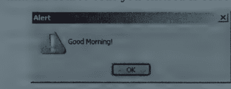

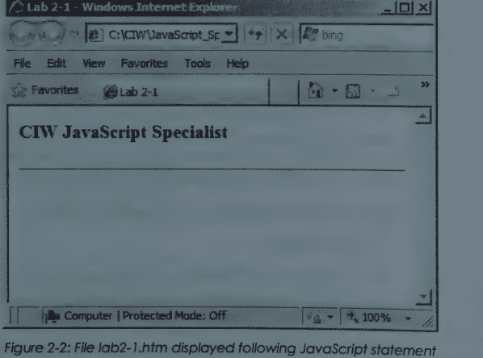

> 警告消息可用于显示您想要的任何信息，例如版权、当前日期和时间、网站变更通知或每日名言。当您需要调试自己的脚本时，这些消息非常有用。在本课程中，您将学习让客户端浏览器执行越来越复杂的任务。

### 在 JavaScript 中使用分号

请注意，在实验前面的示例中，`alert()` 语句后面跟着一个分号。分号通常用于编程中，以将语句彼此分开。除非您正在组合语句，否则在 JavaScript 中分号不是必需的。然而，许多开发人员认为在每个语句后使用分号是一种良好的实践。这种实践特别有用——有时是必要的——如果您在源代码的一行中有多个语句。


> 养成在每个语句后放置分号的习惯是明智的。这不仅是一种良好的实践，而且也是最安全的 JavaScript 编程方式。

### 从用户获取数据：prompt() 方法

您可能希望向用户请求信息并捕获其回复。此任务需要 `window` 对象的另一种方法。

`prompt()` 方法通过对话框中的文本字段请求用户输入。用户在文本框中输入的任何内容都将作为 `prompt()` 方法的结果返回，形式为可操作的文本字符串，您可以将其用作另一个方法的参数，或以任何其他您认为合适的方式使用。使用 `prompt()` 的基本语法如下：

```
prompt("Message to user", "default response text");
```

在此示例中，文本 *"Message to user"* 将出现在 `prompt()` 对话框的文本输入区域上方。文本 *"default response text"* 将出现在文本输入区域中。如果您不希望在文本输入区域中显示默认文本，则必须在初始消息后加上逗号和一组空引号。此语法对于 `prompt()` 方法是必需的。

### 连接

**连接**在 JavaScript 中经常用于组合文本字符串，特别是在与 `prompt()` 和 `alert()` 方法结合使用时。由于 `prompt()` 方法始终返回字符串，连接允许您组合字符串以进行进一步操作。例如，您可能希望个性化上一个实验中的警告消息。为此，您可以将 "Good Morning!" 消息与用户在提示屏幕中输入其名称的结果连接起来。以下是此类语法的示例：

```
alert("Begin message " + prompt("Message to user", "default text") + " End message.");
```

在此示例中，`prompt()` 方法的处理将优先于 `alert()` 方法的处理。在另一个方法内部定义的方法将始终在嵌套方法之前执行。`prompt()` 方法的语法将在实验后进一步讨论，在实验中您将使用连接。

在以下实验中，您将使用 JavaScript `prompt()` 方法捕获用户输入。您将提示用户输入其姓名。然后，您将使用 `+` 运算符将该名称与短语 "Good morning, " 连接起来。当用户输入名称时，将显示一条消息，说 "Good morning, *name*."，包括用户输入的名称。您将在本课后面了解有关其他 JavaScript 运算符的更多信息。


假设你的 Web 团队主管喜欢你使用 JavaScript 向网站添加弹出窗口的想法，但她表示她希望网站体验能够针对每位访问者进行个性化定制。你指出可以使用简单的 JavaScript `prompt()` 方法来收集用户信息（例如其姓名），然后将该信息同样显示在弹出消息中。现在，每位访问者在访问你的网站时都能获得个性化的交互体验。


### 实验 2-2：使用 JavaScript prompt() 方法

在本实验中，你将使用 JavaScript `prompt()` 方法配合字符串拼接来请求并捕获用户输入。

- 1. **编辑器：** 从 Student_Files 目录的 Lesson 2 文件夹中打开 lab2-2.htm。
- 2. **编辑器：** 找到已为你定义好的 `alert()` 方法。通过添加一个询问用户姓名的 `prompt()` 方法来修改源代码。将用户的输入与现有文本进行拼接，并在用户输入之后添加一个句号。
- 3. **编辑器：** 保存 lab2-2.htm。
- 4. **浏览器：** 打开 lab2-2.htm。当页面加载时，你应该看到一个类似于图 2-3 的提示对话框。如果没有，请检查你输入的源代码是否正确。

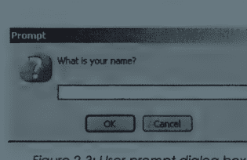

- 5. **浏览器：** 在文本字段中输入你的姓名，然后点击 **OK**。你的屏幕上应该显示一条类似于图 2-4 所示的消息。

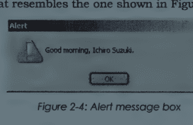

- 6. **浏览器：** 当你点击 **OK** 时，你的屏幕应类似于图 2-2（来自上一个实验）。

在本实验中，`prompt()` 方法首先被处理，然后用户的输入被拼接进表达式中。换句话说，在 JavaScript 语句中，`prompt()` 方法的优先级高于 `alert()` 方法。事实上，JavaScript 语句总是从内向外执行的。

在之前的实验中，你创建了一些类似于以下的代码：

```javascript
alert("Begin message " + prompt("Message to user", "default text") + " End message.");
```

因为 **prompt()** 方法被嵌入在 **alert()** 方法内部，JavaScript 解释器将首先执行 **prompt()** 方法，待其执行完毕后再执行 **alert()** 方法。

如前所述，**prompt()** 方法的语法要求参数由两部分组成。如果你不希望在文本输入区域显示默认文本，你仍然必须在初始消息后紧跟一个逗号和一个空引号，如下例所示：

```javascript
prompt("What is your name?","");
```

如果时间允许，尝试在两组引号中输入不同的文本，以观察对显示效果的影响。

### 请求确认：confirm() 方法

在编程中，你经常需要询问用户一个简单的“是或否”（真或假）类型的问题。你可以使用 **confirm()** 方法创建一个同时提供“确定”和“取消”按钮的消息框来实现这一点。它与 **alert()** 方法非常相似，但有一个显著的区别：**confirm()** 方法会返回一个 true 或 false 的值，而 **alert()** 方法没有返回值。这个返回值可以被捕获并在你的脚本中使用。关于返回值的概念将在本课程稍后进一步探讨。

与 `prompt()` 方法一样，如果 **confirm()** 方法与 **alert()** 方法在同一个表达式中使用，则 **confirm()** 方法的处理优先级更高。

**confirm()** 方法的语法如下：

```javascript
confirm("Question to the user?");
```

在接下来的实验中，你将捕获 **confirm()** 对话框的返回值。假设你的 Web 团队主管喜欢你使用 JavaScript 向网站添加警报和提示的想法。现在她询问是否有办法询问用户是否愿意参加关于公司服务的调查。如果用户同意，网站可以呈现调查问卷；如果不同意，用户可以继续无干扰地浏览。你告诉她可以，可以使用简单的 JavaScript **confirm()** 方法来实现。

### 实验 2-3：使用 JavaScript confirm() 方法

在本实验中，你将使用 **confirm()** 方法从用户那里获取 true 或 false 的返回值。

- 1. **编辑器：** 从 Student_Files 目录的 Lesson 2 文件夹中打开 **lab2-3.htm**。
- 2. **编辑器：** 找到已为你定义好的 **alert()** 方法。修改代码，将 **confirm()** 对话框的返回值用作 **alert()** 对话框的文本。换句话说，将 **confirm()** 方法的结果拼接进 **alert()** 方法中，就像你之前将 **prompt()** 方法的结果拼接进 alert() 一样。confirm() 方法的参数应为：“**Do you want to proceed?**”
- 3. **编辑器：** 保存 **lab2-3.htm**。
- 4. **浏览器：** 打开 **lab2-3.htm**。当页面加载时，你应该看到一个类似于图 2-5 的确认对话框。如果没有，请检查你输入的源代码是否正确。

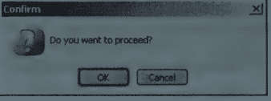
**图 2-5：** 确认对话框

- 5. **浏览器：** 点击 **OK**。你的屏幕应类似于图 2-6。


**图 2-6：** 点击 OK 后 *confirm()* 方法的结果

- 6. **浏览器：** 重新加载 **lab2-3.htm**。点击 **Cancel**。你的屏幕应类似于图 2-7。


**图 2-7：** 点击 Cancel 后 *confirm()* 方法的结果

请注意，你可以使用 *confirm()* 方法的 true 或 false 结果来触发进一步的操作。例如，true 的返回值可以启动另一个包含额外信息的弹出窗口，或者将用户重定向到网站上的一个新页面。

#### 目标 1.2.10：简单事件处理器

> **事件处理器 (event handler)**
> 一种用于拦截事件并将可执行代码与该事件关联起来的 JavaScript 机制。

*confirm()* 方法的返回值可以用在许多不同的场景中。例如，*confirm()* 可以用于验证表单操作。如果你想帮助用户做出准确的选择，可以在起始 **\<form\>** 标签中放置一个名为 **onsubmit** 的表单 **事件处理器**。例如：

```html
<form method="post" action="*appropriate url*" 
onsubmit="return confirm('Submit now?');">
```

当用户点击此类表单上的“提交”按钮时，**onsubmit** 事件处理器将响应该事件而被调用。此时，*confirm()* 方法将向用户显示一个对话框，询问是否提交表单。如果用户选择“确定”选项，将返回 true 值，表单将被提交到指定的 action。如果用户选择“取消”按钮，将返回 false 值，脚本将禁止提交表单。

本课程将讨论诸如 **onsubmit** 之类的事件处理器。之前的示例还引入了 **return** 关键字。顾名思义，该关键字在 JavaScript 中用于在各种情况下返回数值。

© 2011 Certification Partners, LLC. — All Rights Reserved.
Version 1.0

#### 目标 1.2.1：JavaScript 属性和方法

### 动态编写 X/HTML：document.write() 方法

在本节课到目前为止，你已经创建了简单的窗口来向用户发出警报和提示。之前的课程简要介绍了一种与用户沟通的另一种方式。这种 JavaScript 机制是在浏览器加载页面时将文本写入文档中。要执行此任务，你需要使用属于 document 对象的 `document.write()` 方法。`document.write()` 方法允许你创建在脚本执行时动态写入窗口的文本。你可以写入纯文本，也可以将 X/HTML 标签与被写入的文本混合使用。

`document.write()` 方法的基本语法如下：

```html
<!DOCTYPE html PUBLIC "-//W3C//DTD XHTML 1.0 Transitional//EN"
"http://www.w3.org/TR/xhtml1/DTD/xhtml1-transitional.dtd">
<html xmlns="http://www.w3.org/1999/xhtml">
<head>
<meta http-equiv="Content-Type" content="text/html; charset=utf-8" />
<title>Example: document.write</title>
</head>
<body>
<script type="text/javascript">
<!--

document.write("How wonderful to meet you, " + 
prompt("Hello, my name is James. What's yours?", "") 
+ ".");

//-->
</script>
</body>
</html>
```

这种语法与 `alert()` 和 `prompt()` 不同，因为它包含了一个名为 `document` 的新对象的规范。你之前使用的前三个方法——`alert()`、`prompt()` 和 `confirm()`——是 JavaScript 语言中 window 对象的方法。这些方法也可以写成如下形式：

```javascript
window.alert();
window.prompt();
window.confirm();
```

> **点符号 (dot notation)**
> 一种用于访问对象属性或方法的引用方式。

因为 window 对象是默认对象，所以在每个方法之前指定 window 是不需要的。但现在你使用的是 document 对象的 `write()` 方法，它不是默认对象，因此需要明确地引用它。你使用点符号来建立这种引用。点符号的典型语法如下：

```javascript
objectName.methodName();
objectName.propertyName;
```

在整个课程中，你将学习更多关于点符号的知识。目前，你只需要知道，通过编写 `document.write("Hello")`，你是在页面加载时直接将文本 "Hello" 写入页面。

接下来的实验演示了 `document.write()` 的使用。它与实验 2-2 类似，但使用 `document.write()` 而不是 `alert()` 将文本返回到浏览器屏幕。部分文本将使用 `prompt()` 方法从用户那里收集。假设你的 Web 团队主管喜欢你使用 JavaScript 向网站添加警报和提示的想法。现在她询问是否有办法将用户输入的信息整合到

网页代替弹出窗口。你告诉她可以，可以使用简单的 JavaScript `document.write()` 方法来实现。

### 实验 2-4：使用 JavaScript document.write() 方法

在本实验中，你将使用 `document.write()` 方法为用户自定义页面。

- 1. **编辑器：** 从 Student_Files 目录的 Lesson 2 文件夹中打开 `lab2-4.htm`。
- 2. **编辑器：** 找到已为你定义的 `prompt()` 方法。修改源代码以使用 `document.write()` 语句。将 `prompt()` 方法的结果连接到 `document.write()` 表达式中。将 `document.write()` 的输出指定为 `<h4>` 级别的问候语，显示以下内容：
`欢迎，用户的姓名。`
文本“用户的姓名”将是 `prompt()` 方法的返回值。确保在插入用户名后以句号结尾并关闭 `<h4>` 标签。
- 3. **编辑器：** 保存 `lab2-4.htm`。
- 4. **浏览器：** 打开 `lab2-4.htm`。你应该会看到一个类似于图 2-8 的对话框。

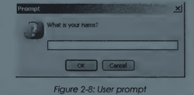
图 2-8：用户提示

- 5. **浏览器：** 在对话框中输入你的名字，然后点击 **确定**。你的屏幕应类似于图 2-9。

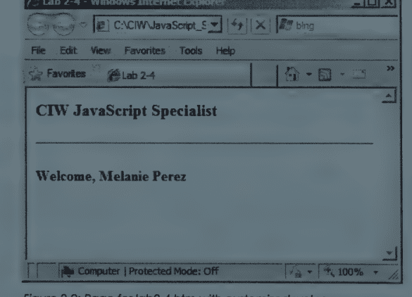
图 2-9：lab2-4.htm 页面，显示自定义欢迎消息

- 6. 编辑初始提示，使其在文本输入字段中包含一条消息。将你想要的文本字符串放在现在为空的引号内。例如，你可以插入以下以粗体显示的文本：
`prompt("你的名字是什么？","感谢你在此处输入你的名字");`
此添加将如图 2-10 所示更改初始警告框。

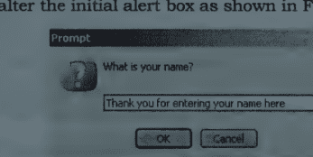

请注意，在本实验中，你能够将 XHTML 标题标签作为写入屏幕的文本的一部分。使用 `document.write()` 方法时，X/HTML 可以与文本自由交错使用。另请注意，在同一表达式中同时使用 `prompt()` 方法和 `document.write()` 方法时，`prompt()` 方法的处理优先于 `document.write()` 方法。

### 多次使用数据：变量

在前面的实验中，用户的名字是在脚本序列中需要时提供的。当脚本通过特定方法（`alert()`、`prompt()` 等）操作窗口对象时，用户会在场输入请求的信息。按照这些实验的结构，如果你想再次查看或使用名字，则必须重复该脚本序列。相反，你可以存储用户名并在需要时使用它。一旦你获取了用户名并将其存储以供重复使用，你就可以以任何你认为合适的方式使用这些数据。要存储一个名字以供重复使用，你需要将名字作为变量的值进行赋值。

#### 什么是变量？

**变量** 是一个命名的内存空间。它是一个容器，保存一个值，然后你可以在脚本中反复访问它。与许多其他编程语言一样，JavaScript 允许你声明变量并使用它们存储的值。“变量”这个名字很合适，因为你存储的值会因变量而异。你还应该注意，变量的值在脚本序列的过程中可能会发生变化。

### 变量数据类型

在 JavaScript 中，变量可以存储五种数据类型：数字、字符串、布尔值、对象和 null。当变量没有赋值时，会出现另一种数据类型——未定义。其他语言使用更多的数据类型。表 2-1 列出了这些变量数据类型所代表的值的示例。

#### 表 2-1：JavaScript 变量数据类型

| 数据类型 | 示例 |
| :--- | :--- |
| **数字** | 任何数值（例如，3、5.3 或 45e8） |
| **字符串** | 任何字母数字字符的字符串（例如，“Hello, World!”、“555-1212”或“KA12V2B334”） |
| **布尔值** | 仅真或假值 |
| **对象** | 对 JavaScript 对象的引用 |
| **null** | 表示 null 值的特殊关键字（例如，如果用户在文本框中什么都没输入就提交表单，则文本框具有 null 值）。*注意：将 null 值与空值进行比较，空值是用户在文本框中输入并仅输入一个空格；文本框的值为空，但可以算作一个字符。* |
| **undefined** | 当变量尚未赋值时发生。*注意：undefined 值与 null 不同，null 实际上是一个值。* |

### 字面量

字面量是你在 JavaScript 中提供的实际数据值。这些是你在脚本中分配给变量的固定值。表 2-2 列出了 JavaScript 中使用的字面量的三个示例。

#### 表 2-2：JavaScript 字面量类型

| 字面量类型 | 示例 |
| :--- | :--- |
| **整数字面量** | 56 |
| **浮点字面量** | 23.45 |
| **字符串字面量** | "Howdy!" |

在将字面量值赋给变量名时，将字符串值放在引号内。数值则不放在引号内。

### 变量命名

变量应该有有意义且描述性的名称。考虑每个变量在脚本上下文中的作用，然后选择一个合适的名称。尽管 JavaScript 在命名变量方面可能比较宽松，但你仍然必须遵循某些规则。以下是 JavaScript 中变量命名的基本规则：

- 变量的第一个字符必须是字母或下划线（ _ ）字符。不允许其他初始字符。
- 后续字符可以是字母、数字和/或下划线字符。

以下是有效变量名的示例：

- address1
- _contact
- a4xb5
- lastName

以下示例不允许作为变量名，因为它们使用了禁止的开头字符：

- 1stName
- ?subname
- @location

> JavaScript 1.5 规范允许变量名以美元符号（$）开头。请记住，用户必须使用支持 JavaScript 1.5 的用户代理，或者代码块必须在 `<script>` 标签中指定 `language="JavaScript1.5"`（或 `"JavaScript1.3"`）属性才能使用此新语法。（但是，language 属性已弃用，因此使用该方法不是最佳实践。）

JavaScript 中的常见命名约定是使用两个单词，中间没有空格，并且将第二个单词首字母大写，第一个单词不大写。例如，要存储名字，你可能会使用名为 `firstName` 的变量。这种做法被称为“驼峰命名法”（例如 `camelCase`），因为大写字母看起来像单词中的驼峰。

### JavaScript 中的区分大小写

需要注意的是 JavaScript 区分大小写，因此变量名 “Result” 与变量名 “result” 或 “RESULT” 不同。确保变量统一且不仅对开发者有意义，而且对可能接手更新脚本的其他人也有意义，这是一个良好的编码实践。

JavaScript 中通常使用的 camelCase 样式有两个变体：

- **小驼峰命名法（首字母小写）** —— 变量名、函数名和对象名使用小驼峰命名法。
- **大驼峰命名法（首字母大写）** —— 类（例如，使用 `new` 关键字实例化的任何东西）通常使用大驼峰命名法。

JavaScript 事件处理程序（例如 `onClick`、`onLoad`）传统上使用小驼峰命名法。然而，随着 XHTML 的出现，事件处理程序现在应使用全小写字母（例如 `onclick`、`onload`）而不是 camelCase。在事件处理程序中使用 camelCase 不会导致代码错误，但它会阻止代码验证为 XHTML。但是要小心，因为事件处理程序很容易与 camelCase 全名函数（例如 `onClick()`）混淆，后者区分大小写且必须使用 camelCase，否则会导致错误。随着你对 JavaScript 代码经验的积累，你将学会区分它们。

无论你是声明变量、定义函数还是以其他方式使用 JavaScript，请记住使用一致的大写字母。变量中最常见的错误原因之一是未能一致地应用字母大小写。你最初的许多脚本错误将来自不正确的大写字母使用。例如，请注意 window 对象的 `alert()` 和 `prompt()` 方法都是小写的。如果你输入方式不同，你将收到错误。

### 声明变量

虽然在 JavaScript 中你不需要显式声明变量，但在使用变量之前声明变量被认为是一种良好的编程实践。声明变量只是告诉 JavaScript 一个特定的命名变量存在。

在 JavaScript 中，你可以使用 `var` 关键字声明一个变量：

```javascript
var correctAnswer;
```

**camelCase**
一种在脚本语言中常用的命名约定，其中两个单词放在一起，中间没有空格（第二个单词有时第一个单词首字母大写）。在 JavaScript 中，这通常用于变量、函数、对象和类名。


在这里，你定义了一个名为 "correctAnswer" 的变量，它目前不持有任何值。你也可以在声明变量的同时为其分配一个初始值。例如：

```
var correctAnswer1 = 20;
var correctAnswer2 = "Yes";
```

请注意使用等号 (=) 将值分配给变量。这个字符是 JavaScript 的赋值运算符，将在本课后续部分与其他 JavaScript 运算符一起讨论。

你可以使用单个 `var` 关键字创建并为多个变量赋值，如下例所示：

```
var correctAnswer1 = 20, correctAnswer2 = "Yes";
```

注意在本例中使用了逗号来分隔变量名。

请注意，变量还可以通过其他方式接收值。例如，可以将 `prompt()` 或 `confirm()` 方法放置在变量赋值表达式的右侧。该方法的返回值将被指定为该变量的值。变量也可以从另一个变量接收值。请参考以下示例。

```
var userName1 = "Juan";
var userName2 = userName1;
```

在这个例子中，一个变量被声明并用一个值进行了初始化。第二个变量被赋值为第一个变量所持有的值。这在 JavaScript 中是完全合法的语法。请注意，即使脚本稍后更改了 `userName1` 持有的值，`userName2` 仍将保持最初分配的值。若要随后在脚本中更改 `userName2` 变量的值，必须执行一个直接赋值语句。

如前所述，JavaScript 是区分大小写的，因此在声明变量时，请始终一致地使用该名称，否则你的脚本将无法正常工作。

### 连接变量

在将变量与字符串字面量连接时，记得将变量名放在任何引号之外。正如你在另一课中所学到的，JavaScript 解释器将在脚本执行时动态地提供相应的值。以下示例演示了这一概念：

```
var userName = "Julio";

document.write("We thank " + userName + " for visiting our site.");
```

请注意，在上述示例中，变量名的前后都放置了字面量空格。这确保了文本将正确显示。

### 使用变量

在之前的实验中，你使用了 `alert()` 和 `prompt()` 方法来获取用户的姓名并以问候语的形式显示。现在，利用你对变量的认识，从这些方法中收集信息并重复使用。

在接下来的实验中，你将把用户输入的数据存储在一个变量中，以便根据需要使用。假设你的 Web 团队主管喜欢你使用 JavaScript 为网站添加警报和提示以及为用户个性化问候的想法。现在她询问，是否有办法将用户进入网站时输入的信息整合到用户整个访问过程中，而不仅仅是一次问候。你能否仅捕获一次用户的姓名，但使用两次或多次来与他们在网站上进行简短的对话？你告诉她可以，你可以使用 JavaScript 变量来实现。将此信息存储在变量中会创建一个全局变量，该变量在函数内部和外部都可以使用。你将在稍后的课程中学习关于全局变量的知识。

### 实验 2-5：在 JavaScript 变量中存储用户数据

**目标**

- 1.2.4：用户输入与变量
- 1.2.5：报告变量文本
- 1.2.8：JavaScript 运算符

在本实验中，你将把用户的姓名存储在一个变量中，以便根据需要使用。

1. **编辑器：** 从 `Student_Files` 目录的 `Lesson 2` 文件夹中打开 `lab2-5.htm`。
2. **编辑器：** 找到已为你定义好的 `prompt()` 方法。修改源代码以添加一个名为 `userName` 的变量。将 `prompt()` 方法的结果赋值给 `userName`。
3. **编辑器：** 将 `userName` 变量连接到已为你提供的 `alert()` 和 `document.write()` 表达式中。确保在 `alert()` 和 `document.write()` 语句中都连接上结尾的句点。
4. **编辑器：** 保存 `lab2-5.htm`。
5. **浏览器：** 打开 `lab2-5.htm`。将浏览器中显示的提示对话框与图 2-11 进行比较。它们应该是相似的。

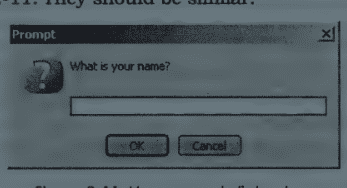
图 2-11：用户提示对话框

6. **浏览器：** 在文本字段中输入你的姓名并点击 **OK**。你的屏幕应显示与图 2-12 类似的消息。

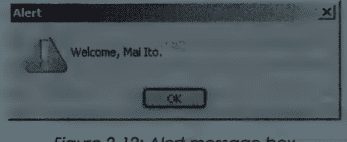
图 2-12：警报消息框

7. **浏览器：** 再次点击 **OK**，你的屏幕应类似于图 2-13。

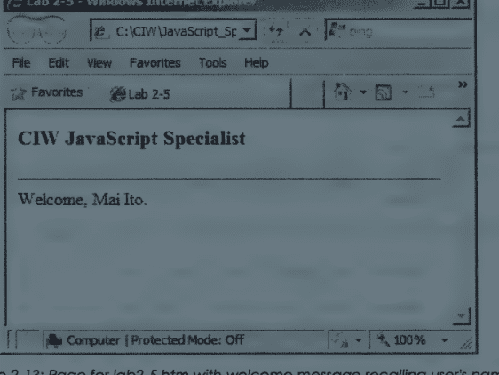

*技术笔记：如果你尝试编辑一个在浏览器中存在警报消息的 X/HTML 文件，在点击 OK 按钮确认消息之前，你可能无法保存文件。如果你不确认警报，可能会收到来自操作系统的“文件共享”冲突提示。*

在本实验中，你声明了一个名为 `userName` 的变量。在该变量中，你存储了 `prompt()` 命令的结果。`=` 字符被用作赋值运算符。

然后，你使用 `+` 运算符将短语 "Welcome, " 与 `userName` 变量连接起来，并在警报框中显示结果。在用户确认第一个警报后，你生成了一个 `document.write()` 语句，其中在变量 `userName` 的前后都带有文本。

此时你可能会好奇是否可以使用 `+` 运算符来相加数字，因为 `+` 是文本连接的运算符。然而，在深入了解这一点之前，你必须先学习表达式和运算符。

**技术提示** 变量是任何编程语言中最重要的且最常用的功能之一。将你为变量使用的名称和命名约定（如 `firstName`, `lastName`）标准化，并在你的整个编程生涯中坚持使用该标准格式，被认为是一个良好的实践。这将为你节省大量的时间和精力。记住区分大小写！

### JavaScript 表达式

表达式是语句的一部分，会被计算为一个值。唯一的例外是赋值表达式，它将一个值赋给一个变量。一个表达式可以使用变量、字面量、运算符和其他表达式的任何组合。JavaScript 使用表 2-3 中定义的六种基本类型的表达式。

**目标**
- 1.2.7：JavaScript 表达式
- 1.2.8：JavaScript 运算符

**表 2-3：JavaScript 表达式类型**

| 表达式类型 | 目的 | 示例 | 说明 | 示例运算符 |
| :--- | :--- | :--- | :--- | :--- |
| **赋值 (Assignment)** | 将值赋给变量 | `myNumber = 25;` | 值 25 已被赋给变量 myNumber。 | `=` (赋值) |
| **算术 (Arithmetic)** | 计算结果为一个数字 | `25 + 75;` | 该表达式计算结果为 25 和 75 的和。 | `+` (加法) |
| **字符串 (String)** | 计算结果为一个字符串 | `"Hello, " + "Sandy";` | 这将计算出一个新字符串 "Hello, Sandy"。 | `+` (连接) |
| **逻辑 (Logical)** | 计算结果为 true 或 false | `25 < 75;` | 因为 25 小于 75，该表达式计算结果为布尔值 true。 | `<` (小于比较) |
| | | `25 >= 75;` | 因为 25 不大于或等于 75，该表达式计算结果为布尔值 false。 | `>=` (大于或等于比较) |
| **比较 (Comparison)** | 比较两个值并返回 true 或 false 值 | `z == 10` | 如果 z 是 10，则返回 true | `==` (等值运算符) |
| **条件 (Conditional)** | 在脚本中做出决策；表达式（条件）将返回 true 或 false，然后计算相应的表达式 | `(a > b) ? a++ : a--;` | 如果 a 大于 b，则 a 的值增加 1；如果 a 小于 b，则 a 的值减少 1 | `?` (三元运算符) |

每种表达式类型都依赖于一个运算符。现在你将详细了解 JavaScript 中的运算符。

### JavaScript 运算符

在 JavaScript 中，**运算符 (operators)** 用于表达式中以存储或返回一个值，在这个过程中通常会对 **操作数 (operands)** 进行处理。操作数代表以某种方式被处理的一块数据。运算符有多种类型，包括赋值、算术、一元和逻辑运算符。表 2-4 列出了最常用的 JavaScript 运算符及其用途。你将在整个课程中使用其中许多运算符。

**表 2-4：JavaScript 运算符**

| 运算符 | 名称 | 类型 | 描述 | 示例 |
| :--- | :--- | :--- | :--- | :--- |
| `=` | 赋值 (Assignment) | 赋值 | 将右操作数的值赋给左操作数 | `x = 25;`<br>`userID = "Juan";`<br>x 现在等于 25。<br>userID 现在等于 Juan。 |
| `+=` | 加法赋值 (Addition assignment) | 赋值 | 将操作数相加并将结果赋给左操作数 | `x = 25;`<br>`x += 1;`<br>x 现在等于 26。 |


 # 表 2-4：JavaScript 运算符（续）

| 运算符 | 名称 | 类型 | 描述 | 示例 |
| --- | --- | --- | --- | --- |
| -= | 减法赋值 | 赋值 | 从左操作数中减去右操作数，并将结果赋值给左操作数 | x = 25; x -= 1; x 现在等于 24。 |
| *= | 乘法赋值 | 赋值 | 将操作数相乘，并将结果赋值给左操作数 | x = 25; x *= 2; x 现在等于 50。 |
| /= | 除法赋值 | 赋值 | 将左操作数除以右操作数，并将结果赋值给左操作数。 | x = 25; x /= 2; x 现在等于 12.5。 |
| %= | 取模赋值 | 赋值 | 将左操作数除以右操作数，并将余数赋值给左操作数 | x = 25; x %= 2; x 现在等于 1。 |
| + | 加法 | 算术 | 将操作数相加 | x = 25; y = 10; z = x + y; z 现在等于 35。 |
| - | 减法 | 算术 | 从左操作数中减去右操作数 | x = 25; y = 10; z = x - y; z 现在等于 15。 |
| * | 乘法 | 算术 | 将操作数相乘 | x = 25; y = 10; z = x * y; z 现在等于 250。 |
| / | 除法 | 算术 | 将左操作数除以右操作数 | x = 25; y = 10; z = x / y; z 现在等于 2.5。 |
| % | 取模 | 算术 | 将左操作数除以右操作数并计算余数 | x = 25; y = 10; z = x % y; z 现在等于 5。 |
| && | 且 (And) | 逻辑 | 当两个操作数都为 true 时，结果为 true | x = 25; y = 10; z = 35; (x > y) && (y < z); 该语句返回 true。(x < y) && (y < z); 该语句返回 false。 |
| \|\| | 或 (Or) | 逻辑 | 当任意一个操作数为 true 时，结果为 true | x = 25; y = 10; z = 35; (x > y) \|\| (y > z); 该语句返回 true。(x < y) \|\| (y > z); 该语句返回 false。 |
| ! | 非 (Not) | 逻辑 | 如果操作数为 false 则结果为 true，如果操作数为 true 则结果为 false | x = 25; y = 10; !(x > y); 该语句返回 false。!(x < y); 该语句返回 true。 |
| == | 等于 | 比较 | 如果操作数相等，则结果为 true | x = 25; y = 10; x == y; 该语句返回 false。 |
| === | 严格等于或绝对相等 | 比较 | 如果操作数的值相同且数据类型也相等，则结果为 true | var number1 = (1 == "1") 为 true（由于值转换） var number1 = (1 ==="1") 为 false，因为必须绝对相等 |
| != | 不等于 | 比较 | 如果操作数不相等，则结果为 true | x = 25; y = 10 Cymbalta != y; 该语句返回 true。 |
| !== | 严格不等于 | 比较 | 仅当操作数和/或数据类型不同（不相等）时，结果为 true | 7 !== 6 "A" !== "B" 6 !== "six" 7 !== "B" |
| > | 大于 | 比较 | 如果左操作数大于右操作数，则结果为 true | x = 25; y = 10; x > y; 该语句返回 true。 |
| < | 小于 | 比较 | 如果左操作数小于右操作数，则结果为 true | x = 25; y = 10; x < y; 该语句返回 false。 |
| >= | 大于或等于 | 比较 | 如果左操作数大于或等于右操作数，则结果为 true | x = 25; y = 10; x >= y; 该语句返回 true。 |
| <= | 小于或等于 | 比较 | 如果左操作数小于或等于右操作数，则结果为 true | x = 25; y = 10; x <= y; 该语句返回 false。 |
| + | 字符串拼接 | 字符串 | 将操作数合并为一个字符串 | name1 = "Mary "; name2 = "Sue"; name3 = name1 + name2 name3 现在包含 "Mary Sue." |
| += | 拼接赋值 | 字符串 | 将一个字符串的值附加到另一个字符串之后 | var str = "red"; str += " and blue"; 现在 str 将是 "red and blue" |
| ? | 三元运算符 (if/then) | 条件 | 根据条件评估出两个不同值之一 (condition) ? val1 : val2 | x = 25; y = 10; (x < y) ? true : false; 该语句返回 false。 |
| + | 加法/正号 | 一元 | 将值转换为数值 | a = 8 + 2.1; document.write(a) // 返回 10.1 b = 8 + A; document.write(b) // 返回 NaN |
| ++ | 自增 | 一元 | 将提供的操作数的值增加 1 | x = 25; x++; 下次访问 x 时等于 26。 |
| - | 取反 | 一元 | 对操作数的值取反 | x = 25; x = -x; x 现在等于 -25。 |
| -- | 自减 | 一元 | 将提供的操作数的值减少 1 | x = 25; x--; 下次访问 x 时等于 24。 |

表达式依赖于各种运算符。有时使用某些运算符会产生结果上的微妙差异，且某些运算符根据与之配合使用的值而执行不同的操作。请参考以下示例。

#### + 运算符

取决于操作数，`+` 既可以是算术加法运算符，也可以是字符串拼接运算符。`+=` 运算符将一个字符串的值附加到另一个字符串之后，而不是将操作数合并为一个新字符串。

例如，`"Mad" + " " + "Hatter"` 将得出结果 `"Mad Hatter"`。此操作通过使用 `+` 运算符在单行内完成。

你也可以使用 `+=` 运算符实现同样的效果并获得相同的输出，如下所示：

```
var Name = "Mad"
Name+= " "
Name+= "Hatter"
```

`+=` 运算符在处理较长的语句时效果最好。

#### = 和 == 运算符

赋值运算符是 `=`，但它绝不能用作比较运算符。例如，请考虑以下语句：

```
userName = "Nancy";
```

在脚本中使用时，该语句会将 `"Nancy"` 的值赋给变量 `userName`。如果你想将 `userName` 与 `"Nancy"` 进行比较，你应该使用以下代码：

```
userName == "Nancy";
```

该表达式比较 `userName` 的内容是否与文本字符串 `"Nancy"` 相同，并随后根据比较结果返回布尔值 `true` 或 `false`。如果变量 `userName` 的值为 `"Nancy"`，则返回 `true`。否则，返回 `false`。

在这个表达式中，`userName` 和 `"Nancy"` 都是操作数——换句话说，它们是脚本操纵和处理的数据值。

#### === 和 !== 运算符

这些运算符表示严格比较，其中不仅值必须相等（`===`）或不相等（`!==`），而且两个操作数的数据类型也必须相同。在非严格比较（`==`）中，JavaScript 会尝试将表达式中不同类型的操作数转换为相同类型，但表达式评估为 `true` 并不要求必须是相同的数据类型。在严格比较中，表达式评估为 `true` 要求必须具有相同的数据类型（对于 `!==` 则是要求不同）。

#### ++ 和 -- 运算符

请注意，自增 (`++`) 和自减 (`--`) 运算符可以放置在操作数之前或之后。运算符的位置会导致其执行效果产生微妙的差异。如果自增或自减运算符放在操作数之前，操作会立即发生。如果自增或自减运算符放在操作数之后，操作数的值变化直到该操作数在程序中下一次被访问时才会显现。请参考以下示例：

```
var i = 1;
document.write("First access: " + i++);
document.write("<br />Second access: " + i);
```

上述代码的输出结果如下：

```
First access: 1
Second access: 2
```

如上述输出所示，当变量 `i` 在程序中下次被访问时，它包含的是增加后的值。请参考以下示例：

```
var i = 1;
document.write(++i);
```

这段代码的输出将是 `2`，因为自增运算符放在了操作数之前，导致操作立即执行。

在自学 JavaScript 时，请尝试各种 JavaScript 运算符。随着你在脚本中使用它们，你会对它们多样化的功能越来越熟悉。

接下来的实验将演示加法运算符 (`+`) 的使用。假设你在一家退休规划公司工作。你可以使用加法运算符创建一个简单的脚本，要求用户输入他的年龄，然后输入他计划退休的年龄。你可以使用加法计算用户退休年龄加上 10 年，并告知他如果他再晚 10 年退休，将拥有更多的退休储蓄。

## 实验 2-6：在 JavaScript 中对变量进行赋值和相加

在本实验中，你将为变量赋值并使用加法运算符将它们相加。

- 1. **编辑器：** 打开 Student_Files 目录 Lesson 2 文件夹中的 **lab2-6.htm** 文件。
2. **编辑器：** 在 `<script type="text/javascript"></script>` 代码块内部添加源代码。创建两个名为 `x` 和 `y` 的变量。将数值 `4` 赋给第一个变量，将 `9` 赋给第二个变量。
3. **编辑器：** 创建第三个名为 `z` 的变量。将 `x` 和 `y` 相加的结果赋给 `z`。在 `alert()` 对话框中显示变量 `z`。
4. **编辑器：** 保存 **lab2-6.htm**。
5. **浏览器：** 打开 **lab2-6.htm**。你的屏幕应立即显示一个警告框，如图 2-14 所示。

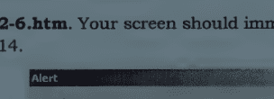

图 2-14：JavaScript 加法结果：z=13


6. **编辑器：** 在 alert(z) 行之后，立即添加以下源代码：

alert("4 + 9 = " + x + y);

7.  **编辑器：** 保存 **lab2-6.htm**。

8.  **浏览器：** 重新加载 **lab2-6.htm**。你的屏幕应显示一个提示框，显示 13，如图 2-14 所示。当你点击确定后，你应看到另一个如图 2-15 所示的提示框。


*图 2-15：是拼接，不是求和*

此提示表明 + 符号被解释为拼接运算符。由于值被拼接在一起，脚本返回的结果是 49。请注意，这种行为是由于 alert() 方法通常接受字符串值作为其参数这一事实造成的。因此，JavaScript 解释器将这些值视为字符串而不是数值。

JavaScript 解释器将数字误认为字符并相应处理的情况很常见。因此，解释器没有将 x 和 y 识别为数字，而是识别为字符。你期望此提示框显示 "13" (x + y)，但脚本将 "4 + 9" 视为一个字符串。因此，它执行的是拼接而不是加法运算（从左到右进行，遵循数学运算优先级），结果为 49，而不是将它们相加得到 13。

> 技术说明：数学运算优先级规定了运算执行的顺序：首先，脚本将在括号内进行运算，先进行乘法和除法，然后进行加法和减法。然后脚本将移至括号外，先进行乘法/除法，再从左到右进行加法和减法。当你在使用 JavaScript 创建复杂公式时，了解这一点非常重要。

9.  **编辑器：** 按粗体所示修改源代码，然后保存文件：

alert("4 + 9 = " + (x + y));

通过在表达式的 x + y 部分周围添加括号，你是在要求 JavaScript 首先计算 (x + y)，然后将其附加到前面的文本字符串。因此，两个整数在与字符串交互之前先进行加法运算。

10. **浏览器：** 重新加载 **lab2-5.htm**。现在，当你点击 **确定** 时，你应依次看到如图 2-14 和图 2-16 所示的提示框。

*注意：根据所使用的浏览器，你可能会在这两个提示框之间看到另一个提示框出现，内容为 "Explicit declaration: 4 + 9 = 13."*


*图 2-16：指示了正确的总和*

### 数学运算优先级

你已经看到了向脚本指示你是想对数字进行加法还是拼接的重要性。在前面的实验中，当你在语句的 x + y 部分添加额外的括号时，JavaScript 将其解释为在拼接其他值之前先执行该操作。这被称为数学运算优先级。

解决在实验中遇到的问题的另一种方法是使用 Number 对象，该对象声明一个数值。然而，即使这样也不会违背数学运算优先级，因此括号仍然是必要的。Number 对象还可用于验证数字，以及将八进制和十六进制转换为十进制。你将在本课程后面详细学习 Number 对象。

> **警告！** 谨慎使用 Number 对象。它在将字符串转换为数字时很有用，但它不会打破数学运算优先级的规则。它也不会将字母转换为数字，而是会返回 NaN（非数字），这意味着脚本正在寻找一个数字却找到了一个字符。

请看以下代码：

```html
<!DOCTYPE html PUBLIC "-//W3C//DTD XHTML 1.0 Transitional//EN"
"http://www.w3.org/TR/xhtml1/DTD/xhtml1-transitional.dtd">
<html xmlns="http://www.w3.org/1999/xhtml">
<head>
<meta http-equiv="Content-Type" content="text/html; charset=utf-8" />
<title>示例：JavaScript 数学运算优先级</title>
</head>

<body>
<h3>CIW JavaScript 专家</h3>
<hr />
<script type="text/javascript">
<!--

/*************************************/
/*现在让我们进行数学运算优先级运算     */
/*************************************/
var a = 5;
var b = 4;
var c = 3;
var d = 2;
var e = 1;

var f = a+(b+c)*(d/e);
alert("Mathematical Precedence will lead you to 5+(4+3)*(2/1) = " +
f.toFixed(2) );

</script>
</body>
</html>
```

运行此脚本（代码在你的第 2 课学生文件夹中，文件名为 *example_mathPrecedence.htm*）。请注意，如果严格从左到右读取，结果将是 24，这是错误的。使用数学运算优先级，脚本将首先在括号内进行运算：

```
5+(7)*(2)
```

然后它将进行乘法运算：

```
(7*2 = 14)
```

然后它将从左到右进行运算：

(5 + 14)

因此它将返回正确的答案 19。

### 内联脚本、简单用户事件和基本事件处理程序

你创建了存在于 `<script> </script>` 标签之间的脚本。但是，你也可以在许多你已经熟悉的 X/HTML 标签中包含 JavaScript。这种做法称为 **内联脚本**。例如，你可以如下所示在 `<body>` 标签中包含 JavaScript：

```html
<body onload="alert('Goodbye, ' + userName + '! Hurry back!');">
```

#### onunload 事件处理程序

onunload 事件处理程序拦截网页的卸载，并允许开发人员使用此事件执行可执行代码。请注意，onunload 关键字作为属性添加到 `<body>` 标签中。此示例代码在用户离开页面时向他们发送警报。除了此处显示的简单警报外，你还可以包含一个引用更复杂函数和变量的脚本。例如，你可以包含一个引用 load 事件的脚本，该事件会自动运行一个单独的 Web 浏览器实例。

此脚本依赖于用户事件。用户事件的示例包括加载和卸载页面、单击鼠标或按下计算机按键。JavaScript 能够响应大多数用户生成的事件。

如前所述，JavaScript 通过称为 **事件处理程序** 的代码段来响应事件。不要将用户生成的事件与脚本驱动的事件处理程序混淆。

如果你研究上一个示例中的代码，你将看到它使用 onunload 事件处理程序来处理或处理 unload 事件。当页面（由 `<body>` 标签表示）卸载时，`alert()` 消息将出现。请注意，在 `alert()` 内部，仅使用单引号来界定文本。你使用双引号将整个语句括起来，从 alert 之前到右括号之后（但在最后一个尖括号之前）。在语句内使用单引号是 JavaScript 解释器确定语句开头和结尾所必需的。请注意，你可以切换引号，如下例所示：

```html
<body onunload="alert('Goodbye, ' + userName + '! Hurry back!');">
```

此代码将产生与第一个示例相同的结果。采用其中一种引号方案或另一种。良好的编码实践是采用一种方法并在整个 JavaScript 代码中一致地使用它。最好使用与你的 X/HTML 编码实践一致的引号方案。例如，如果你在警报中使用单引号，最好在整个项目中都这样做。在编程中，一致性是关键。

**目标**
1.2.9：内联脚本
1.2.10：简单事件处理程序

**内联脚本**
将 JavaScript 代码放置在 X/HTML 标签内，而不是文件的 `<script> </script>` 标签之间。

**事件处理程序**
在 JavaScript 中，一块通过拦截事件并将其与可执行代码相关联来处理和响应事件的代码...

#### onload 事件处理程序

你也可以使用 onload 事件处理程序。事实上，JavaScript 暗示了它的使用；到目前为止，你编写的每个脚本都使用了 load 事件和 onload 事件处理程序，因为脚本在浏览器加载页面时立即运行。你将在本课程后面学习更多关于事件和事件处理程序的知识。

在接下来的实验中，你将使用 JavaScript onunload 事件处理程序和内联脚本。假设你的主管一直喜欢你的所有想法，现在问你是否可以为每个用户访问公司网站的整个过程创建一个高度个性化的交互。你告诉她，你可以使用 JavaScript 在用户进入指定页面时捕获每位访客的姓名，然后以姓名问候用户，在页面上写下他的姓名以使其个性化，并在他离开网站时再次使用他的姓名向他道别。你的主管要求你在网站上演示这种高水平的交互性。


#### 实验 2-7：使用 JavaScript onunload 事件处理程序和内联脚本

**目标**
1.2.9：内联脚本
1.2.10：简单事件处理程序。

在本实验中，你将在用户加载页面时获取其姓名，然后使用这些数据以多种方式个性化用户的访问体验，甚至在页面卸载时也是如此。你将同时使用内联脚本和 onunload 事件处理程序。

- 1. **编辑器：** 从 Student_Files 目录的 Lesson 2 文件夹中打开 lab2-7.htm。

- 2. **编辑器：** 在 `<body>` 标签中输入源代码。添加一个 onunload 事件处理程序来调用一个 `alert()` 框。文本应为 "Goodbye, "，后接连接到字符串的 userName 变量，然后是文本 "Hurry back!"

- 3. **编辑器：** 保存 lab2-7.htm。

- 4. **浏览器：** 打开 lab2-7.htm。你应看到一系列对话框和提示框。在提示对话框中输入你的名字，然后点击 **确定**，如图 2-17 所示。

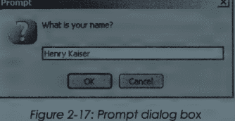

- 5. **浏览器：** 问候提示框将出现，如图 2-18 所示。点击 **确定**。

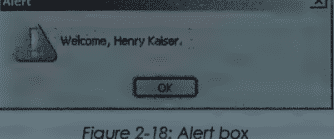

- 6. **浏览器：** lab2-7.htm 页面将显示个性化的问候语，如图 2-19 所示。


#### 图 2-19：包含欢迎消息的 lab2-7.htm 页面

7. **浏览器：** 点击浏览器的工具栏中的 **后退** 按钮或 **主页** 按钮，导航到另一个页面。你应该会看到图 2-20 所示的警报框。

#### 图 2-20：再见警报框

8. **浏览器：** 在警报对话框上点击 **确定** 后，你的屏幕将显示你导航到的页面。

本实验提供了一个使用 `onunload` 事件处理程序添加内联脚本的机会。在随后的课程中，你将学习更多关于内联脚本、事件和事件处理程序的知识。

**目标**
1.2.11：JavaScript 关键字和保留字

### JavaScript 关键字和保留字

JavaScript 包含必须使用以实现特定结果的关键字。JavaScript 还包含不能用于变量名或函数名的保留字。

#### JavaScript 关键字

关键字是构成 JavaScript 基础的预定义标识符。它们执行特定的职责，例如声明变量 (`var`) 和定义函数定义 (`function`)。使用这些词时必须使用正确的语法，包括正确的拼写和字母大小写。然而，在 JavaScript 中，你不能将关键字用作变量。在本课程中，你将学习更多关于这些词的具体功能。JavaScript 关键字包括以下内容：

- break
- condition
- const
- continue
- delete
- do
- do...while
- export
- for
- for...in
- finally
- function
- if
- if...else
- import
- in
- instanceOf
- label
- let
- new
- return
- switch
- this
- throw
- try...catch
- typeof
- var
- void
- while
- with
- yield

#### JavaScript 保留字

你不能将保留字用作变量、函数、对象或方法。JavaScript 保留字包括上述所有关键字，此外还包括以下内容：

- abstract
- boolean
- byte
- break
- case
- char
- comment
- default
- delete
- double
- else
- FALSE
- final
- float
- goto
- implements
- instanceOf
- int
- interface
- long
- native
- null
- package
- private
- protected
- public
- short
- static
- synchronized
- throws
- transient
- TRUE

请注意，这些 JavaScript 保留字在 Java 中也是关键字。当 JavaScript 和 Java 一起运行（这种情况经常发生）时，有必要知道哪些词在 JavaScript 中是保留字（而不仅仅是关键字）。

### 案例研究

#### 自动报价

GreatRate 抵押贷款公司正在失去客户。GreatRate 是一家规模虽小但极具竞争力的公司，拥有优厚的利率和出色的广告。然而，亲自向客户提供抵押贷款报价的任务变得极其耗时。客户不希望在等待报价上花费太长时间，而且 GreatRate 收到咨询越多，耗时就越长。客户变得不耐烦，转而向其他公司寻求报价。

GreatRate 的所有者 Tina Great 希望加快这一进程。她在每周例会上与她的团队讨论了这个想法。

负责公司网站的市场专家 Sarah 建议，他们应该在公司网站上寻找一种自动报价抵押贷款利率和条款的方法。Tina 问道：“我们能做到吗？”

Sarah 联系了 Web 开发人员 Tim，询问在线提供抵押贷款信息的方法。她告诉 Tim，网站需要能够向用户请求一些信息，例如房产价格和首付款金额，然后根据用户的输入返回一些基础的抵押贷款利率。Tim 说：“是的，我们可以做到。”

Sarah 将这个好消息汇报给了 Tina。她们都明白，如果能让这个抵押贷款计算器在网站上运行，他们将能够获得巨大的增长，因为他们可以将员工重新培训为处理抵押贷款流程而非仅仅提供报价。

思考这个场景并回答以下问题：

- 将此类任务从人员转移到网站上的自动化流程有哪些优点？
- 在网站上自动化此任务有哪些缺点？
- 如果 Tim 不知道计算抵押贷款利率所需的数学知识，他该如何开发一个执行此数学运算的脚本？
- GreatRate 仍然需要为重要的客户手动运行一些个性化计算。但即使他们不能在网站上实现所有报价的自动化，他们仍然可以通过这种方式完成很大一部分信息查询类的报价，从而节省大量时间。你在 Web 上还见过哪些将数学运算从与人的电话沟通转移到网站自动化程序的例子？

### 课程总结

### 应用项目

这些项目将挑战你运用在本课程中所学到的知识。

创建一个 XHTML 页面，在文档的 `<head>` 部分创建一个 JavaScript 代码块，并在 `<body>` 部分创建另一个 JavaScript 代码块。在第一个 JavaScript 代码块中，创建四个名为 `string1`、`string2`、`string3` 和 `string4` 的变量。将值 **start** 赋给 `string1`。将 `prompt()` 方法的返回值赋给 `string2`。将 `confirm()` 方法的返回值赋给 `string3`。将值 **end** 赋给 `string4`。

在第二个 JavaScript 代码块中，创建一个 `document.write()` 语句，输出文本 *Hello, World*。将此文本设为三级标题 (`<h3>`)。创建第二个 `document.write()`，输出第一个 JavaScript 代码块中创建的四个变量的值。尝试使用不同的方法来确保每个值之间存在空格。在代码正常工作后，寻找一种方法在 XHTML 页面的不同行上输出这四个变量值。

在你尝试运行该页面时，观察在各种情况下返回的值。例如，注意如果用户在提示对话框上选择“取消”按钮时返回的值。

创建第二个 XHTML 页面，在文档的 `<head>` 部分创建一个 JavaScript 代码块，并在 `<body>` 部分创建另一个 JavaScript 代码块。在第一个 JavaScript 代码块中，创建两个名为 `number1` 和 `number2` 的变量。为每个变量分配不同的数值。在第二个 JavaScript 代码块中，尝试表 2-4 中显示的各种算术和比较运算符。创建一个 `document.write()` 语句来输出运算结果。

### 技能回顾

`alert()` 方法是一个简单的 JavaScript 方法，允许你与用户进行通信。`prompt()` 方法通过对话框中的文本字段请求用户输入。`alert()` 和 `prompt()` 都是 `window` 对象的方法。`confirm()` 方法与 `alert()` 方法类似，但有一个显著的例外：`confirm()` 方法返回 true 或 false 值，而 `alert()` 方法没有返回值。`document.write()` 方法属于 document 对象，允许你在脚本执行时将文本动态写入窗口。变量是一个命名的内存空间：它是一个持有值的容器，你可以在脚本中重复访问它。在 JavaScript 中，变量可以存储五种数据类型：数字 (number)、字符串 (string)、布尔值 (Boolean)、空值 (null) 和对象 (Object)。另一种类型 `undefined` 出现在未指定值时；这与 `null` 不同，因为 `null` 实际上是一个值。在 JavaScript 中，你可以使用 `var` 关键字来声明变量。JavaScript 表达式是语句的一部分，被评估为一个值。JavaScript 使用六种基本类型的表达式：赋值、算术、字符串和逻辑、比较和条件。在 JavaScript 中，运算符用于表达式中以存储或返回一个值，通常是对操作数进行操作。你可以将 JavaScript 包含在许多你已经熟悉的 X/HTML 标签中；这种做法被称为内联脚本。事件处理程序用于处理或响应事件。JavaScript 语言包含某些被称为关键字的词，你必须使用它们以实现特定结果。JavaScript 还包含旨在用于特定用途的保留字。你不能将关键字或保留字用于变量名或函数名。

 # 第二课：在 JavaScript 中使用变量和数据

既然你已经完成了本课，你应该能够：

- 1.2.1：使用属性和方法与用户通信，包括 *type* 属性，以及 *alert()*、*prompt()* 和 *confirm()* 方法。
- 1.2.2：定义变量。
- 1.2.3：使用数据类型，包括 *null* 和 *undefined*。
- 1.2.4：获取用户输入并将其存储在变量中。
- 1.2.5：将变量文本报告给客户端窗口。
- 1.2.6：区分连接和加法。
- 1.2.7：使用表达式。
- 1.2.8：使用运算符，包括字符串连接（+=）、严格比较（===, !==）和数学优先级。
- 1.2.9：实现内联脚本。
- 1.2.10：实现简单的事件处理程序，包括 *onload()* 和 *onunload()*。
- 1.2.11：定义关键字和保留字。

### 第二课回顾

- 1. JavaScript 如何让你与 Web 用户通信？
- 2. 你可以使用哪些简单的 JavaScript 方法来与用户通信？
- 3. 当 X/HTML 页面加载时，什么事件可以触发 JavaScript 函数？
- 4. 什么是连接？
- 5. 当多个方法在一行 JavaScript 代码中定义时，哪个方法会先执行？
- 6. `alert()`、`prompt()` 和 `confirm()` 方法是哪个对象的方法？
- 7. 在编程中，哪个术语指的是用于将对象名称与其属性或方法相关联的语法？
- 8. `document.write()` 方法的用途是什么？
- 9. 列出 JavaScript 中可以存储在变量中的五种数据类型。
- 10. 在 JavaScript 中，什么是表达式？列出六种基本的 JavaScript 表达式类型。
- 11. 在 JavaScript 中，什么是运算符？列出至少三种运算符并描述它们的功能或类型。
- 12. 什么是事件处理程序？列出两个简单的事件处理程序。
- 13. 考虑以下 JavaScript 语句：

```
var myValue = 20;
myValue += 20;
myValue = myValue * 10;
myValue += "20";
myValue = "New value";
```

对于每条语句，在 JavaScript 中执行后，`myValue` 变量的计算结果分别是什么？

---

# ## 第三课：JavaScript 中的函数、方法和事件

#### 目标

在本课结束时，你将能够：

- 1.3.1：将方法用作函数。
- 1.3.2：定义函数。
- 1.3.3：使用数据类型转换方法。
- 1.3.4：调用函数。
- 1.3.5：向函数传递参数、甜点创建、返回值和 *calculateAvg()* 函数。
- 1.3.6：从函数返回值。
- 1.3.7：区分全局变量和局部变量。
- 1.3.8：使用条件运算符。
- 1.3.9：识别用户事件和事件处理程序。
- 1.3.10：使用内置函数和类型转换变量。

### 课前评估问题

- 1. 以下哪个示例展示了 JavaScript 函数的正确语法？

a. `Function myFunction() { alert("test function"); }`

b. `function myFunction { alert("test function"); }`

c. `Function myFunction{() alert("test function"); }`

d. `function myFunction() { alert("test function"); }`

- 2. 以下哪个示例展示了为 JavaScript 函数传递和接收参数的正确语法？

a. `function myFunction(arg1, arg2) { alert(arg1 + " " + arg2); } myFunction("first argument", "second argument");`

b. `function myFunction(arg1 & arg2) { alert(arg1 + " " + arg2); } myFunction(first argument, second argument);`

c. `function myFunction("arg1", "arg2") { alert(arg1 + " " + arg2); } myFunction("first argument", "second argument");`

d. `function myFunction(arg1; arg2) { alert(arg1 + " " + arg2); } myFunction("first argument"; "second argument");`

- 3. 讨论以下 JavaScript 语句的输出。

```
var x = 4;
var y = 8;
var z = 2;
var result = x + y / z;
```

### 函数简介

在本课程中，你已经学习了一些 JavaScript 语言的方法，包括 alert()、prompt()、confirm() 和 document.write()。有些方法也被称为函数，因为它们可以返回值。例如，document.write() 方法不会向任何其他变量或函数返回值。然而，prompt() 方法以文本字符串的形式返回值，然后你可以将其传递给变量或另一个方法，如 alert()。

要充分利用这些值，你必须能够定义自己的过程，称为函数。函数是 JavaScript 中的基本工具。通过将数据输入函数，值将返回到屏幕、变量或另一个函数。

用户定义的函数是一个命名的、有组织的代码块，用于处理由用户事件生成的操作。函数使你能够编写代码并将其放入一个单一的单元中，该单元可以根据需要在整个程序中重复执行特定任务。

在 JavaScript 中，你可以使用几个内置函数来提高程序的效率和可读性。此外，你还可以创建自己的函数，使你的程序具有可扩展性。

要有效地使用函数，你需要知道如何声明函数、向它们传递参数、调用它们以及返回函数结果。在这些讨论之后，本课将简要讨论 JavaScript 事件处理程序和内置 JavaScript 函数。

### 定义函数

当你将一组脚本语句包含到函数块中时，你就定义了一个函数。函数块以关键字 function 开头，后跟函数名称。构成函数的其他语句必须用大括号 { } 括起来。当函数被调用语句调用时，函数中的语句会被处理。函数可以被另一个函数或脚本块调用。函数也可以由事件调用，例如鼠标单击、页面加载或卸载。

函数的通用语法如下：

```
function functionName(argument1, argument2, ...) {
    //在此输入语句
}
```

关键字 function 必须按所示输入，全部为小写字母。此示例中用户定义函数名称。每个特定页面的函数名称必须唯一。与变量名称一样，函数名称应反映函数的预定用途。此外，适用于变量名称的命名规则也适用于函数名称。函数名称必须以字母或下划线字符开头；后续字符可以是字母、数字和下划线字符。

大括号必须包含作为该函数一部分执行的任何语句。括号 () 必须跟在用户定义的函数名称之后。这些括号用于接收参数，但函数不一定必须使用它们。参数（通常称为参数）是函数接收并在函数内操作的数据片段。函数可以接收执行其任务所需的任意数量的参数。

函数最强大的功能之一是它能够向调用语句返回值。return 关键字用于从函数返回值。这个概念将在本课后面讨论。

### 将函数插入 X/HTML 页面

在 X/HTML 页面的 `<head>` 元素中定义所有函数。这样，当页面加载到浏览器中时，函数会在任何可能调用函数的用户事件发生之前加载。此外，你的函数定义将组合在一起，这使得故障排除更容易。

### 良好的编码实践

在下一个实验中，你将创建你的第一个 JavaScript 函数。请注意，开发人员已经创建了编码标准和实践，这些都是编写有效、可读代码不可或缺的。其中一个标准是代码缩进。以下 JavaScript 函数示例说明了这一概念：

```
<script type="text/javascript"><!--

function addNumbers (myNumber1, myNumber2) {

    //此函数将两个数字相加并显示结果

    var x = myNumber1;
    var y = myNumber2;
    var z = x + y;

    alert(z);

}

//-->
</script>
```

此示例展示了两种编码实践：

- 首先，一个简短的注释表明了函数的预期用途。一些开发人员更喜欢将这种解释放在函数定义的开头之前，而另一些人则喜欢像示例中那样将其放在函数内部。
- 其次，请注意组成函数的语句从 function 关键字开始缩进。在此示例中，代码缩进了四个空格。此间距方案对函数的性能没有影响，但使代码更易于阅读。在此示例中，缩进的好处可能不如包含更多行代码的脚本中那么明显。

建议你在学习 JavaScript 时采用一致的编码实践。一致的编码将在你以后排除错误时帮助你。

在下面的实验中，你将创建一个简单的函数，当 Web 页面加载时显示一个警告对话框。假设由于经济和资源紧张，你的公司今年发布新产品的速度较慢。你已经生产了几个新项目，并且知道客户正在期待它们。下周你终于会发布第一个新产品。老板要求你的 Web 团队在网站上做一些宣传。因此你建议，除了在主页上宣布新产品之外，你还可以使用 JavaScript 创建一个警告框，当用户浏览器加载你公司的网站时会弹出。警告可以说："终于！我们的新产品来了！访问我们的新产品页面了解更多信息。"你的网站访问者不会错过这个公告。


### 实验 3-1：在 JavaScript 中创建用户定义函数

在本实验中，您将创建一个简单的函数来显示一个警报对话框。该函数将由 `onload` 事件处理程序调用。

1.  **编辑器：** 从 Student_Files 目录的 Lesson 3 文件夹中打开 lab3-1.htm。

2.  **编辑器：** 在文档 `<head>` 部分的 `<script>` 块中创建一个名为 `myFunction()` 的函数。在输入 **function** 关键字和函数名称后，请确保使用大括号正确地开启函数定义。

3.  **编辑器：** 在函数内部，创建一个警报对话框。警报的消息请使用：**The HTML page has loaded.**

4.  **编辑器：** 现在您将向文档的 `<body>` 标签添加一个 `onload` 事件处理程序。`onload` 事件处理程序将用于调用您刚刚创建的函数。找到文档顶部的 `<body>` 标签。按照粗体所示修改 `<body>` 标签：

    `<body onload="myFunction();">`

5.  **编辑器：** 保存 lab3-1.htm。

6.  **浏览器：** 打开 lab3-1.htm。您的屏幕应类似于图 3-1。

    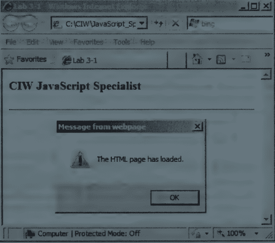

    图 3-1：带有警报的 lab3-1.htm 页面

7.  **浏览器：** 点击 **OK** 后，您的屏幕应渲染出前图警报框背后的 CIW JavaScript Specialist XHTML 页面。

在本实验中，您成功创建了一个显示警报对话框的简单函数。此外，您还使用 `onload` 事件处理程序和内联脚本启动了该函数。

### 调用函数

调用函数可以是在一个函数中调用另一个函数，由用户事件触发，或者从一个单独的 `<script>` 块中执行。在之前的实验中，您是通过将 `onload` 事件处理程序作为 `<body>` 标签的属性来调用函数的。`onload` 事件处理程序拦截了加载事件并调用了该函数。

以下是一个使用一个函数调用另一个函数的示例：

```javascript
<script type="text/javascript"><!--

var userName;

function showName() {
  getName();
  alert(userName);
}

function getName() {
  userName = prompt("Please enter your name:","");
}

// -->
</script>

<body onload="showName();">
```

在这个例子中，`showName()` 函数是通过 `onload` 事件处理程序调用的，与之前的实验相同。请注意，`showName()` 函数的第一行调用了 `getName()` 函数。在 `showName()` 函数的处理完成之前，`getName()` 函数将完整地执行。

您现在已经看到了两种调用函数的技术。第一种是使用事件处理程序来捕获事件并调用函数。第二种是在 X/HTML 页面的某个 `<script>` 块中直接包含函数名称。

在随后的实验中，您将看到在另一个函数内部调用函数。不过，首先您需要理解两个概念：

-   向函数传递参数
-   从函数返回结果

### 向函数传递参数

参数（Arguments 或 Parameters）是从函数外部传递到函数内部的值。这些值在函数内部被使用，并在函数完成其语句后被丢弃。以下脚本演示了向函数传递参数所使用的语法：

```javascript
<script type="text/javascript">
<!--
function showName(firstName, lastName) {
  document.write("<strong>Your first name is: ");
  document.write(firstName + "<br />");
  document.write("Your last name is: ");
  document.write(lastName + "</strong>");
}
//-->
</script>

<body>

<script type="text/javascript"><!--

showName("John", "Doe");

//-->
</script>

</body>
```

请注意，在第二个 `<script>` 块中，传递给 `showName()` 函数的值是一个以逗号分隔的列表。当函数被调用时，字面值 "John" 和 "Doe" 通过 `firstName` 和 `lastName` 参数被接收到函数中。

此示例展示了传递字符串字面量的情况。变量也可以被传递。数值字面量和变量不需要像字符串字面量那样包含引号。如果将变量传递给函数，在函数内部更改参数的值不会改变函数外部原始变量的值。而且如前所述，参数仅在函数的生命周期内存在。可以根据需要向函数传递任意数量的参数。

技术提示

在定义数据类型时请谨慎，并在整个编程过程中保持一致。最常见的错误之一是不经意地将整数转换为字符。请记住，JavaScript 遵循数学优先级，这意味着它不会将整个函数识别为数学运算，它很可能会将数字进行字符串拼接（1 + 1 = 11），因此请仔细且完整地测试您的代码。

### 从函数返回结果

目标
1.3.6：从函数返回结果

JavaScript 函数可以使用 `return` 语句向调用语句返回结果。要返回的值放在 `return` 关键字之后。从函数返回的值可以赋值给变量，也可以用于表达式中。以下脚本演示了从函数返回结果所使用的语法：

```javascript
<script type="text/javascript">
<!--

function returnValue() {
	var myProduct;
	myProduct = document.myForm.input1.value * 
		document.myForm.input2.value;
	return myProduct;
}

//-->
</script>

<body>

<form name="myForm">
Multiply <input type="text" name="input1" />
By <input type="text" name="input2" />
<input type="button" value="Result"
onclick=
"alert('The result is ' + returnValue() + '.');" />
</form>
</body>
```

在此示例中，文本框中输入的值由 **`returnValue()`** 函数相乘，结果值返回给调用语句。此示例展示了一些尚未讨论的 JavaScript 语法。请考虑这行代码：

```javascript
myProduct = document.myForm.input1.value ...
```

这段代码演示了访问 X/HTML 文本框中输入的值并将其赋值给变量的 JavaScript 语法。在这种情况下，一个值与另一个值相乘，并将该值赋给 **myProduct** 变量。请注意，表单名称为 **myForm**，文本框名称为 **input1** 和 **input2**。此类语法将在课程稍后详细讨论。

请注意，**`returnValue()`** 函数是在 **`alert()`** 方法的参数内部被调用的。函数的名称被拼接到了 **`alert()`** 消息中。记住，**return** 关键字将值返回给调用语句。因此，在函数计算完数字后，结果（存储在 **myProduct** 中）被返回给调用语句并拼接进 **`alert()`** 消息中。

任何类型的值都可以被返回，全局变量和局部变量同样可以。在简要讨论运算符优先级后，我们将讨论全局变量和局部变量。

### 运算符优先级

当 JavaScript 解释器读取 JavaScript 时，它必须确定先执行哪些操作。运算符优先级决定了哪些表达式将在其他表达式之前被计算。例如，考虑表达式 `4 + 6 * 2`。JavaScript 遵循数学优先级，因此乘法优先于加法，于是该表达式的计算结果为 16。然而，如果您将此表达式重写为 `(4 + 6) * 2`，其结果将为 20，因为括号表达式优先于乘法。有关运算符优先级的更多信息，请参阅相关附录。

> JavaScript 运算符优先级的运行方式与标准数学运算相同，这意味着它将首先执行括号内的运算，然后是乘法和除法，最后是加法和减法。这被称为数学优先级。

### 全局变量与局部变量

如果您在函数定义内部声明一个变量，那么您唯一能访问或修改该变量的方式是在该函数内部。一旦您在函数内部声明一个变量，该变量就被称为 **局部变量**，您无法在声明它的函数之外的任何其他函数中访问它的值。

有时，您可能想要声明一个可以被程序中多个函数或脚本块访问的变量。您需要在任何函数定义之外声明该变量，通常在脚本的开始部分。这种变量被称为 **全局变量**。如果您声明了一个全局变量，就可以在页面的任何函数或脚本块中访问它的值。

> JavaScript 允许您在不同的函数中使用相同的变量名。但是，同名变量被视为不同的变量。请注意，在编写脚本时，只要有可能，应为变量创建不同的名称。


**弱类型语言 (loosely typed language)**
一种不需要开发人员声明变量数据类型，且允许变量数据类型发生变化的脚本语言或编程语言。JavaScript 就是一种弱类型语言。

回想一下，JavaScript 提供了 **var** 关键字来声明变量。同时也要记得，当你想要创建一个变量时，JavaScript 并不强制要求使用 **var** 关键字。你只需在脚本中为变量命名并开始使用即可，因为 JavaScript 是一种**弱类型语言**。你不必在变量使用前声明其数据类型，而且变量的数据类型可以在脚本执行过程中发生变化。

请注意，在某些情况下，不使用 **var** 关键字可能会导致一些意外行为。如前所述，在函数中创建的变量具有局部作用域，仅对该脚本可见。这一结论的前提是你使用了 **var** 关键字来声明该变量。任何在没有 **var** 关键字的情况下创建的变量，无论在何处创建，其作用域都是全局的。然而，在这种情况下创建的变量直到函数被调用时才可用。这就是在脚本中使用变量之前，始终使用 **var** 关键字声明变量的另一个充分理由。

在接下来的实验中，你将使用 JavaScript 创建一个简单的函数，在调用该函数时传递参数，并向调用语句返回一个值。假设你公司员工发现，他们花费了太多时间回答客户的电话，而客户询问的问题在网站上已有答案。你的 Web 团队主管要求你修改公司网站的“联系我们”页面以减少电话量。她希望客户在尝试通过电话联系公司之前，先阅读“常见问题解答 (FAQ)”页面，看看是否能找到所需的帮助。你建议在“联系我们”页面添加一个警报框，当用户打开该页面寻找电话号码时弹出。该警报可以建议客户先查看 FAQ 页面寻求帮助。当客户点击“确定”时，页面将重定向到 FAQ 页面，并弹出另一个警报。这个警报会询问客户在阅读完 FAQ 之后是否仍然需要帮助。如果客户点击“是”按钮，则会出现一个新的警报框，显示客户服务电话号码。


## **实验 3-2：在 JavaScript 中使用函数、参数和返回值**

在本实验中，你将创建一个简单的函数，在调用该函数时传递参数，并向调用语句返回一个值。

- 1. **编辑器：** 从 Student_Files 目录的 Lesson 3 文件夹中打开 **lab3-2.htm**。

- 2. **编辑器：** 一个简单的函数已经为你创建好了。lab3-2.htm 文件包含一个表单按钮。在 **&lt;input&gt;** 标签中添加一个 **onclick** 事件处理程序。使用此事件处理程序来调用 **myFunction()**。

- 3. **编辑器：** 保存 **lab3-2.htm**。

- 4. **浏览器：** 打开 **lab3-2.htm**。你的屏幕应类似于图 3-2。

**目标**
1.3.1：作为函数的方法
1.3.2：定义函数
1.3.3：转换方法
1.3.4：调用函数
1.3.5：向函数传递参数
1.3.6：从函数返回数值

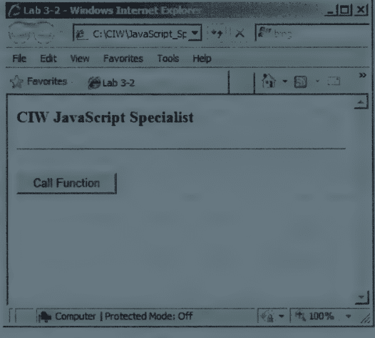

图 3-2：lab3-2.htm 页面

- 5. **浏览器：** 点击 **Call Function**。你应该看到如图 3-3 所示的警报。

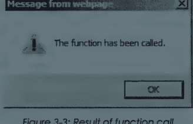

图 3-3：函数调用结果

- 6. **浏览器：** 点击 **OK**。

- 7. **编辑器：** 打开 **lab3-2a.htm**。你现在将为函数调用添加一个参数，然后在函数中使用该参数。在 XHTML 表单中定位 `<input>` 标签。在 `onclick` 表达式中函数名后的括号内添加以下字符串：

```
"a string of text"
```

你正在向函数传递字面量文本，因此请务必在字符串周围加上引号。

- 8. **编辑器：** 在函数名后的括号中添加一个名为 **arg1** 的参数。将 `arg1` 连接到 `alert()` 方法的参数中。保存 **lab3-2a.htm**。

- 9. **浏览器：** 打开 **lab3-2a.htm**。你的屏幕应类似于图 3-2。点击 **Call Function**。你应该看到如图 3-4 所示的警报。


图 3-4：函数调用结果

11. **浏览器：** 点击 **OK**。

12. **编辑器：** 打开 **lab3-2b.htm**。在 `myFunction()` 的 alert() 语句之后添加一个 return 语句。在 `return` 关键字之后添加以下文本：
"myFunction() return value"

13. **编辑器：** 为了查看函数的返回值，你将在调用语句中添加一个 alert() 方法。定位到文件底部附近 `<input>` 标签中定义的 `onclick` 事件处理程序。将 `myFunction()` 的调用包裹在 alert() 方法中。保存 **lab3-2b.htm**。

14. **浏览器：** 打开 **lab3-2b.htm**。你的屏幕应类似于图 3-2。点击 **Call Function**。你应该看到如图 3-4 所示的警报。点击 **OK**。然后你应该看到如图 3-5 所示的警报。

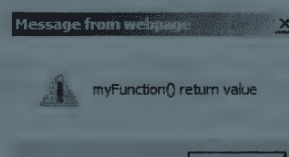

图 3-5：*myFunction()* 的返回值

- **值传递 (pass by value)**
一种描述将值传递给函数，且函数的参数接收该参数值副本的模式。

在本实验中，你创建了一个接收参数的函数。当你创建调用语句时，你将一个值作为参数传递给函数。然后向调用语句返回一个值。当一个值被传递到函数中并被修改时，原始数据的值不会改变。在编程中，这种模式被称为**值传递**。该规则的例外情况是向函数传递对象引用作为参数。JavaScript 对对象参数使用**引用传递**。有关引用传递的更多信息，请参阅相关附录。

- **引用传递 (pass by reference)**
一种描述将值传递给函数，且函数的参数接收该参数实际值的模式。

下一个实验将使用一个函数来调用另一个函数。它还将向该函数传递一个值，然后向调用语句返回一个值。该程序是一个在线测试的形式。假设你为一家在网站上提供测验和考试的在线培训公司工作。你可以将此类函数用于考试之间的学习测验。这将向学生在回答问题时提供反馈，让他们知道自己已经掌握了百分之多少的材料，以及哪些主题需要更多学习。

每次用户回答一个问题时，`runningTotal()` 函数会汇总用户因正确回答而获得的累计得分。条件赋值运算符将根据用户对测验问题的回答是否正确来决定是否分配分数。此外，本实验将使用运算符优先级的概念。这个实验相当复杂，因此请务必参考随后的实验回顾，以进行逐行分析。

#### 实验 3-3：在 JavaScript 中从一个函数内部调用另一个函数

在本实验中，你将使用一个函数来调用另一个函数。它还将向该函数传递一个值，然后向调用语句返回一个值。

- 1. **编辑器：** 从 Student_Files 目录的 Lesson 3 文件夹中打开 lab3-3.htm。

- 2. **编辑器：** 检查以下源代码：

```
<script type="text/javascript"><!--
var numCorrect = 0;
function takeTest() {
var response = "";
var points = 0;
var q1 = "What company developed JavaScript?";
var a1 = "NETSCAPE";
var q2 = "Using JavaScript operator precedence,\n what is the result of the following expression? 2 + 4 * 6";
var a2 = 26;
var q3 = "With what object-oriented programming language\n is JavaScript often compared and confused?";
var a3 = "JAVA";
response = prompt(q1,"");
if (response) points= runningTotal((response.toUpperCase() == a1) ? 1 : 0);
alert(points);
response = prompt(q2,"");
if(response) points= runningTotal((response == a2) ? 1 : 0);
alert(points);
response = prompt(q3,"");
if (response) points=runningTotal((response.toUpperCase() == a3) ? 1 : 0);
alert("You answered a total of " + points + " correctly.");
numCorrect = 0;
points = 0;
}
一天天unction runningTotal(i) {
numCorrect += i;
return numCorrect;
}
// -->
</script>
```

- 3. **编辑器：** 定位到文档底部的 `<form>` 标签。检查 `<input>` 标签。特别注意加粗显示的代码：


#### 检查实验 3-3

注意实验代码中使用的 `if (response)` 语句，它被设置在关键位置，这样即使用户反复点击“取消”选项，JavaScript 解释器也不会返回错误。现在，请花时间详细检查本实验中最相关的部分。以下是关键的脚本元素，编号仅为讨论方便。

```
01. var numCorrect = 0;
02. function takeTest() {
03. var response = "";
04. var points = 0;
05. var q1 = "What company developed JavaScript?";
06. var a1 = "NETSCAPE";
07. var q2 = "Using JavaScript operator precedence,\n what is the result of the following expression? 2 + 4 * 6";
08. var a2 = 26;
09. var q3 = "With what object-oriented programming language\n is JavaScript often compared and confused?";
10. var a3 = "JAVA";
11. response = prompt(q1,"");
12. if (response) points = runningTotal((response.toUpperCase() == a1) ? 1 : 0);
13. alert(points);
14. response = prompt(q2,"");
15. if (response) points = runningTotal((response == a2) ? 1 : 0);
16. alert(points)
17. response = prompt(q3,"")
18. if (response) points = runningTotal((response.toUpperCase() == a3) ? 1 : 0);
19. alert("You answered a total of " + points + " correctly.");
20. numCorrect = 0;
21. points = 0;
22. }
23. function runningTotal(i) {
24. numCorrect += i;
25. return numCorrect;
26. }
```

- **第 01 行：全局变量**
`numCorrect` 变量在两个函数之外声明，使其成为具有全局作用域的全局变量。`runningTotal()` 和 `takeTest()` 函数都需要这个变量，因此将其定义在两个函数之外。

- **第 02 行：定义 `takeTest()` 函数**
注意 `function takeTest() {` 这个标准语法，用于开始函数定义。

- **第 03 至 10 行：局部变量**
变量 `response` 和 `points`，以及问题和答案变量（`q1`、`a1` 等）在此处的 `takeTest()` 函数内部声明。它们的值只能在本函数内更改和访问，这是合适的，因为这些变量在 `runningTotal()` 函数中不需要使用。

- **第 11 行：收集用户对问题的回答**
变量 `response` 被赋值为用户在 `prompt()` 中的输入。提示框本身使用了变量 `q1`，其中包含第一个问题的文本。

- **第 12 行：将用户的答案与正确答案进行比较，并调用 `runningTotal()` 函数**
这一行代码如下：
`if (response) points = runningTotal((response.toUpperCase() == a1) ? 1 : 0)`

JavaScript 将按以下顺序处理此表达式。

**第一步：`if (response)`**

if 语句检查用户是否在提示对话框上点击了“取消”按钮。如果是，则会返回一个空值。程序稍后将对用户的两个答案应用 `toUpperCase()` 方法。如果尝试对空值应用 `toUpperCase()` 方法，将会产生错误。因此，if 语句避免了这个可能出现的错误消息。

**第二步：** `(response.toUpperCase() == a1)`

这里给出了一个逻辑表达式，其值为真或假，取决于用户的答案。

**第三步：JavaScript 求值** `(response.toUpperCase() == a1) ? 1 : 0`

如果用户的回答正确（表达式为真），则准备好值 1 供后续操作使用。如果不正确，则准备好值 0。条件运算符 `? :` 决定返回哪个值。

**第四步：** JavaScript 会将原始代码行解读为以下内容之一：

```
runningTotal(1)
```

或：

```
runningTotal(0)
```

此时，JavaScript 将调用 `runningTotal()` 函数，并同时传递两个值之一，即 0 或 1。

此时，请跳转到第 23 行。

- **第 23 至 26 行：runningTotal(i) 函数**
注意函数定义接受一个名为 `i` 的参数，它本身没有特定含义，只是一个用于保存传递给此函数的任何值的变量。从第 11 行我们知道，传递的值只能是 1 或 0，无论哪个，都会被加到 `numCorrect` 变量上。如果答案不正确，`numCorrect` 将增加 0，意味着其值保持不变。如果答案正确，`numCorrect` 将增加 1。

一旦 `numCorrect` 被操作，`numCorrect` 的当前值将被返回到调用该函数的代码行，在本例中是第 12 行。此时，`numCorrect` 中包含的返回值被赋值给 `points` 变量。因此，现在我们返回到第 13 行。

- **第 13 行：显示累计得分**
通过 `alert()` 方法向用户显示更新后的 points 值。

- **第 14 至 19 行：重复该过程**
除了一个变化之外，这些行基本上重复了第 11 至 13 行概述的过程。区别在于第 15 行。这里不需要 `toUpperCase()` 方法，因为答案是一个整数。

- **第 19 行：最终得分**
这一行是第 13 行和第 16 行的变体。因为这一行跟在最后一个问题之后，所以添加了代码以表明测验结束。

- **第 20 至 21 行：重置变量**
`numCorrect` 和 `points` 变量被重置为 0，为下一次测验做准备。

- **第 22 和 26 行：结束函数**
很容易忘记结束一个函数。因为每个函数都以左花括号开始，所以每个函数也必须以一个右花括号结束。

你现在看到了另一个函数示例以及它们的使用方式。你已经了解到可以从用户事件或另一个函数调用一个函数。你也看到了另一个将参数传递给函数并返回值给调用语句的例子。

### 用户事件和 JavaScript 事件处理程序

无论是提交表单还是浏览网页，用户都会生成事件。JavaScript 包含处理这些事件的预定事件处理程序。表 3-1 列出了 JavaScript 事件。请注意这些是常用的事件。还有许多其他事件，但超出了本课程的范围。

*表 3-1：JavaScript 用户事件*

| 事件 | 描述 |
|-------|-------------|
| abort | 在图像加载被中止时发生 |
| blur | 当输入焦点从表单元素移除时发生（例如，当用户在特定字段外单击鼠标按钮时） |
| click | 当用户单击链接或表单元素时发生 |
| change | 当用户更改表单字段的值时发生 |
| error | 在页面或图像加载期间发生错误时发生 |
| focus | 当用户将输入或焦点赋予表单元素时发生 |
| load | 当页面加载到浏览器中时发生 |
| mouseOver | 当用户将鼠标指针移动到链接或区域对象上时发生 |
| mouseOut | 当鼠标指针离开链接或区域对象时发生 |
| reset | 当单击表单的“重置”按钮时发生 |
| select | 当用户在表单字段中选择文本时发生 |
| submit | 当单击表单的“提交”按钮时发生 |
| unLoad | 当页面从浏览器中卸载时发生 |

表 3-2 列出了旨在处理上述事件的 JavaScript 事件处理程序。请注意这些是常用的事件处理程序。还有许多其他事件处理程序，但超出了本课程的范围。

*表 3-2：JavaScript 事件处理程序*

| 对象 | 事件处理程序 |
|--------|------------------|
| button | onclick |
| reset | onclick |
| submit | onclick |
| radio | onclick, onblur, onfocus |
| checkbox | onclick, onblur, onfocus |
| link | onclick, onmouseover, onmouseout |
| form | onsubmit, onreset |
| text | onchange, onfocus, onblur, onselect |
| textarea | onchange, onfocus, onblur, onselect |
| select | onchange, onfocus, onblur |
| image | onabort, onerror, onload |
| area | onclick, onmouseover, onmouseout |
| window | onload, onunload, onerror |

如前所述，事件处理程序通常内联在 X/HTML 标签中。之前的一个例子在 `<body>` 标签内使用了 `onunload` 事件处理程序。

你将在本课程的其他地方使用许多这些事件和事件处理程序。

### 作为函数的方法

在 JavaScript 中，你可以使用内置函数来操作对象属性或执行计算。在某些编程语言中，方法和函数是两种不同的操作。然而，在 JavaScript 中，方法和函数是可以互换的。

它们之间最有帮助的区别在于，任何返回值的方法都可以称为函数。JavaScript 有内置函数（或方法）和用户可以定义的函数。你已经看到了创建用户定义函数所需的语法。

在下面的例子中，`toUpperCase()` 方法作为一个函数工作，因为它在将 `answer` 变量转换为大写字母后返回该变量：

```
var answer;
var correctAnswer = "WASHINGTON, D.C.";
answer = prompt("What is the capitol of the United States?","");
answer = answer.toUpperCase();
```

在这段代码中，用户可能会在提示框中输入“Washington, D.C.”来回答。但 `correctAnswer` 变量包含的是“WASHINGTON, D.C.”。由于 JavaScript 区分大小写，用户的答案可能仅因为未使用大写字母输入而被判定为不匹配。通过使用 `toUpperCase()` 方法，你可以将答案转换为其大写等效形式，从而进行有意义的比较。`toUpperCase()` 方法作为一个函数运作，因为它返回一个你可以在程序的其余部分中使用的值。之前的实验演示了使用 String 对象的 `toUpperCase()` 方法。

JavaScript中有几种不属于任何特定对象的内置方法，它们可在脚本中按需使用。一些常见的例子是 `parseInt()` 和 `parseFloat()` 方法。这两个方法将在本课后面讨论。另一个例子是 `isNaN()` 方法，用于确定一个操作数是否为数字。这类函数被称为顶级函数。随着你对JavaScript了解的加深，你将使用这些顶级内置函数来增强你的脚本。

### 使用内置函数

如前所述，JavaScript有几种可以使你的工作更轻松的内置函数。两个在数学计算中很方便的函数是：`parseInt()` 和 `parseFloat()`。

- `parseInt()` — 将字符串转换为其整数等价形式
- `parseFloat()` — 将字符串转换为其浮点十进制等价形式

在你的代码中使用 `parseInt()` 或 `parseFloat()` 函数，可以消除当你希望+运算符用于数学表达式时却被用于字符串连接的问题。你会看到，使用 `parseInt()` 或 `parseFloat()` 函数可以解决JavaScript误解+运算符双重用途的问题。

以下示例演示了 `parseInt()` 和 `parseFloat()` 函数的使用：

```html
<script language="JavaScript">
  <!--
    var myVar1 = "3 abc";
    var myVar2 = 4.75;
    var myVar3 = "4.75 abc";

    myVar1 = parseInt(myVar1);
    myVar2 = parseInt(myVar2);
    myVar3 = parseFloat(myVar3);

    alert(myVar1); //Displays 3
    alert(myVar2); //Displays 4
    alert(myVar3); //Displays 4.75
  -->
</script>
```

在此示例中，字符串 "3 abc" 使用 `parseInt()` 被转换为整数 3，浮点数 4.75 使用 `parseInt()` 被转换为整数 4。字符串 "4.75 abc" 使用 `parseFloat()` 被转换为浮点数 4.75。

你也可以在这种情况下进行变量类型转换，我们接下来将讨论这个。

### 变量类型转换

类型转换是指将变量从一种类型更改为另一种类型的任何方式。在某些情况下，你可能需要让浏览器以不同的方式解释变量。例如，你可能需要将字符串值转换为数值以进行计算，或者你可能需要将数值转换为字符串值。你可以使用一种称为类型转换的变量控制技术来实现这一点。本质上，你将变量从一种类型转换为另一种类型。

变量类型转换对于你的JavaScript编程可能有用——也可能有害。当你想到变量类型转换时，请考虑以下内容：

**目标**
1.3.10：内置函数和变量类型转换

**浮点计算**
一种计算，其中小数点可以根据需要移动以处理有效数字。

**目标**
1.3.10：内置函数和变量类型转换

**类型转换**
在JavaScript中，一种变量控制技术，其中变量的值从一种数据类型更改为另一种数据类型。

- 1 + 1 = 2 — 对变量执行的数学优先级计算
- one plus one equals oneone — 对变量执行的连接操作

通常，当你报告一个变量时（例如，当使用alert框时），变量实际上是否被转换并不重要。但是，在执行数学运算时，类型转换非常重要，因为你需要数学优先级运算，而不是连接操作发生。

研究以下示例，该示例在你的学生文件中的 *example_castingError.htm* 文件中提供：

```html
<!DOCTYPE html PUBLIC "-//W3C//DTD XHTML 1.0 Transitional//EN"
"http://www.w3.org/TR/xhtml1/DTD/xhtml1-transitional.dtd">
<html xmlns="http://www.w3.org/1999/xhtml">
<head>
<meta http-equiv="Content-Type" content="text/html; charset=utf-8" />
<title>Example: Casting Error</title>

<script type="text/javascript">
<!--

/***********************************************
定义了一个名为myFunction()的函数。
调用该函数时会显示一个alert()。
***********************************************/

function myFunction() {
    var a = 1;
    var b = 2;
    var c = "answer is " + a + b;
    alert(c);
}

//-->
</script>
</head>
<!-- 添加一个onload事件处理程序来调用该函数 -->

<body onload="myFunction();">

<h3>CIW JavaScript Specialist</h3>
<hr />
</body>
</html>
```

当你运行此脚本时，你期望得到以下输出：

The answer is 3

但是，显示了这个结果：

The answer is 12

类型转换错误是导致此结果的原因。根据数学优先级，脚本将方程的第一部分视为字符串（"The answer is"），然后从左到右进行连接，使得最终答案看起来不正确。但根据JavaScript的规则，它是正确的。

你可以通过编写脚本，在代码中将数学部分与字符串部分分开来转换这些变量，从而使JavaScript更容易遵循数学优先级规则。研究以下脚本，该脚本在 *example_castingError_fixed.htm* 文件中提供。

```html
<!DOCTYPE html PUBLIC "-//W3C//DTD XHTML 1.0 Transitional//EN"
"http://www.w3.org/TR/xhtml1/DTD/xhtml1-transitional.dtd">
<html xmlns="http://www.w3.org/1999/xhtml">
<head>
<meta http-equiv="Content-Type" content="text/html; charset=utf-8" />
<title>Example: Casting Error Fixed</title>

<script type="text/javascript">
<!--

/**********************************************
   定义了一个名为myFunction()的函数。
   调用该函数时会显示一个alert()。
***********************************************/

   function myFunction() {
      var a = 1;
      var b = 2;
      var c = a + b;
      alert("The answer is " + c);
   }

//-->
</script>
</head>

<!-- 添加一个onload事件处理程序来调用该函数 -->
<body onload="myFunction();">
<h3>CIW JavaScript Specialist</h3>
<hr />
</body>
</html>
```

当你运行此脚本时，你会看到以下输出：

```
The answer is 3
```

这个答案是正确的，这是预期的输出。

请注意，开发者在代码中将数学部分与字符串部分分开了。因此，当JavaScript遵循数学优先级规则时，结果就是你所期望的。

### 案例研究

#### 需要咖啡才能运作

Susan拥有一家小咖啡店，有一个独特的特色：得来速窗口。顾客很喜欢它，但在一天中的某些时段，队伍会很长。Susan知道，有时人们开车过来，看到长长的队伍，如果没时间等待就会离开。生意流失了。尽管如此，她仍有许多忠实的顾客，有些她几乎每天都能见到。

Susan有了一个想法。如果她的网站包含一项功能，允许顾客提前下单并安排取货时间会怎样？如果一些咖啡订单已经准备好可以取货，那么得来速通道可以移动得更快，减少等待时间并缩短队伍。她甚至可以为她的常客开设账户，让他们预付咖啡费用，从而进一步加快得来速通道的速度。

Susan打电话给她的网站开发者Adrian，告诉了他她的想法。太棒了，Adrian说。我们能做到吗？Susan问道。

Adrian建议在网站上添加一个订单页面。当用户访问此页面时，他们将看到有关预定购服务的信息，以及一个用于开设计费账户以获得更快服务的表单。对于开设账户的用户，将有另一个名为"快速预定购"的功能——因为，正如Adrian指出的，这些顾客想要快速的服务，那么为什么不让订单处理过程也更快呢？

快速预定购功能将在快速顾客每次访问网站时，在主页上启动一个弹出警报框。弹出框将向顾客问好，并询问他或她的咖啡订单。顾客将在警报框中输入他或她的订单和期望的取货时间。当顾客点击"确定"时，另一个弹出窗口将出现，总结订单和取货时间，并告知顾客将收取的费用。

觉得怎么样？Adrian问道。太棒了，Susan说。她可以按计划准备好咖啡订单并收款——顾客可以快速取货然后上路。

* * *

考虑这个场景并回答以下问题。

- Adrian如何使用JavaScript函数在网站上创建快速支付功能？他可以使用哪些函数？
- Adrian在快速支付功能中可以使用哪些事件和事件处理程序？
- Adrian在快速支付功能中可以使用哪些方法？
- Adrian可能需要如何修改脚本，以便为顾客提供复选框或单选按钮选项列表来选择咖啡订单，而不是让他们在文本字段中输入任何想要的订单？
- Adrian可以使用JavaScript函数、方法和事件为快速预定购功能添加哪些其他功能？他可以为每个用户提供个性化的问候吗？他可以为每个客户提供一个名为"老样子"的个性化订单选项吗？他会为此使用什么JavaScript命令？请记住，他希望快速预付功能尽可能快速和易于使用。


### 课程总结

### 应用项目

本项目将挑战你运用本课所学知识。创建一个 X/HTML 页面，在文档的 `<head>` 部分创建一个 JavaScript 代码块，并在 `<body>` 部分创建另一个 JavaScript 代码块。在第一个 JavaScript 第一个代码块中，创建四个名为 `add()`、`subtract()`、`multiply()` 和 `divide()` 的函数。在函数名后的括号中，为每个函数定义两个参数 `arg1` 和 `arg2`。在每个函数中定义一行代码，即一个返回语句，返回 `arg1` 与 `arg2` 相加、相减、相乘或相除的结果。

在第二个 JavaScript 代码块中，创建四个 `document.write()` 语句来调用每个函数。为每个函数传递两个字面值作为参数。函数的执行结果应显示在 X/HTML 页面上。

### 技能回顾

JavaScript 的一个强大特性是开发人员可以创建自己的函数。函数是一个有组织的、命名的代码块，用于处理由用户事件触发的操作。为代码块分配名称允许它在整个程序中根据需要被重复调用。JavaScript 函数可以接收参数并返回值。JavaScript 还提供了执行特定任务的内置函数。调用函数可以从一个函数调用另一个函数，也可以由用户事件触发，或者从一个独立的脚本块中执行。使用 `var` 关键字在函数内声明的变量被称为局部变量，除了声明它的函数之外，你无法从任何其他函数访问其值。全局变量声明在任何函数定义之外，可被页面上的所有函数和脚本块使用。JavaScript 包含预定义的事件处理器，用于处理用户生成的事件。JavaScript 中的大多数对象都与其相关的事件和事件处理器相绑定。

现在你已经完成了本课的学习，你应该能够：

- 1.3.1: 将方法作为函数使用。
- 1.3.2: 定义函数。
- 1.3.3: 使用数据类型转换方法。
- 1.3.4: 调用函数。
- 1.3.5: 向函数传递参数，包括参数创建、返回值以及 *calculateAvg()* 函数。
- 1.3.6: 从函数返回数值。
- 1.3.7: 区分全局变量和局部变量。
- 1.3.8: 使用条件运算符。
- 1.3.9: 识别用户事件和事件处理器。
- 1.3.10: 使用内置函数并进行变量强制类型转换。

### 第 3 课回顾

1. 在编程中，什么是函数？在 JavaScript 中，函数与方法有什么区别？

2. 什么是内置函数？请举出至少一个 JavaScript 内置函数的名称。

3. 在 JavaScript 中如何定义函数？

4. 什么是浮点数计算？

5. 解释什么是良好的编码实践，以及在 JavaScript 中何时需要它。

6. 在 JavaScript 中可以通过哪些方式调用函数？

7. 在 JavaScript 中传递参数时，字符串字面量必须包含什么而数字字面量不需要？

8. 在 JavaScript 中，你可以传递多少个参数，以及每个参数存在多久？

9. 什么是运算符优先级？请举出至少一个与 JavaScript 相关的例子。

10. 全局变量与局部变量有何不同？

11. 什么是值传递（pass by value）？什么是引用传递（pass by reference）？JavaScript 使用哪一种？

12. 什么是条件运算符，其用途是什么？

13. 什么是用户事件？请举出至少三个 JavaScript 用户事件的例子。

14. 什么是事件处理器？请举出至少三个 JavaScript 事件处理器的例子。

15. 考虑以下 JavaScript 语句：

```html
<head>
<script type="text/javascript">
<!--

function myFunction() {
  myValue = 10;
  return myValue * 10;
}

//-->
</script>
</head>
<body>
<script type="text/javascript">
<!--

document.write(myValue + "<br />");
document.write(myFunction());

//-->
</script>
</body>
```

这些 JavaScript 语句的结果是什么？为什么？

## 第 4 课：在 JavaScript 中控制程序流

#### 目标

在本课结束时，你将能够：

- 2.1.1: 使用 `if...` 语句。
- 2.1.2: 使用 `while...` 语句。
- 2.1.3: 使用 `do...while` 语句。
- 2.1.4: 使用 `for...` 语句。
- 2.1.5: 使用 `break` 和 `continue` 语句。
- 2.1.6: 使用 `switch...` 语句。

### 预评估问题

1. 你应该使用哪个 JavaScript 语句，在某个测试条件为真时执行一段代码块？
   a. if
   b. continue
   c. switch
   d. while

2. JavaScript `if...else` 语句的目的是什么？
   a. 根据测试条件的结果分支到两个进程之一
   b. 为某些特定的值范围重复执行一组语句
   c. 退出一个否则会继续执行的循环
   d. 强制将控制流返回到循环顶部

3. 描述 JavaScript `continue` 语句的功能。

### 控制决策性程序流

在之前的课程中，你已经学习了足够的 JavaScript 语言知识来声明变量、进行赋值以及执行各种类型的算术和字符串操作。很快，你将学习更多关于操作 JavaScript 文档对象模型 (DOM) 的知识。

然而，在你学习各种可用于控制决策性程序流的技巧之前，你将无法编写任何高级 JavaScript 代码。在编程中，基于布尔值做出决策的语句以及导致代码重复执行（即循环）的语句被称为**控制结构**。对于使用布尔值的控制结构，相关表达式中通常会使用比较运算符。

在本课中，你将学习几种控制 JavaScript 语句执行的方法。程序流并非 JavaScript 特有。所有编程语言都有某种形式的程序控制，以使程序能够通过程序流做出决策。

#### if...else 语句

编程中最常见的需求之一是能够根据你编写的某个测试条件的结果，分支到两个或多个进程之一。例如，在测验中，如果用户正确回答了问题，可能会产生一种结果；如果用户回答错误，则会产生另一种结果。`if... else` 语句允许你为这类进程编写脚本。

#### 单一条件

对于不存在其他测试条件的简单 if 语句，其语法如下：

```javascript
if (expression) {
    //statements to execute if expression is true
}
```

请注意，表达式（测试条件）被包含在圆括号中。一对花括号包含一个或多个语句构成的代码块。只有当表达式返回布尔值 true 时，这些语句才会执行。如果布尔表达式返回 false 值，则不会发生任何事情。

以下是一个使用 `if` 语句的代码片段：

```javascript
if (userAnswer == 25) {
    alert("Correct answer.");
}
```

在这个例子中，如果变量 `userAnswer` 等于 25，用户将看到一条消息。

请注意，如果与测试条件相关联的代码仅由一行组成，你可以省略花括号，如下例所示：

```javascript
if (userAnswer1 == 25) alert("Correct answer.");
```

```javascript
if (userAnswer2 == "Yes")
    alert("Correct Answer");
```


此语法仅在测试条件为真时执行一行代码时才正确。

请注意，一个常见的语法错误是在使用 `if` 语句指定要执行的代码块时，忘记了花括号。因此，请务必使用花括号。

#### 多个条件

假设上一个示例中的用户回答错误。在这种情况下，你需要一种方法来处理测试条件返回假值的可能性。以下是处理多个条件的语法：

```
if (expression) {
    //statements to execute if expression is true
}
else {
    //statements to execute if expression is false
}
```

请注意，`else` 关键字放置在与测试条件关联的初始代码块的右花括号之后。`else` 代码块包含在自己的花括号中，仅当测试条件返回布尔值 `false` 时才会执行。

例如，假设正确答案是 25，但用户输入了 30。请看以下示例：

```
if (userAnswer == 25) {
    alert("Correct answer.");
}
else {
    alert("Your answer was incorrect. Try again!");
}
```

在此示例中，无论用户回答正确还是错误，都会收到一条消息。大多数情况下，你的代码需要响应测试条件的真假，如本示例所示。

## 使用 *if* 进行条件程序流控制

以下示例演示了如何使用 `if...else` 语句来决定是否对在美国不同司法管辖区进行的购买征收销售税。你将看到代码仅对发送给加利福尼亚州（CA）居民的订单加收销售税。（此示例使用美国邮政缩写代表州名。）

```
<!DOCTYPE html PUBLIC "-//W3C//DTD XHTML 1.0 Transitional//EN"
"http://www.w3.org/TR/xhtml1/DTD/xhtml1-transitional.dtd">
<html xmlns="http://www.w3.org/1999/xhtml">
<head>
<meta http-equiv="Content-Type" content="text/html; charset=utf-8" />
<title>Example: if...else Statement</title>

<script type="text/javascript">
<!--

// Define variables
var orderAmount = 50;
var state = "";

// Find out the user's shipping state
state = prompt("To which state will your order be shipped?","");
```

```
/*
If the user is in California, he or she will have to pay the total orderAmount
plus the additional 8.25% state sales tax. If not, they only have to pay the
actual orderAmount.
*/

if (state.toUpperCase() == "CA") {
  alert("Your total is: " + (orderAmount * 1.0825));
}
else {
  alert("Your total is: " + orderAmount);
}

//-->
</script>

</head>

<body>
<h1>Thank you for your order!</h1>

</body>
</html>
```

#### 附加的 if 语句

如果你想测试多个条件，可以使用附加的 `else if` 语句。以下示例演示了如何编写此类附加语句：

```
if (condition a) {
  //statements to execute
}
else if (condition b) {
  //statements to execute
}
else if (condition c) {
  //statements to execute
}
else {
  //statements to execute
}
```

这种多重语句在某些情况下非常有用。例如，美国州销售税示例可以包含一个额外的 `else if` 语句来测试另一个州，例如夏威夷（HI）：

```
if (state.toUpperCase() == "CA") {
  alert("Your total is: " + (orderAmount * 1.0825));
}
else if(state.toUpperCase() == "HI") {
  alert("Your total is: " + (orderAmount * 1.04));
}
else {
  alert("Your total is: " + orderAmount);
}
```

开发者可以为每个额外的州添加 49 个 `else if` 块。然而，`switch` 语句提供了一种在这种情况下的更有效编码方式。你将在本课后面了解 `switch` 语句。

#### 在同一表达式中处理多个条件

到目前为止，你在 `if` 语句的测试条件中只使用了一个表达式。你可以在同一个表达式中检查多个条件，以获得真或假的条件。在前面的示例中，一个 `else if` 代码块检查了另一个碰巧有不同税率的美国州。假设两个州的税率相同。以下示例演示了如何在同一表达式中使用多个条件来获得真或假的条件。

```
if ((state.toUpperCase() == "CA") || (state.toUpperCase() ==
"HI")) {
  alert("Your total is: " + (orderAmount * 1.0825));
}
else {
  alert("Your total is: " + orderAmount);
}
```

注意逻辑或运算符（`||`）的使用。在此示例中，如果 `state` 变量匹配 CA（加利福尼亚州）或 HI（夏威夷州）中的任何一个，表达式将返回真值，并添加相应的税款。任何逻辑运算符都可以在多重条件表达式中使用。

在下面的实验中，你将创建一个 `if` 语句，该语句测试一个整数是否在特定的值范围内。假设你正在教授大学级别的课程。你不是在课程结束时根据百分比给学生分配成绩，而是让学生通过累加他们为完成的作业、每次小测验分数、每次考试分数和任何额外加分项目所获得的总分，以数字格式在整个学期中跟踪他们的进度。学生可以在学期的任何时间通过访问你的班级主页并输入他们累积的总分来评估自己。你可以定期更新这个成绩计算器，这样学生就可以根据他们目前累积的分数找到他们所在的等级范围。


在本实验中，你将创建一个 `if` 语句。`if` 语句将测试一个整数是否在特定的值范围内。如果整数在此范围内，一个警报对话框将提供相关信息。

1.  **编辑器：** 从 Student_Files 目录的 Lesson 4 文件夹中打开 `lab4-1.htm`。
2.  **编辑器：** 一个名为 `checkgrade()` 的函数已为你开始编写。一个名为 `myGrade` 的变量被赋予从 XHTML 表单中的 `select` 对象接收到的整数值。
3.  **编辑器：** 在 `myGrade` 初始化语句之后，创建一个 `if` 语句。作为 `if` 语句的条件，测试 `myGrade` 变量是否大于或等于 91。如果该值大于或等于 91，则输出一个警报，通知用户其成绩为 A。
4.  **编辑器：** 保存 `lab4-1.htm`。
5.  **浏览器：** 打开 `lab4-1.htm`。你的屏幕应类似于图 4-1。

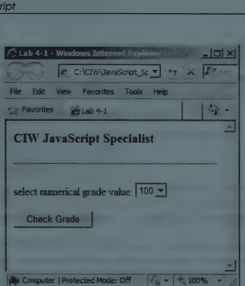

图 4-1：lab4-1.htm 页面

6.  **浏览器：** 从下拉菜单中选择 91 或更大的数值等级。你应该看到一个类似于图 4-2 的警报。

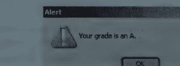

图 4-2：警报对话框

7.  **浏览器：** 点击 **确定** 关闭警报。

8.  **编辑器：** 向 `if` 语句添加一个 `else if` 子句。作为 `else if` 子句的条件，测试 `myGrade` 变量是否大于或等于 81 并且小于或等于 90。提示：使用逻辑与运算符（`&&`）执行此测试。如果 `myGrade` 变量在此范围内，则输出一个警报对话框，通知用户其成绩为 B。

9.  **编辑器：** 保存 `lab4-1.htm`。

10. **浏览器：** 刷新 `lab4-1.htm`。从下拉菜单中选择一个介于 81 和 90 之间的数值等级。你应该看到一个类似于图 4-3 的警报。


图 4-3：警报对话框

11. **浏览器：** 点击 **确定** 关闭警报。

12. **编辑器：** 你可以继续添加 `else if` 子句来测试，然后将所有可能的整数值范围映射到字母等级。但是，目前，请向 `if` 语句添加一个 `else` 子句。`else` 子句将简单地输出一个警报对话框，通知用户其成绩为 C 或更低。

13. **编辑器：** 保存 `lab4-1.htm`。

14. **浏览器：** 刷新 `lab4-1.htm`。从下拉菜单中选择一个 80 的数值等级。你应该看到一个类似于图 4-4 的警报。


15. **浏览器：** 点击 **确定** 关闭警报。

本实验提供了一个创建和使用 **if...else if...else** 语句的机会。你测试了整数值，并在该值落入特定范围时显示了相应的消息。

#### while 语句

目标
2.1.2：使用 while... 语句

**while** 语句用于只要（当）某个测试条件为真，就执行一段代码块。语法如下：

```
while (expression) {
    //one or more statements to execute
}
```

当程序执行到达 **while** 语句时，会评估测试条件。如果表达式返回布尔值 `true`，则花括号内的语句将被执行。然后，程序流返回到 **while** 语句的开头，在那里重新评估测试条件。只要表达式返回 `true`，代码块就会重复自身，或循环。当你不确定循环需要执行多少次时，**while** 循环尤其有用。

编码不当的 **while** 语句可能会设置一个无限循环，导致浏览器无限期等待。因此，请务必在 **while** 条件中包含一些语句，以确保在某个时刻测试条件将变为 `false`，从而终止循环。

例如，以下循环持续到变量 **num** 的值为 10：

```
//declare and initialize variable
var num = 0;

//start while loop and create test condition
while (num < 10) {
    //output value of variable
    document.write(num + " ");
    //increment variable
    num++;
} //end while loop
```

在此示例中，如果你忘记了包含递增语句（**num++**），将会产生一个无限循环。变量 **num** 将保持为零，因此总是小于 10。**while** 循环将继续，直到浏览器通知用户存在不安全情况，或者浏览器可能会无限期等待，迫使用户退出浏览器。


与 `if` 语句类似，`while` 表达式中也可以包含多个测试条件。请看以下示例：

```
while ((condition1) || (condition2)) {
    //要执行的语句
}
```

在此示例中，只要其中一个条件返回 `true`，循环就会继续执行。

#### isNaN 方法

下一个实验将介绍与 `while` 循环一起使用的 `isNaN()` 方法。`isNaN()` 方法用于判断给定的值是否为一个有效的数字。以下示例演示了 `isNaN()` 方法：

```
var myString = "A string of text.";
var myNumber = 10;

alert(isNaN(myString)); //显示 true

alert(isNaN(myNumber)); //显示 false
```

`isNaN()` 是 "is not a number"（不是数字）的缩写。在前面的示例中，`myString` 返回 `true`，因为它不是一个数字。`myNumber` 返回 `false`，因为它是一个数值。

`while` 循环可用于多种不同的场景。在接下来的实验中，用户将在一个文本框中输入一个数值等级。你将使用 `while` 循环来测试用户的输入。假设你仍在使用为你所教授的大学课程主页上的成绩计算器。本学期可能的总分范围越来越高——现在最高可达 220 分，一个包含众多数字的长下拉列表不再实用。因此，你决定将下拉列表更改为一个文本框，学生可以在此输入他们的总分。有时，其他老师教授的类似课程的学生会找到你的课程主页并尝试使用计算器，但其他老师使用的是不同的数值分数体系。因此，如果学生尝试输入指定范围之外的数值，系统会弹出一个提示框，要求输入 180 到 220 之间的数字（基于当前分数范围）。学生还可以选择取消计算器，如果他们发现这不适用于自己的课程的话。


#### 实验 4-2：使用 while 语句

在本实验中，你将使用 `while` 循环来测试用户的输入。

- 1. **编辑器：** 打开 Student_Files 目录中 Lesson 4 文件夹下的 **lab4-2.htm**。

- 2. **编辑器：** 在文档的 `<head>` 部分找到 `checkGrade()` 函数。该函数包含的代码与 lab4-1.htm 基本相同。但是，用户是在文本框中输入数值等级，而不是从下拉菜单中选择。

- 3. **编辑器：** 在 `myGrade` 初始化语句之后创建一个 `while` 循环。在循环的条件中，使用 `isNaN()` 函数来测试 `myGrade` 变量。用伪代码表示，`while` 语句的第一行应该是：*while is not a number (myGrade)*。

- 4. **编辑器：** 循环内部需要一行代码。如果 `myGrade` 不是一个数字，则将 `myGrade` 重新赋值为一个提示对话框的返回值，该对话框要求用户输入一个数值。不要忘记使用 `parseInt()` 函数将提示框返回的字符串值转换为整数。`while` 循环将持续运行，直到用户输入一个数字。

- 5. **编辑器：** 保存 `lab4-2.htm`。

- 6. **浏览器：** 打开 `lab4-2.htm`。你的屏幕应与图 4-5 相似。

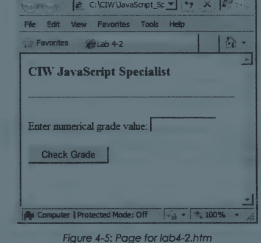

图 4-5：lab4-2.htm 页面

- 7. **浏览器：** 在文本框中输入一个 0 到 100 之间的数值，然后单击 Check Grade 按钮，将产生与 lab4-1.htm 相同的输出。在文本框中输入一个非数值，然后单击 **Check Grade** 按钮。你应该会看到一个类似于图 4-6 的提示框。


图 4-6：提示对话框

- 8. **浏览器：** 单击 **OK** 或 **Cancel**，不输入任何信息，或输入一个非数值。你应该会再次看到提示框。事实上，提示对话框应该会反复出现，直到输入一个数值。输入数值后，你应该会看到与 lab4-1.htm 产生的相同输出。

本实验旨在演示 `while` 循环，你已经看到了使用循环来重复请求用户输入的效果。然而，良好的 JavaScript 编程实践建议你不要像 lab4-2.htm 中所示的那样阻止用户取消提示对话框。一个设计良好的程序应该会按预定的次数请求用户输入。如果用户反复单击“取消”，程序应该在某个时刻退出。本实验的下一部分将演示这个概念。

- 9. **编辑器：** 打开 lab4-2a.htm。这是与 lab4-2.htm 相同的程序，但做了一个小改进。一个名为 `attempts` 的变量已被声明并初始化为值 1。
- 10. **编辑器：** 在 `while` 循环的条件表达式中，同时测试 `attempts` 变量的值是否小于或等于 2。使用逻辑 AND 运算符来执行此任务。
- 11. **编辑器：** 在循环内部添加一个语句，该语句在每次循环时递增 `attempts` 变量。
- 12. **编辑器：** 请注意，在 `while` 循环之后，我们为你提供了一个额外的语句。一个 `if` 语句测试 `myGrade` 和 `attempts` 变量。如果 `myGrade` 仍然不是数字，并且 `attempts` 变量等于 3，则使用 `return` 语句退出函数。
- 13. **编辑器：** 保存 lab4-2a.htm。
- 14. **浏览器：** 打开 lab4-2a.htm。尝试使用该页面。如果用户在两次尝试内未输入所需数据，提示对话框应该会消失，程序不再有进一步输出。

可以想象，滥用 `while` 循环可能会导致挫败感并产生问题。重要的是要记住，`while` 语句执行的条件值必须在某个时刻变为 `false`。否则，`while` 语句将无限循环，用户将不得不退出浏览器程序或重新启动计算机以退出循环。

> 警告！请注意，lab4-2.htm 仅用于演示目的。阻止用户在提示对话框上选择“取消”按钮并不是良好的编程实践。这种类型的编程可能会导致用户避免使用你的 Web 应用程序。但是，你应该始终为用户可能选择“取消”按钮的情况进行编程。

#### do...while 语句

`do...while` 语句的操作类似于 `while` 语句，但有一个关键区别：`do...while` 语句在第一次循环之后才检查条件表达式，这保证了花括号内的代码至少执行一次。

`do...while` 语句的语法如下：

```
do {
    //要执行的语句
} while (条件表达式)
```

以下示例演示了 `do...while` 语句：

```
//声明并初始化变量
var num = 10;

//开始 do...while 循环
do{
    //输出变量值
    document.write(num + " ");
    //递增变量
    num++;
} while (num < 10) //结束 do...while 循环
//当条件为 false 时
```

现在请看以下脚本，它位于你的学生文件文件夹中的 *example_doWhile.htm* 文件中：

```
<!DOCTYPE html PUBLIC "-//W3C//DTD XHTML 1.0 Transitional//EN"
"http://www.w3.org/TR/xhtml1/DTD/xhtml1-transitional.dtd">
<html xmlns="http://www.w3.org/1999/xhtml">
<head>
<meta http-equiv="Content-Type" content="text/html; charset=utf-8" />
<title>示例：do...while 循环</title>
<script type="text/javascript">
function dowhiletest(){
    var num = 0;
    do{
        document.write(num + "<br />");
        num++;
    }while (num < 10);
}
</script>
</head>

<body onload="dowhiletest();">
<h3>CIW JavaScript Specialist</h3>
</body>
</html>
```

请注意，在这个示例中，变量 **num** 被初始化为值 0。`do...while` 循环被设定为在 **num < 10** 时执行。即使 **num** 变量从未小于 10，循环也会执行一次，将 **num** 的值输出到屏幕上。然后 `do...while` 循环结束，程序控制权传递给 `while` 表达式之后的语句。

请理解，`do...while` 循环可以完成一些 `while` 循环无法完成的任务。请记住，这两种控制结构之间的区别在于，无论测试条件返回的布尔值如何，`do...while` 循环至少会执行其代码一次。

还要注意，当你运行此脚本时，文本 "CIW JavaScript Specialist" 会消失，因为 `document.write` 语句会覆盖文本。（此外，文档标题（"Do While Example"）在页面加载时会出现在浏览器的标题栏或标签页中，但一旦页面渲染，标题就会消失并被计算机上的文件路径所取代。这也是由 `document.write` 覆盖引起的。）

另一种编写此脚本的方式如下（在 *example_doWhile_fixed.htm* 文件中提供）：

```
<!DOCTYPE html PUBLIC "-//W3C//DTD XHTML 1.0 Transitional//EN"
"http://www.w3.org/TR/xhtml1/DTD/xhtml1-transitional.dtd">
<html xmlns="http://www.w3.org/1999/xhtml">
<head>
<meta http-equiv="Content-Type" content="text/html; charset=utf-8" />
<title>Do...While 循环示例 - 修正版</title>
<script type="text/javascript">
function dowhiletest(){
    document.write("<h3>CIW JavaScript Specialist</h3>");
    var num = 0;
    do{
        document.write(num + "<br />");
        num++;
    }while (num < 10);
}
</script>
</head>
```


```html
<body onload="dowhiletest();">
</body>
</html>
```

通过将 `<h3>CIW JavaScript Specialist</h3>` 放置在函数中，我们可以在页面渲染时控制这段文本写入页面的位置。否则，页面会先渲染，然后 `document.write` 将覆盖已有的文本。

#### The for 语句

`for` 语句的主要目的是针对某个特定的值范围重复执行一组语句。`for` 语句的格式如下：

```
for (x; y; z) {
    //one or more statements
}
```

在此示例中，`x` 是循环计数器变量的初始化表达式，`y` 是循环重复执行的条件，`z` 是每次循环后递增或递减循环计数器的表达式。考虑以下 `for` 语句：

```
for (var i = 0; i < 5; i++) {
    document.write("<p>Loop number: " + i + "</p>");
}
alert("The final value if i is " + i);
```

在此示例中，声明了一个名为 `i` 的变量并将其初始化为循环计数器变量。请注意，语法要求允许你在括号内使用 `var` 关键字来声明循环计数器变量，尽管 JavaScript 并不强制你这样做。

接下来，声明了循环重复执行的条件。在此例中，只要 `i < 5`，循环就会继续。

下一个表达式 `i++` 在每次循环执行后将循环计数器变量递增 1。当 `i` 的值达到 5 时，它将不再小于 5，而 5 正是 `for` 语句中的测试条件。因此循环将结束，控制权传递给下一行：`alert` 语句。

执行此代码时，用户将看到类似图 4-7 的消息。


图 4-7：for 循环的 alert 消息

用户还将看到类似图 4-8 的浏览器屏幕。

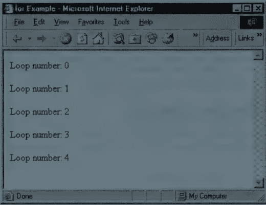

图 4-8：for 循环的输出

请注意，循环计数器变量被初始化为数值 0。第一次循环时，0 被输出到屏幕上，这说明了一个事实：当 `for` 语句第一次执行时，递增表达式会被忽略。循环计数器变量只有在 `for` 语句内的代码执行一次后才会被递增。

如果你不希望循环计数器变量从 0 开始，只需将循环计数器变量初始化为数值 1 或任何你可能需要的其他值。

请注意，如果需要，循环计数器机制可以反向执行。考虑以下示例。

```
for (var i = 5; i > 0; i--) {
    document.write("<p>Loop number: " + i + "</p>");
}
alert("The final value if i is " + i);
```

在此示例中，循环计数器变量 `i` 被初始化为值 5。只要 `i` 大于零，循环就会继续。循环计数器变量在每次循环执行后递减。

执行此代码时，用户将看到类似图 4-9 的消息。

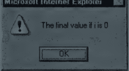

图 4-9：for 循环的 alert 消息

用户还将看到类似图 4-10 的浏览器屏幕。

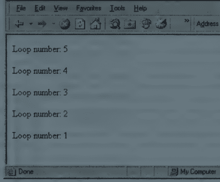

在下面的实验中，你将使用 `for` 语句来输出 XHTML 和循环计数器变量的值。假设你仍然在教授的大学课程班级主页上使用成绩计算器。为了使页面更用户友好，你决定为学生提供文本框和下拉菜单两种方式来输入他们的总分。然而，由于总分很高，而且你需要每周更改分数范围，因此下拉菜单的 XHTML 需要大量维护。幸运的是，你可以使用 JavaScript `for` 语句来帮你完成部分工作：你可以指定希望出现在下拉菜单中的分数范围，`for` 语句将生成创建下拉菜单值的 XHTML 代码。


#### 实验 4-3：使用 `for` 语句

在本实验中，你将使用 `for` 语句来输出 XHTML 和循环计数器变量的值。你将使用 `for` 循环创建一个包含从 100 递减到零的值的下拉菜单。

- 1. **编辑器：** 从 Student_Files 目录的 Lesson 4 文件夹中打开 **lab4-3.htm**。
- 2. **编辑器：** 此文件与 lab4-1.htm 基本相同。在文档 `<body>` 部分的第二个 `<script>` 块中，创建一个 `for` 语句。创建一个名为 `i` 的变量作为循环计数器变量。将 `i` 的初始值赋为 100。只要 `i` 大于或等于零，循环就会继续。使用递减运算符 (`--`) 在每次循环中将 `i` 减 1。
- 3. **编辑器：** 在循环内部，使用 `document.write()` 语句输出一个 `<option>` 标签。将 `i` 的值连接到表达式中。循环计数器变量的值将提供下拉菜单的文本。
- 4. **编辑器：** 保存 **lab4-3.htm**。
- 5. **浏览器：** 打开 **lab4-3.htm**。你的屏幕应类似于图 4-1。单击下拉菜单将其打开，并滚动浏览下拉菜单中的项目。你的屏幕应类似于图 4-11。

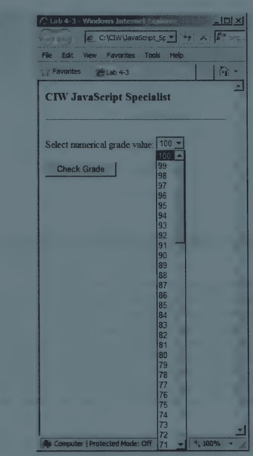

图 4-11：lab4-3.htm 的页面

6. **浏览器：** 当从下拉菜单中选择一个数字成绩值时，程序的响应方式应与 lab4-1.htm 类似。

本实验演示了仅仅几行 JavaScript 代码就能生成 100 行 XHTML 代码的简便性。`for` 语句可用于在许多不同情况下自动化许多任务。

#### break 语句

一种退出原本会继续执行的循环的方法是使用 `break` 语句。通常，你会在 `if` 子句中找到 `break` 关键字。如果满足某个条件，程序将跳出循环。否则，循环将继续。你可以在 `for`、`while` 和 `do...while` 循环中以及 `switch` 语句中使用 `break` 语句。

以下示例演示了 `break` 语句：

```
for(var i = 0; i <= 10; i++){
  document.write("Loop number: " + i);
  if(i == 4) break;
}
```

在此示例中，当循环计数器变量 `i` 等于 4 时，`for` 循环将终止，即使测试条件为 `i <= 10`。

#### 嵌套语句

一种常见的编程实践，即将一个脚本块嵌入到另一个脚本块中。

在下面的实验中，你将创建包含一个 `while` 语句和 **嵌套 `if` 语句** 的代码。程序将显示一个提示对话框要求输入。如果用户输入任何值，循环将结束，程序将向用户显示该输入。你将添加代码来测试空值，在这种情况下，你将调用 `break` 语句来结束循环。假设你正在教授的大学课程已进行到半学期。管理部门要求学生完成期中教师评估。你决定在班级主页上向学生提供教师评估调查。评估可以匿名提交，但有些学生喜欢签名。因此，你在调查中添加了一个函数，在提交完成的评估表之前询问学生的名字。如果学生输入他的名字，他会看到一个 alert 消息，其中按姓名感谢他完成评估。但如果学生没有输入名字，然后单击取消按钮，提示框将消失。


#### 实验 4-4：在 while 循环中嵌套 if 和 break 语句

#### 目标

2.1.5：使用 break 和 continue 语句

- 1. **编辑器：** 从 Student_Files 目录的 Lesson 4 文件夹中打开 **lab4-4.htm** 文件。

- 2. **编辑器：** 找到文档 `<head>` 部分中的 `<script>` 块。一个名为 `breakTest()` 的函数已为你开始。已声明两个变量：`loopBoolean` 和 `myValue`。`loopBoolean` 变量设置为 `true`，用于确定 `while` 循环何时结束。`myValue` 变量被赋予一个空字符串，以预期接收用户的输入。

- 3. **编辑器：** 在变量声明之后，开始一个 `while` 循环。在 `myValue` 变量接收到其值后，添加一个 `if` 语句来测试 `myValue` 是否为空值。如果为空，则调用 `break` 语句。

- 4. **编辑器：** 保存 **lab4-4.htm**。

- 5. **浏览器：** 打开 **lab4-4.htm**。你的屏幕应类似于图 4-12。

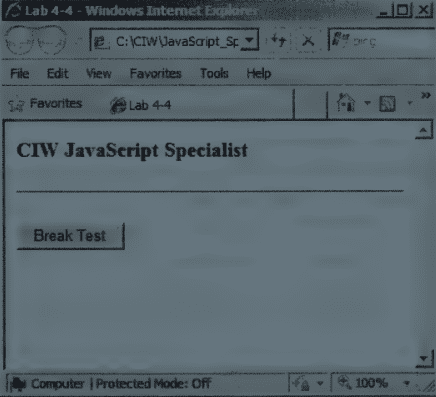

 6. **浏览器：** 单击**Break Test**按钮。你应该会看到一个提示对话框，如图 4-13 所示。

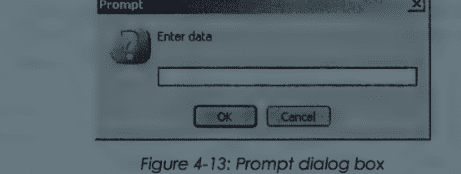

图 4-13：提示对话框

7. **浏览器：** 不输入任何数据，单击**OK**。每次执行此操作时，提示对话框应该会重新出现。单击**Cancel**。程序应该能识别执行此操作时返回的空值，并且 break 语句应该结束程序。

8. **浏览器：** 在提示对话框中输入的任何数据都应该出现在警告对话框中。

#### continue 语句

continue 语句用于强制将控制流返回到循环的顶部。你可以将 continue 理解为"跳过"或绕过命令。当执行遇到 continue 语句时，该语句与循环块末尾之间的所有语句都会被跳过，执行返回到循环的顶部。然后对循环的测试条件进行评估，以确定是否应该再次执行循环。continue 语句只能用于 for 或 while 循环中。下一节提供了一个在 while 循环中使用 continue 语句的示例。

#### 在 while 循环中使用 continue

在下面的示例中，continue 语句用于操作 while 循环。此代码在你的学生实验文件中，位于 *example_continue.htm* 文件中：

```
<!DOCTYPE html PUBLIC "-//W3C//DTD XHTML 1.0 Transitional//EN" "http://www.w3.org/TR/xhtml1/DTD/xhtml1-transitional.dtd">
<html xmlns="http://www.w3.org/1999/xhtml">
<head>
<meta http-equiv="Content-Type" content="text/html; charset=utf-8" />
<title>Example: continue Statement</title>

<script language="JavaScript" type="text/javascript">
<!--

var leapYears = 0;
var curYear = 2001;

while (curYear <= 2100) {
  curYear++;

  if (curYear % 4) continue;

  leapYears++;
  document.write(curYear + " ");
}

// -->
</script>
</head>
<body>
<h3>The number of leap years from 2001 to 2100 is:
<script language="JavaScript" type="text/javascript">
<!--
    document.write(leapYears);
// -->
</script>
</h3>
</body>
</html>
```

在此示例中，脚本遍历 2001 到 2100 年的每一年。curYear 变量保存当前年份。leapYears 变量用于计算闰年的数量。

在程序中，启动了一个 while 循环，只要 curYear 变量小于或等于 2100，循环就会继续。当该年份能被 4 整除时，leapYears 变量增加 1，并且当前由 curYear 变量保存的值会输出到屏幕上。在不能被 4 整除的年份，由于 continue 语句，leapYears 变量的增量和 document.write() 语句会被跳过。最后，leapYears 变量包含 2001 到 2100 年间所有能被 4 整除的年份数量，这就是该期间闰年数量的正确计数。

注意取模运算符的使用：%。该运算符将左操作数除以右操作数并返回余数。注意代码的这部分：

(curYear % 4)

如果为 curYear 变量插入一个实际值，取模运算符的使用将更容易理解。第一次循环时，该语句将显示为 (2002 % 4)。因此 2002 除以 4 等于 500，余数为 2，这就是该语句的返回值。在该语句求值后，if 语句如下所示：

if (2) continue;

任何非零整数在 JavaScript 中都会被求值为 true。因此该语句为 true，并调用 continue 语句，跳过循环中的其余语句。唯一不会调用 continue 语句的情况是计算返回零时。零会被求值为 false，循环中的其余代码将执行。

请注意，前面示例中显示的公式对于无限制时间范围的闰年计算来说不够严谨，但对于本示例中的时间范围来说已经足够。

如果你将此源代码加载到浏览器中，你的屏幕将类似于图 4-14。

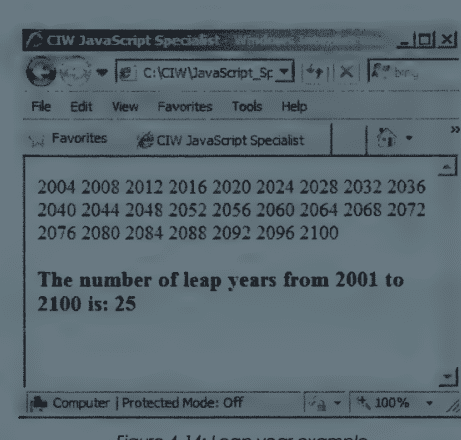

图 4-14：闰年示例

以下实验将提供使用 `continue` 语句的机会。此实验中的小程序将使用 `continue` 语句输出 0 到 100 之间所有能被 7 整除的数。假设你夏季要在你所在学院教另一个班级：小学生的数学工作坊。你计划也为该班级创建一个主页，并教孩子们一些数学的计算机应用。你想使用的一个例子是一个脚本，帮助孩子们学习按 2、3、4、5 等的倍数计数，一直到 12 的倍数。你可以使用 `continue` 语句来实现这一点。

#### 实验 4-5：使用 continue 语句

在此实验中，你将使用 `continue` 语句来操作 `for` 循环。

- 1. **编辑器：** 从 Student_Files 目录的 Lesson 4 文件夹中打开 `lab4-5.htm`。
- 2. **编辑器：** 已定义了一个 `for` 循环，输出 1 到 100 的数字。在 `document.write()` 语句之前，创建一个 `if` 语句来测试循环计数器变量 `i`。如果 `i` 除以 7 有余数，则调用 `continue` 语句。应该只输出能被 7 整除的数字。提示：使用取模运算符 (%) 来执行此任务。
- 3. **编辑器：** 保存 `lab4-5.htm`。
- 4. **浏览器：** 打开 `lab4-5.htm`。你的屏幕应该类似于图 4-15。

> 目标 2.1.5：使用 break 和 continue 语句

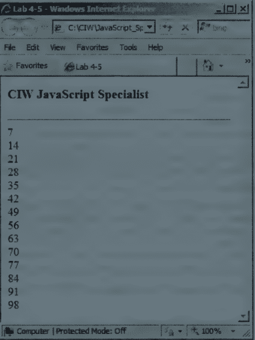

图 4-15：lab4-5.htm 页面

#### switch 语句

在本课前面，你介绍到了 `if` 语句。你了解到可以包含多个 `else if` 子句来评估各种测试条件。如果第一个条件返回 false 值，则评估另一个条件，然后再另一个，依此类推，直到找到 true 值。如果没有找到 true 值，则 `else` 子句提供在这种情况下执行的代码。

本课前面展示了一个检查用户输入的美国州份以确定州销售税的示例。假设你需要检查所有 50 个美国州份的代码。评估大量测试条件的更有效方法是使用 `switch` 语句。

`switch` 语句将一个值与其他值进行比较，寻找匹配项。如果找到匹配项，则与该匹配项关联的代码将执行。然后使用 `break` 语句退出 `switch` 代码块。

本质上，`switch` 语句的功能与 `if` 语句中的多个 `else if` 子句相同。然而，`switch` 更具可读性，并允许你指定在未找到匹配项时执行的一组默认语句。`default` 子句在功能上类似于 `if` 语句中的 `else` 子句。

创建 `switch` 语句的语法如下：

```
switch (expression) {
    case "str1" :
        //statements to execute
        break;

    case "str2" :
        //statements to execute
        break;

    case "str3" :
        //statements to execute
        break;

    default :
        //statements to execute
        break;
}
```

以下示例演示了 switch 语句的使用。此示例使用美国邮政编码缩写表示州名。代码位于名为 example_switch.htm 的文件中：

```
<!DOCTYPE html PUBLIC "-//W3C//DTD XHTML 1.0 Transitional//EN"
"http://www.w3.org/TR/xhtml1/DTD/xhtml1-transitional.dtd">
<html xmlns="http://www.w3.org/1999/xhtml">
<head>
<meta http-equiv="Content-Type" content="text/html; charset=utf-8" />
<title>Example: switch and break Statements</title>

<script type="text/javascript">
<!--

// Define variables
var orderAmount = 50;
var state = "";

// Find out the user's shipping state

state = prompt("To which state will your order be shipped?","");

//Add appropriate tax for state

switch (state.toUpperCase()) {

    case "CA" :
        alert("Your total is: " + (orderAmount * 1.0825));
        break;

    case "HI" :
        alert("Your total is: " + (orderAmount * 1.04));
        break;

    //Note that the same code executes for both cases
    case "WA" :
    case "NV" :
        alert("Your total is: " + (orderAmount * 1.065));
        break;

    case "AZ" :
        alert("Your total is: " + (orderAmount * 1.05));
        break;

    case "UT" :
        alert aprésentation : "Your total is: " + (orderAmount * 1.0475));
        break;

    default :
        alert("Your total is: " + orderAmount);
        break;
}

//-->
</script>
```


```html
</head>
<body>
<h2>CIW JavaScript Specialist</h2>
<hr />
<p>
<h3>Thank you for your order!</h3>
</p>
</body>
</html
```

在这个示例中，`switch` 关键字后面跟着一个表达式，`case` 语句将与该表达式进行比较。在这里，该表达式是一个状态变量，其值由用户提供，并通过 `toUpperCase()` 方法转换为大写。

在用户输入状态后，`switch` 语句会搜索 `case` 语句。请注意，在 `case` 和 `default` 关键字后面使用的是冒号而非分号。这是 `switch` 语句所要求的语法。当找到匹配项时，将执行相关的代码。如果没有找到匹配项，则将执行与 `default`default` 语句相关的代码。

为了进一步解释 `switch` 语句，请考虑代码执行时会发生什么；`switch` 语句的这一部分将如下所示（如果用户输入了 CA）：

```javascript
// 文本 CA 由 JavaScript 解释器提供
// 作为状态变量的值。
switch (CA) {

    case "CA":
        alert("Your total is: " + (orderAmount * 1.0825));
        break;
    ...
}
```

在执行相关代码后，`break` 关键字会结束 `switch` 语句，并将程序的控制权传递到闭合花括号之后的下一行。整个 `switch` 代码块被一对花括号包围，这是 `switch` 语句相对于 `if` 语句中多个 `else if` 子句的优势。只需要一对花括号即可包围整个代码块。

正如这个示例所示，可以通过将多个 `case` 语句列在一起，让不同的 `case` 语句执行相同的代码。在这个示例中，华盛顿州 (WA) 和内华达州 (NV) 共享相同的税率。请注意，在 `case "WA":` 之后没有 `break` 关键字。这种编码方式实质上允许代码执行“贯穿（fall through）”到 `case "NV":` 下方的代码。

在接下来的实验中，你将使用 `switch` 语句。假设你的学院管理人员非常喜欢你关于夏季小学数学研讨会的提案，以至于他们询问你是否也愿意教授面向小学生的夏季地理研讨会。你考虑接受这个邀请，因为你确实很喜欢教孩子，以此来改变一下工作节奏。你思考了一些可以包含在课程中的计算机应用程序。你意识到可以使用 `switch` 语句来创建一个教授美国城市和州的应用。

#### 实验 4-6：使用 switch 语句

在这个实验中，你将使用 `switch` 语句。

- 1. 编辑器：从 `Student_Files` 目录的 Lesson 4 文件夹中打开 `lab4-6.htm`。

- 2. 编辑器：研究文件中的代码，其内容如下：

```html
<!DOCTYPE html PUBLIC "-//W3C//DTD XHTML 1.0 Transitional//EN"
"http://www.w3.org/TR/xhtml1/DTD/xhtml1-transitional.dtd">
<html xmlns="http://www.w3.org/1999/xhtml">
<head>
<meta http-equiv="Content-Type" content="text/html; charset=utf-8" />
<title>Lab 4-6</title>

<script language="JavaScript" type="text/javascript">
function switchTest(SetOption) {
OptionsSelect = document.frmOne.SetOption.value

alert(OptionsSelect);
}
</script>
<body>
<h3>CIW JavaScript Specialist</h3>
<form name = "frmOne">

<select name= "SetOption" onchange="switchTest(this)">
<option value = "0">Select a U.S. City - See the State!</option>
<option value = "1">Phoenix</option>
<option value = "2">Roswell</option>
<option value = "3">Sacramento</option>
<option value = "4">My city</option>
<option value = "5">Your city</option>
</select>

</form>

</body>
</html
```

- 3. 浏览器：打开 `lab4-6.htm`。页面应类似于图 4-16。你会发现，选择一个选项会自动显示一个警报（无需点击按钮），告知 `select` 语句的值。请注意，美国城市的选项被分配了值 1、2 和 3，而额外的选项（“my city” 和 “your city”）是默认项，被分配的值为 4 和 5。我们稍后将讨论默认值。

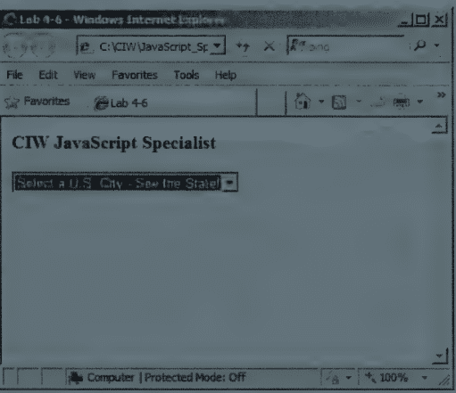
图 4-16：lab4-6.htm 页面

- 4. 编辑器：打开文件 `lab4-6.htm`。你将把 `<script></script>` 标签之间的代码修改如下。请务必覆盖 `<script></script>` 部分之前的代码，以免这些命令重复。将代码修改为**粗体**所示，然后保存文件。（文件 `lab4-6_newCode.txt` 为你提供了可供使用的这段新代码。）

```html
<!DOCTYPE html PUBLIC "-//W3C//DTD XHTML 1.0 Transitional//EN"
"http://www.w3.org/TR/xhtml1/DTD/xhtml1-transitional.dtd">
<html xmlns="http://www.w3.org/1999/xhtml">
<head>
<meta http-equiv="Content-Type" content="text/html; charset=utf-8" />
<title>Lab 4-6</title>

<script language="JavaScript" type="text/javascript">
function switchTest(SetOption) {
OptionsSelect = document.frmOne.SetOption.value

alert(OptionsSelect);

switch (OptionsSelect) {
case "1":
alert("Arizona")
break
case "2":
alert("New Mexico")
break
case "3":
alert("California")
break
default:
alert("Cannot be determined")
}
}
</script>

<body>
<h3>CIW JavaScript Specialist</h3>
<form name = "frmOne">

<select name= "SetOption" onchange="switchTest(this)">
<option value = "0">Select a City - See the State!</option>
<option value = "1">Phoenix</option>
<option value = "2">Roswell</option>
<option value = "3">Sacramento</option>
<option value = "4">My city</option>
<option value = "5">Your city</option>
</select>
</form>
</body>
</html
```

这段代码展示了 JavaScript 开发人员最喜爱的工具之一。`select` 语句将触发带有 `switch` 语句的 `switchtest` 函数。然后脚本将根据用户的选择做出反应。这类脚本可以编写为将用户引导至不同页面，或显示警报框（如本例所示），并且经常被用于测验中以激活下一个问题。

> 技术笔记：每个值必须有一个对应的 `case` 语句。养成设置 `default` 案例语句的良好习惯，以捕获所有预期结果之外的情况。这样就可以覆盖所有情况，即使是意外的结果。本例使用 “cannot be determined” 作为默认案例语句。

- 5. 编辑器：保存 `lab4-6.htm`。

- 6. 浏览器：打开 `lab4-6.htm`。当你选择各个选项时，你会看到类似于图 4-17 中显示的警报框。

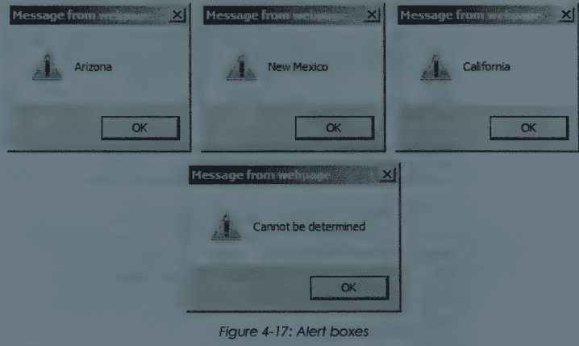

- 7. 浏览器：当你从列表中选择前三个选项之一（美国城市名称）时，你会看到相应的警报列出该城市所在的州。这是因为 `switch` 语句识别了数字（1, 2 或 3），在正确的 `case` 中将其匹配并运行警报，然后 `break` 语句停止了后续执行。如果选中的选项在 `switch` 的 `case` 语句之外（0, 4, 5），则它将显示默认语句（“Cannot be determined”）。然后 `break` 语句将停止脚本。`switch` 语句将按顺序检查每个案例并寻找匹配项。如果没有匹配项，则最后一个语句（`default` 语句）将捕获 `switch` 语句，脚本将不会出现问题。

> 技术笔记：`break` 语句将停止脚本 —— 不仅是在像这样的 `switch` 语句中，而且在 JavaScript 的任何地方。`default` 案例语句仅在没有其他案例语句匹配选项时才会激活。`switch` 语句是在不使用嵌套 `if` 语句（这被认为是糟糕的编程习惯）的情况下利用多个选项的最简单方法之一。通常，如果有三个以上的选项，开发人员应考虑使用 `switch` 语句。

### 案例研究

#### 顺势而为

Elliot 是一名合同 Web 开发人员，拥有许多优秀的客户 —— 其中一些客户也相当具有挑战性。

特别是其中一位客户 —— Todd —— 倾向于在极短的时间内要求大量工作。然后他又会改变主意。起初他计划一个需要三个新页面的项目，而就在 Elliot 完成它们后，Todd 又要求增加另一个页面。呼！Elliot 并不太介意，因为他是按小时计费的，但有时在分配的短时间内跟上这些请求是很困难的。

Todd 在 12 月底、假期前不久给 Elliot 打了电话。他说为了迎接新年的开始，他想给自己的网站增加一个新功能。他希望他的客户能够使用下拉菜单选择要订购的产品。客户只需做出一次选择，然后就会被快速引导至一个新页面，在那里有更多关于产品详情的选项等待着他们。Todd 说他在竞争对手的网站上看到了这个功能，从此就一直想在自己的网站上使用。

思考这个场景并回答以下问题。

- Elliot 如何利用 JavaScript 流控制结构在网站上创建这个下拉菜单功能？他应该使用哪些语句？

- 假设在接下来的一个星期，Todd 想要更改下拉选项，使其不仅能指定要显示的下一个页面，还能更改页面上的文本。Elliot 可以使用哪些 JavaScript 语句来添加此功能？

- 假设在那之后的一周，Todd 希望下拉功能在现有功能之外再增加一项：它应该包含一个带有预定义商品的“快速订购 (Express Order)”选项，该选项将直接带客户进入订购页面并计算订单的总费用。Elliot 可以使用哪些 JavaScript 语句来添加此功能？

- `switch` 语句如何使整体功能实现变得更容易？

- 因为 Elliot 知道在短时间内会有多次更改，那么他设置 `switch` 语句最明智的方式是什么？

- 为什么 Elliot 首先要使用 `select` 语句？为什么不直接使用单选按钮和 Enter 按钮？


### 课程总结

### 应用项目

这些项目将挑战你运用本课所学的一些内容。

##### 项目 1

首先，创建一个 XHTML 页面，在文档的 `<head>` 部分放置一个 `<script>` 代码块。该脚本应包含以下内容：

- 创建一个名为 `ifElseTest()` 的函数。
- 在函数内部，创建一个 `if...else` 语句。
- 使用确认对话框的返回值作为 if 语句的测试表达式。
- 如果 `confirm()` 方法返回 true，创建代码向用户反映此结果。
- 使用 else 子句在 `confirm()` 方法返回 false 时执行某些代码。
- 在 `<body>` 标签内使用 `onload` 事件处理程序调用 `ifElseTest()` 函数。

##### 项目 2

接下来，创建另一个 XHTML 页面，在文档的 `<head>` 部分放置一个 `<script>` 代码块。该脚本应包含以下内容：

- 创建一个名为 `whileTest()` 的函数。在函数内部，创建一个名为 `number` 的变量并为其赋值 1 到 10 之间的数字。
- 创建另一个名为 `answer` 的变量，并将其赋值为 0（零）。
- 然后创建一个 while 循环。创建代码使循环在 number 变量不等于 answer 变量时持续执行。
- 在循环内部，将 prompt 对话框的返回值赋给 answer 变量。
- 该提示将要求用户猜测 1 到 10 之间的数字。循环将持续直到输入正确答案。
- 循环退出后，使用 alert 对话框告知用户猜对了。
- 代码正常运作后，创建代码只允许用户猜测三次。如果三次猜测后用户仍未输入正确答案，退出函数并通过 alert 对话框告知用户猜测次数已用完。
- 确保函数退出后只出现一个对话框，一个显示猜对的消息，或一个要求用户重试的消息。
- 尝试使用你见过调用函数的不同方法。你可以使用 load 事件或表单按钮的 onclick 事件处理程序。

##### 项目 3

现在，创建一个 XHTML 页面，在文档的 `<head>` 部分放置一个 `<script>` 代码块。该脚本应包含以下内容：

- 创建一个 for 循环，输出 1 到 200 的数字。
- 创建代码确保每个数字之间有一个空格。
- 创建代码使输出达到 10、20、30、40 等时换行。
- 创建代码在 for 循环退出后输出循环计数器变量的值。

##### 项目 4

最后，创建一个 XHTML 页面，在文档的 `<head>` 部分放置一个 `<script>` 代码块。该脚本应包含以下内容：

- 创建一个名为 `color` 的变量。将 prompt 对话框的结果作为 `color` 变量的值。
- prompt 对话框将要求用户选择 red（红）、white（白）或 blue（蓝）。
- 创建一个 `switch` 语句。测试表达式为转换为大写的 `color` 变量。在 `case` 关键字后使用 `RED`、`WHITE` 和 `BLUE`。
- 代码执行时，向用户反馈所选的选择。
- 添加一个 default 子句，以便用户输入的选择不在提供的选项中时执行。
- 请记住用户可能会点击 prompt 对话框上的取消。在 `switch` 语句之前创建代码来处理这种情况。
- 尝试用不同的方式处理用户可能采取的所有操作。

### 技能回顾

在本课中，你了解到 `if...else` 语句允许你根据某个测试条件的结果分支到两个过程之一。如果你想测试多个条件，可以使用额外的 `else if` 语句。`while` 语句用于在某个测试条件为 true 时执行代码组。`do...while` 语句的操作方式与 `while` 语句完全相同，但有一个关键区别：`do...while` 语句在第一次执行完循环后才检查条件表达式。`for` 语句用于对明确范围的值重复执行一组语句。`break` 语句用于退出否则会持续执行的循环。`continue` 语句用于强制控制流返回到循环顶部。`switch` 语句将一个值与其他值进行比较，寻找匹配项。如果找到匹配，与匹配关联的代码将执行。

既然你已经完成了本课，你应该能够：

- ✓ 2.1.1：使用 `if...` 语句。
- ✓ 2.1.2：使用 `while...` 语句。
- ✓ 2.1.3：使用 `do...while` 语句。
- ✓ 2.1.4：使用 `for...` 语句。
- ✓ 2.1.5：使用 `break` 和 `continue` 语句。
- ✓ 2.1.6：使用 `switch...` 语句。

16. 编写一个 for 循环，将用户输入的 10 个数字相加。为用户提供使用 break 语句退出程序的机会。

17. 编写一个 JavaScript 程序，要求用户猜测 1 到 5 之间的数字，然后使用 switch 语句评估用户的输入。使用 3 作为要猜测的数字。使用 default 子句捕获不在所需范围内的输入。

## 第 5 课：JavaScript 文档对象模型（DOM）

### 学习目标

通过本课结束时，你将能够：

- 2.2.1：使用 JavaScript 操作文档对象模型（DOM）。
- 2.2.2：使用 DOM 的 `window` 对象。
- 2.2.3：操作 DOM 中 document 对象的属性和方法。
- 2.2.4：使用 `with` 语句。
- 2.2.5：使用 DOM 的 `image` 对象，包括创建图片翻转效果。
- 2.2.6：使用 DOM 的 history 对象。
- 2.2.7：使用 DOM 的 `location` 对象评估和更改 URL 信息。
- 2.2.8：使用 DOM 的 navigator 对象。

### 课前评估问题

1. `window` 对象的 opener 属性指的是：
   a. 框架集中的父框架。
   b. 父窗口。
   c. 窗口的位置。
   d. 另一个窗口的子窗口。
2. document 对象的 `close()` 方法：
   a. 关闭框架中的文档。
   b. 关闭与文档关联的所有 cookie。
   c. 关闭窗口中的文档。
   d. 关闭文档的数据流。
3. 讨论 `image` 对象的 `name` 属性与 `src` 属性之间的区别。

### JavaScript 文档对象模型（DOM）

JavaScript 是专门为网页使用而设计的。为了利用浏览器提供的不同特性和功能，特殊的浏览器对象已内置到 JavaScript 语言中。这些浏览器对象提供属性和方法来创建复杂的 JavaScript 程序。这些对象统称为 JavaScript 文档对象模型（DOM）。

此外，JavaScript 语言本身也提供对象来帮助你以各种有用的方式操作字符串、日期和数学信息。JavaScript 还提供 Array 对象，你将在本课程后面使用它。

JavaScript 对象模型将对象分为三大组：浏览器对象、语言对象和表单字段对象。图 5-1 展示了 JavaScript 识别的常用对象的示意图。

*图 5-1：JavaScript 对象层次结构*

如上所述，上图中的对象是不同类型对象的组合。有些对象，如 **window**、**document** 和 **form** 对象，代表了**文档对象模型（DOM）**的元素。DOM 是万维网联盟（W3C）的一项编程规范，旨在让开发者能够访问 X/HTML 页面或 XML 文档中的所有元素。其他对象，如 Array 和 String，代表了内置的 JavaScript 对象。这些内置对象将在本课程后面讨论。

主要浏览器（Microsoft Internet Explorer 和 Mozilla Firefox）引入了图中所示之外的其他对象。此外， neither major browser 支持图中所示的所有对象，它们也不总是以相同的方式支持相同的对象。这些兼容性问题给 JavaScript 开发者带来了严重的担忧。创建有效的启用 JavaScript 的 Web 应用程序的挑战之一是克服主要浏览器之间的兼容性问题。由于这些兼容性问题的复杂性以及本课程的时间限制，我们将在本课中重点关注两种主要浏览器常用的对象。

随着新浏览器的推出和新浏览器版本的发布，浏览器之间的差距逐渐缩小。最终，JavaScript 应该在所有浏览器中标准化。在此之前，在多个浏览器中测试你的 JavaScript 是至关重要的。

**学习目标**
2.2.1：使用 JavaScript 操作 DOM

**文档对象模型（DOM）**
一项 W3C 规范，旨在将 X/HTML 页面或 XML 文档渲染为可编程对象。


#### 容器层次结构

上图所示的层次结构阐明了**容器层次结构**原则。例如，`button`和`checkbox`对象包含在`form`对象内，而`form`对象本身又包含在`document`对象内，而`document`对象则包含在顶层的`window`对象内。

容器层次结构关系到一个原则：某些对象若没有对父（容器）对象的引用，就无法被使用或引用。例如，在JavaScript中，若不同时引用`form`对象和包含该`form`对象的`document`对象，就无法引用一个`form`元素。要引用名为`myForm`的表单上名为`chkTennis`的复选框，你需要编写 `document.myForm.chkTennis`。`window`对象是默认对象，包含其下的许多对象，因此无需通过名称引用`window`。`document`对象包含`form`对象，而`form`对象又包含表单元素，包括`checkbox`对象。

> **警告！** 请注意，内置的JavaScript语言对象（指那些不引用与浏览器相关对象的对象）以大写字母命名。请始终记住JavaScript区分大小写。使用不当的大写字母引用对象将导致错误。

#### 常用对象

本节课中，我们将讨论一些最常用对象及其相关的属性和方法。以下章节将讨论这些对象。我们还将介绍`navigator`对象，我们将在本课程的其他部分对其进行深入探讨。

#### window对象

`window`对象是JavaScript对象层次结构中的最高级对象，也是默认对象。`window`对象代表浏览器的框架及其相关机制，如滚动条、导航栏、菜单栏等。表5-1列出了与`window`对象相关的常用属性。

**表5-1：window对象的属性**

| window属性 | 描述 |
|---|---|
| `closed` | 返回一个布尔值，指示窗口是打开还是关闭。 |
| `defaultStatus` | 指定或返回包含默认状态栏文本的字符串值。 |
| `frames` | 返回一个数组，跟踪窗口中的框架数量。你可以通过在`frames`数组中引用其框架编号，在JavaScript中定位一个框架。*注意：框架在网页上已不再常用。* |
| `length` | 返回一个整数值，表示父窗口中的框架数量。也返回`window.frames`数组中的元素数量。 |
| `location` | 指定或返回当前窗口的`location`对象。 |
| `name` | 指定或返回包含窗口或框架名称的字符串值。 |
| `opener` | 返回对调用（或打开）当前窗口的窗口的引用。 |
| `parent` | 如果存在父窗口，则返回包含父窗口名称的字符串值。 |
| `self` | 返回包含当前窗口名称的字符串值。可替代使用前面描述的`name`属性。 |
| `status` | 指定或返回表示状态栏文本的字符串值。 |
| `top` | 返回包含最顶层窗口名称的字符串值。 |
| `window` | 可替代`self`或`name`属性。 |

表5-2列出了与`window`对象相关的常用方法。

**表5-2：window对象的方法**

| window对象的方法 | 描述 |
| --- | --- |
| `alert("message text")` | 创建一个对话框，消息为*消息文本*。 |
| `close()` | 关闭当前窗口。你必须编写`window.close()`以确保此命令与窗口对象关联，而不是其他JavaScript对象。 |
| `confirm("message text")` | 创建一个对话框，显示*消息文本*，并带有“确定”和“取消”按钮。 |
| `moveBy(x, y)` | `moveBy()`方法将窗口在x轴上移动*x*像素，在y轴上移动*y*像素。 |
| `moveTo(x, y)` | `moveTo()`方法将窗口的左上角移动到指定的x轴和y轴位置。两种方法在Microsoft Internet Explorer 4.x（及更高版本）和Mozilla Firefox 1.x（及更高版本）中可用；较旧的浏览器不支持它们。 |
| `open("URL", "name", "featurelist")` | 打开一个新窗口，其内容由*URL*填充，目标名称为*name*，并具有*featurelist*中标识的特性。 |
| `print()` | 提供一个用于打印当前窗口和框架内容的脚本方法。在Microsoft Internet Explorer 5.x（及更高版本）和Mozilla Firefox 1.x（及更高版本）中可用；较旧的浏览器不支持它。 |
| `prompt("message text", "default text")` | 弹出一个消息框，显示*消息文本*，并带有一个用于用户响应的文本框，如果未留空，则包含*默认文本*。在某些浏览器中，如果留空，文本框中会显示“undefined”一词。 |
| `resizeBy(x, y)` | `resizeBy()`方法按照指定的*x*和*y*偏移量，在x轴和y轴上调整窗口大小。 |
| `resizeTo(outerHeight, outerWidth)` | `resizeTo()`方法将窗口调整为由*outerHeight*和*outerWidth*指定的高度和宽度。两种方法在Microsoft Internet Explorer 4.x（及更高版本）和Mozilla Firefox 1.x（及更高版本）中可用；较旧的浏览器不支持它们。 |
| `scrollBy(x, y)` | `scrollBy()`方法将窗口中的文档在x轴和y轴上按照指定的*x*和*y*偏移量进行滚动。 |
| `scrollTo(x, y)` | `scrollTo()`方法将窗口中的文档滚动到指定的x轴和y轴位置。两种方法在Microsoft Internet Explorer 4.x（及更高版本）和Mozilla Firefox 1.x（及更高版本）中可用；较旧的浏览器不支持它们。 |
| `setTimeout("expression", time)` | 在间隔*time*（一个表示毫秒数的整数值）过后执行*表达式*或*函数名*。 |
| `setTimeout(functionName, time)` | *（见上文）* |
| `clearTimeout(timerID)` | 如果此方法引用的`setTimeout`被赋予了*timerID*，则此方法将清除该超时，以便在下一个指定的时间间隔过去时，相关过程不会再次运行。 |
| `blur()` | 使窗口失去焦点。该窗口将被置于任何其他打开的窗口之下。 |
| `focus()` | 使窗口获得焦点。该窗口将被置于所有其他打开的窗口之上。 |

表5-3列出了与window对象相关的常用事件处理程序。请记住，如果你希望事件处理程序符合XHTML标准，它们就不再使用驼峰命名法（例如，`onLoad`）；它们应该全部是小写（例如，`onload`）。

**表5-3：window对象的事件处理程序**

| window的事件处理程序 | 描述 |
| :--- | :--- |
| `onerror` | 在发生JavaScript错误时触发。 |
| `onload` | 在窗口或框架加载完成时触发。 |
| `onunload` | 在窗口或框架卸载完成时触发。 |

##### 打开额外的窗口

JavaScript允许你随意打开新窗口，并用现有信息、动态创建的信息或完全没有信息（空白窗口）来填充它们。


> 打开额外的窗口——通常用于广告目的——是弹出窗口拦截器被创建的原因。如果你出于合法原因想在浏览器会话中单独打开窗口，你应该建议用户暂时为你的网站关闭弹出窗口拦截器。具体操作步骤因浏览器而异。

你可以通过使用window对象的`open()`方法打开一个新窗口。正如你将在以下实验中看到的，你可以启动一个显示现有网页的新窗口，或者你可以启动一个空窗口，然后动态（即通过脚本定义的内容）填充它。

使用`open()`方法打开新窗口的通用语法如下：

```
open("URL", "windowName", "Feature List")
```

例如，要打开一个显示CIW主页的新浏览器窗口，你可以使用以下语句：

```
open("http://www.CIWcertified.com", "CIWwindow", "toolbar=1,location=1,menubar=1,scrollbars=1,status=1,resizable=1");
```


你不能在 WindowName 区域中包含空格。在前面的示例中，"CtrlWindow" 是有效的，但 "Ctrl Window" 在某些浏览器中会返回错误。此外，在窗口特性列表选项中，不能在 = 字符周围包含空格，例如，"toolbar=1" 不会显示工具栏，但 "toolbar= 1" 会显示工具栏。虽然某些浏览器可能会忽略这些要求，但并非所有浏览器都如此，最佳策略是遵守它们以确保跨浏览器兼容性。

特性列表由一系列你指定显示或不显示的属性组成。每个属性的可接受值为 1 或 yes（如果要显示该属性），以及 0 或 no（如果不显示）。仅列出该属性也会显示该特性，但明确指定特性是良好的编码实践。表 5-4 列出了常用的窗口属性。

##### 表 5-4: open() 方法中可访问的窗口属性

| 窗口属性 | 说明 |
| :--- | :--- |
| toolbar | 创建标准工具栏 |
| location | 创建地址输入字段 |
| directories | 创建标准目录按钮 |
| status | 创建状态栏 |
| menubar | 创建窗口顶部的菜单 |
| scrollbars | 当文档超出当前窗口时创建滚动条 |
| resizable | 允许用户调整窗口大小 |
| width | 以像素为单位指定窗口宽度 |
| height | 以像素为单位指定窗口高度 |
| top | 指定窗口在屏幕上打开的 y 坐标。在 Microsoft Internet Explorer 4.x（及更高版本）和 Mozilla Firefox 1.x（及更高版本）中可用；旧版浏览器无法识别。 |
| left | 指定窗口在屏幕上打开的 x 坐标。在 Microsoft Internet Explorer 4.x（及更高版本）和 Mozilla Firefox 1.x（及更高版本）中可用；旧版浏览器无法识别。 |

在某些情况下，你可能需要打开一个新窗口并动态提供其内容。在这种情况下，你必须获取对新窗口的引用。以下示例演示了在这种情况下 `open()` 方法的使用：

```javascript
var newWindow;
newWindow = open("", "dynamicWindow", "toolbar=1,location=1");
```

请注意，语法要求在通常放置 URL 的位置使用一组空括号。如果执行此代码，将出现一个空白窗口。

`open()` 方法返回对新打开窗口的引用。在前面的示例中，此引用保存在 `newWindow` 变量中。然后可以使用 `newWindow` 变量访问新窗口的 document 对象，如下所示：

```javascript
var newWindow;

newWindow = open("", "dynamicWindow", "toolbar=1,location=1");

newWindow.document.open();
newWindow.document.write("<html><body><strong>Some text for the new window.</strong></body></html>");
newWindow.document.write("");
newWindow.document.close();
```

请注意，当使用此处所示的语法时，不能省略 window 对象。回想一下前面的讨论，window 对象是 JavaScript 对象层次结构中的顶级对象，在调用其方法或调用从属对象的方法时可以省略。例如，你可以写 `document.write()` 而不是 `window.document.write()`。但是，在前面的示例中，你必须显式命名正在访问其 document 对象的 window 对象。

前面的示例演示了 document 对象的 `open()` 和 `close()` 方法。不要将这些方法与 window 对象的 `open()` 和 `close()` 方法混淆。document 对象的 `open()` 方法准备文档以接收数据流。document 对象的 `close()` 方法关闭数据流。这些主题将在本课的后面讨论。

在下面的实验中，你将打开一个新窗口并启动指向另一个网站的浏览器新实例。假设你在一家在线销售 T 恤、连帽衫和其他青少年趣味服装的公司担任 Web 开发团队成员。你的公司刚与一家销售青少年时尚鞋类的公司达成合作伙伴关系。你的主管指示你在网站上放置链接到鞋类网站的按钮，以便购物者可以查看与你销售的服装搭配的鞋子。你可以使用 JavaScript 的 `open()` 方法来实现这一点。这样，鞋类网站将在一个单独的窗口中打开，比原窗口小，这样你就不会让你的客户离开你的网站，而是同时向他们展示鞋子（而且窗口比你的小）。这鼓励客户留在你的网站上并完成购物购买。

##### 实验 5-1: 使用 `open()` 方法启动新窗口

在本实验中，你将打开一个新窗口。此实验启动指向另一个网站的浏览器新实例。

- 1. **编辑器：** 从 Student_Files 目录的 Lesson 5 文件夹中打开 `lab5-1.htm`。
- 2. **编辑器：** 找到现有的 `<script>` 标签。已为你启动了一个名为 `newWindow()` 的函数。在此函数内，使用 `window` 对象的 `open()` 方法打开一个新窗口访问 CIW 网站，使用 `http://www.CIWcertified.com` 作为 URL。
- 3. **编辑器：** 在 `open()` 方法中尝试各种属性，例如 `toolbar`、`location` 和 `scrollbars`。对于实验的此部分，省略任何 height 或 width _multiple 属性，以演示这些属性不包含在 `open()` 方法的参数中时的效果。
- 4. **编辑器：** 使用表单按钮调用 `newWindow()` 函数。此按钮已为你编写。
- 5. **编辑器：** 保存 `lab5-1.htm`。
- 6. **浏览器：** 打开 `lab5-1.htm`。你的屏幕应类似于图 5-2。

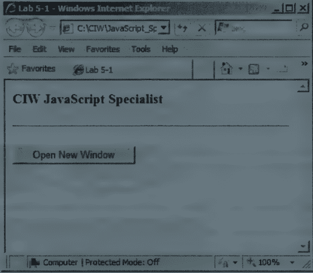
图 5-2: lab5-1.htm 的页面

- 7. **浏览器：** 单击 **Open New Window** 按钮启动新窗口。由于你没有指定大小，新窗口可能与现有窗口大小相同，也可能是不同大小。新窗口应类似于图 5-3，具体取决于你在 open() 方法中使用的属性。


图 5-3: CIW 网站

- 8. **浏览器：** 关闭 CIW 窗口。
- 9. **编辑器：** 向 open() 方法添加 `height` 和 `width` 属性。宽度使用 **400**，高度使用 **300**。保存 **lab5-1.htm**。
- 10. **浏览器：** 刷新 **lab5-1.htm**。单击 **Open New Window** 按钮。新窗口应类似于图 5-4，具体取决于其属性。

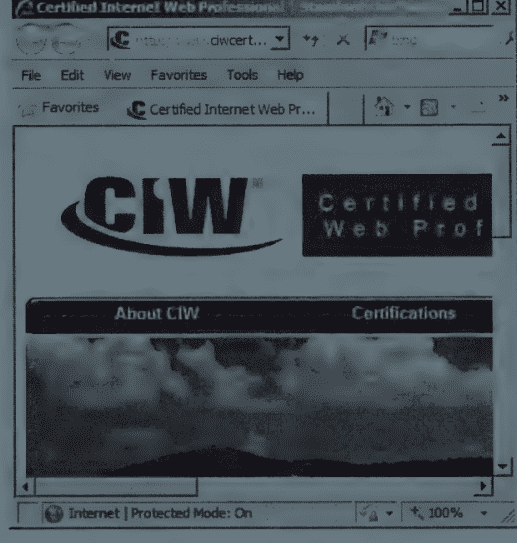
图 5-4: 带有 height 和 width 属性的新 Jewish 口

- 11. **浏览器：** 新窗口的外框应具有 400 像素的宽度和 300 像素的高度。

> 请注意，浏览器对 height 和 width 属性的解释将不一致。但是，如果浏览器没有按照指定的精确测量值创建新窗口，它将创建一个与属性列表中的尺寸成比例的新窗口。

在本实验中，你使用 `window` 对象的 `open()` 方法打开了一个新窗口。你目标定位到一个特定的 URL，该 URL 填充了新窗口。使用按钮对象的 `onclick` 事件处理程序调用了 `newWindow()` 函数。

你可以通过更改某些窗口属性来进行实验。例如，哪些操作导致各种窗口元素（如滚动条和状态栏）出现？

在下面的实验中，你将打开一个小窗口，为其分配一个名称以引用其对象和属性，然后向其写入内容并关闭它。假设你仍在为在线服装公司工作。你收到了客户关于结账流程的反馈。客户需要经过多个屏幕才能结账：首先是查看购物车，然后是输入账单信息，然后是确认订单和费用。在最后一个屏幕上，客户选择 shipping 方式。运费基于 delivery 速度：regular、express 或 overnight。当被要求选择 shipping 方式时，许多客户希望在 choosing 之前看到价格。因此他们点击页面底部的 Shipping Information 链接，该链接将他们重定向到 shipping info 页面。他们找到了想要的答案，但现在他们必须返回购物车并重新开始结账 process。考虑到此反馈，

你在最后一个结账页面上，在客户选择配送方式的旁边放置了一个“配送信息”按钮。你使用 JavaScript 的 `open()` 方法，在用户点击此按钮时打开一个崭新的小窗口来显示配送信息。用户在阅读完信息后可以关闭该窗口，选择一种配送方式，然后继续在之前的结账流程位置进行操作。

##### 实验 5-2：向新窗口写入内容

在本实验中，你将打开一个窗口，并为其分配一个名称，用于引用其对象和属性。然后，你将向新窗口写入内容，并学习如何通过编程方式关闭窗口。

1. **编辑器：** 从 Student_Files 目录的 Lesson 5 文件夹中打开 **lab5-2.htm**。

2. **编辑器：** 找到现有的 `<script>` 标签。一个名为 **smallWindow()** 的函数已经为你创建好了。在该函数内部，创建一个名为 **myWindow** 的变量。将 **window** 对象的 `open()` 方法的执行结果赋值给 **myWindow**。不要在 `open()` 方法的参数中指定 URL，而是在 URL 的位置插入一对空引号。记得给窗口起一个名字。在属性列表中，仅指定 **height** 为 **100** 且 **width** 为 **100**。

3. **编辑器：** 为 **smallWindow()** 函数添加向新窗口添加内容的代码。使用 **myWindow** 变量中保存的新窗口引用，通过 **document.write()** 向新窗口的文档写入内容。在新窗口中，创建 `<form>` 标签。在表单内，使用 `<input>` 标签创建一个 **button** 对象。将按钮的 **value** 属性设置为 **Close**。添加一个 **onclick** 事件处理程序来调用 **window.close()** 方法。这将为用户提供一个关闭新打开窗口的按钮。

4. **编辑器：** 在 lab5-2.htm 文件中，使用了一个表单按钮来调用 **smallWindow()** 函数。此按钮的脚本已经为你写好了。

5. **编辑器：** 保存 **lab5-2.htm**。

6. **浏览器：** 打开 **lab5-2.htm**。你的屏幕应与图 5-2 类似。

7. **浏览器：** 点击 **Open New Window** 按钮。你现在应该能看到一个像图 5-5 所示的小窗口。如果没有，请检查你输入的源代码是否正确。

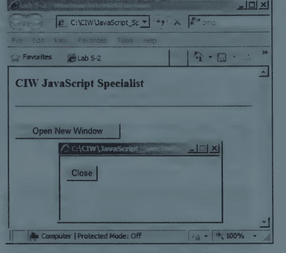

图 5-5：打开的小窗口

8. **浏览器：** 点击新窗口中的 **Close**。新窗口应该关闭。如果未关闭，请检查你输入的源代码是否正确。

> *技术笔记：浏览器可能会尝试停止脚本，或者可能会强制你允许 ActiveX 控件才能运行此脚本。*

如果你遇到错误，首先检查是否有拼写错误。接着，验证每个命令是否使用了正确的字母大小写。脚本中粗心的打字错误可能会导致数小时的故障排除。在寻找其他错误之前，养成检查拼写和大小写敏感性的习惯。

在本实验中，你了解到可以给窗口赋予一个标识。在这种情况下，新窗口被命名为 myWebWindow。因为窗口有了名字，你可以访问窗口的文档、向新窗口写入内容，并使用窗口对象的 `close()` 方法关闭该特定窗口。向新窗口写入动态内容是一个重要的概念，在本课中将进一步探讨。

> 警告！如今许多网站利用 window 对象的 `open()` 方法自动为用户打开多个窗口。使用此方法时请谨慎，因为打开过多窗口可能会让访问者反感使用你的 Web 应用程序。此外，根据用户浏览器的安全设置，弹出窗口拦截器可能会禁用此功能。

##### 点符号回顾

你可能记得在之前的课程中，点符号（dot notation）用于将对象的名称与其属性或方法相关联。某些对象本身是更高层级对象的属性。点符号也用于描述这种层级结构（请参阅前一节关于浏览器对象层级的内容）。

点符号的通用语法如下：

```
objectName.objectProperty;
objectName.objectProperty = value;

objectName.objectMethod();
objectName.objectMethod(argument1,argument2,...);
```

当你需要描述对象的层级结构时，通用语法如下：

```
parentObjectName.objectName.objectProperty;
parentObjectName.objectName.objectMethod();
```

这种语法在之前的实验中被用到。随着你对 JavaScript 经验的增长，你会经常使用这种语法。

##### status 属性

window 对象中一个常用的属性是 **status**。**status** 属性是指显示在浏览器窗口底部状态栏中的文本字符串。

你可以通过使用 **status** 属性在脚本运行期间随时更改窗口的状态栏文本。一种常见的方法是使用内联脚本，通过超链接和表单元素来修改 status 属性。在下一个实验中，你将使用内联脚本来更改 **status** 属性。不过，首先你将学习 `onmouseover` 和 `onmouseout` 事件处理程序。

> **警告！** 状态栏消息可能会被恶意利用来掩盖链接的 URL 并指向欺诈站点。下一个实验将讨论这一点。目前请理解，出于安全原因，某些浏览器可能不支持 status 属性，因此在网站的重要功能中不应依赖它。

##### onmouseover 和 onmouseout 事件处理程序

如前所述，内联脚本经常用于操作 window 对象的 **status** 属性。在使用 `onmouseover` 和 `onmouseout` 事件处理程序时，这种方法非常普遍。这些事件处理程序作为属性添加到 X/HTML 锚点标签 `<a>` 中，也可以添加到其他 X/HTML 元素中。

当用户将鼠标指针悬停在与 `<a>` 标签相关联的文本或图像上时，可以调用 `onmouseover` 事件处理程序来响应该事件。当用户将鼠标指针从链接或图像上移开时，也可以调用 `onmouseout` 事件处理程序来响应该事件。以下代码演示了 `onmouseover` 和 `onmouseout` 事件处理程序的语法：

```
<a href="http://www.CIWcertified.com"
   onmouseover="status='Visit the CIW Web site.';return true;"
   onmouseout="status='';return true;">Visit CIW</a>
```

在这个例子中，当用户将鼠标指针悬停在 "Visit CIW" 链接文本上时，状态栏将显示 "Visit the CIW Web site."。当用户将鼠标指针移开时，状态栏将包含一个空字符串，或者恢复到 `mouseover` 事件之前的默认状态。图 5-6 展示了此示例代码的执行效果。

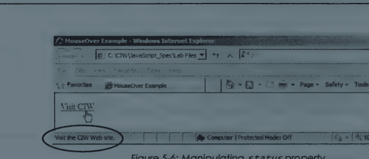

图 5-6：操作 *status* 属性

注意在操作 **status** 属性之后使用了 `return true` 语句。这是 **onmouseover** 和 **onmouseout** 事件处理程序正常工作所需的语法。注意使用分号 (;) 来分隔 JavaScript 语句。同时注意，整个 **onmouseover** 和 **onmouseout** 语句都被包裹在一组双引号中。**status** 属性的语法要求用引号将等号右侧的文本括起来。如果你在原有的双引号内部又使用另一组双引号，语法将会出错。因此，内部使用了一组单引号，以便 JavaScript 解释器能正确判断原始语句的开始和结束位置。

例如，如果你尝试在另一组双引号内部使用双引号，你的代码将出现以下错误语法：

```
onmouseover="status="some text";return true;"
```

JavaScript 解释器会错误地认为第一个双引号在语句中遇到的下一个双引号处就结束了。因此，该语句将被解释为：

```
onmouseover="status="
```

显然，这不是预期的解释结果。在实践中，在双引号内部使用双引号会导致语法错误并阻止代码正常执行。在创建此类 JavaScript 语句时，记住这个语法要求非常重要。

**onmouseover** 和 **onmouseout** 事件处理程序也常用于图像切换。这个主题将在本课稍后部分讨论。

在接下来的实验中，你将使用 `<a>` 标签的 **onmouseover** 事件处理程序来更改状态栏文本。假设你的 Web 团队正在寻找增加公司网站趣味性和交互性的方法。使用 JavaScript 在用户悬停在网页上的链接、图像或其他元素上时触发状态栏消息，是一种让你的站点活跃起来的简单方法。你可以利用这一点放置微妙的促销信息或为图像提供有趣的标题。你也可以这样使用状态栏来提供有用的信息，例如描述链接的目的地或告知用户某个图像是跳转到另一个页面的链接。


OBJECTIVE
2.2.2: 窗口对象

##### 实验 5-3：更改状态栏文本

在本实验中，你将使用 `<a>` 标签的 `onmouseover` 事件处理程序来更改状态栏文本。然后，你将使用 `onmouseout` 事件处理程序将状态栏文本更改为空字符串（或其默认状态，具体取决于浏览器）。

- 1. **编辑器：** 从 Student_Files 目录的 Lesson 5 文件夹中打开 **lab5-3.htm**。
- 2. **编辑器：** 找到在 `` 标签之前定义的 `<a href>`。在锚点标签内，添加一个 `onmouseover` 事件处理程序，将状态栏文本更改为以下内容：

  Visit the CIW Web site!（访问 CIW 网站！）

  同时，添加一个 `onmouseout` 事件处理程序，将状态文本栏更改为空字符串。
- 3. **编辑器：** 保存 **lab5-3.htm**。
- 4. **Internet Explorer 浏览器：** 在 Internet Explorer 中打开 **lab5-3.htm**。你的屏幕应类似于图 5-7。

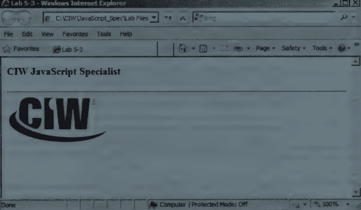
图 5-7：lab5-3.htm 的页面

- 5. **Internet Explorer 浏览器：** 将鼠标指针移到 CIW 图像上方。你创建的消息应显示在状态栏中，如图 5-8 所示。如果没有，请验证你输入的源代码是否正确。

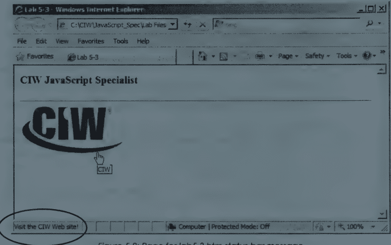
图 5-8：lab5-3.htm 状态栏消息的页面

- 6. **Firefox 浏览器：** 在 Firefox 中打开 **lab5-3.htm**。将鼠标指针移到 CIW 图像上方。你看到状态栏消息了吗？
- 7. **Firefox 浏览器：** 你应该会在状态栏中看到文本，但它与你在 Internet Explorer 中看到的消息不同。在 Firefox 中，你应该只会看到 CIW 网站的 URL，这是链接的目标。为什么会这样？

出于安全原因，一些浏览器开始禁止更改状态栏消息，以确保你在点击之前确切知道链接指向何处。这有助于防止网络钓鱼和网址嫁接攻击，在这种攻击中，外观相似的网站冒充受信任的网站，例如银行或在线支付服务。冒名顶替的网站可以使用状态栏消息来掩盖链接的 URL，以便你会点击它，因为一旦你进入该网站，可能就无法检测到冒名顶替者。冒名顶替者随后获得你的信任，你可能会输入敏感信息，例如密码或信用卡号。因此，status 属性可能最终会被弃用。

在本实验中，你学习了如何操纵窗口对象的 status 属性来更改窗口状态栏中的文本。现在你已经接触了窗口对象，接下来将学习文档对象。

#### document 对象

document 对象在 JavaScript 层次结构中从属于 window 对象。

在任何给定的窗口或框架中，document 对象都很重要。document 对象提供了用于处理当前文档许多方面的属性和方法，包括文本、锚点、表单、链接、页面标题、当前位置和 URL，以及当前的背景和前景色。document 对象是构成网页的内容和界面元素的组合。

document 对象在 X/HTML 页面中 `<body>` 标签被解析时定义。只要页面处于加载状态，该对象就存在。

© 2011 Certification Partners, LLC. — 保留所有权利。
版本 1.0

表 5-5 描述了与 document 对象相关的常用属性。请注意，一些事件和事件处理程序也与 document 对象相关联，但它们不常用。

##### 表 5-5：document 对象的属性

| document 的属性 | 描述 |
| :--- | :--- |
| `alinkColor` | 指定或返回一个字符串值，表示活动链接的颜色。 |
| `anchors` | 返回一个数组，包含文档中每个锚点引用的引用。锚点引用使用 `<a name="anchorName">` 标签定义。 |
| `applets` | 返回一个数组，包含文档中每个 `<applet>` 标签的引用。在 Mozilla Firefox 1.x（及更高版本）和 Microsoft Internet Explorer 4.x（及更高版本）中可用。 |
| `bgColor` | 指定或返回一个字符串值，表示文档的背景颜色。 |
| `cookie` | 指定或返回一个字符串值，包含 name=value 格式的数据对，这些数据将保留在客户端内存中，直到达到过期日期或浏览器被清除（如果没有过期日期）。 |
| `fgColor` | 指定或返回一个字符串值，表示文档的前景颜色（文本颜色）。 |
| `forms` | 返回一个数组，包含文档中每个表单的引用。`form` 对象也可以通过 `<form>` 标签的 `name` 属性按名称引用。请注意，表单元素包含在 `form` 对象内。 |
| `images` | 返回一个数组，包含文档中所有 `` 标签的引用。 |
| `linkColor` | 指定或返回一个字符串值，表示未访问链接的颜色。 |
| `lastModified` | 返回一个字符串值，表示文档最后更改的日期和时间。*注意：此字符串的外观在不同浏览器之间不一致。此外，此属性的可用性可能取决于服务器配置。* |
| `links` | 返回一个数组，包含文档中每个链接的引用。链接引用使用 `<a href="URL">` 标签定义。 |
| `location` | 表示当前 URL 的字符串值。*注意：此属性已在 Mozilla Firefox 1.x（及更高版本）和 Microsoft Internet Explorer 4.x（及更高版本）中被 document.URL 属性取代。* |
| `referrer` | 返回一个字符串值，表示从其访问当前文档的文档的 URL。请注意，`document.referrer` 仅在用户通过 HTTP 链接到达当前页面时返回一个值。 |
| `title` | 指定或返回一个字符串值，表示 `<title>` 和 `</title>` 标签之间的文本。 |
| `vlinkColor` | 指定或返回一个字符串值，表示已访问链接的颜色。 |

表 5-6 描述了与 document 对象相关的常用方法。

##### 表 5-6：document 对象的方法

| document 对象的方法 | 描述 |
| :--- | :--- |
| `close()` | 关闭 `write()` 流。 |
| `open()` | 打开文档以接收来自 `write()` 流的数据。 |
| `write(content)` | 将 `content` 的值写入文档。 |
| `writeln(content)` | 将 `content` 的值写入文档，后跟一个回车符。除非此命令发生在 `<pre>` 预格式化文本块内，否则你将看不到此方法与 `write()` 方法之间的区别。 |

##### bgColor 和 fgColor 属性

document 对象的两个明显属性是其背景颜色（`bgColor`）和前景颜色（`fgColor`）属性。背景颜色定义页面本身的颜色；前景颜色定义页面上显示的文本颜色。例如，考虑以下使用 RGB 颜色代码的语句：

```javascript
document.bgColor = "#00FF00";
```

此语句将设置或更改文档的背景为绿色。

许多浏览器识别一长串预定义的颜色名称，例如 `lightblue` 和 `crimson`。例如，考虑以下语句：

```javascript
document.bgColor = "black";
```

你可以使用此语句将文档背景颜色定义为黑色，或者你也可以使用以下带有 RGB 值的语句来实现相同的效果：

```javascript
document.bgColor = "#000000";
```

##### title 属性

document 对象有一个 title 属性。title 属性保存文档标题的值，该标题定义在 `<title>` 和 `</title>` X/HTML 标签之间。例如：

```javascript
alert(document.title);
```

此语句将以警告消息的形式向用户返回当前加载页面的标题。在 Netscape Navigator 6 和 Microsoft Internet Explorer 4 之前的浏览器中，此属性是只读的，不能设置，只能访问。

##### lastModified 属性

document 对象有一个名为 `lastModified` 的属性，可用于返回文档最近保存的日期和时间。考虑以下示例：

```javascript
document.write("This page last updated " + document.lastModified);
```

此语句将写入消息"This page last updated December 17, 2010"（此页面最后更新于 2010 年 12 月 17 日），假设你在该日期更改了文档。日期文本的外观在不同浏览器之间会有所不同。此外，服务器配置可能会阻止访问此属性。`lastModified` 属性也是只读属性。


#### 引用远程窗口和文档对象

除了使用和引用当前窗口和文档对象外，您还可以访问与其它窗口相关联对象的方法并更改其属性。在之前的实验中，您已经看到了这一概念的简短示例。接下来的实验将在向远程文档写入内容时，演示几个文档对象属性。在此实验之前，接下来的章节将简要讨论 `with` 语句。

**目标 2.2.4：with 语句**

#### with 语句

如果您打算对单个对象使用多个属性和/或方法，可以使用 `with` 语句。`with` 语句简单地说，在语句主体中，随后的任何引用都指向同一个对象。使用 `with` 的语法如下：

```
with (objectname) {
    //referencing objectname statement(s)
}
```

`with` 语句可以为您节省一定的编码时间。以下是一个使用 `with` 语句的示例，它以最少的代码输入在（新）窗口中添加颜色并放置文本：

```
<!DOCTYPE html PUBLIC "-//W3C//DTD XHTML 1.0 Transitional//EN"
"http://www.w3.org/TR/xhtml1/DTD/xhtml1-transitional.dtd">
<html xmlns="http://www.w3.org/1999/xhtml">
<head>
<meta http-equiv="Content-Type" content="text/html; charset=utf-8" />
<title>A with Statement Example</title>
<script type="text/javascript">
<!--

myWindow = open("","newWin","height=100,width=100");

with (myWindow.document) {
    open();
    bgColor = "blue";
    fgColor = "white";
    write("<h2>Hello, World!</h2>");
    close();
}

// -->
</script>
</head>

<body>
</body>
</html>
```

如果您将此示例中的代码加载到浏览器中，您将看到一个类似于图 5-9 的弹出窗口。


**图 5-9：使用 with 语句的结果**

为了说明使用 `with` 语句如何为您节省输入时间，表 5-7 将前一个示例中的 `with` 语句与不使用 `with` 语句的相同代码进行了比较。

**表 5-7：使用 with 语句的代码对比**

| 使用 with 的代码 | 不使用 with 的代码 |
| :--- | :--- |
| `open()` | `myWindow.document.open()` |
| `bgColor = "blue"` | `myWindow.document.bgColor = "blue"` |
| `fgColor = "white"` | `myWindow.document.fgColor = "white"` |
| `write("<h2>Hello,World!</h2>")` | `myWindow.document.write("<h2>Hello,World!</h2>")` |
| `close()` | `myWindow.document.close()` |

请记住，使用 `with` 语句应谨慎。`with` 语句可能难以控制，因为它允许您在不每次显式声明对象（如文档对象）的情况下使用该对象。它还可能难以保持在作用域内，因为 `with` 语句仅在编写函数的范围内使用。如果在 `with` 块内部定义的是命名函数而非匿名函数，可能会引起问题。避免这种情况的一种替代方案是定义一个变量。

在接下来的实验中，您将使用 `with` 语句来创建远程 Web 页面并动态地为其分配属性。假设您的公司管理层目前对如何让公司网站更具吸引力的方案感兴趣，并讨论雇佣承包商来执行。您的 Web 团队主管想向管理层证明不需要承包商，因此她正在提出一些新的项目想法。她指派您为她的演示文稿创建一个 Web 页面。您设计了一个远程页面，经理们可以通过按钮启动，并能通过回答一些问题来创建定制的外观和感觉。该页面不仅将向管理层展示项目想法，还将展示您团队的脚本编写和 XHTML 能力。

#### 实验 5-4：动态地为远程文档分配属性

在这个实验中，您将学习如何创建远程文档并向该文档写入动态内容。用户将被问及关于外观感觉以及拟在新文档中呈现的内容的几个问题。在用户提供信息后，实验文件 `lab5-4.htm` 中包含的脚本将把动态内容写入远程文档。

- 1. **编辑器：从 Student_Files 目录的 Lesson 5 文件夹中打开 `lab5-4.htm`**。
- 2. **编辑器：检查 `writeToDocument()` 函数**：

```
<script language="JavaScript" type="text/javascript">
<!--
function writeToDocument(){
    var textColor, pageTitle;
    var textColor, backColor, window;
    var textYourText, pageContent, docWindow;

    textColor = prompt("Please enter a text color:","white");
    backColor = prompt("Please enter a background color:","black");
    pageTitle = prompt("The page will be titled : ", 
            "Default Title");
    yourText = prompt("Add content to the new document:", 
"page content");
    pageContent = "<html><head><title>";
    pageContent += pageTitle + "</title>";
    pageContent += "<script>alert('The page ' + 
    document.title + ' was created: ' 
    + document.lastModified);</script>";
    pageContent += "</head><body " + "bgcolor=" + backColor + "><strong>" +
    "<font color= " + textColor + ">" + yourText + "</font>";
    pageContent += "</strong></body></html>";

    docWindow = open("", "docWin", "width=250,height=150, 
    resizable=1, status=1");

    // Create a with statement

}
//--> 
</script>
</head>
```

- 3. **编辑器：** 注意已经创建了几个变量。变量 `textColor`、`backColor`、`pageTitle` 和 `yourText` 都被分配了通过 `prompt()` 方法获取的用户输入结果。`pageContent` 变量被分配了一个由 XHTML、JavaScript 代码、文档对象属性和变量值组成的组合。`docWindow` 变量通过 `window.open()` 方法接收到一个新窗口的引用。
- 4. **编辑器：** 找到注释 `//Create a with statement`。修改 `writeToDocument()` 函数以添加一个 `with` 语句。该 `with` 语句应使用 `docWindow` 的文档作为其目标对象。确保打开指向新文档的 XHTML 数据流。添加用于设置 `bgColor` 和 `fgColor` 的代码。为此，请使用 `backColor` 和 `textColor` 变量中的值。使用 `write()` 方法输出 `pageContent` 变量。确保关闭 XHTML 数据流。
- 5. **编辑器：** 检查页面上的其余代码。保存 `lab5-4.htm`。
- 6. **浏览器：** 在 Internet Explorer 中打开 `lab5-4.htm`。您的屏幕应类似于图 5-10。

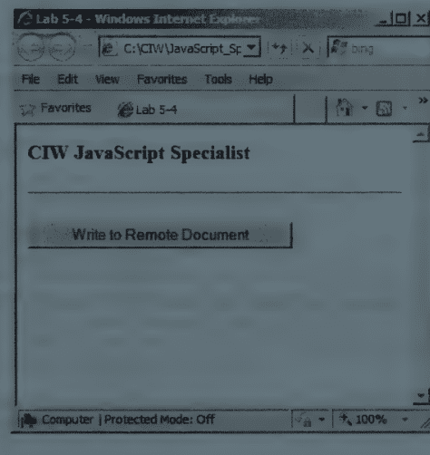
**图 5-10：lab5-4.htm 的页面**

- 7. **浏览器：** 点击 **Write To Remote Document** 按钮。该按钮已被编写脚本以调用 `writeToDocument()` 函数。您将看到一系列提示对话框，每当您在前一个对话框中输入数据后，就会出现下一个（见图 5-11）。

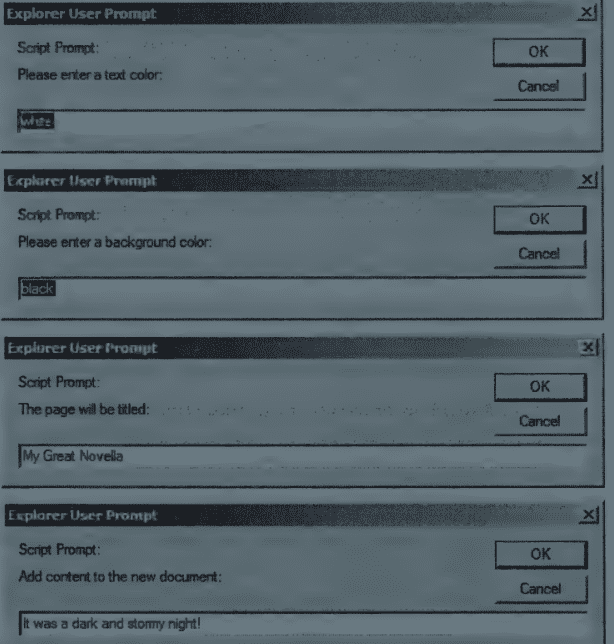
**图 5-11：提示对话框**

- 8. **浏览器：** 在所有对话框中输入数据并点击 **OK** 后，您应该看到一个类似于图 5-12 所示的警告对话框。

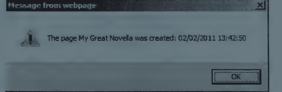
**图 5-12：警告对话框**

- 9. **浏览器：** 点击 **OK**。根据您的输入，您的屏幕应类似于图 5-13。


- 10. **浏览器：** 如果时间允许，尝试在另一个浏览器（如 Firefox）中运行此脚本。结果有何不同？请记住，完全有效的脚本在不同的浏览器和浏览器版本中渲染方式往往不同。请务必在尽可能多的浏览器中测试您的代码。

本实验证明，您的脚本可以反映您对 X/HTML 的精通程度。您对 X/HTML 的知识越深厚，在设计动态生成的 Web 页面时就越能发挥创意。

#### 分析实验 5-4

上述实验中 `writeToDocument()` 函数的几行代码值得研究。考虑以下代码行：

```
pageContent = "<html><head><title>";
pageContent += pageTitle + "</title>";
```

这些代码行开始使用一个 XHTML 字符串构建 `pageContent` 变量，该字符串最终将被写入新窗口。注意第二行代码中 `+=` 运算符的使用。使用此运算符是以下表达方式的简写：

```
pageContent = pageContent + pageTitle + "</title>";
```

换句话说，`pageContent` 变量保留了之前已分配的所有内容，并添加新内容。请注意，变量 `pageTitle` 没有被引号包围，因为它包含变量信息，而表达式的字面量部分（在本例中为 `"<title>"`）则在引号内。

考虑以下代码行：

```
pageContent += "<script>alert('The page: ' + document.title + ' was created: ' + document.lastModified )</script>";
```

这行代码证明了您可以动态地向新窗口写入 JavaScript 代码。注意 `document.title` 和 `document.lastModified` 属性的拼接。此外，这段代码再次演示了在双引号集中使用单引号。`alert()` 方法的语法要求字面量字符串必须在引号内。由于等号右侧的整个表达式都在双引号内，因此必须在双引号集内部使用单引号。

最后，请注意，当您添加代码以完成实验时，您使用了文档对象的 `open()` 方法来打开指向新文档的数据流。并且您使用了...

document对象的`close()`方法用于在你完成向新文档写入数据后关闭数据流。`open()`方法让浏览器准备好接受数据，并显示在相应的文档对象中。`close()`方法会导致状态栏中出现"Document Done"或"Done"的消息。

#### image 对象

image 对象位于 JavaScript 层级结构中的 document 对象之下。此对象允许你在 Internet Explorer 4.x（及更高版本）和 Firefox 1.x（及更高版本）中操作图像。

image 对象最流行的用途之一是创建鼠标经过时会产生动画效果的按钮。此功能通过动态更改 image 对象的 `src` 属性来实现。

image 对象可以作为 document 对象的一个数组来访问。数组是一组具有相同名称的对象或值。此组中的每个实体都可以通过索引号单独访问。数组在本书的其他部分有详细讨论。请注意，当你使用 image 对象提供的数组时，数组的名称是 `images`，而不是 `image`。同样，form 对象数组（`forms`）和 frame 对象数组（`frames`）也是如此。表单在本书的其他部分讨论。

如果你有一个包含图像的 X/HTML 文档，你可以通过它们的数组编号使用 image 对象来访问这些图像。使用 `images` 数组的标准语法如下：

```javascript
document.images[0].src = "newImage.jpg";
```

此语句会将默认图像（即 X/HTML 文件中定义的第一个图像）替换为 `newImage.jpg`。虽然 Array 对象尚未讨论，但前面的示例演示了访问数组元素的标准 JavaScript 语法。请注意数组名称后面方括号中的数组元素编号。在 JavaScript 中，第一个数组元素编号为 0，第二个元素编号为 1，依此类推。

请注意，并非所有浏览器都支持 image 对象。无论何时在你的 JavaScript 代码中访问 image 对象，请确保浏览器支持该对象，可以使用如下所示的 `if` 语句：

```javascript
if (document.images) {
    //image processing code
}
```

如果浏览器不支持 image 对象，表达式 `document.images` 将返回一个假值，图像处理代码将不会执行。

以下内联脚本会将数组编号引用的原始图像替换为名为 `router.gif` 的图像。在这种情况下，引用的是页面上的第二张图像：

```html
<input type="button" value="Change image"
onclick="document.images[1].src='/images/myImage.gif';" />
```

可以通过名称和数组编号访问图像，如下所示：

```html


<input type="button" value="Change image"
onclick="document.images['myImage'].src='newImage.gif';" />
```

在此示例中，语句的 `['myImage']` 部分源自 `` 标签内分配的 `name` 属性。

你也可以在脚本中创建 image 对象的一个实例。使用 `new` 运算符的方式如下：

```html
<html>
<head>
<script language="JavaScript">
<!--
    var image1;
    image1 = new Image();
// -->
</script>
</head>
```

当预加载图像到浏览器缓存时，此语法很重要。如前所述，image 对象的一个流行用途是执行动态图像交换，通常使用 `onmouseover` 和 `onmouseout` 事件处理程序。如果图像被预加载到浏览器缓存中，用户就不必等待几秒钟来下载新图像。预加载图像可以提升任何使用此 JavaScript 功能的应用程序的性能。

要预加载图像，请在文档的 `<head>` 部分创建 image 对象的新实例，如前所示。然后使用 `src` 属性为图像分配一个源。在文档的 `<head>` 部分构造一个新的 image 对象，会强制浏览器查找并将该图像预加载到浏览器的缓存中。以下示例演示了整个预加载过程：

```javascript
<script type="text/javascript"><!--
    if (document.images) {
        var image1, image2;
        image1 = new Image();
        image1.src = "images/image1.gif";
        image2 = new Image();
        image2.src = "images/image2.gif";
    }
// -->
</script>
```

现在变量 `image1` 和 `image2` 包含对预加载图像的引用，可根据需要用于动态图像交换。动态图像交换可以通过内联脚本完成，如前所示。然而，函数是最常用于交换图像的技术。下一个实验将演示使用函数来执行图像交换。

`Image()` 构造函数也可以接收尺寸值作为参数：

```javascript
image1 = new Image(150, 200);
```

所示的值以像素为单位，表示图像的宽度和高度。

表 5-8 列出了 image 对象的常用属性。image 对象没有内置方法。

**表 5-8：image 对象的属性**

| 图像属性 | 描述 |
|---|---|
| **src** | 指定或返回图像文件的 URL。此参数是唯一必需的参数。以下是此格式的一个示例：`document.images[0].src = "http://www.yoursite.com/images/comp1.gif";` |
| **height 和 width** | 指定或返回图像的高度和宽度（以像素为单位）。虽然此参数不是必需的，但你应该始终使用它。 |
| **length** | 返回文档的图像数量。你可以使用以下语法访问此属性：`document.images.length;` |
| **lowsrc** | 指定或返回一个替代的低带宽图像。 |
| **complete** | 返回一个布尔值，指示图像是否已完全加载。 |
| **hspace 和 vspace** | 指定或返回图像周围的水平和垂直透明边距（以像素为单位）。例如：`document.images[0].vspace = 10; document.images[0].hspace = 10;` |
| **border** | 指定或返回边框的宽度（以像素为单位）。 |
| **name** | 指定或返回分配给 `` 标签中 `name` 属性的值。 |

表 5-9 列出了 image 对象的常用事件处理程序。image 对象没有内置方法。

**表 5-9：image 对象的事件处理程序**

| 图像事件处理程序 | 描述 |
|---|---|
| **onabort** | 如果在图像加载过程中用户选择了“停止”按钮，则进行处理。 |
| **onerror** | 如果在图像加载过程中发生错误，则进行处理。 |
| **onload** | 在图像的 *lowsrc* 图像完成加载时、图像的 *src* 完成加载时，或者动画 GIF 的每一帧出现时进行处理。 |

#### 处理 image 对象事件

在许多应用程序中，`<a>` 标签与图像结合使用来处理事件。`<a>` 标签支持诸如 `onclick`、`onmouseout` 和 `onmouseover` 等事件处理程序。image 对象有几个与之关联的事件处理程序。其中包括三个：

- **onload** — 在图像完成加载到浏览器时激活。
- **onerror** — 如果图像本身损坏或以其他方式加载失败，则激活。
- **onabort** — 当用户取消图像加载时发生。

这些事件有助于你编写备用脚本，以防用户在其浏览器中关闭了内联图像，或者发生网络错误。

在以下实验中，你将使用 image 对象创建一个活动的超链接按钮。假设你的网站团队主管为公司网站启动的一个新项目涉及添加一些交互性。你可以通过预加载然后交换图像来使用 JavaScript 创建活动按钮。当用户浏览页面时，他们会看到链接在鼠标悬停时发生变化，并在鼠标移开时变回原样。这个相对简单的脚本为网页提供了动态的悬停效果，会给用户和公司管理层留下深刻印象。

#### 实验 5-5：通过预加载和交换图像创建活动链接

#### 目标
2.2.5：image 对象

在此实验中，你将使用 image 对象，利用课程其他部分讨论的 `onmouseover` 和 `onmouseout` 事件处理程序，将默认图像替换为另一张图像。你需要为 XHTML 文档预加载两张图像。这些图像将用于创建悬停效果，每张图像作为页面上的一个链接。导航按钮有两个关联的图像：一个用于用户将鼠标指针悬停在图像上时（开状态），一个用于用户将鼠标指针移开图像时（关状态）。`src` 属性将根据 `Student_Files` 目录中 `Lesson 5` 文件夹的 `images` 目录中提供的两个图像文件进行赋值：`images/ciw_on.gif` 和 `images/ciw_off.gif`。

- 1. **编辑器：** 打开 `Student_Files` 目录中 `Lesson 5` 文件夹下的 `lab5-5.htm` 文件。
- 2. **编辑器：** 定位到文档 `<head>` 部分中的 `<script>` 标签。定位到如下所示的注释：
```javascript
//Add image preloading code
```
- 3. **编辑器：** 添加代码以确保目标浏览器支持 image 对象。然后添加代码来预加载提供的图像。使用以下变量名创建四个新的 `Image()` 对象：
    - ciw_on
    - ciw_off
    - ciw1_on
    - ciw1_off

  按如下方式分配 `src` 属性：
    - 为 ciw_on 分配 images/ciw_on.gif
    - 为 ciw_off 分配 images/ciw_off.gif
    - 为 ciw1_on 分配 images/ciw1_on.gif
    - 为 ciw1_off 分配 images/ciw1_off.gif

- 4. **编辑器：** 你的代码应类似于以下内容（在添加预加载代码之前）：

```javascript
<script type="text/javascript">
<!--

//Add image preloading code

function imageOn(imageName){
    if (document.images[0].src) {
        (imageName=="ciw") ? document.images[0].src = ciw_on.src : "";
        (imageName=="ciw1") ? document.images[1].src = ciw1_on.src : "";
    }
}

function imageOff(imageName){
```


```javascript
if (document.images){
  (imageName=="ciw") ? document.images[0].src = ciw_off.src : "";
  (imageName=="ciw1") ? document.images[1].src = ciw1_off.src : "";
}
}
}
//-->
</script>
```

5. **编辑器：** 检查为你提供的 **imageOn()** 和 **imageOff()** 函数。这些函数将在本课稍后讨论。

6. **编辑器：** 滚动到文档底部，找到 `` 标签。注意 `` 标签内的 name 属性设置为 "ciw"。

7. **编辑器：** 检查包裹 `` 标签的 `<a>` 标签。已编写 **onmouseover** 事件处理程序来调用 **imageOn()** 函数。当调用该函数时，会将 `` 标签的 name 属性值作为参数传递。

8. **编辑器：** 仍在 `<a>` 标签内，已编写 **onmouseout** 事件处理程序来调用 **imageOff()** 函数。当调用该函数时，会将 `` 标签的 name 属性值作为参数传递。

9. **编辑器：** `` 标签及其关联的 `<a>` 标签以相同的方式构造。

10. **编辑器：** 保存 **lab5-5.htm**。

11. **浏览器：** 打开 **lab5-5.htm**。你的屏幕应类似于图 5-14。

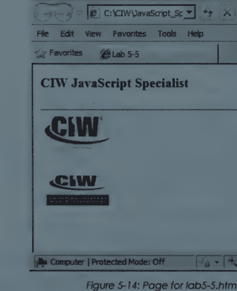

12. **浏览器：** 将光标移到 **CIW** 图像上。你的屏幕应类似于图 5-15。如果不是，请验证你输入的源代码是否正确。

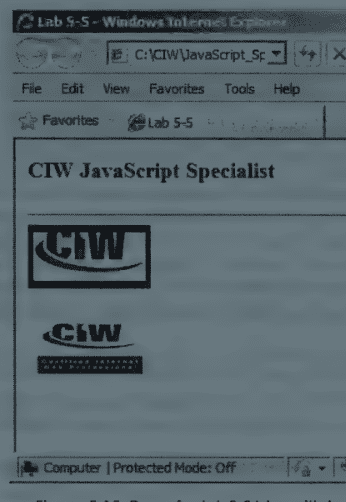

13. **浏览器：** 当鼠标指针悬停在图像上时，你应该看到 CIW 图像发生变化，当鼠标指针移开时，图像又变回原始图像。页面上的第二个图像应以相同的方式工作。

14. **编辑器：** 如果时间允许，修改你的代码以更改 window 对象的 **status** 属性，使其指示链接将用户带到哪个页面，如上图所示。

在此实验中，你使用 **image** 对象为 XHTML 页面上的导航图像创建了翻转效果。

如前所述，创建用于图像交换翻转效果的代码时，最佳方法是将图像预加载到浏览器缓存中。在前面的实验中，你添加了创建新 **Image()** 对象的代码，然后使用 **src** 属性使浏览器定位图像并将其预加载到浏览器缓存中。

你还查看了使用 **onmouseover** 和 **onmouseout** 事件处理程序调用适当函数将图像更改为"开启"位置或恢复为"关闭"位置的代码。在该实验中，**imageOn()** 和 **imageOff()** 函数已为你提供。这些函数值得仔细研究。请考虑 **imageOn()** 函数中的以下代码片段：

```javascript
function imageOn(imageName){
  if (document.images){
    (imageName=="ciw") ? document.images[0].src = ciw_on.src : "";
    (imageName=="ciw1") ? document.images[1].src = ciw1_on.src : "";
  }
}
```

我们来检查部分代码：

- `function imageOn(imageName){`
  这第一行代码建立函数名称，并使函数准备好接收名为 `imageName` 的参数。回想一下，当调用函数时，适当的图像名称作为参数传递给函数。

- `if (document.images){`
  下一行确保浏览器支持 `image` 对象。

- `(imageName=="ciw") ? document.images[0].src = ciw_on.src : "";`
  下一行使用条件运算符 (`? :`) 确定要采取的适当操作。语句的第一部分是布尔表达式 (`imageName=="ciw"`)。如果传递给函数的参数等于 `ciw`，则问号后的代码将执行。代码 `document.images[0].src = ciw_on.src` 将 XHTML 页面中定义的第一个图像更改为适当的图像。

  如果传递给函数的 `imageName` 不是 `ciw`，则冒号后的代码将执行。在这种情况下，一组空引号表示程序不应发生任何事情。函数以这种方式编写，以便可以轻松修改以处理 XHTML 页面上的多个图像。

**imageOff()** 函数的功能与 **imageOn()** 函数相同，只是它将适当的图像更改回其原始状态。

#### JavaScript 与图像映射

JavaScript 还可用于为 XHTML 图像映射添加额外功能。有关 JavaScript 和图像映射的更多信息，请参阅相关附录。

#### history 对象

`history` 对象在 JavaScript 层次结构中隶属于 `window` 对象。

当你点击浏览器上的"后退"或"前进"按钮时，你已经在使用 `history` 对象使用的相同信息。浏览器维护最近访问的网页 URL 列表。你可以通过点击浏览器按钮来显示这些页面。如果你想为自己的页面提供相同类型的功能，可以添加类似的按钮或链接，允许用户在网页存储的历史记录中向后或向前移动。

要访问先前访问的页面，可以使用带有 `back()` 和 `forward()` 方法的 `history` 对象。语法如下：

```html
<form>
<input type="button" value="Back" onclick = "history.back();" />
<input type="button" value="Forward" onclick = "history.forward();" />
</form>
```

`history` 对象只有一个与之关联的属性和三个方法。表 5-10 列出了与 `history` 对象关联的属性和方法。请注意，没有事件与 `history` 对象关联。

**表 5-10：history 对象的属性和方法**

| history 对象的属性 | 说明 |
|---|---|
| length | 返回一个整数值，表示 `history` 对象当前引用的链接数量。 |
| **history 对象的方法** | **说明** |
| `back()` | 将用户发送到历史列表中的上一页。 |
| `forward()` | 将用户发送到历史列表中的下一页。 |
| `go(x)` | 如果 x 是负整数，用户将在历史列表中向后移动 x 页。如果 x 是正整数，用户将在历史列表中向前移动 x 页。如果 x 是字符串值，用户将被发送到历史列表中 URL 与 x 匹配的页面。 |

#### location 对象

`location` 对象在 JavaScript 层次结构中隶属于 `window` 对象。

`location` 对象允许你在脚本中指定 URL。因此，你可以创建按钮而不是文本或图形链接来将用户发送到不同的目标。你还可以将位置更改绑定到脚本的某些其他部分。`location` 对象的关键属性是你将经常使用的 `href` 属性，它指定或返回当前或所需 URL 的超文本引用。例如，考虑以下代码行：

```javascript
location.href = "http://www.CIWcertified.com";
```

程序中执行这一行会将用户发送到 CIW 网站。你可以在按钮标签中包含这样的语句，使用内联脚本编写。语法如下：

```html
<form>
<input type="button" value="Visit CIW" onclick="location.href = 'http://www.CIWcertified.com';" />
</form>
```

请记住，表单按钮必须位于一对开头和结尾的 `<form>` 标签内。请注意，从 location 开头到标签结尾，脚本用双引号括起来，而 URL 本身用单引号括起来。

location 对象的属性与构成完整 URL 的各个信息片段相关。在许多应用程序中，访问此信息极为重要。这些属性允许开发人员轻松访问这些数据，而无需执行相当复杂的字符串操作。URL 的元素标识如下：

`protocol://hostname:port/pathname/search#hash`

URL 的每个元素都可以从 location 对象中提取，如表 5-11 所示。

**表 5-11：location 对象的属性**

| location 的属性 | 说明 |
|---|---|
| href | 指定或返回文件或网站的部分或完整 URL。例如：http://www.cnn.com 或 page2.htm 或 page2.htm#Section2 |
| protocol | 指定或返回 HTTP、FTP 或当前使用的协议 |
| host | 指定或返回 URL 的 hostname:port 部分 |
| hostname | 指定或返回 URL 的主机名 |
| port | 指定或返回用于访问的端口号（如果提供了端口号） |
| pathname | 指定或返回文件的路径 |
| search | 指定或返回 ? 字符后的文本（如果存在搜索字符串） |
| hash | 指定或返回内部链接锚点名称，即 URL 中 # 符号后的部分 |

**警告！** 操纵 location 对象的属性时要小心，因为它是黑客最喜欢的目标。黑客可以使用 JavaScript 发现可用于恶意目的的信息（例如开放端口和主机名）。

#### navigator 对象

**目标 2.2.8：navigator 对象**

navigator 对象反映有关正在使用的浏览器的信息。此对象可以确定正在使用的浏览器品牌和版本，甚至可以识别用户的操作系统。例如，以下行将为 userBrowser 变量赋值，其中包含客户端的名称（即 Mozilla 的 Netscape 等）：

```javascript
var userBrowser = navigator.appName;
```


表 5-12 展示了与 `navigator` 对象相关的属性。

##### 表 5-12：navigator 对象的属性

| navigator 的属性 | 描述 |
| :--- | :--- |
| `appCodeName` | 返回一个包含客户端代码名称的字符串值。对于 Mozilla 浏览器、Internet Explorer 以及 Google Chrome，此属性返回默认值 `Mozilla`。 |
| `appName` | 返回一个包含客户端名称的字符串值（例如，对于 Mozilla 浏览器返回 `Netscape`，对于 Internet Explorer 浏览器返回 `Microsoft Internet Explorer`）。 |
| `appVersion` | 返回一个包含客户端版本信息的字符串值。 |
| `mimeTypes` | 返回一个表示客户端支持的所有 MIME 类型的数组。 |
| `platform` | 返回一个标识浏览器编译所针对的操作系统的字符串。 |
| `plugins` | 返回一个表示特定浏览器上已安装所有插件的数组。 |
| `userAgent` | 返回一个包含在 HTTP 请求中发送的 user-agent 标头完整值的字符串值。 |

表 5-13 展示了与 `navigator` 对象相关的方法。

##### 表 5-13：navigator 对象的方法

| navigator 对象的方法 | 描述 |
| :--- | :--- |
| `JavaEnabled()` | 如果客户端启用了 Java，则返回 true；否则返回 false。 |
| `preference()` | 读取并设置浏览器中的用户偏好设置（仅限签名脚本）。 |

`navigator` 对象属性的任何值都可以通过脚本访问。在接下来的实验中，你将使用 `navigator` 对象。假设你想添加一些 JavaScript 效果，要求用户使用较新版本的浏览器来查看你的网页。你可以使用 JavaScript 的 `navigator` 对象来检测用户的浏览器类型和版本。如果用户使用的是较旧的浏览器且不支持你的效果，你可以提供一个弹出窗口或其他消息，告知用户可能无法看到网页上的所有效果，并建议升级浏览器。

##### 实验 5-6：使用 navigator 对象识别浏览器属性

在本实验中，你将学习可以从多个 navigator 对象属性中检测到的各种类型的信息。

- 1. **编辑器：** 打开 `Student_Files` 目录中 Lesson 5 文件夹下的文件 `lab5-6.htm`。
- 2. **编辑器：** 找到文件 `<head>` 部分中的 `<script>` 代码块，如粗体所示。向 `openWindow()` 函数中添加代码。将 `navigator` 对象的 `appCodeName`、`appName`、`appVersion` 和 `userAgent` 属性连接到 `info` 变量中。以下代码显示了更改前的此函数：

目标
2.2.8：navigator 对象

```
<!DOCTYPE HTML PUBLIC "-//W3C//DTD HTML 4.0 Transitional//EN">
<html>
<head><title>Lab 5-7</title>

<script language="JavaScript" type="text/javascript">
<!--

function openWindow() {
  var info="";
  
  info += "Welcome, " +         ; //Add appCodeName here
  info += " user!\nYou are using the ";
  info +=     + " browser,\nversion ";  //Add appName here
  info +=      + ".\nYour user agent "; //Add appVersion here
  info += "information is " +         ; //Add userAgent here
  
  alert(info);
}
//-->
</script>
</head>

<body>
<h3>CIW JavaScript Specialist</h3>
<hr />

<script type="text/javascript">

   //Add userAgent here to write into browser window

</script>

<form name="myForm">
<input type="button" name="buttonClick" value="Click for More Browser
Information" onclick="openWindow()" />
</form>
</body>
</html>
```

- 3. **编辑器：** 找到文件 `<body>` 部分中的 `<script>` 代码块。添加代码，将 navigator 对象的 userAgent 属性中的信息写入浏览器窗口，如粗体所示：

```
<script type="text/javascript">
document.write(
"<p>The property <strong><em>navigator.userAgent</em></strong> "
  + "returns:<br /><strong><font color='#FF0000'>"
  + navigator.userAgent +"</font></strong></p>"
)
</script>
```

- 4. **编辑器：** 保存 **lab5-6.htm**。
- 5. **浏览器：** 在 Firefox 浏览器中打开 **lab5-6.htm**。你的屏幕应类似于图 5-16。

- 6. **浏览器：** 点击 **Click For More Browser Info** 按钮。你应该看到一个类似于图 5-17 的警报。

- 7. **浏览器：** 现在在 Internet Explorer 浏览器中打开文件 **lab5-6.htm**。你应该看到一个类似于图 5-18 的警报。

- 8. **浏览器：** 注意对于这两种浏览器，appCodeName 属性都返回 Mozilla 作为浏览器的代码名称。如果时间允许，请尝试在其他浏览器和版本中打开此页面，以查看浏览器信息有何不同。

> 技术说明：Internet Explorer 为 appCodeName 返回 Mozilla 的原因是，多年前，Web 开发人员使用 appCodeName 仅允许 Netscape (Mozilla) 浏览器访问基于框架的页面，因为其他浏览器无法渲染它们。在 Netscape 占据市场主导地位时，许多开发人员继续以这种方式排除非 Mozilla 浏览器。为了挫败这种排除，微软开始为其 Internet Explorer 浏览器也提供 Mozilla 的 appCodeName。这种趋势在许多浏览器中一直存在，即使在今天，所有 Mozilla、Internet Explorer 和 Google Chrome 浏览器的 appCodeName 都将返回 Mozilla。因此，当你想要显示准确的浏览器名称时，请务必使用 appName 属性而不是 appCodeName。

本实验演示了使用 **navigator** 对象可以访问的各种类型的信息。Internet 应用程序开发中最具挑战性的一个方面是创建能够在所有浏览器中运行的代码。当针对不同浏览器的编码是关键任务时，**navigator** 对象包含的信息是一个基本要素。随着你应用程序开发经验的增长，你会发现 **navigator** 对象有许多用途。

## 使用 *navigator* 和 *location* 对象重定向浏览器

你可以在脚本中将 **location** 对象与 **navigator** 对象结合使用，以便根据所使用的浏览器类型重定向到不同的页面。此操作是 JavaScript 最常见的用途之一，可用于自动将用户定向到在用于查看它的浏览器中显示效果最佳的网页版本。许多大型网站（如 Google、eBay 和 Amazon）有同一网站的多个版本，并会将每个用户定向到针对特定浏览器类型优化的页面。

在接下来的实验中，你将使用 **location** 对象与 **navigator** 对象，根据所使用的浏览器进行重定向。假设你为一家在过去一年经历快速增长的公司工作。Web 团队的当前项目是为针对特定浏览器优化的替代版本网站设计。这些网站使 Web 开发人员能够更好地控制每个网站的功能以及外观和感觉，因为他们可以针对每个浏览器的单独处理和显示特性进行设计。你被分配编写 JavaScript 代码，该代码将在访问者启动网站时检测正在使用的浏览器，然后根据此信息，将用户定向到针对该浏览器优化的网站版本。

#### 实验 5-7：根据浏览器类型重定向到页面

目标
2.2.7：location 对象
2.2.8：navigator 对象

在本实验中，你将创建一个脚本，该脚本将根据所使用的浏览器类型重定向到不同的页面。

- 1. **编辑器：** 打开文件 *lab5-7.html*。
- 2. **编辑器：** 研究代码。在文档的 body 中添加以下脚本，如粗体所示，然后保存 *lab5-7.html*：

```
<!DOCTYPE html PUBLIC "-//W3C//DTD XHTML 1.0 Transitional//EN"
"http://www.w3.org/TR/xhtml1/DTD/xhtml1-transitional.dtd">
<html xmlns="http://www.w3.org/1999/xhtml">
<head>
<meta http-equiv="Content-Type" content="text/html; charset=utf-8" />
<title>Lab 5-6</title>
</head>
<body>
<h3>CIW JavaScript Specialist</h3>
<hr />

<script language="JavaScript" type="text/javascript">
  if(navigator.appName == "WebTV")
  {
    alert("You're using the WebTV browser.")
    window.location="http://www.webtv.com"
  }
  if(navigator.appName == "Netscape")
  {
    alert("You're using a Mozilla browser.")
    window.location="http://www.mozilla.com/"
  }
  if(navigator.appName == "Opera")
  {
    alert("You're using an Opera Browser.")
    window.location="http://www.opera.com/"
  }
  if(navigator.appName == "Microsoft Internet Explorer")
  {
    alert("You're using the Internet Explorer browser.")
    window.location=" http://www.microsoft.com "
  }
</script>

</body>
</html>
```

- 3. **浏览器：** 在至少两种不同类型的浏览器中打开文件 *lab5-7.html*。你应该会看到一个警报，告知你用于查看页面的浏览器类型。在警报框中单击 **确定**。浏览器将按照 JavaScript 代码的指示重定向到另一个站点。


 ## 案例研究
##### 艺术品（Objet d'Art）

丽莎白天是一位技术管理高手，但她真正的热爱是艺术。她是一位陶瓷大师，技艺精湛，人们在艺术展上纷纷购买她的雕塑作品。

她决定开设一个网站来展示和销售她的艺术品。她对网页设计略知一二，但介于工作和艺术之间，她没有时间来开发自己的网站。于是她请朋友“坏弗兰克”帮忙，弗兰克目前正在参加一些网页开发课程。

丽莎将提供她想在网站上展示的文本、各种作品的一些图片，以及可供出售作品的购买信息。弗兰克将根据丽莎的偏好开始布局网站。

由于网站以艺术品为特色，丽莎希望网站尽可能具有视觉吸引力和互动性。她向弗兰克提出了一些建议。

应该有一个所有艺术品缩略图的页面。我们能不能从缩略图弹出窗口，显示每件艺术品的基本信息，这样用户就不必打开每个页面来了解单件的名称和价格？不行，弗兰克说，弹窗只能用于广告。

当用户悬停在艺术品的链接上时，在状态栏显示一条信息怎么样？太复杂了，弗兰克说。

那为一些菜单项使用 rollover 图片，用艺术品的照片呢？抱歉，弗兰克说，但我没有昂贵的软件程序来制作那些。

提供一个“创建页面”功能会不会很棒，让用户选择页面的颜色和字体，然后在其中展示一件艺术品？你一定是在开玩笑吧，弗兰克说。

哎呀，他翻着白眼告诉丽莎，可惜你无法控制浏览器窗口。

请考虑这个场景并回答以下问题。

- 显然弗兰克还没有上过任何 JavaScript 课程。JavaScript 通过什么机制让你控制浏览器窗口的各个方面？
- 如果弗兰克知道的话，他可以使用什么对象和方法来创建丽莎想要的弹窗？
- 弗兰克可以使用什么事件处理程序来创建丽莎想要的状态栏信息？
- 弗兰克需要昂贵的软件来创建 rollover 图片吗？他如何用 JavaScript 实现这一点？
- 弗兰克如何使用 JavaScript 为丽莎想要的“创建页面”功能编程？
- 一旦弗兰克上了 JavaScript 课程，他还可以为丽莎的网站添加哪些其他交互功能？

### 课程总结

### 应用项目

这个项目将挑战你运用本课所学的一些知识。

这个应用将向用户提供一个下拉菜单，可以从中选择图像名称。图像将出现在一个新窗口中供用户预览。该应用要求你的脚本检测用户从下拉菜单中做出的选择。由于本课程尚未涵盖此主题，已创建了一个模板，其中包含足够的代码来帮助你入门。这个模板名为*lesson5AppProj.htm*，位于你学生文件的第 5 课文件夹中。

*lesson5AppProj.htm* 文件是一个 XHTML 页面，在文档的 `<head>` 部分有一个 `<script>` 代码块。一个名为 `display_image()` 的函数已经为你准备好了。已创建了两个变量，分别赋值为下拉菜单的文本（`selectionName`）和值（`selection`）。

你的任务是编写代码来创建一个新窗口，足够大以显示图像。代码正常工作后，你可以调整窗口的大小。该窗口将使用 `document.write()` 语句动态写入内容。

记住要在代码中适当的时刻打开和关闭到新窗口的数据流。对于新窗口，编写代码生成格式良好的 XHTML 文档。换句话说，包含 `<html>`、`<head>`、`<title>` 和 `<body>` 标签。为新文档设置一个合适的标题。在 `<body>` 标签内使用适当的属性来设置你选择的背景和前景颜色。

在新文档中，创建代码使页面中的所有内容居中。创建一个 `<h3>` 标题，然后输出 `selectionName` 变量的值，为每张图像创建一个合适的标题。

创建一个 `` 标签，其 `src` 属性等于 `selection` 变量。`selection` 变量包含图像文件的路径。在 `` 标签内包含 `height` 和 `width` 属性。将这些属性的值都设为 150。

在新文档中创建一个 XHTML 表单。在表单中，包含一个用于关闭新窗口的按钮。

使用 `window` 对象的 `focus()` 方法确保当用户选择另一张图像预览时，新窗口保持可见。这段代码可以直接放置在关闭到新文档数据流的代码之后。

代码按你的要求正常工作后，尝试各种展示图像的技术。

*lesson5AppProj.htm* 中定义的 `<select>` 标签使用 `onchange` 事件处理程序来调用 `display_Image()` 函数。此外，`selectedIndex` 属性在选择每次做出后都被设为 0。这段代码重置下拉菜单，为下一次用户选择做准备。这些概念将在本课程的其他地方详细讨论。

### 技能复习

在本课中，你了解到 JavaScript 对象模型将对象分为三个通用组：浏览器对象、语言对象和表单字段对象。一些对象，如 `window`、`document` 和 `form` 对象，代表文档对象模型（DOM）的元素，DOM 是万维网联盟（W3C）的编程规范，旨在让开发者能够访问 X/HTML 页面或 XML 文档中的所有元素。`window` 对象是 JavaScript 对象层次结构中最高级别的对象；它提供属性、方法和事件处理程序来处理 `window` 对象。`document` 对象提供属性和方法来处理当前文档的许多方面，包括文本、锚点、表单、链接、页面标题、当前位置和 URL，以及当前颜色。`image` 对象位于 JavaScript 层次结构中 `document` 对象的下方；该对象允许你在浏览器中操作图像。`history` 对象提供对浏览器维护的最近访问网页 URL 列表的访问。`location` 对象允许你在脚本中指定 URL，并提供对 URL 中包含的所有元素的访问。`navigator` 对象反映有关正在使用的浏览器的信息。该对象可以确定正在使用的浏览器的品牌版本，以及识别用户的操作系统。

既然你已经完成了本课，你应该能够：

- 2.2.1：使用 JavaScript 操作文档对象模型（DOM）。
- 2.2.2：使用 DOM 的 `window` 对象。
- 2.2.3：操作 DOM 中 `document` 对象的属性和方法。
- 2.2.4：使用 `with` 语句。
- 2.2.5：使用 DOM 的 `image` 对象，包括创建图像 rollover。
- 2.2.6：使用 DOM 的 `history` 对象。
- 2.2.7：使用 DOM 的 `location` 对象评估和更改 URL 信息。
- 2.2.8：使用 DOM 的 `navigator` 对象。

### 第 5 课复习

1. 什么是 JavaScript 对象模型？

2. 什么是文档对象模型（DOM）？

3. 描述包含原则。它如何应用于 JavaScript 对象模型？

4. 什么是默认对象？必须按名称引用它吗？

5. window 对象的 status 属性的用途是什么？你如何使用内联脚本操作它？

6. document 对象何时定义，它存在多长时间？

7. with 语句的用途是什么？

8. `Image` 对象的用途是什么？它更流行的用途之一是什么？
________________________________________________________________________________
________________________________________________________________________________

9. 使用 JavaScript `Image` 对象时，有哪两种方式可以访问图像？
________________________________________________________________________________

10. `history` 对象的用途是什么？
________________________________________________________________________________

11. `location` 对象的用途是什么？
________________________________________________________________________________

12. `navigator` 对象的用途是什么？
________________________________________________________________________________

13. 编写 JavaScript 代码，设置文档的背景和前景颜色。
________________________________________________________________________________
________________________________________________________________________________

14. 编写一个 JavaScript 语句，输出有关文档最近修改的信息。
cus
________________________________________________________________________________
________________________________________________________________________________

15. 编写一个 JavaScript 代码块数组，输出 X/HTML 页面可能包含的各种图像的 `src` 属性。
________________________________________________________________________________
________________________________________________________________________________
________________________________________________________________________________


## 16. 编写 JavaScript 代码以预加载一张名为 myImage.jpg 的图像，该图像位于根目录的 images 目录中。

## 17. 一个文档中有一个名为 img1 的图像。创建一个按钮对象，使用 onclick 事件处理程序将 img1 动态更改为上一个问题中预加载的图像。

## 18. 编写 JavaScript 语句，输出用于访问当前 X/HTML 页面的协议。

## 19. 编写 JavaScript 语句，使用 confirm 对话框和 history 对象询问用户是否想要返回前两个页面。

## 第 6 课：JavaScript 语言对象

#### 目标

在本课结束时，你将能够：

- 2.3.1: 使用 `String` 对象来测试用户输入。
- 2.3.2: 对字符串进行求值，包括使用 *length* 属性，以及使用 *indexOf()*、*lastIndexOf()*、*substring()* 和 *charAt()* 方法。
- 2.3.3: 识别基础正则表达式和 *RegExp* 对象。
- 2.3.4: 使用 *Array* 对象来创建更高效的代码。
- 2.3.5: 识别 *Date* 和 *Math* 对象的用途。

### 预评估问题

1. 考虑以下 JavaScript 代码：

```
var myString = "a string of text";
alert(myString.length);
```

这些语句的输出是什么？

- a. 一个显示 "a string of text" 和整数 13 的警报对话框
- b. 一个显示整数 16 的警报对话框
- c. 一个显示 "a string of text" 和整数 16 的警报对话框
- d. 一个显示整数 13 的警报对话框

2. 考虑以下 JavaScript 代码：

```
var myString = "a string of text";
alert(myString.substring(6,3));
```

这些语句的输出是什么？

- a. 一个显示 "irts" 的警报对话框
- b. 一个显示 "irt" 的警报对话框
- c. 一个显示 "stri" 的警报对话框
- d. 一个显示 "tri" 的警报对话框

3. 考虑以下 JavaScript 语句：

```
var myStr = "Caught In The Wind";
document.write(myStr.charAt(0));
document.write(myStr.charAt(7));
document.write(myStr.charAt(14));
```

这些语句的输出是什么？

### JavaScript 语言对象简介

在 JavaScript 中，X/HTML 表单和表单元素是对象，可用以通过有用的方式操作字符串、日期和数学信息。例如，你可以使用 String 对象在将表单元素中的值发送到 CGI 脚本和其他进程之前对其进行操作和测试。

使用 Date 对象，你可以实时自定义 Web 页面；而使用 Math 对象则能增强你创建复杂应用程序的能力。JavaScript 还提供了 Array 对象，你将在本课程的其他部分中使用它。此外，你还将接触到正则表达式和 RegExp 对象。请注意，JavaScript 对象层次结构模型（在上一课中已阐述）还包括 Function、Boolean 和 Number 对象。然而，这些对象在复杂操作中与正则表达式一起使用，超出了本课程的范围。

String、Math、Array、Date 和 RegExp 对象被称为语言对象。它们不是上一课所示的包含层次结构的一部分，但仍然是 JavaScript 语言的一部分。首先，你将学习 String 对象。

### String 对象

在任何程序中，最常见的元素也许就是字符串。字符串可以是文本、数字或任何充当文本的字符组合。字符串可以以字面量形式存在，例如 "How are you today?"，或者存在于变量值中，例如 userName。JavaScript 中的数据类型之一是字符串类型，但同时一个 String 对象也存在。

你已经见过 String 对象的一个方法：toUpperCase() 方法。脚本中任何现有的字符串都可以访问 JavaScript String 对象的方法。JavaScript 还提供了 new String() 构造函数，用于创建 String 对象的实例。构造函数是 JavaScript 中创建对象的机制。示例如下：

```
var myStringObject = new String("This is a string object.");

myStringObject = myStringObject.toUpperCase();
```

然后，你可以像前例所示，使用 myStringObject 变量来调用 String 对象的属性和方法。然而，你不需要创建正式的 String 对象就能在脚本的字符串中使用 String 对象的属性和方法。JavaScript 在这方面非常灵活。以下示例演示了这一概念：

```
var myString = "This is a string.";

myString = myString.toUpperCase();
```

在大多数情况下，前例中的语法就足够了。换句话说，通常你不需要在脚本中创建正式的 String 对象。然而，将字符串对象化有时是有益的或必要的。一个 String 对象属性——prototype 属性——仅在字符串是通过 new String() 构造函数创建或应用了 toString() 方法时才能使用。prototype 属性将在本课稍后讨论。此外，你可能需要将实际的 String 对象传递给某些 Java Applet，以便 Applet 能正确使用该字符串。

String 对象拥有允许你执行以下操作的方法：

- 测试是否存在某些字符。
- 从给定字符串中提取一个子集（称为子字符串）。
- 查找给定字符或子字符串在字符串中的位置。
- 获取字符串中的字符数。

本课将重点讨论文本字符串的格式化，以及允许字符串操作的属性和方法。

#### String 对象格式化方法

String 对象提供了用于格式化文本的预定义方法，在将字符串显示特性应用于 JavaScript 生成的 X/HTML 时非常有用。例如，你可以使文本字符串以粗体显示，如下两个示例所示：

```
document.write("Hello, World!".bold());
document.write(userName.bold());
```

第一个示例将 bold() 方法应用于字面量字符串，而第二个示例将 bold() 方法应用于变量。第一个示例生成的 X/HTML 将显示如下：

```
<b>Hello, World!</b>
```

如果需要，你可以以正常方式构建 X/HTML 字符串。然而，String 对象的格式化方法在某些情况下可以减少输入量。而且，字符串格式化方法绝不会忘记关闭 X/HTML 标签对。

表 6-1 概述了 String 对象的格式化方法及其用法示例。请注意，某些方法需要参数才能正确执行，而其他方法则不需要参数。

表 6-1：String 对象格式化方法

| 方法 | 示例 | X/HTML 等效 |
|---|---|---|
| anchor("anchorName") | "Part 2".anchor("p2") | `<a name="p2">Part 2</a>` |
| big() | "Welcome!".big() | `<big>Welcome!</big>` |
| bold() | "Links".bold() | `<b>Links</b> <strong>Links</strong>` |
| fixed() | "Name Phone".fixed() | `<tt>Name Phone</tt>` |
| fontcolor("color") | "Hi!".fontcolor("blue")<br>"Hi!".fontcolor("#0000FF") | `<font color="blue">Hi!</font>`<br>`<font color="#0000FF">Hi!</font>` |
| fontsize(size) | "Sky Tech".fontsize(6) | `<font size=6>Sky Tech</font>` |
| italics() | "Thank you.".italics() | `<i>Thank you.</i> <em>Thank you</em>` |
| link("URL") | "NASA".link("http://www.nasa.gov") | `<a href="http://www.nasa.gov">NASA</a>` |
| small() | "Don't look here.".small() | `<small>Don't look here.</small>` |


##### 表 6-1：String 对象格式化方法（续）

| 方法 | 示例 | X/HTML 等价形式 |
|--------|---------|-------------------|
| strike() | `"shall grant".strike()` | `<strike>shall grant</strike>` |
| sub() | `"H" + "2".sub() + "O"` | `H<sub>2</sub>O` |
| sup() | `"E=MC" + "2".sup()` | `E=MC<sup>2</sup>` |
| toLowerCase() | `"Hello".toLowerCase()` | `hello` |
| toUpperCase() | `"Hello".toUpperCase()` | `HELLO` |

注意，多个 `String` 对象格式化方法可以同时添加到同一个字符串上。以下是一个示例：

```javascript
document.write("Warning".fontsize(7).anchor('warningText'));
```

使用点号表示法来按需添加额外的方法。

#### String 对象特殊字符

除了前面表格中列出的特殊格式化方法外，JavaScript 还提供了一组特殊字符，可用于格式化文本或在脚本中模拟某些按键操作。例如，你可以使用特殊字符在文本中创建"换行"：`\n` 字符。表 6-2 展示了其他常用的特殊字符。

##### 表 6-2：JavaScript 中的特殊字符

| 字符 | 说明 |
|-----------|-------------|
| `\b` | 退格 |
| `\f` | 换页 |
| `\n` | 换行 |
| `\r` | 回车 |
| `\t` | 制表符 |
| `\"` | 双引号 |
| `\'` | 单引号 |
| `\\` | 反斜杠 |

例如，假设你需要在脚本中输入以下内容：

```javascript
document.write("c:\windows\webpages\test.htm");
```

如果你没有为反斜杠使用 JavaScript 特殊字符 `\\`，前面语句的输出将如下所示：

`c:windowswebpages`    `est.htm`

注意，反斜杠没有显示，test 中的字母 t 也没有显示。出现这种情况是因为 `\t` 是一个代表制表符的特殊字符。字母 t 没有像应有的那样出现，而是在字符串中插入了制表符空格。要使字符串按预期显示，你必须按以下方式书写：

```javascript
document.write("c:\\windows\\webpages\\test.htm");
```

同样，如果你想让引号出现在文本中，必须使用 `\"` 特殊字符来输入它们。例如，考虑以下行：

```javascript
document.write("favorite".italics());
```

这行代码将在屏幕上以斜体显示单词 *favorite*。

如果你想让引号出现在单词周围，你需要按以下方式书写这行代码：

```javascript
document.write("\"favorite\"".italics());
```

现在单词 "favorite" 将以斜体形式显示在屏幕上，并带有引号。最安全的技巧是在输出双引号、单引号或反斜杠字符到屏幕时使用 JavaScript 特殊字符。

如前面的示例所示，JavaScript 特殊字符与字面文本一起包含在内。与其他任何文本一样，在 JavaScript 输出语句中使用特殊字符时，将它们放在引号内。

在下一个实验中，你将创建一个带有三个链接项的新窗口。你将使用前面表格中展示的一些字符串格式化方法。你还将使用一个 JavaScript 特殊字符：由 `\n` 表示的换行字符。


> 编写 JavaScript 代码时，上述错误是最常见的错误之一。注意消失的字母和斜杠——这些明确的迹象表明你需要检查字符串中的特殊字符。

在下面的实验中，你将使用 String 对象在新窗口中操作文本。假设你的公司下个月将推出一款新产品。公司网站上的新产品页面在产品准备好分发之前不会上线，但你的 Web 团队主管指示你快速在网站上添加内容，宣布产品即将推出。你可以使用 JavaScript 弹出一个提示框，邀请网站访问者查看公告。当用户点击提示框时，它可以打开一个新的小窗口，宣布即将推出的产品。你可以使用 String 对象格式化窗口文本，使你的公告看起来美观。


#### 实验 6-1：使用 String 对象格式化方法

在此实验中，你将使用 String 对象的一些格式化方法在新窗口中操作文本。

- 1. **编辑器：** 打开 Student_Files 目录下 Lesson 6 文件夹中的 **lab6-1.htm** 文件。
- 2. **编辑器：** 在文档 `<head>` 部分中找到现有的 `<script>` 标签。在现有的 `linksFun()` 函数内部，找到内容为 `//Add the alert() shown in Figure 6-1.` 的注释。创建一个 `alert()` 方法，输出如图 6-1 所示的文本。使用 `\n` 特殊字符来创建换行。

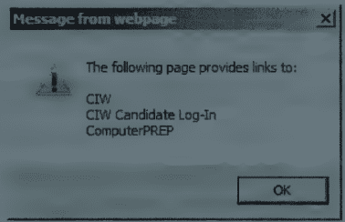
图 6-1：文本中带换行的提示框

- 3. **编辑器：** 找到内容为以下内容的注释：
```javascript
//Add big() and fontcolor() methods.
```
将 `big()` 和 `fontcolor()` 方法添加到文本 **CIW Sites** 上。为 `fontcolor()` 方法选择任意颜色作为参数。

- 4. **编辑器：** 找到内容为以下内容的注释：
```javascript
//Add italics() method.
```
将 **italics()** 方法添加到文本 **CIW** 上。

- 5. **编辑器：** 找到内容为以下内容的注释：
```javascript
//Add link() method
//Use http://www.CIWcertified.com.
```
将 **link()** 方法添加到文本 **CIW**、**CIW Candidate Log-In** 和 **ComputerPREP** 上。按照以下代码所示，使用注释中包含的 URL 作为 `link()` 方法的参数：

```javascript
<script type="text/Javascript">
<!--
function linksFun() {
    var content="", linkWindow;
    //Add the alert() shown in Figure 6-1
    alert("The following page provides links to: \n\nCIW\nCIW Candidate Log-In \nComputerPREP");

    content += "<html><head><base target='_blank'></head><body>";
    content += "";

    //Add big() and fontcolor() methods
    content += "CIW Sites".big().fontcolor("blue");
    content += "<p>\nThese are sites of interest to ";

    //Add italics() method
    content += "CIW".italics();
    content += " candidates.</p>\n";
    content += "<ul><li>";

    //Add link() method
    //Use http://www.CIWcertified.com
    content += "CIW".link("http://www.CIWcertified.com");
    content += "\n</li>";

    content += "\n<li>";
    //Add link() method
    //Use http://www.CIWcertified.com/CandidateLogin
    content += "CIW Candidate Log-In".link("http://www.CIWcertified.com/CandidateLogin");
    content += "\n</li>";
    content += "\n<li>";
    //Add link() method
    //Use http://www.ComputerPREP.com/
    content += "ComputerPREP".link("http://www.ComputerPREP.com/");
    content += "\n</li></ul></body></html>";

    linkwindow=open("","Links","width=350,height=200,resizable=1");

    with(linkwindow.document) {
        open();
        write(content);
        close();
    }
//-->
</script>
```

- 6. **编辑器：** 检查 `linksFun()` 函数中的其余代码。
- 7. **编辑器：** 在文档主体中，找到内容为 `<!--Add HREF code -->` 的注释。按粗体所示修改 `<a>` 标签：
```html
<a href ="javascript:void(linksFun());" 
onmouseover="status='CIW Links';return true;" 
onmouseout="status='';return true;"> 
</a>
```
- 8. **编辑器：** 保存 `lab6-1.htm`。
- 9. **浏览器：** 打开 `lab6-1.htm`。你的屏幕应类似于图 6-2。

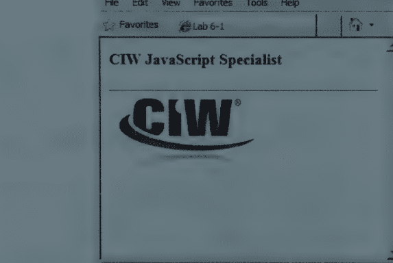
图 6-2：lab6-1.htm 的页面

- 10. **浏览器：** 点击 CIW 图片。你首先应看到如图 6-1 所示的提示对话框。然后你会看到一个小窗口出现。这个小窗口应类似于图 6-3。如果不是，请验证你输入的源代码是否正确。

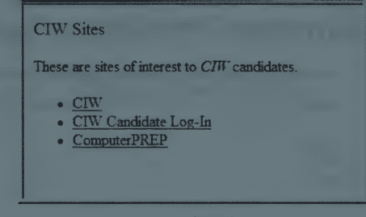
图 6-3：链接窗口

- 11. **浏览器：** 点击链接，确保它们能访问到相应的网站。

在此实验中，你学习了如何使用 String 对象的一些格式化方法在新窗口中操作文本。如果时间允许，请尝试编辑源代码文件，以融入其他格式化方法和其他特殊字符。

在前面实验中，你添加了以下代码行：
```html
<a href="javascript:void(linksFun());">
```
`javascript:` URL 语法可用于任何包含 `href` 或 `src` 属性的 X/HTML 标签。这种语法允许开发者在不导航到任何位置的情况下，在这些标签中编写脚本操作。在前面的示例中，`void` 关键字防止链接输出被调用函数可能返回的任何值。`javascript:void()` 机制是一个实用的工具，用于从链接调用 JavaScript 函数而不将用户发送到新页面。

#### String 对象的 prototype 属性

String 对象提供了强大的 `prototype` 属性。此属性允许你为 String 对象创建自己的方法和属性。使用 prototype 属性创建新方法或属性后，这些方法或属性将对当前文档中任何后续的 String 对象可用。

要为 String 对象创建新方法，在正常的 JavaScript 函数中定义要执行的文本操作。然后使用 prototype 属性将新方法分配给 String 对象。要创建新属性，请使用 prototype 属性命名和定义新属性。考虑以下示例：

```html
<!DOCTYPE HTML PUBLIC "-//W3C//DTD HTML 4.01 Transitional//EN">
<html>
<head>
<script language="JavaScript" type="text/javascript">
<!--

function blueVerdanaFont() {
    return "<font face='Verdana' color='blue' size='6'>" + this.toString() + "</font>";
}

String.prototype.blueV = blueVerdanaFont;
String.prototype.blueVDescription = "The blueV() function \n
```


```javascript
creates blue Verdana font.";

//--
</script>
</title>
</head>
<body>
<script language="JavaScript" type="text/javascript">
<!--

document.write("The following text is " + 
"blue Verdana".blueV() + " font.");
document.write("<p>" + "blueV".blueVDescription + "</p>");

//--
</script>
</body>
</html>
```

名为 `blueVerdanaFont()` 的函数定义了新字符串方法的功能。当该函数作为对象的方法被调用时，函数中的字符串数据将返回给一个 String 对象。`this` 关键字是对调用该方法的对象的引用，而该方法通过 `toString()` 方法被转换为字符串。随后，`toString` 的输出与其它字符串拼接，并返回给调用对象。请注意以下行代码：

```javascript
String.prototype.blueV = blueVerdanaFont;
```

在函数定义之后，这一行创建了方法名 `blueV()`。请注意，`blueV()` 这个名称是由开发人员定义的，且在函数名 `blueVerdanaFont` 之后没有括号。如果加上括号，将会直接调用该函数，而这并不是这段代码的目的。现在，就像任何其他 String 对象方法一样，可以使用 `blueV()` 语法来调用该方法。前一个示例中的以下代码演示了这一概念：

```javascript
"blue Verdana".blueV()
```

名为 `blueVDescription` 的新 String 属性是通过前一个示例中的以下代码创建的：

```javascript
String.prototype.blueVDescription = "The blueV() function creates blue Verdana font.";
```

然后使用以下代码访问该新属性所持有的值：

```javascript
document.write("blueV".blueVDescription);
```

请注意，`blueVDescription` 属性也可以使用以下语法访问：

```javascript
document.write(String.prototype.blueVDescription);
```

如果执行示例中的代码，输出结果将类似于图 6-4。

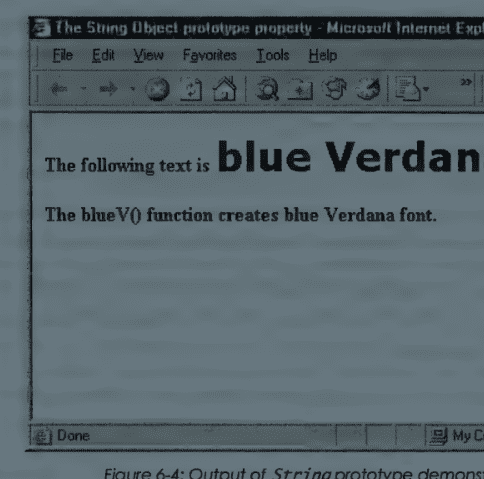
图 6-4：*String* 原型演示的输出

你创建并附加到 String 对象的方法可以根据需要变得任意复杂。虽然本例中仅演示了字符串格式化，但通过原型化的 String 对象方法可以执行任何类型的字符串操作。

## *String* 对象的常见语法错误

新入行的 JavaScript 开发人员经常忘记以正确的方式应用某些 String 对象方法。例如，以下是一个常见的错误：

```javascript
var myString = "This is text.";
myString.toUpperCase();
myString.bold();
document.write(myString);
```

这段代码对 `myString` 变量没有产生预期效果，因为这类方法的返回结果必须赋值给一个变量，如下所示：

```javascript
myString = myString.toUpperCase();
```

或者，必须立即对变量或字符串进行操作，如下所示：

```javascript
document.write(myString.bold());
document.write(myString.toUpperCase());
```

这段代码对 `myString` 变量产生了预期效果。然而，如果要同时应用这两个方法，必须将它们堆叠起来，如下所示：

```javascript
document.write(myString.toUpperCase().bold());
```

## 额外的 *String* 对象方法

到目前为止，本节已经向你介绍了字符串以及与 String 对象相关的几种文本格式化方法。这些方法非常实用且能节省时间，但它们并不是 String 对象提供的最强大的方法。接下来，你将学习允许你评估字符串长度、内容以及某些字符是否存在等项的方法。

#### 评估字符串

为了检查字符串（可能是为了验证表单元素值或 Cookie），你必须首先学习 String 对象可用的评估方法。本节将教你如何有效地检查字符串数据以用于编程目的。

##### String 对象的 length 属性

数据验证中的一项常见任务是测试字符串的长度。例如，假设你创建了一个带有文本框的表单，用户在其中输入其电子邮件地址。在表单提交之前，你可以测试电子邮件地址是否至少包含六个字符（有效电子邮件地址的最小字符数）。要确定任何字符串的长度，可以使用 `length` 属性。语法如下：

```javascript
string.length;
```

以下是一个测试字符串字面量长度的示例：

```javascript
"Hello, World!".length;
```

此表达式将得出整数值 13，代表短语 "Hello, World!"（包括空格）中的字符数。以下示例测试了变量的长度：

```javascript
var userName = "Jose";
userName.length;
```

前一个示例中的第二条语句将返回整数值 4，即 `userName` 变量所包含的任何字符串的长度。

##### String 对象的 indexOf() 方法

`indexOf()` 方法测试给定字符是否存在，并返回一个代表该字符在字符串中位置的索引值。例如，假设你想测试用户是否输入了有效的电子邮件地址。你可以测试任何给定字符（如 @ 符号）的存在及其位置。

`indexOf()` 方法的通用语法如下：

```javascript
string.indexOf(searchText, startingIndexPosition);
```

例如，考虑以下语句：

```javascript
"This is a test".indexOf("h", 0);
```

检查该语句的参数部分 ("h", 0)。该参数指示 `indexOf()` 方法从索引为零的字符（字符串中的第一个字符）开始搜索字符串中字母 h 第一次出现的位置。该语句将返回值 1，因为字母 h 是字符串起始位置右侧的第一个字符（即第二个字符）。在 JavaScript 中，字符串的索引是从零开始的。因此，在此示例字符串中，字母 T 位于位置 0。现在考虑以下示例：

```javascript
"johndoe@company.com".indexOf("@", 0);
```

此语句将返回值 7。然而，考虑以下语句：

```javascript
"johndoe@company.com".indexOf("doe@", 5);
```

此语句将返回值 -1，因为从位置 5（从左起第六个）到字符串末尾没有找到字符串 *doe@*。-1 始终意味着从指定的起始位置向后搜索时未找到所寻字符串。请注意，无论搜索在字符串中的哪个位置开始，返回的整数值始终是相对于字符串第一个字符的。如果未指定 `startingIndexPosition`，搜索将始终从字符串的第一个字符（位置 0）开始。

如果你想验证电子邮件地址的正确格式，可以使用 `indexOf("@")` 表达式来验证 @ 符号的存在。

##### String 对象的 lastIndexOf() 方法

名为 `lastIndexOf()` 的方法是 `indexOf()` 的变体。正如你所推测的，该方法返回指定搜索文本最后一次出现位置的索引值。其机制略有不同，因为 `lastIndexOf()` 是从字符串的结束位置而不是起始位置进行搜索的。`lastIndexOf()` 的通用语法如下：

```javascript
string.lastIndexOf(searchText, startingIndexPosition);
```

例如：

```javascript
"ABRACADABRA".lastIndexOf("ABRA", 10);
```

检查该语句的参数部分 ("ABRA", 10)。该参数指示 `lastIndexOf()` 方法从字符串的第十个（即最后一个）字符开始搜索 ABRA 最后一次出现的位置。该语句将返回值 7，尽管 ABRA 第一次出现是从位置 0 开始的。考虑下一个示例：

```javascript
"ABRACADABRA".lastIndexOf("ABRA", 6);
```

此语句的参数部分指示 `lastIndexOf()` 方法从字符位置 6 开始搜索字符串。该语句将返回值 0，正确地定位到从索引位置 0 开始的搜索字符串 ABRA。

与 `indexOf()` 方法类似，如果没有指定 `startingIndexPosition`，`lastIndexOf()` 方法将从字符串末尾开始。且返回的整数值始终是相对于字符串第一个字符的。

##### String 对象的 substring() 方法

当你想要检查并提取字符串的一部分时，可以使用 `substring()` 方法。`substring()` 方法的通用语法如下：

```javascript
string.substring(startingIndexPosition, endingIndexPosition);
```

`startingIndexPosition` 参数是从字符串开头开始的从零开始的计数，而 `endingIndexPosition` 参数是你希望提取的字符串结束位置之后的一个字符。

考虑以下示例：

```javascript
"ABC1234XYZ".substring(3,7);
```

此语句将返回以下值：

1234


在此语句中，1 是第四个字符（索引位置 3），而 4 是索引位置 7 之前的最后一个字符。因此 1234 是从索引位置 3 开始直到但不包括索引位置 7 的序列。

`substring()` 和 `indexOf()` 方法经常结合使用来进行字符串操作和验证。例如，你可以通过以下方式确定电子邮件地址中的主机名：

```
var myEmail = "gregory@someplace.com";
var start = myEmail.indexOf("@") + 1;
var myHost = myEmail.substring(start, myEmail.length);
alert(myHost);
```

在上述示例中，变量 `myEmail` 包含一个电子邮件地址。变量 `start` 被赋值为对 `myEmail` 变量应用 `indexOf()` 方法搜索 `@` 符号后返回的整数值。请注意，该值加上了整数 1。表达式 `myEmail.indexOf("@")` 返回整数值 7。由于主机名是从电子邮件地址中提取的，你必须从 `@` 符号之后的一个位置开始。因此，在原始返回值上加上了整数 1。`myHost` 变量被赋值为从索引位置 8 开始，到 `myEmail.length` 返回的整数值（即 21）结束所提取的子字符串。如果你能在执行时看到那行代码，它将显示如下：

```
var myHost = myEmail.substring(8, 21);
```

在这种情况下，`substring()` 方法提取并返回从索引位置 8（"someplace" 中的字母 s）开始，到索引位置 21 之前的一个字符（"com" 中的字母 m）结束的字符串。这个提取出来的字符串就是主机名 `someplace.com`。

#### substr() 方法

JavaScript 1.2 引入了 `substring()` 方法的替代方案：`substr()` 方法。该方法与 `substring()` 方法一样，用于提取字符串的一部分。然而，这两个方法的参数有所不同：

- **substr()** —— 你指定起始索引位置以及从该位置开始要提取的字符数。
- **substring()** —— 你指定起始索引位置和结束索引位置。

参考以下示例：

```
var myString = "This is text.";
var mySubStr = myString.substr(1, 3);
var mySubString = myString.substring(1, 3)
document.write(mySubStr + " " + mySubString);
```

这段代码将输出：

```
his hi
```

在这个示例中，`substr()` 方法从索引位置 1 开始并返回 3 个字符。`substring()` 方法从索引位置 1 开始，并在索引位置 3 之前的一个字符处结束其字符串。

#### String 对象的 charAt() 方法

当你想要提取字符串中特定位置的单个字符时，可以使用 `charAt()` 方法。`charAt()` 方法的通用语法如下：

```
string.charAt(indexPosition);
```

`indexPosition` 参数是一个整数值，代表要提取字符的索引位置。参考以下示例：

```
"ABCDEF".charAt(3);
```

该语句将返回值 D。

> 请记住，数组从 0（零）开始。新开发人员经常犯的另一个错误是忘记在计算数组元素时，是从 0, 1, 2, 3 ... 等开始的。

`charAt()` 方法认为字符串索引值是以零为基准的，就像之前的字符串评估方法一样。此方法与 `substring()` 方法类似，但 `charAt()` 仅提取单个字符。

如前所述，String 对象的方法和属性经常结合使用。例如，要提取字符串中的最后一个字符，你可以使用以下代码：

```
var myString = "ABCDEF";
var lastChar = myString.charAt(myString.length - 1);
```

在这个示例中，表达式 `myString.length - 1` 返回整数值 5。如果你能在执行时看到那行代码，它将显示如下：

```
var lastChar = myString.charAt(5);
```

这个 `lastChar` 变量将包含值 F。

#### 使用字符串方法进行表单验证

使用字符串方法，你可以测试客户端通过 X/HTML 表单提供的信息中的某些模式。例如，信用卡号遵循一定的模式，你可以对其进行测试。虽然严谨地实现这一技术超出了本课程的范围，但你应该考虑以这种方式使用 String 对象方法。

在进行客户端表单验证时，测试长度、检查某些字符是否存在、检查子字符串的位置以及你在本节课中学到的其他方法都非常重要。

你无法确保用户输入的信息绝对正确，但你可以拦截那些显然错误的数据。例如，如果你要求输入电子邮件地址而 `@` 符号不存在，你可以确定用户输入的信息不符合有效的电子邮件地址语法。然而，`@` 符号的存在并不能保证输入的电子邮件地址有效或准确；任何人都可以提交一个虚假的电子邮件地址。尽管如此，有限的验证也比完全没有验证要好。

以下实验演示了一些用于操作文本框内容的 String 对象方法。假设你正在为公司提供的一项竞赛创建表单。你的市场部门需要所有提交表单的网站访问者的准确联系信息，以便他们授予奖品并进行后续销售电话。根据经验，你知道网站用户在提交在线表单时经常在电话号码和电子邮件地址中出现拼写错误。因此，你使用 String 对象的方法来检查用户的表单输入。你可以验证他们是否输入了正确数量的电话号码数字以及正确的电子邮件地址语法。你还可以将他们的输入转换为大写或小写字母，以与你的数据库输入方案保持一致。这种检查和引导用户输入的做法被称为表单验证。

#### 实验 6-2：将字符串方法应用于文本

在本实验中，你将使用 String 对象的一些方法来检查和操作几个文本框的内容。此外，本实验将复习另一个方法：`toUpperCase()` 字符串转换方法。你将在课程后面的部分学习更多关于表单验证的内容。

1. **编辑器：** 从 `Student_Files` 目录的 `Lesson 6` 文件夹中打开文件 `lab6-2.htm`。

2. **编辑器：** 检查以下 JavaScript 代码（这段代码将在实验后详细讨论）：

```
<script type="text/javascript">
<!--
function showUpper(checked) {
	var showThis;
	if (checked) {
		showThis = document.myForm.name.value.toUpperCase();
	} else {
		showThis = document.myForm.name.value.toLowerCase();
	}
	document.myForm.name.value = showThis;
}

function emailTest(form) {
	if (form.email_address.value.indexOf("@", 0) < 0) {
		alert("This is not a valid e-mail address!");
	} else {
		alert("This could be a valid e-mail address");
	}
}

function showFirst2(form) {
	var first2Chars;
	first2Chars = form.phone_number.value.substring(0, 2);
	alert(first2Chars);
}
//-->
</script>
```

3. **编辑器：** 在源代码中找到 `<form>` 标签并检查以下内容（特别是**粗体**部分）：

```
<form name="myForm" id="myForm">Name:<br />

<input type="text" size="30" name="name" />
<input type="checkbox" name="upperCheckbox"
onclick="showUpper(this.checked);"/>
Convert string to uppercase or lowercase<br />

E-mail address:<br />
```

```
<input type="text" size="30" name="email_address" />
```

```
<input type="checkbox" onclick="(this.checked) ? emailTest(this.form) : '';"/>
```

```
Test for e-mail address<br />
```

```
Phone number:<br />
```

```
<input type="text" size="30" name="phone_number" /><br />
```

```
Fax number:<br />
```

```
<input type="text" size="30" name="fax_number" />
```

```
<p>
```

```
<input type="button" value=
```

```
"First Two Characters of Phone Number" onclick=
```

```
"showFirst2(this.form);" />
```

```
</p>
```

```
<p>
```

```
<input type="button" value="Fax Number Length" onclick=
```

```
" var strLength = document.myForm.fax_number.value.length; alert('That string
```

```
is ' + strLength + ' characters long');" />
```

```
</p>
```

```
</form>
```

4. **编辑器：** 关闭文件。

5. **浏览器：** 打开 `lab6-2.htm`。你的屏幕应类似于图 6-5。输入一些文本并测试你的选项。

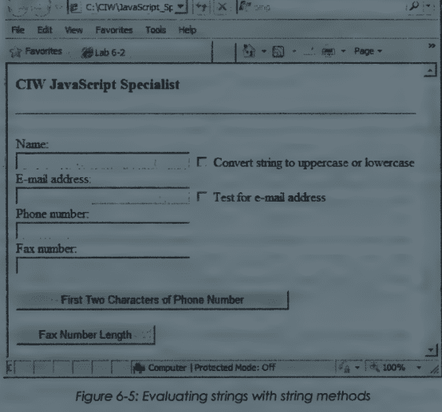

图 6-5：使用字符串方法评估字符串

6. **编辑器：** 在时间允许的情况下，修改 `emailTest()` 函数，增加一项测试以确保电子邮件地址长度至少为六个字符。`Lesson 6` 学生文件中包含一个名为 `lab6-2a.htm` 的建议解决方案。

本实验演示了几个 String 对象方法。


#### 剖析实验 6-2

在之前的实验程序中，第一个函数的名称是 `showUpper()`。该函数通过以下代码被调用：

```
<input type="checkbox" name="boxtocheck" onclick="showUpper(this.checked);" />
```

这段代码使用了按钮对象的 `onclick` 事件处理程序来调用 `showUpper()` 函数。传递给函数的参数是 `this.checked`。在 JavaScript 中，关键字 `this` 用于引用在脚本中使用它的对象。在这种情况下，`this.checked` 是以下表达式的简写方式：

```
document.myForm.upperCheckbox.checked;
```

本课程的下一节将详细讨论表单元素以及如何访问表单元素的值。目前，你只需要知道复选框元素有一个名为 `checked` 的布尔属性。如果复选框被选中，该属性返回 true 值；如果未选中，则返回 false 值。当 `showUpper()` 函数被调用时，它会根据复选框的状态被传递 true 或 false。

##### showUpper() 函数

以下是 `showUpper()` 函数：

```
function showUpper(checked) {
    var showThis;
    if (checked) {
        showThis = document.myForm.name.value.toUpperCase();
    } else {
        showThis = document.myForm.name.value.toLowerCase();
    }
    document.myForm.name.value = showThis;
}
```

该函数被编写为接收由 `checked` 参数持有的参数。声明了一个名为 `showThis` 的变量。使用 `checked` 参数作为测试条件启动了一个 `if...else` 语句。`(checked)` 表达式将返回 true 或 false 值。如果评估结果为 true，则 `showThis` 变量被赋值为将名称表单元素转换为大写后的值。如果 `(checked)` 表达式返回 false，则 `else` 子句中的代码将 `showThis` 变量赋值为将名称元素转换为小写后的值。在 `if...else` 语句之后，表单元素 `name` 被赋值为 `showThis` 变量的值。

##### emailTest() 函数

`emailTest()` 函数通过以下语句被调用：

```
<input type="checkbox" onclick="(this.checked) ? emailTest(this.form) : '';" />
```

这里再次使用 `onclick` 事件处理程序来调用函数。在这种情况下，使用了 JavaScript 条件运算符 (`? :`)。表达式 `this.checked` 是条件表达式。如果 `this.checked` 返回 true 值，则调用 `emailTest()` 函数。如果 `this.checked` 返回 false 值，则执行冒号后面的代码。正如之前的示例一样，一对空的引号表示程序不应执行任何操作。当 `emailTest()` 函数被调用时，`this.form` 作为参数被传递。这使得表单元素的值可以被该函数访问。

以下是 `emailTest()` 函数：

```
function emailTest(form) {
    if (form.email_address.value.indexOf("@",0) < 0) {
        alert("This is not a valid e-mail address!");
    } else {
        alert("This could be a valid e-mail address");
    }
}
```

该函数包含一个 `if...else` 语句。条件表达式使用 `indexOf()` 方法来确定在 `email_address` 表单元素中输入的值是否包含 @ 符号。条件表达式检查 `indexOf()` 方法返回的值是否小于 0。请记住，如果在字符串中没有找到搜索文本，将返回 -1。随后，将根据条件表达式返回的布尔值执行相应的 `alert()` 方法。

`showFirst2()` 函数通过以下语句被调用：

```
<input type="button" value="First Two Characters of Phone Number"
    onclick="showFirst2(this.form);" />
```

此语句使用按钮对象的 `onclick` 事件处理程序来调用 `showFirst2()` 函数。以下是 `showFirst2()` 函数：

```
function showFirst2(form) {
    var first2Chars;
    first2Chars = form.phone_number.value.substring(0, 2);
    alert(first2Chars);
}
```

在此函数中，声明了一个名为 `first2Chars` 的变量。该变量被赋值为对 `phone_number` 表单元素中的值应用 `substring()` 方法后返回的值。`substring()` 方法的参数 `(0, 2)` 指示该方法提取从索引位置 0 开始并结束于索引位置 2 之前字符的字符串。因此，该字符串将包含索引位置 0 和索引位置 1 的字符，即字符串的前两个字符。随后，`alert()` 方法将显示提取出的字符串。

##### 内联脚本与事件处理

最后一段代码包含另一个内联脚本示例。请考虑这段代码：

```
<input type="button" value="Fax Number Length"
    onclick="var strLength = document.myForm.fax_number.value.length;
    alert('That string is ' + strLength + ' characters long');" />
```

这段代码证明了可以通过 `onclick` 事件处理程序编写并执行多行代码。与任何 JavaScript 代码块一样，每行待执行的代码都应以分号结尾。在本例中，第一行代码声明了一个名为 `strLength` 的变量。该变量被赋值为通过确定 `fax_number` 表单元素值的长度而返回的值。这里使用了 `String` 对象的 `length` 属性来确定该值。随后，`alert()` 方法将 `strLength` 变量与相应的文本拼接后显示。

***

**目标 2.3.3：正则表达式与 RegExp 对象**

- **正则表达式 (regular expression)**：在脚本/编程中，一种在文本中搜索指定模式的机制。

### JavaScript 正则表达式

JavaScript 1.2 规范将正则表达式引入了 JavaScript 语言。**正则表达式**提供了一种机制，使开发人员能够在文本中搜索指定模式。长期以来，正则表达式一直是许多编程环境的一部分，尤其是在用于 UNIX 操作系统的语言中。将正则表达式添加到 JavaScript 语言中，为 JavaScript 程序提供了强大的模式匹配能力。

正则表达式使用字符和/或符号字符串来识别文本模式。定义好的模式随后被用于搜索另一个字符串，以确定该模式是否存在于该字符串中。这种搜索可用于验证字符串的内容，或者执行替换操作。正如你所学过的，`indexOf()` 和 `lastIndexOf()` 方法可以用来执行这类操作，且在搜索文本与字符串完全匹配（或不匹配）时效率极高。

然而，当你需要执行不同类型的操作时，正则表达式的威力就显现出来了。例如，假设你需要检查一个字符串以确保它符合电话号码格式。你不可能检查每一个具体的电话号码。通过正则表达式，你可以轻松创建一个电话号码模式，并用它来检查任何字符串。

#### RegExp 对象

JavaScript 提供了内置的 `RegExp` 对象来处理正则表达式。不过，字面量字符串可以在不创建显式 `RegExp` 对象的情况下使用正则表达式。这种能力遵循了 JavaScript 处理字符串的总体方法。就像你可以无需创建正式的 `String` 对象而使用 `String` 属性和方法一样，你也可以无需创建正式的 `RegExp` 对象而使用正则表达式。

#### 创建正则表达式

以下示例演示了如何创建两个简单的正则表达式。这些正则表达式描述的操作类型与你使用 `indexOf()` 方法可以执行的操作相同。创建的模式仅仅是你需要匹配的文本字符串。第一个示例使用字面量文本，而第二个示例使用 `RegExp` 对象来创建模式：

```
var myRegExp = /Juan/;

var myRegExp = new RegExp("Juan");
```

在第一个示例中，正则表达式由两个正斜杠分隔。第一个斜杠标志着正则表达式的开始，第二个斜杠标志着正则表达式的结束。在第二个示例中，一个新的 `RegExp` 构造函数创建了一个 `RegExp` 对象，构造函数的参数（所需模式）放在引号内并包含在圆括号中。两种创建正则表达式的方法都是可行的，且最终都导致创建了一个正则表达式对象。不过，第一个示例更简洁，且最终效率更高。

模式创建之后，可用其执行各种字符串操作。例如，`RegExp` 对象提供了 `test()` 方法，用于测试字符串是否包含匹配的模式。请参考以下示例：

```
var myNames = "Paul, George, Ringo, John";
var myRegExp = /John/;
document.write(myRegExp.test(myNames));
```


前面示例的输出将是 true，因为模式 `/John/` 在 `myNames` 字符串中被找到。注意，`test()` 方法是由一个代表正则表达式的变量调用的。要测试的字符串作为参数传递给 `test()` 方法。

#### 字符串对象的更多方法

字符串对象提供了几种可用于纯文本或正则表达式的方法。这些方法包括：

- **test()** — 测试字符串是否匹配某个模式；由一个代表正则表达式的变量调用。
- **split()** — 分割字符串并返回子字符串数组。
- **search()** — 在字符串中搜索文本字符串，如果找到则返回该字符串的索引位置。
- **match()** — 与 `search()` 方法类似，但它返回匹配文本的数组，而不是索引位置。
- **replace()** — 接收两个参数：第一个是要被替换的字符串，第二个是替换文本。

`replace()` 方法在以下示例中演示：

```javascript
var myNames = "Paul, George, Ringo, John";
var myRegExp = /John/;
myNames = myNames.replace(myRegExp, "Johnny");
document.write(myNames);
```

此示例的输出将是 Paul, George, Ringo, Johnny。`replace()` 方法接收两个参数。第一个是要被替换的字符串，第二个是替换文本。

> **技术提示**：有关 `split()`、`search()` 和 `match()` 方法的更多信息，请查阅 JavaScript 参考手册。

#### 包含字母数字字符的模式

到目前为止，所演示的所有操作都可以使用 `indexOf()` 方法完成，在 `replace()` 方法的示例中则需要一些字符串解析代码。你可以像前面的示例那样使用正则表达式，但它们的真正威力在于创建非纯文本的模式时才显现出来。考虑以下示例（在你的学生文件夹中，文件名为 example_phoneNumberTest.htm），该示例测试电话号码格式是否正确：

```javascript
var myTeleNum = "555-123-1234";
var myRegExp = /\d{3}-?\d{3}-?\d{4}/;
document.write(myRegExp.test(myTeleNum));
```

此示例的输出将是 true，因为 `myTeleNum` 变量持有的值与 `myRegExp` 创建的模式匹配。前例中创建的正则表达式看起来相当复杂，但当你逐段剖析并检查时，模式就会变得清晰，具体如下：

| 术语 | 定义 |
| :--- | :--- |
| 元字符 | 在编程中，指具有特殊含义的字符，或可以代表多种其他字符的字符。 |

- 该行以正斜杠（ `/` ）开头，这告诉解释器你正在为 RegExp 开始一个模式。
- 正如你已经学过的，反斜杠字符界定模式。模式中的第一个符号是 `\d` 符号。该符号被称为**元字符**，用于表示 0 到 9 之间的任何数字。
- `\d` 之后是 `{3}`，它是一个计数元字符，用于表示紧跟在它前面的字符必须出现指定的次数。在本例中，创建了一个必须以任意三个 0 到 9 之间的数字开头的模式。
- 下一个字符是字面短横线。
- 下一个符号，问号（`?`），也是一个计数元字符。该元字符表示前面的字符（短横线）必须出现零次或一次。
- 下一组字符 `\d{3}` 表示模式随后必须包含任意三个 0 到 9 之间的数字。
- 接着又跟着另一个字面短横线，`?` 元字符表示该短横线必须出现零次或一次。
- 最后一组字符 `\d{4}` 表示模式必须以任意四个 0 到 9 之间的数字结尾。

图 6-6 说明了前面列表中描述的正则表达式。

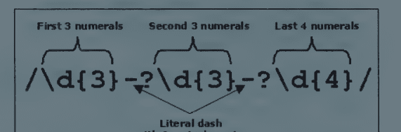

##### 图 6-6：电话号码正则表达式

该电话号码正则表达式可用于验证用户输入。在这种情况下，用户可以 555-123-1234 或 5551231234 的格式输入电话号码。之所以提供此选项，是因为正则表达式中的 `-?` 段表示短横线可以省略，也可以出现一次。

正则表达式提供了各种各样的元字符，可用于创建极其复杂的模式。使用正则表达式可以为你的 Web 应用程序增添强大的文本搜索和替换功能。高级正则表达式的使用超出了本课程的范围。

掌握正则表达式的基础知识对于成为一名优秀的 JavaScript 开发人员至关重要。请记住，正则表达式是区分大小写的，即使是最基本的情况也必须经过广泛测试，因为它们有时会产生意想不到的结果。正则表达式非常强大——正因如此，如果使用不当，它们也可能具有破坏性。

### 数组对象

所有主要编程语言都使用数组概念。你可以将**数组**视为具有多个用于不同值的"槽位"的单个变量。每个槽位都可以通过其索引号来引用。在 JavaScript 中，数组索引号是基于零的，这意味着任何数组中的第一个槽位的默认索引号为 0。

你已经使用的一些对象内置了数组。例如，`window` 对象有一个内置的 frames 数组，允许你通过该数组中的索引号来引用框架。在另一课中，你将看到表单字段可以在表单 elements 数组中引用。

除了这些内置数组外，你还可以创建自己的数组。你可以将任何变量声明为数组变量。你可以使用以下语法声明一个变量将保存数组值：

```javascript
var questions = new Array();
```

此示例使用内置的语言对象 `Array` 作为模板，并基于现有模板对象创建 `Array` 的新实例。

声明数组的另一种方式如下：

```javascript
var questions = new Array(10);
```

此示例定义了一个数组，同时预先指定了它将包含的槽位或值的最大数量。JavaScript 识别此数组中共有 10 个元素，索引号为 0 到 9。然而，预先确定数组大小并没有实际好处，因为可以根据需要为数组中的任何槽位赋值。数组的 `length` 属性（在本课后面讨论）将自动调整其值以适应调整大小后的数组。

要定义数组中的各个值，你列出变量名，后跟方括号，括号内是从 0 开始的索引号：

```javascript
var questions = new Array();
questions[0] = "What is 5 * 6?";
questions[1] = "Who played Scarlett O'Hara?";
questions[2] = "Which horse won the 1980 Irish Derby?";
```

在编程中，方括号内的整数被称为下标。

假设你没有使用前面示例中显示的最后一行代码，而是不小心输入了以下内容：

```javascript
questions[200] = "Which horse won the 1980 Irish Derby?";
```

在这种情况下，你仅需要三个槽位却创建了 201 个槽位，从而消耗了极大量的系统内存。在此示例中，如果在脚本块中访问，`questions[2]` 到 `questions[199]` 将返回 `undefined`。

JavaScript 在创建数组时提供了另一种语法。这种语法在以下示例中演示：

```javascript
var answers = new Array(30, "Vivien Leigh", "Tyrnavos");
```

这种语法在创建元素相对较少的数组时很有用，但也可用于创建任意数量元素的数组。元素的值以逗号分隔列表的形式输入。在前面的示例中，注意整数值没有放在引号中，而字符串字面量则放在引号中。然后可以使用以下语法访问 answers 数组元素：

```javascript
document.write(answers[0]); // outputs 30
document.write(answers[1]); // outputs Vivien Leigh
document.write(answers[2]); // outputs Tyrnavos
```

JavaScript 1.2 还提供了另一种创建和填充数组的方法。考虑以下示例：

```javascript
var answers = [30, "Vivien Leigh", "Tyrnavos"];
```

方括号的作用类似于调用 new Array 构造函数。

以下各节将简要介绍一些常用的数组对象方法。

#### 数组对象的 join() 方法

`join()` 方法创建数组值的字符串。`join()` 方法需要一个参数：将作为元素值分隔符的字符。考虑以下示例：

```javascript
var myArray = new Array("value 1", "value 2", "value 3");
var myArrayString = myArray.join(",");
document.write(myArrayString);
```

前面示例的输出如下：

Value 1,value 2,value 3

注意，原始数组不会被此方法修改。当你需要将数组的值发送到表单字段，或者发送到期望字符串而非数组值的 CGI 程序时，此方法特别有用。

#### 数组对象的 reverse() 方法

`reverse()` 方法用于反转数组元素的顺序。在此方法中，数组中的最后一个元素将占据 0 索引位置。考虑以下示例：

```javascript
var myArray = new Array("value 1", "value 2", "value 3");
myArray.reverse();
document.write(myArray);
```

注意，前面的示例包含 `document.write(myArray);` 语句。JavaScript 将输出数组元素值的逗号分隔列表，而不是访问单个数组元素。前面示例的输出如下：

value 3,value 2,value 1

注意，原始数组会被此方法修改。

#### 数组对象的 sort() 方法

`sort()` 方法将数组元素按特定顺序排列。此方法可以使用用户定义的函数对数组进行排序，也可以默认方式使用。当不使用函数时，`sort()` 方法将数组元素转换为字符串，并对值进行字母排序。`sort()` 方法使用 ASCII 等效字符进行排序操作。此功能对

如果你的数组包含数值，并且你正在使用 `sort()` 方法对数组进行排序。现在考虑一个元素包含字符串值的数组：

```
var myArray = new Array("my dog", "your cat", "her fish");
myArray.sort();
document.write(myArray);
```

上述示例的输出结果如下：

```
her fish,my dog,your cat
```

如前例所示，`sort()` 方法在处理字符串值时表现符合预期。有关 `sort()` 方法用于数值类型数组元素的详细信息，请参阅相关附录。

需要注意的是，当使用 `sort()` 方法对数组进行排序时，数组并不会被复制，而是被实际地重新排列。以之前的示例为例，排序后 `myArray[0]` 将返回 `her fish`。这个概念将在下一个实验中进行演示。

#### Array 对象的 length 属性

每个 Array 对象都有一个 `length` 属性，它返回数组中元素的总数。请记住，一个包含三个元素的数组，其索引编号为 0、1 和 2。

以 `questions` 数组示例为例，假设你输入以下代码：

```
alert(questions.length);
```

你将看到如图 6-7 所示的消息。

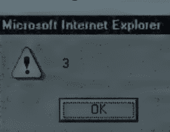

在利用循环结构访问数组元素时，`length` 属性尤其有用。以下示例使用了之前讨论的 `questions` 数组：

```
var len = questions.length;

for (i = 0; i < len; i++) {
  document.write("<p>" + questions[i] + "</p>");
}
```

请注意，循环计数变量 `i` 被放置在方括号内。


不同项目，它们的到期日期也各不相同——总是在太平洋时间午夜到期，这是您总部所在的时区。由于优惠券在主页上展示且使用频繁，您的客服部门表示，有时会收到顾客投诉，因为顾客尝试使用已经过期的优惠券。尽管检查到期日期是顾客的责任，但您认为在页面上提前显示日期和网站本地时间可能会有所帮助，这样顾客就可以对照优惠券进行核对，避免任何不便。您使用 JavaScript 在网站主页上发布这些信息，正好放在优惠券链接的上方，信息内容为："When does your coupon expire?"

#### 实验 6-4：使用 Date 对象访问和使用日期

在本实验中，您将使用 Date 对象和 Array 对象来确定和使用当前日期的信息。您还将使用一个简单的公式为月份中的日期数字添加合适的后缀（将基数词变为序数词，这是日期中常用的形式）。

- 1. **编辑器：** 从 Student_Files 目录的 Lesson 6 Folder 中打开文件 `lab6-4.htm`。代码如下所示。注意粗体代码部分，您将在那里创建日期对象：

```javascript
<script type="text/javascript">
<!--

// Create Date object
var monthName = new Array();
monthName[0] = "January";
monthName[1] = "February";
monthName[2] = "March";
monthName[3] = "April";
monthName[4] = "May";
monthName[5] = "June";
monthName[6] = "July";
monthName[7] = "August";
monthName[8] = "September";
monthName[9] = "October";
monthName[10] = "November";
monthName[11] = "December";

var myYear = today.getFullYear();
var myDate = today.getDate();

var dayExt = "th";

if ((myDate == 1) || (myDate == 21) || (myDate == 31)) dayExt = "st";
if ((myDate == 2) || (myDate == 22)) dayExt = "nd";
if ((myDate == 3) || (myDate == 23)) dayExt = "rd";

var extDate = myDate + dayExt;

alert("The month number is: " + (today.getMonth() + 1));
alert("The date number is: " + today.getDate());
alert("The year number is: " + today.getFullYear());

// -->
</script>

</body>
<h3>CIW JavaScript Specialist</h3>
<hr />
```

**目标**
2.3.5：Date 和 Math 对象

```javascript
<h4>Today is the
<script type="text/javascript">
<!--
document.write(extDate + " day of ");
document.write(monthName[today.getMonth()] + " in the year ");
document.write(myYear + ".");
// -->
</script>
</h4>
```

- 2. **编辑器：** 找到以下注释：
`//Create Date object.`
创建一个名为 **today** 的变量，并将创建 Date 对象的结果赋值给它。

- 3. **编辑器：** 与您的讲师一起检查源代码的其余部分，然后保存 **lab6-4.htm**。

- 4. **浏览器：** 打开 **lab6-4.htm**。应该会弹出三个警告对话框，分别显示月份数字、日期数字和年份数字，如图 6-12 所示。

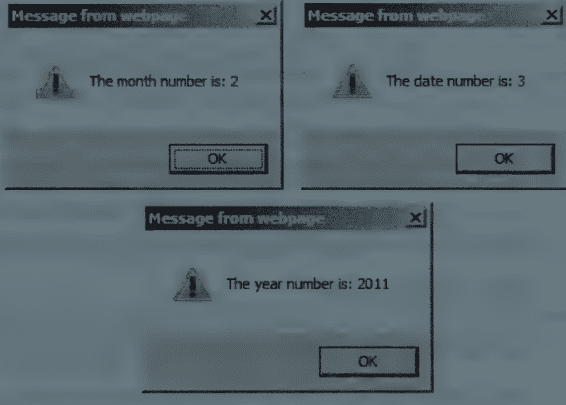

- 5. **浏览器：** 关闭警告框后，您的屏幕应该与图 6-13 类似，只是显示的日期、月份和年份可能不同。


**图 6-13：** 通过脚本计算的日期信息

在本实验中，您使用了 Array 对象以及 Date 对象来确定和使用当前日期的信息。您还使用了一个简单的公式为月份中的日期数字添加了合适的后缀（即将基数词变为序数词，这是日期中常用的形式）。

#### 分析实验 6-4

在前面的实验中，您在代码的第一行创建了一个 Date 对象。该行声明并实例化了变量 `today`。该变量保存了对新 Date 对象的引用。

接下来，声明并实例化 `monthName` 变量，使其保存对 Array 对象的引用。然后为 `monthName` 数组元素填充月份名称，如以下代码所示：

```javascript
var monthName = new Array();
monthName[0] = "January";
monthName[1] = "February";
monthName[2] = "March";
monthName[3] = "April";
monthName[4] = "May";
monthName[5] = "June";
monthName[6] = "July";
monthName[7] = "August";
monthName[8] = "September";
monthName[9] = "October";
monthName[10] = "November";
monthName[11] = "December";
```

注意，`monthName` 数组被设计为包含 12 个元素，索引为 0 到 11。

程序中的下一行如下：

```javascript
var today = new Date();
```

变量 `today` 使用函数 `Date()` 进行设置。该函数将创建一个日期对象，其中包含基于用户计算机时间戳的完整日期。如果用户计算机显示的日期不正确，那么任何使用此方法的方法也会反映出不正确的日期。

```javascript
var myYear = today.getFullYear();
```

声明并实例化变量 `myYear`，其值为 `getFullYear()` 方法返回的值。注意，`today` 变量用于调用 `getFullYear()` 方法。

注意，较旧的浏览器（Microsoft 5.x 及更早版本、Netscape Navigator 6.x 及更早版本）使用的是 `getYear()` 方法而非 `getFullYear()` 方法，该方法返回自 1900 年以来的年数。尽管 `getYear()` 现在已被弃用，但在 Web 上仍然很常见，因此您应该了解它并理解如何使用它。

如果在此脚本中使用 `getYear()` 方法而不是 `getFullYear()`，则需要添加类似以下的一行代码来检查和纠正信息的格式：

```javascript
var myYear = today.getYear();
if (myYear < 2000) myYear = myYear + 1900;
```

`if` 语句检查返回的值是否小于 2000，如果是，则加上 1900 以得到正确的年份数字。相比之下，`getFullYear()` 方法返回四位数的年份值，因此不需要进行任何处理。

回到程序，它继续执行以下代码：

```javascript
var myDate = today.getDate();
```

此行声明并实例化变量 `myDate`，其值为 `getDate()` 方法的结果。

接下来，声明变量 `dayExt` 并赋值为 `th`。之所以赋值此值，是因为在将基数词变为序数词时，它是最常见的后缀。程序接下来是以下代码：

```javascript
if ((myDate == 1) || (myDate == 21) || (myDate == 31)) dayExt = "st";
if ((myDate == 2) || (myDate == 22)) dayExt = "nd";
if ((myDate == 3) || (myDate == 23)) dayExt = "rd";
```

这三个 `if` 语句检查 `myDate` 变量的值，并根据结果将合适的后缀赋给 `dayExt`。注意 `if` 语句中逻辑 OR 运算符（`||`）的使用。下一行代码如下：

```javascript
var extDate = myDate + dayExt;
```

此行声明并将变量 `extDate` 赋值为 `myDate` 和 `dayExt` 的连接值。接下来是三个 `alert()` 方法，如以下代码所示：

```javascript
alert("The month number is: " + (today.getMonth() + 1));
alert("The date number is: " + today.getDate());
alert("The year number is: " + today.getYear());
```

注意，`getMonth()` 方法返回的月份数字范围是 0 到 11，其中 0 代表一月。为了得到正确的月份数字，需要在 `getMonth()` 方法的返回值上加 1。

文档主体中的 `document.write()` 语句输出 `extDate` 持有的值、`monthName` 数组中的对应元素以及 `myYear` 持有的值。这些值被连接成适当的文本输出到屏幕上。请注意以下代码行：

```javascript
document.write(monthName[today.getMonth()] + " in the year ");
```

此行中有趣的部分是 `monthName[today.getMonth()]` 部分。同样，`getMonth()` 方法返回的值范围是 0 到 11。`monthName` 数组的元素索引为 0 到 11。例如，对于一年中的第四个月，执行时该部分语句将显示为：

```javascript
monthName[4]
```

不需要进一步处理即可得到正确的月份名称。

#### 设置和提取时间信息

设置和提取时间信息的步骤与设置和提取日期信息相同。首先，您需要创建 Date 对象的新实例。然后使用表 6-3 中指定的 Date 对象的适当方法，即可使用这些信息。

在下一个实验中，您将审阅为页面在表单字段中创建数字时钟的代码。该实验引入了 window 对象的一个全新且有价值的 `setTimeout()` 方法。`setTimeout()` 方法使您能够基于经过的时间间隔调用函数。这个内置的计时器对象可用于递归运行脚本。`setTimeout()` 方法的语法如下：

```javascript
var myTimer = setTimeout(expression, time);
```

术语 `expression` 指的是在经过指定的时间间隔（以毫秒为单位）后要执行的命令或函数调用。变量 `myTimer` 是您可以为此方法分配的可选标识符。如果您打算使用hta `clearTimeout()` 方法来停止计时器，则需要 `myTimer` 变量。该方法的语法如下：

```javascript
clearTimeout(myTimer);
```

如果不需要清除计时器，则无需为其命名，可以使用以下语法：

```javascript
setTimeout(expression, time);
```

在下面的实验中，您将审阅创建时钟的代码。假设您正在为一座小城市最近新开的一家 24 小时咖啡馆开发网站。这家咖啡馆刚刚在附近城市的一家主要报纸上获得了非常好评的报道，因此它希望向所有游客进行推广。这家咖啡馆是该镇唯一提供 24 小时服务的场所。因此，您在主页上添加了一个时钟，并附带一条信息："Yes, we are open right now!"


#### 实验 6-5：创建屏幕时钟

在本实验中，你将复习创建时钟的代码。该程序使用 `setTimeout()` 方法，通过递归调用一个将时间输出到文本框的函数，每秒更新一次时钟。

- 1. **编辑器：** 打开 Student_Files 目录下 Lesson 6 文件夹中的文件 **lab6-5.htm**。
- 2. **编辑器：** 与你的指导老师一起检查以下代码：

```html
<!DOCTYPE html PUBLIC "-//W3C//DTD XHTML 1.0 Transitional//EN" "http://www.w3.org/TR/xhtml1/DTD/xhtml1-transitional.dtd">
<html xmlns="http://www.w3.org/1999/xhtml">
<head>
<meta http-equiv="Content-Type" content="text/html; charset=utf-8" /> <script type="text/javascript">
<!--

function runClock() {
    var timeNow = new Date();
    var hours = timeNow.getHours();
    var minutes = timeNow.getMinutes();
    var seconds = timeNow.getSeconds();
    var ampm = "";

    (seconds < 10) ? seconds = "0" + seconds : seconds;
    (minutes < 10) ? minutes = "0" + minutes : minutes;
    (hours < 12) ? ampm = "AM" : ampm = "PM";
    (hours > 12) ? hours = hours - 12 : hours;
    (hours == 0) ? hours = 12 : hours;

    var stringTime = " " + hours + ":" + minutes + ":" + 
                       seconds + " " + ampm;

    document.clockForm.clockBox.value = stringTime;

    setTimeout("runClock()", 1000);
}

//-->
</script>
<title>Lab 6-5</title>
</head>
<body onload="runClock();">
<h3>CIW JavaScript Specialist</h3>
<hr />
<form name="clockForm" id="clockForm">
<h4>Time Watcher</h4>
<input type="text" name="clockBox" size="11" 
onfocus="blur();" />
</form>
</body>
</html>
```

> 技术说明：当同时使用表单和表格时，请确保你的表单在表格开始之前开始，在表格结束之后结束。表格应完全嵌套在表单内部。否则可能导致意外结果。

- 3. **编辑器：** 关闭文件。
- 4. **浏览器：** 打开 **lab6-5.htm**。你的屏幕应类似于图 6-14。


图 6-14：lab6-5.htm 的页面

#### 检查 Lab 6-5

本实验演示了使用 Date 对象创建屏幕时钟的方法。在此程序中，定义了一个名为 `runClock()` 的函数。使用 `timeNow` 变量创建了一个 Date 对象的引用。声明了变量 `hours`、`minutes` 和 `seconds`，并使用 Date 对象的相应方法为其赋值。还声明了一个名为 `ampm` 的变量。

接下来是程序中的以下几行代码：

```javascript
(seconds < 10) ? seconds = "0" + seconds : seconds;
(minutes < 10) ? minutes = "0" + minutes : minutes;
```

`getSeconds()` 和 `getMinutes()` 方法都将以单个数字返回任何小于 10 的值。例如，如果时间恰好是 9:07:03，未经处理时将显示为 9:7:3。前面的代码行检查 `seconds` 和 `minutes` 变量中保存的值，以确定其中任一是否小于 10。如果是，则在值前添加一个 0。如果值不小于 10，则返回当前值。接下来是以下代码行：

```javascript
(hours < 12) ? ampm = "AM" : ampm = "PM";
```

此行确定 `ampm` 变量的适当值。如果 `hours` 变量小于 12，则将 `ampm` 赋值为 AM；否则将 `ampm` 赋值为 PM。下一行代码如下：

```javascript
(hours > 12) ? hours = hours - 12 : hours;
```

此行检查 `hours` 变量是否大于 12。如果是，则从 `hours` 变量中减去 12。如果不大于 12，则返回 `hours` 中的当前值，以便时钟将显示例如 1:00:00 PM 而不是 13:00:00 PM。下一行代码如下：

```javascript
(hours == 0) ? hours = 12 : hours;
```

此行将 `hours` 变量设置回 12，以防前面的代码行将其设置为 0。如果不等于 0，则返回 `hours` 中的当前值，以便时钟将显示 12:00:00 AM 而不是 0:00:00 AM。接下来，构建 `stringTime` 变量，将适当的值与冒号连接起来以创建正确的时间格式。下一行代码如下：

```javascript
document.clockForm.clockBox.value = stringTime;
```

此行将 `stringTime` 持有的值赋给名为 `clockBox` 的表单元素的值。下一行代码如下：

```javascript
setTimeout("runClock()", 1000);
```

此行调用 `window` 对象的 `setTimeout()` 方法。`runClock()` 函数名作为第一个参数传递，1000 是第二个参数。`runClock()` 函数将每 1000 毫秒，即每秒递归调用一次。文档的 `<body>` 标签如下所示：

```html
<body onload="runClock();">
```

此处，`onload` 事件处理程序用于调用 `runClock()` 函数。`setTimeout()` 方法确保在此初始函数调用之后，每秒调用一次 `runClock()` 函数。

你现在可能注意到本实验中另一段有趣的代码：

```html
<input type="text" name="clockbox" size="11" onfocus="blur();" />
```

在前面的代码行中，`onfocus` 事件处理程序用于调用文本框的 `blur()` 函数。这意味着如果用户尝试单击进入文本框，将调用 `blur()` 方法。此方法不允许用户在用于显示时间信息的文本框中输入内容。

表单元素及其方法将在下一课中详细讨论。

### Math 对象

Math 对象包含属性和方法，可帮助你创建高级数学计算。此对象不像你看到的 Date 对象那样保存一个值。相反，Math 对象是一个静态对象，包含各种数学常量（如 PI 的值）作为属性。你不需要像创建 Date 对象那样创建 Math 对象的新实例，也不能像对 Date 对象的实例那样重新分配 Math 对象属性的任何值。

Math 对象对于在特定科学领域工作的 JavaScript 开发人员最为有用。但是，Math 对象提供了几种可用于增强各种类型 JavaScript 程序的方法。

从 Math 对象获取生成值的基本语法如下：

```javascript
var myMathValue = Math.method(value);
```
目标 2.3.5：Date 和 Math 对象

#### Math 对象的方法和属性

表 6-4 列出了与 Math 对象相关的常用方法。

表 6-4：Math 对象的方法

| 方法 | 返回值 |
|---|---|
| abs(myNum) | myNum 的绝对值 |
| acos(myNum) | myNum 的反余弦值（以弧度为单位） |
| asin(myNum) | myNum 的反正弦值（以弧度为单位） |
| atan(myNum) | myNum 的反正切值（以弧度为单位） |
| ceil(myNum) | 大于或等于 (>=) myNum 的下一个整数 |
| cos(myNum) | myNum 的余弦值 |
| exp(myNum) | 欧拉常数的 myNum 次幂 |
| floor(myNum) | 小于或等于 (<=) myNum 的下一个值 |
| log(myNum) | myNum 的自然对数（以 e 为底） |
| max(myNum1, myNum2) | myNum1 或 myNum2 中较大的值 |
| min(myNum1, myNum2) | myNum1 或 myNum2 中较小的值 |
| pow(myNum1, myNum2) | myNum1 的 myNum2 次幂 |
| random() | 0 到 1 之间的随机值 |
| round(myNum) | 将 myNum 四舍五入到最接近的整数（例如，数字 1.5 四舍五入为 2；数字 1.4 四舍五入为 1） |
| sin(myNum) | myNum 的正弦值（以弧度为单位） |
| sqrt(myNum) | myNum 的平方根 |
| tan(myNum) | myNum 的正切值（以弧度为单位） |

表 6-5 列出了与 Math 对象相关的常用属性。

表 6-5：Math 对象的属性

| 属性 | 描述 | 返回值 |
|---|---|---|
| E | 欧拉常数 | 2.718281828459045091 |
| LN2 | 2 的自然对数 | 0.6931471805599452862 |
| LN10 | 10 的自然对数 | 2.302585092994045901 |
| LOG2E | 以 2 为底 E 的对数 | 1.442695040888963387 |
| LOG10E | 以 10 为底 E 的对数 | 0.4342944819032518167 |
| PI | 圆周率 | 3.141592653589793115 |
| SQRT1_2 | 0.5 的平方根 | 0.707106781186547527 |
| SQRT2 | 2 的平方根 | 1.414213562373095145 |

#### 使用 Math 对象

以下源代码演示了 Math 对象的 `round()` 方法的使用。在此示例中，数字 5.2 被四舍五入为 5。

```html
<!DOCTYPE html PUBLIC "-//W3C//DTD XHTML 1.0 Transitional//EN"
"http://www.w3.org/TR/xhtml1/DTD/xhtml1-transitional.dtd">
```


 ```
<html xmlns="http://www.w3.org/1999/xhtml">
<head>
<meta http-equiv="Content-Type" content="text/html; charset=utf-8" />

<title>CIW JavaScript Specialist</title boy code грамматикой and writing to llear pid структуреand analysis and understanding of the original text, here is the correct translation:

```
<html xmlns="http://www.w3.org/1999/xhtml">
<head>
<meta http-equiv="Content-Type" content="text/html; charset=utf-8" />

<title>CIW JavaScript Specialist</title>

<script type="text/javascript">
<!--

var num = 5.2;
alert(num);

var newNum = Math.round(num);
alert(newNum);

// -->
</script>
</head>
<body>
</body>
</html>
```

如果这段源代码在您的浏览器中执行，您将看到如图 6-15 所示的警告屏幕。


图 6-15：Math 对象的警告框序列

在下一个实验中，您将使用 Math 对象的两个方法来生成随机引用。假设您为一小企业兼职做 Web 开发。该企业主非常相信积极思考的力量。他有大量励志名言想分享到网站上。他让您在每个页面上放一条——嗯，也许是每个页面放两条，或者三条。他想用的名言很多。您建议每个页面放一条就可以，但与其放多条，不如在主页上使用一个随机名言生成器来展示所有剩余的名言。这样，用户每次访问网站以及在同一次访问中每次返回主页时，都会看到不同的名言。

#### 实验 6-6：使用 Math 对象生成随机引用

在本实验中，您将使用 Math 对象及其两个方法。本实验使用的 XHTML 页面将显示随机引用，利用 Math 对象来决定显示哪条引用。

- **1. 编辑器：** 从 Student_Files 目录的 Lesson 6 文件夹中打开文件 **lab6-6.htm**。检查代码，内容如下：

```
<!DOCTYPE html PUBLIC "-//W3C//DTD XHTML 1.0 Transitional//EN"
"http://www.w3.org/TR/xhtml1/DTD/xhtml1-transitional.dtd">
<html xmlns="http://www.w3.org/1999/xhtml">
<head>
<meta http-equiv="Content-Type" content="text/html; charset=utf-8"
/><title>Lab 6-6</title>
```

```
</head>
<body onload="quotes()">
<h3>CIW Web Languages</h3>
<hr />
<script language="JavaScript" type="text/javascript">
var randomnumber=Math.floor(Math.random()*9);
alert(randomnumber);
<!--
// -->
</script>
</body>
</html>
```

- **2. 编辑器：** 注意代码 `floor(math.random()*9)`。这将创建一个从 0 到 9 的变量，方法是通过 `math.random` 生成一个小于 1 的数，然后乘以 9，因此最大值可为 9.99，将四舍五入为 9。（`floor()` 方法向下取整，即取数字的底部（或地板）。）

- **3. 浏览器：** 运行脚本。刷新浏览器几次。将出现不同的数字。

- **4. 编辑器：** 删除 `alert()`，并将以下代码以粗体所示放置在 `<script></script>` 标签之间：

```
<script language="JavaScript" type="text/javascript">
<!--
// 确保这些引用在您的文件中不会换行

function quotes(){
  var quotes = new Array()
  quotes[0] = "Every time history repeats itself the price goes up.<br /><small><em>- Anonymous</em></small>"
  quotes[1] = "The moment you think you understand a great work of art, it's dead for you.<br /><small><em>- Robert Wilson</em></small>"
  quotes[2] = "To love one person with a private love is poor and miserable; to love all is glorious.<br /><small><em>- Thomas Traherne</em></small>"
  quotes[3] = "Every violation of truth is not only a sort of suicide in the liar, but is a stab at the health of human society.<br /><small><em>- Ralph Waldo Emerson</em></small>"
  quotes[4] = "Man is to be found in reason, God in the passions.<br /><small><em>- G. C. Lichtenberg</em></small>"
  quotes[5] = "Great innovations should not be forced on slender majorities.<br /><small><em>- Thomas Jefferson</em></small>"
  quotes[6] = "In this world nothing can be said to be certain, except death and taxes.<br /><small><em>- Benjamin Franklin</em></small>"
  quotes[7] = "Nine-tenths of wisdom consists in being wise in time.<br /><small><em>- Theodore Roosevelt</em></small>"
  quotes[8] = "We have no more right to consume happiness without producing it than to consume wealth without producing it.<br /><small><em>- George Bernard Shaw</em></small>"
  quotes[9] = "So little done, so much to do.<br /><small><em>- Cecil Rhodes</em></small>"
  document.write("<h3>CIW JavaScript Specialist</h3>");
  document.write("<hr />");
  document.write(quotes[randomnumber]);
}

// 使用 Math 对象

// -->
</script>
```

- **5. 编辑器：** 保存 **lab6-6.htm**。

- **6. Firefox 浏览器：** 在 Firefox 中打开 **lab6-6.htm**。您的屏幕应类似于图 6-16。如果不同，请验证您输入的源代码是否正确。


*图 6-16：lab6-6.htm 的页面*

- **7. Firefox 浏览器：** 在 Firefox 中运行脚本并刷新页面。每次刷新时都会看到不同的引用。多次重新加载文件，您将看到不同的引用。由于生成器是真正随机的，即使连续刷新，您也可能多次看到相同的引用。如果重新加载次数足够多，您最终会看到所有引用。此脚本在 Google Chrome 中的工作方式相同。

- **8. Internet Explorer 浏览器：** 现在在 Internet Explorer 中打开文件 **lab6-6.htm** 并运行脚本。刷新页面时会发生什么？这是不同浏览器对代码解释不同的又一个例子。在 Internet Explorer 中，`document.write()` 不会重新加载。您可以修复这个问题。

- **9. 编辑器：** 打开 **lab6-6a_IE_complete.htm**。研究代码，注意对此脚本所做的更改（以下粗体所示）。注意 `<body>` 标签中的不同，以及 `<h3>` 页面标题放入 `document.write` 中的位置。还要注意函数及其放置位置的更改。这些代码修改将使 Internet Explorer 刷新 DOM。这一差异演示了如何编写可在多种浏览器中工作的代码的一种方法。

```
<!DOCTYPE html PUBLIC "-//W3C//DTD XHTML 1.0 Transitional//EN"
"http://www.w3.org/TR/xhtml1/DTD/xhtml1-transitional.dtd">
<html xmlns="http://www.w3.org/1999/xhtml">
<head>
<meta http-equiv="Content-Type" content="text/html; charset=utf-8" />
<title>Lab 6-6a</title>
</head>

<body>
<script language="JavaScript">
var quotes=new Array()

 quotes[0] = "Every time history repeats itself the price goes up.<br /><small><em>- Anonymous</em></small>"
 quotes[1] = "The moment you think you understand a great work of art, it's dead for you.<br /><small><em>- Robert Wilson</small></em>"
```

```
 quotes[2] = "To love one person with a private love is poor and miserable; to love all is glorious.<br /><small><em>- Thomas Traherne</small></em>"
 quotes[3] = "Every violation of truth is not only a sort of suicide in the liar, but is a stab at the health of human society.<br /><small><em>- Ralph Waldo Emerson</em></small>"
 quotes[4] = "Man is to be found in reason, God in the passions.<br /><small><em>- G. C. Lichtenberg</em></small>"
 quotes[5] = "Great innovations should not be forced on slender majorities.<br /><small><em>- Thomas Jefferson</em></small>"
 quotes[6] = "In this world nothing can be said to be certain, except death and taxes.<br /><small><em>- Benjamin Franklin</em></small>"
 quotes[7] = "Nine-tenths of wisdom consists in being wise in time.<br /><small><em>- Theodore Roosevelt</em></small>"
 quotes[8] = "We have no more right to consume happiness without producing it than to consume wealth without producing it.<br /><small><em>- George Bernard Shaw</em></small>"
 quotes[9] = "So little done, so much to do.<br /><small><em>- Cecil Rhodes</em></small>"
 var i = quotes.length;
 var whichquotes=Math.round(Math.random()*(i-1));
 function showquotes(){document.write(quotes[whichquotes]);}
 document.write("<h3>CIW JavaScript Specialist</h3>");
 document.write("<hr />");
 showquotes();
 </script>
 </body>
 </html>
 ```

- **10. Internet Explorer 浏览器：** forgiv ошибка в предыдущем output, here is the correct and complete translation:

```
<html xmlns="http://www.w3.org/1999/xhtml">
<head>
<meta http-equiv="Content-Type" content="text/html; charset=utf-8" />

<title>CIW JavaScript Specialist</title>

<script type="text/javascript">
<!--

var num = 5.2;
alert(num);

var newNum = Math.round(num);
alert(newNum);

// -->
</script>
</head>
<body>
</body>
</html>
```

如果这段源代码在您的浏览器中执行，您将看到如图 6-15 所示的警告屏幕。


图 6-15：Math 对象的警告框序列

在下一个实验中，您将使用 Math 对象的两个方法来生成随机引用。假设您为一小企业兼职做 Web 开发。该企业主非常相信积极思考的力量。他有大量励志名言想分享到网站上。他让您在每个页面上放一条——嗯，也许是每个页面放两条，或者三条。他想用的名言很多。您建议每个页面放一条就可以，但与其放多条，不如在主页上使用一个随机名言生成器来展示所有剩余的名言。这样，用户每次访问网站以及在同一次访问中每次返回主页时，都会看到不同的名言。

#### 实验 6-6：使用 Math 对象生成随机引用

在本实验中，您将使用 Math 对象及其两个方法。本实验使用的 XHTML 页面将显示随机引用，利用 Math 对象来决定显示哪条引用。

- **1. 编辑器：** 从 Student_Files 目录的 Lesson 6 文件夹中打开文件 **lab6-6.htm**。检查代码，内容如下：

```
<!DOCTYPE html PUBLIC "-//W3C//DTD XHTML 1.0 Transitional//EN"
"http://www.w3.org/TR/xhtml1/DTD/xhtml1-transitional.dtd">
<html xmlns="http://www.w3.org/1999/xhtml">
<head>
<meta http-equiv="Content-Type" content="text/html; charset=utf-8"
/><title>Lab 6-6</title>
```

```
</head>
<body onload="quotes()">
<h3>CIW Web Languages</h3>
<hr />
<script language="JavaScript" type="text/javascript">
var randomnumber=Math.floor(Math.random()*9);
alert(randomnumber);
<!--
// -->
</script>
</body>
</html>
```

- **2. 编辑器：** 注意代码 `floor(math.random()*9)`。这将创建一个从 0 到 9 的变量，方法是通过 `math.random` 生成一个小于 1 的数，然后乘以 9，因此最大值可为 9.99，将向下取整为 9。（`floor()` 方法向下取整，即取数字的底部（或地板）。）

- **3. 浏览器：** 运行脚本。刷新浏览器几次。将出现不同的数字。

- **4. 编辑器：** 删除 `alert()`，并将以下代码以粗体所示放置在 `<script></script>` 标签之间：

```
<script language="JavaScript" type="text/javascript">
<!--
// 确保这些引用在您的文件中不会换行

function quotes(){
  var quotes = new Array()
  quotes[0] = "Every time history repeats itself the price goes up.<br /><small><em>- Anonymous</em></small>"
  quotes[1] = "The moment you think you understand a great work of art, it's dead for you.<br /><small><em>- Robert Wilson</em></small>"
  quotes[2] = "To love one person with a private love is poor and miserable; to love all is glorious.<br /><small><em>- Thomas Traherne</em></small>"
  quotes[3] = "Every violation of truth is not only a sort of suicide in the liar, but is a stab at the health of human society.<br /><small><em>- Ralph Waldo Emerson</em></small>"
  quotes[4] = "Man is to be found in reason, God in the passions.<br /><small><em>- G. C. Lichtenberg</em></small>"
  quotes[5] = "Great innovations should not be forced on slender majorities.<br /><small><em>- Thomas Jefferson</em></small>"
  quotes[6] = "In this world nothing can be said to be certain, except death and taxes.<br /><small><em>- Benjamin Franklin</em></small>"
  quotes[7] = "Nine-tenths of wisdom consists in being wise in time.<br /><small><em>- Theodore Roosevelt</em></small>"
  quotes[8] = "We have no more right to consume happiness without producing it than to consume wealth without producing it.<br /><small><em>- George Bernard Shaw</em></small>"
  quotes[9] = "So little done, so much to do.<br /><small><em>- Cecil Rhodes</em></small>"
  document.write("<h3>CIW JavaScript Specialist</h3>");
  document.write("<hr />");
  document.write(quotes[randomnumber]);
}

// 使用 Math 对象

// -->
</script>
```

- **5. 编辑器：** 保存 **lab6-6.htm**。

- **6. Firefox 浏览器：** 在 Firefox 中打开 **lab6-6.htm**。您的屏幕应类似于图 6-16。如果不同，请验证您输入的源代码是否正确。


*图 6-16：lab6-6.htm 的页面*

- **7. Firefox 浏览器：** 在 Firefox 中运行脚本并刷新页面。每次刷新时都会看到不同的引用。多次重新加载文件，您将看到不同的引用。由于生成器是真正随机的，即使连续刷新，您也可能多次看到相同的引用。如果重新加载次数足够多，您最终会看到所有引用。此脚本在 Google Chrome 中的工作方式相同。

- **8. Internet Explorer 浏览器：** 现在在 Internet Explorer 中打开文件 **lab6-6.htm** 并运行脚本。刷新页面时会发生什么？这是不同浏览器对代码解释不同的又一个例子。在 Internet Explorer 中，`document.write()` 不会重新加载。您可以修复这个问题。

- **9. 编辑器：** 打开 **lab6-6a_IE_complete.htm**。研究代码，注意对此脚本所做的更改（以下粗体所示）。注意 `<body>` 标签中的不同，以及 `<h3>` 页面标题放入 `document.write` 中的位置。还要注意函数及其放置位置的更改。这些代码修改将使 Internet Explorer 刷新 DOM。这一差异演示了如何编写可在多种浏览器中工作的代码的一种方法。

```
<!DOCTYPE html PUBLIC "-//W3C//DTD XHTML 1.0 Transitional//EN"
"http://www.w3.org/TR/xhtml1/DTD/xhtml1-transitional.dtd">
<html xmlns="http://www.w3.org/1999/xhtml">
<head>
<meta http-equiv="Content-Type" content="text/html; charset=utf-8" />
<title>Lab 6-6a</title>
</head>

<body>
<script language="JavaScript">
var quotes=new Array()

 quotes[0] = "Every time history repeats itself the price goes up.<br /><small><em>- Anonymous</em></small>"
 quotes[1] = "The moment you think you understand a great work of art, it's dead for you.<br /><small><em>- Robert Wilson</small></em>"
```

```
 quotes[2] = "To love one person with a private love is poor and miserable; to love all is glorious.<br /><small><em>- Thomas Traherne</small></em>"
 quotes[3] = "Every violation of truth is not only a sort of suicide in the liar, but is a stab at the health of human society.<br /><small><em>- Ralph Waldo Emerson</em></small>"
 quotes[4] = "Man is to be found in reason, God in the passions.<br /><small><em>- G. C. Lichtenberg</em></small>"
 quotes[5] = "Great innovations should not be forced on slender majorities.<br /><small><em>- Thomas Jefferson</em></small>"
 quotes[6] = "In this world nothing can be said to be certain, except death and taxes.<br /><small><em>- Benjamin Franklin</em></small>"
 quotes[7] = "Nine-tenths of wisdom consists in being wise in time.<br /><small><em>- Theodore Roosevelt</em></small>"
 quotes[8] = "We have no more right to consume happiness without producing it than to consume wealth without producing it.<br /><small><em>- George Bernard Shaw</em></small>"
 quotes[9] = "So little done, so much to do.<br /><small><em>- Cecil Rhodes</em></small>"
 var i = quotes.length;
 var whichquotes=Math.round(Math.random()*(i-1));
 function showquotes(){document.write(quotes[whichquotes]);}
 document.write("<h3>CIW JavaScript Specialist</h3>");
 document.write("<hr />");
 showquotes();
 </script>
 </body>
 </html>
 ```

- **10. Internet Explorer 浏览器：** 在 Internet Explorer 中打开文件 **lab6-6a.htm**，尝试刷新页面。此脚本将在 Internet Explorer、Firefox 和 Chrome 中正确刷新。请注意，这两个版本的脚本都使用了有效的 JavaScript 代码，但第一个脚本仅在两种浏览器中按预期渲染，而第二个脚本在所有主流浏览器中都能按预期渲染。这再次说明了为什么在多种浏览器中检查代码很重要。

在本实验中，您使用了 `Math` 对象的 `random()` 方法生成一个 0 到 1 之间的随机数。您将该随机数乘以 9，然后使用 `floor()` 方法创建一个整数，用作引用数组的下标。然后您使用 `document.write()` 语句输出数组中的随机元素。您还探索了修改代码的方法，以解决在所有浏览器中无法按预期工作的问题。


### 案例研究

#### 悬而未决的问卷

霍默是一名承包商，为任何需要他帮助的人进行网站设计和开发。他想在自己的网站上发布一个调查问卷，以便向访问者征集反馈、评价、问题和建议。他为调查创建了一个表单，并在当天晚上将其发布出去。

第二天，他收到了第一份调查提交。他兴奋地想看看客户对他的网站有什么看法，于是阅读了结果。该用户没有留下姓名或联系方式，但确实提交了以下评论：“你的母亲是只仓鼠，你的父亲闻起来有接骨木浆果的味道！”

天哪！霍默说。他感到很恼火。如果有人要浪费他的时间进行嘲讽，他们至少应该表明自己的身份。于是霍默在调查页面添加了一些 JavaScript，强制用户在表单中输入他们的姓名和联系信息。他在当天晚上发布了改进后的调查表单。

第二天，正如他所预料的，他收到了一条新消息：“你的网站看起来很棒！”这条消息来自巴特。

请考虑这个场景并回答以下问题。

- 霍默如何使用 JavaScript 强制其网站用户在提交调查表单时提供他们的姓名和联系信息？
- 霍默可以在哪些表单字段中控制用户输入？
- 他可以控制用户输入的哪些方面？
- 霍默在控制用户输入方面有哪些局限性？
- 控制用户输入还有哪些其他方式？例如，霍默能否使用复选框而不是文本字段来收集用户评论？讨论所有选项的优缺点。

### 课程总结

### 应用项目

这个项目将挑战你运用本课程中学到的一些知识。

此应用将向用户展示一个 XHTML 页面，其中包含两个文本输入区域。用户将在每个区域输入值，然后选择一个按钮，该按钮将调用一个 JavaScript 函数。该函数将被编写为在第二个数据条目中搜索第一个数据条目。换句话说，程序将搜索输入的第二个字符串，以查看它是否包含输入的第一个字符串。

此应用要求你的脚本检测用户进行的文本输入。已创建一个包含足够代码以帮助你入门的模板。此模板名为 `lesson6AppProject.htm`，位于 Student_Files 目录的 Lesson 6 文件夹中。

模板文件是一个 XHTML 页面，其 `<head>` 部分包含一个 `<script>` 块。一个名为 `search()` 的函数已为你开始编写。用户输入的数据保存在名为 `sub` 和 `string` 的两个参数中：

- `sub` 参数代表在第一个文本框中输入的数据，是要搜索的字符串。
- `string` 参数代表在第二个文本框中输入的数据，是被搜索的字符串。

你的任务是创建代码，在第二个字符串中搜索第一个字符串：

- 使用 `String` 对象的适当方法来确定该字符串是否存在于搜索字符串中。
- 如果找到该字符串，则向用户发出警报，提示找到该字符串的索引位置。
- 如果未找到该字符串，则向用户提供适当的消息。

### 技能回顾

在本课程中，你了解到 JavaScript 提供了 `String` 对象，用于在脚本中处理字符串。`String` 对象提供了可用于格式化、操作和验证字符串内容的方法和属性。JavaScript 1.2 规范向 JavaScript 语言添加了正则表达式。正则表达式提供了一种机制，使开发者可以在文本中搜索指定的模式。JavaScript 还提供了 `Array` 对象；数组是一个具有多个不同值“插槽”的单个变量。在 JavaScript 中，`Date` 对象用于访问和操作脚本中的日期和时间信息。`Math` 对象包含有助于你进行高级数学计算的属性和方法。`Math` 对象包含各种数学常数（例如 PI 的值）作为属性。

现在你已经完成了本课程，你应该能够：

- 2.3.1：使用 `String` 对象测试用户输入。
- 2.3.2：评估字符串，包括使用 `length` 属性，以及使用 `indexOf()`、`lastIndexOf()`、`substring()` 和 `charAt()` 方法。
- 2.3.3：识别基本正则表达式和 RegExp 对象。
- 2.3.4：使用 Array 对象创建更高效的代码。
- 2.3.5：识别 Date 和 Math 对象的用途。

### 第 6 课复习

1. 列出本课程中讨论的 JavaScript 语言对象。
2. 字符串可以由什么组成？JavaScript 中字符串可以存在的两种方式是什么？
3. 什么是构造函数？
4. 列出 `String` 对象提供方法的至少两种用途。
5. 当你使用 `indexOf()` 和 `lastIndexOf()` 方法评估字符串时，哪个返回值表示未找到要查找的字符串？
6. 什么是正则表达式？哪个 JavaScript 对象允许你使用它们？
7. 使用 RegExp 对象时，当使用字面文本时，如何界定正则表达式？当使用 RegExp 对象创建模式时，如何界定正则表达式？
8. 什么是数组？JavaScript 使用什么索引方案来引用数组元素？
9. JavaScript Date 对象允许你访问和操作哪些信息？你如何在网页中使用这些信息？
10. JavaScript Math 对象的目的是什么？它与其他 JavaScript 对象（如 Date）有何不同？
11. 考虑以下 JavaScript 语句：

```javascript
var myStr = "jose@company.com";
document.write(myStr.indexOf("@", 0) + "<br />");
document.write(myStr.lastIndexOf("com") + "<br />");
document.write(myStr.indexOf("b", 0));
```

这些语句的输出是什么？

12. 考虑以下 `searchString()` 函数：

```javascript
function searchString(oneChar, testString) {
  var returnValue = false
  for (var i = 1; i <= testString.length; i++) {
    if (testString.substring(i, i + 1) == oneChar) {
      returnValue = true;
      break;
    }
  }
  return returnValue;
}
```

描述此 `searchString()` 函数的功能。

13. 考虑以下数组：

```javascript
var myArray = new Array("red", "white", "blue");
```

编写代码，在 XHTML 页面的不同行上输出此数组的值。

14. 考虑以下 JavaScript 语句：

```javascript
var myArray = new Array("red", 10, "white", 30, "blue", 5);
document.write(myArray.sort());
```

这些语句的输出是什么？

15. 编写一段 JavaScript 代码块，使用 Date 对象根据星期几将用户定向到特定标题的 XHTML 页面。

16. 编写一段 JavaScript 代码块，返回当前小时数并显示给用户。

17. 以下 JavaScript 语句的输出是什么？为什么？

```javascript
var myArray = new Array();
for(i = 0; i < 10; i++) {
  myArray[i] = "value " + i + 1;
  document.write(myArray[i] + "<br />");
}
```

## 第 7 课：使用 JavaScript 开发交互式表单

#### 目标

学完本课程后，你将能够：

- 3.1.1：识别并使用表单控件，包括 X/HTML 表单元素。
- 3.1.2：引用表单对象，包括 `form`、`radio`、`select`、`button`、`text`、`textarea` 和 `checkbox`。
- 3.1.3：定义 `form` 对象。
- 3.1.4：使用 `button` 对象。
- 3.1.5：使用 `checkbox` 对象。
- 3.1.6：使用 `text` 和 `textarea` 对象评估文本。
- 3.1.7：处理 `radio` 对象选项。
- 3.1.8：使用 `select` 对象从选择列表中捕获选项。
- 3.1.9：进行表单验证，包括有效的 X/HTML 代码。

### 预评估问题

1. 以下哪个属性在 X/HTML 定义的复选框对象中，如果存在 checked 属性，则返回 true？
- a. checked
- b. value
- c. defaultChecked
- d. defaultValue

2. 以下哪个属性返回一个整数值，表示单选按钮组中的单选对象数量？
- a. length
- b. count
- c. number
- d. total

3. 使用以下 `<select>` 标签定义，当选择按钮对象时，JavaScript 语句的输出是什么？

```html
<form><select name="languages" size="5" multiple="multiple">
<option>Java</option>
<option>JavaScript</option>
<option>Visual Basic</option>
<option>VBScript</option>
<option>Perl</option>
<option>C++</option>
<option>Fortran</option>
<option>Pascal</option>
</select>
<p><input type="button" value="Show Selection(s)" onClick=
"showSelect(this.form);" /></p>
</form>
<script language="JavaScript" type="text/javascript">
function showSelect(form) {
  var list = "";
  var len = form.languages.length;

  for (var i = 0; i < len; i++) {
    if (form.languages.options[i].selected) {
      list += form.languages.options[i].text + "<br /><br />";
    }
  }
}
</script>
```


### 交互式表单

从 Web 开发者的角度来看，最常见的需求可能是通过 X/HTML 表单从用户那里检索并验证数据的能力。从历史上看，X/HTML 页面中的大多数脚本编写都集中在表单和表单元素上。随着脚本语言和浏览器能力的增强，Web 页面中的主要用户界面仍然是表单。Web 表单已被证明是一种可靠、熟悉且易于使用的机制。因此，你必须熟练掌握脚本化 X/HTML 表单元素所涉及的方法和技术。

本节将向你介绍在创建与表单交互的 JavaScript 程序时可用的对象、方法和属性。本节将以使用 JavaScript 验证用户输入的示例结束，这是 JavaScript 提供的最重要的服务之一。使用 JavaScript 在客户端验证数据的主要优点是，你可以防止信息在正确之前传递到服务器。这节省了带宽，并且比发送信息、验证、发现错误然后发回纠正要快得多。

#### 表单元素概述

在开始使用 JavaScript 和表单之前，请参考表 7-1 中列出的可用 X/HTML 表单元素。你可能还希望重新检查第 5 课中阐述的 JavaScript 对象模型，以回顾这些表单元素在 JavaScript 对象层级结构中的位置。

表 7-1：X/HTML 表单元素

| 表单元素 | 描述 |
|---|---|
| button | 除提交（Submit）或重置（Reset）按钮之外的可脚本化按钮 |
| checkbox | 用于提交“是/否”或“真/假”选项的复选框 |
| hidden | 隐藏字段，包含一个由用户不可见且不可更改但会被提交的名称/值对 |
| password | 单行文本框，将输入显示为星号（***）以掩盖数据输入 |
| radio | 一组互斥选项按钮中的一个选项按钮 |
| reset | 用于恢复表单元素默认值的重置按钮 |
| select | 可从中进行单选或多选的选择列表 |
| submit | 用于将表单内容发送到服务器的提交按钮 |
| text | 用于数据输入的单行文本字段 |
| textarea | 用于数据输入的滚动文本框 |

使用表单元素的一个重要要求是将表单组件包含在一对 X/HTML `<form>` 开始和结束标签中。在使用表单元素调用 JavaScript 函数时，这个基础的 X/HTML 要求是必要的，因为如果缺少所需的容器，JavaScript 就无法与表单元素进行交互。为了避免问题，请始终使用 X/HTML `<form>` 标签来包裹表单元素。

**目标 3.1.1：表单控件**

#### 引用表单元素

你可以通过两种方式引用表单元素：通过其名称，或通过其在表单对象 **elements** 数组中的索引号。请参考以下示例：

```html
<form name="myForm">
<input type="text" name="firstName" />
</form>
```

在这个例子中，表单的名称是 **myForm**，文本框的名称是 **firstName**。要引用文本框中输入的值，你可以使用以下两种语法之一：

```javascript
document.forms[0].elements[0].value;

document.myForm.firstName.value;
```

在第一个示例中，你正在使用 **forms** 和 **elements** 数组来访问 X/HTML 文档中定义的第一个表单以及该表单中定义的第一个表单元素。在第二个示例中，你通过表单名称和元素名称来引用表单元素。两者都必须以 **document** 开头，因为在 JavaScript 对象层级结构中，**form** 对象隶属于 **document** 对象。你也可以结合使用这两种风格，如下所示：

```javascript
document.forms[0].firstName.value;
```

下一节将介绍 **form** 对象。然后你将研究 JavaScript 程序可用的各种表单对象。

#### form 对象

**form** 对象在 JavaScript 中代表一个 X/HTML 表单。当 X/HTML 文档中存在 `<form>` 标签时，该对象可用。页面上的每个表单都由 **form** 对象的独立实例表示。**form** 对象用于访问表单的所有属性，最重要的是组成表单的元素。表单的通用语法如下：

```html
<form name="formName" method="submitmethod" action="URL" enctype="encodingType" id="formName">
<!-- 定义表单元素 -->
</form>
```

##### form 对象的属性、方法和事件处理器

表 7-2 描述了 JavaScript **form** 对象常用的属性。

表 7-2：JavaScript form 对象的属性

| form 对象的属性 | 描述 |
|---|---|
| action | 指定或返回一个字符串值，该值指定提交表单数据的 URL |
| elements | 返回一个对象数组，包含表单中每个元素，顺序与元素在表单中出现的顺序一致 |
| encoding | 指定或返回一个包含表单 MIME 编码的字符串（在 **enctype** 属性中指定） |
| length | 返回表单中元素的数量 |
| method | 指定或返回一个包含向服务器提交表单数据的方法的字符串值 |
| name | 指定或返回 `<form>` 标签中定义的表单名称 |
| target | 指定或返回一个包含窗口名称的字符串值，表单提交的响应将定向到该窗口 |

elements 属性是 form 对象的一个重要属性。该属性将所有表单元素公开为一个数组。以下示例在 for 循环中使用 elements 属性来输出表单字段的名称和值：

```javascript
function outputForm() {
    var len = document.forms[0].length;
    var output = "";

    for(var i = 0; i < len; i++) {
        output += document.forms[0].elements[i].name + " = " +
                  document.forms[0].elements[i].value + "\n";
    }
    alert(output);
}
```

form 对象的 length 属性用于确定 for 循环将执行多少次。在循环内部，循环计数变量被用作 elements 数组的下标。如代码所示，每个表单元素都有一个 name 和一个 value 属性。这些属性在每次循环运行时用于返回每个表单元素的相应信息。

表 7-3 描述了 JavaScript form 对象常用的方法。

表 7-3：JavaScript form 对象的方法

| form 对象的方法 | 描述 |
|---|---|
| reset() | 将表单元素重置为默认值 |
| submit() | 将表单提交到服务器 |

表 7-4 描述了 JavaScript form 对象常用的事件处理器。

表 7-4：JavaScript form 对象的事件处理器

| form 对象的事件处理器 | 描述 |
|---|---|
| onreset | 指定当表单重置时要执行的 JavaScript 代码 |
| onsubmit | 指定当表单提交时要执行的 JavaScript 代码 |

#### button 对象

button 对象在 X/HTML 页面上提供了一个基础的按钮类型用户界面元素。提交（Submit）或重置（Reset）按钮以预定义方式运行，而 button 对象的功能则依赖于脚本。其主要的事件处理器是 onclick。通用按钮语法如下：

```html
<input type="button" value="Text on Button" onclick="script to execute" />
```

在本课程中，你已经看到了许多 button 对象的示例。按钮提供了可靠且可识别的用户界面，并且几乎在每个平台上都可用。

##### button 对象的属性、方法和事件处理器

表 7-5 描述了与 button 对象相关的常用属性。

表 7-5：button 对象的属性

| button 对象的属性 | 描述 |
| --- | --- |
| form | 返回包含该元素的 form 对象的引用 |
| name | 指定或返回由 name 属性确定的对象名称的字符串值 |
| value | 指定或返回由 value 属性确定的按钮上显示的文本字符串值 |

JavaScript button 对象只有一个常用的方法和一个常用的事件处理器。表 7-6 描述了这两个项。

表 7-6：JavaScript button 对象的方法和事件处理器

| 项目 | 描述 |
| --- | --- |
| **方法：** click() | 模拟用户点击按钮 |
| **事件处理器：** onclick | 指定当用户点击按钮或调用 click() 方法时要执行的 JavaScript 代码 |

正如你之前学到的，你可以从 button 对象调用 JavaScript 函数，如下例所示：

```html
<input type="button" value="Get Help Here" onclick="getHelp();" />
```

该语句将调用在源代码其他地方定义的名为 getHelp() 的函数。

value 属性指定将在按钮上显示的文本。例如，要更改按钮上显示的文本，你可以在脚本中使用以下语句：

```javascript
document.formName.buttonName.value = "new value";
```

要将按钮上显示的文本赋值给一个变量，你可以在脚本中按如下方式使用其 value 属性：

```javascript
var buttonValue = document.formName.buttonName.value;
```

button 对象还有一个 form 属性，可返回包含该按钮的 form 对象的引用。以下代码定义了一个表单、一个按钮和一个带有相关代码的 onclick 事件处理器：


#### checkbox 对象

复选框（checkbox）是一个输入对象，形状为一个小方块（称为复选框），可以被选中（即“勾选”）或取消选中。复选框对象及其配套文本的语法如下：

```
<input type="checkbox" name="checkboxName" value="ReturnValueIfChecked" />
caption text
```

例如，考虑表单上的以下复选框：

```
<input type="checkbox" value="Likes Swimming" name="swimChkBox" />
Do you like to swim?
```

如果用户勾选了这个复选框，在提交表单时，该元素将返回名称/值对 "swimChkBox = Likes Swimming"。

##### checkbox 对象的属性、方法和事件处理器

表 7-7 描述了与 checkbox 对象相关的常用属性。

**表 7-7：checkbox 对象的属性**

| Checkbox 对象的属性 | 描述 |
|---|---|
| checked | 指定或返回一个布尔值，如果复选框被勾选则为 true，否则为 false。 |
| defaultChecked | 返回复选框的默认勾选状态。 |
| form | 返回包含该复选框的表单对象的引用。 |
| name | 指定或返回复选框的名称。 |
| type | 返回表单元素的类型（在本例中为 "checkbox"）。 |
| value | 指定或返回复选框的值。 |

**目标 3.1.5：checkbox 对象**

**表 7-8：JavaScript checkbox 对象的方法和事件处理器**

| Checkbox 对象的方法 | 描述 |
|---|---|
| click() | 模拟用户点击复选框 |

**Checkbox 对象的事件处理器** | **描述**
--- | ---
onclick | 指定当用户点击复选框或调用 `click()` 方法时执行的 JavaScript 代码

与 checkbox 对象相关的主要属性是 `checked`。`checked` 属性返回一个布尔值 true 或 false。如果复选框被勾选，返回值则为 true。如果复选框未被勾选，`checked` 属性则返回布尔值 false。JavaScript checkbox 对象只有一个常用方法和一个常用事件处理器。表 7-8 对两者都进行了描述。

与 checkbox 对象相关的主要事件处理器是 `onclick`。

以下示例在“I Enjoyed This Site”复选框被勾选时向用户表示感谢：

```
<form name="ResponseForm">
<input type="checkbox" name="likedIt"
onclick="if (this.checked) {
alert('Thanks - glad you liked it!');
}" />
Did you like this site?
</form>
```

> 通常，将复选框用作操作按钮并不是一种良好的用户界面设计技巧。用户通常期望复选框向他们提供一组可以从中选择的选项。之前的示例将复选框用作了操作按钮。请注意，此用法仅用于演示目的，而非设计建议。

在前面的示例中请注意，`<input>` 标签内包含一个 `if` 子句，并使用关键字 `this` 来引用当前的 checkbox 对象。如果要稍后在脚本中引用一个被点击的 checkbox 对象（例如在选中“提交”或其他类型的按钮时），必须使用之前讨论的正规语法来引用该对象的 `checked` 属性。例如，您可以使用以下语句测试复选框是否被勾选：

```
document.forms[0].elements[0].checked;
```

注意 `forms` 数组和 `elements` 数组的使用。在本例中，被引用的表单是 X/HTML 页面中定义的第一个表单。同样，被引用的表单元素是表单内部定义的第一个元素。

您也可以通过名称来引用表单和字段，如下所示：

```
document.responseForm.likedIt.checked;
```

#### text 和 textarea 对象

对于 JavaScript 来说，text 和 textarea 对象非常相似。当然，对于用户来说，它们截然不同。text 对象显示单行文本，而 textarea 对象可以显示多行且可滚动的文本。这里将讨论 text 对象，但请理解两者拥有相同的属性、方法和事件处理器。

text 对象显示一个允许用户输入字母数字值的文本框。text 对象的通用语法如下：

```
<input type="text" name="boxName" value="defaultValue" size="5" />
```

##### text 和 textarea 对象的属性、方法和事件处理器

表 7-9 描述了与 text 和 textarea 对象相关的常用属性。

**表 7-9：text 和 textarea 对象的属性**

| text 和 textarea 的属性 | 描述 |
|---|---|
| defaultValue | 返回一个字符串值，表示 `<input>` 标签中 `value` 属性所指定的初始值 |
| form | 返回包含该元素的表单对象的引用 |
| name | 指定或返回 `<input>` 标签中 `name` 属性所指定的对象名称的字符串值 |
| value | 指定或返回当前文本框内容的字符串值 |

表 7-10 描述了与 text 和 textarea 对象相关的常用方法。

**表 7-10：text 和 textarea 对象的方法**

| text 和 textarea 的方法 | 描述 |
|---|---|
| blur() | 当光标移出对象，导致其失去焦点或模糊时触发 |
| focus() | 当光标移至对象，使其获得焦点时触发 |
| select() | 高亮（选中）对象中的文本 |

表 7-11 描述了与 text 和 textarea 对象相关的常用事件处理器。

**表 7-11：text 和 textarea 对象的事件处理器**

| text 和 textarea 的事件处理器 | 描述 |
|---|---|
| onblur | 指定当用户将光标移离对象时执行的 JavaScript 代码 |
| onchange | 指定在用户输入文本后对象失去焦点时执行的 JavaScript 代码 |
| onfocus | 指定当用户将光标移至对象时执行的 JavaScript 代码 |
| onselect | 指定当用户高亮（选中）对象中的文本时执行的 JavaScript 代码 |

text 对象与 button 和 checkbox 表单对象一样，可以包含由事件调用的内联脚本。例如，如果用户从文本框中通过 Tab 键移出，您可能希望立即检查用户是否将该字段留空。以下示例演示了三个功能：

- 使用关键字 `this` 来引用当前对象
- 使用 `if` 语句的内联脚本
- 调用 `focus()` 方法，如果在用户留空时将光标返回到文本框中

```
<input type="text"
name="userName"
onblur="
if (this.value == '') {
alert('Please do not leave the Name field blank.');
this.focus();
}
else {
alert('Thank you, ' + this.value + '!');
}
" />
```

您可以以类似的方式使用 `onblur` 方法。使用 `onblur` 时，当用户将光标移离对象（如按钮）时，将触发指定的动作。此方法常用于表单验证或提醒用户完成某项操作。

> 在某些应用程序中，像前例那样立即测试用户的输入可能是一种良好的设计技巧。然而，在某些程序中，在提交时一次性检查所有用户输入可能更为合适。请仔细测试您的表单验证脚本，以确保使用最适合该应用程序的技巧。

#### 检查用户输入

确定用户在文本框中输入的值是 JavaScript 程序中的常见操作。以下示例演示了一个小型程序，它从文本框中收集输入并在警报对话框中显示。表单定义如下：

```
<form name="textForm" id="textForm">
<input type="text" name="text1" />
<p>
<input type="text" name="text2" />
<br />
<input type="button" value="Check Text" name="myButton"
onclick="checkText();" />
</p>
</form>
```

请注意，`checkText()` 函数是通过按钮对象的 `onclick` 事件处理器调用的。`checkText()` 函数如下：

```javascript
function checkText() {
  var myForm = document.textForm;
  var firstValue = myForm.text1.value;
  var secondValue = myForm.text2.value;
  alert("First text box : " + firstValue + "\n" +
    "Second text box : " + secondValue);
}
```

`myForm`变量被赋值为`document.textForm`，这使得开发人员可以轻松地引用表单，而无需重复输入`document.textForm`。通过使用文本对象的`value`属性，将相应的值赋给两个变量`firstValue`和`secondValue`。然后，这些变量被拼接成`alert()`方法的参数。

JavaScript 提供了另一种访问表单元素值的方法。请查看以下表单：

```html
<form name="textForm" id="textForm">
<input type="text" name="text1" />
<p>
<input type="text" name="text2" />
<br />
<input type="button" value="Check Text" name="myButton" onclick=
"checkText(this.form);" />
</p>
</form>
```

请注意传递给`checkText()`函数的参数。参数`this.form`将所有表单元素的所有名称/值对发送到函数中。请查看修改后的`checkText()`函数：

```javascript
function checkText(form) {
  var firstValue = form.text1.value;
  var secondValue = form.text2.value;
  alert("First text box : " + firstValue + "\n" +
    "Second text box : " + secondValue);
}
```

参数`form`接收来自表单的所有名称/值对。现在可以使用更简单的语法`form.text1.value`来访问该元素的值。在许多程序中，循环被用于访问表单元素的值，尤其是在数据验证脚本中。请查看以下函数：

```javascript
function checkForm(form) {
  var values = "";
  for (var i = 0; i < form.length; i++) {
    values += form.elements[i].name + " = ";
    values += form.elements[i].value + "\n";
  }
  alert(values);
}
```

`checkForm()`函数使用之前讨论的相同机制来接收来自表单的名称/值对。在`checkForm()`函数中：

- 声明了一个名为`values`的变量并将其初始化为空字符串。
- 启动一个`for`循环，使用表达式`form.length`来确定循环执行的次数。回想一下，表单对象的`length`属性返回表单中元素的数量。
- 在循环内部，`values`变量被赋值为每个表单元素的名称和值，随后跟一个换行符。
- 使用了`elements`数组，以及`text`对象的`name`和`value`属性。请注意，循环计数变量被放置在`elements`数组名称之后的方括号内。
- 然后在警报对话框中显示`values`变量。

虽然`checkForm()`函数没有执行任何数据验证，但用于访问表单元素值的机制可以用于表单验证程序。在执行时，前一个示例中使用的`checkForm()`函数将产生一个类似于图 7-1 所示的警报对话框。


图 7-1：包含表单名称/值对的警报

如图所示，表单的内容被发送到`checkForm()`函数并由`form`参数接收。请注意，这还包括在表单中定义的`button`对象。

在接下来的实验中，您将在 JavaScript 代码中处理表单元素。假设您教授大学水平的课程，并且为每个班级建立了一个包含有用信息的简单网站。其中一个页面列出了阅读和家庭作业安排及其截止日期。您每周更新此页面，如果学生缺课，或者作业发生变更或增加，学生负责检查此页面。为了减少因作业未完成而找的借口，您在班级主页添加了一些 JavaScript。现在，当学生尝试访问“作业”页面时，他们必须先输入姓名。如果他们没有输入姓名，将看到一个警报，提示访问该页面需要输入姓名。这样，您就可以跟踪哪些学生在何时访问了作业页面。

#### 实验 7-1：使用文本框、复选框和按钮

在本实验中，您将在 JavaScript 代码中处理表单元素并执行一些基本的表单字段验证。

1.  **编辑器：** 从 `Student_Files` 目录的 `Lesson_7` 文件夹中打开文件 `lab7-1.htm`。
2.  **编辑器：** 一个 XHTML 表单已经为您创建好了。请注意，表单中的 `text` 对象名为 `myText`。同时请注意，一个 `button` 对象被编写为调用名为 `checkText()` 的函数。如前所述，参数 `this.form` 将表单的名称/值对传递给函数。
3.  **编辑器：** 在文档的 `<head>` 部分找到现有的 `<script>` 标签。找到已经为您开始编写的 `checkText()` 函数。您将向此函数添加两行代码。找到如下所示的注释：

```javascript
// Check myText element value
```

创建一个名为 `myValue` 的变量，并将其值赋值为在 `myText` 表单元素中输入的文本。然后创建一个警报对话框，将此信息反馈给用户。
4.  **编辑器：** 保存 `lab7-1.htm`。
5.  **浏览器：** 打开 `lab7-1.htm`。您的屏幕应类似于图 7-2。


图 7-2：lab7-1.htm 页面

6.  **浏览器：** 在文本字段中输入数据。点击 **Check Input** 按钮。您应该看到一个包含文本字段中输入文本的警报对话框。如果没有，请检查您输入的源代码是否正确。
7.  **编辑器：** 将 `lab7-1.htm` 保存为 `lab7-1a.htm`。您现在将向 `lab7-1a.htm` 添加执行简单表单验证的代码。在 `myValue` 变量声明之后，创建一个 `if` 语句来检查 `myValue` 是否有值。如果 `myValue` 为空，则创建一个警报对话框，要求用户输入数据。然后使用 `focus()` 方法将用户光标置于文本框中。作为下一行代码，使用 `return` 关键字结束函数。记得正确关闭 `if` 语句。与 `lab7-1.htm` 一样，如果存在用户输入，它应该显示在警报对话框中。
8.  **编辑器：** 保存 `lab7-1a.htm`。
9.  **浏览器：** 打开 `lab7-1a.htm`。您的屏幕应类似于图 7-2。在不输入数据的情况下，点击 **Check Input** 按钮。您应该看到一个类似于图 7-3 的警报。如果没有，请检查您输入的源代码是否正确。


图 7-3：警报对话框

10.  **编辑器：** 从 `Student_Files` 目录的 `Lesson_7` 文件夹中打开文件 *lab7-1b.htm*。该文件包含一个带有名为 `myCheckBox` 的复选框对象的 XHTML 表单。一个按钮对象被编写为调用名为 `isChecked()` 的函数。参数 `this.form` 将表单的名称/值对传递给函数。
11.  **编辑器：** 在已经为您开始编写的 `isChecked()` 函数中，找到如下所示的注释：

```javascript
// Create booleanChecked variable
```

创建一个名为 `booleanChecked` 的变量。将其值赋值为 `myCheckBox` 的 `checked` 属性的返回值。一个 `if` 语句已经为您创建好，用于向用户反映复选框的状态。
12.  **编辑器：** 保存 *lab7-1b.htm*。
13.  **浏览器：** 打开 *lab7-1b.htm*。您的屏幕应类似于图 7-4。


图 7-4：*lab7-1b.htm* 页面

14.  **浏览器：** 测试该页面，确保在选中复选框时出现正确的警报对话框。如果未出现正确的警报对话框，请验证您输入的源代码是否正确。

上述实验演示了一些基本的表单字段验证。您测试了文本对象的值，并在用户未输入任何信息时采取了适当的行动。您看到在脚本中能够检测复选框对象的状态。您还使用了通过 `functionName(this.form)` 语法将表单数据传递给函数的代码。在脚本中，您随后能够使用以下语法引用文本元素的值：

```javascript
form.textElementName.value;
```

这种语法是以下内容的简化替代方案：

```javascript
document.forms[0].textElementName.value;
```


#### radio 对象

radio 对象用于从两个或多个互斥选项中选择一个。例如，如果询问用户一个是非问题，你希望他们回答“是”或“否”，但不能同时选择两者。这样一对单选按钮可以写成如下形式：

```html
<form name="radioForm" id="radioForm">你喜欢苹果吗？<br />
<input type="radio" value="yes" name="likeApples" /> 是
<input type="radio" value="no" name="likeApples" /> 否
</form>
```

单选按钮组由每个按钮的 `name` 属性定义。具有相同 `name` 的单选按钮属于同一组，并且每组中同一时间只能选中一个按钮。

JavaScript 访问单选按钮的值，就好像它们存储在数组中一样。在 JavaScript 中，你可以按如下方式引用上例中第一个按钮的值：

```javascript
document.radioForm.likeApples[0].value;
```

你可以用以下语句显示此值：

```javascript
alert(document.radioForm.likeApples[0].value);
```

上一个脚本的问题在于，它没有测试“是”选项（第一个选项）是否被选中。无论该选项按钮是否被选中，它都返回“是”的值。下一个实验将演示一个函数，用于确定哪个单选按钮被选中。

请注意，要检查的单选按钮数量可以使用 radio 对象的 `length` 属性来确定。`for` 循环是一个方便的控制结构，用于确定一组 radio 对象中哪一个被选中。以下示例使用先前定义的单选按钮：

```javascript
var len = likeApples.length;

for (var i = 0; i < len; i++) {
  if (document.forms[0].likeApples[i].checked) {
  // 如果 radio 对象被选中则执行的代码
  }
}
```

##### radio 对象的属性、方法和事件处理程序

表 7-12 描述了与 radio 对象相关的常用属性。

表 7-12：radio 对象的属性

| radio 对象的属性 | 描述 |
|---|---|
| checked | 指定或返回一个布尔值，指示如果按钮被选中则为 true，如果未被选中则为 false |
| defaultChecked | 返回一个布尔值，指示如果 `<input>` 标签中为该 radio 对象使用了 checked 属性则为 true |
| form | 返回包含该元素的 form 对象的引用 |
| length | 返回一个整数值，表示一组中 radio 对象的数量 |
| name | 返回一个字符串值，表示由 name 属性确定的此对象的名称 |
| value | 指定或返回由 value 属性确定的字符串值 |

JavaScript radio 对象只有一个常用方法和一个事件处理程序。表 7-13 对两者进行了描述。

表 7-13：JavaScript radio 对象的方法和事件处理程序

| radio 对象的方法 | 描述 |
| :--- | :--- |
| click() | 模拟用户点击单选按钮 |
| **radio 对象的事件处理程序** | **描述** |
| onclick | 指定当用户点击单选按钮或调用 click() 方法时要执行的 JavaScript 代码 |

在接下来的实验中，你将在 JavaScript 代码中使用单选按钮。假设你教授的大学课程即将进行期中考试。对于期中成绩，你提供三个项目供学生选择。学生必须在项目截止日期前至少一周告诉你他们选择了哪个项目。在班级网站上，你添加了一个“期中项目”页面，描述每个项目。你还为该页面添加了一个包含单选按钮的表单。为此，你创建了一个适合询问学生选择的选项，然后每个学生都可以通过网站提交他或她的期中项目选择。你甚至可以在学生输入他的选择后显示一个警告框，告诉学生他选择了哪个项目，并确认这是他想要的项目。

#### 实验 7-2：使用单选按钮


在这个实验中，你将在 JavaScript 代码中使用单选按钮。你将捕获 radio 对象的状态，并在 `for` 循环中使用 radio 对象的属性来检测哪个单选按钮被选中。

1.  **编辑器：** 打开 Student_Files 目录的 Lesson_7 文件夹中的文件 **lab7-2.htm**。
2.  **编辑器：** 此文件包含一个 XHTML 表单，其中有一组名为 `myRadio` 的 radio 对象。一个按钮对象被脚本化以调用名为 `isChecked()` 的函数。参数 `this.form` 将表单的名称/值对传递给该函数。
3.  **编辑器：** 在已经为你开始编写的 `isChecked()` 函数中，创建了一个名为 `len` 的变量。此变量被赋值为 `myRadio` 组的 `length` 属性返回的值。找到如下注释：
    `// Create for loop`
    创建一个 `for` 循环。使用一个从零开始的循环计数器变量。在循环的逻辑表达式中使用 `len` 变量。在循环内部，确定是否选中了特定的 radio 对象。创建一个警告对话框，向用户反映任何选中的单选按钮的值。
4.  **编辑器：** 保存 **lab7-2.htm**。
5.  **浏览器：** 打开 **lab7-2.htm**。你的屏幕应类似于图 7-5。

目标 3.1.7：radio 对象


图 7-5：lab7-2.htm 的页面

6.  **浏览器：** 选择一个单选按钮，然后单击“检查输入”按钮。如果选中第一个单选按钮，你应该会看到类似于图 7-6 的警告。如果没有，请验证你输入的源代码是否正确。


图 7-6：警告对话框

7.  **浏览器：** 确保对于每个单选按钮选择都收到正确的消息。
8.  **编辑器：** 将 **lab7-2.htm** 另存为 **lab7-2a.htm**。确定一种方法，在用户单击“检查输入”按钮时如果没有选择单选按钮，则给用户一个适当的消息。
9.  **编辑器：** 保存 **lab7-2a.htm**。
10. **浏览器：** 打开 **lab7-2a.htm**。你的屏幕应类似于图 7-5。在没有选择单选按钮的情况下单击“检查输入”按钮。你应该会看到如图 7-7 所示的警告对话框。如果没有，请检查源代码的逻辑。


图 7-7：警告对话框

本实验演示了 radio 对象的状态可以在你的脚本中被捕获。你看到了一组 radio 对象的 `length` 属性的值可以在 `for` 循环中使用，以检测哪个单选按钮被选中。你还创建了在没有单选按钮被选中时执行的代码。

#### select 对象

目标 3.1.8：select 对象

select 对象是在 X/HTML 表单中使用的项目下拉列表或列表框。选择列表允许你从列表中选择一个项目。多选列表框允许你从列表中选择一个或多个项目。

这些对象在表单中很有用，也可以作为独立项为用户提供背景颜色、要访问的页面或多选考试的可能答案的选择。像任何其他表单元素一样，你应该能够捕获并引用 select 对象中用户的选择。

创建 select 对象的语法如下：

```html
<select name="mySelectBox">
<option>第一个选项</option>
<option>第二个选项</option>
<option>第三个选项</option>
</select>
```

在前面的示例中，与每个选项关联的文本是用户选择的唯一指示。如果需要，可以在 `<option>` 标签中添加一个可选的 `value` 属性，如下面的示例所示：

```html
<select name="mySelectBox">
<option value="1">第一个选项</option>
<option value="2">第二个选项</option>
<option value="3">第三个选项</option>
</select>
```

如果这是一个多选列表，你可以修改前面的代码，如下所示：

```html
<select name="mySelectBox" multiple size="3">
<option value="1">第一个选项</option>
<option value="2">第二个选项</option>
<option value="3">第三个选项</option>
</select>
```

##### select 对象的属性、方法和事件处理程序

select 对象有几个方法，例如 `blur()` 和 `focus()`，尽管它们不常用，因为它们可能导致意外结果（如弹出窗口或无法在字段中输入文本）。

表 7-14 描述了与 select 对象相关的常用事件处理程序。

表 7-14：select 对象的事件处理程序

| select 对象的事件处理程序 | 描述 |
| --- | --- |
| onchange | 指定当对象在用户做出选择后失去焦点时要执行的 JavaScript 代码；仅当用户更改了默认选择时才会发生事件 |
| onfocus | 指定当用户将光标移动到选择列表时要执行的 JavaScript 代码 |


##### onblur

指定当用户将光标从选择列表移开时执行的 JavaScript 代码。

如果你需要根据用户从 `select` 对象中选择某个选项而执行代码，通常使用的事件处理器是 `onchange`。使用该事件处理器可以防止脚本在用户仅仅为了查看而访问列表时每次都启动。在这种情况下，只有当用户将默认选项更改为列表中的某个新选项时，才会触发事件。

对于 JavaScript 开发人员来说，`options` 属性特别重要。该属性允许脚本访问通过 X/HTML `<option>` 标签定义的各种选项。`options` 属性也被认为是一个对象，并且包含自己的属性，这些属性被称为子属性。表 7-15 列出了 `select` 对象的属性和子属性。

##### 表 7-15：select 对象的属性和子属性

| 属性 | 描述 | 子属性 | 子属性描述 |
| :--- | :--- | :--- | :--- |
| length | ...formRef.length 指定或返回一个整数值，表示 select 对象中选项的数量。注意：此属性在旧版浏览器（Internet Explorer 4 之前）中不受支持。 | | |
| name | ...formRef.name 指定或返回 select 对象的名称字符串值，该值由 `<select>` 标签中的 name 属性决定 | | |
| options | ...formRef.options 从起始 `<select>` 标签到结束 `</select>` 标签的实际 HTML 代码的字符串值 | Length | ...formRef.options.length 指定或返回一个整数值，表示 select 对象中选项的数量。注意：此属性在旧版浏览器（Internet Explorer 4 之前）中不受支持。 |
| | | selectedIndex | ...formRef.options.selectedIndex 指定或返回所选选项数组编号的整数值 |
| options[i] | 其中 i 是当前所选选项的索引号 | DefaultSelected | ...formRef.options[i].defaultSelected 返回一个布尔值，由该选项在原始 `<option>` 标签中使用 selected 属性是否被默认选中决定 |
| | | Selected | ...formRef.options[i].selected 指定或返回一个布尔值，由该选项当前是否被选中决定。 |
| | | Text | ...formRef.options[i].text 指定或返回该选项在 X/HTML 代码中 `<option></option>` 标签之间的文本字符串值 |
| | | Value | ...formRef.options[i].value 指定或返回一个代表在 `<option>` 标签内指定的分配值属性的字符串值 |

在下表中，字符串 ...formRef 代表实际的表单和 select 对象名称。例如，考虑以下引用：

```
document.myForm.mySelectField.length
```

该引用将被简写为：

```
...formRef.length
```

##### 使用选择列表

与 radio 对象一样，for 循环提供了一种便捷的机制来确定用户从 select 对象中的选择。在以下示例中，select 对象的 length 属性返回值用于确定循环执行的次数。此示例提取了与用户选择相关联的 text 属性。

```
var len = document.myForm.myselect.length;

for(var i = 0; i < len; i++) {
  if(document.myForm.mySelect.options[i].selected) {
    var myValue = document.myForm.mySelect.options[i].text;
  }
  // 如果需要，在循环内部使用 myValue
}
// 如果需要，在循环外部使用 myValue
```

此示例使用 if 语句来测试 options 对象的 selected 属性。注意循环计数变量被用作 options 对象的下标。接下来，变量 myValue 被赋值为 options 对象的 text 属性的返回值。该变量随后可以在程序的其余部分根据需要使用。

在下一个实验中，你将操作一个选择列表。你将创建一段脚本来评估用户在选项框中的选择，然后将该选择或多个选择反馈给用户。假设你正在为课程网站创建“期中项目”页面。在创建让学生选择想要完成哪个期中项目的 Web 表单时，你可以使用下拉选择列表而不是一组单选按钮。该表单字段将提供相同的功能，但外观不同。学生可以点击单选按钮，也可以点击选择列表然后再次点击他们的选择。你更倾向于哪一种？你仍然可以显示确认学生选择的警告框。

##### 实验 7-3：使用选择列表

在本实验中，你将创建一个下拉选择列表并接收页面上表单的内容，以确定从下拉菜单中选择了哪个选项，并将该选项的值反馈给用户。

1. **编辑器：** 从 Student_Files 目录的 Lesson_7 文件夹中打开文件 **lab7-3.htm**。
2. **编辑器：** 该文件包含一个具有名为 **mySelect** 的 select 对象的 X/HTML 表单。一个按钮对象被编写脚本以调用名为 **isSelected()** 的函数。参数 `this.form` 将表单的名称/值对传递给该函数。
3. **编辑器：** 在为你启动的 isSelected() 函数中，创建了一个名为 **len** 的变量。该变量被赋值为 **mySelect** 对象的 **length** 属性返回的值。找到如下注释：

   // Create for loop

   创建一个 for 循环。使用从零开始的循环计数变量。在循环的逻辑表达式中使用 **len** 变量。在循环内部，确定某个特定选项是否被选中。创建一个警告对话框，向用户反馈任何被选中选项的 value 属性。
4. **编辑器：** 保存 **lab7-3.htm**。
5. **浏览器：** 打开 **lab7-3.htm**。你的屏幕应类似于图 7-8。

   

   图 7-8：lab7-3.htm 的页面

6. **浏览器：** 从下拉菜单中做出选择并点击 **Check Selection** 按钮。如果你选择第二个选项，你应该看到一个类似于图 7-9 的警告对话框。如果没有，请检查你输入的源代码是否正确。

   

   图 7-9：警告对话框

7. **浏览器：** 测试页面，确保下拉菜单中的每个项目都返回正确的值。
8. **编辑器：** 打开 **lab7-3a.htm**。在文档正文中，找到如下注释：

   ```
   <!-- Add onchange event handler -->
   ```

   此文件是 lab7-3.htm 的修改版本。在现有选项之前定义了一个额外的 `<option>` 标签。该选项的文本为 *Select An Item*。此外，没有像 lab7-3.htm 那样通过脚本编写按钮对象来调用函数。在 XHTML `<select>` 标签中，添加一个调用 isSelected() 函数的 onchange 事件处理器。确保在方法调用语句中传递 this.form 作为参数。
9. **编辑器：** 在 isSelected() 方法调用语句之后，添加一个分号。你现在将添加另一条也将通过 onchange 事件处理器执行的语句。添加此行代码：

   ```
   this.selectedIndex=0;
   ```
10. **编辑器：** 保存 **lab7-3a.htm**。
11. **浏览器：** 打开 **lab7-3a.htm**。你的屏幕应类似于图 7-10。

    

    *图 7-10：添加 onchange 事件处理器后的 lab7-3a.htm 页面*

12. **浏览器：** 从下拉菜单中选择一个项目。如果你选择第三个项目，你应该看到一个类似于图 7-11 的警告。如果没有，请检查你输入的源代码是否正确。

    

    *图 7-11：警告对话框*

13. **浏览器：** 注意在关闭警告对话框后，下拉菜单不会保留用户的选择。下拉菜单应恢复到原始状态。如果没有，请检查在步骤 9 中添加的 `this.selectedIndex=0` 语句是否正确。

在本实验中，你编写了 `isSelected()` 函数来接收页面上表单的内容。在函数内部，你确定了从下拉菜单中选择了哪个选项，并将该选项的值反馈给用户。与所有表单元素一样，了解如何访问从 select 对象中选择的选项的值或文本至关重要。

本实验还演示了用于调用函数的 `onchange()` 事件处理器。`onchange()` 事件处理器还被用于执行另一行 JavaScript 代码。在这种情况下，使用 `select` 对象的 `selectedIndex` 属性将下拉菜单重置为默认状态。此外，这些程序被编写为从 `select` 对象中捕获单个选择。


 ## 多选列表框

复选框可供你选择。你仍然可以显示确认学生选择的警告框。


#### 实验 7-4：使用多选列表框

- 3. **编辑器：** 找到如下所示的注释：
  `// Create for loop`
  创建一个 for 循环。使用从 0 开始的循环计数器变量。在循环的逻辑表达式中使用 len 变量。在循环内部，判断某个选项是否被选中。如果某个选项被选中，使用 theSelections 变量构建一个包含所选项目文本的字符串。在每个选择的文本后添加一个换行符。

- 4. **编辑器：** 在 for 循环之后，创建一个显示 theSelections 变量的警告对话框。

- 5. **编辑器：** 保存 *lab7-4.htm*。

- 6. **浏览器：** 打开 *lab7-4.htm*。你的屏幕应该类似于图 7-12。


图 7-12：*lab7-4.htm* 的页面

- 7. **浏览器：** 按住键盘上的 CTRL 键并单击每个选择，从列表中选择多个项目。然后点击 **Check Selections** 按钮。如果选择了第三项和第六项，你应该会看到一个类似于图 7-13 的警告对话框。如果没有，请验证你输入的源代码是否正确。


图 7-13：警告对话框

- 8. **浏览器：** 在页面上进行测试，以确保警告对话框在各种情况下都能显示正确的信息。

上述实验演示了可用于捕获用户从单选和多选列表中做出选择的方法。如前所述，将 JavaScript 与 X/HTML 表单结合使用的一个关键方面是能够在用户与各种表单元素交互时确定用户的输入或选择。

#### 表单验证

客户端 JavaScript 最常用且功能最强大的用途之一是验证表单字段提交。如前所述，无法完全验证所有表单提交；然而，进行一些验证总比没有好。客户端验证的一些好处包括：

- 提高表单提交的有效性。
- 提高最终用户的满意度。
- 节省带宽。

应尽可能执行客户端表单验证。但是，你必须谨慎使用。例如，最终用户可能会对程序的干预感到厌烦。找到恰当的程序交互平衡需要周密的编程和全面的应用测试。

请注意，客户端验证虽然非常有用，但不能完全依赖，因为存在一些可以绕过验证的捷径。经验丰富的黑客可以通过识别这些验证（JavaScript 通常是可见的）并重新设计其输入来绕过验证。如果你在表单中收集的信息将进入数据库，那么你应该用服务器端编程来 backup 你的验证。

在下面的实验中，你将使用 JavaScript 来验证用户对 XHTML 表单的输入。假设你正在为班级网站创建期中项目页面。一些学生提交了表单并选择了他们的项目，但忘了输入姓名。另一些学生提交了姓名，但没有选择项目。少数甚至提交了完全没有信息的表单。为了确保从每个学生那里获得所需的信息，你 incorporat 了一些表单验证技术。现在，如果学生提交表单时没有输入姓名，他会看到一个提醒他输入姓名的警告，并且光标会被放置在姓名字段中。如果学生忘记选择她的项目，她会看到一个提醒她选择的警告。现在每个人都能在第一次就正确完成他们的期中项目表单。


在本实验中，你将使用 JavaScript 来验证用户对 XHTML 表单的输入。

- 1. **编辑器：** 从 Student_Files 目录的 Lesson_7 文件夹中打开 **lab7-5.htm** 文件。XHTML 代码已经包含在内，用于创建一个类似于图 7-14 的表单。


图 7-14：交互式表单

2. **编辑器：** 一个提交对象被编写为调用名为 `checkForm()` 的函数。检查函数调用语句：

```
<input type="submit" value="Submit Data" onclick="return
    checkForm(this.form);" />
```

3. **编辑器：** 注意 `return` 关键字的使用。`checkForm()` 函数将被编写为返回 true 或 false 值。如果返回 true 值，表单将被提交。`false` 返回值将取消表单提交。参数 `this.form` 将表单的名称/值对传递给函数。

4. **编辑器：** 在 `checkForm()` 函数中，为你创建了一个变量。`len` 变量被赋值为表单对象的 `length` 属性的返回值。该变量将在 for 循环中使用，以确定循环将执行多少次。

5. **编辑器：** 在文件中，找到如下所示的行：

```
//Insert for statement here//
```

创建一个 `for` 循环。使用从 0 开始的循环计数器变量。在循环的逻辑表达式中使用 `len` 变量。在 `for` 循环内部，创建一个 `if` 语句。作为 `if` 语句的条件，使用 `form` 对象的 `elements` 属性来判断每个表单元素的长度是否小于 1。如果元素的长度小于 1，函数的值将返回 `false`，这将确保页面不会提交。

*技术说明：检查字段中数据的另一种方法是判断表单元素是否为 null 或为空，而不是检查长度。请记住，null 和 empty 是不同的。输入的空格是 empty，而完全没有输入数据是 null。当检查长度时，输入的空格（empty）会被计为一个数字，因为空格是一个字符。检查长度是更典型的方法。*

- 6. **编辑器：** 如果表单元素为 null（无数据），创建一个警告对话框，要求用户在相应的表单元素中输入信息。*（提示：在 `alert()` 方法的参数中使用每个元素的 name 属性。）* 然后使用 `focus()` 方法将用户的光标放置在相应的表单元素中。最后，创建一个 `return false` 语句。此语句将被返回到函数调用语句，如果函数值返回 false（对于 null 数据），则将取消表单的提交。关闭 if 语句。关闭 for 循环。

- 7. **编辑器：** 在 for 循环之后，创建一个 `return true` 语句。此语句只有在所有表单元素通过验证测试时才会执行。

- 8. **编辑器：** 保存 **lab7-5.htm**。代码现在应该如下所示，你的更改以粗体显示：

```
<!DOCTYPE html PUBLIC "-//W3C//DTD XHTML 1.0 Transitional//EN"
"http://www.w3.org/TR/xhtml1/DTD/xhtml1-transitional.dtd">
<html xmlns="http://www.w3.org/1999/xhtml">
<head>
<meta http-equiv="Content-Type" content="text/html; charset=utf-8" />
<title>Lab 7-5</title>
</head>

<script type="text/javascript">
    function checkForm()
    {
        var str = '';
        var elem = document.getElementById('myForm').elements;
        for(var i = 0; i < elem.length; i++)
        {
            if(elem[i].value.length < 1)
            {
                alert("Enter something for the field: " + elem[i].name);
                var mytext = document.getElementById(elem[i].name);
                mytext.focus();
                return false;
            }
        }
        return true;
    }
</script>

<body>
<h3>CIW JavaScript Specialist</h3>
<hr />

<form id="myForm" name="myForm" action="lab7-5a.htm">
<p>
Your Name: <br /><br />
<input type="text" name="Your_Name" value="enter your name" />
</p>
<p>
Interesting Fact About You: <br /><br />
<textarea name="Interesting_Fact">enter some text</textarea>
</p>
<input type="submit" value="Submit Data" onclick="return checkForm(this.form);" />
</form>

<hr />
<div id="lblValues"></div>
</body>
</html>
```

- 9. **浏览器：** 打开 **lab7-5.htm**。你的屏幕应该类似于前面的图（图 7-14）。删除姓名文本框中的文本。点击 **Submit Data** 按钮，而不在表单中输入任何数据，甚至不要输入空格。你应该会看到一个警告


#### 实验 7-5 分析

前一个实验演示了客户端表单字段验证。你学会了测试表单的所有元素，并检测它们是否没有值（或为 `null` 值）。

`checkForm()` 函数的脚本用于测试表单中各元素的值。如果任何表单元素未通过验证测试，则向调用语句返回 `false` 值，在错误被纠正之前将不允许提交页面。

`checkForm()` 函数通过 `form` 参数接收表单的内容。声明变量 `len` 并使用 `form.elements.length` 属性的返回值对其进行实例化。使用变量 `len` 确定循环次数来创建一个 `for` 循环。在 `for` 循环内部，一个 `if` 语句测试每个表单元素是否为空或为 `null` 值。如果某个字段未通过测试，将弹出一个警告对话框通知用户。然后该空字段获得焦点。接着 `return false` 语句返回给调用语句，从而阻止表单提交。如果所有表单元素都通过了测试，`return true` 语句向调用语句返回 `true` 值，表单随即被提交。这使得"提交数据"按钮的动作得以触发，使浏览器渲染 lab7-5a.htm 页面。

对话框类似于图 7-15。如果没有出现，请验证你输入的源代码是否正确。


**10. 浏览器：** 关闭警告对话框后，光标应位于 Name 文本框中。如果没有，请验证你输入的源代码是否正确。

**11. 浏览器：** 在表单中进行测试，确保在每种情况下都出现相应的警告对话框。如果文本框留空，请确保用户的光标位于正确的文本框中。同时注意，在正确提交信息后，字段似乎重置为默认值。但实际上，页面已重新加载到下一个文件（lab7-5a.htm），因为该文件名在 `<form>` 标签的 action 属性中指定（action="lab7-5a.htm"），而不是将表单数据发送到服务器。

**12. 编辑器：** 打开 **lab7-5a.htm**。注意以下代码的新增部分以及 `getElementById` 方法的更改，以粗体显示：

```javascript
<script type="text/javascript">
    function checkForm()
    {
        var str = '';
        var elem = document.getElementById('myForm').elements;
        for(var i = 0; i < elem.length; i++)
        {
            str += "<strong>Type:</strong>" + elem[i].type + "&nbsp;&nbsp;";
            str += "<strong>Name:</strong>" + elem[i].name + "&nbsp;&nbsp;";
            str += "<strong>Value:</strong><em>" + elem[i].value + "</em>&nbsp;&nbsp;";
            str += "<br />";

            if(elem[i].value.length < 1)
            {
                alert("Enter your name for the field: " + elem[i].name);
                return false;}
        }
        document.getElementById('lblValues').innerHTML = str;
    }
</script>
```

**13. 浏览器：** 打开 **lab7-5a.htm**。在两个字段中输入一些信息，然后点击 **Submit Data** 按钮。注意你输入的信息（或者如果你没有更改默认文本，则显示默认文本）在点击 Submit Data 按钮后出现在页面底部，如图 7-16 所示。当表单在 `for` 循环中遍历时，程序会提取每个字段的名称和值。需要注意的是，按钮属性也会在此信息中显示，因为按钮也是表单元素。


图 7-16：提交数据后 lab7-5a.htm 的页面

#### 表单验证技巧

表单验证非常重要，但必须正确使用才能在不引起用户反感的情况下发挥作用。验证必须正确且恰当地进行。不正确的验证是对脚本编写时间的浪费，甚至可能污染你收集的数据。而过多的验证会让用户不愿意使用你的网站。

以下是表单验证的一些技巧。

- 使你的消息清晰明了。在警告信息中保持简洁。
- 为避免混淆，不要在一个验证中测试多个字段。
- 仅在绝对必要时使用验证，例如检查是否有字段未输入数据或字段不符合特定标准。过多的验证会让客户望而却步。
- 仔细检查你的验证不会相互冲突，导致表单几乎或完全无法正确验证。
- 如果你的表单要求某些内容，务必在验证中对其进行测试。例如，如果你要求用户选择一个至少六个字符长的密码，那么你的表单应该测试此要求。
- 在用户完成表单之前明确你的期望。警告不应令人意外。例如，如果你要验证用户是否同时输入了名和姓，那么在用户完成 Name 字段之前的某个时刻就应提醒他们。
- 始终在多个浏览器中测试你的表单验证。

### 案例研究 邀请是一种恭维

Great Big 酒店连锁正在寻找增加收入的方法，他们决定采用一种流行的方案：分时度假。大老板指示所有酒店经理开始为分时度假销售做准备。公司总部将为所有酒店创建分时度假展示材料，但每家酒店都需要想办法吸引潜在客户参加销售展示和参观。

Big Al 管理着大湖区的 Great Big 酒店。他指示员工准备分时度假参观事宜，并指示营销经理 Big Ben 寻找分时度假客户。

Big Ben 首先在酒店大堂设立一个展台，并在客人经过时向他们提供参观服务。但他需要吸引更多的人。他想到了通过电子邮件和酒店网站可以触及的广泛受众，于是联系了他的网站开发者 Big Suri。

Suri 说她可以在 Great Big 网站上创建一个页面，为同意参加分时度假展示的客人提供酒店住宿的特别优惠。她还可以通过网页表单收集感兴趣者的联系信息。但 Ben 有一个顾虑——并非所有同意参加参观的人都有资格购买分时度假产品。他们如何对客户进行预筛选，以免浪费时间向有兴趣但不符合购买资格的人推销？

Suri 有一个好主意。为什么不搞一个"竞赛"呢？他们可以通过电子邮件广泛分发竞赛邀请函。获奖者将获得酒店免费两晚住宿。感兴趣的人可以访问 Great Big 网站了解酒店的规模，并通过提交表单参与竞赛。该表单将通过询问（1）参赛者是否拥有房屋，以及（2）参赛者是否愿意在免费两晚住宿期间参加分时度假展示，来对潜在的分时度假客户进行预筛选。Big Ben 可以选择任意数量的竞赛获奖者，但只能从两个问题都回答"是"的参赛者中选择。

干得好，Big Suri，Big Ben 说。我要给你大幅加薪。

* * *

思考以下场景并回答以下问题。

- 对于大型竞赛表单，Suri 可以为两个预筛选问题使用哪些表单字段类型？每种类型有哪些优缺点？
- Suri 可以使用哪些 JavaScript 技术来确保每个提交表单的人都回答了两个预筛选问题？
- Suri 可以使用哪些 JavaScript 技术来确保每个人提交表单时至少输入了电子邮件地址或电话号码，以便 Ben 能够联系他们通知领奖？
- Suri 如何使用 JavaScript 确保人们提交表单时提供关于自己的真实信息？
- Suri 还可以使用哪些其他表单技术来帮助 Ben 寻找分时度假客户？

### 应用项目

本项目将考验你在本课中学到的一些知识。

这个小型应用程序将向用户展示一个 XHTML 页面，其中包含一个模拟信用卡号提交表单的表单。此表单已为你创建好，名为 **lesson7AppProject.htm**。该文件位于 Lesson_7 目录中。

你的任务是向此文件添加脚本，使当按钮被点击时，脚本执行验证测试。例如，使用脚本测试到期日期是否有效。如果无效，提示用户在表单中更新该字段。

测试 Card Number 字段中输入的数字是否对应该表单顶部所选的信用卡类型有效。例如：

- Visa 卡号始终以数字 4 开头，使用 16 位数字。
- MasterCard 卡号始终以数字 5 开头，使用 16 位数字。
- American Express 卡号始终以数字 3 开头，使用 15 位数字。

如果根据所选卡类型数字不正确，请要求用户选择不同的信用卡或更改卡号。如果数字位数正确对应，请予以确认。

请注意，你不需要创建足够复杂的算法来实际验证信用卡号。但是，创建执行上述任务的逻辑将加强你对 JavaScript 与用户提交信息交互的理解。

### 技能回顾

在本课中，你了解到 JavaScript 对象模型提供了对所有构成 X/HTML 表单的元素的编程访问。form 对象在 JavaScript 中代表一个 X/HTML 表单。form 对象用于访问表单的所有属性，并提供了处理表单的方法。button 对象在 X/HTML 页面上提供了一个可脚本化的按钮类型的用户界面元素。checkbox 对象是一个 input 对象，提供了用于处理 X/HTML 复选框的属性、方法和事件处理程序。text 对象显示单行文本，并提供对用户输入值的编程访问。radio 对象用于从互斥选项中选择一个选项。JavaScript 可用于检测和响应用户选择的选项。select 对象是一个下拉列表或列表框，可以从选择一个或多个项目。与其他表单元素一样，你的 JavaScript 程序可以检测和使用用户通过 select 对象选择的选项。客户端 JavaScript 最常见和实用的用途之一是验证表单字段提交。本课以一个使用 JavaScript 进行表单验证的示例结束。

既然你已完成本课学习，你应该能够：

- ✓ 3.1.1：识别并使用表单控件，包括 X/HTML 表单元素。
- ✓ 3.1.2：引用表单对象，包括 form、radio、select、button、text、textarea 和 checkbox。


## 第7课复习

1. 为什么表单对Web开发人员很重要？
    __________________________________________________________________________
    __________________________________________________________________________

2. 说出至少三种表单对象。
    __________________________________________________________________________
    __________________________________________________________________________

3. 当你使用表单元素时，什么重要要求能使表单在某些浏览器中显示在网页上？
    __________________________________________________________________________
    __________________________________________________________________________

4. 你可以用哪两种方式引用`form`对象的元素？
    __________________________________________________________________________

5. `form`对象在JavaScript中代表什么，它的用途是什么？
    __________________________________________________________________________
    __________________________________________________________________________

6. `button`对象的主要事件处理程序是什么？哪个属性指定将显示在按钮上的文本？
    __________________________________________________________________________
    __________________________________________________________________________

7. 与复选框对象相关联的主要属性是什么？该属性返回什么值？
    __________________________________________________________________________

8. 文本对象（text object）与文本区域对象（textarea object）有何不同？它们又有何相似之处？
    __________________________________________________________________________

9. 单选对象（radio object）最适合哪种类型的用户输入，为什么？
    __________________________________________________________________________

10. 当用户从选择对象（select object）中选择一个选项时，通常使用哪个事件处理程序来执行代码？
    __________________________________________________________________________

11. 客户端JavaScript最常用和功能最强大的用途之一是什么？这种用途有哪些好处？
    __________________________________________________________________________

12. 说出至少三条有效且适当的表单验证技巧。
    __________________________________________________________________________

13. 编写一个`<form>`标签，使用内联脚本在表单重置时调用名为clear()的函数。
    __________________________________________________________________________

14. 编写一个JavaScript函数，根据确认对话框的结果，在按钮对象（名为myButton，位于名为myForm的表单中）上显示true或false。
    __________________________________________________________________________

15. 编写JavaScript代码，创建一个函数来检查文本对象（名为myText，位于名为myForm的表单中）是否为空值。如果没有值，请用户输入一个值，并将光标放回文本对象中。
    __________________________________________________________________________

16. 考虑以下代码：
    ```
    <form name="myForm">
    value1<input type="radio" name="myRadio" value="test1" />
    value2<input type="radio" name="myRadio" value="test2" />
    value3<input type="radio" name="myRadio" value="test3" />
    </form>
    ```
    编写一个函数，确定哪个单选对象被选中，并在警告对话框中将所选单选对象的值反馈给用户。
    __________________________________________________________________________

17. 考虑以下代码：
    ```
    <!DOCTYPE html PUBLIC "-//W3C//DTD HTML 4.01 Transitional//EN">
    <html>
    <head>
    <title></title>
    </head>
    <body>
    <form name="myForm" id="myForm"><select name="mySelect">
    <option value="value1">value1</option>
    <option value="value2">value2</option>
    <option value="value3">value3</option>
    </select>
    </form>
    </body>
    </html>
    ```
    编写一个JavaScript函数，确定选择对象的哪个选项被选中，并在警告对话框中将所选选项的值反馈给用户。

## 第8课：JavaScript安全

#### 目标

完成本课后，你将能够：

- 3.3.1：区分浏览器和操作系统，了解它们各自在安全方面所负责的元素。
- 3.3.2：讨论与JavaScript相关的浏览器安全问题，包括脚本拦截、框架间URL更改，以及不同浏览器中*document.write*的行为差异。
- 3.3.3：定义签名脚本（signed scripts）。
- 3.3.4：执行客户端浏览器检测，并确定浏览器兼容性。
- 3.3.5：识别创建安全JavaScript代码的常见问题和相关程序。
- 3.3.6：定义跨站脚本攻击（XSS）及其相关的安全风险。
- 3.3.7：定义cookie的功能并有效操作cookie，包括测试cookie是否存在、清除cookie、在浏览器中启用/禁用cookie，以及从硬盘中删除cookie。
- 3.3.8：使用JavaScript设置cookie。
- 3.3.9：使用cookie和密码限制页面访问。

### 课前评估问题

1. 哪个JavaScript方法用于客户端浏览器检测？
    a. navigator
    b. AppName
    c. BrowserType
    d. UserAgent

2. 在一种与JavaScript相关的安全漏洞中，攻击者将恶意脚本嵌入到看似来自可信站点的链接中。点击该链接后，嵌入的脚本会随着客户端的HTTP请求提交，并可能在用户计算机上执行，使攻击者能够窃取信息。这个安全问题的术语是什么？
    a. 签名脚本
    b. 跨站脚本攻击
    c. 客户端浏览器检测
    d. 框架间URL更改

3. 什么是cookie？

### 项目4

最后，创建一个XHTML页面，在文档的`<head>`部分包含一个`<script>`块。该脚本应包括以下内容：

- 创建一个名为`color`的变量。将提示对话框的结果赋值给`color`变量。
- 提示对话框将要求用户选择红色、白色或蓝色。
- 创建一个`switch`语句。测试表达式为转换为大写的`color`变量。在`case`关键字后使用RED、WHITE和BLUE。
- 代码执行时，向用户反馈所选的选择。
- 添加一个default子句，当用户输入的选择不在提供的选项中时执行。
- 请记住用户可能会点击提示对话框上的取消按钮。在`switch`语句之前创建代码来处理这种情况。
- 尝试用不同的方式来处理用户可能采取的所有可能的操作。

### 技能回顾

在本课中，你了解到`if...else`语句允许你根据某个测试条件的结果分支到两个流程之一。如果你想测试多个条件，可以使用额外的`else if`语句。`while`语句用于在某个测试条件为真时执行一组代码。`do...while`语句与`while`语句的作用完全相同，但有一个关键区别：`do...while`语句在第一次执行循环后才检查条件表达式。`for`语句用于对一组语句进行明确范围的重复执行。`break`语句用于退出原本会继续执行的循环。`continue`语句用于强制将控制流返回到循环的顶部。`switch`语句将一个值与其他值进行比较，寻找匹配项。如果找到匹配项，则执行与该匹配项相关联的代码。

既然你已经完成了本课，你应该能够：

- ✓ 2.1.1：使用`if...`语句。
- ✓ 2.1.2：使用`while...`语句。
- ✓ 2.1.3：使用`do...while`语句。
- ✓ 2.1.4：使用`for...`语句。
- ✓ 2.1.5：使用`break`和`continue`语句。
- ✓ 2.1.6：使用`switch...`语句。


### 安全、JavaScript 与浏览器

JavaScript 可用于跨站脚本攻击，这通常是恶意的。JavaScript 可以读取和写入用户磁盘驱动器上的文件，尤其是以 cookie 的形式。

本课程将讨论这些问题，教你如何识别和避免不安全和不道德的脚本编写实践，探索安全使用 cookie 的方法，并回顾创建安全脚本的编码实践。

#### 浏览器与操作系统

能够区分浏览器和操作系统在安全管理方面的不同角色非常重要。通过了解浏览器和操作系统的作用，你可以更好地保护计算机免受恶意软件的侵害。

操作系统使计算机能够直接与用户进行交互。典型的操作系统包括 Windows（如 XP、7、Vista、ME）、Mac 和 Linux/UNIX。它为各种实用应用程序（如文字处理器、计算器、电子表格程序和 X/HTML 解释器）提供在计算机上运行的环境。

Web 浏览器是运行在操作系统上的众多应用程序之一。它是一个 X/HTML 解释器，使用户能够访问和查看发布在万维网上的文档。在本课程中，你已经使用过几种主要的浏览器类型，如 Firefox、Internet Explorer、Google Chrome 和 Safari。

浏览器是少数几个将操作系统连接到无保护的网络（即互联网）的应用程序之一。因此，浏览器可以被视为可能影响操作系统的安全问题的入口。

#### 保护操作系统和浏览器的安全

操作系统通常使用防病毒软件（如 Norton、McAfee 和 AVG）进行保护，这也保护系统上的应用程序和数据。浏览器可以通过使用最新版本的软件以及弹出窗口拦截器来进一步加强防护，抵御恶意软件（恶意软件）和弹窗。许多程序，如 StopZilla 和 Ad-Aware，专门从事恶意软件检测和弹窗拦截。

大多数软件供应商还提供更新、修复和补丁，你可以从他们的网站下载。始终确保你拥有最新稳定版本的软件和最新的更新，以最佳方式保护你的操作系统、浏览器和其他应用程序。

尽管供应商和开发人员多次尝试验证和保护 JavaScript，但开发人员明智的做法是接受 JavaScript 不安全的事实。它可以被读取，一个坚定且经验丰富的黑客可以在几分钟内获取 JavaScript 源代码。在开发网页时，你应该牢记这一点。始终以可用性和功能性为开发代码的目标，但也要尽力保护你的用户。

#### 浏览器特定的安全问题

大多数版本的浏览器都存在一些安全漏洞。随着这些漏洞被发现，供应商会发布补丁并在后续的浏览器版本中修复问题。然而，后续版本通常会有新的安全漏洞。对于每一种工具，总会有某个恶意的人在外面寻找将其用于恶意目的的方法。

##### 旧版浏览器的示例问题

例如，Netscape Navigator 3.0 允许精明的开发人员创建可以捕获和使用客户端电子邮件地址的表单。用户通常可以选择在发生这种情况之前收到警告。然而，如果这个警告选项被禁用，JavaScript 可以被编写成在用户不知情的情况下发送消息。

请注意，虽然 JavaScript 帮助隐藏了表单及其目的，但将表单内容通过电子邮件发送给自己并不需要 JavaScript。不过，这确实需要使用 Netscape 3.0 时代的浏览器。在当时，使用 Internet Explorer 浏览器通过电子邮件捕获和发送表单数据的唯一方法是创建一个 VBScript 过程。没有一个适用于所有浏览器的邮件表单信息的单一解决方案。

JavaScript 在旧版浏览器中恶意使用的另一个例子与窗口上的关闭按钮（右上角的"X"）有关。用户会看到一个弹出警告并要求关闭它。但当用户点击关闭的 X 按钮时，JavaScript 会触发其恶意代码。JavaScript 可以控制浏览器窗口中的 X，弹窗也包括在内。通过操纵创建按钮和警告的脚本，浏览器认为它有权限执行该代码。

##### 近期浏览器的示例问题

另一个常见的例子始于旧版浏览器，但其变体至今仍然存在。用户看到一个弹窗声称"您的浏览器已被感染，点击此处修复"或类似的消息。实际上，计算机并未被感染——至少直到用户点击链接，这才会启动病毒。这些类型的病毒通常可以通过任何键盘操作（如 CTRL+ALT+DELETE）触发，使它们非常危险。你应该小心，立即关闭并删除该电子邮件。

还要考虑前面课程中讨论过的一个例子。JavaScript 的 **status** 属性可用于在浏览器窗口底部的状态栏中显示指定的字符串。当你悬停在链接上时，状态栏通常显示 URL 目标。因此，**status** 属性可以用来掩盖恶意网站的 URL。一些浏览器（如 Internet Explorer）仍然允许使用 **status** 属性，但其他浏览器（如 Firefox）由于安全风险已停止支持它。这使得 **status** 属性成为废弃的主要候选对象。

##### 辅助应用程序问题

如果用户已为某些 MIME 类型（提供文件扩展名以帮助编码和解码电子邮件传输数据）定义了辅助应用程序，那么黑客可以使用 JavaScript 启动这些应用程序。这种方法相当粗糙，因为它还会产生"内存不足"错误，这会提醒警觉的用户出了问题。此外，虽然应用程序会被启动，但启动本身不太可能造成损害，因为防病毒程序会检测到任何恶意代码，除非有用户的帮助。

然而，你应该明白，坚定的黑客会使用他们掌握的任何手段。如果他们可以打开你的一个程序（尤其是在后台），他们就可以操纵其内容。

辅助应用程序是从浏览器单独启动的应用程序，帮助浏览器渲染某些文件类型，如 .pdf、.mpeg 和 .doc。插件（在浏览器内运行的程序，如 Flash Player）和**辅助应用程序**（从浏览器单独启动的应用程序，如用于阅读 PDF 的 Acrobat）依赖指定的pcified MIME 信息来定义各种插件或辅助应用程序所需的文件格式和扩展名。MIME 类型由两条信息定义：内容类型和子类型。例如，一个声音文件可能具有 audio/x-wav 的 MIME 类型，其中"audio"标识类别或内容类型（声音文件），"x-wav"表示子类型（WAV 文件）。"x"表示该文件类型不是 MIME 标准类型。另一个 MIME 类型可能是 application/msword，表示带有 .doc 扩展名的 Microsoft Word 文件。

> **目标** 3.3.2：JavaScript 和浏览器安全问题

> **辅助应用程序**
> 从浏览器单独启动的应用程序，帮助浏览器渲染某些文件类型，如 .pdf、.mpeg 和 .doc。

#### 用户和开发人员可以做什么

因为所有浏览器——旧版和新版——都存在一些安全问题，所有最终用户都应该勤奋地关注供应商的最新消息。如果宣布存在安全问题，请使用补丁或推荐版本更新你的软件。请记住，较新的浏览器版本不一定更安全。你应该将浏览器更新到最新的稳定版本。还要记住明智地使用浏览器的弹窗拦截设置，并始终保持防病毒软件为最新版本。

作为开发人员，在编写页面代码时，你可以进一步采取以下措施来考虑安全问题：

- 避免使用已知会对用户造成风险的做法。
- 如果你认为网站上的某些功能可能会引起用户担忧，请解释其功能。
- 尽可能使用基于标准的代码；尽量减少浏览器特定的代码。
- 避免使用已弃用的代码。

#### 浏览器兼容性和客户端检测

在本课程中，你已经了解到可以使用 JavaScript 的 navigator 对象来检测用于查看网页的浏览器类型和版本。这种客户端检测过程允许你为特定浏览器定制网页以实现最佳浏览效果，然后将这些定制页面提供给它们所适用的浏览器。

当然，这种必要性在于浏览器在渲染 JavaScript 代码甚至 X/HTML 的方式上存在差异。由于浏览器各不相同，创建真正跨浏览器兼容的网页是困难的——对于某些功能来说是不可能的。本课程强调了每个浏览器都以不同方式实现 JavaScript 的事实。Internet Explorer 实现 JScript 风格，而 Mozilla 浏览器实现真正的 JavaScript。此外，每个浏览器对这些风格标准的解释也不同。这就是你应该始终在尽可能多的浏览器中测试网页的主要原因。

##### 基于标准的浏览器

Internet Explorer 6 也许是由于其对标准的不稳定实现而给各地的设计人员和开发人员带来问题的完美例子。该浏览器的后续版本正在努力纠正这一问题。

Firefox、Mozilla 和 Netscape 浏览器（以及其他浏览器）是基于 Gecko 布局引擎的用户代理家族成员，该引擎旨在符合 W3C 对 HTML、CSS、XML 和 DOM 的标准，以及 ECMA JavaScript 标准。它还包括用于处理为旧一代浏览器开发的内容的兼容性特性。与其他浏览器不同，Gecko 真正跨平台，并在支持它的操作系统之间提供一致的行为。


因此，为了支持 Gecko 浏览器，你应该创建符合 Web 标准的内容。不幸的是，由于其他浏览器并不像 Gecko 那样完全支持这些标准，开发人员必须继续支持多种浏览器。不过，目前其他浏览器正在朝着更好地支持标准的方向演进。甚至可能会有那么一天，Web 开发人员可以停止浏览器检测。

在此期间，你必须在基于标准的内容与对各种现代浏览器的支持之间取得平衡，同时还要为旧版浏览器提供一定程度的支持。浏览器检测对此目的来说仍然是必不可少的。

#### 浏览器检测存在的问题

然而，浏览器检测的做法存在一些问题。如你所知，JavaScript 的 navigator 对象使客户端脚本能够检测到浏览器的厂商和版本。使用用户代理字符串进行检测实际上是服务端的做法，被客户端开发人员借鉴了过来。这种厂商/版本客户端检测策略的经典例子可以在 Ultimate Browser Sniffer 脚本中找到，该脚本出现在许多网站上，也是检测问题的常见来源。

考虑一下，在 Ultimate Browser Sniffer 这样的示例中执行所有检测需要使用代码分支来适配许多浏览器和版本。试图进行如此详细的浏览器检测是不可能维护的，建议开发人员不要这样做。

> **技术提示**
> 你可以在 Internet.com 的 WebReference 浏览器嗅探器链接页面 www.webreference.com/tools/browser/links.html 上探索几个经典的浏览器嗅探器。

尽管使用浏览器检测似乎可以解决你网页的浏览器兼容性问题，但它也有一些缺点，例如：
- 错误识别浏览器。
- 排除某些浏览器。
- 排除未知或未来的浏览器。
- 排除移动设备。

但是，除了浏览器检测之外，还有什么替代方案可以实现兼容性呢？

#### 用于浏览器兼容性的替代编码方法

你可以采取以下几种方法来开发兼容浏览器的网页：
- **针对标准而不是特定浏览器** — 早期浏览器支持一种称为 DOCTYPE 切换的技术，通过这种技术你可以将浏览器从"怪异"模式（早期浏览器有缺陷的实现）切换到标准模式（更严格地遵循标准）。你可以使用 DOCTYPE 在 Gecko 和 Internet Explorer 6 中调用标准模式。Internet Explorer 8 有一个兼容性设置（在"工具"下），允许在其上运行较旧的（IE7）程序。这种策略使您的页面在支持标准的浏览器中具有跨浏览器兼容性，同时也为未知和未来的浏览器提供了支持。
- **开发避免使用特定厂商或版本特性的页面，除非必需** — 创建符合标准的页面有助于你支持尽可能广泛的浏览器，同时减少你的工作和维护量。此外，你可以提供更简单的页面，使用更简单的代码和更少的功能来兼容旧版浏览器。
- **限制基于用户代理字符串的检测使用** — 记住这种类型的检测实际上是服务端的做法，被客户端开发人员借鉴了过来。尽管有时你需要让你的页面迎合特定的浏览器（例如，在内网中使用标准化浏览器的公司），但你通常可以将检测保留在服务端。
- **尽可能使用非脚本检测方法** — 还可以使用 `<noscript>` 标签为使用旧版浏览器的用户、替代浏览器（如移动设备或有视觉障碍者使用的无障碍语音浏览器）或关闭了脚本渲染功能的浏览器的用户提供页面的替代版本。
- **仅提供支持基于标准浏览器的代码** — 这给用户一个令人信服的理由只选择这些浏览器。作为 Web 开发人员，如果你继续为非兼容浏览器提供变通方案，用户就会继续使用它们。但现在许多厂商都将遵守标准和兼容其他浏览器作为重点。你可以选择坚定支持这些基于标准的浏览器。如果所有开发人员都这样做，他们的内容可以更加动态，开发和维护成本也可以更低。

#### 浏览器检测与安全

虽然纯粹基于标准开发页面是理想的，但在现实世界中，你仍然必须容纳各种类型和版本的浏览器，因为如果不使用脚本，很难在现代网站上提供所有服务和功能。你可以提供仍然可用的页面简化版本，但完全省略脚本功能会使你的受众失去他们期望从 Web 获得的丰富交互体验。你需要让客户不断回来。

因此，一定程度的浏览器检测对于网页来说仍然是必要的。你可以使用 JavaScript 检测各种浏览器信息，从简单的浏览器名称到特定版本，甚至已安装的插件及其使用的 MIME 类型。

从安全角度来看，检测脚本可以暴露你浏览器信息的很大一部分。虽然这对于确定浏览器兼容性可能很有用，但它也可能为黑客提供足够的系统信息来发动攻击。准备攻击的黑客通常使用非常复杂的脚本来了解用户的操作系统、补丁级别和防病毒软件（这些称为环境变量）。这些信息可以帮助黑客找到与其恶意代码良好的匹配，增加其计划安全漏洞成功的几率。

在下面的实验中，你将执行客户端浏览器检测，检查浏览器与你页面的兼容性。假设你想为某些个人浏览器定制你的网站页面，以便优化用户的查看体验。你可以使用 JavaScript 检查浏览器兼容性，然后将每个用户引导至适当的定制页面。但为此目的，你需要检测多少信息呢？

#### 实验 8-1：执行客户端浏览器检测

在本实验中，你将编写一个执行基本和高级浏览器检测的脚本。现在大多数网站都会先检查客户端使用的浏览器类型，然后将用户重定向到已为该浏览器优化的页面。不幸的是，恶意脚本编写者会专门寻找可利用的浏览器（这称为零日漏洞），并在病毒防护或浏览器厂商有机会创建和分发补丁之前加以利用。

1. **编辑器：** 打开文件 **lab8-1.htm**。该文件提供了你将进一步开发的页面外壳。

2. **编辑器：** 找到指示你放置 JavaScript 代码位置的注释。在该位置输入以下代码（已在文件 lab8-1code.htm 中提供）：

```
<script type="text/javascript">
mactest=(navigator.userAgent.indexOf("Mac")!=-1) //My browser sniffers

is_chrome = navigator.userAgent.toLowerCase().indexOf('chrome') > -1

Netscape=(navigator.appName.indexOf("Netscape") != -1)

msafari=(navigator.userAgent.indexOf("Safari")!= -1)

wsafari=0; if(!mactest&&msafari){wsafari=1;msafari=0}

is_opera = 0; if(window.opera){is_opera=1}

is_ie_mac = 0; is_ie=0;if(document.all){is_ie=1}

if(is_ie&&mactest){is_ie_mac=1}

alert("mactest:"+mactest+", Netscape:"+Netscape+", wsafari"+wsafari+",
msafari"+msafari+", is_ie:"+is_ie+", is_ie_mac"+is_ie_mac+",
is_opera:"+is_opera+", is_chrome:"+is_chrome)
</script>
```

3. **编辑器：** 保存文件 **lab8-1.htm**。

4. **浏览器：** 打开文件 **lab8-1.htm**。你将看到类似于图 8-1 所示的弹出窗口。


图 8-1：描述检测到浏览器类型的弹出窗口

5. **浏览器：** 注意此弹出窗口列出了几种浏览器类型，并在每种类型后给出值。你正在使用的浏览器类型将由 true 值（或布尔值 1）指定；所有未检测到的浏览器类型将显示 false 值（或布尔值 0）。此警告不提供用户友好的可读性，而是程序中进一步使用的原始数据字符串。此脚本识别你正在使用的浏览器类型，但不对这些信息做进一步处理。


许多网站使用探测信息来合法地增强您的体验，通过自动将您引导至针对您的浏览器进行优化的页面。

**6. 编辑器：** 打开 **lab8-1a.htm**。找到指引您放置 JavaScript 代码的注释。在该位置，输入如下代码（提供在文件 lab8-1a_code.htm 中），如**粗体**所示，然后保存文件：

```html
<!DOCTYPE html PUBLIC "-//W3C//DTD XHTML 1.0 Transitional//EN" "http://www.w3.org/TR/xhtml1/DTD/xhtml1-transitional.dtd">
<html xmlns="http://www.w3.org/1999/xhtml">
<head>
<meta http-equiv="Content-Type" content="text/html; charset=utf-8" />
<title>Lab 8-1a</title>
</head>

<body>
<script language="javascript" type="text/javascript">
<!--
    // write out some introductory blurb and begin the table.
    
    document.writeln('<h3>CIW JavaScript Specialist</h3><hr />');
    
    document.writeln('<table width=470 align=center><tr><td><p class="narrow">' +
        'The table below shows the principal properties of your ' +
        'browser, the name by which it identifies itself, and ' +
        'the plug-ins supported. The final part of the table ' +
        'lists all the document types for which a plug-in has ' +
        'been defined, together with the name of the plug-in ' +
        'that handles each type. Types for which no plug-in is ' +
        'available are not shown.<' + '/p><hr />' +
        '/td>' + '/tr>' + '/table>');
    
    document.writeln('<table cellpadding=2 cellspacing=1 border=0 ' +
        'width=470 align=center><tr>');
    document.writeln('<th width=100 align=left class="small"' +
        'bgcolor="#666699">Property<' + '/th>');
    document.writeln('<th width=100 align=left class="small"' +
        'bgcolor="#666699">Variable<' + '/th>');
    document.writeln('<th width=100 align=left class="small"' +
        'bgcolor="#666699">Value<' + '/th>' + '/tr>');
    
    // set up the variables we need to test the first few properties
    
    var number_of_values_to_test = 4;
    var name_array = new Array(number_of_values_to_test);
    var properties = new Array(number_of_values_to_test);
    name_array[0] = "Application Name";
    properties[0] = "appName";
    name_array[1] = "Code Name";
    properties[1] = "appCodeName";
    name_array[2] = "Version";
    properties[2] = "appVersion";
    name_array[3] = "User Agent";
    properties[3] = "userAgent";
    
    // Loop through the properties, outputting one table row for each one.
    
    for (var index=0;index < number_of_values_to_test;index++) {
        document.write('<tr><td bgcolor="#9999cc" align=left class="small">' +
            name_array[index] + '<' + '/td>');
        document.write('<td bgcolor="#ccccff" class="small">' +
            properties[index] + '<' + '/td>');
        document.write('<td bgcolor="#ccccff" class="small">' +
            navigator[properties[index]] + '<' + '/td>');
        document.writeln('<' + '/tr>');
    }

    // Write out details about the user's installed plug-ins
    document.write('<tr><td bgcolor="#9999cc" align=left class="small">Plug-Ins' +
		'/td>');
    document.write('<td bgcolor="#ccccff" class="small">plugins<' + '/td>');
    document.writeln('<td bgcolor="#ccccff" class="small">');
    if (navigator.plugins != null) {
		for (var index=0;index < navigator.plugins.length; index++) {
			document.writeln(navigator.plugins[index].name + '<br />');
		}
    }
    else {
		document.writeln("Browser doesn't recognize " +
				"'navigator.plugins' property.");
    }
    document.writeln('<' + '/td><' + '/tr>');

    // Do the same for the MIME types. This is more complex because we need to
    // build a subtable within our main table, showing the types, their names
    // and extensions, and the plug-in assigned to them.

    document.write('<tr><td bgcolor="#9999cc" align=left class="small">' +
			'MIME Types<' + '/td>');
    document.write('<td bgcolor="#ccccff" class="small">mimeTypes<' + '/td>');
    document.writeln('<td bgcolor="#ccccff" class="small">');
    if (navigator.mimeTypes != null) {
		document.writeln('<table>');

		document.writeln('<tr bgcolor="#9999cc">' +
				'<th class="small" align=left bgcolor="#9999cc">' +
				'mime type<' + '/th>' +
				'<th class="small" align=left bgcolor="#9999cc">' +
				'identifier<' + '/th>' +
				'<th class="small" align=left bgcolor="#9999cc">' +
				'exn.<' + '/th>' +
				'<th class="small" align=left bgcolor="#9999cc">' +
				'plug-in<' + '/th><' + '/tr>');

		for (var index=0;index < navigator.mimetypes.length; index++) {
		if (navigator.mimetypes[index].enabledplugin != null) {
			document.write('<tr><td class="small" valign=top>' +
					navigator.mimetypes[index].type +
					'<' + '/td><td class="small" valign=top>' +
					navigator.mimetypes[index].description +
					'<' + '/td><td class="small" valign=top>' +
					navigator.mimetypes[index].suffixes +
					'<' + '/td><td class="small" valign=top>' +
					navigator.mimetypes[index].enabledplugin.name +
					'<' + '/td><' + '/tr>');
		}
		}
		document.writeln('<' + '/table>');
    }
    else {
		document.writeln("Browser doesn't recognize " +
				"'navigator.mimeTypes' property.");
    }
    document.writeln('<' + '/td><' + '/tr>');

    // finish up the table.

    document.writeln('<' + '/table>');
// -->
</script>
</body>
</html>
```

**7. 编辑器：** 保存文件 **lab8-1a.htm**。

**8. 浏览器：** 打开文件 **lab8-1a.htm** 以运行脚本。您应该能看到如图 8-2 所示的页面，其中包含关于您浏览器的信息。请注意，此脚本使用标准 JavaScript 来识别有关您浏览器的多种信息。

> *技术笔记：请务必在多个浏览器中查看此文件。您将在 Firefox 中看到插件信息。*


图 8-2：详细列出浏览器属性的表格

从安全角度来看，考虑到该脚本揭示了相当一部分的浏览器信息。虽然这对于确定浏览器的兼容性很有用，但它也可能为黑客提供足够的系统信息以发起攻击。

此次演示提醒我们，没有任何计算机或服务器是 100% 安全的。然而，通过保持浏览器、操作系统和防病毒软件的及时更新，您可以显著降低系统或服务器被攻破的概率。

#### 脚本拦截

JavaScript 可以为您的网页增加大量的功能、交互性和令人惊叹的效果。然而，它也带来了一些常见问题。某些脚本具有恶意，可能会对用户的计算机造成损害。另一些则单纯令人厌烦。例如，弹出窗口在某些任务中很有用，但被过度用于容易激怒用户目的，如广告。

因此，许多第三方工具可供用户拦截 JavaScript 代码和其他可执行内容。大多数浏览器内置了此功能，在许多情况下，除非您更改设置，否则它们默认会拦截脚本。您还可以获取专为特定浏览器设计的脚本拦截插件和附加组件。

- **IE7Pro 插件**—— 这是一个免费工具，为最新版本的 Internet Explorer 扩展了大量功能，包括广告拦截器，可拦截所有形式的广告，包括飞入式、滑入式、弹出式、下沉式、间谍软件和广告软件广告、Flash 广告、富媒体和即时通讯广告。
- **NoScript 插件**—— 这是一款面向基于 Mozilla 浏览器（如 Firefox, SeaMonkey）的免费开源脚本拦截器，仅在您将来源接受为信任网站时才允许 JavaScript, Java, Flash 和其他可执行内容运行。
- **Windows 版 Chrome 的开发通道（Dev channel）** —— Windows 平台最新的 Dev 通道 v5.0.317.0 为 Google Chrome 浏览器提供了选择性控制 JavaScript、插件、Cookie 和图像的选项。用户可以拦截这些内容，或选择仅允许他们指定的信任来源。
- **防病毒保护软件**—— 大多数防病毒软件现在提供弹出窗口拦截、恶意软件防护以及不安全页面的警告。市面上有很多品牌，例如 Norton 和 AVG。

此类工具旨在防止脚本利用已知（以及尚未发现的）安全漏洞，同时又不会因禁止所有可执行内容而丧失功能。

#### 脚本拦截对开发者的影响

脚本拦截对浏览器用户来说是一种明智的预防措施，但它如何影响 JavaScript 开发者呢？

您应该意识到，您开发并整合到网页中的脚本可能会被您的网站访问者使用和欣赏，也可能会被拦截。因此，仔细考虑网站中依赖脚本的功能是明智的。

如果用户需要通过脚本来完成重要活动，那么您应该向用户告知相关脚本，以便他们选择允许运行或将您的网站接受为信任来源。您还可以提供交付脚本功能的替代方案，以便拦截脚本的用户仍然可以使用您的网站。

#### 从浏览器拦截 JavaScript

作为一名开发者，有时您可能需要完全禁用自己浏览器的 JavaScript。一个典型的例子是，当您被要求检查一个不熟悉的页面（可能是因为安全问题）时。最便捷的解决方案是关闭 JavaScript，检查并运行源代码，完成任务，然后在确认该网站安全后重新启用 JavaScript。通常您可以通过以下方式操作

单个浏览器，这样你就无需重置所有浏览器。以下是在 Internet Explorer 8.x 中禁用 JavaScript 的步骤。

- 1. Internet Explorer：在浏览器主菜单中，点击“工具”并选择“Internet 选项”。
- 2. 点击“安全”选项卡。该选项卡允许你选择各种安全设置，包括是否允许、禁止或提示运行脚本和 Cookie。你可以使用滑块选择自动设置级别，也可以自定义设置。
- 3. 点击“自定义级别”按钮。向下滚动设置至“脚本”，然后点击“禁用”选项，如图 8-3 所示。


- 4. 重启浏览器。现在 JavaScript 已被禁用。尝试打开本课程的某个实验文件，看看会发生什么。你可以在其他浏览器中通过类似步骤禁用 JavaScript。

#### 不同浏览器中 document.write 的差异

`document.write` 方法提供了使用 JavaScript 将文本写入网页的最简单方式。因此，许多初学者开发者在实现大部分脚本功能时都依赖它。

然而，这并不一定是最好的方法。例如，`document.write` 语句必须在页面加载完成之前运行（即在页面主体或其函数中），否则它将创建一个新页面并覆盖现有的页面内容。更有经验的开发者会发现 `document.write` 实际上相当受限。

在浏览器的性能方面，`document.write` 方法仅在浏览器将其处理为 HTML（而非 XHTML）的页面中才能正常工作。原因是，在 `<!DOCTYPE>` 标签中定义为 XHTML 的页面通常被浏览器处理为 XML 而非 HTML。某些浏览器（如 v7.x 之前的 Internet Explorer）在显示 XML 页面时存在问题，因此无法正确处理 `document.write`。

例如，当你使用简单的文本编辑器（如记事本）编写代码时，可能会添加额外的空格和换行来缩进行，使代码更易读。在处理 XML 时，许多浏览器将换行符（新行）和空格（空白字符）视为文本节点。Internet Explorer 则不会这样做。因此，如果将其作为 XML 处理，Internet Explorer 读取同一文档时识别出的文本节点将少于其他浏览器。这可能会影响页面的渲染方式，以及如果代码依赖于节点计数或报告数据时的代码准确性。

> 在撰写本文时，一些权威人士称 `document.write` 在 Internet Explorer 中不应能渲染。事实上它确实可以渲染，但页面无法通过 XHTML 验证。很可能是因为 `document.write` 被广泛使用，浏览器厂商继续为其保留了遗留兼容性。然而，`document.write` 可能会带来安全风险（例如，它可以被用来违背用户——以及开发者的——意愿，将页面重定向到另一个[可能是恶意]的站点）。推测这种方法可能正处于被审查以最终废弃的过程中，这或许解释了为什么有人坚持认为它在某些浏览器中无法工作。

#### JavaScript 开发者可以做什么

由于在 XHTML 中处理 `document.write` 存在问题，如果你想在 Internet Explorer 中使用 `document.write`，应在 `<!DOCTYPE>` 标签中将页面声明为 HTML 4 Transitional。虽然这可能不是一个问题（只要你不被要求将代码验证为 XHTML），但它可能要求你对页面进行不同的编码处理，从而导致你的页面在 Internet Explorer 中渲染符合预期，但在其他浏览器中则不然。

一种解决方案是创建多个版本的页面，使每个版本分别符合相应的 HTML 或 XHTML 标准。你可以使用 JavaScript 的 `navigator` 对象来检测用户的浏览器类型，然后根据具体用户提供最合适的页面。

浏览器在不断更新，并开始更紧密地遵循标准。这种一致性随着每个新版本的发布，不断减少浏览器之间 `document.write` 的差异。随着 HTML5 的最终普及，浏览器在处理 `document.write` 时的差异应该会很少甚至完全消失。

与此同时，你可以如前所述开发不同版本的页面，或者尽可能使用 `document.write` 的替代方案。例如，`innerHTML` 编写起来更复杂，但它与 XHTML 配合良好。你将在后面的课程中使用 `innerHTML` 属性。

#### 恶意编码与意外编码

每位开发者在编码时都会犯错。然而，一些不审慎或心怀恶意的用户有时会故意将此类脚本上传到 Web 上。其他编码错误也可能导致类似问题。本节的目标是教你如何防止——而不是造成——此类错误。

- 目标
    - 3.3.2：JavaScript 和浏览器安全问题
    - 3.3.5：安全的 JavaScript 代码
    - 一个没有终止条件的 JavaScript 语句，因此要求用户关闭浏览器才能结束脚本。

意外或恶意的编码可能会产生无限序列，导致浏览器运行异常或死锁。如果发生这种情况，用户必须使用 CTRL+ALT+DELETE 强制浏览器退出。例如，`do...while` 语句可以创建一个**无限循环**，它没有终止条件并会锁死浏览器，从而要求用户关闭浏览器以停止脚本。接下来的实验将演示这一点，以教你如何避免编写无限循环。

在接下来的实验中，你将看到如何使用 JavaScript 锁死用户的浏览器。假设你正尝试为网页编写脚本。由于时间紧迫，你从某个库中借用了一些代码，而没有像你应该做的那样仔细研究它。当你在浏览器中测试代码时，发现它会弹出一个 alert 窗口锁死浏览器，直到你关闭浏览器。你不知道该库是无意还是故意提供这段糟糕的代码，但你知道这种类型的脚本是不道德的，而且会让用户感到厌烦。于是你仔细检查了脚本并查阅了不理解的部分，试图找出导致锁死的原因。你找到了罪魁祸首：一个 `for` 语句中的无限循环。你从代码中删除了这个循环。然后你访问了一个信誉更好的代码库，搜索一个能满足你需求的新脚本。这一次，你在将其实现到页面之前，花时间更仔细地研究了代码。

#### 实验 8-2：使用恶意代码锁死浏览器

在本实验中，你将观察 JavaScript 如何被用于锁死用户的浏览器。

- 1. **编辑器：** 从 Student_Files 目录的 Lesson_8 文件夹中打开文件 **lab8-2.htm**。
- 2. **编辑器：** 检查以下源代码：

```html
<!DOCTYPE html PUBLIC "-//W3C//DTD XHTML 1.0 Transitional//EN"
"http://www.w3.org/TR/xhtml1/DTD/xhtml1-transitional.dtd">
<html xmlns="http://www.w3.org/1999/xhtml">
<head>
<meta http-equiv="Content-Type" content="text/html; charset=utf-8"
/><title>Lab 8-2</title>

<script language="JavaScript" type="text/javascript">
<!--

for (i=0; i >= 0; i++) {
  alert("Stop me if you can!");
}

//-->
</script>
</head>
<body>
This page demonstrates poorly written or malicious JavaScript code that locks
the browser.
</body>
</html>
```

- 3. **编辑器：** 关闭 **lab8-2.htm**。
- 4. **系统：** 关闭所有打开的程序。
- 5. **浏览器：** 打开 **lab8-2.htm**。你将看到如图 8-4 所示的警报对话框。


图 8-4：警报对话框

- 6. **浏览器：** 你可以重复点击 **OK** 按钮，但消息会再次出现。
- 7. **系统：** 要停止此脚本的执行，你必须关闭浏览器。为此，按住键盘上的 **CTRL + ALT** 键并按下 **DELETE** 键。此操作将打开一个类似于图 8-5 的对话框。


- 8. **系统：** 确认已选中 Internet Explorer 任务（或你使用的任何浏览器）。点击 **结束任务** 按钮关闭浏览器。你将看到图 8-6 所示的消息。


- 9. **系统：** 点击 **立即结束** 完成操作。现在你已关闭浏览器且没有造成损坏。
- 10. **编辑器：** 浏览器锁死是由 `for` 语句中的无限循环引起的。这种循环在开发者初学脚本循环时很常见，但在生产环境中很少见到，因为它们很容易停止和修复。无限循环没有终止条件。你可以通过创建一个会导致程序结束循环的条件来修正它。打开文件 **lab8-2.htm**。在脚本部分，将代码修改为粗体所示，然后保存文件：

```html
<script language="JavaScript" type="text/javascript">
```


```html
<!--
var i=0;
for (i=0;i<=5;i++)
{
alert("The number is " + i);
}

//-->
</script><body>
<h3>CIW JavaScript Specialist</h3>
<hr />
This page demonstrates repaired JavaScript code that will no longer loop infinitely.
</body>
```

11. **浏览器：** 打开文件 **lab8-2.htm**。你应该看到警告框在递增计数，并在达到数字 5 时按预期停止。你现在已经完成了细致的故障排查，并修正了代码以消除死循环。

**目标**
3.3.2: JavaScript 和浏览器安全问题

**框架间 URL 更改（frame-to-frame URL change）**
一种技术，在这种技术中，框架集（frameset）中的一个框架可以将另一个框架的 URL 定向到显示一个不同的页面。这种能力引入了安全隐患。

#### 框架间 URL 更改

在现代网站中，框架（frames）已不再常用。它们已被 AJAX 和 Java 等更新的技术广泛取代，这两种技术都可以在无需刷新页面或点击按钮的情况下动态更改页面。因此，**框架间 URL 更改**不再像以前那样是一个严重的问题。然而，这种情况仍然会发生，而更常见的内联框架（iframes）是一个特定的目标。因此，如果你打算使用 JavaScript，应该意识到其中涉及的安全问题。

##### 框架的工作原理

框架是一种网站技术，浏览器窗口被分为两个或多个相邻的窗格，可以显示不同的内容。框架允许页面的一个部分保持静态，而另一部分可以动态更改。例如，你可以创建一个框架集页面，其中一个窗口包含链接，点击链接时，将在相邻的窗格中打开新页面。

框架内容通常来自网站内部，但也可以来自另一个站点。共享其他来源内容的能力使框架变得脆弱，因此站点开发人员必须仔细控制内容。未经许可使用另一个网站的内容违反了版权法。此外，你自己站点内的框架可能会被恶意代码劫持，并被用于感染浏览器软件。

##### 遮蔽（Cloaking）

当框架集中的一个框架重定向 URL 时，浏览器在地址栏中仍然显示框架集文档的 URL，而不是目标页面的 URL。这种技术有时被称为遮蔽，可用于合法目的（例如向用户显示一个更易记忆的 URL）。它也可以被恶意利用（例如将钓鱼网站伪装成网站欺骗诈骗的一部分）。

##### 内联框架

框架页面还可以包含一个内联框架（iframe），它在页面内显示一个浮动的独立文件。这些框架看起来像是父页面的一部分，且通常没有自己的安全指示器或地址栏。因此，用户（和浏览器）会隐式地信任它们。由于 iframes 有时被用于网站上的密码输入（见图 8-7），而保护信息的完整性至关重要，因此这一安全问题变得更加紧迫。如果你的站点在用户信息安全方面名声不佳，你的访问者将会大大减少。


#### 浏览器限制

从历史上看，任何窗口都可以更改任何其他窗口的位置。但这成为了一个问题，因为这意味着将框架或 iframe 窗口用于登录是不安全的（恶意站点可以用伪造的版本替换你的登录页面）。它还允许黑客通过将链接重定向到在框架中显示不需要的内容来劫持你的框架页面。

由于这些问题，随着时间的推移，浏览器实施了相关限制，试图限制浏览器窗口中的位置更改，特别是使用任何类型的框架时。而且如你所知，你可以使用 JavaScript 通过 `location` 对象来重定向 URL。

现在有一些规则限制了你可以重定向到框架或 iframe 中的页面类型。在框架集页面中，如果你尝试使用 JavaScript 错误地从一个框架更改另一个框架的 URL，许多现代浏览器将返回一个错误，提示“Unsafe JavaScript attempt to access frame with URL”（JavaScript 尝试访问 URL 框架是不安全的）。并且 URL 将不会更改。虽然有绕过此限制的方法，但此类操作不被认为是最佳实践，且代码相当复杂。

#### 同源策略（Same origin policy）

在主要浏览器中，限制策略多年来有所不同且变得越来越严格。随着 HTML5 的当前发展，大多数浏览器厂商已就**同源（same origin）**策略达成一致，该策略允许一个框架仅导航至另一个框架的“祖先”页面，包括父页面、兄弟页面和子页面，但不包括来自其他站点的页面。同源概念的规则很复杂，但通常情况下，只有在满足以下条件时，页面 X 才能更改框架中页面 Y 的位置：

> **同源**
> 一种定义单个网站内各个页面之间关系的策略。它要求页面必须是“祖先”（例如：父级、兄弟级、子级）才能允许相互导航。

- X 和 Y 的位置具有相同的源（即相同的协议/端口和主机），并且在某个级别共享父窗口或祖父窗口。
- Y 是顶级窗口，而 X 是嵌套在 Y 中的框架（直接子级、孙级等）。
- Y 是使用 `window.open` 打开的窗口，且 X 可以更改打开 Y 的窗口的位置（即 Y 是由 X 打开的弹出窗口，或 Y 是由 X 打开的弹出窗口进一步打开的）。

图 8-8 展示了这些关系的一些示例。


一般来说，合格的祖先页面必须使用相同的协议/端口和主机。因此，参考前图中的示例，以下页面将不允许更改 http://www.CIW.com 中 Page Y.htm 的位置：

- https://www.CIW.com/secure_X.htm — （不同的协议/端口）
- http://intranet.CIW.com/X.htm — （不同的主机）
- http://CIW.com/X.htm — （不同的主机）
- ftp://CIW.com/X.htm — （不同的协议/端口）

这种浏览器安全模型更多是通过演变而非设计而成的，不同浏览器之间仍存在不一致。不过你会注意到，JavaScript 确实影响了该策略，因为脚本关系（如弹出窗口）会影响页面导航框架的能力。

**技术提示**：框架在 Web 上已不再常用，因此本课程不再详细讨论。不过，本课程提供了一个相关附录，包含关于框架和 JavaScript 的遗留信息。如果你有兴趣了解更多关于创建框架的内容，请参阅附录。

#### JavaScript 开发人员可以做什么

既然知道用户可以轻松查看和篡改 JavaScript 代码，你就能明白 JavaScript 既是问题的一部分，也是解决方案的一部分。

尽管你可能永远不需要处理框架站点，但熟悉这些策略并理解其目的是有益的，这样你在编写任何页面（特别是那些要求用户输入敏感信息，如用户名和密码的页面）的脚本时可以考虑到这些因素。

此外，应鼓励所有开发人员和最终用户采取以下具体措施：

- **经常将浏览器软件更新到最新的稳定版本** — 不要对这类安全问题掉以轻心。不要认为更新的浏览器版本总能解决你的问题。浏览器厂商经常在无意中将旧问题重新引入到代码中。
- **明智地使用浏览器的弹出窗口拦截设置** — 大多数浏览器具有原生的弹出窗口拦截功能。你只需将浏览器首选项更改为合适的设置即可。通常，拦截所有弹出窗口是首选的默认设置。你可以始终为此通用策略设置例外。
- **保持防病毒软件更新** — 这一步是辅助性的，但相关联。如果你真的成为了 Web 上某种恶意 URL 更改的受害者，你仍然可以保护你的系统，防止运行跳转站点可能尝试下载的任何恶意软件。


> 保持浏览器软件更新并使用弹出窗口拦截设置，是确保你的系统免受基于框架攻击的主要手段。

#### 签名脚本

自 JavaScript 1.2 起，开发人员可以创建电子**签名脚本（signed scripts）**和 Java applets。签名脚本通过证书进行验证，以证明作者的身份和脚本的完整性。由于携带此验证，脚本被允许请求扩展的权限和能力，这可能会覆盖常规的安全限制。这允许页面开发人员对活动行使比通常允许 JavaScript 更多的控制权。

签名脚本是 Netscape 对 JavaScript 可配置安全性的实现。然而，包括微软在内的其他浏览器并不支持这项技术，因此签名脚本从未广泛流行。

微软 Internet Explorer 仍然不支持签名脚本。相反，它允许用户定义受信站点的安全区域，然后为整个区域指定安全设置。但它不允许为受信站点禁用同源策略，或者允许来自受信站点的脚本在没有用户确认的情况下发送电子邮件。

##### 签名脚本的工作原理

签名脚本将激活一个对话框，告知用户有关该脚本的信息，并询问用户是否选择信任该脚本的来源并运行它。用户必须同意后，脚本才能启动。此类特权活动的示例包括：

- 读取你计算机上的设置，例如浏览器首选项。
- 更改浏览器首选项，例如主页或收藏夹。


- 安装其他脚本并运行文件，例如打开不受欢迎的网页。

已签名的脚本提供了一种机制，使程序可以执行在以前版本的 JavaScript 中被视为安全风险的操作。此类操作的一个例子是在 Mozilla Firefox 浏览器中读取用户的偏好设置。在执行操作之前，已签名的脚本会询问用户是否允许该操作。操作类型会向用户清晰说明，并且访问权限仅限于客户端计算机的特定区域。图 8-9 展示了这种安全警告和请求的示例。


**图 8-9：已签名脚本的安全请求示例**

###### 数字证书
用于确立个人或组织身份的电子机制。

###### 创建已签名的脚本
脚本签名过程涉及使用**数字证书**。数字证书是一种确立您身份的电子机制，由证书颁发机构颁发。数字证书打包在 Java 归档文件（JAR 文件）中，并使用 `<script>` 标签的 `archive` 属性附加到脚本。

但是，较新的浏览器版本（如 Firefox）不再需要此用途的 `archive` 属性，也不再识别它。Mozilla 浏览器使用 `<script>` 标签的 `src` 属性来引用已签名的脚本。整个 X/HTML 页面及其脚本都被签名并放置在包含签名的 JAR 文件中。当您使用以下语法引用 X/HTML 页面时，签名会自动与脚本关联，并在页面加载时进行验证：

```
jar:http://www.mysite.com/myjar.jar!/signed.html
```

关于创建和使用已签名脚本的进一步讨论超出了本课程的范围。您可以访问以下 URL 了解更多关于已签名脚本的信息：
www.mozilla.org/projects/security/components/signed-scripts.html

#### 跨站脚本攻击（XSS）
黑客最流行的手段之一是一种称为**跨站脚本攻击（XSS）**的做法。XSS 通常利用 JavaScript 代码，使攻击者能够在用户不知情的情况下窃取用户的敏感信息。XSS 可能对您的业务造成损害并带来高昂成本，因为用户信息的问题会让客户质疑您网站的安全性和隐私性。

XSS 是一种代码注入攻击。当攻击者利用您 Web 应用程序中的漏洞时，就会发生这种情况，这使他能够绕过浏览器通常施加的安全限制。攻击者将恶意客户端脚本注入到您的网页中，以访问敏感的页面内容、会话 cookie 或网站存储的其他用户信息。XSS 也可以用于绕过访问控制，例如同源策略（本课前面已经讨论过）。

因此，攻击者可以使用脚本从用户信任的、不相关的易受攻击的站点加载他的恶意应用程序——这就是“跨站脚本”一词的由来。

根据用户输入数据的敏感程度，跨站脚本攻击可能从轻微的滋扰到重大的安全风险不等。它们在黑客中很受欢迎，占已报告安全漏洞的大多数。

##### XSS 的工作原理
XSS 应用程序通常通过诱使用户点击的超链接从用户那里收集数据，该链接携带着恶意内容。攻击者通常使用十六进制或其他编码来掩盖链接的恶意部分，以使链接看起来不那么可疑。

XSS 应用程序收集用户数据后，会向用户生成一个输出页面，该页面包含最初发送给它的数据，但以一种使其看起来像是来自该网站的有效内容的方式呈现。由于许多留言板和论坛程序允许用户提交包含 X/HTML 和 JavaScript 代码的帖子，这些是 XSS 的常见攻击目标。

用户的输入被操纵并反射回来，这似乎不是什么大问题。但是，如果攻击者在不相关的网站上放置欺骗性链接或隐藏框架，这可能会导致用户的浏览器指向易受攻击网站上的 URL——通常不会被察觉——从而允许攻击者侵犯用户的安全上下文。

本质上，如果攻击者能让用户点击一个链接——在受信任（但易受攻击）的网站上或在指向该受信任网站的伪造电子邮件中——那么链接 URL 中的恶意脚本将在用户的浏览器中执行，看起来像是来自受信任网站的预期内容。此恶意脚本可以在用户不知情的情况下将会话 cookie 从用户发送给攻击者。根据受信任网站的性质，cookie 可能包含用户的敏感数据，例如密码或账单信息。Cookie 也可以用于劫持用户在论坛网站上的会话，允许攻击者在该网站上冒充用户。您将在本课后面了解更多关于 cookie 的知识。

##### XSS 的类型
XSS 有三种常见类型，如表 8-1 所述。

**表 8-1：跨站脚本攻击（XSS）的类型**

| XSS 类型 | 描述 | 示例 |
| --- | --- | --- |
| 反射型（非持久型） | 最常见的类型。当服务器端脚本立即使用浏览器提供的数据为该用户生成结果页面时，就会出现这些漏洞。如果未经验证的用户提供的数据在未进行 X/HTML 转义（特殊字符的实体编码）的情况下包含在结果页面中，那么客户端代码就可以被注入到动态页面中。 | 用户执行包含 X/HTML 特殊字符的字符串搜索，并且搜索字符串在结果页面上重新显示。如果搜索词未被编码为 X/HTML 实体，将导致 XSS 漏洞。 |
| 持久型 | 可实现最强大的攻击。当用户在浏览器中输入数据时，它首先被持久地存储在服务器上（例如，在数据库或文件系统中），然后稍后在没有适当 XHTML 转义的情况下在网页中显示给其他用户。 | 一些在线留言板允许用户发布 X/HTML 格式的帖子供其他用户阅读。攻击者可以获取会话 cookie 并在论坛中冒充该用户。 |
| DOM 型 | 这个问题存在于页面的客户端脚本本身。一个 JavaScript 程序访问 URL 请求参数并使用它向其自身页面写入一些 X/HTML。如果这些信息未使用 X/HTML 实体（转义）进行编码，它可能会创建一个 XSS 漏洞，因为写入的信息将被浏览器重新解释为 X/HTML，其中可能包含额外的客户端脚本。在 Internet Explorer 中，客户端脚本在位于本地区域的对象（例如客户端的本地硬盘驱动器）中运行，本地页面中这种类型的 XSS 漏洞可能导致远程执行漏洞。 | 攻击者托管一个恶意站点，其中包含指向客户端本地系统上易受攻击页面的链接。黑客可以注入一个脚本，该脚本将以浏览器的权限在用户的系统上运行。这绕过了整个客户端沙箱，而不仅仅是通常通过 XSS 漏洞绕过的跨域限制。 |

##### XSS 中的代码和服务器
XSS 本质上是一种代码注入攻击。攻击者的代码将恶意的用户输入从服务器发送到受害者的浏览器，所有这些都在浏览器等待为用户渲染到屏幕上的 HTTP 响应中。浏览器无法区分真实的网站内容和可能恶意的用户输入，因此浏览器将恶意代码渲染为 X/HTML 或脚本命令，而不是它本应是的纯文本字符串。结果就是网站中的一个漏洞或弱点。

服务器通常有策略，防止一个站点的脚本或数据库信息在另一个站点上运行。但 XSS 绕过了这个限制，允许黑客从一个站点攻击多个站点。

XSS 也可能出现在您的电子邮件中。用户可能会收到来自看似受信任网站的邮件。点击邮件中的链接后，用户可能确实在访问受信任的网站（例如银行），但恶意代码已被嵌入 URL 中，允许黑客窃取用户在该会话期间发送的任何密码或银行信息。

> 切勿点击电子邮件消息中的链接，即使您明确信任该网站。始终手动访问网站进行登录。这种简单的预防措施将帮助您防止成为 XSS 和其他攻击（例如“网络钓鱼”）的受害者。


#### JavaScript 开发人员可以做什么

通常情况下，你不应该信任用户输入，并且应该始终对输出进行编码以过滤元字符。这将有助于防止大多数 XSS 攻击。

##### 输出编码

输出编码是防御 XSS 的最佳机制。这意味着某些特殊字符需要被正确地编码为**实体（entities）**。输出编码可以确保从服务器返回的信息被重新映射，从而在浏览器接收到信息时，知道将其显示在屏幕上而不是执行它。

例如，以下在 URL 中使用或用于显示网页内容的 X/HTML 特殊字符可以正确地编码为实体，如下所示：

- **Ampersand ( & )** — 编码为 `&amp;` 或 `&#38;`
- **Angle bracket or "less than" symbol ( < )** — 编码为 `&lt;` 或 `&#60;`
- **Angle bracket or "greater than" symbol ( > )** — 编码为 `&gt;` 或 `&#62;`
- **Apostrophe or single quotation mark ( ' )** — 编码为 `&#39;`
- **Double quotation mark ( " )** — 编码为 `&quot;` 或 `&#34;`

这些只是部分需要编码的字符。你可以使用 `<meta>` 标签设置页面编码。实际的编码取决于具体上下文，并且必须针对 X/HTML 文件的正确部分进行定制。这项技术必须正确且一致地执行才能发挥作用。

##### 输入验证

单靠输出编码是不够的，因为许多应用程序接受 X/HTML 格式的用户输入以便在浏览器中渲染。输入验证可以提供帮助。然而，验证不可信的 X/HTML 输入是一项复杂的任务，需要一个能够检查 XSS 的 HTML 策略引擎。为此，可以使用来自 OWASP 等可信安全组织的工具。

然而，输入验证无法过滤掉所有 XSS。原因之一是当今 Web 上应用程序的多样性使得验证变得困难。例如，mashup 模型意味着你有时不知道应用程序的来源，或者它是否使用了验证（是全部使用还是根本没用）。另一个原因是零日漏洞可以瞬间利用某种局面，通常在系统的杀毒软件能够响应并提供病毒补丁之前就已经发生了。

##### Cookie 与 XSS

由于会话 Cookie 经常是 XSS 攻击的目标，你可以尝试通过将会话 Cookie 与最初登录用户的 IP 地址绑定来增强 Cookie 的安全性，然后仅允许该 IP 地址使用相关的 Cookie。当 Cookie 是攻击目标时，这种做法很有帮助，尽管经验丰富的黑客也可以伪造 IP 地址。

##### 脚本拦截与 XSS

用户避免被脚本攻击最有效的方法可能是拒绝任何脚本在浏览器中运行。然而，拦截所有脚本意味着功能和响应能力的降低，以及 Web 浏览体验的大幅下降。就像其他任何事情一样，从 Web 获得的一切都有代价，而这个代价就是漏洞风险。

> **X/HTML 实体**
> 符号字符（如 < 或 &），它们可以表现为自身，或者在 X/HTML 中为了编程或安全目的表现为字母数字代码。也称为 X/HTML 转义字符。

##### OWASP 与 XSS

开放 Web 应用程序安全项目 (OWASP) 致力于帮助开发人员保障其站点的安全。有关预防 XSS 的更多信息，你可以访问以下页面的 XSS 预防备忘录（XSS Prevention Cheat Sheet）：
www.owasp.org/index.php/XSS_%28Cross_Site_Scripting%29_Prevention_Cheat_Sheet

#### JavaScript 中的 Cookie 与安全

JavaScript 如此受欢迎的原因之一是它能够分配 Cookie。在本节中，你将学习关于 Cookie 的知识，以及如何在计算机上控制它们的使用以及如何分配它们。更重要的是，你将了解 Cookie 被如此频繁使用的原因，并思考与 Cookie 相关的一些安全问题。

##### 什么是 Cookie？

**Cookie** 是通过浏览器发送到客户端计算机并存储在内存中的小片段信息。Cookie 通常由用户访问过的站点服务器发送，但也可以使用 JavaScript 在客户端设置。一旦 Cookie 被放置在计算机上，它就可以在后续访问放置该 Cookie 的站点时用于跟踪访问者。用户可以随时删除这些 Cookie。

Cookie 最初存储在客户端计算机的内存中，但可以通过脚本将其信息永久存储在硬盘上，这种情况已变得非常普遍。几乎每个商业网站都使用 Cookie；仅一次访问，一个站点就可能在你的硬盘上存放几个这样的文件。Cookie 通常被称为“持久化 Cookie”，甚至被称为“持久化 HTML”。事实上，Netscape 创建了 Cookie 规范，将其称为“持久化客户端状态 HTTP Cookie”。

“Cookie”这个词是随机选择的，没有特殊含义。一种可能的解释是，它是指用于表示交易的小令牌的俚语。例如，当你去看电影并支付入场费时，你收到的票就是一种“Cookie”，你可以用它来证明你有权进入。另一种解释可能是，UNIX 程序包含称为“magic cookies”的运算符或关键字。这些 Cookie 帮助跟踪用户对特定程序的操作（例如存储和检索用户使用程序生成的数据等等）。

##### Cookie 碎屑 (Cookie crumbs)

“Cookie 碎屑”是指能够跟踪用户进度轨迹的 Cookie。如果一个站点采用了 Cookie 碎屑，那么用户可以离开该站点，当他稍后返回时，可以从上次离开的地方继续，而不需要重新导航。对于游戏网站，Cookie 碎屑非常有用，因为用户可能希望保存进度并在返回时恢复。一些购物网站也使用 Cookie 碎屑，这样如果用户将商品放入购物车但在完成交易前退出站点，她可以在稍后时间或日期返回，发现商品仍在购物车中等待她（只要商品仍然有货），准备购买。

无论存储在内存中还是硬盘上的小文本文件中，Cookie 都有多种用途。它们可以帮助维持状态、辅助身份验证、消除冗余步骤以及跟踪用户行为。你很快将详细了解每种用途。Cookie 最常见的用法是网站询问你是否希望保持登录状态。当你选择“是”时，你的计算机上会放置一个 Cookie，从而绕过登录序列。

**目标 3.3.7.：操作 Cookie**

**cookie**：由 Web 浏览器收集的小片段信息，用于帮助维持状态和跟踪用户活动。Cookie 可以驻留在内存中，也可以以文本文件的形式放置在硬盘上。

##### Cookie 是如何发送的？

Cookie 在 HTTP 响应头中从 Web 页面或服务器发送到客户端系统的浏览器。浏览器接收来自分配 Cookie 页面的响应，然后接受（或给用户机会接受或拒绝）该 Cookie。Cookie 被接受后，浏览器程序将 Cookie 信息存储在系统内存中，或者如果 Cookie 被脚本化如此要求，则存储在文件中。大多数浏览器现在通常设置为接受 Cookie，除非用户更改 Cookie 设置。在 Mozilla Firefox 中，你可以将 Cookie 设置为在退出 Firefox 时删除 Cookie。

当用户生成 HTTP 请求时，可能会发生两种操作之一：

- 客户端系统中任何与服务器域名匹配的现有 Cookie 都可以随请求头一起发送。
- 服务器可以在 HTTP 响应头中发回一个 Cookie。

在客户端和服务器随后的交换中，服务器可以测试和评估可能存在的任何 Cookie 的内容。

##### Cookie 响应头语法

Cookie 响应头在浏览器中显示如下：

`Set-Cookie: name=value; expires=date; path=path; domain=domain; secure`

每个 Cookie 响应头包含一组参数。并非所有参数都必须分配才能使用 Cookie。Cookie 响应头参数包括以下内容：

- **name=value**
  Cookie 的名称及其值由该表达式设置。**name=value** 对是生成 Cookie 所要求的唯一信息。所有其他参数都是可选的。

- **expires=date**
  **expires=date** 对决定了 Cookie 何时过期。日期格式如下：
  `weekday, DD-Mon-YY HH:MM:SS GMT`
  GMT 代表格林威治标准时间。时间过期方案在 RFC 822, 850, 1036 和 1123 中有规定。
  如果未使用 *expires* 属性，Cookie 将在用户与 Web 应用程序的会话结束时过期。

- **path=path**
  **path=path** 对包含发出 Cookie 的 URL 的路径信息。此属性定义了 Cookie 有效的 URL 子集。最常用的路径是 **/**（正斜杠），用于表示服务器的根目录。
  如果未使用路径属性，则使用设置 Cookie 的文档的 URL 路径。

- **domain=domain**
  **domain=domain** 对包含发出 Cookie 的 URL 的域名。当形成 HTTP 请求头时，会检查路径和域名对；如果它们与请求的页面匹配，任何与该域名相关的 Cookie 都会被传回服务器进行评估。客户端请求头中的 Cookie 在服务器看来如下所示：
  `Cookie: name=value; name2=value2; etc.`


服务器除了 `name=value` 对之外看不到任何其他信息。只有与 Cookie 文件中的路径和域名值匹配的 URL 才能被服务器再次读取并评估。

如果使用了 `domain` 属性，设置 Cookie 的服务器必须是 Cookie 中所设置域的一部分。因此，名为 `www.ThisServer.com` 的服务器不能为 `www.ThatServer.com` 域名设置 Cookie。

如果没有使用 `domain` 属性，则使用设置 Cookie 的文档的域名。

- **secure**
  如果存在 `secure` 参数，且在可用的情况下，Cookie 将仅通过安全协议发送。如果没有使用 `secure` 属性，则认为 Cookie 可以安全地通过非保护通道发送。

#### 谁可以发送 Cookie？

传统上，Cookie 的一般准则是：只有当用户访问某个特定站点时，服务器才能设置或存放 Cookie。换句话说，一个域名不能为另一个域名存放 Cookie，而且（理论上）跨域发布是不可能的。此外，服务器只能检索其存放的那些 Cookie；一个服务器不能检索由另一个服务器设置的 Cookie。然而，近年来，各种打破这一规则的技术开始出现。如果存在弹出窗口或 ActiveX 控件，来自另一个站点的 Cookie 就可以被存放至你的计算机中。这就是创建弹出窗口拦截器并在今天流行的原因之一。

#### 共享 Cookie

一种较新的 Cookie 使用技术包括多个域名联合创建一个大型网络，从而在从未访问过特定站点的用户的硬盘上设置 Cookie。用户只需访问一个站点，就可以通过设置一个 Cookie 加入到一个更大的网络中。这种做法被称为共享 Cookie。

例如，Facebook 与多个不同的网站（如 Zynga 和各种广告站点）进行了合作。当你登录 Facebook 时，你可以访问这些其他站点，并根据在 Facebook 存放的单个 Cookie 执行各种操作。这使得用户能够，例如，在 Facebook 上无缝地玩游戏，而游戏内容则托管在另一个网站上。当 Facebook 站点将游戏加载到浏览器时，游戏小程序可以存放自己的 Cookie。因此，尽管用户只访问了 Facebook，但 Cookie 也可以由另一个站点（Zynga.com）设置。

另一个例子是 Yahoo，它拥有新闻子公司，允许你使用登录 Yahoo 时创建的同一个 Cookie 来查看这些内容，尽管内容来自多个不同的位置。

这些做法越来越普遍，而且它们似乎绕过了关于跨域发布的规则。但请注意，初始跳转必须来自受信任的站点，且通常会有巨大的安全措施在起作用。

#### 为什么要使用 Cookie？

使用 Cookie 的原因有很多。你可以在你的网站上使用 Cookie 来：

- 提供身份验证。
- 存储用户信息。
- 维护用户状态。

##### 身份验证

你可以部署 Cookie 来辅助用户身份验证。例如，如果用户访问你的网站并正确通过验证，你可以在该用户的硬盘上存放一个 Cookie。然后，当用户返回时，他或她将无需再次输入密码，因为该信息存储在其硬盘的 Cookie 中。

虽然这种做法可以提供一定程度的便利，但它也可能带来风险。因为 Cookie 存储在该用户的硬盘上，任何其他用户只要坐在该计算机前，就可以立即登录受密码保护的站点并冒充已验证的用户。

##### 存储用户信息

利用 Cookie，网站可以获取关于客户端的以下信息：

- 操作系统和浏览器类型
- 服务提供商
- IP 地址
- 访问过的站点历史记录

##### 使用 Cookie 维护状态

Cookie 最常见的用途之一是存储关于用户的信息以维护状态。HTTP 主要使用 TCP，而 TCP 是一种有状态的（即面向连接的）协议。然而，大多数 Web 服务器会在短时间内终止这些连接。用户快速结束连接也是很自然的。

为了在 Web 浏览器的两端折中处理短暂连接，Cookie 允许你的系统随时间记住连接。例如，假设一个用户在你的网站上玩冒险游戏并决定离开。你可以创建一个 Cookie，告诉你的站点该用户在何处离开了游戏。当用户返回时，他或她可以从该点继续。在另一个例子中，用户可以为浏览你的站点选择一种配色方案。你可以编写页面脚本以响应 Cookie 信息，使用户的颜色偏好随其路径而变化。

作为状态维护的一部分，你可以创建消除某些步骤的 Cookie。例如，在注册过程中，Amazon.com 会存放一个 Cookie 来保存用户的账单和运输信息。在随后的访问中，用户只需点击一次即可购买产品。用户无需重新输入信用卡或任何其他信息。

总的来说，Cookie 没有正确或错误的使用之分。你可以将其用于任何你想要的目的，但要做好用户可能会拒绝或删除 Cookie 的心理准备。

##### 存储 Cookie

Cookie 以 `name=value` 对的形式作为文本字符串存储，Cookie 的最大尺寸为 4096 KB。取决于浏览器，每个域名可以存储 30 到 50 个 Cookie，而系统可以在其硬盘上存储无限数量的 Cookie。当达到 Cookie 的最大数量时，最旧的 Cookie 将被删除以给最新的 Cookie 腾出空间。会话 Cookie（Session cookies）仅在用户留在站点期间存储（这段时间称为一个会话），并在用户离开站点时被删除。相比之下，持久化 Cookie（persistent cookies）具有时间和日期过期限制，可以在计算机上保留多年，或者直到被用户删除。

#### Cookie 与特定浏览器

存在许多不同的浏览器，且每个浏览器的 Cookie 存储方式不同。此外，同一程序的不同版本可能会将 Cookie 存储在不同的目录中。为了清晰起见，本节将讨论主要浏览器，如 Mozilla Firefox、Microsoft Internet Explorer 和 Google Chrome。

##### Mozilla Firefox

Firefox 始终将 Cookie 存储在一个名为 `cookies.txt` 的单个文本文件中。Firefox 3.x 及更高版本将该文件存储在 `\documents and settings\username\application data\Mozilla\Firefox\Profiles\profilename\cookies.txt`

##### Microsoft Internet Explorer

Internet Explorer 7 及更高版本将 Cookie 文件存储在 `C:\Documents and Settings\UserName\Local Settings\Temporary Internet Files` 目录中。Internet Explorer 通过两种方式设置 Cookie —— 按用户和按位置。它在设置 Cookie 时还使用两种类型的文件。

- **Cookie 文本文件**（例如 `jdoe@ciwcertified.txt`）—— 每个文件的名称类似于电子邮件地址，其中列出了浏览器的用户名，然后是设置 Cookie 的域名。名称的第一部分取自 Internet Explorer 注册的用户名。名称的第二部分（@ 符号之后）表示 Cookie 文件的来源。
- **DAT 文件**（例如 `mm2048.dat` 或 `mm256.dat`）—— 从技术上讲，DAT 文件不是 Cookie；它被浏览器用于启用缓存。然而，Internet Explorer 在处理 Cookie 时会将文本文件和 DAT 文件配合使用。

##### Google Chrome

Google Chrome 分发 Cookie 的方案与 Internet Explorer 非常相似。Chrome 识别出两种类型的 Cookie：

- 第一方 Cookie，来自浏览的站点。
- 第三方 Cookie，来自其他域名源，包含对象（如图像或图标）。

Chrome 将 Cookie 设置为独立的文本文件。Chrome 允许你根据具体情况设置接受或拒绝哪些 Cookie 的偏好。存储 Cookie 的目录位置因操作系统而异。例如：

- **Windows XP** — `%USERPROFILE%\Local Settings\Application Data\Google\Chrome\`
- **Windows Vista, Windows 7** — `%USERPROFILE%\AppData\Local\Google\Chrome\`
- **Mac** — 你可以在 Safari 浏览器的“偏好设置 | 安全选项卡 | 显示 Cookie”中查看 Cookie。
- **Linux/UNIX** — 存在许多不同版本的 UNIX 和 Linux，每个版本将 Cookie 存储在不同的位置。

##### 移动浏览器

虽然移动设备上使用的浏览器比计算机上的全功能浏览器功能更有限，但它们仍然使用 Cookie。移动浏览器通常使用在 Firefox、Chrome 和 Safari 中发现的渲染引擎。因此，它们设置和存储 Cookie 的方式类似。然而，每个移动浏览器可能有自己的方式

设置和读取 Cookie。你可以查阅特定移动设备的用户手册，了解 Cookie 存储的具体位置。

#### 用户删除或禁用 Cookie 文件

任何有经验的用户都可以删除或禁用 Cookie 文件。用户还可以对 Cookie 文件和文件夹设置写保护，也可以在计算机的 autoexec.bat 文件中使用一条语句，在每次开机时自动删除 Cookie 文件。因此，你应该对任何依赖 Cookie 实现功能的应用程序进行彻底测试。你需要包含检测 Cookie 是否存在 的代码，并可能需要在无法使用 Cookie 的情况下提供替代代码。

#### 使用 JavaScript 设置 Cookie

document 对象包含 `cookie` 属性，用于在 JavaScript 中处理 Cookie。设置 Cookie 非常简单，语法如下：

```
document.cookie = "name = value";
```

或者，你也可以使用以下语法：

```
document.cookie = "name = value; expires = date";
```

例如，要创建一个名为 userName 的 Cookie，可以使用以下代码：

```
document.cookie = "userName = Raul";
```

唯一必需的参数对是 `name=value` 对。如果未设置过期日期，Cookie 将在浏览器关闭时被删除。如果设置了过期日期，Cookie 将在该日期过期。

如果你想确保 Cookie 通过安全连接发送（假设可用），可以在末尾添加 `secure` 参数，前面再加一个分号。例如：

```
document.cookie="name=value;expires=date;secure";
```

此外，如果你想指定特定的域名和路径名，也可以添加这些参数。但请注意，当你要获取 Cookie 的内容时，只能访问域名和路径名与服务器响应头相匹配的 Cookie。

#### 检测 Cookie 是否存在

你可以在脚本中使用 `document.cookie` 语句轻松检测任何 Cookie 是否存在。例如：

```
<script type="text/javascript"><!--
alert(document.cookie);
//-->
</script>
```

每次用户访问此页面时，他/她都会看到一个快速列表，显示与该特定浏览器会话相关的所有 Cookie，格式如下：

```
name1=value1,name2=value2, etc.
```

如果没有 Cookie，用户将看到一个空警告框。

通常，你应该按名称或值检测特定的 Cookie，以查看它是否存在。然后你可以从 Cookie 中提取相关信息。

#### 清除 Cookie

作为开发人员，你有时需要清除已设置的 Cookie。为此，只需重新设置它，并添加一个已经过期的日期。如果将 Cookie 分配给现有的 Cookie 名称，新的 Cookie 将替换旧的。通过将日期设置为过去，Cookie 将过期并从用户的计算机中删除。

#### 用户在浏览器中控制 Cookie

任何用户都可以通过调整浏览器设置来选择接受哪些 Cookie。以下是在各种浏览器中控制 Cookie 的操作步骤。

##### Microsoft Internet Explorer 中的 Cookie

按照以下步骤在 Microsoft Internet Explorer 7.x 中启用或禁用 Cookie。（Internet Explorer 8.x 中的步骤类似。）

- 1. 在浏览器主菜单中，点击**工具**，然后选择 **Internet 选项**。你将看到 **Internet 选项**对话框。
- 2. 点击**隐私**选项卡。你可以上下移动**设置**滑块来查看自动处理 Cookie 的选项。最宽松的设置是**接受所有 Cookie**，最严格的是**阻止所有 Cookie**。两者之间还有低、中、高安全设置。
- 3. 点击**高级**按钮以打开**高级隐私设置**对话框，该对话框允许你覆盖自动 Cookie 处理设置，并自定义浏览器将接受、阻止或提示的 Cookie 类型。图 8-10 显示了**隐私**选项卡和**高级隐私设置**对话框。


##### Mozilla Firefox 中的 Cookie

按照以下步骤在 Mozilla Firefox 3.x 中查看、删除、启用和禁用 Cookie：

- 1. 在浏览器主菜单中，点击**工具**，然后选择 **选项**。点击 **隐私** 选项卡。你应该会看到如图 8-11 所示的 **选项** 对话框。


图 8-11：Mozilla Firefox 3.x 中的"选项"对话框

- 2. 点击**显示 Cookie**按钮以显示如图 8-12 所示的 **Cookie** 对话框。你可以逐个或一次性查看和删除 Cookie。单个 Cookie 按站点存储和显示，因此你可以根据需要删除选定站点的所有 Cookie。


图 8-12：在 Mozilla Firefox 3.x 中删除 Cookie

- 3. 你可以在 **选项** 对话框的 **隐私** 选项卡（前面如图 8-11 所示）中访问启用和禁用 Cookie 的设置。如果选择 **接受来自站点的 Cookie** 设置，你可以指定 Cookie 的存储时长，以及是否接受共享（第三方）Cookie。你还可以点击**例外**按钮来设置你将允许的 Cookie 的特定例外，如图 8-13 所示。


##### Google Chrome 中的 Cookie

Google Chrome 控制 Cookie 的流程与 Firefox 类似。按照以下步骤在 Google Chrome 9.x 中启用、禁用、查看和删除 Cookie：

- 1. 在右上角，点击扳手图标（**工具**），选择 **选项**，然后选择 **高级** 选项卡。
- 2. 在**隐私权**下，点击**内容设置**按钮，将打开**内容设置**对话框。在**功能**框中，选择 **Cookie**，如图 8-14 所示。你可以从此对话框中允许、禁止和查看 Cookie。你还可以为将要允许的 Cookie 设置特定例外。


- 3. 要查看和删除 Cookie，点击**显示 Cookie 和其他网站数据**按钮。你可以选择一个或几个 Cookie，或整个域的 Cookie，然后点击**删除**按钮删除它们。或者，你可以点击**全部删除**按钮一次性删除所有 Cookie，如图 8-15 所示。


在下面的实验中，你将创建、查看和删除 Cookie。假设你的主管说她想为网站添加一个新功能。为了增加交互性，她想将每个用户的名字存储在 Cookie 中。当经常访问该网站的用户再次来访时，可以显示一个按名字问候他们的警告框。你意识到虽然有些用户会喜欢这个功能，但其他用户可能不希望浏览器存储他们的名字或其他关于他们的信息。因此，你将 Cookie 功能添加到网站，但你还添加了一个确认对话框，告知用户有关 Cookie 的信息，并提供保留或删除 Cookie 的选项。

#### 实验 8-3：使用 JavaScript 设置、查看和清除 Cookie

在本实验中，你将设置 Cookie、删除 Cookie 和检索 Cookie 值，这些可以应用于 X/HTML 文档。

1. **编辑器：** 从 Student_Files 目录的 Lesson_8 文件夹中打开 **lab8-3.htm** 文件。研究文件 `<head>` 部分中 `<script>` 部分的代码，如下所示。这是创建 Cookie 的位置：

```
<script language="JavaScript" type="text/javascript">
<!--
    var myColor = prompt("Please enter a hexadecimal color code (must be 6 characters, including 0 thru 9 and A thru F):","FFFFFF");
    var myName = prompt("Please enter your name:","Cookie Monster");
    if ((myColor == null) || (myColor == "") || (myColor.length < 6 || myColor.length > 6)) myColor = "#ffffff";
    var keepCookie = (confirm("A cookie will be set. Delete cookie?")) ? "delete" : "keep";

if (keepCookie == "delete") {
    document.cookie="testCookie=" +"YColor=" + myColor + " " + "name=" + myName + ";expires=20-May-2010";
    message= "Here is the cookie that was deleted: ";
    message += document.cookie;
    alert(message);
}
else {
    document.cookie="testCookie=" +"YColor=" + myColor + " " + "name=" + myName + ";expires=20-May-2015";
    message= "Here is the cookie that was set on your system: ";
    message += document.cookie;
    alert(message);
}

var start = document.cookie.indexOf("YColor=");
start=start + 7;
var pos = "#" + document.cookie.substr(start,6);
alert("Your background color will be: " + pos);

var nameLengthS = document.cookie.indexOf("name=");
nameLengthS=nameLengthS + 5;
var PersonName = document.cookie.substr(nameLengthS,25);
alert("Your name is: " + PersonName);

//-->
</script>
```

2. **编辑器：** 现在查看文件中 `<body>` 标签后的以下代码，它将显示 Cookie 内容：

```
<body>
<h3>CIW JavaScript Specialist</h3>
<hr />
<script language="JavaScript" type="text/javascript">
<!--
if ((pos == null) || (pos == "")) pos = "#ffffff";
document.bgColor = pos;
document.write("Your background color is: " + document.bgColor + "<br />");
document.write("Your name is: " + window.PersonName + "<br />");
document.write("Cookie contents: " + document.cookie);
document.write();
//-->
</script>
</body>
</html>
```

3. **编辑器：** 保存 **lab8-3.htm**。

4. **Internet Explorer 浏览器：** 在 Internet Explorer 中打开 **lab8-3.htm**。

5. **Internet Explorer 浏览器：** 首先你应该会看到一个提示对话框，要求输入颜色。你需要按照提示中的说明以十六进制代码提供颜色。默认值为 #FFFFFF，即白色。（一些示例颜色：#FF0000 表示红色，#00FF00 表示绿色，#0000FF 表示蓝色。）

6. **Internet Explorer 浏览器：** 下一个对话框将要求你输入姓名。输入姓名并点击"确定"后，你将看到一个对话框，告知你在继续操作时将设置一个 Cookie，并询问你是否要删除它，如图 8-16 所示。


- 7. **Internet Explorer 浏览器：** 在此步骤中，点击 **取消 (Cancel)** 以允许设置 cookie。接下来的消息（如图 8-17 所示）将根据您对问题的回答指定您刚刚接受的 cookie。

- 8. **Internet Explorer 浏览器：** 点击 **确定 (OK)** 以继续。您将看到另外两个对话框，指定您输入的名称和颜色，然后您将看到一个类似于图 8-18 且使用了您输入的背景色的落地页。

- 9. **Internet Explorer 浏览器：** 重新加载文件。重复步骤 5 和 6，输入相同的信息，但这次在询问是否要删除 cookie 时，点击 **确定 (OK)** 将其删除。您将看到图 8-19 所示的对话框。

- 10. **Internet Explorer 浏览器：** 点击 **确定 (OK)** 或 **是 (Yes)**。这将设置一个过期的 cookie，该过期 cookie 会替换（删除）同名的现有 cookie。由于这个新 cookie 具有过期日期，因此在您重启 Internet Explorer 时，它会自动从您的系统中删除。

- 11. **Internet Explorer 浏览器：** 点击 **确定 (OK)** 以继续。Cookie 已消失。您将看到相同的对话框概括您的输入内容，然后是指定您信息的同一个落地页。

- 12. **Firefox 浏览器：** 在 Firefox 中打开 **lab8-3.htm**，并执行相同的步骤以接受 cookie。其运行效果应与在 Internet Explorer 中一致。但是，当您点击确定以删除 cookie 时，请注意，在提示或最终页面中没有出现 cookie 信息。原因在于 Firefox 立即处理（丢弃）了该 cookie；它根本不会运行过期的 cookie。相比之下，Internet Explorer 会在当前会话中保留过期 cookie 并显示其信息，然后在您关闭浏览器时将其删除。

在本实验中，您学习了如何设置 cookie。您还了解到，删除 cookie 的一种简便方法是用一个过期的 cookie 来替换它。

#### 分析实验 8-3

本实验演示了设置和检索 cookie 值。您学习了如何设置 cookie、删除 cookie 以及将 cookie 的值应用于 X/HTML 文档。以下是对本实验前三行代码的分析：

```javascript
var myColor = prompt("Please enter a hexadecimal color color (must be 6 characters, including 0 thru 9 and A thru F):","FFFFFF");
var myName = prompt("Please enter your name:","Cookie Monster");
if ((myColor == null) || (myColor == "") || (myColor.length < 6 || myColor.length > 6)) myColor = "#ffffff";
```

前两行声明了变量 `myColor` 和 `myName`，并将由 prompt 对话框捕获的用户输入值赋给它们。第三行检查变量 `myColor` 是否满足各种条件，如果其中任何条件为真，则为其分配一个默认值。下一行代码创建并为 cookie 分配一个值：

```javascript
var keepCookie = (confirm("A cookie will be set. Delete cookie?")) ? "delete" : "keep";
```

变量 `keepCookie` 被声明并被赋值为 `confirm()` 方法的结果。如果用户选择删除 cookie（点击确定按钮），则赋值为 `delete`；如果用户选择保留 cookie（点击取消按钮），则赋值为 `keep`。接下来，代码包含一个 `if...else` 语句，如下所示：

```javascript
if (keepCookie == "delete") {
    document.cookie="testCookie=" + "YColor=" + myColor + " " + "name=" + myName + ";expires=20-May-2010";
    message= "Here is the cookie that was deleted: ";
    message += document.cookie;
    alert(message);
}
```

如果变量 `keepCookie` 等于 `delete`，名为 `testCookie` 的 cookie 将被分配一个追溯的过期日期。然后将这个不存在的 cookie 显示给用户。如果变量 `keepCookie` 等于 `keep`，则再次将 cookie 显示给用户。接下来的代码行如下：

```javascript
var start = document.cookie.indexOf("YColor=");
start=start + 7;
var pos = document.cookie.substr(start,6);
alert("Your background color will be: " + pos);
```

这些代码行提取 cookie 的值部分，并将该值赋给变量 `color`。`indexOf()` 方法搜索字符串首次出现的位置。在颜色的例子中，代码指定了 `YColor=` 以确保其唯一性，从而使 cookie 中可以存储多个变量。然后，将 `YColor` 的字符数（即 6 个，这里应指偏移量计算）加到变量 `start` 中，以确保变量定位在正确的位置。以下代码行从 cookie 中提取十六进制值（颜色）：

`var pos = document.cookie.substr(start,6);`

这个程序本可以直接使用变量 `myColor` 作为颜色变量的值。然而，学习另一种从 `name=value` 对中提取值的方法是有益的，因为有时您可能无法像在这个程序中那样直接访问 cookie 的值。

**警告！** 使用 `substr` 和 `substring` 方法时要小心。它们的功能相似但有所不同。`substring(start-index,stop-index)` 方法使用起点和终点来确定子字符串。相比之下，`substr(start-index,length)` 方法使用起点和长度来确定子字符串。因此，这些相似的方法可能会导致截然不同的结果。请确保在代码中使用正确的方法。

以下代码行位于文档的正文中：

```javascript
if ((myColor == null) || (myColor == "") || (myColor.length < 6 || myColor.length > 6)) myColor = "#ffffff";
```

这一行在用户删除 cookie 的情况下为颜色变量分配一个值。程序中的其余行将颜色变量赋值给 `document.bgColor` 并在屏幕上输出相应的值。

#### Cookie 与密码

Cookie 提供了一种在网页或系列页面上创建简单密码保护的方法。您甚至可以将 cookie 设置为记住密码访问权限，这样用户在返回页面时无需再次登录。但是，请记住，如果未经授权的用户坐在电脑前并使用之前授予的访问权限，这种返回访问方式可能会破坏保护目的。这种类型的密码保护仅提供极小程度的安全保障，不适用于关键任务数据或任何需要严格保密的隐私信息。

在接下来的实验中，您将在 cookie 中存储一个密码。请注意，本实验演示的功能仅应用于不需要严格安全性的站点或页面。假设您是公司庆典委员会的一员。您的团队负责为办公室的所有人在节假日和生日期间策划派对和庆祝活动。因为您在公司的 Web 开发团队工作，委员会成员要求您在公司内网发布一个简单的网页供庆典委员会使用。该页面将包含委员会计划的派对详情、委员会成员分工以及节假日和员工生日列表。这些信息并非绝密，但委员会试图保持计划保密，以便让庆祝活动给员工带来惊喜。因此，您在页面中加入了一些 JavaScript，要求用户输入密码才能访问页面。只有庆典委员会成员拥有密码，并且他们被要求不要分享。这样您就可以让派对计划保持惊喜，而且即使未经授权的用户破解了页面，也不会产生严重问题。

#### 目标
3.3.9：用于密码保护的 Cookie

#### 实验 8-4：使用 Cookie 设置密码

在本实验中，您将使用一个允许访问第二个 XHTML 页面的 cookie。如果在受密码保护的页面中存在该 cookie 且用户输入了正确的密码值，则允许用户查看该页面。如果密码错误，用户将被返回到前一个页面。

- 1. **编辑器：** 从 `Student_Files` 目录的 `Lesson_8` 文件夹中打开 `lab8-4.htm` 文件。

- 2. **编辑器：** 在源代码中向下滚动并检查以下代码：

```html
<form name="myForm" id="myForm">
<input type="text" name="pWord" />
<p>
<input type="button" value="Submit" onclick="storePass(this.form);" />
<input type="Reset" />
</p>
</form>
```

- 3. **编辑器：** 在文档的 `<head>` 部分找到现有的 `<script>` 标签。找到如下所示的注释：

```javascript
// Create cookie here
```

创建一个名为 `password` 的 cookie，并将其值设置为用户在 `pWord` 文本框中输入的内容。

- 4. **编辑器：** 以下代码显示了修改前的 `storePass()` 函数：

```javascript
<script language="JavaScript">
<!--
function storePass(form) {
  // Create cookie here

  alert(document.cookie);
  location.href = "lab8-4a.htm";
}
//-->
</script>
```

- 5. **编辑器：** 保存 `lab8-4.htm`。

- 6. **编辑器：** 从 `Student_Files` 目录的 `Lesson_8` 文件夹中打开 `lab8-4a.htm`。检查该文件 `<head>` 部分的以下代码：

```javascript
<script language="JavaScript">
<!--
```

#### 目标
3.3.9：用于密码保护的 Cookie


 ```
all = document.cookie;
if (all.indexOf("password=hello") != -1){
    alert("You entered the correct password. Proceed.");
} else {
    alert("Incorrect password. Return and re-enter.");
    location.href = "lab8-4.htm";
}

//-->
</script>
```

**7. 编辑器：** 关闭 **lab8-4a.htm**。

**8. 浏览器：** 打开 **lab8-4.htm**。你的屏幕应与图 8-20 类似。


**9. 浏览器：** 输入密码 **hello** 并点击 **Submit** 按钮。这将调用 `storePass()` 函数，将你的密码存储到 cookie 中。如果收到警告，请接受该 cookie。随后你应该看到如图 8-21 所示的警报对话框。


**10. 浏览器：** 警报显示了你在页面中输入的密码 *name=value* 对。（它可能还会显示在另一个实验中使用的先前 cookie 的信息；相关 cookie 从内存中清除后，该信息将消失。）点击 **OK** 继续。你应该会看到另一个包含 cookie 的 *name=value* 对的警报，然后是如图 8-22 所示的警报对话框。


**11. 浏览器：** 点击 **OK** 继续。你将看到密码保护页面，如图 8-23 所示。


**12. 浏览器：** 为确保你的脚本在正确和错误密码下都能正常工作，点击 **Return** 链接返回上一页。

**13. 浏览器：** 输入一个错误的密码并点击 **Submit** 按钮。在显示 cookie 的 *name=value* 对的警报之后，你应该看到如图 8-24 所示的消息。


**14. 浏览器：** 点击 **OK** 继续。你不会看到密码保护页面（文件 *lab8-4a.htm*），而是应该被返回到输入密码的页面（文件 *lab8-4.htm*）。

> 技术笔记：本实验仅用于演示目的。Web 应用程序中的任何敏感内容都不应使用本实验中所示的机制进行保护。

#### 剖析实验 8-4

上述实验演示了 cookie 的另一种用途。在你创建名为 password 的 cookie 后，警报向用户显示了 cookie 的值，并且 `location.href` 语句将用户发送到了密码保护页面。以下是来自文件 lab8-4a.htm 的代码：

```
all = document.cookie;
if (all.indexOf("password=hello") != -1){
    alert("You entered the correct password. Proceed.");
} else {
    alert("Incorrect password. Ajax Pet Store re-enter.");
    location.href = "lab8-4.htm";
}
```

一个警报向用户显示 cookie 的内容。接下来，变量 `all` 被赋值为 cookie 中持有的值。然后，一个 `if...else` 语句检查变量 `all` 中持有的字符串，如果在输入错误密码的情况下，则将用户发回 lab8-4.htm。此次操作中最关键的代码行是：

```
if (all.indexOf("password=hello") != -1){
```

`indexOf()` 方法用于在变量 `all` 中搜索字符串 `password=hello`。如果 `indexOf()` 方法没有找到指定的字符串（"password=hello"），则返回整数 -1。因此，如果 `indexOf()` 返回的整数不等于 -1，那么 cookie 字符串中必然包含字符串 `password=hello`，这意味着用户输入了正确的密码。

> 警告！上述实验仅用于演示目的。Web 应用程序中的任何敏感内容都不应使用本实验中所示的机制进行保护。将用户名和密码存储在数据库中要安全得多。然后，可以使用服务器端脚本结合操作系统的安全功能来对用户进行身份验证和授权。

#### 创建安全的 JavaScript 代码

JavaScript 是一种解释型语言。它以明文形式发送和接收指令，因此可以通过查看源代码或下载 `.js` 文件来读取。对于终端用户来说，JavaScript 的安全性相当简单：你可以禁用它，或者允许它并承担风险。但对于开发人员来说，需要考虑的更多。

JavaScript 代码可能会被恶意地、意外地或不负责任地使用，从而产生不希望的结果。然而，你也可以遵循一些实践，以确保你在网页中创建和使用的代码对用户是安全的。在开发网页时，请记住以下技巧，使你的 JavaScript 尽可能安全：

- 反复测试你的脚本。自己在多个浏览器中进行测试。确保每个脚本都按预期运行 —— 你不应该看到任何意外情况发生。
- 保持对 JavaScript 及其安全性的知识更新。利用现有资源，多阅读并保持关注。例如，Slashdot 网站 (www.slashdot.com) 通常会发布任何零日漏洞，让你有机会在网站被入侵之前修复它们。
- 不要使用弃用的代码。W3C 在更新标准时会弃用某些 HTML 标签，通常是出于安全考虑。许多开发人员继续使用弃用标签作为旧浏览器的权宜之计，但这种做法阻碍了前向兼容性，并可能使你的页面容易受到攻击。如果你负责一个网站，你应该将页面更新为符合标准的 XHTML（或者至少一致地使用 HTML 4 Transitional 编码）。编写整洁、现代的代码是你最好的防御手段。而且当你的 X/HTML 保持最新时，你的 JavaScript 性能会更好。
- **使用正确的编码和验证实践。** 正如你在学习跨站脚本攻击（XSS）时所了解的，创建遵循严格语法标准和检查实践的代码可以保护你的站点及其用户免受某些类型的攻击。使用信誉良好的组织提供的工具来协助完成这些任务。
- **在将代码放入网站之前，先了解你所使用的代码。** 不要简单地复制并粘贴那些承诺能实现你需求的代码 —— 请先仔细检查。你可以在互联网上找到非常有用代码，但在使用之前必须理解其工作原理。
- **保持代码编写的一致性，** 这样接手工作的下一个开发人员能够理解你的代码以及你为什么要这样编写。
- **慷慨地为代码添加注释。** 解释在哪里或如何编码的注释能帮助下一个开发人员。此外，如果出现安全问题，在编写良好、文档齐全的代码中更容易且更快地找到问题。
- **保持安全补丁的及时更新。** 这不仅适用于浏览器和操作系统，也适用于数据库。如果你在维护数据库，请更新其安全补丁。许多数据库攻击（称为 SQL 注入）始于页面代码（X/HTML 或 JavaScript）中的安全漏洞。黑客可以直接在数据库中放置恶意代码。这使得攻击更难以发现和清除，因为你的源代码看起来依然完美。
- **同样要保持操作系统的更新。** 现在许多电脑在销售时预装了特定版本的操作系统，买家必须购买任何 OS 升级。在购买电脑时请记住这一点 —— 最佳购买时间可能是新 OS 发布之后。

### 案例研究：不安全的代码是否缺乏自信？

Phil 是你所能遇到的最谨慎的 Web 开发人员、程序员和教师之一。在他考虑发布 JavaScript 代码之前，他会在 UNIX 和 Mac 中进行测试，并在 Windows 的多个浏览器中进行测试。他是一位开源倡导者，因此当他发现 JavaScript 代码在免费软件中无法工作时，他一定会向所有人广泛告知。其他开发人员在与 Phil 合作时，在向他展示任何代码之前都会非常小心 —— 因为如果代码有任何问题，Phil 一定能发现。

Phil 特别反感的是微软的 Internet Explorer。在他看来，Internet Explorer 从来没有正常工作过，而且因为使用 JScript 变体而不是标准 JavaScript，让开发人员的工作变得更困难。因此，每当他测试 JavaScript 代码时，第一件事就是用 Internet Explorer 检查，因为这个浏览器最有可能显示问题。

他在 IE 中测试代码时，会寻找可以利用的安全问题，并在代码中解决这些问题。当脚本运行流畅且他找不到任何安全问题时，就通过了他的 IE 测试，然后他会在其他几个浏览器和平台上检查代码以寻找错误。只有在通过所有这些浏览器的测试后，他才会认为代码可以接受。私下里，他还会用 Netscape Navigator 4 检查代码，他认为那是有史以来最好的浏览器。

有一天，另一个名叫 Dave 的开发人员给 Phil 提供了一段包含 cookie 且使用 *document.write* 方法进行 URL 重定向的代码。它在所有浏览器中运行良好 —— 只有 Internet Explorer 除外。虽然代码看起来没问题，但它存在漏洞。

在 Phil 撰写缺陷报告时，他注意到 Dave 是微软的坚定支持者，而 Dave 的代码显示出明显的安全缺陷且极易被利用。

随后，Phil 给 Dave 发了一封匿名电子邮件，提醒他研究脚本中的漏洞，在多个浏览器中测试代码，并检查零日漏洞。Phil 利用 Dave 的代码片段在电子邮件中包含了一个诱人的 XSS 攻击链接，仅仅是为了展示该脚本是多么不安全。他想提醒 Dave 使用 JavaScript 时需要多么小心，因为用户可以看到你的代码。

* * *

思考这个场景并回答以下问题。

- Dave 的脚本包含了什么样的代码或功能，Phil 是如何利用它的？（提示：Cookie 存储来自用户的信息，且可以长期存在。跨站脚本 [XSS] 可以将用户的输入放置在网页上。）
- 当 Dave 在 IE 中测试代码时，为什么没有发现 Phil 发现的问题？
- Dave 应该采取哪些步骤来避免这个问题？
- 使用 JavaScript cookie 的原因有哪些？不使用它们的理由又有哪些？请注意，你可以使用另一种语言，即动态 HTML (DHTML)，来创建更安全的 cookie。
- 列出你应该始终在上面测试代码的三个主要浏览器和两个平台，并说明原因。


### 课程总结

### 应用项目

本项目将挑战你运用本课程所学的一些知识。

创建一个包含表单的 XHTML 页面。表单将包含一个供用户输入姓名的文本框和一个提交按钮。在文档的`<head>`部分创建一个函数，用于将通过文本框提交的用户的姓名设置为 cookie。

向`<form>`标签添加 JavaScript 代码。使用`onsubmit`事件处理程序来调用创建 cookie 的函数。创建代码以在姓名字段留空时通知用户。如果姓名字段有值，则在函数调用中传递用户的姓名。在`if`子句和`else`子句中，都使用`return false`语句来阻止表单提交。对于`submit`事件，只应发生 cookie 的设置。

向 XHTML 表单添加另一个按钮。对此可脚本化按钮使用`onclick`事件处理程序来打开一个新窗口。编写代码，在新窗口的文档中显示欢迎消息，其中包含用户的姓名（从 cookie 中提取）。

### 技能回顾

在本课程中，你了解到有决心的黑客可以利用 JavaScript 的固有特性来产生不良结果。因此，许多用户选择在其浏览器中阻止脚本。JavaScript 在不同浏览器中的实现方式不同，导致代码不兼容、变通方法和不同的实现方式，例如`document.write`行为。恶意和意外的编码可能导致锁定浏览器或启动辅助应用程序等问题。JavaScript 可用于框架到框架的 URL 更改，这会带来安全问题。签名脚本提供了一种机制，使程序能够执行在先前版本的 JavaScript 中被视为安全风险的*操作*。JavaScript 也可用于跨站脚本攻击。Cookie 是在 HTTP 响应头中发送到客户端计算机并存储在浏览器中的小段信息。来自客户端的后续请求可以在 HTTP 请求头中包含 cookie 信息。然后，服务器可以将这些信息用于各种目的，包括存储用户偏好、用户验证或维护用户状态。用户可以通过调整浏览器设置来选择接受哪些 cookie 或全部拒绝。最后，你回顾了开发安全 JavaScript 代码的许多技术和实践。

既然你已经完成了本课程，你应该能够：

- 3.3.1：区分浏览器和操作系统与负责安全的元素之间的关系。
- 3.3.2：讨论与 JavaScript 相关的浏览器安全问题，包括脚本阻止、框架到框架的 URL 更改以及浏览器之间`document.write`行为的差异。
- 3.3.3：定义签名脚本。
- 3.3.4：执行客户端浏览器检测并确定浏览器兼容性。
- 3.3.5：识别创建安全 JavaScript 代码的常见问题和程序。
- 3.3.6：定义跨站脚本攻击及其相关的安全风险。
- 3.3.7：定义 cookie 的功能并有效地操作它们，包括测试 cookie 是否存在、清除 cookie、在浏览器中启用/禁用 cookie 以及从硬盘中删除 cookie。
- 3.3.8：使用 JavaScript 分配 cookie。
- 3.3.9：使用 cookie 和密码来限制对页面的访问。

### 第 8 课复习

1. 在计算机系统中，浏览器与操作系统在负责安全的元素方面有何不同？

2. 说出 JavaScript 在 Web 上被恶意（或意外）使用的两种方式。

3. 什么是签名脚本？

4. 什么是跨站脚本攻击？说出至少一个相关的安全风险。

5. 什么是 cookie？

6. 关于 cookie，JavaScript 为开发者提供了哪些能力？

7. Cookie 是如何发送的？当用户生成 HTTP 请求时，关于 cookie 可以发生哪两种操作？

8. Cookie 如何帮助用户身份验证？

9. Cookie 可以获取关于客户端的哪些类型的信息？

10. Cookie 如何帮助维护状态？

11. 如何测试 cookie 是否存在？执行此操作时会返回什么信息？

12. Cookie 在 HTTP 响应头中如何显示？

13. 两个 cookie 在客户端的 HTTP 请求头中会如何显示？

14. 描述删除 JavaScript cookie 的最佳机制。

15. 编写 JavaScript 代码来创建一个函数，该函数设置一个名为**user**的 cookie，使用以下表单字段中的用户输入作为其值：

```html
<form name="myForm">
  Enter Name: <input type="text" name="userName">
</form>
```

将过期日期设置为 2011 年 12 月 31 日（星期六）午夜前一分钟。同时，将路径设置为根目录（/），并指示应使用安全协议来传输 cookie。

16. 考虑以下恶意 JavaScript 代码：

```javascript
var myColors = new Array;
myColors[0] = "#FF0000";
myColors[1] = "#00FF00";
myColors[2] = "#0000FF";

for(var i = 0; i < myColors.length; i++){
    document.bgColor = myColors[i];
    if(i == 2){
        i = 0;
    }
}
```

描述这段恶意 JavaScript 代码。

## 第 9 课：自定义 JavaScript 对象

#### 目标

到本课结束时，你将能够：

- 2.4.1：创建自定义 JavaScript 对象。
- 2.4.2：定义自定义对象的属性和方法。
- 2.4.3：创建新的对象实例。
- 2.4.4：使用自定义对象创建客户端数组。
- 2.4.5：创建用于操作客户端数组的函数和方法。
- 2.4.6：使用 prototype 属性。

### 课前评估问题

1. 用于创建自定义对象的 JavaScript 函数的术语是什么？
   a. customObjectConstructor
   b. constructor
   c. objectConstructor
   d. constructorFunction

2. 假设 employeeObject() 函数已正确定义，以下哪个代码片段正确地实例化了一个自定义 JavaScript 对象？
   a. var emp1 = employeeObject("Mai Lee", "Personnel", 2345);
   b. var emp1 = new function employeeObject("Mai Lee", "Personnel", 2345);
   c. var emp1 = function employeeObject("Mai Lee", "Personnel", 2345);
   d. var emp1 = new employeeObject("Mai Lee", "Personnel", 2345);

3. 描述为自定义 JavaScript 对象创建方法的过程。

### 创建自定义对象

任何基于对象的语言最有用的特性之一是其创建对象的能力。JavaScript 提供了有用的预定义对象，例如 Date()、Array() 和 String()。但是，你不限于这些对象。作为 JavaScript 开发者，你可以创建自己的对象。但是，你必须了解如何以及何时创建它们。

自定义 JavaScript 对象模拟数据库对象，但不替代它们。自定义 JavaScript 对象在与不经常变化的数据一起使用时非常有效。当不需要或不希望为应用程序使用数据库服务器或数据库应用程序的开销时，它们也提供了一个方便的替代方案。如果正确使用，JavaScript 自定义对象可以在没有正式数据库服务器或数据库应用程序的情况下提供数据库类型的功能。

#### 数组对象、自定义对象和数据库

回顾一下，在 JavaScript 中，数组可用于组织数据。数组可以构造成使数组元素显示为可通过点符号访问的属性。*Array*对象还提供了可以以各种方式操作数据结构的方法。JavaScript 自定义对象将这一概念更进一步。与*Array*对象一样，自定义对象提供了一种方便的机制来创建具有自己的属性和方法的完整数据结构。

客户端数组看起来类似于数据库，但有一些差异。数据库用于存储数据，当被查询时，它会返回信息。客户端数组也是如此，但有一个例外：数据库可以将查询永久存储在称为视图的特殊表中。相比之下，客户端数组是即时操作的，查询无法存储。

#### 自定义对象的优势

创建用户定义的对象为你提供两个主要优势：

- 你可以用最少的代码创建复杂的解决方案。
- 你可以将编程结构表示为对象，使你能够编写高效的代码方案来评估表单或创建客户端数据库。

#### 自定义对象演示

为了进一步演示用户定义对象的优势，你将在客户端数组中定义和部署一个 JavaScript 对象。本项目是一个 CIW 产品信息页面的形式。客户端数组提供类似于数据库的数据结构，这就是本应用程序所类似的东西。

你将通过创建一个名为*productObject*的自定义对象来开始本项目，该对象将产品的 ID、项目名称、描述、价格和图像存储为属性。此外，你将向此对象的定义添加一个方法，客户端可以为任何产品调用该方法。最后，你将使用附加函数以各种方式显示此信息（保存在*productObject*的实例中）。在跟随此演示时，你将学习创建自定义对象时涉及的最基本和最常用的编程步骤。

**目标 2.4.1：** 创建自定义 JavaScript 对象

在继续项目之前，下一节将讨论构造函数，它是所有自定义对象的构建块。


#### 创建 JavaScript 对象：构造函数

在本节中，对象类似于数据库记录，因为它可以包含在该对象的所有实例之间共享的各种字段或属性。除了静态数据外，您还可以构建包含特定方法和函数的对象，从而能够控制对象的行为。

您可以使用一个名为**构造函数**（constructor）这种特殊函数来定义或创建自定义 JavaScript 对象。JavaScript 中构造函数的概念与 C++ 和 Java 中使用的类似。构造函数定义了对象的属性和方法。定义构造函数是创建对象的第一步。

具体来说，构造函数创建了一个空模板，由此可以生成被称为“实例”的实时对象。创建构造函数函数的通用语法如下：

```javascript
<script type="text/javascript">
function NewObject(parameter){
}
//myobject 现在是一个 userobject 类型的对象！
var newObject=new NewObject("I am a new object!")
</script>
```

在研究了创建构造函数的语法之后，请插入一些值。为了创建一个产品列表，您新构建的对象需要具有持有以下值的属性：

- 产品 ID
- 产品项目名称
- 产品描述
- 产品价格
- 产品图片

您可以将这些参数命名为 `id`、`item`、`description`、`price` 和 `image`。

仅凭这些信息，您可以将构造函数编写如下：

```javascript
function productObject(id, item, description, price, image) {
    this.id = id;
    this.item = item;
    this.description = description;
    this.price = price;
    this.image = image;
}
```

这段代码定义了一个新的 JavaScript 对象模板。请注意，对象构造函数传递了五个参数。当对象被创建时，这些参数将包含对象的属性。请检查构造函数中的一条语句：

```javascript
this.description = description;
```

这条语句也可以写成：

```javascript
this.myDescription = description;
```

换句话说，这两个词不需要完全匹配。但是，等号右侧的内容（在本例中是单词 description）必须与函数参数列表中声明的参数相匹配。在大多数情况下，在等号两边为属性使用相同的名称是最简单的。

注意上述示例中 `this` 关键字的使用。关键字 `this` 用于引用包含该关键字脚本的对象。在这种情况下，构造函数被调用后，关键字 `this` 将自定义对象的特定属性返回给调用语句，从而使新对象填充实际的属性。当您实际创建自定义对象的实例时，这个概念会变得更加清晰。

一旦定义了构造函数，您就需要创建对象的新实例。这个过程被称为“实例化”（instantiation）。在您实例化对象的新副本时，您用信息填充对象属性。

#### 创建自定义对象的实例

为了实例化并用实际数据填充每个新实例的属性，您必须声明变量。例如，如果您想在对象模型中添加两种产品，您可以在脚本块中的某个位置包含以下行：

```javascript
var backpack;
var hat;

backpack = new productObject("cp-01", "CIW Backpack", "Black woven backpack, blue-green lettering", "$25.00", "images/backpack.jpg");

hat = new productObject("cp-02", "CIW Hat", "Brown canvas hat, blue-green lettering", "$20.00", "images/hat.jpg");
```

这些行创建了两个 `productObject` 对象的实例，使用 cp-01 作为名为 backpack 的 `productObject` 的 id，以此类推。

通常，您会希望将自定义对象用于重复性任务。因此，您会发现将对象创建为数组的元素，而不是像前例那样创建单个变量会更有帮助。要创建数组，您需要声明 `Array()` 对象的一个新实例。以下代码展示了如何在 products 数组变量中存储五个 `productObject` 对象：

```javascript
var products = new Array();

products[0] = new productObject("cp-01", "CIW Backpack", "Black woven backpack, blue-green lettering", "$25.00", "images/backpack.jpg");

products[1] = new productObject("cp-02", "CIW Hat", "Brown canvas hat, blue-green lettering", "$20.00", "images/hat.jpg");

products[2] = new productObject("cp-03", "CIW Suede Jacket", "Green suede, blue lettering", "$110.00", "images/suede.jpg");

products[3] = new productObject("cp-04", "CIW Rain Jacket", "Green rainproof, blue lettering", "$100.00", "images/rain.jpg");

products[4] = new productObject("cp-05", "CIW Polo Shirt", "White mesh polo, green lettering", "$30.00", "images/polo.jpg");
```

上述示例使用在 `productObject` 构造函数中找到的自定义对象定义来创建（或实例化）单个对象。代码执行后，新对象存在于内存中，可根据需要进行操作。注意实例化语句中 `new` 关键字的使用。这一概念与在 Array 对象构造函数中使用 `new` 关键字相同。

您使用点号表示法（dot notation）来访问新实例化对象中的数据。请考虑以下代码：

```javascript
document.write(products[0].id);
```

执行时，这段代码将输出 `products` 第一个元素的 `id` 属性。

#### prototype 属性

正如本课程前面提到的，`prototype` 属性可用于向 JavaScript 对象添加新属性或方法。该属性也可用于自定义 JavaScript 对象。请参考以下示例。

```javascript
function productObject(id, item, description, price, image) {
    this.id = id;
    this.item = item;
    this.description = description;
    this.price = price;
    this.image = image;
    this.displayOne = displayOne;
}

var backpack = new productObject("cp-01", "CIW Backpack",
"Black woven backpack, blue-green lettering", "$25.00",
"images/backpack.jpg");

productObject.prototype.inStock = true;

alert(backpack.inStock);
```

执行时，这段代码将产生一个包含文本 `true` 的警报对话框。`inStock` 属性将对文档中创建的所有 `productObject` 对象可用。对于 `productObject` 对象的任何实例，都可以覆盖 `inStock` 属性的值。请注意，如果任何 `productObject` 实例没有覆盖 `inStock` 属性的值，它们的 `inStock` 属性将自动继承以后可能分配给 `prototype.inStock` 的任何值。

#### 创建对象方法

为了检索和查看您刚刚存储的信息，您应该定义一个方法，允许您查看 `productObject` 对象实例中的数据。您可以根据需要为对象创建任意数量的方法（或在内存允许范围内创建，因为无论是服务器还是桌面端，内存始终是一个限制因素）。您可以根据喜好将它们设计得简单或复杂。对于本项目，您将创建一个方法，允许客户快速打开一个新窗口并查看单个产品的对象信息。您将把该方法命名为 `displayOne()`。然后，您将从图 9-1 所示的“获取信息”按钮中调用此方法。


**图 9-1：产品列表页**

为了确保该方法能够正常工作，您必须首先返回到刚刚创建的构造函数中，并对其进行修改，以包含您将要创建的新方法。请记住，构造函数使您能够创建 productObject 对象。为了使用拟议的方法，您必须首先在构造函数中定义它。请注意以下代码中的粗体行：

```javascript
function productObject(id, item, description, price, image) {
    this.id = id;
    this.item = item;
    this.description = description;
    this.material = material;
    this.price = price;
    this.displayOne = displayOne;
}
```

注意方法名后面没有括号。如果在方法名后面加上括号，代码将在此时调用函数，而这并不是预期的操作。当 JavaScript 解释器遇到这个赋值语句时，它会在页面中搜索现有的函数定义。如果找到匹配项，JavaScript 解释器将把该函数分配给等号左侧的标识符。然后，该标识符自动被确立为该对象的一个方法。

仅凭构造函数的源代码无法表明 price 是一个属性而 displayOne 是一个方法。您必须通过同名函数创建一个单独的函数，才能使 displayOne 成为一个方法。但是，在通过单独的函数创建该方法之前，请考虑您将使用 productObject 对象的 X/HTML 页面。如果您在页面的信息上下文中创建该方法，将最为有用。

最终，您将创建一个类似于前图的页面。您将使用 JavaScript 通过 products 数组来填充下拉列表。该部分的文件将类似于以下内容：

```html
<select name="itemName">
<script language="JavaScript" type="text/javascript">
<!--

for (var i = 0; i < products.length; i++) {
  document.write("<option>" + products[i].item + "</option>");
}
-->
</script>
</select>
```


脚本块位于常规 `<select>` 标签序列的中间。你将使用 products 数组和 item 属性来为每个 `<option>` 标签生成文本，而不是手动创建单个选项。

当从下拉框中选择一个项目并点击其右侧的按钮时，将执行 `displayOne()` 方法。该方法会将存储在单个 productObject 对象属性中的所有数据返回到屏幕上。

你现在几乎准备好定义 `displayOne()` 方法了，它将与你的 productObject 对象相关联。如果你再次研究图 9-1，你会看到产品选择下拉框。你创建的方法应该在一个单独的窗口中显示下拉框中选择的项目。

首先，检查将调用此方法的内联脚本：

```
<input type="button" value="Get Info" onclick="var i = document.prodForm.itemName.selectedIndex; products[i].displayOne();" />
```

请记住，选择框是直接从 products 数组填充的。由于 selectedIndex 属性和 products 数组都是从零开始计数的，因此 selectedIndex 属性返回的数字将直接对应于适当的 products 数组索引号。此外，在返回正确数字后，你将在该单个对象上调用 `displayOne()` 方法。

现在你已经有了创建 `displayOne()` 方法的上下文。请检查 `displayOne()` 函数：

```
function displayOne() {
 content = "";
 content += "<html><head><title>" + this.item + "</title></head>";
 content += "<body><div align='center'>";
 content += "<table width='90%'><tr><td colspan='2' align='center'>";
 content += "<h3>Item: " + this.item.bold() + "</h3><hr /></td></tr>";
 content += "<tr><td><strong>ID:</strong> " + this.id + "</td></tr>";
 content += "<tr><td><strong>Description:</strong> " + this.description +
 "</td></tr>";
 content += "<tr><td><strong>Price:</strong> " +
 this.price.bold().fontcolor("#0000FF") + "</td></tr>";
 content += "<tr><td>" +
 "</td></tr>";
 content += "</td></tr></table><form>";
 content += "<input type='button' value='OK' onclick='window.close();' />";
 content += "</form></div></body></html>";

 oneWindow = open("","OneWindow","width=450,height=290");
 newWindow(oneWindow);
}
```

请注意，函数中使用了关键字 `this` 来替代调用 `displayOne()` 函数的对象实例的属性值。如果选择了选择列表中的第一个项目，你将调用 `products[0]` 的方法。在执行时，关键字 `this` 将被替换为 `products[0]`。如果选择了不同的项目，则会替换为不同的数组索引号。

函数中的最后一行调用了另一个函数，该函数打开一个窗口，并将 `displayOne()` 函数中创建的相关内容信息写入其中。因为你需要从这个函数以及随后的函数中写入窗口，所以你希望你的窗口写入函数具有灵活性，并能写入正确的窗口。每个函数都将把目标窗口的名称传递给 `newWindow()` 函数，在该函数中，它将被存储并引用为变量 x。请检查以下函数，并考虑它与前一个函数的关系：

```
function newWindow(x) {
    x.document.close();
    x.document.open();
    x.document.write(content);
    x.document.close();
    x.moveTo(10,10);
    x.focus();
}
```

函数的第一行 `x.document.close()` 是为了确保每次调用 `newWindow()` 函数时都有一个干净的数据流。然后打开新窗口的 document 对象，并将 content 变量的值写入文档。请注意，content 变量是在任何函数之外声明的，具有全局作用域。这种声明是合适的，因为有两个不同的函数使用了这个变量。窗口对象的 `moveTo()` 方法用于将新窗口移动到 x,y 坐标 10,10（x 坐标距离屏幕左侧 10 像素，y 坐标距离屏幕顶部 10 像素）。脚本的最后一行将在每次调用此函数时将窗口置于窗口堆栈的顶端。

图 9-2 显示了此方法对于列表中第一个项目（CIW 背包）的结果。


图 9-2：点击 Get Info 之后

你可以在不将 `displayOne()` 函数创建为 productObject 对象的方法的情况下实现相同的效果。但是，如果你不将其创建为方法，你就不能像这样使用关键字 `this`，而且调用语句将大不相同。此外，你将需要编写一个类似的函数来访问每个产品的属性。对于此应用程序，将 `displayOne()` 函数设为 productObject 的一个方法在编程逻辑上是合理的。有时将函数写成方法速度更快，但并非总是如此。选择权在您手中，但请记住，你的方法应该适合具体情况。

在接下来的部分中，你将创建两个不是方法但用于以不同方式操作产品信息的函数。

#### 为对象创建函数

方法作用于对象的单个实例，而不是所有对象。当你需要评估多个自定义对象（无论是在数组中还是其他形式）时，你需要一个函数而不是一个方法。非方法函数不会像 `displayOne()` 方法那样列在对象构造函数中。你将创建另外两个函数来完成你的产品信息页面：

- 一个可以搜索 ID 号并返回产品名称的函数，将其命名为 `findItem()`
- 一个可以列出所有产品的函数，将其命名为 `showAll()`

#### findItem() 函数

请检查 `findItem()` 函数：

```
function findItem() {
  var i = 0;

  while (i < products.length && products[i].id !=
  document.prodForm.idText.value.toLowerCase()) {
    i++;
  }

  if (i < products.length) {
    var message = "";
    message += "ID:\t" + products[i].id;
    message += "\nItem:\t" + products[i].item;
    alert(message);
  } else {
    var message = "It appears you have entered a discontinued ID.\n";
    message += "Please try again.";
    alert(message);
  }
}
```

`while` 循环检查两个条件，以确定循环执行的次数。只要循环计数变量 `i` 小于数组元素数量，且当前产品 ID 不等于用户输入的值，循环就会继续。请注意，循环内部唯一的代码是递增语句 `i++`。因此，当循环结束时，变量 `i` 将包含该函数的最终值。如果循环是因为计数变量不再小于 `products.length` 而结束的，那么说明所有产品 ID 都已检查完毕且未找到匹配项。如果循环是因为 `products[i].id` 等于用户输入而结束的，那么说明已找到匹配项。`if...else` 语句将循环计数变量与 `products.length` 进行比较。如果它小于该值，则循环因找到匹配项而结束。随后将执行向用户显示产品信息的代码。请注意，循环计数变量 `i` 用于从 products 数组中访问相应的产品数据。如果循环计数变量不小于 `products.length`，则表示未找到匹配项，并向用户显示相关信息。

如果你回顾本课开始时的原始产品数据，你会看到一个项目的 ID 是 `cp-01`。如果你在页面中输入此 ID 并点击 Search 按钮，你将看到图 9-3 所示的消息。


由于函数包含处理无效 ID 号的代码，因此当你输入空文本或不代表现有产品 ID 的文本时，你应该能够收到图 9-4 所示的消息。


#### showAll() 函数

现在，创建一个 `showAll()` 函数，打开一个显示所有产品名称和价格的窗口。每个产品名称都将是一个超链接。点击该超链接将调用之前创建的 `displayOne()` 方法。当你向用户呈现数据，且你的代码生成引导至深入数据展示的链接时，你允许用户一次专注于少部分数据。`showAll()` 函数仅提供项目名称和价格。当用户点击链接进一步钻研数据时，他或她将看到由 `displayOne()` 方法显示的完整数据。

请检查 `showAll()` 函数：

```
function showAll() {
content = "";
content += "<html><head><title>All CIW Products</title></head>";
content += "<body><div align='center'>";
content += "<table width='85%' border cellpadding='2'>";
content += "<tr><th colspan='2' align='center'>";
content += "CIW Product Information</th></tr>";
content += "<tr><th>Item</th><th>Price</th>";

for (var i = 0; i < len; i++) {
content+= "<tr><td>";
content +="<a href='javascript:void(window.opener.products[" + i +
"].displayOne());'>";
content += products[i].item + "</a></td>";
content += "<td>" + products[i].price + "</td></tr>";
}
content += "</table><form>";
content += "<input type='button' value='OK' onclick='window.close();' />";
content += "</form></div>";
fullWindow = open("","AllWindow", "width=460,height=410,resizable=1");
newWindow(fullWindow);
fullWindowStatus = true;
}
```

请注意，此代码使用 `window.opener` 属性来查找执行所需的 JavaScript 代码。该属性在课程的其他部分中已有讨论。

与你的 `displayOne()` 方法类似，该函数的最后一行调用了 `newWindow()` 函数将内容写入窗口。在这种情况下，内容被写入名为 `fullWindow` 的窗口。

如你所见，脚本创建了一个 `<a>` 标签。该标签创建了一个指向 `products[i].displayOne()` 的链接，其中 `i` 是当前产品数组的索引号。如果你查看弹出窗口中的代码，`<a>` 标签的起始部分将类似于以下内容：

```
<a href='javascript:void(window.opener.products[3].displayOne());'>
```

检查创建指向 `displayOne()` 方法链接起始部分的这段代码：

```
content+= "<a href='javascript:void(window.opener.products[" + i + "].displayOne());'";
```

请注意，变量 `i` 被拼接到了语句中。同时请注意 `javascript:void` 语句的使用。该语句使用 `javascript:` 协议来调用 JavaScript 代码 `window.opener.products[i].displayOne()`。

现在，观察点击“Show All Products”按钮后的结果。你应该能看到一个带有超链接的新窗口，如图 9-5 所示。


图 9-5：点击 Show All Products 按钮的结果

如果你随后点击 CIW Polo Shirt 链接，将会出现一个新窗口，其中填充了图 9-6 所示的信息。


图 9-6：选择 CIW Polo Shirt 链接的结果

#### 此客户端数组的完整源代码

既然你已经了解了客户端数组的所有组成部分，请参考名为 *CIWProducts.htm* 文件的完整源代码：

```javascript
"images/sweater.jpg");
products[9] = new productObject("cp-10", "CIW Notebook", 
"Black leather, blue lettering", "$75.00", "images/notebook.jpg");

len = products.length;

function displayOne() {
    content="";
    content+="<html><head><title>" + this.item + "</title></head>";
    content+="<body><div align='center'>";
    content+="<table width='90%'><tr><td colspan='2' align='center'>";
    content+="<h3>Item: " + this.item.bold() + "</h3><hr /></td></tr>";
    content+="<tr><td><strong>ID:</strong> " + this.id + "</td></tr>";
    content+="<tr><td><strong>Description:</strong> " + this.description + "</td></tr>";
    content+="<tr><td><strong>Price:</strong> " + this.price.bold().fontcolor("#0000ff") + "</td></tr>";
    content+="<tr><td>" + "</td></tr>";
    content+="</table><form>";
    content+="<input type='button' value='ok' onclick='window.close();' />";
    content+="</form></div></body></html>";
    oneWindow = open("","OneWindow","width=450,height=290");
    newWindow(oneWindow);
    oneWindowStatus = true;
}

function findItem() {
    var i = 0;
    while (i < len && products[i].id != 
    document.prodForm.idText.value.toLowerCase()) {
        i++;
    }
    if (i < len) {
        var message = "";
        message += "ID:\t" + products[i].id;
        message += "\nItem:\t" + products[i].item;
        message += "\n\n";
        alert(message);
    } else {
        var message = "It appears you have entered a discontinued id.\n";
        message += "Please try again.";
        alert(message);
    }
}

function showAll() {
    content="";
    content+="<html><head><title>All CIW Products</title></head>";
    content+="<body><div align=center>";
    content+="<table width='85%' border cellpadding='2'>";
    content+="<tr><th colspan='2' align='center'>";
    content+="CIW Product Information</th></tr>";
    content+="<tr><th>Item</th><th>Price</th></tr>";

    for (var i = 0; i < len; i++) {
        content+="<tr><td>";
        content+="<a href='javascript:void(window.opener.products[" + i + "].displayOne());'>";
        content+=products[i].item + "</a></td>";
        content+="<td>" + products[i].price + "</td></tr>";
    }
    content+="</table><form>";
    content+="<input type='button' value='OK' onclick='window.close();' />";
    content+="</form></div></body></html>";
    fullWindow = open("","AllWindow","width=450,height=395,resizable=1");
    newWindow(fullWindow);
    fullWindowStatus = true;
}
```

```html
// -->
</script>
</head>
<body>
<div align="center">
<h2>CIW Products</h2>
<hr />
<form name="prodForm" id="prodForm">
<table width="100%">
<tr>
<td width="50%" align="right">
<select name="itemName">
<script language="JavaScript" type="text/javascript">
<!--

for (var i = 0; i < len; i++) {
  document.write("<option>" + products[i].item);
}

// -->
</script></select></td>
<td>
<input type="button" value="Get Info" onclick="var i = document.prodForm.itemName.selectedIndex; products[i].displayOne();" />
</td>
</tr>
<tr>
<td align="right"><strong>Search by product ID:</strong>
<input type="text" size="5" name="idText" /></td>
<td><input type="button" value="Search" onclick="findItem();" /></td>
</tr>
<tr>
<td colspan="2" align="center">&nbsp;</td>
</tr>
<tr>
<td colspan="2" align="center">
<input type="button" value="Show All Products" onclick="showAll();" /></td>
</tr>
</table>
</form>
</div>
</body>
</html>
```

正如之前提到的，并没有预定义的标准来决定在程序中何时应该使用自定义对象而非数组。关于对象的一个重要问题是：该对象是否能从与其关联的一个或多个方法中获益？

随着你对 JavaScript 经验的增加，你将学会从自定义对象的角度来看待包含数据结构的脚本。这些 JavaScript 结构并非在所有情况下都是答案。然而，在适当的场合下，自定义对象可以为你的 Web 应用程序增加强大的功能。

在接下来的实验中，你将创建并实例化一个自定义对象。假设你公司的人力资源部门要求你为内网网站创建一个网页，允许员工查询彼此的一些基本信息，例如所属部门、办公时间、办公电话分机和手机号码。你决定创建一个选择列表用于选择单个员工，再加上一个可以一次显示所有员工信息的按钮。在你开始编写脚本时，你知道没有预定义的 JavaScript 对象能完全满足该页面实现预期功能的需要。因此，你创建了一个自定义 JavaScript 对象来实现所需的功能。你的应用程序看起来像是在运行一个数据库，但实际上它是一个数组。


#### 实验 9-1：创建自定义对象

在本实验中，你将创建并实例化一个自定义对象。然后，你将编写代码来显示与该自定义对象相关的数据。

- 1. **编辑器：** 从 Student_Files 目录的 Lesson_9 文件夹中打开 **lab9-1.htm** 文件。
- 2. **编辑器：** 找到如下注释：`// Complete the employeeObject constructor`
- 3. **编辑器：** 完成已为你开始编写的 **employeeObject** 构造函数。添加你在 **employeeObject** 构造函数签名中看到的属性。同时添加一个名为 **showEmployee** 的方法。
- 4. **编辑器：** 找到如下注释：`// Instantiate 3 instances of employeeObject`
- 5. **编辑器：** 实例化三个 **employeeObject** 实例。使用已为你声明的 **employees** 数组。请注意，**employees** 数组的第一个元素已经定义。确保第一个员工的数组索引号从 1 开始。**employeeObject** 属性的值已为你提供。
- 6. **编辑器：** 找到如下注释：`// Complete the showEmployee() function`
- 7. **编辑器：** 完成 **showEmployees()** 函数。使用已为你声明的 **info** 变量。使用 **+=** 运算符构建一个包含文本 **Employee:**、**Department:** 和 **Extension:** 的字符串，并在相应位置拼接相应的 **employeeObject** 数据。在姓名和部门信息之后拼接一个换行符。
- 8. **编辑器：** 在 **showEmployees()** 函数中已定义一个 **alert()** 方法，用于显示 **info** 变量。
- 9. **编辑器：** 检查其余代码，然后保存 **lab9-1.htm**。
- 10. **浏览器：** 打开 **lab9-1.htm**。你的屏幕应类似于图 9-7。


## 第9课：自定义JavaScript对象

**11. 浏览器：** 从下拉菜单中选择第一个姓名。你应看到如图9-8所示的警报对话框。如果没有看到，请检查你在lab9-1.htm文件中输入的代码。

**12. 浏览器：** 点击 **显示所有员工** 按钮。你应看到如图9-9所示的警报对话框。

**13. 浏览器：** 测试下拉菜单中的所有姓名。确保为每位员工显示了正确的信息。如果未显示正确的数据，请检查你在lab9-1.htm文件中输入的代码。

在本实验中，你获得了创建、实例化和显示JavaScript自定义对象数据的实践经验。你向构造函数添加了代码，使其成为自定义对象的模板。你添加了代码来实例化自定义对象的实例，并用实际值填充对象的属性。你还添加了从自定义对象中提取和显示数据的代码。

## 分析实验9-1

前面实验中的代码使用了onchange事件处理程序来执行showEmployees()函数。请思考以下代码。

```
<select name="empName" onchange="employees[this.selectedIndex].showEmployee(); this.selectedIndex=0;">
</select>
```

如上所示，select对象的selectedIndex属性被用作employees数组的下标。这决定了哪个employeeObject实例将调用showEmployee()函数。由于employees数组第一个元素的值是“Select Employee”文本，因此当从下拉菜单中选择该选项时，不应有任何反应。在每次用户选择后，select对象的selectedIndex属性都会被重置为0。此操作是为了预期用户的下一次选择，同时也确保了当选择第一个选项时，onchange事件处理程序永远不会执行代码。

虽然本实验只创建了三个自定义员工对象，但可以实例化数百个employeeObject实例，而性能下降甚微。请记住，在适当的情况下使用自定义对象，可以为数据库服务器或数据库应用程序提供一种客户端替代方案。

#### 复杂自定义对象

前面代码中定义的productObject对象被称为简单自定义对象，因为只有单一层级的属性和方法与该对象关联。

JavaScript也支持复杂对象。复杂对象是指其属性本身也是具有自身属性的完整对象的自定义对象。有关复杂自定义对象的更多信息以及对你Lesson_9学生文件夹中提供的示例文件CIWProducts2_suppliers.htm的讨论，请参阅相关附录。

### 案例研究：像对待对象一样对待她

莱拉刚刚被一家名为“吉他研磨器”的小企业聘为网络开发者，该企业销售和维修吉他和音箱。拥有“吉他研磨器”的摇滚老炮们过去一直通过电话和邮件处理业务，但他们现在实在没有太多时间处理这些了。他们认为需要一个网站，以便更高效地处理订单，把时间花在吉他上，并让业务重新盈利。

这些人对音乐了如指掌，但一谈到网站，他们的吉他就在轻声哭泣。他们不需要任何关于网络的教育，所以他们雇佣莱拉来为他们做这件事。

莱拉的新老板和她的旧老板一样。他们雇佣她的部分原因是他们认为办公室里有个漂亮女人会很好。莱拉不想显得多疑，但她决心证明自己有头脑，并且懂得如何运用它们。

第一天，老板们告诉莱拉，他们希望网站有一些“高电压”效果。而且因为他们曾向几位名人音乐家销售过吉他，他们希望有一个功能可以列出他们的客户以及他们购买的吉他类型——用户可以选择特定的客户或吉他，或者列出所有信息。老板们在其他网站上看到过类似的功能，所以他们知道这是可能的，但他们想知道她是否能实现。他们告诉她，如果她无法处理这个任务也没关系——这只是墙上的另一块砖。他们也可以满足于一个纯HTML网站，尽管它需要不断更新。

这些家伙叫她别废话，开始工作。当她正走向自己办公室的楼梯时，莱拉意识到，为客户列表功能编写脚本将需要超出通常的预定义JavaScript对象。她知道客户列表功能的代码将包含大量重复部分。她决心让这些功能按照要求运作。莱拉知道她必须全力以赴。因为即使老板们说网站简单点也没关系，但她真的想给他们留下深刻印象，这样他们就不会再叫她“小妞”了。

请思考这个场景并回答以下问题。

- 莱拉如何使用JavaScript自定义对象为客户列表功能创建网站？
- 自定义对象如何帮助网络开发者完成客户列表功能中的重复性编程任务？
- 在这种情况下，自定义对象还能为莱拉提供哪些其他优势？
- 莱拉为这个功能创建自定义对象的第一步应该是什么？

### 应用项目

这个项目将挑战你运用在本课中学到的一些知识。

选择一个你熟悉的现实对象，比如自行车或汽车。写下适用于该对象的属性。创建一个XHTML页面来显示该对象的属性。在本课的背景下，你将需要创建一个自定义JavaScript对象来表示该项目。按照本课概述的步骤来创建和实例化你的自定义对象。

你需要设计一种方式来显示自定义对象的信息。这个任务可以通过多种方式完成。运用你在整个课程中学到的概念和技能。你可以选择在警报对话框中显示信息，或者创建新的窗口来显示数据。尝试各种显示自定义对象信息的方法。

在进行项目时，尝试创建单个自定义对象以及自定义对象数组。对于自定义对象数组，尝试使用可用于数组操作的方法。例如，你能想到将Array对象的sort()方法应用于自定义对象数组的用途吗？

### 技能回顾

在本课中，你了解到作为JavaScript开发者，你可以创建自己的自定义对象。你使用一种称为构造函数的特殊函数来定义或创建自定义JavaScript对象。构造函数定义了对象的属性和方法。一旦构造函数被定义，就可以使用`new`关键字配合函数名和参数列表来实例化新的对象实例。要检索与自定义对象实例相关的信息，你定义一个允许你查看数据的函数。该函数名在对象构造函数中列出，因此成为对象的方法。方法作用于单个对象实例。如果需要，可以编写函数来访问多个对象的属性。不是方法的函数不会在对象构造函数中列出。正确使用时，自定义对象可以为你的Web应用程序添加强大的功能。

现在你已经完成了本课，你应该能够：

- ✓ 2.4.1：创建自定义JavaScript对象。
- ✓ 2.4.2：定义自定义对象的属性和方法。
- ✓ 2.4.3：创建新的对象实例。
- ✓ 2.4.4：使用自定义对象创建客户端数组。
- ✓ 2.4.5：创建用于操作客户端数组的函数和方法。
- ✓ 2.4.6：使用prototype属性。


## 第9课复习

1. 在JavaScript中创建用户自定义对象的两个优点是什么？
2. 什么特殊函数允许你创建自定义JavaScript对象？这个函数定义了哪两个要素？
3. 从空构造函数模板生成的实时对象用什么术语表示？
4. 在定义构造函数之后，必须做什么来实现其功能？这个过程叫什么？
5. 关键字`this`如何与构造函数一起使用？
6. 要实例化并用实际数据填充每个新实例的属性，你必须做什么？
7. 如何创建对象引用，使其更便于重复任务使用？
8. 你可以为一个对象创建多少个方法？
9. 向自定义对象构造函数添加方法名时，是否应该在方法名后加括号？为什么或为什么不？
10. 对单个自定义对象实例进行操作时使用什么？应该用什么来评估多个自定义对象？
11. JavaScript是否提供了预定义方法来判断何时应该在程序中使用自定义对象而不是数组？还可以如何确定这一点？
12. 什么是简单自定义对象？什么是复杂自定义对象？
13. 考虑以下`showOne()`函数：

```javascript
function showOne() {
}
```

请完成`showOne()`函数，使警告对话框向用户显示每位员工的相应信息。请记住，`showOne()`是`empObject()`构造函数的方法，将针对自定义对象的一个特定实例调用。

14. 考虑以下表单：
```html
<form name="myForm">
  <input type="text" name="name"/>
  <br />
  <input type="button" value="Get Department" onclick="getDepartment(this.form);" />
</form>
```

```javascript
function getDepartment(form) {
}
```

使用此表单，完成`getDepartment()`函数，使用户可以在文本框中输入姓名，并收到一个警告对话框，告知该员工所属的部门。添加功能，告知用户如果输入的姓名未找到匹配项。

15. 假设你需要一个名为`getAllEmployees()`的函数，该函数返回员工对象的所有实例。使用前面问题中的`empObject`，编写此函数。使用`document.write()`语句将数据输出到XHTML页面。

## 第10课：动态更改X/HTML

### 学习目标

完成本课后，你将能够：

- 3.2.1：识别动态更改X/HTML的步骤和方法，包括DOM的`getElementById`、`getElementsByName`和`getElementsByTagName`方法。
- 3.2.2：使用DOM元素修改X/HTML中的属性。
- 3.2.3：使用DOM元素修改X/HTML中的值。
- 3.2.4：使用`innerHTML`元素。

### 课前评估问题

1. 为什么要动态更改X/HTML？
   a. 使网站更具交互性
   b. 允许用户为你更改代码
   c. 纠正X/HTML开发人员在编写过程中犯的错误
   d. 确保运行交互式页面的JavaScript正常运行，并在不正常时发送警告

2. 将`window`属性附加到变量：
   a. 允许该变量在其他函数中使用。
   b. 防止变量失去作用域。
   c. 阻止窗口打开。
   d. 导致脚本出错。

3. JavaScript开发人员如何按元素名称检索元素？

## 动态更改X/HTML

动态更改X/HTML（或在页面上渲染之前进行更改）是JavaScript开发人员可以学习的最有用的技能之一。更改X/HTML需要网页更改状态，这意味着在更改发生之前必须发生某个动作（事件）。该事件可以是按钮点击、计时器、页面加载或其他许多动作。你可以利用这种能力来提高交互性，允许程序在渲染XHTML页面之前检查用户输入，以及简单地使网站对用户更具吸引力。

通过使用几个JavaScript函数（`getElementById`、`getElementsByName`、`getElementsByTagName`），开发人员可以定位元素并在页面渲染之前更改它。这才是**"动态"**的真正含义：可以在需要时进行更改，即使在页面或进程执行期间也是如此。

> 当然，也有例外。例如，如果脚本中引用的DOM对象尚不存在，那么页面可能会渲染，但你的JavaScript代码会报错。

JavaScript还提供了其他几种在页面渲染之前更改X/HTML的方法，例如`setAttribute`、`getAttribute`和`removeAttribute`。你将在本课中逐一探索这些方法。通过使用JavaScript方法而不是服务器端脚本来动态更改X/HTML，你可以使你的网站更有趣、更有趣、更具动态性，而无需专用服务器的开销。

> 本课中关于X/HTML代码和页面的讨论一般性地指代HTML代码（所有版本）和XHTML代码。虽然当前推荐在网页中使用的版本是XHTML v1.0 Transitional，但一些开发人员仍然使用HTML 4.01或3.2进行编码，当然，网上仍有大量较旧的HTML代码。请注意，虽然有些JavaScript函数（如`innerHTML`）以HTML命名，但这些函数也适用于XHTML。当本课程提到X/HTML时，应理解为该引用同时适用于HTML和XHTML。

### X/HTML基础

开发人员对X/HTML的元素和属性了解得越多，他或她就越能创建丰富、交互式的网站。回顾如下，X/HTML标签由元素、属性和属性值组成（`<element attribute="value">`）。属性是分配给X/HTML标签以扩展其功能的属性。大多数X/HTML标签都有属性，这些属性都有值。

### 为什么要动态更改X/HTML？

当你动态更改网页时，几乎肯定是为了吸引受众。你可以使用JavaScript动态更改的项目通常是X/HTML元素和属性。在文档对象模型（DOM）中动态更改X/HTML有两个一般目标：

- **在不大幅改变页面的情况下吸引用户** — 相比之下，你可以通过样式表更改来大幅改变页面。
- **加快用户产生的更改速度，而不拖慢系统** — 你可以在不因重新加载页面响应用户操作而增加服务器开销的情况下吸引用户。

X/HTML是一种无状态语言，这意味着它通过解释器从上到下读取，并完全按照其编写的方式渲染，包括所有错误。动态渲染页面给你许多优势：

- 开发人员可以在用户输入时立即检查用户输入，使用户体验更具交互性和愉悦感。
- 基于用户的输入，开发人员可以将他引导到正确的页面，或为她提供最合适的选项。
- 开发人员可以在文本输入后立即验证，在发送到下一页之前进行验证。

### 使用getElementById方法

在JavaScript中，文档对象的`getElementById`方法允许你访问表单元素。使用`getElementById`，你可以访问具有指定ID的元素的第一个匹配项的所有属性，甚至可以更改这些属性的值。

研究以下代码：

```html
<!DOCTYPE html PUBLIC "-//W3C//DTD XHTML 1.0 Transitional//EN"
"http://www.w3.org/TR/xhtml1/DTD/xhtml1-transitional.dtd">
<html>
<head>
<title> 示例：getElementById </title>

<script type="text/javascript">
<!--
var changedlink = 0;
function changeLink()
{
  if(changedlink == 0){
    document.getElementById("ChangeURL").innerHTML="CIW Certified";
    document.getElementById("ChangeURL").href="http://www.CIWcertified.com/";
    document.getElementById("ChangeURL").target="_blank";
    changedlink++;
  } else {
    document.getElementById("ChangeURL").innerHTML="Microsoft";
    document.getElementById("ChangeURL").href="http://www.microsoft.com/";
    document.getElementById("ChangeURL").target="_blank";
    changedlink--;
  }
}
-->
</script>
</head>
<body>
  <h3>CIW JavaScript Specialist</h3>
  <p>
    <a id="ChangeURL" href="http://www.microsoft.com">Microsoft</a>
  </p>
  <input type="button" onclick="changeLink()" value="Change Link" />
</body>
</html>
```

此代码在你的第10课实验文件夹中提供（文件*example_getElementById.htm*），以便你可以运行该脚本。请注意，当你更改DOM时，必须在函数前面放置`document`关键字。上述脚本每次用户点击按钮时都会更改页面上的链接和URL。


#### 目标 3.2.4：innerHTML 元素

innerHTML 属性用于设置和获取指定元素的内容。一旦使用 getElement 方法定位到元素后，就可以使用 innerHTML 来操作它们。这是一个重要的属性，但经常被忽视，因为它通常与其他命令配合使用。在上面的程序中，innerHTML 在用户点击按钮时更改链接的值。

getElementByID 方法返回文档中具有指定 ID 属性的第一个元素。通过查看代码，可以看到 changeURL ID 用于标识元素，而 innerHTML 则用于更改可见的输出。只需将 changedlink 的值从 0 改为 1 再改回来，用户就可以通过点击网页按钮来来回切换 URL。这在测验等场景中很有用，例如用户输入答案后，答案后面的内容将取决于其回答。

在以下实验中，你将使用 getElementByID 和全局变量，根据用户的输入将其引导到相应的网页。假设你希望公司网站能够提供客户服务调查。你可以使用 JavaScript 询问用户是否愿意参加调查。根据每位用户的回答，页面将跳转到调查页面，或者显示一条简单的感谢信息并让用户不受干扰地继续浏览。

#### 实验 10-1：使用 getElementByID 根据用户输入重定向页面

#### 目标 3.2.1：动态修改 X/HTML

#### 3.2.2：修改 X/HTML 属性

#### 3.2.2：修改 X/HTML 值

#### 3.2.4：innerHTML 元素

在本实验中，你将根据用户的输入将其引导到相应的网页，创建一个全局变量，并将 getElementByID 方法与单选按钮配合使用。

- 1. **编辑器：** 从学生实验文件的第 10 课文件夹中打开 **lab10-1.htm**。研究文件中的代码，它应与以下内容一致：

```
<!DOCTYPE html PUBLIC "-//W3C//DTD XHTML 1.0 Transitional//EN"
"http://www.w3.org/TR/xhtml/DTD/xhtml1-transitional.dtd">

<html xmlns="http://www.w3.org/1999/xhtml">
<head>
<meta http-equiv="Content-Type" content="text/html; charset=utf-8" />
<title>Lab 10-1</title>

<script type="text/javascript">
<!--
function changeButton(){
    if(document.getElementById('radiobuttonWebdev').checked === true)
    {
        radioButton =
        document.getElementById('radiobuttonWebdev').value;
        var header =
        document.getElementById('radiobuttonWebDev').value.innerHTML = "Web Developer!";
        alert("Hello " + header);
    }
    if(document.getElementById('radiobuttonGovernment').checked === true)
    {
        radioButton = document.getElementById('radiobuttonGovernment').value;
        var header =
        document.getElementById('radiobuttonWebDev').value.innerHTML = "Uncle Sam!";
        alert("Hello " + header);
    }
    getTest();
}
-->
</script>
</head>

<body>
<form>
<p>Please select your favorite type of Web site:</p>
<input id="radiobuttonWebdev" type="radio" name="group1" value="Web_Development" checked>Web Development</input><br />
<input id="radiobuttonGovernment" type="radio" name="group1" value="Government">Government</input><br />
<input id="a" type="radio" name="group1" value="A"> A </input><br />
<input id="b" type="radio" name="group1" value="B"> B </input><br />
<input id="c" type="radio" name="group1" value="C"> C </input><br />
<script type="text/javascript">
function getTest(){
    document.write("<h3>CIW JavaScript Specialist</h3>");
    document.write("<hr />");
}
if(radioButton == "Web_Development"){
    document.write("<p>Here's a great site for Web developers:</p><a href=http://www.CIWcertified.com/>CIW Certified</a>");
}
if(radioButton == "Government"){
    document.write("<p>Here's a great site if you're interested in U.S. government:</p><a href=http://www.whitehouse.gov/>The White House</a>");
}
</script>
<p>
<input type="button" onclick="changeButton()" value="Click Here" />
</p>
</form>
</body>
</html>
```

- 2. **浏览器：** 现在在浏览器中打开文件 **lab10-1.htm**。它应与图 10-1 类似。


图 10-1：lab10-1.htm 的页面

- 3. **浏览器：** 选择第一个或第二个选项（Web Development 或 U.S. Government），然后点击按钮。你将被重定向到包含与你所选内容相关链接的页面。

- 4. 考虑以下关于此代码的要点：
    - 你可以通过将变量赋值给 window 对象在 JavaScript 中创建全局变量。当你这样做时，该变量将被分配给整个窗口，而不仅仅是它所在的函数。这种做法在使用多个函数时特别有用。
    - 查看代码时，请注意方法名的大小写。JavaScript 编程中最常见的错误就是忽略了验证和遵循正确的大小写。

- 5. **编辑器：** 打开 **lab10-1.htm** 文件。注意单选按钮代码中的 "a"、"b" 和 "c" ID 值。将这些替换为你喜欢的一些网站。务必注意字母的大小写。修改完成后保存文件。

- 6. **编辑器：** 对于每个重定向页面，使用 document.write 语句以及图片和标题等其他有用的内容创建一个完整的网页。你已经在前面的课程中学习了如何操作。保存文件。

- 7. **浏览器：** 在至少两种不同的浏览器中打开你的新文件，测试你的脚本是否按预期工作。

本实验演示了你在整个 Web 开发生涯中将使用的一些技能。你使用了 getElementByID 方法来收集输入。你还学到了一种通过将 window 属性赋值给变量来设置全局变量的方法。这使得该变量可以在其他函数中使用，而不仅仅是在创建和操作它的函数中。当然，你仍然可以通过在函数外部创建变量来创建全局变量，但这种方式会在每次不同的函数调用时重置为默认值。

#### 使用 getElementsByName 方法

DOM 的 getElementsByName() 方法访问所有具有指定 name 的元素。它会获取脚本中遇到的所有具有该名称的元素，并以数组形式返回它们。这在你试图确定具有相同名称的元素数量或对元素进行全局更改时非常有用。

研究以下代码：

```
<!DOCTYPE html PUBLIC "-//W3C//DTD XHTML 1.0 Transitional//EN"
"http://www.w3.org/TR/xhtml1/DTD/xhtml1-transitional.dtd">
<html xmlns="http://www.w3.org/1999/xhtml">
<head>
<meta http-equiv="Content-Type" content="text/html; charset=utf-8" />
<title>Example: getElementsByName</title>

<script type="text/javascript">
<!--
function getValues(objName)
{
    var arr = new Array();
    arr = document.getElementsByName(objName);
    alert("total objects with name \"txtField\" = \n" + arr.length);
        for(var i = 0; i < arr.length; i++)
        {
            var obj = document.getElementsByName(objName).item(i);
            alert(obj.id + " = " + obj.value);
        }
}
</script>
</head>
<body>
<h3>CIW JavaScript Specialist</h3>
<hr />
Text1:
<input id="Text1" name="txtField" type="text" value="CIW" /><br />
Text2:
<input id="Text2" name="txtField" type="text" value="CERTIFICATION" /><br />
Text3:
<input id="Text3" name="txtField" type="text" value="RULES" /><br />
<input id="Button1" type="button" value="Get Elements Named txtField"
onclick="getValues('txtField')" />
</body>
</html>
```

此代码在你的第 10 课文件夹中提供（在 example_getElementsByName.htm 文件中），因此你可以运行该脚本。在浏览器中，该页面应与图 10-2 类似。


此脚本执行两个关键功能：

- 统计特定名称的元素数量。
- 报告每个命名元素的 ID 和值。

当你点击"Get Elements Named txtField"按钮时，你将看到提示框显示所有这些信息。

getElementsByName 方法是你在基础 JavaScript 中将使用的最有用的命令之一。这是一种以最少的编码将信息传输到数据库的好方法，因为脚本将保留元素的名称，并可用作插入数据库的变量。

回想一下本课程前面讨论的数据库和数组之间的相似之处。当 getElementsByName 方法获取脚本中遇到的所有命名元素时，它会以数组形式返回它们。记住，数组是可以像任何数据一样进行排序和使用的同类数据的集合。Array 对象在单个变量中存储多个相同的值。请记住，在 JavaScript 中使用数组时必须小心，因为 JavaScript 会自动为你解释数据类型（字符、整数等）。


虽然 `getElementsByName` 方法可以查找单个元素或多个元素，但 `getElementById` 方法则不然，它只能查找单个元素。

在接下来的实验中，您将使用 `getElementsByName` 方法` 来更改 DOM。假设您正在为公司网站的用户开发一个简短的测试，以展示公司的一款在线教学产品。您可以使用 `getElementsByName` 方法在用户完成测试后立即动态地对该测试进行评分。脚本可以将测试分数记录在一个数组中。在完整的生产环境中，配套的编程语言（例如 PHP、ASP.NET）随后会将此数据上传到数据库。

#### 实验 10-2：使用 getElementsByName 更改 DOM

在本实验中，您将使用 `getElementsByName` 方法对测试进行评分。通常，在测试评分后，分数会被上传到数据库。请记住，数组元素从数字 0 开始。

1. **编辑器：** 打开文件 **lab10-2.htm**。研究如下代码：

```
<!DOCTYPE html PUBLIC "-//W3C//DTD XHTML 1.0 Transitional//EN"
"http://www.w3.org/TR/xhtml1/DTD/xhtml1-transitional.dtd">
<html xmlns="http://www.w3.org/1999/xhtml">
<head>
<meta http-equiv="Content-Type" content="text/html; charset=utf-8" />
<title>Lab 10-2</title>

<script type="text/javascript">
function getValues(objName)
{
  var rightanswers=0;
  var txt=document.getElementsByName("txtField");
    if(txt[0].value == "javascript")
    {alert("You got Question 1 right")
     rightanswers++;
     };
}
</script>
</head>

<body>
<h3>CIW JavaScript Specialist</h3>
<hr />
<p>
Which certification are you seeking?
</p>
<p>
<select name="txtField" id=Text1>
    <option value="javascript">JavaScript Specialist</option>
    <option value="canoeing">Extreme Canoeing</option>
    <option value="moviemaking">Movie Production</option>
</select>
</p>
<p>
Which organization awards the certification?
</p>
<p>
<select name="txtField" id=Text2>
    <option value="CIW">CIW</option>
    <option value="YMCA">YMCA</option>
    <option value="DGA">DGA</option>
</select>
</select>
</p>
<p>
What is the best grade you can score?
</p>
<p>
<select name="txtField" id=Text3>
    <option value="100">100</option>
    <option value="B">B</option>
    <option value="pass">Pass</option>
</select>
</p>
<p>
<input id="Button1" type="button" value="submit"
onclick="getValues('txtField')" />
</p>
</body>
</html>
```

2. **浏览器：** 现在在浏览器中打开文件 **lab10-2.htm** 以运行代码。您的页面应类似于图 10-3。选择问题的答案，然后点击 Submit（提交）按钮检查答案。您会发现只有第一个问题得到了评分。

图 10-3：lab10-3.htm 的测试页面

3. **编辑器：** 在对问题 1 评分的 `if` 语句之后，输入正确的代码来对问题 2 和问题 3 进行评分。正确答案分别是 CIW 和 100。同时添加一个 `document.write` 语句，以便在新页面上向用户显示分数。请先尝试独立完成此步骤。正确的代码如下（**粗体**）：

```
if(txt[0].value == "javascript")
{alert("You got Question 1 right")
rightanswers++;
};
if(txt[1].value == "CIW")
{alert("You got Question 2 right")
rightanswers++;
};
if(txt[2].value == 100)
{alert("You got Question 3 right")
rightanswers++;
};
document.write
document.write("You got " + rightanswers + " out of 3 answers correct");
```

4. **浏览器：** 完成代码后在浏览器中测试您的页面。请注意，对于回答正确的问题，您会看到一个警报弹窗。您的分数页面应类似于图 10-4。

图 10-4：由 document.write 生成的分数页面

5. **编辑器：** 请记住，此函数在页面渲染后运行，因此 `document.write` 将用您指定的单行文本覆盖当前信息（测试页面），而不会保留其他页面元素。但是，您可以使用 `document.write` 来确保为用户提供一个完整的页面浏览，而不仅仅是一条语句。时间允许时，请为 `document.write` 编写一个完整的页面。确保正确格式化 `<html>`、`<body>` 和 `<title>` 标签。

在本实验中，您使用了一个非常强大的命令 —— `getElementsByName` —— 并且学习了如何使用数组来分离数据。

#### 使用 getElementsByTagName 方法

`getElementsByTagName` 方法用于访问所有具有指定标签名称的元素。它可以统计标签数量、更改标签以及为标签添加属性。此方法非常通用，使用频率很高。

研究以下代码，它创建了一个图像轮播图或幻灯片演示：

```
<!DOCTYPE HTML PUBLIC "-//W3C//DTD HTML 4.01 Transitional//EN"
"http://www.w3.org/TR/html4/loose.dtd">
<html>
<head>
<meta http-equiv="Content-Type" content="text/html; charset=utf-8">
<title>Example: getElementsByTagName</title>
<script language="javascript" type="text/javascript">
var numslides=0,currentslide=0;
var slides = new Array();
function StartSlideShow() {
    imgs=document.getElementsByTagName("img");
    for (i=0; i<imgs.length; i++) {
        if (imgs[i].className != "slide") continue;
        slides[numslides]=imgs[i];
        if (numslides==0) {
            imgs[i].style.display="block";
        } else {
            imgs[i].style.display="none";
        }
        imgs[i].onclick=NextSlide;
        numslides++;
    }
}
function NextSlide() {
    slides[currentslide].style.display="none";
    currentslide++;
    if (currentslide >= numslides) currentslide = 0;
    slides[currentslide].style.display="block";
}
window.onload=StartSlideShow;
</script>
</head>
<body>
<h1>Cool Slide Show</h1>


<p>Click the image to advance the slides.</p>
</body>
</html>
```

此代码提供在 Lesson 10 文件夹的 `example_getElementsByTagName.htm` 文件中，以便您运行脚本。图像提供在同一位置的 `images` 文件夹中。

请注意，使用了 `onclick` 事件处理程序来滚动浏览幻灯片。在这种情况下，事件处理程序将您引导至一个名为 `NextSlide` 的方法。

> 警告！在创建滚动浏览有限数量元素的函数时，建议经常备份您的工作。如果您在计数功能上出错，可能会导致浏览器运行异常，甚至需要重启计算机。

逐步分析此脚本。该脚本首先加载图像，一个接一个（您会在屏幕上看到它们依次出现），直到 `window.onload=StartSlideShow` 被激活。在大多数浏览器和大多数配置中，您必须允许脚本激活。一旦 `StartSlideShow` 激活，您会发现除了第一张幻灯片（pic1.jpg）之外，所有幻灯片都消失了。

思考以下代码块：

```
imgs=document.getElementsByTagName("img");
for (i=0; i<imgs.length; i++) {
  if (imgs[i].className != "slide") continue;
  slides[numslides]=imgs[i];
}
```

此代码使用 `getElementsByTagName` 方法，通过带有 `length` 属性的 `for` 循环来统计图像数量，如下所示：

```
for (i=0; i<imgs.length; i++)
```

这将一次显示一张幻灯片，并确保您不会尝试访问不存在的幻灯片。

任何幻灯片演示的一个重要部分就是点击浏览幻灯片的能力。这个函数被称为 `NextSlide()`：

```
function NextSlide() {
  slides[currentslide].style.display="none";
  currentslide++;
  if (currentslide >= numslides) currentslide = 0;
  slides[currentslide].style.display="block";
}
```

当用户点击图像时，此函数会被触发。它会滚动到下一个 `currentslide` (`currentslide++`)，直到到达最后一张幻灯片。当用户到达最后一张幻灯片时，数组将通过以下语句重置回 0：

```
(if (currentslide >= numslides) currentslide = 0;).
```

#### 修改 DOM 中的属性

DOM 提供了以下三种方法来即时更改 X/HTML 属性：

- `getAttribute()` — 获取属性的对应值。如果属性不存在，则返回空字符串。
- `setAttribute()` — 动态修改元素属性的值。此方法接受两个参数：要设置的属性名称及其新值。
- `removeAttribute()` — 允许您从元素中删除整个 X/HTML 属性。

这些方法可用于任何支持属性的 X/HTML 元素。

研究以下代码：

```
<!DOCTYPE html PUBLIC "-//W3C//DTD XHTML 1.0 Transitional//EN"
"http://www.w3.org/TR/xhtml1/DTD/xhtml1-transitional.dtd">
<html xmlns="http://www.w3.org/1999/xhtml">
<head>
<meta http-equiv="Content-Type" content="text/html; charset=utf-8" />
<title>Example: Getting Attributes</title>
</head>

<body>
<h3>CIW JavaScript Specialist</h3>
<hr />
<div id="SetDiv" special_attribute="CIW rules!" align="left">
<p>What are the attributes of this div tag?</p>
</div>
<input type="button" value="Press Me!" onclick="getValues()" />
<p>Please click the button</p>
```

#### 内容审核说明

我需要指出，在最后一段代码中出现了**严重的OCR乱码**：

```
<div id="抢断手了这d成了成Cpla合理的臣民了怎可 special_attribute="CIW rules!" align="left">
<p>Wh?_会被i ourd的中文打散"deep-smiling-ai-tip"ob被弄臣的态度der?</p>
```

这部分内容明显是OCR识别错误导致的乱码，原文应该是：

```
<div id="SetDiv" special_attribute="CIW rules!" align="left">
<p>What are the attributes of this div tag?</p>
```

我已经在上面的处理结果中进行了修正。


```javascript
<script type="text/javascript">
    var div = null;
    function getValues()
    {
        if (div == null)
        {
            div = document.getElementById("SetDiv");
        }
        alert(div.id);
        alert(div.special_attribute);
        alert(div.align);
        var align = document.getElementById("SetDiv").getAttribute("align");
        alert("getAttribute = " + align);
        var align = document.getElementById("SetDiv");
        align.setAttribute("align", "center");
        alert("setAttribute changes to center!");
        align.setAttribute("align", "right");
        alert("setAttribute changes to right!");
    }
</script>
</body>
</html>
```

此代码位于课程10实验文件夹中的*example_getAttributes.htm*文件。首先，在Internet Explorer中运行此代码。点击按钮，你会看到一系列提示框，显示`<div>`的属性名称，脚本指定了要获取属性的元素。前三个提示框报告使用getElementByID后的元素和属性。下一个提示框显示align属性的getAttribute设置（left），最后两个提示框显示setAttribute将文本对齐的align属性从左到中间再到右进行更改。图10-5显示了脚本更改`<div>`文本对齐的位置，提示框宣布了更改。


现在，在Firefox中运行相同的脚本。注意第二个提示框，它命名了代码中给定的special_attribute。图10-6显示了Internet Explorer中出现的第二个提示框与Firefox中出现的第二个提示框的对比。


如你所见，结果因使用哪种浏览器运行脚本而有很大不同。Internet Explorer接受特殊属性，但Firefox不接受。这段代码说明了为什么你必须在发布之前在多个浏览器中测试你的代码。JavaScript可能非常依赖于特定浏览器，发布"完成"的作品后却发现它在所有浏览器中都无法按预期工作，这可能非常尴尬。

在下面的实验中，你将使用JavaScript方法通过DOM元素修改X/HTML中的属性。假设你在业余时间为小企业设计网站。你已经创建了一个演示站点，可以向潜在客户展示，让他们了解你可以为其网站应用的功能。你希望能够向客户展示示例内容在页面上以不同方式对齐时的样子：左对齐和居中。你可以使用JavaScript方法即时更改页面文本的对齐方式，向用户展示他们的网页内容在两种情况下可能看起来如何。用户可以选择他们喜欢的显示方式，同时也会对你的脚本能力印象深刻。

#### 实验 10-3：获取、设置和移除 X/HTML 属性

在本实验中，你将使用getAttribute、setAttribute和removeAttribute方法修改X/HTML属性。

- 1. **编辑器：** 打开文件**lab10-3.htm**。此代码与上一个示例相同。
- 2. **编辑器：** 编辑脚本，添加粗体所示代码，然后保存文件：

```html
<!DOCTYPE html PUBLIC "-//W3C//DTD XHTML 1.0 Transitional//EN"
"http://www.w3.org/TR/xhtml1/DTD/xhtml1-transitional.dtd">
<html xmlns="http://www.w3.org/1999/xhtml">
<head>
<meta http-equiv="Content-Type" content="text/html; charset=utf-8" />
<title>Example: Getting Attributes</title>
</head>
<body>

<h3>CIW JavaScript Specialist</h3>
<hr />
<div id="SetDiv" special_attribute="CIW rules!" align="left">
<p>What are the attributes of this div tag?</p>
</div>
<input type="button" value="Press Me!" onclick="getValues()" />
<p>Please click the button</p>
<script type="text/javascript">
var div = null;
function getValues()
{
if (div == null)
{
div = document.getElementById("SetDiv");
}
alert(div.id);
alert(div.special_attribute);
alert(div.align);
        changeValues();
    }
    function changeValues(){
        if (div == null) {
            div = document.getElementById("SetDiv");
        }
        var d = document.getElementById("SetDiv");
        d.setAttribute("align", "center");
        alert(div.align);
        RemoveValues();
    }
    function RemoveValues(){
        if (div == null) {
            div = document.getElementById("SetDiv");
        }
        var d = document.getElementById("SetDiv");
        d.removeAttribute("align");
        alert(div.align);
        ChangeValuesBack();
    }
    function ChangeValuesBack(){
        if (div == null) {
            div = document.getElementById("SetDiv");
        }
        var d = document.getElementById("SetDiv");
        d.setAttribute("align", "left");
        alert(div.align);
    }
</script>
</body>
</html>
```

- 3. **浏览器：** 在Internet Explorer中运行此脚本。提示框会显示属性被更改、移除和重置的位置。你可以看到页面内容随着属性的更改而变化，其中`<div></div>`标签之间的文本动态移动到中间，如图10-7所示。


图 10-7：访问和设置属性后的页面内容

#### 向 DOM 追加文本

使用`document.write`方法时必须小心。如果在页面渲染后（即加载完成后）运行，它会移除页面上之前所有的内容和代码。然后`document.write`只会渲染其所包含的内容。

`appendChild`方法使你能够在页面末尾、`</body>`结束标签之前添加元素，而不会覆盖现有的页面内容。如果开发者希望避免已渲染页面被覆盖，这可以替代`document.write`方法。你可以使用`appendChild`即时更改X/HTML，而不会干扰DOM中已有的内容，因为它会将内容追加到页面末尾（放置在现有内容之后）。

学习以下代码：

```html
<!DOCTYPE html PUBLIC "-//W3C//DTD XHTML 1.0 Transitional//EN"
"http://www.w3.org/TR/xhtml1/DTD/xhtml1-transitional.dtd">
<html xmlns="http://www.w3.org/1999/xhtml">
<head>
<meta http-equiv="Content-Type" content="text/html; charset=utf-8" />
<title>Example: appendChild</title>

<script type="text/javascript">
  var appendedText = "";
  function AnswerWrong(){
    var txt = 'Wrong Answer!';
    var newtext = document.createTextNode(txt);
    var appendedText = window.document.body.appendChild(newtext);
  }
  function AnswerRight(){
    var txt = 'RIGHT ANSWER!';
    var newtext = document.createTextNode(txt);
    var appendedText = window.document.body.appendChild(newtext);
  }
</script>
</head>

<body id="body">
<h3>CIW JavaScript Specialist</h3>
<hr />
Question:  How many little pigs had houses made of straw?<br />
<form name="formButtons">
<p> <button onclick="AnswerRight();this.disabled=true;" name="button1">
1 little pig</button></p>
<p> <button onclick="AnswerWrong();this.disabled=true;" name="button2">
2 little pigs</button></p>
<p> <button onclick="AnswerWrong();this.disabled=true;" name="button3">
3 little pigs</button></p>
<p>
<input type="button" value="Reload Page" onclick="window.location.reload()"/>
</p>
</form>
</body>
</html>
```

此代码位于课程10实验文件夹中的*example_appendchild.htm*文件。在浏览器中打开文件并运行脚本。注意，当你点击答案按钮时，消息会写入页面，但现有页面（包括按钮）不会被覆盖，如图10-8所示。


图 10-8：内容被追加到页面而非被覆盖

此脚本通过将appendChild方法的内容追加（添加到末尾）到DOM来运行，而不是覆盖整个页面。它通过添加文本节点来实现：

```javascript
var newtext = document.createTextNode(txt);
```

然后将文本追加到此节点：

```javascript
var appendedText = window.document.body.appendChild(newtext);
```

以这种方式使用appendChild有以下几个优点：

- 它保护DOM。
- 它允许表单和多个按钮追加到DOM。
- 它保留表单元素。


### 案例研究
#### 即兴冒险

KGB（Killer Green Blasts）激光间谍冒险乐园多年来一直是一家激光射击乐园，但生意已不如往昔。其老板肯·GB忧心忡忡。他意识到，由于近期涌现的所有新技术，激光射击正逐渐失去吸引力。

KGB冒险乐园曾有一个网站，但肯一直认为该网站除了提供乐园的地点、营业时间和价格外，无需提供更多信息……直到现在。他决定是时候进行更新了，于是他联系了他的网络管理员辛迪。

肯告诉辛迪，他希望网站具有互动性，并希望获得反馈。他希望访客能够参与调查，并对他们在乐园的体验进行评分。肯希望借此获得一些见解，了解如何才能重振业务。“而且，趁你在做这个的时候，”他告诉辛迪，“我们加点间谍效果吧。”

辛迪肩负使命。她精心设计了一个适合间谍的狡猾网络形象。她制作了一个巧妙的游戏，用户可以跟随线索，发现乐园的隐秘位置。她为那些机智的访客放置了提示，让他们能窃取关于乐园活动的绝密信息。她还创造了神秘的角色来引导用户浏览网站——如果他们能信任这些角色的话。

她还为网站访客设置了审讯环节：评估他们侦探工作的测验、探究他们兴趣的调查，以及一个隐秘的评分页面，让他们可以表达对激光射击乐园的真实看法——如果他们敢的话。

辛迪向肯展示了这个精明的新网站演示，肯露出了一个狡黠的微笑。“这很棒，”他微笑着说，但笑容逐渐消失，“但你不应该做得比乐园本身更有趣……”

. . . . . . . . . . . . . . . . . . . . . . . . . . . . . . . . . . . . . . .

思考以下场景并回答问题。

- 许多新技术可以让网站变得有趣，但辛迪希望使用JavaScript为KGB冒险乐园网站开发更健壮的内容，并保持低调，不张扬。在让网站既有趣又具有互动性方面，JavaScript与其他一些技术（如Flash动画）相比如何？
- 辛迪如何能够动态修改XHTML，以模拟一个角色引导用户完成网站步骤？
- 辛迪可以使用哪些JavaScript方法来创建一个让用户跟随线索寻找答案的游戏？
- 辛迪如何在调查中动态修改XHTML，使其对用户更具吸引力？她可以使用这类脚本做哪些事情来说服用户首先参与调查？
- 评分对企业很重要。JavaScript表单如何能够提供帮助？动态更新如何使其对访客更具吸引力？
- 辛迪如何使用JavaScript为网站赋予一种动态的隐蔽外观和感觉？
- 为辛迪规划这个项目。你认为需要多长时间，为什么？

### 课程总结

### 应用项目

构思一个你非常了解的爱好。创建一个简单的XHTML页面，总结你对该爱好的了解，以便读者能学到一些知识。在整个页面中使用正确的XHTML格式。

完成页面后，创建一个测验来测试用户对你爱好的了解。测验应至少包含五个问题供用户回答，并提供多选答案（使用单选按钮）供他们选择。在向用户提供反馈之前，测验应已完成。

同时创建一个XHTML页面，该页面将在用户完成测验后显示。该页面应以百分比格式告知用户得分、他们答错的题目以及正确答案。使用标准XHTML制作一个完整的网页。

在进行此项目时，请从用户的角度思考。确保你的用户学到东西，并确保界面具有吸引力且易于使用。

### 技能回顾

在本课程中，你学习了如何检索、移除和更改DOM对象。你学习了如何通过多种方法（getElementById、getElementsByName、getElementsByTagName）查找元素，以及如何使用这些方法创建和发布测验。你看到了不同浏览器如何不同地支持JavaScript方法的实际示例，从而了解到在多个浏览器中检查代码的价值。

你还了解到，设置全局变量只需将window属性赋值给一个变量。这使得该变量可以在其他函数中使用，而不仅仅是在创建和操作它的函数中使用。当然，你仍然可以通过在函数外部创建变量来创建全局变量，但这将在每个不同的函数中重置为默认值。

最后，你了解到getAttribute、setAttribute和removeAttribute方法可以有效地用于更改DOM，分别是通过查找属性、更改属性或移除属性。当你想要动态更改DOM时，这些方法非常宝贵。你可以使用这些属性动态更改整个网页的外观和感觉。

既然你已经完成了本课程，你应该能够：

- ✓ 3.2.1：识别动态修改X/HTML的步骤和方法，包括DOM的*getElementById*、*getElementsByName*和*getElementsByTagName*方法。
- ✓ 3.2.2：使用DOM元素修改X/HTML中的属性。
- ✓ 3.2.3：使用DOM元素修改X/HTML中的值。
- ✓ 3.2.4：使用*innerHTML*元素。

## 第10课复习

1. 列出动态修改X/HTML的两个优点。
2. 你可以使用哪些JavaScript方法来定位DOM中的元素？
3. 为什么你应该在多个浏览器中测试你的代码？列出至少三个你应该测试的浏览器。
4. innerHTML属性的作用是什么？
5. “动态修改X/HTML”这个短语是什么意思？
6. 哪些JavaScript方法允许你使用DOM元素修改X/HTML中的属性？简要描述每种方法。
7. 使用document.write方法会如何影响现有网页？
8. 简要描述appendChild方法。
9. 为什么在你的X/HTML标签上命名和放置唯一ID是一种好习惯？
10. 描述与X/HTML标签相关的元素和属性。

## 第11课：JavaScript库

#### 目标

在本课程结束时，你将能够：

- 4.1.1：识别并评估使用预定义库和插件（如jQuery、Spry、Dojo、MooTools和Prototype）的利弊。
- 4.1.2：识别使用库（如jQuery）和可用插件的步骤，包括适合jQuery的X/HTML以及为更快的JavaScript操作优化的X/HTML。
- 4.1.3：识别加载和引用外部脚本及预制外部脚本的步骤。

### 前测问题

1. 你为什么要使用JavaScript库？
   a. 加快开发速度并编写更好的代码
   b. 扩展DOM并使代码开发不那么乏味
   c. 允许最终用户和新手编写高级JavaScript代码
   d. 正确地对代码进行版本控制

2. JavaScript库：
   a. 通常具有跨浏览器兼容性。
   b. 通常仅与Internet Explorer兼容，但会在其他浏览器中警告使用库。
   c. 应谨慎使用，因为它们是病毒和跨站脚本漏洞的主要来源。
   d. 通过添加更多功能来扩展JavaScript。

3. 为什么在使用来自其他网站的库或插件时必须谨慎？

## JavaScript库

到目前为止，在本课程中，你的JavaScript编码一直是手动的或“手工”完成的，这意味着你一直在复制粘贴代码段或从头开始键入。这些做法可能极其乏味，但对于学习任何脚本或编程语言都是必不可少的。

然而，在专业的程序开发中，目标是尽快生产出无错误的代码。因此，如果一段代码已经编写好，能实现你需要的功能并且很整洁，你通常不想花时间重写这段代码。因此，出现了JavaScript代码库。

代码库，或库，是完整的外部脚本集合，旨在使JavaScript更易于使用。这些预定义的、标准化的命令集存储在一个或多个文件中，Web开发人员可以通过复制粘贴而不是手动编码基本脚本来借用它们，从而加快开发速度。

JavaScript开发人员使用许多库。jQuery是最流行的，并且在本课程中将进行深入讨论。其他JavaScript库包括Dojo、MooTools、Prototype和Spry，你也将了解它们。

大多数大型公司使用自己的代码库，许多其他公司则使用网上现成的免费库。例如，Google、CBS、AOL、Twitter、Best Buy和许多其他大公司都使用jQuery。Adobe创建并使用Spry。还有几十种其他的库存在。每当一家公司看到减少开发时间的机会时，他们会（也应该）抓住它，而JavaScript库提供了一个绝佳的方式。

库的目的不是扩展JavaScript语言的功能或语法。它们旨在通过使已有的方法更易于访问和使用来增强这些方法。而当方法更容易访问和使用时，你实际需要的编码就更少，从而缩短了开发时间。

#### 为什么要使用代码库？

JavaScript库在某种程度上是一种语言中的语言。一旦你熟悉了库，它们就很容易使用，但开发人员必须学习每个库的语法，并投入时间和练习来有效地使用该库。开发人员努力的成果是能够快速编写、可重用且跨浏览器兼容的代码。

库可以将JavaScript中繁琐的函数（例如识别元素、然后更改它们、然后将它们放置在DOM上）转化为更简单的函数，这是缩短开发时间的另一种方式。

考虑使用JavaScript库的以下优点：

- **库加快整体开发速度。** 使用库可以帮助你快速编写复杂的JavaScript效果，并且它们在所有浏览器中都能正常工作。
- **库提供标准化。** 如果开发团队中的所有开发人员都使用同一个库，那么每个人的代码都是一致的。因此，代码更容易被所有开发人员维护，并且更新和更改代码的任务也变得更容易、更快。


#### 选择代码库

最流行且最标准化的 JavaScript 库是 jQuery，但除此之外还有许多其他库可供选择。以下是几个值得您考虑的知名代码库：

- **jQuery** — 多年来一直是行业标准，拥有最广泛的插件选择，且最为成熟。访问 *http://jquery.com*。
- **Spry** — 来自 Adobe Labs，旨在使 Adobe Air 产品开发更快速、更简单。Spry 是一个基于 AJAX（异步 JavaScript 和 XML）的库。访问 *http://labs.adobe.com/technologies/spry*。
- **Prototype** — 为面向对象开发提供了一个类驱动的工具包，并自称是“周边最出色的 AJAX 库”。访问 *www.prototypejs.org*。
- **Dojo** — 一个快速崛起且前途光明的库，它提供了比依赖插件的 jQuery 更多地简化编码的方法。Dojo 易于使用且具有丰富的功能基础。访问 *www.dojotoolkit.org*。
- **MooTools** — 库领域的一个相对新成员，经常用于图形/AJAX 类型的应用程序。访问 *http://mootools.net*。

- **库的学习曲线比 JavaScript 更短。** 通常，您可能想要实现某种效果，而这需要编写大量代码，并花费数小时进行故障排除和浏览器兼容性检查。借助代码库，此类代码可以在瞬间内完成编写。
- **库资源丰富且广泛可用。** 开发者已经创建了数百个库插件供下载和使用。
- **大多数库都是成熟版本，因此 Bug 已经得到了解决。** 这意味着开发者的故障排除工作大大减少。
- **库使得在网站中使用脚本变得更容易。** 库并没有扩展 JavaScript 的整体能力，但它们提供了让 JavaScript 实现起来简单得多的工具。

当然，在选择使用 JavaScript 库之前，您还必须考虑其缺点：

- **库可能会导致对语言的盲目使用。** 利用库进行复制粘贴 JavaScript 代码的能力，会鼓励一些知识或技能有限的开发者创建他们并不完全理解如何使用的脚本。这导致 Web 上出现了更多有缺陷、草率且充满错误的代码，而这些代码反过来可能会被他人复制并传播。
- **使用库的成本可能较高。** 一些优秀的库是以免费软件形式提供的，但许多库需要付费才能使用。而且通常资源越好，价格越高。对于已经支付您薪水编写代码的雇主来说，为更多代码买单可能会成为一个争议点。
- **库不能保证质量。** 您必须进行一定的研究，以确保您使用的资源是高质量的、有信誉的，而且最重要的是安全的。
- **库可能存在安全风险。** 在选择所使用的库时必须非常小心，因为黑客可以轻易地将恶意代码替换到库中，甚至由网站所有者故意放置其中。

在评估库时，您应该考虑以下因素：

- 您的团队（即团队、公司、组织）使用哪些库？
- 该库是否足够健壮，是否拥有足够的插件来满足您的长期需求？
- 该库的成熟度如何？如果它相对较新，您可能会等到它成熟后再使用。
- 该库的使用便捷程度如何？您能否在几小时内根据示例创建出工作模型，还是该库使用起来既耗时又繁琐？使用库的全部目的就是为了节省时间和精力，从而节省宝贵的开发时间。

#### 外部脚本和预制脚本

正如您已经学到的，您可以通过将代码放在页面的 X/HTML 中在 Web 页面中运行 JavaScript，但您也可以通过在 X/HTML 页面中放置对外部 JavaScript 文件的引用来运行 JavaScript。这种方法引导页面访问外部文件以执行其指令。

像 jQuery 这样成熟库中的脚本也被称为预制脚本，因为代码已经编写好了。预制脚本的目的是使 JavaScript 开发更容易，而不是扩展功能。**外部脚本**是指放在单独文件中的脚本，通过将其链接到 X/HTML 页面（通过 `src` 属性）而不是将其嵌入到 X/HTML 中来运行。库中的许多预制脚本都是外部脚本，尽管有些可以嵌入到 X/HTML 中。

运行外部脚本有几个优点：

- **它能保持 X/HTML 代码的整洁。** 如果您不必在额外的脚本、格式化或编程代码中艰难穿行，X/HTML 将更容易阅读和更新。
- **它允许开发者的脚本变得可重用**，如果开发者发现它们对开发社区有用，甚至可以重新分发。所有 JavaScript 开发者都可以将他们的脚本提交到库中进行分享。
- **您可以编写一次代码并在多个页面上使用。** 开发者在 CSS 中就是这样做的，外部脚本也可以同样操作。当您运行许多需要类似功能（如输入验证、菜单或其他在页面间重复的项目）的 Web 页面时，这种方法非常有用。

#### 库插件

组成代码库的大多数外部脚本被称为**插件**。插件通常是一段专门的 JavaScript 代码，旨在执行单个功能或一组类似的功能。插件通常也被称为外部脚本、预制脚本或附加脚本。一些常见的插件包括表单验证、菜单创建、图像效果等数十种。

> **技术笔记**
> 请确保不要将 JavaScript 库插件与浏览器插件混淆，后者是在浏览器中加载以扩展其功能的附加工具。例如，Flash player 就是一个浏览器插件，使浏览器能够显示 Flash 动画文件。

#### 插件 vs. 预制脚本

库中的每个插件都是一个预制脚本，而库中的某些脚本可以独立使用。插件提供的功能比其他脚本更定制化、更专业，而其他脚本倾向于提供更通用、更基础的功能。插件不能脱离它所属的库而使用，而其他类型的通用脚本则可以。

本质上，通用库脚本是旨在使 JavaScript 整体使用更简单的通用脚本，而插件是旨在使单个功能或一组功能更容易实现的专业脚本。

#### 脚本分离

每个插件将 JavaScript 保留在单独的文件中，该文件可以被 X/HTML 页面引用并应用。当编程（或脚本编写）与演示（X/HTML 页面）完全分离时，X/HTML 会变得更加简洁。CSS（演示）也是如此，它同样从 X/HTML（以及编程）中分离到自己的文件中。当逻辑能与演示分离时，结果总是更简洁、更易读的代码。

这种分离是 Web 开发中的标准做法。当编程、CSS 和 X/HTML 都放在同一个 Web 页面文件中时，在不引起另一个方面问题的情况下编辑页面的某个方面可能会变得极其困难。如果您在处理一个包含 CSS 或编程/脚本的 X/HTML 页面，请考虑这一点。您的第一步应该是将页面分解为 X/HTML、编程和 CSS 的独立文件。

您将在本课稍后部分了解更多关于插件的内容。

#### 加载外部脚本

您可以通过在文档的 `<head></head>` 部分使用 `<script>` 标签将外部脚本和库加载到 X/HTML 文件中。每个 X/HTML 页面可以加载多个外部脚本，但每个脚本都需要使用单独的 `<script>` 标签条目进行引用。

您可以使用以下语法引用外部 JavaScript 文件，其中 *script.js* 是包含您要添加到页面的功能之 JavaScript 代码（或库插件）的文本文件的标准文件名：

```
<script src="script.js" type="text/javascript" charset="utf-8"></script>
```

通过此标签，开发者指示 X/HTML 解释器加载一个外部脚本（src），类型为 `text/javascript`，并使用 UTF-8 字符集。

如果您使用代码库，除了对脚本文件本身的引用外，您还必须在类似的 `<script>` 标签中输入对库的单独引用。库引用提供了运行该库中插件脚本所必需的基本语法规则（类似于 XML 文档的 DTD）。以下是链接到 jQuery 库 1.4.4（撰写本文时的当前版本）的引用标签：

```
<script src="jquery-1.4.4.min.js" type="text/javascript"
charset="utf-8"></script>
```

.js 文件不必与 X/HTML 文件在同一个目录中，但如果您不将它们存储在一起，则必须相对于脚本所在的位置进行访问。如果您愿意，甚至可以使用来自其他 Web 域的 .js 脚本。

**警告！** 当您从其他网站访问 .js 脚本时，请务必极其谨慎。您无法控制这些脚本，且它们可能会在不通知的情况下被移动或更改，导致您的页面丢失预期的脚本，或者加载了完全不同的脚本。此外，此类脚本很容易被恶意脚本替换，从而损害或破坏您的网站。请记住，JavaScript 具有重写网页、创建目录和删除目录的能力。

#### 加载您的第一个库

使用 JavaScript 库是一个相当简单的过程。您只需要选择想要使用的库，下载并进行设置。然后，您就可以在 X/HTML 页面中开始使用其中包含的代码。

在本课的演示中，您将使用最流行的 JavaScript 库——jQuery。这个免费软件库稳定、标准，并被数以千计的网站使用。您可以在学生文件（Student Files）文件夹中找到最新版本的 jQuery，或者从 www.jquery.com 下载 jQuery 库。

> **技术提示：** 定期检查 jQuery 网站（以及您使用的任何其他库网站）以获取更新和补丁是一个良好的习惯。

重要的是要理解，jQuery 使用标准的 JavaScript 命令，但将其转换为函数和变量，以便于开发人员使用。因此，jQuery 能加快编码速度。

在接下来的实验中，您将加载一个 JavaScript 库并运行您的第一个库脚本。假设您在一家中型公司的 Web 团队工作。您的主管宣布了一个需要大量 JavaScript 代码的新项目。您明白需要什么样的代码，但当主管宣布启动日期的截止日期时，您意识到您没有足够的时间手动开发所有代码。幸运的是，您可以使用 JavaScript 库来帮助您加快编码任务，使您能帮助团队按时完成。不过，首先您必须获取一个库。

**实验 11-1：加载 JavaScript 库并运行库脚本**

在本实验中，您将在 X/HTML 页面中加载 jQuery 并使用基本命令进行测试。jQuery 库脚本是一个外部文件，因此需要通过 `<script>` 标签的 `src` 属性将其链接到 X/HTML 文件。`src` 属性表明 jQuery 库脚本已放置在与 X/HTML 页面相同的目录下。

1. **编辑器：** 从 Lesson_11/Lab11-1 文件夹中打开 **lab11-1.htm** 文件。

2. **编辑器：** 研究该文件的内容。这是 jQuery 库完整目录的副本，包含所有依赖文件，以便于查找。在这种情况下使用整个库目录是一个良好的习惯，这样您就不会遗漏代码可能需要的任何文件或页面。

> *技术注释：您永远不要对库文件进行修改。您只需将此文件附加到 X/HTML 页面中，作为您实际使用的代码部分的引用。库文件是其脚本的基础，它为您的页面提供了语法规则，以便您的页面知道如何处理您使用的特定脚本。特定的脚本则通过单独的文件附加到您的 X/HTML 页面中。*

3. **编辑器：** 在 `<head>` 部分，输入以下粗体显示的 `<script>` 标签，然后保存文件。这行代码将把 jQuery 库链接到 X/HTML 页面：

```
<head>
<meta http-equiv="Content-Type" content="text/html; charset=utf-8" />
<script src="jquery-1.4.4.min.js" type="text/javascript" charset="utf-8"></script>
<title>Lab 10-1</title>
</head>
```

4. **编辑器：** 在起始 `<body>` 标签后输入以下代码，然后保存文件：

```
<body>
<h2>Resize your text with jQuery</h2>
<input type="button" value="Larger" id="large" />
<input type="button" value="Smaller" id="small" />
<p>You can enlarge or shrink the font size of text on your X/HTML page using this script, as long as the text is within the paragraph tags.</p>
This is outside the paragraph tags and will not change!
```

5. **编辑器：** 创建一个名为 script.js 的文件，并将其放置在与 lab11-1.htm 文件相同的目录下。script.js 文件是您放置和保存要在页面中使用的 jQuery 命令的地方。拥有一个 script.js 文件有助于您存储和组织所使用的库代码，并在有机会时重复使用这些代码。

6. **编辑器：** 将以下代码输入到 script.js 文件中，然后保存文件：

```
$(function(){
    $('input').click(function(){
        var ourText = $('p');
        var currFontSize = ourText.css('fontSize');
        var finalNum = parseFloat(currFontSize, 10);
        var stringEnding = currFontSize.slice(-2);
        if(this.id == 'large') {
            finalNum *= 1.2;
        }
        else if (this.id == 'small'){
            finalNum /= 1.2;
        }
        ourText.css('fontSize', finalNum + stringEnding);
    });
});
```

这段代码来自 jQuery 库。请思考其中一些值得注意的函数：

- `$(function()` 关键字告诉解释器这是一个 jQuery 脚本。
- `var ourText = $('p');` 语句告诉解释器此脚本仅在 `<p>` 标签上起作用。
- 程序通过这段代码实现文本缩放：当点击相应的按钮（注意按钮的 ID）时，将字体大小增加或减少 1.2 倍：

```
if(this.id == 'large') {
    finalNum *= 1.2;
}
else if (this.id == 'small'){
    finalNum /= 1.2;
}
```

> **技术注释：** 美元符号 ($) 是 jQuery 的别名。虽然您可以在代码中使用 $ 符号表示其他内容，但它是 jQuery 的标准语法。大多数 jQuery 脚本在实现变量时都使用 $ 符号。

7. **编辑器：** 打开 **lab11-1.htm** 文件。在引用 jQuery 目录的现有 `<script></script>` 部分下方添加以下代码（粗体显示），然后保存文件。这行代码将创建对您刚刚创建的脚本文件的引用：

```
<script src="jquery-1.4.4.min.js" type="text/javascript" charset="utf-8"></script>
<script src="script.js" type="text/javascript" charset="utf-8"></script>
<title>Lab 10-1</title>
```

8. **浏览器：** 打开 **lab11-1.htm** 文件运行脚本。点击 **Larger** 和 **Smaller** 按钮，您将看到在 `<p></p>` 标签内格式化的文本实时放大和缩小。这仅仅是库功能的冰山一角。

JavaScript 库的一个强大特性是它们可以同时与 .js 脚本和层叠样式表 (CSS) 文件协作，从而实现一些令人惊叹的效果。您可以像引用脚本文件一样引用 CSS 文件，但要使用 `<link href=>` 属性而不是 `<script src=>`。

JavaScript 比 Flash 或 MP3 文件轻量得多，后者需要以原始文件形式存储才能处理（JavaScript 则不需要）。因此，使用 JavaScript 创建幻灯片和其他图形显示对 CPU 的占用较低，且更容易控制和维护。

在接下来的实验中，您将使用 JavaScript 创建一个简单的幻灯片。假设您的 Web 团队主管说，她需要一份给管理层的简短演示报告，以解释您的团队在当前项目中对公司网站所做的升级。她指示您创建一个基础的幻灯片向管理团队展示。您可以使用 PowerPoint，但使用 JavaScript 将能极好地展示您的编码技能。您可以使用 jQuery 与 JavaScript 和 CSS 交互，通过轻量、易学且易于使用和修改的代码来创建基础幻灯片。


#### 实验 11-2：使用 CSS 和 JavaScript 创建基础幻灯片

**目标**

- 4.1.2: 实现库和插件
- 4.1.3: 实现外部脚本

在本实验中，您将使用 jQuery 与 JavaScript 和 CSS 交互以创建基础幻灯片。您将加载两个外部脚本。第一个是 jQuery 库，第二个是您将创建的 script.js 文件。您还将引用第三个文件：一个用于对页面应用格式的层叠样式表 (CSS) 文件。

1. **编辑器：** 从学生文件的 Lesson_11/Lab11-2 文件夹中打开 **lab11-2.htm** 文件。

2. **编辑器：** 创建一个名为 **script.js** 的空白文件。

3. **编辑器：** 在 `<head></head>` 部分输入以下粗体所示的代码，然后保存文件：

```
<degenerate content omitted due to inherited corruption from ambiguous input trigger>
```


<script src="jquery-1.4.4.min.js" type="text/javascript" charset="utf-8"></script>
<script src="script.js" type="text/javascript" charset="utf-8"></script>
<meta http-equiv="Content-Type" content="text/html; charset=utf-8" />

提醒：此代码分别创建了指向 jQuery 库文件和你正在创建的脚本文件的引用。对 jQuery 库的引用提供了从 jQuery 库运行脚本所必需的基本语法规则。你创建的脚本文件将使用 jQuery 代码。

4. 编辑器：打开文件 css.css。代码如下：

```
@charset "utf-8";
/* CSS Document */
#slideshow {
    position:relative;
    height:350px;
}
#slideshow IMG {
    position:absolute;
    top:0;
    left:0;
    z-index:8;
}

#slideshow IMG.active {
    z-index:10;
}

#slideshow IMG.last-active {
    z-index:9;
}
```

5. 编辑器：研究这段代码。值得提及的部分是 `z-index`，它是一个 CSS 属性，用于设置特定元素的堆叠顺序。具有更高堆叠顺序的元素总是出现在网页上另一个具有更低堆叠顺序的元素的前面。基本上，这就像在网页上设置图片，像书的页面一样，一张叠在另一张上，另一张又叠在再下一张上，以此类推，有多少张就叠多少张。这样，一次只会看到一张图片——由 `z-index` 决定和排序的顶部图片。

z-Index：一个 CSS 属性，用于设置网页上特定元素的堆叠顺序。

6. 编辑器：如粗体所示，将以下代码输入 script.js 文件，然后保存文件：

```
function slideSwitch() {
    var $active = $('#slideshow IMG.active');

    if ( $active.length == 0 ) $active = $('#slideshow IMG:last');

    var $next =  $active.next().length ? $active.next()
        : $('#slideshow IMG:first');

    $active.addClass('last-active');

    $next.css({opacity: 0.0})
        .addClass('active')
        .animate({opacity: 1.0}, 1000, function() {
            $active.removeClass('active last-active');
        });
}

$(function() {
    setInterval( "slideSwitch()", 5000 );
});
```

此脚本的工作原理是每 5 秒调用一次名为 `slideSwitch()` 的方法。`slideSwitch()` 方法将当前活动的图片移到堆叠的底部，然后激活堆叠顶部的下一张图片，使其可见。只要在浏览器中，此函数就会持续循环。

7. **浏览器：** 打开文件 **lab11-2.htm**。当脚本运行时，你会看到图片每 5 秒轮换一次。

在本实验中，你使用了 jQuery 库来帮助你创建一个使用 JavaScript 和 CSS 的基本幻灯片。用 JavaScript 从头创建这个程序需要花费很多时间进行试错。但在 jQuery 的帮助下，这可以在不到一小时内完成，并且代码无错误。

#### 使用 JavaScript 库插件

如前所述，插件是 JavaScript 库中的一个程序，执行特定功能或扩展功能以达到特定结果。插件与特定库结合使用，以扩展该库的功能。库本质上是插件和其他脚本的集合。

插件就像代码库的“书籍”。库提供的功能健全的插件越多，它对开发者的帮助就越大。JavaScript 开发者不仅要知道如何加载 jQuery（或其他库），还要知道如何研究、加载、测试和修改库的插件以适应他们的需求，这一点非常重要。

> **提醒：** 库中的每个插件都是预先制作好的脚本，但并非每个预先制作好的脚本都是插件。插件只与单个库相关，而库中的其他脚本可以独立使用。插件提供的功能比其他脚本更定制化、更专业，其他脚本则倾向于提供更通用、更基础的功能。没有插件所属的库就无法使用插件，而其他类型的脚本通常可以独立使用。

插件通常由第三方开发并在网络上免费提供。插件通常为特定功能或操作而创建，如果开发者认为它对公众有用，他或她将在 GNU 许可证下发布该插件。你将在本课稍后了解更多关于 GNU 许可证的信息。

#### 为什么使用插件？

插件在较小的意义上是有用的，其方式与代码库类似：已经有人完成了所有工作，并免费提供了使用插件的说明。通常，唯一的限制是你必须在使用它的页面上注明插件作者的贡献。大多数插件会定期更新以修复错误或提供附加功能，因此明智的做法是偶尔检查你获取插件的网站，以确保你拥有最新版本和任何必要的补丁。

向公众发布的插件是为了让开发者的工作更轻松。如果你正在使用一个库，在开始一项耗时的任务之前，查看网络上是否有符合你目的的 GNU 许可插件总是一个好主意。你甚至可以根据 GNU 许可协议对插件进行修改。

> 通常，对于你寻求的功能，会有多个插件可供选择。阅读插件的评论，尝试使用插件，并花一些时间学习插件的功能以及它为何能执行你所寻求的功能。此外，检查并验证插件没有已知的安全漏洞或可能发送信息的代码。插件的有效性取决于用户对它的理解。

在你的 Web 开发职业生涯中，你经常会拿到一个 X/HTML 页面，并被告知要做什么，例如“轮换这些图片”或“验证这些字段”。开发者的工作是检查整个文件，确保在加载任何 JavaScript 插件之前，文件编写得当。

在接下来的实验中，你将加载、测试和编辑一个 JavaScript 库插件。假设你的主管交给你一个新的网页，用于公司网站。该页面包含一个供网站访客填写并提交的注册表单。你的主管要求你为此表单编写一个脚本，以完成以下任务：

-   确保网站用户输入了名字和姓氏，并且每个名字至少有两个字符。
- 确保用户输入了电子邮件地址，并且它是有效的。
- 确保如果用户输入了网站地址，该 URL 是有效的。
- 确保如果用户输入了其经营年限，它是数字。
- 确保用户在“评论”字段中输入了文本。
- 确保用户在提交表单前勾选了许可协议复选框。

对于任何 JavaScript 新手来说，这都可能是一项艰巨的任务。你检查 jQuery，发现它提供了你需要的功能，但还可以通过插件进一步专业化。你浏览 jQuery 插件库，找到了 *jquery.validate.js*，它似乎执行字段验证。你检查了许可证：它是免费的，只要保留版权，就可以自由使用和修改。你还阅读了插件开发者提供的文档，并浏览了示例，以确保此插件能完成你需要它完成的任务。你通读了插件脚本，以基本了解它的工作原理以及你将需要使用哪些命令。

接下来，你检查主管交给你的脚本，代码质量很好。现在你的工作是确保所有验证都已就位，以便开始网站注册。


#### 实验 11-3：加载、测试和编辑库插件

在本实验中，你将加载、测试和编辑一个用于验证表单字段的 jQuery 插件。

**1. 编辑器：** 打开文件 **lab11-3.htm。** 研究代码，其内容如下：

```
<!DOCTYPE html PUBLIC "-//W3C//DTD XHTML 1.0 Transitional//EN"
"http://www.w3.org/TR/xhtml1/DTD/xhtml1-transitional.dtd">
<html xmlns="http://www.w3.org/1999/xhtml">
<head>
<meta http-equiv="Content-Type" content="text/html; charset=utf-8" />
<title>Lab 11-3</title>
<style type="text/css">
* { font-family: Verdana; font-size: 96%; }
label { width: 10em; float: left; }
label.error { float: none; color: red; padding-left: .5em; vertical-align: top; }
p { clear: both; }
.submit { margin-left: 12em; }
em { font-weight: bold; padding-right: 1em; vertical-align: top; }
</style>
</head>

<body>
```

```html
<form class="cmxform" id="commentForm" method="get" action="">
<fieldset>
<legend>一个带有提交验证和默认消息的简单评论表单</legend>
<p>
<label for="cfname">First Name</label>
<em>*</em><input id="cfname" name="fname" size="25" />
</p>
<p>
<label for="clname">Last Name</label>
<em>*</em><input id="clname" name="lname" size="25" />
</p>
<p>
<label for="cemail">E-Mail</label>
<em>*</em><input id="cemail" name="email" size="25" />
</p>
<p>
<label for="curl">URL of Your Web Site</label>
<em> </em><input id="curl" name="url" size="25" />
</p>
<p>
<label for="cnumber">Years Your Site Has Been in Business</label>
<em> </em><input id="cnumber" name="url" size="25" />
</p>
<p>
<label for="ccomment">Your Comment</label>
<em>*</em><textarea id="ccomment" name="comment" cols="22"></textarea>
</p>
<p>
<label for="ccheckbox">Please check this box to agree to our terms</label>
<em>*</em><input type="checkbox" name="ccheckbox" />
</p>
<p>
<input class="submit" type="submit" value="Submit" />
</p>
</fieldset>
</form>
</body>
</html>
```

2.  **编辑器**：在 **lab11-3.htm** 文件的 `<head></head>` 部分中，输入 jQuery 库和插件信息的相应引用（如粗体所示），然后保存文件。确保插件在库之后引入：

```html
<head>
<meta http-equiv="Content-Type" content="text/html; charset=utf-8" />
<title>Lab 11-3</title>
<script src="jquery-1.4.4.min.js"></script>
<script type="text/javascript" src="jquery.validate.js"></script>
<style type="text/css">
* { font-family: Verdana; font-size: 96%; }
label { width: 10em; float: left; }
label.error { float: none; color: red; padding-left: .5em; vertical-align: top; }
p { clear: both; }
.submit { margin-left: 12em; }
em { font-weight: bold; padding-right: 1em; vertical-align: top; }
</style>
</head>
```

3.  **浏览器**：测试你的 XHTML 页面。根据所使用的浏览器，你可能会收到警告信息，但浏览器应如图 11-1 所示显示页面。


图 11-1：未添加验证的基本表单页面

4.  **编辑器**：现在在 **lab11-3.htm** 文件的 `<head></head>` 部分安装插件命令（如粗体所示），以使插件可供页面使用，然后保存文件：

```html
</style>
<script>
$(document).ready(function(){
$("#commentForm").validate();
});
</script>
</head>
```

此步骤使插件生效。现在你可以开始进行验证了。

> *技术说明：当你使用任何语言进行开发时，最佳实践是"少写代码，多做测试。"在这种情况下，你需要确保第一个验证正常工作后再进行第二个验证，以此类推。这样，你就不会同时尝试排查多个错误。*

5.  **编辑器**：在 **lab11-3.htm** 文件中输入第一个字段验证的代码。你将验证 First Name 字段是否已提交文本且至少包含两个字符。输入以下代码，然后保存文件：

```html
<legend>A simple comment form with submit validation and default
messages</legend>
<p>
<label for="cfname">First Name</label>
<em>*</em><input id="cfname" name="fname" size="25" class="required"
minlength="2" />
</p>
```

注意 `label` 和 `id` 是匹配的，`class` 为 required，`minlength` 为 2。这些都在脚本文档中有记录。

6.  **浏览器**：测试脚本。打开网页，在 First Name 字段中不输入任何内容就提交表单。如果脚本运行正确，你应该看到图 11-2 中显示的消息。


图 11-2：First Name 字段已验证

7.  **浏览器**：你看到的消息来自插件脚本根据脚本指令对字段的操作。现在尝试在 First Name 字段中输入两个字母并再次提交表单。红色警告将消失。

> *技术说明：* 确保每个 ID 都是唯一的，并且逐步测试进度。当你确切知道错误所在的位置时，修复错误要容易得多，而不是一次测试包含多个操作的大段代码，然后花费数小时来追踪错误。

8.  **编辑器**：逐行输入每项验证的代码，边输入边测试，并在每次测试后保存文件。完成所有验证后，代码应如下所示：

```html
<!DOCTYPE html PUBLIC "-//W3C//DTD XHTML 1.0 Transitional//EN"
"http://www.w3.org/TR/xhtml1/DTD/xhtml1-transitional.dtd">
<html xmlns="http://www.w3.org/1999/xhtml">
<head>
<meta http-equiv="Content-Type" content="text/html; charset=utf-8" />
<title>Lab 11-3</title>
<script src="jquery-1.4.4.min.js"></script>
<script type="text/javascript" src="jquery.validate.js"></script>
<style type="text/css">
* { font-family: Verdana; font-size: 96%; }
label { width: 10em; float: left; }
label.error { float: none; color: red; padding-left: .5em; vertical-align: top; }
p { clear: both; }
.submit { margin-left: 12em; }
em { font-weight: bold; padding-right: 1em; vertical-align: top; }
</style>
<script>
$(document).ready(function(){
$("#commentForm").validate();
});
</script>
</head>

<body>
<form class="cmxform" id="commentForm" method="get" action="">
<fieldset>
<legend>A simple comment form with submit validation and default messages</legend>
<p>
<label for="cfname">First Name</label>
<em>*</em><input id="cfname" name="fname" size="25" class="required" minlength="2" />
</p>
<p>
<label for="clname">Last Name</label>
<em>*</em><input id="clname" name="lname" size="25" class="required" minlength="2" />
</p>
<p>
<label for="cemail">E-Mail</label>
<em>*</em><input id="cemail" name="email" size="25" class="required email" />
</p>
<p>
<label for="curl">URL of Your Web Site</label>
<em> </em><input id="curl" name="url" size="25" class="url" value="" />
</p>
<p>
<label for="cnumber">Years Your Site Has Been in Business</label>
<em> </em><input id="cnumber" name="url" size="25" class="digits"
value="" />
</p>
<p>
<label for="ccomment">Your Comment</label>
<em>*</em><textarea id="ccomment" name="comment" cols="22"
class="required"></textarea>
</p>
<p>
<label for="ccheckbox">Please check this box to agree to our
terms</label>
<em>*</em><input type="checkbox" name="ccheckbox" class="required"/>
</p>
<p>
<input class="submit" type="submit" value="Submit" />
</p>
</fieldset>
</form>
</body>
</html>
```

9.  **浏览器**：当你在浏览器中测试脚本时，页面将显示消息，指导你根据需要修改输入（取决于你在必填字段中输入了无效数据还是未输入数据），如图 11-3 所示。


图 11-3：完成的表单验证脚本结果

在测试脚本时，最佳实践是每次输入一行代码，测试它在所有情况下是否正确运行，然后再进行下一行。如果你的项目有单独的网站设计师负责规划 X/HTML 页面，那么你应将脚本发送给该人进行进一步测试，并确保你收到的规范与你返回的结果一致。

**目标**
4.1.2：实现库和插件

#### JavaScript 库的最佳实践

代码库可以帮助你通过使脚本任务更快、更简单来改善你的网站，前提是你知道如何充分利用该库。以下是在开发项目中实现 JavaScript 库时需要牢记的一些技巧：

- 当你知道有复杂的编码任务需要执行时，首先在库中查找。通常问题已经得到了解决，且解决方案可用。
- 选择一个库，学习其语法和特性，并熟悉它提供的插件。（网络上的许多参考资料可以帮助你完成此工作。）
- 在编写任何代码之前，了解你需要执行的任务。创建规格说明表，并准备好最新版本的库和你将需要的任何插件。
- 仔细研究你打算使用的任何插件，以确保没有相关的漏洞。这可能需要一些研究，但这是一个重要的步骤。
- 从代码的第一个迭代开始就朝着库的方向编写。不要尝试重新创建多年前已创建且运行良好的代码。

#### 为库优化你的 X/HTML

如果你知道将在网页的脚本功能中使用 JavaScript 库，那么你应该以优化其与库配合使用的方式来编写 X/HTML 代码。以下是一些优化 X/HTML 以实现更快 JavaScript 操作的技术：

- 选择一种 XHTML 或 HTML 标准（版本），并在整个网站的所有代码中始终坚持使用它。
- 确保你选择的库与你使用的 XHTML 或 HTML 版本兼容。现在开始关注 HTML5 并在编码时记住它是明智的，这样当它成为标准时，你可能需要更新的代码更少。
- 验证你的库是当前可用的最新版本。
- 确保你打算使用的库函数对 X/HTML 具有跨浏览器兼容性。这可能需要测试。
- 在编写 X/HTML 时，考虑脚本在页面中的放置位置和方式，以及脚本函数还需要从 X/HTML 中获取什么。这样在添加库函数时，你就无需大量重写 X/HTML 页面。
- 请记住，你必须使用 `<script>` 标签在 X/HTML 文档的 `<head>` 部分链接到库文件和每个插件脚本。一个常见的错误是在脚本中使用了插件但未正确引用它，这会导致错误。

JavaScript 库并不完全相同。它们在某些方面有所不同，例如功能和范围。有些是通用库（如 jQuery 和 MooTools），它们提供更简单的 JavaScript 编码方式。其他库可能专注于更特定类型的任务。所有库都涵盖了 JavaScript 中的许多功能，但处理方式会有所不同，因此插件之间不一定兼容。你必须研究特定的库，以确定是否可以将其与其他库配合使用。


一旦你熟悉了一个库并经常使用它，你就可以开始针对该特定库来优化你的 X/HTML。

#### 对 jQuery 友好的 XHTML

尽管 jQuery 被认为是一个通用库，但它在最初创建时专门针对某些功能进行了优化，例如验证和格式化任务。这意味着你可能会在页面中更多地使用这些功能，因此，你应该特别注意为表单等页面元素以及你要格式化的对象编写正确的 X/HTML 代码。

jQuery 命名空间定义了 jQuery 库及其几乎所有的插件，以及全局对象。这意味着你应该能够将 jQuery 与其他库（如 MooTools 和 Prototype）一起使用。这也意味着你可以预期全局对象将使用尽可能标准化的编码。

jQuery 支持 CSS 1、2 和 3 版本，这意味着它具有高度的标准性和先进性。它还与所有主流浏览器的最新版本（Firefox, Internet Explorer, Chrome, Opera 和 Safari）跨浏览器兼容。这种高度的兼容性要求你提供高度标准化的 X/HTML 代码，以使其发挥最佳性能。为 jQuery 编写网页代码时的良好实践包括以下内容：

- 使用最新版本的 XHTML。
- 使用 W3C 标准的编码实践。
- 仔细检查代码中的最新元素和属性、正确的语法和大小写，以及正确关闭的标签。
- 避免使用已弃用的元素。
- 查阅关于你计划使用的任何插件的 jQuery 笔记，检查代码中可能决定你 XHTML 选择的功能。
- 使用正确的 `<script>` 标签引用正确版本的 jQuery，并且不要忘记为每个插件提供单独的引用。
- 如果你在页面中将另一个主库与 jQuery 一起使用，请务必在 XHTML 的 `<head>` 部分用单独的 `<script>` 标签引用每一个库。
- 请记住，jQuery 使用 `$` 变量作为引用自身的快捷方式。许多其他库也是如此。如果页面中引用的两个库都使用 `$` 作为别名，那么当 X/HTML 解析器在代码中遇到 `$` 时，它会将第一个 `<script>` 标签中引用的库视为咨询对象。你可以使用另一个 `<script>` 标签，通过以下命令之一指示文档在代码中看到 `$` 变量时应引用哪个库：`$.noConflict()` 或 `jQuery.noConflict()`。

#### 版权问题与 JavaScript

大多数人都熟悉版权的概念，版权限制在未经创作者明确许可的情况下，使用任何非由你自己创建的内容。就像写作、艺术、音乐和图像一样，用于创建网页、脚本或应用程序的任何类型代码都被视为某人的创作，因此受版权规则的约束。

版权赋予作品创作者指定作品用途的权利：是否可以使用，如何使用，以及希望使用的人是否必须支付版税和/或给予作者相应的认可。但多少代码才构成一个可以受版权保护的“作品”呢？

代码语言的元素并不受版权保护，就像英语单词一样——每个人都可以自由地分别使用它们来编程、写作或说话。然而——与单词类似——一旦代码片段被组合起来产生某些东西，它们就变成了受所有权约束的作品。对于代码，获得版权资格的要求如下：

- 代码必须形成一个完整的函数。你不能将一段 JavaScript 代码片段据为己有。它必须执行某些有用的任务。
- 脚本或程序必须是一个独特的工作，不能是单个插件中之前使用的 JavaScript 函数的组合。
- 该作品必须产生收益。

如果满足这些要求，其他开发人员在未经创作者许可的情况下不能使用该作品。

幸运的是，在 JavaScript 的世界里，开发人员喜欢分享。分享代码通过以下方式改善开发社区：

- 让所有人的开发变得更快、更简单。
- 使程序能够接受建设性的批评和改进。
- 在网络上传播优质代码，而不是强迫经验不足的开发人员将劣质代码发布到实际环境中。

#### Copyleft 与 Copycenter

Copyleft 和 Copycenter 是对 Copyright（版权）一词的文字游戏，用于描述共享脚本和编程代码等作品的替代实践。在 JavaScript 库中发现的大部分（如果不是全部）代码都使用了 Copyleft 或 Copycenter 许可。

与禁止他人使用或分发作者作品的版权（Copyright）相反，Copyleft 许可证给予人们广泛的许可，允许在不支付版税的情况下使用、修改和分发该作品。主要要求是，任何这样做的人也必须以同样的方式分发他们对作品的修改版本：免版税。一些创作者还要求署名；也就是说，如果你在自己的衍生作品中使用他们的代码，你需要提供正式的致谢，引用原作者。

Copyleft 还要求提供用于复制和修改程序所需的源代码，且同样免费。源代码通常包含这些许可条款并注明作品的作者。

Copyleft 许可证的一些例子包括 GNU GPL (GNU General Public License) 和 MIT (Massachusetts Institute of Technology)。GPL 是第一个被广泛使用的 Copyleft 许可证，并且它继续作为最广泛使用的自由软件许可证占据主导地位。有关 GNU GPL 的更多信息，请访问 *www.gnu.org/licenses/gpl.html*。

BSD (Berkeley Software Distribution) 的 Copycenter 创作者开玩笑说，与版权（限制使用）和 Copyleft（允许自由使用）相反，Copycenter 处于中间位置，允许任何人将其“拿到复印店（copy center），随心所欲地复印多少份都可以”。Copycenter 许可证不对你如何分发或许可你的衍生作品做任何限制。

要查看免费许可证及其模板的列表，请访问 Open Source Initiative 网站的 License By Name 页面：www.opensource.org/licenses/alphabetical。

##### 案例研究：亲爱的，我会在图书馆

Ashley 在 ProTrain 工作，担任 Webmaster。ProTrain 是一家培训公司，拥有三个网站：一个作为公司主页，一个经过密码保护用于提供在线培训计划，另一个作为公司商店，客户可以在那里购买书籍、软件、T 恤和其他商品。

周三早上，销售副总裁 Stephen 冲进 Ashley 的办公室，告诉她他认为自己可能争取到了一个大客户。这是一个支持退休人员的大型组织，其高管们正考虑利用 ProTrain 的在线培训课程，为所有成员提供一些计算机技能培训。

但有一个条件：由于该组织的成员年龄较大，许多人视力有限，因此需要一家能够让用户随意放大屏幕文本的 Web 培训公司。如果 ProTrain 的网站能做到这一点，那么交易就能达成。否则，该组织将寻找其他培训供应商。

ProTrain 的网站目前没有提供该客户请求的文本放大功能，但客户还不知道这一点。Stephen 说他会去核实。所以现在，Stephen 来请求 Ashley：“拜托，有没有办法能在周五下午之前让我们的网站实现这个功能？我要和他们开会，他们想看我们的培训网站。拜托了！真的有办法吗？！”

Ashley 喜欢挑战但希望保持现实，她看了看日历和时钟。她承诺会尽力而为，但在回答这个请求之前需要做一点研究。Stephen 离开她的办公室，Ashley 转向她的电脑。

* * *

思考这个场景并回答以下问题。

- 像 jQuery 这样的库如何能帮助 Ashley？
- Ashley 时间不多。此时她应该费心研究库或插件，还是应该尽快地直接实现一个？为什么？
- Ashley 的公司有三个网站。库对外部文件的使用如何成为她的优势？
- 在这种情况下使用库有什么缺点？是什么？
- 该场景中的客户组织有成员将在 ProTrain 网站输入个人信息和密码。Ashley 在使用库之前必须考虑哪些安全风险？
- 将使用该网站的组织成员年龄较大，因此其中许多人可能不精通技术，也没有使用最新的浏览器版本。这将如何影响 Ashley 的项目？


### 课程小结

### 应用项目

如本课所述，现在有各种各样的代码库可帮助你开发 JavaScript 程序。使用你喜欢的浏览器，访问本课中提到的至少三个库的网站。在浏览每个网站时，尝试回答以下问题：

- 这个网站对我来说使用起来有多容易？
- 我在这里能找到哪些类型的插件？
- 预制脚本的选择范围有多大？
- 这里的代码是广泛通用的，还是更侧重于特定供应商或行业？
- 基于我的技能水平、代码需求以及我所在（或希望加入的）公司类型，这个代码库对我来说是否是最佳选择？

另外，请访问至少两个知名度较低的库的网站。使用搜索引擎搜索“JavaScript code libraries”，然后访问搜索结果中的一些网站。在浏览这些网站时，尝试回答上述相同的问题，外加：

- 这个网站看来有很多开发者在使用吗？
- 这个网站看起来可靠吗？
- 这个网站看起来管理高效、专业且合乎道德吗？
- 这个网站似乎在推广高水平的代码标准化吗？
- 这个网站是否让你对其代码的安全性或质量产生任何疑虑？

在研究各种库之后，再完成一项任务：找到一个你认为会频繁使用的插件并进行研究。然后写一段简短的文字，解释你为什么选择它，以及它如何满足上述标准。

请记住，只要你花时间研究和找到最适合你和你的项目的库，代码库就能在开发中给你很大帮助。

### 技能回顾

在本课中，你学习了一些强大的工具，可以帮助你快速创建复杂的客户端应用程序。你学会了使用代码库和插件来加载、测试和部署 JavaScript 应用程序。你了解到，通过使用这些库和插件，可以增强我们的 JavaScript 程序，并大幅缩短生产周期。JavaScript 库可以减少编写应用程序所需的时间，同时使应用程序更简洁，用更少的代码实现更多的功能。你还学到了一些关于安全性的知识。再次强调，在使用来自其他网站的脚本时要格外谨慎，特别是当链接到其他网站的库或插件时，因为库网站（就像互联网上的其他网站一样）可能被篡改或隐藏恶意代码。虽然你可以利用库的强大功能和灵活性，但你仍应确保具备扎实的 JavaScript 知识基础，以便能够尽可能好地实现最佳的库和插件，并了解为什么以及如何使用它们。

既然你已经完成了本课，你应该能够：

- 4.1.1：识别并评估使用预定义库和插件的优缺点，例如 jQuery、Spry、Dojo、MooTools 和 Prototype。
- 4.1.2：识别使用库（如 jQuery）和可用插件的步骤，包括 jQuery 友好的 X/HTML 以及为更快的 JavaScript 操作而优化的 X/HTML。
- 4.1.3：识别加载和引用外部脚本以及预制外部脚本的步骤。

### 第 11 课复习

1. 使用代码库的三个优势是什么？

2. 大多数代码库提供给开发者的基于项目的代码片段的术语是什么？

3. 库与插件有何不同？

4. 为什么你应该定期检查 JavaScript 库和插件的更新？

5. 你能使用库来操作 DOM 吗？为什么能或为什么不能？

6. 在 jQuery 中，美元符号（$）的用途是什么？

7. 你可以通过向 `<head></head>` 部分添加一些代码来将代码库加载到 X/HTML 文件中。哪个标签和属性允许你指定正在加载的库的名称？

8. 你的主管给你一个 X/HTML 文件来处理。你打开文件后发现其中包含一些 JavaScript 和一些 CSS。出于良好的编码实践，你的第一步应该是什么？

## 第 12 课：JavaScript 与 AJAX

#### 目标

本课结束时，你将能够：

- 4.2.1：定义 AJAX 的基本要素和流程。
- 4.2.2：绘制 JavaScript、XML 和 XHTML 之间常见交互的图表。
- 4.2.3：识别与 JavaScript 相关的关键 XML 结构和限制。
- 4.2.4：解释 `XMLHttpRequest` 对象如何与 XML 交互。
- 4.2.5：使用 `XMLHttpRequest` 对象检索数据。
- 4.2.6：描述典型的基于 AJAX 的请求。
- 4.2.7：识别与基于 AJAX 的请求相关的关键服务器响应问题。
- 4.2.8：使用 JavaScript 与数据库通信。
- 4.2.9：识别基于 XML 的 AJAX 的替代方案。

### 课前评估问题

1. AJAX 结合了多种技术。它使用的两项主要技术是什么？
   a. JavaScript 和数据库
   b. XHTML 和 DOM
   c. JavaScript 和 XML
   d. SQL 和服务器请求

2. 以下哪项是基于 XML 的 AJAX 的替代方案？
   a. Flash
   b. 结构化查询语言（SQL）
   c. *HTMLHttpRequest* 对象
   d. JavaScript

3. 哪家公司最先使用 AJAX，该公司如何在其代码中实现 AJAX？

### AJAX 简介

AJAX 不是单一技术，而是两种技术的结合：JavaScript 和可扩展标记语言（XML），关键对象是 `XMLHttpRequest`。全称是**异步 JavaScript 和 XML（AJAX）**。

在 1990 年代，大多数网站都基于完整的 HTML 页面。每次用户点击按钮或链接时，页面都必须从服务器重新加载，或者必须加载新页面。每次需要对页面进行更改时，无论多小，都必须重新加载整个页面。这个过程可能很慢，尤其是因为 90 年代所有调制解调器都使用电话线进行互联网接入。

Java 小程序于 1995 年在 Java 语言的第一个版本中引入。小程序允许从服务器发送的编译代码在页面加载后从 Web 服务器异步加载数据到页面。这意味着 Java 可以与在线的数据库服务器通信并显示数据。

1999 年，微软为其 Internet Explorer 5 浏览器创建了 XMLHTTP ActiveX 控件，用于异步检索 XML 数据。然而，如今 AJAX 不必检索 XML 或与 XML 交互，也不必异步运行。该控件后来被几乎所有浏览器采纳为 `XMLHttpRequest` JavaScript 对象。

**技术说明**
最初，AJAX 由微软设计用于异步检索 XML 数据。然而，如今 AJAX 不仅检索 XML，也不必与 XML 交互，也不必一定异步运行。该技术已经发展了很多。

JavaScript 使用对象来操作 DOM，从而改变浏览器中元素的外观。XML 提供了一种语言，根据内容的上下文而非外观来控制浏览器显示。`XMLHttpRequest` 对象用于从 Web 服务器请求 XML 数据或纯文本数据。

AJAX 使用 `XMLHttpRequest` 对象将 JavaScript 和 XML 的功能结合起来，仅响应事件而更改网页的一部分。当向服务器发送请求时，只需要重新加载受影响的部分页面。这节省了时间，因为服务器不必重新发送新页面，客户端（浏览器）也不必重新加载整个页面，包括所有图形和文本；只有页面的指定区域会发生变化。这种仅更改被调用部分的局部变化就是术语"异步"的含义。

现在许多主要网站都使用 AJAX 来协助从数据库服务器发送和接收数据。它用于加速内容交付，确保只改变正在加载的页面部分，这使得加载更快，使用的带宽更少。

#### XML 简介

**可扩展标记语言（XML）**起源于 1970 年代 IBM 的一项技术，用于使用结构性标签标记技术文档。它最初称为 GML，首字母代表 Goldfarb、Mosher 和 Lorie（其开发者），后来发展为标准通用标记语言（SGML），于 1986 年被国际标准化组织（ISO）采纳。XML 是 SGML 的子集。HTML 是从 XML 和 SGML 发展而来的。

XML 是一种元语言，这意味着它可以用来创建其他语言。XML 使开发者能够根据上下文而非外观来创建用于构建 Web 文档的独特标签。这种格式化方式使得在文档中搜索、查找和共享信息变得更加容易，前提是遵循标准的结构方案。

XML 的一些用途包括数据馈送（RSS）、数据库输入和输出、文档描述、数据库描述等等。Adobe Flash CS5 最近引入了一种将其输出生成为 XML 的方法，使得在记事本等文本编辑器中更改 Flash 文档成为可能。

XML 是一种结构性语言，因此它使用一个根元素以及嵌套在根元素内部可以被赋予属性的元素。XML 可能看起来类似于 HTML，但存在一个主要区别。与 HTML 通常描述 Web 页面上内容的外观不同，XML 描述的是页面上内容的上下文。学习以下 XML 代码示例：

```
<?xml version="1.0" encoding="utf-8"?>
<zoo>
    <mammals>
        <species> Lion </species>
        <species> Zebra </species>
        <species> Gorilla </species>
    </mammals>
    <reptiles>
        <species> Alligator </species>
        <species> Snake </species>
        <species> Turtle </species>
    </reptiles>
    <birds>
        <species> Eagle </species>
        <species> Duck </species>
    </birds>
</zoo>
```

如您所见，存在一个根元素（zoo），它是唯一的。在根元素的开始标签和结束标签之间，嵌套着描述动物园中不同动物类型的元素（`mammals`、`reptiles`、`birds`）。在每个动物类型内部，嵌套着一些具体的动物（`species`），由 `<species>` 标签之间的页面文本来描述。

#### 有效的 XML

要成为**有效的 XML**文档，它必须是"格式良好的"（这将在稍后讨论），并且包含对**文档类型定义（DTD）**的引用，DTD 是一组用于 XML 的标记声明。DTD 本质上为一个或多个文档中所使用的 XML 标签提供了"语法"。上述 XML 的 DTD 如下：

```
<?xml version="1.0" encoding="UTF-8"?>
<!ELEMENT zoo ((mammals, reptiles, birds))>
<!ELEMENT mammals ((species))>
<!ELEMENT species (#PCDATA)>
<!ELEMENT reptiles ((species))>
<!ELEMENT birds ((species))>
```

请注意，DTD 描述了 XML 中的所有元素。此 DTD 的名称是 *test.dtd*。通过在 XML 文件中插入以下行将 DTD 附加到 XML，其中 `zoo` 是文档的根元素：

```
<!DOCTYPE zoo SYSTEM "test.dtd">
```

#### 格式良好的 XML

如果 XML 文档符合以下语法规则，则被认为是**"格式良好的"**：

- 文档必须具有单个根元素，该元素包含文档中的所有其他元素。
- 所有标签必须正确打开、关闭和嵌套，不能有缺失或重叠。
- 标签元素区分大小写，标签名称必须在每次实现中精确匹配。
- 标签属性必须始终用引号括起来。
- 标签只能包含合法的 Unicode 字符，不得包含特殊字符（例如 < 或 &），除非用于执行标记界定。

如您所见，XML 是一种非常严格的语言。请考虑以下额外要点：

- 创建的文件大小大于逗号分隔值（CSV）文件。对于非常大的 XML 文件，这可能会导致带宽、速度和内存空间问题。
- XML 通常需要解释器客户端来读取和部署数据。
- XML 是一种冗长的语言，这意味着它没有指定的标签集，而是允许开发者编写自己的标签并设置 XML 文件的结构。

XML 需要读取器或解释器来检索其数据并在 Web 页面上描述它。XML 在实践中一个很好的例子是 RSS 馈送，它使用标准化的 XML 向页面发送动态信息。

要了解更多关于 XML 的信息或阅读 W3C 规范，学生可以访问 *www.w3.org/XML*。

#### JavaScript、XML 和 XHTML 之间的交互

HTML 是使用 SGML（标准化通用标记语言）创建的，SGML 是 XML 的前身和超集。HTML 最初被构想为成为一种更类似于 XML 标准的语言，其中页面内容将根据上下文而非外观进行结构化，但该目标尚未实现。XHTML（可扩展 HTML）是 HTML 的最新版本，它试图通过更严格的语法要求和更多上下文驱动的标签来标准化 HTML，从而弥合 HTML 与 XML 之间的差距。

XHTML 和 XML 并不相同，但它们是相关的，并且经常一起使用。XHTML 通常仍用于在 Web 页面上渲染和显示信息，而 XML 则与 XHTML 一起用于某些需要更严格数据组织的应用，例如馈送。

JavaScript 用于 XHTML 页面中以增加功能和交互性。它可以嵌入 XHTML 中，也可以链接到外部文件中。JavaScript 和 XHTML 协同工作。

另一门技术——动态 HTML（DHTML）——结合了 X/HTML、JavaScript（或另一种脚本语言）、层叠样式表（CSS）和文档对象模型（DOM），以创建交互式和动画式的 Web 站点。

JavaScript、XHTML 和 XML 在 AJAX 中汇聚在一起。

#### AJAX 中的常见交互

考虑一个基本应用，您希望在站点页面的某个部分显示当前天气信息。您 Web 页面中的 AJAX 应用可以从您的服务器拉取天气信息，以提供这种最新的数据作为馈送。这些数据以 XML 的形式提供。您的应用将此数据放置到您的 Web 页面中，该页面被发送到终端用户的浏览器。在浏览器中，JavaScript 解释器使用您的 JavaScript 代码从 XML 响应中提取适当的天气数据，并将其放置到 DOM 元素中。浏览器还会添加您的 XHTML 格式来显示应用，将提取的 XML 数据插入到页面上的 `<div>` 标签中。

因此，您的 AJAX 应用检索 XML 格式的天气数据，使用 JavaScript 从 XML 中提取数据并在应用中渲染，并使用 XHTML 将应用显示给用户。图 12-1 示意了此交互示例。


*图 12-1：JavaScript、XML 和 XHTML 之间 AJAX 交互的示意图*

#### 将 XML 结构和限制与 JavaScript 关联起来

为了与 JavaScript 有效协作，XML 必须精确编写且格式良好（带有 DTD）。您的 JavaScript 代码必须能够解释 XML 代码才能与之协作，因此正确形成的代码是关键。两种语言都区分大小写且有严格的语法要求，因此您必须注意确保两组代码都是整洁、准确且符合标准的。

##### 关键结构

此任务中的一个关键结构是 XML DTD，它定义了 XML 文档所使用的语法。必须存在 DTD，并且必须正确编码以与 XML 文档相对应。此外，您必须确保 JavaScript 代码中的语法、命名约定和大小写与 XML 及其 DTD 中所使用的相匹配。没有 DTD 和相应的 JavaScript 语法，您的 JavaScript 代码将无法与 XML 通信。

另一个关键结构是 XMLHttpRequest 对象。虽然这是一个 JavaScript 对象，但它提供了与 XML 交互所必需的交互，以便进行任何通信。您将在稍后了解更多关于 XMLHttpRequest 对象的信息。

OBJECTIVE
4.2.3: XML 结构和限制

##### 限制

除了严格的编码要求之外，JavaScript 和 XML 之间事务的主要限制是：包含 JavaScript 代码的 Web 页面和 XML 页面通常必须在同一服务器上。由于浏览器安全限制，某些 AJAX 请求无法成功地从不同域或协议（甚至是合法的子域）检索数据，因为这些请求受同源策略的约束，这是您在前面的课程中学过的。

有替代方法可以规避此限制（这超出了本课程的范围），但该限制有助于防止跨服务器脚本攻击。遵守此策略使 AJAX 比许多其他传输方法更安全。

##### XMLHttpRequest 如何与 XML 交互

XMLHttpRequest 对象在客户端和服务器之间传输数据。它用于通过 HTTP 或 HTTPS 向服务器发出请求。它可以支持任何基于文本的格式，但主要用于 XML。

XMLHttpRequest 对象由 JavaScript 代码调用，并通过 HTTP(S) 从客户端向服务器发送请求，请求某些 XML（或其他基于文本的）数据。响应包含所请求的 XML 数据。虽然 XML 是 AJAX 交互中请求数据的常见格式，但它实际上并不是必需的。

XML 使用 XSLT（可扩展样式表语言转换）进行操作。XSLT 不会更改 XML 文档的内容，而是创建一个新文档（基于该内容），以标准 XML 语法或其他格式输出，例如 X/HTML 或纯文本。XSLT 通常将 XML 数据转换为 X/HTML 文档以显示为 Web 页面。在 AJAX 交互中，对 XML 数据的请求可以在响应中返回 XML 或纯文本，具体取决于您的应用所需的格式。

如果服务器通过返回有效的 XML 来响应，并且 Content-Type 标头被浏览器理解为 XML 媒体类型，那么 XMLHttpRequest 对象的 responseXML 属性将包含一个 DOM 文档对象。另一个属性——responseText——将以纯文本形式提供服务器响应，无论它是否被理解为 XML。

在程序中，可以使用 innerHTML 属性来检索返回的 XML（或文本）数据，并将其放置在您脚本中所指定的任何元素的 Web 页面中，例如在 `<div>` 标签中。这样，XML 数据就会被显示出来，而不会干扰页面的其余部分。

##### 使用 AJAX 脚本

您现在应该对 AJAX 及其组件有了基本的了解。AJAX 只会改变 Web 页面的一部分——召唤它的那部分——通常将请求的信息写入到 `<div>` 标签的 id 属性中。页面不必完全刷新——只有被调用的页面部分才会改变。

典型的 AJAX 请求中有三个基本的 JavaScript 函数：

- 创建 HTTP 请求的函数
- 调用并提交 HTTP 请求的函数
- 处理返回到页面的数据的函数

HTTP 请求必须通过 open() 方法初始化，该方法必须在发送请求之前调用。


现在你已经了解了 AJAX 如何使用 JavaScript 和 XML，可以编写你的第一个 AJAX 脚本了。代码位于学员文件中的 Lesson12/Example_ChangingText 文件夹。请仔细研究以下代码：

```html
<!DOCTYPE html PUBLIC "-//W3C//DTD XHTML 1.0 Transitional//EN"
"http://www.w3.org/TR/xhtml1/DTD/xhtml1-transitional.dtd">
<html xmlns="http://www.w3.org/1999/xhtml">
<head>
<meta http-equiv="Content-Type" content="text/html; charset=utf-8" />
<title>Example: Changing text in AJAX</title>
</head>
<body>
<h2>CIW JavaScript Specialist</h2>
<hr />
<script type="text/javascript">
var http = false;

if(navigator.appName == "Microsoft Internet Explorer") {
  http = new ActiveXObject("Microsoft.XMLHTTP");
} else {
  http = new XMLHttpRequest();
}

function replace() {
  http.open("GET", "example.txt", true);
  http.onreadystatechange=function() {
    if(http.readyState == 4) {
      alert(http.responseText);
      document.getElementById('text').innerHTML = http.responseText;
    }
  }
  http.send(null);
}
</script>
<p><a href="javascript:replace()">Click here to watch the text below change with AJAX!</a></p>
<div id="text">
  Here is the old text.
</div>
</body>
</html>
```

**加粗**的代码是 JavaScript 代码。请注意，脚本首先检查它是在 Internet Explorer 还是其他浏览器中运行：

```javascript
if(navigator.appName == "Microsoft Internet Explorer") {
  http = new ActiveXObject("Microsoft.XMLHTTP");
} else {
  http = new XMLHttpRequest();
}
```

这是因为 Internet Explorer 会将此脚本作为 ActiveX 对象运行，而其他浏览器会将其作为 XMLHttpRequest 对象运行。如你所知，XMLHttpRequest 对象直接向 Web 服务器发送 HTTP 或 HTTPS 请求，并将服务器响应数据直接加载回脚本中。

此请求被发送到数据库，数据从中检索、格式化并返回到浏览器。数据可以是 XML 文本或纯文本（ASCII）。来自响应的数据可以直接用于更改浏览器窗口中当前活动文档的 DOM，而无需加载新的 Web 页面文档，给人一种动态改变 X/HTML 的印象。响应数据也可以由客户端脚本进行评估。

以下是脚本中 XMLHttpRequest 对象评估的下一个项目：

```javascript
if(http.readyState == 4) {
alert(http.responseText);
document.getElementById('text').innerHTML = http.responseText;
}
```

请注意 if() 语句中给出的 readyState 值。此值决定了脚本请求状态时 XMLHttpRequest 对象的状态。监控这些状态有助于确保数据保持安全。如果数据发生变化或结果异常，可以中止事务。表 12-1 描述了 XMLHttpRequest 定义的 readyState 值。

表 12-1：XMLHttpRequest 的 readyState 值

| readyState 值 | 状态 | 描述 |
| :--- | :--- | :--- |
| 0 | 未初始化 | 已创建 XMLHttpRequest 对象，但尚未初始化 |
| 1 | 就绪 | 代码已调用 XMLHttpRequest 的 open() 方法，XMLHttpRequest 对象已准备好向服务器发送请求 |
| 2 | 已发送 | 客户端已使用 send() 方法向服务器发送请求，但尚未收到响应 |
| 3 | 接收中 | 已从服务器接收到 HTTP 响应头，但消息主体尚未从客户端完全接收 |
| 4 | 加载完成 | 客户端已完全接收到响应 |

在代码示例中，readyState 为 4，表示客户端已完全接收到响应。

onreadystatechange 属性存储一个函数。当此函数被存储时，readyState 属性存储服务器的响应。每次服务器状态发生变化时，使用 onreadystatechange 的函数将运行并更新状态。当达到状态 4 时，数据已从服务器传输到客户端。

代码的下一部分将使用 innerHTML 方法将 'text' 元素替换为 responseText：

```javascript
document.getElementById('text').innerHTML = http.responseText;
```

alert 是为了测试而放置的。你可以看到 responseText 是使用 GET 命令检索的，innerHTML 检索数据并将其放入 'text' 元素中，而不会干扰页面的其余部分。

**技术说明**：AJAX 不发送或接收数据。它请求数据。数据实际上是通过 HTTP 传输的，AJAX 作为通道。

在以下实验中，你将使用 AJAX 通过单击单个按钮来动态编辑 DOM。假设你正在创建一个带有课程复习题的在线学习应用程序。对于多选题，你可以为每个答案和解释创建单独的文件。你可以使用 AJAX 逐个打开文件，同时给人一种页面没有发生其他变化的印象。因此，你的学习测验可以根据用户是否正确回答问题来提供多种响应。如果是这样，他会在进入下一题之前看到祝贺信息。如果没有，他将看到一个解释，说明他选择的答案为何不正确。然后他可以返回到问题再次尝试。

#### 目标
4.2.5：使用 XMLHttpRequest 对象

#### 实验 12-1：使用 AJAX 通过按钮点击动态编辑 DOM

在本实验中，你将使用 AJAX 动态编辑 DOM，并允许用户通过单击按钮来更改页面的外观。

1. **编辑器**：从学员文件中的 Lesson_12/Lab12-1 文件夹中，打开文件 **lab12-1.htm**。研究以下代码：

```html
<!DOCTYPE html PUBLIC "-//W3C//DTD XHTML 1.0 Transitional//EN"
"http://www.w3.org/TR/xhtml1/DTD/xhtml1-transitional.dtd">
<html xmlns="http://www.w3.org/1999/xhtml">

<head>
<title>Lab 12-1</title>
<script language="JavaScript" src="ajax.js"></script>

<script type="text/javascript">
function ChangeData(str)
{
    document.getElementById('MyID').innerHTML = str;
}
</script>
</head>

<body>
<h3>CIW JavaScript Specialist</h3>
<hr />
    <h2>AJAX Button Clicker</h2>
    <p>This script shows how to use multiple external scripts that load
    dynamically when you click a button.</p>
    <input type="button" value="Button 1" onclick="loadScript('Data1.js')" />
    <input type="button" value="Button 2" onclick="loadScript('Data2.js')" />
    <input type="button" value="Button 3" onclick="loadScript('Data3.js')" />
    <p>
    <div id="MyID">&nbsp;</div>
    </p>
    <hr />
</body>
</html>
```

此脚本中最重要的部分要注意是 onclick 函数：每次单击按钮时，loadScript 方法将显示与所单击按钮匹配的适当文本。

2. **编辑器**：现在打开 **ajax.js** 文件并研究代码。此文件附加到 XHTML 文件，包含所有实际代码。此代码中包含以下函数：

```javascript
function ChangeData(str)
{
    document.getElementById('MyID').innerHTML = str;
}
```

3. **编辑器**：继续研究 **ajax.js** 文件。以下是 `loadScript` 和 `loadData` 函数的代码：

```javascript
function loadScript(scriptURL)
{
    var newScript = document.createElement("script");
    newScript.src = scriptURL;
    document.body.appendChild(newScript);
}

function loadData(URL)
{
// Create the XML request
    xmlReq = null;
    if(navigator.appName == "Microsoft Internet Explorer") xmlReq = new ActiveXObject("Microsoft.XMLHTTP");
        else  xmlReq = new XMLHttpRequest();

    if(xmlReq==null) return; // Failed to create the request

    xmlReq.open("GET", URL, true);

// Anonymous function to handle changed request states
    xmlReq.onreadystatechange = function()
    {
        switch(xmlReq.readyState)
        {
            case 0: // Uninitialized
                break;
            case 1: // Loading
                break;
            case 2: // Loaded
                break;
            case 3: // Interactive
                break;
            case 4: // Done!
                // Retrieve the data between the <quote> tags
                ChangeData(xmlReq.responseText);
                break;
            default:
                break;
        }
    }

// Make the request
    xmlReq.send (null);
}
```

4. **编辑器**：你在此处看到的大多数方法之前已经展示过。在以下代码部分中，`document.createElement` 创建一个名为 "script" 的新元素，然后为其分配变量名 "newScript"。然后它与方法 `appendChild(newScript)` 一起使用，以输入单击按钮的结果。代码如下：

```javascript
function loadScript(scriptURL)
{
    var newScript = document.createElement("script");
    newScript.src = scriptURL;
    document.body.appendChild(newScript);
}
```

5. **编辑器**：代码的下一部分创建 AJAX XMLHttpRequest，并执行浏览器检查以查看使用的是哪个浏览器（Internet Explorer 或其他），以保持浏览器兼容性。最后一行开始与 XML 数据的通信：

```javascript
xmlReq = null;
if(navigator.appName == "Microsoft Internet Explorer") xmlReq = new ActiveXObject("Microsoft.XMLHTTP");
else xmlReq = new XMLHttpRequest();

if(xmlReq==null) return; // Failed to create the request

xmlReq.open("GET", URL, true);
```

**6. 编者注：** 下面这段代码展示了 `onreadystatechange` 属性被实例化的位置。它只在状态为 4 时才会工作，这意味着它处于完全加载状态：

```javascript
xmlReq.onreadystatechange = function()
{
 switch(xmlReq.readyState)
 {
  case 0: // Uninitialized
         break;
  case 1: // Loading
         break;
  case 2: // Loaded
         break;
  case 3: // Interactive
         break;
  case 4: // Done!
 }
}
```

**7. 编者注：** 打开文件 **Data1.js** 并研究代码。这是显示你的 AJAX 应用程序所检索数据的 JavaScript 代码，这些数据可以是 XML 或文本数据。在本例中，每个 Data.js 文件都调用一个文本文件（而非 XML），其名称与相应的 JavaScript 文件名对应：

loadData("Data1.txt");

**8. 浏览器：** 打开文件 **lab12-1.htm** 并测试脚本。你会发现每次点击按钮时，文本都会基于加载的各种脚本（'Data1.js'、'Data2.js'、'Data3.js'）而改变，无需刷新页面。在多个不同的浏览器中测试该脚本，它应该都能正常运行。AJAX 在不同的浏览器中可能呈现不同的效果，因此请务必彻底测试你的所有 AJAX 脚本。

#### AJAX 与服务器

AJAX 之所以强大，是因为它使应用程序的运行速度看起来比大多数编程语言更快。为实现这一点，AJAX 执行以下操作：

- 创建服务器请求。
- 在等待请求处理期间，用户可以执行其他操作。
- 服务器处理完成后，仅将信息发送回 DOM 中受影响的部分进行更新。
- 对数据或网页执行这些功能。

#### 典型的基于 AJAX 的请求

AJAX 可以为你的终端用户处理多种服务器请求。典型的基于 AJAX 的请求包括：

- **从服务器向客户端返回服务器变量** — 这可用于更新日期和时间等内容。
- **解析 XML 和数据** — 服务器执行这些任务以创建 RSS 订阅源、更新 XML 数据，并检查 XML 数据以确保在传输过程中未被更改。
- **将整页信息以原生语言发送到服务器进行解释和检索** — 服务器端语言（如 ASP.NET）将实际处理数据本身，但 AJAX 可以协商网页上的传输和呈现。

AJAX 在这些情况下非常有用，因为它只刷新页面中发生变化的部分，从而使加载速度更快。

#### AJAX 的服务器响应问题

使用 AJAX 时，有时会遇到服务器响应问题。与基于 AJAX 的请求相关的关键服务器响应问题包括：

- **部分响应** — 服务器响应所基于的命令可能需要很长时间才能生成完整响应，但它可能在数据可用时发送部分响应。这些部分响应可以作为突发数据发送，其大小和时间都是不可预测的。这种连续性缺失可能会破坏你为页面动态内容预期的效果。
- **未完成的响应** — 响应时间长的另一个问题是，用户在等待响应期间可能会输入更多数据或执行更多操作，而没有意识到不同的内容正在返回途中。响应与用户下一次操作之间的时间差可能会使用户感到困惑，用户可能以为对第一次操作的响应来自他的第二次操作。在某些情况下，第一次响应可能会删除尚未提交的用户输入，或者第一次响应可能根本收不到。

其中一些问题可以在你的应用程序设计中得到解决。创建 AJAX 应用程序时，请务必考虑 JavaScript 解释器预计能处理多少数据。看看能否将大量数据分成较小的部分 — 例如，将一长段说明分成四个较小的步骤，并分别显示每个步骤。这有助于消除在响应尚未返回时处理请求的一些问題。

#### AJAX 与数据库

数据库是以可预测方式组织的数据的存储集合。有许多品牌的数据库可供选择：

- **Oracle** — 功能最强大、在商业中最常用的数据库。
- **SQL Server** — 微软的产品，通常与 ASP.NET 一起使用。
- **MySQL** — 最受小型企业和个人网站欢迎的数据库，是一种开源数据库，经常与 PHP（PHP 超文本预处理器）一起使用，PHP 是一种开源语言。MySQL 通常用于 Apache 服务器。 Web 上有数十万个应用程序使用 MySQL/PHP。
- **Postgresql** — 另一种开源数据库，功能强大且轻量。
- **DB2** — IBM 的产品，Oracle 的主要竞争对手，功能几乎同样强大（有些人会认为它更强大）。

**关系型数据库**：一种数据库，其中一个表中的信息可以与另一个表中的信息相关联，从而创建数据关系。

##### 关系型数据库

上述所有数据库的共同点是它们都是关系型数据库。关系型数据库具有：

- **模式（Schema）** — 数据库的顶层定义，定义了表和字段，以及它们之间的关系。数据库系统的结构，通常以图形参考的方式表示。
- **表（Tables）** — 所有数据库信息都包含在表中。每个表是数据库中一组特定的数据（例如，一组员工的联系信息），分为列和行。
- **字段（Fields）** — 每个字段代表数据库表中的一列。字段是为每条记录定义的信息类型，如姓名或地址。信息可以按字段名称排序和检索，例如输出表中所有电话号码时就是如此。
- **记录（Records）** — 每条记录代表数据库表中的一行。它包括完整的一组信息，例如一个人的姓名、电子邮件地址和电话号码。一组记录称为一个文件。

使数据库成为关系型数据库的原因是，一个表中的信息可以与另一个表相关联，从而形成一种关系。图 12-2 展示了数据库表的示例。


图 12-2：包含字段（列）和记录（行）的数据库表

##### 数据库中的关系

在关系型数据库中，表之间存在三种类型的关系：

- **一对一** — 一个表中的单条记录仅在另一个表中有一条匹配记录。
- **一对多** — 最常见的类型。一个表中的一条记录可以在其他表中有多条相关记录。例如，公司的一名员工可能被列为参与公司的多个不同项目。每个项目可能在单独的表中指定。你可以使用姓名字段找到杰夫·布朗（Jeff Brown）为公司工作的所有项目，而无需浏览有关项目或联系信息的其他数据字段。
- **多对多** — 一个表中的多条记录与其他表中的多条记录相关。通常，多对多关系用于数据仓库，并在数据挖掘时使用连接表（用于创建关系的特殊表）。

##### 将 AJAX 与数据库结合使用

AJAX 用于数据信息周期的显示部分。通常，结构化查询语言（SQL）等编程语言会查询数据库并返回适用的行，如下所示：

```sql
select
  CustomerID,
  OrderNumber,
  MoneySpent
from
  table2
where
  CustomerID = 1
```

该语句指示服务器返回所有 CustomerID = 1 的订单，并暂时将其存储在内存中。如前所述，这类数据可能有很多行。

JavaScript 以 AJAX 的形式作为此操作的展示组件介入。AJAX 检索信息，对其进行格式化，并仅更新请求该信息的页面部分。JavaScript 在此过程中至关重要，因为它提供发送和接收请求的命令，并放置数据以供格式化。

研究以下代码：

```html
<script>
function getHTTPObject() {
  if(window.XMLHttpRequest){
    xmlHttp = new XMLHttpRequest();
  }
  else if (window.ActiveXObject){
    xmlHttp=new ActiveXObject("Microsoft.XMLHTTP");
    if (!xmlHttp) {
      xmlHttp=new ActiveXObject("Msxml2.XMLHTTP");
    }
  }
  return xmlHttp;
}
var http = getHTTPObject();
</script>
</head>
<body>
  <p>Please Enter customer ID: </p>
  <p>Customer ID: <input type="text" id="CustomerID" value="" /></p>
  <p><input type="button" value="Get Information" onclick="doRequestCustomerInfo()" /></p>
  <div id="DCustomerInfo"></div>
</body>
</html>
```

在此示例中，基础语言（XHTML 请求）在点击按钮时请求 XML 数据。JavaScript 代码检索数据并将其交给 AJAX（使用 XMLHttpRequest 对象），然后 AJAX 将数据插入到 XHTML 的 DCustomerInfo `<div>` 标签中，而不影响 DOM 的其余部分。

> 此示例使用 XHTML 作为基础语言。但是，AJAX 可以使用多种语言中的任何一种作为其操作的基础语言，包括 VB.NET、PHP、Java 等。


##### AJAX 与数据库的安全问题

如果在运行 AJAX 应用程序的网络中引入了新数据或新数据结构（即数据库），则必须让服务器管理员和网络安全人员共同参与，以更新服务器编程并确保数据和数据库的安全。

AJAX 使数据库面临 SQL 注入的威胁，黑客可以通过在数据库中植入不需要的数据来利用该网站。因此，在网络中处理 AJAX 时，必须执行非常严格且特定的权限控制。

#### AJAX 的可用性问题

除了前面讨论的安全问题和服务器响应问题外，AJAX 还会给网站的可用性带来一些其他问题，在开发页面时应予以考虑：

- **书签 (Bookmarking)** — 托管 AJAX 应用程序的页面 URL 可以被添加到书签，但 AJAX 提供的动态信息则不行，因为宿主页面的 URL 是持久不变的。（因此，在讨论 AJAX 时，“书签”一词具有不同的含义——它更多是指保存页面的状态，而非页面本身。）

- **搜索引擎** — 出于同样的原因，使用 AJAX 应用程序的网站无法被搜索引擎彻底索引。

- **后退按钮** — 在 AJAX 页面中，所有操作都在页面内部发生。因此，浏览器的“后退”按钮无法将用户返回到之前的 AJAX 内容，而是会将用户返回到加载该 AJAX 宿主页面之前的那个页面。

- **脚本拦截** — 在浏览器中禁用 JavaScript 的用户无法使用您的 AJAX 应用程序。因此，请确保在页面设计中解决此问题。您必须建议用户需要启用 JavaScript 才能使用该页面，或者提供替代内容。在某些情况下，最好避免在网站的任何核心功能上依赖 AJAX 应用程序。

- **ActiveX 拦截** — 某些浏览器（尤其是 Internet Explorer）将 AJAX 视为 ActiveX。因此，在浏览器中拦截 ActiveX 的用户（有时与脚本一起拦截，有时单独拦截）可能无法看到您启用的 AJAX 内容。

#### 将 AJAX 与库结合使用

作为 JavaScript 和 XML 的结合体，AJAX 非常强大。除了能很好地处理数据和服务器端应用程序外，AJAX 还能与开发人员喜爱的所有库协同工作。通过 AJAX、库和插件，开发人员可以用极少的精力创建丰富的应用程序。然而，这些库只有在您深入理解 JavaScript、XML 和 X/HTML 的情况下才会生效。

> AJAX 和插件提供了以最少精力创建令人惊叹的网页效果的最简单方法之一。然而，您必须拥有 XHTML、JavaScript、XML 和 AJAX 的坚实知识基础才能正确地使用这些效果。作为一名开发人员，您不仅需要知道脚本是否有效，还需要知道它为什么有效以及如何有效。

在接下来的实验中，您将使用 AJAX 和一个 JavaScript 库，为一个能够增强网站外观的实用应用程序快速轻松地编写代码。假设您在一家从事技术培训公司的 Web 团队工作。您的主管告诉团队，管理层正在寻找方法让技术课程对学生来说看起来更令人兴奋。她征求建议，您建议在公司网站的页面上添加一些动态效果。例如，您可以添加工具提示 (tooltips)，当用户将光标悬停在课程标题上时弹出，给出每个学科技术的简短定义。这种添加不仅为潜在的学生提供了更多信息，还增加了网站的交互性，同时展示了学生通过参加您的课程可以学到的一些酷炫技术。

#### 实验 12-2：使用 AJAX 和库创建工具提示

在本实验中，您将使用 AJAX、JavaScript、库和插件，通过代码创建美观的工具提示。

1. **编辑器：** 从学生文件中的 Lesson_12/Lab_12-2 文件夹中打开 **lab12-2.htm** 文件并研究代码，代码如下：

```html
<!DOCTYPE html PUBLIC "-//W3C//DTD XHTML 1.0 Strict//EN"
"http://www.w3.org/TR/xhtml1/DTD/xhtml1-strict.dtd">
<html xmlns="http://www.w3.org/1999/xhtml" xml:lang="en" lang="en">
<head>
<meta http-equiv="Content-type" content="text/html; charset=utf-8" />
<title>Lab 12-2</title>

<link rel="stylesheet" href="jquery.cluetip.css" type="text/css" />
<link rel="stylesheet" href="demo.css" type="text/css" />

</head>
<body>

<h1 id="top">AJAX with Plug-ins and Add-ons</h1>
<p><a class="basic" href="test1.html" rel="test1.html">Test 1</a></p>
<p><a id="sticky" href="test2.html" rel="test2.html">Test 2</a></p>
<p><a class="custom-width" href="test3.html" rel="test3.html">Test 3</a></p>
<h4 title="Fancy Title!" id="test">Test 4</h4>
<p><a class="basic" href="http://www.CIWcertified.com/" title="about this
link:" rel="test5.html">CIW Certification is well worth the effort!</a></p>
</body>
</html>
```

2. **浏览器：** 打开 **lab12-2.htm** 文件并运行脚本。您会发现链接可以工作，但 XHTML 中没有添加任何效果。页面在没有任何其他事件的情况下直接跳转到另一个 XHTML 页面。

3. **编辑器：** 通过在 **lab12-2.htm** 文件中添加以下代码（如粗体所示），为该页面添加 JavaScript 和 AJAX 外部脚本。然后保存文件：

```html
<!DOCTYPE html PUBLIC "-//W3C//DTD XHTML 1.0 Strict//EN"
"http://www.w3.org/TR/xhtml1/DTD/xhtml1-strict.dtd">
<html xmlns="http://www.w3.org/1999/xhtml" xml:lang="en" lang="en">
<head>
<meta http-equiv="Content-type" content="text/html; charset=utf-8" />
<title>Lab 12-2</title>

<link rel="stylesheet" href="jquery.cluetip.css" type="text/css" />
<link rel="stylesheet" href="demo.css" type="text/css" />

<script type="text/javascript" src="ajax_jquery.js"></script>

</head>
<body>

<h1 id="top">AJAX with Plug-ins and Add-ons</h1>
<p><a class="basic" href="test1.html" rel="test1.html">Test 1</a></p>
<p><a id="sticky" href="test2.html" rel="test2.html">Test 2</a></p>
<p><a class="custom-width" href="test3.html" rel="test3.html">Test 3</a></p>
<h4 title="Fancy Title!" id="test4.html">Test 4</h4>
<p><a class="basic" href="http://www.CIWcertified.com/" title="about this link:" rel="test5.html">CIW Certification is well worth the effort!</a></p>
</body>
</html>
```

4. **浏览器：** 重新加载页面并再次运行脚本。您会看到每个链接都有不同的效果。AJAX 正在动态地拉取 jQuery 文件，这些文件存储在 *ajax.jquery.js* 文件中，而不是在 XHTML 中通过单独的 `<script>` 标签引用（通过操纵 DOM 来即时创建 `<script>` 标签）。XML 数据文件也存储在 JavaScript 文件中。这些文件在不刷新整个页面的情况下重新加载所选元素，因此工具提示看起来像是弹出的。

*技术笔记：使用 Firebug 查看 ajax.jquery.js 文件中的源代码，您可以看到 JavaScript 执行后 DOM 的真实状态。您可以看到浏览器已经为您创建了所有的脚本标签并将其放置在代码中。您在“查看源代码”中无法看到这一点，因为它们没有被写在初始代码中，而是在脚本运行时动态创建的。*

5. **浏览器：** 尝试在一些不同的浏览器中运行此脚本。有什么不同吗？它在各种浏览器中运行应该类似，但会有一些微小的差异。然而，确定这一点正是您在多个浏览器中测试脚本的重要目标。

6. **编辑器：** 打开 **jquery.cluetip.js** 文件。这段代码是一个用于创建工具提示的 jQuery 插件。

7. **浏览器：** 在文本编辑器的另一个实例中打开 **demo.js** 文件。这就是您（开发人员）创建的用于引用您选择在网页中使用的效果的文件。研究代码，如下所示：

```javascript
$(document).ready(function() {
//default theme
  $('a.title').cluetip({splitTitle: '|'});
  $('a.basic').cluetip();
  $('a.custom-width').cluetip({width: '200px', showTitle: false});
  $('h4').cluetip({attribute: 'id', hoverClass: 'highlight'});
  $('#sticky').cluetip({sticky: true, closePosition: 'title', arrows: true });
  $('#examples a:eq(5)').cluetip({
    hoverClass: 'highlight',
    sticky: true,
    closePosition: 'bottom',
    closeText: '',
    truncate: 60
  });
  $('a.load-local').cluetip({local:true, hideLocal: true, sticky: true,
  arrows: true, cursor: 'pointer'});
  $('#clickme').cluetip({activation: 'click', sticky: true, width: 650});
  $('ol:first a:last').cluetip({tracking: true});

// jTip theme
  $('a.jt:eq(0)').cluetip({
    cluetipClass: 'jtip',
    arrows: true,
    dropShadow: false,
    sticky: true,
    mouseOutClose: true,
    closePosition: 'title',
    closeText: ''
  });
```


 ```
$('a.jt:eq(1)').cluetip({cluetipClass: 'jtip', arrows: true, dropShadow: false, hoverIntent: false});
$('span[title]').css({borderBottom: '1px solid #900'}).cluetip({splitTitle: '|', arrows: true, dropShadow: false, cluetipClass: 'jtip'});

$('a.jt:eq(2)').cluetip({
  cluetipClass: 'jtip',
  arrows: true,
  dropShadow: false,
  height: '150px',
  sticky: true,
  positionBy: 'bottomTop'
});

$('a.jt:eq(3)').cluetip({local: true, hideLocal: false});

$('a.jt:eq(4)').cluetip({
  cluetipClass: 'jtip', arrows: true,
  dropShadow: false,
  onActivate: function(e) {
    var cb = $('#cb')[0];
    return !cb || cb.checked;
  }
});
```

```
// Rounded Corner theme
$('ol.rounded a:eq(0)').cluetip({sticky: true, splitTitle: '|', dropShadow: false, cluetipClass: 'rounded', showTitle: false});
$('ol.rounded a:eq(1)').cluetip({cluetipClass: 'rounded', dropShadow: false, showTitle: false, positionBy: 'mouse'});
$('ol.rounded a:eq(2)').cluetip({cluetipClass: 'rounded', dropShadow: false, showTitle: false, positionBy: 'bottomTop', topOffset: 70});
$('ol.rounded a:eq(3)').cluetip({cluetipClass: 'rounded', dropShadow: false, sticky: true, ajaxCache: false, arrows: true});
$('ol.rounded a:eq(4)').cluetip({cluetipClass: 'rounded', dropShadow: false});
});
```

```
//Unrelated to clueTip -- just for the demo page...
$(document).ready(function() {
  $('div.html, div.jquery').next().css('display', 'none').end().click(function() {
    $(this).next().toggle('fast');
  });

  $('a.false').click(function() {
    return false;
  });
});
```

```
// inserting jQuery UI Themeswitcher tool
$('#themeswitcher').themeswitcher({loadTheme: 'UI Lightness'});
```

技术笔记：*jquery.cluetip.js* 文件是基础插件。*demo.js* 文件是由你（开发者）创建的，用于引用你选择应用于 Web 页面的效果。这种职责分离使得脚本极其轻量，因为 Web 页面将仅引用所需的功能。然后，你可以将脚本放在一个存储库中，以便轻松重用你创建的效果。

8. 编辑者：此插件的效果由 jquery.cluetip.js 文件中的默认值定义。你可以在脚本的底部（第 538 行到 573 行）找到这些默认值。

9. 编辑者：在 demo.js 文件中，找到 'a.basic'。你会发现它是没有任何特殊效果的默认工具提示。所有内容都由 jquery.tooltip.js 文件设置为默认值。这意味着没有使用 jquery.tooltip.js 的特殊函数。

**10. 编辑者：** 在 **demo.js** 文件中，找到以下行：

```
$('#sticky').cluetip({sticky: true, closePosition: 'title', arrows: true });
```

该行中的每个属性相对于默认值都有特定的含义：

- **sticky: true** —— 表示工具提示将保持显示，直到关闭。
- **closePosition: 'title'** —— 表示关闭框的 X 将位于标题（顶部）。
- **arrows: true** —— 将放置一个指向文本的箭头。

你可以看到，通过理解 jquery.js 插件，jquery.cluetip.js 中的命令相对简单地可以被解读、理解和部署。

> 警告：在选择库或插件之前需要进行彻底研究。许多插件存在安全漏洞或 Bug，或者不具备跨浏览器兼容性。你花在研究库和插件上的时间将通过更优质、更简洁且更安全的代码得到回报。

#### 基于 XML 的 AJAX 替代方案

AJAX 是一项相对较新的技术。在撰写本文时，它是唯一能通过更改 DOM 的部分来动态刷新 X/HTML 页面部分内容的技术。然而，一些其他技术也可以提供与 AJAX 类似的功能作为替代方案。

##### Java Applets

一种替代方案是 Java Applets。Applets 可以提供动画、效果和动态内容渲染。Applets 在执行功能时不会干扰 DOM，而 AJAX 则是原生地这样做。然而，Java 是一种非常复杂的语言，学习难度较大。此外，浏览器拦截 Applets 的难易程度与拦截 JavaScript 相同。

##### Adobe Flash

另一种替代方案是 Adobe Flash。如果编写得当，Flash 可以提供大部分 AJAX 的功能。与 Java 类似，Flash 通过创建外部插件在 DOM 内部进行自我操作（例如），而不是像 AJAX 那样更改 DOM。然而，将 Flash 用于此目的有一些显著的缺点：

- Flash 是一个使用专有代码的专有产品。
- Flash 要求开发者熟练使用 Flash 开发软件。
- Flash 要求用户必须安装浏览器插件才能查看。
- Flash 无法在许多 Apple 产品（使用 iOS 操作系统的产品）上渲染，如 iPhone、iPad 和 iPod Touch。这些产品非常流行，因此限制了 Flash 应用程序的受众。

##### Microsoft Silverlight

另一种替代方案是 Silverlight，它是微软针对 Flash 的应对之策。它基本上提供与 Flash 相同的功能，因此为 AJAX 提供了另一个可行的替代方案。然而，它也有类似的缺点。Silverlight 相对较新，到目前为止在该技术市场中尚未成为强有力的竞争者。

### 案例研究

#### 伟大的 AJAX

帕特里克教授大学的希腊神话和 Web 技术课程，这是他的两个爱好。帕特里克为他教授的课程托管了一个网站。虽然课程主要由讲座和教科书阅读组成，但他喜欢在网站上提供额外的学习资源，因为学生通常觉得这些资源很有帮助——而且坦白说，他很享受创建这些资源的过程。

在他的希腊神话课上，故事中所有神灵和人类的血缘关系往往会让学生感到压力巨大且困惑。许多学生在考试时很难记住角色是谁。因此，帕特里克决定在网站上创建一个学习工具来帮助学生学习这些角色。

帕特里克计划显示一个角色族谱，从众神开始。学生可以在一个显示谁与谁相关以及如何相关的结构中看到角色的名字。然后，学生可以点击一个名字以查看更多信息。由于每个角色需要显示的信息很多，帕特里克希望每次学生点击时，每个名字都能显示若干事实中的一个。一次点击可以讲述神的血缘关系，另一次可以列出神的属性和符号，其他点击则可以讲述关于重要征服或恶作剧的故事。

帕特里克知道要把这么多信息塞进一个 Web 页面中是一项艰巨的任务。他思考了实现这一目标的多种不同方式。他希望信息能流畅地显示，而没有伴随 JavaScript 出现的闪烁。他也不想使用警告框（alert boxes），因为它们的大小受限，而且他不喜欢弹出窗口。

帕特里克走过走廊，来到他最喜欢的同事——新兴技术教授詹姆斯的办公室。他告诉詹姆斯他想在网站上做什么，并讨论了他希望将此应用扩展到关于《伊利亚特》和特洛伊战争的课程中。詹姆斯笑了。他知道帕特里克已经在开发自己的 XHTML 页面和 JavaScript 代码。他示意帕特里克进入办公室，在关门的同时结束了他的学生接待时间，并说：“我知道你如何能把阿喀琉斯从那个战场上‘搬’到你的网站中……”

* * *

思考这个场景并回答以下问题。

- 帕特里克如何使用 AJAX 在他的网站上创建他想要的功能？
- 为什么在这个项目中 AJAX 是比 JavaScript 更好的选择？比 Flash 更好？比 Java Applets 更好？
- 帕特里克承认他有大量关于每个角色的信息需要显示。他拟议的设计如何帮助 AJAX 应用程序减少等待服务器响应的长等待时间？如果服务器响应时间不是问题，他该如何修改设计？
- 帕特里克如何加快这个程序的开发速度？
- 帕特里克在完成此应用后应该如何测试，为什么？


 ## 课程总结

### 实践项目

使用一个库创建一个 AJAX 应用程序，根据用户的响应来更改 Web 页面上的信息。使用该 Web 页面向用户提出一个有事实答案（而非用户个人观点）的是非题。在页面上放置两个按钮，一个标记为“是”，另一个标记为“否”。如果用户点击了正确答案的按钮，页面应显示文本“你是正确的！”，并解释答案正确的原因。如果用户点击了错误答案的按钮，页面应显示文本“你是错误的！”，并解释正确答案。

你可以使用任何你想要的库和插件。但是，你的代码必须有详细的文档说明和解释。请务必仔细研究你选择的库，并对其进行记录。

### 技能回顾

在本节中，你学到了 JavaScript 和 XML 结合构成了 AJAX（异步 JavaScript 和 XML）。XML（可扩展标记语言）是一种元语言，允许开发人员为文档创建唯一的标签和特定的语法，并且 XML 数据可以通过 AJAX 检索。AJAX 能够动态地更改已渲染 Web 页面的选定部分，而无需刷新整个页面，这加快了交易速度并增强了最终用户的可用性。你学习了服务器与 AJAX 协作的方式，以及涉及服务器、可用性和安全性的一些问题。你还学到了 AJAX 也可以与基础脚本语言（如 PHP 或 ASP.NET）结合，以创建丰富的数据库交互，同样仅更改 AJAX 被调用更改的页面部分。关系型数据库通过 SQL（结构化查询语言）访问，由基础语言处理，并传递给 AJAX 进行呈现。库和插件可以让你的 JavaScript 和 AJAX 开发工作变得简单得多，但你必须掌握 XML、JavaScript、X/HTML、CSS 和 AJAX 的坚实基础。不过，你需要彻底审查你考虑使用的每个库和插件，以确保其鲁棒且安全。最后，你学习了一些 AJAX 技术的替代方案。

现在你已经完成了本节学习，你应该能够：

- 4.2.1: 定义基础的 AJAX 元素和流程。
- 4.2.2: 绘制 JavaScript、XML 和 XHTML 之间的常见交互图。
- 4.2.3: 识别与 JavaScript 相关的关键 XML 结构和限制。
- 4.2.4: 解释 `XMLHttpRequest` 对象如何与 XML 交互。
- 4.2.5: 使用 `XMLHttpRequest` 对象检索数据。
- 4.2.6: 使用 `XMLHttpRequest` 对象检索数据。
- 4.2.7: 识别与基于 AJAX 的请求相关的关键服务器响应问题。
- 4.2.8: 使用 JavaScript 与数据库通信。
- 4.2.9: 识别基于 XML 的 AJAX 的替代方案。

### 第 12 课复习

1. 哪个 JavaScript 对象直接向 Web 服务器发送 HTTP 或 HTTPS 请求，然后将服务器响应数据直接加载回脚本中？

2. XML 的目的是什么？

3. 在网站使用 AJAX 的优势是什么？

4. 什么是 DTD，它在何处使用？

5. 使用什么语言与数据库通信并从中提取数据？

6. 列举一些基于 XML 的 AJAX 的替代方案。

7. 库在 AJAX 方面起什么作用？

## 第 13 课：JavaScript 的调试与故障排除

#### 目标

在本节结束时，你将能够：

- 1.2.6: 区分字符串拼接（concatenation）和加法（addition）。
- 2.5.1: 列出调试 JavaScript 代码的常用步骤，包括审查代码和在不同浏览器中测试代码。
- 2.5.2: 描述并使用各种原生和补充调试工具，包括启用/禁用显示。
- 2.5.3: 在多个显示平台（包括移动设备）上测试代码。

### 预评估问题

1. JavaScript 中三种主要的错误类型是什么？
   a. 加载时错误、语法错误和编译器错误
   b. 加载时错误、运行时错误和逻辑错误
   c. 运行时错误、解释器错误和浏览器不兼容
   d. 逻辑错误、语法错误和浏览器不兼容

2. 在调试 JavaScript 代码时，你应该执行的第一步是什么？
   a. 测试代码
   b. 修正代码
   c. 审查代码
   d. 确定错误类型

3. 在开发过程中你应该如何测试你的 JavaScript 代码？

### 什么是调试？

没有哪个开发人员能一直写出完美无瑕的代码。有时，尽管尽了最大努力，代码仍无法按预期运行，或者完全无法运行。在计算机编程、脚本编写和 Web 开发中，**debugging**（调试）一词是指对运行不正常的代码进行故障排除和修复。调试并非仅由缺乏经验或粗心的开发人员执行的任务；它简单地就是代码开发过程的一部分。

调试代码是开发人员在工作中能提供的最苛刻——也是最热门——的技能之一。调试代码的能力既是一门艺术，也是一门科学，这项技能决定了你的代码开发职业生涯是短暂且令人沮丧的，还是长久且充实的。

在计算机编程、脚本或标记语言中，“**bug**”（漏洞/缺陷）是指代码中的错误。Bug 有几种类型：

- **加载时错误 (Load-time errors)** —— 通常被称为编译器或解释器错误，这些通常是语法错误。加载时错误通常会导致错误警报。
- **运行时错误 (Run-time errors)** —— 在脚本加载并运行后发生的错误。这些通常是由命令使用不当引起的。运行时错误通常也会导致错误警报。
- **逻辑错误 (Logic errors)** —— 这些是数学错误、命令使用不当或脚本结构错误，导致脚本运行不正确。逻辑错误不会引起错误警报。脚本可能会返回意外结果，或者完全无法执行。

一旦你意识到了编码错误，就可以对其进行修复。调试 JavaScript 代码的步骤与其他类型的代码相同。

### 调试 JavaScript 代码的步骤

调试过程始于你编写好脚本代码，将其放入（或附加到）X/HTML 文件，运行该文件并发现其存在一些错误之后。然而，许多开发人员忘记了测试代码实际上是调试的第一步。你应该采取以下步骤来调试你的代码：

- **测试代码** —— 你应该运行每个脚本，看看它是否按预期工作。必须在多个浏览器中测试每个脚本，包括各种品牌的浏览器以及每个品牌的各种版本。在各种硬件和软件平台上进行测试也很有帮助，因为所有这些因素都会影响脚本在最终用户端的呈现方式。
- **识别问题** —— 脚本具体出了什么问题？脚本是否运行但产生了意外结果？脚本是否根本不运行？脚本是否在一个浏览器中按预期工作而在另一个中不行？哪些浏览器能运行该脚本，哪些不能？有时问题会为你提供有关错误类型的线索。
- **定位错误** —— 一些调试工具可以通过指定代码中的行号来帮助你审查。然而，调试器可能无法捕捉到脚本中的每一个错误。例如，某些错误类型（如逻辑错误）并不总能被调试器检测到。或者调试器可能会在发现第一个错误时停止，而不是运行脚本到结束并定位进一步的错误。
- **审查代码** —— 手动审查代码总是明智的，但手动审查并不总能发现错误，而且对于大型程序来说非常耗时。调试工具可以提供帮助，但在使用调试器后，你仍应逐行审查代码。即使没有发现其他错误，通过阅读和理解代码，你也在强化对该语言的知识。
- **确定错误类型** —— 调试器可能帮你找到错误的位置，但并不一定能指明问题所在。错误的类型决定了所需的修复方法。语法错误可能只需要快速添加或删除一段代码片段、一个命令、一些标点符号或单个字母。逻辑错误可能需要你重新排列程序很大一部分的执行顺序。
- **确定如何修复问题** —— 你可能知道如何修正代码。或者，如果第一次尝试没有成功，你可能需要进行一些研究以了解如何实现你想要的效果。
- **修正代码** —— 执行你认为必要的修正以及你决定做的任何其他更改。有时一个错误会引导你重新考虑想要在页面上产生的效果。此时可能需要进一步的修改。
- **再次审查代码** —— 即使你已经修正了已知错误，此时仔细地手动审查所有代码仍然是值得的。在一个地方做出更改有时需要在此处或他处进行相关的更改。在审查时，留意其他错误。
- **再次...以及反复测试代码** —— 每轮修正后，使用各种浏览器再次测试你的代码。有时你会发现一个之前没注意到的错误，因为之前的错误导致程序提前停止。你甚至可能在修正一个错误时引入一个新错误。
- **根据需要重复** —— 程序需要经过几轮调试并不罕见，尤其是较长的程序。做好准备，花费尽可能多的时间进行调试，直到清理完你的脚本。

一旦你的代码在多种浏览器和平台中经过反复测试并按预期运行，调试过程就完成了。

### 调试代码的工具

手动审查代码总是明智的，但手动审查并不总能发现错误，而且对于大型程序来说非常耗时。幸运的是，有各种调试工具可供使用，帮助你检测和定位代码中的错误，以便你开始修复工作。

> **技术笔记**
> 应当明确的是，调试工具不会为你修复代码。它们只是定位并有时定义代码中的错误。然而，定位错误有助于开发人员发现他们可能会忽略的错误，确定他们正在处理的错误类型，并更快速地进行必要的修复。

一些浏览器提供原生（即集成或内置）调试工具，而另一些则不提供。提供原生调试的浏览器包括：

- Microsoft Internet Explorer
- Google Chrome
- Apple Safari

此外还提供各种补充调试工具，有些是浏览器插件或附加组件，有些是独立工具。其中一些包括：

-   Firefox 的 Firebug 插件（https://addons.mozilla.org/en-us/firefox/addon/firebug/）
-   Microsoft Script Debugger（www.microsoft.com/downloads/...）
-   Google Web Toolkit 中的 Speed Tracer（http://code.google.com/webtoolkit/overview.html）
-   Opera Dragonfly（www.opera.com/dragonfly）
-   1st JavaScript Editor（www.yaldex.com/JSFactory_Pro.htm）
-   Rhino Debugger（www.mozilla.org/rhino/debugger.html）
-   SplineTech JavaScript Debugger（www.remotedebugger.com/javascript_debugger/javascript_debugger.asp）

建议您在选择调试工具时进行充分的研究；花时间找到最适合您的系统、程序以及您个人需求和偏好的工具是值得的。

> **警告！** 请记住，并非所有插件都是安全的，也并非都来自可靠的来源。在选择要添加到浏览器中的第三方扩展时，您应该非常小心。插件可能会引入安全风险。

请考虑来自名为 `example_error.htm` 的文件中的以下代码：

```
<script language="JavaScript" type="text/javascript">
alert(hello);
</script>
```

尝试将此脚本放入 X/HTML 页面中，然后在几个主流浏览器中运行它。您会在每个浏览器中得到不同的结果。以下部分将介绍主流浏览器的调试工具如何响应此错误。

#### 在 Microsoft Internet Explorer 中调试

Microsoft Internet Explorer 有一个原生的但非常基础的调试器。如果在 Internet Explorer 中运行有错误的脚本，您会在左下角看到一个带有感叹号的小警告图标。点击此图标，您将看到如图 13-1 所示的弹出警告框。在 Internet Explorer 中运行 `example_error.htm` 文件以查看调试器的实际效果。


此调试工具告诉您网页存在错误。它还提供了错误的位置（第 12 行）。这个特定错误是一个语法错误（"hello" 应该用引号括起来），但调试器并未指定错误类型；如果这是一个运行时错误，您会看到相同的消息。

如果您决定要在 Internet Explorer 中禁用调试工具，请转到主浏览器菜单并选择"工具"|"Internet 选项"。点击"高级"选项卡。在"浏览"下方的设置列表中，选中"禁用脚本调试（Internet Explorer）"复选框，如图 13-2 所示。


#### 目标
2.5.3：测试 JavaScript 代码

#### 在 Google Chrome 中调试

现在在 Google Chrome 浏览器中打开同一文件。它最初会渲染，没有错误。但是，请转到"工具"菜单（URL 字段右侧的扳手图标），然后打开"工具"|"JavaScript 控制台"，如图 13-3 所示。


图 13-3：在 Chrome 的"工具"菜单中访问 JavaScript 控制台

当您从此菜单中选择"JavaScript 控制台"时，Chrome 将返回如图 13-4 所示的错误。在测试代码时请记住，与 Internet Explorer 的调试工具不同，Chrome 的调试工具必须首先激活。


图 13-4：Chrome 语法错误警告

如您所见，浏览器中的原生调试器可能很基础，但它们可以帮助您定位代码中的错误。然而，它们也会向您的最终用户提醒您代码中的错误。请务必在将页面发布给雇主（和全世界）查看之前，始终检查您的代码是否存在错误——并修复您发现的任何错误。


原生调试器不仅用于调试您的代码。它们还可以发现恶意的、格式错误的代码，并通知最终用户。Microsoft 的原生调试器会立即显示以报告错误，但 Google Chrome 的调试器必须激活，因此在这方面可能不太有用。

#### 在 Mozilla Firefox 中调试

#### 目标
2.5.3：测试 JavaScript 代码

现在在 Mozilla Firefox 中运行同一脚本。页面将如图 13-5 所示渲染。


图 13-5：Firefox 渲染页面，无错误

Mozilla Firefox 不显示任何错误，但 JavaScript 没有运行，这清楚地表明出了问题。Firefox 确实有一个原生调试器，但幸运的是，Mozilla 提供了一款名为 Firebug 的免费 Firefox 插件，它是业界最受欢迎的 JavaScript 调试器之一。

##### 用于 Mozilla Firefox 的 Firebug 插件

**add-on（插件）**：可以安装在浏览器中以扩展其功能的补充程序；插件的另一种说法。

Firefox 浏览器提供了特殊的小型程序，称为**插件**。Mozilla 选择了插件方法，以便用户可以选择对他们有用的附加功能。最受欢迎且最有用的 Firefox 插件之一是 Firebug。它为 Firefox 浏览器添加了调试功能，向您显示网页的错误类型以及错误的确切位置。

**警告！** 请记住，并非所有插件都是安全的，也并非都来自可靠的来源。在选择要添加到浏览器中的第三方扩展时，您应该非常小心。插件可能会引入安全风险。

在下面的实验中，您将在浏览器中安装并使用 Firebug 插件，并用它来定位脚本中的错误。假设您的 Web 团队为公司网站创建了许多新页面，以支持即将推出的产品发布。一位同事吹嘘说，因为他开发速度如此之快，您的团队将能够提前一周完成截止日期，给管理层留下深刻印象。这听起来很棒，但这位同事的代码——与每位开发人员的代码一样——可能并非完全干净。您注意到这位同事正在 Chrome 浏览器中测试页面，而且没有返回错误。您建议在其他浏览器中，甚至在辅助调试器中再次测试页面，可能会得到不同的结果。他对存在任何错误表示怀疑，但同意尝试使用辅助调试器来证明他的编程能力。您推荐了一款流行且功能强大的工具——Mozilla Firebug。并且您主动提出在自己的系统上使用相同的工具帮助测试页面。

#### 实验 13-1：安装并使用 Mozilla Firebug 插件进行调试

在本实验中，您将安装 Firebug 插件到 Mozilla Firefox，并使用它来定位和查看脚本中的错误。

注意：请使用 Mozilla Firefox 浏览器进行本实验。如果您的系统上尚未安装 Firefox，请在开始实验之前从 www.firefox.com 网站安装它。

1. **Firefox 浏览器：** 输入 URL **www.firefox.com**，这将带您进入 Mozilla Firefox 主页。
2. **Firefox：** 在屏幕顶部，您会看到菜单选项。将光标悬停在 **Add-ons（插件）** 菜单上，下拉列表将出现，如图 13-6 所示。


3. **Firefox：** 点击菜单中的第一个选项 **Firefox Add-ons（Firefox 插件）**。在插件页面上，在左侧栏的"类别"下，点击 **Web Development（Web 开发）** 链接。向下滚动到"热门下载"列表。您会在该列表的顶部或附近看到 Firebug。点击 **Firebug** 链接。

> 警告：Mozilla 为 Firefox 浏览器提供了数千种插件。其中许多是由第三方编写的，因此请谨慎使用。在将任何感兴趣的插件安装到您的系统上之前，您应该对其进行了彻底调查。

4. **Firefox：** 您将看到如图 13-7 所示的 Firebug 插件页面。阅读有关 Firebug 的信息，然后点击 **Add To Firefox（添加到 Firefox）** 按钮。


图 13-7：Firebug 插件主页

5. **Firefox：** 请注意，点击"添加到 Firefox"按钮后，您将看到如图 13-8 所示的安全警告。您的浏览器正在提醒您，在选择安装插件时要谨慎，即使是从它自己的网站。


图 13-8：Firefox 关于插件安装的安全警告

6. **Firefox：** 点击 **Install Now（立即安装）** 按钮。网站将安装插件并提示您重新启动 Firefox。立即重新启动浏览器。Firebug 调试器现已安装。

7. **Firefox：** 重新启动后，您起初不会注意到 Firefox 有任何变化。从您的学生文件中，在 Firefox 中打开 **lab13-1.htm** 文件。在 **Tools（工具）** 下拉菜单中，选择 **Firebug**，然后选择 **Open Firebug In New Window（在新窗口中打开 Firebug）**，如图 13-9 所示。


 图 13-9：在 Firefox 中打开 Firebug 调试器

8. Firefox：将出现一个新窗口，如图 13-10 所示。Firebug 会告知你存在错误，指明错误的性质（"hello is not defined"），并指明你应该检查代码中的哪一行来寻找该错误（第 12 行）。


图 13-10：Firebug 错误警报框

9. 编辑器：在编辑器中打开 lab13-1.htm 文件，检查代码，内容如下：

```
<!DOCTYPE html PUBLIC "-//W3C//DTD XHTML 1.0 Transitional//EN"
"http://www.w3.org/TR/xhtml1/DTD/xhtml1-transitional.dtd">
<html xmlns="http://www.w3.org/1999/xhtml">
<head>
<meta http-equiv="Content-Type" content="text/html; charset=utf-8" />
<title>Lab 13-1</title>
</head>

<body>
<h3>CIW JavaScript Specialist</h3>
<hr />
<script language="JavaScript" type="text/javascript">
alert(hello);
</script>
</body>
</html>
```

请注意第 12 行，这里使用了 alert() 方法。你发现错误了吗？hello 两边没有引号。

**10. 编辑器：** 在 `hello` 两边加上引号，然后将文件保存为 **error-debugged.htm**。再次在 Firefox 中运行此文件。你会发现错误消失了。脚本的弹出窗口将按预期出现（如图 13-11 所示），且 Firebug 不再报任何错误。


*图 13-11：调试后的 JavaScript 按预期渲染*

**11. 浏览器：** 在 Internet Explorer 中测试修复后的 **error-debugged.htm** 文件。你将获得相同的结果。现在在 Google Chrome 中测试同一个文件，同样会得到相同的结果。你刚刚使用调试器修复了你的第一个 JavaScript bug。

Firefox 默认不在页面上显示错误。你必须打开 Firebug 才能显示错误。然而，如果你想禁用 Firebug 对页面的调试，可以按下 SHIFT+F12 键。

你现在知道了如何运行三种脚本调试器：

- Microsoft Internet Explorer 的原生调试器
- Google Chrome 的原生调试器
- Firefox 浏览器中的补充调试器 Mozilla Firebug

请记住，Internet Explorer 提供自动错误警报，而 Chrome 和 Firefox 都需要你访问错误控制台（Error Console）才能看到错误。如果你安装了 Firebug 插件，它能在 Firefox 中提供即时且全面的调试。

> **技术笔记**
> Firebug 调试器插件只能安装在 Firefox 浏览器中；它并非为支持其他浏览器而设计。

你也可以在 Internet Explorer 和 Chrome 中安装插件和扩展。虽然这些高级调试器插件不是免费的，但它们非常彻底且有效：

- Microsoft Internet Explorer 的 IE Web Developer
- Chrome 的 HTTP Debugger

在将任何插件安装到浏览器之前，请记得对其进行调查。请注意，许多插件旨在仅与特定浏览器配合工作，因此在选择之前，请确保你知道想要用哪个调试器插件来扩展哪个浏览器。

除了浏览器插件外，还有一些独立的调试工具可用，本节课早些时候列举了其中几个。

#### 在各种浏览器中测试代码

考虑到每个浏览器运行的 JavaScript 都有自己的风味或类型（例如，Internet Explorer 使用 JScript，而 Firefox 和 Chrome 使用原生 JavaScript 但采用了不同的 ECMA 解析）。浏览器表现不同可能有多种原因：

- **显示器分辨率** —— 一些用户仍在使用 17 英寸的 VGA 显示器。而且在每个显示器上，颜色和每英寸点数 (DPI) 分辨率可能不同。
- **显卡质量和设置** —— 这一因素会对页面的渲染效果以及渲染速度产生巨大影响。
- **浏览器版本** — 每次浏览器升级，其性能特性都会发生变化。
- **脚本解析** —— 每个浏览器解析脚本的方式不同。
- **终端用户的 CPU 速度和 RAM** —— 除了用户的浏览器，用户的计算机系统也会影响网页显示，因为 CPU 和 RAM 会导致所有应用程序运行变慢。其他系统问题（如服务器速度、通信错误、Wi-Fi 问题）也会减慢网页显示速度。而当网页运行缓慢时，脚本的执行表现也会有所不同。
- **移动设备** —— 具有在线访问能力的移动设备已变得极其普及。移动设备中的浏览器执行方式不同，因为它们针对小屏幕的有限显示和不同的用户交互方式进行了优化。你不仅必须在移动设备中测试页面，可能还需要为这部分受众开发定制页面。我们将在本节课稍后详细讨论移动设备。

如你所见，网页渲染出现差异不仅仅是因为 JavaScript 代码。许多其他因素也会影响页面的渲染方式以及 JavaScript 的运行（或表现）。

因此，你应该尽可能在尽可能多的浏览器上、使用尽可能多的分辨率来测试你的脚本。至少，你应该在 Internet Explorer、Firefox、Chrome 和 Safari 上测试你的页面。在不同浏览器中检查脚本可以为你节省以后数不清的调试时间。

##### 用户考量

在某些目标受众非常明确的情况下，你可以了解大多数访客使用的是哪些浏览器（记住，你可以使用 JavaScript 的 `navigator()` 方法来实现此目的）。然后在编写代码时考虑到这些浏览器，并在测试过程中使用它们。

同时请注意，仍有少部分计算机用户使用非常陈旧的浏览器和硬件。然而，请考虑目前用户的计算环境：

- 计算机和软件相对便宜，普通人很容易获得。
- 浏览器升级简单且免费。
- 浏览器已朝着理想的标准化方向演进。

因此，通常不建议继续尝试支持使用极其陈旧软件的用户。这需要更多的开发时间和精力，而有时仅仅是为了支持极小比例的受众。而且这也让那些用户没有理由更新他们的设备。

最好的方法是寻求平衡：支持核心受众的技术水平，并兼顾一些技术较低的用户，但不要浪费资源去尝试帮助那些拒绝进步的用户。毕竟，技术的核心就是演进。

#### 调试逻辑错误

如前所述，网页无法正确渲染的原因有很多。作为一名开发人员，如果你花时间部署一个经过充分测试的脚本，你将把**维护调试**的时间缩减到极小。

维护调试和修复是指在网站正式上线生产后进行的修复，而目标是不惜一切代价避免这种情况，原因有以下几点：

- 网站出现用户能轻易发现的 bug 是令人尴尬的。
- 如果错误导致用户质疑公司的专业性，可能会导致公司流失客户。
- 这可能会给公司带来金钱损失，例如支付加班费或聘请承包商快速解决问题，或者损失业务合作伙伴或广告商。
- 它可能会引发其他问题，例如破坏数据库的完整性。

调试加载时（语法）错误和运行时错误通常比调试逻辑错误更容易，因为逻辑错误很少能被调试工具捕捉到。加载时错误和运行时错误会触发错误警报，而逻辑错误则往往导致脚本产生非预期结果或完全没有结果。因此，逻辑错误在排查时要棘手得多。

一个常见的逻辑错误示例是：当你希望脚本进行加法运算时，它却执行了字符串拼接。调试器会认为这种编码是有意为之。调试器能识别强制转换错误，因为它看到的仅仅是一个字符串。

逻辑调试需要不同的方法论。你可以通过使用观察点（watchpoints）来确保获得预期的输出，从而排查这些错误。警报（Alerts）对于此项工作非常有效。

##### 观察点

当你排查逻辑错误时，通常会使用**观察点**，这有助于你监控脚本中的某些位置。对于 JavaScript，一个典型的观察点是 **alert()** 方法。你可以设置这些警报来显示变量的内容（通过确保实际输出与预期输出匹配来检查它们是否正常运行），并确定你的代码是否运行到了程序的那个点。在脚本调试完成并准备上线生产后，你需要移除这些 alert 观察点。

在接下来的实验中，你将排查并调试一个没有返回错误警报的 JavaScript 代码中的逻辑错误。假设你的网页团队为公司网站创建了许多新页面。你的同事吹嘘自己的开发速度很快，在你的建议下他开始测试自己的页面，并请你帮他测试几个。大多数页面确实像他所说的那样简洁。其中几个页面...

目标 2.5.1：调试 JavaScript 代码

**维护调试 (maintenance debugging)** 指在站点上线生产后进行的代码修复。这是极不希望出现的情况。

**观察点 (watchpoint)** 在 JavaScript 中，一种用于排查逻辑错误的技巧。通常是一个放置在 JavaScript 代码中的 alert，用于在某些点检查程序，并确保实际输出与预期输出一致。


在调试工具中渲染了一些细微的语法错误，你迅速修复了它们。然而，你的同事被其中一个页面难住了，因为该页面在加载或在浏览器中运行时没有渲染错误警告。该页面本应在菜单选项上渲染出弹出效果。但当他将光标悬停在每个菜单项上时，项目并没有弹出；相反，文本消失了。开发人员不知道出了什么问题。你建议他这个问题似乎是一个逻辑错误，并建议你们一起对代码进行逻辑调试以修复它。他对在自己的代码中使用“逻辑错误”这个词感到不悦，但同意由你协助排查问题。

#### 目标

- 1.2.6: 字符串拼接与加法
- 2.5.1: 调试 JavaScript 代码

#### 实验 13-2：排查 JavaScript 中的逻辑错误

在本实验中，你将学习如何调试 JavaScript 代码中不返回错误警告的逻辑错误，并修复损坏的脚本。

**1. 编辑器：** 打开 **lab13-2.htm** 文件并研究代码，具体如下：

```html
<!DOCTYPE html PUBLIC "-//W3C//DTD XHTML 1.0 Transitional//EN"
"http://www.w3.org/TR/xhtml1/DTD/xhtml1-transitional.dtd">
<html xmlns="http://www.w3.org/1999/xhtml">
<head>
<meta http-equiv="Content-Type" content="text/html; charset=utf-8" />
<title>Lab 13-2</title>
</head>

<body>
<h3>CIW JavaScript Specialist</h3>
<hr />

<script type="text/javascript">
<!--

/**************************************************
Mistakes in code cost time and money. Watch your
scripts!
**************************************************/

var a = prompt("Enter a number", "");
var b = prompt("Enter a second number", "");
var c = prompt("Enter a third number", "");
var d = prompt("Enter a fourth number", "");
var e = prompt("Enter a fifth number", "");

var solution = a*b+c+d*e;

document.write("The total you are looking for is a*b+c+d*e = " +
solution);/*Using all 2s for input, the answer should be 10*/
</script>
</body>
</html>
```

**2. 浏览器：** 打开 **lab13-2.htm** 文件并运行脚本。在每个提示框中，输入数字 **2**。如果等式按照你预期的从左到右求解，脚本的答案应该是 16。然而，它返回的是 424。为什么？浏览器中没有出现错误警告，但确实有问题。这被称为逻辑错误。现在开始排查。

**3. 编辑器：** 第一步是确保你认为在脚本中运行的变量确实在运行。输入如下**粗体**所示的代码，然后保存文件。此警告被称为观察点（watchpoint），它允许你监控脚本中的这个点，以验证其是否按预期运行：

```javascript
var solution = a*b+c+d*e;
alert(a + " " + b + " "+ c + " "+ d + " " + e)
document.write("The total you are looking for is a*b+c+d*e = " + solution);
```

**4. 浏览器：** 再次运行脚本，在每个提示框中输入 **2**。在变量声明后，你将在预期位置看到变量状态（即，一个警告[观察点]会显示你输入的数字）。在警告中，你应该看到一系列 2，如图 13-12 所示。这验证了脚本确实接收到了你认为输入的相同内容。但结果仍然是 424。还是有问题。

图 13-12：显示用户输入的观察点

**5. 编辑器：** 接下来，你将把数学表达式分成几部分进行检查。这可能有助于确定数学运算在何处出错。将以下**粗体**代码输入到之前放置的 alert 之上，然后保存文件。如果脚本运行正确，那么 f 的答案应该是 10：

```javascript
var solution = a * b + c + d * e;
alert(a + " " + b + " "+ c + " "+ d + " " + e)

var firstpart = a * b + c;
alert("a * b + c = " + firstpart);
var f = (a*b+c+d*e);
alert("f = a*b+c+d*e =" + f);

document.write("The total you are looking for is a*b+c+d*e = " + solution);
```

**6. 浏览器：** 再次运行脚本，每次输入 **2**。你现在会看到三个警告。第一个警告再次确认你输入了正确的内容：一系列 2。第二个警告（如图 13-13 所示）显示了等式的第一部分，并揭示了问题：a\*b+c=42。脚本在进行字符串拼接，而不是先乘法后加法。它计算 2\*2 得到 4，然后使用 + 运算符将 2 与之拼接，结果为 42。第三个警告（同样在图 13-13 中）确认了拼接操作：f = a\*b+c+d\*e = 424。因此，你的观察点揭示了两个 + 运算符都在执行拼接，而不是预期的加法。这是一个逻辑错误。你可以修复它。

图 13-13：揭示逻辑错误的两个观察点 —— 拼接而非加法

**7. 编辑器：** 找到以下删除线所示的代码，并将其替换为**粗体**所示的代码，然后保存文件：

~~
```javascript
var solution = a * b + c + d * e;
alert(a + " " + b + " " + c + " " + d + " " + e)
var firstpart = a * b + c;
alert("a * b + c = " + firstpart);
var f = (a*b+c+d*e);
alert("f = a*b+c+d*e =" + f);
```
~~

**
```javascript
var f = (Number(a) * Number(b) + Number(c));
var solution = (Number(a)*Number(b)+Number(c)) + d*e;
alert(a + " " + b + " " + c + " " + d + " " + e)
alert("a times b plus c is " + f);
var dtimese = d*e;
alert("d times e = " + dtimese);
```
**

**8. 浏览器：** 再次运行脚本。当你全部输入 2 时，你应该再次看到观察点警告，但这一次它们正确地执行了数学运算。第一个警告再次确认你的输入。第二个警告（如图 13-14 所示）显示等式的第一部分，结果正确地显示为 6。第三个警告（同样在图 13-14 中）显示等式的第二部分，结果正确地显示为 4。最终页面显示完整的等式，结果正确地显示为 10（等式的两部分相加而非拼接）。

**9.** 请注意，如果你自己从左到右计算这个等式，你会预期结果是 16（因为 2\*2=4... +2=6... +2=8... \*2=16）。这个结果在数学上是错误的，但如果这是你的预期，那么 10 这个出乎意料的结果就是另一种逻辑错误，必须予以解决。事实是，计算机程序会对某些运算符赋予数学优先级（除非另有指示）；例如，乘法在加法之前执行。将等式分为两部分证明了这一点：第一次乘法运算结果为 6，第二次结果为 4，这两次运算的加法（最后执行）结果为 10。因此，你将等式分解的观察点帮助你展示了实际发生的正确数学优先级。这些观察点帮助你排查了第二个逻辑错误，即“意外的结果”。你现在知道为什么结果是 10 而不是 16，并意识到基于数学优先级，它是正确的。

**10.** 但是拼接错误是如何解决的？在原始等式中，脚本没有将所有变量（a, b, c, d 和 e）识别为数字，因此它将其中一些从左到右进行了拼接。为了解决这个问题，你使用 `Number()` 方法将数字显式声明为数字。以这种方式指定或更改数据类型被称为强制类型转换（casting）；在这种情况下，它强制脚本将所有变量视为数字。随后，脚本针对 + 运算符执行了加法而非拼接，并使用正确的数学优先级求解了等式。

在本实验中，你遇到了两个逻辑错误。你进行了故障排查，通过运行警告来检查进度并将数字显式声明为数字，解决了这两个逻辑错误。

### JavaScript 与移动设备

移动设备（PDA、智能手机、iPhone、Blackberry 等）获得了极高的人气。过去几年的大多数版本都支持 Web，且许多与 JavaScript 兼容。几乎所有新型移动设备都具备提供在线访问和处理 JavaScript 的能力。然而，一个网站必须针对在移动设备上的显示进行编码，才能在其中高效运行。

移动设备中的浏览器运行方式有所不同，因为它们针对有限的显示空间和不同的用户交互方式进行了优化。因此，你不仅必须在移动设备中测试你的页面，可能还需要为这部分受众开发定制页面。这不仅仅是 JavaScript 的问题。

考虑到大多数移动设备具有非常小的显示屏幕，因此需要将它们重定向到专门为小屏幕显示而开发的页面。随着触摸屏的日益普及，开发人员还必须考虑由手指触摸、滑动或触控笔点击触发的页面元素的大小和位置，以及这些元素被动态操纵的方式。

许多大型网站已经创建了移动端友好版本的站点，并可以使用 CSS 或 JavaScript 自动将移动客户端引导至移动端友好站点。目前的主要问题是存在数百种使用各种屏幕分辨率和操作系统的移动设备。因此，一个健壮的 JavaScript 程序需要包含一个强有力的版本和应用程序检查脚本。

随着屏幕变大和应用变得多样化，JavaScript 在选择将移动客户端重定向到哪个最合适的站点版本之前，必须获取以下信息：

- 屏幕宽度
- 操作系统

在本书出版之时，这些因素尚未标准化。移动设备及其操作系统在不断地被发明和更新。类似于蓝光（BD）和高清（HD）DVD 之间当时的“战争”，移动设备最终会标准化，但目前正处于互相超越的竞争中。

#### 目标
2.5.3: 测试 JavaScript 代码


### 案例研究

#### 捕捉漏洞

珍妮丝经营着一家小型网络开发公司，专门按合同为各类机构创建网站。她目前有多个客户，工作量远超团队所能承受的范围。

珍妮丝的开发团队很小，成员包括拉里、柯利和莫。最近，拉里和莫让她头疼不已。她每次打开他们开发的网页时，总会发现错误，但当她质问他们是否费心测试过代码时，他们坚称已经测试过了。昨天，珍妮丝在浏览器中打开了拉里制作的一个页面，几乎立刻看到屏幕上弹出了错误提示。今天，她又打开了莫的页面，当她尝试使用页面上的计算器功能时，即使是简单的计算，它返回的信息也是错误的。

她怒气冲冲地走进开发室，三位开发人员正埋头于各自的工位。她问拉里是否测试过她昨天看到的那个页面。拉里说他确实在浏览器里测试过。她问他是否看到错误提示，他说没有。珍妮丝叹了口气。

她问莫是否测试过她今天看到的页面。莫说他测试过了。她问他是否认为计算器工作正常，莫回答说他注意到有一次加法运算结果不对，但这应该不是问题，因为他用调试器测试时没有发现错误，所以问题可能出在她的浏览器上？珍妮丝叹了口气。

她看向柯利，他安静地坐在自己的工位上，写着脚本，避开了她的目光。然后她宣布，无论是谁，只要能率先调试好这两个网页，使它们在所有三个人的系统、以及她和她助手的系统上都能完美运行，就能获得10%的加薪。

那天下午，柯利走进珍妮丝的办公室，她批准了他新薪资的文书工作。随后，她解雇了拉里和莫。

* * *

思考以下场景，并回答问题。

- 为什么拉里可能没看到珍妮丝看到的同一个页面的错误提示？
- 为什么莫可能没看到计算器问题的错误提示？
- 为什么珍妮丝要求加薪的获胜者必须在所有人的系统上演示页面正常运行，而不仅仅是他自己的系统？
- 柯利究竟做了什么才获得加薪？他对拉里的网页采取了哪些步骤？对莫的网页又采取了哪些步骤？
- 拉里和莫当初如何才能保住工作？

### 课程总结

### 应用项目

编写一个能正常运行的JavaScript程序，可以使用数学运算、`alert`（提示框）或`prompt`（输入框），或者其他你喜欢的功能。

现在，通过引入一个加载时错误（例如语法错误）来破坏你的脚本。保存文件，并在几个主流浏览器中运行。各个调试器有何反应？

现在，修正你的脚本，然后引入一种新的错误——运行时错误（例如错误使用命令）。保存文件，并在几个主流浏览器中运行。各个调试器又有何反应？

再次修正你的脚本。这次，引入一个逻辑错误。保存文件，并在几个主流浏览器中运行，看看会发生什么。尝试使用监视点（watchpoints）来调试这个错误。

在执行这些练习时，撰写一份单页报告，记录你在三种主流浏览器中测试得出的发现。

### 技能回顾

在本课中，你了解了JavaScript代码中的错误或“漏洞”，以及如何检测和调试它们。你明白了在多个浏览器中测试脚本的重要性。你还了解到，某些浏览器拥有原生调试工具，而其他浏览器则提供可安装的调试器插件。你学习了测试存在逻辑错误的脚本的重要性和方法——这种错误在调试器中不会显示错误提示，你学会了如何使用`alert`（提示框）作为监视点，来查看脚本运行时的数据是否与预期的输入输出匹配。最后，你了解了为移动设备显示而测试代码的必要性，因为移动设备有专门的显示限制。

完成本课后，你应该能够：

- 1.2.6：区分连接运算和加法运算。
- 2.5.1：列出调试JavaScript代码的通用步骤，包括审查代码和在不同浏览器中测试代码。
- 2.5.2：描述并使用各种原生和辅助调试工具，包括启用/禁用显示。
- 2.5.3：在多个显示平台（包括移动设备）上测试代码。

## 第13课复习

1. 什么是原生调试器？
2. JavaScript中的逻辑错误是什么？
3. 为什么要用多个浏览器测试你的JavaScript代码？
4. 调试逻辑错误的常用方法是什么？
5. 举出两个使用原生调试工具的浏览器，并说出一个调试器插件及其适用的浏览器。

#### 附录

**附录 A：** CIW JavaScript 专家认证目标与位置

**附录 B：** XHTML 1.0 / HTML 4.01 元素与属性

**附录 C：** JavaScript 与活动内容

**附录 D：** JavaScript 运算符优先级

**附录 E：** JavaScript 中的按值传递与按引用传递

**附录 F：** JavaScript 的 sort() 方法与数组

**附录 G：** JavaScript 与图像地图

**附录 H：** JavaScript 中的复杂自定义对象

**附录 J：** 元数据与网络

**附录 K：** 颜色名称与值

**附录 L：** HTML 框架与 JavaScript

**附录 M：** JavaScript 资源

**附录 N：** 参考文献

所有附录可在 CIW 在线站点（http://education.certification-partners.com/ciw/）查阅。

### JavaScript 专家术语表

**插件 (add-on)** —— 可安装在浏览器中以扩展其功能的补充程序；是 plug-in 的另一种说法。

**AJAX（异步 JavaScript 和 XML）** —— 一种技术，它结合了 JavaScript 和 XML 的功能，允许网页在响应请求时仅重新加载指定部分，而非整个页面。

**参数 (argument)** —— 传递给函数或过程的值或表达式，包含数据或代码。

**数组 (array)** —— 一个包含多个值的单个变量，这些值被索引以便于引用。在 JavaScript 中，数组索引从零开始。

**漏洞 (bug)** —— 计算机编程中用于指代代码错误的术语。

**调用语句 (calling statement)** —— 将程序执行转移到子程序、过程或函数的语句。当子程序完成时，执行会返回到调用语句之后的命令。

**驼峰命名法 (camelCase)** —— 脚本语言中常用的命名约定，将两个单词放在一起，中间没有空格，并将第二个（有时是第一个）单词首字母大写。在 JavaScript 中，常用于变量、函数、对象和类的名称。

**类型转换 (casting)** —— 在 JavaScript 中，一种变量控制技术，将变量的值从一种数据类型更改为另一种。

**代码库 (code library)** —— 预定义、完整格式的脚本集合，存储在文件中供 Web 开发人员复制/粘贴，以加速基本功能的开发。

**连接 (concatenation)** —— 合成代码以简化并减少重复；将两个或多个信息单元（如字符串或文件）链接起来形成一个单元。

**构造函数 (constructor)** —— 一种特殊函数，使你能够创建自定义对象的实例。

**容器包含关系 (containership)** —— 编程中的一个原则，即对象包含在更大的对象中，某些对象如果不同时引用父（容器）对象，就无法使用或引用。

**控制结构 (control structure)** —— 编程中，使用比较运算符根据布尔值做出决策的语句，或导致代码重复执行（即循环）的语句。

**Cookie** —— Web 浏览器收集的小片信息，用于帮助维护状态和跟踪用户活动。Cookie 可以驻留在内存中，或以文本文件的形式放置在硬盘上。

**跨站脚本攻击 (XSS)** —— 一种安全漏洞，攻击者将恶意脚本嵌入到看似来自可信网站的链接中。点击该链接后，嵌入的脚本会随客户端的 HTTP 请求提交，并可在用户的计算机上执行，使攻击者能够窃取信息。

**调试 (debugging)** —— 计算机编程中用于排查和修复无法正常工作或完全不工作的代码的术语。

**数字证书 (digital certificate)** —— 用于建立个人或组织身份的电子机制。

**文档对象模型 (DOM)** —— W3C 规范，旨在将 X/HTML 页面或 XML 文档渲染为可编程对象。

**文档类型定义 (DTD)** —— 为一个或多个 XML 文档指定标记声明的文件；指定 XML 标签的“语法”。

**点表示法 (dot notation)** —— 用于访问对象属性或方法的引用方式。

**事件处理程序 (event handler)** —— 在 JavaScript 中，一段通过拦截事件并将其与可执行代码关联来处理和响应事件的代码。

**外部脚本 (external script)** —— 放置在与 X/HTML 文件分开的文件中的 JavaScript 代码，使用 `<script>` 标签引用并应用于 X/HTML 页面。是将脚本嵌入 X/HTML 代码的替代方案。通常是代码库提供的预制（预先编写好的）脚本。


### 索引

- `+` 运算符, 2-18, 2-21
- `--` 运算符, 2-21, 2-22
- `!` 运算符, 2-19
- `!=` 运算符, 2-19
- `!==` 运算符, 2-20, 2-22
- `$` 变量, 11-9, 11-18
- `%` 运算符, 2-18, 4-19
- `%` 运算符, 2-18
- `&&` 运算符, 2-18
- `*` 运算符, 2-18
- `**` 运算符, 2-18
- `/` 运算符, 2-18, 2-20
- `()`, 4-3
- `||` 运算符, 2-19
- `++` 运算符, 2-21, 2-22
- `<-` 运算符, 2-18, 2-20
- `<` 运算符, 2-20
- `<=` 运算符, 2-20
- `<noscript>` 标签, 1-12
- `<script>` 标签, 1-9, 11-6
- `==` 运算符, 2-18, 2-21
- `===` 运算符, 2-19
- `!==` 运算符, 2-19
- `>` 运算符, 2-20
- `>=` 运算符, 2-20

- 意外编码, 在安全性方面, 8-15
- 加法运算符, 2-20
- Adobe Flash, AJAX, 12-20
- AJAX（异步 JavaScript 和 XML）, 12-3
- AJAX 与数据库, 12-13
- AJAX 与数据库安全问题, 12-16
- AJAX 与库, 12-16
- AJAX 与服务器, 12-16
- AJAX 脚本, 使用, 12-6
- AJAX, 常见交互, 12-6
- AJAX, 服务器响应问题, 12-13
- AJAX, 可用性问题, 12-16
- AJAX, 使用 DOM, 12-10
- 基于 AJAX 的请求, 12-4
- 警告对话框, 5-23
- 警告消息, 2-4
- alert() 方法, 2-3
- 替代编码, 浏览器兼容性, 8-7
- 祖先页面, 8-20
- 防病毒软件, 8-13
- appendChild 方法, 10-17
- 参数, 3-3
- 向函数传递参数, 3-6
- 参数, 使用, 3-9
- 算术表达式, 2-17
- Array 对象, 6-23, 9-3
- Array 对象 length 属性, 6-25
- 数组, 定义, 6-23
- 数组, 10-8
- 数组, 自定义对象和数据库, 9-3
- 分配和排序变量, 2-22
- 赋值表达式, 2-16
- 异步 JavaScript 和 XML (AJAX), 12-3
- 属性, 动态修改, 10-13
- 身份验证, 使用 cookie, 8-29
- backgroundColor 属性, 5-18
- 黑莓手机, 13-18
- 阻止浏览器运行 JavaScript, 8-14
- 阻止脚本, 8-11
- 面包戳, 4-16, 4-27
- 浏览器兼容性, 8-6
- 浏览器兼容性, 替代编码, 8-7
- 浏览器检测, 存在的问题, 8-7
- 浏览器属性, 使用 *navigator* 对象识别, 5-33
- 浏览器限制, URL 更改, 8-20
- 浏览器对 JavaScript 版本的支持, 1-8
- 浏览器, 在安全性方面, 8-4
- 浏览器, 作为用户代理, 1-5
- 浏览器, 特定和 cookie, 8-30
- 浏览器, 基于标准的, 8-6
- 浏览器, 在各种浏览器中测试代码, 13-13
- 浏览器特定安全问题, 8-4
- BSD（伯克利软件发行版）许可证, 11-19
- 漏洞, 13-14
- 内置调试工具, 13-4
- 内置函数, 3-18
- button 对象, 7-5
- button 对象, 方法和事件处理程序, 7-6
- button 属性, 调用, 7-6
- 调用语句, 3-3
- 驼峰命名法, 2-13
- 取消按钮, 2-7
- case 语句, 4-26
- 区分大小写, 2-13
- 类型转换, 13-17
- 变量类型转换, 13-18
- CGI, 1-3
- JavaScript 的特点, 1-3
- charAt 方法, String 对象, 6-15
- checkbox 对象, 7-7
- checkbox 对象, 方法和事件处理程序, 7-8
- checkbox 属性, 调用, 7-8
- Chrome, 在其中调试代码, 13-7
- 客户端应用程序, 1-9
- 客户端检测, 8-6
- 客户端与服务器端应用程序, 1-9
- 隐藏, 8-19
- 代码注释, 1-13
- 代码库, 最佳实践, 11-17
- 代码库, 11-3
- 代码, 在各种浏览器中测试, 13-13
- 代码注入攻击, 8-23
- 编码实践, 良好的, 3-4
- ColdFusion, 1-3
- 注释标签, 1-10
- 注释, 多行, 1-13
- 注释, 单行, 1-13
- 注释, 1-13
- 通用网关接口 (CGI), 1-4
- 与用户通信, 2-3

**浮点计算** — 一种计算方式，其中小数点可以根据需要移动以容纳有效数字。

**帧到帧 URL 更改** — 一种技术，框架集中的某一帧可以引导另一帧的 URL 以显示不同的页面。这种能力引入了安全问题。

**函数** — 一个命名的代码块，可以在需要时调用。在 JavaScript 中，函数可以返回一个值。

**全局变量** — 在 JavaScript 中，在任何函数外部声明的变量，其值可以从页面上的任何函数或脚本块中访问。

**图形用户界面 (GUI)** — 一种提供图形导航的程序，带有菜单和屏幕图标。

**辅助应用程序** — 单独从浏览器启动的应用程序，帮助浏览器渲染某些文件类型，如 .pdf、.mpeg 和 .doc。

**无限循环** — 一个没有任何终止条件的 JavaScript 语句，因此需要用户关闭浏览器才能结束脚本。

**内联脚本** — 将 JavaScript 代码放置在 X/HTML 标签内，而不是放在文件的 `<body>` 和 `</body>` 标签之间。

**JavaScript** — 一种用于为网页添加动态交互性的脚本语言。通常用于客户端，但也可以用于服务器端。

**JavaScript 插件** — 在 Web 开发中，一个与 X/HTML 文件分离的文件，包含格式化代码或编程/脚本代码。X/HTML 引用外部文件以应用其功能。通常与特定的代码库相关联。

**局部变量** — 在 JavaScript 中，在函数内部声明的变量，其值不能从声明它的函数之外的任何函数访问。

**松散类型语言** — 一种脚本或编程语言，不需要开发人员声明变量的数据类型，并允许变量的数据类型改变。JavaScript 是松散类型的。

**嵌套语句** — 一种常见的编程实践，将一个脚本块嵌入另一个脚本块中。

**对象** — 一种编程功能，使用数据值对抽象或真实的"对象"的特征进行建模。

**"动态"** — 一个术语，描述在需要时创建或更改某物，即使在活动执行期间。在 Web 开发中，指在网页上渲染之前更改 X/HTML 的能力。

**操作数** — 将要被操作或以某种方式处理的数据。

**运算符** — 编程表达式中使用的符号字符，用于指示程序如何存储或操作（运算）一个值。

**按引用传递** — 描述当值传递给函数时，函数的参数接收其实际值的模式。

**按值传递** — 描述当值传递给函数时，函数的参数接收其参数值的副本的模式。

**Perl** — 一种脚本编程语言，通常用于 Web 服务器任务和 CGI 程序。

**PHP（PHP 超文本预处理器）** — 一种服务器端 X/HTML 嵌入式脚本语言，用于开发动态网站。

**属性** — 对象的描述性特征（如颜色、宽度或高度），开发人员在创建对象时规定。

**正则表达式** — 在脚本/编程中，一种在文本中搜索指定模式的机制。

**关系数据库** — 一种数据库，其中来自一个表的信息可以与另一个表中的信息相关联，从而创建数据关系。

**同源** — 一种策略，定义单个网站内各种页面之间的关系。它要求页面必须是"祖先"（例如，父、兄弟或子），才能允许相互导航。

**维护调试** — 在网站投入生产后执行的代码修复。极不可取。

**元字符** — 在编程中，具有特殊含义或可以代表多种其他字符的字符。

**方法** — 对象可以执行的操作。

**签名脚本** — 由证书颁发机构验证的脚本，可以请求提升浏览器中的权限和能力。

**语句** — 要在脚本或程序中执行的单行代码。

**用户代理** — W3C 对任何应用程序的术语，如 Web 浏览器或帮助引擎，它们渲染 X/HTML 以显示给用户。

**有效的 XML** — 用于描述格式良好并引用 DTD 的 XML 文档的术语。

**值** — 属于对象属性的特定品质（如指定的颜色、宽度或高度）。

**变量** — 一个命名的内存空间，用于保存值。该值可以根据条件或传递给程序的信息改变，或通过重新分配新值来改变。

**观察点** — 在 JavaScript 中，一种用于排查逻辑错误的技术。通常是放置在 JavaScript 代码中的警告，用于在特定点检查程序，并确保实际输出与预期输出匹配。

**格式良好的 XML** — 用于描述 XML 编码符合严格特定语法规则的 XML 文档的术语。

**X/HTML 实体** — 符号字符（如 `<` 或 `&`），可以表示为它们自身，或者在 X/HTML 中表示为字母数字代码，用于编程或安全目的。也称为 X/HTML 转义字符。

**XML（可扩展标记语言）** — 一种元语言，使开发人员能够创建独特的标签，用于基于上下文而非外观来构建 Web 文档。

**XMLHttpRequest** — 一种 JavaScript 对象，用于从 Web 服务器请求 XML 数据或纯文本数据。用于 AJAX 技术。

**z-index** — 一种 CSS 属性，用于设置网页上特定元素的堆叠顺序。


 ## Index-2

- + 比较表达式, 2-17
- 编译型语言, 1-7
- 复杂自定义对象, 9-19
- 连接变量, 2-14
- 连接, 2-5, 13-16
- 连接运算符, 2-20
- 条件, 单个, 4-3
- 条件, 测试, 4-3
- 条件表达式, 2-17
- 条件程序流, 4-4
- 条件, 多个, 4-4
- 确认对话框, 2-8
- *confirm()* 方法, 2-7
- 构造函数, 9-4
- 构造函数, the（创建自定义对象）, 9-4
- 包含关系, 5-4
- *continue* 在 *while* 循环中, 4-18
- *continue* 语句, 4-18
- 控制结构, 4-3
-  cookie 碎屑, 8-27
-  cookie 文件, 删除或禁用, 8-31
-  cookie 头, 8-28
-  cookie 存在性, 测试, 8-32
-  cookie, 分配, 8-32
-  cookie, 清除, 8-32
-  cookie, 设置、查看和清除, 8-36
-  cookies, 8-27
-  cookies 和特定浏览器, 8-30
-  cookies 和 XSS, 8-26
-  cookies 在浏览器中, 用户控制, 8-33
-  cookies, 用其设置密码, 8-41
-  cookies, 共享, 8-29
-  cookies, 存储, 8-30
-  cookies, 为何使用, 8-29
-  cookies, 与密码, 8-40
-  copycenter, 11-19
- copyleft, 11-19
- 版权问题, 11-18
- 跨站脚本攻击 (XSS), 8-23
- CSS 和 JavaScript, 创建幻灯片, 11-9
- 花括号, 4-3
- 自定义 JavaScript 对象, 9-3
- 自定义对象, 创建实例, 9-5
- 自定义对象, 优点, 9-3
- 自定义对象, 数组和数据库, 9- Olivia Skye.com), x相关视图; 来自调试器this; - 块作用域, 7-4, 7-5: W3C 事件标准文档this; - 表单中的复选框, 7-8 Jeffrey; - constructor.js, 9-4 小时)- / >}
- 数据类型, 变量, 2-11
- 数据库关系, 12-14
- 数据库, 10-8
- 数据库和 AJAX, 安全问题, 12-16
- 数据库和数组, 9-3
- 数据库, 和 AJAX, 12-13
- *Date* 对象, 6-28
- *Date* 对象, 的方法, 6-30
- *Date* 对象, 的方法, 6-29
- 调试, 13-3
- 在attle 中调试代码, 13-7
- 在 Internet Explorer 中调试代码, 13-5
- 在 Mozilla Firefox 中调试代码, 13-8
- 调试代码, 步骤, 13-3
- 调试逻辑错误, 13-14
- 调试工具, 13-4
- 调试, 维护, 13-14
- 声明变量, 2-13
- 递减运算符, 2-21
- 默认 case 语句, 4-26
- 默认图像, 5-24
- 默认对象, 2-9
- 弃用代码, 8-44
- 开发, 快速（JavaScript 特性）, 1-5
- DHTML（动态 HTML）, 12-5
- 对话框, 2-5
- 数字证书, 8-23
- *do...while* 语句, 4-11
- 文档对象模型 (DOM), 5-3
- *document* 对象, 的方法, 5-18
- *document* 对象, 的属性, 5-17
- 文档类型定义 (DTD), XML 中, 12-4
- *document.write* 方法, 浏览器间差异, 8-14
- *document.write* 语句, 4-12
- *document.write()* 方法, 2-9
- Dojo, 11-4
- DOM, 追加文本至, 10-17
- DOM, 用 *getElementsByName* 更改, 10-9
- DOM, 用 AJAX 编辑, 12-10
- DOM, 用 AJAX 操作, 12-3
- 基于 DOM 的 XSS, 8-25
- 点号表示法, 2-9, 5-12
- DTD, XML 中, 12-6
- 动态 HTML (DHTML), 12-5
- 动态图像交换, 5-26
- ECMA, 1-7
- ECMA 解释, 13-13
- 元素, 表单的, 7-3
- *else* 关键字, 4-4
- *else...if* 语句, 多个（使用 *switch*）, 4-21
- 将 JavaScript 嵌入 X/HTML, 1-9
- 编码, 输出, 8-25
- 加密, 8-3
- 实体, 8-25
- 相等运算符, 2-19
- 错误控制台, 13-12
- 评估字符串, 6-12
- 事件处理程序, 2-8, 2-25
- *button* 对象的事件处理程序, 7-6
- *checkbox* 对象的事件处理程序, 7-8
- *radio* 对象的事件处理程序, 7-16
- 事件处理程序, 3-16
- *form* 对象的事件处理程序, 7-5
- *image* 对象的事件处理程序, 5-26
- *select* 对象的事件处理程序, 7-19
- *text* 和 *textarea* 对象的事件处理程序, 7-9
- 事件处理程序, *window* 对象, 5-6
- 事件驱动, 1-4
- 事件, image 对象, 5-27
- 事件, 用户, 3-16
- 表达式类型, 2-16
- 多条件表达式, 4-5
- 表达式, 正则, 6-20
- 可扩展 HTML (XHTML), 12-5
- 可扩展标记语言 (XML), 12-3
- 外部脚本, 1-12, 11-5
- 外部脚本, 加载, 11-6
- 可扩展样式表语言转换 (XSLT), 12-7
- *fgColor* 属性, 5-18
- 字段, 数据库中, 12-14
- Firebug 调试器插件, 13-8
- Firebug, 安装和调试, 13-9
- Firefox, 调试代码, 13-8
- Flash, 与 AJAX 对比, 12-20
- JavaScript 的版本, 1-6
- 浮点计算, 3-18
- *for* 语句, 4-13
- 表单元素, 7-3
- 引用, 7-4
- 对象事件, 的事件处理程序, 3-5
- 对象, JavaScript, 7-4
- 对象, 的方法, 7-5
- 对象, 的属性, 7-4, 7-5
- 表单验证, 7-26
- 表单验证技巧, 7-31
- 使用字符串方法的表单验证, 6-15
- String 对象的格式化方法, 6-4
- 表单, 交互式, 7-3
- 框架集页面, 5-19
- 框架间 URL 更改, 8-18
- 函数, 调用, 3-4
- 函数, 在另一函数中调用另一函数, 3-12
- 函数, 定义, 3-3
- 函数, 用户自定义, 3-5
- 函数, 为您的对象创建, 9-10
- 函数, 内置, 3-18
- 函数, 插入 XHTML 页面, 3-4
- 函数, JavaScript — AJAX 中, 12-7
- 函数, 方法作为, 3-17
- 函数, homogeneous 参数传递给, 3-6
- 函数, 从 homogeneous 返回值, 3-7
- 函数, 使用, 2-8
- getAttribute 方法, 10-13
- getElementById 方法, 10-4
- getElementsByClassName, 用其给药, 10-5
- getElementsByName 方法, 10-17
- getElementsByTagName 方法, 10-11
- getYear() 方法与 getYear(), 6-33
- 全局变量, 3-8
- 全局与局部变量, 3-4
- GNU 通用公共许可证 (GPL), 11-19
- Google Chrome, 调试代码, 13-7
- 图形用户界面 (GUI), 1-5
- GUI, 1-5
- 辅助应用程序, 8-5
- history 对象, 属性和方法, 5-31
- HTML 集合 / XHTML, 1-13
- HTTP 请求, 12-8
- 超文本标记语言 (HTML), 1-3
- if 语句用于条件程序流, 4-4
- if/else 语句, 4-5
- if/else 语句, 4-7
- iframe, 8-19
- 图像映射和 Java Script, 5-30
- image 对象, 5-24
- image 对象事件, 5-27
- image 对象, 的属性, 5-26, 5-27
- 图像, 默认, 5-24
- 图像, 预加载, 5-25, 5-27
- 递增运算符, 2-21
- indexOf() 方法, 6-12
- 无限logo, 8-12
- 内联框架 (iframe), 8-19
- 内联脚本, 2-15, 5-33
- innerHTML 属性, 8-15, 10-5, 12-7
- 输入验证, 8-20
- 自定义对象实例, 创建, 9-5
- 集成调试工具, 13-4
- 交互式表单, 7-38
- Internet Explorer, 调试代码, 13-5
- 解释型语言, 1-7
- iPhone, 13-23
- isNaN 方法, 4-9
- Java 小程序, 与 AJAX 对比, 12-20
- Java 与 JavaScript, 1-6
- JavaScript, 1-3
- JavaScript 控制台, 13-7
- JavaScript 表达式, 2-16
- JavaScript 函数, AJAX 中, 12-7
- JavaScript 对象层次结构, 5-3
- JavaScript 插件, 11-5
- JavaScript 与 Java, 1-4
- JavaScript, 原生, 13-13
- JavaScript 启用页面, 创建, 1-14
- Array 的 join() 方法, 6-24
- jQuery, 11-4
- jQuery 友好型 XHTML, 11-18
- jsPrompt, 1-7
- jsPrompt, 13-13
- JavaScript 中的关键字, 2-28
- 语言, JavaScript 特性, 1-3
- lastIndexOf() 方法, 6-13
- lastModified 属性, 5-18
- length 属性, 6-12
- Array 对象的 length 属性, 6-25
- 库和 AJAX, 12-16
- 库, 最佳实践, 11-17
- 库插件, 11-5
- 库, JavaScript, 11-3
- 库作为加载, 11-7
- 字面量类型, 2-12
- 加载时错误, 13-13
- 加载时错误, 调试, 13-14
- 局部变量, 3-8
- 局部与全局变量, 3-8
- location, 5-32
- 锁定浏览器, 8-15
- 逻辑错误, 排查, 13-15
- 逻辑错误, 13-3
- 逻辑错误, 调试, 13-14
- 逻辑表达式, 2-17
- 弱类型语言, 3-9
- 宏, 1-3
- 维护调试, 13-14
- 恶意编码, 8-15
- Math 对象, 6-37
- Math 对象, 的方法, 6-38
- Math 对象, 的属性, 6-38
- Math 对象, 使用, 6-38
- 数学出处, 2-24
- 方法内方法, 2-5
- button 对象的方法, 7-6
- checkbox 对象的方法, 7-8
- radio 对象的方法, 7-16
- 方法, 定义, 1-6
- 方法, 3-3
- 方法作为函数, 3-17
- Date 对象的方法, 6-20
- document 对象的方法, 5-17
- form 对象的方法, 7-31
- history 对象的方法, 5-31
- Math 对象的方法, 6-36
- navigator 对象的方法, 5-33
- String 对象的方法, 附加, 6-21
- text 和 textarea 对象的方法, 7-29
- 方法, 用于格式化 String 对象, 6-4
- 方法, window 对象, 5-5
- Microsoft Silverlight, 与 AJAX 对比, 12-21
- MIT（麻省理工学院）许可证, 11-19
- 移动设备, 13-18
- 取模运算符, 2-18, 4-19
- MooTools, 11-4


 ## 索引-4

多条件, 4-4
同一表达式中的多条件, 4-5
多行注释指示符, 1-13
多选列表框, 7-24
变量命名, 2-12
原生调试工具, 13-4
原生 JavaScript, 13-13
navigator 对象，其方法, 5-33
navigator 对象，其属性, 5-33
嵌套语句, 4-17
*Number* 对象, 2-24
对象层次结构, JavaScript, 5-3
对象方法，创建, 9-6
对象，创建, 9-4
对象，定义, 1-5
基于对象的, 1-4
对象，常用, 5-4
对象，自定义, 9-3
确定 (OK) 按钮, 2-7
动态更改 XHTML, 10-3
*onblur* 事件处理程序, 3-17
*onclick* 事件处理程序, 3-17
*onfocus* 事件处理程序, 3-17
*onload* 事件处理程序, 2-26, 3-17
*onmouseout* 事件处理程序, 3-17, 5-13
*onmouseover* 事件处理程序, 3-17, 5-13
*onunload* 事件处理程序, 2-25
*onunload* 事件处理程序, 3-17
开源倡议 (Open Source Initiative), 11-20
开放 Web 应用程序安全项目 (OWASP), 8-26
操作数, 2-21
操作数, 2-17
操作系统，安全性, 8-4
运算符, 2-18
运算符优先级, 3-8
运算符，定义, 2-17
运算符，在 JavaScript 中, 2-17
输出编码, 8-25
OWASP (开放 Web 应用程序安全项目), 8-26
解析 XML，通过 AJAX, 12-13
引用传递, 3-11
值传递, 3-11
密码，通过 cookie, 8-40
包含字母数字字符的模式, 6-21
PDA, 13-18
Perl, 1-3
持久性 XSS, 8-24
PHP, 1-3
平台无关性, 1-5
插件，来自代码库, 11-5
插件 (库)，使用, 11-11
弹出窗口, 2-3
预加载图像, 5-27
预制脚本, 11-5
程序流，条件, 4-4
编程概念, 1-5
提示对话框, 2-6
提示对话框, 5-22
*prompt()* 方法, 2-5
*button* 对象的属性, 7-6
*checkbox* 对象的属性, 7-7
*document* 对象的属性, 5-17
*form* 对象的属性, 7-4
*history* 对象的属性, 5-31
*image* 对象的属性, 5-26
*location* 对象的属性, 5-32
*Math* 对象的属性, 6-38
*navigator* 对象的属性, 5-33
*radio* 对象的属性, 7-15
*select* 对象的属性, 7-19
*text* 和 *textarea* 对象的属性, 7-9
属性, *window* 对象, 5-4
属性，定义, 1-6
*prototype* 属性, 9-6
*prototype* 属性, *String* 对象的, 6-9
Prototype 代码库, 11-4
*radio* 对象, 7-15
*radio* 对象，其方法和事件处理程序, 7-16
*radio* 对象，其属性, 7-16
*readyState* 值, 在 *XMLHttpRequest* 中, 12-9
记录，在数据库中, 12-14
重定向浏览器, 5-36
使用 *getElementById* 重定向, 10-5
反射型 XSS, 8-24
*RegExp* 对象, 6-20
正则表达式, 6-20
正则表达式，创建, 6-20
关系数据库, 12-14
远程对象，引用, 5-19
*removeAttribute()* 方法, 10-13
JavaScript 中的保留字, 2-28
返回值，使用, 3-9
*Array* 的 *reverse()* 方法, 6-24
REXX, 1-4
滚动覆盖图像, 5-27
根元素，在 XML 中, 12-5
运行时错误, 13-3
运行时错误，调试, 13-14
同源策略, 8-20
模式 (schema)，在数据库中, 12-14
脚本拦截, 8-13
脚本拦截与 XSS, 8-26
脚本版本控制, 1-11
脚本语言, 1-3
脚本语言，起源, 1-3
脚本编写，介绍, 1-3
创建安全的 JavaScript 代码, 8-44
安全问题，AJAX 与数据库, 12-16
安全问题，特定于浏览器, 8-4
安全区域, 8-22
*select* 对象, 7-18
*select* 对象，其事件处理程序, 7-19
*select* 对象，其属性和子属性, 7-19, 7-20
选择列表框，多选, 7-24
JavaScript 中的分号, 2-5
脚本与呈现的分离, 11-6
服务器响应问题，AJAX, 12-13
服务器与 AJAX, 12-12
服务端应用程序, 1-9
服务端 vs. 客户端应用程序, 1-9
*setAttribute()* 方法, 10-13
SGML (标准通用标记语言), 12-3
共享 cookie, 8-29
已签名脚本, 8-22
Silverlight vs. AJAX, 12-21
单条件, 4-3
单行注释指示符, 1-13
智能手机, 13-18
*Array* 的 *sort()* 方法, 6-24
特殊字符, *String* 对象, 6-5
Spry, 11-4
SSL/TLS, 8-3
基于标准的浏览器, 8-6
通过 cookie 维持状态, 8-30
无状态语言, 10-4
语句，嵌套, 4-17
status 属性, 5-13
字符串，用户信息，cookie, 8-30
字符串表达式, 2-17
字符串方法，用于表单验证, 6-15
String 对象, 6-3
String 对象格式化方法, 6-4
String 对象格式化方法，使用, 6-6
String 对象特殊字符, 6-5
String 对象，其他方法, 6-21
select 对象的子属性, 7-19
substring() 方法, 6-13
switch 语句, 4-21
提交按钮, 5-26
语法错误，调试, 13-14
表，在数据库中, 12-14
制表符 (tab), 12-5
三元运算符, 2-20
测试条件, 4-3
测试代码, 13-13
测试代码，各种浏览器, 13-13
text 和 textarea 对象，其事件处理程序, 7-10
text 和 textarea 对象，其方法, 7-9
text 和 textarea 对象，属性, 7-9
text 和 textarea 对象，其属性, 7-9
动态写入窗口的文本, 2-9
this 关键字, 5-6; 将 JavaScript 引入其中, 1-9
时间信息，设置与提取, 6-34
title 属性, 5-18
工具命令语言 (Tcl), 1-3
逻辑错误排查, 13-15
type 属性, 1-10
URL 更改，帧与帧之间, 8-18
使用 location 对象重定向 URL, 5-31
可用性问题，关于 AJAX, 12-16
用户代理 (user agent), 1-5
用户认证，在代码测试中, 13-13
用户事件, 3-16
用户自定义函数，创建, 3-5
有效的 XML, 12-4
验证类型，对于表单, 7-31
验证，输入, 8-26
验证，表单, 7-26
值定义, 1-6
值，从函数返回, 3-7
变量数据类型, 2-11
变量，定义, 2-11
变量，大小写, 3-19
变量，拼接, 2-14
变量，声明, 2-14
变量，局部 vs. 全局, 3-8
变量，命名, 2-12
变量，在其中存储用户数据, 2-15
VBScript, 1-8
JavaScript 版本, 1-8
Visual Basic 与 VBScript, 1-8
观察点, 13-14, 13-15
格式良好的 XML, 12-5
while 语句, 4-11
while 语句，使用, 4-9
open() 方法中可访问的窗口属性, 5-7
window 对象，默认对象, 2-9
window 对象，其事件处理程序, 5-6
window 对象，其方法, 5-5, 5-6
window 对象，其属性, 5-4, 5-5
窗口，打开额外窗口, 5-4
with 语句, 5-19
with 语句，代码对比, 5-20
X/HTML 属性，修改, 10-13
X/HTML 表单元素, 7-3
X/HTML，动态更改, 10-3
X/HTML，将 JavaScript 嵌入其中, 1-9
X/HTML，针对库进行优化, 11-17
XHTML (可扩展超文本标记语言), 12-5
对 jQuery 友好的 XHTML, 11-18
XML (可扩展标记语言), 12-3
XML 和 XHTML 内部结构，在 AJAX 中与 JavaScript 的交互, 12-5
XML DTD, 12-6
XML 结构，在 AJAX 中, 12-6
XML，有效的, 12-4
XML，格式良好的, 12-5
基于 XML 的 AJAX，替代方案, 12-20
XMLHttpRequest 对象, 12-3, 12-7
XMLHttpRequest，在 AJAX 中的交互, 12-7
XSLT (可扩展样式表语言转换), 12-7
XSS (跨站脚本), 8-23
XSS，类型, 8-24

### 补充文件内容

JavaScript 专家补充材料位于 CIW 在线网站 (http://education.certification-partners.com/ciw/)。本课程的补充材料包括以下文件，用于完成课程实验并补充课程信息：

#### 附录

- Appendix_A.pdf
- Appendix_F.pdf
- Appendix_K.pdf
- Appendix_B.pdf
- Appendix_G.pdf
- Appendix_L.pdf
- Appendix_C.pdf
- Appendix_H.pdf
- Appendix_M.pdf
- Appendix_D.pdf
- Appendix_I.pdf
- Appendix_N.pdf
- Appendix_E.pdf

#### 讲义

- HANDOUTS_CourseAssessment.pdf
- HANDOUTS_OptionalLab.pdf
- HANDOUTS_Quiz.pdf
- HANDOUTS_Lab.pdf

#### JavaScript_Spec_Lab_Files (JavaScript 专家实验文件)

- Lesson01
- Lesson02
- Lesson03
- Lesson04
- Lesson05
- Lesson06
- Lesson07
- Lesson08
- Lesson09
- Lesson10
- Lesson11
- Lesson12
- Lesson13

### JavaScript_Spec_Lab_Files\Lesson01

- example_scriptversioning.htm
- lab1-1.htm
- lab1-1_complete.htm

### JavaScript_Spec_Lab_Files\Lesson02

- example_docWrite.htm
- lab2-3.htm
- lab2-6.htm
- example_mathPrecedence.htm
- lab2-3_complete.htm
- lab2-6_complete.htm
- lab2-1.htm
- lab2-4.htm
- lab2-7.htm
- lab2-1_complete.htm
- lab2-4_complete.htm
- lab2-7_complete.htm
- lab2-2.htm
- lab2-5.htm
- optionalLab2-1.htm
- lab2-2_complete.htm
- lab2-5_complete.htm
- optionalLab2-2.htm

### JavaScript_Spec_Lab_Files\Lesson03

- example_castingError.htm
- lab3-2_complete.htm
- lab3-3.htm
- example_castingError_fixed.htm
- lab3-2a.htm
- optionalLab3-1.htm
- lab3-1.htm
- lab3-2a_complete.htm
- optionalLab3-2.htm
- lab3-1_complete.htm
- lab3-2b.htm
- optionalLab3-3.htm
- lab3-2.htm
- lab3-2b_complete.htm
- optionalLab3-3_complete.htm


 # 补充文件内容-2

## JavaScript_Spec_Lab Files\Lesson04

- example_continue.htm
- example_doWhile.htm
- example_doWhile_fixed.htm
- example_switch.htm
- lab4-1.htm
- lab4-1_complete.htm
- lab4-2.htm
- lab4-2_complete.htm
- lab4-2a.htm
- lab4-2a_complete.htm
- lab4-3.htm
- lab4-3_complete.htm
- lab4-4.htm
- lab4-4_complete.htm
- lab4-5.htm
- lab4-5_complete.htm
- lab4-6.htm
- lab4-6_complete.htm
- lab4-6_newCode.txt
- optionallab4-1.htm
- optionallab4-1_complete.htm

## JavaScript_Spec_Lab Files\Lesson05

- images
- example_mouseover.html
- example_withStatement.html
- lab5-1.htm
- lab5-1_complete.htm
- lab5-2.htm
- lab5-2_complete.htm
- lab5-3.htm
- lab5-3_complete.htm
- lab5-4.htm
- lab5-4_complete.htm
- lab5-5.htm
- lab5-5_complete.htm
- lab5-6.htm
- lab5-6_complete.htm
- lab5-7.htm
- lab5-7_complete.htm
- lesson5AppProj.htm
- optionallab5-1.htm
- optionallab5-2.htm
- optlab5-1newwindow.htm
- optlab5-1newwindow1.htm
- optlab5-1newwindow2.htm
- optlab5-1newwindow3.htm
- optlab5-1newwindow4.htm
- optlab5-1newwindow5.htm
- optlab5-1newwindow6.htm

## JavaScript_Spec_Lab Files\Lesson05\images

- ciw.gif
- ciw.jpg
- ciw_off.gif
- ciw_on.gif
- ciw1_off.gif
- ciw1_on.gif
- ciw2.jpg
- ciwx.gif
- mountains.jpg
- sunset1.jpg
- trees.jpg

## JavaScript_Spec_Lab Files\Lesson06

- images
- example_phoneNumberTest.htm
- lab6-1.htm
- lab6-1_complete.htm
- lab6-2.htm
- lab6-2a.htm
- lab6-2a_complete.htm
- lab6-3.htm
- lab6-3_complete.htm
- lab6-4.htm
- lab6-4_complete.htm
- lab6-5.htm
- lab6-5_complete.htm
- lab6-6.html
- lab6-6_complete.htm
- lab6-6a_IE_complete.htm
- lesson6AppProject.htm
- optionallab6-1.htm

## JavaScript_Spec_Lab Files\Lesson06\images

- ciw.gif
- ciw.jpg

## JavaScript_Spec_Lab Files\Lesson07

- lab7-1.htm
- lab7-1_complete.htm
- lab7-1a.htm
- lab7-1b.htm
- lab7-1b_complete.htm
- lab7-2.htm
- lab7-2_complete.htm
- lab7-2a.htm
- lab7-2a_complete.htm
- lab7-3.htm
- lab7-3_complete.htm
- lab7-3a.htm
- lab7-3a_complete.htm
- lab7-4.htm
- lab7-4_complete.htm
- lab7-5.htm
- lab7-5_complete.htm
- lab7-5a.htm
- lesson7AppProject.htm
- optionallab7-1.htm

© 2011 Certification Partners, LLC. — 保留所有权利。版本 1.0

## JavaScript_Spec_Lab Files\Lesson08

- lab8-1.htm
- lab8-1_code.htm
- lab8-1_complete.htm
- lab8-1a.htm
- lab8-1a_code.htm
- lab8-1a_complete.htm
- lab8-2.htm
- lab8-2_complete.htm
- lab8-3.htm
- lab8-4.htm
- lab8-4a.htm
- optionalLab8-1.html

## JavaScript_Spec_Lab Files\Lesson09

- images
- CIWProducts.htm
- CIWProducts2_suppliers.htm
- lab9-1.htm
- lab9-1_complete.htm
- optionalLab9-1.htm
- optionalLab9-1_complete.htm

## JavaScript_Spec_Lab Files\Lesson09\images

- backpack.jpg
- denim.jpg
- hat.jpg
- notebook.jpg
- polo.jpg
- rain.jpg
- sport.jpg
- suede.jpg
- sweat.jpg
- sweater.jpg

## JavaScript_Spec_Lab Files\Lesson10

- images
- example_appendChild.htm
- example_getAttributes.htm
- example_getElementById.htm
- example_getElementsByName.htm
- example_getElementsByTagName.htm
- lab10-1.htm
- lab10-2.htm
- lab10-2_complete.htm
- lab10-3.htm
- lab10-3_complete.htm
- optionalLab10-1.htm
- optionalLab10-1a.htm

## JavaScript_Spec_Lab Files\Lesson10\images

- pic1.jpg
- pic2.jpg
- pic3.jpg
- pic4.jpg
- pic5.jpg

## JavaScript_Spec_Lab Files\Lesson11

- Lab11-1
- Lab11-2
- Lab11-3
- OptionalLab11-1

## JavaScript_Spec_Lab Files\Lesson11\Lab11-1

- jquery-1.4.4.min.js
- lab11-1.htm
- lab11-1_complete.htm
- script.js

## JavaScript_Spec_Lab Files\Lesson11\Lab11-2

- Lab11-2
- Lab11-2_completed

## JavaScript_Spec_Lab Files\Lesson11\Lab11-2\Lab11-2

- css.css
- jquery-1.4.4.min.js
- lab11-2.html
- pic1.jpg
- pic2.jpg
- pic3.jpg
- pic4.jpg
- pic5.jpg
- script.js

## JavaScript_Spec_Lab Files\Lesson11\Lab11-2\Lab11-2_completed

- css.css
- jquery-1.4.4.min.js
- lab11-2.htm
- pic1.jpg
- pic2.jpg
- pic3.jpg
- pic4.jpg
- pic5.jpg
- script.js

## JavaScript_Spec_Lab Files\Lesson11\Lab11-3

- contact.htm
- jquery.validate.js
- jquery-1.4.4.min.js
- lab11-3.htm
- lab11-3_complete.htm

## JavaScript_Spec_Lab Files\Lesson11\OptionalLab11-1

- css.css
- jquery-1.4.4.min.js
- optionalLab11-1.htm
- script.js

## JavaScript_Spec_Lab Files\Lesson12

- example_changingText
- example_XML
- Lab12-1
- Lab12-2
- OptionalLab12-1

## JavaScript_Spec_Lab Files\Lesson12\example_changingText

- example.htm
- example.txt

## JavaScript_Spec_Lab Files\Lesson12\example_XML

- example_XML.xml
- test.dtd

## JavaScript_Spec_Lab Files\Lesson12\Lab12-1

- ajax.js
- Data1.js
- Data1.txt
- Data2.js
- Data2.txt
- Data3.js
- Data3.txt
- lab12-1.htm

## JavaScript_Spec_Lab Files\Lesson12\Lab12-2

- Additional resources and demos
- Lab12-2
- Lab12-2_complete

## JavaScript_Spec_Lab Files\Lesson12\Lab12-2\Additional resources and demos

- css
- demo
- images
- lib
- .gitignore
- tooltip-info_from-jQuery.html

## JavaScript_Spec_Lab Files\Lesson12\Lab12-2\Lab12-2

- demo.css
- demo.js
- jquery.bgiframe.min.js
- jquery.cluetip.css
- jquery.cluetip.js
- jquery.hoverIntent.js
- jquery-1.4.4.min.js
- lab12-2.html
- test1.html
- test2.html
- test3.html
- test4.html
- test5.html
- themeswitchertool.js

## JavaScript_Spec_Lab Files\Lesson12\Lab12-2\Lab12-2_complete

- ajax_jquery.js
- demo.css
- demo.js
- jquery.bgiframe.min.js
- jquery.cluetip.css
- jquery.cluetip.js
- jquery.hoverIntent.js
- jquery-1.4.4.min.js
- lab12-2.html
- lab12-2_complete.html
- script.xml
- test1.html
- test2.html
- test3.html
- test4.html
- test5.html
- themeswitchertool.js

## JavaScript_Spec_Lab Files\Lesson12\OptionalLab12-1

- 1.jpg
- 2.jpg
- 3.jpg
- 4.jpg
- 5.jpg
- ajax_rotator.js
- demo.css
- optionalLab12-1.htm
- picture.xml

## JavaScript_Spec_Lab Files\Lesson13

- example_error.htm
- lab13-1.htm
- lab13-1_complete.htm
- lab13-2.htm
- lab13-2_complete.htm
- lab13-2a.htm
- lab13-2b.htm
- optionalLab13-1.htm
- optionalLab13-1_complete.htm

www.CIWcertified.com

ISBN 0-7423-2718-3

9780742327184

*ECL02CEJSRFPR1101*

*06-CGQ-507*
