# JavaScript 和 Java 客户端-服务器 Web 应用：丰富、可扩展且 RESTful

## 使用 JavaScript 和 Java 构建客户端-服务器 Web 应用

作为一名 Java 程序员，你如何应对颠覆性的客户端-服务器 Web 开发方法？通过这本全面的指南，你将了解当今的客户端技术和 Web API 如何与各种 Java 工具协同工作。作者 Casimir Saternos 提供了客户端-服务器开发的全景视图，然后带你深入了解多种实用的客户端-服务器架构。你将在多个章节中通过动手项目来感受所讨论的主题。

近年来，用户习惯、技术和开发方法极大地改变了 Web 应用的设计。但 Web 本身并没有改变。本书向你展示如何构建符合 Web 底层架构的应用。

> "鉴于客户端-服务器范式向浏览器的迁移，当今的程序员面临着新的技术挑战和架构挑战。Cas 的这本书直击这些复杂性，让读者立即了解 Web 应用开发的现状。"
>
> —— Tony Powell，Trifecta Technologies 解决方案交付总监

- 了解使用独立的客户端和服务器层的优势，包括代码组织和快速原型设计。
- 探索 JavaScript 开发中使用的主要工具、框架和入门项目。
- 深入 Web API 设计和 REST 软件架构风格。
- 了解 Java 替代传统打包方法和应用服务器部署的方案。
- 使用轻量级服务器构建项目，将 jQuery 与 Jython 结合使用，以及 Sinatra 与 Angular 结合使用。
- 使用传统 Java Web 应用服务器和库创建客户端-服务器 Web 应用。

Casimir Saternos 是 Synchronoss Technologies, Inc. 的软件架构师。他的文章曾发表于 *Java Magazine* 和 Oracle Technology Network，他的视频教程可通过 Pluralsight 获取。

# 前言

> 计算机科学中只有两件难事：缓存失效和命名。
>
> ——菲尔·卡尔顿

虽然缓存失效不是写书时遇到的难题，但选择合适的书名却是。本书的书名意在代表 Web 开发中一个广泛领域的变革，这些变革催生了一种设计 Web 应用的新方法。

当然，Web 开发的许多方面都可以被认为是新的。开发者们争先恐后地跟上桌面浏览器的增强、新移动设备客户端、不断演进的编程语言、更快处理器的可用性，以及越来越挑剔的用户对可用性和交互性日益增长的期望。这些变化要求开发者在为特定项目提出解决方案时不断创新。但这些解决方案中有许多具有更广泛的影响，并不局限于任何特定项目。

因此，我选择了"客户端-服务器"作为术语，它在很多方面捕捉了 Web 开发响应这些创新所发生的变化。其他目前流行的现代开发实践描述并不能充分代表问题领域。Web 应用开发与桌面浏览器相关联，但排除了日益相关的移动应用领域。

术语单页应用（Single Page Application）和单页界面（Single Page Interface）已被用来区分现代 Web 应用与早期的静态网站。这些术语正确地识别出现代网站远比其前辈更加动态和交互。

然而，许多现代动态应用由多个页面组成，而非单页。这些术语的重点在于页面，即应用的客户端部分。它们没有明确说明相应的服务器端开发。还有一些 JavaScript 框架与高动态页面相关（如 Angular、Ember 和 Backbone），但这些也关注客户端层。我希望本书的书名涵盖的内容不止前端创新，还要认可相应的服务器端设计和 Web 服务消息传递。

由流行缩写 REST（表述性状态转移）所捕捉的通信方式确实暗示了 Web 服务消息传递风格。但 REST 的定义由其作者罗伊·菲尔丁（Roy Fielding）指定，非常受限。在他的博客中，菲尔丁列出了 REST 的具体限制，这些限制在所谓的 RESTful API 中经常被违反。有些人甚至质疑 JSON API 是否真正能称为 RESTful，因为它不满足与该架构风格相关的所有约束。REST 服务可以用一个连续统来描述；因此一个 API 只有在一定程度上遵守约束时才能被描述为 RESTful。REST 确实将客户端-服务器作为其约束之一，而动词和 URL 命名约定当然也是适用的。

因此，JavaScript 客户端消费来自务实的"RESTful" API 的消息是开发方法的重要组成部分。那服务器组件呢？

Java 企业版（JEE）包含 JAX-RS API，它使用 Java 风格的 REST（本身并不严格），并可通过 Jersey 参考实现来演示。但仅限于 JAX-RS Web 应用开发会忽略那些可用且特别适用于快速原型的框架和替代 JVM 语言解决方案。

因此，将一本书的意图凝练为一个简单、醒目的标题并非易事。幸运的是，詹姆斯·沃德（James Ward）在 2012 年 OSCON 上做了一次演讲，他描述了"使用 HTML5 和 Java 的客户端-服务器 Web 应用"的开发。他列出的 Web 应用开发方法的益处在当今越来越受欢迎，这种方法是我在近来各种项目中一直参与的。而"客户端-服务器"这个短语是理解这种方法的关键。它捕捉了包括上述术语某些方面的基本架构变化，但代表了客户端与服务器之间明确的分区，并认为每个角色都很重要。

Web 应用的客户端-服务器架构要求程序员的工作方式发生转变（在某些情况下是剧烈的）。本书旨在使开发者能够应对这场革命。具体来说，它旨在为构建现代 Web 应用的最新形态提供适当的视角。

## 本书适合谁？

本书面向熟悉 Java 编程语言以及 HTML、JavaScript 和 CSS 的 Web 应用开发者。它面向那些"通过实践学习"的人，更喜欢看到和创建与标准工具集成的新技术和具体示例。如果你想更好地理解

如果你关注 JavaScript 的最新进展，以及该语言及其开发流程与 Java 的对比，那么这本书就是为你准备的。

在阅读本书时，你会发现一种平衡之感。一方面，你能获得的最重要收获是对“大局”的把握——即导致所用技术发生转变的影响因素和趋势。另一方面，技术通常通过具体的示例能被更好地理解。如果你对这些技术实际上是如何结合在一起的概览感兴趣，那么本书将令你受益。

我写这本书的目标是帮助你做出明智的决策。明智的决策能确保在新项目中使用正确的技术。它们能让你避免因混合不兼容技术或对给定决策的影响产生错误预期而掉入的陷阱。它们能帮助你介入进行中的项目并更好地支持现有代码。简而言之，明智的决策将使你成为一名更高产的程序员。它们能帮助你在研究当前及未来工作中感兴趣的特定领域时，更有效地利用时间。

### 本书结构

**第 1 章**提供了客户端-服务器 Web 应用程序架构的总体概述。它讨论了 Web 开发的历史，并为开发模式的转变提供了理由。这将引出接下来的三章，其中将描述开发过程中使用的工具。

**第 2 章**描述了 JavaScript 以及用于 JavaScript 开发的工具。

**第 3 章**介绍了 Web API 设计、REST 以及在开发基于 HTTP 的 RESTful 应用程序时使用的工具。

**第 4 章**涉及 Java 以及本书其余部分中使用的其他软件。

本书的下一部分讨论更高层次的构建块（如客户端库和应用服务器）以及它们如何提供解耦并实现快速开发。

**第 5 章**描述了主要的客户端 JavaScript 框架。

**第 6 章**讨论 Java API 服务器和服务。

**第 7 章**讨论快速开发实践。

**第 8 章**更深入地探讨 API 设计。

在了解了库和快速开发原型的流程之后，接下来的几章将把这些应用到使用各种 JVM 语言和框架的具体项目中。接下来的两章将使用轻量级 Web 服务器和微框架，而非传统的 Java Web 应用程序打包方式和服务器。

**第 9 章**概述了一个使用 jQuery 和 Jython 的项目。

**第 10 章**记录了一个使用 JRuby 和 Angular 的项目的开发过程。

最后几章详细介绍了使用传统 Java Web 应用服务器和库的项目。

**第 11 章**探讨了 Java 生态系统中可用的各种打包和部署选项。

**第 12 章**探索了虚拟化以及从大型服务器环境管理中产生的新技术。

**第 13 章**关注测试和文档。

**第 14 章**总结了应对互联网相关技术和软件开发剧烈变化的最终思考。

**附录 A**描述了如何交互式地探索和操作 Java 类。

### 本书采用的约定

本书采用了以下排版约定：

- *斜体*：表示新术语、URL、文件名和文件扩展名。
- `等宽字体`：用于程序清单，以及在段落中引用变量、方法名和其他代码元素，以及文件的内容。
- **`等宽粗体`**：突出显示示例中的新代码。
- *`等宽斜体`*：显示应由用户提供的值来替换的文本。

此元素表示提示、建议或一般注意事项。

此元素表示警告或注意。

### 代码示例

本书的项目和代码示例托管在 [https://github.com/java-javascript/client-server-web-apps](https://github.com/java-javascript/client-server-web-apps)。你可以直接在线查看或下载 `.zip` 文件在本地使用。资源按章节组织。

本书提供的代码示例旨在演示特定功能，而非解决功能完备应用程序的所有问题。区别包括：

- 生产系统包含更精细的选定数据类型、验证规则、异常处理例程和日志机制。
- 大多数生产系统将包含一个或多个后端数据存储。为了限制讨论范围，大多数示例中未访问数据库。
- 现代 Web 应用程序包含大量针对移动设备访问和浏览器兼容性的基础设施。同样，除非这些是特定的讨论主题，否则为了采用更极简的设计而放弃了响应式设计。
- 采用一定程度的非侵入式 JavaScript 以将 CSS 和 JavaScript 从 HTML 中分离是一种普遍认可的最佳实践。在本书的示例中，它们经常混合在一起，因为通过查看单个文件即可立即了解给定应用程序的所有方面。
- 仅在与讨论主题直接相关时才包含单元测试和测试示例。生产系统通常会包含远高于此的测试覆盖率和广泛的测试。

即便如此，本书旨在帮助你完成工作。通常情况下，你可以将本书中的代码用于你的程序和文档中。除非你复制了很大一部分代码，否则无需联系我们获取许可。例如，编写一个使用了本书中几段代码的程序不需要许可。销售或分发 O'Reilly 书籍示例的 CD-ROM 则需要许可。通过引用本书并引用示例代码来回答问题不需要许可。将本书中大量示例代码整合到你的产品文档中则需要许可。

我们赞赏但并不强制要求注明出处。出处通常包括标题、作者、出版商和 ISBN。例如：“Client-Server Web Apps with JavaScript and Java” by Casimir Saternos (O'Reilly). Copyright 2014 EzGraphs, LLC., 978-1-449-36933-0."

如果你认为你对代码示例的使用超出了合理使用范围或此处授予的许可，请随时通过 [permissions@oreilly.com](mailto:permissions@oreilly.com) 与我们联系。

### 长命令格式

内联显示的代码将根据上下文进行调整以保证可读性。其中一个约定是使用反斜杠来允许操作系统命令换行。因此，例如，以下命令是等效的，并在 bash 会话中以相同方式执行。（Bash 是你在通过命令行访问 Linux 服务器或 Mac OS X 时看到的标准操作系统 shell。）

```bash
ls -l *someVeryLongName*
...
ls -l \
*someVeryLongName*
```

同样的约定也出现在其他使用 OS 命令的设置中，例如 Dockerfiles。

同样地，JSON 字符串由于是有效的 JavaScript，也可以拆分成多行：

```javascript
o={"name": "really long string here and includes many words"}

// The following, as expected, evaluates to true.
JSON.stringify(o)=='{"name":"really long string here and includes many words"}'

// The same string broken into multiple lines is equivalent.
// So the following statement also evaluates to true.
JSON.stringify(o)=='{"name":' + 
                    '"some really long ' + 
                    'JSON string is here' + 
                    ' and includes many, many words"}'
```

### Safari® Books Online

*Safari Books Online* 是一个按需数字图书馆，提供由全球领先的技术和商业作者创作的图书和视频形式的专业内容。

技术专业人士、软件开发人员、Web 设计师以及商业和创意专业人士将 Safari Books Online 作为他们研究、解决问题、学习和认证培训的主要资源。

Safari Books Online 为[组织](https://example.com)、[政府机构](https://example.com)和[个人](https://example.com)提供一系列[产品组合](https://example.com)和定价计划。订阅者可以在一个完全可搜索的数据库中访问来自 O'Reilly Media, Prentice Hall Professional, Addison-Wesley Professional, Microsoft Press, Sams, Que, Peachpit Press, Focal Press, Cisco Press, John Wiley & Sons, Syngress, Morgan Kaufmann, IBM Redbooks, Packt, Adobe Press, FT Press, Apress, Manning, New Riders, McGraw-Hill, Jones & Bartlett, Course Technology 以及[更多](https://example.com)数十家出版商的数千本书籍、培训视频和预出版手稿。有关 Safari Books Online 的更多信息，请[在线](https://example.com)访问我们。

### 如何联系我们

本书中的所有示例都经过了测试，但偶尔您可能会遇到问题。错误和疏忽在所难免，如果您发现任何问题，或者对本书的未来版本有任何建议，我们将不胜感激。请将有关本书的评论和问题发送至出版商：

O'Reilly Media, Inc.

1005 Gravenstein Highway North

Sebastopol, CA 95472

800-998-9938（美国或加拿大）

707-829-0515（国际或本地）

707-829-0104（传真）

我们为本书设有一个网页，列出了勘误表、示例和任何附加信息。您可以通过 [http://oreil.ly/client-server-web-apps-js](http://oreil.ly/client-server-web-apps-js) 访问此页面。

要对本书进行评论或提出技术问题，请发送电子邮件至 [bookquestions@oreilly.com](mailto:bookquestions@oreilly.com)。

有关我们的书籍、课程、会议和新闻的更多信息，请访问我们的网站 [http://www.oreilly.com](http://www.oreilly.com)。

在 Facebook 上找到我们：[http://facebook.com/oreilly](http://facebook.com/oreilly)

在 Twitter 上关注我们：[http://twitter.com/oreillymedia](http://twitter.com/oreillymedia)

在 YouTube 上观看我们：[http://www.youtube.com/oreillymedia](http://www.youtube.com/oreillymedia)

### 致谢

感谢以下人员：

- O'Reilly 的 Meg、Ally、Simon 和团队，感谢他们给予撰写本书的机会。
- 我的兄弟 Neal Saturnos 和 James Femister 博士，感谢他们多年前提出的我或许能做“编程工作”的早期建议。
- Michael Bellomo、Don Deasey 和 Scott Miller，感谢他们作为技术审阅者付出的时间和专业知识。
- Charles Leo Saturnos，感谢他暂时放下 Lua 游戏开发，完成了出色的图像和设计工作。
- Caleb Lewis Saturnos，感谢他在坚持方面给予的启发（清晨跑步怎么样？）以及编辑工作。
- David Amidon 提供了作为软件开发人员的第一次机会，Doug Pelletier 提供了开发 Java Web 应用程序的第一次机会。
- 所有领导过启发了本书的项目的人士，包括经理 Wayne Hefner、Tony Powell、Dave Berry、Jay Colson 和 Pat Doran，以及首席软件架构师 Eric Fedok 和 Michael Bellomo。
- PluralSight 的 Geoffrey Grosenbach、Webucator 的 Nat Dunn、Caroline Kvitka（以及 Oracle 和 *Java Magazine* 的其他人员），感谢他们在过去几年里提供的技术写作机会，从而促成了当前的写作。
- 我的父母 Leo 和 Clara Saturnos，感谢他们在充满爱的家庭中抚养我，那时家里有台 Radio Shack 彩色电脑还算是件新鲜事；还有我的姐姐 Lori，感谢她提醒我那些与编程无关的重要事情。


致我亲爱的妻子 Christina 以及孩子们 Clara Jean、Charles Leo、Caleb Lewis 和 Charlotte Olivia，感谢在本书项目进行期间给予的持续的爱、支持、耐心和灵感。

最后，J.S. Bach 在许多层面上都是我的创作灵感来源，其中最重要的一点是他作品开头的题词——因此，我愿与他一同说，`Soli Deo Gloria`（荣耀唯独归于上帝）。

## 变化催生变化

> 企业家总是在寻找变化、应对变化，并将其作为机会加以利用。
>
> —彼得·德鲁克

哪些变化促使开发者采用客户端-服务器架构？用户行为、技术和软件开发流程的转变，是推动开发者改变其设计模式的重要力量。这些因素中的每一个，都以独特而重要的方式，使既定的模式变得过时。它们共同促使了相关的创新和实践上的融合，尽管缺乏强制执行或强制标准化。

Web 用户已经改变。在 Web 的早期，用户满足于静态页面和原始的用户界面。现代 Web 用户则期望获得高性能、交互性强、设计精良、动态的体验。这些更高的期望随着新技术的爆发和 Web 浏览器能力的扩展而得以满足。今天的 Web 开发者需要使用与现代 Web 场景相适应的工具和开发方法。

技术已经改变。浏览器和 JavaScript 引擎运行更快。工作站和笔记本电脑功能更强大，更不用说现在用于上网的大量移动设备了。Web 服务 API 是现代 Web 应用程序的标配，而不再是一种罕见的附加功能。云计算正在彻底改变 Web 应用程序的部署和运营。

软件开发已经改变。如今流行的“敏捷宣言”重视：

- 个体和互动 高于 流程和工具
- 可工作的软件 高于 详尽的文档
- 客户合作 高于 合同谈判
- 响应变化 高于 遵循计划

现在可以快速搭建 Web 应用程序，以证明（至少在小规模上）特定技术的可行性。原型设计具有巨大价值。正如《人月神话》（Addison-Wesley Professional）的作者 Fred Brooks 的名言：“计划丢弃一个；反正你总会这么做的。”原型设计可以实现早期与客户或最终用户的互动，有助于在过程早期巩固需求。在几分钟内编写一个功能性的 Web 应用程序已不再是不可逾越的任务。

## Web 用户

现代 Web 应用程序用户对其与 Web 应用程序的交互方式有着明确的期望：

- Web 应用程序将在*多个平台*上可用。
- 它们将提供*跨设备的一致体验*。
- 它们将具有*很低或几乎没有延迟*的响应速度。

Gartner 集团声称，到 2014 年，个人云将取代 PC，成为用户数字生活的中心。这对 Web 应用开发有许多影响。用户技术更娴熟，对网站响应速度有很高期望。他们比往年更少被动，而是更具互动性和参与度。网站的设计需要让人感觉浏览器在模仿原生应用程序体验方面没有限制。

用户期望应用程序能以多种方式呈现，并在不同情况下可用。响应式设计和支持多种浏览器、平台、设备已成为新的常态。使用 JavaScript 库和框架对于支持广泛的目标客户端至关重要。

《纽约时报》最近报道了 Web 用户的不耐烦。其发现之一：如果一个公司的网站比其密切竞争对手的网站慢超过 250 毫秒，那么它的访问量就会更少。性能需要成为 Web 应用程序开发的关键考虑因素。

## 技术

Java Web 应用程序开发者通常熟悉服务器端动态内容。J2EE 和 JSP 已经发展成 JEE 和 JSF。像 Spring 这样的项目提供了针对服务器端开发的额外功能。这种开发模式在 Web 早期非常有意义，当时网页相对静态，服务器相对较快，JavaScript 引擎很慢，而且解决浏览器兼容性问题的库和技术也很少。

相比之下，现代客户端-服务器方法涉及一个主要负责提供资源访问权限（通常以 XML 或 JSON 消息形式传递）的服务器，以响应客户端请求。在旧的服务器驱动方法中，浏览器请求整个页面，然后生成该页面（连同相关数据）在浏览器中呈现。在客户端-服务器方法中，服务器最初提供的页面包含很少的数据。当用户与页面交互时，页面会向服务器发出异步请求，服务器则简单地用消息响应这些事件，从而导致当前页面被更新。

最初的 Web 开发工作包括创建静态 HTML 站点。后来，这些站点通过使用服务器端处理（CGI、Java Servlets）增强了动态内容。随后，出现了使用服务器端模板（ASP、PHP、JSP）和 MVC 框架的更结构化的语言集成。更新的技术延续了相同的传统，并提供了各种不同的额外抽象层。

基于希望将开发者从设计关注和底层 Web 架构中解放出来的愿望，基于组件的框架应运而生。标签库是一项早期创新，如今基于组件的方法已在多个流行框架中得到广泛采用：

- Java Server Faces (JSF)，一个基于 XML 的模板系统和组件框架，具有集中式可配置导航。
- Google Web Toolkit 是另一个组件框架，它利用 Java 程序员的能力，让他们专注于 Java 编码，而无需直接修改 HTML、CSS 或 JavaScript。

这些框架各有其用武之地，并在生产系统中成功使用。但是，与许多试图隐藏底层复杂性的解决方案一样，在需要更大控制（例如，集成大量 JavaScript 的能力）或不符合框架假设（例如，服务器会话的可用性）的情况下，它们的使用是有问题的。这是因为这些解决方案试图隐藏 Web 的基本架构，该架构使用遵循客户端-服务器计算模型的 HTTP 请求-响应协议。

浏览器的创新还导致了责任从服务器向客户端的转移。在 20 世纪 90 年代末，微软开发了导致 Ajax 产生的基础技术（Ajax 一词由 Jesse James Garrett 于 2005 年 2 月 18 日创造）。`Ajax` 是一个缩写词。

移动设备浏览器也提供了进一步将客户端代码与服务器隔离的额外动力。在某些情况下，可以创建基于响应式设计原则的精心设计的应用程序。如果这不是一个可选项，那么为所有设备客户端提供一个统一且一致的 API 将是非常有吸引力的。

Roy Fielding 在 2000 年的博士论文引导 Java EE 6 采用了偏离此前基于组件轨迹的新 API。JAX-RS (Java API for RESTful Web Services) 和 Jersey（一个“生产质量的参考实现”）旨在创建反映具有 RESTful 通信的客户端-服务器架构的应用程序。

### 软件开发

在过去，搭建一个新 Java 项目是一项相当艰巨的任务。海量的配置选项使其变得冗长且容易出错。极少有自动化操作，因为当时的假设是每个项目都有独特的特征，开发者希望通过这些特征来满足其特定需求。

随后的影响带来了创新，使得搭建项目变得简单得多。“约定优于配置 (Convention over configuration)”是 Ruby on Rails 社区一个极具影响力的口号。Maven 和其他 Java 项目也选择了合理的默认值，并针对一部分流行的使用场景目标实现快速搭建。

JVM 上脚本语言的可获得性使得通过绕过 Java 较为严苛的类型检查来加速开发成为可能。像 Groovy、Python (Jython) 和 Ruby 这样的语言是弱类型的，其构建方式使得实现等效功能所需的代码更少。所谓的微框架（如 Sinatra 或 Play）提供了极简的*领域特定语言* (DSLs) 以快速编写 Web 应用程序和服务。因此，如今在开发环境中搭建一套极简的 Web 服务已是一件轻而易举的任务。

足够多的大规模瀑布式软件项目的失败也表明，制作最终产品的小规模版本具有许多优势。最终产品的原型（或多个原型）可以实现多种目的：

- 验证项目的技术基础
- 创建连接不同技术以协同工作的构建块
- 允许最终用户交互，以明确预期用途和用户界面设计
- 允许系统设计者明确系统之间传递的接口和数据结构
- 允许程序员并行开发应用程序的不同部分

原型具有诸多好处：

- 它们是代表待设计最终系统的具体、有形的资产。因此，它们包含了否则存储在设计文档、图表和其他工件中的信息（且经常存储在更非正式的地方，如电子邮件和人们对茶水间交谈的记忆中）。
- 原型是具体的实现。因此，它们以一种更直观的形式呈现需求。这可以让我们更好地理解所收集需求的范围和质量，并能提示需要澄清的领域。
- 原型可以立即暴露在尝试具体实现之前并不明显的潜在故障点。
- 由于对预期目标的更全面理解，上述好处可以带来更好的估算和计划。

由于客户端和服务器之间存在清晰且无歧义的分离，原型设计在客户端-服务器 Web 应用程序开发中可以被广泛利用。在并行开发期间，可以将服务器原型提供给客户端开发人员（反之亦然）。或者，如果开发不是并行的，可以快速地将服务器端调用定义为桩代码 (stubbed out)，以便开发客户端代码。

### 哪些没有改变

Web 的基本性质（一种通过 HTTP 传输的客户端-服务器架构）没有改变。

新技术并不能改变一切。高级编程语言并没有消除理解操作系统细节的必要性。对象关系映射 (ORM) 框架并没有消除理解关系数据库和 SQL 的必要性。同样地，人们一直在尝试忽略 Web 的底层架构，以试图模拟桌面应用程序的体验。

### 媒介特异性

“媒介特异性 (Medium specificity)”是一个出现在美学和现代艺术批评中的术语，但它同样可以应用于技术。它指的是给定的艺术主题由给定的媒介呈现的“恰当性”。这个观点已经存在了几个世纪。戈特霍尔德·埃夫莱姆·莱辛在 his 《拉奥孔》中指出：

> [形]体及其可见属性是绘画的正当主题。[行]为[因此]是诗歌的正当主题。
>
> —— *《诗画界限论》*

它在现代艺术中的应用通常是为了挑战艺术中出现的传统界限。技术是一种创造性活动，但我们主要关心的是运行的系统，而非抽象的美感。媒介特异性的观点至关重要，因为*如果你忽略了一个平台的底层性质，那么产生的系统将永远无法以最优方式运行，甚至根本无法工作。* 这在许多技术领域已经变得显而易见。本书的目标是推广与 Web 自身设计方式一致的 Web 应用程序设计策略。此类应用程序运行良好，是因为它们在 Web 的基本约束之内工作，而不是忽略它们。

### 认为服务器驱动的 Web 开发是有害的

仅仅因为某个功能可用，并不意味着它就应该被使用。在许多情况下，服务器驱动的、基于组件的 Web 开发方法应该被客户端-服务器方法所取代。服务器驱动的方法掩盖了 Web 本身的性质，即一种构建在 HTTP 协议之上的客户端-服务器技术。忽略或掩盖 Web 的基本底层架构会使软件系统的开发、调试和支持变得更加困难。试图让 Web 变得更简单或更容易理解的意图，在任何非简单的系统中都会迅速瓦解，因为在这些系统中需要清晰地理解有哪些可用功能以及系统实际是如何工作的。

### 被认为是有害的 (Considered Harmful)

1968 年，Edsger W. Dijkstra 发表了一封名为“Go To Statement Considered Harmful”（认为 Go To 语句是有害的）的信函。除了因其对减少结构化编程中 `goto` 语句的使用产生重大影响而引起关注外，它还将 “considered harmful” 这个短语引入了黑客文化。Tom Christiansen 反对使用 `csh` 编程。Douglas Crawford 发表了一篇名为“with Statement Considered Harmful”（认为 with 语句是有害的）的博文。这个短语也出现在许多其他场合，尽管 Eric A. Meyer 写了一篇带有幽默自嘲意味的“'Considered Harmful' Essays Considered Harmful”（认为“认为有害”的论文是有害的），但这个短语依然在被使用。

虽然并非所有以 “Considered Harmful” 为关注点的文章质量都一样，但其主题源于一种合理的认知：仅仅因为一项语言特性或技术解决方案可用，并不意味着它是一个优秀的通用、长期的解决方案。

## 为什么选择客户端-服务器 Web 应用程序？

采用客户端-服务器的 Web 开发方法具有许多优势。

### 代码组织/软件架构

在任何系统的初始构建和持续支持中，能够将代码的逻辑部分解耦并提高内聚力具有明显优势。客户端层和服务器层之间的清晰分离使得代码部分可管理且模块化。此外，数据和显示标记可以更清晰地分离。数据可以用 JSON 传递，而不是内联。这与现代 Java 演进中的*非侵入式 JavaScript (unobtrusive JavaScript)*一致，即页面的行为、结构和呈现是分离的。

灵活性和代码复用是良好代码组织的逻辑结果。在应用程序生命周期的许多阶段都具有灵活性，代码部分可以在相对隔离的状态下开发（可以暴露 API、创建移动设备客户端、独立测试和发布应用程序部分的新版本）。当存在清晰的组件时，代码复用的可能性更高。至少，相同的 RESTful API 可以用于向各种浏览器和移动设备提供数据。

基于组件的方法往往会引入脆弱的耦合，且适应性较差。无法轻松地接入不同的前端。

### 设计灵活性/开源 API 的使用

基于组件的方法包含紧密集成且需要特定 JavaScript 技术的服务器端代码。它们还生成限制了选项的 HTML 和 CSS。

从设计和行为的角度来看，运行 JavaScript 的独立客户端可以利用最新的库，从而简化浏览器兼容性，标准化 DOM 操作，并提供复杂的组件。

### 原型设计

由于层级之间有清晰的分离，原型设计在客户端-服务器 Web 应用程序中效果很好。如前所述，原型可以测试和验证初始想法。它们有助于澄清模糊的概念，并促进关于需求的清晰沟通。当人们与比长篇文字描述或一系列图片更具体的东西进行交互时，原型能够激发并产生新的想法。糟糕的想法和不一致之处可以被迅速识别并消除。如果使用得当，原型可以节省时间、金钱和资源，并产生更好的最终产品。

### 开发人员生产力

除了能够对客户端部分或服务器组件（或两者）进行原型设计之外，工作还可以被清晰地划分，开发可以并行进行。这种分离允许对代码段进行独立构建。这解决了组件化方法中的一个问题，即在开发过程中每次更改页面都需要重新构建服务器。开发任务所需的时间和精力更少，更改的复杂程度降低，故障排除也变得更加简单。

当需要替换、升级或迁移服务器端代码时，这一点尤为明显。此类更改可以独立完成，而不会影响客户端。唯一的限制是原始接口（特别是 URL 和消息数据结构）必须保持可用。

### 应用程序性能

用户体验在很大程度上受浏览器中页面感知性能的影响。更快的 JavaScript 引擎允许客户端执行计算密集型操作，从而将服务器工作负载有效地卸载到客户端。Ajax 在需要时仅需检索相对少量的数据，因此全页刷新的频率可以降低，并在中间请求中发送更少的数据。用户在与应用程序交互时会感觉到反应更迅速、更即时。

无状态设计带来了许多好处，减轻了开发人员和支持人员的负担。用于会话管理的资源可以被释放。这简化了原本需要的负载均衡和配置。可以轻松添加服务器以适应增加的负载，从而实现*水平扩展性*。这取代了传统上用于增加吞吐量和性能的笨重硬件升级过程。

这些好处甚至延伸到简化系统的整体架构。例如，在基于云的环境中，维护状态相关的问题极具挑战性。当使用传统的有状态会话时，很难高效地持久化数据，以便在用户会话的多次请求中随时可用。如果数据存储在后端服务器上，随后定向到不同服务器的请求将无法访问该数据。可能的解决方案包括：

- 使用支持集群和故障转移的应用服务器。例如，Weblogic 使用托管服务器的概念。这些解决方案需要额外的管理，并且在每个应用服务器的实现中有所不同。
- 使用会话亲和性或*粘性会话*。在这种场景下，用户会话中的所有请求都被发送到同一个后端服务器。这无法提供自动故障转移。
- 利用独立的集中式数据存储。这通常涉及将数据持久化在数据库中。此选项可能无法提供最佳性能。
- 将数据存储在客户端。这避免了将会话数据存储在数据库中相关的性能问题，以及粘性会话的故障转移问题。因为任何后端服务器都可以处理每个客户端的请求。

避免服务器端状态管理的趋势正变得越来越普遍。即使是像 JSF 这样旨在进行传统服务器端用户会话管理的框架，也在增加允许无状态功能的功能。

创建客户端-服务器应用程序存在一些固有挑战。有必要将 JavaScript 视为一种独立的、一等公民的开发语言。这意味着需要深入学习该语言，利用可用库并采用成熟的开发技术。此前被普遍接受的应用程序架构领域需要不同的设计，例如关于会话管理的标准实践。对于客户端-服务器 Web 应用程序，还没有经过精心定义的标准。JEE 的某些部分（如 JAX-RS）提供了一些澄清；而其他部分（如 JSF）则不适用。

在跨越初始的学习（以及摒弃旧习惯的）曲线之后，构建 Web 应用程序的客户端-服务器方法极其有效且稳定。客户端和服务器之间职责的清晰分离使得代码库易于修改和扩展。意识到 Web 的本质属性减少了因试图掩盖其设计而产生的问题。其水平扩展能力远超其他设计模式所能实现的可能。

## 结论

新的挑战和发展带来了新的机遇。客户端-服务器 Web 应用程序设计是一种自然的响应，它认可并考虑了 Web 及其开发的变革。而且它以一种认可“未改变之处”的方式进行，因此能够开发出稳定、持久且为未来增强做好准备的解决方案。

# 第二章：JavaScript 及其工具

> JavaScript 最被轻视的原因是因为它不是“某种其他语言”。如果你精通“某种其他语言”，而你必须在一个仅支持 JavaScript 的环境中编程，那么你被迫使用 JavaScript，这很令人恼火。在这种情况下，大多数人甚至根本不费心去学习 JavaScript，然后当他们发现 JavaScript 与他们更想使用的“某种其他语言”存在显著差异，且这些差异至关重要时，他们感到很惊讶。
>
> — Douglas Crockford

因此，Douglas Crockford 将 JavaScript 总结为一种“许多人用但很少人学”的语言。他的书进一步识别了语言中真正有用且强大的部分，并指出其他真正有问题且最好避免的部分。如果你是一名需要广泛使用 JavaScript 的程序员，花时间和精力深入研究它是理所当然的。Crockford 的方法通过有效地忽略语言的大部分内容并专注于一个强大且简洁的子集，使程序员的学习任务变得更易于管理。


除了学习 JavaScript 本身（后来以 ECMA-Script 的名称标准化）之外，你还需要投入时间学习特定的编程环境。虽然其他语言运行在底层操作系统、关系数据库或宿主应用程序上，但 JavaScript 最初设计运行在浏览器中。[ECMAScript 语言规范](https://www.ecma-international.org/ecma-262/)明确阐述了这一点。

> ECMAScript 最初设计为一种 Web 脚本语言，提供一种机制使浏览器中的 Web 页面生动化，并在基于 Web 的客户端-服务器架构中执行服务器计算。
>
> —— ECMAScript 语言规范

需要结合两个截然不同的 API 来理解 JavaScript 核心语言：浏览器对象模型（BOM）和文档对象模型（DOM）。BOM 由窗口及其子对象组成：`navigator`、`history`、`screen`、`location` 和 `document`。`document`对象是 DOM 的根节点，是页面本身内容的层次树表示。一些关于 JavaScript 的抱怨实际上是由于 BOM 或 DOM 实现的问题。如果不深入理解这些 API，就无法有效地在 Web 浏览器中进行 JavaScript 开发。

本章的剩余部分将介绍浏览器 JavaScript 开发中需要理解的主要主题。它不会详尽无遗或全面覆盖，但会突出必要的起点和类别，以便你能够深入理解该语言。

### 学习 JavaScript

Java 语言在教育领域被广泛采用。开发者认证已经推出多年。因此，与 Java 相关联的、被广泛理解的、标准化的、通用的知识体已经形成。Java 通常首先在课堂上学习，专业人士在经过相当明确的自学计划后获得认证。JavaScript 则不能如此概括，但有几本关于 JavaScript 的优秀书籍：

- `JavaScript: The Good Parts`（O'Reilly），由 Douglas Crockford 编写，此前已提及。在某些圈子里，在不同观点上挑战 Crockford 已成为一种时尚，但这是因为他是一位公认的权威，帮助塑造了许多 JavaScript 开发者的思维。在某些情况下，他提供的“经验法则”可以说过于严格，但如果你不理解他认为的“好部分”以及他所避免的部分，将会是对自己的一种不负责任。

- `Secrets of the JavaScript Ninja`（Manning Publications）由 John Resig 和 Bear Bibeault 编写。John Resig 是 jQuery 的作者，因此他对浏览器兼容性和 DOM 实现相关的实际挑战有广泛的理解。

- 几本书更接近标准语言参考文本，包括 `JavaScript: The Definitive Guide`（O'Reilly）和 Nicholas C. Zakas 编写的 `Professional JavaScript for Web Development`（Wrox Press）。与前两本书相比，这些书更全面（且主观色彩较淡）。它们可能不是那种你会从头到尾阅读的书，但在深入研究特定主题时具有极高价值。

本节不会试图复制你从这些书或其他书籍中能学到的一切，但将为你提供起点，以便评估你自己的 JavaScript 知识。在整个章节中会引用额外的书籍和资源，如果你遇到想要进一步研究的术语或概念，可以参考这些资源。

> **有意识胜任 (Conscious Competence)**

学习过程中一个至关重要的步骤是意识到你已知的内容与可被认知的内容之间的关系。有一种被记录在案的认知偏差被称为[邓宁-克鲁格效应 (Dunning–Kruger effect)](https://en.wikipedia.org/wiki/Dunning%E2%80%93Kruger_effect)。它描述了缺乏技能的人倾向于错误地将自己的能力评价得远高于平均水平的现象。由于与 JavaScript 相关的混淆，以及它经常被轻视为“玩具语言”的频率，本节的目标（与[“有意识胜任”学习模型](https://en.wikipedia.org/wiki/Four_stages-of-competence)相关）旨在提高人们对有哪些内容需要学习的认识。

### JavaScript 历史

JavaScript 的历史有详尽的记录，起源于布兰登·艾奇 (Brendan Eich) 在 [1995 年的 10 天内](https://en.wikipedia.org/wiki/JavaScript#History)编写的初始版本。但如果结合早期的计算机科学历史来审视 JavaScript 将会很有启发，尤其是它与 Lisp 的关系——Lisp 是现存的第二古老的高级编程语言。Lisp 由约翰·麦卡锡 (John McCarthy) 在 1958 年（比 Fortran 晚一年）发明，作为一种实用的计算机程序数学表示法。Scheme 是 Lisp 的两种主要方言之一。奇怪的是，尽管在语言设计上形成了鲜明对比，Scheme 在 JavaScript 的历史中仍扮演了重要角色。[图 2-1](#figure-2-1)展示了一些影响 JavaScript 设计的重要编程语言。

Scheme 简单、极简的设计哲学在 JavaScript 中完全没有体现。JavaScript 相对冗长的风格源于 [JavaScript 1.1 规范](https://www.ecma-international.org/publications-and-standards/standards/ecma-262/)中提到的其他语言的影响：

> JavaScript 大部分语法借鉴自 Java，但也继承了 Awk 和 Perl，其对象原型系统受到 Self 的间接影响。
>
> —— JavaScript 1.1 规范

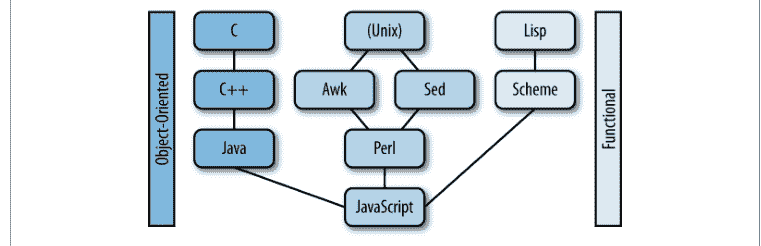

*图 2-1. JavaScript 语法的影响因素*

这与 Scheme 形成了鲜明对比，后者并没有多种语言来指导其语法。Perl 直接影响了 JavaScript 的部分内容，例如对正则表达式的支持。或许 Perl 的格言 TMTOWTDI（“实现方式不止一种”）也在更广泛的层面影响了 JavaScript。至少可以说，其反面——“实现方式只有一种”（在 Python 社区中很流行）并不适用于 JavaScript。请看创建和初始化数组的多种变体：

```javascript
var colors1 = [];
colors1[0] = "red";
colors1[1] = "orange";

var colors2 = ["yellow", "green", "blue"];

var colors3 = new Array(2);
colors3[0] = "indigo";
colors3[1] = "violet";

var colors4 = new Array();
colors4[0] = "black";
colors4[1] = "white";
```

因此，JavaScript（及其众多的影响和语法变体）与 Scheme（一种极简的 Lisp 方言）之间似乎不太可能有联系。但事实证明，JavaScript 的传承确实包括与 Scheme 的密切联系及其直接影响：

> 正如我经常说过的，而且 Netscape 的其他同事也可以证实，我被招入 Netscape 时得到的承诺是“在浏览器中实现 Scheme”。
>
> —— 布兰登·艾奇 (Brendan Eich)

这一点在 ECMAScript 语言规范中也有体现：

> ECMAScript 的一些设施与在其他编程语言（特别是 Java、Self 和 Scheme）中使用的设施相似。
>
> —— ECMAScript 语言规范

这种影响也被其他人认可。道格拉斯·克罗克福德 (Douglas Crockford) 基于丹尼尔·保罗·弗里德曼 (Daniel Paul Friedman) 的经典著作 `The Little Schemer`（MIT Press）编写了 "The Little JavaScripter"，阐明了 Scheme 和 JavaScript 之间的共同点。Lisp 社区本身（以欧洲 Lisp 研讨会为代表）将 ECMAScript 描述为一种“Lisp 方言”。JavaScript 和 Scheme 之间存在不可否认的相似之处，这源于其创建者的意图。

### 一门函数式语言

Java 开发人员倾向于从面向对象的角度来解决编程问题。虽然 JavaScript 可以在某种程度上支持面向对象编程，但这通常不是解决问题最高效的方式。利用 JavaScript 的函数式能力会高效得多。理解这意味着什么及其影响，可以阐明该语言的本质和力量。

JavaScript 使其像 Scheme 的主要特性（无论是从起源还是语法来看）就是它是一门函数式语言（functional language）。这里使用“函数式语言”是指支持函数式编程和一等函数（first-class functions）的语言。JavaScript 的这一基本概念为该语言的其他方面提供了导向。对于许多程序员来说，采用函数式编程意味着一次重大的范式转移，尤其是那些根植于像 Java 这样（目前）尚未直接支持它的语言的程序员。¹

#### 作用域（Scope）

作用域是指变量可见且可操作的程序部分。在 JavaScript 的实现中，这是一个相当“滑溜”的主题。像许多其他语言一样，函数用于封装一组语句。这使得函数可以被复用，并将信息的可见性限制在一个定义明确的模块化单元中。ECMA Script 语言规范中定义了三种执行上下文：全局（global）、eval 和函数（function）。JavaScript 具有函数级作用域，而非像其他类 C 语言那样的块级作用域。例如 `if`语句和其他语言结构所使用的块不会创建新作用域。

JavaScript 中的一个危险之处在于，方法或变量可能会被提升（hoisted），即移动到其定义的作用域顶部。由于函数声明在作用域执行的瞬间就已经可用，因此函数看起来像是被提升到了上下文的顶部。避免此问题的一个经验法则是，在顶层作用域使用单个 `var`语句来声明该作用域内所需的所有变量：

```javascript
// 这不像 Java 中的实例变量...
var x = 'set';

var y = function () {
    // 你没看到的部分 -> var x; 实际上被“提升”到了这一行！
    if (!x) {  // 你可能期望变量在此时
                // 已被赋值...但实际上没有，
                // 所以这个块会执行
        var x = 'hoisted';
    }
    alert(x);
}

// ...而这个调用会导致 alert 显示 "hoisted"
y();
```

提升示例中包含了一些 Java 中不存在的其他特性：

- 在 JavaScript 中，`null`、`undefined` 和其他几个值会被评估为 `false`。

- `if`条件表达式是`!x`。感叹号是逻辑非（NOT）运算符。因此，如果`x`是`undefined`（或`null`），表达式`if (!x)`的结果为`true`。如果`x`在此时包含一个值（如数字或字符串），结果将为`false`，这才是其他语言开发人员可能预期的结果。

- `var`关键字用于定义局部变量。没有使用它的变量是全局的。这种定义导致变量与函数的作用域相关联。

- 一个函数被创建并赋值给名为`y`的变量。对于处理仅存在于类或对象实例中的方法的 Java 程序员来说，这非常奇怪。这种语法突出了 JavaScript 的函数式特性。

#### 一等函数（First-Class Functions）

仅仅在语言中拥有限制作用域的函数，并不能在任何严格意义上使其成为“函数式”语言。函数式语言支持一等函数。根据 `Structure and Interpretation of Computer Programs`（计算机程序的构造和解释）的定义，一等函数可以被命名为变量，作为参数传递，作为函数的执行结果返回，并包含在数据结构中。下面的（人为构造的）示例说明了这些特性，以及一些研究人员认为的函数式语言的另一个必要条件：支持匿名函数：

```javascript
//
// 以下示例可以在
// 现代浏览器的 JavaScript 控制台中运行
//

// 将函数赋值给变量
var happy = function(){
    return ':)';
}

var sad = function(){
    return ':(';
}
```

***

¹ 通过几种语言（包括 `Rhino` JavaScript 实现）的脚本语言支持，JVM 已经支持函数式编程一段时间了。Java 编程语言的 Lambda 表达式计划在 Java 8 中推出，并将为该语言增加闭包（closures）及相关特性。Java 8 还将增加对名为 `Nashorn` 的新 JavaScript 实现的支持。因此，基于语言中新增的特性，Java 开发人员在未来几年中将被期望在更高程度上理解通用 JavaScript 开发，尤其是函数式编程。

```javascript
// 一个用于接收函数作为参数
// 并将其返回的函数。
var mood = function(aFunction){
    return aFunction
}

// 函数添加到数据结构，数组：
list = [happy, sad]

//...JavaScript 对象
response = {fine: happy, underTheWeather: sad}

// 函数可以作为参数传入，
// 作为函数调用的结果返回，
// 并赋值给变量
var iAmFeeling = mood(happy);
console.log(iAmFeeling());

// 再试一次
var iAmFeeling = mood(sad);
console.log(iAmFeeling());

// 函数也可以包含在数据结构中；
// 在这个例子中，是一个 JavaScript 对象。

console.log(response.fine());

// ——或者如果你更喜欢数组...
console.log(list[0]());

// 最后，一个即时的匿名函数。
console.log(function(){
    return ";)";
}());
```

从这个例子可以明显看出，函数是 JavaScript 中的基本单元，而且实际上是“一等公民”。它们可以独立存在，不需要包含在对象或其他构造中。它们可以出现在任何表达式能够出现的地方。函数与其他 JavaScript 对象类型的区别在于它可以被调用。由于函数是一等公民且是主要的执行模块单元，因此可以编写简洁、紧凑的代码。作用域与函数相关这一事实，对许多 JavaScript 新手开发者来说有一些不熟悉的惯用法。

#### JavaScript 真的是函数式语言吗？

一些人质疑 JavaScript 是否算得上函数式语言。毕竟，函数式编程应该是模仿数学函数的，而数学函数没有副作用。任何使用过 JavaScript 的人都遇到过它臭名昭著的全局上下文，而且在操作 DOM 时很可能遇到过充满副作用的函数。这很难称得上是引用透明。相反，很多 JavaScript 编程都需要敏锐地意识到周围的环境。此外，变量毕竟是可变的。纯函数式语言使用不可变变量（这提供了各种好处，比如更容易实现并发操作）。

另外，JavaScript 确实有对象和原型继承。可以说它被归类为面向对象语言，或者至少是多范式的。

毋庸置疑的是，JavaScript 确实包含函数式构造，并支持一等函数。所以你可以选择一个“函数式语言”的定义（因为似乎并没有权威定义），然后自己判断 JavaScript 在理论上是否符合这一称谓。本书之所以使用它，是因为它将 JavaScript 与那些突出该语言特性和最佳优点的语言和技术对齐。如需从这一角度更深入地了解该语言，请参阅 Michael Fogus 所著的 `Functional JavaScript`（O'Reilly 出版），该书介绍了用 JavaScript 实现的各种函数式技术，其中许多使用了优秀的 `underscore.js` 库。

#### 函数声明与表达式

JavaScript 函数字面量由四部分组成：

- 函数操作符

- 可选的名称

- 开闭括号（可选地包含一个或多个参数名）

- 开闭花括号（可选地包含一条或多条语句）

一个有效的最小 JavaScript 函数声明语句如下：

```javascript
function(){}
```

函数也可以被命名，这导致一种看起来更像传统 C 语言家族语法的风格：

```javascript
function myFunctionName(){}
```

如果函数没有名称，则称为匿名函数。匿名函数可以在表达式中使用，并赋值给变量。一些作者更喜欢这种语法，而不是声明命名函数，因为它清楚地表明变量包含的是函数值：

```javascript
var x = function () {}
```

也可以将命名函数赋值给变量：

```javascript
var x = function y() {}
```

这种命名函数表达式的实际用途在于，虽然函数对外通过变量`x`可用，但它从自身内部（在递归调用中）也可以作为`y`使用。

函数可以附加到对象上，此时它们被称为方法。方法会隐式地接收调用它的对象。它可以访问和操作对象中包含的数据。使用`this`关键字来引用对象，如下所示：

```javascript
var obj = {};  // 创建一个新的 JavaScript 对象
obj.myVar = '与对象关联的数据'
obj.myFunc= function(){return 'I can access ' + this.myVar;}  // this：该对象
console.log(obj.myFunc())
```


函数可以在另一个函数内部定义，在那里它还可以访问包含它的函数的变量。当函数返回一个内部函数时，就产生了*闭包*。返回的对象包括函数本身以及它创建时的环境：

```javascript
function outer() {
  var val = "I am in outer space";
  function inner() {
    return val;
  }
  return inner;
}

var alien = outer();
console.log(alien());
```

*即时函数*是一种将代码限制在局部函数作用域内，以避免污染全局作用域的方法：

```javascript
(function() {console.log('in an immediate function')})();
```

## 函数调用

有四种调用函数的方式：

- 作为函数
- 作为方法
- 作为构造器
- 使用`call()`或`apply()`方法

所选择的方法会影响`this`关键字引用的对象。在第一种方式（作为函数）中，当不在严格模式下时，`this`引用全局上下文。在严格模式下，返回`undefined`或执行上下文中赋值的值。后两种（方法和构造器）是特定于面向对象方法的。方法调用涉及对附加到对象的函数的调用。构造器调用会创建一个新对象。与前三种方式不同，`call`和`apply`方法允许你在函数上调用它们时显式设置上下文。

> **This 和 That**
>
> 一个乍一看可能有些令人困惑的 JavaScript 惯例是：
>
> `var that = this`
>
> 一旦你理解了`this`在 JavaScript 中的工作方式，这种用法就很明显了。因为`this`会根据上下文（作用域）而变化，一些开发者将其别名为`that`，以此来保留对`this`原始值的访问。

## 函数参数

如前所述，每个函数都可以通过函数签名中的命名参数来接收参数。有一个名为`arguments`的特殊变量，可以保存传递给函数的任何和所有变量，无论它们是否被命名。以下示例演示了如何使用标准函数调用以及函数的`apply`和`call`方法来添加三个数字：

```javascript
function add(){
    var sum=0;
    for (i=0; i< arguments.length; i++){
        sum+=arguments[i];
    }
    return sum;
}

console.log(add(1,2,3));
console.log(add.apply(null, [2,3,4]));
console.log(add.call(null,3,4,5));
```

## 对象

在 Java 中，对象是作为已定义类的实例创建的。在 JavaScript 中，对象只是属性的集合。JavaScript 对象确实有继承（来自原型对象），所以面向对象的设计原则是适用的。但与 Java 的经典方法相比，差异是显著的。JavaScript 允许创建类，但用与 Java 相同的方式来看待它们并不有用（在 Java 中，类是必需且根本的）。

经典继承和原型继承区分了 Java 和 JavaScript，它们的差异造成了混淆。其他 JavaScript 特性可以通过与 Java 对比来突出。

## 面向 Java 开发者的 JavaScript

大多数开发者意识到，JavaScript 语法表面上类似于 Java 或其他基于 C 的语言（`for`循环、条件语句等）。但当你看到完整的 Java 应用程序时，差异立即显现。以下是众所周知的 Java 基础程序，它们展示了 JavaScript 代码和开发实践的差异。

### HelloWorld.java

```java
/**
 * HelloWorld
 */
class HelloWorld{

    public static void main (String args[]){
        System.out.println("Hello World!");
    }

}
```

要在命令行中看到这个经典的 Hello World 示例程序运行，你需要：

1. 创建一个名为*HelloWorld.java*的源文件。
2. 将 Java 代码编译为类文件（使用 Java 编译器通过`javac`命令）。
3. 执行生成的类文件（使用 Java 解释器通过`java`命令）。

如果你使用像 Eclipse 或 IntelliJ 这样的集成开发环境，这些步骤由相应的菜单选项表示。简单来说，该程序在执行时会打印出字符串字面量 "Hello World!"。但这个简单的程序旨在强调 Java 和 JavaScript 之间的许多显著差异。

以下是产生相同输出的对应 JavaScript 程序：

```javascript
console.log('Hello World')
```

## 程序执行

首先，JavaScript 是一种解释型语言。不需要编译。JavaScript 的执行环境随即成为问题。如果你安装了 node，可以在 node 提示符下运行此代码：

```javascript
> console.log("Hello World")

Hello World
```

这段代码也可以在浏览器控制台中执行。在 Chrome 中，选择 “视图 (View)” $\rightarrow$ “开发者 (Developer)” $\rightarrow$ “JavaScript 控制台 (JavaScript Console)”（见图 2-2）。

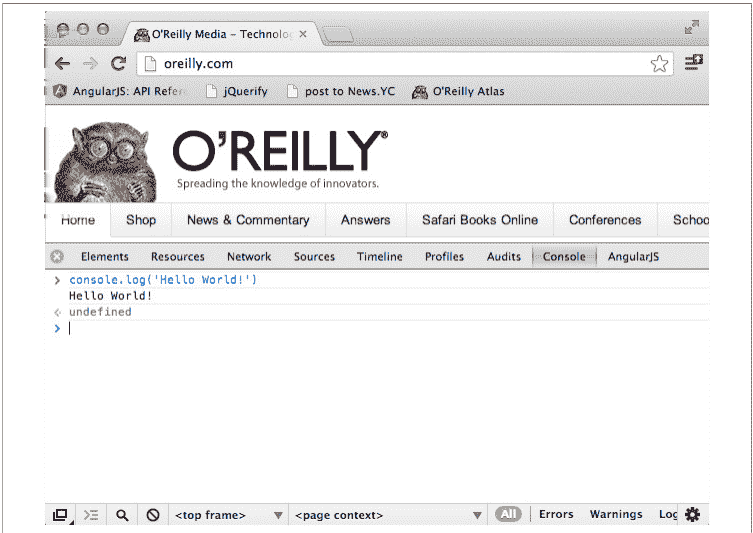

图 2-2. Chrome JavaScript 控制台

在 Firefox 中，选择 “工具 (Tools)” $\rightarrow$ “Web 开发者 (Web Developer)” $\rightarrow$ “Web 控制台 (Web Console)”（见图 2-3）。


图 2-3. Firefox JavaScript 控制台

其他现代浏览器也有提供相同功能的类似菜单选项。

## 宿主对象 (Host Objects)

从技术上讲，JavaScript 中没有内置的 I/O 功能（尽管运行时环境——在这种情况下是浏览器——提供了它）。这符合 ECMA 标准：

> 这里定义的 ECMAScript 并不旨在计算上自给自足；事实上，本规范中没有关于输入外部数据或输出计算结果的规定。相反，预计 ECMAScript 程序的计算环境不仅将提供本规范中描述的对象和其他设施，还将提供某些特定于环境的*宿主 (host)*对象，其描述和行为超出了本规范的范围，但本规范指出它们可能提供某些可以被访问的属性以及某些可以从 ECMAScript 程序调用的函数。

这种未定义的定义所带来的影响不仅仅是出于好奇，其中最重要的一点是`console.log`在某些版本的微软 Internet Explorer 中不可用，因此可能会出现意外错误。许多与 JavaScript 编程语言相关的挑战和问题实际上是执行环境（通常是 Web 浏览器）的错。DOM 是一种跨平台的、与语言无关的引用和操作 HTML 元素的方法。它同样不属于 JavaScript 语言本身。

回到 Hello World 示例本身：你可能已经注意到，这里使用了单引号而不是双引号，且末尾没有分号。JavaScript 的语法是非常宽容的（或者如果你愿意，可以说它是模棱两可的）。为了减少该领域的混乱，已经出现了一系列创新。语言本身增加了一种 "`strict`模式"。像 Douglas Crockford 的`JSLint`这样的工具被创建用来强制使用 JavaScript 语言的 "精华部分 (good parts)"。关于该主题的更多深入探讨请参阅他的相关书籍。简单来说，JavaScript 的许多宽容之处可能会导致缺乏纪律的开发人员或团队引发一些难以调试的问题。花时间深入学习该语言，以采用能够避免这些问题的约定和实践是非常值得的。

### 文件系统组织

Java 项目的文件和目录结构与代码结构直接相关。一个源文件通常包含一个与文件名同名的单个（公开）类。该文件存在于一个反映与该类相关的包名的目录中。（关于内部类、访问修饰符和其他结构还有一些其他规则和例外，但很明显，文件和目录结构在所有 Java 项目中都遵循类似的通用结构）。有时，这些限制可能会带来不便（尤其是在小型应用程序中）。随着项目的增长，它为代码库的总体范围和组织提供了清晰的指示。只需扫一眼文件系统，无需打开文件就能立即看出项目是否变得混乱。

JavaScript 没有强制执行此类限制。文件或目录结构之间没有必然的联系。因此，随着项目的增长，你需要特别关注代码的组织，如果涉及较大的开发团队，可能需要投入时间进行重构。Alex MacCaw 在*JavaScript Web Applications* (O'Reilly) 中对此做了很好的解释：

> 创建大型 JavaScript 应用程序的秘诀就是不要创建大型 JavaScript 应用程序。相反，你应该将应用程序解耦成一系列相当独立的组件。开发人员经常犯的错误是创建具有大量相互依赖的应用程序，用巨大的线性 JavaScript 文件生成大量 HTML 标签。这类应用程序难以维护和扩展，因此应不惜一切代价避免。

— Alex MacCaw

还需要考虑代码组织的其他方面。除了为文件命名以及将代码智能地包含在正确的文件中之外，文件之间的依赖关系要求它们必须按特定顺序加载。当 JavaScript 由 Web 服务器提供时，可以通过在实际需要时加载给定文件（而不是让浏览器在所有文件下载时挂起）来提高效率。利用*异步模块定义* (**AMD**) API 可以实现性能提升，该 API 由 **RequireJS** 等库支持。此 API 允许定义模块，从而使模块及其依赖项能够异步加载。

### HelloWorld.java (含变量)

演示 Hello World 应用程序的典型下一步是让它通过变量中指定的名字来问候特定对象：

```java
/**
 * HelloWorld2
 */
class HelloWorld2 {

    public static void main (String args[]) {
        String name;
        System.out.println("Hello " + name);
    }

}
```

这段代码无法编译：

```java
HelloWorld2.java:5: variable name might not have been initialized
```

以下代码在 JavaScript 中可以运行，这导致了另一个混淆点：太多评估为`false`的*底值 (bottom values)*。它们被评估的方式可能令人困惑且难以记忆：

```javascript
// All evaluate to false
console.log(false    ? 'true' : 'false');
console.log(0        ? 'true' : 'false');
console.log(NaN      ? 'true' : 'false');
console.log(''       ? 'true' : 'false');
console.log(null       ? 'true' : 'false');
console.log(undefined ? 'true' : 'false');
```

所有其他值均评估为 true：

```javascript
// All Evaluate to true
console.log('0'       ? 'true' : 'false');
console.log('false'   ? 'true' : 'false');
console.log([]        ? 'true' : 'false');
console.log({}        ? 'true' : 'false');
```

因此，在 Java 中初始化变量后，程序即可编译并运行：

```java
/**
 * HelloWorld2
 */
class HelloWorld2{

    public static void main (String args[]){
        String name = "Java";
        System.out.println("Hello " + name);
    }

}
```

同样地，如果在 JavaScript 中为变量赋值，我们会看到结果按预期打印出来：

```javascript
var name='JavaScript';
console.log('Hello ' + name)
```

`var`关键字不是必须的，如果你在全局作用域中，它不会产生任何行为差异。如果在函数内部调用，那么`var`将创建局部变量。因此，通常应该在函数内部声明变量，并使用`var`关键字声明，以防止污染全局命名空间。

Java 示例要求声明变量的类型。JavaScript 是弱类型的，没有这样的要求。`typeof`运算符可以用来演示最常见的类型。示例请参见表 2-1。

*表 2-1. JavaScript typeof 运算符示例*

| 类型 | 结果 | 示例 |
|---|---|---|
| 未定义 (Undefined) | "undefined" | `typeof undefined` |
| 空 (Null) | "object" | `typeof null` |
| 布尔 (Boolean) | "boolean" | `typeof true` |
| 数字 (Number) | "number" | `typeof 123` |
| 字符串 (String) | "string" | `typeof "hello"` |
| 函数对象 (Function object) | "function" | `typeof function(){}` |

## 开发最佳实践

JavaScript 拥有一套独特的挑战和特性，这就需要一套独特的开发流程。虽然我们可以将许多 JavaScript 开发强行套入熟悉的 Java 流程中，但使用专门为其量身定制的工具和程序会更加合适。

### 代码风格与规范

本书的大部分内容关注于客户端和服务器层的松耦合。*非侵入式 JavaScript* (Unobtrusive JavaScript) 是一种在客户端应用程序内部建立 UI 层松耦合的实践：

- HTML 定义页面的数据结构。
- CSS 为数据结构应用设计样式。
- JavaScript 为页面提供交互功能。

换句话说：

- 避免在 CSS 中使用 JavaScript。
- 避免在 JavaScript 中使用 CSS。
- 避免在 HTML 中使用 JavaScript。
- 避免在 JavaScript 中使用 HTML。

## 开发浏览器

浏览器是一款如此普及的软件，以至于许多 Web 用户甚至不知道它与底层操作系统是分离的。浏览器不仅是最终用户查看网页的环境，*浏览器本身就是一个 IDE*。现在的浏览器内置了集成调试器、代码格式化工具、分析器以及大量其他工具（部分以插件或扩展形式提供），可在开发过程中使用。

Firefox（以及 [Firebug](https://getfirebug.com/) 和其他开发人员插件及扩展）在开发领域流行了相当一段时间。Chrome 近来凭借内置的开发工具而变得日益普及。

### Chrome 技巧

研究浏览器提供的开发工具以及能够影响浏览器行为的命令行选项是非常值得的。这些选项通常为了方便开发人员访问和提高生产力，而绕过某些安全限制或性能优化。例如，在 Chrome 中：

- 某些设置（如清除浏览器缓存）可以防止在切换更改时产生混淆。
- 命令行语法在不同浏览器版本和操作系统之间有所不同。例如，在 OS X 上可以通过运行以下命令启动 Chrome：

```
/Applications/Google\ Chrome.app/Contents/MacOS/Google\ Chrome
```

通过命令行运行允许你包含更改浏览器行为的标志。如果你使用 Ajax 引入文件（例如使用 AngularJS），`--allow-file-access-from-files`允许在脱离 Web 服务器的情况下进行开发。如果你使用了引用本地机器 (localhost) 的 JSONP，则需要`--disable-web-security`。

Chrome 中还有许多其他隐藏功能。在 URL 栏输入`chrome://chrome-urls/`可获取一个 URL 列表，通过这些 URL 可以进入配置或监控活动的界面。为了让你有所尝试，可以试试`chrome://flags/`，它会显示当前浏览器版本可用的实验性功能列表。

浏览器作为 JavaScript 环境的另一个影响是出现了像 JSFiddle 和 jsbin 这样的在线协作 JavaScript 开发网站。这些网站允许你创建复现 Bug 的示例应用程序，并就特定的语言问题与他人进行相当精确的沟通。在 JavaScript 中，几乎没有理由在缺乏上下文的代码片段中苦苦挣扎。在网上提问或演示技术时，提供具体示例并编写小型演示已成为常态。

### 集成开发环境

WebStorm 是一款非常优秀的 IDE，它快速且轻量，包含调试器、出色的项目视图、强大的快捷键、通过插件实现的扩展性以及许多其他功能。虽然并非绝对必要，但 WebStorm 通过向导、快捷键和代码补全捕获了许多最佳实践。

## 单元测试

已经有很多为 JavaScript 开发的 **单元测试框架**。Jasmine 是一个无需依赖且语法简单的行为驱动开发 (BDD) 框架，本书将使用该框架。


Java 单元测试可以在构建工具或脚本每次构建项目时执行。JavaScript 可以使用 `node` 模块（Karma，原名 Testacular）在每次源代码文件更改并保存时，在多种不同浏览器上执行单元测试！这一点非常值得注意。如果你在编写单元测试方面足够自律，那么每次保存源文件时运行所有测试的能力，可以让你及早发现那些原本难以察觉的 Bug。在使用像 JavaScript 这种不使用编译器进行初步代码验证的语言时，这一点尤为宝贵。频繁且有效的单元测试充当了一种“伪编译器”。它们能针对代码质量提供即时反馈，并在 Bug 引入时立即将其捕获。

### 文档

JavaScript 中有几种不同的自动文档生成选项。JSDoc 在标记和输出方面与 Javadoc 类似。Dox 是一个用于文档生成的 `node` 模块。

文学编程（由 Donald Knuth 在 20 世纪 70 年代引入）旨在让程序员能够按照逻辑和思维流动的顺序来开发程序。Docco 是一个 `node` 模块，它将注释以类似于随笔正文的形式与源代码并行呈现。虽然 Docco 不直接验证或强制执行代码规范，但它的存在和使用可以鼓励开发者进行深思熟虑的注释和代码结构设计，而不是机械地进行复制粘贴。

### 项目

本项目是一个简单的 JavaScript 对象层级结构，包含测试和文档。所有文件均可在 GitHub 上找到。

`Animal.js` 处于对象层级的根部：

```javascript
// Animal is the top of the object hierarchy
function Animal() {}

// Define a speak function that have specific implementations in subclasses
Animal.prototype.speak = function() {
  return "Animal is speaking.";
};
```

它有两个子类，`Cat.js`：

```javascript
// Define the Cat
function Cat() {
    Animal.call(this);
}

// Set the object's prototype
Cat.prototype = new Animal();

// Name the constructor in a manner to suit the class
Cat.prototype.constructor = Cat;

// Create a class-specific implementation
Cat.prototype.speak = function(){
    return "meow";
}
```

以及 `Dog.js`：

```javascript
// Define the Dog class
function Dog() {
    Animal.call(this); // Call the parent constructor
}

// Dog inherits from Animal
Dog.prototype = new Animal();

// Update the constructor to match the new class
Dog.prototype.constructor = Dog;

// Replace the speak method
Dog.prototype.speak = function(){
    return "woof";
}
```

最新版本的 Jasmine 可在 [GitHub](https://github.com) 上获取：

```bash
curl -L \
https://github.com/downloads/pivotal/jasmine/jasmine-standalone-1.3.1.zip \
-o jasmine.zip
```

Jasmine 运行一个包含前面定义的每个类的测试规范：

```javascript
// Animal Test using beforeEach
describe("Animal", function() {
    
    beforeEach(function() {
        animal = new Animal();
    });
    
    it("should be able to speak", function() {
        expect(animal.speak()).toEqual("Animal is speaking.");
    });
});
```

```javascript
// Dog inherits from Animal and overrides the speak method.
// A function scoped variable is used for testing.
describe("Dog", function() {

    it("should be able to speak", function() {
        var dog = new Dog();
        expect(dog.speak()).toEqual("woof");
    });

});
```

```javascript
// A bit more terse: a cat that inherits from Animal.
// Object constructor called in the same line as the speak method.
describe("Cat", function() {

    it("should be able to speak", function() {
        expect((new Cat()).speak()).toEqual("meow");
    });

});
```

查看其实际运行效果最简单的方法是在浏览器中打开 `SpecRunner.html`，如图 2-4 所示。

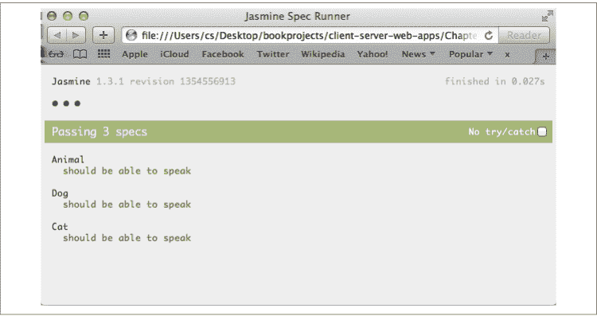

*图 2-4. Jasmine 运行示例*

若要在每次文件更改时运行测试，你需要安装 `node.js`。你可以通过检查已安装的 `node` 版本来验证安装情况：

```bash
node --version
```

```text
v0.8.15
```

您还应该安装 `node` 包管理器：

```bash
npm --version
```

```text
1.1.66
```

安装好这些后，您可以安装 Karma：

```bash
npm install karma
```

安装完成后，您可以查看帮助：

```bash
karma --help
```

项目配置文件最初是使用 `init` 选项创建的。这会创建一个名为 `karma.conf.js` 的文件，随后可以对其进行编辑，以引用适用的 JavaScript 文件并在已安装的浏览器中运行。配置完成后，可以使用 `start` 选项在每次文件更改时运行测试。

使用 `npm` 安装用于生成文档的 `docco` 模块：

```bash
npm install docco
```

运行 `docco` 命令在 `docs` 目录下创建 HTML 文档。图 2-5 展示了其中一个生成的文件。注释在左侧，语法高亮代码在右侧。您可以通过选择右上角“Jump to”下拉菜单中的文件来访问其他文件的文档。

```bash
docco app/*.js
```


#### 安装 Pygments

如果您看到“Could not use Pygments to highlight the source”的消息，这是指一个名为 [Pygments](http://pygments.org/) 的 Python 语法高亮工具。

在 Mac 或 Linux 机器上，您可以通过运行以下命令安装：

```bash
sudo easy_install pygments
```

这简要概述了目前 JavaScript 所拥有的开发支持水准。通过采用其中一些工具，您的代码质量和可维护性将大大增强。

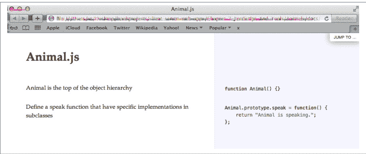

##### 图 2-5. Docco 截图

本章实际上仅触及了这种复杂且无处不在的语言的皮毛。其他书籍会更深入地探讨这里介绍的主题。例如，Alex McCaw 编写的 *JavaScript Web Applications* (O'Reilly) 展示了某些成熟模式（模型-视图-控制器）的使用，以及与构建大规模 JavaScript 应用相关的技术。Nicholas C. Zakas 编写的 *Maintainable JavaScript* (O'Reilly) 则有助于应对建立促进可维护且可扩展代码库的实践和标准的严峻挑战。当然，在线上也可以找到许多资源，例如 [Mozilla Developer Network](https://developer.mozilla.org) 和 [StackOverflow](https://stackoverflow.com) 等网站。

JavaScript 绝对不是 Java。它是一门独立的语言，拥有一个蓬勃发展的项目生态系统来支持其开发。对语言本身及其可用开发工具的了解，将为您随后探索将要介绍的众多框架和库提供良好的基础。

# 第 3 章 REST 与 JSON

> 良好的篱笆造就良好的邻居。
>
> ——罗伯特·弗罗斯特

每当一项技术被引入时，立刻就会出现关于它*不能*做什么的反应。这种反应对于那些已经习惯在其限制内操作的人来说可能是令人困惑的。篱笆可以从负面角度看待，被视为限制或阻碍移动的屏障。而从正面角度看，在罗伯特·弗罗斯特的引言中，它们提供了清晰、可见的边界划分，并指明了给定空间的用途、使用方法和危险。同样地，软件系统的约束是为了提供更好的功能、效率和角色清晰度而施加的限制。设定良好的约束不仅仅是为了阻挡或限制，而是为了实现一个积极的目标。REST 是一种架构风格，其特点是一组约束，这些约束代表了 Web（或其他类似结构）应当如何工作。这些约束虽然具有限制性，但能促进设计出非常适合 Web 本身特性的系统。

对 REST 的描述通常是从一个截然不同的起点开始的：将 REST 视为一种*Web 服务*协议。确实，通过将 REST 与 SOAP 或其他消息服务进行比较可以更容易理解。相对于 SOAP，它被认为是一种极简协议，缺乏 SOAP 实现中所需的大量定义和附加结构。它的特点是直接依赖于 HTTP 的底层特性，包括请求方法、URI 定址和响应代码。REST 还可以与*远程过程调用*（RPC）风格的 API 进行比较，后者使用 URL 来指示动作，而 REST 使用 URL 来访问资源。在这方面，REST 是面向名词的，而 RPC 是面向动词的。

### 为什么选择 REST 而非 SOAP？

关于 REST 优于 SOAP 还是反之，曾有过激烈的争论。虽然 SOAP 确实提供了一套正式的契约，且适用于复杂的 RPC 架构，但它引入了额外的开销和复杂性，而对于大多数 Web 应用开发来说，并没有提供实质性的优势。由于非技术性考虑（例如它已深深根植于现有的规模庞大的遗留应用中），SOAP 仍作为 RPC 平台被大量使用。

SOAP 消息体积大，需要大量的处理，并且是用冗长的 XML 信封表达的。这使得该协议对于客户端-服务器风格的 Web 应用缺乏吸引力，因为这类应用可以使用 JavaScript 非常轻松地处理 JSON。

许多开发人员最初接触 REST 是将其视为一种以美观的 URL 和自由格式、轻量级消息为特征的 Web 服务协议。虽然这个视角具有很大的实用价值，但将 REST 理解为其作者 Roy Fielding 所阐述的样子至关重要。

### 什么是 REST？

[Fielding 指出](link)，“表述性状态转移（REST）架构风格……[是为了]代表现代 Web 应当如何工作的模型而开发的。”虽然在技术上与协议无关，但它是与 HTTP 结合开发的。正因为这种关联，应该记住 HTTP 的几个显著特点。

### 资源

*Web 资源* 简单来说就是 Web 上可用的任何东西。Web 资源的定义随着时间的推移而扩大。最初它指的是静态的可寻址文档或文件。后来它被赋予了更抽象的定义，现在涵盖了 Web 上可以被识别、命名、寻址或处理的每一个实体。资源的例子包括传统的 HTML 网页、文档、音频文件和图像文件。资源还可以指您在典型的数字图书馆中可能找不到的东西，例如硬件设备、一个人或其他资源的集合。

REST 使用 Web 地址（URI）通过动词（HTTP 请求方法）来访问和操纵资源。

### 动词（HTTP 请求方法）

HTTP 1.1 定义了一组动词（或*请求方法*），用于指示对资源采取的操作。在可用方法中，使用 RESTful 方式时最重要的是 `GET`、`POST`、`PUT` 和 `DELETE`。思考这些动词的一种方法是将它们与用于操纵数据库中数据的命令进行比较。

在数据库中，数据实体通常被称为记录。在 REST 中，对应的实体是资源。HTTP 动词（`POST`/`GET`/`PUT`/`DELETE`）大致对应于数据库或*对象关系映射*（ORM）系统中传统的 CRUD（创建/读取/更新/删除）操作。REST 架构规定，Web 上的资源获取或更改的方式，与使用 SQL 或类似查询语言访问或修改数据库记录的方式非常相似。关于 REST 的 HTTP 1.1 选项完整列表可以在[附录 B](Appendix B)中找到。

| HTTP 动词 | 对资源采取的操作 | 类似的数据库操作 |
|---|---|---|
| `POST` | 创建（或追加） | `insert` |
| `GET` | 检索 | `select` |
| `PUT` | 更新（或创建） | `update` |
| `DELETE` | 删除 | `delete` |

> ### 其他 HTTP 方法
>
> 其他几种 HTTP 方法很有用，但不对应传统的 CRUD 数据库操作。`HEAD` 方法与 `GET` 相同，不同之处在于响应不包含响应体。这适用于使用利用 HTTP 标头的 REST 相关技术时。跨源资源共享（CORS）会返回由于浏览器的同源安全策略而原本被禁止的 JSON，并通过 HTTP 标头管理其与服务器的协商。某些为文档指定链接的方法使用标头作为存储链接的位置。因此，当关键信息存在于响应标头而非响应体中时，使用 `HEAD` 调用而不是通过标准的 `GET` 返回响应体以产生额外开销会更有意义。
>
> HTTP `OPTIONS` 方法可用于检索一个资源可用的 HTTP 请求方法列表。这不仅对调试和支持有影响，而且对于创建具有统一接口的系统也很有帮助，这些接口通过一个体现自描述系统的单一入口点提供可用链接。结合此类*链接*（代表系统中所有资源的访问点），对 HTTP `OPTIONS` 的正确实现将返回每个通过链接可访问的资源所拥有的*方法*综合列表。

### 统一资源标识符

在网络系统中，需要某种句柄或地址，以便能够对资源执行操作。*统一资源标识符*（URI）是用于实现此目的的字符字符串的通用术语。URI 可以进一步区分位一个代表资源名称的*统一资源名称*（URN），或者一个代表资源地址的*统一资源定位符*（URL）。

大多数 URL 方案将其 URL 语法基于以下通用格式：

```
<scheme>://<user>:<password>@<host>:<port>/<path>;<parameters>?<query key/value pairs>#<fragment identifier>
```

有关 URI 和 HTTP 的更多详细信息，请参阅 *HTTP: The Definitive Guide* (O'Reilly)。

在 REST 中，资源被具体标识为路径元素。URL 中的斜杠用于分隔资源并以层级方式表达它们之间的关系。REST URL 的示例及其详细解释请参阅*第 8 章*。

在基于 Web 的 API 中，用于标识资源及其相互关系的 URL 名称通常遵循一些额外的约定。这些约定并非 REST 的强制要求，而是为了提高 URL 的可读性和一致性的风格建议。在大多数情况下，URL 应使用小写字母，使用连字符（`-`）而非下划线（`_`），并包含尾随斜杠。单个资源使用单数名词引用，资源集合则使用复数名词标识。不建议使用文件扩展名，但在 API 支持多种格式（如 XML 和 JSON）时经常会出现。一个更合适的替代方案是使用 `Accept` 和 `Content-Type` 请求头来控制格式。Mark Masse 编写的 *REST API Design Rulebook* (O'Reilly) 包含了上述约定以及许多其他约定，但在实践中，URL 的结构和格式具有相当大的灵活性。

> **使用连字符而非下划线？**
>
> 应当强调的是，上述所有 URL 命名约定*并非*不可更改。许多流行的 API（包括 Twitter 和 Dropbox）都使用下划线。过去将其视为不良实践是出于其他考虑，例如搜索引擎优化（在 Google 的搜索索引中，带下划线的元素会被连接在一起，而带连字符的字符串会被拆分为独立的单词）。尽管在这些细节上存在分歧，但大家一致认为 URL 应当尽可能短小、易读、清晰，并在整个 API 中保持一致。

### REST 约束

**REST 被定义**为一种特定的软件架构风格，其特点是一组选定的约束条件。一个旨在符合这些约束的系统，能够体现出有益的系统属性和健全的工程原则。

#### 客户端-服务器（Client–Server）

客户端-服务器架构提供了即时的关注点分离。它充分利用了现代客户端中可用的处理能力——而这种能力在过去仅限于高端计算机。由于许多职责转移到了客户端，服务器端得到了简化。这样的系统往往易于扩展，且层级之间的分离允许对每一层进行独立开发。

#### 无状态（Stateless）

REST 要求无状态设计。会话数据存储在客户端。客户端发起的每个请求必须是“无上下文”且自包含的。这意味着请求将包含完整的客户端状态。这要求服务器在响应时所需的所有数据都包含在请求中，无需额外检索与应用程序状态相关的外部数据。由于每个请求中都包含所有可用数据，因此更容易理解给定交互的意图。由于会话数据不在服务器端维护，容错能力和可扩展性也得到了提高，服务器资源不会被原本需要的存储和检索处理所消耗。


设计符合 REST 无状态特性的系统面临诸多挑战。其中之一是由于请求更大且更频繁而导致的额外网络流量（在维持服务器端状态的非 RESTful 客户端-服务器应用程序中，可以通过使用服务器端会话来减少此类流量）。由于每个请求都包含所有状态相关数据，必然会有某些数据元素被重复发送。服务器不维护会话意味着客户端承担更多责任，因此通常更复杂（这也是现代 RESTful 应用程序中 JavaScript 日益复杂的原因之一）。在这种系统中，浏览器的存储机制更受关注。此外，由于 REST 系统通常支持多个客户端版本，因此客户端层需要大量的规划和努力。

尽管存在这些挑战，无状态设计的益处很多，特别是涉及多个服务器接收由负载均衡器分发请求的部署。如果使用基于服务器的会话，有两种基本选择：一是要求同一台服务器响应给定会话的所有请求；二是创建一个所有服务器都可以访问的集中式会话数据存储库。随后，每次发起请求时都需要访问这个集中式数据存储库。这种做法（有时被称为`会话亲和性`或使用粘性会话）使扩展变得困难得多。大规模部署通常会随时间逐步向服务器推送更改。如果使用服务器端会话，则需要等待旧会话过期，才能将传入请求迁移到具有最新更改的服务器。这是一个复杂且困难的运维过程。如果没有状态存储在服务器端，这种情况将不复存在。此外，当消除了服务器维护的会话时，像导航到历史记录或重新加载当前页面等标准浏览器功能不再需要特殊处理。

REST 的无状态设计是许多开发人员最难理解的方面之一。它要求对典型的 Web 开发实践进行一些重大调整。但其益处很多，而且由于每个请求都包含完整状态而带来的性能担忧并非不可逾越，特别是考虑到 REST 的下一个约束时。

#### 可缓存（Cacheable）

与 REST 无状态约束相关的性能问题很大程度上可以通过缓存来补偿。REST 要求数据必须被标记以指示其是否可缓存。这允许客户端应用程序重用可缓存的响应，而不是在稍后时间点发起相同的请求。与任何系统中的缓存一样，这可以显著提升客户端应用程序的性能，但同时也引入了与正确缓存失效相关的标准复杂性，以避免过期数据。在 Web 环境中，缓存可以在客户端（浏览器）、服务器端或两者之间（网关或代理服务器）维护。

#### 统一接口（Uniform Interface）

统一接口规定了一种所有 RESTful 应用程序都使用的通用资源寻址方式。因此，每个 REST 系统都有一个对于熟悉该架构的人来说立即显而易见的通用结构。这严重限制了为特定应用程序需求定制接口的能力，但在约束范围内仍具有很大的灵活性。HTTP 本身在每个版本中都进行了增强，为 RESTful 设计提供了额外的机制（例如引入新的请求方法）。这个特定的约束实际上包含了一系列组成它的其他约束（见表 3-1）。

*表 3-1. 统一接口约束*

| 统一接口约束 | 描述 |
|---|---|
| 资源的标识 | 资源可通过 URL 进行寻址。 |
| 通过表征操纵资源 | 资源是被表征的事物。其表征是请求中发送的内容（例如 XML/JSON 文档）。 |
| 自描述消息 | 使用 HTTP 谓词的无状态请求。 |
| 超媒体作为应用程序状态的引擎 | HATEOAS：提供指示如何更改应用程序状态的链接。 |

#### 分层（Layered）

分层设计允许网络组件在每个请求的传输路径上与其交互。每个组件无法看到与其通信层之外的内容。这意味着可以使用防火墙和网关等熟悉的网络设备，并且由代理服务器执行缓存或转换操作。

#### 按需提供代码

在 REST 中允许（但非必须）通过 JavaScript 或嵌入式浏览器应用程序提供按需代码的能力。这为应用程序的扩展开启了广泛的可能性。其缺点是降低了 RESTful 系统固有可见性（尤其是在 Java Applets 等对象的情况下）。

### HTTP 响应代码

在开发 REST API 时，标准 HTTP 状态代码（见附录 B）可向客户端提供反馈并报告潜在错误。给定响应的具体性质可能取决于所使用的 HTTP 方法。

#### 什么是成功？

关于在 Web API 中如何使用 HTTP 代码，目前还没有广泛的共识。部分原因是响应并没有与 HTTP 谓词对齐，而是分为五类情况：通用信息、请求成功、重定向、客户端错误或服务器端错误。在某些情况下，适用于某个调用的响应代码是显而易见的，但在其他情况下，则取决于具体的 API 调用，或者取决于 API 设计者的裁量或偏好。

以（非特定）成功 (200) 为例。在大多数情况下，这被认为是 GET 请求成功后的正确响应。事实上，在 HTTP 1.1 中，它被专门列在与 GET 和 POST 相关的部分。如表 3-2 所示，响应取决于 HTTP 请求类型。

表 3-2. HTTP 1.1 成功 (200)

| HTTP 谓词 | 预期响应内容 |
|---|---|
| GET | 与请求资源相对应的实体 |
| HEAD | 与请求资源相对应的实体标头字段，不含任何消息正文 |
| POST | 描述或包含操作结果的实体 |
| TRACE | 包含终端服务器接收到的请求消息的实体 |

尽管有些人也会在响应 PUT 或 DELETE 时使用 HTTP 200，但可能会使用其他代码。某些 API 在 PUT 或 POST 的情况下使用 HTTP 201 (created)。对于没有返回其他响应的 DELETE，可能会使用 204 (no content)，但如果请求成功而服务器故意不返回内容，它也可能适用于其他谓词（甚至是 GET）。如果 Web 应用程序使用基本身份验证，可以通过向浏览器返回 HTTP 401 (not authorized) 响应代码来完成登出。因此，成功的定义取决于上下文，因此选择合适的响应代码需要对代码的含义和所发起请求的性质有深入理解。

每个代码的第一位数字指定了响应的类别。由于客户端的最低要求是能够识别响应的类别，因此在响应代码的使用上预计存在灵活性和差异（见表 3-3）。

表 3-3. HTTP 响应代码类别

| 第一位数字 | 含义 |
|---|---|
| 1 | 信息性 (Informational) |
| 2 | 成功 (Success) |
| 3 | 重定向 (Redirection) |
| 4 | 客户端错误 (Client Error) |
| 5 | 服务器错误 (Server Error) |

Mozilla、Yahoo Social APIs 以及《REST API 设计规则手册》中都对响应代码的使用进行了深思熟虑的阐述。其相似之处突出了已经形成的约定和最佳实践，而差异则展示了设计观点上的分歧，以及基于给定 API 特定性质而产生的区别。

### JSON (JavaScript 对象表示法)

Douglas Crockford 并非以强调 JavaScript 的每一个特性而闻名，而是以专注于其子集而著称。本质上，他对语言的使用设定了约束。他的这种方法的另一个应用是将 JavaScript 对象表示法 (JSON) 设计为一种衍生自 JavaScript 的数据交换格式。

自从现代计算出现以来，多种数据交换格式一直被使用。除了二进制和私有格式外，某些类型尝试兼顾一定程度的人类可读性和机器可读性。最初使用固定宽度和分隔符文件格式（至今仍可见其身影）。第一个 XML 工作草案于 1996 年产出。XML 特别追求机器可读和人类可读，但随着时间的推移，它被批评为过于冗长且不必要地复杂。作为反应，一些包含 XML 特性（如层级组织）的小型语言被创建出来（如 YAML）。2002 年，Douglas Crockford 获取了`http://www.json.org`域名，并在其中将 JSON 描述为：

- 一种数据交换格式（XML 的轻量级替代方案）
- 一种作为 JavaScript 子集的编程语言模型
- 一种极易解析的格式（事实上，在 JavaScript 中，你可以直接对 JSON 字符串调用`eval()`将其转换为 JavaScript 对象，尽管这不是一个特别安全的选项）

他还强调了 JSON 相比 XML 的优势：

- 响应尺寸更小，因为 XML 中的开始标签、结束标签和元数据需要额外空间。
- JSON 与网页的互操作性更好。它是 JavaScript 的一个子集，使得客户端集成变得极其简单。
- 前两个特性在 Ajax 调用的场景下带来了性能提升和集成便利。

JSON 确实有一些值得注意的古怪之处：

- JSON 是“几乎有效”的 JavaScript。
- JSON 中没有指定注释的方法。
- 如前所述，由于它是 JavaScript 的子集，它可以被 JavaScript `eval()`消费。然而，使用`eval()`是危险的。人们常说“`eval()`是邪恶的”。
- 在大多数现代 Web 浏览器中生效的“同源策略”阻止了从不同站点对 JSON 进行求值。JSONP（有时也称为 JSON-P 或“带填充的 JSON”）被用于从不同域名的服务器请求数据（通过 HTTP GET）。通过调用调用者环境中已定义的函数来操作 JSON 数据。这个函数就是该方法中“填充 (padding)”的来源。最近，跨源资源共享 (CORS) 作为 JSONP 的一种更稳健、更安全的替代方案而被开发出来。CORS 使用 HTTP 标头允许来自指定域名的服务器提供资源。它还需要发出 JSON 的服务进行特定的服务器端配置才能运行。

#### JSON 中的注释

JSON 不允许注释这一事实有点令人惊讶，并导致了各种变通方法。一种是在 JSON 对象中添加“comment”元素，并将注释内容作为相应的值。一种应该避免的可能性是创建两个同名元素并假设解析器会选择最后一个。例如：

```json
{"a":"This is a comment", "a":"CONTENT"}
```

虽然这在许多 JSON 解析器中恰好可行，但这是由于它们的具体实现而产生的，并非规范的一部分。

### HATEOAS

JSON 是一种非常简单且简洁的格式。与其他为所代表的数据提供复杂类型系统的格式不同，JSON 仅提供几种数据类型。这些数据类型——字符串、数字、布尔值、对象、数组和 null——对于大多数应用程序来说已经足够具有表现力和可扩展性。由于 JSON 作为 RESTful API 使用的数据交换格式而广受欢迎，你可能会期待一种专门用于超链接的数据类型，但实际上并不存在这种类型！这尤其成问题，因为 REST 包含一个名为*超媒体作为应用程序状态的引擎*（Hypermedia as the Engine of Application State, HATEOAS）的约束。

该约束限制客户端仅通过包含在“超媒体”术语下的链接进行交互。因此，从严格意义上讲，Web API 不可能被归类为“RESTful”，因为在 JSON 或其基于的 JavaScript 中都没有链接数据类型。

基于 XML 的 REST API 通常使用 Atom 聚合格式（其中链接由`rel`、`href`、`hreflang`和`type`组成）或标头中的链接。同样，为了在 JSON 文档中提供标准化链接，相关的 JSON 扩展也得到了开发：

- [HAL](https://hal.specs.com)
- [Siren](https://siren.specs.com)
- [JSON-LD](https://json-ld.org)
- [JSON Reference](https://json-reference.specs.com)
- [Collection+JSON](https://collectionplusjson.org)
- [JSON API](https://jsonapi.org)（提取自 [Ember JS REST Adapter](https://emberjs.com)）

W3C 在其网站上发布了[基于 JSON 的链接数据序列化方案](https://w3.org)（在撰写本文时：W3C 建议 2014 年 1 月 16 日）。

无论所代表的实体是什么，许多链接都符合类似的类别或关系。例如，在集合中，习惯上会引用集合的第一个、最后一个、下一个或前一个成员。帮助、术语表或关于链接在许多不同上下文中都会出现且相关。基于这些共同点，人们也尝试[标准化链接关系](https://ietf.org/rfc/rfc5988.txt)。一套既定的链接关系将使链接的自动生成变得更加具体且易于实现。

值得了解与定义 HATEOAS 相关的争论和工作，但目前尚不清楚最终结果会如何。所涉及的问题非常复杂，而且并没有普遍共识认为每个 API 设计都需要完整的实现。

### 超媒体可链接性连续体

Web 上的资源存在一系列可链接性的可能性。在连续体的一端是要求严格、定义良好的链接的格式。另一端则是本质上禁止链接使用的格式。

| 格式 | 描述 | 示例 |
|---|---|---|
| 1 | 自动生成的标准链接 | Atom 发布协议 (APP) |
| 2 | 手动指定的标准链接 | XHTML |
| 3 | 扩展格式链接 | 作为现有格式扩展的链接 (HAL) |
| 4 | 字符链接 | 作为字符串的链接 |
| 5 | 无链接 | 指定的数据交换格式禁止其使用 |

Fielding 定义的 REST 要求正确使用格式 1。许多受 REST 启发的 Web API 在连续体的其他位置。

### REST 与 JSON

当 REST（在 Fielding 的论文中表达）被解释并应用于 Web 本身以外的现实世界项目时，某些隐含的价值观变得明显。Fielding 对被称为 RESTful 但非超文本驱动的 API 表示过失望：

> REST 是数十年尺度的软件设计：每个细节都旨在促进软件的长期性和独立演化。许多约束与短期效率直接冲突。不幸的是，人们相当擅长短期设计，而通常对长期设计很糟糕。大多数人认为他们不需要设计超出当前版本的范围。有不少软件方法论将任何长期思维描绘为错误的、象牙塔式的设计（如果它不是由真实需求驱动的，确实可能是这样）。

Fielding 希望 REST 成为可行的长期解决方案，这是值得称赞的。他推广的理念将一直保持相关性，只要 Web 及其底层技术保持其基本结构。也就是说，HATEOAS 及其与 JSON 的相关性不会在本书中深入探讨、演示或批评。等尘埃落定一些后，本书可能会扩展修订或添加配套内容，以反映关于该主题的 emerging consensus 或观点趋同。

总体而言，Fielding 的视角很重要，因为他是一位开创性的思想家，他发明了 REST。但如今设计的许多系统并不旨在（或宣传）存在数十年。他对 REST 的阐述非常出色，应该按照他表达的原样来理解。但无论如何，REST 这个术语已被更广泛的环境所采用，并已成为识别最小化 Web API 设计架构风格的有用简写，这种设计很大程度上基于 HTTP 的底层功能。

### 务实的 REST

> 为什么许多 API 都是以这种“务实的”方式设计的？部分原因是 HATEOAS 原则对……要求如此之高
>
> 虽然 HATEOAS 是设计 API 的一个良好理论方法，但在实践中可能并不适用。重要的是要考虑到 API 的受众以及他们构建应用程序的可能方法，并将其纳入设计决策中。在某些情况下，HATEOAS 可能不是正确的选择。
>
> ——*APIs: A Strategy Guide* (O'Reilly)

有趣的是，Fielding 在他的论文中确实认识到 JavaScript 与 REST 的关系。他讨论了 JavaScript 在 Web 上取得成功的原因，与嵌入式 Java“小程序”形成对比，后者并未被广泛采用为客户端开发技术。他指出，JavaScript 符合 Web 的部署模型，与 HTML 所体现的可见性原则一致，包含较少的额外安全复杂性，涉及较少的用户感知延迟，并且不需要单独的、独立的、整体式的下载。

典型的 JavaScript 用法与 Web 的设计原则一致。它在浏览器中的广泛使用使 JSON 成为一种有吸引力的数据交换选项，易于生成和使用。

不幸的是，JSON 被指定为 JavaScript 的子集而非超媒体格式，这一事实意味着 JSON 与严格 RESTful API 之间存在阻抗不匹配。尽管运行 JavaScript 的浏览器与 Web 的设计和 REST 的正式定义一致，但使用 JSON 作为数据交换格式并非如此。

并非所有人都对使用严格定义来分类 Web API 是否 RESTful 感兴趣。JSON Web API 如此流行且 REST 设计如此有影响力的事实，促使开发了几种不同的方法来在谱系上分类 REST 兼容性。

### API 度量与分类

**Richardson 成熟度模型**由 **Leonard Richardson** 于 **2008 年**提出，表达了一种连续体，服务可以据此根据 REST 标准进行评估。

| 级别 | 服务 | 描述 |
|---|---|---|
| Level 0 | HTTP | HTTP 作为远程交互的传输系统（远程过程调用）。 |
| Level 1 | 资源 | 不再向单一服务端点发出所有请求，而是引用特定的单个资源。 |
| Level 2 | HTTP 方法 | 利用 HTTP 动词。 |

Jan Algermissen 提出了类似的分类，描述了基于 REST 约束遵守程度的 API（*表 3-4*）。

*表 3-4. 基于 Jan Algermissen 改编的基于 HTTP 的 API 分类*

| 名称 | 动词 | 通用媒体类型 | 特定媒体类型 | HATEOAS |
|---|---|---|---|---|
| WS-* web services (SOAP) | N | N | N | N |
| RPC URI-tunneling | Y | N | N | N |
| HTTP-based Type I | Y | Y | N | N |
| HTTP-based Type II | Y | Y | Y | N |
| REST | Y | Y | Y | Y |

这两种分类系统都服务于一个值得称赞的目的：在保留 Fielding 对 REST 严格定义的同时，认识到在实现 Web API 时所做出的妥协。

### 函数式编程与 REST


函数式编程和 REST 有许多共同特征。两者本质上都是声明式的，包含很少的控制流描述。两者对控制副作用、保持引用透明性和以无状态方式运行有相似的看法。因此，与 JavaScript 的情况类似，清楚理解函数式范式对于有效利用 REST 和认识其优势当然是有帮助的。

### Web-演算 Web

除了 REST 与函数式编程的务实比较之外，Tyler Close 提出了一种将 Web 视为 [lambda-演算](related) 衍生物的观点。由于函数式编程语言也是基于 lambda-演算的，这种联系比表面的相似性或益处更为紧密：

> 认识到 HTTP 中资源 web 的首要性，揭示出 WWW 是 lambda-演算的衍生物。资源是一个闭包。POST 方法是"apply"操作。资源 web 是闭包 web。WWW 的关键创新是闭包 web 的内省：GET 方法……将 HTTP 理解为 lambda-演算的衍生物，开启了将 HTTP 作为分布式计算而非仅分布式超媒体的基础的可能性。

Wampler 和 Payne 在他们的 `Programming Scala`（O'Reilly）一书中指出，在许多情况下，面向对象系统未能兑现广泛软件组件重用的承诺。相反，成功的组件模型往往相对简单。他们在关于函数式编程的章节结束时重申了这种方法的相对简单性：

组件应通过交换一些不可变数据结构（例如列表和映射）来互操作，这些数据结构同时携带数据和命令。这样的组件模型将具有成功所需的简单性和执行实际工作所需的丰富性。注意这听起来很像 HTTP 和 REST。

### 项目

以下项目涉及创建一个最小化 API，该 API 响应 GET、POST、UPDATE 和 DELETE 请求，并将服务器如何解释请求的信息返回给客户端。这将用于演示测试 REST 或其他 Web API 时可用的各种工具。

设置项目：

1. 从 GitHub 下载项目。
2. 导航到 `jruby-sinatra-rest` 目录。
3. 在连接互联网的情况下，构建项目：

```bash
$ mvn clean install
```

这将下载项目所需的任何 Ruby 或 Java 资源。它应该以以下信息结束：

```text
[INFO] ------------------------------------------------------------------------
[INFO] BUILD SUCCESSFUL
[INFO] ------------------------------------------------------------------------
[INFO] Total time: 32 seconds
[INFO] Finished at: Tue Apr 30 12:59:15 EDT 2013
[INFO] Final Memory: 13M/1019M
[INFO] ------------------------------------------------------------------------
```

4. 启动服务器：

```bash
$ mvn test -Pserver
```

几秒钟内，您将看到应用程序服务器正在运行并准备处理请求：

```text
== Sinatra/1.3.1 has taken the stage on 4579 for development...
[2013-04-30 13:00:24] INFO WEBrick::HTTPServer#start: pid=29937 port=4579
```

5. 在浏览器中导航到 about 页面：`http://localhost:4579/about`。

   您应该会看到类似以下的响应：

```json
{
  "ruby.platform": "java",
  "ruby.version": "1.8.7",
  "java.java.millis": 1367342095907
}
```

这表明 JRuby 可用，所需的 RubyGems（包）可用，并且可以成功调用 Java（系统）。

既然服务器已经运行，你可以使用自己选择的客户端来测试 REST 调用。下面是一些使用 Curl 的示例。Curl 是一个通过 URL 访问的命令行数据传输工具。它不仅适用于 HTTP，还支持多种其他协议，并能执行各种通常在 Web 浏览器中完成的任务。

首先，可以用任意 URL 调用 GET。它会返回响应，对于我们这个服务器来说，响应是关于请求的信息：

```bash
$ curl http://localhost:4579/about
{
  "ruby.platform": "java",
  "ruby.version": "1.8.7",
  "java.millis": 1367342095907
}
```

Curl 有大量选项可用于修改调用行为和返回的信息。一个在典型浏览器中不容易获取的信息是 HTTP 头信息。`-i`（包含 HTTP 头）和 `-I`（仅获取 HTTP 头）可用于在响应中显示 HTTP 头信息：

```bash
$ curl -iI http://localhost:4579/about
```

这个服务器相对简单。它是用 Ruby 编写的（因此通过 JRuby 运行）。它使用了一个名为 Sinatra 的微框架，该框架被描述为"一种在 Ruby 中以最小精力快速创建 Web 应用的 DSL"。因此，它提供了一种很好的方式来创建暴露底层 HTTP 功能的服务器，而无需包含大量可能掩盖其功能的额外代码和构造。

前几行描述了要导入的包和一些配置选项。然后，"before"部分定义了一个本质上是前置过滤器的东西。在每种情况下，内容类型都被设置为 JSON，响应被赋予来自传入请求的某些值，响应状态被设置为 200 或 `httpErrorCode` 请求参数中传入的值。要同时查看服务器的响应和 HTTP 头，只需指定 `-i` 选项：

```bash
$ curl -i http://localhost:4579/?httpErrorCode=400
```

此示例返回参数中指定的 HTTP 400（Bad Request）错误：

```http
HTTP/1.1 400 Bad Request
Content-Type: application/json;charset=utf-8
Content-Length: 197
X-Content-Type-Options: nosniff
Server: WEBrick/1.3.1 (Ruby/1.8.7/2011-07-07)
Date: Tue, 30 Apr 2013 17:43:17 GMT
Connection: Keep-Alive
```

POST 或 PUT JSON 的示例如下：

```bash
$ curl -i -H "Accept: application/json" -X POST -d "['test',1,2]" \
http://localhost:4579

$ curl -i -H "Accept: application/json" -X PUT -d "{phone: 1-800-999-9999}" \
http://localhost:4579
```

类似地，要执行 DELETE：

```bash
$ curl -i -H "Accept: application/json" -X DELETE http://localhost:4579
```

服务器处理任意路径（使用通配符匹配），因此你可以传递任意路径和查询参数，它们会被报告回响应中：

```bash
curl -i -H "Accept: application/json" -X POST -d "['test',1,2]" \
http://localhost:4579/customer?filter=current
HTTP/1.1 200 OK
```

也可以使用几种浏览器插件来测试 REST 调用。不过，与其介绍这些插件，我们的应用程序包含了一个使用 jQuery 的最小 REST 客户端。前面使用 Curl 描述的调用在图 3-1 中，当在 `http://localhost:4579/testrest.html` 中输入参数后显示如下。

在 Chrome 开发者工具的 Network 标签页中，你也可以查看头信息和响应码。图 3-2 显示了如果将之前的调用修改为返回 401 时会出现的内容。

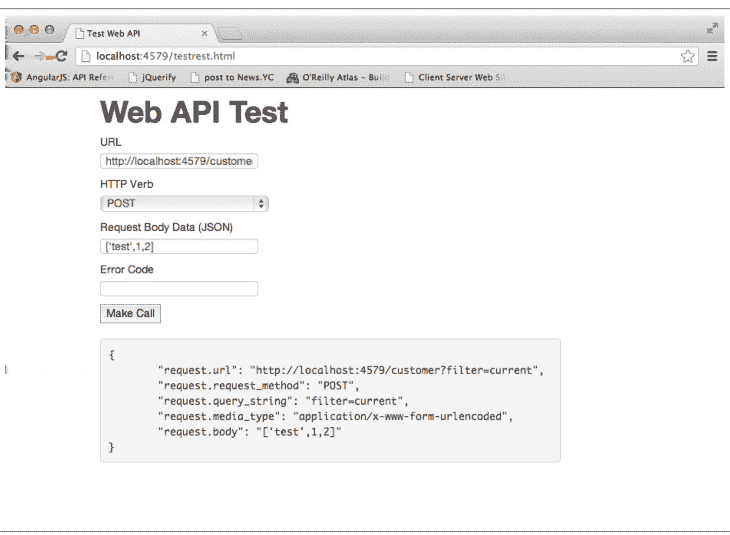

图 3-1. 测试 REST

这个简单的应用程序还展示了如何仅用几行代码，就能搭建一个最小实现的 Web API，作为后端供客户端开发人员与实现完整服务器功能的服务器开发人员并行工作。以下是代码一览：

```bash
$ cd jruby-sinatra-rest/src/main
$ find scripts -name "*.*" | xargs cat | wc -l
141
```

这还不包括从公共托管的内容分发网络（CDN）提供的 jQuery 和 Bootstrap，但仍然表明仅用几行代码就能实现的可能性。

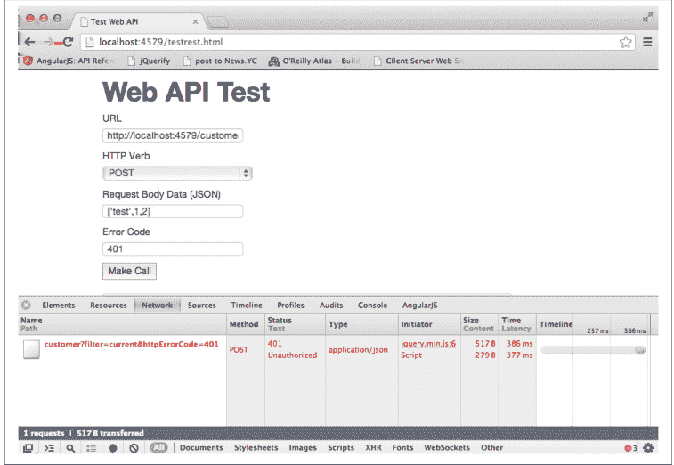

图 3-2. 测试 REST 错误

### 其他 Web API 工具

Web API 不局限于特定平台，因此用于调试它们的工具更多是开发者偏好和文化的问题。浏览器和浏览器插件当然很有用，如前所示，Curl 是一个灵活的命令行选项。**基于 Java 的 Web 客户端、REST 框架和 Eclipse IDE 插件**对 Java 社区有吸引力，而 `Fiddler` 则是 Microsoft 爱好者的热门选择。

### 约束再探

一个摆脱所有外部影响的创意天才的概念在很大程度上是神话。这种方法在软件开发中完全没有应用，与大多数在艺术领域完成的伟大作品也关系不大。相反，在创意活动中识别并应用最佳约束要有效得多。《纽约时报》描述作曲家伊戈尔·斯特拉文斯基在音乐创作开始时就确定约束，以"获得执行的精确性"：

对斯特拉文斯基来说，作曲是一个解决音乐问题的过程：他坚持在开始工作之前就定义这些问题。

例如，在创作《缪斯的领袖阿波罗》之前，他写信给委托创作这部芭蕾舞剧的伊丽莎白·斯普拉格·库利奇，询问演出大厅的确切尺寸、大厅的座位数量，甚至乐团面对的方向。

> "一个人施加的约束越多，他/她就越自由，"他如是说。"而约束的任意性只是为了获得执行的精确性。"

> — 《纽约时报》

催生了 REST 和 JSON 的约束绝非任意，但它们确实在客户端-服务器 Web 应用的开发中促进了执行的精确性。

## 第 4 章：Java 工具

> 编程语言最初的定位是人与计算机之间的通信媒介。如今，软件的生命周期延长了，编程团队的规模也扩大了。随着程序员需要就软件进行沟通，计算机代码也成为了重要的人类通信媒介。
>
> —吉尔·杜博谢

在这段引言中，吉尔·杜博谢在分析编程语言作为人类通信工具的角色时，引入了"分布式认知"的概念。编程语言通常被抽象地研究，而忽略了若干相当明显的上下文问题：

- 编程从来都不是完全孤立的活动。最近的许多项目都涉及大型分布式团队。
- 计算机语言是程序员之间进行人类通信的重要媒介。
- 程序员使用文学术语来描述代码质量。存在一种明示或暗示的期望，即代码应能被同行阅读。
- 对于拥有共同背景的程序员来说，更紧凑的代码能提高"代码理解"效率。
- 程序员无法将大型系统的所有系统需求都保存在自己的（人类）记忆中。
- 人类可读的文档（如果有的话）往往会与所描述的系统不同步。
- 文档并不总是能涵盖一段软件处理的所有边缘情况。知识存在于代码本身之中。

本章指出了可以在 Java 平台上运行的各种语言。这使得为特定任务或人群选择最佳语言成为可能。本章还描述了 Maven 作为一种工具，它促进了与多人编程相关的各种既定最佳实践。

### Java 语言

尽管 Java 是一种成熟、稳定且广为人知的语言，但在某些情况下由于其设计为基于类的、静态类型的面向对象语言，使用中存在一些挑战。承认技术之间可能存在的不匹配之处，并预先考虑可能完全缓解这种脱节的替代方案，是很有帮助的。

除了最简单的情况外，开发者都熟悉将面向对象语言（如 Java）与关系数据库系统集成的挑战。虽然可以通过改变使用习惯来缓解部分紧张关系，但由于面向对象模型和关系模型之间的根本哲学差异，始终存在一层映射关系。

这并非 Java 独有；JSON 和 REST 之间也存在类似的紧张关系。REST 要求 HATEOAS 统一接口约束中定义的链接。JSON 作为 JavaScript 语言的子集，没有这样的构造。两种实现本身都没有错，但它们有着不同的起源，当集成在一起时会导致不一致。

面向对象系统和 REST 之间也存在类似的紧张关系。在面向对象系统中，你对对象本身执行操作。在 REST 中，资源通过其表示来操纵。这额外的抽象层允许通过一个在对象系统中默认不可用的公共接口来操纵资源。

Java 开发者已经设计出特定的库，可用于处理与对接其他技术相关的大多数转换或集成活动。此外，Java 平台自身的一个组件引入了使用完全不同语言的可能性，这就是 Java 虚拟机（或 JVM）。

### Java 虚拟机（JVM）

Java 被翻译成字节码，然后在 JVM 上执行（参见图 4-1）。由于 Java 被设计为可跨平台执行，因此已经为各种操作系统开发和完善了 JVM，从高性能服务器到嵌入式设备实现。

图 4-1. Java 编译过程

JVM 相对于 Java 语言本身的独立性催生了其他可在 JVM 上运行的语言，包括 Ruby（JRuby，在前一章中已介绍）、Python（Jython）、Groovy、Clojure 和 JavaScript。JVM 曾经只是语言安装中实现跨平台开发的部分，现在则成为其他语言实现的接口（参见图 4-2）。

#### JVM 脚本接口与静态类型语言支持

图 4-2 中所示的语言在本章后续以及本书其他部分的项目中均有使用。它们是从众多受支持的 JVM 语言中筛选出来的，因为它们相对知名，并且可以通过 JSR 223（Java 平台的脚本支持）中定义的脚本接口来使用。该脚本接口为在单一项目中集成所支持的语言提供了通用机制。这些语言中的几种也受到后续 JSR 292（Java 平台动态类型语言支持）工作的影响，因此正在推动 JVM 本身某些方面的开发和完善。

相对简洁而强大的脚本语言的存在，为创建在 JVM 上运行的 API 提供了一种有吸引力的替代方案。本章后续的项目将演示在 JVM 语言中处理 JSON 的多种服务器端选项。

### Java 工具

Java 是一门成熟的语言，拥有众多标准 IDE 选项，包括 [Eclipse](https://www.eclipse.org/)、[NetBeans](https://netbeans.apache.org/) 和 [IntelliJ](https://www.jetbrains.com/idea/)。这些 IDE 包含开发工具和插件，可以消除编写代码、调试、性能分析以及无数其他编程琐事的枯燥乏味。IDE 是个人开发者工作的核心，熟练掌握它是现代 Java 开发中不可或缺的技能。IDE 提供与其他系统的集成，这些系统对于团队项目、版本控制和构建自动化至关重要。

有许多不同的工具可用于构建项目（[Apache Ant](https://ant.apache.org/) 是 Java 社区中长期以来的最爱）。[Maven](https://maven.apache.org/) 远不止定义简单的构建流程，它还协调了大量广为认可的软件开发任务。[Gradle](https://gradle.org/) 是基于 Groovy 的相对较新的工具。Ant 和 Maven 都基于 XML，而 Gradle 是一个完整的领域特定语言（DSL）。

超过一定的关键复杂度后，就需要额外的基础设施来帮助引导开发过程。这类基础设施的具体内容因项目而异，但通过遵循广为理解和已确立的编程实践，可以减少上手时间，并在对程序员生产力影响最小的情况下控制项目。简而言之，这样的基础设施使项目团队能够以其他方式不可能实现的方式进行扩展。

### 构建工具

架构师或首席开发者所做的最重要决定之一是项目初始应包含哪些资源。这一决定在项目稳定后会影响后续开发，但届时将更难更改。构建系统的选择对后续活动有着巨大的影响。有诸多因素需要考虑。

编程工具语法提供的灵活性是其有用性的重要因素。Martin Fowler 对比了 `make`（拥有自己的自定义语法）、`ant`（使用基于 XML 的语法）和 `rake`（使用 Ruby 编程语言），以强调在构建脚本中使用完整编程语言的价值。近年来也许更受关注的因素是构建工具中的依赖管理可用性。如果没有某种形式的依赖管理，开发者将不得不识别、定位、下载和安装依赖模块及相关资源（有时文档有限），处于非常不利的境地。从在线代码仓库自动管理指定版本的模块，对个人开发者来说极为宝贵，也有利于项目的整体稳定性。参见表 4-1。

表 4-1. 构建工具对比

| 工具 | 自定义 DSL | XML DSL | 编程语言 | 依赖管理 |
|---|---|---|---|---|
| `make` | Y | N | - | N |
| `ant` | N | Y | - | N |
| `rake` | N | N | Ruby | N |
| `maven` | N | Y | - | Y |
| `gradle` | N | N | Groovy | Y |
| `SBT` | N | N | Scala | Y |

这一定程度上是简化说法，因为构建工具具有极强的可扩展性。可以添加依赖管理插件和对其他编程语言的支持，以扩展那些原生不提供这些功能的工具的能力。例如，Ant 使用 Ivy 支持依赖管理，并且还存在名为 Gant 的基于 Groovy 的项目版本。

该列表代表了广泛使用的构建工具，但并不穷尽。自 1977 年以来，Make 在某种程度上影响了大多数其他构建工具（包括 Rake）。Rake 本身也启发了几个面向 Java 的项目（包括 Raven 和 Apache buildr）。


依赖管理对于几乎任何规模的项目来说都是无可争议的优秀特性。拥有完整的编程语言提供了很大的灵活性。Ruby 曾经是一个受欢迎的选择，但在许多情况下已被 Groovy 取代，因为 Groovy 与 Java 更为相似（如前所述，有效的 Groovy 文件通常就是有效的 Java 文件）。因此，Gradle 正成为一个受欢迎的选择，它包含了完整脚本语言的依赖管理支持，语法简洁且 Java 开发者可以立即上手。类似地，Scala 用户有 Scala 构建工具（SBT），它在设计和目的上与 Gradle（Groovy 的构建工具）大致类似。该工具在 Scala 之外的一个著名用例是 Play 框架，它同时支持 Scala 和 Java。

尽管选项众多，灵活性通常有利，但使用一个“有主见的”工具、基于最佳实践有效地预先做出许多决策，有着显著的好处。这种方法以 Maven 为代表最为典型。

### 较少的灵活性是否可取？

Martin Fowler 的文章强调了在构建脚本中使用完整编程语言的灵活性。其好处包括更少的代码重复，以及不必为了做“有趣的事情”而跳出 DSL 的挫败感。他的关注点是在构建自己网站的背景下（一个基本上是个人完成的项目）。然而，当涉及多人协作时，有更多的控制和约定（以及较少的灵活性）是有好处的。标准命名和已知的构建步骤序列可以减少开发者在项目启动后各个阶段加入时的困惑（这在大型分布式开源项目以及根据需求将程序员调配到不同团队的公司中都很常见）。当有人想在构建环境中实现 somewhat unusual 的任务时，一个使其稍微困难一点的系统可以减缓原本轻率的决定。它迫使开发团队停下来思考：“我们真的需要做这个吗？”以及“我们究竟想要达成什么？”

一个倾向于灵活性的系统（如 Gradle）在执行任意任务时很方便（相对于简单的标准构建而言）。对于一个相对较小、沟通顺畅、不容易做出 questionable 架构决策、并享受所提供控制的团队来说，这样的系统可以真正提高生产力。在更大的团队中，标准约定通常更可取，因为你可以直接检出并构建项目，而不必先停下来问：“构建这个系统的正确命令是什么？我们有 compile、install、build、make、package……等任务。” Maven 强制执行标准约定，节省了在大型团队中维持更灵活系统所需的时间和沟通开销。

Maven（该词在 Yiddish 语中意为“知识的积累者”）组织项目并定义其软件开发工作流。它被描述为“软件项目管理和理解工具”。它简化了构建过程，并提供了一个统一的系统来设置项目（通过允许以声明式方式指定项目依赖）。其报告和文档功能用于生成和集中所有项目特定的技术工件。

Maven 具有几个显著的特点：

- 它倡导约定优于配置（同时保持可扩展性和可定制性）。
- 它提供了跨项目的通用接口。
- 它提供了定义明确的构建生命周期。
- 它通过项目对象模型（`pom.xml`）定义了通用的项目配置。

关于 Maven 的更多详细信息，请参阅《Maven 权威指南》（O'Reilly 出版），该书也可以免费[在线](http://simpligity.com/book/maven-the-definitive-guide.html)获取。

### Maven 的优势

即使在最小型的 Java 项目中，Maven 的价值也是立竿见影的，因为它允许以声明式方式识别 JAR 文件。作为构建过程的一部分，Maven 会在在线仓库中定位这些 JAR 文件及其所有依赖项，并将它们下载到本地仓库的适当位置。它负责指定所需的 CLASSPATH 条目，因此初始构建项目所需的所有基本设置任务都可以通过单个命令完成。这足以考虑在即使是最简单的项目中使用 Maven，但其好处不止于此。

随着项目的扩展或规范化，可以运行、组装并随后将单元测试、生成的文档和构建报告等资源存储在标准位置。拥有标准的项目结构和约定使得新开发人员的加入变得容易得多。这在从开源开发到大型组织的各种项目中都有优势，在这些组织中，开发人员会根据人员配置需求在项目间调动。

结构良好的项目非常适合复杂的开发和部署选项。使用 Maven 构建的项目可以轻松集成到持续集成（CI）流程中。并且通过其对版本控制系统的引用，发布管理可以使用带有增量版本号的标签以受控和标准化的方式完成。事实上，如果一个系统包含在 CI 服务器上定期运行的健壮测试集，并且生产环境包含足够的监控和警报，就有可能从管理特定版本转向在更频繁的基础上持续部署软件。项目适当的初始组织为开发人员提供了即时利益，并一路节省了努力直至生产部署。

### Maven 的功能

Maven 本身相当简单，开箱即用的功能很少。通过使用插件，它可以执行广泛的构建任务标准，并且可以扩展以包含您能想象到的任何其他任务。一些具体示例：

- 通过 `JUnit` 进行的标准单元测试和代码覆盖率报告在生成许多新项目（从称为 `archetypes` 的 Maven 项目模板）时作为标准功能包含在内。
- 可以创建项目网站（`mvn site`）来记录项目的目的和状态。可以使用默认的类 wiki 格式 `Almost Plain Text`（APT）或其他支持的选项创建 Maven 站点。该站点为项目信息、联系人、报告和资源提供了一个中心位置。
- 可以使用简单的命令（`mvn jetty:run`）以最少的配置运行嵌入式应用程序服务器，用于开发期间。该服务器也可以作为构建本身的一部分运行，以支持单元测试。还有其他插件可用于将 Web 应用程序部署到您选择的应用程序服务器上。
- 尽管植根于 Java 开发社区，但已经编写了 Maven 插件来支持其他语言的开发。`JavaScript 插件`提供代码组织和单元测试。`代码压缩`和`代码质量工具`也易于获得。

Maven 经常被描述为“固执己见的软件”。从负面理解，这表明它难以适应某些类型的项目。然而，它的固执己见的特性促进了定义的软件开发生命周期和值得考虑的最佳实践，即使在使用另一个构建系统时也是如此。它用标准化的配置取代了依赖个人记住和手动执行正确的构建流程和项目管理细节，这些配置可以通过各种插件进行大量增强。它促进了项目内乃至整个组织内的统一实践。Maven 的“观点”可以被利用，而不是使用一个完全开放的系统，让开发者承担记忆的责任，这样普通开发者甚至不会考虑外围问题，而会简单地做正确的事情，因为许多错误的选项需要太多的额外努力。

项目最初包含的资产对后续开发产生深远影响。这不仅适用于构成项目本身的组件，也适用于开发工具和构建系统的选择。在本章后续介绍的项目中引入 Maven 的目的是展示设置一个绝对最小配置是多么简单，并展示其在模块声明式管理方面的价值。一旦一个项目已经在 Maven 上构建，集成额外的插件和功能就相对容易了。

### 版本控制

如果您正在阅读本书，您可能不需要被说服使用版本控制的价值。大多数开发机构需要控制其软件资产，并为此目的使用版本控制系统。如果仅将其视为文件系统备份，则会错过其最大的好处。这些好处包括随时间查看代码的历史更改、比较不同版本、建立定义的代码版本（标签）、创建分支以促进代码集成的并行开发以及创建补丁。

版本控制系统（VCS）对于使开发人员团队能够有效地协作进行大型项目至关重要。它们大大简化了当多个开发人员需要更改同一文件时产生的冲突解决。通过使用 VCS，对现有项目的支持大大简化，因为有一个审计历史记录，记录了谁在何时更改了什么。如果提交时包含有用的注释，或者与问题跟踪系统集成，还可以指示进行特定更改的原因。

单个开发人员从 VCS 中受益，因为他们可以放心地进行实验，知道他们可以在需要时回退到之前的“已知良好”版本。如果一个项目需要较长时间才能完成，VCS 历史记录可以显示随时间取得的进展，并为更改原因提供有用的提醒。

[Maven 项目](https://maven.apache.org/)使用 Git 或 Subversion 管理源代码。

### 单元测试

使用 Maven/Junit（用于 Java）、node/Karma（用于 JavaScript）或实际上任何其他编程语言的其他测试框架，可以轻松地将单元测试纳入项目中。也有一些 Java 框架支持其他类型的测试。[JBehave](https://jbehave.org/)可用于行为驱动开发（BDD），并可通过 [Maven 插件](https://maven.apache.org/plugins/)获得。也可以通过 [Selenium 插件](https://www.selenium.dev/)使用浏览器自动化进行测试。

持续单元测试中遇到的一个挑战是将代码与外部系统的依赖隔离。这可以通过在测试上下文中创建一个对象来替代或模拟真实对象来克服。实际上有多种不同类型的对象可以使用。[Martin Fowler](https://martinfowler.com/)强调了哑对象、伪造对象、存根和模拟对象。测试人员对于在测试中使用多少模拟对象存在分歧，但像 [Mockito](https://site.mockito.org/) 和 [JMock](https://www.jmock.org/)这样的项目使得创建原本困难或不可能的测试变得容易得多。

给定测试方法的适用性因项目、客户、开发团队和可用资源而异。无论选择如何，Maven 都使包含[单元测试框架](https://maven.apache.org/surefire/maven-surefire-plugin/)变得容易。正如前面指出的，一套全面的测试使得一系列开发和部署选项成为可能，而如果没有这种验证和覆盖，这些选项根本无法实现。

### JSON Java 库

有许多可以处理（解析或生成）JSON 的 Java 库。由于 Java 中的基本结构是 Java 对象，因此为 Java 编写的 JSON 库倾向于依赖 JSON 与 Java 对象之间的映射，并提供将对象序列化为 JSON 以及从 JSON 反序列化对象的方法。Jackson 和 Gson 是两个流行的库，可以将 Java 对象转换为其 JSON 表示形式，反之亦然。

### 项目

这些项目提供了一个极其精简的 Maven POM，以展示其在模块声明式管理方面的价值。一旦项目已经在 Maven 上构建，集成额外的插件和功能就相对容易。

每个项目都可以从项目的根目录使用以下命令进行构建：

```bash
mvn clean install
```

必须连接互联网，以便 Maven 能够定位并下载每个项目所需的模块。第一次为项目运行此命令时，它会检查你的本地仓库（默认位于 `<your OS user's home directory>/.m2/repository`）。如果项目不存在于此处，它将在在线 Maven 仓库中找到并下载，以便后续使用。运行 `mvn clean` 命令会导致项目中的资源被删除，但不会影响已下载到本地仓库的模块。

### Java 与 JSON

`java_json` 项目演示了 Maven 以及 Jackson 和 JSON Java API 的基本用法。在项目中将 JSON 和 Jackson 同时包含为依赖项所需的 `pom.xml` 如下：

```xml
<?xml version="1.0" encoding="UTF-8"?>
<project xmlns="http://maven.apache.org/POM/4.0.0"
         xmlns:xsi="http://www.w3.org/2001/XMLSchema-instance"
         xsi:schemaLocation="http://maven.apache.org/POM/4.0.0 http://maven.apache.org/xsd/maven-4.0.0.xsd">
    <modelVersion>4.0.0</modelVersion>

    <groupId>JSON_Java</groupId>
    <artifactId>JSON_Java</artifactId>
    <packaging>jar</packaging>
    <version>1.0</version>

<dependencies>
    <dependency>
        <groupId>com.google.code.gson</groupId>
        <artifactId>gson</artifactId>
        <version>2.2.3</version>
        <scope>compile</scope>
    </dependency>
    <dependency>
        <groupId>org.codehaus.jackson</groupId>
        <artifactId>jackson-mapper-asl</artifactId>
        <version>1.9.12</version>
    </dependency>
</dependencies>
<build>
    <plugins>
        <plugin>
            <groupId>org.codehaus.mojo</groupId>
            <artifactId>exec-maven-plugin</artifactId>
            <version>1.2.1</version>
        </plugin>
    </plugins>
</build>
</project>
```

此 POM 指定了项目的标识（或坐标：`groupId`、`artifactId` 和 `version`）以及打包模式（JAR）。Jackson 和 JSON 的具体版本通过 `version` 标识，并且包含了一个便于执行 `main` 方法的插件。这是一个极其简单的 `pom.xml`，展示了如何便捷地使用 Maven 管理 JAR 依赖。如果你是 Maven 初学者，这应该让你没那么紧张；而 Maven 专业人士可以在此基础上扩展，添加单元测试、文档、报告以及所有你喜欢的附加功能。

包含的 Java 代码由三个类组成。定义了一个简单的 Java 对象（POJO），用于 JSON 的序列化和反序列化：

```java
package com.saturnos.json;

public class MyPojo {
    private String thing1;
    private String thing2;

    public MyPojo(){
        System.out.println("*** Constructor MyPojo() called");
    }

    public String getThing1() {
        return thing1;
    }

    public void setThing1(String thing1) {
        this.thing1 = thing1;
    }

    public String getThing2() {
        return thing2;
    }

    public void setThing2(String thing2) {
        this.thing2 = thing2;
    }

    @Override
    public boolean equals(Object o) {
        if (this == o) return true;
        if (o == null || getClass() != o.getClass()) return false;

        MyPojo myPojo = (MyPojo) o;

        if (thing1 != null ? !thing1.equals(myPojo.thing1) : myPojo.thing1 != null)
            return false;
        if (thing2 != null ? !thing2.equals(myPojo.thing2) : myPojo.thing2 != null)
            return false;

        return true;
    }

    @Override
    public int hashCode() {
        int result = thing1 != null ? thing1.hashCode() : 0;
        result = 31 * result + (thing2 != null ? thing2.hashCode() : 0);
        return result;
    }
}
```

在 `DemoJSON` 类中，实例化 POJO、导出其 JSON 表示形式以及解析 JSON 以创建另一个 POJO 所需的代码如下：

```java
MyPojo pojo = new MyPojo();
//... code to populate pojo can be found in the project source code

Gson gson = new Gson();
String json = gson.toJson(pojo);

MyPojo pojo2 = gson.fromJson(json, MyPojo.class);
```

`DemoJackson` 遵循相同的模式，但使用了 Jackson API 特有的对象和方法名称：

```java
MyPojo pojo = new MyPojo();
//... code to populate pojo can be found in the project source code

ObjectMapper mapper = new ObjectMapper();
String json = mapper.writeValueAsString(pojo);

MyPojo pojo2 = mapper.readValue(json, MyPojo.class);
```

可以使用以下命令执行这些 Java 类：

```bash
mvn exec:java -Dexec.mainClass=com.saternos.json.DemoJackson
mvn exec:java -Dexec.mainClass=com.saternos.json.DemoGSON
```


### 支持 JSON 的 JVM 脚本语言

前面的基于 Java 的示例将 JSON 转换为 Java 对象，这对于 Java 很有意义，但对于其他语言则不然。JSON 基于几种简单的数据结构（JavaScript 数组和对象）。这些对应于其他语言中的数组（或列表）和哈希（或字典、表或哈希映射）。许多库在 JSON 对象和相应的原生数据结构之间进行了简单的转换。

`jvm_json` 项目展示了如何使用 Clojure、JavaScript、Jython 和 Groovy 读取 JSON 文档并提取及输出字段。图 4-3 提供了直观表示，重点展示了如何使用 `ScriptEngineManager` 类根据文件扩展名调用正确的引擎。


### JVM JavaScript 引擎

本书中的示例使用了 Mozilla 开发的 Rhino JavaScript 引擎（其名称源自 O'Reilly 关于该主题的书籍）。Oracle 公司正在开发一个新的 Java JavaScript 引擎，名为 Nashorn，计划随 Java 8 发布。

该项目中的 `pom.xml` 包含了所用编程语言的相关依赖。此外，配置了两个插件：

1. `Exec Maven` 插件允许在命令行运行 Java 类和其他可执行文件。
2. Maven Shade 插件是可用于打包 JAR 的众多插件之一。Shade 插件的独特之处在于它能够将那些存在类名冲突问题的项目打包到 JAR 中。在处理实现前述 Java 脚本接口的模块时，这种情况较为常见。

`pom` 还包含了指向包含所引用模块的仓库的引用。

主 Java 类 `Jvms.java` 打开一个作为程序参数指定的脚本文件，并使用相应的脚本引擎（基于文件扩展名）执行它。

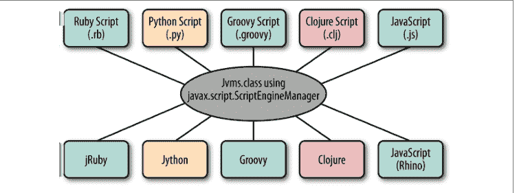

*图 4-3. 脚本引擎管理器的作用*

`Jvms.java` 有一个简单的 `main` 方法，用于遍历命令行传递给它的参数。对于每个参数，程序尝试验证该名称文件的存在。如果未找到，它将 `src/main/resources/scripts` 作为路径附加到文件名上。这是存储脚本文件的目录。请注意，为了呈现与当前讨论相关的程序方面，省略了异常处理和其他细节。在这种情况下，如果未找到文件，异常将直接从 `main` 方法抛出（该方法被定义为抛出 `Exception`）。扩展名被确定为从第一个点到文件名末尾的部分。最后，实例化一个新的 `ScriptEngineManager`，并通过扩展名获取脚本引擎。文件从文件系统读取，并由与文件扩展名关联的脚本引擎进行评估：

```java
public static void main( String[] args ) throws Exception
{
  for (String fileName: args){

    if (!fileName.trim().equals(""))
    {
      File file=new java.io.File(fileName);

      if (!file.exists())
        fileName ="src/main/resources/scripts/"+fileName;

      String ext = fileName.substring(
        fileName.indexOf(".") + 1,
        fileName.length()
      );

      new ScriptEngineManager().getEngineByExtension(ext).eval(
        new java.io.FileReader(fileName)
      );
    }
  }
}
```

该程序可以通过 Maven 执行，并且可以将一个或多个脚本作为参数传入：

```bash
mvn -q \
exec:java -Dexec.args="testJson.clj testJson.js testJson.groovy testJson.py"
```

如果你愿意，也可以直接使用 JAR 文件执行，而无需使用 understandable-- 通过使用附带的脚本：

```bash
jvms.sh testJson.clj testJson.js testJson.py testJson.groovy
```

Python（[Jython](https://www.jython.org/)）示例简洁明了。使用缩进代替带有开始和结束标记的代码块，这使其成为一个很好的示例，几乎以伪代码的形式突出了所讨论的功能，没有额外的开销或干扰。Python 是一种非常规范的语言，由于其设计的一致性，歧义较少：

```python
import json

print('*** JSON Jython ***')

for item in json.loads(open("data/test.json").read()):
    print item['title']
```

首先导入一个用于处理 JSON 的库，从文件系统加载数据，然后遍历对象，以便打印每个标题。Groovy 示例遵循几乎相同的模式。[Groovy](https://groovy-lang.org/) heavily 基于 Java（有效的 Java 文件通常也是有效的 Groovy 文件）。它引入了许多比纯 Java 更紧凑、更简洁的惯用法。这使其成为向 Java 开发者普及的流行语言，他们可以在学习 Groovy 特性的同时依赖自己的 Java 知识：

```groovy
import groovy.json.JsonSlurper

println "*** JSON Groovy ***"

def json = new File("data/test.json").text

new JsonSlurper().parseText(json).each { println it.title }
```

Clojure 示例遵循相同的基本模式，尽管你可能会注意到有大量的括号。[Clojure](https://clojure.org/) 是 LISP 的一种方言，与其他示例的类 C 语法形成鲜明对比：

```clojure
(require '[clojure.data.json :as json])

(println "*** JSON Clojure ***")

(def recs (json/read-str (slurp "data/test.json")))
```

```clojure
(doseq [x recs] (println (x "title")))
```

JavaScript 版本略有不同。无需导入（本示例中使用 `eval()` 仅用于说明目的）。如果你还记得，JavaScript 没有内置的 I/O 功能。因此，这个示例使用了一点技巧，调用静态 Java 方法来读取文件（使用 Java），并将文件内容（从 Java 中以 Java 字符串的形式获取）转换为 JavaScript 字符串：

```javascript
println('*** JSON Javascript ***')

// 调用 Java 静态方法来读取文件并将其转换为 JavaScript 字符串
var str = String(com.saternos.app.Jvms.readFile("data/test.json"));

var o = eval(str);

for (var i-_dummy_0_TODO_check this_40281_09-0; i < o.length; i++){
  println(o[i].title);
}
```

尽管这可能被认为是一种 less pure--- 但它展示了 JVM 上不同语言之间集成的便捷性。

## 结论

人们学习新的编程语言或像 Maven 这样的支持工具的原因有很多。最常见的原因是特定项目需要。许多 Ruby 开发者是在开发 Rails 应用程序 the Latin word "compilatio" means "to rob." need to check this part carefully applications 或使用 Chef 或 Puppet 进行系统管理时开始使用该语言的。科学家们则被 Python 吸引，因为它有与他们的工作相关的专业库，以及其严谨的设计和高性能。

研究表明，自然语言塑造思维。这一点在《华尔街日报》上的一篇文章中被突出强调。该文章描述了语言如何对一个人看待和思考世界的方式产生深远影响。文章指出：

关于语言如何影响思维的一些发现：

- 俄语使用者有更多表示浅蓝和深蓝的词汇，因此能够更好地区分蓝色的不同色调。
- 一些原住民部落使用东、南、西、北而非左和右，因此具有很强的空间定向能力。
- Pirahã 人的语言避免使用数字词汇，而使用“少量”和“大量”等词语，因此无法跟踪确切的数量。
- 在一项研究中，西班牙语和日语使用者不像英语使用者那样能够熟练记住意外事件的行为者。为什么？因为在西班牙语和日语中，因果行为者被省略了：“花瓶自己碎了”，而不是“约翰打碎了花瓶”。

在特定领域特别富有表现力的语言会使个人对该领域更加敏感。编程语言也是如此。从这个角度来看，学习新的编程语言并不仅仅是目的本身，也不仅仅是为了完成特定项目。它帮助你以不同的方式看待世界。它提高你解决一般问题的能力。大多数学习 Clojure（或其他 LISP 方言）的人并非因为特定项目而学习。他们的目的是提高自己概念化和解决问题的能力。LISP 方言以其简单、富有表现力、强大和灵活而闻名（甚至可能是最简单、最有表现力、最强大、最灵活的语言）。但在学习其他编程语言时，同样道理在较小程度上也适用。每种语言都有其特点和社区，可能与其他语言有很大差异。但这些差异并非绝对的，程序员仅仅通过学习其他语言和工具就能成长，即使它们不能立即派上用场。

本章从与其他开发者共同开发的角度介绍了几种 JVM 语言和 Maven。某些语言可能有助于开发者之间的良好沟通。它们可能有助于以某种方式封装需求，使系统在未来更易于逆向工程和维护。Maven 可用于构建项目资源和开发流程，这种方式对许多涉及开发者团队的成功项目都有益。尽管阅读书籍是相对独处的活动，但你的程序员工作中无疑有很大一部分是与他人合作完成的。JVM 语言和 Maven 为需要与其他开发者进行长期广泛互动的项目提供了合适的功能。

# 第 5 章：客户端框架

> 你也知道，开始是任何工作中最重要的部分……因为那时性格正在形成，所需的印象更容易留下。
>
> ——柏拉图

## 概述

在 Web 早期，创建新的网页意味着打开文本编辑器，从头开始创建 HTML 文档。这种方法对于创建教育目的的最小示例或测试孤立的 JavaScript 功能仍然有效。然而，这个起点并非大多数现代 Web 应用程序的起源。相反，一个可行的项目模板包括组织良好的目录结构，以及特定组合的 JavaScript 库、CSS 文件、HTML 和其他资源。选择可能因项目而异，但通常应解决项目一致性、跨浏览器兼容性、良好的设计原则、软件开发实践（如单元测试）和优越性能等问题。

从历史上看，起始项目是通过工具（如 Maven，使用 archetype）生成的，或者是在 IDE 中创建新项目时指定的。此类项目通常与生成它们的工具绑定。由于 Web 开发没有标准的 IDE 或构建工具，起始项目没有这种绑定（尽管已集成在工具和 IDE 中）。它们的复杂性和目的各不相同，但成功的起始项目有一个共同特点：简单易懂、易于设置和部署。它们提供基本的基础设施，减少与 Web 应用程序主要目的无关的繁琐手工作业。

起点的选择涉及客户端网页的基本构建块：在 Web 浏览器中运行的网页上下文中的 HTML、CSS 和 JavaScript。如图 5-1 所示。


*图 5-1. 客户端网页*

需要考虑的最广泛上下文是客户端本身。有许多可能的 Web 浏览器。每个浏览器都有许多版本。浏览器不再特定于桌面应用程序，而是在移动设备上运行。每个浏览器实例运行在具有广泛功能特性的特定硬件上。硬件在处理器性能、磁盘空间、内存、屏幕尺寸和显示特性方面可能存在差异。这也许很明显，但经常被开发工作站上运行的几个浏览器限制了视野的开发者所遗忘。

起始项目可以针对特定的内容、样式和/或行为。HTML 定义页面的基本结构和内容。CSS 定义样式和设计表现。JavaScript 提供行为功能。具有设计技能的人可能会选择更简约或提供更多 CSS 样式灵活性的起始项目，但可能希望 JavaScript 基础设施支持广泛的插件并需要最少的编程。开发者可能会选择提供过得去的设计的开箱即用的项目，但会满足于利用最新浏览器功能的尖端 JavaScript 库。

起始项目的选择还基于你的应用需求和受众。在尽可能多的可用浏览器上实现兼容性的目标可能暗示一个起始项目，而针对特定移动设备的高度优化应用的目标则会暗示另一个。例如，PhoneGap 等框架包含专门针对移动设备的起始项目。如果你的项目是游戏或其他图形密集型项目（如模拟），则包含具有图形和物理引擎功能的 JavaScript 库的起始项目是相关的。

特定需求可能暗示一个并不明显或流行的起点。很容易迷恋特定的框架或设计趋势，但项目的特殊性可能需要不同的方法。例如，如果你需要针对某个特定浏览器（由于企业内部浏览器标准、目标网络人群等原因），你可能会围绕其特定特性进行开发，并选择一个能兼顾这些因素的初始项目。此外，HTML、CSS 和 JavaScript 还可用于开发标准网页之外的各种应用，如浏览器扩展程序和原生应用程序。以广泛兼容多种浏览器和设备为目标的通用方法通常是最优的，但这绝非唯一有效的方法。

一般来说，如今大多数正经的 Web 开发项目都旨在打造功能完备的应用程序，能够在各种设备上运行。大多数项目也被期望未来会发展到相对庞大和复杂的规模。这意味着需要使用客户端 JavaScript 框架来遵循标准软件模式和代码组织规范。显示方式、浏览器功能和设备功能的差异意味着需要经过深思熟虑的设计，能够适应各种设备，并在功能不可用时优雅降级。目标设备功能范围在应用生命周期内有望被充分利用，这意味着需要使用额外的库和框架。这在传统的、有限的桌面浏览器应用中是不需要考虑的因素。

## 早期决策的高昂代价（或价值）

这一节可能显得有些啰嗦。选一个初始项目，开干就是了！

慎重考虑早期选择之所以重要，根源在于它们会对后续产生巨大影响。经济学家和社会科学家使用*路径依赖*这个术语来表达这一理念。其基本思想是，早期决策是“后期状况的不成比例的原因”。项目在早期引入的问题可能在后期无法逆转。例如，选择了一个不成熟的 JavaScript 库可能导致需要添加大量修复和 hack 来解决浏览器兼容性问题。尽管在初始开发阶段这并不明显（当时开发者关注的是现代浏览器），但后续支持可能变得负担沉重，而大量额外代码可能导致退无可退的局面。反之，一个经过深思熟虑的初始项目可以显著降低项目实现过程中后期的支持负担。

### 起点一：响应式 Web 设计

2010 年 5 月 25 日，Ethan Marcotte 题为“[响应式 Web 设计](https://alistapart.com/article/responsive-web-design/)”的文章发表在*[A List Apart](https://alistapart.com/)*上。*Responsive Web Design*（或简称 RWD）现已成为一个通用术语，作为他所表达理念的简写。这种设计风格不为每个设备显示专门设计，而是力争在广泛的设备上提供最佳的浏览体验。就像软件设计模式（其灵感源自 Christopher Alexander 的建筑模式）一样，这一概念起源于建筑学。响应式建筑考虑的是物理空间如何随着人们的穿行而适应变化。响应式 Web 设计则寻求基于设备能力，通过多样的交互方式，在各种设备显示上适应用户体验。RWD 的三个组成部分是：

#### 流体网格

为 Web 使用而改良的排版网格。它们利用 CSS 中可用的相对尺寸，以与上下文相匹配的比例方式显示网格及其组件。

#### 弹性图片

包括使用 CSS `max-width` 使图片和其他媒体在其包含元素内渲染，以及相关技术来避免无法适应所有设备显示的固定点样式。

#### CSS3 媒体查询

检查页面渲染环境的物理特性，并以特定的固定单位格式做出响应。

流体布局和弹性图片（依赖相对尺寸）与 CSS3 媒体查询（允许针对固定尺寸的自适应布局）相结合，构成了 RWD 的基础。流体布局按比例缩放，而自适应布局在特定断点处切换。这避免了单独使用流体方法时出现的扭曲，以及纯粹自适应设计对中间显示可能性的适应不足。

通过使用 RWD 的这三个构造，一套精心构建的 Web 资源可以产生能够在各种设备上有效查看和使用的页面。Marcotte 后来在书中进一步发展了文章中介绍的理念。许多项目基于这些原则开发，其中包括 HTML Boilerplate 和 Twitter Bootstrap。

### HTML5 Boilerplate

[HTML5 Boilerplate](https://html5boilerplate.com/) 提供了一套满足 RWD 要求的资源。其特性包括标准目录结构、与网站和 Web 服务器配置相关的模板文件。它包含的 CSS 整合了 *[normalize.css](https://necolas.github.io/normalize.css/)*（一个提供跨浏览器符合现代标准的一致渲染的样式表）、一些额外的 CSS 默认值、常用辅助类、占位媒体查询和打印样式。同时还提供了 jQuery 和 Modernizr JavaScript 库。

### Bootstrap

[Twitter Bootstrap](https://getbootstrap.com/)，[由其创建者最初描述](https://twitter.com/fat)为“快速开发 Web 应用程序的前端工具包。它是一组 CSS 和 HTML 约定。它使用了一些最新的浏览器技术，为你提供时尚的排版、表单、按钮、表格、网格、导航以及你在一个超小（gzip 后仅 6k）资源中所需的一切。”


因此，它超越了 HTML5 Boilerplate 提供的最小化资源。在[第二版](https://getbootstrap.com/2.0/)中得到了进一步增强，并随着项目周围成长起来的社区的意见反馈不断[完善](https://getbootstrap.com/)。使用 Bootstrap 构建的网站曾被批评为单调乏味、千篇一律，本质上是彼此的复制品。尽管由于使用标准资源和样式而导致相似性是可以预期的，但实际上通过手动定制或使用主题，可以获得很大的灵活性。该框架也随着时间的推移变得更加"组件化"，使得某些功能可以被包含或排除，而且存在生成器可用于创建开箱即用的资源集，以使其与默认设置区分开来。

还有许多其他类似的项目。[Zurb Foundation](https://foundation.zurb.com/) 用户群较小，主要目标是移动设备。如果你对融入最小化响应式设计和基本网格系统以及一些基本样式的轻量级项目感兴趣，[Skeleton](http://www.getskeleton.com/) 可能值得一看。但如果你正在开发一个只需要响应式网站且具有专业、平衡样式的项目，Bootstrap（配合主题和一些手动调整）目前是最好的选择。

## 起点二：JavaScript 库和框架

随着语言的成熟，各种标准库被不断添加。在 JavaScript 中，库不需要任何特殊的结构或封装；它们只是其他的 JavaScript 文件。库几乎被创建用于你能想象的每一个目的。但有几类通用的库适用于客户端-服务器 Web 应用程序。

### 浏览器兼容性

尽管 JavaScript 是事实上的标准，但某些浏览器的特性却是 legendary 的谈资。浏览器厂商创建兼容实现的可能性很小。太多精力被投入到差异化每个浏览器，以及实现旨在推动标准进程而非遵循既定标准或指南的功能。幸运的是，许多常用的库能够抚平许多粗糙的边缘，使得 JavaScript 代码能够提供一致的结果（以及更少的错误或破坏性结果），无论特定浏览器版本如何。这些库如表 5-1 所示。

# 第 5 章

| 库 | 用途 |
|---|---|
| jQuery | DOM 遍历和操作 |
| Modernizr | 浏览器特性检测 |
| Underscore | 实用函数，包括对象和数组操作 |

jQuery 和 Modernizr 在各自的领域中是事实上的标准。Underscore 的普及程度稍低。还有许多其他提供类似功能的库：它们能以简洁、函数式的方式一致地处理对象和数组（例如，Lo-Dash 旨在成为 underscore 的优化替代品）。

## 框架

对于中小型 JavaScript 项目，直接操作 DOM（像 jQuery 那样）是一个不错的方法。而对于大型项目，操作包含交互数据并包含额外功能（如数据验证）的 JavaScript 类要容易得多。随后，这些类可以被填充并与页面中的图形元素连接起来。这种设计模式的益处是避免了直接操作 DOM。相反，数据的更改会根据包含对象中的数据状态反映在页面上。与页面的交互（以及由于外部事件导致的数据更改）会导致模型状态的改变，而这些改变会向下渗透到所有受影响的视图组件中。第一个 MVC 框架在多年前就是为此目的而创建的，这种模式已被现代 JavaScript 框架所采用。MVC 有几种变体，包括 `Model-View Presenter` (MVP) 和 `Model-View ViewModel` (MVVM)，因此 MV* 这一术语有时被用作一个通用总称来标识这些模式。

从外部看，选择一个初始框架可能会相当令人畏惧。如果你没有特定的偏好，决定使用哪一个可能需要花一些精力。除了当前内部的开发技能外，一些基本标准还包括给定框架的功能及其普及程度。

### 功能性

MV* 框架的列表相当广泛且不断变化。TODO MVC 是一个能提供热门框架功能即时具体比较的网站。TODO MVC 允许你对比一个简单的、功能完整的 TODO 列表应用程序在各种不同 MV* 框架中的实现。

### 普及程度

虽然最受欢迎的选择可能不是最好的，但它是项目通用支持情况的一个合理指标，以及它是否拥有可行的教育、增强和错误修复生态系统。[Google Trends](https://trends.google.com) 显示了某些搜索词的搜索次数，而 [StackOverflow 标签](https://stackoverflow.com/tags) 的数量也可以让人们了解开发者对某个话题的讨论热度。为了更好地了解哪些代码实际上在被使用，可以查看热门的 [GitHub 仓库](https://github.com)（以及尚未跃升至列表顶端的新项目的统计数据），或者使用 [BuiltWith](https://builtwith.com) 等网站的统计数据来了解总部署基数。

如果你决定使用主流的 JavaScript MV* 框架，你会希望审查并可能从社区已经产出且积极支持的任何项目中开始。表 5-2 列出了几个流行框架的入门项目。

表 5-2. JavaScript MVC 框架的入门项目

| 框架 | 入门项目 |
|---|---|
| [Backbone](https://backbonejs.org) | [Backbone Boilerplate](https://github.com/backbone-boilerplate/backbone-boilerplate) |
| [Angular](https://angularjs.org) | [Angular Seed](https://github.com/angular/angular-seed) |
| [Ember](https://emberjs.com) | [Ember Starter Kit](https://github.com/emberjs/starter-kit) |

这些框架 each 都相当庞大，这里无法进行详尽的概述。O'Reilly 出版的关于 [Angular](https://angularjs.org) 和 [Backbone](https://backbonejs.org) 的书籍提供了更详细的内容。

这些绝非唯一选择。JavaScript 框架具有依赖项，并启发了扩展其核心功能的库。jQuery 是许多其他项目的前提条件，而 `underscore.js` 是 Backbone 的依赖项。Backbone 开发者倾向于使用 `require.js` 进行脚本加载和代码组织；它还启发了另一种 MV* 框架 [Spine](https://spinejs.com)。[Angular-UI](https://angular-ui.github.io) 提供了用户界面组件。jQuery 启发了整个相关的库、插件和扩展生态系统，其中包括像 [jQuery UI](https://jqueryui.com) 这样提供各类组件的大型库，以及像 [TouchPunch](https://github.com/furf/jquery-ui-touch-punch) 这样用于触摸屏事件处理的小型专业库。

此外还有入门项目，它们将 JavaScript 库与另一个面向浏览器兼容性和响应式设计的入门项目相结合。一个结合了 [Angular UI](https://angular-ui.github.io) 和 [Bootstrap](https://getbootstrap.com) 的项目已经可用，并且与为 [jQuery UI](https://jqueryui.com) 和 [Bootstrap](https://getbootstrap.com) 创建的项目类似。

除了 MVC 框架，如果你在创建 jQuery 插件，可以使用 [jQuery Boilerplate](https://github.com/jquery-boilerplate/jquery-boilerplate) 来为此目的建立一个结构合理的项目。底线是，如果你发现自己在为一项你确信其他人也遇到过的任务编写样板代码，那么你有必要在网上地查找是否存在入门项目。

### 获取入门项目

有几种不同的方式可以获取入门项目以快速启动开发。

#### 直接从仓库下载

大多数此类项目在公开的源代码仓库（通常在 [GitHub](https://github.com)）中在线维护。

> ### GitHub 仓库名人堂
>
> 就此而言，入门项目、推广响应式 Web 设计的资源以及 JavaScript 库是 [GitHub 上最受欢迎的仓库](https://github.com) 之一。
>
> - 响应式设计资源
>   - Modernizr
>   - Normalize CSS
>
> - 入门项目
>   - Bootstrap
>   - HTML5 Boilerplate
>
> - JavaScript 库
>   - jQuery
>   - Backbone
>   - Foundation
>   - Angular
>   - Underscore
>   - Ember
>   - jQuery UI
>   - Knockout

#### 从入门网站下载

像 [Initializr](http://initializr.com/) 或 [HTML5 Reset](http://html5reset.org/) 这样的网站最终依赖于源代码仓库，但还包括与启动 Web 项目以及通用开发和设计主题相关的评论、比较和文档。

#### IDE 生成的入门项目

像 WebStorm（由 JetBrains 创建的商业项目）这样的 IDE 包含从模板创建新项目的选项，如图 5-2 所示。WebStorm 包含了本章讨论的几个入门项目，以及 Node.js（Node.js 样板和 Node.js express）或 Dart 入门项目。

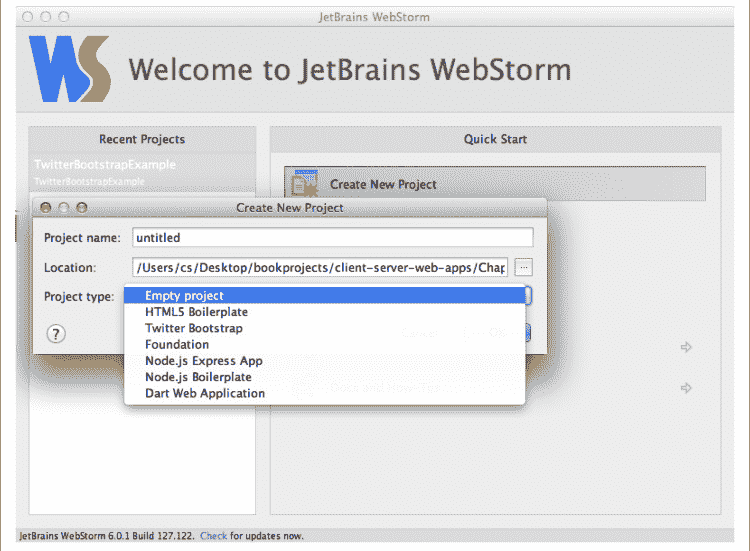

图 5-2. 客户端入门项目

### 前端工程师的兴起

到目前为止，应该很明显，Web 开发涉及的复杂程度已经从其卑微的起点大大扩展。一个没有显著开发技能和专注度的设计师不太可能跟上最新的进展。同样，大多数服务端开发者也不太可能具备成熟的设计能力，或者意识到专注于客户端的最新发展。这催生了一个新职业：`前端工程师`。如果到目前为止介绍的主题还不能让你相信新信息的爆炸式增长，请考虑以下与客户端开发和流程相关的额外细微差别。

### 客户端模板

之前讨论的一些 JavaScript 框架捆绑了 JavaScript 模板解决方案。此外还存在许多独立运行的解决方案，其中许多可以根据你的意愿与各种框架进行更换。[LinkedIn engineering](https://engineering.linkedin.com/) 在决定使用 `dust.js` 之前考虑了 26 种客户端模板技术。这个领域有一些迷人的发展，包括实现如果需要可以回退到服务端渲染的客户端 JavaScript 模板的可能性。

### 资源管道

传统的 Web 开发简单地涉及在 Web 服务器上编辑和包含相关资源。现在资源可以通过内容分发网络 (CDN) 外部提供。此外，资源在 Web 服务器上提供之前，通常会以多种方式进行预处理，而不仅仅是编辑和包含。资源管道 (asset pipeline) 可用于预编译、拼接和压缩适用的 Web 资源，并采取与管理这些资源缓存相关的相关操作。

资源编译器在过去几年中出现在 Ruby 社区。早期的例子是 `Jammit` 和 `Sprockets`。后来，资源管道被纳入 `Rails`，并被其他语言的 Web 框架采用，例如 Java 的 `Play2`。

资源管道用于许多任务。有些旨在减少提供大文件时的网络延迟。JavaScript 和 CSS 文件可以被压缩（删除空格和其他多余字符）、拼接（导致总网络调用次数减少）以及压缩（使用 gzip 或其他压缩算法）。其他任务与缓存相关。例如，Play 框架使用 `ETag HTTP Headers` 来附加一个根据资源名称和文件最后修改日期生成的值，并且还提供了设置 Cache-Control 标头的选项。

此外，拥有预处理步骤为将其他语言编译为 JavaScript（如 `CoffeeScript` 和 `Dart`）提供了可能。这为那些觉得 JavaScript 语言本身不讨喜的人提供了一系列可能性。

CSS 也可以进行预处理，从而减少重复代码的数量。减少重复代码使得应用程序样式更容易维护，代价是增加了一个额外的构建步骤。预编译器在被 HTML 页面引用之前的某个时间点处理初始文件，并解析代码中的引用，从而渲染出标准的样式表。通过 CSS 编译器可用的预处理类型示例包括：

- 定义变量，用于替换整个样式表中的值（例如，在各种 CSS 类中使用的颜色）
- 创建方法，用于根据作为参数传入的变量为类分配一组值
- 实现 CSS 类的继承

CSS 处理器起源于 Ruby 开发者中，但已逐渐被 Java 社区所接受。例如，已经创建了 LESS CSS Maven 插件。

资产管道实现中涉及的预编译步骤存在一定争议。只使用过硬编码 CSS 文件的设计师可能会觉得预处理器引入的编程可能性令人望而生畏。尽管开发者可能更容易接受预处理器的收刊（基于他们在其他编程环境中的使用经验），但改变任何人的工作流程都可能令人不安。这正是前端工程师这一新兴角色发挥作用的地方，它在开发者和设计师之间架起了一座桥梁。这一角色包含独特的工作流程和一系列工具，以适应客户端层面日益扩展的职责。

### 开发工作流程

一个名为 `Yeoman` 的基于 `node` 的软件包提供了开发工作流程，使用三种工具：`yo`（用于脚手架）、`grunt`（用于构建）和 `bower`（提供包管理）。其他基于 `node` 的软件包，如 `karma`（用于运行测试）和 `Docco`（用于文档），也适用于开发工作流程和构建过程。

### 项目

为了解最简单框架示例的价值及其与功能完整的入门项目的关系，请考虑以下使用 Angular 的示例：

```html
<!doctype html>
<html ng-app>
  <head>
    <script src="http://code.angularjs.org/1.0.6/angular.min.js"></script>
  </head>
  <body>
        Angular Expression 1 + 2 evaluates to:  {{ 1 + 2 }}
  </body>
</html>
```

Angular 框架的使用一目了然，因为文档中包含了一些不属于标准 HTML 的 XML 属性（称为指令）。在此示例中，`ng-app`（位于 HTML 标签中）是自动引导应用程序所必需的。每个 HTML 页面可以出现一次此类属性。它指定了应用程序的根节点，并且（尽管在本例中为空）可以选择性地包含模块名称。`script` 标签表明正在使用 Angular；还可以包含提供额外功能的其他 Angular 脚本。最后，将要演示的可见 Angular 功能是一段表达式。Angular 表达式是放在绑定（双花括号）中的类似 JavaScript 的代码片段，经过求值以产生输出。

这是一个非常极简的示例，仅对表达式进行求值。它甚至不能展示 Angular 作为 MV* 框架的特性，因为它不包含任何控制器或数据绑定。它仅仅是为了说明创建 Angular 应用程序所需的最低功能。下一个示例加入了模型和控制器：

```html
<!doctype html>
<html ng-app>
  <head>
    <script src="http://ajax.googleapis.com/ajax/libs/angularjs/1.0.6/angular.min.js">
    </script>
        <script>
            function HelloCntl($scope) {
                              $scope.name = 'World';
                        }
        </script>
  </head>
  <body>
    <div ng-controller="HelloCntl">
      Your name: <input type="text" ng-model="name" />
      <hr/>
      Hello {{name}}!
    </div>
  </body>
</html>
```

Angular 中的控制器只是一个用于在给定作用域中实现行为的函数。在本例中，控制器用于绑定一个模型（`name` 变量），该模型可以在文本字段中修改。每次在引用 `name` 模型的输入文本字段中注册按键时，变化都会反映在引用该模型的表达式中。剩余的一个重要功能是框架与远程服务器的 Ajax 调用相关的功能。最后一个示例说明了这一点：

```html
<!doctype html>
<html ng-app="GoogleFinance">
  <head>
    <script src="http://ajax.googleapis.com/ajax/libs/angularjs/1.0.6/angular.min.js">
    </script>
        <script src="http://code.angularjs.org/1.0.6/angular-resource.js"></script>
        <script>
          angular.module('GoogleFinance', ['ngResource']);

          function AppCtrl($scope, $resource) {
              $scope.googleFinance = $resource('https://finance.google.com/finance/info',
                                  {client:'ig', q: 'AAPL', callback:'JSON_CALLBACK'},
                                  {get: {method:'JSONP', isArray: true}});
```


```html
$scope.indexResult = $scope.googleFinance.get();

$scope.doSearch = function () {
    $scope.indexResult = $scope.googleFinance.get({q: $scope.searchTerm});
};
}
</script>
</head>
<body>
    <div ng-controller="AppCtrl">
        <form class="form-horizontal">
            <input type="text" ng-model="searchTerm">
            <button class="btn" ng-click="doSearch()">
                Search
            </button>
        </form>
        Current Price: {{indexResult[0].l_cur}}<br/>
        Change:        {{indexResult[0].c}}<br/>
    </div>
</body>
</html>
```

`Angular resource`用于进行后端调用。需要包含定义它的脚本，并且需要在控制器中将其作为参数引用。由于我们正在向不同域名的站点发起调用，因此将`JSONP`指定为方法。模型（`searchTerm`）用于指定要通过`Google Finance API`搜索的股票代码。结果以`JSON`数组形式返回，获取后显示当前价格和变化字段。

这三个示例对教育和演示目的很有帮助。它们是精简版本，突出显示了所需的功能及其关联方式。

只需少量工作，就可以添加`Bootstrap`的样式表和一些基本样式。本章代码中的其他更改通过链接到`bootstrap.css`、创建容器类和视图行、添加搜索图标以及进行一些其他设计调整，对前面的示例进行了扩展。这些仍然保留在单个独立的文件中；标准入门项目会将这些资源拆分并组织到标准的目录结构中。

这些示例可以包含在入门项目中，例如`AngularJS seed`或`Bootstrap`，只需将前述代码的相关部分添加到索引页面（或相关的包含视图中）即可。理想情况下，这些示例中呈现的内联`JavaScript`代码应提取到单独的文件中（初步将模块放入`app.js`，控制器放入`controllers.js`）。

## 结论

在任何成功的开发团队中，每位成员都有独特的优势，可以为项目带来助益。一位成员的专注使其他人能够更加关注其他领域，有效限制他们注意力范围内的问题范围。入门项目和`JavaScript`框架使开发者免于`BOM`和`DOM`实现细节、浏览器兼容性问题、代码组织的初始顾虑以及其他挑战。

硬件改进和`JavaScript`性能优化使得创建大规模`JavaScript`应用程序成为可能。当使用标准设计时，大规模应用程序更容易管理，并且通过消除每个`Web`开发项目所需的重复性任务来增强项目专注度。本章介绍的框架是具体的项目示例，可以启动您的下一个开发工作，并使您的团队立即将注意力集中在项目的功能需求上。

# 第6章

## Java Web API服务器

> 一个只关注自己的人，包裹出来的东西非常小。
>
> ——本杰明·富兰克林

打包使得通过包含可重用组件来扩展语言的能力成为可能。给定语言可用的打包方式会影响部署选项。打包方案包括对标准命名约定、元数据文件、数字签名、代码混淆、代码排列、相关文件/资源的包含以及压缩机制的考虑。

打包必然会影响部署。语言中可用的实际部署选项往往会暗示项目的结构及其开发工作流程。在`Java`中，这一点比其他语言更为明显。`Java`源文件名反映了它们包含的公共类的名称。`Java`包遵循文件系统的目录结构。`Java`使用几种特定的包类型。通用源代码包含在`Java归档文件`（`JAR`）中，Web应用程序存储在`Web应用程序归档文件`（`WAR`）中，相关Web应用程序组可以打包在一起形成`企业应用程序归档文件`（`EAR`）。`WAR`可以部署到`servlet`容器中，而`EAR`需要完整的`Java企业版`支持，这在`JBoss`等应用服务器中可用。

`Java`的打包范式有许多优点，但对部署可能性造成了局限性的看法。自`Java`最初开发以来存在的标准Web应用程序开发实践需要独立安装和配置的应用程序服务器。实际上，这些并非部署`Java Web`应用程序所必需的。即使使用了Web容器，也可以避免在开始开发之前安装和配置它的开销。

### 更简洁的服务端解决方案

客户端技术的爆发式增长令人应接不暇，这源于 Web 浏览器作为平台所固有的挑战、`JavaScript`语言本身的问题，以及为应对复杂性而创建的各种`JavaScript`库。另一个复杂因素是设备特定的开发，这可能涉及移动 Web 应用程序或通过`HTTP Web`服务调用的原生应用程序。在新的客户端-服务端 Web 范式中，一个令人欣喜的发现是服务端代码在相应部分得到了简化。

传统上，Web 应用程序是一个相对庞大的构造，运行在应用服务器、Web 容器或 Web 服务器中。截至本书编写时，久负盛名的`Apache Web`服务器拥有超过`两百万行代码`，需要`数百人年的工作量`才能完成。`J2EE`的开发以复杂著称（因此在较新的`JEE`版本中已大幅简化）。服务端的模型-视图-控制器项目（`Struts`）和依赖注入框架（`Spring`）提供了组织结构并减轻了配置负担，但也凸显了开发基于`Java`的 Web 应用程序所需的服务端实现的`规模`和`体量`。

客户端-服务端 Web 应用程序使用的服务器不维护会话状态，主要由简单的`API`组成。虽然这类服务器当然可以利用中间件和支持服务，但这些通常并非必需。受脚本语言世界的直接和间接影响，如今搭建一个最小化的服务器为前端开发者提供足够的功能，使其无需完整的服务端实现即可开展工作，已变得轻而易举。`Java`和`JVM`语言提供了多种可能性，使开发者可以在项目中包含服务器功能，而无需安装、配置和维护完整的服务端实现。这开启了与以往截然不同的工作流程的可能性。除了开发过程中的便利之外，在基于云的生产环境中采用水平扩展的方式也因轻量级服务器解决方案而变得更加轻松。

“无容器”Web应用服务器可以通过在`JVM`上直接使用`Java`，或者利用库来构建。图 6-1 展示了本章所使用的库及其相互关系。图中位置更高的库拥有更丰富的基础设施、更强烈的架构倾向，且（理论上）是针对特定领域框架的更高产的起点。它们并非全部，但可以向各个方向扩展。例如，各种`JVM`语言都有相应的 Web 框架（`JRuby`对应`Sinatra`或`Rails`，`Jython`对应`Django`）。`Typeset`是一个基于`Play`构建的`Scala`框架。`vert.x`以其对多种`JVM`语言的支持而独树一帜。


*图 6-1. 服务器库*

本章的示例仅限于以`Java`为中心的工作流程和构建过程。`JVM`语言的工作流程实践因各自的起源而异。`Groovy`和在较小程度上的`Scala`创建时的初始目标就是`JVM`，而`Ruby`和`Python`则是移植到`JVM`上的语言。`Groovy`（以及在较小程度上的`Scala`）中的技术和实践往往可追溯到`Java`开发者熟悉的问题或模式。`JRuby`和`Jython`起源于独立的体系，往往具有`Java`开发者不太熟悉的原始方法（但对于从其他平台迁移到`JVM`的开发者来说则容易识别）。这些语言通常需要你使用其社区特定的开发安装程序、工具链和命令。

### 基于 Java 的服务器

服务器可以仅用`Java`编写，也可以使用若干高级库之一。在许多情况下使用相同的基本模式：服务器类将请求委托给一个处理器，该处理器继承一个抽象类或实现一个接口，其中定义了一个`handle`方法。图 6-2 展示了使用处理器类的服务器类之间的基本关系。`handle`方法由具体的处理器实现。在下面的示例中，处理器将返回一个`JSON`对象。


*图 6-2. 服务器-处理器类图*

**关于示例的说明**

与本书中的其他示例一样，本章的示例都经过有意简化，以隔离与当前讨论主题相关的具体内容。例如，以下许多`JSON`响应仅仅是文本字符串。在实践中，构建响应时使用`Jackson`或其他类似库要常见得多。大多数开发者将使用高级的、功能齐全的框架进行开发，但在书中使用字符串来说明代码中发生的事情更为清晰。在项目中使用库配合注解非常整洁、高效且具有声明性，但它隐藏了太多功能，以至于示例代码充其量也是不够清晰的。

这些示例的要点是演示应用服务器*并非*总是必需的，编写功能性的、专用服务器是一项相对直接的任务。许多开发者会选择使用高级框架，但了解底层库中发生的事情可以帮助调试或解读错误堆栈跟踪和日志消息。

#### Java HTTP 服务器

`Java标准版`自带`HTTP服务器API`，允许创建简单的、功能性的嵌入式`HTTP`服务器。以下程序不需要任何外部依赖。它监听 8000 端口，通过返回带有`JSON`内容的`HTTP`成功响应（200）来处理请求：

```json
{"testResponse":"Hello World"}
```

一个`Java`源文件由一个定义了`main`方法的类组成。在`main`方法内部，创建一个服务器实例，根据 URL 上下文将请求委托给一个静态处理器类（这里定义为静态内部类）：

```java
import java.io.*;
import com.sun.net.httpserver.*;
import java.net.InetSocketAddress;

public class HttpJsonServer {

    public static void main(String[] args) throws Exception {

        HttpServer server = HttpServer.create(
            new InetSocketAddress(8000), 0
        );
        server.createContext("/", new MyHandler());
        server.setExecutor(null);
            System.out.println("Starting server on port: 8000");
        server.start();
    }
```

```java
static class MyHandler implements HttpHandler {

    public void handle(HttpExchange t) throws IOException {
        String response = "{\"testResponse\":\"Hello World\"}";
        t.getResponseHeaders().set(
            "Content-Type",
            "application/json"
        );
        t.sendResponseHeaders(200, response.length());
        OutputStream os = t.getResponseBody();
        os.write(response.getBytes());
        os.close();
    }
}
```

这个示例非常简单，没有外部依赖，也没有构建脚本。只需编译并运行即可：

```bash
$ javac HttpJsonServer.java
$ java HttpJsonServer
Starting server on port: 8000
```

可以通过另一个命令行会话使用`Curl`访问该服务器：

```bash
$ curl -i http://localhost:8000
HTTP/1.1 200 OK
Content-type: application/json
Content-length: 30
Date: Sun, 09 Jun 2013 01:15:15 GMT

{"testResponse":"Hello World"}
```

显然，这不是一个功能特别完善的示例。但它确实表明，使用`Java`开发功能性的`HTTP`服务器是一个相对容易实现的目标。

#### 嵌入式 Jetty 服务器

`Jetty`是一个基于`Java`的`HTTP`服务器和`Java Servlet`容器，由`Eclipse`基金会维护。除了作为`Eclipse IDE`的一部分之外，它还被嵌入或用于多种其他产品中，如`ActiveMQ`、`Maven`、`Google App Engine`和`Hadoop`。它不仅仅是一个`HTTP`服务器，因为它还支持`Java Servlet API`以及`SPDY`和`WebSocket`协议。由于被广泛包含在众多项目中，许多开发者至少了解其存在和功能。但较少有人知道它可以多么容易地作为自定义基于`Java`的服务器中的组件来使用。

由于基于`Jetty`的服务器需要包含外部模块，因此需要一个构建脚本。在书中描述`Maven`配置的一个挑战是`pom.xml`文件往往相对庞大且冗长。`Gradle`配置则更为简洁和聚焦。以下`Gradle`配置包含了`Jetty`，并添加了一个可用于启动服务器的任务：

```gradle
apply plugin:'java'

repositories{mavenCentral()}
dependencies{compile 'org.eclipse.jetty:jetty-server:8.1.0.RC5'}

task(startServer, dependsOn: 'classes', type: JavaExec) {
    main = 'com.saternos.embedded.TestJettyHttpServer'
    classpath = sourceSets.main.runtimeClasspath
    args 8000
}
```

遵循的模式与基于`Java`的简单示例类似。定义了一个处理程序类来返回`JSON`响应：

```java
package com.saternos.embedded;

import java.io.IOException;
import javax.servlet.ServletException;
import javax.servlet.http.HttpServletRequest;
import javax.servlet.http.HttpServletResponse;
import org.eclipse.jetty.server.Request;
import org.eclipse.jetty.server.handler.AbstractHandler;

public class JsonHandler extends AbstractHandler
{
    public void handle(
        String target,
        Request baseRequest,
        HttpServletRequest request,
        HttpServletResponse response
    )
        throws IOException, ServletException
    {
        response.setContentType("application/json;charset=utf-8");
        response.setStatus(HttpServletResponse.SC_OK);
        baseRequest.setHandled(true);
        response.getWriter().println(
            "{\"testResponse\":\"Hello World\"}"
        );
    }
}
```

`main`方法创建了一个服务器实例。服务器对象将接收到的请求委托给处理程序：

```java
package com.saternos.embedded;

import org.eclipse.jetty.server.Server;

public class TestJettyHttpServer
{
    public static void main(String[] args) throws Exception
    {
        Server server = new Server(Integer.parseInt(args[0]));
        server.setHandler(new JsonHandler());
        System.out.println("Starting server on port: " + args[0]);
        server.start();
        server.join();
    }
}
```

使用`Gradle`构建并运行服务器：

```bash
$ gradle build startServer
```

通过`Curl`得到的响应是你可能预期的，同时还包含了对`Jetty`作为所用服务器的引用：

```bash
$ curl -i http://localhost:8000
HTTP/1.1 200 OK
Content-Type: application/json;charset=utf-8
Content-Length: 31
Server: Jetty(8.1.0.RC5)

{"testResponse":"Hello World"}
```

如果你倾向于从头开始编写自定义`API`服务器，`Java`中包含了基本的构建块，并在`Jetty`等库中得到了扩展。`Jetty`也在幕后用于其他与编写`Web API`相关的项目，例如`Restlet`。

### Restlet


`Restlet API` 的设计直接引用了 REST 概念，如资源、表示、连接器、组件和媒体类型。REST API 可以自然地在这个框架中实现。尽管下面的示例不是特别符合 REST 风格，但它展示了创建返回 JSON 的服务器所需的代码是多么少。该类是一个附加到根上下文的 `ServerResource`，通过对 HTTP GET 请求返回 JSON 来响应：

```java
package com.saternos.embedded;

import org.restlet.*;
import org.restlet.data.*;
import org.restlet.resource.*;
import org.restlet.ext.json.JsonConverter;

public class TestRestletHttpServer extends ServerResource {

    public static void main(String[] args) throws Exception {
        Component component = new Component();
        component.getServers().add(Protocol.HTTP, Integer.parseInt(args[0]));
        component.getDefaultHost().attach("/", TestRestletHttpServer.class);
        component.start();
    }

    @Get ("json")
    public String getGreeting() {
        return "{\"testResponse\":\"Hello World\"}";
    }
}
```

## Roo

Roo 允许你在几分钟内创建项目。新项目运行在嵌入式 Jetty（或 Tomcat）服务器上。内存数据库可用（你可以设计你的数据模型，它们会自动传播到所选的数据库）。因此，零时间花费在服务器配置上，你就可以通过与 REPL 交互来创建包含 Web 应用服务器和数据库后端的传统 Web 应用程序。

下载最新版本的 Roo，解压它，并将 `roo.sh`（或 `roo.bat`）的路径添加到你的路径中。运行 `roo.sh`，系统会提示你完成一些初始设置（同意使用条款）。此时，你可以输入 `help` 或 `hint`，在任意时刻获得可用选项的提示：

```bash
$ roo.sh
    ____  ____  __    
   / __ \/ __ \/ /    
  / /_/ / /_/ / /     
 / _, _/ _, _/ /___   
/_/ |_/_/ |_/_____/   1.2.4.RELEASE [rev 75337cf]

Welcome to Spring Roo. For assistance press TAB or type "hint" then hit ENTER.
roo>
```

Roo 的命令行界面响应方式类似于用于创建基于 Spring 的 Web 应用程序的专家系统。输入 `hint` 以查找在开发过程中给定点的可用选项。系统会指导你设置数据存储、定义实体和字段，以及创建 Web 应用程序。

请注意，有时你需要在交互式提示之外工作。例如，如果你输入了错误的实体或字段，这些需要从生成的代码中删除。

以下在 Roo 上下文中运行的一组命令将创建一个包含 JSON 服务的标准 JEE Web 应用程序（未包含每个命令的输出）：

```bash
project com.saternos.bookshop

jpa setup --provider HIBERNATE --database HYPERSONIC_IN_MEMORY

entity jpa --class ~.domain.Author --testAutomatically
field string --fieldName name --sizeMin 2 --notNull

entity jpa --class ~.domain.Book --testAutomatically
field string --fieldName name --notNull --sizeMin 2
field number --fieldName price --type java.math.BigDecimal
field set --fieldName authors --type ~.domain.Author

json all --deepSerialize
web mvc json setup
web mvc json all

web mvc setup
web mvc all --package ~.web
```

该应用程序提供与书籍列表相关的 CRUD 操作。在初始项目创建后，配置了内存数据存储。然后配置了两个实体（及其对应字段）。接下来的三个命令是暴露实体通过 JSON Web API 所必需的。最后两个命令生成基于实体的 JEE 管理应用程序。

该应用程序可以在 Jetty 上构建和运行：

```bash
mvn clean install jetty:run
```

作者可以通过 JSON API 使用 Curl 创建。第一个示例展示了如何创建单个作者；第二个示例展示了一组作者。

```bash
curl -i -X POST -H "Content-Type: application/json" \
-H "Accept: application/json" \
-d '{name: "Simon St. Laurent"}' \
http://localhost:8080/bookshop/authors
```

```bash
curl -i -X POST -H "Content-Type: application/json" \
-H "Accept: application/json" \
-d '[ {name: "Douglas Crockford"}, {name: "Michael Fogus"} ]' \
http://localhost:8080/bookshop/authors/jsonArray
```

Web 应用程序的主页可从 `http://localhost:8080/bookshop/` 访问，默认情况下以专业风格的设计呈现，如图 6-3 所示。

同一 URL 可用于使用 HTTP delete 删除记录：

```bash
curl -i -X DELETE -H "Accept: application/json" \
http://localhost:8080/bookshop/authors/1
```

```bash
curl -i -X DELETE -H "Accept: application/json" \
http://localhost:8080/bookshop/authors/2
```

```bash
curl -i -X DELETE -H "Accept: application/json" \
http://localhost:8080/bookshop/authors/3
```


书籍及其相关作者可以通过嵌套对作者的引用来添加。图 6-4 显示了在运行以下 `curl` 命令后“List all Books”页面中反映的更改：

```bash
curl -i -X POST -H "Content-Type: application/json" \
-H "Accept: application/json" \
-d '{"name":"JavaScript: The Good Parts",'
    '"price":29.99,'
    '"authors":[{"name": "Douglas Crockford"}]}' \
http://localhost:8080/bookshop/books

curl -i -X POST -H "Content-Type: application/json" \
-H "Accept: application/json" \
-d '{"name":"Functional JavaScript",'
    '"price":29.99,'
    '"authors":[{"name": "Michael Fogus"}]}' \
http://localhost:8080/bookshop/books

curl -i -X POST -H "Content-Type: application/json" \
-H "Accept: application/json" \
-d '{"name":"Introducing Elixir",'
    '"price":19.99,'
    '"authors":[{"name": "Simon St. Laurent"}]}' \
http://localhost:8080/bookshop/books
```

> 为人类阅读格式化代码具有挑战性。这是因为计算机和人们对空白字符和换行符的解释不同——而且本书同时以纸质和数字格式出版。实际上，前面的 `curl` 命令最好在没有换行符和最少空白字符的情况下在命令行中执行。不幸的是，这会导致无效的文字换行或文本溢出页面边缘。在 `bash` 会话中，可以使用反斜杠（`\`）在每行末尾将长命令拆分为多行。我们在整本书中都遵循这一约定，但它并不适用于所有情况。前面的示例将 JSON 字符串拆分为单独的行，并包含反引号（`），导致空格和中间换行被忽略。我们利用 `bash` 的这一特性，为从本书数字版本复制命令的人提供便利。

图 6-4. Roo Web 应用图书列表

要检索已插入的作者和图书列表：

```bash
curl http://localhost:8080/bookshop/authors
curl http://localhost:8080/bookshop/books
```

可以通过 ID 访问结果数组中的单个对象：

```bash
curl http://localhost:8080/bookshop/books/1
```

### 在命令行格式化 JSON

有多种方法可以格式化命令行返回的 JSON。你可以将输出重定向到文件，然后用支持 JSON 格式化的编辑器打开。还有一些专用工具（如 `jq`）可以格式化通过管道传递给它的 JSON 数据。如果你已安装 Python，格式化非常简单：

`curl http://localhost:8080/bookshop/books | python -m json.tool`

有了 Web API 之后，可以创建并使用标准 HTML 页面来替代（或作为补充）通过 Roo 脚手架命令创建的 `jspx` 页面。创建一个名为 `/src/main/webapp/test.html` 的文件，它将通过 `http://localhost:8080/bookshop/test.html` 访问。可以使用 jQuery 的 `getJSON` 方法来访问 GET 图书列表调用：

```html
<html
<head>
  <title>Book List</title>
  <script src="http://ajax.googleapis.com/ajax/libs/jquery/1.10.1/jquery.min.js"></script>
</head>
<body>

  <h3>Books</h3>
  <ul class='booklist'></ul>

<script>
  (function() {
    $.getJSON('/bookshop/books', function(books) {
      $.each(books, function(nil,book) {
        $('.booklist').append('<li>' + book['name'] + '</li>');
      });
    });
  })();
</script>
</body>
</html>
```

Roo 是最易上手的工具之一，因为它具有交互式特性。如果你想获得关于使用该框架的更广泛 coverage，*Getting Started with Roo*（O'Reilly）可以免费下载，而 *Spring in Action*（Manning Publications）则提供了额外的深入见解。

## 嵌入式 Netty 服务器

虽然 Jetty 与 Eclipse 基金会有关联，但来自 JBoss 社区的一个项目出现了一些重叠的用例。Netty 用于创建优化的网络应用程序（协议服务器和客户端）。优化的网络应用程序比通用替代方案具有更好的可扩展性。Twitter 利用 Netty 来解决性能问题这一事实，表明了它的成熟度和扩展能力。

使用 Netty 的示例应用程序与刚才使用 Jetty 演示的类似，遵循相似的基本模式。同样，一个带有 `main` 方法的类实例化并启动服务器，并定义一个处理程序类来处理传入的请求：

```java
package com.saturnos.embedded;

import io.netty.bootstrap.ServerBootstrap;
import io.netty.channel.socket.nio.*;

public class TestNettyHttpServer {

    public static void main(String[] args) throws Exception {

        ServerBootstrap bootstrap = new ServerBootstrap();

        bootstrap.group(new NioEventLoopGroup(), new NioEventLoopGroup())
                 .channel(NioServerSocketChannel.class)
                 .localAddress(Integer.parseInt(args[0]))
                 .childHandler(new JsonServerInitializer());

        System.out.println("Starting server on port: " + args[0]);
        bootstrap.bind().sync().channel().closeFuture().sync();
    }
}
```

处理程序类扩展了 `ChannelInboundMessageHandlerAdapter`，这使得该类可以包含在服务器管道中。`messagestiReceived` 方法可以访问请求并创建响应：


```java
package com.saternos.embedded;

import io.netty.buffer.Unpooled;
import io.netty.util.CharsetUtil;
import java.text.SimpleDateFormat;
import io.netty.channel.*;
import java.util.*;
import io.netty.handler.codec.http.*;

public class JsonHandler extends ChannelInboundMessageHandlerAdapter<HttpRequest> {

    public void messageReceived(ChannelHandlerContext channelHandlerContext,
                                HttpRequest httpRequest) throws Exception {
        StringBuffer buf = new StringBuffer();
        buf.append("{\"testResponse\":\"Hello World\"}");

        SimpleDateFormat dateFormatter = new SimpleDateFormat(
                                            "EEE, dd MMM yyyy HH:mm:ss zzz",
                                            Locale.US
                                            );

                        dateFormatter.setTimeZone(TimeZone.getTimeZone("GMT"));
                        Calendar time = new GregorianCalendar();

        HttpResponse response = new DefaultHttpResponse(HttpVersion.HTTP_1_1,
                                                        HttpResponseStatus.OK);

        response.setHeader(HttpHeaders.Names.CONTENT_TYPE,
                             "application/json;charset=utf-8");
        response.setHeader(HttpHeaders.Names.CONTENT_LENGTH, buf.length());
        response.setHeader(HttpHeaders.Names.DATE,
                             dateFormatter.format(time.getTime()));
        response.setHeader(HttpHeaders.Names.SERVER,
                             TestNettyHttpServer.class.getName() +
                             ":io.netty:netty:4.0.0.Alpha8");
        response.setContent(Unpooled.copiedBuffer(buf, CharsetUtil.UTF_8));
        channelHandlerContext.write(response).addListener(
                             ChannelFutureListener.CLOSE);
    }
}
```

还需要一个实现`ChannelInitializer`的类来设置管道。

初始化器的`initChannel`方法引用了`Channel`接口，用于为`SocketChannel`创建和访问管道。管道转换或操作传递给它们的值。`HttpRequestDecoder`接收原始字节并用它们构造与 HTTP 相关的对象，而`HttpChunkAggregator`将传输编码为`chunked`的请求规范化。接下来的两个管道类对响应进行编码和分块，然后传递给示例应用程序的特定处理程序类（在其中创建标头和实际响应）：

```java
package com.saternos.embedded;

import io.netty.channel.socket.SocketChannel;
import io.netty.handler.stream.ChunkedWriteHandler;
import io.netty.handler.codec.http.*;
import io.netty.channel.*;

public class JsonServerInitializer extends ChannelInitializer<SocketChannel> {

    public void initChannel(SocketChannel socketChannel) throws Exception {
        ChannelPipeline pipeline = socketChannel.pipeline();
        pipeline.addLast("decoder", new HttpRequestDecoder());
        pipeline.addLast("aggregator", new HttpChunkAggregator(65536));
        pipeline.addLast("encoder", new HttpResponseEncoder());
        pipeline.addLast("chunkedWriter", new ChunkedWriteHandler());
        pipeline.addLast("handler", new JsonHandler());
    }
}
```

构建和运行应用程序会产生与前面类似的响应：

```text
$ gradle build startServer
$ curl -i http://localhost:8000

HTTP/1.1 200 OK
Content-Type: application/json;charset=utf-8
Content-Length: 30
Date: Fri, 14 Jun 2013 14:02:57 GMT
Server: com.saternos.embedded.TestNettyHttpServer:io.netty:netty:4.0.0.Alpha8

{"testResponse":"Hello World"}
```

Netty 是一个相对低级的通用网络库。这为创建优化应用程序提供了极大的灵活性，代价是设置适用管道和处理程序的额外开销。该示例稍长且更复杂，但值得了解，因为 Netty 为几个更高级别的框架（如 Play 和 Vert.x）提供了基础。Netty 的核心开发者 Norman Maurer 撰写了 *Netty in Action*（Manning Publications），这本书详细介绍了这个复杂框架的功能。

### Play 服务器

**Play 框架**是一个轻量级、无状态的框架，非常适合创建 API 服务器。可以通过几个简单的命令生成 Play 应用程序，并且可以配置路由文件来指定引用控制器方法的 HTTP 方法和路径。代码可以用 Java 或 Scala 编写，并且受到了 Scala 社区的影响。

这在很多地方都有体现，例如使用 SBT 和基于 Scala 的模板。Play 项目的更改会立即反映在浏览器中，无需单独的构建步骤。

在**安装 Play**后，通过运行`play new`、命名应用程序并选择 Java 模板来创建一个新的 Play 应用程序：

```text
$ play new play-server

       _             _ 
 _ __ | | __ _ _  _| |
| '_ \| |/ _' | || |
|  __/|_|\__,_|\_, |
|_|            |__/ 

play! 2.1.1 (using Java 1.7.0_21 and Scala 2.10.0), http://www.playframework.org

The new application will be created in /Users/cs/Desktop/tmp/play-server

What is the application name? [play-server]
>

Which template do you want to use for this new application?

1  - Create a simple Scala application
2  - Create a simple Java application

> 2
OK, application play-server is created.

Have fun!
```

此命令生成的应用程序结构与 Ruby on Rails 应用程序类似。后续命令和文件修改都是在新创建的目录上下文中进行的：

```shell
cd play-server
```

在此示例中，应用程序将从 URL（`/json`）返回 JSON。要定义此 API 调用，请修改`conf/routes`并添加以下行：

```text
GET     /json                   controllers.Application.json()
```

最后，修改路由文件中引用的 Java 控制器代码。

请注意，此示例与之前在 JSON 字符串中返回 "Hello World" 的做法不同。相反，这里创建了一个对象并将其序列化为 JSON 作为响应（底层使用 Jackson）。

这种创建对象然后将其序列化为服务器响应中目标格式的过程也用于 JAX-RS（JEE 的 RESTful Java API）Web 服务：

```java
package controllers;

import play.*;
import play.mvc.*;

import views.html.*;

import org.codehaus.jackson.JsonNode;

import play.libs.Json;
import org.codehaus.jackson.node.ObjectNode;
import org.codehaus.jackson.node.ArrayNode;

// pretty print
import org.codehaus.jackson.map.ObjectMapper;

public class Application extends Controller {

    public static Result index() {
        return ok(index.render("Your new application is ready."));
    }

    public static Result json() {

        ObjectNode result = Json.newObject();

        // How to nest a JSON object
        ObjectNode child = Json.newObject();
        child.put("color", "blue");
        result.put("NestedObj",child);

        // Adding Strings
        result.put("status", "OK");
        result.put("something", "else");

        // Add Integers
        result.put("int", 1);

        // Add a JSON array
        ArrayNode collection = result.putArray("coll");
        collection.add(1);
        collection.add(2);
        collection.add(3);
        collection.add(4);

// comment out this line -VVV- and uncomment the /* */ below to format the JSON
        return ok(result);
/*
// To return json pretty-printed, need to render it as a formatted
// string and then explicitly set the response
// http://www.playframework.com/documentation/2.1.0/JavaResponse
//
//
        ObjectMapper mapper = new ObjectMapper();
        String s="";
        try{
            s = mapper.defaultPrettyPrintingWriter().writeValueAsString(result);
        }catch(Exception e){}
        return ok(s).as("application/json");
*/
    }

}
```

可以从应用程序目录内启动应用程序的内部服务器：

```shell
$ play ~run
```

在上面的代码清单中，

```java
return ok(result);
```

可以被删除，并且其后的行可以取消注释。刷新浏览器即可看到 JSON 从未格式化变为格式化输出。

### 无需刷新浏览器

通过使用 [James Ward](https://jamesward.com) 创建的 Chrome 插件，甚至可以避免手动刷新浏览器。取而代之的是，每当保存文件时浏览器会自动刷新。要实现这一点，请安装 [Play Chrome 插件](https://chrome.google.com/webstore/detail/play-auto-refresh/ddnnetclasbpbdchdikhoobbdejagcll)并修改`project/plugins.sbt`，添加以下行：

```scala
addSbtPlugin("com.jamesward" %% "play-auto-refresh" % "0.0.3")
```

### 其他轻量级服务器解决方案

这些绝不是构建 API 的唯一可用选项。[Dropwizard](https://dropwizard.io) 是一个 Java 框架（意图与 Restlet 类似），用于开发 HTTP/JSON Web 服务。它构建在其他“最佳同类”技术之上（Jetty 用于 HTTP，Jackson 用于 JSON，Jersey 用于 REST）。无容器和最低限度嵌入式服务器解决方案对 Java 社区来说有些新颖，但使用其他语言的程序员认为这是理所当然的。

### 基于 JVM 的服务器

除了 Java 本身可用的选项外，JVM 还可以作为 Java 以外语言的编译目标。随着 Java 每个版本的发布，JVM 上对额外语言的支持不断增加。事实上，前面介绍的 Play 框架将 Scala 作为其首选语言。如果你特别感兴趣于通过替代 JVM 语言获得的表现力可能性，[Vert.x](https://vertx.io) 是一个 Web 服务器，允许你使用 JavaScript、CoffeeScript、Ruby、Python、Groovy 或 Java 创建应用程序。

可以从 Java 应用程序内部调用 JVM 语言，也可以组装一个调用指定为语言解释器的 Java 类的项目。以下代码摘录展示了如何在 JVM 上创建简单服务器的基本示例。

### Jython

如果你已安装 Python，可以通过运行以下命令启动 Web 服务器以从当前本地目录提供文件：

```shell
$ python -m SimpleHTTPServer 8000
```

Jython 是 Python 的 JVM 实现，可以用稍多的精力执行类似的任务。创建一个`build.gradle`文件，其中包含调用 Jython 的任务，并调用一个小型 Python 脚本来启动 HTTP 服务器：

```groovy
apply plugin: 'java'

repositories { mavenCentral() }
dependencies { compile 'org.python:jython-standalone:2.5.3' }

// Example running a Jython Server
task(startServer, dependsOn: 'classes', type: JavaExec) {
    main = 'org.python.util.jython'
    classpath = sourceSets.main.runtimeClasspath
    args "http_server.py"
}
```

`http_server.py`包含导航到将提供文件的目录，以及创建和启动服务器的一些代码：


```python
import SimpleHTTPServer
import SocketServer
import os

os.chdir('root')
print "serving at port 8000"
SocketServer.TCPServer(("", 8000),
SimpleHTTPServer.SimpleHTTPRequestHandler).serve_forever()
```

创建一个名为`root`的目录。放置在`root`目录中的任何文件都将由`SimpleHTTPServer`提供。那些扩展名为`.json`的文件将具有`application/json`的内容类型。

## 最快速的模拟服务器

有了这个简单的设置，客户端开发人员可以在服务器端代码尚不可用的情况下开始工作。模拟 JSON 响应可以在反映 API 路径的目录结构中创建为文件。这些 JSON 响应文件还可以用于实质性地记录 API，甚至可以作为验证性的服务器端单元测试。

## Web 应用程序服务器

当然，有完整的 Web 应用程序服务器解决方案，用于部署用 Java 或 Python（使用 django-jython 等）或 Ruby（使用 warbler）开发的生产代码。Tomcat 是一个 Servlet 容器（在前面提到的 Roo 框架中立即可用），因此可以运行任何可作为 WAR 部署的 Web 应用程序。对于需要将一组 WAR 打包在一起形成 EAR 的项目（或需要某些 JEE 服务的单个 WAR），需要一个功能齐全的 JEE 应用程序服务器，如 JBoss。

## 开发用途

显然，客户端和服务器层的清晰分离为客户端开发提供了各种可能性，可以使用快速创建的简单服务器，同时服务器开发并行进行。在最基本的情况下，可以创建 HTTP 服务器以返回硬编码的 JSON。只需稍加努力，JSON 就可以存储在文件系统中，文件名反映 API URL。如果需要数据库访问，Roo 包含使用其他基于 Java 的项目也可用的技术的简单数据库集成。甚至可以持续扩展服务器以包含不同的数据源、应用程序缓存和其他此类功能，使其能够作为生产`concatenated_retriever_construction`的基础。这种开发方式在开发不提供客户端和服务器应用程序清晰分区的单体应用程序时是不可能的。

## 结论

本章中的示例突出了服务器端开发的逐步简化，这与客户端代码日益增长的复杂性形成对比。固守传统 Java 打包方法和应用程序服务器部署观念的 Java 开发人员应该意识到，存在更适合客户端-服务器范式的替代方案。

创建轻量级、专用的 API 或 HTTP 服务器是可能的，无需深入了解网络细节和低级语言。简单、轻量级的服务器端代码和简化的部署选项出于创建高度

# 第7章 快速开发实践

> 用一句话找到我的家，简洁，如同锤击于金属。不为魅惑他人。不为在后世留名。一种未名的对秩序、韵律、形式的需求，这三个词与混沌和虚无相对立。
>
> ——切斯瓦夫·米沃什

## 开发者生产力

简洁、高效和简约在现代文化中备受推崇。或许这是因为与前几代人相比，我们的时代具有相对的富足和复杂性。使用简洁的代码和高效精简的实践构建的 Web 应用程序，最终产品将更容易维护、更容易适配，并且最终更具盈利能力。同样，程序员的工作流程和工具也应当高效，避免不必要的复杂性。由于有如此多的选项可供选择，开发者暂时跳出编码，思考当前的工作流程是否真正最优且高效，就显得尤为重要。

随着向客户端-服务器 Web 范式的根本性转变，开发工作流程也经历了渐进式的改进和优化。这些改进通过使用合理的默认值和移除鲜少使用的配置选项，消除了多余的、不必要的工作。工作流程的简化带来了更小、更紧凑的反馈循环。频繁的反馈促进了问题的更快识别和解决。早期识别和修复缺陷能够提升生产力——让程序员更加快乐。此外，它还为创建复杂的、高质量的软件提供了可能，而讽刺的是，这类软件在构建和维护上所需的时间和资源反而更少。


### 大量的含糊其辞……

衡量程序员的生产力是出了名的困难。诸如工作时长、每日代码行数或已解决的缺陷数等指标虽然可以客观衡量，但意义不大。项目的独特目的、时间范围和预期存续期使其难以与其他项目进行比较。一个真正正式且客观的衡量标准，能够公平准确地反映所有项目的生产力，根本不存在。在实践中，大多数软件开发管理者都会进行一些巧妙的表格操作，并培养出一种能力，能够准确评估开发者给出的估算与实际结果之间的相关程度。理解了这一点，人们就会接受一个普遍假设：流程的改进可以带来个人和团队绩效的提升。

*敏捷*方法论最初是作为对瀑布方法的一种纠正而提出的，瀑布方法往往在早期就受限于大量的投入和活动，而这些实际上阻碍了有意义的进展。当这种方法被引入时，限制这种“分析瘫痪”的倾向并认识到需要立即开始创建可用产品，确实令人耳目一新。不幸的是，这个术语随着时间的推移已经变得模糊，现在往往仅仅暗示一种“先开火再瞄准”的方式，即早期有大量活动却没有明确定义的目标。在这种背景下，尽管可能看起来有悖直觉，但要真正高效，首先需要*停止工作*。显然，这并不是指完全停止活动。而是为了长期的项目质量和生产力，牺牲那些可立即衡量和可见的进展。

这是一个重大的挑战。管理层希望看到当前项目的进展。开发者喜欢编码。用户需要看到工作已经开始的证据。但过早开始可能导致采用错误的（或至少不是最优的）工具或方法。将不适用的惯例或传统引入项目可能造成很大的破坏。早期的偏差可能使项目走上错误的轨道，并导致问题在项目推进过程中不断累积。需要一定的远见才能认识到，*停止工作*去进行一些前期分析，可以带来更高效的成果和更高质量的产出。

随着*伪敏捷*方法论的采用，前期分析受到了相当大的打击（“伪”意在表明这里所指的并非与敏捷方法相对立）。量两次，裁一次，这要有益得多。这适用于多个层面。开发团队负责人需要做出与项目相关的决策。个体开发者需要了解可能适用于当前问题的最佳实践和新兴技术。为特定工作选择合适的工具或方法可以减少完成初始工作所需的时间和精力，如果执行得当，还能构建出更简洁、更易于长期维护的系统。必须抵制将所有精力和注意力都集中在被认为最紧急的任务上的压力，才能进行高效工作所需的根本性调整。在整个项目过程中欢迎业务需求变化的敏捷方法是可以使用的，但基础性的技术决策和相关的开发者工作流程通常不应受到显著影响。

### 孤立的生产力

显而易见，仅关注生产力是不够的。如果将生产力完全孤立地考虑，那么什么都不做可能是最佳选择！软件质量、可靠性、清晰的沟通、功能的正确性以及对流程和惯例的遵守同样是重要的价值观。在其他条件相同的情况下，通过更少的动作、使用更少的资源来完成所需任务是更好的选择。因此，以生产力之名对流程的改进仍需要考虑这些更广泛的关切。此外，一个真正高效的流程往往会同时促进质量、可靠性以及其他重要价值观。

令人有些失望的是，没有简单的计划或理论能够直接带来生产力的提升。真正的软件生产力改进是在特定项目中以临时方式发现并付诸实践的。工作完成之后，随时间推移，流程中的改进被识别并实施，如此循环往复。所获得的知识是对其他项目中可改进、可优化甚至可消除领域的反思来源。

从抽象层面来看，软件项目要求完成一个或多个任务，理想情况下以最有效和高效的方式进行。当将生产力孤立到一个明确的任务时，它通常最容易理解和衡量。每个软件开发任务涉及一个或多个人以及一台或多台计算机。每个人和计算机在项目过程中都可以与其他人和计算机进行交互。所有这些很可能在地理上是分散的。如图 7-1 所示。

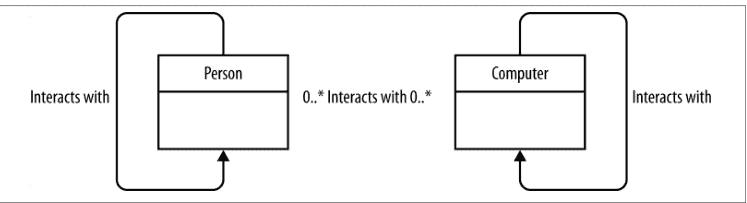

考虑到这一点，生产力改进可以针对以下交互进行：

- 人（与他人之间）
- 计算机
- 人*与*计算机

人和计算机是执行完成任务所需工作的资源，如表 7-1 所示。要提高生产力：

- 重新定义任务。
- 提高效率（针对给定资源或资源之间的交互）。
- 增加资源。
- 增加投入（通过额外的工作从每个资源中获取更多产出）。

**表 7-1. 提高生产力的行动**

| 行动 | 人 | 计算机 |
|------|------|--------|
| 重新定义任务 | 识别需求、规划、架构设计、管理 | 语言、软件、编程范式 |
| 提高效率 | 培养技能、减少干扰 | 自动化、预处理、压缩、优化、调优 |
| 增加资源 | 开发者、顾问 | 扩展、增加硬件/处理能力 |
| 增加投入 | 时间管理、工作负载 | 并行化 |

认识到这些方面的重要性有多个原因。未能利用某一领域（如归类在“计算机”列下的近期技术创新）的生产力改进，会导致“人”列中影响生产力的因素增加（额外的工时或人员）。对这些方面与项目相关性的适当反思，有助于提出那些只需相对较小投入却能带来显著更好成果的行动方案。

承认这种更全面的视角有助于避免过度依赖单一类别来解决所有问题。一个众所周知的例子是那种不切实际的期望，认为在项目后期增加工作量和添加开发者就能赶上过于激进的截止日期。另一个是幼稚的开发者陷阱，认为无论任务的性质如何，都可以通过额外的自研软件开发实现一切自动化。本书特别强调的重点在“计算机”列。

### 优化开发者和团队工作流程

*迭代*涉及重复执行一个过程，旨在接近（最终完成）预期结果。项目的每个部分都包含需要多次迭代的任务，如图 7-2 所示。这一基本观察可以应用于软件开发的许多不同方面，包括需求收集、设计、开发、测试和部署。

*图 7-2. 项目迭代*

有几个关键的见解需要牢记：

- 每次迭代都应以一个可观察的结果结束。这个结果可以与完成迭代前后的状态进行对比，也可以与预期结果进行对比。如果结果不可观察，那么就存在问题。可观察的内容是可以被衡量和改进的。不可见的内容则无法被评估、修复或增强。迭代也可以被看作一个反馈循环，始于一个动作，并产生一个必须经过评估的响应。
- 迭代（或反馈循环）可以是微小的，也可以是广泛的。开发人员进行的一次代码更改是一个微小的迭代，而整个大规模系统的最终交付则相对较大。来自部署的反馈可以是自动的，也可以是手动的。自动反馈可以提供一个一般性的迹象，表明部署的系统运行符合预期，但它不能取代最终用户对版本的实际响应。
- 更短的迭代意味着增加反馈。增加反馈本质上就是增加可见性。出于多种原因，增加反馈是理想的。它能使问题（甚至是机会）被更快地识别，并且在过程早期更容易对项目轨迹做出修正。循环越小，反馈越及时，效果就越好。
- 从本质上讲，由于迭代是重复执行的，任何对给定迭代的增益都会给整个项目带来更显著的收益。挑战在于识别出哪些任务是在重复执行的，并对那些能给整个项目带来最大整体影响的任务进行改进。
- 对项目中的任何任务进行优化都是值得的。对重复多次的任务进行优化通常更有益。如果可能，最好将任务完全自动化。对于那些习惯于“干活”的人来说，一个有些违背直觉的观点是：如果可行，最好的选择是完全消除不需要的任务。

这些观察结果相当明显，归根结底就是简单的常识。但正如在软件开发领域工作过的人所证明的那样，开发人员是习惯的生物。许多人习惯于工作流中的某个特定顺序或一套给定的工具。这可能会导致大量不必要的工作，从而使项目复杂化，且结果不尽如人意，委婉地说，就是次优的。

## 越快越好

> Boyd 意识到，赢得空战的主要决定因素不是观察、定向、计划或执行得更好，而是观察、定向、计划和执行得更快。换句话说，就是迭代的速度。Boyd 建议，迭代的速度胜过迭代的质量……
>
> 我将 Boyd 的发现表述为“Boyd 迭代定律”：在分析复杂性时，快速迭代几乎总是比深入分析能产生更好的结果。
>
> —— Roger Sessions，《企业架构的更好路径》

我们大多数人都不会创造出下一个能够彻底改变软件开发流程的伟大之作。但仅仅走出自己的编程文化圈，就可能是一次令人大开眼界的经历。有很多可利用的改进方案，深入研究一些成熟的技术，可以为个人开发人员带来显著成效，更不用说对更广泛的项目考量了。几个例子可能有助于阐明这一点。

## 示例：Web 应用程序修复

一个使用 Maven 构建并部署到 JBoss Web 应用程序服务器的 Java JEE Web 应用程序（由多个 WAR 组成的 EAR）需要进行更改。需要进行更改的开发人员需要修改多处代码（在此过程中可能会犯一两个错误）。解决这个问题的一种方法包含几个不同步骤。首先，修改代码。接着，输入命令执行标准的完整构建，然后部署应用程序。根据应用程序的大小、运行的单元测试数量、构建速度和其他因素，这第二步可能需要几分钟才能完成。这个过程可以进行哪些改进？

- 首先，有许多可用的 shell 命令选项。命令历史记录（以及搜索）立即就能派上用场。
- 构建过程中的每一步都需要执行吗？例如，在 Maven 中，`-DskipTests`参数可能会显著缩短构建时间。
- 是否真的需要完整部署？根据情况，或许可以通过热部署代码，从而在无需构建的情况下测试更改。
- 更改是否真的需要初始部署？初步测试可以通过在浏览器中进行（如果更改主要涉及 HTML、CSS 或 JavaScript）。对于服务端代码，挂载远程调试器并观察相关对象及其在即时填充上下文中的变量，可能会提供足够的发现，从而避免几次不必要的迭代。Java 代码也可以在完整部署之外通过单元测试进行评估（这暗示了测试驱动开发 TDD 的生产力优势）。

## 示例：测试集成

这个示例涉及同一个 Web 应用程序项目，目前项目已进展顺利。大家普遍认识到需要将测试纳入 SDLC（软件开发生命周期）的一部分。这可以在许多阶段和许多层级上实现：

- QA 人员或开发同行测试可能在验证初始需求和代码匹配方面做得很好，但人们往往不够一致或不够详尽。
- 创建单元测试（使用 JUnit）。它们提供了更广泛的测试，但如果不能一致地运行，则几乎没有用处。
- 单元测试被迅速集成到 Maven 构建中。构建在持续集成服务器上完成，因此开发人员能迅速收到破坏构建的更改通知。然而，很难判断这些测试的覆盖范围或价值有多大。
- 可以生成覆盖率报告，以提供代码覆盖率的某种迹象。注意到的一点是，测试仅限于服务端。这是一个问题，因为项目中的浏览器端代码量很大。
- 幸运的是，我们聪明的前端工程师已经开始使用 Jasmine 进行单元测试。这些测试可以通过插件集成到 Maven 构建中。此外，JavaScript 开发人员使用安装在个人工作站上的 Karma 对客户端代码运行单元测试。
- 随着项目的进行，项目流程趋于稳定，可以编写反映用户体验的更广泛的功能测试。然后可以使用 Selenium 在各种浏览器上运行这些功能测试。

在这种测试场景中，重点是增加关于项目状态的反馈，而不是质量本身。优化的价值显而易见，因为 Bug 能被快速识别并修复。此外，需求与实现之间的不一致也能被轻易发现。新开发人员可以加入这样一个项目，因为他们可以通过观察和运行测试，在相对独立的环境中学习代码。具有高测试覆盖率的项目能够承受大规模的重构更改。敢于进行此类重构的信心，源于拥有一套可以验证现有功能绝大部分子集的自动化测试套件。

## 示例：绿地开发（从零开发）

作为新项目的一名软件架构师，你需要选择最佳工具集并搭建初始应用程序结构。由于是一个云部署、高可扩展的 Web 应用程序，选择了本书中描述的客户端-服务器架构。团队接受采用一些新工具和流程，但由于组织惯例和内部能力，强制要求使用 Java 作为编程语言（这排除了依赖其他 JVM 语言的 Rails 和 Grails 等可能性）：

- 最初考虑了 Maven/JEE。虽然 JAX-RS 适用于服务端开发，但由于开发人员倾向于使用 session，JSF 开发并不合适。
- 经过一番调查，发现通过使用像 Spring Roo 或 Play 框架这样的服务端框架，可以减轻整个构建/部署到应用服务器的压力。最终选择了 Play，并生成了一个服务端 Web API，该 API 从文件系统提供一些示例 JSON 文件。这些模拟服务随后将被替换为来自各种其他后端服务的集成。
- 可以使用 Yeoman 生成一个使用 JavaScript 框架和相关 HTML5 启动项目的前端项目。快速执行`npm search yeoman-generator`得到了几个可能的候选方案，它们被用来生成不仅一个而且是多个客户端项目——每个项目在自己的目录下。经过几个小时的评估（将前端连接到现有服务），可以感觉到每个生成项目带来的价值，并从中选择一个。
- 进行了一些清理工作，包括提供在保存文件时自动运行的示例服务端和客户端测试。为 Java 和 JavaScript 设置了自动化文档工具。代码被提交到 SVN，项目在持续集成服务器上进行了注册和配置。服务器在构建代码时还会生成文档，并将其发布到已知的中央文档服务器。设置了一个 IDE 模板，其中包含了代码格式化的可接受默认值。

通过这些初始工作，在单个开发人员实现更具体的业务需求之前，许多最重大且最重要的决定已经做出。这些决定促成了一个允许客户端和服务器相对独立（并行）开发的过程。它还包括使用单元测试的即时反馈，以及为开发人员在为新功能添加测试时提供可供复制的具体示例。发布的自动生成文档和 IDE 模板鼓励相对统一的编码和注释习惯。

这些示例具有主观性，并且无疑会随着新技术的出现而不断被不断更改和改进。其目的是为了提供一个分析示例，通过分析可以对流程进行渐进式改进，而不是盲目地遵循之前的惯例行做法和惯例。接下来的章节旨在帮助你进行头脑风暴，并识别项目中适用于改进的领域。

## 生产力与软件开发生命周期

生产力需要在软件开发生命周期的每个环节中予以考虑。这是因为，流程中一个基础步骤中明显的低效，并不一定能通过另一个环节中生产力的提升来弥补。通常，与生产力相关的任务可以按照收益递减的顺序排列优先级。虽然每个项目和团队都是独一无二的，但关于哪些领域往往能产生最大整体效果，可以做出一些普遍性的结论。通常，管理和文化决策是基础，其次是整体技术架构，然后是具体的应用程序设计，最后是底层的编程和平台问题。在对任务进行准确分析和优先级排序后，通过按顺序解决生产力问题，可以获得最佳结果。

### 管理与文化


通常，在考虑涉及团队中许多个人的项目整体范围时，可以获得最大的收益。虽然这里不是重点，但管理行为、团队动态和工作文化对将要完成的工作有着深远的影响。这些广泛的环境因素为开展工作以及整个组织和每个个体的价值主张奠定了基础。它们至关重要，且通常是应该优先处理的主要领域。

一个巨大的挑战——尤其是在大型组织中——是统一目标。查理·芒格（Charlie Munger，这位商人兼投资者因与沃伦·巴菲特的关系而闻名）描述了联邦快递（Federal Express）曾经面临的挑战：如何将员工的目标与消除延迟的组织指令统一起来。解决这个问题的方案在于确保所有相关方都拥有合适的激励机制：

> 在所有的商业案例中，我最喜欢的激励案例是联邦快递。他们系统的核心和灵魂——也是创造产品完整性的关键——是让所有飞机在半夜聚集在一个地方，将所有包裹从一架飞机转移到另一架飞机上。如果出现延迟，整个运营就无法向联邦快递的客户交付一个完整的产品。
>
> 而这在过去总是搞砸。他们永远无法按时完成。他们尝试了一切方法——道德劝说、威胁，你能想到的任何手段。但没有一个起作用。
>
> 最后，有人想到了一个主意：不再按小时给这些人付钱，而是按班次付钱——一旦所有工作完成，他们就可以全部回家。结果，他们的问题一夜之间解决了。
>
> 因此，设置正确的激励机制是一个非常、非常重要的教训。对于联邦快递来说，解决方案并不明显。但也许现在，以后对你来说会变得更加明显。
>
> ——查理·芒格

其他“大局观”的考虑：基本的、广为人知的组织和管理原则依然适用。明确职责分配，集中文档管理，并使用版本控制。这些问题显而易见，但经常被忽视。

## 技术架构

系统的整体架构决定了随后技术选择和实现的许多方面。一个针对广泛公共部署的高可扩展、基于云的应用程序，其设置比一个仅在组织内部使用的应用程序要复杂得多。后者的容错空间要大得多。

如果团队成员必须考虑永远不会发生的场景进行编码，或者在项目后期为了解决意外的架构需求而做出更改，团队的整体生产力将受到严重阻碍。明确的项目范围应体现在架构选择中。

类似的担忧是数据存储介质的选择。传统的关系数据库是相对成熟的资源，提供如引用完整性和事务完整性等服务，开发人员往往将其视为理所当然。新的 `NoSQL` 解决方案提供了优化写入操作的能力，并能以约束更少的方式存储数据。

每种方案都有其优势，但没有一个能解决所有问题的“银弹”。可能会因为与传入数据相关的初始可扩展性考虑而选择 `NoSQL` 方案。但如果在前期没有考虑报告能力，数据的存储方式可能无法支持高效的报告。单个开发人员可能能力极强且高效，但无法通过在特定报告任务上的孤立努力来克服根本错误的数据存储决策。

每种编程语言都有其教条的追随者，他们就其语言的相对优点展开史诗般的辩论。可以肯定的是，语言的某些特性使得在更短时间内完成特定的编程任务变得更简单。例如，如果可以通过 IDE 中的自动编译或使用脚本语言来消除编译步骤，那么任务所需的时间将会减少。

像 `Java` 这样的语言拥有海量的可用支持库，而一些较新的语言如 `Scala` 和 `Groovy` 则在语言基础特性上有所不同，减少了执行等效任务所需编写的代码量。`Ruby` 和 `Python` 等脚本语言有其独特的工作流，这些工作流本身非常有效，并影响了其他地方工具和流程的发展。

## 软件工具

编程语言、开发工具和框架的选择是架构师引导项目方向的主要领域。在项目开发过程中，单个程序员所拥有的能力和受到的限制很大程度上受这些决策的影响。技术及其相关工作流在创建时考虑了多种价值取向。生产力不可避免地会受到这些选择的影响。

在 *Software Tools*（Addison-Wesley Professional, 1976）一书中，布莱恩·柯尼汉（Brian Kernighan）曾名言道：“控制复杂度是计算机编程的本质。”

旨在驯服复杂度的各类软件工具触及了软件开发生命周期的每一个环节：版本控制系统、自动化文档、覆盖率和质量报告、测试工具、问题管理系统以及持续集成服务器，等等。除此以外，开发人员掌握的简单日常工具，可能就是让一名开发人员比同行高效一个数量级的关键。

每种语言都有配套的构建工具。虽然你可以混用语言和构建工具，但 `Java` 的 `Maven`、`Groovy` 的 `Gradle`、`Scala` 的 `SBT` 和 `Ruby` 的 `Rake` 之间存在密切的对应关系。

每种语言都有用于开发客户端-服务器 Web 应用程序的相关框架。`Java` 以 `JEE` 和 `Spring`（也可以通过名为 `Roo` 的高度自动化实用工具使用）以及较新的框架如 `Play`（同样支持 `Scala`）而闻名。`Ruby` 与 `Rails`、`Groovy` 与 `Grails` 以及 `Python` 与 `Django` 也是如此。

这些框架大多包含内置服务器，有助于提升开发者的工作流。它们通常还与启动项目（starter projects）耦合，可以消除大量耗时的样板代码编写。选择相关的框架可以缩短构建时间，甚至完全消除构建步骤，并获得资源流水线（asset pipeline）预处理的优势，以及轻松集成测试套件。

IDE 包含诸如代码补全、智能搜索和代码导航、重构功能（将代码封装在新方法中，或跨不同类型的文件重命名变量）、单元测试集成和后台编译等功能。它们是 `Java` 社区的主力。在像 `Java` 这样的语言中使用 IDE 能提供巨大的价值，以至于一些开发人员很难相信不是每个程序员在每项任务中都使用它。

使用脚本语言（特别是那些最初并非为 JVM 创建的语言）的开发人员倾向于使用更轻量级的代码编辑器。如果在 *nix 类型环境¹ 的命令行中工作，`vi`（或 `vim`）和 `Emacs` 配合一些内置实用工具，可以为各种软件开发任务提供类似（甚至更优）的机制。

> 1. 对于初学者来说，星号在程序员的术语中是一个通配符。*nix 是“Unix 或类 Unix 系统（如 Linux）”的缩写。“nix”一词还包括 Apple 的 OS X，但不包括 Windows。Windows 可以运行类似 Cygwin 的模拟环境，使其看起来像 Unix 系统。

即使你并非始终在命令行中工作，熟悉这一层也很有价值，因为许多支持任务（部署到服务器、查看日志和检查服务器性能）都发生在只能使用命令行的环境中。

## 性能

表现良好的应用程序能够更快地进行调试。缩短迭代所需的时间（反馈循环的大小）可以带来更多的变更和验证机会。对性能不佳的代码段进行优化，可以为开发人员节省出原本需要花费在等待系统响应上的时间，从而能够处理其他问题。

API、算法、数据存储机制和相关处理的初始选择在这方面具有巨大的下游影响。甚至编程语言范式的选择也会产生影响；例如，函数式编程（因其限制副作用的优点而广为人知）通常会利用非常高效的缓存机制。它还可以用极其简洁、易于理解的代码表示来高效地遍历结构。它简化了处理过程，在重构时需要筛选的代码行数也更少。

通过使用正确的技术（搭配合适的团队），实际应用性能和人类可读性都能受益。即使在成熟的项目中，也经常存在可以优化的领域。例如，许多 Web 应用程序的网络性能可以从简单的压缩或减少调用次数中受益。这些细节在项目早期可能会被忽视，但通常可以在后期以非破坏性的方式实现。

而且，性能提升带来的收益总会扩展到特定领域之外，因为开发人员可以有更多时间来进行主动编程和测试，而不是等待系统响应。

从更通用的应用设计来看，RESTful 应用程序约束的优势能够促进生产力。客户端-服务器范式允许并行开发、更易于调试和维护，并简化原本复杂的任务。这些优势也适用于在系统其他位置创建独立模块的实践。

对项目进行适当的模块化处理，可以允许最初使用生产力很高但扩展性较差的解决方案来创建项目，之后再进行重写。良好的设计往往能促进后续的生产力。

## 测试

测试曾经主要以一种随意和临时的方式进行，如今已成为一门更加规范化的学科。测试的自动化（以及将测试集成到构建中）是确保大规模重构信心的必要条件，也是自动化部署等实践的基础。

自动化测试最初是间歇性和不频繁地运行的。借助现有的处理能力，现在每次构建项目时（甚至每次保存文件时）运行构建套件都是可行的。随着项目成熟，测试的范围可能会有所变化，但在大多数非平凡的现代 Web 开发中，某种形式的测试都是必要的。

测试在 `JavaScript` 社区中已经牢固确立，使得开发能够在浏览器和设备上可靠运行的大型项目成为可能。新的测试形式正在开发中，以解决基于云的部署问题，例如 [Netflix 的混沌猴](https://netflix.github.io/chaosmonkey/)，它通过主动引发故障来辅助开发弹性服务。

当测试被恰当地建立时，可以在促进程序员与计算机之间以及程序与团队其他成员之间的沟通方面发挥独特作用。这一点起初可能并不明显；毕竟，测试的目的通常被理解为验证软件的可靠性或功能性。

某些类型的测试还可以显著提高大型项目的整体生产力。当测试减少了集成的痛苦并带来需要更少修复的质量改进时，这一点就显而易见了。以一种更微妙的方式，遵循行为驱动开发范式的测试可以通过为项目团队成员之间提供一个一致的沟通方式来提高生产力，这些成员来自不同的领域。

正如 *The Cucumber Book: Behaviour-Driven Development for Testers and Developers* 中所述：

> 当开发人员与业务利益相关者之间能够清晰沟通时，软件团队的工作效果最佳。实现这一点的一个绝佳方式是使用自动化验收测试来协作规范即将完成的工作……当团队协作编写验收测试时，他们可以发展出自己的通用语言来谈论其问题领域。这有助于他们避免误解。

更好的沟通能减少因误解而浪费的时间。更好的理解能带来更高的生产力。


### 当测试与生产力相冲突时

有时运行测试可能会成为一种负担并抑制生产力。构建和维护测试需要时间。运行广泛的测试套件需要时间和资源。与其他任何开发任务一样，测试需要投入精力和时间，而这些本可以花在其他地方。这导致许多开发人员和其他方面在很大程度上对测试工作持否定态度。

将测试集成到 Web 应用程序的各个层面已经变得相对容易。许多入门项目在初始配置中就已经包含了测试。为了从测试中获得最大价值，需要一种重视测试收益并将其维护视为真正工作和值得付出的文化。

很难直接用有利于生产力来描述测试的价值。对于任何具有重要生命周期的项目而言，其价值无论怎样强调都不为过。

## 底层平台

操作系统以及已安装的基础软件构成了底层本地部署平台。一台或两台功能合理强大的工作站（加上额外的显示器以增加屏幕空间）相当于几年前的超级计算机。

初始设置中分配足够的 JVM 内存或关闭不必要的程序以节省资源可能有一定价值，但通常情况下，应用程序设计的基本方面影响更大。在某些情况下，使用更快的文件系统会对构建时间产生明显影响。

使用集中式数据库与开发人员维护的本地副本之间可能是一个重要的决策。在开发人员维护的场景中，像 [FlyWayDB](https://flywaydb.org/) 这样的迁移框架可以提供帮助。如果使用远程资源，网络可能会成为一个重要问题，尤其是在与分布式团队一起工作时。

## 结论

按照设计，本章没有示例项目。生产力，或者说开发过程中的效率，需要退后一步来考虑可用的选项以及它们如何与手头项目相匹配。

项目的每个阶段都包含可能被简化、自动化或更高效执行的宏观和微观任务。没有什么能替代“浮出水面”来喘口气，并给人一种闲暇的表象，从而能够对可用的最佳选项进行充分反思。

# 第八章：API 设计

> 理论上，理论和实践之间没有区别。但实际上，是有区别的。
>
> ——作者不详

解决问题有两种基本方法：从一个全面的理论出发，再完善细节；或者从具体事实出发，发展出将它们联系起来的理论。“细节型人”通过研究特定问题的细枝末节来得出解决方案。“大局型人”则将问题归入与其总体理论相关的类别中。每种方法都有其价值，而很多问题的解决涉及在两者之间灵活切换。

## 哲学之辩

在哲学中，柏拉图将“共相”描述为抽象到最高和最基础的“理念领域”。他的学生亚里士多德则在具体的、个别的、现实世界的事物中找到它们。

这些出发点不仅仅是智力上的好奇。在设计分析中，出发点会影响过程的最终结果。最佳解决方案往往是两种方法互补应用的结果。

*The Handbook of Statistical Analysis and Data Mining Applications*（Elsevier）的作者将这些古老的出发点与现代数据科学技术联系起来：

传统统计分析遵循演绎法来搜索数据集中的关系。人工智能（例如，专家系统）和机器学习技术（例如，神经网络和决策树）遵循归纳法来寻找数据集中微弱的关系模式。

演绎（或演绎推理）是亚里士多德式的方法，即分析详细数据、计算若干指标，并仅基于这些指标的数学构成来形成一些结论（或推导出来）。归纳是更柏拉图式的方法，即使用数据集中的信息作为“跳板”来得出一般性结论，而这些结论并不完全直接包含在输入数据中。

`REST` 和实际的 Web API 设计同样具有这些起点的代表性的起点。`REST` 由 Roy Fielding 用纯粹的抽象术语阐述。RESTful Web API 虽然受到 `REST` 理想的启发，但其创建是为了解决具体问题，并接受那些不符合纯粹理论的实现细节。

在关于 `REST` 的讨论中，许多分歧可以追溯到各方自觉或不自觉地选择的起点。

显然，`REST` 确实规定了一些能为 Web API 作者提供直接实用价值的约束。客户端和服务器层的离散划分、HTTP 谓词的使用以及 Web 资源的标识，已在各种现实世界的 Web API 创建中被证明是非常有用的。

然而事实依然是，`HATEOAS` 虽然在理论上极具吸引力，但事实证明难以一致地实现。由于 `JSON` 作为 Web API 事实上的数据传输格式被广泛采用，使得 `HATEOAS` 的协调实现变得尤为困难。

### 设计决策

虽然 Web 服务以某种形式已经存在多年，但将其作为基础设计元素的转变并非立即发生。Ajax 的逐渐采用以及 `JSON` 和相关轻量级 Web API 的创建，最初影响了构建在服务端 MVC 之上的现有系统。

随着开发人员不断突破这些技术的极限以创建复杂的单页应用程序（SPA），人们意识到服务端驱动的 MVC 方法无法很好地适应这些新技术的普及。这导致了 Web 应用程序设计的根本性变化，打破了与以往实践的连续性。请参阅图 8-1，其中时间轴展示了导致客户端-服务器风格 Web 应用程序的技术进展。

> ## 向客户端-服务器方法的转变

Web 开发中采用的客户端-服务器方法所涉及的技术并非新鲜之物。所使用的编程语言已经成熟，但在根本上没有太大变化；服务器、浏览器和 HTTP 协议自 Web 创建以来就一直存在。然而，以一致方式应用的设计方法是较近期的发展，在很大程度上是各种技术共同开发的结果。

早期的 Web 页面是由 Web 服务器提供并由浏览器渲染的简单静态内容。动态内容在 20 世纪 90 年代中期通过服务器上的 CGI 程序和浏览器中的 `JavaScript` 引入。由于 `JavaScript` 相对缓慢且客户端计算机性能不足，因此重点在于利用服务端处理来创建动态内容。由此产生的复杂性导致了模型-视图-控制器（MVC）等模式被引入到服务端。

MVC 模式仍然是服务端 `Java` 开发的主力，并出现在 JEE 等主要标准和 `Spring` 等框架中。`Ajax` 和 `JSON` 等进一步的 `JavaScript` 创新立即影响了服务端 MVC 开发人员，他们以一种临时、碎片化的方式使用这些技术。

框架并没有消失，但其设计和使用受到了显著影响。在设计方面，像 `Spring` 这样的 MVC 框架采用了反映被操作资源的“美化 URL”（pretty URLs）。在使用方面，API 当然可以与传统的 MVC 结合使用。无论使用什么框架，如今许多应用程序都基于不含 MVC 的 Web API，这实际上就是一种客户端-服务器方法。

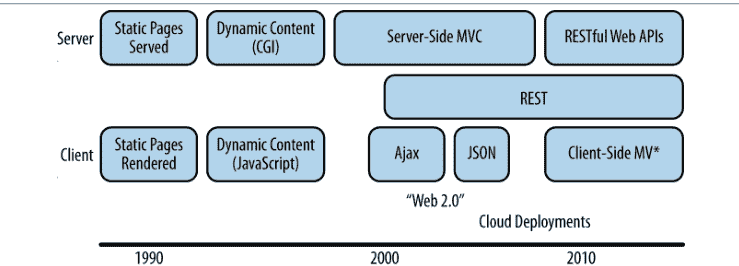

客户端-服务器方法涉及一个具体的设计决策：开发 RESTful Web API 将数据传递给客户端视图，并避免在服务端生成视图。这就提出了一个问题：如何以一致且可支持的方式最佳地设计 Web API。

此类设计决策总是会引发各种观点，但目前已有一个相当成熟的共识。普遍的共识是，Web API 应该受到 `REST` 的显著影响，但不应被有争议或不切实际的约束所僵化限制。

### 实用 Web API 与 RESTful API

虽然“实用”可能取决于解读，但人们广泛认同 Web API 应该是易于使用的。它们应该易于被外部开发人员理解，具有一致性、可预测性，并符合 `REST` 的许多部分。实现 `REST` 的某些方面在设计上就提供了这种易用性，尽管 `REST` 在最初定义时，并没有像人们有时理解的那样，特别考虑到短期生产力或开发人员的易用性。

### Roy 说道……

> `REST` 是以十年为规模的软件设计：每一个细节都旨在促进软件的长寿和独立演进。许多约束直接与短期效率相对立。
>
> ——Roy Fielding

那么，`REST` 的哪些部分最容易以实用方式应用？将资源一致地标识为被 HTTP 谓词操作的“名词”，这是 `REST` 的基础，在依赖 CRUD 操作的应用程序中尤为明显。“美化 URL”就是这种标识的结果。

`REST` 对性能没有具体要求，但提到了可缓存资源，这促进了能够良好执行和扩展的系统。当然，如前几章所述，清晰的客户端-服务器区分具有巨大的价值。

`REST` 之所以如此有影响力，是因为其设计本身倾向于促进应用程序与 Web 本身的设计协同开发。当使用 `REST` 的这些部分时，就能产生易于理解和扩展的工程质量良好的应用程序。

实用 Web API 设计中确实存在与 `REST` 冲突的特质。最显著的是，`JSON` 的使用导致缺乏在媒体类型本身中定义的链接能力（linkability）。使用不可链接的媒体类型会直接导致 API 不是自描述的，因此需要文档。

或许更具挑战性的是，在考虑 `REST` 未直接涉及的领域时如何决定行动方案。保障 API 安全以及支持 API 变更都是 `REST` 范围之外的相关话题。


尽管 Fielding 没有解决所有与 Web API 设计相关的问题，但他确实提出了许多适用于其他领域的观察。例如，虽然 API 响应的易读性并非 REST 本身的特别关注点，但 Fielding 强调了使用 Java applets 等方案时可见性的缺失。这一顾虑意味着在许多情况下，格式化 JSON 将是有益的。为客户端开发人员提供的清晰度，往往超过了压缩消息所节省的几个空格（更不用说服务器端压缩在改善传输大小和性能方面更有效）。

REST 被构思为一个抽象模型。抽象模型超越了空间和时间。因此，它没有直接考虑到系统随时间而变化的事实。易用性的价值表明，如果可能，变更应以向后兼容的方式进行。API 的版本控制在该领域提供了极大的灵活性。

回想一下，REST 的约束之一是统一接口。统一接口几乎完全是自描述的。理想情况下，具有 such 接口的系统除了系统入口点之外不需要任何文档。这与 SOAP 等协议形成鲜明对比，后者通常包含一个 *Web 服务描述语言* (WSDL) 来描述 Web 服务的功能。一个 RESTful 系统将提供指向所有资源的链接，而不需要任何额外的描述。在实践中，如果 Web API 有良好的文档，其可用性会大大提高。

### 指南

与规范由标准委员会决定的技术不同，Web API 可以根据开发人员的意愿来构建。在实践中，创建符合广大开发社区预期的 API 是有意义的。以下章节反映了 REST 对开发轻量级 Web 服务的重大影响。它们是设计易于理解和可用的 Web API 的建议指南。

### 名词作为资源；谓词作为 HTTP 操作

正如 REST 所规定的，*资源* (resources) 是 *名词* (nouns)。在 RESTful 系统中，名词体现在 URL 路径中，用于操作所引用的资源。*动作* (actions) 是与函数相对应的 *谓词* (verbs)，用于操作资源。RESTful 系统中的谓词具体与 HTTP 操作相关。

资源对应于其他设计方法中的对象、实体或表。在 UML 类图中，名词被建模为 *类* (classes)。在 *实体关系图* (ERDs) 中，它们被建模为 *实体* (entities)，这些实体随后通常在关系数据库中实现为 *表* (tables)。

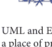

UML 和 ERD 并非唯一给予名词特别关注的方法。REST 同样给予了它们显著的地位。表 8-1 显示了这些系统之间的对应关系。在 REST 中，名词表示为资源；在 UML 类图中，它们是类；在 ERD 中，它们是实现为数据库表的实体。在为 REST API 分析和建模系统时，可以使用用于分解领域以在类图或 ERD 图中呈现的方法。在能够很好地映射到 CRUD 操作的系统中，这一点尤为明显。

## 表 8-1. 建模系统中的名词表示

| 架构 | 名词所代表的实体 |

| :--- | :--- |

| 面向对象类层次结构 | 类 (Class) |

| 关系型数据库 | 表 (Table) |

| REST API | 资源 (Resource) |

在设计包含 CRUD 操作的系统时，请考虑每个动作在每个资源上的适用性。这可以避免以后为了包含被遗漏的必要功能而不得不更改系统。例如，一个博客引擎可以被建模为包含用户、博客文章和评论作为资源。大多数博客系统需要能够创建、读取和删除这些资源。而更新用户或修改评论的能力可能并非必要。这样一个系统如表 8-2 所示，其中第一列标识资源（名词），每一行标识动作（动词）。

#### 表 8-2. 博客的 API 设计示例网格

| | 创建 (Create) | 读取 (Read) | 更新 (Update) | 删除 (Delete) |

| :--- | :---: | :---: | :---: | :---: |

| 用户 (User) | x | x | | x |

| 文章 (Post) | x | x | x | x |

| 评论 (Comment) | x | x | | x |


### 但我没有名词……

REST 模型的资源是该架构的基本单元。使用类似于 UML 类图和 ER 图的技术对 REST 资源进行分析，能够很好地映射到 CRUD 类型的应用程序中。一个非基于资源的应用程序可以被视为一组动词。此类应用程序可能更适合表示为一系列远程过程调用（RPC）。这类系统无法轻易地用 RESTful 术语来表示。

在许多情况下，这类系统可以通过重新设计变为基于资源的，但这并非总是可行。某些抽象可能足以对某些系统进行建模，但对于另一些系统则不足够。

### 作为修饰符的查询参数

虽然名词是 URL 的重要组成部分，且动词与 HTTP 动作相关，但它们并没有讲述完整的故事。URL 的其他部分可以包含额外信息。正如口语语法一样，额外的词类被用来限定或阐明名词和动词的意图。

在引用资源集合时，查询参数非常有用。参数可用于过滤集合，以仅返回该集的一个子集。它们可能会返回选定数量的资源，例如仅前 10 个。它们也可以用于对结果进行排序。

分页是过滤的一种特殊情况。参数可用于显式引用返回结果的子集。如果你愿意，查询参数更适合用于此类场景。分页的影响超出了查询参数的使用，最显著的是链接（linking）。

GitHub 的 API 提供了一个很好的、文档齐全的分页参数示例。`page` 参数指示返回可用页面中的哪一页，而 `per_page` 参数将返回的结果限制在 100 个以内：

```
curl https://api.github.com/user/repos?page=2&per_page=100
```

#### 带有请求体的 HTTP GET

请求参数往往会让原本简洁的 URL 变得“丑陋”。在某些情况下，执行一个看似映射到 HTTP GET 但涉及请求对象的操作可能是必要的，而该请求对象更容易被定义为层次化数据结构。一个例子是检索若干项目，其中每个项目都需要多个字段进行查找。Roy Fielding 和 HTTP 规范似乎允许这样做，尽管服务器解析请求体缺乏任何正式要求，这表明虽然它在许多实例中可行，但不应在系统中将其作为长期解决方案。

### Web API 版本

REST 并不要求 Web API 必须为更新和修改而设计，但其约束倾向于促进一个更容易更改的系统。API 版本控制是一个重要的考虑因素，但在 Fielding 的论文中并未提及。在 URL 中包含一个带有版本号的部分可以防止 API 的更改干扰客户端活动。如果没有版本控制，就必须协调客户端代码的并行升级，以适应服务器端的修改（在许多情况下，这甚至是不可能的，更不用说实际可行了）。虽然版本标识符缺乏理论上的简洁和优雅，但使用它可以大大改进系统。由于对其用法存在分歧且它们不是自描述的，Web API URL 中的版本段需要被清晰地标出并记录在文档中才能生效。

关于版本号应该包含在何处存在多种观点。有些人建议将版本包含在 URL 路径中。另一些人建议将其指定为查询参数。还有一些人更希望版本不要使 URL 显得杂乱，建议将其作为 HTTP 标头（header）传递。

### HTTP 标头

版本标识符只是请求和响应标头的众多用途之一。其他“带外”信息也可以存储在这里。Twitter 在标头中报告速率限制数据，以便在开发者的应用程序接近限制时发出警报。ETag 可用于控制缓存，其他标头则适用于安全认证和授权。标头通常用于传递次要但至关重要的信息。它们不能整齐地适配到抽象模型中，但具有许多需要考虑的实际用途。

`Accept` 和 `Content-Type` 标头可用于影响服务器如何响应请求以及提供何种类型的响应。除了 XML 和 JSON 内容之间明显的区别外，这些标头还被用于返回填充 JSON (JSONP) 而不是纯 JSON。这就是允许将 JSON 内容发送到远程服务器而又不违反跨域限制的“魔力”的一部分。本质上，它通过将 JSON 负载包装在函数调用中，实现了对 JSON API 的访问。在本章后面的项目中提供了一个此类示例。

### 链接

分页假设能够链接到相对于当前显示子集的前一个和后一个资源。一些 API 设计者建议在 API 结果中包含下一页和前一页的完整链接，而另一些人则建议仅包含 ID 以节省空间并消除重复文本。虽然提供链接通常是一个正确的决定，并且减少了对额外文档的需求，但在目前这个阶段，严格的 HATEOAS 对于每种情况来说并不实际或不可能实现。

### 响应

拥有一个自描述的 API 是一个极佳的理想。如果资源被明确指定并反映在 URL 中，并且利用了 HTTP 动词，那么在很大程度上可以实现这一点。遵循 HTTP 响应代码的使用约定（例如，400 反映客户端问题，而 500 表示服务器问题）也将对此有所贡献。理想情况下，系统的错误消息将提供直接的、可操作的描述来解决触发原因。但在大多数系统中，至少在几个基本领域需要一些文档。错误代码和消息通常比较简练，因此它们应该与文档相对应。理想情况下，文档中对错误的描述应达到系统错误消息中不切实际的详细程度（例如，标识 PUT/POST/PATCH 中的每个字段以及它可能引起的错误）。

### 文档

文档应该易于定位、搜索和理解。一些 Web API 开发人员采用的一种约定是使用 Web 应用程序描述语言 (WADL)，这是一种机器可读的 Web 应用程序描述，通常为 XML 格式。这些文档通常易于定位，但如果仅仅由工具生成，则是不够的。提供开发者可以使用命令行 Curl 复制的示例，将大大有助于阐明 API 的意图。如果 API 是面向第三方开发者的，则需要更多的关注。

关于 RESTful Web API 的文档编写需要人工投入，但有一些工具可以通过自动生成文档来减轻这一负担。一些服务器会将 WADL 创建为可从 Web API 服务器获取的资源。例如，Jersey 在运行时生成一个基础 WADL，您可以使用 GET 请求访问 `/application.wadl`。通过指定选定的指令，可以在 WADL 中包含额外信息。如果您使用的服务器不支持开箱即用地生成 WADL，可以为您的项目添加并配置 [Enunciate](http://enunciate.codehaus.org/) 等软件包来生成一个。此外，还有像 [http://apiary.io](http://apiary.io) 这样的网站，您可以在脱离任何具体项目上下文的情况下设计和记录您的 API。

#### 格式约定

最后，遵循简单的格式约定可以使 API 更加亲切。开发者在初始开发以及持续支持期间都需要实际查看和阅读文档。因为 JSON 是 JavaScript，所以遵循惯用的 JavaScript 实践（如使用驼峰命名法命名字段）是有意义的。

另一个简单的实践是对 JSON 响应进行美化打印 (pretty-print)，以便人们阅读。反对这一做法的通常理由是美化打印会增加响应大小并损害性能，但通过将 JSON 响应配置为 GZipped 压缩，可以获得更大的性能提升。在格式化响应中增加的少量空格是值得的，因为开发者可以直接查看返回的响应，而无需先在 IDE 中格式化或使用 [jq](http://stedolan.github.io/jq/) 等命令行工具。

#### 安全性

REST 没有提供与安全性相关的具体指南。这是因为在设计时假设 API 将在互联网上公开可用。通过 HTTPS 而非 HTTP 提供 API 通常也是个好主意。对于不打算限制在单个服务器上的 API，可以通过 JSONP 或 CORS 将 JSON API 公开。

### 项目

接下来的项目演示了如何使用 Jersey 返回 JSON、XML 或 JSONP 内容。在这个 Hello World 风格的应用程序中，使用了单个资源 (`greeting`)。该[项目可在 GitHub 上获取](https://github.com/)。

### 运行项目

该项目配置为通过 Maven 运行一个 Java 类。该类包含一个 main 方法，用于在 8080 端口启动本地 HTTP 服务器。可以使用一条命令来构建和运行应用程序：

```
mvn clean install exec:java
```

### 服务器代码

服务器代码由三个 Java 类组成。App.java 包含运行服务器的 main 方法。它创建了一个 Grizzly HTTP 服务器的实例，并将 /api 定义为 Web API 的上下文根。然后它添加了一个静态 HTTP 处理器来提供 HTML 和 JavaScript 代码：

```java
package com.saturnos.jsonp;

import org.glassfish.jersey.grizzly2.httpserver.GrizzlyHttpServerFactory;
import org.glassfish.jersey.server.ResourceConfig;
import org.glassfish.grizzly.http.server.*;

public class App {

    public static void main(String[] args) throws java.io.IOException{

        HttpServer server = GrizzlyHttpServerFactory.createHttpServer(
            java.net.URI.create("http://localhost:8080/api"),
            new ResourceConfig(GreetingResource.class)
        );

        StaticHttpHandler staticHttpHandler =
            new StaticHttpHandler("src/main/webapp");
        server.getServerConfiguration().addHttpHandler(staticHttpHandler, "/");

        System.in.read();
        server.stop();
    }

}
```

GreetingBean 是一个带有与渲染 XML 响应相关注解的 POJO：

```java
package com.saturnos.jsonp;
import javax.xml.bind.annotation.*;

@XmlRootElement(name = "greeting")
public class GreetingBean {

    @XmlAttribute
    public String text;

    public GreetingBean() {}

    public GreetingBean(String text) {
        this.text = text;
    }
}
```

GreetingResource 提供了通过服务器返回 GreetingBean 中数据的能力。*Jersey* 是 JAX-RS 的参考实现，它将 Web 请求映射到 Java 方法。JAX-RS 对 Java 对象应用*注解*（annotations）。注解在 Java 1.5 版本中开始可用。框架使用它们来为类和方法应用行为，从而有效减少完成常见任务所需的代码量。这些注解实际上提供了一种 DSL，能够相当清晰地映射到底层 HTTP 功能。

`@GET` 注解指示了所针对的 HTTP 请求动词。`@Path` 注解描述了上下文中的 URL 路径，`@Produces` 注解描述了 Jersey 从方法返回 bean 时将产生的内容类型。`@QueryParam` 用于将查询参数作为方法参数赋值给 getGreeting。**表 8-3** 列出了具有代表性的注解。

| 注解 | 描述 |

|------|------|

| `@GET` | 请求资源的表示 |

| `@POST` | 在指定的 URI 创建资源 |

| `@PUT` | 在指定的 URI 创建或更新资源 |

| `@DELETE` | 移除资源 |

| `@HEAD` | 提供与 GET 相同的响应，但不包含内容主体 |

| `@Path` | 资源的相对路径 |

| `@Produces` | 指示服务可以返回的媒体类型 |

| `@Consumes` | 指示服务可以在请求中接受的媒体类型 |

| `@PathParam` | 将方法参数绑定到 URI 路径的某个片段 |

| `@QueryParam` | 将方法参数绑定到查询参数 |

| `@FormParam` | 将方法参数绑定到表单参数 |

JAX-RS 中还有许多其他注解可供使用。更多信息请参阅 *RESTful Java with JAX-RS*（O'Reilly 出版）：


```java
package com.saturnos.jsonp;

import org.glassfish.jersey.server.JSONP;
import javax.ws.rs.*;

@Path("greeting")

public class GreetingResource {

    @GET
    @Produces({"application/xml", "application/json"})
    public GreetingBean getGreeting() {
        return new GreetingBean("Hello World Local");
    }

    @Path("remote")
    @GET
    @Produces({"application/x-javascript"})
    @JSONP(queryParam = JSONP.DEFAULT_QUERY)
    public GreetingBean getGreeting(
            @QueryParam(JSONP.DEFAULT_QUERY) String callback
            ) {
        return new GreetingBean("Hello World Remote");
    }
}
```

### Curl 和 jQuery

项目包含的客户端代码使用 jQuery 来调用 API URL。jQuery 库具有广泛的 Ajax 功能，并隐藏了与核心 JavaScript XMLHttpRequest 对象相关的一些复杂性和跨浏览器挑战。应用程序中使用的调用也可以使用 Curl 来复制，如下所示。表 8-4 显示了本示例中使用的 Web API URL。

**表 8-4. 应用程序 URL**

| URL | 描述 |
| :--- | :--- |
| `/` | Web 应用目录中的 HTML 和 JavaScript |
| `/api/greeting` | 来自`getGreeting()`的 JSON 或 XML |
| `/api/greeting/remote` | 来自`getGreeting(String callback)`的 JSONP |

可以使用 Curl 返回 HTML 格式的网页：

```bash
curl http://localhost:8080
```

使用 Curl 时，可以指定`-i`参数来包含头部信息。HTTP 响应代码和内容类型特别值得关注。例如，如果指定的 URL 路径未被服务器识别，它将返回"未找到"的响应：

```bash
curl http://localhost:8080/api -i
```

应用程序默认在响应中返回 XML：

```bash
curl http://localhost:8080/api/greeting
```

通过修改 HTTP Accept 请求头，可以改为返回 JSON 响应：

```bash
curl http://localhost:8080/api/greeting -H 'Accept: application/json'
```

最后，返回 JSONP 的调用通常会包含将 JavaScript 函数名作为查询参数的规范。与 JSON 调用中返回的相同结果，由 JavaScript 函数包裹填充。由于 JavaScript 文件可以从不同域名下载，因此内容被返回。否则它们将被 JavaScript 同源策略禁止：

```bash
curl http://localhost:8080/api/greeting/remote?__callback=myCall
curl http://127.0.0.1:8080/api/greeting/remote?__callback=myCall
```

### 理论与实践

REST 以其纯粹的理论形式仍然是一个理想标准。它作为衡量其实现项目的准绳。它应当被研究和理解。但其他技术的价值，特别是 JSON，也已被证明。基于 JavaScript 的客户端可以轻松消费 JSON。JSON 中缺乏普遍接受的链接机制并没有阻止开发者将其作为首选的数据传输格式。用文档和其他实际考虑来补充这类 API，已经造就了理论完美但永远无法交付的系统与满足即时需求的实用解决方案之间的差别。

RESTful Web API 对开发者面临的实际问题的适用性随着时间的推移而增长，并导致了架构方法的转变。此类 API 可以被具有广泛功能的设备消费，包括由第三方开发者创建的设备。它们比 SOAP 和其他包含复杂信封和交换模式的 Web 服务实现更轻量。它们可以用于创建应用程序，而不会出现客户端数据过时的问题。它们有效地将处理分布到具有显著计算能力的客户端。当部署在 Amazon Web Services 等云平台时，只需添加额外的服务器应用程序即可实现水平扩展。这些和其他特性导致开发者从偶尔实现或消费服务，转变为开发具有 consistent 方法的完整应用程序，充分利用 RESTful Web API。

# 第 9 章

## jQuery 和 Jython

> 语言不再被视为我们理解所生活的世界的边缘因素，而是被视为核心因素。词语不仅仅是已经给定的秩序之上的口头标签或交流附属物。它们是社会互动的集体产物，是人类构建和表达其世界的基本工具。这种典型的二十世纪语言观深刻地影响了整个人文科学领域的发展。
>
> ——Roy Harris

编程语言对其使用者的生活产生直接而实际的影响，甚至对那些从未意识到其存在的人也是如此。有趣的是，程序员往往很少花时间使用语言的基本特性。在理解了这些之后，他们立即寻找避免重复造轮子的方法。某个抽象层级或泛化可能变得如此流行，以至于实际上与原始语言混为一谈。

jQuery 库就是这样一种与 JavaScript 相关的技术。它已被广泛采用，大多数 JavaScript 开发者都曾大量使用它。有些人认为它不仅是一个库，更像是一种内部领域特定语言（DSL）。这样来看，jQuery 是一种专注于 DOM 操作、Ajax 处理和其他常见 JavaScript 任务的小型语言。无论如何，jQuery 的使用是如此普遍，以至于你会在网上发现形如"如何在 JavaScript 中做 X？"的问题，而回答却使用了 jQuery 惯用法。

使 Java 取得成功的抽象层位于语言本身的更低层次；它是 Java 编译器生成的字节码的处理引擎——Java 虚拟机（JVM）。Java 从一开始就是有意将 JVM 作为抽象层来设计的。它的独立存在使得为非 Java 编程语言实现创建面向 JVM 的编译器成为可能。JVM 是一种精心设计、高度优化的程序，是多年研发的成果。即使对 Java 语言本身没有特别兴趣的开发者，也能从这项底层技术中获益。

本章创建的项目将使用 jQuery 和 Jython（一种基于 JVM 的 Python 实现）来演示客户端-服务器 Web 应用的原型构建可以有多简单。

### 服务端：Jython

Python 编程语言最初于 1990 年代中期由 Guido van Rossum（其主要作者及"终身仁慈独裁者"）发布。Python 以其清晰、易读且规范的语法而闻名。它不同于许多基于 C 的语言惯用写法（如花括号）。由于其一致性和清晰性，Python 已被许多教育机构采用作为入门编程课程的教学语言。完成相同的任务，Python 通常比 Java 需要更少的代码行数。

Jython 是运行在 JVM 上的 Python 实现。这使得编写清晰、简洁的 Python 程序成为可能，并且可以在任何安装了 Java 的环境中运行。Jython 程序还能与 Java 对象进行交互，这为嵌入 Jython 或将 Jython 与原生 Java 库结合使用带来了丰富的可能性。

### Python Web 服务器

作为一种脚本语言，Python 还可以以 Java 开发者不熟悉的方式使用。例如，要运行一个静态 Web 服务器来从任意目录提供文件服务，无需编写一行原创代码，你只需导航到目标目录并执行以下命令：

```bash
python -m SimpleHTTPServer
```

### Jython Web 服务器

使用上述`SimpleHTTPServer`创建基于 Python 的 Web 服务器只需要几行代码：

```python
import SimpleHTTPServer
import SocketServer
import os

os.chdir('src/main/resources')

httpd = SocketServer.TCPServer(("", 8000),
        SimpleHTTPServer.SimpleHTTPRequestHandler)

print "serving at port 8000"

httpd.serve_forever()
```

Jython 可以从命令行调用，也可以嵌入到 Java 应用程序中。例如，可以从 Java 类中调用此脚本：

```java
package com.oreilly.jython;

import java.io.File;
import java.io.IOException;

import org.python.util.PythonInterpreter;
import org.apache.commons.io.FileUtils;

public class Server
{
    public static void main( String[] args ) throws IOException
    {
        new PythonInterpreter().exec(
            FileUtils.readFileToString(
                new File("python/http_server.py")
            )
        );
    }
}
```

该项目及其依赖项可在 [GitHub](https://github.com) 上获取。可以使用`mvn clean install`构建，并通过调用`mvn exec:java`运行。

### 模拟 API

静态 Web 服务器有显著的局限性。对 Web 应用开发者而言，最突出的是它无法生成动态内容。然而，可以通过简单地创建包含代表性数据的文件来模拟 API。例如，可以创建一个名为`api`的目录，其中包含一个名为`groups.json`的文件，该文件将通过`http://localhost:8000/api/groups.json` URL 访问。此 JSON 文件的内容是一个组的数组，每个组都是一个包含名称、描述和 URL 的对象：

```json
[
    {
        "name":"duckduckgo",
        "description":"Internet search engine founded by Gabriel Weinberg",
        "url":"http://duckduckgo.com/"
    },
    {
        "name":"angular",
        "description":"Open source JavaScript framework initially created" +
            " by Adam Abrons and Miško Hevery",
        "url":"http://angularjs.org/"
    },
    {
        "name":"twitter",
        "description":"Online social networking service and microblogging" +
            " service created by Jack Dorsey",
        "url":"http://twitter.com/"
    },
    {
        "name": "netflix",
        "description": "American provider of on-demand Internet streaming " +
            "media Marc Randolph and Reed Hastings",
        "url": "http://netflix.com/"
    }
]
```

相对于根目录的目录结构会反映在 URL 路径中，并且许多 Web 服务器会在指定相应扩展名时返回所需的内容类型。当服务端配置和开发进行的同时，客户端开发者可以使用这样的模拟 API 并行工作。

### 客户端：jQuery

自 2006 年发布以来，jQuery 以多种不同的方式简化了跨浏览器开发。它由 John Resig 创建，旨在改变开发者编写 JavaScript 的方式。具体而言，它致力于消除常见的重复性任务，并用清晰、简洁的语法替代晦涩、冗长的 JavaScript。

初次接触 jQuery 时，代码中出现的大量美元符号可能会令人惊讶。这是因为`$`代表该库命名空间中的 jQuery 对象。因此以下两种写法是等价的：

```javascript
jQuery('a')

$('a')
```

在标准 JavaScript 中，页面加载后运行 JavaScript 是通过`body onload`事件实现的。load 事件在页面完全渲染后（包括所有资源如图片）触发。jQuery 提供了一个稍早运行的事件，在 DOM 就绪后触发。有几种不同的语法可以指定此处理程序。推荐使用的是完整版本：

```javascript
$(document).ready(function() {
    // Handler for .ready() called.
});
```

等价于：

```javascript
$(function() {
    // Handler for .ready() called.
});
```

一般而言，jQuery 的使用模式包括查找 DOM 元素，然后对其进行某种操作。查找 DOM 元素通过某种字符串模式（CSS 选择器或 XPath）来完成。操作可以简单到读取元素的内容，也可以涉及其内容或样式，或通过事件处理器将行为与元素关联。jQuery 还为 Ajax 处理提供了一致的接口。它还被设计为可通过插件进行扩展。

### DOM 遍历与操作

对 JavaScript 的许多批评源于与浏览器 DOM 交互的困难。jQuery 通过为 DOM 选择、遍历和操作提供优雅的接口，简化了 HTML 与 JavaScript 之间的交互。这最常通过 CSS 1-3 的选择器以及一些 jQuery 特有的选择器来实现。CSS 选择器是包含模式的字符串，可以简单地按名称引用元素，或指定一系列复杂的匹配条件。如果某个元素满足模式指定的所有条件，该选择器就会匹配它。表 9-1 给出了一些 jQuery 示例。

#### 表 9-1. jQuery 示例

| 选择器 | 描述 |
| :--- | :--- |
| `$('div')` | 所有 div |
| `$('#myElement')` | ID 为`myElement`的元素 |
| `$('.myClass')` | 所有 class 为`myClass`的元素 |
| `$('div#myDiv')` | 所有 ID 为`myDiv`的 div |
| `$('.myListClass li')` | class 为`myListClass`的 ul 内的所有列表项 |
| `$('.projects li:first')` | class 为`projects`的 ul 中的第一个列表项 |

如表 9-2 所示，即使只知道要搜索的值的一部分，也可以访问其他属性。

#### 表 9-2. jQuery 部分值

| 选择器 | 描述 |
| :--- | :--- |
| `$('input[name*="formInput"]')` | name 包含子字符串`formInput`的 input 元素 |
| `$('input[name^="formInput"]')` | name 以`formInput`开头的 input 元素 |

具有特殊含义的字符必须使用两个反斜杠进行转义。例如，如果有一个 ID 为`myForm:username`的 input 文本字段，可以使用以下选择器来标识该元素：

```javascript
$('input#myForm\\:username')
```

CSS 选择器具有很强的表达力，但有时会产生需要进一步处理的对象数组。许多 jQuery 方法返回一个 jQuery 对象，你可以接着调用另一个方法。因此，可以在 DOM 的子树中搜索以找到特定元素：

```javascript
$('div.projects').find('.projecti')
```

### 工具函数

jQuery 还提供了一系列工具函数，可以处理元素集合上的类似任务，如表 9-3 所示。像 underscore.js 这样的库在某些方面与 jQuery 重叠，但提供了更多操作列表和对象的功能。JavaScript 语言随着时间的推移也进行了增强，引入了类似的方法。由于兼容旧版浏览器的优势，jQuery 的方法在不久的将来可能仍将被继续使用。

#### 表 9-3. 工具函数

|  | jQuery | Underscore | JavaScript 1.6 |
| :--- | :--- | :--- | :--- |
| 迭代 | each | each | forEach |
| 转换 | map | map | map |
| 过滤 | grep | filter, where |  |
| 查找索引 | inArray | indexOf, lastIndexOf |  |

在定位到对象后，对其进行操作就变得非常简单。函数链使操作元素变得格外方便：

```javascript
$('div.items').find('.item1').text('Hi World').css('background-color', 'blue')
```

对 DOM 中特定元素的修改，引导至开发能够响应用户操作的动态交互式用户界面。

“查找元素”并“对其执行操作”这种模式简单、强大且即时。为了体会这一点，只需在包含 jQuery 的页面上打开浏览器 Web 控制台，并开始编写一些返回对象的选择器。当你定位到某些对象后，尝试更改它们的文本或样式。如果你想在不包含 jQuery 的页面上尝试此模式，可以通过提前运行几个简单的命令来加载它：

```javascript


```javascript
var script = document.createElement('script');

script.type = 'text/javascript';

script.src = 'http://ajax.googleapis.com/ajax/libs/jquery/1.9.1/jquery.min.js';

document.head.appendChild(script);
```

### 效果

jQuery 包含用于修改 CSS 以显示或隐藏元素的便捷方法。它还包含与动画相关的方法，包括淡入淡出和滑动效果：

```javascript
$('form#myForm').hide();

$('form#myForm').show();

$('form#myForm').slideUp('slow');

$('form#myForm').slideDown('slow');

$('form#myForm').fadeIn('slow');

$('form#myForm').fadeOut('slow');
```

### 事件处理

jQuery 选择器可用于将事件处理器附加到特定元素。用于此目的的实际语法随时间有所变化。诸如`bind`、`live`和`delegate`等方法已被`on`和`off`取代。随着界面日益动态化，一个挑战是：你可能想要为一个在稍后时间点（取决于用户交互）才可能存在的元素定义事件处理器。使用 jQuery 解决这一挑战的方法是将事件绑定在 DOM 的更高层级。当事件触发时，即使事件没有直接与该元素相关联，它也会向上传播，并在选择器匹配时被处理：

```javascript
$('document').on('click', '.myClass', function() {
    console.log('Hey you clicked me.');
});
```

### Ajax

jQuery 将 XMLHttpRequest 浏览器对象封装成一种更可用、更简单的形式，使其在不同浏览器之间表现一致。`jQuery.ajax`是一个通用的 Ajax 请求器，而更具体的函数则为常用的 HTTP GET 或 POST 命令提供了简写。由于 JSON 通信在 Ajax 应用中的普及，它还包含一个`getJSON`方法，并提供使用 JSONP 进行调用的能力。

jQuery 是一个惊人但相对简单的库。本章介绍的概念涵盖了它在高级层面设计的大部分功能。像 Cody Lindley 的 *jQuery Cookbook*（O'Reilly）这样的书籍在展示如何将该库用于特定任务方面非常有帮助。

### jQuery 与更高级的抽象

jQuery 极大地简化了跨浏览器开发，使得开发具有大量 Ajax 交互、事件处理和 DOM 操作的一类 Web 应用变得容易得多。它的普及表明，它在未来多年仍将具有影响力并广受欢迎。但随着 Web 应用规模的增长，出现了新的方法来应对复杂性。更大规模的设计模式（MVC）和编程范式（函数式编程）为 jQuery 提供的功能提供了替代方案和补充。

例如，考虑简单的变量赋值操作。随着程序中变量数量（及其相互依赖关系）的增加，这种基础技术变得沉重。面向对象编程的普及基于这样一个观点：对象可以封装一组代表对象状态的变量。对象将被赋予定义好的方法，以允许访问和操纵对象的状态。

面向对象（经典意义上的）在 JavaScript 社区中并没有特别大的影响力，但其他解决方案解决了保持变量同步的挑战。这些包括模型和视图组件之间的双向数据绑定（AngularJS）以及函数响应式编程（它定义了代表随时间变化的值的数据类型，而不是仅关注变量在特定瞬间的值）。

### 函数响应式编程

*函数响应式编程*（FRP）是一种近期备受关注的 GUI 设计声明式方法。它的卖点在于，许多由 jQuery 直接处理的结构（事件处理器、回调和 DOM 操作）在 FRP 中并不直接执行。

jQuery 有其局限性，因此涌现出许多独立项目来提供客户端模板、代码模块化和回调管理等便捷功能。另一些项目则寻求简化直接 DOM 操作的复杂性。其中许多可以与 jQuery 结合使用，而 jQuery 在解决浏览器不兼容性和为 DOM 操作提供统一接口方面的成功，使其在 JavaScript 开发中占据了稳固的地位。

### 项目

本章前面介绍的基于 Jython 的 HTTP 服务器仅响应对指定目录中文件的请求。这足以提供 HTML 和 JavaScript 文件。虽然服务器本身提供的功能很少，但可以通过调用第三方 API 来有效地扩展服务器端。一个公开可用且不需要特殊设置或 API 密钥的 API 是 GitHub API。本文描述的应用程序将执行从查找 GitHub 数据到列出选定 GitHub 组（如图 9-1 所示）成员的任何操作。

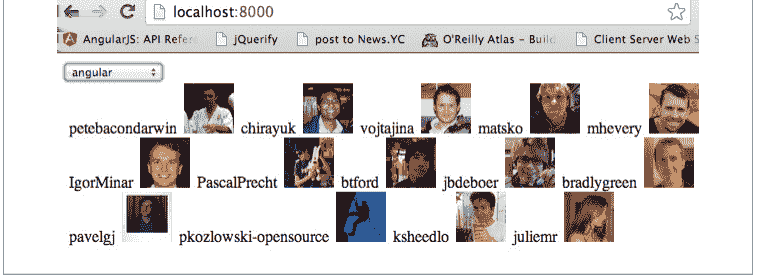

图 9-1. GitHub Groups

### 基础 HTML

该应用程序可以从零开始“构建”，首先是一个带有少量内嵌 CSS 的简单 HTML 文件。虽然对于生产项目，样式表最好外部化（与之前关于[非侵入式 JavaScript](http://example.com)的讨论一致），但在这种开发方式下，将所有代码保持在可见范围内会更简单：

```html
<html>
<head>
    <title>index</title>
    <style type="text/css" media="screen">
        img {width: 50; height: 50;}
        span {padding: 7px;}
    </style>
</head>
<body>
    <select id="selected_group">
        <option>Select Group</option>
    </select>
    <div id="images"></div>
</body>
</html>
```

### JavaScript 和 jQuery

在闭合的`style`元素下方，添加一个对 jQuery 的引用（可从 Google 获取）：

```html
<script src="//ajax.googleapis.com/ajax/libs/jquery/1.8.3/jquery.min.js">
</script>
```

下拉菜单中将出现的选项将从前面列出的 JSON 文件中加载。

用于加载此 JSON 文件的 jQuery 代码调用了`$.getJSON`，迭代返回的每条记录并将选项附加到`select`元素。当某个选项被选中时，会调用名为`getGroup`的函数：

```javascript
<script>
$.getJSON("/api/groups.json",
    function(data) {
        $.each(data, function(i, item) {
            $("<option>" + item.name + "</option>").
                appendTo("#selected_group");
        });
    }).error(function() {
        console.log("error");
    });

$(document).ready(function() {
    $('#selected_group').bind('change',
        function() {
            getGroup();
        });
});
</script>
```

`getGroup()`函数清除任何之前的显示，然后调用 GitHub 以检索所选组的数据。随后显示每个组员的名称和头像：

```javascript
function getGroup() {
    $("#images").empty();

    $.getJSON(
        "https://api.github.com/orgs/" +
        $('#selected_group').val() +
        "/members",
        function(data) {
            $.each(data, function(i, item) {
                $("<span>" +
                    item.login +
                    "</span>").
                    attr("src", item.avatar_url).
                    appendTo("#images");
            });
        }).error(function() {
            console.log("error");
        });
}
```

这个例子展示了使用 jQuery 进行本地或远程 Web API 调用并显示结果是多么简单。整个客户端由不到 40 行的 HTML、CSS 和 JavaScript 组成。再加上 jQuery 提供的跨浏览器支持，显而易见为什么它能如此迅速且广泛地被采用。

即便如此，该项目仍有改进空间。它并不美观，对不同设备的响应能力也较差。包含 HTML 片段的字符串可能会让你感到不适，并希望有一种模板解决方案。你可能还会觉得嵌套的函数调用有些陌生，并且可能在交易中存在某些不足。

为调用提供了更自然的函数式语法。有这种反应的不止你一个。JavaScript 界已经开发了许多项目和库，这些将在后续章节中讨论。

## 结论

采用客户端-服务器架构进行 Web 开发，仅需几分钟的初始设置。本章中的服务器项目仅用于提供静态资源。静态 HTML 文件和存储在 JSON 文件中的模拟 API 调用可以在文件系统中创建，更新时无需构建流程。一旦设置完毕，即可使用 jQuery 进行本地或远程 API 调用，并展示结果数据。此类项目无需深入钻研 Java 或 Python，甚至简化了必须掌握的 JavaScript 量。最终得到的是一个简单的动态 Web 应用程序，可以在各种浏览器中查看。

# 第 10 章：JRuby 与 Angular

> 我们生活在一个美丽而有序的世界里，  
> 并非处于没有规范的混乱之中，  
> 即使它有时看起来如此。  
> ——M. C. 埃舍尔

排序和筛选是自古以来就用于组织世界的活动。古代的藏头诗使用字母表中的每个字母作为诗句的开头。这既涉及筛选（选择首字母），也涉及排序（按字母顺序）。如*图 10-1*所示的**埃拉托斯特尼筛法**，可以通过按顺序列出从 2 到相关上限的所有整数，然后筛选掉素数的倍数（即合数）来**可视化**。


*图 10-1. 埃拉托斯特尼筛法*

快速搜索“筛选和排序”会返回许多针对电子表格程序中数据操作的结果。本章的项目将展示如何用相对少量的代码，使用 JRuby 和 Angular 对包含谷歌财经股市数据的 HTML 表格进行筛选和排序。

## 服务器端：JRuby 与 Sinatra

使用 Ruby 和一个名为 Sinatra 的微框架，可以创建简单、动态的 Web API。Sinatra 本质上是一个基于 Ruby 的 HTTP 包装器。

Ruby 由 Yukihiro “Matz” Matsumoto 开发，他融合了自己喜爱的语言（Perl、Smalltalk、Eiffel、Ada 和 Lisp）的部分特性，创造了一种平衡函数式和命令式方法的新语言。尽管它于 1995 年发布，Matz 也在 2001 年写了一本名为*《Ruby 精粹》*（*Ruby in a Nutshell*）的书，但直到几年后 Ruby on Rails（或简称 Rails）流行起来，Ruby 才真正大受欢迎。用其作者的话来说，这门语言“外表简单，但内部非常复杂，就像我们的人体一样。”Matz 与他人合著了一本关于 Ruby 的[更近期的书籍](https://www.google.com/url?q=http://pragprog.com/book/ruby3/programming-ruby-1-9-amp-2-0)，深入探讨了这门迷人语言的细节。

[Rails](https://www.google.com/url?q=http://rubyonrails.org)是首先引起许多开发者注意的 Ruby MVC Web 框架。David Heinemeier Hansson 从[Basecamp](https://www.google.com/url?q=http://37signals.com)（他在[37signals](https://www.google.com/url?q=http://37signals.com)参与的一个项目管理工具）中提取了这个框架，并于 2004 年发布。在许多语言和框架中，不编写代码通常意味着没有行为。而在 Ruby（以及 Rails 和其他 Ruby 项目）中，即使不编写代码，也会包含默认行为。Rails 哲学将此表达为*约定优于配置*原则。这极大地限制了启动和运行项目所需的设置工作量。这一原则在其他用 Ruby 编写的 Web 框架中也显而易见，最著名的是[Sinatra](https://www.google.com/url?q=http://sinatrarb.com)，它比 Rails 小得多，非常适合创建不需要大型框架所有花哨功能的精简应用程序。

## 工作流程

使用 JRuby（或其他 JVM 语言）的一种方法是从 Java 的角度来整合它们。包含语言实现的模块可以作为依赖项包含在项目中：

```xml
<dependency>
    <groupId>org.jruby</groupId>
    <artifactId>jruby-complete</artifactId>
    <version>1.6.3</version>
    <type>jar</type>
    <scope>compile</scope>
</dependency>
```

对于 Web 应用程序，如果已经安装了 Java 应用服务器，这样做是有意义的。可以使用[Warbler](https://www.google.com/url?q=https://github.com/jruby/warbler)将 Rack 应用程序打包成 WAR 文件，也有一些有趣的实验，比如[Square Engineering 的 Rack Servlet](https://www.google.com/url?q=https://github.com/realityforge/rack-servlet)，可以将 Ruby 驱动的 Servlet 嵌入现有的 WAR 中。

以此方式接触 Ruby 的 Java 开发者将受益于专注于语法差异，但会错过那些帮助这门语言取得巨大成功的工具和工作流程。这些差异首先体现在最初用于设置语言及相关包的工具上。

### 交互式 Ruby Shell

*交互式 Ruby Shell*（IRB）是一个用于执行 Ruby 命令的 Shell。它类似于操作系统 Shell，能为其计算的任何表达式提供即时结果。这种使用读取-求值-打印循环（REPL）的探索式编程在其他许多语言中也有。在实验、学习新语法或不确定使用何种算法或数据结构时，通常的编辑/编译/运行/调试循环可能变得繁琐。Java 没有任何直接可比的工具。在调试器中暂停时执行一小段代码与此类似，Eclipse IDE 有一个名为 Scrapbook Page 的功能，也与此相似。在学习 Ruby 时，IRB 值得探索；使用 JRuby 时，它还可以用来访问 Java 类。

有关如何使用 IRB 探索 Java JAR 包的示例，请参见[附录 A](Appendix A)。

### Ruby 版本管理器（RVM）

可以不通过将 JRuby 作为 Java 项目的依赖来访问，而是使用*Ruby 版本管理器*（RVM）来设置 JRuby 环境。RVM 不仅限于 JRuby，也可以用于许多其他 Ruby 实现。RVM 支持部署多个 Ruby 环境。每个环境都是自包含的，包含特定版本的 Ruby 和相关的一组必需 gem。RVM 使得设置依赖于特定 Ruby 版本的特定 gem 集的项目变得容易，并使这些项目与使用其他 Ruby 版本的项目保持独立。它是交互式的，在安装过程中会就额外配置或故障排除提供智能建议。如果你同时处理多个 Ruby 项目，它允许你在给定环境中开发，并使用单个命令切换到另一个环境。

#### Ruby/JRuby/RVM/依赖管理

JRuby 可以通过几种不同的方式使用，这可能会引起一些混淆。

- *Ruby*本身是一门编程语言。
- *JRuby*是在 Java 虚拟机上运行的 Ruby 编程语言的一个版本。
- *RVM*提供了一种管理多个不同 Ruby 版本的机制，*包括 JRuby 发行版*。

RVM 环境包括语言安装和相关的 Ruby 包，并在机器本地维护，独立于项目。RVM 提供了一种从 Ruby 角度使用 Ruby 实现（包括 JRuby）的方法。

JRuby 也可以作为 Maven 或其他构建工具的标准模块依赖项包含。在这种情况下不使用 RVM，而是从 Java 角度看待 JRuby。

要确定 RVM 正在使用哪个版本的 Ruby：

```bash
$ which rvm-auto-ruby

/Users/cas/.rvm/bin/rvm-auto-ruby
```

通常，你不会直接调用这个……

```bash
$ rvm-auto-ruby --version
```

正在使用的 Ruby 版本将与上一个命令中的版本匹配：

```bash
$ ruby --version
```

要列出已安装的 Ruby 解释器和当前使用的版本：

```bash
rvm ls
```

要切换到某个环境，调用`rvm use`命令并带上 Ruby 解释器名称的一部分：

```bash
rvm use 2.0.0
```


### RVM的其他功能

RVM的功能远不止让你交互式地管理Ruby版本。使用它，你可以设置称为`gemsets`的项目特定Ruby环境，这些环境独立于其他Ruby项目。它可以在命令行中调用，以执行使用特定Ruby版本和`gemset`的脚本。它甚至可以超越简单的诊断建议；例如，有时只需运行以下RVM命令即可解决SSL证书问题：

`rvm osx-ssl-certs update all`

### 软件包

Ruby软件包称为`gems`，使用`gem`实用程序进行维护。`Gem`可以发布各种版本，一个项目可以开发出来并使用相当特定的一组依赖项。一组`gem`可以与单个RVM环境相关联，这允许多个使用不同Ruby版本和不同`gem`集的Ruby项目同时开发。为了将特定项目部署到其他机器，可以使用`bundler` gem以声明式方式维护特定的依赖项集。`Bundler`的依赖项列在`Gemfile`中。

使用RVM，你可以设置一个新的Ruby环境。然后，你可以逐个安装一堆`gem`，并调整环境，直到所有正确的依赖项和版本都可用。当这些都可用时，将你当前环境中使用的所有版本填充到`bundler`的`Gemfile`中。以下`bash`命令序列可用于创建一个新的`Gemfile`，添加一条引用当前使用Ruby版本的注释，并包含与当前环境匹配的`gem`依赖项列表。

大部分工作由最后一个命令完成，该命令列出当前环境中可用的`gem`，对列表进行格式化，移除对`rvm`和`bundle`的引用，并利用该列表在`Gemfile`中创建相应的`gem`条目：

```bash
#!/bin/bash

bundle init

echo "# Ruby Version: `ruby --version`">>Gemfile

gem list --local |
grep -v '\*\*' |
sed 's/[()]//g' |
egrep -v 'rvm|bundle' |
awk '{print "gem \""$1"\",\""$2"\""}' >>Gemfile
```

生成的`Gemfile`可以分发到需要相同环境的其他机器上（例如其他开发机或独立的部署环境）。否则，这些机器必须通过安装Ruby或RVM，以及繁琐的手动`gem`安装来完成配置。

### Sinatra

正如其网站所述，Sinatra是一个用于“以最少的工作量快速创建Ruby Web应用程序”的DSL。它本质上将HTTP封装在运行于Rack（Ruby Web服务器和Web框架的通用接口）之上的Ruby可访问接口中。一个Sinatra应用程序由路由组成（每个路由是一个HTTP方法与URL匹配模式的组合）。路由与代码块（`blocks`）相关联，代码块可用于处理请求（通过执行Ruby代码、渲染模板等）。

默认情况下，Sinatra还可以从名为`public`的目录提供静态文件服务（见图10-2）。这使其成为使用Ruby创建一组用于支撑HTML/CSS/JavaScript应用程序的Web API的理想选择。它绝不局限于这种方法。标准的服务器端MVC方法涉及视图目录（默认）中的基于Ruby的模板（ERB）。

Sinatra非常精简，因此有时被称为微框架。像其他优秀的Ruby库一样，它不会干扰你的操作，并提供一个清晰的接口，你可以根据需要随时参考。

或者更准确地说，作为一个领域特定语言，由于它与所代表的领域（Web应用程序的HTTP）高度一致，它提高了程序员的生产力和沟通效率。

Sinatra能够从简单的应用（以经典风格设计）扩展到被认为更适合生产部署的形式（以模块化风格编写）。因此，从一个微小的Sinatra应用开始工作，并逐步将其构建为最终应用程序是可行的。由于其简单透明的特性，它也可用于原型设计，从而产生一个本质上是正式文档的应用程序，可用于实现一个独立的系统。

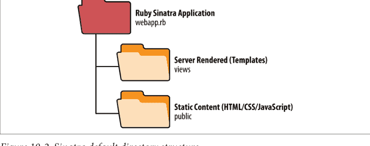

Sinatra是一个相对简单的框架，拥有优秀的在线文档，并且已经引起了足够的关注，甚至有人为其编写了书籍。为了学习它本身而学习是值得的，而且它也启发了其他语言中各种类似的框架。

### JSON处理

`JSON` gem非常简单；它可以将Ruby对象转换为JSON字符串，反之亦然。由于JSON类型与Ruby类型之间存在简单的映射，处理JSON数据变得轻而易举。请参考以下IRB会话：

```ruby
>require 'json'
=> true
> o = {:A=>[1,2,3], :B=>{:C=>:D}}
=> {:A=>[1, 2, 3], :B=>{:C=>:D}}
> o.class
=> Hash
> s=JSON.pretty_generate(o)
=> ...
> puts s
{
    "A": [
        1,
        2,
        3
    ],
    "B": {
        "C": "D"
    }
}
> s.class
=> String
> o2=JSON.parse(s)
=> {"A"=>[1, 2, 3], "B"=>{"C"=>"D"}}
> o2.class
=> Hash
```

Ruby爱好者会注意到一些细节（例如，Ruby的`symbol`和`string`都会被转换为JSON字符串）。但总的来说，这个例子表明使用该包来解析和生成JSON非常简单直接。

## 客户端：AngularJS

AngularJS（通常简称为Angular）是一个MV* JavaScript框架，由Miško Hevery和Adam Abrons于2009年开发。截至2014年，一个包括Igor Minár和Vojta Jína在内的Google团队在维护该项目。Angular读取其关联HTML文档的DOM，处理自定义元素和属性（指令），并将关联模型中的数据绑定到页面上。

Angular旨在为Web应用程序的开发提供一种全面的方法。它认可HTML的声明式特性并增强了其行为。这是一个非常复杂的框架，甚至有整本书专门对其进行深入介绍。这里的目的不是详尽地描述该项目，而是演示如何快速上手运行。为了有效地使用Angular，需要理解与之相关的许多概念。

### 模型 (Model)

如果你做过服务器端MVC开发，你可能会认为模型是一个包含属性并与关系数据库相关联的类。Java开发人员使用Hibernate和iBatis，而Rails中则包含ActiveRecord来承担此职责。此外，像Backbone这样的JavaScript框架也包含一个被框架识别的特定模型对象。

Angular在这方面相当不同。与某些具有特定模型对象的JavaScript框架不同，Angular模型是一个普通的JavaScript对象。Angular中的*模型*仅仅就是数据。由于Angular对模型的关注度较低，有些人将其视为一种模板方案，正如Angular常见问题解答中所述。然而，该框架的其他特性（包括双向数据绑定）使得Angular不仅仅是一个模板系统。

### 视图 (Views)

视图是通过HTML模板对模型的表示。每当模型发生变化时，Angular的双向数据绑定就会被激活，从而根据需要渲染视图的更新。表达式是包含在绑定中的类JavaScript代码片段，例如`{{ *expression* }}`。

可以通过引入指令来有效地扩展HTML的功能。在DOM编译期间，指令被执行以执行广泛的任务，包括DOM操作（显示或隐藏元素、循环并创建新元素等）或各种其他任务。Angular自带了一组指令，程序员还可以添加额外的指令，这些指令实际上充当独立的Web组件。

JavaScript最普遍的问题之一是与全局变量使用相关的问题。Angular通过减轻这一点来防止污染全局命名空间。作用域（`Scopes`）允许模板、模型和控制器协同工作。它们以对应于DOM结构的层次结构进行嵌套。作用域检测模型更改并为表达式提供执行上下文。

### 控制器 (Controllers)

控制器构建模型并将其发布到视图。一个JavaScript函数包含与控制器相关的代码，而`ngController`指令将控制器函数附加到视图。

Angular Seed项目提供了一个示例，展示了请求如何被路由到各个控制器。`$route`服务与一个函数相关联，该函数将URL中hash之后的部分与相应的模板和控制器相匹配。

### 服务 (Services)

Angular内置了多种服务。`$parse`服务处理表达式。每个Angular应用程序使用一个单一的注入器来定位服务。与指令一样，程序员可以根据需要将自己的逻辑封装在自定义服务中。

### jQuery与Angular的比较

将jQuery和Angular进行比较是很自然的。两者都是流行且有影响力的库。jQuery是一个公认的领导者，而Angular则承诺解决单独使用jQuery时遇到的许多问题。粗略浏览Angular文档就会发现，Angular与jQuery兼容，查看一些网站也会发现许多在同一页面中使用jQuery和Angular的示例。虽然两者在开发大规模Web应用程序方面都是有效的工具，但仍有一些影响成功设计和开发的考量因素。

### DOM与模型操作

Angular可以与jQuery共存，前提是jQuery已存在。如果jQuery不存在，Angular会使用内置的jQuery子集。从这个意义上说，这两个库是兼容的，都会操作DOM。

然而，当两个库同时存在时，更安全的做法是将Angular视为首要选择。这是因为每个库维护应用状态的方式存在根本差异。jQuery应用直接操作DOM，并将DOM视为应用状态的容器。Angular应用则将*模型*而非DOM作为“唯一真实来源”。直接操作的是模型，*而非*DOM。模型的变化会导致DOM更新。在Angular应用中依赖jQuery的DOM操作会导致难以察觉的问题，因为Angular的模型会与实际状态失去同步，无法知晓jQuery所做的更改。

由于这种根本性的方法差异，很难将Angular集成到现有的基于jQuery的应用中。Angular的DOM操作应该使用Angular*指令*来完成。将现有应用中的jQuery功能封装成指令可能颇具挑战。相比之下，从头开始使用Angular编写应用要容易得多。

### Angular的非侵入性

关于Angular是否符合非侵入式JavaScript的原则，存在一些不同看法，但在MV*框架中，展示层与行为的连接需要在某处发生。这个问题可以从以下示例中看出。

将JavaScript放在HTML中被广泛认为是不好的做法：

```html
<button onclick='someFunction()'>Click Me</button>
```

在jQuery中，使用CSS选择器来标识HTML元素。一种常见的选择元素的方式是基于其ID：

```html
<button id='myButton'>Click Me</button>
```

可以通过jQuery选择器事件处理程序来建立HTML与JavaScript的连接：

```javascript
$("#myButton").on('click', function(){someFunction();});
```

Angular在HTML页面中使用指令（自定义属性）来建立连接点：

```html
<button ng-click="someFunction()">Click Me</button>
```

这并不真正违反非侵入式JavaScript的目标。Angular属性具有单一、明确含义的显著优势。jQuery选择器需要使用任意的HTML属性（ID和class）。使用这些标准属性会引入歧义。很难看出该值是影响展示层、行为层，还是两者都有影响。HTML5引入了`data`属性，在一定程度上帮助缓解了这个问题。

### HTML5数据属性

> `data`属性是以“data-”开头、不影响布局或展示的属性。这类属性专门用于存储数据。多个属性通过在属性名中“data”之后的字符串来区分。

```html
<li class="pet" data-name="Katniss" data-type="Civet" >
  Hi Kat
</li>
```

### 项目

使用任何JavaScript框架都有两种基本方法。你可以从最小的项目开始并逐步扩展，或者从一个功能完备的项目模板开始，然后在构成项目的大量空文件中填充内容。两种方法都是有效的，适用于特定场景。

最小的示例非常适合故障排除和交流（尤其是在JSFiddle等网站上展示工作示例时）。项目模板为后续开发完整规模的项目提供了稳定的基础。以下示例从最小的示例开始，逐步添加功能。

该应用可以使用JRuby 1.7.4以及Sinatra和JSON gems来运行。每个页面迭代地添加额外功能。

要运行应用，请下载代码，安装RVM和某个版本的JRuby，安装依赖的gems，然后启动服务器：

```bash
$ rvm list

rvm rubies

    jruby-1.7_4 [ x86_64 ]

=* ruby-1.9.3-p194 [ x86_64 ]

    ruby-2.0.0-p247 [ x86_64 ]

# => - current

# =* - current && default

# * - default

$ ls

README.md    public    webapp.rb
```

```bash
$ ruby webapp.rb

[2013-08-13 21:20:01] INFO  WEBrick 1.3.1

[2013-08-13 21:20:01] INFO  ruby 1.9.3 (2013-05-16) [java]

== Sinatra/1.4.3 has taken the stage on 4567 for development...

[2013-08-13 21:20:01] INFO  WEBrick::HTTPServer#start: pid=71632 port=4567
```

Web应用的根页面会显示一个链接列表，这些链接基于`public`目录中的HTML文件。虽然这有点取巧，但这个需求是展示Ruby如何简洁和富有表现力的有趣示例。`webapp.rb`中定义的API调用如下所示，其长度与对其功能的英文描述差不多：

```ruby
get '/' do
  Dir.entries('public').entries.map{|f|
    "<a href='#{f}'>#{f}</a><br/>" if f=~/.*\.html/
  }.join
end
```

通常情况下，HTML在服务器端生成并在独立的模板中渲染；或者返回JSON、XML或其他数据类型。Sinatra本质上是一个HTTP DSL，对返回内容没有太多限制。图10-3展示了Web应用的索引页面，其中列出了指向多个AngularJS示例的链接。

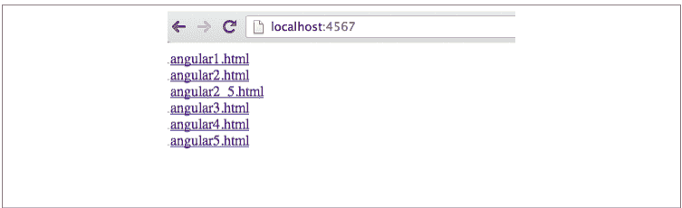

第一个示例（如图10-4所示）将简单地显示两个文本框。当在一个文本框中修改文本时，相应的文本也会显示在另一个文本框中。


Angular JavaScript文件的压缩版本（在以下`script`标签中引用）可从Google托管库获取。加载此JavaScript文件后，会遍历DOM以查找Angular指令（以HTML元素属性的形式表示）。`ng-app`指令将其所在的标签标识为Angular应用的外边界。`ng-model`指令用于标识一个模型，该模型可以在两个文本框中的任意一个进行修改，并由于内置的双向数据绑定而在另一个中更新：

```html
<!DOCTYPE html>
<html ng-app>
<head>
  <meta http-equiv="Content-type" content="text/html; charset=utf-8">
  <title>angular1</title>
  <script src="http://ajax.googleapis.com/ajax/libs/angularjs/1.0.3/angular.min.js">
  </script>
</head>
<body>
  <input type="text" ng-model="myModel" value="{{myModel}}" />
  <br />
  <input type="text" ng-model="myModel" value="{{myModel}}" />
</body>
</html>
```


下一个示例将展示如何调用外部服务（在本例中为 Google Finance）并显示返回的 JSON 对象，如图 10-5 所示。Google Finance API 已被弃用，但目前尚未安排关闭日期。初始示例不会特别美观或功能完整，但只需少量 Angular 功能即可完成所有这些工作。

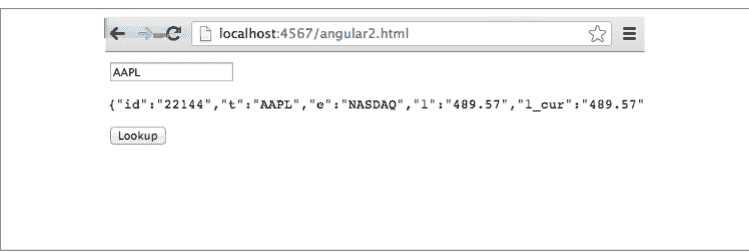

*图 10-5. Apple 的 Google Finance 数据*

## 用于整合示例的侵入式 JavaScript

在这些示例中，JavaScript 以内联方式包含，以便在一个地方看到所有组成部分。非侵入式方法要求将此类代码外部化。此外，Angular 控制器理想情况下应该小巧，复杂代码应该提取到 Angular 服务中。本书中展示的示例为便于解释而保持为单文件形式。它们出于解释和说明的目的而故意采用侵入式。在实际项目中，应优先采用非侵入式方法。

在前面的示例中，`ng-app` 指令是单独使用的。在本例中，angular 模块被明确命名为 `app`（HTML 元素中 `ng-app` 属性所赋的值）。Angular 被拆分为多个不同的 JavaScript 文件，可以根据需要引入。Angular JavaScript 库 `resource` 在基础库之后立即引入，包含 `ngResource` 模块的代码。该模块允许进行 RESTful 交互，而不是使用对底层 `$http` 服务的调用。我们定义的 `app` 模块依赖于 `ngResource` 模块。

在此示例和前面的示例中，`ng-model` 映射到了一个 JavaScript 变量。此处的 `ng-controller` 指令引用了一个名为 `AppCtrl` 的 JavaScript 函数。虽然所有 Angular 控制器都是 JavaScript 函数，但反过来并不成立。`lookup()` 函数包含在控制器函数的执行上下文（或 `$scope`）中。按钮被点击时会调用该函数，这是由 `ng-click` 指令指定的。`lookup` 函数调用 `$resource` 服务，该服务定义在 `ngResource` 模块中。传递给服务的参数引用了 Google Finance API。HTTP GET 使用 JSONP（因为请求来自不同域的服务器的数据，所以需要使用 JSONP），并期望返回一个数组。返回的数组被赋值给 `$scope.result`，其第一条记录以原始格式显示。

原始 JSON 的显示可以替换为其包含数据的格式化显示。例如，要显示当前价格，请在 `pre` 元素中使用以下内容：

```
{{result[0].l_cur}}
```

双括号是包含 Angular 表达式的绑定，由 `$parse` 服务处理：

```
<!DOCTYPE html>
<html ng-app="app">
<head>
  <meta http-equiv="Content-type" content="text/html; charset=utf-8">
  <title>angular2</title>
  <script src="http://ajax.googleapis.com/ajax/libs/angularjs/1.0.3/angular.min.js"></script>
  <script src="http://ajax.googleapis.com/ajax/libs/angularjs/1.0.3/angular-resource.min.js"></script>
  <script>
    angular.module('app', ['ngResource']);
    function AppCtrl($scope, $resource) {
      $scope.lookup = function(){
        $scope.result = $resource(
          'https://finance.google.com/finance/info',
          {
            client:'ig',
            callback:'JSON_CALLBACK'
          },
          {
            get: {
              method:'JSONP',
              params:{q: $scope.stockSymbol},
              isArray: true
            }
          }
        ).get();
      }
    }
  </script>
</head>
<body>
  <div ng-controller="AppCtrl">
    <input type="text" ng-model="stockSymbol" />
    <pre>{{result[0]}}</pre>
    <button ng-click='lookup()'>Lookup</button>
  </div>
</body>
</html>
```

将所有代码示例内联显示有些冗长；完整的代码可在 GitHub 上获取。

`angular3.html` 示例（如图 10-6 所示）新增了将股票添加到以表格形式显示的"投资组合"中的功能。可以使用输入文本字段来筛选数据，点击表头可以对列进行排序。也可以从表格中删除记录。遗憾的是，这里没有持久化机制，因此刷新浏览器会导致所有已添加到投资组合中的记录丢失。

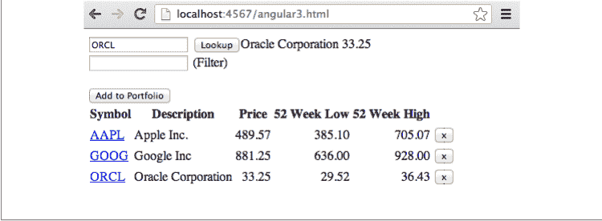

图 10-6. 投资组合列表

`angular4.html` 示例通过包含服务器端集成来解决这个问题。数据简单地存储在服务器内存中，直到服务器重新启动才会持久化。`webapp.rb` 是一个使用 Sinatra 微框架构建的 Ruby 应用程序。前两行导入了相关的 Ruby 和 Java 资源。严格来说，Java 可以完全省略，这样它就能在基于 C 的 Ruby 实现中运行。包含 Java 是为了说明如何集成 Java，其中在 `GET /version` 的调用中包含了 `System.currentTimeMillis()` 的调用，如图 10-7 所示。

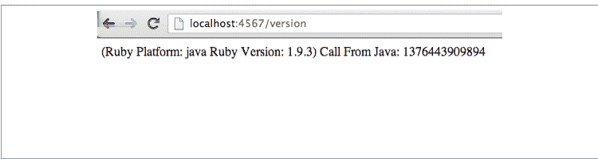

图 10-7. 显示 Java 和 Ruby 都可用且正常运行的页面

类变量（`$stocks`）被定义为一个数组，用于保存股票记录的投资组合。可以使用 HTTP PUT、DELETE 和 GET 对单个股票记录执行 CRUD 操作，所有股票的列表可以通过 `/stocks` GET URL 返回：

```
%w{rubygems sinatra java json}.each{|r|require r}
java_import 'java.lang.System'
$stocks = []

get '/' do
  Dir.entries('public').entries.map{|f|
    "<a href='#{f}'>#{f}</a><br/>" if f=~/.*\.html/
  }.join
end

get '/version' do
  "(Ruby Platform: #{RUBY_PLATFORM} "+
  "Ruby Version: #{RUBY_VERSION}) "  +
  "Call From Java: #{System.currentTimeMillis()}"
end

get '/stocks' do
  $stocks.to_json
end

get '/stock/:t' do
  stock = $stocks.find{|e|e['t']==params['t']}
  if stock.nil?
    status 404
  else
    status 200
    body(stock.to_json)
  end
end

delete '/stock/:t' do
  stock = $stocks.find{|e|e['t']==params['t']}
  if stock.nil?
    status 404
  else
    $stocks.delete(stock)
    status 202
    body(stock.to_json)
  end
end

put '/stock/:t' do
  o = JSON.parse(request.body.read)['data']
  puts "---\n #{o['name']} \n---\n"
  $stocks << o
  status 200
end
```


`*angular5.html*`示例是我们对样式的首次关注。引入了 Twitter Bootstrap CSS，定义了一些样式，并添加了遵循 Bootstrap 约定的 HTML 元素，如图 10-8 所示。

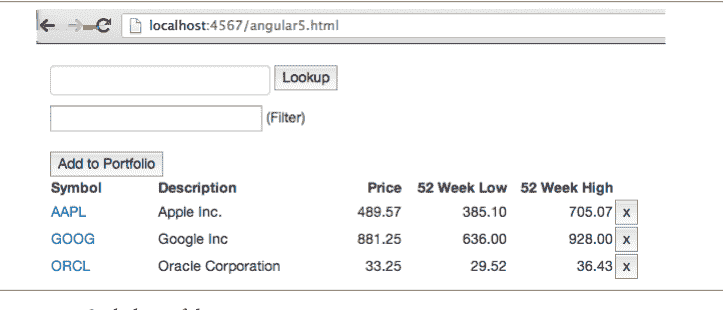

图 10-8. 样式化的投资组合

此时，将项目重构以提取 HTML 中的 CSS 和 JavaScript 到外部文件是有意义的。整个项目可以改造为一个面向目标受众和开发工具的入门项目。

## 结论

Angular 和 Sinatra 可以用来构建高度动态的应用程序，所需的代码远比使用其他流行库少得多。它们不仅值得因其固有价值而研究，还因为它们对其他技术持续产生的影响。Sinatra 启发了许多其他 HTTP DSL。Angular 则预示了 HTML5 *web 组件*等技术，具有类似的声明式模板和数据绑定特性。它们是成熟的技术，可用于当前项目，同时也指明了未来 Web 开发工作的方向。

# 第 11 章
## 打包与部署

> 那天我在等待的时候想到，将我的拖车吊起来，在不触碰其中任何物品的情况下，放到船上，这样会更容易。
>
> ——马尔科姆·麦克莱恩

马尔科姆·麦克莱恩在 1937 年有了一个想法，这使他成为“集装箱化之父”。这个想法是在霍博肯等待他运来的棉花包被装载运往海外时产生的。直到 1956 年，麦克莱恩才开发出金属运输集装箱，这大大简化了货物处理，彻底改变了航运业。包装方面的创新带来了运输效率的提升。在技术领域，应用程序的部署和分发类似于运输。Java 提供了标准化的打包方式，这是代码分发和应用程序部署的基础。

### Java 和 JEE 打包

Java 打包格式是 JEE 应用程序中的基本构建块。它们也用于不严格遵循 JEE 规范的较新的部署流程中。

Java 开发人员在部署包之外开发代码。一个 Java 类对应于操作系统上的一个文件。令人困惑的是，Java 包（`package`）实际上与打包没有直接关系，而是一个命名空间，反映了从应用程序根目录到类所在目录的路径。在开发人员的开发环境之外，很少会遇到独立的类和包。应用程序或模块在部署到生产环境或最终用户之前，会被压缩并打包为一个单元。

*Java 归档*（`JAR`）文件用于将 Java 类文件和相关资源捆绑到单个归档中。`JAR`文件使用 ZIP 文件格式压缩，并包含一个清单文件路径，名称为`META-INF/MANIFEST.MF`。它们可以使用 JDK 中包含的`jar`工具创建。最简单地说，`JAR`是一个`.zip`文件，在其`META-INF`目录中定义了一些额外的特性。

`JAR`不是 JEE 特有的。它们是标准 JDK 的一部分，其规范包含在 JDK 文档中。JEE 确实描述了`JAR`文件几种特殊用法。*应用程序客户端模块*和 *EJB 模块*都被打包为`JAR`。所有其他 JEE 打包格式也都基于`JAR`格式。事实上，其余的 JEE 特定文件格式都是具有特定于其功能和内容的文件扩展名的`JAR`文件。JEE 归档可以手动构建，但更多情况下是使用 Ant、Maven 或 Gradle 等构建工具组装。

*Web 模块*是 JEE 世界中最小的可部署单元。这种模块包含 Web 组件和 Web 资源，主要是静态内容。Web 模块可以打包成 *Web 归档*或`WAR`。`WAR`包含一个`/WEB-INF`目录，其中包含一个名为`web.xml`的文件，该文件定义了 Web 应用程序的结构并引用归档中包含的其他资源。`WAR`非常灵活，可以部署到 *Web 容器*，后者支持 JEE 规范中相对较小的一部分。

流行的 Web 容器包括 Tomcat 和 Jetty。Web 容器的开发往往先于 JEE 规范中技术的定义，每个容器提供的功能集差异显著。

*企业归档*或`EAR`文件包含`WAR`文件、`JAR`文件和一个`application.xml`，后者引用所包含的模块并定义安全角色。顾名思义，`EAR`面向企业应用程序。`EAR`必须部署到 *应用服务器*，后者支持的 JEE 规范部分比 Web 容器多得多。它们不能在 Web 容器上运行，因为它们需要 EJB 支持和其他服务。应用服务器包括 JBoss、IBM 的 WebSphere 和 Oracle 的 WebLogic Server。

为完整起见，再介绍一种不太熟悉的 JEE 归档——*资源适配器模块*（`RAR`）。这种类型的归档用于实现与 *企业信息系统*（`EIS`）的连接。`EIS`通常是遗留系统，如 ERP、大型机、队列或其他类似服务。`RAR`的用途类似于 JDBC 驱动程序。它为后端系统提供一致的接口，但不像 JDBC 那样仅限于访问关系数据库。有关相关文件扩展名的列表，请参见表 11-1。

| 扩展名 | 名称 | 描述 |
|-----------|------|-------------|
| `.jar` | Java 归档文件 | 标准 Java 包格式 |
| `.war` | Web 归档文件 | 映射到单个 Web 上下文根路径 |
| `.ear` | 企业应用归档文件 | 包含多个 WAR 和 JAR |
| `.rar` | 资源适配器模块 | 与 EIS（企业信息系统）进行通信 |

`WAR`文件对于 Web 应用程序开发人员来说尤为重要，其流行程度体现在其他语言基础上的现代框架也采用了这种格式。Play 框架可以创建包含 Scala 资源的`WAR`文件，而一个名为 **War-bler** 的 Ruby gem 可用于将 Ruby 应用程序制作成 Java `JAR`或`WAR`文件。

现有的 Java 和 JEE 打包方式在客户端-服务器 Web 开发中表现良好。对于任何具有一定规模的项目，主要考虑的是将独立的服务器代码和客户端代码维护在不同的归档文件中。应用程序可以部署为一个`EAR`，该`EAR`引用一个包含 API 代码的服务器`WAR`和一个包含 HTML、CSS 及 JavaScript 的独立客户端`WAR`。这两个`WAR`也可以部署在`EAR`之外的独立 Web 容器中。与之前涵盖的其他领域不同，在打包本身方面没有重大的创新。

> ### WAR 示例

后续示例中使用的一个单一`WAR`文件可以使用 Maven 通过[本章相关代码](link)构建。它将客户端和服务器代码包含在同一个`WAR`中，以提供最简单的使用示例。

一个被视为相关 Java 资源独立包的归档文件，如果孤立存在是没有太大用处的。该归档必须被执行（如果编写为自包含的可执行文件）或部署到运行时环境中。虽然打包实践保持不变，但与部署相关的选择*确实*发生了很大变化。

### JEE 部署

在过去，部署选项非常有限。决策主要围绕自动化程度展开。在应用程序部署时，通常假设应用程序服务器已由开发人员或系统管理员预先安装并配置。直到今天，JEE 规范本身仍然倾向于这种预期，特别是在对参与应用程序部署的角色描述中。JEE Web 应用的部署设置如图 [Figure 11-1](link) 所示。


**Figure 11-1. JEE web 应用部署**

JEE *角色* 指的是人们在开发过程中承担的功能，包括 *部署者* 和 *系统管理员*。担任部署者的人员负责为运行环境配置应用程序，验证模块是否符合 JEE 规范，并将应用程序模块安装在服务器上。从这一描述中可以明显看出，JEE 应用程序的目标环境预期是一个已安装且处于该人员或团队积极管理之下的应用程序服务器。（这也暗示了在部署时需要人工干预，而非大规模部署中常见的**持续交付**。）正如之前所提到的，这不是部署 Java Web 应用程序的唯一可能方式，但它似乎是唯一符合规范的方式。

### JEE 与云部署

JEE 与其他一些较为单体化的尝试一样，力求与之前的版本保持延续性。它还旨在反映广泛的部署环境。这种广泛的适用性在某些情况下是其优势，而在其他情况下则是其劣势。最近的版本已进行了更新以反映云部署，但这些更新似乎仅为部署者定义了极少的职责，而在实践中，这些职责通常由兼任系统管理员的同一人承担：

例如，在云部署的情况下，部署者将负责配置应用程序以在云环境中运行。部署者将把应用程序安装到云环境中，配置其外部依赖项，并可能处理其所需资源的配置方面……

……在云场景中，系统管理员将负责安装、配置、管理和维护云环境，包括提供给在该环境中运行的应用程序的资源。

—JEE7

拥有一个遵循 JEE 规范的已安装应用程序服务器限制了流程，但并未规定所有的部署实践。在部署所在的服务器上构建项目是可能的。这要求所有相关服务器上都安装了构建工具，并且可能导致性能下降或服务器服务中断。此外，由于安装额外软件或将未经测试的代码部署到生产服务器，还可能存在安全漏洞。这些挑战表明，最好在生产服务器之外进行构建，然后将打包好的应用程序传输到部署机器上。

随着涉及大量服务器的现代部署的出现，在部署目标服务器上进行构建变得更加罕见。在极少数情况下，这样做可能有意义；但总的来说，最好在非生产机器上构建归档文件，然后将其传输到目标服务器进行安装。即使在项目早期阶段不需要，但如果应用程序的使用量随时间增长且有必要增加更多服务器，这样做将提供更大的灵活性。近年来，开发了多种专门用于分布远程执行 shell 命令的项目，使得这类部署变得更加易于管理。

### GUI 管理

活跃的应用程序服务器管理涉及通过图形用户界面进行的用户交互。Web 容器并不总是如此。在遥远的过去，一些接口是老式的原生客户端应用程序，通过远程网络连接到应用程序服务器。如今，GUI 本身就是 Web 应用程序。安装后可用的 GUI 需要额外配置。需要采取措施防止管理门户公开可用，否则会产生安全漏洞。还需要进行调整，以避免管理服务器的上下文根路径与部署的其他 Web 应用程序冲突。这些配置上的顾虑导致许多管理员在初始安装期间直接禁用管理 Web 应用程序。

一个具有基于 Web 的图形管理站点的应用程序服务器示例是 Red Hat JBoss Enterprise Application Platform 6 (JBoss EAP 6)，如图 [Figure 11-2](#) 所示。在[下载它](#)并添加管理用户后，可以启动独立服务器，默认情况下可使用管理控制台。通过点击几个按钮，管理员可以部署并启用一个`WAR`文件。这将部署该 Web 应用程序，并使其可通过指定的上下文根路径访问。

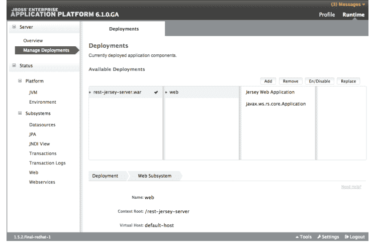

**Figure 11-2. JBoss web 管理界面**

JBoss 作为一个功能齐全的应用程序服务器，捆绑了许多有用的模块，这可以减少你在`WAR`中需要包含的代码量。但如果 JBoss 内部和你的应用程序内部同时存在类似的模块，也可能会导致一些晦涩的错误。与本章相关的`WAR`文件将其依赖项中的 Jersey 包含在内。包含 Jersey 可能会在部署期间导致错误。该错误由 RestEasy（包含在 JBoss 中）报告，RestEasy 默认进行扫描并识别出 Jersey 是一个冲突的 JAX-RS 实现。解决方案是在`web.xml`中添加上下文参数以禁用此扫描：

```
<context-param>
    <param-name>resteasy.scan</param-name>
    <param-value>false</param-value>
</context-param>
<context-param>
    <param-name>resteasy.scan.providers</param-name>
    <param-value>false</param-value>
</context-param>
<context-param>
    <param-name>resteasy.scan.resources</param-name>
    <param-value>false</param-value>
</context-param>
```

这个解决方案足够简单，但它凸显了一个观点：虽然 JEE 明确定义了打包机制，但关于哪些服务将被包含在内则比较模糊。

给定的部署环境。这类特性是为什么像“一次编写，到处部署”这样的口号在应用于 JEE 部署时，必须带有大量限定条件才能成立的主要原因。

### 命令行管理

管理 GUI 对于应用程序的初始设置非常方便。它们在易于理解的用户界面中呈现了可用的管理选项。这种清晰度使其成为学习应用服务器和审查可用功能的理想选择。与所有 GUI 一样，它们不像命令行替代方案那样适用于脚本编写和随后的自动化。虽然在小规模部署场景中它们仅仅是为了方便，但在复杂的部署场景（甚至是在拥有大量服务器的简单场景）中，它们则是必不可少。

JBoss 包含一个命令行界面，允许通过提示符或脚本执行管理操作。几乎所有在 GUI 中可用的操作都可以通过等效的命令行来实现。命令行会话通过访问命令行界面并连接到正在运行的应用服务器来启动。为此，调用带有`-c`选项的`cli`（该选项会立即建立与应用服务器的连接）：

```
$bash bin/jboss-cli.sh -c
```

登录后，您可以输入`help`来获取可用命令列表：

```
[standalone@localhost:9999 /] help
```

掌握几个基础命令就足以执行大多数常见操作。要查看特定节点路径下可用的内容列表，请使用`ls`命令：

```
[standalone@localhost:9999 /] ls
```

随后，可以通过使用`cd`更改目录和使用`ls`列出给定节点路径的内容，像操作系统的文件系统一样在 JBoss 环境中进行导航。要查看之前部署的`WAR`包：

```
[standalone@localhost:9999 /] ls deployment
rest-jersey-server.war
```

其语法与相应的操作系统命令并不完全一致。例如，可以使用`ls`命令并通过等号标识部署项，从而获取关于部署目录中`WAR`包的更多信息：

```
[standalone@localhost:9999 /] ls /deployment=rest-jersey-server.war
```

这种设计非常适合从外部脚本执行 JBoss CLI 命令。以下命令直接从操作系统命令提示符打印出当前的部署列表：

```
$bash bin/jboss-cli.sh -c --commands='ls deployment'
```

CLI 的可用性开启了创建复杂脚本的可能性，使其能够与应用服务器以及操作系统和其他应用程序进行交互。到目前为止的示例仅限于查询操作，但 CLI 并不局限于此。它还可以执行修改应用服务器状态的操作，例如部署或取消部署一个`WAR`包：

```
[standalone@localhost:9999 /] undeploy rest-jersey-server.war
[standalone@localhost:9999 /] deploy /tmp/rest-jersey-server.war
```


管理员可以用 CLI 脚本替换广泛管理任务中的手动 GUI 交互，但 CLI 拥有自己的语法和组织方式，需要一些时间才能理解并高效使用。如果唯一的管理需求是部署应用程序，那么可以通过将文件复制到指定的部署目录来避免使用 GUI 和 CLI。复制到此目录的应用程序会被 JBoss 部署扫描器（deployment scanner）检测到并自动部署。复制可以通过交互方式或脚本完成，因此无需学习 CLI 即可实现自动化部署。需要频繁部署的开发人员可以复制应用程序并依赖部署扫描器，或者依赖集成到其标准工具链中的钩子（hooks）。已经有为 Maven 和其他构建工具及 IDE 编写的插件，将应用程序的部署与构建过程本身耦合在一起。

### 非 JEE 部署

多年来，Java Web 开发一直是 Java 企业版（Java Enterprise Edition）的代名词。对于 Java 开发人员来说，意识到 Web 应用程序部署的 JEE 模型并非唯一可用，且事实上对于给定系统可能并非最佳选择，这可能会让人感到震惊（此处使用了双关语）。Java 技术涵盖的内容远不止 Web 应用程序开发，而 JEE 仅仅是 Java 平台上可能实现 Web 应用程序开发的一种方法。图 11-3 展示了 Java Web 应用程序开发模型。


*图 11-3. Java 中的 Web 开发*

非 JEE 的 Web 应用程序部署不需要预先安装应用服务器。从 Java Web 应用程序的角度来看，提供其上下文的应用服务器可能在外部、内部或并行。这些选项不仅适用于应用服务器，也可能适用于提供独立服务（如数据库）的其他软件。

#### 服务器在外部（Server Outside）

应用服务器是复杂且成熟的软件，已经存在多年。在过去，由于空间和处理能力的限制以及配置的复杂性，唯一的现实选择是投入相当多的时间和精力预先安装它们。安装完成后，Web 应用程序可以被安装并配置为连接到这些现有服务。Web 应用运行“在”服务器“上”，如图 11-4 所示。应用服务器作为 Web 应用程序的部署目标，位于 Web 应用本身的外部。

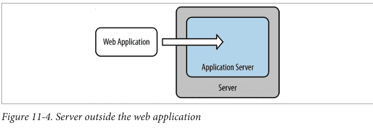

这种方法是本章前面描述的 JEE 事实上的部署方法。当您的应用程序需要部署到已经运行应用服务器的内部系统，或者您想在单个 Web 应用程序上托管多个 Web 应用程序和 JEE 包时，这种方法运行良好。在许多情况下，应用程序所需的管理工作微乎其微。运行它可能需要应用服务器或 Servlet 容器，但不需要进行管理。这导致开发人员将应用服务器的部署推迟到 Web 应用程序本身部署之后。

> ### 向轻量级容器发展的趋势
>
> 摆脱大型、单体、手动配置的应用服务器安装的趋势，是向虚拟化和应用程序轻量级部署这一更大趋势的一部分。基于云部署的出现导致人们对服务器及其内容的看法变得更加瞬时化。这种观点要求部署方法必须快速、尽可能简单且高度自动化。

#### 服务器并行（Server Alongside）

在不预先安装应用服务器的情况下部署 Web 应用程序有几种不同的方法。一种是将 Web 应用程序与应用服务器捆绑在一起。应用服务器虽然独立且截然不同，但在部署时与应用程序并行安装，如图 11-5 所示。

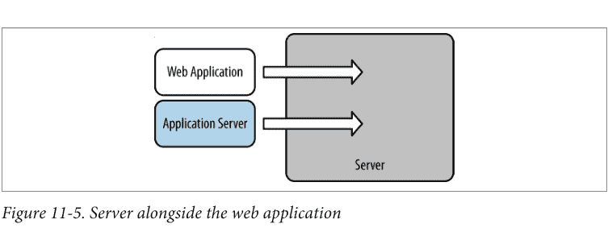

*图 11-5. 与 Web 应用程序并行的服务器*

这种部署类型由 Rails 推广，Rails 在框架本身中包含了一个服务器（WE-Brick）。Play 和 Roo 借鉴了 Rails 的做法并采用这种部署类型，但它们依赖于 Java Web 容器。Maven Jetty 插件（如图 11-6 所示）是另一个例子，它允许 Web 应用程序立即在不需要外部维护或管理的 Servlet 容器中部署并运行。使用本章提供的项目，您可以使用以下命令构建 Web 模块并在 Jetty 上运行生成的 WAR 包：

```bash
mvn clean install jetty:run
```

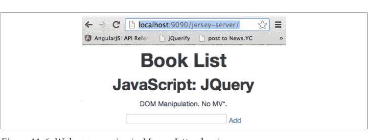

*图 11-6. 在 Maven Jetty 插件中运行的 Web 应用*

随后，应用程序可在 9090 端口上访问。

运行使用 Jetty 的 Web 应用程序不需要 Maven。Jetty 也可以使用 [Jetty Runner](http://) 作为 JAR 包在命令行中包含。在构建目录中，可以调用 Jetty Runner 并将路径和 WAR 作为参数传递：

```bash
curl -O http://repo2.maven.org/maven2/org/mortbay/jetty/jetty-runner/8.1.9.v20130131/jetty-runner-8.1.9.v20130131.jar
java -jar jetty-runner-8.1.9.v20130131.jar \
  --path /jersey-server \
  target/rest-jersey-server.war
```

[Tomcat Runner](http://) 是一个类似的利用 Tomcat 的项目。它接受与 Jetty Runner 相同的参数：

```bash
java -jar webapp-runner-7.0.40.0.jar \
  --path /jersey-server \
  target/rest-jersey-server.war
```

#### 服务器在内部（Server Inside）

与其使用外部服务器，不如将 Java 服务器库包含在应用程序的代码库内部，如图 11-7 所示。服务器从 Web 应用程序内部运行。第 6 章包含了几个可用于此目的的库和框架的示例。

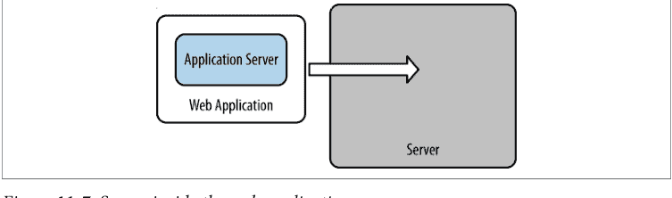

有了应用内部的服务器，分发可以简化为创建并部署单个可执行 JAR 并在服务器上执行。JEE 标准并不以这种方式看待 JAR 或应用服务器，正如前面所述，它假设应用程序将被部署到提供 HTTP 处理、数据库连接和相关配置等服务的环境中。

### 合并可执行 JAR 文件

虽然 Java 项目引用多个 JAR 文件是常见做法，但项目可以被打包和部署为单个可执行单元。将 JAR 文件打包到 JAR 文件内部的工具包括 `one-jar` 以及构建工具插件（如 Maven Shade 插件）。

### 部署选择的影响

所选的部署方式对应用程序的安全性、可扩展性和整体支持有着重大影响。不同的部署方式在快速变更的灵活性方面各有差异。

在使用单个服务器和展开的 EAR 或 WAR 文件的简单部署中，可以对系统进行热修补。对代码或配置文件的更改可以在不执行完整部署的情况下更新应用程序。这种做法本身会带来一系列流程和安全方面的问题，但此处特别强调是因为在更复杂的部署场景中，这类更改甚至无法实现。

在外部管理的应用程序服务器中，凭据和连接字符串很容易修改。而在应用程序服务器随应用程序打包部署或内置于其中的系统中，情况则并非如此。

不依赖外部管理应用程序服务器的部署方式在水平扩展方面提供了极大的灵活性。通过在负载均衡器中内置智能，可以创建带有所需配置数据的新服务器实例，而不是更改现有服务器，从而以较少的停机时间实现快速变更。

部署的性质会影响开发过程以及构成应用程序基础的模块选择。最好在开发过程的早期就确定部署目标，以确保所需资源可用并实施相关流程。

### 负载均衡

负载均衡与部署密切相关，因为其实现决定了运行应用程序所需的网络和服务器拓扑结构。负载均衡的目标是利用可用的处理能力，尽可能高效地分配传入请求。对于 Web 应用程序，传入的 HTTP 请求会从指定的负载均衡服务器（或服务器集群）重定向到多个 Web 服务器。

如何分配负载的决策取决于处理每个请求所需的工作量、服务器的处理能力以及执行负载均衡操作的硬件和/或软件的选择。任务可以采用轮询方式在服务器之间均匀分配，也可以按权重将更多工作分配给处理能力更强的服务器。还有一些更复杂的方案，它们跟踪每台服务器正在处理的请求，或者允许每台服务器在有空闲时主动拉取任务，从而更好地利用可用的处理能力。某些负载均衡器能够检测节点故障，并且不会将请求路由到故障节点。负载均衡的示意图见图 11-8。

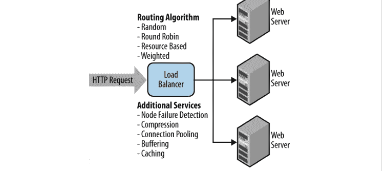

#### 图 11-8. 负载均衡

物理负载均衡器提供的所有功能并未在软件负载均衡器中完全复制。这包括安全方面的功能，如分布式拒绝服务防护和 SSL 终结，以及性能增强功能，如压缩、连接池、缓冲和缓存。这些功能并非负载均衡本身固有的，但在某些情况下对于有效使用负载均衡至关重要。

### 关于负载均衡的更多内容

负载均衡有很多方面，在客户端-服务器 Web 开发的上下文中并非都与之相关。JBoss 在集群内部为 JNDI、RMI 和 EJB 提供内置的负载均衡功能。它和其他 Java Web 容器包含集群功能，使会话可以在多个应用程序服务器之间共享。不同的负载均衡方案在是否将来自同一客户端的多个请求定向到同一服务器方面有所不同。基于 DNS 的负载均衡提供与轮询处理类似的功能，但缓存了 IP 地址的客户端在首次查找后会返回到同一服务器。会话粘性（Sticky Sessions）可用于将与同一会话关联的 HTTP 请求发送到同一服务器。可能性的范围非常广，从独立操作的负载均衡器内部管理到 AWS Elastic Load Balancing 等云部署。这些文档以及关于基本技术的早期讨论可以提供更深入的信息。

即使开发者不直接参与负载均衡工作，理解足够的相关知识以做出相关的设计和部署决策也很重要。不使用会话的无状态处理需要进行重大调整。安全配置也可能受到影响。持续运维需要解读应用程序日志。如果不了解网络的配置方式，日志中记录的请求和响应就无法有效地用于故障排除。

### 应用程序服务器集群

应用程序服务器或 Web 容器的集群可以作为负载均衡的一种可行替代方案。它可以用来实现分散服务器端应用程序负载的相同目标。其实现细节并非标准规范，且并非所有服务器都支持。集群在商业项目中尤为常见，但与其他企业解决方案一样，它可能成本较高。负载均衡可能涉及昂贵的硬件和软件，但并不一定需要。从基本形式来看，负载均衡易于理解，并且可以使用常见的、与供应商无关的网络配置来实现，而不会危及跨不同应用程序服务器的可移植性。

### 自动化应用程序部署

人们开发了多种工具来应对复杂部署场景带来的挑战。在 1990 年代，临时脚本逐渐被 `cfengine` 取代，后者成为自动化管理工作站的一种方式。它非常轻量级，并且至今仍在积极维护。它支持广泛的 OS 平台（包括 Windows、Mac OS X 等），这使其区别于为 Web 应用程序的特定特性而设计的更专业化的工具。

`Capistrano` 是一个在多台远程机器上并行执行 SSH 命令的实用工具。它基于 Ruby，由于起源于 Ruby on Rails 生态系统，因此面向 Web 应用程序部署。Capistrano 的典型用法是从 SCM 检出 Web 应用程序并将其部署到多台远程服务器。`Fabric` 是一个基于 Python 的 Capistrano 替代方案。由于基于云的部署中服务器的生命周期相对较短，这些实用工具通常与 Puppet、Chef、Ansible 和 Salt 等配置管理工具一并考虑。

### 项目

本章项目的部署在前面已经介绍过。该项目本身是一个简单的客户端-服务器 Web 应用程序，提供增删改查（CRUD）操作来添加、更新和删除图书。此示例没有后端数据存储。一个数组保存添加的图书，因此当服务器重启时数据会丢失。

应用程序的结构反映在 `pom.xml` 和 `web.xml` 中。`pom.xml` 包含 Jersey 相关模块作为依赖项，用于实现生成 JSON 的 JAX-RS 风格 API。`web.xml` 区分了 API 的客户端和服务器部分，并将 `index.html` 欢迎页面列为应用程序的客户端入口点。

### 客户端

`index.html` 包含与应用程序相关的 HTML、CSS 和 JavaScript。jQuery 由 CDN 提供。应用程序的 JavaScript 以内联方式包含在 `script` 标签之间。jQuery 的 `getJSON` 和 `ajax` 方法用于发起 API 调用。jQuery 的 `$( document ).ready()` 函数调用 `list` 函数，该函数以 JSON 格式检索图书列表，遍历结果，并将每本书显示在一个 `div` 中（包含一个带有 `delete` 类的锚点），该 `div` 被追加到标识为 `listing` CSS 类的段落中。DELETE 调用绑定到文档（而不是每个 `div`），以确保所有带有 `delete` 类的链接都响应事件（如果直接绑定到 `delete` 类，则只会绑定到页面初始加载时已存在的元素）。Bootstrap 同样由独立的 CDN 提供。为了保持简洁，它在应用程序中使用不多，但作为更详细样式的起点被引入。

同样，这是一个最小化的实现，但编写到这种程度的应用程序有助于凸显这一起点的局限性——它基于 DOM 操作，没有使用 MV* 模式或大量运用 CSS 框架。

首先，包含了一个内联样式来使页面居中，这是一种非常不符合 Bootstrap 理念的做法。相反，Bootstrap 和其他响应式框架依赖于基于网格的布局。修改 HTML 以使用网格布局将使其更适合在不同的设备屏幕上查看。

此外，DOM 操作可能难以直观地理解。初始 HTML 的状态与加载几条记录后的 DOM 状态差异很大，这表明视图模板系统可能会有所帮助。除了 JavaScript 内联使用有些笨拙之外，它也没有被拆分为反映每段代码功能的独立单元。MV* 框架为应用程序提供了一个初始结构，建议了更好的 JavaScript 代码组织方式。

## 服务器

Web API 包含在单个 `BookService` 类中，该类在 `web.xml` 中被映射到 `/api` URL 路径。类顶部的 `@Path` 注解表示该类在 `/books` 下被引用。其中包含了 GET、PUT 和 DELETE 方法，用于检索、创建和销毁书籍资源。`@Produces` 注解将 `application/json` 指定为每次 JSON 调用中预期的返回格式。在方法级多个 `@Path` 注解中引用的 `{book}` 映射到作为相应方法参数传递的 `@PathParam`。

通常，会使用库来创建 JSON。在这种情况下，Apache IO Utils 在字符串拼接的上下文中被用于创建 JSON。API 调用可以在浏览器中验证和测试，或者使用 Curl 之类的工具。使用 Maven 插件所采用的上下文路径，可以通过以下命令添加记录：

```bash
curl -X PUT http://127.0.0.1:9090/api/books/4?title=Client+Server+Web+Apps
```


## 结论

在过去几年中，Java 应用程序的部署遵循定义相当明确的 JEE 流程。虽然 JEE 风格的部署在许多情况下仍然适用，但 Java 社区也采用了新的部署方法，这些方法对于客户端-服务器风格 Web 应用程序的设计师来说尤为重要。下一章将描述云环境下虚拟化技术的兴起，这支撑了一个论点：在许多情况下，将应用服务器部署在应用程序内部或与之并行，比传统的部署在外部更好。

# 第 12 章

## 虚拟化

> 人们不欣赏事物的实质。  
> 空间中的物体。人们忽略了坚实的东西。  
> ——尤巴尔·厄利（*Firefly*，Objects in Space）

“计算机”这个词会立即让人联想到一些机械图像，也许是一个显示器和键盘、一台笔记本电脑，或是一叠服务器。在每种情况下，这个图像都是一个有形的、坚实的、物质的对象。当硬件的物理细节被额外的抽象层掩盖时，这种普遍的印象在软件开发中并不特别有用。虚拟化（Virtualization）是一个用于描述隐藏细节和特定实现特性的技术的术语。它适用于与硬件平台、操作系统、存储设备和网络资源相关的一系列技术。虽然它不直接与客户端-服务器 Web 开发或任何其他范式绑定，但它很有趣，因为许多此类应用程序旨在基于虚拟化解决方案进行大规模部署。虚拟化是一个强大的概念，影响着与活跃开发、部署、扩展和灾难恢复相关的实践。

### 全虚拟化

如果没有虚拟化，服务器由物理约束定义并受其限制。服务器管理员根据特定的硬件和用途，使用一组特定的选项来构建和配置服务器。开发团队中的每个人都需要安装软件并配置自己的机器，以使其符合目标服务器。硬件限制、性能瓶颈和容量问题通常通过向给定机器添加额外的硬件来克服。自动化可能会在一定程度上被使用，但在许多情况下，由于特定机器硬件的唯一细节，手动流程是常态。在需要维护大量不同服务器的情况下，复杂的备份和恢复实践对于系统的可用性和可靠性变得至关重要。

缓解这些挑战的虚拟化类型涉及替代物理服务器的虚拟机。全虚拟化旨在向底层硬件提供完整的模拟，以至于一个未经修改的独立操作系统可以在虚拟机中运行。图 12-1 显示了虚拟化的连续谱，从传统的、持久的、手动配置的物理硬件，到在云中自动创建且可能仅存在几秒钟的高度瞬态虚拟机实例。


**图 12-1. 服务器类型**

维护物理服务器的挑战通常通过使用虚拟机来缓解。由于全虚拟化涉及物理硬件的完整模拟，因此可以为单个开发人员提供隔离的环境以测试新软件，而无需支付购买和维护额外机器的费用。可以通过创建虚拟机在单个物理服务器上测试多个操作系统上的软件。整个软件安装版本可以通过预配置的虚拟机进行交付。创建能够捕捉机器在某个时间点状态的快照（snapshot）的能力，为灾难恢复管理开启了许多可能性。服务器可以用虚拟机替代，以减少能源消耗和硬件成本，而不再需要管理具有特定硬件问题的许多物理机器。

虚拟化的一个缺点是额外的处理需要付出代价。在某些情况下必须购买虚拟化软件，而且运行它们会产生额外的处理能力开销。需要低级硬件访问的项目不适合虚拟化，但大多数 Web 应用程序则适合。虚拟化与物理硬件之间的问题类似于使用高级编程语言与 C 或汇编等低级语言的区别。需要高性能的任务只能使用特定的、高度定制的解决方案“靠近底层（close to the metal）”地实现。而无数其他任务则没有如此严苛的要求。

另一个需要考虑的成本是额外的复杂性。虚拟机的行为不能孤立地看待，而必须结合其宿主机（host machine）来理解，而不是只关注一台物理服务器。性能问题可能是由于 VM 本身的问题或宿主机的问题引起的。虚拟化层可以嵌套好几层深，从而增加额外的复杂性。虚拟化消除了整类的问题，但确实需要特定的技术意识和专业知识才能有效使用。

虚拟机取代物理服务器的流行导致了服务器管理和扩展实践的重大转变。所谓的云提供商以某种形式托管虚拟化的计算机资源。在某些情况下，提供的虚拟化是以特定机器的形式存在的。在这种情况下，主动管理物理服务器的需求被完全消除了。

> ### JVM 中的 “V” 是什么意思？
>
> Java 虚拟机（JVM）提供了部分虚拟化，允许包含字节码的类文件在任何可以运行虚拟机的硬件上被解释和执行。它不提供任何用于隔离代码的独立容器，也不会创建一个可以作为网络上独立服务器进行管理的独立机器。任何类型的虚拟化在掩盖底层实现细节方面都可能极其有效，但不同级别适用于特定问题。

### 虚拟机实现

虚拟化可以追溯到 20 世纪 60 年代 IBM 创建的一个名为 CP-40 的研究系统。随后在 1967 年推出了 CP 67，这是一个为 IBM System/360-67 开发的虚拟机操作系统。在接下来的几年中，其他的虚拟化解决方案相继推出，其中大多数针对特定的操作系统。随着强大的硬件以较低成本提供给更多的开发人员，虚拟化的适用性和普及度得到了提升。

在如今无数的虚拟机实现中，VMware、VirtualBox 和 Amazon EC2 是最流行的几个。它们也是使用 Vagrant 和 Packer 等工具创建的预置服务器（provisioned servers）的特定目标。

### VMware

许多 Web 开发人员第一次接触虚拟机是通过 1999 年发布的 VMware Workstation。VMware 现在提供一系列相关的虚拟化、云管理、备份和桌面产品。如今也有 VMware 软件的开源版本可用。

### VirtualBox

2007 年 1 月，VirtualBox 的开源版本作为一种在 Windows、Linux 和 OS X 上运行的全虚拟化解决方案发布。它被 Sun 公司收购，随后被 Oracle 收购并重新命名为 Oracle VM VirtualBox。它与 VMware 的产品在通用功能上相似，但在非技术细节方面存在显著差异，例如许可条款、付费功能、易用性和文档的可获取性。

### Amazon EC2

*Amazon 机器镜像*（AMI）是一个模板，定义了可在 *Amazon Elastic Compute Cloud*（Amazon EC2）上运行的服务器配置。启动实例时会选择 AMI，之后它作为云端虚拟服务器可用。因此，AMI 仅适用于面向 Amazon Web Services 的部署。

### 虚拟机的管理

随着虚拟机数量和复杂性的增加，VM 的管理成为一项重要任务。每个实现都有专有的机制来定义和维护虚拟机。*Open Virtualization Format*（OVF）是一种用于打包和分发 VM 的开放标准，有许多值得注意的项目旨在协助创建和维护它们。

### Vagrant

一个挑战是每种虚拟化技术都有独特的流程、脚本和工具来创建和维护环境。Vagrant 提供了配置可重复和可移植的 VM 的机制，这些 VM 可在 VirtualBox、VMware、AWS 或任何其他提供商之上配置。`vagrant` 命令用于完成所有相关操作。

`Vagrantfile` 包含给定机器的配置。一旦配置好此文件，必须有一个 `box`（用于创建 VM 的基础镜像）可用或已被添加。它是一个初始镜像，会被克隆但实际上永远不会被修改。添加 box 后，可以通过运行 `vagrant up` 启动机器，并且可以使用 `vagrant ssh` 通过 ssh 访问新机器。还可以使用其他命令来配置机器，以及停止和清理旧机器和 box。Mitchell Hashimoto，Vagrant 的创建者，有一本[关于 Vagrant 的书](https://www.manning.com/books/vagrant-in-action)，深入介绍了它。他最近还发起了另一个项目，进一步促进简化的*跨 VM 实现*配置，名为 Packer。

### Packer

尽管 Vagrant 很有用，但镜像的创建和管理仍然是一个乏味、困难且基本手动的过程。Packer 使用以单一可移植输入格式编写的模板，并行生成多个平台的镜像。Packer 用于自动化为各种 VM 提供商创建基础 box。称为 `builders` 的 Packer 组件以称为 artifacts 的形式为给定平台创建机器镜像。

例如，Packer 的 VirtualBox 构建器可以创建 VirtualBox VM 并以 OVF 格式导出它们。`Artifacts` 由代表虚拟机镜像的 ID 或文件组成。Packer 还补充了 Vagrant 的功能，因为它可以获取 artifact 并通过 `post-processors` 将其转换为 Vagrant box。

为不同提供商配置 VM 的一致语法和工作流并不能解决配置和维护问题。额外的自动化最初可以通过一些 shell 脚本提供。终端增强工具，如用于 OS X 的 csshX，可在多台机器上运行 ssh 命令，或者像 Capistrano 这样的工具可能足以在小型环境中管理多台服务器。当服务器数量增长到超过少数时，这些解决方案不足以满足通用系统管理的需求。

### DevOps 配置管理

简单的 Vagrant 机器可以使用单独命令或在名为 `Vagrantfile` 的文件中引用的 shell 脚本来设置。更复杂的配置可以使用 Chef 或 Puppet 自动安装和配置 VM。Puppet 和 Chef 都是用 Ruby 编写的，但 Puppet 使用基于 JSON 的语言根据定义的依赖关系确定要安装的内容，而 Chef 需要以 Ruby 本身编写的安装脚本。最近，Ansible 和 Salt 已经出现，作为这些工具的替代（或在某些情况下的补充）方案。这些工具可以实现的功能之间存在大量重叠，但每个工具特别适合某些项目和管理员。

表 12-1 列出了 DevOps 配置管理工具。

*表 12-1. DevOps 配置管理工具*

| 工具 | 初始发布 | 说明 |
|---|---:|---|
| CFEngine | 1993 | 基于 C，快速、轻量、学习曲线陡峭 |
| Capistrano | 2005 | 专注于 Rails 应用部署 |
| Puppet | 2005 | 受 CFEngine 启发 |
| Chef | 2009 | 使用 Ruby 进行配置 |
| Salt | 2011 | 快速、星火操作和管理 |
| Ansible | 2012 | 简单、无代理管理 |

初始发布的年份有助于理解每个工具的作用及其与现有工具的关系。Puppet 受 CFEngine 启发。Chef 的作者使用并从 Puppet 中学习，但根据他们的管理经验采取了略有不同的方法。最近，Ansible 和 Salt 作为 Chef 或 Puppet 的简化、流线型工具而越来越受欢迎。它们执行服务器的初始配置和配置，以及从任意节点检索结果的命令执行。

### DevOps

似乎某个技术领域的工具、技术和缩略语数量达到一定临界质量时，就会出现一个新的职位名称。*DevOps* 是在 2009 年引入的，代表那些职责跨越传统开发和运维任务的专业人员所担任的角色。虽然个别开发人员可能不会深入使用本节列出的工具，但了解它并能够与使用这些工具的 DevOps 专业人员进行智能交互是有益的。

### 容器

虽然完全虚拟化是一个早期的目标，有许多有用的应用，但更有限的形式也产生了巨大影响。*部分虚拟化* 仅尝试模拟整个操作系统的一部分，并不提供功能完备的虚拟机。相反，操作系统特定的*容器技术* 允许一种有限形式的虚拟化。

容器技术的发展是由获取进程隔离和安全性的问题驱动的，超出了通过其他操作系统机制所能实现的范围。传统的用户和组管理在许多情况下是繁琐且不完整的。自 1970 年代后期以来可用的有限隔离是 `chroot` 工具。虽然在某些情况下有用，但它不足以提供运行功能完备的独立容器的能力。从高层次来看，容器可以被视为部分 VM，或者从低层次来看，作为增强的 chroot。

容器可以被描述为*操作系统级虚拟化*，或使用其他供应商特定的术语。它们提供用户空间实例，在容器内分配私有资源，但针对宿主机的内核执行命令。与模拟整台*机器*不同，容器技术专注于虚拟化单个*操作系统进程*，使其在独立于服务器其余部分的隔离、安全环境中运行。

### LXC

*Linux Container*（LXC）虚拟化在 Linux 上可用。它允许在单个服务器上运行一个或多个隔离容器。这比在运行标准操作系统级进程的单一单体系统中提供了更好的资源使用和安全性之间的平衡。容器运行核心 CPU 的原生指令，无需标准虚拟化技术所需的中间步骤，因此性能更好。由于它们不包含完整操作系统的所有开销，它们比功能完备的 VM 更轻量，占用更少的资源。无论宿主系统的内核版本或发行版如何，Linux 容器都可以运行。

### Docker

*Docker* 通过高级 API 扩展了 LXC。与其他容器技术一样，Docker 旨在简化应用程序打包和部署，以及为终端用户创建单独的私有环境。在很大程度上，Docker 使 LXC 提供的功能更易于使用。在这方面，Docker 之于 LXC，就像 Vagrant 之于它所支持的基础虚拟机实现，如*图 12-2* 所示。

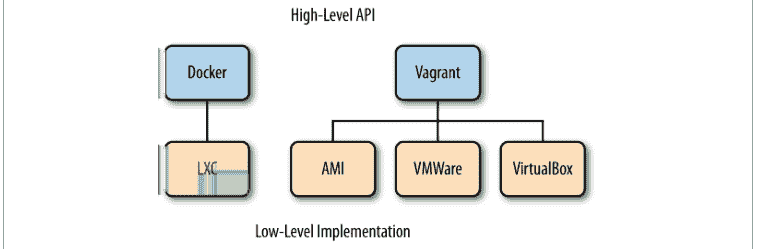

在 Docker 术语中，你运行的是基于*镜像*的*容器*。退出容器时，其文件系统状态和退出值会被保留，但其内存状态不会。容器可以启动、停止或重启。容器还可以使用 Docker `commit` 命令提升为镜像。然后，该镜像可以用作新容器的父镜像。

Docker 镜像可以有父镜像。基础镜像没有父镜像。用于创建容器的一组镜像存储在 Docker *仓库*中。仓库可以在*注册表*中引用。隐式的顶层注册表是 `index.docker.io`，因此 Docker 还包括发布和共享镜像的机制。

尽管它是一个新项目，Docker 凭借其标准化容器分发环境的承诺具有巨大的潜力。如果使用得当，可以消除个别开发人员和管理员设置机器所花费的时间。Linux 在广泛硬件上的普及，为将应用程序分发到任何东西——从同事的开发机器，到云服务，再到嵌入式设备——开辟了新的可能性。

### 项目

本项目使用了前面提到的几种虚拟化技术。项目需要 Git、[VirtualBox](https://www.virtualbox.org/) 和 [Vagrant](https://www.vagrantup.com/) 作为前提条件。只需几个步骤，即可设置好 Docker（在 Vagrant 管理的 VirtualBox 中）。[图 12-3](#figure-12-3) 显示了位于 OS X 主机系统上的 Vagrant 文件，该文件定义了运行 Docker 实例的 VirtualBox 实例配置。Java SDK 将被安装在 Docker 容器中。随后，该容器将用于编译和运行 Java 程序。这个简单的示例包含了在更大、更广泛的 Docker 安装中所必需的所有步骤。

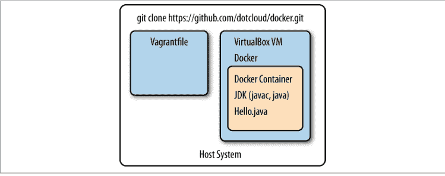

*图 12-3. 在 OS X 上通过 Docker 运行 Java*

[使用 Vagrant 设置 Docker 的指南](https://docs.docker.io/installation/vagrant/)根据操作系统的不同而略有差异。通常情况下：

1. 使用 Git 获取包括用于机器设置的 `Vagrantfile` 在内的 Docker 源码。
2. 使用 Vagrant 启动虚拟机（VM）。
3. 用户通过 ssh 登录到新虚拟机并切换到 Docker 用户。
4. Docker 此时可用于创建和维护容器。

从主机机器开始，你可以首先使用 Git 下载 Docker 项目：

```bash
git clone https://github.com/dotcloud/docker.git
cd docker
```

Docker 处于快速开发阶段，变化非常快。在初始安装之后，你同样可以使用 Git 来更新你的 Docker 版本：

```bash
git pull
```

针对 OS X 的 Docker 项目由一个 Vagrant 管理的 VirtualBox 虚拟机组成。要启动并登录到托管 Docker 的虚拟机：

```bash
vagrant up
vagrant ssh
```

登录后，你可以随时通过输入 `exit` 退出 Vagrant 虚拟机。在 Vagrant 管理的盒子中，可以调用 Docker：

```bash
sudo docker
```

可以通过下载并安装 ubuntu 基础镜像来获得一套可用的标准 Linux 实用程序：

```bash
sudo docker pull ubuntu
sudo docker run ubuntu /bin/echo Docker is running!
```

#### Docker 帮助

你可以通过使用内置帮助来深入了解 Docker。由于该项目变化如此之快，在线或其他地方提供的文档可能不适用于你正在使用的版本。要列出可用命令，只需输入 `docker`。通过添加 `-help` 参数可以列出每个命令的可用选项：

```bash
docker
docker build -help
```

#### 镜像和容器维护

在运行 Docker 一段时间后，你会积累大量的镜像和容器。`info` 命令可用于查看描述系统范围信息的报告，包括容器和镜像的总数：

```bash
docker info
```

这些综合总量、已退出的容器以及中间镜像通常是人们最关心的子集。每个容器在 `exit` 之后在被删除前依然可用。镜像往往会迅速累积，因为*在 docker 文件中定义的每个步骤*期间都会创建一个镜像。`ps` 命令列出正在运行的 Docker 容器。`images` 命令列出镜像（不包括用于构建的中间镜像）：

```bash
docker ps
docker images
```

要列出所有容器或镜像，请加上 `-a`。通过指定 `-viz`，可以创建一个可使用 GraphViz 查看的镜像 `.dot` 图：

```bash
docker images -viz > docker1.dot
```

通过运行 `docker inspect <container name>` 可以获取关于给定容器的更详细信息。`rm` 命令用于清理容器和镜像。这些可以通过列表形式传递给该命令：


```bash
docker rm $(docker ps -a -q)

docker rmi $(docker images -q)
```

### Java on Docker

Docker Git 仓库包含一个由 Vagrant 用于配置和供应虚拟机的 Vagrantfile。Docker 使用 Dockerfile 来配置和供应容器。`FROM` 指令指定新机器的基础镜像。可以使用可用的公共镜像仓库，也可以使用自己的镜像。`MAINTAINER` 指明镜像的作者。`RUN` 指令在当前镜像上执行命令并返回结果。以下步骤安装 Oracle 的 Java 7 SDK 并接受所呈现的许可协议。`ADD` 指令将名为 `Hello.java` 的文件复制到容器中，在该容器中它将被编译并可供执行：

```dockerfile
FROM ubuntu:precise

MAINTAINER Casimir Saternos

RUN echo " deb http://ppa.launchpad.net/webupd8team/java/ubuntu precise main" \
 | tee -a /etc/apt/sources.list

RUN echo " deb-src http://ppa.launchpad.net/webupd8team/java/ubuntu precise main" \
 | tee -a /etc/apt/sources.list

RUN apt-key adv --keyserver hkp://keyserver.ubuntu.com:80 --recv-keys EEA14886

RUN apt-get update

RUN echo oracle-java7-installer shared/accepted-oracle-license-v1-1 select true\
 | /usr/bin/debconf-set-selections

RUN apt-get -y install oracle-java7-installer

RUN update-alternatives --display java

RUN echo "JAVA_HOME=/usr/lib/jvm/java-7-oracle" >> /etc/environment

ADD Hello.java Hello.java

RUN javac Hello.java
```

需要在 Dockerfile 所在的目录下创建一个简单的 Hello World：

```java
public class Hello{

    public static void main (String args[]){

        System.out.println("hey there from java");

    }

}
```

有了 Dockerfile 和 Java 类，就可以从镜像构建容器。`-t` 选项指定要应用于结果镜像的仓库名称，并在列出可用镜像时对其进行标识：

```bash
docker build -t cs/jdk7 .
```

此外，之前安装的 JDK 也已安装，且我们复制到 Docker 容器中的程序可以运行：

```bash
docker run cs/jdk7 java -version

docker run cs/jdk7 java Hello
```

需要明确的是，这些命令是在 Docker 容器内运行的。尝试在 Vagrant 虚拟机上运行它们，你会看到不同的结果（表明虚拟机上未安装 Java）：

```bash
java -version

java Hello
```

通过在上述定义的 Dockerfile 中追加内容，可以配置一个将 Web 应用程序作为 WAR 包在 Jetty 上运行的 Docker 文件。`ADD` 命令可用于将文件从 Vagrant 虚拟机复制到 Docker 容器，而 `RUN` 命令可以使用 `wget` 或其他实用程序从引用的 URL 下载所需文件：

```dockerfile
ADD rest-jersey-server.war rest-jersey-server.war

RUN wget http://repo2.maven.org/[...见脚注...]/jetty-runner.jar
```

### 将文件复制到 Vagrant

你可能会好奇 `rest-jersey-server.war` 是如何到达 Vagrant 虚拟机上的，或者你可能只是巧妙地使用 Curl 或 `wget` 下载了它。虽然下载是一个不错的选择，但也可以通过文件共享或使用 `scp` 来复制文件。

默认情况下，Vagrant 将包含 Vagrantfile 的目录共享到虚拟机的 `/vagrant` 目录。此外，默认情况下，Vagrant 转发 SSH（从端口 22 到 2222），因此可以使用 `scp` 在虚拟机和主机之间复制文件。例如，从主机机器运行以下命令，并在提示时输入密码 `vagrant`，即可将 `docker.png` 从虚拟机复制到主机机器：

```bash
scp -P2222 vagrant@localhost:docker.png .
```

然后可以从镜像构建容器并交互式运行：

```bash
docker build -t cas/restwar .
```

```bash
docker run -p 49005:49005 -name restwarcontainer cas/restwar \
java -jar jetty-runner-8.1.9.v20130131.jar \
--port 49005 rest-jersey-server.war
```

请注意，在容器交互式运行的情况下，可以打开其他 `vagrant ssh` 会话来运行额外的命令。如果你想以非交互方式运行 Web 应用，启动应用服务器的命令将作为最后一个 `RUN` 命令包含在 Dockerfile 中。

默认情况下，Docker 为新启动的容器随机生成一个名称。上述代码中使用 `-name` 参数是为了以有意义的方式为容器命名，但这确实引入了需要采取额外手动步骤的需求。如果你决定使用该命令重新运行容器：

1. 该 URL 过长无法容纳，且 URL 不支持换行。实际引用地址为 `http://repo2.maven.org/maven2/org/mortbay/jetty/jetty-runner/8.1.9.v20130131/jetty-runner-8.1.9.v20130131.jar`。

### Docker 与 Vagrant 网络

在 OS X 或 Windows 上使用 Docker 时，令人困惑的一点是它涉及物理机器和两个层次的虚拟化，如表 12-2 所示。物理机器托管一个 Vagrant 实例，该实例提供一个完全虚拟化的虚拟机，Docker 容器在其中运行。从不同位置可以看到多个不同的 IP 地址，还有若干端口需要开放。

表 12-2. 项目服务器

| 服务器 | 描述 |
|---|---|
| 基础机器 | 包含 VirtualBox 软件，通过 Vagrant 进行维护 |
| Vagrant 实例 | 一个安装了 Docker 软件的 VirtualBox Linux 虚拟机 |
| Docker 实例 | 托管运行 Web 应用程序的 Jersey 服务器 |

基础机器上的一个端口需要对 Vagrant 可用。此端口通过配置 Vagrantfile 来开放。它也包含在用于运行 Docker 实例的命令中。从外部来看，基础机器似乎只是在该端口上监听并响应。网络配置的可能性非常丰富，但本示例只需几个步骤即可完成设置。

首先，我们将在 Vagrant 中开放一个端口，以便宿主机能够看到其上运行的内容。*端口转发*是将虚拟机上的端口指定为通过宿主机上的端口进行共享的做法。指定的端口可以与宿主机的端口相同，也可以不同。在本示例中，我们将通过修改 Docker 自带的 Vagrantfile，将 Vagrant 虚拟机上的端口 49005 转发到宿主机上的端口 49005：

```ruby
...

    Vagrant::Config.run do |config|

      ...

      config.vm.forward_port 49005, 49005

      ...
```

对于如上所列的在 Jetty 上运行 WAR 的单个容器，可以通过在 Vagrant 虚拟机内执行一些命令并访问页面来确定容器的 ID 和 IP 地址：

```bash
ID=$(docker ps | awk '{print $1}' | grep -v CONTAINER)

IP_ADDRESS=$(docker inspect $ID | grep IPAddress | awk -F'"' '{print $4}')

echo $ID

echo $IP_ADDRESS

curl $IP_ADDRESS
```


这里的 IP 地址在 Vagrant 虚拟机内部是有意义的，但对外部世界不可见。这正是 `Vagrantfile` 中指定的端口转发发挥作用的地方。从宿主机上，在浏览器中查看 `http://localhost:49005/`，你将看到 WAR 中的主页。

### 总结

在 20 世纪 80 年代，"虚拟现实"一词因 Jaron Lanier 而流行开来。此后，电影、视频游戏和复杂的模拟应用都从 VR 技术的进步中受益，但在计算机专业人员中产生更大规模影响的虚拟化领域，是计算机硬件本身的虚拟化。

Java 的成功很大程度上归功于 Java 虚拟机，它是一个隐藏底层操作系统细节的抽象层。Servlet 容器和 JEE 应用服务器提供了更高一层的抽象。更高层次抽象的发展，通过将整类问题从直接问题空间中移除，使得更高程度的专业化成为可能。客户端-服务器应用程序借助现代虚拟化技术可以轻松运行在高度可扩展的解决方案上，并且由于其结构化、模块化的架构，可以被方便地打包以实现轻松部署。那些在本质上相同——但并不正式等同于——某些底层功能层的技术，显然具有巨大的价值。

用一个虚构角色的引言来开启虚拟化这一章似乎是恰如其分的。电影中的角色——无论多么引人入胜——都与真实的人不同。即便如此，虚拟化的多种形式以某种方式模仿底层技术，使得它从某些角度来看似乎与它所模拟的物理表示不可区分。

# 第 13 章
## 测试与文档

> *没有语言，思想就是一片模糊、未知的星云。*
*在语言出现之前，没有什么是清晰可辨的。*
—索绪尔

James Lind 是 18 世纪的苏格兰内科医生。在海军服役期间，他进行了一项如今可能被描述为首次临床试验的研究。通过将十几名患病水手分成两人一组，提供受控饮食和特定治疗，他确定了橙子和柠檬能有效预防坏血病。今天我们知道坏血病是维生素 C 缺乏的结果，但还需要一个世纪类似的实验，最终促使 Casimir Funk 于 1912 年创造了"维生素"这一术语。

临床试验是科学方法中实验步骤的应用。[牛津词典](https://en.oxforddictionaries.com/)将科学方法描述为"一种自 17 世纪以来就成为自然科学特征的程序方法，包括系统的观察、测量和实验，以及假说的构建、检验和修正。"这一定义虽然准确，但没有捕捉到重复实验的一个重要成果——对现象的刻画和以清晰、明确的语言表述的假说的开发。最佳状态下的测试能够产生对被测对象的精确、清晰的描述，使后续研究者能够更清楚地进行交流。

软件测试根植于同样的传统。它本质上采用了过去 400 年来自然科学中一直实践的程序。测试的目的是证明或证伪假说。在软件测试的情况下，这涉及对系统全部或部分功能按规格运行的断言。软件测试还可以带来对应用程序如何更好地设计、模块化和结构化的洞察。此外，它可以帮助澄清需求，并确定精确的语言来描述被审查的系统。

### 测试类型

大多数软件开发项目都声称经过了测试，但其确切含义并不一定显而易见。测试是一个广泛的课题，可以根据测试结果、测试的构建方式、被测试的系统部分或参与人员的角色来细分。

#### 正式与非正式

当测试目的不明确且预期结果是非正式和随意的时候，会使用临时测试。它类似于在 REPL 中进行的探索性编程。它是其他测试形式的初步步骤，是一种对不熟悉的应用程序进行初步检验的方式。正式的验收测试则处于光谱的另一端，它是结构化的、有组织的、有明确规定的，专门用于确定客户是否会接受某个系统。非正式测试通常是手动进行的，而正式化的方法则可以高度自动化。

与其死记硬背一长串测试类型和方法论，更重要的是理解测试的目标，并为项目选择一种足够严谨但又不增加不必要开销的方法。如图 13-1 所示，在测试形式化程度方面，可以可视化地呈现一个包含所有可能选择范围的连续体。虽然本章引用了科学方法，但为特定项目选择适用的测试方法更像是一门艺术而非科学。

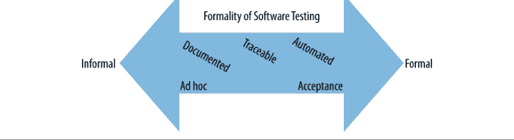

图 13-1. 测试形式化程度的范围

#### 测试范围

测试的范围可以有很大差异。简单的*冒烟测试*（或*健全性测试*）可以进行以提供最基本的保障，确保没有明显的破坏性影响，而*穷尽测试*则旨在对系统的各个方面进行全面测试。系统被测试的程度可以从不同的角度进行量化。*测试覆盖率分析*表明哪些代码行正在进行单元测试。即使在一个系统中，100% 的覆盖率要求涵盖输入的所有可能排列组合，以支撑穷举测试的声明。很少有项目能做到这一点，但即便做到了，可能也只是在测试系统的功能方面。

系统的*非功能*属性同样可以进行测试，包括负载测试、压力测试以及在不同平台、浏览器或设备上的测试。云部署推动了测试领域的创新，将测试的边界拓展至有意引入重大系统故障以确保系统韧性。例如，Netflix 的 [Chaos Monkey 项目](https://github.com/Netflix/chaosmonkey) 运行在 Amazon Web Services 中，通过查找并终止自动扩展组中的虚拟机实例来验证系统承受反复服务器故障的能力。

### 谁为谁测试什么？

测试的时间、方式、创建者和受众也是重要的关注点。单元测试可以由开发人员在代码编写之前创建，也可以在代码全部完成后补充。*黑盒*测试通常涉及测试人员编写的更高级别的功能测试。单元测试与代码实现紧密相关，而黑盒测试的创建则不参考软件的内部结构。高度隔离的测试可能只评估系统的某个微小方面，而集成测试则可以确保相关系统之间不存在接口缺陷。

测试还可以从创建测试和评估结果的人员角度来考虑。测试结果的受众首先是开发人员，随后是质量保证分析师，最终是被授权验收系统的人员。测试可以由不同的参与方编写，包括测试人员和开发人员。由于测试是根据需求创建的，因此业务分析师和参与需求定义的相关方也可能深度参与。事实上，测试的定义有助于为参与系统测试的所有相关方建立一套通用且无歧义的语言。

### 测试作为组织成熟度的指标

在实践中，软件系统的需求可能存在于许多地方，且以多种形式呈现。虽然文档通常被认为是主要来源，但并非所有项目都有正式文档。即使项目确实有正式定义的需求和系统描述，在活跃开发的系统中，如果不通过自动生成或有意维护，这些内容往往会很快过时。在某些情况下，程序员的记忆或代码中的注释会专门描述预期行为。在缺乏这些信息的情况下，源代码本身可能是对系统功能仅存的正式描述。源代码的不可访问性正是测试能够成为系统本身之外最准确的软件需求最终定义的绝佳理由。

事实上，一组定义良好的测试可以在系统的所有原始代码被替换后仍然长期使用。从这个角度来看，测试可以比正在构建的系统本身更持久、更有价值！它们可以成为在整个组织以及相关方之间就系统状态和功能进行有效沟通的手段。

#### CMM 用于评估流程一致性

[康威定律](https://en.wikipedia.org/wiki/Conway%27s_law)指出："任何设计系统的组织都会产生一种设计，其结构是该组织沟通结构的映射。"也可以说，软件流程的成熟度（流程被明确定义和控制的程度）反映了一个组织的软件测试状态。[能力成熟度模型](https://en.wikipedia.org/wiki/Capability_Maturity_Model)（CMM）定义了一个阶段层级，描述了组织在开发和维护软件的流程中所体现的结构程度、流程稳定性和规范性。如表 13-1 所示。

表 13-1. 能力成熟度模型阶段

| 级别 | 名称 | 描述 | 测试 |
|------|------|------|------|
| 级别 1 | 初始级 | 不一致、无组织 | 无测试，临时应付 |
| 级别 2 | 可重复级 | 有纪律的流程 | 部分单元测试 |
| 级别 3 | 已定义级 | 标准化、一致的流程 | 统一的项目，每次构建都运行单元测试 |
| 级别 4 | 已管理级 | 可预测的流程 | 持续集成测试 |
| 级别 5 | 优化级 | 持续改进的流程 | 覆盖率、代码质量、报告 |

高度优化的组织较少依赖少数人的英雄式努力。它更不容易出现错过截止日期、["死亡行军"](https://en.wikipedia.org/wiki/Death_march_(project_management))以及其他项目失控的症状。当关注点集中在*应用*的可扩展性上时，可能会忽视*组织*的可扩展性。

如果打算随时间扩大组织规模，更高的 CMM 等级至关重要。一致的流程和程序有助于新成员融入团队。它们最大限度地减少了让团队中高效的成员停下来教授每个新成员一套内部的、未文档化的、未执行的实践所损失的时间。它们降低了新成员采取的行动使现有应用不稳定的可能。在最佳情况下，良好的流程会潜移默化地教会员工有益于其他尚未建立控制流程的项目的方法。

#### Maven 用于推行统一流程

直接说服人们采用一致的软件实践可能很困难。使用与组织目标一致的、促进或强制执行实践的工具则容易得多。例如，Maven 引入了统一的构建周期，通过插件环境实现可扩展性，同时又不会灵活到允许大幅偏离最佳实践。

Maven 的目标之一是提供**统一的构建系统**。与 Gradle 或其他构建工具相比，Maven 可能被认为不够灵活。但统一性意味着一定程度的刚性。刚性并非仅仅是需要避免的弊端。必须做出决策来实施结构和工具，提供约束以促进组织内部积极的统一流程。结构化的测试流程和报告是基础性的，适用于大多数软件项目。

Maven 默认包含两个测试阶段（`test` 和 `integration test`）。如图 13-2 所示，它们位于 Maven 构建生命周期的其他阶段之中。通常，`Surefire 插件`在测试阶段被调用，`Failsafe 插件`在集成测试阶段被调用。Surefire 报告可以使用 `Surefire Report 插件`以 HTML 形式呈现，而集成测试报告可以使用 `Failsafe Report 插件`渲染为 HTML。

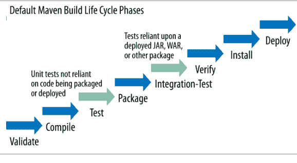
图 13-2. Maven 生命周期阶段

Maven 的构建生命周期是其促进项目统一性的多种方式之一。单元测试和集成测试默认包含在内。它们在流程中的逻辑节点执行，并生成可以发布到已知位置（Maven 站点）的报告。默认阶段提供了一个良好的基本框架，如果需要，Maven 可以扩展以处理其他测试方面。

Maven 可以在持续集成（CI）服务器调用时，作为构建过程的一部分定期执行应用程序的单元测试。有许多此类服务器可用，包括开源的 Jenkins 或商业产品如 Team City 或 Bamboo。CI 服务器也有助于推行标准的软件最佳实践。CI 服务器要求使用版本控制，鼓励正确维护 Maven 资产，并能快速揭示构建是否在合理时间内完成。

Maven 报告可以通过 CI 服务器发布到指定位置。这些报告提供了代码结构和质量的可视化。它们还使测试结果一目了然，包括编写的测试数量、测试结果、性能以及整体代码覆盖率等信息。


#### 100% 覆盖率的目标

一旦开始使用覆盖率报告，人们很容易将目标集中在 100% 的测试覆盖率上，而忽略了测试本身的价值。覆盖率工具仅仅是确定哪些代码路径被执行了。在实际操作中，某些代码路径可能永远不会被执行；而其他路径可能是不值得考虑测试的。因此，测试覆盖率并不代表测试质量。根据定义，测试只能证明问题的*存在*，而不能证明问题*不存在*。过分强调覆盖率报告的百分比可能会导致程序员做出一些对软件没有任何实质性益处的更改。

JUnit 的创建者意识到追求全面测试覆盖率与承认某些代码不需要测试之间的矛盾。他们在 FAQ 中引用了一句格言，就像许多高度主观的经验法则一样，它听起来很真实：
"测试直到恐惧变为无聊。"

一个组织可以通过在所有项目中使用带有 JUnit 测试的 Maven 并将每个项目添加到 CI 服务器，从而初步且相对快速地达到能力成熟度模型（CMM）的第 3 级。发布显示测试结果的报告有助于在开发团队之外就软件及其相关测试的状态进行清晰的沟通。虽然 Maven 具备编写手写文档的能力，但它并没有内置与需求或需求与构建的测试之间关系相关的机制。

通过*随时间推移*跟踪项目统计数据，可以实现更高层级的项目审查和流程改进。与代码复杂度、测试覆盖率、总代码行数、重复代码、注释出现次数以及编码规范违规相关的数据都是客观指标，可以使用像 SonarQube 这样的产品计算并存储在数据库中。这有助于识别表明代码库正在改善或恶化的趋势。

#### 采用 BDD 促进统一流程

非正式测试通常是为了寻找 Bug 或导致故障而进行的。此类测试可以被保留并定期运行，以确保问题以后不会再次出现。在构建时定期运行的一组单元测试可以成为应用程序持续支持中极其有效的安全网。但测试不应被孤立地看待，它们是软件开发其他方面的组成部分。思考一下 Steve McConnell 在 1993 年的 *Code Complete*（微软出版社）中出现的这段话："当你编写例程时，思考如何测试它。这在你进行单元测试以及独立测试你例程的测试人员看来都非常有用。"

需要注意的洞察力是，*在设计时测试*会带来更好的、结构更清晰的代码，更好的命名以及其他好处。这表明人们更加认可测试与软件开发生命周期（SDLC）其他阶段之间的紧密联系。它也预见到了更近期的软件测试实践。

*测试驱动开发*（TDD）将"在编写代码时思考测试"的想法推向了逻辑终点，即在编写相关代码之前先编写测试。具体来说，TDD 遵循这样一个循环：编写一个代表新需求的初始失败测试用例，随后通过编写、编码和重构使测试通过。

随后，Dan North 引入了*行为驱动开发*（BDD），以帮助开发人员更好地理解在 TDD 中从哪里开始、测试什么、在给定测试中放入什么以及如何命名。BDD 提供了一种叙事风格，弥合了代码与人类语言之间的鸿沟。TDD 对于创建测试的风格持开放态度，而 BDD 遵循 TDD 风格的工作流，但为行为规范提供了更正式的格式。

BDD 需要组织内部更多的个人承诺才能取得成功，但它解决了与获得更高 CMM 等级相关的几个领域。BDD 要求*跨*团队的参与和沟通。质量保证测试员、开发人员和业务分析师必须协调努力才能发挥作用。其益处在于构建了与需求直接挂钩并用通用、无歧义的共享语言表达的相关测试用例。

Maven 与成熟的测试框架相结合，为开发人员流程引入了连贯的组织和结构。引入 BDD 鼓励沟通和流程优化，其范围从开发人员扩展到参与测试、需求收集和定义的相关人员。

### 测试框架

测试方法往往被编入测试包中。JUnit 用于 Java 的单元测试，而 Jasmine 用于 JavaScript 的单元测试。JBehave 是一个用于 Java 的行为驱动开发框架，而 Cucumber 则是基于 Ruby 的。

### JUnit

JUnit 最初由 Erich Gamma 和 Kent Beck 编写。它已经从最初的简单形式成长为 JUnit 4 这种相当成熟的形式。在之前的版本中，单元测试属于特定的对象层级，并遵循方法命名约定才能正常工作。与 Java 生态系统中的许多项目一样，JUnit 4 严重依赖注解。例如，无需显式创建名为 `setUp()` 和 `tearDown()` 的方法，而是使用 `@before` 和 `@after` 注解在测试执行前后运行代码。`@beforeClass` 和 `@afterClass` 也可以用于在测试类实例化前后运行代码。`@Test` 注解取代了之前的方法"test"命名约定，而 `@Ignore` 指令可以取代将测试注释掉这种令人反感的做法。由于断言不再存在于对象层级中，通常需要静态导入断言类。断言还可以用于指定参数化测试或测试套件。

#### TestNG

近年来引起关注的另一个 Java 单元测试框架是 TestNG。目前它具有与 JUnit 类似的功能，但在 JUnit 具备之前，它就包含了一些特性（如参数化测试）。它还能够更好地管理测试*组*，这为有效的集成测试提供了所需的灵活性。一些开发人员也更倾向于 TestNG 的约定和注解使用方式，而非 JUnit。

单元测试通常使用与主应用程序相同的编程语言编写。这具有明显的优势，因为可以轻松地调用应用程序中特定的隔离方法或函数。随着单元测试的流行，它们在开发人员之间起到了一种使用文档的作用。对于"这个项目如何工作？"这个问题的常见回答是："看看单元测试。"不幸的是，编程语言无法帮助非编程人员清晰地理解系统如何运作。在许多情况下，即使是精通该语言的程序员，也无法从测试中推导出需求。

Jasmine 和 Cucumber 的编写目的是提供在很大程度上支持人类语言的 BDD 实现。Jasmine 使用 JavaScript 来指定测试，而 Cucumber 基本上是一个名为 Gherkin 的微型语言的解释器。Gherkin 是一种业务可读的 DSL，用于描述软件的行为。用于测试应用程序的实际编程语言代码被分离到外部文件中。

### Jasmine

Jasmine 使用 JavaScript 字符串和函数来表达需求。它小巧轻量，因此可以轻松包含在项目中，只需打开浏览器即可运行。测试的基本结构包括一个测试套件的描述，随后是包含预期（expectations）的块，这些预期本质上是返回 true 或 false 的断言。按照约定，它们位于名称中带有"Spec"的 JavaScript 文件中，通过打开包含依赖库的 `SpecRunner.html` 来调用：

```javascript
describe("Suite Title Here", function() {

  it("Expectation (assertion) Title Here", function() {

    expect(true).toBe(true);

  });

});
```

虽然确实更接近人类语言，但测试的格式仍然是 JavaScript，在未经训练的人看来，这就像是充斥着各种符号的人类语言。一个外行可能会问："为什么最后两行有悲伤的眨眼表情符号？"

### Cucumber

Cucumber 依赖于一种名为 Gherkin 的 DSL，它与人类语言非常相似。例如，`login.feature` 文件是一个结构化的文本文档，包含几个关键字和整齐的缩进：

```gherkin
Feature: Login

  As a user,

  I want to be able to log in with correct credentials
```


# Scenario: Success login

Given correct credentials

When I load the page

Then I should be able to log in

与 feature 中每一步对应的代码实现是分开维护的：

```ruby
Given(/^correct credentials$/) do
end

When(/^I load the page$/) do
  Capybara.visit(VALID_LOGIN_URL)
end

Then(/^I should be able to log in$/) do
  Capybara.page.has_content?('To NOT Do')
end
```

正则表达式用于匹配测试规范中的文本。Ruby 代码用于执行实际测试。在本示例中，`Capybara` 被用于浏览器自动化，以打开浏览器、访问 URL 并确定是否存在预期的内容。

> ### 摘自**《Cucumber 之书》 (The Cucumber Book)**
>
> Cucumber 通过为语言分歧的两方提供一个会面场所，有助于在团队内部促进通用语言的发现和使用。Cucumber 测试直接与开发者的代码交互，但它们是用业务相关者能够理解的媒介和语言编写的。通过共同编写这些测试——*协作指定 (specifying collaboratively)*——团队成员不仅决定了接下来需要实现什么样的行为，而且还学习了如何用一种每个人都能理解的通用语言来描述该行为。

测试框架可以直接调用，也可以由构建工具调用。本章中的项目包含了作为 Maven 构建一部分运行的测试示例。

## 项目

本章的项目演示了如何将 JUnit 和 Jasmine 测试集成到 Maven 项目构建中。它还包含使用 `Capybara` 调用 Selenium 的 Cucumber 测试，将其作为 BDD 应用于浏览器自动化功能测试的示例。

项目没有实现像“TODO 列表”应用程序那样常见且平凡的东西，而是由一个“To NOT do list”（不去做清单） Web 应用程序组成，如图 13-3 所示。此类应用程序可用于列出一个人打算停止做或避免做的事情。令人惊喜地清新且新颖，你不觉得吗？

该项目将演示在整个构建过程中如何从 Maven 调用各种测试框架。最终结果是一个包含已运行测试报告以及相关文档的站点。

### To NOT Do (不去做清单)

| 键 | 优先级 | 描述 | 最后更新 | |
| --- | --- | --- | --- | --- |
| | | | | 添加/更新 |
| 1 | 1 | 拖延 | 12/23/2013 08:06:15 | × |
| 2 | 1 | 制作更多清单 | 12/23/2013 08:06:23 | × |
| 3 | 2 | 用 cobol 编程 | 12/23/2013 08:06:52 | × |
| 4 | 2 | 使用 maven 调用 ruby 再调用 ant | 12/23/2013 08:07:46 | × |
| 5 | 3 | 盯着屏幕超过 10 分钟 | 12/23/2013 08:08:12 | × |
| 6 | 5 | 用 5 加仑的水桶喝咖啡 | 12/23/2013 08:08:45 | × |
| 7 | 4 | 在 http get 请求体中发送 json | 12/23/2013 08:11:04 | × |

图 13-3. To Not Do Web 应用程序

### JUnit

确定任何 Maven 项目配置的起点都是 *pom.xml*。依赖部分包含一个 JUnit 条目，其范围被限制为测试范围 (`test scope`)：

```xml
<groupId>junit</groupId>
<artifactId>junit</artifactId>
<version>4.11</version>
<scope>test</scope>
```

### Jasmine

就像将 JUnit 模块添加到 *pom.xml* 用于 Java 测试一样，还需要添加一个依赖项来支持 JavaScript 测试。Justin Searls 维护了本项目中使用的 Jasmine 插件：

```xml
<groupId>com.github.searls</groupId>
<artifactId>jasmine-maven-plugin</artifactId>
<version>1.3.1.3</version>
```

项目中包含的一个示例测试验证了依赖库的存在及其功能：

```javascript
describe("Validate moment.min.js", function() {
    it("expects moment.min.js to be functional", function() {
        expect(
            moment("20111031", "YYYYMMDD").
            format('MMMM Do YYYY, h:mm:ss a')
        ).toBe(
            "October 31st 2011, 12:00:00 am"
        );
    });
});
```

除了声明之前的 Maven 坐标外，还需要额外的配置来包含所使用的 JavaScript 文件。正确配置后，在执行 `mvn install` 时将运行测试：

```
...
[INFO]
J A S M I N E   S P E C S
[INFO]
Suite Title Here
  Expectation (assertion) Title Here
Validate moment.min.js
  expects moment.min.js to be functional
Results: 2 specs, 0 failures
...
```

在许多情况下，Jasmine 插件是一个完美的解决方案。然而，它无法执行浏览器特定的代码，这限制了其适用性。浏览器自动化更适合测试涉及大量 DOM 操作的需求。可以使用像 Selenium 这样的解决方案来驱动各种浏览器。浏览器自动化可以揭示每个浏览器独特的特性。Selenium 可以直接在 Java 单元测试中使用，但在许多情况下，自动化浏览器意味着更高级别的功能测试或集成测试。它在控制浏览器方面如此高效，以至于像 `Capybara` 这样更高级别的库将 Selenium 作为驱动实现。下面的 Cucumber 示例正是以这种方式使用 `Capybara` 的。

### Cucumber

`/ruby` 目录包含一个基于 Ruby 的 Cucumber 登录测试版本。`Gemfile` 列出了依赖项，而 *webapp_steps.rb* 包含处理 feature 文件中定义规范的代码。在一个 OS 会话中启动应用程序：

```
mvn jetty:run
```

在第二个会话中，运行 Cucumber：

```
cd ruby
cucumber
```

已指定的 feature 将运行，其输出反映了每个执行步骤的来源，如图 13-4 所示。

```
Cs-MacBook-Air:ruby cs$ cucumber
Feature: Login
  As a user,
  I want to be able to log in with correct credentials
  Scenario: Success login              # features/login.feature:5
    Given correct credentials           # features/step_definitions/webapp_steps.rb:18
    When I load the page                # features/step_definitions/webapp_steps.rb:22
    Then I should be able to log in     # features/step_definitions/webapp_steps.rb:26

Feature: WebService
  As a user,
  I want to be able to log in, add and and list the feature through the API
  Scenario: Success add/list           # features/webservice.feature:5
    Given correct credentials           # features/step_definitions/webapp_steps.rb:18
    When I add and list To Not Do items # features/step_definitions/webapp_steps.rb:32
    When the returned list should contain the item I added # features/step_definitions/webapp_steps.rb:37

2 scenarios (2 passed)
6 steps (6 passed)
0m3.912s
```

*图 13-4. Cucumber 运行结果*

### Maven 站点报告

本章中包含的 *pom.xml* 比本书中其他项目相关的 *pom.xml* 要长得多。许多依赖项和插件并非与核心应用程序相关，而是与测试相关。此外，许多配置选项用于填充 Maven 项目站点中的信息。

Maven Site 插件用于生成站点并在 8080 端口上运行：

```
mvn site:site
...
mvn site:run
```

Maven 的 `/site/` 目录可以包含各种资源以自定义站点。在图 13-5 中，添加了一个 *site.xml* 以使用自定义“皮肤 (skin)”为站点提供不同的风格。

#### ToNOTdo

最后发布日期：2013-12-23 | 版本：1.0-SNAPSHOT

- 项目文档
- 项目信息
  - 关于
  - 项目团队
  - 依赖信息
- 项目插件
- 持续集成
- 问题跟踪
- 源码仓库
- 项目许可证
- 插件管理
- 发布管理
- 项目摘要
  - 邮件列表
  - 依赖项
- 项目报告

#### 项目摘要

##### 项目信息

| 字段 | 值 |
| :--- | :--- |
| 名称 | ToNOTdo |
| 描述 | 一个用于跟踪你想避免或停止做的事情的应用程序。 |
| 主页 | - |

##### 项目组织

本项目不属于任何组织。

##### 构建信息

| 字段 | 值 |
| :--- | :--- |
| GroupId | com.saternos.tonotdo |
| ArtifactId | to-not-do-app |
| 版本 | 1.0-SNAPSHOT |
| 类型 | war |
| JDK 版本 | 1.6 |

图 13-5. To Not Do Maven 站点

## 结论

*软件*的可扩展性需要架构良好、可预测且高性能的系统。测试提供了确保开发此类系统的手段。单元测试、Maven 以及与持续集成相关的系统通过明确开发过程并使应用程序状态可见，促进了此类系统的创建。

*组织*的可扩展性需要定义明确的流程和清晰的沟通。上述相同的工具，结合 BDD 等方法，为团队带来了明确的社交效益，随后这将反馈到软件本身的质量中。

软件测试提供了基于科学方法以及在物理科学中不断完善的实践的客观支持。如果操作得当，它在证明应用程序的质量和性能，以及促进对需求如何实现达成共识方面，也具有巨大的实际价值。

# 第14章 结语

> *生命是一个分布式对象系统。然而，人类之间的沟通却是一个分布式超文本系统，其中思维的智性、声音+手势、眼睛+耳朵以及想象力都是组成部分。*
>
> —Roy T. Fielding

着手写一本书时，心中怀揣着一个总体的规划，然后回顾最终成果，这是件引人入胜的事。尽管与我最初的设想不同，但本书确实忠实于早期提出的主题——**变革**。引言部分指出，技术创新给世界带来了巨大的变革，并列举了几个明显的具体领域。如果说有什么变化的话，那就是近年来变革的速度一直在加快。一个大型项目在产品发布时，通常就已被视为遗留应用了。

试图理解所有新创新，或者完全无视它们，这种极端的反应显然是短视且徒劳的。更好的应对方式是识别哪些转变是真正具有重大意义的变革性力量。本书的旅程重点探讨了Java开发者在软件开发中遇到的一些需要仔细审视的领域。关于如何应对持续影响Web开发的地震级变化，两个基本的洞察来源是：更广泛的开发社区以及前几代人的智慧。

### 社区

其他编程社区的视角有很大不同，因此能够激发与Java开发社区所见不同的创新。总体而言，Java开发者根基深厚、地位稳固，且有些企业化。他们有许多东西需要向围绕JavaScript、Ruby、Python等成长起来的创新社区学习（同时也能为这些社区提供很多）。

许多伟大的想法广泛适用于其最初实现之外的领域。在一个场景中的新颖事物，在另一个场景中可能就是革命性的想法。

### 历史

第二个领域是培养对过去的意识。尽管现代文化倾向于不加批判地接受一切新事物，但更好的做法是保持对创新的开放态度，同时用更广阔的视野来评估它。计算机科学和软件发展的历史相对短暂但丰富。提出“面向对象”一词并领导Smalltalk开发的计算机科学家艾伦·凯（Alan Kay）指出，许多现代计算机科学和软件发展都倾向于成为流行文化的表现，不关心也不了解过去。许多最重要且持久的想法，其起源可以追溯到数年甚至数十年前。最好能站在巨人的肩膀上，尽可能从过去的错误中学习：

> 在过去大约25年里，我们实际上产生了一种类似流行文化的现象，类似于电视出现时发生的情况。当时电视的一些发明者认为，这是一种让莎士比亚走向大众的途径。但他们忘记了，理解莎士比亚需要更丰富的阅历和更广阔的视野。电视所能做到的，是捕捉到人们原本的样子。
>
> 所以我认为，今天缺乏真正的计算机科学，也缺乏真正的软件工程，部分原因在于这种流行文化。
>
> — 艾伦·凯

### 尾声

我希望你从这本书中学到了一两样东西。在软件开发领域工作，这是一个令人兴奋的时代，因为变革的时代就是充满前所未有机遇的时代。有大量的新技术，也有无穷无尽的问题可以应用这些技术。阅读本书并实践其中的项目，可以成为一步——希望对你来说是众多第一步中的第一步——这步将带来个人的成就感，并最终创造出能让世界变得更美好的系统。最后，我想与你分享伟大的数学家和教师乔治·波利亚（George Pólya）的一段思考，他虽然是知识分子，但也认识到解决问题所涉及的深刻的人性化和个人化维度，这同样适用于软件开发的创造性工作：

> 认为解决问题纯粹是“智力事务”是一个错误；决心和情感起着重要作用。在课堂上，面对常规问题，半心半意的决心和勉强同意做一点点可能就足够了。但是，要解决一个严肃的科学问题，需要能够经受住多年辛劳和苦涩失望的意志力……教会解决问题，就是意志力的教育。
>
> — 乔治·波利亚

# 附录A JRuby IRB 与 Java API

人机界面风格随时间而变化，这既取决于相关设备的性质，也受到一些相对任意趋势的影响。在20世纪90年代之前，命令行界面（或CLI）是与操作系统交互的主要方式。此后，它们被图形操作系统和视觉主导的互联网所掩盖。尽管外观相对朴素，但CLI因其提供而图形用户界面（GUI）不易获得的功能而依然流行。

CLI提供的交互模式反映了电传打字机（从用于发送打字消息的电报机演变而来的小玩意儿）的功能。CLI比相应的GUI更依赖用户的打字能力。这一局限性也是一个优势，因为CLI便于编写脚本。大多数程序员通过他们所使用的操作系统的命令行shell，对CLI都有一定的经验。当任务变得更复杂时，将一组命令打包成脚本是很简单的。这种能力催生了许多脚本语言，它们自己的CLI就是一种执行环境。

CLI也可以被称为REPL（读取-求值-打印循环）或语言shell。无论你怎么称呼它们，对于探索语言特性以及对运行给定表达式或命令的效果获得即时反馈来说，它们都是无价之宝。

虽然Java本身不包含CLI（`Beanshell`是最接近的等价物），但JVM上支持的许多语言都包含（但不限于）JRuby、Jython和Groovy。JVM语言与Java的紧密集成，使得通过每种语言的CLI与本地Java类和模块进行交互成为可能。这是一种显著不同的工作流程风格，在实验和调试时非常有帮助。本章将使用JRuby的IRB（交互式Ruby shell）通过JDBC连接到多个基于Java的数据库来执行SQL查询。

### 为什么不是IRS？

你可能想知道为什么Ruby没有将其命令行界面称为IRS（Interactive Ruby Shell）。Ruby程序的标准文件扩展名是`.rb`。因此，“Interactive”加上“RB”就构成了IRB。

### 使用Gradle设置

Gradle将用于下载以下脚本中使用的Java项目依赖项集合。请注意，这仅仅是为了方便；像Gradle这样的构建工具与CLI之间没有必然的联系。这个Gradle构建文件最初是使用`gradle setupBuild`生成的。生成的`build.gradle`文件包含了与使用相关的注释。然后对该文件进行了修改，以包含所需的模块以及相关的插件和它们托管的仓库：

```gradle
apply plugin:'java'
apply plugin:'application'
repositories{mavenCentral()}
dependencies{
    compile 'org.slf4j:slf4j-api:1.7.5'
    compile 'hsqldb:hsqldb:1.8.0.10'
    compile 'com.h2database:h2:2.1.3.172'
    compile 'net.sf.opencv:opencv:2.3'
    compile 'commons-io:commons-io:2.4'
}
```


`compile 'org.apache.derby:derby:10.10.1.1'`

`testCompile 'junit:junit:4.11'`

定义好构建文件后，就可以使用`gradle build`来构建项目。必要的JAR文件将被添加到你的本地仓库中。再次强调，此任务并非必须使用Gradle。你也可以使用Maven，或者甚至手动定位并下载每个使用的JAR。选择Gradle是因为其语法最小化（相对于Maven），并且手动下载文件容易出错且乏味。

### JRuby IRB

因为以下示例使用了Java类（数据库实现和JDBC），所以需要一个基于Java的Ruby版本。其他实现将无法工作。如果你使用RVM，安装JRuby（如果需要）并选择使用它：

```bash
$ rvm use jruby 1.7.4
```

如果尚未安装bundler gem（本示例使用版本1.3.5）。安装完成后，运行`bundle init`创建bundler使用的Gemfile。添加以下三行代码：

```
gem 'jdbc-derby', '10.9.1.0'
gem 'jdbc-h2', '1.3.170.1'
gem 'jdbc-hsqldb', '2.2.9.1'
```

这些gem封装了JRuby使用的JDBC驱动。运行`bundle`安装这些Ruby依赖。

我们已经了解了通过Gradle管理Java依赖、通过bundler管理JRuby依赖的方式。也可以直接从JRuby中引用Java JAR文件。为方便起见，可将JAR文件（包含在Gradle初始化中）复制到当前目录下的lib目录。该文件位于本地Gradle仓库中：

```
$ find ~/.gradle -name opencsv-2.3.jar
$ mkdir lib
$ cp <通过find命令找到的jar文件路径>opencsv-2.3.jar lib
```

JAR文件将通过JRuby中的`require`关键字访问（该关键字通常用于导入Ruby文件）。

## IRB简介

登录IRB后将看到命令提示符。具体提示符会因Ruby版本而异：

```
$ irb
jruby-1.7.4 :001 >
```

在此提示符下，可以输入表达式并立即查看其求值结果：

```
2.0.0-p247 :001 > 1 + 4
=> 5
```

还可以检查对象并了解其提供的功能。Java中的反射允许探索和操作对象，但语法冗长复杂。相比之下，Ruby提供了直接动态查询和修改对象的方式。它以其元编程能力著称，因其在此方面的灵活性而广为人知：

```
2.0.0-p247 :002 > "Hello World".class
=> String
2.0.0-p247 :014 > "Hello World".methods.grep(/sp/).sort
=> [:display, :inspect, :respond_to?, :split]
2.0.0-p247 :021 > "Hello World".split
=> ["Hello", "World"]
```

后续示例中将省略提示符和结果。但执行命令后立即获得的反馈正是`irb`交互的核心价值，需亲身体验方能完全领会。

在前面的示例中，`Hello World`是一个字符串（未赋值给任何变量）。它拥有大量可用方法，示例使用`grep`过滤并排序包含`sp`的方法。最后，通过这种方式找到方法后，实际上可以在对象（`Hello World`字符串）上调用它并查看效果。这种方法虽不能替代查阅文档，但确实使许多原本需要的查询变得不必要。

## 基于Java的关系数据库

在`irb`会话中，现在可以探索几个基于Java的关系数据库提供的API。如果曾经编写过使用JDBC的Java类，无疑会记得需要大量样板代码。除了标准Java要求（定义带main方法的类），还需要编写大量与异常处理相关的代码（导入语句、方法声明中的throws子句、try/catch块）。再加上显式类型声明、少量输出和注释所需的额外语法，一个看似简单的类可能变得相当臃肿。幸运的是，Ruby语法简洁，交互式环境使得轻松测试驱动API成为可能。

我们将探讨的三种数据库是H2、HSQLDB和Derby。它们从外部看相似，但在具体实现和存储机制、性能以及开源许可选项上存在差异。每种数据库都可通过JDBC访问，在`irb`会话中我们将测试每种可用的SQL语句类型，如表A-1所示。

表A-1. SQL语句类型

| 类型 | 示例 | 描述 |
| :--- | :--- | :--- |
| 查询 | SELECT | 检索数据 |
| DDL | CREATE, DROP | 数据定义语言（创建、修改或替换数据库对象） |
| DML | INSERT, UPDATE, DELETE | 数据操作语言（修改数据） |

实际上，数据库之间存在一些细微差异，这些差异只有在实际交互时才会显现（如SQL语法、连接字符串和结果集关闭方式）。

为使示例更简洁，可将每个示例所需的通用代码添加到文件中，并在`irb`内注入。包括使Java可用、加载opencsv JAR（用于快速将结果集渲染为逗号分隔值）的代码，以及执行SQL（查询、DML和DDL）和显示SQL结果集的函数：

```
require 'java'
require 'lib/opencsv-2.3.jar'

TEMP_FILE="temp.csv"

def displayResultSet(r)
    writer = Java.AuConBytecodeOpencsv::CSVWriter.new(
        java.io.FileWriter.new(TEMP_FILE),
        java.lang.String.new("\t").charAt(0)
    )
    writer.writeAll(r, true)
    writer.close()
    File.open(TEMP_FILE).readlines.each{|line|puts line}
    `rm #{TEMP_FILE}`
end

def exec(statement, conn)
    puts statement
    conn.createStatement().execute(statement)
end

def execQuery(statement, conn)
    puts statement
    conn.createStatement().executeQuery(statement);
end
```

该文件实际上通过运行`load 'dbutils.rb'`加载到环境中。

### H2

Thomas Mueller创建了H2，同时也深度参与了HSQLDB的开发。以下示例中，使用用户名sa和空密码连接到名为test的数据库，然后执行SQL语句。另请注意，创建表时name列未指定VARCHAR长度：

```
load 'dbutils.rb'
require 'jdbc/h2'
Jdbc::H2.load_driver
conn = java.sql.DriverManager.getConnection('jdbc:h2:test', "sa", "")

#### VARCHAR不需要指定长度
exec("CREATE TABLE test (id int, name varchar)", conn)
exec("INSERT INTO test(id, name) VALUES (1, 'a')", conn)
displayResultSet(execQuery('select * from test', conn))
exec("DROP TABLE test", conn)
conn.close()
```

### HSQLDB

HSQLDB因其包含在OpenOffice等开源项目以及Mathematica等商业产品中而闻名。与H2不同，获取连接时不需要用户名和密码，但name列需要指定VARCHAR长度：

```
load 'dbutils.rb'
require 'jdbc/hsqldb'
Jdbc::HSQLDB.load_driver
conn = java.sql.DriverManager.getConnection('jdbc:hsqldb:test')
exec("CREATE TABLE test (id int, name varchar(10))", conn)
exec("INSERT INTO test(id, name) VALUES (1, 'a')", conn)
displayResultSet(execQuery('select * from test', conn))
exec("DROP TABLE test", conn)
conn.close()
```

### Derby

Derby是Apache项目，其历史可追溯至1990年代。它经历了CloudScape、Informix和IBM等不同阶段。自Java 6起，Sun（后被Oracle收购）将Derby包含在JDK中作为Java DB。JDBC连接字符串中的`create=true`属性表示在请求连接时如果数据库不存在则创建。此外，Derby要求在删除引用结果集的表之前显式关闭该结果集：

```
load 'dbutils.rb'
require 'jdbc/derby'
Jdbc::Derby.load_driver
conn = java.sql.DriverManager.getConnection('jdbc:derby:test;create=true')
exec("CREATE TABLE test (id int, name varchar(10))", conn)
exec("INSERT INTO test(id, name) VALUES (1, 'a')", conn)
r = execQuery('select * from test', conn)
displayResultSet(r)
r.close()
exec("DROP TABLE test", conn)
conn.close()
```

尽管前面的示例聚焦于关系数据库，但显然*任何*Java库都可以通过脚本访问，并使用类似过程进行探索。

## 结论

CLI提供的即时反馈使其成为特别有效的工具，尽管图形方法日益普及。脚本可通过CLI内的迭代实验构建，此过程不仅消除了传统的构建步骤，甚至无需专门执行源文件。许多开发者熟悉此类交互，但专注于Java的开发者可能接触有限。现代Web浏览器中可用的JavaScript控制台是CLI的现代实现，如本章所示，只需少量初始设置，Java程序员即可进行类似的服务器端处理。

## 附录 B

RESTful Web API 总结

### HTTP 1.1 请求方法

表 B-1 总结了 HTTP 1.1 请求方法。

**表 B-1. HTTP 1.1 请求方法**

| HTTP 谓词 | 对资源的操作 | REST 操作 |
| :--- | :--- | :--- |
| GET | 检索 | 类似于 SQL SELECT |
| HEAD | 检索但不包含响应体 | 类似于 SQL SELECT 1 |
| POST | 创建（或追加） | 类似于 SQL INSERT |
| PUT | 更新（或创建）完整资源 | 类似于 SQL UPDATE（如果不存在则为 INSERT） |
| PATCH | 部分更新 | 类似于 SQL UPDATE（资源的某一部分） |
| DELETE | 删除 | 类似于 SQL DELETE |
| TRACE | 回显请求 | 用于确定中间服务器所做更改的诊断 |
| OPTIONS | 返回支持的方法 | 确定该资源允许哪些 HTTP 方法 |
| CONNECT | 支持 HTTP 隧道 | 支持 HTTP 隧道 |

### HTTP 1.1 响应代码

表 B-2 至 B-6 总结了 HTTP 1.1 状态码。

**表 B-2. 信息性状态码 1xx**

| 代码 | 含义 | 描述 |
| :--- | :--- | :--- |
| 100 | Continue | 中间响应，表明请求的一部分已被接收（且尚未被服务器拒绝） |
| 101 | Switching Protocols | 服务器正在切换到响应 Upgrade 头部定义的协议 |

**表 B-3. 成功状态码 2xx**

| 代码 | 含义 | 描述 |
|---|---|---|
| 200 | OK | 已接受 |
| 201 | Created | 新资源正在被创建 |
| 202 | Accepted | 已接受，但处理尚未完成 |
| 203 | Non-Authoritative Information | 实体头部返回的元数据是子集或超集 |
| 204 | No Content | 不包含响应体 |
| 205 | Reset Content | 客户端应发起请求以查看与初始请求相关联的资源 |
| 206 | Partial Content | 对包含范围头部（range header）请求的响应 |

**表 B-4. 重定向状态码 3xx**

| 代码 | 含义 | 描述 |
|---|---|---|
| 300 | Multiple Choices | 资源在不同位置有多种表示形式 |
| 301 | Moved Permanently | 资源已被分配一个新的永久 URI |
| 302 | Found | 资源已被分配一个新的临时 URI |
| 303 | See Other | 对请求的响应在另一个 URI 下可用 |
| 304 | Not Modified | 对条件 GET 请求的响应，其中文档未被修改 |
| 305 | Use Proxy | 请求的资源可通过返回的代理 URI 访问 |
| 306 | (Unused) | 在当前 HTTP 版本中未使用 |
| 307 | Temporary Redirect | 请求的资源暂时位于另一个 URI 下 |

**表 B-5. 客户端错误状态码 4xx**

| 代码 | 含义 | 描述 |
|---|---|---|
| 400 | Bad Request | 请求无法理解 |
| 401 | Unauthorized | 请求未授权 |
| 402 | Payment Required | 为未来使用预留 |
| 403 | Forbidden | 请求不允许（即使有额外的授权） |
| 404 | Not Found | 资源未找到 |
| 405 | Method Not Allowed | 指定 URL 不支持该 HTTP 方法 |
| 406 | Not Acceptable | 资源可以使用 accept 头部中指定的内容生成 |
| 407 | Proxy Authentication Required | 请求未授权（需要通过代理进行身份验证） |
| 408 | Request Timeout | 客户端未在服务器指定的时间内发起请求 |
| 409 | Conflict | 由于资源的当前状态（例如由于 PUT 导致更改）导致请求未完成 |
| 410 | Gone | 资源不再可用 |
| 411 | Length Required | 需要 Content-length 头部 |
| 412 | Precondition Failed | 请求头字段中的前提条件评估为假 |
| 413 | Request Entity Too Large | 请求实体大于服务器指定的阈值 |
| 414 | Request-URI Too Long | 请求 URI 长于服务器指定的阈值 |
| 415 | Unsupported Media Type | 不支持的格式 |
| 416 | Requested Range Not Satisfiable | 头部中指定的内容范围无法处理 |
| 417 | Expectation Failed | 请求头字段中的预期未满足 |

**表 B-6. 服务器错误状态码 5xx**

| 代码 | 含义 | 描述 |
|------|---------|-------------|
| 500 | Internal Server Error | 服务器出现意外错误情况 |
| 501 | Not Implemented | 不支持该功能 |
| 502 | Bad Gateway | 作为代理的服务器从上游服务器收到无效响应 |
| 503 | Service Unavailable | 由于临时情况，服务器不可用 |
| 504 | Gateway Timeout | 作为代理的服务器未及时收到上游服务器的响应 |
| 505 | HTTP Version Not Supported | 不支持请求消息中的 HTTP 协议版本 |

### Web API 的 Curl 工具

[Curl](https://curl.haxx.se/) 工具可以使用多种不同的协议将数据传输到服务器或从服务器传输数据。对于大多数与 HTTP 上的 RESTful Web API 相关的操作，只需少部分命令行选项即可，如表 B-7 所示。

**表 B-7. 选定的 HTTP 相关 Curl 选项**

| 选项 | 短名称 | 描述 |
|--------|-----------|-------------|
| -H | Header | 指定 HTTP 头部 |
| -d | Data | 将指定的字符串数据发送到服务器 |
| -s | Silent option | 不显示进度表或错误消息 |
| -L | Location | 如果服务器响应位置头部和 3xx 响应代码，则在新位置重新发起请求（使用 --max-redirs 限制重定向次数） |
| -X | Execute option | 指定 HTTP 请求方法 |
| -A | Agent | 指定用户代理 (User Agent) |
| -b | Cookie | 指定 cookie（使用 --cookie 比 -b 更容易记住） |
| -o | Output | 输出到文件（或使用 -O 将其写入与请求的远程文件同名的文件中） |

调用示例：


执行以下`curl`命令，向`http://localhost:8080/hello/world`发送`PUT`请求，并携带JSON数据`{"hello": "world"}`：

```
curl -s -H "Accept: application/json" \
     -H "Content-Type: application/json" \
     http://localhost:8080/hello/world \
     -X PUT -d '{"hello": "world"}'
```


## JSON 语法

JSON 是一种简单的资料交换格式，它是 JavaScript 的一个子集。

## JSON 类型

- 数组（Array）（有序的、由逗号分隔的值，包含在方括号中）
- 对象（Object）（无序的、由逗号分隔的键值对集合）
- 数字（Number）
- 字符串（String）
- 布尔值（Boolean）
- 空值（Null）

## 铁路图（Railroad Diagrams）

以下[铁路图](.)对构成 JSON 数据交换格式的 JavaScript 子集给出了更正式的描述。

### 对象

JSON 对象是一组零个或多个具有关联值的字符串对，包含在花括号中。每个字符串后面跟着一个冒号，然后是其关联的值。如果有多对字符串-值，则用逗号分隔。见图 B-1。


*图 B-1. 对象*

### 数组

JSON 数组是一个由逗号分隔的值列表，包含在方括号中。见图 B-2。


*图 B-2. 数组*

### 值

值可以是字符串、数字、对象、数组、`true`、`false`或`null`。见图 B-3。

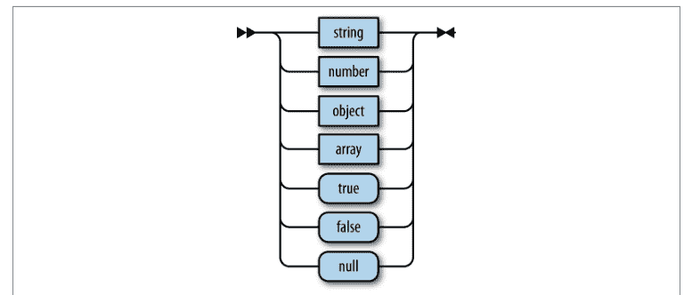

*图 B-3. 值*

# 附录 C

## 参考文献

Barrett, Daniel J. *Linux Pocket Guide, Essential Commands*. Sebastopol: O'Reilly Media, 2004.

Burke, Bill. *RESTful Java with JAX-RS*. Sebastopol: O'Reilly Media, 2009.

Crockford, Douglas. *JavaScript: The Good Parts*. Sebastopol: O'Reilly Media, 2008.

Fogus, Michael, and Chris Houser. *The Joy of Clojure*. Stamford: Manning Publications, 2011.

Hashimoto, Mitchell. *Vagrant: Up and Running*. Sebastopol: O'Reilly Media, 2013.

McConnell, Steve. *Code Complete: A Practical Handbook of Software Construction*. Redmond: Microsoft Press, 2004.

Pólya, George. *How to Solve It: A New Aspect of Mathematical Method*. Princeton: Princeton Science Library, 2004.

Resig, John and Bear Bibeault. *Secrets of the JavaScript Ninja*. Stamford: Manning Publications, 2012.

Sonatype Company. *Maven: The Definitive Guide*. Sebastopol: O'Reilly Media, 2008.

Thomas, Dave, with Chad Fowler and Andy Hunt. *Programming Ruby*. The Pragmatic Programmers, LLC, 2004.

Wynne, Matt, and Aslak Hellesøy. *The Cucumber Book: Behaviour-Driven Development for Testers and Developers*. The Pragmatic Programmers, LLC, 2010.

Zakas, Nicholas Z. *Professional JavaScript for Web Developers*. Indianapolis: Wrox Press, 2005.

# 索引

## 符号

- `$`（jQuery 对象）, 140

## A

- 抽象级别（abstraction level）, 137
- `Accept`响应头, 40
- 验收测试（acceptance testing）, 198
- 动作（actions）, 127
- 临时测试（ad hoc testing）, 198
- 自适应布局（adaptive layout）, 78
- 敏捷方法论（agile methodology）, 110
- Ajax, 143
- Algermissen, Jan, 49
- 亚马逊弹性计算云（Amazon Elastic Compute Cloud/Amazon EC2）, 186
- 亚马逊机器镜像（Amazon Machine Image/AMI）, 186
- 分析瘫痪（analysis-paralysis）, 110
- Angular, 85, 155
- Angular Seed, 81, 156
- Angular-UI, 81
- 注解（annotations）, 133
- 匿名函数（anonymous functions）, 18, 21
- Ansible, 187
- Ant, 60
- Apache Ant, 60
- Apache Web 服务器, 90

### API（应用程序编程接口）

- 开源的优势, 9
- 设计方法, 123
- 设计指南, 127–131
- 实际应用 vs. RESTful, 125, 135
- 项目示例, 131–135
- 向客户端-服务器方法的转变, 124

- Applets, 43, 48
- 应用程序客户端模块, 168
- 应用程序需求, 76
- 应用程序可扩展性, 200, 210
- 应用程序服务器, 92, 107, 168
- `apply()`方法, 22
- 参数变量（argument variable）, 22
- 数组（arrays）, 225
- 产出物（artifacts）, 186
- 人工智能, 123
- 资源流水线/编译器（asset pipelines/compilers）, 84
- 异步模块定义（AMD）API, 27
- Atom 聚合格式（Atom Syndication Format）, 46
- 属性（attributes）, 158, 199

## B

- Backbone Boilerplate, 81
- Bamboo, 201
- Beanshell, 213
- 行为驱动开发（BDD）, 31, 65, 203
- 黑盒测试, 199
- 块级作用域（block-level scope）, 17

> 我们希望听到您关于改进索引的建议。请发送电子邮件至 `index@oreilly.com`。

- BOM（浏览器对象模型）, 14
- Bootstrap, 79
- 底部值（bottom values）, 27

### 浏览器

- 避免刷新, 105
- 清除缓存, 30
- 跨浏览器兼容性, 143
- 用于 JavaScript 开发, 29
- 在客户端框架中, 76
- JavaScript 兼容性库, 79
- 同源策略（same origin policy）, 45

- 构建者（builders）, 186
- BuiltWith, 81

## C

- 可缓存性（cacheability）, 42
- 缓存（caching）, 84
- `call()`方法, 22
- 驼峰命名法（camel case）, 131
- 能力成熟度模型（CMM）, 200
- Capistrano, 180
- CDN（内容分发网络）, 53, 84
- cfingene, 180, 187
- Chaos Monkey, 121, 199
- Chef, 187
- Chrome, 30
- Chrome 插件, 105

### 类（classes）

- JavaScript vs. Java, 23
- 将名词作为类, 127
- 经典继承（classical inheritance）, 23

- `CLASSPATH`条目, 63

### 客户端-服务器 Web 应用程序

- 优势：
  - 应用程序性能, 9
  - 代码组织, 8
  - 开发人员效率, 9, 109
  - 开源 API, 9
  - 原型设计, 9
  - 软件架构, 8
  - 与 Web 架构的一致性, 5–7
- 挑战, 10
  - SOAP 在此方面的缺陷, 38
  - 开发背后的驱动力
  - 概述, 1
  - 软件开发, 4
  - 技术, 3
  - Web 用户, 2
- 转变的历史, 124
- 相关技术, 124
- 对比服务器驱动（server-driven）, 7

### 客户端框架

- Angular, 155
  - 资源流水线, 84
  - 客户端模板, 83
  - 开发工作流, 85, 88

### JavaScript 库/框架

- 更多选项, 81
- 浏览器兼容性, 79
- GitHub 资源, 82
- 最流行的, 81
- MV* 框架, 80
- 简洁性, 79
- jQuery, 140
- 概述, 75
- 项目示例, 85

### 响应式 Web 设计（RWD）

- 组成部分, 78
- 概念, 77
- HTML5 样板（boilerplate）, 78
- Twitter Bootstrap, 79

### 启动项目（starter projects）

- 应用程序需求, 76
- 浏览器考虑因素, 76
- 需考虑的构建块, 75
- 设计/灵活性考虑因素, 76
- GitHub 资源, 82
  - IDE 生成的, 83
  - 初始选择的影响, 77, 116
  - 仓库下载, 82
  - 启动站点下载, 82

- Clojure, 71, 73
- Close, Tyler, 49
- 闭包（closures）, 21

### 基于云的环境

- JEE 部署与此相关, 170
- 在其中维护状态, 10
- 复杂程度, 118
- 在其中进行测试, 199

- 集群（clustering）, 180
- 代码编译, 24, 31, 58, 84
- 代码理解, 57
- 代码编辑器, 120
- 按需代码（code on demand）, 43

### 代码组织

- 文件间依赖关系, 27
- 模块化方法, 8
- JavaScript 中的编码风格, 29

- 命令行管理, 173
- 命令行界面（CLIs）, 213
- JSON 中的注释, 45
- 基于组件的 Web 开发之缺陷, 8, 50
- “被认为有害”的文章（considered harmful essays）, 8
- `console.log`, 26
- 构造函数（constructors）, 22
- 容器技术, 188
- `Content-Type`响应头, 40
- 持续集成（CI）流程, 63, 201
- 持续软件部署, 63
- 控制器（controllers）, 86, 156
- 约定（conventions）, 22
- Crockford, Douglas, 44
- 跨浏览器兼容性, 143
- 跨源资源共享（CORS）, 39, 45

### CSS（层叠样式表）

- CSS 选择器, 141
- CSS3 媒体查询, 78
- 使用 jQuery 修改, 142
- `normalize.css`, 78
- 预处理, 84

- Cucumber, 205, 209

### Curl 工具

- HTTP 相关选项, 223
- 使用 Curl 的项目示例, 134
- 如何使用, 51

### 部署

- 自动化部署, 180
- 方法选择的影响, 178
- JEE 部署, 169–174
- 非 JEE 部署, 174–177
- 部署打包方案, 89
- 项目示例, 181
- 部署扫描器, 174

- Derby 数据库, 218
- 开发人员效率, 109

### 开发最佳实践

- 浏览器, 29
- 编码风格/约定, 29
- 集成开发环境（IDE）, 30
- 在线协作站点, 30
- 单元测试, 31

- 特定设备开发, 90
- DevOps 配置管理工具, 187
- 指令（directives）, 158
- 分布式认知（distributed cognition）, 57
- Docco, 31, 34, 85
- Docker, 189, 191

### 文档

- 自动生成选项, 31
- 设计指南, 131
- 文档的不足, 57

- 美元符号（$）, 140

### DOM（文档对象模型）

- 基础知识, 14
- DOM vs. 模型操作, 157
- 用于操作 DOM 的框架, 80
- 语言无关性, 26
- 使用 jQuery 进行操作, 141

- 领域特定语言（DSL）, 60, 137, 153, 165
- Dox, 31
- Dropwizard, 105
- Dubochet, Giles, 57
- 邓宁-克鲁格效应（Dunning–Kruger effect）, 15
- `dust.js`, 84
- 动态类型语言, 59

## D

- Dart, 83
- 数据属性（data attributes）, 158
- 数据交换格式, 44

### 数据库

- 集中式 vs. 开发人员维护, 122
- Derby 数据库, 218
- H2 数据库, 217
- HSQLDB, 218
- REST vs. CRUD 命令, 39
- SQL 语句类型, 216

- 调试（debugging）, 92（另见测试）
- 演绎推理 vs. 归纳推理, 123
- `DELETE`, 39
- 依赖关系, 27
- 依赖注入框架, 90
- 依赖管理, 61, 151
- 部署器（deployers）, 170

## E

- EAR（企业应用程序归档）, 89
- Eclipse, 60

### ECMAScript 语言规范

- I/O 功能, 25
- Web 脚本语言, 13

- 效果, 142
- EIS（企业信息系统）, 168
- EJB 模块, 168
- Ember Starter Kit, 81
- 企业归档（EAR）文件, 168
- 实体（entities）, 127
- ERD（实体关系图）, 127
- ETag HTTP 响应头, 84, 130
- `eval()`, 45
- 事件处理, 143
- 执行环境, 24
- 穷尽测试（exhaustive testing）, 199
- 表达式（expressions）, 20, 86, 156

## F

- Fabric, 180
- 淡出效果, 142
- Failsafe 插件, 201
- Fiddler, 54
- Fielding, Roy, 38, 47

### 文件系统

- 文件间依赖关系, 27
- JavaScript vs. Java 的组织方式, 26

- 过滤, 129, 149
- Firebug, 29
- Firefox, 29
- 一等函数（first-class functions）, 18
- 固定点样式（fixed-point styling）, 78
- 灵活图像（flexible images）, 78
- 流式网格（fluid grids）, 78
- 正式测试, 198
- 格式化, 131
- Fowler, Martin, 61, 65
- 前端工程师, 83
- FRP（函数响应式编程）, 144
- 全虚拟化, 183
- 函数级作用域, 17
- 函数式语言，定义, 17, 20
- 函数式编程，与 REST 的相似之处, 49

### 函数

- 匿名函数, 18, 21
- 函数参数, 22
- 一等函数, 18
- 函数声明, 20
- 立即执行函数, 21
- 函数调用, 22
- 工具函数（utility）, 142

## G

- gems, 152
- `GET`, 39
- GitHub 仓库, 81, 82
- 全局作用域, 28
- Google Trends, 81
- Gradle, 60, 214
- 网格（grids）, 78
- Groovy, 60, 71
- GUI 管理, 171

## H

- H2 数据库, 217
- HATEOAS（超媒体作为应用程序状态的引擎）, 42, 46, 58, 124, 130
- `HEAD`, 39

### 响应头

- `Accept`, 40
- `Content-Type`, 40
- 设计指南, 130

### HelloWorld.java 示例

- 创建, 23
- 执行, 24
- 文件系统组织, 26
- 包含变量, 27

- 变量提升（hoisting）, 17
- 水平可扩展性, 9, 41, 178
- 主机对象（host objects）, 25
- `href`链接, 46
- `hreflang`链接, 46
- HSQLDB 数据库, 218

### HTTP 1.1 请求方法

- 对应的数据库操作, 39
- `HEAD` vs. `GET`, 39
- `OPTIONS`, 39
- 汇总, 221

### HTTP 1.1 状态码

- 客户端错误（4xx）, 222
- 设计指南, 130
- 信息性（1xx）, 221
- 概述, 43
- 重定向（3xx）, 222
- 服务器错误（5xx）, 223
- 成功（2xx）, 222

- 超媒体（hypermedia）, 42, 46
- 连字符 vs. 下划线, 40

## I

- I/O（输入/输出）功能，JavaScript 中缺乏，25
- IDEs（集成开发环境），30
- `if`条件表达式，18
- 图像，78，189
- 立即函数，21
- 归纳与演绎推理，123
- 非正式测试，198
- 继承，传统继承与原型继承，23
- 注入器，156
- Intellij，60
- Internet Explorer，26
- 解释型语言，24
- IRB（交互式 Ruby Shell），151，213–218
- 迭代，112

## J

- J2EE，90，167
- Jackson，96，92
- James Ward 插件，105
- Jammit，84
- JARs（Java 归档文件）
  - 压缩，168
  - 创建，167
  - 通过 Maven 声明式识别，63
  - 通用代码，89
- Jasmine，31，32，205，207
- Java
  - 构建工具
    - 选择，61
    - Maven，63
    - 单元测试，65
  - 版本控制系统（VCS），65
  - 使用挑战，58
  - 编译过程，58
- Java Enterprise Edition，89，167，169
- Java Virtual Machine（JVM），58，105，138
- 基于 Java 的服务器
  - Dropwizard，105
  - 嵌入式 Jetty 服务器，100
  - 嵌入式 Netty 服务器，100
- Java HTTP 服务器，92
- Ply 服务器，103
- Restlet API，95
- Roo，96
- 服务器处理类，91
- JSON Java 库，66
- 打包格式，168
- 打包范式，89，167
- 使用 JSON 的项目示例，66
- 工具概述，60
- Java API，213–218
- Java Applets，43，48
- Java Virtual Machine（JVM）
  - 优势，138
  - 编译过程，59
  - 基于 JVM 的服务器，105
  - 支持的操作系统/语言，58
  - 部分虚拟化，185
  - 项目示例，69
  - 脚本接口，59
- 基于 Java 的关系型数据库
  - Derby，218
  - H2，217
  - HSQLDB，218
  - SQL 语句类型，216
- Javadoc，31
- JavaScript/JavaScript 工具
  - 浏览器对象模型（BOM），14
  - 开发最佳实践
    - 浏览器，29
    - 编码风格/规范，29
    - 文档，31
  - 集成开发环境，30
    - 在线评论解决方案，30
    - 单元测试，31
  - 文档对象模型（DOM），14
  - ECMAScript 语言规范，13
  - 项目示例，31
  - 功能特性
    - 函数式定义，20
    - 一等函数，18
  - 函数参数，22
  - 函数声明与表达式，20
  - 函数调用，22
  - 对象，23
  - 作用域，17
  - 历史，15
  - 库/框架
    - 额外选项，81
    - 浏览器兼容性，79
    - GitHub 资源，82
    - 最受欢迎的，81
    - MV* 框架，80
    - 简洁性，79
  - 学习资源，14，35
  - 与 Java 应用程序对比
    - HelloWorld.java 示例，23
    - 带变量的 HelloWorld.java，27
- JAX-RS 注解，133
- JBehave，65
- JBoss，168，171
- Jenkins，201
- Jersey，131
- JetBrains，83
- Jetty，93
- JMock，65
- jQuery，79，134，137，140–144，156
- jQuery 对象（$），44
- jQuery UI，81
- JRuby，51，150–155，150
- JRuby IRB，151，213–218
- Jsdoc，31
- JSLint，26
- JSON（JavaScript Object Notation）与 REST，47
  - 数组，225
  - 优势与不足，45
  - 命令行格式化，99
  - 注释，45
  - Crockford 的描述，44
  - Java 库，56
  - 模拟服务器响应，107
  - 对象，224
  - 美观打印格式化，131
  - 使用 JRuby 处理，154
  - 铁路图，224
  - 类型，224
  - 值，225
- JUnit，204，207
- Jython，110，106，138–140，144

## K

- Karma，31，85

## L

- 语言无关操作，26
- 延迟，84
- 分层设计，42
- LESS CSS Maven 插件，85
- 库
  - 开源库的优势，9
  - JavaScript 库/框架
    - 额外选项，81
    - 浏览器兼容性，79
    - GitHub 资源，82
    - 最受欢迎的，81
    - MV* 框架，80
    - 简洁性，79
  - JSON Java 库，66
  - 服务器库，90
- 链接，39，46，129，130
- LinuxContainer（LXC），189
- 文学编程，31
- Lo-dash，80
- 负载均衡，178
- 逻辑运算符，18
- 松散类型，28

## M

- 机器学习，123
- `make`编程工具，61
- 映射，58
- Maven，60–62，66，201，209
- 媒体查询，78
- 中等特异性，6
- 消息，自描述性，42
- 方法
  - 基础，21
  - 确定可用方法, 39
  - 使用方法调用函数, 22
- Microsoft 的 Internet Explorer，26
- Mockito，65
- 建模系统，127
- 模型，155–157
- Modernizr，79
- 模块，168
- MV* 框架，80，155
- MVC（Model-View-Controller）框架，80
- MVP（Model-View Presenter）框架，80
- MVVM（Model-View-ViewModel）框架，80

## N

- 命名规范，131
- NetBeans，60
- Netflix 的 Chaos Monkey，121，199
- Netty，100
- 网络延迟，84
- Node.js 样板代码，83
- 非功能性属性，199
- `normalize.css`, 78
- 名词，127
- `null`值，18

## O

- 面向对象系统，50，58，144
- 对象关系管理（ORM），39
- 对象
  - 附加到函数，21
  - 基础，23
  - 宿主对象，25
  - JSON 中的语法，224
- Open Virtualization Format（OVF），186
- 开源 API，9
- 操作系统级虚拟化，188
- `OPTIONS`，39
- 组织成熟度，199
- 组织可扩展性，200，210

## P

- 包，152，167
- 打包
  - 打包注意事项，89
  - JAVA/JEE，167
- Packer，186
- 分页，129
- 参数，128
- 路径依赖，77
- 路径元素，40
- 个人云，2
- PhoneGap，76
- Play Framework，103
- Ply，84
- POJO（普通 Java 对象），67
- 端口转发，194
- `POST`，39
- 后处理器，186
- 务实 REST，48
- 美观打印 JSON，131
- 生产力
  - 改进领域，111
  - 客户端-服务器应用程序的优势，9
  - 开发者生产力，109
  - 考虑到更广泛的问题，111
  - 软件开发生命周期与生产力，117–122
- 编程语言
  - 抽象层次与编程语言，137
  - 选择，58
  - 上下文问题，57
  - 控制与灵活性，62
  - 表达力，72
  - Java，58
  - Java Virtual Machine（JVM），58
  - 静态/动态类型支持，59
- 项目示例
  - 设置 API 创建，50
  - 客户端框架，85
  - 部署，181
  - JavaScript/JavaScript 工具，31
  - Jersey，131
  - jRuby 与 Angular，158
  - 使用 JSON 的 JVM 脚本，69
  - 基于 jython 的 HTTP 服务器，144
  - Maven，66
  - 测试，206
  - 虚拟化，190
- 项目迭代，112
  - 原型继承，23
  - 原型设计的优势，9
  - 伪敏捷方法论，111
- Puppet，187
- `PUT`，39
- Pygments，34
- Python，34，71，138

## Q

- 查询参数，128
- 引号，单引号与双引号，26

## R

- 铁路图，224
- `rake`编程工具，61
- 快速开发实践
  - 开发者生产力，109
  - 软件开发生命周期，117–122
  - 工作流优化，112–117
- RARs（资源适配器模块），168
- 记录，39
- Red Hat JBoss Enterprise Application Platform 6（JBoss EAP 6），171
- 注册表，189
- `rel`链接，46
- 关系型数据库
  - 集成挑战，58
  - Derby，218
  - H2，217
  - HSQLDB，218
  - SQL 语句类型，216
  - 表，127
- 相对大小，78
- 远程过程调用（RPC）风格 API，37
- REPL（读取-求值-输出循环），213
- 仓库，189
- 表现层，42，58，127
- 请求方法（动词），39
  -（另见 HTTP 1.1 请求方法）
- 请求参数，129
- RequireJS，27
- 资源
  - 资源识别，42
  - Angular 中的资源，87
  - REST 中的资源，40，127
  - 通过表现层操作资源，42，58
- 响应代码（见 HTTP 1.1 状态码）
- 响应式 Web 设计（RWD）
  - 组成部分，78
  - 概念，77
  - GitHub 资源，82
  - HTML5 样板代码，78
  - Twitter Bootstrap，79
- REST（Representational State Transfer，表述性状态传递）
  - API 分类方案，48
  - 作为 Web 服务协议，37
  - 作者，38
  - 约束
    - 优势，54
    - 可缓存性，42
    - 客户端-服务器架构，41
    - 按需代码，43
    - 分层设计，42
    - 无状态设计，41
    - 统一接口，42，58
  - 设计方法，124
    - 项目示例，50
  - 功能梳理与 REST，49
  - 目标，6
    - HATEOAS 与 REST，46
  - HTTP 响应码，43
    -（另见 HTTP 1.1 状态码）
  - HTTP 相关特性
    - URI（统一资源标识符），40
    - 动词（请求方法），39
    - Web 资源，38
  - JSON 与 REST，44
  - 务实 REST，48
  - Richardson 成熟度模型，48
    - 与 RESTful API 对比，47
    - 与 SOAP 对比，38
  - Web API 工具，54
- RESTful Web API
  - 设计方法，124
  - Fielding 对该术语的 frustrations，47
  - 总结，221–225
    - 与实用 REST 对比，125
- Restlet API，95
- Richardson 成熟度模型，48
- 角色，170
- Roo，96
- Ruby on Rails，150
- RubyGems，51，152
- 运行时环境，24
- RVM（Ruby Version Manager），151

## S

- 同源策略，45
- 健全性测试，199
- Scala Build Tool（SBT），61
- 可扩展性，9，41，200，210
- Scheme，15
- 作用域
  - 函数级与块级，17
  - 全局作用域，28
  - AngularJS 中的作用域，156
- 脚本接口，59，70
- 安全性，131
- 自描述消息，42
- 服务器驱动的 Web 开发，7
- 服务器端框架
  - 代码简化，90
  - 开发使用，91，107
  - jRuby，150–155
  - Jython，138
  - 打包注意事项，89
- 服务器
  - 应用服务器，92，107，168
  - 基于 Java 的服务器
    - Dropwizard，105
    - 嵌入式 Jetty 服务器，93

## S

- 嵌入式 Netty 服务器, 100
- Java HTTP 服务器, 92
- Play 服务器, 103
- Restlet API, 95
- Roo, 96
- 服务器类型, 184
- 会话亲和性, 41
- Sinatra, 51, 153
- Skeleton, 79
- 滑动效果, 142
- 冒烟测试, 199
- SOAP 消息服务, 37, 127
- 软件架构，灵活性与复用, 8, 89
- 软件开发生命周期
  - 管理与文化, 117
  - 性能, 120
  - 生产力考量, 117
  - 软件工具, 119
  - 技术架构, 118
  - 测试, 120
  - 底层平台, 122
- SonarQube, 202
- 排序, 149
- 特效, 142
- Spine, 81
- Spring, 90
- Sprockets, 84
- SQL 语句类型, 216
- StackOverflow 标签, 81
- 起点, 123
- 无状态设计, 9, 41
- 静态类型语言支持, 59
- 统计分析, 123
- 粘性会话, 41
- 严格模式, 26
- Struts, 90
- Surefire 插件, 201
- 系统管理员, 170

## T

- 表格, 127, 149
- Team City, 201
- 模板/模板化，客户端, 83
- 测试覆盖率分析, 199
- 测试驱动开发（TDD）, 203
- Testacular, 31
- 测试
  - 作为组织成熟度的指标, 199
  - 覆盖率与质量, 202
- 测试框架, 203
- 生产力考量, 120
- 项目示例, 206
- 测试类型, 198
- 工作流集成, 115, 203
- TestNG, 204
- `this`关键字, 21
- 触摸屏事件处理, 81
- TouchPunch, 81
- Twitter Bootstrap, 79
- 类型链接, 46
- `typeof`运算符, 28
- 类型，松散, 28

## U

- UML 类图, 127
- `undefined`值, 18
- Underscore 库, 79
- 下划线与连字符, 40
- 统一接口约束, 42, 58
- 统一性, 200
- 单元测试
  - 构建工具与, 65
  - JavaScript 框架, 31
- 不显眼的 JavaScript, 29
- URI（统一资源标识符）, 40
- URL（统一资源定位符）, 40
- URN（统一资源名称）, 40
- 工具函数, 142

## V

- Vagrant, 186, 193
- 值
  - 底部值, 27
  - JSON 中的, 225
- `var`关键字, 18, 28
- 变量
  - 参数, 22
  - HelloWorld.java 示例, 27
  - `y`变量, 18
- 动词（请求方法）, 39, 127
  -（另见 HTTP 1.1 请求方法）
- 版本控制系统（VCS）, 65
- 版本控制, 129, 151
- 视图, 156
- VirtualBox, 186
- 虚拟化
  - 概念, 183
  - 完全虚拟化, 183
  - 实现, 185
  - 管理, 186
  - 容器的部分虚拟化, 188
  - 项目示例, 190
  - 虚拟机, 184
- VMWare, 185

## W

- WADL（Web 应用描述语言）, 131
- Warbler, 169
- WAR（Web 应用归档）, 89, 169
- 瀑布式开发方法, 110
- Web 地址, 38
  -（另见 URI）
- Web 组件, 165
- Web 容器, 168
- Web 开发
  - 基于组件, 8, 50
  - 跨浏览器, 143
  - 设备特定, 90
  - 高阶与低阶框架, 92
  - 打包对的影响, 89
  - 生产力提升, 9, 41, 109
  - 分层设计, 42
  - 专业编程, 31
  - 模拟 JSON 响应, 107, 139
  - 快速开发实践
    - 开发者生产力, 109
    - 软件开发生命周期, 117–122
    - 工作流优化, 112–117
  - 服务器驱动与客户端-服务器方法, 7
  - 入门项目, 88
    -（另见客户端框架）
  - 无状态设计, 9, 41
  - 传统与现代方法, 75, 90
- Web API 工具, 54
- Web 模块, 168
- Web 资源, 38
- Web 用户
  - 期望, 2
  - 不耐烦, 2
  - 感知的浏览器性能, 9
- WebLogic 服务器, 168
- WebSphere, 168
- WebStorm, 30, 83
- 工作流优化, 112–117
- 万维网
  - 作为 lambda 演算的衍生, 49
  - 本质, 5
  - HTTP 请求/响应, 6
  - 现代 Web 环境, 7
  - REST 请求/响应, 6
- WSDL（Web 服务描述语言）, 127

## X

- XML, 44

## Y

- `y`变量, 18
- YAML, 44
- Yeoman, 85

## Z

- Zurb Foundation, 69

## 关于作者

**卡西米尔·萨特诺斯**（Casimir Saternos）从事软件开发已有十余年。他撰写的文章曾发表于 *Java Magazine* 和 Oracle 技术网络，并参与了多个 Peepcode 屏幕录制项目。如今，他大量使用 Java、Ruby 以及任何适用的技术来创建 Web 应用程序。

## 出版信息

本书封面上的动物是大灵猫（*Viverra zibetha*）。这些哺乳动物分布于东南亚的草原和茂密森林地区，包括缅甸、泰国、柬埔寨、马来西亚和中国南部。

大灵猫是一种独居动物，夜间最为活跃，捕食鸟类、蛇类、青蛙和较小的哺乳动物。它也会吃水果和根茎，但饮食主要是肉食性的。白天它在自己洞穴中睡觉（洞穴通常是其他动物挖掘后废弃的洞穴）。

大灵猫体长 20-37 英寸，不包括尾巴。它们的皮毛呈灰棕色，颈部和尾部有黑色条纹。雌性略小于雄性，可以随时繁殖——通常每年产两胎，独自抚养后代。

*灵猫*也是这些动物分泌的用于标记领地的麝香的名称。稀释后（通常从非洲灵猫身上采集），几个世纪以来一直被用作香水成分。现代许多产品使用合成版本，但仍有几种灵猫因肉和香腺而被非法捕猎。

封面图片来自莱迪克的*自然史*。封面字体为 URW Typewriter 和 Guardian Sans。正文字体为 Adobe Minion Pro；标题字体为 Adobe Myriad Condensed；代码字体为 Dalton Maag 的 Ubuntu Mono。
