# 用JavaScript逐步编写Minecraft模组（所有人的编程项目）

# 引言

*Minecraft*。你了解它。你热爱它。而且你并不孤单！自从马库斯·“Notch”·佩尔松和他的公司 Mojang 于 2011 年正式发布这款游戏以来，它便迅速登顶游戏界——并且比任何人预想的都要长久地保持在那里。

一款游戏如何能如此长久地保持流行？一个答案很简单：出色的游戏性。另一个答案呢？模组社区。*Minecraft*是一款基于无限创造力的游戏，而修改游戏——制作自定义方块、新关卡或任何其他内容——让数千万忠实粉丝的体验始终保持新鲜和有趣。


还有什么比和你最喜欢的游戏一起学习计算机科学更好的方法呢？有一些很棒的工具可以让初级程序员（提示：就是你）为《我的世界》制作超棒的模组。幸运的是，你手中掌握着解锁这些工具的关键，能够利用你的创造力，使用 JavaScript 编程语言编写并发布你自己的《我的世界》模组。

第一部分主要包含纸笔练习或伪代码练习，涵盖我们将在全书中使用的更偏向语言无关的概念。哇哦，哇哦，我知道这么早就抛出“语言无关”这样的术语有点吓人。实际上，它的意思是这些概念可以应用于许多不同的编程语言——不仅仅是 JavaScript。我坚信，无论你学习哪种语言（或多种语言！），编程的基础知识都是有用的。如果你能掌握一门语言（比如 JavaScript）的来龙去脉，那么当你试图理解另一种语言的细微差别和特性时，就会容易得多。因此，考虑到这一点，我们将从一些基础构建块开始。我们将简要介绍计算机和编程语言的工作原理，然后介绍一些语言基础，比如语法和语义。接着，我们将开始思考程序处理的所有不同类型的数据。最后，我们将深入探讨程序的核心逻辑概念以及它们的流程。准备好你的纸和笔！

别担心——一旦你掌握了基础知识，我们就会开始制作你的第一个超棒模组。下一部分将更具体地教你 JavaScript 的入门知识。你将学习类、变量等等。我还会向你介绍 ScriptCraft，这是一个自定义工具，用于将你所有新学的 JavaScript 知识转化为《我的世界》中的内容。

第三章才是真正乐趣的开始。在这里，你将开始将知识付诸实践，制作一个我称之为“地窖居民”的模组。这个模组应有尽有：随机生成的地牢、酷炫的敌人，以及一些相当不错的战利品。我还会指导你发布和记录你所有的辛勤工作，让全世界（或者只是你的朋友）都能看到。

这将是一场狂野的旅程！

# 第一章

## 编程语言的工作原理

在你开始进行编程练习并用 JavaScript 构建超棒的东西之前，最好先大致了解一下编程语言通常是如何工作的。

你知道计算机是什么——你可能每天都在用！但你是否曾停下来思考过它是如何工作的？在基本层面上，计算机是机电机器，可以接收人类的指令并执行许多不同的操作。人们编写程序或软件来与机电部件（即硬件）进行通信。你在计算机上做的每一件事背后都有某种编程，从上网冲浪、发送电子邮件到玩《我的世界》。

尽管计算机能够做一些不可思议的事情，但它们只能理解非常直接且有限的指令。事实上，它们只能理解 1 和 0。这被称为二进制。它的工作原理是这样的：当计算机看到 1 时，它知道要打开一个电脉冲；当它看到 0 时，它知道要关闭这个电脉冲。根据这些二进制指令的顺序和长度，硬件会执行不同的操作。

直接发送到计算机中央处理器（CPU）的指令被称为机器码。机器码是人与计算机之间最低级的二进制通信形式。这并不意味着它不好——在计算机科学中，代码越“低级”，就越接近机器码；越“高级”，就越接近人类语言。

这对你来说为什么重要？因为我确信你不想仅仅为了说一句“hello”就输入“01101000 01100101 01101100 01101100 01101111”！然而，在数字计算的早期，程序员必须像这样用二进制为他们的硬件编写指令。这些指令实际上是被打孔在一张纸上，然后送入计算机。唉，听起来很糟糕，不是吗？

当人们想在计算机上执行复杂任务时，他们意识到需要使用更容易让人类读写的高级语言。只有超级极客才会真的想用机器码输入所有内容。结果就产生了汇编语言，这是一组更易读的指令，会被转换成机器码。尽管如此，早期的计算机科学家还想要更多。毕竟，如果人类可以设计机器来理解人类语言，为什么还要去学习机器的语言呢？

大多数软件开发者和程序员使用更接近人类语言（即自然语言）的高级语言。这使他们能够做更复杂的事情，同时输入的代码量却少得多。可以这样想：你可以用英语写很多东西，但如果我要求你用拉丁语写呢？

高级代码对人类来说可能很容易理解，但 CPU 只能读取机器码。那么语言是如何被翻译的呢？这就是解释器和编译器的用武之地。

编译器直接将高级代码翻译成本地机器码。这意味着它生成的代码可以直接与 CPU 通信。因此，编译后的代码通常更快——因为代码与处理器之间的距离非常小！

另一方面，解释器会将代码编译成一种称为字节码的中间格式。然后，它会在运行时（程序实际运行时）逐行执行机器码，而不是在编译时（程序被编译或翻译时）。

那么，这一切意味着什么呢？简而言之，当你想要制作高性能且运行速度极快的程序时，编译后的代码非常有用。同样，编译器甚至可以在你运行程序之前检查并捕获程序中的错误！听起来很棒，对吧？

另一方面，解释型代码可以更加动态。例如，它可以跨平台（意味着它可以在 Mac 或 Windows 等系统上运行），而且你甚至可以在代码运行时修改它！

好了，那么为什么你需要知道这些才能编写一个《我的世界》模组呢？为什么我要试图把你无聊到哭呢？嗯，重要的是要知道 ScriptCraft 使用 JavaScript 来创建模组，而且在这种情况下，你的 JavaScript 代码将被解释，而不是编译。这意味着你将能够直接在《我的世界》中编写代码，并亲眼看着事物在你眼前变化！

JavaScript 是世界上最流行的编程语言之一，因为它可以在许多设备上运行（在网页浏览器、手机、服务器等上），并且不需要在运行之前进行编译。

## 开与关


### 活动概述

由于数字世界中的一切都是二进制的，你的数据所占用的空间（在文件系统或内存中）也是用二进制表示的。在这个活动中，你将进行一些二进制计数。这听起来很难，但实际上比看起来要简单得多！

请看下面的图片。从最右边的方框开始，注意当你向左移动时，每个数字是如何乘以 2 的。所有这些方框都处于“开”状态。如下所示，这些方框的总和为 31。如果你想改变这个总和，你就必须遮盖住一些方框——这会将它们切换到“关”状态。

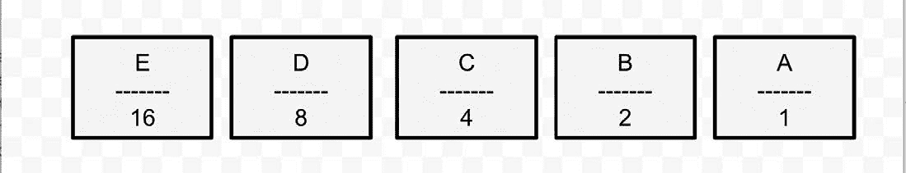


这看起来可能有点奇怪，但这里有一个例子。如果你遮住除了 A 之外的所有盒子，总和将是 1。使用 1 和 0——开和关——来表示我们的状态，总和为 1 看起来像这样：00001。那么总和为 2 呢？嗯，那就是 00010。3 呢？是 00011。天哪，你刚刚在不知不觉中用二进制数数了！

## 操作说明

根据上图，尝试找出从 1 到 31 每个数字的二进制序列。如果卡住了，只需记住你可以用手指物理遮住不需要的数字。然后根据哪个盒子被挡住（即“关闭”）来写出序列。

## 从高级到低级


## 活动概述

高级编程语言的发明是为了让程序员能够把时间花在解决问题上，而不是编写极其复杂的指令。低级语言必须精确地告诉计算机每一步该做什么，而高级语言通常将几个较小的步骤合并成一行更容易理解的代码。你可能想知道这个过程是如何运作的！

## 操作说明

首先找一个朋友，决定谁扮演高级语言，谁扮演低级语言。扮演高级语言的人在一张纸上写一个简单的指令。这可以是任何东西！你可能想从日常任务开始，比如“准备睡觉”或“打开灯”。一旦该玩家写下了任务，就轮到另一个玩家了。低级语言应该写出初始指令中涉及的每一个单独步骤。例如，“打开灯”的低级版本可能是：

1. 站起来。
2. 向电灯开关走十步。
3. 抬起右臂。
4. 向上拨动电灯开关。

轮流传递指令几次，然后交换角色。

## 语言基础

在开始编写任何 JavaScript 之前，你需要了解该语言的一些核心概念。在本书的整个过程中，你会发现我们会反复提到这些概念。事实上，你编程越多，就越会注意到这些特性在许多不同的语言中是共通的！

信不信由你，你真的不需要成为科学或数学天才才能进入编程领域。由于现在的计算机如此先进且价格低廉，任何人都可以通过自学或上课来学习编程。别误会——编程可能很有挑战性。但重要的是不要气馁！有时你会感到沮丧，但你只需要退一步，休息一下，稍后再回来。以下各节的活动旨在让你轻松入门。无需害怕——保持好奇心，享受乐趣，你很快就能在《我的世界》中编程了！

### 你好，运算符：语法、运算符和操作数

还记得我提到过编程语言级别越高，就越接近人类交流的方式吗？这的技术术语是语言的语法，它指的是语言的结构方式。语法还描述了其中允许使用哪些规则和符号。

想想英语。为了交流，你需要遵循很多规则。虽然可能很有趣，但你不能随意编造单词或随机打乱句子，并期望别人能理解你。编程语言也是如此。负责翻译程序的编译器或解释器期望它遵循一套非常具体的规则。如果你没有在这些规则内构建程序，就会出现错误。

编程语言中的符号也是如此。虽然如果你能自己创造字母并添加到英语字母表中会很酷，但没有人能理解你想写或说什么！换句话说，符号是特定语言允许你使用的所有不同字符。

更具体地说，这里有一些我们在本书中会经常看到的基本符号示例：

- () 圆括号（左和右）
- {} 花括号（左和右）
- [] 方括号（左和右）
- & 和号
- : 冒号
- ; 分号
- ‘ 单引号
- “ 双引号
- / 正斜杠
- _ 下划线
- – 破折号
- \ 反斜杠
- | 管道符
- > 大于号
- < 小于号

根据语言的不同，编译器或解释器可能不允许某些符号，或者规则可能不允许在特定位置使用它们。当这种情况发生时，你通常会遇到所谓的语法错误。准备好经常看到这个错误吧！这是初学者程序员最常见的错误。

这开始听起来有点像你的英语课了，不是吗？既然我们讨论的是编程*语言*，那么有很多概念是从人类语言中借用的。就像编程语言和自然语言都有语法（结构规则）一样，它们也遵循语义。在自然语言中，语义是句子的含义。这同样适用于编程语言。语义指的是编译器或解释器必须翻译成机器代码的实际指令。换句话说：程序实际意味着什么！

一个程序可能在语法上是正确的，但在语义上是错误的。这意味着它可能能够编译——甚至可能运行——但其中存在一些有缺陷的逻辑。这很糟糕！通常，这表现为运行时错误，当程序试图访问不可用的资源、将单词和数字相加或其他不合理的事情时就会发生。

这在自然语言中是什么样子？它可能表现为一个语法正确但毫无意义的句子。一个著名的例子是“无色的绿色想法愤怒地睡觉”。谁能搞懂这团乱麻？自然语言中的语义错误也不必那么奇怪。它们可能只是表达错误含义的句子，或者可能是由于像放错逗号这样简单的事情导致的。

另一个著名的例子呢？“熊猫吃、射、然后离开。”嗯，它在语法上是正确的，但含义错了。你见过会射击的熊猫吗？我想没有。它们实际上不会那样做——它们只是吃竹笋和叶子。当你学习编程时，你会遇到很多语义错误。它们不会像这些英语例子那么有趣。它们比语法错误更难追踪，但只要有一点耐心，你应该能够解决它们。

好了，所以你知道程序必须遵循规则，并且需要产生表达有效含义的指令给编译器。但你实际上如何开始编写代码呢？

用非常简单的术语来思考程序：你编写它们是为了对某种数据执行某种操作。在本书中，你会注意到你的程序都会对我们输入的任何类型的信息做一些事情。这听起来很简单——至少对程序员来说是这样。你知道如何区分“数据”和“做某事”。但编译器或解释器如何知道它们之间的区别呢？

像英语一样，几乎所有编程语言（除了一些极其晦涩的语言，但谁需要它们呢？）都是从左到右书写的。这就像你阅读和书写句子一样。然而，在编程语言中，有运算符和操作数帮助计算机理解如何处理每一行代码。这些概念借用了数学，许多应该看起来很熟悉。

操作数指的是你想要对其执行某种操作的数据，而运算符指的是实际的操作。以这个简单的算术为例：

1 + 2 = 3


在这个例子中，`1` 和 `2` 是操作数，`+` 是加法运算符。再来看另一个例子：

`9 / 3 = 3`

在这个例子中，`9` 和 `3` 是操作数，`/` 是除法运算符。

然而，大多数编程语言的独特之处在于 `=`（等号）符号及其位置。如果你编写一个只包含 `9 / 3 = 3` 这一行的程序，你会得到一个语法错误。这是因为等号用于赋值。这个赋值运算符很可能是你在整个程序中使用的最重要的运算符。

当你像上面的表达式那样进行算术运算时，你是在计算结果并将其放在等号的右侧。这在纸上很容易做到，但在编程时，你需要在内存中预留一些空间来存储计算结果。如果不这样做，你就会丢失它！赋值运算符的作用就是指定你要将运算结果存储在内存中，并且你希望将来能够访问它。

如果用编程术语来表达，数学表达式 `9 / 3 = 3` 实际上看起来更像这样：

`result = 9 / 3`

其中 `result` 是存储在内存中的除法运算结果。

你感觉有什么不同吗？更有成就感了吗？嗯，你应该有！你刚刚了解了你的第一个变量。变量是对内存中某个存储空间的引用，你可以通过调用它的名称或标签在程序中访问它。基于上面的表达式，你可以通过调用 `result` 变量来获取除法运算的值。这是在程序中传递信息最基本的方式。

了解变量如何改变你对运算符和操作数的理解？在编程中，我们经常提到左操作数和右操作数。就我们上面的表达式而言，我们可以这样标记运算符和操作数：

`result = 9 / 3`

其中 `result` 是左操作数；等号是赋值运算符；表达式 `9 / 3` 是赋值运算符的右操作数。如果我们想更具体一点，`9` 是 `/` 运算符的左操作数；`3` 是 `/` 运算符的右操作数。

感到困惑吗？嗯，有一点可能有帮助：在执行数学运算时，你可以使用括号 `()`，程序会遵循你可能在数学课上学过的运算顺序。

大多数语言都有一套标准的算术运算符供你使用。以下是你最可能看到的几个，并附有说明：

- 加法：`+`

  用于将左操作数与右操作数相加

  示例：`1 + 1`（2）

- 减法：`-`

  用于从左操作数中减去右操作数

  示例：`2 - 1`（1）

- 乘法：`*`

  用于将左操作数与右操作数相乘

  示例：`2 * 2`（4）

- 除法：`/`

  用于将左操作数除以右操作数

  示例：`4 / 2`（2）

- 递增：`++`

  用于将值增加 1。这被称为一元运算符。这只是表示它只作用于一个操作数的花哨说法（见下文）。

  示例：

  ```
  myNumber = 1
  myNumber++ (2)
  ```

- 递减：`--`

  用于将值减少 1；也是一元运算符。

  示例：

  ```
  myNumber = 3
  myNumber-- (2)
  ```

- 取余（模运算）：`%`

  用于获取左操作数与右操作数相除后的余数。

  示例：

  ```
  2 % 2 (0)
  3 % 2 (1)
  13 % 5 (3)
  ```

- 取反：

  用于获取一个数的负值；也是一元运算符。

  示例：

  ```
  myNumber = 3
  -myNumber (-3)
  myOtherNumber = -5
  -myOtherNumber (5)
  ```

- 幂运算：`**`

  用于计算底数（左操作数）的指数（右操作数）次幂。相当于 base^(exponent)

  示例：

  ```
  2 ** 4 (16)
  3 ** 1 (3)
  ```

## 语法正确


### 活动概述

本活动将帮助你理解语法对编程的重要性。在你能识别代码中的语法错误之前，你必须真正理解什么是语法错误！

### 操作说明

首先，找一个朋友。在不偷看的情况下，每个人在纸上写出三个语法正确的句子。然后，每个人再写出三个语法*不正确*的句子。如果你不知道怎么写，就像尤达大师可能会说的那样写：“一本关于 JavaScript 编程的书，这是。”

现在有趣的部分开始了：与朋友交换纸张。你们两人比赛，看谁能最快识别出语法正确和不正确的句子！你可以反复玩这个游戏。

## 语义问题


### 活动概述

这个活动与“语法正确”活动非常相似，只不过这次你要考虑语义。一旦你开始遇到运行时错误（明白了吗？），你就需要调试你的逻辑和结构。找出这些运行时错误或语义错误会有点困难！这就是为什么你需要这个活动。

### 操作说明

首先，找一个朋友。在不偷看的情况下，每个人在纸上写出三个语义正确的句子。正确理解语义很容易，就像这个例子：我喜欢烹饪、我的朋友和我的狗。然后，每个人再写出三个语义不正确的句子。如果你不知道怎么写，看看这个语义错误的例子：我喜欢烹饪我的朋友和我的狗。

完成后，与朋友交换纸张。你们两人比赛，看谁能最快识别出语义正确和不正确的句子！你可以反复玩这个游戏。

## 变量命名游戏


### 活动概述

编程很少是独自完成的。没有人——从年轻有为的程序员到老手——是不与团队合作的。团队合作让梦想成真，为队友编写清晰简洁的代码非常重要。让你的程序更易于团队理解的一种方法是以语义化的方式命名变量。这是什么意思？例如，如果你要存储红色的值，只需将变量命名为 `red` 或 `redColor`。保持简单！最好让你的变量名尽可能短，同时仍具有描述性。

### 操作说明

首先，让一个人写下一些常见任务，并把它们放进一顶帽子里。然后，第一个玩家从帽子里抽出一个任务。现在，所有玩家都可以尝试为给定任务的结果写出最短但仍有描述性的标题。谁的变量名最具描述性但仍然简短，谁就赢得这一轮。

看看一些例子：

任务：“洗碗” 结果：`cleanDishes`（好），`theDishesAreClean`（不太好）

任务：“开灯” 结果：`lightsOn`（好），`theLightsAreTurnedOn`（不太好）

## 数据结构

正如你已经知道的，编程是一个非常酷的概念。程序让游戏、手机和整个互联网得以运行。但简单来说，程序只是一组对数据进行操作的指令。我们在上一节中介绍的所有基础知识，嗯，都是基础。如果我们只做简单的算术，我们走不了多远。所有编程语言都利用数据结构来帮助程序员处理复杂形式的数据。数据结构在各种编程语言中都非常重要，是所有应用程序的构建块。大多数编程语言将这些不同的数据结构称为类型。类型很容易理解。它们有点像英语中的名词：一种识别或分类特定*类型*数据的方式，就像名词分类特定的人、地点或事物一样。


大多数语言都有所谓的原始类型。这些是语言支持的最基本数据类型，在不同语言中相当常见。原始类型经常被提及，因为它们负责程序中幕后发生的许多基础工作。一些原始类型包括：

- 整数：一种表示整数的数据类型。这些数字不带小数部分（没有小数点！），可以是正数或负数。

  示例：1, -1, 2048, 0

- 浮点数：一种表示包含小数部分的数字的数据类型。可以是正数或负数；也称为浮点数字。

  示例：1.0, -1.0003, 2048.24, 0.003

- 字符串：一种包含“字符串”或字符序列的数据类型。这些字符可以是字母、符号、标点或数字。

  示例：“cats.”, “5 dogs”, “The panda eats, shoots, and leaves”

- 布尔值：一种只能用 `true` 或 `false` 表示的数据类型。也称为逻辑数据类型，布尔值用于控制程序的逻辑和流程。使用布尔值还有助于为程序添加检查，确保任务正确执行。

  示例：`true`, `false`。

- 空值：一种指向内存中不存在位置的数据类型。使用空类型是一个更高级的概念，但你可以利用它们来控制程序流程等。

  示例：`null`。

- 未定义：一种 JavaScript 特有的数据类型，表示一个未声明或已声明但未赋值的变量。当你尝试访问一个不存在的变量时（无论是拼写错误还是忘记声明），你很可能会遇到这些“未定义”错误。如果你看到类似“`myVariable` is not defined”的错误信息，不要惊慌！检查你的代码，看看“`myVariable`”是否曾被赋值，或者只是拼写错误。

  `myUndefined; // a variable that is declared — but has nothing assigned to it—will be undefined`

## 集合——数组和字典（对象）

好吧，原始数据类型一开始可能很难理解。但它们也很酷！它们让你能在程序中做各种事情。但如果你想将其中一些数据分组并在整个程序中访问它们，该怎么办？这时集合就派上用场了。

一种集合类型称为数组。数组是由单个元素组成的索引数据集合。元素只是一个用来描述组成数组的项的术语。你可以把数组想象成一卷硬币，每个硬币就是一个元素。就像一卷硬币一样，每个元素一个接一个地排列。要向数组添加元素，你需要 `push`（推入）它们。当你装满一卷硬币时，也是同样的道理。你从卷底的第一枚硬币开始，然后 `push` 更多的硬币到它上面。

把硬币放入卷中固然不错，但如果你想花掉一些钱——如何从卷中取出硬币呢？在现实世界中，你会用食指和拇指 `pop`（弹出）一枚硬币。数组也是一样（只是没有手指和拇指）：要获取数组的最后一个元素并将其从数组中移除，你只需 `pop` 它——就这么简单！

那么，如何获取不在开头或结尾的硬币呢？这就是“索引”发挥作用的地方。当我说数组是有索引的，意思是你可以通过元素在数组中的数字索引来访问每个元素。等等，什么？这突然冒出来的术语有点难懂。让我解释一下。

假设你想从卷中取出第五枚硬币。那就是通过数字索引（这里是五）来访问一个元素。哇，很简单！不过有一点需要考虑：在大多数编程语言中，数组是零索引的。这听起来很吓人，但意思只是数组的第一个元素的索引是零，而不是一。

那么这看起来是什么样的呢？在大多数语言（包括 JavaScript）中，你使用方括号访问数组元素：

- `myArray[0] // 第一个元素`
- `myArray[1] // 第二个元素`
- `myArray[4] // 第五个元素`
- `myArray[10] // 第十一个元素`

这不算太难，对吧？可能需要一点时间来适应，但如果你把它想象成从你想要的索引中减去一，事情就会简单得多。继续用这卷硬币的类比，如果我想取卷中的第五枚硬币，它的索引是 [4]——也就是 5 - 1。

但也许你想存钱，所以你想往卷里加硬币。同样，你可以按索引将元素插入数组。假设我想把第五枚硬币从卷中取出，然后放一枚新的进去。看起来像这样：

- `myArray[4] = myNewValue;`

你可能不会经常这样单独访问或设置元素，因为这会导致代码混乱且不可预测。比如，如果数组以不同的方式排序呢？第五枚硬币可能实际上并不是你想要的那枚——它可能是第 23 枚。谁知道呢！

这就是为什么语言有映射（map）或字典（dictionary）。映射是一种集合类型——就像数组一样——但你不是通过索引值访问元素，而是使用键（key）。键是一个标签，与一个值配对，或者说“映射到”一个值。你可能以前听说过“键值对”——没错，这就是映射！映射对于存储你知道需要单独访问的数据要方便得多。这解决了在索引数组中访问特定值的问题，因为你总是知道“`myKey`”会给你带来与该键配对的值。

那么，在映射中访问值是什么样的呢？与索引数组不同，你不会从映射中 `push` 或 `pop` 值。相反，你根据键来获取和设置它们：

```
// 设置
myMap['myKey'] = myValue

// 获取
aValue = myMap['myKey']
```

值得注意的是，你在命名变量时使用的技巧同样适用于命名键。尽量让它们简短且具有描述性，这样你的代码对你和任何看到它的人来说都会更容易理解。

映射和数组可以存储所有原始类型，而且很多语言还允许你存储其他类型，比如数组、映射、函数和对象（我们很快就会讲到）。在本书中，我们会大量使用数组和映射，所以你不会只见到它们这一次！

## 来洗牌吧！


### 活动概述

索引不仅仅用于书籍！要成为一名模组大师，你必须学会访问代码中数组的方方面面。这个活动将帮助你熟悉数组及其术语，例如索引、推入和弹出。

### 操作说明

首先，找两个朋友和两副扑克牌。让朋友们帮你从每副牌中挑出 A、2、3、4、5、6、7、8、9 和 10——这些就是你需要的牌。游戏开始时有两副独立的牌和四个独立的抽牌堆。每副牌应按升序正面朝上排列：A 在底部，2、3、4、5 在顶部。每个抽牌堆也应按升序正面朝上排列：6 在底部，7、8、9、10 在顶部。

要玩游戏，一个人会告诉另外两个玩家如何操作他们的牌和牌堆。听起来简单？好吧，这里有个转折：发号施令的玩家只能使用数组和索引命令！你可能会想：“嘿，我又不是电脑！”这就是你的牌的作用。指令阅读者可以发出以下命令：

- `pop`（将牌堆底部的牌放到抽牌堆顶部）
- `push`（将抽牌堆顶部的牌加到牌堆顶部）
- `Retrieve X`（展示索引为 X 的牌——记住：索引总是从 0 开始！）


- `替换 X`（移除索引为 `X` 的卡牌，并用抽牌堆顶部的卡牌替换它）

收到指令的玩家将互相竞赛，看谁先做对！先完成的人得一分——但要小心，因为如果一名玩家做错了，另一名玩家会自动得分。如果两人都做错了，那么读指令的人得一分！

给出十条指令后，就该换人了。两组卡牌应顺时针传给下一位玩家。由于只有两组，这意味着会有一位新的指令宣读者。重复游戏，直到每个人都有机会宣读指令，然后统计每个人的得分！谁赢了？

## 整理物品清单


## 活动概述

许多游戏，包括《我的世界》，都要求玩家维护一个物品清单。这是实现一个映射（map）来帮助你整理这些物品的绝佳机会！

## 操作说明

如果你手边有电脑，启动《我的世界》并查看你的物品栏。逐一检查每个物品，思考你会为它起一个什么样的键名。你会如何在映射中组织你的物品栏？如果你想与朋友共享，如何保持一致性？你在编码时必须考虑这些问题！你可能还需要考虑在物品栏中组合使用多种数据结构。例如，也许你手头有几个混凝土块，那么你很可能希望将它们存储在一个数组里，并放入你的物品栏映射中。尝试以任何对你自己清晰的方式绘制出这个映射。有时画箭头会有帮助：

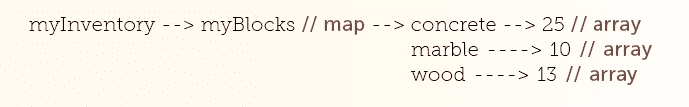

## 控制流

即使学了这么多页，你写的任何代码仍然会相当简单。你知道如何进行一些基本的算术运算、赋值变量以及将数据存储在某些结构中。这些都很酷，但程序真正开始变得有趣的地方在于它们的逻辑。为程序添加逻辑的做法称为控制流。这意味着你添加代码来控制程序的流程——可以把它想象成一本“选择你自己的冒险”小说。如果用户尝试做某件事，程序就会以特定的方式流动。希望这能给他们带来期望的结果——或者也许把他们扔进狮子窝里。谁知道呢！

你手中用于控制流的主要工具是 IF 语句。这是所有编程语言的圣杯——一旦掌握了它，你就能做任何事情。嗯，差不多。IF 语句看似简单，其工作方式大致如下：

```
if (某个条件) {

执行这个

} else {

执行那个

}
```

作为你最强大的工具之一，这还不算太糟，对吧？那么，该语句中引用的条件可以是很多东西：它可以比较一个变量与另一个变量的值；它可以检查某个值是否存在；它可以检查一个数字是否大于另一个数字，等等。正是这些条件赋予了 IF 语句真正的力量，幸运的是，你已经从前面的章节中了解了一些！

IF 语句中的条件使用了所谓的比较运算符和逻辑运算符的组合。顾名思义，比较运算符用于比较两个值。以下是一些比较运算符的例子：

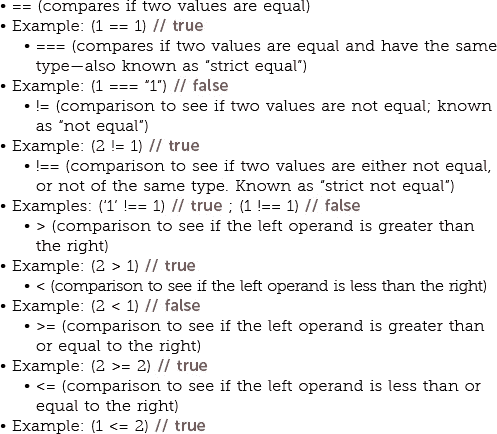

与条件运算符一起使用的逻辑运算符只有少数几个。它们对于简写或链接条件特别有用。以下是一些逻辑运算符：

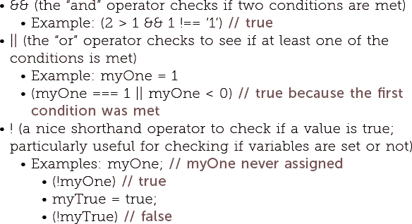

现在你已经了解了 IF 语句的内容，是时候学习如何使用它们了！记住，最基本的 IF 语句看起来像这样：

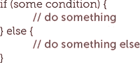

那么，如果你需要组合多个条件呢？幸运的是，由于一个称为作用域的概念，IF 语句可以嵌套：

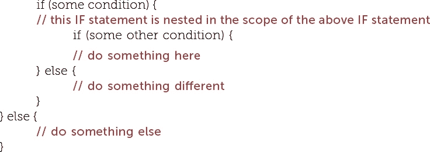

IF 语句的嵌套深度没有限制，但要注意：深度越大，复杂度越高。而复杂度越高，可读性就越差！幸运的是，大多数语言（包括 JavaScript）都有更高效的方式来建立控制流。

例如，JavaScript 有一种叫做 ELSE-IF 语句的东西，它允许你链接条件。换句话说，你并不局限于简单的“if-then-else”模式：

```
if (某个条件){

// 做某事

} else if (另一个条件){

// 做某事

} else {

// 做最后一件事

}
```

你可以串联多个 ELSE-IF 语句，只要第一个语句是 IF，最后一个语句是 ELSE。但这也会变得有点混乱！有些语言，包括 JavaScript，可以使用一种叫做 switch 语句的东西，当你有一段包含大量条件或子句的代码时，它非常有用。switch 语句可能有点令人困惑，所以用一个具体的例子来说明最好。

假设你正在编写一个模组，允许用户在《我的世界》中发射方块。由于方块由不同材料制成，它们在发射时会有不同的物理行为。在 switch 语句中，你可以将方块的类型作为表达式，并根据材料类型分配不同的行为：

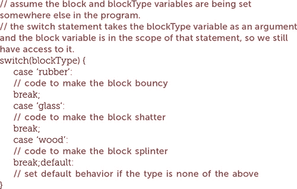

好了，这个代码示例中有很多内容。正如我提到的，`switch(blockType)` 将方块的类型作为表达式。所有不同的“case”就像 IF 语句。它们实际上是这样工作的：

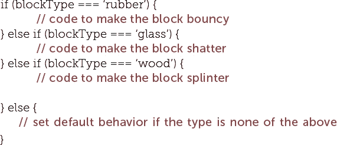

这段代码要复杂得多！你可以看到，当你有很多 case 时，使用 switch 特别有用。但如果你真的喜欢串联 IF 和 ELSE-IF 语句，请随意。前面的两个例子在语义上都是正确的。“正确”的选择是你——以及你的编程伙伴——决定最适合你们的方式。

你在每个 case 末尾看到的那些 `break` 语句确保我们的程序正确地退出每个 case 的结果代码块。当我们进入下一节关于循环和迭代的内容时，你会学到更多关于 break 的知识。唯一可能让你觉得奇怪的是 switch 末尾的 `default` 子句。这就像 IF 语句中的最后一个“else”——如果表达式不匹配任何条件，程序就会默认执行 default。

### 二十个问题


## 活动概述

这个活动应该会让你想起“二十个问题”游戏，其中一名玩家（回答者）想出一个物体，并试图难住其他玩家。其他玩家有二十次机会（问题）来猜出这个物体。在这个活动中，提问者必须在他们的问题中使用逻辑运算符和条件运算符！

## 操作说明

首先选出一名玩家作为回答者。当那个人想好某个物体后，每个玩家需要以条件语句的形式写下他们的问题。例如，如果你试图猜出物体的颜色，你会写 `color == red`。然后，回答者必须返回布尔结果（`true` 或 `false`）。

轮流让每个提问者提问，直到有人猜出正确答案，或者二十个问题全部用完。如果有人猜对了，那个人就成为下一轮的回答者。如果提问者被难住了，回答者将在下一轮继续担任回答者。想玩多少轮就玩多少轮——成功“难住”别人次数最多的回答者获胜！

### 选择你自己的冒险


## 活动概述


准备好开始冒险吧！在这个活动中，你将运用新掌握的`IF`和`switch`语句技能，创建一个流程图，设计一个简单的“选择你自己的冒险”场景。如果你没听说过这种形式，选择你自己的冒险小说是一种让读者参与决策的书籍。根据读者的选择，他们会翻到书中指定的页面，推动故事发展。

## 操作说明

拿出一张纸，画出你自己的“选择你自己的冒险”场景。可以是流程图、地图，或者任何你觉得舒服的设计形式。从一个基本想法开始——角色是谁？他们住在哪里？长什么样？然后，构建故事的“分支”和多重路径。最终目标是有一个单一的起点，可以通向许多不同的方向。

如果你没有任何想法，这里有一个提示：创建一个场景，读者被困在地牢中，需要找到出路。

## 循环与迭代

到现在为止，我敢打赌你已经对如何逻辑地组织程序有了相当好的理解。编程的另一个重要部分（也是让程序如此激动人心的原因！）是迭代的概念。迭代让我们能够重复执行某些操作，或者创建循环。我们可以遍历集合（如数组），在固定时间内重复任务，甚至让循环一直运行到时间尽头！循环有点像重复执行一段时间的`IF`语句。这听起来可能有点令人困惑，但实际上并不复杂。

循环接受一个条件，并根据该条件执行固定次数。在 JavaScript 以及许多其他语言中，有两种类型的循环。第一种叫做`FOR`循环，可能是你最常见到的一种。`FOR`循环接受一个条件，并一直运行直到该条件满足。用通俗的话来说，你可以这样描述`FOR`循环：

提出一个条件，然后做某事。做完后，检查条件是否为真。如果仍然不为真，就再做一次。重复直到条件为真。

很简单，对吧？另一种类型是`while`循环，它在条件满足时持续运行。大致如下：

提出一个条件，然后做某事。做完后，检查条件是否为假。如果仍然不为假，就再做一次。重复直到条件为假。

你可能会想：“嗯，这两者之间差别不大。”当我们进入第二章并开始编写代码时，你会发现它们有很大的区别！基本上，你能用`FOR`循环做的事情，也可以用`while`循环完成。主要区别在于`FOR`循环有明确的起点和终点，并且涉及递增操作。

当我们说“递增”时，意思就是给某个值加上一个数。以一组楼梯为例：开始时，我们在第零级台阶。每走一步，我们的步数就增加一。当我们到达楼梯顶部时，“爬楼梯循环”就结束了。这个有趣的爬楼梯例子的`FOR`循环版本大致如下：

第一步是第零级，所以步数为零。总共有十级台阶。如果步数小于十，我们就走一步。一直往上走，直到步数为十，到达楼梯顶部。

`FOR`循环特别适合计数，并且内置了递增功能。`while`循环更容易编写，但如果需要进行任何计数，你必须自己处理递增。当你需要迭代一个未知结束时间的持续时间时，可以使用`while`循环。例如：监听用户输入。让我们看一个更有趣（也更美味）的例子。

我们有一块披萨，上面有很多蘑菇。我们不喜欢它们，想把它们拿下来喂狗。`FOR`循环版本大致如下：

蘑菇数量为零。我们的披萨片上有八颗蘑菇。我们拿下一颗蘑菇给狗。如果蘑菇数量小于八，我们就一次拿下一颗给狗，直到蘑菇数量为零。

`while`循环（不自己写递增）大致如下：

我们的披萨上有一些蘑菇。我们拿下一颗蘑菇给狗。检查是否还有蘑菇。再拿下一颗给狗。一直这样做，直到没有蘑菇为止。

我们可以这样简化披萨循环：

- `FOR`循环：对于披萨上的每一颗蘑菇，拿下一颗，直到没有蘑菇为止。
- `While`循环：只要披萨上还有蘑菇，就拿下一颗。

### 本书最佳活动


### 活动概述

理解像`FOR`和`while`循环这样的抽象概念很难，但当你处理现实世界中的事物时——尤其是这些事物可以吃的时候——就会容易得多！根据本活动中的提示，你需要猜测你吃零食的方式是`while`循环还是`FOR`循环。如果你吃饱了，也可以不吃东西完成活动——或者等你想吃甜点时再回来！

### 操作说明

准备好你的糖果了吗？根据以下提示，猜测哪些是`while`循环，哪些是`FOR`循环。在某些情况下，提示可能两者都包含！

1. 拿起三块零食，放在右手。吃掉它们，直到没有剩余。
2. 吃一块零食。然后再吃一块。再吃一块。再吃一块。再吃一块。再吃一块。
3. 再吃两块，一次一块。
4. 每五秒吃一块，直到三十秒过去。
5. 每十秒在桌上放一块零食，直到一分钟过去。然后一块一块地吃掉它们。
6. 吃掉所有东西，直到什么都不剩。

迭代是你继续学习编程时会大量接触的内容。当我们进入下一节，开始遍历真实的集合（比如你的*Minecraft*背包）时，一切都会变得非常清晰。相信我——即使你现在有点困惑，你也会得到大量练习。

在开始编写代码之前，我们还需要了解另一个概念：函数。函数是极其重要的编程结构，而且相对容易理解。我喜欢把函数看作一种将我们编写的有用代码打包起来、以便重复使用的方式。随着我们编写程序并使其越来越复杂，我们应该依靠函数来保持代码的整洁和有序。函数是一个命名的代码块，我们可以在程序内部或我们编写的其他程序中调用它。

以我们的披萨练习为例：你不想为每一块需要去除蘑菇的披萨都写出相同的指令，尤其是每次做的都是同样的事情！有一个流行的编程原则叫做 DRY：不要重复自己。创建一个名为`removeMushrooms`的函数，比一遍又一遍地重写相同的代码要合理得多。重复编写代码被称为 WET 解决方案（我们喜欢打字）。

函数有三个关键组成部分。它需要一个名称（例如`removeMushrooms`），它有参数或自变量（在函数中我们对其进行操作的变量），并且它可能有也可能没有返回值，即函数执行完毕后“返回”的内容。


让我们来分解一下 `removeMushrooms` 这个例子。我们已经有了一个名字！很简单。现在我们可以思考需要向函数“传递”哪些参数。嗯，我们需要一片蘑菇披萨，还需要一只狗来喂蘑菇。然后我们的函数可以返回去掉蘑菇的披萨片。让我们在更多例子上试试吧！

### 循环


### 活动概述

我希望你还没厌倦 `FOR` 和 `while` 循环，因为这次活动真的会考验你的技能。你需要观察一些场景，并想出你自己的循环策略。

### 操作说明

看看下面的场景。针对每个场景，分别写出 `FOR` 循环和 `while` 循环的解决方案。

1.  你有一条送报纸的路线，需要把二十份报纸送到二十户人家。
2.  当你到达第一户人家时，你必须走上十四级台阶才能到门口。
3.  当你去投递报纸时，五只蜜蜂嗡嗡地朝你飞来，你必须用报纸拍打它们。
4.  赶走蜜蜂后，你发现裤子撕破了。你必须跑回家三个街区去换裤子。
5.  回到家后，你发现没有一条裤子能搭配你的衬衫（时尚很重要）。你翻遍了六个抽屉的衣服，才找到一条酷酷的裤子。

### 函数是什么？


### 活动概述

相信我，学会在程序中使用函数会让你的生活轻松得多。在这次活动中，你将通过实际生活中的例子获得很好的练习。

### 操作说明

尝试为以下每个任务想出一个函数。记住：每个函数都应该有一个名字、一些参数，并且根据情况有一个返回值。

1.  你和朋友们在打雪仗。你需要做一个可以扔出去的雪球。
2.  你的自行车轮胎爆了。你需要补胎并打气。
3.  你有一些零钱，需要凑够 1.25 美元买一瓶汽水。你需要数清零钱，然后把剩下的放回口袋。
4.  你想玩《我的世界》，但需要登录。你需要什么信息？
5.  你家外面有僵尸，你需要堵住门（至少其中一个应该有点意思，对吧？）

### 函数是什么？续集


### 活动概述

好吧，高手——你觉得想出函数很容易，对吧？那么，现在你可以尝试逆向思考。与他人一起编程的一个重要部分是编写清晰、简洁且带有大量文档的代码。除了文档之外，函数名和参数也应该非常清晰，以便其他人知道如何使用它们。如果没人能理解代码，那代码对任何人都没有帮助！

### 操作说明

根据下面的函数，试着弄清楚它们的功能。这些函数的名字和参数都很模糊。请想出一些更好的名字和参数！

1.  `walk(animal, leash, park)`
2.  `toss(wrapper, can)`
3.  `build(hammer, nails, tree, plan)`
4.  `dig(map, location)`

啊，函数。它们能为你节省大量时间，并且对于编写大型程序来说绝对必要且核心——尤其是在 JavaScript 中。一旦我们深入下去，你还会学到一些可以用函数做的很酷的事情，以及为什么 JavaScript 被认为是一种函数式语言，这是一种编程范式。不过，我们先别太深入！

JavaScript 是一种支持多种编程范式的语言。对我们来说，这意味着 JavaScript 解释器并不关心我们如何编写程序。它只关心程序在语法上是否正确。如何设计程序完全取决于我们，但我们可以遵循一些既定的模式，这些模式不仅能让我们的程序井井有条，还能让其他人更容易阅读和理解。

《我的世界》是用 Java 语言编写的，Java 遵循一种称为面向对象编程的范式。JavaScript 也原生支持面向对象编程，我们将在本书中一直使用它。关于面向对象，你需要知道的最重要的一点是，它基于类和对象的原则。

类以抽象的方式表示现实世界中的事物。想想《我的世界》中的方块。虽然有很多不同类型的方块，但它们都有一些共同的特征，使它们成为方块，而不是树。类有点像我们可以用来制作一堆方块的模具。对象是实例，或者说是从模具中生产出来的单个方块。每个单独的方块都有自己的特征或属性来描述它。它也有自己的函数——或方法——来定义它的行为。

不过，这是一种相当技术性的看待这些术语的方式。让我们简化一下！我们可以把类看作名词，属性看作形容词，方法看作动词。如果我们有一个名为 `Block` 的类，它的一些属性可能包括宽度、高度、深度和材质类型——所有这些都能帮助我们描述它。我们还可以想出一些方法来定义方块的行为或以某种方式操作它。

总结一下，属性包含关于对象某个方面的信息，而方法则对对象执行某些操作。类就是包含这些属性和方法的容器。

### 变得有类


### 活动概述

如果你想处理大型程序，你需要知道如何处理类。组织好你的类有助于保持一切井井有条。它还允许你在程序之间重用大量代码！组织类的第一步是给它们命名。

### 操作说明

根据下面给出的属性和方法分组，为每组想出一个类名。例如：`type`, `hasTail`, `scratch`, `purr` → `Cat`。

1.  `type`, `hasTail`, `scratch`, `purr`
2.  `drive`, `reverse`, `numberOfDoors`, `numberOfWheels`
3.  `flavor`, `isDiet`, `hasCaffeine`, `volume`, `isCan`
4.  `toppings`, `sauce`, `crustType`
5.  `flavor`, `toppings`, `hasCone`
6.  `brand`, `isWaterproof`, `type`, `color`, `size`, `laceColor`
7.  `manufacturer`, `storageSize`, `screenSize`, `operatingSystem`
8.  `volume`, `radius`, `circumference`, `weight`, `isRegulationSize`, `airLevel`
9.  `title`, `numberOfPages`, `chapters`

那么，我们简单的 `Block` 类会是什么样子呢？嗯，就像我之前提到的，它将有一些所有方块共有的属性。它将有宽度、高度和深度。方块还应该有一些属性来指定它是由什么材料制成的，比如木头、石头或泥土。也许我们还想给它一个缩放属性，这样我们就可以放大或缩小它。当我们实例化（这只是创建方块实例的一个花哨说法）时，我们可以在所谓的构造函数中设置所有这些属性。构造函数是一种特殊类型的函数，它接受一组参数，并返回一个已经设置好某些属性的新对象。你也可以在对象实例化之后设置它的属性。记住，属性只是关于对象的信息，帮助我们确定它属于哪个类——它们是存储关于单个对象有用信息的变量。

### 名字游戏


### 活动概述

这个活动基于一个经典游戏，玩家会得到名人的名字。一个名字被贴在每个玩家的额头上，他自己看不到。玩家通过互相询问关于自己额头上名字的问题来猜测自己是谁。你们将做同样的事情——但这次不是名人，而是使用类。

### 操作说明

在这个游戏中，玩家会得到类的名字，比如 `Cat`、`Car`、`Pizza` 或 `Ice Cream`。他们必须询问关于自己属性的问题来获得答案。这将帮助你思考，为了让一个类准确地描绘它应该代表的现实世界对象，哪些属性是必要的。


首先，让每位玩家在便利贴上写下某个类的名称。可以是任何他们想要的内容！只要是一个名词，就符合规则。然后，每位玩家将便利贴贴在别人的额头上——不许偷看！大家需要互相询问对方所贴类的属性。如果有人猜对了自己的类，就可以把额头上的便利贴取下来。第一个猜对的人赢得这一轮！

方法（Methods）只是属于某个类的函数。它们与具体的对象绑定，通常操作该对象的属性，或基于这些属性产生某种结果。例如，我们的方块可能有一个计算其表面积或体积的方法。它也可能有一个方法，当与玩家碰撞时触发某种效果。假设我们的方块在玩家碰撞时会缩小——我们可以设计一个 `onCollide` 方法，该方法会改变方块的 `scale` 属性，使其变小。

### 疯狂中的方法


### 活动概述

有一件事你会变得非常擅长，那就是使用函数和方法来操作并改变数据结构。为什么？因为你会经常这样做！这被称为可变性（mutability），意味着数据可以被修改或改变。

函数和方法通常将数据作为输入，并返回数据作为输出，可能是副本，也可能是经过修改的原始数据。你将通过一些随机绘图来练习这一点。

#### 操作说明

首先，拿出你的索引卡，在每张卡上写下一种“绘图方法”。这个方法可以是“画一顶帽子”或“用绿色填充一半”之类的。发挥创意！

然后，其中一位玩家在一张纸上画一些酷炫的东西。轮流从帽子中抽取“任务”，并根据任务修改图像。完成后，它可能会看起来相当奇怪。也许你们中的某个人会成为下一个毕加索！

### 融会贯通


#### 活动概述

一个非常常见的软件开发实践是绘制或建模你的类。这使开发者不仅能思考一个类需要哪些方法和属性，还能思考它们如何与其他类关联和交互。确保你制作了一个好的模型！它会在第三章中再次出现。

#### 操作说明

在开始之前，你需要想好要创建什么样的类。想到了吗？现在，拿一张纸，写下该类的所有方法和属性。在本书的后续部分，你将编写一个类来生成随机地牢，并填充怪物和战利品。如果你愿意，可以尝试写出该类的一些内部工作原理。或者你也可以从简单的开始——也许你想探索我们一直在讨论的 `Block` 类，或者完全不同的东西！

呼，这一章我们讲了很多内容，不是吗？好消息是，你现在已经掌握了一些基本概念。我认为你已经准备好深入编程了！在下一章中，我们将设置 SpigotMC（运行 ScriptCraft 的 *Minecraft* 服务器），并让 ScriptCraft 启动并运行。我们将练习这里讨论的所有内容，同时学习一些新技巧。打开你的电脑，让我们开始吧！

# 第二章：JAVASCRIPT 和 SCRIPTCRAFT 简介

恭喜你，你已经完成了所有理论部分！在本节中，我们将以具体的方式探索你在第一章中学到的所有内容。我们将从启动并运行 ScriptCraft 和 SpigotMC 开始，这将教会我们如何下载软件并从命令行运行它。然后，我们就能真正开始在 *Minecraft* 中执行代码了——这才是真正令人兴奋的部分。很快，我们就能看到编程有多么强大！想自动填充你的物品栏？没问题！想建造建筑并放置方块？没问题！想创建自己的插件和自定义物品？没问题！想向世界添加一堆东西然后全部炸掉？没问题，统统没问题！没有什么比实时看到我们的进展更酷的了。未来就在眼前！

除非另有说明，本章中的每项活动都需要一台电脑、一份 *Minecraft: Java Edition* 以及安装了 ScriptCraft 的 SpigotMC 服务器。

## 安装 SpigotMC


### 活动概述

SpigotMC 是运行 ScriptCraft 的流行 *Minecraft* 模组服务器。你需要熟悉安装与 *Minecraft* 配合使用的程序，而本活动将帮助你做到这一点！你还将获得关于使用命令行界面（CLI）的非常基础的介绍。

#### 操作说明

注意：如果遇到困难，你也可以查阅官方 ScriptCraft 文档：[`github.com/walterhiggins/ScriptCraft`](https://github.com/walterhiggins/ScriptCraft)。

1. 下载 SpigotMC 构建工具，可在此处获取：[`hub.spigotmc.org/jenkins/job/BuildTools/lastSuccessfulBuild/artifact/target/BuildTools.jar`](https://hub.spigotmc.org/jenkins/job/BuildTools/lastSuccessfulBuild/artifact/target/BuildTools.jar)。通过运行这些构建工具，我们将实际构建并安装 SpigotMC *Minecraft* 服务器。

2. 由于 SpigotMC 运行在 Java 上，你还需要下载并安装 Java 开发工具包（JDK）。你可以在此处下载适用于相应操作系统的安装程序：[`www.oracle.com/technetwork/java/javase/downloads/jdk8-downloads-2133151.html`](http://www.oracle.com/technetwork/java/javase/downloads/jdk8-downloads-2133151.html)。按照说明完成 JDK 安装。

3. 现在，创建一个目录来存放你的 SpigotMC 构建文件。可以放在任何地方，但我建议不要放在桌面上——放在一个容易找到或记住的地方。虽然这不是必须的，但我喜欢在主目录下创建一个名为 `Applications` 的文件夹，用来存放我创建或修改的所有软件。从现在开始，假设我们所有操作都在这个 `Applications` 目录中进行。

    - 在 Mac 上，主目录是 `/Users/你的用户名`
    - 在 Windows 上，主目录是 `C:\Users\你的用户名`

    在你的主目录中创建一个 `Applications` 文件夹，并在该 `Applications` 文件夹中再创建一个名为 `spigotmc` 的文件夹。

4. 将 SpigotMC 的 `BuildTools.jar` 文件复制到你的 `spigotmc` 目录中。

5. 现在，打开一个命令行终端。在 Mac 上，这是一个名为“终端”的应用程序。在 Windows 上，你可以打开 PowerShell 或命令提示符。

6. 终端或命令提示符应该会在你的主目录中打开。你需要使用 `cd`（即“更改目录”）命令进入你的 `home/Applications/spigotmc` 目录。

    - 只需输入 `cd spigotmc`，你就会发现自己已经在那里了！

7. 在你的 `spigotmc` 目录中，输入 `java -jar BuildTools.jar`。此命令将开始为你编译 SpigotMC。安装完成后，你应该会看到类似“成功！所有内容编译成功。”的消息。

8. 所有内容编译完成后，你可以通过输入 `ls`（Mac）或 `dir`（Windows）来查看 `spigotmc` 目录中的所有文件。你应该会看到一个名为 `spigot-[版本号会变化].jar` 的文件。要启动服务器，你只需输入 `java -jar spigot-[版本号].jar`。

9. 你可能会收到一个错误，提示你必须同意 EULA（最终用户许可协议）。别担心，这是正常的！要同意，你只需用文本编辑器（Mac 上的 TextEdit 或 Windows 上的记事本）或你喜欢的 IDE（稍后详细介绍）打开该文件。然后，找到 `"eula=false"` 这一行，将其改为 `"eula=true"` 并保存文件。

10. 现在，你应该能够再次运行同一行命令：`java -jar spigot-[版本号].jar` 来启动服务器。


11. 服务器将逐步完成一些配置，完成后，你会收到一条消息，提示配置已完成。恭喜！你已经成功安装了 SpigotMC。要停止服务器，只需在服务器提示符下输入 `stop` 即可安全关闭。

## 安装 ScriptCraft


### 活动概述

既然你已经安装了 SpigotMC，一定迫不及待想要开始编程了吧！那么如何开始呢？接下来，我们将安装 ScriptCraft！

### 操作步骤

1. 从以下地址下载最新版本的 ScriptCraft `.jar` 文件：[`scriptcraftjs.org/download/latest`](https://scriptcraftjs.org/download/latest)。
2. 下载 jar 文件后，将其复制到 `spigotmc` 目录下的 `plugins` 文件夹中。插件是一种扩展软件应用的方式——有点像开发中的模组！你使用的所有 SpigotMC 插件都将放在这个文件夹中，并在运行时自动加载。
3. 通过输入 `java -jar spigot-[版本号].jar` 启动你的 SpigotMC 服务器。一切应该像之前一样启动，并且你会看到一条“Done”消息。
4. 好了！让我们测试一下 ScriptCraft 是否正常工作。在服务器提示符下，尝试输入：

   `js console.log(“hello world!”);`

   很酷吧？你的编程之旅的第一步已经完成！

ScriptCraft 的众多优点之一，是它使用 JVM（Java 虚拟机）的原生 JavaScript 引擎——名为 Nashorn——来即时解释你编写的所有代码。你刚才所做的就是执行了 JavaScript 的一个核心函数，该函数将消息记录到控制台。你可以访问所有核心的 JavaScript 函数，很快你就会发现这一点！

## 连接到服务器


### 活动概述

一旦我们的服务器启动并运行起来，如果能在游戏中与它通信，那就太好了。否则，你怎么能让所有代码运行起来呢？在本活动中，你将实际连接到服务器，并从聊天终端执行一些简单的 JavaScript 代码！

### 操作步骤

1. 使用“黄金命令”启动你的 SpigotMC 服务器：`java -jar spigot-[版本号].jar`
2. 打开 *Minecraft* 并选择多人游戏。然后点击添加服务器。你会看到一个编辑服务器信息的提示。对于服务器名称，你可以随意命名。对于服务器地址，输入 `localhost`。完成后，点击完成。这意味着我们在本地运行服务器，而不是向全世界广播！
3. 现在你应该能在服务器列表中看到你的服务器。点击它，然后选择加入服务器。
4. 现在你应该发现自己进入了一个新的 *Minecraft* 游戏。是的！你还会看到一条欢迎你来到 ScriptCraft 的消息。
5. 要输入命令，你可以按“t”键或输入“/”打开聊天终端。现在，要输入 JavaScript 代码，你需要确保命令以“`/js`”开头，否则它们会被当作普通聊天消息处理。试试这样的命令：

   `/js 2+2`

6. 不！很可能没有成功，对吧？你可能收到了一些关于你没有权限评估 blah blah blah 的消息。这是因为 ScriptCraft 要求你在服务器上拥有操作员权限才能执行 JavaScript 代码。操作员（op）是一种被授予服务器所有权限的角色。要让自己成为 op（你难道不想吗？！），在服务器提示符下输入 `op [用户名]`。完成后，你现在应该能够从聊天提示符运行 JavaScript 代码了。尝试运行我们之前在服务器上运行过的第一个方法：

   `console.log(“hello, world!”)`

   你应该会看到消息出现在服务器上——不错！

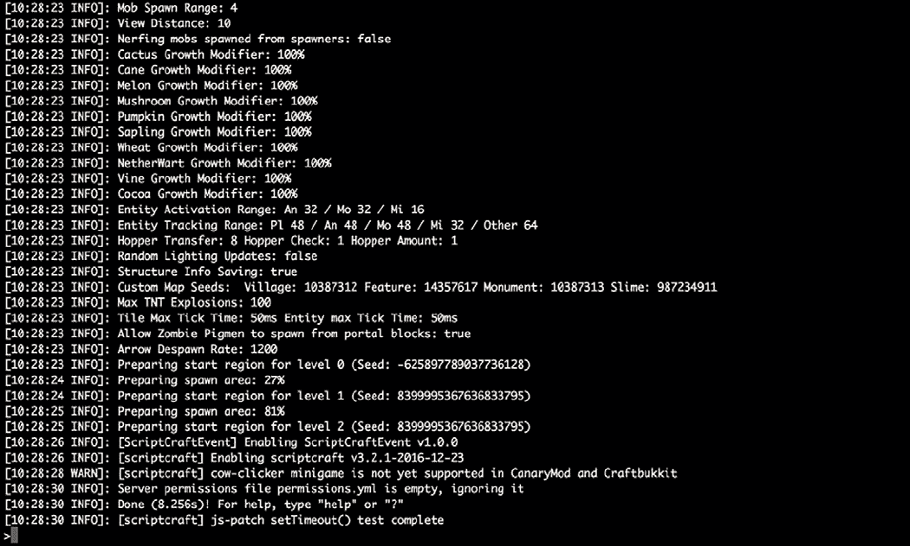

## 走一些捷径


### 活动概述

每次启动服务器时，我们都必须进入 SpigotMC 目录并输入那个 Java 命令，这有点烦人。让我们创建一个桌面快捷方式来启动服务器，省去几个步骤！你的日程表以后会感谢我的。

### 操作步骤

#### 在 OSX 上

1. 打开文本编辑器并创建一个新文件。转到“格式”→“制作纯文本”。将文件保存到桌面，命名为 `start-spigotmc.command`
2. 添加以下行：`#!/bin/bash`。该命令将告诉你的操作系统在 bash shell 中执行此脚本。
3. 添加一个命令，将目录切换到你的 `spigotmc` 目录：`cd /path/to/your/spigotmc`（其中路径是你本地 `spigotmc` 文件夹的路径）
4. 在你刚刚输入的路径后面添加两个与号（`&&`），然后是我们一直在使用的 Java 命令：`java -jar spigot-1.12.2.jar`
5. 你的文件现在应该看起来像这样：

   `#!/bin/bash`
   `cd /Users/[你的用户名]/Applications/spigotmc/ && java -jar spigot-[你的 spigotmc 版本].jar`

6. 很好！现在这部分有点棘手——但你只需要做一次。打开终端，`cd` 进入存放 `start-spigotmc.command` 文件的目录。

   以我为例：`cd /Users/joshr/Desktop`。

7. 现在你需要更改文件的权限，这意味着你可以设置哪些用户可以读取、写入或执行（运行）该文件。你将使用一个名为 `chmod` 的工具来完成此操作。你只需输入以下命令：`chmod u+x start-spigotmc.command`

   这看起来非常麻烦，但它所做的只是告诉操作系统，你想要设置权限，允许用户（u）执行（+x）`start-spigotmc.command` 文件。

8. 现在应该一切就绪了。双击该文件，看着你的终端神奇地打开并启动服务器！

#### 在 Windows 上

1. 打开文本编辑器，比如记事本。创建一个新文件并保存（文件→保存）。在窗口底部，将“保存类型”选择为“所有文件”，并将文件命名为 `start-spigotmc.cmd`。
2. 现在，在文件中输入 `cd C:\{你的 spigotmc 文件夹路径}`。以我为例，就是 `cd C:\Users\joshr\Applications\spigotmc`。
3. 在下一行，你只需输入我们用来启动 SpigotMC 服务器的 Java 命令：

   `java -jar spigot-{你的 spigotmc 版本}.jar`

4. 现在你应该可以双击桌面上的文件来启动服务器了。简单吧！

值得注意的是，我们在本节中所做的所有操作，对于设置和运行你从本书继续学习时将要编写的大多数软件来说，都是常见的。总会有某种构建系统、库或服务器配置需要你考虑和设置。如果你想继续探索编程，练习命令行技能总是很有帮助的！尽管你现在已经掌握了自我配置的技能，但也有一些工具可以帮助你设置开发环境——你不必总是从头开始。其他亲身经历过这些的程序员会提供帮助，而像 Stack Overflow（[`stackoverflow.com`](https://stackoverflow.com)）这样的网站上的开发者社区也随时准备帮助你解决所有编程问题。

## 基础知识

现在一切终于启动并运行了，我们可以开始真正的编程了！我们将回顾我们在第一章中讨论过的原始类型。我们将从另一个“hello world”程序开始，然后进入变量——这是任何编程语言中最重要的概念之一。从变量开始，接着是数字、字符串、布尔值以及所有其他原始类型。希望你感到兴奋！


JavaScript 对其原始类型提供了大量支持，这是个好消息。我们将能够探索它用于处理这些类型的许多不同函数。你将能够练习这些方法，并用它们来帮助你在更大的程序中创造性地解决问题。你还将学习一些程序员的基础知识，比如注释和大小写，这将帮助你在未来编写更统一、更易理解的代码。好了，话不多说——让我们开始吧！

## Hello World：续篇


### 活动概述

既然你已经有了启动 SpigotMC 的快捷方式，那就启动 *Minecraft* 并让服务器运行起来吧。从现在开始，我们将编写 JavaScript！我们将回到“连接到服务器”活动的第六步。你当时所做的其实就是你的第一个“hello world”程序。现在你要在这里再做一次，并了解可供你使用的不同日志记录方式。

### 操作说明

加入你的服务器，然后按“/”键打开命令提示符。首先，重复你在“连接到服务器”中所做的操作，输入（记住——你必须先加上“js”）：

```
console.log('hello, world!');
```

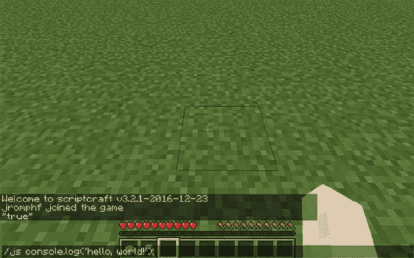

等等，它去哪了？发生了什么？看看你的终端/命令提示符窗口，你应该会在服务器输出中看到“hello, world”。很酷，但为什么它没有显示在屏幕上？严格来说，`console.log()` 方法不会将消息打印到屏幕上。在浏览器中，它会将消息打印到开发者控制台，而在 NodeJS 中，它会将消息打印到终端。这是一个用于调试程序的工具——几乎只用于这个目的。不过，它仍然非常方便。

好吧，但如果我们想实际将消息打印到屏幕上，让其他玩家也能看到——比如状态更新之类的呢？如果我们在浏览器中编写 JavaScript，就必须创建 HTML 元素来显示消息。幸运的是，ScriptCraft 有一个函数可以将内容打印到游戏内控制台。试试这个：

```
echo(self, 'hello, world');
```

很简洁！在后续的活动中，你会经常用到这个 `self` 变量，所以请记住它。

最后，如果你有 Web 编程经验，`echo` 函数还有一个别名叫做 `alert`。在浏览器中，JavaScript 的 `alert` 函数会在屏幕上显示一个警告窗口。试试看它在这里做了什么（提示：只需将 `echo` 替换为 `alert`）。

## 注释让代码更清晰


### 活动概述

想象一下：你正在编写一些代码。这些代码对你来说很有意义，但你的朋友就是看不懂。你该如何帮助他？

答案很简单：注释！注释是被编译器忽略的代码块，因此它们永远不会被执行。它们可以帮助使你的代码更清晰，甚至可以用来生成文档。你将了解如何在 JavaScript 中创建单行注释和多行注释。

### 操作说明

要在 JavaScript 中创建单行注释，请使用 `//`：

```
// 这是一个单行注释
```

要创建多行注释，请使用 `/*` 打开注释，使用 `*/` 关闭注释：

```
/* 这是一个多
行注释 */
```

值得注意的是，单行注释会将整行视为注释，因此如果你只需要注释一行中原本完美的某个部分，就必须使用多行注释。看看这个：

```
console.log("Hello " + //"World"); 哦不！这整行都成了注释！
console.log("Hello " + /* "World" */ "Steve");
>> "Hello Steve"
```

好了，看看你是否能完成这个任务：我在写这本书的时候睡着了，我的猫在键盘上踩来踩去。典型的猫行为。你能找出它“做出贡献”的所有地方，并将它们注释掉吗？试着找出哪里需要使用多行注释或单行注释。

如果我们在编写 dfdfddddfd 代码时想给自己或 eeffvv 其他人留下 sdasw 消息 fsddor，该怎么办？这里我们将看看 dfda 如何创建单行和 vvddqq mulqqdti 行注释，在

aaaaaaaaaaaaasddddddddddssssssssdddddddddddddsssdddddd sssddddsd

JavaScript 中。weeacgwComments 是 qqqw 被编译器忽略的代码块 arc e，所以它们 nggeever 不会运行。它们可以帮助 wees 使你的代码更清晰，甚至可以 bwwe 用于生成文档 qwqn。

## 变量之变


### 活动概述

就是现在——你期待已久的时刻。好吧，也许不是。但这仍然令人兴奋！你将把一些变量存储在内存中——这是编写程序的第一个真正步骤。准备好了解是什么让变量成为“变量”，以及作用域如何影响它们。

### 操作说明

在 JavaScript 中设置变量相当简单。如果你有其他语言（如 Python）的经验，你会注意到赋值变量略有不同。怎么说呢？好吧，如果你跳过了本书前面的内容（你怎么敢！），你可能已经注意到到处都是 `var` 关键字。这是什么意思？它一定与变量有关，对吧？

那么，当你在 JavaScript 中像这样声明一个变量时：

```
myVar = 1;
```

这可以正常工作，但有一个问题。如果不使用 `var` 关键字，我们就在全局作用域中创建了 `myVar`。这意味着什么？这意味着任何在 ScriptCraft 环境中运行的其他 JavaScript 代码都可以访问 `myVar`。

我知道你在想什么——这有什么大不了的？好吧，你可能喜欢冒险，但我不喜欢。如果我们在全局作用域中声明一个名字非常常见的变量，比如“input”、“output”、“array”、“file”等，我们就会面临以下风险：

a) 覆盖一个现有变量，而这个变量很可能是更大系统的重要组成部分，或者

b) 我们的变量被其他在我们之后加载的代码覆盖。哎呀！

如果我们在声明变量之前使用 `var`，它们将是块级作用域的，这意味着它们只存在于包含它们的代码块中——这一点以后会非常重要。基本上，这意味着我们声明的变量（使用 `var`）不会在声明它们的函数/循环/IF 语句之外被定义。

好的，那么让我们始终使用 `var`！下面是我们应该如何声明变量：

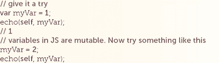

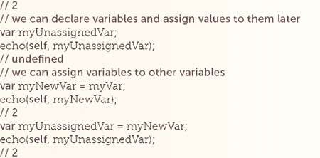

## 字符串与诸如此类


### 活动概述

字符串是 JavaScript 中非常重要的数据类型。如果你能回忆起本书开头的内容（或者翻回去看看），你就会知道字符串基本上是一串“串”在一起的字符。你将用它们来表示很多东西，比如文字文本、用户输入、配置选项等。看看它们是如何工作的！

### 操作说明

声明一个在内存中保存字符串的变量相当简单。就像这样：

```
var myString = '这是一个字符串';
echo(self, myString);
// 这是一个字符串
// 注意单引号？你也可以使用双引号
myString = "这是一个带双引号的字符串";
```

如你所见，你可以将字符串放在单引号或双引号中。使用哪种并不重要——但不能混用：

```
var anotherString = 这是一个字符串";
// 会报错！！
// 你总是需要在字符串的开头和结尾加上引号
var notActuallyAString = 这不是一个字符串
// 这不是一个字符串 未定义！
```

## 数字运算


### 活动概述

我们已经有机会了解了字符串，现在我们将看看 JavaScript 中的另一个主要原始类型：数字。JavaScript 没有整数或浮点数。相反，它有一个包罗万象的数字类型，实际上是一个双精度浮点数。

尽管这个名称听起来很酷，但你不需要知道这些——只需记住，默认情况下，JavaScript 中的数字带有小数。试试看处理数字，让计算机为你做一些数学运算。

### 操作说明


声明一个数字的写法如下：

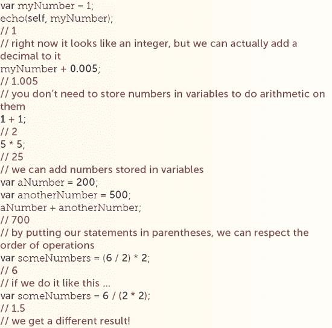

现在，是时候亲手摆弄一些数字了。我们还没有详细讲解第一章中提到的所有算术运算符——不如你来试试它们？你得到了什么样的结果？是否如你所料？有没有遇到什么奇怪的现象？

## 真与假


### 活动概述

布尔值非常重要。即使我们不直接检查某个值是否为真，也有很多时候会以更隐式的方式进行检查。我们稍后会学习这一点。现在，我们只需要了解布尔值——也就是真和假——是怎么回事。

### 操作说明

首先，让我们将一些布尔值存入变量，看看它们的行为：

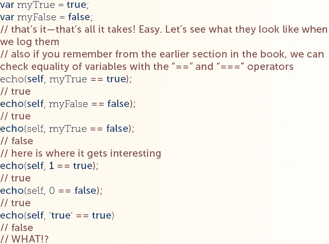

看这里！使用普通相等运算符（`==`）时，`1` 求值为 `true`，`0` 求值为 `false`。任何我们写入的字符串，用这种方式检查时都会求值为 `false`。更疯狂的是这个：

```
echo(self, 1 = = = true);
// false
```

因为，如果你还记得，严格相等运算符（`===`）会同时比较类型和值。所以，`1` 是一个数字（这还用说），但它不是布尔值，因此求值为 `false`。

## 空与无（或未定义）


### 活动概述

现在我们要看看更多的原始类型——`null` 和 `undefined`。就像我之前说的，你最常遇到的可能是 `undefined`，尤其是在你刚开始学习的时候。`Null` 不那么常见，但在需要时，它可以成为我们口袋里一个方便的工具！

### 操作说明

在 JavaScript 中，`null` 和 `undefined` 值比布尔值更直接一些。`Undefined` 会让我们夜不能寐。举个例子：

```
// 当我们忘记给引用的变量赋值，或者拼写错误时，就会看到 undefined
echo(self, aVarThatNeverWas);
// 会得到一个又大又讨厌的错误
// 下面这个也一样……
var correctSpelling = ‘something’;
echo(self, correctSpellig);
// 啊！
```

当我们犯这些错误时，出现的那个巨大而疯狂的错误叫做堆栈跟踪，它在运行时错误发生时为我们提供有用的信息。它会显示一条路径，从解释器中错误发生的位置回溯到导致错误的源代码行。非常实用！

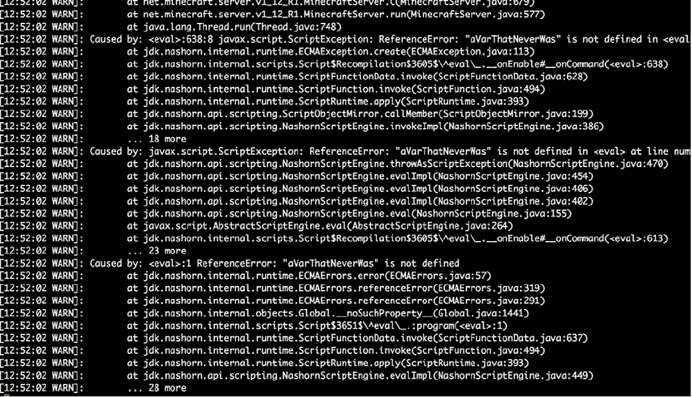

另一个你会看到 `undefined` 的情况是，当你为变量分配了空间，但没有给它赋值时。

```
var declaredButNotAssigned;
echo(self, declaredButNotAssigned)
// undefined —— 但没有那个疯狂的错误
```

现在来说说 `null`。JavaScript 程序员多年来一直在争论它的用法。这对你意味着什么？嗯，`null` 可以作为一个值，明确地表示“什么都没有”。当我们第一次设置一个变量，但还不知道它的值会是什么时（比如它会在程序后面被设置），我们可以将其值设为 `null`，这样如果属性没有被设置，我们就可以显式地检查 `null` 值。

```
var myVal = null;
// 然后稍后我们可以显式地检查 myVal ! = = null 并执行一些逻辑
```

很多库都是这样工作的。例如，如果有一个函数在数据库中搜索某个值，而该值不存在，它可能会返回 `null`。如果我们采用这种约定，就明确表示没有找到任何东西——变量应该被设置为 `null`。现在，我得说，只有当你保持一致时，使用这种模式才是好的。否则，你的代码里会到处都是 `null` 和 `undefined`！那很快就会变得非常混乱。最好的做法是选择一种适合你的模式，并坚持下去！

## 破解命名之谜


### 活动概述

现在让我们从常规编程中休息一下。到现在为止，你一定在想：“这家伙为什么总是用 likeThis 这样的变量名？”朋友们，这叫做驼峰式命名法——就像骆驼的驼峰。因为我们不能（也不应该！）在变量名中使用空格，所以必须用另一种方式来分隔单词，使名称更易读。我们也可以这样做：

`thisismyvariable`

但这有点难读。按照惯例，JavaScript 开发者在命名函数和变量时使用驼峰式。当我们学习类时，你会看到我们使用帕斯卡命名法（以 Pascal 语言命名），其中每个单词的首字母都大写，而不仅仅是第一个单词。其他语言（比如 Python）则倾向于使用蛇形命名法，即所有字母小写，单词之间用下划线分隔。这样做的主要目的，除了让代码更易读（而且这样看起来也很酷）之外，就是标准化。我们需要尽量保持一致性，这有助于其他程序员以及未来的我们自己。

### 操作说明

根据以下类型，创建变量，变量名不仅要能说明变量的含义，还要使用给定的命名法。看看这个例子：

数字（驼峰式）

```
var myInt = 1;
```

轮到你了！

- 布尔值（蛇形命名法）
- 字符串（帕斯卡命名法）
- 空值（驼峰式）
- 未定义（蛇形命名法）
- 字符串（驼峰式）
- 数字（帕斯卡命名法）
- 布尔值（驼峰式）
- 空值（帕斯卡命名法）
- 字符串（蛇形命名法）

## 玩转原始类型：第一部分——确定类型


### 活动概述

JavaScript 有很多内置函数，可以让你对原始类型做一些很酷的事情。在接触这些函数之前，先看看 `typeof` 运算符可能是个不错的主意，它实际上能告诉我们变量的类型。在实践中，你不会经常用到它，但嘿——学学也无妨。

### 操作说明

`typeof` 运算符是判断变量类型的一个非常方便的方法。例如：

```
echo(self, typeof 1);
// number
```

现在，你的任务是，如果你选择接受（你应该接受）：使用 `typeof` 语句，为每一种原始类型创建一个变量，并存入一个代表该类型的值。完成后，使用 `typeof` 运算符检查你是否正确。好了，我去喝杯咖啡——你搞定了告诉我！

## 玩转原始类型：第二部分——数字


### 活动概述

虽然我们在前面几个活动中已经摆弄过一些算术运算符，但这里我们要看看一些处理数字的内置函数。这只是冰山一角，但它们很可能会成为你编码工具箱中的关键工具。

### 操作说明

JavaScript 有一个数学类（不是那种无聊的），里面充满了非常有用的固定方法。让我们从整数开始，然后逐步深入。等等——我知道你要说什么：“JavaScript 的数字都是双精度浮点数，不是整数！假新闻！”嗯，实际上我们可以用几个方法来得到一个表示整数的数字，这样显示出来时，它看起来像 `1`，而不是 `1.000000000000000`。说实话，第一个数字看起来好多了。

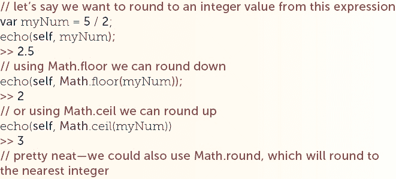

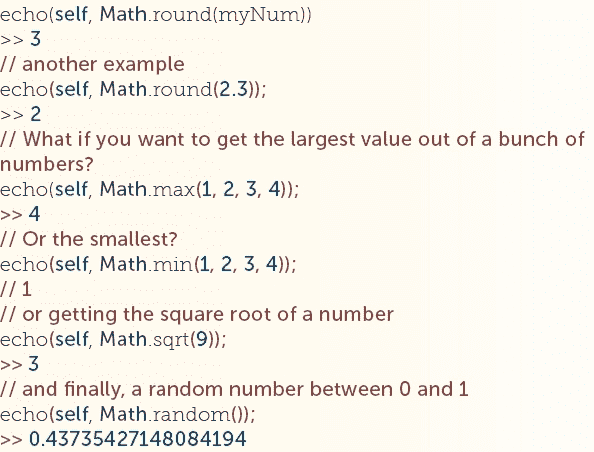

有时候，你还需要在数字和字符串之间进行转换。JavaScript 数字可以通过 `toString` 方法转换为字符串，而要将它们转换回来，可以使用 `parseInt` 和 `parseFloat`。

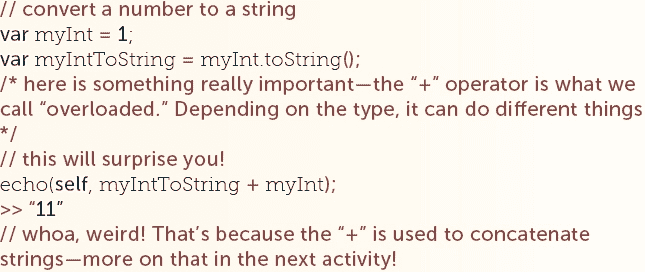

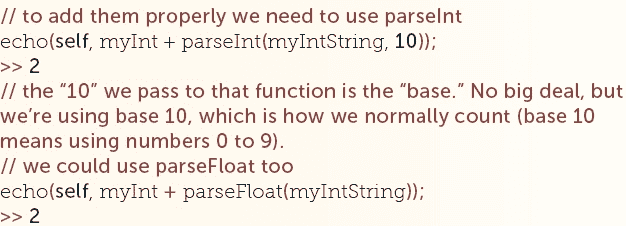

## 玩转原始类型：第三部分——字符串拼接


### 活动概述

我们已经介绍了数学类和数字。现在该关注字符串了！当你开始制作超棒的 *Minecraft* 模组时，你会编写大量的字符串，但让我们从最常见——而且名字有点奇怪——的操作开始：拼接。

### 操作说明

还记得上一个活动中，我们尝试将一个数字和一个数字的字符串表示相加时那个疯狂的时刻吗？嗯，实际上我们是在拼接两个字符串，用花哨的说法就是将它们连接在一起：

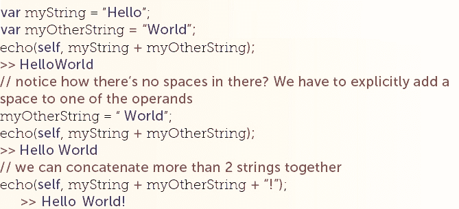


另一种拼接字符串的方法是结合使用“+”和“=”运算符。不过我们一次只能对一个字符串进行这种操作：

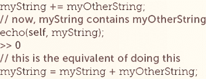

现在，来个小任务如何？我把下面这条消息打乱了：

`'soon'`, `'pretty'`, `'will'`, `'Minecraft'`, `'we'`, `'writing'`, `'in'`, `'be'`, `'code'`, `'concatenate'`, `'first'`, `'need'`, `'but'`, `'we'`, `'to'`, `'strings'`, `'these'`

你能结合我们刚刚学过的两种运算符，把这些字符串拼接起来吗？

## 玩转基本类型：第 4 部分——其他字符串方法


### 活动概述

JavaScript 内置了许多处理字符串的方法。这对你来说是个好消息！我们可以将字符串转换为大写或小写、搜索字符串、查看字符串长度、获取最后一个字符、获取第一个字符、修剪字符串、切片字符串、重复字符串……但这可不是一本关于字符串的书——而且我希望你不是在学织毛衣。让我们来看看主要的内容。

### 操作指南

假设我们想知道一个字符串中有多少个字符。我们可以使用 `length` 属性：

```
echo(self, "hello".length);
>> 5
```

你还可以使用 `substring` 方法从字符串中提取子字符串。子字符串顾名思义：字符串中的字符串。

```
// 让我们的变量带上英伦腔
var elloGovnah = "hello".substring(1,5);
echo(self, elloGovnah);
>> ello
```

`substring` 方法返回 `"hello"` 字符串的一个子字符串，从索引 1（e）开始，到索引 5（o）结束。（别忘了索引从 0 开始，所以实际位置要加 1！）

如果我们想确认单词是否以某个字母开头呢？很简单！

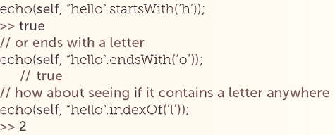

等等——什么？返回 2？为什么不是“true”？那是因为我们使用了 `indexOf` 方法，它——你猜对了——返回查询字母首次出现的索引。这意味着什么？它返回的是字母在字符串中的位置，而不是字母本身。

现在轮到我最喜欢的方法了：`split` 方法，它将引导我们进入下一个关于数组的活动。`split` 方法在指定的字符索引处拆分字符串，并返回一个数组，包含该字符每次出现前后的所有元素。它的工作原理是这样的——假设我们想在 `"hello"` 的 `"e"` 处拆分：

```
// h <- | -> llo
var mySplit = "hello". split("e");
>> ["h", "llo"]
```

我们最终得到一个像这样的数组：`["h", "llo"]`。它有两个元素：第一个是 `"e"` 之前的所有字符（`"h"`），第二个是 `"e"` 之后的所有字符（`"llo"`）。注意，用于拆分的字符 `"e"` 不会包含在最终数组中。这一点很重要！

好了，我需要你帮我拆分一些内容。首先，把 `"hello, world"` 拆分成两个单词。

别忘了空格！

接下来，我想让你把这个字符串拆分成三个独立的句子：

```
I have to look through my inventory before I head to Blackrock Mountain I have three blocks of redstone, some glowstone dust, and a map maybe I need some snacks, too.
```

## 集合：数组与对象

我们刚刚经历了很多内容，不是吗？干得好！你可能想去拿瓶佳得乐什么的——编程很消耗精力，尤其是手指。

现在我们将学习 JavaScript 提供的一些更高级的数据结构：数组和对象。一旦学会，这些工具将永远是你的得力助手。数组和对象对于在程序中存储和移动数据至关重要。一旦掌握了它们，你就会在一切地方使用它们。

我们先从基础开始——构建数组和对象，并了解 JavaScript 所有用于操作它们的内置方法。然后，我们将利用 ScriptCraft 强大的 drone 和 items 模块做一些更实际的事情。我们将练习放置方块数组，以及创建一个“愿望清单”数据结构，为不同类型的玩家存储一系列物品。

### 数组入门


#### 活动概述

我们现在开始学习数组。首先，我们将了解如何构建数组，以及如何添加和删除元素。系好安全带！

#### 操作指南

在 JavaScript 中，有多种构建数组的方法：

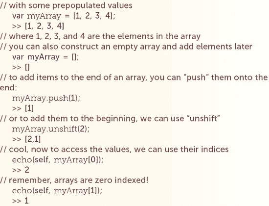

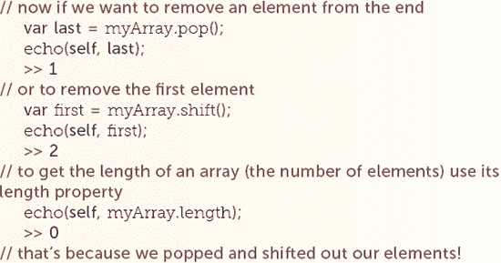

### 方块派对


#### 活动概述

很多时候，你不需要遍历整个数组（我知道，我知道，我很快就会教你如何遍历），而只需要访问中间某个位置的值。在这里，我们将从一个彩虹色方块数组中获取不同的方块。

#### 操作指南

首先：ScriptCraft 提供了大量有用的模块供我们使用。其中一个我们会经常用到的是 `blocks` 模块，它存储了 *Minecraft* 中所有方块和物品的数据值，并配有易于理解的属性名称。顺便提一下，你可以在这里找到原始数据值：[`minecraft.gamepedia.com/Java_Edition_data_values`](https://minecraft.gamepedia.com/Java_Edition_data_values)。

让我们从 `rainbow` 属性开始，它是一个包含彩虹七种颜色的数组：

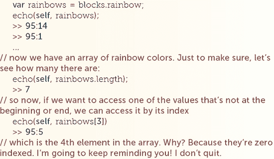

太好了，这样我们就可以访问一些方块了。没什么大不了的！我知道你还没被打动，但你会被打动的。我们为什么不把这些方块添加到我们的世界中呢？

要添加方块，我们将使用 ScriptCraft 的 `drone` 模块，它有点像我们可以编程的机器人，可以在世界中移动并建造结构。现在，我们只需创建一个新的 drone 实例，并放置一些彩虹方块。

```
// 要创建一个新的 drone 对象实例，使用 drone 构造函数
var drone = new Drone(self);
```

`Drone` 构造函数接受一个位置（稍后详述）或你的 `self` 变量作为参数。它会返回一个位于你当前位置（`self.location`）或你传入位置的新 drone。我们以后有的是时间深入研究 drone，但现在先保持简单。让我们在准星处放置一个方块。

```
drone.box(rainbows[3]);
```

这会在准星处放置一个 1x1x1 的绿色方块——太棒了！再来一个：

```
drone.box(rainbows[1]);
```

尝试放置所有其他颜色的方块。你可以把它们叠在一起，或者放在任何你喜欢的地方。接下来，我们将学习如何连续放置多个方块。

### 键、值与对象


#### 活动概述

别担心，我们还没和我们的好朋友数组先生告别，我只是想让你认识另一位好朋友——对象女士，她对于理解 JavaScript 的核心至关重要。我知道，我有点夸大其词了——或者并没有？

#### 操作指南

在最简单的层面上，JavaScript 对象就是键值对。与具有数字索引的数组不同，对象的值是通过键来索引的。这些键通常是字符串，但也可以是数字。

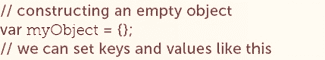

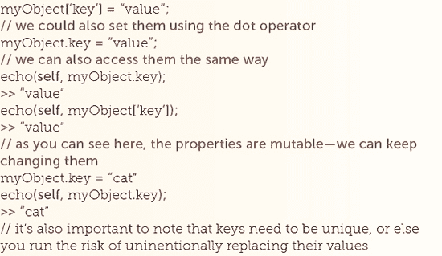

我们还可以使用所谓的对象字面量，如果已经有已知的值要设置，这会很方便：

```
var literal = { key: "value" };
// 注意这里的 "key" 不需要加引号
// 要添加多个属性，用逗号分隔
literal = { key: "value", otherKey: "other value" };
// 我们可以通过索引或点运算符添加更多属性，后者更常见
literal.anotherKey = "another value"
```

还记得我说过“我不想让任何人知道我的库存”吗？我撒谎了。你能帮我创建一个包含以下属性的对象吗？

- 荧石粉：5，
- 红石块：3，
- 地图：1

### 愿望清单


#### 活动概述


你可能觉得自己现在已经很擅长处理对象了，确实如此。但让我们通过探索 ScriptCraft 的 `items` 模块来进一步提升对象技能，这个模块和 `blocks` 模块一样，将物品数据值很好地映射为人类可读的属性。我们将编译一个愿望清单对象，里面包含我们希望放入库存的所有物品。

## 操作说明

`items` 模块是一个大对象，其中每个“键”或属性都是一种物品类型。然而，与 `blocks` 模块不同，这些属性实际上并不是真正的属性。它们其实是方法——准确地说，是静态方法。当我们开始编写自己的类和原型时，方法的概念会更容易理解。现在，我们不必担心它们的内部工作原理。我们只想获取一些物品！

这里我们要做一些新的事情。因为 `items` 模块默认没有加载，我们必须自己显式加载它。幸运的是，ScriptCraft 使用了一个类似 NodeJS 中 `require` 的模块。要加载一个模块，我们输入以下代码：

```
var items = require('items');

// 让我们先创建愿望清单对象：

var wishlist = {};
```

`items` 模块中的每个方法要么返回与某个物品对应的单一材料，要么返回一个 `ItemStack`（这是一个包含多个物品的 Java 类）。

```
// 获取一个物品

echo(self, items.book());

>> BOOK

// 返回一个类型为 BOOK 的材料

// 如果我们传入一个数字作为参数，就会得到 n 本书

echo(self, items.book(2));

>> ItemStack{ BOOK x 2 }
```

因为对象可以将任何值存储为属性，所以我们实际上可以将物品方法的返回值存储到愿望清单中。例如，如果我想要 5 本书：

```
wishlist.books = items.book(5);

echo(self, wishlist.books);

>> ItemStack{ BOOK x 5 }
```

所有我们能访问的物品都可以在这里找到：[`hub.spigotmc.org/javadocs/spigot/org/bukkit/Material.html`](https://hub.spigotmc.org/javadocs/spigot/org/bukkit/Material.html)

请记住，`items` 模块中的所有内容都采用驼峰命名法，所以如果你想在愿望清单中添加一个 `SLIME_BALL`，你应该使用 `items.slimeBall` 方法。好了，现在去整理你的愿望清单吧！

这是你第一次看到用全大写字母和下划线分隔符命名的变量名。实际上，所有这些物品材料都是我们所说的常量。常量是一种特殊的变量，其值不会改变（也称为不可变），并且其名称只能声明一次。全大写命名常量的约定是许多语言通用的做法。不幸的是，在我写这本书的时候，Nashorn 还不支持常量，但 ES6 的 JavaScript 支持。正如你稍后会看到的，如果我们把一个变量命名为 `LIKE_THIS`，至少可以表明我们意图将其视为常量。如果这样做，其他看到我们代码的开发者应该会尊重这个约定，不去修改它。

好了，各位，这就是数组和对象！这肯定不是我们最后一次见到它们。实际上，我们才刚刚开始！一旦我们进入控制流和迭代，你将能亲眼见证这些数据结构的真正威力。正如你已经看到的，编程概念都是相互构建的。你学得越多，你的工具集就越庞大。这就像你在《我的世界》中的库存——你可以组合数据结构、函数和模式，创造出非常酷且有用的东西！

## 控制流，外加一个 IDE！

现在是时候控制我们代码的流程了。我们将学习 `if` 语句，这是一段非常重要的代码，它允许我们在程序中加入逻辑。之后，我们需要稍微绕道去设置一个 IDE（集成开发环境——基本上就是文本编辑器的花哨名称），这样我们就可以编写超过一行的代码了。这是《我的世界》命令提示符的一个不幸限制——但正如你将看到的，将所有代码写在一个文件中，然后导入到 ScriptCraft 中运行，这种方式要容易得多。

我们还将学习 `switch` 语句，它是编写分支代码的另一种方式。我们还会设置一个自定义的 ScriptCraft 插件，用来存储我们所有的代码。一切进展顺利！我们真的开始取得进展了——每一项活动都让你离自己的《我的世界》模组更近一步。

### 强大的 IF 语句


#### 活动概述

既然你已经掌握了数据类型，是时候尝试一些逻辑了。正如你已经知道的，我们使用 `if` 语句来控制程序的流程，让程序根据某些条件分支并执行不同的任务。

我们将尝试使用 `if` 语句，并根据我们计划如何玩《我的世界》来创建一些自定义的愿望清单。

#### 操作说明

基于上一个活动中的愿望清单，我希望你为三种类型的普通玩家创建三个小愿望清单：一个想要进行任务的玩家，一个想要建造东西的玩家，以及一个只想探索的玩家。将它们存储在名为 `questList`、`buildList` 和 `exploreList` 的变量中。

现在你要做的是，假设一个新用户输入了一些信息来指定他或她是什么类型的玩家。这些信息将存储在一个 `playerType` 变量中。

```
// 例如

var playerType = 'quest';

// 其他选项可以是 'build' 和 'explore'

// 让我们先声明一个空的愿望清单

var wishlist = null;
```

记住，我们显式地将愿望清单声明为 `null`，这样以后就可以检查它。这也表明我们的意图：在决定玩家应该拥有哪种类型的清单之前，愿望清单将是空的。这取决于他或她想要如何玩游戏！

现在，我们来一个快速（但必要）的绕道。到目前为止，我们编写的代码都可以放在命令提示符的一行中。不幸的是，命令提示符无法处理跨越多行的代码。在 JavaScript 中这其实没问题，因为解释器不关心换行或空白，不像其他一些语言。对于这个活动，你将在单行上编写 `if` 语句，但从下一个活动开始，你将真正开始在 IDE 中编写代码，这样阅读和理解起来会更清晰——而且你还可以保存你的工作！

既然我已经把这点说清楚了，让我们来编写第一个 `if` 语句。

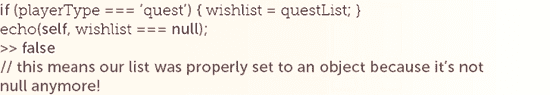

这一小段代码中有很多内容需要解析。首先是 `if` 语句，它看起来像这样：

```
if (condition) { code that gets executed }
```

所以如果条件满足，计算机将执行花括号中的任何代码。如果条件不满足，计算机将继续执行程序的其余部分。让我们看看如果改变 `playerType` 并使用相同的 `if` 语句会发生什么：

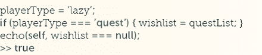

看到了吗，程序直接跳过了 `if` 语句中的那个代码块。明白了吗？现在尝试改变你的玩家类型，并为另外两个清单编写 `if` 语句。

### 设置 IDE


#### 活动概述

我们将花时间下载并安装一个 IDE，以帮助我们编写代码和组织项目。我们将安装 GitHub 的 Atom IDE，这是一个不错的开源程序（而且更好的是，它是免费的）。如果你不喜欢 Atom，我还会提供一些替代方案。

#### 操作说明

安装 Atom

1. 从 [`atom.io`](https://atom.io) 下载 Atom

   a. 在 Mac 上，打开 DMG 文件并将 Atom 移动到你的应用程序文件夹。

   b. 在 Windows 上，打开并运行安装程序

打开项目文件夹

1. 点击 File → Add Project Folder。

2. 导航到你的 `spigotmc` 目录。

3. 打开 `ScriptCraft` 目录。

4. 点击 `plugins` 文件夹并选择 Open。

创建新文件


1.  现在，在左侧你应该会看到一个名为“Folders”的文件夹。其下方应该是 plugins 文件夹。里面有许多子文件夹，以及扩展名为 `.js` 的 JavaScript 文件。右键点击 plugins 文件夹图标，选择“新建 -> 文件”。

2.  系统会提示你为文件命名。我们取一个独特的名字，以便与其他文件区分开来。比如 `{你的名字}-exercises.js`？那么，我的文件就是 `josh-exercises.js`。很好！现在我们可以开始向文件中添加代码，并直接在 *Minecraft!* 中运行它。

如果你不太喜欢 Atom 作为 IDE，这里列出了一些其他编辑器及其链接。注意——我们不会使用任何 Atom 特有的功能来制作 *Minecraft* 模组，所以你可以使用任何你喜欢的文本编辑器：

- VSCode：[`code.visualstudio.com`](https://code.visualstudio.com)
- Sublime Text：[`www.sublimetext.com`](https://www.sublimetext.com)
- WebStorm：[`www.jetbrains.com/webstorm`](https://www.jetbrains.com/webstorm)
- TextWrangler（Mac）：[`www.barebones.com/products/textwrangler`](https://www.barebones.com/products/textwrangler)
- Notepad++（Windows）：[`notepad-plus-plus.org`](https://notepad-plus-plus.org)

## 创建 ScriptCraft 插件


### 活动概述

由于 *Minecraft* 控制台只允许我们在单行上编写代码，我们将编写一个快速函数，以便运行更复杂的多行代码。这里我们会简单涉及函数编写，但深入探讨还需稍等片刻！

每次刷新 ScriptCraft 时，`scriptcraft/plugins` 文件夹中的所有内容都会加载到 *Minecraft* 中。这意味着我们在 `{你的名字}-exercises.js` 中编写的所有函数都将位于全局命名空间中。什么意思？还记得我们讨论过使用 `var` 来限定变量作用域，以避免“污染”全局命名空间吗？这里正好相反——我们所有的函数名和变量都将是全局的。我们可以改为编写一个包含局部函数的对象——基本上就是我们之后所有的练习。这样就不会产生冲突。听起来有点复杂，但相信我，没那么糟糕！

### 操作说明

让我们打开那个 `{你的名字}-exercises.js` 文件。我们将创建一个对象字面量，但它看起来会和我们习惯的略有不同：

```
exports.exercises = {};
```

这里我们是将练习添加到 `exports` 全局对象中，这样 `exercises` 对象中的所有内容都会自动加载到 ScriptCraft 中。现在，我要稍微修改一下代码——我们将把所有函数都放在对象字面量中，像这样：


记住，函数就是可以通过名称调用的模块化代码块。在接下来的几个练习中，我们的函数都不会接受任何参数，也不会返回任何值——它们只会执行我们的代码。让我们修改 `helloWorld` 函数，让它向屏幕输出一些内容：

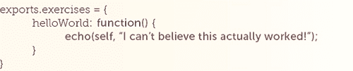

现在，如果我们回到 *Minecraft* 并打开控制台，只需输入：

```
/js refresh();
```

这将重新加载所有 ScriptCraft 插件。现在我们应该可以从控制台调用我们的函数了：

```
/js exercises.helloWorld()
```

>> “我真不敢相信这居然成功了！”

这就是我说的！现在我们可以处理更复杂的程序并保存我们的工作了！

当我们想添加更多练习时，只需用逗号分隔它们：

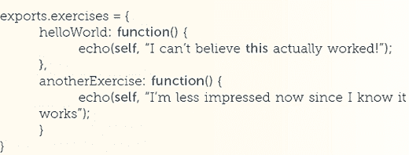

## 分支扩展


### 活动概述

信不信由你，我们做了这么多只是为了搭建这个活动。虽然过程繁琐，但嘿，现在我们准备好了！我们将通过添加 IF、ELSE-IF 和 else 语句的分支逻辑，把这个愿望清单示例再推进几步。

### 操作说明

让我们在 `exercises` 对象字面量中创建一个新函数，命名为 `ifStatement`。

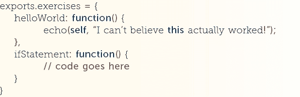

现在，我们将三个愿望清单放入 `ifStatement` 函数中。记住，我们需要三个对象字面量，每个都包含精心挑选的物品：*build、quest 和 explore。* 你还应该添加第四个，名为 *generic。* 如果我们的假设用户不想局限于其他类型，这将作为默认愿望清单。你可以在里面随便放几个随机物品。你还应该为每个清单添加一个属性。我们将为它们分配一个 `type` 属性，以便检查我们实际拥有的是哪种类型的愿望清单。现在你应该得到类似这样的内容：

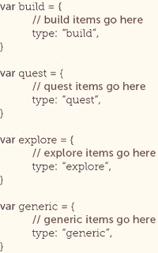

太棒了！记住，因为我们使用了 `var`，所有这些对象都是 `ifStatement` 函数的局部变量，默认不会加载到 ScriptCraft 的全局命名空间中。现在让我们为 `playerType` 设置一个虚拟变量，并初始化一个空的愿望清单：

```
var playerType = "build";
var wishlist = null;
```

现在我们可以编写条件语句了。让我们从一个我们已经做过的开始：

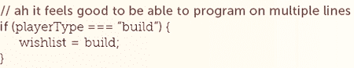

现在，我们可以像这样在代码中添加多个 IF 语句，几乎可以达到预期效果：

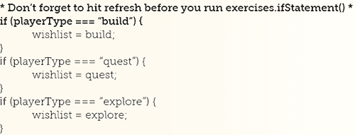

但是我们在哪里设置通用愿望清单呢？我们希望在没有用户输入时，它成为默认愿望清单。嗯。好吧，你可以在 IF 语句后面加上一个 else 分支。如果条件不满足，就会执行那个 else 分支，还记得吗？

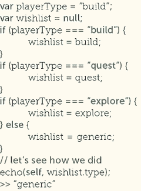

什么？不！发生了什么？我们设置 IF 语句的方式并没有完全实现我们的目标。程序目前的流程是这样的：

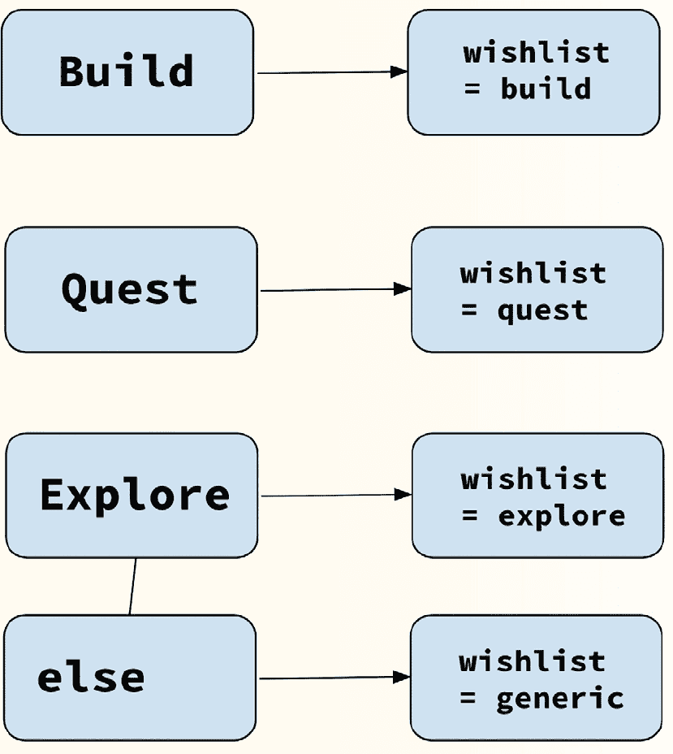

如果玩家类型是 build --> 将愿望清单设为 build

如果玩家类型是 quest --> 将愿望清单设为 quest

如果玩家类型是 explore --> 将愿望清单设为 explore

如果玩家类型不是 explore --> 将愿望清单设为 generic

哎呀。你能发现问题吗？因为每个 IF 语句都是独立执行的，else 分支只附加在 `if (playerType === "explore")` 条件上。即使我们的愿望清单被设为 build，最终也会被设为 generic，因为 `playerType` 不是“explore”。明白了吗？试着把 `playerType` 改为“explore”，你就会明白我的意思——现在你应该得到一个类型为“explore”的愿望清单。

我们本应使用 ELSE-IF 语句，这样可以将语句链接起来，而 else 分支只有在 `playerType` 不是 build、quest 或 explore 时才会执行：

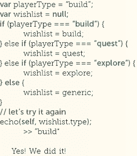

## 老式切换


### 活动概述

我们将把之前的 IF … ELSE-IF … else 流程转换为 switch 语句。听起来很兴奋，对吧？怎么，你不觉得吗？其实这很酷，因为你很快就会发现，解决同一个问题有多种方法——而且一种解决方案往往并不比另一种“更好”。

### 操作说明

让我们先在 `exercises` 中添加一个名为 `switchCase` 的函数。

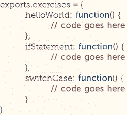

别忘了所有这些函数都需要用逗号分隔！虽然还有更好的方法，但现在我们只需从 `ifStatement` 函数中复制粘贴我们的愿望清单到这个函数中。现在我们应该得到类似这样的内容：

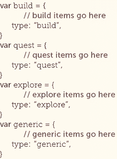

现在，我们将愿望清单变量设为 null，并添加一个设置为“build”的 `playerType` 变量。同时，我们也要搭建 switch 的基础结构。

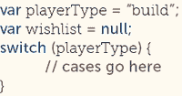

首先——switch 语句接受一个表达式作为参数。它始终是你想要检查的变量，在我们的例子中是 `playerType`。然后我们在花括号内编写 case 分支——这些 case 就像 IF 语句中的 `(playerType === "build")` 条件：

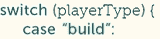

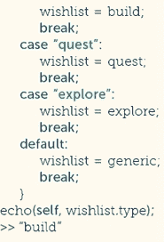


除了那些 `break` 语句之外，大部分内容都相当不言自明。因此，对于匹配的 case，会执行其后的所有代码。与 IF 语句不同，我们必须使用 `break` 语句来显式地“跳出”该 switch，并返回到执行其余代码。另外，你会注意到 `default` case——它的作用与上一节中的“else”完全相同。很简单，对吧？

你听说过空中交通管制员，对吧？好了，学完这一节后，你就好比代码交通管制员！你现在知道如何控制程序的流程了。IF 和 switch 语句可能仍然感觉有点别扭，但随着你开始练习使用它们，它们会变得得心应手。练习还会让你掌握在特定场景下哪种方式最有效的技能。就像我之前说的，用编程解决问题不一定有正确和错误之分，尤其是在你刚开始的时候。有时可能有更好的方法，如果你遇到困难，你并不孤单！即使是专业程序员也一直在寻找改进代码性能和可读性的方法。

## 迭代

我希望你准备好了，因为现在我们开始进入编程的核心部分！与分支逻辑（IF 语句）一起，迭代是编程的主要支柱之一。它正是让编程如此强大的原因。想想看：假设你需要重命名一个目录中的五百个文件并将它们移动到别处。这不仅 a) 需要很长时间，而且 b) 极其繁琐且容易出错。计算机从不疲倦，而迭代正是让它们工作的原因！

我们将从 FOR 循环开始，它可以说是最常用的迭代形式。我们还会看看 while 循环、使用 `for...in` 遍历对象，以及使用 `Array.forEach` 方法进行函数式编程。为了完成所有这些，我们还将开始研究函数，因为我们需要在 `Array.forEach` 中使用它们。我们将通过 ScriptCraft 看一些更实际的例子。曾经想过用物品填满你的库存吗？我们会做到的。曾经想过炸掉地图上的每一个怪物吗？我们也会做到的。这一切都归功于迭代的力量！

### 强大的 FOR 循环


#### 活动概述

受够了这种“一次只做一件事”的方式。那已经是上一页的事了。也许是两页。无论如何，一旦我们学会如何编写循环，我们的生活将永远改变。好吧，也许我有点夸张……但我绝对没有。FOR 循环是我们在 JavaScript 中处理迭代的众多方法之一。它可能是最复杂的，但从性能角度来看，它是最快的。

#### 操作说明

你懂的——在 `exercises` 对象中添加另一个名为 `forLoop` 的函数。我们将回到我们信赖的 `blocks.rainbow` 数组并对其进行迭代。一个 FOR 循环看起来像这样：

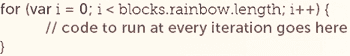

哇，看起来有点复杂，对吧？让我们分解一下括号里的内容。

- `var i = 0;`——我们可以给这个变量起别的名字，但你很可能会经常看到“i”。为什么？因为我们实际设置的变量是 FOR 循环中的 `index`（索引），而 index 以“i”开头。你也可以叫它“index”，但在 FOR 循环中，较短的变量名更方便，因为我们会经常引用索引。
- 现在我们知道，“i”是我们的索引，我们将其设置为 0——数组的开头。
- `i < blocks.rainbow.length;`——这是我们在每次迭代时检查的条件，它告诉解释器何时停止迭代并跳出循环。基本上我们只是在说：只要我们的索引小于数组的大小，就继续迭代。
- `i++`——这是我们在每次迭代后将索引增加 1 的地方。这非常重要——如果不设置它，我们就会陷入无限循环，这会锁住我们的程序并让它永远运行下去。这听起来很酷——但目前对我们来说没什么用。

在花括号内，我们可以访问“i”变量，然后根据索引的当前值，用它来访问 `blocks.rainbow` 数组中的元素。例如，在第一次迭代中，索引的值为 0。这意味着我们可以通过索引获取 `blocks.rainbow` 数组中的第一个元素：

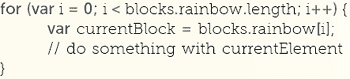

就是这样——这就是遍历数组并访问其所有元素的一种方法。让我们用无人机来可视化一下。

我们可以在 FOR 循环外部初始化无人机，因为我们不需要为每次迭代都构造一个新的：

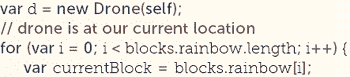

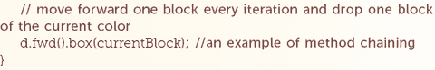

如果一切按计划进行，你应该会看到一排七种不同颜色的方块出现在你面前。如果这都不算神奇，那我就不知道什么才算神奇了。

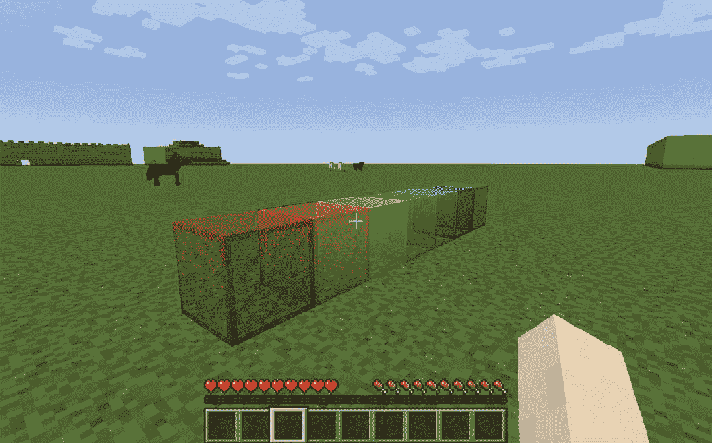

### 强大的 While 循环


#### 活动概述

不甘示弱，while 循环和 FOR 循环一样出色。希望你喜欢上一个活动，因为这里又来了——这次使用 while 循环。你会亲眼看到两者有些不同。决定使用哪一个——以及何时使用——是需要通过练习来掌握的。然而，和其他所有事情一样，一种方式并不比另一种更好，只是可能更适合当前的情况。

#### 操作说明

在 `exercises` 中创建一个新函数，命名为 `whileLoop`。继续设置一个无人机，以及一个索引变量。

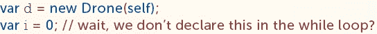

不，我们不需要。while 循环在满足条件时运行。我们只需将条件传递给 while 循环。如果你还记得上一节，我们必须自己处理索引（`i`）的递增。

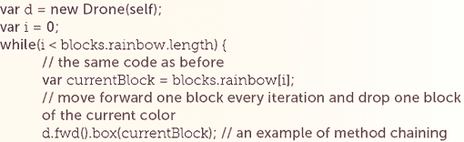


### 填充库存（又名作弊）


#### 活动概述

还记得我们之前整理的那些愿望清单吗？好吧，它们又回来了！我们将稍微清理一下代码，以便遵循 DRY 原则（不要重复自己），这样我们就不必一直复制粘贴它们到函数中了。完成后，我们将学习如何遍历对象属性，并实际用愿望清单中的物品填充我们的库存。是的，你真的可以做到！

#### 操作说明

让我们看看我们的 `exercises` 对象。与其将愿望清单复制粘贴到多个函数中，有没有办法只写一次，然后从所有函数中访问它们？如果你想到“为什么不把它们作为属性存储在 `exercises` 对象中”，那你就可以得到一颗金星！我们可以有深度嵌套的对象，这意味着一个对象可以包含另一个对象，而另一个对象又可以包含另一个对象……

让我们在 `exercises` 对象的顶部添加一个名为 `wishLists` 的对象字面量，并将所有愿望清单添加到其中：


现在，任何时候我们想在练习中访问它们，就调用 `exercises.wishLists`；对于特定的愿望清单，我们调用 `exercises.wishLists.build`，依此类推。

让我们在下面再创建一个练习函数，命名为 `populateInventory`。我们需要做的第一件事是加载库存模块。我们会在练习中再次用到它，所以让我们在文件顶部 `require` 它。同时，我们还需要加载物品模块，因为我们的愿望清单依赖于它。


那么，从哪里开始呢？让我们访问我们的库存并将其引用存储在一个变量中：

```
var myInventory = inventory (self);
```

库存模块由一个函数组成，该函数接受一个玩家或 NPC（非玩家角色）作为参数。它返回一个表示该玩家或 NPC 库存的对象，并包含三个方法：`add`、`remove` 和 `contains`。让我们也存储一个对建筑愿望清单的引用，这样我们就不必一直输入 `exercises.wishLists.build`：


现在我们可以遍历愿望清单了！为此，我们将使用 `for...in` 循环。这是 Nashorn 中一个相当新的特性，非常方便。它看起来像这样：

```javascript
for (var key in buildWishList) {
  // 在这里用 key 做一些操作
}
```

哇，这比普通的 `for` 循环清晰多了。`for...in` 循环会遍历对象的属性。它不会直接给出对象的值，而是给出属性的名称（即它的键——这解释了变量名的由来），然后我们可以用这个键从 `buildWishList` 中访问对应的值。例如：


你应该能获取到构建愿望清单的所有键和值。很酷吧！现在，作为拼图的最后一块，让我们调用 `myInventory` 的 `add` 方法，将愿望清单中的每个物品添加进去：


恭喜，你现在已经物品满仓了——不用谢我！

## forEach：第一部分——回调函数


### 活动概述

在 JavaScript 中，还有另一种遍历数组的方法，它可能比前两种更难理解。不过我觉得你能掌握，但最好还是系好安全带！在 JavaScript 中，数组实际上有一个名为 `forEach` 的方法，它会遍历数组中的每个元素，并对每个元素调用一个提供的函数。这个函数就是所谓的回调函数，即作为参数传递给另一个函数，并在该函数内部被调用的函数。听起来有点绕，但一旦你看到它的实际应用，就会明白多了。

既然我们一直在做这些欢乐的彩虹主题内容，不如用 `forEach` 方法来做点……更黑暗的事情。我们要炸掉世界中的每一个实体！哇哈哈哈！首先，我们需要编写回调函数，它会在每个实体的位置生成一个爆炸。

### 操作说明

在本活动的第二部分，我们将编写 `forEach` 方法，它会向我们的函数提供所需的实体信息。但首先，让我们在 `exercises` 对象中创建一个名为 `forEach` 的新函数。

好了，这是我们第一次定义一个接受参数的函数。我们把它叫做 `blowUpEntity`。


这个例子可以称为一元函数，因为我们只传递了一个参数（明白了吗？就像“uno”一样）。如果你想向函数传递多个实体，只需将它们放在括号内即可。例如：


实际上，`forEach` 方法会向其提供的回调函数传递三个参数：元素、元素的索引，以及调用 `forEach` 方法的数组本身。

目前，我们只关心实体。每个实体都有一个 `location` 属性，我们将用它作为爆炸的位置。`createExplosion` 方法实际上属于 `World` 类，我们可以通过 `self` 变量获取它。


好了，我们只需要输入这些代码，就能造成各种破坏和财产损失……当然，仅限于《我的世界》中。

`World` 类有大量对我们有用的方法和属性。如果你不信，可以查看 SpigotMC API：[`hub.spigotmc.org/javadocs/spigot/org/bukkit/World.html`](https://hub.spigotmc.org/javadocs/spigot/org/bukkit/World.html)。试试其中的一些方法，看看会发生什么！

## forEach：第二部分——方法


### 活动概述

在上一活动中，我们编写了一个函数，用于在实体位置将其炸毁。现在，我们将使用 `forEach` 方法来炸毁世界中的所有实体。我们将使用 `World` 类的另一个方法来获取所有实体。

### 操作说明

到目前为止，我们应该有这些代码：


由于我们在 `forEach` 练习函数的作用域内声明了 `blowUpEntity` 函数，它只在局部可用。这很好，因为能力越大，责任越大！

要获取世界中的所有实体，我们只需调用 `getEntities` 方法。

```javascript
var entities = world.getEntities();
```

等等！我们的角色也是一个实体。幸好，还有一个不同的方法：`getEntitiesByClass`。我们需要稍微费点功夫，避免炸到自己（但如果你觉得无所谓，也可以试试上面的方法）。

ScriptCraft 和 Nashorn 的一个很棒的地方是，我们可以将 Java 类和函数导入到 JavaScript 代码中。由于 `getEntitiesByClass` 方法需要一个 Java 类类型作为参数，我们必须将类导入到程序中。假设我们只想炸掉所有怪物（猪和马从未伤害过任何人）。

要在 JavaScript 中加载 Java 类，我们可以这样做：

```javascript
var Monster = Java.type('org.bukkit.entity.Monster');
```

这样就成功地从实体包中加载了 `Monster` 类型。现在，我们只需获取一个包含所有怪物的数组：


基本上就是这样——当我们调用 `forEach` 练习函数时，你可能会开始看到并听到很多爆炸声。确保你不要离任何怪物太近！

作为参考，以下是完整代码：


哇！迭代真的很酷，不是吗？你现在可能正在想，自己能用它做多少疯狂的事情。如果还没想到，那就让创意自由驰骋吧！你刚刚打开了一扇通往无限迭代可能性的大门。

就像 `IF` 和 `switch` 语句一样，迭代并没有绝对的正确或错误方式。重要的是让一切清晰且一致。在进入下一小节之前，或许你可以花点时间多玩玩迭代。这是比较难掌握的概念之一，但所有这些都像骑自行车一样。随着练习越来越多，你很快就会成为高手！

## 函数与事件驱动编程

JavaScript 支持多种编程范式，包括面向对象编程、函数式编程和事件驱动编程。在本节中，我们将深入探讨函数，它有助于我们清理代码并使其更加模块化。我们还将了解事件驱动编程，这是软件开发（包括游戏）的重要组成部分。你可能会问，为什么？因为你永远不知道玩家会做出什么样的选择，而如今的游戏往往是非线性的。通过事件，我们可以等待并监听特定事件的发生，然后相应地处理它们。处理这些特定事件（或事件，正如其名）的方式就是使用函数。看，它们是如何结合在一起的？

## 返回发送者


### 活动概述

现在你肯定已经很擅长编写函数了。然而，我们还没有涉及的一个方面是编写一个返回值的函数。从函数中返回值就像往自动售货机里塞钱，然后拿回一包薯片。只不过，在函数运行后，你可能还是会饿。

到目前为止，我们使用了具有返回值的函数，并将它们存储在变量中。函数可以返回任何东西——字符串、数组、对象，甚至其他函数！我们将进一步扩展这个自动售货机的比喻，创建一个函数，该函数返回用户指定数量的特定物品。

### 操作说明

第一步是创建我们的函数——我们将其命名为 `functionReturn`。这次它会有点不同，因为它将接受两个参数：


这个应该很简单！用户只需以驼峰式字符串的形式传入物品类型的名称——我想吃一个 `bakedPotato`——以及他或她想要的烤土豆数量：


这看起来可能有点疯狂，但我们做的事情其实非常直接。我们通过提供的 `property`（或 `key`）从 `items` 对象中访问 `itemType` 值。然后我们调用这个值（它是一个方法），并将物品数量作为参数传入。让我们看看在 *Minecraft* 中运行代码会发生什么：


相当简洁，但有点无聊。我们不妨让函数返回另一个函数，这个函数会在我们调用时，在我们所在的位置直接掉落 `nPotatoes`。


现在，要实际使用这个函数，我们可以将返回值存储在一个更有意义的变量名中：

```
var gimmePotatoes = exercises.functionReturn('bakedPotato', 20);
```

现在，当我们四处走动时，只需在需要时调用 `gimmePotatoes` 即可。

```
gimmePotatoes(); // 立刻给我二十个烤土豆！递黄油过来！
```

好了，我现在已经吃腻土豆了——如果我们不总是想要二十个呢？能换换吗？哦，当然可以：


匿名先生


## 活动概述

在本活动中，我们将处理两个概念——首先，我们将开始使用事件驱动编程，以便监听从 SpigotMC 分发（发送）的事件。我们还将使用匿名函数来响应这些事件。

事件驱动编程是 JavaScript 的另一个核心范式，事件作为某种输入或用户操作的结果被发出或分发。事件由监听器拦截，监听器进而触发一个回调函数（CB），该函数通常将事件的相关信息作为参数。这听起来相当复杂。所以忘掉它吧——用更简单的方式思考。想象一下消息传递：一条消息被发送给所有等待该消息的接收者，每个接收者在收到消息后都会做一些事情。

在 JavaScript 中，使用匿名函数作为回调（事件处理程序）非常常见。匿名函数就是那些没有绑定到名称的函数，它们在调用时被实例化，并在不久后被垃圾回收。

简化的事件驱动范式看起来像这样：


（一个事件可以有多个监听器，每个监听器都有自己的处理程序。）

还记得你库存里那些土豆吗？让我们编写一个小函数，监听每次 SpigotMC 的 `PlayerItemConsumeEvent` 被分发。我们将用一个匿名函数来处理这个事件。我们可以在该函数中做任何想做的事，那么为什么不看看声音模块，然后播放一个声音呢？

### 操作说明

幸运的是，ScriptCraft 有一个非常好的事件处理模块。让我们在 `{你的名字}-exercises.js` 文件的顶部导入它，同时我们也可以导入声音模块。


你现在已经熟悉流程了：我们首先在 `exercises` 中添加一个名为 `functionAnonymous` 的函数。现在我们需要为“吃”事件添加一个处理程序，该事件在玩家每次吃东西时被分发。幸运的是，ScriptCraft 的事件模块非常直接。每个 SpigotMC 事件在 ScriptCraft 中都有一个驼峰式版本。为吃事件添加处理程序就像这样简单：


非常简短！本质上，我们在这里注册了一个吃事件的处理程序——该处理程序采用匿名函数的形式，将事件作为参数。根据这里的 SpigotMC 事件类型：[`hub.spigotmc.org/javadocs/spigot/org/bukkit/event/Event.html`](https://hub.spigotmc.org/javadocs/spigot/org/bukkit/event/Event.html)，我们在匿名函数中得到的事件可能具有不同的属性。例如，如果我们为 `PlayerItemConsumeEvent` 附加一个处理程序，事件实例有一个名为 `getItem` 的方法，允许我们检查正在消耗的物品。例如，如果烤土豆给我们的角色带来了一些肠胃不适，我们可以让他打嗝——但我们不想在每次他或她消耗物品时都播放那个声音——只有在消耗烤土豆时才播放：


好了，我们快完成了。声音模块的工作方式与事件模块非常相似——所有可以在 [`hub.spigotmc.org/javadocs/spigot/org/bukkit/Sound.html`](https://hub.spigotmc.org/javadocs/spigot/org/bukkit/Sound.html) 找到的可能声音，都可以通过调用它们的驼峰式等效方法来播放。要播放打嗝声，我们只需调用一个方法，将 `ENTITY_PLAYER_BURP` 转换为驼峰式：


好了，现在通过在你的库存中选择一个烤土豆并按住鼠标右键来吃掉其中一个。不客气！

现在你可以尝试根据上面的链接注册不同的事件并播放不同的声音。尝试自己查找一个 Java 枚举或类名，并监听一个新事件或播放一个不同的声音！

## 处理玩家交互


### 活动概述

在进入面向对象编程之前，我们还有几个与函数相关的活动。呜呼！我们已经介绍了事件，这是处理玩家交互和输入的主要方式之一。在 ScriptCraft 中处理用户输入的另一种方法是使用告示牌模块，它允许我们创建交互式告示牌，并使用事件驱动编程和匿名函数以某种方式改变世界。对于这个活动，我们将更多地使用物品模块，并让玩家通过与告示牌交互来选择物品。

#### 操作说明

首先，让我们在文件顶部导入告示牌模块：

```
var signs = require('signs');
```

如果你一直在听我说，你知道我一直在这里的 `exercises` 中命名所有函数。但现在轮到你了！看看你是否能想出一个既清晰又简洁的函数名。我将把我的函数命名为 `interactiveSign`。

告示牌模块相当有趣。使用 `signs.menu` 静态方法，你可以将游戏中的任何告示牌变成一个交互式菜单。该方法接受三个参数：告示牌的标签、一个选项数组（这些必须是字符串），以及一个回调函数，该函数在用户与告示牌交互时被调用。然后 `signs.menu` 方法返回一个函数，我们必须将该函数传递给当前的告示牌，以使其具有交互性。

让我们从选项数组开始：

```
var choices = ['Shovel', 'Pickaxe', 'Hoe'];
```

然后我们可以使用一个匿名函数作为回调，并将结果函数存储在一个变量中，如下所示：


存储在 `convertToToolMenu` 中的函数接受一个告示牌作为参数，并将其变成一个交互式菜单。但拜托！我们怎么得到告示牌呢？

我们需要向函数传递一个玩家参数，利用该玩家信息，我们可以使用另一个名为 `signs.getTargetedBy` 的静态方法，该方法接受一个 `CraftPlayer` 对象作为参数。然后它会判断玩家当前是否正瞄准一个告示牌——如果是，则返回它。我们需要检查告示牌——如果存在，我们就调用 `convertToToolMenu` 函数。


现在，要运行该函数，我们可以通过调用全局的 `signpost` 函数来放置一个告示牌，并将 `self` 变量作为位置参数传递：

```
signpost(self);
```

这应该会在你面前（或至少在你附近）放置一个告示牌。目前，它只显示 `CraftPlayer`。如果你瞄准它，并调用 `exercises.interactiveSign(self)`，你应该会看到文本变成这样：


太好了！你还应该能够循环浏览它。但等等——它还没有任何作用。现在我们可以设置事件处理回调，实际将所需的工具给予玩家。

因为选项数组只能包含字符串，我们需要创建第二个数组，其中包含所有物品的值。只要这些物品的索引与选项数组中的标签相对应，我们就可以选择正确的物品。


传递给匿名函数的事件有一个方便的属性叫 `number`，它能告诉我们用户当前所在的索引。现在我们只需要复用之前丢弃物品的技巧，就能轻松搞定！


## 你自己的函数！


### 活动概述

现在轮到你在 `exercises` 对象中创建自己的函数了。到目前为止我们介绍的所有内容，应该已经为你提供了执行它所需的工具！

#### 操作说明

参考之前的示例以及 ScriptCraft API 文档，创建一个满足以下所有条件的函数：

• 监听以下列出的其中一个事件：[`github.com/walterhiggins/ScriptCraft/blob/master/docs/API-Reference.md#events-helper-module-spigotmc-version`](https://github.com/walterhiggins/ScriptCraft/blob/master/docs/API-Reference.md#events-helper-module-spigotmc-version)。

• 同时使用一个匿名函数和一个命名函数，两者都必须至少接受一个参数并返回某个值。

• 调用我们使用过的其他函数或对象（`drone`、`items` 模块、`sounds` 模块等）。

你已经离编写第一个超棒的 *Minecraft* 模组不远了！至此，我们几乎已经涵盖了 JavaScript 编程的核心概念。仿佛就在昨天我们还在输入“hello, world!”。你是否开始理解像 *Minecraft* 这样的系统在底层是如何工作的了？在我们可以开始主动模组开发之前，实际上只需要再讨论一个主题，那就是面向对象编程。

## 面向对象编程（！）

面向对象编程是软件开发领域非常流行的一种范式。幸运的是，JavaScript 让理解它变得相当容易。与 Java 或 C++ 这类语言相比，JavaScript 要简单得多。

我们将从基础开始——设置和获取属性——然后逐步过渡到方法和原型。为了将一切整合起来，并开始理解我们为什么以及如何使用面向对象编程，我们将编写一个工具，让其他程序员能够创建自定义合成配方。它将包含构造函数、属性和方法。

## 我、我自己和“我”


### 活动概述

到目前为止，我们实际上只是从远处接触了面向对象编程。我们调用过一些方法，构造过一些实例（还记得 `drone` 吗？），但我们还没有真正进行过自己的面向对象编程。如果你还记得第一章的内容，对象是类的一个实例，它拥有属性（数据）和方法（对数据进行操作的函数）。我们将尝试操作 `self` 对象的一些属性和方法，`self` 是 `CraftPlayer` 类的一个实例。

#### 操作说明

这部分内容对你来说可能大多是复习，但复习非常有帮助！要访问对象的属性，我们可以使用点运算符或索引：


在面向对象语言（尤其是 Java）中，一种常见模式是使用所谓的 getter 和 setter 方法。这些方法用于读取（get）和写入（set）对象的属性。通常，我们希望其他程序员以受控的方式访问对象属性。在 Java 这样的语言中，你实际上可以为属性建立可见性规则。换句话说，你可以让某些属性对外部代码公开且不可变。

这其实是在说，JavaScript 没有显式的私有属性概念，尽管你可以通过作用域和闭包来实现类似效果。在大多数情况下，你可以像这样直接获取和设置属性：

```
self.allowFlight = true;

// 现在你可以飞行了！
```

方法不仅仅用于获取和设置。你还可以使用它们来执行与类紧密相关的功能。例如，玩家的聊天方法并不获取或设置任何东西，但它仍然与玩家相关——正是 `CraftPlayer` 类的那个特定实例在发送消息：

```
self.chat(“大家好！”);
>> <jromphf> 大家好！
```

上面的例子是一个实例方法——它必须通过类的实例来调用，因为它使用了某些实例属性——在这个例子中，它显示了我的用户名。静态方法就像一个函数，只不过它被封装在类中，或者说是类的一部分。它不使用任何实例属性，但它包含在类中是合理的，因为它执行的任务与类相关。这有点复杂，但一旦我们开始动手制作，就会更容易理解！

请前往 [`hub.spigotmc.org/javadocs/bukkit/org/bukkit/entity/Player.html`](https://hub.spigotmc.org/javadocs/bukkit/org/bukkit/entity/Player.html) 查看玩家接口（`CraftPlayer` 实现了该接口），并尝试调用其中的一些方法。

## 真正的类


### 活动概述

我们将从编写一个非常基础的类开始，接下来的几个活动会逐步深入。我们将创建一个新的 `RecipeMaker` 类，它能让创建自定义配方变得更加容易。大部分繁重工作将由 ScriptCraft 的 `recipes` 模块完成，该模块提供了一个便捷的工厂函数来为我们创建配方。本质上，我们将拼凑出该函数所需的所有必要组件，并创建几个方法来处理配方的添加和移除。这就是所谓的封装概念，我们将数据和函数组合到一个类中。

#### 操作说明

现在我们要做一些不同的事情。在 `exports.exercises` 对象之后，我们将创建自己的类。在 JavaScript 中创建类就像创建函数一样：


注意到我的变量使用了帕斯卡命名法吗？这是因为它是类名，我们希望遵循其基础语言 Java 的命名约定。现在，要导出该类，我们将其添加到 `exports` 对象中：

```
exports.RecipeMaker = RecipeMaker;
```

如果我们进入 *Minecraft* 并刷新，就可以创建 `RecipeMaker` 类的一个实例：


通过使用 `new` 运算符，我们调用了类的构造函数，该函数接受一些参数（目前还没有），并设置一些实例属性（目前也没有），最后返回一个 `RecipeMaker` 类型的新对象。

## 这个和那个


### 活动概述

现在，我们将向构造函数传递一些参数，并在 `RecipeMaker` 实例上设置一些初始属性。首先，我们需要思考需要什么。`recipes.add` 静态方法需要以下内容：

• 表示合成结果物品栏中的材料类型

• 合成配方所需的材料

• 合成网格中材料的形状，以便得到配方

在调用 `recipes.add` 方法之前，我们还需要准备其他几项内容：

• 新物品的名称

• 添加某种附魔使其变得特别

这些都可以视为可以通过构造函数设置的属性。让我们试试看。

#### 操作说明

现在我们有了一个什么都不做的骨架类：


向构造函数添加参数与向函数添加参数完全相同：


要实际设置属性，我们使用 `this` 关键字。这在大多数面向对象语言中都很常见——没什么复杂的，它只是指代当前的类实例（或对象）。通过示例最能展示 `this` 关键字的工作原理：


现在，如果我们刷新 ScriptCraft 并向 `RecipeMaker` 构造函数传递虚拟字符串，就可以看到 `this` 关键字是如何工作的。


## 一个可运行的原型


## 活动概述

请记住，实例方法只是使用实例某些属性的函数。判断一个方法是实例方法还是静态方法的一种方式是，看该方法中是否使用了 `this` 关键字——如果没有，它就是静态方法，可以在不调用构造函数和创建对象实例的情况下调用。在 JavaScript 中，创建方法有几种不同的方式，但我倾向于其中一种。让我们尝试一些实例方法和静态方法。

## 操作指南

创建实例方法最简单的方式如下：


这相当简单。你看到这种方法有什么问题吗？因为 `this.getMaterial` 是在构造函数中定义的，这意味着每次构造一个新的 `RecipeMaker` 实例时，我们实际上都在创建一个新的函数——这非常低效。

JavaScript 与许多其他主流语言的不同之处在于，它使用所谓的原型继承。继承是面向对象编程中的一个重要概念。基本上，类可以从其他类继承属性和方法。

在 JavaScript 中，并没有真正的类。取而代之的是原型。JavaScript 中的每个函数都有一个原型，用于存储方法和属性。当你继承一个特定的原型时，你就继承了所有这些方法和属性。每个对象和函数都从 `Object.prototype` 继承方法和属性。如果我们想为 `RecipeMaker` “类”添加方法，我们可以将它们添加到原型中：


当你调用它时，它的工作方式与我们的另一段代码完全相同：


只有这种方式，我们不会在每次构造 `RecipeMaker` 实例时都创建一个新函数，从而避免了低效。同样，它也使编写静态方法变得更容易：


现在我们可以像这样在不构造对象的情况下调用它：


看到了吗？很简单！

## 制作配方生成器：第 1 部分——反射


## 活动概述

既然你已经越来越熟练，我们将尝试通过实际制作配方生成器来将许多概念付诸实践。我们需要更深入地了解 SpigotMC 和 ScriptCraft 的内部机制，但这应该有助于你理解为什么使用面向对象编程以及它的好处。

现在，我们实际上要检查材料和附魔属性的具体类型。为什么要这样做？嗯，为了创建我们的结果，我们绝对需要一个 `ItemStack` 类型的材料，这样我们才能给它添加附魔。同样，附魔必须是 `Enchantment` 类型——否则，一切都会崩溃！检查一个类并获取其信息的过程称为反射。例如，你可以使用反射来检查对象的类型，或者它有哪些方法。

## 操作指南

现在我们有了成功制作配方所需的三个属性。我们的首要任务是创建使用此配方后获得的物品。我们将修改材料使其变得特殊。记住，传入的材料必须是 `ItemStack`！我们实际上应该检查它是否是 `ItemStack` 实例，如果不是，我们就抛出一个错误。是的，我们从在解释器中引发错误，变成了故意创建错误！这是很大的进步。

让我们创建一个名为 `buildResult` 的方法。在我们的构造函数中，我们还应该创建一个 `this.result` 变量并将其设置为 `null`。为什么？这样我们可以表明我们的意图：它尚未被计算（或构建），但很快就会完成！


非常简单。让我们在其中加入检查，以确保我们有一个 `ItemStack` 实例。如果我们先解决这个问题，就可以避免后续的其他错误。

为了清晰和方便，我将把 `ItemStack` 类型存储在一个所有实例共享的静态属性中：


现在，如果用户添加了错误的材料（比如字符串而不是 `ItemStack`），他们将收到一条有用的错误消息。现在我们需要对附魔做类似的事情。附魔类位于包 `org.bukkit.enchantments.Enchantment` 中——你认为你能创建检查用户是否传入了 `Enchantment` 类实例的机制吗？

## 制作配方生成器：第 2 部分——操作对象属性


## 活动概述

既然我们已经确保材料是 `ItemStack`，附魔是 `Enchantment`，我们就可以继续修改材料的属性并为其添加附魔。完成后，我们将编写几个方法来向服务器添加和移除配方！

## 操作指南

到目前为止，我们应该有类似这样的代码：


现在我们可以做一些工作来构建由我们的配方生成的物品。我们将为其分配用户提供的名称和附魔。这是我们的 `buildResult` 方法现在的样子：


现在事情会变得有点棘手。如果我们想设置物品的附魔，我们不仅需要附魔本身，即 `DAMAGE_ALL`（增加对所有目标的伤害），还需要设置它的等级。有几种方法可以处理这个问题。你能想到吗？

嗯，我们可以回去修改构造函数，也传入等级，但这会导致参数过多。我们也可以让用户传入一个包含 `enchantment` 和 `level` 属性的对象。另一种解决方案是移除附魔作为属性，而将 `enchantment` 和 `level` 作为参数添加到我们的 `buildResult` 方法中。这不是一个坏主意，因为这样允许用户在结果物品上更换附魔。这是我们改进后的 `buildResult` 方法：


我们做了不少工作！我们势头正劲，不如一鼓作气完成工作。

让我们编写另一个调用 `recipes.add` 并制作配方的方法：


在下一个活动中，当我们实际编写一个函数来测试这个类时，我会解释我们的 `ingredients` 和 `shape` 属性是什么样的。现在，我们只需要编写几个方法来向 SpigotMC 服务器添加和移除配方。


## 制作配方生成器：第 3 部分——测试我们的工作


## 活动概述

我们快完成了！剩下的就是编写一个快速函数来测试我们的 `RecipeMaker`，并确保它正常工作——如果通过，我们将输出一条成功消息。如果失败，我们将记录一个错误。我们还会用制作翡翠剑所需的适当物品填充我们的库存，以便 100% 确定一切正常。虽然这很简单，但设置一些自动化测试来确保代码按预期工作通常是一个非常好的主意。

## 操作指南

好的，让我们创建另一个名为 `testRecipeMaker` 的函数：


现在，我们只需要调用我们的 `RecipeMaker` 构造函数。首先，从我们的 `ingredients` 对象开始：


那么，原料非常简单。根据 SpigotMC 的示例，他们用一根木棍和一颗绿宝石来制作一把绿宝石剑。键（或属性）可以是任何内容，尽管 SpigotMC 的惯例是使用物品首字母的大写形式，例如 `E`（绿宝石）和 `S`（木棍）。

接下来是形状，这部分稍微有点令人困惑。形状是一个数组，代表你物品栏中合成网格的行。假设我们希望这个配方在普通的 2x2 合成网格中制作，玩家只需在一行放一颗绿宝石，另一行放一根木棍，就像这样：


我们的数组看起来像这样 `["E", "S", " "]`，其中 `"E"` 代表第一行，`"S"` 代表第二行。空字符 `" "` 只是用来告诉 SpigotMC 忽略第三行和列（2x2 而不是 3x3）。如果我们想将物品限制在 3x3 网格中，我们会这样做：


那么我们的“形状”数组看起来就像这样：`["EES", "SEE", "EEE"]`。

数组中的每个元素对应合成网格中的一行。每个字符串中的每个字符对应该行中的一列。现在让我们做一个简单的例子：


这意味着用户必须有一行 2 颗绿宝石和一行 2 根木棍才能合成绿宝石剑，就像这样：


现在我们可以构造我们的 `RecipeMaker` 对象了。记住，参数是名称、材料、原料、形状：


我们使用 `items.diamondSword(1)` 作为剑的图形表示，因为我们无法为其创建自定义图形（真遗憾）。当用户在物品栏中看到它并拿在手中时，它会是一把钻石剑——但它会被命名为绿宝石剑，并且能造成更多伤害。

解决了这个问题之后，我们需要制作结果。为此，我们只需调用 `buildResult` 方法，并传入一个附魔和等级：


所有可用的附魔都在这里：[`hub.spigotmc.org/javadocs/spigot/org/bukkit/enchantments/Enchantment.html`](https://hub.spigotmc.org/javadocs/spigot/org/bukkit/enchantments/Enchantment.html)。现在我们需要做的就是构建并添加它！


现在我们可以检查是否得到了结果，或者 null：


为了保险起见，让我们给自己一些实际合成所需的物品：


现在我们应该能够制作一个这样的东西了！


这是我们的完整 `RecipeMaker`。你应该感到自豪——我确实很自豪！


你刚刚完成了一个关于 JavaScript 编程的大型速成课程。你现在绝对准备好开始制作你精彩的 *Minecraft* 模组了。实际上，你已经用 `RecipeMaker` 差不多制作了一个！而且过程相当轻松，不是吗？

下一步将是尝试弄清楚我们 Cellar Dweller 模组的所有活动部件。下一章的全部内容将帮助你整合这个模组。你将学习一些新的编程技术，但你要做的很多新开发将是概念性的。你将了解不同的模式、对象如何交互、如何记录你的代码，以及如何与世界分享你的作品。到最后，你将拥有一个功能完整的地牢爬行模组。这才是真正值得你骄傲的事情！

# 第三章

## 整合所有内容

是时候把我们在上一章学到的所有东西整合起来，制作一个完全交互式的模组了！我们还有很多 ScriptCraft 工具可以用来实现它。我们将构建一个地牢爬行模组，它可以随机生成地牢，并填充怪物和战利品——全部即时完成！为此，你需要学习更多高级编程技术和范式，例如函数式编程、事件驱动编程和持久化。然后，你将学习如何正确地记录你的模组，以便其他开发者可以使用它。最后，我将帮助你找到将你的全新模组分发给想要尝试的人（比如你的朋友）的方法！除非另有说明，本章的每个活动都需要一台电脑、一份 *Minecraft: Java Edition*、安装了 ScriptCraft 的 SpigotMC 服务器，以及 Atom 或你喜欢的 IDE/文本编辑器。

### 设置与规划

在开始制作你的精彩模组之前，让我们花点时间思考并提前规划。我们将从在 ScriptCraft 中设置模块开始，这与设置插件略有不同。我们还将勾勒出模组的设计，并研究一些将为其提供动力的底层库。最后，我们将进行一个 3D 图形速成课程，并进一步深入了解无人机对象的工作原理。

#### 模组小队


#### 活动概述

终于到了开始制作我们的模组的时候了！在深入之前，我们必须区分 ScriptCraft 如何处理插件和如何处理模块。需要说明的是，我们将编写一个模块，这确实有一些不同之处。我们还将学习如何下载现有库并将其导入到我们的代码中。完成这些之后，我们就可以开始规划我们的 Cellar Dweller 模组了。

##### 操作说明

首先，到目前为止我们一直在处理的所有内容都位于 ScriptCraft 的 plugins 目录中。在 ScriptCraft 中，plugins 目录中每个文件根级别的每个函数名或变量都会被加载到全局命名空间中。而模块默认不会被加载到全局命名空间中。管理员需要通过 `require` 模块手动加载这些模块。

因此，对于我们的地牢项目（我称之为 Cellar Dweller，如果你愿意，可以想一个更好的名字），我们实际上要在 `spigotmc/scriptcraft/modules` 目录中创建一个文件夹。在 `{你的-spigotmc-目录}/scriptcraft/modules` 中创建一个名为 `cellar-dweller` 的新文件夹。

接下来，我们将下载一个我编写的库，其中包含许多较小的辅助模块，这些模块将使创建模组的过程更加容易。首先，让我们从 [`github.com/jjromphf/scriptcraft-drone-dungeon`](https://github.com/jjromphf/scriptcraft-drone-dungeon) 下载 drone-dungeon 扩展。现在，我们只需将文件夹解压到 `{你的-spigotmc-目录}/scriptcraft/modules` 中。

- 在 Mac 上：将 zip 文件移动到 `{你的-spigotmc-目录}/scriptcraft/modules` 并双击它。现在你应该有一个名为 `drone-dungeon` 的文件夹。
- 在 Windows 上：右键单击 zip 文件并选择“全部提取”。然后，你可以选择提取到的目录（`{你的-spigotmc-目录}/scriptcraft/modules`），或者将其提取到下载目录，然后将文件夹移动到 `{你的-spigotmc-目录}/scriptcraft/modules`。

我们差不多完成设置了。我只想向你展示如何导入本地文件，这与我们习惯导入 ScriptCraft 模块略有不同。让我们继续在 `cellar-dweller` 文件夹中创建一个名为 `index.js` 的新文件。`index.js` 文件是当我们尝试根据文件夹名称加载模块时 `require` 查找的文件。现在，在文件的第一行，让我们引入 `drone-dungeon` 模块：

```javascript
var dungeon = require('../drone-dungeon');
```

注意到 `"drone-dungeon"` 前面的 `"../"` 了吗？这意味着我们要导入的模块位于当前工作目录的上一级目录。这就是我们所说的相对路径或相对导入——意味着我们指定的路径是相对于我们的文件的。还有一种叫做绝对路径的东西，它指的是我们要导入的模块的完整路径（例如：`Users/joshr/spigotmc/scriptcraft/modules/drone-dungeon`）。


接下来，我们先创建一个空函数并导出它，以确保所有部分都能正确连接。


现在，如果我们尝试在 *Minecraft* 中导入它……

```
var CellarDweller = require('cellar-dweller');
```

如果一切顺利，你就准备好出发了！

## 建模模组


### 活动概述

当处理较大的项目时——而模组无疑是一个大项目——绘制出你正在处理的组件并尝试理解它们如何协同工作会很有帮助。在软件开发中，这种做法被称为建模。请相信我的话：这确实能帮助你思考你希望程序/应用/软件实现什么功能，也能帮助你找到实现它的各种不同方法。我发现自己经常查阅模型和图表，尤其是在尝试实现复杂系统的时候。

### 操作指南

即使你觉得你的父母超级落伍，他们可能还记得当年玩电子游戏时的地牢探险游戏，比如 *Gauntlet 和 Diablo*。去问问他们！地牢探险游戏的前提很简单：你探索一个黑暗的环境（通常是地牢或城堡），与大量怪物战斗，并尽可能多地搜刮战利品。

我们的“地窖潜伏者”模组灵感来源于一种名为“类 rogue”的游戏，这是一种具有随机生成（即程序化）关卡的地牢探险风格游戏。我已经创建了我们将用来处理这个程序化部分并布置房间的库（不用谢我……但如果你想谢也可以），但让它们变得有趣和好玩则取决于你。

那么，我们需要哪些东西来让这个游戏变得有趣呢？我们需要：

- 要战斗的怪物——这些应该随机生成。
- 要搜刮的战利品——这也应该随机生成。
- 一种记录已收集战利品数量和玩家击败敌人数量方式。
- 一种放置地牢并随时记录其中怪物和战利品数量的机制。
- 一种保存玩家进度的方式。

看起来可能很多，但实际上我们已经拥有了所有部件。我们只需要把它们组合起来——这就是我们绘图发挥作用的地方。

从类似这样的内容开始：


我们有“地窖潜伏者”模组，它使用我的 `Drone-Dungeon` 库来建造房间——它依赖 ScriptCraft 的无人机模块来完成所有实际建造工作，以及放置门和火把等物品。让我们想想还需要什么：

- 一个事件系统，用于跟踪玩家交互（例如，jromphf 捡起了一把钻石剑）。
- 一个处理持久化或保存玩家状态的模块。
- 一个用于随机生成敌人的模块。
- 一个用于随机生成战利品的模块。

想尝试亲手绘制一个像上面那样的图表，并将这些额外部分添加到拼图中吗？我希望如此！不过，为了帮助你，我已经编写了我们要使用的事件系统，而 ScriptCraft 内置了持久化和生成模块。让我们看看你如何将它们组合起来！

这是我最终的图表：


## 定位准备


### 活动概述

既然我们已经有了模组如何运作的清晰蓝图，就可以开始思考每个独立部分是如何工作的了。让我们先更深入地研究一下无人机，`Drone-Dungeon` 库大量使用了它。

### 操作指南

如果你想在 *Minecraft* 世界中建造任何东西，就必须掌握在三维空间中工作的要领。由于 *Minecraft* 是三维的，我们处理的是三个轴（不是战斗中使用的那种）：`x`、`y` 和 `z`。

在 *Minecraft* 中，轴的定义如下：

- `x` 轴从西到东（从左到右）
- `y` 轴上下移动
- `z` 轴从北到南（向前和向后）


为了确认，让我们输出自己的位置：


看到那里的 `x`、`y` 和 `z` 了吗？这就是我们在使用无人机时要利用的东西。

现在，在我们的位置创建一个无人机对象：

```
var drone = new Drone(self);
```

无人机具有 `x`、`y`、`z` 和 `dir`（方向的缩写）属性。如果需要，我们可以设置一个检查点来保存无人机的位置，并在任何时候返回。

```
drone.chkpt('start');
```

这会将它的“start”检查点设置为当前位置。

现在，无人机的工作方式有点令人困惑。无人机有以下移动方法：

- `up`
- `down`
- `left`
- `right`
- `fwd`
- `back`

无人机以单个方块为单位移动，但你可以向任何方法传递 *n* 个方块数，它就会朝那个方向移动那么多方块。例如，`drone.up(5)` 会向上移动 5 个方块（沿 `y` 方向）。

就 `x` 和 `z` 轴而言，无人机的移动是相对于它面对的方向：


假设你面向北方。如果你调用无人机的 `.right()` 方法，你会沿着 x 轴向东移动。如果无人机面向南方，你会沿着 x 轴向西移动。如果我们只在对象空间中移动（相对于无人机正在建造的对象），这非常有用。而世界空间则指的是该对象在更大世界中的位置——也就是 *Minecraft* 的广阔世界。

当你使用无人机的 `move` 方法将其移动到某个位置时，你是相对于世界空间移动的。这意味着你需要向它传递一个 Location 对象，或者单独的 `x`、`y`、`z` 和 `dir` 变量。（`move` 方法也可以接受一个字符串值，用于指定检查点。）

无人机可以建造许多预制对象，但我们将尝试一些更底层的操作。为了制作盒子，无人机有几个方法。`box()` 方法接受 4 个参数：你用来建造的方块材料，以及你希望结构具有的宽度（`x`）、高度（`y`）和深度（`z`）。


你也可以使用 `boxa` 制作内部掏空的盒子：

```
drone.boxa(blocks.stone, 1, 2, 3);
```

好了，这很简单！现在你应该是个盒子专家了。接下来挑战自己，制作以下盒子：

- 一个实心盒子，`w=8`，`h=3`，`d=5`
- 向前移动 5 个方块，制作一个空心橡木盒子，`h=10`，`w=10`，`d=4`
- 向上移动 2 个方块，制作一个实心砖块盒子，`d=10`，`w=6`，`h=1`
- 向左移动 10 个方块，制作一个空心盒子，`w=3`，`h=2`，`d=12`
- 返回到你的 `start` 检查点，制作一个 1x1x1 的萤石盒子
- 移动到任意 `x`、`y`、`z`、`dir` 位置，制作一个红石盒子，`w=10`，`d=3`，`h=12`

## 无人机-地牢

好了，既然我们已经知道要做什么——并且对无人机对象的工作原理有了更好的了解——我们就可以开始布置一些地牢了！我们将使用我编写的 `Drone-Dungeon` 库来完成所有繁重的工作。我们会简要介绍二叉空间分割，这是用于在地牢内生成随机放置房间的技术。我们还将查看 `Drone-Dungeon` 库中可用的许多选项，并学习如何使用三元运算符设置默认选项。

## BSP 与我


### 活动概述

既然你对无人机的移动有了更多了解，是时候探索 `Drone-Dungeon` 模块了。听说过二叉空间分割吗？如果没有，我们将了解它是什么以及如何用它来生成地牢布局，然后我们会在你的地图上放置一些地牢布局。

### 操作指南

虽然这对初学者来说有点高级，但我们将简要介绍二叉空间分割（BSP），这是我用来生成随机地牢布局的算法。这是生成随机地牢平面图最简单、最常用的方法之一。


使用 BSP，我们可以将一个矩形（空间）通过二分法（二进制）分割成更小的子区域（分区）。我们递归地创建分区，即在分区内部继续划分，一个比一个小，直到达到设定的迭代次数（循环）。然后，我们在每个分区中创建一个随机大小的矩形，这就是我们的房间。最终，我们得到一个二维（而非三维）的布局，如下图所示：


如你所见，所有带有黑点的小矩形（黑点是随机放置的门）在大小上差异明显，且周围有足够的空间，我们可以相当自由地移动。（你其实不需要知道 BSP 是什么，或者它是如何工作的；我只是想让你了解一下幕后的一些情况。）

这是随机布局在三维空间中的样子，没有墙壁、天花板或地板：


`Drone-Dungeon` 模块接受多个参数：

1. 地牢的宽度（平面图的 `x` 轴）
2. 地牢的高度（深度）（平面图的 `y` 轴）
3. 我们希望放置地牢的世界空间位置（`x`、`y`、`z`、`dir`）
4. 可选参数，我们将在下一个活动中探讨

让我们直接创建一个地牢，看看会发生什么。我们将使用另一种技术来导入 `Drone-Dungeon` 模块。因为 `Drone-Dungeon` 模块是一个扩展（或添加功能）到无人机对象的函数，我们实际上可以在一行代码中同时引用并调用它：

```
var dungeon = require(‘drone-dungeon’)();
```

这样做的结果是，在无人机实例上新增了一个名为 `dungeon` 的方法，我们可以调用它来生成一个地牢。


现在你有了自己的地牢布局。目前它还不算什么，但很快你就会在里面塞满各种疯狂的怪物。走进去看看吧！

## 地牢大师


## 活动概述

我们将更深入地了解 `Drone-Dungeon` 库中内置的选项，以进一步自定义我们的布局。我们可以在 `Cellar Dweller` 模组中使用这些选项，增加地牢布局的复杂性和难度。毕竟，谁想要一个无聊的地牢呢？

### 操作说明

以下是传递给 `Drone.dungeon` 函数的选项对象可用的属性：

- `iterations`：用于分割布局的迭代次数。迭代次数越多，房间就越多。如果地牢的宽度和高度太小，会导致 `StackOverflowError`（内存耗尽）——请谨慎操作！
- `lightMode`：地牢的明暗程度。选项有：黑暗（无光源）、昏暗、中等、明亮。你可以使用 `DungeonMaker.LIGHTMODES` 对象，或者传入 0 到 4 之间的数字。
- `blockType`：用于建造地牢及其房间的方块类型。任何来自 blocks 模块的有效方块类型都可以使用。
- `depth`：结构的深度——这有点令人困惑，但它对应的是 *Minecraft* 世界中的 `y` 轴。换句话说，就是天花板的高度。
- `doorType`：每个房间放置的门类型。选项有：door（普通木门）、door2（双扇木门）、iron（铁门）、door2_iron（双扇铁门）或 random（随机）。你可以使用 `DungeonMaker.DOORTYPES` 对象。
- `isTopFloor`：一个内部选项，用于指定该层是否为顶层（如果是顶层，则不建造任何梯子）。

那么，试试看吧！创建一个选项对象，看看能否让你的地牢运转起来！

## 三元运算符来救场！


## 活动概述

现在我们将学习三元运算符，这是一种非常方便的内联（一行内）条件语句写法。谁还需要那些花括号呢？当你需要：

a) 检查对象中的多个属性是否已设置，以及  
b) 找出当这些属性未设置时该怎么做时，三元运算符特别有用。

我们将使用三元运算符（而不是 IF 语句或 switch case）为我们的 `Cellar Dweller` 模组设置一些默认选项。

### 操作说明

目前，我们的 `Cellar Dweller` 模组看起来像这样：


我们知道，我们希望用户能够设置地牢的位置和大小，并且我们希望传入一个选项对象，然后将其连同位置、宽度和高度一起传递给 `Drone.dungeon` 函数：


就是这样！现在让我们设置那些必须存在的属性。如果没有位置、宽度或高度，我们也可以抛出一个错误。不过我们稍后再做。


那么，如何处理这些选项呢？如果它们不正确，我们可不想把它们传递给 `Drone.dungeon` 函数！这就是三元运算符发挥作用的地方。它的形式如下：`(条件) ? 条件为真时执行的操作 : 条件为假时执行的操作`。

将其转换为 JavaScript：


明白了吗？它就像一个简化的 IF 语句，相当于这样写：


这样长多了！我们可以在构造函数中这样使用它：


我们在这里所做的是创建我们自己的“安全”设置，以便传递给 `Drone.dungeon`。

我们也应该为宽度、位置和高度设置一些默认值。你能像我对 `this.nFloors` 那样，使用三元运算符来设置它们吗？以下是你可以使用的默认值：


注意：`depth` 属性需要像 `nFloors` 一样通过选项传入。

这样，我们就 100% 确定传递给 `Drone.dungeon` 的是可用的内容。在下一个活动中，我们将实际使用 FOR 循环来创建一些楼层。

## 制作地牢

既然你已经掌握了一些新工具（更不用说一些新术语了），是时候制作一些带有随机放置房间的地牢了。我们将在 `Cellar Dweller` 模组中编写一个方法，用于放置房间并为地牢添加多层结构。我们将把房间存储在一个数据结构中，以便跟踪它们，并为使用我们模组的其他开发者提供有用的信息。最后，我们将探索如何让我们的地牢看起来更像地牢，而不是无聊的石盒子。

## 制作一些地牢！


### 活动概述

现在我们需要编写一个方法，该方法获取 `Cellar Dweller` 的所有属性，并将它们传递给 `Drone.dungeon`。`Drone.dungeon` 没有默认处理多层结构的方法，因此我们将为我们的模组添加该功能，使地牢更有趣。让我们看看你是否还记得如何编写 FOR 循环。

#### 操作说明

让我们在 `CellarDweller` 模组中编写第一个方法：


好的，你认为你能根据 `nFloors` 属性在 `makeDungeons` 方法中放入一个 FOR 循环吗？一旦你完成了，我们就可以在其中添加一些实际创建楼层的逻辑。

很快，你应该会得到类似这样的结果：


现在来处理楼层。创建楼层的诀窍是，在每次迭代中将无人机移动到正确的位置。因为我们是向上建造，所以每次迭代中无人机需要向上移动与 `depth` 相同的距离。此外，每个天花板还有额外的两个方块，用于放置隐藏的萤石，作为地牢的环境光，所以我们也需要考虑这一点。


看到我们在做什么了吗？`depth + 2` 表示房间的深度加上两个天花板方块。然后我们将其乘以 `i`，再加到初始位置上。因此，如果我们的 `y` 位置是 4，`depth` 是 5，并且有 3 层：

第一次迭代时的 `Y` 位置：4


`Y` 在第二次迭代时的位置：11（4 + (7 × 1)）

`Y` 在第三次迭代时的位置：18（4 + (7 × 2)）

不错！现在我们只需要处理一些收尾工作。我们需要向 `Drone.dungeon` 传入一个 `isTopFloor` 选项，这样梯子就不会延伸到天花板之外。除非你想要通往虚无的梯子。（提示：你并不想要。）

如何识别哪一层是顶层？嗯，应该是 `this.nFloors` — 1（因为我们将 `i` 初始化为 0）。

类似于三元运算符，我们也可以编写一个内联条件，其结果为 true 或 false：

```
var isTopFloor = i === this.nFloors — 1;
```

这用于检查 `i` 是否位于顶层。相当简洁！好了，现在我们只需要实例化一个 drone 并将其参数传递给它的 dungeon 方法：


## 追踪我们的房间！


### 活动概述

既然我们正在生成房间，就需要想出一种机制来追踪它们！这对于检测玩家是否在地牢中拾取物品以及拾取位置非常有用。

#### 操作说明

`Drone-Dungeon` 模块有一个 `dungeons` 属性，但它是一个扁平数组，每个地牢都有一个 `layout` 属性来存放房间。记住，所有房间也都是二维布局——所以我们需要做一些问题求解来获取所需的所有信息。创造性问题求解是编程中最有成就感的部分之一——让我们看看能否做到。我们应该在构造函数中添加一个 `this.floors` 属性，并将其初始化为空数组：


现在，在 `makeDungeons` 方法中，我们可以将每一层的房间推入该数组。我们还应该记录该层的宽度、高度和深度。在这种情况下，我们需要一个包含以下属性的对象：

`Width`、`height`、`rooms`、`location`

如果你想自己尝试一下，我认为你应该试试！如果不想，可以看看下面的一种实现方式。


## 我们的地牢——加固版！


### 活动概述

`Drone-Dungeon` 生成的地牢一点也不令人兴奋。而且它们也不是地下的！原因很简单：我们只能向下建造到世界底部。所以，与其在 SpigotMC 中修改配置，我决定向上建造。我还在网上查了一下——结果发现并非所有地牢都是地下的。就是这样！

无论如何，我们将从 `Drone-Dungeon` 中导入 `DungeonMaker` 子模块，它有一个名为 `fortify` 的静态方法，我们可以用它来可选地在地牢周围建造一个堡垒，使其看起来更美观一些。

#### 操作说明

我们可以像这样导入 `DungeonMaker` 子模块：


让我们继续创建自己的 `fortify` 方法，以准备发送给 `DungeonMaker.fortify` 的数据：


`DungeonMaker.fortify` 接受三个参数，基于与 `Drone.fort` 相同的参数：

1. 一个位置
2. 一个宽度
3. 一个高度
4. 一个深度

这应该都很简单，除了一件事：由于我们处理的是楼层，我们需要计算总深度，以便正确获取结构的高度。我们应该有足够的信息来做到这一点。但可以在哪里计算呢？

我打算像这样把它放在构造函数中：


非常简单！唯一奇怪的是，由于天花板偏移，我们必须在深度上加 2——否则，这非常标准！

好了，现在让我们完成这个方法：


简洁明了。我们基本上创建了一个所谓的包装器，即我们在现有代码上“包裹”的一层，以实现更简单的实现和接口。我们知道 `DungeonMaker.fortify` 的参数是什么，为什么要让用户手动输入它们来使事情复杂化呢？现在我们从 3 个参数变成了 0 个！再看看我们新的加固地牢——相当阴森！


## 生成

这些地牢相当孤独，而且——我敢说——很无聊。让我们在里面放些东西吧！我们将策划一些怪物和物品的集合，可以随机放置。这是我们模组的真正核心部分。我们将研究一种随机选择怪物和物品的方法，并想出一种随机放置它们的方法。在此过程中，我们将初步接触异步编程（我保证，它读起来比实际难），并了解 JavaScript 中一些更复杂的方面。

## 实体“R”Us


### 活动概述

现在我们应该有足够的信息来生成一些实体了。让我们看看实体模块如何与生成模块协同工作。首先，我们将尝试在位置生成一些实体，看看会发生什么。然后，看看我们能否开始构建 `spawnEntities` 和 `spawnItems` 方法的基础模块。

#### 操作说明

实体模块的工作方式与物品模块非常相似。它是一组函数，每个函数以对应实体的名称命名，实体列表见：[`hub.spigotmc.org/javadocs/spigot/org/bukkit/entity/EntityType.html`](https://hub.spigotmc.org/javadocs/spigot/org/bukkit/entity/EntityType.html)。

每个属性名称对应上述实体的蛇形命名版本。与物品模块一样，它提供实体的类型——你需要负责使用生成模块来生成它！

生成模块将实体类型作为第一个参数，将位置值作为第二个参数。要在你的位置生成一只北极熊，你可以这样做：


你现在应该能看到一只北极熊。好了，现在我们知道怎么做了。但与物品模块不同，我们没有 `ItemStack` 可用——所以我们需要自己处理生成多个实体。如果我们要做到这一点，需要考虑几件事。不过，首先你应该尝试生成多个实体！尝试使用 `FOR` 循环、`while` 循环和 `forEach`。准备好后，我们将进入下一个活动——我们将想出一种随机选择实体数量的方法！

## 随机实体：第 1 部分——难度选项


### 活动概述

那么，我们如何用怪物填充我们的地牢呢？首先，我们需要想出一种方法，在所有楼层中随机生成一定数量的敌人。我们不希望它们聚集在特定区域。同样，我们也不希望敌人太多或太少。

我的想法是，我们可以根据用户选择的难度级别，设定一个最小和最大敌人数量。此外，敌人数量应该与地牢的面积成比例，但不幸的是，服务器对生成数量有相当严格的限制。

#### 操作说明

我们可以向模组添加一个静态属性，这意味着它可以在没有实例的情况下调用，并且所有实例都相同。这个静态属性将保存我们的不同难度级别。如果我们使用数字作为值，可以将它们乘以允许的最大值。


现在我们只需要在用户传入的选项中查找 `difficulty` 属性。我们需要确保该属性确实已定义——如果已定义，还要确保它确实是一个有效的选项。如果不是，我们将 `this.difficulty` 设置为中等。你会怎么做？试试看——如果卡住了，可以看看我的代码：


这开始感觉像是一个带有真实选项的严肃小游戏了！

## 随机实体：第 2 部分——随机部分


### 活动概述

既然我们已经了解了如何设置难度选项，就可以开始编写方法了，该方法将根据我们设置的难度给出要生成的随机敌人数量。然后，我们可以在另一个方法中使用该数量来实际生成怪物。


## 指令

首先，我们来编写这个方法。我们需要考虑以下几点：

1. 我们需要在最小值和最大值之间生成一个随机数量的敌人。
2. 我们需要弄清楚如何获取这些值——现在不用担心会崩溃任何东西！

第一部分应该很简单。我在 `Drone-Dungeon` 中有一个工具函数，可以返回两个值之间的随机整数。所以在 `index.js` 文件的顶部：

```
var randomInt = require('drone-dungeon/utils').randomInt;
```

看到我是如何导入那个函数的吗？你可以通过 `require` 在文件夹和文件之间移动，这真的很酷。我在 `drone-dungeon` 文件夹内的 `utils` 文件中有一个名为 `randomInt` 的函数，我成功导入了它。

解决了这个问题后，我们来编写这个方法：


现在，我们如何确保不会意外生成超过服务器处理能力的实体数量？幸运的是，世界对象有一个能帮到我们的东西：一个名为 `getMonsterSpawnLimit` 的方法。它返回的是我们世界中每个区块的生成上限，而不是整个世界的上限。区块是玩家当前所在的世界区域。

注意到当你在地图中走动时，事物开始出现和消失吗？这些都是与区块相关的实体和对象。计算机无法同时处理世界中的所有事物，因此实体和对象是按区块加载的。好吧，这算是绕了个大圈子来说明我们可能每个地牢只能生成大约七十只怪物。

以下是通过代码获取最大值的方法：


现在来处理随机部分。`randomInt` 函数非常简单。它只需要一个最小值和最大值，然后返回它们之间的一个随机整数：


我们得到了一个随机值，它保证大于 0 且小于会导致服务器卡顿的数量。耶！

## 随机实体：第 3 部分——精选怪物


### 活动概述

实体模块很棒，但可惜没有一个叫 `monsters` 的模块能给我们一个怪物数组。为了保持新鲜感，我们可能还应该随机选择要生成的怪物。我们需要找到一种方法来获取怪物数组，以便使用 `randomInt` 随机选择它们。

## 指令

你能像我们的 `CellarDweller.DIFFICULTY` 那样，创建一个只包含怪物的静态属性数组吗？所有怪物的列表可以在 SpigotMC 文档中找到：[`hub.spigotmc.org/javadocs/spigot/org/bukkit/entity/Monster.html`](https://hub.spigotmc.org/javadocs/spigot/org/bukkit/entity/Monster.html)。

查看“所有已知子接口”部分——那些类名就是我们需要的所有怪物名称！如果你无法全部获取，这里列出它们：

`Blaze`, `CaveSpider`, `Creeper`, `ElderGuardian`, `Enderman`, `Endermite`, `Evoker`, `Giant`, `Guardian`, `Husk`, `Illager`, `Illusioner`, `PigZombie`, `Silverfish`, `Skeleton`, `Spellcaster`, `Spider`, `Stray`, `Vex`, `Vindicator`, `Witch`, `Wither`, `WitherSkeleton`, `Zombie`, `ZombieVillager`

很好！记住，你需要找到正确的 ScriptCraft 实体类型才能使其工作——我先给你第一个：


你觉得你能搞定剩下的吗？另外，如果有些怪物太吓人，你也可以省略掉一些！

## 随机实体：第 4 部分——挑选怪物


### 活动概述

现在我们有了精选的怪物列表，我们只需要编写一个方法，从数组中随机选择一个怪物。幸运的是，我们可以通过索引访问数组中的值。而索引恰好是一个整数。那个 `randomInt` 函数真是派上用场了！

## 指令

你能自己弄清楚这个方法吗？它需要做到以下几点：

- 不接受任何参数。
- 需要使用 `randomInt` 在 `CellarDweller.MONSTERS` 数组中找到一个怪物。
- `randomInt` 的结果不能超过数组的大小（长度），否则会出错。
- `randomInt` 不能小于 0。
- 我们需要返回数组中的结果。

看起来很多，但你已经知道怎么做了！下面看看（其中一个）答案。


## 随机实体：第 5 部分——选取点


### 活动概述

我们已经完成了很多工作，但现在我们必须弄清楚如何在地牢中选取一个随机点，以便放置敌人和战利品。我们可不想把它们放在地图的各个角落！我们将使用 `Drone-Dungeon` 工具中的一个对象，叫做 `BoxInfo`。它提供了一个非常有用的方法 `getRandomPoint`，该方法返回一个 SpigotMC 的 `Location` 对象，可以与生成模块配合使用。我们只需要根据 `location`、`w` 和 `h` 属性构造 `BoxInfo` 对象。

因为我们在对象空间中构建地牢，`BoxInfo` 需要做一些工作来确定结构在世界中的位置。你不需要编写这部分代码，但了解一下幕后发生的事情可能值得。因为无人机总是这样移动：


无论它面向哪个方向，我们最终都会得到类似这样的结果：


其中 *D* 是地牢，*H* 是地牢布局在二维空间中的高度，*W* 是宽度。但根据我们建造地牢时无人机面向的方向，我们无法利用已有的信息。例如，以无人机面向东方建造的地牢为例。通常，宽度沿着 x 轴（水平方向）移动，但正如你所见，它实际上是我们的高度。或者如果我们面向北方建造，我们的高度在世界空间中实际上是负值。

`BoxInfo` 对象所做的是执行所谓的变换：它将地牢的位置信息从对象空间变换（或改变）到世界空间。这样做是为了让我们能够确定 a) 我们的地牢在世界中的位置，以及 b) 世界中的其他对象是否与它们相交。

后者被称为碰撞检测，在游戏开发中非常重要。

幸运的是，我们只需要给 `CellarDweller` 添加一个 `BoxInfo` 属性，就大功告成了！

## 指令

设置 `BoxInfo` 对象非常简单。我们只需要通过 `require` 导入它。我一直向你展示如何做这些 `require` 的事情，所以为什么不试试呢？`BoxInfo` 对象与我们已经导入到模组中的 `randomInt` 函数位于同一个 `utils` 文件中。你能导入它吗？

好了，既然你已经完成了，你需要在构造函数中构造一个 `BoxInfo` 对象并将其设置为一个属性。

你知道我要说什么——你觉得你能做到吗？你可以将属性命名为 `this.boxInfo`，构造函数需要 `location`、`width` 和 `height` 作为参数。如果设置时遇到问题，请看下面的答案。


## 随机实体：第 6 部分——优雅地生成


### 活动概述

当你使用 `FOR` 循环和 `while` 循环生成敌人时，是否注意到了一些卡顿？当服务器需要做大量繁重工作时，它可能会占用主进程。主进程指的是 SpigotMC 运行的主处理器线程。当我们执行处理器密集型操作时，我们会看到周围的一切都变得卡顿。

幸运的是，ScriptCraft 在 `utils` 模块中有一个名为 `nicely` 的函数。`nicely` 的作用是调度可以在服务器上异步运行的任务。这意味着什么？嗯，这很像我们之前讨论的事件驱动编程的概念。通常，单线程同步代码会一行接一行地运行，就像你编写的那样。而异步代码中，一个函数（或任务）会被调用，然后经过某种延迟后，会调用一个提供的回调函数。


你已经通过 `events.on` 有了一些异步编程的经验，所以这应该不会太难。我们要做的是使用 `utils.nicely` 来“优雅地”将所有怪物添加到世界中，而不会占用主进程。你会看到速度的显著提升！

## 指令

现在我们需要一个新的方法，并且还要导入 `utils` 模块：


`utils.nicely` 函数的工作方式如下：它调度一系列任务，一个接一个地运行。我们需要提供一些函数，告诉它是否还有下一个任务（`hasNext`）、每个任务要做什么（`next`）、所有任务完成时做什么（`onDone`），以及每个任务之间的延迟（以毫秒为单位）。

参数的顺序如下：

1. `next`：实际运行的任务。在我们的例子中，这个函数会在地牢内的一个随机位置生成一个随机怪物。我们还会在生成一个怪物后将 `totalEntities` 计数减 1，这样我们的 `hasNext` 函数就能正常工作。
2. `hasNext`：决定是否还有更多任务需要调度的函数。这个函数必须返回一个布尔值，以便 `utils.nicely` 正常工作。我们将检查一个 `totalEntities` 变量，每次生成一个实体时该变量减 1。如果 `totalEntities` 为 0，则返回 false 并进入 `onDone`。
3. `onDone`：所有任务完成后调用的函数；通常只是一些状态更新，比如“已生成 *n* 个实体”。
4. `Delay`：任务之间等待的时间，以毫秒为单位。我将其设置为 100ms，但你可以尝试不同的设置！

现在我们已经理清了这些，让我们先设置一些初步变量，以及我们的 `hasNext` 和 `onDone` 函数：


我们的 `hasNext` 只是返回一个布尔值，判断 `totalEntities` 是否大于 0。每次调用 `next` 函数（我们将在下一个活动中编写）时，我们会将 `totalEntities` 减 1，这样 `hasNext` 就能正常工作。我们再次利用了闭包的神奇之处——`hasNext` 和 `next` 都可以访问 `totalEntities` 变量，因为它们是在同一个作用域中声明的——所以我们不必一直传递变量。

## 随机实体：第 7 部分——陷入困境


## 活动概述

现在我们应该准备好一切来实际生成怪物了。我们将通过编写传递给 `utils.nicely` 的 `next` 函数来完成 `spawnRandomEntities` 方法。为此，我要向你介绍我的好朋友——`bind` 原型方法，它允许我们在方法中声明的匿名函数里使用 `this` 变量。让我们在地牢里放一些坏蛋吧！

## 指令

我们即将亲身体验 JavaScript 的一个独特小怪癖。很多人都抱怨过这一点！我自己并不抱怨，因为有简单的方法可以解决这个问题。当我们在某个方法中声明一个匿名函数时，我们会失去对该函数作用域内 `this` 变量的引用。让我们以 `next` 函数为例：


我们之前做的所有工作都白费了吗？嗯，我们可以通过存储所需所有属性的引用来创建闭包，这样它们在 `next` 函数内部就可以访问：


这被称为词法作用域，听起来像某种外星医疗仪器（也许它确实是——我不能肯定，因为我不认识任何外星人）。你只需要知道，在 `next` 函数之上的作用域中声明的变量在该函数内是可访问的——只是我们不能使用 `this`。

每次都要为函数中需要访问的每个属性创建变量，这有点烦人，不是吗？幸运的是，ECMAScript 标准背后的人们创建了一个名为 `bind` 的方法，我们可以用它来绑定或替换 `next` 函数的 `this` 上下文为我们选择的任何内容。所以，如果我们把 `this` 变量传递给 `bind` 方法，一切应该都能正常工作，对吧？看看效果：


让我们完成这个方法。记住，这是每次 `hasNext` 返回 true 时被调度的任务，所以我们只需要获取一个随机怪物、一个随机点，然后将怪物生成在我们的某一层上。


这里唯一可能有点令人困惑的是我们对 `currentFloor` 变量的处理。我们只是检查是否到达了顶层——如果是，就将 `currentFloor` 索引重置为 0。这样，我们就不会在不存在的楼层上生成怪物，否则会导致错误！相反，我们可以循环遍历各层，均匀地分散怪物。

以下是完整的 `spawnRandomEntities` 方法：


## 更多随机性：第 1 部分——精选物品


## 活动概述

现在我们有了方便的 `BoxInfo.getRandomPoint` 方法，就可以开始到处扔东西了！因为地牢探险通常需要除了战斗怪物之外的更多激励，所以我们也应该在里面放一些高价值物品。在这个活动中，你将像之前处理怪物一样，创建一个精选的物品数组来掉落。

## 指令

所有可用的物品都可以在这里找到：[`hub.spigotmc.org/javadocs/bukkit/org/bukkit/Material.html`](https://hub.spigotmc.org/javadocs/bukkit/org/bukkit/Material.html)。

记住，ScriptCraft 的 `items` 模块与 `entities` 模块的工作方式略有不同。首先，名称都是驼峰式而不是蛇形式，而且你还可以传入一个参数来指定返回的 `ItemStack` 中的物品数量。就像 `CellarDweller.MONSTERS` 一样，我会帮你开头。哦对了——别忘了导入 `items` 模块！


也不要吝啬！放一些真正的好东西进去。

## 更多随机性：第 2 部分——挑选物品


## 活动概述

现在我们需要像之前为 `getRandomMonster` 所做的那样，想出一个 `getRandomItem` 方法。当你开始逐步阅读本书并多加练习时，自己独立完成一些事情绝对是有帮助的。能够复制文本并打出来是一回事，知道它实际在做什么是另一回事。所以，这是我的挑战：你能写出一个 `getRandomItem` 方法吗？

## 指令

这次全靠你自己了！如果卡住了，可以用 `getRandomMonster` 方法作为指导。但尽量别去看它！

这个方法只需要从我们的 `CellarDweller.LOOT` 数组中返回一个随机物品。你能做到的！

我可不是在开玩笑关于复制文本！这一点非常重要，尤其是当你刚开始编程时，你需要练习独立解决问题，而不是每一步都看代码。最好的学习方法就是动手做！结果如何？没那么难吧？只需再次确认你的答案是否如下所示：


## 更多随机性：第 3 部分——一个小麻烦


## 活动概述

我刚刚注意到一件事。如果我们希望地牢中的战利品数量基于难度等级，那么难度等级是否应该反转？如果难度设置为“简单”，玩家应该获得更多战利品，而不是更少。

嗯，这是我们最终都必须面对的事情。你必须根据后续添加的其他功能来调整代码。你不可能考虑到所有情况，尽管你当然可以尝试。在那些你没有考虑到的情况下，你将不得不编写更多代码来整合新功能。我们又回到了我一直在说的“创造性问题解决”上。

## 指令


我们可以使用现有的 `CellarDweller.DIFFICULTY` 对象并反转难度值。我们需要确保不会就地修改 `CellarDweller.DIFFICULTY` 对象，也就是说，我们不修改原始对象。相反，我们需要创建一个新对象，以避免任何意外行为。在“疯狂”难度下只有二十五只怪物？那也太简单了！我们可以手动创建另一个对象，但这有什么乐趣呢？

让我们创建一个名为 `invertDifficulty` 的函数，它将接收一个属性（`key`），反转我们的难度等级，并返回该键的新值。这不需要成为 `CellarDweller` 的一部分，只是一个内部或私有函数。因为我们没有导出它，它也不是 `CellarDweller` 的一部分，所以调用它的唯一方式是在我们的 `index.js` 文件中。


好吧，这可能需要一些解释。我们将创建两个空数组，一个用于存储 `keys`，一个用于存储 `values`。通过使用 `for … in`，我们可以填充这些数组。然后使用 `reverse` 方法来反转 `values` 数组中的元素。到目前为止，一切顺利。最后，我们创建一个名为 `inverted` 的新空对象，并通过 `forEach` 遍历 `keys` 数组来设置 `keys` 和 `values`。最后，根据等级返回新的反转值。就是这样！

## 更多随机性：第 4 部分——我们能掉落多少物品？


### 活动概述

与实体不同，SpigotMC 对你在世界中能掉落的物品数量没有限制。但我们仍然需要一种方法来生成合理数量的物品进行随机散布——不能太多，也不能太少。你怎么看？也许我们可以根据地牢布局的大小来决定。你完全可以自由地根据自己的指标来决定基于难度掉落多少物品——事实上，我鼓励你这样做！不过，现在先试试我的方法。

### 操作说明

你猜对了：我们将创建一个名为 `getNumberOfItems` 的方法，就像我们创建 `getNumberOfEntities` 一样。不过，这个方法会大不相同，因为我们不需要像处理怪物那样遵循大约七十个物品的限制。我们可能不应该根据地牢的总面积来计算数量，因为那样会导致物品过多。如果我们根据地牢布局的最长边来计算呢？

我们可以这样做：

- 找到布局的最长边（比较 `this.w` 和 `this.h`）。
- 将最长边乘以 `this.itemDifficulty` 得到最大值。
- 将最大值除以二得到最小值。
- 使用 `randomInt` 返回一个介于 `min` 和 `max` 之间的值。

顺便说一句，我认为你已经到了可以根据前面的步骤构建这个方法的地步。如果遇到问题，可以看看 `getNumberOfEntities`。另外，你可以查看下面的答案——但先自己试试！


## 更多随机性：第 5 部分——重构


### 活动概述

现在我们有一堆用于获取随机物品和怪物的方法。我们还需要编写一个方法，在地牢中随机掉落所有物品。或者，我们真的需要吗？因为实际执行掉落物品和生成怪物非常相似，所以我们实际上要重构——或者说重写——我们的 `spawnRandomEntities` 方法的一部分，使其能够同时处理怪物和物品。

### 操作说明

我们首先将 `spawnRandomEntities` 方法重命名为更合适的名称——为什么不叫它 `spawnRandom` 呢？让我们弄清楚当前方法中哪些部分是生成怪物所特有的：

1. 它调用 `getRandomMonster` 来获取一个随机怪物。
2. 它调用 `getTotalNumberOfEntites` 来获取总实体数。
3. 它使用 `spawn` 函数来生成怪物。

嗯，我想我们可能已经找到了新函数的三个参数。以下是上述步骤的更通用版本：

1. 一个随机提供任何物品或实体的函数。
2. 要掉落或生成的总数量。
3. 一个执行生成操作的函数。

我们已经有了所需的东西，甚至可以通过将随机物品和怪物生成代码与放置（生成、掉落）代码合并来使其更简单。现在只剩下两个参数了！

让我们首先将所有的 `utils.nicely` 代码包装到一个名为 `doSpawn` 的新函数中：


`doSpawn` 将接收一个 `placeRandom` 函数，该函数接收 `doSpawn` 提供的位置，以及要生成的物品和怪物总数。让我们编写这些函数，它们将位于 `doSpawn` 下方。


看起来很眼熟，对吧？非常简单，它们只是接收一个点，并在那里放置随机物品或怪物。`totalItems` 和 `totalMonsters` 变量现在应该不言自明了。

现在我们只需要清理下一个函数，它现在位于 `doSpawn` 内部：


我们仍然在下一个函数中计算 `point` 变量，因为我们需要访问 `currentFloor`。除此之外，我们已经清理了所有内容——现在 `placeRandom` 取代了下一个函数中生成或掉落的所有其他步骤。

不错！

最后，我们只需要用正确的参数调用 `doSpawn`：


最后，完整的代码：


## 文档，文档，文档！

我知道你在想什么。“文档？我想学编程，不是文档！”但相信我：文档不一定要是一个漫长而无聊的过程。我们可以使用一种叫做 `JSDoc` 的工具，它已经成为 JavaScript 中最流行的文档生成工具之一。虽然并非完全自动化，但它大大减轻了过程中的痛苦，允许你在源文件中直接编写文档，并生成一些非常漂亮的静态网页，供其他开发者阅读。

## 在混乱中寻找秩序


### 活动概述

文档对于任何软件项目都是必不可少的，而到目前为止我们还没有真正做过任何文档。我们将尝试回到我们的 Cellar Dweller 代码，将类似的方法分组，并通过一种叫做 `JSDoc` 的工具提供文档，该工具可用于自动生成一个网页来记录我们的 `CellarDweller` 程序——非常酷！`JSDoc` 的工作方式很像 `Javadoc`，后者用于制作我们一直在查看的所有 SpigotMC 文档。在我看来，使用这样的工具可以帮助你在开发过程中逐步构建文档，并有助于保持文档的更新，因为它直接存在于你的源代码文件中。

### 操作说明

让我们先稍微整理一下我们的方法。我喜欢根据方法的功能对相似的方法进行分组。花几分钟时间通读我们所有的 Cellar Dweller 代码，看看你是否能尽可能地将相似的方法分组到文件中。

现在你已经完成了，我们可以看看 `JSDoc` 的语法。当你通过 `JSDoc` 生成器运行源文件时，它会查找包含特殊字符（称为标签）的注释。这些标签允许我们提供关于代码的更多信息，并且还允许 `JSDoc` 生成器以清晰且吸引人的方式布局信息。这很容易掌握！我们想要记录以下内容：

- 对象、方法或函数的描述
- 它的参数（如果有）
- 它的返回值（如果有）

让我们从描述我们的 `CellarDweller` 构造函数开始：


这个看起来相当复杂，但它是我们必须做的最难的一个，因为所有选项都传递给了 `Drone-Dungeon`。看看下一个，它要简单得多：


你应该已经掌握了所需的所有信息，可以继续记录其余的方法和属性了。试试看吧！

## 再次检查我们的工作


### 活动概述


现在我们要尝试在我们的`CellarDweller`模块上运行`JSDoc`，看看我们的文档是否生效。我们需要安装`NodeJS`（你可能本来就想在电脑上安装它），然后安装并运行`JSDoc`。

## 操作说明

### 在 Windows 上安装 NodeJS

1. 从[`nodejs.org/en/download`](https://nodejs.org/en/download)下载最新的`NodeJS` LTS（长期支持）安装程序。
2. 下载完成后，运行安装程序并按照安装说明操作。
3. 重启你的电脑。

### 在 Mac 上安装 NodeJS

1. 从[`nodejs.org/en/download`](https://nodejs.org/en/download)下载最新的`NodeJS` LTS（长期支持）OSX 安装程序。
2. 双击`.pkg`文件并按照安装说明操作。

要测试`NodeJS`是否正常工作，打开终端或命令提示符并输入：`node`。我们将使用`npm`（Node 包管理器）来安装`JSDoc`——`npm`从仓库中拉取模块并为你安装，它是通往庞大 JavaScript 模块库的大门。

**重要提示：** 你不能用`ScriptCraft`运行`NodeJS`代码。`NodeJS`和`Nashorn`是两个完全不同的 JavaScript 引擎。

要全局安装`JSDoc`，我们只需输入：`npm install -g jsdoc`。

`-g`标志将`jsdoc`工具全局安装，因此可以从命令提示符中像这样运行：`jsdoc myfile.js`（或`mydirectory`）。

现在我们需要做的就是将目录切换到`{your-spigotmc-directory}/scriptcraft/modules/cellar-dweller`（在 Windows 上是`{your-spigotmc-directory}\scriptcraft\modules\cellar-dweller`）。然后你可以运行：`jsdoc index.js`。你应该会看到一个名为`Out`的新文件夹。打开该文件夹，双击`index.html`文件或将其拖放到你的网页浏览器中，你应该会看到一个主页：


现在点击`CellarDweller`，你应该会看到


## 函数式编程

函数式编程是 JavaScript 支持的另一个关键范式。它需要一点时间来适应，但能编写出非常简洁的代码。特别是，我们将尝试一些声明式方法，如`map`、`filter`和`reduce`，它们以非常有趣的方式对数组执行操作！

### 我声明：第一部分——数组映射（Array Map）


#### 活动概述

既然你已经让`Cellar Dweller`模组的部分功能运行起来，你的任务是清理代码并进行一些函数式编程。从基本意义上讲，函数式编程将函数视为高阶对象、不可变数据结构和声明式语法。词汇量真不少！

首先，什么是高阶函数？这只是一个花哨的说法，意思是我们像传递其他数据类型一样传递函数。我们可以将它们存储为对象属性，将它们作为参数传递给其他函数，并从函数中返回它们。听起来可能还不那么令人兴奋，但请继续听我说。

不可变数据也是一个名字很响亮但概念相当简单的东西。它只是意味着我们的函数不应该就地修改状态，而应该复制我们感兴趣的状态，然后修改副本。

那么声明式编程呢？嗯，你在之前的一些活动中花了很多时间处理控制流，而你的模组目前也有很多控制流。声明式编程是一种更关心代码块或函数做什么，而不是如何实现的范式。这个范式的名字其实很清楚：你是在*声明*你想要函数做什么！

与之相反的是命令式编程，它在本质上更偏向过程式——例如，你描述你的程序如何用`for`和`while`循环遍历数组。

#### 操作说明

许多函数式语言都利用了声明式范式。`map`函数接受一个函数作为参数，将其应用于数组中的每个元素，并返回一个包含这些元素修改后副本的数组。这么说吧：如果没有`map`函数，你的模组代码会杂乱得多！

在我们的`Cellar Dweller`模组中，我们有一个数组，它保存着关于生成楼层的信息，存储为名为`this.floors`的属性。因为你可能希望向另一个程序暴露关于地牢的信息，但又希望这些信息是只读的，所以你可以使用`map`返回一个数组副本，只显示你想要暴露的内容。首先创建一个名为`getFloors`的新方法。

你的`JSDoc`文档应该如下所示：


现在，我们的方法声明：


记住，`Array.prototype.map`返回一个数组，所以我们可以让我们的方法实际返回`Array.prototype.map`方法。


尽管这个方法看起来很酷，但它目前什么也没做——它返回`undefined`。记住，`Array.prototype.map`是一个高阶函数，所以它接受一个函数作为参数——就像我们之前使用的`Array.forEach`方法一样。唯一的区别是，我们之前使用`Array.forEach`时引入了副作用。

当你修改存在于方法或函数作用域之外的状态时，就会产生副作用。这在面向对象编程中几乎是不可避免的，也不一定是坏事。`Array.forEach`返回`undefined`，因为它被设计成`for`循环的一种更声明式的版本。

下面是我们如何将一个匿名函数作为参数传递给`Array.prototype.map`：


在该函数体内，我们可以创建一个新对象，包含我们想要暴露的所有楼层属性，并返回该对象：


现在你有了一个方法，它返回关于地牢所需信息的只读副本！在接下来的几个活动中，你将学习如何过滤房间的子集，或者如何将所有内容展平为二维数组。

### 我声明：第二部分——展平器（Flattener）


#### 活动概述

`map`方法非常方便。有时，你可能希望返回一个扁平数组而不是多维数组——例如，如果我们只想要所有房间的扁平数组，而不是按楼层分隔的房间。我们将创建一个名为`getRooms`的方法，并使用`Array.prototype.reduce`来获取所有房间并将它们“归约”成一个单一的数组。

#### 操作说明

在开始之前，让我们确保也为这个方法添加一些`JSDoc`信息：


`Array.prototype.reduce`的工作方式有点像`map`或`forEach`。它也将一个回调函数应用于数组的每个元素。然而，不同之处在于，传递给回调的第一个参数是一个累加器。累加器累积回调返回的每个值。传递给回调的第二个参数是数组中的当前值。解释这一点的最简单方法是通过一个例子：


结果是 10，因为 1+2+3+4=10。是不是很酷？那么累积数组呢？我们实际上可以使用`Array.prototype.concat`来连接（合并或融合）数组，就像我们对字符串做的那样：


这个方法从一个空数组开始（在回调之后传递给`reduce`的第二个参数），并不断将每个楼层的房间数组与累加器合并。最终我们得到一个单一的扁平房间数组。

这个方法的唯一问题是我们不知道房间在哪一层！好吧，也许我们不在乎。但假设我们在乎。幸运的是，回调函数还有第三个参数：`currentIndex`，它是我们楼层数组中与当前值对应的当前索引。换句话说，就是我们的楼层索引。现在我们可以做一些疯狂的绝地武士操作了：


看到我们做了什么吗？我们对每一层的 `rooms` 属性使用了 `map`，返回每个房间的副本，并添加了一个名为 `floorIndex` 的新属性。然后像之前一样，将所有房间合并成一个扁平数组！

## 我声明：第 3 部分——过滤


### 活动概述

作为函数式编程数组操作三件套中的最后一位，`filter` 会遍历数组，对每个元素应用回调函数，并返回一个布尔值，而不是元素本身。为什么？我们是在告诉 `filter` 方法，在结果数组中保留什么、排除什么。我们将添加一个方法，允许用户为我们的房间数据提供自己的过滤条件。目前这还不是特别有用，但嘿，如果你学到了东西，那它最终会有用的！

### 操作说明

就像我们对 `Array.prototype.reduce` 所做的那样，让我们看一个关于 `filter` 如何工作的通用示例：


`filter` 所做的是将满足条件的元素（本例中为大于 3 的数字）从源数组中复制出来，放入一个新数组。

我们可以编写一个 `filterRooms` 方法，它接受一个回调函数作为参数。JSDoc 对回调函数的写法略有不同——来看看：


`CellarDweller~filterCallback` 是什么？使用 JSDoc，我们也可以为回调函数提供文档，特别是它们接受的参数以及返回值。在我的 `filterRooms` 方法下方，我提供了这些额外信息：


所以 `CellarDweller~filterCallback` 所做的只是建立回调函数与使用它作为参数的方法之间的连接。我知道这有点令人困惑，但看看生成文档后一切变得多么清晰。下面是方法定义：


以及回调函数——它在类型字段下被链接：


看到这个方法了吗？它所做的就是调用 `this.getRooms`，然后将 `map` 与 `filter` 链式调用：

```
return this.getRooms().filter(callback);
```

超级简单干净！现在人们可以这样使用它。假设我们有一个名为 `cd` 的 `CellarDweller` 实例，我们想要获取所有面积小于给定值的房间。现在我们可以做到了！


就是这样，朋友们！一切尽在其中。

## 与事件交互

到目前为止，我们已经做了一些事件驱动编程，但现在我们要深入其中。我们将安装一个名为 `event-dispatcher` 的模块，它可以让我们监听和分发事件，这样我们就可以开始为我们的模组添加一些自定义交互功能了！

### 大事件：第 1 部分——设置


#### 活动概述

终点就在眼前！现在我们需要设置事件系统，它可以为所有 SpigotMC 事件附加处理程序。它还能够分发自己的事件，其他插件可以通过自定义的 `ScriptCraftEvent` 类来监听这些事件。我们将导入 `event-dispatcher` 模块，并设置一个 `initEvents` 方法，我们可以在构造函数中调用它，将所有处理程序附加到我们想要监听的特定事件上。虽然有点残酷，但我们将监听 `entityDeath` 方法，每当实体被杀死时（安息吧），并检查是否发生在地牢中。类似地，我们将监听 `playerPickupItem` 事件，以检查玩家是否在地牢中拾取物品。

#### 操作说明

我们需要继续从 [`github.com/jjromphf/scriptcraft-cellar-dweller-mod`](https://github.com/jjromphf/scriptcraft-cellar-dweller-mod) 下载 `event-dispatcher` 模块。安装过程会与我们习惯的方式略有不同。我编写了 `event-dispatcher` 模块，用于在 ScriptCraft 和 Nashorn 中监听和分发事件，并可以选择监听原生 Java 事件，以及分发一个自定义的 `ScriptCraftEvent`，允许其他 SpigotMC Java 插件监听并响应我们模组中发生的事情。

谢天谢地，这些都在幕后完成了。由于这个环节，我们需要同时安装 JS 文件和 Java `.jar` 文件。下载和解压说明与你在“模组小队”活动中遵循的相同。

现在还有一步。在 `event-dispatcher` 文件夹中有一个名为 `event-dispatcher.jar` 的文件。这就像我们在第二章开头安装的 `ScriptCraft.jar` 文件一样——它是打包好的 Java 代码，需要放入 SpigotMC 文件夹的 `plugins` 目录中。所以，如果你想支持原生事件，可以将那个 `event-dispatcher.jar` 文件复制到 `{你的-spigotmc-目录}/plugins` 并重启服务器。这样应该就可以了！

现在，我们需要创建三个方法：一个名为 `initEvents`，用于注册所有事件处理程序；一个名为 `handleEntityDeath`，将在每次 `events.entityDeath` 事件时被调用；还有一个名为 `handlePlayerPickupItem`，将在每次 `events.playerPickupItem` 事件时被调用。首先，我们需要引入 `event-dispatcher` 模块：


`EventDispatcher` 就是我们所说的单例对象——它是一个只能被实例化一次的对象。这样，当它被导入到其他文件中时，所有的事件监听和分发都在全局级别进行。我们的处理程序是这样被处理的（哈！）：


最后一步是在构造函数中调用 `this.initEvents`——你能做到吗？嗯，我希望可以，因为这就是活动内容！

### 大事件：第 2 部分——怪物杀手


#### 活动概述

现在我们已经设置好了处理程序的骨架，我们将从 `handleEntityDeath` 处理程序开始。我们需要检查几件事：

- 事件发生的位置，以便判断是否在我们的地牢中。
- 如果是，获取执行击杀的玩家信息以及怪物的类型。
- 跟踪该玩家在地牢中的状态和统计数据。
- 更新地牢中的怪物数量。

这将在接下来的几个活动中需要一些重构，但应该不会太糟糕。我们将处理程序中更多的状态，这些状态是保存在内存中并被更新或更改的数据。

#### 操作说明

还记得我们使用 `getNumberOfEntities` 方法根据难度获取地牢中随机数量的怪物吗？我们忘记添加一种方法来跟踪这个数量了！我们需要将其存储在一个属性中，这样每次有人在地牢中击杀怪物时，我们都可以更新它。我们首先在构造函数中声明我们的意图：


现在，在我们的 `spawnRandomEntitiesMethod` 方法中，我们可以做一些小小的调整。我们将把：

```
var totalMonsters = this.getNumberOfEntities();
```

改为：


我知道你在想什么：“但是当我们把这个数字传递给 `doSpawn` 函数时，不是会递减它吗？那是不是意味着一旦我们生成了所有怪物，`this.totalMonsters` 就会变成 0？”嗯，这是个非常好的问题！有些语言，比如 C 和 C++，支持所谓的按引用传递。这意味着你可以将变量的引用（实际上是内存地址）传递给函数，从而操作原始变量。这在需要节省内存或提高性能时很有用，但对于我们正在做的事情来说并不理想。

很多其他语言使用所谓的按值传递，这意味着传递给函数或方法的变量会被复制到函数的局部作用域中。我这么啰嗦是想告诉你，即使我们将 `this.totalMonsters` 属性传递给 `doSpawn` 并在其中被操作，它仍然是安全的。


好的，我们来编写 `handleEntityDeath` 方法。JSDoc 提供了一些很酷的功能来记录事件。让我们来看看！就像我们记录回调函数一样，我们可以通过 `@listens` 标签引用特定的事件。我们也可以在文件中定义事件，但由于这是一个原生 Java 事件，这样做没什么意义。所以我们就这样做：


如果我继续运行 `jsdoc`，会得到这样的结果：


还不错！但描述性不够强。我想我们可以在描述中添加一个指向 SpigotMC 文档的链接。`@link` 标签的使用方式如下：先放链接的 URL，然后是一个空格，接着是代表链接的文本，该文本会高亮并可点击：


这样我们就得到了一个漂亮的超链接文本，指向 SpigotMC 文档。

我们终于到了方法部分。事件应该有几个有用的属性——`entity`，即死亡的实体；以及 `location`，即位置。


并不复杂。我们只需要检查实体是否是怪物。为此，我们可以使用 Java 语句 `instanceof`，它会返回一个布尔值，表示该实体是否是指定类（作为右操作数提供）的实例或继承自该类。

之后，我们只需要检查我们的 `boxInfo` 对象是否包含该位置。我们可以使用 `boxInfo.containsPoint` 方法，该方法接受一个 `org.bukkit.Location` 作为唯一参数。这是碰撞检测的另一个例子。如果该位置位于我们的 `boxInfo` 对象内部（该对象包含地牢的位置、宽度和高度信息），则该方法返回 `true`。

现在我们知道玩家在我们的地牢中杀死了一只怪物，我们可以通过将 `totalMonsters` 属性减 1 来从列表中划掉一个。我们现在可以交互了！

## 大事件：第 3 部分——寻宝游戏


### 活动概述

既然我们已经成功检查了地牢中的怪物击杀事件，我们也可以处理所有 `org.bukkit.event.player.PlayerPickupItem` 事件。我们将遵循完全相同的模式。实际上，这个还更简单一些。也许我们想尝试回显玩家和拾取的物品，让事情变得更有趣！

### 操作说明

让我们为处理程序方法添加更多 JSDoc 的好处。


我故意把链接留空，这样你可以尝试找到它。（提示：包名与 URL 非常相似。）

一旦你找到了那个链接，我们就可以继续处理正事了。这个事件上有三个我们感兴趣的属性：拾取物品的玩家、该玩家的位置以及他们拾取的物品类型。如果位置符合条件，我们可以将 `totalItems` 属性减 1。


我们只需要像之前一样检查玩家的位置。如果符合条件，我们就可以自由地做任何想做的事情了！

## 大事件：第 4 部分——调度器


### 活动概述

现在我们已经设置好了两个处理程序，我们实际上可以在自己的事件中调度一些额外的信息。是的，我们可以使用 `EventDispatcher` 创建自己的事件——现在由我们来掌控！

### 操作说明

我们从 `handleEntityDeath` 方法开始。假设我们想要创建一个特定于 `CellarDweller` 的“怪物死亡”事件。`EventDispatcher` 使得调度事件变得非常容易。有一个 `dispatch` 方法，它接受两个参数：第一个是你要调度的事件的名称，第二个是一个对象，包含你想随事件发送的信息。由于我们实际上是在创建自己的事件，我们可以在 `index.js` 文件中声明它们，并通过 JSDoc 进行记录。

我们的事件将非常简单——如果需要，我们可以把它们放在 `index.js` 文件的底部：


我们只是在记录将通过调度对象发送的属性。我们的 `CellarDweller.MonsterSlay` 只是一个字符串——我们作为第一个参数传递给 `dispatch` 静态方法的事件名称。

现在让我们更新 `handleEntityDeath` 方法来调度一个事件：


我们只需要创建一个包含所有要调度的额外信息的对象。一切都很标准，除了 `entity.getKiller` 方法，它返回杀死死亡实体的实体。在我们的例子中，它应该是一个玩家——所以我们称它为 `player`。现在，`dispatch` 静态方法非常简单，我们将 `CellarDweller.MonsterSlayEvent` 作为事件名称，将 `info` 对象作为对象。

这样，其他 ScriptCraft 开发者就可以使用 `EventDispatcher.on(CellarDweller.MonsterSlayEvent, callback)` 来为我们的事件附加监听器。SpigotMC 开发者也可以通过原生 ScriptCraft 事件进行监听，该事件的 `eventType` 属性将是 `MonsterSlayEvent`。这一切正在逐渐成型！试试看，将 `EventDispatcher` 导入 ScriptCraft，看看你是否能监听我们的事件。

## 大事件：第 5 部分——DIY（自己调度）


### 活动概述

你现在基本上已经掌握了这个拼图的所有碎片。我们只需要向 `CellarDweller` 模块添加一个 `ItemPickedUp` 事件，这样每当玩家在地牢中拾取物品时，我们就可以调度一些信息。我将直接为你提供该事件的 JSDoc 信息，然后由你自己 DIY——自己调度它。你只需要遵循 `handleEntityDeath` 中建立的相同模式，将一个包含正确属性的 `info` 对象作为 `dispatch` 方法的第二个参数传递即可！

### 操作说明

这是我们的 `ItemPickedUp` 事件的事件描述，以及静态属性定义：


## 持久化

我们到了最后冲刺阶段！我们将讨论序列化和持久化（保存我们的状态），并创建几个静态方法，允许我们保存所有关于 `CellarDweller` 实例的数据，并在服务器关闭后将其重新加载到 *Minecraft* 中。

### 持久化：第 1 部分——玩家状态


#### 活动概述

为了让这个模组更具交互性，我们可以为 `CellarDweller` 添加更多状态。我们可以跟踪服务器上所有在地牢中杀死怪物或拾取物品的玩家。我们只需要设计一个数据结构，然后在服务器关闭前保存它，并在每次服务器启动时加载它。首先，我们决定要跟踪什么，并为其创建一个属性——然后编写一个方法，每当玩家拾取物品或杀死怪物时，我们可以调用它来更新该属性！

#### 操作说明

现在，这是我们想要跟踪的信息：

• 玩家  
• 他们杀死了多少只怪物  
• 他们拾取了多少个物品

我们可以使用玩家的通用唯一标识符（UUID），而不是玩家数组。UUID 是一个唯一 ID，我们可以用它来引用所有玩家，以避免覆盖他们的数据。幸运的是，SpigotMC 已经为每个实体生成了 UUID，所以我们的工作相当简单！在我们的构造函数中，让我们初始化一个名为 `playerData` 的属性：

```
this.playerData = {};
```


现在我们可以创建一个方法来更新玩家数据。非常重要的一点是，我们应通过此方法完成所有更新，而不是到处修改状态。遗憾的是，与 Java 不同，我们无法设置显式的私有属性，但至少通过编写 `updatePlayerData` 方法，我们可以表达意图：希望其他开发者使用该方法，而不是在其他地方直接设置属性。让我们从以下代码开始：


到目前为止一切顺利！我们将数据放入对象中，因为如果以后想追踪除 `itemCount` 和 `monsterCount` 之外的更多内容，这样更容易扩展。现在我们要做的，就是根据每个玩家的 `uuid`，在 `playerData` 对象上为其创建一个新属性。该属性的值将是一个包含 `items` 和 `monsters` 属性的对象。简洁明了！我们只需进行几次检查，确保不会访问未定义的属性。


又一个方法从清单上划掉了！你之前已经见过这里几乎所有的代码。我试图让它更通用一些，这有利有弊。我们没有强制要求数据对象只包含 `monsters` 和 `items`。这有点不安全，但可以让我们扩展以添加其他信息。

最后要做的是修改 `handleEntityDeath` 和 `handlePlayerPickup` 方法，获取必要信息并调用我们的 `updatePlayerData` 方法。大致如下：


就是这样！这里唯一的新方法是 `player.getUniqueId`，它返回玩家的 UUID。完全没问题！这些内容越来越简单了，不是吗？现在轮到你去以同样的方式更新 `handlePlayerPickupItem` 方法，然后我们就大功告成了。接下来要做的就是在服务器关闭时保存状态。

## 持久化：第二部分——保存状态


### 活动概述

幸运的是，ScriptCraft 还有另一个非常有用的模块叫 `persist`，它会在服务器关闭时自动将数据写入计算机的文件系统，并在服务器重新启动时加载数据。该模块不是保存到数据库，而是将数据结构序列化为 JSON（JavaScript 对象表示法），这是一种非常常见的数据传输格式。序列化是将数据结构或对象转换为可保存到文件或数据库，或可传输（例如从服务器到客户端（浏览器））的格式的过程。反序列化则是将序列化后的数据转换回其原始数据结构或对象的过程。

JSON 是后端 API 与客户端应用之间通信的首选格式。它基于 JavaScript，但实际上并不依赖于语言。所有主流语言都通过标准库或模块支持 JSON 序列化和反序列化。

值得注意的是，并非所有内容都能被 `persist` 模块序列化（这个词看起来像编造的，但并不是！）。例如，我们无法序列化 SpigotMC（Java）的类和方法。不过我们情况良好，因为所有字段都只是字符串和数字，很容易序列化。

我们将编写一个静态方法，封装 `persist` 模块，以序列化所有 `CellarDweller` 实例（包括玩家数据），从而在服务器关闭时保存，并在服务器重新启动时加载。

### 操作说明

首先，我们需要像引入其他模块一样引入 `persist` 模块：


我们需要做一件重要的事情才能使其生效。我们需要为每个 `CellarDweller` 实例提供一个名称和 UUID，以便从保存的文件中加载它们。我们应该将名称设为构造函数中的默认参数，因此需要新增一个参数（别忘了更新你的 JSDoc！）：


现在我们需要创建一个 UUID。为此，我们可以使用 Java 的静态方法。Nashorn 真是太棒了！


太好了。现在我们要做的就是保存它！让我们为此编写一个方法。


同样，这个方法并没有看起来那么复杂。我们调用 `persist` 函数，它接受两个参数：要保存到的文件名，以及首次写入文件时保存的初始数据结构。如果文件中已有数据，则返回该数据并存储在 `store` 变量中。

`persist` 函数底层使用了名为 `JSON.stringify` 的静态方法，它会获取我们 `CellarDweller` 的所有属性（谢天谢地，不包括方法），并将其序列化为可写入文件的 JSON 字符串。这些信息应该足以让我们在下一个（也是最后一个！）活动中加载所有内容。

## 持久化：第三部分——加载状态


### 活动概述

在最后一个活动中，我们将尝试加载已保存的 `CellarDweller` 实例。由于我们将其属性名称设置为 UUID，因此可以保证不会覆盖任何数据。唯一的问题是我们真的不想通过 UUID 来加载 `CellarDweller` 实例，对吧？如果能按名称加载就好了。我们可以创建一个静态的 `load` 方法，以名称作为参数。然后，遍历所有已保存的 `CellarDweller` 实例，找到名称匹配的那个！

### 操作说明

是时候编写最后一个方法了！我们将其命名为 `CellarDweller.load`：


这是一个非常直接的线性搜索。我们遍历所有 `store` 属性，直到找到匹配的名称。如果为 null，则返回 null。否则，我们可以使用从加载的反序列化实例中获取的属性，实例化一个新的 `CellarDweller` 对象。


我们必须创建一个新的 `BoxInfo` 实例，因为它包含许多有用的方法，而这些方法不会被序列化。除此之外，一切都很简单。现在，管理员可以在服务器关闭后，从他们离开的地方继续游戏。太棒了！顺便说一下，以下是完整的方法：


好了，就是这样！你已经在短短几个活动中成功编写了一个模组！当你沉浸在这项了不起成就的温暖光芒中时，你会发现还有很多事情要做。你可能会注意到一些有趣的 bug（比如怪物卡在墙里）以及代码中的其他小问题。这些都是可以通过一些工作来改进或扩展的。它可能并不完美，但你是用自己的双手构建的！

或者至少是用你的手指。现在你拥有了将其变成大型模组所需的所有工具！你可以用更多东西（蜘蛛网、书架）来装饰你的地牢，通过事件增加更多交互性，并保存和加载游戏状态。我真的很期待看到你们的模组在网上涌现！

## 术语表

**抽象化（abstracting）** 通过将内部工作隐藏到另一个函数或类中，使代码更简单的概念。

**累加器（accumulator）** 一种编程模式，每次迭代更新一个值。

**匿名函数（anonymous functions）** 没有名称的函数，可以内联编写；常用作回调函数。

**参数（arguments）** 提供给函数的逗号分隔的输入列表。

**数组（arrays）** 由单个元素组成的索引数据集合。

**赋值（assignment）** 将存储在内存中的值赋予内存寄存器中的特定位置。

**异步（asynchronous）** 不会阻塞程序执行直到完成的代码。

**回调函数（callbacks）** 在某些代码执行后被调用的函数；在事件驱动编程中大量使用。

**类（classes）** 用于生成相似对象的模板；定义了其对象实例可能拥有的属性（即值）和方法（即函数）的种类。


闭包 一种特性，允许程序员在变量作用域之外保持其存活。

编译时 软件被编译的时间段；语法错误在此阶段被捕获。

编译器 读取所有源代码文件并将其指令转换为低级语言（如汇编或本地机器码）的计算机程序。

拼接 将两个对象连接在一起的过程。

常量 在整个程序中永不改变（即保持恒定）的不可变值；通常以全大写字母命名，单词之间用下划线分隔。

声明式 一种编程范式，更关注代码块或函数的功能，而非其实现方式。

默认值 当没有其他情况满足时，程序执行的值或行为。

反序列化 将序列化数据转换回编程语言原生数据结构的过程。

触发 在事件驱动编程中，事件通常基于某些条件或用户输入被触发或分发；当事件被触发时，所有附加到该事件的监听器都会收到通知。

封装 面向对象编程中的术语，指类可以同时包含属性（数据、值）和方法（函数）。

实体 指*Minecraft*世界中所有生物（或不死生物）的基类（*SpigotMC/Minecraft* 特有）。

事件处理器 提供给事件监听器的回调函数，在事件发生时被调用。

事件驱动 一种编程范式，其中事件因某种输入或用户操作而被触发或分发；事件由监听器拦截，进而执行回调函数。

函数 可重复使用的代码块，用于执行某些操作。

函数式编程 一种基于数学函数使用的编程范式；特点包括使用不可变数据结构、声明式语义和纯函数。

高阶函数 在程序中可以像其他任何值一样被处理的函数；函数式编程的关键组成部分。

IDE 集成开发环境；将编程工具和文本编辑器结合在一起的程序。

不可变的 一旦声明就无法更改。

命令式 一种使用语句显式改变程序状态的编程范式。

递增 将数字增加一的过程；用 `++` 运算符表示。

实例 对象的单个出现，即类的实例。

实例化 通过生成类的实例来创建对象；实例化对象通过调用类的构造函数完成。

解释器 逐行读取源代码，将指令转换为机器码并立即执行的计算机程序。

迭代 在满足条件时或直到满足条件时重复执行指令；也可称为循环。

JavaScript 对象表示法 一种常用于系统间交换数据的文本格式；缩写为 `JSON`。

键 字典中映射到值的符号（或标签）；对象数据结构中映射到属性的标签。

词法作用域 一种作用域类型，允许变量仅在其被声明的函数内部访问。

监听器 等待事件发生的函数；附加或订阅到特定事件的函数。

内存 计算机中负责存储信息的组件。

建模 概念性地设计类的过程，通常基于现实世界对象。

可变性 值可以被更改或变动的能力。

嵌套 指包含在另一个代码块内部的代码块。

对象字面量 JavaScript 的一种语法特性，允许用户直接编写对象；用花括号表示。

面向对象 描述一种基于对象和类使用的编程范式。

对象 类的单个实例；可以拥有属性和方法，并能包含状态。

对象空间 指相对于单个 3D 对象或模型的坐标空间；所有位置都在局部坐标系中。

操作数 执行运算符所表示计算的值。

运算符 在编程语言中表示某种类型计算的符号。

持久化 保存状态以便在程序执行生命周期之外访问的行为。

基本类型 语言提供的基本、基础类型。

进程 当前正在运行的程序实例；程序也可以创建子进程。

编程范式 基于语言特性，指导程序编写方式的一种组织、结构或哲学原则；也被视为对语言进行分类的手段。

原型 用于在 JavaScript 中定义对象和函数的一组方法和属性。

原型继承 基于原型将一组方法和属性分配给对象的过程。

递归 函数调用自身；用作迭代的替代方案。

反射 检索对象信息的过程。

返回值 函数执行完成后给出的值。

运行时 软件实际执行的时间段；语义错误在此阶段被捕获。

作用域 指程序中变量的可见性。

语义 编译器或解释器翻译成机器码的指令；程序实际的含义。

序列化 转换或翻译数据以便传输到另一个系统。

副作用 对函数作用域之外的值状态的更改。

单例 一种编程模式，只允许类或对象存在单个实例。

生成 创建实体的实例并将其放置在世界中（*SpigotMC/Minecraft* 特有）。

状态 指程序的变量及其值；也称为程序状态。

静态 不需要访问对象实例的方法。

同步 阻塞程序执行直到完成的代码。

语法 编程语言的结构或文法。

标签 一种元数据形式，将术语与数据片段关联。

任务 在任务队列中调度以在后台异步执行的工作（即函数）。

三元运算符 允许程序员编写简短条件语句的运算符。

变换 指将坐标从一个坐标空间变换到另一个坐标空间。

类型 程序可以处理的不同种类的值。

通用唯一标识符 一种可用作程序内唯一键的标识符。

世界空间 指多个模型和对象共存的全局坐标空间。

# 索引

## A

- 累加器, 206, 207
- 匿名函数, 116, 117, 119, 120, 122, 123, 183, 204


参数，32，39，40，41，44，90，106，108，109，113，114，120，123，127，136，179，181，202，203，204，217，222，228，229

数组，23–25，26，27–28，35，61，76，77，78，79，80，81，85，101，102，108，109，111，113，119，121，139，140，165，166，175，176，177，187，188，190，199，202，203，204，205，206，207，208，224

赋值，16，17，22

异步编程，169，180

C

回调，108–110，115，116，119，120，121，180，206，207，208，209，210，215，221

类，7，42，43，44，45，46，69，71，73，83，109，110，111，118，124，125–126，127，128，130，132，134–136，138，143，175，211，216，227

闭包，125，182，183

编译器，9，13，14，15，59

连接，72，73–74，206

常量，84，100

D

声明式编程，92，94，160，162，163，202，203，204，228

默认，32，33，63，83，93，99，147，155，158，198

反序列化，227，230，231

`doSpawn`，193，194，195，196，214，215

E

封装，125–126

实体，108，109，110，111，112，118，126，170，171，174，175，176，181，182–183，184，185，186，187，191，192–193，194，195，196，199，211，212，213，214，215，216，219–220，221，224，226

`handleEntityDeath`，212，213，215，216，219，220，222，225

事件驱动编程，112，115，119，146，180，211


事件处理程序，116，212，213，215，216，217，220

## F

FOR 循环，35，36，37，39，100，101，102，104，162，163，171，180，203，204

函数式编程，100，112，146，202，208

函数，38，39，40，41–42，44，45，52，56，58，61，68，69，70，71，73，85，89–90，91，92，93，97，100，101，104，105，106，108，109，110–111，112，113，114，115，116，117，118，119，120，122，123–124，125–126，127，128，129，130，131，133，134，135，136，137，138，139，142，143，144，147，148，152，158，159，160，161，163，164，165，166，168，170，172，173–174，175，176，177，179，180，181，182–183，184，185，186，188，190，192，193，194，195，196，197，198，199，203，204，205，206，207，209，210，212，213，214，215，216，218，220，224，225，228，229，230，231

## I

IDE/文本编辑器，88，92，97，101，104，108，113，115，119，123，124，126，129，134，138，146

不可变性，84，125，202

递增，18，36，37，102，104

`instanceof`，216，220，226

实例，42，44，80，117，124，125，127，128，129，130，131，132，133，134，158，171，198，231

`CellarDweller`，198，210，223，224，227，228，229，230，231

属性，125，126，127

实例化，44，116，165，212，230


解释器, 9, 13, 14, 15, 41, 52, 67, 87, 102, 132

迭代, 33, 35–37, 38, 79, 85, 100, 101, 102, 103, 104, 105, 107, 108, 112, 156, 159, 164, 190, 198, 203, 206, 208, 225, 229, 230

## K

键, 24, 25, 27, 57, 81–82, 83, 107, 114, 139, 189, 190, 202, 225, 230, 231

关键字, 61, 128, 129

## L

词法作用域, 183–184

监听器, 115, 116, 212, 221

## M

内存, 10, 16, 22, 60, 62, 159, 213, 214

建模, 46, 149–151

可变性, 45, 61, 82, 84, 125, 202

## N

嵌套, 30, 31, 105

## O

对象字面量, 82, 90, 92, 105

面向对象编程, 42, 112, 119, 123, 124, 125, 128, 130, 132, 204

对象, 23, 25, 33, 42, 44, 45, 77, 80, 81–82, 83, 84, 85, 87, 89–90, 93, 100, 101, 105, 106, 107, 108, 113, 114, 120, 123, 124, 125, 127, 128, 129, 130, 131, 132, 136, 137, 139, 144, 145, 146, 153, 154, 160, 174, 177–178, 183, 184, 189, 190, 197, 198, 202, 203, 204, 206, 209, 212, 213, 215, 216–217, 219, 220, 221, 222, 224–225, 226, 227

`BoxInfo`, 178, 179, 217

`CellarDweller.DIFFICULTY`, 189, 230

无人机, 155, 158

练习, 90, 101, 105, 108, 123, 126

选项, 159, 160

属性, 105, 129, 202, 134–138

`RecipeMaker`, 141

对象空间, 154, 178, 179

操作数, 13–18, 29, 74, 216

运算符, 13–18, 29, 30, 53, 64, 65, 66, 71, 72, 74, 82, 124, 127

条件, 30, 33


逻辑运算符，29，30

三元运算符，155，160，161，162，164

typeof，70

## P

持久化，146，151，223–226，227–232

原始值，56，63，70，71–74，75–77

原始类型，21–22，23，25，56，66，70

编程范式，41，112

原型，83，124，129–131，133，135，136，137，138，143，144，163，164，165，166，168，174，175，177，181，182，183，185，188，192，193，195，199，204，205，206，207，208，209，212，213，215，216，218，220，224，225

## R

反射，132–134

返回值，39，40，113，114，197，209

运行时，9，14，51

错误，19–20，67

## S

作用域，30，32，60，61，89，110–111，125，182，183–184，204，214，226，231

语义，6–7，14，19–20，33

错误，15

序列化，223，227，229，230，231

spawn 模块，151，169，170，171，173，174，175，177–178，180–183，184，185，186，192–193，194，196，199，214

状态，11，202，204，213，223–226，227–232

关闭，10

开启，10

静态方法，83，119，120，125–126，127，129，131，133，167，171，175，196，199，220，221，222，223，227，228，229，230，231

语法，6–7，13–18，19

声明式，202

JSDoc，197

## T

标签，197，215–216

任务，9，12，21，22，35，40，46，60，70，86，180，181，185


类型，7，8，9，15，21，22，29，32，35，42，43–44，46，66，69，83，113，114，115，127，132，198，202，219，222

数据，22，62，86

实体，170，176

ItemStack，133

原始类型，21，23，25，56，66，70

属性，92

### U

通用唯一标识符（UUID），224，225，226，228，229，231，232

### W

世界空间，154，157，179

## 关于作者

Joshua Romphf 是罗切斯特大学河岸校区图书馆数字学术实验室的程序员，专攻应用程序开发、视频编码、图形编程和物理计算。Romphf 为校园内的多个研究项目提供专业知识，涵盖软件开发、制造和电子学。他曾在 L. Jeffrey Selznick 电影保护学院、罗切斯特大学、布法罗大学、数字人文学科暑期研究所、渥太华大学以及罗格斯大学卡姆登分校的 RCADE 研讨会上为年轻人教授视频编码和编程工作坊。

## 图片来源

封面 The Rosen Publishing Group/Wendy Dunning；封面，第 1 页（二进制代码）Valery Brozhinsky/[Shuttertock.com](http://Shuttertock.com)；第 54、57、67、103、109、121、140、142、156、157、169、178、201、209、210、215、218 页由 Joshua Romphf 提供。

设计：Greg Tucker；排版：Nicole Russo-Duca；编辑：Siyavush Saidian


