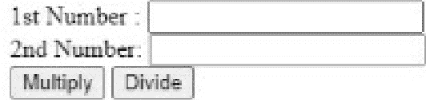
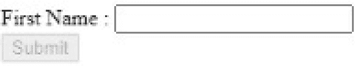
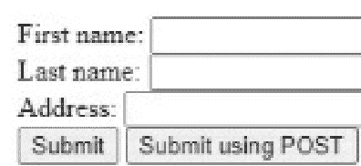
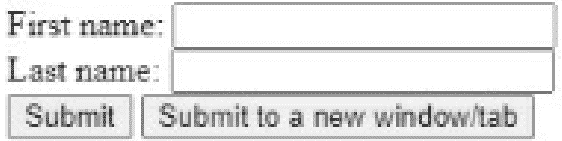
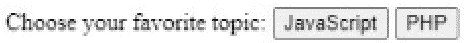
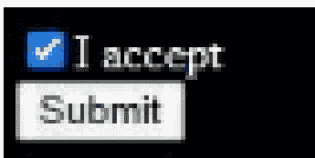

# JavaScript, HTML 和 jQuery 编程练习：初学者编程指南


---


---


- 显示当前日期和时间
- 打印内容
- 显示当前日期
- 计算三角形面积
- 检查给定年份是否为闰年
- 计算乘法和除法
- 转换温度
- 查找最大值
- 反转给定字符串
- 替换每个字符
- 将首字母大写


- 为 HTML 标签添加注释
- 在 HTML 中创建超链接
- 下载文件
- 创建链接
- 创建nofollow链接
- 打开链接文档

- 正确书写地址的方式
- 指定替代文本
- 创建 HTML 文档
- 创建 HTML 文档
- 为音频添加控件
- 使用 HTML 标签编写粗体文本
- 指定基础 URL
- 隔离部分文本
- 定义一个区域
- 定义文档主体
- 定义单行换行
- 定义可点击按钮
- 指定一个按钮
- 指定按钮应被禁用
- 指定一个或多个表单
- 指定表单数据的发送位置
- 发送表单数据
- 指定显示位置
- 为按钮指定名称


- 检查是否已加载 JQUERY
- 滚动到顶部
- 禁用右键菜单
- 文字闪烁效果
- 创建表格效果
- 将第一个单词加粗
- 为所有单词添加下划线
- 使用 JQUERY 更改按钮文本
- 为下拉列表添加选项
- 设置背景图片
- 删除除第一行外的所有表格行
- 禁用链接
- 更改 CSS 类
- 设置背景颜色
- 添加前一组元素
- 添加指定的类

---


---


## 显示当前日期和时间

### HTML 代码

```
<!DOCTYPE html>
<html>
<head>
<meta charset="utf-8">
<title>JavaScript current day and time</title>
</head>
<body></body>
</html>
```

### JAVASCRIPT 代码

```
var today = new Date();
var day = today.getDay();
var daylist = ["Sunday","Monday","Tuesday","Wednesday","Thursday","Friday","Saturday"];
console.log("Today is : " + daylist[day] + ".");
var hour = today.getHours();
var minute = today.getMinutes();
var second = today.getSeconds();
var prepand = (hour >= 12)? " PM ":" AM " ;
hour = (hour >= 12)? hour - 12: hour;
if (hour===0 && prepand===' PM ')
{
if (minute===0 && second===0)
{
hour=12;
prepand=' Noon';
}
else
{
hour=12;
prepand=' PM';
}
}
if (hour===0 && prepand===' AM ')
{
if (minute===0 && second===0)
{
hour=12;
prepand=' Midnight';
}
else
{
hour=12;
prepand=' AM';
}
}
console.log("Current Time : "+hour + prepand + " : " + minute + " : " + second);
```

## 打印当前窗口的内容

### HTML 代码

```
<!DOCTYPE html>
<html>
<head>
<meta charset=utf-8 />
<title>Print the current page.</title>
</head>
<body>
<p></p>
<p>Click the button to print the current page.</p>
<button onclick="print_current_page()">Print this page</button>
</body>
</html>
```

### JAVASCRIPT 代码

```
function print_current_page()
{
window.print();
}
```

## 显示当前日期

### HTML 代码

```
<!DOCTYPE html>
<html>
<head>
<meta charset="utf-8">
<title>Write a JavaScript program to get the current date.</title>
</head>
<body>
</body>
</html>
```

### JAVASCRIPT 代码

```
var today = new Date();
var dd = today.getDate();

var mm = today.getMonth()+1;
var yyyy = today.getFullYear();
if(dd<10)
{
    dd='0'+dd;
}

if(mm<10)
{
    mm='0'+mm;
}
today = mm+'-'+dd+'-'+yyyy;
console.log(today);
today = mm+'/'+dd+'/'+yyyy;
console.log(today);
today = dd+'-'+mm+'-'+yyyy;
console.log(today);
today = dd+'/'+mm+'/'+yyyy;
console.log(today);
```

## 计算三角形面积

### HTML 代码

```
<!DOCTYPE html>
<html>
<head>
<meta charset=utf-8 />
<title>The area of a triangle</title>
</head>
<body>
</body>
</html>
```

### JAVASCRIPT 代码

```
var side1 = 5;
var side2 = 6;
var side3 = 7;
var s = (side1 + side2 + side3)/2;
var area = Math.sqrt(s*((s-side1)*(s-side2)*(s-side3)));
console.log(area);
```

## 检查给定年份是否为闰年

### HTML 代码

```
<!DOCTYPE html>
<html>
<head>
<meta charset=utf-8 />
<title>Find Leap Year</title>
</head>
<body>
</body>
</html>
```

### JAVASCRIPT 代码

```
function leapyear(year)
{
return (year % 100 === 0) ? (year % 400 === 0) : (year % 4 === 0);
}
console.log(leapyear(2016));
console.log(leapyear(2000));
console.log(leapyear(1700));
console.log(leapyear(1800));
console.log(leapyear(100));
```

### 输出

| true |
| false |

true

false

false

## 计算两个数的乘法和除法

### HTML 代码

```
<!DOCTYPE html>
<html>
<head>
<meta charset=utf-8 />
<title>JavaScript program to calculate multiplication and division of two numbers </title>
<style type="text/css">
body {margin: 30px;}
</style>
</head>
<body>
<form>
1st Number : <input type="text" id="firstNumber" /><br>
2nd Number: <input type="text" id="secondNumber" /><br>
<input type="button" onClick="multiplyBy()" Value="Multiply" />
<input type="button" onClick="divideBy()" Value="Divide" />
</form>
<p>The Result is : <br>
<span id = "result"></span>
</p>
</body>
</html>
```

### JAVASCRIPT 代码

```
function multiplyBy()
{
    num1 = document.getElementById("firstNumber").value;
    num2 = document.getElementById("secondNumber").value;
    document.getElementById("result").innerHTML = num1 * num2;
}
```

```
function divideBy()
{
    num1 = document.getElementById("firstNumber").value;
    num2 = document.getElementById("secondNumber").value;
    document.getElementById("result").innerHTML = num1 / num2;
}
```

### 输出



## 在 JAVASCRIPT 中进行摄氏度和华氏度的相互转换

### HTML 代码

```
<!DOCTYPE html>
  <html>
  <head>
  <meta charset="utf-8">
  <title>Write a JavaScript program to convert temperatures to and from celsius, fahrenheit</title>
  </head>
  <body>
</body>
  </html>
```

### JAVASCRIPT 代码

```
function cToF(celsius)
{
  var cTemp = celsius;
  var cToFahr = cTemp * 9 / 5 + 32;
  var message = cTemp+'\xB0C is ' + cToFahr + ' \xB0F.';
    console.log(message);
}

function fToC(fahrenheit)
{
  var fTemp = fahrenheit;
  var fToCel = (fTemp - 32) * 5 / 9;
  var message = fTemp+'\xB0F is ' + fToCel +'\xB0C.';
    console.log(message);
}
cToF(60);
fToC(45);
```

### 输出

60°C is 140 °F.

45°F is 7.222222222222222°C.

## 查找三个给定整数中的最大值

### HTML 代码

```
<!DOCTYPE html>
<html>
<head>
  <meta charset="utf-8">
  <meta name="viewport" content="width=device-width">
  <title>JavaScript program to find the largest of three given integers.</title>
</head>
<body>

</body>
</html>
```

### JAVASCRIPT 代码

```
function max_of_three(x, y, z)
{
  max_val = 0;
  if (x > y)
  {
    max_val = x;
  } else
  {
    max_val = y;
  }
  if (z > max_val)
  {
    max_val = z;
  }
  return max_val;
}

console.log(max_of_three(1,0,1));
console.log(max_of_three(0,-10,-20));
console.log(max_of_three(1000,510,440));
```

#### 输出:

1

0

1000

## 反转给定字符串

### HTML 代码

```
<!DOCTYPE html>
<html>
<head>
    <meta charset="utf-8">
    <meta name="viewport" content="width=device-width">
    <title>JavaScript program to reverse a given string.</title>
</head>
<body>
</body>
</html>
```

### JAVASCRIPT 代码

```
function string_reverse(str)
{
    return str.split("").reverse().join("");
}

console.log(string_reverse("jsresource"));
console.log(string_reverse("www"));
console.log(string_reverse("JavaScript"));
```

### 输出

ecruosersj
www
tpircSavaJ

## 用字母表中的下一个字符替换字符串中的每个字符

### HTML 代码

```
<!DOCTYPE html>
<html>
<head>
    <meta charset="utf-8">
    <meta name="viewport" content="width=device-width">
    <title>JavaScript program to replace every character in a given string with
    the character following it in the alphabet.</title>
</head>
<body>

</body>
</html>
```

### JAVASCRIPT 代码

```
function LetterChanges(text) {
//https://goo.gl/R8gn7u
var s = text.split("");
for (var i = 0; i < s.length; i++) {
    // Caesar cipher
    switch(s[i]) {
        case ' ':
            break;
        case 'z':
            s[i] = 'a';
            break;
        case 'Z':
            s[i] = 'A';
            break;
```


## LetterChanges

```javascript
default:
    s[i] = String.fromCharCode(1 + s[i].charCodeAt(0));
}

// 大写元音字母
switch(s[i]) {
case 'a': case 'e': case 'i': case 'o': case 'u':
    s[i] = s[i].toUpperCase();
}
}
return s.join("");
}
console.log(LetterChanges("PYTHON"));
console.log(LetterChanges("W3R"));
console.log(LetterChanges("php"));
```

输出：

QZUIPO

X4S

qIq

## 将给定字符串中每个单词的首字母大写

### HTML 代码

```html
<!DOCTYPE html>
<html>
<head>
    <meta charset="utf-8">
    <meta name="viewport" content="width=device-width">
    <title>将给定字符串中每个单词的首字母大写的 JavaScript 程序。</title>
</head>
<body>

</body>
</html>
```

### JAVASCRIPT 代码

```javascript
function capital_letter(str)
{
    str = str.split(" ");

    for (var i = 0, x = str.length; i < x; i++) {
        str[i] = str[i][0].toUpperCase() + str[i].substr(1);
    }

    return str.join(" ");
}

console.log(capital_letter("Write a JavaScript program to capitalize the first letter of each word of a given string."));
```

### 输出

输出：

Write A JavaScript Program To Capitalize The First Letter Of Each Word Of A Given String.


## 注释 HTML 标签

### HTML 代码

```html
<!DOCTYPE html>
<html>
<head>
    <meta charset="utf-8">
    <title>如何注释 HTML 标签</title>
</head>
<body>
    <p>HTML 教程</p>
    <!--<p>Python 教程</p>-->
    <p>PHP 教程</p>
</body>
</html>
```

输出：

HTML 教程

PHP 教程

## 在 HTML 中创建超链接

### HTML 代码

```html
<!DOCTYPE html>
<html>
<head>
  <meta charset="utf-8">
  <title>如何创建超链接</title>
</head>
<body>
  <p><a href="http://htmlexample.com">htmlexample.com</a></p>
</body>
</html>
```

## 点击链接时下载文件

### HTML 代码

```html
<!DOCTYPE html>
<html>
<head>
<meta charset="utf-8">
<title>点击链接时下载文件</title>
</head>
<body>
<p><a href="https://www.htmlresource.com/images/htmlresource-logo.png" download>下载</a></p>

</body>
</html>
```

## 创建带有 media 属性的链接

### HTML 代码

```html
<!DOCTYPE html>
<html>
<head>
    <meta charset="utf-8">
    <title>创建带有 media 属性的链接</title>
</head>
<body>
    <a href="https://www.htmlresource.com" media="print, handheld">Media 属性</a>
</body>
</html>
```

## 创建 nofollow 链接

### HTML 代码

```html
<!DOCTYPE html>
<html>
<head>
    <meta charset="utf-8">
    <title>如何创建 nofollow 链接</title>
</head>
<body>
    <a rel="nofollow" href="http://htmlexample.com">Example.com</a>
</body>
</html>
```

## 在单独的浏览器标签页中打开链接文档

### HTML 代码

```html
<!DOCTYPE html>
<html>
<head>
  <meta charset="utf-8">
  <title>如何在单独的浏览器标签页中打开链接文档</title>
</head>
<body>
  <p><a href="https://htmlresource.com" target="_blank">目标 HTML5 练习</a></p>
</body>
</html>
```

## 在 HTML 文档中正确书写地址的方式

### HTML 代码

```html
<!DOCTYPE html>
<html>
<head>
    <meta charset="utf-8">
    <title>在 HTML 文档中正确书写地址的方式</title>
</head>
<body>
    <address>
        地址：21, MG Road<br>
        Burdwan<br>
        West Bengal.
    </address>
</body>
</html>
```

## 如果存在 href 属性，为区域指定替代文本

### HTML 代码

```html
<body>

<map name="Map">
<area shape="rect" coords="8,5,100,77" href="https://www.htmlresource.com/mysql/mysql-tutorials.php" target="_blank" alt="mysql 教程">
<area shape="circle" coords="155,93,59" href="https://www.htmlresource.com/php/php-home.php" target="_blank" alt="php 教程">
<area shape="rect" coords="197,136,306,188" href="https://www.htmlresource.com/sql/sql-tutorials.php" alt="sql 教程">
</map>
</body>
```

## 创建使用 article 元素的 HTML 文档

### HTML 代码

```html
<!DOCTYPE html>
<html>
<head>
    <meta charset="utf-8">
    <title>创建使用 article 元素的 HTML 文档</title>
</head>
<body>
<article>
<h1>HTML5 article 元素教程</h1>
<p>HTML5 article 元素表示网页文档中独立的条目，如博客文章。</p>
</article>
</body>
</html>
```

## 创建使用 aside 元素的 HTML 文档

### HTML 代码

```html
<!DOCTYPE html>
<html>
<head>
  <meta charset="utf-8">
  <title>如何创建使用 aside 元素的 HTML 文档</title>
</head>
<body>
<p> 我访问了 htmlresource 的 HTML5 教程</p>

<aside>
  <h4>HTML5 教程</h4>
  <p>在 HTML5 教程中，我可以使用 HTML5 和相关 API（如 GeoLocation、拖放、WebSocket 等）开发出色的 Web 应用程序。</p>
</aside>
</body>
</html>
```

### 输出

我访问了 htmlresource 的 HTML5 教程

### HTML5 教程

在 HTML5 教程中，我可以使用 HTML5 和相关 API（如 GeoLocation、拖放、WebSocket 等）开发出色的 Web 应用程序。

## 为音频添加控件

### HTML 代码

```html
<body>
<audio controls>
  <source src="https://www.htmlresource.com/html-css-exercise/basic/solution/beach.ogg" type="audio/ogg">
  <source src="https://www.htmlresource.com/html-css-exercise/basic/solution/beach.mp3" type="audio/mpeg">
</audio>
</body>
```

## 使用 HTML 标签书写粗体文本

### HTML 代码

```html
<!DOCTYPE html>
<html>
<head>
    <meta charset="utf-8">
    <title>如何使用 HTML 标签书写粗体文本</title>
</head>
<body>
    <p>"htmlresource" 是普通文本 - 而 <b>"htmlresource"</b> 是粗体BOOK文本。</p>
</body>
</html>
```

### 输出

"htmlresource" 是普通文本 - 而 **"htmlresource"** 是粗体文本。

## 指定基础 URL

### HTML 代码

```html
<!DOCTYPE html>
<html>
<head>
    <meta charset="utf-8">
    <title>如何为文档中所有相对 URL 指定基础 URL/目标</title>
    <base href="https://www.htmlresource.com/">
</head>
<body>
<ul>
<li><a href="php/php-home.php">PHP 教程</a></li>
<li><a href="javascript/javascript.php">JavaScript 教程</a></li>
<li><a href="mysql/mysql-tutorials.php">MySQL 教程</a></li>
</body>
</html>
```

## 隔离一段可能与其他外部文本方向不同的文本

### HTML 代码

```html
<!DOCTYPE html>
<html>
<head>
  <meta charset="utf-8">
  <title>如何隔离一段可能与其他外部文本方向不同的文本</title>
</head>
<body>
<p>
在下面的示例中，用户显示了用户名以及比赛中的得分点数。

如果浏览器不支持 bdi 元素，阿拉伯语用户的用户名会混淆文本（双向算法会将冒号和数字"80"放在单词"User"旁边，而不是放在单词"points"旁边）。
</p>
<ul>
<li>User <bdi>hrefs</bdi>: 40 points</li>
<li>User <bdi>jdoe</bdi>: 60 points</li>
<li>User <bdi>ترحب بك</bdi>: 80 points</li>
</ul>
<p><b>注意：</b> bdi 元素目前仅在 Firefox 和 Chrome 中受支持。</p>
</body>
</html>
```

### 输出

在下面的示例中，用户显示了用户名以及比赛中的得分点数。如果浏览器不支持 bdi 元素，阿拉伯语用户的用户名会混淆文本（双向算法会将冒号和数字"80"放在单词"User"旁边，而不是放在单词"points"旁边）。

- User hrefs: 40 points
- User jdoe: 60 points
- User 80:ترحيب points

**注意：** bdi 元素目前仅在 Firefox 和 Chrome 中受支持。

## 定义从其他来源引用的部分

### HTML 代码

```html
<!DOCTYPE html>
<html>
<head>
  <meta charset="utf-8">
  <title>html blockquote 标签示例</title>
</head>
<body>
<blockquote>自由如果不包含犯错的自由，那就不值得拥有。我无法理解，人类无论多么有经验、有能力，怎么会以剥夺他人这种珍贵权利为乐。</blockquote>
</body>
</html>
```

### 输出

自由如果不包含犯错的自由，那就不值得拥有。我无法理解，人类无论多么有经验、有能力，怎么会以剥夺他人这种珍贵权利为乐。


## 定义文档的主体

### HTML 代码

```
<!DOCTYPE html>
<html>
<head>
    <meta charset="utf-8">
    <title>How to define the document's body</title>
</head>
<body>
We are learning HTML body element.
</body>
</html>
```

### 输出

我们正在学习 HTML body 元素。

## 定义单个换行

### HTML 代码

```
<!DOCTYPE html>
<html>
<head>
  <meta charset="utf-8">
  <title>How to define a single line break</title>
</head>
<body>
  <p>The quick brown fox jumps<br>over the lazy dog.</p>
</body>
</html>
```

### 输出

敏捷的棕色狐狸
跃过了懒狗。

## 定义可点击按钮

### HTML 代码

```
<!DOCTYPE html>
<html>
<head>
  <meta charset="utf-8">
  <title>How to define a clickable button.</title>
</head>
<body>
  <button type="button" onclick="console.log('Welcome Friends')">Click Me!</button>
</body>
</html>
```

## 指定按钮在页面加载时自动获取焦点

### HTML 代码

```
<!DOCTYPE html>
<html>
<head>
    <meta charset="utf-8">
    <title>The example of autofocus attribute with button element.</title>
</head>
<body>
    <button type="button" autofocus onclick="console.log('Welcome Friends')">Click Me!</button>
</body>
</html>
```

## 指定按钮为禁用状态

### HTML 代码

```
<!DOCTYPE html>
<html>
<head>
    <meta charset="utf-8">
    <title>Example of HTML disabled attribute with button</title>
</head>
<body>
<form action="example.php" method="post">
First Name : <input type="text" name="Fname"><br>
<button type="button" name="Submit" disabled>Submit</button>
</form>
</body>
</html>
```

### 输出



## 指定按钮所属的一个或多个表单

### HTML 代码

```
<!DOCTYPE html>
<html>
<head>
  <meta charset="utf-8">
  <title>How to specify one or more forms the button belongs to</title>
</head>
<body>
<form method="POST"
action="https://www.htmlresource.com/html-css-exercise/basic/solution/button-form-answer-demo.php" id="form1">
  First name : <input type="text" name="fname"><br>
  Last name : <input type="text" name="lname"><br>
  Present Address : <input type="text" name="add"><br>
  E-mail : <input type="text" name="mail"><br>
</form>
<button type="submit" form="form1" value="Submit">Submit</button>
</body>
</html>
```

### 输出

名：

姓：

当前地址：

电子邮件：

提交

## 指定表单提交时表单数据的发送地址

### HTML 代码

```
<!DOCTYPE html>
<html>
<head>
  <meta charset="utf-8">
  <title>How to Specify where to send the form-data when a form is submitted.</title>
</head>
<body>
<form action="https://www.htmlresource.com/html-css-exercise/basic/solution/button-formation-answer-demo.php" method="post">
  First name: <input type="text" name="fname"><br>
  Last name: <input type="text" name="lname"><br>
  <button type="submit">Submit</button><br>
  <button type="submit" formation="https://www.htmlresource.com/html-css-exercise/basic/solution/button-formation-admin-demo.php">Submit as admin</button>
</form>
</body>
</html>
```

### 输出

<!-- 无内容 -->

## 发送表单数据
（使用哪种 HTTP 方法）

### HTML 代码

```
<!DOCTYPE html>
<html>
<head>
  <meta charset="utf-8">
  <title>How to send the form-data, which HTTP method to use</title>
</head>
<body>
<form action="https://www.htmlresource.com/html-css-exercise/basic/solution/button-formmethod-answer-demo.php">
  First name: <input type="text" name="fname"><br>
  Last name: <input type="text" name="lname"><br>
  Address: <input type="text" name="place"><br>
  <button type="submit">Submit</button>
  <button type="submit" formmethod="post" formaction="http://localhost/html-css-exercise/basic/solution/button-formmethod-post-answer.php">Submit using POST</button>
</form>
</body>
</html>
```

### 输出



## 指定提交表单后响应的显示位置

### HTML 代码

```
<!DOCTYPE html>
<html>
<head>
  <meta charset="utf-8">
  <title>How to specify where to display the response after submitting the form</title>
</head>
<body>
<form action="https://www.htmlresource.com/html-css-exercise/basic/solution/button-formtarget-answer-demo.php" method="POST">
  First name: <input type="text" name="fname"><br>
  Last name: <input type="text" name="lname"><br>
  <button type="submit">Submit</button>
  <button type="submit" formtarget="_blank">Submit to a new window/tab</button>
</form>
</body>
</html>
```

### 输出



## 为按钮指定名称

### HTML 代码

```
<!DOCTYPE html>
<html>
<head>
  <meta charset="utf-8">
<title>How to specify a name for the button</title>
</head>
<body>
<form action="https://www.htmlresource.com/html-css-exercise/basic/solution/button-name-answer-demo.php" method="post">
Choose your favorite topic:
<button name="topic" type="submit" value="JavaScript">JavaScript</button>
<button name="topic" type="submit" value="PHP">PHP</button>
</form>
</body>
</html>
```

### 输出




## 检查 jQuery 是否已加载

### HTML 代码

```
<!DOCTYPE html>
<html>
<head>
<script src="//code.jquery.com/jquery-1.11.1.min.js"></script>
    <meta charset="utf-8">
    <title>Test if jQuery is loaded</title>
</head>
<body>
<p>Click me!</p>
</body>
</html>
```

### JavaScript 代码

```
$("p").bind("click", function(){
    $( "This is a click Event").appendTo( "body" );
});

$("p").bind("dblclick", function(){
    $( "This is a double-click Event" ).appendTo( "body" );
});
```

### 输出

Click me!

This is a click Event

## 滚动到页面顶部

### HTML 代码

```
<!DOCTYPE html>
<html>
<head>
<script src="//code.jquery.com/jquery-1.11.1.min.js"></script>
<meta charset="utf-8">
<title>Scroll to the top of the page with jQuery</title>
</head>
<body>
<p>jquery</p>
<p>jquery</p>
<p>jquery</p>
<p>jquery</p>
<p>jquery</p>
<p>jquery</p>
<p>jquery</p>
<p>jquery</p>
<p>jquery</p>
<p>jquery</p>
<p>jquery</p>
<p>jquery</p>
<p>jquery</p>
<p>jquery</p>
<p>jquery</p>
<p>jquery</p>
<p>jquery</p>
<p>jquery</p>
<p>jquery</p>
<a href='#top'>Go Top</a>
</body>
</html>
```

### JavaScript 代码

```
$("a[href='#top']").click(function() {
    $("html, body").animate({ scrollTop: 0 }, "slow");
    return false;
});
```

## 禁用 HTML 页面中的右键菜单

### HTML 代码

```
<!DOCTYPE html>
<html>
<head>
<script src="//code.jquery.com/jquery-1.11.1.min.js"></script>
  <meta charset="utf-8">
  <title>Disable right click menu in html page using jquery</title>
</head>
<body>
</body>
</html>
```

### JavaScript 代码

```
$(document).bind("contextmenu",function(e){
  return false;
});
```

## 禁用/启用表单提交按钮

### HTML 代码

```
<!DOCTYPE html>
<html>
<head>
<script src="//code.jquery.com/jquery-1.11.1.min.js"></script>
<meta charset="utf-8">
<title>Disable/enable the form submit button</title>
</head>
<body>
<input id="accept" name="accept" type="checkbox" value="y"/>I accept<br>
<input id="submitbtn" disabled="disabled" name="Submit" type="submit" value="Submit" />
</body>
</html>
```

### JavaScript 代码

```
$('#accept').click(function() {
    if ($('#submitbtn').is(':disabled')) {
        $('#submitbtn').removeAttr('disabled');
    } else {
        $('#submitbtn').attr('disabled', 'disabled');
    }
});
```

### 输出



## 使用 jQuery 实现文字闪烁

### HTML 代码

```
<!DOCTYPE html>
<html>
<head>
<script src="//code.jquery.com/jquery-1.11.1.min.js"></script>
  <meta charset="utf-8">
  <title>Blink text using jQuery</title>
</head>
<body>
  <p>jQuery <span class="blink">Exercises</span> and Solution</p>
</body>
</html>
```

### JavaScript 代码

```
function blink_text() {
    $('.blink').fadeOut(500);
    $('.blink').fadeIn(500);
}
setInterval(blink_text, 1000);
```


 ## 创建表格效果

## 斑马条纹效果

### HTML 代码

```
<!DOCTYPE html>
<html>
<head>
<script src="//code.jquery.com/jquery-1.11.1.min.js"></script>
  <meta charset="utf-8">
<style type="text/css">.table_style {
        width: 500px;
        margin: 0px auto;
    }
    table{
    width: 100%;
    border-collapse: collapse;
    }
    table tr td{
    width: 50%;
    border: 1px solid #ff751a;
    padding: 5px;
    }
    table tr th{
    border: 1px solid #79ff4d;
    padding: 5px;
    }
    .zebra{
    background-color: #ff0066;
    }
    </style>
  <title>Create a Zebra Stripes table effect</title>
</head>
<body>
<div class="table_style">
<table>
  <tr>
    <th>Student Name</th>
    <th>Marks in Science</th>
  </tr>
  <tr>
    <td>James</td>
    <td>85.00</td>
  </tr>
  <tr>
    <td>David</td>
    <td>92.00</td>
  </tr>
  <tr>
    <td>Arthur</td>
    <td>79.00</td>
  </tr>
  <tr>
    <td>George</td>
    <td>82.00</td>
  </tr>
</table>
</div>
</body>
</html>
```

### JAVASCRIPT 代码

```
$(document).ready(function(){
    $("tr:odd").addClass("zebra");
});
```

### 输出

| 学生姓名 | 科学成绩 |
| --- | --- |
| James | 85.00 |
| David | 92.00 |
| Arthur | 79.00 |
| George | 82.00 |

---

## 将第一个词加粗

### HTML 代码

```
<!DOCTYPE html>
<html>
<head>
<script src="//code.jquery.com/jquery-1.11.1.min.js"></script>
  <meta charset="utf-8">
  <title>Make first word bold of all elements</title>
</head>
<body>
  <p>PHP Exercises</p>
  <p>Python Exercises</p>
  <p>JavaScript Exercises</p>
  <p>jQuery Exercises</p>
</body>
</html>
```

### JAVASCRIPT 代码

```
$('p').each(function(){
         var pdata = $(this);
         pdata.html( pdata.text().replace(/(^\w+)/,'<b>$1</b>') );
});
```

### 输出

**PHP** Exercises

**Python** Exercises

**JavaScript** Exercises

**jQuery** Exercises

---

## 为所有文字添加下划线

### HTML 代码

```
<!DOCTYPE html>
<html>
<head>
<script src="https://code.jquery.com/jquery-git.js"></script>
<meta charset="utf-8">
<meta name="viewport" content="width=device-width">
<title>Underline all words of a text through jQuery</title>
</head>
<body>
<p>The best way we learn anything is by practice and exercise questions</p>
</body>
</html>
```

### CSS 代码

```
p span{
    text-decoration: underline;
}
```

### JAVASCRIPT 代码

```
$('p').each(function() {

var text_words = $(this).text().split(' ');

    $(this).empty().html(function() {

        for (i = 0; i < text_words.length; i++) {
        if (i === 0) {
        $(this).append('<span>' + text_words[i] + '</span>');
        } else {
        $(this).append(' <span>' + text_words[i] + '</span>');
        }
        }
    });
});
```

### 输出

The best way we learn anything is by practice and exercise questions

---

## 使用 jQuery 更改按钮文本

### HTML 代码

```
<!DOCTYPE html>
<html>
<head>
<script src="https://code.jquery.com/jquery-git.js"></script>
<meta charset="utf-8">
<meta name="viewport" content="width=device-width">
<title>Change button text using jQuery.</title>
</head>
<body>
<input type='button' value='Cancel' id='button1'>
</body>
</html>
```

### JAVASCRIPT 代码

```
//Uncomment the following code and see the changes.

//$("#button1").prop('value', 'Save');
```

---

## 向下拉列表添加选项

使用 jQuery

 # HTML 代码

```
<!DOCTYPE html>
<html>
<head>
<script src="https://code.jquery.com/jquery-git.js"></script>
<meta charset="utf-8">
<meta name="viewport" content="width=device-width">
<title>Add options to a drop-down list using jQuery.</title>
</head>
<body>
<p>List of Colors :</p>
<select id='myColors'>
<option value="Red">Red</option>
<option value="Green">Green</option>
<option value="White">White</option>
<option value="Black Pant">Black</option>
</select>
</body>
</html>
```

### JAVASCRIPT 代码

```
var myOptions = {
    val1 : 'Blue',
    val2 : 'Orange'
};
var mySelect = $('#myColors');
$.each(myOptions, function(val, text) {
    mySelect.append(
        $('<option></option>').val(val).html(text)
    );
});
```

### 输出

颜色列表：

- Red
- Green
- White
- Black
- Blue
- Orange

---

## 设置背景图片

## 使用 jQuery CSS 属性

### HTML 代码

```
<!DOCTYPE html>
<html>
<head>
<script src="https://code.jquery.com/jquery-git.js"></script>
<meta charset="utf-8">
<meta name="viewport" content="width=device-width">
<title>Set background-image using jQuery CSS property.</title>
</head>
<body>
</body>
</html>
```

### JAVASCRIPT 代码

```
$('body').css('background-image',
'url("https://www.htmlresource.com/includes/jquery-images/jquery.gif")');
```

### 输出

---

## 删除表格中除第一行外的所有行

使用 jQuery

### HTML 代码

```
<!DOCTYPE html>
<html>
<head>
<script src="https://code.jquery.com/jquery-git.js"></script>
<meta charset="utf-8">
<meta name="viewport" content="width=device-width">
<title>Delete all table rows except first one using jQuery.</title>
</head>
<body>
<table border="1" id="myTable">
<tr>
<th>Year</th>
<th>Savings</th>
</tr>
<tr>
<td>2014</td>
<td>$10000</td>
</tr>
<tr>
<td>2015</td>
<td>$8000</td>
</tr>
<tr>
<td>2016</td>
<td>$9000</td>
</tr>
</table>
<p>
<input id="button1" type="button" value="Click to remove all rows except first one"/></p>
</body>
</html>
```

### JAVASCRIPT 代码

```
$(document).ready(function(){
	$('#button1').click(function(){
		$("#myTable").find("tr:gt(0)").remove();
	});
});
```

### 输出

---

## 禁用链接

### 使用 jQuery

### HTML 代码

```
<!DOCTYPE html>
<html>
<head>
<script src="https://code.jquery.com/jquery-git.js"></script>
<meta charset="utf-8">
<meta name="viewport" content="width=device-width">
<title>Disable a link using jQuery</title>
</head>
<body>
<a href="https://www.htmlresource.com/jquery-exercises/">jQuery Exercises, Practice, Solution</a>
<p></p>
  <input id="button1" type="button" value="Click to remove the link!" />
</body>
</html>
```

### JAVASCRIPT 代码

```
$(document).ready(function(){
  $('#button1').click(function(){
  $("a").removeAttr('href');
   });
});
```

### 输出

---

## 更改 CSS 类

### 使用 jQuery

### HTML 代码

```
<!DOCTYPE html>
<html>
<head>
<script src="https://code.jquery.com/jquery-git.js"></script>
<meta charset="utf-8">
<meta name="viewport" content="width=device-width">
<title>Change a CSS class name using jQuery.</title>
</head>
<body>
<p id="pid" class="center"> jQuery Exercises</p>
<input id="button1" type="button" value="Click to change the Class" />
</body>
</html>
```

### CSS 代码

```
p.center {
    text-align: center;
    color: red;
}

p.large {
    font-size: 200%;
}
```

### JAVASCRIPT 代码

```
$(document).ready(function(){
  $('#button1').click(function()
 { $('#pid').removeClass('center').addClass('large');
   });
});
```

---

## 设置背景颜色

### HTML 代码

```
<!DOCTYPE html>
<html>
<head>
<script src="https://code.jquery.com/jquery-git.js"></script>
<meta charset="utf-8">
<meta name="viewport" content="width=device-width">
<title>Set the background color red of the following elements using jQuery.</title>
<style type="?"


<div style="page-break-after: always"></div>

```

### JAVASCRIPT 代码

```
$('#button1').click(function(){
$("p").add( "span" ).add("textarea").css( "background", "red" );
});
```

---

# 将之前堆栈上的元素集合

# 添加到当前集合

### HTML 代码

```
<!DOCTYPE html>
<html>
<head>
<script src="https://code.jquery.com/jquery-git.js"></script>
<meta charset="utf-8">
<meta name="viewport" content="width=device-width">
<title>Using jQuery add the previous set of elements on the stack to the current set.</title>
</head>
<body>
<div class="left">
<p><strong>Before <code>addBack()</code></strong></p>
<div class="before-addback">
<p>JavaScript</p>
<p>jQuery</p>
</div>
</div>
<div class="right">
<p><strong>After <code>addBack()</code></strong></p>
<div class="after-addback">
<p>JavaScript</p>
<p>jQuery</p>
</div>
</div>
</body>
</html>
```

### CSS 代码

```
p, div {
    margin: 5px;
```


### JAVASCRIPT 代码

```javascript
$( "div.left, div.right" ).find( "div, div > p" ).addClass( "border" );

// 第一部分
$( "div.before-addback" ).find( "p" ).addClass( "background" );

// 第二部分
$( "div.after-addback" ).find( "p" ).addBack().addClass( "background" );
```

## 添加指定的类

### 到匹配的元素

### HTML 代码

```html

```

### CSS 代码

```css

```

### JAVASCRIPT 代码

```javascript
$('p').last().addClass("h3r_font_color");
```
