# 儿童编程 5 合 1：Javascript、Python 和 C++ 儿童与初学者指南（零基础编程入门）

## 介绍

### 什么是编程

编程是编写计算机程序的艺术。计算机程序是一组机器可以理解并用来执行特定任务的指令。计算机编程就是人类与机器沟通的方式。

计算机非常擅长执行我们给它们的指令。

程序简单来说就是为了实现某个目标而需要遵循的步骤清单。它就像一份食谱，要准备你最喜欢的菜肴，你只需要按照食谱上的指令操作即可。

唯一的问题是，计算机不像我们一样说英语，它们说自己的语言。这种计算机语言被称为机器语言。

计算机中有一个部分叫做解释器，它将我们的指令翻译成机器语言，以便计算机能够理解我们给它的指令。这个解释器也被称为**编译器**。

编译器是编程语言和机器之间的接口。编程语言是一种非常简单的学习语言，而且市面上存在无数种编程语言。在本书中，我们仅学习 C++。

如你所知，口语通常有语法。语法是一种排列语言中词汇的方式，使其能被说该语言的其他人们理解。编程语言也有语法，我们称之为**句法 (syntax)**。

为了让编译器理解你，你必须使用正确的句法，否则会导致错误。起初，我们将花很多时间学习我们编程语言的句法。

总而言之，我们使用编程语言编写程序。编程语言与编译器沟通。编译器将该语言翻译成机器语言然后运行程序。计算机读取我们的指令并执行我们告诉它要做的事情。

你的第一门编程语言通常是最难学的，但在学会之后，学习其他语言就会变得更加容易。

### 为什么选择 C++

学习 C++ 后你可以做很多事情。你可以制作游戏，使用 Arduino 开发板制作酷炫的项目，如果你被允许的话，甚至可以为飞机编写程序。你唯一的限制就是你的想象力。

C++ 的主要优势在于它在不同的操作系统和编译器之间具有很强的可移植性。这意味着同一段代码可以用在 Windows、Linux、Opera 等系统中。

C++ 拥有庞大的社区支持，包括开发者论坛、在线教程、Facebook 社区小组，这对初学者来说至关重要。学习起来会容易得多，因为如果你被卡住了，可以向社区中的其他人请教。

C++ 在多种环境下也非常具有可扩展性和灵活性。这意味着初学者和资深专业人士都可以将其用于不同的目的。它还可以用于编写游戏、应用程序、软件和 App。

C++ 广泛应用于图形学，目前也被用于新兴技术，如图像处理、模式识别以及位置追踪等嵌入式系统。

C++ 在使用计算机内存方面效率更高，因此可以节省你的硬盘空间。

## 为什么要学习编程

编程的核心其实不在于编写代码，而在于思考解决问题的方法。通过编程，你将学习并体会到解决一个问题有多种不同的方式，有时某种方法比另一种更好。你还会学到将一个大问题分解成小部分会让你的工作变得更轻松。

编程还关乎学习如何与他人协作。人们通常认为程序员是独自解决问题的，但大多数时候，程序员是以团队形式工作的。我们喜欢与他人分享我们构建的东西，这使我们能够相互学习，从而提升彼此的技能。

此外，编程教会你永远不要轻易放弃，因为你的程序在第一次编写时绝不会直接运行成功。你会不时地遇到错误，但作为一名程序员，你不能让这些错误击垮你。在跌倒时重新站起来，再次尝试。

最后，在这个计算机运行几乎一切的数字化世界中，你会感到游刃有余。对你来说，这不再是魔法，因为你知道如何利用计算机来完成你的任务。

归根结底，即使你没有成为一名程序员，你也将能够了解计算机如何帮助你工作，并获得所有这些技能。

## 搭建工作区

为了编写代码，你至少需要一个文本编辑器和一个编译器。

## 文本编辑器

文本编辑器是一个允许你将代码编写并保存为文件的程序。

文件通常在其文件名后带有扩展名，以表明该文件的类型。编写 C++ 文件时，文件扩展名为 `.cpp`，例如 `main.cpp`。

我们将使用一个名为 Code::Blocks 的应用程序来编写、编译和运行我们的程序。Code::Blocks 也就是所谓的 IDE，即集成开发环境。

IDE 将编写、编译和运行程序所需的一切都集成在一个地方。

下面是 Code::Blocks IDE 界面布局的图片：

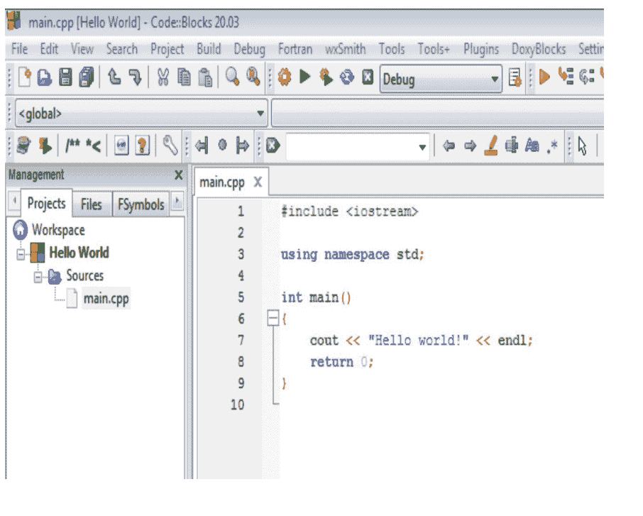

## 下载和安装 Code::Blocks

你需要：

- 一台笔记本电脑/台式机
- 互联网连接
- 网络浏览器，例如 Chrome、Windows Edge 或 Firefox

前往此网站下载 Code::Blocks 应用程序：[https://www.fosshub.com/Code-Blocks.html?dwl=codeblocks-20.03mingw-setup.exe](https://www.fosshub.com/Code-Blocks.html?dwl=codeblocks-20.03mingw-setup.exe)

只需复制粘贴该链接到浏览器即可。

注意：请确保下载名为 Code Blocks Windows 64 bit (including compiler) 的文件。

此版本包含我们需要的编译器。

之后只需安装应用程序，完成后打开它。

你可以访问 Code::Blocks 网站了解更多相关信息：[https://www.codeblocks.org/](https://www.codeblocks.org/)。该网站也包含用户手册以及用于其他操作系统下载 IDE 的链接。

## C++ 中的 Hello World

所有程序员在学习一门新的编程语言时编写的第一个程序被称为 Hello World。

它基本上就是编写一个程序，在屏幕上显示“Hello World”这个词。既然我们现在是程序员了，我们说我们正在*打印*“Hello World”这个词到屏幕上。

我将提供代码示例，你需要在 Code::Blocks 中输入这些示例，并点击构建和运行按钮来编译和执行代码，以便查看结果。

## 在 Code::Blocks 中创建一个项目

为了在 Code::Blocks 中运行代码，我们必须首先创建一个项目。所以首先我们需要打开 Code::Blocks。

要创建一个项目，请点击 **File** > **New** > **Project**。

在弹出的窗口中选择 **Console application** 并点击 **Go** 按钮。

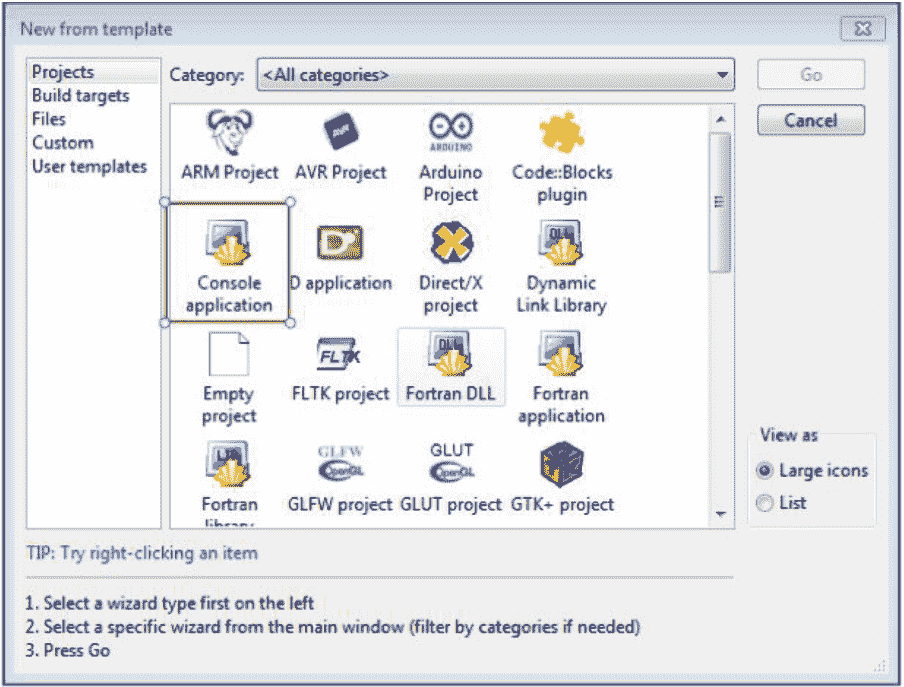

确保在此窗口中选择了 **C++**。

在信息窗口上点击 **Next**。

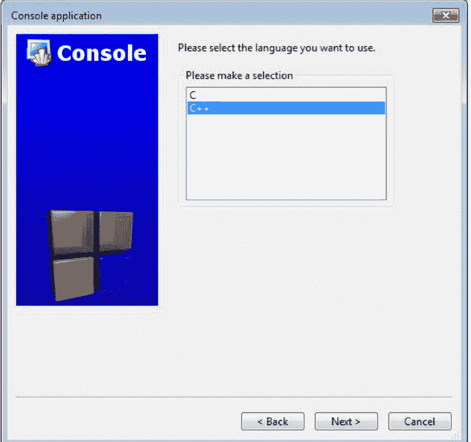

为项目指定一个标题，目前是 **Hello World**。选择保存文件的文件夹。

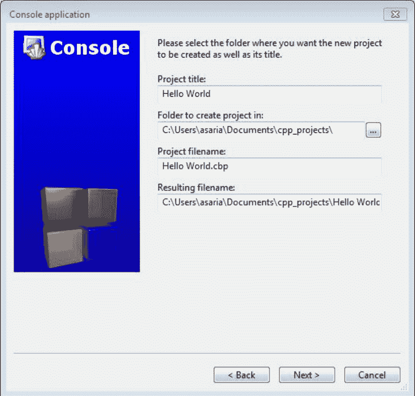

确保你选择了 **GNU GCC Compiler** 作为编译器，然后点击 **Finish**。

现在在左侧，在 Hello World 下，点击 **Sources 文件夹**旁边的 + 图标以显示 `main.cpp` 文件。双击它，以便在右侧的编辑器窗口中显示该文件。

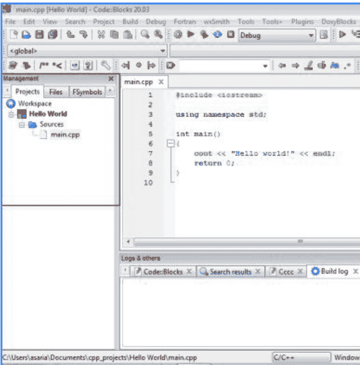

编辑器中的代码如下所示：

#### 代码

```cpp
#include <iostream>
using namespace std;

int main()
{
    cout << "Hello World" << endl;

    return 0;
}
```

我非常确定上面的代码在你第一次看到时会显得难以理解。但通过接下来的几章，我们将理解这一切的含义。现在请坚持一下，我将解释这个程序的主要部分。

编程的诀窍在于坚持不懈，因为随着你学习的深入，事情会变得越来越容易。

让我们先运行代码。

## 运行代码

要运行代码，我们必须先编译它。

在 Code::Blocks 中，我们使用术语 *build* 而不是 compile。这是因为一个项目通常由多个 C++ 文件组成，我们把编译所有文件的过程称为构建。

编辑器顶部有三个按钮，使我们能够构建和运行项目。

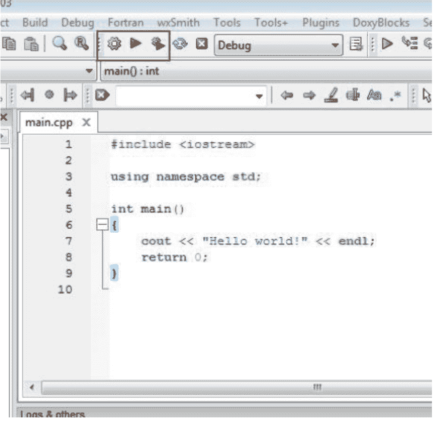

黄色齿轮按钮用于构建项目，绿色播放按钮用于运行已构建的项目，而第三个按钮是齿轮和播放按钮的组合，用于构建并运行项目。点击组合按钮来执行项目。

将出现一个弹出窗口，显示“Hello World”字样，如下所示。

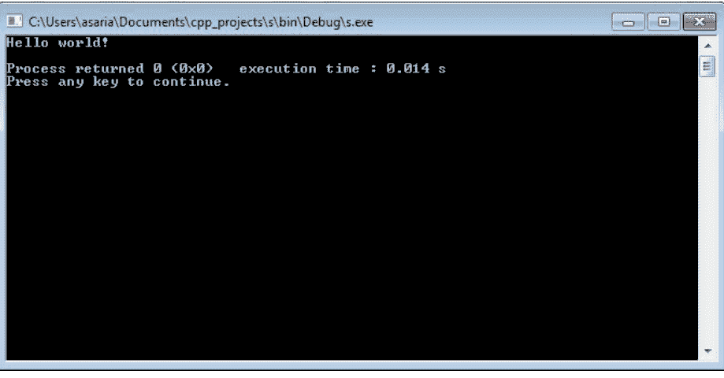

这就是所谓的**控制台**或**终端**。控制台显示 C++ 中的输出。只需关闭窗口即可将其关闭。

注意：确保在构建和运行之前保存文件，这可以通过在每次更改后按 **Control-s (Ctrl+s)** 来完成。

#### 代码解释

这个程序中的主要代码行是：

```cpp
cout << "Hello World" << endl;
```

首先，注意这行代码以分号 (`;`) 结尾，这非常重要，因为它表示这条指令的结束。

`cout` 只是程序员对屏幕的称呼，你可以将其视为 console output 的缩写。

符号 `<<` 只表示在我之后的内容显示在屏幕上。

“Hello World”是我们想要显示在屏幕上的文本。注意它被双引号包围。双引号是语法的一部分，非常重要。

我们把被双引号包围的文本称为***字符串***。

下一个 `<<` 符号表示，将我之后的内容添加到文本“Hello World”中。在编程中，我们称之为**拼接**，即将两个字符串连接在一起。

`endl`，表示添加一个换行符，换行符就像在计算机上输入时按回车键一样，它会将你带到当前文本下方的下一行。

正如你所见，在编写程序时，我们不仅仅是用纯英文编写，我们遵循一些称为该语言*语法*的特定规则。

#### 练习

1. 修改文本，使程序输出你的名字，然后构建并运行代码。

2. 写两次代码行 `cout << "Hello World";`，看看控制台上打印了什么。这与写两次 `cout << "Hello World" << endl;` 有什么不同？

3. 创建一个新项目，给它取任何你喜欢的名字，并将其存储在不同的文件夹位置。

   a. 对于这个新项目，点击运行图标，注意会发生什么。

   b. 对于这个新项目，分别点击构建齿轮图标和运行图标，注意会发生什么。

### 变量

在本章中，我将首先带你了解计算机中对编程重要的主要部分。

计算机的主要部分被称为处理器。它是实际读取你的代码并执行你所指示操作的部分。

此外，有一个存储区域被称为 **RAM**，代表**随机存取存储器**。这是你所需的一切（甚至包括你的程序）存储的地方。

你可以把它想象成一堆带有盒子的架子，你可以在其中存储东西。此外，这些盒子的尺寸和类型各不相同。因此，你可以决定在它们里面存储什么。

此外，我们可以给这些盒子贴上标签，以便日后更容易地引用它们的名称。

## 变量赋值

变量是分配给存储在内存中的值的一个名称。

变量名也被称为**标识符**。

你可以把变量想象成我们放置值的盒子，变量名是我们贴在盒子上的标签。

每个盒子还有一个称为数据类型的东西。数据类型是存储在盒子中的信息类型。这意味着特定的变量只能存储特定类型的数据。数据类型的例子包括字符串、数字、布尔值等。

下面是一个变量赋值的例子。我们在一个名为 variables 的新项目中的 Code::Blocks 中编写它，通过按 **Control-S** 保存文件，然后构建并运行。

### 示例代码

```cpp
#include <iostream>
using namespace std;

int main() {

    int radius = 20;
    cout << radius << endl;
    radius = 40;
    cout << radius << endl;
    return 0;
}
```

上面我们声明了一个名为 `radius`、数据类型为 `int`（即整数）的变量，并将其初始化为值 20。

`int` 就是我们所说的**数据类型**。使用盒子的类比，数据类型决定了存放我们值的盒子类型。我们存储的值是 20。变量名是 `radius`，这意味着盒子上的标签是 radius。

只要数据类型相同，变量的值可以在整个程序中更改。在上面的程序中，我们将值更改为 40。

这是可以接受的，因为 40 是 `int`（整数）数据类型。

## 数据类型

以下是可用数据类型的列表，以及它们所代表的数值种类和范围。每种数据类型都附有一个相关示例。

### int

数据类型 `int` 代表整数（integer）。整数是一个全数，这意味着它不能有小数部分。整数的示例包括 1, 0, 45, 768, 23343 等。

```cpp
Example: int radius = 2;
```

### long

数据类型 `long` 同样是全数，但其使用的数值可以比 `int` 大得多。`long` 变量最多可以持有 20 位数字，而 `int` 变量只能持有 10 位数字。

例如，在下方代码中，`x`、`y` 和 `result` 是 `long` 变量，可以持有高达 20 位的数字。

```cpp
#include<iostream>
using namespace std;

int main(){
    long x = 9988891919;
    long y = 3465829;
    long result = x * y;
    cout << result;
    return 0;
}
```

```
C:\Users\asaria\Documents\cpp_projects\Variables\bin\Debug\Variables.exe
1242897643
Process returned 0 (0x0)   execution time : 0.028 s
Press any key to continue.
```

### float

表示带有小数点的数字。请参阅下方示例。`pi` 是一个值为 3.142 的 `float` 变量，而 `areaofcircle` 是另一个 `float` 变量。

```cpp
#include<iostream>
using namespace std;

int main(){
    float pi = 3.142;
    int radius = 3;
    float areaOfCircle = pi * radius * radius;
    cout << areaOfCircle;
    return 0;
}
```

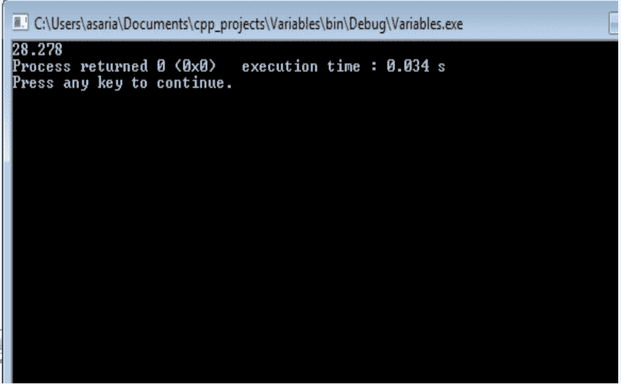

### double

`double` 变量可以持有具有更高精度的小数，并且可以持有更多的小数位（最多 15 位小数）。

在下面的示例中，`acceleration`、`mass` 和 `force` 是三个 `double` 变量，每个变量都可以持有最多 15 位小数的数字。

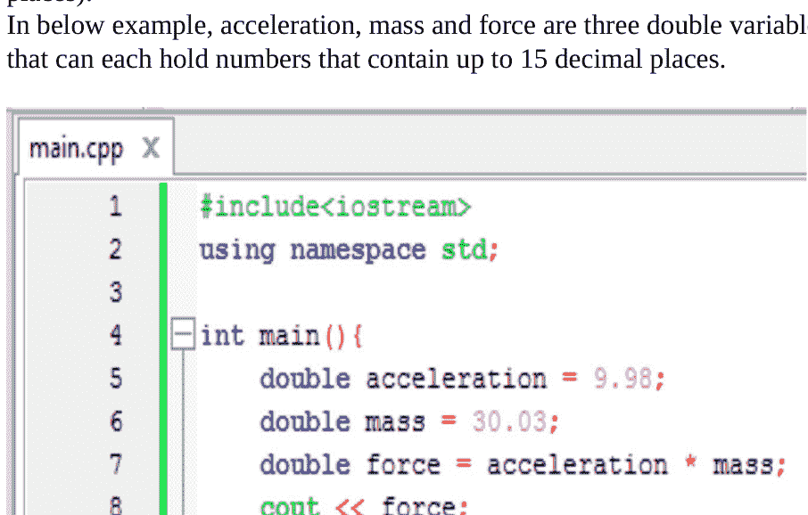

```
C:\Users\asaria\Documents\cpp_projects\Variables\bin\Debug\Variables.exe
299.699
Process returned 0 (0x0)   execution time : 0.014 s
Press any key to continue.
```

### bool

它代表布尔值（boolean）。它只能持有两个值：`true`（真）或 `false`（假）。布尔变量用于条件判断。

在下面的示例中，声明了两个布尔变量 `isHungry` 和 `isSleepy`。如果 `isHungry` 为 `true`，程序会在屏幕上打印 "I am hungry"。如果 `isSleepy` 为 `true`，程序会在屏幕上打印 "I am sleepy"。

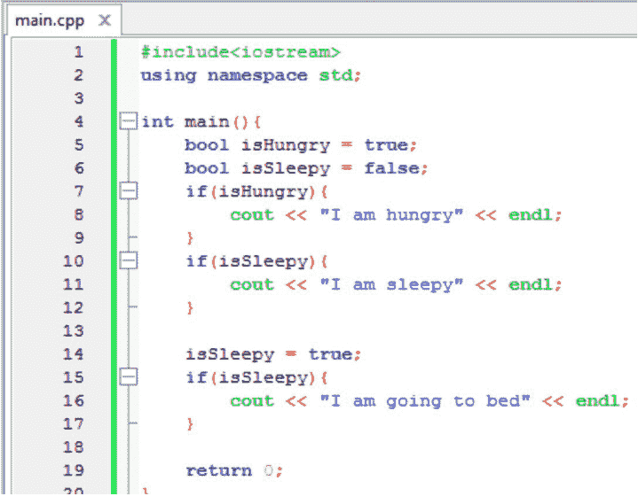

```
I am hungry
I am going to bed

Process returned 0 (0x0)   execution time : 0.015 s
Press any key to continue.
```

### char

`char` 代表字符（character）。`char` 是一个只能持有单个值的变量。该值是一个长度为 1 的字符串。在下面的示例中，`excellent` 是一个 `char` 变量，用于存储一名学生在数学科目中的成绩。

```cpp
#include<iostream>
using namespace std;

int main(){
    char excellent = 'A';
    cout << "Congratulations you got an " << excellent << " in maths" << endl;
    return 0;
}
```

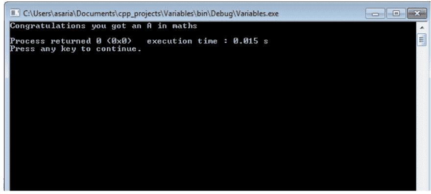

### string

`string`（字符串）是一个用于存储文本的变量。它可以持有任何长度的字符串。在下面的示例中，`yourName` 是一个持有值 "Catherine" 的变量。

```cpp
#include<iostream>
using namespace std;

int main(){
    string yourName = "Catherine";
    cout << "Good morning  " << yourName << endl;
    return 0;
}
```

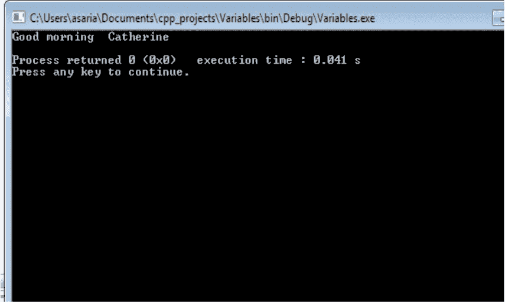

## 变量命名

C++ 变量名必须以字母或下划线开头，其余字符必须是字母、数字或下划线。


# 有效变量名

有效变量名的示例：

```cpp
x
x1
x_1_abc
RATE
bigBonus_
```

## 无效变量名

无效变量名的示例：

```cpp
12
3x
%change data
-1 PROP.CPP
```

前三个（`12`、`3x`、`%change`）是不允许的，因为它们没有以字母或下划线开头。

C++ 也是区分大小写的，这意味着以下三个是不同的变量名：

```cpp
Rate
RATE
rate
```

## 驼峰命名法（Camel Case）

驼峰命名法是一种编程习惯，即将多个单词在没有空格的情况下写在一起，且除第一个单词外，每个单词的首字母大写。

单词 *end of car* 将变为：`endOfCar`。驼峰命名法是命名变量时常用的编程实践。

## 关键字

关键字是不能用作变量名的名称，因为它们被保留用于编程语言的语法。

如果你将它们用作变量名，编译器会抛出错误，或者你可能会在无意中改变某些基础功能的底层功能。

关键字的示例包括基础数据类型（如 `int`、`bool` 等）以及 `struct` 和 `class` 等名称。

## 注释

有时我们希望解释我们的代码，以便他人能够理解我们的操作。在未来，这些信息将帮助我们在回顾代码时记住当时的做法。

在编程中，我们通过在代码中编写注释来实现这一点。注释有两种类型：单行注释和多行注释。

单行注释以两个正斜杠（`//`）开始，而多行注释则位于以下符号之间：`/* */`。

注释示例：

```cpp
// Test Code
```

```cpp
/* Line 1 of Comments
Line 2 of Comments */
```

## 声明变量

所有变量在被使用之前必须先被声明或定义。要声明或定义一个变量，你只需要指定一个数据类型和一个变量名，后面紧跟一个分号。

当你声明一个变量但没有给它赋值时，我们称该变量为 *未初始化（uninitialized）*。未初始化的变量内部将包含一个随机值。

给未初始化的变量赋值被称为 *初始化（initializing）*。你也可以在声明变量的同时进行初始化。

在这个示例中，我们将使用注释并声明一些变量，然后将它们的值打印到控制台。在 Code::Blocks 中创建一个新项目，编写以下代码，构建并运行。

### 示例代码

```cpp
#include <iostream>
using namespace std;

int main() {

/*
    This is a multiline comment
    As can be seen, it spans
    multiple lines
*/
    int length; // declaring the variable length
    int width; // declaring the variable width

    length = 20; // initializing the variable length
    width = 20; // initializing the variable width

    int depth = 40; // declaring and initializing

    cout << length << endl;
    cout << width << endl;
    cout << depth << endl;

    return 0;
}
```

### 解释

在上述程序的主代码块中，我们首先通过在 `/* */` 之间编写来创建多行注释。然后我们声明了两个 `int` 类型的变量 `length` 和 `width`，但没有初始化它们，而是在随后进行了初始化。

接着，我们声明并初始化了一个值为 40 的 `int` 类型变量 `depth`。最后，我们将 `length`、`width` 和 `depth` 的值分别打印在控制台的独立行中。

#### 练习

1. 编写一个程序，包含输出 5 到 6 个已定义但未初始化变量值的语句。编译并运行该程序。输出结果是什么？请解释。
2. 创建一个包含你名字的 `string` 变量，并将其打印到控制台。
3. 创建一个 `char` 变量并将其打印到控制台。
4. 创建一个 `bool` 变量并将其打印到控制台。
5. 创建一个 `float` 变量并将其打印到控制台。
6. 使用驼峰命名法创建一个名为 time of day 的 `long` 变量，并将其打印到控制台。

# 数学运算

在本节中，我们将制作一个只能执行两个数字乘法运算的小计算器。程序将要求我们输入两个需要相乘的数字，并打印乘法结果。

首先，我们将学习如何在 C++ 中执行数学运算。

## 加法

加法使用 `+` 运算符完成。

### 加法示例代码

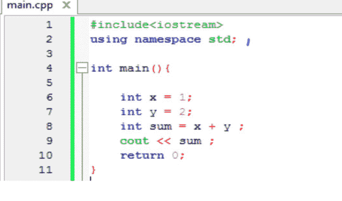

代码的输出结果将是 **3**，即 `x` 和 `y` 的和。

## 减法

减法使用 `-` 运算符完成。

### 减法示例代码

```cpp
#include<iostream>
using namespace std;

int main(){
    int x = 1;
    int y = 2;
    int difference = x - y ;
    cout << difference ;
    return 0;
}
```

代码的输出结果将是 `-1`。

# 获取用户输入

到目前为止，我们一直是在向控制台打印内容，而没有任何来自用户的输入。在本节中，我们将通过请求用户输入来让我们的程序变得更加有趣。

## `cin`

`cin` 用于接收来自键盘的输入，可以将其理解为“控制台输入”（console input）的缩写。

### 示例代码

```cpp
#include <iostream>
using namespace std;

int main() {
    int num;

    cout << "Enter a number: ";

    // take integer input
    cin >> num;

    cout << "You entered: " << num;

    return 0;
}
```

### 解释

在这里，我们首先创建了一个名为 `num` 的 `int` 类型变量，用于存储从键盘输入获取的值。

然后我们请求用户输入一些内容，并将其原样打印回控制台：如果你在控制台中输入 1，则显示 `'You entered: 1'`。

## 一个简单的计算器

我们需要请求用户输入两个要相乘的数字，然后向用户显示乘法的结果。

### 示例代码

```cpp
#include <iostream>
using namespace std;

int main() {
    int num1;
    int num2;

   xyz
    // prompt to enter num1
    cout << "Enter a num1: ";

    cin >> num1;

    // prompt to enter num2
    cout << "Enter a num2: ";

    cin >> num2;

    int multiplication = num1 * num2;
    cout << "Result of multiplication: " << multiplication;

    return 0;
}
```

### 解释

我们首先声明了两个 `int` 类型的变量 `num1` 和 `num2` 来存储用户的输入。

我们提示用户输入 `num1`，然后使用 `cin` 将其存储在相应的变量中。对 `num2` 执行同样的操作。

然后我们对这两个数进行乘法运算，并将结果显示给用户。

#### 练习

1. 将以下每个数学公式转换为 C++ 表达式，每个变量的值由用户输入获取：
   1. `3x`
   2. `3x + y`
   3. `(x + y) / 7`
   4. `(3x + y) / (z + 2)`
2. 编写一个程序，使用 6 个输入变量接收 6 个科目的学校成绩。计算这些科目的总分和平均分。
3. 编写一个程序，从用户那里接收一个整数，并判断它是偶数还是奇数。提示：使用取模运算（modulo）。

# 函数

函数是一组执行给定任务的代码行。每个函数都被分配了一个名称，并在程序中通过该名称被引用。

在 C++ 中，函数通常需要返回一个值，并且在定义函数时通常会指定返回值的数据类型。

在本节中，我们将编写一个计算矩形面积的函数。

## 函数示例

矩形的面积等于长度乘以宽度，下面是一个计算面积的函数。

请将此内容写在 `main` 函数之前，如下所示：

```cpp
#include <iostream>
using namespace std;

// defining the function named areaOfRectangle
int areaOfRectangle(int length, int width) {
    int area = length * width;
    return area;
}

int main() {
    return 0;
}
```

### 解释

`int` 是返回值的数据类型，因此我们希望函数在运行时给我们返回一个整数。这由第 7 行闭合花括号之前的 `return area;` 这一行表明。注意变量 `area` 被声明为整数类型，因为它是函数返回的变量。

`areaOfRectangle` 是我们给函数起的名称。请注意，它采用了驼峰命名法（camel case）。

函数名后面跟着一对括号，在括号中我们声明了两个变量，这些变量被称为**参数**（parameters）。在上面的示例中，`length` 和 `width` 是参数。

它们将保存我们在运行函数时传递给函数的值，并且可以在函数的代码块中被访问。

然后我们将代码放在花括号中，以便将其标记为与该函数名相关的代码行。

最后，我们有了 `return` 语句。

## 运行函数

请看下面的代码。

当我们想要运行一个函数时，我们通常称之为**调用**（calling）该函数。

有些函数在被调用时需要接收值（就像我们的函数一样），我们将这些值称为函数的***实参***（arguments）。

注意向函数传递实参的语法：我们先写函数名，在开括号和闭括号之间写实参，并用逗号分隔。

所以在我们的示例中，我们调用函数 `areaOfRectangle` 并传递两个实参，即 4 和 5。

我们期望函数返回一个值，即计算出的面积，且该面积的值为整数数据类型。

为此，我们将返回值赋值给名为 `area` 的 `int` 类型变量。

然后我们将结果打印到屏幕上。在这种情况下，矩形的面积是 20，因此屏幕上显示的输出就是 20。

## Void 函数

被称为 void 函数的函数是指在被调用后不返回任何内容的函数。

### 示例代码

```cpp
#include <iostream>
using namespace std;

void showResults(double fDegrees, double cDegrees) {
    cout << fDegrees
         << " degrees Fahrenheit is equivalent to\n"
         << cDegrees << " degrees Celsius.\n";
}

int main() {
    showResults(30.03, 100.5);
    return 0;
}
```

### 解释

请注意，指定的返回类型是 `void`，并且我们在函数体中没有使用 `return` 关键字。

除此之外，它与定义其他非 void 函数的方式没有其他区别。

#### 练习

1. 创建一个名为 `Descending()` 的函数，接收四个实参。每个实参都是 `int` 类型的数字。如果这四个数字是降序排列的，则函数返回 `true`；否则返回 `false`。例如，`Descending(4, 3, 3, 1)` 和 `Descending(3, 2, 2, 1)` 都返回 `true`，而 `Descending(2, 1, 3, 2)` 返回 `false`。
2. 创建一个名为 `isOdd()` 的函数，接收一个 `int` 类型的实参并返回一个布尔值。如果输入是奇数，函数返回 `true`；如果是偶数，则返回 `false`。
3. 以下程序的输出是什么？

   ```cpp
   #include <iostream>
   using namespace std;
   void sayhi();
   void hide(int audiencenumber);
   int main()
   {
       sayhi();
       hide(6);
       cout << "Extra time:\n";
       hide(2);
       sayhi();
       cout << "End of program.\n";
       return 0;
   }
   void sayhi()
   {
       cout << "Hello\n";
   }
   void hide(int audiencenumber)
   {
       if (audiencenumber < 5)
       return;
       cout << "Bye\n";
   }
   ```

4. 编写一个计算圆周长的函数，它有一个名为 `radius` 的 `int` 类型参数，并返回 `double` 类型。使用 `double` 变量 `pi` 且值为 3.142。

# 作者的简短留言

嘿，你喜欢这本书吗？我很想听听你的想法！

许多读者不知道获得评论有多难，以及评论对作者的帮助有多大。

如果你能花 60 秒在 Amazon 上写一段简短的评论（哪怕只有几句话），我将不胜感激！

[>> 点击这里留下快速评论](https://www.amazon.com)

感谢你抽出时间分享你的想法！

# 条件语句

通常我们希望仅在某个条件为真（true）时才执行某些操作。例如，如果外面天气晴朗，我们就出去玩，否则我们就留在家里。

“外面天气晴朗”这个陈述只能是真或假。

在编程中，我们有一种只能存储 true 或 false 值的数据类型，这种数据类型被称为 **布尔值（boolean）**。在 C++ 中，我们通常将其缩写为 `bool`。

此外，我们有时希望仅在某个条件为真时才运行某些行代码，我们可以通过 `if` 语句来实现这一点。让我们来看一个例子，这样会更容易理解。

## 示例代码

```cpp
#include<iostream>
using namespace std;

int main(){
    bool sunny = true;

    if(sunny){
        cout << "You can go outside to play" << endl;
    }else{
        cout << "Don't go outside to play" << endl;
    }

    return 0;
}
```

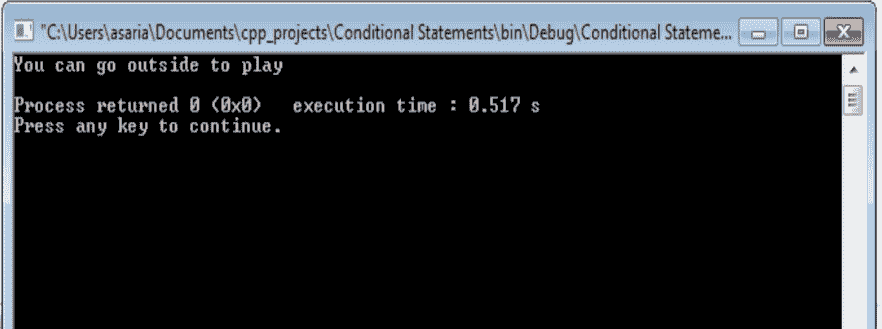

## 详细解释

在上面的示例中，我们首先创建了一个名为 `sunny` 的变量，因为它具有 `bool` 数据类型，所以它存储一个布尔值。

通过使用 `if` 语句，我们检查“天气晴朗”是否为真。如果是，我们在屏幕上打印 `"You can go outside to play"`，否则打印 `"Don't go outside to play"`。

#### 练习

将变量 `sunny` 修改为 `false`，看看会打印出什么。

## 比较运算符

比较运算符用于比较两个值，并返回 true 或 false。

比较运算符的示例包括：

- **小于（`<`）**：如果左侧的值小于右侧的值，则返回 true。否则，返回 false。
- **大于（`>`）**：如果左侧的值大于右侧的值，则返回 true。否则，返回 false。
- **小于或等于（`<=`）**：如果左侧的值小于或等于右侧的值，则返回 true。否则，返回 false。
- **大于或等于（`>=`）**：如果左侧的值大于或等于右侧的值，则返回 true。否则，返回 false。
- **等于（`==`）**：如果左侧的值等于右侧的值，则返回 true。否则，返回 false。
- **不等于（`!=`）**：如果左侧的值不等于右侧的值，则返回 true。否则，返回 false。

## 比较运算符的使用示例

假设你想在 `x` 确实大于 5 时在屏幕上打印字符串 `'x is greater than 5'`，否则打印 `'x is less than or equal to 5'`。

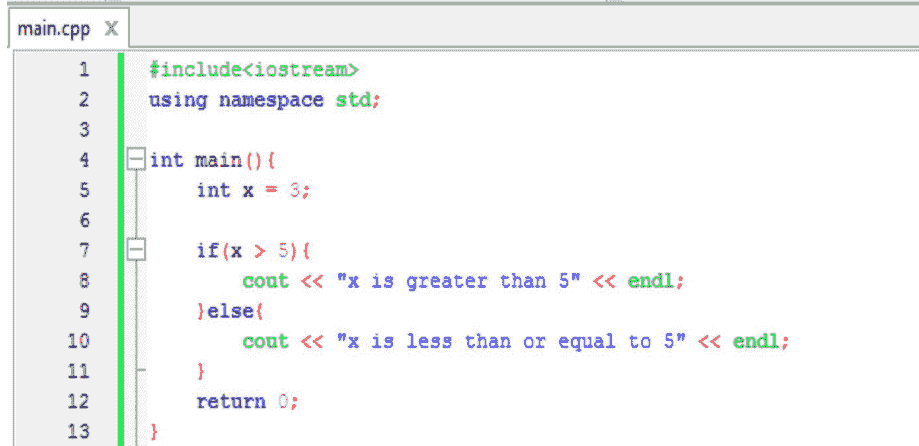

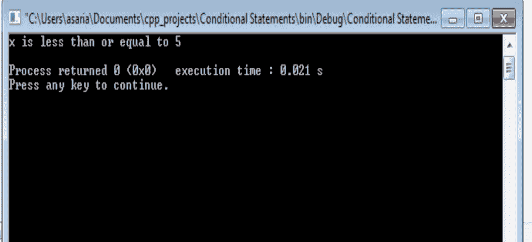

## 构建布尔表达式

**布尔表达式（Boolean expression）** 是任何具有两个值之一的表达式。它要么是 true，要么是 false。它基本上是一个比较两个值并返回 true/false 的表达式。

两个比较可以通过“与”运算符结合，在 C++ 中是 `&&`。例如，只要 `a` 的值大于 5 且 `a` 小于 10，以下布尔表达式就为真：

```cpp
(5 < a) && (a < 10)
```

如果 `a` 在 5 和 10 之间（不包括 5 和 10），则上述操作返回 true。

当两个比较使用 `&&` 连接时，只要两个比较都为真，整个表达式就为真；否则，整个表达式就为假。

你还可以使用“或”运算符结合两个比较，在 C++ 中写作 `||`。例如，只要 `b` 小于 2 或 `b` 大于 9，以下表达式就为真：

```cpp
(b < 2) || (b > 9)
```

如果 `b` 小于 2 或 `b` 大于 9，上述表达式返回 true。

在使用了 `||` 操作的表达式中，只要其中任何一个比较为真，该表达式就为真。如果两个表达式都为假，则该表达式为假。


布尔表达式可以使用`!`操作进行取反。例如：

```cpp
!(a > b)
// 如果 "a 不大于 b"，则返回 true。
```

在大多数情况下，没有必要使用感叹号（`!`）运算符。例如，`!(a > b)`等同于`a <= b`。

## 真值表

以下被称为真值表。它指出了每个表达式组合的所有可能性以及最终的布尔值。

### 与（AND）

| 表达式1 | 表达式2 | 表达式1 && 表达式2 |
| --- | --- | --- |
| true | true | true |
| true | false | false |
| false | true | false |
| false | false | false |

### 或（OR）

| 表达式1 | 表达式2 | 表达式1 \|\| 表达式2 |
| --- | --- | --- |
| true | true | true |
| true | false | true |
| false | true | true |
| false | false | false |

### 非（NOT）

| 表达式 | ! 表达式 |
| --- | --- |
| true | false |
| false | true |

## 布尔表达式示例

假设你只有在饥饿且有钱的情况下才会买食物。在代码中表示大概如下。

### 示例

```cpp
#include<iostream>
using namespace std;

int main(){
    bool isHungry = true;
    bool hasMoney = true;
    if( isHungry && hasMoney){
        cout << "I will buy food" << endl;
    }else{
        cout << "I can’t buy food" << endl;
    }
    return 0;
}
```

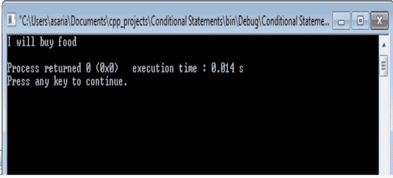

### 详细解释

只有当变量`isHungry`和`hasMoney`都为 true 时，才会打印字符串 ‘I will buy food’。否则，将打印字符串 ‘I can’t buy food’。请修改程序，使得只要`isHungry`为 true 或`hasMoney`为 true 就会打印 ‘I will buy food’。

### 练习

1. 编写一个程序，如果分数（`score`）小于 10 则输出单词`Small`，如果分数的值大于 100 则输出`Big`。

2. 编写一个程序，只要变量`test`大于或等于 50 且变量`codingPrograms`的值大于 5，则输出单词`Success`。否则，程序输出单词`failure`。变量`test`和`codingPrograms`均为 int 类型。

3. 编写一个程序，如果变量`temp`大于 37，或变量`press`的值大于 1，或两者都满足，则输出单词`Danger`。否则，程序打印单词`Great`。变量`temp`和`press`均为 int 类型。

## 循环

循环使我们能够将一组指令重复执行固定次数。如果我们愿意，它也可以永远重复下去。

通常有两种类型的循环：有限循环和无限循环。

有限循环将一组指令重复可数次数，而无限循环则将一组指令永远重复。

### 如何指定循环

在 C++ 中，有两种声明循环的方法。一种是使用`for`关键字，另一种是使用`while`关键字。

### For 循环

假设你想在控制台打印 10 次你的名字，你可能会想到将指令`cout << "My name"<< endl;`写 10 遍。使用 For 循环是防止重复编写相同语句并缩短代码的好方法。

#### 示例

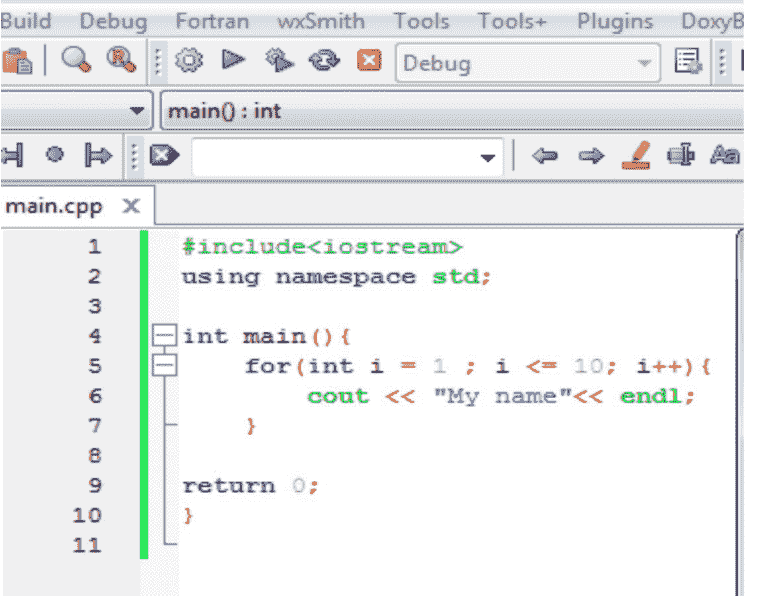

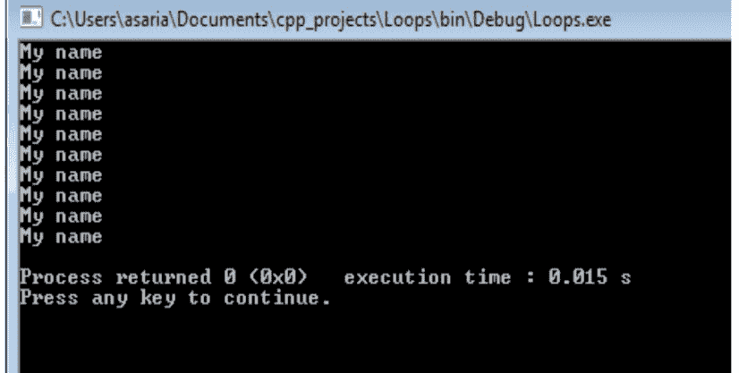

#### 详细解释

要使用`for`循环，我们需要指定与该`for`循环相关联的代码块需要运行的次数。

与`for`循环相关联的代码块位于大括号之间：

```cpp
{
}
```

在我们的代码中，相关的代码块只有一行：`cout << "My name" << endl;`

在与`for`关键字相关联的圆括号内，我们指定了由两个分号隔开的三项重要内容：

第一项是从哪个数字开始计数；对于我们来说，我们从 1 开始计数，所以我们声明一个持有值 1 的整型变量`i`。

第二项由分号与第一项隔开，是`for`循环相关联的代码块执行必须满足的条件。在这个部分，我们通常使用比较运算符，如`>`、`<`、`<=`、`>=`。

在我们的例子中，`i <= 10`意味着仅在变量`i`的值小于或等于 10 时才运行代码块，否则停止循环并继续执行程序的其余部分。

最后，第三部分由分号与第二部分隔开，用于递增计数变量；在我们的例子中，我们使用特殊记法`i++`来递增 1。

此外，这个递增操作发生在代码块运行之后。

#### 练习

- 修改程序，使其对我们的文本循环 100 次。

## 在循环内部使用计数器的示例

我们可以在相关的代码块中使用声明的整数，例如，我们可以使用下面的代码打印 1 到 10 的值。

```cpp
#include<iostream>
using namespace std;

int main(){

    for(int i = 1 ; i <= 10; i++){
        cout << i << endl;
    }

    return 0;
}
```

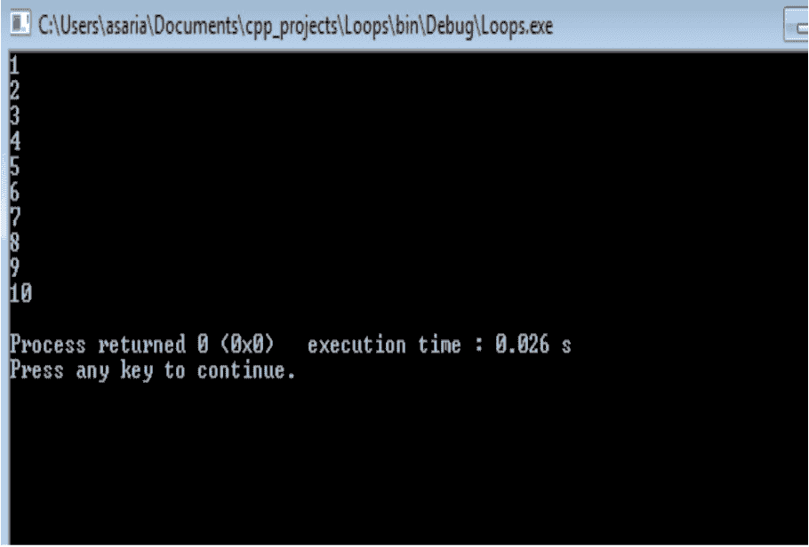

## while 循环

`while`循环与`for`循环类似，唯一的区别是与`while`关键字相关联的括号中只包含需要满足的条件。

### 示例

```cpp
#include<iostream>
using namespace std;

int main(){
    int i = 1;
    while( i <= 10){
        cout << "Hi from the while loop"<< endl;
        i++;
    }
    return 0;
}
```

### 解释

我们首先在这一行声明从哪里开始计数：`int i = 1;`

`while(i <= 10)`意味着当变量`i`的值小于或等于 10 时，运行相关的代码块。

请注意，就在闭合花括号之前，我们将`i`的值递增 1。

然后`while`循环会重复检查`i`是否小于或等于 10，如果是，则执行相关的代码块。如果`i`大于 10，则不执行该代码块，程序将执行接下来的指令。

## 死循环

当`for`循环或`while`循环用来决定是否运行相关代码块的条件始终为`true`（真）时，就会发生死循环。

因此，它基本上会永远运行下去。

### 示例

```cpp
#include<iostream>
using namespace std;

int main(){

    while( true ){
        cout << "Hi from the infinite while loop"<< endl;
    }

    return 0;
}
```

```text
Hi from the infinite while loop
Hi from the infinite while loop
Hi from the infinite while loop
Hi from the infinite while loop
Hi from the infinite while loop
Hi from the infinite while loop
Hi from the infinite while loop
Hi from the infinite while loop
Hi from the infinite while loop
Hi from the infinite while loop
Hi from the infinite while loop
Hi from the infinite while loop
Hi from the infinite while loop
Hi from the infinite while loop
Hi from the infinite while loop
Hi from the infinite while loop
Hi from the infinite while loop
Hi from the infinite while loop
Hi from the infinite while loop
Hi from the infinite while loop
Hi from the infinite while loop
Hi from the infinite while loop
```

### 解释

由于条件始终为真，这将永远运行。

## 死 for 循环

死`for`循环的定义如下所示：

```cpp
#include<iostream>
using namespace std;

int main(){
    for(;;){
        cout << "Hi from the infinite for loop"<< endl;
    }
    return 0;
}
```

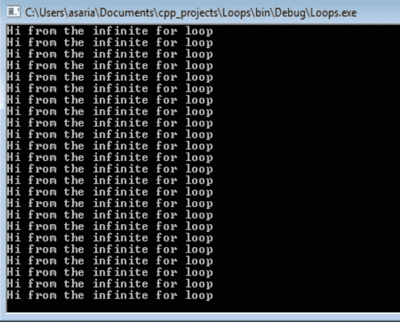

### 解释

请注意，要声明一个死`for`循环，你只需要在与`for`关键字相关的括号中放置两个分号，即：

```cpp
for(;;){
    //this code will run infinitely
}
```

#### 练习

1. 将以下循环重写为`for`循环。

   a.

   ```cpp
   int x = 2;
   while(x <= 200)
   {
       if (x < 10 && x != 1)
       {
           cout << 'YY';
           x = x + 2;
       }
   }
   ```

   b.

   ```cpp
   int a = 2;
   while(a <= 21)
   {
       cout << 'YY';
       a++;
   }
   ```

2. 以下代码的输出是什么（当嵌入在完整程序中时）？

   ```cpp
   for (int ctr = 2; ctr < 15; ctr++)
       cout << (3 + ctr) << endl;
   ```

3. 以下代码的输出是什么？

   ```cpp
   for (int b = 50; b > 2; b = b - 3)
   {
       cout << "Hi ";
       cout << b << endl;
   }
   ```

4. 编写一个程序，使用`for`循环无限次地打印你的名字。

## 数组

数组是相同数据类型值的集合。

集合中的每个值都有一个与之相关的索引，可用于检索该值。

C++ 中的索引从 0 开始而不是 1，这被称为基于零的索引（zero based indexing）。这就像从 0 而不是 1 开始计数一样。

### 练习

如果我给物品贴上从 0 到 4 的标签，我有多少个物品？

**答案：5**

## 声明数组

声明数组时，我们首先指定数组将保存的值的数据类型，接着是数组的变量名，然后在方括号中指定它将保存的元素数量。

例如：

```cpp
int size[4];
size = {1,2,3,4};
```

### 解释

在上面我们声明了一个变量名为`size`的数组，它保存了 4 个整数类型的值：

```cpp
int size[4];
```

- `int` → 数组所含元素的数据类型
- `size` → 数组的名称
- `[4]` → 数组所含元素数量的规格

语句`size = {1, 2, 3, 4}`初始化了一个数组，简单来说就是给数组变量赋值。

你也可以像下面这样同时声明并初始化一个数组：

### 示例

```cpp
int size[4] = { 1,2,3,4};
int size[] = { 1,2,3,4};
```

如果提供的参数较少，其余部分将初始化为该数据类型的零值。

## 从数组中检索值

通过使用索引指定所需值的位置，可以从数组中检索值。

### 示例

假设我们要检索数组中的第一个元素，我们的代码将是：

```cpp
#include<iostream>
using namespace std;

int main(){
    int size[4] = { 1,2,3,4};
    int firstElement = size[0];

    cout << firstElement ;
    return 0;
}
```

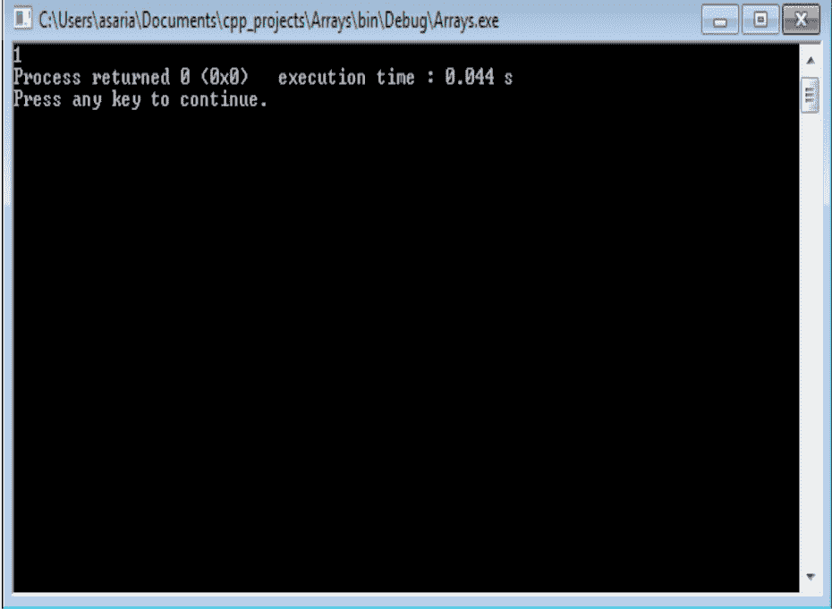

### 解释

`int firstElement = size[0];`这一行检索了数组中的第一个元素。

请注意，由于在 C++ 中我们从 0 开始计数，因此数组中第一个元素的索引是 0。

程序打印出 1，因为`size`中的第 1 个元素是 1。

#### 练习

检索第四个元素。（提示：索引不是 4）

## 遍历数组元素

如果我们想检索数组中的所有元素，可以使用循环来实现。

我们将使用`for`循环，因为这是最简单的方法。

### 示例

```cpp
#include<iostream>
using namespace std;

int main(){
    int size[4] = { 1,2,3,4};

    for(int i = 0 ; i < 4; i++){
        cout << size[i] ;
    }
    return 0;
}
```

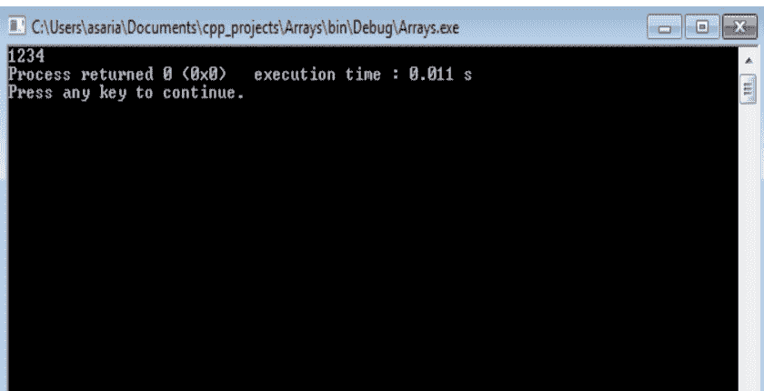

### 解释

请注意，我们的计数器从 0 开始，条件是计数器`i`的值应小于 4，而 4 正是数组的大小。

#### 练习

以下内容需在同一个文件中完成：

1. 编写一个计算圆面积的函数。
2. 创建一个包含 10 个圆半径的数组，用于计算它们的面积。
3. 遍历该数组以计算圆的面积，并将结果打印到屏幕上。
4. 仅计算数组中第四个位置的圆面积。
5. 创建一个由你名字字符组成的数组，并将所有字符打印到屏幕上。

## 结构体

结构体是一组值，使你能够以逻辑方式（即对你而言有意义的方式）对数据进行排序。

假设你想收集关于你朋友的年龄、体重和身高信息。

利用我们目前的知识，我们会这样做：

### 示例代码

```cpp
#include<iostream>
using namespace std;

int main(){
    int kevinAge = 10;
    int kevinWeight = 30;
    int kevinHeight = 1;

    int jesiccaAge = 15;
    int jesiccaWeight = 28;
    int jesiccaHeight = 1;

    return 0;
}
```

结构体使得对这类信息的分组变得更加容易。

让我们先定义一个结构体。

## 结构体定义

```cpp
#include<iostream>
using namespace std;

struct PersonInfo{

    int age;
    int weight;
    int height;
};

int main(){

    return 0;
}
```

### 解释

结构体定义在任何函数定义之外，包括`main`函数。

我们使用关键字`struct`来定义结构体，后面跟着我们想要给结构体起的名称，这个名称被称为结构体标签（structure tag）。

在与结构体标签相关联的花括号内部，我们声明结构体变量，它们也被称为成员名称（member names）。在上面的示例中，`age`、`weight`和`height`都是成员名称。

**注意**，在结束的大括号后面有一个分号。

## 初始化结构体


```cpp
#include<iostream>
using namespace std;

struct PersonInfo{

    int age;
    int weight;
    int height;
};

int main(){

    // initializing the structure
    PersonInfo kevin = {10,30,1 };
    PersonInfo jessica = {15,28,1 };

    return 0;
}
```

### 解释

通过创建结构体，我们创建了一种新的数据类型。

像我们通常声明任何变量时一样，我们从它将持有的数据类型开始。

在大括号中，我们传入参数作为已声明结构体变量的值。

参数的顺序很重要。

如果初始化值的数量多于结构体成员，你会得到一个错误。

如果值较少，列表中未包含的最后几个成员将初始化为零。

## 访问结构体成员值

要访问结构体的成员变量值，你可以使用点运算符，如下所示。

### 示例代码

```cpp
main.cpp
#include<iostream>
using namespace std;

struct PersonInfo{

    int age;
    int weight;
    int height;
};

int main(){

    // initializing the structure
    PersonInfo kevin = {10,30,1 };
    PersonInfo jessica = {15,28,1 };

    cout << kevin.age << endl;
    cout << jessica.age << endl;

    return 0;
}
```

上述代码中，`kevin.age` 和 `jessica.age` 的输出分别是 10 和 15。Age 是结构体的第一个成员。10 和 15 是结构体初始化中的第一个数字，因此它们分别对应 Kevin 和 Jessica 的年龄。

### 练习

创建一个名为`Date`的结构体，它具有`year`、`month`和`day`这几个成员变量。用当前日期初始化它，并将所有值打印到屏幕上。

## 最终项目

在最终项目中，我们旨在运用整本书中学到的许多技能。

### 任务

设计一个学生管理系统。添加新学生时，需要输入他们的姓名和注册编号。用户可以根据注册编号搜索特定学生。用户可以查看所有学生的完整列表，并根据注册编号删除特定学生，然后退出程序。

下面的代码执行了该任务；程序之后清楚地解释了所有任务。

### 代码


```cpp
#include <iostream>
#include <string>

using namespace std;

// Search record function to search the record of the student if it exists and then print the record.
void searchRecord(string name[], string regnum[], string reg, int in) {
    // Is-found variable to check whether a record exists in the array.
    bool isfound = false;

    // Loop through the array to check whether a record exists.
    for (int index = 0; index < in; index = index + 1) {
        // Check every record in the array. If there is a match:
        if (regnum[index] == reg) {
            // Record is found.
            isfound = true;

            // Print the record.
            cout << "Student Registration Number  : "
                 << regnum[index] << "\t\t"
                 << " Student Name : "
                 << name[index] << endl;
            cout << endl;

            // Terminate the loop.
            break;
        }
    }

    // If a particular record does not exist:
    if (isfound == false) {
        // Display that the record does not exist.
        cout << " Record is not found : " << endl;
        cout << endl;
    }
}

int main() {
    // Loop control variable. Set it to false when the user exits the program.
    bool cont = true;

    // Registration number array to store the users' registration numbers.
    string registrationNum[100];

    // Student name array to store the students' names.
    string name[100];

    // Variable to store the user's selected option.
    int selectedNumber;

    // Index to count the total number of added students.
    int index = 0;

    // Loop until the user exits the program.
    while (cont) {
        // Print the menu.
        cout << "[1] Create New Record \n"
             << "[2] Search A Record \n"
             << "[3] View All Record \n"
             << "[4] Delete a Record \n"
             << "[5] Exit  \n"
             << endl;

        // Prompt the user to enter a number.
        cout << "Select Number : ";

        // Store the user's entered number in `selectedNumber`.
        cin >> selectedNumber;

        // If `selectedNumber` is 1, add a record to the array.
        if (selectedNumber == 1) {
            // Declare `nam` and `regNum` variables to store the user's input.
            string nam;
            string regNum;

            // Prompt the user to enter a name.
            cout << "Enter your name : ";

            // Store the user's entered name in `nam`.
            cin >> nam;

            // Prompt the user to enter the registration number.
            cout << "Enter your Registration Number : ";
            cin >> regNum;

            // Store the user's entered name and registration number in their respective arrays.
            registrationNum[index] = regNum;
            name[index] = nam;

            // Increment `index`.
            index = index + 1;
            cout << endl;
        }

        // Check if the user entered 2.
        else if (selectedNumber == 2) {
            // Check if there is at least one record in the array.
            if (index >= 0) {
                // Prompt the user to enter a registration number.
                string renum;
                cout << "Enter Your Registration Number :";

                // Store the user's entered registration number in `renum`.
                cin >> renum;

                // Call the function that finds and prints a record.
                searchRecord(name, registrationNum, renum, index);
            }

            // If there is no record in the array:
            else {
                // Print that there is no record in the system.
                cout << "There is no Record In the System" << endl;
                cout << endl;
            }
        }

        // Check if the user entered 3.
        else if (selectedNumber == 3) {
            // Print all student records.
            for (int i = 0; i < index; i++) {
                // If the array contains a null record that was deleted:
                if (name[i] == "null") {
                    // Ignore that index.
                    continue;
                }

                // Print the student's record.
                cout << "Student Registration Number : "
                     << registrationNum[i] << "\t\t"
                     << " Student Name : "
                     << name[i] << endl;
            }

            // Add spacing.
            cout << endl;
        }

        // Check if the user entered 4.
        else if (selectedNumber == 4) {
            // Check whether there is any record in the array.
            if (index > 0) {
                // Declare `renum` to store the user's registration number.
                string renum;

                // Prompt the user to enter a registration number.
                cout << "Enter Your Registration Number :";
                cin >> renum;

                // Variable to check whether the record is found in the array.
                bool isfound = false;

                // Loop through all records.
                for (int i = 0; i < index; i++) {
                    // Check whether the entered registration number matches a number in the array.
                    if (registrationNum[i] == renum) {
                        // Set `isfound` to true.
                        isfound = true;

                        // Add null values to the arrays where the record was found.
                        name[i] = "null";
                        registrationNum[i] = "null";

                        // Print that the record was deleted successfully.
                        cout << "Record deleted successfully : " << endl;
                        cout << endl;
                    }
                }

                // If the entered registration number was not found:
                if (isfound == false) {
                    // Print that the record was not found.
                    cout << " Record is not found : " << endl;
                    cout << endl;
                }
            }

            // If there is no record in the array:
            else {
                // Print that there is no record in the system.
                cout << " There is no record in the system: " << endl;
                cout << endl;
            }
        }

        // Check if the user entered 5.
        else if (selectedNumber == 5) {
            // Print a farewell message.
            cout << " Take Care " << endl;

            // Set `cont` to false so that the program terminates.
            cont = false;
        }

        else {
            // If the user did not enter a number from 1 to 5, print an error message.
            cout << " Invalid entry : " << endl;
            cout << endl;
        }
    }

    return 0;
}
```


```
[1] Create New Record
[2] Search A Record
[3] View All Record
[4] Delete a Record
[5] Exit

Select Number : 1
Enter your name : john
Enter your Registration Number : 44

[1] Create New Record
[2] Search A Record
[3] View All Record
[4] Delete a Record
[5] Exit

Select Number : 1
Enter your name : jimmy
Enter your Registration Number : 46

[1] Create New Record
[2] Search A Record
[3] View All Record
[4] Delete a Record
[5] Exit

Select Number : 1
Enter your name : hussain
Enter your Registration Number : 12

[1] Create New Record
[2] Search A Record
[3] View All Record
[4] Delete a Record
[5] Exit

Select Number : 2
Enter casing and punctuation fixed, hyphens normalized, number symbols preserved exactly.

[1] Create New Record
[2] Search A Record
[3] View All Record
[4] Delete a Record
[5] Exit

Select Number : 3
Student Registration Number : 44 Student Name : john
Student Registration Number : 66 Student Name : jimmy
Student Registration Number : 12 Student Name : hussain

[1] Create New Record
[2] Search A Record
[3] View All Record
[4] Delete a Record
[5] Exit

Select Number : 4
Enter Your Registration Number :66
Record deleted successfully :
```

```
[1] Create New Record
[2] Search A Record
[3] View All Record
[4] Delete a Record
[5] Exit

Select Number : 3
Student Registration Number : 44 Student Name : john
Student Registration Number : 12 Student Name : hussain

[1] Create New Record
[2] Search A Record
[3] View All Record
[4] Delete a Record
[5] Exit

Select Number : 5
Take Care

----------------------------------------------------------

Process exited after 40.77 seconds with return value 0
Press any key to continue . . .
```

## 在数组中添加记录

我们为学生姓名和学生注册号声明了两个数组。这两个数组分别被称为 `registrationNum` 和 `name`。如果用户输入数字 `'1'`，程序将要求用户输入学生姓名和注册号。随后用户输入姓名和注册号，这些信息将被存储在相应的数组中。这里有一个名为 `index` 的计数变量，用于统计已创建的学生数量。每添加一名学生，`index` 就会增加 `1`。添加记录的过程在下面的代码部分中展示。

```cpp
if ( selectedNumber == 1) {

    // declare nam and regNum variable to store the user entered nam and regNum
    string nam;
    string regNum;

    // prompt user to enter name
    cout << "Enter your name : ";

    // store the user enter name into nam variable
    cin >> nam;

    // prompt the user to enter the registration number
    cout << "Enter your Registration Number : ";
    cin >> regNum;

    // storing the user entered name and regNum into their respective array
    registrationNum[index] = regNum;
    name[index] = nam;

    // incrementing index
    index = index + 1;
    cout << endl;
}
```

## 从数组中搜索记录

用户可以在程序开始时按下 `'2'`，使用已注册的注册号来搜索特定的学生。程序首先检查学生数组是否为空。如果数组不为空，用户随后输入注册号。程序会将用户输入的注册号与数组中现有的注册号进行比较。这一过程是通过 `searchRecord()` 函数实现的。

```cpp
}

// check if user entered 2 then
else if ( selectedNumber == 2)
{
    // check if there is at least one record in the array then
    if ( index >= 0) {

        // prompt user to enter registration number
        string renum;
        cout << "Enter Your Registration Number :";

        // storing the user entered registration number into renum variable
        cin >> renum;

        // calling the function which fine a record and print it
        searchRecord(name,registrationNum,renum,index);

    }

    // if there is no record in the array then
```

`searchRecord()` 函数接收一个姓名数组（`name[]`）和一个注册号数组（`regnum[]`）作为参数。它还接收两个变量：注册号 `reg` 和索引 `in`。

`reg` 是我们用来搜索学生记录的注册号，而 `in` 是记录的数量。

该函数使用 `for` 循环在 `regnum[]` 数组中搜索注册号 `reg`。

如果找到了 `reg`，函数将打印出该学生的注册号和姓名。

如果未找到 `reg`，函数将打印出 `"Record is not found"`（未找到记录）。

```cpp
// search record function to search the record of the student if it is exist and then print record
void searchRecord(string name[], string regnum[], string reg, int in) {

    // is found variable to check whether a record exist or not in the array if exist set it true
    bool isfound = false;

    // loop till array to check a whether a record exist or not
    for(int index = 0; index < in; index = index + 1) {

        // check the every record in array if match then
        if ( regnum[index] == reg) {

            // record is found
            isfound = true;

            // printing the record
            cout << "Student Registration Number : " 
                << regnum[index] << "\t" << " Student Name : " << name[index] << endl;
            cout << endl;
        }

        // terminating from loop
        break;
    }

    // if a particular record is not exist then
    if (isfound == false) {

        // display that record is not exist
        cout << " Record is not found : " << endl;
        cout << endl;
    }
}
```

## 查看所有记录

若要查看所有学生的记录，用户在程序开始时按下 `'3'`。这里有一个名为 `index` 的计数变量，用于计算学生的数量。使用 `for` 循环检索每条学生记录，并打印出每位学生的姓名和注册号。循环将一直持续直到达到 `index` 的值，这表示我们已到达数组末尾。

```cpp
// check if the user entered number 3 then
else if ( selectedNumber == 3 ) {

    // Printing all the records of students
    for (int i = 0; i < index; i++) {

        // if there is null in the array which record is deleted
        if ( name[i] == "null" )
        {
            // just ignore that index
            continue;
        }

        else {

            // printing all the record of student
            cout << "Student Registration Number : " << registrationNum[i] 
                 << "\t\t" << " Student Name : " << name[i] << endl;
        }
    }

    // adding space
    cout << endl;
}
```

## 删除记录

如果用户在程序开始时按下 `'4'`，用户可以根据注册号删除特定的学生。

用户首先将注册号输入到名为 `renum` 的变量中。程序将检查学生数组是否为空，如果为空，则显示系统中没有记录。如果数组不为空，程序会将 `renum` 与 `registrationNum` 数组中的注册号进行比较。这是通过一个遍历数组的 `for` 循环完成的。如果找到了该学生，则通过将相关的 `name` 和 `registrationNum` 声明为 `null` 来从数组中删除该记录。

如果未找到学生记录，程序将打印 `"Record is not found"`（未找到记录）。

```cpp
// check if the user entered the number 4 then
else if ( selectedNumber == 4 ) {

    // check there is any record in the array then
    if ( index >= 0) {

        // declare the variable renum to store the user registartion number
        string renum;

        // prompt user to enter registration number
        cout << "Enter Your Registration Number :";
        cin >> renum;

        // is found variable which check if the record is found or not in array
        bool isfound = false;

        // Loop till the end of number of record
        for(int ind = 0; ind < index; ind = ind + 1 ){

            // check if the user entered registration is equal to registration num in array
            if ( registrationNum[ind] == renum ) {

                // set the value of found to true
                isfound = true;

                // adding the null to arrays where value is found
                name[ind] = "null";
                registrationNum[ind] = "null";

                // just print that record deleted successfully
                cout << " Record deleted successfully : " <<endl;
                cout << endl;
            }
        }
    }
    // if the user entered registration number is not found then

    // if there is no record in the array then
    else {

        // print record is not exits
        cout <<" There is no record in the system: " <<endl;
        cout << endl;
    }
}
```

## 退出

如果用户输入数字 `'5'`，则直接跳出循环。

变量 `cont` 被设置为 `false`。这将终止程序，因为程序处于一个 `while` 循环中，只要 `cont` 为 `true` 循环就会继续。

```cpp
// check if the user entered the number 5 then
else if( selectedNumber == 5 ) {

    // print take care
    cout <<" Take Care " <<endl;

    // set cont to false so that programme terminate
    cont = false;
}
```

### 结论

感谢阅读本书。

希望这能帮助你开始 C++ 编程之旅。

如果你想在 C++ 方面更进一步，我建议你参考以下亚马逊上的书籍。

- [快速学习 C++](https://www.amazon.com/Learn-Quickly-Beginners-Programming-Hands-ebook/dp/B08DZ3NY6Z/)
- [编程：基于 C++ 的原理与实践](https://www.amazon.com/Programming-Principles-Practice-Using-2nd/dp/0321992784/)

如果你对 Javascript 或 Python 感兴趣，可以在下方我的产品页面上找到几本书。

[Bob Mather 产品页面](https://www.amazon.com/kindle-dbs/entity/author/B07HHQZC4Y)

## 还没结束……差点忘了！

评论来之不易。

作为一名营销预算极其有限的独立作者，我依赖像你这样的读者在亚马逊上留下简短的评论。

哪怕只是一两句话也好！

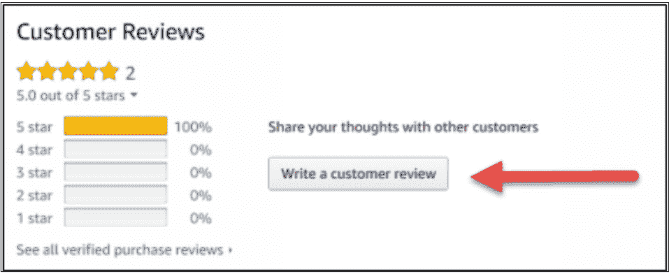

所以如果你喜欢这本书，请……

[>> 点击此处在亚马逊上留下简短评论。](about:blank)

我非常感谢你的评论，因为它真的意义不同。

衷心感谢你购买并读完这本书。

## 第二本书：9-15 岁儿童编程


# 从零开始学习基础 HTML、CSS 和 JavaScript

## 引言

那是一个亚特兰大的明媚夏日午后；我拿起笔记本电脑，准备在门外门廊上看最新一集《权力的游戏》。我坐在那把三条腿的椅子上时，感到后腿晃了一下。那条腿直接从凳子上脱落，我仰面摔倒在地。听到门廊上巨大的撞击声，我的妻子伊莎贝尔和儿子阿尔纳德都跑了出来。"你没事吧？"伊莎贝尔惊呼道。我被吓了一跳，但并无大碍，在伊莎贝尔的搀扶下站了起来。我走进屋里喝了一杯水，让自己回过神来。令我惊讶的是，我透过窗户看到我 9 岁的儿子阿尔纳德正在研究如何把它拼装回去。他把腿装了回去，但发现椅子还在晃。然后他把螺丝换到好腿上的那个螺丝；椅子依然在晃。最后他用胶水粘住了固定螺丝的滑动机构；椅子神奇地修好了。太厉害了！！

接下来，我们聊聊贝蒂。我们邻居的女儿贝蒂，长期以来在社会科学科目上一直很吃力。她的父母已经习惯了这门课不及格的成绩；每次她拿到"D"都觉得松了一口气。所以，想象一下当贝蒂有一天拿着成绩单回来说社会科学得了"A"时他们有多震惊。没错，贝蒂是个勤奋的女孩，她在一些科目上确实表现不错；但这次成绩的逆转完全出乎意料。接着，贝蒂向父母展示了她过去三个月的社会科学提升计划。她把每周要学习的主题列成清单；还说明了如何通过纪录片和小组学习来简化一些较难的主题。她从一个主题到另一个主题系统性地推进，直到攻克了所有内容。

最后，我们来说说卡尔。卡尔在高中刚开始时是一名网球运动员。他比对手瘦小得多，也弱得多。结果，他在第一场锦标赛中输得很惨。他甚至连拿几分都很艰难。虽然他很沮丧，但他意识到他的失败并非因为缺乏技术；而是因为客观条件的限制。他分析了局势；意识到自己需要提高球场上的技术和位置感。他分析了对手在球场上的移动；并调整自己的击球方式，确保始终让对手处于被动状态。他做了大量的瑜伽和其他拉伸运动来提高柔韧性、平衡感和速度。他的水平开始逐月提升。每个月，他都练习一种不同的击球技术。几年后，他的体型长开了，变得更强壮、更结实。由于他的努力，他的技术水平远超对手。在高中第三年，他赢得年度锦标赛，几乎没有遇到真正的对手。

所有这些情景都是假设的，可能因某些孩子的先天特质而发生。此外，编程并不能保证你一定能学到这些技能。但是，所有这些情景都展示了在编程过程中可以学到的技能。阿尔纳德系统性地检查了椅子及其各个部件；逐一排查每个部件来找出问题。这与编程中一个叫做"调试（debugging）"的过程是一样的。调试就是当程序无法正常运行时所做的事情。它需要对代码进行系统性分析来找出问题并使其正常运行。

贝蒂面对一个问题；将其分解为达成目标所需的各个部分。这类似于编程中的问题解决。也就是理解解决编程问题需要什么；并将代码组织成不同的部分使程序正常运行。

卡尔做的事情和贝蒂类似；他将问题分解成不同的部分，以便以简单的方式解决。但除此之外，他还在网球场上对不同技能进行了优先级排序。他花时间弄清楚哪些技能对击败对手更重要，并优先练习这些技能。在代码被正确组织结构之后，优先级排序是编程中一项重要的技能。程序员需要优先测试代码中更重要的任务。

所有这些技能对编程都至关重要；如果你的孩子想学好编程，就应该学会这些技能。他们是否成为程序员其实并不重要。这些技能将让你的孩子受益终生。编程还有助于提高孩子的基础数学和阅读能力；此外还能提升逻辑思维和问题解决能力。

这些技能，加上他们在高中学到的沟通技巧，就是为什么软件工程师在美国的年薪中位数达到 112,000 美元（截至 2018 年）。这是美国平均工资的两倍多。

尽管如此，全世界的高中，即使在富裕地区，也缺乏足够的师资和技术资源来开展这项工作。根据 Tech Republic 在 2000 年进行的一项 K-12 教师调查，只有 8% 的教师认为自己有足够信心教孩子编程。美国有 50% 的孩子家里没有网络。对于美国的女孩和有色人种儿童来说，情况更加糟糕；他们拥有更少的资源和可以效仿的榜样。

所以，你需要把这件事掌握在自己手中。

## 不要做的事情

你可能想知道需要做什么才能开始。有几件事情我建议不要做。我建议不要请一个没有教孩子经验的程序员。他们是编程领域的专家；但他们开始编程已经是几十年前的事了；因此，他们无法与一个从未学过编程、还在学习基础数学的孩子产生共鸣。

接下来要避免的事情是去找最新的 JavaScript 教材；然后读给孩子听。这些书对学习编程的作用；就像字典对学习语言一样有限。它们价格昂贵，对现有程序员来说更适合作为参考工具。

我也建议不要参加编程训练营。这对少数学生可能有效；但大多数学生会在一大群一起学习的孩子中迷失方向。一对一的关注才是最好的起步方式。

## 开始入门的第一步

本书是开始学习的最佳途径。我将编程分解为一系列基础章节；并将其与现实世界联系起来。第一章将帮助你设置 JavaScript 和 HTML 文件以开始学习。

每一章我都提供了代码，你可以直接复制粘贴运行。代码的每个部分都有详细解释；我还有练习题供你用本章的概念自行完成。

我在书末还推荐了一对一的辅导老师；以及你可以用来进一步提升知识的额外书籍。

## 设置工作区

### 所需条件

- 一台笔记本/台式电脑
- 互联网连接
- 已安装的网络浏览器（Firefox、Chrome 或 Internet Explorer）

### 下载并安装 Notepad++

下载最新版本的文本编辑软件。我推荐使用 Notepad++。您可以在下方下载最新版本：

[https://notepad-plus-plus.org/downloads/](https://notepad-plus-plus.org/downloads/)

### 如何开始使用 Notepad++

从您的桌面或开始菜单打开 Notepad++。

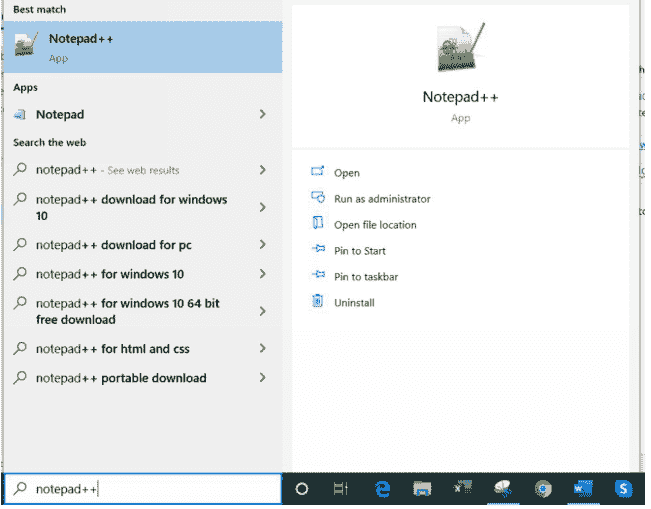

打开 Notepad++ 后，转到`文件 > 新建`来新建一个文件。

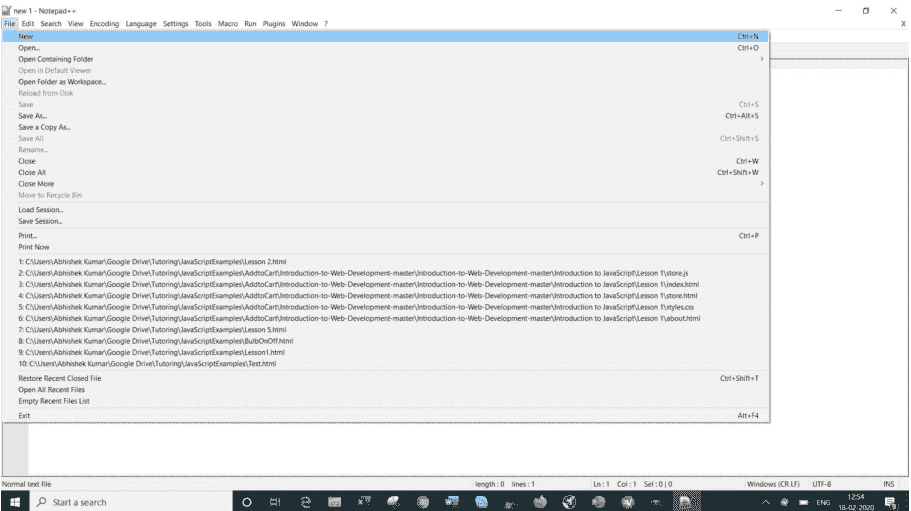

现在，点击`文件 > 另存为`并将文件类型选择为`.html`。

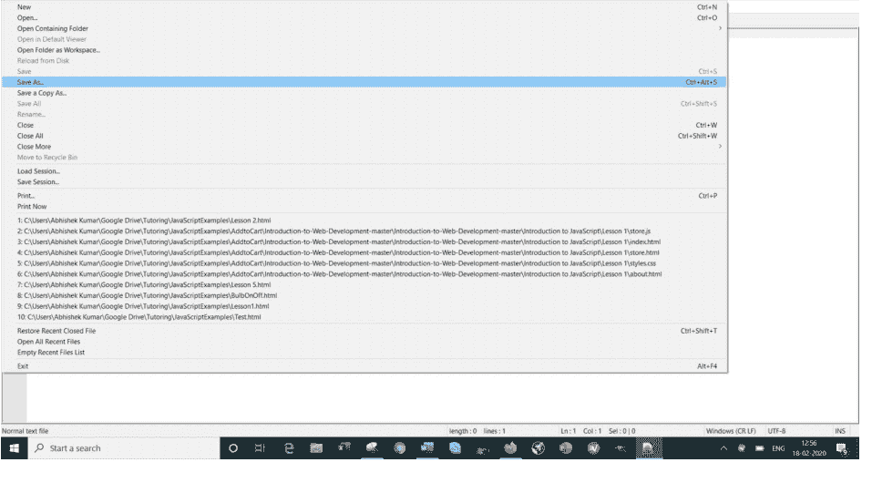

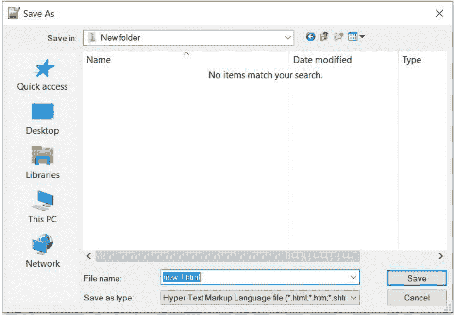

这能确保您可以在像 Firefox 或 Chrome 这样的 HTML 浏览器中运行您的程序。

## 测试程序

有一个简单的方法可以测试程序，看看它是否能连接到您的浏览器。只需在您的文件中输入一些随机文本。在我的文件中，我输入了`"Testing 1,2,3......"`。

然后点击`文件 > 保存`。

之后，根据您使用的浏览器，点击`运行 > 在 Firefox/Chrome/IE 中启动`。如果一切正常，您输入的文本应该会显示在浏览器窗口中。

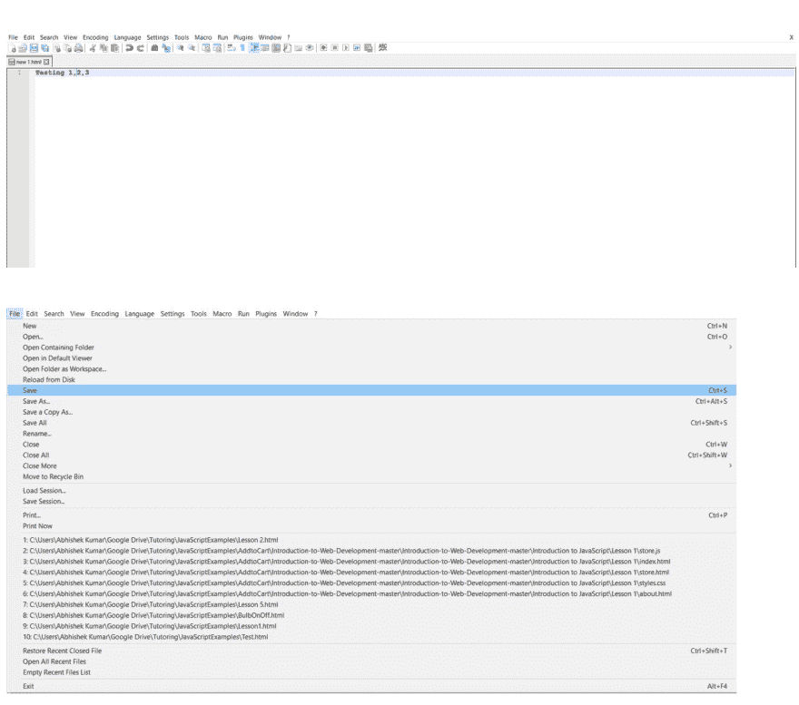

`html` - Notepad++

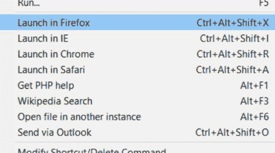

**结果：**

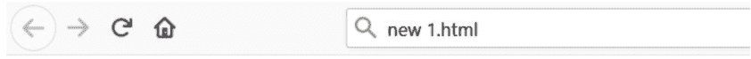

Testing 1,2,3

我知道对某些人来说这可能是一个简单的测试；但在开始真正的编程之前，确保一切都能正常工作是很重要的。

## HTML 简介

### 什么是 HTML？

HTML 代表超文本标记语言。

HTML 是人类用来与 Chrome、Internet Explorer、Firefox 等网络浏览器进行交互的语言。有时，它由 CSS 和 JavaScript 辅助；但网页的基本结构是由 HTML 定义的。

它非常简单，即使是编程初学者和小孩也很容易掌握。HTML 使用简单的、看起来像箭头两端的标签来完成。

### HTML 标签示例

以下是 HTML 标签的样子：

`<p>` - 标签示例

每个 HTML 标签都有一个额外的标签来表示标签的结束。标签的结束除了标签的两个尖括号外，还有一个斜杠。请参阅下面的简单示例。

```html
<p> - 标签开始
</p> - 标签结束
```

### 基本 HTML 标签及其用途

- `<html>`：这是每一段 HTML 代码的起始标签。
- `<head>`：这是在任何其他内容之前首先执行的代码。
- `<title>`：这是写在浏览器顶部标题栏中的代码。
- `<body>`：包含页面上显示的信息。
- `<p>`：用于页面正文中出现的一段文本。
- `<h1>`、`<h2>`、`<h3>`、`<h4>`、`<h5>`、`<h6>`：这些用于按大小降序排列的文本标题。`<h1>` 是最大尺寸的标题，`<h6>` 是最小的。
- `<strong>`：用于使文本加粗。
- `<ul>`：用于无序列表，例如项目符号项。
- `<li>`：用于在文本行前添加项目符号图标。
- `<ol>`：用于有序列表，例如从 1, 2, 3... 开始编号的项目。
- `<div>`：这些是较大的内容部分；通常包含多个段落、标题等。
- `<a>`：用于创建文本超链接。超链接就是当您点击一段带下划线的文本时，它会链接到另一个页面。
- ``：用于向网页添加图像。

现在，您可能想知道需要学习的东西很多。别担心。您现在不需要记住其中任何内容。只需将其作为您编码时的参考。我们将通过一个例子来更好地解释一切。

### HTML 示例

```html
<html>
<head>
<title>Greeting to html......</title>
</head>
<body>
<h1>Welcome to your first html website</h1>
<h2>Time to get started...</h2>
<p>Hi. My name is Bob. I am excited to learn about programming a website. Here's a few things we will learn.</p>
<ul>
<li>Basics of html</li>
<li>Css</li>
<li>JavaScript</li>
</ul>
</body>
</html>
```

下方是相同的代码（您可以复制和粘贴）：

```html
<html>
<head>
<title>Greeting to html......</title>
</head>
<body>
<h1>Welcome to your first html website</h1>
<h2>Time to get started...</h2>
<p>Hi. My name is Bob. I am excited to learn about programming a website. Here's a few things we will learn.</p>
<ul>
<li>Basics of html</li>
<li>CSS</li>
<li>JavaScript</li>
</ul>
</body>
</html>
```

### 以下是我们的输出结果

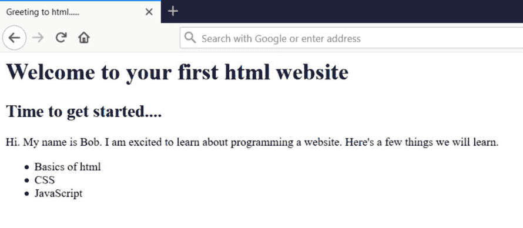

让我们将输出与代码中的标签联系起来。

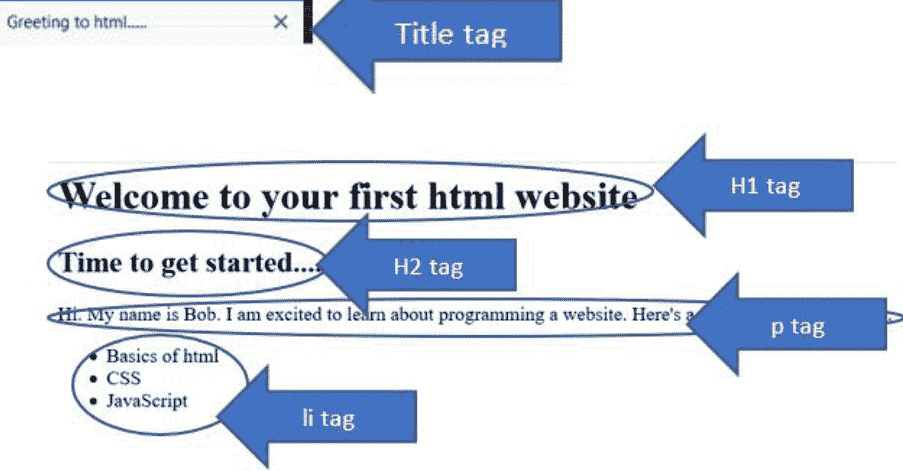

### 练习题

1. 创建一个介绍你自己的 HTML 网站。创建一个标题标签，内容为“自我介绍”。使用`h1`和`h2`标签为自己创建一个标题。然后创建一个段落，谈论你自己、你的年龄、学校和家乡。最后，创建一个包含你爱好的项目符号列表。
2. 创建一个 HTML 网站，谈论你最喜欢的运动队或电视节目。创建一个标题标签，内容为该节目/运动队的名称。使用`h1`和`h2`标签创建一个标题。然后创建一个段落，谈论你为什么喜欢这个队伍/电视节目，以及它们为什么如此出色。最后，创建一个包含你喜欢的节目中球员/人物的项目符号列表。

## 灯泡示例 - HTML

### 本项目功能

这是一个简单的 HTML 项目，创建一个可以切换页面上灯泡开/关的按钮。我们将使用两张灯泡图片来实现这一点。该按钮将在这两张图片之间切换。

### 本章需要理解的概念

对于这个例子，我们需要理解按钮标签和图像标签。

#### 按钮标签

`<button onclick=Action >按钮文本</button>`

按钮元素有两个子元素：一个动作和按钮文本。按钮文本是显示在按钮上的文本；而动作是用户点击按钮时发生的事情。

#### 图像标签

``

图像标签有三个元素：

1. `ImageId` 是您分配给图像的名称。此名称用于在代码中引用图像。
2. `ImageUrl` 是标签引用的图像的 URL。如果图像与 HTML 文件在同一文件夹中，那么您可以只使用文件名而不是完整的 URL。
3. `ImageSize` 设置图像的宽度和高度。

### 文件

将两张灯泡亮起和熄灭的图片与我们正在使用的 HTML 代码放在同一文件夹中。您可以通过点击下方链接并下载来获取文件：

- [灯泡亮起图片](Bulb On Picture)
- [灯泡熄灭图片](Bulb Off Picture)

### 代码

```html
<html>
<head>
<title> The Bulb Project</title>
</head>
<body>

<h2>Bulb Light with JavaScript</h2>
<button onclick="document.getElementById('myImage').src='bulb_off.JPG'">Bulb Off</button>

<button onclick="document.getElementById('myImage').src='bulb_on.JPG'">Bulb On</button>

</body>
</html>
```

下方是相同的代码（您可以复制和粘贴）：

```html
<html>
<head>
<title> The Bulb Project</title>
</head>
<body>

<h2>Bulb Light with JavaScript</h2>
<button onclick="document.getElementById('myImage').src='bulb_off.JPG'">Bulb Off</button>

<button onclick="document.getElementById('myImage').src='bulb_on.JPG'">Bulb On</button>

</body>
</html>
```

#### 输出

初始状态：

**Bulb Light with JavaScript**

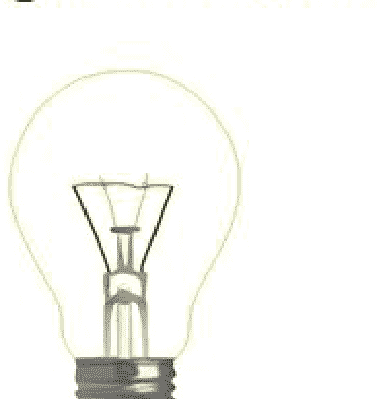

[Bulb Off] [Bulb On]

点击`Bulb On`按钮后：

**Bulb Light with JavaScript**

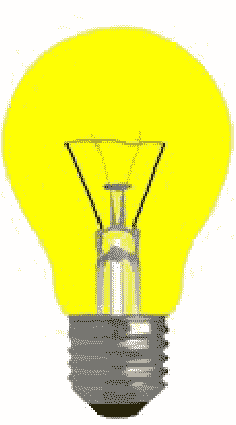

[Bulb Off] [Bulb On]

点击`Bulb Off`按钮后：

**Bulb Light with JavaScript**

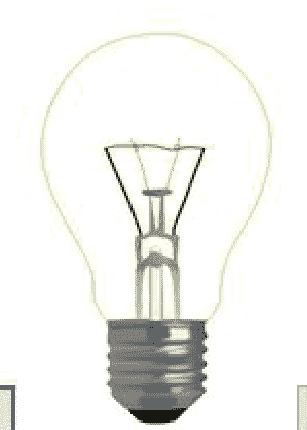

[Bulb Off] [Bulb On]

### 练习实践

1. 创建一个包含 2 个按钮的程序；分别命名为`Day`和`Night`。点击`Day`按钮时显示太阳图片；点击`Night`按钮时显示月亮图片。
2. 创建一个包含 4 个按钮的程序，分别对应 4 种不同的野生动物。每个按钮上的文本分别为`Tiger`、`Lion`、`Boar`和`Elephant`。点击每个按钮时，显示对应的动物图片。

## 作者寄语

嘿，你喜欢这本书吗？我很想听听你的想法！

许多读者不知道评论有多难获得，以及它们对作者有多大的帮助。

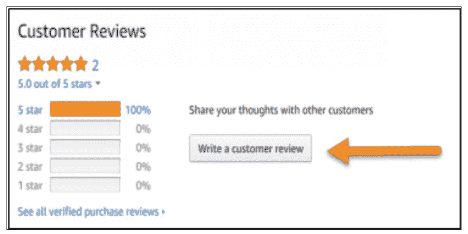

如果你能花 60 秒在 Amazon 上写一段简短的评论，哪怕是几句话，我将非常感激！

> 点击此处快速留下评论

感谢你抽出时间分享你的想法！

你的评论对我来说真的意义重大，也能帮助我的作品获得更多关注。

## HTML 表单

### 什么是 HTML 表单？

HTML 表单是网页上可以输入信息的空白框。就是你在网页上看到的用来输入姓名、年龄、密码等信息的那些表单。以下是表单的外观：

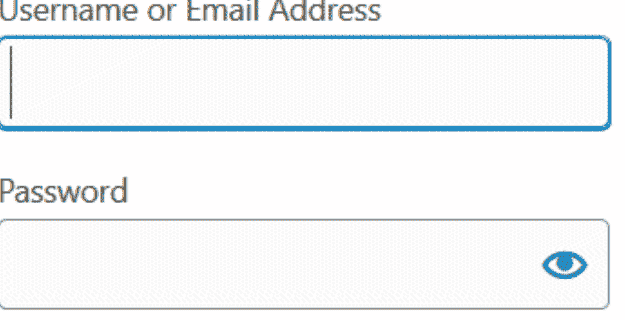

### 表单 HTML 标签格式

以下是一个表单 HTML 标签的示例，用于接收姓名、职业和性别信息。

```html
<form id="form1">
Name: <input name="Enter Name" type="text" id="name" size="20"><br>
Occupation: <input type="text" id="occupation" size="20"><br>
Age: <input type="number" id="gender" size="20"><br>
</form>
```

运行程序后，输出效果如下。你可以在输出中的空白框里输入任何内容。空白框也称为文本框。


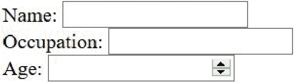

## 表单 HTML 标签的各个组成部分

`<form id="form1">`

`form id` 标签是表单的名称，将在代码的其余部分作为引用使用。

`Name:`、`Occupation:`、`Age:`

这是写在框左侧的文本，用于向用户描述该在框中输入什么内容。

`input type="text"`

这意味着你在框中输入的是文本或字符串类型。例如，姓名和职业使用 `text` 类型，因为你在框中输入的是字母。

`input type="number"`

这意味着你在框中输入的是数字。例如，年龄和电话号码会使用 `number` 类型，因为它们完全是数字。

`id="name"`、`id="occupation"`、`id="gender"`

`id` 是该框在程序其余部分中的名称。我们将在程序中使用 `id` 来引用该框。

`size="20"`

这意味着框的长度为 20 像素。要更改此值，请修改 `size` 的值。例如，如果你想将框的长度加倍，将 `size` 改为 40。

## JavaScript 示例

### 什么是 JavaScript？

JavaScript 是一种高级编程语言。它最常用于在 HTML 页面上执行用户操作，也有助于增强用户在网页上的交互体验。

### 如何在 HTML 中使用 JavaScript

有两种方式在 HTML 页面中使用 JavaScript：

第一种方式是直接在 `<script>` 标签中嵌入 JavaScript 代码。如下所示：

```html
<html>
<head>
<title> </title>
</head>
<body>
<script>
</script>
</body>
</html>
```

JavaScript 代码将位于上面红色标注的两个 `script` 标签之间。

第二种方式是创建一个 JavaScript 文件并保存为 `.js` 文件。然后在 HTML 代码中引用该 JavaScript 文件。如下所示：

```html
<html>
<head>
<title> </title>
</head>
<body>
<script src="newfile.js"></script>
</body>
</html>
```

你需要将所有 JavaScript 代码包含在 `newfile.js` 文件中。

## 你需要了解的 JavaScript 术语

接下来我们将介绍几个 JavaScript HTML 代码示例。为了理解这些代码，我们需要了解以下术语。

### function（函数）

JavaScript 函数是执行特定任务的一组代码行。函数通常用于在点击 HTML 按钮时执行需要发生的操作。每个函数都有一个名称，并在 HTML 代码中被引用。示例如下：

```javascript
function abcd()
```

`abcd` 是执行特定任务的函数名称。它将在 HTML 代码中以 `abcd` 的形式被引用。

### Variable（变量）

变量用于在 JavaScript 中存储名称或数字。可以把变量想象成一个可以存储一个值的盒子。每次需要该值时都会引用这个盒子。定义方式如下：

```javascript
var flag=1;
```

`flag` 是变量的名称，它存储的值为 1。因此，每当在 JavaScript 程序中引用 `flag` 时，它的值为 1（除非你更改了 `flag` 的值）。这个 `flag` 的值可以用来定义其他变量。例如：

```javascript
var king=flag*2;
```

`king` 现在的值为 1*2=2。所以变量是处理未知量的好方法。

### `document.getElementById().value`

这个 JavaScript 术语用于获取 HTML 表单文本框中项目的值。所以，如果你在表单文本框中填入你的名字并点击按钮，`document.getElementById()` 会获取你在框中输入的值。示例如下：

```javascript
var yname=document.getElementById("name").value;
```

`"name"` 是在 HTML 中定义的表单文本框的 `id`。要了解这在 HTML 中是如何实现的，请参阅上一章中关于 HTML 标签的部分。文本框中输入的内容将存储在名为 `yname` 的变量中。从现在起，它将在 JavaScript 中以 `yname` 的形式被引用。

### `document.write()`

此函数用于在网页浏览器中打印任何内容。例如：

```javascript
document.write("xyz");
```

在屏幕上打印 `xyz`。你还可以使用 `+` 运算符将两个不同的项拼接起来。

```javascript
document.write("xyz"+"123");
```

在屏幕上打印 `xyz123`。当你想将文本添加到变量中时，这非常有用。例如：

```javascript
var yname=document.getElementById("name").value;
document.write("My name is "+yname);
```

如果你在文本框中输入了 `"Matt"`，屏幕上会显示 `"My name is Matt"`。

### `parseInt()`

`parseInt()` 将数字转换为整数，无论它是否为小数。例如，`parseInt(2.8)` 的结果为 2（或者四舍五入为 3，不过通常 `parseInt` 会截断为 2）。`parseInt(2)` 的结果就是 2。

### `parseFloat()`

`parseFloat()` 与 `parseInt()` 相反。它将数字转换为小数。例如：

`parseFloat(2)` 的结果为 2.0。

`parseFloat(3.1)` 的结果就是 3.1。

## JavaScript 示例 1

以下代码创建了一个 HTML 表单，用于接受一个人的姓名、年龄和爱好。有一个 HTML 按钮，点击后会执行 JavaScript 代码。JavaScript 代码会在点击时打印出此人的姓名、年龄和爱好。JavaScript 代码位于 `<script>` 标签内。以下是代码及其输出；随后还会对部分代码行进行解释。

```html
<html>
<head>
<title>Print Name and Age.....</title>
</head>
<body>
<form id="form1">
Enter Name: <input name="Enter Name" type="text" id="name" size="20"><br>
Enter Favorite Hobby: <input type="text" id="hobby" size="20"><br>
Enter Age: <input type="number" id="age" size="20"><br>
</form>
<button onclick="writename()">Print Intro</button>
<script>
function writename()
{
    var nameValue=document.getElementById("name").value;
    var hobbyValue=document.getElementById("hobby").value;
    var ageValue=document.getElementById("age").value;

    document.write("This is "+nameValue+". I am "+ ageValue+" years old. My favorite hobby is "+hobbyValue);
}
</script>
</body>
</html>
```

### 输出：

Enter Name: [输入框]

Enter Favorite Hobby: [输入框]

Enter Age: [输入框]

[按钮：Print Intro]

### 输出（填写后）：

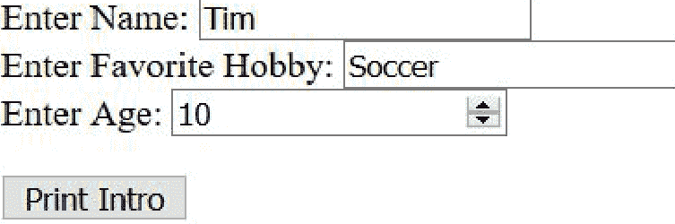

### 输出（点击 `Print Intro` 按钮后）

This is Tim. I am 10 years old. My favorite hobby is Soccer

### 代码解析：

```html
<form id="form1">
Enter Name: <input name="Enter Name" type="text" id="name" size="20"><br>
Enter Favorite Hobby: <input type="text" id="hobby" size="20"><br>
Enter Age: <input type="number" id="age" size="20"><br>
</form>
```

HTML 代码创建了一个包含 3 个表单元素的表单，分别用于姓名、爱好和年龄。它们的长度均为 20 像素。它们通过 `id` 进行引用：`name`、`hobby` 和 `age`。

```html
<button onclick="writename()">Print Intro</button>
```

这个 HTML 按钮会激活名为 `writename()` 的 JavaScript 函数，按钮上的文本为 `Print Intro`。

```javascript
function writename()
{
    var nameValue=document.getElementById("name").value;
    var hobbyValue=document.getElementById("hobby").value;
    var ageValue=document.getElementById("age").value;
    document.write("This is "+nameValue+". I am "+ ageValue+" years old. My favorite hobby is "+hobbyValue);
}
```

上面的 JavaScript 代码在按钮被按下时激活。`nameValue`、`hobbyValue` 和 `ageValue` 存储了输入到 `id` 为 `"name"`、`"hobby"` 和 `"age"` 的表单元素中的值。`document.write` 将介绍信息打印到屏幕上。

## JavaScript 示例 2

下面的代码创建一个 HTML 表单，用于接受两个数字，然后创建 4 个 HTML 按钮。有 4 个 JavaScript 函数分别用于将两个数字相加、相减、相乘或相除。根据点击的按钮，特定的 JavaScript 代码会被选中执行。代码及其输出如下所示；其中一些行稍后也会进行解释。

```html
<html>
<head>
<title>迷你计算器......</title>
</head>
<body>
<form id="form1">
输入数字 1: <input type="number" id="num1" size="20"><br>
输入数字 2: <input type="number" id="num2" size="20"><br>
</form>
<button onclick="sum()">+</button>
<button onclick="subtract()">-</button>
<button onclick="multiply()">*</button>
<button onclick="divide()">/</button>

<script>

function sum()
{
    var number1=parseFloat(document.getElementById('num1').value);
    var number2=parseFloat(document.getElementById('num2').value);
    var total=number1+number2;
    document.write("总和是 "+total);
}
function subtract()
{
    var number1=parseFloat(document.getElementById('num1').value);
    var number2=parseFloat(document.getElementById('num2').value);
    var diff=number1-number2;
    document.write("差是 "+diff);
}
function multiply()
{
    var number1=parseFloat(document.getElementById('num1').value);
    var number2=parseFloat(document.getElementById('num2').value);
    var multi=number1*number2;
    document.write("乘积是 "+multi);
}
function divide()
{
    var number1=parseFloat(document.getElementById('num1').value);
    var number2=parseFloat(document.getElementById('num2').value);
    var div=number1/number2;
    document.write("商是 "+div);
}
</script>
</body>
</html>
```

### 输出：

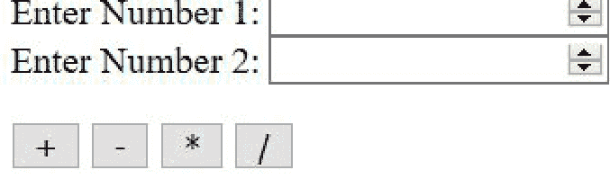

### 填写后的输出：

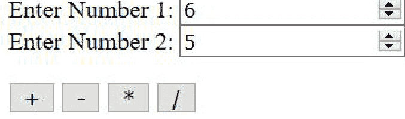

### 点击（+）按钮的结果：

总和是 11

### 点击（-）按钮的结果：

差是 1

### 点击（*）按钮的结果：

乘积是 30

### 点击（/）按钮的结果：

商是 1.2

### 代码分解

```html
<form id="form1">
输入数字 1: <input type="number" id="num1" size="20"><br>
输入数字 2: <input type="number" id="num2" size="20"><br>
</form>
```

上面的代码创建了一个表单，用于接受两个数字，其 `id` 分别为 `num1` 和 `num2`。

```html
<button onclick="sum()">+</button>
<button onclick="subtract()">-</button>
<button onclick="multiply()">*</button>
<button onclick="divide()">/</button>
```

上面的代码创建了 4 个按钮。这 4 个按钮分别调用 `sum()`、`subtract()`、`multiply()` 和 `divide()` 函数。

```javascript
function sum()
{
    var number1=parseFloat(document.getElementById('num1').value);
    var number2=parseFloat(document.getElementById('num2').value);
    var total=number1+number2;
    document.write("总和是 "+total);
}
```

`number1` 和 `number2` 使用 `id` `num1` 和 `num2` 存储表单中输入的数字。

`total` 存储两个数字的和。

`document.write` 将总和输出到屏幕上。

## 练习

你可以复制上面的代码并动手尝试。理解代码后，你可以创建自己的 JavaScript HTML 函数。这里有几个你可以尝试的练习。

1. 编写一个程序，使用 6 个文本框接受 6 个科目的学校成绩。编写两个 JavaScript 函数，分别计算总分和平均分。
2. 编写一个 JavaScript 程序，接受 5 个不同的学生姓名和爱好，并打印出这些学生的姓名和爱好。

## 条件语句

### 什么是条件语句？

它是一个检查特定条件是否为真的语句。它可以简单到检查一个数字是否小于 10，也可以复杂到检查患者的医疗样本以诊断特定的医疗状况。

在 JavaScript 中，条件语句使用 `IF ELSE` 语句来实现。因此，它基本上是检查某事是否为真，如果是，则执行一个动作；如果不是，则执行另一个动作。例如：

```javascript
IF (George=="Hungry")
{
    Document.write('给乔治来点零食');
}
ELSE
{
    Document.write('不给乔治零食');
}
```

在上面的例子中，代码检查乔治是否饿了，并执行两个动作之一。如果乔治饿了，则打印“给乔治来点零食”。如果没有，则打印“不给乔治零食”。

这是一个使用 `IF ELSE` 语句的 JavaScript 条件语句的简单示例。

## IF ELSE 循环 – 示例 1


```html
<html>
<head>
<title>检查两个数字的和是否大于 15......</title>
</head>
<body>
<form id="form1">
输入数字 1: <input type="number" id="num1" size="20"><br>
输入数字 2: <input type="number" id="num2" size="20"><br>
</form>
<button onclick="check10()">检查总和</button>

<script>

function check10()
{
var num1=parseFloat(document.getElementById("num1").value);
var num2=parseFloat(document.getElementById("num2").value);
    if ((num1+num2)<15)
    {
        document.write('两个数字的和小于 15');
    }
    else
    {
        document.write('两个数字的和大于或等于 15');
    }
}

</script>
</body>
</html>
```

## 输出

输入数字 1: `[输入框]`

输入数字 2: `[输入框]`

`[按钮: 检查总和]`

## 输出（用户已填写）

输入数字 1: `[输入框: 3]`

输入数字 2: `[输入框: 4]`

`[按钮: 检查总和]`

## 输出（点击“检查总和”按钮后）

两个数字的和小于 15

## 输出（填写第二组数字）

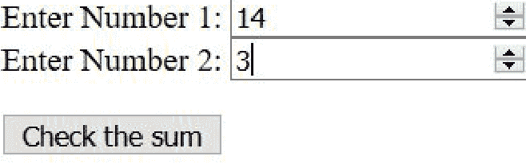

## 输出（点击“检查总和”按钮后）

两个数字的和大于或等于 15

## 代码分解

```javascript
var num1=parseFloat(document.getElementById("num1").value);
var num2=parseFloat(document.getElementById("num2").value);
```

这些行将用户填写的两个数字的值存储在两个变量`num1`和`num2`中。

```javascript
if ((num1+num2)<15)
```

这行检查两个数字的和是否小于 15。

```javascript
{
    document.write('两个数字的和小于 15');
}
```

如果和小于 15，则激活上面的代码块，并打印出“两个数字的和小于 15”。

```javascript
else
{
    document.write('两个数字的和大于或等于 15');
}
```

如果和大于或等于 15，则激活上面的代码块，并打印出“两个数字的和大于或等于 15”。

## IF ELSE 循环 – 示例 2

```html
<html>
<head>
<title>检查数字是否能被 2 整除......</title>
</head>
<body>
<form id="form1">
输入数字: <input type="number" id="num1" size="20"><br>
</form>
<button onclick="checkdivby2()">检查整除性</button>

<script>
function checkdivby2()
{
var number=parseFloat(document.getElementById("num1").value);
if ((number%2)==0)
{
    document.write(number+" 能被 2 整除");
}
else
{
    document.write(number+" 不能被 2 整除");
}
}
</script>
```

### 输出

输入数字: `[ ]`

`[检查整除性]`

### 输出（填写 1）

输入数字: `[12]`

`[检查整除性]`

#### 输出（点击“检查整除性”按钮后）

**12 能被 2 整除**

### 输出（填写 2）

输入数字: `[21]`

`[检查整除性]`

#### 输出（点击“检查整除性”按钮后）

**21 不能被 2 整除**

## 代码分解

```javascript
if ((number%2)==0)
```

上面的代码行检查数字是否能被 2 整除。

```javascript
{
    document.write(number+" 能被 2 整除");
}
```

如果数字能被 2 整除，则激活上面的代码段。它打印出该数字能被 2 整除。

```javascript
else
{
    document.write(number+" 不能被 2 整除");
}
```

如果数字不能被 2 整除，则激活上面的代码段。它打印出该数字不能被 2 整除。

## 练习

你可以复制上面的代码并动手尝试。理解代码后，你可以创建自己的 JavaScript HTML 函数。这里有几个你可以尝试的练习。

1. 编写一个程序，使用 6 个文本框接受 6 个科目的学校成绩。编写一个 JavaScript 函数，先计算平均分，然后检查学生是否通过或未通过。如果分数低于 60，则学生不及格。
2. 编写一个程序，接受一个年份并检查它是否是闰年。

## 嵌套条件语句

嵌套条件语句基本上就是条件语句内部再包含条件语句。它们也被称为嵌套循环。

假设你想在 JavaScript 中检查两个条件是否都为真，然后再执行某个操作；这时你可以将两个`if`循环相互嵌套。让我们沿用上一章的示例。我们想检查乔治是否饿了以及他是否有钱，以便给他买零食。

```text
IF (George=="Hungry")
{
    IF (George=="Has Money")
    {
        Document.write('Buy George a Snack');
    }
    ELSE
    {
        Document.write('Make George a Snack');
    }
}
ELSE
{
    Document.write('No snack for George');
}
```

在上述示例中，代码首先检查乔治是否饿了。如果乔治饿了，则执行第二次检查。它检查乔治是否有钱。如果乔治有钱，就输出`'Buy George a snack'`。如果他饿了但没钱，则输出`'Make George a snack'`）。如果他不饿，则输出`'No snack for George'`）。这是 JavaScript 中嵌套 IF ELSE 语句的简单示例。

### 嵌套 IF ELSE 循环示例

在本示例中，我们将输入一个四位数的年份，并检查它是否为闰年。现在，这比我们想象的要复杂一些。

我们知道每 4 年是一个闰年。这是我们的第一个检查点。所以像 1996 年这样的年份是闰年。

但是，每 100 年不是闰年。所以，1800 年和 1900 年不是闰年。

此外，还有另一个例外。每 400 年也不是闰年。所以 1600 年和 2000 年不是闰年。因此共有 3 个检查点。

```html
<html>
<head><title>Leap Year Check</title></head>
<body>
<form id="form1">
Enter Year: <input type="number" id="year" size="20"><br>
</form>
<button onclick="leapyear()">Leap Year?</button>
<script>

function leapyear()
{
var yr=parseInt(document.getElementById("year").value);
var lpyear=0;
    if ((yr%4)==0)//First loop that checks if the year is divisible by 4
    {
        lpyear=1;
        if((yr%100)==0)//Second loop that checks if the year is divisible by 100
        {
            lpyear=0;
            if((yr%400)==0)//Third loop that checks if the year is divisible by 400
            {
                lpyear=1;
            }
        }
    }
    if (lpyear==1)
    {
        document.write(yr+" is a leap year");
    }
    else
    {
        document.write(yr+" is not a leap year");
    }
}
</script>
</body>
</html>
```

## 输出

### 运行 #1

输出：

1992 is a leap year

### 运行 #2

输出：

1995 is not a leap year

### 运行 #3

输出：

1900 is not a leap year

### 运行 #4

输入年份: 2000

闰年？

输出：

2000 is a leap year

从上述代码和结果可以看出，它通过使用 3 个嵌套的`if`循环正确地计算了闰年。

- 1992 年是闰年，因为它能被 4 整除。
- 1995 年不是闰年，因为它不能被 4 整除。
- 1900 年不是闰年，因为它能被 100 整除。
- 2000 年是闰年，因为它能被 400 整除。

## 练习

你可以复制上面的代码并进行尝试。一旦理解了代码，你就可以创建自己的 JavaScript HTML 函数。以下是一些你可以尝试的练习。

1. 一个打印设备上连接了三个传感器，每个传感器上都连接了报警器。第一个传感器`"A"`检测设备是否需要墨水。第二个传感器`"B"`检测设备是否需要维修。第三个传感器`"C"`检测设备是否卡纸。当发生 2 个或更多问题时，报警器会响起。
2. 学校在特定情况下会放雪假。如果路上有冰，但没有盐，则放假。然而，如果有盐，则不放假。无论是否有盐，只要积雪超过 2 英寸，就会放假。
3. 一个计算机芯片控制儿童是否被允许观看特定的电视节目。如果在下午 5 点之前，电视始终可以播放。但是，如果在下午 5 点之后，则会使用节目的分级。如果分级为**普通观众**，电视将可以播放；然而，如果分级为**成熟观众**，电视则不会打开。

## 循环

循环是一组重复执行一定次数的指令。在大多数情况下，执行某个过程时会有一个计数器，每次增加 1。在过程结束时，我们检查计数器是否超过了我们需要执行的次数。如果已达到所需次数，则停止循环。

例如，假设你想在屏幕上打印数字 1 到 10。那么使用一个从 1 计数到 10 的循环。每次将计数打印在屏幕上。

在 JavaScript 中，我们使用名为`FOR`的函数来实现这个循环。我们将在下面通过一个简单的示例进行说明。

### 示例 #1

```html
<html>
<head><title>Print 1 to 20</title></head>
<body>
<button onclick="printtotwenty()">Print To 20</button>
<script>
function printtotwenty()
{
    for (i=1;i<=20;i++)
    {
        document.write(i+"<br>");
    }
}
</script>
</body>
</html>
```

在这个函数中，我们创建了一个`printtotwenty`函数，用于打印从 1 到 20 的数字。标题为`'Print To 20'`的按钮会激活该函数。

函数中有一个`for`循环：

`for (i=1;i<=20; i++)`

上面的代码行表示循环从 1 运行到 20；每次增加 1。`document.write`每次输出`i`的值。

以下是结果：

点击按钮后，我们得到：

```text
1
2
3
4
5
6
7
8
9
10
11
12
13
14
15
16
17
18
19
20
```

按计划打印了 1 到 20。接下来，我们将对同一个程序做一个不同的版本。不仅仅是打印 1 到 20；我们将让你选择想要打印多少个数字。只需在文本框中输入循环的长度，它就会打印出来。

### 示例 #2

```html
<html>
<head><title>JavaScript Greetings......</title></head>
<body>
<form id="form1">
Loop Length: <input type="number" id="loop" size="20"><br>
</form>

<button onclick="printtotwenty()">Print To 100</button>
<button onclick="printlooplength()">Print Loop Length</button>

<script>

function printtotwenty()
{

for (i=1;i<=20;i++)
{
    document.write(i+"<br>");
}

}

function printlooplength()
{
var looplength=parseInt(document.getElementById("loop").value);

var j=1;
for (j=1;j<=looplength;j++)
    {
    document.write(j+"<br>");
    }
}

</script>

</body>
</html>
```

现在，运行程序后，我们得到：

循环长度: 50

打印到 100　打印循环长度

现在，点击`'Print Loop Length'`

```text
1
2
3
4
5
6
7
8
9
10
11
12
13
14
15
16
17
18
19
20
21
22
23
24
25
26
27
28
29
30
31
32
33
34
35
36
37
38
39
40
41
42
43
44
45
46
47
48
49
50
```

因此，它从 1 打印到 50。如果你想打印 1 到 100，那么在文本框中输入 100 并点击同一个按钮。

上面的程序有一个额外的文本框和额外的按钮。文本框用于接受**循环**的长度，按钮链接到名为`printlooplength()`的函数，该函数打印星号循环。变量`looplength`存储你在文本框中输入的值。`FOR`循环从 1 运行到`looplength`。在上述示例中，`looplength`为 50；所以它从 1 运行到 50。每次运行时，它使用`document.write`函数打印计数器。

### 示例 #3

现在，我们将用循环做一些更酷的事情。我们将根据循环长度打印一个星形图案。

```html
<html>
<head><title>JavaScript Greetings.......</title></head>
<body>
<form id="form1">
Loop Length: <input type="number" id="loop" size="20"><br>
Star Loop Length: <input type="number" id="starloop" size="20"><br>
</form>
<button onclick="printtotwenty()">Print To 100</button>
<button onclick="printloopleNGTH()">Print Loop Length</button>
<button onclick="loopleNGTHstar()">Print Star Loop</button>

<script>

function printtotwenty()
{

for (i=1;i<=20;i++)
{
    document.write(i+"<br>");
}

}

function printloopleNGTH()
{
var loopleNGTH=parseInt(document.getElementById("loop").value);

var j=1;
for (j=1;j<=loopleNGTH;j++)
    {
    document.write(j+"<br>");
    }
}
function loopleNGTHstar()
{
var loopleNGTH=parseInt(document.getElementById("starloop").value);

for (i=1;i<=loopleNGTH;i++) {
    for (j=1;j<=i;j++)
    {
    document.write("*");
    }
    document.write("<br>");
}

function looplengthstar()
{
var looplength=parseInt(document.getElementById("starloop").value);

for (i=1;i<=looplength;i++) {
    for (j=1;j<=i;j++)
    {
    document.write("*");
    }
    document.write("<br>");
    }
}

</script>

</body>
</html>
```

下方为输出结果：

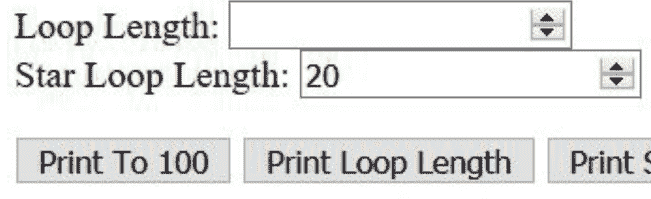

在输入 20 并点击“Print Star Loop”后，我们得到：


```
*
**
***
****
*****
******
*******
********
*********
**********
***********
************
*************
**************
***************
****************
*****************
```

上面的程序多了一个文本框和一个按钮。文本框用于接收`starloop`的长度，按钮则链接到一个名为`looplengthstar()`的函数，该函数用于打印星号循环。

`Looplengthstar()`是一个嵌套的`FOR`循环，这意味着它在一个循环内部包含另一个循环。变量`looplength`存储你输入的星号循环长度的值。第一个`FOR`循环从 1 运行到`looplength`。因此，在上面的示例中，第一个循环是从 1 到 20。在此循环内部，又有另一个`FOR`循环。第二个循环基本上是在一行中打印`'*'`。打印星号的次数取决于第一个循环中的计数器。例如，如果第一个循环计数器为 5（`i=5`），那么第二个循环将打印 5 次星号，类似于`'*****'`。

因此，每当第一个循环增加并移动到下一行时，第二个循环都会执行此操作。

##### 练习题

你可以复制上述示例，一旦能够运行它们并理解代码，就可以尝试解决以下几个问题。

1. 斐波那契数列是一组像这样的数字 0,1,1,2,3,5,8,13…。每个数字都是前两个数字之和。请使用`FOR`循环打印该数列的前 20 个数字。
2. 编写一个程序，通过文本框接收一个数字并打印一个反向星号循环。
3. 编写一个程序，通过文本框接收一个数字并打印其各位数字之和。

#### 数组（Arrays）

##### 什么是数组？

数组基本上是一组存储在单个名称下的项目。通过该名称的不同索引来访问它们。例如，在 Javascript 中：

`var name[5]`是一个大小为 5 的数组。第一个元素是`name[0]`，第二个元素是`name[1]`，依此类推……

所以，如果我们想给数组赋值：

`var name[5]=["Abhi","Bob","Aaron","Steve","Mark"]`

上述代码创建了一个大小为 5 的数组。要在 JavaScript 中打印第一个元素，我们执行：

`document.write(name[0]);`

这将打印出`Abhi`，它是数组的第一个元素。

如果我们执行：

`document.write(name[4]);`

这将打印出`Mark`，它是数组的最后一个元素。

如果我们想向数组添加元素，请使用如下的`push`函数：

`name.push("Carl");`

`document.write(name[5]);`

这将打印出`Carl`，它是数组中的新元素。

现在，让我们来看几个例子。

##### 示例 1

在这个示例中，我们在 JavaScript 中创建 3 个数组并为它们赋值，然后将它们打印在屏幕上。

```html
<html>
<head><title>Arrays 1</title></head>
<body>

<button onclick="createarray()">Create Array</button>

<script>

function createarray()
{
var name = ["Bob","Peter","Nick"];
var age=[32,10,11];
var loc=new Array("New York","Rockford","Kansas"); // 第 2 种启动数组的方式
document.write(name[0]+' lives in '+loc[0]+' and age is '+age[0]+"<br>");
document.write(name[1]+' lives in '+loc[1]+' and age is '+age[1]+"<br>");
document.write(name[2]+' lives in '+loc[2]+' and age is '+age[2]+"<br>");
name.push("Steve");
age.push(20);
loc.push("Miami");
document.write(name[3]+' lives in '+loc[3]+' and age is '+age[3]+"<br>");
}

</script>

</body>
</html>
```

在上面的示例中，`createarray()`创建了 3 个数组`name`、`age`和`loc`。每个数组都分配了三个元素。它们使用`document.write()`打印在屏幕上。

之后，我们使用`push`为所有 3 个数组添加第 4 个元素，然后将其打印出来。

创建数组（Create Array）

一旦我们点击“Create Array”按钮：

```text
Bob lives in New York and age is 32
Peter lives in Rockford and age is 10
Nick lives in Kansas and age is 11
Steve lives in Miami and age is 20
```

我们基本上只是打印出了数组的所有元素。

既然我们知道了如何创建数组，那么让我们尝试使用输入到文本框中的信息来创建数组。

##### 示例 2

```html
<html>
<head><title>Arrays 2</title></head>
<body>
<form id="form1">
Enter Name:<input name="name" type="text" id="name" size="20"><br>

Enter Work Day 1:<select style="width: 280px" id="day1" name="Day 1">
<option value='Sunday'>Sunday</option>
<option value='Monday'>Monday</option>
<option value='Tuesday'>Tuesday</option>
<option value='Wednesday'>Wednesday</option>
<option value='Thursday'>Thursday</option>
<option value='Friday'>Friday</option>
<option value='Saturday'>Saturday</option>
</select>
<br>

Enter Work Day 2:<select style="width: 280px" id="day2" name="Day 2">
<option value='Sunday'>Sunday</option>
<option value='Monday'>Monday</option>
<option value='Tuesday'>Tuesday</option>
<option value='Wednesday'>Wednesday</option>
<option value='Thursday'>Thursday</option>
<option value='Friday'>Friday</option>
<option value='Saturday'>Saturday</option>
</select>
<br>

</form>

<button onclick="assignarray()">Info Array</button>
<script>
function assignarray()
{
var name=document.getElementById("name").value;
var day1=document.getElementById("day1").value;
var day2=document.getElementById("day2").value;
var employeeobj=[name,day1,day2];
document.write(employeeobj[0]+" works on "+employeeobj[1]+" and "+employeeobj[2]);
}
</script>
</body>
</html>
```

上面的代码从 1 个文本框和 2 个选择框中获取用户输入。选择框的设置允许你在 7 个工作日（周日至周六）之间进行选择，如下所示：

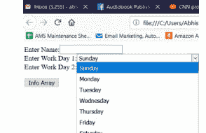

一旦点击“Info Array”按钮，`assignarray()`函数将接收这 3 个输入并创建一个名为`employeeobj`的单个数组。

`employeeobj[0]`是第一个元素，被赋值为姓名。

`employeeobj[1]`是第二个元素，被赋值为第一个工作日。

`employeeobj[2]`是第三个元素，被赋值为第二个工作日。

然后我们使用`document.write`将这 3 个信息全部打印在屏幕上。现在，让我们运行该程序。

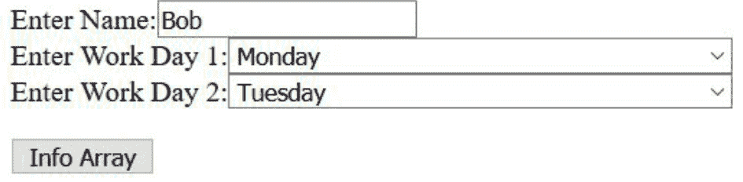

**Bob works on Monday and Tuesday**

你可以复制上面的代码，并在你的计算机上实现相同的程序。现在，一旦你能够做到这一点，让我们尝试一些更多的练习。

##### 练习题

你可以复制上述示例，一旦能够运行它们并理解代码，就可以尝试解决以下几个问题。

1. 为你的学校创建 5 个数组。第一个数组存储学生姓名；第二个存储其数学成绩；第三个存储其历史成绩；第四个存储其英语成绩。然后，计算平均分并将其存储在第 5 个数组中。姓名和 3 门成绩通过文本框输入，函数将打印出学生姓名和平均分。
2. 创建一个大小为 12 的数组，存储一年中的月份。用户可以通过文本框输入月份的数字；然后……

`function` should link the number with the actual month using the array. Then print out the relevant month in the array.

### 玩转字符串

##### 字符串与字符串变量

我们已经在前面的章节中涉及过这个主题。字符串是程序中使用的任何一段文本。例如，“abcd”是一个字符串，而数字 7 则不是字符串，它是一个整数。

字符串变量是用来存储字符串的地方。例如，`st`是下面存储“abcd”值的一个字符串变量。

```javascript
var st="abcd";
```

现在，让我们运用我们对 JavaScript 和循环的了解，来玩转字符串。

##### 查找字符串的长度

现在，让我们在文本框中输入一个字符串，然后查找该字符串的长度。

```html
<html>
<head><title>JavaScript Lesson 4 - Strings</title></head>
<body>
<form id="form1">
Enter Name:<input name="name" type="text" id="name" size="20"><br>
</form>
<button onclick="strlength()">Name Length</button>
<script>

function strlength()
{
var name2=document.getElementById("name").value;
document.write(name2.length);
}
</script>

</body>
</html>
```

下面的代码允许你通过一个文本框输入你的名字。当你点击按钮时，它会运行函数`strlength()`来计算你名字的长度。

`name2`是存储你名字值的变量。

`name2.length`获取字符串的长度（你名字中的字母数量）。

让我们看一下输出：

输入姓名：mather

**[Name Length]**

点击“Name Length”按钮后，我们得到：

**6**

让我们再做一个例子：

输入姓名：christopher

**[Name Length]**

点击“Name Length”按钮后，我们得到：

**11**

所以，既然我们知道如何查找字符串的长度，就让我们利用这个知识来反转你的名字。下面的代码就做了这件事。

```html
<html>
<head><title>JavaScript Lesson 4 - Strings</title></head>
<body>
<form id="form1">
Enter Name:<input name="name" type="text" id="name" size="20"><br>
</form>
<button onclick="strlength()">Name Length</button>
<button onclick="namereverse()">Name Reverse</button>
<script>

function strlength()
{
var name2=document.getElementById("name").value;
document.write(name2.length);
}

function namereverse()
{
var name2=document.getElementById("name").value;
len=name2.length;
for (i=len-1;i>=0;i--)
{
document.write(name2[i]);
}
}

</script>

</body>
</html>
```

下面的代码允许你通过一个文本框输入你的名字。当你点击按钮时，它会运行函数`namereverse()`来反转你的名字。

- `Name2`存储你输入的名字值。
- `len`存储你名字中的字母数量。

然后我们创建一个从`len-1`运行到 0 的循环。我们使用 0 的原因是`name2`是一个字母数组。在 JavaScript 中，数组的第一个索引是 0。因此第一个字符是`name2[0]`。

在循环中，我们反向进行，每次将计数减 1。并且在循环内部，我们打印由该计数索引的字符的值。

现在，让我们运行程序：

输入姓名：

**Name Length**

**Name Reverse**

点击 Name Reverse 按钮后，我们得到：

```text
rehtam
```

现在，如果字符串末尾有很多空格怎么办？让我们通过修剪字符串来解决这个问题。

##### 分割字符串

现在，你知道吗，你可以将一个字符串分割成一个元素数组？你可以使用`split`函数来实现这一点。现在，让我们尝试一个例子。在下面的代码中，你将一个由 3 种动物组成的列表作为输入，输入到一个文本框中，它们用逗号分隔。

`split`函数将其分割成一个包含 3 个元素的数组，你可以使用`document.write`函数打印出每个元素。

```html
<html>
<head><title>Splitting Strings</title></head>
<body>
<form id="form1">
Enter List of 3 Animals separated by commas:<input name="name" type="text" id="ani" size="20"><br>
</form>
<button onclick="strsplit()">Get Animals</button>

<script>

function strsplit()
{
var animal=document.getElementById("ani").value;
aniarray=animal.split(",");       // Split on commas
document.write("The first animal is "+aniarray[0]+"<br>");
document.write("The second animal is "+aniarray[1]+"<br>");
document.write("The third animal is "+aniarray[2]+"<br>");
}

</script>
</body>
</html>
```

现在，让我们检查输出：

输入用逗号分隔的 3 种动物列表：tiger, lion, wolf

Get Animals

点击 **Get Animals** 按钮后，我们得到：

```text
The first animal is tiger
The second animal is lion
The third animal is wolf
```

上面的代码适用于输入 3 种动物。你可能会问是否有代码可以处理超过 3 种动物的情况。是的，可以。你需要使用`length`函数找到字符串数组的长度，然后在打印动物时使用`FOR`循环。在`for`循环中，我们使用`aninumber`来跟踪动物计数，并使用`aniarray[i]`来跟踪要打印的实际动物。

请注意`aninumber`总是比`i`大 1，因为在 JavaScript 数组中`i`从 0 开始。

下面是代码：


```html
<html>
<head><title>Splitting Strings</title></head>
<body>
<form id="form1">
Enter List of Animals separated by commas:<input name="name" type="text" id="ani" size="20"><br>
</form>

<button onclick="strsplit()">Get Animals</button>

<script>

function strsplit()
{
var animal=document.getElementById("ani").value;
aniarray=animal.split(",");     // Split on commas
var len=aniarray.length;
var aninumber;
for (i=0; i<=len-1;i++)
{
aninumber=i+1;
document.write("Animal "+aninumber+" is "+aniarray[i]+"<br>");
}
}

</script>
</body>
</html>
```

这是下面的输出。

输入用逗号分隔的动物列表：lion, tiger, wolf, rhino, dog

[Get Animals]

我们输入了 5 种动物的名字，并点击了 `Get Animals` 按钮。

- Animal 1 is lion
- Animal 2 is tiger
- Animal 3 is wolf
- Animal 4 is rhino
- Animal 5 is dog

### 替换字符串

现在，假设你有一个很长的段落，你想用另一个词替换某个特定的词。你可以使用`.replace`函数。在下面的例子中，我们将“Atlanta”替换为“Charleston”。请记住，这仅适用于单个 Atlanta 实例。我们使用一个名为`textarea`的 HTML 表单元素。Textarea 是一个比文本框更大的表单元素，可以接收用户多行文本。然后我们在屏幕上写出修改后的句子。

```html
<html>
<head><title>Replacing Strings</title></head>
<body>
<form id="form1">
What was your day like?: <textarea name="sentence" cols="20" rows="5" id="sentence"></textarea><br><br>

</form>

<button onclick="strreplace()">Fix Sentence</button>

<script>

function strreplace()
{
var daydesc=document.getElementById("sentence").value;
var daydescmod=daydesc.replace("Atlanta","Charleston");
document.write(daydescmod);
}

</script>
</body>
</html>
```

现在，让我们运行程序。

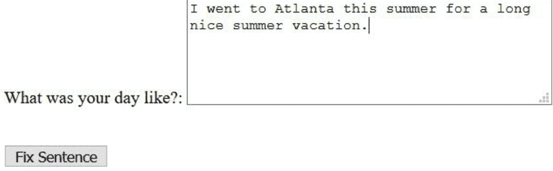

一旦我们点击 `Fix Sentence` 按钮，我们得到：

**I went to Charleston this summer for a long nice summer vacation.**

### 子字符串与字符串索引

在继续之前，我想讨论另外几个字符串操作技术。它们是字符串索引和子字符串。

字符串索引告诉你一个字符串在另一个字符串中出现的位置。例如，字符串“boy”在字符串“The boy climbed the tree”中的字符串索引是 4，因为“boy”从整个字符串的第 4 个字符开始。

子字符串允许你提取现有字符串的一部分。例如，在同一个字符串“The boy climbed the tree”中，如果我们从 6 到 10 提取子字符串，我们得到“oy cl”，因为这些是 6 到 10 之间的字符。

现在，让我们看一个下面的例子：

```html
<html>
<head><title>Substrings and String Index</title></head>
<body>
<form id="form1">
What was your day like?: <textarea name="sentence" cols="20" rows="5" id="sentence"></textarea><br><br>
What String would you like to find the String Index Of?:<input name="test string" type="text" id="tstr" size="20"><br><br>
</form>

<button onclick="strindex()">Find Index</button>

<script>
function strindex()
{
var daydesc=document.getElementById("sentence").value;
var str = document.getElementById("tstr").value;
var ind=daydesc.indexOf(str);
document.write("The String Index is "+ind);
}
</script>
</body>
</html>
```

在上面的例子中，`daydesc` 是大字符串，`str` 是我们需要找到字符串索引的字符串。变量 `ind` 存储字符串索引的值，然后我们使用 `document.write` 打印答案。现在，让我们运行程序：

> 我去亚特兰大度了一个美好的漫长暑假。

你的一天是怎么过的？:

你想查找哪个字符串的索引（String Index Of）?:

Atlanta

查找索引

一旦我们点击 `Find Index`，我们会得到：

##### The String Index is 10

好了，现在让我们来看看下面的子字符串（Substrings）示例：

```html
<html>
<head><title>Substrings and String Index</title></head>
<body>
<form id="form1">
What was your day like?: <textarea name="sentence" cols="20" rows="5" id="sentence"></textarea><br><br>
Substring From?:<input name="test string" type="number" id="tstr1" size="20"><br><br>
Substring To?:<input name="test string" type="number" id="tstr2" size="20"><br><br>
</form>

<button onclick="substr()">Find SubString</button>

<script>

function substr()
{
var daydesc=document.getElementById("sentence").value;
var strnum1 = document.getElementById("tstr1").value;
var strnum2 = document.getElementById("tstr2").value;

var sstr=daydesc.substring(strnum1,strnum2);
document.write("The SubString is "+sstr);
}

</script>
</body>
</html>
```

在上面的代码中，`strnum1` 和 `strnum2` 是存储子字符串起始和结束元素的变量。这些是来自用户的输入。`sstr` 是从 `strnum1` 到 `strnum2` 的子字符串，并被打印在屏幕上。

我去亚特兰大度了一个美好的漫长暑假。

你的一天是怎么过的？:

子字符串起始位置?:

10

子字符串结束位置?:

20

查找子字符串

一旦我们点击 `Find SubString`，我们会得到答案：

The SubString is Atlanta fo

如果包含空格，上面的答案是 10 个字符。

### 练习题

你可以复制上述示例，一旦你能够运行它们并理解代码，就可以尝试以下几个问题。

1. 编写一个程序，查找一个特定字符串在文本框中输入的较长字符串中出现了多少次？
2. 编写一个程序，接收一个包含姓名、数学成绩、英语成绩、物理成绩和地理成绩的字符串。使用 `split` 函数分离字符串并计算该人的平均分。例如，“Mark, 90, 34, 56, 65”将为 Mark 计算 90, 34, 56, 65 的平均值。

提示：你可以使用 `parseInt()` 将分数转换为数字。

## CSS 简介

### 什么是 CSS？

CSS 代表层叠样式表（Cascading Style Sheets）。CSS 用于设置网站的设计和样式——包括字体、颜色、布局、阴影和配色方案。它们与 HTML 和 JavaScript 配合得非常好。

### 如何在 HTML 网站中使用 CSS

使用 CSS 的最佳方法是创建一个单独的 CSS 文件，并在 HTML 头文件中引用它。

现在，让我们创建一个 CSS 文件。

1. 打开一个空白的 Notepad++ 文档。
2. 点击“另存为”，并将文件类型选择为“CSS”。我们将此文件命名为 `style`。

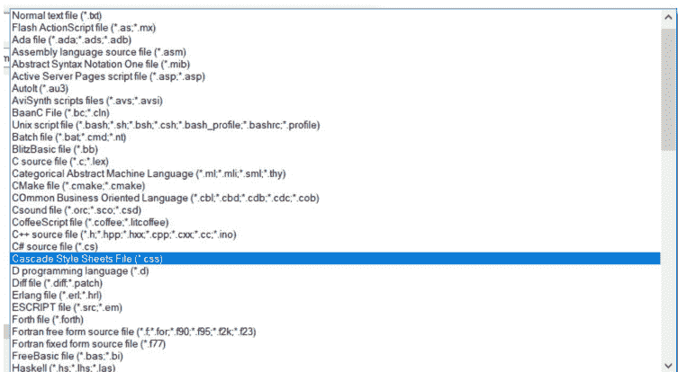

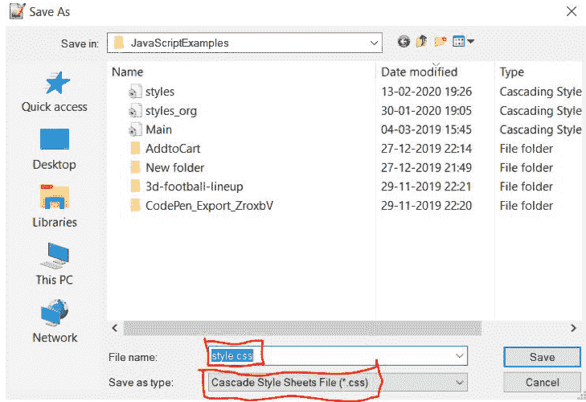

3. 点击“保存”。
4. 转到相关的 HTML 文件，并在头文件中包含以下行。

```html
<link rel="stylesheet" href="style.css" />
```

5. （可选）如果你想包含任何按钮 CSS 元素，你需要像下面这样定义一个按钮类：

```html
<button class="btn str" onclick="substr()">Find SubString</button>
```

现在，让我们将样式表插入到上一章的示例中。


```html
<html>
<head>
<title>SubStrings and String Index</title>
<link rel="stylesheet" href="style.css" />
</head>
<body>
<form id="form1">
<b>What was your day like?</b>: <textarea name="sentence" cols="20" rows="5" id="sentence"></textarea><br><br>
<b>Substring From?:</b><input name="test string" type="number" id="tstr1" size="20"><br><br>
<b>Substring To?:</b><input name="test string" type="number" id="tstr2" size="20"><br><br>
</form>

<button class="btn str" onclick="substr()">Find SubString</button>

<script>

function substr()
{
var daydesc=document.getElementById("sentence").value;
var strnum1 = document.getElementById("tstr1").value;
var strnum2 = document.getElementById("tstr2").value;

var sstr=daydesc.substring(strnum1,strnum2);
document.write("The SubString is "+sstr);
}

</script>
</body>
</html>
```

太棒了。现在我们的 CSS 表已经链接到我们的 HTML 文件中了。

### CSS 术语

```css
html{}
```

上述术语用于定义整个 HTML 文件的 CSS。括号内的任何内容都将用于 HTML 代码。

```css
body{}
```

定义 HTML 代码正文（body）的样式。

```css
.btn{}
```

为网页中的任何按钮设置样式。你必须在 HTML 代码中为按钮定义一个名为 `btn` 的类。请参阅上述代码示例。

```css
.btn:hover{}
```

设置当你在网页中将鼠标悬停在按钮上时按钮的样式。

```css
background-color:
```

网站的背景颜色。

```css
text-decoration:
```

用于给文本添加装饰，如波浪线、点线、曲线等。

```css
text-transform:
```

用于将整个单词或单词的一部分转换为大写或小写。

```css
text-align:
```

可以将文本对齐在页面的左侧、右侧或中心。

```css
color:
```

设置页面上文本的颜色。

```css
padding:
```

设置页面边缘与文本/按钮元素之间的间距。

```css
line-height:
```

设置文本的行高。

```css
font-family:
```

设置你想要用于文本的字体类型。

```css
font-size:
```

设置字体大小。

```css
font-weight:
```

可以在需要时将字体设置为粗体。

这些是我们将在示例中用到的一些 CSS 属性。但是，还有成千上万个用于各种不同目的的 CSS 属性。如果你想了解更多，可以在这里查看：https://www.tutorialrepublic.com/css-reference/css3-properties.php

现在，让我们看看我们的 CSS 文件示例：

### CSS 示例

```css
html, body {
    text-decoration: none;
    text-transform: capitalize;
    text-align: center;
    margin: 0;
    padding-top: 100px;
    min-height: 100%;
    color: black;
    background-color: cyan;
    line-height: 1;
    font-family: serif;
    font-size: 20px;
    font-weight: bold;
}
.btn {
    background-color: Crimson;
    border: none;
    color: black;
    padding: 10px 24px;
    text-align: center;
    text-decoration: none;
    display: inline-block;
    font-size: 16px;
}
.btn:hover {
    background-color: MidnightBlue;
    color: white;
}
```

在 CSS 代码的 `html` 和 `body` 中，文本被设置为页面中心并大写。它距离顶部 100px，颜色为黑色，行高为 1。字体为粗体，大小为 20px。页面的背景色为青色（浅蓝色）。

按钮有单独的 CSS 设置。它的颜色是深红色（Crimson），文本为黑色。文本距离顶部 10px，距离两侧 24px。它居中对齐，字体大小为 16px。

当我们用鼠标悬停在按钮上时，按钮的背景色变为午夜蓝（MidnightBlue），文本变为白色。

我们可以在下面看到它的样子。让我们以两种方式查看我们的网站：一次是在应用 CSS 之前；一次是在链接 CSS 文件之后。

### 输出（无 CSS）

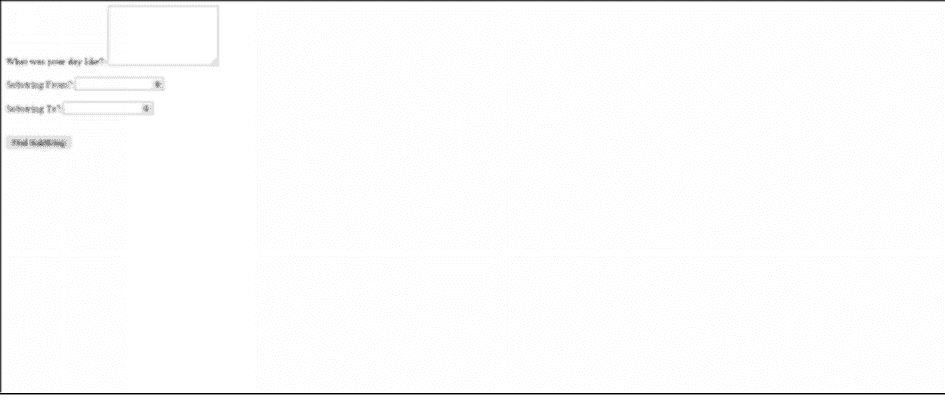

### 输出（有 CSS）


### 输出（有 CSS 且鼠标悬停在按钮上）


如你所见，这对网站的视觉吸引力产生了巨大的影响。你可以通过为文本、背景和按钮选择不同的颜色来自行定制所有这些元素。

### 练习题

你可以复制上述示例，一旦你能够运行它们并理解代码，就可以尝试以下几个问题。

1. 修改样式元素，寻找最适合你的元素。尝试 5 种不同的字体颜色、不同的文本大小和不同的文本形式，以寻找最美观的网站。
2. 使用 `style.css` 文件为你目前编写的所有程序创建一个样式表。

### 链接多个网页

现在，你已经设置好了一个链接了 CSS 的网页。但你可能会注意到，当你点击“Find Substring”按钮时，网页会回到最初的设计。这是因为 JavaScript 部分尚未链接到网页。

为了帮你回忆一下，我们要讨论的代码接收一个字符串，并根据用户的偏好打印子字符串。用户指定子字符串的起始和结束位置。代码如下：


```html
<html>
<head>
<title>Substrings and String Index</title>
<link rel="stylesheet" href="style.css" />
</head>
<body>
<form id="form1">
What was your day like?: <textarea name="sentence" cols="20" rows="5" id="sentence"></textarea><br><br>
Substring From?:<input name="test string" type="number" id="tstr1" size="20"><br><br>
Substring To?:<input name="test string" type="number" id="tstr2" size="20"><br><br>
</form>

<button class ="btn str" onclick="substr()">Find SubString</button>

<script>
function substr()
{
var daydesc=document.getElementById("sentence").value;
var strnum1 = document.getElementById("tstr1").value;
var strnum2 = document.getElementById("tstr2").value;

var sstr=daydesc.substring(strnum1,strnum2);
document.write("The SubString is "+sstr);
}
</script>
</body>
</html>
```

如你所见，这段代码链接到了`style.css`样式表以获取当前设计。

因此，我们得到如下输出：


现在，让我们运行程序：


点击“Find Substring”后，我们得到：


如你所见，它恢复到了旧的设计。现在，让我们来解决这个问题。我们只需在 JavaScript 函数的`document.write`之前添加以下代码：`document.write('<link rel="stylesheet" type="text/css" href="styles.css" />');`这段代码基本上是将样式表写入 JavaScript 函数中。于是，代码变为：

```html
<html>
<head>
<title>Substrings and String Index</title>
<link rel="stylesheet" href="styles.css" />
</head>
<body>
<form id="form1">
What was your day like?: <textarea name="sentence" cols="20" rows="5" id="sentence"></textarea><br><br>
Substring From?:<input name="test string" type="number" id="tstr1" size="20"><br><br>
Substring To?:<input name="test string" type="number" id="tstr2" size="20"><br><br>
</form>

<button class="btn str" onclick="substr()">Find SubString</button>

<script>
function substr()
{
var daydesc=document.getElementById("sentence").value;
var strnum1 = document.getElementById("tstr1").value;
var strnum2 = document.getElementById("tstr2").value;

var sstr=daydesc.substring(strnum1,strnum2);
document.write('<link rel="stylesheet" type="text/css" href="style.css" />');
document.write("the substring is "+sstr);
}
</script>
</body>
</html>
```

添加该行并使用相同的文本运行相同程序后，我们得到：


太好了，我们现在有了带有相同样式的 JavaScript 输出。现在，你可能想要创建另一个子字符串。我们该怎么做呢？我们需要一个“首页”按钮。

让我们来创建一个。下面的代码可以帮到你。

```html
<html>
<head>
<title>Substrings and String Index</title>
<link rel="stylesheet" href="styles.css" />
</head>
<body>
<form id="form1">
What was your day like?: <textarea name="sentence" cols="20" rows="5" id="sentence"></textarea><br><br>
Substring From?:<input name="test string" type="number" id="tstr1" size="20"><br><br>
Substring To?:<input name="test string" type="number" id="tstr2" size="20"><br><br>
</form>

<button class="btn str" onclick="substr()">Find SubString</button>

<script>
function substr()
{
var daydesc=document.getElementById("sentence").value;
var strnum1 = document.getElementById("tstr1").value;
var strnum2 = document.getElementById("tstr2").value;

var sstr=daydesc.substring(strnum1,strnum2);
document.write('<link rel="stylesheet" type="text/css" href="style.css" />');
document.write("The SubString is "+sstr);
document.write("<br>");
document.write('<button class = "btn home" onClick="redirect()">Home</button>');
}

function redirect()
{
window.location.replace("strcomma.html");
}
</script>
</body>
</html>
```

`document.write("<br>")`在子字符串后面创建一个空格，并移动到下一行。

`document.write('<button class = "btn home" onClick="redirect()">Home</button>');`

上面的代码行创建了一个按钮，点击时会执行重定向函数。

我们创建了一个函数，将用户重定向到我们的原始网页。

```javascript
function redirect()
{
window.location.replace("strcomma.html");
}
```

`Strcomma.html`是文件名。所以基本上它会重新启动该文件。

好了，现在让我们运行程序。这样做并使用相同的文本后，我们得到：


点击“Home”后，我们得到：


所以，现在我们知道如何返回原始网页了。

还有另一种链接网页的方式；这种方式在你创建两个独立的网页时使用。假设你想在页面 B 上添加一个指向页面 A 的链接。

那么，在页面 B 中，你可以使用以下方式添加链接：

```html
<a href="PageB.html">
```

我们也可以使用相同的 HTML 代码链接任何外部网页：

```html
<a href="http://www.google.com">
```

### 练习

你可以复制上面的示例，一旦能够运行并理解代码后；可以尝试下面的一些问题。

1. 添加一个首页按钮，将你最好的 CSS 设计链接到你在本书中设计的每一个网页。
2. 创建一个程序，根据用户偏好链接到外部网页。

## 数学函数

到目前为止都很棒。但如果你想做一个迷你计算器呢？或者教孩子数学？学习如何编写数学函数也是提高孩子理解数学速度的好方法。你可以为孩子设置数学测试，并用 JavaScript 函数来验证。让我们从一些可以在 JavaScript 中实现的基本数学函数开始。

### `Math.round()`

`Math.round()`将小数四舍五入到最近的整数。例如，`Math.round(1.635)`四舍五入为 2；而`Math.round(1.43)`四舍五入为 1。

### `Math.ceil()`

`Math.ceil()`向上取整到较大的数。它基本上会向上舍入到较大的整数。例如，`Math.ceil(1.67)`返回 2；而`Math.ceil(2.01)`返回 3。

### `Math.floor()`

`Math.floor()`向下取整到较小的整数。它基本上会去掉小数点后的部分。所以，`Math.floor(1.47)`返回 1；`Math.floor(2.34)`也返回 2。

### `Math.sqrt()`

`Math.sqrt()`返回一个数的平方根。所以，`Compositor.sqrt(9)`返回 3；而`Math.sqrt(16)`返回 4。

### `Math.min()`

`Math.min()`返回数组中的最小值。只需将数组放入括号内。所以，如果`a=[13,11,34,54,9];`，`Math.min(a)`返回 9。

### `Math.max()`

`Math.max()`返回数组中的最大值。所以对于上面的例子，`Math.max(a)`返回 54。

### `Math.random()`

`Math.random()`是一个很酷的函数。它返回一个 0 到 1 之间的随机小数；不包括 1。

所以，`Math.random()`第一次可能是 0.95，第二次可能是 0.43。

因此，你可以在 0 到 10 之间玩一个猜数字游戏。只需执行以下操作：

`Math.round(Math.random()*10)`会给你一个 0 到 10 之间的随机整数。

## 结论

感谢您抽出宝贵时间阅读本书。

希望您觉得它有用；并学会了 HTML、CSS 和 JavaScript 的基础知识。如果您已经完成了练习，那么您已经构建了几个 HTML 页面，并学会了如何用基本 CSS 设计它们。

如果您喜欢我的书，并且想要学习更多，请关注下面的作者页面。我很快会推出另一本书，展示如何使用 HTML、CSS 和 JavaScript 从零开始创建购物车。

我还推荐查看该部分的其他书籍，特别是那些关于人工智能将如何接管世界的书籍。

如果您对任何主题有澄清需求；或任何建议；请通过以下邮箱联系我：[abiprod.pty.ltd@gmail.com](mailto:abiprod.pty.ltd@gmail.com)

如果您需要个性化帮助，我还提供一对一在线辅导。

# 第3册：10岁及以上儿童编程指南

## 针对儿童和初学者的 HTML、CSS 与 JavaScript 编程

### 引言

罗布在电脑前已经待了几个小时。他正在为 JavaScript 游戏的下一个版本编写程序。经过上个月的大量进展，他现在遇到了困难。他尝试了很多不同的方法，但仍然无法让它运行起来。这是编程中常见的问题。学习编程的基础知识是一个好的开始。罗布几个月前读了我的第一本编程书（[9-15岁儿童编程指南](https://example.com)），他非常兴奋。他不仅学好了基础知识并成功完成了所有练习；他还实现了一些自己的程序和有趣的编程游戏。他热爱编程；并且沉迷其中。

然而，几个月后，罗布遇到了瓶颈。他开始感到疲倦和厌倦。他不断地重复做类似的程序。他在更高级的主题上挣扎。罗布的故事与美国和世界各地成千上万孩子的故事相似。这些孩子拥有前进的资源和资金。他们中的一些父母花了一个月的薪水（有时甚至更多）给孩子买一台编程用的笔记本电脑。然而，父母和他们的孩子都意识到，他们需要更多东西才能继续前进。缺少了一些东西。一些难以量化的东西。

罗布和其他人的故事激励我写下了这本新的 JavaScript 书。虽然罗布看起来似乎在挣扎，但他应该因为自己的努力而受到赞扬。我们太多人在一看到困难时就放弃了。我们像玩毛线球的小猫一样，从一个活动转到另一个活动。事实是，在任何活动中，没有一点点努力和痛苦，就无法取得进步。罗布只需要再多一点点，而这就包含在这本书里。

本书从一些基础知识开始，以确保你拥有前进所需的基本知识。我们将讨论设置工作空间以及进行基本的编程和测试。然而，本书确实非常强调编程游戏、活动和谜题。这些旨在培养对编程所能实现的功能的更深热爱。我们意识到这类编程游戏对学习过程的重要性。它融入了一种乐趣和好奇心，这对所有参与者来说都非常令人兴奋。还有一个关于编程软技能的非常重要的部分。这一章讨论如何通过自我发现、团队合作、自律和健康习惯来提高你的编程水平。这些软技能将真正帮助罗布在编程上取得进步。

### 编程的软技能

我在教孩子们编程的经历，以及从罗布那里听到的故事，都让我确信软技能在编程中与技术知识同样重要。这些软技能也有助于你未来生活的所有其他方面。所以，这完全是双赢的。

那么，到底什么是软技能呢？软技能更多地与人们如何工作有关。这与关注人们工作内容的硬技术技能不同。软技能涉及人们如何处理精神、身体和人际问题。结合良好的技术知识，软技能可以将你的表现提升到更高水平。以下是我所谈论的一些技能：

1. **专注与集中力：** 在一个被社交媒体和其他干扰主导的世界里，专注于单一任务的能力是一项难以掌握的技能。多任务处理可能看起来很酷；但从长远来看，它会损害工作质量和教育质量。
   - **a.** 帮助你集中注意力的一个新工具叫做等时音。这是一种特定的音乐，可以让你的大脑进入正确的状态并帮助你集中注意力。你可以在 Youtube 或 Google 上搜索“isochronic tones”来免费试听这些音调。
   - **b.** 另一个工具是日常冥想。每天开始时冥想 5 分钟，随着时间的推移可以帮助你建立专注力。
   - **c.** 最后，将你的工作分解成 20-30 分钟的时间段会产生很大的不同。在每个时间段之间休息 5-10 分钟，散步一下，然后精神焕发地回来。

2. **毅力：** 持续努力和从失败中学习的能力在编程中非常重要。程序员的普遍做法是尝试打破代码（或让代码失败），以便了解程序中的薄弱环节并加以改进。你可以对自己的程序和编程技能做同样的事情。

3. **团队合作：** 单打独斗在开始时是必要的；但从长远来看会限制你的发展。你可以从别人的错误中学到很多东西；比从自己的错误中学得更快。你可以加入你所在城市的当地编程俱乐部；聘请编程导师；加入相关的 Facebook 编程小组；在 Reddit 论坛上发帖并向 Github 代码学习。在这些小组中保持活跃并被视为积极的贡献者很重要。

4. **身体健康：** 这是许多程序员非常低估和不重视的特质。但从长远来看，它确实会伤害这个行业的人。背部问题、肥胖、腕管综合征是程序员工作 5-10 年或更长时间后遇到的常见健康问题。以下是几种更好地照顾你健康的方法。
   - **a. 保持良好的坐姿：** 坐直。确保你的笔记本电脑接近视线高度，这样你就不用低头。确保你的双脚与膝盖对齐。
   - **b. 经常休息：** 我建议每 20-30 分钟休息一下。在各个时间段之间散步。
   - **c. 饮食：** 保持健康的饮食，多吃优质脂肪、蛋白质和复合碳水化合物。减少简单碳水化合物和糖的摄入。
   - **d. 运动：** 保持规律的锻炼计划或进行一项运动。每周至少锻炼 3-4 次（甚至更多）很重要。
   - **e. 睡眠：** 每晚保证至少 7-8 小时的睡眠。如果你无法入睡，请咨询合格的医生如何改善睡眠。

关于以上每个主题都可以写整整一本书；但这是一本编程书，所以我就讲到这里。只需记住，以上软技能非常重要，你可以在编程的同时努力提升它们。

### 设置你的工作空间

#### 你需要什么

你需要一台带互联网连接并安装了网页浏览器的笔记本电脑/台式机。我建议使用 Mozilla Firefox 或 Google Chrome。

#### 下载/安装文本编辑软件

下载最新版本的文本编辑软件。我建议下载 Notepad++。下载后，双击`Setup.exe`文件并按照安装提示操作。

<https://notepad-plus-plus.org/downloads/>

### 开始使用 Notepad++

从桌面或开始菜单打开 Notepad++。


现在，点击**文件** > **新建**来打开一个新文件。


现在，选择**文件** > **另存为**，并将文件类型选择为`.html`。


### 测试程序

现在，让我们测试一下程序是否能在浏览器中运行。

只需在你的文件中输入随机文本。在我的文件中，我输入了`"这是一条测试信息。"`

现在选择**文件 > 保存**。

之后，根据你使用的浏览器，点击**运行 > 在 Firefox/Chrome/IE 中启动**。

如果它正常工作，你输入的文本应该会显示在浏览器窗口中。


#### 结果


这是一个很好的简单方法，可以在继续之前确保你的程序正在工作。

**附注：**

一些学生遇到的问题是，运行浏览器选项有时不起作用并给出错误。这是因为路径设置不正确。如果由于某种原因它不工作，你仍然可以运行程序。

1. 只需将 Notepad++ 保存为 HTML 文档。
2. 关闭 Notepad++ 文件。
3. 前往保存 HTML 文档的文件夹。
4. 双击 HTML 文件，它应该就能工作了。

### 什么是 HTML？

HTML

HTML 是**超文本标记语言**（Hyper Text Markup Language）的缩写，是我们在网页上通过互联网进行交互所使用的编程语言。所有网页的基本结构都是由 HTML 定义的。它足够简单，初学者程序员可以快速掌握。大多数 HTML 编程都是通过称为**标签**（tag）的元件完成的。这些标签以`<>`开始，以`</>`结束。例如，一个常见的标签是段落标签，它以`<p>`开始，以`</p>`结束。

### 常用 HTML 标签

- `<html>` — 此标签用于每个网页的开头，表示 HTML 代码的开始。
- `<head>` — 这段 HTML 代码在程序的其余部分之前执行。
- `<title>` — 此标签用于网页的标题。它将文本显示在网页顶部的标题栏上。
- `<body>` — 这是网页主体上的信息。
- `<h1>` — 用于表示标题标签。这是最大尺寸的标题标签。
- `<h2>`、`<h3>`、`<h4>`、`<h5>`、`<h6>` — 用于表示尺寸递减的副标题。
- `<p>` — 用于表示文本段落。
- `` — 在网页上显示图像。此图像可以链接到外部网页或内部文件。
- `<strong>` — 用于使文本加粗。
- `<ul>` — 用于无序列表。例如，以项目符号形式列出的项目列表。
- `<li>` — 向无序列表添加项目符号项。
- `<ol>` — 用于有序列表，例如从 1、2、3……开始的编号列表。
- `<div>` — 用于表示包含多个段落的较大部分文本。
- `<a>` — 用于将网页中的项目链接到另一个网页。
- `<br>` — 在代码中添加换行符并转到下一行。

### HTML 代码示例

下面是一个基本 HTML 代码的示例。它包含了上述所有 HTML 代码的示例。你可以自己输入，或者复制粘贴下面的示例。


#### HTML 代码复制粘贴版

你可以将下面的代码复制粘贴到你的 HTML 浏览器中，看看它是否有效：

```html
<html>
<head>
<title>My first html website.......</title>
</head>
<body>
<h1>Welcome to Programming in Javascript (this is a h1 tag)</h1>
<h2>Let's get started (this is a h2 tag)</h2>
<h3>This is the start of bigger things (this is a h3 tag)</h3>
<p>We're going over a few basic html tags here but you can feel free to play around them and experiment.
There are 1000's of html tags that you can learn in the long run. Here's a list of topics you can learn below (This is a paragraph tag)</p>

<ul> Below is the example of an unordered bulleted list
<li>Basics of html</li>
<li>CSS</li>
<li>JavaScript</li>
<li>Loops</li>
<li>Arrays</li>
<li>Canvas</li>
</ul>
<a href="https://www.google.com">Example of hyperlink to Google</a>
<br>
<a href="https://www.facebook.com">Example of hyperlink to Facebook</a><br>
<a href="https://www.amazon.com">Example of hyperlink to Amazon</a>
<br>
</body>
</html>
```

#### 代码输出


现在，让我们分解不同的元素。

下面是标题标签`<title>`。

##### 下面是标题标签 `<h1>`、`<h2>`、`<h3>`


##### 下面是段落标签 `<p>`


##### 下面是无序项目符号列表 `<ul>` `<li>`


##### 下面是 3 个指向 3 个流行网站的超链接标签 `<a href>`


##### 练习题目

1. 制作一个网站，标题标签中包含一个杂货物品的无序列表。使用段落标签为特定物品添加任何特殊说明。在列表末尾，使用超链接标签链接到最近的杂货店网站。
2. 创建一个网站，列出你所在足球队的所有球员。使用标题、标题标签和段落标签欢迎用户访问你的网站，并描述球队以及球队的理念。使用有序列表列出球员。
3. 制作一个网站，用无序列表列出你所在地区所有最喜欢的餐厅和咖啡店。使用标题、标题标签和段落标签介绍你自己以及你所在地区的用餐体验。

### HTML 示例程序

#### 此项目的作用

这个 HTML 项目创建了两个按钮。这两个按钮可以在两张白天和黑夜的图片之间切换。这两个按钮分别标记为`"Day"`和`"Night"`。

这是一个简单的 HTML 项目，创建一个可以打开/关闭页面上灯泡的按钮。我们将使用两张灯泡图片来实现这一点。按钮将在两张图片之间切换。

#### 本章需要理解的概念

对于这个示例，我们需要理解按钮标签和图像标签。

##### 按钮标签

`<button onclick=`**Action** `>`**Button text**`</button>`

按钮元素有两个部分：Action（动作）和 Button Text（按钮文本）。按钮文本是显示在按钮上的文本，动作是用户点击按钮时发生的行为。

##### 图像标签

``

图像标签有三个部分：

- `ImageId` 是你为图像指定的名称。此名称用于在代码中引用该图像。
- `ImageUrl` 是标签引用的图像的 URL。如果图像与 HTML 文件在同一文件夹中，则只需使用文件名即可，无需使用完整的 URL。
- `ImageSize` 设置图像的宽度和高度。宽度和高度以像素为单位。

#### 文件

以下是下一个项目需要使用的两个文件。你可以下载这些文件并保存在你创建 HTML 文件的同一文件夹中。

- [白天图片](link)
- [夜晚图片](link)

#### 代码

```html
<html>
<body>

<h2>Day and Night Buttons</h2>

<button onclick="document.getElementById('myImage').src='DayImage.jpg'">Day</button>


<button onclick="document.getElementById('myImage').src='NightImage.jpg'">Night</button>

</body>
</html>
```

###### 输出

最初，默认设置为白天图片。

##### 白天和夜晚按钮


**Day** **Night**

点击**Night**按钮后，你会得到：

##### 白天和夜晚按钮


**Day** | **Night**

然后，当你再次点击**Day**按钮时，你会得到：

##### 白天和夜晚按钮


**Day** | **Night**

#### 代码解释

```html

```

上面的 HTML 元素是一个图像标签。它有 3 个部分：id、src 和 style。

- `id` 是图像的标签。在本例中，它被标记为`"myImage"`。该 id 用于在整个程序中引用该图像。
- `src` 是标签加载的图像源。图像`"DayImage.jpg"`与 HTML 文件在同一文件夹中。

```html
<button onclick="document.getElementById('myImage').src='DayImage.jpg'">Day</button>
```

上面的元素是一个按钮元素。它有一个名为`onclick`的参数，该参数描述点击按钮时执行的操作。

`document.getElementById`获取 id 为`'myImage'`的元素。因此，当你点击按钮时，它会在`'myImage'`上显示`'DayImage.jpg'`。

`'Day'`是写在按钮上的文本。

```html
<button onclick="document.getElementById('myImage').src='NightImage.jpg'">Night</button>
```

`document.getElementById`获取 id 为`'myImage'`的元素。因此，点击按钮时，它会在`'myImage'`上显示`'NightImage.jpg'`。

`'Night'`是写在按钮上的文本。

##### 练习题目

1. 找到 3 张一个人跑步、走路和站立的图像。编写一个带有 3 个按钮的程序，根据你按下的按钮，人物会跑步、走路或站立不动。
2. 找到 3 张交通灯分别亮红灯、绿灯和橙灯的图像。编写一个带有 3 个按钮的程序，按钮分别显示`'STOP'`、`'GO'`和`'WATCH'`。按下`'STOP'`按钮时交通灯变为红色；按下`'GO'`按钮时变为绿色；按下`'WATCH'`按钮时变为黄色。

### HTML 表单

还记得你在网上看到的那些需要输入姓名、年龄和出生日期的表单吗？那些就是 HTML 表单。

今天，我们将学习如何制作这些表单。

在开始制作表单之前，我们需要了解几个基础的表单元素：

- **按钮** `<button>` — 这是一个允许用户在点击时执行某个操作的元素。
- **文本框** `<input>` — 该元素允许用户在浏览器屏幕上的方框中输入文本。它用于收集较小的文本项，如姓名、城市等。
- **文本域** `<textarea>` — 这允许用户输入大量文本。它的尺寸比文本框大。它用于较大的文本项，如地址、评论等。
- **选项选择** `<select>` — 该元素允许用户在几个可用选项之间进行选择。它基本上是一个下拉框。
- **日期输入** `<input type="date">` — 该元素允许用户从日历下拉列表中选择一个日期。

现在，让我们通过下面的示例表单来详细了解每一个元素。

#### 示例表单

```html
<html>
<head><title>Sample Form</title></head>
<body>
<form id="form1">
Enter First Name:<input name="frstname" type="text" id="frstname" size="20"><br>
Enter Last Name:<input name="lname" type="text" id="lname" size="20"><br><br>
Enter Address: <textarea name="TextBox" cols="40" rows="5" id="tstr2"></textarea><br><br>
Enter Country: <select id="country" name="country">
            <option value="USA">USA</option>
            <option value="Mexico">Mexico</option>
            <option value="Canada">Canada</option>
            <option value="Australia">Australia</option>
            </select><br>
Date of Birth: <input type="date" id="start" name="trip-start"
       value="2020-07-22"
       min="1918-01-01" max="2020-06-311"><br>
<button onclick="">Submit</button>
</form>
</body>
</html}
```

现在，让我们逐部分分析代码。

```html
<form id="form1">
```

每个表单都以`<form>` HTML 元素开始。id`"form1"`是你给表单起的名称。id 用于在程序的其余部分引用该表单。

```html
Enter First Name:<input name="fstname" type="text" id="fstname" size="20"><br>
Enter Last Name:<input name="lname" type="text" id="lname" size="20"><br><br>
```

以上两行是用于输入名字和姓氏的文本框。由于姓名是一种文本形式，因此`type`被赋值为`"text"`。id`"fstname"`和`"lname"`将在以后需要时用于引用代码。`size`设置为`"20"`，这意味着它可以接受 20 个字符。你可以根据需要将其更改为更大或更小的尺寸。

```html
Enter Address: <textarea name="TextBox" cols="40" rows="5" id="tstr2"></textarea><br><br>
```

上述元素是一个用于地址的文本域（textarea）元素。它有 5 行（`rows="5"`），每行 40 个字符（`cols="40"`）。它的标识名为`"tstr2"`。

```html
Enter Country: <select id="country" name="country">
	<option value="USA">USA</option>
	<option value="Mexico">Mexico</option>
	<option value="Canada">Canada</option>
	<option value="Australia">Australia</option>
</select><br>
```

上述元素是一个用于选择国家的选择选项（select option）元素。它允许你在包含 4 个不同选项（美国、墨西哥、加拿大和澳大利亚）的下拉菜单中进行选择。它的标识名为`"country"`（`id="country"`）。


```html
Date of Birth: <input type="date" id="start" name="trip-start"
	value="2020-07-22"
	min="1918-01-01" max="2020-06-31"><br>
```

上述元素是一个日期输入元素，允许你选择 1918 年（`min="1918-01-01"`）到 2020 年（`max="2020-06-31"`）之间的出生日期。它的名称为 “start”（`id="start"`），并被设置初始值为 `2020-07-22`（`value="2020-07-22"`）。

```html
<button onclick="">Submit</button>
```

上述元素是一个按钮元素。上面写着 “Submit”（提交）字样。由于 `onclick` 函数为空，点击时不会执行任何操作。

现在，让我们看看运行程序时会发生什么。

### 输出结果：

Enter First Name: [文本框]

Enter Last Name: [文本框]

Enter Address: [大型文本域]

Enter Country: [下拉菜单: USA]

Date of Birth: [日期选择器: 22/07/2020]

[提交按钮]

我希望通过这个例子，你对 HTML 表单的基础知识有所了解。在接下来的几章中，我们将学习如何使用 JavaScript 来使用我们输入的信息。事实上，我们将使用这个相同的例子，并用 JavaScript 将其打印出来。

### 练习题

- 1. 编写一个 HTML 表单，作为一名大学生的简历。它通过文本框接收名字、姓氏、大学名称；通过下拉菜单接收就读年级。然后包含 3 个活动/实习/合作项目。每个活动包含一个开始日期元素、一个结束日期元素以及一个足够大的文本域来描述经验。最后以提交按钮结束。

- 2. 编写一个用于购物清单的 HTML 表单。它接收名字、姓氏、购物日期、地址和城市。它有 5 个下拉菜单，每个菜单有 30 个常见的购物商品可供选择。最后，它有一个提交按钮。

以上每个练习都将在接下来的章节中通过 JavaScript 进行扩展。

## 什么是 JavaScript？

JavaScript 是一种高级编程语言，用于使网页更具交互性和动态性。它是基于文本的且用户友好。如果说 HTML 用于创建网页结构，CSS 用于网页样式，那么 JavaScript 则用于增强网页与用户之间的交互。它允许不同的 HTML 元素相互作用，执行计算、动画等。换句话说，它让网页编程变得有趣。

## 在 HTML 中使用 JavaScript

在 HTML 网页中使用 JavaScript 有两种方法。第一种方法是直接将代码添加到 HTML 的 `script` 标签内。这在下面代码的蓝色部分中显示（注：指代代码块内容）。

```html
<html>
<head><title>Test file 1</title>
</head>
<body>
<script>
//Enter JavaScript code here
</script>
</body>
</html}
```

第二种方法是创建一个包含代码的外部 JavaScript 文件，并将其保存为 `.js` 文件。然后你可以将该文件链接到 HTML 内容中。例如，假设你创建了一个名为 `test.js` 的文件。你可以使用下面代码的蓝色部分将其链接：

```html
<html>
<head><title>Test file 2</title>
</head>
<body>
<script src="test.js"></script>
</body>
</html}
```

## JavaScript 元素

有了这些基础知识，让我们来看看一些基本的 JavaScript 元素。

### 函数 (functions)

JavaScript 中的函数是一组执行特定任务的代码行。它在 JavaScript 的 `script` 标签内定义如下：

```javascript
function afunc()
{
//Enter function code here
}
```

函数的名称是 `afunc`，花括号内的代码在每次调用 `afunc` 时执行。当我们想在同一个程序中多次执行相同的任务时，函数非常有用。我们可以直接调用函数，而不需要多次编写相同的代码行。

### 变量 (Variables)

JavaScript 中的变量是一个承载特定值的占位符。该值在整个程序运行过程中可以被更改，并可以在代码的其他部分中使用。让我们举个例子：

```javascript
var x=5;
```

`x` 是定义好的变量。它的初始值为 5。随后在程序中，它可以被更改为另一个值，例如：

```javascript
x=10;
```

现在，`x` 的值为 10。如果我们执行：

```javascript
x=x-1;
```

那么 `x` 变成了 9。我们刚才展示的是一个整型变量。我们还可以使用字符串变量来存储文本值，例如：

```javascript
var b="abcd"
```

`b` 是一个持有值 `abcd` 的变量。最后，我们可以使用布尔变量，它们仅持有 `true`/`false` 值。例如：

```javascript
var c = true;
var d = (7>5);
var e = (7<6);
```

变量 `c`、`d` 和 `e` 都是布尔变量。变量 `c` 被赋值为 `true`。变量 `d` 为 `true`（因为 7 大于 5）。变量 `e` 为 `false`（因为 7 不小于 6）。

### document.write()

`document.write()` 用于在网页上打印元素。括号内的任何内容都会被打印在网页上。例如：

`document.write("Example print");`

上述行会在屏幕上打印出 **"Example print"** 字样。

我们也可以在屏幕上打印变量。例如：

```javascript
var a=7;
document.write(a)
```

上述行会在屏幕上打印 7。

此外，我们还可以使用 `+` 运算符来组合不同的元素。例如：

```javascript
var a=7;
document.write("The number printed is "+a);
```

上述行会打印 "The number printed is 7"。

### alert()

`alert()` 在屏幕上弹出一个带有特定消息的对话框。例如：

`alert("Hello")`

上述代码会弹出一个显示 "Hello" 的消息框。

### prompt()

`prompt()` 同样具有弹出窗口，但带有一个允许用户输入的文本框。用户输入的内容可以存储在变量中。例如：

`var name = prompt("What is your name");`

它会显示一个弹出框。一旦用户输入姓名并点击确定，它就会将该值存储在变量 `name` 中。

### document.getElementById().value

`document.getElementById().value` 用于将 HTML 元素获取到 JavaScript 变量中。因此，我们需要使用 HTML 元素的 id，并将其放入括号之间。让我们来看一个示例。

请看下面的 HTML 元素：

```
Enter number: <input name="x" type="number" id="test" size="20"><br>
```

JavaScript 代码：

```
var testv=document.getElementById("test").value;
```

该 HTML 元素是一个接受用户输入数字的表单文本框。在 JavaScript 中，用户指定的数字被赋值给变量 `testv`。

### 如何添加注释

注释是指你添加到代码中用于记录或解释代码的项目。注释不会被执行，也不会影响程序的运行。

在 JavaScript 中，注释是通过在注释前添加两个双斜杠（`//`）来添加的。

```html
<html>
<head>
<title>Print Name and Age......</title>
</head>
<body>
<form id="form1">
Enter Name: <input name="Enter Name" type="text" id="name" size="20"><br>
Enter Favorite Hobby: <input type="text" id="hobby" size="20"><br>
Enter Age: <input type="number" id="age" size="20"><br>
</form>
<button onclick="writename()">Print Intro</button>

<script>

function writename()
{
  //Creating variables
  var namevalue=document.getElementById("name").value;
  var hobby=document.getElementById("hobby").value;
  var age=document.getElementById("age").value;

  //Prints name on screen
  document.write("This is "+namevalue+", I am "+ age+" years old.My favorite hobby is "+hobby);
}

</script>
</body>
</html>
```

下面是一个注释的示例。注释显示为绿色并被红圈圈出。

### 示例 1

现在，让我们开始看一些例子。我们将从前一章的 HTML 表单开始。我们将把所有用户输入赋值给变量，并使用 JavaScript 将其打印在浏览器上。

下面的代码与前一章的示例类似。添加了一个 JavaScript 函数，用于打印提交表单的人的姓名和国家。

#### 示例表单

```html
<html>
<head><title>Sample Form</title></head>
<body>
<form id="form1">
Enter First Name:<input name="frstname" type="text" id="frstname" size="20"><br>
Enter Last Name: <input name="lname" type="text" id="lname" size="20"><br><br>
Enter Address: <textarea name="TextBox" cols="40 rows="5" id="tstr2"></textarea><br><br>
Enter Country: <select id="country" name="country">
    <option value="USA">USA</option>
    <option value="Mexico">Mexico</option>
    <option value="Canada">Canada</option>
    <option value="Australia">Australia</option>
    <option value="India">India</option>
    </select><br>
Date of Birth: <input type="date" id="dbirth" name="trip-start"
    value="2020-07-22"
    min="1918-01-01" max="2020-06-31"><br>
<button onclick="printcountry()">Submit</button>

<script>
function printcountry()
{
    var fname = document.getElementById("frstname").value;
    var lname = document.getElementById("lname").value;
    var address = document.getElementById("tstr2").value;
    var country = document.getElementById("country").value;
    var dob = document.getElementById("dbirth").value;
    document.write (fname+" lives in "+country);
}
</script>

</body>
</html>
```

输出：


点击 **submit** 后，我们得到：


#### 代码详解

我们添加的主要部分是函数 `printcountry()`。我们还将该函数添加到了按钮的 `onclick` 元素中：`(onclick="printcountry()")`。


在这个函数中，我们声明了五个变量 `fname`, `lname`, `address`, `country`, `dob`。这些变量分别被赋值为表单中输入的姓名、姓氏、地址、国家和出生日期。这是通过 JavaScript 元素 `document.getElementById().value` 实现的。最后，我们使用 `document.write()` 打印出表单中输入的姓名和出生日期。

### 示例 2

在第二个示例中，我们创建了一个简单的 JavaScript 函数，它接收 3 个数字并将它们相乘。

#### 输出：

```html
<html>
<head><title>Sample Form</title></head>
<body>
  <form>
    Enter First Number:<input name="number1" type="number" id="num1" size="20"><br>
    Enter Second Number:<input name="number2" type="number" id="num2" size="20"><br><br>
    Enter Third Number:<input name="number3" type="number" id="num3" size="20"><br><textarea><br><br>
  </form>
  <button onclick="multiplynum()">Submit</button>
  <script>
    function multiplynum(){
      var n1 = document.getElementById("num1").value;
      var n2 = document.getElementById("num2").value;
      var n3 = document.getElementById("num3").value;
      document.write("The product of the three numbers is " +n1*n2*n3);
    }
  </script>
</body>
</html>
```

一旦我们点击 submit，我们得到：


#### 代码详解：

在上述代码中，我们通过 ID 为 `num1`、`num2` 和 `num3` 的表单项接收三个数字。

点击按钮时会运行 `multiplynum()` JavaScript 函数。

在函数中，三个变量 `n1`, `n2`, `n3` 分别被赋值为表单中 ID 为 `num1`, `num2` 和 `num3` 的 3 个数字。

最后，我们在最后一行使用 `document.write()` 打印出这三个数字的乘积 `n1*n2*n3`。

### 练习题

- 1. 创建前一章练习题 1 中的表单。将表单中的所有信息像一份正式的简历一样打印在网页上。如果看起来足够专业，你可以随意将其打印出来交给雇主。

- 2. 创建前一章练习题 2 中的表单。将整个购物清单打印在 HTML 网页上。然后你可以将其打印在一张纸上并去购物。

- 3. 创建一个接收两个数字的表单。它有 4 个按钮，按钮文本分别为“相加”、“相减”、“相乘”和“相除”。这 4 个按钮分别执行 4 个不同的函数，对这两个数字进行加、减、乘、除运算并打印结果。

#### 来自作者的简短消息：

嘿，你喜欢这本书吗？我很想听听你的想法！许多读者不知道评论多么难得，以及它们对作者的帮助有多大。


如果你能花 60 秒在 Amazon 上写一段简短的评论，即使只有几句话，我也将不胜感激！

[>> 点击此处留下快速评论](https://example.com)

感谢你花时间分享你的想法！

你的评论将对我产生真实的影响，并帮助我的作品获得更多曝光。

## CSS 简介

### 什么是 CSS？

CSS 是 Cascading Style Sheets（层叠样式表）的缩写。它允许用户设置和修改 HTML 网站的样式。 “样式”是一个用于描述字体类型、字体颜色、背景颜色、阴影等的术语。可以通过 HTML 和 JavaScript 访问 CSS 元素。

### 创建 CSS 文件并链接到 HTML 文件

创建 CSS 文件并将其链接到 HTML 文档共有 5 个步骤。


1. 要创建 CSS 文件，请打开一个空白 HTML 文档并将其另存为“CSS”文件类型。在这种情况下，我们将其命名为 `samplestyle`。


2. 转到相应的 HTML 文件，并在头文件中包含以下行。你可以使用下面这行代码来实现。

```html
<html>
<head><title>Sample Form</title></head>
<body>
<link rel="stylesheet" href="samplestyle.css" />
<form id="form1">
Enter First Number:<input name="number1" type="number" id="num1" size="20"><br>
Enter Second Number:<input name="number2" type="number" id="num2" size="20"><br><br>
Enter Third Number: <input name="number3" type="number" id="num3" size="20"></textarea><br><br>

<button onclick="multiplynum()">Submit</button>

<script>
function multiplynum()
{
var n1 = document.getElementById("num1").value;
var n2 = document.getElementById("num2").value;
var n3 = document.getElementById("num3").value;
document.write("The product of the three numbers is "+n1*n2*n3);
}
</script>

</body>
</html>
```

3. （可选）为了使你的按钮在 CSS 中可编辑，请在 HTML 按钮行中添加文本 `class="btn"`，如下所示：

```html
<button class="btn submit" onclick="multiplynum()">Submit</button>
```

现在，让我们将样式表插入到上一章的示例中。

```html
<html>
<head><title>Sample Form</title></head>
<body>
<link rel="stylesheet" href="samplestyle.css" />
<form id="form1">
Enter First Number:<input name="number1" type="number" id="num1" size="20"><br>
Enter Second Number:<input name="number2" type="number" id="num2" size="20"><br><br>
Enter Third Number: <input name="number3" type="number" id="num3" size="20"></textarea><br><br>

<button class="btn submit" onclick="multiplynum()">Submit</button>

<script>
function multiplynum()
{
var n1 = document.getElementById("num1").value;
var n2 = document.getElementById("num2").value;
var n3 = document.getElementById("num3").value;
document.write("The product of the three numbers is "+n1*n2*n3);
}
</script>

</body>
</html>
```

太棒了。现在我们的 CSS 样式表已经链接到我们的 HTML 文件中了。

### CSS 术语

- `html{}, body{}`：html 大括号内的代码定义了整个 html 文件的样式。大括号内的 body 代码则是用于 html 文件主体（body）的代码。
- `text-decoration`：可以通过将其设置为波浪线、点线、卷曲线等来修改文本设计。
- `text-transform`：可以将部分或全部文本转换为大写。
- `text-align`：可以将文本对齐方式设置为居中、右对齐或左对齐。
- `margin`：外边距（Margin）是元素之间的空间。它以像素为单位表示。例如，`margin: 5px` 指定了 5 像素的外边距。
- `padding`：内边距（Padding）是元素内部从外边界开始的空间。它同样以像素为单位指定。
- `display`：可用于完全关闭一个元素。例如，`display: none` 会完全关闭该元素。
- `hidden`：可用于隐藏一个元素，但该元素在布局中仍然占据空间。
- `font-size`：指定字体的大小。
- `background-color`：指定元素的背景颜色。可以从下方链接中选择各种各样的颜色。

https://www.quackit.com/css/css_color_codes.cfm

- `color`：指定书写文本的颜色。
- `border`：指定元素周围边框的存在及其类型/样式。可以是隐藏的、点状的、双线边框，也可以是没有边框。
- `font-weight`：指定字体的粗细。
- `min-height`：指定元素的最小高度。高度单位为像素。
- `line-height`：指定文本行的高度。高度单位为像素。

### CSS 按钮元素

`.btn{}`：这指定了在 html 中定义的任何按钮的样式。为了在 css 中使按钮可访问，我们必须在 html 定义中包含类名，就像在前一个示例中那样。

`.btn:hover{}`：你知道当你将鼠标悬停在按钮上时，可以指定按钮的样式吗？很酷，不是吗？大括号内的所有项都可以指定按钮及其内部文本的样式。

要查看数千个用于美化网页的 CSS 属性，请访问以下链接：

[https://www.htmlhelp.com/reference/css/properties.html](https://www.htmlhelp.com/reference/css/properties.html)

### CSS 示例

```css
html, body {
    text-decoration: none;
    text-transform: capitalize;
    text-align: center;
    margin: 10;
    padding-top: 50px;
    min-height: 80%;
    color: white;
    background-color: blue;
    line-height: 1.5;
    font-family:serif;
    font-size: 25px;
    font-weight: normal;

}
.btn {
  background-color: black;
  border: none;
  color: white;
  padding: 10px 24px;
  text-align: center;
  text-decoration: none;
  display: inline-block;
  font-size: 16px;
}
.btn:hover {
  background-color: Crimson;
  color: black;
}
```

### 代码详解

我们首先定义代码的 html 和 body。文本被设置为首字母大写且居中。颜色为白色，背景为蓝色。距离顶部外边距 50 像素。字体为 25 px 的普通非粗体无衬线字体。按钮样式通过 `.btn{}` 定义。按钮具有白色文本和黑色背景。文本字体为 16 px 且在按钮中居中对齐。当我们把鼠标悬停在按钮上时，样式会发生变化。它会变为黑色文本和深红（Crimson）色背景。

此 css 文件链接到了前一章中的一个示例表单。我们向您展示链接 css 文件之前和之后的输出结果。我们可以看到 CSS 样式带来了多么大的改变。这就像是一次大改造。

### 输出（无 CSS）


### 输出（有 CSS）


### 输出（有 CSS 且鼠标悬停在按钮上）


### CSS 与 JavaScript

如果一个 html 表单链接到了 CSS，而 JavaScript 开始在网页上打印文本，你会注意到它不再链接到 CSS 了。

你需要做的是使用下面这行代码在 JavaScript 代码中重新链接 CSS：

```javascript
document.write('<link rel="stylesheet" type="text/css" href="samplestyle.css" />');
```

在 JavaScript 每个函数的开始之前输入这段代码。这能确保整个程序都显示 CSS 样式。请参阅下面的文本示例：


输出（在 JavaScript 中添加 CSS 行之前）：


点击提交（Submit）按钮后：


### 输出（在 JavaScript 中添加 CSS 行之后）


点击**提交（Submit）**按钮后：


#### 练习题

1. 创建一个 css 样式表，为所有表单元素和按钮指定样式。将其链接到之前所有的练习题中，并惊叹于你的作品。
2. 创建一个带有 2 个按钮的 html 表单。创建两个 css 样式表。通过点击 2 个 html 按钮在两个样式表之间进行切换。

## 使用 JavaScript 进行数学运算

JavaScript 是一种非常适合进行计算和分析用户数据的编程语言。我们将介绍几个能帮你快速上手 JavaScript 的函数。

现在，这个部分并不是面向所有人的。它仅适用于那些希望在程序中实现大量数学运算，或者喜欢数学并希望看到它在 JavaScript 中实现的人。

### `parseInt`/`parseFloat`

- `parseInt`：ParseInt 接收一个字符串变量并返回一个整数。它也会接收小数并将其转换为整数。
- `ParseFloat`：ParseFloat 与 `parseInt` 类似，但它处理的是小数。

让我们看下面的示例。

在示例中，我们将 3 个数字通过 `parseInt` 处理，并将同样的数字通过 `parseFloat` 处理。然后我们查看输出结果。

```html
<html>
<head><title>Sample Form</title></head>
<body>
<form id="form1">

<button onclick="multiplynum()">Parse Integers</button>

<script>
function multiplynum()
{
xi=parseInt("5.2");
yi=parseInt(5.01);
zi=parseInt(5.65);
xf=parseFloat("5.2");
yf=parseFloat(5.01);
zf=parseFloat(5.65);
document.write("xi= "+xi+"<br>");
document.write("yi= "+yi+"<br>");
document.write("zi= "+zi+"<br>");
document.write("xf= "+xf+"<br>");
document.write("yf= "+yf+"<br>");
document.write("zf= "+zf+"<br>");
}
</script>

</body>
</html>
```

输出：

```text
xi= 5
yi= 5
zi= 5
xf= 5.2
yf= 5.01
zf= 5.65
```

我们可以看到 `parseInt` 和 `parseFloat` 的结果不同。对于 `xi` 和 `yi`，我们传递了字符串“5.2”。因为它在引号内，所以被视为字符串。尽管引号内有一个数字，但在实际执行 `parseInt` 或 `parseFloat` 之前，我们无法将其用于任何数学运算。完成 `parseInt` 或 `parseFloat` 后，它就变成了一个数字。我们还注意到，对于所有值，`parseInt` 都会去掉小数点并使其成为一个整数。它不会向上或向下舍入，只是简单地去掉小数部分。

`ParseFloat` 则保留小数值。因此，如果你想处理小数，请使用 `ParseFloat`。如果你不需要小数，请使用 `ParseInt`。

### 数字舍入：`Math.ceil()`、`Math.floor()` 和 `Math.round()`

接下来，我们讨论数字舍入。我们使用 `Math.Ceil()`、`Math.Floor()` 和 `Math.Round()` 函数。`Math.Ceil()` 向上舍入到更高的小数值，`Math.Floor()` 向下舍入到更低的小数值，而 `Math.Round()` 舍入到最近的值（无论向上还是向下）。让我们看一个示例程序。

```html
<html>
<head><title>Sample Form</title></head>
<body>
<form id="form1">

<button onclick="multiplynum()">Round numbers</button>

<script>
function multiplynum()
{
xc=Math.ceil(5.2);
yc=Math.ceil(7.8);
zc=Math.ceil(4.5);
xf=Math.floor(5.2);
yf=Math.floor(7.8);
zf=Math.floor(4.5);
xr=Math.round(5.2);
yr=Math.round(7.8);
zr=Math.round(4.5);
document.write("Example of Math.ceil<br>");
document.write("xc= "+xc+"<br>");
document.write("yc= "+yc+"<br>");
document.write("zc= "+zc+"<br>");
document.write("Example of Math.floor<br>");
document.write("xf= "+xf+"<br>");
document.write("yf= "+yf+"<br>");
document.write("zf= "+zf+"<br>");
document.write("Example of Math.round<br>");
document.write("xr= "+xr+"<br>");
document.write("yr= "+yr+"<br>");
document.write("zr= "+zr+"<br>");
}
</script>

</body>
</html>
```

在代码中，我们将 3 个小数分别通过 `Math.floor()`、`Math.ceil()` 和 `Math.round()` 处理，输出结果演示了这些函数是如何工作的。

```text
Example of Math.ceil
xc= 6
yc= 8
zc= 5
Example of Math.floor
xf= 5
yf= 7
zf= 4
Example of Math.round
xr= 5
yr= 8
zr= 5
```

### 加、减、乘、除

这看起来可能是显而易见的，但由于进行任何基础计算都至关重要，我必须详细讲解这 4 种基本的数学运算。


```html
<html>
<head><title>Sample Form</title></head>
<body>
<form id="form1">
Enter First Number:<input name="number1" type="number" id="num1" size="20"><br>
Enter Second Number:<input name="number2" type="number" id="num2" size="20"><br><br>

<button onclick="test()">Calculate</button>

<script>
function test()
{
var n1 = parseInt(document.getElementById("num1").value);
var n2 = parseInt(document.getElementById("num2").value);
var sum=n1+n2;
var difference=n1-n2;
var product=n1*n2;
var quotient=n1/n2;

document.write("The sum is "+sum+"<br>");
document.write("The difference is "+difference+"<br>");
document.write("The product is "+product+"<br>");
document.write("The quotient is "+quotient);

}
</script>

</body>
</html>
```

在代码中，我们使用 HTML 表单接收两个数字。这两个数字被赋值给两个变量`n1`和`n2`。然后我们计算和、差、积和商，并将它们分别赋值给 4 个不同的变量。最后，使用`document.write()`将这 4 个变量打印出来。

##### 输出：


The sum is 8

The difference is -2

The product is 15

The quotient is 0.6

#### 取模运算 (Modulus Operation)

取模运算返回两个数字之间的余数。它的符号是百分号`%`。下面是一个示例：

```html
<html>
<head><title>Sample Form</title></head>
<body>
<form id="form1">
Enter First Number:<input name="number1" type="number" id="num1" size="20"><br>
Enter Second Number:<input name="number2" type="number" id="num2" size="20"><br><br>

<button onclick="test()">Calculate Remainder</button>

<script>
function test()
{
var n1 = parseInt(document.getElementById("num1").value);
var n2 = parseInt(document.getElementById("num2").value);
var remainder=n1%n2;

document.write("The remainder when "+n1+"is divided by "+n2+" is "+remainder+"<br>");

}
</script>

</body>
</html>
```

上述代码通过 HTML 表单获取两个数字并计算两者的余数；如下面的输出所示。

##### 输出：


点击“Calculate Remainder”按钮后：


#### Math.random()

`Math.random()`返回一个 0 到 1 之间的随机数。如果我们想获得一个 0 到 10 之间的随机数，我们就将其乘以 10 并对结果进行四舍五入（使用`Math.round()`）。让我们看几个例子。

```html
<html>
<head><title>Sample Form</title></head>
<body>

<button onclick="test()">Random Numbers</button>

<script>
function test()
{
var n1 = Math.random();
var n2 = Math.round(Math.random()*50);
var n3 = Math.round(Math.random()*50);
var n4 = Math.round(Math.random()*1000);

var remainder=n1%n2;

document.write("Random number between 0 and 1 = <strong>"+n1+"</strong><br>");
document.write("1st Random number between 0 and 50 = <strong>"+n2+"</strong><br>");
document.write("2nd Random number between 0 and 50 = <strong>"+n3+"</strong><br>");
document.write("Random number between 0 and 1000 = <strong>"+n4+"</strong><br>");

}
</script>

</body>
</html>
```

在上面的示例中，`n1`是 0 到 1 之间的随机数。`n2`和`n3`是 0 到 50 之间两个不同的随机数。你应该会发现`n2`和`n3`是不同的，因为这两个数字都是随机生成的。`n4`返回一个 0 到 1000 之间的随机数。我们可以在下面的输出中看到结果。由于数字是随机的，每次运行程序时我们应该会得到不同的结果。`Math.random()`是一个很有趣的函数，在本书的很多游戏中我们都会用到它。

**输出：**

Random number between 0 and 1 = **0.20604429056114348**

1st Random number between 0 and 50 = **21**

2nd Random number between 0 and 50 = **6**

Random number between 0 and 1000 = **866**

#### 指数与对数

JavaScript 中的指数运算使用`Math.pow()`函数完成，自然对数使用`Math.log()`完成。如果我们想要以 10 为底的对数，则使用`Math.log10()`。

```html
<html>
<head><title>Sample Form</title></head>
<body>

<button onclick="test()">Random Numbers</button>

<script>
function test()
{
var n1 = Math.pow(6,2);
var n2 = Math.pow(7,3);
var n3 = Math.log(100);
var n4 = Math.log10(100);

document.write("6 raised to the power 2 = <strong>"+n1+"</strong><br>");
document.write("7 raised to the power 3 = <strong>"+n2+"</strong><br>");
document.write("The natural logarithm of 100 is = <strong>"+n3+"</strong><br>");
document.write("Logarithm (to the base 10) of 100 is = <strong>"+n4+"</strong><br>");

}
</script>

</body>
</html>
```

在上面的代码中，我们有两个使用`Math.pow(x,y)`的指数示例。基本上，在两种情况下 x 都被提升到 y 次方。`n1`和`n2`给出指数结果。`n3`显示 100 的自然对数，`n4`显示 100 的以 10 为底的对数。

**输出：**

6 raised to the power 2 = **36**

7 raised to the power 3 = **343**

The natural logarithm of 100 is = **4.605170185988092**

Logarithm (to the base 10) of 100 is = **2**

#### 平方根

`Math.sqrt()`用于计算平方根，`Math.abs()`用于计算数字的绝对值。这里有几个例子：

```html
<html>
<head><title>Sample Form</title></head>
<body>

<button onclick="test()">Test</button>

<script>
function test()
{
var n1 = Math.sqrt(36);
var n2 = Math.sqrt(75);
var n3 = Math.abs(13);
var n4 = Math.abs(-14);

document.write("The square root of 36 = <strong>"+n1+"</strong><br>");
document.write("The square root of 75 = <strong>"+n2+"</strong><br>");
document.write("The absolute value of 13 is = <strong>"+n3+"</strong><br>");
document.write("The absolute value of -14 = <strong>"+n4+"</strong><br>");

}
</script>

</body>
</html>
```

在上述代码中，`n1`和`n2`是平方根函数的示例；而`n3`和`n4`是绝对值函数的示例。如果你还没听说过绝对值函数，它基本上无论数字是正数还是负数，都会返回一个正值。因此，13 和 -13 都会返回绝对值 13。

**输出：**

The square root of 36 = **6**

The square root of 75 = **8.6602584037844387**

The absolute value of 13 is = **13**

The absolute value of -14 = **14**

#### 三角函数

是的，JavaScript 也可以用于三角函数。这里有几个示例。`Math.sin(x)`返回 x 弧度的正弦值。如果我们想求 x 度的正弦值，那么必须将其转换为弧度。因此，我们应该将函数改为`Math.sin(x * Math.PI / 180)`。同时请记住，在 JavaScript 中，我们用`Math.PI`表示$\pi$的值。我们还可以使用`Math.cos(x)`和`Math.tan(x)`来进行余弦和正切运算，其中 x 的单位为弧度。让我们看下面的示例程序：

```html
<html>
<head><title>Sample Form</title></head>
<body>

<button onclick="test()">Test</button>

<script>
function test()
{
var n1 = Math.sin(5);
var n2 = Math.sin(5*Math.PI/180);
var n3 = Math.sin(90*Math.PI/180);
var n4 = Math.cos(10);
var n5 = Math.cos(10*Math.PI/180);
var n6 = Math.cos(0*Math.PI/180);
var n7 = Math.tan(30);
var n8 = Math.tan(30*Math.PI/180);
var n9 = Math.tan(45*Math.PI/180);

document.write("The sine of 5 radians = <strong>"+n1+"</strong><br>");
document.write("The sine of 5 degrees = <strong>"+n2+"</strong><br>");
document.write("The sine of 90 degrees = <strong>"+n3+"</strong><br>");
document.write("The cos of 10 radians = <strong>"+n4+"</strong><br>");
document.write("The cos of 10 degrees = <strong>"+n5+"</strong><br>");
document.write("The cos of 0 degrees = <strong>"+n6+"</strong><br>");
document.write("The tan of 30 radians = <strong>"+n7+"</strong><br>");
document.write("The tan of 30 degrees = <strong>"+n8+"</strong><br>");
document.write("The tan of 45 degrees = <strong>"+n9+"</strong><br>");
}
</script>

</body>
</html>
```

在上面的代码中，我们展示了正弦、余弦和正切值的 3 个示例。并且我们展示了计算角度和弧度的三角函数值之间的区别。例如，对于`n1`，我们计算的是`sin(5 弧度)`的值。在 n2 中，我们计算 sin(5度) 的值。在 n2 中，我们必须通过执行`sin(5* π/180)`将 5 度转换为弧度。

##### 输出：

5 弧度的正弦值 = -0.9589242746631385

5 度的正弦值 = 0.08715574274765817

90 度的正弦值 = 1

10 弧度的余弦值 = -0.9589242746631385

10 度的余弦值 = 0.08715574274765817

0 度的余弦值 = 1

30 弧度的正切值 = -6.405331196646276

30 度的正切值 = 0.5773502691896257

45 度的正切值 = 0.9999999999999999

##### 练习题

1. 编写一个程序来计算团队的总工资支付成本。创建一个表单，接收两个输入：员工人数和每位员工的平均工作小时数。使用`parseInt`确保员工人数为整数。将平均工作小时数向上取整（例如，5.2 和 5.6 小时都将变为 6 小时）。将这两个输入相乘，并打印出支付给员工的总工资。

2. 让我们开始用所学的所有知识制作一个演示计算器。创建一个表单，在 2 个文本框中输入两个数字，并设有 15 个按钮。每个按钮链接到一个执行计算的 JavaScript 函数。分别为加法、减法、乘法、除法、取余、指数、自然对数、对数（以 10 为底）、平方根、正弦（sine）、余弦（cos）、正切（tan）、余割（cosec）、正割（sec）、余切（cot）创建按钮。其中一些按钮仅需要一个数字即可运行（三角函数、平方根、对数），而其他按钮则需要两个数字。

3. 创建一个程序，利用三角函数计算你所看到的建筑物的高度。该程序在表单中接收两个用户输入。第一个是到建筑物的距离；第二个是看向建筑物顶端的视角。使用三角函数（具体为 tan 值）来计算建筑物的高度。

### 循环 (Loops)

编程中的循环是一系列重复执行一定次数的指令。可以将循环想象成自动扶梯：阶梯在某个方向上一次又一次地运行，直到有人按下停止按钮。根据执行条件的具体情况，循环分为 3 种类型：

- a. **IF 循环：** IF 循环包含一系列在满足特定条件时执行的指令。如果条件不满足，则不执行该循环。
- b. **FOR 循环：** FOR 循环包含一系列执行特定次数的指令。例如，一个从 1 到 10 的 FOR 循环会执行循环内部的代码 10 次。
- c. **WHILE 循环：** WHILE 循环是一系列在满足特定条件之前持续执行的指令。

现在，让我们通过电梯的例子来看看每种循环。假设我们希望只有在建筑物内人数超过 1000 人时电梯才运行。那么我们使用一个 IF 循环来检查建筑物内的人数，如果是这样，则运行电梯函数。IF 循环示例：

```
if(people>1000)
{
    Runelevator();
}
```

现在，如果我们想对电梯进行 1000 次运行测试，以查看它是否能承载一定重量；我们使用 FOR 循环。下面的 FOR 循环从 0 开始到 999 结束，从而将电梯运行 1000 次。

```
for (i=0;i<1000;i++)
{
Runelevator();
}
```

最后，如果我们想让电梯一直运行到下午 6 点，我们使用 WHILE 循环。

```
While (checktime!=18:00)
{
Runelevator();
}
```

这些是解释循环概念的 3 种循环的简单示例。这个概念在编程中非常重要。现在，让我们在 JavaScript 中做一些示例。

#### IF 循环示例 1


IF 循环也被称为条件语句。条件语句是一段检查某个特定条件是否已满足的代码。例如，一家保险公司可能会在你的两个孩子的年龄总和高于 15 岁时为你提供较低的费率。因此，你需要检查这些条件。让我们在下方使用 IF 循环来看看。

```html
<html>
<head><title>Insurance Test</title></head>
<body>
Enter Age of 1st Kid:<input name="a1" type="number" id="age1" size="20"><br>
Enter Age of 2nd Kid:<input name="a2" type="number" id="age2" size="20"><br><br>

<button onclick="checkinsuranceprice()">Check Price</button>

<script>
function checkinsuranceprice()
{
var inscost=0;
var a1 = parseInt(document.getElementById("age1").value);
var a2 = parseInt(document.getElementById("age2").value);

//Check condition
if ((a1+a2)>15)
{
inscost=inscost+300;
}
else
{
inscost=inscost+600;
}
document.write("Your annual car insurance is $"+inscost);
}
</script>

</body>
</html>
```

在上面的代码中，一个 HTML 表单允许用户输入 ID 为`"age1"`和`"age2"`的两个年龄。JavaScript 变量`a1`和`a2`存储这些变量的值。`IF`语句检查两者的和是否大于 15。如果大于 15，保险费用为 $300；否则为 $600。最后，我们打印出保险的值。以下是输出结果。

##### 输出 #1:

输入第一个孩子的年龄: 5

输入第二个孩子的年龄: 6

[检查价格]

点击**检查价格**后：

您的年度汽车保险为 $600

##### 输出 #2:

输入第一个孩子的年龄: 5

输入第二个孩子的年龄: 12

[检查价格]

点击**检查价格**后：

您的年度汽车保险为 $300

#### IF 循环示例 2

让我们再举一个例子。假设你正在决定报名参加哪个健身房。你想报名参加距离在 5 英里以内且每月费用低于 $60 的健身房。因此，你有两个 IF 循环来检查每个条件。这些循环相互嵌套。这被称为嵌套循环 (Nested Loop)。让我们在下方看看。

```html
<html>
<head><title>Gym Test</title></head>
<body>
Enter Name of Gym:<input name="g1" type="text" id="gname" size="20"><br>
Enter Gym Distance from home:<input name="g2" type="number" id="dist" size="20"><br>
Enter Monthly Membership Costs:<input name="g3" type="number" id="memc" size="20"><br><br>
<button onclick="checkgym()">Check Gym</button>

<script>
function checkgym()
{
var name = document.getElementById("gname").value;
var gymdistance = parseInt(document.getElementById("dist").value);
var memberprice = parseInt(document.getElementById("memc").value);


//Check condition
if (gymdistance<5)
{
    if(memberprice<60)
    {
        document.write(name+" is a possible gym");
    }
    else
    {
        document.write(name+" does not work for me");
    }
}
else
{
    document.write(name+" does not work for me");
}

}
</script>

</body>
</html>
```

在上面的代码中，一个 HTML 表单允许用户输入 ID 为`"gname"`的健身房名称，ID 为`"dist"`的健身房距离，以及 ID 为`"memc"`的健身房价格。JavaScript 变量`name`、`gymdistance`和`memberprice`存储用户输入的值。一个`IF`语句检查`gymdistance`是否小于 5。如果大于 5，则该健身房不合适。如果小于 5，则我们使用另一个`IF`来检查每月会员价格是否低于 $60。如果是，那么这是一个可选的健身房；否则它不合适。以下是几个样本输出。

**输出 #1:**


Fitness First 不适合我

**输出 #2:**


Anytime Fitness 是一个可选的健身房

**输出 #3:**


#### FOR 循环示例 1

For 循环的一个简单示例是一个计数到 10 的程序。

```html
<html>
<head><title>Loops......</title></head>
<body>

<button onclick="printtoten()">Print To 10</button>

<script>

function printtoten()
{

for (i=1;i<=10;i++)
{
    document.write(i+"<br>");
}
}

</script>

</body>
</html>
```

上述代码是 for 循环的一个简单示例。它有一个按钮用于运行`printtoten()`函数。`printtoten()`包含一个 for 循环，通过`document.write()`在屏幕上打印数字 1 到 10。

`For (i=1;i<=10; i++)`

上述代码行意味着循环从 1 开始 (`i=1`)。每次增加 1 (`i++`)。当`i`达到 10 时，循环结束 (`i<=10`)。

**输出：**

一旦你点击输出中的按钮，你就会看到屏幕上打印出数字 1 到 10。


## FOR 循环示例 2

现在，让我们做一个稍有不同的版本。在这个示例中，我们将使用一个表单来输入循环的次数。这意味着我们可以让循环运行任意长的时间。

```html
<html>
<head><title>Loops......</title></head>
<body>
<form id="form1">
How long do you want the loop?: <input name="Loop Number" type="number" id="loop" size="20"><br>
</form>
<button onclick="printtoten()">Print To 10</button>
<button onclick="printlooplength()">Print Loop Length</button>
<script>
function printtoten()
{
    for (i=1;i<=10;i++)
    {
        document.write(i+"<br>");
    }
}
function printlooplength()
{
    var looplength=parseInt(document.getElementById("loop").value);
    for (i=1;i<=looplength;i++)
    {
        document.write(i+"<br>");
    }
}
</script>
</body>
</html>
```

这个程序添加了一个 HTML 表单。该表单接收一个数字输入，并将其存储在名为`"loop"`的变量中。有第二个按钮，标签为"**Print Loop Length**"，它运行"**printlooplength()**"函数。在该函数中，我们将表单变量`"loop"`赋值给另一个变量"**looplength**"。然后我们从 1 运行循环到"**looplength**"。该循环打印 1 到"**looplength**"之间的数字。在下面的示例中，我们在表单中输入了 35；正如我们所见，它打印出了 1 到 35 之间的数字。

1

2

3

4

5

6

7

8

9

10

11

12

13

14

15

16

17

18

19

20

21

22

23

24

25

26

27

28

29

30

31

32

33

34

35

#### FOR 循环示例 3 – 嵌套循环

在最后一个示例中，我们使用 FOR 循环来创建一个星号图案。因此，我们创建第二个按钮，标签为 'Print Star Loop'，点击时运行`starloop()`。在该函数中，`looplength`同样具有我们在表单中输入的循环值。首先，我们创建一个从 1 到`looplength`的 FOR 循环。变量`i`保存循环的计数值，每次增加 1。然后，我们在其中创建另一个从 1 到`i`的 FOR 循环。第二个 FOR 循环打印`i`次星号("*")。所以，例如，如果你正在进行第一个循环的第 5 次，`i=5`。第二个循环从 1 到 5 打印 *（即 5 次）。在下面的示例中，我们为`looplength`的值为 23 打印星号循环。

###### 输出

```html
<html>
<head><title>Loops......</title></head>
<body>
<form id="form1">
Loop Number: <input name="Loop Number" type="number" id="loop" size="20"><br>
</form>
<button class="btn printoten" onclick="printtoten()">Print To 10</button>
<button class="btn printoten" onclick="printlooplength()">Print Loop Length</button>
<button class="btn printoten" onclick="starloop()">Print Star Loop</button>
<script>

function printtoten()
{
for (i=1;i<=10;i++)
{
document.write(i+"<br>");
}
}
function printlooplength()
{
var looplength=parseInt(document.getElementById("loop").value);

for (i=1;i<=looplength;i++)
{
document.write(i+"<br>");
}
}
function starloop()
{
var looplength=parseInt(document.getElementById("loop").value);

for (i=1;i<=looplength;i++)
    {
    for (j=1;j<=i;j++)
        {
        document.write("*");
        }
        document.write("<br>");
        }
}
</script>
</body>
</html>
```

#### WHILE 循环示例 1

while 循环在某个条件满足时持续运行。如果条件不再满足，它会跳出循环。在下面的示例中，程序执行一个通过`prompt`函数接收用户输入的 while 循环。while 循环持续运行并打印用户输入的文本。当用户输入单词 'STOP' 时，循环停止。一旦输入该单词，while 循环结束，程序停止。

```html
<html>
<head><title>While Loop Test</title></head>
<body>

<button onclick="testWhileloop()">Test</button>

<script>
function testWhileloop()
{
var inputtext = "";
while (inputtext != "STOP")
{
  inputtext = prompt("Enter what you want to do now (Enter in ALL CAPS");
  document.write("Next Activity = "+inputtext+"<br>");
}

}
</script>

</body>
</html>
```

下面是展示其工作原理的输出。

##### 输出：

##### 练习题

1. 编写一个程序，通过表单输入一个数字，并检查它是否能被 3 整除。

2. 编写一个程序，接收用户输入，并输出以下图案。例如，如果用户输入数字 '5'，它输出：

```
1
22
333
4444
55555
```

3. 编写一个程序，接收七个不同的动物作为用户输入。然后编写一个函数，检查这些动物中是否有老虎，并打印出老虎是第几个动物。

4. 编写一个程序，作为汽车经销商的筛选器。它通过`prompt`函数接收汽车的名称和价格。程序每次打印出汽车的名称。当所有汽车的总和超过 $50000 时停止；因为这是他们预算的上限。

5. 编写一个程序，通过`prompt`函数接收两个用户数字输入。持续让用户输入两个数字，直到它们的和大于 20。一旦用户输入的两个数字之和大于 20，程序停止。

6. 编写一个程序，通过用户`prompt`接收一个人的投票。有 3 位候选人。它检查投票是否是任何一位候选人，并累加到该候选人的得票总数。最后有一个提示询问是否还有更多投票，接受 'Y/N' 的值。如果 'N'，则停止程序并打印出获胜者。如果 'Y'，则再次询问投票并重复该过程。

7. 编写一个程序，接收用户输入，并输出以下星号图案。例如，如果用户输入数字 '6'，它输出：

```
******
*****
****
***
**
*
```

8. 编写一个程序，接收用户输入，并打印出从 1 到该数字的所有数字之和。例如，如果用户输入 3；和为 1+2+3=6。

#### 游戏时间 - 循环

现在，是时候根据我们到目前为止所学的内容设计一些游戏了。没有什么比应用概念更好的学习方式了；而将它们应用到有趣的事情上则更好。在开始之前，让我们先谈一个概念；那就是使用 JavaScript 添加 html 元素。

#### 使用 JavaScript 添加 html 元素

如果我们想在 JavaScript 程序中间添加一个按钮或文本框怎么办。是的，你可以在 JavaScript 中使用`document.write()`函数来实现。例如，你可以使用以下方式创建一个按钮：

```javascript
document.write('<button onClick="afunction()">Restart</button>');
```

在上面的代码行中，我们创建了一个带有文本 'Restart' 的按钮。点击该按钮时，运行`afunction()`。这在游戏中非常有用，我们可以选择让程序持续运行而不是停止。现在，让我们看看下面的类似程序。


# 表单与游戏示例

## 表单示例

以下是一个简单的 HTML 表单示例，用于接收三个数字并计算它们的乘积：

```html
<html>
<head><title>Sample Form</title></head>
<body>
<link rel="stylesheet" type="text/css" href="samplestyle.css" />
<form id="form1">
Enter First Number:<input name="number1" type="number" id="num1" size="20"><br>
Enter Second Number:<input name="number2" type="number" id="num2" size="20"><br><br>
Enter Third Number: <input name="number3" type="number" id="num3" size="20"></textarea><br><br>

<button class = "btn submit" onclick="multiplynnum()">Submit</button>

<script>
function multiplynnum()
{
var n1 = document.getElementById("num1").value;
var n2 = document.getElementById("num2").value;
var n3 = document.getElementById("num3").value;
document.write('<link rel="stylesheet" type="text/css" href="samplestyle.css" />');
document.write("The product of the three numbers is :"+n1*n2*n3);

document.write('<br>');
document.write('<button onClick="redirect()">Home</button>');
}

function redirect()
{
window.location.replace("form_JavaScript.html");
}
</script>
</body>
</html>
```

上述程序是前一章中的形式。我们只是添加了两行代码和一个函数。

这两行代码创建了一个"主页"按钮，用于运行`redirect()`函数。

`redirect()`函数会重新运行程序。`'form_JavaScript.html'`是我们正在运行的文件名。你应该将`'form_JavaScript'`替换为你自己命名的 html 文件名。

### 输出 #1


输入数字并点击提交后，我们得到：


现在，点击"主页"按钮后，我们得到：


因此，它基本上就是重新启动了 html 程序。

现在，让我们开始第一个游戏。

## 游戏 1 – 猜随机数

在这个游戏中，我们将创建一个表单，通过文本框接收一个数字。该数字在 0 到 10 之间。然后我们将这个数字与通过 JavaScript（使用`Math.random`）生成的随机数进行比较。如果相同，则猜测的数字是正确的。如果不相同，我们就告诉他们正确的数字。用户可以选择点击"主页"按钮重新尝试。请查看下面的代码和输出。

```html
<html>
<head><title>Guess Number</title>
<link rel="stylesheet" href="samplestyle.css" />
</head>
<body>
<form id="form1">
Guess Number between 0 and 10:<input name="name" type="number" id="num1" size="20"><br>
</form>
<button class="btn a" onclick="guessnumber()">Check</button>
<script>

function guessnumber()
{
    var guess=document.getElementById("num1").value;
    var rand=Math.floor(Math.random()*10);
    if (guess==rand)
    {
        document.write("Congratulations. You guessed the right number");
    }else{
        document.write("Sorry. You guessed wrong. The correct number is "+rand);
    }


    document.write('<link rel="stylesheet" type="text/css" href="samplestyle.css" />');
    document.write('<br>');
    document.write('<button onClick="redirect()">Home</button>');


}

function redirect()
{
    window.location.replace("GuessNumber.html");
}

</script>

</body>
</html>
```

### 输出：


如果我们点击**主页**，就可以再次玩游戏。

这个程序是练习条件循环和随机数生成器的好方法。

## 游戏 2 – 数学测验游戏

这是一个稍长一点的程序，所以我将其拆分为 2 张图片。它基本上打印出 5 道简单的数学题，并通过表单接收这些题目的答案（它们的 id 为`num1,num2,num3,num4,num5`）。答案以变量的形式存储在 JavaScript 中`(answer1,answer2,answer3,answer4,answer5)`。这些答案通过 IF 函数与正确答案进行比较。每次用户答对一题，计数器就加 1，最后打印计数器以查看用户答对了多少题。

```html
<html>
<head><title>Math Quiz</title></head>
<link rel="stylesheet" href="samplestyles.css" />
<body>
<form id="form1">
5*2 = :<input name="name" type="number" id="num1" size="20"><br>
7/2 = :<input name="name" type="float" id="num2" size="20"><br>
6*5 = :<input name="name" type="number" id="num3" size="20"><br>
14+29 = :<input name="name" type="number" id="num4" size="20"><br>
17-6 = :<input name="name" type="number" id="num5" size="20"><br>
</form>
<button class="btn" onclick="guessnumber()">Check</button>
<script>

function guessnumber()
{
var correct=0;

var answer1=parseInt(document.getElementById("num1").value);
var answer2=parseFloat(document.getElementById("num2").value);
var answer3=parseInt(document.getElementById("num3").value);
var answer4=parseInt(document.getElementById("num4").value);
var answer5=parseInt(document.getElementById("num5").value);

if (answer1==10)
{
    correct=correct+1;
}
if (answer2==3.5)
{
    correct=correct+1;
}
if (answer3==30)
{
    correct=correct+1;
}
if (answer4==43)
{
    correct=correct+1;
}
if (answer5==11)
{
    correct=correct+1;
}
document.write('<link rel="stylesheet" type="text/css" href="samplestyle.css" />');
document.write("You got "+correct+" answers correct");
}

</script>

</body>
</html>
```

### 输出：


点击**检查**按钮后，我们得到：


这是一个很好的练习程序。但你可能会想，由于我们总是使用相同的数字，孩子们只能使用这个程序一次。为了解决这个问题，我们在下一个游戏中生成随机数。

## 游戏 3 – 带随机数的数学测验

在下面的程序中，有 5 道由 10 个随机数生成的数学题。这 10 个随机数是变量`number1-number10`。题目的答案被计算并存储在变量`answer1-answer5`中。这 15 个变量被称为全局变量，因为它们在任何函数之外。这意味着程序中的任何函数都可以在任何地方访问它们的值。

函数`startquiz()`使用 10 个变量`number1-number10`在屏幕上写出测验题目，并创建一个接收 5 个答案的表单，其 id 为`num1-num5`。点击**检查**按钮后，这 5 个答案被发送到函数`guessnumber()`并存储为变量`guess1-guess5`。这 5 个答案（`guess1-guess5`）通过 5 个不同的 IF 函数与计算出的答案（`answer1-answer5`）进行比较。每次答对一题，计数器就加 1。最终，打印计数器以显示正确答案的数量。最后还有一个**主页**按钮，让用户可以选择用新题目重新开始程序。这些题目是随机生成的，这意味着用户每次都会得到不同的题目。

```html
<html>
<head><title>Math Quiz</title></head>
<link rel="stylesheet" href="samplestyle.css" />
<body>
<button class="btn" onclick="startquiz()">Start Math Quiz</button>

<script>

var number1=Math.floor(Math.random()*10)+1;
var number2=Math.floor(Math.random()*10)+1;
var number3=Math.floor(Math.random()*10)+1;
var number4=Math.floor(Math.random()*10)+1;
var number5=Math.floor(Math.random()*50)+1;
var number6=Math.floor(Math.random()*50)+1;
var number7=Math.floor(Math.random()*50)+1;
var number8=Math.floor(Math.random()*50)+1;
var number9=Math.floor(Math.random()*50)+1;
var number10=Math.floor(Math.random()*50)+1;
var answer1=number1*number2;
var answer2=number3*number4;
var answer3=number5+number6;
var answer4=number7-number8;
var answer5=number9%number10;

function startquiz()
{
document.write(number1+" * "+number2+" = ");
document.write('<input name="name" type="number" id="num1" size="20"><br>');

document.write(number3+" * "+number4+" = ");
document.write('<input name="name" type="number" id="num2" size="20"><br>');

document.write(number5+" + "+number6+" = ");
document.write('<input name="name" type="number" id="num3" size="20"><br>');

document.write(number7+" - "+number8+" = ");
document.write('<input name="name" type="number" id="num4" size="20"><br>');

document.write(number9+" / "+number10+".  Remainder= ");
document.write('<input name="name" type="number" id="num5" size="20"><br>');
document.write('<link rel="stylesheet" type="text/css" href="samplestyle.css" />');
document.write('<br>');
document.write('<button class="btn a" onclick="guessnumber()">Check</button><br>');
}

function guessnumber()
{
document.body.innerHTML=' ';
var correctanswers=0;
var guess1=document.getElementById("num1").value;
var guess2=document.getElementById("num2").value;
var guess3=document.getElementById("num3").value;
var guess4=document.getElementById("num4").value;
var guess5=document.getElementById("num5").value;
document.write("Answer 1 = "+answer1+'<br>');
document.write("Answer 2 = "+answer2+'<br>');
document.write("Answer 3 = "+answer3+'<br>');
document.write("Answer 4 = "+answer4+'<br>');
document.write("Answer 5 = "+answer5+'<br>');

if (guess1==answer1)
{
    correctanswers=correctanswers+1;
}
if (guess2==answer2)
{
    correctanswers=correctanswers+1;
}
if (guess3==answer3)
{
    correctanswers=correctanswers+1;
}
if (guess4==answer4)
{
    correctanswers=correctanswers+1;
}
if (guess5==answer5)
{
    correctanswers=correctanswers+1;
}

document.write("Number of correct answers = "+correctanswers);
document.write('<br>');
document.write('<button class="btn a" onClick="redirect()">Home</button>');
}

function redirect()
{
window.location.replace("MathQuiz_Random_Numbers.html");
}

</script>

</body>
</html>
```

### 输出：

点击**Check**按钮后，我们得到：

现在，我们知道所有答案都正确。接下来，让我们再次点击**Home**。点击**Start Math Quiz**让我们回到这里再次进行一次测验。由于数字是随机生成的，我们会得到 5 个完全不同的问题。太棒了！！

3 * 8 = [ ]

9 * 8 = [ ]

18 + 6 = [ ]

48 - 21 = [ ]

2 / 39. 余数= [ ]

Check

## 练习题


1. 编写一个程序，生成两个 0 到 10 之间的随机数。程序计算它们的和与积，并将结果打印在屏幕上，然后要求用户猜测这两个数字。用户通过表单输入猜测结果，并与初始的两个数字进行比对。如果猜测正确，则显示祝贺信息；如果错误，程序将告知正确答案。最后，提供重新启动程序并再次尝试的选项。

2. 编写一个程序，生成一个 0 到 20 之间的随机数。计算该数的平方并将其打印在屏幕上。然后，要求用户猜测该数字是多少。用户通过表单输入数字，程序检查其是否正确。

3. 编写一个程序，允许用户通过表单输入 3 个数字。这 3 个数字应为三角形的三条边。然后程序检查这是否是一个直角三角形。程序将告知用户它是否为直角三角形（提示：使用勾股定理进行检查）。

## 字符串变量

JavaScript 编程中的字符串变量用于存储一组字符。

例如：

`var x="awe3t5"`

`x` 是一个存储值 `"awe3t5"` 的字符串变量。

它是一个长度为 6 的字符串变量。当我们访问字符串时，请记住索引值是从 0 而不是 1 开始的。例如，`x[0]` 返回值 `a`，`x[1]` 返回 `w`，依此类推。

字符串在处理文本信息（如姓名、地址等）时非常有用。

以下是可用于处理字符串的实用函数列表：

- `length` – 返回字符串的长度。在上述示例中，`x.length` 返回 6。
- `charAt(y)` – 返回字符串中位置 `y` 处的字符。例如，在字符串 `x` 中，如果我们想要第 5 个字符，执行 `x.charAt(5)` 将返回 `t`。
- `indexOf(y)` – 检查字符 `y` 在字符串中的索引。例如，`x.indexOf('a')` 返回 `0`。
- `lastIndexOf(y)` – 检查字符 `y` 在字符串中的最后一个索引。例如，`x.lastIndexOf('e')` 返回 `3`。这在同一个字符串多次出现时才有用。
- `.concat(b)` – 将字符串 `b` 连接到之前的字符串。例如，如果字符串 `a = "xyz"` 且字符串 `b = "lmn"`；`a.concat(b)` 得到 `"xyzlmn"`。
- `includes(y)` – 检查字符串中是否包含字符串 `y`，并返回 `true` 或 `false` 值。例如，如果字符串 `x= "Hi Peter"`；那么 `x.includes("Hi")` 返回 `true`，但 `x.includes("Home")` 返回 `false`。
- `replace(x,a)` – 基本上将字符串 `x` 的所有实例替换为字符串 `a`。例如，如果字符串 `str ="Hi Peter"`；那么 `str.replace("Hi","Hello")` 变为 `str="Hello Peter"`。
- `startswith(y)` – 检查字符串是否以字符串 `y` 开头。它返回一个值为 `true` 或 `false` 的布尔变量。在上述示例中，`str.startswith("Hi")` 返回 `true`，而 `str.startswith("Hello")` 返回 `false`。
- `toUpper()` – 将整个字符串转换为大写。在上述示例中，`str.toUpper()` 变为 `"HI PETER"`。
- `toLower()` – 将整个字符串转换为小写。在上述示例中，`str.toLower()` 变为 `"hi peter"`。

### 示例 1 – 玩转你的名字：名字反转游戏

在下面的示例中，我们通过表单输入姓名。有两个按钮，一个打印姓名的长度，另一个反转你的姓名。第一个按钮运行一个名为 `strlength()` 的函数。`strlength()` 通过表单获取你的姓名，并使用 `.length` 函数计算长度。第二个按钮执行一个名为 `namereverse()` 的函数。`namereverse()` 再次通过表单获取你的姓名并计算长度。然后它运行一个 `FOR` 循环，从最后一个字符开始，不断减 1 直到到达第一个字符。它在每次循环迭代中打印出该字符。这样就将字母从最后一个到第一个依次打印，从而实现姓名反转。

以下是代码和输出。

```html
<html>
<head><title>JavaScript Lesson 4 - Strings</title></head>
<body>
<link rel="stylesheet" href="samplestyle.css" />
<form id="form1">
Enter Name:<input name="name" type="text" id="name" size="20"><br>

<button onclick="strlength()">Name Length</button>
<button onclick="namereverse()">Name Reverse</button>

<script>

function strlength()
{
var nm=document.getElementById("name").value;
document.write("Your name is "+nm.length+ " characters long");
document.write('<link rel="stylesheet" type="text/css" href="samplestyle.css" />');
document.write('<br>');
}

function namereverse()
{
var nm=document.getElementById("name").value;
len=nm.length;
document.write("Name Reversed = ");
for (i=len-1;i>=0;i--)
{
document.write(nm[i]);
}
document.write('<link rel="stylesheet" type="text/css" href="samplestyle.css" />');
document.write('<br>');
}

</script>

</body>
</html>
```

#### 输出：

点击 **Name Length** 时

点击 **Name Reverse** 时

### 示例 2 – 地址检查

在下面的程序中，用户通过表单输入姓名和地址。地址通过 `textarea` 输入，以便容纳更多字符。它接受 5 行，每行 40 个字符（共 200 个字符）。因此，该程序的目的是将所有飞入纽约的居民分配到一家单独的酒店。该按钮运行一个名为 `addcheck()` 的函数。`addcheck()` 从表单中获取姓名和地址，并将它们赋值给变量。

使用 `.includes()` 的 `IF` 函数检查地址是否包含 `"New York"`。如果包含，则姓名字符串使用 `.concat()` 与 `hotel 1` 字符串进行拼接。

如果不包含 `New York`，则姓名字符串与 `hotel 2` 字符串拼接。

无论哪种情况，我们都会打印出拼接后的字符串。

以下是代码以及展示两种不同情况的几个输出。

```html
<html>
<head><title>JavaScript Lesson 4 - Strings</title></head>
<body>
<link rel="stylesheet" href="samplestyle.css" />
<form id="form1">
Enter Name:<input name="name" type="text" id="name" size="20"><br>
Enter Address: <textarea name="TextBox" cols="40" rows="5" id="address"></textarea><br><br>

<button onclick="addcheck()">Check Address</button>

<script>

function addcheck()
{
var nm=document.getElementById("name").value;
var address=document.getElementById("address").value;
var len=address.length;
var pstr="";
h1=" stays in Hotel 1";
h2=" stays in Hotel 2";
if (address.includes("New York"))
{
pstr=nm.concat(h1);
document.write(pstr);
}
else
{
pstr=nm.concat(h2);
document.write(pstr);
}
document.write('<link rel="stylesheet" type="text/css" href="samplestyle.css" />');
document.write('<br>');
}

</script>

</body>
</html>
```

#### 输出 #1：

点击 **Check Address**，显示 Hotel 2，因为地址不是来自纽约。

#### 输出 #2

点击 **Check Address**，显示 Hotel 1，因为地址是纽约地址。

##### Timmy Stays In Hotel 1

### 示例 3 – 输入字符串并将所有脏话替换为 *****

在下面的代码中，我们通过 `textarea` 输入文本，并将所有脏话替换为五个星号 `*****`。出于审查目的，我们使用 `"Fudge"` 作为脏话。

按钮运行 `filterc()` 函数。`filterc()` 函数通过表单中的 `textarea` id 获取文本。使用 `.includes` 和 `.toUpperCase()` 的 `IF` 函数检查是否发现了 `"Fudge"` 这个词。使用 `.toUpperCase()` 是因为我们不知道脏话是以小写还是大写形式输入的。

如果是脏话，我们使用 `.replace` 将 `"Fudge"` 和 `"FUDGE"` 替换为 `"*****"`。最后，我们打印出修改后的字符串。下面是代码和几种输出变体。

#### JavaScript 第 4 课 - 字符串

```html
<html>
<head><title>JavaScript Lesson 4 - Strings</title></head>
<body>
  <link rel="stylesheet" href="samplestyle.css" />
  <form>
    Enter Name: <input name="name" type="text" id="name" size="20"><br>
    Enter Text: <textarea name="TextBox" cols="40" rows="5" id="phrase"></textarea><br><br>
    <button onclick="filterc()">Filter Curse Words</button>
  </form>
  <script>
    function filterc(){
      var nm=document.getElementById("name").value;
      var text=document.getElementById("phrase").value;
      var modtext=text;
      if (text.toUpperCase().includes("FUDGE"))
      {
        modtext.replace("Fudge","*****").replace("FUDGE","*****");
        
        document.write("Modified Text = "+modtext);
        document.write('<link rel="stylesheet" type="text/css" href="samplestyle.css" />');
        document.write('<br>');
      }
    }
  </script>
</body>
</html>
```

#### 输出 #1：


点击 **Filter Curse Words...**（过滤脏话）后


#### 输出 #2：


点击 **Filter Curse Words...**（过滤脏话）后


#### 练习题

1. 编写一个程序，接收一个字符串并打印出该字符串中每隔 2<sup>nd</sup> 个字符。例如 `"wfwfwkfnfwbej"` 将打印出 `"ffkbwj"`。

2. 编写一个程序，接收一个长句子，并将其中所有出现的单词 `"red"` 替换为 `"yellow"`。

3. 编写一个程序，接收一个地址并检查邮政编码是否包含 5 个字符。如果字符数多于或少于 5 个，或者没有邮政编码，则打印 `"Invalid Address"`（无效地址）。

## 数组

JavaScript 中的数组用于存储一组相似的变量。思考一下你会如何使用变量来存储人们的年龄。假设我们有三个人及其年龄，我们可以将它们存储在变量 `age1`、`age2` 和 `age3` 中。

`age1=5;`

`age2=25;`

`age3=45;`

现在，假设我们有 10 个人。我们可以将它们存储在变量 `age1`、`age2`……`age10` 中。那么，如果我们需要存储 100 个人的年龄呢？你可以想象到了，需要追踪的变量实在太多了。

因此，我们使用数组。为了存储 10 个年龄，我们只需使用：

`age=[5,25,45,60,20,23,24,43,34,78];`

在 JavaScript 中访问这些值，我们使用数组的索引（index）。第 1 个元素的索引是 0，第 2 个是 1，第 3 个是 2，依此类推……。例如：

`document.write(age[0])` 输出 5；

`document.write(age[1])` 输出 25；

`document.write(age[5])` 输出 23。

### 示例 1 – 在 JavaScript 中创建数组

现在，让我们看看下面的示例。我们在 JavaScript 中为 5 个人的姓名、年龄和州创建了 3 个数组。我们使用数组索引将这些信息打印出来。然后，我们使用 `.push()` 功能添加第 6 个人。请查看下面的代码和输出。

```html
<html>
<head><title>JavaScript Lesson 5 - Arrays</title></head>
<body>
<link rel="stylesheet" href="samplestyle.css" />

<button onclick="createarray()">Print Array</button>

<script>

function createarray()
{
document.write('<link rel="stylesheet" type="text/css" href="samplestyle.css" />');
document.write('<br>');

var nm = ["Jim","Tim","Kim","Bim","Sam"];
var age=[7,56,40,34,56];
var state=["Florida","California","Georgia", "Illinois", "Nevada"];
document.write(nm[0]+' lives in '+state[0]+' state and age is '+age[0]+"<br>");
document.write(nm[1]+' lives in '+state[1]+' state and age is '+age[1]+"<br>");
document.write(nm[2]+' lives in '+state[2]+' state and age is '+age[2]+"<br>");
document.write(nm[3]+' lives in '+state[3]+' state and age is '+age[3]+"<br>");
document.write(nm[4]+' lives in '+state[4]+' state and age is '+age[4]+"<br>");
name.push("Yang");//Adding another index to the array
age.push(20);
loc.push("California");
document.write(nm[5]+' lives in '+state[5]+' state and age is '+age[5]+"<br>");

}

</script>

</body>
</html>
```

#### 输出：


点击 **Print Array**（打印数组）后，我们得到……


### 示例 2 – 通过表单赋值数组

在这个示例中，我们通过 HTML 表单输入姓名、年龄和州。在 JavaScript 中，我们将表单元素赋值给变量。

通过表单输入 3 个姓名、年龄和州的位置，并使用 `document.getElementById` 将其输入到 3 个数组中。

最后使用 `document.write()` 打印该数组。


```html
<html>
<head><title>JavaScript Lesson 5 - Arrays</title></head>
<body>
<link rel="stylesheet" href="samplestyle.css" />
Enter Name1 <input name="name" type="text" id="name0" size="20"><br>
Enter Age1 <input name="age" type="number" id="age0" size="20"><br>
Enter State1 <input name="state" type="text" id="state0" size="20"><br>

Enter Name2 <input name="name" type="text" id="name1" size="20"><br>
Enter Age2 <input name="age" type="number" id="age1" size="20"><br>
Enter State2 <input name="state" type="text" id="state1" size="20"><br>

Enter Name3 <input name="name" type="text" id="name2" size="20"><br>
Enter Age3 <input name="age" type="number" id="age2" size="20"><br>
Enter State3 <input name="state" type="text" id="state2" size="20"><br>
<button onclick="createarray()">Start Program</button>

<script>

function createarray()
{
var nm=[];
var age=[];
var state=[];

nm[0]=document.getElementById("name0").value;
age[0]=document.getElementById("age0").value;
state[0]=document.getElementById("state0").value;
nm[1]=document.getElementById("name1").value;
age[1]=document.getElementById("age1").value;
state[1]=document.getElementById("state1").value;
nm[2]=document.getElementById("name2").value;
age[2]=document.getElementById("age2").value;
state[2]=document.getElementById("state2").value;

document.write('<link rel="stylesheet" type="text/css" href="samplestyle.css" />');
document.write('<br>');
document.write(nm[0] + " is "+age[0]+" years old and lives in "+state[0]+"<br>");
document.write(nm[1] + " is "+age[1]+" years old and lives in "+state[1]+"<br>");
document.write(nm[2] + " is "+age[2]+" years old and lives in "+state[2]+"<br>");

}
```

##### 输出：


点击 **Start Program**（启动程序）后，我们得到：


#### 示例 3 – 猜测世界首都

在这个程序中，我们编写了一个测验，询问用户随机一个国家的首都，并检查答案是否正确。

在程序中，一个按钮运行 `worldquiz()` 函数。在该函数中，我们声明了两个数组。一个数组包含世界各地的所有国家，另一个包含所有首都。

您可以通过以下链接获取这些数组的值：

[https://drive.google.com/file/d/1Vbnrllk290oVmh3Vn8Jv2EgFBL1w8vSd/view?usp=sharing](https://drive.google.com/file/d/1Vbnrllk290oVmh3Vn8Jv2EgFBL1w8vSd/view?usp=sharing)

然后，我们选择一个 0 到 x 之间的随机数，其中 x 是数组的长度。这个随机数从数组中随机挑选一个国家。我们使用 `Math.random()` 和 `Math.floor()` 来实现这一点。

我们使用 `prompt` 获取用户对首都的猜测。我们将用户的猜测与实际首都进行比较。然后，我们向用户发送一条消息，告知他们正确或错误（如果错误，则提供正确的首都）。

之后，用户可以通过运行 `redirect()` 函数的 **Home** 按钮来重新启动程序。`redirect` 函数运行 `'GuessWorldCapitals.html'`（这是文件名）。代码和输出如下所示。

```html
<html>
<head><title>Guess World Capitals</title>
<link rel="stylesheet" href="styles.css" />
</head>
<body>
<button class="btn a" onclick="worldquiz()">Start Quiz</button>
<script>
function worldquiz()
{
var countries = ["Afghanistan","Albania","Algeria","Andorra","Angola","Antigua and Barbuda","Argentina","Armenia",...];
var capitals = ["Kabul","Tirana (Tirane)","Algiers","Andorra la Vella","Luanda","Saint John's","Buenos Aires","Yerevan",...];
var randomcountrynumber = Math.floor(Math.random() * countries.length);
var chosencountry = countries[randomcountrynumber];
var chosencapital = capitals[randomcountrynumber];
var guess = prompt("What is the capital of "+chosencountry+" ?");
if (guess.toUpperCase()==chosencapital.toUpperCase())
{
    document.write("<p>Congratulations. You are correct.</p>");
} else
{
    document.write("<p>Wrong. The capital is "+chosencapital+"</p>");
}
document.write('<link rel="stylesheet" type="text/css" href="styles.css" />');
document.write('<br>');
document.write('<button onClick="redirect()">Home</button>');
}
function redirect()
{
window.location.replace("GuessWorldCapitals.html");
}
</script>
</body>
</html>
```

##### 输出 #1：


点击 Start Quiz（开始测验）


输出 #2：


错误。首都应该是亚的斯亚贝巴

[主页]

#### 示例 4 – 随机笑话

这个程序会从一个笑话列表中随机挑选并打印一个笑话。那个按钮会运行 `writejoke()` 函数。在函数中，我们声明了一个包含所有笑话的数组。

您可以在下方获取该数组的值：

https://drive.google.com/file/d/1xDN9dt2Gvj-mdPmPn5ATCnP1tVOzlt25/view?usp=sharing

然后我们选择一个 0 到 x 之间的随机数，其中 x 是数组的长度。这个随机数用于挑选一个随机的笑话（原文为 country，应指代列表项）。我们通过使用 `Math.random()` 和 `Math.floor()` 来实现。

接着，我们使用 `document.write()` 函数将笑话打印出来。

然后，用户可以通过运行 `redirect()` 函数的 **Home** 按钮来重启程序。

```html
<html>
<head><title>Random Duck Jokes</title>
<link rel="stylesheet" href="samplestyle.css" />
</head>
<body>
<button class="btn a" onclick="writejoke()">Get A Duck Joke</button>
<script>
var duckjokes = [
"Why did the duck cross the road?                    It was the chicken's day off",
"Why did the duck detective get promoted?            He quacked the case",
"Why did the tiger cross the road?                   To eat the duck and the hen",
"What did the duck do when he saw the clown?         He started quacking up",
"Why is the duck always standing straight?           To hide his butt-quack",
"Which is the heaviest bird?                         The crane",
"Why did the duck go to prison?                      He became a quackpot.",
"Why did the bee do his own haircuts?                He did buzzcuts",
"Why did the duck lose the race?                     Because he was a lame duck",
"What happened after the duck got injured?            He went to a ducktor!",
"Where did the duck eat breakfast?                   Quacker barrel",
"Why did the hen keep its nest warm?                 Because it was eggstremely cold outside",
"Why did the duck not like the soup?                 Because it had no quackers!",
"Why were the two ducks always together?             They were stuck together with duck-tape",
"Why do swans avoid the stock market?                Because they're afraid of the black-swan",
"How do ducks know if it's about to rain?            They checked the feather-forecast",
"What did the duck do on July 4th?                   It burst quackers",
]
function writejoke()
{
var chosenjoke = duckjokes[Math.floor(Math.random() * duckjokes.length)];

document.write(chosenjoke);
document.write('<link rel="stylesheet" type="text/css" href="samplestyle.css" />');
document.write('<br>');
document.write('<button onClick="redirect()">Home</button>');
}
function redirect()
{
window.location.replace("RandomJoke.html");
}
</script>
</body>
</html>
```

##### 输出 #1：


鸭子在哪里吃早餐？Quacker Barrel [主页按钮]

##### 输出 #2：


为什么母鸡要把窝弄暖和？因为外面极其（Eggstremely）冷 [主页按钮]

#### 示例 5 – 动物猜词游戏（Animal Hangman）

这个程序编写了一个有趣的动物猜词游戏。下方程序中的按钮会启动函数 `animalhangman()`。在函数中，我们首先声明一个包含所有动物的数组。然后，我们使用 `Math.random()` 和 `Math.floor()` 随机挑选一只动物。我们创建了一个存储答案的变量（`answerArray`），它用于存储用户的答案。它被初始化为与原动物名称长度相同的下划线（`_`）。变量 `remletters` 是剩余待猜测的字母数量。程序创建了一个 while 循环，只要 `remletters>0`，就持续接收用户的猜测。通过 `prompt`，我们接收用户输入的一个字母。如果输入了超过一个字母，我们会设置一条错误消息并要求用户仅输入一个字母。一旦用户输入一个字母，我们会进入一个循环，将随机动物的每个字母与用户输入的字母进行对比。每当匹配成功时，我们将 `remletters` 减 1，并用匹配的字母更新 `answerArray` 的相关部分。当 while 循环结束时，意味着用户已猜出该动物，我们将打印出一条包含该动物名称的祝贺信息。在 while 循环中的任何时间点，如果用户没有输入字母而尝试继续，我们将退出程序循环并打印出动物名称。游戏结束时，用户可以选择使用 **Home** 按钮重启程序。以下是代码及相关示例。


```
<html>
<head>
  <title>Animal Hangman</title>
  <link rel="stylesheet" href="samplestyle.css" />
</head>
<body>
  <button class="btn" onclick="animalhangmman()">Start Animal Hangman</button>
</body>

<script>
function animalhangmman() {
  // Create an array of animals
  var animals = [
    "tiger",
    "lion",
    "monkey",
    "kangaroo",
    "racoon",
    "flamingo",
    "elephant",
    "porcupine"
  ];
  var chosenanimal = animals[Math.floor(Math.random() * animals.length)];
  var answerArray = [];
  for (var i = 0; i < chosenanimal.length; i++) {
    answerArray[i] = "_";
  }
var remletters = chosenanimal.length;
while (remletters > 0)
{
alert(answerArray.join(" "));
var guess = prompt("Guess a letter, or click Cancel to stop playing.");
if (guess == null)
{
// Exit the game loop
break;
}
else if (guess.length !== 1)
{
alert("Please enter a single letter.");
}
else
{
// Update the game state with the guess
for (var j = 0; j < chosenanimal.length; j++)
{
if (chosenanimal[j] === guess)
{
answerArray[j] = guess;
remletters=remletters-1;
}
}
} // The end of the game loop
}
// Show the answer and congratulate the player
alert(answerArray.join(" "));
alert("Good job! The answer was " + chosenanimal);
}
</script>
</body>
</html>
```

##### 输出 #1


下方是显示答案长度的起始点。


猜测第一个字母。用户输入 `t`。


没有 `t`。所以我们再次尝试。


用户输入 `k`。


答案中没有 `k`。依然没有猜对。


现在，用户输入 `o`。


终于，用户猜对了。单词以 `o` 结尾，我们在更新后的答案中看到了这一点。


经过更多次的猜测，我们得到了下面的答案。还剩最后一次猜测。


用户猜测 `n`。


这是正确的。整个单词是 `flamingo`（火烈鸟）。


然后，程序在下方显示正确答案。


##### 练习题

1. 创建一个简历程序，通过表单接收多名候选人并将其存储在不同的数组中。一个数组存储姓名，一个存储城市，一个存储大学，一个存储 GPA。打印出位于特定城市的所有姓名。

2. 编写一个关于美国总统的测验程序。创建一个包含所有美国总统的数组。创建另一个包含每位总统已知事实的数组。编写一个程序随机选择一个事实呈现给用户，由用户猜测是谁。

3. 编写一个程序，用数组列出经销商拥有的所有汽车。另一个对应的数组包含这些汽车的所有价格，第三个数组包含制造年份。程序接收用户输入的车型年份，并打印出所有比该年份更新的汽车及其价格。

4. 编写一个体育猜词游戏程序。选择一项运动，并选出你最喜欢的 20 位运动员。将运动员放入一个大小为 20 的数组中，让用户像玩猜词游戏一样猜测字母。

### 对象

编程中的对象是一组属性的集合，每个属性都有对应的值。这些属性不必是相同的变量类型。例如，我们可以有一个同时包含字符串属性和数值属性的对象。

##### 示例 1

在下面的示例中，我们创建了一个汽车对象。它有 4 个不同的属性，分别用于名称、型号、价格和车牌号。这些属性通过表单接受用户输入。它们在`entercar()`函数中作为输入被接受，然后在`printcars()`函数中被赋值给一个对象。在`printcars()`函数中，通过表单获取的用户输入被赋值给 4 个独立的变量。这些变量被赋值给`car`对象，如下所示。属性和值之间用`:`分隔，不同的属性/值之间用逗号(`,`)分隔。

在下面的示例中，`type`、`model`、`license`和`price`是属性；而`carname`、`carmodel`、`carnumber`和`carprice`是各属性对应的值。下面的 4 个值来自用户的表单输入。

```
var car={type:carname,model:carmodel,license:carnumber,price:carprice};
```

要访问对象的值，我们在属性前使用点(`.`)运算符。例如，`car.type`会返回对象`car`的属性`type`所对应的值。

这样，我们通过访问对象属性值来输出汽车类型和价格。

代码及输出如下所示。

```
<html>
<head><title>Car Check</title></head>
<link rel="stylesheet" href="samplestyle.css" />
<body>
<button class="btn" onclick="entercar()">Start Car</button>
<script>
function entercar()
{
document.write("Car Name: ");
document.write('<input name="name" type="text" id="carname" size="20"><br>');
document.write("Car Model: ");
document.write('<input name="name" type="text" id="carmodel" size="20"><br>');
document.write("License Plate: ");
document.write('<input name="name" type="text" id="carnumber" size="20"><br>');
document.write("Car price: ");
document.write('<input name="name" type="number" id="carprice" size="20"><br>');
document.write('<link rel="stylesheet" type="text/css" href="styles.css" />');
document.write('<br>');
document.write('<button class="btn a" onclick="printcars()">Check</button><br>');
document.write('<link rel="stylesheet" type="text/css" href="samplestyle.css" />');
document.write('<br>');
}
function printcars()
{
var carname=document.getElementById("carname").value;
var carmodel=document.getElementById("carmodel").value;
var carnumber=document.getElementById("carnumber").value;
var carprice=document.getElementById("carprice").value;
var car={type:carname,model:carmodel,license:carnumber,price:carprice};
document.write("Type of car = "+car.type+"<br>");
document.write("Price of car = "+car.price+"<br>");
}

function redirect()
{
window.location.replace("ObjectsCars.html");
}
</script>
</body>
</html>
```

##### 输出 1：


点击 **Check** 按钮后，我们得到：


##### 示例 2

在下面的示例中，我们模拟 6 名玩家之间的掷骰子游戏。基本上，掷骰子游戏进行 10 轮；根据骰子落在 1-6 的哪个位置，给玩家加分。例如，如果落在 1 上，玩家 1 加一分。如果落在 2 上，玩家 2 加一分，以此类推。使用`Math.Random()`函数模拟 1 到 6 之间的骰子值。

在程序开始时，声明了一个对象`gameplayer`。属性是玩家的名字，值是获得的分数。

在函数`dicegame()`中，有一个`FOR`循环会运行`gamecalc()` 10 次。在`gamecalc()`中，选择 1 到 6 之间的随机数，模拟掷骰子。根据骰子落在哪个值上，相应玩家的属性值增加 10。

在`FOR`循环结束时，我们在下方输出每位玩家获得的分数。

代码及示例输出如下。

```
<html>
<head><title>Game Score Keeper</title></head>
<link rel="stylesheet" href="samplestyle.css" />
<body>
<button class="btn" onclick="dicegame()">Start Playing</button>

<script>
var gameplayers={"Adam": 0,"Bob":7,"Carol":0,"Steve":4,"Mark":2,"Tim":0,};

function dicegame()
{

for (i=0;i<10;i++){
{
gamecalc();
}
document.write("<br>");
document.write("Adam scored "+gameplayers["Adam"]+ " points.<br>");
document.write("Bob scored "+gameplayers["Bob"]+ " points.<br>");
document.write("Carol scored "+gameplayers["Carol"]+ " points.<br>");
document.write("Steve scored "+gameplayers["Steve"]+ " points.<br>");
document.write("Mark scored "+gameplayers["Mark"]+ " points.<br>");
document.write("Tim scored "+gameplayers["Tim"]+ " points.<br>");

document.write('<link rel="stylesheet" type="text/css" href="samplestyle.css" />');
document.write('<br>');

document.write('<button class="btn a" onclick="dicegame()">Check</button><br>');
}

function gamecalc()
{
score=Math.floor((Math.random() * 6) + 1);

if(score==1)
{
gameplayers["Abhishek"]=gameplayers["Abhishek"]+10;
document.write("Abhishek won 10 points.<br>");
}
if(score==2)
{
gameplayers["Bob"]=gameplayers["Bob"]+10;
document.write("Bob won 10 points.<br>");
}
if(score==3)
{
gameplayers["Carol"]=gameplayers["Carol"]+10;
document.write("Carol won 10 points.<br>");
}
if(score==4)
{
gameplayers["Steve"]=gameplayers["Steve"]+10;
document.write("Steve won 10 points.<br>");
}
if(score==5)
{
gameplayers["Mark"]=gameplayers["Mark"]+10;
document.write("Mark won 10 points.<br>");
}
if(score==6)
{
gameplayers["Tim"]=gameplayers["Tim"]+10;
document.write("Tim won 10 points.<br>");
}
}
function redirect()
{
window.location.replace("ObjectsCars.html");
}
</script>
</body>
</html>
```

##### 输出：

输出的前 10 行显示了在循环的 10 次迭代中谁赢得了掷骰子游戏。

底部的 6 行显示了玩家获得的最终分数。


##### 练习题

1. 编写一个程序，创建一个餐厅菜单对象。属性包括菜品名称、烹饪时间和菜品价格。然后访问对象值，输出所有价格低于 20 美元且烹饪时间低于 20 分钟的菜品。

2. 编写一个程序，模拟篮球比赛的投篮练习。球员姓名是属性，得分是赋值给属性的值。程序检查球员姓名以及投篮是否在三分线外。根据答案，给相应球员加 2 分或 3 分。

### 创建画布

#### 什么是画布？

画布是一个 HTML 元素，允许用户使用 JavaScript 绘制图形、形状、图像并运行动画。它是 HTML 页面上的一个矩形区域，我们可以定义其大小。

#### 画布示例

画布的大小以像素为单位定义。像素是计算机屏幕上最小的发光单位。最常用的计算机尺寸是宽度 1366 像素，高度 768 像素。

下面是示例画布，宽度为 500 像素，高度为 500 像素。画布周围有 2 像素的可见边框。

```
<html>
<head><title>Sample Canvas</title></head>
<body>
<canvas id="myCanvas" width="500" height="500" style="border:2px solid"></canvas><br>
<script>
</script>
</body>
</html>
```

输出：


##### 绘制（带尺寸）：

下面是画布尺寸相对于常规计算机显示器屏幕的绘制图。绿色尺寸表示计算机屏幕的大小，黑色尺寸表示画布的大小。只能在画布上绘制，而不能在屏幕的其他部分绘制。


##### 在画布上创建圆形

在 JavaScript 中，创建圆形需要 5 个步骤。我们在下面的代码中就是这么做的。

第一步是使用`document.getElementById`将 HTML 元素转换为 JavaScript 变量。然后将其转换为 2D 绘图元素。

#### 在画布上绘制圆形

要绘制圆形，我们首先使用`getContext("2d")`获取画布上下文变量。在下面的示例中，变量`c2x`就是绘图元素。


在 JavaScript 中，我们可以用`beginPath()`开始任何绘图，然后用`clearRect`清除画布。下面是`clearRect`的工作原理，如以下示例所示：

`clearRect(a,b,c,d)`表示矩形的左上角起始于 x 坐标`a`和 y 坐标`b`；宽度为`c`，高度为`d`。因此，我们从`(a,b)`开始，清除宽度为`c`、高度为`d`的画布区域。在下面的示例中，我们从`(0,0)`开始，清除整个宽度为`500`像素、高度为`500`像素的画布。这使得整个画布变为空白，准备好进行绘制。

接下来，我们使用`arc`函数绘制圆形。让我们看看它的工作原理：

`arc(a,b,c,d,e)`是我们绘制圆形的方式。`(a,b)`是圆心；`a`是 x 坐标，`b`是 y 坐标。`c`是圆的半径。`d`是圆弧的起始位置。`e`是圆弧的结束位置。

`d`和`e`以弧度为单位。对于完整的圆，`d`和`e`分别为 0 和 2π。对于半圆，`d`和`e`分别为 0 和 π。

在下面的示例中，圆 1 的圆心位于`(50,50)`，半径为`20`像素。圆 2 的圆心位于`(250,250)`，半径较大，为`70`。圆 3 实际上是一个半圆，因为它从 0 到 π 弧度。它更靠近右下角，位于`(350,350)`，半径为`50`像素。

在最后一步，我们使用`stroke()`绘制圆形。如果要填充圆形，我们使用`fill()`。并且可以使用`fillStyle()`更改颜色。

```html
<html>
<head><title>Sample Canvas</title></head>
<body>
<canvas id="acanvas" width="500" height="500" style="border:2px solid"></canvas><br>
<button class="btn a" onclick="drawcircle()">Draw Circle</button>

<script>
function drawcircle()
{
var i = document.getElementById("acanvas");
var c2x = i.getContext("2d");

//Circle 1
c2x.beginPath();
c2x.clearRect(0, 0, 500, 500);
c2x.arc(50,50,20,0,2*Math.PI);
c2x.fillStyle = "red";
c2x.stroke();
c2x.fill();

//Circle 2
c2x.beginPath();
c2x.arc(250,250,70,0,2*Math.PI);
c2x.fillStyle = "blue";
c2x.stroke();
c2x.fill();

//Circle 3
c2x.beginPath();
c2x.arc(350,350,50,0,1*Math.PI);
c2x.fillStyle = "green";
c2x.stroke();
c2x.fill();
}
</script>
</body>
</html>
```

##### 输出：


##### 绘图（测量）：

这是圆 2（蓝色圆）使用画布坐标进行测量的示例，仅供参考。


圆 #2

#### 在画布上创建矩形

绘制矩形的方式与圆形相同；使用画布和 2D 上下文变量。同样，我们使用`beginPath()`和`clearRect()`开始绘制过程。然后使用`fillRect()`函数，如下所示：

`fillRect(a,b,c,d)`表示矩形的左上角起始于 x 坐标`a`和 y 坐标`b`；宽度为`c`，高度为`d`。因此，我们从`(a,b)`开始，清除宽度为`c`、高度为`d`的画布。在下面的示例中，我们从`(0,0)`开始，创建一个宽度为 50 像素、高度为 100 像素的矩形。这是一个红色矩形（因为`fillRect`是红色的）。

还有第二个`fillRect()`，它创建一个宽度为 75 像素的正方形（因为宽度和高度都设置为相同的值 75）。正方形的左上角从`(150,150)`开始。

在这两种情况下，`fillRect()`自动绘制并用指定的颜色填充矩形。

```html
<html>
<head><title>Sample Canvas</title>
</head>
<body>
<canvas id="acanvas" width="500" height="500" style="border:2px solid"></canvas><br>
<button class="btn a" onclick="drawsquare()">Draw Square</button>

<script>
function drawsquare()
{
var i = document.getElementById("acanvas");
var c2x = i.getContext("2d");

//Rectangle 1
c2x.beginPath();
c2x.fillStyle = "red";
c2x.clearRect(0, 0, 500, 500);
c2x.fillRect(0, 0, 50, 100);

//Square 1
c2x.beginPath();
c2x.fillStyle = "blue";
c2x.fillRect(150, 150, 75, 75);

}

</script>
</body>
</html>
```

**输出：**


##### 绘图（矩形 2）：


#### 创建笑脸

在下面的示例中，我们使用关于圆形和半圆的知识来创建一张笑脸。

首先，我们在屏幕中央绘制一个半径为 75 像素的黄色圆形，这是脸部。然后绘制两个半径为 10 像素的黑色小圆作为眼睛。

最后，我们绘制一个填充为黑色的半圆，半径为 30 像素。这就是微笑。

很可爱吧？你可以发挥创意，制作任何你想要的表情。

```html
<html>
<head><title>Smiley Face</title>
</head>
<body>
<canvas id="acanvas" width="500" height="500" style="border:2px solid"></canvas><br>
<button class="btn a" onclick="drawsquare()">Draw Square</button>
<script>
function drawsquare()
{
var i = document.getElementById("acanvas");
var c2x = i.getContext("2d");

//Yellow Face
c2x.beginPath();
c2x.clearRect(0, 0, 500, 500);
c2x.arc(250,250,75,0,2*Math.PI);
c2x.fillStyle = "yellow";
c2x.stroke();
c2x.fill();

//Black Eyes
c2x.beginPath();
c2x.arc(225,225,10,0,2*Math.PI);
c2x.fillStyle = "black";
c2x.stroke();
c2x.fill();

c2x.beginPath();
c2x.arc(275,225,10,0,2*Math.PI);
c2x.fillStyle = "black";
c2x.stroke();
c2x.fill();

//Black Smile
c2x.beginPath();
c2x.arc(250,275,30,0,1*Math.PI);
c2x.fillStyle = "black";
c2x.stroke();
c2x.fill();
}
</script>
</body>
</html>
```

##### 输出：


绘制正方形

##### 练习题

1. 创建一个 700 像素 × 500 像素的画布。在画布的四个不同角上绘制 4 个圆形。然后在画布正中央绘制第 5 个圆形。所有圆形使用不同的颜色。这是一个帮助你熟悉在屏幕上定位形状的好练习。

2. 创建一个 600 像素 × 600 像素的画布。在屏幕上绘制不同的表情符号。在画布中央绘制一个笑脸。然后在其正上方绘制一个皱眉脸。第三，在中心右侧绘制一个害怕的表情符号（闭着眼、嘴呈直线）。最后，在左侧绘制一个你选择的表情符号。

3. 创建一个 600 像素 × 600 像素的画布。在正中央绘制一个边长为 100 像素的正方形。然后绘制一个边长为 80 像素的正方形。第三，绘制一个边长为 60 像素的正方形……依此类推，直到无法再小为止。这是同心正方形的一个示例。（提示：正方形就是四边相等的矩形）。

### 计时器与动画

#### 什么是计时器？

JavaScript 中的计时器用于为 JavaScript 代码计时。它允许用户在不同的时间间隔执行代码的不同部分。

`setTimeout()`和`setInterval()`函数用于设置计时器。

`setTimeout()`在执行代码前允许固定的延迟；

`setInterval()`允许代码多次执行，每次执行之间有固定的时间间隔。例如：

`setTimeout(a, 1000)`在`1000`毫秒（1 秒）后执行函数`a`。

`setInterval(a, 1000)`持续执行函数，每次运行之间有`1000`毫秒（1 秒）的间隔。

这些函数是运行 JavaScript 动画的关键。

#### 计时器示例

在我们的代码中，我们只使用`setInterval()`函数。在下面的示例中，我们有两个按钮，分别运行两个独立的函数。

第一个函数`writename()`每 2500 毫秒（或 2.5 秒）在屏幕上打印一次名称 "Bob"。该函数`fname()`使用`setInterval(fname, 2500)`运行，并写入名称 "Bob"。

第二个函数运行`setcount()`函数，该函数从 1 开始打印数字，每次增加 1，间隔为 500 毫秒（0.5 秒）。因此，它打印 1、2、3、4 等，每次打印之间有 0.5 秒的间隔。

```html
<html>
<head><title>Counting Timer</title>
</head>
<body>
<link rel="stylesheet" href="samplestyle.css" />
<button class="btn a" onclick="setcount()">Count</button>
<button class="btn a" onclick="writename()">Write Name</button>

<script>
function writename()
{
var name="Bob";
setInterval(fname, 2500);
function fname()
{
document.write('<link rel="stylesheet" type="text/css" href="samplestyle.css" />');
document.write(name);
document.write("<br>");
}
}

function setcount()
{
count=0;
setInterval(timeUp, 500);
function timeUp()
{
document.write('<link rel="stylesheet" type="text/css" href="samplestyle.css" />');
count=count+1;
document.write(count);
document.write("<br>");
}
}
</script>
</body>
</html>
```

##### 输出 1：


点击 **Count** 后


##### 输出 2


点击 **Count** 后

#### 生长中的正方形

我们使用`setInterval`和`fillRect`函数来编写一个正方形扩大的程序。点击按钮时会运行生长正方形函数。在生长正方形函数中，我们使用`setInterval`每 10 毫秒（0.01 秒）运行一次`frame()`函数。我们将变量`size`声明为 10 像素。`Size`包含正方形的边长。

在`frame`函数中，我们首先使用`clearRect()`清除整个画布。然后我们绘制一个从`(0,0)`开始、长度为`size`的矩形。每次函数执行时，`Size`增加 5。一旦`size`大于 500，它将被重置为 10。这确保了确保一旦正方形大于画布，它会从较小的尺寸重新开始生长。

```html
<html>
<head><title>Growing Square</title>
</head>
<body>
<canvas id="myCanvas" width="500" height="500" style="border:2px solid"></canvas><br>
<button class="btn a" onclick="growingsquare()">Square</button>
<script>
function growingsquare()
{
var i = document.getElementById("myCanvas");
var c2x = i.getContext("2d");
setInterval(frame, 10);
size=10;
function frame()
{
if (size>500)
{
size=0;
}
can.clearRect(0, 0, 500, 500);
can.fillRect(0, 0, size, size);
size=size+5;
}
}
</script>
</body>
</html>
```

##### 输出：


[正方形]

##### 绘图（正方形生长）


#### 生长中的圆

我们使用`setInterval`和`arc`函数来编写一个圆扩大的程序。点击按钮时会运行生长圆函数。在生长圆函数中，我们使用`setInterval`每 50 毫秒（0.05 秒）运行一次`frame()`函数。我们将变量`size`声明为 10 像素。`Size`包含圆的半径。

在`frame`函数中，我们首先使用`clearRect()`清除整个画布。然后我们绘制一个中心点为`(250,250)`、半径为`size`的圆。每次循环执行时，`Size`增加 5。一旦`size`大于 350，它将被重置为 10。这确保了圆一旦大于画布，就会从较小的尺寸重新开始生长。

```html
<html>
<head><title>Growing Circle</title>
</head>
<body>
<canvas id="myCanvas" width="500" height="500" style="border:2px solid"></canvas><br>
<button class="btn a" onclick="growingcircle()">Circle</button>
<script>
function growingcircle()
{
var c = document.getElementById("myCanvas");
var ctx = c.getContext("2d");
setInterval(frame, 50);
size=10;
function frame()
{
//Circle
if (size>350)
{
size=10;
}
ctx.beginPath();
ctx.clearRect(0, 0, 500, 500);
ctx.arc(250,250,size,0,2*Math.PI);
ctx.fillStyle = "blue";
ctx.stroke();
ctx.fill();
size=size+5;
}
}
</script>
</body>
</html>
```

##### 输出：


##### 绘图（圆）


#### 生长中的径向圆

径向圆与普通圆非常相似。径向圆可以控制圆的颜色、背景，还可以为圆与背景之间的边界添加额外颜色。在下面的示例中，我们创建了一个红色且带有蓝色背景的径向圆。此外，红球有一个黄色边界，其效果类似于一个圆环。


在下面的示例中，使用`createRadialGradient()`来创建圆。其工作原理如下：

`createRadialGradient(a,b,c,d,e,f)`创建一个中心为`(a,b)`、半径为`c`的内圆。第二个圆创建一个中心为`(d,e)`、半径为`f`的圆。如果我们想要一个圆环，应该让它们具有相同的中心，即`(a,b) = (d,e)`。

在下面的示例中，我们在画布中心`(250,250)`放置一个内圆和一个外圆。外圆的半径始终比内圆多`20`像素。

内圆颜色使用`addColorStop(0,"red")`设置为红色，背景使用`addColorStop(1,"blue")`设置为蓝色。最后，外圆颜色使用`addColorStop(0.5,"yellow")`设置为黄色。

径向圆每50毫秒（0.05秒）增长5像素。如果圆的大小超过画布，它将被重置为10像素。

```html
<html>
<head><title>Growing Circle</title>
</head>
<body>
<canvas id="mCanvas" width="500" height="500" style="border:2px solid"></canvas><br>
<button class="btn a" onclick="growingcircle()">Circle</button>
<script>
function growingcircle()
{
var c = document.getElementById("mCanvas");
var c2x = c.getContext("2d");
setInterval(frame, 50);
size=10;
function frame()
{
//circle
if (size>350)
{
size=10;
}
c2x.beginPath();
var grd = c2x.createRadialGradient(250, 250, size, 250, 250, size+20);
grd.addColorStop(0, "red");
grd.addColorStop(0.5, "yellow");
grd.addColorStop(1, "blue");

// Fill with gradient
c2x.fillStyle = grd;
c2x.fillRect(0, 0, 500, 500);
c2x.stroke();
c2x.fill();
size=size+5;
}
}
</script>
</body>
</html>
```

##### 输出：


圆


圆

##### 绘图：


### 在不同方向上移动的球

在下面的示例中，我们使用定时器和球函数，通过4个按钮让球在4个不同方向上移动。每个按钮运行一个使球向特定方向移动的函数。

例如，如果我们按下Down，它将使用`MoveDown()`函数使球向下移动。一旦球到达画布底部，它将再次从顶部重新开始。

在每个函数中，我们设置一个位置变量来指示球的起点。在`MoveUp()`和`MoveDown()`中，我们将y坐标分别设置为500和0。使用`setInterval`函数，我们每50毫秒（0.05秒）将位置变量增加/减少5像素以移动球。并且，我们使用IF函数来检查球是否已到达画布末端，并将其重置为初始位置。

```html
<html>
<head><title>Growing Circle</title>
</head>
<body>
<canvas id="myCanvas" width="500" height="500" style="border:2px solid"></canvas><br>
<button class="btn a" onclick="MoveDown()">Down</button>
<button class="btn a" onclick="MoveUp()">Up</button>
<button class="btn a" onclick="MoveRight()">Right</button>
<button class="btn a" onclick="MoveLeft()">Left</button>
```

```html
<script>
function MoveDown()
{
var c = document.getElementById("myCanvas");
var ctx = c.getContext("2d");
setInterval(frame, 50);
locy=10;
function frame()
{
//Circle
if (locy>500)
{
locy=10;
}
ctx.beginPath();
ctx.clearRect(0, 0, 500, 500);
ctx.arc(250,locy,30,0,2*Math.PI);
ctx.fillStyle = "blue";
ctx.stroke();
ctx.fill();
locy=locy+5;
}
}
```

```html
function MoveUp()
{
var c = document.getElementById("myCanvas");
var ctx = c.getContext("2d");
setInterval(frame, 50);
locy=500;
function frame()
{
//Circle
if (locy<0)
{
locy=500;
}
ctx.beginPath();
ctx.clearRect(0, 0, 500, 500);
ctx.arc(250,locy,30,0,2*Math.PI);
ctx.fillStyle = "blue";
ctx.stroke();
ctx.fill();
locy=locy-5;
}
}
```

```html
function MoveRight()
{
var c = document.getElementById("myCanvas");
var ctx = c.getContext("2d");
setInterval(frame, 50);
locx=10;
function frame()
{
//circle
if (locx>500)
{
locx=10;
}
ctx.beginPath();
ctx.clearRect(0, 0, 500, 500);
ctx.arc(locx,250,30,0,2*Math.PI);
ctx.fillStyle = "blue";
ctx.stroke();
ctx.fill();
locx=locx+5;
}
}
```

```javascript
function MoveLeft()
{
    var c = document.getElementById("myCanvas");
    var ctx = c.getContext("2d");
    setInterval(frame, 50);
    locx=500;
    function frame()
    {
        //Circle
        if (locx<0)
        {
            locx=500;
        }
        ctx.beginPath();
        ctx.clearRect(0, 0, 500, 500);
        ctx.arc(locx,250,30,0,2*Math.PI);
        ctx.fillStyle = "blue";
        ctx.stroke();
        ctx.fill();
        locx=locx-5;
    }
}
</script>
</body>
</html>
```

##### 输出 #1：向下移动

###### 位置 1


- [向下](https://placeholder.com/down)
- [向上](https://placeholder.com/up)
- [向右](https://placeholder.com/right)
- [向左](https://placeholder.com/left)

###### 位置 2


##### 输出 #2：向左移动

###### 位置 1


###### 位置 2


###### 绘制（向下移动）

如下所示，`locy`从10开始并持续增加，使其在动画中向下移动。


### 弹跳球

在这个示例中，我们将球移向画布边缘，当球撞击画布时会反弹回来。

这是通过修改决定球的x坐标和y坐标的方程来实现的。首先，在这种情况下，我们同时在x和y方向上移动球。因此，我们有两个独立的变量：`locationx`和`locationy`。另外还有2个变量决定球移动的方向：`snx`和`sny`。如果`snx`为正，球向右移动；如果`snx`为负，球向左移动。因此，`locationx`和`locationy`的方程为：

`locationx = locationx + snx * 5`

`locationy = locationy + sny * 5`

也就是说，我们将球在x轴方向（左或右）移动5个像素，并在y轴方向（上或下）移动5个像素。

如果球到达画布的侧边（`locationx = 500`或`locationx = 0`），我们就改变x运动的方向（`snx = snx * -1`）。

此外，如果球到达画布的上边缘或下边缘（`locationy = 500`或`locationy = 0`），我们就改变y运动的方向（`sny = sny * -1`）。这种方向的改变产生了我们在屏幕上看到的弹跳效果。

```html
<html>
<head>
    <title>Bouncing Ball</title>
</head>
<body>
    <canvas id="myCanvas" width="500" height="500" style="border:2px solid"></canvas><br>
    <button class="btn a" onclick="bouncingball()">Bounce Ball</button>
    <script>
    function bouncingball()
    {
      var c = document.getElementById("myCanvas");
      var ctx = c.getContext("2d");
      var snx=1;
      var sny=1;
      setInterval(frame, 10);
      locationx=Math.random()*350;
      locationy=Math.random()*350;
    }

    function frame()
    {
        //Circle
        ctx.beginPath();
        ctx.clearRect(0, 0, 500, 500);
        ctx.arc(locationx, locationy, 20, 0, 2*Math.PI);
        ctx.fillStyle = "red";
        ctx.stroke();
        ctx.fill();
        if (locationx>=500)
        {
            snx=snx*-1;
        }
        if (locationx<=0)
        {
            snx=snx*-1;
        }
        if (locationy>=500)
        {
            sny=sny*-1;
        }
        if (locationy<=0)
        {
            sny=sny*-1;
        }
        locationx=locationx+snx*5;
        locationy=locationy+sny*5;
    }
    </script>
</body>
</html>
```

###### 输出


弹跳球


弹跳球

###### 绘制（碰撞底墙）

###### 绘制（碰撞右墙）


### 练习题

1. 编写一个程序，接收一个数字作为输入，并每隔0.5秒打印该数字的一个倍数。例如，如果我们输入6，应该打印出：

`6`

`12`

`18`

`24...`

依此类推，每0.5秒打印一次。

2. 修改**增长正方形**程序，使其从画布中心增长，而不是从一个角落增长。

提示：你需要为`fillRect`函数的前两个坐标添加变量，并且每次将它们减少5，以便将角落向左上方移动。

3. 创建一个缩小圆的问题，初始状态为画布大小，然后缓慢缩小到半径5像素。当它达到5像素大小时，恢复到原始大小并再次开始缩小。也就是说，它是我们“增长圆”示例的反向过程。

4. 创建两个球，它们随机起始于画布上的位置，并向随机方向移动。它们在碰到墙壁时会反弹；如果它们彼此接触，则改变方向。（提示：在“弹跳球”程序中创建第二个球，然后添加一个检查两个球之间距离的逻辑。如果两个球之间的距离很小，则改变两个球的方向）。

## KeyPress 和鼠标点击事件

### KeyPress 元素的作用是什么？

KeyPress元素用于检测键盘上何时发生特定事件。敲击按键的操作被称为一个事件。KeyPress元素是jQuery的一部分。jQuery是一个用于处理事件、动画等的JavaScript库。下面是一个keypress元素的简单示例。

### KeyPress 示例 1

在开始程序之前，我们使用以下代码将jQuery库上传到程序中：

```html
<script src="https://code.jquery.com/jquery-2.1.0.js"></script>
```

在Javascript中，我们创建了一个名为`keyc`的变量，其中包含所有键码（keycodes）。键码是分配给我们在键盘上打字时发生的每个事件的数字。例如，32是按下空格键事件的键码。要获取所有事件键码的列表，可以在以下链接中查看：https://keycode.info/

由于这只是一个测试程序，我们仅在程序中包含8个键码；如果你愿意，可以随意添加更多。然后我们有以下代码，在按下按键时运行`press(event)`函数。

`$("body").keydown(press)`

在函数内部，我们使用`keyc[event.keyCode]`来访问按下按钮时发生的事件。请参阅下面的输出示例。

```html
<html>
<head>
    <title>Keyboard input</title>
</head>
<body>
<script src="https://code.jquery.com/jquery-2.1.0.js"></script>
<script>
var keyc = {
    16: "shift",
    27: "escape",
    32: "space",
    37: "left",
    38: "up",
    39: "right",
    40: "down",
    46: "delete"
};

$("body").keydown(press);

function press(event)
{
    document.write("You just pressed the key: " + keyc[event.keyCode]);
}
</script>
</body>
</html>
```

##### 输出：


### KeyPress 示例 2

在下面的程序中，我们创建了5个不同的函数，根据键盘上按下的键，在画布的5个不同位置放置一个小球。如果用户按下“space”，程序将运行`centerballposition()`，将球放在画布中心。

如果用户按下“right”，程序将运行`rightballposition()`，将球放在画布的右上角。


如果用户按下`left`，程序将运行`leftballposition()`，将球放在画布的左上角。

如果用户按下`down`，程序将运行`downballposition()`，将球放在画布的右下角。

如果用户按下`escape`，程序将运行`downleftballposition()`，将球放在画布的左下角。

代码和输出如下。

```html
<html>
<head>
<title>Keyboard input</title>
</head>
<body>
<canvas id="canvas" width="400" height="400" style="border:1px solid #000000;"></canvas>
<script src="https://code.jquery.com/jquery-2.1.0.js"></script>
<script>
var canvas = document.getElementById("canvas");
var cx = canvas.getContext("2d");
var w=canvas.width;
var l=canvas.length;
function rightballposition()
{
    cx.clearRect(0, 0, 400, 400);
    cx.beginPath();
    cx.arc(390, 10, 10, 0, Math.PI * 2);
    cx.fill();
}
function leftballposition()
{
    cx.clearRect(0, 0, 400, 400);
    cx.beginPath();
    cx.arc(10, 10, 10, 0, Math.PI * 2);
    cx.fill();
}
function centerballposition()
{
    cx.clearRect(0, 0, 400, 400);
    cx.beginPath();
    cx.arc(200, 200, 10, 0, Math.PI * 2);
    cx.fill();
}
function downballposition()
{
    cx.clearRect(0, 0, 400, 400);
    cx.beginPath();
    cx.arc(390, 390, 10, 0, Math.PI * 2);
    cx.fill();
}
</script>
</body>
</html>
```

```javascript
function downleftballposition()
{
cx.clearRect(0, 0, 400, 400);
cx.beginPath();
cx.arc(10, 390, 10, 0, Math.PI * 2);
cx.fill();
}
var keyc = {
 16: "shift,
 27: escape,
 32: space,
 37: left,
 38: up,
 39: right,
 40: down,
 46: delete
};
$("body").keydown(press);
function press(event)
{
if (keyc[event.keyCode]=="right")
{
rightballposition();
}
if (keyc[event.keyCode]=="left")
{
leftballposition();
}
if (keyc[event.keyCode]=="space")
{
centerballposition();
}
if (keyc[event.keyCode]=="down")
{
downballposition();
}
if (keyc[event.keyCode]=="escape")
{
downleftballposition();
}
}
</script>
</body>
</html>
```

##### 输出结果：

###### 按下右键时：


###### 按下左键时：


###### 按下下键时：


###### 按下空格键时：


###### 按下 Esc 键时：


#### MouseClick 元素的作用是什么？

`Mouse`元素用于检测鼠标的点击/移动，以及事件发生时鼠标光标在 HTML 画布（canvas）上的位置。它还可以在此事件发生时执行特定的功能。

#### MouseClick 示例

在下面的示例中，用户检查鼠标是否在画布上被点击。它通过以下代码行来检测点击：

`$("#canvas").click(mousec)`

`canvas`是 HTML 画布的名称，`mousec`是在点击鼠标时运行的函数名称。在函数内部，用户编写了提示鼠标已被点击的内容。

```html
<html>
<head>
    <title>Keyboard input</title>
</head>
<body>
    <canvas id="canvas" width="400" height="400" style="border:1px solid #000000;"></canvas>
    <script src="https://code.jquery.com/jquery-2.1.0.js"></script>
    <script>
        $("#canvas").click(mousec);
        function mousec(event)
        {
            document.write("You just clicked the mouse on the canvas");
        }
    </script>
</body>
</html>
```

##### 输出结果：


点击画布后：


#### MouseClick – 捉迷藏

在下面的示例中，我们上传了一张 HTML 图像，并随机选择图像上的一个位置作为我们捉迷藏游戏中 “Tim” 的位置。现在，我们点击图像中的不同位置。程序使用勾股定理计算点击位置与 Tim 之间的距离。您可以使用下面的链接获取图像，或使用您自己的图像。

捉迷藏图片链接：

https://drive.google.com/file/d/1GmPI4Z2Rm9iA A9vEBi7LWehe-uNE2UQ4/view?usp=sharing

在下面的代码中，`timx`和`timy`是 0 到 500 之间的两个随机数，决定了 Tim 在这张图片中隐藏位置的 x 和 y 坐标。

`mousec(event)`是鼠标点击时运行的函数。在函数内部，`event.offsetX`提供点击的 x 坐标，`event.offsetY`提供点击的 y 坐标。`ctr`是一个计数器，用于统计点击次数，并在`mousec`函数内部每次增加 1。

然后，程序使用勾股定理计算 Tim 与鼠标点击位置之间的距离，并将该距离以警报（alert）形式打印出来。一旦距离小于 10 像素，就意味着你找到了 Timmy，程序将打印出所需的点击次数。

```html
<html>
<head>
  <title>Find Tim</title>
</head>
<body>
  <h1>Find Tim</h1>
  
  <script src="https://code.jquery.com/jquery-2.1.0.js"></script>
  <script>
    ctr=0;
    var timx=Math.random()*400;
    var timy=Math.random()*400;
    $("#hidenseek").click(mousec);
    function mousec(event)
    {
    dist=Math.sqrt((event.offsetX-timx)**2+(event.offsetY-timy)**2);
    if (dist<10)
    {
    ctr=ctr+1;
    alert("<strong>Congratulations!! You found Tim after "+ctr+" clicks.</strong>");
    }else
    {
    ctr=ctr+1;
    alert("Distance from Tim is "+Math.round(dist));
    }
    }
  </script>
</body>
</html>
```

##### 输出结果：


###### 寻找 Tim


###### 手动计算 (距离)：


$Dist = \sqrt{(Event.Offsety - timy)^2 + (Event.Offsetx - timx)^2}$

#### MouseClick – 寻宝游戏

寻宝游戏与捉迷藏游戏非常相似。这里使用了不同的图片，即一张藏宝图。地图上的一个随机位置就是宝藏的所在地。程序检查鼠标点击的位置，并计算点击位置与宝藏位置之间的距离。一旦位置在 10 像素以内，即表示找到了宝藏，并打印出所用的点击次数。

藏宝图链接：

https://drive.google.com/file/d/1wPoGYFvwoo2rCJ2eBvA-9HPAGrAX6v_1/view?usp=sharing

```html
<html>
<head>
    <title>Treasure Map</title>
</head>
<body>
    <h1>Find the treasure location</h1>
    
    <script src="https://code.jquery.com/jquery-2.1.0.js"></script>
    <script>
        ctr=0;
        var jimmyx=Math.random()*400;
        var jimmyy=Math.random()*400;

        $("#hidenseek").click(mousec);
        function mousec(event)
        {
            dist=Math.sqrt((event.offsetX-jimmyx)**2+(event.offsetY-jimmyy)**2);
            if (dist<10)
            {
                ctr=ctr+1;
                alert("<strong>Congratulations!! You found the treasure after "+ctr+" clicks.</strong>");
            }
            else
            {
                ctr=ctr+1;
                alert("Distance from target is "+Math.round(dist));
            }
        }
    </script>
</body>
</html>
```

##### 输出结果：

###### 寻找宝藏位置


#### Pong 游戏

Pong 游戏是一款有趣的游戏，它基于本书第 215 页的“[弹球](https://example.com)”游戏。因此，程序中有一个在画布上弹跳的球。我们在屏幕左下角添加了一个可以上下移动的球拍。长度为 15 像素的球拍是使用`clearRect()`和`fillRect()`绘制的。它的 x 坐标被设置为常数 10，而 y 坐标由一个名为`yrect`的变量定义。`yrect`在`movedown()`和`moveup()`函数中定义。当按下上键时激活`Moveup()`，它将`yrect`减少 30 像素，从而使球拍向上移动。当按下下键时激活`Movedown()`，它将`yrect`增加 30 像素，从而使球拍向下移动。

此外，`press(event)`函数检测按键的按下情况，并在分别按下上键和下键时激活`moveup()`和`movedown()`。

最后，我们有了`frame()`函数。这是一个检查球是否靠近顶壁、底壁和右壁的函数。如果球的 x 坐标接近 500，则说明它靠近右壁。此时，我们改变 x 轴运动方向以创建反弹效果。如果 y 坐标为 0 或 500（到达顶壁/底壁），我们也采取同样的操作，改变 y 轴运动方向以实现反弹。

最后，我们有一个检查球是否碰到球拍的逻辑。我们使用勾股定理计算球拍位置与球位置之间的距离`dist`。如果距离 (`dist`) 小于 75 像素，我们就改变 x 轴的运动方向。

```html
<html>
<head>
  <title>Pong Game</title>
</head>
<body>
  <canvas id="canvas" width="800" height="600" style="border:1px solid #000000;"></canvas>
  <script src="https://code.jquery.com/jquery-2.1.0.js"></script>
</body>
<script>
var canvas = document.getElementById("canvas");
var cx = canvas.getContext("2d");
var w=canvas.width;
var l=canvas.length;
var yrect=0;
cx.beginPath();
cx.clearRect(0, 0, 800, 600);
cx.rect(10, yrect, 15, 90);
cx.fill();
cx.fillStyle = "black";

setInterval(press , 100);

//Ball variables
var snx=1;
var sny=1;
setInterval(frame, 10);
locationx=Math.random()*350;
locationy=Math.random()*350;
```


```javascript
function movedown()
{
    yrect=yrect+30;
    if (yrect>570)
    {
        yrect=yrect-30;
    }
    cx.beginPath();
    cx.clearRect(0, 0, 800, 600);
    cx.rect(10, yrect, 15, 90);
    cx.fill();
    cx.fillStyle = "black";
}

function moveup()
{
    yrect=yrect-30;
    if (yrect<0)
    {
        yrect=yrect+30;
    }
    cx.beginPath();
    cx.clearRect(0, 0, 800, 600);
    cx.rect(10, yrect, 15, 90);
    cx.fill();
    cx.fillStyle = "black";
}

var keyc = {
    16: "shift",
    27: "escape",
    32: "space",
    37: "left",
    38: "up",
    39: "right",
    40: "down",
    46: "delete"
};
$("body").keydown(press);

function press(event)
{
    if (keyc[event.keyCode]=="up")
    {
        moveup();
    }

    if (keyc[event.keyCode]=="down")
    {
        movedown();
    }
}

function frame()
{
    //Circle
    cx.beginPath();
    cx.clearRect(20, 0, 800, 600);
    cx.arc(locationx,locationy,20,0,2*Math.PI);
    cx.fillStyle = "red";
    cx.stroke();
    cx.fill();
    dist=Math.sqrt((locationx-10)**2+(locationy-yrect)**2);
    //document.write(dist);
    if (locationx>=800)
    {
        snx=snx*-1;
    }
    if (dist<75)
    {
        snx=snx*-1;
        locationx=locationx+snx*20;
    }
    if (locationy>=600)
    {
        sny=sny*-1;
    }
    if (locationy<=0)
    {
        sny=sny*-1;
    }
    locationx=locationx+snx*5;
    locationy=locationy+sny*5;
}
```

```html
</script>
</body>
</html>
```

输出：


##### 手写计算（球拍与球之间的距离）


$Dist = \sqrt{(ylocation - yrect)^2 + (xlocation - 10)^2}$

##### 练习题

- 1. 编写一个程序，接收用户输入，并根据用户按下 **p,m,a,t**（孔雀 peacock、猴子 monkey、短吻鳄 alligator、老虎 tiger）打印出 4 种动物的图片。例如，如果用户按下 `p`，程序显示一张孔雀的图片。（提示：将 4 张图片保存在同一个文件夹中。使用 `keypress` 元素检测按键，然后使用 `` 标签显示图片）。

- 2. 编写一个程序，向用户显示一个简单的颜色图表。用户点击其中一种颜色，程序打印出该颜色的名称（提示：使用 `mouseclick` 检测点击的存在和位置；然后检查它是否靠近某个特定颜色）。

- 3. 在画布上绘制一个圆，根据用户点击上、下、左、右，使圆在画布上向上、向下、向左和向右移动。

- 4. 在问题 3 的基础上，在画布上随机放置一个宝藏，如果圆进入宝藏 5 像素范围内，则发送一条“恭喜”消息。

### 结语

感谢购买本书。我希望您喜欢这本书并从中获益良多。

如果您能够独立完成本书中的练习，那么您绝对走在正确的道路上。

如果您对相关主题有任何疑问或有任何建议，请通过电子邮件与我联系：[abiprod.pty.ltd@gmail.com](mailto:abiprod.pty.ltd@gmail.com)

如果您需要个性化的帮助，我也提供一对一的在线辅导。

如果您想要一个更适合初学者的版本，可以下载我的[《使用 JavaScript 为孩子编程》](Coding for Kids using JavaScript Book)或[《使用 Python 为孩子和初学者编程》](Coding for Kids and Beginners using Python)。

其他推荐的进阶阅读书籍：

- [《JavaScript：语言精粹》（Douglas Crawford 著）](JavaScript: The Good Parts by Douglas Crawford)

- [《学习 JavaScript 的更聪明方法》](A Smarter Way to Learn JavaScript)

- [《JavaScript 权威指南》](JavaScript: The Definitive Guide)

#### 结束了……差不多了！

获得评论并不容易。

作为一名营销预算微小的独立作者，我依赖像您这样的读者在 Amazon 上留下简短的评价。即使只有一两句话也可以！


所以如果您喜欢这本书，请……

[ >> 点击此处在 Amazon 上留下简短评论。](https://www.amazon.com)

我非常感谢您的评价，因为这确实能带来巨大的影响。从我内心深处感谢您购买本书并阅读到最后。

#### 免费礼品

我们真心希望您在编程方面取得成功。为了确保您的成功，我们为您提供一份免费的项目清单，您可以在完成本书后开始实践。

https://coding.gr8.com/


## 使用 Python 为孩子和初学者编程

Bob Mather

### 目录

- [免责声明](#)

- [介绍](#)

- [Python 示例及其优势](Python Example, why it's good)

- [Input 函数](The Input Function)

- [条件语句](Conditional Statement)

- [嵌套条件语句](Nested Conditional Statements)

- [循环](Loops)

- [数组](Arrays)

- [玩转字符串](Having Fun with Strings)

- [数学函数](Math Functions)

- [结语](Conclusion)

### 免责声明

**版权所有 © 2020**

**保留所有权利**

未经作者事先书面许可，不得以任何形式（包括打印、电子、复印、扫描、机械或录制）传播或复制本电子书的任何部分。虽然作者已尽最大努力确保书面内容的准确性，但建议所有读者自行承担风险遵循本文提及的信息。作者不对信息造成的任何个人或商业损失负责。鼓励所有读者在需要时寻求专业建议。

#### 免费礼品

我们真心希望您在编程方面取得成功。为了确保您的成功，我们为您提供一份免费的项目清单，您可以在完成本书后开始实践。

https://coding.gr8.com/


### 介绍

您想让您的孩子学习编程吗？我相信这感觉像是一项不可能完成的任务，不是吗？它就像学习一门新语言一样困难，对于孩子来说，这绝对是一次令人生畏的经历。说服孩子学习编程同样困难。每位家长都经历过这种情况。您知道开始一段新旅程有多难，那是非常令人压力大且恐惧的。那么，您认为您的孩子对此会有什么感觉？他会产生无数个问题，例如：

- 我能学会编程吗？

- 我在生命中是否能达到编程变得简单的阶段？

- 我什么时候能用到这项技能？

- 这对我的学校学习有帮助吗？如果没有，我为什么要学它？

这些想法让大多数人止步不前，同样也会阻碍您的孩子。整个学习过程太枯燥了。您首先需要在脑海中有一个计划，然后找到合适的课程，确保自己足够优秀，最后创建一个应用或工具。话虽如此，您应该首先决定您想要学习什么。您还需要了解关于新学科的所有知识，以便知道回报是什么。这没有简单的捷径，是一项相当具有挑战性的任务。

一项新任务在开始时可能显得不可能，如果您不采取必要的步骤，肯定很难实现目标。如果对您来说如此困难，您认为对您的孩子来说会有多难？您需要确保您和孩子一起全力投入。如果你们双方都不致力于学习，只会导致挫败感。这还会降低孩子坚持完成课程并取得成功的机会。最好的办法是让孩子从简单的东西开始，花时间学习，并实现可衡量且现实的目标。

如果您想这样做，那么您来对地方了。您将找到孩子学习编程并参与其中所需的所有信息。这里有各种游戏化和有趣的练习，能让孩子保持专注。激发年轻的大脑并激励孩子学习新且复杂的东西是非常困难的。然而，书中的信息和练习使编程变得易于理解。因此，在引导您的孩子学习编程之前，请确保执行以下操作：

- 向孩子解释为什么学习编程对他很重要

- 概述编程的益处

- 定义一些关键术语

- 查看不同的示例

- 选择一种编程语言并开始！

简单来说，编程就是一种用来与计算机和机器沟通的语言。您还可以使用这种语言来构建和运行应用程序、网站等。

### 如何让您的孩子编程？

这个问题有无数个答案，但让我们专注于它如何帮助您的孩子前进。这并不意味着您的孩子必须实现巨大的跨越。如果您阅读了上面的部分，您知道这只意味着您的孩子需要从小处着手。您唯一必须关注的是，确保您的孩子在编程方面的每一步都有进展。这就产生了一个问题——为什么我的孩子应该学习编程？

孩子们应该学习编程的理念在多年前就被种下了，在当时，您可能认为这只是炒作。这个概念很新，每个教育机构都想为孩子们加入编程课。这个想法

### Python 示例及其优势

### 什么是 Python？

当我们希望计算机执行某些操作时，我们需要向计算机提供它能理解的指令，即机器语言。机器语言由 0 和 1 组成。以下是一个机器语言的示例：

```
10011 00011 110001 1001010101 100001 001 0111 0000 11111 11010101
```

虽然计算机可能觉得它很容易读取，但我们人类却不行。因此，为了使指令具有可读性且更易于理解，我们使用了编程语言。我们用编程语言为计算机编写指令，然后将其转换为计算机可以理解的机器语言。

Python 就是一种编程语言的示例。下面是一段 Python 代码，用于计算学生的平均分并根据平均分返回其等级。

```
def grade(marks):
    sum = 0
    for mark in marks:
        if mark > 100:
            return "Invalid Mark"
        sum += mark
    average = sum/len(marks)

    if average >= 90:
        return "A"
    elif average >= 80:
        return "B"
    elif average >= 70:
        return "C"
    elif average >= 60:
        return "D"
    else:
        return "F"
```

即使你不懂 Python，可能也能理解代码中的某些部分。这就是 Python 的魅力所在：它易于阅读和理解。Python 可用于各种任务，例如预测股票价格、构建自动化日常任务的软件、开发网站 API、开发游戏等。它被广泛应用于机器学习、数据科学和 Web 开发领域。以下是将 Python 作为其编程语言之一的公司列表：

- Facebook

- Google

- Netflix

- Spotify

- Reddit

名单还可以继续延伸。谷歌工程师们做出了这样一个决定：“只要能用 Python 的地方就用 Python，必须用 C++ 的地方才用 C++。”

### 在你的计算机上安装 Python

1. 访问 https://www.python.org/downloads/ 并点击 "Download Python 3.x.x"。在我的例子中，最新版本是 3.8.4，因为我使用的是 Windows 系统，所以我将下载适用于 Windows 的 Python。请确保为您自己的操作系统下载最新版本的 Python。


2. 启动安装程序并等待加载。勾选 "Install launcher for all users"（为所有用户安装启动器）。确保 "Add Python 3.8 to PATH"（将 Python 3.8 添加到 PATH）也被勾选。勾选这些选项后，点击 "Install Now"（立即安装）并等待安装完成。


3. 安装完成后，搜索 "Python Idle" 并启动 Python。


下面是 Python idle 的截图。


```
Python 3.7.4 (tags/v3.7.4:e09359112e, Jul  8 2019, 19:29:22) [MSC v.1916 32 bit (Intel)] on win32
Type "help", "copyright", "credits" or "license()" for more information.
>>> 8 + 2
10
>>> 1 -3
-2
>>> 1*5
5
>>> 5/3
1.6666666666666667
>>> |
```

### 探索 Python

尝试输入几个像上面那样简单的数学表达式。上面的窗口被称为 Python shell，在 shell 中，Python 会在每条语句后给出输出消息。你也可以将所有代码写在一个文件中并使用 Python 运行该文件，这是更推荐的方式，我们在接下来的学习中将使用基于文件的编码方式。

你可以通过点击 File > New file 来创建新文件。


请务必将文件保存为以 `.py` 结尾，类型选择 "Python files"。这告诉计算机该文件包含可以使用 Python 执行的代码。

尝试在文件中输入一些数学表达式。完成后，按下 F5 键或在运行（run）选项中选择运行模块（run module）选项。Python shell 应该会再次打开，但这次你不会看到任何输出。我们需要明确告诉 Python 显示输出。我们可以使用 `print` 语句来实现，这将在下文中讨论。

### Python 关键字

#### 1. 语法 (Syntax)

语法之于 Python 就像语法之于英语。它是编写代码时必须遵守的一套规则。例如：显示输出有特定的语法，执行复杂的数学函数也有特定的语法，等等。

#### 2. 注释 (Comments)

注释是 Python 代码会忽略的语句。它们用于向其他用户解释你的代码、描述某段特定代码的目的等。添加注释的语法为：

```
##### 添加你的注释
```

Python 将忽略以 `#` 开头的行。

#### 3. 变量 (Variable)

变量在 Python 中用于存储名称或值。可以把它想象成一个可以存放值的盒子。每当你需要这些值时，就引用这个盒子。定义变量的语法如下：

```
var = 10
```

在上述示例中，`var` 是变量的名称，它存储的值为 10。无论你在代码中使用名称 ‘var’ 的任何时候，Python 都会将其替换为该值，即 10。

变量可以存储的基本值类型包括：

- String（字符串）：用于存储文本值，例如：`var = ‘Python is fun’`

- Integer（整数）：用于存储整数值，例如：`var = 10`

- Float（浮点数）：用于存储小数值，例如：`var = 9.81`

- Boolean（布尔值）：用于存储 True/False（真/假），例如：`var = True`

一个变量也可以存储多个值，关于此点的详细内容将在稍后讨论。

#### 4. 函数 (Function)

Python 中的函数是一组被赋予名称的代码行。当某段特定的代码需要在多个地方使用时，就会用到函数。你不需要每次都输入这些行，而只需输入函数名称。当 Python 看到函数名称时，它会执行与该名称关联的代码行。首先，你需要按照以下格式定义函数：

```
def my_function( 输入变量 ):
........ 代码片段 .........
return 变量
```


函数可以接收称为“参数”的变量作为输入，对该变量进行某些操作（例如将其增加 20、乘以 4 等），并返回结果。`return`关键字用于返回结果。在上述案例中，函数的名称是`my_function`。函数并不一定每次都要接收参数并返回输出，例如：

```
def new_function():
........ 代码片段 ........
```

上述内容同样是一个有效的函数定义。Python 提供了一套广泛的预定义或内置函数供我们使用，例如：`print()`、`min()`、`max()`等。

当我们想要使用函数时，只需像这样调用它：

```
my_function( 输入变量)
```

如果函数不接收任何参数，我们在括号之间什么都不输入。如果我们期望函数返回一个结果，我们需要将结果存储到一个变量中：

```
var = my_function()
```

在上面这行代码中，我们假设已经定义了一个名为`my_function`的函数，它不接受任何参数但返回一个结果。这个结果存储在变量`var`中。

### 5. 打印

`print()`是 Python 中的内置函数。它以字符串、变量或字符串与变量的组合作为输入参数，并在 Python shell 中显示出来。以下是一些示例：

```
print('Python is Fun') # 在 Python shell 中打印 'Python is Fun'
```

```
print(8+10) # 在 Python shell 中打印 18
```

```
# 下面是两个变量 name 和 age，用于存储
# 一个人的姓名和年龄
name = 'Peter Parker'
```

```
age = 29
print('My name is {} and my age is {} years'.format(name, age))
```

# 在 shell 中打印 'My name is Peter Parker, and my age is 29 years'

# 要打印变量，我们在字符串中用 {} 替换变量，并使用

# .format() 函数，将变量作为参数。顺序很重要

# 值会依次替换

```
# 接收 name 和 age 作为参数
def my_function(name, age):
    # 将 age 增加 10
    new_age = age + 10
    # 打印输出
    print("Hello {}, your new age is {} years".format(name, new_age))

n = 'Captain America'
a = 90

# 用上面的变量调用 my_function
my_function(n,a)

# 用新的值调用 my_function
my_function('Peter Parker', 20)
```

我们在这一小段代码中使用了上面讨论的所有关键字。函数`my_function`接收`name`和`age`作为参数，将`age`增加 10，并在 Python shell 中显示出来。第一次函数调用和第二次函数调用的结果是

```
Hello Captain America, your new age is 100 years
Hello Peter Parker, your new age is 30 years
>>>
```

在函数内部编写代码时，代码需要缩进，即每行代码前必须有一个制表符空格。任何前面没有制表符空格的行都不会成为函数的一部分。例如：在上面的代码中，变量`n`和`a`的声明不属于函数`my_function`的一部分。

### 输入函数

要使程序具有交互性，我们需要获取用户的输入。要获取用户输入，我们使用`input()`函数。通常情况下，我们将输入存储在一个变量中，下面是该语句的语法：

`name = input("Input your name")`

#### 示例

```
def func(color):
    print("Your favorite color is {}".format(color))

c = input("What is your favorite color? ")
func(c)
```

在上面的代码中，我们首先询问用户最喜欢的颜色，然后将颜色作为参数传递给函数`func()`。`func()`打印语句"Your favorite color is ______"。下面是当我们输入最喜欢的颜色为 Blue 时的输出

```
What is your favorite color? Blue
Your favorite color is Blue
>>>
```

#### 练习

- 1. 用 Python 编写一个程序，接收用户的姓名和年龄作为输入，并在 Python shell 中显示出来。提示：你需要使用`input()`、变量和`print()`。

- 2. 用 Python 编写一个程序，接收三个数字作为输入，计算这三个数字的和并打印输出。提示：创建三个变量`a1`、`a2`和`a3`，并打印`a1+a2+a3`

### 条件语句

条件语句也被称为控制语句。它们帮助决定程序的流程。有时我们希望仅在满足特定条件时才执行某段代码。例如：我们从用户那里获取天气作为输入，如果是雨天则打印"Don't forget your umbrella"，如果不是则打印"Have a nice day"。

```
weather = input("Input the weather? ")
if weather == "rainy":
    print("Don't forget your umbrella")
else:
    print("Have a nice day")
```

如果用户输入"rainy"，则执行`print("Don't forget your umbrella")`，Python 会跳过`else`块内的代码。如果用户输入的内容不是"rainy"，Python 会跳过`if`块内的代码，执行`else`块中的代码。一般语法是：

```
if *条件为真* :
    ....... 执行这段代码块 ........
else:
    ....... 执行这段代码块 ........
```

#### 条件类型

##### 布尔变量

布尔变量只能有`True`或`False`的值。

```
boolean = True

if boolean:
    print("The value is True")
else:
    print("The value is False")
```

首先，我们声明一个名为`boolean`的布尔变量，并将其设为`True`。如果`boolean`为`True`，我们打印"The value is True。如果为`False`，我们打印"The value is False"。下面是当`boolean`设为`True`时的输出

```
The value is True
>>> 
```

#### 比较运算符

Python 支持的不同类型的比较运算符有：

- `>` - 大于

- `<` - 小于

- `==` - 等于（注意有两个等号，单个等号用于给变量赋值，两个等号用于比较）

- `!=` - 不等于

- `>=` - 大于或等于

- `<=` - 小于或等于

比较只能在数字或字符串之间进行。无法将数字与字符串进行比较。当我们从用户那里获取输入时，我们得到的是一个字符串值。如果字符串只包含数字字符，我们可以使用`int()`将其转换为整数。数据类型的转换被称为类型转换。

```
number = int(input("Number? "))

if number > 10:
    print("{} is greater than 10".format(number))
else:
    print("{} is not greater than 10".format(number))
```

在上面代码中，我们从用户那里获取输入并将其转换为整数。然后将其与 10 比较并打印一条语句。如果我们输入 8，它小于 10，我们得到以下输出。

```
Number? 8
8 is not greater than 10
>>>
```

我们也可以像开头提到的天气示例那样比较字符串。下面是 Python Shell 中的一些比较示例

```
> 100 == 101
False
> 100 != 101
True
> 10 > 9
True
> 10 < 9
False
> 'a' > 'b'
False
> 'b' > 'a'
True
> 'hello' == 'hello'
True
> 'world' == 'WORLD'
False
>
```

Python 是区分大小写的，正如最后一个例子所示，`'world' != 'WORLD'`。

#### 条件的组合

可以使用`and`、`or`和`not`来组合多个条件。

```
>>> True and True
True
>>> True and False
False
>>> False and False
False
>>> False and True
False
>>> True or True
True
>>> True or False
True
>>> False or True
True
>>> False or False
False
>>> not True
False
>>> not False
True
```

#### elif 关键字

虽然只有`if`或`else`代码块中的一个会执行，但可能会有这样的情况：你希望根据条件让多个代码块中的一个执行。你可以使用`elif`关键字来处理这种情况。`elif`关键字大致可以翻译为"else if"。

```
number = int(input("Number? "))

if number > 10:
    print("{} is greater than 10".format(number))
elif number > 5:
    print("{} is greater than 5".format(number))
else:
    print("{} is not greater than 5 or 10".format(number))
```

上面的代码与我们之前的`number-checker`代码类似，但现在它还检查数字是否大于 5。下面是当用户输入 8 时的输出

```
Number? 8
8 is greater than 5
>>>
```

##### 示例

1) 一个根据用户输入的分数打印等级的函数

```
def func(mark):
    mark = int(mark)
    if mark >= 90:
        print("Grade A")
    elif mark < 90 and mark >= 80:
        print("Grade B")
    elif mark < 80 and mark >= 70:
        print("Grade C")
    elif mark < 70 and mark >= 60:
        print("Grade D")
    else:
        print("Grade F")

mark = input("Enter the Mark? ")
func(mark)
```

函数`func`接收一个变量`mark`作为参数。它检查以下条件：

- 如果`mark`大于或等于 90，则打印"Grade A"

- 如果`mark`在 80 - 89 范围内（注意是 < 90 而不是 <= 90），则打印"Grade B"

- 如果`mark`在 70 - 79 范围内，则打印"Grade C"

- 如果`mark`在 60 - 69 范围内，则打印"Grade D"

- 如果以上条件都不满足，则打印"Grade F"

对于每个输入，只有一个条件被满足，因此，只有一个`print`语句被执行。下面是用户输入 65 时的输出

 ```
输入分数？65
等级 D
>>> |
```

由于 65 介于 60-69 之间，满足第三个`elif`条件。

以下是用户输入 90 时的输出：

```
输入分数？90
等级 A
>>>
```

由于 90 >= 90，满足`if`条件，因此执行`if`代码块。

以下是用户输入 50 时的输出：

```
输入分数？50
等级 F
>>> |
```

50 不属于上述任何范围。因此，没有条件被满足，`else`代码块被执行。

#### 2) 一个基础计算器

```
def Calculator(number1 , number2 , operation):
    number1 = int(number1)
    number2 = int(number2)
    if operation == '+':
        return number1 + number2
    elif operation == '-':
        return number1 - number2
    else:
        return "Operator is not supported"


n1 = input("Enter the first number? ")
n2 = input("Enter the second number? ")
op = input("Enter the operator? ")

print(Caller(n1,n2,op))
```

上述代码从用户那里接收两个数字和一个运算符作为输入。它根据用户输入的运算符返回两个数字的和或差。执行以下检查：

- 如果运算符是 `'+'`，我们返回两个数字的和

- 如果运算符是 `'-'`，我们返回两个数字的差

- 如果输入任何其他运算符，我们返回一个错误消息

以下是用户输入 10、20、+ 时的输出：

```
输入第一个数字？ 10
输入第二个数字？ 20
输入运算符？ +
30
```

由于运算符是 `'+'`，`if`条件被执行，并返回了和。

以下是用户输入 20、10、- 时的输出：

```
输入第一个数字？ 20
输入第二个数字？ 10
输入运算符？ -
10
>>> |
```

由于运算符是 `'-'`，`elif`条件被执行，并返回了差。

以下是用户输入无效运算符时的输出：

```
输入第一个数字？ 20
输入第二个数字？ 10
输入运算符？ /
Operator is not supported
>>> |
```

运算符 `'/'` 既不满足`if`条件也不满足`elif`条件，因此，执行了`else`代码块。

#### 练习

- 1) 扩展上面的计算器函数以支持乘法和除法运算符。

- 2) 编写一个函数，该函数接收用户输入的两个数字，如果数字 1 能被数字 2 整除则返回 "Yes"，否则返回 "No"。提示：使用取模运算符`'%'`。它返回`number1`除以`number2`的余数。如果它返回 0，则表示可以整除。

#### 嵌套条件语句

在我们需要检查多个条件的情况下，使用`and`和`or`关键字会使代码难以阅读，因此，我们使用嵌套条件语句。嵌套条件语句只是在`if`、`elif`或`else`代码块内部的`if..else`代码块。以下是通用语法：

```
if *条件为真* :
    if *条件为真* :
    ...... 执行此代码块 ........
    elif *条件为真*:
    ....... 执行此代码块 ........
    else:
    ....... 执行此代码块 ........
    else:
    ....... 执行此代码块 ........
```

##### 示例

在这个例子中，我们将接收一个 4 位数的年份作为输入，并检查它是否是闰年。现在，这比我们想的要复杂一点。我们知道每 4 年是一个闰年。所以这是我们第一个检查。因此，像 1996 这样的年份将是闰年。但是，每 100 年，就没有闰年。所以，1800 年和 1900 年不是闰年。此外，还有一个例外。每 400 年，它不是闰年。所以，1600 年和 2000 年不是闰年。因此，有 3 个检查。

```
def check_leap(year):
    year = int(year)
    leap = False
    if year % 4 == 0:
        leap = True
        if year % 100 == 0:
            leap = False
            if year % 400 == 0:
                leap = True
    return leap

year = input("Enter the year? ")

if check_leap(year):
    print("It is a leap year")
else:
    print("It is not a leap year")
```

函数`check_leap`接收年份作为参数，并根据条件返回`True`或`False`。首先，我们声明一个布尔变量`leap`并初始设置为`False`。然后我们执行以下检查：

- 如果年份能被 4 整除，我们将`leap`设置为`True`并返回`True`。然后我们进入第二个循环检查它是否能被 100 整除。

    - 如果年份能被 100 整除，我们将`leap`设置为`False`，因为该年份可能不是闰年。如果它同时能被 4 和 100 整除，我们进入第 3 个循环检查它是否能被 400 整除。

        - 如果年份能被 400 整除，它一定是闰年，所以我们设置`leap`为`True`并返回`True`。

        - 如果年份不能被 400 整除，但能被 100 整除，它就不是闰年。我们设置`leap`为`False`并返回`False`。

    - 如果年份不能被 100 整除，我们返回`True`。

- 如果它不能被 4 整除，我们将其设置为`False`，因为闰年必须能被 4 整除，并返回`False`。

我们从用户那里接收年份作为输入，调用函数，将输入作为参数传递，并检查返回值是`true`还是`false`。


- 如果`check_leap`返回`True`，该年份是闰年，我们打印`"It is a leap year"`。
- 如果`check_leap`返回`False`，该年份不是闰年，我们打印`"It is not a leap year"`。

以下是代码的几次执行结果：

```
输入年份？ 1992
It is a leap year
>>>
输入年份？ 1995
It is not a leap year
>>>
```

```
输入年份？ 1900
It is not a leap year
year
>>>

输入年份ije？ 2000
It is a leap year
>>> |
```

从上面的代码和结果可以看出，它使用3个嵌套的`IF`语句准确地计算了闰年。

- 1992是闰年，因为它能被4整除。
- 1995不是闰年，因为它不能被4整除。
- 1900不是闰年，因为它能被100和4整除；但不能被400整除。
- 2000是闰年，因为它能被4、100和400整除。

#### 练习

- 1) 编写一个程序，接收用户输入的积雪英寸数、结冰英寸数以及是否有盐。检查是否应该宣布雪天。如果积雪超过15英寸，则是雪天。但是，如果有盐，则不宣布雪天。如果同时有冰和雪，无论是否有盐，都宣布雪天。
- 2) 编写一个程序，接收电视节目时间、电视节目类型以及父母是否在场。检查孩子是否可以看电视。孩子可以在下午6:00到7:00之间的任何时间看电视。7点之后，需要检查电视节目的评级。如果是面向普通观众且在晚上10点之前，他们可以看电视。如果是面向成熟观众且在晚上10点之前，并且有父母在场，他们可以观看。但是，如果没有父母在场，他们不能观看。晚上10点之后，无论评级和父母是否在场，他们都不能看电视。

#### 来自作者的简短留言：

嘿，你喜欢这本书吗？我很乐意听听你的想法！

许多读者不知道评论有多难得，以及它们对作者有多大帮助。


如果你能花60秒在Amazon上写一篇简短的评论，哪怕只有几句话，我将不胜感激！

[>> 点击此处留下快速评论](https://example.com)

感谢你抽出时间分享你的想法！

你的评论确实会对我产生影响，并有助于提高我的作品的知名度。

### 循环

Python中的循环在我们希望一段代码块被重复执行时使用。我们通常为要重复的代码块设置条件，只要条件满足，代码块就会被重复执行。一旦条件不再满足，循环结束，代码块不再被重复。

Python有两种循环：

1) `for`循环
2) `while`循环

#### FOR循环

当我们知道希望循环执行的次数时，使用`FOR`循环。`FOR`循环也用于数组，这将在下一章讨论。以下是`for`循环重复一段代码块10次的语法。

```
for i in range(0,10):
    ......... 代码块 ..........
```

在上面的代码段中，变量`i`最初设置为0，并且每次代码块执行时`i`递增1。在执行代码块之前，会进行检查：如果`i`小于10，则循环执行，如果`i`不小于10，则循环终止。

大于或等于10时，循环不会执行，Python将开始执行循环外的代码。通常情况下，变量最初被设置为`range`的第一个参数，并在每次循环执行时递增1，直到其值达到第二个参数。

```
for i in range(0,10):
    print(i)
```

在上述代码中，我们在每次循环执行时打印变量`i`的值。下面是输出结果

```
0
1
2
3
4
5
6
7
8
9
>>>
```

当`i` = 9之后，`i`递增到10，由于`i`不再小于10，我们退出循环。

##### 示例 1

我们将编写一个程序，该程序接受用户输入的一个整数，并返回0到该数字之间所有偶数的和。

```
def sum_even(number):
    number = int(number)
    sum = 0
    for i in range(0,number):
        if i%2 == 0:
            sum = sum + i
    return sum

number = input("Please input the number? ")
print(sum_even(number))
```

函数`sum_even`接受一个数字作为参数，并返回直到该数字（不包括该数字）的所有偶数的和。执行步骤如下：

1. 我们将变量`sum`设置为0
2. 创建一个循环，从`i` = 0开始运行，直到`i`等于用户输入的数字，每次递增1
3. 在循环内部，执行检查以确定`i`是否为偶数
4. 如果`i`是偶数，我们将`sum`的值更新为`sum` + i
5. 当`i`等于输入的数字时，我们退出循环并返回总和。

下面是输入为10时的输出

```
Please input the number? 10
20
>>>
```

0到10之间的偶数是2,4,6,8

并且2+4+6+8 = 20。下面是输入为20时的输出

```
Please input the number? 20
90
>>>
```

0到20之间的偶数是

2,4,6,8,10,12,14,16,18，并且2+4+6+8+10+12+14+16+18 =

90。因此，我们的代码按预期工作。

##### 示例 2

我们将编写一个函数，该函数将打印一个用星号 (*) 填充的 *n x n* 正方形。

```
def print_square(number):
    n = int(number)
    for row in range(n):
        for col in range(n):
            print("*",end='')
        print('')

number = input("Please enter the value of n:")
print_square(number)
```

函数`print_square`接受一个数字作为参数，并打印一个用*填充的 *n x n* 正方形。

1. 首先，我们需要一个循环来遍历正方形的每一行，这个迭代器称为"row"，从0到n-1。

注意：当`range()`未提供起始点时，它将从0开始并运行到n-1。

2. 接下来，我们需要遍历每一列，我们称这个迭代器为col。

3. 使用这两个迭代器，我们可以将正方形视为一个$n \times n$的表格，我们需要填充每个单元格。

4. 现在我们需要为一行中的每一列打印"*"。我们需要确保指定`end=""`，因为否则python会在每次打印后换行，导致所有*都在单独的行上。

5. 在遍历一行的每一列之后，我们需要在进入下一行之前换行，因此我们使用`print('')`。

当n = 3时的输出：

```
Please enter the value of n:3
***
***
***
```

当n = 10时的输出：

```
Please enter the value of n:10
**********
**********
**********
**********
**********
**********
**********
**********
**********
**********
```

#### While循环

当我们不知道希望循环执行多少次时，可以使用`while`循环。`while`循环会一直运行，直到预定义的条件为`True`，一旦为`False`，它就退出循环。下面是`while`循环的一般语法

```
while condition:
    ........ 代码块 ........
```

`for`循环也可以写成`while`循环。如果我们想打印0到10之间的数字（不包括10），下面是代码：

```
i = 0

while i<10:
    print(i)
    i = i+1
```

首先我们将变量`i`设置为0，并在每次循环内的代码块执行时递增1。在执行代码块之前，我们检查`i`的值是否小于10。如果条件求值为`True`，我们执行代码；如果求值为`False`，我们退出循环。下面是输出结果：

```
0
1
2
3
4
5
6
7
8
9
>>>
```

和之前一样，当i = 9时，循环被执行，即我们打印i并将i递增1。当i = 10时，条件求值为false，我们退出循环。

##### 示例 1

下面是一个函数，它接受用户输入并打印出来。这会一直重复，直到用户输入单词'exit'。

```
def func():
    status = True
    while status:
        word = input("Enter the word? ")
        if word == 'exit':
            status = False

func()
```

我们定义一个函数`func`，用于从用户获取输入并将其打印到控制台。一旦用户输入'exit'，我们就停止。首先我们声明一个布尔变量`status`并将其设置为`True`。`while`循环会一直运行，只要布尔变量的值为`True`。

```
Enter the word? test
Enter the word? Loop
Enter the word? Python is cool
Enter the word? Hello world
Enter the word? exit
>>>
```

如你所见，当我们输入'test'、'Loop'、'Python is cool'、'Hello world'时，Python会一直询问我们输入，但一旦我们输入'exit'，我们就退出`while`循环，程序结束。

##### 示例 2

下面是一个函数，它接受一个数字(n)，并将1,2 .... N的所有整数相加。

```
def add_numbers(n):
    n = int(n)
    total = 0
    counter = 1
    while counter <= n:
        total = total + counter
        counter = counter + 1
    return total

n = input("Please enter value of n: ")
print("Total sum is",add_numbers(n))
```

`counter`是当前被相加的数字，从1开始。`total`是到目前为止数字的总和。我们每次迭代将`counter`递增1，以改变被相加的数字，因此`counter`会是1,2,3... n。当`counter`达到n + 1时，`while`循环将中断，我们在最后返回总和。

当n = 3时的输出，1 + 2 + 3 = 6：

```
Please enter value of n: 3
Total sum is 6
```

当n = 7时的输出，1 + 2 + 3 + 4 + 5 + 6 + 7 = 28：

```
Please enter value of n: 7
Total sum is 28
```

#### 练习

1. 编写一个程序，接受一个数字作为输入，并返回0到该数字之间所有奇数的和。
2. 编写一个程序，接受一个数字并打印该数字的前10个倍数（不包括该数字）。因此，如果我们接受6作为输入，我们打印：

```
6 x 1 = 6
6 x 2 = 12
6 x 3 = 18
6 x 4 = 24
6 x 5 = 30
6 x 6 = 36
6 x 7 = 42
6 x 8 = 48
6 x 9 = 54
6 x 10 = 60
```

3. 制作一个猜数字游戏。
   a) 创建一个变量`guess`，将其设置为0到10之间的随机整数，并创建一个变量`lives`，初始设置为3。
   b) 接受用户的猜测作为输入，每次错误猜测将`lives`减1。
   c) 如果玩家的猜测与正确答案相差 +/- 2，打印"Hot"，否则打印"Cold"。
   d) 玩家有3条命。即一旦变量`lives`等于0，游戏结束，用户不能再猜。

4. 打印一个n x n的正方形，其中每个奇数行用'#'填充，每个偶数行用'#'填充。

### 数组

数组用于将多个值存储在一起。想象你想存储5辆汽车的名称，一种方法是创建10个不同的变量来存储这些值。变量可以是`car1`、`car2`、`car3`、`car4`、`car5`。现在如果你需要打印所有名称，你必须为每辆车输入5次打印语句。现在想象一下，如果不是5辆车，而是100辆车。这将会非常繁琐。

数组帮助我们解决这个问题。Python中的数组称为列表。下面是声明数组的语法：

```
carNames = [ 'Toyota' , 'Ford' , 'BMW' , 'Ferrari' , 'Porsche' ]
```

方括号告诉Python该变量是一个列表，用于存储多个值。列表中的每个值称为一个元素，即`'Toyota'`是一个元素，`'BMW'`是一个元素，等等。列表中的每个元素都有一个索引，列表中的第一个元素的索引为0。注意，它不是从1开始，而是从0开始。在我们的情况下，最后一个元素的索引为4。

假设我们想访问索引为x的元素，我们使用以下语法

```
carNames[x]
```

`x`必须是一个有效的索引，也就是说，它不能大于列表中的元素总数减1。

```python
carNames = [ 'Toyota' , 'Ford' , 'BMW' , 'Ferrari' , 'Porsche']

print('Car number 1 is',carNames[0])
print('Car number 2 is ',carNames[1])
print('Car number 3 is ',carNames[2])
print('Car number 4 is ',carNames[3])
print('Car number 5 is ',carNames[4])
```

请注意，索引比元素在列表中的实际位置小1的就是其索引。以下是`print`语句的输出结果。

```
Car number 1 is Toyota
Car number 2 is  Ford
Car number 3 is  BMW
Car number 4 is  Ferrari
Car number 5 is  Porsche
>>>
```

但这仍然没有解决编写多个`print`语句的问题。注意到索引总是递增1，我们可以使用`for`循环并将索引设置为一个变量。

```python
carNames = [ 'Toyota' , 'Ford' , 'BMW' , 'Ferrari' , 'Porsche']

for i in range(0,5):
    print("Car number", i+1 , " is " , carNames[i])
```

变量`i`的初始值为0，只要`i`小于5，循环就会执行，也就是说`i`取0到5之间（不包括5）的值。上述代码的输出将与之前的输出相似。还有另一种使用`for`循环访问列表中所有元素的方法。

```python
carNames = [ 'Toyota' , 'Ford' , 'BMW' , 'Ferrari' , 'Porsche']

for car in carNames:
    print("Car is " , car)
```

我们使用了`in`关键字。变量`car`遍历列表并获取每个元素的值。

- 在循环的第一次执行期间，`car`的值是`'Toyota'`
- 在循环的第二次执行期间，`car`的值是`'Ford'`
- 在循环的第三次执行期间，`car`的值是`'BMW'`
以此类推。

只要列表中存在元素，循环就会一直执行。

一个列表可以包含重复的值，并且可以包含字符串值、整数值、布尔值、浮点值或它们的混合。

```python
list1 = [ 1 , 'test' , True , False , 9.1 , 1 ,'test']

for element in list1:
    print("The element is ",element)
```

在上面的代码片段中，`list1`包含多种不同类型的变量和重复值。以下是`print`语句的输出：

```
The element is 1
The element is test
The element is True
The element is False
The element is 9.1
The element is 1
The element is test
>>>
```

Python为列表提供了许多内置函数，以下是其中几个：

- 1) 列表长度：`len(list)`函数返回列表的长度，即列表中的元素数量。
- 2) 在列表末尾添加元素：`list.append(value)`函数允许我们将一个元素添加到列表的末尾。
- 3) 在列表的特定索引处添加元素：`list.insert(index, value)`函数允许我们在列表中的特定索引处添加一个元素。
- 4) 删除列表的最后一个元素：`list.pop()`函数删除列表的最后一个元素。
- 5) 从列表中删除特定值：`list.remove(value)`函数删除列表中该值的第一次出现。

#### 访问列表中的多个元素

我们可以使用`:`操作符来访问列表中的多个元素。

- `list[0]`返回第一个元素
- `list[0:4]`返回索引0到索引3的元素，注意不包括索引4
- `list[0:]`返回从索引0到列表末尾的元素
- `list[2:]`返回从索引2到列表末尾的元素

索引-1指的是列表的最后一个元素，-2指的是倒数第二个元素，以此类推。

以下是在Python Shell中使用的各种列表函数：

```python
>>> list = [1, 5, 10, 90, 100, 13, 15, 19, 20, 10]
>>> len(list)
10
```


>>> `list.append("New Element")`

>>> `len(list)`

11

>>> `list`

[1, 5, 10, 90, 100, 13, 15, 19, 20, 10, 'New Element']

>>> `list.insert(2,"New Element")`

>>> `len(list)`

12

>>> `list`

[1, 5, 'New Element', 10, 90, 100, 13, 15, 19, 20, 10, 'New Element']

>>> `list.pop()`

'New Element'

>>> `len(list)`

11

>>> `list.remove(10)`

>>> `len(list)`

10

>>> `list`

[1, 5, 'New Element', 90, 100, 13, 15, 19, 20, 10]

>>>

```

- 1) 首先，我们声明一个包含各种整数值的列表。
- 2) 我们使用 `len` 函数获取列表的长度，结果为 10。
- 3) 然后我们在末尾插入一个值为 ‘New Element’ 的新元素，并打印列表长度。长度如预期地增加了 1，打印列表后我们可以看到新元素已被插入到列表末尾。
- 4) 我们使用 `.insert()` 函数在索引 2 处插入另一个元素，打印列表和长度后，我们发现它按预期工作。
- 5) 然后我们尝试删除最后一个元素，即我们在步骤 3 中插入的元素。列表长度应减少 1，打印长度和列表确认其按预期工作。
- 6) `.remove()` 函数删除该元素的第一次出现，因此 `.remove(10)` 删除了列表中 10 的第一次出现，即索引 3 处。

现在我们尝试访问列表中的多个元素：

```python
>>> list
[1, 5, 'New Element', 90, 100, 13, 15, 19, 20, 10]
>>> list[0]
1
>>> list[0:]
[1, 5, 'New Element', 90, 100, 13, 15, 19, 20, 10]
>>> list[:4]
[1, 5, 'New Element', 90]
>>> list[2:4]
['New Element', 90]
>>> list[-1]
10
```

- 1) `list[0]` 打印第一个元素。
- 2) `list[0:]` 打印从索引 0 到末尾的所有元素。
- 3) `list[:4]` 打印从索引 0 到索引 3 的所有元素。
- 4) `list[2:4]` 打印索引 2 和 3 处的元素。
- 5) `list[-1]` 打印最后一个元素。

### 示例 1

我们将编写一个程序，从用户那里输入 5 个数字，并返回所有增加 10 后的数字。

```python
input_complete = False
inputs = []

while(not input_complete):
    num = input("Input the number? ")
    inputs.append(int(num) + 10)
    if len(inputs) == 5:
        input_complete = True

print(inputs[0:])
```

首先，我们创建一个布尔变量并将其设置为 false。我们还创建了一个空列表来存储输入值。如果变量 `input_complete` 为 False，则 while 循环运行。我们不断从用户那里获取输入，将其增加 10 并添加到列表中。一旦列表长度达到 5（即用户输入了 5 个元素），我们就进行检查并将 `input_complete` 设置为 True。然后我们打印该列表。

以下是程序的执行结果：

```
Input the number? 1
Input the number? 2
Input the number? 3
Input the number? 4
Input the number? 5
[11, 12, 13, 14, 15]
>>>
```

### 示例 2

我们将编写一个程序，接收用户输入的任意数量的数字并打印出它们的平均值。

```python
input_complete = False
inputs = []

while(not input_complete):
    num = input("Please enter number(enter q to stop):")
    if num == 'q':
        input_complete = True
    else:
        inputs.append(int(num))

print("Input array is ",inputs)

total = 0
count = 0

for i in inputs:
    total = total + i
    count = count + 1

average = total / count
print("Average is: ",average)
```

与之前的示例类似，我们创建了一个布尔变量 (`input_complete`) 和一个数组 (`inputs`)，并使用 while 循环来获取输入，但这次 while 循环将在我们输入字母 ‘q’ 时停止。在获取所有输入后，我们声明一个变量 `total` 来计算所有输入的总和，以及 `count` 来跟踪输入总数。我们通过使用 for 循环并遍历 `inputs` 数组中的每个元素来实现这一点。最后，为了得到平均值，我们只需将总和除以数量。

```
Please enter number(enter q to stop):2
Please enter number(enter q to stop):3
Please enter number(enter q to stop):5
Please enter number(enter q to stop):4
Please enter number(enter q to stop):q
Input array is [2, 3, 5, 4]
Average is: 3.5
>>>
```

### 示例 3

这次我们将编写一个函数，该函数接收一个数组并返回其中的最大值。

```python
def find_max(inputs):
    max_value = inputs[0]
    for item in inputs:
        if item > max_value:
            max_value = item
    return max_value

maximum = find_max([1,3,9,200,6,-10])
print("Max in array is: ", maximum)
```

首先，我们将 `max_value` 设置为数组中的第一个元素。这是临时设置。接下来，我们遍历数组中的每个元素，检查该元素是否大于我们设置的最大值，如果是，则将该值设置为新的最大值。一旦遍历完整个数组，`max_value` 应该包含数组中的绝对最大值。

对于给定的数组 [1, 3, 9, 200, 6, -10]，输出为：

```
Max in array is:  200
>>>
```

#### 练习

- 1) 输入一名学生 5 门不同科目的成绩，并打印所有成绩的平均值。同时找出最高分和最低分的科目成绩。
- 2) 创建一个存储一年中月份的列表。用户可以输入月份的数字，函数应使用数组将该数字与实际月份相关联。然后打印出数组中相应的月份。
- 3) 创建一个名称列表，并检查是否有任意 2 个名称相同。根据是否存在相同名称返回一个布尔值（True 或 False）。

## 玩转字符串

字符串是一个字符数组，例如 'Hello' 可以表示为 ['H','e','l','l','o']。因此，我们可以将之前讨论的所有数组函数同样应用于字符串。

```python
string = "Hello"
for character in string:
    print(character)
```

输出如下：

```
H
e
l
l
o
>>> 
```

以下是一些在处理字符串时非常有用的函数。

### Split (分割)

`.split()` 函数接收一个值，并将字符串以此值作为分隔符分割成一个由较短字符串组成的数组。

```python
>>> s = "Python is cool"
>>> s.split(' ')
['Python', 'is', 'cool']
>>> s = 'a,b,c,d,e,f,g'
>>> s.split(',')
['a', 'b', 'c', 'd', 'e', 'f', 'g']
>>> |
```

在第一个例子中，我们使用空格作为分隔符来分割字符串；在第二个例子中，我们使用逗号作为分隔符来分割字符串。

### Is 函数 (判断函数)

- `isalnum()` - 如果字符串中的所有字符都是字母或数字，则返回 True
- `isalpha()` - 如果字符串中的所有字符都是字母，则返回 True
- `islower()` - 如果字符串中的所有字符都是小写，则返回 True
- `isnumeric()` - 如果字符串中的所有字符都是数字，则返回 True
- `isupper()` - 如果字符串中的所有字符都是大写，则返回 True

```python
>>> 'Hello'.isalnum()
True
>>> 'Hello!!!'.isalnum()
False
>>> 'Hello'.isalpha()
True
>>> 'Hello'.isnumeric()
False
>>> '12345'.isnumeric()
True
>>> 'H3110'.isnumeric()
False
>>> 'Hello'.islower()
False
>>> 'hello'.islower()
True
>>> 'HELLO'.isupper()
True
>>> |
```

- 1) 'Hello' 仅包含字母，因此 `isalnum` 返回 True
- 2) 'Hello!!' 包含感叹号，因此 `isalnum` 返回 False
- 3) 'Hello' 仅包含字母，因此 `isalpha` 返回 True
- 4) 'Hello' 包含字母而非数字，因此 `isnumeric` 返回 False
- 5) '12345' 包含数字，因此 `isnumeric` 返回 True
- 6) 'H3ll0' 包含字母，因此 `isnumeric` 返回 False
- 7) 'Hello' 包含大写字符，因此 `islower` 返回 False
- 8) 'hello' 全由小写字符组成，因此 `islower` 返回 True
- 9) 'HELLO' 全由大写字符组成，因此 `isupper` 返回 True

### Strip (去除空白)

`lstrip()` 删除字符串开头的尾随空格，`rstrip()` 删除字符串末尾的尾随空格，`strip()` 同时删除字符串开头和末尾的尾随空格。

```python
>>> s = '         Hi         '
>>> len(s.lstrip())
9
>>> len(s.rstrip())
9
>>> len(s.strip())
2
>>> |
```

's' 是一个字符串变量，开头有 7 个空格，末尾有 7 个空格。因此总长度为 16。

- 1) `lstrip()` 删除了前 7 个空格字符，因此长度为 9
- 2) `rstrip()` 删除了最后 7 个空格字符，因此长度为 9
- 3) `strip()` 同时删除了前 7 个和后 7 个空格，因此长度为 2

### Case change (大小写转换)

`upper()` 将所有字符转换为大写，`lower()` 将所有字符转换为小写，`swapcase()` 将小写字符转换为大写，将大写字符转换为小写。

```python
>>> 'HeLLo'.lower()
'hello'
>>> 'HeLLo'.upper()
'HELLO'
>>> 'HeLLo'.swapcase()
'hEllo'
>>> |
```

### Concatenation (拼接)

`+` 运算符可用于连接字符串。

```python
>>> s1 = 'Hello'
>>> s2 = 'World'
>>> s1+s2
'HelloWorld'
>>> |
```

只能拼接两个字符串，不能使用 `+` 运算符来拼接字符串和整数。不过，你可以使用 `str()` 将整数转换为字符串，然后再将其与另一个字符串拼接。

```python
>>> 'Hi' + 2
Traceback (most recent call last):
  File "<pyshell#23>", line 1, in <module>
    'Hi' + 2
TypeError: can only concatenate str (not "int") to str
>>> 'Hi' + str(2)
'Hi2'
>>> |
```

如你所见，'Hi' + 2 会报错，因为 2 是一个整数；但使用 `str(2)` 将其转换为字符串后，结果为 'Hi2'。

### Join (合并)

`join` 函数用于从列表中创建字符串。它接收一个可用作分隔符的值，并将列表中的所有元素连接起来形成一个字符串。请确保列表中的所有元素均为字符串类型或已转换为字符串。

```python
>>> ''.join(['Test' , 'Join' , 'Function' , 'Hello' , 'Wordl'])
'TestJoinFunctionHelloWordl'
>>> ' '.join(['Test' , 'Join' , 'Function' , 'Hello' , 'Wordl'])
'Test Join Function Hello Wordl'
>>> ','.join(['Test' , 'Join' , 'Function' , 'Hello' , 'Wordl'])
'Test,Join,Function,Hello,Wordl'
>>> |
```

在第一种情况下，我们没有传递任何分隔符，因此它在没有空格或分隔符的情况下连接字符串。在第二种情况下，我们传递了一个空格作为分隔符，因此结果在单词之间有空格。在第三种情况下，我们传递了一个逗号，单词之间则由逗号分隔。

### Find (查找)

`find` 函数返回字符串中单词第一次出现时的索引。如果未找到该单词，则返回 -1。

```python
>>> "Hello World".find("Hello")
0
>>> "Hello World".find("World")
6
>>> "Hello World".find("world")
-1
>>> "Hello World".find("Python")
-1
>>> |
```

在第一个例子中，我们尝试在字符串 “Hello World” 中查找 “Hello”，它返回 0，因为 0 是找到第一个 ‘Hello’ 的起始索引。同样，在第二个例子中，它返回 6，因为 6 是起始索引。请注意，Python 是区分大小写的，因此当我们尝试搜索 ‘world’ 时它返回 -1。当尝试搜索 ‘Python’ 时它同样返回 -1，因为 ‘Hello World’ 中不存在该词。

### Replace (替换)

`replace` 函数用于将一个字符串替换为另一个字符串，如下例所示：

```python
>>> "Hello World".replace("o" , "2")
'Hell2 W2rld'
>>> "Hello World".replace("Hello" ,"*")
'* World'
>>> |
```

在第一个例子中，我们将所有字母 'o' 替换为 "2"；在第二个例子中，我们将 "Hello" 替换为 "*"。

#### 练习

- 1) 编写一个程序，查找一个特定的字符串在输入的较大字符串中出现了多少次。
- 2) 编写一个程序，接收一个包含由逗号分隔的姓名和成绩的字符串。分割该字符串并计算成绩的平均值。返回值应为姓名及其后的平均分。
- 3) 编写一个程序，接收姓名和地址，并检查地址中是否包含文本 ‘Atlanta’。设置一个计数器，每当这种情况发生时递增；并在程序结束时打印来自 Atlanta 的人数。

## 数学函数 (Math Functions)

Math 库为我们在 Python 中提供了访问一些常用数学函数和常量的途径。要使用 math 库，我们需要在 Python 文件中输入 `import math` 来导入它。要访问其中的任何函数或常量，我们需要在前面加上 `math.`。

### Constants (常量)

```python
import math
print(math.pi)
print(math.e)
```

`math.pi` 返回常量 $\pi$，`math.e` 返回常量 $e$ 的值。

```
3.141592653589793
2.718281828459045
```

### exp() 函数

`exp()` 函数可用于计算 $e$ 的幂。

```python
>>> math.exp(10)
22026.465794806718
>>> math.exp(5)
148.4131591025766
>>> |
```

### log() 函数

该函数返回指定数字的对数。自然对数是以 $e$ 为底计算的。以下示例演示了该函数的使用方法：

```python
>>> math.log(10)
2.302585092994046
>>> math.log(1)
0.0
>>> |
```


它也可以写作`log(x, y)`，其中`y`是底数。

```python
>>> math.log(100, 10)
2.0
>>> math.log(10, 3)
2.0959032874289385
>>> |
```

#### 算术函数

算术函数用于执行数学运算。下面讨论一些最常见的算术函数：

- `ceil(a)`：返回指定数字的上取整值。
- `fabs(a)`：返回指定数字的绝对值。
- `floor(a)`：返回指定数字的下取整值。
- `gcd(a, b)`：返回`a`和`b`的最大公约数。
- `pow(a, b)`：返回第一个数的第二个数次幂的结果。
- `sqrt(a)`：返回指定数字的平方根。

```python
>>> import math
>>> math.ceil(3.5)
4
>>> math.floor(3.5)
3
>>> math.fabs(-3.5)
3.5
>>> math.gcd(10, 20)
10
>>> math.pow(2, 3)
8.0
>>> math.sqrt(9)
3.0
>>> |
```

### 总结

感谢您下载本书。希望您喜欢本书的内容，并应用了其中包含的所有知识。这只是让您开始并享受编程的第一步。未来我还会推出更多进阶内容的书籍。如果您希望获得一对一培训，可以通过`abiprod.pty.ltd@gmail.com`联系我。

与此同时，如果您感兴趣，可以查看以下书籍：
[《Python编程快速上手》](http://abiprod.pty.ltd/abiprod.pty.ltd@gmail.com/Python%20Crash%20Course%20by%20Eric%20Matthes)，作者：埃里克·马瑟斯
[《Python学习手册》](http://abiprod.pty.ltd/abiprod.pty.ltd@gmail.com/Learning%20Python%20by%20Mark%20Lutz)，作者：马克·卢茨
[《Python编程》](http://abiprod.pty.ltd/abiprod.pty.ltd@gmail.com/Python%20Programming%20by%20John%20Zelle)，作者：约翰·策尔
如果您想要类似的JavaScript基础入门，可以尝试我的另一本书：
[《面向青少年的JavaScript编程》](http://abiprod.pty.ltd/abiprod.pty.ltd@gmail.com/Coding%20for%20Kids%20in%20JavaScript)，作者：鲍勃·马瑟

## 第四册：面向青少年的Python编程

### 引言

在21世纪，我们周围没有任何东西是不需要计算机就能运作的。计算机无处不在。手机、笔记本电脑、自动取款机等等，内部都有计算机。此外，还有其他一些机器，其内部隐藏着嵌入式计算机，包括洗衣机、烘干机、冰箱、汽车、交通工具、空调和电梯等，它们内部都有某种计算机芯片。我们如何告诉计算机如何工作？是通过编程！编程语言是一种机器能够理解并运行以执行各种任务的语言。这是我们与机器沟通、让它们理解我们想要完成什么的方式。程序是执行任务的逻辑顺序语句。程序可以使用我们想要的任何编程语言编写。它甚至可以只用0和1编写，这是计算机唯一能理解的东西。计算机中的一切都是由0和1组成的。高级编程语言使用类似英语的语言，这样我们就可以轻松地为计算机编程。最终，任何语言编写的任何程序都会被转换成0和1，以便机器能够理解。

技术已经遍布我们的日常生活，并以前所未有的速度增长。所有这些技术都需要被发明、编程和维护！只有通过理解计算机，我们才能完成这一切，并维护和发展技术以取得更大的进步。目前有数百种编程语言。尽管许多语言已不再使用，但仍有一些非常流行且被广泛使用，如Java、JavaScript、C#、C++、PHP、Python、Swift、SQL、Ruby。

没有人掌握所有这些语言，实际上也没有人能学会所有这些语言，因为它们数量庞大且内容繁多。好消息是您不需要全部学习。一门好的、流行的语言就足够了。您可以开始学习，并使用这一种语言编写您需要的代码。一旦您开始入门并学习得足够多，学习任何其他语言都会变得更容易，并且所需时间应该更短。不同编程语言中的主要概念和基础是相似的。本书我们将使用Python编程语言。Python是一门非常适合初学者学习的优秀且易学的语言。有非常多特定于Python的库和生态系统。

本书侧重于通过实践和实验学习。书中提供了程序和输出示例。建议您实际运行程序，并将其与书中的代码进行比较。程序运行后，鼓励您根据自己的目的修改代码。每章末尾都有练习题，以帮助巩固每个概念的学习并向前推进。这是充分利用本书的最佳方式。

### 为什么Python适合初学者

Python是一门非常适合学习的编程语言。它易于学习，是进入编程世界的良好起点。Python由一位名叫吉多·范·罗苏姆的人发明，他当时正在一个名为ABC的教育项目上工作，旨在为新编码者创建一种语言。作为该项目的成果，他创建了Python编程语言。吉多在设计Python时考虑了四个主要目标：直观、开源、易于理解以及通用性强，以允许缩短开发时间。Python至今仍在不断发展和成熟。许多爱好者和开发者每天都在使用它完成各种任务。Python用于许多任务，如Web开发、脚本编写、网络爬虫、数据分析和自动化。以下是Python优秀的原因：

#### 学习曲线平缓

Python学习所需时间很短。这使得它成为初学者开始学习编程的绝佳语言。这就是为什么它被世界各地许多计算机科学入门课程使用。

#### 直观

Python的语法非常易于阅读。实际上，它读起来非常像英语，这是其直观性的一个原因。这门语言整体上很一致且易于阅读。您不必花时间去理解深奥的符号和语法。代码被阅读的次数远多于编写的次数。因此，可读性是语言的一大优势。

#### 极少的样板代码

“Hello World”程序是一个常见的基础程序，只有一行代码。像这样的简单程序可以用很少的“起始代码”或额外代码编写。Python已经内置了强大的数据类型。Python拥有列表、字典、元组、集合、字符串。这些数据类型使得立即开始开发变得容易，而无需从头实现这些数据结构。这些数据类型（以及更多）使得开发时间更短，时间安排更灵活。

#### 优秀的生态系统

一门编程语言本身的价值有限。使其被广泛采用和有用的是它所拥有的支持社区和库。有大量的第三方库和人们可以帮助您。

#### 解释型语言

Python是一种高级脚本语言（类似PHP、Ruby、Perl、JavaScript等）。这类高级语言通常不需要预先声明变量。它们允许变量类型更改。这称为动态类型。Python是一种解释型语言，意味着程序可以直接运行，无需在执行前编译。

#### 通用性强

Python有许多应用领域，包括数据科学、机器学习、Web开发和游戏开发。以下是一些Python模块示例。

- [Pandas](https://pandas.pydata.org/) 用于数据整理和分析。
- [matplotlib](https://matplotlib.org/)，一个绘图库，可使用多种图形类型进行绘图。
- [Pygame](https://www.pygame.org/) 用于开发游戏。
- [Django](https://www.djangoproject.com/)，一个Web开发框架。

Python强调基础，其核心哲学是“Python之禅”。您可以通过在Python中输入`import this`来获取它们。Python之禅如下：

1. 美优于丑。
2. 明确优于隐晦。
3. 简单好于复杂。
4. 复杂好于混乱。
5. 扁平好于嵌套。
6. 稀疏好于密集。
7. 可读性至关重要。

### 设置 Python 工作空间

有多种方式可以搭建 Python 环境开始编程。在这里我将演示两种简单的设置 Python 工作空间的方法。

#### 方法 1 – Anaconda

Anaconda 是一个预装了 Python 和许多其他库的环境。你可以通过一次安装将它们作为一个整体包获得。Anaconda 附带一个名为 Jupyter Lab 的工具，Jupyter Lab 是一种非常出色的交互式运行 Python 的方式。由于其易用性，它在数据科学和 Python 学习中也被广泛使用。

本书主要使用 Jupyter Lab 来交互式地运行 Python 脚本。

要安装 Anaconda，请参考以下指南。

1. 打开链接

`https://www.anaconda.com/products/individual`

##### 个体版 (Individual Edition)

##### 你的数据科学工具包

在全球拥有超过 2000 万用户，开源的个体版（发行版）是在单机上进行 Python/R 数据科学和机器学习最简单的方式。它专为独立从业者开发，是让你能够使用数千个开源包和库的工具包。


点击下载**按钮**并选择与你的系统相对应的版本。

| Anaconda 安装程序 | | |
|---|---|---|
| **Windows** | **MacOS** | **Linux** |
| Python 3.8 | Python 3.8 | Python 3.8 |
| 64 位图形安装程序 (466 MB) | 64 位图形安装程序 (462 MB) | 64 位 (x86) 安装程序 (550 MB) |
| 32 位图形安装程序 (397 MB) | 64 位命令行安装程序 (454 MB) | 64 位 (Power8 和 Power9) 安装程序 (290 MB) |

下载后，按照安装程序的指示进行安装。

安装完成后，在系统中找到 "Anaconda Prompt (anaconda3)"。


点击 "Anaconda Prompt (anaconda3)" 打开它。

在命令提示符中输入`jupyter notebook`并按回车键。


##### 此时应该打开一个 Jupyter Lab 的浏览器页面


在右上角的新对话框中点击 Python 3。

现在你已经准备好交互式地运行 Python 程序了。

要编写程序，输入`print("hello world")`并点击运行，或使用快捷键`shift + enter`。


##### 恭喜，你的第一个程序现在已经运行了。

或者，如果你更喜欢在云端工作，可以使用 Jupyter 网站在线运行 Jupyter Lab。
打开`https://jupyter.org/try`


##### 点击 Try Jupyter lab


应该会打开一个与上图类似的页面，点击`File` > `New` > `Notebook`。

一个提示框会询问你选择哪个内核 (kernel)，选择 Python 3。


要编写程序，输入`print("hello world")`并点击运行，或使用快捷键`shift + enter`。

恭喜，你的第一个程序现在已经运行了。


#### 方法 2 – 安装 Python 和文本编辑器

如果你有大型 Python 程序，最好的办法可能是使用文本编辑器编辑它们，然后使用 Python 分开运行。

##### 步骤 1：安装 Python

打开链接`https://www.python.org/downloads/`并下载 Python。


打开安装包并安装 Python。

##### 步骤 2：安装 Notepad++

Notepad++ 是一个用于编写和编辑代码的易用文本编辑器。

打开网址：`https://notepad-plus-plus.org/downloads/v7.9.1/`

下载并安装 Notepad++

在系统中找到并打开 Notepad++


##### 编写你的第一个程序`print("Hello, World")`


使用 文件 (File) > 另存为 (Save As..) 保存你的程序。


为你的程序命名，并将保存类型设为 Python 文件。


要运行你的程序，在系统中找到并打开命令提示符 (Command Prompt)。

通过输入以下内容进入 Python 文件所在的文件夹：

`cd "文件夹地址"` 如果你的文件在桌面，则 *输入* `cd C:\Users\USER_NAME\Desktop\`


`USER_NAME`是你桌面上具体的用户名，因电脑而异。


运行程序请键入：

`python "程序名称"`，例如如果程序名为`run.py`


然后输入`python "run.py"`

*恭喜，你的第一个程序现在已经运行成功。*

### 变量

#### 变量简介

可以将变量想象成一个用于存放某个值的容器。变量是内存中存放某个值的一个位置。在 C 和 C++ 等静态类型编程语言中，必须预先声明变量类型，且变量类型在之后不能更改。这就是为什么我们要先声明变量及其值类型，然后再给变量赋值。

下面是一个在静态类型语言中进行变量声明和赋值的示例。

```c
int var;    整数类型的变量声明。
var = 8;    将变量赋值为 8。
```

但由于 Python 是动态类型的，你不需要先声明变量类型，它会自动为你计算出变量类型。要定义变量，使用等号将值赋给变量名。这被称为赋值运算符。下面的代码将三个变量分别赋值为一个字符串、一个整数和一个浮点数。

```python
##### variables
lang = "python"
num1 = 2
num2 = 3.4
print(lang)
print(num1)
print(num2)
print('\n')
print(type(lang))
print(type(num1))
print(type(num2))
```

##### 输出：

```
python
2
3.4
```

```
<class 'str'>
<class 'int'>
<class 'float'>
```

请观察每个变量在没有显式定义的情况下都有一个类型。
字符串变量使用单引号或双引号声明。
我们可以在一行中定义多个变量，例如`var1, var2, var3 = 1, 2, 3`。

```python
x, y, z = 1, 2, 3
print(x, y, z)
```

##### 输出：

`1 2 3`

#### 变量命名规则

在 Python 中，变量名有几条规则。规则如下：

1. 变量名必须以字母或`_`下划线开头。
2. 变量名必须由字母和数字组成；不允许使用特殊字符。
3. 变量名区分大小写，`A`和`a`是不同的变量。

不同变量名的示例：

```python
1  num = 1
2  NUM = 2
3  _2num = 3
4  num2 = 4
5  num2_ = 5
6
7  print(num, NUM, _2num, num2, num2_)
```

`1 2 3 4 5`

注意在上述代码片段中，变量被赋予了有意义的名称。这在编程中非常重要，因为它可以使程序更易于阅读。

#### 全局变量和局部变量

在函数外部创建的变量可以被任何函数访问。它们被称为全局变量。任何函数都可以访问全局变量。局部变量是在函数内部定义的变量，无法在函数作用域之外被访问。

在下面的代码中，`lang`变量是全局的，因此`func()`函数可以访问它。当调用`func()`时，输出为`python`。

```python
# 此变量在该作用域内是全局的
lang = "Python"
def func():
    print(lang)
func()
```

`Python`

```python
# 此变量在该作用域内是全局的
lang = "Python"
def func():
    # 此变量在该函数内是局部的
    lang = "C++"
    print(lang)
func()
print(lang)
```


同样地，这里`lang`变量是全局的，但我们还有一个名为`lang`且等于`C++`的变量。当调用`func()`时，输出是`C++`，因为`func`内部的局部变量优先于`func`外部的全局变量。然而，当我们打印变量`lang`时，会发现全局变量没有改变。这是因为尽管我们在`func`内部和外部都有`lang`变量，但它们的作用域是分开的，彼此不会干扰/覆盖。

## 赋值运算符

赋值运算符用于在Python中给变量赋值。它们还用于操作和更新变量的值。下表显示了赋值运算符及其名称。这些运算符被用作其等效表达式的简写。

| 运算符 | 名称 | 示例 | 等效于 |
| :--- | :--- | :--- | :--- |
| `=` | 赋值运算符 | `j = 2` | `j = 2` |
| `+=` | 加法赋值 | `j += 2` | `j = j + 2` |
| `-=` | 减法赋值 | `j -= 2` | `j = j - 2` |
| `*=` | 乘法赋值 | `j *= 2` | `j = j * 2` |
| `/=` | 除法赋值 | `j /= 2` | `j = j / 2` |
| `%=` | 取模赋值 | `j %= 2` | `j = j % 2` |
| `**=` | 指数赋值 | `j **= 2` | `j = j ** 2` |

```python
a, b, c, d, e, f = 1, 1, 1, 1, 1, 1

a += 2

b -= 2

c *= 2

d /= 2

e %= 2

f **= 2

print("a is ", a)

print("b is ", b)

print("c is ", c)

print("d is ", d)

print("e is ", e)

print("f is ", f)
```

- `a is 3`
- `b is -1`
- `c is 2`
- `d is 0.5`
- `e is 1`
- `f is 1`

下面的脚本在第1行将所有变量`a`, `b`, `c`, `d`, `e`, `f`赋值为1。然后它使用赋值运算符来更新变量的值。请研究输出结果以了解赋值运算符是如何工作的。

## 字符串方法

Python最强大的方面之一是它开箱即用地提供了强大的函数，而无需重新实现它们。Python中的字符串方法非常灵活且强大，让你无需花费时间从零开始实现它们。你可以利用它们轻松地操作字符串。在本节中，我们将学习一些Python字符串方法。

以下是常用的Python字符串方法列表。

字符串拼接：要将两个字符串拼接在一起，只需使用`+`运算符。

```
A = "Hello"

B = "World"

A + B returns "Hello World"
```

此外，将字符串乘以任何数字`n`会将该字符串重复`n`次。

```
A = 5 * "hi"

A returns "hihihihihi"
```

`len(str)` – 长度函数返回字符串字符的长度。

`len("python is amazing")` - 返回17。请注意，`len`也会计算空格！

`str[index]` – 索引运算符，从字符串中选择单个字符。括号内的数字称为索引，它是一个整数值。Python中的索引从零开始。

```
a = "Python"

a[0] value is "P"

a[5] value is "n"
```

你还可以使用负数索引，它将从最后一个字符开始向后进行索引。

```
a[-1] value is "n"

a[-2] value is "o"
```

`str[starting_index: ending_index]` - 切片运算符，从起始索引处对字符串进行切片，并在结束索引之前的一个字符处结束。

```
a = "Programming is amazing"

a[0:11] value is "Programming"

a[15:19] value is "amaz"
```

`in` - `in`运算符如果字符在字符串中则返回`True`。

```
lang = "language"

"a" in lang, returns True
```

`str.split(char)` – 通过字符`char`将字符串拆分为字符串列表。

```
langs = "Python,C++,C"

langs.split(",") returns ['Python', ' C++', 'C']
```

`str.replace(oldval, newval)` - 将字符串`str`中的短语`oldval`替换为`newval`。

```
A="Python is powerful"

a.replace("Python", "C++") returns 'C++ is powerful'
```

`f-string` – 是一种格式化字符串和变量的便捷方法，它们易于使用且速度更快。

```
n = 7

print("number is ", n) outputs "number is 7"

print(f"number is {n}") outputs "number is 7"
```

`str.capitalize()` - 将字符串的首字母大写，如果已经是大写则返回原字符串。

```
sent = "message was sent"

sent.capitalize() returns "Message was sent"
```

`str.count(substring)` - 返回子字符串在`str`中出现的次数。

```
mess = "Life is beautiful"

mess.count('is'), returns 1.
```

`str.isalnum()` - 如果字符串是字母数字组合（即由字母和/或数字组成），则返回`True`。

```
a = 'door2'

b='door'

c='door#$'

a.isalnum() return True.

b.isalnum() return True.

c.isalnum() return False.
```

`str.isalpha()` – 如果所有字符串字符都是字母，则返回`True`。

```
a = 'door1'

a.isalpha() returns False
```

`str.isdigit()` - 如果`str`仅包含数字，则返回`True`。

```
n = '324235'

m = 'd4ds'

n.isdigit(), returns True

m.isdigit(), returns False
```

`str.islower()` - 如果字符串字符全部为小写，则返回`True`。

```
s="People"

s.islower() return False
```

`str.isupper()` - 如果字符串字符全部为大写，则返回`True`。

```
S = "ALL"

s.isupper() returns True.
```

Python还提供了字符串比较运算符，就像你可以使用`==`, `>`, `<`等比较数字一样。你也可以使用相同的运算符来比较字符串。

| 运算符 | 名称 | 描述 | 示例 | 返回值 |
| :--- | :--- | :--- | :--- | :--- |
| `==` | 相等 | 如果字符串相等则返回`True`，否则返回`False`。 | `"Python" == "C++"` | `False` |
| `!=` | 不相等 | 如果字符串不相等则返回`True`，否则返回`False`。 | `"Python" != "C++"` | `True` |
| `>` | 大于 | 如果`len(str1) > len(str2)`则返回`True`，否则返回`False` | `"Python" > "C++"` | `True` |
| `>=` | 大于或等于 | 如果`len(str1) >= len(str2)`则返回`True`，否则返回`False` | `"Python" >= "Python"` | `True` |
| `<` | 小于 | 如果`len(str1) < len(str2)`则返回`True`，否则返回`False` | `"Python" < "C++"` | `False` |
| `<=` | 小于或等于 | 如果`len(str1) <= len(str2)`则返回`True`，否则返回`False` | `"Python" <= "C++"` | `False` |

### 示例 1：字符串方法

下面的脚本使用我们学到的字符串方法对字符串进行有趣的操作。该程序通过`input`函数获取用户名，并对用户名执行有趣的字符串方法。代码带有注释。请阅读并研究代码。在理解代码后，尝试对其进行修改。

```python
1
2 name = "Nick John"
3
4 n = len(name)
5 index0 = name[0]
6 indexneg = name[-1]
7 index0_4 = name[0:4]
8
9 # Using f-string to concatenate sentences
10 job = f"\'{name} is an Engineer\'"
11 print("using f-string output is", job)
12
13 #slicing and indexing
14 print(f"name length is: {n}")
15 print(f"name index 0 is {index0}")
16 print(f"name index -1 is {indexneg}")
17 print(f"name slice [0:4] is {index0_4}")
18
19 # in operation, split, replace, capitalize
20 is_in = "Nick" in name
21 print(f"\"Nick\" in name returns {is_in}")
22 splited = name.split()
23 print(f"name.split() returns {splited}")
24 name = name.replace("Nick", "Biden")
25 print(f"Nick John after replacing with name.replace() is {name}")
26 print(f"james capitalized is {'james'.capitalize()}")
27
28
29 # count, isalnum, isalpha, isdigit
30 name = "Obama Jame"
31 count = name.count("Nick")
32 print(f"Nick occurs {count} times in \'{name}\'")
33
34 non_alphanum = "eoe12#"
35 non_alpha = "23"
36 digit = '223'
37
38 print(f"{non_alphanum} is alphanumeric is {non_alphanum.isalnum()}")
39 print(f"{non_alpha} is alphabetic is {non_alpha.isalpha()}")
40 print(f"{digit} is only digits {digit.isdigit()}")
41
42
43
44
```

#### 输出：

```
using f-string output is 'Nick John is an Engineer'

name length is: 9

name index 0 is N

name index -1 is n

name slice [0:4] is Nick

"Nick" in name returns True

name.split() returns ['Nick', 'John']

Nick John after replacing with name.replace() is Biden John

james capitalized is James

Nick occurs 0 times in 'Obama Jame'

eoe12# is alphanumeric is False

23 is alphabetic is False

223 is only digits True
```

### 示例 2 – 名字反转

在这个程序中，我们将通过`input`函数输入我们的名字，函数将打印名字的长度和名字的反转形式。首先，我们遍历名字的字符并打印每个字符。对于反转部分，我们从1循环到字符串长度，并使用从后往前开始的负数`i`对名字字符串进行索引。例如，如果单词长度为10，我们从索引-1开始一直到-10。

注意：`print(char, end='.')`打印字符并以`.`结尾，而不是通常的换行符。

```python
1  name = input("Enter your name: ")
2
3  n = len(name)
4  print("The length of your name is ", n)
5  print()
6  for char in name :
7      print(char,end='.')
8
9  print()
10 print("The reverse is")
11
12 for i in range(1, n+1):
13     print(name[-i], end=".")
```

```
Enter your name: James Bond

The length of your name is  10

J.a.m.e.s. .B.o.n.d.

The reverse is

d.n.o.B. .s.e.m.a.J.
```

### 示例 3 – 元音计数程序

这个程序计算字符串中的元音字母。它首先将`count`初始化为零，然后将所有文本字符转换为小写，这样我们就可以在小写形式下比较文本字符和元音字符。然后我们遍历文本中的字符并检查`char`是否在`vowels`中，如果为真，则`count`加一。

```python
1 vowels = 'aeiou'
2 
3 # returns the count of vowels in text
4 def count_vowels(text):
5     count = 0
6     # convert text to all lowercase so it compares correctly
7     # to vowels
8     text = text.lower()
9     for char in text:
10         if char in vowels:
11             count += 1
12     return count
13 
14 text = "Learning programming is amazing tool to learn"
15 count = count_vowels(text)
16 print(f"There are {count} vowels in text.")
```

```
There are 15 vowels in text.
```

### 示例 4 – 从文本中删除负面词汇

这个程序通过首先使用`str.split()`拆分单词来迭代单词。`str.split()`将`negative_words`按空格拆分为单词。例如`"I like CS".split()`返回`["I", "like", "CS"]`。该块函数遍历`negative_words`列表，如果任何单词出现在文本中，我们就用与负面词长度匹配的星号字符串替换该单词。

## 使用 Python 进行数学运算

Python是一种非常优秀的编程语言，可用于执行和分析用户数据。我们将介绍几个函数，帮助您熟悉Python。需要说明的是，本节并非面向所有人，而是面向那些希望在程序中实现数学运算，或者热爱数学并希望看到其在Python中实现的人。其中一些概念在高中阶段教授，因此本节可能不适合年纪较小的学生。

### int/float

`int` – 接收字符串变量并返回一个整数；如果传入的是浮点数，则返回该浮点数的整数部分。

`float` – 接收字符串变量并将其转换为浮点数。

让我们看下面的示例。
在这个示例中，我们将3个数字分别通过`int`和`float`处理并观察输出。

**输出：**

```python
xi = int(5.2)

yi = int(5)

zi = int("5")

xf = float("5.2")

yf = float(5.01)

zf = float(5)

print(f"xi is {xi} and it's type is {type(xi)}")

print(f"yi is {yi} and it's type is {type(yi)}")

print(f"zi is {zi} and it's type is {type(zi)}")

print(f"xf is {xf} and it's type is {type(xf)}")

print(f"yf is {yf} and it's type is {type(yf)}")

print(f"zf is {zf} and it's type is {type(zf)}")
```

```
xi is 5 and it's type is <class 'int'>

yi is 5 and it's type is <class 'int'>

zi is 5 and it's type is <class 'int'>

xf is 5.2 and it's type is <class 'float'>

yf is 5.01 and it's type is <class 'float'>

zf is 5.0 and it's type is <class 'float'>
```


`xf`是`5.2`，其类型为`<class 'float'>`

`yf`是`5.01`，其类型为`<class 'float'>`

`zf`是`5.0`，其类型为`<class 'float'>`

我们可以从输出中看到`int`和`float`的区别。可以看到，将字符串形式的整数（如“5”）传递给`int`函数会返回`int`类型。同样，对于`float`函数，它接收浮点数形式的字符串（如“5.2”）并返回浮点数。请注意，“5”和“5.2”是字符串，因为它们被引号包围。如果不使用`int`或`float`将其转换为数字，我们就无法将它们用于任何数学运算。

我们还注意到，对于所有数值，`int`都会移除小数部分并保留整数部分。它不会进行四舍五入，而只是简单地删除小数部分。`float`则保留小数部分。因此，请使用`float`将字符串中的小数转换为实际的浮点数。

## 数字舍入 – `math.ceil()`, `math.floor()` 和 `round()`

Python有一个内置库叫`math`，它包含各种有用的数学函数。

要在Python中访问库，必须先导入（import）它，这样主程序才能调用库函数。

接下来，我们讨论数字舍入。我们使用`math.ceil()`、`math.floor()`和`round()`函数。`math.ceil()`向上取整（舍入到大于该小数的第一个整数），`math.floor()`向下取整（舍入到小于该小数的第一个整数），而`round()`则舍入到最近的整数（无论更大还是更小）。让我们看一个示例程序。

```python
# import the library
import math

xc = math.ceil(5.2)
yc = math.ceil(7.8)
zc = math.ceil(4.5)

xf = math.floor(5.2)
yf = math.floor(7.8)
zf = math.floor(4.5)

xr = round(5.2)
yr = round(7.8)
zr = round(4.5)

print(f"Example of math.ceil()")
print(f"xc is {xc}")
print(f"yc is {yc}")
print(f"zc is {zc}")
print()
print(f"Example of math.floor()")
print(f"xf is {xf}")
print(f"yf is {yf}")
print(f"zf is {zf}")
print()
print(f"Example of round()")
print(f"xr is {xr}")
print(f"yr is {yr}")
print(f"zr is {zr}")
```

**输出：**

```
Example of math.ceil()
xc is 6
yc is 8
zc is 5

Example of math.floor()
xf is 5
yf is 7
zf is 4

Example of round()
xr is 5
yr is 8
zr is 4
```

## 加、减、乘、除

这看起来可能不言自明，但由于进行基础计算至关重要，我将介绍4种基本的数学运算。

```python
n1 = float(input('num1: '))
n2 = float(input('num2: '))

Sum = n1 + n2
difference = n1 - n2
product = n1 * n2
quotient = n1/n2

print()
print(f"The sum is {Sum}")
print(f"The difference is {difference}")
print(f"The product is {product}")
print(f"The quotient is {quotient}")
```

在这段代码中，我们使用Python的`input()`函数接收两个数字。这两个数字被赋值给两个变量`n1`和`n2`。然后我们计算和、差、积和商，并将它们分别赋值给4个不同的变量。最后，使用`print()`将这4个变量打印出来。

**输出：**

```
num1: 9
num2: 3

The sum is 12.0
The difference is 6.0
The product is 27.0
The quotient is 3.0
```

## 取模运算

取模运算返回两个数字之间的余数。它使用百分号`%`表示。下面是一个示例：

```python
n1 = float(input('num1: '))
n2 = float(input('num2: '))

remainder = n1 % n2

print()
print(f"Remainder is {remainder}")
```

上述代码通过输入接收两个数字，并计算两者之间的余数，如下面的输出所示。

**输出：**

```
num1: 9
num2: 2

Remainder is 1.0
```

9除以2的余数确实是1。

## `random.random()`

```python
import random

n1 = random.random()
n2 = round(random.random() * 50)
n3 = round(random.random() * 50)
n4 = round(random.random() * 1000)

print(f"Random number between 0 and 1 {n1}")
print(f"1st random number between 0 and 50 {n2}")
print(f"2nd random number between 0 and 50 {n3}")
print(f"Random number between 0 and 1000 {n4}")
```

`random.random()`返回一个0到1之间的随机数。如果我们想获得0到10之间的随机数，我们就将其乘以10并对结果进行舍入（使用`round()`）。让我们看几个例子。

在上面的示例中，`n1`是一个0到1之间的随机数。`n2`和`n3`是两个0到50之间的不同随机数。你应该能看到`n2`和`n3`是不同的，因为两个数字都是随机生成的。`n4`返回一个0到1000之间的随机数。我们可以在下面的输出中看到结果。由于数字是随机的，我们每次运行程序时应该会得到不同的结果。`random.random()`是一个很有趣的函数，在本章的相当多游戏开发中我们将用到它。

**输出：**

```
Random number between 0 and 1 0.2054234851201563
1st random number between 0 and 50 3
2nd random number between 0 and 50 37
Random number between 0 and 1000 57
```

## 指数与对数

Python中的指数运算使用`pow(b, n)`或`b**n`函数完成，对数运算使用`math.log(n, base)`完成。因此，自然对数使用`math.log(number, math.e)`计算。如果我们想要以10为底的对数，我们使用`math.log(n, 10)`。`math.e`是欧拉常数。

```python
import math

n1 = 6 ** 2
n2 = 7 ** 3
n3 = pow(7, 3)
n4 = math.log(100, math.e)
n5 = math.log(100, 10)

print(f"6 raised to the power 2 = {n1}")
print(f"7 raised to the power 3 = {n2}")
print(f"7 raised to the power 3 = {n3}")
print(f"The natural logarithm of 100 is {n4}")
print(f"Logarithm base 10 of 100 is {n5}")
```

在上面的代码中，我们有三个使用`**`运算符和`pow(a, b)`函数的指数示例。基本上，在这些情况下x被提升到y次方。`n1`、`n2`和`n3`给出指数结果。`n4`显示100的自然对数，`n5`显示100的以10为底的对数。

```
6 raised to the power 2 = 36
7 raised to the power 3 = 343
7 raised to the power 3 = 343
The natural logarithm of 100 is 4.605170185988092
Logarithm base 10 of 100 is 2.0
```

## 平方根

`math.sqrt()`用于计算平方根，`abs()`用于计算数字的绝对值。

注意：您也可以使用`**`运算符，通过将数字提升到0.5次方来计算平方根。

这里有几个示例：

```python
import math

n1 = 36 ** 0.5
n2 = 75 ** 0.5
n3 = math.sqrt(75)
n4 = abs(13)
n5 = abs(-14)

print(f"The square root of 36 = {n1}")
print(f"The square root of 75 = {n2}")
print(f"The square root of 75 = {n3}")
print(f"The absolute value of 13 = {n4}")
print(f"The absolute value of -14 = {n5}")
```

在上面的代码中，`n1`、`n2`和`n3`是平方根函数的示例；而`n4`和`n5`是绝对值函数的示例。

如果你没有听说过绝对值函数，它的基本功能是：无论数字是正数还是负数，都返回一个正值。所以，13和-13都会返回绝对值13。

**输出：**

```
The square root of 36 = 6.0
The square root of 75 = 8.660254037844387
The square root of 75 = 8.660254037844387
The absolute value of 13 = 13
The absolute value of -14 = 14
```

## 三角函数

是的，Python也可以用于执行三角函数运算。以下是其中一些函数。`math.sin(x)`返回x弧度的正弦值。如果我们想求x度的正弦值，则需要将其转换为弧度。因此，我们应该将函数改为`math.sin(x*math.pi/180)`。

另外，请记住在Python中，我们使用`math.pi`来表示π的值。我们还可以使用`math.cos(x)`和`math.tan(x)`来执行余弦和正切函数，其中x的单位为弧度。让我们看下面的示例程序：

```python
import math

n1 = math.sin(5)
n2 = math.sin(5 * math.pi/180)
n3 = math.sin(90 * math.pi/180)
n4 = math.cos(10)
n5 = math.cos(10 * math.pi/180)
n6 = math.cos(0 * math.pi/180)
n7 = math.tan(30)
n8 = math.tan(30 * math.pi/180)
n9 = math.tan(45 * math.pi/180)

print(f"The sine of 5 radians = {n1}")
print(f"The sine of 5 degrees = {n2}")
print(f"The sine of 90 degrees = {n3}")
print(f"The cosine of 10 radians = {n4}")
print(f"The cosine of 10 degrees = {n5}")
print(f"The cosine of 0 degrees = {n6}")
print(f"The tan of 30 radians = {n7}")
print(f"The tan of 30 degrees = {n8}")
print(f"The tan of 45 degrees = {n9}")
```

在上面的代码中，我们展示了正弦、余弦和正切值的3个示例。并且我们展示了计算角度和弧度三角函数值之间的区别。例如，对于`n1`，我们计算的是`sin(5弧度)`的值，而在`n2`中我们计算的是`sin(5度)`的值。在`n2`中，我们需要通过`sin(5 * π/180)`将5度转换为弧度。

**输出：**

```
The sine of 5 radians = -0.9589242746631385
The sine of 5 degrees = 0.087155754274765817
The sine of 90 degrees = 1.0
The cosine of 10 radians = -0.8390715290764524
The cosine of 10 degrees = 0.984807753012208
The cosine of 0 degrees = 1.0
The tan of 30 radians = -6.405331196646276
The tan of 30 degrees = 0.5773502691896257
The tan of 45 degrees = 0.9999999999999999
```

### 练习题

1. 编写一个计算员工薪资的程序。程序通过输入获取员工的时薪和一个月的总工作时长。不要忘记`input`函数输出的是字符串，你需要将输入转换为浮点数。使用`round`函数将薪资四舍五入到小数点后两位。
2. 编写一个计算器程序，要求用户输入两个数字和计算运算符符号`*`、`/`、`+`、`^`、`%`、`log`、平方根、三角函数。注意其中一些运算只需要一个数字，因此请相应地修改程序行为。
3. 创建一个程序，根据距离建筑物的距离D和到建筑物顶端的角度$\alpha$来计算建筑物的高度H。


## 条件语句与函数

### 布尔值和布尔表达式

Python有用于数字的类型`int`和`float`。类似地，它也有用于条件值`True`和`False`的类型`bool`。Bool以英国数学家乔治·布尔（George Boole）的名字命名，他创立了布尔代数这一数学学科，是现代计算机科学的基础。

Bool类型在Python中非常重要，因为它们用于计算条件语句。条件语句是根据某些条件改变程序行为的语句。

```python
print(type(True))
print(type(False))
print(type(true))
```

`<class 'bool'>`
`<class 'bool'>`

```
NameError                                 Traceback (most recent call last)
<ipython-input-34-5bfe175a5f35> in <module>
      1 print(type(True))
      2 print(type(False))
----> 3 print(type(true))

NameError: name 'true' is not defined
```


在上面的代码片段中，我们打印了`True`和`False`的类型。请注意，`True`与`true`不同，因为代码在尝试打印`true`而不是`True`的类型时会输出错误。布尔表达式是计算结果为`True`或`False`的表达式。我们使用比较运算符来编写布尔表达式。

### 比较运算符

比较运算符用于在 Python 中比较值。它们的输出始终为`bool`类型，即`True`或`False`。

| 运算符 | 名称 | 描述 | 示例 | 返回值 |
| :--- | :--- | :--- | :--- | :--- |
| `==` | 等于 | 如果数字相等则返回`True`，否则返回`False`。 | `5 == 9` | `False` |
| `!=` | 不等于 | 如果数字不相等则返回`True`，否则返回`False`。 | `5 != 9` | `True` |
| `>` | 大于 | 如果`n1 > n2`则返回`True`，否则返回`False` | `10 > 1` | `True` |
| `>=` | 大于等于 | 如果`n1 >= n2`则返回`True`，否则返回`False` | `10 >= 10` | `True` |
| `<` | 小于 | 如果`n1 < n2`则返回`True`，否则返回`False` | `5 < 10` | `True` |
| `<=` | 小于等于 | 如果`n1 <= n2`则返回`True`，否则返回`False` | `1 <= 2` | `True` |

### 逻辑运算符

Python 有三个逻辑运算符`and`、`or`和`not`。每个运算符的功能与其直觉含义类似。下面的真值表准确地描述了它们的功能。

| X | Y | not X | X or Y | X and Y |
|---|---|-------|--------|--------|
| `True` | `True` | `False` | `True` | `True` |
| `True` | `False` | `False` | `True` | `False` |
| `False` | `True` | `True` | `True` | `False` |
| `False` | `False` | `True` | `False` | `False` |

### 示例 1：比较运算符和逻辑运算符

此代码片段展示了一些使用比较运算符和逻辑运算符的示例。

```python
# comparison operators
x = 0
y = 10

# number comparisons
print("y == x is", y == x)
print("y >= x is", y >= x)
print("y < x is", y < x)
print("y <= x is", y <= x)
print()

# logical operators
print("(not True is)", not True)
print("(True and True) is", True and True)
print("(True and False) is", True and False)
print("(True or False) is", True or False)
print("(False or False) is", False or False)
```

```
y == x is False
y >= x is True
y < x is False
y <= x is False
(not True is) False
(True and True) is True
(True and False) is False
(True or False) is True
(False or False) is False
```

### 条件语句

#### If 条件语句

条件语句使程序变得智能。计算机能够做出决策，使程序根据某个计算结果为`True`或`False`的布尔表达式来改变其行为。`if`条件语句最简单的形式是：

```python
if expression:
    statement
```

它仅在表达式计算结果为`True`时执行`statement`。请注意，语句必须在`if`语句下方缩进。缩进的空间称为代码块。

#### If else 条件语句

`if else`与`if`条件语句非常相似，区别在于它有一个`else`代码块，在表达式为`False`时执行。

```python
if expression:
    statement1
else:
    statement2
```

现在我们有两个分支，第一个分支是`statement1`，第二个分支是`statement2`。程序将执行与逻辑表达式计算结果相对应的分支。可以将分支想象成一条道路分叉成不同的路。

#### if elif else 条件语句

如果我们想要多个分支而不仅仅是两个怎么办？`if elif else`条件语句也称为链式条件语句。在链式条件语句中，只有一个分支会被执行。`elif`是`else if`的缩写。我们可以根据程序逻辑的需要拥有任意数量的`elif`语句。

首先，计算`expression`的值，如果计算结果为`False`，则程序继续计算属于第一个`elif`的`expression2`，程序持续计算每个表达式，直到某个表达式计算结果为`True`并执行相应的语句/代码块。如果所有表达式都计算为`False`，则执行`else`代码块。

```python
if expression:
    statement1
elif expression2:
    statement2
elif expression3:
    statement3
else:
    statement4
```

#### 嵌套条件

如果我们想在其他分支内部创建分支该怎么办？我们可以在一个`if`条件内部嵌套另一个`if`条件。这就是所谓的嵌套条件。请记住，过多的嵌套条件通常会使程序难以阅读，因此仅在无法使用逻辑运算符的组合来捕获程序逻辑时才使用它们。

```
if expression:
    if expression1:
        statement1
    else:
        statement2
else:
    statement3
```

在这个代码片段中，嵌套条件使用`and`逻辑运算符被简化为扁平的`if`条件。观察第二个`if`条件更容易阅读。

```
# simple if case
x = 5
y = -3
z = 0

# only check for positivity
if x > 0:
    print("x is positive number !")
print()

# Check if number is positive or negative using if else
if y > 0:
    print("y is positive number !")
else:
    print("y is negative number !")
print()

# Check if number is positive, negative or zero using if elif else
if z > 0:
    print("z is positive number !")
elif z < 0:
    print("z is negative number !")
else:
    print("z is zero !", z)
```

```
x is positive number !
y is negative number !
z is zero 0
```

### 函数

函数是一块可重用的代码，在被调用时执行特定任务。可以把它们想象成一个机器/黑盒，接收输入并将其转换为输出。这个黑盒每次被调用时都会运行。函数有助于将代码分解成简单、易于维护和可重用的模块。事实上，你一直在本书中使用函数而没有注意到。例如，`print()`是一个接受字符串输入并将其显示在屏幕上的函数。此外，你在前一章学到的字符串方法就是操作字符串的函数。

*代表平方函数的黑盒*


#### 函数定义

函数在 Python 中使用`def`关键字定义。

```
def function_name(input_parameters):
    statements
```

要调用一个函数，请键入函数名称及输入参数。

```
function_name(input_parameters)
```

在下面的代码中，我们定义一个通过姓名问候用户的函数。它接受一个输入（一个姓名），并打印问候用户姓名的句子。

```
# function example
my_name = 'Jame'

# say hello to name
def hello(name):
    print("Hello !", name)

# function call
hello(my_name)
```

```
Hello ! Jame
```

#### Return 语句

在之前的脚本中，我们在`hello`函数内部运行了`print`函数，但如果我们需要向调用者返回一个值怎么办？
在这个代码片段中，`hello`函数返回一个字符串。首先调用`hello`函数，并将返回的值存储在赋值变量中。

```
# function example
my_name = 'Jame'

# return hello to name
def hello(name):
    return "Hello !" + name

# function call
returned_name = hello(my_name)
print(returned_name)
```

```
Hello !Jame
```

#### 空 return

当函数的`return`语句为空时，它会终止函数的运行并返回`None`。

在这个例子中，当`func`被调用时，它只执行第 4 行，因为它在到达第 5 行的`return`语句时就终止了。另外，请注意它返回的是`None`值。

```
# None return
def func():
    print("Before return nothing")
    return
    print("After return nothing")

m = func()
print()
print("func returned ", m)
```

```
before return nothing
func returned  None
```

#### 示例 3：是否可整除

在这个示例中，`is_divisible`函数检查`a`是否能被`b`整除，如果能，它打印一条消息并将`div`设置为`True`。如果`a`不能被`b`整除，`else`语句将处理这种情况，它打印一条消息并将`div`设置为`False`。

```
# is divisible
# checks if a is divisible by b, print a message
# return true if divisible else false
def is_divisible(a, b):
    div = None
    if a % b == 0:
        print(f"{a} is divisible by {b}")
        div = True
    else:
        print(f"{a} is not divisible by {b}")
        div = False
    return div

n1 = is_divisible(8, 2)
n2 = is_divisible(8, 3)
print(n1)
print(n2)
```

```
8 is divisible by 2
8 is not divisible by 3
True
False
```

#### 练习题

- 1. 编写一个程序，找出 1 到 5000 之间能被 11 整除的数。
- 2. 编写一个函数，测试一个数是否是质数。质数是只能被自身和 1 整除的数。
- 3. 编写一个函数，测试一个数是否是奇数。

## 循环

编码中的循环是一系列指令，它们会重复执行一定次数。
可以把循环想象成一个重复操作，它会持续重复，直到满足某个条件。
根据执行条件，主要有两种类型的循环：
- **FOR 循环：** FOR 循环包含一系列指令，这些指令会执行一定次数。例如，一个从 1 到 10 的 FOR 循环会执行循环内的代码 10 次。
- **WHILE 循环：** WHILE 循环是一系列指令，这些指令会一直执行，直到满足某个条件。

现在，如果我们想对`execute`函数执行 1000 次；我们使用 FOR 循环。下面的 FOR 循环从 0 开始，到 999 结束，因此执行`execute`函数 1000 次。

```
for i in range(1000):
    execute()
```

最后，如果我们想一直运行`execute()`直到下午 6 点，我们使用 WHILE 循环。

```
while (checktime != 18:00):
    execute()
```

这些是循环的简单示例，旨在解释循环的概念。这个概念在编码中非常重要。
现在，让我们在 Python 中做一些例子。

### FOR 循环示例 1

For 循环的一个简单例子是计算到 10 的程序。

```
for i in range(11):
    print(i)
```

上面的代码可能是 for 循环最简单的例子。循环从 0 运行到 10，因此它运行 11 次，每次打印`i`，即循环迭代次数。

**注意：** `range(n)`函数使循环从 0 运行到 n-1。

**`for i in range(11)`**
上面这行代码意味着循环从 0 (i=0) 开始。每次增加 1。当`i`到达 10 时循环结束。

#### 输出：

```
0
1
2
3
4
5
6
7
8
9
10
```

你可以看到屏幕上打印了数字 0 到 10。

### FOR 循环示例 2

现在，让我们做一个稍有不同的版本。在这个例子中，我们将使用一个输入来获取循环的长度。这意味着我们可以使循环达到我们想要的长度。

```
loop_length = float(input("Please enter how long: "))
```

输入接受一个数字输入，并存储在一个名为`loop_length`的变量中。

```
Please enter the loop length: 15
0
1
2
3
4
5
6
7
8
9
10
11
12
13
14
```

循环打印 0 和`loop_length`变量之间的所有数字。在下面的例子中，我们在输入中填入了 15；正如我们所看到的，它打印了 0 到 14 之间的数字。请注意，循环在 n 之前就停止了，因为 Python 索引从 0 开始，直到但不包括`loop_length`。

### FOR 循环示例 3 – 嵌套循环

在这个最后一个例子中，我们使用 FOR 循环创建一个星号半金字塔图案。程序要求输入金字塔的长度并将其存储在名为`pyramid_height`的变量中。
然后它运行两个嵌套循环，其中外层循环为金字塔的“层级”进行迭代，内层循环从零开始打印每一层的星号。每一层包含 j 个星号，其中 j 是当前层级编号。
所以，例如，如果你正在第五次通过第一个循环，i=5。第二个循环打印 * 从 0 到 4（即 5 次）。
在下面的例子中，我们打印一个`pyramid_height`为 8 的半金字塔。

```
pyramid_height = int(input("Please enter the pyramid height: "))
for i in range(pyramid_height):
    for j in range(i):
        print('*', end='')
    print()
```

```
Please enter the pyramid height: 8
*
**
***
****
*****
******
*******
```

### WHILE 循环示例 1

while 循环在满足特定条件时运行。如果条件不再满足，它就会跳出循环。在下面的例子中，程序执行一个 while 循环，该循环通过`input`函数接受用户输入。while 循环不断运行并打印用户文本。当用户输入单词'STOP'时，循环停止。一旦输入该单词，while 循环就结束了，程序停止。

```
text = ''
while(text != 'stop'):
    text = input("What do you want to do now ? ")
    print("Activity is :", text)
```

#### 输出：

```
What do you want to do now ? Read
Activity is : Read
What do you want to do now ? play
Activity is : play
What do you want to do now ? study
Activity is : study
What do you want to do now ? stop
Activity is : stop
```


我们可以看到，`while`循环不断要求用户输入，直到用户输入`"stop"`，`while`循环的条件得到满足，循环停止执行。

### 练习题

1. 编写一个程序，接收两个输入数字`a`和`b`，返回`a`除以`b`的余数。
2. 编写一个程序，输出一个数字的乘法表，直到10。例如，如果输入3，则输出：`3, 6, 9, 12, 15, 18, 21, 24, 27, 30`
3. 编写一个程序，使用`for`循环找出给定单词的长度。注意：Python已经有`len()`函数可以返回字符串的长度，尝试同时使用循环和`len()`两种方法。
4. 编写一个程序，统计数字中数字的总数。例如，`"345abcd32"`有5个数字。
5. 编写一个程序，不断接收用户输入的数字，直到输入偶数时停止。
6. 编写一个程序，接收两个数字`a`和`b`，然后输出`a`和`b`之间（含）的所有奇数。
7. 编写一个程序，接收用户输入的金字塔高度，然后输出以下对称的金字塔图案。例如，如果用户输入数字`'5'`，则图案为：
```
    *
   **
  ****
 ******
********
```
8. 编写一个程序，计算从1到`n`的所有数字之和，其中`n`是用户输入的数字。注意：首先使用`for`循环解决这个问题，然后使用公式 `1 + 2 + ... + n = n(n+1) / 2`。

### 游戏时间 - 循环

现在，是时候根据我们迄今为止所学的内容设计几个游戏了。没有比应用所学概念更好的学习方式了；而将其应用到有趣的事物上则更好。

#### 游戏 1 – 猜随机数字

在这个游戏中，我们将创建一个通过`input`函数接收数字的程序。该数字在0到10之间。然后将该数字与通过`random`模块生成的随机数进行比较（使用`random.randint`）。如果相同，则猜中的数字正确。如果不同，则告知用户正确的数字。请参见下面的代码和输出。

```python
import random

print("You have only three tries to guess number correctly")

# generate random integer between 0 and 10
random_number = random.randint(0, 10)

won = False

for try_num in range(3):
    print()
    print(f"Try number {try_num+1}")
    guessed_number = int(input("Guess a number between 0 and 10 inclusive: "))
    if(guessed_number == random_number):
        won = True
        print("Good job ! You won")
        break
    else:
        print("Incorrect, try again !")

if(won == False):
    print()
    print("You ran out of tries, Good luck next time")
    print("The right number is ", random_number)
```

`random.randint(n, m)`生成`n`到`m`之间（含）的随机数。这与`random.random()`不同，后者生成0到1范围内任意位置的随机实数。
这基本上是建立在一个运行3次的`for`循环之上，给用户3次机会来正确猜出随机数。如果用户正确猜出了随机数，那么第15行的`if`块会将`won`变量设置为`True`并跳出循环。在Python中，我们使用`"break"`来跳出循环。第22行的`if`块用于用户用完所有尝试次数时。

##### 输出：
```
You have only three tries to guess number correctly

Try number 1
Guess a number between 0 and 10 inclusive: 4
Incorrect, try again !

Try number 2
Guess a number between 0 and 10 inclusive: 4
Incorrect, try again !

Try number 3
Guess a number between 0 and 10 inclusive: 5
Incorrect, try again !

You ran out of tries, Good luck next time
The right number is 9
```

###### 如果用户获胜，以下是示例输出：
```
You have only three tries to guess number correctly

Try number 1
Guess a number between 0 and 10 inclusive: 5
Good job ! You won
```

这个程序是练习条件循环和随机数生成器的好方法。

#### 游戏 2 – 数学测验游戏

该程序打印出5道简单的数学题，并通过输入接收这些题的答案，分别是（`user_ans1`, `user_ans2`, `user_ans3`, `user_ans4`, `user_ans5`）。答案存储在变量中作为（`ans1`, `ans2`, `ans3`, `ans4`, `ans5`）。这些答案使用`if`条件与真实答案进行比较。每次用户答对时，计数器`score`加1，最后打印出计数器以查看用户答对了多少题。

```python
###### Game 2 - Math Quiz Game
print("This is a game where you find basic mathematical operations for 2 integer numbers n1 and n2 \n")

n1 = 8
n2 = 2

ans1 = n1 + n2
ans2 = n1 - n2
ans3 = n1 * n2
ans4 = n1 % n2

user_ans1 = int(input(f"{n1} + {n2} = "))
user_ans2 = int(input(f"{n1} - {n2} = "))
user_ans3 = int(input(f"{n1} * {n2} = "))
user_ans4 = int(input(f"{n1} % {n2} = "))

print()
score = 0

if ans1 == user_ans1:
    score += 1
if ans2 == user_ans2:
    score += 1
if ans3 == user_ans3:
    score += 1
if ans4 == user_ans4:
    score += 1

print(f'You have got {score} answers correct')
```

##### 输出：
```
8 + 2 = [<input field>]
```
```
This is a game where you find basic mathematical operations for 2 integer numbers n1 and n2
```

游戏会持续询问这4个问题的输入，以下是所有答案输入后的最终输出。
```
This is a game where you find basic mathematical operations for 2 integer numbers n1 and n2 

8 + 2 = 10
8 - 2 = 6
8 * 2 = 16
8 % 2 = 0

You have got 4 answers correct
```

这是一个很好的练习程序。但你可能会想，孩子们只能使用这个程序一次，因为我们总是使用相同的数字。为了解决这个问题，我们在下一个游戏中生成随机数。

#### 游戏 3 – 带随机数的数学测验

在下面的程序中，有5道由10个随机数生成的数学题。这10个随机数是变量`n1`到`n10`。题目的答案经过计算后存储在变量`ans1`到`ans5`中。这15个变量被称为全局变量，因为它们在任何函数之外。这意味着它们的值可以在程序中的任何地方被任何函数访问。`print_ans()`函数使用5个变量`ans1`到`ans5`来输出测验答案。这些答案（`answer1-answer5`）与用户答案（`user_ans1-user_ans5`）在`check_ans`函数中使用5个不同的`if`条件进行比较。每次有正确答案时，计数器就会增加。最终，打印出计数器以显示正确答案的数量。这些题目是随机生成的，这意味着用户每次都会得到不同的题目。

###### 程序
```python
# Game 3 - Math Quiz with Random Numbers
import random

Max_int = 10

# Assign random integers between 1 and Max_int inclusive
n1 = random.randint(1, Max_int)
n2 = random.randint(1, Max_int)
n3 = random.randint(1, Max_int)
n4 = random.randint(1, Max_int)
n5 = random.randint(1, Max_int)
n6 = random.randint(1, Max_int)
n7 = random.randint(1, Max_int)
n8 = random.randint(1, Max_int)
n9 = random.randint(1, Max_int)
n10 = random.randint(1, Max_int)

ans1 = n1 + n2
ans2 = n3 - n4
ans3 = n5 * n6
ans4 = n7 * n8
ans5 = n9 % n10

user_ans1 = int(input(f"{n1} + {n2} = "))
user_ans2 = int(input(f"{n3} - {n4} = "))
user_ans3 = int(input(f"{n5} * {n6} = "))
user_ans4 = int(input(f"{n7} * {n8} = "))
user_ans5 = int(input(f"{n9} % {n10} = "))

print()
```

```python
# check answers and find user score
def check_ans():
    score = 0
    if ans1 == user_ans1:
        score += 1
    if ans2 == user_ans2:
        score += 1
    if ans3 == user_ans3:
        score += 1
    if ans4 == user_ans4:
        score += 1
    if ans5 == user_ans5:
        score += 1
    return score

# print user answers
def print_ans():
    print("Answer 1 = ", ans1)
    print("Answer 2 = ", ans2)
    print("Answer 3 = ", ans3)
    print("Answer 4 = ", ans4)
    print("Answer 5 = ", ans5)

# find user score
score = check_ans()
print_ans()
print(f'\nYou have got {score} answers correct.')
```

##### 输出：
```
7 + 6 = 13
7 - 10 = -3
2 * 1 = 2
6 * 2 = 12
2 % 7 = 0

Answer 1 =  13
Answer 2 =  -3
Answer 3 =  2
Answer 4 =  12
Answer 5 =  2

You have got 4 answers correct.
```

##### 练习题
1. 编写一个程序，生成两个 0 到 10 之间（含 0 和 10）的随机数。然后输出它们的和、乘积、余数和幂运算结果。
2. 编写一个随机密码生成器，程序从用户处获取密码长度 `n`，并创建一个长度为 `n` 位的密码。
3. 编写一个程序，从用户处获取三角形的三条边长，然后判断它是锐角三角形、直角三角形还是钝角三角形（提示：使用勾股定理进行检查）。

## 列表、元组和字典

### 数据结构简介

数据结构是用于存储和分组数据的结构，以便能够轻松且高效地访问和操作数据。每种类型的数据结构都有其优点和缺点。具体选择哪种数据结构取决于你想要优化什么。优化方向有多种，例如访问速度、存储大小或数据修改速度。其中每个方面都需要针对该方面进行优化的不同类型的数据结构。

在本章中，我们将探讨三种基本的 Python 内置数据结构：列表（Lists）、元组（Tuples）和字典（Dictionaries）。这些数据结构非常有用。它们使你的程序更易于编写且更高效，而且你无需从零开始实现自己的数据结构。请注意，这些数据结构也被称为容器，因为它们持有/包含其他对象。

### 列表

列表是存储项目集合的序列。由于其通用性，列表是最常用的容器之一。列表可以持有不同类型的数据。它们是异质的，这意味着它们不需要存储相同的数据类型。列表是可变的，因此你可以在创建列表后对其进行修改。

要创建列表，请将以逗号分隔的值放入方括号中。
`my_list = []` 或 `my_list = list()`

下面的代码创建了数字列表、字符串列表，以及包含数字和字符串的异质列表。

```python
# create list either by square brackets or list()
my_list = []
my_list = list()

# Define list l1, l2, l3
# list1 sequence of numbers
l1 = [1, 2, 3]
# list2 sequence of strings
l2 = ["Nick", "Tom", "Jane"]
# list3 sequence of numbers and strings
l3 = ["Nick", 10, "Python", 50]
# list4 a list containing other lists
l4 = [l1, l2, l3]

print("list1 is:", l1)
print("list2 is:", l2)
print("list3 is:", l3)
print("list4 is:", l4)
```

```
list1 is: [1, 2, 3]
list2 is: ['Nick', 'Tom', 'Jane']
list3 is: ['Nick', 10, 'Python', 50]
list4 is: [[1, 2, 3], ['Nick', 'Tom', 'Jane'], ['Nick', 10, 'Python', 50]]
```

### 列表方法

与前几章讨论的字符串方法类似，列表也带有一些有用的方法。我们将在这里学习常用的列表方法；要查找并学习更多方法，请访问此 Python 文档链接：https://docs.python.org/3/tutorial/datastructures.html

### 基础列表操作

下表总结了基础的列表操作。

| 表达式 | 名称 | 输出 |
| :--- | :--- | :--- |
| `len(['a', 'b', 'c'])` | 长度 | 3 |
| `['a', 'b', 'c'] + ['d', 'e', 'f']` | 列表拼接 | `['a', 'b', 'c', 'd', 'e', 'f']` |
| `['Hi!'] * 4` | 重复 | `['Hi!', 'Hi!', 'Hi!', 'Hi!']` |
| `'a' in ['a', 'b', 'c']` | 成员判断 | True |
| `for num in [1, 2, 3]: print(num)` | 列表迭代 | 1<br>2<br>3 |
| `n = ['a', 'b', 'c']`<br>`n[0] = 'z'`<br>`print(n)` | 列表元素赋值 | `['z', 'b', 'c']` |

**`list[index]`** – 索引运算符，从列表中选择单个值。括号内的数字称为索引，它是一个整数值。Python 中的索引从零开始。与字符串类似，你也可以使用负索引，它将从后向前开始索引。

```python
list1 = ['Python', 'C++', 'C', 'Java Script']
# list1[0] value is 'Python'
# list1[2] value is 'C'
# list1[-1] value is 'Java Script'
# list1[-2] value is 'C'
```

**`list[starting_index: ending_index]`** - 切片运算符，从起始索引处切分列表，并在结束索引之前的一个元素处停止。

```python
list1 = ['Python', 'C++', 'C', 'Java Script']
# list1[0:2] = ['Python', 'C++']
# list1[0:-1] = ['Python', 'C++', 'C']
```


### 列表方法

**`list.append(elem)`** - 向列表末尾添加元素。

```python
list1 = [1, 2, 3]
list1.append(4)
# list1 value is [1, 2, 3, 4]
```

**`list.clear()`** - 清空列表值。

```python
list1 = [1, 2, 3]
list1.clear()
# list1 value is []
```

**`list.count(elem)`** - 计算元素`elem`在列表中出现的次数。

```python
list1 = [1, 2, 2, 2, 3, 4]
# list1.count(2) outputs 3
```

**`list.extend(list2)`** – 将`list2`的元素添加到列表中。此方法与使用`+`运算符进行列表拼接的功能相同。

```python
list1 = [1, 2, 3]
list2 = [4, 5]
list1.extend(list2)
# list1 is [1, 2, 3, 4, 5]
```

**`list.insert(elem_index, elem)`** – 在索引`elem_index`处向列表中插入元素`elem`。

```python
list1 = [1, 2, 3]
list1.insert(3, 4)
# list1 is [1, 2, 3, 4]
```

**`list.pop()`** – 移除列表的最后一个元素。

```python
list1 = [1, 2, 3, 4]
list1.pop() # removes 4
# list1 is [1, 2, 3]
```

**`list.index(elem)`** – 返回`elem`第一次出现时的索引。

```python
list1 = [1, 2, 3, 4]
# list1.index(2) returns 1
```

#### 示例 1：列表基础操作

这里有一个综合示例，涵盖了上面讨论的各种列表方法。请尝试运行代码以理解其工作原理。

```python
# list basic operations
# list iteration and indexing
even_nums = [0, 2, 4, 6, 8, 10]

# length of even_nums list
print("Length of even_nums list is:", len(even_nums))
print('\n')

print("Even numbers are:")
for number in even_nums:
    print(number)

# print 2 new lines, new line symbol is \n
print('\n')

# Slicing
# print first three number list less than 5
even_nums_less_5 = even_nums[0:3]
print("Even numbers less than 5 are: ", even_nums_less_5)
print('\n')

# Append additional even number
even_nums.append(12)
print("Even number list after appending is: ", even_nums)
print('\n')

# count how many times 12 is in list
count = even_nums.count(12)
print(f"12 occurs {count} times in even_nums list")
print('\n')

# clear list values
even_nums.clear()
print("Even number list after clearing is: ", even_nums)
print('\n')

# extend the empty list
even_nums.extend(['Tom', 1, 'python'])
print("Even number list after extending is: ", even_nums)
print('\n')

# insert new element at index 0
even_nums.insert(0, 'new')
print("Even number list after inserting at index 0 is: ", even_nums)
print('\n')

# pop list last element
even_nums.pop()
print("Even number list after popping is: ", even_nums)
print('\n')

# find the index of 'Tom' and change it to Nick
index_python = even_nums.index('Tom')
even_nums[index_python] = 'Nick'
print("Even number after replacing Tom is: ", even_nums)
```

##### 输出：

```text
Length of even_nums list is: 6

Even numbers are:
0
2
4
6
8
10

Even numbers less than 5 are:  [0, 2, 4]

Even number list after appending is:  [0, 2, 4, 6, 8, 10, 12]

12 occurs 1 times in even_nums list

Even number list after clearing is:  []

Even number list after extending is:  ['Tom', 1, 'python']

Even number list after inserting at index 0 is:  ['new', 'Tom', 1, 'python']

Even number list after popping is:  ['new', 'Tom', 1]

Even number after replacing Tom is:  ['new', 'Nick', 1]
```

### 元组

元组与列表类似，它们也存储项目集合。事实上，元组可以被视为不可变的列表。元组是不可变的；一旦赋值，就不能更改。这使得它们更高效且速度更快。元组使用圆括号定义，而列表使用方括号定义。

要创建元组，请将以逗号分隔的值放入圆括号中。

```python
my_tuple = (1, 3, 5)
```

对于单值元组，请在值后面加上逗号。如果没有逗号，Python 会将其视为一个数字。

```python
my_tuple = (1,)
```

在这个代码片段中，我们创建元组并尝试修改它的值，然而 Python 会抛出类型错误（type error），因为元组是不可变的。

##### 创建元组

```python
# 单值元组
tu1 = (1, )
print("Single value tuple: ", tu1)

# 多值元组
tu2 = (1, 'a', 'python')
print("Multi value tuple: ", tu2)
print("tuple type is ", type(tu2))

# 尝试修改元组
tu2[2] = 'C++'
```

输出：

```text
Single value tuple:  (1,)
Multi value tuple:  (1, 'a', 'python')
tuple type is  <class 'tuple'>
```

---------------------------------------------------------------------------

```text
TypeError                       Traceback (most recent call last)
<ipython-input-7-a5d65c274c9b> in <module>
     11
     12 # try modifying tuple
---> 13 tu2[2] = 'C++'
TypeError: 'tuple' object does not support item assignment
```

##### 元组方法

与列表类似，元组支持基本方法，如索引、`len()`、切片和`in`成员运算符。元组还支持`index()`和`count()`方法。注意，元组不像列表那样有很多方法，因为它们是不可变的。

#### 示例 2：元组方法

在本示例中，我们对元组执行基本方法操作。注意，这些方法与列表方法相同。

```python
# Basic tuple methods
tu = ('Tom', 'Jane', 'Python', 10, 'Tom')

# len()
print("Tuple length is :", len(tu))

# Element access
print("Last element of tuple is :",tu[-1])

# slicing
print("tu[0:3] is :",tu[0:3])

# index method
print("'Python' is at index:",tu.index('Python'))

# count method
print("'Tom' occurs:",tu.count('Tom'))
```

输出：

```text
Tuple length is : 5
Last element of tuple is : Tom
tu[0:3] is : ('Tom', 'Jane', 'Python')
'Python' is at index: 2
'Tom' occurs: 2
```

### 字典

字典是键值对。列表和元组通过位置索引访问，而字典值通过对应的键来访问。键必须是不可变的，如字符串、数字甚至元组，但不能是列表，因为列表是可变的。键也必须是唯一的，不能有两个值共享同一个键。

字典通过花括号中以逗号分隔的键:值对来定义。

创建空字典：

```python
my_dict = {}
```

或

```python
my_list = dict()
```

创建基本字典：

```python
num_dict = {'one':1, 'two':2, 'three':3}
```

##### 基本字典方法

要访问字典值，请使用其键。

```python
num_dict = {'one':1, 'two':2, 'three':3}
num_dict['one'] is 1
```

成员检测与元组和列表类似，只是它检查的是键。

```python
num_dict = {'one':1, 'two':2, 'three':3}
'one' in num_dict returns True
```

要添加新的键值对，请使用赋值运算符。

```python
num_dict = {'one':1, 'two':2, 'three':3}
num_dict['four'] = 4
num_dict now is {'one':1, 'two':2, 'three':3, 'four':4}
```

`dict.clear()` – 清空字典。

```python
num_dict = {'one':1, 'two':2, 'three':3}
num_dict.clear()
num_dict now is {}
```

`dict.get(key)` – 通过键获取字典值，如果该键不存在则返回`None`。

```python
num_dict = {'one':1, 'two':2, 'three':3}
num_dict.get('one') returns 1
```

`dict.pop(key)` – 移除与键对应的键:值对。

```python
num_dict = {'one':1, 'two':2, 'three':3}
num_dict.pop('three') removes 3
num_dict now is {'one':1, 'two':2}
```

`dict.items()` – 返回一个包含`(key, value)`元组的列表。

```python
num_dict = {'one':1, 'two':2, 'three':3}
num_dict.items() returns [('one', 1), ('two', 2), ('three', 3)]
```

`dict.keys()` – 返回包含所有字典键的`dict_key`对象。

```python
num_dict = {'one':1, 'two':2, 'three':3}
num_dict.keys() returns dict_keys(['one', 'two', 'three'])
```

`dict.values()` – 返回字典值的列表。

```python
num_dict = {'one':1, 'two':2, 'three':3}
num_dict.values() returns [1, 2, 3]
```

#### 示例 3：字典方法

在示例 3 中，我们使用并实践所学到的字典方法。

```python
# 创建购物车商品数量字典
shopcart = {'chips':2, 'ink cartridge':1, 'paper':1}

# 字典长度统计键:值对的数量
print('Shopcart is:', shopcart)
print('Your shopcart distinct items are ', len(shopcart))
print('\n')

# 购物车里有笔吗？
pens_in = 'pens' in shopcart
# 成员检测
print("There is a pen in shopping car:", pens_in)
print('\n')

# 访问值
print("The number of chips items is", shopcart['chips'])
print('\n')

# 添加键值对
shopcart['orange juice'] = 4
print(shopcart)
print('\n')

# get 方法
print("Quanattiy of orange juice is", shopcart.get('orange juice'))
print('\n')

# pop 方法移除指定键的元素
shopcart.pop('paper')
print(shopcart)
print('\n')
```

```python
# 获取 items、keys、values
items = shopcart.items()
keys = shopcart.keys()
values = shopcart.values()

print("Shopcart items are:", items)
print("Shopcart keys are:", keys)
print("Shopcart values are:", values)
```

输出：

```text
Shopcart is: {'chips': 2, 'ink cartridge': 1, 'paper': 1}
Your shopcart distinct items are 3

There is a pen in shopping car False

The number of chips items is 2

{'chips': 2, 'ink cartridge': 1, 'paper': 1, 'orange juice': 4}

Quanattiy of orange juice is 4

{'chips': 2, 'ink cartridge': 1, 'orange juice': 4}

Shopcart items are: dict_items([('chips', 2), ('ink cartridge', 1), ('orange juice', 4)])
Shopcart keys are: dict_keys(['chips', 'ink cartridge', 'orange juice'])
Shopcart values are: dict_values([2, 1, 4])
```

#### 示例 4 – 猜世界首都

在本示例中，我们同时使用了列表和字典。使用字典`capital_dict`创建国家:首都的键值对。然后使用`keys()`方法获取字典的键并将其存储在`countries`列表中。这样我们就可以使用`random.choice()`函数，该函数接受一个列表并随机返回其中的一个值。接着在无限`while`循环中，通过`input`函数询问用户首都是什么，并将答案与实际首都进行比较。

```python
# World capital game
import random

# World capitals dictionary
capital_dic={
    'spain':'madrid',
    'france':'paris',
    'germany':'berlin',
    'norway':'oslo',
    'india':'new delhi',
    'egypt':'cairo'
}

# get countries and convert it to list so we can use random function
countries = list(capital_dic.keys())
print ('Let\'s learn World Capitals. Enter quit to quit the game.')
```


### 示例 5 – 随机名言

本示例使用`random.choice()`函数从名言元组中随机生成一条名言。虽然使用列表也可以，但这里使用元组是因为我们不打算对名言进行任何操作，它们在整个程序中保持不可变。对于大型不可变对象，元组更高效也更安全，因为它保证对象不会在没有错误的情况下被更改，防止意外操作。

```
# Random quote
import random

# since we dont intend to do any operation on quotes we use tuple instead of lists
quotes = (
    "Yesterday's the past, tomorrow's the future, but today is a gift.",
    "The best preparation for tomorrow is doing your best today.",
    "Change your life today.",
    "If you fell down yesterday, stand up today.",
    "Never give up. ",
    "Dream as if you'll live forever.",
    "The science of today is the technology of tomorrow.",
    "Did I offer peace today?",
)

rand_quotes = random.choice(quotes)
print("Todays quote is:", rand_quotes)
```

输出：
```
Todays quote is: Change your life today.
```

### 示例 6 – 猜国家名称

在这个示例中，我们制作一个类似猜单词的游戏，要求用户猜测国家的名称。我们有一个包含多个国家名称的元组。用户在失败之前可以有几次错误的猜测机会。我们创建一个正确猜测字符的列表，将正确猜到的字符追加到该列表中。当猜测列表的长度等于国家名称的长度时，用户获胜。

请注意，我们使用列表数据结构来存储已猜的字符，因为它需要不断更新，而国家名称使用元组存储，因为它永远不会被修改。

```python
# guess a random country
import random

# list of countries
countries = ('france', 'usa', 'spain', 'india', 'brazil', 'norway', 'germany')

# Choose random country from countries
country = random.choice(countries)

# number of turns
turns = 4

# a list to store the guessed characters
guessed = []

while turns > 0:
    # print guessed characters
    for char in country:
        if char in guessed:
            print(char, end='')
        else:
            print('-', end='')
    print()
    print(f"You have {turns} left.")
    # user input
    guess = input("guess a character:")
    # make sure guess is lowercase
    guess.lower()
```

```python
# if guess already made
if guess in guessed:
    print("You have already made this guess\n")

# check input with the character in word
if guess not in country:
    turns -= 1
else:
    # character is in word, append character
    # the number of times it appear in word
    count = country.count(guess)
    for i in range(count):
        guessed.append(guess)

# if guessed length match country length then user wins
# else if ran out of turns user loses
if len(guessed) == len(country):
    print("Congratulation you guessed correctly!!")
    break
elif turns == 0:
    print("Good luck next time")
```

**输出：**
```
Guess the characters
------
You have 4 left.
guess a character:n
n-----
You have 4 left.
guess a character:o
no----
You have 4 left.
guess a character:r
nor---
You have 4 left.
guess a character:w
norw--
You have 4 left.
guess a character:a
norwa-
You have 4 left.
guess a character:f
norwa-
You have 3 left.
guess a character:y
Congratulation you guessed correctly!!
```

### 练习题

- 1. 编写一个程序，将字典的所有值追加到一个列表中。
- 2. 编写一个程序，检查给定的键是否存在于字典中。
- 3. 编写一个程序，找到字典中的最大数值。
- 4. 编写一个程序，接受两个大小相同的列表，将它们转换为一个字典，其中列表 1 包含键，列表 2 包含值。
- 5. 编写一个程序，从笑话列表或元组中随机选取并打印一个笑话。

### 对象

对象是属于某个类的数据结构实例的集合。这些实例可以具有不同的数据类型。可以将类想象成一个生产对象的工厂。

#### 示例 1：图形对象

在这个示例中，我们创建一个`shape`类；该类为对象分配名称、颜色、大小和位置。然后我们在第 8 行调用该类来创建对象`my_shape`。

在第 9 至 12 行，我们使用点号（`.`）表示法来访问对象的值。例如，`my_shape.name`是`circle`。然后我们通过将对象的值重新赋给不同的值来修改它们。

```python
# create class
class shape:
    name = 'circle'
    color = 'red'
    size = 5
    position = (0,0)

my_shape = shape()
print("name is: ", my_shape.name)
print("color is: ", my_shape.color)
print("size is: ", my_shape.size)
print("position is: ", my_shape.position)

my_shape.name = 'triangle'
my_shape.color = 'black'
my_shape.size = 10
my_shape.position = (10, 10)

print()
print("my_shape values after reassignment are:")
print()
print("name is: ", my_shape.name)
print("color is: ", my_shape.color)
print("size is: ", my_shape.size)
print("position is: ", my_shape.position)
```

**输出：**
```
name is:  circle
color is:  red
size is:  5
position is:  (0, 0)

my_shape values after reassignment are:

name is:  triangle
color is:  black
size is:  10
position is:  10, 10)
```

#### 示例 2：骰子游戏

这是两名玩家之间的骰子游戏，骰子被投掷 1000 次。如果骰子结果是偶数，玩家 1 得一分；如果是奇数，玩家 2 得一分。骰子投掷使用随机数函数`randint`实现，该函数生成 1 到 6 之间（含）的数字。

```python
# dice game if it is even player 1 point
# odd player 2 gets 1 point
# import random library
import random

# create class player with score initialize to zero
class player:
    score = 0

# if number is even return True else return False
def is_even(n):
    even = None
    if n % 2 == 0:
        even = True
    else:
        even = False
    return even

# create players
player1 = player()
player2 = player()

# run loop for 1000 times
for i in range(1000):
    # dice flip, return random number between 1 and 6 inclusive
    dice = random.randint(1, 6)
    if is_even(dice):
        player1.score += 1
    else:
        player2.score += 1

print("Player 1 score is: ", player1.score)
print("Player 2 score is: ", player2.score)
```

`player`类创建了分数初始化为零的玩家对象。每次某个玩家获胜时，我们就访问`player.score`并将其加一。

**输出：**
```
Player 1 score is: 518
Player 2 score is: 482
```


我们可以看到两名玩家的分数很接近，这是符合预期的，因为每位玩家获胜的概率是 50%，骰子输出的奇偶比为 1:1。

##### 练习题

- 1. 编写一个程序，创建一个车辆对象。车辆属性包括名称、型号、颜色、产地和车主。
- 2. 编写一个程序，模拟学校课程。每门课程是一个对象，包含名称、注册学生人数、讲师、教室、院系等变量。创建 5 门任意课程。

### 使用 pygame 绘制图形

#### pygame 简介

学习编程很有趣，但当你真正制作游戏时，它会变得更加有趣和引人入胜。在编写游戏时，你会发现自己应用了本书中学到的所有概念，如循环、条件语句、变量、函数、列表、对象等等。

为了编写游戏，我们将使用 Python 库 `Pygame`。`Pygame` 是一个用于制作游戏的 Python 库。它由 Pete Shiners 创建，并拥有广泛的社区支持。

#### 安装

**要在你的系统上安装 pygame 库，请按照以下步骤操作。**

**如果你在桌面端使用 Anaconda Jupyter Lab：**

在你的系统上找到"Anaconda Prompt (anaconda3)"。点击"Anaconda Prompt (anaconda3)"将其打开。

在命令提示符中输入"`pip install pygame`"并按回车键。如果安装成功，应该会显示"`Successfully installed pygame`"消息。

如果你使用的是在线版 Jupyter Lab，在单元格中输入"`pip install pygame`"并执行该单元格。

如果你使用 Notepad++ 和 Python，请打开命令提示符。在系统上找到命令提示符并打开它。输入"`pip install pygame`"并按回车键。

现在你已准备好开始编写游戏了！让我们开始吧。

#### 颜色基础知识——RGB 颜色模型

在开始编写游戏之前，我们需要了解颜色。毕竟我们可不是来做无聊的黑白游戏的！我们应该能够创造出充满活力、色彩丰富的有趣游戏。

世界上有数百万种颜色，但我们如何在计算机中确定颜色呢？答案是 RGB 颜色模型。

RGB 代表红色（Red）、绿色（Green）和蓝色（Blue），使用 3 个对应的数字，每个数字对应一种颜色。我们可以创建任何想要的颜色。每种颜色的数字范围从 0 到 255，其中 0 表示无强度，255 表示颜色的最大强度。以下是一些典型颜色值：

| (R, G, B) | 颜色名称 |
| :--- | :--- |
| (255, 255, 255) | 白色 |
| (255, 0, 0) | 红色 |
| (0, 255, 0) | 绿色 |
| (0, 0, 255) | 蓝色 |
| (0, 0, 0) | 黑色 |

要进一步实验 RGB，你可以在以下网址找到免费的 RGB 计算器：
https://www.w3schools.com/colors/colors_rgb.asp

来源：w3schools 中的 RGB 计算器

#### 基本形状创建方法

让我们开始学习创建形状的基本方法。

- `pygame.init()` – 初始化 pygame 并获得权限。此行对于启动 pygame 会话至关重要。
- `pygame.display.set_mode((X, Y))` – 创建一个尺寸为 (x,y) 的显示窗口表面，其中 x 是宽度，y 是高度。这将作为我们的背景。
- `pygame.display.set_caption('name')` – 设置显示窗口的标题名称。
- `display_surface.fill(color)` – 用特定颜色填充显示表面。颜色是一个 RGB 元组。
- `pygame.draw.polygon(surface, color, points_list)` – 接收显示表面，并用指定颜色绘制一个多边形，其顶点在 points_list 中。points_list 是一个笛卡尔坐标集的列表，例如 `[(3, 5), (5, 9)]`。
- `pygame.draw.line(surface, color, start_point, end_point, thickness)` – 绘制一条颜色为 color，起点为 start_point，终点为 end_point，可选粗细为 thickness 的线。
- `pygame.draw.circle(surface, color, center, radius, thickness)` – 绘制一个颜色为 color，圆心为 center，半径为 radius，粗细为 thickness 的圆。
- `pygame.draw.ellipse(surface, color, bounding_rectangle, thickness)` – 绘制一个由矩形 bounding_rectangle 界定和居中的椭圆，可选粗细为 thickness。bounding_rectangle 由 `(x, y, width, height)` 给出，其中 x 和 y 是左上角坐标，width 是矩形宽度，height 是矩形高度。
- `pygame.draw.rect(surface, col, (x, y, width, height), thickness)` – 绘制一个颜色为 col，坐标在元组 `(x, y, width, height)` 中，粗细为 thickness 的矩形。`(x, y, width, height)` 与上述 bounding_rectangle 相同。

要阅读和了解更多方法，请使用 pygame 文档。程序员阅读的远比他们编写的要多。他们阅读他人的代码、文档和手册。这是阅读文档的一个好习惯。
https://www.pygame.org/docs/ref/draw.html

#### pygame 坐标系

pygame 默认坐标系的原点位于左上角 (0,0)，其中正 x 轴指向右侧，负 y 轴指向下方。

#### 示例 1 实现基本绘图方法

```python
1 # 导入 pygame 模块
2 import pygame
3 
4 # 激活一个 pygame 库实例。
5 pygame.init()
6 
7 # 定义一些颜色的 RGB 值
8 white = (255, 255, 255)
9 black = (0, 0, 0)
10 yellow = (255, 255, 0)
11 red = (255, 0, 0)
12 green = (0, 255, 0)
13 random_color = (120, 30, 50)
14 
16 # 将背景宽度设为 600，高度设为 600
17 dimensions = (600, 600)
18 
19 # 创建具有特定尺寸的显示表面对象
20 # 即 (X,Y)。
21 display = pygame.display.set_mode(dimensions)
22 
23 #pygame 窗口名称
24 pygame.display.set_caption('Basic shapes')
25 
26 # 用白色填充显示表面
27 display.fill(white)
28 
29 # 使用 draw.polygon() 绘制多边形
30 # pygame.draw.polygon(surface, color, points_list)
31 pygame.draw.polygon(display, yellow,
32     [(446, 300), (591, 406),
33      (536, 577), (356, 577), (300, 406)])
34 
35 # 绘制水平线
36 # pygame.draw.line(surface, color, start_point, end_point, thickness)
37 pygame.draw.line(display, random_color, (0, 300), (600, 300), 4)
38.
39.
40. # 绘制垂直线
41. pygame.draw.line(display, random_color, (300, 0), (300, 600), 4)
42.
43.
44. # 绘制一个圆
45. # pygame.draw.circle(surface, color, center_point, radius, thickness)
46. pygame.draw.circle(display, red, (150, 150), 50, 0)
47.
48. # 绘制一个椭圆 pygame.draw.ellipse(surface, color, bounding_rectangle, thickness)
49. pygame.draw.ellipse(display, green, (400, 100), 150, 0)
50.
51. # 绘制一个矩形
52. # pygame.draw.rect(surface, col, (x,y,width,height), thickness)
53. pygame.draw.rect(display, black, (100, 400), 100, 100)
54.
55. # 用于保持会话的无限循环
56. while True:
57.
58.     # 遍历由 pygame.event.get() 方法返回的 Event 对象列表。
59.     for event in pygame.event.get():
60.
61.         # 如果点击角落的退出按钮时，事件对象类型是 QUIT
62.         # 则退出 pygame 和程序
63.         if event.type == pygame.QUIT:
64.
65.             # 终止 pygame 会话
66.             pygame.quit()
67.             # 退出程序。
68.             quit()
69.
70.     # 在屏幕上绘制对象。
71.     pygame.display.update()
```

在这个例子中，我们实现了本章讨论的基本 pygame 绘图方法。我们创建了一个圆、椭圆、多边形、正方形和线条。每个形状都用其自身的颜色、位置和大小创建。试着阅读和理解这个程序。它的注释很详细，便于阅读。

#### 无限循环（游戏循环）

为什么我们在第 57 行有一个无限循环？Pygame 库用于创建电子游戏。视频不过是在短时间内连续播放的一系列图片，使人眼无法察觉其差异。这个循环将不断用新绘制的形状更新屏幕，并保持会话运行。如果没有这个无限循环，Pygame 将只会短暂显示形状然后停止运行。这个无限循环被称为游戏循环，因为它包含了游戏的主要逻辑，并负责用任何新状态更新屏幕。

##### 输出：

输出是一个白色背景，分为四个象限。每个象限上有一个基本形状。

#### 示例 2 哭脸

在这个脚本中，我们创建了一个愤怒的哭脸。这个程序与上一个例子非常相似。只是我们绘制了不同的形状。哭脸基本上由一个表示脸的圆、两个表示眼睛的圆和一个表示嘴巴的圆弧组成。要理解圆弧方法，请阅读 `pygame` 文档。试着理解圆弧是如何定向的，你将在练习题中用到它。

```python
# 导入 pygame 模块
import pygame
import math

# 激活一个 pygame 库实例。
pygame.init()

# 定义一些颜色的 RGB 值
white = (255, 255, 255)
yellow = (255, 255, 0)
red = (255, 0, 0)

# 将背景宽度设为 300，高度设为 300
dimensions = (300, 300)

# 创建显示表面对象
display = pygame.display.set_mode(dimensions)

#pygame 窗口名称
pygame.display.set_caption("Frowny face !")

# 显示背景颜色为白色
display.fill(white)

# 绘制脸部
pygame.draw.circle(display, yellow, (150, 150), 50, 0)

# 绘制左眼
pygame.draw.circle(display, red, (130, 140), 10, 0)

# 绘制右眼
pygame.draw.circle(display, red, (170, 140), 10, 0)

# 使用圆弧绘制嘴巴
# arc(surface, color, bounding_rect, start_angle, stop_angle, width=1)
pygame.draw.arc(display, red, (135, 175, 30, 25), 0, math.pi, width=1)

# 用于保持会话的无限循环
while True :
    # 遍历由 pygame.event.get() 方法返回的 Event 对象列表。
    for event in pygame.event.get() :
        # 如果点击角落的退出按钮时，事件对象类型是 QUIT
        # 则退出 pygame 和程序
        if event.type == pygame.QUIT :
            # 终止 pygame 会话
            pygame.quit()
            # 退出程序。
            quit()
    # 在屏幕上绘制对象。
    pygame.display.update()
```

##### 输出：

哭脸！

##### 练习题

- 1. 使用前面讨论的哭脸程序，将其改成笑脸。
- 2. 创建一个 800x800 的显示区域，并创建一个四周相连的红色边框，以及一个以中心为圆心、被边框外接的圆。
- 3. 挑选 4 个你喜欢的表情符号，并尝试使用 pygame 绘制它们。
- 4. 创建一个类似下方足球场图片的形状。

### Pygame 中的动画

动画是经过处理以呈现为动态画面的图像。要制作动画，我们需要创建大量连续的图片/形状，并连续地查看它们。我们更新屏幕的次数称为**每秒帧数**（fps）；fps 是每秒钟显示的帧数/图片数。fps 数值越大，视频/游戏中的过渡就越平滑，从而提高质量。前面章节讨论的游戏循环负责以 fps 帧每秒的速度更新游戏状态。游戏就是这样制作的，以人眼无法分辨图片实际上是离散的速率，用图片连续更新屏幕。

下图展示了一匹奔跑的马的多个帧。将这些帧组合起来就会形成一匹奔跑的马的视频。


著名的运动中的马

#### 不断变大的正方形

我们制作一个不断变大直到填满整个屏幕右下象限的正方形。其逻辑与前面示例中绘制各种形状非常相似，但有两个主要区别。

我们创建 pygame 时钟实例 `clock=pygame.time.Clock()`，这是 pygame 中用于跟踪时间的方法。我们在程序中使用它来控制每秒多少帧（fps），通过 `clock.tick(fps)` 来实现。更快的 fps 会更频繁地更新形状，从而使正方形增长得更快。

第二个区别是正方形的边长不再固定。每次循环迭代时，正方形的边长通过代码行 `side = 1.01 * side` 增加，屏幕被清除（填充为白色）使用 `screen.fill(white)`，然后绘制一个具有新边长的新正方形。试着调整 1.01 这个数值，观察增加/减少这个值如何影响动画速度。

```python
# growing square
import pygame

# frames per second to control speed
fps = 50

# Define some colors
white = (255, 255, 255)
red = (255, 0, 0)

# A clock instance so we can control frames per second fps
clock = pygame.time.Clock()

# initialize display surface
screen = pygame.display.set_mode((500, 500))
pygame.display.set_caption("Growing square")
pygame.init()

# white background
screen.fill(white)

# initial square side length
side = 50

# game infinite loop
loop = True
while loop:
    # if quit button press event quit
    for event in pygame.event.get():
        if event.type == pygame.QUIT:
            loop = 0

    pygame.draw.rect(screen, red, (250, 250, side, side))

    # update frame
    pygame.display.update()

    # update fps frames per second
    clock.tick(fps)

    side = 1.01 * side

    # clear screen
    screen.fill(white)

pygame.quit()
```

输出截图：


#### 不断变大的圆形

这个示例与不断变大的正方形示例非常相似。区别仅在于我们绘制的是圆形而非正方形，并且增加的是半径而非边长。

```python
1  # growing circle
```


`2  import pygame`

`3`

`4  # frames per second`

`5  fps = 50`

`6`

`7  # Define some colors`

`8  white = (255, 255, 255)`

`9  red = (255, 0, 0)`

`10`

`11 # A clock instance so we can control frames per second fps`

`12 clock = pygame.time.Clock()`

`13`

`14 # initialize display surface`

`15 screen = pygame.display.set_mode((500, 500))`

`16 pygame.display.set_caption("Growing circle")`

`17`

`18 pygame.init()`

`19 # white background`

`20 screen.fill(white)`

`21`

`22 # game infinite loop`

`23 loop = True`

`24`

`25 # initial circle radius`

`26 rad = 50`

`27`

`28 while loop:`

`29`

`30     # if quit button press event quit`

`31     for event in pygame.event.get():`

`32         if event.type == pygame.QUIT:`

`33             loop = 0`

`34`

`35     pygame.draw.circle(screen, red, (250, 250), rad)`

`36`

`37     # update frame`

`38     pygame.display.update()`

`39`

`40     # update fps frames per second`

`41     clock.tick(fps)`

`42`

`43     rad = 1.01 * rad`

`44     # clear screen`

`45     screen.fill(white)`

`46 pygame.quit()`

输出截图：


### 向不同方向移动的球

在这个示例中，我们使用`move_right`、`move_left`、`move_up`和`move_down`函数让球向 4 个不同方向移动。

逻辑与前面的示例类似，我们不是每帧增大形状的大小，而是每次"增大"物体的位置。

球从中心开始移动，直到碰到边界时再从中心重新开始。

`move_right()`函数通过更新球的坐标来工作。该函数不接受任何输入，因为它直接在全局作用域中访问`x`和`y`，因为`x`和`y`被定义为全局变量。

每次调用函数时，`x`坐标增加步长 2 个像素。步长决定了形状移动的平滑程度。

该函数确保球靠近边界时不会使`x`超过 480。背景表面大小为 500。如果`x > 480`，球的位置将重置到中心。

```
28 # global x and y so it have access to outer x and y
29 # right function
30 def move_right():
31     global x,y
33     # if ball is near border reset to center
34     if x < 480:
35         x = x + 2
36     else:
37         x = 250
38         y = 250
```

其他函数`move_left`、`move_up`和`move_down`的实现方式类似，但改变的是`x`和`y`的增减方式，并检测不同的边界。

仔细阅读下面的代码并尝试理解它。

```
 1  # moving ball
 2  import pygame
 3  
 4  
 5  # frames per second
 6  fps = 50
 7  
 8  # Define some colors
 9  white = (255, 255, 255)
 10 red = (255, 0, 0)
 11 
 12 # A clock instance so we can control frames per second fps
 13 clock = pygame.time.Clock()
 14 
 15 # initialize display surface
 16 screen = pygame.display.set_mode((500, 500))
 17 pygame.display.set_caption("moving ball")
 18 
 19 pygame.init()
 20 # white background
 21 screen.fill(white)
 22 
 23 # initial ball position at center
 24 x = 250
 25 y = 250
 26 
 27 
 28 # global x and y so it have access to outer x and y
 29 # right function
 30 def move_right():
 31     global x,y
 32 
 33     # if ball is near border reset to center
 34     if x < 480:
 35         x = x + 2
 36     else:
 37         x = 250
 38         y = 250
```

```
# move left
def move_left():
    global x,y

    # if ball is near border reset to center
    if x > 20:
        x = x - 2
    else:
        x = 250
        y = 250

# move up
def move_up():
    global x,y

    # if ball is near border reset to center
    if y > 20:
        y = y - 2
    else:
        x = 250
        y = 250

# move down
def move_down():
    global x,y

    # if ball is near border reset to center
    if y < 480:
        y = y + 2
    else:
        x = 250
        y = 250

# game infinite loop
loop = True
```

```
76
77 while loop:
78
79     # if quit button press event quit
80     for event in pygame.event.get():
81         if event.type == pygame.QUIT:
82             loop = False
83
84     pygame.draw.circle(screen, red, (x, y), 20)
85     # update frame
86     move_right()
87     pygame.display.update()
88     # update fps frames per second
89     clock.tick(fps)
90
91     # clear screen
92     screen.fill(white)
93
94 pygame.quit()
```

#### 输出截图：

向右移动


### 示例 4 弹跳的球

在这个程序中，我们创建一个持续从边界弹回的球。

球从边界弹回是什么意思？

之前我们通过将球的`x`和`y`位置增加/减少一个单位步长来移动球。

向右移动球时，我们将`x`增加 1；向左移动时，我们将`x`减少 1。因此，要让球从给定边界弹回，我们需要检测它碰到的是哪个边界，然后增加或减少正确的坐标`x`或`y`。

在弹跳函数中，

```
stepx = -1 * stepx40, flip x direction if right or left borders touched
stepy = -1 * stepy , flip y direction if top or bottom borders touched
```

这些代码行在每次碰到边界时翻转相应的坐标方向。

```
# bouncing ball
```

```python
import pygame
import random

#  frames per second
fps = 50

# Define some colors
white = (255, 255, 255)
red = (255, 0, 0)

# A clock instance so we can control frames per second fps
clock = pygame.time.Clock()

# initialize display surface
screen = pygame.display.set_mode((500, 500))
pygame.display.set_caption("bouncing ball")

pygame.init()
# white background
screen.fill(white)

# initial ball position is random
x = random.randint(0, 500)
y = random.randint(0, 500)
stepx = 1
stepy = 1

# global x , y , stepx and stepy so it have access to outer variables


# bounce function
def bounce():
    global stepx, stepy, x, y

    # right border and left bounce then make horizontal step negative
    if x > 480 or x < 20:
        stepx = -1 * stepx

    # top border and bottom border bounce then make vertical step negative
    if y > 480 or y < 20:
        stepy = -1 * stepy

    # update x and y
    x += stepx
    y += stepy

# game infinite loop
loop = True

while loop:

    # if quit button press event quit
    for event in pygame.event.get():
        if event.type == pygame.QUIT:
            loop = False

    pygame.draw.circle(screen, red, (x, y), 20)
    # update frame
    bounce()
    pygame.display.update()
    # update fps frames per second
    clock.tick(fps)

    # clear screen
    screen.fill(white)

pygame.quit()
```

输出快照：

从上边界反弹。


反弹球


#### 练习题

- 1. 修改增长的正方形，使其从左上角开始增长，而不是从中心开始。
- 2. 在中心创建一个红色的闪烁圆圈，每 2 秒闪烁一次。
- 3. 创建一个缩小的圆圈，初始半径等于窗口大小，然后缩小到半径 10。
- 4. 创建 2 个反弹球，它们在撞击边界时反弹，并且在相互碰撞时也反弹。提示：在`bounce`函数中检查球与球之间的距离，如果足够近则触发反弹。

### 处理按键和鼠标点击事件

Pygame 主要使用`pygame.event`模块来处理用户输入。`pygame.event`监听并注册所有来自键盘或鼠标的事件。每当事件发生时，都会创建一个事件对象来记录它。

事实上，我们已经在程序中多次使用了`pygame.event`。

在此代码片段中，我们在游戏循环中不断检查任何新的`pygame.event`事件。

`pygame.event.get()`返回自上次调用`pygame.event.get()`以来发生的所有事件列表。

当退出按钮被按下时，`pygame.event`将此事件注册为类型为`pygame.QUIT`的事件。

因此，我们遍历所有事件并检查是否有任何事件的类型是`pygame.QUIT`，如果是，我们将`loop`变量设置为`false`，以便在下次迭代中退出循环。

```python
# game infinite loop
loop = True
while loop:
    # if quit button press event quit
    for event in pygame.event.get():
        if event.type == pygame.QUIT:
            loop = False
```

要阅读更多关于 pygame 事件的内容，请参考此链接：[http://man.hubwiz.com/docset/PyGame.docset/Contents/Resources/Documents/ref/event.html](http://man.hubwiz.com/docset/PyGame.docset/Contents/Resources/Documents/ref/event.html)

下表显示了一些常见的`pygame.event`常量及其属性。

| 常量名称 | 属性 |
| --- | --- |
| QUIT | 无 |
| ACTIVEEVENT | gain, state |
| KEYDOWN | unicode, key, mod |
| KEYUP | key, mod |
| MOUSEMOTION | pos, rel, buttons |
| MOUSEBUTTONUP | pos, button |
| MOUSEBUTTONDOWN | pos, button |

#### 键盘事件

`KEYUP`和`KEYDOWN`事件具有代表键盘按键的`key`常量属性。使用大写字母`K`后跟下划线和按键名称。

例如，F1 是`K_F1`，w 是`K_w`。

在这个代码片段中，我们使用`pygame.KEYDOWN`检查何时按下按键，然后检查哪个方向键被按下，并打印该按键名称的消息。

```python
for event in pygame.event.get():
    if event.type == pygame.QUIT:
        pygame.quit()
    elif event.type == pygame.KEYDOWN:
        if event.key == pygame.K_UP:
            print("Player moved up!")
        elif event.key == pygame.K_LEFT:
            print("Player moved left!")
        elif event.key == pygame.K_DOWN:
            print("Player moved down!")
        elif event.key == pygame.K_RIGHT:
            print("Player moved right!")
```

要阅读所有按键绑定，请参阅 [https://www.pygame.org/docs/ref/key.html](https://www.pygame.org/docs/ref/key.html) 上的 pygame 按键文档。

#### 鼠标事件

Pygame 中有三种类型的鼠标事件：`MOUSEBUTTONDOWN`、`MOUSEBUTTONUP`和`MOUSEMOTION`。

当用户按下或移动鼠标时，会接收到`MOUSEBUTTONUP`和`MOUSEMOTION`。

它们具有以下属性：

Button：1 代表左键，2 代表鼠标滚轮，3 代表右键。

Pos：按下按钮时鼠标的绝对位置 (x,y)。


当用户移动鼠标时会接收到`MOUSEMOTION`，它有 3 个属性：

- `Buttons`：鼠标按钮是否被按下的元组（左键，鼠标滚轮，右键）。
- `Pos`：光标的绝对位置`(x,y)`，单位为像素。
- `Rel`：相对于之前位置的偏移量`(relative_x, relative_y)`。

在这个例子中，我们使用讨论过的三个鼠标属性来检测鼠标。

```python
###### detect mouse actions

for event in pygame.event.get():
    if event.type == pygame.QUIT:
        pygame.quit()
    elif event.type == pygame.MOUSEMOTION:
        if event.rel[0] > 0:  # 'rel' is a tuple (x, y). 'rel[0]' is the x-value.
            print("Moving the mouse to the right")
        elif event.rel[1] > 0:  # pygame origin is at top left corner so higher y-val mean it further down.
            print("Moving the mouse down")
    elif event.type == pygame.MOUSEBUTTONDOWN:
        if event.button == 1:
            print("Left mouse button pressed")
        elif event.button == 3:
            print("Right mouse button pressed")
    elif event.type == pygame.MOUSEBUTTONUP:
        print("Mouse button released")
```

## 示例 1：移动的正方形

在这个示例中，我们实现了一个类似于前一章的移动正方形，但这次是通过键盘按键来移动的。我们检测类型为`pygame.KEYDOWN`的事件，然后检查该事件。

```python
import pygame
import sys

pygame.init()
fps = 30
fpsclock = pygame.time.Clock()
surface = pygame.display.set_mode((500, 500))
pygame.display.set_caption("Moving square")
White = (255, 255, 255)
x = 10
y = 10
step = 5

while True:
    surface.fill(White)
    pygame.draw.rect(surface, (255, 0, 0), (x, y, 70, 65))
    for event in pygame.event.get():
        if event.type == pygame.QUIT:
            pygame.quit()
            sys.exit()
        elif event.type == pygame.KEYDOWN:
            if event.key == pygame.K_LEFT:
                x -= step
            elif event.key == pygame.K_UP:
                y -= step
            elif event.key == pygame.K_RIGHT:
                x += step
            elif event.key == pygame.K_DOWN:
                y += step

    pygame.display.update()
    fpsclock.tick(fps)
```

### 移动


示例：通过鼠标移动正方形。

在这个示例中，我们通过将正方形的位置与鼠标光标位置同步更新，让正方形跟随鼠标。我们通过`pygame.MOUSEMOTION`访问鼠标光标位置，鼠标 x 坐标是`event.pos[0]`，y 坐标是`event.pos[1]`。我们还使用`pygame.MOUSEBUTTONUP`在点击鼠标左键时改变正方形的颜色。

```python
import pygame
import sys

pygame.init()
fps = 30
fpsclock = pygame.time.Clock()
surface = pygame.display.set_mode((500, 500))
pygame.display.set_caption("Moving square by mouse")
White = (255, 255, 255)
Black = (0, 0, 0)
red = (255, 0, 0)
x = 10
y = 10
step = 5
color = red

while True:
    surface.fill(White)
    pygame.draw.rect(surface, color, (x, y, 70, 65))
    for event in pygame.event.get():
        if event.type == pygame.QUIT:
            pygame.quit()
            sys.exit()
        elif event.type == pygame.MOUSEMOTION:  # detect mouse motion
            # assign x,y to cursor positon
            x, y = event.pos[0], event.pos[1]  # move square to mouse location
        elif event.type == pygame.MOUSEBUTTONDOWN:
            if event.button == 1:  # while left clicked square color is black else red
                color = Black
        elif event.type == pygame.MOUSEBUTTONUP:
            if event.button == 1:
                color = red

    pygame.display.update()
    fpsclock.tick(fps)
```


### 练习题

- 1. 编写一个程序，使小球跟随鼠标光标移动。当点击鼠标左键时，小球持续变大；当点击鼠标右键时，小球缩小。
- 2. 制作一个隐藏宝藏寻找游戏。当鼠标点击一个特定的隐藏 10x10 正方形时，该正方形变为红色并打印“找到宝藏”。
- 3. 制作一个交通信号灯。
- 4. 实现一个在点击空格键时会反弹的小球。

## Pong 游戏

这款游戏基于前面讨论的“反弹球”游戏。游戏由一个在地面上水平移动的挡板和一个在游戏窗口边界反弹的小球组成。玩家通过移动挡板将球反弹上去，绝不能让它触碰到“地面”。玩家通过将鼠标指向预期方向来移动挡板。

在游戏循环（无限循环）中，小球使用`move_ball()`函数移动，该函数会更新小球的位置。然后，我们在新位置绘制小球，并将挡板移动到鼠标光标指向的位置。我们以每秒`fps`帧的速度更新显示。`fps`设置为每秒 80 帧。我们可以通过增加这个数值来提高游戏的挑战性或速度。

最好的阅读游戏代码的方法是采用自顶向下的方式：首先从主游戏循环开始，对游戏的运行方式有一个高层级的了解，然后深入研究函数定义并逐一理解。下面的代码片段就是我们的游戏循环。

既然你已经对游戏有了高层级的了解，现在可以阅读完整程序了。为了方便阅读，代码中包含详细的注释。

```python
while loop:
    # detect pressed keys
    keys = pygame.key.get_pressed()

    # if quit button press event quit
    for event in pygame.event.get():
        if event.type == pygame.QUIT:
            loop = 0
    # get mouse pointer coordinates
    x, y = pygame.mouse.get_pos()

    # move the ball by a step
    move_ball()
    # draw ball
    ball()
    # draw paddle at mouse x coordinate
    paddle(x, 490)
    # is the ball served
    served()
    # update frame
    pygame.display.update()
    # white background
    screen.fill(white)
    # update fps frames per second
    clock.tick(fps)


pygame.quit()
```

```python
# Draw the ball at x_ball, y_ball
def ball():
    pygame.draw.circle(screen, red, (x_ball, y_ball), 10, 10)

# draw paddle at x, y
def paddle(x, y):
    pygame.draw.rect(screen, black, (x, y, 80, 10))

# move ball by a step
def move_ball():
    global x_ball, y_ball, horizontal_direction, vertical_direction
    # if ball is going to left decrement x_ball so it continues left
    if horizontal_direction == "left":
        x_ball -= step

        # if ball is near left border reflect to right
        if x_ball < 10:
            horizontal_direction = "right"

    # if ball is going downward increment y_ball so it continues downward
    if vertical_direction == 'down':
        y_ball += step

    # if ball is going upward decrement y_ball so it continues upward
    if vertical_direction == 'up':
        y_ball -= step

        # if ball is near upper border reflect downward
        if y_ball < 10:
            vertical_direction = 'down'

    # if ball is going right increment x_ball so it continues right
    if horizontal_direction == "right":
        x_ball += step

    # if ball is near right border reflect left
    if x_ball > 480:
        horizontal_direction = "left"

# function to detect serving the ball by paddle
def served():
    global x_ball, y_ball  # ball x and y
    global x, y            # paddle x, y
    global horizontal_direction, vertical_direction, step
    global score

    # detect if ball is heading to paddle
    if horizontal_direction == "left":
        if y_ball > 480:

            # ball is touching the paddle
            if x_ball >= x and x_ball < x + 50:
                print("Good job")
                # increment score
                score += 1
                # flip direction
                vertical_direction = "up"
                step = 1

            # if ball missed reset ball coordinates and decrement score
            else:
                pygame.draw.circle(screen, black, (x_ball, y_ball), 10, 10)
                pygame.display.update()
                x_ball, y_ball = 500, 300
                score -= 1

    # print score in caption
    pygame.display.set_caption(f"Your score is: {score}")
```

### 输出：

Your score is: 1


### 练习题

- 1. 在玩 Pong 游戏后，你可能已经发现当小球重置位置时，它总是从同一个位置开始。请创建一个函数，使小球在每次重置时随机出现在不同的位置。
- 2. 在 Pong 游戏中，修改代码以使用键盘方向键来移动挡板。
- 3. 在 Pong 游戏中，实现第二个玩家，并在顶部边界设置一个挡板。每位玩家必须拥有自己的得分。

## 结语

恭喜你阅读完了本书。你绝对走在正确的道路上。

如果你想要一个更适合初学者的版本，可以下载我的[面向儿童和初学者的 Python 编程](https://example.com)。

如果你对 JavaScript 更感兴趣，可以下载我的[面向 9-15 岁儿童的编程](https://example.com)和[面向 10 岁及以上儿童的编程](https://example.com)。

其他推荐的进阶阅读书籍：

- [Python 编程快速上手](https://example.com)
- [用 Python 自动化处理枯燥的工作](https://example.com)
- [快速学习 Python](https://example.com)

### 免费礼品

我们真心希望你在编程方面取得成功。为了确保你的成功，我们为你提供一份免费的项目清单，你可以在完成本书后进行实践。

https://coding.gr8.com/


