# 10岁及以上儿童的编程：使用HTML、CSS和JavaScript的儿童与初学者编程

|  |  |  |


## 引言


罗布已经在电脑前坐了几个小时。他正在编写他的 JavaScript 游戏的下一个版本。在过去一个月取得很大进展后，他现在卡住了。他尝试了很多不同的方法，但就是无法让它工作。这是编程中常见的问题。学习编程的基础知识是一个好的开始。罗布几个月前读了我的第一本编程书，他非常兴奋。他不仅很好地掌握了基础知识，成功完成了所有练习，还实现了一些自己的程序和有趣的编程游戏。他热爱编程，并且上了瘾。

然而，几个月后，罗布卡住了。他感到疲惫和无聊。他一遍又一遍地做着类似的程序。他在更高级的主题上挣扎。罗布的故事与美国乃至全世界成千上万的孩子相似。这些孩子有资源和金钱来继续前进。他们中的一些父母花了一个月的工资（有时甚至更多）给孩子买了一台笔记本电脑来编程。然而，父母和孩子们都意识到他们需要更多才能继续前进。缺少了一些东西。一些难以量化的东西。

罗布和其他人的故事激励我写了下一本 JavaScript 书。虽然罗布看起来可能有些挣扎，但他的努力值得称赞。我们中有太多人一遇到困难就放弃。我们像玩毛线球的小猫一样，从一个活动跳到另一个活动。事实是，没有哪项活动能不经努力和痛苦就取得进步。罗布只是需要再多一点努力，而这正是本书所包含的内容。

本书从一些基础知识开始，确保你具备继续前进所需的基本知识。我们将讨论如何设置工作区、进行基本编程和测试。然而，本书的重点在于编写游戏、活动和谜题。这些内容旨在让你对编程所能实现的目标产生更深的热爱。我们深知这类编程游戏对学习过程的重要性。它们能激发乐趣和好奇心，让每个参与者都感到兴奋。书中还有一个非常重要的章节，关于编程中“软技能”的一面。这一章将讨论如何通过自我发现、团队合作、自律和健康习惯来提升你的编程能力。这些软技能才能真正帮助罗布在编程道路上不断前进。

|  |  |  |


## 编程的软技能


我在教孩子们编程的经历，以及从罗布那里听到的反馈，让我确信软技能和编程技术知识同样重要。这些软技能还能帮助你在生活的其他方面不断进步。所以，这完全是双赢。

那么，软技能到底是什么？软技能更多地与人们如何工作相关。这与硬技术技能不同，后者关注的是人们做什么工作。软技能涉及人们如何处理心理、身体和人际问题。结合良好的技术知识，软技能可以将你的表现提升到一个更高的水平。以下是我所谈论的一些技能：

- **专注与集中：** 在一个被社交媒体和其他干扰主导的世界里，专注于手头单一任务的能力是一项难以掌握的技能。多任务处理可能看起来很酷，但从长远来看，它会损害工作质量和教育质量。
  - 一个帮助你集中注意力的新工具叫做等时音。这是一种特定的音乐，能让你的大脑进入正确的状态，帮助你集中注意力。你可以通过在 YouTube 或谷歌上搜索“isochronic tones”免费试听这些音调。
  - 另一个工具是每日冥想。每天开始时冥想 5 分钟，可以帮助你逐渐建立专注力。
  - 最后，将工作分解成 20-30 分钟的时间段可以带来很大的不同。在每个时间段之间散步 5-10 分钟，然后精神焕发地回来。

- **毅力：** 坚持不懈并从失败中学习的能力在编程中非常重要。程序员们通常会尝试破坏代码（或让代码失败），以便了解程序的弱点并加以改进。你也可以对你的程序和你的编程技能做同样的事情。

- **团队合作：** 刚开始时独自编程是必要的，但从长远来看会限制你的发展。从别人的错误中学习比从自己的错误中学习要快得多。你可以加入你所在城市的本地编程俱乐部；聘请编程导师；加入相关的 Facebook 编程群组；在 Reddit 帖子上发帖；从 GitHub 代码中学习。积极参与这些群体并被认可为积极的贡献者非常重要。

- **身体健康：** 这是许多程序员非常低估和忽视的特质。但从长远来看，这确实会伤害行业中的从业者。背部问题、肥胖、腕管综合症是程序员在行业工作 5-10 年或更长时间后常见的健康问题。以下是一些更好地照顾健康的方法。
  - 保持良好的坐姿：坐直。确保笔记本电脑与眼睛水平，这样你就不必低头。确保你的脚与膝盖对齐。
  - 经常休息：我建议每 20-30 分钟休息一次。在休息期间散步。
  - 饮食：保持健康的饮食，富含优质脂肪、蛋白质和复合碳水化合物。尽量减少简单碳水化合物和糖的摄入。
  - 锻炼：保持规律的锻炼计划或进行一项运动。每周至少锻炼 3-4 次（可能更多）很重要。
  - 睡眠：每晚至少睡 7-8 小时。如果你无法入睡，请咨询合格的医生如何改善睡眠。

以上每个主题都可以写成整本书，但这是一本编程书，所以我就不多说了。只需记住，上述软技能非常重要，你可以在编程的同时培养它们。

|  |  |  |


## 设置你的工作区


|  |  |  |


### 你需要什么


你需要一台联网的笔记本电脑/台式机，并安装一个网页浏览器。我推荐使用 Mozilla Firefox 或 Google Chrome。

|  |  |  |


### 下载/安装文本编辑软件


下载最新版本的文本编辑软件。我推荐下载 NotePad++。下载后，双击`Setup.exe`文件并按照安装提示操作。

[`notepad-plus-plus.org/downloads/`](https://notepad-plus-plus.org/downloads/)

|  |  |  |


### 开始使用 NotePad++


从桌面或开始菜单打开 Notepad++。

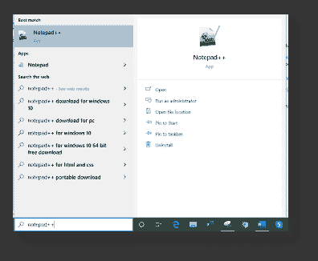

现在，点击`文件>新建`打开一个新文件。

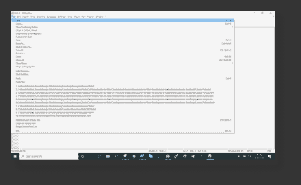

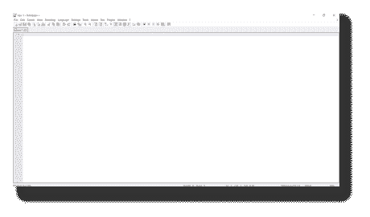

现在，选择`文件>另存为`，并选择`.html`作为文件类型。

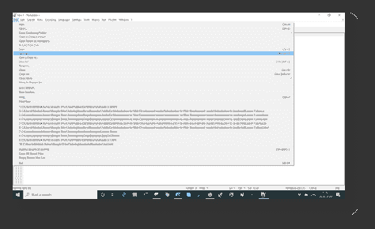

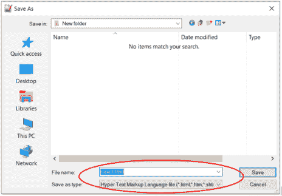

|  |  |  |


### 测试程序


现在，让我们测试程序是否与浏览器连接。

只需在文件中输入随机文本。在我的文件中，我输入了“这是一个测试消息。”

现在`文件>保存`。

之后，根据你使用的浏览器，点击`运行>在 Firefox/Chrome/IE 中启动`。

如果一切正常，你输入的文本应该会显示在浏览器窗口中。

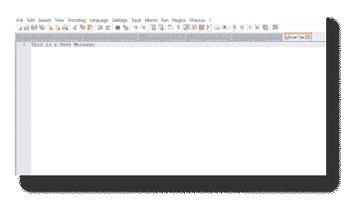

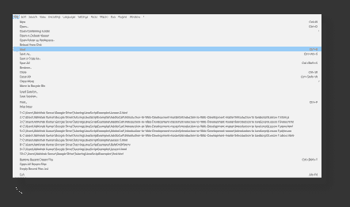

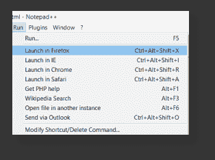

|  |  |  |


### 结果


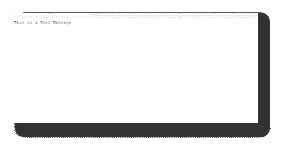

这是一个简单有效的方法，确保你的程序在继续前进之前能够正常工作。

附注：

一些学生遇到的一个问题是，运行浏览器选项有时不起作用并报错。这是因为路径设置不正确。如果由于某种原因它无法工作，你仍然可以运行程序。

- 只需将 Notepad++ 文件保存为 html 文档。
- 关闭 Notepad++ 文件。
- 转到 html 文档所在的文件夹。
- 双击该 html 文件，它应该可以运行。

|  |  |  |


## 什么是 html？


html 代表超文本标记语言（Hyper Text Markup Language）。

它是我们通过网页与互联网交互所使用的编程语言。所有网页的基本结构都由 html 定义。

它足够简单，初学者程序员也能快速掌握。

大多数 html 编程是通过称为标签（tags）的元素完成的。这些标签以`<>`开头，以`</>`结尾。例如，一个常见的标签是段落标签，它以`<p>`开头，以`</p>`结尾。

|  |  |  |


### 常见的 html 标签


`<html>` - 此标签用于每个网页的开头，表示 html 代码的开始。

`<head>` - 这段 html 代码在程序其余部分之前执行。

`<title>` - 此标签用于为网页设置标题。它将文本写入网页顶部的标签栏。

`<body>` - 这是网页主体上的信息。

`<h1>` - 用于表示标题标签。这是最大尺寸的标题标签。

`<h2>`、`<h3>`、`<h4>`、`<h5>`、`<h6>` - 用于表示尺寸递减的子标题。

`<p>` - 用于表示文本段落。

`` - 在网页上显示图像。此图像可以链接到外部网页或内部文件。

`<strong>` - 用于使文本加粗。

`<ul>` - 用于无序列表。例如，以项目符号形式列出的项目列表。

`<li>` - 向无序列表添加一个项目符号项。

`<ol>` - 用于有序列表，例如从 1,2,3... 开始的编号列表。

`<div>` - 用于表示较大的文本块，其中包含多个段落。

`<a>` - 用于将网页中的项目链接到另一个网页。

`<br>` - 在代码中添加一个换行符，并移动到下一行。

|  |  |  |


### html 代码示例


下面是一个基本 html 代码的示例。它包含了上述所有 html 代码的示例。你可以手动输入这些代码，或者复制粘贴下面的示例。

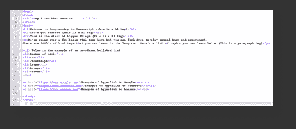

|  |  |  |


### html 代码的复制粘贴版本


你可以将下面的代码复制粘贴到你的 html 浏览器中，看看它是否有效。

```html
<html>
<head>
<title>My first html website......</title>
</head>
<body>
<h1>Welcome to Programming in Javascript (this is a h1 tag)</h1>
<h2>Let's get started (this is a h2 tag)</h2>
<h3>This is the start of bigger things (this is a h3 tag)</h3>
<p>We're going over a few basic html tags here but you can feel free to play around them and experiment.

There are 1000's of html tags that you can learn in the long run. Here's a list of topics you can learn below (This is a paragraph tag)</p>
<ul> Below is the example of an unordered bulleted list
<li>Basics of html</li>
<li>CSS</li>
<li>JavaScript</li>
<li>Loops</li>
<li>Arrays</li>
<li>Canvas</li>
</ul>
<a href="https://www.google.com">Example of hyperlink to Google</a><br>
<a href="https://www.facebook.com">Example of hyperlink to Facebook</a><br>
<a href="https://www.yahoo.com">Example of hyperlink to Yahoo</a><br>
</body>
</html>
```

|  |  |  |


### 代码输出


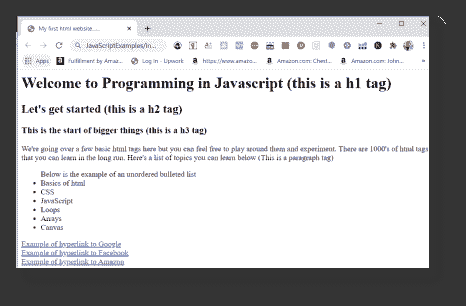

现在，我们来分解不同的元素：

下面是标题标签`<title>`。


下面是标题标签`<h1>`、`<h2>`、`<h3>`。

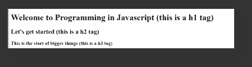

下面是段落标签`<p>`。

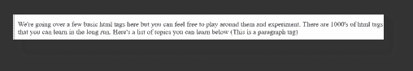

下面是一个无序项目符号列表`<ul>`和`<li>`。

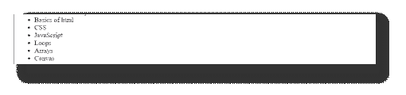

下面是三个指向三个流行网站的链接标签`<a href>`。

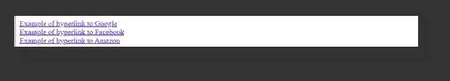

|  |  |  |


### 练习题


- 制作一个带有标题标签的网站，其中包含一个无序列表的杂货清单。使用段落标签说明对特定商品的任何特殊说明。在列表末尾，使用链接标签链接到最近的杂货店网站。


- 创建一个网站，列出你足球队的所有球员。使用标题、标题和段落标签欢迎用户访问你的网站，并描述球队及其理念。使用有序列表列出球员。
- 制作一个网站，以无序列表的形式列出你所在地区所有最喜欢的餐厅和咖啡店。使用标题、标题和段落标签介绍你自己和你所在地区的用餐体验。

 


### 示例 HTML 程序


 


#### 这个项目的作用


这个 HTML 项目创建了两个按钮。这两个按钮可以在白天和黑夜的两张图片之间切换。这两个按钮分别标有“白天”和“黑夜”。

这是一个简单的 HTML 项目，它创建了一个按钮，可以打开/关闭页面上的灯泡。我们将使用两个灯泡图片来实现这一点。按钮将在两张图片之间切换。

 


#### 本章需要理解的概念


对于这个示例，我们需要理解按钮标签和图像标签。

**按钮标签**

`<button onclick=Action>Button text</button>`

按钮元素有两个部分：动作（Action）和按钮文本（Button Text）。按钮文本是显示在按钮上的文字；动作是用户点击按钮时发生的事件。

**图像标签**

``

图像标签有三个元素。

`ImageId` 是你分配给图像的名称。此名称用于在代码中引用图像。

`Imageurl` 是标签引用的图像的 URL。如果图像与 HTML 文件位于同一文件夹中，则可以使用文件名代替完整的 URL。

`ImageSize` 设置图像的宽度和高度。宽度和高度以像素为单位。

 


#### 文件


以下是你在下一个项目中需要使用的两个文件。你可以下载它们，并保存在你将创建 HTML 文件的同一文件夹中。

[白天图片](https://drive.google.com/file/d/1hYrhOnjTDfuF9q-uVoyG9u2ZVGrdVzyj/view?usp=sharing)

[夜晚图片](https://drive.google.com/file/d/1c2ZpmYtbo3H0ZkWT-04vvsVXCUGT0p7j/view?usp=sharing)

 


#### 代码


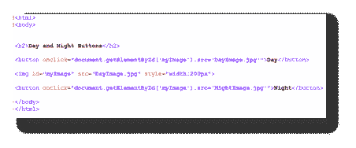

 


#### 输出


初始状态下，默认设置为白天图片。

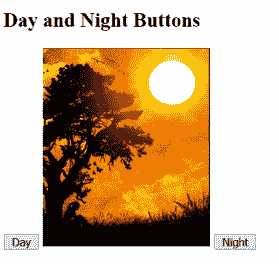

当你点击“夜晚”按钮后，你会看到：

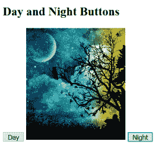

然后，当你再次点击“白天”按钮，你会看到：


 


#### 代码解释


```html

```

上面的 HTML 元素是一个图片标签。它包含三个属性：`id`、`src` 和 `style`。

`id` 是图片的标识符。在这个例子中，它被标记为“myImage”。`id` 用于在整个程序中引用该图片。

`src` 是标签加载的图片源。图片“DayImage.jpg”与 HTML 文件位于同一文件夹中。

```html
<button onclick="document.getElementById('myImage').src='DayImage.jpg'">Day</button>
```

上面的元素是一个按钮元素。它有一个名为 `onclick` 的参数，描述了点击按钮时执行的操作。

`document.getElementById` 获取 id 为“myImage”的元素。因此，当你点击按钮时，它会在“myImage”上显示“DayImage.jpg”。

“Day”是按钮上显示的文本。

```html
<buttononclick="document.getElementById('myImage').src='NightImage.jpg'>Night</button>
```

`document.getElementById` 获取 id 为“myImage”的元素。因此，当按钮被点击时，它会在“MyImage”上显示“NightImage.jpg”。

“Night”是按钮上显示的文本。

 


### 练习题


- 找到三张人物跑步、行走和静止站立的图片。编写一个程序，包含三个按钮，分别对应跑步、行走或静止站立，根据你按下的按钮切换图片。
- 找到三张红、绿、黄灯亮起的交通信号灯图片。编写一个程序，包含三个按钮，分别显示“STOP”、“GO”和“WATCH”。当按下“STOP”按钮时，交通灯切换为红色；按下“GO”按钮时切换为绿色；按下“WATCH”按钮时切换为黄色。

 


## HTML 表单


还记得你在网上看到的那些输入姓名、年龄和出生日期的表单吗？那些就是 HTML 表单。

今天，我们将学习如何制作它们。

在开始制作表单之前，我们需要了解一些基本的表单元素：

- 按钮 `<button>`：允许用户点击时执行操作的元素。
- 文本框 `<input>`：允许用户在浏览器屏幕上的框中输入文本。用于收集简短文本信息，如姓名、城市等。
- 文本域 `<textarea>`：允许用户输入大量文本。它比文本框更大。用于较长的文本信息，如地址、评论等。
- 选项选择 `<select>`：允许用户在多个可用选项中进行选择。本质上是一个下拉框。
- 日期输入 `<input type="date">`：允许用户从日历下拉菜单中选择日期。

现在，让我们通过下面的示例表单逐一了解这些元素。

 


### 示例表单


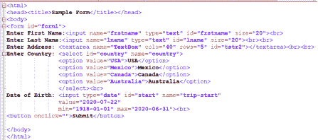

现在，让我们逐一分析代码的每个部分。

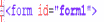

每个表单都以 `<form>` HTML 元素开始。id “form1” 是你给表单起的名称。`id` 用于在程序的其他部分引用该表单。


上面两行是名字和姓氏的文本框。类型设置为“text”，因为名字是一种文本形式。id “frstname” 和 “lname” 将在以后需要时用于引用代码。大小设置为“20”，表示可以接受 20 个字符。你可以根据需要将其改为更大或更小。


上面的元素是地址的文本域。它有 5 行（`rows="5"`），每行 40 个字符（`cols="40"`）。它被标记为“tstr2”。

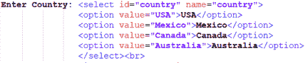

上面的元素是用于选择国家的选择选项元素。它允许你从包含 4 个选项的下拉菜单中选择：美国、墨西哥、加拿大和澳大利亚。它被标记为“country”（`id="country"`）。

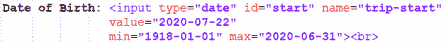

上面的元素是一个日期输入元素，允许你选择 1918 年（`min="1918-01-01"`）到 2020 年（`max="2020-06-31"`）之间的出生日期。它被命名为“start”（`id="start"`），并设置为值 2020-07-22（`value="2020-07-22"`）。

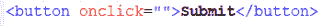

上面的元素是一个按钮元素。上面写着“Submit”文本。点击时它不执行任何操作，因为 `onclick` 函数是空的。

现在，让我们看看运行程序时会发生什么。

 


#### 输出


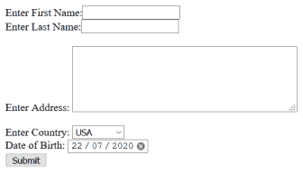

我希望你通过这个例子对 HTML 表单的基础知识有了一些了解。在接下来的几章中，我们将学习如何使用 JavaScript 处理我们输入的信息。事实上，我们将使用同样的例子，并通过 JavaScript 将其打印出来。

 


### 练习题


- 编写一个 HTML 表单，作为大学生的简历。它通过文本框接受名字、姓氏、大学名称；通过下拉菜单接受大学年级。然后有三个活动/实习/合作项目。每个活动都有一个开始日期元素、结束日期元素和一个足够大的文本域来描述经历。最后加上一个提交按钮。
- 编写一个 HTML 表单，用于购物清单。它接受名字、姓氏、购物日期、地址和城市。它有 5 个下拉菜单，每个菜单包含 30 种常见杂货供选择。最后，它有一个提交按钮。

以上每个练习都将在接下来的章节中通过 JavaScript 进行扩展。

 


## 什么是 JavaScript？


JavaScript 是一种高级编程语言，用于使网页更具交互性和动态性。它基于文本，且用户友好。

虽然 HTML 用于创建网页结构，CSS 用于定义网页样式，但 JavaScript 则用于让网页与用户进行更多交互。它允许不同的 HTML 元素相互交互、执行计算、动画等。换句话说，它让网页编程变得有趣。

 


### 在 HTML 中使用 JavaScript


在 HTML 网页中使用 JavaScript 有两种方式。第一种是直接在 HTML 的 `<script>` 标签内添加代码。如下方代码的蓝色部分所示。

```html
<html>
<head><title>测试文件 1</title>
</head>
<body>
<script>
// 在此处输入 JavaScript 代码
</script>
</body>
</html>
```

第二种方式是创建一个包含代码的外部 JavaScript 文件，并将其保存为 `.js` 文件。然后你可以将该文件链接到 HTML 内容中。例如，假设你创建了一个名为 `test.js` 的文件。你可以通过下方代码的蓝色部分进行链接：

```html
<html>
<head><title>测试文件 2</title>
</head>
<body>
<script src=" test.js"></script>
</body>
</html>
```

 


### JavaScript 元素


有了这些基础知识，让我们来看一些基本的 JavaScript 元素。

**函数**

JavaScript 中的函数是一组执行特定任务的代码行。

它在 JavaScript 中定义在 `<script>` 标签内，如下所示：

```javascript
function afunc()
{
// 在此处输入函数代码
}
```

函数的名称为 `afunc`，每次调用 `afunc` 时，都会执行花括号内的代码。

当我们需要在同一个程序中多次执行相同任务时，使用函数非常有用。我们可以直接调用函数，而不必多次编写相同的代码行。

**变量**

JavaScript 中的变量是一个占位符，用于存储某个值。该值可以在程序运行过程中改变，并可在代码的其他部分使用。我们来看一个例子：

`var x=5;`

`x` 是定义的变量，初始值为 5。

之后在程序中，它可以被更改为其他值，例如：

`x=10;`

现在，`x` 的值为 10。如果我们执行：

`x=x-1;`

那么 `x` 变为 9。我们刚才展示的是一个整数变量。我们也可以使用字符串变量来存储文本值，例如：

`var b=”abcd”`

`b` 是一个变量，其值为 `abcd`。

最后，我们还可以使用布尔变量，它只存储 true/false 值。例如：

```javascript
var c = true;
var d = (7>5);
var e = (7<6);
```

变量 `c`、`d` 和 `e` 都是布尔变量。变量 `c` 被赋值为 `true`。变量 `d` 为 `true`（因为 7 大于 5）。变量 `e` 为 `false`（因为 7 不小于 6）。

`document.write()`


`document.write()`用于在网页上打印元素。括号内的任何内容都会打印在网页上。例如：

```javascript
document.write("示例打印");
```

上面的代码会在屏幕上打印出“示例打印”这几个字。

我们也可以打印变量。例如：

```javascript
var a = 7;
document.write(a);
```

上面的代码会在屏幕上打印出 7。

我们还可以使用“+”运算符组合不同的元素。例如：

```javascript
var a = 7;
document.write("打印的数字是 " + a);
```

上面的代码会打印出“打印的数字是 7”。

### `alert()`

`alert()`会在屏幕上弹出一个包含特定消息的对话框。例如：

```javascript
alert("你好");
```

上面的代码会弹出一个显示“你好”的对话框。

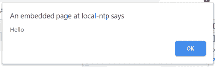

### `prompt()`

`prompt()`具有相同的弹出框，但带有一个允许用户输入的文本框。用户输入可以存储在一个变量中。例如：

```javascript
var name = prompt("你叫什么名字");
```

它会显示一个弹出框。用户输入姓名并点击确定后，该值会存储在变量`name`中。

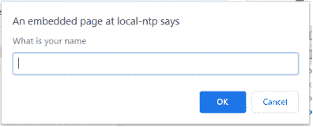

### `document.getElementById().value`

`document.getElementById().value`用于将 HTML 元素的值获取到 JavaScript 变量中。因此，我们需要使用 HTML 元素的 id，并将其放在括号内。让我们看一个例子。

请看下面的 HTML 元素：

```html
输入数字：<input name="x" type="number" id="test" size="20"><br>
```

JavaScript 代码：

```javascript
var testv = document.getElementById("test").value;
```

该 HTML 元素是一个表单文本框，用于接收用户输入的数字。

在 JavaScript 中，用户输入的数字被赋值给变量`testv`。

### 如何添加注释

注释是你添加到代码中用于记录或解释代码的内容。注释不会被执行，也不会影响程序。在 JavaScript 中，注释通过在注释内容前添加两个反斜杠（`//`）来添加。

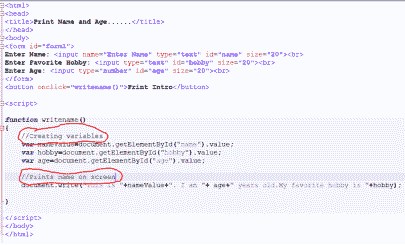

下面是一个注释示例。注释部分为绿色，并用红色圆圈标出。

### 示例 1

现在，让我们开始看一些示例。我们将从上一章的 HTML 表单开始。我们将把所有用户输入赋值给变量，并使用 JavaScript 在网页浏览器中打印出来。

下面的代码与上一章的示例类似。

我们添加了一个 JavaScript 函数，用于打印提交表单的用户的名字和国家。

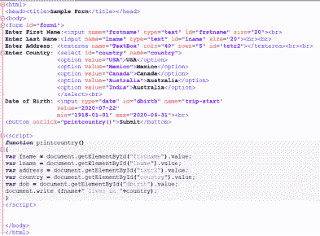

#### 输出

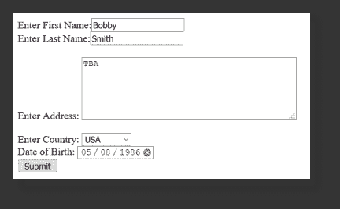

点击提交后，我们得到：

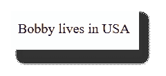

#### 代码解释

我们添加的主要部分是函数`printcountry()`。我们还将该函数添加到了按钮的`onclick`元素中（`onclick="printcountry()"`）。

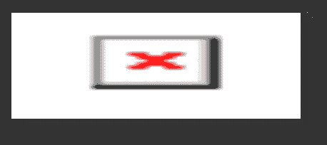

在这个函数中，我们声明了五个变量`fname`、`lname`、`address`、`country`、`dob`。每个变量分别被赋值为表单中输入的名字、姓氏、地址、国家和出生日期。这是通过 JavaScript 元素`document.getElementById().value`实现的。

最后，我们使用`document.write()`打印出表单中输入的名字和出生日期。

### 示例 2

在第二个示例中，我们创建一个简单的 JavaScript 函数，该函数接收 3 个数字并将它们相乘。

#### 输出

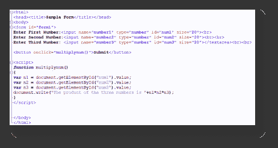

点击提交后，我们得到：

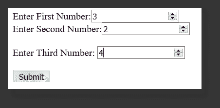

#### 代码解释

在上述代码中，我们从表单中获取三个数字，其 id 分别为`num1`、`num2`和`num3`。

当按钮被点击时，会执行`multiplynum()`这个 JavaScript 函数。

在函数中，三个变量`n1`、`n2`、`n3`分别被赋值为表单中 id 为`num1`、`num2`和`num3`的三个数字。

最后，我们在最后一行使用`document.write()`输出三个数字的乘积`n1 * n2 * n3`。

### 练习题

- 创建上一章练习题 1 中的表单。在网页上以一份像样的简历形式打印出表单中的所有信息。如果看起来足够好，可以随意打印出来交给雇主 😊。
- 创建上一章练习题 2 中的表单。在 HTML 网页上打印出完整的购物清单。然后你可以把它打印在一张纸上，去购物。
- 创建一个接收两个数字的表单。它有四个按钮，按钮文本分别为“加”、“减”、“乘”、“除”。这四个按钮分别执行四个不同的函数，对两个数字进行加、减、乘、除运算，并输出结果。

## CSS 简介

### 什么是 CSS？

CSS 是层叠样式表（Cascading Style Sheets）的缩写。它允许用户设置和修改 HTML 网站的样式。“样式”一词指的是字体类型、字体颜色、背景颜色、阴影等。CSS 元素可以通过 HTML 和 JavaScript 访问。

### 创建 CSS 文件并链接到 HTML 文件

创建 CSS 文件并将其链接到 HTML 文档需要 5 个步骤。

- 要创建 CSS 文件，请打开一个空白 HTML 文档，并将其保存为“CSS”文件类型。在本例中，我们将其命名为`samplestyle`。

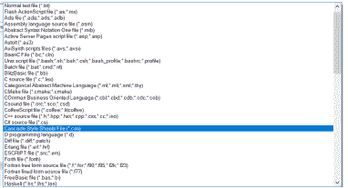

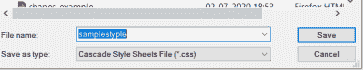

- 转到相关的 HTML 文件，并在头部文件中包含下面这行代码。你可以通过下面这行代码来实现。

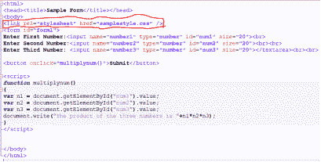

（可选）要使按钮在 CSS 中可编辑，请在 HTML 按钮行中添加文本`class="btn"`，如下所示：

```html
<button class="btn submit" onclick="multiplynum()">Submit</button>
```

现在，让我们将样式表插入上一章的示例中。

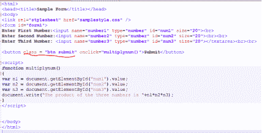

太好了。现在我们的 CSS 表已经链接到 HTML 文件了。

### CSS 术语

`html{}`、`body{}`：html 花括号内的代码定义了整个 HTML 文件的样式。body 花括号内的代码是 HTML 文件正文的样式。

`text-decoration`：可以通过设置波浪线、点线、曲线等来修改文本设计。

`text-transform`：可以将部分或全部文本转换为大写。

`text-align`：可以将文本居左、居中或居右对齐。

`margin`：边距是元素之间的空间。它以像素为单位表示。例如，`margin: 5px`指定了 5 像素的边距。

`padding`：内边距是元素内部从外边界开始的空间。它同样以像素为单位指定。

`display`：可用于完全关闭一个元素。例如，`display: none`会完全关闭该元素。

`hidden`：可用于隐藏一个元素，同时它仍然占据布局中的空间。

`font-size`：指定字体的大小。

`background-color`：指定元素的背景颜色。可以从下面链接中的各种颜色中选择。

[`www.quackit.com/css/css_color_codes.cfm`](https://www.quackit.com/css/css_color_codes.cfm)

`color`：指定书写文本的颜色。

`border`：指定元素边框的存在和类型/样式。可以是隐藏、点线、双线边框；也可以没有边框。

`font-weight`：指定字体的粗细。

`min-height`：指定元素的最小高度。高度以像素为单位。

`line-height`：指定一行文本的高度。高度以像素为单位。

### CSS 按钮元素

`.btn{}`：这指定了 HTML 中定义的任何按钮的样式。要使按钮在 CSS 中可访问，我们必须在 HTML 定义中包含类名，就像我们在上一个示例中所做的那样。

`.btn:hover{}`：你知道吗，你可以指定鼠标悬停在按钮上时按钮的样式？很酷，不是吗？花括号内的所有内容都可以指定按钮和按钮内文本的样式。

要了解可用于设计网页的数千种 CSS 属性，请查看下面的链接：

[`www.htmlhelp.com/reference/css/properties.html`](https://www.htmlhelp.com/reference/css/properties.html)

### CSS 示例

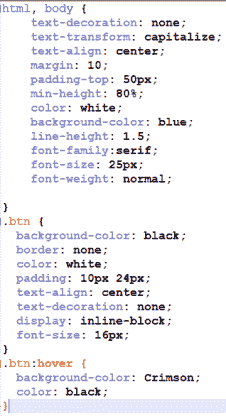

#### 代码解释

我们首先定义代码的`html`和`body`。文本被转换为大写并居中。在蓝色背景上显示为白色。距离顶部边距 50 像素。字体为 25 像素、正常粗细、无衬线的 sans-serif 字体。

按钮样式通过`.btn{}`定义。按钮具有白色文本和黑色背景。文本字体为 16 像素，并居中对齐。当鼠标悬停在按钮上时，样式会发生变化。它变为黑色文本和深红色背景。

CSS 文件链接到上一章中的一个示例表单。我们展示了链接 CSS 文件前后的输出。我们可以看到 CSS 样式带来的巨大差异。就像一次改头换面 😊

输出（无 CSS）：

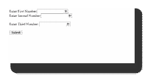

输出（有 CSS）：

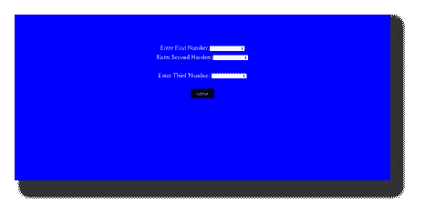

输出（有 CSS 且鼠标悬停在按钮上）：

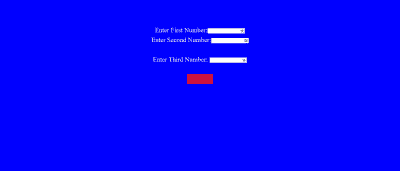

### CSS 与 JavaScript

如果 HTML 表单链接了 CSS，而 JavaScript 开始在网页上打印文本，你会注意到它不再与 CSS 关联。

你需要做的是在 JavaScript 代码中使用下面这行代码重新链接 CSS：

```javascript
document.write('<link rel="stylesheet" type="text/css" href="samplestyle.css" />');
```

在 JavaScript 中每个函数开始之前输入这行代码。这可以确保整个程序都显示 CSS。请参见下面文本中的示例：

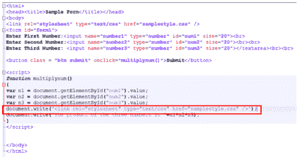

输出（在 JavaScript 中添加 CSS 行之前）：

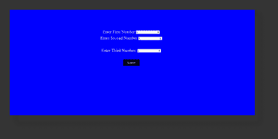

点击提交按钮后：

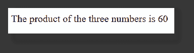

输出（在 JavaScript 中添加 CSS 行之后）：


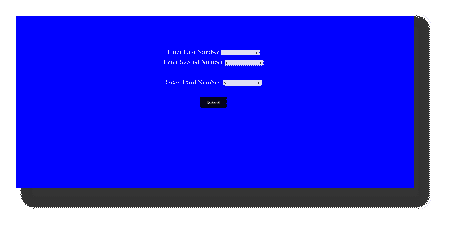

点击提交按钮后：


|  |  |  |


### 练习题


- 创建一个 CSS 样式表，为所有表单元素和按钮指定样式。将其链接到之前所有的练习题中，并欣赏你的杰作。

- 创建一个包含 2 个按钮的 HTML 表单。创建两个 CSS 样式表。这两个 HTML 按钮用于在两个样式表之间切换。

|  |  |  |


## 循环


编程中的循环是一组重复执行一定次数的指令序列。

可以把循环想象成自动扶梯。扶梯的台阶会朝着一个方向反复运行，直到有人按下停止按钮。

根据执行条件的不同，循环分为 3 种类型。它们是：

- **IF 循环**：IF 循环包含一组指令，当满足特定条件时执行。如果条件不满足，则不执行循环。

- **FOR 循环**：FOR 循环包含一组指令，按指定次数执行。例如，从 1 到 10 的 FOR 循环会执行循环内的代码 10 次。

- **WHILE 循环**：WHILE 循环是一组指令，会一直执行直到满足特定条件。

现在，我们通过每种循环来看看电梯的例子。

假设我们希望电梯仅在楼内人数超过 1000 时运行。那么我们可以使用 IF 循环来检查楼内人数，如果满足条件则运行电梯函数。

IF 循环示例：

```
if(people>1000)
{
Runelevator();
}
```

现在，如果我们想对电梯进行 1000 次运行测试，以检查它是否能承受一定重量，我们可以使用 FOR 循环。下面的 FOR 循环从 0 开始，到 999 结束，因此电梯会运行 1000 次。

```
for (i=0;i<1000;i++)
{
Runelevator();
}
```

最后，如果我们希望电梯一直运行到下午 6 点，我们可以使用 WHILE 循环。

```
While (checktime!=18:00)
{
Runelevator();
}
```

以上是三种循环的简单示例，用于解释循环的概念。这个概念在编程中非常重要。

现在，让我们用 JavaScript 做一些示例。

|  |  |  |


### IF 循环示例 1


IF 循环也称为条件语句。条件语句是一段代码，用于检查某个条件是否满足。例如，如果两个孩子的年龄总和大于 15，保险公司可能会给你更低的费率。因此，你需要检查这些条件。下面我们通过 IF 循环来看一下。

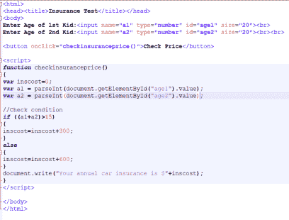

上面的 HTML 表单允许用户输入两个年龄，其 id 分别为`age1`和`age2`。JavaScript 变量`a1`和`a2`存储这些变量的值。IF 语句检查两个年龄之和是否大于 15。如果大于 15，保险费用为 300 美元；否则为 600 美元。最后，我们输出保险费用的值。以下是输出结果。

输出 #1：

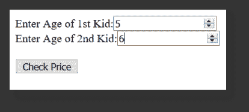

点击“Check Price”后：

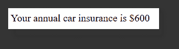

输出 #2：

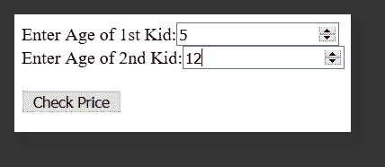

点击“Check Price”后：

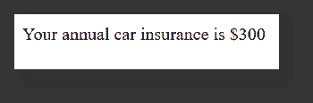

|  |  |  |


### IF 循环示例 2


我们再举一个例子。假设你想选择加入哪个健身房。你希望加入距离在 5 英里以内且月费低于 60 美元的健身房。因此，你需要两个 IF 循环来分别检查每个条件。这两个循环是嵌套的，称为嵌套循环。下面我们来看一下。


上面的 HTML 表单允许用户输入健身房名称（id=`gname`）、距离（id=`dist`）和月费（id=`memc`）。JavaScript 变量`name`、`gymdistance`和`memberprice`存储用户输入的值。第一个 IF 语句检查`gymdistance`是否小于 5。如果大于 5，则健身房不合适。如果小于 5，则使用另一个 IF 检查月费是否低于 60 美元。如果是，则这是一个可能的健身房；否则不合适。以下是几个示例输出。

输出 #1：


输出 #2：


输出 #3：


|  |  |  |


### FOR 循环示例 1


一个简单的 FOR 循环示例是数到 10 的程序。


上面的代码是一个简单的 for 循环示例。它有一个按钮，点击后运行`printten()`函数。`Printtoten()`函数中有一个 for 循环，通过`document.write()`在屏幕上打印数字 1 到 10。

`For (i=1;i<=10; i++)`

上面这行代码表示循环从 1 开始（`i=1`），每次增加 1（`i++`），当 i 达到 10 时循环结束（`i<=10`）。

输出：

点击输出中的按钮后，屏幕上会显示数字 1 到 10。


|  |  |  |


### FOR 循环示例 2


现在，我们做一个稍微不同的版本。在这个示例中，我们将使用一个表单来接收循环的次数。这意味着我们可以让循环任意长。


这个程序添加了一个 HTML 表单。

表单接收一个数字输入，并存储在名为`loop`的变量中。

还有一个标有“Print Loop Length”的按钮，点击后运行`printlooplength()`函数。

在函数中，我们将表单变量`loop`赋值给另一个变量`looplength`。然后运行从 1 到`looplength`的循环。循环打印 1 到`looplength`之间的数字。

在下面的示例中，我们在表单中输入了 35；可以看到，它打印出了 1 到 35 之间的数字。


|  |  |  |


### FOR 循环示例 3 – 嵌套循环


在最后一个示例中，我们使用 FOR 循环来创建一个星形图案。

因此，我们创建第二个标有“Print Star Loop”的按钮，点击后运行`starloop()`函数。在函数中，`looplength`再次保存我们在表单中输入的循环值。

首先，我们创建一个从 1 到`looplength`的 FOR 循环。变量`i`保存循环的计数值，每次增加 1。

然后，我们在其中创建另一个 FOR 循环，从 1 到`i`。第二个 FOR 循环打印星号（“*”）`i`次。

例如，当你第一次循环到第 5 次时，`i=5`。第二次循环会打印从 1 到 5 的*（即 5 次）。

在下面的示例中，我们为`looplength`为 23 的情况打印星号循环。

输出


|  |  |  |


### WHILE 循环示例 1


while 循环在满足特定条件时持续运行。如果条件不再满足，则跳出循环。在下面的示例中，程序执行一个 while 循环，通过`prompt`函数获取用户输入。while 循环持续运行并打印用户输入的文本。当用户输入单词'STOP'时，循环停止。一旦输入该单词，while 循环结束，程序停止。


以下是展示其工作原理的输出。

输出：


|  |  |  |


### 练习题


*   编写一个程序，通过表单输入一个数字，并检查它是否能被 3 整除。

*   编写一个程序，获取用户输入并输出以下模式。例如，如果用户输入数字'5'，则输出：

1

22

333

4444

55555

*   编写一个程序，接收七个用户输入，每个输入是一种不同的动物。然后编写一个函数，检查这些动物中是否有老虎，并打印出第几个动物是老虎。

*   编写一个程序，作为汽车经销商的筛选器。它通过`prompt`函数获取汽车的名称和价格。程序每次打印出汽车的名称。当所有汽车的总价超过 50000 美元时停止，因为这是他们的预算上限。

*   编写一个程序，通过`prompt`函数获取两个用户输入的数字。持续让用户输入两个数字，直到它们的和大于 20。一旦用户输入的两个数字之和大于 20，程序停止。

*   编写一个程序，通过用户提示获取一个人的投票。共有 3 个候选人。它检查投票是否属于某个候选人，并累加该候选人的总票数。最后有一个提示询问是否还有更多投票，接受'Y/N'的值。如果为'N'，则停止程序并打印出获胜者。如果为'Y'，则再次询问投票并重复该过程。

*   编写一个程序，获取用户输入并输出以下星号模式。例如，如果用户输入数字'6'，则输出：

******


*****


****


***


**


*


*   编写一个程序，获取用户输入并打印从 1 到该数字的所有数字之和。例如，如果用户输入 3，则和为 1+2+3=6。

|  |  |  |


## 游戏时间 - 循环


现在，是时候根据我们目前所学的内容设计几个游戏了。

没有比应用概念更好的学习方式了；而将其应用到有趣的事情上则更佳。

在开始之前，我们先讨论一个概念：使用 JavaScript 添加 HTML 元素。

|  |  |  |


### 使用 JavaScript 添加 HTML 元素


如果希望在 JavaScript 程序中间添加一个按钮或文本框，该怎么办？是的，你可以在 JavaScript 中使用`document.write()`函数来实现。例如，你可以这样创建一个按钮：

```
document.write('<button onClick="afunction()">Restart</button>');
```

在上面的代码行中，我们创建了一个带有文本'Restart'的按钮。点击按钮时，会运行`afunction()`。这在游戏中非常有用，我们可以选择继续运行程序而不是停止。现在，让我们看看下面一个类似的程序。


上面的程序是前一章中的表单。我们只添加了两行代码和一个函数。

这两行代码创建了一个 Home 按钮，该按钮运行`redirect()`函数。

`redirect()`函数会重新运行程序。`form_JavaScript.html`是我们正在运行的文件名。你应该将`form_JavaScript`替换为你自己命名的 HTML 文件名。

输出 #1


输入数字并点击 Submit 后，我们得到：


现在，点击 Home 按钮后，我们得到：


所以，它基本上重新启动了 HTML 程序。

现在，让我们开始第一个游戏。

|  |  |  |


### 游戏 1 – 猜随机数


在这个游戏中，我们将创建一个表单，通过文本框输入一个数字。该数字在 0 到 10 之间。然后我们将该数字与通过 JavaScript（使用`Math.random`）生成的随机数进行比较。如果相同，则猜对了。如果不同，则给出正确的数字。用户可以选择点击 Home 按钮重新尝试。请参见下面的代码和输出。


输出：


如果我们点击 Home，可以再次玩这个游戏。

这个程序是练习条件循环和随机数生成器的好方法。

|  |  |  |


### 游戏 2 – 数学测验游戏


这个程序稍微长一些，所以我把它分成了两张图片。它基本上打印出 5 道简单的数学题，并通过表单（这些表单的 id 分别为`num1`、`num2`、`num3`、`num4`、`num5`）获取这些题的答案。答案作为 JavaScript 变量（`answer1`、`answer2`、`answer3`、`answer4`、`answer5`）存储。这些答案通过 IF 函数与正确答案进行比较。每次用户答对一题，计数器加 1，最后打印出计数器，显示用户答对了多少题。


输出：


点击 Check 按钮后，我们得到：


这是一个很好的练习程序。但你可能认为孩子们只能使用这个程序一次，因为我们总是使用相同的数字。为了解决这个问题，我们在下一个游戏中生成随机数。

|  |  |  |


### 游戏 3 – 带随机数的数学测验


在下面的程序中，通过 10 个随机数生成了 5 道数学题。这 10 个随机数分别是变量`number1`到`number10`。题目的答案经过计算后存储在变量`answer1`到`answer5`中。这 15 个变量被称为全局变量，因为它们位于任何函数之外。这意味着程序中的任何函数都可以在任何位置访问它们的值。

函数`startquiz()`使用 10 个变量`number1`到`number10`在屏幕上写出测验题，并创建一个表单，用于接收 5 个答案，这些答案的 id 分别为`num1`到`num5`。点击“检查”按钮后，这 5 个答案会被发送到函数`guessnumber()`，并存储为变量`guess1`到`guess5`。然后，通过 5 个不同的 IF 函数，将这 5 个答案（`guess1`到`guess5`）与计算出的答案（`answer1`到`answer5`）进行比对。每次答对时，计数器就会增加。最后，输出计数器以显示答对的数量。末尾还有一个“主页”按钮，让用户可以选择用新题目重新开始程序。

这些题目是随机生成的，这意味着用户每次都会得到不同的题目。


输出：


点击“检查”按钮后，我们得到：


现在，我们知道所有答案都正确。接下来，我们再次点击“主页”。我们点击“开始数学测验”回到这里，再次进行另一个测验。由于数字是随机化的，我们得到了 5 道完全不同的题目。太棒了！！


|  |  |  |


### 练习题


- › 编写一个程序，生成两个 0 到 10 之间的随机数。程序计算它们的和与积，并在屏幕上输出和与积，然后要求用户猜出这两个数字。用户通过表单输入猜测，程序将其与最初的两个数字进行比对。如果猜对了，则显示祝贺信息；如果猜错了，程序会告知正确答案。最后，提供重新开始程序并再次尝试的选项。
- › 编写一个程序，生成一个 0 到 20 之间的随机数。程序将该数字平方，并在屏幕上输出平方值。然后，要求用户猜出这个数字。用户通过表单输入数字，程序检查是否正确。
- › 编写一个程序，允许用户通过表单输入 3 个数字。这 3 个数字应作为三角形的三条边。程序随后检查这是否是一个直角三角形。程序会告知用户是否为直角三角形（提示：使用勾股定理进行验证）。

|  |  |  |


## 字符串变量


在 JavaScript 编程中，字符串变量用于存储一组字符。

例如：

```javascript
var x = "awe3t5";
```

`x`是一个字符串变量，存储了`"awe3t5"`的值。

它是一个长度为 6 的字符串变量。当我们访问字符串时，请记住索引从 0 开始，而不是 1。例如，`x[0]`返回`a`，`x[1]`返回`w`，以此类推。

字符串在处理文本信息（如姓名、地址等）时非常有用。

以下是一些可用于处理字符串的实用函数列表：

- `length` – 返回字符串的长度。在上面的例子中，`x.length`返回 6。
- `charAt(y)` – 返回字符串中位置`y`处的字符。例如，在字符串`x`中，如果我们想要第 5 个字符，可以执行`x.charAt(5)`，返回`t`。
- `indexOf(y)` – 检查字符`y`在字符串中的索引。例如，`x.indexOf('a')`返回 0。
- `lastIndexOf(y)` – 检查字符`y`在字符串中的最后一个索引。例如，`x.lastIndexOf('e')`返回 3。这仅在同一个字符串出现多次时有用。
- `.concat(b)` – 将字符串`b`连接到前一个字符串。例如，如果字符串`a = "xyz"`，字符串`b = "lmn"`，则`a.concat(b)`得到`"xyzlmn"`。
- `includes(y)` – 检查字符串中是否包含字符串`y`，并返回 true 或 false 值。例如，如果字符串`x = "Hi Peter"`，则`x.includes("Hi")`返回 true，但`x.includes("Home")`返回 false。
- `replace(x,a)` – 将字符串中所有`x`的实例替换为字符串`a`。例如，如果字符串`str = "Hi Peter"`，则`str.replace("Hi","Hello")`使`str`变为`"Hello Peter"`。
- `startswith(y)` – 检查字符串是否以字符串`y`开头。它返回一个布尔值 true 或 false。在上面的例子中，`str.startswith("Hi")`返回 true，而`str.startswith("Hello")`返回 false。
- `toUpper()` – 将整个字符串转换为大写。在上面的例子中，`str.toUpper()`变为`"HI PETER"`。
- `toLower()` – 将整个字符串转换为小写。在上面的例子中，`str.Lower()`变为`"hi peter"`。

|  |  |  |


### 示例 1 – 玩转你的名字；名字反转游戏


在下面的示例中，我们通过表单输入自己的名字。有两个按钮，一个打印名字的长度，另一个反转名字。第一个按钮运行一个名为`strlength()`的函数。`strlength()`通过表单获取名字，并使用`.length`函数计算长度。

第二个按钮执行一个名为`namereverse()`的函数。`namereverse()`再次通过表单获取名字并计算长度。然后运行一个 FOR 循环，从最后一个字符开始，每次减 1，直到到达第一个字符。每次循环迭代时输出该字符。这样就从最后一个字符打印到第一个字符，从而反转了名字。

以下是代码和输出。


输出：


点击“名字长度”后：


点击“名字反转”后：


|  |  |  |


### 示例 2 – 地址检查


在下面的程序中，用户通过表单输入姓名和地址。地址通过文本区域输入，以容纳更多字符。它接受 5 行，每行 40 个字符（总共 200 个字符）。该程序的目标是将所有来自纽约的居民分配到另一家酒店。按钮运行一个名为`addcheck()`的函数。`addcheck()`从表单中获取姓名和地址，并将其赋值给变量。

一个使用`.includes()`的 IF 函数检查地址是否包含`"New York"`。如果包含，则使用`.concat()`将姓名字符串与酒店 1 的字符串连接起来。

如果不包含纽约，则将姓名字符串与酒店 2 的字符串连接起来。

无论哪种情况，我们都输出连接后的字符串。

以下是代码以及展示两种不同情况的两个输出。


输出 #1：


点击“检查地址”后，显示酒店 2，因为地址不是来自纽约。


输出 #2：


点击“检查地址”后，显示酒店 1，因为地址是纽约地址。


|  |  |  |  |


### 示例 3 – 输入字符串并将所有脏话替换为 *****


在下面的代码中，我们通过 textarea 输入文本，并将所有脏话替换为五个星号`*****`。出于审查目的，我们使用“Fudge”作为脏话示例。

按钮运行`filterc()`函数。`filterc()`函数通过表单中的 textarea id 获取文本。一个使用`.includes`和`.toUpperCase()`的 IF 函数检查是否找到单词“Fudge”。使用`.toUpperCase()`是因为我们不知道脏话是以小写还是大写输入的。

如果是脏话，我们使用`.replace`将单词“Fudge”和“FUDGE”替换为`"*****"`。最后，我们输出修改后的字符串。下面是代码及几种输出变体。


输出 #1：


点击过滤脏话后……


输出 #2：


点击过滤脏话后……


|  |  |  |


### 练习题


- › 编写一个程序，输入一个字符串，并输出该字符串中的每第 2 个字符。例如，“wfwfwkfnfwbej”应输出“ffkbwj”。
- › 编写一个程序，输入一个长句子，并将所有出现的单词“red”替换为“yellow”。
- › 编写一个程序，输入一个地址，并检查邮政编码是否包含 5 个字符。如果多于或少于 5 个字符，或者没有邮政编码，则输出“Invalid Address”。

|  |  |  |  |


## 数组


JavaScript 中的数组用于存储一组相似的变量。

想想如何用变量存储人们的年龄。假设我们有三个人的年龄。我们可以将它们存储在变量`age1`、`age2`和`age3`中。

```javascript
age1 = 5;
age2 = 25;
age3 = 45;
```

现在，假设我们有 10 个人。我们可以将它们存储在变量`age1`、`age2`……`age10`中。那么，如果我们要存储 100 个人的年龄呢？你明白了吧。需要跟踪的变量太多了。

因此，我们使用数组。要存储 10 个年龄，我们只需使用：

```javascript
age = [5, 25, 45, 60, 20, 23, 24, 43, 34, 78];
```

要在 JavaScript 中访问这些值，我们使用数组的索引。第 1 个元素的索引是 0，第 2 个是 1，第 3 个是 2，以此类推。例如：

```javascript
document.write(age[0]) 输出 5；
document.write(age[1]) 输出 25；
document.write(age[5]) 输出 23。
```

|  |  |  |  |


### 示例 1 – 在 JavaScript 中创建数组


现在，我们来看下面的示例。我们在 JavaScript 中创建了 3 个数组，分别存储 5 个人的姓名、年龄和所在州。我们使用数组索引将它们打印出来。然后，我们使用`.push()`功能添加第 6 个人。请查看下面的代码和输出。


输出：


点击打印数组后，我们得到……


|  |  |  |  |


### 示例 2 – 通过表单分配数组


在此示例中，我们通过 HTML 表单输入姓名、年龄和所在州。在 JavaScript 中，我们将表单元素分配给变量。

通过表单输入 3 个姓名、年龄和州位置，并使用`document.getElementById`将它们输入到 3 个数组中。

最后使用`document.write()`打印数组。


输出：


点击开始程序后，我们得到：


|  |  |  |  |


### 示例 3 – 猜世界首都


在这个程序中，我们编写了一个测验，询问用户世界上某个随机国家的首都，并检查答案是否正确。

程序中，一个按钮运行`worldquiz()`函数。在该函数中，我们声明了两个数组。一个数组包含世界上所有国家；另一个包含所有首都。

你可以从下面获取这些数组的值：

[`drive.google.com/file/d/1Vbnrllk290oVmh3Vn8Jv2EgFBL1w8vSd/view?usp=sharing`](https://drive.google.com/file/d/1Vbnrllk290oVmh3Vn8Jv2EgFBL1w8vSd/view?usp=sharing)


然后我们选择一个介于 0 和 `x` 之间的随机数，`x` 是数组的长度。这个随机数从数组中随机选取一个国家。我们使用`Math.random()`和`Math.floor()`来实现。

我们使用`prompt`获取用户猜测的首都。我们将用户猜测与实际首都进行比较。然后，我们向用户发送一条消息，告知他们正确或错误（如果错误，则给出正确的首都）。

然后，用户可以通过运行`redirect()`函数的主页按钮重新启动程序。`redirect`函数运行`'GuessWorldCapitals.html'`，即文件名。代码和输出如下所示。


输出 #1：


点击开始测验


输出 #2：


|  |  |  |


### 示例 4 – 随机笑话


这个程序从笑话列表中随机选取一个笑话并打印出来。一个按钮运行`writejoke()`函数。在该函数中，我们声明了一个包含所有笑话的数组。

你可以从下面获取数组的值：

[`drive.google.com/file/d/1xDN9dt2Gvj-mdPmi5ATCnP1tvOZtZt25/view?usp=sharing`](https://drive.google.com/file/d/1xDN9dt2Gvj-mdPmi5ATCnP1tvOZtZt25/view?usp=sharing)

然后我们选择一个介于 0 和 `x` 之间的随机数，`x` 是数组的长度。这个随机数随机选取一个国家。我们使用`Math.random()`和`Math.floor()`来实现。

然后我们使用`document.write()`函数打印笑话。

然后，用户可以通过运行`redirect()`函数的主页按钮重新启动程序。


输出 #1：


输出 #2：


|  |  |  |


### 示例 5 – 动物猜词游戏


这个程序编写了一个有趣的动物猜词游戏。下面程序中的按钮启动`animalhangman()`函数。在该函数中，我们首先声明一个包含所有动物的数组。然后，我们使用`Math.random()`和`Math.floor()`随机选取一个动物。

我们创建一个变量来存储答案（`answerArray`）。它存储用户的答案。它被初始化为与原始动物相同长度的下划线（`_`）。

变量`remletters`是剩余待猜字母的数量。创建了一个`while`循环，只要`remletters > 0`，就接受用户的猜测。

使用`prompt`，我们接受用户输入的单个字母。如果输入的字母超过一个，我们会设置一条错误消息，并要求用户只输入一个字母。一旦用户输入了一个字母，我们就进入一个循环，检查随机动物的每个字母是否与用户输入的字母匹配。每次匹配时，我们将`remletters`减 1，并用匹配的字母更新`answerArray`的相应部分。在`while`循环结束时，用户已经猜出了动物，我们会打印一条祝贺消息，并显示动物的名称。

在`while`循环中的任何时刻，如果用户没有输入字母并试图继续，我们会退出程序循环并打印出动物名称。

游戏结束时，用户可以选择使用“主页”按钮重新启动程序。以下是带有一些示例的代码。


输出 #1


以下是显示答案长度的起始点。


猜第一个字母。用户输入 't'


没有 't'。所以我们再试一次。


用户输入 'k'


答案中没有 'k'。仍然没有猜对。


现在，用户输入 'o'


终于，用户猜对了。单词以 'o' 结尾，我们在更新后的答案中看到了这一点。


所以，再猜几次后，我们得到了下面的答案。只差一个字母了。


用户猜 'n'。


猜对了。整个单词是 flamingo。


然后，程序在下方显示正确答案。


|  |  |  |


### 练习题


› 创建一个简历程序，通过表单接收多个候选人，并将他们存储在单独的数组中。一个数组存放姓名，一个存放城市，一个存放大学，一个存放 GPA。打印出所有位于特定城市的姓名。

› 编写一个关于美国总统的问答程序。创建一个包含所有美国总统的数组。再创建另一个数组，其中包含每位总统的一个著名事实。程序随机选择一个事实呈现给用户，用户猜测是哪位总统。

› 编写一个程序，列出经销商库存中的所有汽车，存放在一个数组中。另一个对应的数组存放这些汽车的价格；第三个数组存放制造年份。程序接收用户输入的车型年份，并打印出所有年份比该年份更新的汽车及其价格。

› 编写一个程序，玩体育版猜词游戏。选择一项运动，然后选择该运动中你最喜欢的 20 名运动员。将这些运动员放入一个大小为 20 的数组中，让用户像玩猜词游戏一样猜测字母。

|  |  |  |


## 对象


编程中的对象是一个属性的集合，每个属性都有对应的值。这些属性不必是相同的变量类型。例如，我们可以有一个同时包含字符串和数值属性的对象。

|  |  |  |


### 示例 1


在下面的示例中，我们为汽车创建了一个对象。它有 4 个不同的属性：名称、型号、价格、车牌。这些属性通过表单的用户输入来接收。

它们在`entercar()`函数中作为输入被接收，然后在`printcars()`函数中被赋值给一个对象。在`printcars()`函数中，用户通过表单输入的内容被赋值给 4 个独立的变量。

这些变量被赋值给对象`car`，如下所示。属性和值之间用`:`分隔，不同的属性/值之间用逗号（`,`）分隔。

在下面的示例中，`type`、`model`、`license`和`price`是属性；而`carname`、`carmodel`、`carnumber`和`carprice`是相应属性的值。下面的 4 个值来自用户表单。


要访问对象的值，我们使用点（`.`）运算符放在属性之前。例如，`car.type`会返回对象`car`的属性`type`所赋的值。

因此，我们通过访问对象属性值来打印出汽车类型和价格。

以下是带有输出的代码。


输出 1：


点击“检查”按钮后，我们得到：


|  |  |  |


### 示例 2


在下面的示例中，我们模拟了 6 名玩家之间的掷骰子游戏。

基本上，掷骰子游戏进行 10 次；根据骰子落在 1 到 6 之间的哪个数字，玩家获得相应的分数。例如，如果骰子落在 1 上，玩家 1 加一分；如果落在 2 上，玩家 2 加一分，以此类推。骰子的值通过`Math.Random()`函数在 1 到 6 之间模拟。

程序开始时，声明了一个对象`gameplayer`。属性是玩家的名字，值是获得的分数。

在函数`dicegame()`中，有一个`FOR`循环，运行`gamecalc()` 10 次。在`gamecalc()`中，随机选择一个 1 到 6 之间的数字，模拟掷骰子。根据骰子落在哪个数字上，对应玩家的属性值增加 10。

在`FOR`循环结束时，我们在下方打印出每位玩家获得的分数。

以下是带有示例输出的代码。


输出：

输出的前 10 行显示了在循环的 10 次迭代中谁赢得了骰子游戏。

下面的 6 行显示了玩家获得的最终分数。


|  |  |  |


### 练习题


› 编写一个程序，为餐厅菜单创建一个对象。属性包括菜品名称、烹饪时间和菜品价格。然后访问对象的值，打印出所有价格低于 20 美元且烹饪时间少于 20 分钟的菜品。

› 编写一个程序，模拟篮球比赛的投篮练习。球员的名字作为属性，得分作为属性的值。程序检查球员的名字以及投篮是否在三分线外。根据结果，为相应球员增加 2 分或 3 分。

|  |  |  |


## 创建画布


|  |  |  |


### 什么是画布？


画布是一个 HTML 元素，允许用户使用 JavaScript 绘制图形、形状、图像以及运行动画。它是 HTML 页面上的一个矩形区域，我们可以定义其大小。

|  |  |  |


### 画布示例


画布的大小以像素为单位定义。像素是计算机屏幕上最小的发光单元。最常用的计算机尺寸是 1366 像素宽、768 像素高。

下面是一个示例画布，宽度为 500 像素，高度为 500 像素。画布周围有一个 2 像素的可见边框。


输出：


绘图（含尺寸）：

下图展示了画布相对于常规计算机显示器屏幕的大小。绿色标注为计算机屏幕尺寸，黑色标注为画布尺寸。我们只能在画布上绘图，而不能在屏幕的其他部分绘图。


|  |  |  |


### 在画布上创建圆形


在 JavaScript 中，创建圆形需要 5 个步骤。下面的代码展示了这一过程。

第一步是使用`document.getElementByID`将 HTML 元素转换为 JavaScript 变量。然后使用`getContext("2d")`将其转换为 2D 绘图元素变量。在下面的示例中，变量`c2x`就是绘图元素。

在 JavaScript 中，我们可以用`beginPath()`开始任何绘图，然后用`clearRect`清除画布。`clearRect`的工作原理如下例所示：

`clearRect(a,b,c,d)`表示矩形的左上角起始于 x 坐标 `a` 和 y 坐标 `b`；其宽度为 `c`，高度为 `d`。因此，我们从 `(a,b)` 开始，清除宽度为 `c`、高度为 `d` 的画布区域。在下面的示例中，我们从 `(0,0)` 开始，清除整个宽度为 500 像素、高度为 500 像素的画布。这使得整个画布变为空白，准备绘图。

接下来，我们使用 arc 函数绘制圆形。那么，让我们看看它是如何工作的：

`arc(a,b,c,d,e)`是我们绘制圆形的方式。`(a,b)`是圆心；`a`为 x 坐标，`b`为 y 坐标。`c`是圆的半径。`d`是圆弧的起始部分。`e`是圆弧的结束部分。

`d`和`e`以弧度为单位。对于一个完整的圆，`d`和`e`分别为 0 和 2π。对于一个半圆，`d`和`e`在 0 到 π 之间。

在下面的示例中，圆 1 的圆心在 `(50,50)`，半径为 20 像素。圆 2 的圆心在 `(250,250)`，半径较大，为 70。圆 3 实际上是一个半圆，因为它从 0 弧度到 π 弧度。它靠近右下角，位于 `(350,350)`，半径为 50 像素。

最后一步，我们使用`stroke()`绘制圆形。如果要填充圆形，则使用`fill()`。我们可以通过`fillStyle()`更改颜色。


输出：


绘图（尺寸）：

下面是圆 2（蓝色圆）使用画布坐标测量的示例，仅作展示。


|  |  |  |


### 在画布上创建矩形


矩形的绘制与圆形开始的方式相同：使用画布和 2D 上下文变量。同样，我们使用`beginPath()`和`clearRect()`开始绘制过程。然后使用一个名为`fillRect()`的函数，如下所示：


`fillRect(a,b,c,d)` 表示矩形的左上角起始于 x 坐标 a 和 y 坐标 b；其宽度为 c，高度为 d。因此，我们从 (a,b) 开始，创建一个宽度为 c、高度为 d 的矩形。在下面的示例中，我们从 (0,0) 开始，创建一个宽度为 50 像素、高度为 100 像素的矩形。它是一个红色矩形（因为 `fillRect` 是红色的）。

还有第二个 `fillRect()`，它创建一个宽度为 75 像素的正方形（因为宽度和高度都设置为相同的值 75）。该正方形的左上角起始于 (150,150)。

在这两种情况下，`fillRect()` 会自动绘制并用指定颜色填充矩形。


输出：


绘图（矩形 2）：


|  |  |  |


### 创建笑脸


在下面的示例中，我们利用圆形和半圆的知识来创建一个笑脸。

首先，我们在屏幕中心绘制一个半径为 75 像素的黄色圆形，作为脸部。然后绘制两个半径为 10 像素的黑色小圆形，作为眼睛。

最后，我们绘制一个半径为 30 像素、填充为黑色的半圆，作为微笑。

很可爱，对吧？你可以发挥创意，制作任何你想要的表情。


输出：


|  |  |  |


### 练习题


- 创建一个 700 像素 × 500 像素的画布。在画布的四个不同角落各绘制一个圆形。然后在画布的正中心绘制第 5 个圆形。所有圆形颜色各不相同。这是一个很好的练习，能让你熟悉在屏幕上定位形状。
- 创建一个 600 像素 × 600 像素的画布。在屏幕上绘制不同的表情符号。在画布中心绘制一个笑脸。然后在其正上方绘制一个哭脸。接着，在中心右侧绘制一个害怕的表情（闭眼、嘴巴呈直线）。最后，在左侧绘制一个你选择的表情符号。
- 创建一个 600 像素 × 600 像素的画布。在正中心绘制一个边长为 100 像素的正方形。然后绘制第二个边长为 80 像素的正方形。接着，绘制第三个边长为 60 像素的正方形……依此类推，直到无法再缩小。这是一个同心正方形的示例。（提示：正方形就是所有边相等的矩形。）

|  |  |  |


## 定时器与动画


|  |  |  |


### 什么是定时器？


JavaScript 中的定时器用于对 JavaScript 代码进行计时。它允许用户在不同的时间间隔执行代码的不同部分。

`setTimeOut()` 和 `setTimeInterval()` 函数用于设置定时器。`setTimeOut()` 允许在执行代码前有一个固定的延迟；`setTimeInterval()` 允许代码以固定的间隔重复执行。例如：

`setTimeOut(a, 1000)` 在 1000 毫秒（1 秒）后执行函数 a。

`setTimeInterval(a, 1000)` 以 1000 毫秒（1 秒）的间隔重复执行函数 a。

这些函数是运行 JavaScript 动画的关键。

|  |  |  |


### 定时器示例


在我们的代码中，只使用了 `setInterval()` 函数。下面的示例中，有两个按钮分别运行两个不同的函数。

第一个函数 `writename()` 每 2500 毫秒（即 2.5 秒）在屏幕上打印一次名字“Bob”。函数 `fname()` 通过 `setInterval(fname, 2500)` 运行，并写入名字“Bob”。

第二个函数运行 `setcount()`，该函数从 1 开始打印数字，每次间隔 500 毫秒（0.5 秒）递增 1。因此，它会打印 1、2、3、4……，每次打印之间间隔 0.5 秒。


输出 1：


点击 Count 后，


输出 #2：


点击 Count 后：


|  |  |  |


### 增长的正方形


我们使用 `setInterval` 和 `fillRect` 函数编写一个让正方形扩大的程序。点击按钮时，会运行增长正方形函数。在增长正方形函数中，我们执行一个 `setInterval`，每 10 毫秒（0.01 秒）运行一次 `frame()` 函数。我们将变量 `size` 声明为 10 像素，`size` 表示正方形的边长。

在 `frame` 函数中，首先使用 `clearRect()` 清除整个画布。然后从 (0,0) 开始绘制一个边长为 `size` 的矩形。每次执行函数时，`size` 增加 5。一旦 `size` 大于 500，就将其重置为 10。这确保了当正方形超出画布时，它会从较小的尺寸重新开始增长。


输出：


绘制（正方形增长）：


|  |  |  |


### 增长的圆形


我们使用 `setInterval` 和 `arc` 函数编写一个让圆形扩大的程序。点击按钮时，会运行增长圆形函数。在增长圆形函数中，我们执行一个 `setInterval`，每 50 毫秒（0.05 秒）运行一次 `frame()` 函数。我们将变量 `size` 声明为 10 像素，`size` 表示圆的半径。

在 `frame` 函数中，首先使用 `clearRect()` 清除整个画布。然后从中心点 (250,250) 开始绘制一个半径为 `size` 的圆。每次执行循环时，`size` 增加 5。一旦 `size` 大于 350，就将其重置为 10。这确保了当圆超出画布时，它会从较小的尺寸重新开始增长。


输出：


绘制（圆形）：


|  |  |  |


### 增长的径向圆形


径向圆形与普通圆形非常相似。径向圆形可以控制圆的颜色、背景，还可以在圆与背景之间的边界上添加额外的颜色。在下面的示例中，我们创建了一个红色径向圆形，背景为蓝色，并且红色球体有一个黄色边界，类似于一个圆环。

在下面的示例中，使用 `createRadialGradient()` 来创建圆形。其工作原理如下：

`createRadialGradient(a,b,c,d,e,f)` 创建一个内圆，圆心为 (a,b)，半径为 c。第二个圆创建一个圆心为 (d,e)、半径为 f 的圆。如果想要一个环形圆，则应将它们置于同一圆心，即 (a,b) = (d,e)。

在下面的示例中，我们有一个内圆和一个外圆，圆心都在画布中心 (250,250)。外圆的半径始终比内圆大 20 像素。

内圆颜色通过 `addColorStop(0,"red")` 设置为红色，背景通过 `addColorStop(1,"blue")` 设置为蓝色。最后，外圆颜色通过 `addColorStop(0.5,"yellow")` 设置为黄色。

径向圆形每 50 毫秒（0.5 秒）增长 5 像素。如果圆的尺寸超出画布，则将其重置为 10 像素。


输出：


绘制：


|  |  |  |


### 不同方向移动的小球


在下面的示例中，我们使用定时器和球体函数，通过四个按钮让小球向四个不同方向移动。每个按钮运行一个函数，使小球朝特定方向移动。

例如，如果按下“向下”按钮，它会通过 `MoveDown()` 函数使小球向下移动。一旦小球到达画布底部，它会从顶部重新开始。

在每个函数中，我们设置一个位置变量来表示小球的起始点。在 `MoveUp()` 和 `MoveDown()` 中，我们分别将 y 位置设置为 500 和 0。使用 `setInterval` 函数，每 50 毫秒（0.05 秒）将位置变量增加或减少 5 像素，从而移动小球。并且，我们使用 `if` 函数检查小球是否到达画布边缘，如果是，则将其重置回原始位置。


输出 #1：向下移动

位置 1：


位置 2：


输出 #2：向左移动

位置 1：


位置 2：


绘制（向下移动）

如下所示，`locy` 从 10 开始，不断增大，使其在动画中向下移动。


|  |  |  |


### 弹跳的小球


在这个示例中，我们将小球移向画布边缘，当小球碰到画布边缘时，它会反弹回来。

这是通过修改决定小球 x 位置和 y 位置的方程来实现的。

首先，在这种情况下，我们同时移动小球的 x 和 y 位置。因此，我们有两个独立的变量：`locationx` 和 `locationy`。还有另外两个变量决定小球的移动方向：`snx` 和 `sny`。如果 `snx` 为正，则向右移动；如果 `snx` 为负，则向左移动。因此，`locationx` 和 `locationy` 的方程如下：

`locationx = locationx + snx * 5`

`locationy = locationy + sny * 5`

因此，我们每次沿 x 方向移动 5 像素（向左或向右），沿 y 方向移动 5 像素（向上或向下）。

如果小球到达画布的侧边缘（`locationy = 500` 或 `locationx = 0`），则改变 x 方向的运动方向（`snx = snx * -1`）。

如果小球到达画布的上/下边缘（`locationy = 500` 或 `locationy = 0`），则改变 y 方向的运动方向（`sny = sny * -1`）。

这种方向的改变就产生了我们在屏幕上看到的弹跳效果。


输出：


绘制（底部反弹墙壁）：


绘制（右侧反弹墙壁）：


|  |  |  |


### 练习题


- 编写一个程序，接受一个数字作为输入，并每隔 0.5 秒打印该数字的倍数。例如，如果输入 6，则应输出：
  - 6
  - 12
  - 18
  - 24……
  - 以此类推，每隔 0.5 秒。
- 修改“增长的正方形”程序，使其从画布中心开始增长，而不是从一个角开始。
  - 提示：你需要为 `fillRect` 函数的前两个坐标添加变量，并每次减少 5，以将角向上和向左移动。
- 创建一个“缩小的圆”问题，该圆从画布大小开始，缓慢缩小到半径为 5 像素。当它达到 5 像素时，重新从原始大小开始并再次缩小。因此，这与我们“增长的圆”示例相反。
- 创建两个球，它们从画布上的随机位置开始，并向随机方向移动。它们会从墙壁反弹；如果它们相互接触，则改变方向。（提示：在“弹跳球”程序中创建第二个球，然后添加对两个球之间距离的检查。如果两个球之间的距离很小，则改变两个球的方向。）

|  |  |  |


## 按键和鼠标点击事件


|  |  |  |


### 按键元素的作用是什么？


按键元素用于检测键盘上发生的特定事件。按下某个键的动作称为事件。

按键元素是 jQuery 的一部分。jQuery 是一个用于处理事件、动画等的 JavaScript 库。下面是一个按键元素的简单示例。

|  |  |  |


### 按键示例 1


在开始程序之前，我们使用以下代码将 jQuery 库上传到程序中：


在 JavaScript 中，我们创建一个名为`keyc`的变量，其中包含所有键码。键码是分配给我们在键盘上输入时发生的每个事件的数字。例如，32 是按下空格键事件的键码。要获取所有事件键码的列表，我们可以查看以下链接：

[`keycode.info/`](https://keycode.info/)

我们只包含程序中显示的 8 个键码；因为这只是一个测试程序。如果你愿意，可以添加更多。然后，我们有以下代码，当按下某个键时运行函数`press(event)`。

`$(“body”).keydown(press)`

在函数内部，我们使用`keyc[event.keycode]`来访问按下按钮时发生的事件。下面是一些输出示例。


输出：


|  |  |  |


### 按键示例 2


在下面的程序中，我们创建了 5 个不同的函数，根据键盘上按下的键，将一个小球放置在画布的 5 个不同位置。如果用户按下“空格”，程序运行`centerballposition()`，将球放置在画布中心。

如果用户按下“右”，程序运行`rightballposition()`，将球放置在画布右上角。

如果用户按下“左”，程序运行`leftballposition()`，将球放置在画布左上角。

如果用户按下“下”，程序运行`downballposition()`，将球放置在画布右下角。

如果用户按下“退出”，程序运行`downleftballposition()`，将球放置在画布左下角。

代码和输出如下。


输出：

按下右：


按下左：


按下下：


按下空格：


按下退出：


|  |  |  |


### 鼠标点击元素的作用是什么？


鼠标元素用于检测鼠标的点击/移动以及事件发生时鼠标光标在 HTML 画布上的位置。它还可以在发生这种情况时执行某个函数。

|  |  |  |


### 鼠标点击示例


在下面的示例中，用户检查鼠标是否在画布上被点击。它使用以下代码检查点击：

`$(“#canvas”).click(mousec)`

`canvas`是 HTML 画布的名称，`mousec`是点击鼠标时运行的函数名称。在函数内部，用户写入鼠标已被点击。


输出：


点击画布后：


|  |  |  |


### 鼠标点击 – 捉迷藏


在下面的示例中，我们上传一个 HTML 图像，并在图像上选择一个随机位置作为我们捉迷藏游戏中“Tim”的位置。

现在，我们点击图像上的不同位置。程序使用勾股定理计算点击位置与 Tim 之间的距离。你可以使用下面的链接获取图像，或者使用你自己的图像。

捉迷藏图片链接：[`drive.google.com/file/d/1gmPI4Z2Rm9iAA9vEBi7LWehe-uNE2UQ4/view?usp=sharing`](https://drive.google.com/file/d/1gmPI4Z2Rm9iAA9vEBi7LWehe-uNE2UQ4/view?usp=sharing)

在下面的代码中，`timx`和`timy`是介于 0 和 500 之间的两个随机数，用于确定 Tim 隐藏在该图片中的 x 和 y 坐标。

`mousec(event)`是鼠标点击时运行的函数。在函数内部，`event.offsetX`给出点击的 x 坐标，`event.offsetY`给出点击的 y 坐标。`ctr`是一个计数器，用于计算点击次数，并在`mousec`函数内部每次增加 1。

然后，程序使用勾股定理计算 Tim 与鼠标点击之间的距离，并将距离作为警报打印出来。

一旦距离小于 10 像素，你就找到了 Timmy，程序会打印出所用的点击次数。


输出：


手动计算（距离）：


|  |  |  |


### 鼠标点击 – 寻宝游戏


寻宝游戏与捉迷藏游戏非常相似。这里有一张不同的图片，即藏宝图的图片。地图上的一个随机位置就是宝藏的位置。程序会检测鼠标点击的位置，并计算点击位置与宝藏位置之间的距离。一旦距离在 10 像素以内，就找到了宝藏，并输出点击次数。

藏宝图链接：[`drive.google.com/file/d/1wPoGYFvwoo2rCJ2eBvA-9HPAGrAX6v_1/view?usp=sharing`](https://drive.google.com/file/d/1wPoGYFvwoo2rCJ2eBvA-9HPAGrAX6v_1/view?usp=sharing)


输出：


|  |  |  |


### 乒乓球游戏


乒乓球游戏是一个有趣的游戏，它基于本书第 215 页的“弹跳球”游戏。因此，程序中有一个球在画布上弹跳。我们在屏幕的左下角添加了一个上下移动的球拍。长度为 15 像素的球拍使用`clearRect()`和`fillRect()`绘制。它的`xlocation`固定为 10，而`ylocation`由一个名为`yrect`的变量定义。`yrect`在函数`movedown()`和`moveup()`中定义。当按下上键时，`Moveup()`被激活，它将`yrect`减少 30 像素，从而使球拍向上移动。当按下下键时，`Movedown()`被激活，它将`yrect`增加 30 像素，从而使球拍向下移动。

此外，函数`press(event)`检测按键事件，并在按下上键和下键时分别激活`moveup()`和`movedown()`。

最后，我们还有`frame()`函数。该函数检查球是否靠近顶部、底部和右侧墙壁。如果球的 x 坐标接近 500，则它靠近右侧墙壁。然后我们改变 x 方向的速度以产生反弹。如果 y 坐标为 0 或 500（到达顶部/底部墙壁），我们也同样处理，改变 y 方向的速度以实现反弹。

最后，我们检查球是否碰到球拍。我们使用勾股定理计算球拍位置与球位置之间的距离`dist`。如果距离（`dist`）小于 75 像素，则改变 x 方向的速度。


输出：


手写计算（球拍与球之间的距离）


|  |  |  |


### 练习题


- 编写一个程序，接收用户输入，并根据用户按下 p、m、a、t（孔雀、猴子、鳄鱼、老虎）来显示 4 种动物的图片。例如，如果用户按下 p，程序显示孔雀的图片。（提示：将 4 张图片保存在同一文件夹中。使用`keypress`元素检测按键，然后使用``标签显示图片。）
- 编写一个程序，向用户显示一个简单的颜色图表。用户点击其中一种颜色，程序输出该颜色的名称。（提示：使用`mouseclick`检测点击的位置，然后检查它是否靠近某种特定颜色。）
- 在画布上绘制一个圆，根据用户点击上、下、左、右方向，使圆向上、下、左、右移动。
- 在问题 3 的基础上，在画布上随机放置一个宝藏，如果圆移动到距离宝藏 5 像素以内，则发送一条“恭喜”消息。

|  |  |  |


## 结论


感谢购买本书。希望你喜欢这本书，并从中学习到很多。

如果你能独立完成本书中的练习，那么你肯定走在正确的道路上。

如果你对主题有任何疑问，或者有任何建议，请发送电子邮件至：abiprod.pty.ltd@gmail.com

如果你对个性化帮助感兴趣，我也提供在线一对一辅导。
