# 9-15岁儿童的编程：从零开始学习编程的简单HTML、CSS和JavaScript课程

# 引言

那是一个阳光明媚的亚特兰大夏日午后；我拿起笔记本电脑，坐在外面的门廊上，准备观看最新一集的《权力的游戏》。当我坐在那把三条腿的椅子上时，感觉后腿有些摇晃。椅腿突然从凳子上脱落，我仰面摔倒在地。听到门廊上传来一声巨响，我的妻子伊莎贝尔和儿子阿纳德都跑了出来。“你没事吧？”伊莎贝尔倒吸一口气问道。我虽然受了惊吓，但并无大碍，伊莎贝尔扶我起来。我走进屋里，喝了杯水让自己清醒过来。令我惊讶的是，透过窗户，我看到 9 岁的儿子阿纳德正试图弄清楚如何把椅子重新组装起来。他把椅腿装回去，发现椅子仍然摇晃。然后他把螺丝换到另一条完好的腿上，椅子还是摇晃。最后，他用胶水固定住了固定螺丝的滑动装置，椅子竟然神奇地修好了。哇！

接下来，我们来谈谈贝蒂。我们邻居的女儿贝蒂在社会科学这门课上挣扎了很长时间。她的父母已经习惯了她在这一科目上不及格；每次她拿到“D”时，他们反而松了一口气。所以，可以想象当贝蒂有一天拿回一张显示社会科学得了“A”的成绩单时，他们有多么震惊。是的，贝蒂是个勤奋的女孩，她有些科目确实学得不错；但这样的转变还是出乎意料。然后，贝蒂向父母展示了她过去三个月的社会科学提升计划。她列出了每周要攻克的主题清单，以及如何通过纪录片和小组学习来简化一些较难的主题。她系统地一个主题接一个主题地推进，直到全部解决。

最后，我们来说说卡尔。卡尔在高中开始时是一名网球运动员。他比对手矮小得多，也弱得多。结果，他在第一次锦标赛中输得很惨，甚至很难拿到几分。虽然他很沮丧，但他意识到自己的失败并非因为缺乏技巧，而是由客观条件造成的。他分析了情况，意识到自己需要提高球技和场上的位置感。他分析了对手在场上的移动，并调整自己的击球，始终让他们失去平衡。他做了大量的瑜伽和其他拉伸练习，以提高灵活性、平衡性和速度。他开始月复一月地进步。每个月，他练习一种不同的击球方式。几年后，他长高了，变得更强壮、更魁梧。由于他的努力，他比对手技术更娴熟。在高中三年级时，他几乎毫无悬念地赢得了年度锦标赛。

所有这些情况都是假设的，可能源于某些孩子天生的特质。此外，编程并不能保证你一定能学到这些技能。但是，所有这些情况都展示了可以在编程过程中学到的技能。阿纳德系统地检查了椅子和它的不同部件，并逐一排查每个部件以找到问题。这与编程中称为“调试”的过程相同。调试是指程序无法正常运行时发生的事情。它需要对代码进行系统分析，以找到问题并使其正常工作。

贝蒂审视了一个问题，并将其分解为达成结果所需的不同部分。这与编程中的问题解决类似。这就是理解解决编程问题需要什么，并将代码结构化为不同部分以使程序工作。

卡尔在做和贝蒂同样的事情；他将一个问题分解成不同部分，以便用简单的方式解决。但除此之外，他还在网球场上对不同技能进行了优先级排序。他花时间弄清楚哪些技能对击败对手更重要，并优先练习这些技能。在代码被正确结构化之后，优先级排序是编程中的一项重要技能。程序员希望优先处理代码中更关键的任务，以便先进行测试。

所有这些技能对编程都至关重要；如果你的孩子学会了如何很好地编程，他们就应该掌握这些技能。他们是否成为程序员并不重要。这些技能将使你的孩子终生受益。编程还有助于提高孩子的基础数学和阅读能力，同时增强逻辑和解决问题的能力。

这些技能，加上他们在高中学到的沟通技巧，正是软件工程师在美国（截至 2018 年）年薪中位数达到 112,000 美元的原因。这比美国平均工资的两倍还多。


尽管如此，世界各地的中学，甚至是在富裕地区，都缺乏处理这项任务的人员和技术资源。根据 Tech Republic 在 2000 年对 K-12 教师进行的一项调查，只有 8% 的教师有足够的信心教孩子编程。美国有 50% 的孩子在家无法上网。对于美国的女孩和有色人种儿童来说，统计数据更糟；他们拥有的资源和可仰慕的榜样更少。

因此，你需要亲自着手处理这件事。

## 不要做什么

你可能想知道需要做什么才能开始。有几件事我建议你不要做。我建议不要聘请没有教孩子经验的程序员。他们是该领域的专家；但他们开始编程已经几十年了；因此，他们无法理解一个从未学过编程、还在学习基础数学的孩子。接下来要避免的是寻找最新的 JavaScript 教科书，然后读给你的孩子听。这些书对于学习编程来说，就像字典对于学习语言一样有用。它们价格昂贵，更适合作为现有程序员的参考工具。我还建议不要参加编程训练营。这些可能对少数学生有效；但大多数学生会在学习的大群体中迷失方向。一对一的关注才是入门的最佳方式。

## 入门的第一步

这本书是最好的入门方式。我将编程分解为一系列基础章节，并将其与现实世界联系起来。第一章将帮助你设置 JavaScript 和 HTML 文件，以便你开始学习。

我还为每一章提供了代码，你可以复制粘贴并运行。代码的每个方面都得到了很好的解释；并且我有一些练习，你可以利用本章中的概念自己完成。

在书的末尾，我还推荐了一位一对一的导师，以及一些你可以用来扩展知识的额外书籍。

# 设置工作区

## 你需要什么

一台笔记本电脑/台式电脑

网络连接

已安装的网页浏览器（Firefox、Chrome 或 Internet Explorer）

## 下载并安装 Notepad++

下载最新版本的文本编辑软件。我推荐 Notepad++。你可以从以下链接下载最新版本：

[`notepad-plus-plus.org/downloads/`](https://notepad-plus-plus.org/downloads/)

## 如何开始使用 Notepad++

从桌面或开始菜单打开 Notepad++

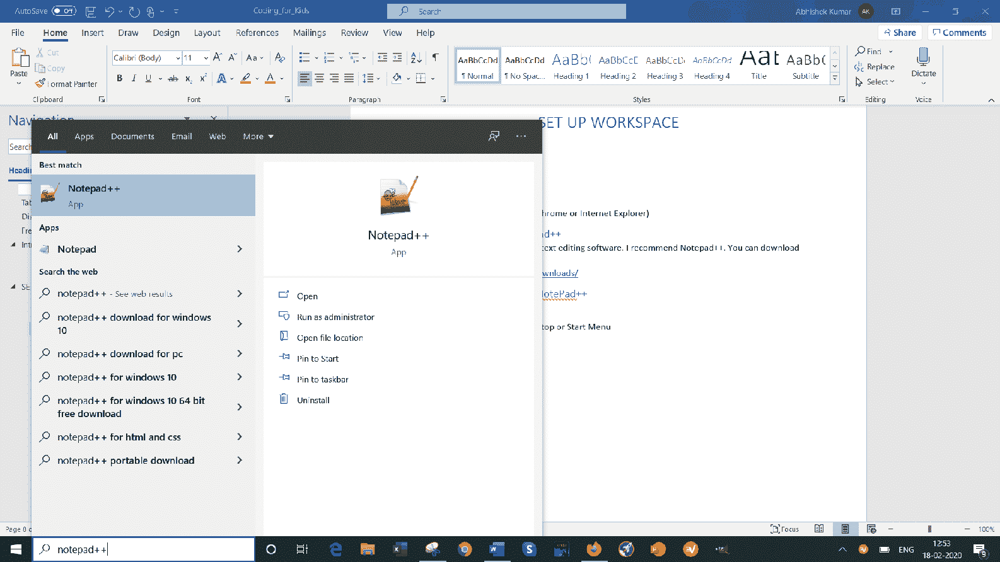

打开 Notepad++ 后，转到 **文件>新建** 以打开一个新文件。

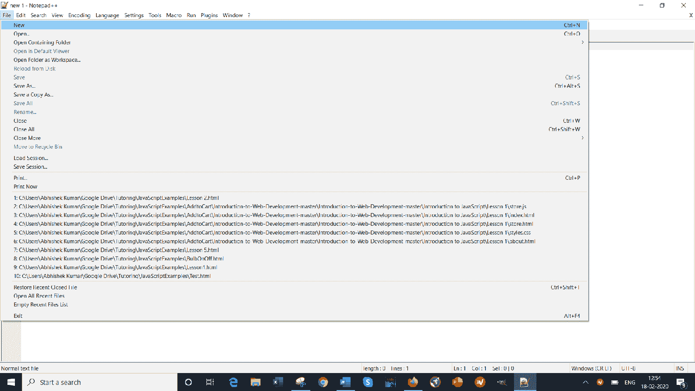

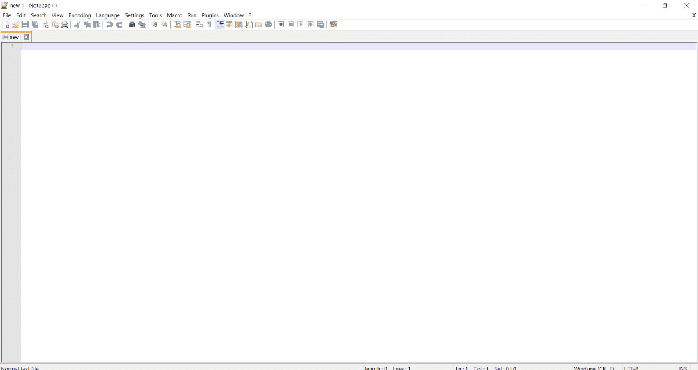

现在，点击 **文件>另存为**，然后选择 **.html** 作为文件类型

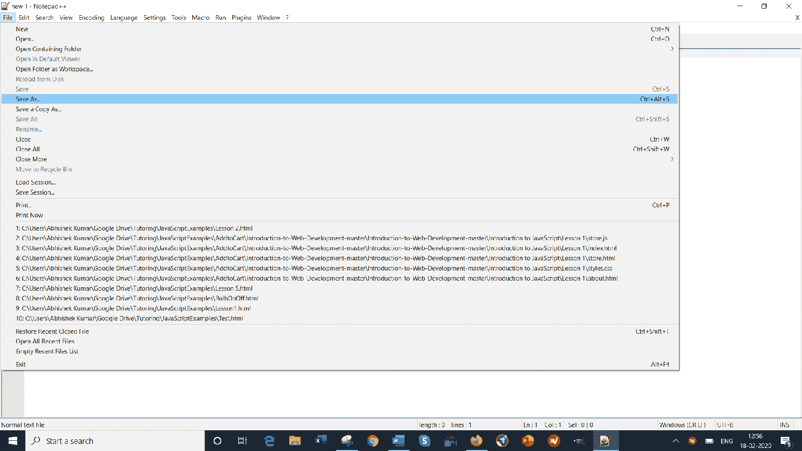

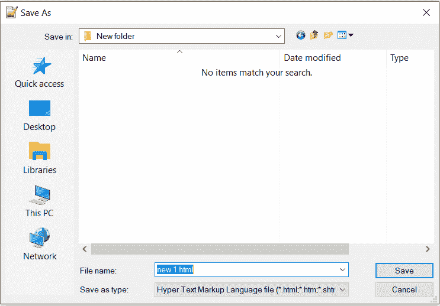

这样可以确保你可以在像 Firefox 或 Chrome 这样的 HTML 浏览器中运行你的程序。

## 测试程序

有一个简单的方法来测试程序，看看它是否连接到你的浏览器。

只需在你的文件中输入随机文本。在我的文件中，我输入了 **“Testing 1,2,3……”**

然后点击 **文件>保存**。

之后，点击 **运行>在 Firefox/Chrome/IE 中启动**，具体取决于你使用的浏览器。

如果一切正常，你输入的文本应该会显示在浏览器窗口中。

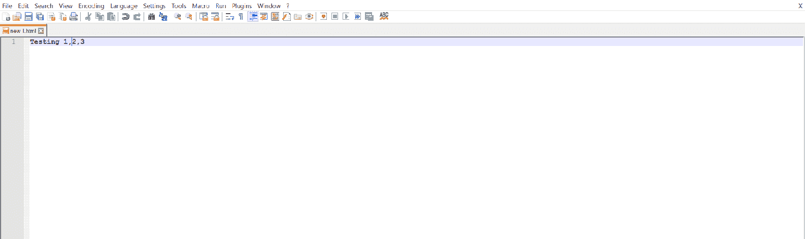

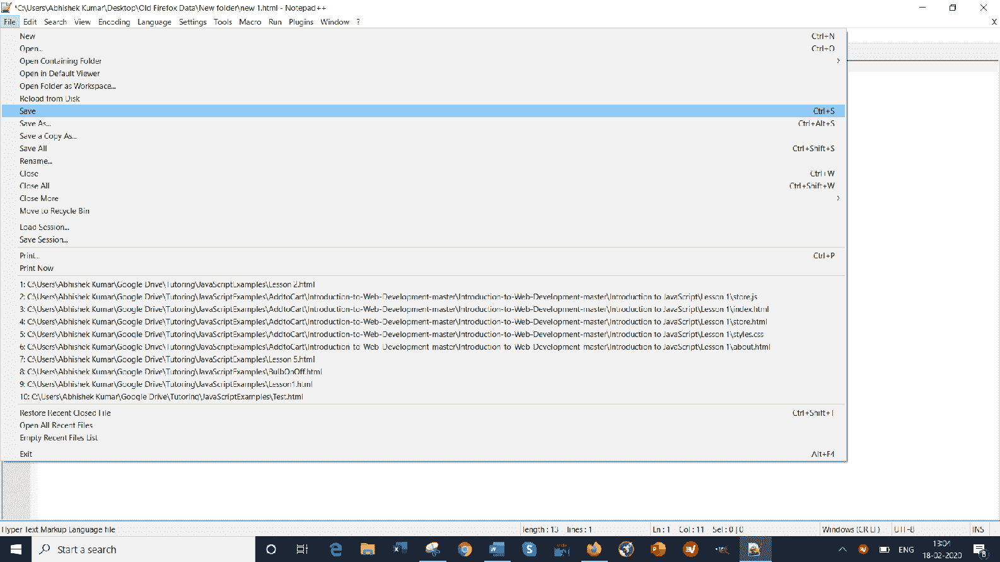

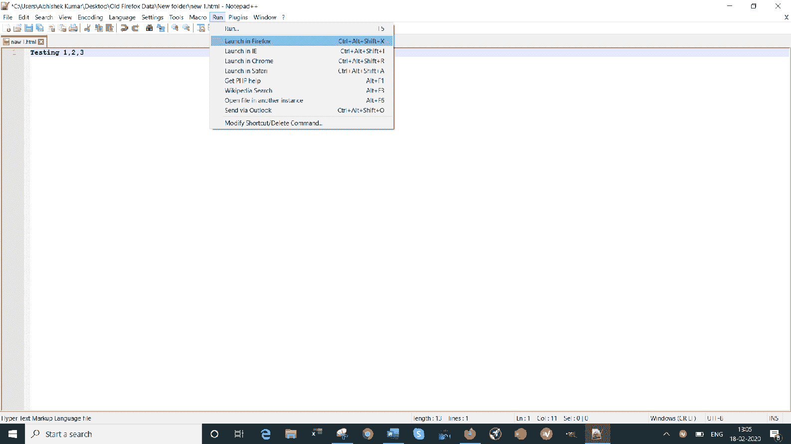

## 结果：

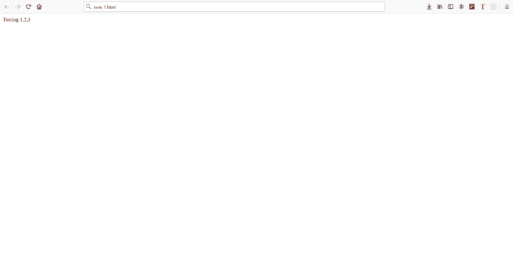

我知道这对某些人来说可能是一个简单的测试；但在我们开始实际编程之前，确保一切正常是很重要的。

注意

在某些电脑上，**文件>运行** 不起作用。

如果是这种情况，请执行以下操作：

*   将 Notepad++ 文件保存为 .html 文件，然后关闭 Notepad++。
*   转到文件所在的文件夹。
*   双击文件以打开它。

# HTML 简介

## 什么是 HTML？

HTML 代表超文本标记语言

HTML 是人类用来与 Chrome、Internet Explorer、Firefox 等网页浏览器进行连接的语言。

有时，它会得到 CSS 和 JavaScript 的辅助；但网页的基本结构是由 HTML 定义的。

它非常简单易懂，即使是编程初学者和年幼的孩子也能掌握。

HTML 使用看起来像箭头两端的简单标签来完成。

## HTML 标签示例

以下是 HTML 标签的样子：

`<p>` - 标签示例

每个 HTML 标签都有一个额外的标签来表示该标签的结束。结束标签除了有两个标签端之外，还包含一个斜杠。请参见下面的简单示例。

`<p>` - 标签开始

`</p>` - 标签结束

## 基本 HTML 标签及其用途

`<html>`

这是开始每段 HTML 代码的标签。

`<head>`

这是在其他任何内容之前首先执行的代码。

`<title>`

这是写在浏览器顶部标签栏中的代码。

`<body>`

包含页面上显示的信息。

`<p>`

用于正文中出现的段落文本。

`<h1>`、`<h2>`、`<h3>`、`<h4>`、`<h5>`、`<h6>`

这些用于文本的标题，按大小降序排列。`<h1>` 是最大的标题，`<h6>` 是最小的。

`<strong>`

用于加粗文本

`<ul>`

用于无序列表，例如项目符号列表

`<li>`

用于在一行文本前添加项目符号图标

`<ol>`

用于有序列表，例如从 1、2、3…… 编号的项目

`<div>`

这些是较大的内容区块；通常包含多个段落、标题等。

`<a>`

用于创建超链接文本。超链接是指当你点击一段带下划线的文本时，它会链接到另一个页面。

``

用于向网页添加图像。

现在，你可能会觉得要学的东西很多。别担心。你现在不需要记住任何内容。

只需在编码时将其作为参考即可。

我们将通过一些示例来更好地解释一切。

## HTML 示例：

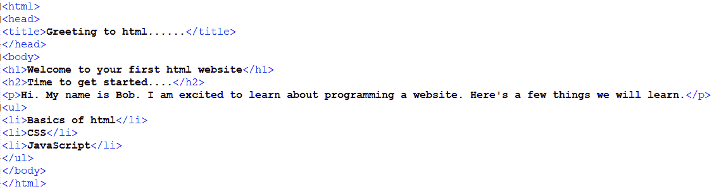

以下是相同的代码：（你可以复制粘贴）

```
<html>
<head>
<title>向 HTML 问好......</title>
</head>
<body>
<h1>欢迎来到你的第一个 HTML 网站</h1>
<h2>是时候开始了....</h2>
<p>嗨。我叫鲍勃。我很兴奋能学习如何编程一个网站。以下是我们将要学习的一些内容。</p>
<ul>
<li>HTML 基础</li>
<li>CSS</li>
<li>JavaScript</li>
</ul>
</body>
</html>
```

## 我们得到的输出如下

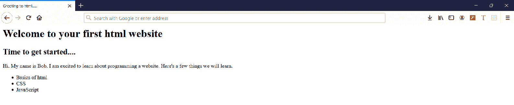

让我们将输出与代码中的标签联系起来。

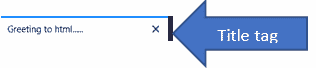

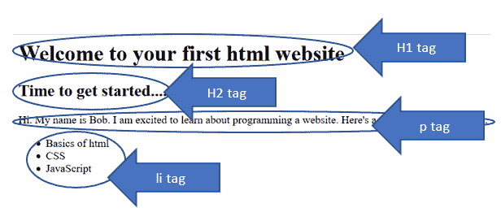

## 练习实践

1.  创建一个介绍你自己的 HTML 网站。创建一个标题标签，内容为“介绍”。使用 h1 和 h2 标签为自己创建一个标题。然后创建一个段落，在其中介绍你自己、你的年龄、学校和家乡。最后，创建一个关于你爱好的项目符号列表。

2.  创建一个介绍你最喜欢的运动队或电视节目的 HTML 网站。创建一个标题标签，内容为该节目/运动队的名称。使用 h1 和 h2 标签创建一个标题。然后创建一个段落，在其中谈论你为什么喜欢这个队伍/电视节目以及它们为什么如此出色。最后，创建一个关于你最喜欢的球员/节目中人物的项目符号列表。

# 灯泡示例 - HTML

## 这个项目做什么

这是一个简单的 HTML 项目，它创建了一个按钮，可以打开/关闭页面上的灯泡。我们将使用两张灯泡图片来实现这一点。按钮将在两张图片之间切换。

## 本章需要理解的概念

对于这个示例，我们需要理解按钮标签和图像标签。

按钮标签

`<button onclick=动作 >按钮文本</button>`

按钮元素有两个部分：动作和按钮文本。按钮文本是显示在按钮上的文字；动作是用户点击按钮时发生的事情。

图像标签

``

图像标签有三个元素。

图像 ID 是你分配给图像的名称。这个名称用于在代码中引用该图像。


`Imageurl` 是标签引用的图片的 URL。如果图片与 HTML 文件位于同一文件夹中，则只需使用文件名，而无需使用完整 URL。

`ImageSize` 设置图片的宽度和高度。

## 文件

将灯泡亮和灭的两张图片包含在我们使用的 HTML 代码所在的同一文件夹中。你可以通过点击下面的链接并下载来获取文件：

[灯泡亮图片](https://drive.google.com/file/d/1owQzgXuNFzdpCcZvwXCOIyQdbbBJ5NHN/view?usp=sharing)

链接：https://drive.google.com/file/d/1owQzgXuNFzdpCcZvwXCOIyQdbbBJ5NHN/view

[灯泡灭图片](https://drive.google.com/file/d/1fryoUUFjMlIU7Xhz0wMSH3AGR7sryrlO/view?usp=sharing)

链接：https://drive.google.com/file/d/1fryoUUFjMlIU7Xhz0wMSH3AGR7sryrlO/view

## 代码

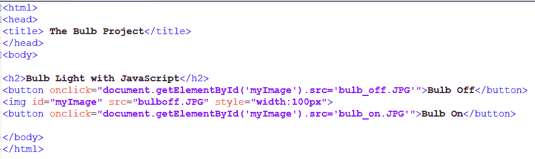

以下是相同的代码（你可以复制粘贴）

```
<html>

<head>

<title> 灯泡项目</title>

</head>

<body>

<h2>使用 JavaScript 控制灯泡</h2>

<button onclick="document.getElementById('myImage').src='bulb_off.JPG'">关灯</button>


<button onclick="document.getElementById('myImage').src='bulb_on.JPG'">开灯</button>

</body>

</html>
```

## 输出

初始状态：

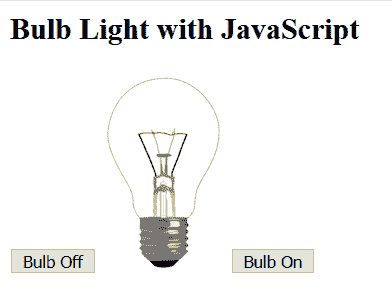

点击**开灯**按钮后：

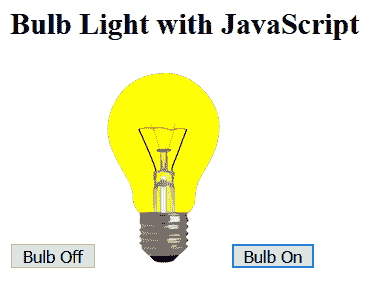

点击**关灯**按钮后：

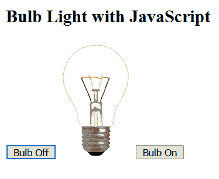

## 练习实践

*   创建一个包含两个按钮的程序，按钮标题分别为“白天”和“夜晚”。点击“白天”按钮时，显示太阳的图片；点击“夜晚”按钮时，显示月亮的图片。

*   创建一个包含 4 个按钮的程序，按钮可在 4 种不同的野生动物之间切换。每个按钮的文本分别为“老虎”、“狮子”、“野猪”和“大象”。点击每个按钮时，显示相应的动物图片。

# HTML 表单

## 什么是 HTML 表单？

HTML 表单是网页上可以输入信息的空白框。

就是你在网上看到的那些输入姓名、年龄、密码等的表单。

表单的样子如下：

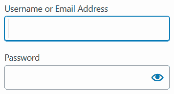

## 表单 HTML 标签格式

下面是一个表单 HTML 标签的示例，用于输入姓名、职业和性别。

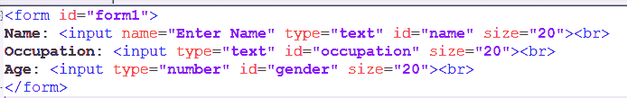

运行程序后，输出如下所示。你可以在输出中的空白框内输入任何内容。这些空白框也称为文本框。

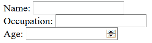

## 表单 HTML 标签的不同部分

`<form id="form1">`

表单 id 标签是表单的名称，将在代码的其余部分中用作引用。

姓名：

职业：

年龄：

这是写在框左侧的文本。用于向用户描述框中应输入的内容。

`input type="text”`

这意味着你在框中输入的是文本或字符串类型。例如，姓名和职业使用文本，因为你在框中输入的是字母。

`input type="number"`

这意味着你在框中输入的是数字。例如，年龄和电话使用数字，因为输入的全部是数字。

`id="name"`

`id="occupation"`

`id="gender”`

id 是框在程序其余部分中的名称。我们将在程序其余部分中使用 id 来引用该框。

`size="20"`

这意味着框的长度为 20 像素。要更改此设置，请更改 size 的值。例如，如果要将框的长度加倍，请将 size 改为 40。

# JavaScript 示例

## 什么是 JavaScript？

JavaScript 是一种高级编程语言。它最常用于在 HTML 页面上执行用户操作。

它还有助于增强用户在网页上的交互。

## 如何在 HTML 中使用 JavaScript

在 HTML 页面上使用 JavaScript 有两种方法：

第一种方法是将 JavaScript 代码直接包含在 `<script>` 标签内。如下所示：

```
<html>

<head>

<title> </title>

</head>

<body>

<script>

</script>

</body>

</html>
```

JavaScript 代码将位于上面红色显示的两个 script 标签之间。

第二种方法是创建一个 JavaScript 文件，并将其保存为 .js 文件。然后在 HTML 代码中引用该 JavaScript 文件。如下所示：

```
<html>

<head>

<title> </title>

</head>

<body>

<script src="newfile.js"></script>

</body>

</html>
```

你将把所有 JavaScript 代码包含在 `newfile.js` 文件中。

## 你需要了解的 JavaScript 术语

接下来我们将介绍几个 JavaScript HTML 代码示例。我们需要了解以下术语才能理解代码。

`function`

JavaScript 函数是执行任务的任意一组代码行。函数通常用于执行在单击 HTML 按钮时需要发生的任务。每个函数都有一个名称，并在 HTML 代码中被引用。示例如下：

`function abcd()`

`abcd` 是执行特定任务的函数的名称。它将在 HTML 代码中被引用为 `abcd`。

`变量`

变量用于在 JavaScript 中存储名称或数字。可以将其视为一个可以存储一个值的盒子。每次需要该值时都会引用该盒子。定义如下：

`var flag=1;`

`flag` 是变量的名称，它存储值 1。因此，每当在 JavaScript 程序中引用 `flag` 时，它的值都是 1（除非你更改了 `flag` 的值）。`flag` 的这个值可用于定义其他变量。例如：

`var king=flag*2;`

现在 `king` 的值为 1*2=2。因此，变量是处理未知数量的好方法。

`document.getElementbyID().value`

这个 JavaScript 术语用于获取 HTML 表单文本框中某个项的值。因此，如果你在表单文本框中填写了姓名并单击按钮，`document.getElementbyID()` 会获取你在框中输入的值。例如：

`var yname=document.getElementById("name").value;`

“name” 是在 HTML 中定义的表单文本框的 id。要了解如何在 HTML 中实现这一点，请查看上一章中关于 HTML 标签的部分。

在文本框中输入的任何内容都将存储在一个名为 `yname` 的变量中。从现在起，它将在 JavaScript 中被引用为 `yname`。

`Document.write()`

此函数用于在 Web 浏览器上打印任何内容。

例如，

`document.write(“xyz”);`

在屏幕上打印 **xyz**

你还可以使用“+”按钮添加两个不同的术语。

`document.write(“xyz”+”123”);`

在屏幕上打印 **xyz123**。

当你想要将文本添加到变量时，这非常有用。例如：

`var yname=document.getElementById("name").value;`

`document.write(“My name is “+yname);`

如果你在文本框中输入了“Matt”，它会在屏幕上打印 **“My name is Matt”**。

`parseint()`

`parseint` 将数字转换为整数，无论它是否是小数。例如，

`parseint(2.8)` 等于 3。

`Parseint(2)` 就是 2。

`parsefloat()`

`parsefloat()` 与 `parseint()` 相反。它将数字转换为小数。例如，

`parseint(2)` 等于 2.0

`Parseint(3.1)` 就是 3.1

## JavaScript 示例 1

下面的代码创建了一个 HTML 表单，用于接受一个人的姓名、年龄和爱好。有一个 HTML 按钮，单击时会生成 JavaScript 代码。

JavaScript 代码在单击时打印出该人的姓名、年龄和爱好。JavaScript 代码位于 `<script>` 标签内。

代码及其输出如下所示；随后还会解释其中的几行。

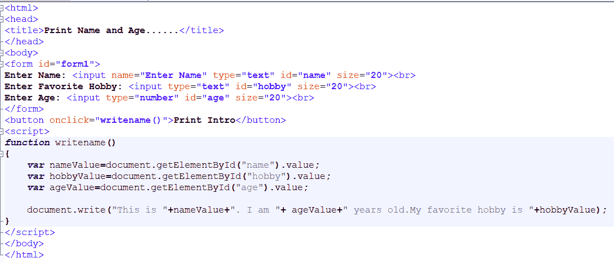

输出：

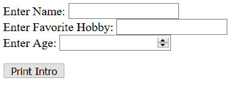

输出（填写后）：

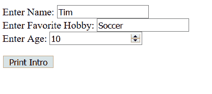

输出（单击“打印介绍”按钮后）

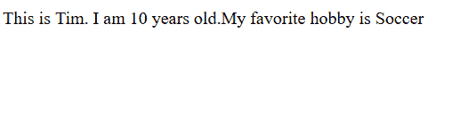

### 代码分解：

```
<form id="form1">

输入姓名： <input name="Enter Name" type="text" id="name" size="20"><br>

输入最喜欢的爱好： <input type="text" id="hobby" size="20"><br>

输入年龄： <input type="number" id="age" size="20"><br>

</form>
```

HTML 代码创建了一个包含三个表单元素的表单，分别用于姓名、爱好和年龄。它们的长度均为 20 像素。它们通过 id 引用，id 分别为 name、hobby 和 age。

`<button onclick="writename()">打印介绍</button>`


这个 HTML 按钮会激活名为 `writename()` 的 JavaScript 函数，按钮上的文字是“打印简介”。

```
function writename()
{
var nameValue=document.getElementById("name").value;
var hobbyValue=document.getElementById("hobby").value;
      var ageValue=document.getElementById("age").value;
document.write("This is "+nameValue+". I am "+ ageValue+" years old.My favorite hobby is "+hobbyValue);
}
```

按下按钮时，上述 JavaScript 代码会被激活。  
`nameValue`、`hobbyValue` 和 `ageValue` 存储了在 id 为“name”、“hobby”和“age”的表单元素中输入的内容。  
`document.write` 会在屏幕上输出简介。

## JavaScript 示例 2

下面的代码创建了一个接受两个数字的 HTML 表单，并创建了 4 个 HTML 按钮。  
有 4 个 JavaScript 函数分别用于对两个数字进行加、减、乘、除运算。根据点击的按钮选择执行对应的 JavaScript 代码。  
下面展示了代码及其输出；随后还会对其中几行进行解释。

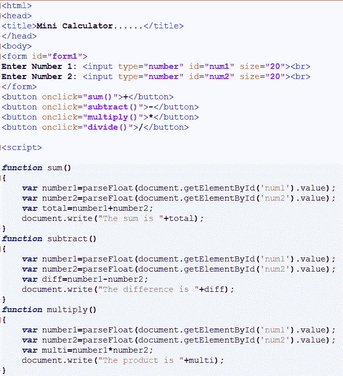

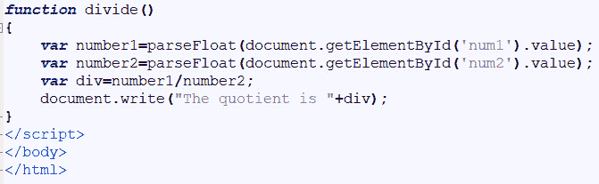

输出：

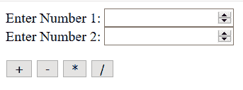

填写后的输出：

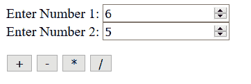

答案（+ 按钮）：

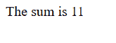

答案（- 按钮）：

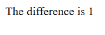

答案（* 按钮）：

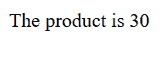

答案（/ 按钮）：

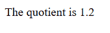

代码解析

```
<form id="form1">
Enter Number 1: <input type="number" id="num1" size="20"><br>
Enter Number 2: <input type="number" id="num2" size="20"><br>
</form>
```

上述代码创建了一个接受两个数字的表单，其 id 分别为 `num1` 和 `num2`。

```
<button onclick="sum()">+</button>
<button onclick="subtract()">-</button>
<button onclick="multiply()">*</button>
<button onclick="divide()">/</button>
```

上述代码创建了 4 个按钮。每个按钮分别激活函数 `sum()`、`subtract()`、`multiply()` 和 `divide()`。

```
function sum()
{
var number1=parseFloat(document.getElementById('num1').value);
var number2=parseFloat(document.getElementById('num2').value);
var total=number1+number2;
document.write("The sum is "+total);
}
```

`number1` 和 `number2` 存储了通过 id 为 `num1` 和 `num2` 的表单输入的数字。  
`total` 存储了两个数字的和。  
`document.write` 在屏幕上输出总和。

## 练习

你可以复制上面的代码并自行尝试。理解代码后，你可以创建自己的 JavaScript HTML 函数。这里有几个可以尝试的练习。

*   编写一个程序，使用 6 个文本框输入 6 门科目的成绩。编写两个 JavaScript 函数，分别计算这些科目的总分和平均分。
*   编写一个 JavaScript 程序，输入 5 个不同的学生姓名和爱好，并输出这些学生的姓名和爱好。

# 条件语句

## 什么是条件语句？

条件语句用于检查某个条件是否为真。它可以简单到检查一个数字是否小于 10，也可以复杂到检查患者医学样本中的某些医学状况。  
在 JavaScript 中，条件语句通过 IF ELSE 语句实现。  
因此，它基本上检查如果某条件为真，则执行一个操作；如果为假，则执行另一个操作。例如：

```
IF (George=="Hungry")
{
Document.write('Give George a Snack');
}
ELSE
{
Document.write('No snack for George');
}
```

在上面的例子中，代码检查 George 是否饿了，并执行两个操作之一。如果 George 饿了，则输出“Give George a snack”；否则输出“No snack for George”。  
这是一个使用 IF ELSE 语句的简单 JavaScript 条件示例。

## IF ELSE 循环 – 示例 1

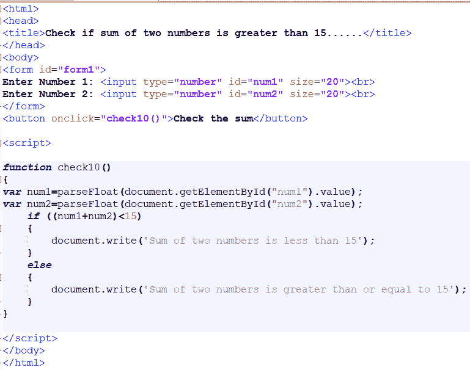

输出：

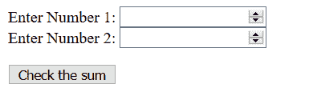

输出（用户填写后）：

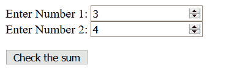

输出（点击“检查总和”按钮后）：

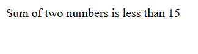

**输出（第二组数字填写后）**

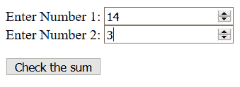

输出（点击“检查总和”按钮后）

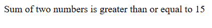

### 代码解析：

```
var num1=parseFloat(document.getElementById("num1").value);
var num2=parseFloat(document.getElementById("num2").value);
```

这两行将用户输入的两个数字的值分别存储在变量 `num1` 和 `num2` 中。

```
if ((num1+num2)<15)
```

这行检查两个数字的和是否小于 15。

```
{
document.write('Sum of two numbers is less than 15');
}
```

如果和小于 15，则执行上述代码块，输出“Sum of two numbers is less than 15”。

```
else
{
document.write('Sum of two numbers is greater than or equal to 15');
}
```

如果和大于或等于 15，则执行上述代码块，输出“Sum of two numbers is greater than or equal to 15”。

## IF ELSE 循环 – 示例 2

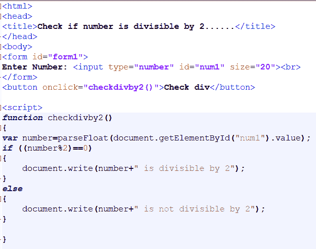

输出：

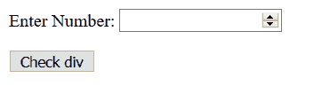

输出（填写 1）：

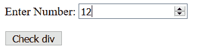

输出（点击“检查整除”按钮后）

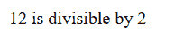

输出（填写 2）：

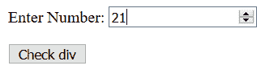

输出（点击“检查整除”按钮后）

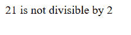

### 代码解析：

```
if ((number%2)==0)
```

上面这行代码检查数字是否能被 2 整除。

```
{
document.write(number+" is divisible by 2");
}
```

如果数字能被 2 整除，则执行上述代码块，输出该数字能被 2 整除。

```
else
{
document.write(number+" is not divisible by 2");
}
```

如果数字不能被 2 整除，则执行上述代码块，输出该数字不能被 2 整除。

## 练习

你可以复制上面的代码并自行尝试。理解代码后，你可以创建自己的 JavaScript HTML 函数。这里有几个可以尝试的练习。

*   编写一个程序，使用 6 个文本框输入 6 门科目的成绩。编写一个 JavaScript 函数，检查平均分并判断学生是否及格。如果分数低于 60，则学生不及格。
*   编写一个程序，输入一个年份并检查它是否为闰年。

# 嵌套条件语句

嵌套条件语句本质上就是条件语句内部再包含条件语句。这也被称为嵌套循环。  
假设你想在 JavaScript 中检查两个条件是否都为真，然后再执行某个操作；那么你可以将两个 if 循环嵌套在一起。  
我们以上一章的例子为例。我们想检查 George 是否饿了并且有钱，以便给他零食。  
如果条件不成立，则执行其他操作。例如：

```
IF (George=="Hungry")
{
IF (George=="Has Money")
{
Document.write('Buy George a Snack');
}
ELSE
{
Document.write('Make George a Snack');
}
}
ELSE
{
Document.write('No snack for George');
}
```

在上面的例子中，代码首先检查 George 是否饿了。如果 George 饿了，则进行第二次检查，检查他是否有钱。如果 George 有钱，则输出“Buy George a snack”；如果他饿了但没有钱，则输出“Make George a snack”。  
如果他不饿，则输出“No snack for George”。  
这是一个简单的 JavaScript 嵌套 IF ELSE 语句示例。

## 嵌套 IF ELSE 循环示例

在这个示例中，我们将输入一个 4 位数的年份，并检查它是否为闰年。这比我们想象的要复杂一些。  
我们知道每 4 年是一个闰年，这是第一个检查。因此，像 1996 这样的年份是闰年。  
但是，每 100 年没有闰年。因此，1800 和 1900 不是闰年。  
另外，还有一个例外：每 400 年不是闰年。因此，1600 和 2000 不是闰年。所以共有 3 个检查。

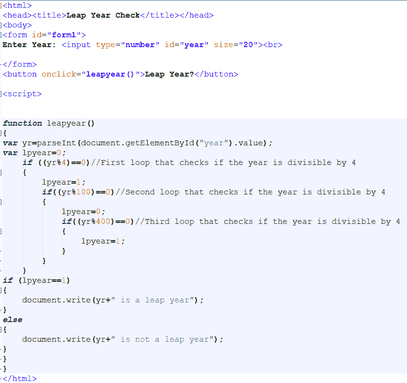

输出：

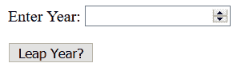

运行 #1

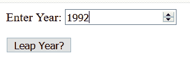

输出：

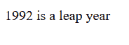

运行 #2

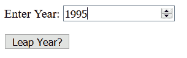

输出：

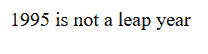

运行 #3


输出：


运行 #4：


输出：


从上述代码和结果可以看出，它通过使用 3 个嵌套的 `if` 循环正确计算了闰年。

1992 年是闰年，因为它能被 4 整除。

1995 年不是闰年，因为它不能被 4 整除。

1900 年不是闰年，因为它能被 100 整除。

2000 年是闰年，因为它能被 400 整除。

## 练习

你可以复制上面的代码并尝试修改。一旦理解了代码，就可以创建自己的 JavaScript HTML 函数。这里有几个可以尝试的练习。

*   三个传感器连接到一个打印设备上，每个传感器对应一个警报器。第一个传感器“A”检测设备是否需要墨水。第二个传感器“B”检测设备是否需要维修。第三个传感器“C”检测设备是否应该卡纸。如果出现两个或更多问题，警报就会响起。

*   学校根据特定情况决定是否停课。如果道路结冰但没有盐，则停课。如果有盐，则不停课。无论是否有盐，只要积雪超过 2 英寸，就停课。

*   一个计算机芯片控制儿童是否可以观看特定的电视节目。如果时间在下午 5 点之前，电视总是可以播放。但如果时间在下午 5 点之后，则根据节目分级决定。如果分级为“普通观众”，则电视可以播放；如果分级为“成人观众”，则电视无法打开。

# 循环

循环是一组重复执行一定次数的指令。大多数情况下，会执行某个过程，并且有一个计数器每次增加 1。在过程结束时，我们检查计数器是否超过了需要执行的次数。如果达到了所需次数，则停止循环。

例如，假设你想在屏幕上打印数字 1 到 10。那么使用一个从 1 计数到 10 的循环，每次将计数打印到屏幕上。

在 JavaScript 中，我们使用一个名为 `FOR` 的函数来实现这个循环。

下面我们来看一个简单的例子。

## 示例 #1


在这个函数中，我们创建了一个函数 `printotwenty`，用于打印从 1 到 20 的数字。标题为“Print To 20”的按钮会激活该函数。

函数中有一个 `for` 循环：

```
For (i=1;i<=20; i++)
```

上面这行代码表示循环从 1 运行到 20，每次增加 1。

`Document.write` 每次打印 `i` 的值。

下面是结果：


点击按钮后，我们得到：


按计划打印了 1 到 20。接下来，我们将对同一个程序做一个不同的版本。不再只是打印 1 到 20，而是让你选择要打印多少个数字。只需在文本框中输入循环的长度，它就会打印出来。

## 示例 #2


现在，运行程序后，我们得到：


现在点击 **“Print Loop Length”**


它打印了从 1 到 50。如果你想打印 1 到 100，则在文本框中输入 100 并点击同一个按钮。

上面的程序多了一个文本框和一个按钮。文本框用于接收循环的长度，按钮链接到一个名为 `printlooplength()` 的函数，该函数打印星形循环。变量 `looplength` 存储你在文本框中输入的值。`FOR` 循环从 1 运行到 `looplength`。在上面的例子中，`looplength` 是 50，所以它从 1 运行到 50。每次运行时，它使用 `document.write` 函数打印计数器。

## 示例 #3

现在，我们要用循环做一些更酷的事情。我们将根据循环长度打印一个星形图案。


输出如下：


输入 20 并点击“Print Star Loop”后，我们得到：


上面的程序多了一个文本框和一个按钮。文本框用于接收星形循环的长度，按钮链接到一个名为 `looplengthstar()` 的函数，该函数打印星形循环。

`looplengthstar()` 是一个嵌套的 `FOR` 循环，意味着它内部还有一个循环。变量 `looplength` 存储你输入的星形循环长度。第一个 `FOR` 循环从 1 运行到 `looplength`。因此，在上面的例子中，第一个循环从 1 到 20。在这个循环内部，还有另一个 `FOR` 循环。第二个循环基本上在一行中打印 `*`。它打印 `*` 的次数取决于第一个循环中的计数器。

例如，如果第一个循环的计数器是 5（`i=5`），那么第二个循环打印星号 5 次，像这样——`*****`。

因此，每次第一个循环递增并换行时，第二个循环都会执行这个操作。

## 练习

你可以复制上面的示例，一旦能够运行并理解代码，就可以尝试下面的一些问题。

*   斐波那契数列是一组数字，如 0,1,1,2,3,5,8,13……每个数字都是前两个数字之和。使用 `FOR` 循环打印该序列的前 20 个数字。

*   编写一个程序，在文本框中输入一个数字，并打印一个反向的星形循环。

*   编写一个程序，在文本框中输入一个数字，并打印其各位数字之和。

# 数组

什么是数组？

数组基本上是一组存储在同一个名称下的项目。它们通过该名称的不同索引来访问。例如，在 JavaScript 中：

```
var name[5] 是一个大小为 5 的数组。
```

第一个元素是 `name[0]`，第二个元素是 `name[1]`，以此类推……

因此，如果我们想给数组赋值：

```
var name[5]=["Abhi","Bob","Aaron","Steve","Mark"]
```

上面创建了一个大小为 5 的数组。要在 JavaScript 中打印第一个元素，我们这样做：

```
document.write(name[0]);
```

这会打印出 Abhi，即数组的第一个元素。

如果我们这样做：

```
document.write(name[4]);
```

这会打印出 Mark，即数组的最后一个元素。

如果我们想向数组添加一个元素，使用 `push` 函数，如下所示：

```
name.push("Carl");
document.write(name[5]);
```

这会打印出 Carl，即数组的新元素。

现在，我们来看几个例子：

## 示例 1

在这个例子中，我们在 JavaScript 中创建了 3 个数组并赋值，然后在屏幕上打印它们。


上面的例子中，`createarray()` 创建了 3 个数组 `name`、`age` 和 `loc`。每个数组分配了三个元素。它们通过 `document.write()` 打印在屏幕上。

之后，我们使用 `push` 为所有 3 个数组添加了第 4 个元素，然后也打印了出来。


一旦我们点击“Create Array”按钮：


我们基本上只是打印了数组的所有元素。

现在我们知道如何创建数组了，接下来用我们输入到文本框中的信息来操作。

## 示例 2


上面的代码从 1 个文本框和 2 个选择框中获取用户输入。选择框的设置允许你在 7 个工作日（星期日到星期三）之间选择，如下所示：


一旦点击“Info Array”按钮，`assignarray()` 函数会接收 3 个输入，并创建一个名为 `employeeobj` 的单一数组。

`employeeobj[0]` 是第一个元素，被赋值为姓名。

`employeeobj[1]` 是第二个元素，被赋值为年龄。

`employeeobj[2]` 是第三个元素，被赋值为工作日。

然后我们使用 `document.write` 在屏幕上打印所有 3 个元素。现在，让我们运行程序。


你可以复制上面的代码，并在自己的计算机上实现相同的程序。现在，一旦你能够做到这一点，让我们做一些更多的练习：

## 练习


你可以复制上面的示例，一旦能够运行并理解代码，就可以尝试下面的一些问题。

*   为你的学校创建 5 个数组。第一个数组存储学生姓名的值；第二个存储他们的数学成绩；第三个存储他们的历史成绩；第四个存储他们的英语成绩。现在，计算平均分并存储到第五个数组中。姓名和三个成绩通过文本框输入，函数将打印出学生的姓名和平均分。

*   创建一个大小为 12 的数组，存储一年中的月份。用户可以通过文本框输入月份的数字；函数应使用数组将数字与实际月份关联起来。然后打印出数组中对应的月份。

# 玩转字符串

## 字符串与字符串变量

我们在前面的章节中已经提到过。字符串是程序中使用的任何文本片段。例如，“abcd”是一个字符串；而数字 7 不是字符串，它是一个整数。

字符串变量是存储字符串的地方。例如，下面的`st`是一个字符串变量，存储了“abcd”的值。

```
var st="abcd";
```

现在，让我们利用 JavaScript 和循环的知识来玩转字符串。

## 查找字符串长度

现在，让我们在文本框中输入一个字符串，并找出该字符串的长度。


下面的代码让你通过文本框输入你的名字。当你点击按钮时，它会运行`strlength()`函数，计算你名字的长度。

`name2`是存储你名字值的变量。

`name2.length`获取字符串的长度（你名字中的字母数）。

让我们看看输出：


点击**‘Name Length’**按钮后，我们得到：


让我们再做另一个示例：


点击**‘Name Length’**按钮后，我们得到：


那么，既然我们知道如何查找字符串的长度，让我们利用这个知识来反转你的名字。下面的代码实现了这一点。


下面的代码让你通过文本框输入你的名字。当你点击按钮时，它会运行`namereverse()`函数，反转你的名字。

`Name2`存储你输入的名字值

`len`存储你名字中的字母数。

然后我们创建一个循环，从`len-1`运行到 0。我们使用 0 的原因是`name2`是一个字母数组。在 JavaScript 中，数组的第一个索引是 0。所以第一个字符是`name2[0]`。

在循环中，我们向后遍历，每次计数减 1。并且在循环内部，我们打印由计数索引的字符的值。

现在，让我们运行程序：


点击**Name Reverse**按钮后，我们得到


现在，如果字符串末尾有很多空格怎么办？让我们通过修剪字符串来解决这个问题。

## 分割字符串

现在，你知道吗，你可以将字符串分割成元素数组。你可以使用`split`函数来实现这一点。现在，让我们尝试一个示例。在下面的代码中，你将一个包含 3 种动物的列表（用逗号分隔）作为输入输入到文本框中。

`split`函数将其分割成一个包含 3 个元素的数组，你可以使用`document.write`函数打印出每个元素。


现在，让我们看看输出：


点击**Get Animals**按钮后，我们得到：


上面的代码适用于输入 3 种动物的情况。你可能会问，是否有代码可以处理超过 3 种动物的情况？是的，可以。你需要使用`length`函数找到字符串数组的长度，然后在打印动物时使用 FOR 循环。在 for 循环中，我们使用`aninumber`来跟踪动物数量；使用`aniarray[i]`来跟踪要打印的实际动物。

注意，`aninumber`总是比`i`大 1，因为在 JavaScript 数组中`i`从 0 开始。

下面是代码：


下面是输出。

我们输入 5 种动物的名称，然后点击**Get Animals**按钮。


## 替换字符串

现在，假设你有一个长段落，想要将某个特定单词替换为另一个单词。你可以使用`.replace`函数。

在下面的示例中，我们将“Atlanta”替换为“Charleston”。请记住，这仅适用于一个“Atlanta”实例。

我们使用一个名为`textarea`的 HTML 表单元素。`Textarea`是文本框的更大形式，可以接受用户的多行文本。然后我们在屏幕上写出修改后的句子。


现在，让我们运行程序。


一旦我们点击**Fix Sentence**按钮，我们得到：


## 子字符串与字符串索引

在继续之前，我想讨论另外几个字符串操作技巧。它们是字符串索引和子字符串。

字符串索引给出另一个字符串在某个字符串中出现的位置。例如，字符串“The boy climbed the tree”中“boy”的字符串索引是 4，因为“boy”从整个字符串的第 4 个字符开始。

子字符串允许你提取现有字符串的一部分。例如，在同一个字符串“The boy climbed the tree”中；如果我们从 6 到 10 取子字符串，我们会得到“oy cl”，因为这些是第 6 到第 10 个字符。

现在，让我们看下面的示例：


在上面的示例中，`daydesc`是大字符串，`str`是我们需要查找字符串索引的字符串。变量`ind`存储字符串索引的值，然后我们使用`document.write`打印答案。现在，让我们运行程序：


一旦我们点击**Find Index**，我们得到：


好的，现在让我们看一个子字符串的示例：


在上面的代码中，`strnum1`和`strnum2`是存储子字符串第一个和最后一个元素的变量。这些是用户的输入。

`sstr`是从`strnum1`到`strnum2`的子字符串，并打印在屏幕上。


一旦我们点击**Find SubString**，我们得到答案：


如果包括空格，上面的答案是 10 个字符。

## 练习实践：

你可以复制上面的示例，一旦能够运行并理解代码，就可以尝试下面的一些问题。

*   编写一个程序，找出在文本框中输入的较大字符串中，某个特定字符串出现了多少次？

*   编写一个程序，接收一个包含姓名、数学成绩、英语成绩、物理成绩和地理成绩的字符串。使用`split`函数分割字符串，并找出该人的平均分。例如，“Mark, 90, 34, 56, 65”将找出 Mark 的 90、34、56、65 的平均分。

*   提示：你可以使用`parseint()`将成绩转换为数字。

# CSS 简介

## 什么是 CSS？

CSS 代表层叠样式表。CSS 用于设置网站的设计和样式——包括字体、颜色、布局、阴影和配色方案。它们与 HTML 和 JavaScript 配合得很好。

## 如何在 HTML 网站中使用 CSS

使用 CSS 的最佳方式是创建一个单独的 CSS 文件，并在 HTML 头部文件中引用它。

现在，让我们创建一个 CSS 文件。

*   打开一个空白的 Notepad++文档。

*   点击“另存为”，选择文件类型为“CSS”。让我们将此文件命名为`style`


*   点击“保存”

*   转到相关的 HTML 文件，并在头部文件中包含下面这一行。

*   `<link rel="stylesheet" href="style.css" />`

*   （可选）如果你想包含任何按钮 CSS 元素，你需要像下面这样定义一个按钮类：

`<button class ="btn str" onclick="substr()">Find SubString</button>`


现在，让我们将上一章示例中的样式表插入进来。


很好。现在我们的 CSS 样式表已经链接到 HTML 文件了。

## CSS 术语

`html{}`

上述术语用于为整个 HTML 文件定义 CSS。花括号内的所有内容都将应用于 HTML 代码。

`body{}`

定义 HTML 代码主体部分的样式。

`.btn{}`

设置网页中任何按钮的样式。你需要在 HTML 代码中为按钮定义一个名为 `btn` 的类。具体示例请参见上面的代码。

`.btn:hover{}`

设置当鼠标悬停在网页按钮上时按钮的样式。

`background-color:`

网站的背景颜色。

`text-decoration:`

用于为文本添加装饰，例如波浪线、点线、曲线等。

`text-transform:`

用于将整个单词或单词的一部分转换为大写或小写。

`text-align:`

可以将文本对齐到页面的左侧、右侧或中间。

`color:`

设置页面上文本的颜色。

`padding:`

设置页面边缘与文本/按钮元素之间的间距。

`line-height:`

设置文本的行高。

`font-family:`

设置你想要用于文本的字体类型。

`font-size:`

设置字体的大小。

`font-weight:`

可以在需要时将字体设置为粗体。

这些是我们将在示例中使用的一些 CSS 属性。但是，还有成千上万的 CSS 属性可用于各种不同的目的。如果你想了解更多，可以在这里查看：

[`www.tutorialrepublic.com/css-reference/css3-properties.php`](https://www.tutorialrepublic.com/css-reference/css3-properties.php)

那么，让我们来看一个 CSS 文件的示例：

## CSS 示例


在 CSS 代码的 html 和 body 部分中，文本被设置为居中对齐并转换为大写。距离顶部 100 像素，颜色为黑色，行高为 1。字体为粗体，字号为 20 像素。页面背景为青色（浅蓝色）。

按钮有单独的 CSS 设置。按钮背景为深红色（红色），文本为黑色。文本距离顶部 10 像素，距离两侧 24 像素。文本居中对齐，字号为 16 像素。

当鼠标悬停在按钮上时，按钮背景变为午夜蓝（蓝色），文本变为白色。

下面我们可以看到它的效果。让我们从两个角度查看我们的网站：一次是在应用 CSS 之前；一次是在链接 CSS 文件之后。

输出（无 CSS）：


输出（有 CSS）：


输出（有 CSS 且鼠标悬停在按钮上）：


如你所见，这对网站的视觉吸引力产生了巨大影响。你可以自己自定义所有这些元素，为文本、背景和按钮使用不同的颜色。

## 练习实践：

你可以复制上面的示例，一旦能够运行并理解代码，就可以尝试下面的一些问题。

*   修改样式元素，找到最适合你的元素。尝试 5 种不同的颜色字体、不同的文本大小和不同的文本形式，找到最好看的网站。

*   使用 `style.css` 文件为你迄今为止编写的所有程序创建一个样式表。

# 链接多个网页

现在，你已经建立了一个链接了 CSS 的网页。但你可能注意到，当你点击“查找子字符串”按钮时，网页会切换回原始设计。这是因为 JavaScript 部分尚未链接到网页。

为了唤起你的记忆，我们讨论的代码接收一个字符串，并根据用户的偏好打印一个子字符串。用户指定子字符串的起始和结束位置。代码如下：


如你所见，代码链接到了 `style.css` 样式表以获取当前设计。

因此，我们得到以下输出：


现在，让我们运行程序：


点击“查找子字符串”后，我们得到：


如你所见，它恢复到了旧的设计。现在，让我们修复这个问题。我们只需在 JavaScript 函数中的 `document.write` 之前添加以下代码。

`Document.write('<link rel="stylesheet" type="text/css" href="styles.css" />');`

这段代码基本上将样式表写入了 JavaScript 函数。

因此，代码变为：


添加这一行后，使用相同的文本运行相同的程序，我们得到：


太好了，现在我们得到了带有相同 CSS 的 JavaScript 输出。现在，你可能想要创建另一个子字符串。该怎么做呢？我们需要一个“主页”按钮。

让我们创建它。下面的代码可以帮助实现这一点。


`document.write("<br>")` 在子字符串之后创建一个空格并换行。

`document.write('<button class = "btn home" onClick="redirect()">Home</button>');`

上面的代码创建了一个按钮，点击时执行 `redirect` 函数。

我们创建一个函数，将用户重定向到原始网页。

```
function redirect()
{
    window.location.replace("strcomma.html");
}
```

`strcomma.html` 是文件名。因此它基本上重新启动了该文件。

好了，现在让我们运行程序。执行后，使用相同的文本，我们得到：


点击“主页”后，我们得到：


现在，我们知道了如何返回原始网页。

还有另一种链接网页的方法；当你创建两个独立的网页时可以使用。假设你想在页面 A 上添加一个指向页面 B 的链接。

那么，在页面 B 中，你可以使用以下方式添加链接：

`<a href="PageB.html">`

我们也可以使用相同的 HTML 代码链接任何外部网页：

`<a href="http://www.google.com">`

## 练习实践：

你可以复制上面的示例，一旦能够运行并理解代码，就可以尝试下面的一些问题。

*   添加一个主页按钮，并将你最好的 CSS 设计链接到本书中设计的每个网页。

*   创建一个程序，根据用户偏好链接到外部网页。

# 数学函数

到目前为止，这一切都很棒。但如果你想制作一个迷你计算器呢？或者教孩子数学？学习如何编写数学函数也是提高孩子理解数学速度的好方法。你可以为孩子设置数学测试，并使用 JavaScript 函数进行验证。

让我们从一些可以在 JavaScript 中实现的基本数学函数开始。

`Math.Round()`

`Math.Round()` 将十进制数四舍五入到最接近的整数。例如，`Math.Round(1.635)` 四舍五入为 2；而 `Math.Round(1.43)` 四舍五入为 1。

`Math.ceil()`

`Math.ceil()` 向上取整。它基本上向上舍入到较大的整数。例如，`Math.ceil(1.67)` 返回 2；而 `Math.ceil(2.01)` 返回 3。

`Math.floor()`

`Math.floor()` 向下取整。它基本上去掉十进制数的小数部分。因此，`Math.floor(1.47)` 返回 1；`Math.floor(2.34)` 也返回 2。

`Math.Sqrt()`

`Math.Sqrt()` 返回一个数的平方根。因此，`Math.sqrt(9)` 返回 3；而 `Math.sqrt(16)` 返回 4。

`Math.min()`

`Math.min()` 返回数组中的最小值。只需将数组放在括号内。例如，如果

`a=[13,11,34,54,9];`

`Math.min(A)` 返回 9。

`Math.max()`

`Math.max()` 返回数组中的最大值。因此对于上面的示例，`Math.max(A)` 返回 54。

`Math.Random()`

`Math.Random()` 是一个很酷的函数。它返回一个介于 0 和 1 之间的随机十进制数，不包括 1。

因此，`Math.Random()` 第一次可能返回 0.95，第二次返回 0.43。

所以，你可以玩一个猜数字游戏，范围在 0 到 10 之间。只需执行以下操作：

`Math.Round(Math.Random()*10)` 会给你一个介于 0 和 10 之间的随机整数。

# 结语

感谢你抽出时间阅读本书。


希望你觉得这本书有用，并且掌握了 HTML、CSS 和 JavaScript 的基础知识。如果你完成了所有练习，你已经构建了几个 HTML 页面，并学会了如何用基础 CSS 来设计它们。

如果你喜欢我的书，还想了解更多内容，请关注下方的作者页面。我很快会推出另一本书，介绍如何用 HTML、CSS 和 JavaScript 从零开始创建一个购物车。

我也建议你看看该板块的其他书籍，尤其是那些关于人工智能将如何接管世界的书。

如果你对书中内容有任何疑问，或者有任何建议，请发送邮件至：abiprod.pty.ltd@gmail.com

如果你需要个性化帮助，我还可以提供在线一对一辅导。

结束……快了！
