# 少儿编程 从入门到精通

## 第五部分：列表、循环与逻辑

### 第15章：神奇8号球

- 头脑风暴
- 开启新项目
- 编写`start`的代码
- 侧边栏：简单列表（数组）
- 编写`shake`的代码
- 保存、测试并调试你的程序
- 将程序传送到`micro:bit`
- 与全世界分享你的程序
- 改进你的玩具
- 侧边栏：电子玩具

### 第16章：袜子分类

- 头脑风暴
- 开启新项目
- 添加背景
- 添加红色和白色袜子精灵
- 添加混合、红色和白色列表
- 编写绿旗代码（创建列表）
- 编写`clearLists`积木代码
- 编写分类过程
- 保存、测试并调试你的程序
- 与全世界分享你的程序
- 改进你的程序
- 侧边栏：排序算法

### 第17章：邪恶橄榄

- 头脑风暴
- 开启新项目
- 在屏幕上添加背景图像
- 添加说明标签
- 添加文本输入框
- 创建邪恶橄榄并将其添加到屏幕上
- 在屏幕上添加消息标签
- 编写应用程序代码
- 保存、测试并调试你的应用程序
- 与全世界分享你的应用程序
- 改进你的应用程序
- 侧边栏：`For`循环
- 侧边栏：搜索算法

### 第18章：寿司对对碰

- 头脑风暴
- 开启新项目
- 在背景上绘制玩具界面
- 添加按钮精灵
- 添加转轴精灵
- 添加状态精灵
- 编写按钮触发旋转的代码
- 创建`war`变量
- 添加声音
- 编写转轴旋转的代码
- 编写`checkMatch`积木代码
- 编写状态精灵代码
- 保存、测试并调试你的程序
- 与全世界分享你的程序
- 改进你的程序
- 侧边栏：广播
- 侧边栏：逻辑运算符

## 第六部分：继续前进

### 第19章：创作与分享

- 实现自己的创意
- 分享和展示你的作品

### 第20章：未来方向

- 提升你的水平
- 下一步

## 索引

## 简介

**所以你想要**学习*编程*——太棒了！*编程*——编写计算机程序——对每个人都有吸引力：创意、逻辑、艺术、数学、讲故事、设计和解决问题。从游戏和模拟到有用的工具和电子小玩意儿，这本书会一步一步地指导你，用*真正的编程语言*编写*真实的程序*，你可以与家人和朋友分享。

### 关于本书

很多孩子想要学习编程，但不是每个孩子都能在学校上到计算机编程课，或者在夏天参加编程夏令营。这就是本书的用武之地！

《儿童编程入门》将帮助你学习真正的计算机程序员所使用的所有基本编程理念和技能。你在这里所做的每一件事，都将对你未来学习新技能和更高级的编程语言有所帮助。最重要的是，这一版书中的工具都是免费的，可以在线获取，而且易于使用。

本书的这一版涵盖以下内容：

- **Scratch**，一种在麻省理工学院开发的学习语言，其普及程度已经攀升到可以说是最受欢迎的儿童编程语言。因此，本书收录了许多用最新版本`Scratch`——`Scratch 3.0`——完成的项目。`Scratch`是一种基于积木的语言，为编程新手提供了进入计算机编程的便捷途径。而且它很有趣！
- **JavaScript**，被广泛应用于从应用程序到网站再到电子设备的各个领域。新的编程环境通过允许你在积木式和文本式格式之间切换的界面，使`JavaScript`比以往任何时候都更容易上手。你可以从积木式模式（如`Scratch`）开始学习，然后随着编码技能和信心的建立，过渡到文本模式。在本书中，`JavaScript`项目通过两种不同的载体（官方称为*IDEs*——集成开发环境）呈现：`Code.org`的`App Lab`，用于构建移动设备应用程序；以及`MakeCode`，用于编写控制名为`micro:bit`的小型电子电路板的指令。
- **基础计算机编程概念**，适用于本书中的项目以及你未来可能从事的额外编码（更广泛地说，计算机科学）工作。

此外，图形设计和动画是与编码相辅相成的重要技能，能够帮助你创建外观精美且易于理解的数字工具。虽然本书在这些方面提供了一些指导，但这些页面的主要内容焦点是编码。

## 愚蠢的假设

你好，购买这本书并阅读这篇介绍的人！我假设你是一个想学习编码的孩子。太棒了！你正在开始一段旅程，这段旅程将带你从技术的使用者转变为技术的创造者。而且这比你想象的要容易得多。

在你开始时，我对你（或你的技术）还有其他一些假设：

- 你能够舒适地在平板电脑或计算机上打字，并使用鼠标或触摸板。你的经验可以是`Windows`或`Mac`系统，因为每个项目的编码指令都是平台无关的。
- 你有互联网连接，并且知道如何打开网络浏览器访问网站。
- 对于选择使用`micro:bit`电子电路板的读者，你的计算机上有一个`USB`端口（你将通过它连接`micro:bit`）。
- 你玩过一些计算机上的应用程序、网站或游戏，因此你对用户界面（`UI`）的外观以及人们如何通过`UI`与计算机交互有一定的了解。
- 你能够适应基本的数学、数学运算（如整数的加法）和逻辑运算（如比较两个整数）。我在本书中介绍了代数变量，但你不需要任何关于变量的先验知识。

最后，如果你在拼写和标点符号方面有困难——并且你正在使用文本模式——你可能需要花额外的时间来排查代码中的拼写错误。编程语言的`IDE`可以给你一些关于它不理解哪些命令的线索，但你需要特别注意细节。

## 引言

## 本书中使用的图标

当你在本书中学习项目时，你会看到四个图标。这些图标指出了不同的内容。

提示图标给你一个可以让你的工作更容易的小技巧。你会一遍又一遍地看到一些提示。


记住图标帮助你记住并连接你正在处理的编码概念和技能与编码的大思想！


警告图标告诉你注意！它标记了可能让你免去头痛麻烦的重要信息。


技术细节图标让你了解更多关于技术细节和硬件帮助的细枝末节。


## 书外资源

在`Dummies.com`网站上，我提供了一些你在这本书中找不到的额外好东西。访问`www.dummies.com/cheatsheet/codingforkids`获取`Scratch`和`JavaScript`编码命令的速查表。（你也可以在`www.dummies.com`的搜索栏中输入**Coding for Kids cheat sheet**。）下载信息，打印出来，并放在你的电脑旁边！

## 接下来从哪里开始

你可以按顺序学习项目，也可以跳来跳去学习你选择的任何项目。在你获得一些编码经验后，你可以朝无数个新的方向前进。学习`Scratch`和`JavaScript`中更高级的概念。发明你自己的项目。学习更高级的编程语言。

我希望这本书能激励你继续学习更多关于编码和用技术创造东西的知识。为你迈出第一步而喝彩！现在就开始吧！

## 第一部分：入门

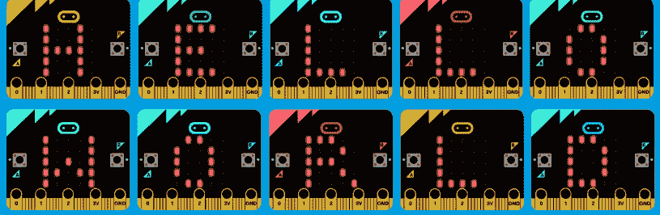

### 在本部分，你将...

- 发现计算机程序的组成部分
- 探索使用`Scratch`、`App Lab`和`MakeCode`的基础知识
- 获得代码出错时的修复策略

## 第一章：什么是编码？

**你知道编码**与构建你使用的应用程序和控制你生活中的技术有关，但编码到底是什么？*编码，也称为计算机编程*，是为计算设备创建指令以使其执行某项操作。你使用一种语言与他人交流，而计算机使用编码语言进行交流。正如你可以学习书写、说话和理解与你幼儿时学到的第一种语言不同的语言一样，你也可以学习用编码语言交流——这样你就能“与”计算机“交谈”！

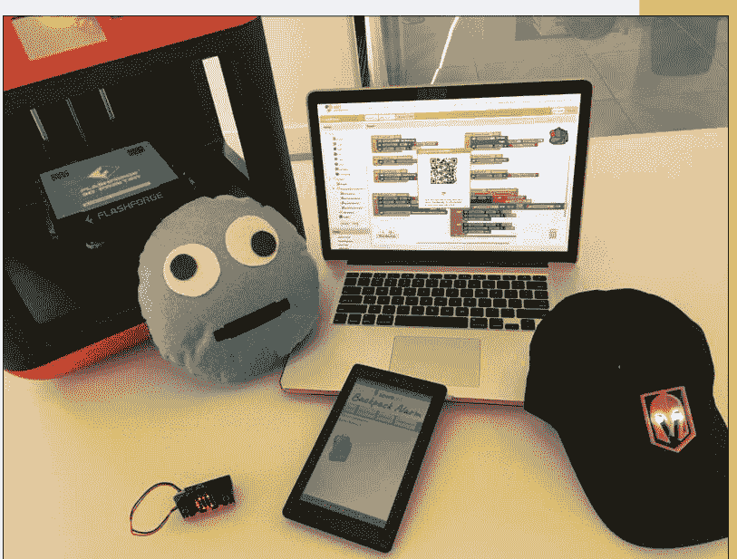

你可能想知道编码是否难学。答案是，编码很容易上手，而且很容易编写真正的计算机程序来执行各种任务！与早期编码时代不同，那时计算机程序员使用长长的数字序列（0 和 1）与计算机交流，现在你可以使用你能轻松理解的单词和符号来编写代码。例如，你可以使用`repeat 3 (play sound boom)`这样的命令告诉一个应用程序播放声音三次（“boom boom boom！”）。很巧妙，不是吗？

这种对人类友好的编码类型，称为*高级语言*，是你在初次学习编码时将使用的。（许多专业程序员也使用高级语言。）稍后，我将更多地讨论高级语言和你将在本书中使用的语言。

你可能也想知道，作为一个新的编码者，你是否能做出一些很酷的东西。是的，你可以！在本书中，你编写代码来构建游戏、玩具和电子小工具。你创造的所有东西，你都可以玩，并与你的朋友和家人分享。

### 我将使用哪些语言？

本书充满了精彩的项目，你可以通过这些项目学习编码的基础知识并制作真正的应用程序。你将使用两种编程语言进行编码：`Scratch`和`JavaScript`。

在`Scratch`语言中，你使用*积木*（也称为*拼块*）来构建代码，这些积木拼接在一起形成完整的程序。`Scratch`是一种专门为孩子创造的学习语言，它有自己的*集成开发环境*（*IDE*），这是你编写和测试代码的地方的俗称。

`JavaScript`是一种专业的编程语言，真正的程序员用它来制作从应用程序到网站的各种东西。你将使用两个非常简单的`IDE`来编写`JavaScript`代码：`App Lab`和`MakeCode`。与`Scratch IDE`类似，这些`JavaScript IDE`让你在积木模式下工作，将你的编码命令拼接在一起。

但当你准备好处理基于文本的编码——输入你的命令——时，你可以在`App Lab`和`MakeCode`中切换到文本模式。

你可以在任何计算机或平板电脑上创建你的代码，在`Scratch`、`App Lab`和`MakeCode`中。只要你有良好的互联网连接，你就准备好了！你将在第 2 章中学习更多关于使用每种语言和编程环境的基础知识。

### 计算机程序是什么样子的？

一个*计算机程序*由你编写的指令组成，这些指令让计算机执行某项操作。程序看起来像一个步骤列表，充满了单词和符号。列表中的许多单词你会很熟悉，例如`for`、`if`和`forever`。计算机程序中的单词被称为*命令*，因为你是在命令计算机执行某种操作。有些命令看起来像是你所知道的单词的组合，挤压在一起形成新词。例如，`JavaScript`使用`onEvent`命令来找出用户是否按下了按钮。

你也可能认出计算机程序中的许多符号。这些看起来像你在数学课上使用的运算符（`+`、`-`、`>`、`=`），也像你在英语课上使用的标点符号，例如句号（`.`）和分号（`;`）。

计算机程序中的所有命令和符号都按照特殊的顺序组织，以便计算机理解它应该做什么。计划这个顺序然后编码它，有点像写一篇文章、解决一个数学问题、表演一段舞蹈编排或在橄榄球比赛中执行战术。你必须按照特定的顺序组合并*执行*（运行）程序——你不能只是把指令放在任何地方，然后期望程序能正确运行。

## 10 第一部分：入门

## Hello World! 示例

从历史上看，新学编程的学生编写的第一个计算机程序是打印"Hello World!"这几个字到电脑屏幕上。图1-1展示了这段代码在`Scratch`中的样子，以及它产生的输出（即在屏幕上显示的内容）。

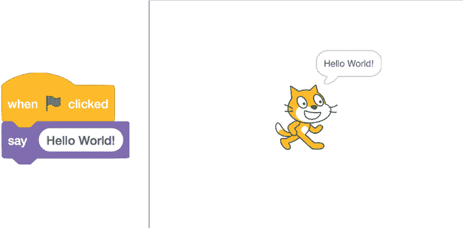

图 1-1

图1-2展示了相同的代码在`JavaScript`中的样子（包括积木模式和文本模式），使用的是`App Lab`集成开发环境，以及它的输出结果。

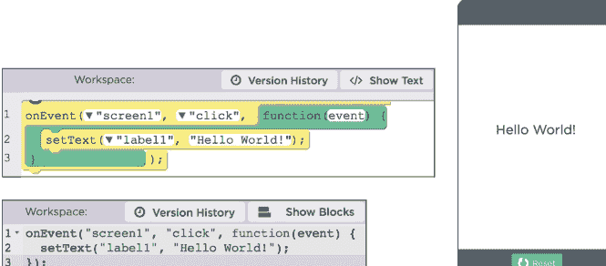

图 1-2

图1-3展示了相同的代码在`JavaScript`中的样子（包括积木模式和文本模式），使用的是`MakeCode`集成开发环境，以及在`micro:bit`电子板上的输出结果。由于`micro:bit`一次只能滚动显示一个字母，因此图中只显示了"Hello World!"开头的字母`H`。

你很快就能制作这样的小程序，还有更大的程序！

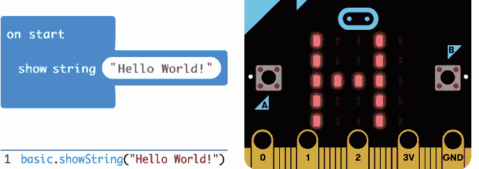

图 1-3

## 程序的配方

许多个早晨，我都会按照自己创建的食谱为家人做巧克力碎片煎饼。食谱就像计算机程序，而按照食谱操作就像执行程序一样。食谱包含多个部分，包括收集和称量原料、将原料混合成煎饼面糊，然后将一勺勺面糊倒到平底锅上煎熟。同样，计算机程序也有不同的部分，例如向用户请求信息、对这些信息进行处理，然后告诉用户结果。

在程序的每个部分中，你可以编写小的代码块来执行不同的操作。执行特定任务的代码块称为**算法**。例如，我在做煎饼时执行的一个算法是测试平底锅表面的温度：我将平底锅插电，设定到某个温度，然后滴几滴水到表面，看看它们蒸发的速度有多快。

构建算法对于编写在计算机上运行的程序非常重要。想想你在手机上玩的喜欢的游戏中可能会用到什么类型的算法。例如，你可能在掷骰子游戏中编写掷骰子的算法，或者在《太空侵略者》游戏中编写宇宙飞船偶尔飞过天空的算法。

你创建的算法相互连接，构建成完整的程序。作为程序员，我们有三个专业术语来描述算法的连接方式：**顺序**、**选择**和**重复**。以下是每个术语的含义：

- ✔ **顺序：** 执行过程的顺序。每个计算机程序都必须按照逻辑顺序组织步骤。例如，做煎饼时，我必须先执行制作面糊的算法，然后才能执行煎面糊的算法！
- ✔ **选择：** 根据特定条件选择路径。例如，选择本周末去看什么电影时，你可能会在动作片和喜剧片之间做出决定。你所做的决定将引导你进入新的顺序——相应地，也会引出其他选择——与你的选择相关。选择通常使用条件语句来编写，结构如下：如果[条件发生]那么[结果发生]。这些条件命令让你可以根据程序的条件创建任意多条路径。
- ✔ **重复：** 重复某事的过程。当你重复代码时，你让它循环一遍又一遍地执行。**循环**是一种告诉计算机多次运行相同命令的结构，而无需重写这些相同的命令。你已经了解循环是如何工作的：在一首歌中，鼓点被循环播放，以提供从歌曲第一个音符到最后一个音符的持续节奏模式。

在本书中，你会看到对顺序、选择和重复的引用。回到这里来刷新你对每种方法在编程中如何使用的记忆。

## 规划程序

当你规划和开发程序时，你需要有一种有组织的方式将它们记录下来。在将程序转化为计算机上可运行的代码打入计算机之前，你可以使用几种方法来表示程序。

有些人喜欢画图或一系列图片（称为**故事板**），来展示应用程序、游戏或网站在屏幕上的样子。这种工作通常由**平面设计师**完成，他们是制作计算机程序图像和动画的人。你将为自己在本书中编写的程序完成自己的平面设计工作，所以在动手敲键盘编码之前，考虑先画点画。

另一些人喜欢在规划程序时构建**流程图**或编写**伪代码**。流程图就像一张带有特殊方框和箭头的小地图，描述程序的主要部分。表1-1展示了一些最重要的流程图符号以及每个符号的含义。

| 符号 | 名称 | 含义 |
| :--- | :--- | :--- |
| → | 箭头 | 显示程序顺序 |
| （椭圆形） | 端点 | 开始或结束程序 |
| （矩形） | 处理 | 执行一项任务 |
| （菱形） | 决策 | 做出决策，如是或否 |
| （平行四边形） | 输入/输出 | 接受输入或产生输出 |
| （六边形） | 预备符号 | 设置循环计数器 |

在本书中，有几个程序是通过流程图来规划的。图1-4是一个简单的流程图示例，展示了一个用户搜索并播放歌曲的程序。用流程图规划程序的好处在于，它帮助你思考程序的整体操作。你可以进行可视化思考，而将编写代码留到以后！

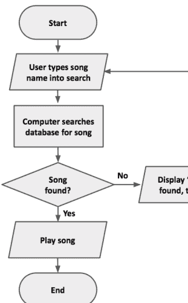

图 1-4

规划程序的另一种策略是将你的整体想法以简化的计算机代码形式记下来，称为**伪代码**，即假代码。这不是计算机可以运行的代码，但写法与之类似。编写伪代码时，你不必担心标点符号，如分号或大括号，因此它能让你专注于程序的整体操作——而不是细枝末节。

例如，如果你要编写一个《辛普森一家》游戏的片段，其中荷马正在吃甜甜圈，你可能会写出如下所示的伪代码：

```
create variable donuts = 0

if Homer eats donuts
    then add one to donuts

if donuts > 10
    then print "Stop eating donuts!"
    else print "Have another donut!"
```

无论你选择画图、绘制流程图还是编写伪代码，在开始编码之前，以某种有组织的纸上形式记录你的计划都是个好主意。

## 为编程做好准备

虽然编程是关于创造新想法并通过计算机程序将它们实现，但请记住，这也关乎你作为编程人员的**心态**。正如你为跑步比赛或拼字比赛做准备一样，你也可以做一些事情来为编程做好准备。以下是一些建议：

- **跟随示例学习。** 你通过编写示例程序学到的算法适用于数百万其他程序。例如，学习如何在一个游戏中增加分数，可以培养你在任何你制作的游戏中编码相同过程的技能。优秀的程序员会搜索网络并重用他们找到的代码片段。通过示例学习！
- **自上而下来思考。** 开发计算机程序时，从顶部开始然后逐步向下进行。当你在脑风暴新应用程序时，不要立刻深入到程序的细枝末节。先制定整体计划。然后通过画图或故事板设计来细化。接着创建流程图。然后编写伪代码。最后，逐块编写应用程序代码。
- **练习耐心和韧性。** 无论你正在制作什么——计算机程序、音乐表演还是美食大餐——学习新技能需要耐心，而从挑战中反弹回来以掌握该技能需要韧性。你需要具备这两种品质。
- **培养你的创造力。** 编程并不像许多人认为的那样是一门冷冰冰的计算学科。从为问题设计新的解决方案到发明新的电子游戏，创造力是编程过程中的重要组成部分。探索尽可能多的创造性活动来激发你的编程灵感。从电脑屏幕上抬起头，看看周围的世界，聆听生活的声音。暂时远离代码，能让你以全新的视角回到代码中来！


**知道调试是整个流程的一半。** 调试代码意味着追踪和重新追踪你的步骤——有时通过逐行逐步追踪，有时通过隔离和测试较小的代码部分，有时通过测试示例数据来检查输出——以发现和修复问题。你会花费大量时间调试代码，使其完全正常运行。在调试过程中管理好自己的挫败感，对于成为成功的编程人员至关重要。保持冷静，继续前进！

## 用代码编写酷炫的东西

程序员制作你在应用商店购买的应用程序，但他们还制作什么？你可以用代码创建的酷炫事物清单很长！对于电脑，你可以构建在线游戏、个人和小型企业网站，以及你的照片画廊的虚拟导览。对于日常小工具，你可以制作背包防盗报警器、掌上游戏、健康监测器、天气传感器、宠物追踪器和远程喂鱼器。

## 第一章：什么是编程？

如果你热爱纺织品和缝纫，你可以编写程序来控制缝入织物中的LED灯，这样你就能制作出疯狂的万圣节和主题日服装，让你所到之处的房间都 literally 亮起来！如果你对安全和特工活动感兴趣，你可以涉足网络领域，学习互联网基础知识和加密技术，以确保在线传输安全并保护信息隐私。

如果你有戏剧天赋，你可以编写代码来控制机器人在舞台上跳舞，同时让无人机在空中同步飞行，配合舞台演出。如果你热爱家居电子，你可以为智能家居编写设备代码，从摄像头监控到按时间段自动播放的氛围音乐。

如果你想玩点疯狂的，你可以设计、布线和编写代码，打造一整个院子的节日彩灯、喜庆音乐、投影图像和移动人物，迎接每年电视播出的“圣诞灯饰大战”！

那么应用商店里的那些应用呢？你可以制作各种各样的游戏，从解谜到文字游戏再到街机游戏。你可以构建辅助工具来帮助人们的日常生活。如果你是位热心人士，你可以编写应用来将需要帮助的人与可用资源连接起来，尤其是在危机时刻。你能编写的程序只受限于你的想象力和技能。

作为一名年轻的编程学习者，你今天就可以构建其中许多令人惊叹的玩具和工具的简单版本。通过这样做，你不仅会获得乐趣，感受到制作真正可用产品的满足感，还能为未来的成长打下坚实的基础。

## 第二章：使用编程语言和集成开发环境（IDE）

**作为一名程序员，你**会使用很多种编程语言。就像旅行者从一个国家前往另一个国家时必须了解不同的语言一样，你必须了解各种编程语言，以应对你将创建的不同类型项目。例如，为移动应用、网站、任天堂Switch游戏和自动驾驶汽车编写代码时，使用的语言各不相同。本书中的项目使用两种适合编程初学者的编程语言编写：`Scratch`和`JavaScript`。

`Scratch`是一种由积木块组成的教学语言，你可以将积木块拼接在一起创建程序。你在`Scratch`中使用网站IDE，即*集成开发环境*，这是一个集构建和运行代码于一体的地方。你在`Scratch`中制作的程序可以在电脑和平板电脑上运行。

`JavaScript`是一种专业的文本语言，意味着你需要输入命令来创建程序。但别慌！在本书中，你使用的在线IDE允许你选择是以文本模式还是积木模式来编写`JavaScript`。当你在`App Lab` IDE中编程时，你制作的程序可以在电脑和手机上运行。当你在`MakeCode` IDE中编程时，你编写的程序将为一块名为`micro:bit`的电子板供电。如果你的程序在电脑屏幕上的模拟器中运行——如果你愿意的话——也可以在真正的`micro:bit`上运行。

本章帮助你设置并了解`Scratch`、`App Lab`和`MakeCode`的基本布局。你还将学习一些关于处理图像和声音的知识，以便为你的项目构建有趣且引人入胜的UI，即用户界面。

### 基本IDE设置与导航

`Scratch`、`App Lab`和`MakeCode`都是免费的，但你需要在`Scratch`和`App Lab`中设置账户才能开始编程。`MakeCode`不需要账户。

### 在Scratch中设置账户

在`Scratch`中设置账户既快捷又简单。只需按照以下步骤操作：

1. 在任何网页浏览器中，访问 `https://scratch.mit.edu`。

2. 在`Scratch`主页上，选择"加入Scratch"。

3. 在`Scratch`对话框中，输入`Scratch`用户名和密码，如图2-1所示。然后点击"下一步"按钮。

4. 输入你的出生日期、性别和国家。然后点击"下一步"。

5. 输入你父母或监护人的电子邮件地址。然后点击"下一步"。

屏幕上会显示你已注册使用`Scratch`，并且确认电子邮件已发送给你的父母或监护人。

**图2-1**

6. 你的父母或监护人必须打开电子邮件并确认允许你在`Scratch`上公开分享你的作品。

如果成年人没有确认，你仍然可以在`Scratch`中工作——但你将无法分享你的程序。

7. 在最终屏幕上点击"确定"完成注册。

`Scratch`账户设置完成后，你可以随时通过点击`Scratch`主页右上角的"登录"按钮并输入用户名和密码来登录你的账户。

### 在Scratch中导航

设置好`Scratch`账户后，你会进入`Scratch`主页。以下是你会看到的一些内容，以及你可以执行的一些操作。

#### Scratch IDE

在`Scratch`主页上选择"创建"以打开`Scratch` IDE。在`Scratch` IDE中，你会看到一个全新的空白项目，如图2-2所示。这也是你在`Scratch`中选择"文件 → 新建"时看到的相同界面。

图2-2

`Scratch` IDE顶部的*菜单栏*只有几个选项。这些是最重要的：

- **文件 → 新建：** 创建新项目。

- **编辑：** 允许你开启或关闭加速模式。开启时，此模式以尽可能快的速度执行程序。

- **项目名称字段：** 为你的项目命名。

- **分享按钮：** 分享你的项目（参见第十九章）。

- **查看项目页按钮**：前往当前项目的项目页，在那里你可以给用户关于如何使用你程序的说明。在项目页上，点击"查看内部"按钮以返回图2-2所示的`Scratch` IDE。

- **我的作品文件夹图标**：打开你创建的项目。

`Scratch` IDE左侧的选项卡会根据你是为精灵（`Scratch`中的对象）还是为舞台（你的精灵所在的背景）创建代码而有所不同：

- **代码选项卡**：访问命令类别及其积木块。

- **造型选项卡**：访问精灵造型和这些图像的精灵编辑器。

- **背景选项卡**：访问舞台背景及这些图像的背景编辑器。

- **声音选项卡**：访问声音和声音编辑器。

工作区是你拖入命令积木块并将命令积木块组装在一起形成更大代码块的地方。点击缩放图标可以在构建代码时放大或缩小。

`Scratch` IDE底部的背包区域是一个保存、存储和重复使用项目物品的地方，在不同项目之间共享它们。只需将代码块、精灵、造型或声音拖入背包，它就会在所有项目中可用！将任何物品从背包中拖出即可在任何项目中使用。通过右键单击（Windows）或按住Ctrl键单击（Mac）物品来删除背包中的物品。

主*舞台*是显示用户所看到内容的大窗口。它由精灵和背景组成。点击舞台大小图标可以调整你对舞台的视图大小。舞台正上方是绿色*旗帜*和*停止*图标；分别使用它们来启动和停止你创建的大多数项目。

*精灵区域*显示你项目中的精灵（对象）。每次开始新项目时，`Scratch`猫精灵会默认（计算机自动执行的操作）放置在你的项目中。关于此精灵的信息位于舞台下方。默认`Scratch`猫精灵的名称是`Sprite1`。你可以在精灵区域中查找关于`Sprite1`的更多信息，包括位置（*x* 和 *y* 值）、*大小*、*方向*和*显示*（精灵是显示还是隐藏，由眼球图标指示）。

如果你的项目中有多个精灵，每个精灵都会出现在精灵区域中。*活动的*或被选中的精灵其图标周围有蓝色轮廓。点击精灵图标使其成为活动精灵，允许你为该精灵编写代码。要添加新精灵，点击*选择一个精灵*图标（如边栏所示）。要删除精灵，点击精灵图标角落的X。

小*舞台*，或*背景区域*，位于`Scratch` IDE的右下角。这里，一个图标显示当前背景。点击此图标使舞台变为活动状态，这意味着你可以为舞台编写代码、更改其背景并为其添加声音。

> 一次只能有一个精灵或舞台处于活动状态！注意当前选中的是哪一个。如果你正在编写代码，你是为当前选中的对象编写代码。

#### 代码选项卡

图2-2显示了`Scratch` IDE的代码选项卡。你既可以为精灵也可以为舞台使用此选项卡。它按命令类别组织，如下所示：

- **运动：** 告诉精灵（对象）如何以及在哪里移动的命令。（舞台没有运动命令。）

- **外观：** 更改精灵和背景造型的命令。

- **声音：** 播放音乐和音效的命令。

- **事件：** 启动和结束代码执行的命令。

- **控制：** 选择代码或重复代码执行的命令。（有关代码顺序、选择和循环的帮助，参见第一章。）

## 第1部分：入门

- **感知：** 用于感知颜色、声音、位置或用户输入的命令。

- **运算符：** 用于数学和逻辑运算的命令。

- **变量：** 用于创建和修改变量的命令。

- **我的积木：** 你为自己的项目定义的新命令。

要为角色或舞台编写代码，请选择一个命令类别，然后将一个积木块拖放到工作区中。通过将新命令拖动到下方并吸附（靠近）到前一个命令来添加下一个命令，以构建一个代码块。要*执行*或运行代码块，请点击该积木块。该代码块将以亮黄色轮廓"高亮显示"，并且该块中的命令将被执行。

你可以通过点击`Scratch`中的命令块并将其拖回命令类别来移除它。

你正在使用的是2019年发布的`Scratch 3.0`版本。它有一些很酷的新功能，包括文本转语音和语言翻译。点击代码类别下方的"添加扩展"图标来查看这些功能。此外，在这个新版本中，你可以在电脑和平板电脑上创建和运行代码！

`Scratch`会自动保存你的项目，但你也可以通过从菜单栏选择"文件 $\Rightarrow$ 立即保存"来随时保存。

## 在App Lab中设置账户

按照以下步骤在`App Lab`中设置账户：

1. 在任何网页浏览器中，访问 https://code.org。

2. 在`Code.org`主页上，点击"登录"按钮。

3. 在"登录"页面（如图2-3所示）上，点击"创建账户"按钮。

4. 在出现的页面上填写表单，然后点击"注册"按钮。

孩子可以作为学生注册，或者家长可以作为教师注册。由于难度级别（包含基于文本的代码），`App Lab`被指定为`Code.org`的13岁以上区域。

图2-3

5. 在"我的仪表板"屏幕上，向下滚动并点击`App Lab`图标。

设置好`Code.org`账户后，你可以通过点击`Code.org`主页右上角的"登录"按钮，然后输入你的用户名和密码来登录你的账户。

## 在App Lab中导航

设置好`Code.org`账户后，你可以随时登录并从"我的仪表板"访问`App Lab`。以下是你在`App Lab`中可以看到和做的一些事情。

### App Lab IDE

`App Lab`以一个新的空白项目打开，如图2-4所示。这也是你在`App Lab`中点击"创建新项目"按钮时看到的相同屏幕。

图2-4

`App Lab` IDE顶部的*菜单栏*只有几个选项。这些是最重要的：

- **重命名按钮：** 为你的项目命名。

- **分享按钮：** 分享你的项目（见第19章）。

- **改编按钮：** 复制并修改当前项目。

- **创建新项目按钮：** 创建一个新项目。

- **我的项目按钮：** 打开你创建的项目。

`App Lab` IDE左侧有三个*按钮*。你会使用其中两个：

- **代码视图按钮**：访问命令类别及其积木块。

- **设计视图按钮**：在模拟器中布局应用程序的用户界面。

*工作区*是你将命令积木块拖入并将它们组装在一起以构建你的*程序*的地方。你可以点击*显示文本*按钮以基于文本的模式进行编码。在基于文本的模式下工作时，你可以点击*显示积木块*按钮以积木块模式进行编码。

正常工作时，你可能希望访问代码的早期版本，特别是当你做出导致一些重大错误的更改时。（有关调试的帮助，请参见第3章。）点击*版本历史*按钮以"倒回时钟"到你程序的较早版本。

模拟器是你左侧的窗口，向你展示用户看到的内容。在这里，你可以在你的程序执行时看到它并与其交互。模拟器始终以*竖屏方向*（垂直）显示。*屏幕选择器*是模拟器顶部的下拉菜单，允许你在设计应用程序时选择要工作的屏幕。点击*运行*按钮来运行你的程序。

*调试控制台*是底部的窗口，在你的代码执行时提供关于程序中错误的线索。（有关调试代码的额外帮助，请参见第3章。）

### 代码视图按钮和工具箱

当你点击代码视图按钮时，会出现图2-4所示的`App Lab`视图。此视图包含你可以用来构建程序的编码命令工具箱，按命令类别组织：

- **用户界面控件**：控制用户界面的命令。

- **数据**：用于访问在线数据的命令，以及其他高级功能。（本书中的项目不使用高级命令。）

- **控制**：选择代码或重复代码以执行的命令。（有关代码顺序、选择和重复的帮助，请参见第1章。）

- **变量**：创建和修改变量的命令。

- **画布**：控制应用程序背景的命令。

- **海龟**：绘图工具的特殊命令。

- **数学**：数学和逻辑运算的命令。

- **函数**：你为自己的项目定义的新命令。

要编写代码，请选择一个命令类别，然后将一个积木块拖放到工作区中。通过将新命令拖动到下方并吸附（靠近）到前一个命令来添加下一个命令，以构建你的程序。要执行或运行程序，请点击运行按钮。

> **提示**：你可以通过点击`App Lab`中的命令块并将其拖回工具箱来删除它。或者在文本模式下，选择你想要删除的命令，然后按键盘上的删除键。

在`App Lab`中工作时，你是在专门为学习设计的特殊IDE中使用真正的`JavaScript`。本书仅使用`JavaScript`通用的命令。它避免使用`timedLoop`命令，这些命令内置于`App Lab`中，但在其他IDE中通常看不到。

> **提示**：`App Lab`会在你工作时自动保存你的项目。

### 设计视图按钮和设计工具箱

当你点击设计视图按钮时，你会看到图2-5所示的`App Lab`视图。此视图包含你可以用来构建程序的设计元素工具箱。

要将设计元素添加到应用程序中，请将其从工具箱拖动到模拟器屏幕。关于如何使用这些组件的详细信息将在每个项目中提供。

图2-5

## 在MakeCode中导航

`MakeCode`不要求你创建账户。访问`MakeCode`网站，如图2-6所示，网址为`https://makecode.microbit.org`。

图2-6

这是你的页面，用于创建新项目、打开你已制作的项目，以及查看示例项目和许多其他你可以为`micro:bit`编程的项目的教程。你可以通过点击所在页面顶部的主页按钮随时返回此页面。

### MakeCode IDE

在`MakeCode`中创建新项目时，你会看到图2-7所示的IDE。

图2-7

`MakeCode` IDE顶部的*菜单栏*只有几个选项。这些是最重要的：

- **主页按钮：** 返回`MakeCode`主页。

- **分享按钮：** 分享你的项目（见第19章）。

- **积木块/JavaScript切换：** 选择以哪种模式进行编码。

`micro:bit`*模拟器*是你左侧的窗口，向你展示用户看到的内容。它的行为方式与实际`micro:bit`的行为方式相同，只是它是数字的（不是真正的物理电子板）。在这里，你可以在你的程序执行时看到它并与其交互，并在将程序传输到`micro:bit`之前让一切正常工作。点击模拟器下方的*播放*图标（箭头）来运行你的程序。当你的程序运行时，你可以点击*停止*图标来停止程序执行。点击*重新启动*图标会将程序重置到开始。你也可以点击*慢动作*图标（蜗牛）来减慢程序执行的速度（这在调试时很有帮助）。你也可以点击*音频*图标来静音或取消静音声音。点击*全屏*图标会使你的`micro:bit`模拟器以大格式显示，在它自己的屏幕上。

*工作区*是你将命令积木块拖入并将它们组装在一起以构建你的*程序*的地方。你可以点击*JavaScript*按钮以基于文本的模式进行编码。在基于文本的模式下工作时，你可以点击*积木块*按钮以积木块模式进行编码。点击右下角的*放大*或*缩小*图标来调整你的视图。如果需要，你可以点击右下角的*撤销*或*重做*图标来编辑你的代码。

*调试控制台*是一个窗口，如果你的代码有错误，它会出现在模拟器下方。此控制台提供关于程序中错误的线索以及在哪里查找以修复它们。（有关调试代码的额外帮助，请参见第3章。）

### 代码工具箱

`MakeCode`提供编码命令供你构建`micro:bit`程序。请注意，图2-7中选择了高级选项，这将为你的工具箱添加更多命令类别。以下是这些类别：

- **基本：** 使用LED显示图像或文本的命令，以及`on start`和`forever`命令。

## 第一部分：入门指南

- **输入：** 用于读取用户输入的指令，例如点击按钮、摇晃 `micro:bit` 或从某个引脚读取信号。

- **音乐：** 用于播放音乐的指令。虽然音频可以在模拟器中播放，但 `micro:bit` 没有内置扬声器，因此你需要连接耳机或扬声器才能让 `micro:bit` 发出声音。

- **Led：** 用于单独点亮 LED 灯的指令。

- **Radio：** 用于让 `micro:bit` 通过射频相互通信的指令。


- **循环：** 用于执行重复操作的指令。
- **逻辑：** 用于条件判断、比较和布尔值的指令。
- **变量：** 用于创建和更改变量的指令。
- **数学：** 用于数学运算（包括随机数）的指令。

在高级指令中，有许多类别。以下是本书中你将用到的几个类别：
- **函数：** 你为项目定义的新指令。
- **数组：** 用于创建和更改数组变量的指令。
- **引脚：** 用于读取和写入 `micro:bit` 底边引脚（电气连接点）电信号的指令。

要编写代码，请选择一个指令类别，然后将一个代码块拖放到工作区中。通过将新指令拖动到下方并将其与上一个指令*吸附*（靠近）在一起来添加下一条指令，从而构建你的程序。要在模拟器上*执行*或运行程序，请点击*运行*按钮。

要*保存*你的程序，请在 `MakeCode IDE` 底部的“无标题”字段中输入程序名称，然后点击保存按钮。

**第二章：使用编程语言和集成开发环境**

> **提示**
> 在 `MakeCode` 中，可以通过点击指令块并将其拖回代码工具箱来删除它。或者在文本模式下，选择要删除的指令，然后点击键盘上的删除键。

## 添加硬件

本书中的每个项目都可以在不额外购买的情况下创建。如果你确实想使用真实的 `micro:bit` 来构建 `MakeCode` 项目，你需要购买一个（它们很便宜！）以及一些可选的、价格低廉的硬件。以下是有关 `micro:bit` 和可选硬件的一些信息。

### micro:bit 开发板

`micro:bit` 是一个微型的、可编程的计算机，大小约为信用卡的一半。见图 2-8。

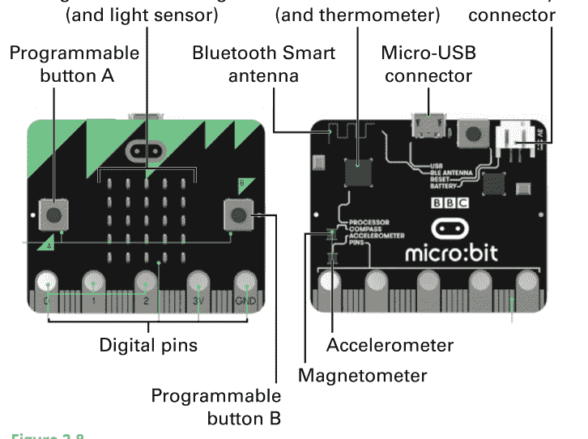

## 第一部分：入门指南

`micro:bit` 包含以下组件：
- **微控制器**：一个带有少量内存的微型计算机。这个单元中硅的温度也用作 `micro:bit` 的温度传感器。
- **蓝牙智能天线**：将 `micro:bit` 连接到其他蓝牙设备。
- **微型 USB 接口**：将 `micro:bit` 连接到你的计算机，提供电源并将程序传输到板上的途径。
- **电池接口**：连接电池组以在脱离计算机时为 `micro:bit` 供电。
- **传感器**：加速度计、磁力计（充当指南针和金属探测器）、温度计、光线传感器以及可编程的 `A` 和 `B` 按钮。
- **数字引脚**：包括电源和地线，用于在电路中发送和接收电信号。
- **LED 灯**：一个由 25 个单独可编程灯光组成的网格，可以显示图像和信息。它也可用于检测光线水平。

各种组件使得 `micro:bit` 成为一个灵活的小型开发板，你可以为广泛的应用进行编程。

### 购买开发板和组件

获取你需要的硬件——一个 `micro:bit` 开发板和几个配件——就像在亚马逊上订购一样简单。以下是本书项目推荐的物品：
- **BBC micro:bit go 套件**：此套件包含一个 `micro:bit` 电子板、一根 `USB` 电缆、一个电池盒和两节 `AAA` 电池。零售价低于 20 美元。
- **带鳄鱼夹的测试线**：你需要两根测试线（导线）。一包十根的零售价低于 6 美元，或者你可以向电子爱好者借几根。
- **耳机**：你需要一副标准的（`3.5mm`）耳机。你家里可能已经有了一副！

### 在 micro:bit 开发板上运行程序

要在 `micro:bit` 开发板上传输和运行程序，请按照以下步骤操作：
1. 将 `micro:bit` 开发板连接到电缆的微型 `USB` 端，并将你的计算机连接到电缆的 `USB` 端，如图 2-9 所示。
   连接后，一个代表 `micro:bit` 设备的图标将出现在你的桌面上。
   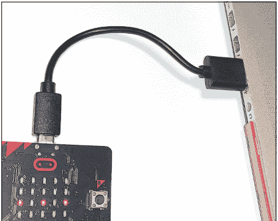
2. 在 `MakeCode IDE` 中，为程序命名并点击保存按钮。
3. 在 `MakeCode IDE` 中，点击下载按钮。
   这会将一个 `.hex` 文件下载到你的计算机（通常下载到“下载”文件夹）。见图 2-10。
4. 通过将 `.hex` 文件从你的计算机拖动到 `micro:bit` 设备的图标（如图 2-10 中的设备区域所示）来将 `.hex` 文件传输到 `micro:bit`。

## 第一部分：入门指南

传输过程中，橙色的 `micro:bit` 指示灯按钮（在设备背面）会快速闪烁。闪烁停止时，传输完成。

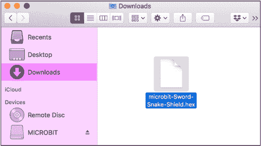

**图 2-10**

5. 为开发板供电。
   `micro:bit` 需要电源才能运行。你可以通过保持通过 `USB` 电缆连接到计算机来为开发板供电。或者，为了使设备可携带，将电池组连接到 `micro:bit`（并将其与计算机断开，从两个设备上拔下 `USB` 电缆）。
   

`micro:bit` 仅存储最近传输的程序。如果你在 `IDE` 中更改了程序，你*必须*重复步骤 2-4 以更新 `micro:bit` 内存中存储的程序。

## 让用户界面更花哨

程序员与用户界面设计师紧密合作，为人们构建与应用程序、网站和小工具交互的引人入胜且易于理解的方式。当你刚开始时，你同时担任程序员和 `UI` 设计师。

在设计用户界面时，你会想要使用各种图像来创建 `UI` 的外观。一些图像将成为背景图像，而另一些将成为精灵、按钮或出现在屏幕上的较小对象。虽然这本身不是编码，但设计你的 `UI` 是创建人们喜欢且知道如何使用的应用程序和小工具的重要组成部分。以下是一些指导，帮助你让你的设计工作更花哨。

### 查找图像

使用 `Google` 图像搜索，搜索要在项目中使用的图像。前往 `www.Google.com` 并输入任何描述你想要图像的搜索词。然后点击或轻触“图片”以查看所有图像。点击或轻触“工具”按钮，然后选择“使用权限”：标记为可再利用，将图像范围缩小到仅那些你可以合法使用的图像。在图 2-11 中，我搜索了 `sound effects background` 以查找我在第 5 章的音效应用中使用的图像。

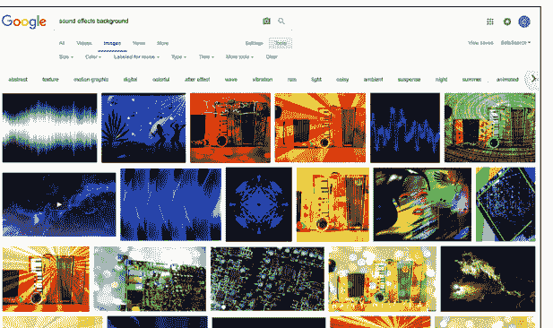

图 2-11

你也可以按尺寸缩小图像范围。大图像适合作为背景，而小图像或缩略图更适合放在背景前面的对象，例如精灵上的服装。此外，通过仅搜索 `.png` 图像，你可以找到具有透明背景的图像。这对于放在背景前面的图像来说是理想的。

在计算机上，通过右键单击（`Windows`）或 `Ctrl` 单击（`Mac`）图像来保存你想要的图像。在平板电脑上，点击随图像出现的选项按钮。当弹出菜单出现时，选择“图像另存为”并为图像命名。使用对你来说有意义且简短的名称。

### 编辑图像

保存后想要上传到 `Scratch` 或 `App Lab` 的图像可以进行编辑。你可能需要裁剪背景、将图像从横向更改为纵向方向，或删除对象周围的白色背景。要在 `App Lab` 中编辑图像，你必须使用外部编辑程序，例如 `Paint`（`Windows`）或 `Preview`（`macOS`）。

例如，在 `Mac` 上使用 `Preview`，你可以执行图 2-12 中所示的一系列简单编辑。要在 `Preview` 中打开编辑工具，请点击菜单栏中的标记按钮。在这里，我想为我的寿司对战玩具保存一张绿色山葵块的图像。（有关此项目，请参见第 18 章。）我首先使用矩形选择工具和裁剪按钮从其他图像中裁剪出山葵。然后我使用即时 `Alpha` 工具“魔棒”选择白色背景。最后，我点击键盘上的删除键。`Preview` 询问我是否要将图像转换为 `.png`，我同意了。我如图中最后一张图片所示保存了山葵图像。

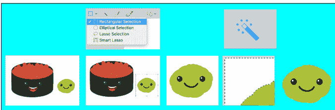

*Shutterstock 图片 418466866，寿司角色作者 Rimma Z*

图 2-12

### 查找和录制声音

`Scratch`、`App Lab` 和许多其他入门级编程语言都提供了一个声音库，你可以在项目中使用其中的声音。但如果你想使用来自网络的声音或录制自己的声音呢？你可以！

第2章：使用编程语言和IDE

获取大量免费音效的最佳资源之一——没有广告或繁琐的注册页面——是 `www.SoundBible.com`。通过简单搜索，你可以找到数以千计的优秀音效和背景音乐，格式为 `.mp3` 和 `.wav`。另一个很酷的音效来源是视频游戏音乐档案库（`www.vgmusic.com`），它收录了数以千计的视频游戏音效，包括来自旧平台的音效。（我找到了 `Atari 2600` 版《挖地先生》的开场音乐！）该网站上的大多数音效和音乐都是 `.midi` 格式。

`Scratch` 接受 `.mp3` 和 `.wav` 格式的音频文件，而 `App Lab` 仅使用 `.mp3` 格式。如果你创建或找到了其他格式的音频文件（例如 `.midi` 格式），请下载该文件、保存它，并在这些编程环境中使用之前进行转换。`GarageBand` 等程序可以轻松打开 `.midi` 文件并将其转换为 `.mp3` 格式。

## 上传音效

要在 `Scratch` 中上传音效，请切换到"音效"选项卡。在 `Scratch IDE` 的左下角，点击并按住"选择一个音效"图标，然后在弹出的菜单中选择"上传音效"。要在 `App Lab` 中上传音效，请将 `playSound` 命令拖到工作区。在该命令中，点击箭头选项卡并选择"选择"。在出现的"选择音效"对话框中，选择"制作新音效"类别，点击"上传文件"按钮，然后选择要上传的文件。

## 录制音效

你也可以制作自己的音效，无论是人声、音效还是来自任何地点的噪音（例如城市街道或公共泳池）。`Scratch` 和 `App Lab` 都允许你录制自己的音效，然后在任何你创建的应用中使用它们。

要在 `Scratch` 中录制音效，请切换到"音效"选项卡，然后将光标悬停在左下角的"选择一个音效"图标上，在出现的菜单中选择"录制"。要在 `App Lab` 中上传音效，请将 `playSound` 命令拖到工作区。在该命令中，点击箭头选项卡并选择"选择"。在出现的"选择音效"对话框中，选择"制作新音效"类别，点击"录制音频"按钮，然后录制你的音效。

## 当事情出错时

**编程是一门挑剔的**事业。程序经常包含错误，你必须修复它们，程序才能正常运行。无论你是刚开始学习编程还是已经编程了一段时间，你——和其他人一样——在编写代码时都会犯错误。作为程序员，你会花大量时间修复程序中的错误，即 *bug*。（它们被称为 *bug*，是因为在计算机发展早期，其中一个"错误"实际上是计算机电子电路中的一只真正的虫子！）

第3章：当事情出错时

修复代码中的错误称为 *调试*——字面意思就是把 bug 从你的代码中清除出去。把你的程序想象成你在英语课上写的作文，或者在科学课上写的实验报告。在每个书面文档中，你必须把形式和内容都写对，文档才能有意义并成功讲述它的故事。

当你编写和运行代码时，你也必须把形式和内容都写对；如果不这样做，代码就会遇到错误。当错误是由于代码的形式导致时，你会得到 *语法错误*。当错误是代码行为的结果时，你会得到 *逻辑错误*。

测试程序意味着运行它，看看它是否按照你想要的方式运作。在本章中，你会发现语法错误和逻辑错误在测试程序时是如何出现的。你还学习一些在 `Scratch` 和 `JavaScript`（使用 `App Lab` 和 `MakeCode`）中调试代码的策略。记住，编程的一半是编写代码——另一半是调试代码！

### 语法错误

你所写代码的形式，或者说语法，包括结构、命令、语法规则和标点符号。以下是每个部分的含义：
- 程序的结构是其整体布局。例如，一篇文章通常采用五段式结构：一段引言、三段内容段落和一段结尾段落。在 `Scratch` 程序中，代码的结构与执行它的对象相匹配。例如，蝴蝶精灵有让它飞行的代码，猴子精灵有让它跳来跳去的代码。在 `JavaScript` 程序中，代码的结构通常是全局变量在前，然后是主程序，最后是函数定义。
- 程序中的命令就像文章中的词汇。命令和词汇一样有特定的含义，必须正确拼写。你可以编写新命令（并使用任何你想要的拼写），但必须在程序中定义这些新词汇的含义。

程序中的 *语法规则* 类似于你用任何语言写句子时使用的语法。在英语中，你说"I'm not hungry"，而不是"I ain't hungry"，也不是"Hungry not I'm"。同样，在 `Scratch` 中编程时，正确的语法是 `repeat 10 play sound boom`，而不是 `repeat 10 boom` sounds。*语法规则* 要求你使用特定的单词组合，并且按照特定顺序排列这些单词。

程序中的 *标点符号* 看起来很像文章中的标点符号。你必须把句号、逗号和分号放在正确的位置，代码才能工作。代码中的标点符号还包括你写数学方程式时使用的一些符号，例如大于号和小于号、加号和减号、等号、括号、方括号和花括号。

使用积木编程时，几乎不可能出现语法错误。基于积木的编程几乎不需要打字，而且积木以特定的方式组合在一起。（事实上，使用积木编程的目的是帮助初学者避免语法错误。）在以文本模式编程时，你要在程序中输入所有内容。你可能很容易拼错命令，或者忘记在代码行末尾添加分号。任何语法错误都会报告给你，无论是在你输入时还是在你尝试运行代码时。你必须修复错误才能正确执行程序。

许多编程语言，例如 `Java`，要求你在运行程序之前先编译它。*编译* 就像是检查你的代码是否有明显的错误。如果你有语法错误，在尝试编译时会报告给你。必须修复 bug 才能成功编译，之后你才能运行程序。

### 逻辑错误

程序的 *逻辑* 是你运行代码时产生的行为。你很容易把程序的形式写对但在逻辑上出错。例如，如果每次英雄击败敌人时游戏分数都下降，那你可能把 `score` 变量设置为递减而不是递增。代码能运行，因为语法是正确的，但程序没有按照你想要的方式工作。

无论是使用积木编程还是以文本模式编程，你都很容易犯逻辑错误。你可能直到运行代码时才会发现逻辑错误。届时，你需要找出哪里出了问题，然后找到控制不正确行为的代码部分。有时追踪逻辑错误很容易，但其他时候却很具挑战性！

## 调试 Scratch 程序

`Scratch` 帮助你避免犯语法错误，因为你不用输入命令。相反，你将命令积木拖到代码工作区。你不必担心拼错命令或忘记添加分号，因为 `Scratch` 阻止你犯这类错误。与输入预制元素（例如变量名）不同，你从下拉列表中选择它，如图 3-1 所示。

## 第一部分：入门

在使用 `Scratch` 编程时，你的程序逻辑很可能会出现错误。这些错误会在运行程序时显现，因此也被称为*运行时错误*。要修复这类错误，你需要尝试精确定位程序执行过程中出错的位置，然后修改代码来纠正你的错误。

以下是在 `Scratch` 中定位和修复运行时错误的一些方法：
- **一次专注于一个角色。** 如果一个角色工作正常，就继续检查下一个角色。（在许多项目中，你也会为舞台编写代码，这个方法同样适用于检查舞台。）
- **当你发现一个有运行时错误的角色时，多次运行程序以观察该角色的行为。** 尝试弄清楚角色具体做错了什么，以及这种行为何时发生。
- **仔细检查有运行时错误角色的代码。** 逐条命令地单步调试代码。分离部分代码（将其暂时拖到一边，远离 `event` 命令）。然后，一次添加一两个命令的代码段，每次添加后测试角色的运行情况。你应该能够识别出错误发生的位置。这时，纠正错误通常就很容易了。

图3-2展示了 `Scratch` 中的一个逻辑或运行时错误示例。我希望我的蝴蝶向屏幕左侧飞，但它却向右飞。我心想：“嗯，我的蝴蝶在飞，速度也对，但方向错了。也许是我设置的方向不对。”

于是我检查了与方向相关的代码部分。我发现我将方向设置成了正90度，这使蝴蝶指向右侧。我本应该将方向设置为负90度（输入 `-90`），使蝴蝶指向左侧。

## 调试 App Lab 程序

当你在 `App Lab` 中使用 `JavaScript` 编程时，代码中很可能会产生一些错误。代码中的语法错误必须在运行程序前修复。

在 `App Lab` 中，语法错误以黄色菱形或红色方块显示。错误符号出现在有错误的那一行。如果你将鼠标悬停在该符号上，`App Lab` 会提供错误线索。以下是每种错误符号含义的一般描述：

**黄色菱形：** 你的代码可能有语法错误，但应用或许仍能运行。语法错误可能是由拼写错误或其他多种问题引起的。

当你没有删除默认的函数调用名称 `event` 时，`onEvent()` 命令总是会显示黄色菱形。然而，这个错误不会阻止应用执行，所以你不需要修复它。但如果你觉得这个黄色菱形很碍眼，通常只需从括号中删除 `event`，警告就会消失。

**红色方块：** 语法错误阻止了应用运行。例如，你可能使用了未声明的变量或函数。在尝试运行应用之前，你必须修复语法错误。

如果你使用积木模式编程，你不会犯太多语法错误，但犯几个是有可能的。例如，你在拼写变量或函数名时可能会出现语法错误——或者任何在积木中需要输入的文本。图3-3展示了 `App Lab` 标记出三个错误的一段积木代码。

**图3-3**

如果你将鼠标悬停在第1行的黄色三角形上，`App Lab` 会显示如图3-4所示的消息。这条消息告诉你，你定义了一个变量 `lives`，但之后并未在代码中使用它。

**图3-4**

如果你将鼠标悬停在第2行的黄色三角形上，会显示如图3-5所示的消息。这条消息告诉你，默认的函数名 `event` 在你的代码中没有被调用。如前所述，在 `App Lab` 中，所有 `onEvent` 命令上出现黄色三角形是没关系的。如果你想修正这个错误，只需删除 `event`。

如果你将鼠标悬停在第3行的黄色三角形上，会显示如图3-6所示的消息。这条消息让你知道，你试图赋值的变量 `life` 并不存在。（因为你本意是要给 `lives` 赋值，而不是 `life`，所以从未声明过它。）

**图3-5**

**图3-6**

要调试这段代码，请从第2行删除 `event`，并将第3行的 `life` 改为 `lives`，如图3-7所示。请注意，将 `life` 改为 `lives` 同时也解决了第1行的错误。

**图3-7**

其他语法错误在编码时不会被标记，而是在运行时出现。图3-8展示了一段在基于文本的模式下构建的代码片段。如你所见，`App Lab` 没有显示任何黄色三角形或红色方块。

**图3-8**


然而，当你运行JavaScript代码时，一条警告消息会出现在App Lab集成开发环境底部的调试控制台中。如图3-9所示，该警告指出了错误的位置以及可能是什么错误。这里，我忘记为应用中的一个按钮命名。名称`catButton`不存在，因为我忘了将默认名称`button1`改过来。

调试控制台提供了几个额外工具来帮助你调试应用。除了捕获你在编码时未发现的语法错误外，控制台还能帮助你追踪运行时出现的逻辑错误。以下是使用调试控制台查找和修复错误的两种关键方法：

- **使用滑块调整程序执行速度。** 你可以在乌龟（慢）和兔子（快）之间调整速度。控制速度可以让你捕捉到错误首次出现的那一刻。
- **关注错误消息的细节。** 调试控制台中的消息通常会告诉你错误出现在哪一行，以及错误可能是什么。

调试控制台还有额外的按钮和工具；请阅读App Lab的在线文档了解详情。

点击App Lab模拟器中的“重置”按钮以停止代码执行并重置应用。

最后，你还可以使用`console.log`命令，在程序运行时向调试控制台报告跟踪信息。图3-10展示了一段要求用户输入姓名的代码片段。代码本应存储该姓名，但因为代码没有打印姓名，你无法确定姓名是否如预期般存储。通过添加`console.log`命令，你可以“窥探幕后”，让姓名打印在调试控制台中。如图所示，程序读取并存储了该姓名。

```
1 var userName = prompt("Type in your first name:");
2 console.log(userName);
```

**图3-10**

## 调试MakeCode程序

MakeCode的积木模式类似于Scratch，它可以防止你犯语法错误。因为你使用的是预制积木，如图3-11所示，你无法输入拼写错误或忘记包含标点符号。

**图3-11**

但是，如果你使用MakeCode的基于JavaScript的文本模式，你就会输入代码，因此有可能犯语法错误。例如，图3-12展示了如果你试图使用`life`变量而应该使用`lives`时会发生什么。MakeCode用红色波浪线标记出有问题的代码，并显示错误消息`Cannot find name 'life'`（找不到名称 'life'）。

**图3-12**

在MakeCode中编程时，错误也可能在运行时出现。如果你在micro:bit模拟器中运行MakeCode程序并遇到错误，一个资源管理器窗口会出现在micro:bit模拟器的下方。该窗口会显示程序中的错误数量，如图3-13所示。

**图3-13**

你可以点击资源管理器窗口将其展开，以查看关于程序执行和错误的更多信息。但请注意，对于编程新手来说，阅读和理解资源管理器窗口有点挑战性！

在MakeCode中修复运行时错误的最佳方法是多次运行程序，逐步追踪代码执行过程。尝试定位错误发生的确切时刻，然后转到该部分代码进行检查。更新代码以纠正你的一个或多个错误。

> **提示**
> 你可以按下模拟器中的“慢动作”按钮，以减慢程序的运行速度，从而更容易追踪操作。

## 调试时注释掉代码

最后一种调试代码的方法是将代码部分注释掉。*注释掉代码*允许你从程序中临时移除命令，从而隔离问题所在。在基于文本的模式下工作时，你通过在一个或多行代码前使用特殊符号来注释掉代码。对于本书中的项目，注释掉代码是你可以用于App Lab和MakeCode中基于文本的JavaScript的一种调试技巧。

假设你编写了图3-14所示的程序，其中`carrotVotes`存在问题。当用户点击`carrotImage`时，胡萝卜的票数仅在第一次点击时增加。

```
1 var carrotVotes = 0;
2 var cookieVotes = 0;
3 onEvent("carrotImage", "click", function() {
4   carrotVotes = 1;
5 });
6 onEvent("cookieImage", "click", function() {
7   cookieVotes = cookieVotes + 1;
8 });
```

图3-14

因此，你作为应用开发者，决定注释掉与胡萝卜相关的任何代码。对于单行代码，如第1行，你在代码前使用两个正斜杠符号（`//`）。对于较大的代码块，如第3到5行，你在代码块开头使用单个正斜杠和星号（`/*`），在代码块结尾使用星号和单个正斜杠（`*/`）。代码现在看起来如图3-15所示。

```
1 // var carrotVotes = 0;
2 var cookieVotes = 0;
3 /*onEvent("carrotImage", "click", function() {
4     carrotVotes = 1;
5 }); */
6 onEvent("cookieImage", "click", function() {
7     cookieVotes = cookieVotes + 1;
8 });
```


注释掉代码后，你运行程序，其他一切工作正常。你已确认错误位于你临时移除的代码中。你将第4行更改为`carrotVotes = carrotVotes + 1`。然后你移除反斜杠和星号，并再次运行代码。这一次，程序按你的预期工作。

调试代码是编程的正常部分。你第一次不会完美地写出代码——没有人能做到。耐心和练习对于调试过程至关重要。

计算机只理解你给它的命令，因此你需要仔细工作，并注意编写的每一行代码。虽然调试代码可能很耗时（并且令人沮丧），但这只是成为编码员工作的一部分！

# 第2部分

## 声音、颜色、随机惊喜

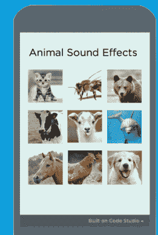

```
onEvent("Cat", "click", function() {
  playSound("sound://category_animals/cat.mp3", false);
});

onEvent("Bee", "click", function() {
  playSound("sound://category_animals/bee_buzz.mp3", false);
});

onEvent("Bear", "click", function() {
  playSound("sound://category_animals/bear.mp3", false);
});

onEvent("Cow", "click", function() {
  playSound("sound://category_animals/cow.mp3", false);
});
```

Hailey Nemeth

# 在本部分中，你将...

- 编写播放声音的事件驱动程序
- 使用随机数创建幸运数字小工具
- 构建一个供用户创作彩色现代艺术的应用程序

# 第4章

## 乐团

**你喜欢伴着音乐即兴演奏吗**？如果是，你会喜欢本章的项目！以音乐为特色的编码项目是将技术与艺术结合起来的有趣方式。由于你的电脑包含声卡和扬声器，你可以运行你的程序，并将你的音频创作播放给全世界。

本章中的乐团玩具向你介绍了编码的第一个重要理念：事件驱动编程。*事件驱动编程*只是表示当事件发生时——例如用户点击电脑鼠标或点击移动设备上的按钮——程序通过执行某些操作来响应的一种花哨说法。

在乐团项目中，你使用Scratch在电脑上创建一个虚拟乐团。你编写代码，使得当用户点击一种乐器时，电脑就会播放声音。现在你正在编程！


## 头脑风暴

从说唱团体到摇滚乐队再到弦乐合奏，每种音乐流派都适合每个人！在本项目中，你将使用Scratch创建自己的乐团版本，以供在电脑上使用。你的乐团可以包含Scratch精灵库中的任何精灵，以及Scratch声音库中的任何声音。

通过思考你希望屏幕上出现哪些音乐对象（例如乐器、打击乐器和歌手）来对程序进行头脑风暴设计。最终用户——将玩你的玩具的人——将演奏你组装的声音生成对象来创作他们自己的音乐。他们可以像DJ一样，以任何组合播放不同的声音。你永远无法确切知道你的最终用户会如何使用你提供的东西——这正是乐团程序如此有趣的原因！

现在按照以下简单步骤开始编程。

> ### 事件驱动编程
> 在*事件驱动程序*中，变化的事件会影响程序的运行方式。事件可以由用户完成，例如按钮点击。事件也可以由传感器触发，例如温度计读取高温或低温，或者加速计感知运动。最后，当它从程序的另一部分获得信息时，也可以触发事件。
>
> 事件驱动编程与早期的编程方式不同。早期的编程语言大多是过程式的：程序只是从头开始运行到结束。
>
> 你在本书中的大部分编程都将是事件驱动编程。这就是为什么像乐团程序这样的程序向你展示了如何编写连接用户操作和程序操作的代码！

## 开始一个新项目

通过开始一个新项目来创建你的乐团程序：

1. 在https://scratch.mit.edu打开Scratch。如果提示，请启用Flash以运行Scratch。登录你已创建的用于使用Scratch的账户（参见第2章）。
2. 在Scratch主页上，选择“创建”。或者，如果你已经在Scratch中工作，请从菜单栏中选择“文件/新建项目”。一个新项目会打开，如图4-1所示。

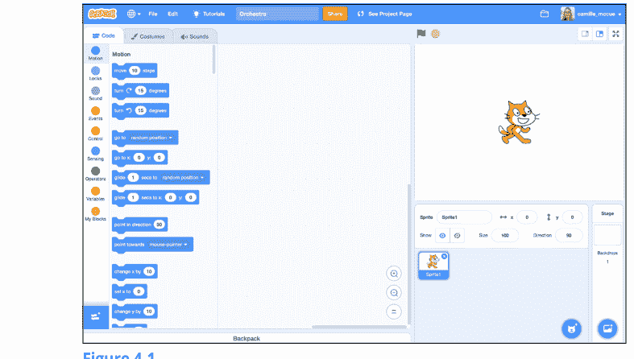

3. 通过在Scratch界面顶部的“项目名称”字段中键入名称来命名你的程序。
4. 通过点击或轻触Scratch猫图标上的X，将Scratch猫从项目中剪切（删除）。你可以在Scratch界面右下角的“精灵”区域找到该图标。

## 添加背景

*背景*是填充你玩具屏幕的背景颜色或图像。按以下步骤添加背景：

1. 在“舞台”处，点击“选择背景”图标。背景库将出现在“选择背景”屏幕上，如图4-2所示。库按主题组织，包括音乐和体育等类别。

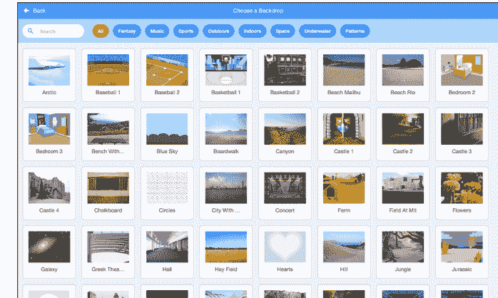

图4-2

> **记住**
> 你可以通过点击或轻触背景库中任何类别左上角的“返回”来返回到之前的背景视图。

2. 点击或轻触“音乐”按钮，将你的背景选择范围缩小到音乐主题。库现在只显示音乐背景。

> **提示：** 背景库提供了一个搜索框，你可以在其中键入你想要的主题名称，例如*城市*，然后点击或轻触放大镜进行搜索。如果存在这样的背景，它将会出现。

3. 从音乐背景列表中，点击或轻触你想要的背景。你的背景将出现在舞台上。在图4-3中，我为我的程序选择了音乐会背景。

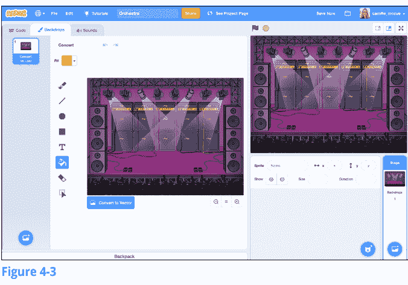

## 添加乐器精灵

所有编程语言都有创建对象的方法。*对象*通常是在电脑屏幕上移动的实体——汽车、鸟、彩弹等。编程语言对对象有不同的称呼，Scratch称之为精灵。*精灵*是“生活在”背景中的对象，就像你刚刚选择的背景一样。

# 第2部分：声音、颜色、随机惊喜

你可以通过以下步骤为你的玩具添加乐器角色：

1. 在Scratch界面的角色区域，点击**选择一个角色**图标。

角色库会出现在**选择一个角色**屏幕上。该库按主题组织，包含多个类别，例如*动物*和*食物*。

2. 点击或轻触**音乐**按钮，将角色选择范围缩小到音乐主题，如图4-4所示。

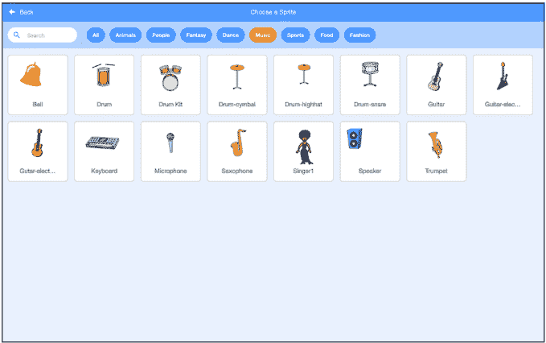

图4-4

现在库中只显示音乐类角色。

你可以点击或轻触**选择一个角色**屏幕左上角的**返回**，回到之前的角色视图。

3. 在音乐角色列表中，点击或轻触你想要的角色。

你的角色会出现在舞台上。

4. 重复步骤1–3，为你的玩具添加更多乐器。

每个新角色都会出现在舞台上。每个角色的图标也会显示在Scratch界面的角色区域中。

> 你可以随时更改角色。如果你添加了一个角色后决定不要它了，可以点击或轻触其图标上的X将其删除，该图标位于Scratch界面的角色区域中。你可以通过在角色区域中选择角色，然后在其上方的**大小**字段中输入新数字来调整角色大小。

> 对象有这么多不同的名称！在GameSalad中，另一种你可能听说过的编程语言，对象被称为*演员*。在MicroWorlds EX中，对象是*海龟*。在某些编程语言（如面向对象编程语言，简称OOP）中，对象可以是物理的或*信息性的*——即拥有数据并以特定方式在程序中行为的抽象事物。

## 添加歌手角色并修改其造型

乐队和管弦乐队需要人声。让我们为你的玩具添加一位歌手吧！

要添加歌手，请执行以下操作：

1. 在Scratch界面的角色区域，选择**选择一个角色**图标。
2. 在弹出菜单中，选择**选择一个角色**以打开Scratch角色库。
3. 在搜索框中，输入`singer`以找到歌手角色。

Singer1角色出现。

4. 点击或轻触Singer1角色以选择她。

你的角色出现在舞台上。但是她的裙子与深色背景对比不明显，所以我们来重新给裙子上色。

# 62 第2部分：声音、颜色、随机惊喜

5. 在Singer1仍处于选中状态时，点击或轻触Scratch界面左上角的**造型**标签。

Scratch界面的造型编辑器打开。

6. 仍然在**造型**标签下操作，点击或轻触**填充颜色**色板，然后点击小三角形打开调色板，接着为歌手的裙子选择一种新颜色。点击或轻触调色板外部以确认你的选择。

7. 仍然在**造型**标签下操作，点击或轻触**油漆桶**图标，然后点击裙子，用填充颜色重新为其着色。

如图4-5所示，歌手裙子的新颜色现在会显示在造型编辑器和舞台上。


**提示**

你可以尽情发挥，重新为歌手的裙子上色和装饰！尝试使用**绘画**工具选项，看看有哪些不同的方式可以为裙子添加颜色和特殊填充，或者使用**画笔**绘制装饰，让造型更加惊艳！

你的用户界面现在完成了！它包含一个带有背景的舞台、两个乐器角色和一个歌手角色。现在你可以为你的程序编写代码了。

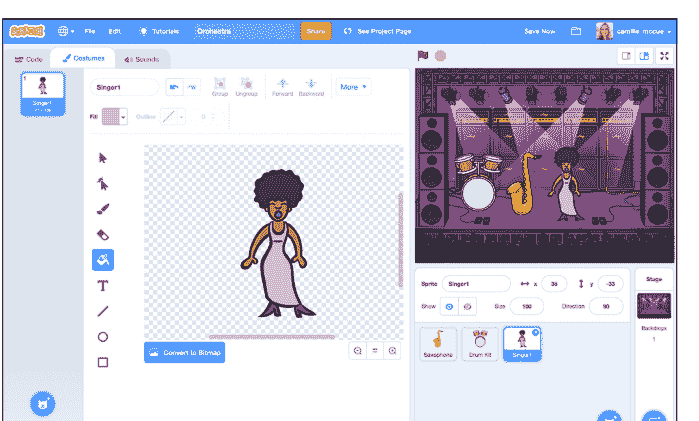

图4-5

## 为每个乐器编写播放声音的代码

接下来，你需要为每个乐器编写代码，使其在程序中发生事件时播放声音。你可以为每个乐器选择它要响应的事件，以及它要播放的声音。

只需按照以下步骤操作：

1. 点击或轻触一个乐器角色。

我选择了萨克斯风角色。

2. 在Scratch界面的**代码**标签上，选择**事件**图标。

事件命令出现。以下是一些最常见的事件：

- `when green flag clicked`（当绿旗被点击时）
- `when x key pressed`（当按下x键时），其中x可以是空格键（`space`）、方向键（`up`、`down`、`left`或`right`）或字母数字字符（如`a`或`b`或`1`或`2`）
- `when this sprite clicked`（当这个角色被点击时）

`when backdrop switches`（当背景切换时）事件在创建使用多个场景或级别的游戏时很有用。涉及`broadcast`（广播）的事件在你希望角色之间相互通信时很有用。（参见第18章中一个使用广播的项目。）

3. 将一个事件命令拖动到代码工作区。

我拖动了`when this sprite clicked`（当这个角色被点击时）命令。

4. 仍然在Scratch界面的**代码**标签上操作，选择**声音**图标。

# 第2部分：声音、颜色、随机惊喜

5. 将`start sound`（开始播放声音）命令拖动到代码工作区，并将其附加到你之前添加的事件命令上。

`start sound`命令最初显示`C sax`声音。

6. 点击或轻触`start sound`命令块上的标签，查看额外的声音选项，并选择你想要使用的声音。

如图4-6所示，萨克斯风的声音选项（如`C sax`和`D sax`）已经内置在萨克斯风角色中。我选择了`G sax`。

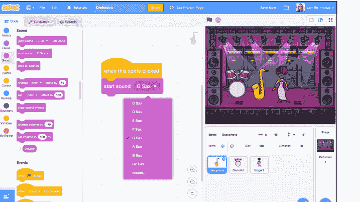

图4-6

7. 点击或轻触萨克斯风角色（或执行你选择的任何事件），在舞台上试听声音。

8. 重复步骤1–7，为舞台上的另一个乐器添加事件和声音。

当你选择新角色时，你只能看到该角色的代码。你看不到已添加到其他角色中的代码。不要惊慌——你没有丢失任何代码！


**技术干货**

## 为歌手编写播放声音的代码

歌手角色与乐器角色不同，因为她没有任何内置的歌手声音。她有一个名为`pop`的内置声音，但你想要她唱歌，不是发出pop声！

你需要为歌手角色添加一个新的声音，一个听起来像唱歌的声音。首先，你选择一个事件命令让她开始唱歌。然后你为歌手添加一个声音，让她有东西可唱：

1. 点击或轻触Singer1角色的图标。


2. 在Scratch界面的**代码**标签上，选择**事件**图标。

事件命令出现。

3. 将一个事件命令拖动到代码工作区。

我拖动了`when this sprite clicked`（当这个角色被点击时）命令。

4. 点击或轻触**声音**标签。

声音编辑器出现。

5. 点击或轻触Scratch界面左下角的**选择一个声音**按钮，打开Scratch声音库。

声音库出现在屏幕上。


6. 点击或轻触**人声**按钮，将声音选择范围缩小到人声主题。

现在库中只显示人声类声音。

7. 在人声列表中，点击或轻触你想要的声音。

你的声音被添加到歌手的声集集合中。（`Pop` 声音也在此集合中。你不再需要`Pop`声音，所以点击或轻触它，然后点击 X 删除它。）图 4-7 显示我选择了`Singer2`声音。

## 第二部分：声音、颜色、随机惊喜

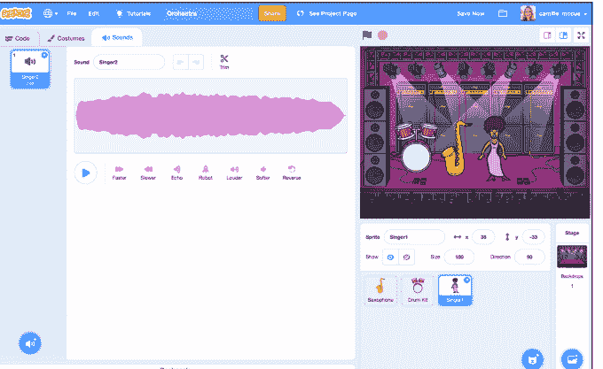

图 4-7

当你在**声音**标签下工作时，可以选择一个声音图标（如`Singer2`）来编辑该声音的属性。如图 4-7 所示，你可以修剪声音、加快或减慢播放速度、添加回声或机器人效果、调大或调小音量，或反向播放。你也可以在**声音**字段中重命名该声音。

8. 选择**代码**标签。

9. 在 Scratch 界面的代码区域中，选择**声音**类别的命令。

10. 将`start sound`（开始播放声音）命令拖动到代码工作区。

11. 点击或轻触`start sound`命令块上的小箭头，选择你之前为`Singer1`角色添加的声音。

12. 点击或轻触歌手角色，听她唱歌（或执行你选择的任何事件）。

## 并行处理

当你点击或轻触管弦乐队的每个成员时，你是否注意到他们播放的声音是重叠的，即在同一时间播放？这是因为他们的代码在并行处理。

你可能在数学课上听过*并行*（parallel）这个词。*平行线*位于同一个平面内且永远不相交。你可以拥有任意数量的平行线并排运行。

在计算机编程中，*并行处理*意味着计算机程序同时运行不同的代码块（并行），这样你的程序中就可以同时发生多件事。这就像用左手拍头，同时用右手揉肚子；你的动作是同步（同时）发生的。我知道你现在正试着拍头揉肚子，而且你可能发现执行这个并行过程很难！但对于计算机来说，并行处理很简单。而且它们可以并行运行远不止两个代码块。

因此，你可以为你的乐队程序添加任意数量的成员，因为 Scratch 在并行执行它们的代码时不会有任何问题。而且，你无需点击或轻触每个角色来运行其代码，可以将`when this sprite clicked`事件替换为`when green flag clicked`，这样你就可以通过一个单一事件启动所有的并行处理动作！

## 保存、测试和调试你的程序

在你工作时，Scratch 会自动将你的程序保存到云端，因此你无需采取任何特殊操作来保存工作。

测试你的程序并修复所有 bug，以确保它按照你想要的方式运行。请参阅第 3 章中关于调试 Scratch 程序的章节。

## 与世界分享你的程序

在你的程序完美运行后，就到了分享它的时间了！将程序的状态设置为“分享”，然后在项目页面中添加程序的描述以及运行指南。有关分享程序的详细信息，请参阅第 19 章。

## 增强你的玩具

考虑通过新功能来增强你的乐队玩具：

- **新乐器**：添加包括号角和打击乐在内的新乐器供用户演奏。
- **新歌手**：添加演唱不同歌曲（包括节奏口技！）的新歌手供用户尝试。
- **在网上寻找酷炫的新声音**：网络上的声音库为你提供了海量的音乐循环、人声和音效。更多信息请参阅第 2 章。
- **录制你自己的声音**：与其从 Scratch 声音库中选择声音，为什么不录制自己的声音呢？在“声音”选项卡中，选择并按住“选择声音”，然后从弹出菜单中选择“录制声音”。接着，使用计算机麦克风录制原创声音，比如你的歌声！有关录音的详细信息请参阅第 2 章。

> ID 名称中不要包含空格。在包括 App Lab 在内的大多数编程语言中，都不允许使用空格。如果你使用了空格，程序会出现错误。

在 App Lab 以及大多数编程语言中创建 ID 名称时，请使用*camelCase*（驼峰命名法）命名。就像骆驼一样，名称从低处开始（以小写字母开头），每当你开始一个新单词时就升高（使用大写字母）。通过这种方式，你可以将两个或三个单词组合在一起而无需空格，大写字母能帮你识别每个新单词的开始。例如，如果你在为一个屏幕命名，你可以将其命名为`playScreen`或`levelOneScreen`。

3. 在工作区的“属性”选项卡中，找到“图像”字段。点击“选择”链接为该屏幕选择一个新的背景图像。

“选择资源”对话框打开。

4. 点击“上传文件”按钮。

5. 浏览并选择你想要上传到资源库的图像文件。然后点击“选择”按钮。

该图像文件是你进行头脑风暴时找到的文件（例如，通过 Google 图片搜索），或者是之前创建并保存的文件。

## 第五章：拟声音效生成器

图像文件会出现在“选择资产”对话框中。在图5–2中，我上传了名为`sound_fx_background.jpg`的图像文件。

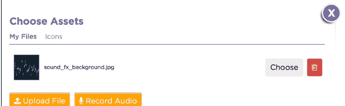

图5-2

6. 在“选择资产”对话框中，点击你刚上传的图像资产旁边的“选择”按钮。

图像会出现在你的应用背景上，如图5–3所示。

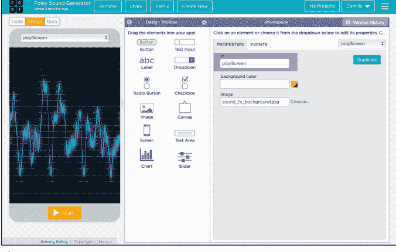

图5-3

## 第二部分：声音、颜色、随机惊喜

接下来，你应该为你的应用命名，使用一个能让用户了解应用用途的标签。添加一个标题如下：

1. 继续在应用实验室的**设计模式**中工作。如果你不在设计模式，请点击“设计”按钮。

设计工具箱和工作区将显示出来。


2. 在设计工具箱中，将“标签”图标拖到屏幕上，以在你的应用中创建一个标签。将其定位在应用显示区域顶部中心附近。

由于屏幕背景较暗，你可能很难看清标签，因为它的默认文本是黑色的。你将在下一步更改文本颜色。

3. 在工作区的“属性”选项卡上，按以下方式更改标签的属性（如图5-4所示）：

- ID：将 ID 重命名为`titleLabel`。
- 文本：输入你的应用标题，例如**拟声音效生成器**。
- 宽度 (px)：将标签的宽度增加到 240 像素（或更多），这样标题就会显示在一行上。
- 高度 (px)：保持不变。
- X 位置 (px)：保持不变；你稍后可以通过拖动标签到合适位置来更改 X 位置。
- Y 位置 (px)：保持不变；你稍后可以通过拖动标签到合适位置来更改 Y 位置。
- 文本颜色：点击“文本颜色”字段右侧的小色块，然后选择一种与背景形成良好对比的标题颜色。
- 背景颜色：保持不变。
- 字体大小 (px)：在字段中输入新的字体大小，或使用选择箭头使标题大小适合你的应用。
- 文本对齐：点击选择箭头并选择“居中”。

4. 点击你应用中的标签（参见图5-4），并将标签拖动到你想要的位置。

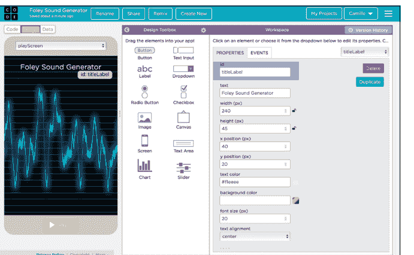

图5-4

### 添加“播放声音”和“停止声音”按钮

你的应用将包含用户可以点击或轻触以播放声音的按钮。请按照以下说明为你的应用添加一个按钮：

1. 继续在应用实验室的**设计模式**中工作。如果你不在设计模式，请点击“设计”按钮。

设计工具箱和工作区将显示出来。


2. 在设计工具箱中，将“按钮”图标拖动到应用显示区域，以创建一个按钮。

3. 在工作区的“属性”选项卡上，按如下所示以及图5-5所示更改按钮的属性：

- ID：将 ID 重命名为`boingButton`或类似的名称，以指示将与此按钮关联的声音。
- 文本：输入将显示在按钮上的文本，例如**Boing**。（如果你愿意，此文本可以包含空格。）
- 宽度 (px)：将按钮的宽度增加到 135 像素左右。
- 高度 (px)：将按钮的高度增加到 55 像素左右。
- X 位置 (px)：保持不变；你稍后可以通过拖动按钮到合适位置来更改 X 位置。
- Y 位置 (px)：保持不变；你稍后可以通过拖动按钮到合适位置来更改 Y 位置。
- 文本颜色：点击“文本颜色”字段右侧的小色块，选择一种与按钮背景形成良好对比的文本颜色。
- 背景颜色：点击“背景颜色”字段右侧的小色块，选择一种与应用背景色形成良好对比的按钮颜色。
- 字体大小 (px)：在字段中输入新的字体大小，或点击选择箭头，使按钮上的文本大小适合你的应用。
- 文本对齐：点击选择箭头并选择“居中”。
- 图像：保持不变。

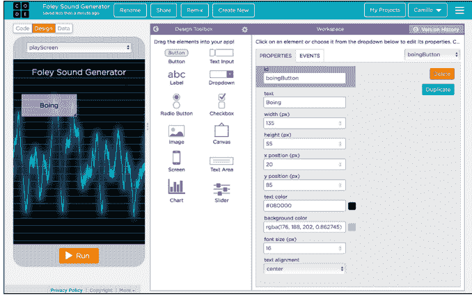

图5-5

4. 点击你应用显示区域中的按钮，并将其拖动到你想要的位置。

在定位时，请记住你将创建多个按钮，并且需要为它们留出空间。

5. 通过选择你创建的第一个按钮，然后点击工作区中水绿色的“复制”按钮，来创建另一个按钮。

6. 重复步骤5，直到创建完所有按钮。

7. 更改每个复制按钮的 ID 和文本，使每个按钮代表一种新的声音。将你的最后一个按钮命名为`Stop Sounds`。

如果你愿意，可以将`Stop Sounds`按钮的宽度和颜色设置得与其他声音按钮不同，以使其突出显示。用户将使用`Stop Sounds`按钮在声音播放时停止一种或多种声音，尤其是当某个声音持续时间超过用户期望时。

8. 将你的每个新声音按钮拖动到应用显示区域的不同位置。

目标是为使用你的拟声音效生成器的人创建一个整洁、可读的用户界面。请参考本章首页的图片，看看我是如何排列六个声音按钮和一个“停止声音”按钮的。


提示

在任何项目中安排按钮时，都要仔细考虑用户界面。用户会期望按钮和其他界面元素以易于理解的布局组织。

### 为声音按钮编码以播放声音

接下来，你需要为每个按钮编写命令，以便在用户点击或轻触按钮时播放声音。请按照以下说明操作：

1. 点击“代码”按钮，切换到应用实验室的**代码模式**。

命令工具箱和工作区将显示出来。

2. 在工具箱中，选择“UI控件”。将`onEvent`命令拖动到工作区。

3. 在`onEvent`命令中，点击 ID 选项卡，然后在列表中选择你想要的按钮名称。我选择了`boingButton`。当用户在电脑上点击`Boing`按钮或在智能手机上轻触`Boing`按钮时，`onEvent`内部的代码块将执行。保持`click`动作不变，并删除`function()`内部的`event`。

4. 返回“UI控件”。将`playSound`命令拖动到`onEvent`命令中。

5. 在`playSound`命令中，点击 ID 选项卡，然后选择“选择”链接。

应用实验室的声音库将打开，如图5-6所示。

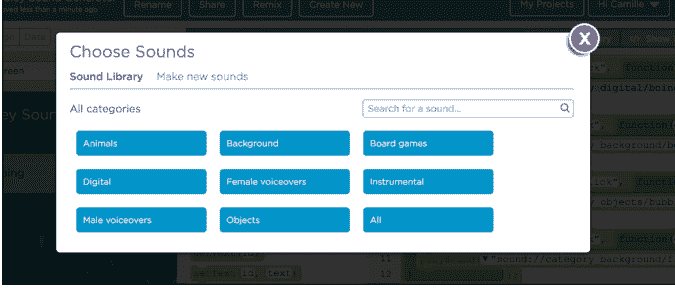

6. 在声音库中，选择一个声音类别，然后选择该类别中的一个声音。或者，你可以搜索一个声音。然后点击“选择”按钮。

你选择的声音会被插入到`playSound`命令中。我插入了`boing_2.mp3`声音。

7. 在`playSound`命令中，如果你希望声音只播放一次，请保持`false`字段不变。如果你希望声音*循环*（一遍又一遍地播放），请将此字段更改为`true`。

你第一个完成的`onEvent`命令应如下所示：

```
onEvent("boingButton", "click", function() {
  playSound("sound://category_digital/boing_2.mp3", false);
});
```

8. 重复步骤2–7，为每个剩余的声音按钮编码。

此处显示的示例包含以下声音：Boing、Bowie Alley、Bubbles、Fire Burning、Kazoo 和 Ocean Waves。

### 为“停止声音”按钮编码以停止声音

你的一些按钮包含短促的声音，另一些则包含持续超过一分钟的声音。作为一名拟音师，你需要能够在不需要时停止声音。要创建一个可以在声音播放时停止任何声音的按钮，请按照以下步骤操作：

1. 继续在应用实验室的**代码模式**中工作。如果你不在代码模式，请点击“代码”按钮。

2. 在工具箱中，选择“UI控件”。将`onEvent`命令拖动到工作区。

3. 在`onEvent`命令中，点击 ID 选项卡，然后在列表中选择`stopButton`。保持`click`动作不变，并删除`function()`内部的`event`。

当用户在电脑上点击“停止声音”按钮或在智能手机上轻触`stopButton`按钮时，`onEvent`内部的代码块将执行。

4. 返回“UI控件”。将`stopSound`命令拖动到`onEvent`命令中。

5. 在`stopSound`命令中，点击 ID 选项卡，然后选择“选择”链接。选择你的应用中正在使用的任何长时长（超过一分钟）声音的名称。

6. 重复步骤4和5，将所有长时长声音拖入`onEvent`中。

点击或轻触“停止声音”按钮会触发`onEvent`，这会导致此代码块中的所有`stopSound`命令执行。

就是这样！你已经完成了拟声音效生成器应用的所有设计和编码工作。图5-7以块格式显示了完整的代码。

## 第五章：拟音生成器

## 图 5-7

以下是完整的文本格式代码：

```
onEvent("boingButton", "click", function() {
  playSound("sound://category_digital/boing_2.mp3", false);
});
onEvent("bowlButton", "click", function() {
  playSound("sound://category_background/bowling_alley.mp3", false);
});
onEvent("bubblesButton", "click", function() {
  playSound("sound://category_objects/bubbles.mp3", false);
});
onEvent("fireButton", "click", function() {
  playSound("sound://category_background/fire_burning.mp3", false);
});
onEvent("kazooButton", "click", function() {
  playSound("sound://category_objects/kazoo.mp3", false);
});
onEvent("oceanButton", "click", function() {
  playSound("sound://category_background/ocean_waves.mp3", false);
});
```

```
onEvent("stopButton", "click", function() {
    stopSound("sound://category_background/bowling_alley.mp3");
    stopSound("sound://category_background/fire_burning.mp3");
    stopSound("sound://category_background/ocean_waves.mp3");
});
```

## 保存、测试和调试你的应用

在你工作时，应用实验室会自动将你的程序保存到云端。测试你的程序并修复任何错误，以确保它按你期望的方式运行。有关测试和调试的帮助，请参阅第三章。

## 与世界分享你的应用

在你的应用按预期运行后，你应该将你的程序状态设置为“共享”。然后，你可以通过短信将其发送到某人的手机、在线发布、上传到 Facebook 和 Twitter 来分享它。你也可以将你的应用压缩并作为电子邮件附件发送，或者将其嵌入到网页中。有关在应用实验室中分享你创建的应用的详细信息，请参阅第十九章。

## 增强你的应用

考虑使用以下功能来增强你的拟音生成器：

- **新声音**：添加新声音，包括来自网络的声音。在第二章中，请参阅关于录制和查找声音的部分。
- **图像按钮**：使用代表其播放声音的图像文件来代替按钮。例如，添加一张大象的图片，当点击或轻触时，播放大象的叫声。

## 幸运数字

**你是否注意到**，幸运饼干里的签语通常包含一组幸运数字，范围通常在 0 到 99 之间？与其购买幸运饼干，你可以编写一个程序来制作你自己的幸运数字，并且你可以让该程序在 micro:bit 上运行来向你展示这些数字！

要生成你的幸运数字，你需要在程序中编码随机性。*编码随机性*意味着创建随机选择的结果，以便用户每次运行程序时获得不同的体验。在掷骰子游戏中，每次掷骰子都会随机产生一个 1 到 6 之间的数字。在电子游戏中，随机性让你可以在屏幕上散布角色，或者让球以不同的角度从挡板上弹开。如果你游戏中的动作从不改变，那将很无聊：随机性给玩家带来了变化和惊喜。

## 第二部分：声音、颜色、随机惊喜

在编码现实世界的模拟时，随机性也很重要。对人群中流感病毒传播进行建模或预测高速公路上的交通运动，都需要使用随机数来预测许多不同但可能的结果。简而言之，编码随机性让你的程序更有趣、更逼真。

## 头脑风暴

图 6-1 展示了一个完成的项目，在 micro:bit 上显示一个幸运数字。要创建这个很酷的小工具，你需要编写一个简短的事件驱动程序并将其上传到 micro:bit。（有关事件驱动编程的更多信息，请参阅第四章。）当用户按下 micro:bit 上的按钮 A 或按钮 B 时，程序运行。

图 6-1


你可以让你的幸运数字玩具显示任何范围的数字，从任何最小值到任何最大值。例如，如果你想让你的玩具只显示个位数，可以将范围设置为 0 到 9。或者你可以让你的幸运数字玩具显示强力球游戏的彩票号码。强力球号码的主球范围是 1 到 69，强力球范围是 1 到 26。想创建这个玩具吗？你可以编写代码，使 `micro:bit` 在点击按钮 A 时显示主号码，在点击按钮 B 时显示强力球号码。

## 开始一个新项目

通过按照以下步骤开始一个新项目来创建你的幸运数字小工具：

1. 在 `https://makecode.microbit.org` 打开 MakeCode for micro:bit。
2. 在 micro:bit 主页上，点击屏幕中央的大大的“新建项目”按钮。一个新项目将打开并显示工作区。
3. 通过在 micro:bit 界面底部的“项目名称”字段中键入一个名称来命名你的项目。
4. 点击“项目名称”字段旁边的保存图标来保存你的项目。

## 为按钮 A 编程

你在工作区编写你的幸运数字代码。你可以在积木模式或 JavaScript 文本模式下工作。强力球彩票示例（参见“头脑风暴”部分）使用在积木模式下编写的代码。首先，通过以下步骤为按钮 A 编程，以在 1 到 69 的主彩票范围内选择幸运数字：

1. 选择“输入”类别命令，并将一个“当按钮 A 被按下”命令拖到工作区。

当最终用户按下按钮 A 时，它将运行代码块（你将在下一步创建）。

2. 选择“基本”类别命令。将一个`显示数字`命令拖到工作区，并将其放入`当按钮 A 被按下`命令中。

请注意，积木显示默认值 0。你将在下一步中替换此数字。

3. 选择“数学”类别命令。将一个`随机选取`命令拖到工作区，并将其插入`显示数字`命令中，替换掉 0。

4. 通过在字段中键入新值，将`随机选取`的范围更改为 1 到 69。

你的代码应该类似于图 6-2。

> **记住**
> 
> 在 MakeCode for micro:bit 中，你会在工作区看到所有代码，就像在应用实验室中工作时一样。在 Scratch 中，你只能看到你当前正在处理的精灵或舞台的代码。

## 编码随机性

程序员依赖随机性使电子游戏变得有趣，并使世界模型更加逼真。随机性也涉及*网络安全*——使用数学计算来保护你在互联网上传输的数字信息。为计算机程序生成随机数需要一个*算法*，即计算机每次以相同方式执行的一系列计算。你编写了一个小算法，使 micro:bit 生成并显示一个随机数。计算机使用自己的算法来创建传递到你程序中的随机数。

包括 Scratch、应用实验室和 MakeCode 在内的编程语言允许你设置程序中要使用的随机数的范围。你只需键入最小数和最大数。更高级的编程语言使用一个名为`randomNumber()`的命令，该命令将随机数范围的最小值设置为零。因此，使用这些语言时，你必须进行一些额外的数学运算来更改起始值和值范围。

无论你使用什么命令来生成随机数，随机数范围内的每个数字被选中的可能性都是相等的。例如，如果你正在编程一个骰子滚动器，其范围是 1 到 6，在多次掷骰子时，骰子面上的每个数字平均出现 1/6 的时间。

## 为按钮 B 编程

接下来，为按钮 B 编程以选择强力球号码的幸运数字。为此，你将复制按钮 A 的事件，然后更改一些内容：

1. 右键单击（Windows）或按住 Ctrl 键单击（Mac）`当按钮 A 被按下`事件，然后从弹出菜单中选择“复制”（如图 6–3 所示）。

`当按钮 A 被按下`事件被复制。

2. 在按下按钮指令中，点击 A 旁边的小三角形，将其改为 B。

现在，当最终用户按下按钮 B 时，程序就会运行该代码块。（你在下一步编辑代码。）

3. 通过在“随机选取”指令中输入新的数字，将随机数范围改为显示 1 到 26。

“幸运数字”的完整代码如图 6-4 所示。

以下是文本格式的完整代码：

```javascript
input.onButtonPressed(Button.A, function () {
    basic.showNumber(Math.randomRange(1, 69))
})
input.onButtonPressed(Button.B, function () {
    basic.showNumber(Math.randomRange(1, 25))
})
```

`micro:bit`的 MakeCode IDE 提供了多个位于“输入”类别中的事件指令供你使用。一些常见的事件包括：按钮按下、运动感应和电信号感应。对于按钮按下，你可以将事件指令设置为`on button A pressed`（按下按钮 A）、`on button B pressed`（按下按钮 B）或`on button A+B pressed`（同时按下两个按钮）。对于运动感应，你可以将事件设置为`on shake`（摇晃）、`on tilt`（倾斜）、`on free fall`（自由落体）以及 micro:bit 的其他运动类型。对于电信号感应，你可以将事件指令设置为`on pin pressed`，以读取通过连接在板子引脚上的电线检测到的电信号。来自板子其他部分的数据，如温度或指南针方向，也可以被读取并在指令中使用，以触发程序中的其他事件运行。

### 保存、测试和调试你的程序

点击屏幕底部的“保存”按钮以保存你的程序。程序会保存在云端，同时作为 micro:bit 的 `.hex` 文件下载到你的“下载”文件夹中。`.hex` 文件是一种十六进制格式的程序，micro:bit 可以读取并执行它。

你可以在屏幕上的模拟器中测试程序，点击按钮 A 或按钮 B。每次点击都会显示你在代码中设定的范围内的数字。放不下的数字会逐个滚动显示。修复任何错误，确保你的“幸运数字”玩具按你想要的方式工作。（参见第 3 章中关于调试 micro:bit 程序的部分。）

### 将程序传输到 micro:bit

代码按你想要的方式工作后，你可以将其传输到 micro:bit。有关传输方法的指导，请参见第 2 章。然后按下按钮 A 或按钮 B，看看 micro:bit 为你生成的幸运数字吧！

程序上传到 micro:bit 后，你可以将板子从电脑的 USB 端口拔下。如果你想离开电脑使用你的玩具，请将电池盒连接到 micro:bit。

## 与世界分享你的程序

你可以与他人分享你的 micro:bit 程序。将程序状态设置为“共享”，然后复制并粘贴项目链接到你想分享的任何地方。有关分享程序的详细信息，请参见第 19 章。

## 升级你的玩具

考虑为你的幸运数字玩具添加新功能：

- **不同的数字**：改变玩具的数字范围。你能让 micro:bit 显示的最大数字是多少？你能设置范围，让它只显示偶数吗？
- **新事件**：将事件触发从`on button pressed`改为`shake`（摇晃）或`fall`（坠落）事件。

## 蒙德里安艺术玩具

**用代码实现颜色**能让程序更有趣、更真实。你可能很惊讶，早期的视频游戏，比如《乓》（Pong），是黑白的！现在你可以混合屏幕上红、绿、蓝像素的光，创造出数百万种颜色。

在本章中，你通过编写颜色代码为游戏增添新的刺激层次。你会运用在第 6 章中学到的随机编程技能，并学习如何使用触摸屏传感器定位位置。（在下一章中，你将更深入地了解位置。）

在蒙德里安艺术玩具中，你使用 App Lab 构建一个应用程序，让最终用户以皮特·蒙德里安的风格创作艺术作品——这位荷兰艺术家以黑色矩形中填充红、黄、蓝三原色的抽象画而闻名。你编写程序代码，生成随机大小的矩形，并使用用户选择的颜色填充，让每个用户的画作都成为独特的数字艺术作品！

## 头脑风暴

你可以使用任意宽度和颜色的线条来创建你的蒙德里安艺术绘画玩具。你可以按自己的意愿设置矩形尺寸——宽度和长度——的随机范围。你也可以为最终用户提供任意填充颜色，包括随机选择的颜色或带有一些透明度的颜色。图 7-1 展示了一个已完成的玩具示例，其中包含最终用户用数字方式绘制的一幅艺术画布。

## 开始新项目

按照以下步骤开始创建你的蒙德里安艺术玩具应用程序：

1. 在 `https://code.org/educate/applab` 打开 App Lab。登录你创建的 App Lab 账户（参见第 2 章）。在 App Lab 标题下，点击“Try It Out”按钮。

一个新项目随即打开。

2. 通过点击“Rename”（重命名）按钮并在 App Lab 界面顶部的“Project Name”（项目名称）字段中输入名称，为你的程序命名。

3. 点击“Save”（保存）按钮。

## 添加背景颜色

大多数蒙德里安画作都有白色背景，但你可以选择将背景涂成不同的颜色。为了让彩色矩形更加醒目，可以考虑将背景改为浅灰色。

你可以按以下步骤更改应用程序的背景颜色：

1. 点击“Design”（设计）按钮，切换到 App Lab 的设计模式。

设计工具箱和工作区随即显示。

2. 在工作区的“Properties”（属性）选项卡上，将 `screen1` 的 ID 重命名为更有意义的名称，例如`artScreen`，如图 7-2 所示。

ID 名称中不要包含空格。在大多数编程语言中，包括 App Lab，空格都是不允许的。

3. 点击“Background Color”（背景颜色）字段右侧的小色块，打开背景的颜色编辑器。

4. 点击切换箭头（上下箭头），切换到 RGBA 颜色模式。

显示的其他选项包括 HSLA 和 HEX。HSLA 代表色相-饱和度-亮度-透明度，HEX 代表十六进制。每种都是设置颜色的不同方法。

5. “Background Color”（背景颜色）字段中的默认白色背景为 `rgba(255,255,255,1)`。通过在 R、G、B 字段中分别输入 0 到 255 的值，并在 A（alpha）字段中输入 1，可以创建任意你想要的背景颜色。或者滑动颜色滑块（第一个滑块）和透明度滑块（第二个滑块）来创建你想要的颜色和透明度。

若要跟随示例创建浅灰色背景，请在前三个字段中分别输入 230（左右），在 A 字段中输入 1。参见图 7-3。有关颜色和透明度的更多信息，请参见“RGBA 颜色”侧边栏。

### RGBA 颜色

RGBA 颜色代码为红、绿、蓝和透明度提供数值。红、绿、蓝各自的值范围都是 0 到 255。值为 0 表示该颜色不显示光， resulting in the darkest color。值为 255 表示该颜色的光量最大，产生最亮的颜色。alpha 参数是 0（透明）到 1（不透明）之间的数字。如果未给出 alpha 值，则默认为 1。alpha 值为 0.5 表示半透明半不透明。

以下是一些 RGBA 值及其对应颜色的示例：

| RGBA 值 | 颜色 |
| :--- | :--- |
| `(0,0,0,1)` | 黑色 |
| `(255,0,0,1)` | 红色 |
| `(0,255,0,1)` | 绿色 |
| `(0,0,255,1)` | 蓝色 |
| `(255,255,0,1)` | 黄色——红光和绿光混合产生黄光 |
| `(0,255,255,1)` | 青色——绿光和蓝光混合产生青光 |
| `(255,0,255,1)` | 品红色——红光和蓝光混合产生品红光 |
| `(50,50,50,1)` | 深灰色 |
| `(150,150,150,1)` | 中灰色 |
| `(200,200,200,1)` | 浅灰色 |
| `(255,255,255,1)` | 白色 |

请记住，你是在电脑屏幕上混合彩色像素光，这会产生与在纸上混合蜡笔颜色不同的结果。例如，混合红光和绿光产生黄光。但混合红色和绿色蜡笔会产生一种难看的棕色阴影。

编程时，你可以通过在颜色范围 0 到 255 中输入数字来设置像素颜色值。记住，数字越小表示光越少，在显示器上产生更深的颜色。数字越大表示光越多，在显示器上产生更亮（更浅）的颜色。

## 第二部分：声音、色彩与随机惊喜

将随机性与色彩相结合，你可以编写代码为应用生成随机颜色。将任意像素的颜色值替换为`random(0, 255)`，即可为该颜色创建256种变体。为每个像素颜色值（红、绿、蓝）进行替换，就能为每个颜色通道生成256种色彩变化。这意味着你可以产生256 * 256 * 256种颜色，即超过1600万种组合！

同时请记住，小于1.0的alpha值会使颜色具有一定的透明度。当将彩色对象（例如填充矩形）叠加放置时，在重叠区域可以看到颜色混合效果，这会产生一些有趣的艺术效果。

## 添加标题标签

接下来，你应该为应用添加一个标签作为名称，帮助用户了解其用途。按如下步骤添加标题：

1. 继续在App Lab的设计模式下工作。如果当前不在设计模式，请点击“设计”按钮。

设计工具箱和工作区将显示出来。

2. 在设计工具箱中，拖动“标签”图标并将其放置在应用显示区域的左上角附近。

该标签将被放置在绘图画布的前方，以便可见。

3. 在工作区的“属性”选项卡上，按如下方式更改标签的属性：

   - ID：将ID重命名为`titleLabel`。
   - 文本：输入你的应用标题，例如**蒙德里安艺术**。
   - 宽度（px）：将标签宽度增加到约`240`像素（或更多），以使标题显示在单行内。
   - 高度（px）：不更改。
   - x位置（px）：不更改；稍后通过拖动标签来调整其x位置。
   - y位置（px）：不更改；稍后通过拖动标签来调整其y位置。
   - 文本颜色：点击“文本颜色”字段右侧的小色块，选择一种与背景形成良好对比的标题颜色。
   - 背景颜色：不更改。
   - 字体大小（px）：在字段中输入新的字体大小，或使用选择箭头调整标题字体大小，使其适合你的应用。
   - 文本对齐：点击选择箭头，选择“左对齐”。

4. 点击并拖动应用中的标签，将其放置到你想要的位置。

请参考图7-1，查看标题标签在应用模拟器显示屏上的位置。

## 添加填充和清除按钮

你的应用将包含按钮，用户可以点击或轻触这些按钮来为每个蒙德里安矩形选择填充颜色。按照以下说明将这些按钮添加到你的应用中：

1. 继续在App Lab的设计模式下工作。如果当前不在设计模式，请点击“设计”按钮。

设计工具箱和工作区将显示出来。

2. 在设计工具箱中，将“按钮”图标拖到应用显示区域。

3. 在工作区的“属性”选项卡上，按如下所示更改按钮的属性：

   - ID：将ID重命名为`redButton`（或类似名称），以表明此按钮允许用户绘制一个红色填充矩形（或你选择的任何颜色）。
   - 文本：输入将显示在按钮上的文本，例如**红色**（或你选择的任何颜色）。
   - 宽度（px）：增加按钮的宽度，例如55像素。
   - 高度（px）：增加按钮的高度，例如55像素。
   - x位置（px）：不更改；稍后通过拖动按钮来调整其x位置。
   - y位置（px）：不更改；稍后通过拖动按钮来调整其y位置。
   - 文本颜色：点击“文本颜色”字段右侧的小色块，选择一种与按钮背景形成良好对比的文本颜色。
   - 背景颜色：点击“背景颜色”字段右侧的小色块，选择一种与应用背景颜色形成良好对比的按钮颜色。例如，一个名为“红色”的按钮，其逻辑上应具有红色背景。
   - 字体大小（px）：在字段中输入新的字体大小，或点击选择箭头，使按钮上的文本大小适合你的应用。
   - 文本对齐：点击选择箭头，选择“左对齐”。

4. 将按钮拖动到应用显示区域，放置到你想要的位置。记住你需要创建多个按钮，并为它们预留空间。

5. 通过选择你创建的第一个按钮，然后点击工作区中青色的“复制”按钮来创建另一个按钮。

6. 重复步骤5，直到创建完所有按钮。

7. 更改每个复制按钮的ID和文本，使每个按钮代表一种不同的颜色。例如，我创建了红色、黄色、蓝色和白色的按钮。我还创建了一个“清除”按钮，用于清除屏幕上的绘画。

8. 将每个新按钮拖到应用显示区域，位于绘图画布下方。

目标是为你的“蒙德里安艺术”玩具的最终用户创建一个清晰易读的用户界面。请参考图7-1。

> 提示：为了让你的应用使用起来对最终用户直观易懂，请将按钮组织在易于找到的位置。

## 编写画布和画笔代码

*画布*是应用屏幕上的一个矩形区域，最终用户可以在此区域进行绘画——就像真正的艺术家画布一样！画布是透明的，因此你之前设置的背景颜色会显示出来。你将创建画布，并定义*画笔*——即用户将绘制的矩形的线条颜色和粗细。

在背景上创建并编写画布代码，然后按如下方式编写画笔代码：

1. 在App Lab中切换到代码模式。

命令工具箱和工作区将显示出来。

2. 在工具箱中，选择“画布”。将`createCanvas`命令拖入工作区。在ID字段中点击并输入名称 `"drawingCanvas"`（包含引号）。将宽度（第一个数字字段）设置为320。将高度（第二个数字字段）设置为400。

该命令如下所示：

```
createCanvas("drawingCanvas", 320, 400);
```


3. 将`setActiveCanvas`命令拖入工作区，位于第一个命令下方。在ID字段中点击并输入名称`"drawingCanvas"`（包含引号）。

你之前创建的`drawingCanvas`被设置为活动画布。该命令如下所示：

```
setActiveCanvas("drawingCanvas");
```

你也可以在设计模式下添加画布。然而，最好使用代码来创建此元素，因为这正是你在App Lab之外编写JavaScript代码的方式。

4. 将`setStrokeWidth`命令拖入工作区，位于上一个命令下方。在空字段中输入数字`5`。

代码如下所示：

```
setStrokeWidth(5);
```

当最终用户绘制矩形时，其边框宽度将为`5`像素——非常蒙德里安风格！

5. 将`setStrokeColor`命令拖入工作区，位于上一个命令下方。在“颜色”字段中输入`"black"`。

代码如下所示：

```
setStrokeColor("black");
```

最终用户绘制的任何矩形都将具有黑色边框。

## 编写绘制矩形的代码

接下来，你将编写代码，使得当用户触摸应用显示区域的任意位置时，该位置会绘制一个随机大小的矩形（由触摸传感器在事件中读取）。请按照以下步骤操作：

1. 继续在代码模式下工作。

2. 在工具箱中，选择“UI控件”。将`onEvent`命令拖入工作区，位于上一个命令下方。在`onEvent`命令中，点击ID字段并输入`"drawingCanvas"`（包含引号）。其他属性保持不变。

当用户点击或轻触绘图画布时，此`onEvent`内的代码块将执行。

3. 在工具箱中，选择“画布”。将`rect`命令拖入`onEvent`命令中。在`rect`的字段中，添加以下属性：

- x：`rect`命令的第一个空字段是矩形左上角的x坐标。在此字段中输入`event.x`。（注意，你输入的文字周围会出现紫色方块。）

- y：`rect`命令的第二个空字段是矩形左上角的y坐标。在此字段中输入`event.y`。（你的输入文字周围会出现紫色方块。）

## 第二部分：声音、颜色与随机惊喜

- 宽度 (px)：`rect`命令的第三个空白字段是矩形的宽度。在此字段中输入`50`或类似的数字。

- 高度 (px)：`rect`命令的第四个空白字段是矩形的高度。在工具箱中，进入 Math（数学）命令，并将一个`random`（随机）命令拖入此高度字段。在空白字段中输入`20`或类似数字（作为最小值）和`120`或类似数字（作为最大值）来设置随机数的范围。

这些新代码行如图 7-4 所示。

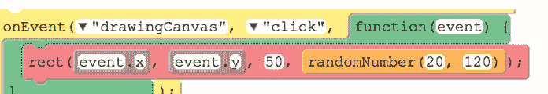

图 7-4

运行代码测试目前的进度。在模拟器中，点击应用程序显示屏的任何位置都应该会绘制一个尺寸随机的空心未填充矩形。试着点击多次，创建很多矩形！

### 为矩形填充颜色的代码

现在，你将编写一些代码，允许用户在绘制矩形时设置填充颜色：

1. 继续在 App Lab 的 Code（代码）模式下工作。

2. 在工具箱中，选择 UI Controls（UI 控制）。将`onEvent`命令拖入工作区，放在之前的命令下方。

3. 在`onEvent`命令中，点击 ID 标签并在列表中选择`redButton`。将`function()`中的`event`删除。保持其他属性不变。

当 Red（红色）按钮被点击时，`onEvent`内部的代码块将执行。

4. 选择 Canvas（画布）。将一个`setFillColor`命令拖入`onEvent`命令中。在字段中输入`"red"`，或者点击标签选择一个 RGB 命令然后输入数值。

当用户点击 Red 按钮时，矩形填充颜色被设置为红色。随后，当用户触摸应用程序显示屏的任何位置时，将绘制一个随机大小且填充为红色的矩形。

5. 重复步骤 1-4，为其余的填充颜色按钮编写代码：Yellow（黄色）、Blue（蓝色）和 White（白色）。

图 7-5 显示了 Red、Yellow、Blue 和 White 按钮的代码。

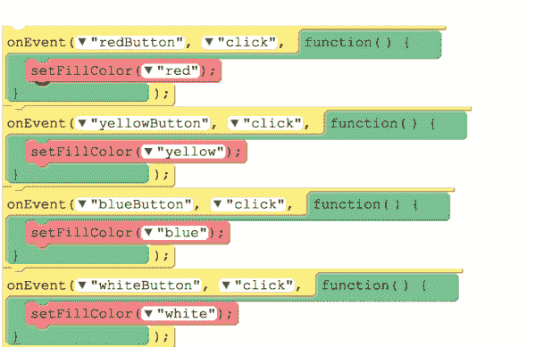

### 编写清除按钮以擦除画作

在绘制了几个矩形后，最终用户可能想要清除画作并重新开始！请按照以下步骤编写 Clear（清除）按钮：

1. 继续在 App Lab 的 Code 模式下工作。

2. 在工具箱中，选择 UI Controls。将`onEvent`命令拖入工作区，放在之前的命令下方。

3. 在`onEvent`命令中，点击 ID 标签并在列表中选择`clearButton`。将`function()`中的`event`删除。保持其他属性不变。

当 Clear 按钮被点击时，`onEvent`内部的代码块将执行。

4. 选择 Canvas 命令。将一个`clearCanvas()`命令拖入`onEvent`命令中。

**现在，当最终用户点击 Clear 按钮时，显示屏上的画作将被清除。**

就这样！蒙德里安艺术玩具的设计和代码已完成。参考图 7-1 查看完成后的应用程序界面。图 7-6 显示了该程序的积木块形式。

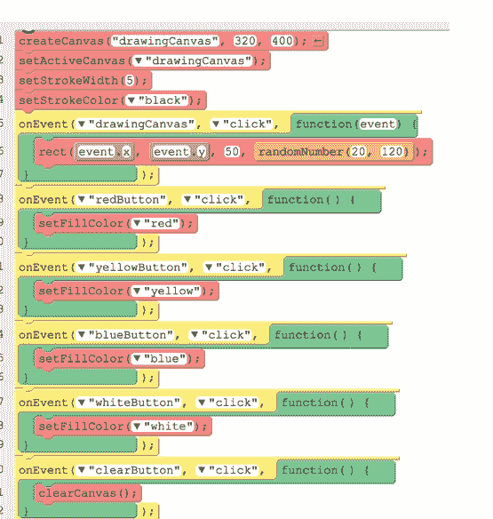

图 7-6

以下是完整的 JavaScript 代码：

```javascript
createCanvas("drawingCanvas", 320, 400);
setActiveCanvas("drawingCanvas");
setStrokeWidth(5);
setStrokeColor("black");
onEvent("drawingCanvas", "click", function(event) {
  rect(event.x, event.y, 50, randomNumber(20, 120));
});
onEvent("redButton", "click", function() {
  setFillColor("red");
});
onEvent("yellowButton", "click", function() {
  setFillColor("yellow");
});
onEvent("blueButton", "click", function() {
  setFillColor("blue");
});
onEvent("whiteButton", "click", function() {
  setFillColor("white");
});
onEvent("clearButton", "click", function() {
  clearCanvas();
});
```

### 保存、测试并调试你的应用

在你工作时，App Lab 会自动将你的程序保存在云端。测试你的程序并修复任何 Bug，以确保它按照你想要的方式运行。有关测试和调试的帮助，请参阅第 3 章。

### 与世界分享你的应用

在你的应用运行符合预期后，你可以将程序的状态设置为 Share（分享）。有关在 App Lab 中分享你创建的应用的详细信息，请参阅第 19 章。

### 增强你的应用

为你的应用添加一些或全部以下酷炫的新功能：

- **矩形尺寸的更多随机性：** 按照目前的构建，只有矩形的高度是随机的。让矩形的宽度也变成随机的！

- **更多颜色按钮：** 创建额外的按钮来产生其他矩形填充颜色，例如绿色或紫色。

- **用半透明颜色填充矩形的按钮：** 不要直接命名如`red`这样的填充颜色，而是在每个按钮的`setFillColor`字段中使用`rgb`命令。带有四个数值的 RGB 命令实际上是 RGBA 命令。将每个命令的第四个值 alpha（A 值）设置为`0.5`，即可使颜色变为半透明。详情请参阅“RGBA Color”侧栏。

- **用随机选择的颜色填充矩形的按钮：** 创建一个 Random 按钮并添加以下代码：

```javascript
onEvent("randomButton", "click", function() {
  setFillColor(rgb(randomNumber(0, 255), randomNumber(0, 255),
  randomNumber(0, 255), 1));
});
```

每个颜色通道（红、绿、蓝）的数值都是随机分配的。每次点击按钮都会产生一个新的随机颜色。关于 RGBA 颜色的更多信息，请参阅“RGBA Color”侧栏。

## 第三部分：从这里到那里，周而复始

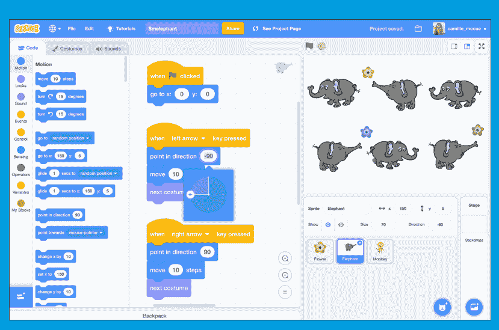

在这一部分中，你将……

- 创建一个用于克隆和散布对象的算法

- 探索如何使对象产生动画并让它们移动

- 编写按键控制并检测对象碰撞

- 构建简单的循环并创建代码块（函数）

## 第 8 章：Emoji 爆炸

**在本章中，你将**编写“Emoji 爆炸”，这是一个有趣的动画场景，许多颜色的 Emoji 对象在屏幕上弹跳。你将学习如何设置对象的坐标和方向——使用随机性将 Emoji 散布到各处！——然后让它们移动。简单的循环将控制这些动作。

首先，你将使用 Scratch 绘制一个 Emoji，然后通过克隆它来创建一大组在屏幕上移动和弹跳的 Emoji。既然你现在在编写较长的程序，你还将像真正的程序员一样创建新的代码块（有时称为`functions`）。

将随机性、运动、循环、克隆和函数集成在一个项目中是一个爆发式的飞跃。你现在是在真正地编写代码了！

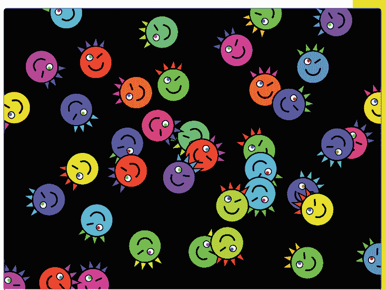

### 集思广益

你可以绘制任何想要的 Emoji——笑脸、眨眼脸、翻白眼脸——有无数的选择！或者你可以选择任何其他对象进行克隆并创建一个群体。星球大战的帝国风暴兵？只有在画中的 Waldo？奶牛？彩虹糖？任何对象都可以，尽情发挥你的想象力。开始编码吧！


为此项目编写的代码将对许多你想编码的游戏和模型很有用，因为很多程序都需要创建、散布和移动一组对象。

### 开始一个新项目

按照以下步骤开始一个新项目，创建你的 Emoji 爆炸程序：

1. 在`https://scratch.mit.edu/`打开 Scratch。如果提示，请启用 Flash 以运行 Scratch。登录你创建的 Scratch 账户（见第 2 章）。

2. 在 Scratch 主页上，选择 **Create**（创造）。或者如果你已经在 Scratch 中工作，从菜单栏选择 **File** $\Rightarrow$ **New**（文件 $\Rightarrow$ 新建）。

一个新项目将打开。

3. 在 Scratch 界面顶部的 Project Name（项目名称）字段中输入名称来命名你的程序。

4. 点击右下角精灵区域中 Scratch Cat 图标上的 **X**，将 Scratch Cat 从项目中删除。

### 添加背景

*背景* (backdrop) 是填充你玩具屏幕的背景颜色或图像。按照以下步骤添加背景：


1. 在 Stage（舞台）处，将鼠标悬停在 **Choose a Backdrop**（选择背景）图标上。

## 第 8 章：Emoji 大爆发

2. 从弹出菜单中点击“绘制”（Paint）。

背景编辑器将在“背景”（Backdrops）选项卡中打开。该背景的默认造型名称为`backdrop1`。你可以保留这个名称，也可以更改它。我将其改名为`night`。

3. 点击“转换为位图”（Convert to Bitmap）按钮。

4. 选择一种“填充”（Fill）颜色。

我选择了黑色，使背景看起来像夜晚。

5. 点击油漆桶工具，然后点击空白背景（棋盘格区域），用所选颜色填充背景。图 8-1 展示了完成后的背景。

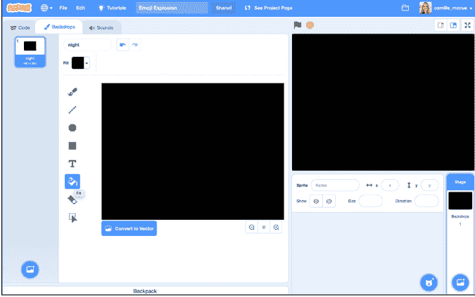

**图 8-1**

### 添加 Emoji 角色

按照以下步骤为你的动画场景绘制一个 Emoji 角色：

1. 在 Scratch 界面的角色区域，将鼠标悬停在“选择一个角色”（Choose a Sprite）图标上。

2. 点击“绘制”（Paint）来绘制你自己的角色造型。

角色造型编辑器将在“造型”（Costumes）选项卡中打开。该角色的默认造型名称为`costume1`。你可以保留这个名称，也可以更改它。我将其改名为`yellow`。

3. 使用绘图工具绘制你的 Emoji（见图 8-2）。

角色将出现在舞台上。不用担心它的尺寸，因为你稍后可以进行调整。

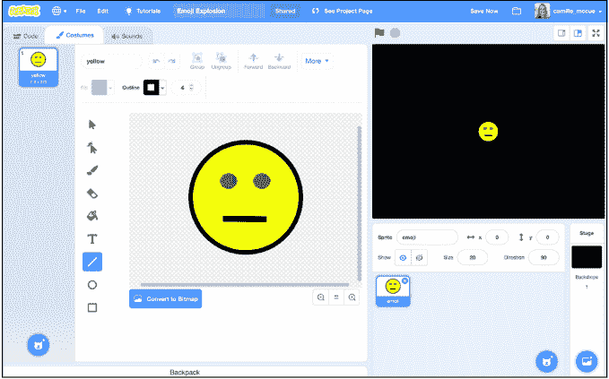

**图 8-2**

4. 在 Scratch 界面右下角的角色属性编辑器中，修改角色的名称。

默认名称是`Sprite1`。我将我的角色命名为`emoji`。

5. 仍在角色属性编辑器中，在角色上方的“大小”（Size）字段中输入一个新数字来调整角色的大小。

默认大小是`100`。我将我的 Emoji 大小改为`20`。

在角色造型编辑器中尝试不同的绘图工具和填充颜色，看看如何利用它们为你的 Emoji 造型创造不同的特征。

如果你添加了一个角色但后来决定不需要它，点击其图标上的 X 即可将其删除。

## 为舞台编写播放声音的代码

为舞台编写代码，以便在整个动画场景中播放声音。你可以选择想要的音乐，并将其设置为在动画运行期间从头到尾循环播放。

1. 在舞台区域点击你的背景图标。

2. 在 Scratch 界面的“代码”（Code）选项卡中，选择“事件”（Events）图标。将`when green flag is clicked`（当绿旗被点击）指令拖到代码工作区。

3. 选择“控制”（Control）图标。将`forever`（重复执行）循环指令拖到代码工作区，并将其连接到之前的指令。

`forever`指令是四种循环类型控制指令之一。另外三种是`repeat`（重复执行）、`repeat until`（重复执行直到）和`wait until`（等待直到）。详见表 8-1。（更多信息请参阅“重复循环”侧边栏。）

4. 选择“声音”（Sound）图标。将`play sound until done`（播放声音直到结束）指令拖到代码工作区，并将其放置在`forever`事件指令内部。

5. 点击“声音”（Sounds）选项卡以打开舞台的声音编辑器。

6. 点击“Pop”声音图标角落的 X 将其删除，因为你不需要这个声音。

7. 点击 Scratch 界面左下角的“选择一个声音”（Choose a Sound）图标。

声音库将出现在“选择一个声音”屏幕上。

8. 点击你想要添加到舞台的声音图标。

我选择了 Boop Bing Bop，如图 8-3 所示。这是一个古怪的音频轨道，听起来就像 Emoji 在到处跳跃！

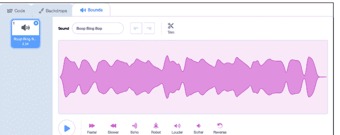

**图 8-3**

9. 返回“代码”（Code）选项卡。

10. 点击`play sound until done`指令中的选项卡，选择你刚刚添加的声音。

| 指令 | 事件 |

| :--- | :--- |

| `forever` | 代码块将永远运行，直到程序停止。 |

| `repeat number` | 代码块运行`number`次。 |

| `repeat until condition` | 代码块运行直到满足`condition`（条件）。 |

| `wait until condition` | 代码块在满足`condition`（条件）后运行。 |

现在，当最终用户点击绿旗时，你添加到舞台的声音将会播放，并在后台永远循环。图 8-4 显示了舞台上完成的代码。

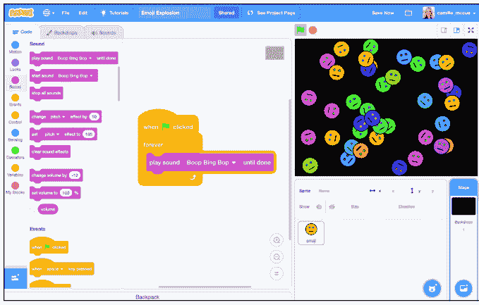

**图 8-4**


在对舞台或角色进行操作时，你只能看到与该对象关联的代码。不要为此感到恐慌——你的代码没有丢失！

## 为 Emoji 角色编写绿旗代码

你创建的 Emoji 角色应该遵循一个简单的程序：它应该在屏幕上显示自己，克隆自己以产生更多 Emoji，然后隐藏。

请按照以下步骤为 Emoji 角色编写绿旗程序：

1. 在角色区域选择 Emoji 角色的图标。

2. 在 Scratch 界面的“代码”（Code）选项卡中，选择“事件”（Events）图标。将`when green flag clicked`（当绿旗被点击）指令拖到代码工作区。

### 克隆与继承

克隆是指创建一个对象的精确副本。有些人可能在动物世界中听说过克隆。早在 1996 年，在爱丁堡大学，一只名为多莉（Dolly）的羊出生了，它是第一只由成年细胞成功克隆的哺乳动物。在编程中，克隆允许编程者快速创建尽可能多所需对象的副本，例如角色。

克隆利用了一个被称为*继承*（inheritance）的编程概念。许多编程语言使用继承，以便能够轻松地从父对象创建新对象。克隆体*继承*其父角色的属性（造型、大小、位置和方向）以及所有代码。此外，在你创建克隆体（也称为*子对象*）之后，你可以更改它们以添加或删除属性或代码片段。通过这种方式，子对象可以相对于其父对象发生*变异*（被更改以执行不同的操作）。


- 3. 选择“外观”（Looks）图标。将`show`（显示）指令拖到代码工作区，并将其连接到之前的指令。

Emoji 角色必须显示出来才能被克隆。（只有当你之后在主程序结束时隐藏该角色时，这才会成为一个问题。）

- 4. 选择“我的模块”（My Blocks）图标。点击“创建模块”（Make a Block）按钮来创建一个新的代码块。

“创建模块”对话框将打开。

- 5. 将这个新代码块命名为`makeEmojis`，如图 8-5 所示，然后点击确定。

新的模块定义头被添加到你的工作区，并且新模块指令`makeEmojis`被添加到“我的模块”类别的指令中。

你还没有定义`makeEmojis`代码块具体做什么；你将在下一节中完成。但这种在不必担心细节的情况下就能编写主程序的方式，是不是很酷？

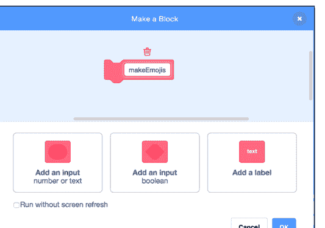

**图 8-5**

- 6. 从“我的模块”类别中，将`makeEmojis`指令拖到代码工作区，并将其连接到`show`指令。

- 7. 将`hide`（隐藏）指令拖到代码工作区，并将其连接到`makeEmojis`指令。

在 Emoji 角色运行`makeEmojis`之后，它会隐藏。你将其隐藏是为了不必编写让它移动的指令——因为屏幕上已经有足够的 Emoji 克隆体在移动了。

见图 8-6 了解 Emoji 角色完整的`绿旗`代码。

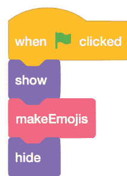

**图 8-6**

## 编写 makeEmojis 模块的代码

你已经创建了`makeEmojis`代码块的定义头和指令块。现在为该模块编写代码。`makeEmojis`代码块通过克隆父级 Emoji 角色，在整个屏幕上创造出许多爆发的 Emoji。

一个`克隆体`拥有其父角色的所有属性（造型、大小、位置和方向），可以使用“控制”类别中的`clone`（克隆）指令来创建。通过将`clone`指令放入一个简单的循环中，你可以创建大量克隆体。`repeat`（重复执行）指令（同样在“控制”类别中）是一个简单的循环，允许你设置想要执行的次数。

按照以下步骤编写`makeEmojis`代码块的代码：

- 1. 在工作区的`define makeEmojis`（定义 makeEmojis）代码块定义头处进行操作。

- 2. 选择“控制”（Control）图标。将`repeat`（重复执行）指令拖到代码工作区，并将其连接到代码块定义头。在`repeat`指令中输入一个数字。

这个数字就是重复指令将执行的次数。我将其设置为 40。

3. 将`create clone of`（克隆自己）指令拖入代码工作区，并连接到`repeat`（重复执行）指令内部。将该`create clone of`指令设置为`myself`（自己）。

4. 选择“外观”图标。将一个`change color effect`（将颜色特效增加）指令拖入代码工作区，并连接到`repeat`指令内部的`create clone of`指令下方。在`change color effect`指令中输入一个数字。

这个数字代表每次`repeat`指令执行时，克隆体的颜色变化量。我将其设置为`10`。较小的数字产生细微的颜色变化，而较大的数字则产生更明显的颜色变化。`define makeEmojis`（定义makeEmojis）代码块现已完成。参见图8-7。

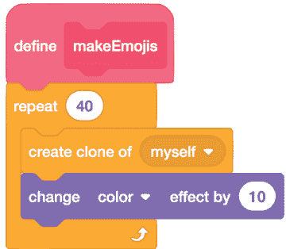

图8-7

## Emoji角色作为克隆体启动时的代码

当emoji角色的绿旗程序运行时，它会创建克隆体。克隆体需要指令！每个克隆体都需要遵循一个指令：爆炸！

按照以下步骤编写`when I start as a clone`（当作为克隆体启动时）程序：

1.  选择emoji角色。

2.  仍然在Scratch界面的“代码”选项卡中，选择“控制”图标。

    将一个`when I start as a clone`指令拖入代码工作区。

    连接到此事件的指令将在每次新克隆体被创建时执行。

3.  选择“我的模块”图标。点击“制作一个积木”按钮来创建一个新的代码块。

    “制作积木”对话框将会打开。

4.  将这个新代码块命名为`explode`，并点击确定。

新的代码块头部会添加到你的工作区，并且新的`explode`代码块命令会添加到“我的模块”类别中。`makeEmojis`命令也在这里！（参见图8-8）。

你还没有定义`explode`的功能；这将在下一节中完成。但现在你可以使用`explode`命令了。

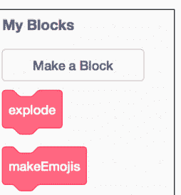

图8-8

5.  从“我的模块”类别中，将`explode`命令拖到代码工作区，并将其连接到`when I start as a clone`命令上。

完整的emoji克隆体`when I start as a clone`程序如图8-9所示。

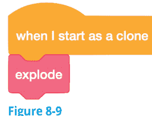

## 为Emoji克隆体编写`explode`代码块

你已经创建了`explode`代码块头部和命令块。现在你需要编写代码来为`explode`提供指令。这段代码应该让每个克隆体移动到随机位置、指向随机方向并移动。

按照以下步骤编写代码：

1.  在工作区的`define explode`（定义explode）代码块头部进行操作。

2.  选择“运动”图标。将一个`go to random position`（移到随机位置）命令拖入代码工作区，并将其连接到代码块头部。

3.  将一个`point in direction`（面向...方向）命令拖入代码工作区，并将其连接到前一个命令下方。

4.  选择“运算”图标。将一个`pick random`（在1到10间取随机数）命令拖到`point in direction`命令的值字段中。将方向角度范围设置为0到360。

5.  选择“控制”图标。将一个`forever`（重复执行）命令拖入代码工作区，并将其连接到前一个命令下方。

    你将在此命令内部构建的代码块将永远执行，直到点击“停止”按钮。

6.  选择“运动”图标。将一个`move steps`（移动10步）命令拖入代码工作区，并将其连接到`forever`内部。通过输入数字来设置步数。

    数字越大，每个emoji克隆体移动得越快。我将其设置为10。

7.  将一个`if on edge, bounce`（碰到边缘就反弹）命令拖入代码工作区，并将其连接到`forever`命令内部。

    此命令使emoji克隆体从屏幕边缘反弹并继续移动。

`explode`代码块现已完成，应如图8-10所示。

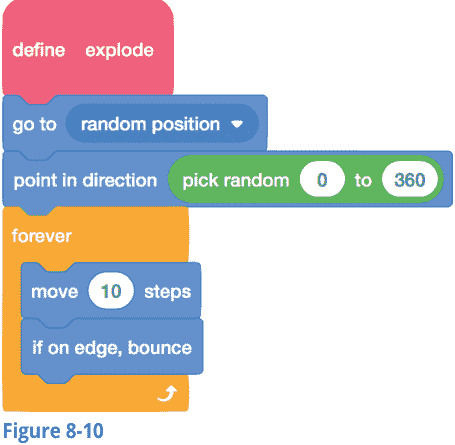

图8-10

图8-11显示了emoji角色的所有代码。请注意，舞台和emoji角色的代码都在点击绿旗时运行。这意味着它们并行运行（参见第4章）——舞台上的音乐永远播放，同时emoji克隆体永远移动和反弹！

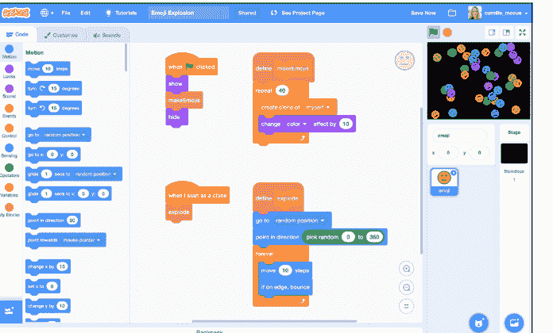

图8-11

## 保存、测试和调试你的程序

通过在Scratch界面顶部的标题字段中输入来为你的项目命名。在操作过程中，Scratch会自动将你的程序保存在云端，因此你无需采取任何特殊操作来保存你的工作。

测试你的程序并修复任何错误，确保它按你希望的方式工作。（关于调试Scratch程序的帮助，请参见第3章。）

## 与世界分享你的程序

当你的程序完美运行后，是时候分享它了！将你的程序状态设置为“分享”，然后在你的项目页面上添加对你的程序的描述以及如何运行它的说明。有关分享程序的详细信息，请参见第19章。

## 增强你的动画场景

考虑用新功能增强你的“表情爆炸”动画场景：

-   **新的表情造型：** 只需打开“造型”选项卡并绘制一个新造型。

-   **新的声音：** 为背景添加不同的声音。

-   **新的背景：** 不要为舞台绘制简单的纯色背景，而是选择“选择一个背景”图标来添加一个令人兴奋的场景，让你的表情可以在那里弹跳！

> ### 设置位置
>
> 坐标是在图表上表示位置的数学方法。在二维空间中，例如你在Scratch、App Lab和MakeCode for micro:bit中的屏幕，坐标被描述为一对值 (x, y)。第一个数字是x坐标（从左到右的位置），第二个数字是y坐标（从上到下的位置）。

在Scratch中，坐标 (0, 0) 称为原点，位于屏幕中央。x轴从左到右横跨屏幕，x坐标值从最左边的 -240 到最右边的 240。

y轴从上到下纵贯屏幕，y坐标值从最顶部的 180 到最底部的 -180。参见图示以定位Scratch中的x轴、y轴以及原点和屏幕每个角落的坐标。

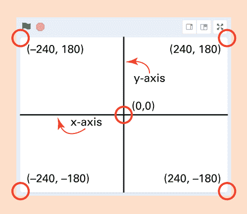

在Scratch中工作时，你可以使用`go to x: y:`（移到x: y:）命令设置角色的位置。例如，要将游戏中英雄的位置设置在屏幕中央，你可以使用命令`go to x: 0 y: 0`。要将角色放置在随机位置，你可以使用`go to random position`（移到随机位置）。

在App Lab中，屏幕的设置是原点——坐标 (0, 0) ——位于屏幕的左上角。x轴从左到右横跨屏幕，x坐标从最左边的 0 到最右边的 320。y轴从上到下纵贯屏幕，y坐标从屏幕顶部的 0 到底部的 450。屏幕中心位于坐标 (160, 225)。图示显示了App Lab中的x轴、y轴、中心以及屏幕每个角落的坐标。

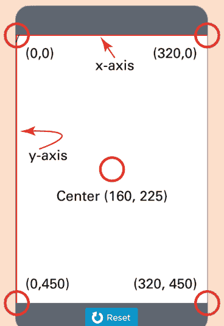

在MakeCode中，你可以在micro:bit屏幕上设置位置——一个只有25个点的非常小的LED网格。micro:bit的设置是原点——坐标 (0, 0) ——位于左上角。x轴从左到右横跨屏幕，x坐标的值从0到4。y轴从上到下纵贯屏幕，y坐标的值从0到4。以下是micro:bit上所有LED位置的 (x, y) 坐标：

```
(0, 0) (1, 0) (2, 0) (3, 0) (4, 0)
(0, 1) (1, 1) (2, 1) (3, 1) (4, 1)
(0, 2) (1, 2) (2, 2) (3, 2) (4, 2)
(0, 3) (1, 3) (2, 3) (3, 3) (4, 3)
(0, 4) (1, 4) (2, 4) (3, 4) (4, 4)
```

图示显示了MakeCode中的文本代码（JavaScript），用于在micro:bit上点亮一条对角线。这条“线”从左上角的 (0, 0) 延伸到右下角的 (4, 4)。

## 设定方向

在 Scratch 中工作时，你可以通过旋转来让角色指向某个方向。方向用角度值（度数）表示，范围从 0 到 360。因为一个完整的圆由 360 度组成，所以 0 度与 360 度是相同的。

`turn right`（右转）和`turn left`（左转）命令是*相对转向命令*，因为它们让角色相对于当前指向进行旋转。对于这两个命令，你必须输入一个角度（度数），表示你希望角色旋转多少度。`turn right 90`是"急右转"，`turn left 90`是"急左转"。向任一方向旋转 180 度会使角色指向与旋转前完全相反的方向。

`point in direction`（面向指定方向）命令是*绝对转向命令*，因为它使角色指向选定的方向，而不论旋转前它指向哪里。因此，`point in direction 0`是北方，`point in direction 90`是东方，`point in direction 180`是南方，`point in direction -90`是西方。（注意`point in direction -90`与`point in direction 270`相同。）参见图示。

`Point towards`（面向）使角色指向屏幕上的其他某个对象。选项包括鼠标指针或屏幕上的任何其他角色。

最后，在 Scratch 中设定方向时，你可以决定角色如何显示。方向指示器有三个面向选项。第一个选项（圆形箭头）使角色的旋转与其方向一致。第二个选项（镜像箭头）使角色左右翻转但不上下翻转。例如，一个人物角色会面向左或右，但他不会头朝下！第三个选项（带斜线的圆形箭头）冻结角色的外观：它仍然可以指向和朝任意方向移动，但其外观不会与其朝向匹配。

在 App Lab、MakeCode 以及一般的 JavaScript 中工作时，请注意这些程序不太使用方向命令。（唯一的例外是 App Lab 中的海龟命令类别。）

## 移动

*运动*可以通过使对象从一个坐标反复改变到另一个坐标来实现。在 Scratch 中，你可以用三种方式编写运动代码。第一种方式是将移动命令（来自运动类别）放在`repeat`（重复）命令（来自控制类别）内部。大的移动，如`repeat forever [move 50]`，比小的移动，如`repeat forever [move 10]`，使对象移动得更快。你也可以通过在每次移动后添加`wait`（等待）命令（来自控制类别）来设置速度。例如，`repeat forever [move 10 wait 1]`比`repeat forever [move 10 wait 2]`使对象移动得更快。

在 Scratch 中使角色移动的第二种方式是使用`glide`（滑行）命令（来自运动类别）。指定滑行的秒数以创建平滑的运动（非常适合漂浮和游泳的角色）。

在 Scratch 中使对象移动的第三种方式是使用`change x by`（将 x 坐标增加）和`change y by`（将 y 坐标增加）命令。`Change x by`使角色向左或向右移动（当命令后分别跟负数或正数时）。`Change y by`使角色向上或向下移动（当命令后分别跟正数或负数时）。每次移动运行的时间长短会影响用户对移动物体速度的视觉感受。

在 App Lab 中，你可以通过改变对象的坐标并使用`timedLoop(1000, function() { })`命令（位于控制类别中）来指定移动发生的频率，从而创建运动。定时循环的默认时间是 1000 毫秒，但你可以将时间设置为任意你想要的值。在 App Lab 中控制运动的另一种方式是改变对象的坐标，并使用`setTimeout(function() { }, 1000)`命令（也位于控制类别中）在每次变化之间添加等待时间。同样，你可以设置毫秒值。

在 micro:bit 上，运动通过改变 LED 屏幕上某个灯的坐标并在移动之间添加等待时间来实现。在 MakeCode 中，多个命令类别都包含等待命令，包括基本类别中的`pause(100)`。

## 简单的重复循环

顺序、选择和重复是任何计算机程序中的三个关键过程（见第 1 章）。重复允许代码段反复执行，或称为循环。编写循环代码使你能够通过确定要重复的代码块，然后确定它们将被重复多少次——来让你的程序更高效——你不必反复输入相同的代码！在这些前几章中，你编写的循环类型相对简单。

Scratch 使用四种循环结构：`forever`（重复执行）、`repeat`（重复执行指定次数）、`repeat until`（重复执行直到）和`wait until`（等待直到）。每种循环提供不同的方式来控制代码何时重复以及重复多少次。永久循环反复运行代码块，直到程序结束。这些循环非常适合持续进行的过程，比如游戏中的背景音乐。重复循环指定循环将运行的确切次数。当你确切知道希望循环结构执行多少次时，重复循环很有用，比如为篮球队克隆 5 名球员，或游戏中的 60 秒倒计时器。`repeat until`循环在条件满足之前一直执行，`wait until`则延迟执行直到条件满足。

每种编程语言，包括 App Lab 和 MakeCode，都使用循环。App Lab 提供定时循环、while 循环（当条件满足时执行）和 for 循环。MakeCode 具有永久循环、while 循环和 for 循环。你可能在想 for 循环是什么。for 循环是一种更复杂的循环结构。它类似于 Scratch 中的重复循环，但使用变量来计数循环次数。你在学习变量之后才会使用`for()`循环。数字变量在第 12 章中介绍，for 循环在第 17 章中介绍。

## 新积木（又称函数）

编程语言有称为原语的内置命令。把原语想象成制作生日蛋糕的原料，而计算机程序就是食谱。

有时，如果将相关指令分组，会更容易理解计算机程序或食谱。在烘焙生日蛋糕时，你做蛋糕，你做糖霜，然后把它们组合在一起。生日蛋糕的食谱中包含"糖霜"原料，但制作糖霜的说明可能在下一页。与其在蛋糕程序中间解释制作糖霜的所有步骤，不如让糖霜原料代表一个有自己的原料和说明的较小程序。

> 通过用新名称（"糖霜"）和制作糖霜的说明来代表生日蛋糕的这个较小部分，整个食谱编写过程被简化了。在编程语言中，这个较小的"糖霜"程序称为*子程序*。Scratch 称这些子程序为*积木*，而 App Lab 和 MakeCode 称它们为*函数*。（较早的编程语言称它们为*过程*。）你可以创建任意数量的新积木（或函数），然后将它们包含在你的程序中。然而，新积木只存在于你创建它的程序中。而且，每次使用新积木时，它的执行方式完全相同。

你可以自定义一些新积木（函数）。例如，你可以在函数中包含一个或多个称为参数的信息片段。*参数*提供关于如何运行函数的额外细节。例如，糖霜食谱函数可能包含一个参数，指示该食谱将制作多少份糖霜——`frosting(8)`可以代表一个制作八份蛋糕糖霜的函数。（好吃！）

## 大象嗅嗅（Smelephant）


既然你已经掌握了如何克隆和散布对象、在屏幕上移动、编写循环以及创建新积木，你就可以制作一个简单游戏了！大象嗅嗅是一个有趣的收集类游戏，故事发生在热带草原上，主角是一只蹦蹦跳跳的猴子、一片花田，以及一头喜欢四处漫步、把花嗅进鼻子里的大象……这正是它被称为“大象嗅嗅”（`Smelephant`）的原因！

你的用户将通过一项你将学习编写的新技能来在屏幕上移动：按键控制。这个项目还将教你动画对象和编码对象碰撞的基础知识，包括隐藏和显示对象。让我们让这头大象嗅嗅动起来吧！

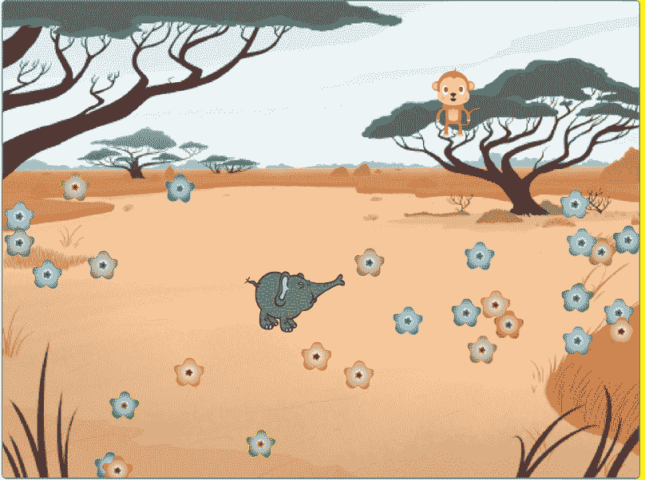

## 第九章

## 第三部分：从此处到彼处，反复移动

## 头脑风暴

你的收集类游戏不一定非要以大象嗅嗅的形式呈现。你可以让任意主角收集任意你想要的物品！我的学生们制作了各种游戏变体，比如一只蜜蜂采集花粉、一只企鹅政治家收集选票，甚至还有饼干怪兽四处收集并大嚼饼干！你创建的游戏应该包含一个场景、一个主角以及供玩家收集的物品。本章第一页的插图展示了一个完成的大象嗅嗅游戏。

## 开始新项目

按照以下步骤开始创建你的大象嗅嗅程序：

1. 打开 Scratch，网址为 `https://scratch.mit.edu`。如果出现提示，请启用 Flash 来运行 Scratch。登录你创建的 Scratch 账户（参见第 2 章）。

2. 在 Scratch 主页上，选择“创建”。或者如果你已经在 Scratch 中工作，从菜单栏中选择“文件 → 新建”。

一个新项目将会打开。

3. 在 Scratch 界面顶部的“项目名称”字段中输入名称来为你的程序命名。

4. 通过点击 Scratch Cat 图标上的 X 将其从项目中删除。

该图标位于 Scratch 界面右下角的精灵区域中。

## 添加背景

背景是填充你玩具屏幕的背景颜色或图片。按照以下步骤添加背景：

1. 在舞台区域中，将鼠标悬停在“选择一个背景”图标上。

“选择一个背景”素材库将会出现。

2. 从“选择一个背景”素材库中点击“Savanna”（热带草原）背景。

Savanna 背景将出现在舞台上，如图 9-1 所示。

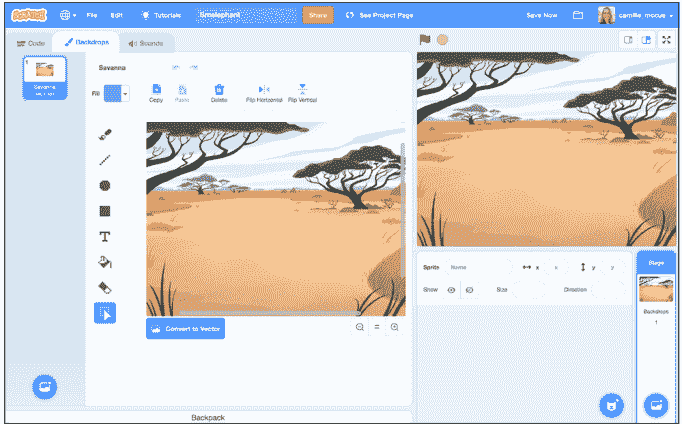

图 9-1

> 你可以通过点击或轻触“背景”选项卡，然后点击或轻触 `backdrop1` 图标上的 X 来删除默认背景 `backdrop1`。

## 添加大象嗅嗅精灵

按照以下步骤向你的游戏中添加一个大象精灵并将其命名为 `smelephant`：

1. 在 Scratch 界面的精灵区域中，点击“选择一个精灵”图标。

2. 点击大象（Elephant）精灵。

大象精灵将被添加到项目中。默认精灵名称为 `Elephant`。

3. 在精灵属性区域的“精灵名称”字段中输入 `smelephant` 来更改默认精灵名称，如图 9-2 所示。

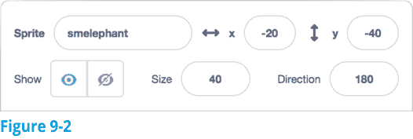

图 9-2

4. 在精灵属性区域的“大小”字段中输入一个数字来更改大象嗅嗅精灵的大小。

在图 9-2 中，你可以看到我使用了 `40` 的大小，但你可以使用任何适合你游戏的大小。

5. 点击**造型**选项卡来查看该精灵附带的两个造型，如图 9-3 所示。

除非你想使用绘图工具来修改大象嗅嗅两个造型的颜色，否则你不需要在这里做任何更改。我就改了！

拥有多个造型可以让你在精灵移动时切换造型，从而创建动画效果。你将在下一节中为大象嗅嗅编写按键控制时编写此代码。

6. 通过点击精灵属性区域中的**方向**字段，然后选择**左右**旋转选项来设置大象嗅嗅的旋转样式。

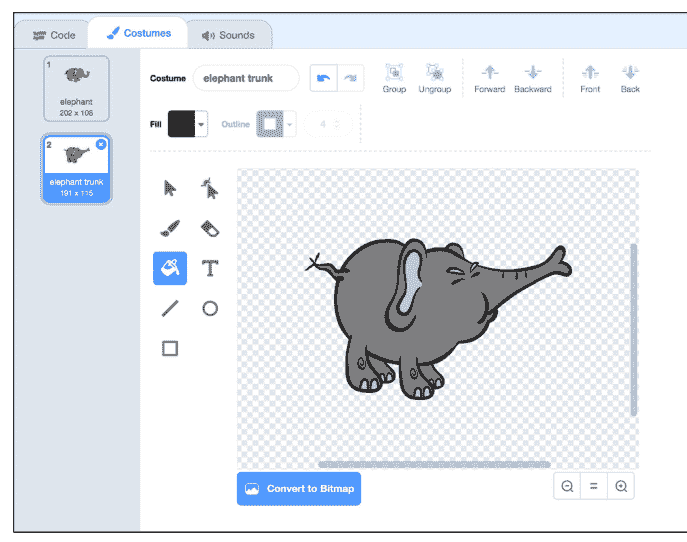

图 9-3

此选项允许大象嗅嗅在向左走时面朝左，向右走时面朝右。当他向上或向下移动时，他将保持之前面朝的方向。详情请参阅“Scratch 中的旋转样式”侧栏。

### Scratch 中的旋转样式

你可以设置 Scratch 中对象的旋转样式。如果你编写了对象旋转的代码，还应该设置其旋转样式。如图所示，你有三个选项：任意旋转、左右旋转和不旋转。旋转样式可以帮助用户看清精灵在屏幕上朝向哪个方向。

以下是每个选项的作用：

- **任意旋转（圆圈箭头）：** 用户看到对象朝向其移动的方向。此旋转样式适用于通常会飞行或游泳的精灵角色。

- **左右旋转（镜像箭头）：** 当对象向左或向右移动时，用户看到对象朝向其移动的方向。如果对象向上或向下移动，旋转不会相应改变。此旋转样式适用于通常在地面上行走的精灵角色，比如人、小狗——或者大象嗅嗅！

- **不旋转（带斜线的圆圈箭头）：** 精灵看起来不会朝向其移动的方向。请注意，拥有多个造型的精灵仍然可以切换造型。

## 编写大象嗅嗅的绿旗代码

编写代码使大象嗅嗅在游戏开始时位于屏幕中央。按照以下步骤操作：

1. 点击大象嗅嗅精灵的图标。

2. 在 Scratch 界面的“代码”选项卡中，选择“事件”图标。

3. 将`当绿旗被点击`积木拖到代码工作区。

4. 选择“运动”图标。将`移到 x: y:`积木拖到代码工作区，并将其附加到上一个积木。将每个字段的值设置为 0，如图 9-4 所示。

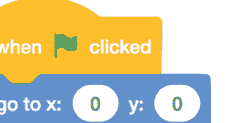

图 9-4

执行时，此积木会将大象嗅嗅传送到坐标 (0, 0) 的屏幕中心。

## 编写大象嗅嗅的上箭头键控制

玩家在热带草原上移动大象嗅嗅，每当他碰到一朵花时，就把花嗅进鼻子里。为了移动大象嗅嗅，玩家点击键盘上的方向键。

按照以下步骤编写代码，使大象嗅嗅使用上箭头键在屏幕上向上移动：

1. 点击大象嗅嗅精灵的图标。

2. 在 Scratch 界面的“代码”选项卡中，选择“事件”图标。将一个`当按下空格键`积木拖到代码工作区。将按键选择从`空格`更改为`上箭头`。

3. 选择“运动”图标。将`面向`积木拖到代码工作区，并将其附加到上一个积木。在字段中输入数字 0。

方向 0 表示精灵朝向屏幕顶部。有关方向的更多信息，请参阅第 8 章。

4. 将`移动 10 步`积木拖到代码工作区，并将其附加到上一个积木。在字段中输入数字 10。

此数字表示在步骤 3 中设置的方向上移动 10 像素。

5. 选择“外观”图标。将`下一个造型`积木拖到代码工作区，并将其附加到上一个积木，如图 9-5 所示。

```
当按下 [上箭头 v] 键
面向 (0)
移动 (10) 步
下一个造型
```

图 9-5

此代码使大象嗅嗅精灵切换到下一个造型。每当大象嗅嗅向任意方向移动时，他的造型都会改变。这种简单的动画效果营造出他行走和用鼻子鸣叫的视觉效果！（请参阅“动画造型”侧栏。）

现在，当用户点击电脑键盘上的上箭头键时，大象嗅嗅就会在屏幕上向上移动。

## 动画造型

动画化一个对象可以使其看起来像在移动时扇动翅膀或行走。你不是使用对象上的单个造型，而是添加两个或更多造型，每个造型显示对象的不同姿势。然后，每次移动对象时切换造型。

在 Scratch 中，你可以使用“外观”类别中的`下一个造型`积木来为形状创建动画。如第一张图所示，鲨鱼精灵有三个造型，位于“造型”选项卡中。

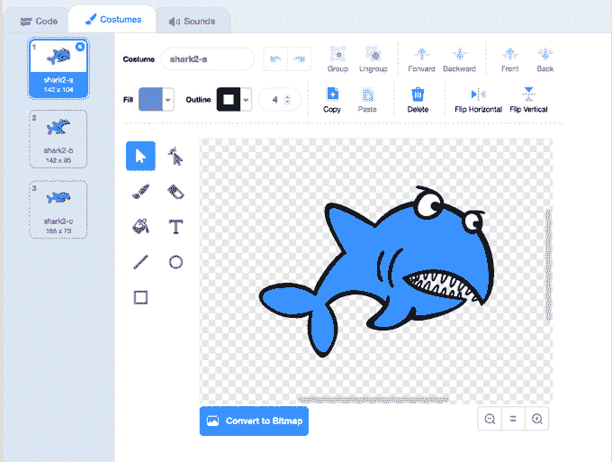

第二张图展示了使鲨鱼带有动画效果移动的示例代码。将`下一个造型`积木附加到移动积木上，可以让你在精灵移动时为其创建动画。包含`滑行`积木，一个

## 第三部分：从这里移动到那里，一遍又一遍

使用转向命令和设置左右旋转样式命令——全部放在无限循环内——你可以创建出花哨的鲨鱼游动效果！

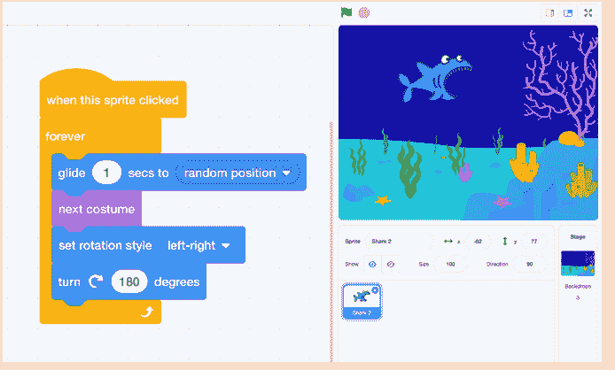

在 App Lab 中，你可以通过向应用添加图像元素，然后更改屏幕上显示的图像来创建动画。在“设计”模式下工作以添加图像元素，并上传你想要在该元素的动画中显示的所有图像。然后在“代码”模式下工作，为每个新图像添加`setImageURL()`命令。使用`timedLoop()`来设置图像更改的速率。除了使用不同的图像作为移动对象之外，一个有趣的替代方案是制作一个动画，让单个图像在屏幕上变大。下图展示了如何让 `greenie` 图像元素（戴着外星人头像）变大，看起来就像是在你眼前越来越近！

`timedLoop()` 每 100 毫秒执行一次，但你可以调整这个值来让变大效果看起来更快或更慢。代码使用一个变量来改变数值，使 `greenie` 在每次循环执行时变大。在第十二章中了解更多关于变量的内容。

```javascript
1 var howBig = 50;
2 onEvent("greenie", "click", function() {
3   timedLoop(100, function() {
4     setSize("greenie", howBig, howBig);
5     howBig = howBig + 5;
6   });
7 });
```

在 MakeCode for micro:bit 中，你可以通过在 LED 网格上显示的一个图像切换到另一个图像来创建非常简单的动画。只需将一系列`showIcon()`命令放在`forever()`循环内，然后观看动作！在`showIcon()`命令之间使用`pause()`命令来

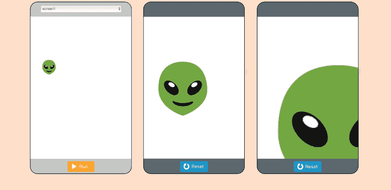


## 为 Smelephant 的向下、向左和向右移动编写方向键代码

重复“为 Smelephant 编写向上箭头键控制”中的过程，创建移动 `smelephant` 向下、向左或向右的按键控制代码。为每个方向设置`point in direction`命令如下：

- **向下箭头：** 将`point in direction`设置为 180。

- **向左箭头：** 将`point in direction`设置为 -90（或 270）。

- **向右箭头：** 将`point in direction`设置为 90。

`smelephant` 的代码现已完成！参见图 9-6。测试此精灵的所有代码，确保其按你的预期工作。

> 你可以通过 Ctrl-点击（Mac）或右键点击（Win）代码块，然后从弹出菜单中选择“复制”来复制代码。


图 9-6

## 添加花朵精灵

用户将点击方向键来让 `smelephant` 在草原上行走，目标是闻花香。为你的游戏创建一个花朵精灵，然后克隆并散布克隆体，步骤如下：

1. 在 Scratch 界面的精灵区域，将鼠标悬停在“选择一个精灵”图标上。

2. 从弹出菜单中选择“绘制”来绘制你自己的精灵造型。

精灵造型编辑器在“造型”选项卡中打开。此精灵的默认造型名称为 `costume1`。保留此名称，或更改它（我将其更改为 `star`）。

3. 使用绘图工具绘制你的花朵，如图 9-7 所示。

尝试使用工具和填充颜色，直到获得你喜欢的花朵造型设计。精灵会出现在舞台上，穿着该造型。不要担心大小；你在第 5 步中进行调整。


图 9-7

4. 在 Scratch 界面右下角的角色属性编辑器中，重命名你的精灵。

默认名称为 `Sprite1`。我将我的精灵命名为 `flower`。

5. 在角色属性编辑器中，通过在精灵上方的“大小”字段中输入新数字来调整精灵大小。

默认大小为 `100`。我将花朵的大小更改为 `30`。

## 为花朵精灵编写绿旗程序

你将为花朵精灵编写一个绿旗程序，将父花朵精灵定位在草原上。然后调用一个积木块来克隆花朵，使屏幕上充满许多处于不同位置的花朵。

按照以下步骤为花朵精灵编写绿旗程序：

1. 通过点击其图标来选择花朵精灵。

2. 在 Scratch 界面的“代码”选项卡上，选择“事件”图标。将`当绿旗被点击`命令拖到代码工作区。

3. 选择“运动”图标。将`移动到 x: y:`命令拖到代码工作区，并将其附加到前一个命令上。在每个字段中输入 `-100`，使代码显示为`移动到 x: -100 y: -100`。

4. 选择“外观”图标。将`显示`命令拖到代码工作区，并将其附加到前一个命令上。

5. 选择“我的积木”图标。点击“制作一个积木”按钮来创建一个新的代码积木块。

6. 将此新代码积木块命名为 `makeFlowers` 并点击确定。

此代码将花朵定位在远离 `smelephant` 的位置，以便两个精灵在花朵精灵被克隆之前不会碰撞。

（如果你在绿旗程序的末尾隐藏精灵，这才会成为一个问题，而你的确会这样做。）

“制作一个积木”对话框打开。

新积木块标题会添加到你的工作区，新命令块 `makeFlowers` 会添加到你的“我的积木”类别中的命令中。你在下一节中定义 `makeFlowers` 代码积木块的作用。

7. 从“我的积木”类别中，将你的新 `makeFlowers` 命令拖到代码工作区，并将其附加到`显示`命令上。

8. 从“外观”类别中，将`隐藏`命令拖到代码工作区，并将其附加到`makeFlowers`命令上，如图 9-8 所示。

花朵精灵运行 `makeFlowers` 后，它会隐藏。你隐藏该精灵是为了不必编写命令来规定它被闻到时应该如何表现——你将有很多花朵克隆体被闻到。


## 编写 makeFlowers 积木块的代码

你创建了一个 `makeFlowers` 代码积木块标题和命令块。现在你需要为该积木块编写代码。`makeFlowers` 代码积木块克隆父花朵精灵以创建许多花朵，并将它们散布在整个屏幕上。

按照以下步骤为 `makeFlowers` 代码积木块编写代码：

1. 在工作区的`定义 makeFlowers`代码积木块标题处工作。

2. 从“控制”命令中，将`重复执行`命令拖到代码工作区，并将其附加到代码积木块标题上。在`重复执行`命令中输入一个数字。

此数字是`重复执行`命令执行的次数。我将其设置为 30。

3. 将`克隆`命令拖到代码工作区，并将其放在`重复执行`内部。将`克隆`命令设置为`自己`。

4. 选择“外观”类别。将`将颜色特效增加`命令拖到代码工作区，并将其附加到`克隆`命令上，放在`重复执行`内部。在`将颜色特效增加`命令中输入一个数字。

此数字是每次`重复执行`命令执行时克隆体颜色变化的程度。我将变化设置为 10，使克隆体的颜色与上一个克隆体相比有所变化。

5. 选择“运动”图标。将`移动到 x: y:`命令拖到代码工作区，并将其附加到前一个命令上。从“运算”类别中，将`在...和...之间取随机数`命令拖到第一个字段（x 坐标）中，再将另一个`在...和...之间取随机数`命令拖到第二个字段（y 坐标）中。

6. 在`在...和...之间取随机数`命令中，输入 -240 和 240 作为 x 位置值的范围。这些值使花朵克隆体能够创建在屏幕上的任何水平位置。

7. 在`在...和...之间取随机数`命令中，输入 -180 和 40 作为 y 位置值的范围。这些值使花朵克隆体能够创建在草原上的 y 位置。y 坐标值大于 40 的部分是天空——花朵可不会长到天上去！

`定义 makeFlowers`代码积木块现已完成。参见图 9-9。

## 第三部分：从这里到那里，一次又一次


图 9-9

当在花花的绿旗代码中运行`makeFlowers`命令时，它会*调用*`define makeFlowers`代码块，以了解要执行哪些命令。

## 花花角色的“作为克隆体启动时”代码

当花花角色的绿旗程序运行时，它会创建克隆体。克隆体需要指令！每个克隆体都需要遵循一个指令：它需要知道被闻到时会发生什么。

按照以下步骤编写`when I start as a clone`程序：

1. 选择花花角色。

2. 在 Scratch 界面的代码选项卡中工作，选择控制图标。将一个`when I start as a clone`命令拖到代码工作区。

   附加到此事件的命令将在每次创建新克隆体时执行。

3. 选择我的积木图标。点击“制作积木”按钮来创建一个新的代码块。

“制作积木”对话框将会打开。

4. 将这个新代码块命名为`getSmelled`，然后点击确定。

新的积木标题将添加到你的工作区，新的积木命令`getSmelled`将添加到你的“我的积木”类别中的命令里。你之前制作的`makeFlowers`命令也在那里。你在下一节中定义`makeFlowers`的作用。但现在你可以使用`makeFlowers`命令了。

5. 从“我的积木”类别中，将`getSmelled`命令拖到代码工作区，并将其附加到`when I start as a clone`命令上，如图 9-10 所示。


图 9-10

## 为花花克隆体编写`getSmelled`积木代码

你创建了一个`getSmelled`代码块标题和命令块。现在你需要编写代码来为`getSmelled`提供指令。这段代码应该让每个克隆体耐心等待，直到嗅嗅象碰到它，然后它应该隐藏（因为嗅嗅象把花花克隆体吸进了鼻子里）。代码将如图 9-11 所示。

按照以下步骤编写代码：

1. 在工作区的`define getSmelled`代码块标题处工作。

2. 选择控制图标。将一个`wait until`命令拖到代码工作区，并将其附加到代码块标题上。


图 9- Nobr

3. 选择侦测图标，将一个`touching`命令拖到`wait until`的字段中。点击`touching`内部的箭头，从下拉列表中选择`smelephant`。

在`wait until touching smelephant`命令之后的代码将不会执行，直到花花克隆体被嗅嗅象碰到。

4. 选择声音图标。将`start sound`命令拖到工作区，并将其附加到前一个命令上。点击`start sound`内部的箭头，从下拉列表中选择`pop`。

（`pop`声音将伴随你在Scratch中绘制的任何新角色。）当花花克隆体被嗅嗅象角色嗅到（碰到）时，会播放pop声，就好像花花从地里蹦出来一样。

5. 选择外观图标。将`hide`命令拖到工作区，并将其附加到前一个命令上。

现在，花花克隆体被闻到后，它就会隐藏起来——因为嗅嗅象把它吸走了！

图9-12显示了花花角色的全部代码。


图 9-12

## 添加猴子角色

一个好的收集游戏需要有些东西阻碍玩家达到收集目标。你将编写一只小猴子的代码，让它不断向嗅嗅象移动。嗅嗅象必须远离猴子。如果它们相撞，游戏就结束了！

按照以下步骤向你的游戏中添加猴子角色并将其命名为`monkey`：

1. 在Scratch界面的角色区域，点击"选择一个角色"图标。

2. 点击猴子角色。猴子被添加到你的角色库中。注意，在角色属性区域的角色名称字段中，它的名字是`Monkey`。

3. 通过在角色属性区域的"大小"字段中输入数字来更改猴子角色的大小。

我使用的大小是`30`，但你可以使用任何适合你游戏的大小。

4. 通过点击角色属性区域中的"方向"字段来设置猴子角色的旋转样式。在"方向"字段中，选择"左右翻转"旋转选项。

此选项允许猴子向左走时面向左，向右走时面向右。当他向上或向下移动时，他保持之前面对的方向。有关详细信息，请参阅"Scratch中的旋转样式"边栏。

## 编写猴子的绿旗代码

编写猴子代码，使游戏开始时，他位于远离嗅嗅象的地方。否则，他太容易抓住他的朋友了！然后添加代码，让猴子追逐嗅嗅象。

按照以下步骤操作：

1. 点击猴子角色。

2. 在Scratch界面的代码选项卡中工作，选择事件图标。将一个`when green flag clicked`命令拖到代码工作区。

3. 选择运动图标。拖动`go to x: y:`命令并将其附加到前一个命令上。将每个字段的值设置为`100`。

执行时，此命令将猴子发送到坐标`(100, 100)`。

4. 选择我的积木图标。点击"制作积木"按钮来创建一个新的代码块。

"制作积木"对话框将会打开。

5. 将这个新代码块命名为`chase`，然后点击确定。

新的积木标题将添加到你的工作区，新的命令块`chase`将添加到你的"我的积木"类别中的命令里。在下一节中，你将定义`chase`代码块的作用。

6. 从"我的积木"类别中，将你新创建的`chase`命令拖到代码工作区，并将其附加到前一个命令上。

猴子角色的完整绿旗代码请参见图9-13。


图 9-13

## 编写`chase`积木代码

你创建了一个`chase`代码块标题和命令块。现在为该积木编写代码。`chase`代码块使用一种循环命令类型（参见第8章），使猴子不断向嗅嗅象滑行。如果猴子碰到嗅嗅象，嗅嗅象就被抓住，游戏结束。

按照以下步骤编写`chase`代码块的代码：

1. 在工作区的`define chase`代码块标题处工作。

2. 从控制命令中，将一个`repeat until`命令拖到代码工作区，并将其附加到代码块标题上。

3. 选择侦测图标，将一个`touching`命令拖到`wait until`字段中。点击`touching`内部的箭头，从下拉列表中选择`smelephant`。

在`repeat until touching smelephant`命令之后的代码将不会执行，直到猴子碰到嗅嗅象。

4. 从运动命令中，将一个`glide`命令拖到代码工作区，并将其附加到`repeat until`内部。在秒数字段中输入一个数字。（我输入了`2`。）点击`glide` to内部的箭头，从下拉列表中选择`smelephant`。

该命令现在显示为`glide 2 sec to smelephant`。

5. 选择外观类别。将一个`next costume`拖到代码工作区，并将其附加到`repeat`内部的`glide`命令上。

随着猴子移动，他的造型会变化，使他看起来像是在走路。猴子不断向嗅嗅象移动，但速度足够慢，不会抓到他——除非嗅嗅象累了停下来。`repeat until`代码现在完成了。

6. 选择声音图标。将一个`play sound until done`命令拖到`repeat until`命令下方。点击此命令内部的箭头，从下拉列表中选择`chee chee`。

当你将猴子添加到项目中时，这个声音会随猴子角色一起提供。当猴子抓住他的朋友时，他会发出快乐的"chee chee"声！

7. 选择控制图标。将`stop all`命令拖到代码工作区，并将其附加到前一个命令上。

猴子叫完他的"chee chee"声后，整个游戏停止。

`define chase`代码块现在完成了，如图9-14所示。

第 9 章：嗅象 (Smelephant) 157

图 9-14

当在猴子的绿旗代码中运行`chase`命令时，它会`调用` (calls) `define chase`代码块，以确定要执行哪些命令。

猴子精灵的完整代码如图 9-15 所示。

图 9-15

## 保存、测试并调试你的程序

在 Scratch 界面的顶部标题栏中为你的程序输入一个名称。在你工作时，Scratch 会自动将你的程序保存到云端，因此你无需采取任何特殊操作来保存作品。

测试你的程序并修复所有 bug，以确保它按照你想要的方式运行。（有关调试 Scratch 程序的帮助，请参阅第 3 章。）

## 与世界分享你的程序

在你的程序完美运行后，就是分享它的时间了。将程序的状态设置为"分享"，然后在你的项目页面中添加程序的描述以及运行指南。有关分享程序的详细信息，请参阅第 19 章。

## 增强你的动画场景

考虑通过新功能来增强你的 Smelephant 游戏：

- **添加背景音乐**：在舞台上放置一段带有萨凡纳草原声音的优美音乐。设置音乐在绿旗事件时开始播放，并将其放置在`forever`循环内，使其不断循环播放。

- **添加新对象**：嗅象不一定非要收集花朵；他可以收集任何东西！将花朵更改为你选择的任何有趣对象。

- **让嗅象成长**：如果嗅象吃掉他收集的对象，那么每次抓到点心时，他的尺寸都会增长！在"创建自定义积木 (Make a Block)"中，定义一个新积木（称为`defineGrow`），每当嗅象接触到他正在收集的对象时，就让嗅象长大。使用`change size by`命令（在"外观 (Looks)"类别中）并将值设置为一个较小的数字。然后将你的`grow`命令添加到嗅象的绿旗代码中。（注意：你还需要在`grow`命令之前添加一个`set size to 40%`命令 —— 以便在每次游戏开始时将嗅象恢复到正常尺寸。`set size`命令同样在"外观"类别中。）

- **创建夜晚场景**：在舞台上添加一个`change brightness`效果，使其看起来像是太阳在萨凡纳草原上落下。你可以在"外观"类别中找到`change brightness`。这里有一个你可以使用的代码片段：

```
when [green flag] clicked
forever
  wait (1) seconds
  change [brightness v] effect by (-1)
end
```

## 按键控制

*计算机键盘控制*，或 *按键控制*，是视频游戏中控制屏幕上对象的常用方法。上、下、左、右方向键经常被用于在游戏环境中移动角色。A、W、S、D 键也经常用于角色按键控制，空格键有时用于游戏中的射击或发射。

由于 Scratch 非常适合编写在计算机屏幕上运行的程序，因此很容易编写包含按键控制的代码。你可以前往 Scratch 的"事件 (Events)"类别，将`when key pressed`命令拖到代码工作区。该命令可以作为一个触发精灵移动的事件。（有关事件驱动编程的详细信息，请参阅第 4 章。）你可以将按键按下事件设置为响应用户点击字母、数字、空格键或键盘上的任何键。

你可以创建许多不同的`when key pressed`命令，让玩家移动和控制精灵。通过为左右方向键编写响应代码，你可以编写一个挡板球游戏（如 Pong）。或者编写上下方向键的响应代码来创建 Flappy Bird 游戏。而为所有四个方向键编写响应代码，则能让你制作一个 Crossy Road 游戏！

App Lab 也可以被编程为响应按键控制，尽管这并不是在该环境中编程的最理想用途。App Lab 更适合触摸屏点击，而非键盘点击。如果你决定挑战这一难题，App Lab 命令的在线文档提供了关于编写按键控制的额外信息。

micro:bit 的 MakeCode 允许你编写响应按钮（而非按键）控制的事件驱动程序。micro:bit 有两个内置按钮：按钮 A 和按钮 B。每个按钮都可以被编程为独立响应点击。你还可以编程让按钮响应同时点击按钮 A 和按钮 B。若要编程一个代码块在 micro:bit 上作为按钮点击事件的结果运行，请使用 MakeCode "输入 (Input)"类别中的`onButtonPressed( )`命令作为你的事件。

## 碰撞

当两个对象位于屏幕上的同一个位置时，就会发生碰撞。位于同一个位置意味着这些对象（精灵）共享相同的 (x, y) 坐标 —— 或者一个精灵的一部分与另一个精灵的一部分共享相同的坐标。

在编程中检查碰撞非常重要，因为这能让你知道在游戏或模拟中，两个对象何时碰撞、相撞或以其他方式重叠。例如，如果 Flappy Bird 和一根柱子共享一个坐标位置，则玩家撞上了柱子。但碰撞并不总是坏事！当 PacMan 与小圆点碰撞时，他会吃掉圆点并获得积分。

在 Scratch 中，"侦测 (Sensing)"类别提供了一个`touching`命令，可用于检查碰撞。`touching`命令可以添加到任何精灵中，并且该命令可以设置为检查是否接触目标对象中的任何对象。如果`touching`记录的值为`true`，则精灵及其目标对象正在接触，发生了碰撞。第 12 章和第 13 章展示了如何创建和使用一个在某些条件下会改变的数值变量。在编写检查碰撞的代码时，你可以使用该数值变量来记录游戏分数。

在 App Lab 中确定是否发生了碰撞需要进行一些计算，因为它没有检查两个对象是否接触的直接命令。当两个对象之间的距离小于对象中心点之间的距离时，就会发生碰撞。测量两个对象之间的距离需要使用距离公式，并随着对象的移动不断重新计算距离。这些计算超出了本书的范围，但如果你有志向，在 App Lab 中编写碰撞检测是可能的。

最后，要检测 micro:bit 上两个 LED 灯的碰撞，你必须检查两个点是否在 micro:bit 的单个 (x,y) 坐标上汇合。因为 LED 灯不能像 Scratch 精灵或 App Lab 图像那样重叠，你只需要检查 micro:bit 上的这两个点是否占据同一个位置。

## 显示与隐藏

显示 (Show) 和隐藏 (Hide) 命令让你能够控制用户在屏幕上看到哪些对象以及何时看到这些对象。例如，在 Emoji Explosion 场景中（见第 8 章），你隐藏了用于创建克隆体的 emoji 精灵，这样你就无需编写额外的代码来让父级 emoji 在屏幕上移动。在 Smelephant 游戏中，当嗅象将花朵从地下嗅出来后，你会隐藏花朵，以便用户看到花朵已被移除。

具有能量增强 (power-ups) 或奖励宝石的游戏会利用`show`在游戏过程中仅在特定时间显示这些对象。而像 Space Invaders 这样的游戏则使用`hide`来移除玩家已消除的游戏场对象。此外，包含用户填写信息表单的应用需要控制用户在填写表单时看到哪些字段 —— 并非所有字段在所有时间都是可见的。

Scratch 在"外观 (Looks)"类别中提供了`show`和`hide`命令。App Lab 在"UI 控制 (UI Controls)"类别中提供了`showElement()`和`hideElement()`命令。使用这些命令来构建和控制你的用户界面中显示的内容！

## 第四部分

## 变量、简单条件语句与输入/输出


## 在本部分中，你将学习...

-   编写代码以接受用户输入并产生输出

-   使用变量，包括字符串（文本）、数字和布尔值

-   为你的应用添加文本转语音和语言翻译功能

-   构建条件语句以做出决策

-   构建并对一个能响应传感器的装置进行编码

## 第10章

## 吉祥物问候程序

编码中**两个最重要的**技能是学习如何从用户那里接收`input`，以及向用户`produce output`。这些输入和输出通常是文本。在编码中，不会改变的文本称为*字面量*。会改变的文本，比如用户的名字，必须存储在*变量*中。变量是一个容器，可以根据需要存储一段可更改的信息。存储一段文本的变量称为*字符串变量*。名字、地址、最喜欢的食物以及其他可能因应用用户不同而改变的文本，都存储在字符串变量中。


## 第四部分：变量、简单条件语句与输入/输出

在本章中，你将通过编写一个能够个性化问候的简单程序，开始学习文本处理，编码字面量和字符串变量。吉祥物问候程序是一个快速的Scratch项目，在其中你将编写代码，让一个角色接受用户输入的字符串。你要求用户输入他或她的名字，然后存储这个名字。你编写额外的代码，将用户输入与其他文本连接起来，然后显示——并朗读——一段问候语。

## 头脑风暴

吉祥物问候程序可以在任何场景中使用任何角色。它可以说任何你想说的短语！参见图10-1a和图10-1b。


在决定吉祥物之前，查看一下Scratch的背景和角色库。然后开始编码吧。

## 开始一个新项目

按照以下步骤开始创建你的吉祥物问候程序：

1.  打开Scratch网站 https://scratch.mit.edu/。如果系统提示，请启用Flash以运行Scratch。登录到你创建的用于使用Scratch的账户（参见第2章）。

2.  在Scratch主页，选择"创建"。或者，如果你已经在使用Scratch，从菜单栏选择"文件" $\rightarrow$ "新建"。

一个新项目将被打开。

3.  通过在Scratch界面顶部的"项目名称"字段中输入名称来命名你的程序。

4.  通过点击Scratch界面右下角角色区域中"Scratch猫"图标上的X，将"Scratch猫"从项目中删除。

## 输入与输出 (I/O)

输入和输出是你在计算机科学中经常听到的专业术语。*输入*是指放入程序中的内容，例如，你在游戏应用中的名字。*输出*是指从程序中出来的内容，例如，一条宣布你获得最高分的消息！你经常会看到*输入输出*缩写为*I/O*。

输入可以采取多种形式，有些输入是由用户输入的，例如，在线表单中键入单词，或者查看你的iPhone摄像头，以便其面部识别系统可以识别你。其他输入是由传感器不断读取你周围世界的信息提供的，例如，通过家中的恒温器测量当前温度，或在你驾驶时确定汽车的指南针方向。

输出也可以有多种形式。这些包括屏幕上显示的文本、警报、传感器读数，或设备的自动激活（例如，你的智能烤箱自动预热你计划放学后烘烤的饼干）。

最终，人类与技术之间的交互必须通过计算机程序来协调。在计算机程序中，输入和输出是允许你与你的设备通信，以及你的设备与你通信的中间媒介！

## 添加背景

*背景*是填充你玩具屏幕的背景颜色或图像。按以下步骤添加背景：

1.  在"舞台"区域，点击"选择一个背景"图标。

2.  在"选择一个背景"窗口中，点击任何你想要的背景。

我选择了侏罗纪背景。

> 当你开始一个新项目时，舞台包含一个空白背景。此背景的默认造型名称是`backdrop1`。添加新背景后，你可以通过打开舞台的"背景"选项卡，然后点击`backdrop1`图标上的X来删除空白背景。

## 添加吉祥物角色

按以下步骤为你的玩具添加一个吉祥物角色：

1.  在Scratch界面的角色区域，点击"选择一个角色"图标。

2.  在"选择一个角色"窗口中，点击任何你想要的角色。

3.  在`Dinosaur4`的角色属性编辑器中，编辑"大小"字段中的数字以更改吉祥物角色的大小（如果你想这样做的话）。角色的默认大小是`100`。

4.  将角色拖动到背景中间的某个位置。

我选择了`Dinosaur4`。（恐龙角色太多了，MIT的Scratch团队不得不给它们编号！）

根据你选择的角色，它可能有多个造型。之后，你可以利用这些造型来为你的问候者制作动画，让他看起来在说话时像是在动！

> 如果你添加了一个角色然后决定不想要它，可以点击其图标上的X来删除它。

## 添加文本转语音命令

你的吉祥物问候者不仅会用文字问候，还会通过Scratch的文本转语音命令将其说出来。按照以下步骤为你的Scratch界面添加文本转语音：

1.  点击或点击Scratch界面左下角的"添加扩展"图标。

"选择一个扩展"对话框将打开，包括"文本转语音"选项，如图10–2所示。


2.  点击或点击"文本转语音"框。

文本转语音命令将被添加到你的命令库中。

## 字符串和字符串操作


每个应用都会向其用户显示文本，而且大多数应用也会要求用户输入文本。字符串允许你的计算机程序显示和接受这些文本。一些字符串旨在传达信息，例如“欢迎使用我的应用！”或“你选择哪种武器，丘比特之箭还是圣剑Excalibur？”

如果文本永远不会改变，该字符串就是*字面量*。字符串字面量用引号括起来——引号内的任何内容都会显示在屏幕上。如果文本可以改变，该字符串就是*变量*。变量字符串就像一个容器，可以在不同的时间容纳不同的信息。变量字符串有一个名称，例如`userName`，这个名称永远不会改变。但`userName`包含的值可以根据需要改变。例如，在你的程序的一次执行中，`username`可能等于"Bart Simpson"，但在下一次执行中，`username`可能等于“Krusty the Clown”。

字符串字面量和字符串变量可以组合，或*连接*起来，以个性化向用户显示的文本。要连接字符串——即连接每个字面量或变量并产生一个新的短语——一些编程语言使用`join`命令，而其他语言使用加号（`+`）。

Scratch、App Lab和用于micro:bit的MakeCode都包含用于*操作*字符串的特殊命令。例如，你可以使用一个命令来确定字符串的长度，选择字符串中特定位置的字符，或者查明一个较短的字符串（子字符串）是否存在于字符串中。你还可以比较两个字符串以查看它们是否匹配：当确定用户输入的密码是否与之前存储的密码匹配时，这非常理想。

你可以将所有这些命令，连同你之前学过的一些命令（以及一些你将在未来章节中学到的命令）结合起来，创建一些很酷的程序！其中一个程序是一个单词反转程序。你可能玩过在纸上倒着拼写单词。一本著名的青少年读物《别有洞天》（路易斯·萨查尔）中的主角名叫Stanley Yelnats，他的姓氏是其名字的倒写。第17章将介绍一个项目，在其中你可以反转一个字符串并检查它是否是一个*回文*——一个正着拼写和倒着拼写都一样的单词！

# 第10章：吉祥物迎宾员

## 编写吉祥物精灵的问候代码

为了个性化问候，使用内置的`ask`命令让用户输入他或她的名字。然后将名字存储在`answer`变量中。`answer`变量是Scratch内置的，所以你不需要创建它。最后，将字面量（不会变化的文字）与变量（用户的名字）拼接起来，然后显示问候语。

按以下步骤编写吉祥物精灵的问候代码：

1. 选择吉祥物精灵。

2. 在Scratch界面的代码标签页中，选择事件图标。将`当绿旗被点击`命令拖动到代码工作区。

3. 选择侦测图标。将`询问并等待`命令拖动到代码工作区，并将其连接到前一个命令。

`ask`字段中的默认问题是What's your name?。你可以保留这个问题，也可以输入一个新问题。

当程序运行时，它会显示一个空白文本字段供用户输入她的回答。在她输入名字并点击或点击文本输入字段旁的勾选按钮（或按下键盘上的Enter或Return键）后，她的文本将被存储在`answer`变量中。

> Scratch不要求在字符串字面量（如What's your name?）周围加引号。然而，大多数其他编程语言（包括JavaScript）要求在字符串字面量周围加引号。

4. 选择外观图标。拖动一个`say`命令并将其连接到前一个命令。

5. 选择运算图标。将`join`命令拖动到代码工作区，并将其放在`say`命令的字段中。

6. 在`join`命令的第一个空字段中输入你的问候语。

我在字段中输入了`Welcome to the Jurassic Period,`。注意这个文本字面量包含一个逗号和逗号后的一个空格。

7. 选择侦测图标。拖动一个`answer`命令并将其放在`join`命令的第二个空字段中。

这将`answer`变量的值——即用户输入的任何名字——插入到问候语中。

8. 选择**文字转语音**图标，将`set voice to`命令拖动到代码工作区，并将其连接到前一个命令。从命令中的菜单选择一种声音。

可选的声音有`alto`、`tenor`、`squeak`、`giant`和`kitten`。我选择了`giant`声音（因为恐龙会有洪亮的声音！）

9. 在**文字转语音**命令中，将`speak`命令拖动到代码工作区，并将其连接到前一个命令。

10. 通过Ctrl点击或右键点击问候语并从弹出菜单中选择**复制**，创建与之前相同的问候语。然后将问候语放在`speak`命令的空字段中。

完成的代码应如图10-3所示。


# 图10-3

## 保存、测试和调试你的程序

在Scratch界面顶部的标题字段中输入项目名称来命名你的项目。在你工作时，Scratch会自动将你的程序保存到云端。测试你的程序并修复任何错误，确保它按照你想要的方式工作。（有关调试Scratch程序的帮助，请参阅第3章。）

## 与世界分享你的程序

在你的程序完美运行后，是时候分享它了！将你的程序状态设置为"分享"，然后在项目页面中添加对你的程序的描述以及如何运行它的说明。有关分享程序的详细信息，请参阅第19章。

## 增强你的程序

考虑通过添加新功能来增强你的吉祥物迎宾玩具：

- **更换造型**：根据你选择的精灵，它可能有多个造型。通过在造型标签页中点击来选择你想要显示的造型。

- **让精灵动起来**：如果你的精灵有多个造型，将一个或多个`next costume`命令（来自外观类别）拖入你的代码中，使精灵每次说话时都改变外观。有关精灵动画的帮助，请参阅第9章中的侧边栏。

- **添加声音**：从声音标签页中，为你的吉祥物精灵添加一个新声音。（提示：Grunt声音正是你可能期望从恐龙那里听到的！）然后将`play sound`命令拖入你的代码中，使声音在口语问候之前或之后播放！

- **添加更长的问候语**：通过将一个`join`命令放在另一个`join`命令内部，你可以在用户名字（存储在`answer`变量中）之后添加另一个字面量。

# 第11章

# 搞怪短信

如果你发短信或发送即时消息，在某个时候你可能收到过朋友发来的搞怪短信。也许是自动纠错功能更改了发送者的一个词，导致消息的意思完全变了。我曾经给家人发短信说我正要去Zumba（一种健身课程），但他们收到的消息是我正要去津巴布韦！


## 头脑风暴

为了获取用户输入来组装搞怪短信，你让用户输入一些单词和短语，如前面的图所示。例如，想象一下如果你问用户一种鱼的名字、一首流行歌曲的名字和一个最喜欢的感叹词（表示兴奋或情感的词，如"哇"）。你可以*连接*，或者说*拼接*，这些字符串变量值和一些字符串字面量，组成一条非常搞怪的短信。尽情头脑风暴想出尽可能多的疯狂词汇类别，然后开始编程！

## 开始一个新项目

按照以下步骤开始创建你的搞怪短信应用：

1. 在`https://code.org/educate/applab`打开App Lab。登录你为使用App Lab创建的账户（见第2章）。

2. 在App Lab标题下，点击"试试看"按钮。

一个新项目就会打开。

在这个项目中，你在App Lab中构建一个使用字符串创建搞怪短信的玩具。这些字符串包括字面量和变量。你创建字面量，而你的用户在提示时输入文本单词和短语，存储在变量中。最终用户可以输入他或她想要存储在字符串变量中的任何文本。然而，用户并不确切知道他们的输入将如何被使用。正如你可以猜到的，当字符串输入值与你创建的字符串字面量组合时，可以产生一条相当奇怪的消息。

虽然消息实际上并不是通过短信发送的，但结合一些巧妙的设计工作，你的最终用户会喜欢这种在他或她的手机上收到搞怪消息的视觉效果。让乐趣开始吧！

3. 通过点击重命名按钮，然后在App Lab界面顶部的项目名称字段中输入名称来命名你的程序。

4. 点击保存按钮。

## 为应用命名输入屏幕

你的应用将包含两个屏幕：一个输入屏幕，用户在其中输入有趣的单词；一个输出屏幕，搞怪短信在其中显示。每个屏幕都必须命名，以便你的代码在执行时知道去哪里。

按以下步骤命名输入屏幕：

1. 点击设计按钮切换到App Lab的设计模式。设计工具箱和工作区将会显示。

2. 在工作区的属性标签页上，将`screen1`的ID重命名为更有意义的名称，如`inputScreen`。


不要在ID名称中包含空格。在大多数编程语言中（包括App Lab），空格是不允许的。

## 为输入屏幕添加背景色

将输入屏幕的背景色设置为与输出屏幕不同的颜色会很有帮助。不同的颜色让你在工作时能够区分两个屏幕。要更改输入屏幕的背景色，请按照以下步骤操作：

1. 继续在设计模式的App Lab输入屏幕中工作。

2. 在工作区的属性标签页上，找到背景颜色字段。

3. 点击背景颜色字段右侧的小颜色方块，打开背景的颜色编辑器。

4. 移动颜色滑块（第一个滑块）查看不同的颜色。

5. 点击颜色色板（较大的颜色方块）选择你想要的颜色。

背景变为你选择的颜色。

## 添加说明标签

接下来，你应该添加一个标签，帮助用户知道在输入屏幕该做什么。按以下步骤添加说明标签：

1. 继续在设计模式的App Lab输入屏幕中工作。

2. 在设计工具箱中，拖动标签图标并将其定位在应用显示的左上角附近。

3. 在工作区的属性标签页上，更改标签的属性如下：

   * **ID：** 将ID重命名为`instructionsLabel`。

   * **文本：** 输入你应用的说明，如**输入单词或短语：**

   * **宽度（px）：** 将标签的宽度增加到约240像素（或更多），以便标题显示在一行上。

   * **高度（px）：** 不做更改。

   * **x位置（px）：** 不做更改；稍后你通过拖动标签来调整x位置。

   * **y位置（px）：** 不做更改；稍后你通过拖动标签来调整y位置。

   * **文本颜色：** 保持黑色。

   * **背景颜色：** 不做更改。

   * **字体大小（px）：** 在输入框中键入新的字体大小，或使用选择箭头为你的应用设置合适的标题大小。

   * **文本对齐方式：** 点击选择箭头并选择居中。

4. 点击并拖动你应用中的标签，将其放置在你想放置的位置。

请参考本章第一页的左侧图示，查看说明标签在应用模拟器显示中的位置。

## 添加分类标签和文本输入框

接下来，创建分类标签，以便用户知道他或她应该在应用中输入什么文本。在每个标签旁边放置一个文本输入框，这样用户就可以输入单词或短语了。请参考本章第一页的左侧图示。

请按照以下说明为你的应用添加每个标签和文本输入框：

1. 继续在App Lab的设计模式中进行操作。如果你不在设计模式，请点击“设计”按钮。

设计工具箱和工作区将会显示。

2. 开始创建分类标签。在设计工具箱中，将“标签”图标拖到屏幕上，并将其定位在应用显示区域的左侧附近。

3. 在工作区的“属性”选项卡上，按如下方式更改标签的属性：

   * **ID：** 将ID重命名为能代表该分类的名称，例如`foodLabel`或`celebrityLabel`。

   * **文本：** 键入分类名称，例如**Food**或**Celebrity**。

   * **宽度（px）：** 将标签宽度设置为大约100像素，以便分类名称能显示在单行内。

   * **高度（px）：** 不做更改。

   * **x位置（px）：** 不做更改；稍后你通过拖动标签来调整其位置。

   * **y位置（px）：** 不做更改；稍后你通过拖动标签来调整其位置。

   * **文本颜色：** 保持黑色。

   * **背景颜色：** 不做更改。

   * **字体大小（px）：** 在输入框中键入新的字体大小，或使用选择箭头为你的应用设置合适的标签文本大小。

   * **文本对齐方式：** 点击选择箭头并选择右对齐。

4. 点击并拖动你应用中的标签，将其放置在你想放置的位置。

5. 重复步骤2到4，以创建并命名另外三个标签，并将它们拖动到应用模拟器中的逻辑位置。

请勿忘记为每个标签设置唯一的ID。

请参考本章第一页的左侧图示，查看分类标签在应用模拟器显示中的位置。

6. 现在创建文本输入框。在设计工具箱中，将“文本输入框”图标拖到第一个分类标签旁边。

我将我的第一个文本输入框放在了我的Food标签旁边。

7. 在工作区的“属性”选项卡上，按如下方式更改标签的属性：

   * **ID：** 将ID重命名为能代表文本输入框的名称，例如`foodInput`或`celebrityInput`。

   * **文本：** 留空，以便用户看到一个空框。

   * **宽度（px）：** 将标签宽度设置为大约170像素，以便用户有空间在框中输入文本。

   * **高度（px）：** 设置为40像素。

   * **x位置（px）：** 不做更改；稍后你通过拖动标签来调整其位置。

   * **y位置（px）：** 不做更改；稍后你通过拖动标签来调整其位置。

   * **文本颜色：** 保持黑色。

   * **背景颜色：** 不做更改。

   * **字体大小（px）：** 在输入框中键入新的字体大小，或使用选择箭头为你的应用设置合适的用户输入文本大小。

   * **文本对齐方式：** 点击选择箭头并选择左对齐。

8. 点击并拖动你应用中的文本输入框，将其放置在你想放置的位置。

9. 重复步骤6到8，以创建并命名另外三个文本输入框，将每个输入框拖动到应用模拟器中其对应的分类标签旁边的逻辑位置。

请勿忘记为每个文本输入框设置唯一的ID。请参考本章第一页的左侧图示，查看文本输入框在应用模拟器显示中的位置。

分类标签和文本输入框已完成。

## 添加触发操作的按钮

现在你将为输入屏幕添加一个按钮。当用户按下该按钮时，他或她将触发代码的执行，代码会切换到下一个屏幕，将输入内容组装成一条奇特的文本消息，并显示该消息。

请按照以下步骤添加触发按钮：

1. 继续在App Lab的设计模式中进行操作。如果你不在设计模式，请点击“设计”按钮。

设计工具箱和工作区将会显示。

2. 在设计工具箱中，将“按钮”图标拖到应用显示区域。

3. 在工作区的“属性”选项卡上，按如下所示更改按钮的属性：

   * **ID：** 将ID重命名为`goButton`（或类似名称）以表示此按钮将启动操作。

   * **文本：** 键入将显示在按钮上的文本，例如**Make Weird Text Message**（或你想要的任何内容）。

   * **宽度（px）：** 将按钮宽度增加到大约290像素。

   * **高度（px）：** 将按钮高度增加到大约45像素。

   * **x位置（px）：** 不做更改；稍后你通过拖动按钮来调整其位置。

   * **y位置（px）：** 不做更改；稍后你通过拖动按钮来调整其位置。

   * **文本颜色：** 点击“文本颜色”字段右侧的小色块，并选择一种能与按钮背景形成良好对比的文本颜色。

   * **背景颜色：** 点击“文本颜色”字段右侧的小色块，并选择一种能与应用背景颜色形成良好对比的按钮颜色。

   * **字体大小（px）：** 在输入框中键入新的字体大小，或点击选择箭头为你的应用设置合适的按钮文本大小。

   * **文本对齐方式：** 点击选择箭头并选择居中。

4. 点击并拖动你应用显示中的按钮，将其定位在输入屏幕上其他元素的下方。

请参阅图11-1了解按钮的定位方式。


# 图11-1

## 添加并命名输出屏幕

你应用的第二个屏幕，即输出屏幕，是奇特文本消息出现的地方。请按照以下方式创建并命名输出屏幕：

1. 继续在设计模式下工作。

2. 转到位于模拟器屏幕顶部的屏幕下拉菜单。点击菜单并选择“新建屏幕”，如图11-2所示。

你的应用中将创建一个新屏幕。请注意，这个新屏幕被命名为`screen2`。


# 图11-2

3. 在工作区的“属性”选项卡上，将`screen2`的ID重命名为一个更有意义的名称，例如`outputScreen`。

## 向输出屏幕添加消息图片

输出屏幕应包含一个文本消息图片，模拟你在典型智能手机上看到的形状和颜色。例如，iOS消息通常出现在蓝色气泡中，而Android消息通常出现在绿色气泡中。

找到一个空白文本消息气泡的图片，并按照以下方式将其添加到你的输出屏幕：

1. 继续在App Lab的设计模式中，在输出屏幕上进行操作。

2. 快速进行一次Google搜索，搜索*text message bubble*（文本消息气泡）并保存该图片。或者，你可以使用Google幻灯片绘制一个你想要尺寸和颜色的文本消息气泡。

图11-3显示了我搜索时找到的一张图片。请注意，无论你找到或创建了什么图片，你可能需要裁剪图片，以便只保留一个文本消息气泡。有关处理图片的详细信息，请参阅第2章。


3. 在设计工具箱中，将“图片”图标拖到应用显示区域，以在显示区域上放置新图片。

4. 在工作区的“属性”选项卡上，点击“选择”链接以选择你的消息图片。

5. 点击“上传文件”按钮。

“选择素材”对话框将会打开。

6. 浏览并选择你想要上传至素材的图像文件。然后点击“选择”按钮。

该图像文件是你之前找到或创建并保存的短信气泡。

该图像文件会出现在“选择素材”对话框中。

7. 在“选择素材”对话框中，点击你刚上传的图像素材旁边的“选择”按钮。

图像会出现在应用的输出屏幕中，如本章首页右图所示。注意，你尚未为消息添加文本。

8. 点击并按住图像，然后将其拖动到输出屏幕上你想要的位置。点击并拖动图像角落的调整大小标签，将其调整为你想要的尺寸。

短信图像无需调整其他属性。

## 在输出屏幕上添加消息标签


怪异短信的文本将显示在一个标签中。该标签具有透明背景，并叠加在你刚刚添加到输出屏幕的短信气泡图像之上。按如下步骤添加标签：

1. 继续停留在 App Lab 设计模式的输出屏幕。
2. 在设计工具箱中，将标签图标拖动到应用显示区域，以在显示区域上创建新标签。
3. 将标签拖动到短信气泡图像上方。然后点击并拖动标签角落的调整大小标签，将其调整为你想要的尺寸。

标签内部的空间应与气泡图像的大小匹配。参见图 11-4。


图 11-4

4. 在工作区的“属性”选项卡上，仅更改以下属性：
   - ID：将 ID 重命名为 `messageLabel`。
   - 字体大小（px）：输入新的字体大小；15 号效果较好。
   - 深度：如有需要，点击“深度”按钮选择“置于顶层”（位于文本对齐属性下方），以使消息标签显示在最上层。参见图 11-4。

短信标签无需调整其他属性。

## 编写应用代码

现在你需要编写代码，使应用能够执行从用户按下按钮到屏幕显示怪异短信所需的所有步骤。图 11-5 展示了代码结构的流程图。（有关程序流程图的详细信息，请参阅第 1 章。）

# 第 11 章：怪异短信


图 11-5

要开始编写应用代码，首先切换到代码模式。然后通过点击屏幕右上角的 `</>` 显示文本按钮切换到 JavaScript 模式。

按照流程图的模型，构建如图 11-6 所示的代码。


图 11-6

代码的工作原理如下：`onEvent` 代码（从第 1 行开始）在 `goButton` 被点击时运行。创建 `food` 变量，并为其分配用户在 `foodInput` 文本字段中输入的字符串文本（第 2 行）。`place` 变量（第 3 行）、`celebrity` 变量（第 4 行）和 `color` 变量（第 5 行）也重复此过程。然后创建 `message` 变量，并为其分配连接字面量（`"Let's eat at "`）和变量值的字符串文本（第 6–8 行）。注意，加号（`+`）用于连接字符串。最后，将屏幕设置为显示 `outputScreen`（第 9 行），并将 `message` 变量的值显示在 `messageLabel` 中（第 10 行）。

**警告**

在基于文本的编码中，标点符号很重要！请确保在每个完整命令的末尾放置分号。还要确保在正确的位置放置左花括号和右花括号。它们指示 `onEvent` 代码的起止位置。最后，请确保正确输入括号。

**提示**

你是否想知道为什么这段代码以文本模式而非积木模式呈现？在文本模式下，你可以更轻松地连接文本和编写数学公式。对于这类结构，正确组装积木会很混乱。（要证明这一点，请切换到显示积木模式，看看消息变量的显示效果！）

**提示**

当你在函数内部创建变量时（在本例中为 `onEvent`），它被称为局部变量。*局部*变量仅在其函数内部已知并可使用。如果变量值需要在程序的多个部分使用（例如分数或*生命*变量），你应该通过在函数外部创建它来将其设为*全局*变量。

## 保存、测试和调试你的应用

在你工作时，App Lab 会自动将你的程序保存在云端。

测试你的程序并修复任何错误，以确保其按照你想要的方式工作。特别注意你的标点符号以及所有应用元素的 ID 名称。这些是你最容易出错的地方。有关 App Lab 程序测试和调试的帮助，请参阅第 3 章。

## 与全世界分享你的应用

在你的应用按预期运行后，将程序状态设置为“共享”。有关在 App Lab 中分享你所创建应用的详细信息，请参阅第 19 章。

## 增强你的应用

为你的应用添加酷炫的新功能：

- **更多文本输入**：添加更多文本输入字段，以创建更长、更怪异的短信！注意，在输出屏幕上显示消息时，你可能需要增大图像和标签的大小。
- **短信到达时的音效**：添加“叮”声或铃声等音效，在显示怪异短信时播放。然后将应用发送到你的手机并运行它。逗乐你的朋友们，就像你收到了一条真实（而且非常怪异）的短信一样！

## 呆伯特的行话生成器

怪异短信应用可能会让你想起“填词游戏”（Mad Libs），用户在其中提供词性（专有名词、副词等），然后意外创建出一个疯狂的故事。这个应用让我想起了千禧年之际我拥有的一款游戏——行话生成器（The Jargonator）。行话生成器是《呆伯特桌面游戏》（Dilbert's Desktop Games）的一部分，这是一组精彩而 silly 的 2D 游戏合集，是美国上班族在上网冲浪出现之前用来消磨时间的。


> https://en.wikipedia.org/wiki/Dilbert%27s_Desktop_Games/media/file/Dilbert%27s_Desktop_Games_cover_gif

呆伯特是斯科特·亚当斯（Scott Adams）创作的卡通人物。他是一位在美国企业工作的沮丧工程师，讨厌他的老板，勉强容忍他那些奇怪的同事（其中包括一只名叫 Catbert 的猫和一只名叫 Ratbert 的老鼠）。行话生成器是一个非常酷的工具，可以将文本转换成更像企业行话的语言。转换文本的选项包括“让它更刺激”、“增强力度”和“经理化”。为什么要说“我们的产品卖得很好”，而你可以说“我们的多功能电子消费品在实体与网络结合的市场中是最优的！”在你学会如何使用连接、字符串输入和字符串输出之后，你就可以制作自己的行话生成器版本了。试试看！

## ELIZA、图灵测试和人工智能

图灵测试是针对计算机的一种智力测试。它测试的是，一个人在与计算机交换问题和答案时，是否能够无法确定自己是在与计算机还是人类对话。以英国人阿兰·图灵（Alan Turing）命名，他是最早期的计算机科学家之一，图灵测试被认为是计算机实现人工智能（AI）的黄金标准。

ELIZA 是一个试图通过图灵测试的计算机程序。它以计算机治疗师的身份呈现自己，提出并回答问题，在你说话或输入回答时与你互动。它由麻省理工学院的计算机科学教授约瑟夫·魏泽鲍姆（Joseph Weizenbaum）在五十多年前编写，虽然没有成功通过图灵测试，但与之互动确实非常有趣！


https://www.masswerk.at/eliza/

简单地说，ELIZA *解析*，或者说分离用户回应中的单词和短语，然后将它们插入到新的问题中。如果你说“I'm worried about school”，它会回应“Why are you worried about school?”等等。在 www.masswerk.at/eliza/ 上玩玩 ELIZA 吧。然后看看你是否能运用你的文本处理技能来创建自己的计算机治疗师。

## 第 12 章

## 投票机

计算机程序通常需要跟踪数字，并根据这些数字的值做出决定。在编程中，你可以存储和使用各种数字。不会改变的数字（例如三月份的天数）被存储为*常量*。可以改变的数字（例如你的银行余额）则存储为*数字变量*。

在本章中，你将通过在程序中编写数字变量来开始处理数字。你将制作一个投票机，终端用户可以使用它来为他们最喜欢的候选人投票！投票是一种确定从食物、运动员到政治候选人等任何事物的相对受欢迎程度的方法。

在“零食投票”（Snack Vote）中，你将使用 App Lab 来编写一个投票站，要求投票者在三种零食中选择他们最喜欢的一种。不过，你可以自定义投票站的任何主题和任何候选人。除了显示收到的票数外，每个候选人的图标还会根据其相对受欢迎程度改变大小——尺寸最大的候选人获胜！

## 集思广益

通过投票表达你的观点可能是你每天在朋友之间、在教室里，以及在 SnapChat 或 Instagram 上非正式地做的事情。所以问问你自己，你想投票选什么？最喜欢的汽车？最好的宠物？谁将赢得 *America’s Got Talent* 或 *American Idol*？

我很喜欢零食，所以这里的示例是一个“零食投票”应用，包含三个候选选项：胡萝卜、曲奇和萨莫萨三角饺，如本章第一页的图所示。在你决定好主题后，在网上搜索候选人的图片并保存。请确保你知道图片保存的位置，以便稍后能够找到它们。或者，你也可以使用你选择的绘图程序以数字化方式绘制图像。

## 开始一个新项目

按照以下步骤启动一个新项目，开始创建你的投票机应用：

1. 打开 App Lab：https://code.org/educate/applab。登录你为使用 App Lab 而创建的账户（见第 2 章）。
2. 在 App Lab 标题下，点击 Try it Out 按钮。
3. 通过点击 Rename 按钮并在 App Lab 界面顶部的 Project Name 字段中输入名称来为你的程序命名。
4. 点击 Save 按钮。

## 重命名屏幕

切换到 App Lab 的设计（Design）模式。在工作区的属性（Properties）选项卡中，将 `screen1` 的 ID 重命名为一个更有意义的名称，例如 `playScreen`。

> **警告**
> ID 名称中不要包含空格。在包括 App Lab 在内的大多数编程语言中，都不允许使用空格。如果你使用了空格，程序中会出现错误。

## 为应用添加标题标签

接下来，你应该用一个标签为你的应用命名，以帮助用户了解应用的用途或用法。按照以下步骤添加标题：

1. 继续在 App Lab 的设计模式下工作。如果你不在设计模式中，请点击 Design 按钮。
   随后将显示设计工具箱和工作区。
2. 在设计工具箱中，将 Label 图标拖到屏幕上。将其放置在应用显示屏的顶部中心附近。
3. 在工作区的属性选项卡中，按如下方式更改标签的属性：
   - ID：将 ID 重命名为 `titleLabel`。
   - Text：输入应用的指令，例如 **Click to Vote for Your Favorite Snack**（点击为你最喜欢的零食投票）。
   - Width (px)：将标签的宽度增加到大约 `240` 像素（或更多）。
   - Height (px)：将标签的高度增加到大约 `55` 像素（或更多）。如果你的标题很长需要占用两行，则需要增加高度以显示第二行。
   - x Position (px)：无需更改；稍后通过拖动标签来调整 x 坐标位置。
   - y Position (px)：无需更改；稍后通过拖动标签来调整 y 坐标位置。
   - Text Color：无需更改。
   - Background Color：无需更改。
   - Font Size (px)：在字段中输入新的字体大小，或使用选择箭头将标题设置为适合应用的尺寸。
   - Text Alignment：点击选择箭头并选择 Center（居中）。
4. 点击应用中的标签，并将其拖动到你想要的位置。

## 为候选人添加图片

为每个候选人添加一张代表性图片。图片的大小将表示其相对受欢迎程度。在进行多次投票后，图片越大，获得的票数越多！

1. 继续在 App Lab 的设计模式下工作。
2. 在设计工具箱中，将 Image 图标拖到屏幕上，在应用中创建一张图片。将其放置在本章第一页图中第一个候选人（胡萝卜）出现的位置。
3. 在工作区的属性选项卡中，按如下方式更改图片的属性：
   - ID：将图片的 ID 重命名为你第一个候选人的名字。为了跟进示例，输入 `carrotImage`（第一个零食候选人）。
   - Width (px)：设置为 60。
   - Height (px)：设置为 60。
   - x Position (px)：无需更改；稍后通过拖动图片来调整 x 坐标位置。
   - y Position (px)：无需更改；稍后通过拖动图片来调整 y 坐标位置。
   - Image：你将在下一步上传图片。
   - Fit Image：无需更改。
4. 在工作区的属性选项卡中，找到 Image 字段。点击 Choose 链接，选择要在图片占位符中显示的图片。
   随后将打开 Choose Assets 对话框。
5. 点击 Upload File 按钮。导航到并选择第一个候选人的图片文件。然后点击 Choose 按钮。
   > 此图片文件是你集思广益时找到的文件（例如，通过 Google 图片搜索）或之前创建并保存的文件。
   图片文件将出现在 Choose Assets 对话框中。我上传了一张 carrot.png 图片文件。
6. 在 Choose Assets 对话框中，点击你刚上传的图片资源旁边的 Choose 按钮。
   图片将出现在你的应用中。
7. 重复步骤 2 到 6，为你的应用创建总共三个候选人。将候选人的位置放置得与本章第一页图中的布局相似。
   我的图片显示了三个候选人：胡萝卜（Carrot）、曲奇（Cookie）和萨莫萨三角饺（Samosa）。

## 为每个候选人添加标签

你的应用将在每个候选人的图片旁边设置一个标签。该标签应显示候选人的姓名（如 Cookie）以及该候选人获得的票数。按照以下步骤创建标签：

1. 继续在 App Lab 的设计模式下工作。
2. 在设计工具箱中，将 Label 图标拖到屏幕上，在应用中创建标签。将其放置在其中一个候选人的图片旁边。
   例如，在本章第一页的图中，第一个候选人标签 **Carrot** 位于胡萝卜候选人的图片旁边。
3. 在工作区的属性选项卡中，按如下方式更改标签的属性：
   - **ID：** 将 ID 重命名为能表示你第一个候选人的标签。为了跟进示例，输入 `carrotLabel`。
   - **Text：** 输入占位符文本。此文本在任何投票产生之前显示。示例应用中的占位符文本是 Carrot。
   - **Width (px)：** 将标签的宽度增加到大约 145 像素。这个额外的宽度将用于显示候选人的得票数。
   - **Height (px)：** 将标签的高度增加到大约 20 到 30 像素。
   - **x Position (px)：** 无需更改；稍后通过拖动标签来调整 x 坐标位置。
   - **y Position (px)：** 无需更改；稍后通过拖动标签来调整 y 坐标位置。
   - **Text Color：** 无需更改。
   - **Background Color：** 无需更改。
   - Font Size (px)：在字段中输入新的字体大小，或使用选择箭头将标签设置为适合应用的尺寸。
   - Text Alignment：点击选择箭头并选择 Left（左对齐）。
4. 拖动标签将其放置在你想要的位置。
5. 重复步骤 2 到 4，创建并放置剩余的候选人标签。
   示例中的另外两个候选人标签是 Cookie 和 Samosa。

> 提示：在任何项目中布置按钮时，请仔细考虑用户界面。用户或玩家会期望按钮及界面的其他部分以一个易于理解的布局来组织。

## 为第一个候选人编写变量代码

接下来，你需要为第一个候选人创建变量。（请参阅“处理数字变量”侧边栏。）一个变量用于设置候选人图片的初始大小。第二个变量用于设置候选人票数的初始数量。随着投票者的投票，这些变量值会根据哪个候选人获得选票而增加。请遵循以下指令：

1. 切换到 App Lab 的代码（Code）模式。
   随后将显示命令工具箱和工作区。你将创建两个变量。
2. 按照以下步骤创建第一个变量，即候选人图片的大小：
   a. 在工具箱中，选择 Variables。将 `var x = ;` 命令拖到工作区。
   这是一个变量声明，用于创建变量并设置其初始值。
   b. 在第一个字段中输入变量的名称。
   我的第一个候选者是 Carrot，因此我在命令的第一个字段中输入了名称 `carrotSize`。
   c. 在第二个字段中输入变量的大小。
   我在第二个字段中输入了 `60`。
   该命令如下所示：
   ```
   var carrotSize = 60;
   ```
3. 按照以下步骤创建第二个变量，即候选者的得票数：
   a. 返回 Variables 分类。将 `var x = ;` 命令拖到工作区。
   b. 在第一个字段中输入变量的名称。
   我输入了名称 `carrotVotes`。
   c. 在第二个字段中输入变量的值。我在第二个字段中输入了 `0`。
   该命令如下所示：
   ```
   var carrotVotes = 0;
   ```

## 为第一位候选者编写投票注册代码

接下来，编写一段代码来为第一位候选者注册投票。代表为第一位候选者投票的事件是用户点击该候选者的图像。投票的注册方式是通过增加该候选者的图像大小和得票数。

## 使用数字变量

所有计算机程序都需要数字变量。*数字变量 (number variable)* 是一个可以存放可变数字的容器。例如，年龄是一个数字变量，同一个人在生命的不同阶段会有不同的值。更具体地说，年龄是一个*整型变量 (integer variable)*。（*整数 (integer)* 是计数数字、负计数数字或 0。）餐厅晚餐的账单是另一种类型的数字变量，具体来说是一个*小数变量 (decimal variable)*。（这种类型的变量也被称为 *double*。）

创建新变量被称为*声明变量 (declaring the variable)*。不同的编程语言在声明变量时使用不同的规则，但通常涉及使用如 `var age` 或 `double bill` 之类的命令。在 Scratch 或 MakeCode 中，你使用 `Create a Variable` 命令来声明变量。在 App Lab 中，你使用 `var` 命令来声明变量。声明变量后，通常在同一个程序中不再对该变量名使用 `var` 命令。（一个例外是在 for 循环内部声明作为计数器的局部变量；你将在第 17 章中学习此操作。）


给变量赋予初始值被称为*初始化变量 (initializing the variable)*。年龄变量的初始值是 0（婴儿出生时）。贷款的初始值可能是 $25,000。在 Scratch、App Lab 和 MakeCode 中，你会使用代码中的`age = 0`和`loan = 25000.00`命令将这些变量初始化为这些值。

一些编程语言（如 App Lab）允许你在一个步骤中声明并初始化变量，例如`var age = 0`。这一特性允许你将两个步骤合并为一个，使你的代码更高效。

请按照以下说明为第一位候选者的投票事件编写代码：

1. 在工具箱中，选择 UI Controls。将`onEvent`命令拖到工作区。

2. 在`onEvent`命令中，点击`ID`标签并选择第一位候选者图像的名称。

我选择了`carrotImage`。当用户点击或轻触`carrotImage`时，`onEvent`内部的代码块将执行。删除`function`括号中的`event`。代码如下所示：


3. 按照以下步骤增加候选者图像大小变量的值：

    a. 返回 Variables Controls。将`x = ;`命令拖入`onEvent`命令中。

    b. 编写一条命令，以便在用户每次点击第一位候选者时增加其图像大小变量。

    你可以增加任何数值，但增加 2 或 3 会让图像以一种视觉上更美观的方式增长。我在第一个字段中输入了`carrotSize`，在第二个字段中输入了`carrotSize + 2`。（注意 App Lab 会自动调整`carrotSize + 2`周围的格式）。

    现在的`onEvent`命令如下所示：

    

    新的`carrotSize`等于之前的`carrotSize`加上 2。当胡萝卜图像被点击时，`carrotSize`将增加 2。（参见“变量递增”侧边栏。）

4. 按照以下步骤将图像大小设置为步骤 3 中变量值所指定的大小：

    a. 从 UI Controls 中，将`setSize`命令拖入`onEvent`中并将其附加到前一条命令之后。在 ID 字段中，按下标签键并将 ID 更改为第一位候选者的图像 ID。

    我选择了`carrotImage`。

    b. 在宽度字段以及高度字段中，输入该候选者的大小变量名称。

    我在两个字段中都输入了`carrotSize`。此命令会更改`carrotImage`的大小。大小的值由你在步骤 3 中计算的`carrotSize`决定。

    完整的命令现在如下所示：

    

5. 按照以下步骤增加第一位候选者得票数变量的值。

    从 Variables Controls 中，将`x = ;`命令拖入`onEvent`命令中。编写一条命令，在用户每次点击第一位候选者时将得票数增加 1。

    我在第一个字段中输入了`carrotVotes`，在第二个字段中输入了`carrotVotes + 1`。（注意 App Lab 会自动调整`carrotVotes + 1`周围的格式）。

    现在的`onEvent`命令如下所示：

    

    新的`carrotVotes`等于之前的`carrotVotes`加上 1。当胡萝卜图像被点击时，`carrotVotes`变量增加 1。

6. 当用户为该候选者投票时，更新显示该候选者得票数的标签：

    a. 从 UI Controls 中，将`setText`命令拖入`onEvent`中并将其附加到前一条命令之后。在 ID 字段中，按下标签键并将 ID 更改为第一位候选者的标签名称。

    我选择了`carrotLabel`。

    b. 修改文本，使其向用户显示一个表示候选者名称的文本字面量，并连接显示该候选者所获票数的变量值。

    我输入了"Carrot:" + `carrotVotes`。

    屏幕将显示字符串字面量`Carrot:`，随后是你在步骤 5 中计算的`carrotVotes`变量的值。

你现在已经完成了第一位候选者的所有代码编写。图 12-1 展示了我为 Carrot 候选者编写的完整代码。

```
onEvent("carrotImage", "click", function() {
  carrotSize = carrotSize + 2;
  setSize("carrotImage", carrotSize, carrotSize);
  carrotVotes = carrotVotes + 1;
  setText("carrotLabel", "Carrot: " + carrotVotes);
});
```

**图 12-1**

以下是文本格式的 Carrot 代码：

```
var carrotSize = 60;
var carrotVotes = 0;
onEvent("carrotImage", "click", function() {
    carrotSize = carrotSize + 2;
    setSize("carrotImage", carrotSize, carrotSize);
    carrotVotes = carrotVotes + 1;
    setText("carrotLabel", "Carrot: " + carrotVotes );
});
```

测试你的代码，看看目前的运行情况！修复任何 Bug，确保第一位候选者的代码运行完美。检查你的变量名称和 ID 名称（在代码模式和设计模式中）是否准确，包括字母大小写。（有关 App Lab 代码调试的帮助，请参阅第 3 章。）当代码无误后，你可以进入下一节，重复此过程为其他候选者编写代码。

> 如果你确定代码没有错误但仍然无法运行，请刷新页面。这一步通常能解决问题！

## 为剩余候选者编写变量代码

接下来，你需要为剩余的候选者创建变量。参考“为第一位候选者编写变量代码”中的指令模式，为每个其他候选者创建大小和投票变量。通常情况下，你应该将*全局变量 (global variables)* —— 即在整个程序中都会被使用的变量 —— 放在代码的顶部。

用于设置候选者图像大小和计算其得票数的变量就是全局变量的例子。我为我的 Cookie 候选者和 Samosa 候选者创建了大小和投票变量，如图 12-2 所示。

稍后在第 17 章中，你将学习*局部变量 (local variables)*，它们用于事件中的较小任务。当你需要计数某些内容或临时跟踪信息，而该信息并非程序的核心重点时，就会使用局部变量。

## 更改变量和递增变量值

你可以在程序执行过程中更改变量的值。例如，你可以通过给变量赋予一个新值来更改银行变量的值。如果银行变量是“幸运轮盘”应用的一部分，那么银行的值可以根据游戏的操作而变化。当一个拥有3500美元的玩家转动轮盘并停在“破产”上时，应用可以通过使用`bank = 0`这样的命令来拿走他所有的钱。

对变量的其他更改不像失去所有钱并将变量设置为新值那么极端！通常，变量每次只发生微小的变化，例如游戏中使用的得分变量。当玩家在游戏中前进时，她会获得增加其分数的积分。例如，当玩家炸毁一颗小行星时，她获得50分，她的分数比之前增加了50分。该命令写为`score = score + 50`。当将变量增加1时，例如逐个计算选票，你也可以写成`score++`，这表示`score = score + 1`。增加数字变量的过程，通常每次增加一点，称为*递增变量*。

需要注意的是：新手有时会发现递增命令的格式令人困惑。命令`score = score + 1`不是一个代数方程！大声读出这个命令，你会说，“分数变为之前的分数加上一”。或者，“分数现在是它的旧值加一”。每当在代码中递增变量时，练习这样对自己说出这个命令。

## 为剩余候选人编写计票代码

最后，你需要编写代码，以便可以计数和显示剩余候选人的得票。遵循“为第一个候选人编写计票代码”中的说明模式，为每个剩余的候选人编写一个`onEvent`。

我创建了一个`onEvent`，当有人点击“饼干”候选人时，它会将“饼干”的大小和“饼干”得票数各增加1。然后我创建了另一个`onEvent`，当有人点击“萨莫萨”候选人时，它会将“萨莫萨”的大小和“萨莫萨”得票数各增加1。请参见图12-3中以块格式显示的完整投票机代码。

```javascript
var carrotSize = 60;
var carrotVotes = 0;
var cookieSize = 60;
var cookieVotes = 0;
var samosaSize = 60;
var samosaVotes = 0;
onEvent("carrotImage", "click", function() {
    carrotSize = carrotSize + 2;
    setSize("carrotImage", carrotSize, carrotSize);
    carrotVotes = carrotVotes + 1;
    setText("carrotLabel", "Carrot: " + carrotVotes);
});
onEvent("cookieImage", "click", function() {
    cookieSize = cookieSize + 2;
    setSize("cookieImage", cookieSize, cookieSize);
    cookieVotes = cookieVotes + 1;
    setText("cookieLabel", "Cookie: " + cookieVotes);
});
onEvent("samosaImage", "click", function() {
    samosaSize = samosaSize + 2;
    setSize("samosaImage", samosaSize, samosaSize);
    samosaVotes = samosaVotes + 1;
    setText("samosaLabel", "Samosa: " + samosaVotes);
});
```

以下是文本格式的完整代码：

```javascript
var carrotSize = 60;
var carrotVotes = 0;
var cookieSize = 60;
var cookieVotes = 0;
var samosaSize = 60;
var samosaVotes = 0;
onEvent("carrotImage", "click", function() {
  carrotSize = carrotSize + 2;
  setSize("carrotImage", carrotSize, carrotSize);
  carrotVotes = carrotVotes + 1;
  setText("carrotLabel", "Carrot: " + carrotVotes );
});
onEvent("cookieImage", "click", function() {
  cookieSize = cookieSize + 2;
  setSize("cookieImage", cookieSize, cookieSize);
  cookieVotes = cookieVotes + 1;
  setText("cookieLabel", "Cookie: " + cookieVotes );
});
onEvent("samosaImage", "click", function() {
  samosaSize = samosaSize + 2;
  setSize("samosaImage", samosaSize, samosaSize);
  samosaVotes = samosaVotes + 1;
  setText("samosaLabel", "Samosa: " + samosaVotes );
});
```

## 保存、测试和调试你的应用

在你工作时，应用实验室会自动将你的程序保存在云端。测试你的程序并修复任何错误，以确保它按你期望的方式工作。有关测试和调试的帮助，请参阅第3章。

不要担心出现在应用实验室代码的`onEvent`行上的那些黄色小三角。警告“事件已定义，但未在你的程序中调用”出现在每个`function(event)`实例上。你不必为了让你的应用正常运行而更改这个。但如果这些警告困扰你，只需删除每个`function()`命令内部的`event`命令（就像我在这个项目中所做的那样）。警告就会被移除。

## 与世界分享你的应用

当你的应用按你期望的方式运行后，将你的程序状态设置为共享。有关共享你在应用实验室创建的应用的详细信息，请参阅第19章。

## 增强你的应用

考虑使用以下功能来增强你的投票机应用：

- **更多候选人**：添加任意数量的候选人！为每个候选人创建一个图像、一个标签、两个变量（一个用于大小，一个用于票数）和一个`onEvent`。

- **声音**：每次投票时播放一个声音。

- **总票数统计**：添加一个新变量，称为`totalVotes`，用于计算投出的总票数。在程序开始时使用命令`totalVotes = 0`来声明并将变量初始化为0。确保每次投票时递增`totalVotes`：`totalVotes = totalVotes + 1`。同时，添加一个标签来显示总票数。

# 第13章

## 新年快乐！

**每年12月31日，世界各地的人们**都在倒数新年的最后几秒。社区熬夜观看纽约时代广场闪闪发光的水晶球落下的电视转播，人群欢呼着，“10-9-8-7-6-5-4-3-2-1。新年快乐！”在这个项目中，你将使用Scratch来重现这个标志性的场景。为了编写程序，你将使用数字变量（参见第12章），并使用一个名为`decrementing`的新过程，让倒计时变量随着时间的流逝而变小。你还会使用文本转语音和语言翻译来听取倒计时——而且你可以用多种语言进行，就好像你在另一个国家的电视上观看这个场景一样！

你还将使用一组称为条件语句的新命令。*条件语句*允许你的代码根据不同的变量值做出决策。条件语句有时也称为*if-then*语句。条件决策可以用来*分支*，或选择不同的路径，在你的程序中运行。（有关选择的详细信息，请参阅第1章。）在*新年快乐！*中，你使用一个条件语句根据时钟上剩余的时间触发人群的欢呼。你可以构建其他条件语句来按你喜欢的方式定制场景。

## 头脑风暴

你的*新年快乐！*场景可以发生在任何城市。本章第一页图片中的项目展示了一个拥有摩天大楼壮丽天际线的城市，无论是纽约市还是东京。你可以选择任何城市来举办你的庆祝活动。

头脑风暴一下你希望庆祝活动向最终用户呈现的布局。你是否想在新年的倒计时中展示一个你访问过的城市？或者是你在电视上观看其新年庆典时喜欢的城市？也许你想展示烟花，或者只是展示一个写着*新年快乐！*的横幅。选择权在你。

## 开始一个新项目

通过开始一个新项目来创建你的*新年快乐！*程序：

1. 在 https://scratch.mit.edu 打开Scratch。如果提示，请启用Flash以运行Scratch。登录你创建的用于使用Scratch的账户（参见第2章）。

2. 在Scratch主页上，选择“创建”。或者，如果你已经在Scratch中工作，请从菜单栏中选择“文件 -> 新建”。

# 第13章：新年快乐！

+ 3. 在Scratch界面顶部的“项目名称”字段中输入名称，为你的程序命名。

4. 点击或轻触Scratch猫咪图标上的X，将Scratch猫咪从项目中剪切（删除）。该图标位于Scratch界面右下角的精灵区域。

## 添加背景

*背景*是填充你玩具屏幕的背景颜色或图像。按如下步骤添加背景：

+ 1. 在舞台区域，点击“选择背景”图标。

“选择背景”屏幕上会出现背景库。

2. 滚动浏览背景，点击或轻触你想使用的那个。

背景出现在舞台上。我选择了“夜之城”背景。

## 添加闪亮的球

新年夜时代广场上落下的球又大又闪亮。在线搜索找一张图片。我搜索了 *迪斯科球剪贴画*。将图片保存在你电脑上一个稍后能找到的位置。你可能需要编辑图片以移除背景颜色。（有关图片编辑的详细信息，请参见第2章。）

> 尝试为你的精灵保存缩略图大小的图片版本。保存大尺寸的精灵图片会迫使你大幅缩小精灵，这也会降低屏幕上的图像质量。较小的图片能让精灵看起来更好看。

给图片起一个简单明了的名字。我把我的命名为`discoball`。这个名字会在命名精灵及其造型时使用。你以后随时可以更改精灵和造型的名称。

现在按照以下步骤将你保存的图片添加为精灵：

+ 1. 在Scratch界面的精灵区域，悬停（或轻触并按住）“选择精灵”图标，然后选择“上传精灵”。

2. 导航到并选择你之前为闪亮的球保存的图片。点击或轻触“选择”按钮。

舞台上出现一个穿着闪亮球造型的精灵。精灵的名称就是你保存图片时使用的名称。我的精灵如图13-1所示，名为`discoball`。

3. 在精灵属性区域，为球输入一个新的大小。大小取决于你希望球在场景中出现的多大。

我输入了大小40。

4. 仍在精灵属性区域，设置球的方向和朝向。将“方向”设置为180（指向下方），将“朝向”设置为“不旋转”。

球需要向下指，以便它能下落屏幕。将朝向设置为“不旋转”可以防止球在旋转指向下方时看起来像侧向倾斜。

## 编写球下落的代码

接下来，你编写球下落屏幕的代码。下落过程应持续十秒钟，因为它发生在新年倒计时的十秒内。只需按照以下步骤操作：

+ 1. 点击或轻触`discoball`以选中它。

2. 在Scratch界面的“代码”选项卡上，选择“事件”图标。将`当绿旗被点击`命令拖到代码工作区。


## 选择“运动”图标

将`移到 x: y:`命令拖到代码工作区，并将其附加到前一个命令。在`x`和`y`字段中输入数值，以设置球开始下落时的`x`坐标和`y`坐标位置。

我的命令是`移到 x: 125 y:125`。

> 我把球拖到靠近屏幕顶部的位置。然后我在精灵属性区域查看我的`discoball`，并检查了精灵的`x`坐标和`y`坐标以定位我想要的位置。

## 添加滑行命令

将一个`滑行` `secs`秒到`x: y:`命令拖到代码工作区，并将其附加到前一个命令。在`x`和`y`字段中输入数值，以设置球结束下落时的`x`坐标和`y`坐标位置。

我把球拖到靠近屏幕底部的位置。然后我在精灵属性区域查看我的`discoball`，看到`x`位置仍然是`125`，但新的`y`位置是`−125`。下落应该持续`10`秒。命令是`滑行 10 秒到 x: 125 y:−125`。

现在，当绿旗被点击时，球从空中的起始位置开始，下落（滑行）屏幕十秒钟，然后停在地面上的结束位置。图13-2展示了球下落的完整代码块。

## 创建倒计时变量

倒计时时钟会一次显示一个数字，倒数直到新年的剩余秒数。按照以下步骤为你的倒计时时钟创建变量：

1. 点击或轻触`discoball`以选中它。
2. 在Scratch界面的“代码”选项卡上，选择“变量”图标。
3. 点击或轻触“建立一个变量”按钮。

一个“新变量”对话框会打开。

4. 在“新变量名”字段中，为那个将倒数到新年还有多少秒的变量输入一个名称。

我将我的变量命名为`countdown`，如图13-3所示。

5. 保持选中“适用于所有精灵”单选按钮。
6. 点击或轻触“确定”按钮。

`countdown`变量现在与变量命令一起出现，如图13-4所示。然而，该变量也出现在舞台上。

7. 要仅显示倒计时变量的值而不显示其名称，请`Ctrl`-单击（Mac）或右键单击（Win），然后从弹出菜单中选择“大字显示”，如图13-5所示。

## 谷歌语言翻译

Scratch使用谷歌翻译将文本翻译成不同语言，以用于你的程序。它可以将文本翻译成100多种语言，并且对于许多语言，它可以以地道的口音朗读翻译后的文本。为了翻译文本，谷歌使用一种称为神经机器翻译（NMT）的过程。在NMT中，翻译过程的工作原理有点像人脑，在信息中寻找关联以发现意义，而不是搜索已翻译单词的数据库。为了进行这些自然语言连接，翻译器会查看文档中的大量句子，以理解哪些词可能在常见短语中一起出现。然后它将这些短语组装成完整的、翻译好的句子。

谷歌正在以许多其他方式使用这项技术。World Lens（实景翻译）使你能够使用计算机或手机的摄像头“查看”文本并自动将其转换为另一种语言。这个程序在访问其他国家时尝试阅读标牌、菜单和其他文本时特别有用。谷歌也在完善实时音频翻译，这样你可以用你的母语与人交谈，但对方听到的是他们语言的你的声音。《星际迷航》中的通用通讯器已经成为现实！

## 添加文字转语音和翻译命令

就像电视新闻主播播报新年倒计时的数字一样，你也可以让你的程序说话！而且因为世界各地每个国家都庆祝新年（不一定在同一天），你的程序将需要用几种语言说“新年快乐！”

按如下步骤将文字转语音命令和语言翻译命令添加到你的Scratch界面：

1. 点击或轻触Scratch界面左下角的“添加扩展”图标。

“选择扩展”对话框会打开。

2. 点击或轻触“文字转语音”框。

文字转语音命令会添加到你的命令中。

3. 再次点击或轻触“添加扩展”图标。
4. 点击或轻触“翻译”框，如图13-6所示。

翻译命令会添加到你的命令中。

## 为球精灵添加欢呼音效

人群总是在午夜前的最后几秒钟欢呼，所以你应该为球精灵添加一个“欢呼”音效。稍后你为精灵编写代码时会用到这个声音。按照以下步骤操作：

1. 点击或轻触屏幕左上角的“声音 (Sounds)”选项卡。

声音编辑器会出现。

2. 点击或轻触声音编辑器左下角的“选择声音 (Choose Sound)”图标，以打开 Scratch 的声音库。

声音库会出现在屏幕上。

3. 点击或轻触“Cheer”声音。

该声音将被添加到迪斯科球的声音集合中。（“Pop”声音也在该集合中。你不需要 “Pop” 声音，因此点击或轻触其 X 按钮将其删除。）

## 编写倒计时时钟

现在是时候将所有部分组合在一起，编写倒计时时钟了。时钟从 10 秒开始，到 0 秒结束。让倒计时变量每秒递减一次。

请按照以下步骤显示倒计时时钟的更新值：

1. 点击或轻触迪斯科球以选中它。
2. 在 Scratch 界面的“代码 (Code)”选项卡中，选择“事件 (Events)”图标。将`when green flag clicked`命令拖到代码工作区。

当你点击计算机上的绿旗或轻触平板电脑上的绿旗时，附加到此事件的代码块将运行。请注意，这段代码将与你之前为球掉落编写的代码并行运行。（有关代码并行执行的信息，请参阅第 4 章。）

3. 选择“变量 (Variables)”图标。将`set countdown`命令拖到工作区，并将其附加到前一个命令。在字段中输入`10`。现在的命令是`set countdown to 10`。

4. 选择“控制 (Control)”图标。将`repeat 10`命令拖到工作区，并将其附加到前一个命令。

在重复命令内部，你将编写一个宣布倒计时剩余秒数的代码块。

5. 选择“文本转语音 (Text to Speech)”图标。将`set language to`命令拖到`Repeat 10`命令内部。

该命令将把口音设置为你选择的任何语言。它还会自动将倒计时中的数字翻译成该语言。我选择了日语。

6. 从“文本转语音”命令中，将`speak`命令拖到`repeat 10`命令内部，并将其附加到前一个命令。从“变量”命令中，将`countdown`变量拖到`speak`命令中，以替换默认值`Hello`。

现在的命令是`speak countdown`。每次执行该命令时，它都会用你在步骤 5 中选择的语言大声说出`countdown`变量的值。计算机扬声器说出每个数字大约需要一秒钟；这为倒计时时钟设置了正确的节奏。

7. 从“变量”命令中，将`change countdown by`命令拖到`repeat 10`命令内部，并将其附加到前一个命令。将值设置为`-1`。

现在的命令是`change countdown by -1`。倒计时变量在每次执行时都会递减（数值下降）。（详见“变量递减”侧边栏。）

### 变量递减

减小数字变量的过程称为*变量递减 (decrementing a variable)*，这是在处理定时器和生命值时常见的编程过程。定时器变量（如《新年快乐！》中的倒计时时钟）经常用于游戏中。游戏的每一轮持续一定的时长，定时器开始倒计时，直到达到零，表示游戏结束。（我最喜欢的 Atari 2600 游戏卡带之一是一款持续两分钟的嘉年华街机游戏。在时钟归零前的最后几秒，玩家会对着塑料鸭子和巨大的小丑头疯狂射击。）

定时器倒计时的命令可以写成`timer = timer - 1`。当像减去时间秒数这样将变量减 1 时，你也可以写成`timer--`。

许多游戏还包含一个`lives`（生命值）变量，当你的英雄角色在游戏中受到伤害时，该变量会递减。递减`lives`变量看起来像`lives = lives - 1`。你也可以将其写为`lives--`。

`if-then`条件语句经常与递减变量的命令一起编写。这是因为程序需要知道当变量达到某个*阈值 (threshold)*（例如零）时应采取什么行动。当`timer`变量或`lives`变量达到零时，游戏结束或动画场景结束。

8. 从“控制”命令中，将一个`if-then`命令拖到`repeat 10`命令内部，并将其附加到前一个命令。创建一个条件，使人群在球掉落的最后四秒内欢呼：

- a. 创建*条件*：从“运算符 (Operators)”命令中，将一个等于 (=) 运算符拖到`if`之后的六边形字段中。然后，从“变量”命令中，将`countdown`变量拖到运算符的第一个字段中，并在第二个字段中输入数值 4。条件现在是`if countdown = 4`。

- b. **创建结果**：从“声音”命令中，将`start sound`命令拖到条件的`then`区域。点击或轻触选项卡并选择`cheer`声音（它可能是默认声音）。现在，`cheer`声音将在倒计时的最后四秒内播放。

9. 从“文本转语音”命令中，拖出一个`speak`命令并将其附加在`repeat`命令之外。从“翻译 (Translate)”命令中，将`translate to`命令拖到刚才添加的`speak`命令的字段中。在`translate to`命令中，输入你想要翻译的短语。点击或轻触语言选择器中的箭头，并选择你想要使用的语言。

我创建了命令`translate Happy New Year! to Japanese`。程序将使用日语以及日语口音（在步骤 5 中设置）说出这句话。

倒计时时钟的完整代码块如图 13-7 所示。


图 13-7

> “翻译”命令列表包含一个巨大的语言集，从阿尔巴尼亚语到祖鲁语！然而，`set language`命令列表中的口音较少。因此，你可以让 Scratch 用法语口音说法语，用俄语口音说俄语，用日语口音说日语，但当 Scratch 说翻译成印地语或威尔士语的短语时，你必须接受一个听起来不够地道的口音。

## 保存、测试并调试你的程序

在你工作时，Scratch 会自动将你的程序保存在云端，因此你不需要采取任何特殊操作来保存工作。测试你的程序并修复任何 bug，以确保它按照你想要的方式运行。（有关调试 Scratch 程序的详细信息，请参阅第 3 章。）

### 简单条件语句与布尔值

你每天都在使用条件语句。*条件语句 (Conditionals)* 使你能够在生活中发生不同事情时做出决定。例如，你可能会说：“如果外面很冷，*那么*我就穿外套。”这是一个简单的 if-then 条件语句。决定的 *if* 部分称为*条件 (condition)*，*then* 部分称为*结果 (consequence)*。

当条件为真 (true) 时，执行结果。当条件为假 (false) 时，不执行结果。有时条件为真，有时为假；换句话说，该条件是一个变量。这种变量既不是字符串变量，也不是数字变量。具有真或假值的变量称为*布尔变量 (Boolean variable)*（以爱尔兰数学家和哲学家乔治·布尔命名）。

条件语句允许计算机程序做出决定。它们是让你在程序执行过程中控制所选路径的命令。（有关顺序、选择和重复的信息，请参阅第 1 章）。在绘制程序流程图时，你使用菱形来表示 if-then 决定。更复杂的条件结构可以让你更精细地控制程序的分支方式。（欲了解更多信息，请参阅第 14 章，特别是该章中关于高级条件语句的侧边栏）。

## 与世界分享你的程序

在你的程序完美运行后，就到了分享它的时间。将程序的状态设置为“分享 (Share)”。然后，在你的项目页面上添加程序的描述以及如何运行它的说明。有关分享程序的详细信息，请参阅第 19 章。

## 增强你的玩具

考虑通过新功能来增强你的《新年快乐！》场景：

- **新角色 (Sprites)：** 向场景中添加新角色，例如新年庆祝者或烟花。
- **新音乐：** 添加一个命令，在球落地且倒计时达到零时播放另一首歌。该命令应在`repeat`命令之后顺序执行。尝试使用传统的新年歌曲 "Auld Lang Syne"（天路新程/友谊地久天长），或者你喜欢的节日派对歌曲！在网上搜索，然后下载 .mp3 格式的歌曲。最后，将歌曲上传到 Scratch 的声音编辑器中，并向程序添加代码使其播放。
- **新语言：** 用更多语言说 "Happy New Year!"。根据需要添加任意数量的`translate`命令！

## 光感应特雷门琴

**特雷门琴是一种**奇特的电子乐器，于1928年获得专利，以其空灵的声音而闻名。演奏特雷门琴时，音乐家无需触碰它！为了发出音符，演奏者将一只手在特雷门琴顶部伸出的金属杆附近移动到不同位置。为了调节每个音符的音量，演奏者将另一只手在特雷门琴侧面伸出的金属环附近移动。


> https://en.wikipedia.org/wiki/Theremin/media/File:Theramin-Alexandra-Stepanoff-1930_.jpg

在这个项目中，你将使用 MakeCode for micro:bit 编程并演奏你自己版本的特雷门琴。你通过移动手或使用手电筒照射来控制照射在光传感器上的光量，从而用特雷门琴创作音乐。micro:bit 上的光传感器可以读取 0（黑暗）到 255（强光）的值。代码会读取输入的光级（一个变量），然后使用高级条件语句来决定播放哪个声音。这些更高级的条件语句，称为 if-then-else if-else 命令，允许你的程序根据不同变量值分支到多个不同的决策。

然后，你可以将代码传输到 micro:bit，连接几根导线和一些耳机，就能得到一个真正工作的特雷门琴！


micro:bit 正面的 LED 灯网格充当设备的光传感器和光级指示器。LED 灯是定向的；它们只有在连接到电路的一个方向时才会亮起。当它们以相反方向连接时，它们可以执行相反的过程：它们吸收光能并产生微量的电力。因此，在这个项目中，LED 吸收照射在它们上面的光，然后产生电信号，告诉设备播放声音！

## 头脑风暴

MakeCode 界面包含从低音 C 到高音 B 的所有音符命令。即使你对音乐一无所知，你也可以选择任何你想让特雷门琴在 micro:bit 上播放的音符。如果你对音乐略知一二，你可能会选择构成和弦的音符，例如中音 C、E、G 和高音 C，它们构成 C 大调和弦。无论你选择编程哪些音符，你完成的特雷门琴看起来会像图 14-1。按照以下步骤开始编程。


图 14-1

## 开始一个新项目

按照以下步骤开始创建你的特雷门琴小工具：

1. 在`https://makecode.microbit.org`打开 MakeCode for micro:bit。
2. 在 micro:bit 主页，点击屏幕中间的大按钮 "New Project"。一个新项目将打开并显示工作区。
3. 在 micro:bit 界面底部的 "Project Name" 字段中输入一个名称来为你的项目命名。
4. 点击 "Project Name" 字段旁边的 "Save" 按钮来保存你的项目。

## 编写第一个声音条件语句

在工作区中编写你的光感应特雷门琴项目代码。你可以在积木模式或 JavaScript 文本模式下工作。示例显示的是在积木模式下编写的代码。

你编程让特雷门琴无限期运行其代码，没有起始事件。按照以下步骤操作：

1. 将`forever`命令保留在工作区中。将`on start`命令拖回命令区，或者选中它并按键盘上的 Delete 键。你将创建的代码块在你点击播放图标（模拟器下方的绿色三角形）后将永远运行。在物理 micro:bit 上，代码一旦传输到 micro:bit 就会运行。

2. 选择 Logic 命令类别，将`if true then`命令拖到工作区，将其放在`forever`命令内部。该命令如下所示：


3. 从 Logic 命令类别中，将`0 = 0`命令拖到工作区。使`0 = 0`命令成为`if true then`命令的条件（即替换 true）。*条件*是`if true then`命令中的`if`部分。请注意，`0 = 0`命令的六边形形状正好适合放入`if`条件中。


4. 将`0 = 0`条件更改为`light level >= 200`，如下所示。从 Input 命令类别中，将`light level`变量拖到第一个 0 上，替换它。点击等号 (=) 所在的选项卡，将运算符更改为`>=`。在`>=`运算符后的字段中输入 200。该命令如下所示：


5. 通过添加结果来完成`if-then`条件，如下所示。从 Music 命令类别中，将`play tone Middle C for 1 beat`命令拖到`if-then`条件命令内部。该命令如下所示：


在`play tone Middle C for 1 beat`命令中，点击音符名称 (Middle C)。这将打开一个钢琴键盘，你可以在其中选择一个新的音符，如图 14-2 所示。选择 High C。


测试你目前的编程效果如何。点击模拟器上的绿色播放图标。注意左上角的圆形光级计，它测量照射在 micro:bit 上的光量。模拟器的默认光级是 128。

使用鼠标指针，点击并按住圆形内黄色与灰色相交的分隔线。上下拖动该线可以手动分别降低和增加光传感器变量的值。（模拟器并未改变光级；它只是允许你测试 micro:bit 在不同光照条件下的行为。）如果你达到 200 或更高的值，micro:bit 模拟器将播放高音 C 音符。


请注意，模拟器显示`micro:bit`正在向`Pin 0`发送电信号，并且`Pin 0`连接到外部扬声器。模拟器显示这一点是因为物理`micro:bit`板没有内置扬声器，但它可以在引脚（连接点）设置电压，这会使连接的扬声器播放声音。参见图14-3。


图14-3

## 编写更多声音条件语句

在工作区中继续编写你的光感应特雷门琴代码。编写更多声音条件语句，每个声音条件响应不同的光级。

请注意，你将使用一系列`if-then-else`条件语句来决定播放哪个声音。参见侧边栏"Advanced Conditionals"。

1. 在你已经放置在代码中的`if then`条件语句上，点击条件语句左下角的小加号 (+)。这会向条件语句添加一个`else`命令。你还没完成！

## 高级条件语句

条件语句可以是简单的`if-then`命令（见第13章），也可以是更高级的`if-then-else`命令。根据条件的布尔值（真或假），程序会选择一条路径来执行下一个命令。

`if-then-else`命令是让你的代码在两条不同路径中选择一条运行的常用命令。（有关选择的详细信息，请参见第1章。）例如，在玩带有计时器的游戏应用时，*如果*时钟上还有时间，*那么*你可以继续玩，*否则*游戏结束。通过从`if-then`扩展到`if-then-else`条件语句，你可以确保为条件的两种可能状态都创建特定的结果。

再举一个例子："外面*如果*很冷，*那么*我会穿外套，*否则*我会穿泳衣。" 这种结构为你提供了对决策结果的更多控制。当条件为*真*时，你做一个决定；当条件为*假*时，你做一个不同的决定。没有`else`，你将在不采取任何行动的情况下退出条件语句。例如，如果外面不冷，你就不知道该穿什么！

根据需要，条件语句可以更复杂，采用`if-then-else if-else`命令的形式（如光感应特雷门琴项目中所示）。这种结构允许你通过添加任意数量的`else if`语句来创建多种替代结果。例如，"*如果*温度低于40度，*那么*我会穿外套；*否则如果*低于65度，我会穿轻便的夹克；*否则如果*低于90度，我会穿短裤和T恤；*否则*我会穿泳衣。" 请注意，你决策末尾的`else`只有在所有`if`和`else if`语句都为*假*时才执行。`else`是条件语句中的兜底选项，因为它捕获了前面语句未捕获的所有情况。它是"最后的手段"。

在一个条件语句中组合多个`else if`语句允许你创建一个*条件过滤器*：不同级别的`else if`语句允许你绕过*假*的条件，并在条件为*真*时被"捕获"。一旦被捕获，该语句就不会再次被捕获；

## 第4部分：变量、简单条件语句和I/O

捕获该语句的`else if`之结果将被执行，随后程序退出条件筛选器。（你可能在建筑工地见过另一种类型的筛选器：在那里，筛选器被用来对不同尺寸的石头进行分拣。）光电特雷门琴程序和天气服装示例都采用了条件筛选器的结构。

2. 在`if then else`条件语句处，再点击三次小的加号 (+)。

现在你拥有一个`if-then`，三个`else if`实例和一个`else`，如图14-4所示。


图14-4

> 提示：在`MakeCode`中编写条件语句时，你可以点击条件语句上的加号 (+) 来添加新条件，点击减号 (-) 键来移除之前添加的条件。

3. 从"逻辑 (Logic)"命令类别中，将`0 = 0`命令拖到工作区。将其放置在第一个`else if-then`命令的条件部分。

4. 将`0 = 0`条件修改为`light level` `>=` `150`。请执行以下步骤：

    a. 从"输入 (Input)"命令类别中，将`light level`变量拖到第一个`0`处将其替换。

    b. 点击等号 (`=`) 所在的选项卡，将运算符更改为`>=`。

    c. 在`>=`运算符后面的字段中输入`150`。

5. 通过添加如下结果来完成`else if-then`条件语句：

    a. 从"音乐 (Music)"命令类别中，将`play tone Middle C for 1 beat`命令拖入`if true then`条件命令中。

    b. 在`play tone Middle C for 1 beat`命令中，点击音名 (Middle C)。这将打开一个钢琴键盘，你可以在其中选择新音符。选择 Middle G。

6. 对剩余的两个`else if-then`条件语句重复步骤3至5，并使用以下条件和结果：

    `else if light level` `>=` `100` `then play tone Middle E for 1 beat`

    `else if light level` `>=` `50` `then play tone Middle C for 1 beat`

7. `else`条件语句没有前提条件；如果其他所有条件都不为`true`，则执行其结果。从"音乐 (Music)"命令类别中，将`rest (ms) 1 beat`命令拖入`else`的结果部分。

当`micro:bit`上的光照水平非常低（低于50）时，其他所有条件都不为`true`。此时将执行这个`else`结果。它会"播放"一个休止符，即没有任何音乐声音。

你完成的代码应如图14-5所示。

# 第14章：光电特雷门琴 235


图14-5

以下是文本格式（JavaScript）的完整代码：

```
basic.forever(function () {
    if (input.lightLevel() >= 200) {
        music.playTone(523, music.beat(BeatFraction.Whole))
    } else if (input.lightLevel() >= 150) {
        music.playTone(392, music.beat(BeatFraction.Whole))
    } else if (input.lightLevel() >= 100) {
        music.playTone(330, music.beat(BeatFraction.Whole))
    } else if (input.lightLevel() >= 50) {
        music.playTone(262, music.beat(BeatFraction.Whole))
    } else {
        music.rest(music.beat(BeatFraction.Whole))
    }
})
```

## 保存、测试和调试你的程序

点击屏幕底部的"保存 (Save)"按钮来保存你的程序。通过点击模拟器上的绿色"播放 (Play)"图标，然后上下拖动光度计上的光照水平线来测试你的代码。当你人为地调整照射在`micro:bit`上的光量时，你应该能听到你编写的不同音符（以及休止符）。

修复所有Bug，确保你的光电特雷门琴玩具按预期方式工作。（关于调试`micro:bit`程序的详细信息，请参阅第3章。）

## 电路中的物联网与传感器

随着世界变得比以往任何时候都更加互联，你可能经常听到关于"物联网"或IoT的讨论。不仅你的计算机、平板电脑和手机能够通过互联网通信，家中的其他设备也可以，包括电视、安防摄像头、家用电器和恒温器。计算机程序利用这些设备上的传感器在特定时间录制电视节目，开始实时传输当前按门铃的人的视频，在你醒来前启动咖啡机，并在家中无人时调节室内温度。

同样，可穿戴电子设备拥有代码控制的传感器，可以通过监测你的睡眠模式来跟踪你的健康状况，记录你每天行走多少步，确定你的心率，甚至测量你的血糖水平。

甚至城市也在利用IoT，将基础设施（如交通、电力生产和水系统）上的传感器连接到互联网。这些传感器响应计算机程序，由程序控制它们如何执行工作，包括改变红绿灯的时长、平衡电力分配以及在干旱和洪水期间调节水位。

# 第14章：光电特雷门琴 237

电子电路中的传感器起到的作用与生物的感官相同：它们测量周围世界的信息。但传感器本身不能做太多事情。传感器需要一个计算机程序来理解并对其测量的信息"采取行动"，就像你的感官（眼睛、耳朵和鼻子）需要大脑来解析它们接收到的信息一样。

`micro:bit`板是一个简单的电子板，内置了多种传感器：按钮、光传感器、温度计、磁力计（指南针）和加速度计。有关这些传感器的更多信息，请参阅第2章。

引脚还可以测量电路（`micro:bit`板是其中的一个组件）是否接通——换句话说，电是否在电路中流动。在`micro:bit`的`MakeCode`中，"输入 (Input)"命令类别用于测量`micro:bit`传感器的信息。你编写代码使事件和条件语句能够对传感器读数做出响应——就像在光电特雷门琴项目中一样。

## 将程序传输到`micro:bit`

当你的代码按预期工作时，你可以将其传输到真实的`micro:bit`。有关将程序传输到`micro:bit`的详细信息，请参阅第2章。

继续通过计算机为`micro:bit`供电，或将便携式电池组连接到`micro:bit`。使用一个鳄鱼夹将`micro:bit`的`Pin 0`连接到耳机插头的顶端。使用另一个鳄鱼夹将`micro:bit`的地线引脚 (Ground) 连接到耳机插头的底座。参考图14-1。

戴上耳机，然后改变照射在LED点阵上的光量。当你改变光照水平时，你应该能听到耳机中播放出不同的音符。

## 与世界分享你的程序

如果你愿意，可以将你的`micro:bit`程序分享给他人。将程序的状态设置为"分享 (Share)"，然后将项目的链接复制并粘贴到任何你想分享的地方。有关分享程序的详细信息，请参阅第19章。

## 增强你的玩具

考虑为你的光电特雷门琴小装置添加新功能：

- **额外的音量级**：添加更多条件语句来创建新的声音级别及相应的声音。你能创建一整个音阶吗？

- **按钮键位切换**：通过编写新代码将调式从C大调更改为其他音乐调式。添加一个`on button a pressed`事件，并创建一个使用新和弦进程（如F大调）的新条件筛选器。

- **扬声器硬件**：不要将`micro:bit`连接到耳机，而是将其连接到扬声器。可以在网上或爱好者商店购买便宜的电子项目专用扬声器。只需将鳄鱼夹连接到扬声器的导线，你就能拥有一个每个人都能听到的特雷门琴，这样你就可以为观众表演了！

# 第5部分

# 列表、循环与逻辑


```
let predictions: string[] = []
predictions = ["BIG YES!", "NO WAY", "ANSWER IS CLOUDY"]
input.onGesture(Gesture.Shake, function () {
    basic.showString(predictions[Math.randomRange(0, 2)])
})
```

# 在本节中，你将...

- 编写简单的列表（数组）

- 创建一个简易的桶排序算法

- 构建一个简单的搜索算法来识别回文

- 使用逻辑运算符和广播来构建一个对战玩具

# 第15章

## 神奇八号球

**经典的神奇八号球**是一款有趣的复古玩具，它会给用户提出的问题随机选择一个答案。神奇八号球（tautologically指其设计）可以提供20种答案，其中一些是积极的（"**当然！**"），一些是消极的（**没门**），还有一些是中立的（"**答案尚不明朗**"）。用户提出问题，摇晃球体，然后就会出现一个答案！

在本项目中，你将使用面向`micro:bit`的`MakeCode`创建自己的神奇八号球。首先，你会使用一种新型变量（称为*列表变量*，或*数组变量*）来编写一个答案列表。然后，你将对`micro:bit`进行编程，使其在检测到摇晃时，在屏幕上滚动显示随机选择的答案。如果你愿意，可以将代码传输到真正的`micro:bit`上，如果你更有雄心，还可以设计并用3D打印一个神奇八号球的外壳来装你的玩具！


### 头脑风暴

你的`MakeCode`程序可以在你创造的任何玩具中滚动显示预测结果。你可以在电脑屏幕上直接运行程序进行测试，也可以将代码传输到`micro:bit`上，并在电路板周围搭建一个玩具。这个玩具可以用你能拿到的任何手工材料制作，从硬纸板、泡沫塑料到木材和3D打印耗材都可以。

此外，你的玩具可以设计成任何你喜欢的样子——不一定非得看起来像神奇八号球。你可以创建任何设备来为用户显示文字预测。你会设计什么呢？水晶球？佐尔塔精灵机？幸运饼干？尤达大师的特写镜头？热茶杯里的茶叶？你也可以随心所欲地编写预测内容，但建议考虑使用"是"、"否"和"也许"相结合的预测方式。图15-1展示了我在`Tinkercad`中设计并用3D打印出来的3D模型！


**图15-1**

### 开始新项目

按照以下步骤开始创建你的神奇八号球玩具：

1. 在浏览器中打开面向`micro:bit`的`MakeCode`：https://makecode.microbit.org。

2. 在`micro:bit`主页上，点击屏幕中央大大的"**新建项目**"按钮。

此时会打开一个新项目并显示工作区。

3. 在`micro:bit`界面底部的"**项目名称**"字段中输入名称，为你的项目命名。

4. 点击"**项目名称**"字段旁边的"**保存**"按钮，保存你的项目。

### 编写启动时代码

你在工作区中编写神奇八号球的代码。你可以在积木模式或JavaScript文本模式下工作。

本示例使用积木模式下的代码来创建一个包含三个预测的列表变量。`on start`（启动时）事件是你将为神奇八号球编写的`MakeCode`程序的起点。按照以下步骤操作：

1. 保留工作区中的`on start`命令。将`forever`命令拖回命令区域，或者点击它然后按键盘上的Delete键删除。

2. 在"**变量**"命令类别中，点击"**创建一个变量**"按钮。在弹出的对话框中，输入`predictions`（见图15-2），然后点击"**确定**"。

此时`predictions`变量已添加到你的可用变量中。


**图15-2**

3. 打开"**高级**"命令，选择"**数组**"命令类别，然后将`set text list to`命令拖到工作区。将此命令放置在`on start`命令内部。点击`text list`旁边的小向下箭头，从下拉菜单中选择`predictions`。

4. 通过在数组的每个字段中输入一个预测内容，来构建你的预测列表（数组）。

你不需要在每个预测中输入引号——`MakeCode`会自动为你在字段中输入的任何字符串添加引号。（有关字符串操作的详细信息，请参阅第10章。）

a. 在第一个字段中，将`a`替换为一个预测，例如`BIG YES!`。

b. 在第二个字段中，将`b`替换为一个预测，例如`NO WAY`。

c. 在第三个字段中，将`c`替换为一个预测，例如`ANSWER IS CLOUDY`。

如果你想添加更多预测，可以点击加号 (+) 按钮添加新字段。点击减号 (-) 按钮可以从列表（数组）末尾删除不需要的字段。

你完整的`on start`代码应如图15-3所示。当`micro:bit`程序开始执行时，它会将列表变量`predictions`设置为你输入的所有字符串值。在此示例中，`predictions`在位置0的值是`"BIG YES!"`，而在位置2的值是`"ANSWER IS CLOUDY"`。


**图15-3**


在`MakeCode`以及大多数编程语言中，你从0开始计算列表（数组）的位置。列表位置计数到最后一个项目为止。最后一个项目的位置等于列表中的项目总数减一。在此示例中，列表中有三个项目，但最后一个项目位于位置2。

### 简单列表（数组）

*列表*是一种变量，表示按特定顺序存储在一起的一组项目。*数组*是列表的另一个名称。（两者之间存在一些技术差异，但解释这些差异超出了本书的范围。）列表（数组）中的项目通常称为*元素*。有许多不同类型的元素可用，例如数字、字符串，甚至其他列表。

编程语言使用列表以某种方式存储相关信息。例如，购物清单可能有西兰花、奶酪和果汁盒等项目。老师可能有一个学生在某次测试中获得的分数列表。学校可能有一个教室列表，并且对于每个教室，还有该教室中学生的列表（这就是"列表的列表"）。就实际用途而言，你的列表可以按需无限延长。

在积木编程语言中，你给列表命名的方式与命名任何变量相同，例如`groceries`、`predictions`、`scores`。在基于文本的编程语言中，你可能会使用额外的符号，例如方括号，来表示该变量是列表。列表通常从数字0开始对元素排序，一直计数到最后一个元素。（但需要注意的是，`Scratch`的列表元素编号从1开始。）这样，你的程序就可以通过元素在数组中的位置来识别其值。

并行列表（数组）是两个或多个包含相关信息的列表。例如，一位老师可能有以下数组：


```
String [] students = ["Alice", "Benito", "Carol", "Dan"];
int [] scores = [87, 93, 94, 80];
```

> `students[0]`的值是`"Alice"`，`scores[0]`的值是`87`。对于这个班级的学生，老师将第0号学生设为`Alice`，因此我们知道`Alice`的测试分数是`87`。

注意，虽然`students[]`数组中有四名学生，但列表中的最后一名学生位于位置3。这是因为你从0而不是1开始计算数组中的位置。因此，`students[3]`的值是`"Dan"`，`scores[3]`的值是`80`。请参阅第16章了解关于列表的另一个项目。

### 编写摇晃时代码

用户摇晃`micro:bit`以显示预测结果。当用户摇晃`micro:bit`时，加速度计传感器会检测到这个动作，并运行与`on shake`事件相关联的代码。（有关`micro:bit`传感器的更多信息，请参阅第3章以及第14章侧边栏中的"IoT与传感器"内容。）按照以下步骤编写此代码：

1. 从"**输入**"类别中，将`on shake`命令拖到工作区。

2. 在"**基础**"命令类别中，将`show string`命令拖到工作区，并将其附加到`on shake`命令内部。

3. 打开"**高级**"命令，选择"**数组**"命令类别，然后将`list get value at`命令拖到工作区。

4. 将`list get value at`命令放置在`show string`命令的字段中。点击`list`旁边的小向下箭头，从下拉菜单中选择`predictions`。

5. 从"**数学**"命令中，将`pick random`命令拖到工作区，并将其放置在`predictions get value at`字段内部。

## 第15章：魔法8号球

- 6. 通过在空白字段中输入数字来设置随机选取值的范围。在第一个字段中输入`0`，这是你数组中第一个项目的位置值。

第二个字段的值取决于你数组中最后一个项目的位置。在我的示例中，我有三个预测结果，所以我的随机选取范围是`0`到`2`（三个预测结果分别位于数组的位置0、位置1和位置2）。你的随机选取值的第二个字段的值应比数组中项目总数少1。

你完整的"当被晃动时"代码应如图15-4所示。


图15-4

当用户晃动`micro:bit`时，其加速度计会测量运动并触发"当被晃动时"事件下代码块的执行。"当被晃动时"事件会导致一个随机选择的预测字符串在`micro:bit`的LED上滚动显示。图15-5展示了`micro:bit`模拟器正在逐个字母地滚动显示一个预测。

以下是完整的JavaScript代码：

```javascript
let predictions: string[] = []
predictions = ["BIG YES!", "NO WAY", "ANSWER IS CLOUDY"]
input.onGesture(Gesture.Shake, function () {
   basic.showString(predictions[Math.randomRange(0, 2)])
})
```


图15-5

`MakeCode`可能会将显示`predictions`数组中字符串值的行放在事件处理器（`input.onGesture()`）下方。但是，在编写基于文本的代码时，你应该按照这里所示的方式编写代码。组织JavaScript代码的标准方式是将变量赋值放在事件处理器之前。

### 保存、测试和调试你的程序

点击屏幕底部的"保存"按钮来保存你的程序。程序会保存在云端，同时也会作为`micro:bit .hex`文件保存在你的"下载"文件夹中。

你可以通过在屏幕上的模拟器中点击"晃动"按钮（模拟晃动`micro:bit`）来测试你的程序。每次点击都应该从你的`predictions`数组中显示一个预测。预测中的字母会逐个滚动显示。

修复任何错误，以确保你的魔法8号球玩具能按你希望的方式工作。（参见第3章关于调试`micro:bit`程序的章节。）

### 将你的程序传输到micro:bit

测试和调试完代码后，你可以将其传输到实体的`micro:bit`上。有关将程序传输到`micro:bit`的详细信息，请参见第2章。程序传输到`micro:bit`后，你可以将板子从电脑的USB端口上断开。连接可选的电池组，就可以远离电脑使用你的`micro:bit`和魔法8号球玩具了。

### 与世界分享你的程序

你可以与他人分享你的`MakeCode for micro:bit`程序。将你的程序状态设置为"共享"，然后复制粘贴项目链接到你想要分享的任何地方。有关分享程序的详细信息，请参见第19章。

### 增强你的玩具

考虑为你的魔法8号球玩具添加新功能进行增强：

- **添加与加速度变化相关的预测：** 目前，响应"晃动"事件时，会从数组中随机选择任何类型的预测。你可以测量`micro:bit`被晃动时的运动方向，并将预测类型与运动方向关联起来。

  例如，你可以让当8号球沿x轴晃动时显示肯定性回答，沿y轴晃动时显示中性回答，沿z轴晃动时显示否定性回答。这样，你就可以秘密控制得到的回答类型，让它看起来你真的会魔法！你需要创建三个数组来替换你原来的数组，每个数组对应一种回答类型：肯定、中性或否定。然后你需要创建一些`if-then`条件语句，根据`micro:bit`加速度计数值的方向和测量值来显示其中一种类型的回答。要了解更多关于测量加速度计数值的知识，请参考`micro:bit`在线文档`https://makecode.microbit.org/reference/input/acceleration`。

- **创建一个容纳micro:bit的魔法8号球外壳：** 查看侧边栏，了解如何为你的玩具制作一个酷炫的容器！你可以使用免费的设计软件如`Tinkercad`来设计8号球外壳。然后你可以使用3D打印机（或将你的设计发送给提供3D打印服务的公司）来制作你的设计。我买了一些黑色耗材，在我的`FlashForge Finder`3D打印机上打印了我的外壳。然后我把`micro:bit`和电池组放进去——瞧！——我就有了我自己的定制8号球。

**提示** 如果你选择自己打印3D设计，`FlashForge Finder`单色3D打印机大约300美元，而`daVinci Color mini`3D打印机则高达1600美元。耗材每卷大约30美元（能用很久）。如果你选择将3D设计送去打印，根据你要求的耗材材料，预计每磅需要支付10到30美元。


对于魔法8号球玩具，你可以通过制作塑料外壳并将编程好的`micro:bit`板和电池组装入其中来创建一个真正的电子玩具。你可以使用各种材料来制作外壳，从泡沫塑料到`Nerf`球再到橡皮泥。另一个选择是在3D设计程序如`Tinkercad` (`www.tinkercad.com/`) 中设计一个外壳，然后使用3D打印机打印出来。

我在`www.tinkercad.com/things/8QdtQoxZVn1-8-ball-with-microbit/edit`创建了一个设计。我首先在`Tinkercad`中找到一个由他人创建并分享的`micro:bit`模型，然后我围绕这个`micro:bit`模型设计了我的8号球外壳。你可以使用这个设计，通过"修补"使其成为你自己的，或者创造新的东西。但请记住，许多3D打印机使用单一颜色的耗材进行打印，所以即使你的设计包含多种颜色，它最终也会以装入打印机的那种颜色打印出来。我使用的是`FlashForge Finder`，但你可以找到许多其他3D打印机。如果你没有3D打印机，你可以将你保存的3D设计文件（`.stl`或`.obj`格式）发送给一家公司，他们会收取少量费用为你打印（在线搜索3D打印公司即可）。当你拿到外壳后，只需放入`micro:bit`和电池组（可以用一点胶带将它们固定），然后摇晃就能在你的电子玩具中看到预测了！


## 第16章：袜子分类

洗衣日分类袜子是一项必要但极其枯燥的工作！如果你不按颜色对它们进行分类，你的红袜子和白袜子在洗完后会变成一批粉袜子。分类在编程中也是一项重要工作！你从一个物品列表开始，然后决定如何对它们进行分组：按颜色、大小、字母顺序或其他某些特征。接下来，你从列表中取出每个物品，并将其添加到新的列表之一中，该列表包含具有相似特征的物品。

在"袜子分类"项目中，你将在`Scratch`中创建一堆混合的袜子，包含红袜子和白袜子。然后你编写一个排序算法将袜子分成两堆。编写代码时，每一堆都是一个特殊类型的变量，称为列表（或数组）——一种可以包含多个项目的变量。通过创建一个对袜子进行分类的程序，你将学习桶排序的通用策略——一种将列表项目分到两个（或更多）有组织的桶中的排序方法。


### 头脑风暴

本章首页的图片展示了"袜子分类"应用——但你的分类应用不必局限于袜子。比如按品种（牧羊犬、猎犬、玩具犬）对狗（柯基、比格、吉娃娃）进行分类？或者按年龄（儿童、青少年、成人）对家庭成员进行分类？你可以创建任何物品列表，并编写一个算法将该列表分类到你创建的类别列表中。你可以拥有任意数量的类别列表，但刚开始时可以先尝试两个或三个。

### 开始一个新项目

通过开始一个新项目来创建你的"袜子分类"程序：

- 1. 在`https://scratch.mit.edu`打开`Scratch`。如果出现提示，请启用`Flash`以运行`Scratch`。登录到你创建的用于使用`Scratch`的账户（参见第2章）。

- 2. 在`Scratch`主页上，选择"创作"。或者，如果你已经在`Scratch`中工作，请从菜单栏选择"文件"$\rightarrow$"新建"。

- 3. 在`Scratch`界面顶部的"项目名称"字段中输入一个名称来为你的程序命名。

- 4. 通过点击或点击`Scratch Cat`图标上的`X`将其从项目中剪切（删除）。

一个新项目会打开。

你可以在`Scratch`界面右下角的"角色"区域找到该图标。

## 添加背景

*背景*是填充应用屏幕的背景颜色或图像。按以下步骤添加背景：

- 1. 在舞台区，将鼠标悬停在"选择背景"图标上。在弹出的菜单中点击"绘制"。

背景编辑器会在"背景"选项卡中打开。此背景的默认造型名称为`backdrop1`。你可以保留此名称，也可以更改它。

- 2. 点击"转换为位图"按钮。

- 3. 选择一种填充颜色。

我选择了黄色。

- 4. 点击油漆桶图标，然后点击空白背景（棋盘格区域），用你选定的颜色填充背景。

图16-1展示了完成的背景。


图 16-1

## 添加红色和白色袜子角色

袜子分类应用包含两个角色：`redSock`表示红袜子，`whiteSock`表示白袜子。每个角色都放置在其对应的列表旁边。这些角色仅用于向应用用户提供视觉提示，告知每个列表的位置。你的代码不写在这些角色上，而是写在舞台上。

在线搜索你喜欢的红色袜子和白色袜子图片。将图片保存在电脑上你能找到的位置。你可能需要编辑图片以去除任何背景颜色。（有关图片编辑的详细信息，请参阅第2章。）

尽量保存缩略图大小的图片作为角色图片。较小的图片会让角色看起来更美观。

然后按照以下步骤将你保存的图片添加为角色：

- 1. 在`Scratch`界面的角色区，将鼠标悬停在"选择角色"图标上，然后在弹出的菜单中选择"上传"。

- 2. 导航到你之前保存的红袜子图片。选择该图片并点击或点击"选择"按钮。

舞台上会出现一个角色，穿着红袜子造型。角色的名称就是你之前保存图片时使用的名称。我的角色名为`redSock`。

- 3. 如果你想重命名该角色，在角色属性区域输入新名称。

- 4. 在角色属性区域，为`redSock`输入新的大小。

大小取决于你希望袜子在场景中显示多大。如图16-2所示，我输入了`40`。

- 5. 通过按住`Ctrl`键点击（Mac）或右键点击（Windows）角色图标，然后在弹出的菜单中选择"复制"来复制红袜子角色。


图 16-2

- 6. 进入复制角色的"造型"选项卡，编辑其造型以使其成为白袜子。你可以上传保存的白袜子图片，也可以将现有造型涂成白色。

- 7. 在角色区将该角色命名为`whiteSock`。

## 添加混合、红色和白色列表

在`Scratch`中，列表由按顺序排列的项目组成，可以通过它们在列表中的位置来识别。第一个项目位于位置1，你可以计算任何列表上有多少个项目。你可以要求用户添加或删除列表项目。你也可以编写代码让程序添加或删除列表项目。

在袜子分类中，你需要创建三个列表：

- `mixed`是主列表，用户在其中输入袜子颜色列表，`R`或`r`（表示红色），以及`W`或`w`（表示白色）。

- `red`是当红色袜子从`mixed`中移除时，红色袜子被添加到的列表。

- `white`是当白色袜子从`mixed`中移除时，白色袜子被添加到的列表。

`Scratch`以大写和小写字母相同的方式读取字母。所以字母`A`与`a`相同。然而，大多数编程语言将大写和小写视为不同的字母。

袜子角色在编码中不起作用。它们仅用于装饰。

按照以下步骤在舞台上创建列表：

- 1. 点击或点击"舞台"图标以选择主舞台。

- 2. 在`Scratch`界面的"代码"选项卡中，选择"变量"图标。

- 3. 点击或点击"建立一个列表"按钮。

会弹出一个"新建列表"对话框。

- 4. 在"新建列表名称"字段中，输入混合袜子颜色列表的名称。

我将列表命名为`mixed`，如图16-3所示。


图 16-3

- 5. 点击或点击"确定"按钮。

`mixed`列表名称以及与该列表相关的命令现在会出现在列表命令中。参见图16-4。

- 6. 重复步骤3至5，创建一个名为`red`的列表和一个名为`white`的列表。

`red`列表名称、`white`列表名称以及与这些列表相关的命令现在会出现在列表命令中。参见图16-4。


图 16-4

- 7. 点击并拖动每个列表，将其移动到舞台上你想要的位置。

参考本章第一页的图示来查看列表的放置位置。

- 8. 如果你想调整列表的大小，点击并拖动其角落。

## 编写绿旗代码（创建列表）

你将编写代码，使得当用户点击或点击绿旗时，程序启动。程序将调用一个代码块来清除所有列表中的所有项目；这个代码块稍后编写。

然后程序会询问用户袜子的颜色（红色或白色）。用户输入`R`或`W`（或他/她想要的任何内容），并在每次输入后按`Enter`（`Return`）键。然后`R`或`W`（或用户输入的任何内容）会被添加到`mixed`列表中。用户继续添加袜子颜色。

当用户完成列表添加后，他或她输入`Q`或`q`（表示退出）并按`Enter`（`Return`）键。`Q`（或`q`）会作为最终项目添加到列表中，绿旗代码停止执行。图16-5展示了绿旗代码的流程图。


图 16-5

按照以下步骤编写如图16-6所示的绿旗代码：

- 1. 点击"舞台"图标以选择主舞台。

- 2. 在`Scratch`界面的"代码"选项卡中，选择"事件"类别。将`当绿旗被点击`命令拖动到代码工作区。

连接到此事件的代码块将在电脑上点击绿旗或在平板电脑上点击绿旗时运行。

- 3. 选择"我的积木"图标。点击"制作新的积木"按钮来创建一个新的代码块。在出现的"制作新的积木"对话框中，将这个新代码块命名为`clearLists`并点击确定（参见图16-6）。

新的积木标题会被添加到你的工作区，新的命令块`clearLists`会被添加到"我的积木"类别中的命令里。


- 4. 从"我的积木"类别中，将你新创建的`clearLists`命令拖动到代码工作区，并将其连接到前一个命令上。

当这个命令运行时，它会调用`clearLists`代码块（你在下一节中构建的）来清除所有三个列表中的任何项目。

- 5. 选择"控制"图标，将`重复直到`命令拖动到代码工作区。将其连接到前一个命令上。继续构建此命令，如下所示：

    - a. 从"运算"类别中，拖动一个`=`命令，并将其放置在`重复直到`命令的空白字段中。

    - b. 从"侦测"类别中，拖动一个`回答`命令到代码工作区，并将其放置在`=`命令的第一个字段中。

    - c. 在`=`命令的第二个字段中输入字母`Q`。

`重复直到 回答 = Q`命令现在看起来像这样：


此`重复直到`循环中的命令将被执行，直到用户输入`Q`（或`q`）。

- 6. 从"侦测"类别中，拖动一个`询问并等待`命令到代码工作区，并将其放置在`重复直到`循环内部。在字段中输入提示文本，例如`给我一只袜子，R或W`。

此`询问`命令位于`重复直到`循环内部，其作用是反复提示用户输入新的内容到`mixed`列表。

- 7. 从"变量"类别中，拖动一个`添加到列表`命令到`重复直到`命令内部，并将其连接到`询问`命令上。继续构建此命令，如下所示：

    - a. 从"侦测"类别中，拖动一个`回答`命令并将其放置在`添加到列表`命令中。

    - b. 点击命令中`列表`部分的小箭头，并从菜单中选择`mixed`（该命令可能已经显示此项）。

`将 回答 添加到 mixed`命令现在看起来像这样：

`add [answer] to [mixed ▼]`


此命令将用户输入的内容添加到`mixed`列表中。由于它位于`重复直到`循环内部，只要循环继续，此`添加`命令就会执行。当用户输入`Q`（或`q`）时，`Q`（或`q`）作为最终项目被添加到`mixed`列表中。然后`重复直到`循环停止执行，因为`回答 = Q`。（有关程序如何选择执行路径的更多信息，请参阅第1章。）这完成了`重复直到`循环。

整个绿旗代码块现在已经完成。参见图16-7。


图 16-7

# 编写 clearLists 积木

你已经创建了`clearLists`代码块定义头和命令图块。现在是时候为该代码块编写代码了。`clearLists`代码块会删除`mixed`、`red`和`white`列表中的所有项目，以便用户在每次运行程序时都能重新开始。

请按照以下步骤编写`clearLists`代码块的代码：

1. 在工作区中找到`define clearLists`代码块定义头。

2. 从“变量”命令中，将一个`delete all of list`命令拖到代码工作区，并将其连接到代码块定义头。点击命令中`list`部分的小箭头，从菜单中选择`mixed`（该命令可能已经显示此项）。

3. 重复步骤 2 两次，将新命令分别修改为`delete all of red`和`delete all of white`。

现在`define clearLists`代码块已完成，如图 16-8 所示。

当舞台的绿旗代码中运行`clearLists`命令时，它会*调用*`define clearLists`代码块以确定要执行哪些命令。

# 编写排序过程

现在你需要编写代码，以便当用户按下`S`（或`s`）键时，相关的程序将`mixed`列表排序到两个列表中：`red`和`white`。该代码块与绿旗代码块是分开的。

图 16-9 展示了该排序算法的流程图。当用户按下`S`（或`s`）时，代码读取`mixed`列表中的第 1 项：

- 如果该项是`R`（或`r`），则将该项添加到`red`列表。

- 如果该项是`W`（或`w`），则将该项添加到`white`列表。

- 如果该项既不是`R` (`r`) 也不是`W` (`w`)，则不将其添加到任何列表。

然后，将第 1 项从`mixed`列表中删除。重复此过程，直到`mixed`列表中没有更多项目，此时程序停止。

结果是一个空的`mixed`列表，一个显示所有红色袜子的`red`列表，以及一个显示所有白色袜子的`white`列表。请注意，如果一只袜子不匹配`R`或`W`（或`r`或`w`），它不会被添加到任何列表中，但仍然会从`mixed`中删除。它被忽略或丢失了，就像袜子经常发生的那样！

请按照以下步骤编写`s`键代码：

1. 点击舞台图标，为主要舞台编写代码。

2. 在 Scratch 界面的“代码”选项卡中，选择“事件”类。

3. 将`when key pressed`命令拖到代码工作区。将按键更改为`s`（代表 sort，排序）。当你按下电脑上的`S`或`s`键或在平板电脑上点击时，连接到此事件的代码块将会运行。

4. 选择“控制”图标，将一个`repeat`命令拖到代码工作区。将其连接到之前的命令。使该命令显示为`repeat length of mixed`，步骤如下：

   a. 从“变量”类中，将`length of list`命令拖入`repeat`命令的字段中。

   b. 点击`length of`列表命令中`list`部分的小箭头，从菜单中选择`mixed`（该命令可能已经显示此项）。

完成后，该命令如下所示：

5. 构建一个用于排序红色袜子的命令。

   a. 从“控制”类中，将一个`if-then`条件命令拖到工作区。将其放置在`repeat length of mixed`命令内部。

   b. 从“运算符”类中，将`=`命令拖入`if-then`命令的条件部分。

   c. 从“变量”类中，将`item 1 of list`命令拖到代码工作区，并将其放置在`=`命令的第一个字段中。点击命令中列表部分的小箭头，从菜单中选择`mixed`（该命令可能已经显示此项）。在`=`命令的第二个字段中，输入字母`R`。

   d. 从“变量”类中，将一个`add thing to list`命令拖入`if-then`命令内部。这作为条件命令的结果。

   e. 将一个`item 1 of mixed`命令拖到代码工作区，并将其放置在`add thing to list`命令的第一个字段中（替换`thing`）。通过点击小箭头并在菜单中选择`red`来设置命令的末端。

完成后，该命令如下所示：

6. 重复步骤 5，为排序白色袜子构建一个额外的`if-then`命令。将此条件语句连接到之前的`if-then`命令之后，且仍在`repeat`循环内部。

   你的新命令应该是`if item 1 of mixed = W then add item 1 of mixed to white`。

7. 从“变量”类中，将一个`delete 1 of list`命令拖入`repeat`循环内部，放在之前的`if-then`命令之后。点击命令中`list`部分的小箭头，从菜单中选择`mixed`（该命令可能已经显示此项）。

现在`S`代码块已完成。图 16-10 显示了完成后的代码块。

```
when [s v] key pressed
repeat (length of [mixed v])
    if <(item (1) of [mixed v]) = [R]> then
        add (item (1) of [mixed v]) to [red v]
    end
    if <(item (1) of [mixed v]) = [W]> then
        add (item (1) of [mixed v]) to [white v]
    end
    delete (1) of [mixed v]
end
```

# 保存、测试和调试你的程序

在工作时，Scratch 会自动将你的程序保存到云端，因此你无需采取任何特殊操作来保存工作。

测试你的程序并修复所有 bug，以确保它按你期望的方式运行。输入各种袜子的颜色来创建你的`mixed`列表，然后对列表进行排序，观察它如何生成`red`和`white`列表。（另请参阅第 3 章关于调试 Scratch 程序的信息。）

# 向世界分享你的程序

当你的程序完美运行后，就到了分享它的时刻！将程序的状态设置为“分享”，然后在你的项目页面上添加程序的描述以及如何运行它的说明。有关分享程序的详细信息，请参阅第 19 章。

# 增强你的程序

考虑为你的“袜子排序”添加新功能来增强它：

- **新列表**：添加一个新的角色和一个新列表，用来接收那些没有被分到`red`和`white`桶中的其他袜子。

目前的程序没有考虑丢失的袜子。一只既不是红色也不是白色的袜子会被从`mixed`列表中删除，但它没有被排序（没有被添加到其他列表中）。在编写程序时，请尝试用户可能会与你的程序交互的所有方式，并确保你的程序仍然能够运行。更好的是，创建一种解决问题的方法。例如，你可以创建第三个列表——一个“其他所有项”列表——并使用`if-then-else`条件语句来捕捉那些最终没有进入`red`或`white`列表的项目。或者编写代码，从一开始就防止用户输入非法的袜子颜色！（详见“增强你的程序”部分。）

你需要将你的`if-then`代码结构更改为`if-elseif-else`结构，其中`else`部分捕捉所有未被发送到红色或白色列表的项目。

**用户警告：** 为了防止其他项目被添加到你的`mixed`列表中，你可以禁止用户添加除`R`、`W`或`Q`以外的任何内容。只需在你的绿旗代码中添加一个`if-then-else`条件语句：如果用户的答案是`R`或`W`或`Q`，则允许输入，否则用户收到警告消息，且答案不会被添加到`mixed`列表中。（有关使用`or`等逻辑运算符的更多信息，请参阅第 18 章。）

# 排序算法

*排序*是计算机程序执行的最常见过程之一。根据项目的类型，项目可以用多种方式进行排序。袜子、M&M 糖果和 Hot Wheels 小车可以根据类别（例如颜色）进行分组，因此这些对象通常使用*桶排序（bucket sort）*进行排序——这也是本项目中使用的排序类型。桶排序也可以用于分离数字。使用模运算，你可以将偶数与奇数分开。或者使用一个阈值，例如乘坐过山车的最低身高要求，游乐园的游客会被分成两个桶：身高足够乘坐的人和身高不足的人。

所有类型的数字也可以按顺序排序，例如从小到大或从大到小。考试的学生分数可以通过顺序排序来观察学生成绩的分布情况。公司的薪水可以通过排序来查看从最低薪员工到最高薪员工的工资范围。乘坐小型飞机的乘客重量也可以按顺序排序，以便飞行员能够轻松安排乘客，以平衡飞机的左右总重量。

## 第 5 部分：列表、循环与逻辑

通过比较每个单词的第一个字母，然后是第二个字母，依此类推，将单词按 A 到 Z 的顺序排列，就可以将单词按字母顺序排序。可以通过将新单词与列表中已有的单词进行比较，然后将其移动到正确位置，从而将新单词添加到已排序的列表中。

你可以使用许多不同的编程技术来对列表进行排序。在一种被称为*选择排序（selection sort）*的排序方法中，代码会遍历列表中的所有项目，然后提取一个选定项目（例如最小的数字）并将其放入一个新列表中。这个过程不断重复，直到生成一个新的已排序列表。

在另一种被称为*冒泡排序（bubble sort）*的排序方法中，会对两个项目进行比较。如果项目顺序正确，则保持不变；如果顺序不正确，则交换这两个项目。想象一下，让一屋子的学生靠墙站立，然后通过观察每一对学生并根据需要交换顺序来按身高排序。这个过程在原位不断重复，直到原始列表完成排序。

你已经接触过桶排序（bucket sort）：你从主列表中逐个移除项目，并将每个项目添加到专门的列表中（或者将该项目丢弃）。你不断重复这个过程，直到主列表为空。

不同的排序算法完成所需的时间不同，这取决于列表的项目以及排序前它们的组织程度。时间要求对于需要在短时间内对数十亿个项目进行排序的计算机程序员来说至关重要！

项目排序完成后，程序员通常希望在排序后的列表中搜索某个特定项目。你将在第 17 章中学习更多关于搜索的内容。

我最喜欢的排序游戏之一*Sock Works* menampilkan 一个名叫 Pajama Sam 的角色，他在一个巨大的工厂里给袜子排序。我的孩子们很喜欢帮助 Sam 控制传送带的方向和速度，以及闸门的位置，将不同颜色的袜子移入对应的颜色桶中！


## 第 17 章

### Evil Olive

在这个项目中，你将在 App Lab 中构建一个有趣的项目，帮助用户寻找回文（palindromes）。回文是指正读和反读都一样的单词或数字。单词`racecar`和数字`12321`都是回文。一旦你开始寻找，你会发现许多其他有趣的回文，包括超级英雄`TACO CAT`和她的宿敌`EVIL OLIVE`（当然，是不含空格的！）。

为了编写你的回文检查器，你将使用一种新型的循环，称为`for`循环。你的程序将包含一个算法，该算法读取用户输入的一串字符串，然后使用`for`循环逐个字母移动，反转该字符串。最后，你将编写一个布尔运算符（参见第 13 章和第 14 章）来检查用户输入和反转后的字符串是否匹配。如果匹配，程序将宣布用户找到了一个回文！


https://pixabay.com/en/bokeh-pink-background-1958563/

### 集思广益

你可以为你的回文检查应用创建任何类型的界面。我把我的应用命名为`Evil Olive`，因为`EVIL OLIVE`是一个很酷的回文，而且它让我能够创建一个看起来很愤怒（但很有趣）的角色来评估用户输入。你可以按照任何想要的方式设计你的角色和界面。如本章首页左图所示，终端用户会得到一个空白字段，用于输入一个单词或数字——任何需要检查的字符串。（字符串的介绍请参见第 10 章。）中间的图像显示了用户尝试一个非回文单词时的输出结果。右侧的图像显示了用户尝试一个回文单词时的输出结果。

### 开始新项目

按照以下步骤启动一个新项目，开始创建你的`Evil Olive`应用：

- 1. 在`https://code.org/educate/applab`打开 App Lab。登录你为使用 App Lab 而创建的账户（参见第 2 章）。

- 2. 在 App Lab 标题下，点击`Try it Out`按钮。

- 3. 点击`Rename`按钮，然后在 App Lab 界面顶部的`Project Name`字段中输入名称，为你的程序命名。

- 4. 点击`Save`按钮。

### 为屏幕添加背景图片

你的应用将由一个屏幕组成，默认名称为`screen1`。通过为其添加背景图片来丰富`screen1`的颜色。在网上搜索一张图片。我搜索了“pink background”（粉色背景）。将图片保存到电脑上你以后能找到的位置。保存图片时，你可能想将其重命名为易于理解的名称。此外，你可能需要编辑图片，例如将其从横向旋转为纵向。（图像编辑的详细信息请参见第 2 章。）

现在按照以下步骤将保存的背景图片添加到`screen1`：

- 1. 切换到 App Lab 的`Design`（设计）模式。

- 2. 在工作区的`Properties`（属性）选项卡中，找到`Image`字段。点击`Choose`链接以选择要显示在背景上的图像。`Choose Assets`对话框将打开。

- 3. 点击`Upload File`按钮。浏览并选择你之前找到并保存的背景图像文件。然后点击`Choose`按钮。图像文件将出现在`Choose Assets`对话框中。我上传了`pink_background.jpg`图像文件。

- 4. 在`Choose Assets`对话框中，点击刚上传的图像资产旁边的`Choose`按钮。背景将更改为该图像。参考本章首页的图表，查看应用模拟器显示屏上的背景。

### 添加指令标签

`screen1`的显示界面应提供简单的指令，以便用户知道如何使用该应用。按如下方式添加指令标签：

- 1. 继续在 App Lab 的`Design`模式下工作。

- 2. 在`Design`工具箱中，拖动`Label`图标并将其放置在应用显示的左上角附近。

- 3. 在工作区的`Properties`选项卡中，按如下方式更改标签的属性：

    - `ID`：将 ID 重命名为`instructionsLabel`。

    - `Text`：输入应用的指令，例如：**输入一个单词或数字，然后点击 Evil Olive 看看它是否是回文。**

    - `Width (px)`：将标签的宽度增加到 260 像素（或更多）。

    - `Height (px)`：将标签的高度增加到 70 像素（或更多）。

    - `x Position (px)`：无需更改；稍后通过拖动标签来调整 x 坐标。

    - `y Position (px)`：无需更改；稍后通过拖动标签来调整 y 坐标。

    - `Text Color`：保持黑色。

    - `Background Color`：无需更改。

    - `Font Size (px)`：在字段中输入新的字体大小，或使用选择箭头使标题大小适合你的应用。我使用了 18 号字体。

    - `Text Alignment`：点击选择箭头并选择`Left`（左对齐）。

- 4. 点击并拖动应用上的标签，将其放置在你想要的位置。参考本章首页的图表，查看应用模拟器显示屏上指令标签的位置。

### 添加文本输入字段

接下来，创建一个文本输入字段，以便用户有地方输入单词或数字。参考本章首页的图表。请遵循以下指令：

- 1. 继续在`Design`模式下工作。在`Design`工具箱中，拖动`Text Input`图标并将其放置在指令标签下方。

- 2. 在工作区的`Properties`选项卡中，按如下方式更改文本输入的属性：

    - `ID`：将 ID 重命名为能代表文本输入字段的名称，例如`input`。

    - `Placeholder`：留空。

    - `Width (px)`：将标签宽度设置为 260 像素左右，以便用户有空间在框中输入单词或数字。

    - `Height (px)`：设置为 70 像素。

    - `x Position (px)`：无需更改；稍后通过拖动标签来调整 x 坐标。

    - `y Position (px)`：无需更改；稍后通过拖动标签来调整 y 坐标。

    - `Text Color`：保持黑色。

    - `Background Color`：无需更改。

    - `Font Size (px)`：在字段中输入新的字体大小，或使用选择箭头使文本输入大小适合你的应用。我将其设置为`20`。

    - `Text Alignment`：点击选择箭头并选择`Center`（居中）。

 3. 单击并拖动应用上的文本输入字段，将其放置在你想要的位置。

文本输入字段就完成了。

## 创建并将 Evil Olive 添加到屏幕

现在你要将`Evil Olive`——或者你想要的任何其他角色——添加到输入界面中。在网上搜索你想要的图片，或者自己用数字方式绘制一个。我搜索了`evil olive`，但没有找到满意的。于是我用 Google 幻灯片中简单的形状和颜色自己画了一个`Evil Olive`。然后我移除了背景，并将图片保存为`.png`格式，以便在应用中使用。（关于编辑图片的帮助，请参见第 2 章。）

无论你如何获得图片，请将其保存在一个稍后能找到的位置——并确保文件名易于理解。

按照以下说明将你的角色添加到显示界面：

1.  继续在 App Lab 的设计模式下工作。


2. 在设计工具箱中，将图像图标拖动到屏幕上，以在应用中创建一个图像。将其放置在本章首页图中角色出现的位置。

3. 在工作区的“属性”选项卡上，按以下方式更改图像的属性：

   - `ID`：将图像的`ID`重命名为你的角色名称。为了与示例保持一致，请输入`evilOlive`。
   - 宽度（px）：将宽度设置为你的应用中合适的任意大小。
   - 高度（px）：将高度设置为你的应用中合适的任意大小。
   - `x`位置（px）：不做更改；你稍后可以通过拖动标签来更改`x`位置。
   - `y`位置（px）：不做更改；你稍后可以通过拖动标签来更改`y`位置。
   - 图像：你将在下一步中上传图像。
   - 适应图像：不做更改。

4. 在工作区的“属性”选项卡上，找到“图像”字段。单击“选择”链接来选择要显示在图像占位符中的图像。

“选择资源”对话框将会打开。

5. 单击“上传文件”按钮。导航到并选择第一个候选者的图像文件。然后单击“选择”按钮。

此图像文件就是你在头脑风暴时找到的（例如，在Google图片搜索中）或之前创建并保存的文件。图像文件将出现在“选择资源”对话框中。我上传了`olive.png`图像文件。

6. 在“选择资源”对话框中，单击你刚刚上传的图像资源旁边的“选择”按钮。

图像将显示在你的应用中。

> 提示：有时在App Lab的设计模式下，图像占位符似乎会消失，尤其是在你还没有向其中添加图像的情况下。如果发生这种情况，只需切换到代码模式，然后再切换回设计模式——图像占位符应该会重新出现。

## 在屏幕上添加消息标签

当用户单击或点击Evil Olive的图像时，就会触发代码的执行，从而显示“Palindrome!”（回文！）或“Not a palindrome”（不是回文）的消息。

按照以下方式添加标签：

1. 继续在App Lab的设计模式下工作。在设计工具箱中，将标签图标拖动到应用显示区域，以在显示界面上创建一个新标签。

2. 单击并拖动标签角落的大小调整手柄，将其调整为你想要的尺寸。

调整标签的大小，使其适合角色旁边的空间，就像角色在宣布它对用户输入是否为回文的判定一样。请参见本章首页的图示。

3. 在工作区的“属性”选项卡上，仅更改以下属性：

   - `ID`：将`ID`重命名为`messageLabel`。
   - 字体大小（px）：输入新的字体大小；大小18效果很好。

你不必为消息标签调整其他任何属性。

## 编写应用代码

现在你需要编写代码，使应用执行所有步骤来接收用户输入，并检查输入是否为回文。图17-1是一个流程图，展示了代码的结构。（关于绘制程序流程图的详情，请参见第1章。）

要开始编写应用代码，首先切换到代码模式。然后通过单击屏幕右上角的`</>`显示文本按钮切换到JavaScript模式。

⚠️ **警告** 不要输入行号；这些行号会自动显示，并且不是程序的一部分。行号只是用来跟踪你在程序中的位置，这在调试时非常有帮助。

## 280 第5部分：列表、循环和逻辑


图17-1

按照流程图的模型，按如下方式构建代码。

```
onEvent("evilOlive", "click", function() {
  var word = getText("input");
  var reverse = "";
  for (var i = 0; i < word.length; i++) {
    reverse = word.charAt(i) + reverse;
  }
  if (word == reverse) {
    setText("messageLabel", "Palindrome!");
  } else {
    setText("messageLabel", "Not a palindrome");
  }
});
```

以下是代码的工作原理：第1-3行设置了`onEvent`函数和两个变量。（关于事件驱动编程的帮助，请参见第4章。）`onEvent`代码在`evilOlive`图像被单击或点击时运行。`word`变量被创建并赋值为用户在`input`文本字段中输入的字符串文本。同时，`reverse`变量被创建并赋值为空值（由双引号表示）。

第4-6行是`for`循环。循环变量`i`从0开始（`word`中第一个字母的位置），在到达`word.length`之前结束（在`word`的最后一个字母处结束），每次递增`i++`（每次一个字母）。每次循环运行时，`reverse`的值都会更新：它将当前字母与`reverse`的当前值连接起来。这个过程反转了`word`中的字母以生成`reverse`。

例如，假设用户输入了`CAT`，即`word = CAT`。图17-2逐步展示了反转过程，从进入循环前到循环执行。

| 进入循环前 | |
| --- | --- |
| `word = CAT` | `reverse =` |
| 循环执行 | |
| --- | --- |
| `i = 0` | `word.charAt(0) = C` | `reverse = C + = C` |
| `i = 1` | `word.charAt(1) = A` | `reverse = A + C = AC` |
| `i = 2` | `word.charAt(2) = T` | `reverse = T + AC = TAC` |

## 第5部分：列表、循环和逻辑

第7-11行测试`word`和`reverse`是否相同。代码使用布尔运算符，即相等号（`==`）来执行测试。你还使用`if-then-else`条件语句来判断当布尔相等为真时显示什么（**Palindrome!**），或为假时显示什么（**Not a palindrome**）。

> **技术细节**

等号（`=`）用于赋值。布尔相等运算符（`==`）用于测试两个项是否相等，结果为真或假。

第12行通过结束`onEvent`函数来完成程序。**Palindrome!** 或 **Not a palindrome** 消息将显示在屏幕上。

> **警告**

在基于文本的编码中，标点符号很重要！在每个完整命令的末尾输入分号。并检查左花括号、右花括号、引号和括号是否在正确的位置。

> **提示**

此代码以文本模式而非块模式显示。在使用App Lab编写JavaScript代码时，在文本模式下输入`for`循环语句更容易。在文本模式下设置布尔条件（`word == reverse`）也更容易！

> **提示**

变量`word`和`reverse`以及循环变量`i`都是局部变量。它们的值仅在`onEvent`函数内部有意义。该函数的最终目标是判断用户输入是否为回文。在函数告诉用户这一信息后，就没有理由存储或使用这三个变量了。

## 保存、测试和调试你的应用

在你工作时，App Lab会自动将你的程序保存在云端。

通过尝试不同的单词和数字来测试你的程序，看看它们是否为回文。修复任何错误，确保程序按照你的预期运行。在基于文本的代码中，标点符号和拼写错误很常见。有关测试和调试App Lab程序的帮助，请参见第3章。

> 不时地，你会发现你的App Lab代码似乎无法运行，即使你已经仔细调试并确信代码是正确的。遇到这种情况时，尝试刷新网页浏览器中的页面。我和我的学生发现，大多数情况下这都能解决问题！

## 与世界分享你的应用

在你的应用按预期运行后，将你的程序状态设置为“共享”。有关在App Lab中分享你创建的应用的详情，请参见以下第19章。

## 增强你的应用

为你的应用添加以下酷炫的新功能：

- **不同结果的音效**：添加有趣的音效，为每种结果播放不同的效果。将声音命令放在`if-then-else`条件语句中。当找到回文时播放“欢呼与鼓掌”风格的声音。当未找到回文时播放“womp”（碰撞声）或“crash”（崩溃声）或类似的声音。
- **反转功能**：除了检查回文，何不将应用转换为单词反转器！只需请求用户输入，然后使用`for`循环完成反转。用显示输入反转结果的代码替换`if-then-else`条件语句。例如，输入名字STANLEY，应用输出单词YELNATS！（Stanley Yelnats是《别有洞天》（*Holes*）一书中主角的名字。注意，这使得名字和姓氏连在一起构成一个回文！）

## For循环

许多循环类型允许你在程序中重复执行代码。常见的编程重复命令（见第1章）包括`repeat`循环、`forever`循环和`repeat until`循环（见第8章）。“邪恶橄榄”项目介绍了一种更困难但很重要的循环类型：`for`循环。

当你能够在开始循环前知道循环次数时，请使用`for`循环。与简单的`repeat`循环不同，`for`循环允许你控制遍历循环的方式，例如，以2为步长计数或反向计数。

`for`循环包含一个循环计数器和一个由三部分组成的头部：循环计数器的起始值、结束值和增量。头部之后花括号内的语句将按照循环指定的次数执行。例如，在这个`for`循环中：

```
for (var i = 0; i < 5; i++) {
    //commands ;
}
```

循环计数器从0开始，一直到4，每次循环增加1。因此，循环计数器分别取值0, 1, 2, 3和4。该循环总共执行五次。

大多数初学者在掌握一定的代码编写技巧之前，不会接触到`for`循环。但学习如何使用简单的`for`循环将为你编写更强大的程序打开大门 —— 比如“邪恶橄榄”！

## 搜索算法

搜索是计算机程序经常执行的任务。*搜索* 意味着在较大的项目组中寻找某个特定项目。搜索可以针对已排序或未排序的项目进行。（请参阅第16章以了解更多关于排序的信息。）例如，你在书中搜索一个主题是通过翻阅 *索引*（一个按字母顺序排列的主题列表）来实现的。你的搜索过程可能涉及一种 *算法*，例如在索引中按字母顺序排列的首字母中定位你单词的首字母，然后继续定位第二个字母，依此类推，直到找到目标单词。

如果你要在一个没有按字母顺序排列的列表中搜索主题，你可以猜到这可能是一次快速搜索（如果你偶然在列表开头附近发现了该主题），也可能是一次漫长的搜索（如果你必须检查列表中的每一个项目以寻找匹配项）。搜索通常在已排序的组中进行 —— 否则，你只能采取最简单的办法，逐个检查组中的每个项目，直到（凭运气）找到你寻找的项目！

针对已排序列表的搜索存在几种不同的编程技术。其中一种搜索类型称为 *线性搜索*，代码会按顺序遍历列表中的所有项目，直到到达目标项目。为了反转单词中的字母，“邪恶橄榄”项目使用线性搜索来逐个字母地遍历用户输入的单词。

另一种搜索称为 *二分搜索*（binary search），它将搜索对象组一分为二，然后剔除目标不在的那一半。这个过程反复进行，直到最终定位到目标项目。在玩“我想到了一个1到100之间的数字。猜猜我的数字！”这个游戏时，猜测者的最佳获胜策略就是使用二分搜索算法。

与排序算法不同，在处理搜索算法时，你不需要考虑项目组中的每一个项目。一旦定位到目标项目，就没有理由对组中的其他项目进行任何操作。此外，不同的搜索算法完成所需的时间不同。程序员选择哪种搜索算法取决于项目类型、被搜索项目组的大小等因素。

## 寿司匹配

**寿司匹配是一个**有趣的玩具，目标是获得匹配的寿司碎片。用户按下按钮使三卷寿司图片旋转，然后点击空格键停止转轮。该玩具会告知转轮是否匹配。


Shutterstock图像418466866，作者Rimma Z

# 第18章：寿司匹配

这个项目将你在本书之前学到的许多编程概念结合在一起。它还增加了新的想法，包括逻辑运算符和广播。在Scratch中，你将通过运用平面设计技巧来创建具有任何你想要主题的玩具界面来开始这个项目。然后你编写代码。

为你的匹配玩具编写代码可以让你应用关于事件处理程序的知识，使动作在用户点击“开始”按钮时开始，并在用户按下按键时结束。它还要求你编写能够 *广播*（或在角色之间发送消息）的代码，以协调屏幕上所有角色的动作。你还可以利用关于循环、声音和动画的知识，使图像转轮看起来像在旋转。最后，你可以编写一个新积木（也称为 *函数*）来判断用户是否匹配成功。这个新的代码块使用 *逻辑运算符* 来告诉用户她是匹配了两个角色、三个角色还是没有匹配。

## 集思广益

你的匹配玩具可以使用任何你想要的角色和主题。你可以把它做成体育匹配、名人匹配、汽车匹配 —— 任何东西！你也可以在角色和界面的风格上发挥创意。我选择寿司是因为这些角色具有创意且有趣的形状。图18-1展示了我完成后的匹配玩具的样子。


Shutterstock图像418466866，作者Rimma Z

图18-1

为了开始创作，我在网上搜索并在一个库中找到了一套很棒的寿司剪贴画角色，然后我购买了这个集合（见本章第一页的图）。但你也可以很容易地在Scratch库或Google图片中找到免费的角色剪贴画。或者你可以绘制自己的角色。

此外，我使用Scratch中的绘图工具在背景上绘制了玩具界面。但你可以使用任何你想要的程序来绘制并保存界面，然后将其导入Scratch。选择是无穷无尽的。

## 开始一个新项目

通过启动一个新项目来开始创建你的寿司匹配程序：

1. 在`https://scratch.mit.edu`打开Scratch。如果收到提示，请启用Flash以运行Scratch。登录你创建用于使用Scratch的帐户（见第2章）。

2. 在Scratch主页上，选择“创建”。或者如果你已经在Scratch中工作，请从菜单栏选择“文件” $\rightarrow$ “新建”。

3. 在Scratch界面顶部的“项目名称”字段中输入名称来为你的程序命名。

4. 通过点击或轻点Scratch猫图标上的X，将Scratch猫从项目中删除。

## 在背景上绘制玩具界面

`backdrop`（背景）是填充你应用屏幕的背景颜色或图像。按照以下步骤为你的匹配游戏绘制背景：

1. 在“舞台”处，点击“背景”选项卡。如果愿意，可以更改默认的服装名称`backdrop1`。

在这个项目中，你不需要从库中获取服装。相反，你将使用Scratch绘图工具创建自己的背景服装。

我为这个目前空白的服装创建了一个名称，在名称字段中输入了`toyInterface`。

2. 点击或按下“转换为矢量图”按钮。

接下来，你将绘制几个矩形并将它们拖到屏幕的不同部分，以制作玩具界面。矢量模式允许你将这些形状作为独立对象处理，在设计过程中你可以根据需要随时调整它们。

3. 点击矩形图标，然后点击空白背景并拖动，绘制一个填充整个背景的矩形。使用“填充”工具将矩形涂成你想要的任何颜色。

我使用了灰色调的渐变色。

4. 再次点击矩形图标，然后点击并拖动绘制一个矩形，在背景顶部创建一条黑色条带。使用“填充”工具将矩形涂成黑色。

5. 重复步骤4，在背景底部创建一个黑色矩形。

6. 再次点击矩形图标，然后点击并拖动在背景中间绘制一个大矩形。随意填充颜色，并将“轮廓”粗细设置为20左右。

这个矩形是主显示屏，将用于放置显示寿司角色的转轮。

7. 点击“重新塑形”图标（箭头图标下方），然后点击矩形的左边缘以显示调整大小的点。拖动该点以拉伸矩形边缘，使其弯曲。你可以创建任意数量的点并拉伸它们，以创建你想要的曲线。在矩形的右侧重复此操作。

## 第五部分：列表、循环和逻辑

图18-2展示了带有已填充背景矩形、顶部和底部黑色条纹的布景，以及边缘正在变圆的圆角矩形。

如果你想调整任何矩形的位置，点击箭头键，然后点击该矩形并按需拖动它。


图18-2

8. 为圆角矩形显示屏添加内边，步骤如下：

   a. 点击箭头键，然后点击你在步骤7中绘制的圆角矩形。

   b. 点击复制按钮，然后点击粘贴按钮，创建该圆角矩形的副本。

   c. 点击并拖动复制矩形角落的尺寸点，将其缩小，使其刚好能放入原始矩形内部。

   d. 将副本的轮廓颜色设置为金色，填充颜色设置为透明。

## 第18章：寿司对对碰

9. 创建卷轴窗口，用于显示寿司角色。点击矩形图标，然后点击并拖动以绘制第一个卷轴的矩形。使用填充工具将该矩形涂成白色。

10. 将你在步骤9中绘制的矩形再复制粘贴两次，以创建第二卷轴和第三卷轴的窗口矩形。将卷轴矩形拖动到你想要的位置。

11. 点击文本图标，然后点击布景并输入你玩具的标题。（我输入了**SUSHI MATCHUP**。）点击并拖动文本对象的角部尺寸点，将其调整到你想要的大小。然后点击文本对象的中心并将其拖动到你想要的位置。

12. 当你的文本对象标题仍处于选中状态时，点击填充按钮以显示颜色选择器弹出窗口。调整弹出窗口中的滑块，使标题文本变为自己理想的颜色，如图18-3所示。

你的玩具界面现在已经完成！


图18-3

## 添加按钮精灵

按钮启动玩具的动作！用户按下按钮以开始卷轴图像的旋转。按以下步骤添加按钮：

1. 在Scratch界面的精灵区域，点击选择精灵图标。

2. 点击`Button1`精灵。通过在精灵属性区域的精灵名称字段中输入`button`来更改默认的精灵名称（`Button1`）。

3. 点击`button`精灵并将其拖动到背景上你想要的位置。

4. 通过在精灵属性区域的尺寸字段中输入数字来更改`button`精灵的大小。

5. 点击造型标签，查看精灵自带的绿色造型。右键点击（Windows）或Ctrl+点击（Mac）造型图标，并从弹出菜单中选择复制。你现在有了两个绿色造型。


6. 点击第一个造型，并使用造型编辑器中的填充按钮和填充工具将按钮重新着色为红色。

7. 重命名按钮精灵的第一个造型（*不是*精灵）为`redbutton`，并重命名第二个造型为`greenbutton`。

8. 点击`redbutton`造型，如图18-4所示，以便在用户旋转卷轴之前显示此造型。

我使用了30的大小，但你可以使用任何适合你游戏的大小。

在接下来的步骤中，你将为`button`编写代码，使其在游戏进行中停止时切换造型。


图18-4

## 添加卷轴精灵

你的对对碰玩具包含三个卷轴精灵。每个卷轴有许多角色造型，可以在旋转期间出现。我的游戏有三个卷轴精灵，每个卷轴有七个寿司造型。三个卷轴是相同的，具有相同的七个造型。

在头脑风暴期间，你找到或绘制了用于造型的图像，然后将这些图像保存到你的计算机上。

> **提示** 使用缩略图大小的图像作为精灵造型。较小的图像会使精灵看起来更好。

你可能需要编辑图像以去除背景颜色。（有关图像编辑的详细信息，请参阅第2章。）然后按照以下步骤将卷轴精灵和多个造型图像添加到你的玩具：

1. 在Scratch界面的精灵区域，将鼠标悬停在"选择精灵"按钮上，并从出现的菜单中选择上传。

2. 导航到你之前保存的卷轴角色造型的任何图像。选择该图像并点击或轻触选择按钮。将创建一个新精灵并出现在舞台上。该精灵穿着你选择的造型。默认情况下，精灵的名称就是造型的名称。

3. 通过在精灵属性区域中输入`reel1`来重命名该精灵。不要更改该精灵正在穿的第一个造型的名称。在我的示例中，第一个造型的名称是`caliroll`（代表加州卷）。参见图18-5。


4. 为`reel1`精灵添加更多造型。进入`reel1`精灵的造型标签，将鼠标悬停在左下角的"选择造型"按钮上，然后从弹出菜单中选择上传造型。导航到你之前保存的卷轴角色造型的下一张图像。选择该图像并点击或轻触选择按钮。新造型将被添加到你的`reel1`精灵的造型集合中。

5. 重复步骤4，直到你为`reel1`精灵添加了所有你想要的造型。

我的玩具总共有七个造型。请注意，你最近上传的最后一个造型就是精灵当前穿着的造型。每个造型都有一个名称和一个编号。例如，你可以在图18-6中看到，4号造型被称为`wasabi`。你给造型起什么名称并不重要，因为你将为造型编号编写代码，而不是名称。


图18-6

6. 在大舞台上，点击`reel1`精灵并将其拖动到第一个白色矩形中你想要的位置。

7. 在精灵属性区域中，为`reel1`精灵输入新的大小。大小取决于你希望角色在场景中显示多大。我输入的大小为`15`。

8. 通过Ctrl+点击（Mac）或右键点击（Windows）精灵图标并从弹出菜单中选择复制来复制`reel1`精灵（参见图18-7）。检查新精灵默认是否命名为`reel2`。然后点击大舞台上的精灵并将其拖动到第二个白色矩形中你想要的位置。


图18-7

9. 重复步骤8。检查新精灵默认是否命名为`reel3`。然后点击大舞台上的精灵并将其拖动到第三个白色矩形中你想要的位置。

你现在已经完成了对对碰游戏中卷轴和卷轴造型的添加！

## 添加状态精灵

你将制作的最后一个精灵是`status`精灵。用户旋转卷轴后，这个精灵会告诉用户他们是否有匹配以及匹配的类型。请按照以下说明操作：

1. 在Scratch界面的精灵区域，将鼠标悬停在"选择精灵"图标上，并从出现的菜单中选择绘制。参见图18-8。

一个新精灵出现在精灵区域，精灵造型编辑器在造型标签上打开。


*图18-8*

Shutterstock 图片 418466866，作者：Rimma Z

2. 将精灵的默认名称（`Sprite1`）更改为`status`。将此精灵的默认造型名称（`costume1`）更改为`blank`。不要为此造型绘制任何内容，只需保持空白即可。参见图18-9。

3. 为`status`精灵添加更多造型。继续留在`status`的造型标签中。将鼠标悬停在左下角的"选择造型"按钮上，然后从弹出菜单中选择绘制。新造型将出现在该精灵的造型集合中。将新造型命名为`twoMatch`。


图18-9

Shutterstock 图片 418466866，作者：Rimma Z

4. 点击文本图标，然后在造型编辑器的中心点击。在文本对象中输入**MATCH TWO!**。点击并拖动文本对象的角部尺寸点，将其调整为你想要的大小，同时保持在造型编辑器中居中。

你随时可以点击箭头工具，然后点击文本对象的中心并拖动它，在造型编辑器中重新定位该对象。

💡 **提示**

5. 当你的文本对象标题仍处于选中状态时，点击填充按钮以显示颜色选择器弹出窗口。调整弹出窗口中的滑块，使标题文本变为你想要的颜色。

6. 重复步骤3-5，为`status`精灵创建第三个造型。将此造型命名为`allMatch`，并在文本对象中输入**ALL MATCH!**。

7. 将`status`精灵拖动到舞台底部的位置，位于下方黑色矩形中。

参见图18-10。你已经完成了对对碰玩具的所有精灵及其造型的制作。是时候开始编程了！

## 第18章：寿司配对


图18-10

## 编写按钮触发旋转的程序

你将为`button`角色编写一个`当角色被点击`程序。该程序会使`button`角色向转盘广播旋转指令。它还会告诉`button`角色，在旋转转盘时穿上绿色服装，其余时间穿上红色服装。最后，`button`角色的程序会调用一个名为`checkMatch`的积木块，用于检查转盘上的字符是否有匹配的。

按照以下步骤为`button`角色编写程序：

1. 选择`button`角色。

2. 在Scratch界面的代码标签页中，选择事件图标。将一个`当角色被点击`指令拖到代码工作区。

3. 选择外观图标。将一个`将造型切换为`指令拖到代码工作区，并连接到前一个指令。点击指令中的小箭头，从菜单中选择`greenbutton`。

这个指令使得当用户点击`button`以开始旋转转盘时，它会穿上`greenbutton`造型。

4. 选择事件图标。将一个`广播`指令拖到代码工作区，并连接到前一个指令。点击`广播`指令中的小箭头，从下拉菜单中选择新消息。

新消息对话框出现。

5. 在新消息对话框中，输入`spin`作为新消息名称（见图18-11），然后点击确定。

现在`广播`指令读作`广播 spin`。消息`spin`将被广播给所有其他角色和舞台。虽然你还没有定义`spin`的含义，但任何监听消息的对象都将能接收到这个广播。


图18-11

6. 从控制类别中，拖出一个`等待直到`指令并连接到前一个指令。然后，从侦测类别中，拖出一个`按下空格键？`指令并插入到`等待直到`指令中。

完成后的指令现在如下所示：


该指令会一直等待，直到用户按下键盘上的空格键来停止转盘旋转。当用户按下空格键时，它会继续执行下一个指令。

7. 选择外观图标。将一个`将造型切换为`指令拖到代码工作区，并连接到前一个指令。点击指令中的小箭头，从菜单中选择`redbutton`。

这个指令使得当用户按下空格键停止转盘旋转时，`button`会穿上`redbutton`造型。

8. 从控制类别中，拖出一个`等待`指令并连接到前一个指令。在空白字段中输入`0.5`。

完成后的指令读作`等待 0.5 秒`。它在执行下一个指令前会短暂等待。这确保了在程序决定是否有匹配之前，所有转盘都有时间停止旋转。

9. 选择我的积木类别。点击制作一个积木按钮来创建一个新的代码块。在制作积木对话框中，将这个新的代码块命名为`checkMatch`，然后点击确定。

参见图18-12。新的积木块头部会添加到你的工作区，新的指令块`checkMatch`会添加到我的积木类别中的指令列表里。在下一节中，你将定义`checkMatch`代码块的功能。

10. 从我的积木类别中，将你的新`checkMatch`指令拖到代码工作区，并连接到前一个指令。

这个指令是寿司配对程序的核心。它决定转盘上是否发生了匹配，然后告知用户。

完整的`button`角色`当角色被点击`代码见图18-13。

## 第5部分：列表、循环与逻辑


图18-12


图18-13

## 创建 wear 变量

`wear`变量用于标识每个转盘正在显示的造型。每个`wear`变量的值在旋转过程中被随机分配，因此每个转盘会显示一个随机造型。然后，当旋转结束后，会比较`wear`变量的值，看是否有（或全部）匹配。

每个转盘有一个`wear`变量。按照以下步骤为你的配对玩具创建这些变量：

1. 点击或轻触`reel1`角色以选中它。

2. 在Scratch界面的代码标签页中，选择变量图标，然后点击或轻触制作一个变量按钮。

新变量对话框打开，如图18-14所示。


图18-14

3. 在新变量名称字段中，输入`wear1`。保持选中适用于所有角色的单选按钮。点击或轻触确定。

`wear1`变量标识了`reel1`角色的造型编号。

4. 重复步骤3，再创建两个变量`wear2`和`wear3`。

你正在让每个变量对所有角色可用，因此在创建`wear`变量时选中哪个角色并不重要。所有三个变量——`wear1`、`wear2`和`wear3`——现在都列在变量指令中。

5. 点击取消选中每个变量名前的复选框，如图18-15所示。

现在变量名将不会出现在你的玩具舞台上。


图18-15

你现在已经完成了`wear`变量的创建。接下来，我们添加声音。

> 在创建`wear`变量时选择“适用于所有角色”，你就创建了*全局*作用域的变量。每个`wear`变量的值需要在其转盘代码之外也能被知晓，这样`checkMatch`算法（你稍后编写）才能访问并比较这些值。

## 添加声音

配对玩具需要几种声音：一个`pop`声让转盘听起来像是在旋转，一个声音表示两个转盘匹配，第三个声音用于用户匹配所有转盘时。

要为你的角色添加声音，请执行以下操作：

1. 选择`button`角色。

2. 在Scratch界面的声音标签页中，选择`pop`声音的图标。将声音拖到角色区域的`reel1`角色上。（`pop`声音是你从Scratch库添加`button`角色时附带的。）你已经将`pop`的副本给了`reel1`。

3. 继续处理`button`角色的声音标签页。删除`button`上的`pop`声音，因为你不再需要它了。

4. 点击声音标签页左下角的“选择一个声音”图标，从“选择一个声音”库中选择`Fairydust`。`Fairydust`被添加到`button`角色可用的声音中。

5. 再次点击“选择一个声音”图标（见图18-16），然后从“选择一个声音”库中选择`Cheer`。`Cheer`被添加到`button`角色可用的声音中。`Cheer`声音的图标被添加在`Fairydust`声音图标下方。

你现在已经完成了为配对玩具添加所需的三种声音。


*Shutterstock image 418466866 by Rimma Z*

**图18-16**

## 编写转盘旋转的程序

这个程序使得每个转盘在接收到`spin`广播消息时旋转。它还告诉每个转盘在用户按下空格键时停止旋转。最后，仅对于`reel1`，代码包含一个播放`pop`声音的指令，这样旋转时就会有旋转的音效！

按照以下步骤为转盘编写`当接收到 spin`程序：

1. 选择`reel1`角色。

2. 在Scratch界面的代码标签页中，选择事件图标。将一个`当接收到 spin`指令拖到代码工作区。注意`spin`在指令中已经是被选中的，因为你到目前为止只创建了一个广播。

3. 从控制类别中，拖出一个`重复执行直到`指令并连接到前一个指令。然后，从侦测类别中，拖出一个`按下空格键？`指令并插入到`等待直到`指令中。这个完成后的指令会运行`重复执行直到`指令内部的所有内容，直到用户按下空格键。然后程序继续执行下一个指令。

4. 在`重复执行直到`内部构建这个指令块：

    a. 从变量类别中，拖出一个`将变量设为`指令放入`重复执行直到`循环内部。点击指令中的箭头标签，将`my variable`改为`wear1`。从运算类别中，拖出一个`在 1 和 10 之间取随机数`指令放入`将 wear1 设为`指令中。为`在 1 和 10 之间取随机数`指令输入数值。

    我在每个转盘上有七个造型，所以我的范围是`1`到`7`。我完整的指令如下所示：

## 编写 checkMatch 模块

你已经创建了`checkMatch`代码块标题和命令图块。现在来编写该模块的代码。`checkMatch`代码块在用户按下空格键停止转轮后执行。

此代码块通过比较`wear`变量的值来检查转轮上的服装是否匹配。它首先检查最严格的条件：三个服装是否全部匹配。如果失败，代码块将检查第二严格的条件：是否有任意两个服装匹配。如果依然不匹配，则视为没有匹配项。随后，`checkMatch`条件将把结果广播给`status`角色。

你将分几个阶段编写`checkMatch`代码块（如图18-20所示）的代码。首先，从设置`if-then-else`命令的整体结构开始，并编写该命令的`if`部分代码。记住，`if`部分检查的是最严格的条件（三项匹配）：

1. 选择`button`角色。

2. 在工作区中找到`define checkMatch`代码块标题。

3. 从“控制 (Control)”命令中，将一个`if-then-else`命令拖到代码工作区，并将其连接到代码块标题。

4. 从“运算符 (Operators)”类别中，将一个`and`命令拖入`if`条件中。然后将一个`equals (=)`命令拖入`and`命令的第一个空白字段。将另一个`equals (=)`命令拖入`and`命令的第二个空白字段。

5. 从“变量 (Variables)”类别中，依次将以下变量拖入空白字段：`wear1`、`wear2`、再次拖入`wear2`，最后是`wear3`。

`if-then-else`命令及其`if`中的条件现在应该如下所示：

`if`条件使用`and`逻辑运算符来测试三个`wear`变量是否具有相同的值。如果发生这种情况，则忽略`else`命令。

> **提示**：使用`and`逻辑运算符时，必须所有条件（所有由`and`连接的项目）都为真，整个语句才为真。

如果三个转轮角色穿着相同的服装，则执行`if-then-else`的`then`部分。这会让玩具显示**ALL MATCH!**

现在编写代码来构建`then`结果：

1. 从“事件 (Events)”类别中，将一个`broadcast`命令拖到代码工作区，并将其连接在`then`命令内部。点击`broadcast`命令中的小箭头，从下拉菜单中选择“新建消息 (New Message)”。在“新建消息”对话框中，输入`status_allmatch`作为新消息名称，然后点击确定。

`broadcast`命令现在如下所示：

`status_allmatch`消息将被广播给所有其他角色和舞台。任何监听消息的对象都将能够接收到此广播。

2. 从“声音 (Sound)”类别中，拖入一个`play sound until done`命令，并将其连接到上一个命令。点击命令中的小箭头，选择`Cheer`声音。

`then`结果现在已完成。当三个转轮上的服装全部匹配时，这组命令就会执行。`status`转轮将听到该广播，并显示`ALL MATCH!`消息，同时玩具将播放最热烈的声音。

接下来，构建`if-then-else`命令的`else`结果。当没有出现三项匹配时，执行`else`。在这个`else`内部，你将构建一个`if-then`。这个`if-then`检查是否有两个转轮匹配。

1. 从“控制 (Control)”命令中，将一个`if-then`命令拖到代码工作区，并将其连接在`else`内部。

2. 从“运算符 (Operators)”类别中，将一个`or`命令拖入`if`条件中。然后将另一个`or`命令拖入第一个`or`的第一个空白字段。接着在三个空白字段中分别拖入一个`equals (=)`命令。该命令应如下所示：


## 3. 从“变量 (Variable)”类别中，依次将以下变量拖入开放字段：`wear1`、`wear2`、`wear2`、`wear3`、`wear1`，最后是 `wear3`。`if-then` 命令的条件现在读起来应该是这样的：

此 `if` 条件使用 `or` 逻辑运算符来成对测试转轮上的服装。如果任何一对匹配，玩具就会产生 **MATCH TWO!**

> **提示**：使用 `or` 逻辑运算符时，只要*任何*一个条件（所有由 `or` 连接的项目中的任意一个）为真，整个语句就为真。

使用逻辑运算符时，先测试最严格的条件，然后再转向较宽松的条件。在匹配游戏中，最严格的条件是三个转轮全部匹配。如果发生了三项匹配，你就不需要继续测试配对匹配。当玩家已经赢得三项匹配时，没有必要再报告配对匹配！

最后，构建 `else` 内部 `if-then` 命令的 `then` 结果：

### 1. 从“事件 (Events)”类别中，将一个 `broadcast` 命令拖到代码工作区，并将其连接在 `then` 内部。点击 `broadcast` 命令中的小箭头，从下拉菜单中选择“新建消息 (New Message)”。在“新建消息”对话框中，输入 `status_matchTwo` 作为新消息名称，然后点击确定。

`broadcast` 命令现在应如下所示：

`status_matchtwo` 消息将被广播给所有其他角色和舞台。任何监听消息的对象都将能够接收到此广播。

### 2. 从“声音 (Sound)”类别中，拖入一个 `play sound until done` 命令，并将其连接到上一个命令。点击命令中的小箭头，选择 Fairydust 声音。

这个 `then` 结果发生在仅有两个转轮服装匹配但并非全部三个匹配时。`status` 转轮将听到该广播，并显示 **MATCH TWO!** 消息，同时播放 Fairydust 声音。

这就是 `checkMatch` 模块代码的全部内容。请注意，如果没有发生匹配，则不会向 `status` 角色广播任何消息，因此它将继续穿着 `blank` 服装（这是在 `button` 角色被按下时命令它执行的操作）。编写 `checkMatch` 模块涉及很多步骤，因此你可能需要对照图 18-20 中的完整代码块来检查你的代码。

**图 18-20**

## 为 `status` 角色编写代码

你需要编写代码，使得当 `status` 角色接收到来自 `checkMatch` 的广播消息时，它知道向用户显示什么样的状态。请参考图 18-21 并执行以下步骤：

1. 选择 `status` 角色。

2. 在 Scratch 界面的“代码”选项卡中，选择“事件”图标。将 `when I receive` 命令拖到代码工作区。点击命令中的箭头，从菜单中选择 `spin`（它可能已经是默认选项）。

3. 从“外观”类别中，拖入一个 `switch costume to` 命令并将其连接到上一个命令。点击命令中的箭头，从菜单中选择 `blank`（它可能已经是默认选项）。

4. 选择“事件”图标。将 `when I receive` 命令拖到代码工作区。点击命令中的箭头，从菜单中选择 `status_matchtwo`。

5. 从“外观”类别中，拖入一个 `switch costume to` 命令并将其连接到上一个命令。点击命令中的箭头，从菜单中选择 `matchTwo`。

6. 选择“事件”图标。将 `when I receive` 命令拖到代码工作区。点击命令中的箭头，从菜单中选择 `status_allmatch`。

7. 从“外观”类别中，拖入一个 `switch costume to` 命令并将其连接到上一个命令。点击命令中的箭头，从菜单中选择 `allMatch`。

至此，`status` 角色的代码以及整个匹配游戏的代码就全部完成了！


**图 18-21**

## 保存、测试和调试你的程序

在你编写代码时，Scratch 会将你的程序保存在云端，因此你无需采取任何特殊操作来保存工作。

测试你的程序并修复任何错误（bugs），以确保程序按你预想的方式运行。多次运行程序，确保所有的转盘造型都能出现。如果没有，请检查随机数范围是否设置正确。此外，确保计时效果良好，并在必要时调整等待时间。最后，检查在出现三连匹配或两连匹配时，程序是否显示了正确状态。如果你在这里发现了错误，你需要检查 `checkMatch` 积木的准确性。（有关调试 Scratch 程序的帮助，请参阅第 3 章。）

## 向世界分享你的程序

在你的程序运行完美之后，就可以分享它了。将程序的状态设置为“分享”，然后在你的项目页面上添加程序的描述以及运行指南。有关分享程序的详细信息，请参阅第 19 章。

## 增强你的程序

考虑通过新功能来增强你的匹配游戏：

- **在转盘上增加更多角色造型：** 添加新的角色造型，让匹配变得更具挑战性！

- **代币：** 添加代币！创建一个 `tokens` 变量，并编写绿旗代码将 `tokens` 设置为初始值（例如 100）。每次旋转时稍微减少 `tokens`，匹配成功时则增加 `tokens`。为了迎接更大挑战，你可以上网研究 `expected value`（期望值），以计算出 `tokens` 的最佳减少量和增加量。

## 广播 (Broadcasting)

*广播* 是一种允许 Scratch 中的角色（或者更广泛地说，其他语言中的对象）相互通信的方法。广播由发送者、消息以及一个或多个接收者组成。例如，在匹配游戏中，你希望按下按钮能导致转盘旋转（显示不同的角色造型）。为了实现这一点，你必须定义一个消息 (`spin`)，并让按钮角色在被点击时广播该消息。

转盘一直处于“监听”状态，准备接收该消息。只有在接收到广播消息时，它们才会执行连接到 `spin` 的命令。广播还使角色在“按需知情”的基础上运行。每个角色仅广播和接收它需要知道的信息。

更高级的编程语言（如 JavaScript）有其他相关的方法在对象之间发送信息。要了解更多信息，请研究函数参数 (function parameters) 和函数返回值 (function returns)。（Scratch 也有函数参数，你可以在创建自定义积木时使用。）

## 逻辑运算符 (Logical Operators)

当你需要程序根据多个条件做出决定时，就会用到 *逻辑运算符*。逻辑运算符包括 `and`（与）、`or`（或）和 `not`（非）。Scratch 直接使用这些英文单词作为运算符，而 JavaScript 使用 `&&` 表示 `and`，`||` 表示 `or`，`!` 表示 `not`。

`and` 运算符意味着 *所有* 条件必须为真才能返回真值。`or` 运算符意味着只要 *任何* 条件（一个或多个）为真，语句就返回真值。`not` 运算符将真条件变为假，将假条件变为真。

在匹配游戏中，你使用逻辑运算符 `and` 来检查三连匹配。为了找出转盘上的三个造型是否全部匹配，你必须检查 `wear1 = wear2` 且 `wear2 = wear3`。这两个等式必须同时成立才能判定为三连匹配。

逻辑运算符 `or` 用于检查匹配对。只要任何一对造型编号相等——`wear1 = wear2` 或 `wear2 = wear3` 或 `wear1 = wear3`——该语句就为真。匹配对只需要其中一个等式成立即可。

由于先测试三连匹配条件，因此只有在三连匹配为假时才会测试两连匹配——所以在这种情况下，最高只能匹配一对！然而，如果没有两连匹配，`or` 运算符将返回假值。假值意味着每个转盘角色显示了不同的造型，因此没有任何类型的匹配。

---

# 第 6 部分：砥砺前行


在本部分中，你将……

- 为编写新应用寻找灵感

- 学习通过分享程序来社交的方法

- 探索提升编程等级的下一步计划

# 第 19 章

## 创建与分享

**你已经在本书中完成了**许多有趣的项目的挑战，但你如何将自己的想法变为现实呢？你最初是如何激发这些想法的？

与许多人的想法不同，编程并不是在充满咖啡因饮料的阴暗房间里独自进行的活动。编程是一个极具创造性——且极具社交性——的过程，它旨在解决实际问题。开发一个新应用、网站或设备控制程序的整个过程，通常需要程序员、图形设计师、动画师、音乐家、数据科学家、工程师和广告专业人士的共同协作。这不仅仅是你和你的计算机，而是你与许多同伴为了一个共同目标而共同努力！


## 为你的创意编程

目前，你不需要一支庞大的团队来编写酷炫的项目，但你确实需要一点灵感来开始。本章将帮助你激发创造力，并将你完成的项目展示给观众。分享你的作品并参与到更广泛的编程社区中，是提升技能——以及建立良好声誉的最佳方式之一。

你可能会发现，很难想出想要用代码创建的东西。或者你可能有一个很棒的想法，但随后发现别人已经先你一步实现了。又或者你有一个酷炫的、革命性的想法，但不知道如何将如此复杂的东西转化为代码。地球上的每个程序员都经历过同样的感觉，有过同样的思考——你并不孤单！

突破这些障碍的关键是采取具体行动：设计并编写一些简单的东西。启动一个项目将为你提供一个可以扩展和演进的基础，或者将其作为跳板，向新的方向跃迁。在本节中，你将发现一些可以用来激发创意并快速上手地技巧。

## 混编（Remixing）你喜欢的应用

你喜欢什么样的应用？街机游戏？电子宠物？反应时游戏？你为什么喜欢它们？你能在 Scratch、App Lab 或 MakeCode 库中找到类似的东西吗？换句话说，你能找到一个适合儿童且符合你想要尝试的编程类型的示例吗？

如果你能找到一个吸引你的项目，你可以对其进行“混编” (remix) —— 从现有项目开始，然后通过添加新的图形和代码，将其修改成你自己的版本。拥有一个基础项目作为起点，可以减轻面对空白屏幕时从零开始创建的压力。

图 19-1 展示了一个由 im_feeling_itchy 创建的名为 Scrolling Slopeformer 的 Scratch 项目。Scratch 玩家被邀请通过“混编”（remix）该游戏来添加新关卡。要混编一个项目，请点击项目页面右上角的 Remix 按钮。现在，你的“我的东西”（My Stuff）文件夹中包含了一份该项目的副本，你可以根据自己的喜好随意修改。你的副本中会添加一个 *归属声明*（attribution）——即一份感谢原作者的注释。


**图 19-1**

## 观察人类日常面临的挑战

在日常生活中，请关注一些可以改进的小细节，然后思考如何利用你的编程技能来解决它们。

你是想建立一个简单的网站来帮助你的兄弟经营遛狗业务？还是制作一个 Scratch 游戏来测试你的法语词汇量？或者是一个简单的地理位置应用，帮助你妈妈找到她停车的位置？（使用 Google Maps API 和另一种名为 App Inventor 的简单编程语言可以轻松完成这个项目。）

## 第 6 部分：砥砺前行

或者，你想制作一个 micro:bit 温度小配件，当你在冰箱里冷藏的甜点达到所需温度时，它会在房间里给你发送消息？（我制作了图 19-2 所示的设备。你可以看到从 micro:bit 传输到平板电脑的摄氏度数值，在设备放入冰箱的瞬间，温度读数开始下降。）


**图 19-2**

开始关注各年龄段人们度过一天的生活方式，并将你的观察结果记录在日记中。人们是否在做一些耗时、费钱、费力或影响幸福感的事情——而这些事情或许可以用另一种方式完成？反思你的观察，并画一些简单的图示，写下关于如何解决你观察到的挑战的笔记。你也许能将某些想法转化为能够给人们生活带来巨大改变的应用程序！

## 参加一些竞赛

激发灵感的一种方法是参加竞赛中的设计挑战。例如，年度国会应用程序挑战赛（[www.congressionalappchallenge.us/](http://www.congressionalappchallenge.us/)）邀请学生以个人或团队形式，为社区中的人们设计并制作任何有用的应用原型。例如，一个学生团队开发了一款应用程序，帮助当地退伍军人寻找离家近的支持资源。通过思考和研究特定受众及其需求，你开始与该群体产生共情，从而能更好地为他们 *构思*（ideate，即产生想法）新的技术产品。

其他竞赛由各种组织主办，有时是为了某个特别活动，或者仅限于特定地区或学生群体。例如，Games for Change 学生挑战赛（[www.gamesforchange.org/studentchallenge/](http://www.gamesforchange.org/studentchallenge/)）在主要大都市地区举办比赛，邀请学生创建并提交能够产生影响的游戏。参赛者可以围绕挑战主题之一创建游戏，例如濒危物种、颠覆衰老以及 2050 自动化社区。新的竞赛赞助商和活动会不定期在网上出现——只需时不时在 Google 中搜索“学生应用开发竞赛”即可了解最新动态！

## 分享和展示你的作品

完全融入编程世界的一个绝佳方式就是分享你的作品，使其公开可见。这样做可以让其他人使用你的应用并提供反馈。以下是如何在本书中使用的三种 IDE 中分享作品的方法。

### 分享 Scratch 项目

Scratch 提供了一套令人兴奋的工具，用于向世界分享你的作品。完成项目后，请按照以下步骤分享：

1. 在工作区顶部，点击“查看项目页面”（See Project Page）按钮。

2. 在项目页面上，点击“分享”（Share）按钮。

随后会出现项目页面，如图 19-3 所示。

3. 在空白的“说明”（Instructions）框中，输入关于如何使用你的应用的信息。在“备注和致谢”（Notes and Credits）框中，输入你想提供的任何额外信息。

4. 如果你想将项目添加到 Scratch 工作室，请点击“添加到工作室”（Add to Studio）按钮。

有关创建 Scratch 工作室的帮助，请参阅下一节。


**图 19-3**

5. 要复制已分享项目的链接，请点击“复制链接”（Copy Link）按钮。

你可以通过电子邮件或任何你想要的社交媒体平台分发此链接。

### 使用 Scratch 工作室

Scratch 工作室是 Scratch 项目的集合。当你创建工作室时，你就是该工作室的管理员，可以将你的项目和其他人分享的项目添加到工作室中。你还可以邀请一名或多名朋友担任工作室的策展人（curators），这意味着他们也可以添加项目。以下是使用 Scratch 工作室的快速指南：

1. 在 Scratch 工作区顶部，点击“我的东西”（My Stuff）图标。

随后出现“我的东西”页面，如图 19-4 所示。


2. 点击“新建工作室”（New Studio）按钮（右上角）来添加一个新工作室。

一个新工作室被创建，如图 19-5 所示，你是管理员——即工作室的负责人。


以下是你可以在新工作室中执行的操作：

- **为工作室命名。** 点击“未命名工作室”（Untitled Studio）字段并输入新名称。

- **为工作室添加图标。** 点击 Scratch 猫阴影（左侧）附近的“更改”（Change）按钮并上传自己的图片。

- **描述工作室。** 在描述字段（左侧）中输入该工作室包含的项目类型。

- **添加项目。** 点击“添加项目”（Add Projects）按钮并输入你想添加的项目 URL（网址）。你也可以点击屏幕底部的“添加项目”下拉列表并选择要添加的项目。

- **允许他人添加项目：** 要让其他人能够添加项目，请选中“允许任何人添加项目”（Allow Anyone to Add Projects）复选框。

- **添加策展人。** 点击“策展人”（Curators）选项卡，然后点击“邀请策展人”（Invite Curators）按钮，向你的工作室添加策展人——即担任共同管理者的朋友。

- **关注。** 点击“关注”（Follow）按钮以关注工作室的动态。其他人进入你的工作室时也可以点击“关注”按钮，以查看最新的活动，例如新评论的发布和项目的添加。要查看这些活动的日志，请点击“活动”（Activity）选项卡。你的 Scratch 邮箱（“我的东西”图标旁边的信封图标）也会接收并显示任何活动的通知。

- **打开你的工作室。** 在左侧菜单中，点击“我的工作室”（My Studios）。

无论你是在查看自己的工作室、其他人的工作室，还是仅仅查看单个项目，你都可以按以下方式阅读或添加评论：

- **在工作室中开启或关闭评论。** 在工作室的“评论”（Comments）选项卡中，选中或取消选中“关闭评论”（Turn Off Commenting）复选框。

- **查看并在工作室中发布评论。** 点击工作室中的“评论”选项卡。

- **查看并在项目中发布评论。** 在项目页面（而非代码所在的“查看内部”页面），向下滚动并在空白框中输入评论，然后点击“发布”（Post）。图 19-6 展示了一些 Scratch 用户在我创建的 Space Muffins 游戏中留下的评论。

你的评论应该是友善、有帮助且礼貌的——如果你在恶意挑衅（trolling），Scratch 将删除你的评论。


**图 19-6**

来看看 Scratch 中海量的工作室吧！在你的“我的东西”页面，点击“探索”（Explore）（左上角），然后在出现的页面中选择“工作室”（Studios）。


除了对项目发表评论，你还可以通过其他方式参与。在任何项目页面，点击心形图标表示“喜爱”该项目，点击星形图标将其设为“收藏”，或点击螺旋形图标进行“混编”。眼睛图标显示该项目的浏览次数。

## 分享 App Lab 项目

`App Lab`让分享你的作品变得轻而易举，无论是通过网络还是发送到移动设备！完成项目后，请按照以下步骤进行分享：

1. 打开项目时，点击`App Lab`工作区顶部的`Share`（分享）按钮。

此时会打开一个`Share Your Project`（分享你的项目）对话框。图 19-7 展示了我的“获取饼干 (Get the Biscuit)”应用的对话框。（我们的柯基犬 `Pepper` 非常喜欢吃饼干！）


2. 你可以通过多种方式分享项目：

- **复制链接 (Copy the Link)：** 复制链接或`URL`地址，通过电子邮件或即时消息发送给他人。

- **发送至手机 (Send to Phone)：** 将应用的链接发送到你输入的任何电话号码。接收者点击链接后，就可以在手机上玩你的应用了。太酷了！

- **Facebook 和 Twitter：** 创建一条动态并包含你的项目链接。你可以在正式发布前确认动态内容。

- **导出至网页或嵌入 (Export for Web or Embed)：** 将你的项目添加到你运营的网站页面中。（必须点击`Advanced Options`才能使用此选项。）

如果你决定不再分享某个项目，请点击`Unpublish`（取消发布）按钮。（请注意，如果你还没有发布过项目，该按钮的标签为`Publish`。）

## 玩转分享的 App Lab 项目

`Code.org`展示了由其用户分享的海量项目（数百万个！）。你可以通过点击`App Lab IDE`中的`My Projects`（我的项目）来查看你自己的项目组织列表。要查看`Code.org`中完整的公共项目集（如图 19-8 所示），请访问`https://studio.code.org/projects/public`。这个`Projects`页面包含许多不同的集合，其中就包括`App Lab`项目。（你可能需要向下滚动页面才能看到这些内容。）


图 19-8

当你点击一个公共项目时，会打开一个网页，你可以在屏幕上直接使用该应用。例如，图 19-9 展示了`Code.org`运行的我的“神秘羊 (Mystic Sheep)”玩具。

该页面的右上角有三个非常有用的按钮：

- **查看代码 (View Code)：** 打开项目创建者的项目页面以查看代码。在该页面中，你还可以对代码进行`remix`（混编），为自己创建一份副本。


图 19-9

- **创建我的版本 (Make My Own)：** 进入`App Lab`，开始创建你自己的项目。

- **发送至手机 (Send to Phone)：** 将应用的链接发送到移动电话。

`Code.org`共享项目的庞大规模，应该能为你无尽的应用创建时光提供充足的灵感和指导！

## 分享 MakeCode 项目

要分享`MakeCode`项目，你需要分享该项目的链接。以下是分享作品的方法：

1. 在`MakeCode`工作区的顶部，点击`Share`（分享）按钮。

   此时会打开`Share Project`（分享项目）对话框，如图 19-10 所示。

2. 点击`Publish project`（发布项目）。

   屏幕会出现一条消息，告知你项目已分享。图 19-11 展示了我分享“剑蛇盾 (Sword Snake Shield)”项目时收到的消息。


3. 要将项目作为链接分享，点击提供的`URL`地址（以`https://makecode.microbit.org/`开头的那个）旁边的`Copy`（复制）按钮，然后将其粘贴到电子邮件、社交媒体动态或其他分发方式中。

或者，你也可以通过将项目嵌入到你管理的网页中来分享。只需点击`HTML`代码旁边的`Copy`（复制）按钮，然后将其粘贴到网页的源代码中。

4. 将共享项目的`URL`粘贴到浏览器的地址栏中进行测试，看看你的用户将看到什么内容。

图 19-12 展示了`MakeCode`项目在用户面前的呈现方式。请注意，用户可以使用模拟器（位于网页左下角），并且可以下载代码自行研究。


图 19-12

### 在线探索其他 MakeCode 项目

`MakeCode`并没有一个公开的共享项目集。不过，它在`MakeCode Ideas`页面（位于`https://microbit.org/ideas/`）提供了一些很棒的材料，可能会激发你的创造力。

另一个可以获取各种在线教程和示例项目的好地方是`MakeCode`主页`https://makecode.microbit.org`。在处理任何`MakeCode`项目时，点击工作区左上角的`Home`（主页）按钮也可以到达主页。

图 19-13 展示了`MakeCode`主页。它列出了你的项目，随后是一系列详尽的教程，以及许多其他资源，包括微课程和硬件帮助。

> **提示 (TIP)**

`MakeCode`提供了多种不同编程语言的资源（包括积木块和文本形式），用于创建控制代码以构建`micro:bit`小玩意！研究`MakeCode`文件是开始学习`Python`等新语言的好方法。

`MakeCode`不使用登录系统，因此你创建的文件存储在你电脑的浏览器中。如果你想使用另一个浏览器或另一台电脑来处理文件，必须为其创建并分享链接（参见“分享 MakeCode 项目”部分）。


图 19-13

# 第 20 章

## 接下来该怎么走

**既然你已经**掌握了编程的基础知识，我希望你想尝试更多的编程！正如你所见，编程是一个创造性的过程，它让你能将想法转化为真实的、具有功能的科技产品。那么接下来呢？你该如何继续前进？

你可以选择许多不同的路径来提升编程技能。你可以继续使用所学的`Scratch`和`JavaScript`技能，构建更复杂的程序并与家人朋友分享。你也可以开发应用参加比赛，或者制作小玩意用于黑客松或科学工程博览会。凭借目前学到的两种语言，你在高中参加`AP`（大学预修）课程时已经占了先机——并且能同时获得大学学分！


也许你想将新学到的`JavaScript`技能与`HTML`和`CSS`（网页语言）相结合，来构建交互式网站。或者，你可能想全速前进，学习一种复杂度更高的全新计算机编程语言，如`Python`或`Java`。

无论你将目标设定为何，都有相应的资源和课程帮助你升级。请继续阅读以了解更多信息！

### 提升你的水平

你有多种选择来深入学习编程和计算机科学。本节将介绍一些可以让你更进一步并增强编程能力的方法。

### 在线学习

在线课程让你有机会在家里学习，通常包含背景信息、视频、代码示例和*代码运行器 (code runners)*（即让你构建并运行代码，然后检查功能正确性的地方）。许多在线课程是免费的，而一些较高阶的付费选项可能也值得尝试。本节列出了一些受欢迎的提供商。

面向儿童和青少年 (kids and tweens)：

- **Kodable** (`www.kodable.com/`) 提供有趣的、循序渐进的在线和脱机课程，旨在建立计算思维的坚实基础，并引导孩子学习`JavaScript`。订阅费用每月 5 到 7 美元不等。

- **Tynker** (`www.tynker.com/`) 提供以交互式故事为结构的编程体验。儿童和青少年可以培养游戏设计、`AR`（增强现实）、`Minecraft`模组制作等方面的技能。订阅费用每月 10 到 20 美元不等，或者你可以花费 180 美元购买终身订阅。

面向大孩子和青少年 (tweens and teens)：

- **Code.org** (`https://code.org/`) 创建了本书中使用的`App Lab IDE`，并提供极佳的免费课程，面向`K-12`受众，配有现代且有趣的视频（许多由名人出演）和酷炫的项目。最高级别的内容是以`JavaScript`为特色的`AP`计算机科学原理 (`AP Computer Science Principles`) 课程。

- **CodeHS** (`https://codehs.com/`) 提供了一系列精彩的免费课程、支持视频、引人入胜的项目和代码运行器。`CodeHS`同时提供`AP`计算机科学原理和`AP`计算机科学 A (`Java`) 课程。它还提供网站开发、移动应用、`Python`和虚拟现实编程（使用`A-Frame`）的课程。

面向想要走专业路线的青少年：

- **Codecademy** (`www.codecademy.com/`) 提供入门级的专业课程，涵盖 Web 开发、编程和数据科学。通过指导、真实的编程项目和人工协助，可以帮助你掌握`HTML`、`CSS`、`Python`、`JavaScript`、`Java`、`SQL`、`Ruby`、`C++`等技能。每月 20 到 40 美元的费用取决于你选择的订阅计划。

- **Coursera** (`www.coursera.org/`) 提供来自全球大学和科技机构的实惠的专业级课程、证书和学位。示例包括斯坦福大学提供的《算法》和 Google 提供的《使用 Google Cloud 开发应用程序》。许多课程是免费的，有些需要一次性付费（100 美元以下），还有一些提供每月 40 到 80 美元的订阅。

- **Udemy** (`www.udemy.com/`) 提供由机器学习、像素艺术、动态图形和 3D 游戏开发等领域从业专家开发的广泛课程。课程由用户自定进度的教学视频组成，价格从几美元到几百美元不等。（高价课程经常打折，价格可低于 20 美元。）

- **优达学城** (`www.udacity.com/`) 与顶尖合作伙伴联手，在前沿领域提供课程和纳米学位项目。预计将会看到更多创新课程，例如与英伟达、优步和迈凯伦合作推出的自动驾驶汽车工程师纳米学位。优达学城还注重帮助学员在课程结束后找到工作。订阅费用约为每月200美元。

## 训练营

如果你寻求全天候的编码指导，并希望与志同道合的编程爱好者共同学习，可以考虑参加训练营：

- **iD Tech** (`www.idtech.com/`) 提供在大学校园举办的日间和寄宿夏令营。训练营涵盖编程、游戏设计、数字媒体和机器人技术。为期一周的日间训练营费用在750至1000美元之间。

- **数字媒体学院** (`www.digitalmediaacademy.org/`) 提供日间和寄宿夏令营，专注于技术（编程和机器人技术）和媒体（摄影、动画和电影制作）。训练营在知名大学现场举办，日间训练营费用约为1000至1200美元。

- **大学主办的项目**，分布在全国各地高校，提供种类繁多的编程和通用`STEM`（科学、技术、工程和数学）训练营。这些训练营通常通过资助获得经费，可能免费提供。请查看你附近大学的网站，了解这些项目的可用性。务必在感兴趣的那个夏天的春假前确认，以确保你有充足时间完成入学文件！

## 书籍

*儿童傻瓜书*系列——比如你正在读的这本——是学习新编程语言的优秀且经济实惠的指南。以下每本书都聚焦于一种不同的语言，并提供了几个有趣且具有教学意义的编程项目，专为儿童和青少年设计：

- Chris Minnick 和 Eva Holland 所著的《儿童JavaScript傻瓜书》

- Sarah Guthals 博士、Stephen Foster 博士和 Lindsey Handley 博士所著的《儿童Minecraft模组傻瓜书》

- Brendan Scott 所著的《儿童Python傻瓜书》

- Richard Wentk 所著的《儿童树莓派傻瓜书》

- Christopher Haupt 所著的《儿童Ruby傻瓜书》

- Derek Breen 所著的《儿童Scratch傻瓜书》

对于希望提升自身技能以帮助和支持孩子编程学习的家长和看护人，可以看看 Camille McCue 博士（也就是我！）和 Sarah Guthals 博士合著的《帮助孩子学编程傻瓜书》。

## 下一步

快进到五年、十年、十五年后，你可能在思考能将对编程的热情发挥到何种程度。以下是对你可能未来的展望。

### AP计算机科学课程

许多学校从中学开始提供计算机科学课程，难度在高中阶段逐步提升。一个名为大学理事会的组织——他们负责管理`SAT`考试——在高中阶段提供两门大学先修课程：`AP`计算机科学原理（`AP CSP`）和`AP`计算机科学A——`Java`（`AP CSA`）。`AP CSP`广泛涵盖互联网架构、编程基础（使用多种语言教授）、网络安全、数据基础以及计算的社会影响。`AP CSA`则对`Java`编程进行了全面的入门介绍。学生根据这些课程的表现获得`AP`分数，足够高的分数可以转换为大学学分。

希望修读这些`AP`计算机科学课程但在学校无法获得的学生，应该查看一些优秀的在线提供商。`Code.org`（`https://code.org/`）和`CodeHS`（`https://codehs.com/`）提供免费课程。其他提供商，包括约翰斯·霍普金斯大学——天才青年中心（`https://cty.jhu.edu`）、`Edhesive`（`https://edhesive.com`）和国际连接学院（`www.internationalconnectionsacademy.com`）提供由教师主导、可获得学分的付费课程。如果你选择这些在线课程，你需要找到一所当地的高中，允许你在线提交`AP`绩效任务成果（仅适用于`AP CSP`），并在五月参加`AP`考试（适用于两门课程）。

### 未来程序员的大学学位

越来越多的大学提供编程及计算机科学相关领域的学位课程。一些最负盛名的课程由知名四年制院校提供，例如麻省理工学院、斯坦福大学、卡内基梅隆大学、康奈尔大学、华盛顿大学、佐治亚理工学院、德克萨斯大学奥斯汀分校（我的母校！）、普林斯顿大学、宾夕法尼亚大学、加州理工学院、南加州大学、伊利诺伊大学厄巴纳-香槟分校以及加州大学系统内的众多学校。你或许还想考虑一条更具创新性的路径，例如进入`Make School`或`Full Sail`学习——这些学校提供更贴近产业需求、不那么传统的学位，通常可在两年左右完成。

每所学校都有不同的侧重点，例如编程、人机交互、机器人技术、数据分析、人工智能和虚拟现实。每所大学都有自己的入学要求、录取率和成本，因此尽早研究你的选择（在高中一年级时）可以帮助你确保走上一条通往理想大学的道路。

即使在申请大学之前就培养你的编程技能，对于计划主修计算机科学的学生进入有竞争力的学校也至关重要。你应该开始创建网站和应用程序的作品集——如果你计划攻读计算机工程，还包括电子和机器人设备的控制代码——以便展示你的成果，在申请入学的学生中脱颖而出。

### 酷炫的编程职业

需要编程知识的职业比例正在上升。等到你进入就业市场时，这个比例还会更高！追求编程职业意味着不同的事情，可选择的范围也令人惊讶地多样。你可能选择创业之路，在`App Store`和`Google Play`商店销售你创建的应用程序。你可能选择为大小公司构建和维护网站。你可能在市场营销或政府部门工作，成为社交媒体专家。

或者，你可能会成为团队的一员，为从销售到体育、从医学到政治的各种目的收集和分析数据。你可以投身艺术领域，编码创造各种创意体验，从虚拟博物馆到4D过山车，再到太阳马戏团风格的制作。你可以参与建筑和城市规划，设计和编码未来的智慧城市和家居。

也许你会从事个人电子领域，为时尚、健身或健康监测创造炫酷的新可穿戴设备。或者你可能希望在大学或企业研究机构工作，发明新的语言和应用程序。

无论你选择哪条道路，学习编程都是一个明智的选择。无论你是否追求编程职业，你新获得的编程能力都将在未来的岁月里提升和拓展你的教育与职业选择。恭喜你，你读到了最后——而这，仅仅是个开始！

## 索引

### 符号和数字

- `!` 逻辑运算符（`JavaScript`中），317

- `&&` 逻辑运算符（`JavaScript`中），317

- `//` （注释符号）（`JavaScript`中），52

- `/* */` （注释符号）（`JavaScript`中），52

- `||` 逻辑运算符（`JavaScript`中），317

- `=` （赋值）运算符

    - 在应用实验室中，282

    - 在`MakeCode`中，234

    - 在`Scratch`中，221, 229, 261, 310–311

- `==` （相等）运算符（`App Lab JavaScript`中），282

- `≥` 运算符（`MakeCode JavaScript`中），229

- `0 = 0` 命令（`MakeCode JavaScript`中），228–229, 233–234

- 3D打印，241–242, 250–251

- 大学先修（`AP`）计算机科学课程，340–341

- 算法，11–13, 272, 304

    - 定义，11, 87

    - 循环，12

    - 随机性，87

    - 重复，12

    - 搜索，284

    - 选择，12

    - 序列，12

    - 排序，252, 265–266, 269–271

- 与逻辑运算符（`Scratch`中），310, 317

- 动画，2, 140, 173, 308

    - 在应用实验室中，142–143

    - 表情包爆炸项目，109–124

    - 平面设计师，13

    - 在`MakeCode`中，143–144

    - 播放声音，113–115


- 在Scratch中，141–142
- 史莱芬特项目，133–159
- 寿司大作战项目，286–316
- 回答命令（Scratch中），172, 261–262
- 回答变量（Scratch中），171–173
- AP（大学先修）计算机科学课程，340–341
- 应用实验室，8–9
  - 添加设计元素，28
  - 动画，142–143
  - 碰撞，161
  - 坐标，125–126
  - 调试，45–49
  - 声明变量，200
  - 删除命令，28
  - 消失的图像占位符，278
  - 执行（运行）代码，28
  - 探索共享项目，331–332
  - 函数（子程序），132
  - 隐藏/显示对象，161
  - IDE用户界面，25–29
    - 画布命令类别，28
    - 代码视图，27–28
    - 控制命令类别，28
    - 新建按钮，26
    - 数据命令类别，27
    - 调试控制台，26–27
    - 设计视图按钮，27–29
    - 函数命令类别，28
    - 数学命令类别，28
    - 菜单栏，26
    - 我的项目按钮，26
    - 概述，25–26
    - 改编按钮，26
    - 重命名按钮，26
    - 运行按钮，27–28
    - 屏幕选择器，27
    - 分享按钮，26
    - 显示文本按钮，26–27
  - 模拟器，26–27, 48, 102

## A

- 加速度计，34, 56, 237, 246–247, 249
- 角色（GameSalad中），61
- 亚当斯，斯科特，190
- 添加东西到列表命令（Scratch中），266
- 添加到列表命令（Scratch中），262

## 少儿编程傻瓜书 (Coding For Kids For Dummies)

### App Lab *(续)*

- Turtle（海龟）命令类别, 28
- UI Controls（用户界面控制）命令类别, 27
- Variables（变量）命令类别, 28
- Version History（版本历史）按钮, 26–27
- workspace（工作区）, 26–27
- 键盘控制, 160
- 语言, 24–29
- 逻辑错误, 48
- 循环, 131
- 运动, 130
- 使用案例项目
  - Evil Olive 项目, 272–283
  - Foley Sound Generator 项目, 69–82
  - Mondrian Art Toy 项目, 91–106
  - Snack Vote Machine 项目, 192–208
  - Weird Text Message 项目, 174–189
- 账户设置, 24–25
- 分享项目, 330–331
- 语法错误, 45–48
- 在其中编写代码, 28
- 数组变量。*见* 列表变量
- ask and wait 命令（Scratch 中）, 171, 261
- ask 命令（Scratch 中）, 171, 261–262
- 归属标注, 323
- 背景
  - 删除默认背景, 135, 168
  - 绘制, 288–291
  - 为其编辑图像, 38
  - 填充颜色, 111, 254
  - 寻找可用图像, 37–38

### backgrounds (App Lab 中的背景)

- 添加颜色, 176–177
- 添加图像, 72–75, 273–274
- 更改颜色, 74, 94, 177
- 为其编辑图像, 38
- 寻找可用图像, 37–38
- 电池连接器 (micro:bit 上), 33–34
- BBC micro:bit go 启动套装, 34
- 二分查找, 284
- 积木 (blocks)
  - 在 App Lab 中, 8, 27
  - 错误, 42–43
  - 在 MakeCode 中, 8, 31
  - 在 Scratch 中, 8, 18, 22, 132
- 蓝牙智能天线 (micro:bit 上), 33–34
- 关于编程的书籍, 339–340
- 布尔, 乔治 (George Boole), 223
- 布尔运算符, 282
- 布尔值, 232
- 布尔变量, 223
- 分支, 210, 223, 226
- broadcast（广播）命令 (Scratch 中), 63, 300, 310–312
- 广播
  - 定义, 287
  - 概述, 316
  - Sushi Matchup 项目, 299–300, 306, 309–314
- 冒泡排序, 270
- 桶排序, 269
  - 定义, 252
  - Sock Sort 项目, 264–268

## bugs and errors (漏洞与错误)

### debugging (调试)

- 在 App Lab 中, 45–49
- 注释掉代码, 51–52
- 定义, 41
- 在 MakeCode 中, 49–51
- 在 Scratch 中, 43–45

### 定义, 40

### 逻辑错误

- 在 App Lab 中, 48
- 定义, 41
- 概述, 42–43
- 在 Scratch 中, 44

### 运行时错误, 44, 47–48, 50

### 语法错误, 41–42

- 在 App Lab 中, 45–48
- 命令, 41
- 编译, 42
- 定义, 41
- 语法, 42
- 在 MakeCode 中, 50
- 标点符号, 42
- 结构, 41

### 测试，定义, 41

## C

- camelCase（驼峰式）命名, 72
- 编程训练营, 339
- 画布 (canvas), 99–100
- 职业机会, 342
- change brightness effect（更改亮度效果）命令 (Scratch 中), 159
- change color effect（更改颜色效果）命令 (Scratch 中), 119, 149
- change countdown by（更改倒计时）命令 (Scratch 中), 220
- change size by（更改大小）命令 (Scratch 中), 159
- change x by（更改 x）命令 (Scratch 中), 129–130
- change y by（更改 y）命令 (Scratch 中), 129–130

## B

### backdrops (Scratch 中的背景)

- 添加, 58–59, 110–111, 134–135, 168, 211, 254
- 定义, 58, 110, 134, 168, 211, 254, 288

## 索引 345

- chase 代码块 (Smelephant 项目中), 154–157
- 子对象, 116
- clearCanvas() 命令 (App Lab JavaScript 中), 104
- clearLists 积木 (Sock Sort 项目中), 260–261, 263–264
- clone（克隆）命令 (Scratch 中), 118

## cloning (克隆)

- 子对象, 116
- 定义, 116
- Emoji Explosion 项目, 109–110, 115–123
- 继承与克隆, 116
- 变异, 116
- Smelephant 项目, 145, 147–152
- Codeacademy, 338
- CodeHS, 338, 341
- Code.org, 331, 338, 341

## coding (computer programming) (编程/计算机编程)

- 职业机会, 342

### 计算机程序, 9–15

- 算法, 11–13
- 命令, 9
- 定义, 9
- 执行（运行）, 9
- Hello World! 示例, 10–11
- 概述, 9
- 规划, 13–15
- 符号, 9

### 你能制作的酷东西, 17–18

### 语言, 8–9

- 基于积木的编程, 8
- 高级语言, 8
- JavaScript, 8–9
- Scratch, 8
- 基于文本的编程, 8

### 进一步学习, 336–342

- AP 计算机科学课程, 340–341
- 书籍, 339–340
- 训练营, 339
- 大学学位, 341–342
- 在线学习, 337–339

### 概述, 7–8

### 编程准备, 15–16

### 分享和探索共享项目, 325–335

- 使用 App Lab, 330–331
- 探索 App Lab 共享项目, 331–332
- 探索 MakeCode 共享项目, 334–335
- 使用 MakeCode, 332–334
- 使用 Scratch, 325–326
- 使用 Scratch 工作室 (studios), 326–329
- 收集类游戏。*见* Smelephant 项目
- 大学理事会 (College Board), 340

## collisions (碰撞)

- 在 App Lab 中, 161
- 定义, 160
- micro:bit, 161
- 在 Scratch 中, 161

## comments (注释)

- 注释掉代码, 51–52
- 在 Scratch Studio 中, 328–329
- 注释符号, 52
- 编译, 42
- 计算机编程。*见* coding (编程)

## 计算机程序, 9–15。*另见* 具体程序和项目的名称

- 算法, 11–13
- 命令, 9
- 定义, 9
- 执行（运行）, 9
- Hello World! 示例, 10–11
- 概述, 9
- 规划, 13–15
  - 流程图, 13–14
  - 伪代码, 14–15
  - 分镜脚本 (storyboards), 13
- 符号, 9
- 字符串拼接, 170, 175, 188
- 条件筛选 (conditional sieves), 232–233, 238

## conditionals (条件语句)

- 高级, 232–233
- 分支, 210
- 条件, 221, 223
- 条件筛选, 232–233, 238
- 结果, 222–223
- 创建, 221–222
- 定义, 210
- else if-then 条件语句, 234

## 346 少儿编程傻瓜书

### conditionals *(续)*

- if-then-else 条件语句, 231–233, 268–269, 282–283, 309–312
- if-then-else if-else 条件语句, 226, 232, 269
- Light Theremin 项目, 226, 228–231, 233–235, 238
- Magic 8-Ball 项目, 249
- 选择, 12
- Sock Sort 项目, 266–269
- 国会 App 挑战赛 (Congressional App Challenge), 324
- 常量，定义, 192
- 竞赛, 324–325

## coordinates (坐标), 124–127

- App Lab, 125–126
- 碰撞, 160–161
- Happy New Year! 项目, 213–214
- MakeCode, 126–127
- Mondrian Art Toy 项目, 101
- 运动, 129–130
- 原点, 124
- Scratch, 124–125
- 设置位置, 124–127
- Smelephant 项目, 139, 149, 154
- x 和 y 坐标, 124
- countdown（倒计时）变量 (Scratch 中), 214–216, 219–222
- Coursera, 338
- Create a Variable 命令 (MakeCode JavaScript 中), 200
- Create a Variable 命令 (Scratch 中), 200
- create clone of（创建克隆）命令 (Scratch 中), 119, 149
- createCanvas 命令 (App Lab JavaScript 中), 100
- 创造力，在编程中的作用, 16
- 管理员 (curators), 326
- 网络安全, 87

## D

- daVinci Color mini 3D 打印机, 250

## debugging (调试), 41–52。*另见* bugs and errors (漏洞与错误)

- 在 App Lab 中, 45–49
- 注释掉代码, 51–52
- 定义, 41
- 在 MakeCode 中, 49–51
- 概述, 16
- 在 Scratch 中, 43–45

### 变量递减

- Happy New Year! 项目, 209, 219–220
- 概述, 221
- Sushi Matchup 项目, 316
- defineGrow 积木 (Smelephant 项目中), 158–159
- delete 1 of mixed 命令 (Scratch 中), 267
- delete all of list（删除列表所有项）命令 (Scratch 中), 263
- Digital Media Academy, 339
- 数字引脚 (micro:bit 上), 33–34
- Dilbert's Desktop Games, 190
- 尺寸, 92

## direction (方向), 127–129

- 绝对转向命令, 127–129
- 角度值, 127
- Emoji Explosion 项目, 121
- 朝向选项, 129
- Happy New Year! 项目, 213
- 相对转向命令, 127
- 旋转样式, 137–138
- Smelephant 项目, 140, 144
- 多莉 (Dolly) 羊, 116
- drawingCanvas 命令 (App Lab JavaScript 中), 100–101

## E

- 耳机, 35, 226

## elements (元素)

- 定义, 245
- 元素位置, 245
- ELIZA, 191
- else 命令 (MakeCode 中), 231
- else if 语句 (MakeCode 中), 232–233
- else if-then 条件语句 (MakeCode 中), 234

## Emoji Explosion 项目, 109–124

- 添加背景, 110–111
- 添加 emoji 精灵, 111–113
- 头脑风暴, 110
- 为 emoji 克隆体编写 explode（爆炸）积木, 121–123
- 为 emoji 精灵编写绿旗脚本, 115–118
- 编写 makeEmojis 积木, 118–119
- 编写舞台播放声音, 113–115
- 为 emoji 精灵编写 when I start as a clone（当我作为克隆体启动时）脚本, 119–121
- 调试, 123
- 增强功能, 124
- 保存, 123
- 分享, 124
- 开始, 110
- 测试, 123
- 最终用户，定义, 56

## equals (=) 运算符 (等于运算符)

- 在 App Lab 中, 282
- 在 MakeCode 中, 234
- 在 Scratch 中, 221, 229, 261, 310–311
- equivalence (==) 运算符 (App Lab JavaScript 中), 282
- 错误。*见* bugs and errors (漏洞与错误)

## event-driven programming (事件驱动编程)

*另见* Foley Sound Generator 项目; Lucky Numbers 项目; Orchestra 项目

- 定义, 55
- 概述, 56
- 并行处理, 67
- 用户界面, 70

## Evil Olive 项目, 272–283

- 添加背景图像, 273–274
- 添加文本输入框, 276–277
- 头脑风暴, 273
- 编写 App 代码, 279–282
- 创建并添加 Evil Olive 角色, 277–278
- 调试, 283
- 增强功能, 283
- 标签
  - 添加指令标签, 274–275
  - 向屏幕添加消息标签, 278–279
- 保存, 282
- 分享, 283
- 开始, 273
- 测试, 283
- explode 积木 (Emoji Explosion 项目中), 120–123
- explode 命令 (Scratch 中), 120–123
- FlashForge Finder 3D 打印机, 250–251

## flowcharts (流程图)

- 定义, 13
- Evil Olive 项目, 280
- 示例, 14
- Sock Sort 项目, 259, 265
- 使用的符号, 13
- 自顶向下开发, 15
- Weird Text Message 项目, 187
- 福莱 (Jack Foley), 69

## Foley Sound Generator 项目, 69–82

- 添加背景, 72–75
- 头脑风暴, 69–70
- 按钮


- 添加声音按钮, 75–77
- 添加`Stop Sound`（停止声音）按钮, 77–78
- 编写声音按钮代码, 78–79
- 编写`Stop Sound`按钮代码, 80–82
- 调试, 82
- 增强功能, 82
- 保存, 82
- 分享, 82
- 开始, 71
- 测试, 82

## for loops (for 循环)
- 在`App Lab`中, 131, 281, 283
- 定义, 131, 283
- `Evil Olive`项目, 272, 281–283
- 在`MakeCode`中, 131

## forever loop command (forever 循环命令)
- 在`MakeCode`中, 131, 143, 228, 243
- 在`Scratch`中, 113–114, 122, 129–131, 142, 158
- `function()`命令 (`App Lab JavaScript`中), 78, 80, 102, 104, 130, 208
- 函数参数, 316
- 函数返回值, 316

## functions (sub-programs) (函数/子程序), 287
- 在`App Lab`中, 132
- 定义, 109
- 局部变量, 188
- 在`MakeCode`中, 132
- 概述, 131–132
- `Games for Change`学生挑战赛, 325
- `GameSalad`, 61
- `Get the Biscuit`应用, 330
- `getSmelled`积木 (`Smelephant`项目中), 151–153
- `glide`（滑行）命令 (`Scratch`中), 129, 141–142
- `glide secs to x: y:`（在 x 秒内滑行至 x, y）命令 (`Scratch`中), 214
- `glide to`（滑行至）命令 (`Scratch`中), 156

## global variables (全局变量)
- 定义, 188
- 在代码中的位置, 41, 204
- `Sushi Matchup`项目, 304
- `go to random position`（移到随机位置）命令 (`Scratch`中), 121, 125
- `go to x: y:`（移到 x, y）命令 (`Scratch`中), 125, 139, 147, 149, 154, 213

## 索引 347

## F

## G

# 348 儿童编程入门
`goButton`代码（在“`Weird Text Message`”项目中），188
`Google`翻译，217
语法，41–42
平面设计师，13，321
高级语言，8
《洞》（Sachar 著），170，283
整数变量，200
集成开发环境（IDE）
- `App Lab`，25–29
  - 画布命令类别，28
  - 代码视图，27–28
  - 创建新按钮，26
  - 调试控制台，26–27
  - 设计视图按钮，27–29
  - 菜单栏，26
  - 我的项目按钮，26
  - 概述，25–26
  - 重混按钮，26
  - 重命名按钮，26
  - 运行按钮，27–28
  - 屏幕选择器，27
  - 分享按钮，26
  - 显示文本按钮，26–27
  - 模拟器，26–27，48，102
  - 版本历史按钮，26–27
  - 工作区，26–27
- 定义，8，18
- `MakeCode`，30–32
  - 音频图标，30–31
  - 积木/`JavaScript`切换开关，30–31
- `Scratch`，20–24
  - 背景区域，21，23
  - 背景选项卡，22
  - 背包区域，21–22
  - 代码选项卡，22–24
  - 造型选项卡，22
  - 编辑菜单，21
  - 文件菜单，21
  - 绿旗图标，22
  - 主舞台，22
  - 菜单栏，21–22
  - 我的东西文件夹图标，22
  - 概述，20–21
  - 项目名称字段，21
  - 查看项目页按钮，22
  - 分享按钮，21
  - 声音选项卡，22
  - 角色区域，21–23
  - 停止图标，22
  - 工作区，21–22
国际连线学院，341
物联网（`IoT`），236
`I/O`。*参见* 输入/输出；吉祥物问候项目；怪异文本信息项目
`列表第1项`命令（在`Scratch`中），266
`混合列表第1项`命令（在`Scratch`中），266
逻辑运算符，317
魔术8球项目，247
蒙德里安艺术玩具项目，105
在线学习，337–338
约翰斯·霍普金斯大学天才青年中心，341
`连接`命令（在`Scratch`中），170–173
碰撞，161
方向性，226
光传感器和光线级别仪表，226
运动，130
设置位置，126
`列表长度`命令（在`Scratch`中），265–266
光线级别变量（在`MakeCode JavaScript`中），226，229，234
光传感器和光线级别仪表（在`micro:bit`上），34，226
光色泰勒明琴项目，225–238
- 头脑风暴，226–227
- 为第一个声音条件编码，228–231
- 为其余声音条件编码，233–235
- 完整代码，235
- 调试，235
- 增强功能，238
- 保存，235
- 分享，238
- 开始，227
- 测试，235
- 传输到`micro:bit`，237
线性搜索，284
`列表取值`命令（在`MakeCode JavaScript`中），246
列表变量（数组变量）
- 定义，244
- 元素，244
- 魔术8球项目，241，243–244
- 并行列表，244–245
- 袜子分类项目，252，256–258
字面量
- 定义，165，170

## H
`iD Tech`，339
创意构思，324
`IDE`。*参见* 集成开发环境
新年快乐！项目，209–224
- 添加背景，211
- 添加小球角色，211–213
- 为小球角色添加欢呼声，218–219
- 添加文字转语音命令，217–218
- 添加翻译命令，217–218
- 头脑风暴，210
- 为小球角色下落编码，213–214
- 为倒计时钟编码，219–223
- 创建倒计时变量，214–216
- 调试，223
- 增强功能，224
- 保存，223
- 分享，224
- 开始，210–211
- 测试，223
硬件。*参见* `micro:bit`
`隐藏`命令（在`Scratch`中），117，148，152，161
`hideElement()`命令（在`App Lab JavaScript`中），161
隐藏/显示对象
- 在`App Lab`中，161
- 定义，162
- 表情爆炸项目，115–117
- 在`Scratch`中，161
- 大象粘性便签项目，147–148，151–152
`如果碰到边缘就反弹`命令（在`Scratch`中），122
`如果成立则`命令（在`MakeCode JavaScript`中），228，236
如果-那么条件语句，249
- 定义，210
- 在`MakeCode`中，229，231–232
- 在`Scratch`中，221，223，266–267，269，311–312
如果-那么-否则条件语句
- 在`App Lab`中，282–283
- 在`MakeCode`中，231–233
- 在`Scratch`中，268–269，309–312
如果-那么-否则如果-否则条件语句
- 定义，226
- 在`MakeCode`中，232
- 在`Scratch`中，269
图片。*另见* 背景；底图
- 编辑，38
- 查找，37–38
继承，116
输入/输出（`I/O`）。*另见* 吉祥物问候项目；怪异文本信息项目
- 流程图符号，13
- 输入，定义，167
- 输出，定义，10，167
- 类型，167

## I

## J
`Jargontor`游戏，190
`JavaScript`。*另见* `App Lab`；`MakeCode`
- 编程命令速查表，4
- 命令，9
- 定义，2，19
- 全局变量，41
- `Hello World!`示例，10–11
- 其集成开发环境，8–9，19，28
- 光色泰勒明琴项目，235
标签。*参见* 邪恶橄榄项目；零食投票机项目；怪异文本信息项目
语言翻译
- `Google`翻译，217
- 新年快乐！项目，209，217–218，220，222–223
语言。*参见* 编程语言
`LED`灯（在`micro:bit`上），33–34。*另见* 光色泰勒明琴项目；魔术8球项目
- 动画，143

## K
按键控制
- 在`App Lab`中，160
- 定义，159
- 在`MakeCode`中，160
- 在`Scratch`中，159–160
- 大象粘性便签项目，133，136，139–140，144–145
按键事件（在`Scratch`中），160
`按下空格键？`命令（在`Scratch`中），300，306
`Kodable`，337

## L

## 350 儿童编程入门
字面量（续）
- 吉祥物问候项目，171–173
- 投票机项目，203
- 怪异文本信息项目，175，188
生命值变量，188，221
局部变量，188，200，204，282
逻辑错误，42–43
- 在`App Lab`中，48
- 定义，41
- 概述，42–43
- 在`Scratch`中，44
逻辑运算符
- 概述，317
- 寿司对对碰项目，287，310，312
循环，130–131。*另见* 特定循环的名称
- 算法，12
- 在`App Lab`中，131
- 在`MakeCode`中，131
- 在`Scratch`中，130–131
幸运数字项目，83–90
- 头脑风暴，84–85
- 为按钮 A 编码，85–86
- 为按钮 B 编码，87–89
- 调试，89
- 增强功能，90
- 概述，84–85
- 保存，89
- 分享，90
- 开始，85
- 测试，89
- 传输到`micro:bit`，89–90

## M
`Mad Libs`游戏，190
魔术8球项目，241–251
- 头脑风暴，242
- 为摇晃事件编码，246–248
- 为开始事件编码，243–245
- 完整代码，247
- 调试，248
- 增强功能，249
- 保存，248
- 分享，249
- 项目外壳，250–251
- 开始，242–243
- 测试，248
- 传输到`micro:bit`，249
`MakeCode`，8–9，29–33
- 访问，29
- 动画，143–144
- 坐标，126–127
- 声明变量，200
- 在其中删除命令积木，33
- 执行（运行）代码，32
- 探索共享项目，334–335
- 集成开发环境用户界面，30–32
  - 数组命令类别，32
  - 音频图标，30–31
  - 基础命令类别，31
  - 积木/`JavaScript`切换开关，30–31
  - 调试控制台，31
  - 全屏图标，30–31
  - 函数命令类别，32
  - 主页按钮，31
  - 输入命令类别，32
  - `LED`命令类别，32
  - 逻辑命令类别，32
  - 循环命令类别，32
  - 数学命令类别，32
  - 菜单栏，30–31
  - 音乐命令类别，32
  - 引脚命令类别，32
  - 播放图标，30–31
  - 无线电命令类别，32
  - 重启图标，30–31
  - 分享按钮，31
  - 模拟器，19，30–31，50–51，89，230，236，247–248，333
  - 慢动作图标，30–31
  - 停止图标，30–31
  - 撤销/重做图标，30–31
  - 变量命令类别，32
  - 工作区，30–31
  - 缩放图标，30–31
- 按键控制，160
- 循环，131
- 运动，130
- 概述，29–30
- 使用的项目
  - 光色泰勒明琴项目，225–238
  - 幸运数字项目，83–90
  - 魔术8球项目，241–251
- 保存程序，32
- 分享项目，332–334
- 语法错误，50
- 编写代码，32
`makeEmojis`积木（在表情爆炸项目中），116–119
`makeFlowers`代码块（在大象粘性便签项目中），147–151
操作字符串，170
吉祥物问候项目，165–173
- 添加背景，168
- 添加吉祥物角色，168–169
- 添加文字转语音命令，169
- 头脑风暴，166
- 为吉祥物角色问候编码，171
- 调试，173
- 增强功能，173
- 保存，173
- 分享，173
- 开始，166–167
- 测试，173
`micro:bit`，33–36
- 碰撞，161
- 组件
  - 电池接口，33–34
  - 蓝牙智能天线，33–34
  - 数字引脚，33–34
  - `LED`灯，33–34
  - 微控制器，33–34
  - `micro-USB`接口，33–34
  - 传感器，33–34
- `eToys`，250
- 概述，33–34
- 使用的项目
  - 光色泰勒明琴项目，225–238
  - 幸运数字项目，83–90
  - 魔术8球项目，241–251
  - 温度小工具，324
- 购买，34–35
  - `BBC micro:bit go`套件，34
  - 耳机，35
  - 测试线和鳄鱼夹，34
- 在其上运行程序，35–36
- 传感器，237
- 将幸运数字项目传输至其上，89–90
微控制器（在`micro:bit`上），33–34
`micro-USB`接口（在`micro:bit`上），33–35
`MicroWorlds EX`，61
`.midi`文件格式，39
蒙德里安，皮特，91
蒙德里安艺术玩具项目，91–106
- 添加背景色，93–94
- 添加标题标签，96–97
- 头脑风暴，92
- 按钮
  - 添加清除按钮，97–99
  - 添加填充按钮，97–99
  - 为清除按钮编码，103–104
  - 为画布编码，99–100
  - 为画笔编码，100
  - 为绘制矩形编码，101–102
  - 为用颜色填充矩形编码，102
- 调试，105
- 增强功能，106
- 保存，105
- 分享，105
- 开始，92–93
- 测试，105
运动，129–130
- 在`App Lab`中，130
- 表情爆炸项目，121–122
- 新年快乐！项目，213
- 在`MakeCode`中，130
- 在`Scratch`中，129–130
- 大象粘性便签项目，136，139–140，147，149，154
`移动`命令（在`Scratch`中），129，141
`移动步数`命令（在`Scratch`中），122，140
`.mp3`文件格式，39

## N
神经机器翻译（`NMT`），217
`下一个造型`命令（在`Scratch`中），140–141，156，173
非逻辑运算符（在`Scratch`中），317
数值变量
- 声明，200
- 递减，209，221
- 定义，192，200
- 新年快乐！项目，214–216，219–223
- 递增，205
- 整数变量，200
- 投票机项目，198–199，204–205

## O
面向对象编程语言（`OOP`），61
`当按钮 A 被按下`命令（在`MakeCode JavaScript`中），85–87，89
`当按钮 a 被按下`事件（在`MakeCode JavaScript`中），238
`当被摇晃`命令（在`MakeCode JavaScript`中），246–249
`当开始`命令（在`MakeCode JavaScript`中），228，243–245
`onButtonPressed()`命令（在`MakeCode JavaScript`中），160
`onEvent`命令（在`App Lab JavaScript`中），9，45–46，78–80，101–104，188，200–203，206–208，281–282
`OOP`（面向对象编程语言），61

## 儿童编程傻瓜书 (Coding For Kids For Dummies)
- 或 逻辑运算符（在`Scratch`中），311–312, 3137
- 管弦乐队项目 (`Orchestra` project)，55–68
  - 添加背景，58–59
  - 添加乐器角色，59–61
  - 添加歌手角色并修改造型，61–62
  - 头脑风暴，56
  - 调试，67
  - 增强功能，68
  - 保存，67
  - 分享，68
  - 声音
    - 为乐器编写播放声音的代码，63–64
    - 为歌手编写播放声音的代码，65–66
  - 开始，57
  - 测试，67
- 输出。参见 输入/输出

## P
- 画笔 (`paintbrushes`)，99–100
- 回文 (`palindromes`)，170, 272
- 平行列表 (`parallel lists`)，244–245
- 并行处理
  - 拟音生成器项目 (`Foley Sound Generator` project)，123
  - 新年快乐！项目 (`Happy New Year!` project)，219
  - 概述，67
- 参数 (`parameters`)，132
- 解析 (`parsing`)，191
- 耐心，其重要性，16
- `pause()`命令（在`MakeCode JavaScript`中），130, 143
- 随机选取命令
  - 在`MakeCode JavaScript`中，86, 246–247
  - 在`Scratch`中，121, 149, 306
- `播放声音`命令（在`Scratch`中），42, 173
- `播放声音直到结束`命令（在`Scratch`中），156, 311, 313, 113–114
- `播放中音 C 1 拍`命令（在`MakeCode JavaScript`中），229–230, 234
- `朝向方向`命令（在`Scratch`中），121, 127–128, 140, 144
- 原语 (`primitives`)，131
- 过程 (`procedures`)，132
- 编程语言，7–9, 18–19。另见 `App Lab`; `JavaScript`; `MakeCode`; `Scratch`
  - `GameSalad`, 61
  - 高级语言，8
  - `MicroWorlds EX`, 61
  - 面向对象编程语言，61


# 索引

## P

- 概述，18–19
- 过程化语言，56, 132
- 伪代码 (pseudocode)，14–15
- 标点符号
  - 语法错误，42, 49
  - 基于文本的编码，188, 282–283

## R

- 随机性，83–90
  - 表情符号爆炸项目 (Emoji Explosion project)，109, 121
  - 幸运数字项目 (Lucky Numbers project)，83–84, 86, 88
  - 魔力 8 号球项目 (Magic 8-Ball project)，241, 246–247, 249
  - 蒙德里安艺术玩具项目 (Mondrian Art Toy project)，91–92, 96, 101–103, 106
  - 概述，83–84
  - 嗅象项目 (Smelephant project)，149
- 寿司匹配项目 (Sushi Matchup project)，302, 306–308
- `randomNumber()` 命令（在 App Lab JavaScript 中），87
- 录制声音，39
- `rect` 命令（在 App Lab JavaScript 中），101
- 红色方块符号（在 App Lab 中），45
- 重复执行循环命令（在 Scratch 中），114, 118–119, 129–131, 149, 220–221, 265–267, 306–307
- 重复执行直到循环命令（在 Scratch 中），114, 130–131, 155–156, 261–262
- 反向变量 (reverse variable)（在 App Lab JavaScript 中），281
- RGBA 颜色代码，95–96
- 旋转方式，137–138
- 运行时错误，44, 47–48, 50
  - 在 MakeCode 中，51
  - 在 Scratch 中，44

## S

- 说命令（在 Scratch 中），171
- Scratch
  - 动画，141–142
  - 积木，8
  - 区分大小写，257
  - 编码命令速查表，4
  - 碰撞，161
  - 坐标，124–125
  - 在其中创建新项目，22
  - 声明变量，200
  - 定义，1, 18
  - 在其中删除命令积木，24
  - 方向，127–129
  - 复制代码，144
  - 在其中执行（运行）代码，24
  - 隐藏/显示对象，161
  - IDE 用户界面，20–24
    - 背景区域，21, 23
    - 背景标签页，22
    - 背包区域，21–22
    - 代码标签页，22–24
    - 控制命令类别，23
    - 造型标签页，22
    - 编辑菜单，21
    - 事件命令类别，23
    - 文件菜单，21
    - 绿旗图标，22
    - 外观命令类别，23
    - 主舞台，22
    - 菜单栏，21–22
    - 动作命令类别，23
    - 我的积木命令类别，24
    - 我的东西文件夹图标，22
  - 运算命令类别，24
  - 概述，20–21
  - 项目名称字段，21
  - 查看项目页面按钮，22
  - 侦测命令类别，24
  - 分享按钮，21
  - 声音命令类别，23
  - 声音标签页，22
  - 角色区域，21–23
  - 停止图标，22
  - 变量命令类别，24
  - 工作区，21–22
  - 按键控制，159–160
  - 逻辑错误，44
  - 循环，130–131
  - 动作，129–130
  - 使用该软件的项目
    - 表情符号爆炸项目 (Emoji Explosion project)，109–124
    - 新年快乐！项目 (Happy New Year! project)，209–224
    - 吉祥物迎接项目 (Mascot Greeter project)，165–173
    - 管弦乐队项目 (Orchestra project)，55–68
    - 滚动斜坡平台项目 (Scrolling Slopeformer project)，233
    - 嗅象项目 (SnehElephant project)，133–159
    - 袜子分类项目 (Sock Sort project)，252–269
    - 寿司匹配项目 (Sushi Matchup project)，286–316
  - 在其中保存程序，24
  - Scratch 工作室，326–329
    - 设置账户，19–20
    - 分享项目，325–326
    - 在其中编写代码，24
- 屏幕选择器（在 App Lab 模拟器中），27
- 滚动蜗牛平台项目 (Scrolling Snailformer project)，233
- 搜索算法，285
  - 二分搜索，285
  - 线性搜索，285
  - 选择排序，270
- 传感器
  - 在电路中，236–237
  - 在 micro:bit 上，33–34
- 设置倒计时命令（在 Scratch 中），220
- 设置语言为命令（在 Scratch 中），220
- 将我的变量设为命令（在 Scratch 中），306
- 设置旋转方式为左右命令（在 Scratch 中），142
- 设置大小为命令（在 Scratch 中），159
- 设置文本列表为命令（在 MakeCode JavaScript 中），244
- 设置声音为命令（在 Scratch 中），172
- `setActiveCanvas` 命令（在 App Lab JavaScript 中），100
- `setFillColor` 命令（在 App Lab JavaScript 中），103
- `setImageURL()` 命令（在 App Lab JavaScript 中），142
- `setSize` 命令（在 App Lab JavaScript 中），201
- `setStrokeColor` 命令（在 App Lab JavaScript 中），100–101
- `setStrokeWidth` 命令（在 App Lab JavaScript 中），100
- `setText` 命令（在 App Lab JavaScript 中），203
- `setTimeout()` 命令（在 App Lab JavaScript 中），130
- 显示命令（在 Scratch 中），116–117, 147–148
- 显示字符串命令（在 MakeCode JavaScript 中），246
- `showElement()` 命令（在 App Lab JavaScript 中），161
- `showIcon()` 命令（在 MakeCode JavaScript 中），143–144
- 模拟器
  - App Lab, 26–27, 48, 102
  - MakeCode, 19, 31–32, 50–51, 89, 230, 236, 247–248, 333
- 嗅象项目 (Smelephant project)，133–159
  - 添加背景，134–135
  - 头脑风暴，134
  - 编写追逐积木代码，155–157
  - 为花朵克隆体编写 `getSmelled` 积木代码，151–153
  - 编写 `makeEFlowers` 积木代码，148–150
  - 为花朵角色编写“当作为克隆体启动时”的代码，150–151
  - 调试，158
  - 增强功能，158–159
  - 按键控制
    - 编写下方向键控制代码，144–145
    - 编写左方向键控制代码，144–145
    - 编写右方向键控制代码，144–145
    - 编写上方向键控制代码，139–140
  - 保存，158
  - 分享，158
  - 角色
    - 添加大象角色，135–137
    - 添加花朵角色，145–146
    - 添加猴子角色，153–154
    - 为大象角色编写绿旗代码，138–139
    - 为花朵角色编写绿旗代码，147
    - 为猴子角色编写绿旗代码，154–155
  - 开始，134
  - 测试，158
- 零食投票机项目 (Snack Vote Machine project)，202–203
  - 添加候选人图像，195–196
  - 添加候选人标签，197–198
  - 添加标题标签，194–195
  - 头脑风暴，193
  - 编写为第一位候选人登记投票的代码，199–204
  - 编写为其余候选人登记投票的代码，206–207
  - 调试，207–208
  - 增强功能，208
  - 重命名屏幕，194
  - 保存，207
  - 分享，208
  - 开始，193
  - 测试，207–208
  - 变量
    - 为第一位候选人编写变量代码，198–199
    - 为其余候选人编写变量代码，204–205
- 袜子分类项目 (Sock Sort project)，252–269
  - 添加背景，254
  - 添加混合红色和白色列表，256–258
  - 添加红袜子和白袜子角色，255–256
  - 头脑风暴，253
  - 编写 `clearLists` 积木代码，263–264
  - 编写绿旗代码，258–263
  - 编写排序过程代码，264–268
  - 调试，268
  - 增强功能，268–269
  - 保存，268
  - 分享，268
  - 开始，253
  - 测试，268
- 袜子工厂游戏 (Sock Works game)，270–271
- 排序算法，252, 265–266, 269–271
  - 冒泡排序，270
  - 桶排序，252, 269
  - 选择排序，270
  - 袜子分类项目 (Sock Sort project)，264–268
- SoundBible, 39
- 声音
  - 动画期间，113–115
  - 表情符号爆炸项目 (Emoji Explosion project)，113–115
  - 拟音生成器项目 (Foley Sound Generator project)，69–82
  - 新年快乐！项目 (Happy New Year! project)，218–219
  - 光学特莱门项目 (Light Theremin project)，228–231, 233–235
  - 管弦乐队项目 (Orchestra project)，63–66
  - 概述，38–39
  - 录制，39
  - 上传，39
- 太空马芬游戏 (Space Muffins game)，329
- 说话命令（在 Scratch 中），172, 220, 222
- 角色 (sprites)（在 Scratch 中）
  - 添加到管弦乐队项目，59–62
  - 更改造型，136, 140
  - 表情符号爆炸项目 (Emoji Explosion project)，111–113, 115–121
  - 新年快乐！项目 (Happy New Year! project)，211–214, 218–219
  - 吉祥物迎接项目 (Mascot Greeter project)，168–169, 171
  - 管弦乐队项目 (Orchestra project)，59–62
  - 删除，61
  - 调整大小，61
  - 旋转方式，136–137
  - 嗅象项目 (Smelephant project)，135–139, 145–147, 150–151, 153–155
  - 袜子分类项目 (Sock Sort project)，255–256
  - 寿司匹配项目 (Sushi Matchup project)，292–299, 314–315
- 启动声音命令（在 Scratch 中），64, 66, 152, 222, 307–308
- 停止全部命令（在 Scratch 中），156
- 分镜脚本 (storyboards)
  - 定义，13
  - 自顶向下开发，15
- 字符串字面量，170–171, 175, 203
- 字符串变量，165–166, 170, 175, 223
- 字符串
  - 拼接，170
  - 操作，170
  - 概述，170
- 奇怪短信项目 (Weird Text Message project)，175, 180
- 寿司匹配项目 (Sushi Matchup project)，286–316
  - 添加声音，304–305
  - 头脑风暴，287–288
  - 编写触发旋转的按钮代码，299–302
  - 编写 `checkMatch` 积木代码，309–313
  - 编写卷轴旋转代码，308–309
  - 创建 wear 变量，302–304
  - 调试，315
  - 在背景上绘制界面，288–291
  - 增强功能，316
  - 保存，315
  - 分享，315–316
  - 角色
    - 添加按钮角色，292–293
    - 添加卷轴角色，293–296
    - 添加状态角色，296–299
    - 编写状态角色代码，314–315
    - 开始，288
    - 测试，315
- 将造型切换为命令（在 Scratch 中），299, 301, 307, 314
- 符号，9
- 语法错误，41–42
  - 在 App Lab 中，45–48
  - 命令，41
  - 编译，42
  - 定义，44
  - 语法/文法，42
  - 在 MakeCode 中，50
  - 程序结构，41
  - 标点符号，42
  - 结构，41

## T

- 测试导线和鳄鱼夹，34
- 文本转语音
  - 新年快乐！项目 (Happy New Year! project)，217–218, 220, 222
  - 吉祥物迎接项目 (Mascot Greeter project)，169, 172
  - 特莱门琴，225。另见 光学特莱门项目 (Light Theremin project)
  - 3D 打印，241–242, 250–251
  - 阈值，221
- `timedLoop` 命令（在 App Lab JavaScript 中），28, 130–131, 142–143
- 定时器变量，221
- Tinkercad, 242, 250–251
- 令牌变量 (tokens variables)（在 Scratch 中），39
- 碰到命令（在 Scratch 中），152, 155–156, 161
- 翻译命令（在 Scratch 中），222
- 图灵, 艾伦 (Turing, Alan)，191
- 图灵测试 (Turing Test)，191
- 旋转命令（在 Scratch 中），127, 142

## U

- Udacity, 339
- Udemy, 338
- 用户界面 (UIs)。另见具体项目名称
  - 按钮排列，78, 198
  - 图像，37–38
    - 编辑，38
    - 查找，37–38
    - 概述，36–37, 70
  - 声音，38–39
    - 概述，38–39
    - 录制，39
    - 上传，39

## V

- `var` 命令（在 App Lab JavaScript 中），200
- `var x = ;` 命令（在 App Lab JavaScript 中），198–199
- 变量
  - 布尔变量，223
  - 更改，205
  - 声明，200
  - 递减
    - 新年快乐！项目 (Happy New Year! project)，209, 219–220
    - 概述，221
    - 寿司匹配项目 (Sushi Matchup project)，316
  - 定义，165, 170
  - 全局变量
    - 定义，188
    - 在代码中的位置，41, 204
    - 寿司匹配项目 (Sushi Matchup project)，304
  - 递增，205

## 变量 *（续）*

- 初始化，200
- 整数变量，200
- 列表变量（数组变量）
  - 定义，244
  - 元素，244
  - 魔法8球项目，241，243–244
  - 并行列表，244–245


# 索引

- 袜子分拣项目，252，256–258
- 局部变量，188，200，204，282
  - 吉祥物问候程序项目，165–166，171–173
- 数字变量
  - 声明，200
  - 递减，200
  - 定义，192，200
  - 新年快乐！项目，214–216，219–223
  - 递增，205
  - 整数变量，200
  - 投票机项目，198–199，204–205
- 字符串变量，165–166，170，175，223
- 电子游戏音乐档案库，39
- 等待直到循环
  - 命令（在 Scratch 中），114，130–131，151–152，155，300，307
- `.wav` 文件格式，30
- 语音变量（在 Scratch 中），302–304，309–310
- 可穿戴电子设备，236
- 奇怪短信项目，174–189
  - 为输入屏幕添加背景颜色，176–177
  - 为输入屏幕添加按钮，181–182
  - 添加类别标签，178–179
  - 添加说明标签，204，222
  - 为输出屏幕添加消息图片，183–185
  - 为输出屏幕添加消息标签，185–186
  - 添加输出屏幕，183
  - 添加文本输入字段，180–181
  - 头脑风暴，175
  - 编写应用，186–188
  - 调试，189
  - 增强功能，189
  - 命名输入屏幕，176
  - 命名输出屏幕，183
  - 保存，188
  - 分享，189
  - 开始制作，175–176
  - 测试，189
- 维森鲍姆，约瑟夫，191
- 当绿旗被点击时命令（在 Scratch 中），63，67–68，113，115，139，147，154，171，213，219，260
- 当我接收到命令（在 Scratch 中），306，314
- 当按下某个键时命令（在 Scratch 中），63，139，160，265
- 当此角色被点击时命令（在 Scratch 中），63，65，67–68，299，302
- `while` 循环
  - 在 App Lab JavaScript 中，131
  - 在 MakeCode JavaScript 中，131
- 单词反转程序，170
- 世界之镜程序，217
- 等待命令（在 Scratch 中），129–130，301，307
- `x = ;` 命令（在 App Lab JavaScript 中），201–202
- 黄色菱形符号（在 App Lab 中），45

# 关于作者

卡米尔·穆迪·麦丘博士是一位 STEM 教师和作家，曾为 IBM、NASA 和 PBS 等公司工作。卡米尔每天都因与学生的交流而充满活力，她教的学生从幼儿园小朋友到研究生，涵盖从 Scratch 到 AP 计算机科学（Java）的所有课程。最近，卡米尔领导开发了一个新的、5000平方英尺、最先进的创业孵化器——这是同类K-12教育机构中最大的——位于拉斯维加斯的阿德尔森教育园区。

卡米尔获得了德克萨斯大学奥斯汀分校的数学学士学位，以及课程与教学的高级学位；她在内华达大学拉斯维加分校的博士研究专注于青少年编程。作为“傻瓜系列”的长期作者，《儿童编程入门（第2版）》是卡米尔为Wiley出版的第十本技术书籍。

卡米尔和她出色的丈夫迈克尔是两个绝对不可思议的儿子伊恩和卡森的骄傲父母。家里每个人都非常精通科技，除了比格犬洛基和露西，以及柯基犬佩珀——它们积极反抗科技，对着电视吠叫，并啃咬所有能找到的遥控器。

# 献词

我将此书献给我所教导的人——我的学生们——以及在我还是个孩子时教导过我的人——我的老师和我的父母。培养一个孩子需要全村人的努力。

# 作者致谢

再次感谢 Wiley 令人惊叹的团队成员，他们通过“儿童傻瓜系列”致力于支持技术教育！如果没有执行编辑史蒂夫·海耶斯的才华和奉献，这一切都不可能实现，我已与他愉快合作了二十多年。对于这个修订版，我特别感谢我出色的项目编辑苏珊·平克，她卓越地管理着全局和细节，如此从容不迫。我还要向技术编辑米歇尔·克拉兹尼亚克表达我的谢意，她确保所有那些项目中的所有步骤都能从头到尾顺利运行。最后，感谢生产编辑西迪基·沙伊克将所有内容排版得如此精美，并忍受我无休止的修订。

一如既往，我感到幸运有一个美好的家庭，他们支持我向青少年推广科技教育的努力。迈克尔、伊恩、卡森和贝弗利（我的妈妈！）——你们共同的动力、智慧和爱让我全天候（24-7）保持热情、好奇、学习和动力十足。

我最后要衷心感谢我所有的学生，包括那些允许我在本书中分享他们照片的人：德梅特里亚、佐伊、塔尔、安妮丽莎和欧文；以及海莉，她让我展示了她的第一个编程作品。

## 出版商致谢

| 角色 | 姓名 |
| :--- | :--- |
| 执行编辑 | 史蒂夫·海耶斯 |
| 项目编辑 | 苏珊·平克 |
| 文字编辑 | 苏珊·平克 |
| 技术编辑 | 米歇尔·克拉兹尼亚克 |
| 编辑助理 | 马特·洛 |
| 资深编辑助理 | 谢丽·凯斯 |
| 生产编辑 | 西迪基·沙伊克 |
