# 视觉学习者编程：p5.js JavaScript 学习指南

## 关于作者

`Engin Arslan` 是一位 Web 开发人员，拥有材料工程理学学士学位和视觉特效研究生学位。在成为开发人员之前，他曾担任视觉特效艺术家/技术总监，参与了包括《生化危机》（`Resident Evil`）、《创：战纪》（`Tron`）、《妈妈》（`Mama`）、《庞贝》（`Pompeii`）、《维京传奇》（`Vikings`）和《血族》（`Strain`）在内的多部电影和电视剧。他凭借在视觉特效方面的成就获得了艾美奖提名并赢得了加拿大电影奖。在从事 VFX 期间，他爱上了 Python 以及广义上的编程。因此，他决定转换职业道路，以便完全沉浸在软件开发中。`Engin` 目前就职于多伦多的一家数字服务公司，利用新兴技术在战略性问题领域协助开发解决方案。他同时在 Seneca 学院担任兼职教授，并且是 Pluralsight 的作者。

## 01 - 简介

### 为什么要学习编程？

我第一次严肃地接触编程是在大学期间。我们必须修一门关于一种名为 **C Sharp**（`C#`）编程语言的课程。第一次修这门课时我挂科了，第二次补考时才勉强及格。带着这种挫败感，我在很长一段时间里都远离了编程。我认为编程是一种我根本不具备的天赋。后来，我想在更有利于创意表达的领域工作，于是将职业从工程转向了视觉特效（VFX）。但在从事视觉特效工作后，我意识到，整个操作实际上是由计算能力支撑的。从所使用的软件到促进生产的流水线管理……编程无处不在。它让工作室能够为电影创造出令人惊叹的特效，从而在票房上斩获数亿美元。

在意识到编程在我所在领域的力量后，我决定开始一段深入学习它的旅程。最终我自学了 Python，这是一种在视觉特效中广泛使用的编程语言。而这次尝试让我获得了巨大的成就感。它不仅让我能在视觉特效工作中更加出色，创造出获奖的特效，还赋予了我转向更具回报的软件开发职业的能力。

在我们生活的这个时代，编程简直是无价之宝。它有能力提升你的职业生涯、未来的前景，甚至你的智力水平。计算正在推动历史上最大规模的资本扩张之一，现在是学习编程的最佳时机。

### 编码（Coding）与编程（Programming）

你可能经常在相似的语境中听到“编码（Coding）”和“编程（Programming）”这两个词，并好奇它们之间有什么区别。在过去几年中，“Coding”成为了一个首选词汇，旨在让编程对于大众来说更具亲和力。基本上，其前提是你可以进行 coding，在不需要真正进行 programming 的情况下依然能为数字经济做出贡献。

让我举个例子：你可以使用 **HTML** 和 **CSS** 这样的 Web 语言，它们并不是编程语言。所以，当你用这些语言进行 coding 时，你并不是在真正地 programming，而是在为网站进行样式设计或结构搭建（下一节将详细介绍它们的用途）。但你也可以使用 **JavaScript** 进行 coding，它是一门真正的编程语言。编程语言允许你让计算机“执行”操作。每当你进行 programming 时，你也在进行 coding。但当你进行 coding 时，你不一定是在 programming。Coding 是一个更通用的术语，用于描述所有你向计算机传递意图的情况。

基本上，你可以将 programming 视为 coding 的一个子集。但坦白说，这两个词在如今几乎被互换使用。本书的主要目的是教你如何 programming。我们将使用 JavaScript 这种编程语言，为了 programming 的目的而进行 coding。

### 关于 HTML 和 CSS

回顾我的编程学习之路，我发现一些针对初学者的编程教学方法有些欠缺。该领域的主要问题之一就是将 HTML 和 CSS 作为入门语言。

这些语言的问题在于，它们甚至根本不是编程语言！HTML 是一种标记语言，用于以 Web 浏览器能够理解的方式定义文档的结构。因此，HTML 教你如何为浏览器编写文本，以便浏览器知道哪些部分是文档标题，哪些部分是段落等等。

同样，CSS 也不是编程语言。它是一种样式语言，允许我们对 HTML 文档进行美化，使其具有美感，且在理想情况下比之前更用户友好。此外，尽管 CSS 可以创造出极其出色的视觉效果，但它的操作通常非常不直观，即使对于程序员来说，推理其逻辑也可能很困难。学习 CSS，你不仅没有在学习 programming，而且如果你并非单纯为了设计网站，你很可能在从事一项对初学者来说并不有趣的活动。

这种推动使用这些语言来教授 coding 的做法是可以理解的。毕竟，鉴于 Web 应用程序的巨大主导地位及其在某些情况下的极高盈利能力，人们希望能够构建自己的 Web 项目。如果你要构建一个网站，你在一定程度上必须使用这些语言。但将这些语言作为起点可能会导致对 coding 的误解。当你构建程序或应用程序时，coding 可以是一项极具回报且引人入胜的活动，因为其可能性领域要大得多。如前所述，我们需要使用编程语言来构建程序，那么显而易见的问题是：“是什么让一种语言成为编程语言？”

你随时可以在维基百科上查看半正式的定义。但对我来说，一种语言要被认为是编程语言，它需要具备某些控制结构，以便让我们表达一些基本操作。即使这个定义对初学者来说可能也没什么意义。其含义是，编程语言中存在允许计算机执行*逻辑*操作的结构。这类结构的一些例子（我们稍后会详细介绍）包括：允许程序根据给定条件输出不同结果的条件判断……

条件语句、存储值的变量或允许程序重复操作所需时间的循环。如果这些内容现在听起来令人困惑，请不要担心，本书的目的正是让我们学习所有这些基本的编程概念。

几乎所有编程语言都具备这类基础结构，使我们能够构建极其复杂的应用程序。想象一下英语或你熟悉的任何语言：动词、名词、形容词构成了语言的基石，人们可以用它们表达最简单的想法，也能创作出精彩的小说。而 HTML 和 CSS 正是缺少这些基石，才让人们无法充分发挥编程语言的潜力。

在本书中，我们将学习所有这些基础结构，从而学会使用编程语言 JavaScript 向计算机传达我们的意图。

### 为何学习 JavaScript？

市面上存在众多编程语言。本书将通过广受欢迎的 JavaScript 语言来教你编写代码。

JavaScript 是当今应用最广泛的编程语言之一，因为它被内置于所有网页浏览器中。正因如此，几乎所有网页和应用程序都在不同程度上使用了 JavaScript。近年来，JavaScript 不仅用于编写网页的用户交互功能，还应用于服务器端（后端）开发、物联网设备以及 Android 或 iPhone 等平台的移动应用。尽管 JavaScript 源于网页开发，但如今它的应用领域已远超于此。

鉴于 JavaScript 的流行性和普及度，一旦你遇到问题，很容易找到相关资源和信息。它背后有一个庞大而活跃的社区。在热门问答网站 StackOverflow 上，有超过一百万个与 JavaScript 相关的问题。如果你在使用这门语言编程时遇到困难，很可能别人也遇到过同样的问题，他们在这个网站上提问并得到了答案，你可以从中学习。

我不会深入探讨是什么让一门编程语言成为**动态语言**或**静态语言**，但作为一种动态编程语言，JavaScript 代码比静态语言更简洁、更易于编写。以下是一些用不同语言编写“hello world”输出语句的示例。请注意，用 JavaScript 编写相同功能的代码是多么简洁。

在 C++ 中向屏幕显示 Hello World（来源：http://helloworldcollection.de/）

```cpp
// Hello World in C++ (pre-ISO)
#include <iostream.h>
4 main()
5 {
6       cout << "Hello World!" << endl;
7       return 0;
8 }
```

在 Java 中向屏幕显示 Hello World（来源：http://helloworldcollection.de/）

```java
// Hello World in Java
1 
2 class HelloWorld {
3       static public void main( String args[] ) {
4               System.out.println( "Hello World!" );
5       }
6 }
```

在 JavaScript 中向屏幕显示 Hello World

```javascript
1 console.log('Hello World');
```

学习 JavaScript 的另一个优势在于，由于它是网页的语言，你可以非常轻松地与他人分享你的作品。我认为在学习新技能时，能够获得反馈是一个重要的考量因素。总而言之，学习编程的理由有很多，而 JavaScript 是一个绝佳的选择，因为它：

- 更易编写
- 流行且普及
- 应用领域广阔

### 为何存在不同的编程语言？

你可能会好奇，如果它们都具有相似的特性，为什么还会有不同的编程语言？

这是一个很好的问题。不同语言的存在是因为它们是基于不同的设计理念设计的。有些语言可能更难输入，但能让你对程序的稳定性和运行速度有更多控制。另一些语言可能更简洁，但执行速度较慢。某些语言更适合特定任务。JavaScript 非常适合全栈网页开发，**Matlab** 擅长数学计算，**C++** 在游戏编程领域占据主导地位，**Julia** 用于数据科学。但这并不意味着你不能在这些领域使用其他语言。Unity 游戏引擎提供 **C#** 进行游戏开发，**Python** 也常用于数据科学，而 **GoLang** 或许多其他语言则可用于后端网页开发。这有时取决于开发者偏好使用什么以及他们已经掌握什么，有时则取决于特定项目的约束条件。

我曾在视觉特效行业工作，该领域使用的软件包可以使用 **Python** 或 **C++** 进行自动化。因此，考虑到我们使用的工具支持这些语言，它们是该领域绝佳的语言选择。在视觉特效领域，了解 **Java** 通常用处不大，不过需要知道的是，掌握一门编程语言实际上会让你更容易学习另一门语言，因为它们之间共享相似的原理。

选择哪门语言作为入门语言有时是一个艰难的决定，因为有很多可行的选项。有时选择由应用领域决定。如果你打算使用虚幻引擎（Unreal Engine）制作游戏，也许你应该直接学习 **C++**。但另一方面，如果是你第一次接触编程语言，你可能会面临陡峭的学习曲线，这可能会让你感到气馁。

JavaScript 是作为你第一门编程语言的绝佳选择。如前所述，它被广泛使用且应用领域广阔，这让你能够尝试各种不同的应用。它背后有一个庞大而活跃的社区，其语法非常简洁，更接近人类语言。

### 使用 p5.js 学习 JavaScript

学习编程最具挑战性的方面之一，是找到既有趣、令人印象深刻，又能清晰说明主题内容的示例。一旦掌握了窍门，编程就是一种极具回报且引人入胜的活动，但对于初学者来说，专业程序员需要处理的许多问题可能显得乏味或完全无聊。这就是为什么本书使用一个名为 **p5.js** 的 JavaScript 库（一个附加组件）来教授这本编程入门书籍。p5.js 将让你能够创建引人入胜的交互式和视觉作品，你在创作过程中会感到乐趣，同时它也能为你打下坚实的软件开发基础。这个库的视觉特性将使我们能够实际看到脚本生成的图形结果，并深入理解编程结构。

p5.js 是一个编程库。编程库可以看作是为特定目的构建的代码集合，这样每当你需要执行与此目的相关的操作时，你可以使用库，而无需自己构建该功能。库建立在语言的核心能力之上并对其进行扩展。对于 JavaScript，有超过十万个库可供你执行各种各样的操作。因此，在尝试自己实现功能之前，先检查是否已有人为你的需求创建了开源甚至付费库，这总是一个好主意。其理念是，库是一个针对特定问题、经过实战检验的解决方案，你可以放心使用，而不是设计你自己的解决方案，这可能会给正在开发的程序引入不可预见的问题。这一点对 JavaScript 尤其重要，因为核心语言没有任何内置的标准库，因此开发工作严重依赖外部库来处理常见问题。以下是几个有趣库的示例，让你感受一下目前可用的资源：

- `Faker.js` (https://github.com/Marak/Faker.js) : 生成大量假数据
- `franc` (https://github.com/wooorm/franc) : 检测给定文本的语言。
- `jimp` (https://github.com/oliver-moran/jimp) : 一个图像处理库
- `cylon.js` (https://cylonjs.com/) : 一个用于机器人、物理计算和物联网的机器人框架。

p5.js 是一个基于素描理念的创意编程库。就像素描可以被视为一种极简的绘画方式，用于快速将想法原型化，p5.js 建立在用最少的代码将你的视觉、交互或动画想法呈现在屏幕上的理念。 p5.js 是流行库 **Processing** 的 JavaScript 实现，而 Processing 基于 **Java** 编程语言。

值得一提的是，**Java** 和 **JavaScript** 是完全不相关的语言。JavaScript 之所以以 Java 命名，是当时一个不幸的品牌和营销决策。

p5.js 的简洁性使其成为一个非常容易学习的库。但不要让这种简单性欺骗了你，让你觉得 p5.js 能力有限。p5.js 背后拥有令人印象深刻的功能、历史和社区，使其成为一项有价值的学习投资，如果你曾经想用代码来创作艺术、设计、动态作品或交互作品。一个 p5.js 程序可以是从几行代码到数千行不等。由于 p5.js 以简洁为设计目标，有时小的 p5.js 程序被称为素描。尽管这是一个巧妙的描述方式，但我个人并不太喜欢这种说法，因为它模糊了你所做的毕竟是编程这一事实。

你可以找到 p5.js 的务实应用，比如创建数据可视化：


或者你可以用它来创造抽象生成艺术：

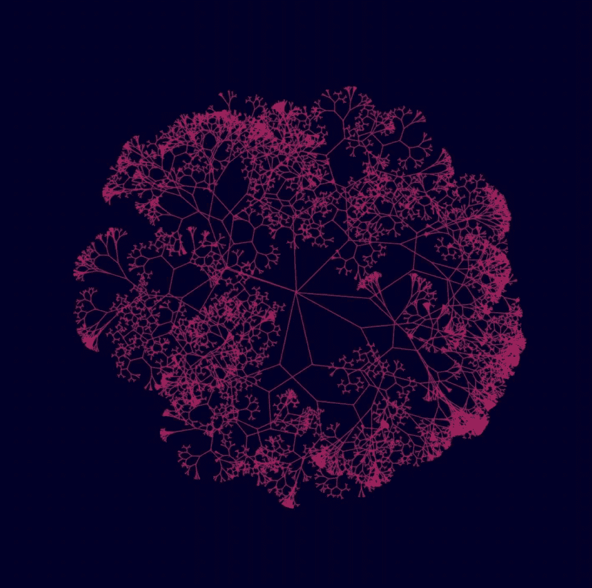

你甚至可以创建动画或交互式视觉作品。我们将在本书末尾使用 p5.js 构建一个交互式游戏！

### 关于本书

本书的重点主要是使用 JavaScript 和 p5.js 学习编程，其次是创造视觉效果。我希望我们将要学习的示例能够吸引你，并激励你在高回报的领域——编程——中建立自己的技能。主要目标是教会你如何编程，以便你能够选择自己感兴趣的任何领域，运用你刚刚建立的技能。你从本书中获得的技能具有很高的可迁移性，可以在你选择的任何地方使用；无论是 Web 应用、可编程机器人还是生成艺术。这意味着我将为你提供足够的背景知识，以便你能够建立坚实的编程基础。但我也不会用不相关的技术或理论要点来阻碍你的进度。目标是建立一套强大但最小可行的知识，让你能够尽快开始编程。这是我在学习编程时希望拥有的那本书。

如果你是一位艺术家或视觉设计师，这本书非常适合你，因为你可能会发现我们将要构建的示例与你的直接工作相关。如果不是，这仍然是一本学习编程的好书，因为练习的视觉本质将帮助你更容易地掌握编程基础，并让你在更短的时间内建立坚实的基础。

本书将在后续章节中介绍各种 JavaScript 和 p5.js 特性和概念。知识将通过构建几个有用的示例来加强，比如动画和数据可视化，作为最终项目，我们将构建一个游戏，可以使用我们在本书中学到的知识部署到网上！

以下是我们将要涵盖的主题的概览：

- **02 - 入门** 我们将学习一些非常基础的 JavaScript 命令和操作，以开始使用 p5.js
- **03 - p5.js 中的颜色** 这将是一个 p5.js 专属章节，我们将学习颜色在 p5.js 中是如何定义和使用的。这不属于 JavaScript 的范畴，但为了舒适地使用 p5.js，无论如何都需要探索。
- **04 - 运算和变量** 我们将在 p5.js 的上下文中运用第二章中学到的 JavaScript 知识。
- **05 - If - Else 语句和比较运算符** 本章将让我们通过使用条件语句和比较运算符来编写能够响应不同条件的程序。
- **06 - 更多 p5.js 变量** 这将是另一个 p5.js 专属章节，我们将学习几个库特定的变量。
- **07 - 循环** 在这里我们将学习循环，这将使我们能够构建处理大量计算的程序
- **08 - 函数** 函数是 JavaScript 的构建块，我们将在本章中学习更多关于它们的知识，以构建更可扩展、模块化和健壮的程序。
- **09 - 对象和 10 - 数组** 对象和数组是 JavaScript 数据结构，将使我们能够以更智能的方式组织代码和处理复杂性。
- **11 - 事件** p5.js 事件处理将使我们能够编写处理用户交互的程序。
- **12 - 更多关于 p5.js 的内容** 另一个 p5.js 专属章节，我们在深入最终项目之前学习更多关于库特定功能的内容。
- **13 - 主项目** 我们将使用到本章为止学到的所有知识来构建一个游戏！

## 02 - 入门

### 使用 p5.js 代码编辑器

让我们开始吧。首先，我们将在系统中安装 p5.js 代码编辑器。要安装 p5.js 编辑器，我们可以访问他们的网页，根据我们的操作系统（无论是 Mac、Windows 还是 Linux）下载编辑器，通过下载页面上的链接。

[p5.js | 下载](http://p5js.org/download)

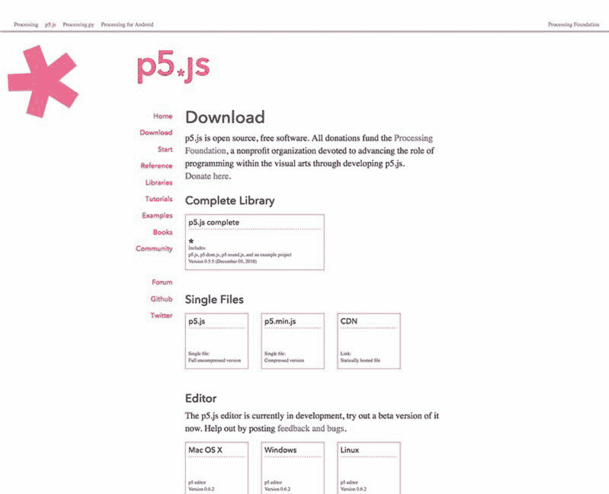

我们还可以使用在线编辑器来编写 p5.js 代码。在本书准备期间可用的一个易于使用的选项可以在这个链接找到：[p5.js 在线编辑器 - alpha](https://alpha.editor.p5js.org)

一旦我们启动编辑器，我们将看到一个可以编写代码的区域。代码编辑器与文本编辑器（如 **记事本** 或 **Word**）非常相似，但它具有特殊功能，使编程变得更容易，例如为给定编程语言突出显示特殊单词，在这里这种语言是 JavaScript。

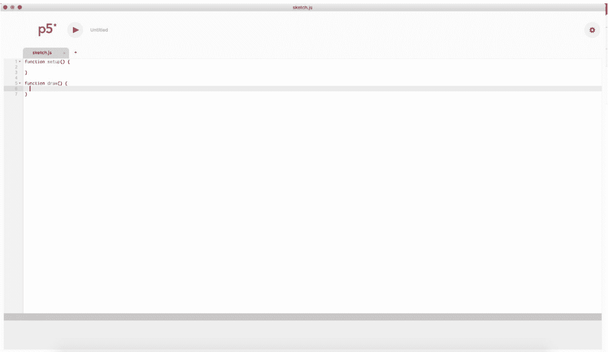


这个特定编辑器的工作方式是，每当我们有一些准备好执行的代码时，我们就会按下页面顶部的*播放*按钮。这个播放按钮将启动另一个页面，显示我们代码的视觉结果——也就是说，如果我们的代码有任何绘制到屏幕上的操作。在线编辑器以类似的方式工作，但它会在右侧面板显示结果，而不是启动一个新页面。此时按播放按钮不会有什么效果，因为我们还没有编写任何绘制到屏幕上的代码。我们只会看到一个空白屏幕被生成出来。但正如我们所见，这个编辑器中已经写好了一些代码。我们看到的这段代码几乎是我们将要编写的大多数`p5.js`程序都需要的，所以这里为了方便而包含它。

```javascript
1 function setup() {
2 
3 }
4 
5 function draw() {
6 
7 }
```

让我们暂时删除这段代码。在我们开始使用`p5.js`学习`JavaScript`之前，我们将先了解几个`JavaScript`基础知识点。

你可以在 [Github 仓库](https://github.com) 中找到我们将在本书中使用的代码示例。

## JavaScript 简明介绍

我们可以写一些像`1 + 1`这样简单的东西到屏幕上。这是一个有效的`JavaScript`代码，将这两个数字相加。如果我们执行这段代码，通过按下播放按钮，我们仍然看不到任何东西。这有点令人失望，因为我们至少应该能看到这个计算的结果。

为了能够在屏幕上看到`JavaScript`运算的结果，我们可以使用一个叫做`console.log()`的**函数**。

**函数**是一种编程结构，包含写在其中的其他代码，用于执行特定的操作。函数使我们能够通过调用它们的定义函数名来执行复杂操作。当我们调用一个函数时——我们也可以称之为*执行*该函数——我们会写出它的名字，在本例中是`console.log`，并在其旁边加上括号。如果该函数需要输入来执行其功能，那么我们会像在这个例子中那样，在括号内提供该输入。

`console.log`是一个内置的`JavaScript`函数，用于在编辑器下方的控制台中显示——或记录——给定的值。当我说内置时，意味着大多数`JavaScript`执行环境都会有这个函数。例如，`Web`浏览器在其界面中有一个叫做*控制台*的部分，我们可以通过开发者工具访问它。`p5.js`也有一个叫做*控制台*的部分，在编辑区域下方。

我们也可以创建用户自定义的函数，这些函数在我们以某种方式分享给其他人之前，不会提供给其他人使用。像`p5.js`这样的库有自己的一大堆函数。我们将使用`p5.js`的函数在屏幕上绘制形状，并创建各种交互式和动画视觉效果。我们稍后会深入探讨函数的概念，但现在要知道，`JavaScript`有一个叫做`console.log`的函数，它接受一个值并在编辑器下方的控制台中显示该值。最初，我们将会学习的其他函数名称中不会有圆点。`console.log`在这方面有点不同，但使用"点"的原因将在后面解释。

让我们再在代码中添加几个`console.log`语句。

```javascript
1 console.log(1 + 1)
2 console.log(5 + 10)
3 console.log(213 * 63)
4 console.log(321314543265 + 34251646315526623)
```

当我们执行这段代码时，我们将在控制台内部看到以下结果被显示出来。

1 2

2 15

3 856632392

4 34251967630069890

一个应该记住的重点是，代码是从上到下执行的。有一些编程结构可以改变这个流程，但我们稍后会接触到它们。另一个重点是，计算机并不介意处理大数字。我们可以给它们布置一些人类需要花费数日才能完成的艰巨运算。

在最后一个`console.log`语句中，我们有两个极其巨大的数字。如果我们想使用该运算得出的结果，并在下一行减去 10 怎么办？目前，为了实现这一点，我们必须再次输入那个数字。

```
console.log(321314543265 + 34251646315526623 - 10)
```

这显然是非常浪费的。但幸运的是，计算机擅长的另一件事就是存储和记忆数值。因此，我们可以创建一种被称为**变量**（variable）的东西来持有该数值。在编程语言中，变量是一个指向某个值的名称。这样我们就可以使用变量名来引用该值，而不需要再次输入具体数值。其运作方式如下：

```
var bigNumber = 321314543265 + 34251646315526623
console.log(bigNumber)
console.log(bigNumber - 10)
```

我们通过使用`var`关键字创建了一个名为`bigNumber`的变量。每当我们创建变量时，都需要使用`var`这个关键字。在`var`关键字之后，我们给这个变量起了一个名字，在本例中是`bigNumber`。

选择一个在当前语境下有意义的变量名非常重要。在这个例子中，这可能没什么大影响，但随着程序的变得复杂，有意义的变量名可以帮助我们在阅读代码时理解发生了什么。因此，将这样一个持有大数字的变量命名为`cat`是没有意义的，并且会误导其他阅读代码的人。甚至如果我们几个月后再回来查看代码，它可能会让我们自己感到困惑。程序员总是努力让代码尽可能具备可读性。

一旦变量被声明，我们就可以使用等号运算符为其赋值。这在刚开始可能看来很不寻常。在数学中，等号运算符用于表示两个值之间的相等关系。而在这里，我们使用它来对变量进行赋值。它获取运算符右侧的值，并将其赋给左侧的变量。这是一个存在于许多编程语言中的非常普遍的操作。

现在我们有了一个指向某个值的变量，我们可以在运算中使用这个变量名而不是值本身。如前所述，使用有意义的变量名是很好的习惯。此外，还有一些规则约束我们可以使用什么以及不能使用什么作为变量名。例如，我们不能在变量名中使用某些特殊字符（如破折号或感叹号），也不能使用空格字符。

另一个限制是我们不能使用某些`JavaScript`的保留字作为变量名；我们不能将变量命名为`var`，因为这个名称已被`JavaScript`占用。如果我们尝试将`var`作为变量名，例如`var var = 5`，`JavaScript`将会**抛出**（throw）一个错误。

此时提到规则可能会让你感到不安。毕竟编程应该是件有趣的事，对吧？但不用担心，保留字列表相对较短，你不需要死记硬背。随着你对语言的深入学习，你也会对哪些名称需要避免产生更好的直觉。

关于规则，还有一点需要提及。`JavaScript`要求我们在每个语句之后放置分号。如果我们不这样做，程序可能仍然可以运行，但在某些难以识别的边缘条件下可能会失败。因此，即便这意味着我们需要多做一点工作，在每个语句后使用分号也是个好主意。上面的代码实际上应该写成这样：

```
console.log(1 + 1);
console.log(5 + 10);
console.log(213 * 63);
var bigNumber = 321314543265 + 34251646315526623;
console.log(bigNumber);
console.log(bigNumber - 10);
```

请注意，执行`bigNumber - 10`并不会改变`bigNumber`变量的初始值。在接下来的示例中，`console.log`语句仍然会输出 10。

```
var x = 10;
x + 5;
console.log(x);
```

如果我们想改变一个变量的值，那么我们需要为其赋一个新值。

```
var bigNumber = 321314543265 + 34251646315526623;
console.log(bigNumber);
bigNumber = 3;
console.log(bigNumber);
```

在这个例子中，`console.log`将显示值`3`，因为我们在第 3 行用另一个值覆盖了初始值。

`JavaScript`（以及其他语言）中存在“数据类型”的概念，用于区分不同种类的值。我们一直使用的这些数字属于一种名为`Number`（数字）的数据类型。还有另一种名为`Strings`（字符串）的数据类型，用于表示文本信息。

在`JavaScript`中，我们不能直接写一个单词并期望它代表数据。例如，我们想用`console.log`输出单词`hello`。如果我们现在这样做，会发现出现了一个错误。`JavaScript`不明白`hello`是什么意思。它认为这是一个尚未定义的变量。

```
console.log(hello);
> 1: Uncaught ReferenceError: hello is not defined
```

但如果我们真的想向计算机输入单词`hello`怎么办？有些程序需要处理文本数据，比如处理给定的姓名或地址等。在这种情况下，我们可以使用引号来提供数据，这意味着我们将该值作为**字符串**提供。

```
console.log('hello');
```

这一次`JavaScript`没有抱怨。每当我们处理文本数据时，都需要将其放在引号中，这样它才会被注册为字符串。当我提到文本数据时，它也可以是数字。字符串可以由数字值组成：

```
console.log('1234');
```

在这种情况下，它们不被视为可以进行数学运算的数学数字，而仅仅被视为文本。

我们可以对字符串执行操作，但其结果与使用数字执行这些操作时不同。我们实际上可以将两个字符串相加：

```
console.log('hello' + 'world');
> 'helloworld'
```

这只会将这两个单词组合在一起。而当我提到不能对包含数字值的字符串进行数学运算时，意思就是这样：

```
console.log('1' + '1');
> '11'
```

在这种情况下，数字值没有被视为数字而是被视为字符串，它们没有被相加而是被组合在了一起。这种组合字符串的行为在编程中通常被称为*拼接*（concatenation）操作。

我们可以使用单引号`'`或双引号`"`来定义字符串，但我们必须用与定义开始时相同的符号来结束字符串。此外，在程序中，我们不应该在一个字符串中使用一种引号，在另一个字符串中使用另一种。在开发程序时，一致性非常重要。

在结束本节之前，另一件值得提及的事情是**注释**（comments）的概念。注释允许我们在程序中写入不会被计算机执行的内容。例如：

```
// various examples. (this is a comment)
console.log(1 + 1);
console.log(5 + 10);
console.log(213 * 63);
var bigNumber = 321314543265 + 342516463155266237;
console.log(success);
console.log(bigNumber - 10);
```

以双斜杠开头的行会被`JavaScript`忽略。双斜杠允许我们对单行进行注释；如果我们需要对多行进行注释，我们需要在每行开头使用双斜杠，或者使用`/* */`符号，如下所示：

```
// various examples
// disabling the first 3 lines by using multiline comments:
/*
console.log(1 + 1);
console.log(5 + 10);
console.log(213 * 63);
*/
var bigNumber = 321314543265 + 342516463155266237;
console.log(bigNumber);
console.log(bigNumber - 10);
```

信不信由你，这些`JavaScript`基础知识足以让我们开始使用`p5.js`了。如果你正在使用代码编辑器，请点击**New Project**（新项目）按钮，以获取一个新的编辑器窗口，其中包含我们将用于`p5.js`代码的模板。

## 开始使用 p5.js

当我们在`p5.js`代码编辑器中启动一个新项目时，会看到两个名称分别为`setup`和`draw`的函数声明。

```
function setup() {
  
}

function draw() {
  
}
```

对于几乎所有我们编写的`p5.js`程序，都需要声明这两个函数。`p5.js`会在我们的代码中寻找这两个函数的定义，并执行其中编写的内容。但这两个函数的执行方式存在差异。

`setup`函数内部的代码块，即花括号之间的区域，是我们编写程序初始化代码的地方。`setup`函数内的代码仅在`draw`函数之前执行一次。

```javascript
function setup() {
    // 在这对花括号内编写你的 setup 函数代码
}
```

`draw`函数是真正发生神奇效果的地方。任何写在`draw`函数内的代码都会被`p5.js`重复执行。这使我们能够创作各种动画和交互式作品。

`p5.js`确保`setup`函数在`draw`函数之前执行。并且需要重申的是，`p5.js`只执行`setup`函数一次，但会反复执行`draw`函数（实际上大约每秒执行 60 次）。我们就是这样使用`p5.js`来创建交互式和动画内容的。

实际上，我们可以通过在代码的不同位置放置`console.log`语句来观察这一过程。在`setup`函数内、`draw`函数内以及这两个函数之外，分别使用不同的值放置一个`console.log()`语句。

```javascript
function setup() {
    console.log('setup');
}

function draw() {
    console.log('draw');
}

console.log('hello');
```

让我们执行这段代码并立即尝试停止它。我们会注意到消息`hello`最先显示出来。这是预期中的行为。这是一个我们编写的、将由`JavaScript`执行的函数调用。而有些出乎意料的是，`setup`和`draw`函数也被执行了。这之所以意外，是因为它们仅仅是函数声明，定义了函数的行为，但我们仍然需要执行这些函数才能使用它们。

这意味着如果我们只使用`JavaScript`，我们需要显式地调用`setup`和`draw`函数，才能让它们内部的`console.log`消息显示出来：

```javascript
setup();
draw();
console.log('hello');
```

但使用`p5.js`库时，我们不需要这样做。由于`p5.js`库的架构设计，它会查找名为`setup`和`draw`的函数声明，并为我们执行这些函数。`p5.js`接管这些函数执行的原因在于，它以一种非常特定的方式执行它们。

`p5.js`只执行`setup`函数一次，然后继续重复执行`draw`函数，如果我们不停止这个进程，它将永远运行下去。这是任何图形界面的标准行为——想想网络浏览器、你玩的游戏，或者你使用的操作系统。这些都是持续运行并显示在屏幕上的程序——直到我们明确关闭它们。这就是为什么`p5.js`为`draw`函数创建了一个执行循环，这样内容就会在屏幕上持续显示，而不是出现一秒后就消失。

## 关于函数的更多内容

让我们更多地谈谈函数，因为它们将是我们编写程序的构建块。

函数名通常是动词。它们代表执行该函数时可以执行的特定动作。假设，我们可能有一个名为`drawCat`的函数，调用时可以在屏幕上画一只猫。

```javascript
drawCat();
```

虽然这并非假设，因为我确实为这一章创建了一个名为`drawCat`的画猫函数。在`JavaScript`中，我们可以自由地创建任何想要的函数，这为编程应用程序提供了巨大的力量。

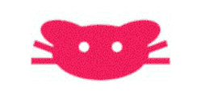

好吧，公平地说，这个函数画猫的水平不太行。

要使用一个函数，我们通过其名称调用它，然后在其旁边放置括号来执行该函数。有时，函数根据其创建或定义方式的不同，可以是参数化的。这意味着它们可以接受影响函数结果的输入值。例如，一个`drawCat`函数可能接受一个数字输入，该输入决定绘制猫的大小。或者数字输入决定屏幕上绘制猫的数量。这完全取决于该函数是如何构建的。

在我们的例子中，我创建的这个函数可以接受一个输入，允许我们更改屏幕上绘制的猫头大小。

```javascript
drawCat(2);
```

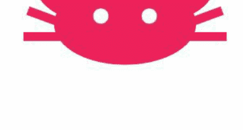

**02-04**

遗憾的是，`p5.js`并不包含`drawCat`函数——我必须自己创建——但它有许多其他有用的函数，使我们能够以简单的方式执行复杂的任务。为了能够使用`p5.js`库做任何事情，我们将使用它附带的函数，这些函数由创建这个库的聪明人编写。

这里有一个来自`p5.js`库的函数，可能我们编写的大多数草稿都需要它：`createCanvas`函数。`createCanvas`函数的作用是在网页内为我们创建一个绘图区域（画布）。但要使此函数工作，我们需要提供两个逗号分隔的值：绘图区域的宽度和高度。我们应该在`setup`函数内调用`createCanvas`函数，因为它只需要执行一次，并且需要在我们进行任何绘图之前执行。

让我们为这个函数提供值`800`和`300`，并执行我们的草稿来看看发生了什么。看起来变化不大，但启动的浏览器窗口大小似乎增大了。它现在使用了我们提供的尺寸。让我们再次更改尺寸，看看窗口大小的更新。

```javascript
function setup() {
    createCanvas(800, 300);
}

function draw() {
}
```


我们还会经常使用另一个函数，叫做`background`。`background`函数使用给定的值设置画布的颜色。我们将在另一章讨论 p5.js 中颜色值的表示方式，但现在，我们可以只提供值 `(220,220,220)` 来使背景变成浅灰色。

```javascript
function setup() {
    createCanvas(800, 300);
    background(220,220,220);
}

function draw() {
}
```

正如我们再次看到的，代码是从上到下执行的。p5.js 首先为我们创建画布，然后将背景设置为灰色。

值得再次强调：`setup`和`draw`是 p5.js 正常工作所需的函数定义。当我们使用 p5.js 时，我们的工作是确定在这些由 p5.js 执行的函数内部放置什么内容。这是由于 p5.js 的架构设计决定的。p5.js 的创建者希望确保我们编写的一些代码仅执行一次，用于初始化和设置目的，而另一些代码则会一直执行，用于绘图、动画和交互目的。

我们在这些函数定义中使用了 p5.js 库附带的函数，如`createCanvas`和`background`。这些函数已经由其他人定义，因此我们实际上不知道它们内部包含什么代码。但我们实际上不需要具备这些知识，因为我们只关心知道它们的功能以及如何使用它们。

函数使我们能够以简单的方式执行复杂的任务。通过使用`createCanvas`函数，我们不需要知道在页面中创建一个 canvas 元素需要做哪些工作。这些细节被隐藏（抽象）起来了。我们只需要知道如何调用这个函数来让它为我们工作。

最后，我们将在`draw`函数定义内部调用另一个函数，以在页面上绘制一个矩形。

为了绘制矩形，我们将使用一个名为`rect`的函数。`rect`函数要求我们提供四个输入值：矩形在画布绘图区域内的 x 和 y 位置，以及矩形的宽度和高度值。

在还不了解 p5.js 坐标系如何运作的情况下，我们先直接向这个函数提供 x 值为 50，y 值为 100，宽度为 200，高度为 100。

```javascript
function setup() {
    createCanvas(800, 300);
    background(220,220,220);
}

function draw() {
    rect(50, 100, 200, 100);
}
```

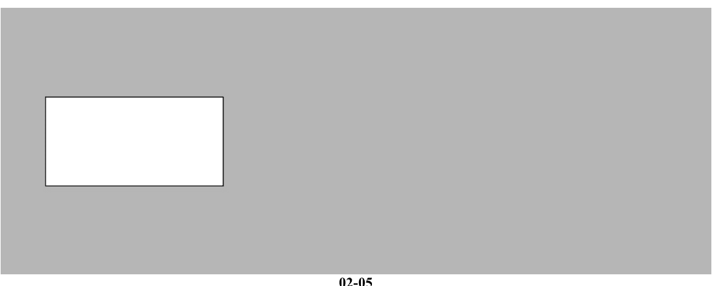

通过调用这个函数，我们在屏幕上绘制出了第一个形状！

## p5.js 中的坐标系

现在，让我们花一点时间来解释 p5.js 中的坐标系是如何工作的。

为了在平面上定位任何点，我们使用一个两轴坐标系。纵轴称为 Y 轴，横轴称为 X 轴。这两个轴相交的点被称为*原点*（origin）。在我们绘制形状的画布（canvas）中，原点位于画布的左上角。从原点向下，Y 值增加；向右，X 值增加。

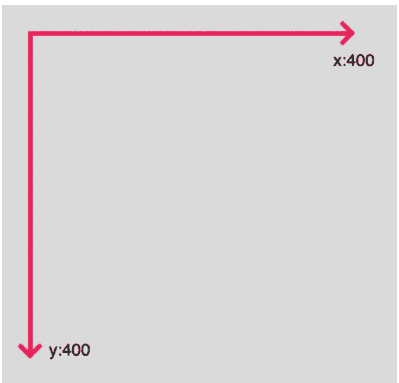

```javascript
function setup() {
	createCanvas(800, 300);
	background(220,220,220);
}

function draw() {
	rect(400, 150, 100, 100);
}
```


如果你不希望出现这种行为，我们可以调用另一个名为`rectMode`的 p5.js 函数，并为其提供`CENTER`值，以改变程序中矩形的绘制方式。由于这个函数更像是一个设置和初始化相关的函数，我们将把它放在`setup`函数定义之下。

```javascript
1 function setup() {
2     createCanvas(800, 300);
3     background(220,220,220);
4     rectMode(CENTER);
5 }
6
7 function draw() {
8     rect(400, 150, 100, 100);
9 }
```


p5.js 中还有一个`ellipse`函数用于绘制圆形形状。`ellipse`的工作原理与`rect`函数非常相似。首先，前两个参数是 x 和 y 坐标，第三个参数是水平半径，第四个参数是垂直半径。因此，为了能用`ellipse`函数画出一个正圆，我们需要为其提供相等的水平和垂直半径值。

如果你尝试在屏幕上绘制这些形状，此时你可能会注意到，每当调用一个形状函数时，它都会在之前的形状之上进行绘制。我们可以通过改变函数调用的顺序来影响形状的堆叠顺序。

```javascript
1 function setup() {
2     createCanvas(800, 300);
3     background(220,220,220);
4     rectMode(CENTER);
5 }
6
7 function draw() {
8     rect(400, 150, 100, 100);
9     ellipse(350, 120, 100, 100);
10 }
```


我还想介绍的另一个绘图函数是`line`函数。顾名思义，`line`函数在屏幕上绘制一条直线。我们需要为`line`函数提供四个参数：起始 x 和 y 坐标，以及结束 x 和 y 坐标。试着玩玩`line`函数；它会让你对 p5.js 的坐标系工作原理有更好的感觉。例如，你可以尝试绘制一个跨越整个画布的 X 形。

## 总结

在本章中，我们快速开始了 p5.js 的使用，并在屏幕上绘制了形状。

我们发现需要将代码写入两个名为`setup`和`draw`的函数定义块中。任何只需要执行一次的内容都放在`setup`函数下，而任何我们想要制作动画或进行交互的内容则放入`draw`函数中。将代码写入这两个函数是 p5.js 要求我们这样做的。这并不是通用的编程原则、惯例或类似的东西。如果我们使用其他不需要这种代码结构的库，情况可能会有所不同。这个要求与 p5.js 作为库的架构方式有关。我们所有的 p5.js 绘图（sketches）都需要从这两个函数定义开始。

像这样需要重复编写且几乎没有改动的代码被称为`样板`（boilerplate）代码。拥有大量的样板代码绝不是一件好事，因为我们会发现自己不得不重复很多工作，但在这个例子中，样板代码的数量是非常可控的。

在这些函数定义内部，我们使用了 p5.js 库自带的函数，如`createCanvas`、`background`以及一些形状函数如`rect`。如前所述，函数是通用的编程结构，允许我们将代码捆绑在一起以实现重复利用。函数还为我们屏蔽了大量复杂性。我们不需要知道函数是如何工作的；我们只需要知道如何使用它。我们完全可以不知道`createCanvas`实际上是如何在网页中创建 canvas 元素的。只要我们知道如何使用这个函数，这就无关紧要。想象一下开车；我们不一定需要知道内燃机如何工作才能开车。我们只需要知道如何通过方向盘、踏板等与汽车交互。同样的理念也适用于函数。

稍后，我们也将创建自己的函数，以管理程序的复杂性并创建可重用的代码片段。

## 练习

尝试重新创建下面的图像。

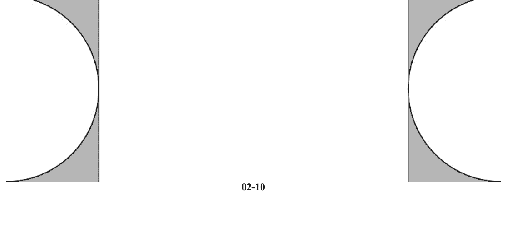

# 03 - p5.js 中的颜色

## p5.js 中的颜色函数

既然我们已经在 p5.js 中绘制了形状，现在让我们来看看如何在绘图中控制颜色。我们已经通过向`background`函数传递 220, 220, 220 这三个值，为背景分配了浅灰色。

p5.js 默认使用 *RGB* 颜色值，其中 R 代表红色（red），G 代表绿色（green），B 代表蓝色（blue）。这意味着我们*通常*需要向一个接受颜色的函数传递这三个颜色分量来设置所需的颜色。每个颜色分量的值可以在 0 到 255 之间。这意味着，如果我们向`background`函数传递 0, 0, 0，背景将变成黑色；如果我们传递 255, 255, 255，则会得到白色。p5.js 作为一个便捷的库，允许我们在希望这三个值相等时仅传递一个值。也就是说，我们可以直接传递一个 0，而不是传递 0, 0, 0。

每当我们这三个颜色分量的数值相等时，结果将是白色、黑色或某种灰色。因此，如果我们想要一个灰度色，向颜色设置函数传递单个值是非常有用的。但如果我们想要颜色具有色调，那么我们需要传递所有这三个值，以便为每个分量指定所需的量。255 是颜色分量能接受的最大值；所以如果我们向`background`函数传递 255, 0, 0，我们将得到纯红色。如果传递 0, 255, 0，我们将得到纯绿色，以此类推。

RGB 颜色模型是一种加色模型，这意味着将这些颜色以全强度叠加在一起会产生白色；而与之相对的是减色模型（如油漆颜色），将它们全部混合在一起会产生深褐色。如果你不熟悉加色 RGB 颜色，通过调整这些数值来寻找精确颜色可能会有些困难。在这种情况下，你可以使用在线颜色选择器服务来帮助你寻找所需的颜色。搜索“color picker”这个词会产生大量你可以用来识别所需颜色 RGB 分量的结果。这里有一个来自 Firefox 的示例服务。

[颜色选择器工具](https://colorpicker.tool)

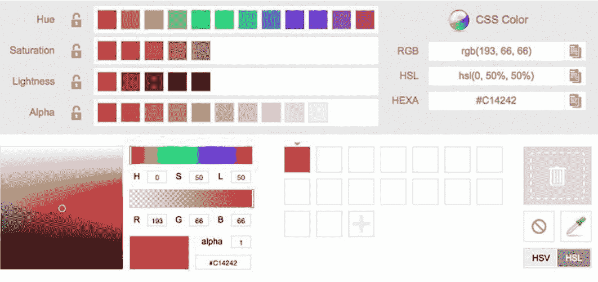

使用这样的服务，你可以记录与所选颜色对应的 RGB 值，并在 p5.js 中使用这些值。

实际上，我们可以向颜色设置函数传递第四个参数。这个第四个参数被称为颜色的 alpha 分量，它控制颜色的不透明度，同样接受 0 到 255 之间的值。0 将导致完全透明，255 将导致完全不透明。

因此，我们可以向颜色设置函数传递一个值、三个值或四个值。我不想用太多信息让你感到压力，但我们也可以仅传递两个参数。如果这样做，我们将设置一个灰度色以及该灰度色的 alpha 分量。

如果这些丰富的选项让你觉得过于复杂，请记住它们是为了我们的方便而存在的。p5.js 本可以将颜色函数限制为仅接受四个输入，这虽然涵盖了所有情况，但当你只需要像不透明白色（这种情况最常见）这样的颜色时，提供额外数据会很浪费时间。看起来 p5.js 的开发人员在构建函数时足够聪明，使其能够根据参数数量的不同而产生不同的输出结果。

了解 p5.js 中颜色是如何工作的很棒，但到目前为止，我们只能更改背景颜色。为了能够更改形状的颜色，我们将需要使用另外几个函数。

我们应该知道的第一个函数是`fill`。`fill`允许我们设置形状的填充颜色。填充颜色是填充在形状内部的颜色，如果你在好奇形状还有什么其他颜色控制，那么还有定义描边颜色的 stroke 颜色。

形状轮廓的颜色。填充色（fill）和描边色（stroke）的默认值分别为白色和黑色。除直线外，所有形状都同时具有填充色和描边色。

我们可以通过调用`fill`函数并向该函数传递颜色参数来设置形状的填充色，正如前面所讨论的那样。`fill`函数的作用是，它会将当前激活的颜色设置为所选颜色，直到我们使用另一个 fill 函数将其设置为其他颜色为止。

`stroke`函数的工作方式与之类似。我们向其传递颜色参数，它会为所有形状的描边颜色，直到下一个 stroke 函数被调用。后调用的`fill`或`stroke`函数会覆盖之前的设置。

此时，另一个值得了解的有用函数是`strokeWeight`，它允许我们设置轮廓的粗细。

这是一个使用了本章所学部分函数的简单草图。

```javascript
1 function setup() {
2     createCanvas(800, 400);
3 }
4 
5 function draw() {
6     background(220);
7     fill(51, 51, 51);
8     strokeWeight(2);
9     stroke(75);
10    ellipse(width/2, height/2, 300, 300);
11    stroke(0);
12    fill(255, 53, 139);
13    ellipse(width/2, height/2, 275, 275);
14    fill(1, 176, 240);
15    ellipse(width/2, height/2, 250, 250);
16    fill(174, 238, 0);
17    ellipse(width/2, height/2, 150, 150);
18 }
```


请注意，我们是在想要设置颜色的形状之前调用 fill 函数的。我们不断地调用它，以便为不同的椭圆切换颜色。

另外两个值得提及的函数是`noFill`和`noStroke`函数。顾名思义，调用这些函数将分别去除形状的填充和描边。这些函数在调用时不带任何参数。

```javascript
noFill();
noStroke();
```

## 总结

在本章中，我们没有接触到任何新的 JavaScript 功能或新的编程结构。我们只是研究了 p5.js 库的一些运行原理以及随之提供的一些特定函数。特别是，我们学习了 p5.js 中一些颜色设置函数的工作方式，例如`fill`、`stroke`和`strokeWeight`。我们还学习了其他与填充和描边操作相关的函数，如`noStroke`和`noFill`。我们学习的另一件事是 RGB 颜色模型。

尽管本章并没有真正提升我们的编程语言能力，但我认为有一点非常有价值。你可能会心想，自己并不热衷于创意编程，在学完代码之后，这本书中关于 p5.js 的特定信息将不再有用。但这些运行原理（如使用加色 RGB 值）或概念（如填充和描边）被极其广泛地使用，以至于尽管我们学习的内容看起来非常特定于 p5.js，但它们其实是许多其他绘图库或程序所采用的通用原理或概念。理解这些内容将对我们学习编程的旅程大有裨益。

## 练习

构建上述脚本，使得一个变量可以控制所有圆形的尺寸（这意味着更改该变量应改变所有圆形的尺寸），而另一个变量则控制所有圆形之间的半径差。

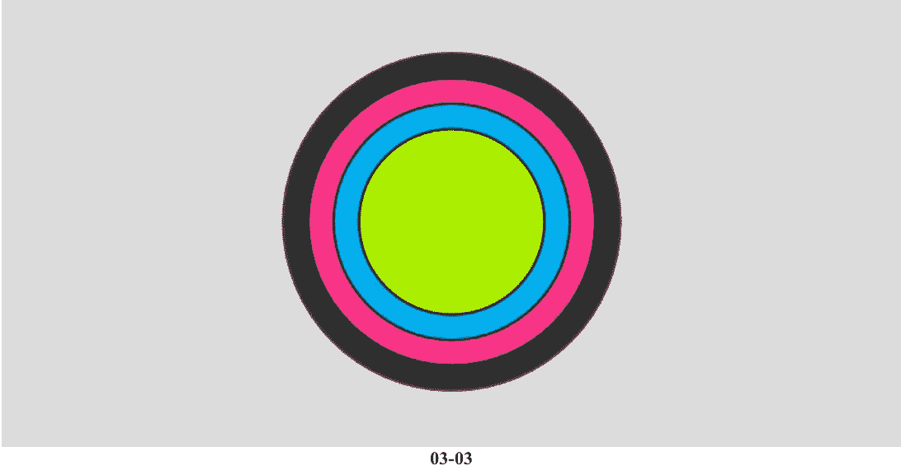

### 03-03

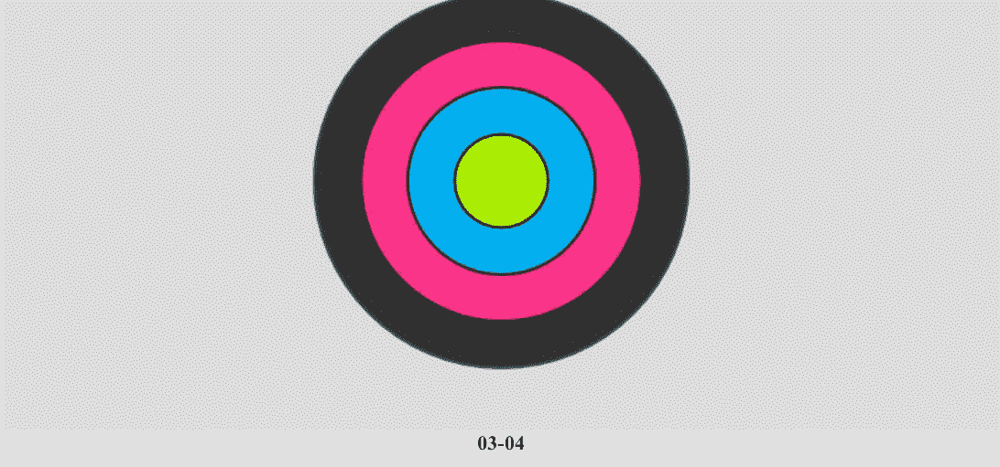

### 03-04

# 04 - 运算符与变量

## 准备工作

在本书开头，我们学习了在 JavaScript 中可以使用的一些变量和数学运算。在本章中，我们将把这些知识付诸实践。

让我们先创建几个形状，以便有东西可以操作。使用`ellipse`和`rect`函数，让我们创建一个大致像小车的形状。

```javascript
1 function setup() {
2     createCanvas(800, 300);
3 }
4
5 function draw() {
6     background(220);
7     ellipse(100, 200, 50, 50);
8     ellipse(200, 200, 50, 50);
9     rect(50, 160, 200, 20)
10 }
```

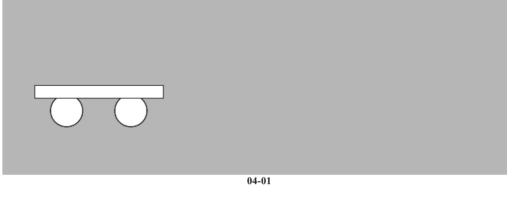

看着我们的粗略绘图，我对它的位置并不完全满意。我现在希望把它画得更靠右侧。现在移动该形状意味着我们需要增加每个形状函数中 x 坐标参数的值。

假设我们想给所有指定 x 位置的数字都加上 150。我们可以尝试在脑中计算并在那里输入结果，但幸运的是，我们可以使用 JavaScript 轻松地进行数学运算。与其输入加法的结果，我们只需直接写出所需的运算，JavaScript 就会为我们计算。

```javascript
function setup() {
    createCanvas(800, 300);
}

function draw() {
    background(220);
    ellipse(100 + 150, 200, 50, 50);
    ellipse(200 + 150, 200, 50, 50);
    rect(50 + 150, 160, 200, 20)
}
```

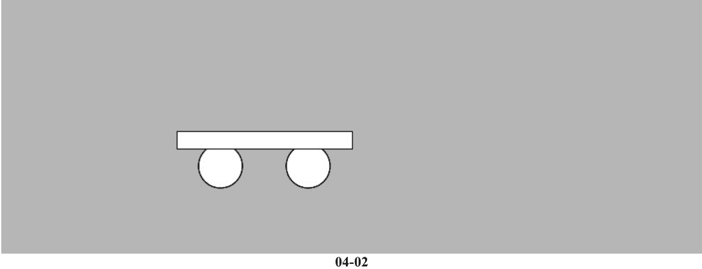

其他运算符也同样适用；我们可以用类似的方式进行减法、乘法或除法。

在使用运算符时，我们需要记住的一点是运算顺序。你可能已经在数学课上学过，某些运算符的优先级高于其他运算符。例如，如果我们想给一个数字加上 2 然后乘以 4，我们可能会倾向于这样写：

```javascript
10 + 2 * 4
```

但在这次运算中，乘法会在加法之前发生。2 会先与 4 相乘，然后再加到 10 上，因此上述运算的结果将是 18，而不是预期的 48。

为了能够控制运算顺序，我们可以使用括号。例如，我们可以将上面的等式写成这样：

```javascript
(10 + 2) * 4
```

括号内的任何内容都将在其他运算之前被计算。在运算顺序中，括号优先，然后是乘法和除法，最后是加法和减法。

## 变量

能够像这样评估表达式会让我们的计算工作变得更容易。但我认为在这个例子中，真正的问题在于需要在三个不同位置输入相同的数字。这非常重复且劳累。这就是使用变量会很有帮助的情况。

每当我们需要一个值，并且需要在多个地方使用该值时，我们就希望将该值存储在一个变量中。使用变量的优势在于，如果我们需要更新该值，我们只需要在一个地方进行修改即可。让我们更新这个例子以使用变量。


记得如何创建变量。我们会从使用`var`关键字开始。出于稍后将讨论的原因，使用这个关键字非常重要。

然后，我们会为变量选择一个名称。选择一个有意义的名称也很重要。将这个变量命名为`offset`（偏移量）或`x`可能是合理的，因为我会用它来在 x 轴上偏移形状。使用合理的名称将有助于他人甚至我们自己理解代码。我们始终希望程序尽可能具有可读性。

现在我们有一个指向某个值的变量，我们可以在运算中使用这个变量而不是值本身。这样一来，我们只需要在同一个地方更改这个变量的值，就能看到形状在移动。

```javascript
function setup() {
    createCanvas(800, 300);
}

function draw() {
    background(220);
    var offset = 150;

    ellipse(100 + offset, 200, 50, 50);
    ellipse(200 + offset, 200, 50, 50);
    rect(50 + offset, 160, 200, 20)
}
```

## 变量（续）

我想在另一个例子中说明变量的另一种行为。让我们先在屏幕中间画一个圆，并在中间画一个矩形。

```javascript
function setup() {
    createCanvas(800, 300);
    rectMode(CENTER);
}

function draw() {
    background(1, 186, 240);
    fill(237, 34, 93);
    noStroke();
```

```javascript
10 ellipse(400, 150, 200, 200);
11 fill(255);
12 rect(400, 150, 150, 30);
13 }
```

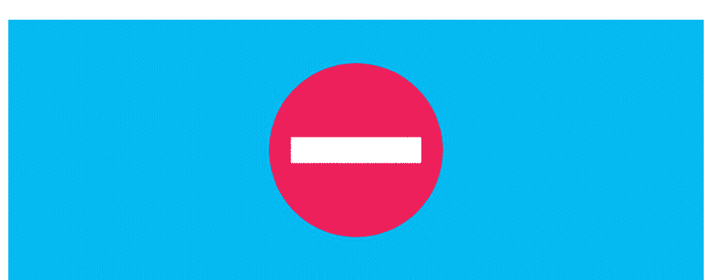

## 04-03

你能想到对上述程序进行的一项优化吗？注意我们是如何为这些形状重复使用 x 和 y 坐标值的。让我们尝试使用变量来代替。

```javascript
1 function setup() {
2   createCanvas(800, 300);
3   rectMode(CENTER);
4 }
5
6 function draw() {
7   background(1, 186, 240);
8   fill(237, 34, 93);
9   noStroke();
10
11  var x = 400;
12  var y = 150;
13
14  ellipse(x, y, 200, 200);
15  fill(255);
16  rect(x, y, 150, 30);
17 }
```

由于这些形状的位置不是相对于画布大小确定的，如果我们改变画布的大小，形状的相对位置也会随之改变。对于一个正方形画布，形状目前处于中心，但对于一个更宽的画布，形状可能会开始偏向左侧。为了让形状在任何给定的画布尺寸下都尽可能靠近中心，我们可以先使用一个变量来设置画布的宽度和高度值。然后，我们可以利用同一个变量来控制形状的位置。

在`setup`函数内部，我们将创建两个名为`canvasWidth`和`canvasHeight`的新变量，其值分别为 800 和 300。我们将把这些变量传递给`createCanvas`函数，而不是像之前那样使用硬编码的值。计划是在`draw`函数内部同样使用这些变量，这样即使我们改变了画布的大小，形状的相对位置也将保持不变。所以，让我们在`draw`函数中使用这些变量。我们将它们除以 2，以便获得画布宽度和高度的中点。

```javascript
1 function setup() {
2     var canvasWidth = 800;
3     var canvasHeight = 300;
4
5     createCanvas(canvasWidth, canvasHeight);
6     rectMode(CENTER);
7 }
8
9 function draw() {
10     background(1, 186, 240);
11     fill(237, 34, 93);
12     noStroke();
13
14     var x = canvasWidth/2;
15     var y = canvasHeight/2;
16
17     ellipse(x, y, 200, 200);
18     fill(255);
19     rect(x, y, 150, 30);
20 }
```

执行代码后，你会发现出现了一个错误。如果查看控制台中的错误信息，它会提示某个变量名未定义。

```javascript
1 Uncaught ReferenceError: canvasHeight is not defined (sketch: line 14)
2 Uncaught ReferenceError: canvasWidth is not defined (sketch: line 14)
```

这可能会让人感到惊讶，因为我们明明在`setup`函数内部声明了这些变量。产生这个错误的原因与一个叫做**作用域（scope）**的概念有关。变量的作用域决定了变量在何处可以被访问。使用`var`关键字声明的 JavaScript 变量具有*函数作用域（function scope）*。

*函数作用域*的工作原理是：任何在函数内部声明的变量在函数外部都是不可见的。它仅对定义它的函数以及可能嵌套在该函数内部的其他函数可用。同样地，如果一个变量位于顶层（top level），那么这个变量对于该层级以及所有嵌套在该层级之下的内容（例如在该层级定义函数）都是可见的。我们现在面临的问题是，在`setup`函数内部定义的变量在`draw`函数中不可见，而且如果我们是在`draw`函数内部声明变量，它们在同一层级的其他函数中也是不可见的。

解决这个问题的方法是：不要在`setup`函数内部声明变量，而应该将它们声明在顶层，这样它们就可以被所有同样在顶层声明的内容所访问。

```javascript
1 var canvasWidth = 800;
2 var canvasHeight = 300;
3
4 function setup() {
5     createCanvas(canvasWidth, canvasHeight);
6     rectMode(CENTER);
7 }
8
9 function draw() {
10    background(1, 186, 240);
11    fill(237, 34, 93);
12    noStroke();
13
14    var x = canvasWidth / 2;
15    var y = canvasHeight / 2;
16
17    ellipse(x, y, 200, 200);
18    fill(255);
19    rect(x, y, 150, 30);
20 }
```

在顶层声明的变量被称为*全局变量（global variable）*。通常情况下，在顶层声明变量并不是最佳方案，因为我们的代码在浏览器中运行，浏览器中运行的其他内容（如插件、扩展等）可能会为了其自身目的而定义同名变量，从而导致冲突。每当两个变量声明共享同一个名称时，后声明的那个会覆盖前者，因为代码是从上到下执行的。这可能会导致程序行为不符合预期。但作为初学者，你不需要过于担心这一点，因为经验更丰富的开发者同样有此顾虑，他们会采取保护措施来确保自己的变量不会被覆盖。目前，我们可以将变量放在顶层部分，以便在同一层级或更低层级定义的不同函数之间共享。

在这种情况下，我们在`setup`函数之外初始化必要的变量，以便这些变量能够被`setup`和`draw`函数同时访问。现在我们可以尝试将`canvasWidth`和`canvasHeight`变量设置为不同的值，你会发现形状始终保持在中心，因为它的位置是使用与画布相同的变量计算得出的。

## p5.js 中的预定义变量

p5.js 作为一个非常有用的库，提供了一些预定义变量，我们可以用它们来获取特定值。其中两个可以使用的变量名是`width`和`height`。通过在`setup`或`draw`函数中使用这些变量名，我们可以获取当前的画布尺寸。这使我们能够实现之前通过自定义变量名试图实现的功能。p5.js 的开发者一定意识到很多开发者会尝试自己这样做，因此提供了一个更简单的解决方案。

利用这个知识，上述代码可以写成这样：

```javascript
function setup() {
    createCanvas(800, 300);
    rectMode(CENTER);
}

function draw() {
    background(1, 186, 240);
    fill(237, 34, 93);
    noStroke();

    var x = width / 2;
    var y = height / 2;

    ellipse(x, y, 200, 200);
    fill(255);
    rect(x, y, 150, 30);
}
```

你应该注意，`width`和`height`是 p5.js 的变量，这意味着它们在`setup`或`draw`函数之外是不可用的。

现在我们知道了如何使用变量，我们可以让形状动起来了！在 p5.js 中实现动画的诀窍是记住`draw`函数是由 p5.js 为我们不断执行的。我们放入该函数中的任何内容，实际上在每次`draw`函数再次执行时都会被重新绘制。

`draw`函数执行的次数（可以认为是渲染到屏幕上的次数）被称为帧率（frame rate）。默认情况下，p5.js 的帧率为 60。这意味着它尝试每秒重新绘制（或渲染）`draw`函数的内容 60 次。如果我们能够在每次`draw`调用之间改变所使用的变量值，我们就能创建动画。

这应该会让你想起翻页书动画。每次调用`draw`函数都会产生一张静态图像，但由于每秒发生 60 次且每张图像都有细微差别，你感知到它是在活动的。

为了能够创建动画，我们将在`draw`函数外部初始化一个名为`count`的变量。在`draw`函数内部，我们将使用一个简单的表达式，每次调用`draw`函数时，该表达式都会将`count`变量增加 1。

```javascript
count = count + 1;
```

现在，如果我们将这个变量用在位置参数中，我们就可以让形状移动。这是我们在 p5.js 冒险之旅中迈出的惊人一步。

```javascript
1 var count = 0;

2

3 function setup() {
4     createCanvas(800, 300);
5     rectMode(CENTER);
6 }

7

8 function draw() {
9     background(1, 186, 240);
10    fill(237, 34, 93);
11    noStroke();

12

13    var x = width / 2 + count;
14    var y = height / 2;

15

16    ellipse(x, y, 200, 200);
17    fill(255);
18    rect(x, y, 150, 30);

19

20    count = count + 1;
21 }
```

如果我们要让形状变大而不是移动，该怎么办？很简单！我们首先创建一个`size`变量，并在形状中使用它，而不是使用硬编码的值，这样可以更方便地更新大小。

```javascript
1 var count = 0;

2

3 function setup() {
4     createCanvas(800, 300);
5     rectMode(CENTER);
6 }

7

8 function draw() {
9     background(1, 186, 240);
10    fill(237, 34, 93);
11    noStroke();

12

13    var x = width / 2;
14    var y = height / 2;
15    var size = 200 + count;

16

17    ellipse(x, y, size, size);
18    fill(255);
19    rect(x, y, size*0.75, size*0.15);

20

21    count = count + 1;
22 }
```

## 总结

在本章中，我们回顾了之前见过的运算符，并讨论了运算符优先级。然后我们再次审视了变量，并进一步学习了它们的行为，特别是关于作用域的内容。我们还学习了 p5.js 提供的一些内置变量，例如仅在`setup`和`draw`函数内部可用的`width`和`height`。

最后，我们创建了第一个动画！

## 练习

创建一个动画，其中五个最初位于屏幕外的矩形被动画化，从左侧进入屏幕并从右侧退出。它们还应该以不同的速度移动。

# 05 - 条件语句与比较运算符

## frame, frameRate, 和 frameCount

在上一章中，我们看到了一些 p5.js 为我们提供的变量。需要注意的一点是，这些变量只能在 p5.js 的`setup`和`draw`函数内部使用。如果我们尝试在这些函数外部使用它们，将会收到一个提示它们未定义的错误。

让我们来看看 p5.js 为我们提供的另一个有用变量：`frameCount`。

还记得我们在上一章中定义了一个`count`函数，用来统计`draw`函数被调用的次数吗？实际上，我们可以使用 p5.js 提供的名为`frameCount`的变量来实现同样的目的。`frameCount`是一个记录在程序整个运行期间`draw`函数被调用次数的变量。默认情况下，`draw`函数每秒最多被调用 60 次。p5.js 内部一个名为`frameRate`的设置决定了这个值。

引入这个变量使我们有必要讨论一下 p5.js 中的**frames**（帧）是什么。我们可以将一**帧**视为一次`draw`函数调用的结果。`draw`函数在每一秒内会被调用多次，而`frameRate`函数决定了这个数量。如果我们调用不带参数的`frameRate`函数，它将返回 p5.js 当前的`frameRate`——我们可以将其保存到变量中并通过`console.log`查看每一帧的值。

```javascript
1 function setup() {
2     createCanvas(400, 400);
3 }
4
5 function draw() {
6     background(220);
7     console.log(frameRate());
8 }
```

默认速率大约是 60。这意味着`draw`函数每秒最多执行 60 次。这个数字取决于我们的系统资源。由于性能相关原因（例如系统资源有限），实际能达到的帧率可能会低于这个目标值。我们可以将 60 视为 p5.js 努力实现的理想帧率，但实际帧率以及性能可能会低于此值。

把帧想象成翻页书动画中的页页。每秒查看的页面越多，动画就越流畅。这就是为什么高帧率是理想的。如果帧率较低，动画可能会看起来有锯齿感。我们可以在 p5.js 中通过向`frameRate`函数传递一个整数值来显式设置帧率。如果`frameRate`为 1，我们的`draw`函数将每秒被调用一次。

如果我们不想要任何动画，可以在`setup`函数中调用一个名为`noLoop`的函数。该函数调用将导致`draw`函数仅被执行一次。

总结一下，`frameCount`是`draw`函数在程序整个生命周期中执行的次数。`frameRate`是`draw`函数在一秒钟内执行的次数。如果一个程序的`frameRate`为 60，那么 3 秒后的`frameCount`将约为`60*3=180`。

如前所述，我们可以通过调用不带参数的`frameRate`函数来查看当前的帧率。但与其使用`console.log`打印结果，我们其实可以做得更好，将其显示在屏幕上。

在 p5.js 中，我们可以使用`text`函数将值显示在屏幕上。`text`函数将作为第一个参数给出的值显示在由第二个和第三个参数提供的 x 和 y 位置上。这样，我们可以更轻松地可视化程序中的帧率。请注意，在高帧率下，实际结果将难以阅读，因为它在每一帧之间波动很大。

```javascript
1 function setup() {
2     createCanvas(800, 300);
3     textAlign(CENTER, CENTER);
4     fill(237, 34, 93);
5 }
6
7 function draw() {
8     var fps = parseInt(frameRate(), 10);
9     textSize(36);
10    background(220);
11    text("frameRate: " + fps, width/2, height/2);
12 }
```

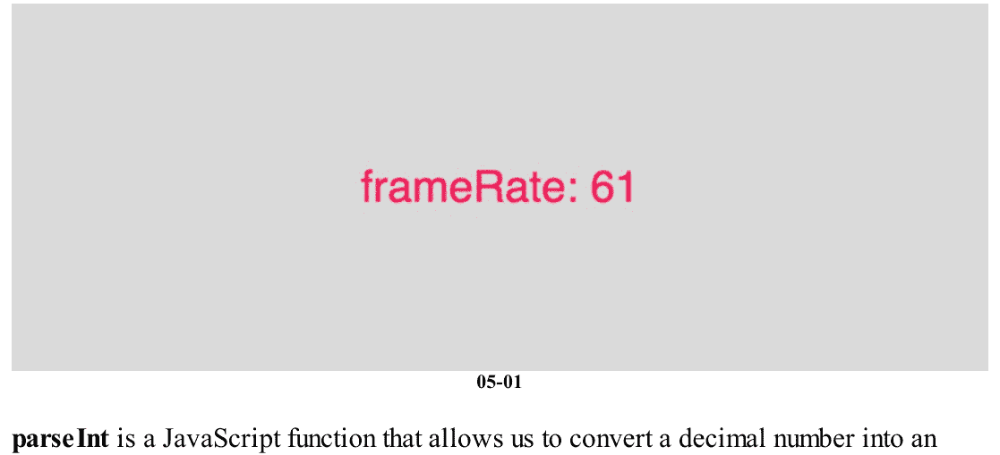

05-01

`parseInt`是一个 JavaScript 函数，允许我们将十进制数转换为整数。它需要第二个参数来指定我们使用的数字基数（几乎总是 10）。


另外请注意，我们使用了名为`textAlign`的 p5.js 函数，参数为`CENTER, CENTER`，以便在屏幕上水平和垂直地对齐文本。否则，文本将从左上角开始绘制，而不是居中。

我们还可以尝试在屏幕上显示`frameCount`变量。如前所述，这个变量保存了`draw`函数被调用的次数。

```javascript
1 function setup() {
2     createCanvas(800, 300);
3     textAlign(CENTER, CENTER);
4     fill(237, 34, 93);
5 }
6
7 function draw() {
8     textSize(36);
9     background(220);
10     text("frameCount: " + frameCount, width/2, height/2);
11 }
```

使用`frameCount`变量，我们可以快速获得一个随`draw`函数每次执行而递增的值。请注意，如果`frameRate`较低，`frameCount`变量的变化速度会慢一些。

```javascript
1 function setup() {
2     createCanvas(800, 300);
3     textAlign(CENTER, CENTER);
4     fill(237, 34, 93);
5     frameRate(6);
6 }
7
8 function draw() {
9     textSize(36);
10     background(220);
11     text("frameCount: " + frameCount, width/2, height/2);
12 }
```

我们可以重写之前章节的示例，利用内置的`frameCount`变量来代替我们的`count`变量。

```javascript
function setup() {
  createCanvas(800, 300);
  rectMode(CENTER);
}

function draw() {
  background(1, 186, 240);
  fill(237, 34, 93);
  noStroke();

  var x = width / 2;
  var y = height / 2;
  var size = 200 + frameCount;

  ellipse(x, y, size, size);
  fill(255);
  rect(x, y, size*0.75, size*0.15);
}
```

## 条件语句

```javascript
if (<conditional statement>) {
  // do something
}
```

`true`或`false`在 JavaScript 中是实际的值，就像数字是值一样。它们只是与`Number`（数字）或`String`（字符串）不同的值类型。它们被称为`Boolean`（布尔）值或`Boolean`数据类型。由于`true`和`false`是原生 JavaScript 数据类型，我们可以直接输入它们而不需要任何引号，且不会报错。

```javascript
console.log(true);
```

如果我们输入`True`或`False`，将无法得到相同的结果。编程语言对书写方式非常敏感。`True`并不等同于`true`。此外，`True`并不是 JavaScript 能够识别的值，因此在不加引号的情况下编写它会导致错误。

```javascript
console.log(True);
//Uncaught ReferenceError: True is not defined(...)
```

我们可以使用**比较**运算符来生成`true`或`false`值。比较运算符允许我们比较两个值，并根据比较结果生成一个`true`或`false`值。以下是比较运算符的示例。我们有**大于**符号，它比较两个数字，如果左侧的数字大于右侧的数字，则返回`true`，否则返回`false`。

```javascript
10 > 2; // would evaluate to true
1 > 100; // false
console.log(100 > 1); //true
```

**大于或等于**在左侧的值大于或等于右侧的值时返回`true`。

```javascript
console.log(100 >= 100); //true
```

此外还有**小于**和**小于或等于**比较运算符。

```javascript
console.log(1 < 10); //true
console.log(10 <= 10); //true
```

为了比较两个值以检查它们是否相等，我们会使用“三等号”`===`。这与我们在数学课上习惯的不同，数学中的等号运算符是单等号`=`。但在 JavaScript 中，单等号运算符已被用作赋值操作。

```javascript
console.log(1 === 1); //true
```

我们还可以进行比较以检查两个值是否不相等。为此，我们在等号前使用一个感叹号。

```javascript
console.log(1 !== 1);
```

请务必尝试使用我们学到的比较运算，看看它们在控制台中会生成什么样的结果。

让我们来看一个使用了`if`结构的示例。

```javascript
var num;

function setup() {
    num = 1;
    createCanvas(800, 300);
    textAlign(CENTER, CENTER);
    fill(237, 34, 93);
}

function draw() {
    background(220);
    textSize(48);
    if (num === 1) {
        text('TRUE', width / 2, height / 2);
    }
}
```

由于括号内的表达式求值为`true`，因此`if`块将被执行。毕竟，数字 1 等于数字 1。我们将看到单词 TRUE 显示在屏幕上，因为这就是`if`块内部代码的作用。

如果我们把`num`变量的值改为 2，那么屏幕上将不会显示任何内容，因为这一次，`if`块的比较结果将为`false`，条件语句将不会被执行。

除了`if`块，我们还可以使用另一种额外的结构，称为`else`块。`else`块紧跟在`if`块之后，并为所有不被`if`块覆盖的其他比较情况执行。让我们使用`else`块来扩展之前的示例。

```javascript
var num;

function setup() {
    num = 2;
    createCanvas(800, 300);
    textAlign(CENTER, CENTER);
    fill(237, 34, 93);
}

function draw() {
    background(220);
    textSize(48);

    if (num === 1) {
        text('TRUE', width / 2, height / 2);
    } else {
        text('FALSE', width / 2, height / 2);
    }
}
```

现在在这个例子中，只要`if`语句不被执行，`else`语句就会被执行。也就是说，对于`num`变量除 1 以外的所有值，都会执行此语句。

顺便说一下，请注意我们通过两次编写`text`函数而产生了重复。我们可以**重构**代码使其更加简洁。根据维基百科的定义，重构是在不改变外部行为的情况下，对现有计算机代码进行重新结构化（更改分解方式）的过程。

```javascript
var num;

function setup() {
    num = 2;
    createCanvas(800, 300);
    textAlign(CENTER, CENTER);
    fill(237, 34, 93);
}

function draw() {
    var value;
    background(220);
    textSize(48);

    if (num === 1) {
        value = 'TRUE';
    } else {
        value = 'FALSE'
    }
    text(value, width/2, height/2);
}
```

这段代码在重构之前的问题是，如果我们想更改文本的位置，我们需要记得在两个`text`函数调用中都进行更改。这看起来似乎很容易记住，但即使是这样的小事实际上也会让代码维护变得困难得多。

在`if`条件语句中，我们还可以添加另一个条件块，即`else if`块。`else if`块允许我们处理额外的条件。例如，我们可以在上面的示例中添加几个`else if`块：

```javascript
var num;

function setup() {
    num = 2;
    createCanvas(800, 300);
    textAlign(CENTER, CENTER);
    fill(237, 34, 93);
}

function draw() {
    var value;
    background(220);
    textSize(48);

    if (num === 1) {
        value = 'TRUE';
    } else if (num === 2) {
        value = 'STILL TRUE';
    } else if (num === 3) {
        value = 'YEP, TRUE';
    } else {
        value = 'FALSE'
    }
    text(value, width/2, height/2);
}
```

尝试更改`num`变量的值，看看代码如何运行。通过使用`else if`块，我们可以为`num`的值处理更多特定的条件。

利用我们学到的知识，让我们修改在前一章编写的代码，使动画的行为取决于`frameCount`变量。

```javascript
function setup() {
    createCanvas(800, 300);
    rectMode(CENTER);
}

function draw() {
    background(1, 186, 240);
    fill(237, 34, 93);
    noStroke();

    var x = width / 2;
    var y = height / 2;
    var size = 200;
    if (frameCount < 60) {
        size = size + frameCount;
    } else {
        size = size + 60;
    }

    ellipse(x, y, size, size);
    fill(255);
    rect(x, y, size*0.75, size*0.15);
}
```

我们修改了之前的示例，使得如果`frameCount`的值小于 60，形状将使用`frameCount`进行动画演示；否则，它将保持静止。

为了让这段代码更易于维护，我们可以做哪些小重构？我们应该将数值 60 保存到一个变量中，这样就不用在两个地方重复修改它。

我们还可以通过使用`&&`或`||`运算符将两个逻辑表达式组合在一起，创建复合语句。`&&`代表**且 (and)**。它允许我们编写只有在*条件语句的所有部分都为真时*才求值为`true`的表达式。假设我们希望仅在`frameCount`大于 10 **且** 小于 60 时才让形状产生动画。我们可以使用复合`and`语句将这两个条件结合起来。

```javascript
if (10 < frameCount && frameCount < 60) {
    size = size + frameCount;
} else {
    size = size + 60;
}
```

`||`代表**或 (OR)**。只要条件语句中有一部分为`true`，`OR`复合语句就会返回`true`。假设我们希望在`frameCount`小于 60 **或** `frameCount`值大于 120 时让形状产生动画。为了表达这一点，我们可以写成如下形式。

```javascript
if (frameCount < 60 || frameCount > 120) {
    size = size + frameCount;
} else {
    size = size + 60;
}
```

## 总结

在本章中，我们学习了帧的概念以及它如何帮助我们在 p5.js 中创建动画图像。

我们还学习了 p5.js 的`frameCount`变量（用于跟踪目前显示了多少帧）以及`frameRate`函数（允许我们设置 p5.js 的帧率）。

我们学习了一些其他的 p5.js 函数，例如允许我们在屏幕上绘制文本的`text`函数，以及允许我们对齐屏幕上绘制文本的`textAlign`函数。

在 JavaScript 领域，我们学习了比较运算符、`Boolean`（布尔）数据类型（`true`和`false`），以及最重要的`if`、`else if`和`else`条件语句。这些结构在编程中非常常见，并且存在于许多其他编程语言中。它们允许我们编写行为更加智能的代码，而不是盲目地从上到下执行。

## 练习

创建一个动画：五个初始在屏幕外的矩形从左侧进入屏幕。它们应该以不同的速度移动，并在即将离开屏幕之前停止。

# 06 - 更多的 p5.js 变量

## 介绍

在上一章中，我们学习了 p5.js 的`frameCount`变量，它提供了一个代表`draw`函数被调用次数的数字。p5.js 中还有许多其他非常有用的变量可以使用。本章我们将学习其中的几个。

## mouseIsPressed

`mouseIsPressed`是我们将遇到的第一个 p5.js 变量，它允许我们为程序添加一些交互性。`mouseIsPressed`是一个 p5.js 变量，当鼠标在画布区域点击时，它取值`true`，在其他任何时候都取值`false`。让我们修改上一章的示例，快速了解如何使用这个变量。

```javascript
function setup() {
    createCanvas(800, 300);
    rectMode(CENTER);
}

function draw() {
    background(1, 186, 240);
    fill(237, 34, 93);
    noStroke();

    var x = width / 2;
    var y = height / 2;
    var size = 200;
    ellipse(x, y, size, size);
    fill(255);
    if (mouseIsPressed === true) {
        rect(x, y, size * 0.75, size * 0.15);
    }
}
```

现在点击画布区域将显示圆形内部的矩形。通过使用`mouseIsPressed` p5.js 变量，我们使矩形的显示取决于鼠标点击。

基于鼠标点击来切换某些状态可能是一个更复杂的示例，因此我们也来看看如何解决这个问题。假设我们希望每次点击鼠标按钮时，都改变画布的背景颜色。我们将让它在两种颜色之间切换。

```javascript
var toggle = true;

function setup() {
    createCanvas(800, 300);
    rectMode(CENTER);
}

function draw() {
    if (mouseIsPressed === true) {
        toggle = !toggle;
    }

    if (toggle === true) {
        background(1, 186, 240);
    } else {
        background(250, 150, 50);
    }

    fill(237, 34, 93);
    noStroke();

    var x = width / 2;
    var y = height / 2;
    var size = 200;

    ellipse(x, y, size, size);
    fill(255);
    rect(x, y, size * 0.75, size * 0.15);
}
```

在这个例子中，我们创建了一个名为`toggle`的全局变量来存储一个`布尔`值。然后我们使用感叹号运算符，使这个`布尔`值在每次鼠标点击时变为原来的相反值。当放在`布尔`值前面时，*感叹号*只会反转该值，这意味着它将`true`变为`false`，反之亦然。

你可能会注意到`mouseIsPressed`变量在捕获点击方面效果似乎不太好。这是因为`draw`函数在一秒钟内被调用多次，这使得使用条件语句很难检测鼠标点击。稍后，我们将看到使用 p5.js **事件** 来检测鼠标点击的更好方法。

## mouseX 与 mouseY


`p5.js`变量`mouseX`保存鼠标当前的水平位置，`mouseY`保存当前的垂直位置。这听起来很简单，但它有潜力在我们的程序中实现大量的用户交互，因此是非常有用的变量。如果我们将这些值作为形状的`x`和`y`坐标提供，当我们在屏幕上移动光标时，本质上就是在移动那个形状。

让我们用之前程序的简化版本来尝试一下。这是一个只在屏幕中央绘制一个圆形的版本。

```
function setup() {
    createCanvas(800, 300);
    rectMode(CENTER);
}

function draw() {
    background(1, 75, 100);
    fill(237, 34, 93);
    noStroke();

    var x = width / 2;
    var y = height / 2;
    var size = 50;
    ellipse(x, y, size, size);
}
```

现在让我们使用`mouseX`和`mouseY`变量作为`x`和`y`值。

```
function setup() {
    createCanvas(800, 300);
    rectMode(CENTER);
}

function draw() {
    background(1, 75, 100);
    fill(237, 34, 93);
    noStroke();

    var x = mouseX;
    var y = mouseY;
    var size = 50;
    ellipse(x, y, size, size);
}
```

尝试在画布上移动你的鼠标。这难道不神奇吗？通过使用两个内置变量，我们将原本静态的草图变成了用户可以交互的东西。

你是否曾经想过，为什么我们将`background`函数放在`draw`函数内部？我们似乎只需要设置一次这个值，所以你可能认为它应该放在`setup`函数中。

`draw`函数内部的`background`函数允许我们用一种纯色覆盖上一帧中绘制的所有内容。如果没有这个声明，在每一帧的开始，你会注意到上一帧的绘制内容会保留在屏幕上。但对于某些用例来说，这可能正是你想要的效果。

这是一个之前的示例，但圆形尺寸更小，形状颜色的透明度更低，并且`background`只在`setup`函数中声明了一次。

```
function setup() {
    createCanvas(800, 300);
    rectMode(CENTER);
    background(1, 75, 100);
}

function draw() {
    fill(237, 34, 93, 100);
    noStroke();

    var x = mouseX;
    var y = mouseY;
    var size = 25;
    ellipse(x, y, size, size);
}
```

## 总结

在本章中，我们学习了更多`p5.js`内置变量，它们特别有助于我们创建交互式程序；即能够响应用户操作的程序。

我们学习了`p5.js`的`mouseIsPressed`变量，它在鼠标被点击时取`true`值。但我们也了解到这个变量可能不是处理用户输入的最佳方式。我们稍后将看到`p5.js`中的事件概念，它在处理用户输入方面要好得多。

我们还看到了`mouseX`和`mouseY`变量，以及如何使用它们根据鼠标光标位置来使对象动画化，这使我们能够以简单的方式为程序添加大量的交互性。

## 练习

编写一个脚本，使其在每次鼠标点击时，在鼠标光标的位置向屏幕绘制一个矩形。

# 07 - 循环

## For 循环

计算机擅长的事情之一就是重复。想象一下，需要在屏幕上创建 1000 个具有不同参数的形状。以我们目前的编程知识，这将耗费我们极不合理的时间。对于这类我们希望原封不动或带有变化地重复代码的情况，我们可以利用一种称为*循环*的编程结构。循环允许我们反复执行一段代码。

我们已经熟悉了`p5.js`中循环的概念。仔细想想，`draw`函数就是一个持续的循环，它被一遍又一遍地执行，直到我们退出`p5.js`程序。在本章中，我们将学习如何自己构建这种循环。

JavaScript 中有几种不同的循环结构，但*for 循环*到目前为止是最流行的。它允许我们重复执行一段操作特定的次数。一个*for 循环*有四个部分。下面是如何构建*for 循环*的一个例子。

```
for (var i = 0; i < 10; i = i + 1) {
    // 执行一些操作
}
```

在第一部分，我们初始化一个变量来跟踪循环执行的次数——我们称之为计数器变量。

```
var i = 0;
```

按照惯例，在*for 循环*内部，我们通常倾向于使用简短的变量名，如`i`或`j`，特别是当该变量仅用于控制*for 循环*的流程时。但如果对你的情况有意义，也请随意使用其他名称。

在第二部分，我们为循环定义了一个测试条件，每次循环即将开始时都会对这个条件进行求值。在这个例子中，我们检查计数器变量是否小于数字 10。

```
i < 10;
```

在第三部分，我们定义了更新计数器变量的方法，这在循环结束时进行求值。在这个例子中，我们获取变量`i`的当前值并将其加一。

最后，在花括号内部，我们编写想要重复执行的代码。一旦计数变量不再满足测试条件，循环就会终止，程序将返回到正常的执行流程。

如果测试条件永远不会失败，那么我们就得到了一个最终会创建*无限循环*的循环——这种循环没有退出条件，因此它会一直运行下去，直到程序被外部手段终止。`p5.js`中的`draw`函数就处于一个无限循环中；它会不断地在屏幕上绘制，直到我们关闭浏览器窗口。

尽管无限循环是一个有效的用例，但循环最常用于执行已知次数的操作。让我们使用*for 循环*创建一个在屏幕上绘制给定数量椭圆的循环。

```
function setup() {
    createCanvas(800, 300);
    rectMode(CENTER);
}

function draw() {
    background(1, 75, 100);
    fill(237, 34, 93, 100);
    noStroke();

    for (var i=0; i<10; i=i+1) {
        ellipse(0, 0, 50, 50);
    }
}
```

在我们的示例中，我们在屏幕上绘制了十个圆，但由于所有圆都绘制在彼此之上，因此在视觉上无法区分。这就是利用循环计数变量发挥作用的地方。我基本上可以使用这个变量在每次调用循环时偏移圆的位置。

```
function setup() {
    createCanvas(800, 300);
    rectMode(CENTER);
}

function draw() {
    background(1, 75, 100);
    fill(237, 34, 93);
    noStroke();

    for (var i=0; i<10; i=i+1) {
        ellipse(i * 50, 0, 50, 50);
    }
}
```

在将值传递给`ellipse`函数之前，我们将循环变量乘以 50（圆的直径），以便让形状互不重叠。

现在如果我们执行这段代码，我们将看到*for 循环*为我们创建的所有那些圆。这样做的好处是，既然我们已经构建了重复操作的结构，那么扩展它就变得非常简单，只需将循环条件中使用的数字更改为更大的值即可。渲染 100 个或 1000 个圆而不是 10 个，仅仅是更改这一个数值的问题。不过，如果我们开始使用巨大的数字，可能会注意到性能下降。

让我们构建代码，以便用圆填满整个屏幕的宽度。

如果屏幕宽度是 800，圆的直径是 50 个单位，那么这意味着我们可以在页面宽度内填充`800 / 50`个圆。我们会注意到页面末尾有一点间隙，因为第一个圆稍微在画布之外。我们可以通过在`x`坐标上增加 25（直径值的一半）来偏移所有内容，从而消除这个间隙。正如你已经知道的，我们实际上不需要自己进行这些计算，因为我们可以让 JavaScript 为我们计算该值。

此时你可能会注意到，我们在代码中硬编码了许多值，为了灵活性，使用变量会更好。我们将重构代码来实现这一点。

```
function setup() {
    createCanvas(800, 300);
    rectMode(CENTER);
}

function draw() {
    background(1, 75, 100);
    fill(237, 34, 93);
    noStroke();
    var diameter = 50;

    for (var i=0; i< width/diameter; i=i+1) {
        ellipse(diameter/2 + i * diameter, 0, diameter, diameter);
    }
}
```

现在，如果我们更改一个值（圆的直径），整个代码仍然会绘制恰好足够填满屏幕的圆。这是一个非常令人印象深刻的功能。

如果我们还想用圆填满屏幕的高度怎么办？为了实现这一点，我们需要编写另一个`for`循环，在宽度方向放置每个圆的同时，为画布的整个长度放置圆。这要求我们将第二个循环放在第一个循环内部，有效地将一个循环*嵌套*在另一个循环中。

```
function setup() {
    createCanvas(800, 300);
    rectMode(CENTER);
}

function draw() {
    background(1, 75, 100);
    fill(237, 34, 93);
    noStroke();
    var diameter = 50;

    for (var i=0; i<width/diameter; i=i+1) {
        for (var j=0; j<height/diameter; j=j+1) {
            ellipse(
                diameter/2 + i * diameter,
                diameter/2 + j * diameter,
                diameter,
                diameter
            );
        }
    }
}
```

注意在这个示例中我们声明`ellipse`函数的方式。我们将它分多行编写，以提高可读性。JavaScript 允许我们在逗号运算符之后开始新行。

这段代码现在非常有用。首先，它很健壮，我们可以更改绘制区域的大小或绘制圆的数量，但程序仍将继续正常运行。

需要记住的一点是：将循环互相嵌套可能会因为需要执行的操作数量过多而导致程序运行非常缓慢。此外，有时嵌套结构也会使程序难以阅读。

## 随机 (Random) 和 噪声 (Noise) 函数

既然我们现在可以创建在每次执行时使用不同值的循环，那么现在可能是学习`p5.js`的`random`函数的好时机。`p5.js`的`random`函数在每次调用时都会生成一个随机数。当我们想为所绘制形状的参数使用随机值时，这非常有用。

如果我们不带任何参数调用`random`函数，那么在每次`draw`函数调用或每一帧中，它将产生一个 0 到 1 之间的随机数。如果我们向`random`函数提供一个值，它将返回一个大于 0 且小于该给定值的随机值。如果我们向`random`函数提供两个值，我们将得到一个介于这两个给定数字之间的随机值。

```
random(); // 0 到 1 之间的随机数
random(10); // 0 到 10 之间的随机数
random(100, 1000); // 100 到 1000 之间的随机数
```

这里有一个简单的脚本，演示了以不同方式调用`random`函数的结果。

```
function setup() {
    createCanvas(800, 300);
    textAlign(CENTER, CENTER);
    fill(237, 34, 93);
    frameRate(1);
}

function draw() {
    var random_0 = random();
    var random_1 = random(10);
    var random_2 = random(100, 1000);
    var offset = 40;

    textSize(24);
    background(255);
    text(random_0, width/2, height/2-offset);
    text(random_1, width/2, height/2-0);
    text(random_2, width/2, height/2+offset);
}
```

让我们更新之前的代码以利用`random`函数。

```
function setup() {
    createCanvas(800, 300);
    rectMode(CENTER);
}

function draw() {
    background(1, 75, 100);
    fill(237, 34, 93);
    noStroke();
    var diameter = 50;

    for (var i=0; i<width/diameter; i=i+1) {
        for (var j=0; j<height/diameter; j=j+1) {
            ellipse(
                diameter/2 + i * diameter,
                diameter/2 + j * diameter,
                diameter * random(),
                diameter
            );
        }
    }
}
```

我们使用`random`函数的结果将椭圆的宽度乘以一个随机数，每次调用`random`函数时，该值都在 0 到 1 之间。由于`random`函数在任何帧中都可以取其范围内的任何值，因此动画看起来非常剧烈。如果我们想要一种逐渐变化的随机性，从而看起来更自然（有机），那么我们应该研究`noise`函数。

我们可以向`noise`函数传递任何数值，它将返回一个 0 到 1 之间的半随机值。对于给定的值，它总是返回相同的输出。`noise`函数的优点是，如果我们传递给`noise`函数的值仅以增量方式变化，那么输出值也将仅以增量方式变化。这将导致我们获取的随机值之间产生平滑的过渡。

为了能够概念化`noise`函数的工作方式，我们可以想象有无限数量的随机值像波浪一样逐渐变化，而我们提供给`noise`函数的值就像是这些随机值的坐标。本质上，我们只是在对一个已经存在的噪声进行采样。每当我们向`noise`函数提供相同的值时，我们都会收到相同的半随机值作为回报。

我们将重写上述程序，改为使用`noise`函数。我们会将`frameCount`变量传给`noise`函数，因为在`p5.js`中这是获取序列号的一个好方法。但我们会将`frameCount`除以 100，以便稍微减慢数值的变化速度，从而减缓最终动画的速度。

```javascript
1 function setup() {
2     createCanvas(800, 300);
3     rectMode(CENTER);
4 }
5
6 function draw() {
7     background(1, 75, 100);
8     fill(237, 34, 93);
9     noStroke();
10    var diameter = 50;
11
12    for (var i=0; i<width/diameter; i=i+1) {
13        for (var j=0; j<height/diameter; j=j+1) {
14            ellipse(
15                diameter/2 + i * diameter,
16                diameter/2 + j * diameter,
17                diameter * noise(frameCount/100),
18                diameter * noise(frameCount/100)
19            );
20        }
21    }
22 }
```

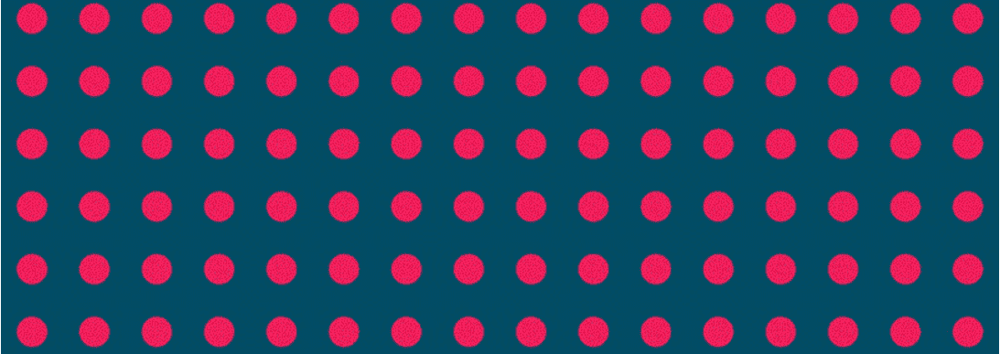

07-07

请注意，现在所有的形状都在使用相同的动画。如果我们想让每个形状获得不同的`noise`值该怎么办？目前数值是重复的，因为当`noise`函数接收到相同的值时，会返回相同的输出。为了让每个形状获得不同的输出值，我们可能需要重写上述函数，利用`for`循环的`i`和`j`值来调整`noise`的采样位置。


进入`/path/to/xxx`目录，找到`xxx.json`。

在表达式`cvar = avar + bvar`中，加法运算符（`+`）将`avar`与`bvar`相加，得到它们的和`cvar`

在`List.of(arg0, arg1, arg2)`中，`List`接口的工厂方法`of()`接受一系列的元素，返回包含它们的只读列表。

之后我们这样调用`cmd`命令：`cmd arg0 arg1 arg2`。

```
if (condVar > someVal) {console.log("xxx")}
```

```javascript
1 function setup() {
2     createCanvas(800, 300);
3     rectMode(CENTER);
}

function draw() {
    background(1, 75, 100);
    fill(237, 34, 93);
    noStroke();
    var diameter = 50;

    for (var i=0; i<width/diameter; i=i+1) {
        for (var j=0; j<height/diameter; j=j+1) {
            ellipse(
                diameter/2 + i * diameter,
                diameter/2 + j * diameter,
                diameter * noise(frameCount/100 + j*10000 + i*10000),
                diameter * noise(frameCount/100 + j*10000 + i*10000)
            );
        }
    }
}
```

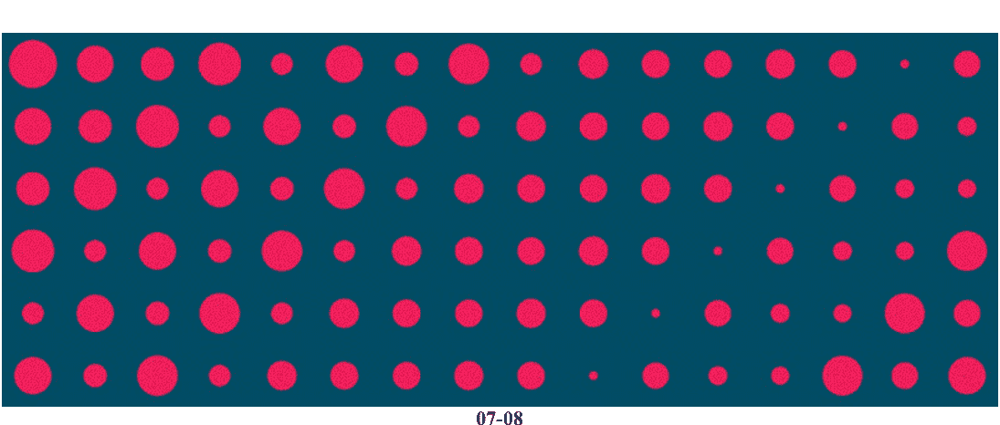

07-08

我们在上面作为乘数使用的`10000`这个值是完全随机的。我们只是想确保提供给`noise`函数的坐标彼此之间距离足够远。

## 总结

循环是编程中最强大的结构之一。它让我们能够利用计算机真正的计算能力，大规模地重复执行操作，而这些操作如果由人类在合理的时间内完成几乎是不可能的。

在本章中，我们学习了如何构建`for`循环（for 循环），以及如何将循环相互嵌套，从而获得一个重复形状的网格，而不仅仅是一行形状。

我们还学习了 p5.js 的`random`和`noise`函数及其之间的区别。

## 练习

创建一个循环，生成一组矩形数组，其颜色从黑色逐渐变为白色。你应该这样构建循环，使得由一个单一变量来控制绘制矩形的数量。

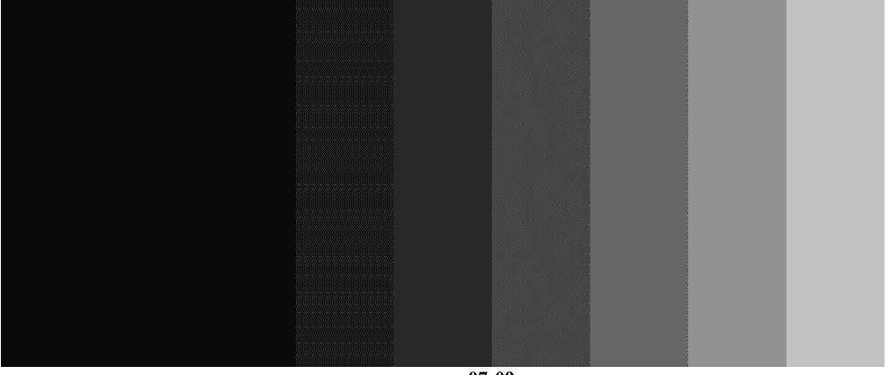

# 08 - 函数

## 创建函数

函数是 JavaScript 的基础构建块。它们允许我们以更高效、更具可扩展性的方式编写程序。函数通过将操作包含在一个单一的可执行名称下进行分组，帮助我们管理复杂性。我们已经知道如何通过使用 p5.js 的预定义函数（如`ellipse`或`background`）来调用函数。我们甚至创建了自己的函数，因为 p5.js 强制我们将代码放入两个函数声明中：`setup`和`draw`。如果我们想创建自己的函数，我们将遵循与创建（或声明）这些函数相同的约定。

要创建（或声明）一个新函数，我们会先使用`function`关键字，然后给函数起一个我们选择的名字，理想情况下该名称应描述函数的行为或目的。

```javascript
function functionName() {
    // function body
}
```

接下来，在函数名后面我们会打开括号。如果我们想构建一个处理用户输入的函数，可以在括号内定义参数，这些参数将作为未来用户输入的占位变量名。我们稍后会看到这是如何运作的。

然后是大括号。大括号内部被称为函数体。在其中，我们将编写构建函数逻辑的代码。我们也可以在函数体中执行的操作中使用参数（即我们在函数名旁括号内定义的变量名）。

让我们来看一个简单的例子。请注意 p5.js 有`ellipse`函数但没有`circle`函数。这其实不是问题，因为我们可以通过向`ellipse`函数提供相同的宽度和高度值来轻松创建圆形。但为了论证起见，让我们创建一个`circle`函数，它接收三个值：我们想要绘制圆形的 x 和 y 位置，以及圆形的直径。

具体做法如下。在括号内，我们将写下在调用该函数时最终会提供的变量名。这些名称被称为*参数 (parameters)*，因为它们将我们创建的操作的功能参数化。我们将在函数内部使用这些参数，以便让用户控制函数的内部运行。

```javascript
function circle(x, y, diameter) {
    ellipse(x, y, diameter, diameter);
}
```

我们可以随意选择参数名称，但通常使用能清晰传递意图的名称更有意义。因此在我们的例子中，使用`x`、`y`和`diameter`这些名称是合理的。

定义好这个函数后，我们可以通过使用其名称并为其提供值来调用它。提供给函数的这些值被称为该函数的*实参 (arguments)*。请注意，如果没有提供所有必需的实参，函数可能会失败或无法按预期工作。

```javascript
circle(width/2, height/2, 100);
```

如果你觉得这些术语令人困惑，不用太担心。习惯它们可能需要一段时间。函数的*参数 (parameters)*可以被看作是用户在使用函数时最终会提供的值。而调用函数时提供的这些相同的值则被称为*实参 (arguments)*。

有了`circle`函数，我们再也不需要担心使用`ellipse`函数来画圆了。我们可以直接使用自己的函数来绘制那些完美的圆。既然我们自己实现了`circle`函数，我们就知道它在底层实际上使用了`ellipse`函数来绘制这些圆。但函数的妙处在于，一旦它们可用，我们其实不需要知道它们是如何工作的。我们可以直接使用它们，而无需思考它们是如何实现的。由创建 p5.js 的聪明人们实现的`ellipse`函数内部可能使用了各种手段来绘制椭圆，但对我们而言，调用它就能画出一个椭圆，这就足够了。

在这个例子中，创建`circle`函数并没有带来太高的效率。事实上，我们只需向`ellipse`函数传递三个实参而不是四个就能画圆。但在构建更复杂的程序时，函数变得非常重要，因为它们通过将操作包含在单一的可执行名称下，帮助我们管理复杂性。函数本质上是黑盒。它们封装了所包含的代码，并且在函数内部使用`var`关键字声明的任何变量在函数外部都是不可见的。

```javascript
function setup() {
    createCanvas(800, 300);
    sayHello();
}

function draw() {
    background(220);
}

function sayHello() {
    var message = 'Hello World!';
    console.log(message);
}

console.log(message);
```

第 15 行的`console.log`函数将抛出错误，因为变量`message`仅在`sayHello`函数内部可见。

函数可以不带输入、带单个输入或多个输入，并且它们要么*返回 (return)*一个结果，要么不返回。让我解释一下我所说的返回值的含义。

假设我们要创建一个函数，将给定的数值乘以自身，本质上是计算给定数字的平方。这里有一个实现该功能的函数，它接收一个数字作为参数，并创建一段文本将该数字显示在屏幕上。因此它是有一定用处的，因为我们可以使用这个函数将结果显示在屏幕上，从而知道一个极大的数字的平方可能是多少。

```javascript
1 function setup() {
2     createCanvas(800, 300);
3 }

5 function draw() {
6     background(1, 75, 100);
7     fill(237, 34, 93);
8     squared(10);
9 }

11 function squared(num) {
12     textSize(60);
13     textAlign(CENTER, CENTER);
14     text(num * num, width/2, height/2);
15 }
```


但如果我们想把这个计算结果用到另一个计算中，可能会遇到障碍。这个函数并没有将数字*返回*给我们，它只是在屏幕上显示出来。调用这个函数会影响我们当前的环境，但不会*返回*一个可供后续计算使用的值。到目前为止，我们见过的一些函数，如`ellipse`、`rect`等，表现也类似——它们执行了一些操作，但实际上并没有返回计算结果。而`random`函数在执行时不会在屏幕上显示任何内容，而是返回一个值，我们可以将这个值捕获到变量中。

要从函数中返回值，我们可以使用`return`关键字。让我们修改`squared`函数，使其既在屏幕上显示结果，又返回一个值。

```
function setup() {
    createCanvas(800, 300);
}

function draw() {
    background(1, 75, 100);
    fill(237, 34, 93);
    var x = squared(10);
    console.log(x);
}

function squared(num) {
    textSize(60);
    textAlign(CENTER, CENTER);
    var result = num * num;
    text(result, width/2, height/2);
    return result;
}
```

现在，这个函数返回了一个值，我们将其用在`console.log`函数中。当程序遇到`return`关键字时，程序会终止函数的执行，并将紧随其后的值返回给函数的调用者。这意味着，如果在`return`关键字之后还有其他代码行，它们将不会被执行，因为`return`会终止当前函数的执行。`return`关键字只能在函数内部使用，尝试在函数外部使用它会导致错误。因为在函数外部，没有需要返回的东西。

## 重新审视 Setup 和 Draw 函数

既然我们已经学会了创建自己的函数，有必要再次强调创建函数与调用函数之间的区别。注意，当我们创建函数时，必须调用它们才能使其被执行。例如，在下面的代码示例中，我们只是创建或声明了一个函数：

```
function myFunction() {
}
```

要使用这个函数，我们需要通过函数名加括号的方式来调用并执行它。

```
myFunction();
```

注意在 p5.js 中有一个稍显奇怪的现象：我们从未真正调用过`setup`和`draw`函数，但它们却照样被执行了！这源于 p5.js 的架构设计。p5.js 为我们处理了`setup`和`draw`函数的执行，因为它们的执行遵循一些简单的规则：

- `setup`函数在`draw`函数之前执行。

- `setup`函数只执行一次，而`draw`函数会持续不断地执行。

## 总结

从我们开始使用 p5.js 的那一刻起，我们就在使用函数了。它自身的架构就依赖于我们程序中必须存在的两个函数，其名称为：`setup`和`draw`。此外，我们一直在使用 p5.js 库自带的函数，如`ellipse`、`rect`等。

我们已经了解到，函数可以设计为处理外部用户输入，也可以不处理。我们还可以构建使用`return`关键字返回值的函数，或者不返回值的函数。

函数是一种创建模块化代码块的方式，可以在整个代码中重复使用，从而通过减少需要编写的代码量来使我们的程序更易维护和扩展。每当我们发现自己在多个地方重复同一段代码时，那很可能就是创建函数的好候选。

## 练习

创建一个名为`grid`的函数，接受三个参数：一个`numX`参数和一个`numY`参数，用于在 x 轴上创建`numX`个形状（比如矩形），在 y 轴上创建`numY`个形状；还有一个`size`参数，用于设置形状的大小。

例如：

```
grid(10, 30, 20); // Would create 10 x 30 rectangles of size 20px.
```

# 09 - 对象

## 对象简介

JavaScript 使用一种称为**对象**的数据结构来帮助组织数据。在 JavaScript 中创建对象有几种方式，其中一种是使用花括号。

```
var colors = {};
```

这些花括号称为*对象初始化器*。它们创建一个空对象。我们通过变量`colors`来持有对该对象的引用。

现在，我们可以通过在点号后面提供所需的属性名来向这个`colors`对象添加属性。这称为*点号表示法*。我们还将为这些新创建的属性赋值。

```
var colors = {};
colors.black = 0;
colors.darkGray = 55;
colors.gray = 125;
colors.lightGray = 175;
colors.white = 255;
```

如果此时我们使用`console.log`查看这个对象，会看到类似这样的内容。

```
{"black":0,"darkGray":55,"gray":125,"lightGray":175,"white":255}
```

我们也可以从一开始就通过在花括号内提供属性来创建具有相同属性的对象。

```
var colors = {
    black: 0,
    darkGray: 55,
    gray: 125,
    lightGray: 175,
    white: 255,
};
```

对象本质上是*键值*对。每个键存储一个*值*，每个*键值*对构成对象上的一个*属性*。

要访问对象上的值，我们可以再次使用点号表示法。

```
console.log(colors.gray);
```

在某些情况下，点号表示法不适用。例如当我们使用数字作为对象的键值时。在这种情况下，我们可以使用方括号来访问值。例如：

```
colors[1]; // Assuming you were using numbers instead of color names as key values.
```

你认为上面的表达式如果用`console.log`输出会返回什么？我们会得到`undefined`，因为键`1`在当前的`colors`对象中不存在。

我们还可以将函数定义为对象中键的值。在这种情况下，生成的属性将被称为*方法*。

在我们的`colors`对象基础上，让我们在该对象中定义一个名为`paintItBlack`的方法，它将背景颜色设置为黑色。

```
var colors = {
    black: 0,
    darkGray: 55,
    gray: 125,
    lightGray: 175,
    white: 255,
    paintItBlack: function() {
        background(this.black);
    }
};
```

以下是一个使用该对象的 p5.js 代码

```
var colors;

function setup() {
    createCanvas(800, 300);
    colors = {
        black: 0,
        darkGray: 55,
        gray: 125,
        lightGray: 175,
        white: 255,
        paintItBlack: function() {
            background(this.black);
        }
    };
}

function draw() {
    background(220);
    if (frameCount > 120) {
        colors.paintItBlack();
    }
}
```

在这个示例中，我们在`setup`和`draw`函数的作用域之外初始化了`colors`变量，然后在`setup`函数内部创建其内容。毕竟，我们只需要创建一次内容。然后，如果`frameCount`大于 120，我们就调用它的`paintItBlack`方法，这在默认设置下会在两秒后发生。（记住`frameRate`的默认值是 60，这意味着大约每秒渲染 60 帧。）

要在对象内部使用对象中定义的键，我们需要能够引用对象本身。在 JavaScript 中，有一个名为`this`的关键字可以让我们做到这一点。使用`this`关键字，我们可以引用对象本身上定义的键。

```
paintItBlack: function() {
    background(this.black);
}
```

一旦我们在对象上定义了方法，就可以通过点号表示法来调用该方法。由于我们在执行一个函数，所以需要在函数名后面加上括号。

```
colors.paintItBlack();
```

JavaScript 中（或其他实现了对象的语言中）对象的概念之所以存在，是为了让我们能够对现实世界的对象或概念进行建模。就像现实世界的对象具有属性和行为一样，编程语言中的对象也可以拥有描述其特征的属性和描述其行为的方法。

让我给你举一个对现实世界概念进行建模的编程语言对象的例子。我们将创建一个名为`circle`的对象。这个`circle`对象将有几个属性来定义它的外观，还有几个方法来描述它的行为。

```
var circle = {
    x: width/2,
    y: height/2,
    size: 50,
};
```


这个`circle`对象有一个`x`和`y`属性来定义其坐标，还有一个`size`属性来定义其大小。我们还将为它创建一个方法——一个值为函数的属性，用于定义某种行为。在本例中，定义的行为将是在屏幕上绘制圆。

```
var circle = {
    x: width/2,
    y: height/2,
```

## 构造函数

在JavaScript中创建对象还有另一种方式，那就是使用函数。我们将在创建对象的函数内部进行的声明，与我们使用*对象初始化器*时所做的非常相似。

```javascript
var Circle = function() {
    this.x = width/2;
    this.y = height/2;
    this.size = 50;
    this.draw = function() {
        ellipse(this.x, this.y, this.size, this.size);
    };
    this.grow = function() {
        if (this.size < 200) {
            this.size += 1;
        }
    }
};
```

一个用于创建对象的函数被称为**构造函数**。我们可以把它看作是一个模板或蓝图，用于创建从这个构造函数派生其属性的新对象。

让我举个例子来更好地解释我的意思。假设我们想要一个与前面示例相同的圆圈，它表现出这个`Circle`构造函数定义的行为。在这种情况下，我们将不会直接使用这个构造函数来达到目的，而是用它来实例化一个新的圆圈，这个圆圈是按照这个模板函数建模的。

```javascript
var myCircle = new Circle();
```

我们使用了`Circle`构造函数和`new`关键字来创建一个名为`myCircle`的圆圈的*新*实例，该实例从构造函数获取其属性。基本上，`new`关键字允许我们从构造函数创建一个对象的新实例。我们可以将`Circle`构造函数看作蓝图，将`myCircle`看作是从该蓝图构建的实际圆圈。现在我们可以通过调用它的`draw`方法将这个新创建的圆圈绘制到屏幕上。

```javascript
myCircle.draw();
```

**以下是完整示例：**

```javascript
var circle;

function setup() {
    createCanvas(800, 300);
    fill(237, 34, 93);
    noStroke();
    circle = new Circle();
}

function draw() {
    background(220);
    circle.draw();
    circle.grow();
}

var Circle = function() {
    this.x = width/2;
    this.y = height/2;
    this.size = 50;
    this.draw = function() {
        ellipse(this.x, this.y, this.size, this.size);
    };
    this.grow = function() {
        if (this.size < 200) {
            this.size += 1;
        }
    };
};
```

这种方法的美妙之处在于，我们可以从同一个蓝图不断创建新的圆圈。而且由于这些圆圈是独立的实体——实例——它们可以彼此拥有不同的属性。让我们看一个这样的例子。

```javascript
var circle_1;
var circle_2;
var circle_3;

function setup() {
    createCanvas(800, 300);
    fill(237, 34, 93);
    noStroke();
    circle_1 = new Circle();
    circle_2 = new Circle();
    circle_3 = new Circle();
}

function draw() {
    background(220);
    circle_1.draw();
    circle_1.grow();

    circle_2.x = 150;
    circle_2.draw();
    circle_2.grow();

    circle_3.x = 650;
    circle_3.draw();
    circle_3.grow();
}

var Circle = function() {
    this.x = width / 2;
    this.y = height / 2;
    this.size = 50;
    this.draw = function() {
        ellipse(this.x, this.y, this.size, this.size);
    };
    this.grow = function() {
        if (this.size < 200) {
            this.size += 1;
        }
    };
};
```

在这个示例中，我们在p5.js函数外部创建了三个变量，分别名为`circle_1`、`circle_2`和`circle_3`。这些变量在p5.js函数外部创建，是为了让它们在两个函数的作用域内都可用。

我们通过使用`new`关键字将`Circle`构造函数赋值给它们，从而使这些变量成为`Circle`实例。现在我们有三个独立的圆圈对象，我们可以在`draw`函数中更改它们的属性，并从每个对象获得不同的结果。

需要注意的一点是我们如何为构造函数使用以大写字母开头的函数名。我们使用大写字母是为了提醒自己和其他人，这个函数是一个构造函数，需要使用`new`关键字来调用。

使用`new`关键字调用构造函数很重要。如果我们不在构造函数内部使用`this`关键字，它将无法正常工作，因为它不会指向实例对象，而是指向全局对象。

使用大写字母不是规则，而是一种约定。没有人强迫我们这样做。但期望我们遵循这个约定，因为没有意识到一个函数是构造函数，然后在不使用`new`关键字的情况下调用它，将会产生意想不到的后果。

## 总结

在本章中，我们学习了JavaScript对象。简而言之，对象是一种组织代码的方式。

我们学习了用于访问对象属性的点表示法和方括号表示法。

我们还学习了`this`关键字，它允许我们从对象内部引用对象的属性。

我们学习了两种创建对象的方式。其中一种是使用**对象初始化器**，另一种是使用**构造函数**。虽然我们使用对象初始化器创建单个对象，但构造函数充当蓝图，我们可以使用`new`关键字从中创建许多对象实例。

在不同的编程语言中，存在一种利用对象进行代码组织和清晰化的完整编程范式，称为*面向对象编程*。使用p5.js，我们不一定需要创建对象来组织代码，但我想介绍对象有两个原因：

首先，对象是JavaScript语言的基本组成部分。如果你想在以后进一步学习这门语言，你需要熟悉对象的工作方式。

其次，JavaScript还有其他基于对象的内置结构，我们将使用它们，因此让我们更熟悉对象是很重要的。

现在，如果你刚开始，本章的要点应该是知道JavaScript中存在一种名为**对象**的数据结构，它有助于组织代码。它还允许代码以某种方式表示，在某些情况下更容易处理和推理。由于我们刚开始，我们不会过多地使用对象，但为了你以后的学习，了解它们是很重要的。

# 10 - 数组

## 使用数组

**数组 (Arrays)** 是 JavaScript 中另一种非常有用的数据结构，它基于 **对象 (Objects)** 构建，这使得某些操作执行起来更加简单。

数组是一个按编号索引存储的顺序数据集合。记住，我们使用花括号来创建一个空对象；类似地，我们可以使用方括号来创建一个空数组。

```javascript
1 var arr = [];
```

在这个例子中，我们创建了一个空数组，并使用名为`arr`的变量来存储该数组。现在，如果我们想向这个数组添加元素，可以使用数组对象自带的`push`方法。

```javascript
1 var arr = [];
2 arr.push(1);
3 arr.push("hello world");
4 arr.push({"name":"value"});
5 console.log(arr);
```

在这个例子中，我们将三个新值推入之前为空的数组中。在第一行，我们推入了一个**number**（数字）类型的值；在第二行，我们将一个**string**（字符串）类型推入数组；在第三行，我们将一个**object**（对象）类型推入其中。

现在，如果我们使用`console.log`查看数组的内容，屏幕上会显示类似这样的内容：

```javascript
1 [1,"hello world",{"name":"value"}]
```

请注意，我们使用了不同的数据类型和对象来填充数组。数组可以包含任何对象，甚至可以是其他数组。就像 JavaScript 对象一样，我们可以在创建数组时，通过在方括号内提供所需的值（并用逗号分隔）来对其进行初始化。让我们创建一个包含四个数字的数组。

```javascript
1 var arr = [15, 40, 243, 53];
2 console.log(arr);
```

我们可以使用自动生成的索引编号属性来访问数组中的单个项目。但需要知道的一点是，指向数组中存储项的索引是从 0 开始的。要访问数组中的单个项目，我们可以输入存储该数组的变量名，然后使用方括号中的索引号来引用该位置的项目。数字 0 将指向数组中的第一个项目（即 15），索引号 1 将指向第二个项目，依此类推……

```javascript
1 var arr = [15, 40, 243, 53];
2 var firstItem = arr[0];
3 console.log(firstItem);
```

如果我们尝试访问一个不存在的项目，将会得到一个**undefined**（未定义）值。这很合理，因为该项目确实没有被定义。记住，当我们尝试访问对象中不存在的属性时，同样会返回**undefined**值。

让我们看看数组数据结构在构建程序时如何简化问题。我们从一个简单的例子开始。假设我们想创建五个大小不同的圆。根据我们目前的知识，我们需要创建五个不同的变量，并为这些变量分配所需的值。然后调用五次`ellipse`函数，每次使用一个不同的变量。

```javascript
1 var size1 = 200;
2 var size2 = 150;
3 var size3 = 100;
4 var size4 = 50;
5 var size5 = 25;
6
7 ellipse(width/2, height/2, size1, size1);
8 ellipse(width/2, height/2, size2, size2);
9 ellipse(width/2, height/2, size3, size3);
10 ellipse(width/2, height/2, size4, size4);
11 ellipse(width/2, height/2, size5, size5);
```

虽然我们只在屏幕上绘制五个圆，但这看起来已经是一个很累赘的解决方案了。如果我们需要绘制 100 个甚至 1000 个圆怎么办？这就是数组发挥作用的地方，它能让我们的工作变得轻松许多。

首先，让我们创建一个包含所需圆尺寸的数组。正如前面提到的，我们可以使用索引号来访问数组中的单个项目。我们将利用这个知识从数组中获取所需的值。

```javascript
1 var sizes = [200, 150, 100, 50, 25];
2
3 ellipse(width/2, height/2, sizes[0], sizes[0]);
4 ellipse(width/2, height/2, sizes[1], sizes[1]);
5 ellipse(width/2, height/2, sizes[2], sizes[2]);
6 ellipse(width/2, height/2, sizes[3], sizes[3]);
7 ellipse(width/2, height/2, sizes[4], sizes[4]);
```

这样看起来已经好多了。但请注意，仍然存在大量重复。在调用`ellipse`函数时，我们基本上是在一遍又一遍地输入相同的内容，唯一改变的是索引号。这里出现了一个非常清晰的模式：如果我们有一个结构可以为我们创建一个循环，让我们用递增的值调用五次`ellipse`函数，那么我们就不用重复编写代码了。

幸运的是，我们知道如何创建 *for 循环 (for loop)* 来精准地实现这一点。下面是将上述代码改写为使用 for 循环后的样子：

```javascript
1 var sizes = [200, 150, 100, 50, 25];
2 for (var i = 0; i < 5; i++) {
3     ellipse(width / 2, height / 2, sizes[i], sizes[i]);
4 }
```

以下是在 p5.js 示例中使用该代码的方式：

```javascript
1 function setup() {
2     createCanvas(800, 300);
3     fill(237, 34, 93);
4     strokeWeight(2);
5 }
6 
7 function draw() {
8     var sizes = [200, 150, 100, 50, 25];
9     for (var i = 0; i < 5; i++) {
10        ellipse(width / 2, height / 2, sizes[i], sizes[i]);
11    }
12 }
```

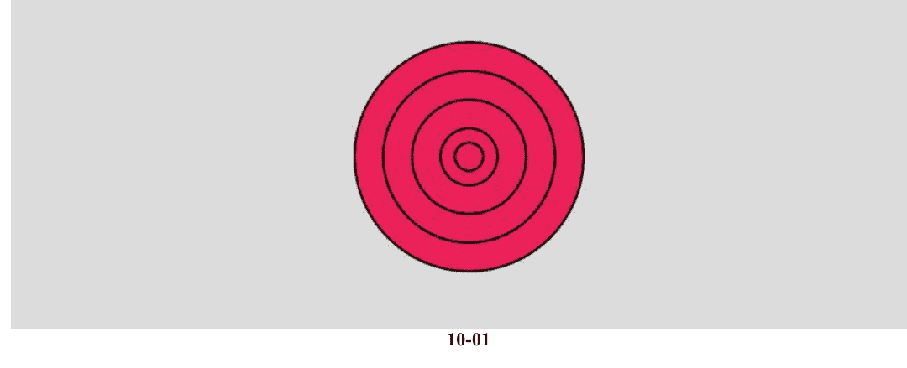

10-01

请注意 for 循环头部使用的数字 5。之所以使用它，是因为我们使用的数组包含五个项目。所以如果有六个项目，我们就应该将这个值更新为 6。但这有点问题，如果我们扩大了数组但忘记更新这个值怎么办？幸运的是，我们可以改用一个名为`length`的数组属性，它能给出数组中项目的数量。我们可以重写上述代码以利用`length`属性。

```javascript
1 var sizes = [200, 156, 100, 25, 5];
2 for (var i = 0; i < sizes.length; i++) {
3   ellipse(width / 2, height / 2, sizes[i], sizes[i]);
4 }
```

现在我们的代码更加简洁，而且具有极强的可扩展性。我们只需不断向`sizes`数组中添加新值，程序就会为我们绘制相应数量的圆。为了增加趣味性，让我们进一步自动化这个设置。目前，我们是手动创建包含尺寸值的数组。但我们可以创建另一个 for 循环，利用`random`函数用我们选择的任意数量的随机数来填充这个数组。

```javascript
1 var sizes = [];
2 
3 function setup() {
4     createCanvas(800, 600);
5     noFill();
6     for (var i=0; i<100; i++) {
7         var randomValue = random(5, 500);
8         sizes.push(randomValue);
9     }
10 }
11 
12 function draw() {
13     background(255);
14     for (var i = 0; i < sizes.length; i++) {
15         ellipse(width / 2, height / 2, sizes[i], sizes[i]);
16     }
17 }
```

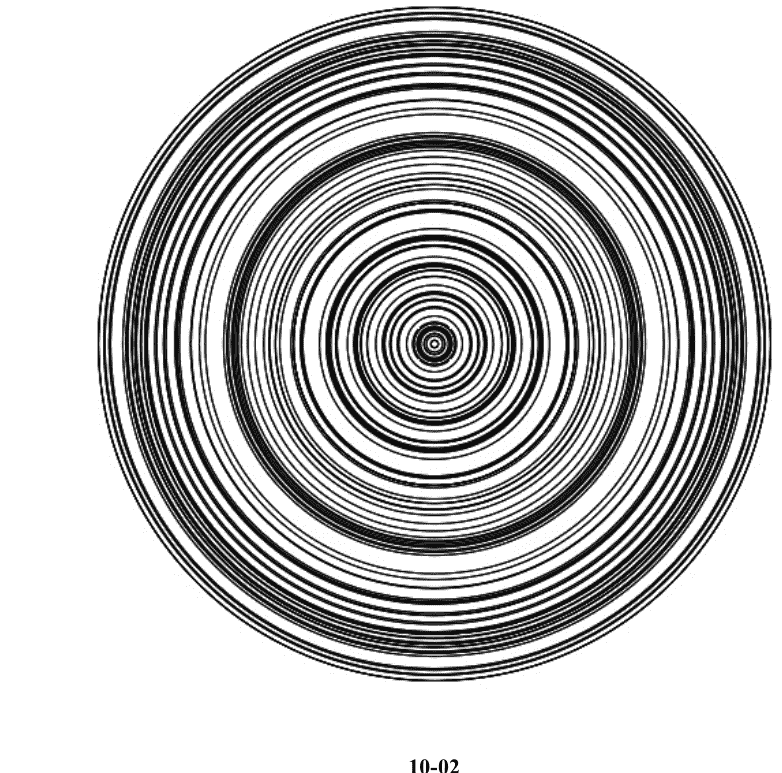

10-02

让我们详细分析一下这个例子发生了什么。我们首先在`draw`函数中将背景颜色设置为白色。此外，我们调用了`noFill`函数，使形状在绘制时不填充颜色。这些只是样式选择。我们创建了一个空`sizes`数组，随后用随机数填充它。然后我们创建了一个循环，该循环将迭代 100 次。在循环内部，每次迭代时，我们使用`random`函数生成一个 5 到 500 之间的随机值，并使用`push`方法将该生成的随机值推入`sizes`数组中。

接下来的步骤保持不变。我们为`sizes`数组中存在的所有值创建椭圆。请注意，在这个程序中，只需更改一个值（目前是 100，即生成的随机数数量），就可以控制整个结果。这是一个极好的例子，展示了简单的编程结构如何创建非常强大且可扩展的解决方案。

让我们尝试使用数组进行另一个可视化练习！计划是创建一个动画，以一种艺术风格顺序且连续地显示给定的词语。

首先，让我们回顾一下如何在 p5.js 中创建文本。我们将使用`text`函数，它接受三个参数：要显示的文本，以及 x 和 y 坐标位置。

这段文本。利用这个知识，让我们尝试在浅色背景的屏幕上显示单词“JavaScript”。


```javascript
1 function setup() {
2     createCanvas(800, 300);
3 }
4
5 function draw() {
6     background(200);
7     text('JavaScript', width/2, height/2);
8 }
```


请注意，我们创建的文本在垂直方向上没有对齐，看起来并不居中。在 p5.js 中，可以使用一个名为`textAlign`的函数轻松修复此问题。只需在`setup`函数内部调用此函数，并向其传递值`CENTER`即可。这将处理垂直对齐问题。我们可以再次向该函数传递`CENTER`来实现水平对齐。

```javascript
1 textAlign(CENTER, CENTER);
```

接下来，让我们格式化文本，使其看起来更好一些。我们将使用`textSize`函数将文本大小设置为 45 像素，并使用`fill`函数将文本颜色设置为白色。

```javascript
1 function setup() {
2     createCanvas(800, 300);
3     textAlign(CENTER, CENTER);
4 }
5
6 function draw() {
7     background(200);
8     fill(255);
9     textSize(45);
10    text('JavaScript', width/2, height/2);
11 }
```


## 10-05

太棒了！在这个示例中，我们想要创建一个单词数组并不断地循环遍历它们。首先，让我们创建将要使用的数组。我们会将其创建在`draw`函数之外，因为这个数组只需要创建一次。如果我们将其声明在`draw`函数内部，那么每次调用`draw`函数（默认每秒约 60 次！）时，它都会被不断地创建和销毁。

让我们在`draw`和`setup`函数之外创建一个名为`words`的变量。由于该变量在`setup`和`draw`函数之外初始化，因此这两个函数都可以访问它。

```javascript
var words = ['I', 'love', 'programming', 'with', 'JavaScript'];
```

接下来，我们需要设计一种方法，能够持续生成 0 到该数组长度之间数值，以便引用数组中的单个项。为此，我们可以使用**取余 (%)** 运算符。

取余运算符与我们之前看到的加法或减法等运算符略有不同，因此了解它的工作原理会很有帮助。给定两个值，**取余**运算符返回第一个值除以第二个值后剩下的余数。`%`符号代表该运算符。

正如在这个示例中所见，给定一个递增的第一个值，**取余**运算符允许我们在“第二个值减一”的范围内循环。

```javascript
console.log(1 % 6) // 返回 1.
console.log(2 % 6) // 返回 2.
console.log(3 % 6) // 返回 3.
console.log(4 % 6) // 返回 4.
console.log(5 % 6) // 返回 5.
console.log(6 % 6) // 返回 0.
console.log(7 % 6) // 返回 1.
// 以此类推..
```

你可能会想：“你怎么会知道这个？” 也就是说，如果我们只知道**取余**运算符的作用而没有实践经验，这确实是一个很难想到的点。这非常正常。通过观察他人如何使用，你才能理解什么样的运算符或结构适用于特定的目的。这有时更多的是经验和实践问题，而非单纯的知识问题。

如果我向**取余**运算符提供一个持续递增的值以及我的数组长度，我就能生成在 0 和该长度之间循环的数值。

在 p5.js 的上下文中，这个持续提供的值可以是`frameCount`变量。记住，`frameCount`告诉我们到目前为止`draw`函数被调用了多少次。让我们在`draw`函数内部创建一个名为`currentIndex`的变量，它使用**取余**运算符、p5.js 的`frameCount`变量以及`words`数组的长度，来创建 0 到数组长度减一之间的数值。

```javascript
var currentIndex = frameCount % words.length;
```

我们可以对这个语句执行`console.log`，以验证我们确实在所需范围内创建了值。但更好的方法可能是直接使用我们已经有的`text`函数，通过 p5.js 将此值显示出来。毕竟我们是视觉学习者。

此时需要注意的一点是，数字的显示速度太快了，很难理解发生了什么。我们应该降低 p5.js 的速度，否则文本将很难阅读。一种方法是使用`frameRate`函数降低帧率。在`setup`函数内部，我们将此值更改为 3。

```javascript
var words = ['I', 'love', 'programming', 'with', 'JavaScript'];

function setup() {
    createCanvas(800, 300);
    textAlign(CENTER, CENTER);
    frameRate(3);
}

function draw() {
    var currentIndex = frameCount % words.length;
    background(200);
    fill(255);
    textSize(45);
    text(currentIndex, width/2, height/2);
}
```

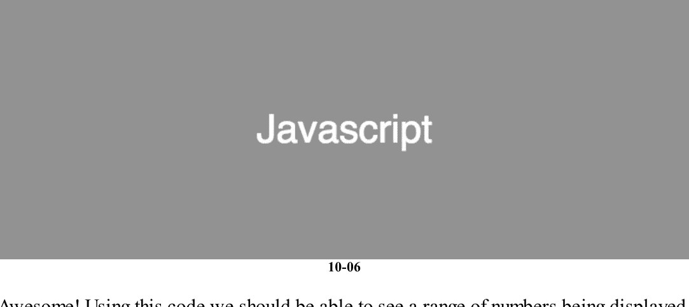

### 10-06

太棒了！使用这段代码，我们应该能在屏幕上看到一系列数字。但我们感兴趣的不是在屏幕上显示数字，而是显示数组中的单词。利用我们的知识，这很容易实现。我们将使用方括号表示法来访问数组中的单个项。

让我们创建另一个名为`currentWord`的变量，它将存储由`currentIndex`变量确定的当前单词。现在，我们可以在`text`函数中使用这个变量来代替`currentIndex`。

```javascript
1 var currentWord = words[currentIndex];
```

我们快完成了。但我想做的另一件事是根据单词更改背景颜色，因为现在的效果在美学上并不理想。

我们将创建另一个名为`colors`的数组，其中包含颜色信息。事实证明，我们可以将一个数组传递给 p5.js 的颜色函数，这与一个接一个地传递值效果相同。

因此，以下这两个表达式将创建相同的颜色。

```javascript
1 fill(255, 0, 0);
2 fill([255, 0, 0]);
```

我们将创建`colors`数组，其中包含我们将要使用的颜色数组。我们可以尝试自己想一些颜色值，但那样很难找到好看的颜色。

Adobe 有一个网页，我们可以在其中找到用于设计的配色方案。我将使用它来为我的可视化效果寻找一个合适的主题：[https://color.adobe.com/](https://color.adobe.com/)

在 explore 选项卡下，一旦我们找到了心仪的主题，就可以点击编辑按钮查看颜色的 RGB 值。我们可以选择自己喜欢的色板。以下是从该网站选择的颜色样本。

```javascript
1 var colors = [
2     [63, 184, 175],
3     [127, 199, 175],
4     [218, 216, 167],
5     [255, 158, 157],
6     [255, 61, 127],
7 ];
```

请注意，我的数据格式略有不同，因为我不希望行长度太长，以免影响代码的可读性。这仅仅是一种风格选择。

现在，我们可以在`fill`函数中使用这些颜色值，在每一帧更改背景颜色。最终代码如下所示：

```javascript
1 var words = ['I', 'love', 'programming', 'with', 'JavaScript'];
2 var colors = [
3     [63, 184, 175],
4     [127, 199, 175],
5     [218, 216, 167],
6     [255, 158, 157],
7     [255, 61, 127],
8 ];
9
10 function setup() {
11     createCanvas(800, 300);
12     textAlign(CENTER, CENTER);
13     frameRate(3);
14 }
15
16 function draw() {
17     var currentIndex = frameCount % words.length;
18     var currentColor = colors[currentIndex];
19     var currentWord = words[currentIndex];
20     background(currentColor);
21     fill(255);
22     textSize(45);
23     text(currentWord, width / 2, height / 2);
24 }
```

## 总结

在本章中，我们学习了一种名为“数组”的 JavaScript 数据结构。数组允许我们以顺序方式存储任何类型的多个值。存储在数组中的值可以使用方括号表示法来访问。

我们可以在创建数组时填充所需的值，或者在创建后使用`push`方法进行填充。

数组在与循环配合使用时尤其有用。循环使我们能够以非常简单的方式访问数组中的项。

我们还学习了**取余**运算符。取余运算符返回两个数相除后的余数。通过这个运算符，我们可以得到在零与期望值之间循环的序列值。

## 练习

构建一个名为`countdown`的函数，该函数接收两个参数：一个数字和一个消息。它将创建一个类似于上文的可视化效果，从给定数字倒计时到 0。倒计时结束后，它应在屏幕上显示给定的消息（即第二个参数）。

你可以自由添加另一个参数来控制每个数字在屏幕上停留的时长。

```javascript
countdown(10, "Launch!");
```

# 11 - 事件

## 简介与 mousePressed

在之前的章节中，我们学习了一个名为`mouseIsPressed`的 p5.js 变量，当鼠标被点击时，它的值为`true`，在其他所有情况下为`false`。

我们还了解到，这并不是捕获用户输入的好方法，因为`draw`函数的执行速度可能使此变量难以可靠地触发。这就是为什么在 p5.js 中有其他处理用户输入的方法，即**事件**，它解决了这个问题。

使用事件，我们可以在`draw`函数循环之外捕获用户输入。

p5.js 中有众多事件函数，我们可以声明它们来利用事件系统。其中一个函数就是`mousePressed`函数。

其思想类似于`draw`和`setup`函数：我们将使用这个特定名称（就像`setup`和`draw`一样）来声明这个函数，p5.js 会以特殊方式处理它。

在 p5.js 代码中，我们声明的名为`mousePressed`的函数会在每次鼠标按钮被点击时触发。让我们重写之前的例子，这次不使用`mouseIsPressed`变量，而是使用`mousePressed`事件函数。

```javascript
var toggle = true;

function setup() {
  createCanvas(800, 300);
  rectMode(CENTER);
}

function draw() {
  if (toggle === true) {
    background(1, 186, 240);
  } else {
    background(250, 150, 50);
  }

  fill(237, 34, 93);
  noStroke();

  var x = width / 2;
  var y = height / 2;
  var size = 200;

  if (frameCount < 60) {
    size = size + frameCount;
  } else {
    size = size + 60;
  }

  ellipse(x, y, size, size);
  fill(255);
  rect(x, y, size*0.75, size*0.15);
}

function mousePressed() {
    toggle = !toggle;
}
```

嗯，这只是一个简单的重构！我们只是声明了一个我们自己并不直接执行的函数。它的执行由 p5.js 在相应动作发生时处理。

还有很多其他事件函数。完整列表可以在 https://p5js.org/reference/#group-Events 找到。

## keyPressed

另一个值得了解的事件函数是`keyPressed`函数。顾名思义，`keyPressed`函数会在每次按键时触发。让我们在一个全新的草图中快速测试一下它的工作原理。

```javascript
function setup() {
    createCanvas(800, 300);
}

function draw() {
    background(220);
}

function keyPressed() {
    console.log('pressed');
}
```

在这个例子中，每次我们按下一个键，都会在控制台看到一条“pressed”消息。让我们看一个更复杂的例子，其中每次按键都会在画布上创建一个形状。

```javascript
var pressed;

function setup() {
    createCanvas(800, 300);
    background(220);
}

function draw() {
    if (pressed === true) {
        ellipse(
            random(width),
            random(height),
            50,
            50
        );
    }
    pressed = false;
}

function keyPressed() {
    pressed = true;
}
```

按下键后，形状被创建。

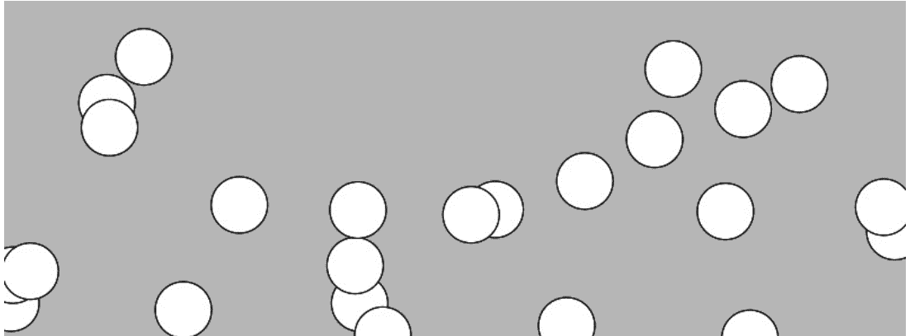

注意几点。首先，我们将`background`函数移到了`setup`函数下面。这是为了确保我们绘制的形状保留在屏幕上。如果我们在`draw`函数内部调用`background`函数，那么它会在每一帧重绘一切，这对于这个用例是不希望的。此外，我们再次将`ellipse`函数调用分布在多行中以提高可读性。

我们有一个名为`pressed`的全局变量。每次按键时，我们都会将此全局变量的值设置为`true`。当这种情况发生时，`draw`函数会向屏幕渲染一个`ellipse`，因为条件语句被执行了。然后`draw`函数立即将`pressed`的值设置回`false`，这样我们只会得到一个椭圆。

我们将稍改进这个例子，使其更赏心悦目。目前，圆圈看起来有点太统一，颜色也有点太单调。我们将使每次创建圆时，它都使用 0 到 200 之间的随机大小，以及从预定义随机颜色列表中选取的随机颜色。

```javascript
var pressed;
var colors = [];

function setup() {
    createCanvas(800, 300);
    background(0);
    colors = [
        [245, 3, 155],
        [13, 159, 215],
        [148, 177, 191],
        [100, 189, 167],
        [242, 226, 133],
        [176, 230, 110],
        [123, 90, 240]
    ];
}

function draw() {
    noStroke();
    if (pressed === true) {
        var randomIndex = parseInt(random(colors.length), 10);
        var randomSize = random(200);

        fill(colors[randomIndex]);
        ellipse(
            random(width),
            random(height),
            randomSize,
            randomSize
        );
    }
    pressed = false;
}

function keyPressed() {
    pressed = true;
}
```

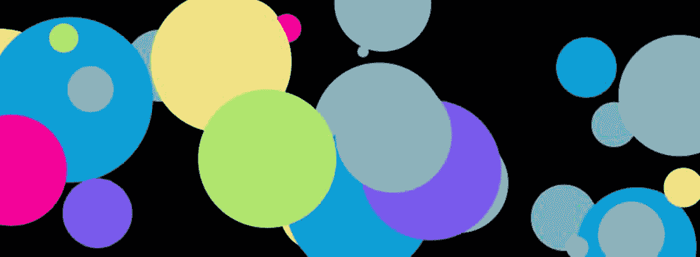

11-02


为了在每次按键时选择一个随机颜色，我们需要生成一个介于 0 和`colors`数组长度减 1 之间的随机整数。减 1 是因为数组索引从 0 开始计数。

要生成任何介于 0 和数组长度减 1 之间的随机数，我们可以简单地将`random`函数写为`random(colors.length)`。这最终会生成一个介于 0 到`colors`数组元素数量（不包括该数字）之间的数字。但问题在于生成的数字是浮点数，意味着它有小数位。而我们需要一个整数才能访问数组中的元素。因此，我们需要将小数转换为整数。有几种解决方法。一种方法是使用 p5.js 的`floor`函数，它将给定的浮点数向下舍入到最近的整数。另一种解决方案是使用名为`parseInt`的原生 JavaScript 函数，该函数将给定值转换为整数——前提是该值可以被转换。我们不能期望扔给它一个名字就能得到一个整数。

我们需要向`parseInt`函数传递第二个参数来设置计算将使用的数字进制。这个进制几乎总是 10。在浮点数上使用`parseInt`函数看起来像这样。

```javascript
var num = parseInt(0.5, 10);
console.log(num); // 结果为 0。
```

不过，识别按下的键只是问题的一部分。另一件我们应该能够做的事情是识别用户按下的具体按钮。在`keyPressed`函数内部，理论上我们可以使用`keyCode`变量来识别按下的任何键。`keyCode`变量以编码方式保存用户最后按下的键。例如，如果用户按下键 'a'，它会返回值 '65'；按下 'b' 则返回 '66'，以此类推...

p5.js 作为一个有用的库，通过提供以下选项的变量使识别某些键变得更容易：`BACKSPACE`、`DELETE`、`ENTER`、`RETURN`、`TAB`、`ESCAPE`、`SHIFT`、`CONTROL`、`OPTION`、`ALT`、`UP_ARROW`、`DOWN_ARROW`、`LEFT_ARROW`、`RIGHT_ARROW`。

例如，下面是一个小的代码片段，每当按下“Enter”键时就执行一条`console.log`语句。

```javascript
function setup() {
    createCanvas(800, 300);
}

function draw() {
    background(220);
}

function keyPressed() {
    if (keyCode === ENTER) {
        console.log('Enter Pressed');
    }
}
```

通过`keyCode`变量，我们可以通过一些解码来识别按下的是哪个字母数字键。但还有另一个变量专门适用于字母数字字符，那就是`key`。`key`变量会直接存储所按下字母数字键的值，因此更容易识别按下了哪个键。

## 总结

在本章中，我们学习了一种更好的事件处理方式，即事件函数。

我们特别关注了两个事件函数：`mousePressed`和`keyPressed`事件函数。

我们还学习了可以在`keyPressed`函数内部使用的一些变量，即`key`和`keyCode`。`key`使得识别字母数字键的按下更加容易，而`keyCode`则非常适合检测其他按键，因为它可以与 p5.js 变量（如`ENTER`、`SPACE`等）进行比较，这使得识别这些按钮变得更容易。

从 JavaScript 的角度来看，我们学习了`parseInt`函数，该函数可用于将类似数字的值（包括表示数字的字符串）转换为整数。

## 练习

在屏幕上绘制一个矩形，使用键盘方向键控制矩形的位置。

# 12 - 更多 p5.js 内容

## 旋转与平移

至此，我们几乎准备好开始最终项目了；一个使用 Javascript 和 p5.js 构建的互动游戏！在此之前，我想再演示几个有用的 p5.js 函数，以扩展我们能够构建的内容范畴。

请注意，我们虽然能用现有知识在屏幕上绘制形状，但无法真正地对它们进行变换，比如绕其中心旋转。这对于我们能构建的视觉效果是一个很大的障碍，所以让我们学习如何在 p5.js 中进行变换，以增强我们的能力。

根据使用其他绘图库的经验，我应该说在 p5.js 中进行缩放、旋转和平移形状等操作可能有点不直观。下面是一个示例，演示如何使用 p5.js 的`rotate`函数来旋转形状。

```javascript
function setup() {
    createCanvas(800, 300);
    rectMode(CENTER);
}

function draw() {
    background(220);
    rect(width/2, height/2, 50, 50);
    rect(width/2+50, height/2+50, 50, 50);
}
```


目前，我们绘制了两个对角放置的矩形。让我们利用`rotate`函数看看会发生什么。

```javascript
function setup() {
    createCanvas(800, 300);
    rectMode(CENTER);
    noStroke();
}

function draw() {
    background(220);
    fill(237, 34, 93);
    rotate(5);
    rect(width/2, height/2, 50, 50);
    rect(width/2+50, height/2+50, 50, 50);
}
```

你会注意到两个形状都从屏幕上消失了。如果你期望形状只移动5度，这结果肯定令人困惑。发生这种情况是因为`rotate`函数在 p5.js 中默认使用的单位是弧度。我们可以通过使用`angleMode`函数配合 p5.js 的`DEGREES`变量，使该函数改用度数。在`setup`函数内部进行此声明。

```javascript
angleMode(DEGREES);
```

现在事情的运作方式或多或少符合预期了。我们可以观察到，当调用`rotate`函数时，函数调用之后的所有形状都会被旋转。

```javascript
function setup() {
    createCanvas(800, 300);
    rectMode(CENTER);
    noStroke();
    angleMode(DEGREES);
}

function draw() {
    background(220);
    fill(237, 34, 93);
    rotate(5);
    rect(width/2, height/2, 50, 50);
    rect(width/2+50, height/2+50, 50, 50);
}
```


另一个需要注意的地方是，旋转是围绕原点（画布的左上角）发生的。然而，在控制形状时，我们通常希望它们绕自身的原点旋转。因此，这个函数本身似乎并不是非常有用。

```javascript
function setup() {
    createCanvas(800, 300);
    rectMode(CENTER);
    noStroke();
    angleMode(DEGREES);
}

function draw() {
    background(220);
    fill(237, 34, 93);
    rotate(5);
    rect(width/2, height/2, 50, 50);
    rect(width/2+50, height/2+50, 50, 50);
}
```

为了能更好地控制`rotate`函数，我们应该研究一下`translate`函数。`translate`函数将对象从原点移动给定的 x 和 y 平移量。让我们在当前的设置中使用它。

```javascript
function setup() {
    createCanvas(800, 300);
    rectMode(CENTER);
    noStroke();
    angleMode(DEGREES);
}

function draw() {
    background(220);
    fill(237, 34, 93);
    translate(150, 0);
    rotate(5);
    rect(width/2, height/2, 50, 50);
    rect(width/2+50, height/2+50, 50, 50);
}
```

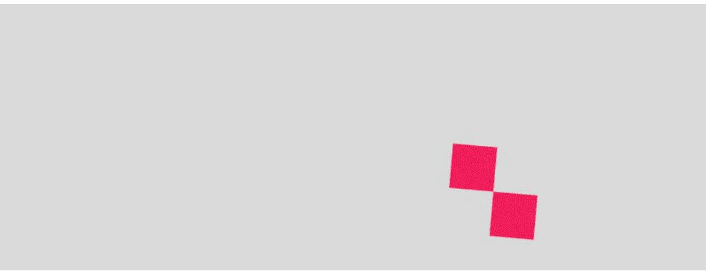

当前发生的情况是，`translate`函数将画布内的所有内容向右移动了150像素。它移动了整个坐标系统，因为旋转也是在原点右侧150像素处发生的，而不是从原点开始。

事不宜迟，下面是如何让形状绕其自身原点旋转的方法。我认为展示如何做比解释它更容易。我们现在将使用单个形状来操作。

```javascript
function setup() {
    createCanvas(800, 300);
    rectMode(CENTER);
    noStroke();
    angleMode(DEGREES);
}

function draw() {
    background(220);
    fill(237, 34, 93);
    translate(width/2, height/2);
    rotate(45);
    rect(0, 0, 100, 100);
}
```


在这个例子中，我们像往常一样绘制形状，但使用`translation`函数来设置其 x 和 y 坐标，而不是直接将这些值输入形状绘制函数。这样做，结合使用`rectMode`函数，允许我们绘制的形状以其自身中心位于原点。基本上，我们从在原点绘制形状开始，因为所有的变换函数都是相对于该点工作的。然后，我们使用`translate`和`rotate`函数将形状移动到所需的位置和角度。使用这种方法，我们需要记住在`translate`函数之后调用`rotate`，否则旋转仍然会相对于原始的原点发生，这可能不是我们想要的。

这种方法以及通用变换函数的当前缺点是，我们从此点开始绘制的所有内容都将使用这个新的原点。解决这个问题的方法是使用`push`和`pop`函数。

## Push 与 Pop

p5.js 的`push`函数允许我们创建一个新的状态，而`pop`函数将状态恢复到之前的条件。这使我们能够为单个对象应用完全不同的设置，而不用担心这些设置会影响之后的形状，只要我们在`push`和`pop`调用之间完成所有操作即可。再次强调，通过示例来看会更容易理解。

根据我们当前的设置，在`translate`和`rotate`函数之后绘制的所有内容都将应用45度的旋转。

```javascript
function setup() {
    createCanvas(800, 300);
    rectMode(CENTER);
    noStroke();
    angleMode(DEGREES);
}

function draw() {
    background(220);
    fill(237, 34, 93);
    translate(width/2, height/2);
    rotate(45);
    rect(0, 0, 150, 150);

    fill(255, 255, 255);
    rect(0, 0, 75, 75);
}
```


让我们在这里实现`push`和`pop`函数，以便我们可以隔离应用于较大矩形的变换。

```javascript
function setup() {
    createCanvas(800, 300);
    rectMode(CENTER);
    noStroke();
    angleMode(DEGREES);
}

function draw() {
    background(220);
    
    push();
    fill(237, 34, 93);
    translate(width/2, height/2);
    rotate(45);
    rect(0, 0, 150, 150);
    pop();
    
    fill(255, 255, 255);
    rect(0, 0, 75, 75);
}
```


太棒了！无论我们在`push`和`pop`函数之间做什么，都不会影响这些函数调用之外的任何其他内容。需要注意的是，我们应该始终同时调用`push`和`pop`函数。只使用其中一个而不使用另一个是没有意义的。

让我们更新示例，以便仍然可以将粉色矩形平移到中间位置，但为其应用不同的旋转值。

```javascript
1 function setup() {
2     createCanvas(800, 300);
3     rectMode(CENTER);
4     noStroke();
5     angleMode(DEGREES);
6 }
7
8 function draw() {
9     background(220);
10
11     push();
12     fill(237, 34, 93);
13     translate(width/2, height/2);
14     rotate(45);
15     rect(0, 0, 150, 150);
16     pop();
17
18     push();
19     fill(255, 255, 255);
20     translate(width/2, height/2);
21     rotate(30);
22     rect(0, 0, 75, 75);
23     pop();
24 }
```

如果你觉得 p5.js 的变换过于复杂，可以尝试构建自己的函数来处理和抽象掉这种复杂性。下面是一个矩形函数示例，它接受第五个参数，即旋转参数。

```javascript
1 function rectC(x, y, width, height, rotation) {
2     if (rotation === undefined) {
3             rotation = 0;
4     }
5     push();
6     translate(x, y);
7     rotate(rotation);
8     rect(0, 0, width, height);
9     pop();
10 }
```

在这里，我们创建了自己的矩形绘制函数`rectC`，它包装了原始的`rect`函数，但使用`push`和`pop`来保存状态和设置变换，并接受一个可选的旋转参数。如果没有提供旋转参数，那么它将假定为`undefined`。如果是这种情况，我可以直接将旋转值设置为 0。下面是使用这个函数重构后的示例。注意这次代码更加简洁。

```javascript
function setup() {
    createCanvas(800, 300);
    rectMode(CENTER);
    noStroke();
    angleMode(DEGREES);
}

function draw() {
    background(220);

    fill(237, 34, 93);
    rectC(width/2, height/2, 150, 150, 45);

    fill(255, 255, 255);
    rectC(width/2, height/2, 75, 75, 30);
}

function rectC(x, y, width, height, rotation) {
    if (rotation === undefined) {
        rotation = 0;
    }
    push();
    translate(x, y);
    rotate(rotation);
    rect(0, 0, width, height);
    pop();
}
```

## 总结

在使用绘图库时，能够对形状进行变换变得非常重要。在本章中，我们了解了 p5.js 变换函数的工作原理。我们学习了`translate`和`rotate`函数。我们还学习了`angleMode`函数，它让我们可以设置`rotate`函数所使用的单位。

然后我们学习了`push`和`pop`函数，并发现它们如何与变换函数结合使用，以隔离状态并将变换应用于单个形状。

学习这些函数对于学习 JavaScript 来说并不是至关重要的，但我发现了解它们在使用 p5.js 时非常必要。

## 练习

在进入下一章之前，试着自己构建一些酷炫的东西，下一章我们将一起构建一个互动游戏！

# 13 - 最终项目

## 让我们构建一个游戏！


在本章中，我们将构建一个游戏，它将运用我们到目前为止所看到的一切。我们还将在此过程中学习一些额外的技巧。我们能够使用`p5.js`库构建一个简单的游戏，这非常令人印象深刻，也很能说明这个库的能力。

我们的游戏将很简单。这是一个打字速度游戏，我们将快速向玩家显示数字，并期望玩家使用键盘输入屏幕上当前的数字。如果他们在给定的时间内输入了正确的数字，他们就得分。我们将记录分数，以便在游戏结束时显示。如果游戏能提供强烈的视觉体验那就太好了，但主要重点将放在正确实现游戏逻辑上。

让我们创建我们需要创建的内容的分解：

- 我们需要每`N`帧在屏幕上显示一个数字。
- 我们不希望数字在屏幕上保持静态。它应该被动画化，以便随着时间的推移变得更容易或更难阅读。
- 该数字需要一直保留在屏幕上，直到显示下一个数字或直到玩家按下某个键尝试匹配该数字。
- 如果玩家输入与屏幕上的数字匹配，我们将显示成功消息。如果不匹配，将指示失败。
- 我们需要记录成功和失败的次数，并在`X`多帧/或尝试之后向用户显示结果。
- 我们需要找到一种方法在游戏结束后重新开始。

## 入门

我们列表中的第一项是能够定期在屏幕上显示一个唯一的数字。请记住，我们之前使用**余数**运算符来实现这一壮举。在这里，我们将每`100`帧在屏幕上显示一个`0`到`9`之间的数字。

```javascript
1 var content;
2
3 function setup() {
4   createCanvas(800, 300);
5   textAlign(CENTER, CENTER);
6 }
7
8 function draw() {
9   background(220);
10  if (frameCount === 1 || frameCount % 100 === 0) {
11    content = parseInt(random(10), 10);
12  }
13  text(content, width/2, height/2);
14 }
```

在这个示例中，我们首先初始化一个名为`content`的全局变量。然后在`draw`函数中，我们在第一帧或每`100`帧使用`random`函数生成一个随机数，并将该值保存在`content`变量中。但`random`函数的问题是：它返回一个浮点数。对于这个游戏的目的，我们希望得到整数。所以我们使用`parseInt`函数将浮点数转换为整数。请记住，`parseInt`函数需要您传递第二个参数来设置运算的基数，这几乎总是数字`10`。

我们将生成的数字存储在一个名为`content`的变量中，然后将该变量传递给`text`函数，使其显示在屏幕中央。

我们将需要屏幕上显示的数字的大量自定义行为；因此我们将创建一个`JavaScript`对象来表示它。这样，我们将创建的用于操作数字的函数，如变换操作、颜色配置等……可以保留在该对象下分组，这有助于程序的组织。我们将这个新对象称为`GuessItem`。我非常清楚这是一个糟糕的名字，但正如他们所说，计算机科学中有两件难事：*缓存失效、命名事物和差一错误*。

如果我们看看在尝试创建包装`p5.js`的`text`函数的`JavaScript`对象之后的代码，我们可能会觉得我们在无缘无故地增加额外的复杂性，因为我们的代码几乎增长了两倍。但是将文本绘制功能包含在一个对象下，将在未来大大帮助组织我们的代码。

```javascript
1 var guessItem;
2
3 function setup() {
4   createCanvas(800, 300);
5 }
6
7 function draw() {
8   if (frameCount === 1 || frameCount % 100 === 0) {
9     background(220);
10    guessItem = new GuessItem(width/2, height/2, 1);
11  }
12
13  guessItem.render();
14 }
15
16 function GuessItem(x, y, scl) {
17   this.x = x;
18   this.y = y;
19   this.scale = scl;
20   this.content = getContent();
21
22   function getContent() {
23     return parseInt(random(10), 10);
24   }
25
26   this.render = function () {
27       push();
28       textAlign(CENTER, CENTER);
29       translate(this.x, this.y);
30       scale(this.scale);
31       text(this.content, 0, 0);
32       pop();
33   }
34 }
```

让我们先关注`GuessItem`对象。`GuessItem`是一个对象创建构造函数，需要三个参数：`x`和`y`位置以及它在屏幕上绘制的形状的缩放比例。它还有两个**方法**。其中一个是`getContent`，它生成一个`0`到`10`之间的随机数，并将其存储在一个名为`content`的属性中。另一个方法是`render`，它在屏幕上显示`GuessItem`对象实例的`content`属性。

`render`方法中的每个操作都位于`push`和`pop`函数调用之下，这使我们能够将该方法内部发生的设置和变换相关的状态更改包含在此对象中。在这里，我们使用`translate`和`scale`变换函数来改变文本对象的位置和大小。我们之前没有见过`scale`函数，但它是一个非常类似于`translate`和`rotate`函数的变换函数。顾名思义，它控制绘图区域的缩放比例，并且具有与其他变换函数类似的工作原理，因此最好将其包含在`push`和`pop`函数之间。

我们可以使用`textSize`函数调用来设置大小，但我通常发现使用变换函数更直观一些。

我们现在将使用这个`GuessItem`构造函数来创建一个绘制到屏幕上的对象。我们在**第10行**用几个参数实例化一个`GuessItem`对象，并将其保存在一个名为`guessItem`的变量中。

```javascript
1 guessItem = new GuessItem(width/2, height/2, 1);
```

`GuessItem`要显示的数字也是在实例化时确定的。使用它的`render`方法在**第13行**将该对象绘制到屏幕上。

```javascript
1 guessItem.render();
```

让我们让文本在其生命周期内逐渐增大，为游戏增添一些动态效果。

```javascript
1 var guessItem;
2
```

```javascript
3 function setup() {
4	createCanvas(800, 300);
5 }
6
7 function draw() {
8	background(220);
9	if (frameCount === 1 || frameCount % 100 === 0) {
10		guessItem = new GuessItem(width / 2, height / 2, 1);
11	}
12
13	guessItem.render();
14 }
15
16 function GuessItem(x, y, scl) {
17	this.x = x;
18	this.y = y;
19	this.scale = scl;
20	this.scaleIncrement = 1;
21	this.content = getContent();
22
23	function getContent() {
24		return parseInt(random(10), 10);
25	}
26
27	this.render = function() {
28		push();
29		textAlign(CENTER, CENTER);
30		translate(this.x, this.y);
31		scale(this.scale);
32		text(this.content, 0, 0);
32		this.scale = this.scale + this.scaleIncrement;
33		pop();
34	}
35 }
```

我们在每次调用`render`函数时添加了一种递增`scale`的方式。

```javascript
1 this.scale = this.scale + this.scaleIncrement;
```

我们还在`GuessItem`构造函数内部添加了一个名为`scaleIncrement`的新变量，用于控制缩放的速度。调整这个值可以改变动画的节奏。例如，我们可以增大这个值使游戏变得更有难度。

我们将为脚本添加更多参数化设置，以便控制数字的显示方式和频率。

```javascript
1 var guessItem;
2 var interval = 100;
3
4 function setup() {
5	createCanvas(800, 300);
6 }
7
8 function draw() {
9	background(220);
```

```javascript
if (frameCount === 1 || frameCount % interval === 0) {
    guessItem = new GuessItem(width / 2, height / 2, 1);
}

guessItem.render();
}

function GuessItem(x, y, scl) {
    this.x = x;
    this.y = y;
    this.scale = scl;
    this.scaleIncrement = 0.5;
    this.content = getContent();
    this.alpha = 255;
    this.alphaDecrement = 3;

    function getContent() {
        return parseInt(random(10), 10);
    }

    this.render = function() {
        push();
        fill(0, this.alpha);
        textAlign(CENTER, CENTER);
        translate(this.x, this.y);
        scale(this.scale);
        text(this.content, 0, 0);
        this.scale = this.scale + this.scaleIncrement;
        this.alpha = this.alpha - this.alphaDecrement;
        pop();
    }
}
```

这里我们做了一些小调整。我们在`render`方法中添加了`fill`函数，现在会对显示的数字动态设置透明度（`alpha`），使其在每一帧中变得更透明。我认为这为游戏增添了动感。将这个值设置得小一些，你会感受到紧张的氛围。我们还使用一个名为`interval`的全局变量对`GuessItem`的创建频率进行了参数化，这样我们可以通过调整这个变量的值来让游戏变得更简单或更困难。

顺便问一下，你能猜到我们为什么把生成数字的函数命名为`getContent`吗？这是因为在这个游戏完成之后，将游戏更新为在屏幕上显示单词而非数字应该是相当简单的事情。保持函数名称的通用性有助于未来可能需要对游戏进行的扩展工作。

到目前为止，我们只完成了待办事项列表中的两项：使用给定的间隔在屏幕上显示数字，以及让数字在屏幕上以动画形式呈现以增加游戏的动感。在下一章中，我们将处理玩家交互。

## 用户交互

我们还有一个待完成的任务：获取用户输入并与屏幕上的数字进行比较。让我们来实现它。

```javascript
var guessItem = null;
var interval = 100;
var solution = null;

function setup() {
    createCanvas(800, 300);
}

function draw() {
    background(220);
    if (frameCount === 1 || frameCount % interval === 0) {
        solution = null;
        guessItem = new GuessItem(width / 2, height / 2, 1);
    }

    if (guessItem) {
        guessItem.render();
    }

    if (solution === true) {
        background(255);
    } else if (solution === false) {
        background(0);
    }
}

function keyPressed() {
    if (guessItem !== null) {
        console.log('you pressed: ', key);
        solution = guessItem.solve(key);
        console.log(solution)
        guessItem = null;
    } else {
        console.log('nothing to be solved');
    }
}

function GuessItem(x, y, scl) {
    this.x = x;
    this.y = y;
    this.scale = scl;
    this.scaleIncrement = 0.5;
    this.content = getContent();
    this.alpha = 255;
    this.alphaDecrement = 3;
    this.solved;

    function getContent() {
        return parseInt(random(10), 10);
    }

    this.solve = function(input) {
        var solved;
        if (input === this.content) {
            solved = true;
        } else {
```

```javascript
57 solved = false;
58 }
59 this.solved = solved;
60 return solved;
61 }
62
63 this.render = function() {
64 push();
65 if (this.solved === false) {
66 return;
67 }
68 fill(0, this.alpha);
69 textAlign(CENTER, CENTER);
70 translate(this.x, this.y);
71 scale(this.scale);
72 text(this.content, 0, 0);
73 this.scale = this.scale + this.scaleIncrement;
74 this.alpha = this.alpha - this.alphaDecrement;
75 pop();
76 }
77 }
```

我们在多个地方更新了代码。为了完成这个任务，我们在`GuessItem`对象上实现了一个名为`solve`的新方法。`solve`方法接收用户输入，并根据给定的用户输入是否与`GuessItem content`变量匹配返回`true`或`false`。最终我们将结果保存在`solution`全局变量中。

```javascript
1 this.solve = function(input) {
2     var solved;
3     if (input === this.content) {
4         solved = true;
5     } else {
6         solved = false;
7     }
8     this.solved = solved;
9     return solved;
10 }
```

为了获取用户输入，我们创建了一个`p5.js`事件函数`keyPressed`，它会在用户每次按下按键时被调用。在这个`keyPressed`函数内部，我们调用了`guessItem`对象的`solve`方法，以检查按下的键是否与`guessItem`的内容匹配。如果匹配，`solution`变量将为`true`，否则为`false`。

```javascript
1 function keyPressed() {
2     if (guessItem !== null) {
3         console.log('you pressed: ', key);
4         solution = guessItem.solve(key);
5         console.log(solution)
6         guessItem = null;
7     } else {
8         console.log('nothing to be solved');
9 }
10 }
```


我们只在存在`GuessItem`时才读取玩家的按键。这是因为一旦玩家做出猜测，我们就会将`guessItem`变量赋值为`null`。这样做实际上是移除了当前的`guessItem`对象。这样可以防止玩家对一个数字进行多次猜测。

由于`guessItem`变量现在可能为`null`（意味着游戏中可能没有待猜测的项目，因为用户已经尝试猜测了它的值），我们对`render`方法的调用可能会失败。为了防止这种情况发生，我们将该`render`调用放在了一个条件语句中。此外，我们在`keyPressed`函数中添加了几个`console.log`函数，以便通过查看控制台消息来了解程序的运行情况。

作为测试手段，我们添加了一个条件语句，当玩家猜错时将背景颜色更改为黑色，猜对时更改为白色，使用`solution`变量来判断。

说了这么多，这段代码目前并不能正常工作。即使猜对了，屏幕也会变成黑色。你能猜到原因吗？

原来原因是`keyPressed`函数将按下的键捕获为*字符串*，而`GuessItem`对象内部生成的内容是*数字*。使用三等号`===`时，我们在检查这两个值之间是否存在严格相等关系，但它们并不相等——数字永远不会等于字符串——因此我们的函数返回`false`。为了修复这个问题，我们将使用 JavaScript 函数`String`将生成的数字转换为字符串。

```javascript
1 function getContent() {
2     return String(parseInt(random(10), 10));
3 }
```

## 保留玩家得分

为了能够向玩家反馈他们在游戏中的表现，我们将开始存储他们的得分。我们将利用这些存储的数据，在达到设定的猜测次数或失败次数后停止游戏。

```javascript
1 var guessItem = null;
2 var interval = 100;
3 var results = [];
4 var solution = null;
5
6 function setup() {
7     createCanvas(800, 300);
8 }
9
10 function draw() {
11     background(220);
```

## 游戏开发笔记

我们创建了一个`results`数组来存储玩家的分数。每次玩家猜对时，我们就在数组中推入一个`true`值；每次猜错时，就推入一个`false`。

```
if (solution) {
    results.push(true);
} else {
    results.push(false);
}
```

我们还应该构建一些功能来获取`results`数组的值并对其进行评估。为此，我们将构建一个名为`getGameScore`的函数。它将获取`results`数组并评估它，以查看当前用户的分数是多少。

```
var guessItem = null;
var interval = 100;
var results = [];
var solution = null;

function setup() {
    createCanvas(800, 300);
}

function draw() {
    var gameScore = getGameScore(results);
    if (gameScore.loss === 3 || gameScore.total === 10) {
        return;
    }
    background(220);
    if (frameCount === 1 || frameCount % interval === 0) {
        solution = null;
        guessItem = new GuessItem(width / 2, height / 2, 1);
    }
    
    if (guessItem) {
        guessItem.render();
    }
    
    if (solution === true) {
        background(255);
    } else if (solution === false) {
        background(0);
    }
}

function getGameScore(score) {
    var wins = 0;
    var losses = 0;
    var total = score.length;

    for (var i = 0; i < total; i++) {
        var item = score[i];
        if (item === true) {
            wins = wins + 1;
        } else {
            losses = losses + 1;
        }
    }

    return {win: wins, loss: losses, total: total};
}

function keyPressed() {
    if (guessItem !== null) {
        console.log('you pressed: ', key);
        solution = guessItem.solve(key);
        console.log(solution);
        if (solution) {
            results.push(true);
        } else {
            results.push(false);
        }
        guessItem = null;
    } else {
        console.log('nothing to be solved');
    }
}

function GuessItem(x, y, scl) {
    this.x = x;
    this.y = y;
    this.scale = scl;
    this.scaleIncrement = 0.5;
    this.content = getContent();
    this.alpha = 255;
    this.alphaDecrement = 3;
    this.solved;

    function getContent() {
        return String(parseInt(random(10), 10));
    }

    this.solve = function(input) {
        var solved;
        if (input === this.content) {
            solved = true;
        } else {
            solved = false;
        }
        this.solved = solved;
        return solved;
    }

    this.render = function() {
        push();
        if (this.solved === false) {
            return;
        }
        fill(0, this.alpha);
        textAlign(CENTER, CENTER);
        translate(this.x, this.y);
        scale(this.scale);
        text(this.content, 0, 0);
        this.scale = this.scale + this.scaleIncrement;
        this.alpha = this.alpha - this.alphaDecrement;
        pop();
    }
}
```

我们的脚本在规模和复杂性上都在增长！这是我们最近添加的函数`getGameScore`。它接收分数变量并对其进行循环，以聚合赢和输的次数，以及猜测的总数。

```
function getGameScore(score) {
    var wins = 0;
    var losses = 0;
    var total = score.length;

    for (var i = 0; i < total; i++) {
        var item = score[i];
        if (item === true) {
            wins = wins + 1;
        } else {
            losses = losses + 1;
        }
    }

    return {win: wins, loss: losses, total: total};
}
```

我们在`draw`函数的开头添加了一个条件，来检查`getGameScore`函数的结果。如果有三次失败或总共十次猜测，条件就会执行一个包含`return`语句的代码块。

```
var gameScore = getGameScore(results);
if (gameScore.loss === 3 || gameScore.total === 10) {
    return;
}
```

任何在`return`语句之后的代码都不会被执行，因为当前循环会终止并开始一个新的循环——只要玩家的分数保持不变，新循环也会终止。

```
if (gameScore.loss === 3 || gameScore.total === 10) {
    return;
}
```

此时我们需要一个重启游戏的机制。首先，我们将构建一个游戏结束时显示的屏幕，以显示玩家的分数并提示玩家按下 ENTER 键重启游戏。其次，我们将使玩家在游戏结束后按下 ENTER 键时，游戏能够重启。

```
var guessItem = null;
var interval = 100;
var results = [];
var solution = null;
var gameOver = false;

function setup() {
    createCanvas(800, 300);
}

function draw() {
    var gameScore = getGameScore(results);
    if (gameScore.loss === 3 || gameScore.total === 10) {
        gameOver = true;
        displayGameOver(gameScore);
        return;
    }
    background(220);
    if (frameCount === 1 || frameCount % interval === 0) {
        solution = null;
        guessItem = new GuessItem(width / 2, height / 2, 1);
    }

    if (guessItem) {
        guessItem.render();
    }

    if (solution === true) {
        background(255);
    } else if (solution === false) {
        background(0);
    }
}

function displayGameOver(score) {
    push();
    background(255);
    textSize(24);
    textAlign(CENTER, CENTER);
    translate(width / 2, height / 2);
    fill(237, 34, 93);
    text('GAME OVER!', 0, 0);
    translate(0, 36);
    fill(0);
    text('You have ' + score.win + ' correct guesses', 0, 0);
    translate(0, 100);
    textSize(16);
    var alternatingValue = map(sin(frameCount / 10), -1, 1, 0, 255);
    fill(237, 34, 93, alternatingValue);
    text('PRESS ENTER', 0, 0);
    pop();
}

function getGameScore(score) {
    var wins = 0;
    var losses = 0;
    var total = score.length;

    for (var i = 0; i < total; i++) {
        var item = score[i];
        if (item === true) {
            wins = wins + 1;
        } else {
            losses = losses + 1;
        }
    }

    return {
        win: wins,
        loss: losses,
        total: total
    };
}

function restartTheGame() {
    results = [];
    solution = null;
    gameOver = false;
}

function keyPressed() {
    if (gameOver === true) {
        if (keyCode === ENTER) {
            console.log('restart the game');
            restartTheGame();
            return;
        }
    }

    if (guessItem !== null) {
        console.log('you pressed: ', key);
        solution = guessItem.solve(key);
        console.log(solution);
        if (solution) {
            results.push(true);
        } else {
            results.push(false);
        }
        guessItem = null;
    } else {
        console.log('nothing to be solved');
    }
}

function GuessItem(x, y, scl) {
    this.x = x;
    this.y = y;
    this.scale = scl;
    this.scaleIncrement = 0.5;
    this.content = getContent();
    this.alpha = 255;
    this.alphaDecrement = 3;
    this.solved;

    function getContent() {
        return String(parseInt(random(10), 10));
    }

    this.solve = function(input) {
        var solved;
        if (input === this.content) {
            solved = true;
        } else {
            solved = false;
        }
        this.solved = solved;
        return solved;
    }

    this.render = function() {
        push();
        if (this.solved === false) {
            return;
        }
        fill(0, this.alpha);
        textAlign(CENTER, CENTER);
        translate(this.x, this.y);
        scale(this.scale);
        text(this.content, 0, 0);
        this.scale = this.scale + this.scaleIncrement;
        this.alpha = this.alpha - this.alphaDecrement;
        pop();
    }
}
```

```javascript
115    function getContent() {
116        return String(parseInt(random(10), 10));
117    }
118
119    this.solve = function(input) {
120        var solved;
121        if (input === this.content) {
122            solved = true;
```


让我们先看看我们在`displayGameOver()`函数中做了什么。这里发生了一些我们之前没有学过的事情。

```javascript
function displayGameOver(score) {
    push();
    background(255);
    textSize(24);
    textAlign(CENTER, CENTER);
    translate(width/2, height/2);
    fill(237, 34, 93);
    text('GAME OVER!', 0, 0);
    translate(0, 36);
    fill(0);
    text('You have ' + score.win + ' correct guesses', 0, 0);
    translate(0, 100);
    textSize(16);
    var alternatingValue = map(sin(frameCount/10), -1, 1, 0, 255);
    fill(237, 34, 93, alternatingValue);
    text('PRESS ENTER', 0, 0);
    pop();
}
```

首先你应该注意到的是，`translate()`函数的调用结果是累加的。如果我们先执行了`width/2, height/2`的`translate()`，然后再执行`(0, 100)`的`translate()`，最终的`translate()`结果将是`width/2, height/2 + 100`。

这段代码中另一个新内容是p5.js的`sin()`和`map()`函数，我们使用它们来创建闪烁的文本。`sin()`函数计算一个角的正弦值。给定连续的值，结果的`sine`值将在-1和1之间交替。不过，在我们的用例中，-1和1作为数值几乎没有用处。如果我们打算使用这个值来设置`fill()`函数的`alpha`（透明度），那么一个在0和255之间交替的值会有用得多。这时`map()`函数就派上用场了。`map()`函数将给定范围（第二个和第三个参数）内的给定值映射到新的给定范围（第四个和第五个参数）中。

```javascript
var alternatingValue = map(sin(frameCount/10), -1, 1, 0, 255);
```

我们将`sin()`函数在-1到1之间的结果映射到了0到255之间。

我们不再是简单地执行`return`语句，而是可以调用这个新函数向玩家显示一条消息。接下来我们实现的是游戏结束后重启游戏的方法。为此，我们需要两样东西。首先，我们需要一种响应`ENTER`键的方法。然后，我们需要重新初始化相关的游戏变量，以营造出新游戏开始的印象。

这是`keyPressed()`函数中响应`ENTER`键的部分。

```javascript
if (gameOver === true) {
    if (keyCode === ENTER) {
        console.log('restart the game');
        restartTheGame();
        return;
    }
}
```

我们使用`keyCode`变量和`ENTER`变量来响应回车键的按下。

`restartTheGame()`函数的内容很简单。它只是重新初始化几个全局范围内的变量，例如用户得分，使其能够重新开始工作。

```javascript
function restartTheGame() {
    results = [];
    solution = null;
    gameOver = false;
}
```

就这样！我们可以通过调整机制和增强游戏的视觉效果来继续优化，使游戏体验更好。但我们已经打好了构成游戏骨架的基础，现在可以根据你的具体需求进一步开发。

## 最终代码

这是最终代码。我决定对我当时开发的版本做一些更新。我决定显示数字的英文单词而不是直接显示数字。我发现这样在视觉上更美观，而且从游戏性的角度来看更具挑战性，因为它增加了一点解析视觉内容的开销。我还向`GuessItem`中添加了一个名为`drawEllipse()`的新方法，用于在屏幕上绘制椭圆并配合单词显示，使游戏在视觉上更具吸引力。最后，我微调了游戏参数以确保时机正确，并添加了在玩家输入正确或错误数字时显示的消息。

```javascript
var guessItem = null;
var interval = 60;
var results = [];
var solution = null;
var gameOver = false;

function setup() {
    createCanvas(800, 300);
}

function draw() {
    var gameScore = getGameScore(results);
    if (gameScore.loss === 3 || gameScore.total === 10) {
        gameOver = true;
        displayGameOver(gameScore);
        return;
    }
    background(0);
    if (frameCount === 1 || frameCount % interval === 0) {
        solution = null;
        guessItem = new GuessItem(width / 2, height / 2, 1);
    }
    if (guessItem) {
        guessItem.render();
    }
    if (solution == true || solution === false) {
        solutionMessage(gameScore.total, solution);
    }
}
```

```javascript
function solutionMessage(seed, solution) {
    var trueMessages = [
        'GOOD JOB!',
        'DOING GREAT!',
        'OMG!',
        'SUCH WIN!',
        'I APPRECIATE YOU',
        'IMPRESSIVE'
    ];
    var falseMessages = [
        'OH NO!',
        'BETTER LUCK NEXT TIME!',
        'PFTTTT',
        ':('
    ];
    var messages;
    push();
    textAlign(CENTER, CENTER);
    fill(237, 34, 93);
    textSize(36);
    randomSeed(seed * 10000);
    if (solution === true) {
        background(255);
        messages = trueMessages;
    } else if (solution === false) {
        background(0);
        messages = falseMessages;
    }
    text(messages[parseInt(random(messages.length), 10)], width / 2, height / 2);
    pop();
}
```

```javascript
function displayGameOver(score) {
    push();
    background(255);
    textSize(24);
    textAlign(CENTER, CENTER);
    translate(width / 2, height / 2);
    fill(237, 34, 93);
    text('GAME OVER!', 0, 0);
    translate(0, 36);
    fill(0);
    text('You have ' + score.win + ' correct guesses', 0, 0);
    translate(0, 100);
    textSize(16);
    var alternatingValue = map(sin(frameCount / 10), -1, 1, 0, 255);
    fill(237, 34, 93, alternatingValue);
    text('PRESS ENTER', 0, 0);
    pop();
}
```

```javascript
function getGameScore(score) {
    var wins = 0;
    var losses = 0;
    var total = score.length;
    for (var i = 0; i < total; i++) {
        var item = score[i];
        if (item === true) {
            wins = wins + 1;
        } else {
            losses = losses + 1;
        }
    }
    return {
        win: wins,
        loss: losses,
        total: total
    };
}
```

```javascript
function restartTheGame() {
    results = [];
    solution = null;
    gameOver = false;
}
```

```javascript
function keyPressed() {
    if (gameOver === true) {
        if (keyCode === ENTER) {
            console.log('restart the game');
            restartTheGame();
            return;
        }
    }
    if (guessItem !== null) {
        console.log('you pressed: ', key);
        solution = guessItem.solve(key);
        console.log(solution);
        if (solution) {
            results.push(true);
        } else {
            results.push(false);
        }
        guessItem = null;
    } else {
        console.log('nothing to be solved');
    }
}
```

```javascript
function GuessItem(x, y, scl) {
    this.x = x;
    this.y = y;
    this.scale = scl;
    this.scaleIncrement = 0.25;
    this.clr = 255;
    this.content = getContent();
    this.alpha = 255;
    this.alphaDecrement = 6;
    this.solved;
    this.contentMap = {
        '1': 'one',
        '2': 'two',
        '3': 'three',
        '4': 'four',
        '5': 'five',
        '6': 'six',
        '7': 'seven',
        '8': 'eight',
        '9': 'nine',
        '0': 'zero'
    };
    this.colors = [
        [63, 184, 175],
        [127, 199, 175],
        [218, 216, 167],
        [255, 158, 157],
        [255, 61, 127],
        [55, 191, 211],
        [159, 223, 82],
        [234, 209, 43],
        [250, 69, 8],
        [194, 13, 0]
    ];

    function getContent() {
        return String(parseInt(random(10), 10));
    }

    this.solve = function(input) {
        var solved;
        if (input === this.content) {
            solved = true;
        } else {
            solved = false;
        }
        this.solved = solved;
        return solved;
    }

    this.drawEllipse = function(size, strkWeight, speedMultiplier, seed) {
        push();
        randomSeed(seed);
        translate(this.x, this.y);
        var ellipseSize = this.scale * speedMultiplier;
        scale(ellipseSize);
        var clr = this.colors[parseInt(random(this.colors.length), 10)]
        stroke(clr);
        noFill();
        strokeWeight(strkWeight);
        ellipse(0, 0, size, size);
        pop();
    }

    this.render = function() {
        push();
        this.drawEllipse(100, 15, 2, 1 * this.content * 1000);
        this.drawEllipse(60, 7, 2, 1 * this.content * 2000);
        this.drawEllipse(35, 3, 1.2, 1 * this.content * 3000);
        pop();
        push();
        fill(this.clr, this.alpha);
        textAlign(CENTER, CENTER);
        translate(this.x, this.y);
        scale(this.scale);
        text(this.contentMap[this.content], 0, 0);
        this.scale = this.scale + this.scaleIncrement;
        this.alpha = this.alpha - this.alphaDecrement;
        pop();
    }
}
```


代码中最大的改动是`solutionMessage`函数，让我们更详细地看看这个部分。之前我们只是根据`solution`变量的值使用`if-else`语句来决定屏幕上显示什么内容。如果`solution`为`true`，我们就显示白色背景；如果`solution`为`false`，我们就显示黑色背景。

现在，如果`solution`是这两个值中的任意一个（`true`或`false`），我们会将其传递给一个名为`solutionMessage`的函数，该函数使用`gameScore.total`作为`random`函数的种子来选择一条随机消息显示。

```javascript
if (solution == true || solution === false) {
    solutionMessage(gameScore.total, solution);
}
```

在`solutionMessage`函数内部，有两个数组，里面包含了一堆消息值，根据`solution`的值来决定显示哪些内容。

```javascript
if (solution === true) {
    background(255);
    messages = trueMessages;
} else if (solution === false) {
    background(0);
    messages = falseMessages;
}
```

我们通过将`random`函数的返回值转换为整数，从这些数组中随机选取一个值。

```javascript
text(messages[parseInt(random(messages.length), 10)], width / 2, height / 2);
```


## 总结

这绝对是一个具有挑战性的例子，它将我们目前为止所学的所有内容都纳入了考验。

令人印象深刻的是，我们仅使用`p5.js`就能构建一个可以在网页上运行、供数百万人游玩的游戏。而且这并不困难；整个程序大约只有 200 行代码。当然，还有改进的空间，比如我们可以根据玩家表现动态调整游戏难度，增加更多视觉效果，以及添加动态计分系统，根据猜测数字所用的时间为正确答案分配不同的分数。游戏可以转换为显示文字而非数字。它可以显示图片，让你输入名称，或者展示需要你回答的计算题。可能性数不胜数！

话虽如此，如果我们想要构建更高级的项目，`p5.js`可能并不是最好的游戏开发平台。一个合适的游戏库会提供诸如资源加载系统、精灵支持、碰撞检测、物理引擎、粒子系统……等功能，而这些在开发高级游戏时往往是必需的。这并不是说你不能用`p5.js`来制作游戏；我们刚刚就证明了这完全可行。只是还有其他专门针对游戏开发的库，而`p5.js`更侧重于创建网页上的交互式动画体验。

# 14 - 结语与下一步方向？

## 恭喜！

完成本书后，你现在应该已经熟悉了`JavaScript`语言的基础知识以及编程的通用概念，因为我们学到的概念广泛适用于不同的编程语言。

想象一下，在学习一门自然语言（如英语）时学习过去时态是什么感觉。英语和日语中构造过去时态句子的结构可能有所不同，但一旦你发现它们之间的对应关系，你对过去时态的概念性理解就能让你更轻松地将知识从一种语言迁移到另一种语言。

在本书中，我们使用`JavaScript`学习了编程语言中的基本结构，如变量、运算符、循环、条件语句、函数、对象和数组。就我个人所接触过的所有编程语言而言，它们都以这样或那样的方式实现了这些概念。它们的语法可能不同，但工作原理非常相似。一般来说，你在一种编程语言中获得的知识高度可迁移到其他语言。

除了`JavaScript`，我们还顺道学习了`p5.js`库。这意味着，如果你想运用新获得的编程知识，你可以非常自如地继续使用`p5.js`。

目前我们知识中缺失的是如何将作品部署到网络上，从而与全世界分享。由于这是一本专注于学习编程的书，我不想让我们被次要的运营性事务分散注意力。但这将是我在未来课程中最终会探索的内容，因为这可能是你想要学习的。

在这一点上，你可能会感到有些受限，特别是如果你想继续打磨在`p5.js`中新学到的技能之外的东西。从这里出发，一个人该走向何方呢？

## 下一步方向？

正如本书开头所提到的，学习`JavaScript`将为你打开一扇机会之门，因为有很多领域可以应用你的知识。下一步去哪里，当然取决于你想在哪个方向提升技能。

如果你想超越`p5.js`，创建面向用户的 Web 应用程序，你肯定需要学习`HTML`和`CSS`的基础知识，以便为你的项目构建图形界面。之后，学习一些`DOM API`会很有用，这样你就能将页面上的界面元素与`JavaScript`命令关联起来。如果你想构建稍微复杂一些的界面，那么`jQuery`可能会有帮助，因为它让使用`JavaScript`处理网页变得更加容易。如果你想构建更高级的界面，其中有很多交互和页面元素之间的状态依赖关系，那么像`AngularJS`这样的前端框架或像`React`这样的库会非常有用。我建议不要急于学习这些工具，尽管它们现在是热门话题。从纯`JavaScript`开始，然后过渡到`jQuery`来构建稍微复杂一些的界面，这将帮助你理解这些更复杂工具被设计来解决的问题。

也许你想做一些服务器端编程。那么你应该学习`Node.js`。服务器端编程可能涉及任何不需要在客户端、浏览器上进行的后端计算，也可能涉及构建与宿主计算机操作系统交互的脚本，以执行诸如创建文件和文件夹、删除它们等操作。`Node.js`脚本不一定需要为 Web 应用程序的后端服务。`Node.js`的主要优势在于，它为你的机器提供了一个环境，而不是在浏览器中运行`JavaScript`。`Node.js`将`JavaScript`从浏览器环境的限制中解放出来。例如，`Electron`。它是一个基于`Node.js`的框架，允许你使用 Web 技术构建原生桌面应用程序。你可以使用`Electron`用`JavaScript`构建 Web 浏览器，而不是在浏览器中使用`JavaScript`构建东西！

自动操作网页、以编程方式连接互联网和抓取在线数据可能是你的兴趣所在。为此，有`Phantom.js`和`Casper.js`。如果你想进行高级数据可视化，那么你应该看看`D3`库。也许你想进入机器人领域，或者使用`JavaScript`编程物联网设备。那为什么不试试`Johnny-Five`呢？你可以使用`JavaScript`构建原生移动应用（`React Native`）、HTML5 游戏（`Phaser`）、数据库（`mongoDB`）、3D 视觉效果和动画（`Three.js`），甚至利用人工智能的认知应用（`IBM Watson`）。

学习新的编程语言时，最好有一个计划：一个你想要构建的愿景。理想情况下，这是一个最小可行项目，你可以在不给自己增加太多工作或技术IoT困扰的情况下启动。达到那个点，然后构建下一个东西。始终在进步，始终在学习新东西。欢迎来到编程的世界。我迫不及待地想看看你会创造出什么。

## 目录

- 关于作者 ······························································································ 7

### 01 - 引言 ···································································································· 8
- 为什么学习编程？ ···················································································· 8
- 编程 vs 开发 ···························································································· 8
- 关于 HTML 和 CSS ······················································································ 9
- 为什么学习 JavaScript？ ·················································································· 10
- 为什么会有不同的编程语言？ ··················································································· 11
- 使用 p5.js 学习 JavaScript ·························································································· 12
- 关于本书 ······························································································· 15

### 02 - 快速入门 ····································································································· 17
- 使用 p5.js 代码编辑器 ······························································································ 17
- JavaScript 简介 ·························································································· 19
- 开始使用 p5.js ·························································································· 23
- 深入了解函数 ··························································································· 25
- p5.js 中的坐标系 ························································································ 28
- 本章小结 ································································································· 31

### 03 - p5.js 中的颜色 ·························································································· 33
- p5.js 中的颜色函数 ····················································································· 33
- 本章小结 ································································································· 36
- 练习 ···································································································· 36

### 04 - 运算符与变量 ······································································································ 38
- 设置 ··········································································································· 38
- 变量 ··········································································································· 40
- 继续探讨变量 ······························································································ 40
- p5.js 中的预定义变量 ······················································································ 43
- 本章小结 ···································································································· 45
- 练习 ······································································································· 46

### 05 - 条件语句与比较运算符 ························································································ 47
- frame、frameRate 和 frameCount ····························································································· 47
- 条件语句 ······································································································ 50
- 本章小结 ······································································································ 55
- 练习 ········································································································· 56

### 06 - 更多 p5.js 变量 ··········································································································· 57
- 简介 ·············································································································· 57
- mouseIsPressed ································································································· 57
- mouseX 和 mouseY ·································································································· 58
- 本章小结 ······································································································ 60
- 练习 ········································································································· 61

### 07 - 循环
- for 循环 ········································································································ 62
- Random 和 Noise 函数 ··················································································· 66
- 本章小结 ···································································································· 70
- 练习 ······································································································· 71

### 08 - 函数
- 创建函数 ··································································································· 72
- 再探 setup 和 draw 函数 ················································································· 75
- 本章小结 ···································································································· 76
- 练习 ······································································································· 76

# 09 - 对象
- 对象简介 ··································································································· 77
- 构造函数 ···································································································· 81
- 本章小结 ···································································································· 84

# 10 - 数组
- 使用数组 ··································································································· 86
- 本章小结 ···································································································· 95
- 练习 ······································································································· 96

# 11 - 事件
- 简介与 mousePressed ··················································································· 97
- keyPressed ···································································································· 98
- 本章小结 ···································································································· 102
- 练习 ······································································································· 102

### 12 - 深入 p5.js
- 旋转与平移 ································································································ 103
- Push 与 Pop ·································································································· 107
- 本章小结 ···································································································· 110
- 练习 ······································································································· 110

# 13 - 最终项目
- 让我们来构建一个游戏！ ··················································································· 111
- 准备工作 ··································································································· 111
- 用户交互 ···································································································· 115
- 记录用户得分
- 最终代码
- 本章小结

### 14 - 结束语与后续学习路径？
- 恭喜你！
- 接下来该学什么？
