# HTML CSS JavaScript 编程简明教程：Web、应用与桌面端


- 言简意赅
- 分步引导
- 基础设置
- 标签入门
- 视频与音频

- 初学者
- 中级学习者
- 实用技巧与专家建议

- 增加交互性
- 屏幕截图
- 模板
- 实例丰富

## 编程：HTML · CSS JAVASCRIPT 轻松上手

学习新的计算语言似乎是一项艰巨的任务，但本书将通过简单明了的分步指南，带您领略 HTML、CSS 和 JavaScript。HTML 和 CSS 仍然是网页的基石，而 JavaScript 则是互联网首选的通用脚本语言。深入了解其细节对于维护成功且用户友好的页面元素非常有益。

本书将助力于中短期项目，例如使用 HTML 和 CSS 定制您的博客或创建自己的网站，并提供 JavaScript 结构、函数和脚本的实际示例。易于遵循的指令将引导您完成网站最重要的部分。您将了解到如何购买自己的 .com 域名，以及如何向网站添加图像和视频。您还将学习处理从简单到复杂数据的步骤，解决应用程序中的 bug，并添加自己的脚本和交互。

在读完这本通俗易懂且简洁的指南后，您将掌握宝贵的知识，帮助您精通这些动态语言。


## 前言

我们生活在一个互联的世界。我们分享新闻、故事和图像；我们最高尚的追求和最阴暗的噩梦（更不用说大量的猫咪照片）以越来越快的速度在全球范围内交织，而我们消费这些无穷无尽的人类思想（和可爱的猫咪照片）的欲望似乎是没有止境的。

所有这些信息的媒介，数据流动的管道——全球文化通过它相互交织并前进的迷人织机——就是互联网。因此，学习使用互联网的语言既能赋予力量，又具有回报。

许多人认为编程很难学；事实并非如此。如果你知道 1 + 2 = 3，并且知道在拿出牛奶之前必须打开冰箱门，那么你就可以编程！

当然，精通任何语言——无论是人类语言还是计算机语言——都需要在较长时间内进行专注的学习。但就像学习足够的法语以便在巴黎度假时与当地人交流一样简单，掌握大多数计算机语言的基础知识同样容易。

互联网的语言——HTML、CSS 和 JavaScript——是人们可以学习到的最简单的语言，同时也是最有用且最普遍的。本书仅是对这些语言的介绍，但它将赋予您从零开始创建自己充满活力且令人兴奋的网站的能力。

不要害怕，这很简单。翻开下一页，亲身体验吧...

**Adam Crute**


## 引言

如今，从爱好者到大企业，人人都在使用互联网。如果你想推广自己、宣传产品，或者仅仅想让人们了解你的热情所在，网站为你打开了一扇通向世界的窗口。它是了解任何事物详细信息的首选去处。

## HTML 与 CSS

现在你明白了为什么需要一个网站，那么该如何构建它呢？每个网站背后的核心技术就是 HTML（超文本标记语言）和 CSS（层叠样式表）。本书将详细揭示它们的工作原理、能实现的功能，更重要的是，向你展示如何创建你自己的网站。

```
<!DOCTYPE html>
<html><head>
<title>The Coffee Shop - The best coffee in your town</title>
<link href=
'http://fonts.googleapis.com/css?family=Lato:400,900,700,300' rel=
'stylesheet' type='text/css'>
<style>
body {
font-family: Lato, Arial, Helvetica, sans-serif;
font-size: 14px;}

#wrapper {
height: auto;
width: 1000px;
margin-right: auto;
margin-left: auto;}

</style>
</head>

<body>
<div id="wrapper">
<header>
<nav>Home | About Us | Contact</nav>
<h1>THE COFFEE SHOP</h1>
<h2>The best coffee you will find in your town</h2>
</header>

<section>

<h3>Welcome to The Coffee Shop</h3>
<p>Lorem ipsum dolor sit amet, consectetur adipiscing elit. Duis
consequat ac urna a tincidunt. Vivamus dictum id magna quis
ullamcorper. Integer sollicitudin quam eget est sodales, vitae
fringilla mauris aliquet. Duis auctor lacinia nisl, at rh redeund sollicitudin quam eget est sodales</p>
```

上图：学习如何将代码变为网络瑰宝；创建你自己的网站可能并不像你最初想象的那么难。

## 进阶学习

本书的建议不止于简单地创建网站：你将学习如何将你的网站发布到互联网上，了解如何购买你自己的 .com 域名，使用 WordPress 创建博客，探索一些高级的 CSS 技巧，并学习简单的 JavaScript 语言。

## 分步讲解

构建网站和学习新语言的过程可能看起来像一项艰巨的任务。但本书迎接了这一挑战，并通过一系列分步指南来演示整个过程。这些指南提供了易于遵循的说明，将引导你掌握网站构建中一些最重要的模块。

## 专家指导

万一遇到计划外的情况，我们实用的故障排除指南将帮助你重回正轨，而我们的延伸阅读指南则会为你指明下一步的学习方向。

## 代码示例

在展示 HTML、CSS 和 JavaScript 代码示例时，我们将使用类似这样的文本样式。当我们想表明某处应使用代码块但未在示例中展示完整代码时，我们会同时将文本加粗，像这样：`header` **{样式规则}**。你不会在代码中输入“样式规则”——这只是向你展示样式规则应放置的位置。

> **实用提示**

除了那些较为详尽的分步指南外，还有一系列“实用提示”指南。它们提供了快速、便捷的技巧，以及为最终网站增添亮点的建议。

## JavaScript 的发展历程

JavaScript 语言自万维网诞生之初就与我们相伴。在早期，它只是众多语言和技术中的一员，与其他技术一起争夺着 Web 开发社区的关注和推广。

## 通用语言

多年来，许多类似的技术曾风靡一时，后又因种种原因失宠，但 JavaScript 并非如此。很大程度上得益于其灵活性和无处不在的特性，JavaScript 如今已成为互联网的主要脚本语言。

## 超越 HTML/CSS

尽管 JavaScript 有时显得深奥难懂，但它是学习编码入门的绝佳语言。本书面向那些对编写代码和编程相当陌生的人。你可能对 HTML、CSS 和 JavaScript 完全陌生；或者你已经花了一些时间学习 HTML 和 CSS，想要温故知新并了解 JavaScript；又或者你可能尝试过一点脚本编写，想要将这些知识系统化并加以扩展。你甚至可能是一位从未使用过 JavaScript 的经验丰富的程序员，想要快速概览以入门。

## 首选入门读物

不可否认，JavaScript 是一门深奥的学问，深奥到没有任何一本书能告诉你关于这门语言及其所有功能的全部内容。因此，本书的目标是提供关于 JavaScript 语言的全面概述，让你获得足够的理解，能够在页面中添加自己的简单脚本和交互功能。它也完全适合作为进一步学习 JavaScript 编程的入门读物。

## 在线示例

你可以下载 JavaScript 代码示例的完成版本及附加说明。请访问 www.flametreepublishing.com/book-samples.html 进行下载。

#### 实用提示

留意书中的“实用提示”，它们将为你提供关于 JavaScript 中众多可用快捷方式和快速技巧的有用建议。

## 全面解析 HTML 与 CSS

## HTML 简介

HTML 是构建网站、Web 应用以及任何通过网络交付的内容的最重要组成部分。但它是什么，又有什么作用呢？

### 什么是 HTML？

HTML，全称超文本标记语言，是所有网站构建的框架。如果把网站比作一座房子，那么 HTML 就是砖块和砂浆。

HTML 由 **元素** 组成，即我们假设中房子的砖块。每个元素以被称为 **标签** 的东西开始和结束——可以将其视为砂浆。有许多不同的元素，每个元素都有其特定的预期用途。例如，video 元素用于——你能猜到吗？——是的，用于在网页上放置视频。当你的元素选择以适当的顺序组合在一起时，你就有了一个网页！

```
1 <h1>HTML is a collection of elements</h1>
2 <h2>These elements are demarcated by tags</h2>
3 <p>Each element has a name - it is included in the tag</p>
4 <p>Whatever appears between the opening and closing tags is the content of the element</p>
5
```

上图：HTML 由元素组成，并由标签分隔

### HTML 长什么样？

HTML 不过是纯文本。如果我们创建上述的 video 元素，我们会写一个 **开始标签** `<video>` 和一个匹配的 **结束标签** `</video>`。如你所见，开始标签以 '<' 开头，声明元素名称，然后以 '>' 结束。结束标签遵循相同的模式，但我们在元素名称前插入了一个 '/'。当网页浏览器遇到这个元素时，它会在页面上创建一个视频播放器。很简单，对吧？

### 元素里面有什么

那么，那些标签之间是什么呢？在大多数情况下，答案是文本和/或其他元素。这意味着 HTML 具有元素内嵌套元素的层次结构。顺便提一下，许多开发者会缩进代码行以反映这种嵌套结构。

```
<!DOCTYPE HTML>

<html>

  <head>
    <title>My Page</title>
  </head>

  <body>
    <header>
      <h1>A Page All About Me</h1>
    </header>

    <section>
      <h2>What I'm thinking now</h2>
      <p>Lorem ipsum dolor sit amet, consectetuer adipiscing elit. Sed sagittis ante malesuada velit. Curabitur suscipit. Suspendisse quis nibh aliquam sem pulvinar sollicitudin. Etiam venenatis. Curabitur luctus.</p>
      <p>Nunc venenatis lacus molestie sapien. Maecenas elementum al (∃) velit. Ut eget mauris sed leo scelerisque lacinia. Nunc arcu magna, mollis id, ornare ac, pharetra sit amet, purus. Aliquam luctus consectetuer dolor.</p>
    </section>

  </body>

</html>
```

**上图：** 缩进代码行可以突出显示元素的嵌套结构。


 # 修改元素

虽然所有 HTML 元素都有其预定的用途，但几乎所有元素都可以通过各种方式进行修改。例如，我们可能想要改变视频播放器的尺寸或标题的字体大小。

元素是通过调整元素的**属性**（attributes）来修改的，这在起始标签中完成：

```
<video width="720" height="360">
```

如你所见，属性名称在起始标签内声明，后面跟着 '='，然后是一个包裹在引号内的**值**（value）。

### HTML 的组成部分

- **元素（Element）：** HTML 的基本构建块。
- **标签（Tag）：** 定义一个元素的开始和结束。
- **属性（Attribute）：** 修改元素的行为和外观。

> 实用技巧

在 HTML 中使用引号时，你可以使用单引号 ' 或双引号 "，但关键是要保持一致。

```
<video width="640" width="360" src="vids/introvid.mp4"> </video>
<section lang="en">
    <article id="article_01">
        <h2 class="underlinedText">Lorem ipsum dolor sit amet</h2>
        <p class="redText">Sed sagittis ante malesuada velit. Curabitur suscipit.</p>
    </article>
</section>
```

上图：属性允许你修改元素。

# 使用样式进行修饰

在旧版本的 HTML 中，存在大量不同的属性用于控制元素的视觉外观。此外，不同元素识别的属性集差异极大。记住所有这些含义和变体简直是一场噩梦，因此 style 属性应运而生。

## 遵守规则

分配给 style 属性的值被称为**样式规则**（style rule），它由一个或多个**样式命令**（style commands）组成。一个样式命令是由一个**样式属性**（style property）及其要应用到该属性的值组成的配对，例如：

```
<body style="color:green; font-weight:bold;">.
```

每个样式属性名称（本例中的 `color` 和 `font-weight`）后面跟着一个冒号 ':'，然后是分配给该属性的值，最后是一个分号 ';'。

```
    <body>

        <header style="font-size:18px; color:blue;">
            <h1 style="font-weight:bold;">HTML and CSS Basics</h1>
            <h2 style="font-size:14px;">Learn the language of the Internet</h2>
        </header>

        <video width="640" width="360" src="vids/introvid.mp4"></video>
```

上图：style 属性允许你为元素添加内联样式。


# CSS 简介

如果说 HTML 是房子的砖块和水泥，那么 CSS 就提供了装修。这种语言虽然简单但功能强大，如果没有它，你的网页看起来会非常糟糕。

## 什么是 CSS？

我们已经研究过如何在元素的 style 属性中添加样式规则。这被称为**内联**（Inline）样式——它虽然有效，但有一个固有问题：如果你想更改所有文本标题的字体，你必须修改每个标题元素中出现的 `font-family` 样式属性。这就是 **CSS** 发挥作用的地方。

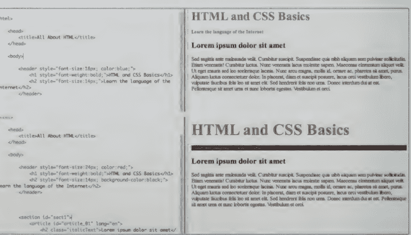

**上图：** 修改内联样式规则可能是一个繁琐的过程。

CSS 代表层叠样式表（Cascading Style Sheets）。它提供了将页面内容与页面外观分离的手段，并能一次性将一条样式规则应用于多个元素。其一个关键好处是，对 CSS 样式规则所做的任何更改都将影响所有与该规则关联的元素。

```
header {
    position:relative;
    width:1024px;
    height:130px;
    margin:0px auto 0px auto;
    padding:0px;
    background-color:#778081;
    border:none;
    border-bottom:2px solid #FD5F12;
}

nav {
    position:relative;
    width:788px;
    height:30px;
    margin:0px auto 0px auto;
    padding:0px 118px 0px 118px;
    background-color:#D9D9D9;
    border:none;
    border-bottom:1px solid #FD5F12;
}
```

上图：CSS 代码由选择器和样式规则组成。请注意，代码缩进有助于提高可读性。

### 选择器的选择

选择器可以有多种不同的形式，但在本书中，我们仅关注三种：**类型**（Type）、**ID** 和 **类**（Class）选择器。其中最简单的是类型选择器（我们稍后会讨论其他选择器）。它仅仅由接收该选择器样式规则的 HTML 元素名称组成。例如，`p` 选择器将目标定为所有 `<p>` 元素实例。


### CSS 长什么样？

与 HTML 一样，CSS 是具有特定结构的纯文本。CSS 代码由**选择器**（selectors）组成，选择器用于标识随后样式规则将应用于哪些 HTML 元素。样式规则本身被包裹在大括号 '{' 和 '}' 中。


### 为什么叫“层叠”？

编写 HTML 时，我们会创建一种嵌套结构，其中每个元素都嵌套在另一个元素中。这意味着每个元素都有一个**父**（parent）元素——即该元素所在的嵌套元素——而大多数元素拥有**子**（child）元素，即嵌套在给定元素内部的元素。

```
12  
13  
14   <section>
15      <h3>Lorem Ipsum</h3>
16   </section>
17  
18  
```

当 Web 浏览器在网页中**渲染**（绘制）一个元素时，它需要评估该元素应应用哪条样式规则。但如果它正在渲染一个显示文本的元素（如 `<h3>`），但在应用于该元素的样式规则中未定义 `font-family` 属性，浏览器如何决定使用哪种字体？答案是：它会查找父元素并从中复制 `font-family` 属性。

> **上图：** HTML 的嵌套结构是通过继承关系来表达的。在这里，`<h3>` 是 `<section>` 的子元素，而 `<section>` 是 `<h3>` 的父元素。

如果父元素也缺乏特定的样式属性，那么该属性将从父元素的父元素中继承，以此类推。最终，我们得到了一个样式属性的“层叠”：应用于一个元素的属性将被该元素的子元素继承，除非子元素使用自己的新规则明确覆盖它。当这种情况发生时，新规则的属性将被传递到继承链中。

> 实用技巧

CSS 的结构很简单，但请注意：CSS 对错误是不宽容的。

### CSS 的组成部分

- **选择器（Selector）**：目标化样式规则将应用于的 HTML 元素。
- **样式命令（Style command）**：指定一个样式属性并为其分配一个值（也称为“属性-值对”）。
- **样式规则（Style rule）**：一组样式属性及其相关值的集合。

右图：一个包含多个选择器和样式规则的完整 CSS 样式表。

```
body {
    position:relative;
    background-color:#FDF12;
    margin:0px;
    padding:0px;
    width:100%;
    height:100%;
}

#pageBgFill {
    position:fixed;
    width:1024px;
    left:0px;
    right:0px;
    top:0px;
    bottom:0px;
    margin:0px auto 0px auto;
    background-color:#D9D9D9;
}

header {
    position:relative;
    width:1024px;
    height:130px;
    margin:0px auto 0px auto;
    padding:0px;
    background-color:#778081;
    border:none;
    border-bottom:2px solid #FDF12;
}

nav {
    position:relative;
    width:788px;
    height:30px;
    margin:0px auto 0px auto;
    padding:0px 118px 0px 118px;
    background-color:#D9D9D9;
    border:none;
    border-bottom:1px solid #FDF12;
}
```

# 核心元素

正如我们所学，HTML 文档由一个元素结构组成，每个元素承担一定的角色。该文档就像一套给 Web 浏览器的指令，告诉它在什么地方绘制什么。让我们看看所有文档所需的核心元素。

## DOCTYPE 声明

目前有几种不同的 HTML 方言在被使用——最现代的 HTML5 和 XHTML。本书仅关注前者，所以简单来说：

```
<!DOCTYPE HTML>
```

上图：所有 HTML 文档都以 DOCTYPE 声明开始；这是 HTML5 的声明。


XHTML 确实存在，并且与 HTML5 并没有太大差异——事实上，如果你不知道该留意什么，你很难注意到它们之间的区别！

然而，*浏览器*必须能够区分两者，以便知道如何渲染页面。为此，**所有** HTML 文档都以 **DOCTYPE** 声明开头。HTML5 的声明为 `<!DOCTYPE HTML>`。这个易于记忆的声明必须出现在你创建的每一个 HTML5 网页的顶部。

## HTML 元素

如果所有元素都有父元素，那么在链条的某个地方一定存在一个祖先或起点；这就是特殊的 `<html>` 元素。所有 HTML 文档都包含一个——并且只有一个——这样的元素。构成网页的所有其他元素都嵌套在这个 `<html>` 元素中。

```
1 <!DOCTYPE HTML>
2
3 <html>
4
5 </html>
6
7
8 |
```

**上图：** 所有 HTML 文档都包含一个 `<html>` 元素：不多也不少。

```
<!DOCTYPE HTML>

<html>

    <head>

    </head>

    <body>

    </body>

</html>
```

## HEAD 和 BODY 元素

特殊的 `<html>` 元素始终有两个子元素，不多也不少：`<head>` 和 `<body>`，按此顺序排列。没有这两个元素，网页将无法正常工作（甚至可能完全无法运行）。

`<head>` 元素包含有关网页的信息，例如其标题（显示在浏览器窗口顶部）、搜索列表中将出现的文本、指向其他资源的链接等等。`<head>` 中的任何内容都不会被渲染到网页的可见部分中。

`<body>` 元素负责页面的实际可见内容，即在已渲染的网页上产生视觉输出的元素。通常你会按照元素在屏幕上出现的布局顺序将它们添加到 `<body>` 中。

**上图：** `<html>` 元素始终包含一个 `<head>` 和一个 `<body>` 元素。

## 代码注释

几乎所有编程语言都提供了在代码中添加**注释**的功能，HTML 也不例外。它们的主要用途是在文档中添加注释、说明和备忘，所有这些都会被浏览器忽略。如果你正在开发一个大型网站和/或与其他开发者协作，注释尤其重要。因此，最佳实践是大量且自由地使用注释——如果你需要重新审视几个月前编写的页面，你会庆幸自己这样做了。HTML 注释如下所示：

> 使用注释可以禁用一行或一段代码，而不必将其完全删除。这在尝试各种想法或调试时非常有帮助。

```
<!-- This is an HTML comment -->
```

```
5   <head>
6
7       <!--TO DO: Come up with a better title for the page -->
8       <title>My Page</title>
9   </head>
10
11  <body>
12      <header>
13          <h1>A Page All About Me</h1>
14      </header>
15
16      <section>
17          <h2>What I'm thinking now</h2>
18
19          <!-- Placeholder text...-->
20          <p>Lorem ipsum dolor sit amet, consectetuer adipiscing elit. Sed sagittis ante malesuada velit.
Curabitur suscipit. Suspendisse quis nibh aliquam sem pulvinar sollicitudin. Etiam venenatis. Curabitur
luctus.</p>
21
22          <!--This next element is 'commented-out' -->
23
24          <!--<p>Nunc venenatis lacus molestie sapien. Maecenas elementum cliquet velit. Ut eget mauris sed
leo scelerisque lacinia. Nunc arcu magna, mollis id, ornare ac, pharetra sit amet, purus. Aliquam luctus
consectetuer dolor.</p>-->
25
26      </section>
27
28  </body>
29
```

**上图：** 注释非常宝贵；越多越好！

## 如何使用 CSS

在更深入地探讨 CSS 之前，我们需要先确定如何将其包含在 HTML 文档中。有两种方法可以做到这一点。

### 内嵌样式表

**内嵌**样式表是指所有的选择器和样式规则都出现在其所应用的 HTML 文档的 `<head>` 元素中的样式表。这是通过在页面的 `<head>` 元素中创建一个 `<style>` 元素（或在某些情况下创建多个）来实现的。

然后你在这个 `<style>` 元素中输入所需的选择器和样式规则。这种方法的优点是将页面的所有代码——HTML 和 CSS——保存在单个文件中，但对于包含多个页面的较大网站来说，可能会变得难以管理。

```
<head>
    <title>My Page</title>
    
    <style>
        body {
            font-family: Arial, Helvetica, sans-serif;
            font-size: 14px;
            color: black;
        }
        h1 {
            font-size: 24px;
            font-weight: bold;
        }
        h2 {
            font-size: 18px;
            font-weight: bold;
            color: gray;
        }
        p {
            margin-top: 6px;
            margin-bottom: 6px;
        }
    </style>
    
</head>
```

### 外部样式表

使用**外部**样式表时，CSS 代码写在一个单独的文件中，然后链接到你希望应用该样式表的任何 HTML 文档。CSS 文档只是一个纯文本文件，通常以 '.css' 文件扩展名保存。

**上图：** 内嵌样式表嵌套在文档的 `<head>` 中。

#### 将 CSS 文档链接到 HTML 文档

外部样式表通过放置在页面 `<head>` 中的 `<link>` 元素与 HTML 页面关联：

```
<link type="text/css" rel="stylesheet" href="myCssDocument.css" />
```

请注意，此元素的标签没有配对的结束标签，而是在最后的尖括号前包含了一个 '/'。这通常被称为自闭合标签或自闭合元素；之所以自闭合，是因为没有其他元素可以嵌套在其中。

```
4  <head>
5    <title>My Page</title>
6    <link rel="stylesheet" type="text/css" href="css/siteStyles.css" />
7  </head>
```

**上图：** 外部样式表通过 `<link>` 元素与网页关联。

有几个属性需要设置：`type` 和 `rel` 属性告知浏览器目标文档中预期的数据类型——始终使用上图所示的设置。`href` 属性定义了 CSS 文档本身的位置和名称。通常它与网页位于同一服务器上，但通常在 `site root` 的子文件夹中。顺便说一下，大多数服务器上的站点根文件夹名为 `wwwroot`。

> **实用提示**
> 一个网站由文件和文件夹的层级结构组成，就像你电脑中的硬盘一样。这个层级结构的顶层被称为站点根目录。

**下图：** CSS 文档通常存储在网站根文件夹的子文件夹中。

#### 外部样式表的优势

外部样式表在你构建完整网站时真正发挥其优势，因为在这样的网站中，构成网站的各个页面共享统一的外观和感觉是很常见的。因为外部样式表可以链接到任意数量的 HTML 页面，它们提供了一个中心点，你可以通过它来修改和调整整个网站的视觉设计。

```css
/* Application: CSS (C) Penny... */

/*
   PAGE STRUCTURE SELECTORS
   ------------------------
*/
body {
    position: relative;
    background-color: #FDF512;
    margin: 0px;
    padding: 0px;
    width: 100%;
    height: 100%;
}
#pageBgFill {
    position: fixed;
    width: 1024px;
    left: 0px;
    right: 0px;
    top: 0px;
    bottom: 0px;
    margin: 0px auto 0px auto;
    background-color: #090909;
}
header {
    position: relative;
    width: 1024px;
    height: 130px;
    margin: 0px auto 0px auto;
    padding: 0px;
    background-color: #770001;
    border: none;
    border-bottom: 2px solid #FDF512;
}
nav {
    position: relative;
}
```

**上图：** 外部样式表可以在多个页面之间共享，非常适合页眉等公共元素。

### 多个样式表

一个 HTML 文档可以链接到多个样式表。这允许你将选择器和样式规则按逻辑分组排列，每组保存在不同的 CSS 文件中。然后你只需将页面链接到它所需的样式表即可。

也可以在同一文档中混合使用内嵌和外部样式表：与文档本身相关的样式规则可以内嵌，而全站范围的样式规则可以从外部样式表中获取。


请注意，使用多个样式表会增加将冲突值应用于元素样式属性的风险，因此如果某个元素的显示效果不符合预期，值得深入排查以确定问题样式规则的实际来源。

### 应用样式的几种方式

- **内联样式**：在元素的 `style` 属性中声明样式规则。
- **嵌入样式**：将 CSS 代码编写在 HTML 文档 `<head>` 部分的 `<style>` 元素内。
- **外部样式**：将 CSS 代码编写在独立的文本文件中，并通过 `<link>` 元素与 HTML 文档关联。

```html
5   <head>
6       <title>My Page</title>
7
8       <link rel="stylesheet" type="text/css" href="css/siteStyles.css" />
9
10      <style>
11          body {
12              font-family: Arial, Helvetica, sans-serif;
13              font-size: 14px;
14              color: black;
15          }
16          h1 {
17              font-size: 24px;
18              font-weight: bold;
19          }
20          h2 {
21              font-size: 18px;
22              font-weight: bold;
23              color: gray;
24          }
25          p {
26              margin-top: 6px;
27              margin-bottom: 6px;
29          }
30      </style>
31
32  </head>
33
34  <body style="margin-left:20px; margin-right:20px">
35  !
36      <header>
37          <h1>A Page All About Me</h1>
38      </header>
```

*左图：将 CSS 样式规则应用于 HTML 元素的三种方法。*

## HTML5 的新特性

HTML5 仍然是 HTML，它只是该语言的最新版本。它包含许多在以前版本中出现的元素，同时也引入了一些新元素和新规则。通常，当人们使用“HTML5”这个术语时，指的就是这些新特性。

### 语义化元素

HTML5 的目标之一是为语言引入清晰一致的语义，使元素名称能够传达该元素的用途及其在文档逻辑结构中的位置。

> **实用建议**
> 语义化元素对于辅助视障人士进行网页浏览的屏幕阅读器应用程序尤其有帮助。

**如上所述：** HTML5 非常重视语义。

因此，它包含了一套满足此语义需求的新元素，例如 `<header>`、`<video>`、`<article>` 和 `<footer>`。这些元素名称直接传达了它们的用途，这正是它们具有语义性的原因。

### 新功能

HTML5 为网页引入了许多以前需要第三方插件（如 Adobe Flash Player）安装在终端用户浏览器上才能实现的新功能。这些新功能让开发者眼前一亮，因为它们大大简化了添加功能的过程，例如拖放、Web 表单、视频、音频、“实时”图形（包括 3D）等等。

**如上所述：** HTML5 在移动设备上表现出色。

#### 更适合移动端

许多流行的浏览器插件无法安装在移动操作系统上。HTML5 通过消除对许多此类第三方插件的需求解决了这个问题，因此，如果你预计你的网页将在移动设备上被浏览，那么 HTML5 是唯一的选择。

## 什么是 CSS3？

CSS3 仍然是 CSS；它只是该语言的最新版本。这个第三个主要版本带来了一些重要的增强功能，使语言比以前更加强大。

### 视觉效果

CSS3 的主要进步之一是其能够应用以前需要在 Adobe Photoshop 等图像编辑器中才能制作的视觉效果，如投影或模糊。提供的效果虽然相当基础，但对开发者来说简直是天赐之物，他们无需在 HTML 编辑器和图像编辑器之间来回切换，只需为图形添加一点阴影。

**如下所示：** 一个简单的 CSS 投影示例。

### 更好的背景

另一个巧妙的 CSS3 特性是 `background-size`。这是一个 CSS 属性，允许背景图像（这些是位于 HTML 元素背景中的图像）根据需要自动缩放。通过为此属性分配一个值，例如 `cover`，图像将填满元素的背景：简单而有效。

> **实用建议**
> 仅仅因为你能做某事，并不意味着你必须做：过多的视觉装饰可能像过少一样令访客反感。

### 动画

CSS 当前的热门领域是动画。以前，在没有第三方插件或大量脚本（或两者兼有）的帮助下，浏览器无法实现动画，但现在设计师和开发者只需使用 CSS 代码就能创建流畅且令人印象深刻的动画。更多内容请参阅第 106 页。

**如下所示：** 请查看这个令人印象深刻的 CSS3 动画 http://codepen.io/julianarmier/pen/idhuG

## 理解 HTML 和 CSS 的益处

**HTML 和 CSS 无处不在，即使在 Web 开发之外也广泛使用。因此，掌握这两种语言可以给你带来显著的专业优势。**

### 成为专家

如今，大多数公司都有某种形式的网站，但许多公司缺乏内部技能来正确支持和维护他们的网站。因此，具备承担此类角色的能力可以使你成为无价之宝，尤其是在小型企业中。

**如下所示：** *深入掌握 CSS 意味着更好的网站。*

### 变化，变化，再变化

除了使你能够解决网页问题外，扎实的 HTML 和 CSS 基础还为你提供了修改网站的知识，并确信你不会在此过程中破坏网站。

### 跟上潮流

网页设计的图形方面深受当前时尚和潮流的影响。能够让你的网站紧跟当前潮流，可以确保它始终看起来现代而时尚，有助于你增加访客数量。

### 更快的网站

能够为正确的工作识别正确的 HTML 和 CSS，可能意味着为访客提供流畅敏捷体验与缓慢挫败体验之间的区别……猜猜他们更喜欢哪一种！

**如上所述：** 调整你的网站使其更快以吸引更多访客。

## 我们学到了什么

- **HTML**：超文本标记语言；用于构建网页。
- **CSS**：层叠样式表；用于设置网页样式。
- **元素**：HTML 的基本构建块。
- **标签**：标记元素的开始和结束。
- **属性**：提供修改元素行为和外观的手段。
- **样式属性**：为给定的 CSS 属性赋值。
- **样式规则**：样式的集合。
- **选择器**：指定样式规则将应用于哪些 HTML 元素的 CSS 组件。
- **内联样式**：通过元素的 `style` 属性附加到单个元素的样式规则。
- **嵌入式样式表**：通过选择器分组的一组样式规则；位于 `<style>` 元素内。
- **外部样式表**：通过选择器分组的一组样式规则；位于单独的文本文档中。

**如上所述：** 各种组件结合在一起构成一个完整的网页。

```html
<html >
<head>
  <title>Homepage</title>
</head>
<body bgcolor=white>
  <table border="0" cellpadding="10">
    <tr>
      <td></td>
      <td><h1>Hello</h1></td>
    </tr>
  </table>
</body>
</html>
```


## 揭秘 HTML 和 CSS

在构建一个网站可以运用大量令人眼花缭乱的 HTML 元素和 CSS 属性。在这里，我们将通过深入研究构建充满活力且极具吸引力的网站所需的一些核心 HTML 元素和 CSS 属性，来揭开这两者的神秘面纱。

## 基础构建

如果你一直跟进并认真学习，现在你应该已经知道什么是网页，并对其主要构建块有了基本了解。现在我们将把视野稍微扩大，考虑一下“网站”。网站是一组 HTML 和 CSS 文档的集合，它们被整合在一起以创建一组有用的内容，并通过交互式用户界面进行展示。

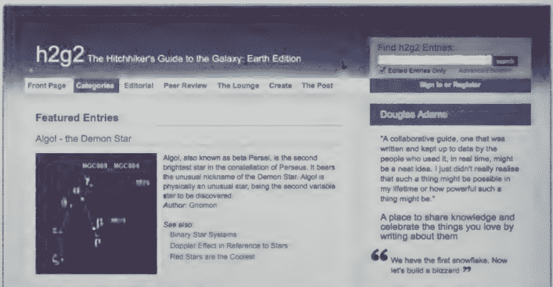

**上图：** 网站由若干个页面组成。

## 海量的元素

我们已经讨论过什么是元素，但尚未提到的是，元素的数量有数百个！不过不必担心，你会发现你经常使用或需要的只有极少数；这些正是我们在接下来的页面中将要讨论的元素。

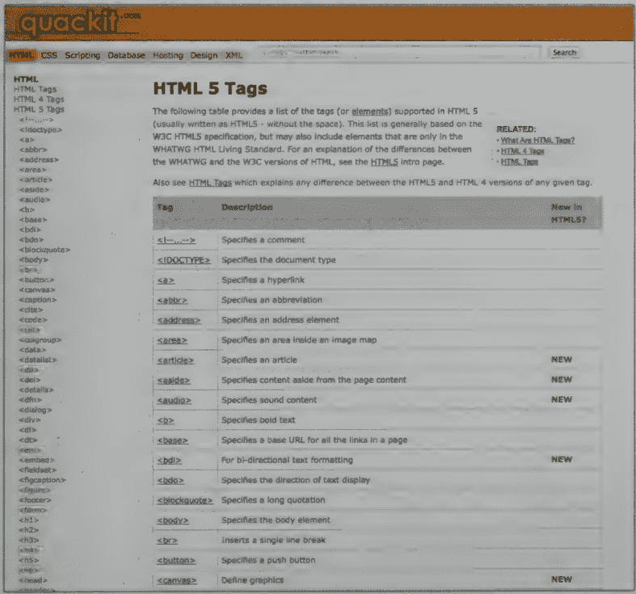

上图：你可以在 http://www.quackit.com/html_5/tags/ 找到元素的完整列表及其功能描述。

## 讨论 HTML 元素

我们在前一章讨论了 `<html>`、`<head>` 和 `<body>` 元素；这些元素应该构成所有网页的基本框架。现在让我们看看放置在这个基本框架之内的元素。

### 一个灵活的朋友

我们将从一个稍微有点不寻常的元素开始：`<div>`。它的不寻常之处在于它没有特定的预期用途：它本质上是一个空容器，你可以将其用于各种目的。`<div>` 最常见的用途之一是允许你将一组相关元素组合在一起，例如构成页面顶部的页眉部分。

你说什么？你认为 HTML5 中有一个 `<header>` 元素？确实有，但在 XHTML 或旧版本的 HTML 中并没有这种东西。那么在 HTML5 出现之前，开发者是怎么做的呢？为了回答这个问题，我们需要稍微绕一点路……

```html
<body>
    <div>
        <header>
            <h1>Divs are Containers</h1>
        </header>
        <div>
            <p>Divs can be nested within other divs</p>
        </div>
    </div>
    <div>
        <h2>Divs have no semantic meaning</h2>
    </div>
</body>
```

### ID 属性

你应该记得元素具有可以赋值的属性。其中一个适用于所有可视化元素的属性就是 `id`。它允许你为页面中的特定元素提供一个唯一的标识符，在 HTML 中被广泛使用。为了了解原因，我们需要从 CSS 的语境来看 `id` 的含义。

> **实用技巧**
> 分配给某个元素 `id` 属性的值，不得用作同一页面内任何其他元素的 `id`。

```html
<div id="main">
    <header>
        <h1>Divs are Containers</h1>
    </header>
    <div id="contentBlock">
        <p>Divs can be nested within other divs</p>
    </div>
</div>
<div id="divComment">
    <h2>Divs have no semantic meaning</h2>
</div>
```

上图：ID 属性给元素提供了一个唯一标识符。

```css
body {
    position:relative;
    background-color:#FD5F12;
    margin:0px;
    padding:0px;
    width:100%;
    height:100%;
}

#myElement {
    position:fixed;
    width:1024px;
    left:0px;
    right:0px;
    top:0px;
    bottom:0px;
    margin:0px auto 0px auto;
    background-color:#D9D9D9;
}
```

### ID 选择器

ID 选择器的目标是其 `id` 属性值与 ID 选择器匹配的单个元素。ID 选择器看起来像这样：

```css
#myElement {style rule}
```

'#'（井号）表明这是一个 ID 选择器；其样式规则将应用于 `id` 属性值为 "myElement" 的 HTML 元素。

### 这与 `<div>` 有什么关系？

`<div>` 元素的灵活性主要通过样式属性来实现，因为正是样式属性决定了 `<div>` 在屏幕上的显示方式。所以——终于回到了之前关于 HTML5 之前创建类似页眉元素的方法的问题——答案是在页面的 HTML 中编写以下内容：

```html
<div id="header">content</div>
```

并在页面的 CSS 中添加：

```css
#header {style rule}
```

### 语义化的必要性

在 HTML5 中，元素名称旨在传达关于该元素的信息。例如，`<header>` 元素旨在显示公司名称、徽标和导航栏等信息，并位于屏幕顶部；得益于元素的名称，这一点是不言而明的。

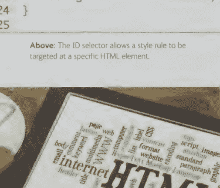

上图：ID 选择器允许样式规则针对特定的 HTML 元素。

上文讨论的 HTML5 之前创建页面页眉的方法在 HTML5 中是*有效的*，但它不是*优秀*的 HTML5，因为 `<div>` 不传达任何意义。没错，`id` 值为 "header" 传达了意义，但开发者也可以同样轻松地使用 "foobar" 这个值——这对 ID 选择器/属性机制没有任何影响，但任何语义意义都会丢失。因此，浏览器不允许从 `id` 属性中推导语义意义。

```html
<body>
    <header>
    </header>

    <div id="header">
    </div>

    <div id="foobar">
    </div>
</body>
```

**右侧：** 这三个元素都是有效的 HTML5 并且会产生相同的结果，但只有一个具有语义意义。

```html
<body>
    <div id="wrapper">
        <header>
            <!--Header content here-->
        </header>

        <section id="main">
            <!--Main page content here-->
        </section>

        <aside>
            <!--Aside content here-->
        </aside>

        <div id="adPanel">
            <!--Advertising content here-->
        </div>

        <footer>
            <div id="copyrightPanel">
                <!--Copyright boxout here-->
            </div>
        </footer>
    </div>
</body>
```

### `<div>` 的必要性

有些人认为应该淘汰 `<div>` 元素，因为它缺乏一致且可预测的语义意义。事实上，`<div>` 的使用是不可避免的，因为 HTML5 无法为每一种可能的结构可能性提供元素。因此，最佳实践是仅在没有合适的 HTML5 替代方案时才使用 `<div>` 元素。现在让我们来看看那些替代方案……

上图：`<div>` 元素是不可避免的，但只要有可能，应优先使用 HTML5 语义元素。

### 什么是 HEADER？

`<header>` 元素旨在位于网页的顶部，并且通常在网站的所有页面中都相同。一般来说，页面的 `<header>` 将包含徽标和/或页面标题，并且通常还包括网站导航菜单。

> **实用技巧**
> `<head>` 和 `<header>` 是两个独立且无关的元素。

### 什么是 FOOTER？

`<footer>` 元素应位于网页的底部，并且通常在网站的所有页面中都相同。通常它用于存放版权信息和额外的导航链接，但它可以包含任何你喜欢的元素。

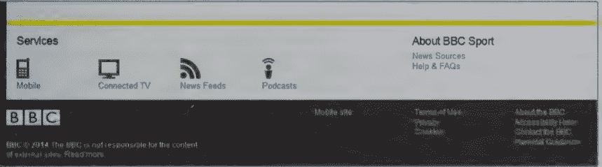

**上图：** 网站的页脚位于页面的底部。

### 什么是 CONTENT？

内容（Content）是页面上绝大部分的信息和媒体：它是访问者前来看的东西！与在整个网站中趋于统一的 `<header>` 和 `<footer>` 元素不同，页面的内容区域在每个页面之间会有所不同。


> **实用技巧**
> 网站上的菜单/导航系统对其运行至关重要。查看其他网站，找到一个适合你的并从中获取灵感。


```html
1  <!DOCTYPE HTML>
2  
3  <html>
4  
5      <head>
6          <!--Head used for defining meta data about the page-->
7          <title>All Structural Elements</title>
8      </head>
9  
10     <body>
11         <!--Body contains page's visual content-->
12     
13         <header>
14             <!--Header content here; One header per page please-->
15             <nav>
16                 <!--Main page navigation control-->
17             </nav>
18         </header>
19     
20         <section>
21             <!--A block of page content; Multiple sections allowed-->
22         
23             <article>
24                 <!--Article content here; Multiple articles allowed-->
25             </article>
26         
27         </section>
28     
29         <footer>
30             <!--Footer content here; One footer per page please-->
31             <nav>
32                 <!--Footer navigation menu-->
33             </nav>
34         </footer>
35     
36     </body>
37  
38  </html>
39
```

## 页面区块

`<section>` 元素旨在作为相关内容组的通用容器，即用于页面的“区块”。`<section>` 元素通常紧跟在页面的 `<header>` 元素之后。

## 其他结构化元素

`<header>`、`<section>` 和 `<footer>` 元素既创建了可以放置其他元素的页面结构，也为页面内不同类型的信息创建了逻辑结构。在 HTML5 中，还有四个你将经常用到的结构化元素。

**上图：** 结构化元素提供了一个逻辑结构，页面的内容将写入其中。

## 站点导航

大多数网站都包含一个站点导航菜单，以便用户快速轻松地在网站中移动；HTML5 提供了 `<nav>` 元素来包含此类导航菜单的元素。`<nav>` 元素通常创建为 `<header>` 的子元素，但这并非强制要求。

## Article 元素

`<article>` 元素被设计为结构链中的最终元素，因为它通常驻留在另一个结构化元素（如 `<section>`）之内。`<article>` 的理念是其内容与单个主题相关，非常像报纸上的一篇文章。

## Aside 元素

`<aside>` 元素的理念是用于显示与另一个结构化元素内相关但并非该内容直接一部分的内容。从语义上讲，任何结构化元素都可以有一个相关的 `<aside>` 元素，但典型用法是将其作为侧边栏，用于显示广告、个人资料信息或指向站点其他区域的链接。

右图：`<aside>` 元素旨在显示与 `<section>` 或 `<article>` 元素相关的内容。

```html
9
10 <body>
11   <!--Body contains page's visual content-->
12
13   <header>
14     <!--Header content here; One header per page please-->
15     <nav>
16       <!--Main page navigation control-->
17     </nav>
18   </header>
19
20   <section>
21     <!--A block of page content; Multiple sections allowed-->
22
23     <article>
24       <!--Article content here; Multiple articles allowed-->
25     </article>
26
27     <aside>
28       <!--Aside content relates to other page content - here
29       it relates to the above article;
30       Multiple asides allowed-->
31     </aside>
32
33   </section>
34
35   <aside>
36     <!--Aside content here-->
37   </aside>
38
39   <footer>
40     <!--Footer content here; One footer per page please-->
41     <nav>
42       <!--Footer navigation menu-->
43     </nav>
44   </footer>
45
46 </body>
47
```

## 理解 CSS 选择器

我们已经讨论了 CSS 类型选择器和 ID 选择器，但还有一个你需要了解的重要选择器：类（Class）选择器。此外，还可以通过多种方式组合选择器；让我们来看看。

```css
.italic {
    font-family:"source_sans_proitalic";
}

.bold {
    font-family:"source_sans_probold";
}

.footerText {
    position:absolute;
    font:10px "source_sans_proregular";
    color:#787878;
    right:0px;
    bottom:6px;
    width:auto;
    margin:6px 10px 6px auto;
    padding:0px;
}

.navbarButton {
    width:auto;
    margin-left:4%;
    margin-right:4%;
    margin-top:9px;
    padding:0px;
    cursor:pointer;
}
```

### 类选择器

回想一下，类型选择器针对任何匹配类型的 HTML 元素，而 ID 选择器针对具有匹配 id 属性值的单个 HTML 元素。那么，类选择器则允许你针对特定分类的 HTML 元素。类选择器的写法如下（注意类名前面的 `.`）：

```css
.myClassName {style rule}
```

这个选择器将针对所有被赋予 `myClassName` 分类的 HTML 元素。

左图：类选择器通过元素的分类来定位元素。

### 类型类选择器

可以通过将类选择器与类型选择器结合来进一步实现，例如 `article.newsStory` {style rule}。这个选择器将针对所有被赋予 "newsStory" 分类的 `<article>` 元素。但我们如何给元素分类呢？很简单...

### Class 属性

每个视觉元素都有一个 `class` 属性。它的外观如下：`<article class="newsStory">`。一旦这样赋予了分类，该元素将获得与 `.newsStory` 选择器关联的样式规则。如果选择器是 `p.newsStory`，那么上述元素将不会被选中，因为它是一个 `<article>` 而不是 `<p>`。

> **实用技巧**
> 注意：使用类选择器可能会增加样式属性冲突并被应用到元素上的风险。

```html
37
38  <body>
39    <header>
40      <h1>A Page All About Me</h1>
41      <nav class="navbarButton">Home | About Me | Contact</nav>
42    </header>
43    
44    <section>
45      <h2 class="bold italic">What I'm thinking now</h2>
46      <p class="italic">Lorem ipsum dolor sit amet, consectetuer adipiscing elit. Sed sagittis ante
malesuada velit. Curabitur suscipit. Suspendisse quis nibh aliquam sem pulvinar sollicitudin. Etiam venenatis.
Curabitur luctus.</p>
47      <p>Nunc venenatis lacus molestie sapien. Maecenas elementum aliquet velit. Ut eget mauris sed leo
scelerisque lacina. Nunc arcu magna, mollis id, ornare ac, pharetra sit amet, purus. Aliquam luctus consectetuer
dolor.</p>
48    </section>
49    
50    <footer>
51      <p class="footerText">Cum sociis natoque penatibus et magnis dis parturient montes, nascetur
ridiculus mus.</p>
52      <p class="footerText">Fusce libero nunc, tempor non, convallis ut, luctus sit amet, lectus.</p>
53    </footer>
54    
55  </body>
56
```

**上图：** 元素可以通过 `class` 属性被赋予分类。

### 多个分类

假设你在页面的 CSS 中创建了三个不同的类选择器：`.boldText`、`.italicText` 和 `.underlinedText`，并为每个选择器分配了合适的样式规则，例如 `{font-weight:bold;}` 等。这将允许你使用这些类名对基于文本的元素进行分类...但如果你想要同时实现**粗体**和*斜体*文本怎么办？很简单，只需在元素的 `class` 属性中列出类名，并用空格分隔每个类名即可。

```html
<p class="boldText">Lorem ipsum dolor sit amet, adipiscing elit.</p>
<p class="italicText">Sed sagittis ante malesuada velit.</p>
<p class="underlinedText">Curabitur suscipit. Suspendisse quis nibh aliquam sem.</p>
<p class="boldText italicText">Pulvinar sollicitudin. Etiam venenatis.</p>
<p class="boldText italicText underlinedText">Curabitur luctus.</p>
```

**上图：** 元素的 class 属性可以接受一个以空格分隔的类名列表。所有类名都将被应用。

## 复合选择器

我们已经提到过一个复合选择器的例子（通常被称为类型类选择器），但组合选择器还有许多其他方式；让我们来看看其中的几种。

### 多个类型选择器

如果你想创建一条样式规则，将其应用于基于元素类型的多个不同元素，你只需在选择器中列出这些类型，并使用 `,` 分隔每个类型名称即可。例如 `h2, h3, p {style rule}` 将针对所有的 `<h2>`、`<h3>` 和 `<p>` 元素。

```css
h1, h2, h3 {
    font-family:"source_sans_probold";
    font-weight:bold;
}

article h2 {
    color:blue;
}

article p {
    font-family:"source_sans_regular";
}

nav > p {
    color:red;
    cursor:pointer;
}
```

### 后代选择器

有时我们想要根据元素在 HTML 嵌套结构中的位置来定位元素。例如，我们可能想要针对所有是 `<article>` 元素的后代（即在任何层级嵌套在其中）的 `<p>` 元素：`article p {style rule}`（注意选择器中类型名称之间的空格）。

左图：CSS 有多种形式的选择器。


## 子选择器

子选择器针对的是作为另一个元素的子元素的元素（注意，后代选择器还会针对孙元素、曾孙元素等）。因此，选择器 `article > h3 {style rule}` 将针对所有作为 `<article>` 元素的直接子元素的 `<h3>` 元素（注意选择器中类型名称之间的 '>'）。

## 还有很多要学

CSS 是一门简单的语言，但魔鬼藏在细节中——而且细节*非常多*，远比我们在此所能涵盖的要多。如果你想了解更多，请查看一些专门致力于该主题的优秀网站和书籍。

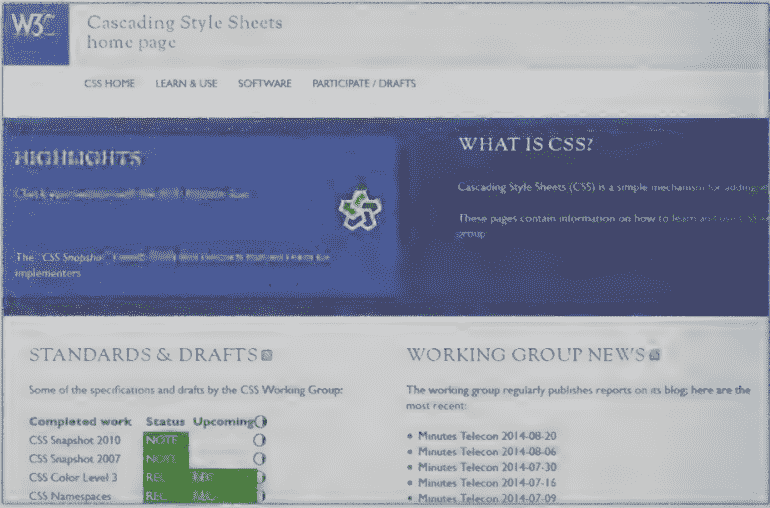

上图：有许多专门致力于 CSS 主题的网站。

## 基于文本的元素

大多数网页都包含文本——通常还相当多——因此，毫不奇怪，有一组专门用于显示文本的元素。文本元素通常嵌套在我们之前讨论过的结构元素中。

## 标题文本

有一组 HTML 元素专门用于显示标题；它们的名字非常容易记住。第一个叫 <h1>，第二个叫 <h2>，依此类推，直到 <h6>。

> **实用提示**
> <h4> 到 <h6> 很少被用到——一个人到底需要多少级标题呢？！

```
8
9 <body>
10
11 <h1>Heading level 1</h1>
12 <h2>Heading level 2</h2>
13 <h3>Heading level 3</h3>
14 <h4>Heading level 4</h4>
15 <h5>Heading level 5</h5>
16 <h6>Heading level 6</h6>
17
18 </body>
19
```

上图：HTML 中有六级标题元素。

### 标题级别

标题元素名称中的数字代表标题的"级别"，换句话说就是标题的重要程度（以及因此的突出程度）。`<h1>` 最突出，`<h6>` 最不突出。

### 标题语义

在 HTML5 之前，不同级别的标题仅仅代表不同程度的视觉突出：`<h1>` 最粗最大，`<h6>` 最小最轻。HTML5 更进一步，为不同的标题级别赋予了语义含义。

解释这一点最简单的方法是使用书本的类比，比如你现在正在阅读的这本。如果一个网页是书中的一章，那么 `<h1>` 就类似于章节标题，所以 `<h1>` 应该只在网页中出现一次。

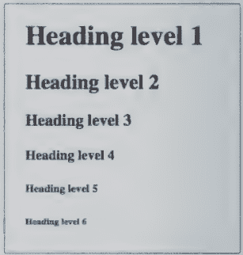

上图：`<h1>` 是最突出的标题，`<h6>` 最不突出。

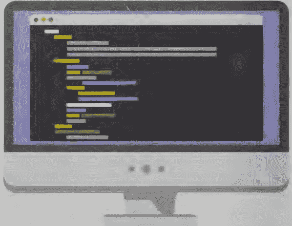

<h2> 类似于一章中的节标题，因此可以在 <h1> 之后出现多次。<h3> 类似于一节中的小节标题……以此类推。标题语义可能比较棘手，但记住书本的类比——它很有帮助！

### 标题的逻辑结构

HTML5 标题的语义特性意味着它们还推断出一种逻辑结构。回到我们的书本类比，子标题（<h3>）的父级将是节标题（<h2>），而节标题的父级将是章节标题（<h1>）。但如果你想创建一个由两部分组成的标题：一个"导语"和一个"标语"，该怎么办呢？

就像书中的标题级别一样，HTML5 标题为文本赋予了逻辑结构，所以 <h1> 可以看作是章节标题，<h2> 可以看作是节标题，<h3> 可以看作是子节标题。

### 标题组

我们可能会这样创建一个两部分的标题：

```
<h1>HTML and CSS</h1>
<h2>The Language of the Internet</h2>
```

但不幸的是，这里有个问题：<h2> 是 <h1> 的子标题，但目前它表示的是页面逻辑结构中的一个新节。解决方案是使用 <hgroup> 元素；它允许你将多个级别的标题组合在一起，而不会暗示你在逻辑结构中创建了新节——<hgroup> 中的第一个标题级别将被推断。因此，代替上面的写法，我们应该这样写：

```
<hgroup>
    <h1>HTML and CSS</h1>
    <h2>The Language of the Internet</h2>
</hgroup>
```

现在，<h2> 元素将被视为 <h1> 的一部分，语义上的正确性得到了恢复。

```
<!--Semantically incorrect...:-->
<h1>HTML and CSS</h1>
<h2>The Language of the Internet</h2>

<!--Semantically correct...:-->
<hgroup>
    <h1>HTML and CSS</h1>
    <h2>The Language of the Internet</h2>
</hgroup>
```

上图：<hgroup> 元素有助于保持标题的语义准确性。

## 段落文本

你会很高兴地知道，段落文本（页面的主体文本）比标题简单得多。我们只有一个段落元素 <p>。通常 <p> 只包含文本，但它也可以嵌入图像和某些其他元素。

### 段落样式

段落样式的常见策略是创建一个 p 类型选择器来定义段落样式的最基本方面，例如字体，然后创建一组类选择器来应用特定样式，例如粗体文本、下划线和斜体。然后你可以根据需要将所需的类名分配给给定的 <p> 元素。

```
7
8     <style>
9
10        .boldText {
11            font-weight:bold;
12        }
13
14        .italicText {
15            font-style:italic;
16        }
17
18        .underlinedText {
19            text-decoration:underline;
20        }
21
22    </style>
23
```


```
25
26  <body>
27
28      <p class="boldText">Lorem ipsum dolor sit amet, consectetuer adipiscing elit.</p>
29      <p class="italicText">Sed sagittis ante malesuada velit.</p>
30      <p class="underlinedText">Curabitur suscipit. Suspendisse quis nibh aliquam sem.</p>
31      <p class="boldText italicText">Pulvinar sollicitudin. Etiam venenatis.</p>
32      <p class="boldText italicText underlinedText">Curabitur luctus.</p>
33
34  </body>
35
```

上图：创建一些包含简单规则的类选择器，可以轻松实现段落样式。

### 段落内样式

有很多时候你会想要更改段落内的文本格式，例如当你想用*斜体*或**粗体**文本强调一个词或一段文字时。有几种方法可以做到这一点：斜体可以通过用 `<em>`（强调）元素包裹一段文本来实现：

```
<p>Mary had a <em>little</em> lamb</p>
```

或者使用粗体文本：

```
<p>It really <b>was</b> a dear</p>
```

> ### 实用提示
> 向基于文本的元素添加子元素时，通常将新标签放在文本中，而不是在代码中创建新行或缩进。

然而，更好的方法是使用 `<span>` 元素。它灵活得多，因为它不是只改变单个样式属性，而是一次性应用整个样式规则——或多个规则：

```
<p>But she <span class="redText italic">couldn't tell the difference</span></p>
```

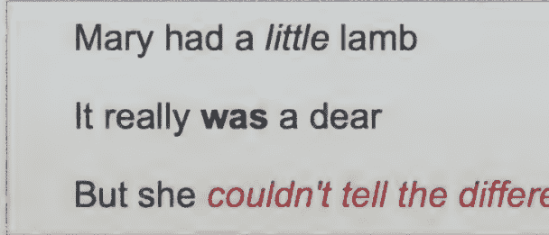

上图：使用 `<span>` 元素可以轻松实现段落内的文本格式更改。

## 超链接

一个网站如果没有超链接，就不算是**网站**。超链接是使网页浏览得以实现的机制，没有它们就无法在网站内导航，也无法将人们引导到外部网站。网站将不过是单个页面！

### 锚元素

超链接机制的核心是锚元素 `<a>`。它之所以叫这个名字，是因为它的用途之一是标记页面中的特定位置。这个用途仍然存在，但 `<a>` 最常用于创建超链接。

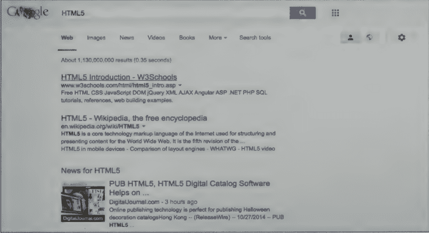

**上图：** 没有超链接，就不会有 Google 这样的东西。

```
8
9
10 <body>
11
12     <p>HTML5 info can be found on <a href="www.google.com">Google</a>. It's a useful resource.</p>
13
14 </body>
15
16
```

上图：使用 `<a>` 元素创建超链接。


### 创建超链接

我们通过将 `<a>` 元素包裹在要转换为超链接的文本来创建超链接——你想要链接到的 **URL**（或网址）在 `<a>` 的 `href` 属性中定义。

### URL

URL 代表统一资源定位符。URL 有两种常见形式：**绝对**和**相对**。前者定义了资源的完整网址，以 'http://' 开头。后者相对于当前文件运行，只能访问与该文件在同一站点内的资源。相对 URL 描述了从当前页面到资源的路径，以及资源的文件名，看起来像 'pathToFile/filename'。


#### 样式链接

与所有元素一样，`<a>` 有一个默认的外观，最终来源于浏览器的默认样式表。对于 `<a>` 来说，默认样式通常是蓝色带下划线的文本。当然，我们可以通过给 `<a>` 元素附加样式规则来覆盖这一点，无论是直接附加还是通过样式继承。

> **热门提示**

网页浏览器提供默认样式表。这定义了所有 CSS 属性的值，是样式层叠的起点。

然而，超链接的样式通常会因其状态而变化，例如鼠标指针悬停在其上，或用户此前点击过该链接等。这种基于状态的样式是通过 CSS **伪类**选择器实现的。

下方：超链接具有默认外观。

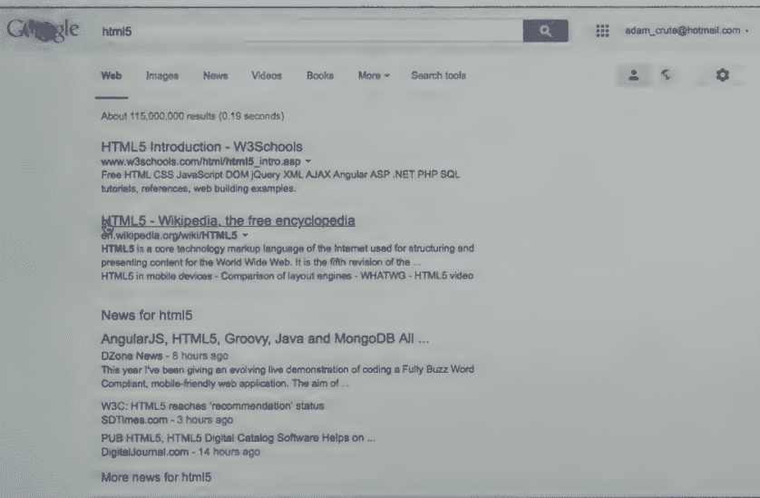

#### 伪类选择器

伪类是在 HTML 文档中没有明确声明，但在浏览器中查看页面时变得可用的类。有几种不同的伪类，但与超链接相关的伪类是我们需要关注的 `:link`（超链接的基础状态）、`:hover`（鼠标指针悬停在超链接上）和 `:visited`（ remain open in the background. This is done via the `target` attribute of the `<a>` element, like so:

```html
<a href="http://wwwBBC Here's the translation:

[content]
#### 样式链接

与所有元素一样，`<a>` 有一个默认的外观，最终来源于浏览器的默认样式表。对于 `<a>` 来说，默认样式通常是蓝色带下划线的文本。当然，我们可以通过给 `<a>` 元素附加样式规则来覆盖这一点，无论是直接附加还是通过样式继承。

> **热门提示**

网页浏览器提供默认样式表。这定义了所有 CSS 属性的值，是样式层叠的起点。

然而，超链接的样式通常会因其状态而变化，例如鼠标指针悬停在其上，或用户此前点击过该链接等。这种基于状态的样式是通过 CSS **伪类**选择器实现的。

下方：超链接具有默认外观。


#### 伪类选择器

伪类是在 HTML 文档中没有明确声明，但在浏览器中查看页面时变得可用的类。有几种不同的伪类，但与超链接相关的伪类是 `:link`（超链接的基础状态）、`:hover`（鼠标指针悬停在超链接上）和 `:visited`（超链接已被点击）。在 CSS 中，我们将这些伪类选择器作为另一个选择器的后缀来使用。

```css
a:link {
  color:blue;
}

a:hover {
  color:red;
  text-decoration:none;
}

a:visited {
  color:purple;
}

.navButton:hover {
  colour:blue;
  background-color:gray;
  cursor:pointer;
}

#headerLogo:hover {
  border-color:blue;
  border-style:solid;
  border-width:2px;
  cursor:pointer;
}
```


**上方：** 伪类选择器作为另一个选择器的后缀添加。

#### 在新窗口中打开超链接

通常希望在新浏览器窗口中打开超链接，以便自己的网站仍在后台保持打开状态。这是通过 `<a>` 元素的 `target` 属性实现的，如下所示：

```html
<a href="http://www.bbc.co.uk" target="_blank">
```

## 列表

列表是网页设计的重要组成部分。有两种基本列表类型，无序列表和有序列表，两者都包含一个或多个列表项。第三种类型是定义列表，创建类似词汇表的结构，包含标题和相关信息。

### 列表项

在查看列表元素本身之前，让我们先考虑一下列表中包含什么。在 HTML 中，这是**列表项**元素 `<li>`。通常，这些包含文本，但与其他基于文本的元素一样，也可以包含其他元素，如图像和超链接。`<li>` 元素按照它们在父列表元素中出现的顺序进行渲染。

### 无序列表

- HTML5 主要由元素组成。
- 元素由开始标签和结束标签标记。
- 属性允许你修改元素。

### 有序列表

1. HTML5 主要由元素组成。
2. 元素由开始标签和结束标签标记。
3. 属性允许你修改元素。

### 定义列表

HTML5
: 主要由元素组成。

元素
: 由开始标签和结束标签标记。

属性
: 允许你修改元素。

**上方：** 列表使我们能够以美观且合乎逻辑的方式呈现信息。

### 无序列表

无序列表 `<ul>` 是一个简单的项目符号列表。添加到列表中的每个 `<li>` 都会创建一个新的项目符号。`list-style-type` 和 `list-style-image` 样式属性决定项目符号标记的外观。

> **热门提示**
> 通常在页面的 `<nav>` 元素中放置 `<ul>` 以创建导航菜单。可以对 `<ul>` 进行样式设置，使其项目水平或垂直显示。

```html
<ul>
    <li>HTML5 主要由元素组成。</li>
    <li>元素由开始标签和结束标签标记。</li>
: 属性允许你修改元素。</li>
</ul>

<h2>有序列表</h2>
<ol>
    <li>HTML5 主要由元素组成。</li>
    <li>元素由开始标签和结束标签标记。</li>
    <li>属性允许你修改元素。</li>
</ol>
```

```css
ul {
    list-style-type:circle;
}

ol {
    list-style-type:decimal;
}
```

**上方：** `<ul>` 和 `<ol>` 列表只在每个项目的标记方式上有所不同。

### 有序列表

在有序列表 `<ol>` 中，每个项目都标有顺序数字或字母。有趣的是，编号样式由 `list-style-type` 样式属性决定，这与 `<ul>` 相同。这表明 `<ul>` 和 `<ol>` 之间唯一的真正区别就是样式！


### 定义列表

定义列表 `<dl>` 有点像词汇表：每个项目由标题和与标题相关的信息块组成。这意味着列表中的每个项目实际上有两个组成部分：用于标题的 `<dt>` 元素和用于信息的 `<dd>` 元素（第二个 "d" 代表 "data" 一词）。

```html
<h2>定义列表</h2>
<dl>
    <dt>HTML5</dt>
    <dd>主要由元素组成。</dd>
    <dt>元素</dt>
    <dd>由开始标签和结束标签标记</dd>
    <dt>属性</dt>
    <dd>允许你修改元素。</dd>
</dl>
```

**定义列表**

| 术语 | 描述 |
|------|-------------|
| HTML5 | 主要由元素组成。 |
| 元素 | 由开始标签和结束标签标记 |
| 属性 | 允许你修改元素。 |

*上方：* `<dl>` 中的每个项目包含两个元素：`<dt>` 和 `<dd>`。

### 列表嵌套

如果你想创建多级列表，解决方案是在 `<li>` 或 `<dd>` 元素中放置一个新的列表元素。你可以对三种列表类型中的任何一种这样做，并且可以根据需要混合搭配不同的类型。


## 网页设计

- CSS3
- JS
- XML


## 创建网站

## 构建网站

构建网站的过程不仅仅是添加 HTML 和 CSS。这里我们展示如何规划网站，使用 HTML 和 CSS 构建网站，以及如何让网站上线。

## 规划和草图

构建网页时，不能简单地直接开始用 HTML 和 CSS 编码。任何好的网站都需要一些规划。这有助于确定布局以及各种页面元素的位置，进而有助于加快设计和开发过程。

### 草图应包括什么？

草图可以简单到只用几个方框显示主要布局元素和一些额外的细节。然而，草图中的细节和思考越多，后续的构建工作就会越容易。例如，可以为网站的特定元素（如 `<header>`）绘制额外的草图。

**下方：** 使用浏览器草图板来规划你的网站。

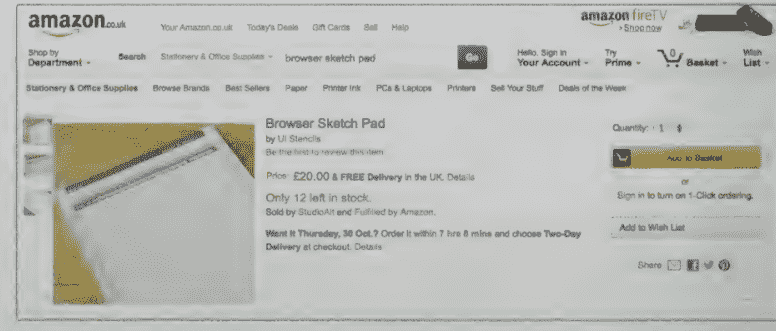

## 创建线框图

完成最终草图（或草图）后，下一步是创建线框图。这不是必需的，但规划过程中的另一个有用部分。线框图是草图的更精确版本，有助于确定布局。尝试访问 https://wireframe.cc/ 进行快速简单的线框图创建。

**下方：** 创建线框图有助于构想页面布局。

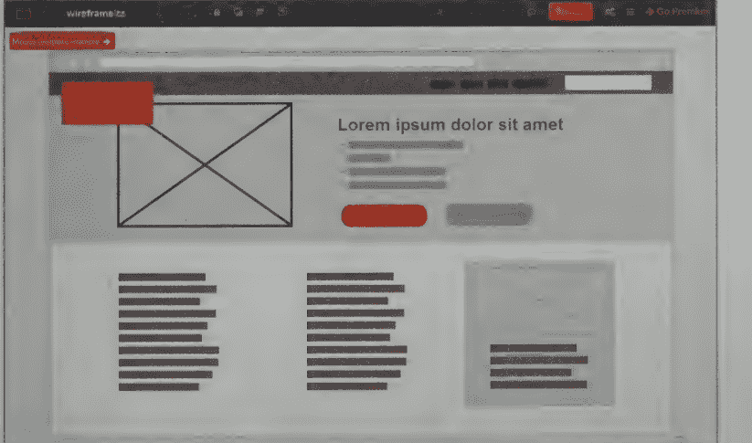

## 必备工具

没有合适的工具就无法构建网站。基本设置包括文本编辑器和图像编辑器。文本编辑器将是创建 HTML 和 CSS 的地方，而图像编辑器将允许操作和修改图像及图形。

> **热门提示**
> 如果你在 Mac 上使用 TextEdit，请务必在开始编码前切换到纯文本模式：[shift]+[cmd]+[T]。

### 文本编辑器

Windows 和 MacOSX 都自带文本编辑器：分别是记事本和 TextEdit。这些非常适合初学者，但非常基础。有一些免费的编辑器值得查看。尝试 Notepad++ (http://notepad-plus-plus.org)；Brackets (http://brackets.io)；CoffeeCup Free HTML Editor (http://www.coffeecup.com/free-editor/) 或更高级的 Sublime Text (http://www.sublimetext.com)。


**TopStyle 5**，适用于 Windows 的强大 HTML5 和 CSS3 编辑器。

TopStyle 5 的特别之处 ▶

TopStyle 5 的新功能是什么？

免费下载试用！

上方：尝试不同的文本编辑器，找到适合你的那一款。


### HTML 编辑器

HTML 编辑器为网页开发人员提供了许多功能。其中最知名的是 Adobe Dreamweaver；它非常出色，但价格昂贵，且只能通过订阅方式获得许可。HTML 编辑器提供诸如代码提示和代码着色等功能，这两者对开发人员来说都是不可或缺的。

### 图像编辑器

你会经常发现自己需要编辑图像和为网站创建图形。专业的选择是 Adobe Photoshop 和 Illustrator 的组合，但这条路价格昂贵，且学习曲线陡峭。

#### 图像和图形编辑器链接

- PaintShop Pro (Win): www.paintshoppro.com
- CorelDRAW (Win): www.coreldraw.com
- Pixelmator (Mac): www.pixelmator.com
- iDraw (Mac): www.indeo.com
- Adobe Photoshop (Win/Mac): www.adobe.com
- Adobe Illustrator (Win/Mac): www.adobe.com

## 构建网页

在前面的章节中，我们已经涵盖了大量的理论和信息，现在让我们开始将其付诸实践。第一步是创建一个 HTML 文档，并添加我们将使用的基本元素结构。

### 创建工作文件夹

首先要做的就是创建一个文件夹，用来存储我们页面的所有文件。你的"文档"文件夹会是一个不错的选择，或者更好的做法是在你的"主目录"文件夹内创建一个名为 MySites 的文件夹；这样它就可以成为你开发的所有网站的集中存放位置。无论你把它放在哪里，为单个网站创建的文件夹都应该与该网站同名。让我们把这个文件夹命名为 MyFirstSite。

> **小提示**
> 不要在文件或文件夹名称中使用空格。要么去掉空格并将每个单词首字母大写（称为驼峰命名法），要么用下划线或连字符替换空格。

**注意：** 网站的所有文件都应存储在单个外层文件夹中。将你所有的网站都放在一个外层文件夹中也很方便。

### 创建基本结构

1. 在你选择的编辑器中创建一个新页面，并在页面最顶部添加 DOCTYPE 声明。

```html
1 <!DOCTYPE HTML>
2 
3 <html>
4 
5     <head>
6 
7     </head>
8 
9     <body>
10
11    </body>
12</html>
```

步骤 2：从基本元素开始。

2. 添加基础元素 `<html>`、`<head>` 和 `<body>`，并将页面保存为 'index.html'，放在你的 MyFirstSite 文件夹内。

```html
1 <!DOCTYPE HTML>
2 
3 <html>
4 
5     <head>
6         <title>My First Web Page</title>
7     </head>
8 
9     <body>
10
11    </body>
12
13</html>
14
```

3. 现在添加一个 `<title>` 元素作为 `<head>` 元素的子元素（即放在 `<head>` 内部）。标题要与内容相关，因为它会出现在搜索引擎的列表中。

步骤 3：明智地为你的页面选择标题；它可以决定页面是否会吸引访客。

4. 现在我们将为页面的可见内容创建基本的布局结构。添加 `<header>`、`<section>` 和 `<footer>` 元素作为 `<body>` 元素的子元素。

```html
1 <!DOCTYPE HTML>
2 
3 <html>
4 
5     <head>
6         <title>My First Web Page</title>
7     </head>
8 
9     <body>
10
11        <header>
12        </header>
13
14        <section>
15        </section>
16
17        <footer>
18        </footer>
19
20    </body>
21
22</html>
23
```

> **小提示**
> 任何网站的默认页面——即未请求特定页面时加载的页面——通常被称为 index.html。还有其他可用的名称，但这是最佳选择。

步骤 4：添加构成基本页面结构的元素。

```html
<!DOCTYPE HTML>
<html>

  <head>
    <title>My First Web Page</title>
  </head>

  <body>

    <header>
      <nav>Home | About | Contact </nav>
    </header>

    <section>
    </section>

    <footer>
    </footer>

  </body>
</html>
```

步骤 5：在 `<header>` 内创建一个 `<nav>` 元素。

```html
<!DOCTYPE HTML>
<html>

  <head>
    <title>My First Web Page</title>
  </head>

  <body>

    <header>
      <nav>Home | About | Contact </nav>
      <hgroup>
        <h1>My First Web Page</h1>
        <h2>It may be basic, but it rocks</h2>
      </hgroup>
    </header>

    <section>
    </section>

    <footer>
    </footer>

  </body>
</html>
```

步骤 6：将标题元素放入 `<header>` 中，然后添加一些合适的文本。

- 5. 我们需要一种方式来导航网站，所以添加一个 `<nav>` 元素作为 `<header>` 的第一个子元素，并输入你可能会包含在网站中的页面标题。
- 6. 现在我们要为页面的 `<header>` 元素添加一些文本标题。这些标题是相关的，所以我们将它们放在一个 `<hgroup>` 元素内创建。
- 7. 页面的主要内容将放在 `<section>` 元素内。在下一章中，我们将添加一个代表网站内容的图像（参见第 95 页），但目前我们只使用文本。

```html
16		</hgroup>
17	</header>
18	
19	<section>
20		<h2>Welcome To My World!</h2>
21		<p>Lorem ipsum dolor sit amet, consectetuer adipi velit. Curabitur suscipit.</p>
22		<p>Suspendisse quis nibh aliquam sem pulvinar sol luctus. Nunc venenatis lacus molestie sapien.</p>
23		<p>Maecenas elementum aliquet velit!</p>
24	</section>
25	
26	<footer>
27	</footer>
28	
29	</body>
```

步骤 8：添加多个 `<p>` 元素以使文本易于阅读。

> **小提示**
> 从标题语义的角度来看，`<hgroup>` 使其内部嵌套的所有标题都充当 `<hgroup>` 中首先声明的类型的单一标题。

```html
19	<section>
20		<h2>Welcome To My World!</h2>
21		<p>Lorem ipsum dolor sit amet, consectetuer adipiscing elit. Sed sagittis ante malesuada velit. Curabitur suscipit.</p>
22		<p>Suspendisse quis nibh aliquam sem pulvinar sollicitudin. Etiam venenatis. Curabitur luctus. Nunc venenatis lacus molestie sapien.</p>
23		<p>Maecenas elementum aliquet velit!</p>
24	</section>
25	
26	<aside>
27		<h3>By the way...</h3>
28		<p>Ut eget mauris sed leo scelerisque lacinia. Nunc arcu magna, mollis id, ornare ac, pharetra sit amet, purus.</p>
29		<p>Aliquam luctus consectetuer dolor? In placerat, diam et suscipit posuere, lacus orci vestibulum libero, vulputate faucibus felis leo sit amet elit: Sed hendrerit felis non urna.</p>
30	</aside>
31	
32	<footer>
33	</footer>
```

步骤 9：添加一个 `<h3>` 元素，后跟几个 `<p>` 元素。将它们全部放在一个 `<aside>` 元素内。

8. 我们将添加一些文本，与稍后将要添加的图像相配合。使用 `<h2>` 标题，因为 `<h1>` 已经在 `<header>` 中使用了。然后在 `<h2>` 下使用 `<p>` 元素来放置一些介绍性文本。

9. `<aside>` 元素通常包含与页面主要内容相关的内容。在 `<section>` 元素之后添加一个 `<aside>`，并为其添加一些内容。

10. 最后，我们将为 `<footer>` 添加一些内容。这可以是联系信息、地址和版权信息等。

```html
31 <footer>
32   <p>Donec interdum dui est et. Pellentesque sit amet urna</p>
33   <p>(C) J. Smith, 2014</p>
34
35   <p><a href="mailto:jsmith789@somehost.com">jsmith789@somehost.com</a></p>
36
37
38 </body>
```

步骤 10：确保 `<footer>` 中的信息是有用的。

11. 为了完成 `<footer>`，添加与页面顶部相同的导航菜单；只需复制整个 `<nav>` 元素并将其粘贴为 `<footer>` 元素的最后一个子元素。

```html
31 <footer>
32   <p>Donec interdum dui est et. Pellentesque sit amet urna</p>
33   <p>(C) J. Smith, 2014</p>
34
35   <p><a href="mailto:jsmith789@somehost.com">jsmith789@somehost.com</a></p>
36   <nav>Home | About | Contact</nav>
37 </footer>
38 </body>
39
40
41 </html>
```

步骤 11：在屏幕底部添加导航菜单可能会非常有用。

12. 保存你的工作。现在在你的计算机上找到该文件，并在网页浏览器中打开它看看效果。可能比较基础，但我们还没有用到 CSS……

步骤 12：它可能很基础，但这完全是你自己的作品。做得好。


### 使用 CSS 为页面设置样式

我们页面的 HTML 结构已经就绪，但目前看起来相当基础。让我们现在通过为页面添加一些 CSS 样式来解决这个问题。

### 内嵌还是外部？

第一个选择是将 CSS 作为内嵌样式表还是外部样式表添加。考虑到我们的站点（至少目前）只有一个页面，我们将使用内嵌样式表，以便页面的所有代码都集中在一个位置。

### 创建 CSS 代码

1. 如果 `index.html` 尚未打开，请在编辑器中打开它，然后在 `<head>` 内部添加一个 `<style>` 元素。

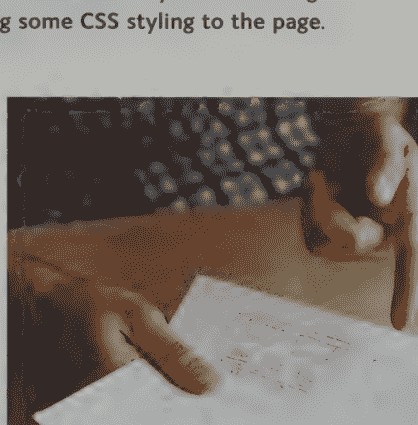

```
1 <!DOCTYPE HTML>
2
3 <html>
4
5 <head>
6 <title>My First Web Page</title>
7 <style>
8 </style>
9 </head>
10
11 <body>
12
```

**步骤 1：** 在页面的 `<head>` 中添加一个内嵌样式表。

## 实用技巧

网络字体（Web fonts）允许你在站点上使用那些未安装在访问者计算机上的字体。

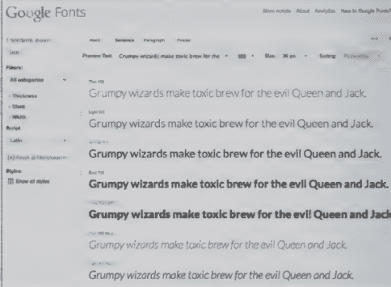

2. 现在我们需要为文本选择一种字体。所有计算机上都安装了一组有限的 Web 标准字体；使用其中之一是一个选项。更好的选择是使用网络字体：前往 Google Fonts (www.google.com/fonts) 并找到你喜欢的字体，最好是具有多种变体的字体，例如 Lato。

3. 点击 Quick-Use 按钮并选择一种字体变体。现在你会看到一段 `<link>` 元素的代码块。复制它并将其粘贴到页面的 `<head>` 中，位于 `<style>` 元素之前。

步骤 3：从 Google Fonts 复制 `<link>` 元素代码。

```
3. Add this code to your website:

<link href='http://fonts.googleapis.com/css?family=Lato:400,700,400italic' rel='stylesheet' type='text/css'>
```

```
3 <html>
4   <head>
5     <title>My First Web Page</title>
6     <link rel='stylesheet' type='text/css' href='http://fonts.googleapis.com/css?family=Lato:400,700,400italic'/>
7     <style>
8       body {
9         font-family:"Lato";
10      }
11    </style>
12   </head>
13 <body>
14   <div id="wrapper">
15     <header>
16       <nav>Home | About | Contact </nav>
17       <hgroup>
18         <h1>My First Web Page</h1>
19         <h2>It may be basic, but it rocks</h2>
20       </hgroup>
21     </header>
22   <section>
```

**步骤 4 和 5。** *使用 `font-family` 样式属性在样式规则内定义字体，并将页面的内容包裹在一个 `<div>` 中。*

- 4. 为了将其设置为整个页面的默认字体，我们创建一个 `body` 类型选择器，并在其样式规则中设置 `font-family` 属性。

- 5. 为了能够在浏览器窗口中使页面内容区域居中，我们将把所有内容包裹在一个 `<div>` 元素中。为该 `<div>` 分配一个值为 "wrapper" 的 `id` 属性。

```
8   <style>

10    body {
11      font-family:"Lato";
12      font-size:14px;
13    }

15    #wrapper {
16      width:1000px;
17      height:auto;
18      margin-left:auto;
19      margin-right:auto;
20    }

22   </style>
```

- 6. 我们现在可以使用 CSS ID 选择器 `#wrapper` 来为 wrapper `<div>` 设置样式。添加截图中的代码，使站点宽度为 1000 像素并在浏览器窗口中居中。

*步骤 6：为 wrapper 设置样式使其能够在浏览器窗口中居中。*

步骤 7：wrapper 内部的内容现在相对于 wrapper 而非浏览器窗口进行定位。

7. 我们页面中的 `<section>` 元素包含页面的主要内容。复制截图中的 CSS 代码，使其宽度为 700 像素并位于 wrapper 的左侧。

```
8   #wrapper {
9       width: 1000px;
10      height: auto;
11      margin-left: auto;
12      margin-right: auto;
13  }

15  section {
16      width: 700px;
17      height: auto;
18      float: left;
19  }
```

**实用技巧**

尝试在一个网站上使用多种字体：一种用于标题，一种用于段落文本。最佳实践是每页不要使用超过三种字体。

```
11  #wrapper {
12      width: 1000px;
13      margin-left: auto;
14      margin-right: auto;
15  }

17  section {
18      width: 700px;
19      height: auto;
20      float: left;
21  }

23  aside {
24      width: 300px;
25      float: right;
26  }
```

8. 现在我们将使 `<aside>` 元素宽度为 300 像素，并使其浮动在 `<section>` 元素的右侧。section 和 aside 的宽度现在之和将等于 wrapper `<div>` 的 1000 像素宽度。

步骤 8：浮动（Floating）是一种将一个元素放置在另一个元素旁边的定位方法。

步骤 9：将 `<footer>` 的尺寸设置为与上方内容相同的宽度 —— 这将确保它浮动在这些内容下方。

```
section {
    width:700px;
    height:auto;
    float:left;
}

aside {
    width:300px;
    float:right;
}

footer {
    width:1000px;
    height:auto;
    float:left;
}
```

步骤 10：为标题元素设置样式，使其具有递减的视觉显著级别。

```
h1 {
    font-weight:bold;
    font-size:26px;
    color:#990000;
}

h2 {
    font-weight:bold;
    font-size:22px;
    color:#CC6600;
}

h3 {
    font-weight:normal;
    font-size:18px;
    font-style:italic;
    color:#FF9933;
}

hgroup > h1 {
    margin-bottom:3px;
}

hgroup > h2 {
    margin-top:0px;
}

</style>
```

### 9.

`<footer>` 直接位于 `<aside>` 的文本下方。这需要再次通过使用浮动并将其宽度设置为 1000 像素（与 wrapper `<div>` 相同的宽度）来进行样式设置。

### 10.

接下来我们将对标题文本应用一些样式，使它们具有不同的尺寸和颜色。不断尝试直到你对结果满意。

### 11.

`<footer>` 通常与页面的主要内容分开。这可以通过将其设置为不同的颜色或在 `<footer>` 顶部添加边框来实现。

## 实用技巧

> 将页面的宽度最大限制在 1280 像素，以确保站点在绝大多数桌面屏幕上看起来效果良好。

### 上线发布

花费这么多精力构建一个网站却把它隐藏在电脑里是没有意义的 —— 它需要发布到网络上！为此，你需要一个域名、一台 Web 服务器和一个用于管理站点文件的 FTP 客户端应用程序。

### 域名

域名是一个与网站 IP 地址相关联的可读名称，例如，Google 的域名是 google.com。这是一个唯一名称，需要注册才能分配给你。为此，你可以使用域名注册商，如 1&1 (www.1and1.co.uk) 或 123-reg (www.123-reg.co.uk)。


上图：1&1 是一个受欢迎的域名注册商和托管服务提供商。

### Web 服务器

你的网站需要在互联网上可用，为此你需要一台 Web 服务器。获取最简单的方法是通过 Web 托管服务；这会为你提供自己的 Web 服务器。ISP（互联网服务提供商）经常将此类服务作为租赁套餐的一部分。或者，你可以从 1&1 和 123-reg 等公司购买低至每月 1 英镑的托管服务。

### 传输文件

FTP（文件传输协议）提供了一种跨网络传输文件的方法，是将站点文件上传到 Web 服务器的最佳方法。目前有许多 FTP 客户端应用程序，Filezilla (http://filezilla-project.org) 和 CyberDuck (http://cyberduck.io) 分别是 Windows 和 Mac 上的流行选择。

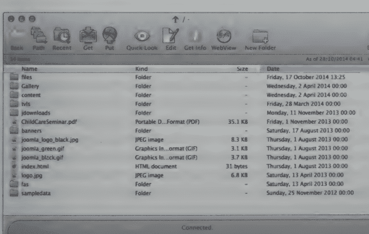

**上图：** FTP 客户端应用程序允许你在 Web 服务器之间传输文件。

### 为你的站点添加博客

Web 日志（Web logs），或者用更常用的名称叫博客（blogs），是网站常见的补充，能帮助你建立一个具有相似兴趣的用户社区。

### 两种简单的选择

从编程角度来看，博客相当复杂；你已经走过了很长一段路，但现在还不足以独立处理这个特定的项目！幸运的是，你可以在无需自行构建的情况下为站点添加博客，并且你新习得的 HTML 和 CSS 知识可以用于自定义博客。你可以从你的站点链接到外部博客提供商，或者在你的 Web 服务器上安装第三方博客软件。WordPress 是这两种方案的绝佳选择。

*下图*：在 www.wordpress.com 注册一个免费的 WordPress 站点


### WordPress.com

尽管已经成长为一个完整的 **CMS**（内容管理系统），但 WordPress 的核心仍然是一个博客系统，且仍然可以作为博客系统使用。如果你希望尽可能地保持简单

那么请前往 www.wordpress.com 并使用他们的服务创建一个网站。按照该网站上优秀的教程来让您的博客运行起来，然后从您的常规网站链接到它。

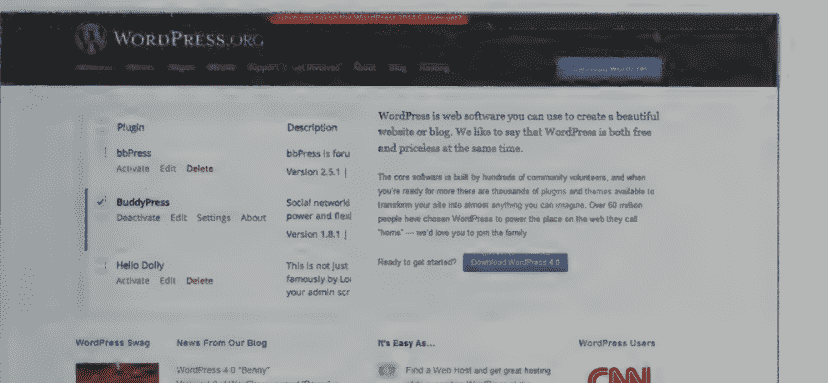

**上图：** 最新可安装版本的 WordPress 可在 www.wordpress.org 获取。

### Wordpress.org

您也可以将 WordPress 安装在您自己的网站上。通常，您的网站托管服务提供商会将其作为一个选项提供；您只需在服务器控制面板中将其启用即可。或者，如果您的主机未提供预装软件，也可以从 www.wordpress.org 下载该软件。然后，您可以使用 WordPress 创建博客页面，或者实际上，用来运行您的整个网站。完整的文档可在 www.wordpress.org 获取。

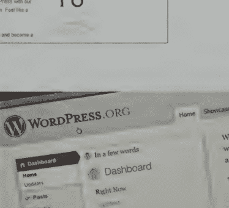

### 待办事项清单：

- 阅读收藏的网站
- 修改旧文章
- 为咖啡店做计划...（爸爸。）
- 完成第100篇文章
- 少担心垃圾信息
- 关注**质量**！

```
Cr p"Q 4124 4
<script type>
</div> _ope
</body> _op
<<! oprate
ver curren
update

Tab
{</div>
{ ossicc d.MI
return>>>
server : byte [1102
{ tab com
{ LIB FLAN
config = manager
defcon rc 6624<FP
oss orsqq  local 1
```

GET IT ?
EARNOFTER THA
CONFORM WHE
DEVELOPMENT
FEEDBACK
IS HEADING IN

## 图片、视频及其他增强效果

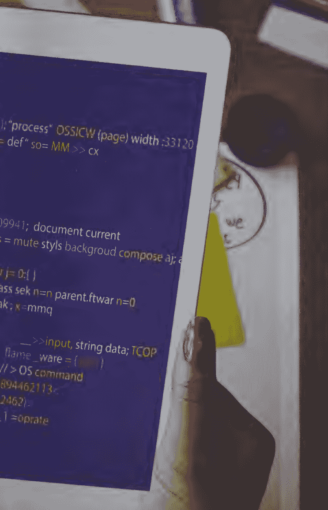

```
!:"process" OSSICW (page) width :33120
= def" so= MM >> cx

9941; document current
= mute styls backgroud compose aj; a

r)= 0;{ }
ass sek n=n parent.ftwar n=0
k; x=mmq

__>>input, string data; TCOP
flame_ware = { }
// >0S command
894462113.
2462)
1 =0prate
```

## 向您的网站添加媒体

大多数网站包含的内容远不止文本。图片、视频和音频可以极大地增加您的访问者数量，并鼓励他们停留更长时间。高级的 HTML5 功能（如地理定位）可以改善您的网站与访客之间的互动，当然，添加一点视觉上的修饰总是一个好主意。

## 处理图片

除了文本，图片是几乎每个网站都有的共同元素。你很少会找到一个完全没有图片的现代网站。图片极其多变，有潜力让网站在视觉上更具吸引力。


### 图片格式

图片有多种格式，但在网络上实际使用的格式主要有三种：GIF、PNG 和 JPG。GIF 格式是网络早期的遗留产物，正变得越来越少见。另一方面，PNG 和 JPG 则被广泛使用。两者各有特定的优缺点，但结合使用可以满足所有情况。

#### PNG 格式

PNG（便携式网络图形，发音为 "ping"）是图形（相对于基于照片的图像）的最佳选择，因为通常它们使用无损压缩，因此比 JPG 提供更好的清晰度和准确性。它们的另一个优点是支持透明度。这意味着 PNG 图像不必有纯色背景，并且其后面的任何内容都可以通过 PNG 的透明区域显示出来。

**下图：** PNG 图像格式通常是诸如徽标之类的小图形元素的最佳选择。

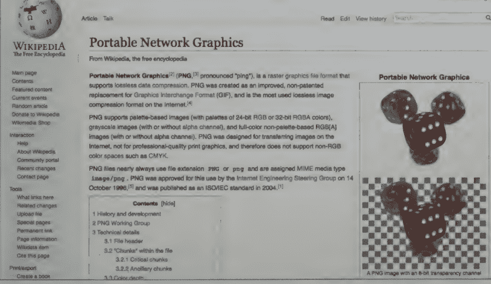

#### JPG 格式

JPG 格式（也称为 JPEG，发音为 "jay-peg"）使用复杂的图像压缩技术来减小图像的文件大小，而不会明显降低其质量。这意味着图像可以保存为不同的质量级别以减小文件大小。级别越高，质量越好，但文件大小也越大；开发者可以选择在哪里取得平衡。JPG 不支持透明度，因此不太适合用于图形。

#### 实用提示

创建图像和图形时，请在无损格式（如 PSD，Photoshop 的原生格式）中处理全质量的可编辑版本，然后将需要的图形导出为 PNG 或 JPG 文件。

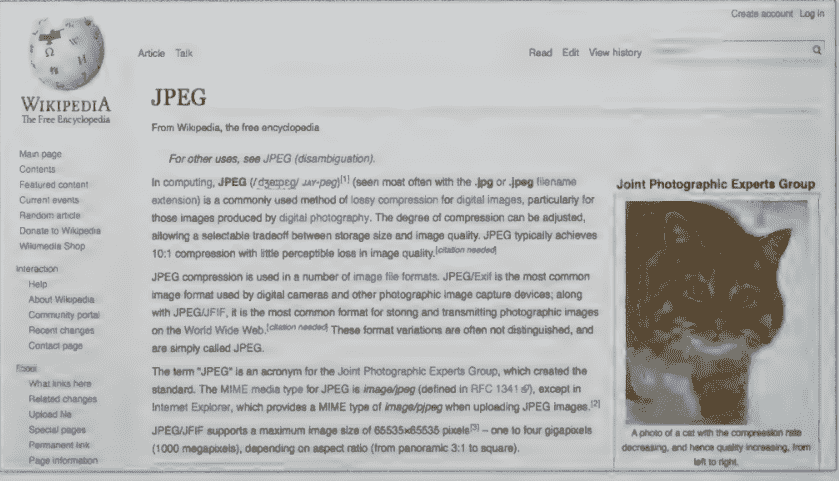

上图：照片通常保存为 JPG 格式。

## 添加图片

将图片添加到网页是一个相对简单的过程。但是，在添加图片之前，最好将您的图片存储在网站根目录的子文件夹中。

### `` 元素

向页面添加图片时，我们使用 `` 元素。这是一个自闭合元素，意思是，你记得，它们只有一个开始标签而没有结束标签，并且不能在其内部嵌套任何内容。

#### 如何添加图片

1. 在上一章中，我们在一个名为 MyFirstSite 的文件夹中构建了一个简单的页面。找到这个文件夹并在其中创建一个子文件夹；将该子文件夹命名为 'images'。

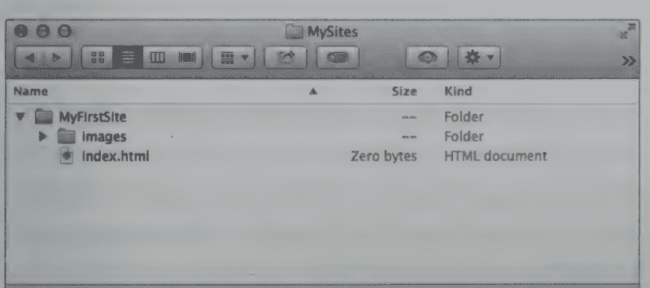

**步骤 1**：确保 'images' 文件夹是网站根文件夹的子文件夹。

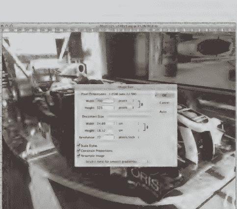

2. 找到一个合适的图像。使用您的图像编辑器将其调整为 700 像素宽，并且为您选择的图像设置相应的比例高度。将图像的副本保存到我们刚刚创建的文件夹中，使用 JPG 格式。将文件命名为 homepageImage.jpg。

3. 在您的文本或 HTML 编辑器中打开您网站的首页（index.html），并找到 `<section>` 元素顶部的 `<h2>` 元素。在 `<h2>` 元素上方的 HTML 代码中创建一个空行。

步骤 2：图像编辑器可以在调整图像大小的同时保持正确的比例。

```
74
75 <body>
76
77   <div id="wrapper">
78     <header>
79       <nav>Home | About | Contact </nav>
80       <hgroup>
81         <h1>My First Web Page</h1>
82         <h2>It may be basic, but it rocks</h2>
83       </hgroup>
84     </header>
85
86     <section>
87       
88       <h2>Welcome To My World!</h2>
89       <p>Lorem ipsum dolor sit amet, consectetuer adipiscing elit. Sed sagittis ante malesuada velit. Curabitur suscipit.</p>
90       <p>Suspendisse quis nibh aliquam sem pulvinar sollicitudin. Etiam venenatis. Curabitur luctus. Nunc venenatis lacus molestie sapien. Phasellus erat. Vestibulum posuere varius dolor. Aenean id arcu. Sed mauris mauris, consectetuer nec, accumsan ut.</p>
91       <p>Maecenas elementum aliquet velit!</p>
92     </section>
```

步骤 3：在 HTML 代码中创建一个空行

```
79 <nav>Home | About | Contact </nav>
80 <hgroup>
81     <h1>My First Web Page</h1>
82     <h2>It may be basic, but it rocks</h2>
83 </hgroup>
84 </header>
85 
86 <section>
87     
92     <h2>Welcome To My World!</h2>
93     <p>Lorem ipsum dolor sit amet, consectetuer adipiscing elit. Sagittis ante malesuada velit. Curabitur suscipit.</p>
94     <p>Suspendisse quis nibh aliquam sem pulvinar sollicitudin. Etiam venenatis. Curabitur luctus. Nunc venenatis lacus molestie sapien. Phasellus erat. Vestibulum posuere varius dolor. Aenean id arcu. Sed mauris mauris, consectetuer nec, accumsan ut.</p>
95     <p>Maecenas elementum aliquet velit!</p>
96 </section>
97
```

步骤 4：当定义多个属性时，将它们分成缩进的单独行是很常见的，这样更容易阅读。

4. 现在按照图示添加 `` 元素。`name` 属性值将在浏览器无法加载图像时显示在图像位置，而 `alt` 属性值是当用户将鼠标指针悬停在图像上时显示的文本。`src` 属性值是要使用的图像的 URL（注意我们使用的是相对 URL）。

```
54 ...
55 
56 font-weight:normal;
57 font-size:18px;
58 font-style:italic;
59 color:#FF9933;
60 }
61 
62 hgroup > h1 {
63     margin-bottom:3px;
64 }
65 
66 hgroup > h2 {
67     margin-top:0px;
68     margin-bottom:0px;
69 }
70 
71 #homepageImage {
72     float:left;
73     border-style:none;
74 }
75 
76 </style>
77
```

5. 我们将为此图像创建一个样式规则，因此请在页面的 `<head>` 中找到 `<style>` 元素。添加图中所示的代码。注意我们使用的是 ID 选择器，以便只针对我们新添加的 `` 元素。保存您的工作，并确保在您的网页浏览器中查看结果。

步骤 5：某些浏览器会在图像周围绘制边框；使用 `border-style` 属性来控制此行为。


## 添加视频

视频是网页和网站中非常常见的媒介。它们能吸引注意力，比静态图片更具吸引力。用户希望观看视频，而且一个十秒钟的视频片段所能传达的信息量，远超占据同样空间的一张图片和文字。

### 视频选项

向网页添加视频主要有两个选项。一种是使用`<video>`元素，另一种（更简单的）是将YouTube（或类似平台）的视频嵌入到页面中。在基本设置中，`<video>`元素要求视频文件实际存储在你的Web服务器上。嵌入YouTube视频则只需复制粘贴YouTube提供的代码即可。

```html
1  <!DOCTYPE HTML>
2  
3  <html>
4  
5      <head>
6          <title>My Video Page</title>
7      </head>
8  
9      <body>
10     
11         <video src="videos/stoneham.mp4"></video>
12     
13     </body>
14 
15 </html>
16
```

> 上图：以前向网站添加视频很困难；有了HTML5，这变得易如反掌。

### 使用HTML添加视频

要将视频嵌入页面，请在其HTML中添加一个`<video>`元素。指定要播放的视频文件有两种方法。最简单的是使用`<video>`元素的`src`属性，将视频的URL输入其中。然而，由于不同的浏览器支持不同的视频格式，提供多种格式版本的视频并不罕见。这样做时，我们需要为每种提供的文件格式在`<video>`元素内嵌入一个`<source>`元素。

> **热门提示**
>
> 如果托管自己的视频，请优先使用MP4文件格式。你还应考虑包含Ogg-Theora格式的版本，以提高浏览器和操作系统的兼容性（http://theora.org）。

```html
<!DOCTYPE HTML>

<html>

    <head>
        <title>My Video Page</title>
    </head>

    <body>

        <video>
            <source src="videos/stoneham.mp4" type="video/mp4">
            <source src="videos/stoneham.ogv" type="video/ogg">
        </video>

    </body>

</html>
```

上图：`<source>`元素允许你包含视频的多个版本。

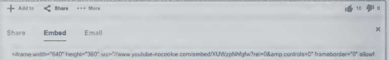

**上图：**嵌入YouTube视频只需简单的复制粘贴操作。

### 添加YouTube视频

添加YouTube视频比自己托管视频简单得多。如果是你自己制作的视频，那么你需要一个Google账户才能将素材上传到YouTube。不过一旦上传完成，将视频连接到你的页面就变得再简单不过了。

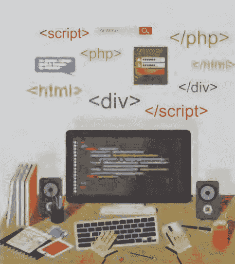

#### `<iframe>`元素

YouTube上的所有视频下方都有一个标记为"分享"的按钮。点击此按钮会显示一个面板，顶部有三个标签页，以及一个包含一些代码的字段。点击"嵌入"标签页将生成`<iframe>`的HTML代码，`<iframe>`是一个在你的网站与其他站点之间创建门户的元素。复制`<iframe>`代码并将其粘贴到你页面的HTML中：简单！

## 添加音频

HTML5新增的`<audio>`元素工作原理与`<video>`非常相似。与`<video>`一样，`<audio>`元素支持多个源文件，以提高浏览器和操作系统的兼容性。

### 音频格式

虽然你可能认为MP3音频文件无处不在，但授权许可问题意味着它们并非在所有操作系统上的所有浏览器中都受到支持（视频的情况也是如此，前文已经暗示）。不过，将你的音频内容同时包含MP3和Ogg-Vorbis格式应该能够覆盖所有情况。

> **热门提示**
>
> Ogg-Vorbis音频格式是Ogg-Theora视频格式的搭档。两者都是开源软件，因此可免费使用。访问http://vorbis.com获取信息和编码工具。

```html
4     <head>
6       <title>My Video Page</title>
7     </head>

9     <body>

11      <audio src="music/TheSentinel.mp3"></audio>

13      <audio>
14        <source src="music/TheSentinel.mp3" type="audio/mp3">
15        <source src="music/TheSentinel.oga" type="audio/ogg">
16      </audio>

18    </body>
```

上图：使用`<audio>`元素在页面中包含音频内容易如反掌。

## 超越基础

HTML5和CSS3代表了各自语言的重大进步。这里我们介绍这两种语言的一些更高级功能。全面讨论超出了本书的范围，但你应该了解这些功能。

## HTML5表单

HTML5强大功能的一个简单例子就是HTML表单。在HTML5之前，为Web创建表单通常涉及使用**JavaScript**进行编程。例如，如果你希望验证用户是否在**表单**中输入了合适的数据，唯一的方法是通过脚本实现。然而，HTML5表单具有内置的验证功能，为开发者节省了大量时间和复杂性。

**下图：**HTML5表单大大简化了用户输入的验证

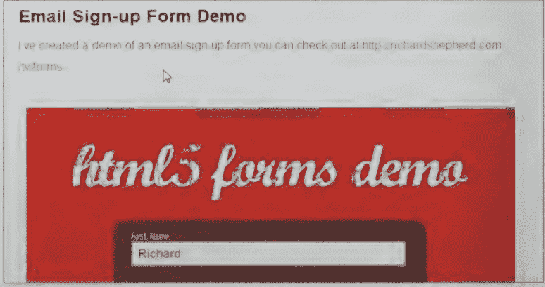

## HTML5拖放

拖放是计算机使用的基础，也是用户与屏幕对象交互的非常直观的方式。在HTML5中，将`draggable`属性添加到任何视觉元素并将其值设置为"true"，即可使该元素可拖动：``。处理此类交互仍然是JavaScript等脚本语言的工作。

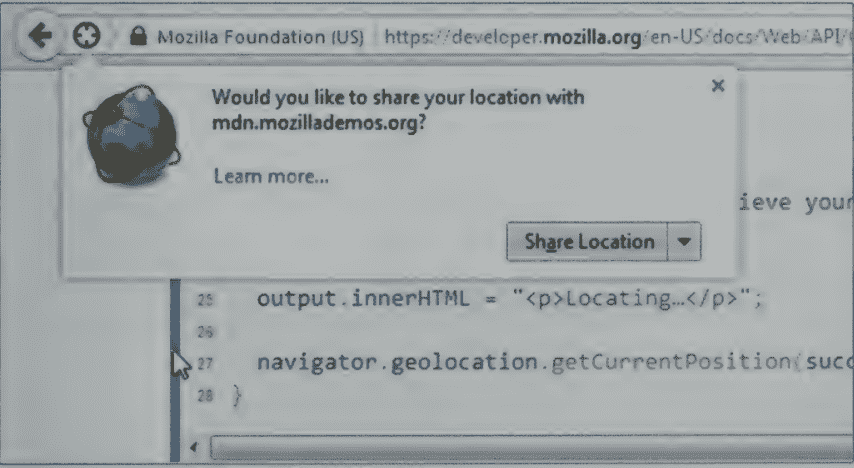

上图：系统将询问用户是否愿意与你的网站共享其地理位置数据。

## HTML5地理定位

HTML5地理定位功能用于通过用户的台式机或移动设备确定其位置。地理定位的一个常见用途是在移动设备上与地图集成。它用于各种需要获取你位置的服务，例如，获取从A地到B地的路线。

## CSS变换

变换用于操控HTML元素的视觉外观。例如，`rotate`样式属性将旋转元素。这使得将正方形变成菱形变得容易，例如。其他属性包括`scale`和`skew`。前者使元素变大，后者使元素倾斜。

## CSS过渡

过渡允许元素在指定的时间段内发生视觉变化。过渡属性的一个简单例子通常出现在按钮上。这些按钮会有一个初始背景色，当鼠标光标悬停在按钮上时会渐变为另一种颜色。如果使用得当，此类效果会为网站增添一丝精致感。

```css
7      <style>
8          div {
9              position:absolute;
10             width:100px;
11             height:100px;
12             background-color:red;
13         }
14         
15         #box {
16             left:200px;
17             top:200px;
18         }
19         
20         #rotatedBox {
21             left:400px;
22             top:200px;
23             transform:rotate(45deg);
24         }
25     </style>
```


**左图及上图：**变换允许调整元素的位置和方向。

### 过渡的工作原理

我们已经知道如何使用伪类选择器使`<a>`元素响应不同状态，例如当鼠标指针悬停在元素上时的`:hover`。你可能没有意识到的是，伪类选择器可以对任何视觉元素进行操作。这是触发过渡的关键；我们在伪类选择器的样式规则中定义过渡。

例如，如果我们有一个id为"homeButton"的元素，那么我们可以使用ID选择器在该按钮鼠标悬停时定位特定的样式规则。然后我们将在样式规则内定义过渡（见插图）。

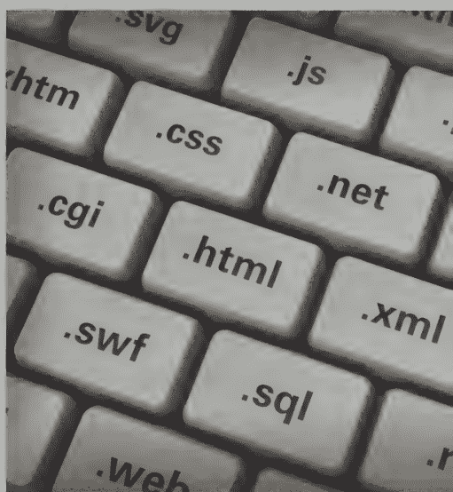

```css
19
20
21  #homeButton:hover {
22      transition-property:background-colour;
23      transition-duration:0.6s;
24      transition-timing-function:ease;
25      background-color:blue;
26  }
27
28
```

**上图：**有许多样式属性共同定义了过渡。


 ## 实用技巧

相关的 CSS 属性组通常有一个简写形式，可以用一行代码设置所有此类属性。例如，各种动画样式属性可以通过 `animation` 属性同时声明。

## CSS 关键帧 (KEYFRAMES)

关键帧是动画领域的一个概念。它们指定了一个时间点以及对象在该时间点的状态——关键帧之间的中间步骤随后可由计算机计算得出。在 HTML5 和 CSS3 出现之前，Adobe Flash 是在网页上创建关键帧动画的标准，但现在不再是了！

## 应用动画

动画几乎可以应用于网页中的每个元素。在这里，我们将演示如何让一个 `<div>` 元素在屏幕上移动的动画效果。

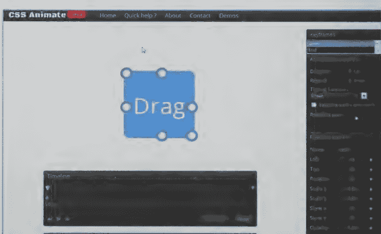

**上图：** CSS 动画随时间改变样式属性的值

## 创建简单动画

- 1. 创建一个新的 HTML 文档，添加基础结构元素 (`<html>`, `<head>` 和 `<body>`)，并在 `<head>` 中创建一个 `<style>` 元素。将文件保存为 movingbox.html。

```
1 <!DOCTYPE HTML>
2 
3 <html>
4 
5     <head>
6         <title>CSS Animation</title>
7         <style>
8         </style>
9     </head>
10 
11    <body>
12 
13    </body>
14 
15 </html>
16
```

- 2. 在 body 中添加一个 `<div>` 并为其赋予 id 为 'boxToMove'。在 `<style>` 元素中创建一个 ID 选择器，并定义一条样式规则，将 `<div>` 的尺寸设置为 100 x 100 像素，并赋予它一个背景颜色，以便我们在屏幕上看到它。

步骤 1：创建一个名为 movingbox.html 的基础文档。

- 3. 我们现在将动画代码添加到样式规则中。从插图中复制样式属性和值；样式属性名称是不言自明的。

```
7 <style>
8 
9     #boxToMove {
10        position:relative;
11        width:100px;
12        height:100px;
13        background-color:red;
14        animation-name:boxMover;
15        animation-duration:3s;
16        animation-iteration-count:infinite;
17    }
18 
19 
20 </style>
```

> **实用技巧**
> 并非所有浏览器都支持关键帧动画——如果对你不起作用，请尝试在 Firefox 中打开页面。

步骤 2 和 3：样式规则定义了 movingbox `<div>` 的外观及其动画属性。

4. 拼图的最后一部分是关键帧代码。它的声明方式是我们尚未研究过的，使用了 CSS '@' 声明，在本例中是 `@keyframes`。后面跟着的是动画的名称，与在 `animation-name` 样式属性中声明的名称相同。

```
7 <style>
8 
9 #boxToMove {
10 position:relative;
11 width:拓展000px;
12 height:100px;
13 background-color:red;
14 animation-name:boxMover;
15 animation-duration:3s;
16 animation-iteration-count:infinite;
17 
18 } 
19 
20 @keyframes boxMover {
21 0% {top:0px;}
22 25% {top:100px;}
23 75% {top:50px;}
24 100% {top:150px;}
25 
26 }
```

**步骤 4 和 5：** `@keyframes` 声明后的代码定义了哪些样式属性将产生动画，以及它们在不同时间点将取什么值。

5. `@keyframes` 声明之后的代码行定义了在不同时间点（以百分比表示）的样式属性及其值。我们使用的 `top` 样式属性决定了动画元素顶部与其包含块（在本例中为 `<body>` 元素）顶部之间的距离。

6. 保存你的工作并在浏览器中打开文件以查看结果。

## HTML 与 JAVASCRIPT

我们已经知道 HTML 创建页面的结构并定义其内容，而 CSS 控制该内容的视觉外观。脚本语言通过提供控制页面行为以及页面如何响应用户交互的手段，完善了这一整体。Web 端有多种脚本语言，但最主要的一种——内置在所有 Web 浏览器中——是 JavaScript。

## JAVASCRIPT 的位置在哪里？

早些时候，我们用房子的类比来描述 HTML 和 CSS，前者是砖块和灰浆，后者是装饰和饰面。

如果我们沿用这个类比，JavaScript（简称 JS）就像是一个智能家居控制系统，可以精细地控制房子的每一个方面。

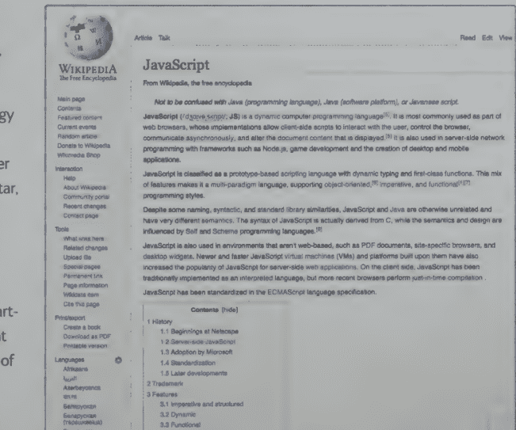

右图：JavaScript 是网页中最常用的脚本语言。

## 添加脚本

JavaScript 的复杂细节将在本书后面的章节中探讨，但让我们先快速看看如何将脚本添加到页面中，以便我们入门。有关此内容的更详细探讨，请参阅第 142 页。

### `<script>` 元素

与 CSS 类似，脚本可以嵌入到页面中，也可以外部引用。后者是更常用的方法，但两者都是通过 `<script>` 元素实现的：嵌入式脚本写在 `<script>` 的开始和结束标签之间；外部脚本位于单独的文本文件中，并使用 `<script>` 元素的 `src` 属性链接到页面。

下图：与 CSS 类似，脚本可以是嵌入式的或外部的。

```
<head>
    <title>Script Elements</title>

    <!--This is an external script.-->
    <script type="text/javascript" src="js/siteCore.js"></script>

    <!--This is an embedded script.-->
    <script type="text/javascript">
        var com;
        if(!com) {
            com = {};
        }
        if(!com.ukmastersdvd) {
            com.ukmastersdvd = {};
        }

        com.ukmastersdvd.resetContactForm = function() {
            document.getElementById("messageTitle").setAttribute("value", "");
            document.getElementById("messageTitleMessage").textContent = "";
            document.getElementById("senderAddress").setAttribute("value", "");
            document.getElementById("senderAddressMessage").textContent = "";
            document.getElementById("messageBody").textContent = "";
            document.getElementById("messageBodyMessage").textContent = "";
        }

    </script>

</head>
```


### 即见即执行

`<script>` 元素可以出现在网页的任何位置，并在浏览器遇到它时执行——也就是说，运行（见第 143 页）。因此，通常需要对整个页面都可用的脚本定义在 `<head>` 中，而那些在页面渲染时创建页面输出的脚本则放置在需要输出的位置。

### 深入理解

深入理解 JavaScript 可以让你的网站远远超越 HTML 和 CSS 的限制，将你的页面变成真正的 Web 应用程序，但这是一个深奥的主题，有很多需要学习的内容。在本书后面的章节中（见第 134 页），我们将探讨 JavaScript，为你提供一个学习这门迷人且复杂语言的绝佳起点。


# 高级 HTML & CSS 编码

## 高级文本

正如我们所学，HTML 不过是纯文本；它之所以能起作用，是因为 Web 浏览器能够识别在 HTML 中具有特殊含义的字符，例如 '<' 和 '>'。但如果我们想在页面的文本中使用这些特殊字符怎么办？

## 特殊字符

有许多字符如果直接输入到 `<p>` 等基于文本的元素中，会导致错误，且页面无法正确渲染（甚至完全无法渲染）。例如，我们可能希望在关于数学公式（或 HTML）的段落中包含尖括号，或者在引用某人的话时使用引号。问题在于，这些字符在 HTML 中具有特定的预定义含义，因此会被浏览器误解。

> ### 特殊字符
>
> “HTML 中有很多特殊字符，”那个男人说。“像 '<' 和 '>' 这样的字符不能直接输入到 HTML 文档的文本中。”他说。
>
> 他继续解释说，对于 ©、µ 等“扩展”字符也是如此。他解释道，带重音的拉丁字符（如 'Á' 和 'Ê'）也被归类为扩展字符。


### ASCII 和扩展字符

计算中使用的核心字符符号集被称为 **ASCII**（美国标准信息交换代码，读作 'ask-ee'）。这是一个定义了用于表示最常见字母、数字和标点字符的 **字符代码** 的标准。这类字符代码共有 128 个，所有计算机在这些字符代码上都遵循 ASCII 标准。

超出 ASCII 标准的字符（例如带重音符号的字母）被称为 **扩展** 字符，不应直接输入到 HTML 文本中。

**正确做法：** 所有计算机都使用 ASCII 标准来表示基础字母、数字和标点。

#### 小贴士

在内部，计算机用数字表示一切，这也包括文本。表示给定字母数字、标点或符号字符的数字被称为字符代码。

| 代码 | 字符 | 描述 |
|------|------|-------------|
| 00 | NULL | (空字符) |
| 01 | SOH | (标题开始) |
| 02 | STX | (正文开始) |
| 03 | ETX | (正文结束) |
| 04 | EOT | (传输结束) |
| 05 | ENQ | (查询) |
| 06 | ACK | (确认) |
| 07 | BEL | (响铃) |
| 08 | BS | (退格) |
| 09 | HT | (水平制表符) |
| 10 | LF | (换行) |
| 11 | VT | (垂直制表符) |
| 12 | FF | (分页) |
| 13 | CR | (回车) |
| 14 | SO | (移出) |
| 15 | SI | (移入) |
| 16 | DLE | (数据链路转义) |
| 17 | DC1 | (设备控制 1) |
| 18 | DC2 | (设备控制 2) |
| 19 | DC3 | (设备控制 3) |
| 20 | DC4 | (设备控制 4) |
| 21 | NAK | (否定确认) |
| 22 | SYN | (同步空闲) |
| 23 | ETB | (传输块结束) |
| 24 | CAN | (取消) |
| 25 | EM | (介质结束) |
| 26 | SUB | (代替) |
| 27 | ESC | (退出) |
| 28 | FS | (文件分隔符) |
| 29 | GS | (组分隔符) |
| 30 | RS | (记录分隔符) |
| 31 | US | (单元分隔符) |
| 127 | DEL | (删除) |

| 代码 | 字符 | 代码 | 字符 | 代码 | 字符 |
|------|------|------|------|------|------|
| 32 | space | 64 | @ | 96 | ` |
| 33 | ! | 65 | A | 97 | a |
| 34 | " | 66 | B | 98 | b |
| 35 | # | 67 | C | 99 | c |
| 36 | $ | 68 | D | 100 | d |
| 37 | % | 69 | E | 101 | e |
| 38 | & | 70 | F | 102 | f |
| 39 | ' | 71 | G | 103 | g |
| 40 | ( | 72 | H | 104 | h |
| 41 | ) | 73 | I | 105 | i |
| 42 | * | 74 | J | 106 | j |
| 43 | + | 75 | K | 107 | k |
| 44 | , | 76 | L | 108 | l |
| 45 | - | 77 | M | 109 | m |
| 46 | . | 78 | N | 110 | n |
| 47 | / | 79 | O | 111 | o |
| 48 | 0 | 80 | P | 112 | p |
| 49 | 1 | 81 | Q | 113 | q |
| 50 | 2 | 82 | R | 114 | r |
| 51 | 3 | 83 | S | 115 | s |
| 52 | 4 | 84 | T | 116 | t |
| 53 | 5 | 85 | U | 117 | u |
| 54 | 6 | 86 | V | 118 | v |
| 55 | 7 | 87 | W | 119 | w |
| 56 | 8 | 88 | X | 120 | x |
| 57 | 9 | 89 | Y | 121 | y |
| 58 | : | 90 | Z | 122 | z |
| 59 | ; | 91 | [ | 123 | { |
| 60 | < | 92 | \ | 124 | | |
| 61 | = | 93 | ] | 125 | } |
| 62 | > | 94 | ^ | 126 | ~ |
| 63 | ? | 95 | _ | | |

## 字符实体

针对这两种情况的解决方案被称为 **字符实体**（character entities）。要使用它们，你需要在 HTML 文本中输入一段特殊的小代码，在渲染时，它将显示为所需的字符。所有特殊字符和许多扩展字符都有各自专属的字符实体。

### 如何编写字符实体

字符实体由一个和符号 '&' 开头，随后是一个实体名称（例如 'quot'），最后以分号 ';' 结尾。因此，要创建一个引号字符，我们要输入 `&quot;` 而不是输入一个实际的引号。有趣的是，因为和符号本身就是一个特殊字符，你必须写成 `&amp;` 才能在页面的渲染文本中显示一个 '&'。

```html
26  <body>
27    <header>
28      <h1>Special Characters</h1>
29    </header>
30    <section>
31      <p>&quot;There are many special characters in HTML&quot; said the man. &quot;Characters such as '&lt;', '&amp;', '&gt;' can't be typed directly into the text of an HTML document.&quot; he said.</p>
32      <p>He went on to explain that the same was true of &quot;extended&quot; characters such as &copy;, &micro; and many more. Accented latin characters, such as '&Aacute;' and '&Egrave;' are also classed as extended characters, he explained.</p>
33    </section>
34  </body
35
```

**上图：** 所有特殊字符和许多扩展字符都由字符实体表示。

### 无名称实体

并非所有扩展字符都有预定义的字符实体，那么我们如何在页面中包含这样的字符呢？这时我们必须使用字符代码引用而不是实体名称——它看起来像这样：`&#x00A9;`（这会是一个 '©' 字符）。'#' 表示后面是字符代码，'x' 表示代码是以 Unicode 格式提供的。关于 Unicode 的讨论超出了本书的范围，但你可以在 http://unicode-table.com/en/ 查询任何字符的代码。

> ### 小贴士
> 字符实体的名称非常多。如果你的 HTML 编辑器支持代码提示，这将帮助你找到想要的那个。否则，请在方便的地方保存一个指向 http://dev.w3.org/html5/html-author/charref 的书签。


```html
26 <body>
27     <header>
28         <h1>Special Characters</h1>
29     </header>
30     <section>
31         <p>&quot;There are many special characters in HTML&quot; said the man. &quot;Characters such as &lt;, &amp;, '#' can't be typed directly into the text of an HTML document.&quot; he said.</p>
32         <p>He went on to explain that this was true of &quot;extended&quot; characters such as &copy;, &micro; and &lt;. Accented latin characters, such as &Aacute; and &Egrave; are also included characters, he explained.</p>
33     </section>
34     
35 </body
```

**上图：** 代码提示在寻找所需的字符实体时能提供巨大帮助。

## 自适应布局

构建网站不再仅仅是创建一个在台式机上看起来很棒的网站。移动设备（智能手机和平板电脑）现在被广泛用于网页浏览，这影响了我们布局和定义网页样式的方式。

```css
body {
    font-family:"Lato";
    font-size:14px;
}

#wrapper {
    width:80%;
    height:auto;
    margin-left:auto;
    margin-right:auto;
}

section {
    width:70%;
    height:auto;
    float:left;
}

aside {
    width:30%;
    float:left;
}

footer {
    width:100%;
    height:auto;
    float:left;
    background-color:lightgray;
    border-top:1px solid gray;
    padding-left:1%;
    padding-bottom:1%;
}
```

### 适配所有屏幕

在为各种大屏和小屏设备制作网站时，有几种选择。一种从互联网早期就开始使用的方法是比例布局——也称为“流式”布局（liquid layouts）。使用这种技术时，我们以百分比形式表示位置和尺寸。

这使得布局能够随浏览器窗口的大小而缩放。

> 左侧：将尺寸和位置表示为百分比，是使页面适应浏览器窗口尺寸的一种方法。

### 创建流式布局

在创建 `<div>` 或其他结构元素时，通常会用绝对值指定其宽度，例如 1000px（'px' 是你在 CSS 中用来表示像素的代码）。如果浏览器窗口的宽度小于这个值，那么页面的一部分将超出边缘，如果不滚动就无法看到。

用百分比指定尺寸可以在一定程度上解决这个问题，因为它保持了比例：如果一个 `<div>` 元素的宽度设置为 80%，那么它将始终是其包含块宽度的 80%。在页面中放置几个有颜色的 `<div>` 元素，看看它是如何工作的。

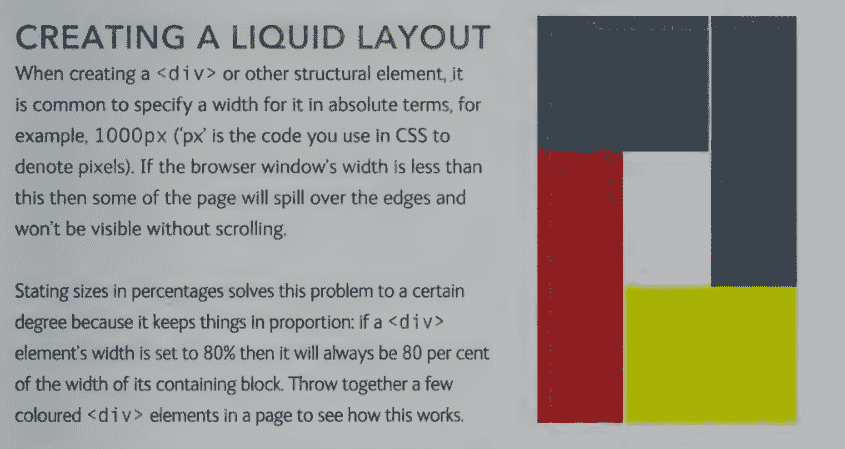
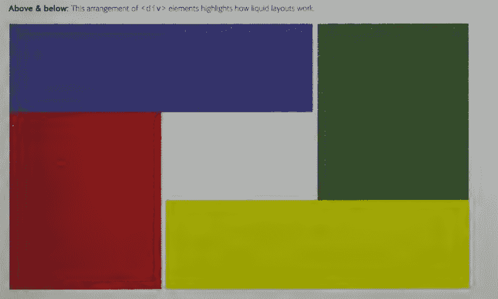

```html
2
3 <html>
4
5   <head>
6     <title>Untitled Document</title>
7   </head>
8
9   <body>
10
11      <header>
12        <!--The header element's containing block is the body element-->
13
14        <p>This p element's containing block is the header element</p>
15
16        <p>This is an inline image: 
17          it's a child of the p element</p>
18        <!--The containing block of the img element is also the
19          header because a p doesn't form a block-->
20
21      </header>
22
23    </body
24
25 </html
26
```

**上图：** 每个视觉元素都有一个包含块，该包含块被用作尺寸确定和定位的参考点。

**小贴士**
元素的包含块是该元素最近的、可用于尺寸确定和定位参考点的祖先元素。

### 流式布局的问题

流式布局技术开发于移动设备出现之前的时代，旨在应对当时计算机普遍采用的低分辨率显示器。然而，它正逐渐成为一种过时的产物，因为现代显示器通常足够大，可以容纳最大尺寸的设计。流式布局在移动设备上的表现也不太理想，这是由于此类设备内部管理屏幕缩放的方式决定的。因此，现代的方法是精心构建你的页面，使其在任何设备（无论是移动端还是台式机）上都能良好显示。


## 响应式网页设计

响应式网页设计（Responsive Web Design，简称 RWD）是一种使页面或站点能够自动适应其被查看的设备类型和尺寸的技术。

### 媒体查询

响应式网页设计是由所谓的**媒体查询（media queries）**驱动的。它们是 CSS 的一个组件，允许你使用直到页面加载到浏览器中才能确定其值的变量。因此，你不再是将 `<header>` 元素设置为例如 1000 像素宽，而是可以将其设置为始终匹配浏览器窗口的宽度，无论该窗口有多宽，如下所示：

```css
header {width:device-width;}
```

**下方：**《波士顿环球报》的网站是响应式网页设计的最初示例之一。

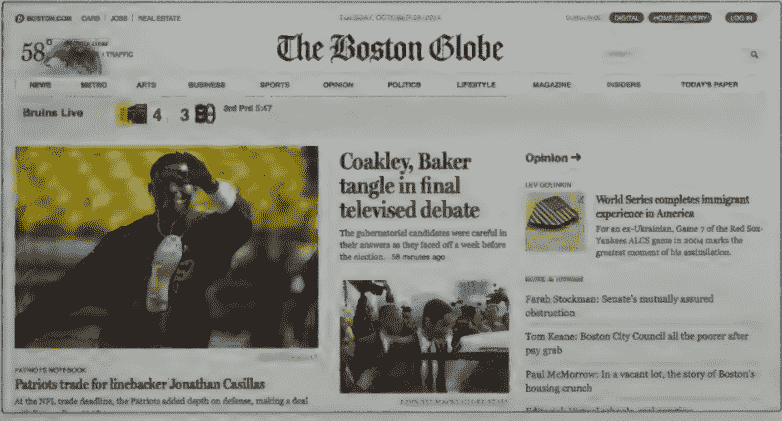

### 不同设备，不同样式表

桌面电脑、平板电脑和智能手机屏幕的宽度和分辨率各不相同。处理这种情况的方法是创建多个版本的样式表，每个版本都量身定制以支持特定类别的设备。浏览器随后将根据 `<style>`/`<link>` 元素的 `media` 属性值选择相应的样式表。

```html
<link
    rel="stylesheet"
    type="text/css"
    href="handheldSmall.css"
    media="handheld and max-device-width:480px"
/>

<link
    rel="stylesheet"
    type="text/css"
    href="handheldLarge.css"
    media="handheld and min-device-width:481px"
/>

<style media="all and not handheld">

    body {
        font-family:
        ...
    }

    #wrapper {
        width:1000px;
        height:auto;
    }
</style>
```

上方：浏览器可以根据其运行的设备类型选择样式表。

### 同样的内核，不同的外壳

各种样式表将包含相同的选择器，并且每个选择器的样式规则中将使用相同的样式属性。不同之处在于分配给样式属性的值。这意味着页面的整个布局将自动适应用户的设备。

### 获取响应式设计的帮助

目前有许多可用的框架，可以减轻构建自定义 RWD 站点过程中大部分繁重的工作，因此如果你想尝试一下，可以查看以下工具。

#### 框架

最受欢迎且功能最全的两个 RWD 框架是 Foundation 和 Bootstrap。它们提供了构建 RWD 站点所需的所有必要资源：菜单、图片轮播、按钮等等。可以同时查看两者，看看你更倾向于哪一个。

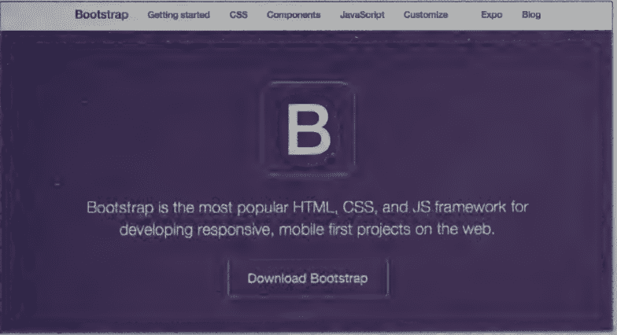

**上方：** 通过下载并尝试 Bootstrap 来快速入门 (http://getbootstrap.com)。

#### 响应式模板

对于那些想要创建响应式网站的人来说，框架是完美的解决方案，但你仍然需要学习如何使用它们。一个更简单快捷的解决方案是使用现成的模板，这样你只需要添加文本和图像即可创建完整的站点。可以尝试 HTML5 UP (http://html5up.net) 获取一些现代模板。

#### 值得尝试的 RWD 工具

在创建网站时，在尽可能多的屏幕上进行测试至关重要，但由于目前存在海量的不同屏幕尺寸，这并不总是可行。许多工具可以通过在桌面端模拟不同的设备屏幕来提供帮助。Screenfly 就是这样一个很好的工具示例；请访问 http://quirktools.com/screenfly 查看。

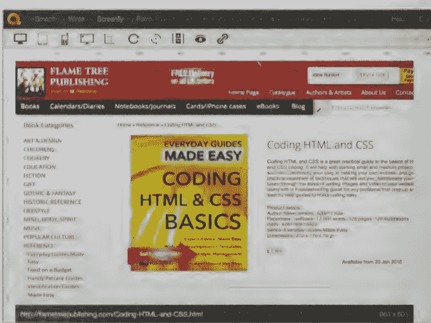

*上方：* 在无数的设备和屏幕上测试实时站点。

### 控制移动浏览器缩放

在页面尺寸调整方面，运行在移动设备上的浏览器与桌面浏览器的行为截然不同。这是因为移动设备在其物理分辨率和内部视口（viewport）尺寸之间进行缩放的方式不同。

#### 视口

移动浏览器的视口是其渲染页面视觉内容的区域。当页面加载时，此视口会进行缩放，旨在使视口适应设备屏幕的物理尺寸。当你用手指捏合进行放大和缩小时，实际上是在调整视口缩放；而当你滚动页面时，实际上是在移动视口。

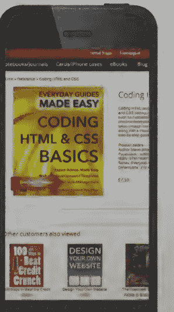


**右侧：** 视口可以（并且经常）扩展到屏幕可见区域之外。


#### 视口 Meta 标签

为了让浏览器为视口采用合适的初始缩放，我们必须让它知道我们希望它承担的尺寸；如果我们不这样做，将使用一个默认值，而该值可能合适也可能不合适。我们通过放置在页面 `<head>` 中的 `<meta>` 标签来设置缩放。

#### 视口属性

我们感兴趣的是 `content` 属性的值。它用于设置视口属性；在我们的示例中，我们告诉视口匹配设备的物理宽度。可用属性包括：`width`、`height`、`minimum-scale`、`maximum-scale`、`initial-scale` 和 `user-scalable`。

```html
5   <head>
6
7       <meta name="viewport" content="width=device-width">
8
9       <title>My First Web Page</title>
```

**上方：** 视口 meta 标签定义了移动浏览器采用的初始缩放。

### 浏览器支持

桌面端和移动端有大量浏览器，它们对 HTML5 和 CSS3 的支持程度各不相同。在桌面端，主流浏览器是 Chrome、Firefox、Internet Explorer 和 Safari，因此你应该尽量在至少这四个浏览器中测试你的所有站点。

#### 我应该支持哪些浏览器？

毫无疑问，桌面端应该支持 Chrome, Firefox, Internet Explorer, Safari 甚至是 Opera。问题是你应该支持哪个版本？通常的原则是，鼓励访问你网站的用户安装并使用他们首选浏览器的最新版本。

> **实用技巧**
> 
> 下载并安装主流浏览器，以便你可以在每个浏览器中测试你的页面。

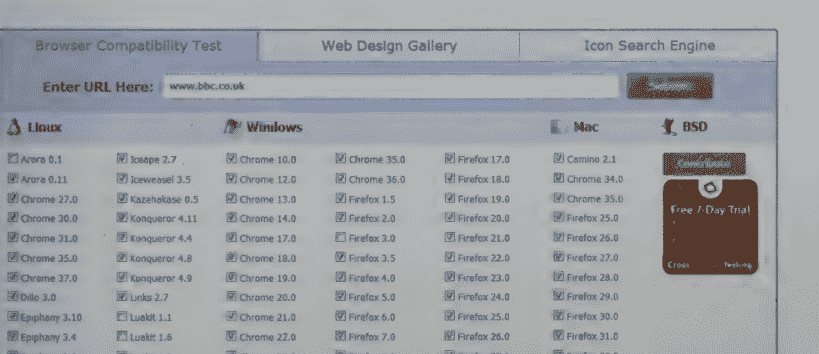

**上方：** 像 Browsershots 这样的浏览器兼容性工具可以帮助你测试站点。

## 故障排除

### 常见的 HTML/CSS 问题

在处理基于 Web 的技术时，始终会存在兼容性问题。这里我们回顾一些你在构建网站时可能会遇到的常见问题。

#### 网页在 Internet Explorer 中显示不正常

旧版本的 Internet Explorer 使用与其它浏览器不同的方法来显示某些 HTML 和 CSS 元素。然而，最新版本的 Internet Explorer 比之前的版本更符合标准。最好的解决方法是将代码尽可能保持简单。

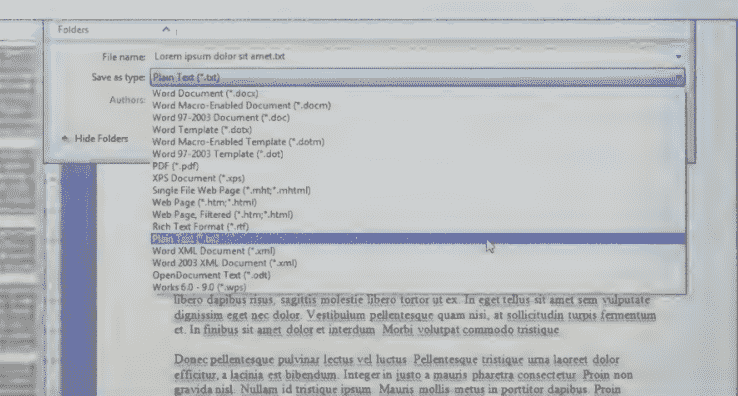

**上方：** 在将 Word 文档复制到 HTML 页面之前，请将其保存为纯文本。

#### 从 Word 复制文本会留下大量冗余文本

直接从 Word 文档将文本复制到网页中，还会带入大量 Word 应用于其文档的样式。你可以手动删除这些内容，但这非常耗时。一个简单的解决方案是将 Word 文档保存为纯文本文件，然后将文本复制并粘贴到网页中。

#### 为什么我的图片没有显示？

可能有多种原因，但首要任务是确保图片的 URL 使用了正确的路径、名称和文件扩展名。你可能使用了正确的图片名称但扩展名错误（例如，用 png 代替 jpg），或者没有提供正确的文件夹路径信息。

#### 如何检查我的 HTML 是否正确？

检查 HTML 和 CSS 错误最好的方法是使用在线验证工具，例如 W3C 官方验证器 http://validator.w3.org/。如果你使用 Dreamweaver 等 HTML 编辑器构建页面，它将内置验证工具。

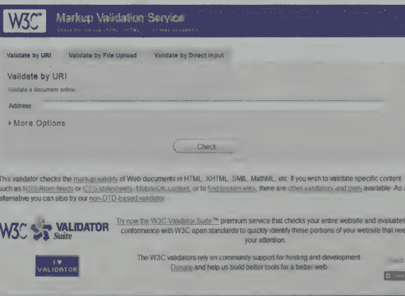

上方：使用验证工具或服务来测试你的 HTML。


### 为什么我的代码在桌面上无法运行？

你可能已经将所有的 HTML 和 CSS 都设置好并且运行正常，但当你添加一些新代码并在桌面上测试时，发现什么都没发生。第一步是检查所有代码或脚本是否指向了正确的位置。如果该部分没有问题，请将页面上传到你的 Web 服务器并从那里进行测试——有些代码只有在服务器上运行时才能生效。

### 图像加载非常缓慢

用户在网页上放置大文件尺寸的图像，然后通过 CSS 调整其大小，这种情况并不少见。如果再乘以十张图片，整个页面就会慢如蜗牛。


上图：使用在线图像优化工具来减小图像尺寸。

尝试优化你正在使用的图像；如果你没有图像编辑器，JPEGmini 在线服务就能帮上忙——[http://www.jpegmini.com](http://www.jpegmini.com)。

### 我的部分链接无法正常工作

链接对于网站导航至关重要，因此链接失效可能是一个大问题。首先要检查的是 `<a>` 元素及其 `href` 属性的 URL 是否都书写正确——如果 URL 中有一个错误，它就无法工作。如果你使用的是相对 URL，将其改为绝对 URL（以 `http://` 开头）可以解决该问题。

### 字体问题

计算机预装了 Arial、Helvetica 和 Georgia 等字体。但是，如果你使用的是不同的字体，它可能在用户的计算机上不可用，因此会使用替代字体。Web 字体解决了这个问题，但必须在正确的位置添加正确的代码。为了放心起见，请使用 Google Fonts——[https://www.google.com/fonts](https://www.google.com/fonts)。

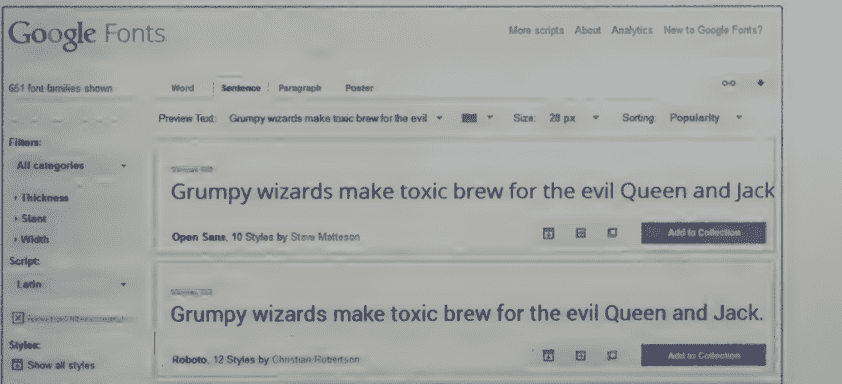
**上图：** Google Fonts 提供数百种不同的字体。


# 认识 JavaScript


## JavaScript、HTML 和 CSS

开发网页使用三种核心语言：HTML 提供底层结构和内容；CSS 提供视觉效果；而 JavaScript 呢？嗯，JavaScript 提供了让整个页面活起来的魔法。

### 在我们开始之前

本章和后续章节仅涉及 JavaScript，但该语言与 Web 浏览器和网页的联系如此紧密，以至于在讨论它时无法不大量依赖对 HTML 和 CSS 的先验知识。如果你还不具备这些知识，或者对这些主题有些生疏，最好阅读本书中关于 HTML 和 CSS 的章节。

> **热门提示**
> 如果在 HTML 和 CSS 的语境中，你理解诸如元素、属性、开始和结束标签、选择器和样式规则等术语的含义，那么你学习 JavaScript 就没有问题了。


**右图：** 如果你没有从头开始学习，本书前面的章节将帮助你理解 JavaScript。

### 浏览器兼容性

虽然核心 JavaScript 语言在所有主要浏览器中都得到完全支持，但使用高级或不常用功能时可能会出现问题，因为并非所有浏览器都支持 JavaScript 的所有扩展功能。有一些方法可以绕过这些问题，但遗憾的是，本书篇幅有限，无法一一介绍。

请参阅第 13 页，了解如何下载本书所有代码示例的完整版本。它们包含附加说明，有助于进一步解释这些示例。

#### Firefox

本书中的所有示例都使用标准的 JavaScript 编程技术和构造。然而，为了避开任何恼人的浏览器兼容性问题，我们将使用 Firefox 浏览器来运行所有示例，并鼓励你也这样做。


上图：Mozilla Firefox 是目前最符合标准的 Web 浏览器之一，且免费安装和使用。你可以从 www.mozilla.org 下载它。

## 什么是 JavaScript？

JavaScript 是一种脚本语言，用于与加载到 Web 浏览器中的页面进行交互和控制。它提供了丰富的功能，用于与用户、页面和互联网进行交互。


### 什么是脚本？

在戏剧世界中，脚本可以看作是一系列指示，告诉演员该站在哪里、该做什么和说什么，以及何时做和何时说。在计算机领域，含义非常相似：脚本是供计算机执行的一系列指令。是的，演员是屏幕上的图形和数据块，而不是一群戏剧演员，但原理是相同的。

*左图：* 脚本告诉演员该站在哪里、该做什么以及何时做——当然，这里的演员是计算机数据和图形。

### JavaScript 在客户端运行

重要的是要从一开始就理解，当在网页中使用 JavaScript 时，它是在用户——或客户端——的计算机上运行的，并与该计算机上加载到 Web 浏览器中的网页副本进行交互。这通常被称为"客户端"脚本。

#### Java 和 JavaScript

你可能听说过一种叫 Java 的语言，并认为它与 JavaScript 有某种关系——其实并没有。Java 在 JavaScript 开发时是一个热门话题，通过将该语言命名为 JavaScript，其开发者确保了它受到关注。然而，除了语法上有表面上的相似之处，这两种语言在本质上是不同且不相关的。

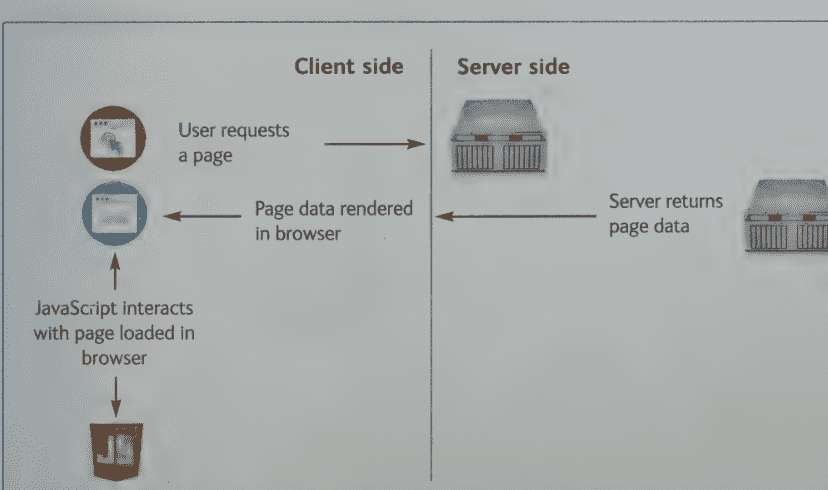
*上图：* JavaScript 直接与加载到用户浏览器中的页面进行交互。

## 为什么在页面中包含脚本？

在页面中使用脚本的原因几乎和使用脚本的页面一样多。但总的来说，使用脚本有两个关键原因：修改页面的外观；和/或允许页面与 Web 服务器之间的通信。

### 视觉变化

一些最常见——当然也是最明显的——脚本会根据页面编写时未知的条件来修改页面的外观。条件可以像是一天中的时间或用户鼠标指针的位置那样简单，也可以非常复杂。关键是，通过使用 JavaScript，我们可以确定某个条件是否已满足，然后针对该条件采取相应行动。

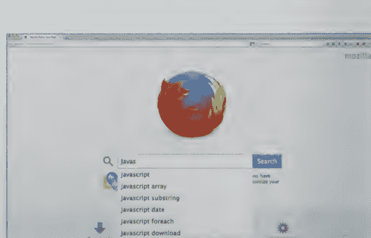
**右图：** 搜索引擎使用脚本在你输入时显示可能的搜索结果。

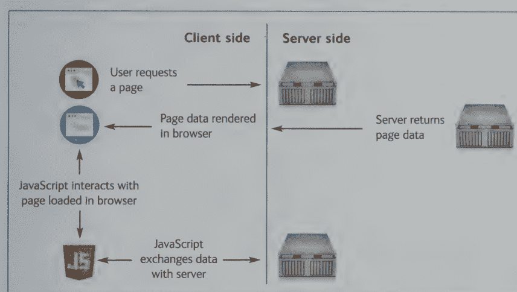
上图：JavaScript 可以从服务器获取数据并在浏览器中显示，而无需重新加载页面。

### 通信

在许多场景中，已加载的页面可能需要从服务器获取额外的数据。例如，许多搜索引擎在你在搜索字段中输入时会弹出建议列表——获取该列表是通过浏览器和服务器之间的脚本通信完成的。

### 在后台工作

并非所有脚本都会产生视觉输出——Google Analytics 就是一个完美的例子。该脚本监控关于页面访问（和访客）的各种指标：总访问量、独立访问量、访客的地理位置等。JavaScript 将这些数据发送回 Google 的服务器，页面所有者可以在那里查看和分析数据。


上图：Google Analytics 大量使用脚本在浏览器中的页面和 Google 的服务器之间传递数据。

## 编写 JavaScript

与 HTML 和 CSS 一样，JavaScript 是纯文本。这意味着编写 JavaScript 最简单的工具就是你的计算机操作系统内置的文本编辑器（Windows 上的 Notepad、Mac 上的 TextEdit 或 Linux 上的 Vi）。

### IDE

纯文本编辑器工作良好，但与功能齐全的 **IDE**（集成开发环境）相比就相形见绌了。IDE 不仅有助于编写脚本——加速你的工作并帮助发现错误——还有助于管理与网站或大型项目相关的众多文件。

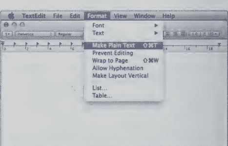
*上图：JavaScript 必须用纯文本文件编写——不要使用富文本！*

#### 流行的跨平台 IDE

- **Adobe Dreamweaver**：说到 Web 开发，Dreamweaver 是当之无愧的老大。在价格方面它也是老大，尤其是考虑到 Adobe 有争议的订阅制授权模式。请明智地权衡你的选择。www.adobe.com

> **热门提示**
> 如果你在 Mac 上使用 TextEdit 作为 JavaScript 编辑器，请务必在输入任何内容之前将所有新文档切换到纯文本模式。


-   **Komodo IDE**：这款功能齐全的商业 IDE 单一许可证售价为 $99/£67.75（截至撰写本文时），由于其简洁、整洁的界面和流畅的操作，广受欢迎。http://komodoido.com
-   **Komodo Edit**：Komodo IDE 的精简版本，可免费下载和使用，是探索 IDE 优势的绝佳选择。http://komodoido.com/komodo-edit/
-   **Eclipse**：这款功能强大的 IDE 支持多种语言，包括 HTML、CSS 和 JavaScript。它可免费下载和使用，但对于初学者来说可能会感到难以驾驭。www.eclipse.org

行号
帮助我们在大型脚本中快速定位

代码折叠
当不涉及的代码块时可避免干扰（注意行号的跳跃！）

代码提示
在你输入时显示上下文相关的函数、方法和属性的示意图列表

**上图：** IDE 为开发者提供了许多实用功能。

**内置参考信息**
一些 IDE 包含语言参考信息

**文件管理**
内置的文件管理功能对于较大的项目来说非常宝贵

## 将脚本添加到页面

我们通过使用 `<script>` HTML 元素将脚本添加到页面。该元素的 `type` 属性必须始终为 "text/javascript"。该元素应始终以结束标签 `</script>` 来关闭。

### 内嵌 JavaScript

要嵌入脚本，我们只需将脚本命令写在开始和结束的 `<script>` 标签之间。这样，脚本就与该页面以及该页面单独绑定在一起了。

```
1  <!DOCTYPE HTML>
2  <html>
3      <head>
4          <meta charset="UTF-8">
5          <title>Untitled Document</title>
6  
7          <script type="text/javascript">
8              //Embedded JavaScript code here
9          </script>
10  
11         <script type="text/javascript" src="js/myScript.js"></script>
12 
13     </head>
14 
15     <body>
16     </body>
17 </html>
```

### 链接 JavaScript

将脚本链接到页面是一种常见做法。为此，脚本被编写在一个单独的文本文件中，并以 .js 文件扩展名保存。然后通过 `<script>` 元素的 `src` 属性将脚本链接到页面。

**上图：** HTML `<script>` 元素可以包含内嵌脚本或链接到外部脚本文件。

例如：

```
<script
type="text/javascript"
src="myScript.js"></script>
```

**左图：** 将你的脚本存储在网站的子文件夹中——js 是这个文件夹的一个好名字。

## 当浏览器遇到脚本时会发生什么？

每当网页浏览器加载页面时，它会依次处理每个 HTML 元素，逐步完成页面的解析。

## 解释器

当浏览器遇到 `<script type="text/javascript">` 元素时，脚本的内容会立即传递给浏览器的 JavaScript **解释器**（称为执行脚本）。解释器的工作是理解脚本并指示浏览器执行相应的操作。

当解释器完成脚本的执行后，控制权返回给浏览器，然后浏览器继续处理页面。

右图：JavaScript 在页面加载时就地处理。

## 你的第一个脚本

1. 创建一个新的 HTML 文件，并添加基本结构元素 `<html>`、`<head>` 和 `<body>`。将文件保存在方便的位置，并将其命名为 myFirstScript.html。

2. 在 `<body>` 元素中添加一个 `<script>` 元素。在这个示例中，我们希望将开始和结束标签分别放在不同的行上，中间留一个空行。

3. 在脚本元素中输入以下命令：`document.write("<p>Hello World!</p>");`。该命令会向页面输出文本，就好像我们直接将其输入到页面中一样（这就是为什么我们还包含了 `<p>` 元素标签）。

4. 保存页面，然后在 Firefox 中打开它，可以通过双击文件或右键单击文件选择"打开方式"，然后选择 Firefox。

> **实用提示**

我们经常使用"代码"和"编码"这两个术语——前者指的是你输入到脚本中的文本，后者指的是编写脚本的过程。

```
1 <!DOCTYPE HTML>
2 <html>
3   <head>
4     <title>My First Script</title>
5   </head>
6
7   <body>
8
9     <script type="text/javascript">
10       document.write("<p>Hello World!</p>");
11     </script>
12
13   </body>
14 </html>
```

右图：问候，JavaScript！

### 工作原理

恭喜——你刚刚编写并执行了你的第一个脚本。当浏览器遇到 `<script>` 元素时，脚本被传递给解释器。解释器识别了 `document.write` 命令，并将括号中包含的文本（或者用编程术语来说，**圆括号**）写入页面。

文本必须包含在引号中，解释器才能将其识别为文本——如果你看到的只是一个空白页面，很可能是你遗漏了引号。

> **实用提示**

按照传统，关于编程语言的书籍通常使用"Hello World!"作为书中第一个练习的输出——现在你正式加入了开发者的行列！

**右图：** 你已经通过了入门测试——欢迎加入！

```
length;a++) { 0
s inp_array[a],
], word, inp_arra
s-')); a.reverse()
ufferedReader file
text;while (
ut println(text);
)(z[a-j] x[j];}}pu
tion right;public
(string words
(string st
leve
```

## JavaScript 中的数据

```
use_array(inp_array[a], c)
   _class:0}), b[b.length - 1]
 ); } a = b; input_words = a.
   = indexng.Exception{public s
   reader = new BufferedReader (ne
   text=file_reader.readLine(file_
   t a;for (int i=0;z[i]!='\0';i++)
   ic class Optimization{int val;Op
   ptimization(int x) { val = x; }p
   string[] sArray = words.replace("
   sArray) {System.out.println(line)
   der(Call, specs) {return null;}i.p
   a.util.*;import java.lang.*;import
   id main (String[] args) throws
   args){BufferedReader file_ m
   (System.in));string text;
   with())
   ;i.p...out pr...;i.pu...
```

## 什么是数据？

所有编程语言中的一个关键概念是数据。数据可以被看作是程序中使用的任何信息。

## 所有数据都有一个值

任何数据都可以被赋予一个**值**。这个值可以很简单——例如一个数字或一段文本——也可以很复杂，比如一个数字列表或多段文本。无论数据类型如何，由该数据所表示的信息被称为该数据的值。

### 字面量

**字面量**是一段具有特定值的数据，直接输入到脚本中。以下都是字面量的示例："Hello World"、true、42 和 null。

### 标识符

**标识符**是一个区分大小写的名称，被赋予一段数据（或一个函数——参见第 205 页的命名函数）。一旦被赋予，标识符就可以在脚本中用来引用该数据（或函数）。JavaScript 允许你自由选择用作标识符的名称，只要遵循一些基本规则即可。

```
3
4 myNumberLiteral = 42;
5 myStringLiteral = "Hello World";
6 myBooleanLiteral = true;
7 myNullLiteral = null;
8
9
```

上图：字面量值直接输入到脚本中。

### 标识符命名规则

-   **保留字：** JavaScript 定义了许多对该语言具有特殊含义的单词（参见第 174 页）。这些不能用作你自己的标识符名称。

-   **首字符：** 标识符的第一个字符必须是字母、下划线 '_' 或美元符号 '$'。

-   **后续字符：** 标识符中的其余字符只能是字母、数字、下划线或美元符号。

```
//Examples of legal identifiers
myValue
_myValue
MY_VALUE
$myvalue
my$Value23
my_$_value_23

//Examples of illegal identifiers
23myvalue
myValue*
my-value
#myvalue
my%value
my$Value
```

右图：第一组标识符都是合法的（换句话说，允许使用的）标识符，而第二组是非法的。


## 变量

本质上，变量是计算机内存中用于存储数据的一部分，并通过标识符来引用。

## 声明变量

在 JavaScript 中声明一个新变量非常简单——我们只需写关键字 `var`，后跟想要用来引用该变量的标识符。例如：
`var theAnswer;`

### 为变量赋值

通常，在声明变量时就为其赋值，如下所示：

`var theAnswer = 42;`

```javascript
//声明变量（不赋值和赋值）
var theQuestion;
var theAnswer = 42;

//为已声明的变量赋值
theQuestion = "Life, the Universe and Everything";
```

上图：变量很容易声明和使用。

### 改变变量的值

一旦用 `var` 声明了变量，我们可以这样改变赋给它的值：`theAnswer = 54`。注意这次我们没有包含 `var` 关键字。

**热门提示**
> 在 JavaScript 中，`=` 并不意味着等于——它意味着赋值（见第 180 页）。

## 获取变量的值

要使用存储在变量中的值，我们在需要使用该值的地方写上该变量的标识符名称。

- 1. 创建一个新的 HTML 文档，添加常见的结构元素（`<html>`、`<head>` 和 `<body>`）。将文档保存为 `gettingVariables.html`。

- 2. 按照以下方式，在 `<body>` 元素内（即作为其子元素）添加一个 `<script type="text/javascript">` 元素。

```html
1 <!DOCTYPE HTML>
2 <html>
3   <head>
4     <title>Getting Variables</title>
5   </head>
6
7   <body>
8
9     <script type="text/javascript">
10
11     </script>
12
13   </body>
14 </html>
```

上图：步骤 2：添加 `<script type="text/javascript">` 元素。

- 3. 添加如下所示的 JavaScript 代码。
- 4. 保存您的工作，然后在 Firefox 中打开该文件。

```javascript
10 <script type="text/javascript">
11   var theMessage = "The alert function displays a message in a dialog box.";
12   alert(theMessage);
13   theMessage = "Here we're just changing a variable's value...";
14   alert(theMessage);
15   theMessage = "...and passing that variable's identifier to the alert function.";
16   alert(theMessage);
17   theMessage = "The interpreter then looks up the variable's value...";
18   alert(theMessage);
19   theMessage = "...and that's what we see in the dialog box. Simple, eh?";
20   alert(theMessage);
21 </script>
```

上图：步骤 3：添加 JavaScript 代码。


**上图：** 计算机数据本质上就是数字。

## 数据机制

与 C 和 Java 等底层编程语言不同，JavaScript 不需要程序员参与数据如何在计算机上存储的细节——解释器为我们管理这些复杂事务。

**热门提示**
> 二进制和十六进制数字系统与计算机表示数字和数据的方式有着本质联系——如果你不知道它们的工作原理，可以在维基百科上查一下。

然而，你仍然应该认识到，你的计算机所做的一切——你写的每封电子邮件、你听的每首歌曲、你观看的每个视频——都是由数字表示的。因此，在最基本的层面上，所有计算机数据都只是数字。

## 数据类型

JavaScript 处理的所有数据都有一个数据类型。这指定了正在处理的数据的性质——无论是数字、文本、列表等等。

### 什么是数据类型？

为了将一段数据转化为任何有用的东西，计算机或程序必须知道数据旨在表示什么——它必须知道数据的类型。因为数据存储在变量中，我们通常说变量具有数据类型，或者说是某某类型。因此数据类型分为两组：原始类型和引用类型。让我们看看这意味着什么。


**上图：** 数据类型定义了计算机存储的原始数字的含义。

### 原始数据类型和引用数据类型

**原始（Primitive）** 数据类型可以理解为那些数据代表单个值的类型，例如一个数字；而 **引用（reference）** 数据类型则代表复杂数据，例如一个列表。

当脚本中使用原始类型的变量时，解释器会复制该变量的值并在计算中使用这个副本。相比之下，当使用引用类型的变量时，解释器直接使用存储在内存中的数据。

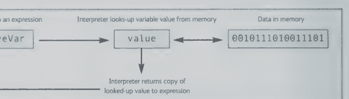
原始数据类型

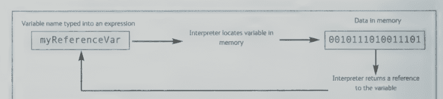
引用数据类型

**上图：** 原始数据类型返回其内存中值的副本；引用类型返回对其内存中值的直接引用。

#### 理解原始数据类型和引用数据类型之间的区别

- 1. 创建一个新的 HTML 文档，包含常见的结构元素（`<html>`、`<head>` 和 `<body>`）。将文件保存为 `datatypes.html`。

**热门提示**
> 从现在起，我们不会告诉你基本 HTML 文档要添加哪些常见元素——你现在应该已经知道了。

- 2. 在 `<body>` 元素内（即作为其子元素）创建一个 `<script>` 元素，确保将 type 属性设置为 "text/javascript"，如下所示）。

```html
1 <!DOCTYPE HTML>
2 <html>
3 <head>
4 <title>Exploring Primitive and Reference Datatypes</title>
5 </head>
6 
7 <body>
8 <script type="text/javascript">
9 
10 
11 </script>
12 
13 </body>
14 </html>
```

**上图：** 步骤 2。

```javascript
8 <script type="text/javascript">
9 document.write("<h2>PRIMITIVE DATATYPES </h2>");
10 var primitiveVar1 = 72;
11 var primitiveVar2 = primitiveVar1;
12 document.write("<p>primitiveVar1 has value " + primitiveVar1 + "</p>");
13 document.write("<p>primitiveVar2 has value " + primitiveVar2 + "</p>");
14 var primitiveVar2 = 12;
15 document.write("<p>primitiveVar1 now has value " + primitiveVar1 + "</p>");
16 document.write("<p>primitiveVar2 now has value " + primitiveVar2 + "</p>");
17 </script>
```

**上图：** 步骤 3：将此代码输入到您新的 `<script>` 元素中。

- 3. 在这个新的 script 元素中输入上图所示的代码。

- 4. 保存您的工作，然后在 Firefox 中打开 `datatypes.html`。

- 5. 如您所见，尽管我们将 `primitiveVar1` 赋值给了 `primitiveVar2`，但当我们改变 `primitiveVar2` 的值时，`primitiveVar1` 的值并未改变。换句话说，每个变量引用一个独立的值。

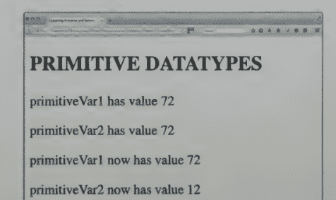

**上图：** 步骤 5：脚本的输出显示了这两个变量是如何表现的。

```javascript
var primitiveVar2 = 12;
document.write("<p>primitiveVar1 now has value " + primitiveVar1 + "</p>");
document.write("<p>primitiveVar2 now has value " + primitiveVar2 + "</p>");

document.write("<h2>REFERENCE DATATYPES </h2>");
var referenceVar1 = {};
referenceVar1.myValue = 72;
var referenceVar2 = referenceVar1;
document.write("<p>referenceVar1.myValue has value " + referenceVar1.myValue + "</p>");
document.write("<p>referenceVar2.myValue has value " + referenceVar2.myValue + "</p>");
referenceVar2.myValue = 12;
document.write("<p>referenceVar1.myValue now has value " + referenceVar1.myValue + "</p>");
document.write("<p>referenceVar2.myValue now has value " + referenceVar2.myValue + "</p>");
```

上图：步骤 6：将此代码添加到您的编辑器中。

- 6. 返回您的编辑器，添加上方所示的新代码（旧代码已变暗）。这里我们使用 **对象** 作为引用数据类型——这些内容从第 39 页开始讨论。

- 7. 保存您的工作，并在 Firefox 中启动该页面。

- 8. 注意改变 `referenceVar2.myValue` 的值如何也改变了 `referenceVar1.myValue` 的值。这是因为 `referenceVar1` 和 `referenceVar2` 都指向内存中的同一数据，所以改变其中一个也会改变另一个。

#### 区分原始类型和引用类型

记住这一区别很重要——不这样做可能会导致 JavaScript 应用程序中出现一些重大错误。好消息是，你会发现它很快 becomes second nature very quickly。

```javascript
<body>
    <script type="text/javascript">
        var playerObjectTemplate = {};
        var player1 = playerObjectTemplate;
        player1.playerName = "Sarah";
        player1.startingScore = 4;
        var player2 = playerObjectTemplate;
        player2.playerName = "Steven";
        player2.startingScore = 12;
        alert(player1.playerName); //Alert box will say "Steven", not "Sarah"
        alert(player1.startingScore); //Alert box will say 12, not 4
    </script>
</body>
```

上图：此脚本不会按预期工作，因为所有变量都指向同一个对象——亲自试一试看看。


## 原始数据类型

让我们来看看原始数据类型。请记住，这些类型的变量代表单个值。

### 布尔型

布尔型表示计算机数据的单个**位**，因此它是存在于最基础的数据类型。布尔型的值可以是`false`或`true`，在计算机中分别表示为`0`或`1`。

### 数值型

一般来说，在计算中，数值有两种类型：整数和浮点数。前者是整数，后者是涉及分数或指数成分的数，例如 3.14 或 0.945x10^7。JavaScript 并不关心这种区别——数字就是数字。


### 字符串型

字符串是文本数据——不要纠结为什么它们被称为字符串（这涉及到一些我们不必要担心的技术细节），只需知道字符串就是文本，文本就是字符串。

在脚本中书写字符串时，它们必须被引号包围。可以是单引号'或双引号"（我们将使用后者），但至关重要的是，字符串必须由与开头相同风格的引号来闭合。

空字符串——即不包含任何字符的字符串——通常写作一对引号：

' ' 或 " "。

> **热门提示**
> 如果字符串由单引号'包围，它可以包含双引号"，反之亦然。

```html
<!DOCTYPE HTML>
<html>
	<head>
		<title>Using Quotes in Strings</title>
	</head>

	<body>
		<script type="text/javascript">
			var anyString = ""; //"" creates an empty string
			anyString = 'A string can be demarked by single quotes...';
			anyString = "...or it can be demarked by double quotes.";
			anyString = 'A string demarked by single quotes "can" contain double quotes';
			anyString = "A string demarked by double quotes 'can' contain single quotes";
		</script>

	</body>
</html>
```

上图：字符串中使用引号的不同方式

### 不存在的数据

JavaScript 有两种数据类型用于表示不存在的数据。null 类型，其值也是 null，表示没有值——如果标识符的值为 null，它不包含任何有效数据，或者更可能的是，它尚未被声明。第二种类型是 undefined，其值也是 undefined，与 null 略有不同——它是任何已声明但尚未赋值变量的初始类型和值。

## 数组

**数组**是一种引用数据类型；在 JavaScript 中，数组是值列表的说法。有两种创建数组的方法。

### 书写数组字面量

我们可以通过书写数组字面量来创建数组，像这样：

```javascript
var myArray = [value_1, value_2, ..., value_n]
```

```html
<!DOCTYPE HTML>
<html>
    <head>
        <title>Array Examples</title>
    </head>
    
    <body>
        <script type="text/javascript">
            var emptyArray = [];
            var numbersArray = [42, 12, 57, 3.14, 901582, 5];
            var stringsArray = ["Harry", "Sue", "Julia", "Chris", "Oliver"];
            var mixedArray = ["Oliver", true, false, 5];
            var arraysArray = [emptyArray, numbersArray, stringsArray, mixedArray];
        </script>
    </body>
</html>
```

**上图：** 数组存储其他数据的列表（包括其他数组）。

方括号[ ]标记数组的开始和结束，而存储在数组中的值——即其**元素**——用逗号分隔，可以是任何数据类型。要创建空数组，只需输入不含元素的括号。

### 使用 New 关键字创建数组

我们也可以使用 new 关键字来创建数组：`var myArray = new Array();`。初始元素可以用逗号分隔，放在括号内。（我们在第 50 页讨论关键字。）

### 数组长度

数组中元素的数量称为其长度。如果我们有一个名为`myArray`的数组，可以通过输入`myArray.length`来获取其长度。

```html
<!DOCTYPE HTML>
<html>
  <head>
    <title>Array Examples</title>
  </head>

  <body>
    <script type="text/javascript">
      var userNames = new Array("Helen", "Amrit", "Geoff", "Jacques");
      var userLogins = new Array();
      alert(userNames.length) //Displays '4' in the alert dialog
      alert(userLogins.length) //Displays '0' in the alert dialog
    </script>
  </body>
</html>
```

上图：数组可以使用 new 关键字创建，并且总是具有长度。

### 访问数组元素

数组中的每个元素都有一个**索引**，这是一个指代元素在数组中位置的数字。第一个元素的索引为 0，第二个元素的索引为 1，依此类推。要访问数组的特定元素，我们编写数组变量的名称，后跟用方括号包裹的索引编号。例如，如果我们想使用数组`myArray`的第三个元素（索引 2），我们写`myArray[2]`。

> 数组元素可以包含你喜欢的任何数据类型——包括其他数组。

### 向数组添加元素

我们也可以使用方括号为数组元素赋值。例如，要设置数组`myArray`的第八个元素（索引 7），我们可以输入`myArray[7] = 19`。如果第八个元素已经包含数据，它将被新值覆盖。或者，如果数组的长度小于 8，将创建新元素，同时也会创建任何必需的空白元素，以填充未修改数组的最后一个元素与新添加元素之间的间隙。

```html
<body>
	<script type="text/javascript">
		var userNames = new Array("Helen", "Amrit", "Geoff", "Jacques");
		var userLogins = new Array();
		//Get array element values...:
		alert(userNames[0]); //Displays 'Helen' in the alert dialog
		alert(userNames[3]); //Displays 'Jacques' in the alert dialog
		//Set array element values...:
		userLogins[0] = ["Amrit", "Monday"]; //Assign array to 1st element of userLogins
		userLogins[2] = ["Helen", "Tuesday"]; //Assign array to 3rd element of userLogins
		//Get undeclared array element value...:
		alert(userLogins[1]);	//Displays 'undefined' in the alert dialog, I.E. the element
									//exists - it was created for us - but it has not had a
									//value assigned to it
	</script>
</body>
```

上图：我们可以使用方括号访问表示法来访问数组元素，包括获取和设置值。


### 向数组追加元素

数组的`push()`方法使我们能够将元素追加到该数组的末尾（我们在第 102 页讨论方法）。例如，如果我们希望将字符串 "Harry" 追加到数组 firstNames 中，我们可以这样写：`firstNames.push("Harry")`。

```html
<body>
    <script type="text/javascript">
        var userNames = new Array("Helen", "Amrit", "Geoff", "Jacques");
        alert(userNames.length); //Displays '4' in the alert dialog
        userNames.push("Oliver");
        alert(userNames.length); //Displays '5' in the alert dialog
        alert(userNames[4]); //Displays 'Oliver' in the alert dialog
    </script>
</body>
```

上图：数组的 push 方法在数组末尾添加一个元素

### 从数组中移除元素

我们可以使用`shift()`方法移除数组中的第一个元素，或者使用`pop()`方法移除最后一个元素。无论使用哪种方法，它都会返回被移除的值。

```html
<body>
    <script type="text/javascript">
        var userNames = new Array("Helen", "Amrit", "Geoff", "Jacques");
        userNames.push("Oliver");
        alert(userNames.length); //Displays '5' in the alert dialog
        var firstNameInArray = userNames.shift();
        alert(firstNameInArray); //Displays 'Helen' in the alert dialog
        alert(userNames.length); //Displays '4' in the alert dialog
        var lastNameInArray = userNames.pop();
        alert(lastNameInArray); //Displays 'Oliver' in the alert dialog
        alert(userNames.length); //Displays '3' in the alert dialog
    </script>
</body>
```

> 上图：数组的`shift()`和`pop()`方法分别移除第一个和最后一个元素。

### 其他数组方法

数组还有许多其他用于操作其内容的方法——这里无法一一涵盖。如需完整列表，请访问 www.w3schools.com/js/js_array_methods.asp。

## 对象

对象类型（一种引用数据类型）的变量是可以存储多个值的变量。然而，与基于索引访问的数组不同，对象将值存储在命名的**属性**中（通常称为属性-值对）。


对象在 JavaScript 中扮演着特殊的角色——它们是构建所有其他 JavaScript 数据的基本基石。每一种其他数据类型都继承了对象数据类型的基本特性。因此，我们经常将任何及所有 JavaScript 数据都称为对象——例如，字符串对象或数组对象。这种继承的概念是面向对象编程的基础，这是一种与 JavaScript 紧密相关的编码方法，我们将在第 219 页对其进行介绍。

> **实用技巧**

存储在对象属性中的值可以是任何数据类型，包括其他对象或数组。

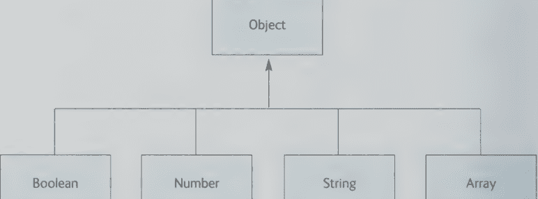

**上图：** 所有 JavaScript 对象都构建在对象数据类型之上。

## 创建对象

我们可以通过声明对象字面量或使用 `new` 关键字来创建对象——让我们两种方法都试一下。

1. 创建一个包含通用结构元素的新 HTML 文档。在 body 元素的子级添加一个 `<script type="text/javascript">` 元素，然后将文档保存为 `JavascriptObjects.html`。

```
<body>
    <script type="text/javascript">
        var quizQuestion1 = new Object();
        quizQuestion1.question = "Approximately how far is the Sun from the Earth?";
        quizQuestion1.answer = "93,000,000 miles";
        quizQuestion1.wrongAnswer1 = "200 miles";
        quizQuestion1.wrongAnswer2 = "49,000,000 miles";
        quizQuestion1.wrongAnswer3 = "150,000 miles";
    </script>
</body>
```

上图：步骤 2：将此处显示的代码输入到你的 HTML 文档中。

2. 输入上述插图所示的代码。这段代码使用 `new` 关键字创建了一个空对象，然后在该对象上声明了若干属性。

3. 输入下方插图所示的新代码，其中我们使用对象字面量表示法创建对象：每个属性名后面跟着一个冒号和一个值；属性-值对由逗号分隔；整个字面量被包裹在大括号（{}）中。

```
quizQuestion1.wrongAnswer2 = "49,000,000 miles";
quizQuestion1.wrongAnswer3 = "150,000 miles";

var quizQuestion2 = {
    question:"How many planets orbit the Sun?",
    answer:"8",
    wrongAnswer1:"6",
    wrongAnswer2:"7",
    wrongAnswer3:"9"
};
</script>
```

上图：步骤 3：输入此处高亮显示的代码。

4. 最后，我们再次声明一个对象字面量——但这次是一个空对象，可用于存储在我们创建的对象中定义的问题的答案。见下方插图。

```
var quizQuestion2 = {
    question:"How many planets orbit the Sun?",
    answer:"8",
    wrongAnswer1:"6",
    wrongAnswer2:"7",
    wrongAnswer3:"9"
};

var userAnswers = {};
```

上图：步骤 4：在这里，你将创建一个空对象。

5. 保存你的工作。如果你在 Firefox 中启动此页面，你不会看到任何视觉输出，但这没关系——目前这更多是一个编码和思考练习，但随着我们的进度，我们将在此基础上进行构建。

6. 注意我们如何在两个 `quizQuestion` 对象中创建相同的属性名结构——以这种方式创建和复用对象结构是面向对象编程的一个关键原则，我们将在第 219 页讨论。

## 实用技巧

管理属性名的规则与所有标识符的规则相同——见第 149 页。

```
23
24        var userAnswers = {};
25
26
27        alert(quizQuestion1.question);
28        alert(quizQuestion2.question);
29
30        </script>
31        </body>
32    </html>
33
```

上图：访问存储在对象属性中的值非常简单。

## 访问对象属性

如果我们有一个对象 `myObject`，并在其上定义了一个属性 `myProperty`，我们可以通过输入 `myObject.myProperty` 来访问该属性。这个 `.` 被称为**点运算符**（见第 177 页）。

## 数据类型转换

在许多场合，你需要将一种类型的值在另一种类型的上下文中运行。例如，你可能希望使用数字的字符串表示形式（用 "42" 代替 42），或者你可能需要在布尔值的上下文中用一个数字。这种在数据类型之间进行转换的操作被称为数据类型**强制转换（casting）**。


## 隐式转换

JavaScript 在管理数据类型方面非常积极，它会根据使用它们的上下文自动在类型之间进行转换（示例见第 179 页）。

## 显式转换

我们也可以显式地转换某些数据类型，最常见于在字符串和数字之间进行转换。例如，要将数字转换为字符串，我们会写 `String(42)`，结果为 "42"。反之，要将字符串转换为数字，我们会写 `Number("42")`，结果为 42。

```
var myNumber = 42;
var myString = "549";
var myName = "Sajid";

var test1 = myNumber + myString;
alert(test1); //Shows '42549' in the alert box

var test2 = myNumber + Number(myString);
alert(test2); //Shows '591' in the alert box

var test3 = myString + myName;
alert(test3); //Shows '549Sajid' in the alert box

var test4 = myNumber + Number(myName);
alert(test4); //Shows 'NaN' in the alert box

var test5 = String(myNumber) + myName;
alert(test5); //Shows '42Sajid' in the alert box
```

**上图：** 这段代码强调了我们为什么要以及如何显式地在数据类型之间进行转换。

## 特殊的 NaN 数字

并非所有值都能转换为数字——例如，字符串 "foo" 没有数字含义。

如果我们把这个字符串转换为数字，我们将得到结果 `NaN`（Not a Number，非数字）。尽管名称如此，它确实是一个数字，并且可以在任何允许或期望数字的地方使用。然而，任何包含 `NaN` 的计算结果始终为 `NaN`。


## 不同数据类型转换的结果

该表显示了不同数据类型之间转换的结果。阅读该表的方式为“从行标题转换为列标题”。

| | 布尔值 (Boolean) | 数字 (number) | 字符串 (string) |
| :--- | :--- | :--- | :--- |
| **布尔值 (Boolean)** | - | *false* 为 0, *true* 为 1 | *false* 为 "false", *true* 为 "true" |
| **数字 (number)** | 0 为 *false*, 其余为 *true* | - | 数字的字符串表示 |
| **字符串 (string)** | "" 为 *false*, 其余为 *true* | 字符串的数字表示, 或 NaN | - |
| **null** | *false* | 0 | "null" |
| **undefined** | *false* | NaN | "undefined" |
| **数组 (array)** | *true* | 空数组为 0, 含元素的数组为 NaN | 以逗号分隔的元素值列表 |
| **对象 (object)** | *true* | NaN | "object Object" |


## JAVASCRIPT 剖析

```javascript
function ArrayUnique(array) #colorSte
ength; ++i) { for(var j=i+1; return false; j<a.length
window.status = if(a[i] === a[j]) a.splice(j--, 1); } }
cument.getElementArrayGo ("@percent1 +"('Che
y(arg) timerID = setTimeout document.getElemen
cs = arg; var while(args>1) sdss = document;+res
arg2.toString(); ("dumdiv"); if(sdss == colorStep =
; a_fase = (b_fase - dayBreak)*24; +":"+sec.text-if
tChild.data;+res1.toString(); var if(args == 1 &&窗台
n.+res1.toString(); firstChild);for(var i=0; i<n; i++)
teElement("Blind");else if(res1 == 999) sec-fid1=
e(str.charAt(i))); span.appendChild(theSpan);} }
1=window.setTimeout if(percent < 100) timeol
nerHTML=ct :break; Math.abs(deg)); chek.res1 =
ring (i+1,data.length)); res1.length; Math.abs(Col
s1 = 0; =(hsp return(data.substring(0,i)); : sort.c
gth; light.span=span; function changeColor.functi
(sd)) Math.abs(spd)); x=Math.floor res1 = windo
ength; charm.brt=(brt if(percent1 < 100){ docu-
oute("Source", ct) 121:Math.abs(brt)%calc(re);doc
y) hrsold = Math.floor(e_hrsold); document.myform.
ge.moveColor(); } ChargerSpan.prototype.for(va
e = sd.substring(0,window.status="sd.length-1);
eold (data.substring(i+1,data.length)); =themes- o
if(h<500){color=val+=colorShift[x].chaTable(counte
){else久了 if(h<120){ color=Math.floorfunction colorTak
[60)*b); red=b-color;green=blue-fun(a);deNoise=0; }
```

## JAVASCRIPT 语法

一个脚本可以由单条指令组成，也可以是一部包含数千行代码的巨著。但无论规模大小，JavaScript 中的所有脚本都共享一套共同的结构和语法。

## 大小写敏感性

首先需要注意的是，JavaScript 是大小写敏感的，也就是说，小写字母被认为与对应的大写字母截然不同。例如，标识符 "myVariable" 与 "MyVariable" 是不同的（请注意大小写的区别）。

```javascript
30  com.flametreepublishing.SimpleQuiz.prototype.loadQuestions = function() {
31      //QUESTION 1
32      this.questions.push(
33          new com.flametreepublishing.QuizQuestion(
34              1,
35              "Approximately how far away from the Earth is the Sun?",
36              ["200 miles", "93,000,000 miles", "49,000,000 miles", "150,000 miles"],
37              1
38          )
39      );
40      //QUESTION 2
41      this.questions.push(
42          new com.flametreepublishing.QuizQuestion(
43              2,
44              "How many planets are there in our Solar System?",
45              ["6", "7", "8", "9"],
46              2
47          )
48      );
49      //QUESTION 3
50      this.questions.push(
51          new com.flametreepublishing.QuizQuestion(
52              3,
53              "Which of these is a Moon of Jupiter?",
54              ["Ganymede", "Miranda", "Enceladus", "Mars"],
55              3
56          )
57      );
58  }
```

上图：缩进的代码更易于阅读，因为它有助于在视觉上将相关的代码段分组。

## 空白字符

JavaScript 会忽略前导空格和制表符（tabs）。这使得我们可以在代码中使用**缩进**，这是一种有助于让代码更有组织且更具可读性的技巧。

## 分号

JavaScript 语句通常以分号 (;) 结尾，但并非强制要求。在省略分号的地方，解释器会假定换行符标志着语句的结束。然而，省略分号可能会导致代码出现歧义，因此最佳实践是为每个语句都以分号结尾。

```javascript
1 //Inline comments start with '//' and end at the next line break
2
3 var userScore = 0; //They can be written on the same line as other code
4
5 //alert(userScore); //They can also be used to disable lines of code
6
7
8
```

**上图：** 内联注释在随后的换行符处结束。

## 注释

**注释**是脚本中被解释器忽略的部分。注释用于给脚本添加笔记和解释，帮助他人理解代码，并在编写数月后重新审视脚本时作为自己的提醒笔记。

### 内联注释

内联注释以 // 开始，一直持续到下一个换行符。它们可以单独占据一行，也可以放在其他 JavaScript 代码之后的同一行中。

> **实用技巧**
>
> 注释通常用于禁用脚本的某些部分 —— 在尝试新想法或试图追踪 Bug 时非常有用。

### 块注释

```javascript
1 /*Unlike inline comments, block comments continue
2 until the end-of-comment symbol is typed.
3 The end-of-comment symbol looks like this: */
4
5 com.flametreepublishing.commentsExample = function(itemData) {
6   /*A block comment can be a single line too*/
7   this.itemId = itemData.itemId;
8   /* We can include block comments wherever we like
9   They're very useful for disabling sections of code
10   when experimenting with new code, or when hunting
11   for bugs.*/
12   //We can also mix different comment styles in the same document.
13
14   //Notice how some of the code below is 'commented-out':
15   this.myElement = document.createElement("div");
16   this.myElement.id = itemData.itemId;
17   /* this.myElement.className = "menuItem";
18   this.linkType = itemData.linkType;
19   this.linkData = itemData.linkData;
20   this.isSelected = false;
21   this.isRollover = false;
22   */
23   this.posterImage = itemData.posterImage;
24   //add icon element
25   switch(this.linkType) {
26     case "video":
```

块注释以 /* 开始，直到出现结束符号 */ 为止。这两个标记之间的所有内容都被视为注释的一部分。

上图：块注释可以跨越多行。

## 关键字与保留字

JavaScript 定义了一组预定义的标识符，称为**关键字**，以及其他在未来可能会被纳入语言的标识符。这些统称为**保留字**，你不能将它们用作自定义标识符的名称（也不能用作对象内部的属性名）。

| 关键字 | 保留字 |
| :--- | :--- |
| break, case, catch, continue, | abstract, boolean, byte, char, class, |
| default, delete, do, else, false, | const, debugger, double, enum, |
| finally, for, function, if, in, | export, extends, final, float, goto, |
| instanceof, new, null, return, | implements, import, int, interface, |
| switch, this, throw, true, try, | long, native, package, private, |
| typeof, var, void, while, with | protected, public, short, static, |
| | super, synchronized, throws, |
| | transient, volatile |

## 表达式与运算符

你在脚本中编写的指令是由表达式组成的。通常，表达式使用运算符来以某种方式操纵数据。

### 什么是表达式？

表达式是解释器可以求值的任何代码片段，通常会产生一个值。这个宏大的描述掩盖了该概念的简单性 —— 考虑以下内容：42。严格来说，除了是一个字面量外，它也是一个表达式 —— 解释器可以对其求值，得出十进制数值 42。诚然，这算不上一个很复杂的表达式 —— 它相当于在编程中走向一位同事并说“42”；她会明白你陈述了一个数值，但她完全不知道你希望她用这个值做什么。

```javascript
42
"Hello World"
true
null
```

左图：解释器可以求值所有这些表达式；但它们没什么意义。

```javascript
$("#User_logged").val(a);
function(a);

function collect(a, b) {
    for (var c = 0;c < a.length;c++)
        use_array(a[c], a) < b && (a[c] = b);
    return a;
}
function new_user(a) {
    for (var b = "", c = 0;c < a.length;c++) {
        b += " " + a[c] + " ";
    }
    return b;
}
$("#User_logged").bind("DOMAttrModified",function(){});
// ...
```

```javascript
1  38 + 4
2
3  "Hello " + "World"
4
5  myVariable = true
6
7  quizQuestion.questionText
8
9  getMyValue()
10
11  myObject.doSomething()
12
```

上图：运算符赋予了表达式意义和目的。

### 增强表达能力

现在考虑表达式 38 + 4。这一次，在对表达式求值时，解释器将 38 和 4 相加 —— 结果与之前的例子相同（数值 42），但我们通过将两个值求和实现了一些功能。

延续之前的类比，你对同事说“38 加 4”，而她回答“42”。产生差异的关键在于引入了**加法运算符** `+`。

### 什么是运算符？

正如我们刚刚看到的，为了使表达式具有意义，它通常包含一个运算符；运算符定义了表达式中的数据应如何被求值，以便为该表达式获得一个结果值。


## 操作数

在运算符的上下文中，被处理的值被称为**操作数**。许多运算符期望两个操作数，分别位于运算符的两侧（称为左操作数和右操作数）。其他一些——称为一元运算符——仅处理单个操作数，还有更少的运算符处理三个或更多操作数。

## 众多的运算符

JavaScript 运算符有很多——多得无法在这里全部介绍——因此我们只关注最常见的几种。

### 点运算符

我们已经见过点运算符 `.` ——它使我们能够访问对象的属性（以及方法——见第 226 页）。左操作数是对象的引用，而右操作数是该对象的属性或方法的名称。

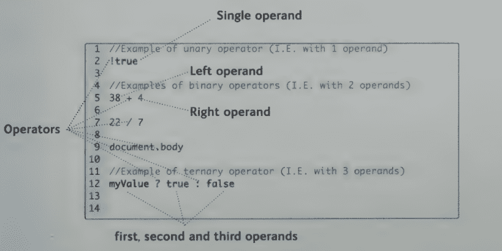

**上图：** 操作数就是运算符要，嗯，操作的那些值。

### 算术运算符

算术运算符使用提供的操作数执行算术运算，并返回计算结果。操作数必须是数字，或是求值为数字的表达式。

> **小贴士**
> 访问 https://en.wikibooks.org/wiki/JavaScript/Operators 以获取 JavaScript 运算符的完整列表。

| 运算符 | 操作数数量 | 名称 | 作用 | 示例（结果在括号内） |
| :--- | :--- | :--- | :--- | :--- |
| + | 2 | 加法 | 将左右操作数相加 | 4 + 5 (9) |
| - | 2 | 减法 | 左操作数减去右操作数 | 31 - 14 (17) |
| * | 2 | 乘法 | 将左右操作数相乘 | 12 * 3 (36) |
| / | 2 | 除法 | 左操作数除以右操作数 | 12 / 3 (4) |
| ++ | 1 | 自增 | 将作为唯一操作数的标识符的值加 1 | numUsers ++ (numUsers 增加 1) |
| -- | 1 | 自减 | 将作为唯一操作数的标识符的值减 1 | numUsers -- (numUsers 减少 1) |

### 字符串运算符

有几种不同的运算符可以处理字符串，但只有一种是专门为字符串设计的：

| 运算符 | 名称 | 作用 | 示例（结果在括号内） |
| :--- | :--- | :--- | :--- |
| + | 连接 | 将两个字符串连接在一起，返回结果字符串 | "Hello" + "World" ("Hello World") |

请注意，连接运算符看起来和加法运算符一样——解释器根据操作数的数据类型来推断使用哪个运算符。如果两个操作数都求值为数字，则 `+` 是加法；如果任一操作数求值为字符串，则 `+` 是连接。此外，如果连接运算符的操作数求值为数字，它将被转换为字符串（见第 43 页的数据类型转换）。

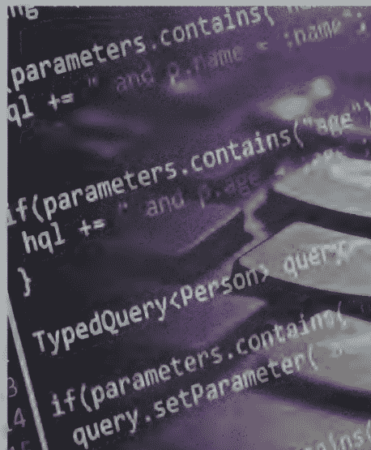

> **小贴士**
> 在我们的表格中未列出“操作数数量”的地方，可假设它们是二元运算符——即它们期望两个操作数。

### 赋值运算符

我们已经见过这个运算符，它的左操作数始终是变量或属性引用，而右操作数可以是任何字面量、标识符或表达式。

| 运算符 | 名称 | 作用 | 示例（结果在括号内） |
| :--- | :--- | :--- | :--- |
| = | 赋值 | 将右操作数的值赋给左操作数指示的变量或属性 | myVar = 42 (myVar 现在的值为 42) |

### 相等运算符

这些运算符比较两个操作数，并返回 `true` 或 `false`（见第 33 页的布尔值）。操作数可以是任何数据类型。

> **小贴士**
> 务必完全理解赋值运算符 `=` 和相等运算符 `==` 之间的区别。

| 运算符 | 名称 | 作用 | 示例（结果在括号内） |
| :--- | :--- | :--- | :--- |
| == | 相等 | 如果两个操作数相等则返回 true，否则返回 false | 4 == 2 (false) |
| != | 不等 | 如果两个操作数不相等则返回 true，否则返回 false | 4 != 2 (true) |

### 比较运算符

顾名思义，比较运算符比较两个操作数并返回 `true` 或 `false`。操作数可以是任何数据类型。

| 运算符 | 名称 | 作用 | 示例（结果在括号内） |
| :--- | :--- | :--- | :--- |
| <, <= | 小于，小于或等于 | 如果左操作数的值小于（或等于）右操作数的值，则返回 true，否则返回 false | 52 < 20 (false) 19 <= 19 (true) |
| >, >= | 大于，大于或等于 | 如果左操作数的值大于（或等于）右操作数的值，则返回 true，否则返回 false | 52 > 20 (true) 12 >= 360 (false) |

### 逻辑运算符

逻辑运算符比较值，然后返回 `true` 或 `false`。如果需要，操作数将被转换为布尔值。

| 运算符 | 操作数数量 | 名称 | 作用 | 示例（结果在括号内） |
| :--- | :--- | :--- | :--- | :--- |
| && | 2 | 逻辑与 | 如果两个操作数都求值为 true，则返回 true，否则返回 false | `true && false` (false) |
| \|\| | 2 | 逻辑或 | 如果任一操作数求值为 true，则返回 true，否则返回 false | `true \|\| false` (true) |
| ! | 1 | 逻辑非 | 置于其唯一操作数之前；反转操作数的布尔值 | `!true` (false) |

```javascript
7  <body>
8      <script type="text/javascript">
9          var jsResult = 20 - 4 * 3;
10         document.write("<p>20 - 4 * 3 equals " + jsResult + "</p>");
11         var possResult1 = (20 - 4) * 3;
12         document.write("<p>(20 - 4) * 3 equals " + possResult1 + "</p>");
13         var possResult2 = 20 - (4 * 3);
14         document.write("<p>20 - (4 * 3) equals " + possResult2 + "</p>");
15     </script>
16 </body>
```

**上图：** 探索 JavaScript 的运算符优先级规则

## 运算符优先级

考虑以下代码：`20 - 4 * 3`。这意味着 `(20 - 4) * 3`（求值为 48）吗？还是意味着 `20 - (4 * 3)`（求值为 8）？JavaScript 通过为每个运算符分配**优先级**来处理这个问题——优先级最高的运算符最先求值；优先级最低的运算符最后求值。为什么不写个脚本看看上面哪种是正确的解法呢？


### 覆盖运算符优先级

记住每个运算符的优先级可能相当具有挑战性，因此使用括号来覆盖默认的运算符优先级通常更容易且歧义更少。

括号内的任何表达式都会在语句中的所有其他表达式之前求值。考虑以下表达式：`( 24 - 2 ) / 7`。括号内的部分 `( 24 - 2 )` 首先求值，结果 22 然后除以 7。


IDE 检测到由缺失括号引起的语法错误
这个左括号没有匹配的右括号

**上图：** 此示例中的第二个表达式导致语法错误。

### 嵌套括号

你会经常发现自己需要将括号嵌套在括号内，例如 `( ( 24 - 2 ) + 10 ) / 7`。在这种情况下，最深层嵌套的表达式首先求值，然后是次深嵌套的，依此类推。

> **小贴士**
> 嵌套括号时，务必确保每个左括号 `(` 都匹配一个右括号 `)`。如果不匹配，则会发生语法错误。

## 语句

在 JavaScript 结构的顶层，我们找到语句。所有 JavaScript 指令都包含在语句中。

### 什么是语句？

JavaScript 语句封装一个或多个表达式，可以看作是脚本中的一个离散步骤或指令。脚本中的每个语句在处理下一个语句之前都会完全执行。

### 构造一个语句

考虑以下简单表达式：`playerScore = 0;`。虽然这是一个表达式，但它也是一个语句，如结尾的分号 `;` 所示。语句不需要比这更复杂，但它们通常更复杂。


**上图：** 语句包含一个或多个表达式


### ## 复合表达式

我们经常会在一个语句中构建相当复杂的表达式堆栈，例如：

```
document.getElementsByTagName("body")[0].appendChild(document.
createElement("p")).innerHTML = "Hello World!";
```

这个语句演示了表达式是如何组合的。它使用了在第 109 页介绍的 DOM 编程技术，实现了与我们编写的第一个脚本相同的结果。


**上图：** 语句通常由复合表达式构建而成。

### 热点提示

像本页所示的复杂语句，通常写起来比读起来容易得多。事实上，一旦你掌握了 JavaScript，你可能会发现编写这类语句有一种奇妙的满足感——甚至是一种艺术感。

### 在复杂度与可读性之间取得平衡

重要的是要意识到，像上面那样冗长且复杂的语句，很容易被分解为一系列较短、较简单的语句。我们所做的只是将表达式分摊到更多的语句中。然而，为了在不同的语句之间共享表达式的结果，我们需要将每个语句的结果存储在一个变量中，以便其他语句能够访问这些值。

### 在速度与可读性之间取得平衡

创建和管理变量会增加解释器的工作负载，因此包含多个表达式的复杂语句通常比将其分解为多个语句执行得更快。因此，虽然决定将语句设计得简单还是复杂在很大程度上取决于个人偏好，但你确实需要考虑应用程序对性能的敏感程度。

```
<script type="text/javascript">
	//这个复合语句...
	document.getElementsByTagName("body")[0].appendChild(document.createElement("p")).innerHTML = "Hello World!";
	//...与以下一组语句的效果相同
	var bodyElementsArray = document.getElementsByTagName("body");
	var bodyElement = bodyElementsArray[0]; //记住，只有一个 body 元素
	var newPara = document.createElement("p");
	newPara.innerHTML = "Hello World!";
	bodyElement.appendChild(newPara);
</script>
```

上图：复杂语句可以被分解为独立的语句——也可以不分解。

```
1: 决定泡几杯茶 - 将这个数字设为 C
2: 将水壶从底座上拿起
3: 在水壶中倒入足够泡 C 杯茶的水
4: 多加半杯水，以弥补水蒸发造成的损失
5: 将水壶放回底座
6: 打开水壶开关
7: 打开放杯子的橱柜
8: 从橱柜中取出 C 个杯子
9: 将杯子放在水壶旁的桌子上
10: 关闭橱柜
11: 打开茶叶罐
12: 从罐中取出 C 个茶包，每个杯子放入一个
13: 打开冰箱
14: 从冰箱中取出牛奶，放在水壶旁的桌子上
15: 关闭冰箱
16: 等待水壶烧开
```

上图：完美的茶饮！

## 语句块

相关的语句可以被组合在一起形成一个块。这是通过将语句包裹在花括号中实现的——即大括号：{ 和 }。例如：

```
{
  var playerScore = 0;
  var playerName = 'Sarah';
  var playerAge = 29;
}
```

这种技术有其用途，但目前实现的功能不多。然而，正如我们将要发现的，随着我们深入研究 JavaScript，语句块将变得越来越重要。

### 热点提示

思考如何将常见任务（例如泡杯茶）分解为一系列简洁、明确的指令，是练习构建 JavaScript 表达式和语句结构艺术的一个绝佳方法。

## 条件语句

我们经常需要根据在页面加载到浏览器中且用户与之交互之前并不存在的条件来执行不同的语句。这时我们就需要用到条件语句。

## IF 语句

通过 `if`，我们测试某个条件是否存在，如果该条件成立，则执行表达式。其基本形式如下：

```
if(condition) expressions;
```


上图：简单的 `if` 语句流程图

## 使用 IF 语句

当解释器遇到 `if` 语句时，它会计算括号内表达式的值。如果该表达式的结果为 `true`，则执行 `if` 之后的语句。

## If 语句如何工作

让我们通过一个简单的例子来看看 `if` 语句是如何工作的：

1. 创建一个新的 HTML 文档并输入标准的结构元素。将页面保存为 ifExample.html。
2. 创建一个新的 `<script>` 元素作为 `<head>` 元素的子元素（即在其中）。我们在 `<head>` 中声明它是为了确保它在 `<body>` 元素渲染之前就可用。
3. 在这个 `<script>` 元素中添加一个简单的变量声明：`var userAge = 36;`。虽然我们手动为该变量分配了值，但请想象这是用户实际提供的信息。参见右侧插图。
4. 添加另一个 `<script>` 元素，这次作为 `<body>` 元素的子元素。将下面插图所示的代码复制到这个新的 `<script>` 元素中。
5. 保存你的工作，然后在 Firefox 中打开 ifExample.html。

```
<!DOCTYPE HTML>
<html>
  <head>
    <title>If Example</title>

    <script type="text/javascript">
      var userAge = 36;
    </script>

  </head>
```

上图：步骤 3：在此处添加一个简单的变量声明。

```
<body>
  <script type="text/javascript">
    if(userAge > 16) alert("This is a kids zone - not for grown ups.");
  </script>

</body>
```

上图：步骤 4：按照上述文本描述使用这段代码。


上图：if 条件表达式计算为 true，因此我们看到了警报消息。


上图：为 if 语句添加语句块

### 工作原理

if 语句的条件表达式将 userAge 的值与字面量 16 进行比较。因为 userAge 的值为 36，且 36 大于 16，所以 if 条件计算为 true，随后执行后续表达式。

### 执行多个语句

上述形式的 if 在条件为真时只能执行单个语句，但我们经常需要执行多个语句。为此，我们在条件表达式之后添加一个语句块（参见第 63 页的“语句块”）。通用形式如下：

```
if(condition) {
    statement_1;
    statement_2;
    ...
    statement_n;
}
```

现在，如果条件计算为 true，语句块（即 if 语句的主体）中的所有语句都将被执行。

### Else 子句

基本的 `if` 语句可以通过添加 `else` 子句来扩展（我们称之为子句，因为它是一个较大的 `if` 语句的子部分，且在 `if` 语句之外没有任何意义）。通用形式如下：

```
if(condition) {
  statement(s);
} else {
  statement(s);
}
```

当 `if` 语句的条件计算为 `false` 时，执行 `else` 之后的语句块。为什么不试着给最后一个编程练习（第 65 页）添加一个 else 子句呢？

### 热点提示

语句块的左花括号可以直接跟在条件表达式的右括号后面，也可以单独起一行，甚至可以放在第一个语句之前。这取决于你。


右图：当条件表达式计算为 false 时，触发 else 子句。


### Else If 子句

如果之前的测试计算为 false，我们可以引入一个新的条件测试。通用形式如下：

```
if(condition)
{
    statement(s);
} else if(condition) {
    statement(s);
}
```

我们可以根据需要添加任意数量的 else if 子句，并且可以用一个最终的 else 子句结尾，该子句仅在所有前面的条件都计算为 false 时执行。

上图：else if 子句为 if 语句增加了更多的条件测试。

### 嵌套 IF 语句

else if 子句创建了一种在编程中非常常见的分支逻辑结构。但请注意：随着分支的增加，此类结构会变得越来越复杂——我们通常可以通过采用不同的条件语句来完全避免它们。


## switch 语句

使用 `switch` 语句类似于 `if` 语句，但它不是测试条件是 `true` 还是 `false`，而是基于条件表达式的结果来选择要执行的代码块。需要测试的值在 `case` 部分指定。其一般形式为：

```
switch(condition) {
  case label_1:
    statement(s);
    break;
  case label_2:
    statement(s);
    break;
  ...
  default:
    statement(s);
    break;
}
```

## switch 语句的工作原理

当解释器遇到 `switch` 语句时，它会计算条件表达式，然后在语义块中查找与条件结果匹配的 **case 标签**。如果找到匹配项，则执行其后所有语句，包括包含在后续 `case` 部分中的语句。

上图：switch 语句的流程。


### 从 case 部分跳出

为了防止后续 case 部分被执行，我们在每个 case 的末尾包含一个 break 关键字。这告诉解释器停止处理语义块，并在块后的第一条语句处恢复执行。

#### 实用提示

如果你发现 if-else-if 语句结构变得过于笨重难以管理，那么 switch 语句可能是更合适的方法。

### 默认 case

switch 语句可以包含一个特殊的 default 部分，如果遇到该部分，它总是会被触发。这通常放在 switch 的末尾，这样只有当没有 case 标签与条件表达式匹配时才会被选中。

```
<script type="text/javascript">
    //假设页面上存在一个名为 mediaObject 的对象。
    //mediaObject 可能引用视频文件或音频文件，
    //但在编写代码时我们不知道它具体是哪一个。
    switch(mediaObject.mediaType) {
        case "video":
            alert("您即将访问一个视频");
            //导致视频加载和播放的语句
            break;
        case "audio":
            alert("您即将访问一段音频录制");
            //导致音频加载和播放的语句
            break;
        default:
            alert("无法确定媒体类型");
    }
</script>
```

## 循环语句

我们经常需要对一组不同的值运行相同的一组语句，或者重复执行某些语句特定次数——这就是循环的用武之地。

## while 循环

循环语句的最简单形式称为 while 循环。其一般形式为：

```
while(condition) {
    statement(s);
}
```

如果条件计算结果为 true，则执行条件后代码块中包含的语句，然后再次测试条件。如果仍为 true，则重复该过程。此过程持续直到条件计算结果为 false。

> 实用提示
注意：如果你错误地编写循环，可能会触发无限循环，即解释器会无限期地卡在处理同一个循环语句上。


## do...while 循环

这些循环与 while 循环非常相似，只是条件仅在语义块执行后才被计算。如果条件结果为 true，则重复语义块并再次计算条件。其形式如下：

```
do {
  statement(s);
} while(condition);
```

## for 循环

for 循环通常用于处理数组的元素，因为它简化了对数组中每个元素执行相同语义块的操作。for 循环的声明看起来可能有点令人生畏——让我们在分析其含义之前先看一下：

上图：do...while 循环的流程。

```
for(initialize ; condition ; iteration ) {
  statement(s);
}
```

### for 循环的组成部分

for 循环的三个组成部分是控制循环重复的表达式：

- **initialize**：此表达式被计算一次，并为循环创建一个初始索引；索引只是一个数字，通常用于计算已发生的循环迭代次数。
- **condition**：这是被测试以查看循环是否重复的表达式。在大多数情况下，条件表达式会测试索引的值是否与其他值（如数组的长度）匹配。
- **iteration**：此表达式在循环的语义块执行后被计算，其预期用途是在下一次迭代之前修改索引的值。


**上图：** for 循环的流程。

### 使用 for 循环

在第 41 页的练习中，我们创建了两个表示测验问题的对象——我们将在此基础上继续。

1.  创建一个新文件夹并将其命名为 SimpleQuiz。创建一个子文件夹并将其命名为 js——这将是我们存储外部脚本文件的位置。

2.  创建一个包含通用结构元素的新 HTML 文档，并将其保存在新文件夹中，文件名为 simpleQuiz.html。同时创建一个新的 JavaScript 文档并将其保存在 js 子文件夹中，文件名为 quizQuestions.js。


上图：为测验应用程序创建一个外层文件夹和脚本子文件夹，并将文件保存在其中。

3.  返回到 HTML 文档。在 `<head>` 元素下添加一个 `<script>` 元素，将其

```
<!DOCTYPE HTML>
<html>
  <head>
    <title>A Simple Quiz</title>

    <script type="text/javascript" src="js/quizQuestions.js"></script>
  </head>

  <body>
  </body>
</html>
```

上图：步骤 3：将此处显示的代码添加到您的 HTML 文档中。

type 属性设置为 "text/javascript"，src 属性设置为 "js/quizQuestions.js"。请参见下图。

4.  转到 quizQuestions.js，我们将在此定义问题本身。在文件顶部，声明一个名为 questions 的数组变量。

5.  现在我们将通过在 push() 方法的括号内声明对象和数组字面量来添加一个问题，如下图所示。您可以复制我们的问题和答案，也可以创建自己的问题。

> 实用提示
我们将不再提醒您为 `<script>` 元素添加 type 属性——将其视为您应该做的。

```
var questions = [];

//QUESTION 1
questions.push({
    questionText: "Approximately how far away from the Earth is the Sun?",
    answers: ["200 miles", "93,000,000 miles", "49,000,000 miles", "150,000 miles"],
    correctAnswerIndex: 1}
);

//QUESTION 2
questions.push({
    questionText: "How many planets are there in our solar system?",
    answers: ["6", "7", "8", "9"],
    correctAnswerIndex: 2}
);

//QUESTION 3
questions.push({
    questionText: "Which of these is a moon of Jupiter?",
    answers: ["Ganymede", "Miranda", "Enceladus", "Mars"],
    correctAnswerIndex: 0}
);
```

上图：步骤 5：为什么不创建自己的问题和答案呢？

6.  保存 JavaScript 文档，然后在编辑器中返回到 HTML 文档。

```
<script type="text/javascript">
  for(var i = 0; i < questions.length ; i++) {
    document.write("<h2>QUESTION" + (i + 1) + "</h2>");
    document.write("<p>" + questions[i].questionText + "</p>");
    document.write("<p>A1: " + questions[i].answers[0] + "</p>");
    document.write("<p>A2: " + questions[i].answers[1] + "</p>");
    document.write("<p>A3: " + questions[i].answers[2] + "</p>");
    document.write("<p>A4: " + questions[i].answers[3] + "</p>");
  }
</script>
```

上图：步骤 7。将此处显示的代码添加到您的 HTML 文档中。

7.  在 `<body>` 元素下添加一个新的 `<script>` 元素 - 添加上图所示的代码。

8.  保存您的工作并在 Firefox 中启动 HTML 页面。

### 工作原理

第一个 `<script>` 元素很简单 - 它链接到一个脚本，我们在其中声明表示测验问题的对象，并将它们存储在一个名为 `questions` 的数组中。这个数组对页面中的所有脚本都可访问，并且定义在 `<head>` 中，以便我们可以在处理页面的 `<body>` 时确保它可用。


上图：我们的测验开始成形了。


现在让我们来看看第二个 `<script>` 元素中的 `for` 循环。索引被初始化为 0。然后评估条件 `i < questions.length`。当 `i` 为 0 时，条件评估为 `true`，因此执行循环体，并使用熟悉的 `document.write()` 技术将文本写入页面。需要注意的重要一点是，我们使用循环索引 `i` 来依次访问 `questions` 数组的每个元素。

一旦语句块执行完毕，将评估迭代表达式 `i++`，将索引加 1，然后再次测试条件。该过程重复进行，直到条件评估为 `false`。

### 从循环或迭代中退出

我们可以通过编写 `break` 关键字随时退出循环，这将导致脚本执行跳转到循环后的第一个语句。我们还可以使用 `continue` 退出循环的当前迭代，它指示解释器立即评估迭代和条件表达式，然后在需要时继续循环。

```
10      <body>
11        <script type="text/javascript">
12          for(var i = 0; i < questions.length ; i++) {
13            if(typeof i != "Number") {
14              //If i is not a number it can't be an index - something's
15              //gone wrong so exit the loop
16              break;
17            } else if(questions[i].questionText == "") {
18              //if the question has no question text then skip this
19              //iteration
20              continue;
21            } else {
22              //all's fine - render the question
23              document.write("<h2>QUESTION" + (i + 1) + "</h2>");
24              document.write("<p>" + questions[i].questionText + "</p>");
25              document.write("<p>A1: " + questions[i].answers[0] + "</p>");
26              document.write("<p>A2: " + questions[i].answers[1] + "</p>");
27              document.write("<p>A3: " + questions[i].answers[2] + "</p>");
28              document.write("<p>A4: " + questions[i].answers[3] + "</p>");
29            }
30          }
31        </script>
32
33      </body>
34    </html>
```

**上图：** `continue` 和 `break` 语句分别使我们能够跳过一次迭代或完全退出循环。

## JAVASCRIPT 的函数与类

## JAVASCRIPT 中的函数

函数是一组语句的集合，可以通过引用分配给该函数的标识符来执行。它们是创建可重用代码块的关键，可以在需要时调用。

## 内置函数

JavaScript 语言内置了许多函数——事实上，我们已经使用过一个了：`alert()` 函数。当我们在脚本中使用函数名称时，我们是在**调用（calling）**或**触发（invoking）**该函数——这由函数名后的括号表示。通过这些括号，我们还可以向函数传递数据——这被称为**参数（arguments）**。

## 函数参数

参数是传递给函数且函数可以使用的值。例如，在调用 `alert()` 函数时，我们将希望对话框显示的字符串消息放在括号内。某些函数需要传递多个参数——在这种情况下，我们用逗号分隔每个参数。

## 命名函数

创建函数有几种技术，但第一种非常简单——我们使用 `function` 关键字。它看起来像这样：

```
function functionName(parameter_1, parameter_2, . . . , parameter_n) {
    statement(s);
}
```

```
2  function showMessageToUser(userName, message) {
3      alert("Hi " + userName + ", " + message);
4  }
5
6  showMessageToUser("Oliver", "Your function is working");
7
```

**上图：** 一个简单的函数定义以及对该函数的调用。

`functionName` 是给函数起的名称——它必须遵循标识符命名规则（见第 149 页）。函数定义可以包含一个以逗号分隔的**形参（parameters）**列表——这些是接收在函数调用中作为实参传递之值的标识符，并可被函数内部的语句使用。括号后面跟着一个语句块——这被称为函数的函数体，每当函数被调用时都会执行。

### 核心技巧

在函数调用中传递参数时，它们的列出顺序必须与函数定义中形参的列出顺序一致。

```
showMessageToUser("Oliver", "Your function is working");
```

```
function showMessageToUser(userName, message) {
    alert("Hi " + userName + ", " + message);
}
```

上图：函数调用将值分配给函数定义中命名的形参。

### 创建命名函数

在之前的练习中，我们编写了一些代码将自定义问题对象的内容渲染到页面上——让我们将其包装在一个可重用的函数中。

- 1. 在编辑器中，创建一个新的 JavaScript 文件，并将其保存为 `quizFunctions.js`，放在 `SimpleQuiz` 文件夹的 `js` 子文件夹中。

- 2. 添加函数声明，如右侧插图所示。注意我们命名了一个形参 `questionIndex`——其目的是在调用函数时传递一个索引值作为实参。

```
function renderQuestionAtIndex(questionIndex) {
    //function statements will go here...
}
```

上图：步骤 2：将此函数声明添加到你的 JavaScript 文件中。

- 3. 在编辑器中打开 `simpleQuiz.html`。在 `<head>` 元素下添加一个新的 `<script>` 元素，并将其 `src` 属性设置为 `"js/quizFunctions.js"`。

- 4. 在 HTML 文档中定位 `for` 循环，然后删除循环体中的所有语句，并用对新函数的调用来替换它们：

```
<script type="text/javascript" src="js/quizQuestions.js"></script>
<script type="text/javascript" src="js/quizFunctions.js"></script>

</head>

<body>
    <script type="text/javascript">
        for(var i = 0; i < questions.length ; i++) {
            renderQuestionAtIndex(i);
        }
    </script>

</body>
```

上图：步骤 4：按照上述文本描述删除语句并进行替换。

即 `renderQuestionAtIndex(i);`，如前页插图所示。请注意，我们将循环索引值传递给函数，函数将使用它来访问 `questions` 数组中的一个元素。

5. 保存 HTML 文档并返回 `quizFunctions.js`。将下图所示的代码添加到 `renderQuestionAtIndex()` 函数体中。

```
function renderQuestionAtIndex(questionIndex) {
    document.write("<h2>QUESTION " + (questionIndex + 1) + "</h2>");
    var questionObject = questions[questionIndex];
    document.write("<p>" + questionObject.question + "</p>");
    document.write("<p>A1: " + questionObject.answers[0] + "</p>");
    document.write("<p>A2: " + questionObject.answers[1] + "</p>");
    document.write("<p>A3: " + questionObject.answers[2] + "</p>");
    document.write("<p>A4: " + questionObject.answers[3] + "</p>");
}
```

上图：步骤 5：将此处所示的代码添加到函数体中。

6. 注意，函数体与我们刚刚删除的代码几乎完全相同，但现在我们只需向函数传递一个索引值即可渲染一个问题。

7. 保存工作并在 Firefox 中打开页面。如果一切顺利，你应该看到与之前完全相同的结果。

### 从函数返回一个值

我们经常希望以某种方式处理传递给函数的值，并将该计算结果返回给调用表达式——返回的值将成为函数调用的值。我们使用 `return` 关键字来实现这一点。

### 使用 Return 关键字

当解释器遇到 `return` 时，它会停止处理该函数并返回到调用表达式。如果函数需要向调用表达式发送一个值，我们将该值放在 `return` 关键字后的括号中——例如 `return(functionResult);`。

> **核心技巧**

良好的习惯是尽量安排代码，使一个函数中只有一个 `return` 关键字——但这并不总是能实现。

```
function calculateRectArea(rectWidth, rectHeight) {
    var rectArea = rectWidth * rectHeight;
    return(rectArea);
}
```

return value（返回值）

return value 成为函数调用表达式的值

function call（函数调用）

```
var myRectArea = calculateRectArea(217, 179);
```

**上图：** 函数返回的值成为了函数调用表达式的值。


### 在检查测验答案时使用 Return

我们的测验需要能够判断用户是否选择了正确答案——现在让我们为此编写一个函数。

- 1. 在编辑器中打开 `quizFunctions.js`，并添加一个名为 `checkUserAnswer( )` 的新函数——见下图。该函数将接收两个参数：问题索引（question index）和答案索引（answer index），以便函数确定要检查的问题以及所给出的答案。

```javascript
11  function checkUserAnswer(questionIndex, answerIndex) {
12      //function statements will go here...
13  }
14
```
上图：步骤 1：如所示添加一个新函数。

- 2. 输入下图所示的代码，然后保存你的工作。

```javascript
10
11  function checkUserAnswer(questionIndex, answerIndex) {
12      var questionObject = questions[questionIndex];
13      var theResult;
14      if(questionObject.correctAnswerIndex == answerIndex) {
15          theResult = true;
16      } else {
17          theResult = false;
18      }
19      return(theResult);
20  }
21
```
上图：步骤 2：输入此处所示的代码。

- 3. 如果你启动页面，不会有任何新变化，因为我们还没有以任何方式触发这个新函数——当我们查看第 240 页的“事件（Events）”时会处理这个问题。

## 匿名函数（ANONYMOUS FUNCTIONS）

在 JavaScript 中，函数只是另一种形式的数据。这意味着你可以创建一个函数并将其赋值给一个变量或对象属性。此类函数被称为**匿名函数**，因为它们没有函数名称。

### 声明匿名函数

我们通过将函数字面量赋值给变量或对象属性来声明匿名函数。通用形式如下所示：

```javascript
var myAnonymousFunction = function(parameter(s)) {
    statement(s);
}
```

### 调用匿名函数

调用匿名函数与调用具名函数没有区别；我们只需使用变量名或属性引用来代替函数名。在实际操作中，这与调用具名函数完全相同。

```javascript
1  //这是一个具名函数...
2  function calculateRectArea(rectWidth, rectHeight) {
3      return(rectWidth * rectHeight);
4  }
5
6  //这是一个匿名函数...
7  var calculateRectHypotenuse = function(rectWidth, rectHeight) {
8      var widthSquared = rectWidth * rectWidth;
9      var heightSquared = rectHeight * rectHeight;
10     return(Math.sqrt(widthSquared + heightSquared)); //Math.sqrt() 计算平方根
11 }
12
13 //调用这两个函数的通用形式相同：
14 var myRectArea = calculateRectArea(49, 28);
15 var myRectHypotenuse = calculateRectHypotenuse(49, 28);
```
上图：具名函数和匿名函数的调用方式相同。

## 变量作用域（VARIABLE SCOPE）

当变量在任何函数或语句块之外声明时，它在网页的任何地方都可用，因此被称为**全局（global）**变量。另一种说法是，该变量存在于全局**作用域（scope）**中。相反，在函数内部声明的变量只能在该函数内部访问——也就是说，它们处于该函数的作用域内。

### 作用域链（The Scope Chain）

作用域是层级结构的——一个作用域嵌套在另一个作用域之中。例如，具名函数始终存在于全局作用域中。一个表达式只能访问与其处于同一作用域或处于作用域链更上层的变量。


**上图：** 变量作用域是层级结构的。一个作用域中的变量无法访问更深层嵌套的作用域。

## 命名空间（NAMESPACES）

我们在 JavaScript 中创建了许多具名对象（变量和函数），每个对象的名称在其自身作用域内应该是唯一的。如果不唯一，就会发生名称冲突（name clash），从而导致严重的问题。

### 什么是命名空间？

命名空间是定义一组唯一名称的虚拟空间或上下文。换句话说，只要两个名称存在于不同的命名空间中，它们就可以完全相同。命名空间非常重要，因为没有它们，我们就面临遇到名称冲突的风险。

> **专家提示**
> 命名空间的概念起初可能看起来很困惑，但在实践中其实相当简单——我们一直都在使用它们。

| 名词 | 动词 |
| :--- | :--- |
| **Dog（狗）：** 一种常作为宠物的四足驯养动物 | **Dog（追踪）：** 持续追求或纠缠 |
| **Shoot（嫩芽）：** 从树或植物主干长出的年轻分支 | **Shoot（射击）：** 开枪或开炮的行为 |
| **Dope（笨蛋）：** 一个愚蠢或懒惰的人 | **Dope（注射）：** 给药或使用药物 |

*上图：我们可以将动词和名词视为现实世界命名空间的示例——一个名称可以同时出现在两者中，但含义截然不同。*

### 什么是名称冲突？

当页面中给一个对象起的名称被同一页面中的另一个对象使用时，就会发生名称冲突。任何使用该名称的表达式可能无法获取其预期或需要的数据，从而导致难以追踪的 Bug 和错误。

### 全局命名空间的污染

每个具名函数和每个全局变量的名称都存在于全局命名空间中。在大型项目中，这个命名空间可能会充斥着许多不同的名称。在页面中引入第三方脚本会让情况变得更糟。全局命名空间被污染得越严重，你就越有可能遇到名称冲突。


上图：全局命名空间可能会变得有些混乱。

### 在 JAVASCRIPT 中模拟命名空间

与某些语言不同，JavaScript 没有正式的符号来创建命名空间。然而，请记住 JavaScript 中的一切皆对象——由此得出的结果是，我们可以在全局命名空间中创建一个对象，然后在这个对象中定义我们所有的变量和函数。我们的名称就不会污染全局命名空间，如果我们明智地选择命名空间对象的名称，我们就不会与其他脚本使用相同的名称。


> **专家提示**
> 具名函数的名称存在于全局命名空间中。相比之下，匿名函数可以被赋值给对象属性，从而将其标识符从全局命名空间中移除。

```javascript
1
2 var myNamespace = {};
3
4 myNamespace.calculateRectArea = function(rectWidth, rectHeight) {
5     return(rectWidth * rectHeight);
6 }
7
```
上图：匿名函数可以被赋值给对象属性，这样它们就不会污染全局命名空间。

#### 为命名空间选择名称

鉴于命名空间的名称必须存在于全局命名空间中，完全有可能与其他命名空间的名称发生冲突。避免这种情况的诀窍是选择一个别人不太可能使用的名称。怎么做呢？很简单——基于你的网站域名来确定命名空间名称。通常，我们会反转名称，所以如果你的域名是 `mydomain.com`，你的命名空间就是 `com.mydomain`。然后你可以通过每个应用程序和/或每个模块的名称进一步扩展——例如，`com.mydomain.myApplication`。

> **专家提示**
> 重要的是要理解，命名空间的名称并不指向一个页面或 Web 资源——它仅仅是一个名称。


#### 创建命名空间

让我们为 Simple Quiz 项目中的对象创建一个命名空间。

- 1. 在编辑器中打开 `quizQuestions.js`，并在文档顶部创建几行空行。

- 2. 我们将使用 `com.flametreepublishing` 作为我们的命名空间——这意味着我们需要在全局命名空间中创建一个名为 `com` 的对象，并在 `com` 对象内部创建另一个名为 `flametreepublishing` 的对象。

```javascript
1 var com;
2 if(!com) {
3     com = {};
4 }
5 if(!com.flametreepublishing) {
6     com.flametreepublishing = {};
7 }
```

- 3. 复制图（右）中所示的代码。在声明（但未初始化）`com` 之后，我们在初始化每个命名空间对象之前测试其是否不存在（参见第 57 页的“逻辑非运算符”）。这是为了避免重新初始化一个已存在的命名空间。

- 4. 现在我们将调整脚本的其余部分，使其使用新的命名空间——见图（右）中未变暗的部分。

```javascript
9  com.flametreepublishing.questions = [];
10
11
12 com.flametreepublishing.questions.push({
13     question: "Approximately how far away from the Earth is the Sun?",
14     answers: ["200 miles", "93,000,000 miles", "49,000,000 miles", "150,000 miles"],
15     correctAnswerIndex: 1
16 });
17
18
19 com.flametreepublishing.questions.push({
20     question: "How many planets are there in our solar system?",
21     answers: ["6", "7", "8", "9"],
22     correctAnswerIndex: 2
23 });
24
25
26 com.flametreepublishing.questions.push({
27     question: "Which of these is a moon of Jupiter?",
28     answers: ["Ganymede", "Rhea", "Enceladus", "Vesta"],
29 });
```


### 保存 quizQuestions.js 并打开 quizFunctions.js

在所有脚本的顶部包含命名空间声明是一种良好的实践，因此请将其复制到 quizFunctions.js 的顶部。

```javascript
com.flameetreepublishing.renderQuestionAtIndex = function(questionIndex) {
    document.write("<h2>QUESTION " + (questionIndex + 1) + "</h2>");
    var questionObject = com.flameetreepublishing.questions[questionIndex];
    document.write("<p>" + questionObject.question +
                   "</p><ol><li>" + questionObject.answers[0] +
                   "</li><li>" + questionObject.answers[1] +
                   "</li><li>" + questionObject.answers[2] +
                   "</li><li>" + questionObject.answers[3] +
                   "</li></ol>");
};

com.flameetreepublishing.checkUserAnswer = function(questionIndex, answerIndex) {
    var questionObject = com.flameetreepublishing.questions[questionIndex];
    var theResult;
};
```

上图：步骤 6：按照此处高亮显示的内容更新引用。

6. 为了将函数放入我们的命名空间中，我们需要将它们改为匿名函数。我们还需要更新所有对 `questions` 数组的引用——请参见上图中高亮显示的部分。

7. 保存文档，然后在编辑器中打开 simpleQuiz.html。找到 `for` 循环，按照下图所示更新其条件表达式和函数调用。

```html
<script type="text/javascript">
    for(var i = 0; i < com.flameetreepublishing.questions.length ; i++) {
        com.flameetreepublishing.renderQuestionAtIndex(i);
    }
</script>
```

上图：步骤 7：按照此处所示更新条件表达式和函数调用。

8. 保存您的工作并在 Firefox 中打开页面——同样，它的外观应该与之前完全相同，但在底层，我们拥有了一个纯净且未受污染的命名空间。

## 面向对象编程

面向对象编程——简称 OOP——是一种以对象为核心的编程方法。虽然 JavaScript 并不是一种真正的 OOP 语言，因为它缺乏真正 OOP 所必需的一些特定结构，但它可以——而且通常也是以 OOP 风格来使用的。

### 为什么要使用 OOP 技术？

关于 OOP 与其他编程方法相比的优缺点，已经有太多的人写过太多的文字——我们就不再添油加醋了。 suffices to say，OOP 最引人入胜的特点之一是，它组织事物的方式与我们人类大脑的工作方式非常相似。就凭这一点，它便成为了最广泛使用的编程方法。


*上图：OOP 组织代码的方式与人类组织思维的方式非常相似。*

## 我们如何对事物进行分类

当我们思考物理世界中的某个事物时，那个事物通常属于一个由相似事物组成的家族；这个家族又属于一个更大的群体，依此类推。这些分组对我们最初思考的事物进行了分类。


例如，我们可以将可卡犬归类为狗、驯化动物、哺乳动物、动物以及生物。这就形成了一条分类链，定义了某种狗类事物。这条链上的每一点都规定了特征，使定义更加精确——比如动物的腿数，或者狗狗皮毛的光滑程度。

通过充分的分类和特征定义，我们可以确定某个事物是可卡犬，而不是宇宙中任何其他东西；我们甚至无需思考就能做到这一点。

上图：通过对事物进行分类，我们也就定义了它们。

## OOP 中的类

OOP 正是利用了这种层级分类系统。我们编写名为**类**的脚本来定义**属性**。属性描述了一个类的特征，并且是内在于该类的。类还定义了**方法**，即操作该类对象的函数。

一个类继承其祖先类的属性和方法，从而具有这些类的特性和行为特征。这很像可卡犬固有的可卡犬特质，是其所属 compounded 特征和分类的 function。

### 构造函数与实例

您在类脚本中编写的代码就像一个模板——它描述了定义该类对象的属性和方法。


*上图：在物理世界中，特征会被继承，并成为事物定义内在的一部分——OOP 中也是如此。*

然而，这个类定义并不是该类的一个对象——要创建一个对象，我们必须调用该类的**构造函数**，因为正是它根据类定义生成了一个对象。这个生成的对象被称为该类的**实例**，因此调用类构造函数的行为通常被称为**实例化**该类。

### 一个庞大的主题

OOP 是一个非常深奥的课题，我们不打算深入探讨——如果您想进一步了解，可以在 Google 上搜索'OOP'，然后从成千上万的结果中任选一个。

不过，我们要做的是了解如何在 JavaScript 中创建和使用基本的自定义类。


**上图：** Google 可以找到超过 3300 万篇与 OOP 相关的文章。那真是相当多的阅读材料。

## JAVASCRIPT 类

我们一直在使用 JavaScript 类——number、string 和 array 都是内置类。它们都从 object 类继承了一些特性——用 OOP 的术语来说，这使得 object 成为这些其他类的**超类**。

我们也一直在使用类方法；例如，`write` 是 HTMLDocument 类的一个方法——我们用它的时候是 `document.write()`。（`document` 是 HTMLDocument 类的一个实例。）这些类是内置在语言中的，但我们也可以构建自己的类。

### 定义自定义类

我们 Simple Quiz 应用中的问题目前是用通用对象定义的——让我们开发一个 QuizQuestion 类来代替。

1. 创建一个新的 JavaScript 文档，将其保存在您 Simple Quiz 的 js 文件夹中，命名为 QuizQuestion.js。同时，在 simpleQuiz.html 的 `<head>` 中创建一个 `<script>` 元素，并将其链接到这个新脚本。请参见下图。

```html
<!DOCTYPE HTML>
<html>
    <head>
        <title>A Simple Quiz</title>
        <script type="text/javascript" src="js/QuizQuestion.js"></script>
        <script type="text/javascript" src="js/quizQuestions.js"></script>
        <script type="text/javascript" src="js/quizFunctions.js"></script>
    </head>
    <body>
        <script type="text/javascript">
            for(var i = 0; i < com.flamestreepublishing.questions.length ; i++)
                com.flamestreepublishing.renderQuestionAtIndex(i);
```

上图：步骤 1：按照此处所示创建一个新的 JavaScript 文档。

2. 在 QuizQuestion.js 的顶部添加我们的命名空间声明（见第 217 页）。

3. 我们将把这个类命名为 QuizQuestion，所以首先要做的是定义构造函数——请参见下图。构造函数的名称与类名相同。

```javascript
var com;
if(!com) {
    com = {};
}
if(!com.flamestreepublishing) {
    com.flamestreepublishing = {};
}

com.flamestreepublishing.QuizQuestion = function(aQuestionNum, aQuestionText, aAnswers, aCorrectAnswerIndex) {

}
```

上图：步骤 3：按照此处所示定义构造函数。

4. 如您所见，构造函数需要四个参数。这些参数对应于我们希望 QuizQuestion 实例具有的属性；我们在名称前加了 'a'，以便与同名类属性区分开。

5. 将上图中的高亮代码添加到构造函数体中。

```javascript
com.flamestreepublishing.QuizQuestion = function(aQuestionNum,
                                                aQuestionText,
                                                aAnswers,
                                                aCorrectAnswerIndex) {
    this.questionNum = aQuestionNum;
    this.questionText = aQuestionText;
    this.answers = aAnswers;
    this.correctAnswerIndex = aCorrectAnswerIndex;
}
```

上图：步骤 5：添加此处高亮显示的代码。

在这里，我们首次遇到了 `this` 关键字——请见上文。

6. 保存您的工作。


### 创建实例

现在构造函数已经定义好了，我们可以通过使用 `new` 关键字来创建一个 QuizQuestion 实例，像这样：`new com.flametreepublishing.QuizQuestion(arguments);` 回想一下，QuizQuestion 构造函数期望传入四个参数：题号、题目文本、可能的答案数组以及正确答案的索引。在实例化类时，所有这些参数都需要包含在构造函数名后的括号内——我们很快会回到这个话题。

> 小贴士
按照惯例，我们用大写字母开头来命名类，用小写字母开头来命名实例。

```
20 new com.flametreepublishing.QuizQuestion(
21   1,
22   "太阳距离地球大约有多远？",
23   ["200英里", "93,000,000英里", "49,000,000英里", "150,000英里"],
24   1
25 )
26 )
```

**上图：** 实例化一个类会创建该类的一个对象，然后我们就可以对该对象进行操作。

### THIS 关键词

上一个演练介绍了特殊的 `this` 关键词。当用在构造函数中时，`this` 指的是正在构建的那个实例。

在我们刚刚编写的代码中，有四条以 `this` 开头的语句——这些语句将传递给构造函数的参数值赋给新实例。通过将这些值赋给 `this`，我们实际上是将它们赋给了新实例。

当 `this` 用在类的方法中时，它指的是该方法正在其上执行的那个类的特定实例。这一点在接下来的练习中会变得更加清晰。

### 类方法

方法类似于函数。简单来说，函数是一个独立的实体，可以向其传递对象；而方法是对象不可分割的一部分，并从该对象的上下文中运行。

我们已经接触过一些内置类的方法——例如，数组类的 `push()` 方法。当我们调用 `push()` 时，我们是通过数组类的一个实例来调用的：`myArray.push(newValue)`，因此它是一个方法。


### 原型对象

如前所述，JavaScript 的 Object 类在语言中占有崇高的地位——它是所有其他类的基础。其结果是，所有其他类，包括我们自定义的类，都继承了 Object 类的方法和属性。其中一个这样的属性叫做 `prototype`——这就是类的方法应该定义的地方。让我们看看如何做。

```
//问题1
com.flametreepublishing.questions.push({
    question: "太阳距离地球大约有多远？",
    answers: ["200英里", "93,000,000英里", "49,000,000英里", "150,000英里"],
    correctAnswerIndex: 1}
);
```

上图：我们已经接触过数组类的 push() 方法（注意 com.flametreepublishing.questions 是数组类的一个实例）。

### 定义类方法

我们当前在测验中有一个函数 `checkUserAnswer`，如果它能成为我们新的 QuizQuestion 类的一个方法会更好。

- 1. 在编辑器中打开 QuizQuestion.js。

```
com.flametreepublishing.QuizQuestion.prototype.checkUserAnswer = function(answerIndex) {
    var theResult;
    if(answerIndex == this.correctAnswerIndex) {
        theResult = true;
    } else {
        theResult = false;
    }
    return(theResult);
}
```

上图：步骤2：如图所示插入方法定义。

- 2. 在构造函数下方创建几个空行，然后键入上一页插图所示的 `checkUserAnswer` 方法定义。这与我们之前同名函数的逻辑基本相同。

- 3. 请注意，方法名必须加上命名空间、类名和 `prototype` 属性引用的前缀。这可能变得有点冗长，但无法避免。

始终在原型对象上定义方法

命名空间

类名

方法名

方法定义

```
com.flametreepublishing.QuizQuestion.prototype.checkUserAnswer = function(answerIndex) {
```

**上图：** 方法名可能有点长，但它们有一个可用且简单的结构。

- 4. 既然说到这里，我们就让问题能够自我渲染。相关代码如下图所示，现在你应该很熟悉了。

- 5. 保存你的工作。

```
26
com.flametreepublishing.QuizQuestion.prototype.renderQuestion = function() {
    document.write("<h2>第 " + this.questionNum + " 题</h2>");
    document.write("<p>" + this.questionText + "</p>");
    document.write("<p>选项1: " + this.answers[0] + "</p>");
    document.write("<p>选项2: " + this.answers[1] + "</p>");
    document.write("<p>选项3: " + this.answers[2] + "</p>");
    document.write("<p>选项4: " + this.answers[3] + "</p>");
}
```

**上图：** 步骤4：这里的代码将使问题能够自我渲染。

### 创建主类

构建 JavaScript 应用程序时，通常会创建一个主类或中心类，用于定义对整个应用全局的属性和方法。其思想是，我们创建这个类的一个实例，并将其作为应用程序中其他所有内容的中央启动点和参考点。

### 一个简单的测验类

让我们为我们的简单测验应用程序创建一个主类。

- 1. 创建一个新的 JavaScript 文档，并将其保存在项目的 js 文件夹中，命名为 SimpleQuiz.js。

- 2. 在编辑器中打开 simpleQuiz.html。添加一个 `<script>` 元素，链接到新的 SimpleQuiz.js 脚本，并删除链接到 quizQuestions.js 和 quizFunctions.js 的 `<script>` 元素。

```
1 <!DOCTYPE HTML>
2 <html>
3   <head>
4     <title>一个简单的测验</title>
5
6     <script type="text/javascript" src="js/QuizQuestion.js"></script>
7     <script type="text/javascript" src="js/SimpleQuiz.js"></script>
8
9   </head>
```

保存 HTML 文件并切换回 SimpleQuiz.js。参见右侧的插图。

上图：步骤2：如图所示添加代码。

- 3. 添加我们的标准命名空间声明，并创建一个构造函数——参见右侧的插图。

```
1 var com;
2 if(!com) {
3   com = {};
4 }
5 if(!com.flamtreepublishing) {
6   com.flamtreepublishing = {};
7 }
8
9 com.flamtreepublishing.SimpleQuiz = function() {
10
11 }
```

上图：步骤3：如图所示创建一个构造函数。

- 4. 我们仍然需要一个数组来存储 QuizQuestion 对象——我们将通过在构造函数中声明和初始化它来使其成为 SimpleQuiz 类的一个属性，如右侧的插图所示。

```
8
9 com.flamtreepublishing.SimpleQuiz = function() {
10   this.questions = [];
11 }
12
```

上图：步骤4：如图所示声明并初始化数组。

```
9 ...
10 ...
11     this.loadQuestions();
12 }
13
14 com.flamtreepublishing.SimpleQuiz.prototype.loadQuestions = function() {
15     //问题1
16     this.questions.push(
17         new com.flametreepublishing.QuizQuestion(
18             1,
19             "太阳距离地球大约有多远？",
20             ["200英里", "93,000,000英里", "49,000,000英里", "150,000英里"],
21             1
22         )
23     );
24     //问题2
25     this.questions.push(
26         new com.flametreepublishing.QuizQuestion(
27             2,
28             "我们的太阳系中有多少颗行星？",
```

上图：步骤5和6：如图所示添加对 loadQuestions() 的调用。

- 5. 在一个完整的测验应用中，我们可能会从网络服务器下载问题数据，但为了简单起见，我们将直接在 SimpleQuiz 类中硬编码问题。我们将通过调用 loadQuestions() 方法来模拟下载——参见上图。

- 6. 在构造函数中，添加对 loadQuestions() 的调用，如上图所示。注意，我们通过 `this` 关键词来做这件事。

- 7. SimpleQuiz 现在可以加载和存储 QuizQuestion 对象了，但我们不再有办法渲染所有问题（考虑到 QuizQuestion 的 renderQuestion 方法需要从某个地方被调用）。

- 8. 为 SimpleQuiz 创建一个名为 renderAllQuestions() 的新方法。

```
44 com.flamtreepublishing.SimpleQuiz.prototype.renderAllQuestions = function() {
45     for(var i = 0; i < this.questions.length; i++) {
46         this.questions[i].renderQuestion();
47     }
48 }
```

上图：步骤7，8和9：这就是渲染所有问题的方法，如上述步骤中所述。


 9. 在 `renderAllQuestions` 的函数体内，创建一个 `for` 循环，如插图所示，对每个 `QuizQuestion` 对象调用 `renderQuestion()`。

10. 保存 `SimpleQuiz.js` 并切换到 `simpleQuiz.html`。

```
11 <body>
12 <script type="text/javascript">
13     com.flametreepublishing.simpleQuiz = new com.flametreepublishing.SimpleQuiz();
14 </script>
15 
16 </body>
```

上图：步骤 10、11 和 12：在这些步骤中，你将实例化 SimpleQuiz。

11. 找到位于 `<body>` 元素内的 `<script>` 元素，并删除 `for` 循环 —— 它现在已经过时了。

12. 在同一个 `<script>` 代码块中，实例化 `SimpleQuiz` 并将该实例赋值给 `com.flametreepublishing.simpleQuiz`，如上图所示。

13. 最后，对新创建的 `SimpleQuiz` 对象调用 `renderAllQuestions()`，如下所示。

```
11 
12 <script type="text/javascript">
13     com.flametreepublishing.simpleQuiz = new com.flametreepublishing.SimpleQuiz();
14     com.flametreepublishing.simpleQuiz.renderAllQuestions();
15 </script>
16 
```

上图：步骤 13：确保你的 HTML 页面看起来像这样！

14. 保存并关闭所有打开的文件。如果在浏览器中打开页面，只要一切正常，视觉上不会有任何变化。

```
<html>
<head>
<title>
<meta http
<href=
pt lei
```

# JAVASCRIPT 的 DOM 与事件

233

## 操作 DOM

到目前为止，我们编写的每个脚本都是通过在页面加载时将数据输出到页面来工作的。这虽然可行，但具有局限性。如果我们想在页面加载完成后操纵页面怎么办？我们该如何实现？

## 动态 HTML

所有主流浏览器都支持一种称为动态 HTML（简称 DHTML）的技术。DHTML 允许 JavaScript 在页面加载并在浏览器中渲染之后对其进行修改，并且这些更改会立即显示在屏幕上。这为我们提供了大量的可能性 —— 唯一的限制就是你的想象力。

```
//We've changed checkUserAnswer() considerably - see comments within the body of the
//method.
/*----------------------------------------------------------------------------------------*/
com.flametreepublishing.QuizQuestion.prototype.checkUserAnswer = function(answerIndex) {
    //Initialise theResult to false - we can change this if the question was correctly answered
    var theResult = false;
    if(this.questionAnswered) {
        //If the question has already been answered then report this in an alert and do nothing more
        alert("You've already answered this question");
    } else if(answerIndex == this.correctAnswerIndex) {
        //If the correct answer is given then mark the question as being correctly answered
        this.answeredCorrectly = true;
        //Now set the style class of the question's <div> so that it changes to green
        document.getElementById("q" + this.questionNum).className = "correctlyAnswered";
        //And set theResult to true
        theResult = true;
    } else {
        //If the question has been incorrectly answered then change the <div> style class name
        //so that it has a red background
        document.getElementById("q" + this.questionNum).className = "incorrectlyAnswered";
    }
    //Record that this question has now been answered
    this.questionAnswered = true;
    //Now return the result. This isn't actually being used any more, but it's nonetheless
    //useful to have methods return a result, even if only to indicate that the code was
    //executed in full without errors.
    return(theResult);
}
```

上图：更多详细解释包含在可下载的代码示例中。

## 专家提示

务必下载代码示例 —— 见第 13 页。除了能让你将自己的代码与我们的进行对比之外，你还会发现其中包含的注释有助于进一步解释示例。

## HTML 是层级结构的

所有 HTML 文档都包含一个 `<html>` 元素；该元素始终包含一个 `<head>` 和一个 `<body>` 元素；这些元素本身又包含其他元素。因此，一个页面是 HTML 元素的层级结构。我们用祖先关系来表达这种结构：`<html>` 是**根(root)**，并有两个**子元素(children)**：`<head>` 和 `<body>`；`<html>` 是 `<head>` 和 `<body>` 的**父元素(parent)**；`<head>` 和 `<body>` 是**兄弟元素(siblings)**。

## 什么是 DOM？

我们知道 JavaScript 允许我们通过将对象存储在其他对象中来创建类似的层级结构；事实证明，这正是浏览器在底层表示网页的方式。这种表示法 —— 或模型 —— 被称为文档对象模型，简称 DOM。

## DOM 编程

JavaScript 的 DOM 类（如 HTMLDocument 和 HTMLElement）提供了许多用于操纵已加载页面的方法，并暴露了直接映射到 HTML 属性的属性。例如，`<p>` 元素在 DOM 中由一个 HTMLElement 对象表示。在 `<p>` 元素上定义的任何属性在 JavaScript 中都作为相应对象的属性可用；JavaScript 在对象上定义的任何属性则成为 `<p>` 元素的属性值。

```
var paraElement = document.createElement("p");
paraElement.id = "para1";
paraElement.className = "articlePara";
paraElement.style = "color:#FFCC00;";
paraElement.innerHTML = "Hello World!";
```

```
<p id="para1" class="articlePara" style="color:#FFCC00;">Hello World!</p>
```

HTML

上图：HTML 元素的属性成为相应 DOM 对象的属性，反之亦然。

## 从 DOM 中检索元素

正如我们所见，所有 HTML 元素（`<html>` 除外）都必须嵌套在另一个元素中。因此，要使用 JavaScript 向页面添加新元素，我们通常必须从 DOM 中检索将作为新元素父元素的那个元素。在其他情况下，我们可能想要对某种特定类型的所有元素应用（例如）样式更改。

获取元素的方法定义在唯一的 HTMLDocument 实例上，它是 DOM 的顶层。我们已经在脚本中使用过这个对象了 —— 每当我们输入 `document` 时，我们就是在访问这个 HTMLDocument 对象。

## 向 DOM 添加元素

让我们通过更新 QuizQuestion 类的 `renderQuestion` 方法来探索 DOM 编程。

- 1. 在编辑器中打开 QuizQuestion.js 并找到 `renderQuestion` 方法。

- 2. 目前，该方法使用 `document.write` 将一个字面量 HTML 字符串输出到页面。这种技术仅在方法在页面加载时执行的情况下才有效 —— 让我们来修复它。

```
36
37 com.flametreepublishing.QuizQuestion.prototype.renderQuestion = function() {
38     document.write("<h2>QUESTION " + this.questionNum + "</h2>");
39     document.write("<p>" + this.questionText + "</p>");
40     document.write("<p>A1: " + this.answers[0] + "</p>");
41     document.write("<p>A2: " + this.answers[1] + "</p>");
42     document.write("<p>A3: " + this.answers[2] + "</p>");
43     document.write("<p>A4: " + this.answers[3] + "</p>");
44 }
45
```

> 上图：一旦页面加载完成，此方法将失效。

- 3. 删除 `renderQuestion` 方法的函数体。

- 4. 在屏幕上，我们将把每个问题布局在一个 `<div>` 元素中 —— 下图中的代码向你展示了如何创建它。请注意，这个新的 `<div>` 尚未成为页面的一部分 —— 它是离屏创建的，在被分配给父元素之前一直保持在离屏状态。

```
36
37 com.flametreepublishing.QuizQuestion.prototype.renderQuestion = function() {
38     var questionDiv = document.createElement("div");
39
40 }
41
```

> 上图：步骤 4：`document.createElement()` 在离屏创建新元素。

```
36      com.flametreepublishing.QuizQuestion.prototype.renderQuestion = function() {
37          var questionDiv = document.createElement("div");
38          questionDiv.id = "q" + this.questionNum;
39          var questionHeading = document.createElement("h2");
40          questionHeading.innerHTML = "QUESTION " + this.questionNum;
41          questionDiv.appendChild(questionHeading);
42      }
```

上图：步骤 5 和 6：像这样继续构建问题的 HTML 元素。

5. 为 `<div>` 分配一个 id 值，该值由 QuizQuestion 对象的 questionNum 属性衍生，如上图第 39 行所示。

6. 我们将创建一个 `<h2>` 元素来持有问题标题；创建完成后，我们需要使用 HTMLElement 对象的 innerHTML 属性给它一些文本内容，并使用 appendChild 将其添加到 `<div>` 中 —— 见上图。

7. 使用相同的技术将问题和答案的文本添加到 `<div>` 中，如下图所示。

```
41          questionHeading.innerHTML = "QUESTION " + this.questionNum;
42          questionDiv.appendChild(questionHeading);
43          var questionTextPara = document.createElement("p");
44          questionTextPara.innerHTML = this.questionText;
45          questionDiv.appendChild(questionTextPara);
46          for(var i = 0; i < this.answers.length; i++) {
47              var answerPara = document.createElement("p");
48              answerPara.innerHTML = this.answers[i];
49              answerPara.id = "a" + i;
50              questionDiv.appendChild(answerPara);
51          }
52      }
```

上图：步骤 7 和 8：这段代码将构建显示问题所需的其余 HTML 元素。


8. 请注意，我们并没有为每个可能的答案手动编写代码，而是将其封装在一个遍历 answers 数组的 for 循环中。同时请注意，我们为每个答案的 `<p>` 元素设置了一个 id 属性。

9. 最后，我们需要将 `<div>` 元素添加到页面中。我们将把它添加到 `<body>` 元素中，可以通过 `document.body` 来访问，如下图所示。

10. 保存工作并在 Firefox 中打开页面。再次运行，我们看到的结果与之前相同，但这一次我们是使用 DOM 编程构建的页面。


```javascript
questionDiv.appendChild(answerPara);
document.body.appendChild(questionDiv);
```

上图：步骤 9。将元素添加到页面中，如图所示。

## 事件 (EVENTS)

网页在响应各种条件和用户操作时会发出事件，例如页面成功加载或用户点击某个元素。响应这些事件是 JavaScript 的核心角色之一。

### JAVASCRIPT 事件模型 (JAVASCRIPT EVENT MODELS)

JavaScript 中有几种不同的事件模型，这些模型在多年间不断演进。由于篇幅限制，我们无法全部涵盖，因此我们将重点讨论当前的最佳实践模型，即 W3C 模型。虽然这不是最简单的模型，但它是你应该致力于使用的模型。


> **实用技巧 (Hot Tip)**
> 如果你想探索所有的 JavaScript 事件模型，可以在 **www.quirksmode.org/js/introevents.html** 找到关于它们的极佳讨论。

左图：Quirksmode.org/js/ 对于新晋和资深的 JavaScript 开发者来说都是一个极好的资源。

## 什么是事件？ (WHAT IS AN EVENT?)

事件是由浏览器发出的消息。一个事件始终有一个类型 —— 类型指示了事件的性质 —— 无论是点击、页面加载、按键按下等等。例如，点击页面上的任何元素都会导致该元素发送（或调度）一个类型为 "click" 的事件。

## 监听事件 (LISTENING FOR AN EVENT)

为了响应一个事件，我们必须编写能够“监听”该事件发生的代码 —— 这种代码被称为事件监听器 (event listener)。当事件监听器检测到它正在监听的类型事件时，它会评估一个表达式，从而执行某些响应该事件的操作。


**上图：** 事件由页面上的元素生成；JavaScript 可以监听这些事件。

## 事件处理器 (Event Handlers)

通常，当事件监听器被触发时，它执行的表达式是一个函数或方法调用。被调用的函数或方法被称为事件**处理器 (handler)**。事件处理器的职责是以某种方式处理该事件 —— 例如做出视觉上的更改、向服务器发送数据等等。

## 添加事件处理器 (Adding an Event Handler)

我们的简单测验 (Simple Quiz) 应用程序需要能够响应用户点击答案的操作 —— 让我们先定义一个事件处理器作为第一步。

1. 打开 SimpleQuiz.js。我们将创建一个名为 `clickHandler` 的新方法 —— 移至文档底部，并按照下图所示添加该方法。

```javascript
59
60 com.flametreepublishing.SimpleQuiz.prototype.clickHandler = function(e) {
61   //click handler statements go here
62 }
63
64
```

**上图：** 步骤 1：按照此处所示添加该方法。

2. 在使用 W3C 事件模型时，事件处理器总是会被传递一个包含事件详情的对象 —— 我们的方法将其捕获为参数 `e`。通过这样做，我们可以通过引用 `e.target` 来访问发生事件的元素，如下图所示。

```javascript
59
60
61   var clickedAnswerId = e.target.id;
62
63
```

**上图：** 步骤 2：`e.target` 引用触发事件的 HTML 元素。

3. 我们需要识别被点击的答案 —— 这就是为什么我们的代码为每个答案的 `<p>` 元素定义了 `id` 值。每个答案的 `id` 是以字母 'a' 为前缀的答案索引，因此我们只需要访问 id 的第二个字符；我们将这个第二个字符转换为数字，因为我们要将其用作 questions 数组的索引。见上图。

## JAVASCRIPT 的 DOM 与事件 (THE DOM & EVENTS OF JAVASCRIPT)

```javascript
59
60 com.flametreepublishing.SimpleQuiz.prototype.clickHandler = function(e) {
61     var clickedAnswerId = e.target.id;
62     var clickedAnswerIndex = Number(clickedAnswerId.substr(1, 1));
63 }
```

上图：步骤 3：此代码用于识别哪个答案被点击。

4. 注意字符串类 `substr()` 方法的使用，它使我们能够访问被调用字符串的一个片段。第一个参数是该片段开始的字符位置（从零开始，类似于数组索引）；第二个参数是要返回的片段长度。


上图：步骤 4：`substr()` 是 String 类的一个方法。

5. 我们的事件处理器还需要知道问题编号 —— 我们可以从 `<div>` 元素的 id 属性中提取此信息。我们可以通过引用 `e.target.parentNode`（`<div>` 是 `<p>` 的父级）来访问 `<div>`，如下图所示。

```javascript
62     var clickedAnswerIndex = ... (clickedAnswerId.substr(1, 1));
63     var clickedQuestionId = e.target.parentNode.id;
64     var clickedQuestionNum = Number(clickedQuestionId.substr(1, 1));
65 }
```

上图：步骤 5：从事件对象中提取已被回答的问题编号。

6. 现在处理器知道了问题编号，它可以从 questions 数组中检索对应的 QuizQuestion 对象。然而，在事件处理器中，`this` 指的是触发事件的元素，而不是处理事件的对象，因此我们需要使用全局引用来访问 questions 数组。相关代码见下图。

> **实用技巧 (Hot Tip)**
> HTML 元素的 `parentNode` 属性是指该元素的父级，即该元素嵌套在其内部的元素。


**上图：** 步骤 6：此代码检索被点击答案对应的 QuizQuestion 对象。

7. 现在我们有了用户点击的 QuizQuestion 对象和答案索引，我们可以判断给出的答案是否正确并将其告知用户 —— 代码见下图。


**上图：** 步骤 7：此处给出的代码将告知用户其答案是否正确。

8. 保存工作。先不要在浏览器中打开文件 —— 我们还没有完全完成。

## 事件监听器 (EVENT LISTENERS)

事件监听器被分配给生成我们要捕获的事件的对象 —— 这通常是网页上的一个 DOM 对象。一旦我们确定了要监听的对象，就在该对象上调用 `addEventListener()` —— 其通用形式为：

```javascript
myObject.addEventListener(eventType, handlerExpression, useCapture)
```


### AddEventListener() 方法的参数

- **事件类型 (Event type)**：第一个参数指示要监听的事件类型。这是一个字符串，如 "click"、"keydown" 或 "mouseover"。
- **处理器表达式 (Handler expression)**：通常是对处理器函数或方法的引用。注意，在引用函数或方法时，我们不需要包含括号。
- **使用捕获 (Use capture)**：这比较复杂且超出了本书的范围。在学习它的作用之前，请始终为此参数传递 `false`。

```javascript
1
2 function clickHandler() {
3 //do things in response to the click
4 }
5
6 var myPara = document.createElement("p");
7 document.body.appendChild(myPara);
8 myPara.addEventListener("click", clickHandler, false);
9
```

上图：为 `<p>` 元素添加事件监听器。

## 添加事件监听器 (Adding Event Listeners)

我们已经创建了事件处理器，但在被事件监听器触发之前，它不会执行任何操作。

1. 打开 QuizQuestion.js 并定位到 `renderQuestion` 方法中的 for 循环。

```javascript
46 for(var i = 0; i < this.answers.length; i++) {
47 var answerPara = document.createElement("p");
48 answerPara.innerHTML = this.answers[i];
49 answerPara.id = "a" + i;
50 answerPara.addEventListener("click", com.flametreepublishing.simpleQuiz.clickHandler, false);
51 questionDiv.appendChild(answerPara);
52 }
```

上图：步骤 2：按照上述说明输入此处所示的代码。


2. 在设置 answerPara.id 属性的那一行之后创建一个空行，并插入上一页图中所示的代码。

3. 在引用处理方法时我们没有包含括号。如果包含了括号，该表达式会在事件监听器被赋值时就被当作方法调用来求值——我们希望表达式是处理程序的名称，而不是对它的调用。


上图：经过我们的辛勤工作，我们有了一个可以运行的测验。

4. 保存你的工作，在 Firefox 中打开 simpleQuiz.html 并点击一个答案。终于——我们有了一个可以运行的测验。

## 最后的润色

让我们再添加一个事件监听器和处理程序——它们将在页面加载完成后启动应用程序。

- 1. 创建一个新的 JavaScript 文档并将其保存在项目的 js 文件夹中，命名为 quizStartup.js。在文档顶部输入我们的命名空间声明。

2. 添加下一页图中所示的事件处理程序代码。你现在应该能理解它了——如果还不理解，请下载我们的代码示例并研究其中的注释。

```
com.flametreepublishing.startQuiz = function() {
    com.flametreepublishing.simpleQuiz = new com.flametreepublishing.SimpleQuiz();
    com.flametreepublishing.simpleQuiz.renderAllQuestions();
}
```

上图：步骤 2：事件处理程序代码

- 3. 添加下图所示的事件监听器代码。`window` 对象代表浏览器窗口——我们正在监听它的 `load` 事件，该事件在页面加载完成时触发。

```
com.flametreepublishing.simpleQuiz.renderAllQuestions();

window.addEventListener("load", com.flametreepublishing.startQuiz, false);
```

上图：步骤 3：事件监听器代码

- 4. 保存你的工作并在编辑器中打开 simpleQuiz.html。

- 5. 在 `<head>` 中添加一个新的 `<script>` 元素并将其链接到 quizStartup.js。然后完全删除 `<body>` 元素中的 `<script>` 元素，并保存文件。参见下图。

```
<head>
    <title>A Simple Quiz</title>

    <script type="text/javascript" src="js/QuizQuestion.js"></script>
    <script type="text/javascript" src="js/SimpleQuiz.js"></script>
    <script type="text/javascript" src="js/quizStartup.js"></script>

</head>
```

上图：步骤 5：确保在此处添加和删除正确的代码。

## 下一步

就是这样——我们的测验现在可以运行了！更重要的是，想想我们的 HTML 文档包含了什么：仅仅三个 script 元素。JavaScript 处理了其他所有事情——很好！

如果你想改进这个测验游戏，为什么不添加一个样式表让它看起来更漂亮呢？你还可以通过记录用户的答案并跟踪他们的得分来更进一步——你已经具备了这样做的知识。不过，如需更多技巧，请参阅代码示例包中的 SimpleQuiz_onwards。

## 继续前进！

你已经在 HTML、CSS 和 JavaScript 这个深奥而详细的世界中迈出了第一步。你应该感觉已经对这些语言及其使用方法有了扎实的概览，但还有很多东西需要学习……

编程愉快！


上图：尝试用一些 CSS 和新功能来改进测验。用你自己的问题填满它，测试你的朋友和家人。

## HTML 和 CSS 在线资源

互联网提供了大量的工具、库和信息，使创建网页和网站成为一种更高效的体验。在这里我们将列出一些在网上找到的比较有用的资源。

## HTML 资源

### W3C

万维网联盟是负责所有网络标准的机构。其网站上充满了从简单指南到深度技术白皮书的各种信息。

w3.org

### HTML Goodies

提供带有在线示例的 HTML 教程。

htmlgoodies.com

### Mozilla Developer Network

此资源由 Firefox 浏览器的创建者 Mozilla 运营。它提供了 HTML 的快速入门介绍，并链接到一个非常全面的参考库。

developer.mozilla.org/en-US/docs/Web/HTML

### HTML5 Rocks

大量的文章和教程。面向 HTML 的高级用户，但仍然非常有用。

html5rocks.com/en

### Code Academy

如果你对编程还很陌生，这是一个很棒的网站。Code Academy 允许你免费参加初级在线编程课程。如果你想确保自己确实掌握了基础知识，这可能适合你。它还涵盖了 CSS。

codecademy.com/learn/web

### HTML Tutorial

一个内容丰富的教程，为初学者提供了大量信息。

tutorialspoint.com/html/index.htm

## CSS 资源

### W3Schools

一本全面的 HTML 指南，每章都有示例，并可以选择在线测试你的代码。

w3schools.com/css


上图：W3Schools 拥有丰富的学习资源

## 最佳框架

### CSS3 Info

CSS3 的最新新闻、预览和工作示例。

**www.css3.info**

### Foundation

被誉为"世界上最先进的响应式前端框架"，Foundation 提供了构建响应式网站所需的所有组件。

**foundation.zurb.com**

### Zen Garden Designs

一个很好的地方，可以看看用 CSS 可以轻松实现什么。它还提供了很多灵感。

**mezzoblue.com/zengarden/alldesigns**

### Bootstrap

最流行的前端响应式框架，被数千个网站使用。

**getbootstrap.com**

### CSS Tricks

这是一个有用的博客，提供有信息量且实用的 CSS 技巧。

**css-tricks.com**

### Mozilla Developer Network

这是由 Mozilla 运营的非常有用的 CSS 参考库（其 HTML 版本请参见对面页面）。

**developer.mozilla.org/en-US/Learn/CSS**

### Skeleton

另一个流行的框架，最适合用于较小的项目。

**getskeleton.com**

### WordPress

在这里你可以找到关于 WordPress 和 CSS 的信息。如果你想在网站上搭建博客，可以看看。

**codex.wordpress.org/CSS**

### Titan

一个简单的 CSS 网格框架，用于响应式网页设计。

**ww12.titanthemes.com**

### YAML

一个模块化框架，用于创建灵活、响应式和可访问的网站。它被广泛使用。

**www.yaml.de**


## JavaScript 在线资源

## 实用网站

### Mozilla Developer Network

此网站提供了 Firefox 支持的所有语言的详细细节，以及它如何与这些语言配合工作。访问 JavaScript 部分可以找到指南、教程、对象和类参考部分等内容。

**developer.mozilla.org/en-US/docs/Web/JavaScript**

### JavaScript.com

一个很棒的交互式网站，让学习 JavaScript 基础知识变得有趣。对于高级开发者来说，它也是了解新闻、库和框架动态的好地方。

**javascript.com**

### The JavaScript Source

此网站提供了大量的代码片段，你可以复制、粘贴并调整到自己的代码中——而且全部免费。既然可以下载别人已经做好的东西，为什么还要重新发明轮子呢！

**javascriptsource.com**

### Code Academy

上述网站的替代选择是 Code Academy 的 JavaScript 课程。它也是一种非常受欢迎的学习 JavaScript 的方式。

**codecademy.com/learn/javascript**

### JavaScript Kit

此网站提供了丰富的资源，帮助初学者和高级程序员。有脚本、教程和工具，可以为你提供大量帮助。

**javascriptkit.com**

### How to Node

如果你想开始探索服务端 JavaScript，那么 How to Node 是一个很好的资源，充满了将助你一臂之力的信息和教程。

**howtonode.org**

### JavaScript Weekly

在这里获取所有最新的 JavaScript 新闻和文章！

**javascriptweekly.com**

### W3Schools

一个好的 JavaScript 教程，有可供学习的示例和可参加的测验，让你的学习过程具有交互性。

**w3schools.com/js**


## 延伸阅读

Flanagan, D., *JavaScript: The Definitive Guide*, O'Reilly Media, 2011。这本书被广泛认为是 JavaScript 的圣经，以极其详尽的方式涵盖了该语言的方方面面，同时始终保持引人入胜且易于理解的风格。书中包含一个全面的参考部分，描述了所有内置对象和类的属性和方法。

Zakas, N. C., *The Principles of Object-Oriented JavaScript*, No Starch Press, 2014。作者深入探索 JavaScript，在此过程中揭示了该语言内部运作中一些最深层的秘密。

Powers, S., *JavaScript Cookbook*, O'Reilly Media, 2015。这本书充满了实用的代码示例。它面向具有一定经验的 JavaScript 开发者，"配方"涵盖了广泛的场景，并为许多编码难题提供快速解决方案。

Duckett, J., *JavaScript & JQuery: Interactive Front-end Web Development*, John Wiley & Sons, 2014。如果你想通过代码表达创造力并希望加深对 JavaScript 的了解以及学习 JQuery，那么这本书就是为你准备的。

Stefanov, S., *JavaScript Patterns*, O'Reilly Media, 2010。这本书当然适合更高级的 JavaScript 用户。由 YSlow 2.0 的创建者 Stoyan Stefanov 撰写，它深入探讨了如何解决与函数、对象和继承等相关的问题。

Egges, A., *Building JavaScript Games: for Phones, Tablets and Desktop*, Apress, 2014。如果你想扩展游戏编程方面的知识，这本书是最好的起点。它特别关注为基于触摸的界面创建游戏。


## 索引

### A
- 绝对 URL (absolute URLs) 64
- Adobe Dreamweaver 75, 129, 140
- Adobe Flash Player 34
- 锚点元素 (anchor element) 63–64
- 动画 (animations) 36
    - 应用动画 106
    - 创建简单动画 107
- 匿名函数 (anonymous functions) 211
- 美国信息交换标准代码 (ASCII) 115
- 参数 (arguments) 204, 205, 206
- 数组 (arrays) 159
    - 访问数组元素 161
    - 向数组添加元素 161–62
    - 向数组追加元素 162
    - 数组长度 160
    - 使用 new 关键字创建数组 160
    - 从数组中删除元素 163
    - 数组方法相关网站 163
    - 编写数组字面量 159–60
- 赋值 (assignment) 150
- 属性 (attributes) 18, 19, 30, 39
    - class 属性 53
    - id 属性 46
- 音频格式 (audio formats) 101

### B
- 背景 (backgrounds) 36
- 二进制数字系统 (binary number systems) 152
- 位 (bits) 157
- 块注释 (block comments) 174
- 块，包含 (blocks, containing) 119–20
- 博客 (blogs) 88
    - WordPress.com 88–89
    - WordPress.org 89
- body 元素 (body elements) 26
- 布尔值 (Booleans) 157
- Bootstrap 123, 251
- Brackets 74
- 浏览器支持 (browser support) 127
    - 移动端浏览器 125–26
- 浏览器 (browsers) 135
    - Chrome 127
    - Firefox 127
    - Internet Explorer 127
    - 解释器 (Interpreter) 143
    - Opera 127
    - Safari 127
- 内置函数 (built-in functions) 204–205

### C
- case 分支 (case sections) 194
- 大小写敏感 (case sensitivity) 172
- 类型转换 (casting) 167
    - 显式转换 168
    - 隐式转换 168
    - NaN 数字 168–69
    - 不同数据类型转换的结果 169
- 字符代码 (character codes) 115
- 字符实体 (character entities) 116
    - 如何编写字符实体 116
    - 未命名实体 117
- 子元素 (child elements) 22–23, 62
- 子选择器 (child selectors) 56
- Chrome 127
- 类选择器 (Class selectors) 21, 52
    - class 属性 53
    - 多重分类 54
    - 类型化类选择器 (Typed Class selectors) 53
- 类 (classes) 221
    - 类方法 226–28
    - 构造函数与实例 221–222
    - 创建主类 229–231
    - 定义自定义类 223–24
    - 定义类方法 227–228
    - JavaScript 类 223–24
    - 庞大主题 222
    - 方法 221
    - 属性 221
    - 原型对象 227
    - 超类 (superclasses) 223
- 分类 (classification) 220
- 代码与编码 (code and coding) 144
- CoffeeCup Free HTML Editor 74
- 注释 (comments) 173
    - 块注释 174
    - 行内注释 173
- 通信 (communications) 139
    - 后台运作 139
- 复合选择器 (compound selectors) 55–56
- 条件语句 (conditional statements) 188
    - if 语句 188
    - 嵌套 if 语句 188
    - switch 语句 193–94
    - 使用 if 语句 188–92
- 构造函数 (constructors) 221–22
    - 包含块 129–20
- 内容 (content) 49
- CorelDRAW 75
- CSS 11, 13, 39, 135, 140
    - 通过 W3C 检查 129
    - 类选择器 52–54
    - 组件 23
    - 复合选择器 55–56
    - CSS 关键帧 106–108
    - CSS 变换 (transforms) 104
    - CSS 过渡 (transitions) 104–105
    - 内嵌样式表 28, 32, 39, 81
    - 专业知识 37–39
    - 外部样式表 28–29, 31, 32, 39, 81
    - 将 CSS 文档链接到 HTML 文档 30–31
    - 多个样式表 31–32
    - 在线资源 250
    - 结构 22–23
    - 使用 CSS 为页面设置样式 81–85
    - CSS 看起来像什么？ 21
    - 什么是 CSS？ 20–21
    - 为什么我的代码在桌面端无法运行？ 130
- CSS3 35
    - 动画 36
    - 更好的背景 36
    - CSS 阴影 35
    - 视觉效果 35–36
- CSS3 Info 251
- CyberDuck 87

### D
- 数据 (data) 148
    - 数据机制 152
    - 标识符命名规则 149
    - 标识符 148
    - 字面量 148
    - 值 148
- 数据类型 (data types) 153
    - 数据类型转换 167–69
    - 原始数据类型 154–59
    - 引用数据类型 154–56, 159–65
- 默认 case (default case) 194
- 默认页面 (default pages) 77
- 默认样式表 (default style sheets) 65
- 定义列表 (definition lists) 69
- 后代选择器 (descendant selectors) 55
- DHTML 234
- div 元素 44–45, 46, 48
- DOCTYPE 声明 24–25
- 文档对象模型 (DOM) 235
    - 向 DOM 添加元素 237–39
    - DOM 编程 236–38
    - 从 DOM 中获取元素 236
- do while 循环 196

### E
- 元素 (elements) 16, 18, 39, 43, 160–63, 244
    - 向 DOM 添加元素 237–239
    - 锚点元素 63–64
    - aside 元素 51
    - article 元素 51
    - 子元素 22–23, 61
    - 代码注释 27
    - 包含块 120
    - 内容 49
    - div 元素 44–45, 46, 48
    - DOCTYPE 声明 23–24
    - for 循环的元素 197
    - footer 元素 49
    - head 和 body 元素 26, 48
    - header 元素 48
    - 标题文本 57–60
    - HTML 元素 25
    - iframe 元素 100
    - img 元素 95–97
    - 修改元素 18
    - 段落文本 61–62
    - 父元素 22–23
    - script 元素 110
    - 语义化元素 33–34, 46–47
    - 结构化元素 50–51
    - 从 DOM 中获取元素 236
    - 元素内部包含什么 17
- else 子句 191
- else if 子句 192
- 内嵌 JavaScript 142
- 内嵌样式表 28, 32, 39, 81
- 事件 (events) 240
    - 添加事件处理器 242–245
    - 添加事件监听器 246–247
    - 事件处理器 242
    - 事件监听器 241, 245–247
    - 最后修饰 247–249
    - JavaScript 事件模型 240
    - 监听事件 241–44
    - 后续步骤 249
    - addEventListener() 方法的参数 246
    - 什么是事件？ 241
- 专业知识 (expertise) 37
    - 基础 39
    - 更快的网站 38
    - 跟进趋势 38
    - 站点修改 38
- 显式转换 (explicit casting) 168
- 表达式 (expressions) 175
    - 变得更具表现力 176
- 扩展字符 (extended characters) 115
- 外部样式表 28–29, 31, 32, 39, 81

### F
- 文件传输协议 (FTP) 87
- Filezilla 87
- Firefox 127, 135
- 文件夹 (folders) 76
    - 创建基本结构 77–80
    - 站点根文件夹 30
- 字体 (fonts) 80, 84
    - 字体问题 131
- footer 元素 49
- 表单 (forms) 102
- for 循环 135
    - 匿名函数 211
    - 内置函数 204–205
    - 条件 197, 201
    - 工作原理 200–201
    - 初始化 197
    - 迭代 197, 201
- 函数 (functions) 204
    - 函数参数 204, 205, 206
    - 命名函数 205–208
    - 从函数返回一个值 209–10
    - 变量作用域 212
    - 使用 for 循环 198–200
- Foundation 123, 132
- 框架 (frameworks) 123, 132
- FTP (文件传输协议) 87

### G
- 地理定位 (geolocation) 103
- 全局变量 (global variables) 212
- Google Fonts 131

### H
- Hello World 145
- 十六进制数字系统 (hexadecimal number systems) 152
- HTML 中的层级结构 235
- HTML 13, 134, 140, 143
    - 动态 HTML (DHTML) 234
    - HTML 中的层级结构 235
- HTML 6 10, 39
    - 风格化操作 19
    - 专业知识 37–39
    - 如何检查我的 HTML 是否正确？ 129
- HTML 编辑器 75
    - 将 CSS 文档链接到 HTML 文档 30–31
- HTML 5 33–34, 46–47, 100–103, 250
- 超链接 (hyperlinks) 63–66, 131

### I
- id 属性 45
- 标识符 (identifiers) 148–49
- IDE (集成开发环境) 140–41
- ID 选择器 21, 46
- if 语句 188–92
- Illustrator 75
- 图像编辑器 75
- 图像格式 (image formats) 93–94
- 图像 (images) 90
    - 如何添加图像 95–96
    - 图像加载缓慢 130–31
    - 为什么我的图像不显示？ 129
- 隐式转换 (implicit casting) 168
- 索引 (indexes/indices) 161
- 行内注释 173
- 行内样式 (inline style) 17, 32, 39
- 实例 (instances) 221–22, 225
- Internet Explorer 127, 128
- 解释器 (Interpreter) 143
- 调用函数 (Invoking functions) 204, 211
    - 调用匿名函数 211

### J
- Java 137
- JavaScript 12–13, 102, 109, 111, 249
    - 浏览器兼容性 135
    - JavaScript 类 223–24
    - 客户端 JavaScript 137
    - 语法 172–73
    - 什么是脚本？ 136
    - 编写 JavaScript 140–42

### K
- 关键帧 (keyframes) 106–108
- 关键字 (keywords) 160, 174
    - 使用 new 关键字创建数组 160
    - this 关键字 225–26
    - 使用 return 关键字 209
- Komodo Edit 141
- Komodo IDE 141

### L
- 标签 (labels) 193
- 布局 (layouts) 118–120
- 链接的 JavaScript 142
- 字面量 (literals) 148
    - 数组字面量 159–60
    - 列表 67–69
    - 循环语句 195–201

### M
- 菜单 (menus) 49
- 移动端浏览器 125–126
- 移动设备 34, 125
- Mozilla Developer Network 250–52
- MP3 格式 101
- 多重分类 54
- 多个样式表 31–32
- 多个类型选择器 55

### N
- 命名函数 (named functions) 205–206
    - 创建命名函数 207–208
- 命名空间 (namespaces) 213–18
- NaN 数字 168–69
- 导航系统 (navigation systems) 49
- Notepad 74, 140
- null 类型 159
- 数字 (numbers) 157
    - 数字系统 152

### O
- 面向对象编程 (object oriented programming) 343
    - 类方法 226–28
    - OOP 中的类 221–22
    - 创建主类 229–31
    - 创建实例 225
    - 我们如何对事物进行分类 220
    - JavaScript 类 223–24
    - this 关键字 225–26
- 对象 (objects) 163–67
- Ogg-Vorbis 格式 101
- 在线 (online) 86
    - 为你的站点添加博客 88–89
    - 域名 86
    - 在线资源 250
    - 传输文件 87
    - Web 托管 86
    - WordPress.com 88–89
- 运算符优先级 (operator precedence) 182
    - 嵌套括号 181
- 运算符 (operators) 176
    - 算术运算符 178
    - 赋值运算符 180
    - 比较运算符 181
    - 等号运算符 180
    - 逻辑运算符 181
- 操作数 (operands) 179
- 字符串操作 179

### P
- 页面分区 (page sections) 50
- 页面宽度 85
- Paint Shop Pro 75
- 段落 (paragraphs) 61–62
- addEventListener() 方法的参数 246
- 父元素 22–23
- 括号 181
- Photoshop 35, 94, 75
- Pixelmeter 75
- 规划 (planning) 9
- PNG (Portable Network Graphics) 格式 93
- 原始数据类型 154–59
- 属性特征 (property attributes) 163
    - 访问对象属性 167
    - OOP 中的类 221
- 伪类选择器 (Pseudo-Class selectors) 66, 95, 105

### R
- 引用数据类型 (reference data types) 154
    - 数组 159–63
    - 区分值传递与引用传递 156
    - 对象 163–65
    - 原始数据类型与引用数据类型的区别 154–58
- 保留字 (reserved words) 149
- 响应式 Web 设计 (RWD) 121
    - 不同设备，不同样式表 122
    - 框架 123–24
    - 媒体查询 (media queries) 121
- 从函数返回一个值 209

### S
- Safari 127
- 作用域链 (scope chain) 212
- 脚本 (scripts) 136
    - 向页面添加脚本 142
    - 通信 139
    - 工作原理 145
    - 解释器 143
    - script 元素 110
    - 视觉变化 138
    - 你的第一个脚本 144–45
- Screenfly 124
- 选择器 (selectors) 57, 23, 39
    - 子选择器 56
    - 类选择器 51–52, 54
    - 后代选择器 55
    - ID 选择器 56, 46
    - 伪类选择器 65, 66, 105
    - 选择器的筛选 21
    - 类型选择器 21, 53
- 语义化元素 33–34, 46–47
    - 页面语义 79
- 分号 (semicolons) 173
- SimpleQuiz 类 229–231
- 站点导航 49, 50
- 站点根横幅 90, 85
- 语句 (statements) 184
    - 在复杂性与可读性之间取得平衡 185–86
    - 在速度与可读性之间取得平衡 186
    - 复合表达式 185
    - 条件语句 188–94
    - 循环语句 195–201
    - 编写一条语句 184
    - 语句块 187, 191
- 字符串 (strings) 189
- 样式命令 (style commands) 19
- 样式属性 (style properties) 19, 23, 39
- 样式规则 (style rules) 19, 23, 39
- 样式表 (style sheets) 65, 122
    - 默认样式表 65
    - 设备样式表 65
    - 内嵌样式表 28, 32, 39
    - 外部样式表 29, 31, 32, 39, 81
    - 多个样式表 31–32
- 为页面设置样式 81
    - 创建 CSS 80–81
    - 绑定样式 81
    - 伪类选择器 66
- 超类 (superclasses) 223
- switch 语句 193
    - 从 case 分支跳出 194
    - 默认 case 194
    - switch 语句如何工作 193
- 语法 (syntax)
    - 大小写敏感 172
    - 注释 173–74
    - 关键字与保留字 174
    - 分号 173
    - 空格 173

### T
- 标签 (tags) 16, 17, 18, 39
- TextEdit 140
- 文本编辑器 (text editors) 74
    - Brackets 74
    - CoffeeCup Free HTML Editor 74
    - Notepad 74
    - Notepad++ 74
    - Sublime Text 74
    - TextEdit 74
    - TopStyle5 Selects 74
- 传输文件 87
- 变换 (transformations) 108
- 过渡 (transitions) 104–105
- 故障排除 (troubleshooting) 128
    - 从 Word 复制文本会导致多余长度 105
    - 字体问题 131
    - 如何检查我的 HTML 是否正确？ 129
    - 图像加载非常缓慢 130–31
    - 部分链接无法工作 131
    - 网页在 Internet Explorer 中无法正常显示 131
    - 为什么我的代码在桌面端无法运行？ 130
    - 为什么我的图像不显示？ 129
- 中间帧动画 ('tweening) 107
- 类型选择器 (Type selectors) 21, 53
    - 多个类型选择器 55

### V
- 值 (value) 148
    - 从函数返回一个值 209–10
- 变量 (variables) 150–51
    - 变量作用域 212
- 视频 (video) 98–100
- 视觉障碍 (visual impairment) 33

### W
- W3C 250
    - 检查 HTML 和 CSS 129
- Web 服务器 87
- 网站 (websites) 10–11
    - 自适应布局 118–20
    - 添加音频、图像和视频 95–97, 98–100, 101
    - 基础构建 42–43
    - 创建原型图 (wireframe) 73
    - 创建工作文件夹 76–80
    - 更快的网站 38
    - HTML 编辑器 75
    - 图像编辑器 75
    - 跟进趋势 38
    - 规划与草图 72–73
    - 站点修改 87
    - 文本编辑器 74
    - 处理图像 92
    - 原型图 73
- WordPress 11, 88–89

### X
- XHTML 24, 25


**亚当·克鲁特（作者）** 是一名自由记者、开发者和媒体制作人，自20世纪80年代初首批个人电脑问世以来，他便一直与计算机打交道。自那时起，他对一切数字事物的热情与迷恋便有增无减。

**弗雷德里克·约翰逊（合著者）** 自2004年离开拉夫堡大学后，便一直从事网页设计行业。他最初是一名文案撰稿人，于2008年移居伦敦，加入了一家知名设计机构，从初级网页设计师做起。2012年，他决定成为一名自由职业者，现在撰写书籍、博客，并承接小型网页设计项目。

**FLAME TREE出版社的其他书目：**

-   《微软Excel®轻松掌握》
-   《微软Word®轻松掌握》
-   《Adobe Photoshop®轻松掌握》
-   《微软Powerpoint®轻松掌握》
-   《微软Windows 8®轻松掌握》
-   《设计你自己的网站》
-   《制作与使用树莓派轻松掌握》
-   《iPad®轻松掌握》
-   《iPhone®轻松掌握》
-   《Apple Logic Pro基础》
-   《Finale音乐应用基础》

封底图片：Rawpixel.com（顶部）；fotogestoeber（中部）；www.BillionPhotos.com（底部）。

中国印刷

**FLAME TREE出版社**
6 Melbray Mews
Fulham, London SW6 3NS
United Kingdom
www.flametreepublishing.com

# 编程入门
## HTML · CSS
## JAVASCRIPT
## 轻松掌握

一本关于HTML、CSS和JavaScript基础知识的实用简易指南。

-   涵盖核心信息
-   逐步式指导
-   解释网络术语
-   从基础命令到更高级的功能
-   了解原始数据类型和引用数据类型
-   非常适合作者、编辑和网站创建者
-   识别脚本错误
-   针对常见问题的故障排除技巧
-   清晰、简明且信息丰富

£9.99 US$15.99
ISBN 978-1-78664-061-1
