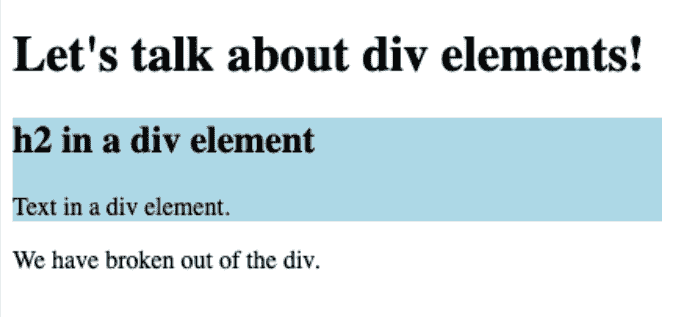
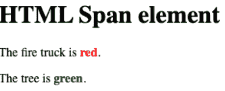
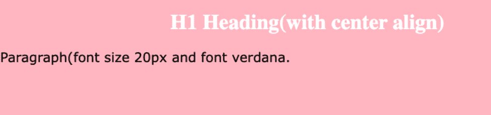
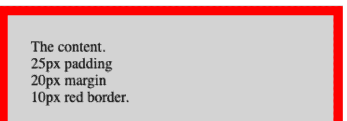
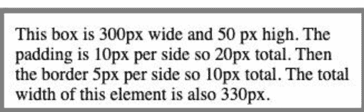
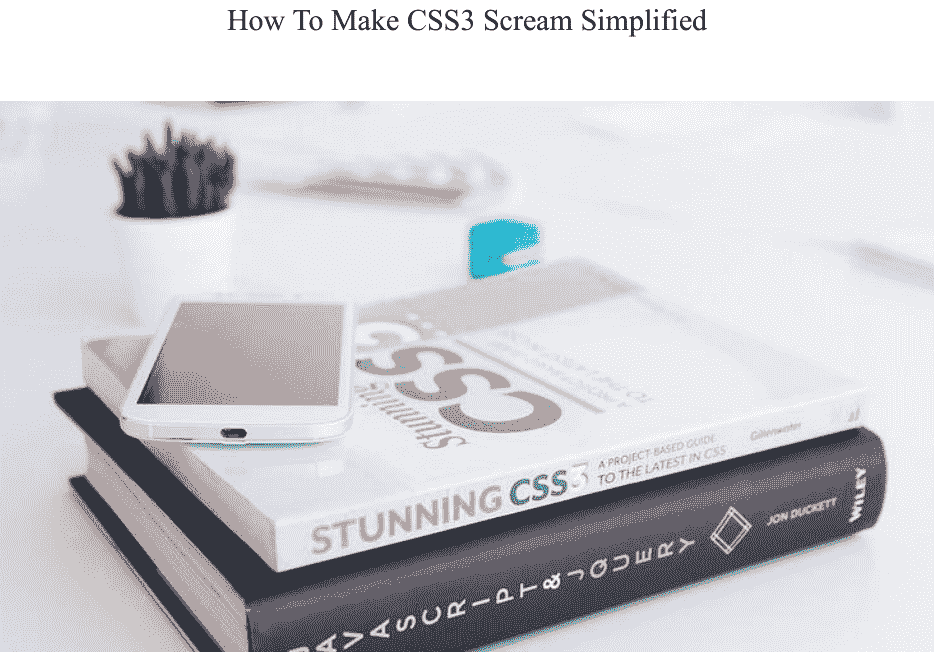
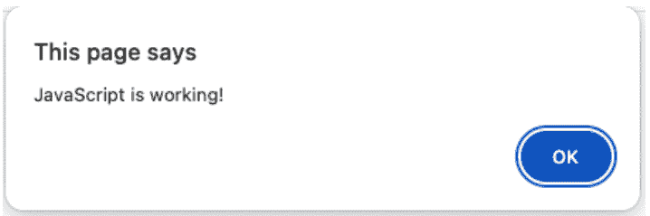
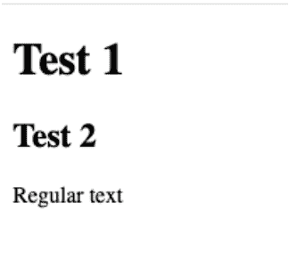

# JavaScript 编程：HTML 与 CSS 入门指南

## 前言

作为开发者，我曾以为自己对 HTML 和 CSS 已经足够了解。我错了。我不得不一次又一次地回到基础。这就是我将这些内容整理在一起的原因。另外，我觉得 JavaScript 也应该包含在内。

首先，我们从 HTML 的一些基础知识开始。你可能已经见过其中一些内容，但我发现复习一下很有帮助。然后我们将介绍 HTML5 的一些变化。我们会涉及一些主要变化。接着我们用表格、`div` 和 `span` 的讨论来结束 HTML 部分。这些曾让我不止一次感到困惑……

第二部分专门介绍 CSS。这让页面美观了不少。我们涵盖 CSS 基础、盒模型和 CSS3。与 HTML5 类似，它也有一些有趣的更新。

第三部分聚焦于 JavaScript 基础。涵盖变量、函数和条件语句等主题。我们也介绍循环和闭包。在这本快速入门指南中，我们只关注你开始工作所需的内容。

## I：HTML

在第一部分中，我们从 HTML 的基础知识开始。我们复习 HTML 基础、HTML5 以及 `div` 和 `span`。

### 面向可靠人群的 HTML 基础要点

图片由 [Jackson Sophat](https://unsplash.com/@jackson_sophat) 发布于 [Unsplash](https://unsplash.com)

网络是由一些基础性技术创建的。每个网站都使用 HTML 或超文本标记语言。它构成了我们在网上消费的内容。

### HTML

它为我们看到的页面提供结构。我们可以通过一系列元素和标签为网站添加图像和链接。让我们看一个简单的例子来开始。

```html
<html>
```

```text
# 标题

段落。
```

我们从 DOCTYPE 开始，声明这是 HTML。然后我们有 HTML 的开放标签。看到底部时，你也会看到 HTML 的闭合标签。body 也有类似的标签来打开和关闭元素。

### 标题

我们在前面的例子中有一个标题。HTML [标题](Headings) 可以从 `<h1>` 到 `<h6>`。它从大到小，数字越大字体越小。

```text
# 标题
```

```text
# 标题
```

```text
# # 标题

# ## 标题

# ### 标题

# #### 标题

# ##### 标题
```

如果我们在 Chrome 中打开它，这就是你会看到的。

```text
# 标题

# 标题

# 标题

# 标题

# 标题

# 标题
```

### 标题示例

### 段落

当你有一个文本块时，可以使用 HTML 段落标签。我们在第一个例子中看到过。这是另一个例子。

Lorem ipsum dolor sit amet, consectetur adipiscing elit, sed do eiusmod tempor incididunt ut labore et dolore magna aliqua.

现在这两个是很好的元素，但网络之所以强大，原因在于链接。让我们接下来看看这些。

### 链接

HTML 中的超链接或链接是秘密武器。我们可以链接到文档源或参考资料。

```html
<a href="https://codeiseasy.co">Code Is Easy</a>
```

当然，有时我们喜欢看到屏幕上的图片或图像。要做到这一点，我们需要图像标签。

### 图像

图像标签帮助我们在文本之外添加视觉组件。

```html

```

我添加了宽度和高度，但这些不是必需的。不过，这有助于保持尺寸正确。

### 列表

HTML 为我们提供了两种列表选项。有序列表和无序列表。

#### 有序列表

```html
<ol>
  <li>Apples</li>
  <li>Berries</li>
  <li>Currants</li>
</ol>
```

#### 无序列表

```html
<ul>
  <li>Carrots</li>
  <li>Celery</li>
  <li>Onions</li>
</ul>
```

如果你在浏览器中打开文件，它看起来是这样的。

我们在这里介绍了一些 HTML 基础。还有很多需要学习的内容。当然，根据你的工作需求，这些可能已经足够了。我的开发工作需要我定期使用 HTML。虽然，我并非专家。多尝试这些，你会掌握得很好。

### 亟待使用的重要 HTML5 变更

图片由 [Jackson Sophat](https://unsplash.com) 发布于 [Unsplash](https://unsplash.com)

HTML 和其他东西一样。有不同的版本可供我们使用。[HTML5](https://html5) 是当前版本，具有新特性。让我们来看看一些变化和新增内容。

#### 有什么不同？

已经进行了一些工作来消除 HTML、CSS 和 JavaScript 之间的重叠。还进行了改进以提高代码的可读性。跨浏览器一致性和响应性也得到了增强。最后，无需插件即可支持多媒体是另一项重大变化。

#### 新元素

在 HTML5 中，有一些新元素。添加了 `section` 标签来帮助组织文档。

```html
<section>
  <h1>Heading</h1>
  <p>Lorem ipsum dolor sit amet, consectetur adipiscing elit, sed do eiusmod tempor incididunt ut labore et dolore magna aliqua. Ut enim ad minim veniam, quis nostrud exercitation ullamco laboris nisi ut aliquip ex ea commodo consequat. Duis aute irure dolor in reprehenderit in voluptate velit esse cillum dolore eu fugiat nulla pariatur. Excepteur sint occaecat cupidatat non proident, sunt in culpa qui officia deserunt mollit anim id est laborum.</p>
</section>
```

与这个标签类似，我们也可以使用 `header` 和 `footer` 标签。它们有效地组织大块 HTML，使其更具可读性。

##### 表单

为了更方便地创建表单，HTML5 添加了一些功能。让我们展示 [datetime-local 输入](datetime-local%20input) 表单元素。

```html
<input type="datetime-local">
```

如果我们在浏览器中运行它，我们会看到这个。

#### 本地日期时间示例

这比我们以前必须做的要方便得多。

#### 图形

我们还可以在 HTML5 中添加 SVG 或可缩放矢量图形。这是一个简单的例子。

```html
<svg width="100" height="100">
  <circle cx="50" cy="50" r="40" stroke="blue" stroke-width="4" fill="red" />
</svg>
```

如果在浏览器中运行，你将看到类似这样的内容。


SVG 示例

虽然不那么令人惊叹，但在某些情况下可能会很有用。

#### 离线

HTML5 通过存储本地副本来实现离线工作。因此，浏览器会下载所需的 HTML、CSS 和 JavaScript。这将允许你在没有网络连接的情况下进行一定的操作。

HTML5 是一组旨在更好地利用 Web 的变更。从新元素到图形，它帮助 Web 向前迈进了一步。与此同时，它使 Web 更加易于访问，让越来越多的人拥有协作的能力。

### 实用 HTML 表格、`Div` 和 `Span` 将让你更出色


照片由 [Unsplash](https://unsplash.com) 上的 [Alvin Engler](https://unsplash.com/@alvinengler) 提供

在我从事前端技术的过程中，我看到认可的工作方式在不断变化。网页设计的规范层出不穷。HTML 为我们提供了多种创建界面 Ways。

#### 表格

[HTML 表格](https://developer.mozilla.org/en-US/docs/Web/HTML/Element/table) 经常被轻视，但它确实有效。在我职业生涯早期，表格是主流做法。这里有一个示例来展示基本语法。

```html
<html>
```

| 公司 | 州 | 员工人数 |
| --- | --- | --- |
| Balloons Inc. | 俄亥俄州 | 250 |
| Cement Co. | 亚利桑那州 | 4510 |

运行这段代码会给我们一个简单的表格来显示数据。请做好心理准备，不要太惊讶！

| 公司 | 州 | 员工人数 |
|---|---|---|
| Balloons Inc. | 俄亥俄州 | 250 |
| Cement Co. | 亚利桑那州 | 4510 |

HTML 表格示例

这个简单的例子让你了解如何使用表格。根据你的需求，我们还能用它们做更多事情。

#### `Div`

`div` 元素是 division（分区）的缩写。它创建了一个 HTML 的块级区域。我们可以使用 CSS 为 `div` 设置样式，并使用 JavaScript 对其进行操作。

```html
<html>
```

让我们来谈谈 `div` 元素！

```html
<div class="exampleDiv">
```

##### `div` 元素中的 `h2`

`div` 元素中的文本。

我们已经跳出了 `div`。

我们有一个将 `div` 设置为浅蓝色的示例。这样你就可以看到 `div` 的起始和终止位置。



Div 元素示例

在图片中，你可以看到 `div` 的边界以及页面的其余部分。如果我们应用样式，它将仅在 `div` 元素内部生效。

#### `Span`

`span` 是我们可以添加到 HTML 文档中的内联容器。`div` 是块级的，而 `span` 是内联的。这些是你可能想要记住的区别。

```html
<html>
```

##### HTML `Span` 元素

消防车是 `<span style="color:red;font-weight:bold">红色</span>` 的。

树是 `<span style="color:green;font-weight:bold">绿色</span>` 的。

这里使用了两个 `span` 元素。我们在这里应用样式来改变颜色并将字体加粗。



HTML Span 示例

我们可以看到代码在这里的作用。下次你需要 HTML 容器时，可以尝试这三种。表格、`div` 和 `span` 各有优缺点。先尝试一个简单的例子，看看哪个最合适。

## II：CSS

CSS 在提高网站吸引力方面非常有帮助。我太长时间忽视了这一点。我将回顾一些基础知识，然后讲解盒模型。最后，我们介绍 CSS3。

### 关于 CSS 的真相将让你有所收获


照片由 [Unsplash](https://unsplash.com) 上的 [Marcus Ganahl](https://unsplash.com/@marc北国ganahl) 提供

你是否见过看起来很奇怪的网站？字体是否需要修正？这就是 CSS 没有加载时的情况。它本质上让 Web 看起来很美观。我不是个字体专家，但我理解风格的需求。

### CSS

CSS 或 [层叠样式表](https://developer.mozilla.org/en-US/docs/Web/CSS) 为网站应用样式。从文本大小到字体，它可以为事物增添一份格调。

```html
<html>
```

H1 标题（居中对齐）

段落（字体大小 20px，字体 `verdana`）

这是一个添加了样式的简单 HTML 文件。在这个例子中，我们为 HTML 的 body 应用了背景颜色。然后，我们将 H1 标题的颜色改为海军蓝并居中对齐。对于段落，我们更改了字体和大小。看起来像这样：



带有内部 CSS 的 HTML 示例

虽然 HTML 最初仅用于文本，但 CSS 的创建是为了增加样式。如果你足够年长，能记得最初的 Web 时代，你会心存感激！现在的情况已经大不相同了。

### 引入方式

上面我们向你展示了一个内部 CSS 的示例。style 标签被添加到 HTML 中。我们也可以创建一个外部文档来放置 CSS。

```html
<html>
```

我们正在使用另一个文件中的 CSS。

是不是很令人印象深刻！

这是我们的 HTML 文件。接下来，我们可以向你展示 [外部 CSS](external CSS) 文件的代码。

```css
body {
  background-color: lightblue;
}

h1 {
  color: navy;
  margin-left: 20px;
}
```

正如你在下面看到的，这样运行得非常好。


带有外部 CSS 的 HTML 示例

在这个例子中，你有两个文件。在像这样的小例子中，这看起来像是过度设计。但在较大的页面或拥有多个页面时，这非常有帮助。你可以创建一个 CSS 文件并将其包含在其他 HTML 文档中。

最后一种类型是内联。看看这里的样式是如何内联的：

```html
<html>

<span style="color:rgb(149, 0, 255);font-size:46px;">
```

我是一个巨大的、紫色的、**自豪的 UNI Panther！**

这是将 CSS 和 HTML 混合在一起。对于初学者来说，这可能不太清晰。它的样子如下：

我是一个巨大的、紫色的、自豪的 UNI Panther！

带有内联 CSS 的 HTML 示例

所以，当你向 HTML 添加 CSS 时，你有多种选择。正如我们讨论的，每种方式都有其优缺点。这取决于你的项目规模以及你协作的团队。

### 教学式神奇 CSS 盒模型


照片由 [Unsplash](https://unsplash.com) 上的 [Kelli McClintock](https://unsplash.com) 提供

起初，CSS 看起来像是一种只有魔术师才懂的黑魔法。然后随着我学习得更多，它开始变得合理。 [盒模型](https://developer.mozilla.org) 用于描述元素的设计和布局。

### CSS 盒模型

每个元素周围都有一个盒子。有时你能看到它，有时它似乎消失了。

- Content（内容）——盒子里的内容，文本或图像
- Padding（内边距）——内容周围的区域，是透明的
- Border（边框）——围绕内边距和内容
- Margin（外边距）——边框之外的区域，同样是透明的

这是一个例子。

```html
<html>
```

#### CSS 盒模型

每个组件周围的一个盒子。

- 内容。
- `25px` 内边距
- `20px` 外边距
- `10px` 红色边框。

看起来像这样。

#### CSS 盒模型

每个组件周围的一个盒子。



##### CSS 盒模型示例

##### 尺寸计算

为了使盒子的大小正确，我们需要进行一些计算。我知道你没预料到这一点。很简单，所以你不会感到困惑。

```html
<html>
```

##### CSS 盒模型计算

这个盒子宽 `300px`，高 `50px`。每边内边距 `10px`，所以总共 `20px`。然后每边边框 `5px`，所以总共 `10px`。该元素的总宽度也是 `330px`。

运行这段代码，你将看到以下内容。

##### CSS 盒模型计算



CSS 盒模型计算示例

我们必须将内容、内边距和边框相加才能得到总宽度。在我学会这一点之后，CSS 就变得更有意义了。在此之前，我会尝试随意更改各项内容以使其看起来正确。

### 如何让 CSS3 变得极简



照片由 [Unsplash](https://unsplash.com) 上的 [KOBU Agency](https://kobu.agency) 提供

随着 Web 的变化，支持它的技术也在变化。[CSS3](https://css3.com) 就是其中一个例子。[CSS](https://css.com) 最初于 1996 年发布。几年后，CSS3 于 2005 年发布。

#### 优势

CSS3 的主要优势之一是响应式 Web 设计。它用更流畅的性能取代了笨重的站点。CSS3 中还引入了新的高级动画和不透明度特性。

另一个好处是将页面分解为模块的能力。媒体查询（Media queries）也是 CSS3 中的一项新特性。此外，我们现在还可以应用渐变和圆角。

##### 示例

让我们来看一个线性渐变的示例。

```html
<html lang="en">
<div class="gradient"></div>
</html>
```

在浏览器中查看时。


*CSS3 线性渐变示例*

CSS3 还能做什么？

#### 盒子阴影


它还可以让你创建盒子阴影。让我们来看看。

```html
<html lang="en">
<div class="box"></div>
</html>
```

在浏览器中打开它，你应该会看到类似这样的效果。


*CSS3 盒子阴影示例*

CSS3 给 CSS 带来了一些重大更新。随着 Web 的演进，还会有新的更新。作为一个热爱学习的人，看到 Web 的变化令人兴奋。它正变得越来越易用且更加强大。

## III

# JavaScript

在第三部分，我们从 JavaScript 的基础知识开始。我们将编写一些基础内容，以帮助你了解如何操作。

## JavaScript：给疲惫心灵的有用工具


我有一个坦白。我和 JavaScript 的开端很糟糕。我的第一次尝试是为了表单验证。我那时经常咒骂它的存在。

幸运的是，在重新接触它之后，我开始尊重它。经过这么多年，它已经成长为一种强大的语言。

## JavaScript

JavaScript 从卑微的起点开始，已经演变成一种现代编程语言。从浏览器到服务器，它几乎可以处理所有事情。Node.js 为它在服务器端提供了一个强大的框架。Mozilla 创建了它，以下是他们的定义：“JavaScript 是一种具有一等函数的轻量级解释型编程语言。”这话听起来真专业！

### 代码

让我们看一些基础代码。这是一个显示一些 JavaScript 的 HTML 文件。请将此代码保存到你的本地机器上。

```html
<html>
</html>
```

#### 测试 1

#### 测试 2

普通文本

当我们运行这个时，我们将看到这个。



*JavaScript 警报消息*

点击确定后，你将看到这个。



*HTML 屏幕截图*

#### 语句

语句是 JavaScript 的基本指令。我们可以创建一些变量，然后为它们赋值。

```javascript
let a, b, c; // 创建三个变量的语句
a = 2; // 为变量 a 赋值为 2 的语句
b = 3; // 为变量 b 赋值为 3 的语句
c = a + b; // 将 a 加上 b 赋值给 c 的语句
```

分号位于语句的末尾。不过，我们可以将多个语句放在一起。

```javascript
a = 2; b = 3;
```

这样做可读性不高，所以大多数程序员倾向于不这么做。因此，仅仅因为你能做某件事，并不意味着你应该这么做。

#### 函数

当我们想要执行一项任务时，可以创建一个函数。如果我们需要将两个数字相加，我们可以在代码中直接实现，或者创建一个函数。

```javascript
// 将两个数字相加
num3 = num1 + num2;
```

```javascript
// 将两个数字相加的函数
function sumTwoNumbers(num1, num2) {
    return num1 + num2;
}
```

在这个例子中，我们执行相同的代码，一个在函数中，一个不在。使用函数是有价值的。我们可以重复调用它。此外，我们还可以轻松地添加一些错误检查。

```javascript
// 将两个数字相加的函数
function sumTwoNumbers(num1, num2) {
  return num1 + num2;
}

let sum = sumTwoNumbers(6,4);
```

如果你想调用函数，可以像这个示例这样操作。这里我们传入了两个数字。这些数字也可以被替换为变量。

最后，我们探讨了为什么要使用 JavaScript，然后开始编写代码。通过使用语句和函数，我们开始了解其内部机制。请亲自尝试一下！你不会后悔的。

看，我发现了 JavaScript 变量和值的这些惊人益处。


### 最令人着迷的简单 JavaScript 函数基础


照片由 [Stanley Dai](https://unsplash.com/@stanleydai) 拍摄于 [Unsplash](https://unsplash.com)

函数是动力源泉，这是工作发生的地方。我们需要计算地面的面积吗？这就需要一个函数。

```javascript
function calculateFlooring(length, width) {
  return length * width;
}
```

如果我们重新装修厨房，这个函数将计算我们需要多少地板。那么，为什么我们需要函数呢？

#### 益处

把函数看作是你代码的容器。类似于代码块，但我们可以重复调用这个函数。这将促进代码的重用。

在我们之前的示例中，你可以复制该语句。当然，如果我们想更改它，我们需要搜索该代码并更改所有出现的地方。

#### 示例

在我们的第一个函数示例中，我们计算了地板面积。让我们退一步，让它变得更简单。我们可以在屏幕上打印一些内容。

```javascript
function greetTom() {
  alert("Hello Tom!");
}
```

当然，你可以把我的名字换成你的。如果你想遵循传统，可以用 "Hello World" 替换。你好奇为什么这是传统吗，看这里。

#### 调用

代码看起来可能很漂亮，但如果你不调用它，什么都不会发生。怎么做呢？很高兴你问到了。这是一个例子。

```javascript
function greetTom() {
  alert("Hello Tom!");
}

greetTom();
// 执行其他事情...
```

这个调用很简单，因为它不需要参数。在我们的第一个函数中，我们需要两个参数。接下来让我们尝试那个。

#### 传递参数

在第一个示例中，我们从一个计算地板面积的函数开始。它接收两个参数。

```javascript
function calculateFlooring(length, width) {
    return length * width;
}

calculateFlooring(12,10);
```

我们可以传入两个数字来获取所需的地板面积。在这个例子中，我们硬编码了数值。你通常不会这样做，或者永远不该这样做。

```javascript
function calculateFlooring(length, width) {
    return length * width;
}

calculateFlooring(length,width);
```

如你所见，这里我们将两个参数作为变量。名称与函数中的相同，但不必完全一样。

##### 返回数据

当我们返回计算结果时会非常有帮助。如果不返回，函数的作用就大打折扣。我们只需要使用 `return`。我们在计算地板函数中这样做了。不过，我们需要将结果赋值或将其打印出来。

```javascript
function calculateFlooring(length, width) {
  return length * width;
}

let totalFlooring = 0;
totalFlooring = calculateFlooring(length,width);
```

现在我们可以在应用程序的后续部分使用这个值。之前的示例没有使用返回值。如果你之后不需要它，这也是一个选项。

函数可以为我们做很多事情。它们为我们的代码提供了一个容器。然后我们可以调用它们并传递参数。与此同时，它们还可以返回数据。如果你需要更多信息，这里还有一些进一步的内容。

## 通过这些简单的 JavaScript 条件语句避免痛苦的错误


照片由 [Artur Aldyrkhanov](https://unsplash.com/) 拍摄于 [Unsplash](https://unsplash.com/)

应用程序帮助我们做出决定。一个基础的决定是一个 `if` 条件。例如，如果披萨外卖员到了，就开门。JavaScript 和其他语言一样，有许多条件语句，例如：

### if

`if` 语句以一个条件开始。如果条件为真，随后的语句将会执行。

```javascript
if(pizzaArrives) {
    openTheDoor();
}
```

所以，如果 `pizzaArrives` 为真，我们就调用 `openTheDoor` 函数。我在 `if` 语句后面添加了大括号。这是可选的，但有助于提高可读性。省略大括号可能会导致你遗漏 Bug。所以请务必包含它们！

### if/else

有时你有两种不同的行动方案。我们可以将 `else` 语句与 `if` 结合使用。假设你正在烤一些汉堡肉饼。

```javascript
if(sideCooked) {
    flipBurger();
} else {
    keepCooking();
}
```

这个检查可以运行你最喜欢的汉堡店里的烹饪机器人。不过，它可能需要更多代码。

如果你需要检查两个条件，你还可以使用 `if else if`。

```javascript
if(sideCooked) {
    flipBurger();
} else if(otherSideCooked) {
    // ...
}
```

```javascript
removeFromGrill();

} else {

    keepCooking();

}
```

这让我们能够检查更多的值。如果你需要更多的检查，`switch` 语句可能会效果更好。稍后我们将详细讨论。

## 条件运算符

我们在 `if` 语句中使用的运算符必须解析为 `true` 或 `false`。这里有很多可供选择的选项。根据经验，你需要通过测试来找到最合适的一个。

```javascript
if(9>5) { alert("Greater than"); } // 大于

if(5<8) { alert("Less than"); } // 小于

if(9>=6) { alert("Greater than equal to"); } // 大于或等于

if(4<=6) { alert("Less than equal to"); } // 小于或等于

if(4!=6) { alert("Not equal to"); } // 不等于
```

此外还有两个逻辑运算符：逻辑与（`&&`）和逻辑或（`||`）。它们被大量使用，但不必被它们吓到。

```javascript
const value1 = 4;
const value2 = -3;

console.log(value1 > 0 && value2 > 0); // 预期输出: false
console.log(value1 > 0 || value2 > 0); // 预期输出: true
```

逻辑与（Logical And）必须两个值都为 `true` 才会解析为 `true`。而逻辑或（Logical Or）只需要其中一个为 `true` 即可。

### switch

`switch` 语句通过评估表达式来决定执行哪一条语句。然后它会运行代码直到遇到 `break` 语句。这里有一个示例，它可以告诉我们你想要的鞋子的价格。

```javascript
const shoes = 'Reebok';

switch (shoes) {
  case 'Nike':
    console.log('Nike shoes are $200.');
    break;

  case 'Adidas':
  case 'Reebok':
    console.log('Adidas and Reebok are $100 a pair.');
    // 预期输出: "Adidas and Reebok are $100 a pair."
    break;

  default:
    console.log(`Sorry, we don't carry ${shoes}.`);
}
```

这段代码应该在控制台打印出 “Adidas and Reebok are $100 a pair.”。如果你没有添加 `break` 语句，`switch` 语句可能会变得很棘手。

```javascript
const shoes = 'Nike';

switch (shoes) {
  case 'Nike':
    console.log('Nike shoes are $200.');

  case 'Adidas':
  case 'Reebok':
    console.log('Adidas and Reebok are $100 a pair.');
    break;

  default:
    console.log(`Sorry, we don't carry ${shoes}.`);
}
```

在这个例子中，我们移除了 `Nike` 语句中的 `break`。你知道这里会发生什么吗？它会打印 ‘Nike shoes are $200.’，然后接着打印 ‘Adidas and Reebok are $100 a pair.’。这种类型的 Bug 在初学者程序员中非常常见。不用沮丧，你现在也是这个“俱乐部”的一员了！

条件判断是 JavaScript 的基础。与其它语言类似，它允许我们快速提供解决方案。`if/else` 和 `switch` 都非常易于使用。

## JavaScript 拥有能让你大开眼界的强大循环


照片由 [Kier in Sight Archives](https://unsplash.com/photos/kier-in-sight-archives) 提供，来源于 [Unsplash](https://unsplash.com)

小时候，我们在农场种了一排防风林。那一排树每周需要浇几次水。打开软管，给第一棵树浇水，数到十。然后移到第二棵树，重复此操作。

与生活相似，我们的计算机程序也必须重复某些事情。这就是循环（loops）派上用场的地方。`for` 循环非常常见，所以我们从这里开始。

### for

如果我们有一个书籍数组并且想要把它们打印出来，可以使用以下循环。

```javascript
for (let i = 0; i < books.length; i++) {
    text += books[i] + " ";
}
```

`for` 循环由三个基本部分组成：开始（Start）、条件（Condition）和步长（Step）。

#### 开始 (start)

这是我们设置循环变量的部分。在我们的例子中，通常将其初始化为零。不过，你也可以将其设置为 10 然后进行递减计数。

#### 条件 (condition)

接下来是条件部分，用来检查是否需要再次运行此循环。我们的例子检查是否还有更多书籍需要循环遍历。如果结束了，我们就停止。

#### 步长 (step)

最后一部分是步长。它告诉我们每次迭代后会发生什么。我们的例子使用了递增运算符（`++`）。这是常规步长，但在特殊情况下我们可以执行其他操作。

### while

如果我的狗 Baxter 想吃东西，我想创建一个循环，只要它还饿着就一直喂它。`while` 循环可以实现这一点。这是一个例子。

```javascript
let baxterHungry = true;

while (baxterHungry) {
  console.log(feedBaxter);
  checkBaxter();
}
```

我们将变量设置为 `true`。然后我们一直喂狗，直到变量变为 `false`。`while` 循环评估我们给它的条件，该条件必须解析为 `true` 或 `false`。

如果为 `true`，循环内部的代码将被执行。然后我们再次评估条件。一旦条件变为 `false`，循环停止。

### do-while

`for` 和 `while` 循环是先检查条件，然后运行代码语句。`do-while` 不同之处在于它先运行代码，然后再检查条件。它不那么常见，但在特殊情况下非常有用。

```javascript
let donutsEaten = 0;

do {
  console.log("Donuts eaten " + donutsEaten);
  donutsEaten++;
} while (donutsEaten < 5);

console.log("I'm full of Donuts!");
```

`do while` 会一直运行直到条件为 `false` —— 与我们讨论的另外两种循环类型相反。输出结果如下：

```text
Donuts eaten 0
Donuts eaten 1
Donuts eaten 2
Donuts eaten 3
Donuts eaten 4
I'm full of Donuts!
```


当你需要循环执行代码时，JavaScript 为你提供了几种选择。像其他编程语言一样，它拥有`for`、`while`和`do-while`循环。只需确保它符合你的需求即可。

## 你需要的关于 JavaScript 变量作用域的惊人改进


照片由 [Markus Spiske](https://unsplash.com/@markusspiske) 提供，来源于 [Unsplash](https://unsplash.com)

我的妻子切换话题很快。我开玩笑说她需要装个转向灯，这样我才能跟上她不断转移的注意力。她可能正在谈论晚餐，然后我们突然转向下一次度假。

### 作用域 (Scope)

我们的代码中有一个类似的概念，叫做作用域。变量可以快速地进入和退出作用域。作为开发者，我们必须将这个概念放在核心位置。

在 JavaScript 中，有几种不同类型的作用域。我们可以根据情况使用它们。如果你做过其他编程，你可能遇到过类似的概念。

#### 全局作用域 (Global)

全局作用域中的项在任何地方都可见。在我们的例子中，我们在函数内部和外部创建了一个可见变量。

```javascript
let myGlobalVariable = "TheBigGlobalVariable";

function logOutGlobalVariable() {
  console.log(myGlobalVariable);
}

logOutGlobalVariable();
```

我打赌你在想，如果我在函数内部添加一个变量会怎样？这就引出了局部作用域的例子。

#### 局部作用域 (Local)

局部变量仅在函数内部可见。这里有一个可以尝试的例子。

```javascript
let myGlobalVariable = "TheBigGlobalVariable";

function logOutGlobalVariable() {
  console.log(myGlobalVariable);
  let localVariable = "TheLocalOne";
  console.log(localVariable);
}

logOutGlobalVariable();

console.log(localVariable);
```

如果我们运行这段代码，最后一行会报错。

```
console.log(localVariable);
      ^
ReferenceError: localVariable is not defined
```

因此你可以看到，当你误将变量放在错误的位置时会发生什么。

#### 块级作用域 (Block)

如果说局部作用域是在函数之内，那么[块级作用域](block scope)则是在大括号`{}`之内。有时你会创建大括号来标识某些代码。让我们来看一个例子来具体说明。

```javascript
console.log("here");

{
  let blockScopeVariable = 0;
  console.log(blockScopeVariable);
}

// 我们不能在这里引用 blockScopeVariable
console.log(blockScopeVariable); // 不起作用
```

如你所见，我们在大括号内创建了一个块级作用域变量。在大括号之外，它将无法被引用。

#### 注意事项 (Gotchas)

作用域可能会令人困惑并导致一些错误。随着你获得更多 JavaScript 经验，你可以尽早发现它们。例如，如果我们看这段代码片段：

```javascript
const colors = ['red', 'blue', 'white'];

for (let i = 0, var l = colors.length; i < l; i++) {
  console.log(colors[i]); // 'red', 'blue', 'white'
}

console.log(l); // ???
console.log(i); // ???
```

变量`i`和`l`将会触发引用错误（ReferenceError）。它们已经超出了作用域，与我们之前的例子类似。Dmitri Pavlutin 对此进行了更深入的解释，他还涵盖了一些我们在编程中可能会犯的常见错误。

JavaScript 作用域有几个你需要记住的基本原则：全局作用域处处可见；局部作用域和块级作用域则更为聚焦。总的来说，你应该使用后者并尽量避免前者。继续编程吧！

## 充分利用 JavaScript 闭包，无需恐慌


图片由 [Unsplash](https://unsplash.com) 上的 [Cristina Gottardi](https://unsplash.com/@cristinagottardi) 提供

在我的开发生涯中，偶尔会接触 JavaScript，而闭包是我并不经常遇到的一项技术。但它们具有极高的价值。

### 闭包 (Closures)

我们如何定义闭包？这篇文章将其定义为：“JavaScript 中的闭包是一种词法作用域形式，用于在函数的内部作用域中保留来自函数外部作用域的变量。”

```javascript
function outerFunction() {
    var x = 10;
    function innerFunction() {
        return x;
    }
    return innerFunction;
}
```

```javascript
var inner = outerFunction();
console.log(inner());
```

这是一个闭包的示例。外部函数`outerFunction()`创建了一个变量`x`和一个函数`innerFunction()`。内部函数`innerFunction()`返回变量`x`的值。随后，外部函数返回内部函数`innerFunction()`。

接下来，内部函数`innerFunction()`被赋值给变量`inner`。当调用变量`inner`时，它会返回变量`x`的值，尽管外部函数`outerFunction()`已经执行完毕并返回。

稍后我们可以讨论词法作用域。首先，让我们了解为什么需要它们，以及它们的一些缺点。

### 优缺点

闭包可以帮助隐藏封装细节。类似于 Java 的私有变量，这允许我们控制访问权限。其缺点是闭包会占用更多内存。这些项无法被垃圾回收。最后，它可能会降低执行速度。Deepak Mankotia 对此进行了更深入的探讨。

### 词法作用域 (Lexical Scoping)

词法作用域是指变量定义的位置，以及它在何处可以被引用或不能被引用。

```javascript
let x = 10

let myFunc = function (){
    let y = 20;
    console.log("x and y is accessible (outer):", x, y);
    let insideFunc = function (){
        let z = 30;
        console.log("x and y and z is accessible (inner):", x, y, z);
    }
    insideFunc();
    return;
}

myFunc();
console.log("only x is accessible (global):", x);
```

在这个例子中，`insideFunc`定义在`myFunc`内部。在这种情况下，`myFunc`是它的父级。父函数在词法上绑定了子函数。JavaScript 闭包就是词法作用域的一种形式。

JavaScript 闭包是强大的工具，具有独特的价值。它允许你封装细节，但可能会减慢执行时间。请考虑这些风险与收益是否适用于你的应用程序。

欲了解更多信息，请参阅深度解析：

## 高级 JavaScript

在本节中，我们将进入深水区。JavaScript 的对象和数组可能会让人困惑，因此我们将花时间详细讲解每一个。最后，我们会讨论展开运算符（spread）和剩余运算符（rest）。

### 无与伦比的 JavaScript 对象令你心潮澎湃


图片由 [Unsplash](https://unsplash.com) 上的 [Hari Krishnan](https://unsplash.com/@harikrishnan) 提供

在软件开发的最初几年里，我主要使用过程化语言。我使用最多的语言是 [PL/SQL](https://en.wikipedia.org/wiki/PL/SQL)。即使是我所做的面向对象工作，也没有充分发挥该语言的全部实力。

JavaScript 最初并不是面向对象的。它经过修改变得更加强大。特别是 [ECMAScript 6](https://en.wikipedia.org/wiki/ECMAScript#ES2015) 带来的变化非常巨大。

如今，我们在 JavaScript 中随时随地使用对象。作为一名资深的 Java 开发人员，我看到了它们带来的价值。尽管对于一些开发人员来说，这可能是一个巨大的理解转变。

它们是什么？

JavaScript 对象代表现实世界中的事物，例如我高中时代的那辆车。让我们在这里创建它并添加一些属性。

```javascript
// Create an object:
const car = {
  type:"Chevrolet",
  model:"Malibu",
  year:"1976",
  color:"red"
};
```

JavaScript 对象是该语言允许的许多[数据类型](https://developer.mozilla.org/en-US/docs/Web/JavaScript/Data_structures)之一。如你所见，还有其他几种。不过，在开发工作中，你主要会使用原始类型和对象。

#### 对象 vs 原始类型

在这篇文章中，他们对此进行了深入探讨。我只想指出几个关键区别。对象是*可变的*（mutable），而原始类型则*不可变*。可变意味着它们可以被修改。

```javascript
// Create an object:
const car = {
  type:"Chevrolet",
  model:"Malibu",
  year:"1976",
  color:"red"
};
```

```javascript
let ball = "basketball"; // primitive
```

结合之前的示例，我们有一个`car`对象和一个`ball`原始类型。前者可以被更改，而后者不能。作为一名资深 Java 程序员，这对我来说非常熟悉。

#### 构造函数 (Constructor)

可以使用构造函数创建对象。延续汽车的主题，我们创建两个汽车对象，以便你直观了解其形式。

```javascript
// Constructor function for Car objects
function Car(make, model, year) {
  this.make = make;
  this.model = model;
  this.year = year;
}
```

```javascript
// Create two Car objects
const myCar = new Car("Ford", "Pinto", "1971");
const yourCar = new Car("Dodge", "Charger", "1977");
```

这与之前的示例类似。我们在这里使用`function`关键字来指定构造函数。同时，我们也使用`new`关键字来创建对象。

#### 属性 (Properties)

我们创建了两个带有许多值的汽车对象。这些值被称为属性。如果我们想将它们打印到日志中，可以这样做：

```javascript
console.log(myCar.make);
console.log(myCar.model);
```

这是访问值的一种方式。你也可以用这种方式：

```javascript
console.log(myCar["make"]);
console.log(myCar["model"]);
```

因此，你有多种选择来获取底层数据。根据我的经验，前者的使用频率高于后者。但具体情况可能因人而异。

#### 方法 (Methods)

JavaScript 对象具有一些内置方法。例如，`keys()`方法可以将键转换为数组。

```javascript
// Initialize an object
const car = {
  make: 'Ford',
  model: 'Pinto',
  yeeear: '1971'
};
```

```javascript
// Get the keys of the object
const keys = Object.keys(car);
```

```javascript
console.log(keys);
// outputs the following
["make", "model", "yeeear"]
```

同样还有一个`values()`方法。

```javascript
// Initialize an object
const game = {
    id: 1,
    date: `23-March-2025`,
    teams: 'Panthers vs Jayhawks',
    location: 'St. Louis'
};
```

```javascript
// Get all values of the object
const values = Object.values(game);
```

```javascript
console.log(values);
// outputs the following
[1, "23-March-2025", "Panthers vs Jayhawks", "St. Louis"]
```

配合循环来遍历这些值会非常有帮助。此外还有其他方法，这篇文章回顾了更多内置方法。

#### This

JavaScript 将`this`预留为关键字。它用于引用当前对象。以下是它的具体形式：

```javascript
// Create an object:
const car = {
  make: "Dodge",
  model: "Charger",
  year: "2015",
  carDetails: function() {
    return this.make + " " + this.model + " " + this.year;
  }
};
```

在这个例子中，我们创建了一个具有三个属性的对象。当我们想要显示详情时，可以调用`carDetails`函数。在这种情况下，它将显示 "Dodge Charger 2015"。

作为关键字，`this`不能用作变量名。此外，我们无法更改`this`所指向的值。JavaScript 中的`this`有三种上下文：函数、类和全局。在这些示例中，我们分享的是函数上下文。这里有更多信息。

JavaScript 对象与其他语言的对象类似。不过，也存在一些差异。重要的是要记住，JavaScript 最初并非如此，它在不断地改变和适应。只要掌握基础知识，你就能很好地使用它。

### 轻松驾驭更好的 JavaScript 数组


图片由 [Unsplash](https://unsplash.com) 上的 [Julius Drost](https://unsplash.com/@juliusdrost) 提供

我的妻子喜欢整理东西，她按年份将东西放入信封中。JavaScript 数组与信封类似，我们可以将多个对象放入其中。

#### JavaScript 数组

JavaScript 数组在一个集合中存储多个对象。它们还提供了一些常用的操作。该集合可以包含多种数据类型，如字符串、数字、对象或其他数组。

##### 创建

在 JavaScript 中有几种创建数组的方法。

```javascript
const bread = ["white", "wheat", "sourdough"];
```

这是一个面包数组。我们在声明它们的同时设置了值。

```javascript
const fruits = [];
fruits.push("banana", "apple", "peach");
```

这个数组先被声明，然后我们将水果推入数组中。

```javascript
const cars = new Array("Chevy", "Jaguar", "Porsche", "Fiat");
```

正如本例所示，可以使用`new`关键字。

```javascript
let arrOfManyTypes = ['abc', 1, 2, 3, true, 'xyz'];
```

数组也可以包含多种数据类型。我之前的例子中数据类型相似，但这个例子中包含字符串、数字和布尔值。

##### 修改

我们可以使用内置方法来修改数组。`toString()`可以将其转换为字符串以便打印。

```javascript
const bread = ["white", "wheat", "sourdough"];
```

```javascript
console.log(bread.toString()); // white,wheat,sourdough
```

`join`方法也会将元素组合在一起，与`toString`非常相似。

```javascript
const bread = ["white", "wheat", "sourdough"];
```


```javascript
console.log(bread.join('-')); // white-wheat-sourdough
```

我们之前使用的`push`方法也可以修改数组。

```javascript
const fruits = [];

fruits.push("banana", "apple", "peach");
```

`push`方法将元素添加到数组的末尾。除此之外还有很多其他方法你可以查看。

#### 基于零的索引

我不想让你忽略 JavaScript 数组是基于零（zero-based）的。某些语言从 1 开始，而 JavaScript 在这方面与 Java 类似。

```javascript
let tomsArray = [11, 22, 33, 44, 55];

console.log(tomsArray[0]); // prints 11
```

在这个例子中，如果我们想获取 33 的值，我们需要向数组传递值 2。这可能会在你的代码中引起 bug，所以请务必理解这一点。

除此之外，一旦你接受了这个事实，获取元素就很简单了。使用方括号和正确的索引，你就能访问数组中的任何元素。

现在我们已经让你对 JavaScript 数组产生了兴趣。你比开始时了解得更多了。我们讨论了如何创建和修改它们，还触及了如何访问它们，并且不要忘记它们是基于零索引的。祝编码愉快！

## 让代码更高效的 JavaScript 类型转换与强制转换快速指南


照片由 [Austin Distel](https://unsplash.com/@austindistel) 提供，来自 [Unsplash](https://unsplash.com)

在编写代码时，你会看到数据的变化。有些需要你手动干预，而有些则由语言为你处理。从 C、C++ 到 [Java](https://www.java.com)，我见证了这些微妙机制的运作。

在学习 JavaScript 时，我们会看到类似的变换。我们要讨论的两种类型是“类型转换（Type Conversion）”和“类型强制转换（Type Coercion）”。它们有一些相似之处。让我们来回顾一下它们是如何关联以及有何不同的。

### 类型转换（Type Conversion）

有时我们需要将数字转换为字符串，反之亦然。也许你需要处理来自用户或其他系统的输入。JavaScript 中的类型转换是一个手动过程。

```javascript
const inputYear = "1992";

console.log(Number(inputYear), inputYear); // 1992 "1992"

console.log(String(73), 73); // 73 73
```

```javascript
console.log(Number("Tom")); // NaN
```

这是几个以字符串开始的例子。使用`Number`函数，我们可以显式地改变它。同样地，我们可以使用`String`函数将数字转换为字符串。注意当我们尝试将我的名字转换为数字时发生了什么。

### 类型强制转换（Type Coercion）

你是否曾经做过某件事然后纳闷：“是谁这么做的？”这种情况在我身上发生过。就像我有一个自动驾驶系统，在我不意识的情况下改变了东西。

JavaScript 具有自动运行的类型强制转换。这里有几个例子分享。第一个例子将数字 43 变成了字符串。

```javascript
console.log('I am ' + 43 + ' years old'); // I am 43 years old

console.log(2 + 3 + 4 + '5'); // 95

console.log('10' - '4' - '3' - 2 + '5'); // 15
```

接下来，我们加上几个数字，然后是一个字符串。当然，JavaScript 会说：“我想 Tom 是把它当成数字处理的。”然后它就帮我转换了。最后，我们通过对被强制转换为数字的字符串进行减法操作来反转这一过程。

如果你不理解类型强制转换，它可能会引入 bug。这篇[文章](https://example.com)可以帮你理清其中的一些问题。尝试一些例子来看看它的实际运行效果。类型转换和强制转换虽然不同但都很有用。请谨慎处理。

## 事实上，JavaScript 拥有令人惊讶且实用的字符串


作为一名写作的程序员，我使用了大量的文字。当我们想在 JavaScript 代码中创建文字时，可以使用字符串。从屏幕上平凡的文本到个性化消息，字符串都能为我们提供帮助。

### 字符串（String）

当我们想要创建[字符串](https://developer.mozilla.org/en-US/docs/Web/JavaScript/Reference/Global_Objects/String)时，可以像这样操作。

```javascript
let myFirstString = "My First String";
```

关于字符串，有许多值得学习的内容。

#### 创建

正如我们之前所做的那样，我们可以通过几种不同的方式创建字符串。让我们回顾一下几种不同的方法。

```javascript
let mySecondString = "My Second String";

let stringSingleQuite = 'Example using single quotes';

let backTicksToo = `We can use back ticks too`;
```

与第一个例子类似，我们可以使用双引号。单引号以及反引号也是合法的。

#### 原型与对象（Primitive vs Objects）

JavaScript 允许字符串作为原语（primitive）或对象（object）存在。

```javascript
let primitiveString = "This is a primitive";

let objectString = new String("This is an object.");
```

第一个例子是原语，与我们之前的例子类似。第二个是一个对象。我们使用了`new`关键字和`String`构造函数。如果你想了解更多，请查看 Flavio 的这篇[帖子](post)。

#### 函数

在 JavaScript 中，我们可以对字符串使用无数个函数。我们可以看几个。

#### `length`

我们可以使用`length`属性获取字符串的长度。

```javascript
let sampleText = "A long time ago in a galaxy far far away...";

let length = sampleText.length;
```

这在循环中经常被用到。

#### `indexOf`

`indexOf`可以告诉我们某个单词或字母的位置。

```javascript
let sentence = "A quick brown fox jumped over the lazy dog.";

let foxIndex = sentence.indexOf("fox");
```

结合使用`indexOf`和`slice`函数可以帮助你拆分字符串。

#### `slice`

如果你需要提取字符串的一部分，`slice`函数会非常有用。

```javascript
let animals = "Fox, Horse, Cow";

let farmAnimals = animals.slice(5);
```

我们提取这个字符串的最后两个词并创建一个新字符串。

#### 比较

JavaScript 中的字符串比较有两种类型：严格比较和宽松比较，两者有微妙的区别。

```javascript
let str1 = "IowaBasketball";

let str2 = "Basketball";

console.log(str1 === str2); // false
```

这是一个严格比较的例子。

```javascript
let num1 = 23;

let num2 = '23';

// 宽松相等

console.log(num1 == num2); // true

// 严格相等

console.log(num1 === num2); // false
```

在这里我们比较了两种类型。宽松相等有效，而严格相等则无效。你还可以考虑使用`localCompare(...)`。

我们目前仅仅触及了皮毛。我想我们已经为你提供了一个很好的 JavaScript 字符串概览。从创建到可用函数，你已经了解了基本情况。作为家庭作业，花点时间编写字符串代码，加深你的理解。

## 这就是 JavaScript 数字所创造的机会


照片由 [Nick Hillier](https://unsplash.com/@nickhillier) 提供，来自 [Unsplash](https://unsplash.com)

你是否曾经买过一件“均码”的衬衫？对于我们中的一些人来说，它看起来像一件又大又松的睡衣；而对于另一些人，它看起来像个小号。JavaScript 只为我们提供一种数字类型。所以我们不需要像 Java 或其他语言那样学习多种类型，否则你可能会把自己搞混。

### JavaScript 数字（Number）

因此，我们可以在 JavaScript 中执行以下操作。

我们可以使用小数，也可以使用整数。

```javascript
let num1 = 1.234; // 带小数的数字

let num2 = 5; // 不带小数的数字
```

当数字变大时，我们也可以使用科学记数法。以下两个示例展示了如何使用。

```javascript
let bigNum = 423e6; // 423000000

let smallNum = 552e-5; // 0.00552
```

#### `Number()`

我们也可以使用数字构造函数来创建数字。

```javascript
Number(999);

Number("999");
```

这两个示例都创建了一个数字。我们可以传递字符串或数字给它。

```javascript
Number(true); // 1

Number(false); // 0

Number(new Date()); // 1712747922911

Number("sdfs:"); // NaN
```

在这些示例中，你可以看到`true`和`false`会解析为数字。日期也会被转换为一个数字。然而，字母不会解析为数字。因此，它会打印 "NaN"。这代表“非数字”，参考指南中有更多说明。

#### 精度

JavaScript 数字是 64 位浮点数。这遵循 IEEE 754 标准。整数的精度可达 15 位。

```javascript
let num = 123456789012345;
```

小数的最大位数是 18 位。

```javascript
let dec = 0.123456789012345678;
```

#### 方法

JavaScript 为数字提供了相当多的方法。这里我将介绍几个。

```javascript
const num = Math.PI.toFixed(2);

console.log(num); // 3.14
```

`toFixed`方法会将数字四舍五入到给定的小数位数。这里我们还使用了`Math.PI`常量。其他 Math 常量在

```javascript
const num = Math.PI.toPrecision(6);

console.log(num); // 3.14159
```

`toPrecision`方法会给我们请求的数字位数。因此，如果你需要设置显示多少位有效数字，这个方法会对你有用。

使用 JavaScript 数字时有很多选项。虽然它们是一种通用方法，但很有效。在使用时测试一下它们的极限。

## 19. 是时候聚焦 JavaScript 箭头函数了


照片由 [Nick Fewings](https://unsplash.com/) 在 [Unsplash](https://unsplash.com/) 提供

编程要求我们随着技术的变化而学习。JavaScript 也不例外。多年来，它经历了巨大的变化。JavaScript 箭头函数是 2015 年发生的一次重大变化的一部分。

### JavaScript 箭头函数

它们是[函数](https://developer.mozilla.org/en-US/docs/Web/JavaScript/Reference/Functions/Arrow_functions)的一种简洁替代形式。它们没有`this`、`super`等的绑定。箭头函数也不能用作构造函数。

箭头函数并非 JavaScript 原生。这一变化是作为

此变化是语言中的一个重要变革。

作为箭头函数出现之前如何编写的示例，第一个示例是函数表达式，与这里的第二个函数声明不同。

```javascript
// 函数表达式

message = function() {
    return "A message from Tom";
}
```

```javascript
// 函数声明

function functionDeclaration() {
    // 语句
};
```

在 ES6 及更高版本中，我们可以这样做。

```javascript
message = () => {
    return "A message from Tom";
}
```

如果只有一条语句返回值，你可以这样做。

```javascript
message = () => "A message from Tom";
```

我们可以去掉括号并返回语句。这是一个短函数！

#### 传递参数

这是一个我们向箭头函数传递参数的例子。

```javascript
const yearUntilRetirement = birthYear => {
  const age = 2024 - birthYear;
  const retirement = 65 - age;
  return retirement;
}

console.log(yearUntilRetirement(1985)); // 26
```

参数是我们传递给函数的值。在这个例子中，它是 1985。有些人将参数和变元互换使用，尽管它们略有不同。

总结这个例子中的三种函数类型，我们看到了全部。

```javascript
// 函数表达式

message = function() {
  return "A message from Tom";
}

// 函数声明

function functionDeclaration() {
  // 语句
};

// 箭头函数

message = () => "A message from Tom";
```

我们在这里深入讨论了箭头函数。三种 JavaScript 函数类型各有优缺点。你必须权衡它们，并决定什么最适合你的用例。

## 宝贵的 JavaScript 严格相等和目标不等以获得最佳结果


照片由 Markus Winkler 在 Unsplash 提供

我不得不承认 JavaScript 中的相等性可能令人困惑。直到我花时间回顾它们，我才完全理解其中的区别。三个等号看起来很奇怪。让我们也为你澄清一下。首先，我们可以回顾严格相等。然后转到严格不等。最后，我们可以用一个例子和严格与宽松的讨论来总结。

### 严格相等

这里有四个示例为你描绘图景。仔细看第三个示例。那个可能会让你困惑。这四个示例应该能帮助你理解它是如何工作的。

```javascript
console.log(1 === 1);

// 示例 1：预期输出：true
```

```javascript
console.log('hello' === 'hello');

// 示例 2：预期输出：true
```

```javascript
console.log('1' === 1);

// 示例 3：预期输出：false
```

```javascript
console.log(0 === false);

// 示例 4：预期输出：false
```

前两个是有道理的。没有什么奇怪的地方。第三个你需要仔细看。第一个是字符串，第二个是数字。因此，JavaScript 会声明为 false。

### 严格不等

查看了相等性的示例后，这些就说得通了。就像在幼儿园学习反义词一样，我们看到了一个模式。以下是另外四个代码示例。

```javascript
console.log(1 !== 1);

// 示例 1：预期输出：false
```

```javascript
console.log('hello' !== 'hello');

// 示例 2：预期输出：false
```

```javascript
console.log('1' !== 1);

// 示例 3：预期输出：true
```

```javascript
console.log(0 !== false);

// 示例 4：预期输出：true
```

事实胜于雄辩，作为开发者，我们喜欢看代码。这些例子向我们展示了正在发生的事情。当你开始使用严格运算符时，测试你的代码。注意边界情况。你可能会发现一些潜伏的 bug。

### 严格 vs 宽松

最后，让我们比较一下严格和宽松。只用三个变量，我们就可以探索一些关键区别。

```javascript
const zero = 0;

const zeroObj = new String("0");
```


```javascript
const zeroStr = "0";

console.log(zero === zeroObj); // false

console.log(zero == zeroObj); // true

console.log(zero === zeroStr); // false

console.log(zero == zeroStr); // true

console.log(zeroObj === zeroStr); // false

console.log(zeroObj == zeroStr); // true
```

我们有一个数字、一个字符串和一个对象形式的零。你可以看到两种相等类型之间的巨大差异。因此，许多开发者建议不要使用宽松相等。它可能导致一些难以诊断的 bug。

在你进行 JavaScript 开发时，确保你理解严格相等和宽松相等。如果你有疑问，请查看这个关于严格、宽松或常规相等的详细解释。了解它很有价值，我在这里犯过错误，它非常有帮助。

## 关于 JavaScript 对象表示法的真相被发现


*照片由 [Alina Grubnyak](https://unsplash.com/@alinagrubnyak) 在 [Unsplash](https://unsplash.com) 提供*

开发者几乎在我们做的所有事情中都使用数据。我们与多种类型的数据交互，从数据库或 XML 到 JSON。JavaScript 与它们配合得很好，因为这就是其设计意图。

### 什么是 JSON？

根据，他们是这样定义的。

JSON（JavaScript 对象表示法）是一种轻量级的数据交换格式。它易于人类阅读和编写。它易于机器解析和生成。

XML 更加重量级，且不太便于人类阅读，JSON 试图扭转这一点。当然，你可以自己判断。这里有一个示例。

```json
'{"developer":"Tom", "linesOfCode": 12000, "repo":"accounting", "ide": null}'
```

这个对象有几个属性。开发者、代码行数、代码仓库和 IDE。基本结构是键和值。如果我们想在 JavaScript 中访问这些属性，可以这样做。

```javascript
let developer = obj.developer;
let linesOfCode = obj.linesOfCode;
let repository = obj.repo;
```

这里我们可以轻松地使用 JavaScript 访问对象中的属性。我们已经涵盖了基础知识，让我们将 JSON 与 XML 进行比较。

### JSON vs XML

这两种类型的数据可以在很多领域使用。如果我们看一些相似的例子，我们可以直接比较它们。我们可以在两者中创建一个客户数组。

```json
{"customers":[
  { "business":"ABC Inc.", "city":"Ducktown" },
  { "business":"Delta LTD", "city":"Jimmyville" },
  { "business":"XYZ Company", "city":"New Heights" }
]}
```

| 业务 | 城市 |
| :--- | :--- |
| ABC Inc. | Ducktown |
| Delta LTD | Jimmyville |
| XYZ Company | New Heights |

XML 中的标签可能会使内容变得冗长。JSON 则能让内容稍微短一些。大多数编程语言只要使用合适的库，都可以处理这两种格式。

### 用途

JSON 主要用于表示调用 API 的数据。由于其轻量级，许多开发人员更倾向于使用它而非 XML。此外，它是语言无关的，因此你可以将其用于大多数语言。

这是一个使用 JSON 调用 API 的示例。

```json
[
  {"command" : "ServerInfoService.getVersion"},
  {"command" : "Examples.echo","args" : {"echo" : "Some text."}}
]
```

服务可能会返回如下响应。

```json
[
  {
    "result" : {
      "version" : "9.0.9000"
    }
  },
  {
    "result" : {
      "echo" : "Some text."
    }
  }
]
```

我们的朋友 SmartBear 对此进行了更深入的详细阐述。这个简单的例子能让你对调用 API 或 Web 服务有一个基本的了解。

在使用 JavaScript 时，你会遇到 JSON。这种轻量级的数据格式易于使用。与 XML 相比，它具有一些明显的优势。过去 AJAX 更为常见，而如今大多数 Web 应用程序则使用 JSON。

## JavaScript 展开运算符的普及与强大的剩余运算符


照片由 [Unsplash](https://unsplash.com) 上的 [Scott Webb](https://unsplash.com/@scottwebb) 提供

小时候，我喜欢把东西拆开。我的手表、收音机，任何我能拿到的东西。我对事物是如何运作的依然充满好奇。不过，我现在尽量不再弄坏东西了。

俄罗斯套娃可能很有挑战性，每个新娃娃内部还有一个。JavaScript 也有类似的东西。展开运算符可以帮助我们将数组或字符串拆分。

### 展开运算符（Spread Operator）

JavaScript 中的展开运算符是 `(...)`，用于允许将数组扩展为单独的元素。

```javascript
let numbers = [1, 2, 3, 4, 5];
```

```javascript
let maximum = Math.max(...numbers);
let minimum = Math.min(...numbers);

console.log(maximum); // 5
console.log(minimum); // 1
```

在这里，我们将其与 `Math` 运算符结合使用，以获取数组的最大值和最小值。这只是展开运算符的一个便捷用途。

```javascript
const policeSongs = ["King of Pain", "Wrapped Around Your Finger"];

const stingSongs = [
  "Fields of Gold",
  ...policeSongs,
  "Desert Rose"
];

console.log(stingSongs); // ["Fields of Gold","King of Pain", "Wrapped Around Your Finger", "Desert Rose"]
```

如果你需要混合数组，展开运算符也可以实现。在你修改数组或向数组添加元素时，这会非常方便。

### 剩余运算符（Rest Operator）

剩余运算符允许函数处理不同配置的参数。它可以帮助建立数组或重构对象。

```javascript
function total(...num) {
  let tot = 0;

  for (const n of num) {
    tot += n;
  }

  return tot;
}
```

```javascript
console.log(total(11, 22, 33, 44)); // 110
```

这个 `total` 函数可以处理传递给它的多个参数。剩余运算符实现了这一选项。

### 对象解构（Object Destructuring）

如果你有一个数组，可能需要拆解其中的部分。为此，你可以使用对象解构。

```javascript
const atariGames = ["Pitfall", "Space Invaders", "E.T."];
```

```javascript
const [great, good, awful] = atariGames;
```

这会将三个 Atari 游戏分别赋值给一个独立的对象。如有必要，你可以省略其中一个并像这样留空。

```javascript
const atariGames = ["Pitfall", "Space Invaders", "E.T."];
```

```javascript
const [great, , awful] = atariGames;
```

在这种情况下，我们只使用第一个和最后一个游戏。

JavaScript 为你提供了大量处理数组的工具。展开运算符和剩余运算符可以进行一些切分和细分。然后你可以使用对象解构将事物拆解。如果你熟悉你的工具，你几乎可以实现任何想要的功能。


## 关于作者

Tom Henricksen 是一位专注于解决问题的技术专业人士。他是 Code is Easy 的演讲者和作者。他从一名开发人员起步，先后担任过项目经理、技术负责人、Scrum Master 和软件开发经理。

Tom 曾帮助许多组织进行敏捷转型。他还为团队和个人提供过指导和培训。

Tom 同时也曾是一名创业者。他的演讲和写作重点关注技术角色。Tom 是 Agile Online Summit 和 DevOps Online Summit 的创始人，在那里他领导了一个拥有 5,000 多人的强大在线社区。

Tom 学习了如何解决技术领域的挑战性问题并领导技术团队。他也可以帮助你培养这些技能！

你可以通过以下方式与我联系：

- <http://codeiseasy.co>
- <https://x.com/TomHenricksen>
- <https://www.linkedin.com/in/tomhenricksen>

订阅我的时事通讯：

- <https://t.co/NkolrQgXHM>
