# JavaScript 编码基础：专家建议，轻松掌握（每日轻松指南）

FLAME TREE PUBLISHING

Adam Crute

前言：Chris Brown

一本简单易用且实用的 JavaScript 基础指南。

- 分步引导
- 极具价值的提示与讲解
- 从基础命令到高级函数
- 精通互联网的主流脚本语言
- 深入理解浏览器与脚本的关系
- 提升网页的通信能力与交互性
- 熟悉原始数据类型与引用数据类型
- 识别脚本错误
- 包含大量有用的截图
- 简洁明了，信息丰富

```html
<!DOCTYPE html>
<html>
<head>
<title>Getting Variables</title>
</head>
<body>
<script type="text/javascript">
</script>
</body>
</html>
```

```javascript
var myName = "Chris";
var myAge = 35;
var myCity = "London";
var myCountry = "UK";
var myJob = "Developer";
var mySkill = "JavaScript";
var myExperience = 10;

document.write("My name is " + myName + "<br>");
document.write("I am " + myAge + " years old<br>");
document.write("I live in " + myCity + ", " + myCountry + "<br>");
document.write("I work as a " + myJob + "<br>");
document.write("My skill is " + mySkill + "<br>");
document.write("I have " + myExperience + " years experience");
```

## ADAM CRUTE

系列前言 作者：CHRIS BROWN

读者，你好 JavaScript —— JavaScript，你好读者。

在本章中，我们将详细解释什么是数据以及如何在 JavaScript 中处理数据。

在这里，我们将探索 JavaScript 的结构以及如何在自己的脚本中使用这些结构。

在本章中，我们将学习如何使用函数创建可重用代码，并介绍 JavaScript 中的面向对象编程和类。

在最后一章中，我们将讨论 JavaScript 拼图的最后几块：文档对象模型，即 DOM。

## 系列前言

想象一下你刚刚发明了一种语言。它并不太像 Java，而且你并不打算将其用于脚本编写。所以你将其命名为 JavaScript。但这个名字奇怪的语言在万维网中如此普及，以至于你很难找到一个不使用它的网页。它与 HTML、样式表、SQL 以及像 C# 或 VB 这样的服务端语言一起，是你需要掌握的众多技术之一，以便向用户提供具有吸引力的网络内容。成为一名 Web 开发人员是一项巨大的挑战。

本书为 JavaScript 提供了一个极易上手的入门介绍，非常适合没有编程经验的读者。通过稳步增加复杂性，且绝不会用过多的细节让读者感到不知所措，本书涵盖了所有主要的语言特性——变量、循环、分支、函数、对象等，并介绍了文档对象模型（DOM）——这是一个指定网页如何表示，以及你的 JavaScript 代码在呈现给用户之前如何对其进行操作的正式模型。

这不是一本大书，你只需几个小时就能读完。但读完后，你将掌握足够的语言知识来构建自己的交互式网页。

但不要只听我说……请翻页。

Chris Brown

Linux 大使及培训顾问

## 简介

JavaScript 语言自万维网诞生之初就一直陪伴着我们。在早期，它仅仅是众多语言和技术中的一个，在竞争 Web 开发社区的关注和推崇。

### 通用语言

多年来，许多类似的技术在风靡一时后，因各种原因而失宠，但 JavaScript 并非如此。很大程度上由于灵活性和普及性的结合，JavaScript 现已成为互联网的主流脚本语言。

### 从 HTML/CSS 进阶

尽管 JavaScript 有时具有深奥的特性，但它是学习通用编程的完美语言。本书面向编程初学者。你可能已经花了一些时间学习 HTML 和 CSS，并希望通过 JavaScript 提升水平；或者你可能尝试过一些脚本编写，希望将这些知识正式化并扩展。你甚至可能是一位从未用过 JavaScript 的经验丰富程序员，想要一个快速概览以便上手。

### 首选入门指南

不可否认的是，JavaScript 是一个深奥的主题，以至于没有任何一本书能告诉你关于该语言的所有知识。因此，本书旨在提供该语言的广泛概述，并给你足够的理解，使你能够在页面中添加简单的脚本和交互。它也非常适合作为进一步学习 JavaScript 编程的入门读物。

### 在线示例

你可以下载本书所有代码示例的完整版本以及附加笔记。请访问`www.flametreepublishing.com/book-samples.html`。

### 核心提示

请留意“核心提示”（Hot Tips），它们将告诉你 JavaScript 中可用的许多快捷方式和快速技巧。

## 初识 JavaScript

### JavaScript、HTML 和 CSS

开发网页主要使用三种核心语言：HTML 提供底层结构和内容；CSS 提供视觉场景；而 JavaScript，嗯，JavaScript 提供了赋予整体生命的魔力。

### 开始之前

本书仅关注 JavaScript，但该语言与 Web 浏览器和网页紧密相连，如果不依赖于 HTML 和 CSS 的先验知识，就无法讨论它。如果你还没有这些知识，`Coding HTML & CSS Basics` 将帮助你快速掌握必要的技能。

> **核心提示**
>
> 如果在 HTML 和 CSS 的上下文中，你理解元素（element）、属性（attribute）、开始和结束标签（opening and closing tags）、选择器（selectors）和样式规则（style rules）等术语的含义，那么你可以开始学习 JavaScript 了。

左图：`Coding HTML & CSS Basics` 将帮助你快速掌握必要的知识，从而轻松深入学习本书的内容。

#### 浏览器兼容性

虽然 JavaScript 核心语言在所有主流浏览器中都得到了充分支持，但在使用高级或冷门函数时可能会出现问题，因为并非所有浏览器都支持 JavaScript 的所有扩展功能。虽然有方法可以绕过这些问题，但遗憾的是，这里没有空间详细讲解。

#### Firefox

本书中的所有示例均使用标准的 JavaScript 编程技术和结构。然而，为了避开任何令人厌烦的浏览器兼容性问题，我们将使用 Firefox 浏览器运行所有示例，并鼓励你也这样做。

> **核心提示**
>
> 请参阅第 7 页，了解如何下载本书所有代码示例的完整版本。这些文件包含有助于进一步解释示例的附加笔记。

上图：目前可用的最符合标准的 Web 浏览器之一，如此精美，我们强烈建议你安装一个，你可以从`www.mozilla.org`下载。

## 什么是 JavaScript？

JavaScript 是一种脚本语言，用于与加载到 Web 浏览器中的页面进行交互并对其进行控制。它提供了丰富的功能集，用于与用户、页面以及互联网进行交互。

## 什么是脚本？

在戏剧世界中，脚本可以被视为一系列指令，告诉演员应该在何时、何地、做什么以及说什么。在计算领域，其含义非常相似：脚本就是一系列由计算机执行的指令。当然，这里的“演员”是屏幕上的图形和数据块，而不是一群戏剧演员，但原理是一样的。


左图：脚本告诉演员应该在何时、何地做什么——当然，这里的演员是指计算机数据和图形。

## JavaScript 在客户端运行

从一开始就必须理解一点：在网页中使用 JavaScript 时，它运行在用户的（即客户端的）计算机上，并与加载到该计算机 Web 浏览器中的网页副本进行交互。这通常被称为“客户端”脚本。

## Java 与 JavaScript

你可能听说过一种名为 Java 的语言，并认为它与 JavaScript 有某种联系——实际上并没有。Java 在 JavaScript 开发时期是一个热门话题，通过将该语言命名为 JavaScript，开发者确保了它能获得关注。除了在语法上有一点点相似之外，这两种语言在根本上是完全不同且无关的。

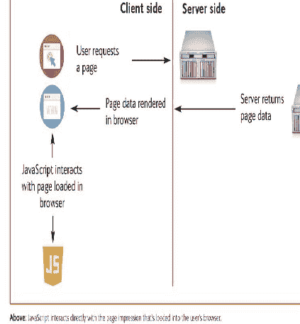

上图：JavaScript 直接与加载到用户浏览器中的页面呈现进行交互。

## 为什么在页面中包含脚本？

在页面中使用脚本的原因几乎和使用脚本的页面数量一样多。但总的来说，使用脚本有两个关键原因：修改页面的外观；以及/或者允许页面与 Web 服务器之间进行通信。

### 视觉变化

一些最常见（当然也是最明显）的脚本会根据页面在编写时未知的条件来修改页面的外观。条件可以简单到像当前时间或用户鼠标指针的位置，也可以非常复杂。重点在于，通过使用 JavaScript，我们可以确定某个条件是否满足，然后采取相应的行动。

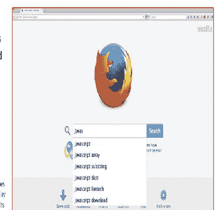

右图：搜索引擎使用脚本在用户输入时显示可能的搜索结果。

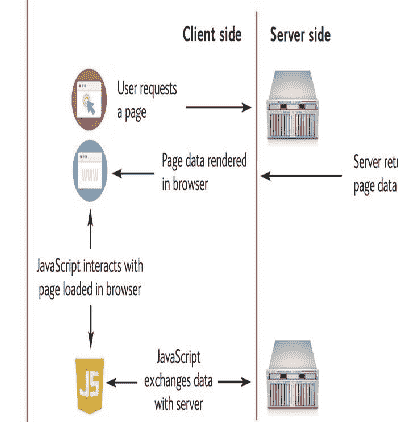

上图：JavaScript 可以从服务器提取数据并在浏览器中显示，而无需重新加载页面。

### 通信

在许多场景中，已加载的页面可能需要从服务器请求额外的数据。例如，许多搜索引擎在你向搜索框输入内容时会弹出建议列表——获取该列表是通过浏览器和服务器之间的脚本通信完成的。


上图：Google Analytics 完全使用脚本在浏览器页面和 Google 服务器之间传输数据。

### 后台工作

并非所有脚本都会产生视觉输出——一个完美的例子就是 Google Analytics。该脚本监控有关页面访问（和访问者）的各种指标：总访问量、独立访问量、访问者的地理位置等等。JavaScript 将这些数据传回 Google 的服务器，页面所有者可以在那里查看并分析数据。

## 编写 JavaScript

与 HTML 和 CSS 一样，JavaScript 是纯文本。这意味着编写 JavaScript 最简单的工具就是计算机操作系统内置的基本文本编辑器（Windows 上的记事本，Mac 上的 TextEdit 或 Linux 上的 Vi）。

### IDE

纯文本编辑器可以使用，但与功能齐全的 IDE（集成开发环境）相比就显得微不足道了。IDE 既能帮助编写脚本（加快工作速度并帮助发现错误），又能帮助管理与网站或大型项目相关的大量文件。

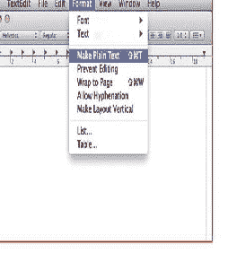

Adobe Dreamweaver 使用纯文本编写代码（见图 - 不要使用富文本！）

### 流行的跨平台 IDE

- **Adobe Dreamweaver**。在 Web 开发方面，Dreamweaver 是业界的标杆（daddy）。但在价格方面它也是“老大哥”，尤其是考虑到 Adobe 备受争议的仅限订阅的许可模式。请审慎权衡你的选择。`www.adobe.com`

> **实用技巧**
>
> 如果在 Mac 上使用 TextEdit 作为 JavaScript 编辑器，请务必在输入任何内容之前将所有新文档切换到纯文本模式。

- **Komodo IDE**。这是一个功能齐全的商业 IDE，单用户许可费用为 $99.6775（截至撰写本文时），由于其简洁、不凌乱的界面和停靠操作而非常受欢迎。`http://komodoide.com`

- **Komodo Edit**。这是 Komodo IDE 的精简版本，可免费下载使用，是体验 IDE 优势的绝佳选择。`http://komodoide.com/komodo-edit`

- **Eclipse**。这个强大的 IDE 可以支持多种不同的语言，包括 HTML、CSS 和 JavaScript。它可以免费下载使用，但对于初学者来说可能过于复杂。`www.eclipse.org`

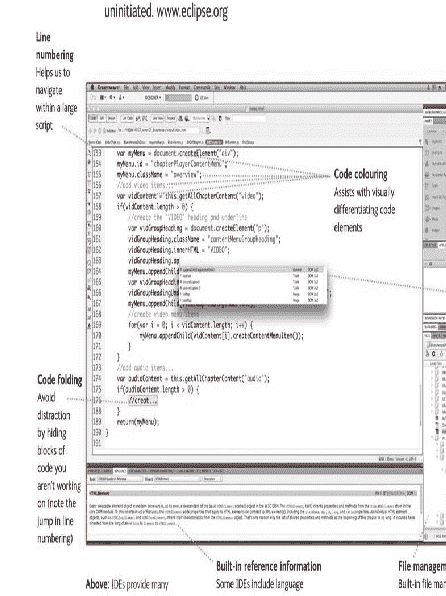

- 代码折叠允许你折叠当前未处理的代码块，以简化周围的代码。
- 代码提示在你输入时提供可用函数、变量和属性的列表。
- 内置参考信息（某些 IDE 包含语言参考库）。
- 文件管理：大型项目可以使用内置的文件管理功能。

## 将脚本添加到页面

我们使用 HTML 元素`<script>`将脚本添加到页面。该元素的`type`属性必须始终为`"text/javascript"`。该元素应始终使用闭合标签`</script>`结束。

### 嵌入式 JavaScript

要嵌入脚本，我们只需在`<script>`的开始和结束标签之间编写指令。这样脚本就与该页面（且仅该页面）内在绑定。

```html
1 <!DOCTYPE html>
2 <html>
3   <head>
4     <meta charset="UTF-8">
5     <title>Untitled Document</title>
6     <script type="text/javascript">
7       // Embedded JavaScript code here
8     </script>
9     <script type="text/javascript" src="js/myScript.js"></script>
10    </head>
11    <body>
12    </body>
13  </html>
```

上图：HTML`<script>`元素可以包含一个嵌入式脚本或链接到一个外部脚本文件。

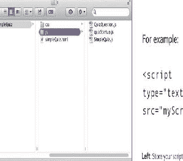

### 链接式 JavaScript

将脚本链接到页面是很常见的做法。为此，将脚本编写在单独的文本文件中，并保存为`.js`文件名扩展名。然后使用`<script>`元素的`src`属性将脚本链接到页面。

例如：

```html
<script
type="text/javascript"
src="myScript.js"></script>
```

## 当浏览器遇到脚本时会发生什么？

> 每当 Web 浏览器加载页面时，它在处理页面的过程中会按顺序处理每个 HTML 元素。

### 解释器

当浏览器遇到`<script type="text/javascript">`元素时，脚本的内容会立即传递给浏览器的 JavaScript 解释器（称为执行脚本）。解释器的任务是理解脚本并指示浏览器采取相应行动。当解释器完成脚本执行后，控制权将返回给浏览器，然后浏览器继续处理页面。

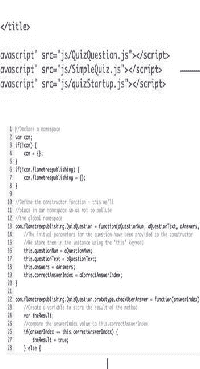

## 你的第一个脚本

1. 创建一个新 HTML 文件并添加基本的结构元素`<htmlrangle>`、`<head>`和`<body>`。将文件保存在方便的位置，并将其命名为`myFirstScript.html`。
2. 在`<body>`元素中添加一个`<script>`元素。在本例中，我们将开始和结束标签放在单独的行上，中间留一个空行。
3. 在脚本元素中输入以下命令：`document.write("<p>Hello World!</p>");`。该命令将文本输出到页面，就像我们直接将其输入到页面中一样（这就是为什么我们也包含了`<p>`元素标签的原因）。
4. 保存页面，然后通过双击文件或右键单击并选择“打开方式”，然后选择 Firefox 来在 Firefox 中打开它。

> **实用技巧**
>
> 我们经常使用“代码”（code）和“编码”（coding）这两个术语——前者是指你输入到脚本中的文本，而后者是指编写脚本的过程。

```html
<!DOCTYPE HTML>
<html>
  <head>
    <title>My First Script</title>
  </head>

  <body>

    <script type="text/javascript">
      document.write("<p>Hello World!</p>");
    </script>

  </body>
</html>
```

## 工作原理

恭喜——你刚刚编写并执行了你的第一个脚本。当浏览器遇到`<script>`元素时，脚本被传递给了解释器。解释器识别出`document.write`命令，并将括号（或在编程术语中称为圆括号）中包含的文本写入页面。文本必须包含在引号中，解释器才能将其识别为文本——如果你看到的只是一个空白页面，很可能是你漏掉了引号。

> **实用技巧**
>
> 关于编程语言的书籍习惯于将 “Hello World!” 作为书中第一个练习的输出——你现在正式加入了开发者的行列！

右图：你已经通过了入职测试——欢迎加入！


## JavaScript 中的数据

## 什么是数据？

数据是所有编程语言中的一个核心概念。数据可以被看作是在程序中使用的任何信息片段。

## 所有数据都有一个值

任何数据片段都可以说具有一个值。这个值可以是简单的——例如一个数字或一段文本——也可以是复杂的，比如一个数字列表或多个段落。无论数据类型如何，该数据所代表的信息都被称为该数据的“值”。

## 字面量（Literals）


字面量是直接在脚本中输入且具有特定值的片段。以下都是字面量的示例：`"Hello World"`、`true`、`42` 和 `null`。

## 标识符（Identifiers）

标识符是一个分配给数据片段（或函数——见第 81 页的“具名函数”）的区分大小写的名称。一旦分配，标识符就可以在脚本中用来引用该数据（或函数）。只要遵守几条基本规则，JavaScript 允许你自由选择用作标识符的名称。

```javascript
3 4  myNumberLiteral = 42;
5    myStringLiteral = "Hello World";
6    myBooleanLiteral = true;
7    myNullLiteral = null;
8
9
```

*上图：字面量值直接输入到脚本中。*

## 标识符命名规则

- **保留字：** JavaScript 定义了一些对语言具有特殊含义的单词（见第 50 页）。这些单词不能用作自定义标识符的名称。
- **首个字符：** 标识符的第一个字符必须是字母、下划线 `_` 或美元符号 `$`。
- **后续字符：** 标识符中的其余字符只能是字母、数字、下划线或美元符号。

```javascript
1  //合法标识符示例
2  myValue
3  _myValue
4  MY_VALUE
5  $myValue
6  my3Value23
7  my_$_value_23

9  //非法标识符示例
10 23myvalue
11 myValue*
12 my-value
13 #myvalue
14 my%Value
15 my4Value
16
```

*右图：第一组标识符全部是合法的（也就是说，是被允许的）标识符，而第二组是非法的。*

## 变量（VARIABLES）

本质上，变量是计算机内存的一块区域，用于存储数据，并通过标识符来引用。

### 声明变量

在 JavaScript 中声明一个新变量非常简单——我们只需要编写关键字 `var`，后面跟着我们想要用来引用该变量的标识符。例如：

```javascript
var theAnswer;
```

### 为变量赋值

通常在声明变量的同时为其赋值，如下所示：

```javascript
var theAnswer = 42;
```

### 更改变量的值

一旦使用 `var` 声明了变量，我们可以像这样更改分配给它的值：`theAnswer = 54`。请注意，这次我们没有包含 `var` 关键字。

```javascript
4  //声明变量（不带赋值和带赋值）
5  var theQuestion;
6  var theAnswer = 42;
7
8  //为已声明的变量赋值
9  theQuestion = "Life, the Universe and Everything";
10
```

*上图：变量的声明和使用非常简单。*

> **实用技巧**
>
> 在 JavaScript 中，`=` 不代表等于——它代表赋值（见第 56 页）。

### 获取变量的值

要使用存储在变量中的值，我们在需要使用该值的地方编写该变量的标识符名称。

1. 创建一个新的 HTML 文档并添加常见的结构元素（`<html>`、`<head>` 和 `<body>`）。将文档保存为 `gettingVariables.html`。
2. 添加一个 `<script type="text/javascript">` 元素作为 `<body>` 元素的子级（即在其中），如下所示。
3. 添加下面所示的 JavaScript 代码。
4. 保存工作，然后在 Firefox 中打开该文件。

```html
1  <!DOCTYPE HTML>
2  <html>
3    <head>
4      <title>Getting Variables</title>
5    </head>
6
7    <body>
8
9      <script type="text/javascript">
10
11     </script>
12
13   </body>
14 </html>
```

*上图：步骤 2：添加 `<script type="text/javascript">` 元素。*

```javascript
10 <script type="text/javascript">
11   var theMessage = "The alert function displays a message in a dialog box. ";
12   alert(theMessage);
13   theMessage = "Here we're just changing a variable's value...";
14   alert(theMessage);
15   theMessage = "...and passing that variable's identifier to the alert function. ";
16   alert(theMessage);
17   theMessage = "The interpreter then looks up the variable's value...";
18   alert(theMessage);
19   theMessage = "...and that's what we see in the dialog box. Simple, eh?";
20   alert(theMessage);
21 </script>
```

*上图：步骤 3：添加 JavaScript 代码。*

## 数据类型（DATA TYPES）

> JavaScript 处理的所有数据都有一个数据类型。这规定了被处理数据的性质——它是数字、文本、列表等等。

### 什么是数据类型？

为了将一段数据转化为有用的东西，计算机或程序必须知道这段数据打算代表什么——它必须知道数据的类型。因为数据存储在变量中，我们通常称变量具有某种数据类型，或者说是某某类型的。数据类型分为两组：原始类型（primitive）和引用类型（reference）。让我们来看看这意味着什么。

### 数据机制

与 C 和 Java 等底层编程语言不同，JavaScript 不需要程序员参与数据如何在计算机上存储的细节——解释器为我们管理这些复杂之处。

然而，你仍然应该意识到，你的计算机所做的一切——你写的每一封电子邮件，你听的每一首歌，你看的每一个视频——都是由数字代表的。

因此，在最基础的层面上，所有计算机数据都只是数字。

> 二进制和十六进制数字系统与计算机表示数字和数据的方式有着内在的联系——如果你不知道它们是如何工作的，请在 Wikipedia 上查阅。

## 原始数据类型与引用数据类型

原始数据类型可以被认为是那些数据代表单个值（如数字）的类型，而引用数据类型则代表复杂数据（如列表）。

当脚本中使用原始类型的变量时，解释器会复制该变量的值，并在计算中使用此副本。相比之下，当使用引用类型的变量时，解释器直接操作存储在内存中的数据。

原始数据类型

引用数据类型

*上图：原始数据类型保留其内存值的一个副本；引用类型保留对其内存值的直接引用。*

### 理解原始数据类型与引用数据类型的区别

> **实用技巧**
>
> 从现在起，我们不再告诉你向基础 HTML 文档中添加哪些常见元素——你现在已经知道了。

1. 创建一个包含常见结构元素（`<html>`、`<head>` 和 `<body>`）的新 HTML 文档。将文件保存为 `datatypes.html`。
2. 创建一个 `<script>` 元素作为 `<body>` 元素的子级（即在其中），确保将 `type` 属性设置为 `"text/javascript"`，如下所示。

```html
<!DOCTYPE html>
<html>
<head>
<title>Exploring Primitive and Reference Datatypes</title>
</head>
<body>
<script type="text/javascript"></script>
</body>
</html>
```

```javascript
<script type="text/javascript">
  document.write("<h2>PRIMITIVE DATATYPES</h2>");
  var primitiveVar1 = 72;
  var primitiveVar2 = primitiveVar1;
  document.write("<p>primitiveVar1 has value " + primitiveVar1 + "</p>");
  document.write("<p>primitiveVar2 has value " + primitiveVar2 + "</p>");
  var primitiveVar1 = 12;
  document.write("<p>primitiveVar1 now has value " + primitiveVar1 + "</p>");
  document.write("<p>primitiveVar2 now has value " + primitiveVar2 + "</p>");
</script>
```

*上图：步骤 3：将此代码输入到你的新 `<script>` 元素中。*

3. 在这个新的脚本元素中输入上面所示的代码。
4. 保存工作，然后在 Firefox 中打开 `datatypes.html`。
5. 正如你所看到的，尽管我们将 `primitiveVar2` 赋值为 `primitiveVar1`，但当我们更改 `primitiveVar2` 的值时，`primitiveVar1` 的值并没有改变。换句话说，每个变量引用的是一个独立的值。
6. 返回你的编辑器，添加上面所示的新代码（旧代码已变暗）。这里我们使用对象作为引用数据类型——这些内容从第 39 页开始讨论。
7. 保存你的工作，并在 Firefox 中启动页面。
8. 注意，修改 `referenceVar2.myValue` 的值如何同时改变了 `referenceVar1.myValue` 的值。这是因为 `referenceVar1` 和 `referenceVar2` 都指向内存中的同一数据，所以修改其中一个也会改变另一个。

## 区分基本类型与引用类型

牢记这一区别非常重要——如果不这样做，可能会在你的 JavaScript 应用程序中导致一些重大错误。好消息是，你会发现它很快就会变成第二天性。

```javascript
7  <code>
8  <script type="text/javascript">
9    var playerObjectTemplate = {};
10   var player1 = playerObjectTemplate;
11   player1.playerName = "Seth";
12   player1.strkngScore = 4;
13   var player2 = playerObjectTemplate;
14   player2.playerName = "Steven";
15   player2.strkngScore = 12;
16   alert(player1.playerName); //Alert box will say "Steven", not "Seth"
17   alert(player1.strkngScore); //Alert box will say 12, not 4
18 </script>
19
20 </code>
```

## 基本数据类型

让我们来看看基本数据类型。请记住，这些类型的变量代表单个值。

### 布尔值

布尔值代表计算机数据的单个位，因此是最简单的数据类型。布尔值可以是 `false` 或 `true`，在计算机中分别表示为 `0` 或 `1`。

### 数值

一般来说，在计算中有两种类型的数字：整数和浮点数。前者是整数，后者是涉及分数或指数部分的数字，例如 `3.14` 或 `$0.945 \times 10^7$`。JavaScript 不纠结于这种区分——数字就是数字。


### 字符串

字符串是文本数据——不用担心为什么它们被称为字符串（这涉及一些我们不需要担心的技术细节）；只需知道字符串就是文本，文本就是字符串。

在脚本中编写字符串时，必须用引号包围它们。可以使用单引号 `'` 或双引号 `"`（我们将使用后者），但至关重要的是，字符串必须用与开头相同风格的引号来闭合。

> **实用提示**
>
> 如果字符串由单引号 `'` 包围，它可以包含双引号 `"`，反之亦然。

空字符串——即不包含任何字符的字符串——通常写作一对引号。

```javascript
' ' or " ".
```

```html
1  <!DOCTYPE HTML>
2  <html>
3    <head>
4      <title>Using Quotes in Strings</title>
5    </head>
6
7    <body>
8      <script type="text/javascript">
9        var anyString = ""; //"" creates an empty string
10       anyString = 'A string can be demarked by single quotes...';
11       anyString = "...or it can be demarked by double quotes.";
12       anyString = 'A string demarked by single quotes "can" contain double quotes';
13       anyString = "A string demarked by double quotes 'can' contain single quotes";
14     </script>
15
16   </body>
17 </html>
18
```

上图：在字符串中使用引号的不同方式。

### 不存在的数据

JavaScript 有两种数据类型用于表示不存在的数据。`null` 类型，其值也是 `null`，表示没有值——如果一个标识符求值为 `null`，它不包含任何有效数据，或者最可能的是，它尚未被声明。第二种类型是 `undefined`，其值也是 `undefined`，与 `null` 略有不同——它是任何已声明但尚未赋值的变量的初始类型和值。

## 数组

数组是一种引用数据类型；数组在 JavaScript 术语中指的是一个值列表。有两种创建数组的方式。

### 编写数组字面量

我们可以通过编写数组字面量来创建数组，如下所示：

```javascript
var myArray = [value_1, value_2, ..., value_n]
```

```html
1  <!DOCTYPE HTML>
2  <html>
3    <head>
4      <title>Array Examples</title>
5    </head>
6
7    <body>
8      <script type="text/javascript">
9        var emptyArray = [];
10       var numbersArray = [42, 12, 57, 3.14, 981582, 5];
11       var stringsArray = ["Harry", "Sue", "Julia", "Chris", "Oliver"];
12       var mixedArray = ["Oliver", true, false, 5];
13       var arraysArray = [emptyArray, numbersArray, stringsArray, mixedArray];
14     </script>
15   </body>
16 </html>
```

上图：数组存储其他数据（包括其他数组）的列表。


方括号 `[ ]` 标记数组的开始和结束，而存储在数组中的值——其元素——由逗号分隔，可以是任何数据类型。要创建空数组，我们只需键入不带任何元素的括号。

### 使用 `new` 关键字创建数组

我们也可以使用 `new` 关键字创建数组：`var myArray = new Array();`。初始元素可以用逗号分隔，包含在括号之间。（我们在第 50 页讨论关键字。）

### 数组长度

数组中元素的数量称为其长度。如果我们有一个名为 `myArray` 的数组，我们可以通过键入 `myArray.length` 来获取其长度。

### 访问数组元素

数组中的每个元素都有一个索引，这是一个指代元素在数组中位置的数字。第一个元素的索引为 `0`，第二个元素的索引为 `1`，依此类推。要访问数组的特定元素，我们编写数组变量名，后跟用方括号包裹的索引号。例如，如果我们想使用数组 `myArray` 的第三个元素（索引 `2`），我们写 `myArray[2]`。

> **实用提示**
>
> 数组元素可以包含你喜欢的任何数据类型——包括其他数组。

### 向数组添加元素

我们也可以使用方括号为数组元素赋值。例如，要设置数组 `myArray` 的第八个元素（索引 `7`），我们可以键入 `myArray[7] = 19;`。如果第八个元素已经包含数据，它将被新值覆盖。或者，如果数组的长度小于 8，新元素将被创建，同时会创建任何所需的空元素，以填充未修改数组的最后一个元素与新添加元素之间的空隙。


```html
1 <!DOCTYPE HTML>
2 <html>
3 <head>
4 <title>Array Examples</title>
5 </head>
6
7 <body>
8 <script type="text/javascript">
9 var userNames = new Array("Helen", "Amrit", "Geoff", "Jacques");
10 var userLogins = new Array();
11 alert(userNames.length); //Displays '4' in the alert dialog
12 alert(userLogins.length); //Displays '0' in the alert dialog
13 </script>
14 </body>
15 </html>
16
```

```html
7 <body>
8 <script type="text/javascript">
9 var userNames = new Array("Helen", "Amrit", "Geoff", "Jacques");
10 var userLogins = new Array();
11 //Get array element values...
12 alert(userNames[0]); //Displays 'Helen' in the alert dialog
13 alert(userNames[3]); //Displays 'Jacques' in the alert dialog
14 //Set array element values...
15 userLogins[0] = ["Amrit", "Monday"]; //Assign array to 1st element of userlogins
16 userLogins[2] = ["Helen", "Tuesday"]; //Assign array to 3rd element of userlogins
17 //Get undeclared array element values...
18 alert(userLogins[1]); //Displays 'undefined' in the alert dialog, i.e. the element
19 //exists - it was created for us - but it has not had a
20 //value assigned to it
21 </script>
22 </body>
```

上图：数组可以使用`new`关键字创建，并且始终具有长度。

上图：我们可以访问数组元素，既可以使用方括号访问表示法来获取值，也可以设置值。


### 向数组追加元素

数组的`push()`方法使我们能够向数组末尾追加元素（我们在第102页讨论方法）。例如，如果我们希望将字符串`"Harry"`追加到数组`firstNames`，我们可以这样写：`firstNames.push("Harry")`。

```html
7   <body>
8     <script type="text/javascript">
9       var userNames = new Array("Helen", "Amrit", "Geoff", "Jacques");
10      alert(userNames.length); //Displays '4' in the alert dialog
11      userNames.push("Oliver");
12      alert(userNames.length); //Displays '5' in the alert dialog
13      alert(userNames[4]); //Displays 'Oliver' in the alert dialog
14    </script>
15  </body>
```

上图：数组的`push()`方法向数组末尾添加一个元素。

### 从数组移除元素

我们可以使用`shift()`方法移除数组中的第一个元素，或使用`pop()`方法移除最后一个元素。无论使用哪种方法，它都会返回被移除的值。

```html
7   <body>
8     <script type="text/javascript">
9       var userNames = new Array("Helen", "Amrit", "Geoff", "Jacques");
10      userNames.push("Oliver");
11      alert(userNames.length); //Displays '5' in the alert dialog
12      var firstNameInArray = userNames.shift();
13      alert(firstNameInArray); //Displays 'Helen' in the alert dialog
14      alert(userNames.length); //Displays '4' in the alert dialog
15      var lastNameInArray = userNames.pop();
16      alert(lastNameInArray); //Displays 'Oliver' in the alert dialog
17      alert(userNames.length); //Displays '3' in the alert dialog
18    </script>
19  </body>
```

上图：数组的`shift()`和`pop()`方法分别移除第一个和最后一个元素。

### 其他数组方法

数组还有许多其他用于操作其内容的方法——实在太多，无法在此一一介绍。如需完整列表，请访问`www.w3schools.com/js/js_array_methods.asp`。

## 对象

对象类型的变量（一种引用数据类型）是一种可以存储多个值的变量。然而，与基于索引访问的数组不同，对象将值存储在命名属性中（通常称为属性-值对）。

对象在 JavaScript 中扮演着特殊角色——它们是所有其他 JavaScript 数据构建的基础基石。所有其他数据类型都继承了对象数据类型的基本特性。因此，我们经常将任何且所有的 JavaScript 数据都称为对象——例如，字符串对象或数组对象。这种继承的概念是面向对象编程的基础，这是一种与 JavaScript 紧密相关的编程方法，我们将在第 95 页对其进行介绍。

> **实用技巧**
>
> 存储在对象属性中的值可以是任何数据类型，包括其他对象或数组。

```html
7  <body>
8      <script type="text/javascript">
9          var quizQuestion1 = new Object();
10         quizQuestion1.question = "Approximately how far is the Sun from the Earth?";
11         quizQuestion1.answer = "93,000,000 miles";
12         quizQuestion1.wrongAnswer1 = "200 miles";
13         quizQuestion1.wrongAnswer2 = "49,000,000 miles";
14         quizQuestion1.wrongAnswer3 = "150,000 miles";
15     
16     </script>
17 </body>
```

*上图：步骤 2：将此处显示的代码输入到你的 HTML 文档中*

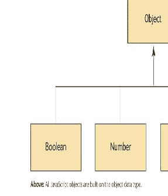

*上图：所有 JavaScript 对象都构建在对象数据类型之上。*

2. 输入上方插图所示的代码。这使用了`new`关键字来创建一个空对象，然后在该对象上声明了一系列属性。

3. 输入下方插图所示的新代码，其中我们使用对象字面量表示法创建了一个对象：每个属性名后面跟着一个冒号和一个值；属性-值对由逗号分隔；整个字面量包裹在大括号（`{}`）中。

## 创建对象

我们可以通过声明对象字面量或使用`new`关键字来创建对象——让我们两种方法都试一下。

```html
13         quizQuestion1.wrongAnswer2 = "49,000,000 miles";
14         quizQuestion1.wrongAnswer3 = "150,000 miles";
15     
16     var quizQuestion2 = {
17         question: "How many planets orbit the Sun?",
18         answer: "8",
19         wrongAnswer1: "6",
20         wrongAnswer2: "7",
21         wrongAnswer3: "9"
22     };
23     
24     </script>
```

1. 创建一个包含通用结构元素的新 HTML 文档。在`body`元素的子级添加一个`<script type="text/javascript">`元素，然后将文档保存为`javascriptObjects.html`。

*上图：步骤 3：输入此处高亮显示的代码*

4. 最后，我们再次声明一个对象字面量——但这一次是一个空对象，可用于存储我们创建的对象中问题的答案。请参阅下图。

```html
15 var quizQuestion2 = {
16     question: "How many planets orbit the Sun?",
17     answer: "8",
18     wrongAnswer1: "6",
19     wrongAnswer2: "7",
20     wrongAnswer3: "9"
21 };
22
23 var userAnswers = {};
24
25 </script>
26 </body>
27 </html>
```

*上图：步骤 4：此处，你将创建一个空对象。*

5. 保存你的工作。如果你在 Firefox 中启动此页面，你不会看到任何视觉输出，但这没关系——目前，这更多是一次编码和思考练习，但随着进度的推进，我们将在此基础上进行构建。

6. 请注意，我们在两个`quizQuestion`对象中创建了相同的属性名结构——以这种方式创建和重用对象结构是面向对象编程的核心原则，我们将在第 95 页讨论该内容。

> **实用技巧**
>
> 管理属性名的规则与所有标识符的规则相同——见第 25 页。

```html
23 var userAnswers = {};
24
25
26
27 alert(quizQuestion1.question);
28 alert(quizQuestion2.question);
29
30 </script>
31 </body>
32 </html>
33
```

*上图：访问存储在对象属性中的值非常简单。*

## 访问对象属性

如果我们有一个对象`myObject`，并在其上定义了一个属性`myProperty`，我们可以通过输入`myObject.myProperty`来访问该属性。`.`被称为点运算符（见第 53 页）。

## 数据类型转换

在很多情况下，你需要在一个类型的上下文中还原另一个类型的值。例如，你可能希望使用数字的字符串表示（用`"42"`代替`42`），或者你可能需要在布尔值的上下文中运行一个数字。这种在数据类型之间进行翻译的操作被称为数据类型转换（data type casting）。


## 隐式转换

JavaScript 在管理数据类型方面非常主动，它会根据数据被使用的上下文自动在类型之间进行转换（示例见第 55 页）。

## 显式转换

我们也可以显式地转换某些数据类型，最常用于字符串和数字之间的转换。例如，要将数字转换为字符串，我们会写`String(42)`，结果为`"42"`。反之，要将字符串转换为数字，我们会写`Number("42")`，结果为`42`。

```javascript
1 var myNumber = 42;
2 var myString = "549";
3 var myName = "Sajid";
4
5 var test1 = myNumber + myString;
6 alert(test1); //Shows '42549' in the alert box
7
8 var test2 = myNumber + Number(myString);
9 alert(test2); //Shows '591' in the alert box
10
11 var test3 = myString + myName;
12 alert(test3); //Shows '549Sajid' in the alert box
13
14 var test4 = myNumber + Number(myName);
15 alert(test4); //Shows 'NaN' in the alert box
16
17 var test5 = String(myNumber) + myName;
18 alert(test5); //Shows '42Sajid' in the alert box
19
20
```

*上图：这段代码重点展示了我们如何以及为什么要显式地在数据类型之间进行转换。*

## 特殊的 NaN 数字

并非所有值都能转换为数字——例如，字符串`"foo"`没有数字含义。

如果我们把这个字符串转换为数字，我们将得到结果`NaN`（Not a Number，非数字）。尽管名字如此，它确实是一个数字，并且可以在任何允许或期望出现数字的地方使用。然而，任何包含`NaN`的计算结果本身永远是`NaN`。

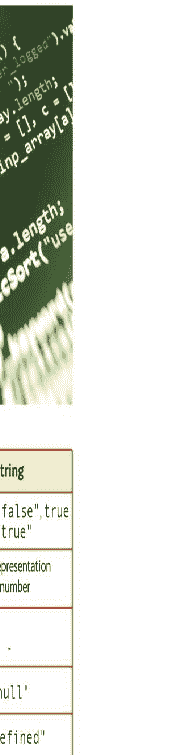

## 不同数据类型转换的结果

此表显示了不同数据类型之间转换的结果。阅读此表的方式为“从行标题转换为列标题”。

|  | Boolean (布尔值) | number (数字) | string (字符串) |
|---|---|---|---|
| Boolean | - | false 是 0, true 是 1 | false 是 "false", true 是 "true" |
| number | 0 是 false, 其余为 true | - | 数字的字符串表示 |
| string | "" 是 false, 其余为 true | 字符串的数字表示或`NaN` | - |
| null | false | 0 | "null" |
| undefined | false |`NaN`| "undefined" |
| array (数组) | true | 空数组是 0, 包含元素的数组是`NaN`| 元素值的逗号分隔列表 |
| object (对象) | true |`NaN`| "[object Object]" |


## JAVASCRIPT 语法

一个脚本可以由单条指令组成，也可以是一本包含数千行代码的巨著。但无论规模如何，JavaScript 中的所有脚本都共享一个共同的结构和语法。

## 区分大小写

首先要注意的是，JavaScript 是区分大小写的，即小写字符被认为与其对应的大写字符不同。例如，标识符`"myVariable"`与`"MyVariable"`不同（请注意不同的首字母大写）。

```javascript
00 com.flamerepublishing.simpleQuiz.prototype.addQuestion = function() {
01   // QUESTION 1
02   this.questions.push(
03     new com.flamerepublishing.QuizQuestion(
04       1,
05       "Approximately how far away from the Earth is the Sun?",
06       ["200 miles", "93,000,000 miles", "49,000,000 miles", "150,000 miles"],
07       1
08     )
09   );
10   // QUESTION 2
11   this.questions.push(
12     new com.flamerepublishing.QuizQuestion(
13       2,
14       "How many planets are there in our Solar System?",
15       ["6", "7", "8", "9"],
16       2
17     )
18   );
19   // QUESTION 3
20   this.questions.push(
21     new com.flamerepublishing.QuizQuestion(
22       3,
23       "Which of these is a Moon of Jupiter?",
24       ["Ganymede", "Miranda", "Enceladus", "Mars"],
25       0
26     )
27   );
28 }
```

*上图：缩进的代码更容易阅读，因为它有助于在视觉上将相关代码段分组。*

## 空格


JavaScript 忽略前导空格和制表符（tabs）。这使我们能够在代码中使用缩进，这是一种有助于使代码更有组织且更具可读性的技巧。

## 分号

JavaScript 语句通常以分号（`;`）结尾，但并非必须。在省略分号的地方，解释器会假设换行符标志着语句的结束。然而，省略分号可能会导致代码出现歧义，因此最佳实践是为每个语句加上分号结尾。

```
1  //Inline comments start with '//' and end at the next line break
2
3  var userScore = 0; //They can be written on the same line as other code
4
5  //alert(userScore); //They can also be used to disable lines of code
6
```

*上图：行内注释在注释后的换行符处结束。*

## 注释

注释是脚本中被解释器忽略的部分。注释用于给脚本添加笔记和解释，帮助他人理解，并在编写数月后重新审视脚本时作为自己的笔记。

### 行内注释

行内注释以`//`开始，一直持续到下一个换行符。它们可以单独占据一行，也可以紧跟在其他 JavaScript 代码之后。

> **实用技巧：** 注释通常用于禁用脚本的部分内容——这在尝试新想法或试图寻找漏洞（bugs）时非常有用。

## 表达式与运算符

你在脚本中编写的指令由表达式构成。通常，表达式使用运算符以某种方式处理数据。

### 什么是表达式？

表达式是解释器可以求值的任何代码片段，通常会产生一个值。这个宏大的描述掩盖了概念的简单性——考虑以下内容：`42`。严格来说，除了是一个字面量之外，它也是一个表达式——解释器可以对其进行求值，得到十进制值`42`。诚然，这算不上多么了不起的表达式——它相当于脚本世界中你走向一位同事说"42"；她会理解你陈述了一个值，但她完全不知道你希望她对此做什么。

```
1 42
2 2
3 "Hello World"
4 true
5 null
6 null
```

### 块注释

块注释以`/*`开头，持续到出现闭合的`*/`为止。这两个标记之间的所有内容都被视为注释的一部分。

### 关键字和保留字

JavaScript 定义了一组预定义的标识符，称为关键字，以及其他将来可能不会被纳入语言的标识符。这些统称为保留字，你*绝不能*将这些名称用作自己的标识符（也不能用作对象中的属性名）。

```javascript
/* 这些是行注释，以 // 开头
// 直到找到行尾字符 (\n)。
// 这是行注释。这是"行注释"。

/* 这是块注释；天文学家称之为
"多行注释"，因为它可以跨行 (\n)
* 我们可以在任何地方包含块注释
* 它们可能出现在语句中间，无论是
* 注释掉代码时，还是在标注
* 代码时。*/

// 你也可以在同一文档中定义不同的样式。

/* 我们对返回值的表达式使用这种样式：*/
this.result = document.createElement("div");
this.result = render(data);

/* 对不返回值的语句使用这种样式：*/
this.container = window.body;
this.container.appendChild(this.result);

/* 对逻辑使用这种样式：*/
this.value = 42;

/* 对辅助函数使用这种样式：*/
this.update = () => {
	setinnerWidth(this.container);
	setinnerWidth(this.result);
};

/* 对文档使用这种样式：*/
code.title = "Example";
```

| 关键字 | 保留字 |
| :--- | :--- |
| `break`, `case`, `catch`, `continue`, `default`, `delete`, `do`, `else`, `false`, `finally`, `for`, `function`, `if`, `in`, `instanceof`, `new`, `null`, `return`, `switch`, `this`, `throw`, `true`, `try`, `typeof`, `var`, `void`, `while`, `with` | `abstract`, `boolean`, `byte`, `char`, `class`, `const`, `debugger`, `double`, `enum`, `export`, `extends`, `final`, `float`, `goto`, `implements`, `import`, `int`, `interface`, `long`, `native`, `package`, `private`, `protected`, `public`, `short`, `static`, `super`, `synchronized`, `throws`, `transient`, `volatile` |

## 更具表达力

现在考虑表达式`38 + 4`。这次，在对表达式求值时，解释器将`38`和`4`相加——结果与我们之前的例子相同（值为`42`），但我们将两个值相加后实现了某种效果。

沿用我们的类比，你对你的同事说"38 加 4"，她回答"42"。产生区别的是加法运算符`+`的引入。

### 什么是运算符？

正如我们刚才所见，表达式要具有意义，通常需要包含运算符；运算符定义了表达式中的数据应如何求值，以获得表达式的值。

### 操作数

在运算符的语境中，正在处理的值被称为操作数。许多运算符需要两个操作数，分别在运算符的两侧（称为左操作数和右操作数）。其他的——称为一元运算符——只使用单个操作数，而更少的一部分运算符使用三个或更多操作数。

## 丰富的运算符

JavaScript 有许多不同的运算符——多得无法在此一一介绍——所以我们只关注最常见的那些。

### 点运算符

我们已经见过点运算符`"."`——它使我们能够访问对象的属性（和方法——参见第 102 页）。左操作数是对对象的引用，右操作数则是该对象的属性或方法的名称。

```javascript
1  38 + 4
2  
3  "Hello " + "World"
4  
5  myVariable = true
6  
7  quizQuestion.questionText
8  
9  getMyValue()
10 
11 myObject.doSomething()
```

上图：运算符赋予表达式意义和目的。

上图：操作数是运算符依次处理的操作值。

### 算术运算符

算术运算符使用提供的操作数执行算术运算，并返回该计算的结果。操作数必须是数字，或者求值为数字的表达式。

> **热门提示**

> 访问 https://en.wikibooks.org/wiki/JavaScript_Operators 查看 JavaScript 运算符的完整列表。

| 运算符 | 操作数个数 | 名称 | 作用 | 示例（括号内为结果） |
|---|---|---|---|---|
| `+` | 2 | 加法 | 将左右操作数相加 | `4 + 5` (9) |
| `-` | 2 | 减法 | 左操作数减去右操作数 | `31 - 14` (17) |
| `*` | 2 | 乘法 | 左右操作数相乘 | `12 * 3` (36) |
| `/` | 2 | 除法 | 左操作数除以右操作数 | `12 / 3` (4) |
| `++` | 1 | 自增 | 将单个标识符操作数的值加 1 | `multipliers++` (`multipliers` 增加 1) |
| `--` | 1 | 自减 | 将单个标识符操作数的值减 1 | `multipliers--` (`multipliers` 减少 1) |

### 字符串运算符

有几种不同的运算符可以处理字符串，但只有一种是专门用于字符串的：

| 运算符 | 名称 | 作用 | 示例（括号内为结果） |
|---|---|---|---|
| `+` | 拼接 | 将两个字符串连接在一起，返回结果字符串 | `"Hello " + "World"` ("Hello World") |

请注意，拼接运算符看起来与加法运算符相同——解释器根据操作数的数据类型来推断应该使用哪个运算符。如果两个操作数求值都是数字，则是加法；如果任一操作数求值为字符串，则是拼接。此外，如果拼接运算符的操作数求值为数字，它会转换为字符串（参见数据类型转换，第 43 页）。

> **热门提示**

> 我们的表格中没有列出操作数个数的，默认都是二元运算符——即它们需要两个操作数。

### 赋值运算符

我们已经见过这个运算符，其左操作数始终是变量或属性引用，右操作数可以是任何字面量、标识符或表达式。

| 运算符 | 名称 | 作用 | 示例（括号内为结果） |
| :--- | :--- | :--- | :--- |
| `=` | 赋值 | 将右操作数的值赋给左操作数指示的变量或属性 | `myRef = 42` (`myRef` 现在的值为 42) |

### 相等运算符

这些运算符比较两个操作数，返回`true`或`false`（参见布尔值，第 331 页）。操作数可以是任何数据类型。

> **热门提示**

> 务必充分理解赋值运算符`=`和相等运算符`==`之间的区别。

| 运算符 | 名称 | 作用 | 示例（括号内为结果） |
| :--- | :--- | :--- | :--- |
| `==` | 相等 | 如果两个操作数相等则返回`true`，否则返回`false` | `4 == 2` (false) |
| `!=` | 不相等 | 如果两个操作数不相等则返回`true`，否则返回`false` | `4 != 2` (true) |

### 比较运算符

顾名思义，比较运算符比较两个操作数，返回`true`或`false`。操作数可以是任何数据类型。

| 运算符 | 名称 | 作用 | 示例（括号内为结果） |
| :--- | :--- | :--- | :--- |
| `<=` | 小于或等于 | 如果左操作数的值小于或等于右操作数的值，则返回`true`，否则返回`false` | `52 < 20` (false) <br> `15 < 19` (true) |
| `>=` | 大于或等于 | 如果左操作数的值大于或等于右操作数的值，则返回`true`，否则返回`false` | `52 > 20` (true) <br> `12 > 350` (false) |

### 逻辑运算符

逻辑运算符比较值，然后返回`true`或`false`。如有需要，操作数会被转换为布尔值。

| 运算符 | 操作数个数 | 名称 | 作用 | 示例（括号内为结果） |
| :--- | :--- | :--- | :--- | :--- |
| `&&` | 2 | 逻辑与 | 如果两个操作数都求值为`true`，则返回`true`，否则返回`false` | `true && false` (false) |
| `||` | 2 | 逻辑或 | 如果任一操作数求值为`true`，则返回`true`，否则返回`false` | `true || false` (true) |
| `!` | 1 | 逻辑非 | 置于单个操作数之前，反转操作数的布尔值 | `!true` (false) |

```javascript
7  <body>
8    <script type="text/javascript">
9      var jsResult = 20 - 4 * 3;
10     document.write("<p>20 - 4 * 3 equals " + jsResult + "</p>");
11     var possResult1 = (20 - 4) * 3;
12     document.write("<p>(20 - 4) * 3 equals " + possResult1 + "</p>");
13     var possResult2 = 20 - (4 * 3);
14     document.write("<p>20 - (4 * 3) equals " + possResult2 + "</p>");
15   </script>
16 </body>
```

上例：探索 JavaScript 的运算符优先级规则。

## 运算符优先级

考虑以下代码：`20 - 4 * 3`。这表示`(20 - 4) * 3`（结果为 48），还是`20 - (4 * 3)`（结果为 8）？JavaScript 通过为每个运算符分配优先级来处理这种情况——优先级最高的运算符先计算，优先级最低的运算符最后计算。何不写一个脚本来验证哪种解释是正确的呢？


## 覆盖运算符优先级

记住每个运算符的优先级可能相当困难，因此使用括号（小括号）来覆盖默认的运算符优先级通常更简单、也更明确。

括号内的任何表达式都会在同一语句中的其他所有表达式之前进行计算。考虑以下内容：`(24 - 2) / 7`。括号内的部分`(24 - 2)`先计算，结果 22 再除以 7。

```javascript
1  <!DOCTYPE HTML>
2  <html>
3    <head>
4      <title>Nesting Parentheses</title>
5    </head>
6    <body>
7      <script type="text/javascript">
8        var myValue1 = ((22 / 7) + 10) - 3;
9        var myValue2 = 13 + (9 - 2 / (4 + 6));
10     </script>
11   </body>
12 </html>
```

IDE 检测到由缺少括号引起的语法错误：此开括号没有对应的闭括号。

上例：本例中的第二个表达式导致语法错误。

> **温馨提示**

> 嵌套括号时，务必确保每个开括号`(`都有对应的闭括号`)`。如果不匹配，就会发生语法错误。

## 嵌套括号

你经常会发现需要在括号内嵌套括号，例如`((24 - 2) + 10) / 7`。在这种情况下，嵌套最深的表达式先计算，然后是次深的，依此类推。

## 语句

> 在 JavaScript 结构的最顶层，我们会发现语句。所有 JavaScript 指令都包含在语句中。

### 什么是语句？

JavaScript 语句封装了一个或多个表达式，可以被视为脚本中的一个独立步骤或指令。脚本中的每条语句都会在下一个语句处理之前完整执行。

### 构成语句

考虑以下简单表达式：`playerScore = 0;`。虽然这是一个表达式，但正如结尾的分号`;`所示，它也是一个语句。语句不必比这更复杂，但它们通常会更复杂。

```javascript
playerScore = 0;
```

上例：语句由一个或多个表达式组成。

```javascript
document.write("Your score is " + playerScore);
```

### 复合表达式

我们通常会在一条语句中构建相当复杂的表达式堆栈，例如：`document.getElementsByTagName("body")[0].appendChild(document.createElement("p")).innerHTML = 'Hello World!';`

这条语句说明了表达式可以如何组合。它使用了 DOM 编程技术（在第 109 页介绍），以达到与我们编写的第一个脚本相同的结果。

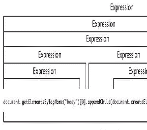

```javascript
document.getElementsByTagName("body")[0].appendChild(document.createElement("p")).innerHTML = "Hello World!";
```

> **温馨提示**

> 像本页这样的复杂语句通常写起来容易得多，读起来难。事实上，一旦你掌握了 JavaScript 的要领，你可能会发现写这些语句有种奇怪的满足感——甚至可以说是种艺术。

### 在复杂性与可读性之间取得平衡

重要的是要理解，冗长而复杂的语句（如上面的例子）可以很容易地分解成一系列更短、更简单的语句。

我们所做的只是把表达式分配到更多的语句中。然而，为了在一个语句中与其他语句的运算符共享表达式的结果，我们需要将每条语句的结果存储在变量中，以便其他语句可以访问这些值。

### 在速度与可读性之间取得平衡

创建和管理变量会增加解释器的工作量，因此包含多个表达式的复杂语句通常比将相同表达式分解成多个语句执行得更快。因此，虽然选择让语句简单还是复杂在很大程度上取决于个人偏好，但你确实需要考虑应用程序对性能的关键程度。

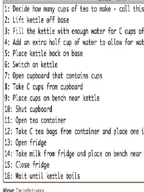

```javascript
8 <script type="text/javascript">
9 //This compound statement...
10 document.getElementsByTagName("body")[0].appendChild(document.createElement("p")).innerHTML = "Hello World!";
11 //...does the same as the following set of statements
12 var bodyElementsArray = document.getElementsByTagName("body");
13 var bodyElement = bodyElementsArray[0]; //Remember, there is only one body element
14 var newPara = document.createElement("p");
15 newPara.innerHTML = "Hello World!";
16 bodyElement.appendChild(newPara);
17
18 </script>
```


上例：复杂语句可以分解成单独的语句——也可以不分解。

## 语句块

相关语句可以组合成一个块。这是通过用花括号（即大括号）`{` 和 `}` 包裹语句来实现的。例如：

```javascript
{
  var playerScore = 0;
  var playerName = 'Sarah';
  var playerAge = 29;
}
```

这种技巧有其用途，但效果并不显著。然而，正如我们即将发现的，语句块在我们深入学习 JavaScript 时会变得越来越重要。

**温馨提示**

思考如何将常见任务——比如泡茶——分解成一系列简洁明确的指令，这是练习构建 JavaScript 表达式和语句结构的绝佳方式。

## 条件语句

我们经常需要根据在页面加载到浏览器、用户与之交互之前尚不存在的条件来执行不同的语句。这时我们就需要用到条件语句。

### IF 语句

使用`if`，我们测试某个条件的存在，如果该条件存在，则执行相应的表达式。其基本形式如下：

```javascript
if (condition) expressions;
```

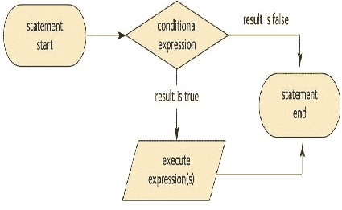

上例：简单`if`语句的流程图

### 使用 IF 语句

当解释器遇到`if`语句时，它会计算括号内的表达式。如果该表达式计算结果为`true`，则执行`if`后面的语句。

### If 语句的工作原理

让我们通过一个简单的例子来看看`if`语句是如何工作的：

- 1. 新建一个 HTML 文档并输入标准的结构性元素。将页面保存为`ifExample.html`。

- 2. 新建一个`<script>`元素，作为`<head>`元素的子元素（即放在`<head>`内）。我们将其声明在`<head>`中，以确保它在`<body>`元素渲染之前可用。

- 3. 在这个`<script>`元素中添加一个简单的变量声明：`var userAge = 36;`。虽然我们手动为这个变量赋值，但请想象这个信息实际上是由用户提供的。参见右侧插图。

- 4. 再添加一个`<script>`元素，这次作为`<body>`元素的子元素。将下方插图所示的代码复制到这个新的`<script>`元素中。

- 5. 保存工作，然后在 Firefox 中打开`ifExample.html`。

```html
1 <!DOCTYPE HTML>
2 <html>
3   <head>
4     <title>If Example</title>
5   
6     <script type="text/javascript">
7       var userAge = 36;
8     </script>
9   
10  </head>
```

上例：步骤 3：在此处添加一个简单的变量声明。

```html
12  <body>
13    <script type="text/javascript">
14      if(userAge > 16) alert("This is a kids zone - not for grown ups.");
15    </script>
16  
17  </body>
```

上例：步骤 4：按照上方文字描述使用代码。

## 工作原理

`if`语句的条件表达式会将`userAge`的值与字面量值 16 进行比较。由于`userAge`的求值结果为 36，而 36 大于 16，因此`if`条件的求值结果为`true`，随后的表达式会被执行。

## Else 子句

基本的`if`语句可以通过添加`else`子句来扩展（我们称之为子句，因为它是更大`if`语句的一个子部分，在`if`语句之外没有意义）。其通用形式如下：

> 语句块的左大括号可以直接跟在条件表达式的右括号之后，也可以单独占一行，甚至可以放在第一条语句之前。这取决于你。

```javascript
if(condition) {
    statement(s);
} else {
    statement(s);
}
```

上方：`if`条件表达式求值为 true，因此我们看到警报消息。

## 执行多条语句

上述形式的`if`在其条件为 true 时只能执行单条语句，但我们经常需要执行多条语句。为此，我们在条件表达式后添加一个语句块（参见第 63 页的语句块）。通用形式如下：

```javascript
if(condition) {
    statement_1;
    statement_2;
    ...
    statement_n;
}
```

现在，如果条件求值为`true`，语句块（`if`语句的主体）中的所有语句都会被执行。

当`if`语句的条件求值为`false`时，`else`后的语句块会执行。何不在最后一个编码练习（第 65 页）中尝试添加一个`else`子句？

上方：为`if`语句添加语句块。

右侧：当条件表达式求值为 false 时，`else`子句被触发。

## Else If 子句

如果前一个测试求值为 false，我们可以引入一个新的条件测试。

通用形式如下：

```javascript
if (condition) {
  statement(s);
} else if (condition) {
  statement(s);
}
```

我们可以根据需要添加任意多个`else if`子句，并且可以用一个最终的`else`子句来结束，该子句仅在所有前面的条件都求值为`false`时才执行。

上方：`else if`子句允许在`if`语句中进行多个条件测试。

## SWITCH 语句

使用`switch`与`if`类似，但它不是测试条件是否为 true 或 false，而是`switch`语句根据条件表达式的结果选择要执行的代码块。要测试的值在`case`部分中指定。通用形式如下：

```javascript
switch(condition) {
  case label_1:
    statement(s);
    break;
  case label_2:
    statement(s);
    break;
  default:
    statement(s);
    break;
}
```

### Switch 语句的工作原理

当解释器遇到`switch`语句时，它会计算条件表达式，然后在`switch`块中查找与条件结果匹配的`case`标签。如果找到匹配项，则执行其后的所有语句，包括后续`case`部分中包含的语句。

上方：`switch`语句的流程。

## 嵌套 IF 语句

`else if`子句创建了一种分支逻辑结构，这在编程中非常常见。但要小心：随着每个额外分支的增加，这种结构会变得越来越复杂——我们通常可以通过使用不同的条件语句来完全避免它们。

### 从 CASE 部分跳出

为了防止后续的`case`部分被执行，我们在每个`case`的末尾包含一个`break`关键字。这告诉解释器停止处理该语句块，并在块后的第一条语句处恢复执行。

**实用技巧**

如果你发现`if-else-if`语句的结构变得过于笨重难以管理，`switch`语句可能是一种更合适的方法。

### DEFAULT CASE

`switch`语句可以包含一个特殊的`default`部分，如果遇到该部分则始终触发。这通常放在`switch`的末尾，以便仅在没有任何`case`标签与条件表达式匹配时才被选中。

## 循环语句

我们经常需要对一组不同的值运行同一组语句，或者将语句重复执行一定次数——这就是循环的用武之地。

### WHILE 循环

最简单的循环语句形式称为`while`循环。其通用形式如下：

```javascript
while(condition) {
    statement(s);
}
```

**实用技巧**

注意：如果你错误地编写了循环，你可能会触发一个无限循环，其中解释器会无限期地卡在处理同一个循环语句中。

```javascript
<script type="text/javascript">
    //假设页面上存在一个名为 mediaObject 的对象。
    //mediaObject 可能指向一个视频文件或一个音频文件，
    //但在编写代码时，我们不知道它具体是哪个。
    switch(mediaObject.mediaType) {
        case "video":
            alert("You are about to access a video");
            //导致视频加载和播放的语句
            break;
        case "audio":
            alert("You are about to access an audio recording");
            //导致音频加载和播放的语句
            break;
        default:
            alert("Cannot determine the media type");
    }
</script>
```

如果条件求值为 true，则执行条件后代码块中包含的语句，然后再次测试条件。如果仍然为 true，则重复此过程。这持续进行直到条件求值为 false。

*上方：这个虚构的脚本展示了如何使用`switch`语句。*

*上方：`while`循环的流程。*

### DO WHILE 循环

这些循环与`while`循环非常相似，区别在于条件仅在语句块执行后才进行评估。如果条件求值为`true`，则语句块会重复执行，并再次评估条件。其形式如下：

```javascript
do {
  statement(s);
} while(condition);
```

### FOR 循环的组成部分

`for`循环的三个组成部分是控制循环重复执行的表达式：

- **初始化**：此表达式求值一次，并为循环创建一个初始索引；索引只是一个数字，通常用于计算已发生的循环迭代次数。

- **条件**：这是测试以判断循环是否继续重复的表达式。在大多数情况下，条件表达式会测试索引的值是否与另一个值（例如数组的长度）相匹配。

- **迭代表达式**：此表达式在循环的语句块执行后求值，其预期用途是在下一次迭代之前修改索引的值。

## FOR 循环

`for`循环通常用于处理数组的元素，因为它简化了针对数组中每个元素执行相同语句块的过程。

`for`循环的声明可能看起来有点令人生畏——让我们先看看它，然后分析它的含义：

```javascript
for (initialize ; condition ; iteration ) {
  statement(s);
}
```

### 使用 FOR 循环

在第 41 页的练习中，我们创建了两个表示测验中问题的对象——我们将在此基础上继续。

1.  创建一个新文件夹并将其命名为`SimpleQuiz`。创建一个子文件夹并将其命名为`js`——我们将在后续示例中将外部脚本文件存储在此处。

2.  创建一个包含常见结构元素的新 HTML 文档，并将其作为`simpleQuiz.html`保存在新文件夹中。同时创建一个新的 JavaScript 文档，并将其作为`quizQuestions.js`保存在`js`子文件夹中。

3.  返回 HTML 文档。在`<head>`元素中添加一个`<script>`子元素，将其`type`属性设置为`"text/javascript"`，`src`属性设置为`"js/quizQuestions.js"`。请参见下图。

4.  转到`quizQuestions.js`，我们将在其中定义问题本身。在文件顶部，声明一个名为`questions`的数组变量。

5.  现在我们将通过在`push()`方法的括号内声明对象和数组字面量来添加问题，如下图所示。你可以复制我们的问题和答案，或者自己编写。

**实用技巧**

我们不再提醒你为`<script>`元素添加`type`属性了——请认为这是你应该做的。

```javascript
1 var questions = [];
2
3 // QUESTION 1
4 questions.push({
5   questionText: "Approximately how far away from the Earth is the Sun?",
6   answers: ["200 miles", "93,000,000 miles", "40,000,000 miles", "150,000 miles"],
7   correctAnswerIndex: 1
8 });
9
10 // QUESTION 2
11 questions.push({
12   questionText: "How many planets are there in our solar system?",
13   answers: ["6", "7", "8", "9"],
14   correctAnswerIndex: 2
15 });
16
17 // QUESTION 3
18 questions.push({
19   questionText: "Which of these is a moon of Jupiter?",
20   answers: ["Ganymede", "Miranda", "Enceladus", "Mars"],
21   correctAnswerIndex: 0
22 });
23
```

```html
1 <!DOCTYPE HTML>
2 <html>
3   <head>
4     <title>A Simple Quiz</title>
5
6     <script type="text/javascript" src="js/quizQuestions.js"></script>
7   </head>
8   <body>
9
10   </body>
11 </html>
12
```

6.  保存 JavaScript 文档，然后在编辑器中返回 HTML 文档。

上图：步骤 7：将此处所示的代码添加到你的 HTML 文档中。

- 7. 在`<body>`元素下添加一个新的`<script>`元素作为其子元素——添加上图所示的代码。

- 9. 保存你的工作，并在 Firefox 中启动该 HTML 页面。

## 工作原理

第一个`<script>`元素非常简单——它链接到一个脚本，我们在其中声明代表测验题目的对象，并将这些对象存储在一个名为`questions`的数组中。该数组对页面中的所有脚本都是可访问的，并且定义在`<head>`中，以便我们可以确保在处理页面的`<body>`时它已经可用。

上图：我们的测验正在逐渐成形。

现在让我们看看第二个`<script>`元素中的`for`循环。索引被初始化为`0`。然后对条件`i < questions.length`进行求值。当`i`为`0`时，条件求值为`true`，因此执行循环体，并使用熟悉的`document.write()`技术将文本写入页面。需要注意的是，我们使用循环索引`i`依次访问`questions`数组的每个元素。

语句块完成后，会对迭代表达式`i++`进行求值，将索引加`1`，然后再次测试条件。这个过程会重复进行，直到条件求值为`false`为止。

## 从循环或迭代中退出

我们可以通过编写`break`关键字随时退出循环，导致脚本执行在循环之后的第一个语句处继续。我们也可以使用`continue`退出当前循环迭代，这会指示解释器立即对迭代和条件表达式进行求加密，然后在需要时继续循环。

上图：`continue`和`break`语句分别使我们能够跳过某次迭代或完全退出循环。

## 函数与类

## JAVASCRIPT 中的函数

> 函数是一组可以通过引用分配给该函数的标识符来执行的语句。它们是创建可重用代码块的关键，这些代码块可以在需要时调用。

### 内置函数

JavaScript 有许多内置函数——事实上，我们一直在使用其中一个：`alert()`函数。当我们在脚本中使用函数名称时，我们是在**调用**或**执行**该函数——函数名称后面的括号表明了这一点。利用这些括号，我们还可以传递数据——称为**参数**——给函数。

### 函数参数

参数是传递给函数的值，函数可以使用这些值。例如，在调用`alert()`函数时，我们将希望对话框显示的消息字符串放在括号内。有些函数需要传递多个参数——在这种情况下，我们用逗号分隔每个参数。

### 命名函数

创建函数有几种技术，但第一种很简单——我们使用`function`关键字。它看起来像这样：

```javascript
function functionName (parameter_1, parameter_2, ... , parameter_n) {
  statement(s);
}
```

```javascript
function showMessageToUser(userName, message) {
  alert("Hi " + userName + ", " + message);
}

showMessageToUser("Oliver", "Your function is working");
```

上图：一个简单的函数定义及对该函数的调用。

### 实用提示

在函数调用中传递参数时，它们必须按照函数定义中参数列出的相同顺序排列。

`functionName`是赋予函数的名称——它必须遵循标识符命名规则（见第 25 页）。函数定义可以包含一个以逗号分隔的参数列表——这些是接收调用函数时作为参数传递的值的标识符，可以被函数内的语句使用。括号后面是一个语句块——这被称为函数体，在函数被调用时执行。

上图：函数调用将值赋给函数定义中的命名参数


```javascript
showMessageToUser("Oliver", "Your function is working");
```

```javascript
function showMessageToUser(userName, message) {
    alert("Hi " + userName + ", " + message);
}
```

- 函数调用
- 参数 / 传递给函数的值
- 函数名称
- 参数名称
- 函数定义

### 创建命名函数

在之前的练习（第 74 页）中，我们编写了一些代码，将自定义问题对象的内容呈现在页面上——让我们把它包装在一个可重用的函数中。

1. 在你的编辑器中，创建一个新的 JavaScript 文件，并将其保存为`quizFunctions.js`，放在我们 SimpleQuiz 文件夹的 js 子文件夹中。
2. 添加函数声明，如右图所示。请注意，我们命名了一个参数`questionIndex`——我们的想法是在调用函数时传递一个索引值作为参数。
3. 在你的编辑器中打开`simpleQuiz.html`。在`<head>`元素下添加一个新的`<script>`元素作为其子元素，并将其`src`属性设置为`"js/quizFunctions.js"`。
4. 在 HTML 文档中找到`for`循环，然后删除循环体中的所有语句，并用对我们新函数的调用替换它们。

```javascript
function renderQuestionAtIndex(questionIndex) {
    //函数语句将放在这里...
}
```

```html
<script type="text/javascript" src="js/quizQuestions.js"></script>
<script type="text/javascript" src="js/quizFunctions.js"></script>

</head>

<body>
<script type="text/javascript">
    for(var i = 0; i < questions.length ; i++) {
        renderQuestionAtIndex(i);
    }
</script>

</body>
```

上图：步骤 4，删除语句并按照上文所述进行替换。

## 从函数返回值

我们通常希望以某种方式处理传递给函数的值，并将计算结果返回给调用表达式——返回的值将成为函数调用表达式的值。我们使用`return`关键字来实现这一点。

### 使用 Return 关键字

当解释器遇到`return`时，它会停止处理该函数并返回到调用表达式。如果函数需要将一个值送回给调用表达式，我们将该值放在`return`关键字后面的括号中——例如：

```javascript
return(functionResult);
```

> **实用提示**
>
> 好的做法是尽量安排使得函数中只有一个`return`关键字——但这并不总是能做到。

`renderQuestion(i);`如上一页的插图所示。请注意，我们正在将循环索引值传递给函数，函数将使用它来访问`questions`数组中的元素。

5. 保存 HTML 文档，并返回`quizFunctions.js`。将下图所示的代码添加到`renderQuestion(index)`函数体中。

```javascript
function renderQuestion(index) {
  document.getElementById("q0").innerHTML = "<p>Question 1</p>";
  var currentObj = questions[index];
  document.getElementById("q-text" + index).innerHTML = currentObj.question;
  document.getElementById("opt0" + index).innerHTML = "<p>" + currentObj.options[0] + "</p>";
  document.getElementById("opt1" + index).innerHTML = "<p>" + currentObj.options[1] + "</p>";
  document.getElementById("opt2" + index).innerHTML = "<p>" + currentObj.options[2] + "</p>";
  document.getElementById("opt3" + index).innerHTML = "<p>" + currentObj.options[3] + "</p>";
}
```

上图 5：将此处所示的代码添加到函数体中。

6. 请注意，函数体几乎与我们刚刚删除的代码完全相同，但现在我们只需向函数传递一个索引值就能呈现一个问题。
7. 保存你的工作并在 Firefox 中打开页面。如果一切顺利，你应该会看到与之前完全相同的结果。

```javascript
function calculateRectArea(rectWidth, rectHeight) {
  var rectArea = rectWidth * rectHeight;
  return(rectArea);
}
```

```javascript
var myRectArea = calculateRectArea(217, 179);
```

上图：函数返回的值成为函数调用表达式的值。

## 在检查测验答案时使用 Return

我们的测验需要能够判断用户是否选择了正确答案——现在让我们为此编写一个函数。

1. 在编辑器中打开`quizFunctions.js`，并添加一个名为`checkUserAnswer()`的新函数——见下图。该函数将接收两个参数——问题索引（question index）和答案索引（answer index）——从而允许函数确定要检查的问题以及给出的答案。

```javascript
function checkUserAnswer(questionIndex, answerIndex) {
    //function statements will go here...
}
```

上图：步骤 1：如图所示添加一个新函数。

2. 输入下图所示的代码，然后保存你的工作。

```javascript
function checkUserAnswer(questionIndex, answerIndex) {
    var questionObject = questions[questionIndex];
    var theResult;
    if(questionObject.correctAnswerIndex == answerIndex) {
        theResult = true;
    } else {
        theResult = false;
    }
    return(theResult);
}
```

上图：步骤 2：输入此处所示的代码。

3. 如果你现在启动页面，不会有任何新变化，因为我们还没有以任何方式触发这个新函数——我们将在第 116 页讨论“事件（Events）”时处理这个问题。

## 匿名函数

在 JavaScript 中，函数只是另一种形式的数据。这意味着你可以创建一个函数并将其赋值给变量或对象属性。此类函数被称为匿名函数，因为它们没有函数名称。

### 声明匿名函数

我们通过将函数字面量赋值给变量或对象属性来声明匿名函数。其通用形式如下：

```javascript
var myAnonymousFunction = function(parameter(s)) {
    statement(s);
}
```

### 调用匿名函数

调用匿名函数与调用具名函数没有区别：我们只需使用变量名或属性引用来代替函数名。在实际操作中，这与调用具名函数完全相同。

```javascript
//这是一个具名函数...
function calculateRectArea(rectWidth, rectHeight) {
    return(rectWidth * rectHeight);
}

//这是一个匿名函数...
var calculateRectHypotenuse = function(rectWidth, rectHeight) {
    var widthSquared = rectWidth * rectWidth;
    var heightSquared = rectHeight * rectHeight;
    return(Math.sqrt(widthSquared + heightSquared)); //Math.sqrt() 计算平方根。
}

//调用这两个函数具有相同的通用形式：
var myRectArea = calculateRectArea(49, 28);
var myRectHypotenuse = calculateRectHypotenuse(49, 28);
```

上图：具名函数和匿名函数的调用方式相同。

## 变量作用域

当变量在任何函数或语句块之外声明时，它可以从网页的任何地方访问，因此被称为全局变量。另一种表达方式是，该变量存在于全局作用域（global scope）中。相反，在函数内部声明的变量只能在该函数内部访问——也就是说，它们处于该函数的作用域内。

### 作用域链

作用域是层级结构的——一个作用域嵌套在另一个作用域之中。例如，具名函数总是存在于全局作用域中。一个表达式只能访问与其处于同一作用域或在作用域链中位置更高（更外层）的变量。

全局作用域 - 可从页面中的所有脚本和函数访问

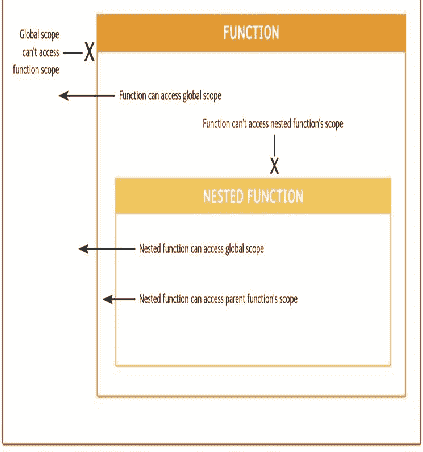

上图：变量作用域是层级结构的。一个作用域中的变量无法访问更深层嵌套的作用域。

## 命名空间

我们在 JavaScript 中创建了大量的命名对象——变量和函数——每个对象的名称在其自身作用域内应该是唯一的。如果不是唯一的，就会发生名称冲突，导致程序出现严重错误。

### 什么是命名空间？

命名空间是定义一组唯一名称的虚拟空间或上下文。换句话说，只要两个名称存在于不同的命名空间中，它们就可以完全相同。命名空间非常重要，因为如果没有它们，我们就面临遇到名称冲突的风险。

| 名词 | 动词 |
|------|------|
| **Dog（狗）：** 一种常被当作宠物的四足驯养动物 | **Dog（追踪）：** 执着地追求或纠缠 |
| **Shoot（嫩芽）：** 从树或植物主干生长出的幼枝 | **Shoot（射击）：** 开枪或发射大炮的行为 |
| **Dope（笨蛋）：** 一个愚蠢或懒惰的人 | **Dope（注射）：** 管理或施用药物 |

上图：我们可以将动词和名词视为现实世界命名空间的例子——一个名称可以同时出现在两者中，但含义截然不同。

> **实用技巧**
>
> 命名空间的概念起初可能看起来很令人困惑，但在实践中其实非常简单——我们一直都在使用它们。

### 在 JavaScript 中模拟命名空间

与某些语言不同，JavaScript 没有用于创建命名空间的正式符号。然而，请记住 JavaScript 中的一切都是对象——由此产生的结果是，我们可以在全局命名空间中创建一个对象，然后在这个对象内部定义我们所有的变量和函数。这样我们的名称就不会污染全局命名空间，而且如果我们明智地选择命名空间对象的名称，就不会与其他脚本中使用相同的名称。

### 什么是名称冲突？

名称冲突发生在页面中给一个对象起的名称被同一页面中的另一个对象使用时。任何使用该名称的表达式都可能无法获取其预期或需要的数据，从而导致难以追踪的 Bug 和错误。

### 全局命名空间的污染

每个具名函数和每个全局变量的名称都存在于全局命名空间中。在大型项目中，这个命名空间可能会充斥着许多不同的名称。在页面中引入第三方脚本会让情况变得更加糟糕。全局命名空间污染越严重，你遇到名称冲突的可能性就越大。


上图：全局命名空间可能会变得相当混乱。


> **实用技巧**
>
> 具名函数的名称存在于全局命名空间中。相比之下，匿名函数可以被赋值给对象属性，从而将其标识符从全局命名空间中移除。

```javascript
var myNamespace = {};

myNamespace.calculateRectArea = function(rectWidth, rectHeight) {
    return(rectWidth * rectHeight);
}
```

上图：匿名函数可以被赋值给对象属性，这样它们就不会污染全局命名空间。

### 为命名空间选择名称

鉴于命名空间的名称必须存在于全局命名空间中，完全有可能与其他命名空间的名称发生冲突。避免这种情况的诀窍是选择一个不太可能被他人使用的名称。怎么做？很简单——根据你网站的域名来命名命名空间。通常，我们会将域名反转，所以如果你的域名是`mydomain.com`，你的命名空间就是`com.mydomain`。然后你可以根据每个应用程序和/或每个模块进一步扩展——例如`com.mydomain.myApplication`。

> **实用技巧**
>
> 重要的是要理解，命名空间名称并不指向一个页面或 Web 资源——它仅仅是一个名称。

### 全局作用域命名空间

全局标识符和具名函数

| 命名空间 | 描述 |
|-----------|-------------|
| **com** | 全局标识符和具名函数 |
| **com.mydomain** | 指向你的脚本所使用的函数和值的标识符 |
| **com.otherdomain** | 指向附加到你页面上的第三方脚本所定义的函数和值的标识符。它们拥有自己的命名空间，因此不会与你的名称冲突。 |

上图：JavaScript 使用对象来模拟“命名空间”。反转域名是确保你的名称不与他人冲突的最佳方式。

### 创建命名空间

让我们为 Simple Quiz 项目中的对象创建一个命名空间。

1. 在编辑器中打开`quizQuestions.js`，并在文档顶部创建几行空行。
2. 我们将使用`com.flameTreepublishing`作为我们的命名空间——这意味着我们需要在全局命名空间中创建一个名为`com`的对象，并在`com`对象内部创建另一个名为`flameTreepublishing`的对象。
3. 复制插图（右）中所示的代码。在声明（但尚未初始化）`com`之后，我们在初始化每个命名空间对象之前测试它是否不存在（参见第 57 页的“逻辑非运算符”）。这是为了避免初始化一个已经存在的命名空间。
4. 现在我们将调整脚本的其余部分，使其使用新的命名空间——见插图（右）中未变暗的部分。

```javascript
var com;
if(!com) {
  com = {};
}
if(!com.flameTreepublishing) {
  com.flameTreepublishing = {};
}
```

上图：步骤 3：将此处所示的代码复制到你的编辑器中。

```javascript
com.flameTreepublishing.questions = [];

//QUESTION 1
com.flameTreepublishing.questions.push({
  question: "Approximately how far away from the Earth is the Sun?",
  answers: ['298 miles', '93,000,000 miles', '48,822,840 miles', '150,000 miles'],
  correctAnswerIndex: 1
});

//QUESTION 2
com.flameTreepublishing.questions.push({
  question: "How many planets are there in our solar system?",
  answers: ['6', '7', '8', '9'],
  correctAnswerIndex: 2
});

//QUESTION 3
com.flameTreepublishing.questions.push({
  question: "Which of these is a moon of Jupiter?",
  answers: ['Ganymede', 'Miranda', 'Enceladus', 'Mars'],
```

上图：步骤 4：按照此处突出显示的部分调整脚本。

5. 保存`quizQuestions.js`并打开`quizFunctions.js`。在所有脚本的顶部包含你的命名空间声明是一个良好的习惯，因此请将其复制到`quizFunctions.js`的顶部。


```javascript
9 com.flametreepublishing.renderQuestionAtIndex = function(questionIndex) {
10 document.write("<h2>QUESTION " + (questionIndex + 1) + "</h2>");
11 var questionObject = com.flametreepublishing.questions[questionIndex];
12 document.write("<p>" + questionObject.question + "</p>");
13 document.write("<p>A: " + questionObject.answers[0] + "</p>");
14 document.write("<p>B: " + questionObject.answers[1] + "</p>");
15 document.write("<p>C: " + questionObject.answers[2] + "</p>");
16 document.write("<p>D: " + questionObject.answers[3] + "</p>");
17 }
18
19 com.flametreepublishing.checkUserAnswer = function(questionIndex, answerIndex) {
20 var questionObject = com.flametreepublishing.questions[questionIndex];
21 var theResult;
```

上图：步骤 6：更新此处高亮显示的引用。

6. 为了将函数放置在我们的命名空间中，我们需要将它们更改为匿名函数。我们还需要更新所有对`questions`数组的引用——请参阅上方插图中高亮的部分。

7. 保存文档，然后在编辑器中打开`simpleQuiz.html`。找到`for`循环并更新其条件表达式和函数调用，如下图所示。

```javascript
12 <script type="text/javascript">
13 for(var i = 0; i < com.flametreepublishing.questions.length ; i++) {
14 com.flametreepublishing.renderQuestionAtIndex(i);
15 }
16 </script>
```

上图：步骤 7：更新条件表达式和函数调用如所示。

8. 保存你的工作并在 Firefox 中打开该页面——同样地，它看起来应该与之前完全一样，但在底层我们拥有一个纯净且无污染的命名空间。

## 面向对象编程

> 面向对象编程（Object oriented programming，简称 OOP）是一种将对象置于一切核心的编程方法。虽然 JavaScript 并不是一种真正的 OOP 语言，因为它缺乏真正 OOP 所要求的特定结构，但它可以——而且通常被——以 OOP 风格使用。

## 为什么使用 OOP 技术？

关于 OOP 与其他编程方法相比的相对优点和缺点，他人已经写了太多文字——我们不想再增加这些讨论了。简单来说，OOP 最吸引人的特性之一是它组织事物的方式与人类大脑组织事物的方式非常相似。仅凭这一点，它就是应用最广泛的编程方法。

## 我们如何对事物进行分类

当我们思考物理世界中的某个事物时，该事物通常是一个相似事物家族的一部分；而这个家族反过来又是更大分组的一部分，依此类推。这些分组将我们最初思考的事物进行了分类。

例如，我们可以将一只西班牙猎犬分类为狗，分类为驯养动物，分类为哺乳动物，分类为动物，以及分类为生物。这形成了一条定义“狗类”特征的分类链。链中的每一个点都指定了细化定义的特征——例如，动物的腿数，或狗毛的光滑程度。

通过充分的分类和特征定义，我们可以确定某个东西是西班牙猎犬，而不是宇宙中的任何其他东西；我们在做这件事时甚至不需要思考……

## OOP 中的类

OOP 正是利用了这种分层分类系统。我们编写被称为“类”（classes）的脚本来定义属性。属性描述了该类的特征，并且是该类固有的。类还定义了方法（methods），这些是在该类的对象上运行的函数。

一个类继承其祖先类的属性和方法，从而获得其特征和行为的某些方面。这很像一只西班牙猎犬固有的“猎犬特性”是它所属的复合特征和分类的函数。

### 构造函数与实例

你在类脚本中编写的代码就像一个模板——它描述了定义该类对象的属性和方法。

上图：我们对事物的分类方式也是我们的结构化方式。上图：这种通用的世界分类在 OOP 的软件结构中得到了镜像反映。

然而，这个类定义本身并不是该类的一个对象——要创建这样一个对象，我们必须调用类的`构造函数`（constructor），因为正是它根据类定义生成对象。这个生成的对象被称为该类的`实例`（instance），因此调用类构造函数的行为通常被称为`实例化`（instantiating）该类。

### 一个庞大的课题

OOP 是一个非常深奥的主题，我们不会深入探讨——如果你想探索它，请在 Google 搜索“OOP”，然后从数以千计的结果中选择。

不过，我们将要学习的是如何在 JavaScript 中创建和使用基础的自定义类。

## JavaScript 类

我们已经在处理 JavaScript 类了——`number`、`string`和`array`都是内置类。它们都从`object`类继承了一些特征——用 OOP 的术语来说，这使得`object`成为这些其他类的`超类`（superclass）。

我们也在使用类方法：例如，`write`是 HTMLDocument 类的一个方法——我们将其用作`document.write()`。（`document`是 HTMLDocument 类的一个实例。）这些类内置于语言中，但我们也可以构建自己的类。

### 定义自定义类

我们 Simple Quiz 应用程序中的问题目前定义在通用对象中——让我们改为开发一个`QuizQuestion`类。

1. 创建一个新的 JavaScript 文档，并将其保存在 Simple Quiz 的`js`文件夹中，命名为`QuizQuestion.js`。同时在`simpleQuiz.html`的`<head>`中创建一个`<script>`元素，并将其链接到这个新脚本。见下图。

```html
1  <!DOCTYPE HTML>
2  <html>
3    <head>
4      <title>A Simple Quiz</title>
5
6      <script type="text/javascript" src="js/QuizQuestion.js"></script>
7      <script type="text/javascript" src="js/quizQuestions.js"></script>
8      <script type="text/javascript" src="js/quizFunctions.js"></script>
9
10   </head>
11
12   <body>
13     <script type="text/javascript">
14       for(var i = 0; i < com.flametreepublishing.questions.length ; i++)
15         com.flametreepublishing.renderQuestionAtIndex(i);
```

2. 在`QuizQuestion.js`的顶部添加我们的命名空间声明（见第 93 页）。

3. 我们将把这个类命名为`QuizQuestion`，所以首先要做的是定义构造函数——见下图。构造函数与类同名。

```javascript
1 var com;
2 if(!com) {
3   com = {};
4 }
5 if(!com.flametreepublishing) {
6   com.flametreepublishing = {};
7 }
8
9 com.flametreepublishing.QuizQuestion = function(qQuestionNum, qQuestionText, qAnswers, qCorrectAnswerIndex) {
10
11 }
```

上图：步骤 3：定义构造函数如所示。

## 创建实例

既然定义了构造函数，我们就可以使用`new`关键字来创建`QuizQuestion`实例，如下所示：

```javascript
new com.flametreepublishing.QuizQuestion(arguments);
```

回想一下，`QuizQuestion`构造函数期望接收四个参数：问题编号、问题文本、可能答案的数组以及正确答案的索引。在实例化类时，所有这些都需要包含在构造函数名称后的括号内——我们很快就会详细讲解这一点。

> 小贴士
>
> 按照惯例，我们用大写字母开头命名类，用小写字母开头命名实例。

4. 如你所见，构造函数期望四个参数。这些参数对应于我们希望`QuizQuestion`实例拥有的属性；我们在名称前添加了前缀`q`，以便将它们与同名的类属性区分开来。

5. 将上方插图中高亮显示的代码添加到构造函数的正文中。

```javascript
9  com.flametreepublishing.QuizQuestion = function(qQuestionNum,
10                                qQuestionText,
11                                qAnswers,
12                                qCorrectAnswerIndex) {
13
14   this.questionNum = qQuestionNum;
15   this.questionText = qQuestionText;
16   this.answers = qAnswers;
17   this.correctAnswerIndex = qCorrectAnswerIndex;
18 }
```

上图：步骤 5：添加此处高亮的代码。

```javascript
20 new com.flametreepublishing.QuizQuestion(
21   1,
22   "Approximately how far away from the Earth is the Sun?",
23   ["200 miles", "93,000,000 miles", "49,000,000 miles", "150,000 miles"],
24   1
25 )
```

上图：实例化一个类会创建该类的一个对象，然后我们可以对其进行操作。

在这里，我们第一次遇到了`this`关键字——见上文。

## `this`关键字

上一个实操环节引入了特殊的`this`关键字。当在构造函数中使用时，`this`指的是正在构建的那个实例。

在我们刚刚编写的代码中，有四个以`this`开头的语句——这些语句将发送给构造函数的参数值分配给新实例。通过将这些值分配给`this`，我们将它们分配给了新实例。

6. 保存你的工作。

当`this`在类方法中使用时，它指向执行该方法的类的具体实例。在接下来的练习中，这一点会变得更加清晰。

## 类方法

方法类似于函数。简单来说，函数是一个独立的实体，可以接收对象作为参数传入；而方法是对象不可或缺的一部分，并从该对象的上下文执行操作。

我们已经接触过一些内置类的方法——例如，数组类的`push()`方法。当我们调用`push()`时，是通过数组类的实例来调用的：`myArray.push(newValue)`；因此它是一个方法。

## 原型对象

如前所述，JavaScript 的`object`类在语言中占有崇高的地位——它是所有其他类的基础。结果是，所有其他类，包括我们自己定义的类，都继承了`object`类的方法和属性。其中一个属性叫做`prototype`——类的方法应当定义在此处。让我们看看具体怎么做。

```javascript
25
26 //问题 1
27 com.flametreepublishing.questions.push({
28   question: "太阳距离地球大约多远？",
29   answers: ["2200 英里", "93,000,000 英里", "69,000,000 英里", "150,000 英里"],
30   correctAnswerIndex: 1
31 });
```

上图：我们已经见过数组类的`push()`方法（注意`com.flametreepublishing.questions`是数组类的一个实例）。

## 定义类方法

在我们的测验中目前有一个函数`checkUserAnswer`，它更适合作为我们新`QuizQuestion`类的一个方法。

1. 在编辑器中打开`QuizQuestion.js`。

```javascript
15
16 com.flametreepublishing.QuizQuestion.prototype.checkUserAnswer = function(answerIndex) {
17   var theResult;
18   if(answerIndex == this.correctAnswerIndex) {
19     theResult = true;
20   } else {
21     theResult = false;
22   }
23   return(theResult);
24 }
```

上图：步骤 2：按此处所示插入方法定义。


2. 在构造函数下方创建几个空行，然后输入上一页图中所示的`checkUserAnswer`方法定义。这使用的逻辑与我们之前同名函数大致相同。

3. 注意方法名必须以命名空间、类名和原型属性引用为前缀。这可能会有些冗长，但不可避免。

## 创建主类

在构建 JavaScript 应用程序时，通常会创建一个主类或中心类，用于定义应用程序全局的属性和方法。其思路是创建该类的一个实例，并将其作为应用程序中其他所有内容的中心出发点和参考点。

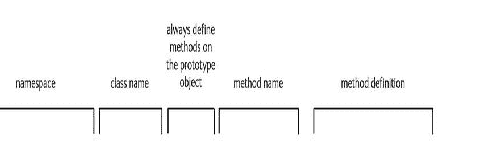

## SimpleQuiz 类

让我们为 Simple Quiz 应用程序创建一个主类。

1. 新建一个 JavaScript 文档，并将其保存在项目的`js`文件夹中，命名为`SimpleQuiz.js`。

2. 在编辑器中打开`simpleQuiz.html`。添加一个`<script>`元素来链接新的`SimpleQuiz.js`脚本，并删除链接到`quizQuestions.js`和`quizFunctions.js`的`<script>`元素。保存 HTML 文件，然后切换回`SimpleQuiz.js`。参见右图。

```html
1 <!DOCTYPE HTML>
2 <html>
3 <head>
4 <title>Simple Quiz</title>
5
6 <script type="text/javascript" src="js/QuizQuestion.js"></script>
7 <script type="text/javascript" src="js/SimpleQuiz.js"></script>
8
9 </head>
```

上图：步骤 2：按此处所示添加代码。

3. 添加我们标准的命名空间声明，并创建一个构造函数——参见右图。

4. 趁此机会，让我们让题目能够自我渲染。下图所示的代码应该已经熟悉了。

```javascript
1 var com;
2 if(!com) {
3   com = {};
4 }
5 if(!com.flametreepublishing) {
6   com.flametreepublishing = {};
7 }
8
9 com.flametreepublishing.SimpleQuiz = function() {
10
11 }
```

上图：步骤 3：按此处所示创建构造函数。

```javascript
26
27 com.flametreepublishing.QuizQuestion.prototype.renderQuestion = function() {
28   document.write("<h2>问题 " + this.questionNum + "</h2>");
29   document.write("<p>" + this.questionText + "</p>");
30   document.write("<p>A1: " + this.answers[0] + "</p>");
31   document.write("<p>A2: " + this.answers[1] + "</p>");
32   document.write("<p>A3: " + this.answers[2] + "</p>");
33   document.write("<p>A4: " + this.answers[3] + "</p>");
34 }
```

上图：步骤 4：此处的代码将使题目能够自我渲染。

5. 我们仍需要一个数组来存储`QuizQuestion`对象——我们将通过在构造函数中声明和初始化它，使其成为`SimpleQuiz`类的一个属性，如图所示。

```javascript
9 com.flametreepublishing.SimpleQuiz = function() {
10   this.questions = [];
11 }
```

上图：步骤 4：按此处所示声明和初始化数组。

9. 在`renderAllQuestions`的主体中，创建一个`for`循环，对每个`QuizQuestion`对象调用`renderQuestion()`，如图所示。


```javascript
9 com.flametreepublishing.SimpleQuiz = function() {
10   this.questions = [];
11   this.loadQuestions();
12 }
```

10. 保存`SimpleQuiz.js`，然后切换到`simpleQuiz.html`。

5. 在完整的测验应用程序中，我们可能会从 Web 服务器下载题目数据，但为简单起见，我们将题目硬编码到`SimpleQuiz`类中。我们将通过调用`loadQuestions()`方法来模拟下载——见上图。

```html
11 <body>
12   <script type="text/javascript">
13     com.flametreepublishing.simpleQuiz = new com.flametreepublishing.SimpleQuiz();
14   </script>
15
16 </body>
```

11. 找到`<body>`元素内的`<script>`元素，并删除`for`循环——它现在已经过时了。

6. 在构造函数中添加对`loadQuestions()`的调用，如上图所示。注意我们通过`this`关键字来完成此操作。

12. 在同一个`<script>`块中，实例化`SimpleQuiz`，并将实例赋值给`com.flametreepublishing.simpleQuiz`，如上图所示。

7. `SimpleQuiz`现在可以加载和存储`QuizQuestion`对象了，但我们不再有渲染所有题目的方式（考虑到`QuizQuestion`的`renderQuestion`方法需要从某处调用）。

13. 最后，按下图所示在新创建的`SimpleQuiz`对象上调用`renderAllQuestions()`。

8. 创建一个名为`renderAllQuestions()`的`SimpleQuiz`新方法。

```html
11
12 <script type="text/javascript">
13   com.flametreepublishing.simpleQuiz = new com.flametreepublishing.SimpleQuiz();
14   com.flametreepublishing.simpleQuiz.renderAllQuestions();
15 </script>
16
```

```javascript
44 com.flametreepublishing.SimpleQuiz.prototype.renderAllQuestions = function() {
45   for(var i = 0; i < this.questions.length; i++) {
46     this.questions[i].renderQuestion();
47   }
48 }
```

14. 保存并关闭所有打开的文件。如果你在浏览器中打开页面，一切顺利的话，视觉上不会有任何变化。


# DOM 与事件

## 操作 DOM

我们迄今为止编写的每个脚本都是通过在页面加载时输出数据来工作的。这没问题——但有其局限性。如果我们想要在页面加载后操作页面呢？如何实现这一点？

## 动态 HTML

所有主流浏览器都支持一种称为动态 HTML（简称 DHTML）的技术。DHTML 允许 JavaScript 在页面加载并渲染到浏览器后对其进行更改，并且这些更改会立即显示在屏幕上。这为我们带来了大量的可能性——你的想象力真的是唯一的限制。

```javascript
/*
我们对 checkUserAnswer() 进行了相当大的改动——请参见方法主体中的注释...
*/
com.flametreepublishing.QuizQuestion.prototype.checkUserAnswer = function(answerIndex) {
//将 theResult 初始化为 false——如果回答正确，我们可以更改此值
var theResult = false;
if(this.questionAnswered) {
//如果此问题已经被回答过，则在警告框中报告此事，并不再执行其他操作
alert('You\'ve already answered this question');
} else if(answerIndex == this.correctAnswerIndex) {
//如果给出了正确答案，则将问题标记为已正确回答
this.answeredCorrectly = true;
//现在设置问题 <div> 的样式类，使其变为绿色
document.getElementById('q' + this.questionNum).className = 'correctlyAnswered';
//并将 theResult 设为 true
theResult = true;
} else {
//如果问题回答错误，则更改 <div> 的样式类名称
//使其具有红色背景
document.getElementById('q' + this.questionNum).className = 'incorrectlyAnswered';
}
//记录此问题现在已被回答
this.questionAnswered = true;
//现在返回 theResult。实际上这已经不再被使用了，但让方法返回一个结果
//仍然是有用的，即使只是为了表明代码已完整执行且没有出错。
return theResult;
};
```

上图：额外的说明包含在可下载的代码示例中。

## 温馨提示

务必下载代码示例——参见第 7 页。除了能让你对照我们的代码检查自己的代码外，你还会发现其中包含的注释有助于进一步解释示例。

## HTML 是层次结构

所有 HTML 文档都包含一个`<html>`元素；该元素总是包含一个`<head>`和一个`<body>`元素；这些元素本身又包含其他元素。因此，页面是 HTML 元素的层次结构。我们用血缘关系来表达这种结构：`<html>`是**根**元素，有两个子元素，`<head>`和`<body>`；`<html>`是`<head>`和`<body>`的**父元素**；`<head>`和`<body>`是**兄弟元素**。

## 什么是 DOM？

我们知道 JavaScript 使我们能够通过在一个对象中存储其他对象来创建类似的层次结构；事实证明，这正是网页在浏览器底层被表示的方式。这种表示——或模型——被称为**文档对象模型**，简称**DOM**。

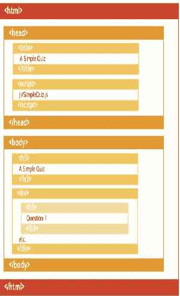

上图：HTML 元素嵌套在其他 HTML 元素中；所有元素都有一个父元素，许多元素还有兄弟元素和子元素。

## DOM 编程

JavaScript 的 DOM 类（如`HTMLDocument`和`HTMLElement`）提供了大量用于操作已加载页面的方法，并暴露了与 HTML 属性直接映射的属性。例如，一个`<p>`元素在 DOM 中由一个`HTMLElement`对象表示。在`<p>`元素上定义的任何属性都可以作为相应对象的属性供 JavaScript 访问；JavaScript 在该对象上定义的任何属性都会成为`<p>`元素的属性值。

```javascript
var paraElement = document.createElement('p');
paraElement.id = 'para1';
paraElement.className = 'articlePara';
paraElement.style = 'color:#FFCC00';
paraElement.innerHTML = 'Hello World!';
// <p id="para1" class="articlePara" style="color:#FFCC00;">Hello World!</p>
```

上图：HTML 元素的属性会成为相应 DOM 对象的属性，反之亦然。

## 从 DOM 中检索元素

正如我们所看到的，所有 HTML 元素（`<html>`除外）都必须嵌套在另一个元素内。因此，要使用 JavaScript 向页面添加新元素，我们通常需要从 DOM 中检索将作为新元素父级的元素。在其他时候，我们可能希望对所有某种类型的元素应用样式更改。

获取元素的方法定义在单个`HTMLDocument`实例上，即 DOM 的顶层。我们已经在脚本中使用过这个对象——每次输入`document`时，我们都在访问这个`HTMLDocument`对象。

## 向 DOM 中添加元素

让我们通过更新`QuizQuestion`类的`renderQuestion`方法来探索 DOM 编程。

1. 在编辑器中打开`QuizQuestion.js`并找到`renderQuestion`方法。

2. 目前，此方法使用`document.write`将一个字面量 HTML 字符串输出到页面。此技术仅在页面加载时执行该方法才有效——让我们来修复这个问题。

```javascript
36  
37  com.flomtreepublishing.QuizQuestion.prototype.renderQuestion = function() {
38      document.write("<h3>QUESTION " + this.questionNum + "</h3>");
39      document.write("<p>" + this.questionText + "</p>");
40      document.write("<p>A: " + this.answers[0] + "</p>");
41      document.write("<p>B: " + this.answers[1] + "</p>");
42      document.write("<p>C: " + this.answers[2] + "</p>");
43      document.write("<p>D: " + this.answers[3] + "</p>");
44  }
45  
```

上图：一旦页面加载完成，此方法将无法工作。

- 3. 删除`renderQuestion`方法的方法体。

4. 在屏幕上，我们将把每个题目布局在一个`<div>`元素内——下图中的代码展示了如何创建一个。请注意，这个新的`<div>`尚不是页面的一部分——它是在屏幕外创建的，在被分配给父元素之前一直留在那里。

```javascript
36  
37  com.flomtreepublishing.QuizQuestion.prototype.renderQuestion = function() {
38      var questionDiv = document.createElement("div");
39      
40  }
41  
```

上图：步骤 4：`document.createElement()`在屏幕外创建新元素。

```javascript
36 com.flametreepublishing.QuizQuestion.prototype.renderQuestion = function() {
37   var questionDiv = document copyright© froment element("div");
38   questionDiv.id = "q" + this.questionNum;
39   var questionHeading = document.createElement("h2");
40   questionHeading.innerHTML = "QUESTION " + this.questionNum;
41   questionDiv.appendChild(questionHeading);
42 }
43 // ...
```

上图：步骤 5 和 6。继续构建题目的 HTML 元素，如下所示。

5. 为`<div>`赋予一个从`QuizQuestion`对象的`questionNum`属性派生的`id`值，如上图第 39 行所示。

6. 我们将创建一个`<h2>`元素来容纳题目标题；创建后，我们需要使用`HTMLElement`对象的`innerHTML`属性为其设置一些文本内容，并使用`appendChild`将其添加到`<div>`中——参见上图。

7. 使用相同的技术将题目和答案的文本添加到`<div>`中，如下图所示。

```javascript
42 questionDiv.appendChild(questionHeading);
43 var questionTextPara = document.createElement("p");
44 questionTextPara.innerHTML = this.questionText;
45 questionDiv.appendChild(questionTextPara);
46 for(var i = 0; i < this.answers.length; i++) {
47   var answerPara = document.createElement("p");
48   answerPara.innerHTML = this.answers[i];
49   answerPara.id = "a" + i;
50   questionDiv.appendChild(answerPara);
51 }
52 // ...
```

上图：步骤 7 和 8。这段代码将构建显示题目所需的其余 HTML 元素。

8. 请注意，我们没有为每个可能的答案手动输入代码，而是将其包装在一个`for`循环中，遍历`answers`数组。还要注意，我们为每个答案的`<p>`元素设置了`id`属性。

9. 最后，我们需要将`<div>`元素添加到页面中。我们将它添加到`<body>`元素中，可以通过`document.body`访问，如下图所示。

10. 保存你的工作并在 Firefox 中打开页面。我们再次看到了和之前相同的内容，但这次我们是使用 DOM 编程构建的页面。

```javascript
49   answerPara.id = "a" + i;
50   questionDiv.appendChild(answerPara);
51 }
52 document.body.appendChild(questionDiv);
53 }
```

上图：步骤 9。如图所示，将元素添加到页面中。

## 事件

网页会在各种条件和用户操作下触发事件，例如页面加载成功或用户点击某个元素。响应这些事件是 JavaScript 的关键角色之一。

## JavaScript 事件模型

JavaScript 中有几种不同的事件模型，它们经过多年发展而来。我们无法一一介绍，因此将重点介绍当前的最佳实践模型，即 W3C 模型。这不是最简单的模型，但却是你应该力求使用的模型。

> **实用技巧**
>
> 如果你想深入了解所有 JavaScript 事件模型，可以在`www.quirksmode.org/js/introevents.html`找到精彩的讨论。

## 什么是事件？

事件是浏览器发出的消息。事件总是有一个类型——类型表明了事件的性质——是点击、页面加载、按键等。例如，点击页面中的任何元素都会导致该元素发送（或分发）一个类型为`"click"`的事件。

## 监听事件

为了响应事件，我们必须编写“监听”该事件发生的代码——这段代码被称为事件监听器。当事件监听器检测到它正在监听的事件类型时，它会执行一个表达式，以对事件做出某些响应操作。

## 事件处理程序

通常，当事件监听器被触发时，它执行的表达式是一个函数或方法调用。被调用的函数或方法被称为事件处理程序。事件处理程序的职责是以某种方式处理该事件——进行视觉更改、向服务器发送数据等。

## 添加事件处理程序

我们的 Simple Quiz 应用需要能够响应用户点击答案——让我们首先定义一个事件处理程序。

1. 打开`SimpleQuiz.js`。我们将创建一个名为`clickHandler`的新方法——移动到文档底部并按如下图所示添加该方法。

```javascript
59
60 com.flametreepublishing.SimpleQuiz.prototype.clickHandler = function(e) {
61   //click handler statements go here
62 }
63
64
```

上图：步骤 1。按图中所示添加方法。

2. 使用 W3C 事件模型时，事件处理程序始终会收到一个包含事件详细信息的对象——我们的方法通过参数`e`来捕获它。通过这样做，我们可以通过引用`e.target`来访问发生事件的元素，如下图所示。

```javascript
59
60 com.flametreepublishing.SimpleQuiz.prototype.clickHandler = function(e) {
61   var clickedAnswerId = e.target.id;
62 }
63
```

上图：步骤 2。`e.target`引用触发事件的 HTML 元素。

3. 我们需要识别被点击的答案——这就是为什么我们的代码为每个答案的`<p>`元素定义了一个 id 值。每个答案的 id 是以字母`'a'`为前缀的答案索引，因此我们只需要访问 id 的第二个字符；我们将这第二个字符转换为数字，因为我们将把它用作`questions`数组的索引。参见上图。

4. 注意`String`类的`substr()`方法的使用，它使我们能够访问其被调用字符串的一个片段。第一个参数是片段开始的字符位置（从零开始，类似数组索引）；第二个参数是要返回的片段长度。

```javascript
var clickedAnswerIndex = Number(clickedAnswerId.substr(1, 1));
```

上图：步骤 4。`substr()`是`String`类的一个方法。


5. 我们的事件处理程序还需要知道题号——我们可以从`<div>`元素的`id`属性中提取它。我们可以通过引用`e.target.parentNode`来访问`<div>`（`<div>`是`<p>`的父元素），如下图所示。

```
62   var clickedAnswerIndex = Number(clickedAnswerId.substr(1, 1));
63   var clickedQuestionId = e.target.parentNode.id;
64   var clickedQuestionNum = Number(clickedQuestionId.substr(1, 1));
65 }
```

上图：步骤 5。从事件对象中提取已回答的题号。

6. 现在处理程序调用题号，它可以从问题数组中检索对应的`QuizQuestion`对象。但是，在事件处理程序中，`this`指的是触发事件的元素，所以我们需要处理事件的对象，因此需要使用全局引用来访问问题数组。相关代码如下图所示。

> **小贴士**

HTML元素的`parentNode`属性指的是该元素的父级元素，即包含该元素的嵌套元素。

7. 既然我们已经获得了用户点击的`QuizQuestion`对象和答案索引，我们就可以判断用户是否给出了正确答案，并将结果告知用户——相关代码如下图所示。

```
60 com.flametreepublishing.simpleQuiz.prototype.onAnswer = function() {
61   var clickedAnswer = e.target;
62   var clickedQuestion = new QuizQuestion(clickedAnswer.getParent(), 1);
63   var clickedIndex = e.target.answerIndex;
64   var clickedQuestionIdx = new QuizQuestion(clickedAnswer.getParent(), 2);
65   var clickedQuestion = com.flametreepublishing.simpleQuiz.questions[clickedQuestionIdx - 1];
66 }
67 }
```

关于框7 这段代码获取被点击答案对应的`QuizQuestion`对象。


```
65 var clickedQuestion = com.flametreepublishing.simpleQuiz.questions
66 if(clickedQuestion.checkUserAnswer(clickedAnswerIndex)) {
67   alert("Correct! Well done.");
68 } else {
69   alert("No - that's not correct. Try again.");
70 }
71 }
```

关于框8 `onAnswer`函数将检查答案是否正确，并显示相应的提示信息。

8. 保存你的工作。暂时不要在浏览器中打开文件——我们还没有完全完成。

## 事件监听器

事件监听器被分配给生成我们想要捕获的事件的对象——通常这是网页中的一个DOM对象。一旦我们知道要监听的对象，就在该对象上调用`addEventListener()`——一般形式为：

```
myObject.addEventListener(eventType, handlerExpression, useCapture);
```

```
60 com.flametreepublishing.simpleQuiz.prototype.onAnswer = function() {
61   var clickedAnswer = e.target;
62   var clickedQuestion = new QuizQuestion(clickedAnswer.getParent(), 1);
63   var clickedIndex = e.target.answerIndex;
64   var clickedQuestionIdx = new QuizQuestion(clickedAnswer.getParent(), 2);
65   var clickedQuestion = com.flametreepublishing.simpleQuiz.questions[clickedQuestionIdx - 1];
66 }
67 }
```

## `addEventListener()`方法的参数

- **事件类型**：第一个参数表示要监听的事件类型。这是一个字符串，例如`'click'`、`'keydown'`或`'mouseover'`。

- **处理程序表达式**：通常是对处理程序函数或方法的引用。请注意，在引用函数或方法时，我们不包含括号。

- **使用捕获**：这个比较复杂，超出了本书的范围。在你了解它的作用之前，始终向此参数传递`false`。

```
function clickHandler() {
    //do things in response to the click
}

var myPara = document.createElement("p");
document.body.appendChild(myPara);
myPara.addEventListener("click", clickHandler, false);
```

上图：为一个`<p>`元素添加事件监听器。

## 添加事件监听器

我们已经创建了事件处理程序，但在被事件监听器触发之前它不会执行任何操作。

- 1. 打开`QuizQuestion.js`，找到`renderQuestion`方法中的`for`循环。

```
for(var i = 0; i < this.answers.length; i++) {
    var answerPara = document.createElement('p');
    answerPara.innerHTML = this.answers[i];
    answerPara.id = 'a' + i;
    answerPara.addEventListener('click', com.flametreepublishing.simplequiz.clickHandler, false);
    questionDiv.appendChild(answerPara);
}
```

上图：步骤2：按照上述说明输入此处所示的代码。

- 2. 在设置`answerPara.id`属性的那一行之后创建一个空行，并插入上一页图中所示的代码。

- 3. 在引用处理程序方法时我们不包含括号。如果包含的话，表达式会在事件监听器被赋值时作为方法调用被执行——我们希望表达式是处理程序的名称，而不是对它的调用。

- 4. 保存你的工作，在Firefox中打开`simpleQuiz.html`并点击一个答案。终于——我们有了一个可以工作的测验。

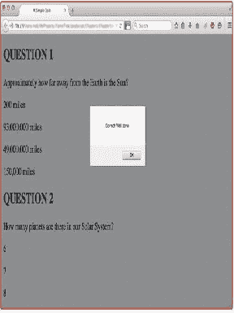

上图：经过我们的辛勤努力，我们有了一个功能完整的测验。

## 最后的完善

让我们再添加一个事件监听器和处理程序——它们将在页面加载完成时启动应用程序。

- 1. 创建一个新的JavaScript文档，将其保存到项目的`js`文件夹中，命名为`quizStartup.js`。在文档顶部输入我们的命名空间声明。

- 2. 添加下一页图中所示的事件处理程序代码。你现在应该能理解它了——如果不能，请下载我们的代码示例并研究其中的注释。

```
com.flametreepublishing.startQuiz = function() {
  com.flametreepublishing.simpleQuiz = new com.flametreepublishing.SimpleQuiz();
  com.flametreepublishing.simpleQuiz.renderAllQuestions();
}
```

上图：步骤2：事件处理程序代码。

- 3. 添加下面图中所示的事件监听器代码。`window`对象代表浏览器窗口——我们监听它的`load`事件，该事件在页面加载完成时触发。

```
com.flametreepublishing.simpleQuiz.renderAllQuestions();
}

window.addEventListener("load", com.flametreepublishing.startQuiz, false);
```

上图：步骤3：事件监听器代码。

- 4. 保存你的工作，在编辑器中打开`simpleQuiz.html`。

- 5. 在`<head>`中添加一个新的`<script>`元素，并将其链接到`quizStartup.js`。然后完全删除`<body>`元素中的`<script>`元素，并保存文件。参见下图。

```
<head>
  <title>A Simple Quiz</title>

  <script type="text/javascript" src="js/QuizQuestion.js"></script>
  <script type="text/javascript" src="js/SimpleQuiz.js"></script>
  <script type="text/javascript" src="js,noe really ne ex quizStartup.js"></script>

</head>
```

上图：步骤5：确保在此处添加和删除正确的代码。

## 后续步骤

就是这样——我们的测验现在可以运行了！更重要的是，想想我们的HTML文档包含了什么：只有三个`script`元素。JavaScript在处理其他所有事情——很好！

如果你想改进这个测验游戏，何不添加一个样式表让界面更好看？你还可以更进一步，记录用户的答案并跟踪他们的分数——你已经具备了实现这些的知识。如需更多提示，请参阅代码示例包中的`SimpleQuiz_onwards`。

## 继续前进！

你已经迈出了进入JavaScript深入而细致世界的第一步。你应该感到自己已经对这门语言及其使用方法有了扎实的概览，但还有很多需要学习……

祝你编程愉快！

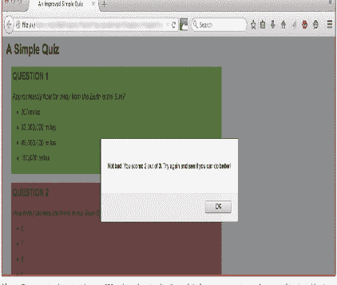

上图：尝试用一些CSS和新功能来改进测验。用你自己的问题填满它，然后测试你的朋友和家人。

## 在线资源

### 实用网站

**Mozilla开发者网络（MDN）：** 该网站提供了Firefox支持的语言的所有详细信息，以及它如何与这些语言协作。访问JavaScript部分可以找到指南、教程、对象和类参考等。developer.mozilla.org

**The JavaScript Source：** 该网站提供了大量代码片段，你可以复制、粘贴并修改到自己的代码中——而且全部免费。既然可以下载别人已经做好的，何必重新造轮子！javascriptsource.com

**How To Node：** 如果你想开始探索服务端JavaScript，那么How To Node是一个很好的资源，充满了信息和教程。howtonode.org

### 延伸阅读

Crute, A., *Coding HTML and CSS*, Flame Tree Publishing, 2015

Flanagan, D., *JavaScript: The Definitive Guide*, O'Reilly Media, 2011。这本书被广泛认为是JavaScript的圣经，它以精细入微的方式涵盖了该语言的各个方面，同时保持了引人入胜且易于理解的风格。书中包含一个全面的参考部分，描述了所有内置对象和类的属性和方法。

Zakas, N. C., *The Principles of Object-Oriented JavaScript*, No Starch Press, 2014。作者深入探索JavaScript，在过程中揭示了该语言内部运作的一些最深层秘密。

Powers, S., *JavaScript Cookbook*, O'Reilly Media, 2015。这本书充满了实用的代码示例。它面向有一定经验的JavaScript开发者，"配方"涵盖广泛的场景，为许多编码难题提供快速解决方案。


### FLAMETREEMUSIC.COM


#### 看到和弦并聆听它！

一个全面的和弦与音阶音频数据库：每个都可以在钢琴和吉他上听到，包括扫弦、完整演奏以及逐个音符演奏。

一个出色的**学习**工具，适合任何学习乐器的人。

### FLAMETREEPRO.COM


两百万字，数千篇关于古典、歌剧、爵士、布鲁斯、摇滚和乡村风格的文章，由音乐学家和专家爱好者撰写。

一个必不可少的**研究**工具，适合任何学习或对音乐感兴趣的人。


