# JavaScript 编程

# 前言

作为一名开发者，我曾以为自己足够了解 HTML 和 CSS。我错了。我不得不一次又一次地回到基础。这就是我编写本书的原因。此外，我觉得 JavaScript 也应该包含在内。

首先，我们从一些 HTML 基础开始。你可能之前见过其中一些内容，但我认为复习一下很有帮助。然后我们介绍一些 HTML5 的变化。我们会涉及一些主要变化。最后，我们通过讨论表格、`div` 和 `span` 来结束 HTML 部分。这些内容曾不止一次让我困惑……

第二部分专门介绍 CSS。这有助于让事情变得更有条理。我们涵盖 CSS 基础、盒模型和 CSS3。与 HTML5 类似，它也有一些有趣的更新。

第三部分聚焦于 JavaScript 基础。涵盖变量、函数和条件语句等主题。我们还介绍了循环和闭包。在这本快速入门指南中，我们只关注你开始工作所需的内容。

# I. HTML

在第一部分，我们从 HTML 基础开始。我们回顾 HTML、HTML5 以及 `div` 和 `span` 的基础知识。

## 1. 面向可靠人士的针对性 HTML 基础


图片由 Jackson Sophat 拍摄于 Unsplash

网络是由一些基础技术构建的。每个网站都使用 HTML（超文本标记语言）。它构成了我们在线上消费的内容。

### HTML

它为我们看到的页面提供了结构。我们可以通过一系列元素和标签向网站添加图片和链接。让我们看一个简单的例子来开始。

```
<html>
<head>
<title>页面标题</title>
</head>
<body>
<h1>标题</h1>
<p>段落。</p>
</body>
</html>
```

我们从`DOCTYPE`开始声明这是 HTML。然后我们有 HTML 的开始标签。在底部，你也会看到 HTML 的结束标签。`body`也有类似的开始和结束标签。

### 标题

我们在前面的例子中有一个标题。HTML 标题可以从`<h1>`到`<h6>`。它从大开始，随着数字增大而变小。

# 标题

## 标题

### 标题

#### 标题

##### 标题

###### 标题

如果在 Chrome 中打开，你会看到如下效果。

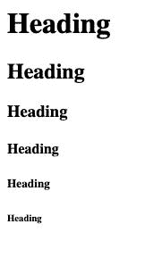

标题示例

### 段落

当你有一段文本时，可以使用 HTML 段落标签。我们在第一个例子中看到了。这里是另一个例子。

```
<p>Lorem ipsum dolor sit amet, consectetur adipiscing elit,</p>
<p>sed do eiusmod tempor incididunt ut labore et dolore magna aliqua.</p>
```

这两个元素不错，但网络之所以强大，是因为链接。接下来我们看看链接。

### 链接

超链接或链接是 HTML 的秘密武器。我们可以链接到文档源或引用。

`href="https://codeiseasy.co">Code Is Easy`

当然，有时我们喜欢在屏幕上看到图片或图像。为此，我们需要图像标签。

### 图像

图像标签帮助我们添加视觉组件以及文本。

`src="tom.jpg" alt="Tom Headshot" width="100" height="150">`

我添加了宽度和高度，但这些不是必需的。不过，它们有助于保持尺寸正确。

### 列表

HTML 为我们提供了两种列表选项：有序列表和无序列表。

#### 有序列表

*   苹果

*   浆果

*   醋栗

#### 无序列表

*   胡萝卜

*   芹菜

*   洋葱

如果在浏览器中打开文件，效果如下。

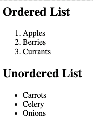

列表示例

我们在这里介绍了一些 HTML 基础。还有很多要学。当然，根据你的工作，这些可能就是你所需要的。我的开发工作让我需要定期使用 HTML。不过，我不是专家。多练习这些，你会学得很好。

## 2. 值得使用的重大 HTML5 变化


图片由 Jackson Sophat 拍摄于 Unsplash

HTML 和其他事物一样。有不同版本可供使用。HTML5 是当前版本，具有新功能。让我们了解一些变化和新增内容。

### 有什么不同？

已经做了工作来消除 HTML、CSS 和 JavaScript 之间的重叠。还进行了改进以提高代码的可读性。跨浏览器的一致性和响应性也得到了增强。最后，无需插件即可支持多媒体是另一个重大变化。

### 新元素

HTML5 中有新元素。添加了`section`标签来帮助组织文档。

```
<section>
<h2>标题</h2>
<p>Lorem ipsum dolor sit amet, consectetur adipiscing elit, sed do eiusmod tempor incididunt ut labore et dolore magna aliqua. Ut enim ad minim veniam, quis nostrud exercitation ullamco laboris nisi ut aliquip ex ea commodo consequat. Duis aute irure dolor in reprehenderit in voluptate velit esse cillum dolore eu fugiat nulla pariatur. Excepteur sint occaecat cupidatat non proident, sunt in culpa qui officia deserunt mollit anim id est laborum.</p>
</section>
```

与这个标签类似，我们还可以使用`header`和`footer`标签。它们能有效地组织大块 HTML，使其更易读。

### 表单

为了简化表单创建，HTML5 增加了一些功能。下面展示`datetime-local`输入表单元素。

```
type="datetime-local">
```

如果在浏览器中运行，我们会看到如下效果。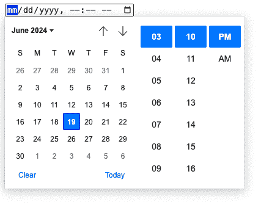

DateTime-Local 示例

相比过去我们为类似功能所做的操作，这已经非常方便了。

### 图形

我们还可以在 HTML5 中添加 SVG（可缩放矢量图形）。下面是一个简单示例。

```
<svg width="100" height="100">
  <circle cx="50" cy="50" r="40" stroke="blue" stroke-width="4" fill="red" />
</svg>
```

在浏览器中运行，你会看到类似这样的效果。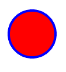

SVG 示例

虽然不算惊艳，但在某些情况下它可能很有用。

### 离线

HTML5 通过存储本地副本支持离线工作。因此，浏览器会下载所需的 HTML、CSS 和 JavaScript。这样你可以在没有网络连接的情况下进行一些操作。

HTML5 是一系列改进，使网络得到更好的利用。从新元素到图形，它推动网络向前迈进了一步。同时，它也让网络更具可访问性，使越来越多的人能够协作。

## 实用的 HTML 表格、Div 和 Span 让你更出色


照片由 Alvin Engler 拍摄于 Unsplash

在我从事前端技术工作的过程中，我看到了工作方式的演变。网页设计规范来来去去。HTML 为我们提供了多种创建界面的方式。

### 表格

HTML 的`table`经常被诟病，但它确实能用。在我职业生涯早期，表格是主流方式。下面是一个展示基本语法的示例。

```
<html>
| Company | State | Employees |
| Balloons Inc. | Ohio | 250 |
| Cement Co. | Arizona | 4510 |
```

运行这段代码会得到一个简单的表格来显示数据。别指望它会让你惊叹！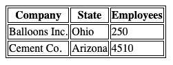

HTML 表格示例

这个简单示例让你了解如何使用表格。根据需求，我们还可以做更多事情。

### Div

`div`元素是 division（分区）的缩写。它创建一个 HTML 的块级区域。我们可以用 CSS 为`div`设置样式，并用 JavaScript 操作它。

```
<html>
<h1>Let's talk about div elements!</h1>
<div class="exampleDiv">
  <h2>h2 in a div element</h2>
  <p>Text in a div element.</p>
</div>
<p>We have broken out of the div.</p>
```

我们有一个示例，其中`div`显示为浅蓝色。这样你可以看到`div`的起始和结束位置。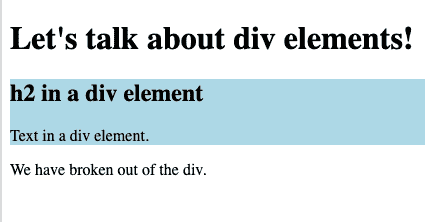

Div 元素示例

在图片中，你可以看到`div`的边界以及页面的其余部分。如果应用样式，它只会作用于`div`元素内部。

### Span

`span`是一个内联容器，可以添加到 HTML 文档中。`div`是块级元素，而`span`是内联元素。这些区别你可能需要记住。

```
<html>
<h1>HTML Span element</h1>
<p>The fire truck is <span style="color:red;font-weight:bold">red</span>.</p>
<p>The tree is <span style="color:green;font-weight:bold">green</span>.</p>
```

这里使用了两个`span`元素。我们通过样式来改变颜色并将字体加粗。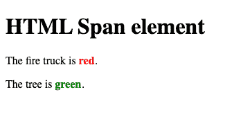

HTML Span 示例

我们可以看到代码的效果。下次你需要为 HTML 添加容器时，可以探索这三种方式。`table`、`div`和`span`各有优缺点。先尝试一个简单的示例，看看哪种最符合需求。

# II CSS

CSS 在美化网站方面非常有用。我对此忽视太久了。我先回顾一些基础知识，然后介绍盒模型。最后，我们介绍 CSS3。

## CSS 的真相会让你有所收获


照片由 Marcus Ganahl 拍摄于 Unsplash

你是否见过看起来怪异的网站？字体是否需要修正？这就是 CSS 没有加载的情况。它本质上让网页看起来美观。我不是字体专家，但我理解样式的重要性。

### CSS

CSS（层叠样式表）用于为网站应用样式。从文本大小到字体，它能为内容增添一份优雅。

```
<html>
<head>
<style>
body {background-color: powderblue;}
h1   {color: blue; text-align: center;}
p    {font-family: verdana; font-size: 20px;}
</style>
</head>
<body>
<h1>H1 Heading(with center align)</h1>
<p>Paragraph(font size 20px and font verdana.</p>
</body>
</html>
```

这是一个添加了样式的简单 HTML 文件。这里我们为 HTML 的`body`设置了背景颜色。然后为`h1`标题更改颜色并居中文本。对于段落，我们更改了字体和大小。效果如下：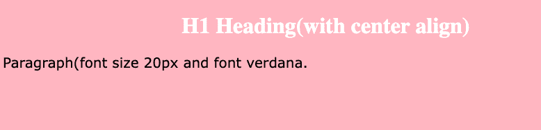

带内部 CSS 的 HTML 示例

HTML 最初只用于文本，而 CSS 是为了添加样式而创建的。如果你年纪足够大，还记得最初的网页，你会感激的！事情已经取得了长足的进步。

### 引入方式

上面我们展示了一个内部 CSS 的示例。`style`标签被添加到 HTML 中。我们也可以创建一个外部文档来存放 CSS。

```
<html>
<head>
<link rel="stylesheet" href="styles.css">
</head>
<body>
<h1>We are using a CSS from another file.</h1>
<p>Aren't you impressed!</p>
</body>
</html>
```

这是我们的 HTML 文件。接下来，我们展示外部 CSS 文件的代码。

```
body {
  background-color: lightblue;
}
h1 {
  color: navy;
  margin-left: 20px;
}
```

效果如下，非常不错。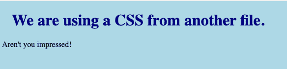

带外部 CSS 的 HTML 示例

在这个示例中，你有两个文件。对于这样的小例子，可能显得冗余。但在较大的页面或你有多个页面时，这非常有用。你可以创建一个 CSS 文件，并在其他 HTML 文档中引用它。

最后一种方式是内联样式。看看样式是如何内联的：

```
<html>
<body>
<h1 style="color:rgb(149, 0, 255);font-size:46px;">I'm a big, purple, <strong>Proud</strong> <strong>UNI Panther</strong>!</h1>
</body>
</html>
```

这混合了 CSS 和 HTML。对于初学者来说，这可能不太清晰。效果如下：

带内联 CSS 的 HTML 示例

因此，当你为 HTML 添加 CSS 时，有多种方式可选。正如我们讨论的，每种方式都有其优缺点，具体取决于项目规模和你合作的团队。

## 神奇的 CSS 盒模型讲解


照片由 Kelli McClintock 拍摄于 Unsplash

起初，CSS 似乎只有魔术师才能掌握的黑魔法。但随着我深入学习，它开始变得合理。盒模型用于描述元素的设计和布局。

### CSS 盒模型

每个元素周围都有一个盒子。有时你能看到它，有时它似乎消失了。

- 内容（Content）——盒子里的内容，文本或图像

- 内边距（Padding）——内容周围的区域，透明

- 边框（Border）——围绕内边距和内容

- 外边距（Margin）——边框外部的区域，也是透明的

下面是一个示例。

```
<html>
<head>
<style>
div {
  background-color: lightgrey;
  width: 300px;
  border: 10px solid red;
  padding: 25px;
  margin: 20px;
}
</style>
</head>
<body>
<h2>CSS Box Model</h2>
<div>A box around each component.</div>
<p>The content.</p>
<p>25px padding</p>
<p>20px margin</p>
<p>10px red border.</p>
</body>
</html>
```

效果如下：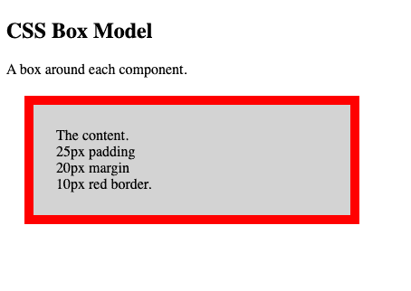

CSS 盒模型示例

### 尺寸计算

要得到正确的盒子尺寸，我们需要做一些数学计算。我知道你没想到会这样。但很简单，你不会感到困惑。

```
<html>
<head>
<style>
div {
  width: 320px;
  padding: 10px;
  border: 5px solid gray;
  margin: 0;
}
</style>
</head>
<body>
<h2>CSS Box Model Math</h2>
<div>The total width of this element is 350px.</div>
</body>
</html>
```

这个盒子宽 300 像素，高 50 像素。每边内边距为 10 像素，总共 20 像素。每边边框为 5 像素，总共 10 像素。该元素的总宽度也是 330 像素。当我们运行这段代码时，你会看到以下内容。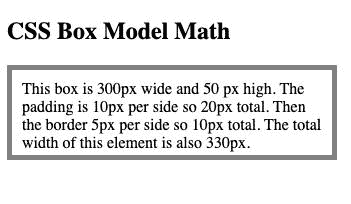

## CSS 盒模型数学示例

我们必须将内容、内边距和边框相加才能得到总宽度。在我了解这一点后，CSS 变得更有意义了。以前我会开始调整各种东西，试图让它看起来正确。

## 6 如何让 CSS3 简化得令人惊叹


照片由 KOBU Agency 提供，来自 Unsplash

随着网络的变化，支持它的技术也在变化。CSS3 就是其中一个例子。CSS 最初于 1996 年发布。几年后，CSS3 于 2005 年发布。

### 优势

CSS3 的主要优势之一是响应式网页设计。它用更流畅的性能取代了笨重的网站。CSS3 中新增了高级动画和不透明度功能。另一个优势是能够将页面拆分为模块。媒体查询也是 CSS3 中的新特性。此外，我们现在还可以应用渐变和圆角。

### 示例

让我们看一个线性渐变的例子。

```
html>
lang="en">
  class="gradient">
```

当我们在浏览器中查看时。

#### CSS3 线性渐变示例

CSS3 还能做什么？

### 盒子阴影

它还可以让你创建盒子阴影。让我们来看一下。

```
html>
lang="en">
  class="box">
```

在浏览器中打开，你应该会看到类似这样的效果。

#### CSS3 盒子阴影示例


CSS3 为 CSS 带来了一些重大更新。随着网络的发展，还会有新的更新。作为一个热爱学习的人，看到网络的变化令人兴奋。它正变得越来越易用和强大。

# 第三部分 JavaScript

在第三部分中，我们从 JavaScript 的基础知识开始。我们将编写一些基本内容，帮助你了解如何入门。

## 7 JavaScript：疲惫心灵的实用工具


我坦白。JavaScript 和我的开始并不顺利。我第一次接触它是为了表单验证。我曾咒骂它的存在。幸运的是，在重新接触它之后，我开始尊重它。多年来，它已经发展成为一种强大的语言。

### JavaScript

JavaScript 从卑微的起点发展成为一种现代编程语言。从浏览器到服务器，它几乎可以处理一切。Node.js 为其提供了强大的服务器端框架。Mozilla 创建了它，以下是他们的定义：“JavaScript 是一种轻量级的解释型编程语言，具有一等函数。”这真是一句拗口的话！

### 代码

让我们看一些基本代码。这是一个显示一些 JavaScript 的 HTML 文件。将这段代码保存到你的本地机器上。

```html
html>

# Test 1

## Test 2
```

普通文本

当我们运行这段代码时，会看到这个。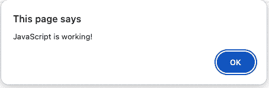

JavaScript 弹窗消息

点击确定后，你会看到这个。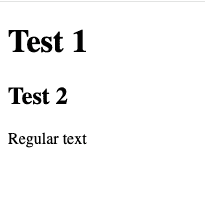

HTML 截图

### 语句

语句是 JavaScript 的基本指令。我们可以创建一些变量，然后为它们赋值。

```javascript
let a, b, c;  // 创建三个变量的语句
a = 2;     // 将值 2 赋给变量 a 的语句
b = 3;     // 将值 3 赋给变量 b 的语句
c = a + b;   // 将 a 加 b 的结果赋给 c 的语句
```

分号位于语句末尾。不过，我们也可以将多个语句写在一起。

```javascript
a = 2; b = 3;
```

这样可读性较差，因此大多数程序员不推荐这样做。所以，能做的事情并不代表你应该去做。

### 函数

当我们想要执行某个任务时，可以创建一个函数。如果需要将两个数相加，我们既可以在代码中直接实现，也可以创建一个函数。

```javascript
// 两数相加
num3 = num1 + num2;
// 两数相加的函数
function sumTwoNumbers(num1, num2) {
  return num1 + num2;
}
```

在这个例子中，我们执行了相同的代码，一个在函数内，一个不在函数内。使用函数是有价值的。我们可以重复调用它。此外，我们还可以轻松地添加一些错误检查。

```javascript
// 两数相加的函数
function sumTwoNumbers(num1, num2) {
  return num1 + num2;
}
let sum = sumTwoNumbers(6,4);
```

如果你想调用函数，可以像这个例子一样操作。这里我们传入了两个数字。这些数字也可以用变量来替代。

最后，我们简单探讨了为什么要使用 JavaScript。然后我们开始编写代码。通过使用语句和函数，我们开始了解其内部机制。自己试试吧！你不会后悔的。

## 8 看，我发现了 JavaScript 变量和值的这些惊人好处


## 9 首先，最简单的 JavaScript 函数基础是最吸引人的


照片由 Stanley Dai 拍摄于 Unsplash

函数是核心所在，所有工作都在这里完成。我们需要计算地板的面积吗？这需要用到函数。

```javascript
function calculateFlooring(length, width) {
  return length * width;
}
```

如果我们改造厨房，这个函数将计算所需的地板材料。那么，我们为什么需要函数呢？

### 好处

将函数视为代码的容器。类似于代码块，但我们可以重复调用这个函数。这有助于实现代码复用。

在前面的例子中，你可以复制语句。当然，如果我们想修改它，就需要找到那段代码并修改所有出现的地方。

### 示例

在第一个函数示例中，我们计算了地板材料。让我们退一步，让它更简单。我们可以在屏幕上打印一些内容。

```javascript
function greetTom() {
  alert("Hello Tom!");
}
```

当然，你可以把我的名字换成你的名字。如果你想保持传统，可以把它换成“Hello World”。你是否好奇为什么这是传统？请看下文。

### 调用

代码看起来不错，但如果不调用它，什么也不会发生。如何调用呢？很高兴你问这个问题。这里有一个例子。

```javascript
function greetTom() {
  alert("Hello Tom!");
}
greetTom();
// 做其他事情...
```

这个调用很简单，因为它不需要参数。在我们的第一个函数中，我们需要两个参数。接下来试试这个。

### 传递参数

在第一个例子中，我们从一个计算地板材料的函数开始。它需要两个参数。

```javascript
function calculateFlooring(length, width) {
  return length * width;
}
calculateFlooring(12,10);
```

我们可以传入两个数字来获取所需的地板材料。在这个例子中，我们硬编码了值。你通常不会这样做，甚至永远不会。

```javascript
function calculateFlooring(length, width) {
  return length * width;
}
calculateFlooring(length,width);
```

如你所见，这里两个参数是变量。变量名与函数参数名相同，但并非必须如此。

### 返回数据

返回计算结果很有用。如果不返回，函数的作用就会大打折扣。我们只需要使用 `return`。我们在计算地板材料的函数中已经这样做了。不过，我们需要赋值或打印它。

```javascript
function calculateFlooring(length, width) {
  return length * width;
}
let totalFlooring = 0;
totalFlooring = calculateFlooring(length,width);
```

现在，我们可以在应用程序的后续部分使用这个值。前面的例子没有使用返回的值。如果你以后不需要它，这始终是一个选项。

函数可以为我们做很多事情。它们为我们的代码提供了容器。然后我们可以调用它们并传递参数。除此之外，它们还可以返回数据。如果你需要更多信息，这里有一些进一步的资料。

## 10 用这些简单的 JavaScript 条件语句避免痛苦的错误


照片由 Artur Aldyrkhanov 拍摄于 Unsplash

应用程序帮助我们做出决策。一个基本的决策是 `if` 条件。例如，如果披萨外卖员到了，就开门。JavaScript 和其他语言一样，有许多条件语句，比如：

### if

`if` 语句以一个条件开始。如果条件为真，则执行后面的语句。

```javascript
if(pizzaArrives) {
  openTheDoor();
}
```

所以，如果 `pizzaArrives` 为真，我们就调用函数 `openTheDoor`。我在 `if` 语句后面添加了大括号。这是可选的，但有助于提高可读性。省略大括号可能会导致你遗漏 bug。所以请务必加上！

### if/else

有时你有两种不同的行动方案。我们可以将 `else` 语句与 `if` 一起使用。假设你在烹饪汉堡。

```javascript
if(sideCooked) {
  flipBurger();
} else {
  keepCooking();
}
```

这个检查可以在你最喜欢的汉堡店运行烹饪机器人。不过，它可能还需要一些代码。

如果你需要检查两个条件，也可以使用 `if else if`。

```javascript
if(sideCooked) {
  flipBurger();
} else if(otherSideCooked) {
  removeFromGrill();
} else {
  keepCooking();
}
```

这让我们可以检查额外的值。如果你需要更多检查，`switch` 语句可能更合适。稍后会详细介绍。

### 条件运算符

用于 `if` 语句的运算符必须解析为 `true` 或 `false`。这里有很多选项供你使用。根据经验，你需要测试并找到正确的那个。

```javascript
if(9>5) { alert("Greater than"); }// 大于
if(5<8) { alert("Less than"); } // 小于
if(9>=6) { alert("Greater than equal to"); } // 大于等于
if(4<=6) { alert("Less than equal to"); } // 小于等于
if(4!=6) { alert("Not equal to"); } // 不等于
```

还有两个逻辑运算符：逻辑与（`&&`）和逻辑或（`||`）。它们经常被使用，但不要被吓到。

```javascript
const value1 = 4;
const value2= -3;
console.log(value1 > 0 && value2 > 0); // 预期输出：false
console.log(value1 > 0 || value2 > 0); // 预期输出：true
```

逻辑与要求两个值都为真才能解析为真。逻辑或只需要一个为真。

### switch

`switch` 语句计算表达式以确定执行哪个语句。然后它运行代码，直到遇到 `break` 语句。下面是一个例子，告诉我们你想要鞋子的价格。

```javascript
const shoes = 'Reebok';
switch (shoes) {
  case 'Nike':
   console.log('Nike shoes are $200.');
   break;
  case 'Adidas':
  case 'Reebok':
   console.log('Adidas and Reebok are $100 a pair.');
   // 预期输出："Adidas and Reebok are $100 a pair."
   break;
  default:
   console.log(`Sorry, we don't carry ${shoes}.`);
}
```

这段代码应该在控制台输出“Adidas and Reebok are $100 a pair.”。如果不添加 `break` 语句，`switch` 语句可能会变得棘手。

```javascript
const shoes = 'Nike';
switch (shoes) {
  case 'Nike':
   console.log('Nike shoes are $200.');
  case 'Adidas':
  case 'Reebok':
   console.log('Adidas and Reebok are $100 a pair.');
   break;
  default:
   console.log(`Sorry, we don't carry ${shoes}.`);
}
```

在这个例子中，我们从 Nike 语句中移除了 `break`。你知道会发生什么吗？它会输出“Nike shoes are $200.”，然后输出“Adidas and Reebok are $100 a pair.”。这种类型的 bug 对于初学者来说很常见。不要感到难过。你现在也是俱乐部的一员了！

条件语句是 JavaScript 的基础。与其他语言类似，它允许我们快速提供解决方案。`if/else` 和 `switch` 很容易使用。

## 11 JavaScript 有巨大的循环，会让你大开眼界


照片由 Kier in Sight Archives 拍摄于 Unsplash

小时候，我们在农场种了一排防风林。一排树每周需要浇水几次。打开水管，给第一棵树浇水，数到十。然后移到第二棵树，重复操作。

与生活类似，我们的计算机程序也需要重复执行某些操作。这就是循环的用武之地。`for` 循环非常常见，所以我们从它开始。

### for

如果我们有一个书籍数组，想要打印出来。我们可以使用以下循环。

```javascript
for (let i = 0; i < books.length; i++) {
  text += books[i] + "
```

### 循环

`for` 循环有三个基本部分：起始、条件和步进。

#### 起始

这是设置循环变量的部分。在我们的示例中，通常初始化为零。不过，你也可以将其设置为 10，然后进行倒计数。

#### 条件

接下来是条件部分，检查是否需要再次运行循环。我们的示例检查是否还有更多的书需要遍历。如果遍历完了，我们就停止。

#### 步进

最后一部分是步进。它告诉我们每次迭代后会发生什么。我们的示例使用了递增运算符（`++`）。这是常规的步进方式，但在特殊情况下我们也可以做其他操作。

#### while

如果我的狗 Baxter 想吃东西，我想创建一个循环，在它饿的时候喂它。`while` 循环可以做到这一点。下面是一个示例。

```javascript
let baxterHungry = true;
while (baxterHungry) {
  console.log(feedBaxter);
  checKBaxter();
}
```

我们将变量设置为 `true`。然后喂狗，直到它变成 `false`。`while` 循环会评估我们给定的条件。它需要解析为 `true` 或 `false`。如果为 `true`，则执行循环内的代码。然后再次评估条件。一旦条件变为 `false`，循环停止。

#### do-while

`for` 和 `while` 循环先检查条件，然后运行代码语句。`do-while` 的不同之处在于它先运行代码，然后检查条件。它不太常见，但在特殊情况下很有用。

```javascript
let donutsEaten = 0;
do {
  console.log("Donuts eaten " + donutsEaten);
  donutsEaten++;
} while (donutsEaten < 5)
console.log("I'm full of Donuts!");
```

`do-while` 循环一直运行直到条件为 `false`——与我们讨论过的另外两种循环相反。输出结果如下所示。

```text
Donuts eaten 0
Donuts eaten 1
Donuts eaten 2
Donuts eaten 3
Donuts eaten 4
I'm full of Donuts!
```

当你需要循环执行代码时，JavaScript 为你提供了几种选择。与其他编程语言一样，它有 `for`、`while` 和 `do-while` 循环。只要确保它符合你的需求即可。

## 12 个令人惊讶的改进版 JavaScript 变量作用域，你需要了解


照片由 Markus Spiske 拍摄于 Unsplash

我妻子切换话题很快。我跟她开玩笑说，她需要转向灯。这样我才能跟上她话题的转变。她正在谈论晚餐，然后话题就转到了我们的下一次度假。

### 作用域

我们的代码也有类似的概念，即作用域。变量可能会快速进入和离开作用域。作为开发者，我们必须时刻牢记这个概念。JavaScript 中有几种不同类型的作用域。我们可以相应地使用它们。如果你做过其他编程，应该遇到过类似的概念。

#### 全局

全局作用域中的项在任何地方都是可见的。在我们的示例中，我们在函数内部和外部创建了一个可见的变量。

```javascript
let myGlobalVariable = "TheBigGlobalVariable";
function logOutGlobalVariable() {
  console.log(myGlobalVariable);
}
logOutGlobalVariable();
```

我猜你可能会想，如果在函数内部添加一个变量会怎样？这就引出了局部作用域的示例。

#### 局部

局部变量仅在函数内部可见。下面是一个尝试的示例。

```javascript
let myGlobalVariable = "TheBigGlobalVariable";
function logOutGlobalVariable() {
  console.log(myGlobalVariable);
  let localVariable = "TheLocalOne";
  console.log(localVariable);
}
logOutGlobalVariable();
console.log(localVariable);
```

如果我们运行这段代码，最后一行会报错。

```text
console.log(localVariable);
      ^
ReferenceError: localVariable is not defined
```

所以你可以看到，当你错误地将变量放在错误的位置时会发生什么。

#### 块级

局部作用域在函数内部，而块级作用域在大括号内部。有时你会创建大括号来标识某些代码。让我们来看一个例子，说明我的意思。

```javascript
console.log("here");
{
  let blockScopeVariable = 0;
  console.log(blockScopeVariable);
}
// we can't reference blockScopeVariable here
console.log(blockScopeVariable); // won't work
```

如你所见，我们在花括号内创建了一个块级作用域变量。然后在花括号外部，它就无法被引用了。

#### 注意事项

作用域可能会令人困惑，并导致一些错误。随着你对 JavaScript 经验的增加，你可以尽早发现它们。例如，看看这段代码片段：


```javascript
const colors = ['red', 'blue', 'white'];
for (let i = 0, var l = colors.length; i < l; i++) {
  console.log(colors[i]); // 'red', 'blue', 'white'
}
console.log(l); // ???
console.log(i); // ???
```

变量 `i` 和 `l` 会引发引用错误。它们超出了作用域，类似于我们之前的示例。Dmitri Pavlutin 对此进行了更深入的解释，他还涵盖了我们编码中可能犯的其他一些常见错误。

JavaScript 作用域有几个你需要记住的基本原则。全局作用域在任何地方都可见。局部和块级作用域则更加集中。总的来说，你应该使用后者而避免前者。继续编码吧！

## 13 充分利用 JavaScript 闭包，不要惊慌


照片由 Cristina Gottardi 拍摄于 Unsplash

在我的开发生涯中，偶尔接触 JavaScript，闭包是我遇到不多的东西。它们有一些很大的价值。

### 闭包

我们如何定义闭包？嗯，这篇文章是这样定义的。“JavaScript 中的闭包是一种词法作用域形式，用于将函数外部作用域中的变量保留在函数内部作用域中。”

```javascript
function outerFunction() {
  var x = 10;
  function innerFunction() {
    return x;
  }
  return innerFunction;
}
var inner = outerFunction();
console.log(inner());
```

这是一个闭包的例子。外部函数 `outerFunction()` 创建了一个变量 `x` 和一个函数 `innerFunction()`。内部函数 `innerFunction()` 返回变量 `x` 的值。然后外部函数返回内部函数 `innerFunction()`。接着内部函数 `innerFunction()` 被赋值给变量 `inner`。当变量 `inner` 被调用时，它返回变量 `x` 的值，即使外部函数 `outerFunction()` 已经返回了。

稍后我们可以讨论词法作用域。首先，让我们理解为什么需要它们。还有一些缺点。

#### 优点和缺点

闭包有助于隐藏封装细节。就像 Java 的私有变量和函数一样，这允许我们控制访问。缺点是闭包会占用更多内存。这些项无法被垃圾回收。最后，它可能会减慢执行速度。Deepak Mankotia 对此进行了更深入的探讨。

#### 词法作用域

术语“词法作用域”指的是变量定义的位置，以及它可以在哪里被引用或不能引用。

```javascript
let x = 10
let myFunc = function (){
let y = 20;
  console.log("x and y is accessible (outer):", x, y);
  let insideFunc= function (){
    let z = 30;
    console.log("x and y and z is accessible (inner):", x, y, z);
  }
  insideFunc();
  return;
}
myFunc();
console.log("only x is accessible (global):", a);
```

在这个例子中，`insideFunc` 定义在 `myFunc` 内部。在这种情况下，`myFunc` 是其父函数。父函数的词法作用域将子函数绑定起来。JavaScript 闭包是词法作用域的一种形式。

JavaScript 闭包是强大的工具。它们有一些独特的价值。它允许你封装细节，但可能会减慢执行时间。考虑一下风险和回报是否适合你的应用程序。

更多信息，请深入阅读

# IV 高级 JavaScript

在本节中，我们将进入深水区。JavaScript 对象和数组可能会让人困惑。所以我们花时间逐一讲解。最后讨论展开运算符和剩余运算符。

## 14 无与伦比的 JavaScript 对象让你兴奋不已


照片由 Hari Krishnan 拍摄于 Unsplash

在我软件开发的头几年，我主要使用过程式语言。主要是 PL/SQL。即使我做过面向对象的工作，也没有充分利用语言的全部力量。

JavaScript 最初并不是面向对象的。它经过修改变得更加强大。特别是在 ECMAScript 6 中的变化相当大。

如今我们一直在 JavaScript 中使用对象。作为一个老 Java 开发者，我看到了它们带来的价值。尽管这对开发者来说可能是一个很大的变化。

### 它们是什么？

JavaScript 对象代表真实的事物，比如我高中时的汽车。让我们在这里用一些属性来创建它。

```javascript
// Create an object:
const car = {
type:"Chevrolet",
model:"Malibu",
  year:"1976",
  color:"red"
  };
```

JavaScript 对象是该语言允许的众多数据类型之一。如你所见，还有其他几种。不过，在你的开发工作中，你将主要使用原始类型和对象。

### 对象与原始类型

他们对此进行了深入探讨。我只想指出几个关键区别。对象是可变的，而原始类型是不可变的。可变意味着它们可以被改变。

```javascript
// Create an object:
const car = {
type:"Chevrolet",
model:"Malibu",
  year:"1976",
  color:"red"
  };
let ball = "basketball"; // primitive
```

在我们之前的例子基础上，我们有 `car` 对象和 `ball` 原始类型。前者可以被改变，而后者不能。作为一个老 Java 程序员，这非常熟悉。

### 构造函数

对象可以使用构造函数创建。继续以汽车为主题，让我们创建两个汽车对象，这样你就能看到它的样子。

```javascript
// Constructor function for Car objects
function Car(make, model, year) {
  this.make = make;
  this.model = model;
  this.year = year;
}
// Create two Car objects
const myCar = new Car("Ford", "Pinto", "1971");
const yourCar = new Car("Dodge", "Charger", "1977");
```

这类似于我们之前的例子。我们在这里使用 `function` 关键字来指定构造函数。同时，我们也使用 `new` 关键字来创建对象。

### 属性

我们创建了两个带有许多值的汽车对象。这些被称为属性。如果我们想将它们打印到日志中，可以这样做。

```javascript
console.log(myCar.make);
console.log(myCar.model);
```

这是一种访问值的方式。或者你也可以这样做。

```javascript
console.log(myCar["make"]);
console.log(myCar["model"]);
```

所以你有多种方式获取底层数据。根据我的经验，前者比后者更常用。你的情况可能有所不同。

### 方法

JavaScript 对象有一些内置方法。例如，其中之一是 `keys()` 方法。它将键转换为数组。

```javascript
// Initialize an object
const car = {
make: 'Ford',
model: 'Pinto',
yeear: '1971'
};
// Get the keys of the object
const keys = Object.keys(car);
console.log(keys);
// outputs the following
["make", "model", "yeear"]
```

还有一个 `values()` 方法。

```javascript
// Initialize an object
const game = {
  id: 1,
  date: `23-March-2025`,
  teams: 'Panthers vs Jayhawks',
  location: 'St. Louis'
};
// Get all values of the object
const values = Object.values(game);
console.log(values);
// outputs the following
[1, "23-March-2025", "Panthers vs Jayhawks", "St. Louis"]
```

这结合循环遍历它们会很有帮助。还有其他方法。这篇文章回顾了更多内置方法。

### `this`

JavaScript 将 `this` 保留为关键字。它用于引用当前对象。下面是一个示例。

```javascript
// Create an object:
const car = {
  make: "Dodge",
  model: "Charger",
  year: "2015",
  carDetails : function() {
    return this.make + " " + this.model + " " + this.year;
  }
};
```

在这个例子中，我们创建了一个具有三个属性的对象。当我们想要显示详细信息时，可以调用 `carDetails` 函数。在这种情况下，它会显示“Dodge Charger 2015”。作为一个关键字，`this` 不能用作变量名。此外，我们不能更改 `this` 引用的值。JavaScript 中的 `this` 有三种上下文：函数、类和全局。我们在这些例子中分享了函数上下文。更多信息请参考

JavaScript 对象与其他语言的对象类似。然而，也有一些不同之处。重要的是要记住 JavaScript 最初并非如此。它不断变化和适应。如果你了解基础知识，就能很好地使用它。

## 15 轻松挑选更好的 JavaScript 数组


照片由 Julius Drost 拍摄于 Unsplash

我妻子喜欢整理东西。她按年份把它们放在信封里。JavaScript 数组类似于信封。我们可以把多个对象放进去。

### JavaScript 数组

JavaScript 数组在一个集合中存储多个对象。它们还提供一些常见操作。该集合可以包含多种数据类型，如字符串、数字、对象或其他数组。

#### 创建

在 JavaScript 中有几种创建数组的方法。

```javascript
const bread = ["white", "wheat", "sourdough"];
```

这是一个面包数组。我们在声明时设置了值。

```javascript
const fruits = [];
fruits.push("banana", "apple", "peach");
```

这个数组先声明，然后我们将水果推入数组。

```javascript
const cars = new Array("Chevy", "Jaguar", "Porsche", "Fiat");
```

如本例所示，可以使用 `new` 关键字。

```javascript
let arrOfManyTypes = ['abc', 1, 2, 3, true, 'xyz'];
```

数组也可以包含多种数据类型。我之前的数组具有相似的数据类型，但这个数组包含字符串、数字和布尔值。

#### 修改

我们可以使用内置方法修改数组。`toString()` 可以将其转换为字符串以便打印。

```javascript
const bread = ["white", "wheat", "sourdough"];
console.log(bread.toString()); // white,wheat,sourdough
```

`join` 方法也会将元素连接在一起，类似于 `toString`。

```javascript
const bread = ["white", "wheat", "sourdough"];
console.log(bread.join('-')); // white-wheat-sourdough
```

我们之前使用的 `push` 方法可以修改数组。

```javascript
const fruits = [];
fruits.push("banana", "apple", "peach");
```

`push` 方法将元素添加到数组末尾。还有更多方法，你可以查看

#### 从零开始

我不想让你错过 JavaScript 数组是从零开始的。有些语言从 1 开始，而 JavaScript 在这方面类似于 Java。

```javascript
let tomsArray = [11, 22, 33, 44, 55];
console.log(tomsArray[0]); // prints 11
```

在这个例子中，如果我们想获取 33 的值，需要向数组传入值 2。这可能会导致代码中的错误，所以请确保你理解这一点。否则，一旦你接受了这个事实，获取元素就很容易了。使用方括号和正确的索引，然后你就可以访问数组中的任何元素。

所以我们已经吊起了你对 JavaScript 数组的胃口。你比开始时知道得更多了。我们讨论了创建和修改它们。此外，我们还提到了如何访问它们，并且不要忘记它们是从零开始的。祝你编码愉快！

## 16 快速掌握 JavaScript 类型转换和强制转换，让代码更出色


照片由 Austin Distel 拍摄于 Unsplash

在编写代码时，你会看到各种变化。有些需要你手动干预，而另一些语言会自动处理。从 C、C++ 到 Java，我看到了这些细微差别在起作用。

在使用 JavaScript 时，我们也会看到类似的变化。这里我们要讨论的两种类型是类型转换和类型强制转换。它们有一些相似之处。让我们回顾一下它们以及它们之间的关系和区别。

### 类型转换

有时我们需要将数字转换为字符串，反之亦然。也许你需要处理来自用户或其他系统的输入。JavaScript 中的类型转换是一个手动过程。

```javascript
const inputYear = "1992";
console.log(Number(inputYear), inputYear); // 1992 "1992"
console.log(String(73), 73); // 73 73
console.log(Number("Tom")); // NaN
```

这些是一些例子，我们从字符串开始。使用 `Number` 函数，我们可以显式地改变它。同样，我们可以使用 `String` 函数将数字转换为字符串。注意当我们尝试将我的名字转换为数字时会发生什么。

### 类型强制转换

你有没有做过某事然后想：“谁干的？” 这在我身上发生过。就像我有一个自动驱动器，改变了我没有意识到的东西。

JavaScript 具有自动运行的类型强制转换。这里有几个例子可以分享。第一个例子将数字 43 转换为字符串。

```javascript
console.log('I am ' + 43 + ' years old'); // I am 43 years old
console.log(2 + 3 + 4 + '5'); // 95
console.log('10' - '4' - '3' - 2 + '5'); // 15
```

接下来，我们添加几个数字，然后是一个字符串。当然，JavaScript 会说：“我认为 Tom 的意思是把它当作数字。” 然后它为我改变了它。最后，我们通过减法对强制转换为数字的字符串进行反向操作。

如果你不理解类型强制转换，它可能会引入错误。这篇文章可以帮助你理清一些。尝试一些例子来看看它的实际效果。类型转换和强制转换是不同的，但都很有用。小心使用。

## 17 实际上，JavaScript 有令人惊讶且实用的字符串


照片由 amirali mirhashemian 拍摄于 Unsplash

作为一个写代码的人，我使用很多单词。当我们想在 JavaScript 代码中创建单词时，可以使用字符串。从屏幕上的普通文本到个性化消息，字符串都可以为我们服务。

### 字符串

当我们想创建一个字符串时，可以像这样操作。

```javascript
let myFirstString = "My First String";
```

关于字符串有很多需要学习的内容。

#### 创建

正如我们之前所做的，我们可以通过几种不同的方式创建字符串。让我们回顾一些不同的方法。

```javascript
let mySecondString = "My Second String";
let stringSingleQuite = 'Example using single quotes';
let backTicksToo = `We can use back ticks too`;
```

与我们的第一个例子类似，我们可以使用双引号。单引号也是合法的，反引号也可以。

#### 原始类型与对象

JavaScript 允许字符串是原始类型或对象。

```javascript
let primitiveString = "This is a primitive";
let objectString = new String("This is an object.");
```

第一个例子是原始类型，类似于我们之前的例子。第二个是对象。我们使用 `new` 关键字和 `String` 构造函数。如果你想了解更多，请查看 Flavio 的这篇文章。

### 函数

JavaScript 中有大量可用于字符串的函数。我们可以看几个。

#### `length`

我们可以使用 `length` 函数获取字符串的长度。

```javascript
let sampleText = "A long time ago in a galaxy far far away...";
let length = sampleText.length;
```

这经常与循环一起使用。

#### `indexOf`


`indexOf`可以给出单词或字母的位置。

```javascript
let sentence = "A quick brown fox jumped over the lazy dog.";
let foxIndex = text.indexOf("fox");
```

使用`indexOf`和`slice`函数可以帮助你拆分字符串。

### `slice`

如果你需要提取字符串的一部分，`slice`函数会派上用场。

```javascript
let animals = "Fox, Horse, Cow";
let farmAnimals = animals.slice(5);
```

我们取这个字符串的最后两个单词，创建一个新字符串。

### 比较

在 JavaScript 中比较字符串有两种类型。严格比较和宽松比较，它们有细微差别。

```javascript
let str1 = "IowaBasketball";
let str2 = "Basketball";
console.log(str1 === str2); // false
```

这是一个严格比较的例子。

```javascript
let num1= 23;
let num2 = '23';
// Loose Equality
console.log(num1 == num2); // true
// Strict Equality
console.log(num1 === num2); // false
```

这里我们比较了两种类型。宽松相等有效，而严格相等无效。还有`localCompare`可以考虑。

我们只是触及了表面。我认为我们已经为你提供了 JavaScript 字符串的一个很好的概述。从创建到我们可以使用的函数，你已经了解了基本情况。作为作业，花些时间编写字符串代码，填补你的理解。

## 18 这就是 JavaScript 数字机会带来的


照片由 Nick Hillier 拍摄于 Unsplash。

你有没有得到过一件均码的衬衫？对我们中的一些人来说，它看起来像一件又大又宽松的睡衣。而对另一些人来说，它看起来像 smedium。

JavaScript 只有一个数字供我们使用。所以我们不必像在 Java 或其他语言中那样学习多种类型。你可能会把自己搞糊涂。

### JavaScript 数字

所以我们可以在 JavaScript 中做这样的事情。

```javascript
let num1 = 1.234;  // A number with decimals
let num2 = 5;   // A number without decimals
```

我们可以使用小数，也可以使用整数。

```javascript
let bigNum = 423e6;  // 423000000
let smallNum = 552e-5; // 0.00552
```

当数字变大时，我们也可以使用科学记数法。这两个例子向我们展示了如何做到这一点。

### `Number()`

我们也可以使用数字构造函数来创建。

```javascript
Number(999);
Number("999");
```

这两个例子都创建了一个数字。我们可以传递一个字符串或一个数字。

```javascript
Number(true); // 1
Number(false); // 0
Number(new Date()); // 1712747922911
Number("sdfs:"); // NaN
```

在这些例子中，你可以看到`true`和`false`解析为数字。日期也被转换为数字。然而，字母不能解析为数字。因此，它打印出“NaN”。这是“Not a Number”的缩写，参考指南分享了更多信息。

### 精度

JavaScript 数字是 64 位浮点数。这遵循 IEEE 754 标准。整数精确到 15 位。

```javascript
let num = 123456789012345;
```

最大小数位数为 18。

```javascript
let dec = 0.123456789012345678;
```

### 方法

JavaScript 为数字提供了相当多的方法。我将在这里介绍几个。

```javascript
const num = Math.PI.toFixed(2);
console.log(num); // 3.14
```

`toFixed`方法会将数字四舍五入到给定的小数位数。这里我们还使用了`Math.PI`常量。还有其他 Math 常量，详见

```javascript
const num = Math.PI.toPrecision(6);
console.log(num); // 3.14159
```

`toPrecision`方法会给出我们要求的数字位数。所以如果你需要设置显示多少位有效数字，这个方法会起作用。

在处理 JavaScript 数字时有很多选择。虽然它们是一种一刀切的方法，但确实有效。在使用它们时测试一下极限。

## 19 是时候关注 JavaScript 箭头函数了


照片由 Nick Fewings 拍摄于 Unsplash。

编程要求我们随着技术的变化而学习。JavaScript 也不例外。多年来它经历了巨大的变化。JavaScript 箭头函数是 2015 年发生的重大变化的一部分。

### JavaScript 箭头函数

它们是函数表达式的简洁替代品。它们没有`this`、`super`等的绑定。箭头函数也不能用作构造函数。

箭头函数并非 JavaScript 原生。这一变化是 ES6 的一部分。这是该语言的一个重大变化。

举个例子，在箭头函数之前，第一个例子是函数表达式，而第二个是函数声明。

```javascript
// function expression
message = function() {
  return "A message from Tom";
}
// function declaration
function functionDeclaration() {
  // statements
};
```

在 ES6 及更高版本中，我们可以这样做。

```javascript
message = () => {
  return "A message from Tom";
}
```

如果只有一个语句返回值，你可以这样做。

```javascript
message = () => "A message from Tom";
```

我们可以去掉大括号并返回语句。这是一个简短的函数！

### 传递参数

这是一个向箭头函数传递参数的例子。

```javascript
const yearUntilRetirement = birthYear => {
  const age = 2024 - birthYear;
  const retirement = 65 - age;
  return retirement;
}
console.log(yearUntilRetirement(1985)); // 26
```

参数是我们传递给函数的值。在这个例子中是 1985。有些人互换使用参数和实参，尽管它们略有不同。

总结一下，在这个例子中我们看到了所有三种函数类型。

```javascript
// function expression
message = function() {
  return "A message from Tom";
}
// function declaration
function functionDeclaration() {
  // statements
};
// arrow function
message = () => "A message from Tom";
```

我们在这里深入讨论了箭头函数。JavaScript 的三种函数类型各有优缺点。你必须权衡它们，并决定哪种最适合你的用例。

## 20 有价值的 JavaScript 严格相等和针对性不等，实现最佳结果


照片由 Markus Winkler 拍摄于 Unsplash。

我必须承认，JavaScript 中的相等性可能令人困惑。直到我花时间回顾它们，我才完全理解其中的差异。三个等号对我来说看起来很奇怪。

让我们也为你理清这一点。首先，我们可以回顾严格相等。然后转向严格不等。最后，用一个例子和严格与宽松的讨论来总结。

### 严格相等

这里有四个例子为你描绘一幅图景。仔细看第三个例子。那个可能会让你困惑。这四个例子应该能帮助你理解它是如何工作的。

```javascript
console.log(1 === 1);
// Example 1: Expected output: true
console.log('hello' === 'hello');
// Example 2: Expected output: true
console.log('1' === 1);
// Example 3: Expected output: false
console.log(0 === false);
// Example 4: Expected output: false
```

前两个很好理解。没有什么奇怪的。第三个你需要仔细看。第一个是字符串，第二个是数字。因此，JavaScript 会判定为 false。

### 严格不等

在看了相等性的例子之后，这些就很容易理解了。就像在幼儿园学习反义词一样，我们看到了一种模式。这里还有四个代码例子。

```javascript
console.log(1 !== 1);
// Example 1: Expected output: false
console.log('hello' !== 'hello');
//Example 2: Expected output: false
console.log('1' !== 1);
//Example 3: Expected output: true
console.log(0 !== false);
//Example 4: Expected output: true
```

事实胜于雄辩，作为开发者，我们喜欢看代码。这些例子向我们展示了正在发生的事情。当你开始使用严格运算符时，测试你的代码。注意边缘情况。你可能有一些潜伏的 bug。

### 严格与宽松

最后，让我们比较严格与宽松。仅用三个变量，我们就可以探索一些关键区别。

```javascript
const zero = 0;
const zeroObj = new String("0");
const zeroStr = "0";
console.log(zero === zeroObj); // false
console.log(zero == zeroObj); // true
console.log(zero === zeroStr); // false
console.log(zero == zeroStr); // true
console.log(zeroObj === zeroStr); // false
console.log(zeroObj == zeroStr); // true
```

我们有`zero`作为数字、字符串和对象。你可以看到两种相等性之间的巨大差异。出于这个原因，许多开发者建议不要使用宽松相等。它可能导致一些难以诊断的 bug。

在编写 JavaScript 时，请确保你理解严格和宽松相等。如果有疑问，请查看这篇关于严格和宽松（或常规）相等性的详尽解释。了解这一点很有帮助，我在这里犯过错误，它非常有帮助。

## 21 关于 JavaScript 对象表示法的真相被发现


照片由 Alina Grubnyak 拍摄于 Unsplash。

开发者几乎在我们所做的每件事中都使用数据。我们与多种类型的数据交互，从数据库或 XML 到 JSON。JavaScript 与之配合得很好，因为这是其初衷。

### 什么是 JSON？

根据 JSON.org 的定义，它是这样的。

JSON（JavaScript 对象表示法）是一种轻量级的数据交换格式。它易于人类读写。也易于机器解析和生成。

XML 更重量级且不太人类可读，而 JSON 试图扭转这一点。当然，我们可以让你自己决定。这里有一个例子。

```json
'{"developer":"Tom", "linesOfCode": 12000, "repo":"accounting", "ide": null}'
```

这个对象有几个属性：`developer`、`linesOfCode`、`repo`和`ide`。基本结构是键值对。如果我们想在 JavaScript 中访问这些属性，可以这样做。

```javascript
let developer = obj.developer;
let linesOfCode = obj.linesOfCode;
let repository = obj.repo;
```

这里我们可以轻松地用 JavaScript 访问对象中的属性。我们已经介绍了基础知识，现在比较 JSON 和 XML。

### JSON 与 XML

这两种数据类型可以在很多领域使用。如果我们看一些类似的例子，可以正面比较它们。我们可以用两种格式创建一个客户数组。

```json
{"customers":[
  { "business":"ABC Inc.", "city":"Ducktown" },
  { "business":"Delta LTD", "city":"Jimmyville" },
  { "business":"XYZ Company", "city":"New Heights" }
]}
```

```xml
  <business>ABC</business> Inc. <city>Ducktown</city>
  <business>Delta</business> LTD <city>Jimmyville</city>
  <business>XYZ</business> Company <city>New</city> Heights
```

XML 中的标签会使内容变长。JSON 也使内容更短一些。大多数编程语言都可以通过适当的库处理任何一种。

### 用途

JSON 主要用于表示调用 API 的数据。许多开发者更喜欢它而不是 XML，因为它轻量级。此外，它是语言无关的，所以你可以将其与大多数语言一起使用。

下面是一个用 JSON 调用 API 的例子。

```json
[
  {"command" : "ServerInfoService.getVersion"},
  {"command" : "Examples.echo","args" : {"echo" : "Some text."}}
]
```

服务可能会返回这样的响应。

```json
[ {
  "result" : {
    "version" : "9.0.9000"
  }
}, {
  "result" : {
    "echo" : "Some text."
  }
} ]
```

我们的朋友 SmartBear 对此进行了更深入的介绍。这个简单的例子让你对调用 API 或 Web 服务有了基本的了解。

在使用 JavaScript 时，你会遇到 JSON。这种轻量级的数据格式易于使用。它比 XML 有一些明显的优势。曾经 AJAX 更常见，而如今大多数 Web 应用程序使用 JSON 代替。

## 22 JavaScript 展开运算符的危险与剩余运算符的妙用


照片由 Scott Webb 拍摄于 Unsplash。

小时候，我喜欢拆东西。我的手表、收音机，任何我能拿到的东西。我仍然对事物的工作原理感到好奇。不过，我现在尽量不再弄坏东西了。

俄罗斯套娃可能很有挑战性。每一个里面都有另一个。JavaScript 也有类似的东西。展开运算符可以帮助我们拆分数组或字符串。

### 展开运算符

JavaScript 中的展开运算符是`...`，用于将数组展开为单独的元素。

```javascript
let numbers = [1,2,3,4,5];
let maximum = Math.max(...numbers);
let minimum = Math.min(...numbers);
console.log(maximum); // 5
console.log(minimum); // 1
```

这里我们将其与 Math 运算符一起使用，以获取数组的最大值和最小值。这只是展开运算符的一个方便用途。

```javascript
const policeSongs = ["King of Pain", "Wrapped Around Your Finger"];
const stingSongs = ["Fields of Gold", ...policeSongs, "Desert Rose"];
console.log(stingSongs); // ["Fields of Gold","King of Pain", "Wrapped Around Your Finger", "Desert Rose"]
```

如果你需要混合数组，展开运算符也可以做到。这在修改和向数组添加元素时会派上用场。

### 剩余运算符

剩余运算符允许函数处理不同的参数配置。它可以帮助设置数组或重构对象。

```javascript
function total(...num) {
  let tot = 0;
  for (const n of numbers) {
    tot += n;
  }
  return tot;
}
console.log (total(11, 22, 33, 44)); // 110
```

这个`total`函数可以处理传递给它的多个参数。剩余运算符实现了这一功能。

### 对象解构

如果你有一个数组，可能需要解包其中的部分。为此，你可以使用对象解构。

```javascript
const atariGames = ['Pitfall', 'Space Invaders', 'E.T.'];
const [great, good, awful] = atariGames;
```

这将三个 Atari 游戏分别赋值给一个单独的对象。如果需要，你可以省略一个，像这样留空。

```javascript
const atariGames = ['Pitfall', 'Space Invaders', 'E.T.'];
const [great, , awful] = atariGames;
```


在这种情况下，我们只使用了第一个和最后一个游戏。

JavaScript 为你提供了许多处理数组的工具。展开运算符和剩余运算符可以进行一些切片和切块。然后你可以使用对象解构来拆分事物。如果你了解你的工具，你几乎可以做任何你想做的事情。


# 关于作者

Tom Henricksen 是一位解决问题的技术专业人士。他是 Code is Easy 的演讲者和作者。从一名开发者开始，他曾担任项目经理、技术负责人、Scrum Master 和软件开发经理。

Tom 曾帮助组织进行敏捷转型。他还指导和培训过团队和个人。

Tom 也曾是一名企业家。他专注于技术角色进行演讲和写作。Tom 是 Agile Online Summit 和 DevOps Online Summit 的创始人，在那里他领导了一个超过 5000 人的强大在线社区。

Tom 学会了如何解决技术中的挑战性问题并领导技术团队。他也可以帮助你培养这些技能！

你可以通过以下方式联系我：

- `http://codeiseasy.co`
- `https://x.com/TomHenricksen`
- `https://www.linkedin.com/in/tomhenricksen`

订阅我的通讯：

- `https://t.co/NkolrQgXHM`
