# JavaScript 编程指南

vi JavaScript 编程傻瓜书

## 第 3 章：变量操作

- 理解变量
- 声明变量
- 理解全局作用域和局部作用域
- 变量命名
- 使用 `const` 关键字创建常量
- 处理数据类型
  - `Number` 数据类型
  - `String` 数据类型
  - `Boolean` 数据类型
  - `NaN` 数据类型
  - `undefined` 数据类型

## 第 4 章：理解数组

- 创建列表
- 数组基础
  - 数组是零索引的
  - 数组可以存储任何类型的数据
- 创建数组
  - 使用 `new` 关键字方法
  - 数组字面量
- 填充数组
- 理解多维数组
- 访问数组元素
  - 遍历数组
  - 数组属性
  - 数组方法
  - 使用数组方法

## 第 5 章：操作运算符、表达式和语句

- 表达自我
- 你好，运算符
  - 运算符优先级
- 运算符类型
  - 赋值运算符
  - 比较运算符
  - 算术运算符
  - 字符串运算符
  - 位运算符
  - 逻辑运算符
  - 特殊运算符
  - 组合运算符

## 第 6 章：通过循环和分支进入流程

- 分支走向
  - `if...else`
  - `Switch`
- 开始：循环往复
  - `for`
  - `for...in`
  - `while` 循环
  - `do...while`
  - `break` 和 `continue`

# 第二部分：组织你的 JavaScript

## 第 7 章：函数化

- 理解函数的功能
- 使用函数术语
  - 定义函数
  - 函数头
  - 函数体
  - 调用函数
  - 定义参数和传递实参
  - 返回值
- 使用函数的益处
- 编写函数
- 返回值
- 传递和使用实参
  - 按值传递实参
  - 按引用传递实参
  - 在缺少部分实参的情况下调用函数
  - 设置默认参数值
  - 使用多于参数数量的实参调用函数
  - 通过 `arguments` 对象深入了解实参
- 函数作用域
- 匿名函数
  - 了解匿名函数与具名函数的区别
  - 自执行匿名函数
- 通过递归再次实现
- 嵌套函数

## 第 8 章：创建和使用对象

- 我渴望的对象
- 创建对象
  - 使用对象字面量定义对象
  - 使用 `Object` 构造函数定义对象
- 获取和设置对象属性
  - 点符号
  - 方括号符号
- 删除属性
- 操作方法
  - 使用 `this`
- 走向富有的面向对象方式：继承
  - 使用构造函数构建对象
  - 修改对象类型
  - 使用 `Object.create` 创建对象

# 第三部分：Web 上的 JavaScript

## 第 9 章：使用 Window 对象控制浏览器

- 理解浏览器环境
  - 用户界面
  - 加载器
  - HTML 解析
  - CSS 解析
  - JavaScript 解析
  - 布局与渲染
  - 启动 BOM
  - `Navigator` 对象
  - `Window` 对象
- 使用 `Window` 对象的方法

## 第 10 章：使用 DOM 操作文档

- 理解 DOM
- 节点关系
- 使用 `Document` 对象的属性和方法
- 使用 `Element` 对象的属性和方法
- 操作元素内容
  - `innerHTML`
  - 设置属性
- 通过 ID、标签名或类名获取元素
  - `getElementById`
  - `getElementsByTagName`
  - `getElementsByClassName`

## 目录

- 使用属性对象的属性 .......................................................................................... 165
- 创建并附加元素 ............................................................................................... 165
- 删除元素 ............................................................................................................ 166

## 第 11 章：在 JavaScript 中使用事件 .................................................................... 169

- 了解你的事件 .................................................................................................... 169
- 处理事件 ............................................................................................................ 171
  - 使用内联事件处理器 .................................................................................... 172
  - 使用元素属性进行事件处理 .......................................................................... 173
  - 使用 `addEventListener` 进行事件处理 .............................................................. 174
  - 停止传播 ........................................................................................................ 179

## 第 12 章：整合输入与输出 ........................................................................................ 181

- 理解 HTML 表单 .................................................................................................. 181
  - `form` 元素 ........................................................................................................ 181
  - `label` 元素 ........................................................................................................ 183
  - `input` 元素 .......................................................................................................... 184
  - `select` 元素 ...................................................................................................... 185
  - `textarea` 元素 .................................................................................................... 186
  - `button` 元素 ...................................................................................................... 186
- 使用表单对象 ........................................................................................................ 187
  - 使用表单属性 .................................................................................................... 187
  - 使用表单对象的方法 ........................................................................................ 188
  - 访问表单元素 .................................................................................................... 190
  - 获取和设置表单元素的值 ................................................................................ 191
  - 验证用户输入 .................................................................................................... 192

## 第 13 章：使用 CSS 和图形 ........................................................................................ 195

- 使用 `Style` 对象 .................................................................................................... 195
  - 获取元素的当前样式 ........................................................................................ 196
  - 设置样式属性 .................................................................................................... 199
- 使用 `Style` 对象创建元素动画 ................................................................................ 200
- 处理图像 ................................................................................................................ 203
  - 使用 `Image` 对象 ................................................................................................ 203
  - 创建翻转按钮 .................................................................................................... 203
  - 鼠标悬停时放大图像 .......................................................................................... 205
  - 创建图像幻灯片 ................................................................................................ 206
- 使用 `Style` 对象的动画属性 .................................................................................... 207

## 第 IV 部分：进阶基础 ............................................................................................ 211

## 第 14 章：使用正则表达式进行搜索 ........................................................................ 213

- 使用正则表达式寻找答案 ...................................................................................... 213
- 编写正则表达式 ...................................................................................................... 215
  - 使用 `RegExp` 对象 ................................................................................................ 216
  - 正则表达式字面量 .............................................................................................. 217
- 测试正则表达式 ...................................................................................................... 219
- 正则表达式中的特殊字符 ........................................................................................ 219
- 使用修饰符 ............................................................................................................ 220
- 使用正则表达式编写代码 ........................................................................................ 221

## 第 15 章：理解回调函数和闭包 .................................................................................. 225

- 什么是回调函数？................................................................................................. 225
- 将函数作为参数传递 ................................................................................................ 226
- 编写带有回调函数的函数 ........................................................................................ 226
- 使用具名回调函数 .................................................................................................. 227
- 理解闭包 ................................................................................................................ 230
- 使用闭包 ................................................................................................................ 233

## 第 16 章：接纳 AJAX 和 JSON .................................................................................. 237

- 使用 AJAX 在幕后工作 ............................................................................................ 237
- AJAX 示例 .............................................................................................................. 238


- 查看 AJAX 的实际运行 ............................................................................................ 240
- 使用 `XMLHttpRequest` 对象 .................................................................................... 243
- 处理同源策略 ............................................................................................................ 245
- 使用 CORS，AJAX 请求的万能药 .............................................................................. 247
- 使用 JSON 让对象动起来 .......................................................................................... 248

## 第 V 部分：JavaScript 与 HTML5 ................................................................................ 253

## 第 17 章：HTML5 API ................................................................................................... 255

- 理解 API 的工作原理 ................................................................................................ 255
- 检查 HTML5 API 的浏览器支持情况 ........................................................................ 256
- 认识 HTML5 的 API .................................................................................................. 257
- 使用地理定位（Geolocation） ..................................................................................... 259
  - 地理定位的作用是什么？..................................................................................... 259
  - 地理定位是如何工作的？..................................................................................... 260
  - 如何使用地理定位？............................................................................................. 261
- 将地理定位与 Google 地图结合 ................................................................................ 263
- 访问音频和视频 ........................................................................................................ 266

## 第 18 章：jQuery .......................................................................................................... 271

- 编写更多，执行更少 ................................................................................................ 271
- jQuery 入门 ................................................................................................................ 272
- jQuery 对象 .............................................................................................................. 273
- 你的文档准备好了吗？............................................................................................... 274
- 使用 jQuery 选择器 .................................................................................................. 274
- 使用 jQuery 改变事物 .............................................................................................. 275

## 目录

- 获取和设置属性 .................................................................................................................... 276
- 更改 CSS ................................................................................................................................. 276
- 操作 DOM 中的元素 ................................................................................................................. 277
- 事件 ........................................................................................................................................... 278
  - 使用 `on()` 绑定事件 ..................................................................................................... 279
  - 使用 `off()` 解绑事件 ..................................................................................................... 280
  - 绑定尚不存在的事件 ........................................................................................................ 281
  - 其他事件方法 .................................................................................................................... 281
- 效果 ........................................................................................................................................... 282
  - 基本效果 ........................................................................................................................... 282
  - 淡入淡出效果 .................................................................................................................... 282
  - 滑动效果 ........................................................................................................................... 283
  - 为动画方法设置参数 ........................................................................................................ 283
  - 使用 `animate()` 创建自定义效果 .................................................................................. 283
  - 玩转 jQuery 动画 ................................................................................................................ 284
- AJAX ............................................................................................................................................ 285
  - 使用 `ajax()` 方法 ........................................................................................................... 285
  - AJAX 简写方法 ................................................................................................................... 287

## 第六部分：十大精选 ................................................................................................................ 289

### 第 19 章：接下来要学习的十大 JavaScript 框架和库 ................................................................ 291

- Angular JS ....................................................................................................................... 291
- Backbone.js .................................................................................................................... 293
- Ember.js ........................................................................................................................... 294
- Famo.us ............................................................................................................................ 295
- Knockout ........................................................................................................................... 296
- QUnit ................................................................................................................................. 297
- underscore.js .................................................................................................................... 297
- Modernizr ......................................................................................................................... 298
- Handlebars.js .................................................................................................................... 299
- jQuery ............................................................................................................................... 300

### 第 20 章：十大常见 JavaScript 错误及其避免方法 .................................................................... 303

- 等号混淆 ........................................................................................................................... 304
  - 避免赋值运算符误用 .................................................................................................. 304
  - 规避等号陷阱 .............................................................................................................. 304
- 括号不匹配 ....................................................................................................................... 305
- 引号不匹配 ....................................................................................................................... 306
- 缺少括号 ........................................................................................................................... 306
- 缺少分号 ........................................................................................................................... 307
- 大小写错误 ....................................................................................................................... 307


- 在代码加载前引用 ........................................................................................................... 307
- 变量名不当 ....................................................................................................................... 310
- 作用域错误 ....................................................................................................................... 310
- 函数调用时缺少参数 ...................................................................................................... 310
- 计数错误：忘记 JavaScript 从 0 开始计数 ........................................................................ 311

# 第 21 章：帮助你写出更好 JavaScript 的十大在线工具

- JSLint ................................................................................................................................. 313
- JSFiddle.net ......................................................................................................................... 314
- JSBin ..................................................................................................................................... 315
- javascriptcompressor.com ................................................................................................... 316
- jsbeautifier.org .................................................................................................................... 317
- JavaScript 正则表达式生成器 ............................................................................................... 318
- JSONformatter ...................................................................................................................... 319
- jshint.com ........................................................................................................................... 320
- Mozilla 开发者网络 .............................................................................................................. 321
- Douglas Crockford ................................................................................................................ 322

# 索引

.......................................................................................................................................... 325

# 引言

JavaScript 正火！它最初是为第一批网页浏览器快速打造的一种简陋语言，如今已发展成为世界上最流行的编程语言。对 JavaScript 程序员的需求达到了前所未有的高度，并且还在持续增长。

本书是你精通 JavaScript 核心概念的钥匙。无论你的目标是成为一名高薪程序员，还是让你的个人网站更具交互性，你都可以确信，本书介绍的内容和技术完全符合最新的 JavaScript 标准和最佳实践。

配合引人入胜的在线交互练习，每章都包含你可以在自己家中的网页浏览器中尝试和测试的完整真实代码示例。

正如通往卡内基音乐厅的唯一途径是练习、练习、再练习，成为更好程序员的唯一途径也是编码、编码、再编码！

## 关于本书

本书是一本友好易懂的 JavaScript 入门指南。作为一种编程语言，JavaScript 相当容易上手并开始使用。正因为其易用性，许多最初以网页制作为起点的人发现自己需要负责维护、修改和编写 JavaScript 代码。如果你正是这样，本书将快速而轻松地让你达到要求的水平。

无论你对 JavaScript 了解多少，甚至从未接触过，本书都将向你展示如何以正确的方式编写 JavaScript。

本书涵盖的主题包括以下内容：

- 理解 JavaScript 程序的基本结构
- 将 JavaScript 与 HTML5 和 CSS3 集成
- 用函数构建你的程序
- 处理 JavaScript 对象

# 2 Coding with JavaScript For Dummies

- 使用高级 JavaScript 技术，例如 AJAX、回调和闭包
- 开始使用 jQuery

学习 JavaScript 不仅仅是学习语言的语法。还要了解围绕这门语言建立的工具和社区。在 JavaScript 漫长而令人兴奋的历史中，专业 JavaScript 程序员极大地完善了用于编写 JavaScript 的工具和技术。在本书中，我们会提到重要的最佳实践以及用于测试、记录和更快编写更好代码的工具！

为了让本书更易于阅读，请注意以下几点：

- 作为本书的惯例，所有 JavaScript 代码以及所有 HTML 和 CSS 标记都以等宽字体显示，如下所示：

  `document.write("HI!");`

- 书页的页边距不像你的显示器那样宽敞。因此，长的 HTML、CSS 和 JavaScript 代码行可能会跨越多行。请记住，你的计算机将这些行视为单一的 HTML、CSS 或 JavaScript 行。我们通过在标点字符或空格处断行，然后缩进任何超出部分来表明所有内容应该在同一行上，如下所示：

  `document.getElementById("anElementInTheDocument").addEventListener("click", doSomething, false);`

- HTML 和 CSS 不太在意你使用大写、小写还是两者混合，但 JavaScript 非常在意！为了确保你从书中的代码示例中获得正确的结果，始终使用与我们相同的大小写。

## Foolish Assumptions

我们公司 WatzThis? 有一条政策，那就是绝不假设（但坦白说，Eva 比 Chris 更擅长遵守这条政策）。如果你曾经 12 岁，你可能听说过关于假设会发生什么的那句谚语。如果你不知道，请给我们发邮件。

你不需要成为编程高手或黑客才能理解编程。你不需要理解计算机内部的工作原理。你甚至不需要知道如何用二进制计数。

然而，我们对你有一些假设。我们假设你能打开计算机，知道如何使用鼠标和键盘，并且拥有有效的互联网连接和网页浏览器。如果你已经知道一些关于如何制作网页的知识（不需要很多！），那么你就有了学习这些材料的良好开端。

编写和运行 JavaScript 代码所需的其他知识是我们在本书中介绍的具体细节。而你会发现，编程确实需要对细节的关注。

## Icons Used In This Book

以下是我们在本书中使用的图标列表，用于标记特别值得注意的文本和信息：


此图标突出显示有用的提示，向你展示简单的方法或捷径，帮你节省时间和精力。


每当你看到这个图标时，请特别注意。你不会想忘记即将阅读的信息。


小心——非常小心。此图标警告你要避免的陷阱。


此图标突出显示你可以在网站上找到的优秀练习。如果你有兴趣尝试 JavaScript，请上网访问 `www.dummies.com/go/codingwithjavascript`。


此图标突出显示你可能感兴趣也可能不感兴趣的技术细节。可以随意跳过这些信息，但如果你是技术爱好者，你可能会喜欢阅读它。

## Beyond the Book

以下是你可以找到本书在线内容的地方：

- **练习：** 你可以通过访问 `www.dummies.com/go/codingwithjavascript` 在 Codeacademy 上找到所有在线练习。
- **示例：** 你可以在 `www.dummies.com/go/codingwithjavascript` 找到所有章节中的示例。在这里你会找到按章标记的目录。在章节中，你会找到按列表编号标记的每个示例。
- **速查表：** 你可以在 `www.dummies.com/cheatsheet/codingwithjavascript` 找到有用的信息列表。
- **附加内容：** 你甚至可以说找到与本书各部分相关的其他文章。你可以在 `www.dummies.com/extras/codingwithjavascript` 访问这些附加内容。
- **更新：** 有时，我们需要对本书进行更新。代码和规范不断变化，所以今天有效的命令和语法明天可能就不行了。你可以在 `www.dummies.com/extras/codingwithjavascript` 找到这些信息。

## Where to Go from Here

用 JavaScript 编程很有趣，一旦你掌握了一些知识，交互式网络应用的世界就任你探索了！所以系好安全带！我们希望你喜欢这本书以及我们偶尔的智慧珠玑。

# Part I: Getting Started with JavaScript


## In this part . . .

- 了解如何编写你的第一个 JavaScript 程序。
- 获取关于如何使用变量和数组的内幕消息。
- 发现如何使用运算符、表达式和语句。
- 在 JavaScript 编码中使用循环和分支。
- 访问 `http://www.dummies.com` 获取精彩的 Dummies 在线内容。

## Chapter 1: The World's Most Misunderstood Programming Language

### In This Chapter

- 了解 JavaScript
- 弄清楚 JavaScript 的作用
- 理解为什么你需要 JavaScript

> "人们如此不理解我，以至于他们甚至不理解我抱怨 손 他们不理解我。"
>
> ——索伦·克尔凯郭尔

JavaScript 并非一直像今天这样备受推崇。有人称它是世界上最好也是最差的编程语言。在过去几年中，程序员编写 JavaScript 的方式以及 JavaScript 解释器都有了大量改进。这些改进使 JavaScript 成为比过去好得多的语言。

在本章中，你会发现 JavaScript 是什么以及这门语言的简史。你还会了解 JavaScript 的作用以及为什么你需要学习它。


别忘了访问网站查看与本章相关的在线练习！

**第一部分：JavaScript 入门**

## What Is JavaScript?

在网络的最初期，浏览器只是网页的简单阅读器（见图 1-1）。它们几乎没有自身的能力，除了以各种大小的字体显示文本。微软发布其 Internet Explorer 浏览器后不久，浏览器大战就打响了，功能开始层出不穷！一种浏览器引入了显示图像的能力，然后另一种引入了使用不同字体的能力，然后是闪烁文本、滚动文本，以及各种其他古怪的功能！

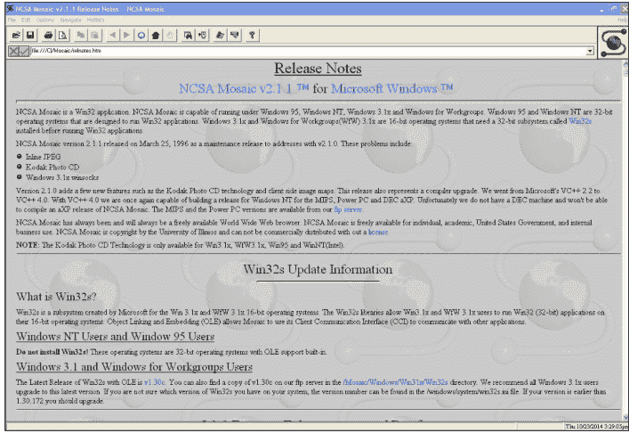

**图 1-1：** 最早的浏览器看起来没什么大不了的。

没过多久，有人就想到浏览器实际上可以自己做有用的事情，而不仅仅是充当花哨的文档显示程序。

## Eich 来了

JavaScript 于 1995 年在 Netscape 诞生。JavaScript 的创造者 Brandon Eich 以创纪录的时间编写了 JavaScript（有人说只用了十天！），他从各种其他编程语言借用了许多最优秀的功能。急于推向市场也在语言设计中产生了一些有趣的怪癖（或者说不客气地描述为错误）。结果是一种类似世界语的语言，对于熟悉其他编程语言的人来说，它看起来似曾相识。

## Mocha 的美味

JavaScript 最初的名字是 Mocha。在 Netscape Navigator 的第一次 beta 部署中，它被重新命名为 LiveScript，然后在 1995 年内置到 Netscape 2 浏览器时改为 JavaScript。微软非常迅速地反向工程了 JavaScript，并在 Internet Explorer 中引入了一个完全相同的克隆版本，称其为 JScript 以绕过商标问题。

Netscape 将 JavaScript 提交给名为 Ecma International 的标准组织，并于 1997 年被采纳并标准化为 ECMAScript。

> JavaScript 的创造者 Brandon Eich 曾对标准化语言的名称发表了著名的评论；称 ECMAScript 是一个"听起来像皮肤病的、不受欢迎的商品名"。


不仅 ECMAScript 作为编程语言的名称不吸引人，Netscape 给这门语言取的、大多数人更喜欢称呼它的名称也相当不幸。如果你已经知道如何用 Java 编程，或者如果你在某个时候学习它，请务必记住这两种语言可能有一些相似之处，但它们实际上是截然不同的两种东西。

## 我们需要更多效果！

当 JavaScript 首次亮相时，它很快就因使网页更加动态而非常受欢迎。所谓的动态 HTML（DHTML）是 JavaScript 内置到网络浏览器中的早期结果，它实现了各种有趣的效果，如飘落的雪花效果（见图 1-2）、弹出窗口和卷曲的网页角落，但也实现了更有用的功能，如下拉菜单和表单验证。

## JavaScript 长大了

如今已进入第三个十年，JavaScript 已成为世界上使用最广泛的编程语言，世界上几乎每台个人计算机上至少有一个浏览器可以运行 JavaScript 代码。

JavaScript 足够灵活，非程序员也可以使用和学习，但又足够强大，专业程序员可以使用它（并且确实在使用它）来为当今互联网上几乎每个网站启用功能，从单页网站到 Google、Amazon、Facebook 等庞大的网站，以及许许多 ​多其他网站！

## 第一部分：JavaScript 入门


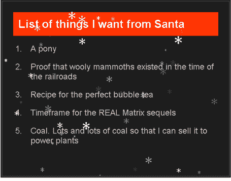

### 动态脚本语言

JavaScript 通常被描述为一种动态脚本语言。为了理解这意味着什么，我们需要先定义几个术语并提供一些背景信息。

## 关于 JavaScript 的常见误区

多年来，关于 JavaScript 有许多相当糟糕的评价。虽然谣言有时很有趣，但并不总是真实的。以下列表解释了关于 JavaScript 的一些常见误区：

- **迷思**：JavaScript 不是一种真正的编程语言。**现实**：JavaScript 经常被用于浏览器中的琐碎任务，但这并不意味着它不是一种编程语言。事实上，JavaScript 拥有许多先进的特性，提高了编程语言的标准，现在正被 PHP、C++ 甚至 Java 等语言所模仿。
- **迷思**：JavaScript 与 Java 有关。**现实**：并非如此。JavaScript 这个名字纯粹是一种营销策略，因为在 JavaScript 推出时，Java 极其流行。


- **迷思**：JavaScript 是新兴的。**现实**：JavaScript 已经存在 20 多年了！我们认识的一些专业 JavaScript 程序员在 JavaScript 创建时甚至还没有出生。
- **迷思**：JavaScript 漏洞很多，且在不同浏览器中运行结果不同。**现实**：虽然在某些情况下过去确实如此，但浏览器厂商早在很久之前就决定支持标准化版本的 JavaScript。如今，每个浏览器运行 JavaScript 的结果都是相同的。

## 第 1 章：世界上最被误解的编程语言

*计算机程序* 是一组指令，用于驱动计算机执行操作。每种计算机编程语言都有一套指令以及人类编写这些指令的特定方式。计算机无法直接理解这些指令。为了让计算机理解一种编程语言，它需要经过一个转换过程，将人类可读（且可写）的指令翻译成机器语言。根据翻译发生的时间，编程语言大致可分为两类：编译型和解释型（见图 1-3）。

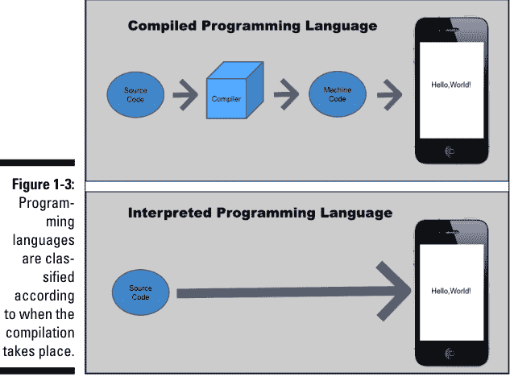

### 编译型编程语言

*编译型编程语言* 是指程序员必须先编写代码，然后通过一个称为 *编译器* 的特殊程序运行，该程序会对给定代码进行解释，然后将其转换为机器语言。随后，计算机即可执行该编译后的程序。

编译型语言的示例包括 C、C++、Fortran、Java、Objective-C 和 COBOL。

### 解释型编程语言

*解释型语言* 从技术上讲仍然由计算机编译成机器语言，但编译过程是由用户的 Web 浏览器在程序运行时实时完成的。编写解释型语言的程序员不需要在将代码交给计算机运行之前经过编译步骤。

使用解释型语言编程的优点是可以在任何时候轻松地对程序进行修改。然而，缺点是在运行的同时编译代码会在过程中增加一个步骤，并可能降低程序的性能。

部分由于这种性能因素，解释型语言曾被认为是不那么“严肃”的编程语言。然而，由于更好的即时编译器（JIT）和更快的计算机处理器，这种看法正在迅速改变。JavaScript 在这方面产生了重大影响。

解释型编程语言的示例包括 PHP、Perl、Haskell、Ruby，当然还有 JavaScript。

## JavaScript 能做什么？

如果你使用 Web，你时刻都在使用 JavaScript。JavaScript 能实现的功能清单非常广泛，从你在表单中忘记填写必填项时收到的简单提示，到像 Google Docs 或 Facebook 这样复杂的应用程序。以下是 JavaScript 在 Web 上最常见用途的简短列表：

- 精巧的视觉效果
- 输入验证
- 悬停效果（Rollover effects）
- 下拉/弹出菜单
- 拖拽功能
- 无限滚动页面
- 自动完成
- 进度条
- 网页内的选项卡
- 可排序列表
- 魔幻缩放（见图 1-4）


**图 1-4：** 所谓的魔幻缩放效果是通过 JavaScript 实现的。

### 为什么选择 JavaScript？

JavaScript 已成为创建 Web 动态用户界面的标准。几乎只要你访问带有动画、实时数据、鼠标悬停时会变化的按钮或下拉菜单的网页，JavaScript 就在发挥作用。由于其强大的能力以及在任何 Web 浏览器中运行的特性，JavaScript 编程是现代 Web 开发人员必须具备的最受欢迎且最必要的技能。

#### JavaScript 易于学习

请记住，创建编程语言是为了给人们提供一种简单的方式与计算机交流并告知它们要做什么。与计算机 CPU 运行的机器语言相比，每种编程语言都是简单易懂的。为了让你了解计算机实际执行的指令是什么样的，这里有一个打印 "Hello World" 的机器语言程序。

```
b8   21 0a 00 00
a3   0c 10 00 06
b8   6f 72 6c 64
a3   08 10 00 06
b8   6f 2c 20 57
a3   04 10 00 06
b8   48 65 6c 6c
a3   00 10 00 06
b9   00 10 00 06
ba   10 00 00 00
bb   01 00 00 00
b8   04 00 00 00
cd   80
b8   01 00 00 00
cd   80
```

现在来看看用 JavaScript 完成这个简单任务的一种方式：

```
alert("Hello World");
```

简单得多，对吧？


一旦你学习了基本的运行规则（称为 *语法*），例如何时使用圆括号以及何时使用花括号（`{}`），JavaScript 实际上很像普通的英语。


学习任何语言（包括编程语言）的第一步就是克服开始时的恐惧。JavaScript 让这一切变得简单。Web 上有数以千计的 JavaScript 代码示例，任何人都可以直接选取并开始尝试。你已经拥有了所有需要的工具（见第 2 章），使用 JavaScript 从小处着手，逐渐构建出伟大且精彩的事物是非常容易的。

#### JavaScript 在哪里？JavaScript 无处不在！

虽然 JavaScript 最初设计用于 Web 浏览器，但它已在许多其他地方找到了归宿。如今，JavaScript 运行在智能手机和平板电脑上，运行在 Web 服务器上，运行在桌面应用程序中，以及各种便携式设备中。

#### Web 浏览器中的 JavaScript

最常见到 JavaScript 的地方，也是它最初被设计用途的地方，就是运行在 Web 浏览器中。当 JavaScript 以这种方式运行时，它被称为 *客户端 JavaScript*。

客户端 JavaScript 为网页增加了交互性。它通过以下几种方式实现：

- 通过控制浏览器本身或利用浏览器的功能
- 通过操纵网页的结构和内容
- 通过操纵网页的样式（如字体和布局）
- 通过从其他源访问数据

为了理解 JavaScript 如何能够操纵网页的结构和样式，你需要了解一点 HTML5 和 CSS3。

#### HTML5

超文本标记语言（HTML）是用于构建网页结构的语言。它的工作方式是通过对内容（文本和图像）进行标记，从而向 Web 浏览器提供关于内容的信息，例如什么是标题，什么是段落，图像放在哪里，等等。代码清单 1-1 显示了一个简单的 HTML 文档。图 1-5 显示了 Web 浏览器如何显示此文档。

#### 代码清单 1-1：一个简单的 HTML 文档

```html
<!DOCTYPE html>
<html>
<head>
 <title>Hello, HTML!</title>
</head>
<body>
  <h1>This is HTML</h1>
  <p id="introduction">This simple document was written
      with Hypertext Markup Language.</p>
</body>
</html>
```

为了推进 JavaScript 的学习，目前你需要了解关于 HTML 的所有内容如下：

- 在 HTML 中，被尖括号包围的字符称为 *标签*。
- *结束标签*（位于被标记内容的后面）在第一个尖括号后有一个斜杠。例如 `</p>` 就是一个结束标签。

## 第一部分：JavaScript 入门

- 一对标签（开始标签和结束标签）加上它们之间的内容，被称为一个*元素*。
- 元素通常以层级方式组织（元素嵌套在元素内部）。
- 元素可以包含名称/值对，称为*属性*。如果一个元素有属性，它们会放在开始标签中。*名称/值对*通过在名称（不加引号）和值（加引号）之间放置等号来为名称赋值。例如，在下面的标签中，`width` 和 `height` 都是 `div` 元素的属性：

```
<div width="100" height="100"></div>
```

- 有些元素没有内容，因此不需要结束标签。例如，`img` 标签只是将图像插入网页，它看起来像这样：

```

```

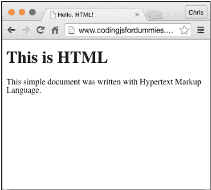

图 1-5：网页浏览器使用 HTML 来渲染网页。

显示图像所需的所有数据都包含在使用属性的开始标签中，因此 `img` 标签不需要结束标签。

当你用 HTML 编写网页时，你可以直接将 JavaScript 代码包含在该文档中，也可以从 HTML 文档中引用 JavaScript 代码文件（扩展名为 `.js`）。无论哪种方式，你的访客的网页浏览器都会下载 JavaScript 代码，并在用户访问包含该 JavaScript 的网页时运行它。

> **记住：** 客户端 JavaScript 在用户的网页浏览器内运行。

### CSS3

层叠样式表（CSS）是用于为网页添加格式和不同布局的语言。“样式”一词在 CSS 中使用时，指的是 HTML 文档向用户呈现方式的许多方面，包括：

- 字体（或字体外观）
- 字号
- 颜色
- 浏览器窗口中元素的排列
- 元素的大小
- 边框
- 背景
- 创建元素边框上的圆角

与 JavaScript 一样，CSS 可以直接放入 HTML 文档，也可以从 HTML 文档中链接。一旦下载，它会立即生效，并根据你的规范格式化文档。

CSS 中的样式表由 CSS 规则组成，这些规则包含应应用于一个或一组元素的属性和值。以下是一个 CSS 规则的示例：

```
p{font-size: 14px; font-color: black; font-family: Arial, sans-serif}
```

这个规则从左到右阅读，指定了所有 `p` 元素（在 HTML 中表示段落）应以 14px 大小、黑色、使用 Arial 字体的文本显示。如果用户的计算机上没有 Arial 字体，则应以某种无衬线字体显示。

CSS 规则中花括号外的部分称为选择器。它选择花括号内的属性所应用的元素。


在本书中，你将了解如何将 JavaScript 与 HTML 和 CSS 一起使用。我们在这里提供足够的信息，以便向你展示 HTML 和 CSS 是如何工作的。如果你需要了解更多，可以找到一些关于它们的优秀书籍。我们强烈推荐的一本是 Ed Tittel 和 Chris Minnick 所著的《Beginning HTML5 and CSS3 For Dummies》（Wiley 出版）。

## JavaScript 功能强大！

在网页浏览器中运行的 JavaScript 以前很慢，并且在程序员中早期名声不佳。如今，JavaScript 代码的运行速度已达到编译代码的 80%。而且，它一直在变得更快。这意味着今天的 JavaScript 比仅仅几年前的 JavaScript 强大得多。而且，它比 1995 年首次推出的 JavaScript 强大许多倍。

## JavaScript 市场需求旺盛

JavaScript 不仅是世界上最广为人知的编程语言，也是就业市场上需求最旺盛的技能之一。预计在 2010 年至 2020 年间，JavaScript 程序员的就业市场将增长 22%。JavaScript 正在发生令人兴奋的事情，现在是学习它的最佳时机。

## 第 2 章：编写你的第一个 JavaScript 程序

### 本章内容

- 配置你的开发环境
- 了解 JavaScript 代码
- 理解一个简单的 JavaScript 程序
- 理解为代码添加注释的价值

> “取得进步的秘诀是开始行动。”

> —— 马克·吐温


简单的 JavaScript 编程并不难理解。在本章中，你将完成为编写 JavaScript 设置计算机的过程。你还将编写你的第一个 JavaScript 程序，并在作为程序员的未来与 JavaScript 所做的一切之前，了解基本语法。

别忘了访问网站查看与本章相关的在线练习！

#### 设置你的开发环境

在开始编写你的第一个 JavaScript 程序之前，设置好所有工具非常重要。我们将引导你下载和安装我们最喜欢的 JavaScript 开发工具，巧合的是，这些工具也是我们在本书中使用的。如果你有更喜欢的类似工具，请随意使用它们。但是，我们建议你仍然阅读本书的这一部分，以了解我们为什么选择这些工具，并自行决定是否使用它们。

在安装每个工具后，我们会与你分享一些技巧和窍门，让你能最大限度地利用每个工具。

#### 下载和安装 Chrome

我们在使用 JavaScript 时偏好的网页浏览器是 Google Chrome。如果你在日常工作中更喜欢使用不同的网页浏览器，当然也可以。所有浏览器都能非常快速且正确地运行 JavaScript。但是，本书中的某些说明将特定于 Google Chrome，因此我们建议你至少在本章中完成在计算机上安装它的过程。我们选择在本书中使用 Google Chrome，因为它提供了出色的工具来简化 JavaScript 程序员的工作，并且它目前是互联网上使用最广泛的网页浏览器。（是的，它甚至比 Internet Explorer 更受欢迎。）

如果你还没有安装 Chrome，请按照以下步骤安装它：

1. 访问 `www.google.com/chrome`。
2. 将鼠标悬停在“下载”选项卡上，选择适合你计算机的版本。
3. 打开下载的文件并按照说明安装 Chrome。

图 2-1 向你展示了 Google Chrome 的外观。

> **现在你拥有一个超强的 JavaScript 引擎了！**

Google Chrome 使用 Google 的 V8 JavaScript 引擎来解析、编译和运行 JavaScript 代码。根据你相信谁的基准测试，Chrome 要么是浏览器中运行 JavaScript 最快的方式，要么是最快的方式之一。主要的浏览器制造商一直在竞争，试图超越对方。在任何时候，谁实际上是最快的并不那么重要；竞争已经使每个浏览器的 JavaScript 引擎的速度在近年来突飞猛进。

如果你想查看不同浏览器在 JavaScript 性能测试中实际表现的比较，可以在 `http://arewefastyet.com` 网站上查看（见图）。这个网站由 Firefox 浏览器的创建者 Mozilla 维护，会自动检查并绘制最流行浏览器的 JavaScript 性能图表，并且每天更新多次。

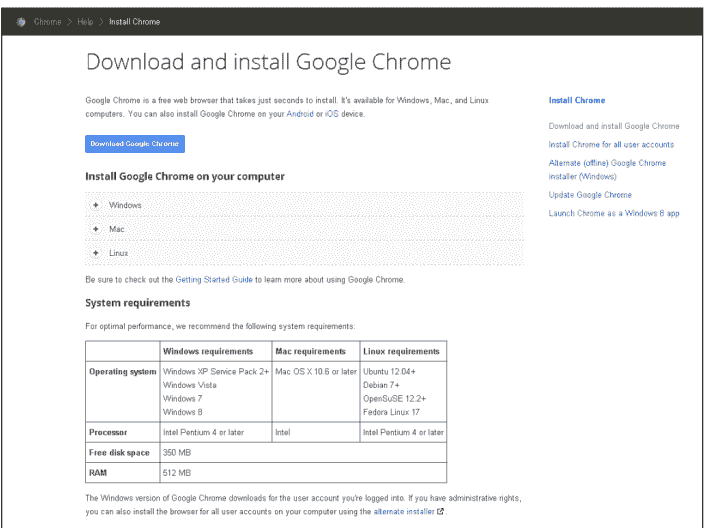

#### 下载和安装代码编辑器

*源代码编辑器*，通常称为代码编辑器，是一种文本编辑器，添加了帮助你编写和编辑编程代码的功能。我们使用的是 Sublime Text。

> 有许多代码编辑器可供选择，因此如果你已经有喜欢并习惯使用的编辑器，请继续使用它！程序员的代码编辑器是非常个人化的选择，许多人会发现自己只是对特定的编辑器感觉更舒服。如果你发现 Sublime Text 不符合你的风格，表 2-1 列出了一些其他选项。

**表 2-1：其他代码编辑器示例**

| 名称 | 位置 | 兼容于…… |
|---|---|---|
| Coda | `http://panic.com/coda` | 仅限 Mac |
| Aptana | `www.aptana.com` | Mac 或 Windows |
| Komodo Edit | `www.activestate.com/komodo-edit/downloads` | Mac 或 Windows |

*（续）*

| 名称 | 位置 | 兼容系统 ... |
|---|---|---|
| Dreamweaver | `http://adobe.com/products/dreamweaver.html` | Mac 或 Windows |
| Eclipse | `www.eclipse.org` | Mac 或 Windows |
| Notepad++ | `http://notepad-plus-plus.org` | 仅 Windows |
| TextMate | `http://macromates.com` | 仅 Mac |
| BBEdit | `www.barebones.com/products/bbedit` | 仅 Mac |
| Emacs | `www.gnu.org/software/emacs` | Mac 或 Windows |
| TextPad | `www.textpad.com` | 仅 Windows |
| vim | `www.vim.org` | Mac 或 Windows |
| Netbeans | `https://netbeans.org` | Mac 或 Windows |

本书使用 Sublime Text（参见图 2-2），因为它在 JavaScript 程序员中很流行，并且提供了一个简洁的用户界面以及大量插件，随着你编程经验的积累，这些插件可用于处理更高级的编程任务。

要安装 Sublime Text，请按照以下步骤操作：

1. **访问 `http://sublimetext.com` 并为您的操作系统选择合适的版本。**
2. **打开下载的文件并按照说明安装 Sublime Text。**

### Sublime Text 入门

首次打开 Sublime Text 时，你会看到一个简单的空白页面，上面有一个光标（参见图 2-3）。

如果你之前使用过 Sublime Text，你可能会在左侧看到一个侧边栏，如图 2-4 所示。此侧边栏显示你打开的文件以及项目中的文件（如果你创建了一个项目）。侧边栏很有用，我们建议你将其打开。


要打开侧边栏，请点击 View $\rightarrow$ Sidebar $\rightarrow$ Show Sidebar。

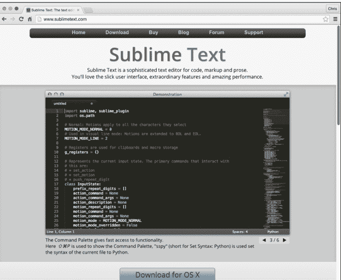

图 2-2：Sublime Text 是一个看似简单却拥有强大功能的文本编辑器。

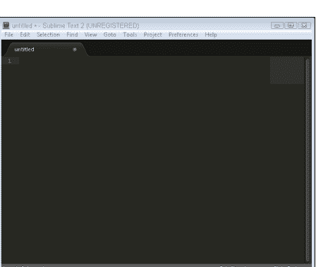

图 2-3：Sublime Text 的初始用户界面。是不是很简洁？

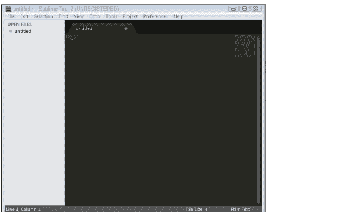

图 2-4：打开了侧边栏的 Sublime Text。

要开始创建你的第一个 Sublime Text 项目文件，请按照以下步骤操作：

1. **选择 File -> Save As。**

   保存对话框将出现，并显示你的默认保存位置。如果你满意将代码存储在此文件夹中（很可能是 [OSX 上的] Documents 文件夹或 [Windows 上的] My Documents 文件夹），那么就进行步骤 2。否则，请导航到你计算机上的其他位置，你想在那里存储你的代码文件。

2. **创建一个新文件夹并命名该文件夹。**

3. **在“另存为”文本区域中，为这第一个文件命名，然后点击“保存”。**

   新文件名将出现在侧边栏中，打开的选项卡上的名称将更改为你选择的名称。

4. **选择 Project -> Save Project As，将 Sublime Text 项目文件保存在你创建的文件夹内。**

   Sublime Text 项目文件是 Sublime Text 存储有关哪些文件和文件夹与项目关联的信息的地方。创建项目文件夹可以让你更好地组织程序中的所有不同类型的文件。

5. **选择 Project -> Add Folder to Project，选择你在步骤 1 中创建的文件夹，然后点击 Open。**

   侧边栏中会出现一个新的可折叠列表，名为“Folders”，你的文件夹及其内容（包括项目文件和 MyFirstProgram.html）将列在其下，如图 2-5 所示。

### 选择语法配色方案

Sublime Text 的语法颜色基于你编写的代码类型和文件扩展名。将代码清单 2-1 中所示的以下 HTML 和 JavaScript 代码输入到你刚刚创建的文件中，以查看默认配色方案。

正如你即将发现的那样，JavaScript 很挑剔。确保你的大小写和拼写与清单中的完全一致，否则你的脚本可能无法正常工作或完全无法工作。

#### 代码清单 2-1：一个包含 JavaScript 的示例 HTML 文件

```html
<!DOCTYPE html>
<html>
<head>
  <title>Hello, HTML!</title>
  <script>
    function countToTen(){
      var count = 0;
      while (count < 10) {
        count++;
        document.getElementById("theCount").innerHTML +=
          count + "<br>";
      }
    }
  </script>
</head>
<body onload="countToTen();">
    <h1>Let's Count to 10 with JavaScript!</h1>
    <p id="theCount"></p>
</body>
</html>
```

为了让你保持所有文件和文件夹井然有序，我们提供了一些关于如何命名文件和文件夹的建议。例如，你可以将步骤 2 中的新文件夹命名为 `MyFirstJavaScriptProject`，将步骤 3 中的文件命名为 `MyFirstProgram`，将步骤 4 中的项目命名为 `myFirstProject`。

图 2-6 显示了该文件在我们使用的 Sublime Text 中的样子。


如果你不喜欢当前选定的配色方案，可以通过选择 Preferences $\rightarrow$ Color Scheme，然后选择另一个配色方案来更改它。

尝试其他一些配色方案，找到一个你喜欢的。我们本书中使用的配色方案名为 Monokai Bright。

如果你想尝试刚刚输入的程序，请按照以下步骤操作：

1. 通过选择 File $\rightarrow$ Save 保存文件。

2. 打开你的 Chrome 浏览器并按 Ctrl + O。

   会出现一个“打开文件”窗口。

3. 导航到计算机上的文件并选择它。

4. 点击“打开”按钮。

   该文件将在你的浏览器中打开。

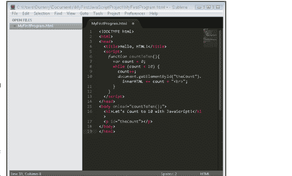

图 2-6：Sublime Text 为你的代码所有不同部分应用了颜色。

你的浏览器应该看起来就像图 2-7。如果没有，请非常仔细地检查你的代码——你可能在某处有一个小拼写错误。进行任何更改后不要忘记保存文件！

**图 2-7：** 在 Chrome 中运行一个简单的计数程序。

你也可以通过按 Command + S（在 Mac 上）或 Control + S（在 Windows 上）来保存文件。一旦你熟练掌握它们，键盘快捷键将为你节省大量时间。

### 一些实用的 Sublime Text 快捷键

Sublime Text 看起来像一个普通的文本编辑器，但不要被外表迷惑！一个真正的编程大师的标志是他或她使用键盘快捷键尽可能快地编写代码和进行编辑的能力。表 2-2 列出了 Sublime Text 提供的众多键盘快捷键中的一些。练习这些，你将能够很快地用你超精英的技能给你的朋友和同事留下深刻印象。

**表 2-2：常用的 Sublime Text 编辑键盘快捷键**

| Mac | Windows | 描述 |
| :--- | :--- | :--- |
| Command+X | Ctrl+X | 删除行 |
| Command+Return | Ctrl+Enter | 在之后插入行 |
| Command+Shift+Return | Ctrl+Shift+Enter | 在之前插入行 |
| Command+Control+Up Arrow | Ctrl+Shift+Up Arrow | 向上移动行/选择 |
| Command+Control+Down Arrow | Ctrl+Shift+Down Arrow | 向下移动行/选择 |
| Command+L | Ctrl+L | 选择行；重复以选择下一行 |
| Command+D | Ctrl+D | 选择单词；重复以选择其他出现位置 |
| Control+M | Ctrl+M | 跳转到闭合括号；重复以跳转到开括号 |
| Control+Shift+M | Ctrl+Shift+M | 选择当前括号内的所有内容 |
| Command+K+Command+K | Ctrl+K+K | 从光标删除到行尾 |
| Command+K+Delete | Ctrl+K+Delete | 从光标删除到行首 |
| Command+] | Ctrl+] | 增加当前行的缩进 |
| Command+[ | Ctrl+[ | 减少当前行的缩进 |
| Command+Shift+D | Ctrl+Shift+D | 复制行 |
| Command+J | Ctrl+J | 将下一行连接到当前行的末尾 |
| Command+/ | Ctrl+/ | 注释/取消注释当前行 |
| Command+Option+/ | Ctrl+Shift+/ | 块注释当前选择区域 |
| Command+Y | Ctrl+Y | 重做或重复上一个键盘快捷键命令 |
| Command+Shift+V | Ctrl+Shift+V | 粘贴并正确缩进 |
| Control+Space | Ctrl+Space | 选择下一个自动完成选项 |
| Control+U | Ctrl+U | 软撤销；重复时跳到更改前的最后一个位置 |
| Control+Shift+Up | Ctrl+Alt+Up | 向上列选择 |
| Control+Shift+Down | Ctrl+Alt+Down | 向下列选择 |
| Control+Shift+W | Alt+Shift+W | 将选择内容包裹在 HTML 标签中 |

### 阅读 JavaScript 代码

在开始编写 JavaScript 程序之前，你需要了解 JavaScript 的几条规则：

- JavaScript 是区分大小写的。我们在书中的很多地方都会重复这一点，因为这是 JavaScript 初学者经常犯的错误。对于 JavaScript 来说，`pants` 和 `Pants` 是完全不同的。

- JavaScript 对空白字符不敏感。空白字符包括空格、制表符（tab）和换行符——任何没有视觉呈现的字符。在编写 JavaScript 代码时，在代码中使用一个空格、两个空格、一个制表符，甚至一个换行符（在大多数情况下）都没有关系。JavaScript 会忽略空白字符。唯一的例外是你正在编写希望 JavaScript 打印到屏幕上的文本。在这种情况下，你使用的空白字符将出现在最终结果中。关于代码中空白字符的最佳实践是：使用足够的空间使代码易于阅读，并且在空间使用上保持一致。

- 注意保留字。JavaScript 有一组对语言具有特殊含义的单词。我们在第 3 章中列出了这些单词。目前，你只需要知道某些单词（如 `function`、`while`、`break` 和 `with`）具有特殊含义。

- JavaScript 喜欢分号：JavaScript 代码由语句组成。你可以将语句视为类似于句子。就像句子是段落的构建块一样，语句是 JavaScript 程序的基石。在 JavaScript 中，语句以分号结束。

如果你在语句末尾没有使用分号，JavaScript 会为你自动添加。然而，这可能会导致意外的结果，因此，始终在语句末尾使用分号被认为是最佳实践。


### 在浏览器窗口中运行 JavaScript

虽然 JavaScript 出现在许多不同的环境中，但在实际应用中最常见的地方是在 Web 浏览器中运行。控制输入和输出、操作网页、处理常见的浏览器事件（如点击和滚动）以及控制 Web 浏览器的不同功能，正是 JavaScript 诞生的目的！

要在 Web 浏览器中运行 JavaScript，你有三种选择，接下来的页面将详细介绍这些方法：

- 直接将其放入 HTML 事件属性中
- 将其放在开始和结束的 `script` 标签之间
- 将其放在一个独立的文件中，并将其包含在 HTML 文档中

很多时候，你会由于在单个网页中结合使用这三种技术。然而，知道何时使用每一种方法很重要，这是一项需要通过更多实践才能掌握的技能。

#### 在 HTML 事件属性中使用 JavaScript

HTML 有几个特殊的属性，旨在当 Web 浏览器中发生某些事情或用户执行某些操作时触发 JavaScript。下面是一个带有事件属性的 HTML 按钮示例，它可以响应鼠标点击事件：

```html
<button id="bigButton" onclick="alert('Hello World!');">Click Here</button>
```

在这种情况下，当用户点击由该 HTML 元素创建的按钮时，会出现一个显示 “Hello World!” 字样的弹出窗口。

HTML 有 70 多个不同的事件属性。表 2-3 显示了最常用的属性。

| 属性 | 描述 |
| :--- | :--- |
| onload | 页面加载完成后运行脚本 |
| onfocus | 当元素获得焦点时运行脚本（例如文本框激活时） |
| onblur | 当元素失去焦点时运行脚本（例如用户在表单中点击新文本框时） |
| onchange | 当元素的值发生改变时运行脚本 |
| onselect | 当文本被提交时运行脚本 |
| onsubmit | 当表单被提交时运行脚本 |
| onkeydown | 当用户按下按键时运行脚本 |
| onkeypress | 当用户按下按键时运行脚本 |
| onkeyup | 当用户释放按键时运行脚本 |
| onclick | 当用户用鼠标点击元素时运行脚本 |
| ondrag | 当元素被拖动时运行脚本 |
| ondrop | 当被拖动的元素被放置时运行脚本 |
| onmouseover | 当用户将鼠标指针移动到元素上方时运行脚本 |

虽然这些属性易于使用，但许多 JavaScript 程序员认为使用事件属性并不是一种理想的做法。我们在本书中演示它们是因为它们被广泛使用且易于学习。不过，目前请记住，除了使用事件属性，还有更好的编写响应事件的 JavaScript 代码的方法。我们将在第 11 章中介绍这种更好的方法。

#### 在 `script` 元素中使用 JavaScript

HTML `script` 元素允许你将 JavaScript 嵌入到 HTML 文档中。通常 `script` 元素被放置在 `head` 元素内，事实上，这种放置方式曾经被规定为一项要求。然而，如今 `script` 元素既被用于 `head` 元素内，也被用于网页的 `body` 中。

`script` 元素的格式非常简单：

```html
<script>
    (在此插入你的 JavaScript 代码)
</script>
```

你在代码清单 2-1 中看到了这种脚本嵌入方式的示例。代码清单 2-2 显示了另一个包含 JavaScript `script` 标签的 HTML 文档示例。不过在这次示例中，我们将 `script` 元素放在了 `body` 元素的底部。

#### 代码清单 2-2：在 Script 元素中嵌入 JavaScript

```html
<!DOCTYPE html>
<html>
<head>
<title>Hello, HTML!</title>
</head>
<body>
<h1>Let's Count to 10 with JavaScript!</h1>
<p id="theCount"></p>
<script>
    var count = 0;
    while (count < 10) {
        count++;
        document.getElementById("theCount").innerHTML += count + "<br>";
    }
</script>
</body>
</html>
```

如果你在 Sublime Text 中创建一个新文件，将代码清单 2-2 输入其中，然后在 Web 浏览器中打开它，你会发现它的效果与代码清单 2-1 完全相同。

#### 脚本放置位置与 JavaScript 执行

Web 浏览器通常在加载脚本的同时执行它们。Web 页面总是由浏览器从上到下读取的，就像你阅读文本页面一样。有时，你可能希望在浏览器完成网页内容的加载后再运行脚本。在代码清单 2-1 中，我们通过在 `body` 元素中使用 `onload` 事件属性实现了这一点。另一种延迟执行的常见方法是简单地将要执行的代码放在代码的末尾，如代码清单 2-2 所示。

#### 在 `<script>` 元素中使用 JavaScript 的局限性

虽然比内联脚本（将 JavaScript 放入事件属性）更常用且更被广泛接受，但将 JavaScript 嵌入到 `script` 元素中也有一些严重的局限性。

最大的局限性是，以这种方式嵌入的脚本只能在它们所在的网页中使用。换句话说，如果你将 JavaScript 放入一个 `script` 元素中，你需要将该 `script` 元素原样复制并粘贴到每个需要它的页面中。对于一些包含数百个网页的网站，你可以想象这会变成一场维护噩梦。

## 第 2 章：编写你的第一个 JavaScript 程序

### 何时在 `<script>` 元素中使用 JavaScript

这种嵌入 JavaScript 的方法确实有其用途。对于那些仅仅是调用其他 JavaScript 片段且很少（或最好是永远）更改的小段代码，这种方式是可以接受的，甚至可以通过减少 Web 服务器的请求次数来加快网页的加载和显示速度。

单页应用（Single page apps，顾名思义仅包含单个 HTML 页面）也是使用这种嵌入方式的极佳候选者，因为更新脚本的地方只有一个。

然而，作为一项原则，你应该尽量减少直接嵌入到 HTML 文档中的 JavaScript 数量。这样会使维护更简单，代码组织更合理。

### 引入外部 JavaScript 文件

在 HTML 文档中引入 JavaScript 的第三种也是最流行的方法是使用 `script` 元素的 `src` 属性。

带有 `src` 属性的 `script` 元素与在标签之间编写 JavaScript 的 `script` 元素工作方式完全相同，唯一的区别是，如果你使用了 `src` 属性，JavaScript 将从一个独立的文件加载到 HTML 文档中。这是一个带有 `src` 属性的 `script` 元素示例：

```html
<script src="myScript.js"></script>
```

在这种情况下，你会有一个名为 `myScript.js` 的独立文件，它与你的 HTML 文档位于同一个文件夹中。使用外部 JavaScript 文件的好处是：

- 使你的 HTML 文件更整洁，减少杂乱


让你的生活更轻松，因为当某些内容发生变化或需要修复 Bug 时，你只需要在一个地方修改 JavaScript。

## 创建 `.js` 文件

创建外部 JavaScript 文件与创建 HTML 文件或其他类型的文件类似。要将代码清单 2-1 中的嵌入式 JavaScript 替换为外部 JavaScript 文件，请遵循以下步骤：

1. 在 Sublime Text 中，选择 File $\rightarrow$ New File。
2. 将 `MyFirstProgram.html` 中 `<script>` 和 `</script>` 之间的所有内容复制并粘贴到你的新 `.js` 文件中。
3. 将你的新文件保存为 `countToTen.js`，并放在与 `MyFirstProgram.html` 相同的文件夹中。
4. 在 `MyFirstProgram.html` 中，修改你的脚本元素以添加一个 `src` 属性，如下所示：

```html
<script src="countToTen.js"></script>
```

你的 `MyFirstProgram.html` 文件现在应该看起来像这样：

```html
<!DOCTYPE html>
<html>
<head>
 <title>Hello, HTML!</title>
 <script src="countToTen.js"></script>
</head>
<body onload="countToTen();">
 <h1>Let's Count to 10 with JavaScript!</h1>
 <p id="theCount"></p>
</body>
</html>
```

你的新文件 `countToTen.js` 应该看起来像这样：

```javascript
function countToTen(){
 var count = 0;
 while (count < 10) {
   count++;
   document.getElementById("theCount").innerHTML +=
           count + "<br>";
 }
}
```

保存两个文件后，你应该能在 Sublime Text 侧边栏的项目中看到它们，如图 2-8 所示。

## 组织你的 `.js` 文件

外部 JavaScript 文件有时会变得非常庞大。在许多情况下，将它们拆分成更小的文件是一个好主意，可以按照函数类型进行组织。例如，一个 JavaScript 文件可能包含与程序用户登录功能相关的脚本，而另一个文件则可能包含与博客功能相关的脚本。

然而，对于小型程序来说，通常只有一个文件就足够了，许多人会将单个 JavaScript 文件命名为通用名称，例如 `app.js`、`main.js` 或 `scripts.js`。

# 第二章：编写你的第一个 JavaScript 程序

35

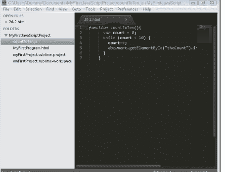

图 2-8：在 Sublime Text 中查看项目文件夹中的多个文件。

JavaScript 文件不需要与包含它们的 HTML 文件位于同一文件夹中。事实上，我们建议你创建一个新文件夹专门用于存储外部 JavaScript 文件。我们认识的大多数人将此文件夹命名为类似 `js` 的名称。

请按照以下步骤在你的 Sublime Text 项目中创建一个 `js` 文件夹，并将你的 js 文件移入其中：

1. 在 Sublime Text 侧边栏中，右键单击项目名称。

   会出现一个子菜单。

2. 从子菜单中选择 New Folder（新建文件夹）。

   Sublime Text 窗口底部会出现一个 Folder Name（文件夹名称）文本框。

3. 在文件夹名称文本框中输入 `js` 并按 Enter 键。

   侧边栏中会出现一个名为 `js` 的新文件夹。

4. 打开 `countToTen.js`，选择 File → Save As（文件 → 另存为），并将其保存到新的 `js` 文件夹中。

5. 右键单击位于文件夹外的 `countToTen.js` 版本，并从子菜单中选择 Delete File（删除文件）。

6. 打开 `MyFirstProgram.js` 并更改你的脚本元素以反映 js 文件的新位置，如下所示：

```html
<script src="js/countToTen.js"></script>
```

当你在浏览器中打开 `MyFirstProgram.html`（或只需点击刷新）时，它应该看起来与将 JavaScript 文件移入其自身文件夹之前完全一样。

## 使用 JavaScript 开发者控制台

有时，能够运行 JavaScript 命令而无需创建 HTML 页面、包含单独的脚本或创建 `<script>` 块是很有帮助的。在这些时候，你可以使用 Chrome 浏览器的 JavaScript 控制台（参见图 2-9）。

要访问 JavaScript 控制台，请找到浏览器右上角的 Chrome 菜单。它看起来像三条水平线。单击 Chrome 菜单，然后在下拉菜单中找到 More Tools（更多工具）。在 More Tools 下，从下拉菜单中选择 JavaScript Console（JavaScript 控制台）。

是的，还有一种更快的方法打开 JavaScript 控制台。只需按 Alt+Command+J（在 Mac 上）或 Control+Shift+J（在 Windows 上）。

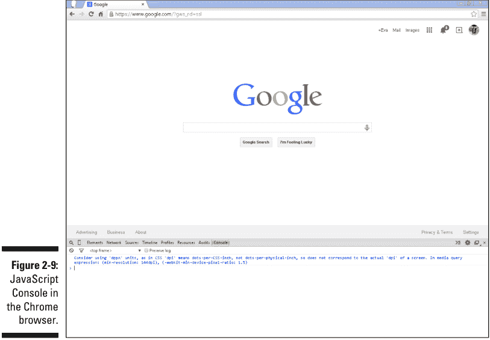

# 第二章：编写你的第一个 JavaScript 程序

JavaScript 控制台可能是 JavaScript 开发者最好的朋友。除了让你快速轻松地测试和运行 JavaScript 代码外，它还是报告代码错误的地方，并且具有帮助你跟踪和解决代码问题的功能。

打开 JavaScript 控制台后，你可以开始向其中输入命令，这些命令将在你按 Enter 键后立即运行。要试用它，请打开 JavaScript 控制台，然后输入以下命令，每个命令后按 Enter 键：

```javascript
1080/33
40 + 2
40 * 34
100%3
34++
34--
```

## 为你的代码添加注释

随着你学习更多 JavaScript 命令并开始编写更大的程序，能够给自己留下关于你想法或某些功能用途的小提醒通常是很有帮助的。在程序员术语中，我们将这些给自己（或任何其他可能使用你代码的人）留下的小注释称为“注释”。我们将编写这些注释的过程称为“添加注释”。

JavaScript 引擎会完全忽略注释。它们只是为人类准备的。这是你解释事情、澄清事情、描述你的想法，甚至给自己留下将来要做的事情提醒的时候。

给代码添加注释总是一个好主意。即使你认为你的代码在编写时相当不言自明，我们保证八个月后当你需要修改它时，你不会这么认为。

JavaScript 提供了两种方式来将某些内容标记为注释：

- 单行注释
- 多行注释

### 单行注释

单行注释以 `//` 开头。这两个斜杠之后直到行尾的所有内容都将被 JavaScript 解析器忽略。

单行注释不需要从行首开始。在同一行代码（未注释）的同一行使用单行注释来解释该行的含义是非常常见的。例如：

```javascript
pizzas = pizza + 1; // 再加一个披萨
```

### 多行注释

多行注释以 `/*` 开头，并告诉 JavaScript 解析器忽略直到 `*/` 之间的所有内容。多行注释适用于更广泛的代码文档。例如：

```javascript
/* countToTen 函数执行以下操作：
   * 初始化一个名为 count 的变量
   * 通过检查 count 的值来开始一个循环，
     以确保其小于 10
   * 将 count 的值加 1
   * 将 count 的当前值（后跟换行符）追加到
     id='theCount' 的段落中
   * 重新开始循环
*/
```

### 使用注释来阻止代码执行

除了对记录代码有用外，注释通常对隔离代码片段以查找问题也很有用。例如，如果我们想看看如果从循环中移除增加 `count` 值的那一行，`countToTen` 函数会做什么，我们可以使用单行注释注释掉该行，如下所示：

```javascript
function countToTen(){
  var count = 0;
  while (count < 10) {
    // count++;
    document.getElementById("theCount").innerHTML +=
          count + "<br>";
  }
}
```

当你运行这个程序时，`count++;` 这一行将不再运行，程序将永远打印出 0（或者直到你关闭浏览器窗口）。

我们将刚刚创建的内容称为“无限循环”。如果你确实运行了这个程序的修改版本，它不会对你的计算机造成任何损害，但它很可能会让你的 CPU 进入疯狂的循环状态，尽可能快地旋转，直到你关闭打开它的浏览器窗口。


# 第三章

# 使用变量

## 本章内容

- 创建和使用变量
- 理解变量作用域
- 了解 JavaScript 的数据类型
- 命名变量
- 使用内置函数处理变量

> “美是变量，丑是常量。”
>
> — 道格拉斯·霍顿（1891 – 1968）

在本章中，你将学习如何创建变量、为它们赋值、使用函数来查明变量中包含的数据类型、在不同数据类型之间转换，以及操作变量中的数据。


别忘了访问网站查看与本章相关的在线练习！

## 理解变量

变量是程序中的代表性名称。正如 *x* 可能代表代数中某个尚未知的值，或者 *x* 可能在海盗地图上标记宝藏埋藏的地点一样，变量在编程中用于代表其他东西。

你可以将变量想象成包含数据的容器。你可以给这些容器命名，稍后你可以通过使用它的名称来回忆和更改变量中的数据。

如果没有变量，每个计算机程序都只能有一个用途。例如，以下的一行程序就不使用变量：

```javascript
alert(3 + 7);
```

它的目的是将数字 3 和 7 相加，并在浏览器弹出窗口中打印结果。

然而，这个程序用处不大（除非你恰好需要经常回忆 3 和 7 的和）。有了变量，你可以创建一个通用的程序，它可以将任意两个数字相加并打印结果，就像下面的例子：

```javascript
var firstNumber = 3;
var secondNumber = 7;
var total = Number(firstNumber) + Number(secondNumber);
alert (total);
```

更进一步，你可以扩展这个程序，让用户输入两个数字，然后将它们相加，就像下面的例子：

```javascript
var firstNumber = prompt("Enter the first number");
var secondNumber = prompt("Enter the second number");
var total = Number(firstNumber) + Number(secondNumber);
alert (total);
```

自己试试这个程序！（第 2 章展示了如何使用你的代码编辑器。）请按照以下步骤操作：

1. 打开你的代码编辑器并创建一个基本的 HTML 模板。
2. 在 `<body>` 和 `</body>` 之间，插入一个开始的 `<script>` 标签和一个结束的 `</script>` 标签。
3. 在开始和结束的 script 标签之间，输入前面的示例代码。

你的文档现在应该看起来像这样：

```html
<html>
<head></head>
<body>
<script>
var firstNumber = prompt("Enter the first number");
var secondNumber = prompt("Enter the second number");
var total = Number(firstNumber) +
    Number(secondNumber);
alert (total);
</script>
</body>
</html>
```

4. 将新的 HTML 文档保存为 `addtwo.html`。
5. 在你的网页浏览器中打开 HTML 文档。

你应该会被提示输入第一个数字，如图 3-1 所示。

6. 输入第一个数字。

输入该数字后，你会被提示输入第二个数字。

7. 输入第二个数字。

在向程序提供第二个数字后，两个数字相加的结果将显示在屏幕上。

**图 3-1：** 一个用于将两个用户提交的数字相加的通用程序。

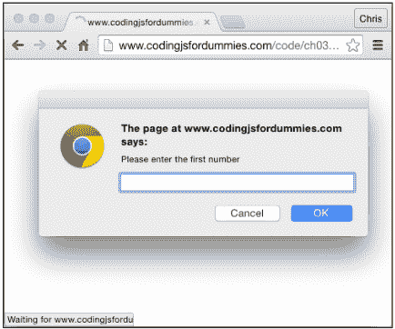

## 声明变量

*声明一个变量*是用于描述在程序中首先创建一个变量的过程的专业术语。你可能也会听到它被称为*初始化*。创建变量、声明变量和初始化变量都指的是同一件事。

JavaScript 中的变量可以通过以下两种方式之一创建：

- 使用 `var` 关键字：

```javascript
var myName;
```

- 使用 `var` 关键字创建的变量，除非在创建时给它赋值，否则其初始值为 `undefined`，例如：

```javascript
var myName = "Chris";
```

### 何时等于不等于？

在英语中，读取包含 `=` 的语句为“var myName equals Chris”是常见且正确的。然而，这种解释在编程中是不正确的。

以

```javascript
var myName = "Chris";
```

为例，在变量名（`myName`）和值（`"Chris"`）之间那个看起来像等号的字符，可能看起来完全像一个等号，它甚至是用键盘上通常被称为等号的键产生的。然而，在编程中，等号实际上被称为赋值运算符。

理解赋值运算符和“等于”之间的区别至关重要：

- 赋值运算符将其左侧的内容设置为等于其右侧的内容，就像这样：`var myName = "Chris";`
- “等于”比较左侧的值与右侧的值，并确定它们是否相同。JavaScript 中的等于写作 `===`。

### 没有 `var` 关键字

```javascript
myName = "Chris";
```

当你不使用 `var` 关键字创建变量时，它就变成了一个全局变量。（为了理解全局变量的含义，请参阅下一节。）


### 理解全局和局部作用域

你声明变量的方式和位置决定了你的程序可以如何以及在哪里利用该变量。这个概念称为变量作用域。JavaScript 有两种类型的作用域：

- 全局变量可以在程序中的任何地方使用。
- 局部（函数）变量是你在程序内一个受保护的程序（称为函数）中创建的变量。

### 缺失 `var` 的悲剧故事

真的没有理由在不使用 `var` 关键字的情况下创建变量，这样做会给你带来问题。如果你省略了 `var` 关键字，看起来就像是你忘记了，所以不要这样做！

以下示例展示了不使用 `var` 关键字可能发生的问题和混淆。它还演示了一种更高级编程工具的使用，称为函数，我们将在第 7 章更详细地介绍。简而言之，函数让你可以在程序内放置较小的程序。

在这个第一个例子中，程序员希望有一个全局变量 `movie`，以及一个单独的、同名但仅在名为 `showBadMovie` 的函数内有效的变量。这是一个完全正常的做法，在正常情况下，函数内的 `movie` 变量不会影响全局变量。但是，如果在函数内声明 `movie` 变量时忘记使用 `var` 关键字，坏事就会发生。

```javascript
var movie = "The Godfather";

function showGoodMovie () {
  alert (movie + " is a good movie!");
}

function showBadMovie () {
  movie = "Speed 2: Cruise Control";
  alert (movie + " is a bad movie!");
}
```

注意，`showBadMovie()` 中的 `movie` 变量前缺少 `var` 关键字。JavaScript 假设你想要覆盖全局 `movie` 变量，而不是创建一个局部的函数变量。结果绝对是灾难性的！

```javascript
showGoodMovie(); // 弹出
"The Godfather is a good movie!"

showBadMovie(); // 弹出
"Speed 2: Cruise Control is a bad movie!"

/* 哦不！全局变量现在是 Speed 2: Cruise Control，
而不是那个好电影的名字了！ */

showGoodMovie(); // 弹出
"Speed 2: Cruise Control is a good movie!"
```

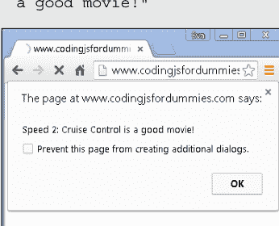

一般来说，使用局部变量比使用全局变量更可取，因为限制变量的作用域可以减少你意外地用同名的另一个变量覆盖变量值的机会。


使用全局变量会在你的程序中产生难以追踪和修复的问题。我们建议你永远不要在不使用`var`关键字的情况下创建变量。如果你确实需要全局变量，可以使用`var`关键字来创建它们，我们建议你采用这种方式。

## 命名变量

变量名可以以下列字符开头：

- 大写或小写字母
- 下划线（`_`）
- 美元符号（`$`）

虽然你可以使用下划线或美元符号开头命名变量，但最好以字母开头。意外的字符通常会使你的代码看起来令人困惑且难以阅读，尤其是如果你是 JavaScript 编码的新手。

在第一个字符之后，你可以在变量名中使用任何字母或数字，并且可以是任意长度。JavaScript 变量不能包含空格、数学运算符或标点符号（下划线除外）。

始终记住 JavaScript 区分大小写。名为`myname`的变量与`Myname`或`myName`不是同一个变量。

变量名实际上是标识符；你能做的最好的事情就是为变量命名一个精确且相关的名称。这种命名约定有时可能导致名称非常长，但一般来说，一个能准确表示变量的较长名称比一个模糊的较短名称更有用。

当然，变量名的长度限制不能让你的生活变得更困难。如果你需要使用20个字符来准确描述你的变量，那就去用吧。但是，如果你创建像`nameOfPersonWhoJustFilledOutTheFormOnMyWebsite`这样的变量名，你可能想看看是否可以通过缩短为更像`personName`这样的名称来简化你（以及可能需要与你的代码合作的其他人）的生活。

## 创建良好变量名的准则

尽管 JavaScript 在变量命名方面给予了很大的自由度，但最好在开始编程前为自己制定一些基本规则。例如，你的变量名是以小写字母还是大写字母开头？变量名中多个单词之间是使用下划线还是使用驼峰式命名法？随着代码变得越来越复杂，正确命名的重要性就显而易见了。

幸运的是，你在决定自己的风格时并非孤军奋战。许多专业 JavaScript 程序员在命名变量时遵循并使用一些最佳实践：

- 不要使用太短的名字！在命名变量时，简单的单字母名称或无意义的名字并不是一个好的选择。
- 使用多词名称以尽可能精确。
- 在多词名称中，始终将形容词放在左侧，例如`var greenPython;`。

为多词名称选择一种风格并保持一致。有两种方式可以组合单词来创建名称：驼峰式命名法（camelCase）和下划线命名法（under_score）。JavaScript 是一种灵活的语言，你可以使用任何一种方法，尽管驼峰式命名法通常使用得更广泛。

有些单词不能用作变量名。以下是一些保留字列表，它们不能用作 JavaScript 的变量、函数、方法、循环标签或对象名。

| | | | |
|---|---|---|---|
| abstract | else | instanceof | switch |
| boolean | enum | int | synchronized |
| break | export | interface | this |
| byte | extends | long | throw |
| case | false | native | throws |
| catch | final | new | transient |
| char | finally | null | true |
| class | float | package | try |
| const | for | private | typeof |
| continue | function | protected | var |
| debugger | goto | public | void |
| default | if | return | volatile |
| delete | implements | short | while |
| do | import | static | with |
| double | in | super | |

## 使用 const 关键字创建常量

有时，你的程序可能需要一些不能改变的变量。在这些情况下，你可以使用`const`关键字来声明变量。例如：

```javascript
const heightOfTheEmpireStateBuilding = 1454;
const speedOfLight = 299792458;
const numberOfProblems = 99;
const meanNumberofBooksReadIn2014 = 12;
```

常量遵循与其他变量相同的规则，但一旦创建了常量，其值在其生命周期（与脚本运行时间一样长）内就不能被更改。

## 处理数据类型

变量的数据类型是指变量可以容纳的数据种类以及可以对变量值执行哪些操作。例如，在句子中使用的数字 10 与在方程式中使用的数字 10 是不同的。数据类型是 JavaScript 区分旨在表示单词的值和旨在用作数学表达式的值的一种方式。

如果你想想你每天处理的所有数据类型——饼图、食谱、短篇小说、报纸文章等等——你就会看到在数据方面事情变得多么复杂。慷慨的 JavaScript 创作者决定为你简化事情。它只有五种基本数据类型。

此外，JavaScript 是一种所谓的弱类型语言。*弱类型*意味着你甚至不需要告诉 JavaScript，甚至不需要知道，你创建的变量是存储一个单词、一个段落、一个数字还是不同类型的数据。

弱类型并不意味着 JavaScript 不区分单词和数字。JavaScript 只是对此很友好，并在幕后处理确定变量中存储的数据类型的工作。

JavaScript 识别五种基本或原始数据类型。

> C++ 编程语言至少有 12 种不同的数据类型！

### 数字数据类型

JavaScript 中的数字存储为 64 位浮点值。用通俗的话说，这意味着数字范围可以从 5e-324（即 0.5 后面跟着 324 个零）到 1.7976931348623157e+308（将小数点向右移动 308 位以查看这个巨大的数字）。任何数字都可能包含小数点，也可能不包含。与大多数编程语言不同，JavaScript 没有为整数（没有小数部分的正数或负数）和浮点数（小数）设置单独的数据类型。

JavaScript 能使用的最大数字有多大？以下是不使用科学计数法写出来的：

179769313486231570000000000000000000000000000000000000000000000000000000000000000000000000000000000000000000000000000000000000000000000000000000000000000000000000000000000000000000000000000000000000000000000000000000000000000000000000000000000000000000000000000000000000000000000000000000000000000000000000000000000000000000000000000000000000

当你声明一个数字变量时，你需要包含以下所有元素：

- `var`关键字
- 你想给变量取的名字
- 赋值运算符
- 一个数字（或者一个可以解析为数字的表达式）
- 分号

以下是一些有效的数字变量声明示例：

```javascript
var numberOfDucks = 4;
var populationOfSpain = 47200000;
var howManyTacos = 8;
```

### 数字函数

JavaScript 包含一个内置的`Number`函数，用于将值转换为数字。要使用`Number`函数，只需将你想要转换为数字的值（或包含该值的变量）放在`Number`函数后面的括号中。

`Number`函数产生四种输出：

- 格式化为文本字符串的数字会被转换为可用于计算的数字，如下所示：

```javascript
Number("42") // 返回数字 42
```

- 无法转换为数字的文本字符串会返回`NaN`值，如下所示：

```javascript
Number("eggs") // 返回 NaN
```

- 布尔值`true`返回数字 1，如下所示：

```javascript
Number(true) // 返回 1
```

- 布尔值`false`返回数字 0，如下所示：

```javascript
Number(false) // 返回 0
```

### parseInt() 函数

对于 JavaScript 来说，所有数字实际上都是浮点数。但是，你可以使用`parseInt()`函数来告诉 JavaScript 只考虑数字的非小数部分（整数），并丢弃小数点后的所有内容。

```javascript
parseInt(100.33); // 返回 100
```

### parseFloat() 函数

你可以使用`parseFloat()`来明确告诉 JavaScript 将一个数字视为浮点数。或者，你甚至可以使用它将字符串转换为数字。例如：

```javascript
parseFloat("10"); // 返回 10
parseFloat(100.00); // 返回 100.00
parseFloat("10"); // 返回 10
```

### 示例

现在你可以用一些数字和数字函数进行尝试了。试着在 Chrome 浏览器的 JavaScript 控制台中输入以下表达式，看看它们会产生什么结果。

你可以通过按 Command+Option+J（Mac）或 Ctrl+Shift+J（Windows）在 Chrome 中打开 JavaScript 控制台。

```javascript
1 + 1
3 * 3
parseFloat("839");
parseInt("33.333333");
12 + "12"
"12" + 12
"12" * 2
```

数字变量声明时不能带引号。"10" 与 10 不同。前者是一个字符串（将在下一节介绍），如果你不小心在引号内声明了一个数字变量，你会得到意想不到的结果。

如果你跟着操作，你可能已经注意到前面示例中的一些奇怪行为。例如，当你将 "12"（字符串）与 12（数字）相加时，结果是 "1212"（字符串）。但是，当你将 "12"（字符串）乘以 2（数字）时，结果是 24（数字）。这是一个 JavaScript 真正运用其智慧的例子！

在第一个示例中，当你进行加法运算时，JavaScript 猜测，因为加法方程中的一个值是字符串，所以你可能希望两个值都是字符串。因此，它将数字转换为字符串，并将加号视为*连接运算符*。

在第二个示例中，当你进行乘法运算时，操作中的一个值是数字，而字符串无法相乘。JavaScript 将字符串转换为数字，然后进行乘法运算。但是，当你试图将两个字符串相乘时会发生什么呢？

```javascript
"sassafras" * "orange"
```

结果是`NaN`（非数字）。没有办法将 sassafras 或 orange 转换为数字，所以 JavaScript 束手无策。

### 字符串数据类型

字符串可以由任何字符组成：

- 字母
- 数字
- 标点符号（如逗号和句号）
- 可以使用反斜杠后跟字符编写的特殊字符

## 第一部分：JavaScript 入门

某些字符（例如引号）在 JavaScript 中具有特殊含义，或者需要特殊的字符组合（例如制表符或换行符）才能在字符串内部表示。我们称这些为*特殊字符*。表 3-1 列出了您可以在 JavaScript 字符串中使用的特殊字符。

**表 3-1 JavaScript 特殊字符**

| 代码 | 输出 |
| :--- | :--- |
| \' | 单引号 |
| \" | 双引号 |
| \\ | 反斜杠 |
| \n | 换行 |
| \r | 回车 |
| \t | 制表符 |
| \b | 退格 |
| \f | 换页 |

您可以通过将字符串包含在单引号或双引号中来创建字符串变量，如下所示：

```javascript
var myString = "Hi, I'm a string.";
```

实际上，无论您使用单引号还是双引号都无关紧要，只要包裹字符串的起始和结束引号相匹配即可。

如果您用单引号包裹字符串，那么在该字符串内部使用双引号是没有任何问题的。同样，如果您用双引号包裹字符串，在字符串内部使用单引号也没有问题。


然而，如果您创建了一个字符串并用某种类型的引号将其包裹，您就不能在字符串内部使用该类型的引号，否则 JavaScript 解析器会认为您地意结束该字符串，并会产生错误。

### 转义引号

解决无法在由某种引号包裹的字符串中包含该类型引号的方法是在引号前加上`\`。在引号前添加反斜杠被称为*转义引号*。

### 字符串函数

JavaScript 包含了许多用于处理和转换字符串的实用函数。

以下是最常用的内置字符串函数列表：

- `charAt()`返回指定位置的字符。请注意，字符的计数从 0 开始：

```javascript
var watzThisString = 'JavaScript is Fun!';
console.log (watzThisString.charAt(3));
// 返回 a
```

- `concat()`将一个或多个字符串合并并返回合并后的字符串：

```javascript
var watzThisString = 'JavaScript is Fun!';
console.log (watzThisString.concat(' We love JavaScript!'));
// 返回 JavaScript is Fun! We love JavaScript!
```

- `indexOf()`搜索并返回字符串中搜索字符或子字符串首次出现的位置：

```javascript
var watzThisString = 'JavaScript is Fun!';
console.log (watzThisString.indexOf('Fun'));
// 返回 14
```

- `split()`将字符串拆分为子字符串数组：

```javascript
var watzThisString = 'JavaScript is Fun!';
console.log (watzThisString.split('F'));
// 返回 ["JavaScript is ", "un!"]
```

- `substr()`从“起始位置”开始提取指定长度的字符串部分：

```javascript
var watzThisString = 'JavaScript is Fun!';
console.log (watzThisString.substr(2,5));
// 返回 vaScr
```

- `substring()`提取字符串中两个指定位置之间的字符：

```javascript
var watzThisString = 'JavaScript is Fun!';
console.log (watzThisString.substring(2,5));
// 返回 Vas
```

- `toLowerCase()`将字符串中所有字符转换为小写：

```javascript
var watzThisString = 'JavaScript is Fun!';
console.log (watzThisString.toLowerCase());
// 返回 javascript is fun!
```

- `toUpperCase()`将字符串中所有字符转换为大写：

```javascript
var watzThisString = 'JavaScript is Fun!';
console.log (watzThisString.toUpperCase());
// 返回 JAVASCRIPT IS FUN!
```

### 布尔数据类型

布尔变量存储两个可能值之一：`true`或`false`。


Boolean 一词是以乔治·布尔（George Boole, 1815–1864）命名的，他创建了一套逻辑代数系统。因为它是以人名命名的，所以您通常将其首字母大写。

布尔变量经常用于存储比较的结果。您可以使用`Boolean()`函数来获取比较的布尔值，或者将 JavaScript 中的任何值转换为布尔值。例如：

```javascript
var isItGreater = Boolean (3 > 20);
alert (isItGreater); // 返回 false

var areTheySame = Boolean ("tiger" === "Tiger");
alert (areTheySame); // 返回 false
```

使用`Boolean()`函数将 JavaScript 中的值转换为布尔值的结果取决于该值：

- 在 JavaScript 中，以下值总是求值为布尔值`false`：
  - `NaN`
  - `undefined`
  - `0`（数值零）
  - `-0`
  - `""`（空字符串）
  - `false`

任何不属于上述值的内容都求值为布尔值`true`。例如：

- `74`
- `"Eva"`
- `"10"`
- `"NaN"`

数字字符 "0" 与数值 0（零）不同。虽然 0 总是会导致布尔值`false`，但字符串 "0" 总是会导致布尔值`true`。

布尔值主要用于条件表达式。以下程序创建了一个布尔变量，然后使用 if/then 程序语句（您可以在第 5 章中了解到）来测试其值。

```javascript
var b = true;
if (b == true) {
    alert ("It is true!");
} else {
    alert ("It is false.");
}
```

布尔值的编写方式是不加引号，如下所示：

```javascript
var myVar = true;
```

另一方面，`var myVar = "true"`则创建了一个字符串变量。

### NaN 数据类型


`NaN` 代表 Not a Number（非数字）。当您尝试对字符串进行数学运算，或者计算失败、无法完成时，就会得到这个结果。例如，计算负数的平方根是不可能的。尝试这样做将导致 `NaN`。

另一种更常见的产生 `NaN` 的情况是尝试使用无法转换为数字的字符串执行数学运算。

### `undefined` 数据类型

即使您在 JavaScript 中创建了一个变量但没有为其指定值，它仍然有一个默认值。这个值就是 `"undefined"`。

## 第 4 章：理解数组

**在本章中**

- 识别和定义数组
- 构建数组
- 通过多维数组超越 2D
- 操作数组元素
- 使用数组函数和属性

> “我广大。我包含群众。”
>
> —— 沃尔特·惠特曼

数组是任何编程语言的基础部分。在本章中，您将发现什么是数组，如何使用它们，以及 JavaScript 数组与其他编程语言中的数组有何不同。您将使用数组来创建列表、对列表排序以及在列表中添加和删除项目。


不要忘记访问网站查看与本章相关的在线练习！

### 创建列表

本书之前的章节涉及处理独立的单条数据变量，例如：`var myName = "Chris"`、`var firstNumber = "3"` 和 `var howManyTacos = 8`。在编程中（以及在生活中），经常会出现想要在单个名称下存储相关数据的情况。例如，考虑以下类型的列表：

- 您最喜欢的艺术家列表
- 一个每次运行时从引用列表中选择并显示不同引言的程序
- 节日贺卡邮寄名单
- 您年度最佳音乐专辑列表
- 您所有家人和朋友的生日列表
- 购物清单
- 待办事项列表
- 新年计划列表

使用单值变量（见第 3 章），您需要创建并跟踪多个变量才能完成其中任何一项任务。以下是使用单值变量创建列表的示例：

```javascript
var artist1 = "Alphonse Mucha";
var artist2 = "Chiara Bautista";
var artist3 = "Claude Monet";
var artist4 = "Sandro Botticelli";
var artist5 = "Andy Warhol";
var artist6 = "Wassily Kadinski";
var artist7 = "Vincent Van Gough";
var artist8 = "Paul Klee";
var artist9 = "William Blake";
var artist10 = "Egon Schiele";
var artist11 = "Salvador Dali";
var artist12 = "Paul Cezanne";
var artist13 = "Diego Rivera";
var artist14 = "Pablo Picasso";
```

这种方法在短期内可能可行，但您很快就会遇到困难。例如，如果您想按字母顺序对列表进行排序，并根据他们在字母排序中的位置将艺术家移至正确的变量名中怎么办？您需要首先将 Mucha 从 `artist1` 变量中移出（也许移到一个临时持有变量中），然后将 Bautista 移入 `artist1` 变量。此时 `artist2` 的位置将空出给 Blake，但别忘了 Mucha 仍然在那个临时槽位中！将 Blake 从 `artist9` 中移除后，您就可以将另一个人移入临时变量，以此类推。以这种方式创建列表很快就会变得复杂且混乱。

幸运的是，JavaScript（以及我们所知的每一种编程语言）都支持创建包含多个值的变量，称为数组（arrays）。

数组是一种将相关数据组合存储在单个变量中的方式。通过数组，你可以创建包含字符串值、数字、布尔值、对象、函数、任何其他数据类型乃至其他数组的各种组合的列表！

#### 数组基础

数组由数组元素组成。数组元素由数组名称和方括号中的索引编号构成。数组中的每个值被称为数组元素。数组使用数字（称为索引编号）来访问这些元素。以下示例说明了数组如何使用索引编号来访问元素：

```javascript
myArray[0] = "yellow balloon";
myArray[1] = "red balloon";
myArray[2] = "blue balloon";
myArray[3] = "pink balloon";
```

在这个示例中，索引编号为 0 的元素的值是 `"yellow balloon"`。索引编号为 3 的元素的值是 `"pink balloon"`。与任何变量一样，你可以按照 JavaScript 变量命名规则为数组指定任意名称。通过为数组分配索引编号，JavaScript 使你能够让单个变量名容纳几乎无限数量的值。


不过不要高兴得太早，数组中可容纳的元素数量实际上是有上限的，尽管你几乎不可能达到这个上限。上限是 4,294,967,295 个元素。

除了命名要求（与任何类型的变量相同，详见第 3 章）之外，数组还有几条其他规则和特殊属性需要你了解：

- 数组从零开始索引
- 数组可以存储任何类型的数据

#### 数组从零开始索引

JavaScript 没有手指和脚趾。因此，它不需要遵守我们人类从 1 开始计数的奇怪规则。JavaScript 数组中的第一个元素的索引编号始终为 0（参见图 4-1）。

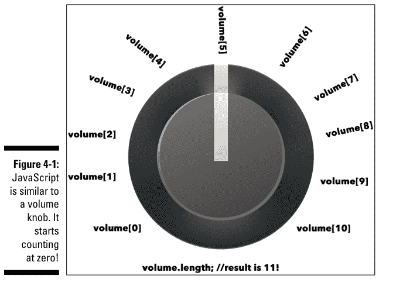

这意味着 `myArray[3]` 实际上是数组中的第四个元素。

基于零的编号是编程新手经常遇到的 bug 和困惑来源，但一旦你习惯了，就会变得非常自然。你甚至可能会发现它有好处，比如可以将你的吉他音箱调到第 11 级。

#### 数组可以存储任何类型的数据

数组中的每个元素可以存储任何数据类型（参见第 3 章），以及其他数组。数组元素还可以包含函数和 JavaScript 对象（参见第 7 章和第 8 章）。

虽然你可以在数组中存储任何类型的数据，但你还可以将包含不同数据类型的元素存储在同一个数组中，如代码清单 4-1 所示。

```javascript
代码清单 4-1：在数组中存储不同类型的数据

item[0] = "apple";
item[1] = 4 + 8;
item[2] = 3;
item[3] = item[2] * item[1];
```

#### 创建数组

JavaScript 提供了两种不同的方式来创建新数组：

- `new` 关键字
- 数组字面量表示法

### 使用 `new` 关键字方法

`new` 关键字方法使用 `new Array()` 来创建数组并添加值。

```javascript
var catNames = new Array("Larry", "Fuzzball",
                       "Mr. Furly");
```

在你作为程序员的职业生涯中可能会看到这种用法，它是一种完全可以接受的创建数组的方式。

然而，许多 JavaScript 专家建议不要使用这种方法。使用 `new` 关键字最大的问题是当你忘记加上它时会发生什么。忘记使用 `new` 关键字可能会极大地改变程序的运行方式。


### 数组字面量

一种更简单、更安全的创建数组的方式是使用所谓的数组字面量表示法。它看起来像这样：

```javascript
var dogNames = ["Shaggy", "Tennessee", "Dr. Spock"];
```

就是这么简单。使用方括号而无需特殊关键字意味着你不太可能意外遗漏内容。数组字面量方法使用的字符也比 `new` 关键字方法更少——当你试图让 JavaScript 代码尽可能整洁时，每一小点都很有帮助！

### 填充数组

你可以在首次创建数组时就添加值，也可以先创建数组，然后再添加元素。向数组添加元素的方式与创建或修改变量完全相同，只不过你需要指定要创建或修改的元素的索引编号。代码清单 4-2 展示了创建一个空数组然后向其中添加元素的示例。

#### 代码清单 4-2：填充空数组

```javascript
var peopleList = [];
peopleList[0] = "Chris Minnick";
peopleList[1] = "Eva Holland";
peopleList[2] = "Abraham Lincoln";
```

你并不总是需要按顺序添加元素。在 JavaScript 中，完全合法地可以不按顺序创建新元素。例如，在上面的代码清单 4-2 中的数组，你可以添加以下内容：

```javascript
peopleList[99] = "Tina Turner";
```

像这样不按顺序创建数组会有效地在 `peopleList[2]` 和 `peopleList[99]` 之间的所有索引处创建空白元素。

因此，如果你在添加了索引为 99 的元素后检查 `peopleList` 数组的 `length` 属性，会发生一件有趣的事情：

```javascript
peopleList.length // 返回 100
```

尽管你只创建了四个元素，JavaScript 会说数组的长度是 100，因为长度是基于最高编号的索引，而不是基于你实际创建的元素数量。

### 理解多维数组

你不仅可以将数组存储在数组中，甚至可以将数组存储在数组中的数组中。这种嵌套可以一直延续下去。

包含数组的数组被称为多维数组。要编写多维数组，只需在变量名后添加更多方括号即可。例如：

```javascript
var listOfLists[0][0];
```

多维数组在你刚开始使用时可能难以直观理解。图 4-2 展示了多维数组的图示表示。

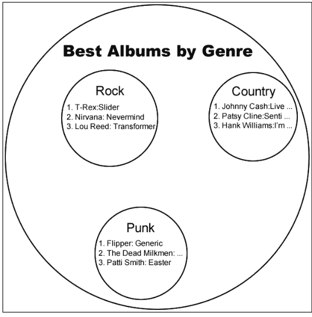

你还可以将多维数组视为层级列表或大纲。例如：

#### 各流派最佳专辑

- 1. 乡村音乐
  - 1.1 Johnny Cash: Live at Folsom Prison
  - 1.2 Patsy Cline: Sentimentally Yours
  - 1.3 Hank Williams: I'm Blue Inside
- 2. 摇滚乐
  - 2.1 T-Rex: Slider
  - 2.2 Nirvana: Nevermind
  - 2.3 Lou Reed: Transformer
- 3. 朋克
  - 3.1 Flipper: Generic
  - 3.2 The Dead Milkmen: Big Lizard in my Backyard
  - 3.3 Patti Smith: Easter

以下是基于图 4-2 创建数组的代码：

```javascript
var bestAlbumsByGenre = [];
bestAlbumsByGenre[0] = "Country";
bestAlbumsByGenre[0][0] = "Johnny Cash: Live at Folsom Prison";
bestAlbumsByGenre[0][1] = "Patsy Cline: Sentimentally Yours";
bestAlbumsByGenre[0][2] = "Hank Williams: I'm Blue Inside";
bestAlbumsByGenre[1] = "Rock";
bestAlbumsByGenre[1][0] = "T-Rex: Slider";
bestAlbumsByGenre[1][1] = "Nirvana: Nevermind";
bestAlbumsByGenre[1][2] = "Lou Reed: Transformer";
bestAlbumsByGenre[2] = "Punk";
bestAlbumsByGenre[2][0] = "Flipper: Generic";
bestAlbumsByGenre[2][1] = "The Dead Milkmen: Big Lizard in my Backyard";
bestAlbumsByGenre[2][2] = "Patti Smith: Easter";
```

### 访问数组元素

你可以使用与设置元素相同的方式来访问数组元素，即使用方括号和索引编号。例如，要访问名为 `myArray` 的数组中的第三个元素，你应使用以下代码：

```javascript
myArray[2];
```

要访问多维数组中的元素，只需添加更多方括号即可到达你想要的元素：

```javascript
bestAlbumsByGenre[0][1]; // 返回 "Patsy Cline: Sentimentally Yours";
```

要测试设置和访问数组元素，请按照以下步骤操作：

1. 打开 Chrome 浏览器，然后打开 JavaScript 控制台。

   你可以使用 Chrome 菜单或按 Mac 上的 Command + Option + J 或 Windows 上的 Ctrl + Shift + J 来打开 JavaScript 控制台。

   

2. 在控制台中，输入以下语句并按下 Return 或 Enter 键，以创建一个名为 `lengthsOfString` 的数组：

   ```javascript
   var lengthsOfString = [2, 4, 1.5, 80];
   ```

3. 输入数组名称，随后在方括号中输入索引号，以检索每个数组元素的值。

   例如：

   ```javascript
   lengthsOfString[0];
   lengthsOfString[3];
   lengthsOfString[2];
   ```

4. 输入一个在数组中不存在的索引号。

   例如：

   ```javascript
   lengthsOfString[4];
   ```

   请注意，该数组元素的值是 `undefined`。

5. 输入以下命令，创建一个新变量来保存你拥有的字符串总长度：

   ```javascript
   var totalLength = lengthsOfString[0] +
                     lengthsOfString[1] + lengthsOfString[2] +
                     lengthsOfString[3];
   ```

6. 最后，使用此命令获取 `totalLength` 的值：

   ```javascript
   totalLength;
   ```

### 遍历数组

你可以想象，通过输入数组名称和索引号来处理数组中的多个值，一段时间后会让你的手指感到疲劳。幸运的是，有更简单的方法来处理数组中的所有元素。最常用的方法是使用一种称为循环（loop）的编程结构。（我们在第 6 章中会更详细地介绍循环。）

也可以使用 JavaScript 内置的数组函数来处理数组中的多个元素。

### 数组属性

你可以通过访问数组属性来获取关于数组的某些数据。在 JavaScript 中访问数组属性的方法是使用点符号（dot notation）。要使用点符号，你输入数组的名称，随后是一个句点，然后是你要访问的属性。（你可以在第 8 章中了解更多关于属性的内容。）表 4-1 列出了 JavaScript 数组的所有属性。

表 4-1：JavaScript 的数组属性

| 属性 | 返回值 |
|---|---|
| `prototype` | 允许向 `Array` 对象添加属性和方法 |
| `constructor` | 对创建 `Array` 对象原型的函数的引用 |
| `length` | 返回或设置数组中元素的数量 |

最常用的数组属性是 `length`。你已经见识过 `length` 属性的作用了。它的目的是提供数组中元素的数量，无论这些元素是已定义还是未定义。例如：

```javascript
var myArray = [];
myArray[2000];
myArray.length; // 返回 2001
```

你还可以使用 `length` 属性来截断数组：

```javascript
myArray.length; // 返回 2001
myArray.length = 10;
myArray.length; // 返回 10
```

### 数组方法

JavaScript 数组方法（也称为数组函数）提供了便捷的方式来操作和处理数组。表 4-2 列出了所有数组方法及其功能描述或产生的值。

### 使用数组方法

使用数组方法的语法取决于你尝试使用的具体方法。不过，你访问每个数组功能的方式与访问数组属性的方式相同：即使用点符号。

表 4-2：JavaScript 数组方法

| 方法 | 返回值 |
|---|---|
| `concat()` | 由当前数组与其他数组和/或值合并而成的新数组 |
| `every()` | 如果给定数组中的每个元素都满足提供的测试函数，则返回 `true` |
| `filter()` | 一个新数组，包含当前数组中所有通过给定函数测试为 `true` 的元素 |
| `forEach()` | 对数组中的每个元素执行一次该函数 |
| `indexOf()` | 数组中指定值的首次出现位置。如果未找到该值，则返回 `-1` |
| `join()` | 将数组的所有元素连接成一个字符串 |
| `lastIndexOf()` | 数组中指定值的最后一次出现位置。如果未找到该值，则返回 `-1` |
| `map()` | 一个新数组，包含对数组中每个元素应用提供的函数后的结果 |
| `pop()` | 删除数组中的最后一个元素 |
| `push()` | 在数组末尾添加新项目 |
| `reduce()` | 通过对数组中的两个值应用一个函数（从左到右），将其简化为一个值 |
| `reduceRight()` | 通过对数组中的两个值同时应用一个函数（从右到左），将其简化为一个值 |
| `reverse()` | 反转数组中元素的顺序 |
| `shift()` | 从数组中删除第一个元素并返回该元素，从而导致数组长度发生变化 |
| `slice()` | 选择数组的一部分并将其作为新数组返回 |
| `some()` | 如果一个或多个元素满足提供的测试函数，则返回 `true` |


| `sort()` | 在数组元素排序后返回该数组（默认排序顺序为字母顺序且升序） |

| `splice()` | 返回一个由从给定数组中添加或删除的元素组成的新数组 |

| `toString()` | 将数组转换为字符串 |

| `unshift()` | 通过添加一个或多个元素返回一个具有新长度的新数组 |

有关 JavaScript 数组方法的完整参考及示例，请访问 `https://docs.webplatform.org/wiki/javascript/Array#Methods`。

代码清单 4-3 显示了一些最常用的 JavaScript 方法示例。

### 代码清单 4-3：常用 JavaScript 数组方法的实际运用

```
<html>
<head>
  <title>common array methods</title>
</head>
<body>
  <script>
    var animals = ["tiger" , "bear"];
    var fruit = ["cantaloupe" , "orange"];
    var dishes = ["plate" , "bowl" , "cup"];

    var fruitsAndAnimals = fruit.concat(animals);
    document.write (fruitsAndAnimals + "<br>");

    var whereIsTheTiger = animals.indexOf("tiger");
    document.write ("The tiger has an index number of: "
                    + whereIsTheTiger + "<br>");
  </script>
</body>
</html>
```

图 4-3 显示了代码清单 4-3 在浏览器中运行的结果。

# 第 5 章

# 使用运算符、表达式和语句

### 本章内容

- 阅读和编写 JavaScript 表达式
- 使用赋值运算符更改值
- 使用比较运算符进行逻辑思考
- 使用算术运算符进行相对数学计算
- 掌握按位运算符
- 使用字符串运算符将上述内容结合起来

> “你好，运算符。你能给我 9 号吗？”
> 
> — The White Stripes

JavaScript 的运算符、表达式和语句是程序的构建基石。它们帮助你操纵和更改值、进行数学计算、比较两个或多个值，以及更多其他操作。

在本章中，你将发现运算符、表达式和语句是如何工作的，以及你如何最好地利用它们。

不要忘记访问网站查看与本章相关的在线练习！

68 第一部分：JavaScript 入门

## 表达自我

表达式是一段能够计算出值的代码。表达式可以将值赋给变量，或者它们本身就是一个值。例如，以下两个都是有效表达式的示例：

```
1 + 1
```

```
a = 1;
```

表达式可以像这些示例一样短小简单，也可以非常复杂。

表达式中的数据片段（在这些示例中为 `1` 或 `a`）被称为操作数（operands）。

## 你好，运算符

使表达式能够工作的引擎被称为运算符（operators）。它们对数据进行操作以产生不同的结果。前面表达式中的 `=` 和 `+` 就是运算符的示例。

## 运算符优先级

一个表达式通常包含多个运算符。考虑以下示例：

```
a + 1 + 2 * 3 / 4;
```

根据你执行不同计算的顺序，`a` 的最终值可能是以下任何一个：

```
a = 1.75
```

```
a = 2.5
```

```
a = 2.25
```

事实上，这个表达式的实际结果将是 `2.5`。但你怎么知道这一点？根据进行数学计算的人不同，可能会先做除法 (`3 / 4`)，或者先做加法 (`1 + 2`)，或者先做乘法 (`2 * 3`)。

# 第5章：操作符、表达式与语句

显然，必定有一种更好的方法来计算出答案，而确实如此！这就是*操作符优先级*的用武之地。操作符优先级是指表达式中操作符的求值顺序。

操作符被分为不同优先级等级的组，编号从0到19，如表5-1所示。

表5-1 操作符优先级

| 操作符 | 用途 | 操作符结合性 | 优先级 | 示例用法 |
|---|---|---|---|---|
| `( . )` | 分组 | 不适用 | 0 — 最高优先级 | `(1 + 3)` |
| `. . .` | 属性访问 | 从左到右 | 1 | `myCar.color` |
| `[ . . ]` | 数组访问 | 从左到右 | 1 | `thingsToDo[4]` |
| `new . . .()` | 创建对象（带参数列表） | 不适用 | 1 | `new Car ("red")` |
| `function . . (.)` | 函数调用 | 从左到右 | 2 | `function addNumbers (1,2)` |
| `new ...` | 创建对象（不带列表） | 从右到左 | 2 | `new Car` |
| `. . .++` | 后缀自增 | 不适用 | 3 | `number++` |
| `. . .--` | 后缀自减 | 不适用 | 3 | `number--` |
| `! ...` | 逻辑非 | 从右到左 | 4 | `!myVal` |
| `~ ...` | 按位非 | 从右到左 | 4 | `~myVal` |
| `- ...` | 取负 | 从右到左 | 4 | `-aNumber` |
| `++ . . .` | 前缀自增 | 从右到左 | 4 | `++aNumber` |
| `-- . . .` | 前缀自减 | 从右到左 | 4 | `--aNumber` |
| `typeof . . .` | 类型检测 | 从右到左 | 4 | `typeof myVar` |
| `void ...` | void | 从右到左 | 4 | `void(0)` |
| `delete ...` | delete | 从右到左 | 4 | `delete object.property` |
| `. . .* ...` | 乘法 | 从左到右 | 5 | `result = 3 * 7` |
| `. . / . .` | 除法 | 从左到右 | 5 | `result = 3 / 7` |
| `. . % . .` | 取余 | 从左到右 | 5 | `result = 7 % 3` |
| `. . + . .` | 加法 | 从左到右 | 6 | `result = 3 + 7` |
| `... - ...` | 减法 | 从左到右 | 6 | `result = 3 - 7` |
| `... << ...` | 按位左移 | 从左到右 | 7 | `result = 3 << 7` |
| `... >> ...` | 按位右移 | 从左到右 | 7 | `result = 3 >> 7` |
| `...>>> ...` | 按位无符号右移 | 从左到右 | 7 | `result = 3 >>> 7` |
| `... < ...` | 小于 | 从左到右 | 8 | `a < b` |
| `... <= ...` | 小于或等于 | 从左到右 | 8 | `a <= b` |
| `... > ...` | 大于 | 从左到右 | 8 | `a > b` |
| `... >= ...` | 大于或等于 | 从左到右 | 8 | `a >= b` |
| `... in ...` | in | 从左到右 | 8 | `value in values` |
| `... instanceof ...` | instanceof | 从左到右 | 8 | `myCar instanceof car` |
| `... == ...` | 等于 | 从左到右 | 9 | `3 == "3" // true` |
| `... != ...` | 不等于 | 从左到右 | 9 | `3 != "3" // false` |
| `... === ...` | 严格等于 | 从左到右 | 9 | `3 === "3" // false` |
| `... !== ...` | 严格不等于 | 从左到右 | 9 | `3 !== "3" // true` |
| `... & ...` | 按位与 | 从左到右 | 10 | `result = a & b` |
| `... ^ ...` | 按位异或 | 从左到右 | 11 | `result = a ^ b` |
| `... \| ...` | 按位或 | 从左到右 | 12 | `result = a \| b` |
| `... && ...` | 逻辑与 | 从左到右 | 13 | `a && b` |
| `... \|\| ...` | 逻辑或 | 从左到右 | 14 | `a \|\| b` |
| `... ? ... : ...` | 条件运算符 | 从右到左 | 15 | `a ? 3 : 7` |
| `... = ...` | 赋值 | 从右到左 | 16 | `a = 3` |
| `... += ...` | 赋值 | 从右到左 | 16 | `a += 3` |
| `... -= ...` | 赋值 | 从右到左 | 16 | `a -= 3` |
| `... *= ...` | 赋值 | 从右到左 | 16 | `a *= 3` |
| `... /= ...` | 赋值 | 从右到左 | 16 | `a /= 3` |
| `... %= ...` | 赋值 | 从右到左 | 16 | `a %= 3` |
| `... <<= ...` | 赋值 | 从右到左 | 16 | `a <<= 3` |
| `... >>= ...` | 赋值 | 从右到左 | 16 | `a >>= 3` |
| `... >>>= ...` | 赋值 | 从右到左 | 16 | `a >>>= 3` |
| `... &= ...` | 赋值 | 从右到左 | 16 | `a &= 3` |
| `... ^= ...` | 赋值 | 从右到左 | 16 | `a ^= 3` |
| `... \|= ...` | 赋值 | 从右到左 | 16 | `a \|= 3` |
| `yield ...` | yield | 从右到左 | 17 | `yield [expression]` |
| `..., ...` | 逗号 / 序列 | 从左到右 | 18 | `a + b, c + d` |

编号最小的操作符被认为具有最高优先级。起初这可能令人困惑，但如果你想象在排队时，排在第0位的人是第一个获得美味三明治或咖啡的人，你就很容易记住这个规则了。

当一个表达式包含两个或更多具有相同优先级的操作符时，它们将根据其*结合性*进行求值。结合性决定了操作符是从左到右还是从右到左求值。

### 使用括号

表达式中优先级最高的操作符是括号。在大多数情况下，你可以通过使用括号将操作分组为子表达式，从而忽略操作符优先级规则。例如，前面的多操作符表达式可以通过以下方式完全明确：

```
a = (1 + 2) * (3 / 4); // 结果：2.25
a = (1 + (2 * 3)) / 4; // 结果：1.75
a = ((1 + 2) * 3) / 4; // 结果：2.25
a = 1 + ((2 * 3) / 4); // 结果：2.5
```

表达式中的括号会强制 JavaScript 解释器首先从最内层括号到最外层括号求值括号内的内容，然后再执行括号外的操作。

查阅表5-1，你会看到前述表达式中实际的运算符优先级顺序是

```
a = 1 + ((2 * 3) / 4);
```

这个语句明确地展示了实际的操作符优先级。首先进行乘法，然后是除法，最后是加法。

### 操作符类型

JavaScript 有多种类型的操作符。本节讨论最常用的操作符类型。

#### 赋值操作符

*赋值操作符*将右侧操作数的值赋给左侧的操作数：

```
a = 5;
```

执行此表达式后，变量 `a` 的值将为5。你还可以将赋值操作符链接在一起，以便将相同的值赋给多个变量，如以下示例所示：

```
a = b = c = 5;
```

由于该操作符的结合性是从右到左（参见表5-1），值5将首先赋给 `c`，然后 `c` 的值将赋给 `b`，接着 `b` 的值将赋给 `a`。该表达式的结果是 `a`、`b` 和 `c` 的值都为5。

你认为这些表达式求值后 `a` 的最终值会是多少？

```
var b = 1;
var a = b += c = 5;
```

要找出答案，请打开 Chrome 中的 JavaScript 控制台，键入每一行，然后按回车或返回键。该语句的结果是 `a` 将等于6。

你可以在本章后面的“组合操作符”部分找到不同赋值操作符的完整列表。

#### 比较操作符

比较操作符测试操作数之间的相等性或差异，并返回 `true` 或 `false` 值。

表5-2展示了 JavaScript 比较操作符的完整列表。

表5-2 JavaScript 比较操作符

| 操作符 | 描述 | 示例 |
| :--- | :--- | :--- |
| `==` | 等于 | `3 == "3" // true` |
| `!=` | 不等于 | `3 != 3 // false` |
| `===` | 严格等于 | `3 === "3" // false` |
| `!==` | 严格不等于 | `3 !== "3" // true` |
| `>` | 大于 | `7 > 1 // true` |
| `>=` | 大于或等于 | `7 >= 7 // true` |
| `<` | 小于 | `7 < 10 // true` |
| `<=` | 小于或等于 | `2 <= 2 // true` |

#### 算术操作符

算术操作符对操作数执行数学运算并返回结果。表5-3展示了算术操作符的完整列表。

表5-3 算术操作符

| 操作符 | 描述 | 示例 |
| :--- | :--- | :--- |
| `+` | 加法 | `a = 1 + 1` |
| `-` | 减法 | `a = 10 - 1` |
| `*` | 乘法 | `a = 2 * 2` |
| `/` | 除法 | `a = 8 / 2` |
| `%` | 取模 | `a = 5 % 2` |
| `++` | 自增 | `a = ++b`<br>`a = b++`<br>`a++` |
| `--` | 自减 | `a = --b`<br>`a = b--`<br>`a--` |

第一部分：JavaScript 入门

代码清单 5-1 展示了算术运算符的运行情况。

```
Listing 5-1: Using Arithmetic Operators

<html>
<head>
  <title>arithmetic operators</title>
</head>
<body>
  <h1>Wild Birthday Game</h1>
  <p>
  <ul>
    <li>Enter the number 7</li>
    <li>Multiply by the month of your birth</li>
    <li>Subtract 1</li>
    <li>Multiply by 13</li>
    <li>Add the day of your birth</li>
    <li>Add 3</li>
    <li>Multiply by 11</li>
    <li>Subtract the month of your birth</li>
    <li>Subtract the day of your birth</li>
    <li>Divide by 10</li>
    <li>Add 11</li>
    <li>Divide by 100</li>
  </ul>
  </p>
  <script>
    var numberSeven = Number(prompt('Enter the number 7'));
    var birthMonth = Number(prompt('Enter your birth month'));
    var calculation = numberSeven * birthMonth;
    calculation = calculation - 1;
    calculation = calculation * 13;
    var birthDay = Number(prompt('Enter the day of your birth'));
    calculation = calculation + birthDay;
    calculation = calculation + 3;
    calculation = calculation * 11;
    calculation = calculation - birthMonth;
    calculation = calculation - birthDay;
    calculation = calculation / 10;
    calculation = calculation + 11;
    calculation = calculation / 100;

    document.write("Your birthday is " + calculation);
  </script>
</body>
</html>
```

# 第 5 章：运算符、表达式和语句

在浏览器中运行代码清单 5-1 的结果如图 5-1 所示。

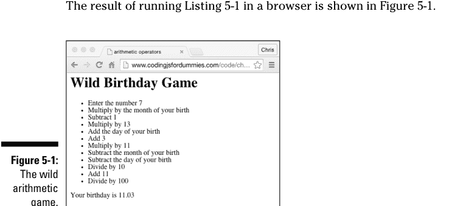

### 字符串运算符

*字符串运算符*（string operator）对两个字符串执行操作。当与字符串一起使用时，`+` 运算符变成了连接运算符。它的目的是将字符串连接在一起。请注意，当你使用连接运算符连接字符串时，不会自动添加空格。因此，经常会看到如下语句，其中仅包含空格的字符串被连接在其他字符串之间，或者在字符串的末尾或开头（引号之前）添加空格，以形成一个连贯的句子：

```
var greeting = "Hello, " + firstName + ". I'm" + " " + mood + " to see you.";
```

### 位运算符


*位运算符*（Bitwise operators）将操作数视为以补码格式表示的有符号 32 位二进制数。这意味着什么，我们先从*二进制*（binary）这个术语开始讲起。

二进制数是由 1 或 0 组成的字符串，数字的位置决定了该位置上 1 的值。例如，将数字 1 写成 32 位二进制数的方法如下：

```
00000000000000000000000000000001
```

最右侧位置的值为 1。该位置左侧的每个位置的值都是其右侧数字值的两倍。因此，以下二进制数等于 5：

```
00000000000000000000000000000101
```

有符号整数意味着正整数和负整数都可以用这种形式表示。

补码（twos complement）意味着任何正二进制数的相反数就是它的负数（反之亦然）。因此，要将二进制 5 转换为二进制 -5，只需反转所有位：

```
11111111111111111111111111111011
```

位运算符将数字转换为这些 32 位二进制数，然后在操作完成后将它们转换回我们认为的普通数字。


位运算符起初很难理解。它们在 JavaScript 中不常用，但如果我们不介绍它们，就太失职了。

表 5-4 列出了 JavaScript 的位运算符。

| 运算符 | 用法 | 描述 |
| :--- | :--- | :--- |
| 按位与 (AND) | `a & b` | 在两个操作数的对应位都为 1 的每个位位置返回 1 |
| 按位或 (OR) | `a \| b` | 在两个操作数中只要有一个或两个对应位为 1 的每个位位置返回 1 |
| 按位异或 (XOR) | `a ^ b` | 在两个操作数中只有一个对应位为 1（而非两个都为 1）的每个位位置返回 1 |
| 按位非 (NOT) | `~a` | 反转其操作数的位 |
| 左移 | `a << b` | 将 `a` 的二进制表示向左移动 `b` (<32) 位，并在右侧补零 |
| 有符号右移 | `a >> b` | 将 `a` 的二进制表示向右移动 `b` (<32) 位，丢弃移出的位 |
| 无符号右移 | `a >>> b` | 将 `a` 的二进制表示向右移动 `b` (<32) 位，丢弃移出的位，并在左侧补零 |

图 5-2 展示了在 Chrome JavaScript 控制台中每个位运算符的演示。

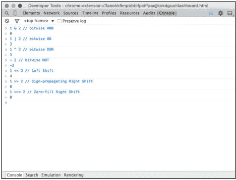

图 5-2：JavaScript 位运算符。

### 逻辑运算符

*逻辑运算符*（Logical operators）评估逻辑表达式的真值（truthiness）或假值（falseness）。共有三种逻辑运算符，如表 5-5 所示。

| 运算符 | 含义 | 描述 |
| :--- | :--- | :--- |
| `&&` | 与 (And) | 如果第一个操作数为 `true`，则返回第一个操作数。否则，返回第二个操作数。 |
| `\|\|` | 或 (Or) | 如果第一个操作数为 `true`，则返回第一个操作数。否则，返回第二个操作数。 |
| `!` | 非 (Not) | 仅接收一个操作数。如果操作数可以转换为 `true`，则返回 `false`。否则，返回 `false`。 |

*注：原文表格中 `!` 的描述似乎有误，通常应为返回操作数的相反布尔值。*

你还可以使用 OR 运算符为变量设置默认值。例如，在以下表达式中，除非 `x` 评估为 `false` 值（例如，如果 `x` 尚未定义），否则 `myVar` 的值将被设置为 `x` 的值。否则，它将被设置为默认值 0。


```
var myVar = x || 0;
```

### 特殊运算符

JavaScript 的特殊运算符是一组杂集，包含各种其他符号和单词，用于执行其他重要功能。

#### 条件运算符

*条件运算符*（conditional operator，也称为*三元运算符*）使用三个操作数。它评估一个逻辑表达式，然后根据该表达式是真还是假返回一个值。条件运算符是唯一需要三个操作数的运算符。例如：

```
var isItBiggerThanTen = (value > 10) ? "greater than 10" :
            "not greater than 10";
```

#### 逗号运算符

*逗号运算符*（comma operator）评估两个操作数并返回第二个操作数的值。它最常用于在循环中执行多次赋值或其他操作。它也可以作为初始化变量的简写。例如：

```
var a = 10, b = 0;
```

由于逗号在所有运算符中优先级最低，因此它的操作数总是被分别评估。

#### delete 运算符

`delete` 运算符从对象中删除一个属性，或从数组中删除一个元素。

当你使用 `delete` 运算符从数组中删除一个元素时，数组的长度保持不变。被删除的元素将具有 `undefined` 的值。

```
var animals = ["dog","cat","bird","octopus"];
console.log (animals[3]); // 返回 "octopus"
delete animals[3];
console.log (animals[3]); // 返回 "undefined"
```

#### in 运算符

如果指定的值存在于数组或对象中，`in` 运算符返回 true。

```
var animals = ["dog","cat","bird","octopus"];
if (3 in animals) {
  console.log ("it's in there");
}
```

在这个例子中，如果 `animals` 数组有一个索引为 3 的元素，字符串 "it's in there" 将打印到 JavaScript 控制台中。

#### instanceof 运算符

如果你指定的对象是所指定的对象类型，`instanceof` 运算符返回 true。

```
var myString = new String();
if (myString instanceof String) {
  console.log("yup, it's a string!");
}
```

#### new 运算符

`new` 运算符创建对象的实例。正如你在第 8 章中将看到的，JavaScript 有几种内置对象类型，你也可以定义自己的对象。在以下示例中，`Date()` 是一个内置的 JavaScript 对象，而 `Pet()` 和 `Flower()` 是程序员为了在程序中实现自定义目的而创建的对象示例。

```
var today = new Date();
var bird = new Pet();
var daisy = new Flower();
```

#### this 运算符

`this` 运算符引用当前对象。它经常用于检索对象内部的属性。

第 8 章将更详细地介绍 `this` 运算符。

#### typeof 运算符

`typeof` 运算符返回一个包含操作数类型的字符串：

```
var businessName = "Harry's Watch Repair";
console.log(typeof businessName); // 返回 "string"
```

#### void 运算符

`void` 运算符导致操作数中的表达式被评估但不返回值。你最常看到 `void` 被使用的地方是在 HTML 文档中，当需要一个链接，但链接创建者想使用 JavaScript 覆盖链接的默认行为时：

```
<a href="javascript:void(0);">This is a link, but it won't do anything</a>
```

## 组合赋值运算符

你可以将赋值运算符与其他运算符结合使用，作为将表达式结果赋值给变量的简写方法。例如，以下两个示例具有相同的结果：

```
a = a + 10;
```

```
a += 10;
```

表5-6列出了赋值运算符与所有其他可能运算符的组合。

| 名称 | 简写 | 标准运算符 |
| --- | --- | --- |
| 赋值 | `x = y` | `x = y` |
| 加法赋值 | `x += y` | `x = x + y` |
| 减法赋值 | `x -= y` | `x = x - y` |
| 乘法赋值 | `x *= y` | `x = x * y` |
| 除法赋值 | `x /= y` | `x = x / y` |
| 取余赋值 | `x %= y` | `x = x % y` |
| 左移赋值 | `x <<= y` | `x = x << y` |
| 右移赋值 | `x >>= y` | `x = x >> y` |
| 无符号右移赋值 | `x >>>= y` | `x = x >>> y` |
| 按位与赋值 | `x &= y` | `x = x & y` |
| 按位异或赋值 | `x ^= y` | `x = x ^ y` |
| 按位或赋值 | `x \|= y` | `x = x \| y` |

## 第6章：使用循环和分支掌控流程

本章内容

- 了解 if/else 分支
- 理解不同类型的循环
- 使用循环重复执行语句
- 遍历数组的值

> “当你知道自己的价值观时，做出决定并不难。”
> ——罗伊·迪士尼

在本书前面的章节中，我们通常讨论和演示的是线性的 JavaScript 代码。然而，在程序中，很多时候（实际上很多次）你需要做出选择，或者需要改变程序的直线逻辑，以使用不同的值多次重复执行语句。在本章中，我们将讨论循环和分支语句。


别忘了访问网站查看与本章相关的在线练习！

### 分支出去

循环和分支语句被称为控制语句，因为它们控制着 JavaScript 程序的执行顺序。你可以使用分支语句，根据条件逻辑，为 JavaScript 代码的执行创建不同的路径。循环是在程序中将 JavaScript 语句组合在一起的最简单方式。

**第一部分：JavaScript 入门**

JavaScript 程序的逻辑常常会到达一个必须做出选择的关键点，这个选择将带来截然不同的结果。图6-1演示了一个使用 JavaScript 解决的、可以通过分支来处理的现实世界决策。

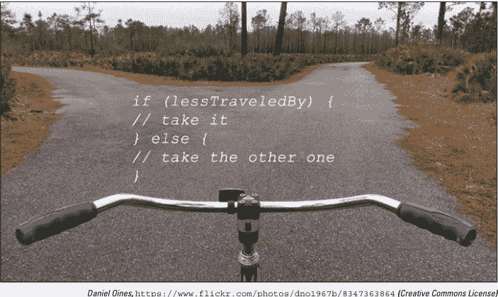

**图6-1：** 分支选择路径。

*Daniel Oines, https://www.flickr.com/photos/dno1967b/8347363864 (知识共享许可协议)*

### if ... else

`if` 和 `else` 语句协同工作，用于计算一个逻辑表达式，并根据结果运行不同的语句。`if` 语句可以，并且经常被单独使用。`else` 语句则必须始终与 `if` 语句结合使用。

`if` 语句的基本语法是

```
if (condition) {
  ..
}
```

这里的条件是任何计算结果为布尔值（true 或 false）的表达式。如果表达式的结果是 `true`，则会执行花括号之间的语句。如果是 `false`，它们将被跳过。

当你希望在条件计算结果为 `false` 时执行某些操作时，`else` 语句就派上用场了。例如：

```
var age = 19;
if (age < 21) {
    document.write ("You are under the legal drinking age in the U.S.");
} else {
    document.write ("What'll it be?");
}
```

许多其他编程语言有一个名为 `elseif` 的组合关键字，可以在 `if ... else` 语句中多次使用，直到遇到 `true` 值。JavaScript 没有 `elseif` 关键字。

但是，你可以通过将 `if` 和 `else` 组合并保持它们之间的空格来获得与 `elseif` 关键字相同的功能。例如：

```
if (time < 12) {
    document.write ("Good Morning!");
} else if (time < 17) {
    document.write ("Good Afternoon!");
} else if (time < 20) {
    document.write ("Good Evening!");
} else {
    document.write ("Good Night!");
}
```

### 理解 if ... else 简写

你应该了解使用 `if ... else` 语句的几个快捷方式。第一个是用三元运算符代替 `if ... else`。这比标准的 `if ... else` 更难读一些：

```
var whatToSay = (time < 12 ?
                 "Good Morning" :
                 "Hello");
```

在这种情况下，如果 `time` 小于 12，`whatToSay` 的值被设置为 "Good Morning"，如果 `time` 不小于 12，则被设置为 "Hello"。

编写 `if ... else` 语句的另一种简写方法是使用逻辑与（`&&`）运算符。请记住，逻辑与运算仅在第一个操作数计算结果为 `true` 时才计算第二个操作数。程序员称之为短路求值，因为在逻辑与操作中，如果第一个操作数的结果为 `false`，则无需计算第二个操作数。

在前面的示例中，`&&` 语句首先检查 `time` 是否小于 12。如果是，则字符串 "Good Morning" 将被写入 HTML 文档。如果不是，则由于 `&&` 运算符的短路副作用，将不会执行任何操作。

```
time < 12 && document.write ("Good Morning!");
```

这种方法并不常用，主要是因为它难以理解且容易混淆。然而，你有时可能会遇到类似的情况，你需要理解它的工作原理。

**第一部分：JavaScript 入门**

注意前面示例中换行符和空格的使用。许多人对于如何编写 `if ... else` 语句有不同的风格。你也可能会看到它们用更少的换行符编写，或者关键字和花括号之间没有空格。这些也是有效的。然而，在可能的情况下，为了便于阅读，宁愿选择冗长一些的写法。

### Switch

`switch` 语句根据单个表达式的可能值，在多个语句中选择执行哪个。`switch` 语句中的每个值都称为一个 case。用英语说，例如：

> “如果我们预计有六位客人，就订三个披萨。如果我们预计有12位客人，就订六个披萨。如果我们预计有超过20位客人，那就慌了。”

`switch` 语句的语法是

```
switch (expression) {
  case value1:
    // 语句
    break;
  case value2:
    // 语句
    break;
  case value3:
    // 语句
    break;
  default:
    // 语句
    break;
}
```

注意每个 case 关联语句之后的 `break` 语句。`break` 语句告诉 `switch` 语句停止并退出 `switch` 语句。如果没有 `break`，`switch` 语句将继续执行并运行下一个子句中的语句，无论表达式是否满足该 case 的条件。


在 `switch` 中忘记 `break` 语句可能会导致大问题，所以一定要始终使用它。因为 `switch` 语句将运行在任何计算结果为 `true` 的子句之后的任何 case 子句中的所有语句，当你忘记 `break` 语句时，可能会发生不可预测的结果。由缺少 `break` 语句引起的问题不容易识别，因为它们通常不会产生错误，但经常会产生错误的结果。

如果在任何 `case` 子句中都没有找到匹配项，`switch` 语句将寻找 `default` 子句并执行它包含的语句。

> 在 `case` 子句之间应始终使用 `break` 语句这条规则的例外情况是 `default` 子句。只要 `default` 子句是你的 `switch` 中的最后一个语句（它应该是），你就可以安全地省略它之后的 `break`，因为程序无论如何都会在最后一条语句之后跳出 `switch`。

清单6-1展示了你可能如何使用 `switch` 语句的示例。

#### 清单6-1：使用 switch 语句个性化问候语

```
var languagePreference = "Spanish";
switch (languagePreference) {
    case "English":
        console.log("Hello!");
        break;
    case "Spanish":
        console.log("Hola!");
        break;
    case "German":
        console.log("Guten Tag!");
        break;
    case "French":
        console.log("Bon Jour!");
        break;
    default:
        console.log("I'm Sorry, I don't Speak " + 
                    languagePreference + "!");
}
```

### 开始吧：循环之循环

循环多次执行相同的语句。JavaScript 有几种不同类型的循环：

- `for`
- `for...in`
- `do...while`
- `while`

## 第一部分：JavaScript 入门

## `for`

`for` 语句使用三个表达式来创建循环：


- **初始化（Initialization）**：变量的初始值，通常是一个计数器。
- **条件（Condition）**：一个布尔表达式，在每次循环迭代时进行求值。
- **最终表达式（Final expression）**：在每次循环迭代后进行求值的一个表达式。

虽然在`for`循环中并不强制要求使用所有三个表达式，但几乎总是会包含这三者。`for`循环通常用于运行预定次数的代码。

以下是一个简单的`for`循环示例：

```javascript
for (var x = 1; x < 10; x++) {
  console.log(x);
}
```

拆解来看，上述`for`循环示例的工作原理如下：

1. **初始化一个新变量，在本例中为`x`，其值为`1`。**
2. **执行测试以确定`x`是否小于`10`。** 如果是，则执行循环内部的语句（在本例中是一个`console.log`语句）。
3. **如果不是，则使用递增运算符 (`++`) 增加`x`的值。**
4. **再次进行测试以确定`x`是否小于`10`。** 如果是，则执行循环内部的语句。
5. **测试重复进行，直到条件表达式不再求值为`true`。**

图 6-2 显示了在 Chrome 开发者工具中运行此`for`语句的结果。

### 遍历数组

你可以通过将计数器的值与数组的`length`属性值进行比较，使用`for`循环来列出数组的内容。请务必记住，JavaScript 数组是从零开始索引的，且任何`array.length`的值都会比数组中最高索引编号的元素多 1。这就是为什么我们在代码清单 6-2 中添加`-1`的原因。

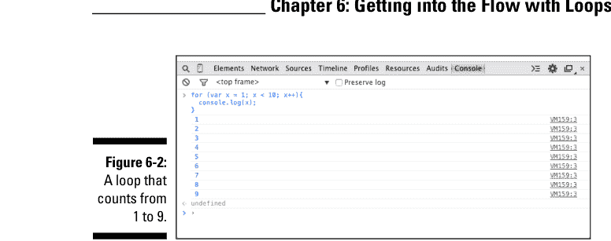

#### 代码清单 6-2：使用`for`循环列出数组内容

```html
<html>
<head>
 <title>Different Area Codes</title>
</head>
<body>
 <script>
   var areaCodes = ["770", "404", "718", "202", "901",
         "305", "312", "313", "215", "803"];
   for (x=0; x < areaCodes.length - 1; x++){
     document.write("Different Area Code:" + areaCodes[x]
            + "<br>");
   }
 </script>
</body>
</html>
```

图 6-3 显示了运行代码清单 6-2 中详细程序的输出结果。

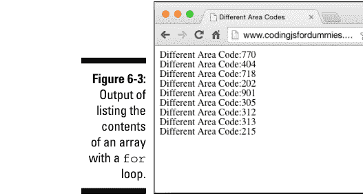

### `for...in`

`for...in`语句用于循环遍历对象中的属性。你也可以使用`for...in`语句来遍历数组的值。


`for...in`循环有一个有趣的特性。它不关心其遍历的属性或元素的顺序。出于这个原因，且因为使用`for...in`循环速度较慢，你最好使用标准的`for`循环来遍历数组元素。

对象是具有属性（它们是什么）和方法（它们做什么）的数据容器。Web 浏览器有一组内置对象，程序员可以使用这些对象来控制浏览器的功能。其中最基础的是`Document`对象。例如，`Document`对象的`write`方法告诉浏览器将指定的值插入到 HTML 文档中。

`Document`对象还具有用于跟踪并向程序员提供当前文档信息的属性。例如，`Document.images`集合包含当前 HTML 文档中所有的`img`标签。

在代码清单 6-3 中，`for...in`循环被用于列出`Document`对象的所有属性。

#### 代码清单 6-3：使用`for...in`遍历`Document`对象

```html
<html>
<head>
<title>document properties</title>
<style>
.columns {
-webkit-column-count: 6; /* Chrome, Safari, Opera */
-moz-column-count: 6; /* Firefox */
column-count: 6;
}
</style>
</head>
<body>

<div class="columns">

<script>
for (var prop in document){
    document.write (prop + "<br>");
}
</script>

</div>

</body>
</html>
```

# 第 6 章：使用循环和分支进入流程

运行代码清单 6-3 的结果如图 6-4 所示。

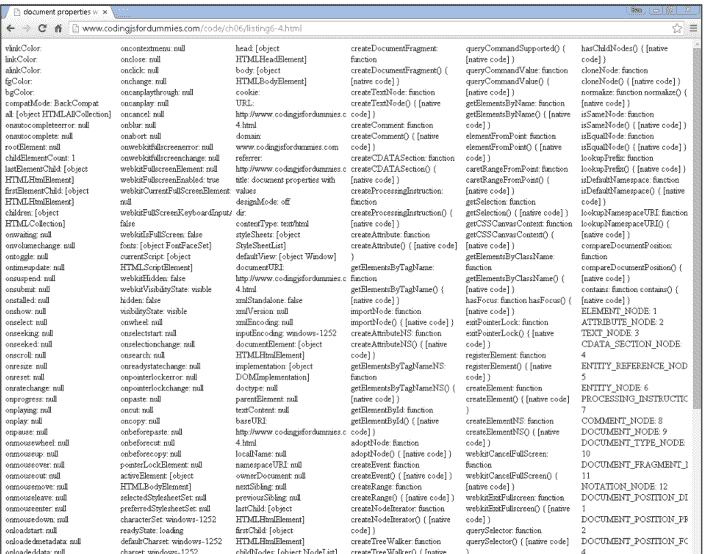

> **图 6-4：** 使用`for...in`循环列出`Document`对象的所有属性。

你还可以使用`for...in`循环来输出对象属性中的值，而不仅仅是属性名称。代码清单 6-4 是一个输出`Document`对象每个属性当前值的程序。

### 代码清单 6-4：使用`for...in`输出`Document`对象的属性名称和值

```html
<html>
<head>
<title>document properties with values</title>
<style>
.columns{
-webkit-column-count: 6; /* Chrome, Safari, Opera */
-moz-column-count: 6; /* Firefox */
column-count: 6;
}
</style>
</head>
<body>
  <div class="columns">
    <script>
      for (var prop in document){
        document.write (prop + ": " + document [prop] +
        "<br>");
      }
    </script>
  </div>
</body>
</html>
```

图 6-5 显示了代码清单 6-4 的输出。注意，许多属性的值被包含在方括号 (`[ ]`) 中。方括号表示该属性的值具有多个元素，例如在数组或对象的情况下。

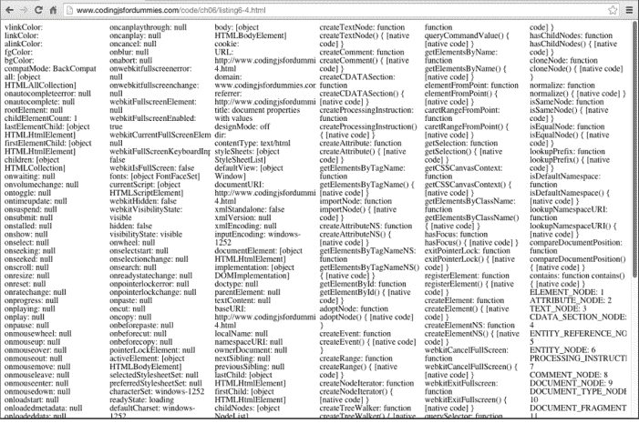

## `while`循环

`while`语句创建了一个只要条件求值为`true`就会运行的循环。代码清单 6-5 显示了一个包含`while`循环示例的网页。

### 代码清单 6-5：使用`while`循环

```html
<html>
<head>
 <title>Guess the Word</title>
</head>
<body>
 <script>
 var guessedWord = prompt("What word am I thinking of?");
 while (guessedWord != "sandwich") { // as long as the guessed word is not sandwich
 prompt("No. That's not it. Try again.");
 }
 alert("Congratulations! That's exactly right!"); // do this after exiting the loop
 </script>
</body>
</html>
```

## `do...while`

`do...while`循环的工作方式与`while`循环非常相似，不同之处在于它将语句放在待测试的表达式之前。其效果是`do...while`循环内的语句将至少执行一次。

代码清单 6-6 演示了`do...while`循环的使用。

### 代码清单 6-6：使用`do...while`循环

```html
<html>
<head>
 <title>Let's Count</title>
</head>
<body>
 <script>
 var i = 0;
 do {
 i++;
 document.write(i + "<br>");
 } while (i<10);
 </script>
</body>
</html>
```

## `break`和`continue`

你可以使用`break`和`continue`来中断循环的执行。`break`语句在本章前面关于`switch`语句的上下文中出现过，在那里它的作用是在成功匹配后跳出`switch`。

在循环中，`break`的作用与之非常相似。它会导致程序立即退出循环，无论循环完成的条件是否已满足。

例如，在代码清单 6-7 中，猜词游戏将像代码清单 6-5 中那样进行，但如果没有输入任何值，循环将立即终止。

### 代码清单 6-7：在`while`循环中使用`break`

```html
<html>
<head>
<title>Guess the Word</title>
</head>
<body>
<script>
var guessedWord = prompt("What word am I thinking of?");
while (guessedWord != "sandwich") {
if (guessedWord == "") {break;} // exit the loop right away if user doesn't enter a value
prompt("No. That's not it. Try again.");
}
alert("Congratulations! That's exactly right!");
</script>
</body>
</html>
```

`continue`语句会导致循环的当前迭代停止，并告诉程序从循环的下一次迭代重新开始，跳过`continue`语句之后的语句。

代码清单 6-8 显示了一个从 1 计数到 20 但仅打印偶数的程序。注意，该程序通过使用取模运算符来测试计数器的当前值是否能被 2 整除，从而判断一个数字是否为偶数：

### 代码清单 6-8：计数并使用`continue`显示偶数

```html
<html>
<head>
 <title>Count and show me even numbers</title>
</head>
<body>
 <script>
   for (var i = 0; i <= 20; i++){
     if (i%2 != 0){
       continue;
     }
     document.write (i + " is an even number.<br>");
   }
 </script>
</body>
</html>
```

以这种方式使用时，`continue`可以替代`else`语句的功能。

图 6-6 显示了在浏览器中运行代码清单 6-8 的结果。

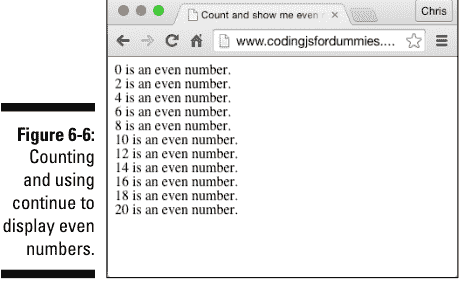

`break`和`continue`语句可能很有用，但也可能很危险。它们体积小、功能强大，在阅读代码时很容易被忽视。因此，一些程序员认为在循环内部使用它们是一种不好的实践。有关原因及该问题复杂性的更多信息，请阅读此讨论：

`http://programmers.stackexchange.com/questions/58237/are-break-and-continue-bad-programming-practices`

# 第二部分：组织你的 JavaScript

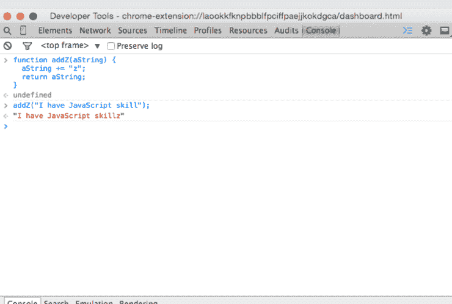

请参阅文章“Underscore — A Utility Belt for JavaScript”，网址为`www.dummies.com/extras/codingwithjavascript`。

## 在本部分中 ...

- 了解如何使用函数。
- 了解如何创建和使用对象。
- 请参阅文章“Underscore — A Utility Belt for JavaScript”，网址为`www.dummies.com/extras/codingwithjavascript`。

## 第 7 章：函数式编程

### 本章内容

- 编写函数
- 为函数编写文档
- 传递参数
- 返回值
- 使用函数组织程序

> “我作为函数来写作。没有它，我就会生病、死亡。它就像肝脏或肠道一样，是人体的一部分，而且大概也同样‘迷人’。”
>
> —— 查尔斯·布考斯基


函数通过将常用的代码片段转换为可重用的部分，帮助你减少代码重复。在本章中，你将编写一些函数，并使用它们来完成原本枯燥的任务，使其变得简单而有趣！

别忘了访问网站，查看与本章相关的在线练习！

### 理解函数的功能

函数是程序内部的迷你程序。函数用于处理主程序中可能被不同部分多次请求的特定任务。

如果你阅读过前面的任何章节，你已经看到过一些函数在运行。下面的例子是一个简单的函数，运行时，它只是在字符串末尾添加一个`z`。

```javascript
function addZ(aString) {
  aString += "z";
  return aString;
}
```

要尝试此函数，请按照以下步骤操作：

1. 在 Chrome 中打开 JavaScript 控制台。
2. 输入该函数。
   你可以将它全部输入在一行中，也可以在每行之后按`Shift+Enter`或`Shift+Return`来创建换行而不执行代码。
3. 在最后的花括号之后按`Return`或`Enter`。
   控制台应该会输出`undefined`。
4. 输入以下命令，然后按`Return`或`Enter`来运行该函数：

```javascript
addZ("I have JavaScript skill");
```

运行此函数的结果如图 7-1 所示。

函数是 JavaScript 编程的基本组成部分，它们有许多规则和特殊功能，作为 JavaScript 程序员你需要了解。如果你无法记住关于函数的每个细节，请不要担心。理解一些更抽象的概念需要一些练习，你甚至可能需要再次阅读本章。最终，一切都会变得清晰，所以请坚持下去！

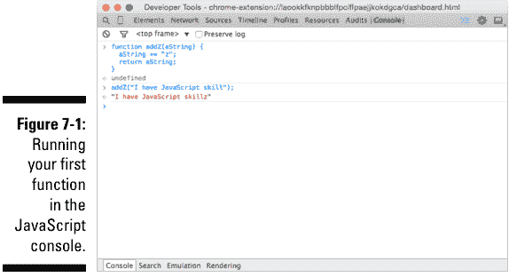

### 使用函数术语

程序员在讨论函数时有一些重要的词汇需要理解。我们在本章以及整本书中广泛使用这些词汇。以下列表是你在处理函数时会遇到的一些行话的快速摘要。

#### 定义函数

当一个函数出现在 JavaScript 代码中时，它不会运行。它只是被创建出来，供以后使用。创建函数以便以后可以使用的过程称为*定义*函数。

**请记住** 你只需要在程序或网页中定义一次函数。然而，如果你意外地多次定义同一个函数，JavaScript 不会报错。它只会使用最近定义的函数版本。

例如：

```javascript
var myFunction = new Function() {
};
```

或

```javascript
function myFunction(){
};
```

#### 函数头

*函数头*是函数定义中包含`function`关键字、函数名和括号的部分。

例如：

```javascript
function myFunction()
```

#### 函数体

*函数体*由函数花括号之间的语句组成。

例如：

```javascript
{
  // function body
}
```

#### 调用函数

当你使用一个函数时，它被称为*调用*该函数。调用函数会导致函数体内的语句被执行。

例如：

```javascript
myFunction();
```

#### 定义参数和传递参数

*参数*是你在函数被调用时提供给函数的数据片段的名称。*实参*是你提供给函数的值。当使用参数（根据函数的指定参数）调用函数时，程序员称之为*将*参数*传递*给函数。

定义参数的语法如下：

```javascript
function myFunction(parameter) {
```

使用参数调用函数的语法如下：

```javascript
myFunction(myArgument);
```

### 返回值

除了能够接受来自外部世界的输入外，函数还可以在运行完毕后将值发送回去。当一个函数发回某些东西时，它被称为*返回值*。

要返回值，请使用`return`关键字。例如：

```javascript
return myValue;
```

### 使用函数的好处

代码清单 7-1 显示了一个将数字相加的程序。它运行得很好，完全按照预期工作，使用了一个`for...in`循环（参见第 6 章）。

**代码清单 7-1：使用`for...in`循环将数字相加的程序**

```html
<html>
<head>
  <title>Get the total</title>
</head>
<body>
  <script>
    var myNumbers = [2,4,2,7];
    var total = 0;
    for (oneNumber in myNumbers){
      total = total + myNumbers[oneNumber];
    }
    document.write(total);
  </script>
</body>
</html>
```

然而，如果我们有多组数字需要相加，我们就需要为每组新数字数组编写一个新的循环语句。


代码清单 7-2 将代码清单 7-1 中的程序转换为一个函数，然后使用该函数来查找几个不同数组中元素的和。

**代码清单 7-2：一个用于将数组中的数字相加的函数**

```html
<html>
<head>
  <title>Get the sum</title>
</head>
<body>
  <script>
    /**
    * Adds elements in an array
    * @param {Array.<number>} numbersToAdd
    * @return {Number} sum
    */
    function addNumbers(numbersToAdd) {
      var sum = 0;
      for (oneNumber in numbersToAdd) {
        sum = sum + numbersToAdd[oneNumber];
      }
      return sum;
    }

    var myNumbers = [2,4,2,7];
    var myNumbers2 = [3333,222,111];
    var myNumbers3 = [777,555,777,555];
    var sum1 = addNumbers(myNumbers);
    var sum2 = addNumbers(myNumbers2);
    var sum3 = addNumbers(myNumbers3);

    document.write(sum1 + "<br>");
    document.write(sum2 + "<br>");
    document.write(sum3 + "<br>");
  </script>
</body>
</html>
```

### 使用 JSDoc 为 JavaScript 编写文档

始终使用标准系统为你的 JavaScript 代码编写文档是一个好习惯。使用最广泛的 JavaScript 文档系统，因此也是事实上的标准，是 JSDoc。

JSDoc 语言是一种简单的标记语言，可以插入到 JavaScript 文件中。目前是第三版的 JSDoc 是基于用于记录用 Java 编程语言编写的代码的 JavaDoc 系统。

在使用 JSDoc 标注了你的 JavaScript 文件之后，你可以使用文档生成器，如 `jsdoc-toolkit`，来创建记录代码的 HTML 文件。

JSDoc 标记放在特殊的块注释标签内。JSDoc 标记和常规 JavaScript 块注释之间的唯一区别是 JSDoc 标记以 `/**` 开头，以 `*/` 结尾，而 JavaScript 中的普通块注释只需要在开始斜杠后使用一个星号。JSDoc 标记标签中额外的星号允许你创建普通的块注释，而不会让它们成为生成文档的一部分。

该图显示了开源 Angular JS JavaScript 框架中的一些代码，这些代码已使用 JSDoc 进行了注解。

程序的不同部分和方面可以使用 JSDoc 的 JDDoc 标签进行文档化。以下是最常用的标签：

| JSDoc 标签 | 说明 |
|-----------|-------------|
| `@author` | 程序员姓名 |
| `@constructor` | 表示一个函数是构造函数 |
| `@deprecated` | 表示该方法已弃用 |
| `@exception` | 描述方法抛出的异常；与 `@throws` 同义 |
| `@exports` | 指定模块导出的成员 |
| `@param` | 描述方法参数 |
| `@private` | 表示成员是私有的 |
| `@return` | 描述返回值。与 `@returns` 同义 |
| `@returns` | 描述返回值。与 `@return` 同义 |
| `@see` | 记录与其他对象的关联 |
| `@this` | 指定函数内关键字 `this` 所指向的对象类型 |
| `@throws` | 描述方法抛出的异常 |
| `@version` | 表示库的版本号 |

# 第二部分：组织你的 JavaScript

清单 7-2 中函数前面的块注释遵循 JavaScript 文档系统 JSDoc 指定的格式。通过使用此格式为函数添加注释，你不仅能使程序更易于阅读，还可以利用这些注释自动生成程序的文档。我们在边栏“使用 JSDoc 为 JavaScript 编写文档”中介绍了函数文档。你可以在`http://usejsdoc.org`上了解更多关于 JSDoc 的内容。

函数是节省时间、工作量和空间的好帮手。编写一个有用的函数最初可能比在函数外编写 JavaScript 代码花费更多时间，但从长远来看，你的程序会更加井然有序，养成编写函数的习惯也会为你省去很多麻烦。

## 编写函数

函数声明必须按照特定的顺序书写。函数声明由以下部分按此顺序组成：

- `Function` 关键字
- 函数名称
- 圆括号，其中可以包含一个或多个参数
- 包含语句的花括号对

有时，一个函数的全部用途可能只是在网页中向屏幕写入一条消息。一个使用此类函数的典型场景是显示当前日期。以下示例函数将当前日期写入浏览器窗口：

```javascript
function getTheDate() {
  var rightNow = new Date();
  document.write(rightNow.toDateString());
}
```

按照以下步骤来尝试这个函数：

1. 在 Chrome 中打开 JavaScript 控制台。
2. 在控制台中输入该函数。每行输入后使用 Shift + Return（或 Shift + Enter），以便在控制台中创建换行而不执行代码。
3. 输入最后的 `}` 后，按 **Return**（或 **Enter**）运行代码。

   注意，除了控制台中出现 `undefined` 一词外，什么都没有发生，这表示函数已被接受，但它没有返回值。

4. 通过输入函数名称（`getTheDate`），后跟圆括号和分号来调用该函数：

```javascript
getTheDate();
```

该函数将当前日期和时间输出到浏览器窗口，然后控制台显示 `undefined`，因为该函数没有返回值；它的目的仅仅是将日期打印到浏览器窗口。

> 函数的默认返回值是 `undefined`，所以从技术上讲，`undefined` 就是一个返回值。

### 返回值

在上一节的示例中，我们创建了一个只是将字符串打印到浏览器窗口的函数。在单条 `document.write` 语句执行之后，没有更多语句需要运行，因此程序退出函数并继续执行函数调用之后的下一条语句。

大多数函数在完成工作后会返回一个值（非 `undefined`）。然后你可以在程序的其余部分使用这个值。清单 7-3 展示了一个返回值的函数。该函数的返回值随后被赋给一个变量并打印到控制台。

### 清单 7-3：从函数返回值

```javascript
function getHello(){
  return "Hello!";
}

var helloText = getHello();
console.log (helloText);
```

`return` 语句通常是函数中的最后一条语句。当它执行时，函数就会退出。你可以使用 `return` 语句将任何类型的字面值（如 `"Hello!"` 或 `3`）发送到函数外部，或者返回一个变量、一个表达式、一个数组或对象，甚至另一个函数的值！（参见清单 7-4）

### 传递和使用参数

为了让函数能够用不同的输入完成相同的工作，它们需要一种方式让程序员向其传递输入。在本章前面的清单 7-2 中，函数声明中函数名称后面的圆括号用于指定函数的参数。

- ✔ 形参（Parameters）是你在函数定义中指定的名称。
- ✔ 实参（Arguments）是你传递给函数的值。它们在传递时会采用形参的名称。

当你调用一个函数时，你需要在函数定义中有形参的位置放入数据（实参）。注意，传递给函数的实参必须与函数定义中的形参按相同顺序列出。

在以下函数中，我们为`myTacos`函数定义了两个形参：

```javascript
function myTacos(meat,produce) {
 ...
}
```

当你调用此函数时，你需要在函数定义中有形参的位置放入数据（实参）。注意，传递给函数的实参必须与函数定义中的形参按相同顺序列出：

```javascript
myTacos("beef", "onions");
```

传递给函数的值将成为函数内部局部变量的值，并被赋予函数形参的名称。

清单 7-5 扩展了`myTacos`函数，将两个实参的值打印到控制台。传递实参就像在函数内部使用`var`语句一样，只不过这些值可以来自函数外部。

### 清单 7-5：在函数内部使用形参名引用实参

```javascript
function myTacos(meat, produce) {
  console.log(meat); // writes "beef"
  console.log(produce); // writes "onions"
}

myTacos("beef", "onions");
```

你可以在函数定义中指定最多 255 个形参。但是，需要编写接收如此多参数的函数的情况极为罕见！仅仅为了保持代码整洁和可读，如果你发现自己需要大量参数，你应该考虑是否有更好的方式来实现。

### 按值传递参数

如果你使用原始数据类型的变量来传递实参，则该实参是*按值传递*的。这意味着在函数内部创建的新变量与用于传递实参的变量完全独立，无论值进入函数后发生了什么，函数外部的变量都不会改变。

JavaScript 中的原始数据类型有`string`、`number`、`Boolean`、`undefined`和`null`。

在清单 7-6 中，你可以看到创建了几个变量，赋予了值，然后传递到一个函数中。在这个例子中，函数的形参与用于传递实参的变量同名。即使函数内部变量的值被更改，原始变量的值仍然保持不变。

### 清单 7-6：按值传递参数的演示

```html
<html>
<head>
  <title>Arguments Passed By Value</title>
</head>
<body>
  <script>
    /**
     * Increments two numbers
     * @param {number} number1
     * @param {number} number2
     */
    function addToMyNumbers(number1,number2){
      number1++;
      number2++;
      console.log("number 1: " + number1);
      console.log("number 2: " + number2);
    }

    var number1 = 3;
    var number2 = 12;

    addToMyNumbers(number1,number2); // pass the arguments

    console.log("original number1: " + number1);
    console.log("original number2: " + number2);
  </script>
</body>
</html>
```

图 7-2 展示了该程序在 JavaScript 控制台中的输出。

### 图 7-2：函数外部的变量不受函数内部操作的影响

## 按引用传递参数

JavaScript 的原始变量（字符串、数字、布尔值、`undefined`和`null`）是通过值传递给函数的，而 JavaScript 对象则是通过*引用*传递的。这意味着如果你将一个对象作为参数传递给函数，那么在函数内部对该对象的任何更改也将改变函数外部的值。按引用传递的影响和用途超出了本章的范围，将在第 8 章中讨论。

## 在缺少部分参数的情况下调用函数

你并不总是需要使用与函数定义中列出的参数数量相同的参数来调用函数。如果函数定义包含三个参数，但你调用时仅传递了两个，那么第三个参数将在函数中创建一个值为`undefined`的变量。

### 设置默认参数值

如果你希望参数的默认值不是`undefined`，你可以设置默认值。最广泛支持且通常被接受的方法是在函数内部测试参数值，如果参数的数据类型为`undefined`，则设置默认值。

例如，在代码清单 7-7 中，函数接收一个参数。在函数内部，会进行一项测试以检查该参数是否为`undefined`。如果是，它将被设置为默认值。

**代码清单 7-7：设置默认参数值**

```javascript
function welcome(yourName) {
    if (typeof yourName === 'undefined'){
        yourName = "friend";
    }
}
```

在 JavaScript 的下一个版本（称为 ECMAScript 6）中，你将能够在函数头内部为参数设置默认值，如代码清单 7-8 所示。

**代码清单 7-8：在函数头中设置默认参数**

```javascript
function welcome(yourName = "friend") {
    document.write("Hello, " + yourName);
}
```

截至本书出版之日，ECMAScript 6 尚未在所有浏览器中得到支持，因此这种设置默认参数值的方法可能无法适用于你程序的所有用户。出于这个原因，最好仍然使用代码清单 7-7 所示的兼容性更好的默认值设置方法。

### 使用多于参数数量的参数调用函数

如果你调用函数时传递的参数数量多于定义的参数数量，则不会为额外的参数创建局部变量，因为函数无法知道该如何命名它们。

有一个巧妙的技巧可以让你检索传递给函数但没有匹配参数的参数值：`arguments`对象。

### 使用 arguments 对象获取参数

当你不知道会有多少个参数被传递到函数中时，你可以使用 JavaScript 为函数内置的`arguments`对象来检索并利用所有参数。

`arguments`对象包含一个数组，其中存放了传递给函数的所有参数。通过遍历该数组（使用`for`循环或`for...in`循环——见第 6 章），你可以利用每一个参数，即使每次调用函数时参数的数量可能会发生变化。

代码清单 7-9 展示了如何使用`arguments`对象向一个有两个中间名的人以及一个有一个中间名的人显示欢迎消息。

**代码清单 7-9：使用 Arguments 对象定义一个可以累加任意数量数字的函数**

```html
<html>
<head>
<title>Welcome Message</title>
</head>
<body>
<script>
/**
 * Flexible Welcome Message
 */
function flexibleWelcome() {
    var welcome = "Welcome, ";
    for (var i = 0; i < arguments.length; i++) {
        welcome = welcome + arguments[i] + " ";
    }
    return welcome;
}

document.write(flexibleWelcome("Christopher", "James", "Phoenix", "Minnick") + "<br>");
document.write(flexibleWelcome("Eva", "Ann", "Holland") + "<br>");
</script>
</body>
</html>
```

## 函数作用域

通过传递参数或使用`var`关键字在函数内部创建的变量仅在那个函数内部可用。程序员将 JavaScript 的这一特性称为*函数作用域*。在函数内部创建的变量在函数退出时会被销毁。

然而，如果你在函数内部创建变量而没有使用`var`关键字，该变量将变成全局变量，可以在程序的任何地方被更改和访问。

> 警告：意外创建全局变量是大量 JavaScript Bug 和错误的来源。建议你始终正确地限定变量作用域，除非绝对必要，否则永远不要创建全局变量。

## 匿名函数

函数头部的函数名称部分不是必需的，你可以创建没有名称的函数。这看起来可能很奇怪，因为没有名字的函数就像没有名字的狗一样；你没法叫它！然而，匿名函数可以在创建时被赋值给变量，这赋予了你与在函数头中使用名称相同的能力：

```javascript
var doTheThing = function(thingToDo) {
  document.write("I will do this thing: " + thingToDo);
}
```

### 了解匿名函数与具名函数的区别

创建具名函数与将匿名函数赋值给变量之间存在几个重要且有时很有用的区别。首先，赋值给变量的匿名函数仅在程序执行赋值操作之后才存在且可以被调用。而具名函数可以在程序的任何地方被访问。

具名函数与赋值给变量的匿名函数的第二个区别是，你可以在任何时间更改变量的值并为其分配一个不同的函数。这使得赋值给变量的匿名函数比具名函数更灵活。

### 自执行匿名函数

匿名函数的另一个用途是作为*自执行函数*。自执行匿名函数是指在创建后立即执行的函数。

要将一个普通的匿名函数转换为自执行函数，只需将匿名函数包裹在圆括号中，并在其后添加一对圆括号和一个分号。

使用自执行匿名函数的好处是，你在其中创建的变量在函数退出时会被销毁。通过这种方式，你可以避免变量名之间的冲突，并避免在变量不再需要后仍将其保留在内存中。代码清单 7-10 展示了如何编写和使用自执行匿名函数。

**代码清单 7-10：使用自执行匿名函数**


```javascript
var myVariable = "I live outside the function.";
(function() {
  var myVariable = "I live in this anonymous function";
  document.write(myVariable);
})();
document.write(myVariable);
```

Web 应用程序程序员经常使用匿名函数来实现网页中各种现代效果。你可以在第 15 章和第 16 章中阅读更多关于如何使用它们的内容。

## 使用递归再次执行

你可以从函数外部或其他函数内部调用函数。你甚至可以在函数内部调用其自身。当一个函数调用自身时，它使用的是一种称为`递归`的编程技术。

你可以在许多原本使用循环的场景中使用递归，不同之处在于它重复的是函数内部的语句。

代码清单 7-11 显示了一个简单的递归函数。然而，这个递归函数有一个大问题。你能发现吗？

```javascript
function squareItUp(startingNumber) {
  var square = startingNumber * startingNumber;
  console.log(square);
  squareItUp(square);
}
```

你发现这个函数的问题了吗？它永远不会停止。它会一直不断地将数字相乘，直到你停止它。

运行这个函数可能会导致你的浏览器甚至计算机崩溃。当然，不会造成永久性损坏，但你只需要阅读代码并注意到这里的问题即可。

代码清单 7-12 通过提供所谓的`基准情况 (base case)`改进了`squareItUp()`函数。基准情况是指递归函数完成任务并应该停止的条件。每个递归函数必须有一个基准情况。

```javascript
function squareItUp(startingNumber) {
  square = startingNumber * startingNumber;
```

清单 7-12（续）

```javascript
if (square > 1000000) {
    console.log(square);
} else {
    squareItUp(square);
}
```

这样好多了！但是，这个函数仍然有一个大问题。如果有人传入一个负数、零或 1 会怎样？以上任何一种情况的结果仍然是无限循环。为了防止这种情况，我们需要一个终止条件。在清单 7-13 中，添加了一个检查，确保参数不大于等于 1 且不是数字以外的类型。在这两种情况下，函数都会立即停止。

### 清单 7-13：带有终止条件和基本条件的递归函数

```javascript
function squareItUp(startingNumber) {

    // Termination conditions, invalid input
    if ((typeof startingNumber != 'number') ||
        (startingNumber <= 1)) {
        return -1; // exit the function
    }

    square = startingNumber * startingNumber;

    //Base condition
    if (square > 1000000) {
        console.log(square); // Print the final value
    } else { // If the base condition isn't met, do it again.
        squareItUp(square);
    }
}
```

## 函数中的函数

函数可以在函数内部声明。清单 7-14 展示了这种技术的工作方式，以及它如何影响函数内创建的变量的作用域。

### 清单 7-14：在函数内部声明函数

```javascript
function turnIntoAMartian(myName) {

    function recallName(myName) {
        var martianName = myName + " Martian";
    }
    recallName(myName);
    console.log(martianName); // returns undefined

}
```

上面的示例演示了将函数嵌套在函数内部如何创建另一层作用域。在内部函数中创建的变量不能被外层函数直接访问。要获取它们的值，需要使用`return`语句，如清单 7-15 所示。

### 清单 7-15：从内部函数返回值

```javascript
function turnIntoAMartian(myName) {

    function recallName(myName) {
        var martianName = myName + " Martian";
        return martianName;
    }
    var martianName = recallName(myName);
    console.log(martianName);

}
```

## 第 8 章：创建和使用对象

**本章内容**

- 理解对象
- 使用属性和方法
- 创建对象
- 使用点号表示法
- 使用对象

> "我们无法对一个没有名字的对象做任何事情。"
>
> ——莫里斯·布朗肖《文学与死亡的权利》

在本章中，我们将向你展示为什么应该使用对象、如何使用对象，以及它们具有哪些特殊能力来让你的程序和编程变得更好。

别忘了访问网站查看与本章相关的在线练习！

## 我心仪的对象

除了五种基本数据类型（参见第 3 章）之外，JavaScript 还有一种名为`对象`的数据类型。JavaScript`对象`将数据和功能封装在可重用的组件中。

要理解对象是什么以及它们如何工作，将 JavaScript 对象与现实世界中的实物进行比较会很有帮助。以吉他为例。

吉他有构成它本身的东西，也有它能做的事情。以下是我们在此示例中使用的吉他的几个事实：

- 它有六根弦。
- 它是黑白相间的。
- 它是电吉他。
- 它的琴身是实心的。

这把吉他能做的（或能对吉他做的）一些事情包括：

- 拨动琴弦
- 增大音量
- 减小音量
- 拧紧琴弦
- 调节音色
- 放松琴弦

如果这把吉他是一个 JavaScript 对象而不是现实世界中的实物，那么它能做的事情就被称为它的`方法`，而构成吉他的东西，如琴弦和琴身类型，就是它的`属性`。

对象中的方法和属性的写法相同；都是名称-值对，用冒号分隔名称和值。当属性的值是一个函数时，它就被称为方法。

实际上，对象内部的一切都是属性。我们只是给值为函数的属性起了一个不同的名称：方法。

清单 8-1 展示了我们的吉他的属性作为 JavaScript 对象可能的样子。

```javascript
var guitar = {
  bodyColor: "black",
  scratchPlateColor: "white",
  numberOfStrings: 6,
  brand: "Yamaha",
  bodyType: "solid",
  strum: function() {...},
  tune: function() {...}
};
```

## 创建对象

JavaScript 有两种创建对象的方式：

- 通过编写对象字面量
- 通过使用`Object`构造函数方法

选择哪种方式取决于具体情况。在接下来的章节中，你将了解每种方式的优缺点，以及何时更倾向于使用某一种方式。

### 使用对象字面量定义对象

使用对象字面量方式创建对象从标准的变量定义开始，使用`var`关键字，后跟赋值运算符：

```javascript
var person =
```

但是，在语句的右侧，你将使用花括号，其中包含以逗号分隔的名称/值对：

```javascript
var person = {eyes: 2, feet: 2, hands: 2, eyeColor: "blue"};
```

如果你在创建对象时不知道它将具有哪些属性，或者如果你的程序需要在之后添加额外的属性，你可以创建一个具有很少甚至没有属性的对象，然后在之后添加属性：

```javascript
var person = {};
person.eyes = 2;
person.hair = "brown";
```

本书前面示例中的方法大多用于输出文本。`document.write`和`console.log`都使用这种用点号分隔属性的方式，所以你可能对此感到熟悉。对象名称和属性之间的点号表示该属性属于该对象。本章后面的"获取和设置对象属性"部分将更详细地介绍点号表示法。

关于对象的另一个需要注意的地方是，与数组一样，对象可以包含多种不同的数据类型作为属性的值。

真正理解 JavaScript 的秘诀并不为人所知，那就是：数组和函数都是对象的类型，而数字、字符串和布尔值等基本数据类型也可以用作对象。这意味着它们具有对象的所有属性，并且可以像对象一样被赋予属性。

### 使用 Object 构造函数定义对象

定义对象的第二种方式是使用`Object`构造函数。此方法使用`new Object`声明对象，然后用属性填充它。清单 8-2 展示了使用`Object`构造函数的示例。

#### 清单 8-2：使用 Object 构造函数

```javascript
var person = new Object();
person.feet = 2;
person.name = "Sandy";
person.hair = "black";
```

使用`Object`构造函数方法创建对象是可行的，但它通常被认为是创建对象的较差方式。主要原因是：

- 与对象字面量方法相比，它需要更多的输入。
- 它在 Web 浏览器中的性能不如对象字面量方法。
- 它比对象字面量方法更难阅读。

## 获取和设置对象属性

在创建对象并定义其属性之后，你需要能够获取和更改这些属性。访问对象属性的两种方式是使用点号表示法或方括号表示法。

### 点号表示法

在点号表示法中，对象名称后面跟一个点号，然后是你要获取或设置的属性名称。

要在`person`对象中创建一个名为`firstName`的新属性或修改现有`firstName`属性的值，你可以使用如下语句：

```javascript
person.firstName = "Glenn";
```

如果`firstName`属性不存在，此语句将创建它。如果它已存在，则会用新值更新它。

要使用点号表示法获取属性的值，你需要使用完全相同的语法，但要将对象和属性名称（称为`属性访问器`）放在语句中的不同位置。例如，如果你想将`person.firstName`和`person.lastName`的值连接起来并赋给一个名为`fullName`的新变量，你可以这样做：

```javascript
var fullname = person.firstName + person.lastName;
```

或者，要将`person.firstName`的值写入 HTML 文档，只需像使用任何变量一样使用属性访问器；例如：

```javascript
document.write (person.firstName);
```

点号表示法通常是输入更快、更易读的方式来设置和获取对象属性值。

### 方括号表示法

方括号表示法使用——你猜对了——在对象名称后面使用方括号来获取和设置属性值。要使用方括号表示法设置属性值，请将属性名称的字符串放在方括号内，如下所示：

```javascript
person["firstName"] = "Iggy";
```

方括号表示法具有一些点号表示法所没有的功能。主要功能是，你可以在方括号表示法中使用变量，这适用于你在编写程序时不知道要获取的属性名称的情况。

以下示例与上面的示例做的是完全相同的事情，但在方括号内使用的是变量而不是字面量字符串。使用此技术，你可以创建一个可以在多种不同情况下使用的语句，例如在循环或函数中：

```javascript
var personProperty = "firstName";
person[personProperty] = "Iggy";
```

代码清单 8-3 展示了一个简单的程序，它创建了一个名为`chair`的对象，然后遍历该对象的每个属性，并要求用户为每个属性输入值。一旦用户为每个属性输入了值，就会调用`writeChairReceipt`函数，该函数将打印出每个属性以及用户输入的值。

### 代码清单 8-3：椅子配置脚本

```html
<html>
<head>
 <title>The WatzThis? Chair Configurator</title>
</head>
<body>
 <script>
  var myChair = {
    "cushionMaterial" : "",
    "numberOfLegs" : "",
    "legHeight" : ""
  };

  function configureChair() {
    var userValue;
    for (var property in myChair) {
      if (myChair.hasOwnProperty(property)) {
        userValue = prompt("Enter a value for " + property);
        myChair[property] = userValue;
      }
    }
  }

  function writeChairReceipt() {
    document.write("<h2>Your chair will have the following configuration:</h2>");
    for (var property in myChair) {
      if (myChair.hasOwnProperty(property)) {
        document.write(property + ": " + myChair[property] + "<br>");
      }
    }
  }

  configureChair();
  writeChairReceipt();
 </script>
</body>
</html>
```

## 删除属性

您可以使用`delete`运算符从对象中删除属性。代码清单 8-4 演示了该运算符的工作方式。

### 代码清单 8-4：使用 delete 运算符

```javascript
var myObject = {
    var1 : "the value",
    var2 : "another value",
    var3 : "yet another"
};

// delete var2 from myObject
delete myObject.var2;

// try to write the value of var2
document.write(myObject.var2); // result is an error
```

## 使用方法（Methods）

方法是值（value）为函数的属性。定义方法的方式与定义任何函数相同。唯一的区别是，方法被分配给对象的一个属性。代码清单 8-5 演示了如何创建一个包含多个属性的对象，其中一个属性是方法。

### 代码清单 8-5：创建方法

```javascript
var sandwich = {
    meat:"",
    cheese:"",
    bread:"",
    condiment:"",
    makeSandwich: function (meat,cheese,bread,condiment) {
        sandwich.meat = meat;
        sandwich.cheese = cheese;
        sandwich.bread = bread;
        sandwich.condiment = condiment;
        var mySandwich = sandwich.bread + ", " + sandwich.meat + ", " + sandwich.cheese + ", " + sandwich.condiment;
        return mySandwich;
    }
}
```

要调用`sandwich`对象的`makeSandwich`方法，您可以像访问属性一样使用点符号，但在方法名后需要提供圆括号和参数，如代码清单 8-6 所示。

### 代码清单 8-6：调用方法


```html
<html>
<head>
<title>Make me a sandwich</title>
</head>
<body>
<script>

var sandwich = {
meat:"",
cheese:"",
bread:"",
condiment:"",
makeSandwich: function (meat,cheese,bread,condiment) {
sandwich.meat = meat;
sandwich.cheese = cheese;
sandwich.bread = bread;
sandwich.condiment = condiment;
var mySandwich = sandwich.bread + ", " + sandwich.meat + ", " + sandwich.cheese + ", " + sandwich.condiment;
return mySandwich;
}
}

var sandwichOrder = sandwich.makeSandwich("ham","cheddar","wheat","spicy mustard");
document.write (sandwichOrder);

</script>
</body>
</html>
```

## 使用 `this`

`this` 关键字是引用方法所属对象的简写。例如，在代码清单 8-7 中，对象名称 `sandwich` 的每个实例都被替换成了 `this`。当 `makeSandwich` 函数作为 `sandwich` 对象的一个方法被调用时，JavaScript 理解 `this` 指的是 `sandwich` 对象。

### 代码清单 8-7：在方法内部使用 `this`

```html
<html>
<head>
<title>Make a sandwich</title>
</head>
<body>
<script>
    var sandwich = {
      meat:"",
      cheese:"",
      bread:"",
      condiment:"",
      makeSandwich: function(meat,cheese,bread,condiment){
        this.meat = meat;
        this.cheese = cheese;
        this.bread = bread;
        this.condiment = condiment;
        var mySandwich = this.bread + ", " + this.meat + ", " + this.cheese + ", " + this.condiment;
        return mySandwich;
      }
    }
    var sandwichOrder = sandwich.makeSandwich("ham","cheddar","wheat", "spicy mustard");
    document.write (sandwichOrder);
</script>
</body>
</html>
```

在这种情况下，使用 `this` 关键字而不是具体对象名称的结果是完全相同的。

当您有一个可以应用于多个不同对象的函数时，`this` 就变得非常有用。在这种情况下，`this` 关键字将引用它被调用时所在的那个对象，而不是绑定到某个特定对象。

在接下来的章节中，您将了解到构造函数（constructor functions）和继承（inheritance），这两者都由简单的 `this` 语句实现。

## 一种致富的面向对象方式：继承

创建对象时，您不仅限于创建特定的对象，比如您的吉他、汽车、猫或三明治。对象的真正魅力在于，您可以使用它们来创建“对象类型”，进而由这些类型创建其他对象。

如果您阅读本章之前的章节，会发现每个创建的对象都是直接从 `Object` 类型的对象构建而来的。

本章前面“创建对象”部分中关于通过构造方法创建对象的示例清楚地证明了这一点：

```javascript
var person = new Object();
```

这里创建了一个类型为 `Object` 的新 `person` 对象。这个新的 `person` 对象包含了 `Object` 类型的所有默认属性和方法，但拥有一个新的名称。然后，您可以向 `person` 对象添加自己的属性和方法，使其具体描述您所指的“人”。

```javascript
var person = new Object();
person.eyes = 2;
person.ears = 2;
person.arms = 2;
person.hands = 2;
person.feet = 2;
person.legs = 2;
person.species = "Homo sapien";
```

现在您已经为 `person` 对象设置了一些特定属性。假设您想创建一个代表某个具体的人的新对象，比如 Willie Nelson。您可以简单地创建一个名为 `willieNelson` 的新对象，并赋予它与 `person` 对象相同的所有属性，再加上使 Willie Nelson 独有的属性。

```javascript
var willieNelson = new Object();
willieNelson.eyes = 2;
willieNelson.ears = 2;
willieNelson.arms = 2;
willieNelson.hands = 2;
willieNelson.feet = 2;
willieNelson.legs = 2;
willieNelson.species = "Homo sapien";
willieNelson.occupation = "musician";
willieNelson.hometown = "Austin";
willieNelson.hair = "Long";
willieNelson.genre = "country";
```

然而，这种定义 `willieNelson` 对象的方法很浪费。它需要您做大量工作，而且这里没有任何迹象表明 Willie Nelson 是一个“人”。他只是碰巧拥有一个人的所有属性。

解决方案是创建一种新的对象类型，称为 `Person`，然后让 `willieNelson` 对象属于 `Person` 类型。

请注意，当我们谈论一种对象类型时，通常会将对象类型的名称首字母大写。这并不是强制要求，但几乎是一个通用的约定。例如，我们会说：

```javascript
var person = new Object();
```

或者：

```javascript
var willieNelson = new Person();
```

## 使用构造函数构建对象

要创建一种新的对象类型，您需要定义一个新的构造函数。构造函数的形成方式与 JavaScript 中的任何函数相同，但它们使用 `this` 关键字将属性分配给一个新对象。随后，新对象将继承该对象类型的属性。

以下是为我们的 `Person` 对象类型编写的构造函数：

```javascript
function Person(){
  this.eyes = 2;
  this.ears = 2;
  this.arms = 2;
  this.hands = 2;
  this.feet = 2;
  this.legs = 2;
  this.species = "Homo sapien";
}
```

现在，要创建 `Person` 类型的新对象，您只需要将该函数分配给一个新变量即可。例如：

```javascript
var willieNelson = new Person()
```

`willieNelson` 对象继承了 `Person` 对象类型的属性。尽管您没有为 `willieNelson` 对象专门创建任何属性，但它已经包含了 `Person` 的所有属性。

为了进行测试，请在 Web 浏览器中运行示例 8-8 中的代码。

### 示例 8-8：测试继承

```html
<html>
<head>
<title>Inheritance demo</title>
</head>
<body>
<script>

    function Person(){
        this.eyes = 2;
        this.ears = 2;
        this.arms = 2;
        this.hands = 2;
        this.feet = 2;
        this.legs = 2;
        this.species = "Homo sapien";
    }
    var willieNelson = new Person();
    alert("Willie Nelson has " + willieNelson.feet + " feet!");
</script>
</body>
</html>
```

在浏览器中运行示例 8-8 的结果如图 8-1 所示。

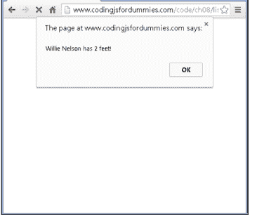

图 8-1：Willie Nelson 是一个 `Person`

## 修改对象类型

假设你有一个 `Person` 对象类型，它作为多个对象的原型。在某个时刻，你意识到该对象以及所有继承自它的对象应该增加几个属性。

要修改原型对象，请使用每个对象都从 `Object` 继承的 `prototype` 属性。示例 8-9 展示了其工作原理。

```javascript
function Person(){
    this.eyes = 2;
    this.ears = 2;
    this.arms = 2;
    this.hands = 2;
    this.feet = 2;
    this.legs = 2;
    this.species = "Homo sapien";
}

var willieNelson = new Person();
var johnnyCash = new Person();
var patsyCline = new Person();

// Person 需要更多属性！
Person.prototype.knees = 2;
Person.prototype.toes = 10;
Person.prototype.elbows = 2;

// 检查现有对象的新属性值
document.write(patsyCline.toes); // 输出 10
```

## 使用 `Object.create` 创建对象

另一种通过其他对象创建对象的方法是使用 `Object.create` 方法。该方法的优点是无需编写构造函数。它只需将指定对象的属性复制到新对象中。当一个对象继承自另一个对象时，被继承的对象被称为原型。

示例 8-10 展示了如何使用 `Object.create` 从原型创建 `willieNelson` 对象。

### 示例 8-10：使用 `Object.create` 从原型创建对象

```javascript
// 创建一个通用的 Person
var Person = {
  eyes: 2,
  arms: 2,
  feet: 2
}

// 基于 Person 创建 willieNelson 对象
var willieNelson = Object.create(Person);

// 测试继承属性
document.write(willieNelson.feet); // 输出 2
```

# 第三部分：Web 上的 JavaScript

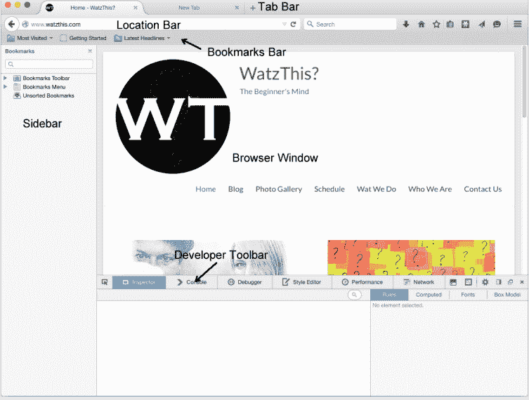

请在 `www.dummies.com/extras/codingwithjavascript` 的文章“使用 JavaScript 实现延迟加载”中了解如何处理加载缓慢的网页。

## 在本部分中 . . .

- 了解如何使用 `Window` 对象来控制浏览器。
- 精通使用 DOM 操作文档。
- 深入了解如何在 JavaScript 中使用事件。
- 弄清楚如何集成输入和输出。
- 探索如何与 CSS 和图形协同工作。
- 在 `www.dummies.com/extras/codingwithjavascript` 的文章“使用 JavaScript 实现延迟加载”中了解如何处理加载缓慢的网页。

## 第 9 章：使用 `Window` 对象控制浏览器

### 本章内容

- 理解 BOM（浏览器对象模型）
- 打开和关闭窗口
- 获取窗口属性
- 调整窗口大小

> “在制定理论时，始终要留一扇窗，以便在必要时将其扔出去。”
>
> —— 贝拉·卢戈西 (Bela Lugosi)

浏览器对象模型 (BOM) 允许 JavaScript 与 Web 浏览器的功能进行交互。使用 BOM，你可以创建和调整窗口大小、显示警报消息，以及更改浏览器中当前显示的页面。

在本章中，你将发现可以通过浏览器窗口完成哪些操作，以及如何利用它来编写更好的 JavaScript 程序。

### 理解浏览器环境

Web 浏览器是复杂的软件。当它们工作良好时，运行流畅，并将所有功能集成到一种顺滑且看似简单的网页浏览体验中。我们都知道 Web 浏览器偶尔会出现小故障，有时甚至会崩溃。为了理解为什么会发生这种情况，并能够更好地利用浏览器，了解 Web 浏览器的许多不同部分以及这些部分如何相互作用至关重要。

#### 用户界面

当你输入 URL、点击主页按钮、创建或使用书签，或者更改浏览器设置时所交互的浏览器部分被称为用户界面，或浏览器外壳 (browser chrome)（不要与 Google 的 Chrome 浏览器混淆）。

浏览器外壳由 Web 浏览器的菜单、窗口框架、工具栏和按钮组成，这些都位于加载网页的主内容窗口之外，如图 9-1 所示。

#### 加载器 (Loader)

加载器是 Web 浏览器中与 Web 服务器通信并下载网页、脚本、CSS、图形以及网页所有其他组件的部分。通常，加载是显示网页过程中让用户等待时间最长的部分。

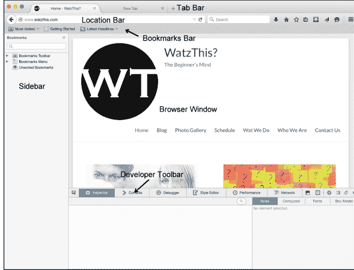

HTML 页面是必须首先下载的网页部分，因为它包含需要处理的链接、嵌入式脚本和样式，以便显示页面。

图 9-2 显示了 Chrome 开发者工具的 Network 标签页。它以图形化视图显示了网页加载期间发生的所有事情，以及显示每个部分加载所需时间的的时间线。

一旦 HTML 文档下载完成，浏览器将打开多个与服务器的连接，以便尽可能快地下载网页的其他部分。通常，从 HTML 文档链接的网页部分（也称为资源）按照它们在 HTML 文档中出现的顺序加载。例如，链接在页面 `head` 元素中的脚本将在链接在页面底部的脚本之前加载。

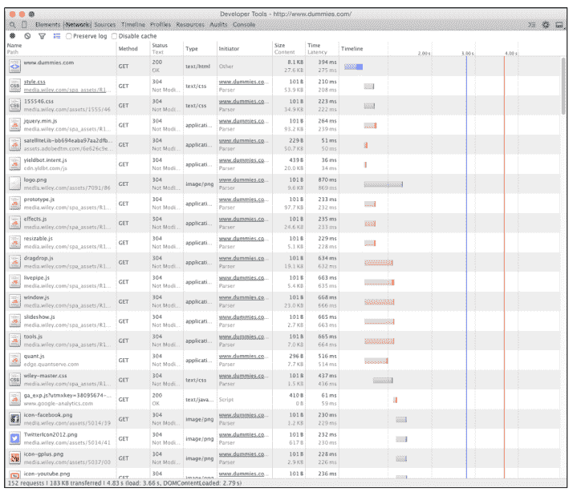

**记住**

资源的加载顺序对于页面向用户显示的效率和速度至关重要。为了使网页正确显示，适用于该页面的 CSS 样式需要被加载并解析。因此，CSS 应该始终加载在网页顶部的 `head` 元素中。

JavaScript 有时也会影响网页的显示，但更多时候它只影响功能。当脚本会影响网页显示时，它应该加载在文档的 `head` 中（在 CSS 之后）。对于对网页外观不至关重要的脚本，应该链接在 `body` 元素的最后（就在 `</body>` 之前），以免创建阻塞场景，导致浏览器在向用户显示任何内容之前等待脚本加载。

#### HTML 解析

网页下载后，浏览器的 HTML 解析组件开始工作，解析 HTML 以创建网页的模型（称为文档对象模型或 DOM）。DOM（将在第 10 章详细介绍）就像是网页的地图。JavaScript 程序员使用这张地图来操纵和访问网页的所有不同部分。

HTML 解析完成后，浏览器开始下载网页的其他组件。

#### CSS 解析

一旦完整网页的 CSS 完全下载，Web 浏览器将解析样式并确定哪些样式适用于 HTML 文档。CSS 解析是一个复杂的过程，涉及对文档的多次扫描，以正确应用每个样式并考虑样式之间如何相互影响。

#### JavaScript 解析

显示网页的下一步是 JavaScript 解析。JavaScript 解析器按照脚本在文档中出现的顺序，编译并运行网页中的每个脚本。如果你的 JavaScript 代码在 HTML DOM 中添加或删除了元素、文本或样式，浏览器将相应地更新 HTML 和 CSS 的渲染。

## 第 9 章：使用 `Window` 对象控制浏览器

## 布局与渲染

最终，当网页的所有资源都已加载并解析完毕后，浏览器会确定如何显示该页面，然后将其呈现出来。除非你指定了文档中较早包含的脚本应等到最后才执行，否则脚本的布局和渲染将按照它们在文档中包含的顺序进行。

> **提示**
>
> 一般来说，最好尽快将网页显示给用户，即使页面首次出现时可能尚未完全可用。现代网站经常采用这种策略（称为延迟加载）来改善其页面的感知性能。如果你曾经打开过一个网页，然后需要等待片刻才能使用表单或交互元素，那么你就已经见识过延迟加载的实际应用。

## 点燃 BOM

JavaScript 程序员可以通过一个名为浏览器对象模型（Browser Object Model，简称 BOM）的 API 来了解用户浏览器的信息，并控制用户体验的某些方面。

浏览器对象模型没有官方标准。不同的浏览器以不同的方式实现它。然而，对于 JavaScript 如何与 Web 浏览器交互，存在一些普遍接受的标准。

## `Navigator` 对象


`Navigator` 对象为 JavaScript 提供了访问用户 Web 浏览器信息的途径。`Navigator` 对象的名字来源于首个实现它的 Web 浏览器——Netscape Navigator。`Navigator` 对象并非内建于 JavaScript 中，而是 Web 浏览器的一个功能，可以通过 JavaScript 访问。几乎每一种 Web 浏览器（以及每种现代 Web 浏览器）都采用相同的术语来指代这一最高级别的浏览器对象。

`Navigator` 对象可以访问以下有用信息：

- Web 浏览器的名称
- Web 浏览器的版本
- 运行浏览器的计算机的物理位置（如果用户允许浏览器访问地理位置数据）
- 浏览器的语言
- 运行浏览器的计算机类型

表 9-1 展示了浏览器 `Navigator` 对象的所有属性。

**表 9-1：Navigator 对象的属性**

| 属性 | 用途 |
| :--- | :--- |
| `appCodeName` | 获取浏览器的代码名称 |
| `appName` | 获取浏览器的名称 |
| `appVersion` | 获取浏览器版本信息 |
| `cookieEnabled` | 判断浏览器中是否启用了 Cookie |
| `geolocation` | 可用于定位用户的物理位置 |
| `language` | 获取浏览器的语言 |
| `onLine` | 识别浏览器是否在线 |
| `platform` | 获取浏览器编译所针对的平台 |
| `product` | 获取浏览器的浏览器引擎名称 |
| `userAgent` | 获取浏览器发送给 Web 服务器的用户代理。 |

要获取 `Navigator` 对象的属性，可以使用与获取任何对象属性相同的语法——即点符号或括号符号。在 Web 浏览器中打开清单 9-1 时，将显示 `Navigator` 对象的所有当前属性及其值。

### 清单 9-1：Navigator 对象的属性及其值

```html
<html>
<head>
  <style>
    .columns {
      -webkit-column-count: 6; /* Chrome, Safari, Opera */
      -moz-column-count: 6; /* Firefox */
      column-count: 6;
    }
  </style>
</head>
<body>
  <div class="columns">
    <script>
      for (var prop in navigator){
        document.write (prop + ": " + navigator[prop] + "<br>");
      }
    </script>
  </div>
</body>
</html>
```

图 9-3 展示了在 Web 浏览器中打开清单 9-1 时的输出。

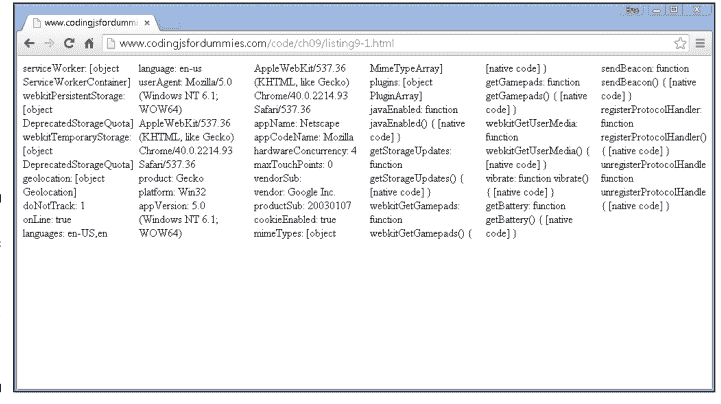

如果你自己运行清单 9-1，你会在输出中发现一些有趣的现象：`appName` 属性的值似乎明显是错误的。例如，用于生成图 9-3 的浏览器是 Google Chrome，但 `appName` 将其列为 Netscape。

这个具有误导性的值是过去的遗留产物，当时程序员使用 `Navigator` 对象的属性来检测用户是否在使用特定浏览器以及是否支持某些功能。

当 Chrome 和 Firefox 等新浏览器问世时，这些浏览器采用了 Netscape 浏览器的 `appName` 值，以确保与以这种方式检测功能的网站保持兼容。

> **警告！**
>
> 如今，不推荐进行浏览器检测，而且有比查看 `appName` 属性更好的方法来检测浏览器对特定功能的支持。当今检测功能最常见的方式是检查 DOM 中与你想要使用的功能相关联的对象。例如，如果你想了解浏览器是否支持 HTML5 `audio` 元素，可以使用以下测试：

```javascript
var test_audio = document.createElement("audio");
if (test_audio.play) {
  console.log ("Browser supports HTML5 audio");
} else {
  console.log ("Browser doesn't support HTML5 audio");
}
```

## Window 对象

Web 浏览器的主要区域称为 `window`。这是 HTML 文档（及相关资源）加载到的区域。Web 浏览器中的每个标签页在 JavaScript 中由一个 `Window` 对象的实例表示。`Window` 对象的属性列于表 9-2 中。

**表 9-2：Window 对象的属性**

| 属性 | 用途 |
| :--- | :--- |
| `closed` | 一个布尔值，指示窗口是否已关闭 |
| `defaultStatus` | 获取或设置窗口状态栏中的默认文本 |
| `document` | 引用窗口的 `Document` 对象 |
| `frameElement` | 获取窗口所嵌入的元素，如 `<iframe>` 或 `<object>` |
| `frames` | 列出当前窗口中的所有子框架 |
| `history` | 获取当前窗口的用户浏览器历史记录 |
| `innerHeight` | 获取窗口的内部高度 |
| `innerWidth` | 获取窗口的内部宽度 |
| `length` | 获取窗口中的框架数量 |
| `location` | 获取窗口的 `Location` 对象 |
| `name` | 获取或设置窗口的名称 |
| `navigator` | 获取窗口的 `Navigator` 对象 |
| `opener` | 获取创建当前窗口的 `Window` 对象 |
| `outerHeight` | 获取窗口的外部高度，包括滚动条和工具栏 |
| `pageXOffset` | 获取窗口中已水平滚动的像素数 |
| `pageYOffset` | 获取窗口中已垂直滚动的像素数 |
| `parent` | 引用当前窗口的父窗口 |
| `screen` | 引用窗口的 `Screen` 对象 |
| `screenLeft` | 获取从主屏幕左侧到当前窗口左侧的水平像素距离 |
| `screenTop` | 获取窗口顶部相对于屏幕顶部的垂直像素距离 |
| `screenX` | 获取相对于屏幕的水平坐标 |
| `screenY` | 获取相对于屏幕的垂直坐标 |
| `self` | 引用当前窗口 |
| `top` | 引用最顶层的浏览器窗口 |

`Window` 对象属性的一些最常见用途包括：

- 在浏览器窗口中打开新位置
- 查找浏览器窗口的大小
- 返回之前打开的页面（类似于后退按钮功能）

### 使用 `window.location` 属性打开网页

获取 `window.location` 属性的值将返回当前页面的 URL。为 `window.location` 属性设置新的 URL 值会导致浏览器在该窗口中加载该 URL 处的网页。

清单 9-2 是一个带有脚本的网页，该脚本向用户请求一个网页地址，然后在当前浏览器窗口中加载该页面。

### 清单 9-2：使用 `window.location` 属性在浏览器窗口中加载网页的脚本

```html
<html>
<head>
  <script>
    function loadNewPage (url){
      window.location = url;
    }
  </script>
</head>
<body>
  <script>
    var newURL = prompt("Please enter a web page address!");
    loadNewPage(newURL);
  </script>
</body>
</html>
```

## 确定浏览器窗口的大小

当你设计一个旨在在不同类型设备上工作并运行的网站或 Web 应用程序时（这种技术被称为响应式设计），了解 Web 浏览器的尺寸，尤其是宽度，至关重要。

`window.innerWidth` 和 `window.innerHeight` 属性可以为你提供当前 Web 浏览器窗口的这些信息（单位为像素）。

使用 CSS 来确定浏览器窗口的大小也是可行的，而且非常常见。然而，CSS 和 JavaScript 在处理滚动条的方式上存在一些差异，这可能会影响你决定使用哪种技术。

尝试一个使用 JavaScript 的简单响应式设计示例。在 Web 浏览器中运行代码清单 9-3 中的程序。如果你的 Web 浏览器窗口宽度低于 500 像素，将显示一条消息。如果你的窗口宽度大于 500 像素，则会显示另一条消息。

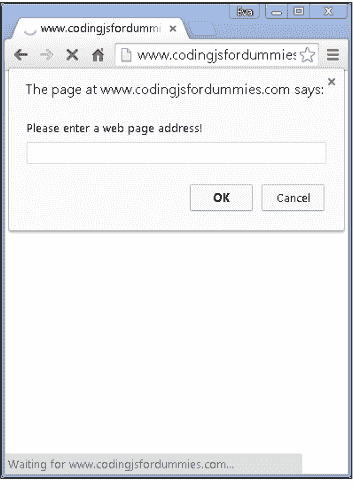

图 9-4 展示了代码清单 9-2 的输出结果。

### 代码清单 9-3：根据窗口宽度更改网页

```html
<html>
<head>
  <title>Adapting to the window.innerWidth</title>
</head>
<body>
  <script>
    var currentWidth = window.innerWidth;
    if (currentWidth > 500) {
      document.write("<h1>Your window is big.</h1>");
    } else {
      document.write("<h1>Your window is small.</h1>");
    }
  </script>
</body>
</html>
```

要测试代码清单 9-3 中的响应式设计示例，请遵循以下步骤：

1. 在 Web 浏览器中，打开一个包含代码清单 9-3 中代码的 HTML 文档。
   
   如果你在打开页面时窗口宽度超过 500px，你会看到一条提示窗口较大的消息。

2. 拖动浏览器的右下角，使窗口尽可能窄，如图 9-5 所示。

   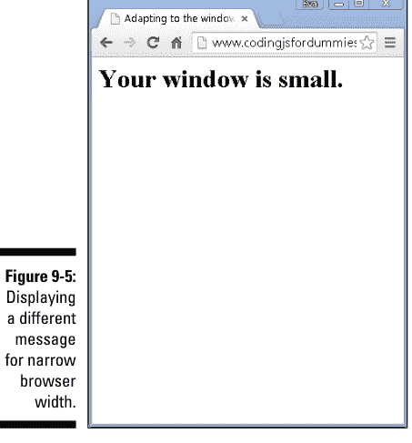

3. 点击浏览器的刷新按钮，或按下 Command+R（Mac）或 Ctrl+R（Windows）来重新加载页面。

   注意，页面上的消息现在显示你的浏览器窗口较小。

### 使用 `location` 和 `history` 创建“返回”按钮

`window` 对象的 `history` 属性是一个对 `history` 对象的只读引用，该对象存储了用户在当前浏览器窗口中访问过的页面信息。目前 `history` 对象最常见的用途是实现让用户返回到之前浏览页面的按钮。

```html
Listing 9-4: Implementing a Back Button in a Web Application

<html>
<head>
    <title>Creating a Back button</title>
    <script>
        function takeMeBack() {
            window.history.go(-1);
        }
        function getHistoryLength() {
            var l = window.history.length;
            return l;
        }
    </script>
</head>
<body>
    <script>
        var historyLength = getHistoryLength();
        document.write("<p>Welcome! The number of pages you've visited in this window is: " + historyLength + ".</p>");
    </script>
    <br>
    <a href="javascript:void(0);" onclick="takeMeBack();">Go Back</a>
</body>
</html>
```

要使用代码清单 9-4 中的返回按钮，请遵循以下步骤：

1. 打开一个新的浏览器窗口并访问任何你喜欢的页面，例如 `www.watzthis.com`。

2. 在同一个浏览器窗口中，打开一个包含代码清单 9-4 中代码的 HTML 文档。

3. 点击“Go Back”链接。

浏览器将带你回到在包含“返回”按钮的页面之前访问的最后一个页面。

## 第 9 章：使用 `Window` 对象控制浏览器

你愿意猜测一下，如果在该标签页中访问任何其他网页之前，就在新标签页中打开代码清单 9-4 会发生什么吗？如果你猜什么都不会发生，那么你是正确的！如果窗口中只显示了一个页面（当前页面），那么就没有可以返回的内容。

### 使用 `Window` 对象的方法

除了属性之外，`Window` 对象还具有一些 JavaScript 程序员应该了解并使用的高效方法。表 9-3 显示了这些方法的完整列表。

方法（method）只是对包含在对象内部的函数（function）的另一种称呼。

**表 9-3：Window 对象的方法**

| 方法 | 用途 |
| :--- | :--- |
| `alert()` | 显示一个带有消息和确定按钮的警告框 |
| `atob()` | 解码 Base-64 编码的字符串 |
| `blur()` | 使当前窗口失去焦点 |
| `clearInterval()` | 取消使用 `setInterval()` 设置的定时器 |
| `clearTimeout()` | 取消使用 `setTimeout()` 设置的定时器 |
| `close()` | 关闭当前窗口或通知 |
| `confirm()` | 显示一个对话框，包含可选消息和两个按钮：确定和取消 |
| `createPopup()` | 创建一个弹出窗口 |
| `focus()` | 将当前窗口设置为焦点 |
| `moveBy()` | 将当前窗口移动指定的距离 |
| `moveTo()` | 将窗口重新定位到指定位置 |
| `open()` | 打开一个新窗口 |
| `print()` | 打印当前窗口的内容 |
| `prompt()` | 显示一个提示用户输入内容的对话框 |
| `resizeBy()` | 将窗口调整为指定像素数 |
| `resizeTo()` | 将窗口调整为指定的高度和宽度 |
| `scrollBy()` | 将文档滚动指定的距离 |
| `scrollTo()` | 将文档滚动到一组特定的坐标 |
| `setInterval()` | 每隔指定的时间间隔（以毫秒为单位）重复调用一个函数或执行一个表达式 |
| `setTimeout()` | 在指定的时间间隔（以毫秒为单位）后调用一个函数或执行一个表达式 |
| `stop()` | 停止当前窗口的加载 |

# 第 10 章：使用 DOM 操作文档

### 本章内容

- 了解 DOM（文档对象模型）
- 操作节点
- 在树中移动
- 选择元素

> “没有对象是神秘的。神秘的是你的眼睛。”
>
> — 伊丽莎白·鲍恩（Elisabeth Bowen）

理解 DOM 是能够操作网页中的文本或 HTML 的关键。利用 DOM，你可以创建动画、在不刷新网页的情况下更新数据、在浏览器中移动对象，以及更多操作！

## 理解 DOM

文档对象模型（Document Object Model）是 JavaScript 与浏览器窗口内部的 HTML 文档进行通信和协作的接口。DOM 可以被可视化为一个倒置的树，HTML 文档的每个部分都从其包含部分分叉出来。

代码清单 10-1 是一个网页的标记。其 DOM 表示如图 10-1 所示。

### 代码清单 10-1：一个 HTML 文档

```html
<html>
<head>
  <title>Bob's Appliances</title>
</head>
<body>
  <header>
    
  </header>
  <div>
    <h1>Welcome to Bob's</h1>
    <p>The home of quality appliances</p>
  </div>
  <footer>
    copyright &copy; Bob
  </footer>
</body>
</html>
```

### 图 10-1：代码清单 10-1 的文档对象模型表示

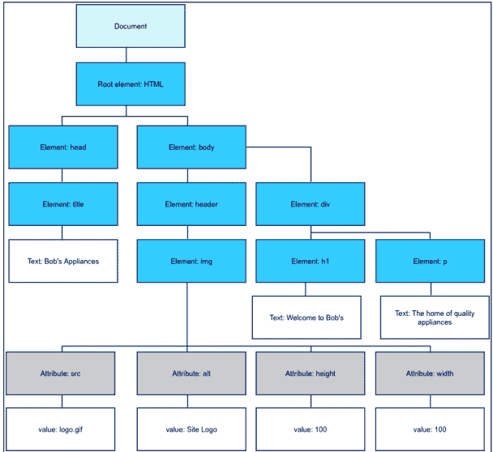

DOM 树由单个组件组成，称为节点（nodes）。所有其他节点从中衍生出的主节点称为文档节点（document node）。文档节点之下的节点是根元素节点（root element node）。对于 HTML 文档，根节点是 HTML。在根节点之后，文档中的每个元素、属性和每段内容都由树中的一个节点表示，该节点源自树中的另一个节点。

DOM 有几种不同类型的节点：

- **文档节点（Document node）**：整个 HTML 文档由该节点表示
- **元素节点（Element nodes）**：HTML 元素
- **属性节点（Attribute nodes）**：与元素关联的属性
- **文本节点（Text nodes）**：元素的文本内容
- **注释节点（Comment nodes）**：文档中的 HTML 注释

### 节点关系


HTML DOM 树在节点之间的层级关系上类似于家族树。事实上，用于描述树中节点关系的专业术语就是取自家族关系。

- 每个节点（根节点除外）都有一个`父节点（parent）`。
- 每个节点可以有任意数量的`子节点（children）`。
- 具有相同父节点的节点是`兄弟节点（siblings）`。

由于 HTML 文档通常有多个相同类型的元素，DOM 允许你使用索引号在节点列表中访问不同的元素。例如，你可以将文档中的第一个`<p>`元素称为`p[0]`，将第二个`<p>`元素节点称为`p[1]`。


虽然节点列表看起来像一个数组，但它并不是。你可以遍历节点列表的内容，但不能在节点列表上使用数组方法。

在代码清单 10-2 中，三个`<p>`元素都是`<div>`元素的子节点。因为它们拥有同一个父节点，所以它们是兄弟节点。


在代码清单 10-2 中，HTML 注释也是`section`元素的子节点。闭合 section 标签之前的最后一个注释被称为 section 的`最后一个子节点（last child）`。

通过理解文档节点之间的关系，你可以利用 DOM 树在文档中找到任何元素。

#### 清单 10-2：展示 HTML 文档中的父、子和兄弟关系

```html
<html>
<head>
  <title>The HTML Family</title>
</head>
<body>
  <section> <!-- 3 个 p 元素的骄傲父元素，body 的子元素 -->
    <p>First</p> <!-- section 元素的第 1 个子元素，
         另外 2 个 p 元素的兄弟元素 -->
    <p>Second</p> <!-- section 元素的第 2 个 p 子元素，
         另外 2 个 p 元素的兄弟元素 -->
    <p>Third</p> <!-- section 元素的第 3 个 p 子元素，
         另外 2 个 p 元素的兄弟元素 -->
  </section>
</body>
</html>
```

清单 10-3 是一个包含脚本的 HTML 文档，该脚本输出`section`元素的所有子节点。

#### 清单 10-3：显示 section 元素的子节点

```html
<html>
<head>
  <title>The HTML Family</title>
</head>
<body>
  <section> <!-- 3 个 p 元素的骄傲父元素，body 的子元素 -->
    <p>First</p> <!-- section 元素的第 1 个子元素，
         另外 2 个 p 元素的兄弟元素 -->
    <p>Second</p> <!-- section 元素的第 2 个 p 子元素，
         另外 2 个 p 元素的兄弟元素 -->
    <p>Third</p> <!-- section 元素的第 3 个 p 子元素，
         另外 2 个 p 元素的兄弟元素 -->
  </section>
  <h1>Nodes in the section element</h1>
  <script>
    var myNodelist =
          document.body.childNodes[1].childNodes;
    for (i = 0; i < myNodelist.length; i++){
      document.write (myNodelist[i] + "<br>");
    }
  </script>
</body>
</html>
```

## 第 10 章：使用 DOM 操作文档

图 10-2 展示了清单 10-3 在浏览器中的输出效果。请注意，`section`元素的第一个子节点是一个文本节点。如果你仔细查看清单 10-3 中的 HTML 标记，就会发现开场`section`标签和注释之间有一个单独的空格。即使是这样一个简单的单独空格，也会在 DOM 树中创建一个完整的节点。在使用节点之间的关系浏览 DOM 时，需要考虑这一事实。

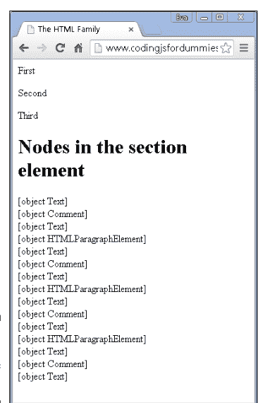

HTML DOM 还提供了几个关键词，用于根据节点相对于其兄弟元素或父元素的位置来浏览节点。相对属性包括：

- ✅ `firstChild`：引用节点的第一个子节点
- ✅ `lastChild`：引用节点的最后一个子节点
- ✅ `nextSibling`：引用具有相同父节点的下一个节点
- ✅ `previousSibling`：引用具有相同父节点的上一个节点

清单 10-4 展示了如何使用这些相对属性来遍历 DOM。

### 清单 10-4：使用 firstChild 和 lastChild 来高亮导航链接

```html
<html>
<head>
    <title>Iguana Are No Fun</title>
    <script>
        function boldFirstAndLastNav() {
            document.body.childNodes[1].firstChild.style.
            fontWeight="bold";
            document.body.childNodes[1].lastChild.style.
            fontWeight="bold";
        }
    </script>
</head>
<body>
    <nav><a href="home.html">Home</a> | <a
        href="why.html">Why Are Iguanas No Fun?</a> | <a
        href="what.html">What Can Be Done?</a> | <a
        href="contact.html">Contact Us</a></nav>
    <p>Iguanas are no fun to be around. Use the links above
        to learn more.</p>
    <script>
        boldFirstAndLastNav();
    </script>
</body>
</html>
```

请注意，在清单 10-4 中，必须移除`<nav>`元素内所有元素之间的间距，`firstChild`和`lastChild`属性才能访问我们想要选择和设置样式的正确元素。

图 10-3 展示了清单 10-4 中的文档在浏览器中预览时的样子。请注意，导航中只有第一个和最后一个链接是粗体显示的。

这是我们第一次使用 DOM 对文档中的现有元素进行更改的示例。然而，这种选择元素的方法几乎永远不会被使用。它太容易出错，而且难以理解和使用。

在下一节中，你会看到 DOM 为我们提供了一种比计算子节点更好的遍历和操作 DOM 的方法。

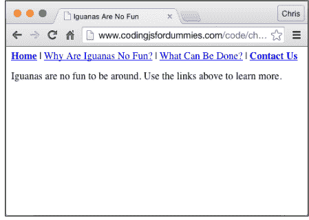

## 使用 Document 对象的属性和方法

`Document`对象提供了用于处理 HTML 文档的属性和方法。`Document`对象的完整属性列表如表 10-1 所示。`Document`对象的方法如表 10-2 所示。

### 表 10-1：Document 对象的属性

| Property | Use |
| :--- | :--- |
| `anchors` | 获取文档中所有锚点（带有 name 属性的`<a>`元素）的列表 |
| `applets` | 获取文档中所有 applet 的有序列表 |
| `baseURI` | 获取文档的基础 URI |
| `body` | 获取文档主体的`<body>`或`<frameset>`节点 |
| `cookie` | 获取或设置文档中 cookie 的名称/值对 |
| `doctype` | 获取与文档关联的文档类型声明 |
| `documentElement` | 获取作为文档根元素的元素（例如，HTML 文档的`<html>`元素） |
| `documentMode` | 获取浏览器用于渲染文档的模式 |
| `documentURI` | 获取或设置文档的位置 |
| `domain` | 获取加载文档的服务器的域名 |
| `embeds` | 获取文档中所有`<embed>`元素的列表 |
| `forms` | 获取文档中所有`<form>`元素的集合 |
| `head` | 获取文档中的`<head>`元素 |
| `images` | 获取文档中所有``元素的列表 |
| `implementation` | 获取处理文档的`DOMImplementation`对象 |
| `lastModified` | 获取当前文档最后修改的日期和时间 |
| `links` | 获取文档中包含 href 属性的所有`<area>`和`<a>`元素的集合 |
| `readyState` | 获取文档的加载状态。文档加载时返回`loading`，解析完成时返回`interactive`，加载完成时返回`complete` |
| `referrer` | 获取链接到当前文档的页面的 URL |
| `scripts` | 获取文档中`<script>`元素的列表 |
| `title` | 获取或设置文档的标题 |
| `URL` | 获取文档的完整 URL |

### 表 10-2：Document 对象的方法

| Method | Use |
| :--- | :--- |
| `addEventListener()` | 为文档分配事件处理程序 |
| `adoptNode()` | 从外部文档中采用节点 |
| `close()` | 结束之前用`document.open()`打开的文档的输出写入流 |
| `createAttribute()` | 创建属性节点 |
| `createComment()` | 创建注释节点 |
| `createDocumentFragment()` | 创建空的文档片段 |
| `createElement()` | 创建元素节点 |
| `createTextNode()` | 创建文本节点 |
| `getElementById()` | 获取具有指定 ID 属性的元素 |
| `getElementsByClassName()` | 获取具有指定类名的所有元素 |
| `getElementsByName()` | 获取具有指定名称的所有元素 |
| `getElementsByTagName()` | 获取具有指定标签名的所有元素 |
| `importNode()` | 从外部文档中复制并导入节点 |
| `normalize()` | 清除空文本节点并合并相邻节点 |
| `open()` | 打开文档以进行写入 |
| `querySelector()` | 获取文档中匹配指定选择器组的第一个元素 |
| `querySelectorAll()` | 获取文档中匹配指定选择器的所有元素的列表 |
| `removeEventListener()` | 从文档中清除使用`.addEventListener()`方法添加的事件处理程序 |
| `renameNode()` | 重命名现有节点 |
| `write()` | 将 JavaScript 代码或 HTML 表达式写入文档 |
| `writeIn()` | 将 JavaScript 代码或 HTML 表达式写入文档，并在每条语句后添加换行符 |

## 使用 Element 对象的属性和方法

`Element`对象提供了用于处理文档中 HTML 元素的属性和方法。表 10-3 列出了`Element`对象的所有属性。表 10-4 列出了`Element`对象的所有方法。

### 表 10-3：Element 对象的属性

| 方法/属性 | 用途 |
| :--- | :--- |
| `accessKey` | 获取或设置元素的 accesskey 属性 |
| `attributes` | 获取注册到指定节点的所有元素属性的集合（返回一个 NameNodeMap） |
| `childElementCount` | 获取指定节点中的子元素数量 |
| `childNodes` | 获取元素子节点的列表 |
| `children` | 获取元素子元素的列表 |
| `classList` | 获取元素的类名（class name） |
| `className` | 获取或设置元素的 class 属性值 |
| `clientHeight` | 获取元素的内部高度，包括内边距（padding） |
| `clientLeft` | 获取元素的左边框宽度 |
| `clientTop` | 获取元素的上边框宽度 |
| `clientWidth` | 获取元素的宽度，包括内边距（padding） |
| `contentEditable` | 获取或设置元素是否可编辑 |
| `dir` | 获取或设置元素的 dir 属性值 |
| `firstChild` | 获取元素的第一子节点 |
| `firstElementChild` | 获取元素的第一子元素 |
| `id` | 获取或设置元素的 id 属性值 |
| `innerHTML` | 获取或设置元素的内容 |
| `isContentEditable` | 如果元素的内容可编辑则返回 true；否则返回 false |
| `lang` | 获取或设置元素属性的基础语言 |
| `lastChild` | 获取元素的最后一子节点 |
| `lastElementChild` | 获取元素的最后一子元素 |
| `namespaceURI` | 获取元素中第一个节点的命名空间 URI |
| `nextSibling` | 获取同一节点层级的下一个节点 |
| `nextElementSibling` | 获取同一节点层级的下一个元素 |
| `nodeName` | 获取当前节点的名称 |
| `nodeType` | 获取当前节点的类型 |
| `nodeValue` | 获取或设置节点的值 |
| `offsetHeight` | 获取元素的高度，包括垂直内边距、边框和滚动条 |
| `offsetWidth` | 获取元素的宽度，包括水平内边距、边框和滚动条 |
| `offsetLeft` | 获取元素的水平偏移位置 |
| `offsetParent` | 获取元素的偏移容器 |
| `offsetTop` | 获取元素的垂直偏移位置 |
| `ownerDocument` | 获取元素的根元素（文档节点） |
| `parentNode` | 获取元素的父节点 |
| `parentElement` | 获取元素的父元素节点 |
| `previousSibling` | 获取同一节点树层级的前一个节点 |
| `previousElementSibling` | 获取同一节点树层级的前一个元素节点 |
| `scrollHeight` | 获取元素的整个高度，包括内边距 |
| `scrollLeft` | 获取或设置元素内容在水平方向上滚动的像素数 |
| `scrollTop` | 获取或设置元素内容在垂直方向上滚动的像素数 |
| `scrollWidth` | 获取元素的整个宽度，包括内边距 |
| `style` | 获取或设置元素的`style`属性值 |
| `tabIndex` | 获取或设置元素的`tabindex`属性值 |
| `tagName` | 获取元素的标签名称 |
| `textContent` | 获取或设置节点及其后代的文本内容 |
| `title` | 获取或设置元素的`title`属性值 |
| `length` | 获取`NodeList`中的节点数量 |

### 表 10-4：Element 对象的方法

| 方法 | 用途 |
| :--- | :--- |
| `addEventListener()` | 为元素注册事件处理程序 |
| `appendChild()` | 向元素插入一个新的子节点（作为最后一个子节点） |
| `blur()` | 移除元素的焦点 |
| `click()` | 模拟在元素上进行鼠标点击 |
| `cloneNode()` | 克隆元素 |
| `compareDocumentPosition()` | 比较两个元素的文档位置 |
| `contains()` | 如果该节点是某个节点的后代则返回`true`；否则返回`false` |
| `focus()` | 将焦点给到元素 |
| `getAttribute()` | 获取元素节点的指定属性值 |
| `getAttributeNode()` | 获取指定的属性节点 |
| `getElementsByClassName()` | 获取所有具有指定类名的子元素集合 |
| `getElementsByTagName()` | 获取所有具有指定标签名的子元素集合 |
| `getFeature()` | 获取实现指定特性 API 的对象 |
| `hasAttribute()` | 如果元素具有指定属性则返回`true`；否则返回`false` |
| `hasAttributes()` | 如果元素具有任何属性则返回`true`；否则返回`false` |
| `hasChildNodes()` | 如果元素具有任何子节点则返回`true`；否则返回`false` |


| `insertBefore()` | 在指定的现有节点之前插入一个新的子节点 |
|---|---|
| `isDefaultNamespace()` | 如果指定的 `namespaceURI` 是默认值则返回 `true`；否则返回 `false` |
| `isEqualNode()` | 评估两个元素是否相等 |
| `isSameNode()` | 评估两个元素是否为同一个节点 |
| `isSupported()` | 如果元素支持指定特性则返回 `true` |
| `normalize()` | 将指定节点与其相邻节点合并，并删除任何空文本节点 |
| `querySelector()` | 获取元素中第一个匹配指定 CSS 选择器的子元素 |
| `querySelectorAll()` | 获取元素中所有匹配指定 CSS 选择器的子元素 |
| `removeAttribute()` | 从元素中移除指定属性 |
| `removeAttributeNode()` | 从元素中移除指定的属性节点并检索被移除的节点 |
| `removeChild()` | 移除指定的子节点 |
| `replaceChild()` | 用另一个节点替换指定的子节点 |
| `removeEventListener()` | 移除指定的事件处理程序 |
| `setAttribute()` | 将指定属性更改或设置为指定值 |
| `setAttributeNode()` | 更改或设置指定的属性节点 |
| `toString()` | 将元素转换为字符串 |
| `item()` | 获取 `NodeList` 中指定索引处的节点 |

## 处理元素的内容

您可以使用 HTML DOM 来显示节点类型和节点值。您还可以使用 `Element` 对象来设置 DOM 中元素的属性值。当您使用 JavaScript 设置 DOM 元素的属性时，新值会实时反映在 HTML 文档中。

### `innerHTML`

为了在浏览器中即时反映网页文档中元素的属性更改而无需刷新或重新加载页面，这是曾经被称为 Web 2.0 的核心基石。

您可以通过 DOM 修改的元素中最重要的属性是 `innerHTML` 属性。

元素的 `innerHTML` 属性包含元素开始标签和结束标签之间的所有内容。例如，在以下代码中，`div` 元素的 `innerHTML` 属性包含一个 `p` 元素及其文本节点子项：

```html
<body><div><p>This is some text.</p></div></body>
```

在 Web 编程中，在 HTML 文档中创建空的 `div` 元素，然后使用 `innerHTML` 属性动态地将 HTML 插入到这些元素中是非常常见的。

要检索并显示 `innerHTML` 属性的值，您可以使用以下代码：

```javascript
var getTheInner = document.body.firstChild.innerHTML;
document.write (getTheInner);
```

在上述代码中，`document.write()` 方法将输出的值为：

```html
<p>This is some text.</p>
```

设置 `innerHTML` 属性的方式与设置任何对象的属性相同：

```javascript
document.body.firstChild.innerHTML = "Hi there!";
```

运行上述 JavaScript 的结果将是：原标记中的 `p` 元素和文本句子将被替换为单词 "Hi There!"。原始的 HTML 文档保持不变，但 DOM 表示和网页的渲染将更新以反映新值。因为浏览器显示的是 HTML 文档的 DOM 表示，所以您的网页显示也将随之更新。

## 设置属性

要设置 HTML 属性的值，可以使用 `setAttribute()` 方法：

```javascript
document.body.firstChild.innerHTML.setAttribute("class", "myclass");
```

运行该语句的结果是，`body` 元素的第一个子元素将被赋予一个名为 "class" 的新属性，其值为 "myclass"。

## 通过 ID、标签名或类名获取元素

`getElementBy` 方法提供了访问文档中任何元素或元素组的便捷方式，无需依赖节点的父子关系。三种最常用的访问元素的方式是：

- `getElementById`
- `getElementsByTagName`
- `getElementsByClassName`

### `getElementById`

到目前为止，`getElementById` 是选择元素最广泛使用的方法，它对现代 Web 开发至关重要。通过这个便捷的小工具，你可以通过引用唯一的 `id` 属性来查找和操作任何元素。无论 HTML 文档中发生其他什么情况，`getElementById` 始终可用，并能可靠地选择你想要的确切元素。

示例 10-5 展示了 `getElementById` 的强大功能，使你能够将所有的 JavaScript 代码集中在文档中，或者实现代码的模块化。通过使用 `getElementById`，你可以处理文档中任何位置的所有元素，只要你知道它的 `id`。

### 示例 10-5：使用 `getElementById` 选择元素

```html
<html>
<head>
  <title>Using getElementById</title>
  <script>
    function calculateMPG(miles,gallons){
      document.getElementById("displayMiles").innerHTML = parseInt(miles);
      document.getElementById("displayGallons").innerHTML = parseInt(gallons);
      document.getElementById("displayMPG").innerHTML = miles/gallons;
    }
  </script>
</head>
<body>
  <p>You drove <span id="displayMiles">___</v></p>
  <p>You used <span id="displayGallons">___</span> gallons of gas.</p>
  <p>Your MPG is <span id="displayMPG">___</span>.</p>
  <script>
    var milesDriven = prompt("Enter miles driven");
    var gallonsGas = prompt("Enter the gallons of gas used");
    calculateMPG(milesDriven,gallonsGas);
  </script>
</body>
</html>
```

### `getElementsByTagName`

`getElementsByTagName` 方法返回具有指定标签名的所有元素的节点列表。例如，在示例 10-6 中，`getElementsByTagName` 用于选择所有 `h1` 元素，并将其 `innerHTML` 属性更改为连续数字。

### 示例 10-6：使用 `getElementsByTagName` 选择和修改元素

```html
<html>
<head>
  <title>Using getElementsByTagName</title>
  <script>
    function numberElements(tagName){
      var getTags = document.getElementsByTagName(tagName);
      for(i=0; i < getTags.length; i++){
        getTags[i].innerHTML = i+1;
      }
    }
  </script>
</head>
<body>
  <h1>this text will go away</h1>
  <h1>this will get overwritten</h1>
  <h1>JavaScript will erase this</h1>
  <script>
    numberElements("h1");
  </script>
</body>
</html>
```

### `getElementsByClassName`

`getElementsByClassName` 方法的工作方式与 `getElementsByTagName` 大致相同，但它使用 `class` 属性的值来选择元素。示例 10-7 中的函数选择 `class` 为 "error" 的元素，并更改其 `innerHTML` 属性的值。

### 示例 10-7：使用 `getElementsByClassName` 选择和修改元素

```html
<html>
<head>
  <title>Using getElementsByClassName</title>
  <script>
    function checkMath(result){
      var userMath = document.getElementById("answer1").value;
      var errors = document.getElementsByClassName("error");
      if(parseInt(userMath) != parseInt(result)) {
        errors[0].innerHTML = "That's wrong. You entered " + userMath + ". The answer is " + result;
      } else {
        errors[0].innerHTML = "Correct!";
      }
    }
  </script>
</head>
<body>
  <label for="number1">4+1 = </label><input type="text" id="answer1" value="">
  <button id="submit" onclick="checkMath(4+1);">Check your math!</button>
  <h1 class="error"></h1>
</body>
</html>
```

在 Web 浏览器中运行示例 10-7 并输入错误答案的结果如图 10-4 所示。

请注意，示例 10-7 在 `button` 元素内部使用了 `onclick` 属性。这是 DOM 事件处理程序属性的一个示例。你可以在第十一章中了解更多关于事件处理程序的信息。

**图 10-4：** 使用 `getElementsByClassName` 选择用于显示错误消息的元素。

## 使用 `Attribute` 对象的属性

`Attribute` 对象提供了用于处理 HTML 元素中属性的属性。表 10-5 列出了 `Attribute` 对象的所有属性。

| 属性 | 用途 |
|---|---|
| `isId` | 如果属性是 `Id`，则返回 `true`；否则返回 `false` |
| `name` | 获取属性的名称 |
| `value` | 获取或设置属性的值 |
| `specified` | 如果属性已指定，则返回 `true`；否则返回 `false` |

## 创建和追加元素

要在 HTML 文档中创建新元素，请使用 `document.createElement()` 方法。当你使用 `createElement()` 时，将创建你指定类型的开始标签和结束标签。

示例 10-8 展示了如何使用此方法从数组动态创建 HTML 文档中的列表。

### 示例 10-8：使用 `document.createElement()` 从数组生成表格

```html
<html>
<head>
  <title>Generating a list</title>
</head>
<body>
  <h1>Here are some types of balls</h1>
  <ul id="ballList">
  </ul>

  <script>
    var typeOfBall = ["basket", "base", "soccer", "foot", "hand"];
    for (i=0; i<typeOfBall.length; i++) {
      var listElement = document.createElement("li");
      listElement.innerHTML = typeOfBall[i];
      document.getElementById("ballList").appendChild(listElement);
    }
  </script>
</body>
</html>
```

## 移除元素

尽管 HTML DOM 能让你对 HTML 文档做很多很棒的事情，但它在专业 JavaScript 程序员中并不受好评。它有一些古怪之处，而且往往会让一些事情变得比应有的更加困难。

DOM 的一个大缺陷是它没有提供直接从文档中移除元素的方法。相反，你必须让 DOM 找到要移除元素的父元素，然后让父元素移除其子元素。这听起来有些令人困惑，但示例 10-9 应该能解释清楚一切。

### 示例 10-9：从文档中移除元素

```html
<html>
<head>
  <title>Remove an element</title>
  <script>
    function removeFirstParagraph(){
      var firstPara = document.getElementById("firstparagraph");
      firstPara.parentNode.removeChild(firstPara);
    }
  </script>
</head>
<body>
  <div id="gibberish">
    <p id="firstparagraph">Lorem ipsum dolor sit amet,
      consectetur adipiscing elit. Vestibulum
      molestie pulvinar ante, a volutpat est
      sodales et. Ut gravida justo ac leo euismod,
      et tempus magna posuere. Cum sociis natoque
      penatibus et magnis dis parturient montes,
      nascetur ridiculus mus. Integer non mi iaculis,
      facilisis risus et, vestibulum lorem. Sed quam
      ex, placerat nec tristique id, mattis fringilla
      ligula. Maecenas a pretium justo. Suspendisse
      sit amet nibh consectetur, tristique tellus
      quis, congue arcu. Etiam pellentesque dictum
      elit eget semper. Phasellus orci neque, semper
      ac tortor ac, laoreet ultricies enim.</p>
  </div>
  <button onclick="removeFirstParagraph();">That's Gibberish!</button>
</body>
</html>
```

当你在浏览器中运行示例 10-9 并按下按钮时，`onclick` 事件会调用 `removeFirstParagraph()` 函数。

`removeFirstParagraph` 首先做的是选择我们实际上要移除的元素，即 `id = "firstparagraph"` 的元素。然后，脚本选择第一个段落的父节点。接着，它使用 `removeChild()` 方法移除第一个段落。

# 第 11 章：在 JavaScript 中使用事件

## 在本章中

- 了解发生了什么
- 使用事件处理器响应事件
- 了解事件处理器的类型

> “现在，我们将以不特定的顺序介绍一系列事件：”
>
> — 丹·雷瑟瑟 (Dan Rather)

网页不仅仅是文本和图形的静态显示。JavaScript 为网页赋予了交互能力和执行有用工作的能力。JavaScript 在浏览器中执行有用功能的一个重要部分就是其响应事件的能力。

## 了解你的事件

事件是浏览器内部发生的事情（例如页面加载）以及用户执行的操作（例如点击、按下键盘按键、移动鼠标等）。事件在浏览器中时刻在发生。

HTML DOM 使 JavaScript 能够识别并响应 Web 浏览器中的事件。事件可以根据它们所适用的 HTML 元素或浏览器对象进行分组。表 11-1 列出了每个 HTML 元素都支持的事件。

除 `body` 和 `frameset` 元素之外的每个元素都支持其他类型的事件。这些列在表 11-2 中。

**表 11-1：所有 HTML 元素支持的事件**

| 事件 | 发生于... |
|---|---|
| `abort` | 文件加载被中止。 |
| `change` | 元素在失去焦点并重新获得焦点后，其值发生了变化。 |
| `click` | 鼠标点击了某个元素。 |
| `dblclick` | 鼠标双击了某个元素。 |
| `input` | `<input>` 或 `<textarea>` 元素的值被改变。 |
| `keydown` | 按键被按下。 |


| 事件 | 发生于... |
| :--- | :--- |
| `keyup` | 按键在按下后被释放。 |
| `mousedown` | 鼠标按钮在某个元素上被按下。 |
| `mouseenter` | 鼠标指针移动到绑定了监听器的元素上。 |
| `mouseleave` | 鼠标指针移出绑定了监听器的元素。 |
| `mousemove` | 鼠标指针在某个元素上移动。 |
| `mouseout` | 鼠标指针移出绑定了监听器的元素或其子元素。 |
| `mouseover` | 鼠标指针移动到绑定了监听器的元素或其子元素上。 |
| `mouseup` | 鼠标按钮在某个元素上被释放。 |
| `mousewheel` | 鼠标滚轮被旋转。 |
| `onreset` | 表单被重置。 |
| `select` | 文本被选中。 |
| `submit` | 表单被提交。 |

**表 11-2：除 `<body>` 和 `<frameset>` 之外的每个元素支持的事件**

| 事件 | 发生于... |
| :--- | :--- |
| `blur` | 元素失去焦点。 |
| `error` | 文件加载失败。 |
| `focus` | 元素获得焦点。 |
| `load` | 文件及其关联文件已完成加载。 |
| `resize` | 文档大小被调整。 |
| `scroll` | 文档或元素被滚动。 |

表 11-3 显示了 `Window` 对象支持的事件。

**表 11-3：Window 对象支持的事件**

| 事件 | 发生于... |
| :--- | :--- |
| `afterprint` | 文档打印预览已关闭或文档已开始打印。 |
| `beforeprint` | 文档打印预览已打开或文档即将被打印。 |
| `beforeunload` | 窗口、文档及其包含的文件即将被卸载。 |
| `hashchange` | URL 中井号（`#`）之后的部分发生变化。 |
| `pagehide` | 浏览器离开浏览器历史记录中的一个页面。 |
| `pageshow` | 浏览器进入会话历史记录中的一个页面。 |
| `popstate` | 处于活动状态的会话历史记录项发生变化。 |
| `unload` | 文档或包含的文件正在被卸载。 |

除了这些事件外，许多其他规范定义了可能发生的事件。例如，File API 有一系列与文件加载相关的事件，HTML5 Media 规范包含与音频和视频播放相关的事件。如你所见，你的浏览器中正在发生（或可以发生）很多事情！

要查看完整的事件列表，你可以访问 `https://developer.mozilla.org/en-US/docs/Web/Events`。

## 处理事件

当 JavaScript 响应这些事件而采取行动时，这被称为事件处理（event handling）。

多年来，浏览器厂商为 JavaScript 程序处理事件实现了多种方式。结果，JavaScript 事件的格局在一段时间内充满了浏览器之间的不兼容性。

如今，JavaScript 已经发展到可以很快抛弃那些陈旧、低效的事件处理技术的程度。然而，由于这些旧技术仍被广泛使用，在这里涵盖它们非常重要。

### 使用内联事件处理器

第一个事件处理系统是随早期版本的 JavaScript 一起引入的。它依赖于特殊的事件处理器属性，包括 `onclick` 事件处理器。

内联事件处理器属性是通过在事件前添加前缀 `on` 形成的。要使用它们，请将事件属性添加到 HTML 元素中。当指定的事件发生时，将执行该属性值中的 JavaScript 代码。例如，代码清单 11-1 在点击链接时弹出一个警报。

**代码清单 11-1：使用内联方法将 `onclick` 事件处理器绑定到链接**

```html
<a href="home.html" onclick="alert('Go Home!');">Click Here To Go Home</a>
```

如果你将这段标记放入 HTML 文档并点击链接，你会看到一个显示 "Go Home!" 字样的警报窗口。当你关闭警报窗口后，链接将继续执行与 `a` 元素关联的默认事件处理器 —— 即跳转到 `href` 属性中的链接。

在许多情况下，你可能不希望执行与元素关联的默认操作。例如，如果你只想弹出代码清单 11-1 中的警报窗口而不执行任何其他操作怎么办？

JavaScript 程序员想出了几种不同的方法来防止默认操作。一种技术是将默认操作改为无关紧要的事情。例如，通过将 `href` 属性的值更改为 `#`，链接将指向自身：

```html
<a href="#" onclick="alert('Go Home!');">Click Here</a>
```

然而，一个更好的方法是告诉事件处理器返回布尔值 `false`，这会告知默认操作不要运行：

```html
<a href="homepage.html" onclick="alert('Go Home!'); return false;">Click Here</a>
```

### 使用元素属性进行事件处理

为元素分配事件的旧内联技术最大的问题之一是它违反了编程的最佳实践之一：将表现（外观如何）与功能（做什么）分离。将事件处理器与 HTML 标签混在一起会使你的网页更难以维护、调试和理解。

在浏览器第 3 版中，Netscape 引入了一种新的事件模型，允许程序员将事件作为属性附加到元素上。代码清单 11-2 展示了该模型如何工作的示例。

**代码清单 11-2：使用事件属性将事件绑定到元素**

```html
<html>
<head>
 <title>Counting App</title>
 <script>
 // wait until the window is loaded before registering the onclick event
 window.onload = initializer;
 // create a global counting variable
 var theCount = 0;
 /**
 Registers onclick event
 */
 function initializer(){
 document.getElementById("incrementButton").onclick = increaseCount;
 }
 /**
 Increments theCount and displays result.
 */
 function increaseCount(){
 theCount++;
 document.getElementById("currentCount").innerHTML = theCount;
 }
 </script>
</head>
<body>
 <h1>Click the button to count.</h1>
 <p>Current Number: <span id="currentCount">0</span></p>
 <button id="incrementButton">Increase Count</button>
</body>
</html>
```

关于代码清单 11-2 的一点需要注意：分配给事件处理器的函数名后面没有括号。这里发生的情况是将整个函数分配给事件处理器，并告诉它“当此事件发生时运行这个函数”，而不是实际地进行函数调用。如果你在函数名后添加括号，函数将被立即执行，其结果将被分配给 `onclick` 事件，这并不是我们想要的。

### 使用 `addEventListener` 进行事件处理

虽然前两种事件处理方法非常常用且被所有浏览器支持，但一种更现代、更灵活的处理事件的方式（也是新浏览器的推荐方式）是使用 `addEventListener()` 方法。

`addEventListener` 方法监听任何 DOM 节点上的事件，并根据这些事件触发操作。当被指定为事件操作的函数运行时，它会自动接收一个参数，即 `Event` 对象。按照约定，我们将此参数命名为 `e`。

与使用 DOM 事件属性相比，`addEventListener()` 有几个优点：

- 你可以为一个元素应用多个事件监听器。
- 它适用于 DOM 树中的任何节点，而不仅仅是元素。
- 它让你能够更精确地控制何时激活。

代码清单 11-3 演示了 `addEventListener()` 方法的使用。此示例具有与代码清单 11-2 相同的计数功能，但它为按钮添加了第二个事件处理器，每次点击时都会增加数字的大小。

**代码清单 11-3：使用 `addEventListener()` 分配事件**

```html
<html>
<head>
 <title>Counting App</title>
 <script>
 // wait until the window is loaded before registering the onclick event
 window.addEventListener('load', registerEvents, false);
 // create a global counting variable
 var theCount = 0;
/**
```

```javascript
/**
Registers onclick events
*/
function registerEvents(e){
document.getElementById("incrementButton").addEventListener
('click',increaseCount,false);
document.getElementById("incrementButton").addEventListener
('click',changeSize,false);
}

/**
Increments theCount and displays result.
*/
function increaseCount(e){
theCount++;
document.getElementById("currentCount").innerHTML =
theCount;
}
/**
Change the font size of the count text
*/
function changeSize(e){
document.getElementById("currentCount").style.fontSize =
theCount;
}
</script>
</head>
<body>
<h1>Click the button to count.</h1>
<p>Current Number: <span id="currentCount">0</span></p>
<button id="incrementButton">Increase Count</button>
</body>
</html>
```

图 11-1 展示了在经历了一个激动人心的下午点击按钮后，由代码清单 11-3 创建的页面呈现的样子。

`addEventListener()` 方法通过使用三个参数来实现。

第一个参数是事件类型。与其他两种事件处理方法不同，`addEventListener()` 只需要事件的名称，不需要 `on` 前缀。

第二个参数是当事件发生时要调用的函数。与事件属性处理方法一样，这里重要的是不要使用括号，以便将函数分配给事件处理程序，而不是分配函数运行的结果。

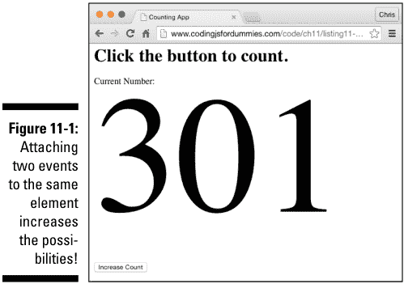

第三个参数是一个布尔值（`true` 或 `false`），用于指示当一个具有事件的元素有一个同样关联了事件的父元素时，事件处理程序的执行顺序。

当元素嵌套时，了解哪个先发生至关重要。图 11-2 说明了一个常见问题：外层正方形是可点击的，但内层圆形也是如此。当你点击内层圆形时，应该是附加在正方形上的事件先发生，还是附加在圆形上的事件先发生？

大多数人会认为圆形事件先发生是有道理的。然而，当微软在 Internet Explorer 中实现其版本的事件时，它决定外层事件（正方形）应该先发生。

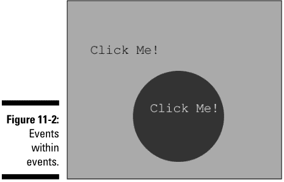

在图 11-2 这种情况中，最常见的事件处理方式被称为冒泡（bubbling up）。最内层元素上的事件首先发生，然后冒泡到最外层元素。要使用冒泡方法，请将 `addEventListener()` 方法的最后一个参数设置为 `false`，这同时也是默认值。

处理这种情况的另一种方式称为捕获（capture）方法。在捕获模式下，最外层事件首先发生，最内层事件最后发生。

代码清单 11-4 演示了一个示例，说明了为什么了解事件处理程序的执行顺序很重要。`h1` 元素具有点击事件，但该标题中的单词也同样具有点击事件。

### 代码清单 11-4：演示事件捕获和事件冒泡

```html
<html>
<head>
<title>Event capturing vs. Event bubbling</title>
<style>
#theText {font-size: 18px;}
h1 {
border:1px solid #000;
background-color: #dadada;
}
#capEvent, #bubEvent {
background-color: #666;
}
</style>
<script>
// wait until the window is loaded before registering
//              the events
window.addEventListener('load',registerEvents,false);
/**
Registers onclick events
*/
function registerEvents(e){
document.getElementById("capTitle").addEventListener
    ('click',makeTiny,true);
document.getElementById("capEvent").addEventListener
    ('click',makeHuge,true);
document.getElementById("bubTitle").addEventListener
    ('click',makeTiny,false);
document.getElementById("bubEvent").addEventListener
    ('click',makeHuge,false);
}
function makeHuge(e){
console.log("making the text huge");
document.getElementById("theText").style.fontSize =
    "80px";
}
```

178

# 第三部分：Web 上的 JavaScript

## 代码清单 11-4（续）

```html
}
function makeTiny(e){
console.log("making the text tiny");
document.getElementById("theText").style.fontSize =
"10px";
}
</script>
</head>
<body>
<h1 id="capTitle">Event <span id="capEvent">capturing
</span></h1>
<h1 id="bubTitle">Event <span id="bubEvent">bubbling
</span></h1>
<p id="theText">Hello, Events!</p>
</body>
</html>
```

图 11-3 展示了代码清单 11-4 在 Web 浏览器中的样子。

在图 11-3 中，当点击单词 `capturing` 时，注册到较大容器的事件首先触发，随后是注册到包含单词 `capturing` 的事件触发。

当你点击单词 `bubbling` 时，注册到该 `span` 的事件首先触发，随后是其父元素上的事件触发。

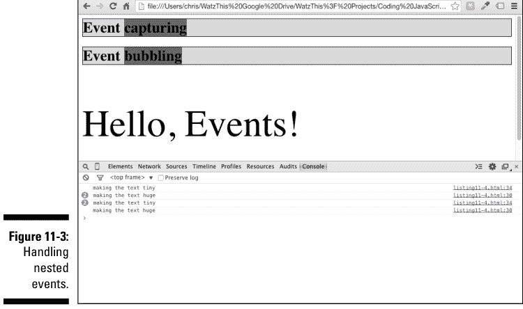

## 停止传播

除了冒泡和捕获，你还可以用第三种方式处理嵌套事件：仅执行单个事件然后停止。你可以通过使用 `stopPropagation()` 方法关闭某个事件（甚至所有事件）的冒泡和捕获。


如果你的脚本不需要事件传播，最好将其关闭，因为所有的冒泡和捕获都会消耗系统资源，并可能使你的网站运行变慢。

代码清单 11-5 演示了如何关闭事件传播。

### 代码清单 11-5：关闭事件传播

```javascript
function load(e) {
  if (!e) var e = window.event;
  // set cancelBubble for IE 8 and earlier
  e.cancelBubble = true;

  if (e.stopPropagation) e.stopPropagation();

  document.getElementById("capTitle").addEventListener
    ('click', makeTiny, true);
  document.getElementById("capEvent").addEventListener
    ('click', makeHuge, true);
  document.getElementById("bubTitle").addEventListener
    ('click', makeTiny, false);
  document.getElementById("bubEvent").addEventListener
    ('click', makeHuge, false);
}
```

# 第 12 章：集成输入与输出

### 本章内容

- 处理表单
- 使用输入
- 发送输出

> “故障。需要输入。”
>
> —— 5 号机器人，《短路》(1986)


处理用户输入并返回结果是任何计算机程序的基本且必要的功能。在本章中，你将了解 JavaScript 和 HTML 如何协同工作以接收和输出数据。

### 理解 HTML 表单

从 Web 应用程序用户获取输入的主要方式是通过 HTML 表单。HTML 表单使 Web 开发人员能够创建文本字段、下拉选择器、单选按钮、复选框和按钮。通过 CSS，你可以调整表单的外观以适应你的特定网站。JavaScript 则赋予你增强表单功能的能力。

#### `form` 元素

所有 HTML 表单都包含在一个 `form` 元素中。`form` 元素是包含构成用户输入区域的输入字段、按钮、复选框和标签的容器。`form` 元素的功能与任何容器元素（如 `div`、`article` 或 `section`）非常相似。但它还包含一些属性，用于告知浏览器如何处理其包含的表单字段中的用户输入。

代码清单 12-1 展示了一个包含两个输入字段和一个提交按钮的 HTML 表单。

# 第三部分：Web 上的 JavaScript

## 代码清单 12-1：包含表单的 HTML 页面示例

```html
<html>
<head>
  <title>HTML form</title>
</head>
<body>

  <form action="subscribe.php" name="newsletterSubscribe"
        method="post">
    <label for="firstName">First Name: </label>
    <input type="text" name="firstName"
           id="firstName"><br>
    <label for="email">Email: <input type="text"
           name="email" id="email"></label><br>
    <input type="submit" value="Subscribe to our
           newsletter!">
  </form>

</body>
</html>
```

当你在 Web 浏览器中查看此表单时，它看起来像图 12-1。


图 12-1：一个 HTML 表单。

在前面的示例中，`form` 元素有三个属性：

- `action`：告知浏览器如何处理用户输入。通常，`action` 是一个服务器端脚本。
- `name`：指定程序员为该表单分配的名称。表单的 `name` 属性对于使用 DOM 访问表单非常有用。
- `method`：取值为 `get` 或 `post`，用于指示浏览器应该将表单数据在 URL 中发送还是在 HTTP 标头中发送。

除了这三个属性外，`form` 元素还可以包含其他几个属性：

- `accept-charset`：指示服务器接受的字符集。除非你在处理多语言内容（即便如此），也可以安全地省略此属性。
- `autocomplete`：指示表单的输入元素是否应在浏览器中使用自动完成功能。
- `enctype`：指示表单应提交给服务器的内容类型。对于仅向服务器提交文本数据的表单，应将其设置为 `text/html`。如果你的表单向服务器提交文件（例如上传的图形），则 `enctype` 应为 `multipart/form-data`。默认值为 `application/x-www-form-urlencoded`。
- `novalidate`：一个布尔值，指示表单的输入在提交时是否应由浏览器进行验证。如果未指定此属性，表单默认将被验证。
- `target`：指示表单提交后服务器的响应应在何处显示。默认值（`"_self"`）是在包含表单的同一个浏览器窗口中打开响应。另一个选项是在新窗口中打开响应（`"_blank"`）。

### `label` 元素

你可以使用 `label` 元素将输入字段的描述（标签）与输入字段相关联。`label` 元素的 `for` 属性取值应为 `label` 所关联元素的 `id` 属性值，如下例所示：

```html
<label for="firstName">First Name: </label>
<input type="text" name="firstName">
```

将标签与表单字段关联的另一种方法是将表单字段嵌套在 `label` 元素中，如下例所示：

```html
<label>First Name: <input type="text"
    name="firstName"></label>
```

这种方法的优点是不要求输入字段具有 `id`（`id` 通常只是其 `name` 属性的重复）。

### `input` 元素

HTML `input` 元素是最基础的与表单相关的 HTML 元素。根据其 `type` 属性的值，它会让浏览器显示（或不显示）几种类型的输入字段。

最常见的是将 `input` 元素的 `type` 设置为 `"text"`，这会在浏览器中创建一个文本输入框。可选的 `value` 属性为该元素分配默认值，而 `name` 属性是与值配对的名称，从而形成名称/值对，可以通过 DOM 访问，并在表单提交时随其他表单值一起提交。

一个基础的 `text` 输入字段如下所示：

```html
<input type="text" name="streetAddress">
```

随着 HTML5 的出现，`input` 元素获得了大量新的 `type` 属性可选值。这些新值允许 Web 开发人员更精确地指定输入框中应提供的值类型。它们还允许 Web 浏览器提供更适合所需输入类型的控件，以便进行输入验证，从而构建更好的 Web 应用程序。

这一章如此关注 HTML 的表单能力而不是直接跳转到 JavaScript，可能看起来有些奇怪。然而，表单是 HTML 可以真正减轻程序员工作负担的领域，因此 JavaScript 程序员必须学习可以通过 HTML 表单实现哪些功能。


`input` 元素 `type` 属性的可能取值如表 12-1 所示。

**表 12-1**

| 值 | 描述 |
| --- | --- |
| `button` | 一个可点击的按钮 |
| `checkbox` | 一个复选框 |
| `color` | 一个颜色选择器 |
| `date` | 一个日期控件（年、月、日） |
| `datetime` | 一个日期和时间控件（基于 UTC 时区的年、月、日、时、分、秒及秒小数部分） |
| `datetime-local` | 一个日期和时间控件（年、月、日、时、分、秒及秒小数部分；无时区） |
| `email` | 一个电子邮件地址字段 |
| `file` | 一个文件选择字段和一个“浏览”按钮 |
| `hidden` | 一个隐藏的输入字段 |
| `image` | 一个使用图像而非默认按钮的提交按钮 |
| `month` | 一个月份和年份控件 |
| `number` | 一个数字输入字段 |
| `password` | 一个密码字段 |
| `radio` | 一个单选按钮 |
| `range` | 一个使用数字范围的输入，例如滑块控件 |
| `reset` | 一个重置按钮 |
| `search` | 一个用于输入搜索字符串的文本字段 |
| `submit` | 一个提交按钮 |
| `tel` | 一个用于输入电话号码的字段 |
| `text` | 默认值；一个单行文本字段 |
| `time` | 一个用于输入时间的控件（无时区） |
| `url` | 一个用于输入 URL 的字段 |
| `week` | 一个周和年控件（无时区） |


在撰写本文时，并非所有浏览器都支持 `input` 元素 `type` 属性的所有可能值。使用浏览器不识别的 `type` 属性将导致其仅显示为一个文本输入字段。

### `select` 元素

HTML `select` 元素定义一个下拉选择框或多选输入框。`select` 元素包含 `option` 元素，这些元素是用户在选择控件中可以选择的选项，如代码清单 12-2 所示。

代码清单 12-2：使用 `select` 元素创建的下拉表单控件

```html
<select name="favoriteColor">
    <option value="red">red</option>
    <option value="blue">blue</option>
    <option value="green">green</option>
</select>
```

代码清单 12-2 中的标记所创建的表单如图 12-2 所示。

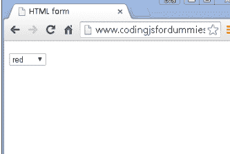

图 12-2：一个 HTML 下拉控件。

### `textarea` 元素

`textarea` 元素定义一个多行文本输入字段：

```html
<textarea name="description" rows="4"
          cols="30"></textarea>
```

### `button` 元素

`button` 元素定义了创建可点击按钮的另一种方式：

```html
<button name="myButton">Click The Button</button>
```

`button` 元素可以用作 `type` 属性设置为 `'submit'` 的 `input` 元素的替代品。或者，你可以在任何需要按钮但又不希望触发提交操作的地方使用 `button` 元素。


如果你不希望按钮在点击时提交表单，你需要为其添加一个值为 `'button'` 的 `type` 属性。

### 使用 `Form` 对象

HTML DOM 使用 `Form` 对象来表示表单。通过 `Form` 对象，你可以获取和设置表单字段的值，控制用户提交表单时执行的操作，以及改变表单的行为。

#### 使用 `Form` 属性

`Form` 对象的属性与 HTML `form` 元素的属性相对应（见本章前文部分）。它们用于通过 JavaScript 获取或设置 HTML `form` 元素属性的值。表 12-2 列出了 `Form` 对象的所有属性。

DOM 对象是 HTML 页面的表示形式。其目的是让你能够通过 JavaScript 访问文档的不同部分（也称为编程接口）。HTML 文档中的任何内容都可以通过 DOM 使用 JavaScript 来访问和更改。

**表 12-2**

| 属性 | 用途 |
| --- | --- |
| `acceptCharset` | 获取或设置服务器支持的字符集列表。 |
| `action` | 获取或设置 `form` 元素的 `action` 属性值。 |
| `autocomplete` | 获取或设置 `input` 元素的值是否可以由浏览器自动完成。 |
| `encoding` | 告诉浏览器如何对表单数据进行编码（作为文本或文件）。此属性与 `enctype` 同义。 |
| `enctype` | 告诉浏览器如何对表单数据进行编码（作为文本或文件）。 |
| `length` | 获取表单中控件的数量。 |
| `method` | 获取或设置浏览器用于提交表单的 HTTP 方法。 |
| `name` | 获取或设置表单的名称。 |
| `noValidate` | 指示表单在提交时不需要进行验证。 |
| `target` | 指示显示提交表单结果的位置。 |

#### 使用 `autocomplete` 属性

HTML `form` 元素中的 `autocomplete` 属性为表单内部的 `input` 元素设置默认的自动完成值。如果你希望浏览器为表单中的每个输入项提供自动提供自动完成功能，请将 `autocomplete` 设置为 `'on'`。如果你希望能够选择哪些元素可以被浏览器自动完成，或者你的文档提供了自定义的自动完成功能（通过 JavaScript 实现），请将表单的 `autocomplete` 属性设置为 `'off'`，然后你可以为表单内的每个单独的 `input` 元素设置 `autocomplete` 属性。

你可以在第 10 章中找到设置或获取表单属性值的技巧。在使用这些方法引用表单后，你可以使用点符号或方括号方法来访问该属性。

要获取文档中第一个表单的 `name` 属性值，你可以使用以下语句：

```javascript
document.getElementsByTagName("form")[0].name
```

访问表单的一种更常用的方法是为其分配一个 `id` 属性，并使用 `getElementById` 来选择它。

DOM 提供了另一种更便捷的访问表单的方法：`forms` 集合。`forms` 集合允许你通过两种不同的方式访问文档中的表单：

- **通过索引号：** 当文档中创建 `form` 元素时，它会被分配一个从零开始的索引号。要访问文档中的第一个表单，请使用 `document.forms[0]`。
- **通过名称：** 你也可以使用 `form` 元素的 `name` 属性值来访问表单。例如，要获取名称为 `"subscribeForm"` 的表单的 `action` 属性值，你会使用 `document.forms.subscribeForm.action`。或者你可以使用访问属性的方括号方法，写成 `document.forms["subscribeForm"].action`。

#### 使用 `Form` 对象的方法

`Form` 对象有两个方法：`reset()` 和 `submit()`。

##### `reset()` 方法

`reset()` 方法清除页面加载后对表单字段所做的任何更改，并重置为默认值。它的作用与 HTML 重置按钮相同，该按钮是通过在 `input` 元素中使用 `type="reset"` 属性创建的，如下代码所示：

```html
<input type="reset" value="Clear the form">
```

##### `submit()` 方法

`submit()` 方法使表单根据其属性（`action`、`method`、`target` 等）提交其值。它的作用与 HTML 提交按钮相同，该按钮是通过在 `input` 元素中使用 `type="submit"` 属性创建的，如下代码所示：

```html
<input type="submit" value="Submit the form">
```

代码清单 12-3 演示了 `submit()` 和 `reset()` 方法的使用，以及 `form` 对象的几个属性。

##### 代码清单 12-3：使用 `Form` 对象的属性和方法

```html
<html >
<head>
<title>Subscribe to our newsletter!</title>
<script>
function setFormDefaults() {
 document.forms.subscribeForm.method = "post";
 document.forms.subscribeForm.target = "_blank";
 document.forms.subscribeForm.action = 
 "http://www.thatwis.us9.list-manage.com/subscribe/
 post?tube=edb749f7d8557af747ec056&amp;
 id=663906e3ba";

 //register the button events
 document.getElementById('btnSubscribe').
 addEventListener('click', submitForm);
 document.getElementById('btnReset').
 addEventListener('click', resetForm);
 }

 function submitForm() {
 document.forms.subscribeForm.submit();
 }

 function resetForm() {
 document.forms.subscribeForm.reset();
 }
</script>
</head>
<body onload="setFormDefaults();">

<form name="subscribeForm">
  <h2 >Subscribe to our mailing list</h2>
  <label for="mce-EMAIL">Email Address </label>
  <input type="email" value="" name="EMAIL" id="mce-EMAIL">
  <button type="button" id="btnSubscribe">Subscribe!
  </button>
  <button type="button" id="btnReset">Reset</button>
</form>
</body>
</html>
```

### 访问表单元素

JavaScript 提供了几种不同的方式来访问表单输入字段及其值。然而，这些方式并非完全等同，JavaScript 程序员对于哪种技术最好存在分歧。以下列表展示了不同的技术及其优缺点：

- **使用表单及其输入字段的索引号。** 例如，要访问第一个表单中的第一个输入字段，你可以使用以下代码：

  `document.forms[0].elements[0]`

  避免使用上述技术，因为它依赖于文档结构以及表单内元素顺序不发生变化。一旦有人决定表单中的电子邮件字段应该排在名字字段之前，你的整个脚本就会崩溃。

- **使用表单的名称和输入字段的名称。** 例如：

  `document.myForm.firstName`

  这种技术的优点是易读且易用。它被所有浏览器支持（并且从 DOM 开发的早期阶段就开始支持了）。


- 使用`getElementById`选择表单，并使用输入字段的名称来选择输入项。例如：

`document.getElementById("myForm").firstName`

这种技术要求你为元素表单分配一个`id`属性。例如，上述代码将匹配以下表单元素中名为`firstName`的输入字段：

`<form id="myForm" action="myaction.php"></form>`

- 在字段上使用唯一的`id`属性值直接访问该字段。例如：

`document.getElementById("firstName")`

使用上述技术时需要记住的一点是，如果页面上有多个表单，你需要确保每个表单字段都有唯一的`id`属性（反正`id`属性值必须是唯一的，所以这其实不是问题）。

### 获取和设置表单元素值

DOM 允许你使用`name`和`value`属性来访问表单元素的名称和值。

代码清单 12-4 通过一个简单的计算器应用程序演示了如何获取和设置表单输入字段。

#### 代码清单 12-4：一个演示获取和设置表单输入字段的计算器应用

```html
<html>
<head>
    <title>Math Fun</title>
    <script>
        function registerEvents() {
            document.mathWiz.operate.addEventListener('click',
                doTheMath, false);
        }

        function doTheMath() {
            var first =
                parseInt(document.mathWiz.numberOne.value);
            var second =
                parseInt(document.mathWiz.numberTwo.value);
            var operator = document.mathWiz.operator.value;

            switch (operator){
                case "add":
                    var answer = first + second;
                    break;
                case "subtract":
                    var answer = first - second;
                    break;
                case "multiply":
                    var answer = first * second;
                    break;
                case "divide":
                    var answer = first / second;
                    break;
            }

            document.mathWiz.theResult.value = answer;
        }
    </script>
</head>
<body onload="registerEvents();">
<form name="mathWiz">
<label>First Number: <input type="number"
name="numberOne"></label><br>
<label>Second Number: <input type="number"
name="numberTwo"></label><br>
<label>Operator:
<select name="operator">
<option value="add"> + </option>
<option value="subtract"> - </option>
<option value="multiply"> * </option>
<option value="divide"> / </option>
</select>
</label>
<br>
<input type="button" name="operate" value="Do the
Math!"><br>
<label>Result: <input type="number" name="theResult">
</label>
</form>
</body>
</html>
```

### 验证用户输入

JavaScript 最常见的用途之一是在将用户输入提交到服务器之前对其进行检查或验证。JavaScript 表单验证为防止错误或潜在的不安全数据进入 Web 应用程序提供了一道额外的防线。它还能向用户提供即时反馈，告知他们是否犯了错误。

一些最常见的 JavaScript 输入验证任务已被 HTML5 中的 HTML 属性所取代。然而，由于浏览器的兼容性问题，使用 JavaScript 验证用户提交的数据仍然是一个良好的实践。

在代码清单 12-4 的计算器程序中，操作数的输入类型被设置为`number`。这应该会使浏览器阻止用户在这些字段中提交非数字值。因为`number`输入`type`相对较新，你不能总是指望浏览器会支持它，因此使用 JavaScript 进行用户输入验证非常重要。

清单 12-5 展示了一个输入验证脚本。这里需要注意的重要一点是，表单的`action`已被设置为输入验证函数。表单的`submit()`方法只有在输入验证函数中的测试完成后才会执行。

在前面的代码中，真正起到关键作用的是`validate()`函数内部看起来很奇怪的这一行：

```javascript
if (/^\d+$/.test(first) && /^\d+$/.test(second)) {
```

`/`和`/`之间的字符构成了所谓的*正则表达式*。正则表达式是一种由符号组成的搜索模式，这些符号代表了其他符号的组合。在这个例子中，我们使用正则表达式来检查用户输入的值是否都是数字。你可以在第 14 章中了解更多关于正则表达式的内容。

> **提示** 输入验证是 JavaScript 非常常见的用途，因此已经有许多不同的技术被开发出来用于实现它。在为你的特定 JavaScript 应用程序重新发明轮子之前，先搜索一下“开源 JavaScript 输入验证”，看看是否有现成的代码库可以节省你的时间并提供更多功能。

**清单 12-5：使用 JavaScript 执行输入验证**

```html
<html>
<head>
    <title>Math Fun</title>
    <script>

        function registerEvents() {
            document.mathWiz.operate.addEventListener('click',
                validate,false);
        }

        function validate() {
            var first = document.mathWiz.numberOne.value;
            var second = document.mathWiz.numberTwo.value;
            var operator = document.mathWiz.operator.value;

            if (/^\d+$/.test(first) && /^\d+$/.test(second)) {

                doTheMath();

            } else {

                alert("Error: Both numbers must be numeric");
```

清单 12-5（续）

```html
    }

    }

    function doTheMath() {
      var first =
          parseInt(document.mathWiz.numberOne.value);
      var second = parseInt(document.mathWiz.numberTwo.
                          value);
      var operator = document.mathWiz.operator.value;
      switch (operator){
        case "add":
          var answer = first + second;
          break;
        case "subtract":
          var answer = first - second;
          break;
        case "multiply":
          var answer = first * second;
          break;
        case "divide":
          var answer = first / second;
          break;
      }

      document.mathWiz.theResult.value = answer;
    }
  </script>
</head>
<body onload="registerEvents();">
  <div id="formErrors"></div>
  <form name="mathWiz">
    <label>First Number: <input type="number"
               name="numberOne"></label><br>
    <label>Second Number: <input type="number"
               name="numberTwo"></label><br>
    <label>Operator:
      <select name="operator">
        <option value="add"> + </option>
        <option value="subtract"> - </option>
        <option value="multiply"> * </option>
        <option value="divide"> / </option>
      </select>
    </label>
    <br>
    <input type="button" name="operate" value="Do the
           Math!"><br>
    <label>Result: <input type="number" name="theResult">
           </label>
  </form>
</body>
</html>
```

## 第 13 章：使用 CSS 和图形

### 本章内容

- 编辑样式
- 使用图片
- 执行 JavaScript 动画
- 开发幻灯片

> “要想形成风格，首先要做到不刻意追求风格。”
>
> —— E.B. 怀特，《风格的要素》

一旦你掌握了如何使用 JavaScript 操作 DOM 对象，网页就会从静态文档变为交互式应用程序，能够响应用户输入、在不重新加载页面的情况下更新内容，以及向各种不同的计算设备提供实时数据。

### 使用 Style 对象

DOM 的`Style`对象是让网页改变外观并实时适应用户输入或当前浏览器条件的强大工具。`Style`对象使程序员能够访问文档中任何选定元素或元素集合的 CSS 样式属性。（有关 CSS 基本规则和语法的更多信息，请参阅第 1 章。）

你可以使用`Style`对象完成的一些事情包括：

- 更改文本颜色以突出显示搜索框中输入的关键词
- 在用户点击对象后对其进行动画处理
- 更改用户当前正在编辑的表单部分的边框和背景颜色
- 展开和折叠或隐藏和显示页面的不同部分
- 创建提示或帮助框，在用户点击链接时显示在页面内容上方

`Style`对象的工作方式与其他 DOM 对象相同。它包含一组属性，你可以使用这些属性来获取或设置选定元素的不同方面。

`Style`对象的属性与 CSS 属性一一对应。两者之间的区别在于，DOM`Style`对象的属性使用驼峰命名法（camelCase）拼写，而不是使用 CSS 的连字符格式。

表 13-1 展示了一些最常用的`Style`对象属性及其修改的 CSS 属性。

要获取`Style`对象属性以及所有其他 DOM 对象属性的完整列表，请访问`http://overapi.com/html-dom`。

#### 表 13-1：常用 Style 属性及其对应的 CSS 属性

| 属性 | CSS 样式 | 描述 |
| :--- | :--- | :--- |
| `backgroundColor` | `background-color` | 获取或设置元素的背景颜色 |
| `borderWidth` | `border-width` | 设置元素四个边框的宽度 |
| `fontFamily` | `font-family` | 获取或设置分配给元素中文本的字体系列名称列表 |
| `lineHeight` | `line-height` | 获取或设置文本行之间的距离 |
| `textAlign` | `text-align` | 获取或设置块级元素中文本的水平对齐方式 |

#### 获取元素的当前样式

`Style`对象返回元素当前应用的内联样式。它不会告诉你浏览器实际渲染的样式是什么，因为它不包括外部 CSS 文件中的样式或`style`元素内的样式。

因此，`Style`对象对于获取元素的样式并不完全有用。在清单 13-1 中，`div`元素有一个内联样式和几个在`style`元素中设置的样式规则。

当使用`Style`对象获取元素的样式属性时，只有通过 JavaScript 或内联 CSS 设置的样式才会被返回。

#### 清单 13-1：获取元素当前样式的错误方式

```html
<html>
<head>
  <title>Getting Inline Styles</title>
  <style>
    #myText {
      color: white;
      background-color: black;
      font-family: Arial;
      margin-bottom: 20px;
    }
    #stylesOutput {
      font-size: 18px;
      font-family: monospace;
    }
  </style>
  <script>
    function getElementStyles(e){
      var colorOutput = "color: " + e.target.style.color;
      var fontSizeOutput = "font size: " + e.target.style.
          fontSize;
      document.getElementById("stylesOutput").innerHTML =
          colorOutput + "<br>" + fontSizeOutput;
    }

  </script>
</head>
<body>
  <div id="myText" style="font-size: 26px;"
       onclick="getElementStyles(event);">Here is
       some text.</div>
  <div id="stylesOutput"></div>
</body>
</html>
```

图 13-1 展示了在浏览器中加载此页面并点击`div`元素时会发生什么。

关于此脚本的结果，有两个重要的地方需要注意：

- `Style`对象属性的值为空，即使`div`的颜色在`<head>`中通过 CSS 设置为白色。
- `Style`对象的字体大小值被正确设置，因为 CSS 的`font-size`属性是通过内联 CSS 设置的。

## 第 198 节 第三部分：网络上的 JavaScript

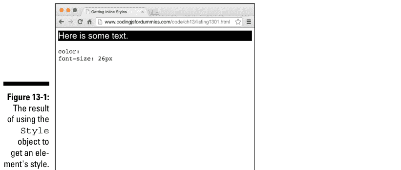

`style`对象的属性表现得像内联样式，并且只会检索应用于元素的内联样式的值。

获取元素当前样式的正确方法是使用`window.getComputedStyle()`，如代码清单 13-2 所示。

### 代码清单 13-2：获取元素当前样式的正确方法


```html
<html>
<head>
  <title>获取计算样式</title>
  <style>
    #myText {
      color: white;
      background-color: black;
      font-family: Arial;
      margin-bottom: 20px;
    }
    #stylesOutput {
      font-size: 18px;
      font-family: monospace;
    }
  </style>
  <script>
    function getElementStyles(e){
      var computedColor = window.getComputedStyle(e.target).getPropertyValue("color");
      var computedSize = window.getComputedStyle(e.target).getPropertyValue("font-size");

      var colorOutput = "color: " + computedColor;
      var fontSizeOutput = "font size: " + computedSize;

      document.getElementById("stylesOutput").innerHTML = colorOutput + "<br>" + fontSizeOutput;
    }
  </script>
</head>
<body>
    <div id="myText" style="font-size: 26px;"
         onclick="getElementStyles(event);">这是一些文本。</div>
    <div id="stylesOutput"></div>
</body>
</html>
```

图13-2展示了代码清单13-2的输出：显示了计算后（且正确）的`style`属性值。

请注意在代码清单13-2中，`getPropertyValue`函数接受的是CSS属性（`font-size`）而不是`style`属性（`fontSize`）。这是因为脚本直接从元素查询`font-size`的值，而不是通过`Style`对象（后者只会告诉我们内联样式的信息）。

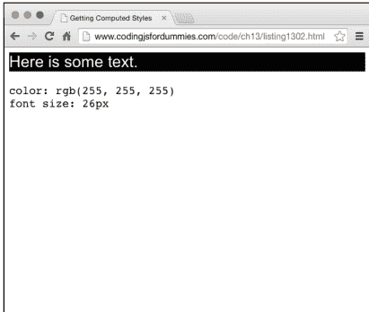

### 设置样式属性

要设置`Style`对象的属性，请选择你希望应用新样式的元素，然后使用点表示法或括号表示法为`Style`对象的属性分配新值。

要更改一个id为`"borderedSquare"`的元素的边框宽度，你可以使用以下代码：

```javascript
document.getElementById("borderedSquare").style.borderWidth = "15px";
```

### 使用`Style`对象为元素制作动画

你可以使用CSS样式来控制元素的外观，但也可以用它们来控制元素的定位。通过使用JavaScript循环结合样式属性修改，你可以相当容易地创建基本的动画。

在代码清单13-3中，一个JavaScript函数通过使用`for`循环更改CSS的`left`属性，从而在屏幕上移动一个方块。

### 代码清单13-3：使用`Style`对象为元素制作动画

```html
<html>
<head>
<title>JavaScript动画</title>
<style>
#square {
width: 100px;
height: 100px;
background-color: #333;
position: absolute;
left: 0px;
top: 100px;
}
</style>
<script>
function moveSquare() {
for (i=0; i<500; i++){
document.getElementById("square").style.left =
i+"px";
}
}
</script>
</head>
<body onload="moveSquare();">
<div id="square"></div>
</body>
</html>
```

## 第13章：使用CSS和图形

如果你在浏览器中打开这个脚本，它似乎一打开动画就已经完成了。事实上，动画确实运行了，但它发生得太快，以至于你看不到它在运行（除非你恰好有一台非常慢的计算机或者眼睛非常快）。

为了让这个动画以人类可见的速度运行，需要在循环的每次迭代之间暂停一下。创建带暂停循环的最常用方法是使用Window对象的`setTimeout()`方法。

`setTimeout()`方法接受两个参数：

- 要运行的函数或代码片段
- 运行前等待的毫秒数（千分之一秒）

通过在函数内部调用`setTimeout()`并递归调用该函数，我们可以控制动画运行的速度。（关于编写递归函数的更多信息，请参见第7章。）

在代码清单13-4中，方块现在以每1/100秒移动1像素的慢得多的速度移动。这个示例相较于代码清单13-3还有一些其他改进：

- 方块现在是可点击的。点击方块会触发动画。
- 方块的动画基于点击事件发生时方块的位置。点击方块会使其从被点击时的位置向右移动100像素。

### 代码清单13-4：使用`Style`对象、`setTimeout()`和递归实现动画

```html
<html>
<head>
  <title>JavaScript动画</title>
  <style>
    #square {
      width: 100px;
      height: 100px;
      background-color: #333;
      position: absolute;
      left: 0px;
      top: 100px;
    }
  </style>
  <script>
    // 等待窗口加载完成
    window.addEventListener('load',initialize,false);

    function initialize(){
      // 当点击时移动方块
      document.getElementById("square").
            addEventListener('click',function(e){
          // 获取起始位置
          var left = window.getComputedStyle(e.target).
               getPropertyValue("left");
          // 将left转换为十进制数字
          left = parseInt(left, 10);
          moveSquare(left,100);
      }, false);
    }

    function moveSquare(left,numMoves) {
      document.getElementById("square").style.left = 
            left+"px";
      if (numMoves > 0) {
        numMoves--;
        left++;
        setTimeout(moveSquare,10,left,numMoves);
      } else {
        return;
      }
    }
  </script>
</head>
<body>
  <div id="square"></div>
</body>
</html>
```

图13-3展示了代码清单13-4在浏览器中运行时的输出。

仔细观察在方块上注册点击事件的代码。使用了一个匿名函数作为事件处理器。虽然乍一看可能令人困惑，但如果你将其分解为基本部分，它仍然只是基本的`addEventListener()`方法在工作，带有它的三个参数：事件类型、监听器（在这种情况下，是一个匿名函数），以及是否使用事件捕获的布尔值。

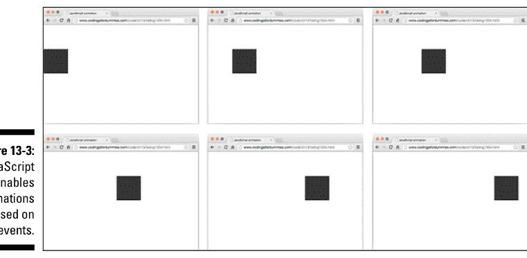

### 处理图像

HTML的`img`元素通常是非常静态、不变的东西——当然，除非图像是动画。使用JavaScript，诸如图像缩放、图像重新定位、灯箱效果、悬停效果等效果，都可以通过操作`img`元素的属性和更改CSS样式来实现。

#### 使用`Image`对象

DOM的`Image`对象使你能够访问HTML `img`元素的属性。一旦你有了这种访问权限，你就可以设置和获取值，以更改元素的任何有效属性。`Image`对象的属性如表13-2所示。

`Image`对象最重要且最广泛使用的属性是`src`属性、`width`属性和`height`属性。使用这三个属性，你可以创建图像切换效果、惊人的图像尺寸效果、酷炫的悬停按钮等等！

#### 创建悬停按钮

悬停按钮是一种在鼠标指针悬停在其上时会以某种方式改变的按钮。悬停按钮是向用户表明图像可以被点击的好方法。你也可以用它们来揭示如果点击按钮或链接会发生什么的更多信息。你甚至可以纯粹为了趣味或美观而使用它们。一些网页设计师喜欢在他们的网站中放入所谓的彩蛋，当鼠标悬停在其上或有人点击页面上的某些隐藏区域时，会触发网站上的图像变化或其他变化。

### 表13-2：`Image`对象的属性

| 属性 | 描述 |
|---|---|
| `alt` | 获取或设置图像的`alt`属性的值 |
| `complete` | 当浏览器完成加载图像时为真 |
| `height` | 获取或设置图像的`height`属性的值 |
| `isMap` | 获取或设置图像是否应成为服务器端图像映射的一部分 |
| `naturalHeight` | 获取图像的原始高度 |
| `naturalWidth` | 获取图像的原始宽度 |
| `src` | 获取或设置图像的`src`属性的值 |
| `useMap` | 获取或设置图像的`usemap`属性的值 |
| `width` | 获取或设置图像的`width`属性的值 |


你可以使用CSS创建悬停效果，但对于更复杂的悬停或图像切换，需要JavaScript，或JavaScript与CSS的组合。

代码清单13-5中的示例展示了如何用JavaScript创建一个简单的图像悬停效果。

#### 代码清单13-5：图像悬停效果

```html
<html>
<head>
  <title>悬停图像</title>
  <script>
    function swapImage(imgToSwap) {
      imgToSwap.src = "button2.png";
      imgToSwap.alt = "你正悬停在我的按钮上！";
    }
    function swapBack(imgToSwap) {
      imgToSwap.src = "button1.png";
      imgToSwap.alt = "悬停在我上面！";
    }
  </script>
```

### 鼠标悬停时图像放大

另一个能让网站更用户友好的实用界面技巧是，当用户将鼠标悬停在图像按钮上时，稍微增大其尺寸。这个不错的小技巧巧妙地提示目标图像是可点击的，并提供了一点交互性。

清单13-6修改了清单13-5的代码，以便在`mouseover`事件时将图像尺寸增大5%。

请注意，不要将图像尺寸增大到远超其原始大小。如果增大过多，图像质量会明显下降。

#### 清单13-6：鼠标悬停时增大图像尺寸

```html
<html>
<head>
  <title>Rollover image size</title>
  <script>
    function growImage(imgToGrow){
      imgToGrow.width += imgToGrow.width * .05;
      imgToGrow.height += imgToGrow.width * .05;
    }
    function restoreImage(imgToShrink){
      imgToShrink.width = imgToShrink.naturalWidth;
      imgToShrink.height = imgToShrink.naturalHeight;
    }
  </script>
</head>
<body>
  
</body>
</html>
```

你可能已经注意到，清单13-5和13-6使用了内联事件方法。虽然对于实际的网络应用程序开发并不理想，但内联事件常用于简单的鼠标悬停效果，这些效果主要是界面相关的，而非功能性的。

### 创建图像幻灯片

幻灯片（也称为轮播图）是在网站单个区域中展示多张图像的流行方式。它们常用于网站主页，能真正让你的网站生动起来。

幻灯片通常具有切换多张图像的过渡效果。这些过渡效果通常使用JavaScript函数库（如jQuery）创建。你也可以仅使用普通的JavaScript、CSS和DOM来创建过渡效果。为了简单起见，清单13-7中的幻灯片仅切换图像，没有任何过渡效果。

#### 清单13-7：使用JavaScript和CSS构建的幻灯片

```html
<html>
<head>
  <title>JavaScript slideshow</title>

  <style>
    #carousel {
      position: absolute;
      width: 800px;
      height: 400px;
      top: 100px;
      left: 100px;
      display: hidden;
    }

  </style>
  <script>
    var slides = [
      "<div id='slide1'>my first slide<br></div>",
      "<div id='slide2'>my second slide<br></div>",
      "<div id='slide3'>my third slide<br></div>"
    ];

    var currentSlide = 0;
    var numberOfSlides = slides.length - 1;

    window.addEventListener("load", loader, false);

    function loader() {
        changeImage();
    }

    function changeImage() {
        console.log("changeImage function");
        if (currentSlide > numberOfSlides) {
            currentSlide = 0;
        }
        
        document.getElementById("carousel").
        innerHTML = slides[currentSlide];
        
        console.log('displaying slide ' + currentSlide +
        ' of ' + numberOfSlides);
        currentSlide++;
        
        setTimeout(changeImage, 1000);
    }

  </script>
</head>
<body>
<div id="carousel"></div>
</body>
</html>
```

## 使用`Style`对象的动画属性

CSS3和DOM的`Style`对象拥有简化元素动画任务的属性。结合使用这些动画属性，你可以用最少的努力创建一些相当酷炫的动画。`Style`对象的动画属性列于表13-3中。

### 表13-3：`Style`对象的动画属性

| 属性 | 描述 |
|---|---|
| `animation` | 同时设置除`animationPlayState`属性外的所有动画属性。 |
| `animationDelay` | 获取或设置动画开始前的延迟时间 |
| `animationDirection` | 获取或设置动画是否应在部分或全部循环中反向播放 |
| `animationDuration` | 获取或设置动画完成一个循环所需的时间长度 |
| `animationFillMode` | 获取或设置在动画执行时间之外应用的值 |
| `animationIterationCount` | 获取或设置动画应播放的次数 |
| `animationName` | 获取或设置使用关键帧at规则的动画列表 |
| `animationTimingFunction` | 获取或设置描述动画应如何随时间推移的速度曲线 |
| `animationPlayState` | 获取或设置动画是运行还是暂停。 |

在清单13-8中，使用CSS创建了一个简单的动画。动画的时间和关键帧首先用CSS配置，然后使用JavaScript来暂停和恢复动画。稍加创意，你可以用JavaScript控制这个动画的方式有很多可能性。

CSS3动画仍然相当新，并非所有浏览器都以相同方式支持它。因为它仍被视为实验性技术，一些浏览器在动画属性名称前需要浏览器前缀。


清单13-8中包含了标准CSS样式和带前缀的CSS样式。

### 清单13-8：使用JavaScript控制CSS3动画

```html
<!DOCTYPE html>
<html>
<head>
  <style>
    #words {
      position: relative;
      width: 300px;
      height: 200px;
      text-align: center;
      padding-top: 20px;
      font-family: Arial;
      border-radius: 6px;
      color: white;

      /* Chrome, Safari, Opera */
      -webkit-animation-name: movewords;
      -webkit-animation-duration: 6s;
      -webkit-animation-timing-function: linear;
      -webkit-animation-delay: 0s;
      -webkit-animation-iteration-count: infinite;
      -webkit-animation-direction: alternate;
      -webkit-animation-play-state: running;
      /* Standard syntax */
      animation-name: movewords;
      animation-duration: 6s;
      animation-timing-function: linear;
      animation-delay: 0s;
      animation-iteration-count: infinite;
      animation-direction: alternate;
      animation-play-state: running;
    }

    /* Chrome, Safari, Opera */
    @-webkit-keyframes movewords {
      0%  {background:red; left:100px; top:0px;}
      25% {background:blue; left:200px; top:100px;}
      50% {background:blue; left:300px; top:200px;}
      75% {background:blue; left:200px; top:200px;}
      100% {background:red; left:100px; top:0px;}
    }

    /* Standard syntax */
    @keyframes movewords {
      0%  {background:red; left:100px; top:0px;}
      25% {background:blue; left:200px; top:100px;}
      50% {background:blue; left:300px; top:200px;}
      75% {background:blue; left:200px; top:200px;}
      100% {background:red; left:100px; top:0px;}
    }
  </style>
  <script>
    window.addEventListener("load", registerEvents, false);

    function registerEvents(e){
      document.getElementById("stop").addEventListener(
        "click", stopAni, false);
      document.getElementById("go").addEventListener("click", startAni, false);
    }
    function stopAni(){
        document.getElementById("words").style.
            webkitAnimationPlayState = "paused";
        document.getElementById("words").style.
            AnimationPlayState = "paused";
    }
    function startAni(){
        document.getElementById("words").style.
            webkitAnimationPlayState = "running";
        document.getElementById("words").style.
            AnimationPlayState = "running";
    }
  </script>
</head>
<body>
<h1 id="words">Movin' Around</h1>
<button type="button" id="stop">Pause</button>
<button type="button" id="go">Run</button>
</body>
</html>
```

# 第 IV 部分：进阶内容

在`www.dummies.com/extras/codingwithjavascript`的在线文章 “JavaScript Strict Mode” 中，了解如何强制 Web 浏览器运行 JavaScript 的严格版本。

## 在本部分中 . . .

- 了解如何使用正则表达式进行搜索。
- 探索如何使用回调函数（callbacks）和闭包（closures）。
- 通过学习 AJAX 和 JSON 进一步提升技能。
- 在`www.dummies.com/extras/codingwithjavascript`的在线文章 “JavaScript Strict Mode” 中，了解如何强制 Web 浏览器运行 JavaScript 的严格版本。

## 第 14 章：使用正则表达式进行搜索

### 在本章中

- 使用正则表达式查找模式
- 编写正则表达式
- 在 JavaScript 中使用正则表达式

> “创造问题很容易创造。我们一直都在这么做。而寻找解决方案——那些持久且能产生良好结果的方案——则需要勇气和细心。”
> —— 亨利·罗林斯 (Henry Rollins)

正则表达式是许多编程语言中的一个强大工具，它可以帮助你根据文本中的模式来查找和更改文档中的文本。正则表达式的语法起初可能令人望而生畏，但一旦你掌握了它，处理文本将再无难事。

### 通过正则表达式发现它

正则表达式是一种在字符串中查找模式或字符组合的方法。

正则表达式的示例用途包括：

- 检查用户输入的电子邮件地址，确保其格式正确
- 查找并替换文章中一个人名字的所有出现实例
- 在整本书的句子中间定位大写单词
- 在文档中查找看起来像电话号码的数字字符串

这是一个正则表达式的样子：

```
^((\(\d{3}\) ?)|(\d{3}-))?\d{3}-\d{4}$
```

看起来相当吓人，对吧？别担心，你很快就会拥有解码这个表达式所需的工具，并且你会发现这是一个旨在匹配美国电话号码常见格式的正则表达式：

(555)555-5555

不过，正则表达式也可以比前面的例子简单得多。代码清单 14-1 展示了一个正则表达式的简单使用示例，图 14-1 展示了代码清单 14-1 在浏览器中渲染后的样子。

#### 代码清单 14-1：字符串是否包含 "JavaScript"？

```html
<html>
<head>
  <title>Looking for JavaScript</title>
  <script>
    window.addEventListener("load",registerEvents,false);

    function registerEvents(e){
      document.getElementById("ask")
      addEventListener("click",findAnswer,false);
    }

    function findAnswer(){
      //get the user's question
      var question = document.
          getElementById("userQuestion").value;
      /* create a new regular expression object that
         will look for an exact match of the string
         "JavaScript". */
      var re = new RegExp("JavaScript");

      // if "JavaScript" is found in the user's question
      if (re.test(question)===true){

        //print out an answer.
        document.getElementById("answer").innerHTML =
          "JavaScript Question? Check out Coding with
          JavaScript For Dummies by Chris Minnick and Eva
          Holland";

        //and yell "JavaScript!" in the console.
        console.log("JavaScript!");
      }
    }
  </script>
</head>
<body>
<form id="userInput">
<label>Enter your question:
<textarea id="userQuestion"/>
</label>
<button id="ask" type="button">Get An Answer</button>
</form>
<div id="answer"/>
</body>
</html>
```

**图 14-1：** 在浏览器中运行代码清单 14-1 的结果。

### 编写正则表达式

在能够使用正则表达式之前，你需要创建一个包含该表达式的对象。你可以通过两种方式之一来编写正则表达式：

- 使用正则表达式字面量
- 通过`RegExp`对象的构造函数

#### 使用 RegExp 对象

当你通过调用`RegExp`构造函数创建正则表达式时，生成的对象是在运行时创建的，而不是在脚本加载时创建的。当你编写脚本时如果不知道正则表达式的具体值，则应使用`RegExp`构造函数。例如，你可能要求用户输入一个正则表达式，或者你可能从外部源获取正则表达式，或者在脚本运行时计算正则表达式的某些部分。

代码清单 14-2 中的程序使用一个随机字母创建正则表达式，然后要求用户输入一个句子。当用户提交表单时，程序会计算用户提交的文本中包含该随机字母的次数。

#### 代码清单 14-2：使用 RegExp 对象在运行时创建正则表达式

```html
<html>
<head>
  <title>Letter Counting Game</title>
  <script>
    window.addEventListener('load',loader,false);

    //get a random letter
    var letter = String.fromCharCode(97 + Math.floor(Math.
        random() * 26));

    /* Create a regular expression using the letter. Set
         the g option to find all occurrences. */
    var re = new RegExp(letter,'g');

    function loader(e){
      document.getElementById("getText").addEventListener(
        'submit',countLetter,false);
    }

    function countLetter(e){
      e.preventDefault();
      document.getElementById("results").innerHTML = "The
          secret letter was " + letter +".";
      var userText = document.getElementById("userWords").
          value;
      var matches = userText.match(re);
      if (matches){
        var count = matches.length;
      } else {
        var count = 0;
      }
      document.getElementById("results").innerHTML +=
        " You typed the secret letter " + count + " times.";
    }
  </script>
</head>
<body>
<form id="getText">
    <p>I'm thinking of a letter! Type a sentence, and then
    I'll tell you how many times your sentence uses
    my secret letter!</p>
    <input type="text" name="userWords" id="userWords">
    <input type="submit" name="submit">
</form>
<div id="results"></div>
</body>
</html>
```

图 14-2 显示了在 Web 浏览器中运行上述程序的结果。

**图 14-2：** 代码清单 14-2 的字母计数游戏结果。

#### 正则表达式字面量

要创建正则表达式字面量，你需要将正则表达式的值放在斜杠之间，而不是引号之间。例如：

```javascript
var myRegularExpression = /JavaScript/;
```

正则表达式字面量在脚本加载时由浏览器编译，并在脚本的整个生命周期中保持不变。结果是，对于不会改变的表达式，正则表达式字面量提供了更好的性能。

前面的示例使用了正则表达式来查找字符串 "JavaScript" 的精确匹配。包含一个需要精确匹配的字符字符串的正则表达式被称为*简单模式 (simple pattern)*。

在实际的应用或程序中，你需要考虑到用户可能会使用正确拼写的一些变体。例如，用户可能会输入以下任何单词，而其意思显然是指 JavaScript：

- javascript
- Javascript
- java script
- JS
- js

甚至可能出现更奇特的变体。处理真实用户的输入最美妙也最令人沮丧的一点就是，你永远无法确定他们会怎么做！为了能够检测大小写和拼写的变体，你可以使用更复杂的正则表达式来查找模式或字符集，而不仅仅是字面字符串。

以下是一个修订后的正则表达式，它可以匹配 "JavaScript" 以及 "Javascript" 或 "javascript"：

```javascript
var myRegularExpression = /[Jj]ava[Ss]cript/;
```

现在看起来开始有点陌生了，但如果你理解不同字符的含义，你会发现这实际上仍然非常简单。正则表达式中的方括号定义了一个字符集，并将匹配该集合中的任意一个字符。通过编写`[Jj]`，你的意思是无论大写还是小写 j 都能匹配。

### 测试正则表达式

有时在编写正则表达式时，有一种简单的方法来测试表达式，以确保它确实实现了你想要的功能是非常有帮助的。许多网站和工具可以帮助你测试正则表达式。其中一个这样的网站是`http://regex101.com`。要使用`regex101.com`，请在屏幕顶部的方框中输入你的正则表达式，并在其下方的方框中输入一些文本。该网站会根据你的正则表达式检查文本，并突出显示找到的匹配项。

图 14-3 展示了使用`regex101.com`将我们的示例正则表达式用于测试一个关于 JavaScript 的问题。

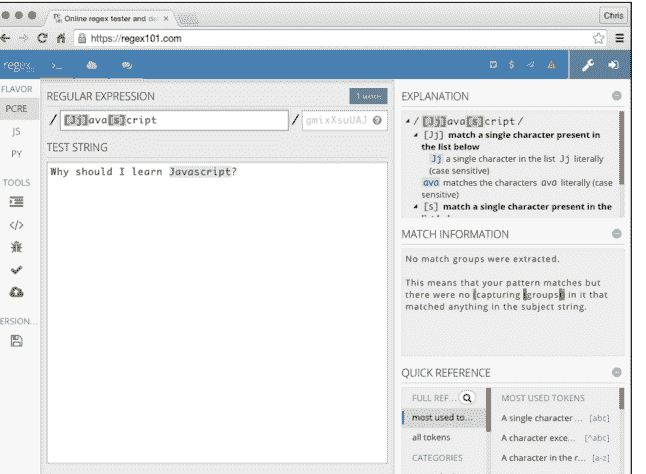

图 14-3：使用`regex101.com`测试正则表达式。

### 正则表达式中的特殊字符

正则表达式使你能够搜索字符串中的数字、字母、字母组、字符重复以及更多内容。

为了创建复杂的搜索模式，你可以使用正则表达式特殊字符。最常用的特殊字符列在表 14-1 中。

### 使用修饰符

| 表 14-1 | 正则表达式特殊字符 |
| :--- | :--- |
| **特殊字符** | **含义** |
| `\` | 指定下一个字符应被视为特殊字符还是字面字符。如果后续字符是特殊字符，`\` 表示它应被视为字面字符。 |
| `^` | 匹配输入的开始位置。 |
| `$` | 匹配输入的结束位置。 |
| `*` | 匹配前面的字符 0 次或多次。 |
| `+` | 匹配前面的字符 1 次或多次。 |


| `?` | 匹配前面的字符 0 次或 1 次。 |
| `.` | 匹配除换行符以外的任意单个字符。 |
| `x\|y` | 匹配 x 或 y。 |
| `{n}` | 精确匹配前面的字符 n 次。 |
| `[xyz]` | 匹配方括号中的任意一个字符。 |
| `[^xyz]` | 匹配除方括号中字符以外的任意字符。 |
| `\b` | 匹配单词边界。 |
| `\B` | 匹配非单词边界。 |
| `\d` | 匹配数字字符。 |
| `\D` | 匹配任何非数字字符。 |
| `\n` | 匹配换行符。 |
| `\s` | 匹配单个空白字符，包括空格、制表符、换页符和换行符。 |
| `\S` | 匹配单个非空白字符。 |
| `\t` | 匹配制表符。 |
| `\w` | 匹配任何字母数字字符，包括下划线。 |
| `\W` | 匹配任何非单词字符。 |

修饰符可用于修改搜索整体的若干参数。要使用修饰符，在创建正则表达式对象时将其作为`RegExp()`构造函数的第二个参数传递，或者将其放在正则表达式字面量的结束`/`之后。

三种修饰符分别是：

- **g (global):** 表示应搜索整个字符串，而不是在找到第一个匹配项后就停止搜索。
- **i (case insensitive):** 表示应忽略输入字符的大小写（大写或小写）。
- **m (multiline):** 执行多行匹配。例如，当使用`^`（开始）和`$`（结束）特殊字符时，将每行视为新的行开始和结束，而不仅仅是考虑输入的整体开始和结束。

以下正则表达式将匹配我们在本章前面展示的 JavaScript 一词在整个文档中的所有变体：

```
/javascript/ig
```

## 使用正则表达式编程

正则表达式与正则表达式方法以及一部分字符串函数（见第 3 章）配合使用。

正则表达式方法有：

- **test:** 测试是否匹配，如果找到匹配则返回`true`，否则返回`false`。
- **exec:** 测试是否匹配，并返回关于匹配信息的数组。

如果你只需要知道字符串是否包含符合正则表达式的匹配项，你应该使用`test`方法。如果你需要知道匹配项在字符串中的位置、有多少个匹配项以及匹配的文本，你应该使用`exec`。

可以使用正则表达式的字符串函数如表 14-2 所示。

电子邮件验证是正则表达式一个很好且出人意料地复杂的应用。每个有效的电子邮件地址都遵循某些规则。基本规则是：

- 必须包含一个 @ 符号
- @ 符号前后必须包含字符
- @ 符号之后必须包含至少一组分隔的字符组

### 表 14-2：使用正则表达式的字符串函数

| 函数 | 用途 |
| :--- | :--- |
| `match` | 在字符串中搜索正则表达式的匹配项。它返回关于匹配信息的数组，如果未找到匹配则返回`null`。 |
| `search` | 测试字符串中的匹配项。如果找到，返回匹配项的索引。如果未找到，返回`-1`。 |
| `replace` | 在字符串中搜索匹配项，并将匹配项替换为替换字符串。 |
| `split` | 使用正则表达式或固定字符串将字符串拆分为子字符串数组。 |

还有其他规则，但当你开始讨论细节时，情况会迅速变得复杂，例如在某些情况下电子邮件地址允许包含空格以及国际字符。

对于要求用户输入有效电子邮件地址的人来说，通常在接受输入之前对电子邮件地址进行任何简单的测试，都能大幅减少虚假条目的输入。

代码清单 14-3 演示了一个电子邮件验证脚本。在用户输入电子邮件地址并按下验证按钮后，脚本将电子邮件地址与以下正则表达式字面量进行测试：

```
/\b[A-Z0-9._%+-]+@[A-Z0-9.-]+\.[A-Z]{2,4}\b/i
```

此正则表达式以`\b`（单词边界特殊字符）开始。单词边界匹配一个新单词的开始。之后，我们有以下模式：

```
[A-Z0-9._%+-]+
```

这匹配一个或多个字母或数字的组合，其中可能包含下划线、百分号或连字符。

```
@[A-Z0-9.-]+
```

这部分要求一个 @ 符号，后跟一个或多个字母、数字或连字符的组合。

```
\.[A-Z]{2,4}\b/i
```

正则表达式的末尾寻找一个长度为 2 到 4 个字符的字符串（电子邮件地址中的 com 或 net 或 org 部分），后跟单词的结束。在正则表达式的最末尾，它使用了`/i`修饰符来表示该正则表达式将匹配大写或小写字符。

如果发生匹配，则输入的数据通过了测试，并会出现一个声明地址“valid!”的弹出窗口。

### 代码清单 14-3：电子邮件验证脚本

```html
<html>
<head>
  <title>Email Validator</title>
  <script>
    window.addEventListener('load',loader,false);
    function loader(e){
      e.preventDefault();
      document.getElementById('emailinput').addEventListener('submit',validateEmail,false);
    }

    function validateEmail(e) {
      var re = /\b[A-Z0-9._%+-]+@[A-Z0-9.-]+\.[A-Z]{2,4}\b/i;
      if (re.test(e.target.yourEmail.value)) {
        alert("valid!");
      } else {
        alert("invalid!");
      }
    }

  </script>
</head>
<body>
  <form id="emailinput">
    <label>Enter an email address:
      <input type="text" id="yourEmail">
    </label>
    <input type="submit" value="Validate" id="validate">
  </form>
</body>
</html>
```

在浏览器中运行代码清单 14-3 的结果如图 14-4 所示。

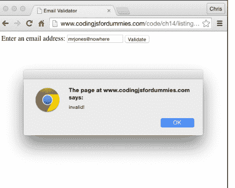

**图 14-4：** 在电子邮件验证脚本中使用正则表达式。

# 第 15 章

# 理解回调函数和闭包

**本章内容**

- 理解回调函数
- 使用回调函数
- 创建闭包

> “噢，请让昨天回电，恳请时间回归。”
> — 威廉·莎士比亚


回调函数和闭包是 JavaScript 中最有用且应用最广泛的两种技术。在本章中，你将了解到如何以及为什么要将函数作为参数传递给其他函数。

不要忘记访问网站，查看与本章相关的在线练习！

## 什么是回调函数？


JavaScript 函数是对象。这一陈述是理解许多高级 JavaScript 主题（包括回调函数）的关键。

函数与任何其他对象一样，可以被赋值给变量，可以作为参数传递给其他函数，并且可以在函数内部创建并由函数返回。

# 第四部分：进阶内容

### 将函数作为参数传递

*回调函数*是指作为参数传递给另一个函数的函数。回调函数是 JavaScript 中一种可行的技术，原因在于**函数是对象**。

函数对象包含一个包含函数代码的字符串。当你通过写出函数名后跟`()`来调用函数时，你是在告诉该函数执行其代码。当你只写出函数名或传递函数而不带`()`时，函数不会执行。

第 11 章有回调函数的示例，其中你可以使用`addEventListener`方法，例如

```
document.addEventListener('click', doSomething, false);
```

该方法接受一个事件（`click`）和一个 Function 对象（`doSomething`）作为参数。回调函数不会立即执行。相反，`addEventListener`方法在事件发生时才执行该函数。

### 编写带回调的函数

下面是一个简单的示例函数`doMath`，它接受一个回调函数作为参数：

```
function doMath(number1, number2, callback) {
    var result = callback(number1, number2);
    document.write("The result is: " + result);
}
```

该函数是一个通用函数，用于返回涉及两个操作数的任何数学运算的结果。传递给它的回调函数决定了实际执行的操作。

要调用我们的`doMath`函数，请传递两个数字参数，然后将一个函数作为第三个参数：

```
doMath(5, 2, function(number1, number2){
    var calculation = number1 * number2 / 6;
    return calculation;
});
```

清单 15-1 是一个完整的网页，其中包含`doMath`函数，然后使用不同的回调函数多次调用它。

### 清单 15-1：使用不同的回调函数调用函数

```
<html>
<head>
    <title>Introducing the doMath function</title>
    <script>
        function doMath(number1, number2, callback) {
            var result = callback(number1, number2);
            document.getElementById("theResult").innerHTML +=
                ("The result is: " + result + "<br>");
        }

        document.addEventListener('DOMContentLoaded', function() {
            doMath(5, 2, function(number1, number2){
                var calculation = number1 * number2;
                return calculation;
            });

            doMath(10, 3, function(number1, number2){
                var calculation = number1 / number2;
                return calculation;
            });

            doMath(81, 9, function(number1, number2){
                var calculation = number1 % number2;
                return calculation;
            });
        }, false);
    </script>
</head>
<body>
    <h1>Do the Math</h1>
    <div id="theResult"></div>
</body>
</html>
```

在浏览器中运行清单 15-1 的结果如图 15-1 所示。

### 使用命名回调函数

在前一节的示例中，回调函数都是作为**匿名函数**编写的。也可以定义命名函数，然后将函数名作为回调函数传递。

*匿名函数*（参见第 7 章）是指你创建的、没有名称的函数。

使用命名函数作为回调可以减少使用匿名函数时代码的视觉杂乱。清单 15-2 展示了如何使用命名函数作为回调的示例。此示例相比清单 15-1 还有以下两项改进：

- ✔ 在`doMath`函数中添加了一个测试，确保回调参数确实是一个函数。
- ✔ 它在显示运行结果之前，先打印出回调函数的代码。

### 清单 15-2：使用命名函数作为回调

```
<html>
<head>
    <title>doMath with Named Functions</title>
    <script>
        function doMath(number1, number2, callback) {
            if (typeof callback === "function") {
                var result = callback(number1, number2);
                document.getElementById("theResult").innerHTML +=
                    (callback.toString() + "<br><br>The result is: "
                    + result + "<br><br>");
            }
        }

        function multiplyThem(number1, number2){
            var calculation = number1 * number2;
            return calculation;
        }

        function divideThem(number1, number2){
            var calculation = number1 / number2;
            return calculation;
        }

        function modThem(number1, number2){
            var calculation = number1 % number2;
            return calculation;
        }

        document.addEventListener('DOMContentLoaded', function() {
            doMath(5, 2, multiplyThem);
            doMath(10, 3, divideThem);
            doMath(81, 9, modThem);
        }, false);
    </script>
</head>
<body>
    <h1>Do the Math</h1>
    <div id="theResult"></div>
</body>
</html>
```

在浏览器中运行清单 15-2 的结果如图 15-2 所示。

### 理解闭包

*闭包*是指函数的局部变量，在函数返回后仍然保持存活。

请看清单 15-3 中的示例。在此示例中，内部函数定义在外部函数内。当外部函数返回对内部函数的引用时，返回的引用仍然可以访问外部函数的局部数据。

在清单 15-3 中，`greetVisitor`函数返回在其内部创建的函数`sayWelcome`。注意，return 语句在`sayWelcome`后面没有使用`()`。这是因为我们不想返回运行函数的值，而是返回实际函数的代码。

### 清单 15-3：使用函数创建函数

```
function greetVisitor(phrase) {
    var welcome = phrase + ". Great to see you!"; // Local variable
    var sayWelcome = function() {
        alert(welcome);
    }
    return sayWelcome;
}

var personalGreeting = greetVisitor('Hola Amiga');
personalGreeting(); // alerts "Hola Amiga. Great to see you!"
```

清单 15-3 的有用之处在于，它使用`greetVisitor`函数创建了一个名为`personalGreeting`的新自定义函数，该函数仍然可以访问原始函数中的变量。

通常情况下，当函数执行完毕后，其中的局部变量将无法访问。然而，通过返回一个函数引用（`sayWelcome`），`greetVisitor`函数的内部数据对外界变得可访问。

使用命名函数作为回调相比使用匿名函数作为回调有两个优点：

- 使你的代码更易于阅读。
- 命名函数用途多样，可以单独使用，也可以作为回调使用。

理解闭包的关键在于理解 JavaScript 中的变量作用域，以及理解**执行函数**与**函数引用**之间的区别。通过将`greetVisitor`函数的返回值赋给新的`personalGreeting`函数，程序存储了`sayWelcome`函数的代码。你可以使用`toString()`方法来测试这一点：

```
personalGreeting.toString()
```

如果你在清单 15-3 中添加一个 alert 语句来输出`personalGreeting`的`toString()`值，你会得到图 15-3 所示的结果。

在图 15-3 中，变量`welcome`是创建闭包时原始`greetVisitor`函数中变量`welcome`的副本。

在清单 15-4 中，使用不同的参数创建了一个新的闭包。即使调用`greetVisitor()`会改变`welcome`变量的值，调用第一个函数（`personalGreeting`）的结果仍然保持不变。


### 清单 15-4：闭包包含对外部函数变量的秘密引用

```html
<html>
<head>
    <title>Using Closures</title>
    <script>
        function greetVisitor(phrase) {
            var welcome = phrase + " . Great to see you!<br><br>"; // Local variable
            var sayWelcome = function() {
                document.getElementById("greeting").innerHTML += welcome;
            }
        }
    </script>
</head>
```

### 清单 15-4（续）

```javascript
return sayWelcome;
}
// 等待文档加载完成
document.addEventListener('DOMContentLoaded',
    function() {

        // 创建一个函数
        var personalGreeting = greetVisitor("Hola Amiga");
        // 创建另一个函数
        var anotherGreeting = greetVisitor("Howdy, Friend");

        // 查看第一个函数的代码
        document.getElementById("greeting").innerHTML += 
            "personalGreeting.toString() <br>" + personalGreeting.
            toString() + "<br>";

        // 运行第一个函数
        personalGreeting(); // 弹出显示 "Hola Amiga. Great to
            see you!"

        // 查看第二个函数的代码
        document.getElementById("greeting").innerHTML += 
            "anotherGreeting.toString() <br>" + 
            anotherGreeting.toString() + "<br>";

        // 运行第二个函数
        anotherGreeting(); // 弹出显示 "Howdy, Friend. Great to
            see you!"

        // 再次检查第一个函数
        personalGreeting(); // 弹出显示 "Hola Amiga. Great to
            see you!"

        // 结束 addEventListener 方法
        }, false);
    });
</script>
</head>
<body>
    <p id="greeting"></p>
</body>
</html>
```

在 Web 浏览器中运行清单 15-4 的结果如图 15-4 所示。

> 一旦你了解了闭包背后的概念并且有使用它们的需求，闭包就不难理解。如果你现在还不能完全掌握它们，也不必担心。完全有可能在不使用闭包的情况下编写 JavaScript 代码，但一旦你理解了它们，它们会非常有用，并且会让你成为一个更好的程序员。


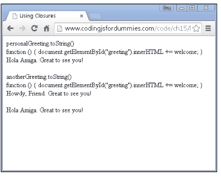

图 15-4：使用闭包创建自定义问候语。

## 使用闭包

闭包就像是保存了一个函数在创建时的局部变量副本。

在 Web 编程中，闭包常用于消除程序中的重复工作，或者保存在整个程序中需要重用的值，这样程序就不必在每次使用时都重新计算该值。

闭包的另一个用途是为特定用途创建函数的自定义版本。

在清单 15-5 中，闭包被用来创建具有针对程序中可能出现的不同问题的特定错误消息的函数。所有错误消息都使用相同的函数创建。

当一个函数的用途是创建其他函数时，它被称为 *函数工厂*。

```html
清单 15-5：使用一个函数来创建函数

<html>
<head>
  <title>函数工厂</title>
  <script>
```

### 清单 15-5（续）

```javascript
function createMessageAlert(theMessage){
  return function() {
    alert (theMessage);
  }
}

var badEmailError = createMessageAlert("Unknown email address!");
var wrongPasswordError = createMessageAlert("That's not your password!");

window.addEventListener('load', loader, false);
function loader(){
  document.login.yourEmail.addEventListener('change', badEmailError);
  document.login.yourPassword.addEventListener('change',wrongPasswordError);
}

</script>
</head>
<body>
  <form name="login" id="loginform">
    <p>
      <label>输入您的电子邮件地址：
        <input type="text" name="yourEmail">
      </label>
    </p>
    <p>
      <label>输入您的密码：
        <input type="text" name="yourPassword">
      </label>
    </p>
    <button>提交</button>
</form>
</body>
</html>
```

理解清单 15-5 的关键在于工厂函数。

```javascript
function createMessageAlert(theMessage){
    return function() {
      alert (theMessage);
    }
}
```

要使用这个函数工厂，请将其返回值赋给一个变量，如下面的语句所示：

```javascript
var badEmailError = createMessageAlert("Unknown email address!");
```

前面的语句创建了一个闭包，可以通过运行`badEmailError`作为函数在程序的其他地方使用，如下面的事件处理程序所示：

```javascript
document.login.yourEmail.addEventListener('change', badEmailError);
```

## 第 16 章：拥抱 AJAX 和 JSON

**本章内容**

- 读写 JSON

- 理解 AJAX

- 使用 AJAX

> “网络不仅仅连接机器，它连接的是人。”

— 蒂姆·伯纳斯-李

AJAX 是一种通过在用户与页面交互时在后台发送和接收数据，使网页更具动态性的技术。JSON 已成为 AJAX 应用程序使用的标准数据格式。在本章中，你将学习如何使用 AJAX 技术让你的网站焕发光彩！

### 使用 AJAX 在幕后工作

异步 JavaScript + XML (AJAX) 是一个术语，用于描述一种使用 JavaScript、DOM、HTML 和`XMLHttpRequest`对象协同工作的方法，无需刷新整个页面即可用实时数据刷新网页的部分内容。AJAX 于 2004 年首次由 Google 的 Gmail 大规模实现，然后由 Jesse James Garret 在 2005 年正式命名。

HTML DOM 可以动态地改变页面。AJAX 所做出的重要创新是使用`XMLHttpRequest`对象异步（在后台）从服务器检索数据，而不会阻塞网页上其余 JavaScript 的执行。

尽管 AJAX 最初依赖于 XML 格式的数据（因此名称中有 X），但如今 AJAX 应用程序更常使用一种名为 JavaScript 对象表示法 (JSON) 的数据格式。大多数人仍然将从服务器异步获取 JSON 数据的应用程序称为 AJAX，但从技术上讲更准确（但更难记住）的缩写应该是 AJAJ。

### AJAX 示例

当 Web 开发人员开始使用 AJAX 时，它成为了被称为 Web 2.0 的标志之一。在 AJAX 之前，网页显示动态数据的最常见方式是从服务器下载一个新网页。例如，考虑如图 16-1 所示的`craigslist.org`。

要浏览 Craigslist 上的类别列表或搜索结果，你需要单击链接，这会导致整个页面刷新并显示你请求的页面内容。

虽然仍然很常见，但刷新整个页面来仅显示页面一部分的新数据是不必要的缓慢，并且可能提供不太流畅的用户体验。

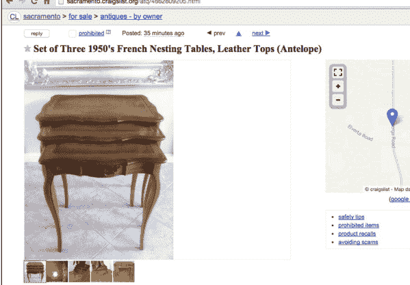

**图 16-1：** Craigslist.org 很满意 Web 1.0，非常感谢你。

将 Craigslist 风格的导航与如图 16-2 所示的更像应用程序的 Google Plus 导航进行比较，后者使用 AJAX 在导航栏保持静态的同时将新内容加载到屏幕的一部分。

除了使网页导航更流畅之外，AJAX 还非常适合在网页中创建实时数据元素。在 AJAX 之前，如果你想显示实时数据、图表或最新的电子邮件收件箱视图，你需要使用插件（如 Adobe Flash）或定期使网页自动刷新。

使用 AJAX，可以通过在后台运行的异步过程定期刷新数据，然后仅更新需要修改的页面元素。

有关如何使用 HTML DOM 的方法和属性更新网页的 HTML 和 CSS，请参阅第 10 章。AJAX 依赖于这些相同的技术来显示带有更新数据的网页。

Weather Underground 的 Wundermap（如图 16-3 所示）显示了一个具有不断变化和更新的数据叠加层的天气图。地图的数据是使用 AJAX 从远程服务器检索的。


**图 16-2：** Google Plus 使用 AJAX 提供现代用户体验。

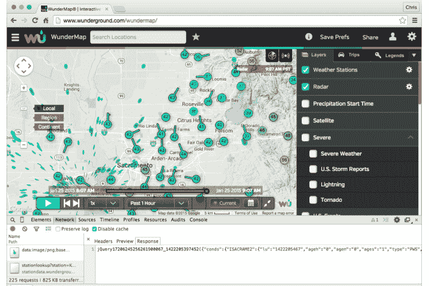

图 16-3：Wundermap 使用 AJAX 显示实时天气数据。

### 查看正在运行的 AJAX

在上一节所示的图 16-3 中，Chrome 开发者工具窗口打开到“网络”选项卡。“网络”选项卡显示与当前网页相关的所有网络活动。当页面加载时，这包括页面的 HTML、CSS、JavaScript 和图像的请求和下载。页面加载后，“网络”选项卡还会显示使 AJAX 成为可能的异步 HTTP 请求和响应。

请按照以下步骤在 Chrome 中查看 AJAX 请求和响应：

- 1. **打开你的 Chrome 浏览器并导航到`www.wunderground.com/wundermap`。**

- 2. **使用 Chrome 菜单或按 Command+Option-I（在 Mac 上）或 Control+Shift-I（在 Windows 上）打开你的 Chrome 开发者工具。**

- 3. **打开“网络”选项卡。**

你的开发者工具窗口现在应该类似于图 16-4。此时你可能需要拖动开发者工具的上边框使其更大。如果这使得

## 第 16 章：拥抱 AJAX 和 JSON


图 16-4：开发者工具的“网络”标签页。

浏览器窗口太小了，但目前重要的是观察开发者工具中正在发生什么。

请注意，“网络”标签页中正在定期出现新项目。这些是 AJAX 请求和响应。其中一些是服务器返回的图像，另一些是供客户端 JavaScript 使用的数据。

4. **点击“网络”标签页“名称”列中的某一行。**

将显示关于该特定项目的更多数据，如图 16-5 所示。

5. **点击详细数据窗格中的选项卡（标头、预览、响应等）并查看数据。**

第一个选项卡“标头”显示了发送到远程服务器的 HTTP 请求。特别看一下请求 URL。这是一个向远程服务器传递数据的标准网站地址。

6. **选择并复制你检查过的某个项目的请求 URL 的值。**

7. **在浏览器中打开一个新标签页，将整个请求 URL 粘贴到地址栏中。**

一个包含数据或图像的页面将打开，如图 16-6 所示。

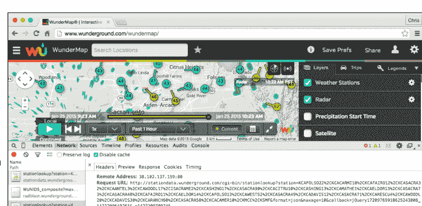

图 16-5：在“网络”标签页中查看特定记录的详细信息。

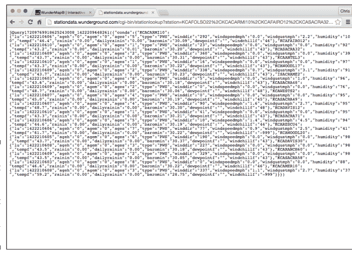

图 16-6：从“网络”标签页复制 HTTP 请求 URL 的结果。

8. 比较在新标签页中打开请求 URL 的结果与开发者工具“响应”标签页中显示的结果。

它们应该相似，但可能不完全相同，因为它们不是在同一时间运行的。

如你所见，AJAX 并没有什么魔法。网页上的 JavaScript 只是向服务器请求和接收数据。幕后发生的一切都可以通过 Chrome 开发者工具（或当今大多数其他 Web 浏览器提供的类似工具）进行检查。

## 使用 XMLHttpRequest 对象

`XMLHttpRequest`对象提供了一种让 Web 浏览器从 URL 请求数据而无需刷新页面的方式。

`XMLHttpRequest`对象最初由 Microsoft 在其 Internet Explorer 浏览器中创建和实现，此后已成为被每个现代 Web 浏览器采用的 Web 标准。

你可以使用`XMLHttpRequest`对象的方法和属性从远程服务器或本地服务器检索数据。尽管名称如此，`XMLHttpRequest`对象可以获取除 XML 之外的其他类型的数据，甚至可以使用除 HTTP 之外的不同协议来获取数据。

清单 16-1 展示了如何使用`XMLHttpRequest`将包含 HTML 的外部文本文档内容加载到当前 HTML 文档中。

### 清单 16-1：使用 XMLHttpRequest 加载外部数据

```html
<html>
<head>
 <title>Loading External Data</title>
 <script>
  window.addEventListener('load',init,false);
   function init(e){
    document.getElementById('myButton').
           addEventListener('click',documentLoader,false);
   }

   function reqListener () {
    console.log(this.responseText);
    document.getElementById('content').innerHTML = this.
           responseText;
   }

   function documentLoader(){
    var oReq = new XMLHttpRequest();
    oReq.onload = reqListener;
    oReq.open("get", "loadme.txt", true);
    oReq.send();
   }
 </script>
</head>
<body>
  <form id="myForm">
    <button id="myButton" type="button">Click to
      Load</button>
  </form>
  <div id="content"></div>
</body>
</html>
```

该文档的核心是`documentLoader`函数：

```javascript
function documentLoader() {
  var oReq = new XMLHttpRequest();
  oReq.onload = reqListener;
  oReq.open("get", "loadme.txt", true);
  oReq.send();
}
```

函数内的第一行代码创建了新的`XMLHttpRequest`对象，并将其命名为`oReq`：

```javascript
var oReq = new XMLHttpRequest();
```

`XMLHttpRequest`对象的方法和属性可以通过`oReq`对象访问。

第二行将一个函数`reqListener`分配给`oReq`对象的`onload`事件。这样做的目的是在`oReq`加载文档时调用`reqListener`函数：

```javascript
oReq.onload = reqListener;
```

第三行使用`open`方法创建一个请求：

```javascript
oReq.open("get", "loadme.txt", true);
```


在这种情况下，该函数使用 HTTP GET 方法加载名为 `loadme.txt` 的文件。第三个参数是 `async` 参数。它指定请求是否应该是异步的。如果设置为 `false`，`send` 方法在请求完成之前不会返回。如果设置为 `true`，将通过事件监听器提供有关请求完成的通知。因为事件监听器设置为监听 `load` 事件，所以需要异步请求。

你不太可能遇到需要将 `async` 参数设置为 `false` 的情况。事实上，一些浏览器已经开始忽略设置为 `false` 的此参数，将其视为 `true`，因为同步请求会对用户体验产生不良影响。

`documentLoader` 函数中的最后一行实际上发送了你通过 `open` 方法创建的请求：

```javascript
oReq.send();
```

`open` 方法将获取所请求文件的最新版本。所谓的实时数据应用程序通常使用循环通过 AJAX 反复从服务器请求更新的数据。

## 处理同源策略

如果你将清单 16-1 中的 HTML 文档保存到计算机并在 Web 浏览器中打开它，很可能不会得到预期的结果。如果你从计算机加载文档，然后打开 Chrome 开发者工具 JavaScript 控制台，你将看到类似图 16-7 中所示的错误信息。

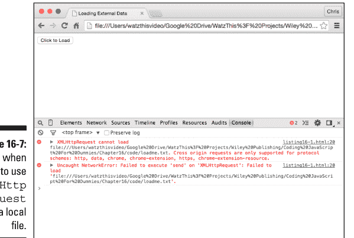

这里的问题是所谓的同源策略（same-origin policy）。为了防止网页导致用户在不知情的情况下下载可能使用 `XMLHttpRequest` 的恶意代码，每当脚本尝试加载不具有相同源的 URL 时，浏览器默认会返回错误。如果你从 `www.example.com` 加载网页，并且该页面上的脚本尝试从 `www.watzthis.com` 检索数据，浏览器将阻止该请求并显示类似图 16-7 中的错误。

同源策略也适用于本地计算机上的文件。如果不这样，`XMLHttpRequests` 可能会被用来危害计算机的安全性。

你不必担心本书中的示例会对你计算机产生负面影响。然而，为了让本章中的示例在你的计算机上正常工作，需要一种绕过同源策略的方法。

绕过同源策略的第一种方法是将包含 `documentLoader` 函数的 HTML 文件和文本文件一起放到同一个 Web 服务器上。你可以访问 [www.codingjsfordummies.com/code/ch16/listing16-1.html](https://www.codingjsfordummies.com/code/ch16/listing16-1.html) 看到一个这样的工作示例。

绕过同源策略的另一种方法是临时禁用同源策略限制来启动浏览器。


这些说明仅用于允许你在本地计算机上测试自己的文件。请勿在禁用同源策略的情况下浏览网页。你可能会使计算机暴露于恶意代码。

要禁用 macOS 上的同源策略：

1. 关闭你的 Chrome 浏览器。
2. 打开终端应用并使用以下命令启动 Chrome：

```bash
/Applications/Google\ Chrome.app/Contents/MacOS/Google\ Chrome --disable-web-security
```

要禁用 Windows 上的同源策略：

1. 关闭你的 Chrome 浏览器。
2. 打开命令提示符并导航到你安装 Chrome 的文件夹。
3. 输入以下命令启动浏览器：

```cmd
Chrome.exe --disable-web-security
```

## 第 16 章：拥抱 AJAX 和 JSON

一旦浏览器启动，你就可以在本地运行包含 AJAX 请求的文件，直到关闭浏览器为止。一旦浏览器关闭并重新打开，安全限制将自动重新启用。

图 16-8 显示了在没有同源策略错误的情况下，在浏览器中运行代码清单 16-1 的结果。


图 16-8：在禁用了同源策略的浏览器中运行代码清单 16-1。

### 使用 CORS，AJAX 请求的万能钥匙

Web 应用程序为了获取数据检索而向不同的服务器发送请求是非常常见的。例如，Google 为第三方应用程序免费提供地图数据。

为了确保服务器之间的交易安全，人们创建了一些机制，让浏览器和服务器能够协调分歧并建立信任。

目前，允许和限制服务器之间资源访问的最佳方法是名为跨源资源共享（Cross-Origin Resource Sharing，CORS）的标准。

要查看 CORS 的实际运行情况，请在浏览 Weather Underground 的 Wundermap 时，查看 Chrome 开发者工具中的 Network（网络）选项卡。点击一个以以下 URL 开头的请求：

`http://stationdata.wunderground.com/cgi-bin/stationlookup.`

点击 Headers（标头）选项卡，你将在 HTTP 标头中看到以下文本：

```
Access-Control-Allow-Origin: *
```

这就是该特定服务器配置为发送的 CORS 响应标头。冒号后的星号值表示该服务器将接受来自任何源的请求。如果 wunderground.com 的所有者想将对此脚本数据的访问限制在特定服务器或经过身份验证的用户，他们可以使用 CORS 来实现。

### 使用 JSON 让对象灵活运作

在代码清单 16-1 中，你使用 AJAX 打开并显示一个包含 HTML 片段的文本文档。AJAX 的另一个常见用途是请求并接收数据，由浏览器进行处理。

例如，gasbuddy.com 使用 Google 地图以及关于油价的数据，来呈现不同地点的油价的简单且最新的视图，如图 16-9 所示。


图 16-9：gasbuddy.com 使用 AJAX 在地图上显示油价。

如果你在 Network 选项卡中检查 gasbuddy.com，你会发现某些请求的响应看起来像代码清单 16-2 中所示的代码。

代码清单 16-2：gasbuddy.com 上 AJAX 请求响应的部分内容

```
([{id:"tuwtvtuvvvv",base:[351289344,822599680],zrange:[11,11],layer:"m@288429816",features:[{id:"17243857463485476481",a:[0,0],bb:[-8,-8,7,7,-47,7,48,22,-41,19,41,34],c:"{1:{title:\"Folsom Lake State Recreation Area\"},4:{type:1}}"}],{id:"tuwtvtuvvvw",zrange:[11,11],layer:"m@288429816"},{id:"tuwtvtuvvww",base:[351506432,824291328],zrange:[11,11],layer:"m@288429816",features:[{id:"8748558518353272790",a:[0,0],bb:[-8,-8,7,7,-41,7,41,22],c:"{1:{title:\"Deer Creek Hills\"},4:{type:1}}"}]},{id:"tuwtvtuvvww",zrange:[11,11],layer:"m@288429816"}])
```

如果你从这段代码中提取一小块数据并重新格式化，你会得到类似代码清单 16-3 的内容，这应该让你看起来更熟悉。

代码清单 16-3：重新格式化后的 gasbuddy.com 响应数据

```
{id:"tuwtvtuvvvv",
base:[351289344,822599680],
zrange:[11,11],
layer:"m@288429816",
features:[{
id:"17243857463485476481",
a:[0,0],
bb:[-8,-8,7,7,-47,7,48,22,-41,19,41,34],
c:"{
1:{title:\"Folsom Lake State Recreation Area\"},
4:{type:1}
}"
}]
}
```

通过观察数据的格式，你可以发现它看起来非常像 JavaScript 对象字面量的名称:值格式（参见第 8 章）。

JSON 如此易于使用的主要原因是它已经处于 JavaScript 可以处理的格式中，因此不需要进行转换。例如，代码清单 16-4 显示了一个包含本书信息的 JSON 文件。

代码清单 16-4：描述《Coding with JavaScript For Dummies》的 JSON 数据

```
{ "book_title": "Coding with JavaScript For Dummies",
 "book_author": "Chris Minnick and Eva Holland",
 "summary": "Everything beginners need to know to start coding with JavaScript!",
 "isbn":"9781119056072"
}
```

代码清单 16-5 展示了如何使用 JavaScript 将这些数据加载到网页中，然后将其数据显示在 HTML 中。

代码清单 16-5：使用 JavaScript 显示 JSON 数据

```html
<html>
<head>
<title>Displaying JSON Data</title>
<script>
window.addEventListener('load',init,false);
function init(e){
    document.getElementById('myButton').
        addEventListener('click',documentLoader,false);
}

function reqListener () {
    // convert the string from the file to an object with
    // JSON.parse
    var obj = JSON.parse(this.responseText);

    // display the object's data like any object
    document.getElementById('book_title').innerHTML = 
        obj.book_title;
    document.getElementById('book_author').innerHTML = 
        obj.book_author;
    document.getElementById('summary').innerHTML = 
        obj.summary;
}

function documentLoader(){
    var oReq = new XMLHttpRequest();
    oReq.onload = reqListener;
    oReq.open("get", "listing16-4.json", true);
    oReq.send();
}
</script>
</head>
<body>
  <form id="myForm">
    <button id="myButton" type="button">Click to
      Load</button>
  </form>
  <h1>Book Title</h1>
  <div id="book_title"></div>
  <h2>Authors</h2>
  <div id="book_author"></div>
  <h2>Summary</h2>
  <div id="summary"></div>
</body>
</html>
```

将任何从外部源引入 JavaScript 文档的 JSON 数据进行显示的密钥是：使用 `JSON.parse` 方法将其从字符串转换为对象。之后，你就可以使用点符号或方括号符号来访问 JSON 文件中的值，就像访问任何 JavaScript 对象的属性一样。

图 16-10 显示了在 Web 浏览器中运行代码清单 16-5 并按下按钮加载 JSON 数据的结果。


# 第 V 部分：JavaScript 和 HTML5


请在 www.dummies.com/extras/codingwithjavascript 在线阅读文章“Using Polyfills”，了解如何使用 polyfills 在尚未支持某些功能的浏览器中实现这些功能。

## 在本部分中……

- 了解如何使用 HTML5 API 来访问广泛的计算机和移动设备功能。
- 探索 jQuery 的基础知识，以加速并简化 JavaScript 开发。
- 在 www.dummies.com/extras/codingwithjavascript 在线阅读文章“Using Polyfills”，了解如何使用 polyfills 在尚未支持某些功能的浏览器中实现这些功能。

## 第 17 章：HTML5 API

### 本章内容

- 探索 API
- 利用地理定位
- 访问媒体

> “语言是一种来自外太空的病毒。”
>
> ——威廉·S·巴勒斯（William S. Burroughs）

HTML5 的 API 为你提供了访问广泛的计算机和移动设备功能的途径。在本章中，你将了解如何使用 API、API 使用的标准方法和技术，以及用于处理一些更令人兴奋的 API 的示例代码。

### 理解 API 的工作原理

API（即应用程序编程接口，Application Programming Interfaces）是一组软件例程和标准，使程序员能够访问软件应用程序的功能。API 是一种手段，通过它，一个计算机程序能够赋予另一个计算机程序与之交互的能力。当 Web 浏览器允许 JavaScript 程序与其交互时，它是通过使用 API 来实现的。

例如，W3C 的 Battery Status API 描述了浏览器应如何报告设备（如智能手机或平板电脑）电池当前状态的数据。其他程序（例如网页中的 JavaScript 程序）可以通过访问 Battery Status API 来了解设备的电池电量是否低、是否正在充电，或者还剩多少电池时间。然后你可以在程序中利用这些电池状态信息。

# 第五部分：JavaScript 和 HTML5

API 中的语言具有极高的精确性，它准确地描述了 Web 浏览器应如何实现该 API。图 17-1 展示了最新版本电池状态（Battery Status）API 的一段引用。

> 如果电池正在放电，`charging` 属性必须被设置为 `false`；如果电池正在充电、实现端无法报告电池状态、系统未连接电池或处于其他情况，则应设置为 `true`。当电池充电状态更新时，用户代理（user agent）必须将一个任务加入队列，该任务用于设置 `charging` 属性的值，并在 `BatteryManager` 对象上触发一个名为 `chargingchange` 的简单事件。
>
> 如果电池已满或系统未连接电池，`batterylevel` 属性必须被设置为 `0.0`；如果电池正在放电、实现端无法报告剩余充电时间或处于其他情况，则设置为正无穷大（positive infinity）。当 `batterylevel` 属性更新时，用户代理必须将一个任务加入队列，该任务用于设置 `chargingTime` 属性的值，并在 `BatteryManager` 对象上触发一个名为 `chargingtimechange` 的简单事件。
>
> 如果电池正在充电、实现端无法报告剩余放电时间、系统未连接电池或处于其他情况，`dischargingtime` 属性必须被设置为正无穷大。当 `dischargingtime` 属性值更新时，用户代理必须将一个任务加入队列，该任务用于设置 `dischargingtime` 属性的值，并在 `BatteryManager` 对象上触发一个名为 `dischargingtimechange` 的简单事件。
>
> 如果系统电池电量耗尽且系统即将挂起，`level` 属性必须被设置为 `0`；如果电池已满、实现端无法报告电池电量或系统未连接电池，则设置为 `1.0`。当 `battery` 电量更新时，用户代理必须将一个任务加入队列，该任务用于设置 `level` 属性的值，并在 `BatteryManager` 对象上触发一个名为 `levelchange` 的简单事件。


通常，API 被编写为一份规范，旨在告知程序员有哪些可用的属性和方法、可以向方法传递哪些参数，以及属性会返回什么样的值。

在许多由万维网联盟（W3C）等标准机构开发的 API 案例中，API 的编写目的是描述程序“应该”如何与 Web 浏览器交互，而不是它们“实际上”能如何交互。是否真正实现某个 API 标准是由浏览器厂商决定的。

> **记住** API 告诉程序员如何与软件交互以及软件应如何响应。当你阅读关于如何与 Web 浏览器交互的 API 时，请务必记住，API 的存在并不意味着程序员就一定能使用它。许多已被提出并编写的 API 尚未被实现，或者在 Web 浏览器中仅得到了部分实现。

## 检查 HTML5 API 的浏览器支持情况


检查特定标准或提议标准被哪些 Web 浏览器支持的最佳来源是`www.caniuse.com`。`CanIUse.com`列出了 HTML5 的所有元素和 API，并为每一个提供了浏览器支持对照表。图 17-2 展示了在撰写本书时，`IndexedDB`数据库的浏览器支持情况。

## 第 17 章：HTML5 API 257


图 17-2：根据`caniuse.com`所示的`IndexedDB`浏览器支持情况。

## 了解 HTML5 的 API

HTML5 标准定义并记录了许多 API，JavaScript 程序员可以使用这些 API 以标准化的方式访问 Web 浏览器的功能。

许多 HTML5 API 尚未最终定稿，也未在所有 Web 浏览器中实现。那些已经实现的 API 非常有用，并且正在拓展 Web 应用可能实现的边界。

HTML5 API 的列表在不断变化和增加。表 17-1 列出了目前 HTML5 中定义的最流行且支持度最高的 API。

> **提示**

您可以在本书的网站`www.dummies.com/extras/codingwithjavascript`上找到更详尽的 HTML5 API 列表。

每个 HTML5 API 都旨在精确指定程序员应如何与 Web 浏览器或计算机的功能进行交互。然而，这些功能从构思到变为现实的过程可能极其漫长且复杂。

## 258 第五部分：JavaScript 和 HTML5

表 17-1：HTML5 API

| **API** | **用途** |
|---|---|
| Battery Status | 提供有关设备电池状态的信息 |
| Clipboard | 提供对操作系统复制、剪切和粘贴功能的访问 |
| Drag and Drop | 支持在浏览器窗口内及窗口之间拖放项目 |
| File | 为程序提供对设备文件系统的安全访问 |
| Forms | 使程序能够访问 HTML5 中定义的新数据类型 |
| Geolocation | 为 Web 应用程序提供对用户设备地理位置数据的访问 |
| getUserMedia/Stream | 提供对外部设备数据（如摄像头视频）的访问 |
| Indexed database | 在 Web 浏览器中创建简单的客户端数据库系统 |
| Internationalization | 提供对本地化格式化和字符串比较的访问 |
| Screen Orientation | 读取屏幕方向状态（纵向或横向），并允许程序员在方向改变时获得通知并将其锁定 |
| Selection | 支持使用 CSS 风格的选择器在 JavaScript 中选择元素 |
| Server-sent events | 允许服务器在无需浏览器请求的情况下向其推送数据 |
| User Timing | 为程序员提供高精度时间戳，用于衡量应用程序的性能 |
| Vibration | 允许访问设备的振动功能 |
| Web Audio | 处理或合成音频 |
| Web Speech | 提供语音输入和文本转语音输出功能 |
| Web storage | 允许在浏览器中存储键值对 |
| Web sockets | 在浏览器和服务器之间开启交互式通信会话 |
| Web workers | 允许 JavaScript 在后台执行脚本 |
| XMLHttpRequest 2 | 改进`XMLHttpRequest`，以消除规避同源策略错误的需要，并使其支持 HTML5 的新特性 |

其中一些 HTML5 API 已经通过了成为广泛支持的标准所需的全部测试和审核流程。其中最突出的是地理定位（`Geolocation`）API。

## 使用地理定位 (Geolocation)

`Geolocation` API 允许程序访问 Web 浏览器的地理定位功能，该功能可以告知程序设备在地球上的位置。

`Geolocation` API 是支持度最高的 HTML5 API 之一，在约 90% 的桌面和移动浏览器中均已实现，包括所有主流浏览器（`Opera Mini`除外）。

### 地理定位能做什么？

`Geolocation` API 描述了 JavaScript 如何与`navigator.geolocation`对象交互，以获取有关设备当前位置的数据，包括：

- **纬度 (Latitude)**：以十进制度数表示的纬度
- **经度 (Longitude)**：以十进制度数表示的经度
- **海拔 (Altitude)**：以米为单位的海拔
- **方向 (Heading)**：设备行驶的方向
- **速度 (Speed)**：设备以米/秒为单位的速度
- **精度 (Accuracy)**：纬度和经度的精度，以米为单位

通过获取部分或全部此类数据，运行在 Web 浏览器中的 JavaScript 应用程序可以将用户定位在地图上，查询`Google Maps`等资源以寻找用户当地的地标或餐厅，以及更多功能。

### 地理定位如何工作？

当 JavaScript 通过`Geolocation`对象发起请求获取设备位置时，在位置信息返回之前，会经历若干步骤。

首先，浏览器需要确认用户已授予该特定 Web 应用访问设备地理位置信息的权限。不同浏览器的权限提示方式不同，但通常是通过某种弹出窗口或通知完成的。

当网站请求访问地理位置数据时，Chrome 浏览器会在地址栏下方显示一个地理定位图标和一条消息，如图 17-3 所示。


在您授予网站访问地理位置数据的权限后，浏览器会尝试寻找您的位置。它通过多种不同手段来实现，从最精确的方式开始，逐步尝试精度较低的方式。

如果程序指示需要高精度，地理定位将花费更多时间尝试访问高精度的 GPS 信息。否则，浏览器将尝试在速度与精度之间取得平衡，从以下可用来源中获取最准确的结果：

- GPS 卫星定位
- 您的无线网络连接
- 您的手机或移动设备连接的基站
- 您的设备或计算机的 IP 地址

## 如何使用地理定位

使用地理定位的关键在于`navigator.geolocation`对象的`getCurrentPosition`方法。`getCurrentPosition`方法可以接受三个参数：

- **success：** 一个回调函数，当地理定位成功时，会传入一个`Position`对象。
- **error：** 一个可选的回调函数，当地理定位失败时，会传入`PositionError`对象。
- **options：** 一个可选的`PositionOptions`对象，可用于控制地理定位查询的多个方面。

`getCurrentPosition`方法返回的`Position`对象包含两个属性：

- `Position.coords:` 包含一个描述位置信息的`Coordinates`对象。
- `Position.timestamp:` 获取位置信息的时间。

清单 17-1 展示了如何使用`getCurrentPosition`方法获取`Position`对象，并遍历`Position.coords`中的返回值。

**清单 17-1：获取位置信息并将其显示在浏览器中**

```
<html>
<head>
  <title>The Position object</title>
  <script>
    var gps = navigator.geolocation.getCurrentPosition(
      function (position) {
        for (key in position.coords) {
          document.write(key+': '+ position.coords[key]);
          document.write ('<br>');
        }
      });
  </script>
</head>
<body>

</body>
</html>
```

如果你运行此代码的设备支持地理定位，且浏览器能够确定你的位置，运行此脚本的结果应类似于图 17-4。


图 17-4：打印`Position`对象的返回值。

注意图 17-4 中，`Coordinates`对象的多个属性值均为`null`。这是因为代码是在没有获取某些坐标能力的台式计算机上运行的。在智能手机的移动浏览器中运行相同脚本的结果如图 17-5 所示。


图 17-5：使用智能手机浏览器获取地理定位数据。

请注意，移动浏览器显示了高度数据，但航向和速度仍为`null`，因为设备在页面加载时处于静止状态。

## 将地理定位与 Google 地图结合使用

程序员使用地理定位数据最常见的操作之一就是在地图上显示一个位置。为此，你首先需要获取纬度和经度。你现在已经获取到了。但是，如何绘制地图并确定该纬度和经度在地图上的位置呢？这似乎是一项令人望而生畏的任务。

幸运的是，已经有人完成了这项工作，并创建了用于与其地图软件交互的 API。最著名的是，Google 通过 Google Maps API 免费向任何人提供其地图软件（在大多数情况下甚至可用于商业用途）。

要使用 Google Maps API，请按照以下步骤操作：

1. **前往 Google APIs 控制台**，访问`http://code.google.com/apis/console`，**然后使用你的 Google 帐号登录。**
2. **登录后，你可能会被要求同意使用条款；如果出现提示，请点击接受。**
3. **点击标有"Enable an API"的按钮。**
   你的屏幕现在会显示一个 API 列表和一个"Browse APIs"搜索框。
4. **在"Browse APIs"搜索框中，输入 Google Maps JavaScript API v3。**
   该 API 的链接会出现。
5. **点击状态标题下标有"OFF"的按钮。**
   此步骤将 API 打开。
   激活 Google Maps JavaScript API 后，该 API 旁边会出现绿色的"ON"，如图 17-6 所示。
6. **点击左侧导航栏上的"Credentials"链接。**
   你会看到 API 访问界面。
7. **点击标有"Create New Key"的链接。**
   "Create a New Key"对话框将出现。
8. **在"Create a New Key"对话框中点击"Browser key"。**
   一个包含标有"Accept requests from these HTTP Referrers"的文本输入框的对话框将打开。
9. 将标有"Accept requests from these HTTP referers"的输入框留空，然后点击"Create"。
   对话框关闭，你的 API 密钥将被创建。
   在"Public API access"部分，你现在可以在标有"Key for browser applications"的框内找到一长串字母和数字。这就是你的 API 密钥。

API 密钥是你访问 Google Maps API 全部强大功能所需的唯一凭证。

现在你已经可以使用 Google Maps JavaScript API 了，是时候试试看了。清单 17-2 中的网页使用`navigator.geolocation`对象获取你计算机的位置，然后将其传递给 Google Maps 以获取地图。请注意代码中的高亮部分，它显示了插入 API 密钥的位置。

### 清单 17-2：使用 Geolocation API 和 Google Maps API 绘制你的位置

```
<!DOCTYPE html>
<html>
<head>
    <title>Mapping your location</title>
    <style type="text/css">
        html, body, #map-canvas { height: 100%; margin: 0;
                                 padding: 0;}
    </style>
    <script type="text/javascript"
        src="https://maps.googleapis.com/maps/api/js?key=YOUR_API_KEY">
    </script>

    <script>
        // run the initialize function after the map loads
        google.maps.event.addDomListener(window, 'load',
            initialize);

        function initialize() {
            // get the Position object and send it to a callback
            // function
            var gps = navigator.geolocation.getCurrentPosition(
                // the callback function
                function (position) {
                    //set Google Map options, using latitude and
                    // longitude from position object
                    var mapOptions = {
                        center: { lat: position.coords.latitude, lng:
                            position.coords.longitude },
                        zoom: 8
                    };

                    // make the map and load it into the map-canvas div
                    // in the <body>
                    var map = new google.maps.Map(document.
                        getElementById('map-canvas'),
                        mapOptions);
                }
            );
        };
    </script>
</head>
<body>
    <div id="map-canvas"></div>
</body>
</html>
```

要使此脚本正确运行，你必须将文本`YOUR_API_KEY`替换为从 Google 获取的 API 密钥。

在浏览器中运行清单 17-2 的结果如图 17-7 所示。


## 访问音频和视频

在 HTML5 之前，网页使用连接到计算机或内置于计算机的摄像头的唯一方式是通过插件，例如 Flash。

HTML5 的主要目标之一是消除对插件及其频繁更新和安全问题的依赖。自 HTML5 首次提出以来，已有多个尝试定义使用摄像头输入的标准。

最新的、功能最强大的用于通过网络浏览器实现实时视频和音频通信的 API 称为 WebRTC（Web Real Time Communications，网页实时通信）。

WebRTC 的核心是`navigator.getUserMedia()`，它的功能正如其名所示：它从用户（确切地说，是从用户的设备）获取媒体（音频和视频）。


`getUserMedia`目前在 Chrome、Opera 和 Firefox 中受到支持。如果你想在其他浏览器（如 Safari 或 Internet Explorer）中使用它，你需要使用一种称为 polyfill 的工具。请访问本书网站`www.dummies.com/extras/codingwithjavascript`了解关于 polyfill 的信息。

`getUserMedia`的第一个参数是一个对象，其属性指示你要访问的媒体类型。例如，如果你要同时访问视频和音频，你将使用以下对象作为第一个参数：

```
{video: true, audio: true}
```

`getUserMedia`接受的其他参数是一个成功回调和一个错误回调。清单 17-3 展示了`getUserMedia`的一个使用示例。

### 清单 17-3：获取并显示用户的视频和音频


```html
<!DOCTYPE html>
<html>
<head>
  <title>Get the Media</title>
  <style type="text/css">
    html, body, #map-canvas { height: 100%; margin: 0;
        padding: 0;}
  </style>
  <script>
    window.addEventListener('DOMContentLoaded', function()
        {
        var v = document.getElementById('v');
        navigator.getUserMedia = (navigator.getUserMedia ||
                                 navigator.webkitGetUserMedia ||
                                 navigator.mozGetUserMedia ||
                                 navigator.msGetUserMedia);

        if (navigator.getUserMedia) {
          // Request access to video only
          navigator.getUserMedia(
            {
              video:true,
              audio:false
            },
            function(stream) {
              var url = window.URL || window.webkitURL;
              v.src = url ? url.createObjectURL(stream) :
              stream;
              v.play();
            },
```

（续）

### 代码清单 17-3（续）

```javascript
function(function(error) {
    alert('Something went wrong. (error code ' +
    error.code + ')');
    return;
  }
 );
} else {
    alert('Sorry, the browser you are using doesn\'t
      support getUserMedia');
    return;
  };
 });
</script>
</head>
<body>
  <video id = "v"/>
</body>
</html>
```

检查代码清单 17-3 的关键行：

```javascript
window.addEventListener('DOMContentLoaded', function() {
```

这是一个事件监听器，它会等到 DOM 加载完成后再运行其余代码。

```javascript
var v = document.getElementById('v');
```

上面的代码行创建了一个名为`v`的新变量，用于保存对`id ="v"`的视频元素的引用：

```javascript
navigator.getUserMedia = (navigator.getUserMedia ||
         navigator.webkitGetUserMedia ||
         navigator.mozGetUserMedia ||
         navigator.msGetUserMedia);
```

`getUserMedia`是一项尚未完全标准化的实验性技术。因此，不同的网页浏览器对其有不同的实现方式，它们通过使用浏览器厂商前缀来区分。这条语句将标准的`navigator.getUserMedia`对象的值设置为用户当前浏览器所支持的带厂商前缀的版本。因此，当你使用 Firefox 并调用`navigator.getUserMedia`时，你实际上调用的是`navigator.mozGetUserMedia`：

```javascript
if (navigator.getUserMedia) {
```

它检查用户的浏览器是否支持`getUserMedia`：

```javascript
navigator.getUserMedia(
```

调用`getUserMedia`方法：

```javascript
{
    video:true,
    audio:false
}
```

第一个参数是一个对象，指定你想要访问哪种媒体：

```javascript
function(stream) {
```

如果对`getUserMedia`的请求成功，成功回调函数就会运行。它接受一个参数：

```javascript
var url = window.URL || window.webkitURL;
v.src = url ? url.createObjectURL(stream) : stream;
```

上面的两行代码平滑处理了不同浏览器处理媒体流对象方式的差异。第二行代码用到了我们的老朋友——三元运算符！这条语句根据浏览器支持的方法，将视频元素的`src`属性设置为`url.createObjectURL(stream)`或`stream`：

```javascript
v.play();
```

最后，视频开始播放。如果你的电脑支持`getUserMedia`并且你有摄像头，此时你会看到你自己（或摄像头所指向的任何东西）的视频：

```javascript
function(error) {
    alert('Something went wrong. (error code ' + error.code
              + ')');
    return;
}
```

上面的代码是一个错误回调函数。如果浏览器确实支持`getUserMedia()`，但用户不允许浏览器访问摄像头，这个函数就会运行并打印出特定的错误消息：

```javascript
else {
    alert('Sorry, the browser you are using doesn\'t support
                    getUserMedia');
    return;
};
```

上面的代码是`else`条件分支。如果用户的浏览器不支持`getUserMedia()`，将显示此警告：

如果用户的浏览器支持`getUserMedia`，用户有摄像头，并且允许应用访问摄像头，应用将在浏览器窗口中显示实时视频，如图 17-8 所示。


**图 17-8**：成功！浏览器正在显示无需插件的实时视频。

## 第 18 章：jQuery

### 本章内容

- 理解 jQuery
- 选择元素
- 使用 jQuery 创建动画和过渡效果

> “最好随身携带你的工具。否则，你很可能会遇到意想不到的情况，并因此感到气馁。”
>
> — 斯蒂芬·金


jQuery 是目前最流行的 JavaScript 框架，几乎每一位 JavaScript 程序员都在使用它，以加快和简化 JavaScript 开发。在本章中，你将了解 jQuery 的基础知识，并明白它为何如此受欢迎。

别忘了访问网站查看与本章相关的在线练习！

## 写得更少，做得更多

jQuery 目前被排名前 100,000 的网站中超过 61% 的网站使用。它应用如此广泛，以至于许多人将其视为进行 JavaScript 编码的必备工具。

jQuery 平滑处理了 JavaScript 中的一些难点，例如浏览器兼容性问题，并使选择和修改 HTML 文档的部分内容变得更加容易。jQuery 还包含一些工具，你可以用它们为网页添加动画和交互性。

一旦你了解了 JavaScript，jQuery 的基础知识就很容易学习。

## jQuery 入门

要开始使用 jQuery，你首先需要在网页中包含 jQuery 库。最简单的方法是使用托管在内容分发网络（CDN）上的版本。另一种包含 jQuery 的方法是从 jQuery 网站下载库文件并将其托管在你自己的服务器上。代码清单 18-1 展示了一个包含 jQuery 的简单网页标记。

Google 托管了许多不同 JavaScript 库的版本，你可以在`http://developers.google.com/speed/library`找到它们的链接和包含标签。

一旦你找到了 CDN 托管版本的链接，请将其放置在每个使用 jQuery 功能的页面的`<head>`和`</head>`标签之间。

目前有两个主要的 jQuery 分支：1.x 分支和 2.x 分支。1.x 分支的最新版本和 2.x 分支的最新版本之间的区别在于，1.x 分支在 Internet Explorer 6-8 中仍然有效，而 2.x 分支已经停止对这些老旧且问题多多的浏览器的支持。

### 代码清单 18-1：你的第一个 jQuery 网页

```html
<html>
<head>
  <title>Hello JQuery</title>
  <style>
    #helloDiv {
      background: #333;
      color: #fff;
      font-size: 24px;
      text-align: center;
      border-radius: 3px;
      width: 200px;
      height: 200px;
      display: none;
    }
  </style>
  <script src="http://code.jquery.com/jquery-1.11.2.min.js"></script>
</head>
<body>
  <button id="clickme">Click me!</button>
  <div id="helloDiv">Hello, JQuery!</div>

  <script>
  $( "#clickme" ).click(function () {
    if ( $( "#helloDiv" ).is( ":hidden" ) ) {
      $( "#helloDiv" ).slideDown( "slow" );
    } else {
      $( "div" ).hide();
    }
  });
  </script>
</body>
</html>
```

## jQuery 对象

jQuery 的所有功能都由`jQuery`对象实现。`jQuery`对象可以通过两种不同的方式引用：`jQuery`关键字或`$`别名。这两种方式的工作原理完全相同。区别在于`$`更简短，因此它已成为程序员使用 jQuery 的首选方法。

使用 jQuery 的基本语法如下：

```javascript
$("selector").method();
```

第一部分（在括号内）指定了你想要影响哪些元素，第二部分则指定了应对这些元素执行什么操作。

实际上，jQuery 语句通常使用一种称为*链式调用*的技术对选定的元素执行多个操作，该技术只是通过附加更多的点号将更多方法附加到选择器上。例如，在代码清单 18-2 中，链式调用被用于首先选择一个单独的元素（ID 为`pageHeader`），然后对其进行样式设置。

### 代码清单 18-2：使用链式调用

```html
<html>
<head>
  <title>jQuery Chaining Example</title>
  <script src="http://code.jquery.com/jquery-1.11.2.min.js"></script>
</head>
<body>
  <div id="pageHeader"/>
  <script type="text/javascript">
    $("#pageHeader").text("Hello, world!").css("color", "red").css("font-size", "60px");
  </script>
</body>
</html>
```

当你将几个 jQuery 方法链接在一起时，链式调用可能会变得相当长且令人困惑。然而，请记住，JavaScript 并不怎么在意空白字符。完全有可能将代码清单 18-2 中的链式语句重新格式化为以下更具可读性的语句：

```javascript
$("#pageHeader")
  .text("Hello, world!")
  .css("color", "red")
  .css("font-size", "60px");
```

## 你的文档准备好了吗？

jQuery 有自己的一套方法来表示所有内容都已加载并准备就绪：文档就绪事件。为了避免在脚本运行时由于 DOM 或 jQuery 尚未加载而导致错误，除非你将所有 jQuery 代码都放在 HTML 文档的最底部（正如我们在代码清单 18-1 和 18-2 中所做的那样），否则使用文档就绪事件非常重要。

以下是使用文档就绪事件的语法：

```javascript
$(document).ready(function(){

  // jQuery 方法放在这里...

});
```

任何你希望在页面加载时执行的 jQuery 代码都需要放在文档就绪语句内部。当然，命名函数可以放在文档就绪语句外部，因为它们在被调用之前不会运行。

## 使用 jQuery 选择器

与 JavaScript 提供的复杂且有限的元素选择方法不同，jQuery 使元素选择变得简单。在 jQuery 中，程序员可以使用与 CSS 相同的选择元素的技术。表 18-1 列出了最常用的 jQuery 和 CSS 选择器。

除了这些基本选择器之外，你还可以通过许多不同的方式修改部分或组合选择。例如，要选择文档中的第一个`p`元素，你可以使用：

```javascript
$('p:first')
```

### 表 18-1：常用 jQuery/CSS 选择器

| 选择器 | HTML 示例 | jQuery 示例 |
|---|---|---|
| element | `<p></p>` | `$('p').css('font-size', '12')` |
| .class | `<p class="redtext"></p>` | `$('.redtext').css` |
| #id | `<p id="intro"></p>` | `$('#intro').fadeIn('slow')` |
| [attribute] | `<p data-role="content"></p>` | `$('[data-role]').show()` |

要选择最后一个`p`元素，你可以使用：

```javascript
$('p:last')
```

要选择偶数编号的元素，你可以使用：

```javascript
$('li:even')
```

要选择奇数编号的元素，你可以使用：

```javascript
$('li:odd')
```

要组合多个选择，你可以使用逗号。例如，以下选择器会选中文档中所有的 p、h1、h2 和 h3 元素。

```javascript
$('p, h1, h2, h3')
```

你可以用 jQuery 以比纯 JavaScript 更多的方式来选择元素。要查看完整列表，请访问`www.dummies.com/extras/codingwithjavascript`。

## 用 jQuery 改变元素

完成选择后，下一步就是开始改变一些内容。使用 jQuery 可以改变的三大主要类别是属性、CSS 和元素。

## 获取和设置属性

`attr()`方法可以让你访问属性的值。使用`attr()`所需做的只是提供你想要获取或设置其值的属性名称。在以下代码中，`attr()`方法用于更改 id 为`"homepage-link"`的元素的`href`属性值。

```javascript
$('a#homepage-link').attr('href') = "http://www.codingjsfordummies.com/";
```

运行此语句的结果是，所选元素的`href`属性将在 DOM 中被更改为新值。当用户点击修改后的链接时，浏览器将打开指定地址的网页，而不是原本写在`img`元素中的那个。

> **牢记**：使用 jQuery 修改元素只会改变该元素在 DOM 中的表示（因此在用户屏幕上也是如此）。jQuery 不会修改服务器上的实际网页，而且如果你查看网页源代码，也不会看到任何变化。

## 改变 CSS

使用 jQuery 改变 CSS 与我们在第 13 章中描述的修改 Style 对象属性的技术非常相似。jQuery 使修改样式属性比标准 JavaScript 容易得多，而且样式属性的拼写与 CSS 中完全一致。

清单 18-3 将实时的 CSS 样式更改与表单事件结合起来，让用户能够控制文本的大小。

**清单 18-3：用 jQuery 操作样式**


```html
<html>
<head>
  <title>JQuery CSS</title>
  <script src="http://code.jquery.com/jquery-1.11.2.min.js"></script>
  <script type="text/javascript">
    $(document).ready(function(){

      $('#sizer').change(function() {
        $('#theText').css('font-size',$('#sizer').val());
      });
    });
  </script>
</script>
</head>
<body>
<div id="theText">Hello!</div>
<form id="controller">
<input type="range" id="sizer" min="10" max="100">
</form>
</body>
</html>
```

图 18-1 展示了在浏览器中运行清单 18-3 的结果。


图 18-1：用 `input` 元素改变 CSS。

## 在 DOM 中操作元素

jQuery 提供了多种方法来更改元素内容、移动元素、添加元素、移除元素等等。表 18-2 列出了在 DOM 中操作元素的所有可用方法。

表 18-2 在 DOM 中操作元素

| 方法 | 说明 | 示例 |
| :--- | :--- | :--- |
| `text()` | 获取匹配元素的组合文本内容，或设置匹配元素的文本内容 | `$('p').text('hello!')` |
| `html()` | 获取第一个匹配元素的值，或设置每个匹配元素的内容 | `$('div').html('<p>hi</p>')` |
| `val()` | 获取第一个匹配元素的值，或设置每个匹配元素的值 | `$('select#choices').val()` |
| `append()` | 在匹配元素末尾插入内容 | `$('div #closing').append('<p>Thank You</p>')` |
| `prepend()` | 在匹配元素开头插入内容 | `$('div #introduction').prepend('<p>To whom it may concern:</p>')` |
| `before()` | 在匹配元素之前插入内容 | `$('#letter').before(header)` |
| `after()` | 在匹配元素之后插入内容 | `$('#letter').after(footer)` |
| `remove()` | 移除匹配元素 | `$('.phonenumber').remove()` |
| `empty()` | 移除匹配元素的所有子节点 | `$('.blackout').empty()` |

## 事件

第 11 章讨论了在 JavaScript 中注册事件处理程序的不同方法，这些方法在 jQuery 中仍然完全有效。然而，jQuery 有自己注册事件监听和处理事件的语法。

jQuery 的事件方法 `on()` 处理了确保所有浏览器都以相同方式处理事件的所有复杂性问题，而且它所需的输入也比纯 JavaScript 解决方案少得多。

### 使用 `on()` 附加事件

jQuery 的 `on()` 方法与 `addEventListener()` 工作方式非常相似。它接受一个事件和一个函数定义作为参数。当事件发生在选中的元素（或元素们）上时，该函数将被执行。清单 18-4 使用 `on()` 和 jQuery 选择器在按钮被点击时改变表格中每隔一行的颜色。

```
清单 18-4：点击按钮改变表格颜色

<html>
<head>
    <title>jQuery CSS</title>
    <style>
        td {
            border: 1px solid black;
        }
    </style>
    <script src="http://code.jquery.com/jquery-1.11.2.min.js"></script>
    <script type="text/javascript">
        $(document).ready(function(){

            $('#colorizer').on('click', function() {
                $('#things tr:even').css('background', 'yellow');
            });

        });
    </script>
</head>
<body>
    <table id="things">
        <tr>
            <td>item1</td>
            <td>item2</td>
            <td>item3</td>
        </tr>
        <tr>
            <td>apples</td>
            <td>oranges</td>
            <td>lemmons</td>
        </tr>
        <tr>
            <td>merlot</td>
            <td>malbec</td>
            <td>cabernet sauvignon</td>
        </tr>
    </table>
</table>
<form id="tableControl">
    <button type="button" id="colorizer">Colorize</button>
</form>
</body>
</html>
```

图 18-2 展示了点击按钮后表格颜色交替的效果。


图 18-2：表格颜色交替。


> 你是否注意到图 18-2 中着色行看起来有些奇怪？表格的第一行和第三行被着色了，但我们告诉 jQuery 要给偶数编号的行着色。解释很简单：偶数和奇数的判定是基于 `tr` 元素的索引编号的，而索引编号总是从 0 开始。因此，被着色的实际上是第一行（索引编号 0）和第三行（索引编号 2）。

### 用 `off()`  detach

`off()` 方法可用于注销先前设置的事件监听器。例如，如果你想禁用清单 18-4 中的按钮（也许在用户付费使用此功能之前），你可以使用以下语句：

```
$('#colorizer').off('click');
```

或者，如果你想移除某个元素上的所有事件监听器，你可以通过不带参数调用 `off` 来实现：

```
$('colorizer').off();
```

### 绑定到尚不存在的元素的事件

鉴于当今网络的动态特性，你有时需要为在 HTML 加载后动态创建的元素注册事件监听器。

要为动态创建的元素添加事件监听器，你可以向 `on()` 方法传递一个应被监控以检测新元素的选择器。例如，如果你想确保表格中的所有行以及所有未来的行都是可点击的，你可以使用以下语句：

```
$(document).on('click', 'tr', function(){
    alert('Thanks for clicking!');
});
```

### 其他事件方法

除了 `on()` 之外，jQuery 还提供了一种简化的菜刀

shortcut 语法来附加事件监听器到选中的元素。jQuery 拥有与事件同名的方法，你只需要向它们传递事件处理程序即可。例如，以下两条语句实现的是相同的效果：

```
$('#myButton').on('click', function() {
    alert('Thanks!');
});
$('#myButton').click(function() {
    alert('Thanks!');
});
```

其他快捷事件方法包括

- `change()`

- `click()`

- `dblclick()`

- `focus()`

- `hover()`

- `keypress()`

- `load()`

要查看完整的事件方法列表，请访问 jQuery 官方网站 http://api.jquery.com/category/events。

## 效果

jQuery 极大地简化了 JavaScript 程序员的工作。它甚至让简单的动画和效果变得更容易实现。

> jQuery 效果非常简单，以至于常常被滥用。一旦你了解了它的功能并尝试了不同的变体，你可能会忍不住在每次任何事件发生时都在一个 Web 应用中使用所有效果。然后，请删除这个文件，并认识到这种过度使用效果的冲动已经从你的系统中清除了。

### 基本效果

jQuery 的基本效果只是控制选中的元素是否显示。基本效果包括：

- `hide()`：`hide` 方法会隐藏匹配的元素。

- `show()`：`show` 方法会显示匹配的元素。

- `toggle()`：`toggle` 方法在隐藏和显示匹配的元素之间切换。如果匹配的元素是隐藏的，`toggle` 会使其显示；如果它是显示的，`toggle` 会使其隐藏。

### 淡入淡出效果

你可以使用淡入淡出效果在显示和隐藏之间过渡选中的元素。淡入淡出效果包括：

- `fadeIn()`：`fadeIn` 方法使匹配的元素在指定的时间内淡入视图（变为不透明）。

- `fadeOut()`：`fadeOut` 方法使匹配的元素在指定的时间内淡出（变为透明）。

- `fadeTo()`：`fadeTo` 方法可用于在指定的时间内将元素的透明度调整到指定的级别。

- `fadeToggle()`：`fadeToggle` 方法在指定的时间内使匹配的元素淡入或淡出。

### 滑动效果

滑动效果使用动画滑动效果在显示和隐藏之间过渡选中的元素。滑动效果包括：

- `slideDown()`：`slideDown` 方法通过向上滑动的动作显示匹配的元素。

- `slideUp()`：`slideUp` 方法通过向上滑动的动作隐藏匹配的元素。

- `slideToggle()`：`slideToggle` 方法在向上滑动和向下滑动之间切换。

### 为动画方法设置参数

每个 jQuery 动画方法都有一组可选参数，用于控制动画发生的方式和时间细节。

基本、滑动和淡入淡出方法的参数包括：

- `duration`：`duration` 是一个数值，表示动画应该持续多长时间（以毫秒为单位）。

- `easing`：`easing` 是一个字符串值，指定应使用哪个缓动函数来执行动画。缓动函数决定了元素的动画方式。例如，它可能开始慢然后加速，或者开始快然后减速。jQuery 内置了两个缓动函数：

    - `swing`（默认）：在开始和结束时进度略低于中间。

    - `linear`：以恒定速率贯穿整个动画过程。

- `complete`：`complete` 参数指定一个在当前动画完成时要执行的函数。

### 使用 `animate()` 创建自定义效果

`animate` 方法执行 CSS 属性的自定义动画。要指定动画，你需要向 `animate` 方法传递一组属性。当它运行时，动画将朝着你为每个属性设置的值进行。例如，要为一个 `div` 的宽度和颜色添加动画效果，你可以使用以下语句：

```
$('div #myDiv').animate(
{
  width: 800,
  color: 'blue'
}, 5000);
```

除了必需的 CSS 属性参数外，`animate` 方法接受与其他动画方法相同的可选参数。

### 玩转 jQuery 动画

清单 18-5 实现了几个 jQuery 动画方法。尝试更改值并试验每个方法的不同设置，看看你能做出什么效果！

### 清单 18-5  jQuery 动画的乐趣

```
<html>
<head>
  <title>JQuery CSS</title>
  <style>
    td {
      border: 1px solid black;
    }
  </style>
  <script src="http://code.jquery.com/jquery-
    1.11.2.min.js"></script>
  <script type="text/javascript">
    // 等待 DOM 就绪
    $(document).ready(function(){
      // 当动画按钮被点击时，开始执行
      // 动作
      $('#animator').on('click',function() {
        $('#items').fadeToggle(200);
        $('#fruits').slideUp(500);
        $('#wines').toggle(400,'swing',function(){
          $('#wines').toggle(400,'swing');
        });
        $('h1').hide();
        $('h1').slideDown(1000).animate({
          'color': 'red',
          'font-size': '100px'},1000);
      });
    });
  </script>
```

```
</head>
<body>
  <h1>这里有一堆东西！</h1>
  <table id="things">
    <tr id="items">
      <td>item1</td>
      <td>item2</td>
      <td>item3</td>
    </tr>
    <tr id="fruits">
      <td>apples</td>
      <td>oranges</td>
      <td>lemons</td>
    </tr>
    <tr id="wines">
      <td>merlot</td>
      <td>malbec</td>
      <td>cabernet sauvignon</td>
    </tr>
  </table>
  <form id="tableControl">
    <button type="button" id="animator">动起来！</button>
  </form>
</body>
</html>
```

## AJAX

jQuery 最有用的特性之一是它简化了 AJAX，并使处理外部数据变得更容易。

第 16 章讨论了 AJAX，即在不刷新页面的情况下将新数据加载到网页中的技术。它还涵盖了如何在 JavaScript 中使用 JSON 数据。

### 使用 `ajax()` 方法

jQuery AJAX 功能的核心是 `ajax()` 方法。`ajax()` 方法是从外部文件发送和检索数据的底层方式。最简单的情况下，AJAX 方法可以只接受一个文件名或 URL 作为参数，它将加载指定的文件。然后你的脚本可以将该文件的内容赋值给一个变量。

你还可以指定许多关于如何调用和加载外部 URL 的不同选项，并且可以设置当请求成功或失败时应该运行的函数。

有关 `ajax()` 方法可选参数的完整列表，请访问 http://api.jquery.com/jQuery.ajax。

在清单 18-6 中，脚本打开了一个包含一段文本的文本文件，并在 `div` 元素中显示该文本。

### 清单 18-6：使用 jQuery 和 AJAX 加载并显示外部文件

```
<html>
<head>
  <title>动态介绍</title>
  <script src="http://code.jquery.com/jquery-1.11.2.min.js"></script>
  <script>
    // 等待所有内容加载完毕
    $(document).ready(function(){
      // 当按钮被点击时
      $('#loadIt').on('click',function(){
        // 获取选择框的值并添加 .txt
        var fileToLoad = $('#intros').val() + '.txt';
        // 打开该文件
        $.ajax({url:fileToLoad,success:function(result){
          // 如果成功打开，则显示文件内容
          $('#introtext').html(result);
        }});
      });
    });
  </script>
</head>
<body>
  <h1>选择您想要的介绍类型：</h1>
  <form id="intro-select">
    <select id="intros">
      <option value="none">请选择</option>
      <option value="formal">正式</option>
      <option value="friendly">友好</option>
      <option value="piglatin">猪拉丁语</option>
    </select>
    <button id="loadIt" type="button">加载！</button>
  </form>
  <div id="introtext"></div>
</body>
</html>
```


如果你尝试在本地计算机上运行清单 18-6，你会遇到称为同源策略的浏览器安全限制，该策略不允许通过 AJAX 加载数据，除非是从同一域加载（参见第 16 章）。要尝试此示例，请访问`http://www.codingjsfordummies.com/extras/coding_with_javascript`，将其上传到你自己的 Web 服务器，或禁用浏览器的安全限制。

### AJAX 的简写方法

jQuery 还有几个用于处理 AJAX 的简写方法。它们的语法得到了简化，因为它们是为特定任务设计的。AJAX 简写方法如下：

- `.get()`使用 HTTP GET 请求从服务器加载数据。
- `.getJSON()`使用 HTTP GET 请求从服务器加载 JSON 数据。
- `.getScript()`使用 HTTP GET 请求从服务器加载 JavaScript 文件，然后执行它。
- `.post()`从服务器加载数据，并将返回的 HTML 放入匹配的元素中。

要使用简写方法，你可以传递一个 URL，以及可选的成功处理程序。例如，要使用`get()`方法从服务器获取文件然后将其插入页面，你可以这样做：

```javascript
$.get( "getdata.html", function( data ) {
  $( ".result" ).html( data );
});
```

前面的示例等效于以下完整的`.ajax()`语句：

```javascript
$.ajax({
  url: getdata.html,
  success: function( data ) {
    $( ".result" ).html( data );
  }
});
```

在这个例子中，节省的精力并不巨大。对于更复杂的 AJAX 请求，学习和使用 AJAX 简写方法可以产生更易于理解和简洁的代码。

# 第五部分：JavaScript 与 HTML5

# 第六部分：十大精选部分

访问`www.dummies.com/extras/codingwithjavascript`享受额外的十大精选章节。

## 本部分内容...

- 确定接下来要学习的十大 JavaScript 框架和库。
- 了解十大常见 JavaScript 错误及其避免方法。
- 利用十大在线工具来帮助你编写更优质的 JavaScript 代码。
- 访问`www.dummies.com/extras/codingwithjavascript`享受额外的十大精选章节。

## 第 19 章：接下来要学习的十大 JavaScript 框架和库

### 本章内容

- 了解一些流行的 JavaScript 框架和库。
- 查看哪些网站使用了哪些框架和库。

> "我正以头撞墙，但墙正在让步。"
>
> —— 古斯塔夫·马勒

你才刚刚开始你的 JavaScript 之旅。由 JavaScript 构建的工具、框架和库的世界非常广阔，并且正以令人难以置信的速度增长，它们将帮助你编写更好的 JavaScript 程序。

在本章中，我们列出了十个我们最喜欢的 JavaScript 框架和库。你不需要全部学习它们，但对它们都熟悉，并精通其中几个，将在你的 JavaScript 之旅中极大地帮助你。

这些工具中的每一个都有忠实的用户、粉丝和贡献者。在每个工具下方，我们列出了几个使用它的知名网站。

别忘了访问网站查看与本章相关的在线练习！

## Angular JS

Angular JS，通常简称为 Angular，是一个开源 JavaScript 应用框架（见图 19-1）。由于其轻量级设计，常被误认为是库，Angular JS 由 Google 和开发者社区维护。

该框架通过双向数据绑定来适应和扩展传统 HTML，以提供动态内容，允许模型（数据）和视图（网页）自动同步。因此，AngularJS 弱化了 DOM 操作，旨在提高可测试性和性能。

Angular 的设计目标是：

- 通过分离 DOM 操作和应用程序逻辑来提高代码的可测试性。
- 像编写代码一样强调代码测试。
- 在应用程序的客户端和服务器端之间创建分离。
- 为应用程序构建过程提供结构，从设计 UI 到编写逻辑再到测试。

谁在使用它？YouTube.com、Lynda.com、Netflix.com 和 freelancer.com。

## Backbone.js

Backbone.js，如图 19-2 所示，是一个开源的 MVC JavaScript 库，专为构建单页 Web 应用而设计。使用 Backbone 开发 Web 应用能为你的应用提供结构，并强制执行一个非常好的原则：与服务器的通信应通过 RESTful API 进行。

使用 Backbone 的结果是，你的代码将更加模块化，并且能够以有组织的方式、用最少的代码构建和跟踪非常复杂的 Web 应用。

Backbone 只有一个依赖（underscore.js），并且为你的 Web 应用增加的负载非常小。

谁在使用它？reddit.com、bitbucket.org、tumblr.com、pintrest.com 和 linkedin.com。

## Ember.js

Ember.js 是较老的 MVC JavaScript 框架之一，其根源可以追溯到 2007 年。如图 19-3 所示的 Ember 自称是“用于创建雄心勃勃的 Web 应用的框架”。与本章描述的许多其他框架一样，它基于 MVC 软件架构模式。与 Backbone 一样，它也设计用于创建单页 Web 应用。

Ember 以学习曲线陡峭而闻名。然而，一旦你掌握了它，使用 Ember 会带来很多好处。Ember 的设计倾向于约定优于配置。对于 Ember 开发者来说，这意味着如果他们按照 Ember 的常规实践编写代码，Ember 将推断出应用的大部分配置，而无需开发者手动指定关于应用的所有内容。这可以大大节省时间。

谁在使用它？digitalocean.com、vine.co、nbcnews.com、twitch.tv 和 mediabistro.com。

## Famo.us

如图 19-4 所示的 Famo.us 是一个开源 JavaScript 框架，用于为任何屏幕创建复杂的用户界面。它内置了一个 3D 渲染引擎，使开发者能够编写可以在浏览器中以 3D 方式移动对象的 JavaScript 代码，并创建以前仅在原生软件应用程序中可用的效果和界面。结果是，使用 Famo.us 创建的 Web 应用比仅使用 HTML5、CSS3 和 JavaScript 构建的 Web 应用要快得多，运行也更流畅。

谁在使用它？InkaBinka.com、SuperStereo、Requested App 和 Japan Today。

## Knockout

如图 19-5 所示的 Knockout 是一个开源 JavaScript 框架，用于简化动态 JavaScript 用户界面。它使用 Model-View-ViewModel 模式。

Knockout 包含：

- 声明式绑定。
- 自动用户界面刷新（当数据更改时，UI 自动更新）。
- 依赖跟踪。
- 模板。

谁在使用它？mlb.com、ancestry.com、Eventbrite.com 和 ameritrade.com。

## QUnit

QUnit（见图 19-6）是一个 JavaScript 单元测试框架，被许多开源 JavaScript 项目使用，包括 jQuery。它可以测试任何通用 JavaScript 代码，以功能强大且易于使用而闻名。

谁在使用它？jQuery、jQuery UI、jQuery Mobile、sitepoint.com 以及许多 JavaScript 开发者。

## underscore.js

Underscore（见图 19-7）是一个 JavaScript 库，为程序员提供了许多有用的辅助函数。一旦你开始使用 Underscore 的功能，你会想知道以前没有它们时是如何度过的。

Underscore 辅助函数的例子包括`sortBy`（用于对列表排序）、`groupBy`（用于将集合分组为集合）、`contains`（如果列表包含指定值则返回 true）、`shuffle`（返回列表的随机排序副本）以及大约 100 个其他函数——其中许多函数本应从一开始就内置于 JavaScript 中。

谁在使用它？dropbox.com、lifehacker.com、theverge.com、att.com 和 gawker.com。

## Modernizr

如图 19-8 所示的 Modernizr 是一个 JavaScript 库，用于检测运行它的 Web 浏览器的功能。它最常被用作一种非常简单便捷的方式，在尝试使用某个功能之前，检查用户的浏览器是否能运行特定的 JavaScript 代码或使用某个 API。Modernizr 通常与称为 Polyfill 的工具结合使用，这些工具为功能较少的设备和浏览器提供了实现现代浏览器尖端功能的替代方法。

谁在使用它？go.com、about.com、hostgator.com、addthis.com 和 usatoday.com。

## Handlebars.js

如图 19-9 所示的 Handlebars.js 是一个客户端 JavaScript 模板引擎。它使程序员能够将模板插入 HTML 页面，这些页面将使用传递给 Handlebars.js 函数的数据进行解析。

谁在使用它？meetup.com、mashup.com、flickr.com、wired.com 和 overstock.com。

# 第六部分：十速查部分


图 19-9：`http://handlebarsjs.com`

### jQuery

jQuery（见图 19-10）是一个“写得更少，做得更多”的 JavaScript 库。它被超过 60% 的热门网站使用，已成为大多数 JavaScript 程序员不可或缺的工具。jQuery 简化了许多工作，包括文档操作、事件处理、动画和 Ajax。

此外，jQuery 拥有插件架构，允许其他开发者在 jQuery 核心功能的基础上构建新的库和框架。

一些最受欢迎的 jQuery 插件包括 jQuery UI、jQuery Mobile、众多特效插件、数据选择器、图片处理工具和图片轮播器。你可以在`http://plugins.jquery.com`找到可用 jQuery 插件的完整列表。

谁在使用它？WordPress.com、Pinterest、Amazon、Microsoft.com、Etsy 等等等等。

## 第 19 章：十个值得学习的 JavaScript 框架和库


图 19-10：`http://jquery.com`

## 第 20 章：十个常见的 JavaScript 错误及其避免方法

### 本章内容

- 捕获不匹配的括号。
- 避免错误的标点符号。
- 修正错误。
- 调整不良的变量名。

> "不要惧怕完美——你永远无法达到完美。"
>
> — 萨尔瓦多·达利

即使是最好的 JavaScript 程序员也会犯错。有时，这些错误会导致你的程序无法产生预期结果，有时则会导致程序根本无法运行。任何导致程序无法运行或无法按预期运行的问题都称为错误。在整本书中，我们为你提供了发现和纠正错误的提示和工具。

成为更好的程序员的一部分在于能够识别潜在的错误来源，并更早更快地将其消除。最终，你会开始注意到，你犯的错误越来越少，优美的、无错误的代码会经常从你的指尖流淌而出。当这种情况发生时，你就正在成为 JavaScript 忍者的路上。

在本章中，我们将指出各级 JavaScript 程序员经常犯的十个常见错误。同时，我们还将为你提供如何避免这些错误的建议。


别忘了访问网站查看与本章相关的在线练习！

### 相等性混淆

`x`等于`y`吗？`x`是真值吗？相等性问题是 JavaScript 的核心，可能会显得相当令人困惑。它们围绕 JavaScript 中的三个方面展开：即条件语句和运算符（`if`、`&&`等）、相等运算符（`==`）和严格相等运算符（`===`）。

更复杂的是，赋值运算符（`=`）看起来与我们大多数人所称的等号非常相似。不要被迷惑！下面是一个简要总结，附有示例，说明何时适合且有用地使用`=`、`==`和`===`。

#### 避免误用赋值

赋值运算符将右侧的操作数赋给左侧的操作数。例如：

```javascript
var a = 3;
```

此语句给名为`a`的新变量赋予值 3。

*操作数*是程序中的任何东西。可以把它想象成语言中的名词，而运算符（`+`、`-`、`*`、`/`等）则像动词。

赋值运算符的右侧也可能有表达式（有时是相当复杂的表达式），它们被求值后赋给左侧的变量。

这种语言初学者常犯的一个错误是将赋值与比较混淆——例如：

```javascript
if (a=4){...}
```

如果你期望的是将`a`的值与数字 4 进行比较，这段代码将无法按预期运行。

#### 躲避相等陷阱

相等运算符（`==`）及其邪恶的孪生兄弟不等于运算符（`!=`）可能非常灵活，但也非常危险。我们建议你尽可能少用，甚至不用。原因如下：

```javascript
0 == '0'
```

任何有过编程经验的人都知道，引号内的数字并非真正的数字。但`==`运算符认为它们相同，因为它在比较之前会将两个值转换为相同类型。这可能导致各种难以追踪的问题。

如果你确实想比较一个字符串和一个数字，并在它们看起来相同时得到`true`的结果，更安全的做法是显式地这样做：

```javascript
parseInt(0) === parseInt("0")
```

此语句的结果也是`true`，但其中没有涉及任何玄妙的魔法。这引出了我们的朋友，严格相等（===）和严格不等（!==）。它们会完全按照你的预期工作。你认为下面语句的结果会是什么？

```javascript
0 === '0'
```

正确！两个操作数明显是不同的类型，结果是`false`。

### 不匹配的括号

随着程序变得更加复杂，特别是在使用 JavaScript 对象时，括号开始堆积。你可能会在 JavaScript 控制台中看到奇怪的行为或晦涩的错误。

这是一个括号不匹配的 JavaScript 对象示例：

```json
{
    "status": "OK",
    "results": [{
        "id": 12,
        "title": "Coding JavaScript For Dummies",
        "author": "Chris Minnick and Eva Holland",
        "publication_date": "",
        "summary_short": "",
        "link": {
            "type": "review",
            "url": "",
            "link_text": "Read the New York Times Review of Coding JavaScript For Dummies"
        },
        "awards": [{
            "type": "Nobel Prize",
            "url": "",
        }]
    }]
}
```

你能看出这里的问题吗？可能需要一些计算和匹配，如果你找不到，那就是一个严重的错误！当这种情况发生时，一个好的代码编辑器是无价的！Sublime Text 有一个功能，当你将光标放在起始或结束括号旁边时，它会显示括号匹配（或者至少是 Sublime Text 认为的匹配），如图 20-1 所示。


### 不匹配的引号

JavaScript 允许你使用单引号或双引号来定义字符串。但是，JavaScript 对于你必须用与开始字符串时相同类型的引号来结束字符串这一规则，一点也不灵活。另外，要注意字符串中的引号和撇号与包围字符串的引号是相同字符！例如：

```javascript
var movieName = "Popeye"; // 错误！
var welcomeMessage = 'Thank you, ' + firstName + ', let's learn JavaScript!' // 错误！
```

### 缺少括号

这个错误最常出现在条件语句中，特别是包含多个条件的语句。考虑这个例子：

```javascript
if (x > y) && (y < 1000) {
  ...
}
```

我们这里想做的是检查两个条件是否都为真。然而，实际上这里有三个条件在起作用，它们都需要括号。上面示例中缺少的是围绕大`&&`条件的括号，该条件表示两个条件都必须为真，才能执行括号之间的代码。

为了正确，该语句应如下所示：

```javascript
if ((x > y) && (y < 1000)) {
    ...
}
```

### 缺少分号

JavaScript 语句应该总是以分号结尾。但是，如果你将每个语句放在自己的行上并省略分号，代码仍然会运行，就好像分号存在一样。尽管代码仍然运行，但省略分号可能会在你重新排列代码或两个语句由于某种原因最终出现在同一行时导致问题。

避免此错误的最佳方法是在语句末尾始终使用分号。

### 大小写错误

JavaScript 区分大小写。这意味着你创建的变量每次使用时都需要完全相同的大写形式。这也意味着函数（包括内置 JavaScript 函数）需要正确大写才能工作。

看到此错误发生最常见的地方之一是 Document 对象的`getElementById`方法。你会认为它的拼写是`getElementByID`，因为这样在语法上更有意义，但这是不正确的！


### 在代码加载前引用代码

JavaScript 代码（非函数部分）通常按其在文档中出现的顺序加载和运行。如果你从 head 中的脚本引用文档中后面位置的 HTML，这可能会导致问题。

例如，代码清单 20-1 展示了一个脚本，作者意图更改 HTML 文档中某个元素起始标签和结束标签之间的 HTML 内容，而图 20-2 展示了该脚本在预览时如何导致错误。

### 代码清单 20-1：警惕在代码或标记加载前对其进行引用

```html
<html>
<head>
  <script>
    document.getElementById("myDiv").innerHTML = "This div
    is MY div";
  </script>
</head>
<body>
  <div id = "myDiv">This div is your div.</div>
</body>
</html>
```

这段代码会导致错误，因为在 JavaScript 运行时，浏览器还不知道网页后面出现的`id = "myDiv"`的`div`元素。


图 20-2：在 HTML 加载前对其进行引用会导致错误。

## 第 20 章：十个常见的 JavaScript Bug 及其避免方法

为了避免这个问题，你有几种选择：

- 将 JavaScript 放在 HTML 文件的底部，紧挨着`</body>`之前。
- 将 JavaScript 代码放入一个函数中。然后，你可以使用起始`<body>`标签中的`onload`事件属性来调用该函数。

在代码清单 20-2 中，我们使用第二种方法解决了代码清单 20-1 中出现的问题。图 20-3 显示了在 Web 浏览器中预览的结果。

### 代码清单 20-2：在运行脚本前等待页面加载完成

```html
<html>
<head>
  <script>
    function nameMyDiv() {
      document.getElementById("myDiv").innerHTML = "This div is MY div";
    }
  </script>
</head>
<body onload = "nameMyDiv();">
  <div id = "myDiv">This div is your div</div>
</body>
</html>
```


图 20-3：在运行脚本前等待 HTML 加载。

### 糟糕的变量名

JavaScript 的变量命名规则在第 3 章中有详细介绍。一个特别难以追踪的规则是禁止使用保留字作为变量名。

有趣的是，JavaScript 有 60 多个保留字，还有许多其他不建议用作变量名的词。与其记忆所有保留字，避免此类命名错误的最佳方法是简单地采用一种更具描述性的命名方案，这样极不可能与保留字冲突。

例如，`name`是 JavaScript 的保留字之一。如果你养成在命名时具体化的习惯，你会为存储内容命名变量，例如`firstName`、`lastName`、`dogName`和`nameOfTheWind`；从而完全避免与保留字的冲突。

### 作用域错误

JavaScript 具有函数作用域和全局作用域。如果你在声明变量时没有使用`var`关键字，该变量将具有全局作用域，并且可以在程序的任何地方使用。正如我们在第 3 章中所演示的，其结果可能会对你的程序产生不利影响。为了避免作用域错误，请确保始终使用`var`关键字来创建新变量。

### 函数调用中缺失参数

每当你创建函数时，你都会声明调用该函数时应传递的参数数量。在 JavaScript 中，调用错误的参数数量并不总是会导致错误，但如果函数内部的代码需要那些不存在的参数，它可能会产生意外的结果。

在创建函数时，请确保给参数起一个具有描述性的名称，并且在每次调用函数时仔细检查，以确保传递了正确数量的参数。

### 计数错误：忘记 JavaScript 从 0 开始计数

如果你在 JavaScript 数组中计数到 10，实际上你会拥有 11 个项目（见图 20-4）。永远不要忘记，数组中的第一个项目的索引是 0。

```javascript
var myArray = new Array();
myArray[10] = "List of 10 Common Mistakes";
myArray.length; // 产生 11!
```


## 第 21 章：十个帮助你写好 JavaScript 的在线工具

### 本章内容

- 使用 JSLint 进行清理
- 使用 JSFiddle 进行尝试
- 使用 JSBeautifier 进行美化
- 减小 JavaScript 文件的大小

> “永远不要低估一个简单工具的力量。”

— Craig Bruce


相比于任何其他编程语言，JavaScript 拥有更多的库、资源和实用工具。本章将介绍十个最佳资源，帮助你写出更多且更好的 JavaScript 代码。

不要忘记访问网站查看与本章相关的在线练习！

### JSLint

JSLint 由 JavaScript 超天才 Douglas Crockford 创建，它是一个代码检查器，旨在告诉你的代码在哪里有问题——而且不仅仅是会产生错误的那类问题。

如图 21-1 所示，JSLint 会告诉你那些成千上万的 JavaScript 程序员经常做、但由于某种原因而存在问题的事情。如果你的代码通过了 JSLint 的测试，那么它可能是一段相当不错的代码。


图 21-1：JSLint 向你展示代码中存在问题的地方。

### JSFiddle.net

如图 21-2 所示，JSFiddle 是一个用于在测试环境中运行 Web 应用程序的在线程序。当你访问`JSFiddle.net`时，首先看到的是一个带有四个面板的网格：

- 一个用于 HTML
- 一个用于 CSS
- 一个用于 JavaScript
- 一个用于结果（Results）

在前三个方框中输入相应的代码类型并按下 Run 按钮，结果将显示在 Results 面板中。


图 21-2：`JSFiddle.net`是一个完整的 JavaScript 操场。

> **提示** 使用 JSFiddle，你甚至可以保存你的 fiddle 并将 URL 通过电子邮件发送给其他人查看。

### JSBin

JSBin（见图 21-3）是一个代码共享站点，允许你在他人观看时编写代码。无论你是否有展示欲，还是在指导初级开发人员，亦或是与其他程序员协作开发项目，JSBin 的功能在修复 Bug、获取反馈和共享代码方面都非常有帮助。


### javascriptcompressor.com

JavaScript 文件越小，加载速度就越快。如图 21-4 所示，JavaScriptCompressor.com 有一个窗口，你可以将 JavaScript 代码拖入其中。当你按下 Compress 时，一个在功能上与原代码相同但经过压缩的新版本将出现在下方窗口中。压缩后的代码不仅占用更少的磁盘空间和带宽，而且经过了混淆，以防止窥视者发现其内部秘密。


图 21-4：`javascript-compressor.com`使文件变小。

### jsbeautifier.org

JSBeautifier（见图 21-5）是一个在线工具，可以将你凌乱的 JavaScript 代码变得美观。它用于美化代码的一些技术包括：

- 插入新行
- 拆分链式代码行
- 在条件语句前插入空格
- 使整个脚本的缩进标准化


图 21-5：使用`http://jsbeautifier.org`让你的代码变得美观。

### JavaScript 正则表达式生成器

JavaScript Lab 的 JavaScript 正则表达式生成器（`www.jslab.dk/tools.regex.php`）如图 21-6 所示，它是一个用户友好的表单，你可以通过点选的方式编写正则表达式。只需点击几个按钮，输入要匹配的文本，设置一些选项，你的正则表达式就会显示在底部。

## 第 21 章：助力提升 JavaScript 编写能力的十个在线工具

### JSONformatter

如图 21-7 所示，JSON 格式化和验证工具（`http://jsonformatter.curiousconcept.com`）允许你粘贴未格式化的 JSON 代码（例如从 Chrome 开发者工具中复制的代码）。随后，它会将代码美化并确保其格式有效。

图 21-7：JSON 格式化工具可验证并排列 JSON 数据。

### jshint.com

JSHint（见图 21-8）是一个帮助你检测 JavaScript 中错误和潜在问题的工具。此外，在你编写代码时，它还会提供关于 JavaScript 代码的有用信息。

图 21-8：JSHint 在你编写代码时检测代码中的问题。

### Mozilla Developer Network

Mozilla 开发者网络（MDN）的 JavaScript 部分（`https://developer.mozilla.org/en-US/docs/Web/JavaScript`）是获取所有与 JavaScript 相关信息的必备资源。如图 21-9 所示，其 JavaScript 资源包括面向各级程序员的参考资料、教程、文章和示例。

图 21-9：Mozilla 开发者网络是最优秀的 JavaScript 参考资料之一。

### Douglas Crockford

Douglas Crockford 是许多 JavaScript 程序员心中的英雄。他的网站（`http://javascript.crockford.com`）（见图 21-10）拥有一个涵盖 JavaScript 各个方面的优秀免费视频集。对于希望超越初学者阶段并进入 JavaScript 专家高级水平的程序员来说，这些视频至关重要。

图 21-10：Douglas Crockford 的 JavaScript 视频。

## 索引

### 符号

- `--`（递减）运算符，73
- `!`（非）逻辑运算符，77
- `!=`（不等）运算符，73
- `!=`（不等于运算符），304–305
- `!==`（严格不等）运算符，73
- `%`（取模）运算符，73
- `&`（按位与）运算符，76
- `&&`（与）逻辑运算符，77
- `*`（乘法）运算符，73
- `/`（除法）运算符，73
- `^`（按位异或）运算符，76
- `|`（按位或）运算符，76
- `||`（或）逻辑运算符，77
- `~`（按位非）运算符，76
- `+`（加法）运算符，73
- `++`（递增）运算符，73
- `<`（小于）运算符，73
- `<<`（左移）按位运算符，76
- `<=`（小于或等于）运算符，73
- `=`（赋值运算符）
  - 与其他运算符结合，80
  - 定义，42
  - 误用，304
  - 概览，72
- `==`（等于）运算符，73，304–305
- `===`（严格等于）运算符，73，305
- `>`（大于）运算符，73
- `>=`（大于或等于）运算符，73
- `>>`（有符号右移）按位运算符，76
- `>>>`（无符号右移）按位运算符，76
- 访问数组元素
  - 循环，63
  - 方法，64–66
  - 概览，62–63
  - 属性，63–64
- 使用 WebRTC API 的音频和视频，266–270
- 表单元素，190–191
- `accessKey` 属性，Element 对象，156
- `action` 属性，表单元素，182
- `action` 属性，Form 对象，187
- `addEventListener()`方法
  - Document 对象，154
  - Element 对象，158
  - 使用该方法处理事件，174–178
- 加法（`+`）运算符，73
- `adoptNode()`方法，Document 对象，154
- `after()`方法，jQuery，278
- `afterprint` 事件，171
- AJAX（异步 JavaScript + XML）
  - 跨源资源共享（CORS），247–248
  - 示例，238–240
  - jQuery
    - `ajax()`方法，285–287
    - 快捷方法，287
  - 概览，237–238
  - 同源策略，245–247
  - 实际运行演示，240–243
  - XMLHttpRequest 对象，243–245
- `alert()`方法，Window 对象，145
- `alt` 属性，Image 对象，204
- `anchors` 属性，Document 对象，153
- 与（`&&`）逻辑运算符，77
- Angular JS 框架，291–292
- `animation` 属性，Style 对象，208
- `animationDelay` 属性，Style 对象，208
- `animationDirection` 属性，Style 对象，208

### A

- `abort` 事件，170
- `accept-charset` 属性，表单元素，183
- `acceptCharset` 属性，Form 对象，187
- `animationDuration` 属性，Style 对象，208
- `animationFillMode` 属性，Style 对象，208
- `animationIterationCount` 属性，Style 对象，208
- `animationName` 属性，Style 对象，208
- `animationPlayState` 属性，Style 对象，208
- 动画，jQuery，283，284–285
- `animationTimingFunction` 属性，Style 对象，208
- 匿名函数，111–113，227–230
  - 定义，111–112
  - 与具名函数的对比，112
  - 自执行，112–113
- APIs，HTML5
  - 访问音频和视频，266–270
  - 检查浏览器支持，256–257
  - 地理位置（Geolocation）
    - 在浏览器中，260
    - 与 Google Maps API 结合，263–266
    - `geolocation` 对象，259
    - `getCurrentPosition` 方法，261–263
  - 概览，255–256，257–259
- `appCodeName` 属性，Navigator 对象，138
- `append()`方法，jQuery，278
- `appendChild()`方法，Element 对象，158
- `applets` 属性，Document 对象，153
- `appName` 属性，Navigator 对象，138
- `appVersion` 属性，Navigator 对象，138
- Aptana 代码编辑器，21
- 参数（arguments）
  - Arguments 对象，110–111
  - 使用多于参数数量的参数调用函数，110
  - 不带参数调用函数，109
  - 概览，100
  - 传递，106–107
  - 按引用传递，109
  - 按值传递，107–108
  - 将回调函数作为参数传递，226
  - 设置默认参数值，109–110
- Arguments 对象，110–111
- 算术运算符，73–75
- 数组字面量表示法，59
- 数组
  - 数组元素
    - 定义，57
    - 循环，63
    - 方法，64–66
    - 概览，62–63
    - 属性，63–64
  - 使用数组字面量表示法创建，59
  - 使用`new`关键字方法创建，59
  - 索引号，57
  - 循环遍历，86–87
  - 创建列表，55–57
  - 多维数组，60–62
    - 填充，60
    - 存储数据，58
  - 基于零的编号，57–58
- 赋值运算符（`=`）
  - 与其他运算符结合，80
  - 定义，92
  - 误用，304
  - 概览，72
- 结合性（associativity），71，72
- 异步 JavaScript + XML（AJAX）


- 跨源资源共享（CORS），247–248
- 示例，238–240
- jQuery
  - `ajax()` 方法，285–287
  - 快捷方法，287
- 概览，237–238
- 同源策略，245–247
- 实际运行演示，240–243
- `XMLHttpRequest` 对象，243–245

- `atop()` 方法，`Window` 对象，145
- `attributes` 属性，`Element` 对象，156
- `attr()` 方法，jQuery，276
- 属性节点，DOM，149
- `Attribute` 对象，165–167
- 属性。另见具体属性名称
  - HTML5，16，161
  - jQuery，276
- `autocomplete` 属性，表单元素，183，188
- `autocomplete` 属性，`Form` 对象，187

## B

- `Backbone.js` 库，293
- `backgroundColor` 属性，`Style` 对象，196
- 基本情况（base case），递归函数，113
- `baseURI` 属性，`Document` 对象，153
- 基础效果，jQuery，282
- 电池状态 API，255–256，258
- BBEdit 代码编辑器，22
- `before()` 方法，jQuery，278
- `beforeprint` 事件，171
- `beforeunload` 事件，171
- Beginning HTML5 and CSS3 For Dummies（Tittel 和 Minnick 著），17
- 伯纳斯-李，蒂姆（Berners-Lee, Tim），237
- 二进制数，75–76
- 按位运算符
  - 按位与，76
  - 按位非，76
  - 按位或，76
  - 按位异或，76
  - 在 Chrome JavaScript 控制台中，77
  - 定义，75
  - 左移，76
  - 有符号整数，76
  - 有符号右移，76
  - 二补数（twos complement），76
  - 无符号右移，76
- 布朗肖，莫里斯（Blanchot, Maurice），117
- `blur` 事件，170
- `blur()` 方法
  - `Element` 对象，158
  - `Window` 对象，145
- `body` 属性，`Document` 对象，153
- BOM（浏览器对象模型）
  - 浏览器与 BOM，137
  - 定义，133
- 布尔，乔治（Boole, George），52
- 布尔（Boolean）数据类型，52–53
- `borderWidth` 属性，`Style` 对象，196
- 鲍文，伊丽莎白（Bowen, Elizabeth），147
- 括号
  - 括号匹配功能，306
  - 不匹配，305–306
  - 方括号表示法
    - 正则表达式，218
    - 使用方括号检索和设置对象属性，121–122
- 分支语句
  - `if ... else` 语句，82–84
  - 运算符，81–82
  - `switch` 语句，84–85
- `break` 语句，循环，91–93
- 浏览器
  - 浏览器检测，139
  - BOM 与浏览器，137
  - 检查浏览器对 HTML5 API 的支持，256–257
  - 浏览器中的 Geolocation API，260
  - HTML 解析，136
  - 浏览器中的 JavaScript，15
  - JavaScript 解析，136
  - 布局，137
  - 加载器，134–136
  - `Navigator` 对象，137–139
  - 渲染，137
  - 在浏览器窗口中运行 JavaScript
    - 在 HTML 事件属性中，30–31
    - 包含外部文件，33–36
    - JavaScript 控制台，36–38
    - 概览，29–30
    - 在 `script` 元素中，31–33
  - 用户界面，134
  - `Window` 对象
    - 创建后退按钮，144–145
    - 确定浏览器窗口大小，142–144
    - 方法，145–146
    - 使用 `window.location` 属性打开网页，141
    - 属性，140–141
  - 浏览器外壳（用户界面），134
- 浏览器对象模型（BOM）
  - 浏览器与 BOM，137
  - 定义，133
- 布鲁斯，克雷格（Bruce, Craig），313
- 冒泡方法，事件处理，177

## 328 JavaScript 编程傻瓜书

### 编程错误（Bugs）

- 大小写错误，307
- 计数错误，311
- 相等性错误
  - 等于运算符，304–305
  - 误用赋值运算符，304
- 括号不匹配，305–306
- 引号不匹配，306
- 函数调用缺少参数，310
- 缺少圆括号，306–307
- 缺少分号，307
- 概述，303
- 在加载前引用代码，307–309
- 作用域错误，310
- 变量命名，310
- 布考斯基，查尔斯，97
- 巴勒斯，威廉 S.，255
- `button` 元素，186
- `button` 值，`input` 元素的 `type` 属性，184

## • C •

### 回调函数（Callbacks）

- 定义，225
- 将函数作为参数传递，226
- 使用命名回调函数，227–230
- 编写带回调的函数，226–227

### 调用函数（Calling Functions）

- 定义，100
- 参数多于形参，110
- 无参数，109
- 大小写，29，44，127，307
- 捕获法，事件处理，177

### 层叠样式表 3（CSS3）

- 确定浏览器窗口大小，142
- JavaScript 与 CSS3，16
- jQuery，276–277
- `style` 对象
  - 使用其动画化元素，200–203
  - 动画属性，207–210
  - 获取元素的当前样式，196–199
  - 概述，195–196
  - 设置属性，199–200
- 不区分大小写修饰符（`i`），正则表达式，221
- 大小写敏感性，29，44，127，307
- CDN（内容分发网络），272
- 链式调用，jQuery，273–274
- `change` 事件，170
- `charAt()` 函数，51
- `checkbox` 值，`input` 元素的 `type` 属性，184
- `childElementCount` 属性，`Element` 对象，156
- `childNodes` 属性，`Element` 对象，156
- 子节点，DOM 节点关系，149
- `children` 属性，`Element` 对象，156

### Chrome 浏览器

- 下载与安装，20–21
- JavaScript 控制台，36–38
- `classList` 属性，`Element` 对象，156
- `className` 属性，`Element` 对象，156
- `clearInterval()` 方法，`Window` 对象，145
- `clearTimeout()` 方法，`Window` 对象，145
- `click` 事件，170
- `click()` 方法，`Element` 对象，158
- `clientHeight` 属性，`Element` 对象，156
- `clientLeft` 属性，`Element` 对象，156
- 客户端 JavaScript，15
- `clientTop` 属性，`Element` 对象，156
- `clientWidth` 属性，`Element` 对象，156
- 剪贴板 API，258
- `cloneNode()` 方法，`Element` 对象，158

### `close()` 方法

- `Document` 对象，154
- `Window` 对象，145
- `closed` 属性，`Window` 对象，140
- 闭包，230–235
- Coda 代码编辑器，21

### 代码编辑器

- Aptana，21
- BBEdit，22
- Coda，21
- Dreamweaver，22
- Eclipse，22
- EMacs，22
- Komodo Edit，21
- Netbeans，22
- Notepad++，22
- 概述，21–22
- Sublime Text
  - 括号匹配功能，306
  - 设置，22–25
  - 快捷键，27–28
  - 语法着色方案，25–27
- TextMate，22
- TextPad，22
- vim，22

## 330 JavaScript 编程傻瓜书

### 控制语句（续）

- `for` 循环，86–87
- 概述，85
- `while` 循环，90–91

- `cookie` 属性，`Document` 对象，153
- `cookieEnabled` 属性，`Navigator` 对象，138
- CORS（跨域资源共享），247–248
- 计数错误，311

### 创建方法，`Document` 对象

- `createAttribute()` 方法，`Document` 对象，154
- `createComment()` 方法，`Document` 对象，154
- `createDocumentFragment()` 方法，`Document` 对象，155
- `createElement()` 方法，`Document` 对象，155
- `createPopup()` 方法，`Window` 对象，145
- `createTextNode()` 方法，`Document` 对象，155
- 克罗克福德，道格拉斯，313，322–323
- 跨域资源共享（CORS），247–248

### CSS3（层叠样式表 3）

- 确定浏览器窗口大小，142
- JavaScript 与 CSS3，16
- jQuery，276–277
- `style` 对象
  - 使用其动画化元素，200–203
  - 动画属性，207–210
  - 获取元素的当前样式，196–199
  - 概述，195–196
  - 设置属性，199–200
  - 自定义效果，jQuery，283–284
- 达利，萨尔瓦多，303

### 数据类型

- 在数组中存储，58
- 变量
  - 布尔数据类型，52–53
  - NaN 数据类型，53
  - 数字数据类型，47–49
  - 概述，46–47
  - 字符串数据类型，49–52
  - undefined 数据类型，53
- `date` 值，`input` 元素的 `type` 属性，184
- `datetime-local` 值，`input` 元素的 `type` 属性，184
- `date-local-local` 值，`input` 元素的 `type` 属性，185
- `dblclick` 事件，170
- 声明变量（初始化），41–42
- 递减运算符（`--`），73
- `defaultStatus` 属性，`Window` 对象，140
- 延迟加载，137
- `delete` 运算符，78

### 开发环境

- 下载与安装 Chrome，20–21
- 下载与安装代码编辑器，21–28
- 概述，19–20

- DHTML（动态 HTML），9
- `dir` 属性，`Element` 对象，156
- 迪士尼，罗伊，81
- 除法运算符（`/`），73
- `doctype` 属性，`Document` 对象，153
- 文档节点，DOM，149

### `Document` 对象

- `for ... in` 循环，88–90
- 方法，154–155
- 属性，153–154

### 文档对象模型（DOM）

- `Attribute` 对象的属性，165–167
- `Document` 对象的属性和方法，153–155
- 元素内容，159–161
- `Element` 对象的属性和方法，155–159
- `getElementBy` 方法
  - `getElementById` 方法，161–162
  - `getElementsByClassName` 方法，163–164
  - `getElementsByTagName` 方法，162–163
- 在其中操作元素，277–278
- 节点关系，149–153
- 概述，147–149

## E

- 缓动参数，jQuery 动画方法，283
- 彩蛋，204
- Eclipse 代码编辑器，22
- ECMAScript，9
- ECMAScript 6，109–110

### 效果（Effects）

- JavaScript，9
- jQuery
  - 动画，284–285
  - 基本效果，282
  - 自定义效果，283–284
  - 淡入淡出效果，282
  - 为动画方法设置参数，283
  - 滑动效果，283
- Magic Zoom 效果，13
- 艾希，布兰登，8
- 元素节点，DOM，149

### `Element` 对象

- 方法，158–159
- 属性，156–157

### 元素（Elements）

- 数组
  - 循环，63
  - 方法，64–66
  - 概述，62–63
  - 属性，63–64
- 定义，57
- DOM
  - `innerHTML` 属性，160
  - 设置 HTML 属性，161
- 表单
  - 访问，190–191
  - 值，190–191
- HTML5
  - 创建并追加，165–166
  - 支持的事件，170
  - 移除，166–167
  - 渲染网页，16

- EMacs 代码编辑器，22
- `email` 值，`input` 元素的 `type` 属性，185
- `document` 属性，`Window` 对象，140
- 文档就绪，jQuery，274
- `documentElement` 属性，`Document` 对象，153
- `documentMode` 属性，`Document` 对象，153
- 文档。另见 DOM
- `documentURI` 属性，`Document` 对象，154
- `domain` 属性，`Document` 对象，154

### 点表示法（Dot Notation）

- 使用其访问数组属性，63–64
- 使用其获取和设置对象属性，120–121
- 道格拉斯·克罗克福德网站，322–323
- `do ... while` 循环，91
- 拖放 API，258
- Dreamweaver 代码编辑器，22
- `duration` 参数，jQuery 动画方法，283
- 动态 HTML（DHTML），9

### 动态脚本语言

- 编译型编程语言，11
- 解释型编程语言，11–12
- 概述，10–11

## 330 JavaScript 编程傻瓜书

- 将 JavaScript 嵌入元素，31–33
- `embeds` 属性，`Document` 对象，154
- Ember.js 框架，294
- `empty()` 方法，jQuery，278
- `encoding` 属性，`Form` 对象，187
- `enctype` 属性，`form` 元素，183
- `enctype` 属性，`Form` 对象，187
- 结束标签，HTML5，15

### 相等性错误

- 等于运算符，304–305
- 误用赋值运算符，304
- 等于运算符（`==`），73
- 等于运算符（`==`），304–305
- `error` 参数，`getCurrentPosition` 方法，261
- `error` 事件，170

### 错误，编程

- 大小写错误，307
- 计数错误，311
- 相等性错误
  - 等于运算符，304–305
  - 误用赋值运算符，304
- 括号不匹配，305–306
- 引号不匹配，306
- 函数调用缺少参数，310
- 缺少圆括号，306–307
- 缺少分号，307
- 概述，303
- 在加载前引用代码，307–309
- 作用域错误，310
- 变量命名，310
- 转义引号，字符串数据类型，50
- 事件处理程序属性，DOM，164

### 事件处理

- 定义，171
- 内联事件处理程序，172
- 停止传播，179
- 使用 `addEventListener()` 方法，174–178
- 使用元素属性，173–174

### 事件（Events）

- 事件处理
  - 定义，171
  - 内联事件处理程序，172
  - 停止传播，179
  - 使用 `addEventListener()` 方法，174–178
  - 使用元素属性，173–174
- jQuery
  - 绑定到不存在的事件，281
  - `off()` 方法，280
  - `on()` 方法，278–280
  - 快捷事件方法，281


- 所有 HTML 元素支持的事件，170
- 除`<body>`和`<frameset>`元素外所有元素支持的事件，170
- `Window`对象支持的事件，171
- `every()`方法，数组，65
- `exec`方法，正则表达式，221
- 表达式，68。另见运算符；正则表达式

### 外部 JavaScript 文件
- 创建，33–34
- 组织，34–36

## F
- `fadeIn()`方法，jQuery，282
- `fadeOut()`方法，jQuery，282
- `fadeTo()`方法，jQuery，282
- `fadeToggle()`方法，jQuery，282
- 淡入淡出效果，jQuery，282
- Famo.us 框架，295
- 文件 API，258
- `file`值，`input`元素的`type`属性，185
- `filter()`方法，数组，65
- 最终表达式，`for`循环，86
- `firstChild`属性，`Element`对象，156
- `firstchild`属性，HTML DOM，151–152
- `firstElementChild`属性，`Element`对象，156
- `focus`事件，170

### `focus()`方法
- `Element`对象，158
- `Window`对象，145
- `fontFamily`属性，`Style`对象，196
- `for`属性，`label`元素，183
- `for`循环，86–87
- `forEach()`方法，数组，65
- `for...in`循环，88–90

## 索引
- 表单元素 (`form element`), 181–183
- `Form`对象
    - 访问元素, 190–191
    - 元素值, 191–192
    - 方法, 188–190
    - 属性, 187–188
    - 验证用户输入, 192–194
- `Forms API`, 258
- `forms`集合, 188
- `forms`属性, `Document`对象, 154
- `frameElement`属性, `Window`对象, 140
- `frames`属性, `Window`对象, 140
- JavaScript 框架
    - Angular JS, 291–292
    - Ember.js, 294
    - Famo.us, 295
    - Knockout, 296
    - QUnit, 297
- 函数（局部）变量, 42, 44
- 函数体, 99–100
- 函数工厂, 233–235
- 函数头, 99
- 函数作用域, 111
- 函数
    - 匿名函数
        - 定义, 111–112
        - 与命名函数的区别, 112
        - 自执行函数, 112–113
    - 参数
        - `Arguments`对象, 110–111
        - 调用函数时传入参数多于形参, 110
        - 不传参调用函数, 109
        - 传递参数, 106–107
        - 按引用传递, 109
        - 按值传递, 107–108
        - 设置默认参数值, 109–110
    - 函数的优点, 101–102, 104
    - 调用, 100
    - 定义, 99
    - 函数体, 99–100
    - 函数头, 99
    - 函数作用域, 111
    - 嵌套函数, 114–115
    - 概览, 97–98
    - 形参, 100
    - 递归, 113–114
    - 返回值, 100, 105–106
    - 编写, 104–105
    - 使用回调函数编写, 226–227

## G
- `g` (全局) 修饰符, 正则表达式, 221
- Jesse James Garret, 237
- `Geolocation API`, 258
    - 在浏览器中, 260
    - 与 Google Maps API 结合, 263–266
    - `geolocation`对象, 259
    - `getCurrentPosition`方法, 261–263
- `geolocation`对象, 259
- `geolocation`属性, `Navigator`对象, 138
- `.get()`方法, AJAX, 287
- `getAttribute()`方法, `Element`对象, 158
- `getAttributeNode()`方法, `Element`对象, 158
- `getCurrentPosition`方法, `Geolocation API`, 261–263
- `getElementBy`系列方法
    - `getElementById()`方法, 155, 161–162
    - `getElementsByClassName()`方法, 155, 158, 163–164
    - `getElementsByTagName()`方法, 155, 158, 162–163
- `getElementById()`方法, 155, 161–162
- `getElementByName()`方法, 155
- `getElementsByClassName()`方法, 155, 158, 163–164
- `getElementsByTagName()`方法, 155, 158, 162–163
- `getFeature()`方法, `Element`对象, 158
- `.getJSON()`方法, AJAX, 287
- `.getScript()`方法, AJAX, 287
- `getUserMedia`导航器, 266–270
- `getUserMedia/Stream API`, 258
- 全局 (`g`) 修饰符, 正则表达式, 221
- 全局变量, 42, 44
- Google Chrome
    - 下载与安装, 20–21
    - JavaScript 控制台, 36–38
- Google Maps API, 263–266
- 图形, 203–207
- 大于 (`>`) 运算符, 73
- 大于或等于 (`>=`) 运算符, 73
- `groupBy`辅助函数, Underscore 库, 298

## H
- Handlebars.js 库, 299–300
- `hasAttribute()`方法, `Element`对象, 158
- `hasAttributes()`方法, `Element`对象, 158
- `hasChildNodes()`方法, `Element`对象, 158
- `hashchange`事件, 171
- `head`属性, `Document`对象, 154
- `height`属性, `Image`对象, 203, 204
- `hidden`值, `input`元素的`type`属性, 185
- `hide()`方法, jQuery, 282
- `history`属性, `Window`对象, 140
- Douglas Horton, 39
- HTML 事件属性
    - `onblur`属性, 30
    - `onchange`属性, 30
    - `onclick`属性, 31
    - `ondrag`属性, 31
    - `ondrop`属性, 31
    - `onfocus`属性, 30
    - `onkeydown`属性, 31
    - `onkeyup`属性, 31
    - `onload`属性, 30
    - `onmouseover`属性, 31
    - `onselect`属性, 31
    - `onsubmit`属性, 31
- HTML 表单
    - `button`元素, 186
    - `form`元素, 181–183
    - `Form`对象
        - 访问元素, 190–191
        - 元素值, 191–192
        - 方法, 188–190
        - 属性, 187–188
        - 验证用户输入, 192–194
    - `input`元素, 184–185
    - `label`元素, 183
    - `select`元素, 185–186
    - `textarea`元素, 186
- `html()`方法, jQuery, 278
- HTML 页面, 135
- HTML5 (超文本标记语言 5)。另见 DOM
    - API
        - 访问音频和视频, 266–270
        - 检查浏览器支持, 256–257
        - 地理位置 (`Geolocation`), 259–266
        - 概览, 255–256, 257–259
    - 与 JavaScript 的关系, 15–16
    - 解析, 136

## I
- `i` (不区分大小写) 修饰符, 正则表达式, 221
- `id`属性, `Element`对象, 156
- `if...else`语句, 82–84
- `Image`对象
    - 鼠标悬停效果, 205–206
    - 属性, 203
    - 滚转按钮, 203–205
    - 幻灯片, 206–207
- `image`值, `input`元素的`type`属性, 185
- `images`属性, `Document`对象, 154
- `implementation`属性, `Document`对象, 154
- `importNode()`方法, `Document`对象, 155
- `in`运算符, 78–79
- 自增 (`++`) 运算符, 73
- 索引号, 数组, 57
- `Indexed database API`, 258
- `indexOf()`函数, 51
- `indexOf()`方法, 数组, 65
- 不等于 (`!=`) 运算符, 73
- 死循环, 38
- 初始化（声明变量）, 41–42
- 初始化表达式, `for`循环, 86
- 内联事件处理器, 172
- `innerHeight`属性, `Window`对象, 140
- `innerHTML`属性
    - DOM 元素, 160
    - `Element`对象, 156
- `innerWidth`属性, `Window`对象, 140
- `input`
    - `button`元素, 186
    - `form`元素, 181–183
    - `Form`对象
        - 访问元素, 190–191
        - 元素值, 191–192
        - 方法, 188–190
        - 属性, 187–188
        - 验证用户输入, 192–194
    - `input`元素, 184–185
    - `label`元素, 183
    - `select`元素, 185–186
    - `textarea`元素, 186
- `input`元素, 184–185
- `input`事件, 170
- `insertBefore()`方法, `Element`对象, 158
- `instanceof`运算符, 79
- 交互性, 客户端 JavaScript, 15
- `Internationalization API`, 258
- 解释型编程语言, 11–12
- `isContentEditable`属性, `Element`对象, 156
- `isDefaultNamespace()`方法, `Element`对象, 158
- `isEqualNode()`方法, `Element`对象, 158
- `isId`属性, `Attribute`对象, 165
- `isMap`属性, `Image`对象, 204
- `isSameNode()`方法, `Element`对象, 159
- `isSupported()`方法, `Element`对象, 159
- `item()`方法, `Element`对象, 159

## J
- JavaScript
    - Brandon Eich, 8
    - 常见误区, 10
    - 常见用途, 12–13
    - 与 CSS3 的结合, 16
    - 定义, 8
    - 需求, 18
    - 发展, 9
    - 使用 JSDoc 语言编写文档, 102–103
    - 动态脚本语言
        - 编译型编程语言, 11
        - 解释型编程语言, 11–12
        - 概览, 10–11
    - 效果, 9
    - 与 HTML5 的关系, 15–16
    - 解析, 136
    - 之前的名称, 9
    - 速度, 18
    - 可用性, 13–14
    - 在 Web 浏览器中, 15
    - JavaScript 控制台
        - 注释
            - 多行注释, 38
            - 防止代码执行, 38
            - 单行注释, 37–38
        - 概览, 36–37
    - JavaScript 对象表示法 (JSON)
        - 格式化工具, 319–320
        - 综合讨论, 248–251
- `javascriptcompressor.com`, 316–317
- `join()`方法, 数组, 65
- jQuery
    - AJAX
        - `ajax()`方法, 285–287
        - 简写方法, 287
    - 修改 CSS, 276–277
    - 文档就绪 (`document ready`), 274
    - 效果
        - 动画, 284–285
        - 基础效果, 282
        - 自定义效果, 283–284
        - 淡入淡出, 282
        - 为动画方法设置参数, 283
        - 滑动效果, 283
    - 事件
        - 绑定不存在的事件, 281
        - `off()`方法, 280
        - `on()`方法, 278–280
        - 事件快捷方法, 281
    - 获取和设置属性, 276
- jQuery 对象, 273–274
    - 操作 DOM 内的元素, 277–278
    - 概览, 271–273
    - 选择器, 274–275
- jQuery 库, 300–301
- `jsbeautifier.org`, 317–318
- JSBin 网站, 305–316
- JSDoc 语言, 102–103
- JSFiddle.net, 314–315
- `jshint.com`, 320–321
- JSLint 代码检查器, 313–314
- JSON (JavaScript Object Notation) 格式化工具, 319–320
- 综合讨论, 248–251

## K
- `lastElementChild`属性, `Element`对象, 156
- `lastIndexOf()`方法, 数组, 65
- `lastModified`属性, `Document`对象, 154
- 布局, 浏览器, 137
- 左移 (`<<`) 位运算符, 76
- `length`属性
    - 数组, 64
    - `Element`对象, 157
    - `Form`对象, 187
    - `Window`对象, 140
- 小于 (`<`) 运算符, 73
- 小于或等于 (`<=`) 运算符, 73
- JavaScript 库
    - Backbone.js, 299
    - Handlebars.js, 299–300
    - jQuery, 300–301
    - Modernizr, 298–299
    - underscore.js, 297–298
- `lineHeight`属性, `Style`对象, 196
- `links`属性, `Document`对象, 154
- 列表, 使用数组创建, 55–57
- 字面量, 正则表达式, 217–218
- 实时数据应用, 245
- LiveScript, 9
- `load`事件, 170
- 加载器, 浏览器, 134–136
- 延迟加载, 137
- 局部（函数）变量, 42, 44
- `location`属性, `Window`对象, 140
- 逻辑运算符, 77
- 循环
    - 数组与循环, 63
    - `break`语句, 91–93
    - `continue`语句, 91–93
    - `do...while`循环, 91
    - `for...in`循环, 88–90
    - `for`循环, 86–87
    - 概览, 85
    - `while`循环, 90–91
- 弱类型语言, 46


# Bela Lugosi, 133

## K（续）

- `keydown` 事件，170
- `keyup` 事件，170
- Soren Kierkegaard，7
- Stephen King，271
- Knockout 框架，296
- Komodo Edit 代码编辑器，21

## L

- `label` 元素，183
- `lang` 属性，`Element` 对象，156
- `language` 属性，`Navigator` 对象，138
- `lastChild` 属性
  - `Element` 对象，156
  - HTML DOM，151–152

## M

- `m`（multiline）修饰符，正则表达式，221
- Magic Zoom 效果，13
- 马勒，古斯塔夫（Mahler, Gustav），291
- `map()` 方法，数组，65
- `match` 函数，正则表达式，222
- `method` 属性，表单元素，183
- `method` 属性，`Form` 对象，187
- 方法（methods），另见具体方法的名称
  - 数组，64–66
  - `Document` 对象，154–155
  - `Element` 对象，158–159
  - `Form` 对象，188–190
  - 对象
    - 概述，123–124
    - `this` 关键字，124–125
    - `Window` 对象，145–146
- Minnick, Chris，17
- 误区，JavaScript，160
- 括号不匹配，305–306
- 引号不匹配，306
- 编程错误
  - 大小写错误，307
  - 计数错误，311
  - 等值错误
    - 等于运算符，304–305
  - 赋值运算符误用，304
  - 括号不匹配，305–306
  - 引号不匹配，306
  - 函数调用中缺失参数，310
  - 缺失括号，306–307
  - 缺失分号，307
  - 概述，303
  - 在代码加载前进行引用，307–309
  - 作用域错误，310
  - 变量命名，310
- Mocha，9
- Modernizr 库，298–299
- 修饰符，正则表达式，220–221
- 取模（`%`）运算符，73
- `month` 值，`input` 元素的 `type` 属性，185
- `mousedown` 事件，170
- `mouseenter` 事件，170
- `mouseleave` 事件，170
- `mousemove` 事件，170
- `mouseout` 事件，170
- 鼠标悬停（`mouseover`）效果，`Image` 对象，205–206
- `mouseover` 事件，170
- `mouseup` 事件，170
- `mousewheel` 事件，170
- `moveTo()` 方法，`Window` 对象，145
- Mozilla Developer Network（MDN），321–322
- 多维数组，65
- 多行（`m`）修饰符，正则表达式，221
- 多行注释，38
- 乘法（`*`）运算符，73

## N

- `name` 属性，表单元素，182
- `name` 属性
  - `Attribute` 对象，165
  - `Form` 对象，187
  - `Window` 对象，140
  - 具名函数
    - 与匿名函数的对比，112
    - 回调函数，227–230
- `nameSpaceURI` 属性，`Element` 对象，158
- 名称/值对（name/value pairs），HTML5，16
- 变量命名，44–45
- `NaN` 数据类型，53
- `naturalHeight` 属性，`Image` 对象，204
- `naturalWidth` 属性，`Image` 对象，204
- `Navigator` 对象，137–139
- `navigator` 属性，`Window` 对象，140
- Netbeans 代码编辑器，22
- Netscape，9
- `new` 关键字方法，59
- `new` 运算符，79
- `nextElementSibling` 属性，`Element` 对象，157
- `nextSibling` 属性
  - `Element` 对象，156
  - HTML DOM，151–152
- 节点关系，DOM，149–153
- `nodeName` 属性，`Element` 对象，157
- 节点（nodes），DOM，149
- `nodeType` 属性，`Element` 对象，157
- `nodeValue` 属性，`Element` 对象，157
- `normalize()` 方法
  - `Document` 对象，155
  - `Element` 对象，159
- 非（`!`）逻辑运算符，77
- 不等于运算符（`!=`），304–305
- Notepad++ 代码编辑器，22
- `novalidate` 属性，表单元素，183
- `noValidate` 属性，`Form` 对象，187
- 数字数据类型
  - 拼接运算符，49
  - 数字函数，48
  - 概述，47
  - `parseFloat()` 函数，48
  - `parseInt()` 函数，48
- `Number` 函数，数字数据类型，48
- `number` 值，`input` 元素的 `type` 属性，185

## O

- `offsetLeft` 属性，`Element` 对象，157
- `offsetParent` 属性，`Element` 对象，157
- `offsetTop` 属性，`Element` 对象，157
- `offsetWidth` 属性，`Element` 对象，157
- `on()` 方法，jQuery，278–280
- On the Web 图标，3
- `onblur` 属性，HTML，30
- `onchange` 属性，HTML，30
- `onclick` 属性，HTML，31
- `onclick` 事件处理属性，172
- `ondrag` 属性，HTML，31
- `ondrop` 属性，HTML，31
- `onfocus` 属性，HTML，30
- `onkeydown` 属性，HTML，31
- `onkeyup` 属性，HTML，31
- 在线内容，4
- `online` 内容属性，`Navigator` 对象，138
- 在线工具
  - Douglas Crockford，322–323
  - javascriptcompressor.com，316–317
  - jsbeautifier.org，317–318
  - JSBin，315–316
  - JSFiddle.net，314–315
  - jshint.com，320–321
  - JSLint，313–314
  - JSON 格式化工具，319–320
  - Mozilla Developer Network，321–322
  - RegEx 生成器，318–319
- `onmouseover` 属性，HTML，31
- `onreset` 事件，170
- `onselect` 属性，HTML，31
- `onsubmit` 属性，HTML，31
- `open()` 方法
  - `Document` 对象，155
  - `Window` 对象，145
- `opener` 属性，`Window` 对象，140
- 操作数，68
- 运算符优先级，68–72
- 运算符
  - 算术，73–75
  - 赋值，72
  - 位运算，75–77
  - 分支语句，81–82
  - 组合，80
  - 比较，73
  - 定义，68
  - 逻辑，77
  - 运算符优先级，68–72
  - 特殊运算符
    - 逗号运算符，78
    - 条件运算符（三元运算符），78
    - `delete` 运算符，78
    - `instanceof` 运算符，79
    - `new` 运算符，79
    - `in` 运算符，78–79
    - `this` 运算符，79
    - `typeof` 运算符，79
  - 字符串，75
- 对象构造函数，120
- 对象字面量，119–120
- `Object.create` 方法，129–130
- 对象，另见具体对象的名称
  - 大小写，127
  - 创建
    - 使用构造函数，127–128
    - 修改对象类型，129
    - 使用对象构造函数，120
    - 使用对象字面量，119–120
    - 使用 `Object.create` 方法，129–130
  - 概述，125–127
  - 删除属性，123
  - 方法
    - 概述，123–124
    - `this` 关键字，124–125
  - 修改对象类型，129
  - 概述，117–118
  - 获取和设置属性
    - 使用点符号，120–121
    - 使用方括号符号，121–122
- `off()` 方法，jQuery，280
- `offsetHeight` 属性，`Element` 对象，157
- `options` 参数，`getCurrentPosition` 方法，261
- 或（`||`）逻辑运算符，77
- `outerHeight` 属性，`Window` 对象，140
- `ownerDocument` 属性，`Element` 对象，157

## P

- `pagehide` 事件，171
- `pageshow` 事件，171
- `pageXOffset` 属性，`Window` 对象，140
- `pageYOffset` 属性，`Window` 对象，140
- 参数
  - 函数，100
  - 函数调用中缺失，310
  - 设置默认值，109–110
- 父级，DOM 节点关系，149
- `parent` 属性，`Window` 对象，140
- `parentElement` 属性，`Element` 对象，157
- 括号
  - 缺失，306–307
  - 运算符优先级，71–72
- `parentNode` 属性，`Element` 对象，157
- `parseFloat()` 函数，数字数据类型，48
- `parseInt()` 函数，数字数据类型，48
- 传递参数
  - 定义，100
  - 概述，106–107
  - 按引用传递，109
  - 按值传递，107–108
- `password` 值，`input` 元素的 `type` 属性，185
- `platform` 属性，`Navigator` 对象，138
- Polyfills 工具，267, 298
- `pop()` 方法，数组，65
- `popstate` 事件，171
- 填充数组，60
- `Position.coords` 属性，`Position` 对象，261
- `Position.timestamp` 属性，`Position` 对象，261
- `.post()` 方法，AJAX，287
- `prepend()` 方法，jQuery，278
- `previousElementSibling` 属性，`Element` 对象，157
- `previousSibling` 属性
  - `Element` 对象，157
  - HTML DOM，151–152
- `print()` 方法，`Window` 对象，145
- `product` 属性，`Navigator` 对象，138
- 编程错误
  - 大小写错误，307
  - 计数错误，311
  - 等值错误
    - 等于运算符，304–305
    - 赋值运算符误用，304
  - 括号不匹配，305–306
  - 引号不匹配，306
  - 函数调用中缺失参数，310
  - 缺失括号，306–307
  - 缺失分号，307
  - 概述，303
  - 在代码加载前进行引用，307–309
  - 作用域错误，310
  - 变量命名，310
- 编程接口，187
- `prompt()` 方法，`Window` 对象，145
- 传播，停止，179
- 属性
  - 数组，63–64
  - `Attribute` 对象，165–167
  - `Document` 对象，153–154
  - 元素，173–174
  - `Element` 对象，156–157
  - `Form` 对象，187–188
  - `Image` 对象，203
  - `Navigator` 对象，138
  - 对象
    - 删除，123
    - 获取和设置，120–122
  - `Style` 对象，199–200, 207–210
  - `Window` 对象，140–141
- 属性访问器，121
- `prototype` 属性，数组，64
- `push()` 方法，数组，65
- 正则表达式
  - 编码，221–224
  - 定义，193
  - 修饰符，220–221
  - 概述，213–215
  - 简单模式，218
  - 编写
    - 字面量，217–218
    - `RegExp` 对象，216–217
    - 特殊字符，219–220
  - 测试，219
- Remember 图标，3
- `remove()` 方法，jQuery，278
- `removeAttribute()` 方法，`Element` 对象，159
- `removeAttributeNode()` 方法，`Element` 对象，159
- `removeChild()` 方法，`Element` 对象，159
- `removeEventListener()` 方法
  - `Document` 对象，155
  - `Element` 对象，159
- `renameNode()` 方法，`Document` 对象，155
- 渲染，浏览器，137
- `replace` 函数，正则表达式，222
- `replaceChild()` 方法，`Element` 对象，159
- 保留字，JavaScript，29
- `reset()` 方法，`Form` 对象，189
- `reset` 值，`input` 元素的 `type` 属性，185
- `resize` 事件，170
- `resizeBy()` 方法，`Window` 对象，145
- 资源，网页，135–136
- `return` 语句，105
- 返回值，函数，100, 105–106
- `reverse()` 方法，数组，65
- Rollins, Henry，213
- 滚移按钮，`Image` 对象，203–205
- 根元素节点，DOM，149
- 在浏览器窗口中运行 JavaScript
  - 在 HTML 事件属性中，30–31
  - 包含外部文件，33–36
  - JavaScript 控制台，36–38
  - 概述，29–30
  - 在 `script` 元素中，31–33

## Q

- `querySelector()` 方法
  - `Document` 对象，155
  - `Element` 对象，159
- `querySelectorAll()` 方法
  - `Document` 对象，155
  - `Element` 对象，159
- QUnit 框架，297
- 引号
  - 转义，50
  - 不匹配，306

## R

- `radio` 值，`input` 元素的 `type` 属性，185
- `range` 值，`input` 元素的 `type` 属性，185
- Rather, Dan，169
- 阅读代码，29
- `readyState` 属性，`Document` 对象，154
- 递归，113–114
- `reduce()` 方法，数组，65
- `reduceRight()` 方法，数组，65
- 引用，按引用传递参数，109
- `referrer` 属性，`Document` 对象，154
- RegEx 生成器，318–319
- `RegExp` 对象，216–217

## S

- 同源策略（same-origin policy），AJAX，245–247
- 作用域错误（scope errors），310
- Screen Orientation API，258
- `screen` 属性，`Window` 对象，140
- `screenLeft` 属性，`Window` 对象，141
- `screenTop` 属性，`Window` 对象，141
- `screenX` 属性，`Window` 对象，141
- `screenY` 属性，`Window` 对象，141
- `script` 元素，31–33
- `scripts` 属性，`Document` 对象，154
- `scroll` 事件，170
- `scrollBy()` 方法，`Window` 对象，145
- `scrollHeight` 属性，`Element` 对象，157
- `scrollLeft` 属性，`Element` 对象，157
- `scrollTo()` 方法，`Window` 对象，145
- `scrollTop` 属性，`Element` 对象，157


- `scrollWidth` 属性，`Element` 对象，157
- `search` 函数，正则表达式，222
- `search` 值，`input` 元素的 `type` 属性，185
- `select` 元素，185–186
- `select` 事件，170
- `Selection API`，258
- 选择器（selectors）
  - `CSS`，17
  - `jQuery`，274–275
- `self` 属性，`Window` 对象，141
- 自执行匿名函数（self-executing anonymous functions），112–113
- 分号（semicolons）
  - `JavaScript`，29
  - 缺失，307
- `Server-sent events API`，258
- `setAttribute()` 方法，`Element` 对象，159
- `setAttributeNode()` 方法，`Element` 对象，159
- `setInterval()` 方法，`Window` 对象，146
- `setTimeout()` 方法，`Window` 对象，146，201
- 莎士比亚，威廉（Shakespeare, William），225
- `shift()` 方法，数组，65
- 短路运算（short-circuiting），83
- 快捷事件方法，`jQuery`，281
- 快捷键（shortcuts）
  - `if ... else` 语句，83
  - `Sublime Text` 代码编辑器，27–28
- `show()` 方法，`jQuery`，282
- `shuffle` 辅助函数，`Underscore` 库，298
- 兄弟节点（siblings），`DOM` 节点关系，149
- 有符号整数，76
- 带符号传播右移（`>>>`）位运算符，76
- 简单模式，218
- 单行注释，37–38
- `slice()` 方法，数组，65
- `slideDown()` 方法，`jQuery`，283
- 幻灯片，206–207
- `slideToggle()` 方法，`jQuery`，283
- `slideUp()` 方法，`jQuery`，283
- 滑动效果，`jQuery`，283
- `some()` 方法，数组，65
- `sort()` 方法，数组，65
- `sortBy` 辅助函数，`Underscore` 库，298
- 源代码编辑器
  - `Aptana`，21
  - `BBEdit`，22
  - `Coda`，21
  - `Dreamweaver`，22
  - `Eclipse`，22
  - `EMacs`，22
  - `Komodo Edit`，21
  - `Netbeans`，22
  - `Notepad++`，22
  - 概述，21–22
  - `Sublime Text`
    - 括号匹配功能，306
    - 安装配置，22–25
    - 快捷键，27–28
    - 语法配色方案，25–27
  - `TextMate`，22
  - `TextPad`，22
  - `vim`，22
- 特殊字符
  - 在正则表达式中，219–220
  - 字符串数据类型，50
- 特殊运算符
  - 逗号运算符，78
  - 条件运算符（三元运算符），78
  - `delete` 运算符，78
  - `instanceof` 运算符，79
  - `new` 运算符，79
  - `in` 运算符，78–79
  - `this` 运算符，79
  - `typeof` 运算符，79
- `specified` 属性，`Attribute` 对象，165
- 速度，`JavaScript`，18
- `splice()` 方法，数组，65
- `split()` 函数
  - 定义，51
  - 正则表达式，222
- 方括号表示法（square bracket notation）
  - 正则表达式，218
  - 使用其获取和设置对象属性，121–122
- `src` 属性，`HTML`，33
- `src` 属性，`Image` 对象，203，204
- `stop()` 方法，`Window` 对象，146
- 停止传播，179
- 全等（`===`）运算符，73，305
- 不全等（`!==`）运算符，73
- 字符串数据类型
  - 转义引号，50
  - 概述，49–50
  - 特殊字符，50
- 字符串函数
  - `charAt()` 函数，51
  - `concat()` 函数，51
  - `indexOf()` 函数，51
  - `split()` 函数，51
  - `substr()` 函数，51
  - `substring()` 函数，51
  - `toLowerCase()` 函数，52
  - `toUpperCase()` 函数，52
- 字符串运算符，75
- `Style` 对象
  - 使用其为元素制作动画，200–203
  - 动画属性，207–210
  - 获取元素的当前样式，196–199
  - 概述，195–196
  - 设置属性，199–200
- `style` 属性，`Element` 对象，157
- `Sublime Text` 代码编辑器
  - 括号匹配功能，306
  - 安装配置，22–25
  - 快捷键，27–28
  - 语法配色方案，25–27
- `submit` 事件，170
- `submit()` 方法，`Form` 对象，189–190
- `submit` 值，`input` 元素的 `type` 属性，185
- `substr()` 函数，51
- `substring()` 函数，51
- 减法（`-`）运算符，73
- `success` 参数，`getCurrentPosition` 方法，261
- `switch` 语句，84–85
- 语法（syntax）
  - 配色方案，`Sublime Text` 代码编辑器，25–27
  - 定义，14
  - `if ... else` 语句，82–84
- `tabIndex` 属性，`Element` 对象，157
- `tagName` 属性，`Element` 对象，157
- 标签（tags）
  - `HTML5`，15
  - `JSDoc` 语言，103
- `target` 属性，`form` 元素，183
- `target` 属性，`Form` 对象，187

## T

- `Technical Stuff` 图标，3
- `tel` 值，`input` 元素的 `type` 属性，185
- 三元运算符（条件运算符），78
- `test` 方法，正则表达式，221
- 测试正则表达式，219
- `text()` 方法，`jQuery`，277
- 文本节点，`DOM`，149
- `text` 值，`input` 元素的 `type` 属性，185
- `textAlign` 属性，`Style` 对象，196
- `textarea` 元素，186
- `textContent` 属性，`Element` 对象，157
- `TextMate` 代码编辑器，22
- `TextPad` 代码编辑器，22
- `this` 关键字，124–125
- `this` 运算符，79
- `time` 值，`input` 元素的 `type` 属性，185
- `Tip` 图标，3
- `title` 属性
  - `Document` 对象，154
  - `Element` 对象，157
- Tittel, Ed. 17
- `toggle()` 方法，`jQuery`，282
- `toLowerCase()` 函数，52
- 工具
  - 在线
    - Douglas Crockford，322–323
    - `javascriptcompressor.com`，316–317
    - `jsBeautifier.org`，315–317
    - `JSBin.com`，315–316
    - `JSFiddle.net`，314–315
    - `jshint.com`，320–321
    - `JSLint`，313–314
    - `JSON` 格式化工具，319–320
    - Mozilla Developer Network（`MDN`），321–322
    - `RegEx Generator`，318–319
    - `Polyfills`，267，298
- `top` 属性，`Window` 对象，141
- `toString()` 方法
  - 数组，65
  - `Element` 对象，159
- `toUpperCase()` 函数，52
- 马克·吐温（Twain, Mark），19
- 二补数（twos complement），76
- `typeof` 运算符，79

## U

- `undefined` 数据类型，53
- `underscore.js` 库，297–298
- `unload` 事件，171
- `unshift()` 方法，数组，65
- `URL` 属性，`Document` 对象，154
- `url` 值，`input` 元素的 `type` 属性，185
- 易用性（usability），`JavaScript`，13–14
- `useMap` 属性，`Image` 对象，204
- 用户界面（浏览器外壳/chrome），134
- `User Timing API`，258
- `userAgent` 属性，`Navigator` 对象，138

## V

- `val()` 方法，`jQuery`，278
- `value` 属性，`Attribute` 对象，165
- 值（values）
  - 通过值传递参数，107–108
  - 为参数设置默认值，109–110
- `var` 关键字，43
- 变量（variables）
  - `const` 关键字，46
  - 数据类型
    - `Boolean` 数据类型，52–53
    - `NaN` 数据类型，53
    - `number` 数据类型，47–49
    - 概述，46–47
    - `string` 数据类型，49–52
    - `undefined` 数据类型，53
  - 声明，41–42
  - 全局和局部作用域，42，44
  - 命名，44–45
  - 概述，39–41
  - `var` 关键字，43
- 变量命名错误，310
- `Vibration API`，258
- `vim` 代码编辑器，22
- `void` 运算符，79

## W

- `Warning` 图标，3
- `Web Audio API`，258
- `Web` 浏览器
  - 浏览器检测，139
  - `BOM` 和浏览器，137
  - 检查浏览器对 `HTML5 API` 的支持，256–257
  - 浏览器中的 `Geolocation API`，260
  - `HTML` 解析，136
  - 浏览器中的 `JavaScript`，15
  - `JavaScript` 解析，136
  - 布局，137
  - 加载器，134–136
  - `Navigator` 对象，137–139
  - 渲染，137
  - 在浏览器窗口中运行 `JavaScript`
    - 在 `HTML` 事件属性中，30–31
    - 包含外部文件，33–36
    - `JavaScript` 控制台，36–38
    - 概述，29–30
    - 在 `script` 元素中，31–33
  - 用户界面，134
  - `Window` 对象
    - 创建返回按钮，144–145
    - 确定浏览器窗口大小，142–144
    - 方法，145–146
    - 使用 `window.location` 属性打开网页，141
    - 属性，140–141
- Web 实时通信（`WebRTC`），266–270
- `Web sockets API`，258
- `Web Speech API`，258
- `Web storage API`，258
- `Web workers API`，259
- `WebRTC`（Web Real Time Communications），266–270
- `week` 值，`input` 元素的 `type` 属性，185
- `while` 循环，90–91
- White, E. B.，195
- 空格（white space），29
- 惠特曼，沃尔特（Whitman, Walt），55
- `width` 属性，`Image` 对象，203，204
- `Window` 对象
  - 创建返回按钮，144–145
  - 确定浏览器窗口大小，142–144
  - 支持的事件，171
  - 方法，145–146
  - 使用 `window.location` 属性打开网页，141
  - 属性，140–141
- 单词边界，正则表达式，222
- `write()` 方法，`Document` 对象，155
- `writeIn()` 方法，`Document` 对象，155
- 编写函数，104–105
- 编写 `JavaScript`
  - 阅读代码，29
  - 在浏览器窗口中运行 `JavaScript`
    - 包含外部文件，33–36
    - `JavaScript` 控制台，36–38
    - 概述，29–30
  - 在 `HTML` 事件属性中使用，30–31
  - 在 `script` 元素中使用，31–33
  - 设置开发环境
    - 下载并安装 Chrome，20–21
    - 下载并安装代码编辑器，21–28
    - 概述，19–20
- 编写正则表达式
  - 字面量，217–218
  - `RegExp` 对象，216–217
  - 中的特殊字符，219–220
  - 测试，219

## X

- `XMLHttpRequest 2 API`，259
- `XMLHttpRequest` 对象，`AJAX`，237，243–245

## Z

- 基于零的编号，数组，57–58
- 无符号右移（`>>>`）位运算符，76

## 关于作者

**克里斯·明尼克**是一位杰出的作家、培训师和网页开发者。在联合创立 `WatzThis?` 之前，克里斯曾担任 `Minnick Web Services` 的首席执行官长达18年，在那里他管理并参与了数百个网络和移动项目，客户范围从小型企业到全球最大的公司。

他撰写或合著的其他书籍包括*《HTML5 和 CSS3 入门傻瓜书》*、*《Webkit 傻瓜书》*、*《CIW 电子商务认证宝典》*和*《XHTML》*。自2001年以来，克里斯已经培训了数千名学生学习 `HTML`、`JavaScript`、`CSS` 和移动开发。

克里斯是一位热情的业余酿酒师、小说作家、游泳爱好者和音乐家。

**伊娃·霍兰德**是一位经验丰富的作家、培训师，以及 `WatzThis?` 的联合创始人。她擅长以通俗易懂的语言向各级初学者呈现复杂的主题。

伊娃曾撰写、设计和教授在线课程、面对面课程和视频课程。她为网页开发、移动网页开发以及搜索引擎优化（`SEO`）创建了课程大纲。在创立 `WatzThis?` 之前，伊娃曾担任 `MWS` 的首席运营官，在那里她提供了敏锐的领导、管理和愿景，引领公司实现目标。

伊娃是一位户外爱好者、歌者、网球选手和热爱生活的人。

## 献词

> “一个五岁小孩都能理解这个。派人去叫一个五岁的孩子来。”
>
> —— 格劳乔·马克斯

## 作者致谢

**克里斯·明尼克和伊娃·霍兰德：**

这本书写起来非常有趣。在整个写作过程中，我们努力从初学者的角度思考问题，并尽可能呈现最现代、最新的 `JavaScript` 和网页编程入门内容。我们对成果感到自豪，并很乐意听听您的想法，回答您的任何问题。

这本书是团队努力的成果，不仅归功于我们这两位谦卑的作者，还要感谢下一页列出的才华横溢的编辑团队和其他出版专业人士，我们想亲自感谢他们的辛勤付出。

感谢 Wiley 的每一个人，包括执行编辑史蒂夫·海耶斯、我们的项目编辑凯莉·尤因，以及我们的技术编辑托德·谢尔顿。

还要感谢我们的代理人卡罗尔·耶伦。

**伊娃·霍兰德：** 感谢我的合著者、商业伙伴和朋友克里斯·明尼克，给我参与撰写这本书的机会，感谢他持续的支持以及他那令人oppo令人振奋的广阔视野。

**克里斯·明尼克：** 感谢我的合著者、受人尊敬的同事和朋友伊娃·霍兰德，感谢她的简洁、清晰，以及通过减法实现的灵感添加。

## 出版者致谢

| 职务 | 姓名 |
| --- | --- |
|  |  |


| 执行编辑 | 史蒂夫·海耶斯 |
| --- | --- |
| 项目编辑 | 凯莉·尤因 |
| 文字编辑 | 凯莉·尤因 |
| 编辑助理 | 克莱尔·布罗克 |
| 高级编辑助理 | 谢丽·凯斯 |
| 制作编辑 | 西迪基·沙伊克 |
| 封面图片 | ©Getty Images/艾尔文·库珀 |

## WILEY 最终用户许可协议

请访问`www.wiley.com/go/eula`以访问 Wiley 的电子书最终用户许可协议。
