# JavaScript 编程入门指南


## 零基础JavaScript编程®

## 第 3 章：使用变量

- 理解变量
- 声明变量
- 理解全局作用域和局部作用域
- 变量命名
- 使用 const 关键字创建常量
- 使用数据类型
    - Number 数据类型
    - String 数据类型
    - Boolean 数据类型
    - NaN 数据类型
    - undefined 数据类型

## 第 4 章：理解数组

- 制作列表
- 数组基础
    - 数组是零索引的
    - 数组可以存储任何类型的数据
- 创建数组
    - 使用 new 关键字方法
    - 数组字面量
- 填充数组
- 理解多维数组
- 访问数组元素
    - 遍历数组
    - 数组属性
    - 数组方法
    - 使用数组方法

## 第 5 章：使用运算符、表达式和语句

- 表达自我
    - 你好，运算符
    - 运算符优先级
- 运算符类型
    - 赋值运算符
    - 比较运算符
    - 算术运算符
    - 字符串运算符
    - 位运算符
    - 逻辑运算符
    - 特殊运算符
    - 组合运算符

## 第 6 章：通过循环和分支进入流程控制

- 分支结构
    - if...else
    - Switch
- 开始吧：循环往复
    - for
    - for...in
    - while 循环
    - do...while
    - break 和 continue

## 第二部分：组织你的 JavaScript

## 第 7 章：走进函数

- 理解函数的作用
- 使用函数术语
    - 定义函数
    - 函数头
    - 函数体
    - 调用函数
    - 定义参数和传递实参
    - 返回值
- 使用函数的好处
- 编写函数
- 返回值
- 传递和使用参数
    - 按值传递参数
    - 按引用传递参数
    - 未传入全部参数时调用函数
    - 设置默认参数值
    - 传入参数多于形参时调用函数
    - 通过 arguments 对象获取参数
- 函数作用域
- 匿名函数
    - 了解匿名函数与命名函数的区别
    - 自执行匿名函数
- 用递归再试一次
- 函数中的函数


## 第 8 章：创建和使用对象

- 我渴望的对象 117
- 创建对象 119
    - 使用对象字面量定义对象 119
    - 使用 Object 构造函数定义对象 120
- 获取和设置对象属性 120
    - 点符号表示法 120
    - 方括号表示法 121
- 删除属性 123
- 使用方法 123
    - 使用 `this` 124
- 致富的面向对象之道：继承 125
    - 使用构造函数构建对象 127
    - 修改对象类型 129
    - 使用 `Object.create` 创建对象 129

## 第三部分：Web 上的 JavaScript

## 第 9 章：使用 Window 对象控制浏览器

- 理解浏览器环境 133
    - 用户界面 134
    - 加载器 134
    - HTML 解析 136
    - CSS 解析 136
    - JavaScript 解析 136
    - 布局与渲染 137
    - 启动 BOM 137
    - Navigator 对象 137
    - Window 对象 140
    - 使用 Window 对象的方法 145

## 第 10 章：使用 DOM 操作文档

- 理解 DOM 147
- 节点关系 149
- 使用 Document 对象的属性和方法 153
- 使用 Element 对象的属性和方法 155
- 操作元素的内容 159
    - `innerHTML` 160
    - 设置属性 161
- 通过 ID、标签名或类名获取元素 161
    - `getElementById` 161
    - `getElementsByTagName` 162
    - `getElementsByClassName` 163
- 使用 Attribute 对象的属性 165
- 创建并追加元素 165
- 删除元素 166

## 第 11 章：在 JavaScript 中使用事件 169

- 了解你的事件 169
- 处理事件 171
    - 使用内联事件处理器 172
    - 使用元素属性进行事件处理 173
    - 使用 `addEventListener` 进行事件处理 174
    - 停止传播 179

## 第 12 章：集成输入与输出 181

- 理解 HTML 表单 181
    - form 元素 181
    - label 元素 183
    - input 元素 184
    - select 元素 185
    - textarea 元素 186
    - button 元素 186
- 使用 Form 对象 187
    - 使用 Form 属性 187
    - 使用 Form 对象的方法 188
- 访问表单元素 190
    - 获取和设置表单元素值 191
    - 验证用户输入 192

## 第 13 章：处理 CSS 和图形 195

- 使用 Style 对象 195
    - 获取元素的当前样式 196
    - 设置样式属性 199
- 使用 Style 对象为元素创建动画 200
- 处理图像 203
    - 使用 Image 对象 203
    - 创建翻转按钮 203
    - 鼠标悬停时放大图像 205
    - 创建图像幻灯片 206
- 使用 Style 对象的动画属性 207

## 第四部分：超越基础 211

## 第 14 章：使用正则表达式进行搜索 213

- 使用正则表达式寻找答案 213
- 编写正则表达式 215
    - 使用 `RegExp` 对象 216
JavaScript 编程傻瓜书

- 正则表达式字面量 …… 217
    - 测试正则表达式 …… 219
    - 正则表达式中的特殊字符 …… 219
- 使用修饰符 …… 220
- 使用正则表达式进行编程 …… 221

## 第 15 章：理解回调函数和闭包 ………… 225

- 什么是回调函数？ …… 225
    - 将函数作为参数传递 …… 226
    - 编写带有回调函数的函数 …… 226
    - 使用具名回调函数 …… 227
- 理解闭包 …… 230
- 使用闭包 …… 233

## 第 16 章：拥抱 AJAX 和 JSON ………… 237

- 使用 AJAX 在幕后工作 …… 237
    - AJAX 示例 …… 238
    - 查看 AJAX 的实际运行 …… 240
    - 使用 `XMLHttpRequest` 对象 …… 243
    - 处理同源策略 …… 245
    - 使用 CORS，AJAX 请求的万能药 …… 247
- 使用 JSON 让对象动起来 …… 248

## 第五部分：JavaScript 和 HTML5 ……………… 253

## 第 17 章：HTML5 API ……………………………… 255

- 理解 API 的工作原理 …… 255
    - 检查 HTML5 API 的浏览器支持情况 …… 256
    - 了解 HTML5 的 API …… 257
- 使用地理定位 (Geolocation) …… 259
    - 地理定位的作用是什么？ …… 259
    - 地理定位如何工作？ …… 260
    - 如何使用地理定位 …… 261
    - 将地理定位与 Google 地图结合 …… 263
- 访问音频和视频 …… 266

## 第 18 章：jQuery ……………………………… 271

- 少写多做 …… 271
- jQuery 入门 …… 272
- jQuery 对象 …… 273
- 你的文档准备好了吗？ …… 274
- 使用 jQuery 选择器 …… 274
- 使用 jQuery 改变事物 …… 275
- 获取和设置属性 ....................276
- 改变 CSS.......................................276
- 操作 DOM 中的元素 ..................277
- 事件............................................................278
    - 使用 on() 附加事件 ...............................279
    - 使用 off() 分离事件 ........................................280
    - 绑定尚未存在的事件 ..................281
    - 其他事件方法 .........................................281
- 效果............................................................282
    - 基础效果 ......................................................282
    - 淡入淡出效果....................................................282
    - 滑动效果 ...................................................283
    - 为动画方法设置参数.............283
    - 使用 animate() 创建自定义效果............................283
    - 玩转 jQuery 动画 ..........................284
- AJAX...............................................................285
    - 使用 ajax() 方法...................................285
    - AJAX 简写方法..................................287

## 第六部分：十大系列 .............................................. 289

## 第 19 章：接下来值得学习的十个 JavaScript 框架和库 ..............................................................291

- Angular JS .................................................................291
- Backbone.js ..............................................................293
- Ember.js ..................................................................294
- Famo.us ..................................................................295
- Knockout...................................................................296
- QUnit ......................................................................297
- underscore.js ..........................................................297
- Modernizr ................................................................298
- Handlebars.js ...........................................................299
- jQuery......................................................................300

## 第 20 章：十个常见的 JavaScript Bug 及其避免方法 ..............................................................303

- 等值混淆 ........................................................304
    - 避免误用赋值语句..............................304
    - 避开等号陷阱 ...................................304
- 括号不匹配....................................................305
- 引号不匹配 ......................................................306
- 缺失圆括号 ....................................................306
- 缺失分号 .......................................................307
- 大小写错误 ....................................................307
- 在代码加载前进行引用 .........................307
- 糟糕的变量命名 ..........................................310
- 作用域错误 ...............................................310
- 函数调用中缺失参数 ......................310
- 计数错误：忘记 JavaScript 从 0 开始计数 .......311

## 第 21 章：帮助你写好 JavaScript 的十个在线工具

- JSLint .....................................................313
- JSFiddle.net ...............................................314
- JSBin ......................................................315
- javascriptcompressor.com ..................................316
- jsbeautifier.org ...........................................317
- JavaScript 正则表达式生成器 .................................318
- JSONformatter ..............................................319
- jshint.com .................................................320
- Mozilla 开发者网络 (MDN) ..................................321
- Douglas Crockford ..........................................322

索引 ...................................................................................... 325

## 前言

JavaScript 现在非常火热！它最初只是为第一批 Web 浏览器之一创建的一种快捷且简单的语言，现在已经变成了世界上最流行的编程语言。对 JavaScript 程序员的需求正处于历史最高点，并且仍在持续增长。

本书是你掌握 JavaScript 核心概念的关键。无论你的目标是获得一份高薪的程序员工作，还是让你的个人网站更具交互性，你可以确信，本书中介绍的内容和技术完全符合最新的 JavaScript 标准和最佳实践。

配合极具吸引力和交互性的在线练习，每一章都包含了完整的真实代码示例，你可以在家中的 Web 浏览器中尝试并测试。

就像进入卡内基音乐厅的唯一途径是练习、练习、再练习一样，成为一名更优秀程序员的唯一途径就是编码、编码、再编码！

## 关于本书

本书是一本友好且易于上手的 JavaScript 代码编写入门指南。在所有编程语言中，JavaScript 相当容易上手并开始使用。正因为它的门槛低，许多从网页作者起步的人发现自己身处需要维护、修改和编写 JavaScript 代码的岗位上。如果这就是你的情况，本书将快速且轻松地让你跟上进度。

无论你是略懂一点 JavaScript，还是从未接触过，本书都会向你展示如何以正确的方式编写 JavaScript。

本书涵盖的主题包括：

- 理解 JavaScript 程序的基本结构
- 将 JavaScript 与 HTML5 和 CSS3 集成
- 使用函数构建程序结构
- 操作 JavaScript 对象
- 使用高级 JavaScript 技术，如 AJAX、回调函数和闭包
- jQuery 入门

学习 JavaScript 不仅仅是学习语言的语法，还包括接触围绕该语言建立的工具和社区。在 JavaScript 漫长且令人兴奋的历史中，专业程序员们极大地优化了编写 JavaScript 所使用的工具和技术。在整本书中，我们会提到为了更快地编写更高质量的代码而采用的重要最佳实践以及测试和文档工具！

为了让本书更易于阅读，请记住以下几点：

- 根据本书的约定，所有 JavaScript 代码以及所有 HTML 和 CSS 标记都以等宽字体显示，如下所示：
`document.write("Hi!");`

- 书页的页边距不像你的显示器那样宽。因此，较长的 HTML、CSS 和 JavaScript 行可能会被拆分成多行。请记住，你的计算机将这些行视为单行 HTML、CSS 或 JavaScript。我们通过在标点符号或空格处断行并缩进后续内容来表示所有内容应在同一行，如下所示：
`document.getElementById("anElementInTheDocument").addEventListener("click", doSomething, false);`

- HTML 和 CSS 并不太在意你使用大写字母、小写字母还是两者结合，但 JavaScript 非常在意！为了确保你能从书中的代码示例中获得正确的结果，请始终遵循我们使用的大小写形式。

## 愚蠢的假设

在我们公司 WatzThis? 有一项政策：绝不假设（但坦白说，Eva 比 Chris 更擅长遵守这项政策）。如果你曾经 12 岁，你可能听过关于“当你假设时会发生什么”的谚语。如果你不知道，请给我们发邮件。

你不需要成为编程忍者或黑客才能理解编程。你不需要理解计算机内部的运作方式。你甚至不需要知道如何用二进制计数。


不过，我们需要对你做出几个假设。我们假设你能打开电脑，知道如何使用鼠标和键盘，并且拥有可用的互联网连接和网页浏览器。如果你已经了解一些如何制作网页（其实不需要太多知识！），那么你在学习这些材料时会有一个领先的起点。

而编写和运行 JavaScript 代码所需的其他知识，我们将在本书中详细讲解。你会发现的一件事是，编程需要关注细节。

## 本书使用的图标

以下是我们在这本书中使用来标记特别值得注意的文本和信息的图标列表：

- **TIP**：此图标突出显示有用的技巧，向你展示可以节省时间或精力的简单方法或快捷方式。
- **REMEMBER**：每当你看到此图标时，请特别注意。你一定不想忘记即将阅读的信息。
- **WARNING!**：小心——非常小心。此图标提醒你应避免的陷阱。
- **ON THE WEB**：此图标突出显示你在网站上可以找到的绝佳练习。如果你有兴趣尝试 JavaScript，请在线访问 `www.dummies.com/go/codingwithjavascript`。
- **TECHNICAL STUFF**：此图标突出显示你可能会感兴趣（也可能不感兴趣）的技术细节。你可以随意跳过这些信息，但如果你是技术控，你可能会喜欢阅读它。

## 书本之外

你可以在这里找到本书的在线内容：

1. **练习（Exercises）：** 你可以通过访问 www.dummies.com/go/codingwithjavascript 在线找到所有练习，以访问 Codeacademy 的练习。
2. **示例（Examples）：** 你可以在 www.dummies.com/go/codingwithjavascript 找到各章节的所有示例。在这里你会发现一个按章节标记的目录。在章节内部，你会发现每个示例都由其列表编号标记。
3. **速查表（Cheat Sheet）：** 你可以在 www.dummies.com/cheatsheet/codingwithjavascript 找到有用信息的列表。
4. **额外内容（Extras）：** 你甚至可以找到与本书各部分相关的额外文章。你可以通过 www.dummies.com/extras/codingwithjavascript 访问这些额外内容。
5. **更新（Updates）：** 我们不时需要对书籍进行更新。代码和规范在不断变化，因此今天有效的命令和语法明天可能就失效了。你可以在 www.dummies.com/extras/codingwithjavascript 找到这些信息。

## 接下来的方向

使用 JavaScript 编程很有趣，一旦你掌握了一点知识，交互式 Web 应用程序的世界就尽在你的掌控之中！所以，准备好出发吧！我们希望你喜欢这本书以及我们偶尔分享的智慧珍珠。

# 第一部分：JavaScript 入门


访问 http://www.dummies.com 获取优质的 Dummies 在线内容。

## 在本部分中...

- 了解如何编写你的第一个 JavaScript 程序。
- 获取关于如何使用变量和数组的内部秘诀。
- 探索如何使用运算符、表达式和语句。
- 在 JavaScript 编码中使用循环和分支。
- 访问 http://www.dummies.com 获取优质的 Dummies 在线内容。

# 第 1 章：世界上最被误解的编程语言

**在本章中**

- 认识 JavaScript
- 弄清楚 JavaScript 的作用
- 理解为什么你需要 JavaScript

> “人们对我如此误解，以至于他们甚至不能理解我对他们不理解我的抱怨。”
>
> —— 索伦·克尔凯郭尔 (Søren Kierkegaard)

JavaScript 并不总是像今天这样受到高度推崇。有些人称它是世界上最好且最糟糕的编程语言。在过去的几年里，程序员编写 JavaScript 的方式以及 JavaScript 解释器都得到了大量的改进。这些改进使得今天的 JavaScript 比过去成为了一个好得多的语言。

在本章中，你将发现 JavaScript 是什么以及该语言的一小部分历史。你还将了解 JavaScript 的作用以及为什么你需要学习它。


不要忘记访问网站，查看与本章相关的在线练习！

## 什么是 JavaScript？

在 Web 的极早期，浏览器只是简单的网页阅读器（见图 1-1）。它们本身几乎没有任何功能，除了能以各种字体大小显示文本。一旦微软发布了其 Internet Explorer 浏览器，浏览器大战就开始了，功能开始层出不穷！一个浏览器引入了显示图像的能力，另一个浏览器引入了使用不同字体的能力，接着是闪烁文本、滚动文本以及各种其他古怪的功能！

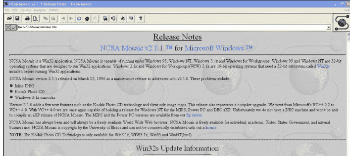

图 1-1：早期的 Web 浏览器看起来没什么亮点。

不久之后，有人意识到浏览器实际上可以自己完成有用的工作，而不仅仅是充当花哨的文档显示程序。

### Eich 之子的到来

JavaScript 起源于 1995 年的 Netscape 公司。JavaScript 的创造者 Brandon Eich 通过借鉴许多其他编程语言的最佳特性，在创纪录的时间内（有人说仅用了十天！）编写了 JavaScript。为了赶快上市，这也在语言设计中产生了一些有趣的古怪之处（或者说得不那么委婉的话，是错误）。结果产生了一种类似于 Esperanto（世界语）的语言，对于有其他编程语言经验的人来说，它看起来具有误导性的熟悉感。

### Mocha 的美味

JavaScript 的原名是 Mocha。在 Netscape Navigator 的第一个 beta 版本部署时，它被更名为 LiveScript，随后在 1995 年内置到 Netscape 2 浏览器时被改为 JavaScript。微软很快对 JavaScript 进行了逆向工程，并在 Internet Explorer 中推出了它的精确克隆版本，为了绕过商标问题，将其命名为 JScript。

Netscape 将 JavaScript 提交给名为 Ecma International 的标准组织，它在 1997 年被采用并标准化为 ECMAScript。


JavaScript 的创造者 Brandon Eich 对这个标准语言的名字发表了著名的评论；他表示 ECMAScript 是一个“听起来像皮肤病的不受欢迎的贸易名称”。


ECMAScript 不仅是一个缺乏吸引力的编程语言名称，Netscape 给这个语言起的名字（以及大多数人称呼它的方式）也相当不幸。如果你已经知道如何使用 Java 编程，或者在未来的某个时间点学习它，请务必记住这两门语言可能有某些相似之处，但实际上它们是完全不同的物种。

### 我们需要更多特效！

JavaScript 问世后，很快就成为使网页更具动态性的热门方式。所谓的动态 HTML (DHTML) 是 JavaScript 内置于 Web 浏览器后的早期成果，它实现了各种有趣的效果，如飘雪效果（见图 1-2）、弹出窗口和网页卷角，但同时也实现了更实用的功能，如下拉菜单和表单验证。

### JavaScript 成年了

现在进入第三个十年，JavaScript 已成为世界上最广泛使用的编程语言，世界上几乎每一台个人电脑上至少都有一个能运行 JavaScript 代码的浏览器。

JavaScript 足够灵活，可以让非编程人员使用和学习，但又足够强大，以至于专业程序员可以使用它（且确实在用）为如今互联网上几乎每个网站提供功能，涵盖从单页站点到像 Google、Amazon、Facebook 等巨型网站，以及许多其他站点！


## 第一部分：JavaScript 入门

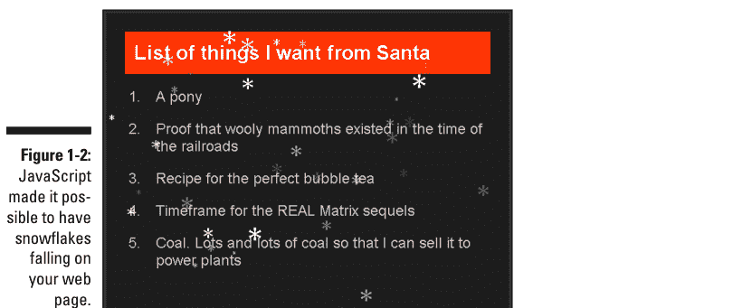

## 动态脚本语言

JavaScript 通常被描述为*动态脚本语言*。要理解这意味着什么，我们需要先定义几个术语并提供一些背景信息。

### 关于 JavaScript 的常见误解

| 误解 | 事实 |
| :--- | :--- |
| JavaScript 不是一种真正的编程语言。 | JavaScript 常用于网页浏览器中的简单任务，但这并不能降低它作为编程语言的性质。事实上，JavaScript 拥有许多高级特性，这些特性提高了编程语言的门槛，并且如今正在被 PHP、C++ 甚至 Java 等语言所模仿。 |
| JavaScript 与 Java 有关。 | 并非如此。JavaScript 这个名字纯粹是一种营销策略，因为在 JavaScript 问世时，Java 非常流行。 |
| JavaScript 很新。 | JavaScript 已经存在超过 20 年了！我们认识的一些专业 JavaScript 程序员在 JavaScript 被创造时甚至还没有出生。 |
| JavaScript 有缺陷，而且在不同浏览器中运行方式不同。 | 虽然这在某些情况下曾经属实，但浏览器制造商很久以前就决定支持 JavaScript 的标准化版本。如今，所有浏览器运行 JavaScript 的方式都是相同的。 |

## 第 1 章：世界上最被误解的编程语言

计算机程序是一组指令，使计算机执行各种操作。每种计算机编程语言都有一套指令，以及人类必须遵循的特定书写方式。计算机无法直接理解这些指令。为了让计算机理解一种编程语言，它需要通过一个转换过程，将人类可读（可写）的指令翻译成机器语言。根据翻译发生的时间，编程语言可以大致分为两类：编译型和解释型（见图 1-3）。

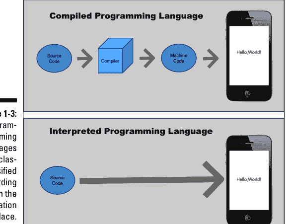

### 编译型编程语言

编译型编程语言是指程序员编写代码后，必须通过一个称为编译器的特殊程序来运行，该编译器解释给定的代码，然后将其转换为机器语言。随后计算机可以执行编译后的程序。

编译型语言的例子包括 C、C++、Fortran、Java、Objective-C 和 COBOL。

### 解释型编程语言

解释型语言在技术上仍然由计算机编译成机器语言，但编译是在用户的网页浏览器中，在程序运行的同时进行的。编写解释型语言的程序员不需要在将代码交给计算机运行之前经历编译的步骤。

使用解释型语言编程的好处是，可以随时轻松地对程序进行更改。然而，缺点是，在运行时编译代码会增加过程中的一个步骤，并可能降低程序的性能。

部分由于这个性能因素，解释型语言被认为是不够严肃的编程语言。然而，由于更好的即时编译器和更快的计算机处理器，这种观念正在迅速改变。JavaScript 在这方面有着重大影响。

解释型编程语言的例子包括 PHP、Perl、Haskell、Ruby，当然还有 JavaScript。

### JavaScript 能做什么？

如果你使用网络，你每天都在使用 JavaScript。JavaScript 可以实现的功能非常广泛，从您在忘记填写表单必填字段时收到的简单通知，到 Google Docs 或 Facebook 等复杂应用。以下是 JavaScript 在网页上最常见的用途清单：

- 酷炫效果
- 输入验证
- 悬停效果
- 下拉/弹出菜单
- 拖放功能
- 无限滚动网页
- 自动完成
- 进度条
- 网页内的标签页
- 可排序列表
- 魔术缩放（见图 1-4）


**图 1-4：** 所谓的魔术缩放效果是使用 JavaScript 实现的。

### 为什么选择 JavaScript？

JavaScript 已成为创建动态网页用户界面的标准。几乎每次您访问带有动画、实时数据、鼠标悬停时会变化的按钮或下拉菜单的网页时，都是 JavaScript 在起作用。由于其强大的功能和在任何网页浏览器中运行的能力，JavaScript 编码是现代网页开发人员最流行且必备的技能。

### JavaScript 易于学习

请记住，编程语言的创建是为了给人们提供一种简单的方式与计算机交流并告诉它们该做什么。与机器语言——即计算机 CPU 使用的语言——相比，每种编程语言都是简单且易于理解的。为了让您了解您的计算机实际上在遵循什么样的指令，下面是一段用机器语言编写的输出 "Hello World" 的程序：

```
b3 21 0a 00 00
a3 0c 10 00 06
b8 6f 72 6c 64
a3 08 10 00 06
b8 6f 2c 20 57
a3 04 10 00 06
b8 48 65 6c 6c
a3 00 10 00 06
b9 00 10 00 06
ba 10 00 00 00
bb 01 00 00 00
b8 04 00 00 00
cd 80
b8 01 00 00 00
cd 80
```

现在看看用 JavaScript 完成这个简单任务的一种方式：

```
alert("Hello World");
```

简单多了，对吧？


一旦您学会了基本的规则（称为`syntax`），比如什么时候使用圆括号、什么时候使用花括号（`{}`），JavaScript 实际上就像普通的英语一样。


学习任何语言（包括编程语言）的第一步，是克服对开始的恐惧。JavaScript 让这变得很容易。网络上有成千上万的 JavaScript 代码示例，任何人都可以直接拿来开始尝试。您已经具备了所需的全部工具（见第 2 章），而且使用 JavaScript 从小处着手很容易，然后逐步构建，最终创造出伟大而精彩的东西。

### JavaScript 在哪里？JavaScript 无处不在！

尽管 JavaScript 最初是为在网页浏览器中使用而设计的，但它已经在许多其他地方找到了归宿。如今，JavaScript 运行在智能手机和平板电脑上、网页服务器上、桌面应用程序中以及各种便携式设备上。

### 网页浏览器中的 JavaScript

找到 JavaScript 最常见的地方，也是它最初设计的目的，是在网页浏览器中运行。当 JavaScript 以这种方式运行时，它被称为*客户端 JavaScript*。

客户端 JavaScript 为网页增加了交互性。它通过几种方式实现这一点：

- 通过控制浏览器本身或使用浏览器的功能
- 通过操作网页的结构和内容
- 通过操作网页的样式（如字体和布局）
- 通过从其他来源访问数据

为了理解 JavaScript 如何能够操作网页的结构和样式，您需要对 HTML5 和 CSS3 有一点了解。

### HTML5

超文本标记语言（HTML）是用于构建网页的语言。它通过标记内容（文本和图像）来向网页浏览器提供有关内容的信息，比如什么是标题、什么是段落、图像放在哪里等等。清单 1-1 展示了一个简单的 HTML 文档。图 1-5 展示了网页浏览器如何显示此文档。

#### 清单 1-1：一个简单的 HTML 文档

```html
<!DOCTYPE html>
<html>
  <head>
    <title>Hello, HTML!</title>
  </head>
  <body>
    <h1>This is HTML</h1>
    <p id="introduction">This simple document was written
       with Hypertext Markup Language.</p>
  </body>
</html>
```

关于 HTML，您现在需要了解的一切，以便继续学习 JavaScript：

- 在 HTML 中，由尖括号包围的字符称为*标签*。
- *结束标签*（位于被标记内容之后）在第一个尖括号后有一个斜杠。例如，`</p>` 就是一个结束标签。


 ## 第一部分：JavaScript 入门

- 由两个标签（开始标签和结束标签）及其之间的内容共同组成一个*元素*。
- 元素通常以层级方式组织（元素嵌套在元素内部）。
- 元素可以包含名/值对，称为*属性*。如果一个元素有属性，它们放在开始标签中。*名/值对*通过等号将值（用引号括起来）赋给名称（不用引号）。例如，在下面的标签中，`width` 和 `height` 都是 `div` 元素的属性：
- 有些元素没有内容，因此不需要结束标签。例如，`img` 标签只是将图片插入到网页中，其形式如下：

```
<div width="100" height="100"></div>
```

```

```

**图 1-5：** Web 浏览器使用 HTML 来渲染网页。

显示图片所需的所有数据都通过属性包含在开始标签中，因此 `img` 标签不需要结束标签。

当你用 HTML 编写网页时，可以直接在文档中包含 JavaScript 代码，也可以从 HTML 文档中引用 JavaScript 代码文件（以 .js 结尾）。无论哪种方式，访问者的 Web 浏览器都会下载 JavaScript 代码，并在用户访问包含该 JavaScript 的网页时运行它。

客户端 JavaScript 在用户的 Web 浏览器内部运行。

## CSS3

层叠样式表（CSS）是用于为网页添加格式和不同布局的语言。在 CSS 中，样式一词指的是向用户展示 HTML 文档的诸多方面，包括

- 字体（或字形）
- 字号
- 颜色
- 元素在浏览器窗口中的排列
- 元素的大小
- 边框
- 背景
- 元素边框圆角的创建

与 JavaScript 类似，CSS 可以直接放入 HTML 文档中，也可以从 HTML 文档链接引入。一旦下载完成，它就会立即发挥作用，按照你的规格格式化文档。

CSS 中的样式表由 CSS 规则组成，这些规则包含应应用于一个元素或一组元素的属性和值。以下是一个 CSS 规则的示例：

```
p{font-size: 14px; font-color: black; font-family: Arial, sans-serif}
```

这条规则从左到右阅读，指定所有 p 元素（在 HTML 中表示段落）应以 14px 大小、黑色、Arial 字体的文本显示。如果用户计算机上没有 Arial 字体，则应使用某种无衬线字体显示。

CSS 规则中花括号以外的部分称为选择器。它选择花括号内的属性所适用的元素。

在本书中，你将学习如何将 JavaScript 与 HTML 和 CSS 结合使用。我们在这里提供的信息刚好足以向你展示 HTML 和 CSS 的工作原理。如果你需要了解更多，可以找到一些关于它们的优秀书籍。我们强烈推荐的一本是由 Ed Tittel 和 Chris Minnick 撰写的《Beginning HTML5 and CSS3 For Dummies》（Wiley 出版）。

## 第一部分：JavaScript 入门

## JavaScript 很强大！

过去在网络浏览器中运行的 JavaScript 速度很慢，而且在程序员中早期就获得了不好的声誉。如今，JavaScript 代码的运行速度达到了编译代码的 80%。而且，它的速度还在不断提升。这意味着今天的 JavaScript 比仅仅几年前的 JavaScript 强大得多。而且，它比 1995 年首次推出的 JavaScript 强大了许多倍。

## JavaScript 需求旺盛

JavaScript 不仅是最广为人知的编程语言，也是就业市场上最抢手的技能之一。据预测，2010 年到 2020 年间，JavaScript 程序员的就业市场将增长 22%。令人兴奋的事情正在 JavaScript 领域发生，现在正是学习它的最佳时机。

## 第 2 章

## 编写你的第一个 JavaScript 程序

## 在本章中

- 布置你的开发环境
- 了解 JavaScript 代码
- 理解一个简单的 JavaScript 程序
- 理解给代码添加注释的价值

> "取得成功的秘诀在于开始行动。"
> 
> —— 马克·吐温

简单的 JavaScript 编程并不难理解。在本章中，你将经历设置计算机以编写 JavaScript 的过程。你还将编写你的第一个 JavaScript 程序，并了解作为程序员在未来使用 JavaScript 时所做任何事情背后的基本语法。

别忘了访问网站查看与本章相关的在线练习！

## 设置你的开发环境

在开始编写第一个 JavaScript 程序之前，将所有工具设置好并准备就绪非常重要。我们将带你完成下载和安装我们最喜欢的 JavaScript 开发工具的过程，这些工具也正是我们在本书中使用的。如果你有类似且更喜欢的工具，请随意使用。然而，我们建议你仍然阅读本书的这一部分，以了解我们选择这些工具的原因，并自行决定是否使用它们。

安装每个工具后，我们会与你分享一些技巧和窍门，帮助你充分利用它们。

## 下载和安装 Chrome

我们在使用 JavaScript 时首选的 Web 浏览器是 Google Chrome。如果你日常更喜欢使用其他 Web 浏览器，那当然没问题。所有浏览器都能非常快速正确地运行 JavaScript。然而，本书中的一些说明是针对 Google Chrome 的，因此我们建议你至少在本章中完成在计算机上安装它的过程。我们选择在本书中使用 Google Chrome，是因为它提供了出色的工具，可以让 JavaScript 程序员的工作更加轻松，而且它是目前互联网上使用最广泛的 Web 浏览器。（是的，它甚至比 Internet Explorer 更受欢迎。）

如果你还没有安装 Chrome，请按照以下步骤安装：

1. **访问 [www.google.com/chrome](http://www.google.com/chrome)。**
   图 2-1 展示了 Google Chrome 的外观。
2. **将鼠标悬停在"下载"选项卡上，然后为你的计算机选择合适的版本。**
3. **打开下载的文件，按照说明安装 Chrome。**

> ### 现在你拥有了一个超级快速的 JavaScript 引擎！

Google Chrome 使用 Google 的 V8 JavaScript 引擎来解析、编译和运行 JavaScript 代码。无论你相信谁的基准测试，Chrome 要么是在浏览器中运行 JavaScript 最快的方式，要么是最快的方式之一。各大浏览器制造商一直在不断竞争，力求超越对方。实际上谁在任何时候最快并不太重要；近年来，这种竞争使得每个浏览器的 JavaScript 引擎速度都突飞猛进。

如果你想查看不同浏览器在 JavaScript 性能测试中的实际对比，可以在 <http://arewefastyet.com> 查看。该网站由 Firefox 浏览器的缔造者 Mozilla 维护，自动检查并以图表形式展示最受欢迎浏览器的 JavaScript 性能，每天更新多次。

## 第二章：编写你的第一个 JavaScript 程序

别忘了访问网站查看与本章相关的在线练习！

## 下载和安装代码编辑器

源代码编辑器，通常称为代码编辑器，是一种带有附加功能的文本编辑器，可以帮助你编写和编辑编程代码。我们使用的是 Sublime Text。

有很多代码编辑器可供选择，所以如果你已经有喜欢且用着顺手的编辑器，请继续使用它！程序员的代码编辑器是非常个人化的选择，很多人会发现他们对某个特定的编辑器感觉更舒服。如果你发现 Sublime Text 不太适合你的风格，表 2-1 列出了一些其他选项。

| 表 2-1 | 其他代码编辑器示例 | |
| :--- | :--- | :--- |
| **名称** | **地址** | **兼容...** |
| Coda | http://panic.com/coda | 仅 Mac |
| Aptana | www.aptana.com | Mac 或 Windows |
| Komodo Edit | www.activestate.com/komodo-edit/downloads | Mac 或 Windows |


**表 2-1**（*续表*）

| 名称 | 位置 | 兼容于 ... |
| :--- | :--- | :--- |
| Dreamweaver | http://adobe.com/products/dreamweaver.html | Mac 或 Windows |
| Eclipse | www.eclipse.org | Mac 或 Windows |
| Notepad++ | http://notepad-plus-plus.org | 仅限 Windows |
| TextMate | http://macromates.com | 仅限 Mac |
| BBEdit | www.barebones.com/products/bbedit | 仅限 Mac |
| Emacs | www.gnu.org/software/emacs | Mac 或 Windows |
| TextPad | www.textpad.com | 仅限 Windows |
| vim | www.vim.org | Mac 或 Windows |
| Netbeans | https://netbeans.org | Mac 或 Windows |

本书使用 Sublime Text（参见图 2-2），因为它在 JavaScript 程序员中很流行，它提供了一个简单的用户界面以及大量插件，可以在你获得更多编程经验时处理更高级的编程任务。

要安装 Sublime Text，请按照以下步骤操作：

- 1. 访问 **http://sublimetext.com** 并选择适合你操作系统的版本。
- 2. 打开下载的文件并按照说明安装 Sublime Text。

## Sublime Text 入门

当你首次打开 Sublime Text 时，你会看到一个简单的空白页面，上面有一个光标（参见图 2-3）。

如果你之前使用过 Sublime Text，你可能会在左侧看到一个侧边栏，如图 2-4 所示。此侧边栏显示你打开的文件以及项目中的文件（如果你创建了项目）。侧边栏非常有用，我们建议你将其打开。


要打开侧边栏，请单击 View > Sidebar > Show Sidebar。

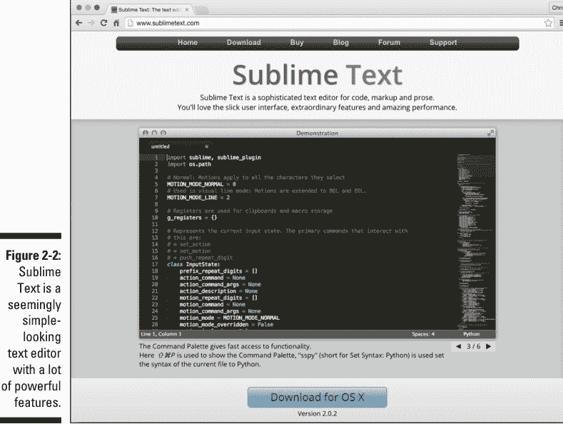

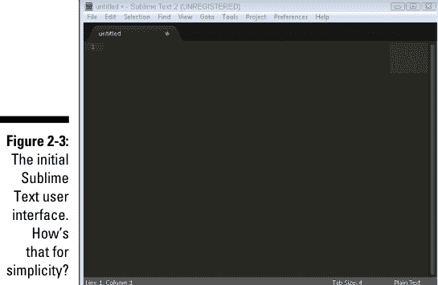

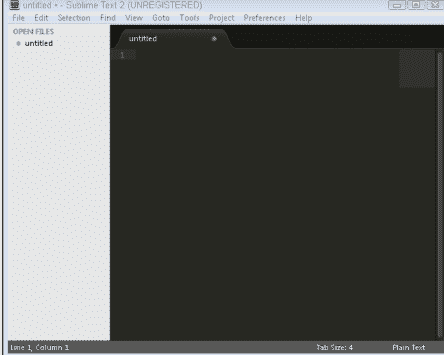

图 2-4：打开侧边栏的 Sublime Text。

要开始创建你的第一个 Sublime Text 项目文件，请按照以下步骤操作：

- 1. **选择 File $\rightarrow$ Save As。**
  保存对话框出现，并显示你的默认保存位置。如果你愿意将代码存储在此文件夹（很可能是 [OSX 上的] Documents 文件夹或 [Windows 上的] My Documents 文件夹），那么请继续步骤 2。否则，请导航到计算机上你想要存储代码文件的其他位置。
- 2. **创建一个新文件夹并为文件夹命名。**
- 3. **在 Save As 文本区域中，为这个第一个文件命名，然后单击 Save。**
  新文件名将出现在侧边栏中，打开的选项卡上的名称将更改为你选择的名称。
- 4. **选择 Project $\rightarrow$ Save Project As，并将 Sublime Text 项目文件保存在你创建的文件夹中。**
  Sublime Text 项目文件是 Sublime Text 存储有关哪些文件和文件夹与项目关联的信息的地方。创建项目文件夹可以让你更好地组织程序中的所有不同类型的文件。
- 5. **选择 Project $\rightarrow$ Add Folder to Project，选择你在步骤 1 中创建的文件夹，然后单击 Open。**
  一个名为 Folders 的新可折叠列表出现在侧边栏中，你的文件夹及其内容（包括项目文件和 MyFirstProgram.html）将列在其下方，如图 2-5 所示。

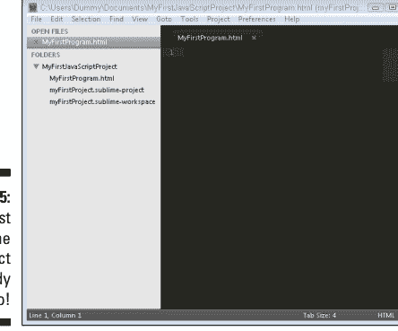

**图 2-5：** 你的第一个 Sublime Text 项目已准备就绪！

> **提示**
> 为了让你能井井有条地管理所有文件和文件夹，我们提供了一些建议，告诉你应该如何命名文件和文件夹。例如，你可以将步骤 2 中的新文件夹命名为 MyFirstJavaScriptProject，将步骤 3 中的文件命名为 MyFirstProgram，将步骤 4 中的项目命名为 myFirstProject。

### 选择语法配色方案

Sublime Text 的语法颜色基于你编写的代码类型和文件扩展名。在你刚刚创建的文件中输入清单 2-1 中所示的以下 HTML 和 JavaScript 代码，以查看默认的配色方案。

> **警告！**
> 正如你即将发现的，JavaScript 非常挑剔。确保你完全按照清单中的大写和拼写输入所有内容，否则你的脚本可能无法正常工作，或者根本无法运行。

#### 清单 2-1：一个包含 JavaScript 的 HTML 示例文件

```html
<!DOCTYPE html>
<html>
<head>
    <title>Hello, HTML!</title>
    <script>
        function countToTen() {
            var count = 0;
            while (count < 10) {
                count++;
                document.getElementById("theCount").innerHTML += count + "<br>";
            }
        }
    </script>
</head>
<body onload="countToTen();">
    <h1>Let's Count to 10 with JavaScript!</h1>
    <p id="theCount"></p>
</body>
</html>
```

图 2-6 展示了在我们的 Sublime Text 中该文件的样子。

> 如果你不喜欢当前选择的配色方案，你可以通过选择 Preferences > Color Scheme 然后选择另一个配色方案来更改它。

尝试其他一些配色方案，找到一个你喜欢的。我们本书使用的是 Monokai Bright。

如果你想尝试刚刚输入的程序，请按照以下步骤操作：

- 1. **通过选择 File > Save 保存文件。**
- 2. **打开你的 Chrome 浏览器并按 Ctrl + O。**
  出现打开文件窗口。
- 3. **导航到计算机上的文件并选中它。**
- 4. **单击打开按钮。**
  文件将在你的浏览器中打开。

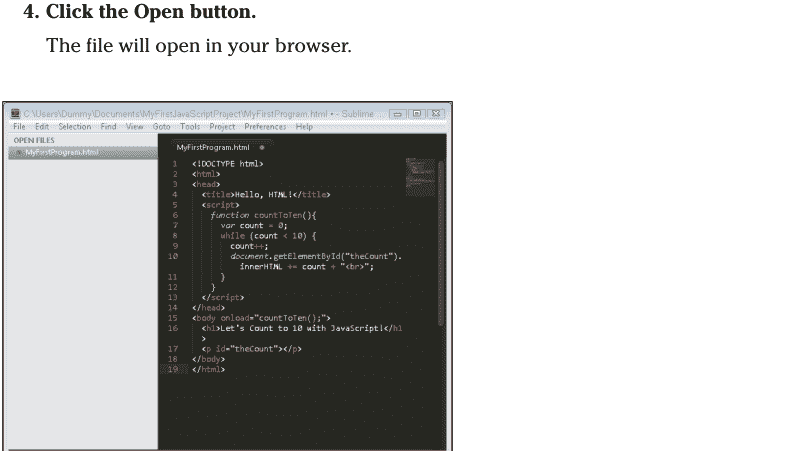

**图 2-6：** Sublime Text 为你的代码的所有不同部分应用了颜色。

你的浏览器应该看起来就像图 2-7 一样。如果没有，请非常仔细地检查你的代码——你可能在某个地方有个小拼写错误。做出任何更改后不要忘记保存文件！

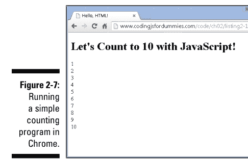

你也可以通过按 command + S（在 Mac 上）或 Control + S（在 Windows 上）来保存文件。一旦你熟练掌握了它们，键盘快捷键将为你节省大量时间。

## 一些有用的 Sublime Text 快捷键

Sublime Text 看起来像一个普通的文本编辑器，但别被它骗了！一个真正的编程高手标志就是他或她能够使用键盘快捷键尽可能快地编写代码和进行编辑。表 2-2 列出了 Sublime Text 提供的众多键盘快捷键中的一部分。练习这些，你很快就能用你超级精英的技能给朋友和同事留下深刻印象。

**表 2-2**

| Mac | Windows | 描述 |
|---|---|---|
| Command+X | Ctrl+X | 删除行 |
| Command+Return | Ctrl+Enter | 在下方插入行 |
| Command+Shift+Return | Ctrl+Shift+Enter | 在上方插入行 |
| Command+Control+Up Arrow | Ctrl+Shift+Up Arrow | 上移行/选区 |
| Command+Control+Down Arrow | Ctrl+Shift+Down Arrow | 下移行/选区 |
| Command+L | Ctrl+L | 选择行；重复选择下一行 |
| Command+D | Ctrl+D | 选择单词；重复选择其他出现位置 |
| Control+M | Ctrl+M | 跳转到闭合括号；重复跳转到开括号 |
| Control+Shift+M | Ctrl+Shift+M | 选择当前括号内的所有内容 |
| Command+K+Command+K | Ctrl+K+K | 从光标删除到行尾 |
| Command+K+Delete | Ctrl+K+Delete | 从光标删除到行首 |
| Command+] | Ctrl+] | 增加当前行缩进 |
| Command+[ | Ctrl+[ | 减少当前行缩进 |
| Command+Shift+D | Ctrl+Shift+D | 复制行 |
| Command+J | Ctrl+J | 将下方行连接到当前行末尾 |
| Command+/ | Ctrl+/ | 注释/取消注释当前行 |
| Command+Option+/ | Ctrl+Shift+/ | 块注释当前选区 |
| Command+Y | Ctrl+Y | 重做或重复上一个键盘快捷键命令 |
| Command+Shift+V | Ctrl+Shift+V | 粘贴并正确缩进 |
| Control+Space | Ctrl+Space | 选择下一个自动完成选项 |
| Control+U | Ctrl+U | 软撤销；重复时跳转到撤销更改前的最后更改 |
| Control+Shift+Up | Ctrl+Alt+Up | 向上列选择 |
| Control+Shift+Down | Ctrl+Alt+Down | 向下列选择 |
| Control+Shift+W | Alt+Shift+W | 将选区包裹在 html 标签中 |


## 阅读 JavaScript 代码

在开始编写 JavaScript 程序之前，你需要了解 JavaScript 的几条规则：

- **JavaScript 是区分大小写的。** 我们在本书中多次重复这一点，因为这是 JavaScript 初学者经常犯的错误。对于 JavaScript 来说，单词 pants 和 Pants 是完全不同的。

- **JavaScript 不太在意空白字符。** 空白字符包括空格、制表符（tab）和换行符 —— 任何没有视觉呈现的字符。在编写 JavaScript 代码时，在代码中使用一个空格、两个空格、一个制表符，甚至一个换行符（在大多数情况下）都没有关系。JavaScript 会忽略空白字符。唯一的例外是你正在编写希望 JavaScript 打印到屏幕上的文本。在这种情况下，你使用的空白字符将出现在最终结果中。关于代码中空白字符的最佳实践是：使用足够的空间使代码易于阅读，并且在空间使用上保持一致。

- **注意保留字。** JavaScript 有一组对语言具有特殊含义的单词。我们在第 3 章中列出了这些单词。目前，你只需要意识到某些单词（如 function, while, break 和 with）具有特殊含义即可。

- **JavaScript 喜欢分号：** JavaScript 代码由语句组成。你可以将语句看作类似于句子。它们是 JavaScript 程序的基石，就像句子是段落的基石一样。在 JavaScript 中，语句以分号结尾。

如果你在语句末尾没有使用分号，JavaScript 会为你自动补上。然而，这可能会导致意外的结果，因此，始终在语句末尾使用分号被认为是最佳实践。


## 在浏览器窗口中运行 JavaScript

虽然 JavaScript 出现在许多不同的环境中，但最常见的场景是在 Web 浏览器中运行。控制输入和输出、操作网页、处理常见的浏览器事件（如点击和滚动）以及控制 Web 浏览器的各种功能，正是 JavaScript 天生要做的事情！

要在 Web 浏览器中运行 JavaScript，你有三种选择，所有这些都将在接下来的页面中展示：

- 直接将其放入 HTML 事件属性中
- 将其放在开闭 script 标签之间
- 将其放在一个单独的文档中并将其包含在 HTML 文档中

很多时候，你会在一个网页中使用这三种技术的组合。然而，知道何时使用每一种是很重要的，这是一项通过更多实践才能习得的技能。

### 在 HTML 事件属性中使用 JavaScript

HTML 具有几个特殊的属性，旨在当 Web 浏览器中发生某些事情或用户执行某些操作时触发 JavaScript。这里有一个带有事件属性的 HTML 按钮示例，它可以响应鼠标点击事件：

```html
<button id="bigButton" onclick="alert('Hello World!');">Click Here</button>
```

在这种情况下，当用户点击由该 HTML 元素创建的按钮时，会出现一个显示“Hello World!”文字的弹出窗口。

HTML 有 70 多个不同的事件属性。表 2-3 显示了最常用的属性。

| 属性 | 描述 |
|-----------|-------------|
| onload | 页面加载完成后运行脚本 |
| onfocus | 当元素获得焦点时运行脚本（例如当文本框处于激活状态时） |
| onblur | 当元素失去焦点时运行脚本（例如当用户点击表单中的一个新文本框时） |
| onchange | 当元素的值发生改变时运行脚本 |
| `onselect` | 当文本被提交时运行脚本 |
| `onsubmit` | 当表单被提交时运行脚本 |
| `onkeydown` | 当用户按下按键时运行脚本 |
| `onkeypress` | 当用户按下按键时运行脚本 |
| `onkeyup` | 当用户释放按键时运行脚本 |
| `onclick` | 当用户鼠标点击元素时运行脚本 |
| `ondrag` | 当元素被拖动时运行脚本 |
| `ondrop` | 当被拖动的元素被放下时运行脚本 |
| `onmouseover` | 当用户将鼠标指针移动到元素上时运行脚本 |


尽管它们易于使用，但许多 JavaScript 程序员认为使用事件属性实际上是一种不理想的做法。我们在本书中演示它们是因为它们被广泛使用且易于学习。不过，目前你只需意识到，有一种比使用事件属性更好的编写响应事件的 JavaScript 代码的方法。我们在第 11 章中将介绍这种更好的方法。

### 在 script 元素中使用 JavaScript

HTML script 元素允许你将 JavaScript 嵌入到 HTML 文档中。通常 script 元素被放置在 head 元素内，事实上，这种放置方式经常被规定为一项要求。然而，如今 script 元素既被用于 head 元素内，也被用于网页的 body 中。

script 元素的格式非常简单：

```html
<script>
    (在此插入你的 JavaScript 代码)
</script>
```

你在示例 2-1 中看到了这种脚本嵌入的例子。示例 2-2 展示了另一个包含 JavaScript script 标签的 HTML 文档示例。但在这种情况下，我们将 script 元素放置在 body 元素的底部。

**示例 2-2：在 Script 元素中嵌入 JavaScript**

```html
<!DOCTYPE html>
<html>
<head>
  <title>Hello, HTML!</title>
</head>
<body>
  <h1>Let's Count to 10 with JavaScript!</h1>
  <p id="theCount"></p>
  <script>
    var count = 0;
    while (count < 10) {
      count++;
      document.getElementById("theCount").innerHTML +=
                                count + "<br>";
    }
  </script>
</body>
</html>
```

如果你在 Sublime Text 中创建一个新文件，输入示例 2-2 的内容，然后在 Web 浏览器中打开它，你会发现它的效果与示例 2-1 完全一样。

### 脚本位置与 JavaScript 执行

Web 浏览器通常在加载脚本的同时执行它们。网页总是被浏览器从上到下读取，就像你阅读一页文本一样。有时你可能希望在浏览器完成网页内容的加载后再运行脚本。在示例 2-1 中，我们通过在 body 元素中使用 `onload` 事件属性实现了这一点。另一种延迟执行的常用方法是简单地将要执行的代码放在代码的末尾，如示例 2-2 所示。

### 在 `<script>` 元素中使用 JavaScript 的局限性

虽然比内联脚本（将 JavaScript 放入事件属性中）更常用且更被广泛接受，但将 JavaScript 嵌入到 script 元素中也有一些严重的局限性。

最大的局限性是，这样嵌入的脚本只能在它们所在的网页内使用。换句话说，如果你将 JavaScript 放入一个 script 元素中，你需要将该 script 元素原封不动地复制并粘贴到每一个需要它的页面中。对于一些包含数百个页面的网站，你可以想象这会变成一场维护噩梦。

### 何时在 `<script>` 元素中使用 JavaScript

这种嵌入 JavaScript 的方法确实有其用途。对于那些仅仅是调用其他 JavaScript 代码片段且很少（或者最好是永远）发生变化的少量 JavaScript 代码，这种方式是可以接受的，甚至可以通过减少 Web 服务器向服务器发出的请求次数来加快网页的加载和显示速度。

单页应用（Single page apps，顾名思义，仅包含单个 HTML 页面）也是这种嵌入方式的绝佳候选对象，因为更新脚本的地方只有一个。

然而，作为一项原则，你应该尽量减少直接嵌入到 HTML 文档中的 JavaScript 数量。这样做会使维护更加容易，代码组织也更加合理。

### 包含外部 JavaScript 文件

在 HTML 文档中包含 JavaScript 的第三种也是最流行的方法是使用 script 元素的 `src` 属性。

带有 `src` 属性的 script 元素与在标签之间写 JavaScript 的 script 元素工作原理完全相同，不同之处在于，如果你使用 `src` 属性，JavaScript 将从一个单独的文件加载到 HTML 文档中。这是一个带有 `src` 属性的 script 元素示例：

```html
<script src="myScript.js"></script>
```

在这种情况下，你会有一个名为 `myScript.js` 的单独文件，它与你的 HTML 文档位于同一个文件夹中。使用外部 JavaScript 文件的好处是：

- 使你的 HTML 文件更整洁，减少混乱
- 让你的生活更轻松，因为当某些内容发生变化或需要修复 bug 时，你只需要在一个地方修改 JavaScript

### 创建 .js 文件

创建外部 JavaScript 文件与创建 HTML 文件或其他类型的文件类似。要将示例 2-1 中的嵌入式 JavaScript 替换为外部 JavaScript 文件，请按照以下步骤操作：

1. **在 Sublime Text 中，选择 File → New File。**
2. **将 `MyFirstProgram.html` 中 `<script>` 和 `</script>` 之间的所有内容复制并粘贴到你的新 `.js` 文件中。**


## 第一部分：JavaScript 入门

请注意，外部 JavaScript 文件不包含 `<script>` 元素，只包含 JavaScript 代码。

- 3. 将新文件保存为 `countToTen.js`，并将其与 `MyFirstProgram.html` 放在同一个文件夹中。
- 4. 在 `MyFirstProgram.html` 中，修改你的 script 元素以添加 `src` 属性，如下所示：

```
<script src="countToTen.js"></script>
```

此时，你的 `MyFirstProgram.html` 副本应该看起来像这样：

```
<!DOCTYPE html>
<html>
<head>
  <title>Hello, HTML!</title>
  <script src="countToTen.js"></script>
</head>
<body onload="countToTen();">
  <h1>Let's Count to 10 with JavaScript!</h1>
  <p id="theCount"></p>
</body>
</html>
```

你的新文件 `countToTen.js` 应该看起来像这样：

```
function countToTen() {
  var count = 0;
  while (count < 10) {
    count++;
    document.getElementById("theCount").innerHTML +=
    count + "<br>";
  }
}
```

保存这两个文件后，你应该能在 Sublime Text 侧边栏的项目中看到它们，如图 2-8 所示。

### 保持 .js 文件的有序

外部 JavaScript 文件有时会变得非常庞大。在很多情况下，将它们拆分为较小的文件，并根据其中包含的函数类型进行组织是一个好主意。例如，一个 JavaScript 文件可能包含与程序的用户登录功能相关的脚本，而另一个则包含与博客功能相关的脚本。

然而，对于小型程序，通常只需要一个文件就足够了，许多人会将他们的单个 JavaScript 文件命名为通用名称，例如 `app.js`、`main.js` 或 `scripts.js`。

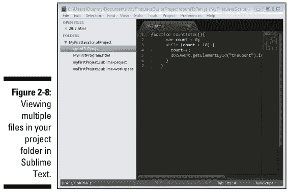

JavaScript 文件不需要与包含它们的 HTML 文件在同一个文件夹中。事实上，我们建议你创建一个专门用于存储外部 JavaScript 文件的文件夹。我们认识的大多数人都将其命名为类似 `js` 的名称。

按照以下步骤在你的 Sublime Text 项目中创建 `js` 文件夹，并将你的 `js` 文件移入其中：

- 1. **在 Sublime Text 侧边栏中右键单击项目名称。** 将出现一个子菜单。
- 2. **从子菜单中选择 New Folder（新建文件夹）。** Sublime Text 窗口底部会出现一个文件夹名称文本区域。
- 3. **在文件夹名称文本字段中输入 `js` 并按 Enter 键。** 侧边栏中会出现一个名为 `js` 的新文件夹。
- 4. **打开 `countToTen.js`，选择 File $\rightarrow$ Save As（文件 $\rightarrow$ 另存为），并将其保存到新的 `js` 文件夹中。**
- 5. **右键单击文件夹之外的 `countToTen.js` 版本，并从子菜单中选择 Delete File（删除文件）。**
- 6. **打开 `MyFirstProgram.html` 并修改你的 script 元素以反映 `js` 文件的新位置，如下所示：**

```
<script src="js/countToTen.js"></script>
```

当你用浏览器打开 `MyFirstProgram.html`（或简单地点击刷新）时，它看起来应该与你将 JavaScript 文件移入独立文件夹之前完全一样。

## 使用 JavaScript 开发者控制台

有时，能够在不创建 HTML 页面、不包含独立脚本或不创建 `<script>` 块的情况下运行 JavaScript 命令会很有帮助。在这种情况下，你可以使用 Chrome 浏览器的 JavaScript 控制台（见图 2-9）。

要访问 JavaScript 控制台，请找到浏览器右上角的 Chrome 菜单。它看起来像三条水平线。点击 Chrome 菜单，然后在下拉菜单中找到 More Tools（更多工具）。在 More Tools 下，从下拉菜单中选择 JavaScript Console（JavaScript 控制台）。

而且，没错，有一种更快的方法可以打开 JavaScript 控制台。只需按下 Alt+Command+J（Mac）或 Control+Shift+J（Windows）。

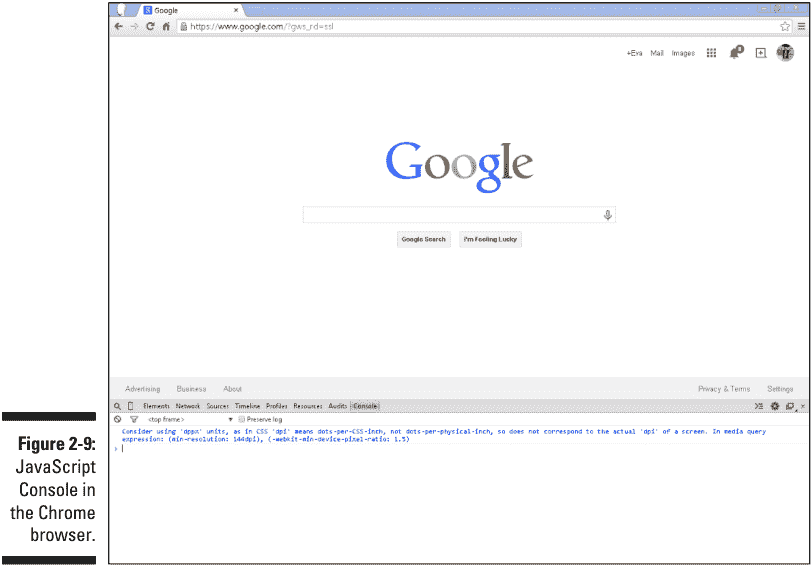

JavaScript 控制台可能是 JavaScript 开发者的好帮手。除了能让你快速便捷地测试和运行 JavaScript 代码外，它还是代码错误报告的地方，并且具有帮助你追踪和解决代码问题的功能。

一旦打开 JavaScript 控制台，你就可以开始向其中输入命令，按下 Enter 键后命令将立即运行。为了尝试一下，请打开 JavaScript 控制台，然后输入以下命令，每条命令后按 Enter 键：

```
1080/33
40 + 2
40 * 34
100%3
34++
34--
```

## 为你的代码添加注释

当你学习更多的 JavaScript 命令并开始编写更大的程序时，给自己留下一些关于你的想法或某些功能用途的微小提醒通常很有帮助。在程序员的术语中，我们将这些写给自己的（或写给任何可能接触你代码的人的）简短笔记称为 *注释*（comments）。而编写这些笔记的过程称为 *添加注释*（commenting）。

JavaScript 引擎完全忽略注释。它们仅仅是为人类准备的。这是你解释事情、澄清问题、描述思考过程，甚至给自己留下未来想要完成的事情的提醒的时机。

为代码添加注释永远是一个好主意。即使你在编写代码时认为代码已经足够清晰易懂，我们保证在八个月后你需要修改它时，你不会这么想。

JavaScript 提供了两种方式来标记注释：

- 单行注释
- 多行注释

### 单行注释

单行注释以 `//` 开始。这两条斜杠之后直到行末的所有内容都将被 JavaScript 解析器忽略。

单行注释不需要从行首开始。很常见的情况是将单行注释与未注释的代码放在同一行，以解释该行代码的含义。例如：

```
pizzas = pizza + 1; // add one more pizza
```

### 多行注释

多行注释以 `/*` 开始，并告诉 JavaScript 解析器忽略直到 `*/` 为止的所有内容。多行注释对于更详尽的代码文档编写非常有用。例如：

```
/* The countToTen function does the following things:
 * Initializes a variable called count
 * Starts a loop by checking the value of count to make sure it's less than 10
 * Adds 1 to the value of count
 * Appends the current value of count, followed by a line break, to the paragraph with id='theCount'
 * Starts the loop over
*/
```

### 使用注释防止代码执行

除了用于记录代码文档外，注释还经常用于隔离代码片段以便查找问题。例如，如果我们想看看在删除循环中递增 count 值的代码行后，`countToTen` 函数会怎么运行，我们可以使用单行注释将该行注释掉，如下所示：

```
function countToTen() {
  var count = 0;
  while (count < 10) {
    // count++;
    document.getElementById("theCount").innerHTML += count + "<br>";
  }
}
```

当你运行这个程序时，`count++;` 这行代码将不再运行，程序将永远打印出 0（或者直到你关闭浏览器窗口）。

我们将刚才创建的情况称为 *死循环*（infinite loop）。如果你运行这个修改版本的程序，它不会对你的计算机造成损害，但它可能会让你的 CPU 陷入疯狂的原地打转，直到你关闭打开该程序的浏览器窗口。

## 第 3 章：使用变量

**本章内容**
- 创建和使用变量
- 理解变量作用域
- 了解 JavaScript 的数据类型
- 变量命名
- 使用内置函数处理变量

> “美是多变的，丑是恒久的。”
> —— 道格拉斯·霍顿 (Douglas Horton, 1891 – 1968)

在本章中，你将发现如何创建变量、为它们填充值、使用函数找出变量中的数据类型、在不同数据类型之间进行转换，以及操作变量中的数据。

别忘了访问网站查看与本章相关的在线练习！

### 理解变量

变量是程序中的代表性名称。就像在代数中 *x* 可能代表某个尚未知晓的值，或者在海盗地图上 *x* 可能标记着宝藏埋藏的位置一样，变量在编程中被用来代表其他事物。

你可以将变量想象成包含数据的容器。你可以给这些容器命名，之后可以通过名称来调用和更改变量中的数据。


## 第一部分：JavaScript 入门

没有变量，每个计算机程序都只有一个目的。例如，下面这个单行程序就没有使用变量：

```
alert(3 + 7);
```

它的目的是将数字 3 和 7 相加，并在浏览器弹出窗口中打印结果。

然而，这个程序用处不大（除非你恰好需要定期回忆 3 和 7 的和）。有了变量，你可以制作一个通用的程序，可以将任意两个数字相加并打印结果，如以下示例所示：

```
var firstNumber = 3;
var secondNumber = 7;
var total = Number(firstNumber) + Number(secondNumber);
alert (total);
```

更进一步，你可以扩展这个程序，让用户提供两个数字，然后将它们相加，如下例所示：

```
var firstNumber = prompt ("Enter the first number");
var secondNumber = prompt("Enter the second number");
var total = Number(firstNumber) + Number(secondNumber);
alert (total);
```

亲自试试这个程序！（第 2 章展示了如何使用你的代码编辑器。）按照以下步骤操作：

- 1. 打开你的代码编辑器并创建一个基本的 HTML 模板。
- 2. 在 `<body>` 和 `</body>` 之间，插入一个开始 `<script>` 标签和一个结束 `</script>` 标签。
- 3. 在开始和结束的 script 标签之间，输入前面的示例代码。

你的文档现在应该看起来像这样：

```
<html>
<head></head>
<body>
  <script>
  var firstNumber = prompt("Enter the first number");
  var secondNumber = prompt("Enter the second number");
  var total = Number(firstNumber) +
        Number(secondNumber);
  alert (total);
  </script>
</body>
</html>
```

4. 将你的新 HTML 文档另存为 addtwo.html。

5. 在你的网页浏览器中打开 HTML 文档。

你应该会看到一个提示输入第一个数字的对话框，如图 3-1 所示。

6. 输入第一个数字。

输入该数字后，你会看到一个提示输入第二个数字的对话框。

7. 输入第二个数字。

在你将第二个数字提供给程序后，屏幕上将显示两个数字相加的结果。

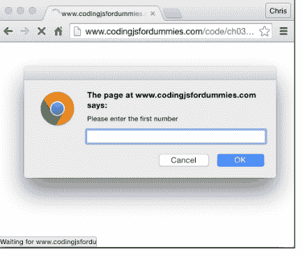

**图 3-1：** 一个用于将两个用户提交的数字相加的通用程序。

## 声明变量

*声明变量*是用于描述在程序中首次创建一个变量过程的专业术语。你也可能听到它被称为*初始化*。创建变量、声明变量和初始化变量都指的是同一件事。

JavaScript 中的变量可以通过以下两种方式之一创建：

- 使用 var 关键字：
  `var myName;`
  使用 var 关键字创建的变量，除非你在创建时赋予它一个值，否则其初始值将是 undefined，例如
  `var myName = "Chris";`

### 何时相等不等于相等？

在英语中，将包含 "=" 的语句读作 "var myName equals Chris" 是常见且正确的。然而，在编程中，这种解释是不正确的。

例如，

`var myName = "Chris";`

在变量名 (`myName`) 和值 (`"Chris"`) 之间的那个看起来像等号的字符，可能看起来完全就是一个等号，它甚至就是用键盘上通常称为等号的键输入的。然而，在编程中，等号实际上被称为*赋值运算符*。

理解赋值运算符和“等于”的区别至关重要：

- 赋值运算符将其左边的东西设置为等于右边的东西，像这样：
  `var myName = "Chris";`
- “等于”比较左边的值和右边的值，并确定它们是否相同。JavaScript 中的等于写作 `===`。

### 没有 `var` 关键字

```
myName = "Chris";
```

当你在不使用 `var` 关键字的情况下创建一个变量时，它就变成了一个全局变量。（要理解全局变量的含义，请参阅下一节。）


请注意前面示例中右侧值周围的引号。这些引号表示该值应被视为文本，而不是数字、JavaScript 关键字或其他变量。有关如何以及何时使用引号的更多信息，请参阅本章后面的数据类型部分。

## 理解全局作用域和局部作用域

你声明变量的方式和位置决定了你的程序可以如何以及在何处使用该变量。这个概念称为变量作用域。JavaScript 有两种作用域：

- *全局变量*可以在程序内的任何地方使用。
- *局部（函数）变量*是你在称为*函数*的受保护程序内部创建的变量。

## 缺失 var 的悲剧故事

实际上，从来没有理由在不使用 `var` 关键字的情况下创建变量，这样做会给你带来问题。如果你省略了 `var` 关键字，它看起来就像是你忘记了它，所以不要这样做！

以下示例展示了不使用 `var` 关键字可能引发的问题和困惑。它还演示了一个更高级的编程工具的使用，称为函数，我们将在第 7 章更详细地介绍。简而言之，函数允许你在你的程序内部放置较小的程序。

在这个第一个例子中，程序员希望有一个名为 `movie` 的全局变量，以及一个单独的、同名的变量，该变量仅在名为 `showBadMovie` 的函数内有效。这是完全正常的事情，在正常情况下，函数内部的 `movie` 变量不会影响全局变量。但是，如果你在声明函数内的 movie 变量时忘记使用 `var` 关键字，坏事就会发生。

```
var movie = "The Godfather";

function showGoodMovie() {
  alert(movie + " is a good movie!");
}

function showBadMovie() {
  movie = "Speed 2: Cruise Control";
  alert(movie + " is a bad movie!");
}
```

请注意，`showBadMovie()` 中 movie 变量前面缺少 `var` 关键字。JavaScript 假定你想覆盖全局 movie 变量，而不是创建一个局部函数变量。结果是灾难性的！

```
showGoodMovie(); // 弹出 "The Godfather is a good movie!"

showBadMovie(); // 弹出 "Speed 2: Cruise Control is a bad movie!"

/* 糟糕！全局变量现在变成了 Speed 2: Cruise Control，不再是那部好电影的名字了！ */

showGoodMovie(); // 弹出 "Speed 2: Cruise Control is a good movie!"
```

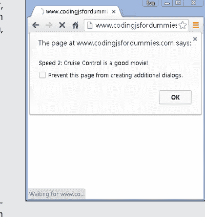

## 命名变量

一般来说，使用局部变量比使用全局变量更可取，因为限制变量的作用域可以降低意外用同名的另一个变量覆盖变量值的风险。

全局变量的使用可能在你的程序中引发难以追踪和修复的问题。我们建议你永远不要在不使用 `var` 关键字的情况下创建变量。如果你确实需要一个全局变量，可以使用 `var` 关键字来创建，我们建议你这样做。

变量名可以以下列字符开头：

- 大写或小写字母
- 下划线 (_)
- 美元符号 ($)

虽然你可以使用下划线或美元符号作为变量名的开头，但最好以字母开头。意外的字符通常会导致你的代码看起来混乱且难以阅读，尤其是如果你是 JavaScript 编程新手。

在第一个字符之后，你可以在变量名中使用任何字母或数字，并且长度不限。JavaScript 变量不能包含空格、数学运算符或标点符号（下划线除外）。

永远记住 JavaScript 区分大小写。名为 `myname` 的变量与 `Myname` 或 `myName` 不是同一个变量。

变量名实际上是标识符；你能做的最好的事情就是给变量起一个精确且相关的名称。这种命名习惯有时可能导致名称非常长，但作为规则，一个能准确代表变量的长名称，比一个模糊的短名称更有用。

当然，变量名能有多长是有限度的，否则会让你的生活更困难。如果你需要使用 20 个字符来准确描述你的变量，那就用吧。但是，如果你创建的变量名像 `nameOfPersonWhoJustFilledOutTheFormOnMyWebsite`，你可能想看看是否可以通过缩短为更像 `personName` 这样的名字来简化你的生活（以及任何其他可能需要使用你的代码的人的生活）。


## 创建良好变量名的指南

虽然 JavaScript 在变量命名方面给了你很大的自由，但在开始编程之前，最好为自己决定一些基本规则。例如，你的变量名是以小写字母还是大写字母开头？在变量名的多个单词之间是使用下划线，还是使用小驼峰式命名法（camelCase）？随着代码变得越来越复杂，正确命名的重要性将变得显而易见。

幸运的是，在决定风格时你并不孤单。许多专业的 JavaScript 程序员在命名变量时达成共识并使用一些最佳实践：

- 不要使用太短的名字！在命名变量时，简单的单字母名称或无意义的名称并不是一个好选择。
- 使用多单词名称以尽可能做到精确。
- 在多单词名称中，始终将形容词放在左侧，例如 `var greenPython;`。

为多单词名称选择一种风格并保持一致。有两种连接单词创建名称的方法：小驼峰式（camelCase）和下划线式（under_score）。JavaScript 是一种灵活的语言，你可以使用其中任何一种方法，尽管小驼峰式通常被更广泛地采用。

某些单词不能用作变量名。以下是不能用作 JavaScript 变量、函数、方法、循环标签或对象名称的保留字列表。

| | | | |
| :--- | :--- | :--- | :--- |
| abstract | else | instanceof | switch |
| boolean | enum | int | synchronized |
| break | export | interface | this |
| byte | extends | long | throw |
| case | false | native | throws |
| catch | final | new | transient |
| char | finally | null | true |
| class | float | package | try |
| const | for | private | typeof |
| continue | function | protected | var |
| debugger | goto | public | void |
| default | if | return | volatile |
| delete | implements | short | while |
| do | import | static | with |
| double | in | super | |

## 使用 const 关键字创建常量

有时，你的程序可能需要无法被更改的变量。在这种情况下，你可以使用 `const` 关键字来声明变量。例如：

```
const heightOfTheEmpireStateBuilding = 1454;
const speedOfLight = 299792458;
const numberOfProblems = 99;
const meanNumberofBooksReadIn2014 = 12;
```

常量遵循与其他变量相同的规则，但一旦你创建了常量，它的值在其生命周期内（只要脚本在运行）就不能被更改。

## 处理数据类型

变量的数据类型是指该变量可以持有数据的种类，以及可以对该变量的值进行哪些操作。例如，在句子中使用的数字 10 与在等式中使用的数字 10 是不同的。数据类型是 JavaScript 区分“旨在作为单词的值”和“旨在被视为数学表达式的值”的方式。

如果你思考一下日常工作中处理的所有数据类型——饼图、食谱、短篇故事、报纸文章等等——你会发现，在涉及数据时，事情变得非常复杂是有很大潜力的。JavaScript 的慷慨创建者决定为你把事情简化。它只有五种基本数据类型。

此外，JavaScript 被称为一种弱类型语言。*弱类型* 的含义是，你甚至不需要告诉 JavaScript，甚至不需要知道你创建的变量将持有的是一个单词、一段段落、一个数字还是其他类型的数据。

弱类型并不意味着 JavaScript 不区分单词和数字。JavaScript 只是对此比较友好，在幕后处理大部分识别你在变量中存储了什么类型数据的工作。

## 第 3 章：处理变量

JavaScript 识别五种基本（或原语）数据类型。

C++ 编程语言至少有 12 种不同的数据类型！

### Number 数据类型

JavaScript 中的数字存储为 64 位浮点值。用通俗的话来说，这意味着数字的范围可以从 5e-324（即 -5 后面跟着 324 个零）到 1.7976931348623157e+308（将小数点向右移动 308 位即可看到这个巨大的数字）。任何数字都可以有小数点，也可以没有。与大多数编程语言不同，JavaScript 没有为整数（没有小数部分的正数或负数）和浮点数（小数）设置独立的数据类型。

JavaScript 能使用的最大数字到底有多大？这里是它不使用科学计数法写出的形式：

1797693134862315700000000000000000000000000000000000000000000000000000000000000000000000000000000000000000000000000000000000000000000000000000000000000000000000000000000000000000000000000000000000000000000000000000000000000000000000000000000000000000000000000000000000000000000000000000000000000000000

当你声明一个数字变量时，你由以下所有元素将其组合而成：

- `var` 关键字
- 你想给变量起的名称
- 赋值运算符
- 一个数字（甚至是一个计算结果为数字的等式）
- 分号

以下是一些有效的数字变量声明示例：

```
var numberOfDucks = 4;
var populationOfSpain = 47200000;
var howManyTacos = 8;
```

### Number 函数

JavaScript 包含一个内置的 `Number` 函数用于将值转换为数字。要使用 `Number` 函数，只需将你想要转换为数字的值（或持有该值的变量）放在 `Number` 函数后的括号之间。

`Number` 函数会产生四种输出：

- 格式化为文本字符串的数字被转换为可用于计算的数字，如下所示：
`Number("42") // 返回数字 42`
- 无法转换为数字的文本字符串返回 `NaN` 值，如下所示：
`Number("eggs") // 返回 NaN`
- 布尔值 `true` 返回数字 1，如下所示：
`Number(true) // 返回 1`
- 布尔值 `false` 返回数字 0，如下所示：
`Number(false) // 返回 0`

### parseInt() 函数

对于 JavaScript 来说，所有数字实际上都是浮点数。但是，你可以使用 `parseInt()` 函数来告诉 JavaScript 仅考虑数字的非小数部分（整数），丢弃小数点后的所有内容。

```
parseInt(100.33); // 返回 100
```

### parseFloat() 函数

你可以使用 `parseFloat()` 特别地告诉 JavaScript 将一个数字视为浮点数。或者，你甚至可以用它将字符串转换为数字。例如：

```
parseFloat("10"); // 返回 10
parseFloat(100.00); // 返回 100.00
parseFloat("10"); // 返回 10
```

### 示例

现在你可以尝试一些数字和数字函数。尝试在 Chrome 浏览器的 JavaScript 控制台中输入以下表达式，看看它们产生什么结果。

你可以通过按下 Command+Option+J (Mac) 或 Ctrl+Shift+J (Windows) 来打开 Chrome 的 JavaScript 控制台。

```
1 + 1
3 * 3
parseFloat("839");
parseInt("33.333333");
12 + "12"
"12" + 12
"12" * 2
```

数字变量在声明时不能使用引号。"10" 与 `10` 是不同的。前者是一个字符串（将在下一节中介绍），如果你不小心在引号内声明数字变量，你会得到意外的结果。

如果你在跟着操作，你可能已经注意到之前的示例中出现了一些奇怪的行为。例如，当你将 "12"（字符串）与 12（数字）相加时，结果是 "1212"（字符串）。但是，当你将 "12"（字符串）乘以 2（数字）时，结果是 24（数字）。这就是 JavaScript 真正发挥其“智能”的地方！

在第一个例子中，当你进行加法运算时，JavaScript 推测，因为加法等式中的一个值是字符串，所以你希望两者都是字符串。因此，它将数字转换为字符串，并将加号视为*连接运算符*。

在第二个例子中，当你进行乘法运算时，操作中的一个值是数字，而没有办法将字符串相乘。JavaScript 将字符串转换为数字，然后进行乘法运算。但是，当你尝试将两个字符串相乘时会发生什么？

```
"sassafras" * "orange"
```

结果是 NaN（不是一个数字）。完全没有办法将 sassafras 或 orange 转换为数字，因此 JavaScript 只能无奈地放弃。

### String 数据类型

字符串可以由任何字符组成：

- 字母
- 数字
- 标点符号（如逗号和句号）
- 使用反斜杠后跟字符可写的特殊字符


## 第一部分：JavaScript 入门

某些字符（如引号）在 JavaScript 中具有特殊含义，或者需要特殊的字符组合（如制表符或换行符）才能在字符串内部表示。我们称这些为*特殊字符*。表 3-1 列出了您可以在 JavaScript 字符串中使用的特殊字符。

表 3-1 JavaScript 特殊字符

| 代码 | 输出 |
| :--- | :--- |
| \' | 单引号 |
| \" | 双引号 |
| \\ | 反斜杠 |
| \n | 换行 |
| \r | 回车 |
| \t | 制表符 |
| \b | 退格 |
| \f | 换页 |

您可以通过将字符串括在单引号或双引号中来创建字符串变量，如下所示：

```
var myString = "Hi, I'm a string.";
```

实际上，使用单引号还是双引号并不重要，只要围绕字符串的起始引号和结束引号相匹配即可。

如果您用单引号包裹字符串，那么您可以在该字符串内部毫无问题地使用双引号。同样地，如果您用双引号包裹字符串，您也可以在字符串内部毫无问题地使用单引号。

然而，如果您创建了一个字符串并用某种类型的引号包裹它，您就不能在字符串内部使用该类型的引号，否则 JavaScript 解析器会认为您打算结束该字符串，从而产生错误。

### 转义引号

解决无法在由某种引号包裹的字符串中包含该类引号的方法是在引号前加上 `\`。在引号前添加反斜杠被称为*转义*引号。

### 字符串函数

JavaScript 包含许多用于处理和转换字符串的实用函数。

以下是最常用的内置字符串函数列表：

- **charAt()** 返回指定位置的字符。请注意，字符计数从 0 开始：

```
var watzThisString = 'JavaScript is Fun!';
console.log (watzThisString.charAt(3));
// returns a
```

- **concat()** 合并一个或多个字符串并返回合并后的字符串：

```
var watzThisString = 'JavaScript is Fun!';
console.log (watzThisString.concat(' We love JavaScript!'));
// returns JavaScript is Fun! We love JavaScript!
```

- **indexOf()** 搜索并返回字符串中搜索字符或子字符串首次出现的位置：

```
var watzThisString = 'JavaScript is Fun!';
console.log (watzThisString.indexOf('Fun'));
// returns 14
```

- **split()** 将字符串拆分为子字符串数组：

```
var watzThisString = 'JavaScript is Fun!';
console.log (watzThisString.split('F'));
// returns ["JavaScript is ", "un!"]
```

- **substr()** 从“开始位置”起提取指定长度的字符串部分：

```
var watzThisString = 'JavaScript is Fun!';
console.log (watzThisString.substr(2,5));
// returns vaScr
```

- **substring()** 提取字符串中两个指定位置之间的字符：

```
var watzThisString = 'JavaScript is Fun!';
console.log (watzThisString.substring(2,5));
// returns Vas
```

- `toLowerCase()` 将字符串中所有字符转换为小写：

```
var watzThisString = 'JavaScript is Fun!';
console.log (watzThisString.toLowerCase());
// returns javascript is fun!
```

- `toUpperCase()` 将字符串中所有字符转换为大写：

```
var watzThisString = 'JavaScript is Fun!';
console.log (watzThisString.toUpperCase());
// returns JAVASCRIPT IS FUN!
```

### Boolean 数据类型

Boolean 变量存储两个可能值之一：`true`（真）或 `false`（假）。


*Boolean* 一词是以乔治·布尔（George Boole, 1815–1864）命名的，他创建了一套逻辑代数系统。因为是以人名命名，所以通常首字母大写。

Boolean 变量经常用于存储比较结果。您可以使用 `Boolean()` 函数来找出比较的 Boolean 值，或将 JavaScript 中的任何值转换为 Boolean 值。例如：

```
var isItGreater = Boolean (3 > 20);
alert (isItGreater); // returns false

var areTheySame = Boolean ("tiger" === "Tiger");
alert (areTheySame); // returns false
```

使用 `Boolean()` 函数将 JavaScript 中的值转换为 Boolean 值的结果取决于该值：

- 在 JavaScript 中，以下值始终被评估为 Boolean `false` 值：
  - `NaN`
  - `undefined`
  - `0`（数值零）
  - `-0`
  - `""`（空字符串）
  - `false`

任何不属于上述值的内容都被评估为 Boolean `true`。例如：
- 74
- "Eva"
- "10"
- "NaN"

数字字符 "0" 与数值 0（零）不同。虽然 0 总是会导致 Boolean 值为 `false`，但字符串 "0" 总是会导致 Boolean 值为 `true`。


Boolean 值主要用于条件表达式。以下程序创建了一个 Boolean 变量，然后使用 `if/then` 语句（您可以在第 5 章中了解）测试其值。

```
var b = true;
if (b == true) {
    alert ("It is true!");
} else {
    alert ("It is false.");
}
```


Boolean 值的书写不需要引号，如下所示：

```
var myVar = true
```

另一方面，`var myVar = "true"` 则创建了一个字符串变量。

### NaN 数据类型

NaN 代表 Not a Number（非数字）。当您尝试对字符串进行数学运算，或者计算失败或无法完成时，就会得到这个结果。例如，计算负数的平方根是不可能的。尝试这样做将导致 NaN。


更常见产生 NaN 的情况是尝试使用无法转换为数字的字符串执行数学运算。

### undefined 数据类型

即使您在 JavaScript 中创建了一个变量且没有明确地赋予它值，它仍然有一个默认值。这个值就是 `undefined`。

## 第 4 章：理解数组

### 本章内容

- 识别和定义数组
- 构建数组
- 使用多维数组超越二维
- 在数组元素中操作
- 使用数组函数和属性

> “我广大，我包含众生。”
— 沃尔特·惠特曼 (Walt Whitman)

数组是任何编程语言的基础部分。在本章中，您将发现它们是什么，如何使用它们，以及 JavaScript 数组与其它编程语言中的数组有何不同。您将通过操作数组来创建列表、对列表排序以及从列表中添加和删除项目。


不要忘记访问网站查看与本章相关的在线练习！

### 创建列表

本书之前的章节涉及处理独立的单一数据变量，例如：`var myName = "Chris"`，`var firstNumber = "3"` 和 `var howManyTacos = 8`。在编程中（以及在生活中），经常会出现想要将相关数据存储在一个名称下的情况。例如，考虑以下类型的列表：

- 您最喜欢的艺术家列表
- 一个每次运行时从引用列表中选择并显示不同名言的程序
- 节日贺卡邮寄名单
- 您年度最佳音乐专辑列表
- 您所有家人和朋友的生日列表
- 购物清单
- 待办事项列表
- 新年愿望清单

如果使用单值变量（见第 3 章），为了完成这些任务中的任何一项，您需要创建并跟踪多个变量。以下是一个使用单值变量创建列表的示例：

```
var artist1 = "Alphonse Mucha";
var artist2 = "Chiara Bautista";
var artist3 = "Claude Monet";
var artist4 = "Sandro Botticelli";
var artist5 = "Andy Warhol";
var artist6 = "Wassily Kadinski";
var artist7 = "Vincent Van Gough";
var artist8 = "Paul Klee";
var artist9 = "William Blake";
var artist10 = "Egon Schiele";
var artist11 = "Salvador Dali";
var artist12 = "Paul Cezanne";
var artist13 = "Diego Rivera";
var artist14 = "Pablo Picasso";
```

这种方法在短期内可能可行，但您很快就会遇到困难。例如，如果您想按字母顺序对列表进行排序，并将艺术家根据其在字母排序中的位置移动到正确的变量名中怎么办？您需要首先将 Mucha 从 `artist1` 变量中移出（也许移到一个临时持有变量中），然后将 Bautista 移入 `artist1` 变量。这样 `artist2` 的位置就空出来给 Blake 了，但别忘了 Mucha 还在那个临时槽位中！从 `artist9` 中移除 Blake 后，您可以将另一个人移入临时变量，以此类推。以这种方式创建列表很快就会变得复杂且令人困惑。

幸运的是，JavaScript（以及我们所知的每一种编程语言）都支持创建包含多个值的变量，这种变量被称为*数组 (arrays)*。


数组是一种在单个变量中存储一组相关数据的方式。通过数组，你可以创建包含字符串值、数字、布尔值、对象、函数、任何其他类型的数据，甚至是其他数组的混合列表！

## 数组基础

一个数组由数组元素组成。数组元素的组成方式是数组名称，随后是在方括号中包含的一个索引数字。数组中的单个值被称为数组元素。数组使用数字（称为索引号）来访问这些元素。以下示例演示了数组如何使用索引号来访问元素：

```
myArray[0] = "yellow balloon";
myArray[1] = "red balloon";
myArray[2] = "blue balloon";
myArray[3] = "pink balloon";
```

在这个例子中，索引号为 0 的元素值是 "yellow balloon"。索引号为 3 的元素值是 "pink balloon"。与任何变量一样，你可以为数组起任何符合 JavaScript 变量命名规则的名称。通过在数组中分配索引号，JavaScript 使你能够用一个单一的变量名持有一个近乎无限的数值列表。


为了不让你过于乐观，实际上数组中数组可以拥有的元素数量是有上限的，尽管你极不可能达到这个极限。该上限是 4,294,967,295 个元素。

除了命名要求（任何类型的变量都一样，如第 3 章所述）之外，数组还有一些你需要熟悉的其他规则和特殊属性：

- 数组是零索引的（从 0 开始计数）
- 数组可以存储任何类型的数据

### 数组是零索引的

JavaScript 没有手指或脚趾。因此，它不需要遵守我们人类那种从 1 开始计数的疯狂规则。JavaScript 数组中的第一个元素的索引号总是 0（见图 4-1）。

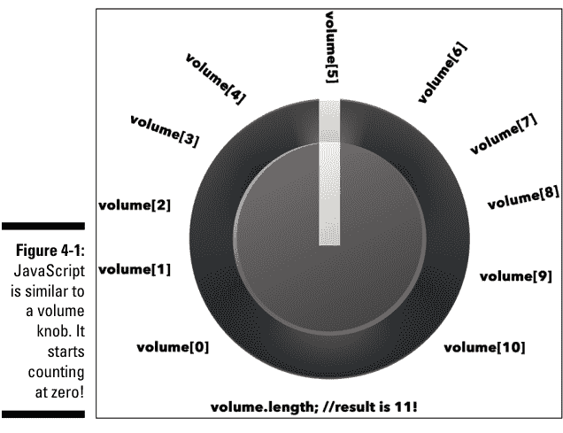

这意味着对于你来说，`myArray[3]` 实际上是数组中的第四个元素。

对于编程新手来说，基于零的编号经常是 Bug 和困惑的根源，但一旦你习惯了，它会变得非常自然。你甚至可能会发现它有好处，比如能让你把吉他放大器的音量开到 11 级。

### 数组可以存储任何类型的数据

数组中的每个元素都可以存储任何数据类型（见第 3 章），以及其他数组。数组元素还可以包含函数和 JavaScript 对象（见第 7 章和第 8 章）。

虽然你可以在数组中存储任何类型的数据，但你也可以在同一个数组中共同存储包含不同类型数据的元素，如代码清单 4-1 所示。

**代码清单 4-1：在数组中存储不同类型的数据**

```
item[0] = "apple";
item[1] = 4+8;
item[2] = 3;
item[3] = item[2] * item[1];
```

## 创建数组

JavaScript 提供了两种不同的方式来创建新数组：

- `new` 关键字
- 数组字面量表示法

### 使用 new 关键字方法

`new` 关键字方法使用 `new Array()` 来创建数组并为其添加值。

```
var catNames = new Array("Larry", "Fuzzball",
        "Mr. Furly");
```

在你作为程序员的职业生涯中可能会看到这种方法的应用，这是一种完全可以接受的创建数组的方式。


然而，许多 JavaScript 专家建议不要使用这种方法。使用 `new` 关键字最大的问题在于当你忘记包含它时会发生什么。忘记使用 `new` 关键字可能会剧烈改变程序的运行方式。

### 数组字面量

一种更简单、更安全地创建数组的方法是使用所谓的数组字面量（array literal）表示法。它的样子如下：

```
var dogNames =["Shaggy", "Tennessee", "Dr. Spock"];
```

就是这么简单。使用方括号且无需特殊关键字，意味着你不太可能意外地遗漏某些内容。数组字面量方法比 `new` 关键字方法使用的字符更少——当你试图让 JavaScript 尽可能简洁时，每一小步改进都很有帮助！

## 填充数组

你可以在数组 처음 创建时添加值，或者先创建一个数组然后在稍后时间向其添加元素。向数组添加元素与创建或修改变量的方式完全相同，区别在于你需要指定要创建或修改的元素的索引号。代码清单 4-2 显示了一个创建空数组然后向其添加元素的示例。

**代码清单 4-2：填充空数组**

```
var peopleList =[];
peopleList[0] = "Chris Minnick";
peopleList[1] = "Eva Holland";
peopleList[2] = "Abraham Lincoln";
```

你并不总是需要按顺序添加元素。在 JavaScript 中，创建一个不按顺序排列的新元素是完全合法的。例如，在前面代码清单 4-2 的数组中，你可以添加以下内容：

```
peopleList[99] = "Tina Turner";
```

像这样不按顺序创建数组，实际上为 `peopleList[2]` 和 `peopleList[99]` 之间所有的索引创建了空白元素。

因此，如果你在添加索引为 99 的元素后检查 `peopleList` 数组的 `length` 属性，会发生一些有趣的事情：

```
peopleList.length // 返回 100
```

尽管你只创建了四个元素，但 JavaScript 会说数组的长度是 100，因为长度是基于最高索引号，而不是基于你实际创建了多少个元素。

## 理解多维数组

你不仅可以将数组存储在数组内部，甚至可以将数组放在数组的数组内部。如此类推，可以一直延续下去。

包含数组的数组被称为*多维数组*。要编写多维数组，只需在变量名后添加更多组方括号即可。例如：

```
var listOfLists[0][0];
```

当你刚开始接触多维数组时，可能很难将其可视化。图 4-2 显示了一个多维数组的图解表示。

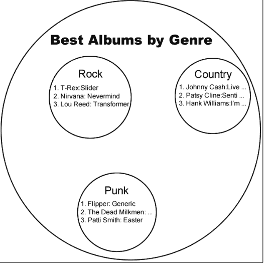

**图 4-2：** 多维数组的图解表示。

你也可以将多维数组想象成层级列表或大纲。例如：

### 各流派顶级专辑

- 1. 乡村音乐 (Country)
    - 1.1 Johnny Cash: Live at Folsom Prison
    - 1.2 Patsy Cline: Sentimentally Yours
    - 1.3 Hank Williams: I'm Blue Inside
- 2. 摇滚乐 (Rock)
    - 2.1 T-Rex: Slider
    - 2.2 Nirvana: Nevermind
    - 2.3 Lou Reed: Transformer
- 3. 朋克摇滚 (Punk)
    - 3.1 Flipper: Generic
    - 3.2 The Dead Milkmen: Big Lizard in my Backyard
    - 3.3 Patti Smith: Easter

以下是基于图 4-2 创建数组的代码：

```
var bestAlbumsByGenre = [];
bestAlbumsByGenre[0] = "Country";
bestAlbumsByGenre[0][0] = "Johnny Cash:Live at Folsom Prison";
bestAlbumsByGenre[0][1] = "Patsy Cline:Sentimentally Yours";
bestAlbumsByGenre[0][2] = "Hank Williams:I'm Blue Inside";
bestAlbumsByGenre[1] = "Rock";
bestAlbumsByGenre[1][0] = "T-Rex:Slider";
bestAlbumsByGenre[1][1] = "Nirvana:Nevermind";
bestAlbumsByGenre[1][2] = "Lou Reed:Transformer";
bestAlbumsByGenre[2] = "Punk";
bestAlbumsByGenre[2][0] = "Flipper:Generic";
bestAlbumsByGenre[2][1] = "The Dead Milkmen:Big Lizard in my Backyard";
bestAlbumsByGenre[2][2] = "Patti Smith:Easter";
```

## 访问数组元素

你可以使用与设置元素相同的方式访问数组元素，即使用方括号和索引号。例如，要访问名为 `myArray` 的任何数组中的第三个元素，你应该使用以下代码：

```
myArray[2];
```

要访问多维数组中的元素，只需添加更多方括号即可到达你想要的元素：

```
bestAlbumsByGenre[0][1]; // 返回 "Patsy Cline:Sentimentally Yours";
```

要测试设置和访问数组元素，请按照以下步骤操作：

- 1. **打开你的 Chrome 浏览器并打开 JavaScript 控制台。**
  你可以通过 Chrome 菜单打开 JavaScript 控制台，或者在 Mac 上按下 Command + Option + J，在 Windows 上按下 Ctrl + Shift + J。


2. 在控制台中输入以下语句，然后按下 Return 或 Enter 键，以创建名为 `lengthsOfString` 的数组：

```
var lengthsOfString = [2,4,1.5,80];
```

3. 输入数组名称，随后在方括号中输入索引号，以检索每个数组元素的值。

例如：

```
lengthsOfString[0];
lengthsOfString[3];
lengthsOfString[2];
```

4. 输入一个数组中不存在的索引号。

例如：

```
lengthsOfString[4];
```

请注意，该数组元素的值是 undefined。

5. 输入以下命令来创建一个新变量，用于保存你拥有的字符串总长度：

```
var totalLength = lengthsOfString[0] + lengthsOfString[1] + lengthsOfString[2] + lengthsOfString[3];
```

6. 最后，使用此命令获取 `totalLength` 的值：

```
totalLength;
```

## 遍历数组

你可以想象，通过输入数组名称和索引号来处理数组中的多个值，一段时间后会让你的手指感到疲劳。幸运的是，有更简单的方法来处理数组中的所有元素。最常用的方法是使用一种称为*循环*（loop）的编程结构。（我们在第 6 章中会更详细地介绍循环。）

也可以使用 JavaScript 内置的数组函数来处理数组中的多个元素。

## 数组属性

你可以通过访问数组属性来获取关于数组的某些数据。在 JavaScript 中访问数组属性的方法是使用*点符号*（dot notation）。要使用点符号，需输入数组名称，后接一个点，然后是你要访问的属性。（你可以在第 8 章中了解更多关于属性的内容。）表 4-1 列出了 JavaScript 数组的所有属性。

**表 4-1：JavaScript 的数组属性**

| 属性 | 返回值 |
|---|---|
| `prototype` | 允许向 *Array* 对象添加属性和方法 |
| `constructor` | 对创建 *Array* 对象原型的函数的引用 |
| `length` | 返回或设置数组中的元素数量 |

最常用的数组属性是 `length`。你已经见识过 `length` 属性的实际运作了。它的目的是提供数组中元素的数量，无论这些元素是已定义还是未定义的。例如：

```
var myArray = [];
myArray[2000];
myArray.length; // 返回 2001
```

你也可以使用 length 属性来截断数组：

```
myArray.length;// 返回 2001
myArray.length = 10;
myArray.length; // 返回 10
```

## 数组方法

JavaScript 数组方法（也称为数组函数）提供了便捷的方式来操作和处理数组。表 4-2 列出了所有数组方法及其功能描述或产生的值。

### 使用数组方法

使用数组方法的语法取决于你尝试使用的具体方法。不过，访问每个数组方法功能的方式与访问数组属性的方式相同：使用点符号。

**表 4-2：JavaScript 数组方法**

| 方法 | 返回值 |
| :--- | :--- |
| `concat()` | 由当前数组与另一个（或多个）数组和/或值连接而成的原新数组 |
| `every()` | 如果给定数组中的每个元素都满足提供的测试函数，则返回 `true` |
| `filter()` | 一个新数组，包含当前数组中所有通过给定函数测试为 true 的元素 |
| `forEach()` | 对数组中的每个元素执行一次该函数 |
| `indexOf()` | 指定值在数组中第一次出现的位置。如果未找到该值，则返回 `-1` |
| `join()` | 将数组的所有元素连接成一个字符串 |
| `lastIndexOf()` | 指定值在数组中最后一次出现的位置。如果未找到该值，则返回 `-1` |
| `map()` | 一个新数组，包含对数组中每个元素执行提供的函数后的结果 |
| `pop()` | 移除数组中的最后一个元素 |
| `push()` | 在数组末尾添加新项目 |
| `reduce()` | 通过对两个值应用函数（从左到右），将数组的两个值归约为单个值 |
| `reduceRight()` | 通过同时对两个值应用函数（从右到左），将数组的两个值归约为单个值 |
| `reverse()` | 反转数组中元素的顺序 |
| `shift()` | 从数组中移除第一个元素并返回该元素，导致数组长度发生变化 |
| `slice()` | 选择数组的一部分并将其作为新数组返回 |
| `some()` | 如果一个或多个元素满足提供的测试函数，则返回 `true` |
| `sort()` | 对数组中的元素进行排序后返回该数组（默认排序顺序为字母升序） |
| `splice()` | 返回一个由添加到给定数组或从给定数组中移除的元素组成的新数组 |
| `toString()` | 将数组转换为字符串 |
| `unshift()` | 通过添加一个或多个元素，返回一个具有新长度的新数组 |

如需查看 JavaScript 数组方法的完整参考资料及示例，请访问 https://docs.webplatform.org/wiki/javascript/Array#Methods。

代码清单 4-3 展示了一些最常用的 JavaScript 方法示例。

### 代码清单 4-3：常用 JavaScript 数组方法的实际应用

```html
<html>
<head>
    <title>common array methods</title>
</head>
<body>
    <script>
        var animals = ["tiger" , "bear"];
        var fruit = ["cantaloupe" , "orange"];
        var dishes = ["plate" , "bowl" , "cup"];

        var fruitsAndAnimals = fruit.concat(animals);
        document.write (fruitsAndAnimals + "<br>");

        var whereIsTheTiger = animals.indexOf("tiger");
        document.write ("The tiger has an index number of: " + whereIsTheTiger + "<br>");
    </script>
</body>
</html>
```

图 4-3 显示了代码清单 4-3 在浏览器中运行的结果。

图 4-3：常用 JavaScript 数组方法的实际应用。

## 第 5 章：使用运算符、表达式和语句

### 本章内容
- 阅读和编写 JavaScript 表达式
- 使用赋值运算符更改值
- 使用比较运算符进行逻辑思考
- 使用算术运算符进行数学运算
- 深入了解按位运算符
- 使用字符串运算符将它们结合起来

> “你好，运算符。能给我 9 号吗？”
— The White Stripe

JavaScript 的运算符、表达式和语句是程序的构建基石。它们帮助你操作和更改值、执行数学运算、比较两个或多个值，以及更多功能。

在本章中，你将发现运算符、表达式和语句是如何工作的，以及你如何最好地利用它们来获得优势。

别忘了访问网站查看与本章相关的在线练习！

## 表达你自己

*表达式*（expression）是一段能够求值为某个值的代码。表达式可以将值赋给变量，或者它们本身就具有一个值。例如，以下两个都是有效表达式的例子：

```
1 + 1
```

```
a = 1;
```

表达式可以像这些示例一样简短简单，也可以非常复杂。

表达式中的数据片段（在这些示例中为 1 或 a）被称为*操作数*（operands）。

## 你好，运算符

让表达式发挥作用的引擎被称为*运算符*（operators）。它们对数据进行操作以产生不同的结果。在前面的表达式中，`=` 和 `+` 就是运算符的例子。

## 运算符优先级

单个表达式通常包含多个运算符。考虑以下示例：

```
a + 1 + 2 * 3 / 4;
```

根据你执行不同计算的顺序，a 的最终值可能是以下任何一个：

```
a = 1.75
```

```
a = 2.5
```

```
a = 2.25
```

事实上，这个表达式的实际结果将是 2.5。但你如何知道这一点呢？根据执行数学运算的人不同，可能会先进行除法 (3 / 4)，或者先进行加法 (1 + 2)，或者先进行乘法 (2 * 3)。


 ##

## 第五章：运算符、表达式和语句的使用

显然，一定存在更好的方法来确定答案，确实如此！这就是*运算符优先级*的用武之地。运算符优先级是指表达式中运算符被求值的顺序。

运算符被划分为不同优先级级别的组，从 0 到 19 编号，如表 5-1 所示。

| 运算符 | 用途 | 运算符结合性 | 优先级 | 示例 |
|:---|:---|:---|:---|:---|
| ( .. ) | 分组 | n/a | 0 — 最高优先级 | (1 + 3) |
| .. . . | 运算符属性访问 | 从左到右 | 1 | myCar.color |
| [ .. ] | 数组访问 | 从左到右 | 1 | thingsToDo[4] |
| new . . .() | 创建对象（带参数列表） | n/a | 1 | new Car ("red") |
| function . . .() | 函数调用 | 从左到右 | 2 | function add Numbers (1,2) |
| new . . . | 创建对象（不带列表） | 从右到左 | 2 | new Car |
| . . .++ | 后缀递增 | n/a | 3 | number++ |
| . . .-- | 后缀递减 | n/a | 3 | number-- |
| ! . . . | 逻辑非 | 从右到左 | 4 | !myVal |
| ~ . . . | 按位非 | 从右到左 | 4 | ~myVal |
| - . . . | 取反 | 从右到左 | 4 | -aNumber |
| ++ . . . | 前缀递增 | 从右到左 | 4 | ++aNumber |
| -- . . . | 前缀递减 | 从右到左 | 4 | --aNumber |
| typeof . . . | typeof | 从右到左 | 4 | typeof myVar |
| void . . . | void | 从右到左 | 4 | void(0) |
| delete . . . | 删除 | 从右到左 | 4 | delete object. property |
| . . . * . . . | 乘法 | 从左到右 | 5 | result = 3 * 7 |
| . . . / . . . | 除法 | 从左到右 | 5 | result = 3 / 7 |
| . . . % . . . | 取余 | 从左到右 | 5 | result = 7 % 3 |
| . . . + . . . | 加法 | 从左到右 | 6 | result = 3 + 7 |
| ... – ... | 减法 | 从左到右 | 6 | result = 3 – 7 |
| ... << ... | 按位左移 | 从左到右 | 7 | result = 3 << 7 |
| ... >> ... | 按位右移 | 从左到右 | 7 | result = 3 >> 7 |
| ... >>> ... | 按位无符号右移 | 从左到右 | 7 | result = 3 >>> 7 |
| ... < ... | 小于 | 从左到右 | 8 | a < b |
| ... <= ... | 小于等于 | 从左到右 | 8 | a <= b |
| ... > ... | 大于 | 从左到右 | 8 | a > b |
| ... >= ... | 大于等于 | 从左到右 | 8 | a >= b |
| ... in ... | in | 从左到右 | 8 | value in values |
| ... instanceof ... | instanceof | 从左到右 | 8 | myCar instanceof car |
| ... == ... | 相等 | 从左到右 | 9 | 3 == "3" // true |
| ... != ... | 不相等 | 从左到右 | 9 | 3 != "3" // false |
| ... === ... | 严格相等 | 从左到右 | 9 | 3 === "3" // false |
| ... !== ... | 严格不相等 | 从左到右 | 9 | 3 !== "3" // true |
| ... & ... | 按位与 | 从左到右 | 10 | result = a & b |
| ... ^ ... | 按位异或 | 从左到右 | 11 | result = a ^ b |
| ... \| ... | 按位或 | 从左到右 | 12 | result = a \| b |
| ... && ... | 逻辑与 | 从左到右 | 13 | a && b |
| ... \|\| ... | 逻辑或 | 从左到右 | 14 | a \|\| b |
| ... ? ... : ... | 条件运算符 | 从右到左 | 15 | a ? 3 : 7 |
| ... = ... | 赋值 | 从右到左 | 16 | a = 3 |
| ... += ... | 赋值 | 从右到左 | 16 | a += 3 |
| ... -= ... | 赋值 | 从右到左 | 16 | a -= 3 |
| ... *= ... | 赋值 | 从右到左 | 16 | a *= 3 |
| ... /= ... | 赋值 | 从右到左 | 16 | a /= 3 |
| ... %= ... | 赋值 | 从右到左 | 16 | a %= 3 |
| ... <<= ... | 赋值 | 从右到左 | 16 | a <<= 3 |
| ... >>= ... | 赋值 | 从右到左 | 16 | a >>= 3 |
| ... >>>= ... | 赋值 | 从右到左 | 16 | a >>>= 3 |
| ... &= ... | 赋值 | 从右到左 | 16 | a &= 3 |
| ... ^= ... | 赋值 | 从右到左 | 16 | a ^= 3 |
| ... |= ... | 赋值 | 从右到左 | 16 | a |= 3 |
| yield ... | yield | 从右到左 | 17 | yield [expression] |
| ..., ... | 逗号 / 序列 | 从左到右 | 18 | a + b, c + d |

编号最小的运算符具有最高的优先级。这最初看起来可能令人困惑，但如果你把它想象成排队买美味三明治或咖啡时排在最前面的人（也就是位置 0 的人）最先得到，你就不会搞混了。

当表达式中包含两个或多个优先级相同的运算符时，它们将根据其*结合性*进行 modifier="000">进行求值。结合性决定了运算符是从左到右还是从右到左求值。

### 使用括号

表达式中优先级最高的运算符是括号。在大多数情况下，你可以通过使用括号将运算分组为子表达式，从而简单地忽略运算符优先级规则。例如，前面提到的多运算符表达式可以通过以下方式完全明确：

```
a = (1 + 2) * (3 / 4); // 结果：2.25
a = (1 + (2 * 3)) / 4; // 结果：1.75
a = ((1 + 2) * 3) / 4; // 结果：2.25
a = 1 + ((2 * 3) / 4); // 结果：2.5
```

表达式中的括号强制 JavaScript 解释器先计算括号内的内容，从最内层的括号到最外层的括号，然后才执行括号外的运算。

查阅表 5-1，你会看到前述表达式的实际优先级顺序是

```
a = 1 + ((2 * 3) / 4);
```

这条语句使实际的运算符优先级变得明确。先进行乘法，然后进行除法，最后进行加法。

## 运算符的类型

JavaScript 有多种类型的运算符。本节讨论最常用的运算符类型。

### 赋值运算符

*赋值运算符*将右侧操作数的值赋给左侧的操作数：

```
a = 5;
```

此表达式执行后，变量 a 的值将为 5。你还可以将赋值运算符串联在一起，以便为多个变量赋相同的值，如下例所示：

```
a = b = c = 5;
```

由于该运算符的结合性是从右到左（见表 5-1），5 将首先被赋给 c，然后 c 的值被赋给 b，接着 b 的值被赋给 a。此表达式的结果是 a、b 和 c 的值都为 5。

你认为这些表达式求值后 a 的最终值会是多少？

```
var b = 1;
var a = b += c = 5;
```

要找到答案，打开 Chrome 中的 JavaScript 控制台并输入每一行，然后按回车键。这条语句的结果是 a 将等于 6。

你可以在本章后面的"组合运算符"部分找到不同赋值运算符的完整列表。

### 比较运算符

比较运算符测试操作数之间的相等性或差异性，并返回 true 或 false 值。

表 5-2 显示了 JavaScript 比较运算符的完整列表。

| **运算符** | **描述** | **示例** |
|:---|:---|:---|
| `==` | 相等 | `3 == "3" // true` |
| `!=` | 不相等 | `3 != 3 // false` |
| `===` | 严格相等 | `3 === "3" // false` |
| `!==` | 严格不相等 | `3 !== "3" // true` |
| `>` | 大于 | `7 > 1 // true` |
| `>=` | 大于等于 | `7 >= 7 // true` |
| `<` | 小于 | `7 < 10 // true` |
| `<=` | 小于等于 | `2 <= 2 // true` |

### 算术运算符

算术运算符对操作数执行数学运算并返回结果。表 5-3 显示了算术运算符的完整列表。

| **运算符** | **描述** | **示例** |
|:---|:---|:---|
| `+` | 加法 | `a = 1 + 1` |
| `-` | 减法 | `a = 10 - 1` |
| `*` | 乘法 | `a = 2 * 2` |
| `/` | 除法 | `a = 8 / 2` |
| `%` | 取模 | `a = 5 % 2` |
| `++` | 递增 | `a = ++b`, `a = b++`, `a++` |
| `--` | 递减 | `a = --b`, `a = b--`, `a--` |


## 列表 5-1：使用算术运算符

列表 5-1 展示了算术运算符的实际应用。

```
<html>
<head>
  <title>arithmetic operators</title>
</head>
<body>
  <h1>Wild Birthday Game</h1>
  <p>
  <ul>
    <li>Enter the number 7</li>
    <li>Multiply by the month of your birth</li>
    <li>Subtract 1</li>
    <li>Multiply by 13</li>
    <li>Add the day of your birth</li>
    <li>Add 3</li>
    <li>Multiply by 11</li>
    <li>Subtract the month of your birth</li>
    <li>Subtract the day of your birth</li>
    <li>Divide by 10</li>
    <li>Add 11</li>
    <li>Divide by 100</li>
  </ul>
  </p>
  <script>
    var numberSeven = Number(prompt('Enter the number
    7'));
    var birthMonth = Number(prompt('Enter your birth
    month'));
    var calculation = numberSeven * birthMonth;
    calculation = calculation - 1;
    calculation = calculation * 13;
    var birthDay = Number(prompt('Enter the day of your
    birth'));
    calculation = calculation + birthDay;
    calculation = calculation + 3;
    calculation = calculation * 11;
    calculation = calculation - birthMonth;
    calculation = calculation - birthDay;
    calculation = calculation / 10;
    calculation = calculation + 11;
    calculation = calculation / 100;

    document.write("Your birthday is " + calculation);
  </script>
</body>
</html>
```

在浏览器中运行列表 5-1 的结果如图 5-1 所示。

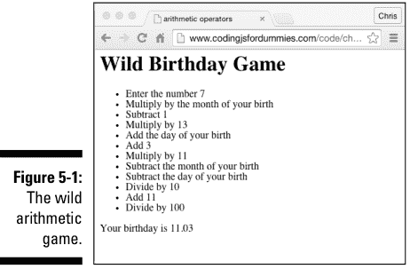

## 字符串运算符

*字符串运算符*使用两个字符串执行运算。当与字符串一起使用时，+ 运算符变为连接运算符。其目的是将字符串连接在一起。请注意，使用连接运算符连接字符串时，不会添加空格。因此，经常会看到如下所示的语句，其中仅包含空格的字符串会在其他字符串之间进行连接，或者在字符串的末尾或开头（引号之前）添加空格，以形成通顺的句子：

```
var greeting = "Hello, " + firstName + ". I'm" + " " +
              mood + " to see you.";
```

## 位运算符

*位运算符*将操作数视为以二补数形式表示的有符号 32 位二进制数字。让我们从*二进制*这个术语开始，了解这是什么意思。

二进制数字是由 1 或 0 组成的字符串，数字的位置决定了该位置上 1 的值。例如，以下是如何将数字 1 写成 32 位二进制数：

```
00000000000000000000000000000001
```

最右边的位置值为 1。该位置左侧的每个位置的值都是其右边数字值的两倍。因此，以下二进制数字等于 5：

```
00000000000000000000000000000101
```

有符号整数意味着正整数和负整数都可以用这种方式表示。

*二补数*这个术语是指任何正二进制数的相反数就是其负数（当然，反之亦然）。因此，要将二进制 5 变为二进制 -5，只需翻转所有位：

```
11111111111111111111111111111110
```

位运算符将数字转换为这些 32 位二进制数，然后在运算完成后将其转换回我们通常认为的正常数字。


位运算符起初难以理解。它们在 JavaScript 中并不常用，但如果不介绍它们，我们就失职了。

表 5-4 列出了 JavaScript 的位运算符。

| **运算符** | **用法** | **描述** |
| :--- | :--- | :--- |
| 按位与 | `a & b` | 在两个操作数对应位都为 1 的每个位位置返回 1 |
| 按位或 | `a \| b` | 在两个操作数对应位中有一个或两个都为 1 的每个位位置返回 1 |
| 按位异或 | `a ^ b` | 在两个操作数对应位中只有一个为 1 的每个位位置返回 1 |
| 按位非 | `~a` | 反转其操作数的位 |
| 左移 | `a << b` | 将 a 的二进制表示向左移动 b（<32）位，右侧移入 0 |
| 算术右移 | `a >> b` | 将 a 的二进制表示向右移动 b（<32）位，丢弃移出的位 |
| 零填充右移 | `a >>> b` | 将 a 的二进制表示向右移动 b（<32）位，丢弃移出的位，左侧移入 0 |

图 5-2 展示了在 Chrome JavaScript 控制台中每个位运算符的演示。

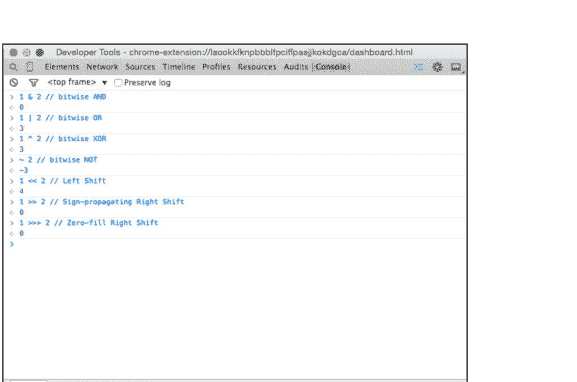

## 逻辑运算符

逻辑运算符计算逻辑表达式的真值或假值。共有三个逻辑运算符，如表 5-5 所示。

| **运算符** | **含义** | **描述** |
| :--- | :--- | :--- |
| `&&` | 与 | 如果第一个操作数为 `true`，则返回第一个操作数。否则，返回第二个操作数。 |
| `\|\|` | 或 | 如果第一个操作数为 `true`，则返回第一个操作数。否则，返回第二个操作数。 |
| `!` | 非 | 只接受一个操作数。如果其操作数可以转换为 `true`，则返回 `false`。否则，返回 `false`。 |


你还可以使用 OR 运算符为变量设置默认值。例如，在以下表达式中，`myVar` 的值将被设置为 `x` 的值，除非 `x` 的值为假值（例如，如果 `x` 尚未定义）。否则，它将被设置为默认值 0。

```
var myVar = x || 0;
```

## 特殊运算符

JavaScript 的特殊运算符是各种其他符号和单词的大杂烩，它们执行其他重要功能。

## 条件运算符

*条件运算符*（也称为*三元运算符*）使用三个操作数。它计算一个逻辑表达式，然后根据该表达式为真或为假返回一个值。条件运算符是唯一需要三个操作数的运算符。例如：

```
var isItBiggerThanTen = (value > 10) ? "greater than 10" : "not greater than 10";
```

## 逗号运算符

*逗号运算符*计算两个操作数并返回第二个操作数的值。它最常用于在循环中执行多个赋值或其他操作。它还可以作为初始化变量的简写形式。例如：

```
var a = 10, b = 0;
```

由于逗号运算符的优先级最低，其操作数总是单独计算。

## delete 运算符

`delete` 运算符从对象中删除属性或从数组中删除元素。

当你使用 `delete` 运算符从数组中删除元素时，数组的长度保持不变。被删除的元素将具有 undefined 值。

```
var animals = ["dog","cat","bird","octopus"];
console.log(animals[3]); // returns "octopus"
delete animals[3];
console.log(animals[3]); // returns "undefined"
```

## in 运算符

`in` 运算符如果指定的值存在于数组或对象中，则返回 true。

```
var animals = ["dog","cat","bird","octopus"];
if (3 in animals) {
    console.log("it's in there");
}
```

在此示例中，如果 `animals` 数组有索引为 3 的元素，则字符串 `"it's in there"` 将输出到 JavaScript 控制台。

## instanceof 运算符

`instanceof` 运算符如果指定的对象是指定类型的对象，则返回 true。

```
var myString = new String();
if (myString instanceof String) {
    console.log("yup, it's a string!");
}
```

## new 运算符

`new` 运算符创建一个对象的实例。如你在第 8 章所见，JavaScript 有几个内置对象类型，你也可以定义自己的对象类型。在以下示例中，`Date()` 是一个内置的 JavaScript 对象，而 `Pet()` 和 `Flower()` 是程序员可以创建的对象示例，用于在程序中实现自定义目的。

```
var today = new Date();
var bird = new Pet();
var daisy = new Flower();
```

## this 运算符

`this` 运算符引用当前对象。它经常用于检索对象内的属性。

第 8 章将更详细地介绍 `this` 运算符。

## typeof 运算符

`typeof` 运算符返回一个包含操作数类型的字符串：

```
var businessName = "Harry's Watch Repair";
console.log(typeof businessName); // returns "string"
```

## void 运算符

`void` 运算符导致计算操作数中的表达式而不返回值。你最常看到 `void` 使用的地方是在 HTML 文档中，当需要链接但链接创建者想要使用 JavaScript 覆盖链接的默认行为时：

```
<a href="javascript:void(0);">This is a link, but it won't
do anything</a>
```


## 组合运算符

你可以将赋值运算符与其他运算符结合使用，作为将表达式结果赋值给变量的简写方法。例如，以下两个示例的结果相同：

```
a = a + 10;
```

```
a += 10;
```

表 5-6 列出了赋值运算符与其他运算符所有可能的组合。

| 名称 | 简写 | 标准运算符 |
|------|-----------|-------------------|
| 赋值 | x = y | x = y |
| 加法赋值 | x += y | x = x + y |
| 减法赋值 | x -= y | x = x - y |
| 乘法赋值 | x *= y | x = x * y |
| 除法赋值 | x /= y | x = x / y |
| 取余赋值 | x %= y | x = x % y |
| 左移赋值 | x <<= y | x = x << y |
| 右移赋值 | x >>= y | x >>= y | x = x >> y |
| 无符号右移赋值 | x >>>= y | x = x <<< y |
| 按位与赋值 | x &= y | x = x & y |
| 按位异或赋值 | x ^= y | x = x ^ y |
| 按位或赋值 | x |= y | x = x | y |

# 第 6 章

## 使用循环和分支掌控流程

### 本章内容

- 了解 if/else 分支
- 理解不同类型的循环
- 使用循环重复执行语句
- 遍历数组的值

> “当你清楚自己的价值观时，做决定并不难。”

— 罗伊·迪士尼 (Roy Disney)

在本书的前几章中，我们通常讨论并演示线性的 JavaScript 代码。然而，在程序中经常会出现（实际上是很多次）需要做出选择，或者需要改变程序直线逻辑以使用不同值多次重复执行语句的时候。在本章中，我们将讨论循环和分支语句。

不要忘记访问网站查看与本章相关的在线练习！

### 分支扩展

循环和分支语句被称为控制语句，因为它们控制 JavaScript 程序的运行顺序。你可以使用分支语句根据条件逻辑为 JavaScript 代码的执行创建不同的路径。循环是将 JavaScript 语句在程序中分组在一起的最简单方法。

82 第一部分：JavaScript 入门

JavaScript 程序的逻辑经常会走到一个必须做出选择的关键点，而这个选择将产生截然不同的结果。图 6-1 通过 JavaScript 演示了一个可以用分支解决的现实世界决策。

### if...else

`if` 和 `else` 语句协同工作，用于评估逻辑表达式并根据结果运行不同的语句。`if` 语句可以单独使用，且经常如此。`else` 语句必须始终与 `if` 语句结合使用。

`if` 语句的基本语法是：

```
if (condition) {
  ...
}
```

这里的 condition 是任何评估结果为布尔值（`true` 或 `false`）的表达式。如果表达式的结果为 `true`，则执行括号之间的语句。如果是 `false`，它们将被直接跳过。

当你希望在条件评估为 `false` 时执行某些操作，就需要用到 `else` 语句。例如：

```
var age = 19;
if (age < 21){
  document.write ("You are under the legal drinking age in the U.S.");
} else {
  document.write ("What'll it be?");
}
```

许多其他编程语言有一个组合关键字叫 `elseif`，它可以在一个 `if ... else` 语句中多次使用，直到出现 true 值为止。JavaScript 没有 `elseif` 关键字。

但是，你可以通过将 `if` 和 `else` 组合使用并在它们之间留一个空格，来实现与 `elseif` 关键字相同的功能。例如：

```
if (time < 12){
  document.write ("Good Morning!");
} else if (time < 17){
  document.write ("Good Afternoon!");
} else if (time < 20){
  document.write ("Good Evening!");
} else {
  document.write ("Good Night!");
}
```

### 理解 if . . . else 简写

你应该了解两种使用 `if ... else` 语句的快捷方式。第一种是用三元运算符代替 `if ... else`。这比标准的 `if ... else` 稍微难以阅读：

```
var whatToSay = (time < 12 ?
      "Good Morning" :
      "Hello");
```

在这种情况下，如果 time 小于 12，`whatToSay` 的值被设为 "Good Morning"；如果 time 不小于 12，则设为 "Hello"。

另一种编写 `if ... else` 语句的简写方法是使用逻辑与 (`&&`) 运算符。请记住，逻辑与仅在第一个操作数评估为 true 时才会评估第二个操作数。程序员将此称为*短路 (short-circuiting)*，因为在逻辑与操作中，如果第一个操作数结果为 false，则无需评估第二个操作数。

```
time < 12 && document.write("Good Morning!");
```

在上述示例中，`&&` 语句首先检查 times 是否小于 12。如果是，字符串 "Good Morning" 将被写入 HTML 文档。如果不是，由于 `&&` 运算符的短路副作用，将不执行任何操作。

这种方法并不常用，主要是因为它难以理解且容易引起混淆。不过，你有时可能会遇到类似的代码，因此你需要理解它是如何工作的。

84 第一部分：JavaScript 入门

注意上述示例中换行符和空格的使用。许多人对于如何编写 if . . . else 语句有不同的风格。你可能还会看到使用较少换行符，或者在关键字和括号之间没有空格的写法。这些同样有效。然而，只要有可能，优先选择易读性而非简洁性。

### Switch

`switch` 语句根据单个表达式的可能值，在多个待执行的语句之间进行选择。`switch` 语句中的每个值被称为一个 case（分支）。用英语来说，例如你可以说：

> “如果（in the case）我们预计有 6 位客人，就订 3 个比萨。如果预计有 12 位客人，就订 6 个比萨。如果预计超过 20 位客人，就惊慌失措吧。”

switch 语句的语法是：

```
switch (expression) {
    case value1:
        // Statements
        break;
    case value2:
        // Statements
        break;
    case value3:
        // Statements
        break;
    default:
        // Statements
        break;
}
```

注意每个 case 相关语句之后的 `break` 语句。`break` 语句告诉 `switch` 语句停止并退出 `switch`。如果没有 break，`switch` 语句将继续运行下一个子句中的语句，无论表达式是否满足该 case 的条件。

在 switch 中忘记写 `break` 语句可能会导致严重问题，所以请务必始终使用它。因为 `switch` 语句会在任何评估为 true 的子句之后运行随后的任何 case 子句中的语句，因此当你忘记 `break` 语句时，可能会出现不可预测的结果。由缺失 `break` 语句引起的问题不易识别，因为它们通常不会产生错误，但经常会产生错误的结果。

第 6 章：使用循环和分支掌控流程 85

如果在任何 `case` 子句中都没有找到匹配项，`switch` 语句将寻找 `default` 子句并执行其中包含的语句。

在你应该始终在 `case` 子句之间使用 `break` 语句这一规则中，唯一的例外是 `default` 子句。只要 `default` 子句是 `switch` 中的最后一条语句（它本就应该是），你就可以安全地省略其后的 `break`，因为程序在执行最后一条语句后无论如何都会跳出 `switch`。

代码清单 6-1 展示了一个如何使用 `switch` 语句的示例。

### 代码清单 6-1：使用 switch 语句个性化问候语

```
var languagePreference = "Spanish";
switch (languagePreference) {
  case "English":
    console.log("Hello!");
    break;
  case "Spanish":
    console.log("Hola!");
    break;
  case "German":
    console.log("Guten Tag!");
    break;
  case "French":
    console.log("Bon Jour!");
    break;
  default:
    console.log("I'm Sorry, I don't Speak " + languagePreference + "!");
}
```

### 开始吧：循环之圈

*循环 (Loops)* 多次执行相同的语句。JavaScript 有几种不同类型的循环：

1. `for`
2. `for...in`
3. `do...while`
4. `while`


## 第6章：通过循环和分支掌握程序流程

## `for`

`for` 语句通过三个表达式创建一个循环：

- **初始化**：一个变量的初始值，通常是一个计数器。
- **条件**：一个布尔表达式，在循环的每次迭代时求值。
- **最终表达式**：一个在每次循环迭代后求值的表达式。

尽管在 `for` 循环中并非必须使用所有三个表达式，但它们几乎总是被包含在内。`for` 循环通常用于将代码运行预定的次数。

以下是一个简单的 `for` 循环示例：

```
for (var x = 1; x < 10; x++) {
    console.log(x);
}
```

分解来看，上述 `for` 循环示例的工作原理如下：

1.  **一个新变量，在本例中为 `x`，被赋予初始值 1。**
2.  **执行测试以确定 `x` 是否小于 10。**
    如果条件成立，则执行循环内的语句（在本例中，是一个 console.log 语句）。
3.  **如果条件不成立，则使用自增运算符（++）增加 `x` 的值。**
4.  **再次执行测试以确定 `x` 是否小于 10。**
    如果条件成立，则执行循环内的语句。
5.  **测试重复进行，直到条件表达式不再为真。**

图 6-2 展示了在 Chrome 开发者工具中运行此 `for` 语句的结果。

## 遍历数组

你可以通过将计数器的值与数组的 length 属性的值进行比较，来使用 `for` 循环列出数组的内容。请务必记住，JavaScript 数组的索引是从零开始的，并且任何 `array.length` 的值都会比数组中最高索引元素的值大一。这就是为什么我们在代码清单 6-2 中要减去 1 的原因。

### 代码清单 6-2：使用 for 循环列出数组内容

```
<html>
<head>
  <title>Different Area Codes</title>
</head>
<body>
  <script>
    var areaCodes = ["770", "404", "718", "202", "901",
                    "305", "312", "313", "215", "803"];

    for (x=0; x < areaCodes.length - 1; x++){
      document.write("Different Area Code:" + areaCodes[x]
                     + "<br>");
    }
  </script>
</body>
</html>
```

图 6-3 展示了运行代码清单 6-2 中所示程序的输出结果。

## `for...in`

`for...in` 语句可以遍历对象的属性。你也可以使用 `for...in` 语句来遍历数组的值。

`for...in` 循环有一个有趣的特点：它不关心所遍历属性或元素的顺序。因此，加上使用 `for...in` 循环速度较慢，使用标准的 `for` 循环来遍历数组元素是更好的选择。

对象是包含属性（它们是什么）和方法（它们做什么）的数据容器。Web 浏览器有一组内置对象，程序员可以使用它们来控制浏览器的功能。其中最基本的是 `Document` 对象。例如，`Document` 对象的 `write` 方法会告诉浏览器将指定的值插入到 HTML 文档中。

`Document` 对象还具有用于跟踪并向程序员提供当前文档信息的属性。例如，`Document.images` 集合包含了当前 HTML 文档中的所有 `img` 标签。

在代码清单 6-3 中，`for...in` 被用来列出 `Document` 对象的所有属性。

### 代码清单 6-3：使用 `for...in` 遍历 Document 对象

```
<html>
<head>
  <title>document properties</title>
  <style>
    .columns {
      -webkit-column-count: 6; /* Chrome, Safari, Opera */
      -moz-column-count: 6; /* Firefox */
      column-count: 6;
    }
  </style>
</head>
<body>

  <div class="columns">

  <script>
    for (var prop in document) {
      document.write (prop + "<br>");
    }
  </script>

  </div>

</body>
</html>
```

运行代码清单 6-3 的结果如图 6-4 所示。

你也可以使用 `for...in` 循环来输出对象属性中的值，而不仅仅是属性名称。代码清单 6-4 是一个输出 Document 对象每个属性当前值的程序。

### 代码清单 6-4：使用 `for...in` 输出 Document 对象的属性名和值

```
<html>
<head>
<title>document properties with values</title>
<style>
.columns{
-webkit-column-count: 6; /* Chrome, Safari, Opera */
-moz-column-count: 6; /* Firefox */
column-count: 6;
}
</style>
</head>
<body>
<div class="columns">
  <script>
    for (var prop in document) {
      document.write (prop + ": " + document[prop] +
      "<br>");
    }
  </script>
</div>
</body>
</html>
```

图 6-5 展示了代码清单 6-4 的输出结果。请注意，许多属性的值都位于方括号（[]）内。方括号表明该属性的值包含多个元素，例如数组或对象的情况。

## while 循环

`while` 语句创建一个循环，只要条件求值为真就会持续运行。代码清单 6-5 展示了一个包含 `while` 循环示例的网页。

### 代码清单 6-5：使用 while 循环

```
<html>
<head>
 <title>Guess the Word</title>
</head>
<body>
 <script>
   var guessedWord = prompt("What word am I thinking
       of?");
   while (guessedWord != "sandwich") { // as long as the
           guessed word is not sandwich
     prompt("No. That's not it. Try again.");
                                   }
     alert("Congratulations! That's exactly right!"); //
           do this after exiting the loop
 </script>
</body>
</html>
```

## do...while

`do...while` 循环的工作方式与 `while` 循环非常相似，不同之处在于它将语句放在需要测试的表达式之前。其效果是 `do...while` 循环内的语句至少会执行一次。

代码清单 6-6 演示了 `do...while` 循环的用法。

### 代码清单 6-6：使用 do...while 循环

```
<html>
<head>
 <title>Let's Count</title>
</head>
<body>
 <script>
   var i = 0;
   do {
     i++;
     document.write(i + "<br>");
   } while (i<10);
 </script>
</body>
</html>
```

## break 和 continue

你可以使用 `break` 和 `continue` 来中断循环的执行。`break` 语句在本章前面关于 `switch` 语句的上下文中已经展示过，其作用是在成功匹配后跳出 `switch`。

在循环中，`break` 的作用类似。它会导致程序立即退出循环，无论循环的完成条件是否已满足。

例如，在代码清单 6-7 中，猜单词游戏的进展将与代码清单 6-5 中一样，但如果未输入任何值，循环将立即终止。

### 代码清单 6-7：在 while 循环中使用 break

```
<html>
<head>
  <title>Guess the Word</title>
</head>
<body>
  <script>
    var guessedWord = prompt("What word am I thinking
       of?");
    while (guessedWord != "sandwich") {
      if (guessedWord =="") {break;} // exit the loop
          right away if user doesn't enter a value
      prompt("No. That's not it. Try again.");
    }
    alert("Congratulations! That's exactly right!");
  </script>
</body>
</html>
```

`continue` 语句会导致当前循环迭代停止，并告诉程序跳过 `continue` 语句之后的语句，直接开始下一次迭代。

代码清单 6-8 展示了一个从 1 数到 20 的程序，但只打印出偶数。请注意，该程序通过使用取模运算符测试计数器的当前值是否能被 2 整除来确定一个数是否为偶数：


## 示例 6-8：计数并使用 continue 显示偶数

```html
<html>
<head>
 <title>Count and show me even numbers</title>
</head>
<body>
 <script>
   for (var i = 0; i <= 20; i++){
     if (i%2 != 0){
       continue;
     }
     document.write (i + " is an even number.<br>");
   }
 </script>
</body>
</html>
```

在这种用法中，`continue` 可以替代 `else` 语句的功能。

图 6-6 显示了在浏览器中运行示例 6-8 的结果。

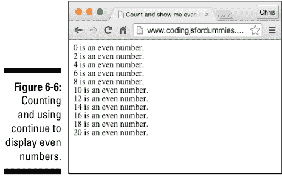

`break` 和 `continue` 语句非常有用，但它们也可能很危险。由于它们体积小且功能强大，在阅读代码时很容易被忽略。因此，一些程序员认为在循环内部使用它们是一种糟糕的实践。关于原因以及该问题的复杂性的更多信息，请阅读此讨论：

```
http://programmers.stackexchange.com/questions/58237/are-break-and-continue-bad-programming-practices
```

## 第二部分：组织你的 JavaScript

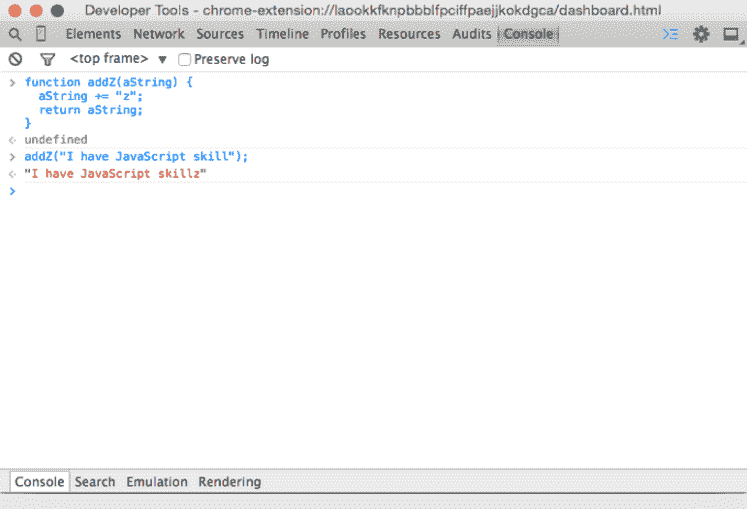

请参阅 www.dummies.com/extras/codingwithjavascript 上的文章“Underscore —— JavaScript 的工具带”。

### 在本部分中...

- 探索如何使用函数。
- 了解如何创建和使用对象。
- 查看 `www.dummies.com/extras/codingwithjavascript` 上的文章“Underscore —— JavaScript 的工具带”。

## 第 7 章：进入函数世界

### 本章内容

- 编写函数
- 为函数编写文档
- 传递参数
- 返回值
- 使用函数组织程序

> “我把写作当作一种函数。没有它，我会生病并死去。它就像肝脏或肠道一样是人的一部分，而且同样‘迷人’。”
> —— 查尔斯·布考斯基 (Charles Bukowski)

函数通过将频繁使用的代码片段转变为可重用部分，帮助你减少代码重复。在本章中，你将编写一些函数，并利用它们将原本枯燥的任务变得简单有趣！


别忘了访问网站，查看与本章相关的在线练习！

### 理解函数的“功能”

*函数* 是程序中的微型程序。函数的作用是处理主程序中某些特定的任务，这些任务可能会被程序的不同部分多次调用。

如果你阅读了之前的章节，你已经看到了一些函数的实际运行。下面的例子是一个简单的函数，当被调用时，它会在字符串的末尾添加一个 `z`。

```javascript
function addZ(aString) {
  aString += "z";
  return aString;
}
```

要尝试这个函数，请按照以下步骤操作：

1. 打开 Chrome 浏览器中的 JavaScript 控制台（Console）。
2. 输入该函数。
   你可以将它全部写在一行中，也可以在每行之后按下 Shift+Enter 或 Shift+Return 来创建换行而无需执行代码。
3. 在最后一个花括号之后按下 Return 或 Enter。
   控制台应该会输出 `undefined`。
4. 输入以下命令，然后按下 Return 或 Enter 来运行函数：

```javascript
addZ("I have JavaScript skill");
```

运行此函数的结果如图 7-1 所示。

函数是 JavaScript 编程的基础部分，作为一名 JavaScript 开发者，你需要意识到它们有很多规则和特殊能力。如果你无法记住关于函数的每个细节，不要担心。理解一些较为抽象的概念需要一定的练习，你甚至可能需要重新阅读本章。最终，一切都会变得清晰，所以请坚持下去！

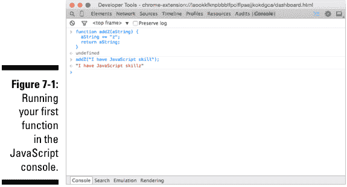

### 使用函数术语

程序员在讨论函数时，有许多重要的词汇需要理解。我们在本章以及整本书中会广泛使用这些词汇。以下列表是对你在处理函数时会遇到的某些术语的快速总结。

#### 定义函数 (Define a function)

当一个函数出现在 JavaScript 代码中时，它并不会运行。它只是被创建并准备好在稍后时间使用。为了以后可以使用而创建函数的过程称为*定义*函数。


在一个程序或网页中，你只需要定义一次函数。然而，如果你不小心将同一个函数定义了多次，JavaScript 也不会报错。它只会使用该函数最近定义的版本。

例如：

```javascript
var myFunction = new Function() {
};
```

或者

```javascript
function myFunction(){
};
```

#### 函数头 (Function head)

*函数头* 是函数定义的一部分，包括 `function` 关键字、函数名称和括号。

例如：

```javascript
function myFunction()
```

#### 函数体 (Function body)

*函数体* 由函数花括号之间的语句组成。

```javascript
{
    // function body
}
```

#### 调用函数 (Call a function)

当你使用一个函数时，这被称为调用函数。调用函数会导致函数体内的语句被执行。

例如：

```javascript
myFunction();
```

#### 定义参数和传递实参 (Defining parameters and passing arguments)

参数（Parameters）是你为函数调用时提供的数据片段所起的名称。实参（Arguments）是你提供给函数的具体值。当函数带着实参被调用时（根据函数指定的参数），程序员将其称为将实参传递进函数。

定义参数的语法如下：

```javascript
function myFunction(parameter) {
```

使用实参调用函数的语法如下：

```javascript
myFunction(myArgument);
```

#### 返回值 (Return a value)

除了能够接收来自外部世界地输入外，函数还可以在运行结束后发送回数值。当函数发送回某些内容时，这被称为返回值。

要返回一个值，请使用 `return` 关键字。例如：

```javascript
return myValue;
```

### 使用函数的益处

示例 7-1 展示了一个将数字相加的程序。它运行良好，并且使用 `for...in` 循环（见第 6 章）准确地完成了预期任务。

#### 示例 7-1：使用 for ...in 循环进行数字相加的程序

```html
<html>
<head>
    <title>Get the total</title>
</head>
<body>
    <script>
        var myNumbers = [2,4,2,7];
        var total = 0;
        for (oneNumber in myNumbers){
            total = total + myNumbers[oneNumber];
        }
        document.write(total);
    </script>
</body>
</html>
```

然而，如果我们有多个数字集需要相加，我们就需要为每个新数字数组专门编写一个新的循环语句。

示例 7-2 将示例 7-1 中的程序转化为一个函数，然后使用该函数来计算几个不同数组中元素的总和。

#### 示例 7-2：用于计算数组数字之和的函数

```html
<html>
<head>
    <title>Get the sum</title>
</head>
<body>
    <script>
        /**
        *Adds elements in an array
        *@param {Array.<number>} numbersToAdd
        *@return {Number} sum
        */
        function addNumbers(numbersToAdd) {
            var sum = 0;
            for (oneNumber in numbersToAdd) {
                sum = sum + numbersToAdd[oneNumber];
            }
            return sum;
        }

        var myNumbers = [2,4,2,7];
        var myNumbers2 = [3333,222,111];
        var myNumbers3 = [777,555,777,555];
        var sum1 = addNumbers(myNumbers);
        var sum2 = addNumbers(myNumbers2);
        var sum3 = addNumbers(myNumbers3);

        document.write(sum1 + "<br>");
        document.write(sum2 + "<br>");
        document.write(sum3 + "<br>");

    </script>
</body>
</html>
```

### 使用 JSDoc 为 JavaScript 编写文档

使用标准系统为你的 JavaScript 代码编写文档是一个良好的习惯。最广泛使用的 JavaScript 文档系统，也就是事实上的标准，是 JSDoc。

JSDoc 语言是一种简单的标记语言，可以插入到 JavaScript 文件中。JSDoc 目前处于第三个版本，它是基于 JavaDoc 系统的，而 JavaDoc 用于为用 Java 编程语言编写的代码创建文档。

在用 JSDoc 为 JavaScript 文件添加注释后，你可以使用文档生成器（如 jsdoc-toolkit）来创建记录代码的 HTML 文件。

JSDoc 标记位于特殊的块注释标签内。JSDoc 标记与普通 JavaScript 块注释的唯一区别是，JSDoc 标记以 `/**` 开始并以 `*/` 结束，而 JavaScript 中的普通块注释在起始斜杠后仅需要一个星号。JSDoc 标记标签中的额外星号允许你创建正常的块引用，而不会让它们成为生成的文档的一部分。

下图展示了来自开源 Angular JS JavaScript 框架的部分代码，该代码已使用 JSDoc 进行了标注。


程序的不同部分和方面可以使用 JSDoc 标签通过 JDDoc 进行文档化。以下是最常用的标签：

| JSDoc 标签 | 说明 |
| :--- | :--- |
| `@author` | 程序员姓名 |
| `@constructor` | 指示一个函数是构造函数 |
| `@deprecated` | 指示该方法已弃用 |
| `@exception` | 描述方法抛出的异常；与 `@throws` 同义 |
| `@exports` | 指定模块导出的成员 |
| `@param` | 描述方法参数 |
| `@private` | 指示一个成员是私有的 |
| `@return` | 描述返回值。与 `@returns` 同义 |
| `@returns` | 描述返回值。与 `@return` 同义 |
| `@see` | 记录与其他对象的关联 |
| `@this` | 指定函数内关键字 `this` 所引用的对象类型 |
| `@throws` | 描述方法抛出的异常 |
| `@version` | 指示库的版本号 |

## 第104页 第二部分：组织你的 JavaScript 代码


代码清单 7-2 中函数前面的块注释遵循了 JavaScript 文档系统 JSDoc 所规定的格式。通过使用这种格式为函数编写注释，你不仅能使程序更易于阅读，还可以利用这些注释为你的程序自动生成文档。我们在侧边栏"使用 JSDoc 文档化 JavaScript"中介绍了函数文档化的内容。你可以在 `http://usejsdoc.org` 上了解更多关于 JSDoc 的信息。

函数是节省时间、工作量和代码空间的利器。编写一个有用的函数起初可能比在函数之外编写 JavaScript 代码花费更多时间，但从长远来看，你的程序会更加组织有序，而且如果你养成了编写函数的习惯，将为你省去很多麻烦。

## 编写函数

函数声明必须按照特定的顺序编写。函数声明由以下部分组成，按此顺序排列：

-   Function 关键字
-   函数名称
-   括号，可包含一个或多个参数
-   包含语句的一对花括号

有时，函数的全部目的只是在网页中向屏幕写入一条消息。一个这种函数很有用的场景是显示当前日期。以下示例函数将当前日期写入浏览器窗口：

```javascript
function getTheDate(){
  var rightNow = new Date();
  document.write(rightNow.toDateString());
}
```

按照以下步骤来尝试这个函数：

1.  **在 Chrome 中打开 JavaScript 控制台。**
2.  **将函数输入到控制台。** 输入每一行后使用 Shift + Return（或 Shift + Enter），以便在控制台中创建换行而不执行代码。
3.  输入最后的 `}` 后，按 **Return**（或 **Enter**）键来运行代码。

注意什么都没有发生，除了控制台中出现了 undefined 这个词，这表明函数已被接受，但它没有返回值。

4.  **通过输入函数名称（`getTheDate`）后跟括号和分号来调用该函数：**

```javascript
getTheDate();
```

该函数将当前日期和时间打印到浏览器窗口，然后控制台显示 undefined，因为该函数没有返回值；它的目的仅仅是将日期打印到浏览器窗口。


> 函数的默认返回值是 `undefined`，所以从技术上讲，`undefined` 就是一个返回值。

## 返回值

在上一节的示例中，我们创建了一个只是向浏览器窗口打印字符串的函数。在单个 `document.write` 语句执行后，没有更多语句需要运行，因此程序退出该函数，继续执行函数调用之后的下一条语句。

大多数函数在完成工作后会返回一个值（而非 `undefined`）。然后你可以在程序的其余部分使用这个值。代码清单 7-3 展示了一个返回值的函数。该函数的返回值随后被赋给一个变量并打印到控制台。

### 代码清单 7-3：从函数返回值

```javascript
function getHello(){
  return "Hello!";
}

var helloText = getHello();
console.log(helloText);
```

`return` 语句通常是函数中的最后一条语句。当它执行时，函数就会退出。你可以使用 `return` 语句将任何类型的字面值（如 `"Hello!"` 或 `3`）从函数中传出，或者返回一个变量、一个表达式、一个数组或对象、甚至是另一个函数的值！（参见代码清单 7-4）

### 代码清单 7-4：返回表达式的结果

```javascript
function getCircumference(){
    var radius = 12;
    return 2 * Math.PI * radius;
}

console.log(getCircumference());
```

## 传递和使用参数


为了让函数能够对不同的输入执行相同的操作，它们需要一种让程序员传递输入的方式。在本章前面的代码清单 7-2 中，函数声明中函数名称后面的括号用于指定函数的参数。

参数（Parameters）和实参（Arguments）之间的区别起初可能令人困惑。以下是它们的区别：

-   参数是在函数定义中指定的名称。
-   实参是你传递给函数的值。它们在传递时采用参数的名称。

当你调用一个函数时，你在函数定义中参数所在的位置放入数据（实参）。注意，传递给函数的实参必须与函数定义中的参数顺序一致。

在以下函数中，我们为 myTacos 函数定义了两个参数：

```javascript
function myTacos(meat, produce){
    ...
}
```

当你调用此函数时，你在函数定义中参数所在的位置放入数据（实参）。注意，传递给函数的实参必须与函数定义中的参数顺序一致：

```javascript
myTacos("beef", "onions");
```

传递给函数的值将成为函数内部局部变量的值，并以函数参数的名称命名。

代码清单 7-5 扩展了 myTacos 函数，将两个实参的值打印到控制台。传递实参就像在函数内部使用 var 语句一样，只不过这些值可以来自函数外部。

### 代码清单 7-5：在函数内部使用参数名引用实参

```javascript
function myTacos(meat, produce){
  console.log(meat); // writes "beef"
  console.log(produce); // writes "onions"
}

myTacos("beef", "onions");
```


你可以在函数定义中指定最多 255 个参数。然而，需要编写接收这么多参数的函数是非常罕见的！仅仅为了保持代码的整洁和可读性，如果你发现需要大量参数，你应该考虑是否有更好的实现方式。

## 按值传递参数

如果你使用具有基本数据类型之一的变量来传递实参，那么实参是按值传递的。这意味着在函数内部创建的新变量与用于传递实参的变量是完全独立的，无论值进入函数后发生了什么，函数外部的变量都不会改变。


JavaScript 中的基本数据类型有 string、number、Boolean、undefined 和 null。

在代码清单 7-6 中，你可以看到创建了几个变量，赋予了值，然后传递给了一个函数。在这个例子中，函数的参数与用于传递实参的变量具有相同的名称。尽管函数内部变量的值发生了改变，但原始变量的值保持不变。


# 代码清单 7-6：按值传递参数的演示

```html
<html>
 <head>
  <title>Arguments Passed By Value</title>
 </head>
 <body>
  <script>
   /**
    * Increments two numbers
    * @param {number} number1
    * @param {number} number2
    */
   function addTwoMyNumbers(number1, number2) {
    number1++;
    number2++;
    console.log("number 1: " + number1);
    console.log("number 2: " + number2);
   }

   var number1 = 3;
   var number2 = 12;

   addTwoMyNumbers(number1, number2); // pass the arguments

   console.log("original number1: " + number1);
   console.log("original number2: " + number2);
  </script>
 </body>
</html>
```

图 7-2 显示了该程序在 JavaScript 控制台中的输出结果。

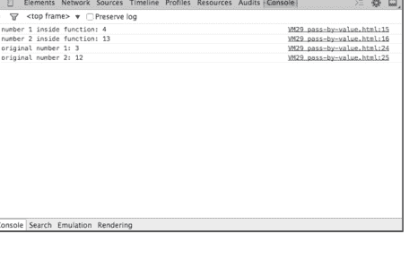

图 7-2：函数外部的变量不受函数内部发生的事情影响。

## 按引用传递参数

JavaScript 的基本类型变量（字符串、数字、布尔值、undefined 和 null）是通过值传递给函数的，而 JavaScript 对象则是通过 *引用* 传递的。这意味着如果你将一个对象作为参数传递给函数，那么在函数内部对该对象的任何更改也将改变函数外部的值。按引用传递的影响和用途超出了本章的范围，将在第 8 章中讨论。

## 在参数不足的情况下调用函数

你并不总是需要用与函数定义中列出的参数数量相同的参数来调用函数。如果函数定义包含三个参数，但你仅用两个参数调用它，那么第三个参数将在函数中创建一个值为 `undefined` 的变量。

## 设置默认参数值

如果你希望参数的默认值不是 `undefined`，可以设置默认值。目前最广泛支持且普遍接受的方法是在函数内部测试参数值，如果参数的数据类型是 `undefined`，则设置默认值。

例如，在代码清单 7-7 中，函数接收一个参数。在函数内部，会进行一项测试以检查参数是否为 `undefined`。如果是，它将被设置为一个默认值。

**代码清单 7-7：设置默认参数值**

```javascript
function welcome(yourName) {
  if (typeof yourName === 'undefined'){
    yourName = "friend";
  }
}
```

在下一个版本的 JavaScript（称为 ECMAScript 6）中，你可以在函数头内部为参数设置默认值，如代码清单 7-8 所示。

**代码清单 7-8：在函数头中设置默认参数**

```javascript
function welcome(yourName = "friend") {
  document.write("Hello," + yourName);
}
```

截至本书出版之日，ECMAScript 6 尚未在所有浏览器中得到支持，因此这种设置默认参数值的方法可能并不适用于你程序的所有用户。出于这个原因，最好仍然使用代码清单 7-7 中所示的兼容性更好的设置默认值方法。

## 使用多于参数数量的参数调用函数

如果你调用函数时传递的参数数量多于参数定义的数量，则不会为多出来的参数创建局部变量，因为函数没有办法知道该如何命名它们。

有一个巧妙的技巧可以用来检索那些传递给函数但没有匹配参数的参数值：`Arguments` 对象。

## 使用 arguments 对象获取参数

当你不知道将有多少个参数传递到函数中时，可以使用 JavaScript 内置于函数中的 argument 对象来检索所有参数并加以利用。

`Arguments` 对象包含一个传递给函数的所有参数的数组。通过遍历该数组（使用 `for` 循环或 `for...in` 循环 —— 见第 6 章），你可以利用每一个参数，即使每次调用函数时参数的数量可能会发生变化。

代码清单 7-9 演示了如何使用 `Arguments` 对象为拥有两个中间名的人以及拥有一个中间名的人呈现欢迎消息。

**代码清单 7-9：使用 Arguments 对象定义一个可以累加任意数量数字的函数**

```html
<html>
<head>
	<title>Welcome Message</title>
</head>
<body>
	<script>
/**
 *Flexible Welcome Message
 */
function flexibleWelcome(){
    var welcome = "Welcome,";
    for (i = 0; i < arguments.length; i++) {
        welcome = welcome + arguments[i] + " ";
    }
    return welcome;
}

document.write(flexibleWelcome("Christopher",
    "James", "Phoenix", "Minnick") + "<br>");
document.write(flexibleWelcome("Eva", "Ann",
    "Holland") + "<br>");

</script>
</body>
</html>
```

## 函数作用域

通过传递参数或使用 `var` 关键字在函数内部创建的变量仅在该函数内部可用。程序员将 JavaScript 的这一特性称为 *函数作用域*。在函数内部创建的变量在函数退出时会被销毁。

然而，如果你在函数内部创建变量而没有使用 `var` 关键字，该变量将变成一个全局变量，可以在程序的任何地方被更改和访问。


意外创建全局变量是大量 JavaScript bug 和错误地根源，建议你始终正确地定义变量作用域，除非绝对必要，否则永远不要创建全局变量。

## 匿名函数

函数头中的函数名部分不是必须的，你可以创建没有名字的函数。这看起来像是一件奇怪的事情，因为没有名字的函数就像没有名字的狗一样；你没办法叫它！然而，匿名函数在创建时可以被赋值给变量，这为你提供了与在函数头中使用名称相同的能力：

```javascript
var doTheThing = function(thingToDo) {
    document.write("I will do this thing: " + thingToDo);
}
```

### 了解匿名函数与命名函数的区别

创建命名函数与将匿名函数赋值给变量之间存在几个重要且有时很有用的区别。首先，赋值给变量的匿名函数只有在程序执行该赋值语句之后才存在且能被调用。而命名函数可以在程序的任何地方被访问。

命名函数与赋值给变量的匿名函数的第二个区别是，你可以在任何时间点更改变量的值并为其分配一个不同的函数。这使得赋值给变量的匿名函数比命名函数更灵活。

### 自执行匿名函数

匿名函数的另一种用途是作为 *自执行函数*。自执行匿名函数是指在创建后立即执行的函数。

要将一个普通的匿名函数转换为自执行函数，只需将匿名函数包裹在括号中，并在其后添加一对括号和一个分号。

使用自执行匿名函数的好处是，你在其中创建的变量在函数退出时会被销毁。通过这种方式，你可以避免变量名之间的冲突，并避免在变量不再需要后仍将其保留在内存中。代码清单 7-10 演示了如何编写和使用自执行匿名函数。

**代码清单 7-10：使用自执行匿名函数**

```javascript
var myVariable = "I live outside the function.";
(function() {
    var myVariable = "I live in this anonymous function";
    document.write(myVariable);
})();
document.write(myVariable);
```

Web 应用程序程序员经常使用匿名函数来在网页中实现各种现代效果。你将在第 15 章和第 16 章中阅读更多关于如何使用它们的内容。

## 使用递归再次执行

你可以从函数外部或者从其他函数内部调用函数。你甚至可以在函数内部调用它自身。当一个函数调用自身时，它使用了被称为 *递归* 的编程技术。

你可以在许多原本会使用循环的场景中使用递归，不同之处在于它重复执行函数内部的语句。

代码清单 7-11 展示了一个简单的递归函数。然而，这个递归函数有一个巨大的问题。你能发现吗？

# 代码清单 7-11：一个有致命缺陷的递归函数

```javascript
function squareItUp(startingNumber) {
    var square = startingNumber * startingNumber;
    console.log(square);
    squareItUp(square);
}
```

你发现这个函数的问题了吗？它永远不会结束。它会一直不停地将数字相乘，直到你停止它。

运行这个函数可能会导致你的浏览器崩溃，甚至导致电脑崩溃。当然，不会造成永久性损坏，但这就足以让你通过阅读代码注意到这里的问题。

代码清单 7-12 通过提供所谓的 *基准情况（base case）* 对 `squareItUp()` 函数进行了改进。基准情况是指递归函数完成其任务并应当停止的条件。每个递归函数必须有一个基准情况。

# 代码清单 7-12：一个将数字平方直到数字大于 1,000,000 的递归函数

```javascript
function squareItUp(startingNumber) {
    square = startingNumber * startingNumber;
```
（接下页）


清单 7-12（续）

```javascript
if (square > 1000000) {
    console.log(square);
} else {
    squareItUp(square);
}
}
```

这样就好了！但是，这个函数仍然有一个大问题。如果有人传入负数、零或 1 会怎样？这些情况下的结果仍然是一个无限循环。为了防止这种情况，我们需要一个终止条件。在清单 7-13 中，增加了一个检查，确保参数不小于或等于 1，并且不是数字以外的其他类型。在这两种情况下，函数都会立即停止。

### 清单 7-13：带有终止和基准条件的递归函数

```javascript
function squareItUp(startingNumber) {
    // 终止条件，无效输入
    if ((typeof startingNumber != 'number') ||
        (startingNumber <= 1)) {
        return -1; // 退出函数
    }

    square = startingNumber * startingNumber;

    // 基准条件
    if (square > 1000000) {
        console.log(square); // 打印最终值
    } else { // 如果未满足基准条件，则再次执行
        squareItUp(square);
    }
}
```

## 函数内的函数

函数可以在函数内部声明。清单 7-14 展示了这种技术的工作原理，以及它如何影响在函数内部创建的变量的作用域。

### 清单 7-14：在函数内声明函数

```javascript
function turnIntoAMartian(myName) {

  function recallName(myName) {
    var martianName = myName + " Martian";
  }
  recallName(myName);
  console.log(martianName); // 返回 undefined

}
```

前面的示例演示了如何在函数内部嵌套一个函数，从而创建另一层作用域。在内部函数中创建的变量不能被包含它的函数直接访问。为了获取它们的值，需要使用 return 语句，如清单 7-15 所示。

### 清单 7-15：从内部函数返回值

```javascript
function turnIntoAMartian(myName) {

  function recallName(myName) {
    var martianName = myName + " Martian";
    return martianName;
  }
  var martianName = recallName(myName);
  console.log(martianName);

}
```

## 第 8 章：创建和使用对象

### 本章内容

- 理解对象
- 使用属性和方法
- 创建对象
- 使用点表示法
- 处理对象

> “我们无法对一个没有名字的对象做任何事。”
— 莫里斯·布朗肖《文学与教条权》

在本章中，我们将向你展示为什么应该使用对象、如何使用它们，以及它们拥有哪些特殊能力，可以让你的程序和编程变得更好。

别忘了访问网站查看与本章相关的在线练习！

## 我渴望的对象

除了五种原始数据类型（见第 3 章），JavaScript 还有一种名为 `object` 的数据类型。JavaScript 的 `对象` 将数据和功能封装在可重用的组件中。

要理解对象是什么以及它们是如何工作的，将 JavaScript 对象与现实生活中的物理对象进行比较会很有帮助。以吉他为例。

吉他有构成它自身的东西，也有它能做的事情。以下是我们用于此示例的吉他的几个事实：

- 它有六根弦。
- 它是黑白相间的。
- 它是电吉他。
- 它的琴身是实心的。

这把吉他能做的一些事情（或者可以对吉他做的事情）是：

- 拨动琴弦
- 增加音量
- 减小音量
- 调紧琴弦
- 调节音色
- 调松琴弦

如果这把吉他是一个 JavaScript 对象而不是现实生活中的物品，那么它能做的事情将被称为它的*方法*，而构成吉他的部分，如它的琴弦和琴身类型，则是它的属性。

对象中的方法和属性都以相同的方式编写：作为名称-值对，冒号分隔名称和值。当属性的值是一个函数时，它就被称为方法。

> 实际上，对象内的所有东西都是属性。我们只是给值为函数的属性起了另一个名字：方法。

清单 8-1 展示了我们的吉他属性作为 JavaScript 对象可能的样子。

### 清单 8-1：一个 JavaScript 吉他对象

```javascript
var guitar = {
  bodyColor: "black",
  scratchPlateColor: "white",
  numberOfStrings: 6,
  brand: "Yamaha",
  bodyType: "solid",
  strum: function() {...},
  tune: function() {...}
};
```

## 创建对象

JavaScript 有两种创建对象的方式：

- 编写对象字面量
- 使用对象构造函数方法

你选择哪一种取决于具体情况。在接下来的章节中，你将发现每种方法的优缺点，以及在什么情况下更倾向于使用哪一种。

### 使用对象字面量定义对象

创建对象的对象字面量方法以标准的变量定义开始，使用 `var` 关键字，后跟赋值运算符：

```javascript
var person =
```

然而，在语句的右侧，你将使用花括号，其中包含以逗号分隔的名称/值对：

```javascript
var person = {eyes: 2, feet: 2, hands: 2, eyeColor: "blue"};
```

如果你在创建对象时不知道它将具有哪些属性，或者你的程序要求在稍后添加额外的属性，你可以创建一个具有很少属性甚至没有属性的对象，然后再向其添加属性：

```javascript
var person = {};
person.eyes = 2;
person.hair = "brown";
```

本书前面示例中的方法大多用于输出文本。`document.write` 和 `console.log` 都使用这种用句点分隔属性的方法，所以你可能很熟悉。对象名和属性之间的句点表示该属性属于该对象。点表示法将在本章后面的“检索和设置对象属性”部分更详细地介绍。

关于对象需要注意的另一点是，就像数组一样，对象可以包含多种不同的数据类型作为属性的值。

真正理解 JavaScript 的那个不太为人所知的秘密在于，要知道数组和函数是对象的类型，而数字、字符串和布尔原始数据类型也可以用作对象。这意味着它们拥有对象的所有属性，并且可以像对象一样被分配属性。

### 使用对象构造函数定义对象

定义对象的第二种方法是使用对象构造函数。此方法使用 `new Object` 声明对象，然后用属性填充它。清单 8-2 展示了使用对象构造函数的示例。

#### 清单 8-2：使用对象构造函数

```javascript
var person = new Object();
person.feet = 2;
person.name = "Sandy";
person.hair = "black";
```

使用对象构造函数方法创建对象是可以的，但它通常被认为是创建对象的较差方式。主要原因是：

- 它比对象字面量方法需要更多的输入。
- 它在 Web 浏览器中的性能不如前者。
- 它比对象字面量方法更难阅读。

## 检索和设置对象属性

创建对象并定义其属性后，你会希望能够检索和更改这些属性。访问对象属性的两种方式是使用点表示法或方括号表示法。

### 点表示法

在点表示法中，对象名称后跟一个句点（或点），然后是你要获取或设置的属性的名称。

要在 person 对象中创建一个名为 firstName 的新属性或修改现有 firstName 属性的值，你将使用如下语句：

```javascript
person.firstName = "Glenn";
```

如果 firstName 属性尚不存在，此语句将创建它。如果它已存在，它将用一个新值更新它。

要使用点表示法检索属性的值，你需要使用完全相同的语法，但你需要将对象和属性名称（称为*属性访问器*）移动到语句中的不同位置。例如，如果你想将 `person.firstName` 和 `person.lastName` 的值连接起来，并将它们赋给一个名为 `fullName` 的新变量，你可以这样做：

```javascript
var fullName = person.firstName + person.lastName;
```

或者，要将 `person.firstName` 的值写入你的 html 文档，只需像使用任何变量一样使用属性访问器；例如：

```javascript
document.write (person.firstName);
```

点表示法通常是更快输入和更易读的方式来设置和检索对象属性值。

### 方括号表示法

方括号表示法在对象名称后使用方括号来获取和设置属性值。要使用方括号表示法设置属性值，请将属性名称放在方括号内的引号中，如下所示：

```javascript
person["firstName"] = "Iggy";
```

方括号表示法具有点表示法所不具备的一些能力。主要的一点是，你可以在方括号表示法中使用变量，用于在编写程序时不知道要检索的属性名称的情况。

以下示例与前面的示例完全相同，只是方括号内使用了变量而不是字面字符串。使用这种技术，你可以创建一个在多种不同情况下都能工作的语句，例如在循环或函数中：

```javascript
var personProperty = "firstName";
person[personProperty] = "Iggy";
```


代码清单 8-3 展示了一个简单的程序，它创建了一个名为 chair 的对象，然后遍历该对象的所有属性，并要求用户为每个属性输入值。一旦用户为每个属性输入了值，就会调用 `writeChairReceipt` 函数，该函数会打印出每个属性及其对应的用户输入值。

### 代码清单 8-3：椅子配置脚本

```html
<html>
<head>
 <title>The WatzThis? Chair Configurator</title>
</head>
<body>
<script>
  var myChair = {
    "cushion-licMaterial" : "",
    "numberOfLegs" : "",
    "legHeight" : ""
  };

  function configureChair() {
    var userValue;
    for (var property in myChair) {
      if (myChair.hasOwnProperty(property)) {
        userValue = prompt("Enter a value for " +
          property);
        myChair[property] = userValue;
      }
    }
  }

  function writeChairReceipt() {
    document.write("<h2>Your chair will have the following
      configuration:</h2>");
    for (var property in myChair) {
      if (myChair.hasOwnProperty(property)) {
        document.write(property + ": " + myChair[property]
          + "<br>");
      }
    }
  }

  configureChair();
  writeChairReceipt();
</script>
</body>
</html>
```

## 删除属性

您可以使用 `delete` 运算符从对象中删除属性。代码清单 8-4 展示了该运算符的工作方式。

### 代码清单 8-4：使用 delete 运算符
```javascript
var myObject = {
    var1 : "the value",
    var2 : "another value",
    var3 : "yet another"
};

// delete var2 from myObject
delete myObject.var2;

// try to write the value of var2
document.write(myObject.var2); // result is an error
```

## 处理方法

方法（Methods）是其值为函数的属性。您定义方法的方式与定义任何函数相同。唯一的区别是，方法被分配给了一个对象的属性。代码清单 8-5 展示了如何创建一个具有多个属性的对象，其中一个属性是方法。

### 代码清单 8-5：创建方法
```javascript
var sandwich = {
    meat:"",
    cheese:"",
    bread:"",
    condiment:"",
    makeSandwich: function (meat,cheese,bread,condiment) {
        sandwich.meat = meat;
        sandwich.cheese = cheese;
        sandwich.bread = bread;
        sandwich.condiment = condiment;
        var mySandwich = sandwich.bread + ", " + sandwich.meat + 
                         ", " + sandwich.cheese + ", " + sandwich.condiment;
        return mySandwich;
    }
}
```

要调用 `sandwich` 对象的 `makeSandwich` 方法，您可以使用点号表示法（就像访问属性一样），但在方法名后面需要提供括号和参数，如代码清单 8-6 所示。

### 代码清单 8-6：调用方法
```html
<html>
<head>
<title>Make me a sandwich</title>
</head>
<body>
 <script>

   var sandwich = {
   meat:"",
   cheese:"",
   bread:"",
   condiment:"",
   makeSandwich: function (meat,cheese,bread,condiment) {
     sandwich.meat = meat;
     sandwich.cheese = cheese;
     sandwich.bread = bread;
     sandwich.condiment = condiment;
     var mySandwich = sandwich.bread +
       ", " + sandwich.meat + ", " +
       sandwich.cheese + ", " +
       sandwich.condiment;
     return mySandwich;
     }
   }

   var sandwichOrder =
         sandwich.makeSandwich("ham","cheddar","wheat","
         spicy mustard");
     document.write (sandwichOrder);

 </script>
</body>
</html>
```

## 使用 this

`this` 关键字是引用包含该方法的对象的简写方式。例如，在代码清单 8-7 中，对象名 `sandwich` 的每个实例都被替换成了 `this`。当 `makeSandwich` 函数作为 `sandwich` 对象的方法被调用时，JavaScript 明白 `this` 指的就是 `sandwich` 对象。

### 代码清单 8-7：在方法内部使用 this
```html
<html>
<head>
  <title>Make a sandwich</title>
</head>
<body>
  <script>

    var sandwich = {
      meat: "",
      cheese: "",
      bread: "",
      condiment: "",
      makeSandwich: function(meat, cheese, bread, condiment) {
        this.meat = meat;
        this.cheese = cheese;
        this.bread = bread;
        this.condiment = condiment;
        var mySandwich = this.bread + ", " + this.meat + ", " + this.cheese + ", " + this.condiment;
        return mySandwich;
      }
    };

    var sandwichOrder = 
      sandwich.makeSandwich("ham", "cheddar", "wheat", "spicy mustard");
    document.write (sandwichOrder);

  </script>
</body>
</html>
```

在这种情况下，使用 `this` 关键字而不是具体对象名的结果是完全相同的。

当您有一个可以应用于多个不同对象的函数时，`this` 就变得非常有用。在这种情况下，`this` 关键字将引用它被调用时所属的对象，而不是绑定到一个特定的对象。

在接下来的章节中，您将了解到构造函数（constructor functions）和继承（inheritance），这两者都是由简单的 `this` 语句实现的。

## 一种致富的面向对象方式：继承

在创建对象时，您不局限于创建特定的对象，比如您的吉他、汽车、猫或三明治。对象的真正美妙之处在于，您可以使用它们来创建“对象类型”，然后基于这些类型创建其他对象。

如果您阅读本章之前的章节，会发现每个被创建的对象都是直接由 `Object` 类型的对象构造的。

本章前面“创建对象”部分中关于构造方法创建对象的示例清晰地证明了这一点：

```javascript
var person = new Object();
```

这里创建了一个 `Object` 类型的新 `person` 对象。这个新的 `person` 对象包含了 `Object` 类型的所有默认属性和方法，但拥有一个新名称。然后，您可以向 `person` 对象添加自己的属性和方法，使其具体描述您所定义的“人”。

```javascript
var person = new Object();
person.eyes = 2;
person.ears = 2;
person.arms = 2;
person.hands = 2;
person.feet = 2;
person.legs = 2;
person.species = "Homo sapien";
```

现在，您已经为 `person` 对象设置了一些特定的属性。假设您想创建一个代表特定人物的新对象，比如 Willie Nelson。您可以简单地创建一个名为 `willieNelson` 的新对象，并赋予它与 `person` 对象完全相同的属性，再加上使 Willie Nelson 独有的属性。

```javascript
var willieNelson = new Object();
willieNelson.eyes = 2;
willieNelson.ears = 2;
willieNelson.arms = 2;
willieNelson.hands = 2;
willieNelson.feet = 2;
willieNelson.legs = 2;
willieNelson.species = "Homo sapien";
willieNelson.occupation = "musician";
willieNelson.hometown = "Austin";
willieNelson.hair = "Long";
willieNelson.genre = "country";
```

然而，这种定义 `willieNelson` 对象的方法是浪费的。它需要您做大量重复工作，而且这里没有任何迹象表明 Willie Nelson 是一个“人”，他只是恰好拥有和人相同的属性。

解决方案是创建一个名为 `Person` 的新对象类型，然后让 `willieNelson` 对象成为 `Person` 类型。请注意，当我们讨论对象类型时，总是将对象类型的名称首字母大写。这并不是强制要求，但几乎是一个通用的约定。例如，我们会说：

```javascript
var person = new Object();
```

或者

```javascript
var willieNelson = new Person();
```

## 使用构造函数构造对象

要创建一种新的对象类型，您需要定义一个新构造函数。构造函数的形成方式与 JavaScript 中的任何函数相同，但它们使用 `this` 关键字将属性分配给一个新对象。随后，新对象将继承该对象类型的属性。

这里是我们 `Person` 对象类型的一个构造函数：

```javascript
function Person(){
  this.eyes = 2;
  this.ears = 2;
  this.arms = 2;
  this.hands = 2;
  this.feet = 2;
  this.legs = 2;
  this.species = "Homo sapien";
}
```

现在，要创建 `Person` 类型的新对象，您只需将该函数分配给一个新变量即可。例如：

```javascript
var willieNelson = new Person()
```

`willieNelson` 对象继承了 `Person` 对象类型的属性。尽管您还没有为 `willieNelson` 对象专门创建任何属性，但它已经包含了 `Person` 的所有属性。


要测试这段代码，请在浏览器中运行清单 8-8 中的代码。

## 清单 8-8：测试继承

```
<html>
<head>
  <title>Inheritance demo</title>
</head>
<body>
  <script>

    function Person(){
      this.eyes = 2;
      this.ears = 2;
      this.arms = 2;
      this.hands = 2;
      this.feet = 2;
      this.legs = 2;
      this.species = "Homo sapien";
    }
    var willieNelson = new Person();
    alert("Willie Nelson has " + willieNelson.feet + " feet!");
  </script>
</body>
</html>
```

在浏览器中运行清单 8-8 的结果如图 8-1 所示。

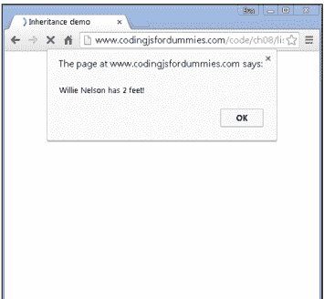

## 修改对象类型

假设你已经有了 `Person` 对象类型，它作为多个对象的原型。在某个时候你意识到，这个 Person 以及所有继承自它的对象，都应该拥有更多的属性。

要修改原型对象，可以使用每个对象从 `Object` 继承的 `prototype` 属性。清单 8-9 展示了其工作原理。

## 清单 8-9：修改原型对象

```
function Person() {
  this.eyes = 2;
  this.ears = 2;
  this.arms = 2;
  this.hands = 2;
  this.feet = 2;
  this.legs = 2;
  this.species = "Homo sapien";
}

var willieNelson = new Person();
var johnnyCash = new Person();
var patsyCline = new Person();

// Person needs more properties!
Person.prototype.knees = 2;
Person.prototype.toes = 10;
Person.prototype.elbows = 2;

// Check the values of existing objects for the new properties
document.write (patsyCline.toes); // outputs 10
```

## 使用 Object.create 创建对象

另一种从其他对象创建对象的方式是使用 `Object.create` 方法。该方法的好处在于不需要你编写构造函数。它只是将指定对象的属性复制到一个新对象中。当一个对象继承自另一个对象时，被继承的对象称为原型。

# 第二部分：组织你的 JavaScript

清单 8-10 展示了如何使用 Object.create 从原型创建 willieNelson 对象。

## 清单 8-10：使用 Object.create 从原型创建对象

```
// create a generic Person
var Person = {
    eyes: 2,
    arms: 2,
    feet: 2
}

// create the willieNelson object, based on Person
var willieNelson = Object.create(Person);

// test an inherited property
document.write (willieNelson.feet); // outputs 2
```

# 第三部分

## Web 上的 JavaScript

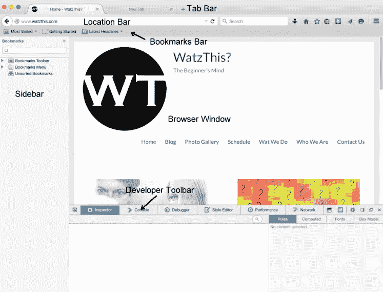


请参阅 www.dummies.com/extras/codingwithjavascript 上的文章"使用 JavaScript 进行延迟加载"，了解如何处理网页加载缓慢的问题。

## **本部分内容……**

- 了解如何使用 Window 对象控制浏览器。
- 掌握使用 DOM 操作文档。
- 获取使用 JavaScript 事件的内部技巧。
- 了解如何集成输入和输出。
- 发现如何使用 CSS 和图形。
- 请参阅 `www.dummies.com/extras/codingwithjavascript` 上的文章"使用 JavaScript 进行延迟加载"，了解如何处理网页加载缓慢的问题。

# 第 9 章

## 使用 Window 对象控制浏览器

### 本章内容

- 理解 BOM（浏览器对象模型）
- 打开和关闭窗口
- 获取窗口属性
- 调整窗口大小

> "在建立理论时，始终要留一扇窗户开着，以便在必要时可以扔掉它。"
>
> ——贝拉·卢戈西

浏览器对象模型（BOM）允许 JavaScript 与 Web 浏览器的功能进行交互。使用 BOM，你可以创建和调整窗口大小、显示警报消息，以及更改浏览器中当前显示的页面。

在本章中，你将了解浏览器窗口能做些什么，以及如何利用它来编写更好的 JavaScript 程序。

### 理解浏览器环境

Web 浏览器是复杂的软件。当它们运行良好时，操作无缝流畅，并将所有功能整合成一种平滑且看似简单的网页浏览体验。我们都知道 Web 浏览器偶尔会出现故障，有时甚至会崩溃。要理解为什么会发生这种情况，并能更好地利用浏览器，了解 Web 浏览器的各个组成部分以及这些部分之间如何交互非常重要。

## 用户界面

当你输入 URL、点击主页按钮、创建或使用书签，或者更改浏览器设置时，你所交互的 Web 浏览器部分称为用户界面，也叫浏览器外观（不要与 Google 的 Chrome 浏览器混淆）。

浏览器外观由 Web 浏览器的菜单、窗口框架、工具栏和按钮组成，它们位于加载网页的主内容窗口之外，如图 9-1 所示。

## 加载器

*加载器*是 Web 浏览器中负责与 Web 服务器通信并下载网页、脚本、CSS、图形以及网页所有其他组件的部分。大多数情况下，加载是显示网页过程中让用户等待时间最长的环节。

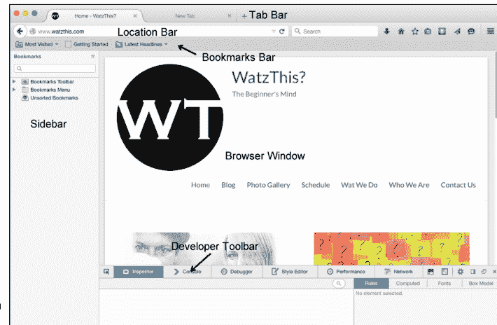

HTML 页面是网页中最先需要下载的部分，因为它包含需要处理的链接、内嵌脚本和样式，以便显示页面。

图 9-2 展示了 Chrome 开发者工具的 Network 标签页。它以图形化视图显示了网页加载过程中发生的所有事件，以及一个显示各部分加载耗时的时间轴。

HTML 文档下载完成后，浏览器会打开多个到服务器的连接，以便尽快下载网页的其他部分。通常，从 HTML 文档中链接的网页组成部分（也称为资源）按照它们在 HTML 文档中出现的顺序加载。例如，在页面 head 元素中链接的脚本会在页面底部链接的脚本之前加载。

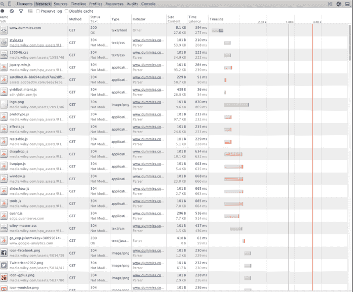

图 9-2：Web 浏览器加载。


资源的加载顺序对页面向用户显示的效率和速度至关重要。为了使网页正确显示，应用于该页面的 CSS 样式需要先加载并解析。因此，CSS 应始终加载在网页顶部的 head 元素中。

JavaScript 有时也会影响网页的显示，但更多时候它只影响功能。当脚本会影响网页显示时，它应该加载在文档的 head 中（在 CSS 之后）。对网页外观不重要的脚本应该链接在 body 元素的最后（在 `</body>` 之前），以避免产生阻塞场景——即浏览器在向用户显示任何内容之前先等待脚本加载完成。

### HTML 解析

网页下载完成后，浏览器的 HTML 解析组件开始工作，解析 HTML 以创建网页的模型（称为文档对象模型或 DOM）。DOM 在第 10 章中详细介绍，它就像网页的地图。JavaScript 程序员使用这张地图来操作和访问网页的各个部分。

HTML 解析完成后，浏览器开始下载网页的其他组件。

### CSS 解析

一旦网页的 CSS 完全下载，Web 浏览器会解析样式并确定哪些样式适用于 HTML 文档。CSS 解析是一个复杂的过程，需要多次遍历文档，以便正确应用每个样式并考虑样式之间的相互影响。

### JavaScript 解析

显示网页的下一步是 JavaScript 解析。JavaScript 解析器按照脚本在文档中出现的顺序编译并运行网页中的每个脚本。如果你的 JavaScript 代码在 HTML DOM 中添加或删除了元素、文本或样式，浏览器将相应地更新 HTML 和 CSS 的渲染结果。


 ## 布局与渲染

最后，当网页的所有资源都已加载并解析完毕后，浏览器会确定如何显示页面，然后将其显示出来。除非你指定了文档中较早引入的脚本要等到最后才执行，否则脚本的布局和渲染将按照它们在文档中被引入的顺序进行。

> **提示** 一般来说，最好尽快将网页显示给用户，即使页面在首次出现时可能尚未完全具备功能。现代网站经常专门采用这种策略（称为*延迟加载*）来提升页面的感知性能。如果你曾经打开过一个网页，然后需要等待片刻才能使用表单或交互元素，你就已经见识过延迟加载的实际效果了。

## 引爆 BOM

JavaScript 程序员可以通过一个名为浏览器对象模型（Browser Object Model）的 API 来了解用户网页浏览器的信息，并控制用户体验的某些方面。

浏览器对象模型没有官方标准。不同的浏览器以不同的方式实现它。然而，JavaScript 与网页浏览器的交互方式存在一些被广泛接受的标准。

## Navigator 对象

`Navigator` 对象为 JavaScript 提供了访问用户网页浏览器信息的途径。`Navigator` 对象的名称来源于第一个实现它的网页浏览器——Netscape Navigator。`Navigator` 对象并非内置于 JavaScript 中，而是网页浏览器的一项功能，可以通过 JavaScript 访问。几乎所有网页浏览器（以及所有现代网页浏览器）都采用相同的术语来指代这个最高级别的浏览器对象。

`Navigator` 对象可以访问一些有用的信息，例如：

- 网页浏览器的名称
- 网页浏览器的版本
- 浏览器所运行计算机的物理位置（如果用户允许浏览器访问地理位置数据）
- 浏览器的语言
- 浏览器所运行计算机的类型

表 9-1 列出了浏览器 `Navigator` 对象的所有属性。

| **属性** | **用途** |
| :--- | :--- |
| `appCodeName` | 获取浏览器的代码名称 |
| `appName` | 获取浏览器的名称 |
| `appVersion` | 获取浏览器版本信息 |
| `cookieEnabled` | 判断浏览器是否启用了 Cookie |
| `geolocation` | 可用于定位用户的物理位置 |
| `language` | 获取浏览器的语言 |
| `onLine` | 识别浏览器是否在线 |
| `platform` | 获取浏览器编译所针对的平台 |
| `product` | 获取浏览器的浏览器引擎名称 |
| `userAgent` | 获取浏览器发送给 Web 服务器的用户代理 |

要获取 `Navigator` 对象的属性，你可以使用与获取任何对象属性相同的语法——即点表示法或括号表示法。在网页浏览器中打开代码清单 9.1，将显示 `Navigator` 对象的所有当前属性及其值。

**代码清单 9-1：Navigator 对象的属性及其值**

```
<html>
<head>
  <style>
    .columns {
      -webkit-column-count: 6; /* Chrome, Safari, Opera */
      -moz-column-count: 6; /* Firefox */
      column-count: 6;
    }
  </style>
</head>
<body>
  <div class="columns">
    <script>
      for (var prop in navigator){
        document.write (prop + ": " + navigator[prop] + "<br>");
      }
    </script>
  </div>
</body>
</html>
```

图 9-3 显示了在网页浏览器中打开代码清单 9.1 时的输出结果。

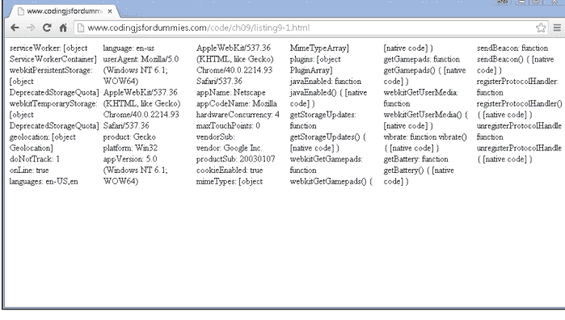

如果你自己运行代码清单 9.1，你会注意到输出中有一些有趣的地方：`AppName` 属性的值看起来明显是错误的。例如，用于生成图 9-3 的浏览器是 Google Chrome，但 `AppName` 列出的却是 Netscape。

这个误导性的值是过去程序员使用 `Navigator` 对象的属性来检测用户是否使用特定浏览器以及是否支持某些功能的时代遗留下来的。

当新的浏览器（如 Chrome 和 Firefox）出现时，这些浏览器采用了 Netscape 浏览器的 `AppName` 值，以确保与以这种方式检测功能的网站兼容。

**警告！** 如今，不推荐进行浏览器检测，而且有比查看 `AppName` 属性更好的方法来检测浏览器对特定功能的支持。如今检测功能最常见的方法是检查 DOM 中与你想要使用的功能相关联的对象。例如，如果你想了解浏览器是否支持 HTML5 的 audio 元素，可以使用以下测试：

```
var test_audio= document.createElement("audio");
if (test_audio.play) {
    console.log ("Browser supports HTML5 audio");
} else {
    console.log ("Browser doesn't support HTML5 audio");
}
```

## Window 对象

网页浏览器的**主区域**称为 *window*（窗口）。这是 HTML 文档（及相关资源）加载的区域。网页浏览器中的每个标签页在 JavaScript 中均由 `Window` 对象的一个实例表示。`Window` 对象的属性列于表 9-2 中。

**表 9-2 Window 对象的属性**

| 属性 | 用途 |
| :--- | :--- |
| `closed` | 一个布尔值，指示窗口是否已关闭 |
| `defaultStatus` | 获取或设置窗口状态栏中的默认文本 |
| `document` | 引用窗口的 `Document` 对象 |
| `frameElement` | 获取窗口嵌入的元素，如 `<iframe>` 或 `<object>` |
| `frames` | 列出当前窗口中的所有子框架 |
| `history` | 获取当前窗口的用户浏览器历史记录 |
| `innerHeight` | 获取窗口的内部高度 |
| `innerWidth` | 获取窗口的内部宽度 |
| `length` | 获取窗口中的框架数量 |
| `location` | 获取窗口的 `Location` 对象 |
| `name` | 获取或设置窗口的名称 |
| `navigator` | 获取窗口的 `Navigator` 对象 |
| `opener` | 获取创建当前窗口的 `Window` 对象 |
| `outerHeight` | 获取窗口的外部高度，包括滚动条和工具栏 |
| `pageXOffset` | 获取窗口中水平滚动的像素数 |
| `pageYOffset` | 获取窗口中垂直滚动的像素数 |
| `parent` | 引用当前窗口的父窗口 |
| `screen` | 引用窗口的 `Screen` 对象 |
| `screenLeft` | 获取从主屏幕左侧到当前窗口左侧的水平像素距离 |
| `screenTop` | 获取窗口顶部相对于屏幕顶部的垂直像素距离 |
| `screenX` | 获取相对于屏幕的水平坐标 |
| `screenY` | 获取相对于屏幕的垂直坐标 |
| `self` | 引用当前窗口 |
| `top` | 引用最顶层的浏览器窗口 |

窗口属性的一些最常见用途包括：

- 在浏览器窗口中打开新位置
- 查找浏览器窗口的大小
- 返回先前打开的页面（如同后退按钮功能）

## 使用 window.location 属性打开网页

获取 `window.location` 属性的值将返回当前页面的 URL。将 `window.location` 属性的值设置为新的 URL 会使浏览器在窗口中加载该 URL 处的网页。

代码清单 9.2 是一个包含脚本的网页，该脚本向用户请求一个网页地址，然后在当前浏览器窗口中加载该页面。

**代码清单 9-2：使用 window.location 属性在浏览器窗口中加载网页的脚本**

```
<html>
<head>
  <script>
    function loadNewPage (url){
      window.location = url;
    }
  </script>
</head>
<body>
  <script>
    var newURL = prompt("Please enter a web page 
           address!");
    loadNewPage(newURL);
  </script>
symbian
</html>
```


图 9-4 展示了 Listing 9-2 的输出结果。

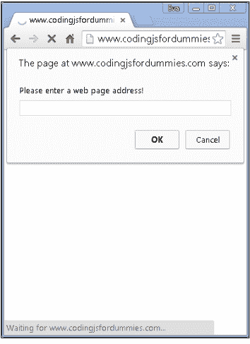

## 确定浏览器窗口的大小

当你设计一个旨在在不同类型设备上运行且功能正常的网站或 Web 应用程序时（这种技术被称为 *响应式设计*），了解 Web 浏览器的尺寸，尤其是宽度，至关重要。

`window.innerWidth` 和 `window.innerHeight` 属性可以为你提供当前 Web 浏览器窗口的像素尺寸信息。

使用 CSS 来确定浏览器窗口的大小也是可行且非常常见的。然而，CSS 和 JavaScript 在处理滚动条的方式上存在一些差异，这可能会影响你决定使用哪种技术。

尝试一个使用 JavaScript 的简单响应式设计示例。在 Web 浏览器中运行 Listing 9-3 中的程序。如果你的浏览器窗口宽度低于 500 像素，将显示一条消息。如果窗口宽度大于 500 像素，则会显示另一条不同的消息。

### Listing 9-3：根据窗口宽度更改网页

```
<html>
<head>
  <title>Adapting to the window.innerWidth</title>
</head>
<body>
  <script>
    var currentWidth = window.innerWidth;
    if (currentWidth > 500) {
      document.write("<h1>Your window is big.</h1>");
    } else {
      document.write("<h1>Your window is small.</h1>");
    }
  </script>
</body>
</html>
```

要测试 Listing 9-3 中的响应式设计示例，请按照以下步骤操作：

1. 在 Web 浏览器中，打开一个包含 Listing 9-3 代码的 HTML 文档。

   如果你在打开页面时窗口宽度超过 500px，你会看到一条提示窗口较大的消息。

2. 拖动浏览器的右下角，使窗口尽可能变窄，如图 9-5 所示。

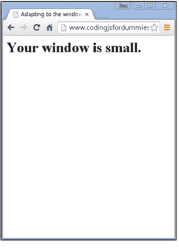

3. 点击浏览器的刷新按钮，或按下 Command+R（Mac）或 Ctrl+R（Windows）来重新加载页面。

注意，页面上的消息现在显示你的浏览器窗口较小。

## 使用 location 和 history 创建返回按钮

window 对象的 history 属性是对 history 对象的只读引用，该对象存储了用户在当前浏览器窗口中访问过的页面信息。迄今为止，history 对象最常见的用途是实现将用户返回到之前查看页面的按钮。

### Listing 9-4：在 Web 应用程序中实现返回按钮

```
<html>
<head>
    <title>Creating a Back button</title>
    <script>
        function takeMeBack () {
            window.location(window.history.go(-1));
        }
        function getHistoryLength () {
            var l = window.history.length;
            return l;
        }
    </script>
</head>
<body>
    <script>
        var historyLength = getHistoryLength();
        document.write ("<p>Welcome! The number of pages
                     you've visited in this window is: " +
                     historyLength + ".</p> ");
    </script>
    <br>
    <a href="javascript:void(0);" onclick="takeMeBack();">Go
                     Back</a>
</body>
</html>
```

要使用 Listing 9-4 中的返回按钮，请按照以下步骤操作：

1. 打开一个新的浏览器窗口并访问任何你喜欢的页面，例如 **www.watzthis.com**。

2. 在同一个浏览器窗口中，打开一个包含 Listing 9-4 代码的 HTML 文档。

3. 点击 "Go Back" 链接。

浏览器将带你回到在进入包含“返回”按钮的页面之前所访问的最后一个页面。

## 使用 Window 对象的方法

除了属性之外，`Window` 对象还具有一些 JavaScript 程序员应该了解并使用的高用方法。表 9-3 显示了这些方法的完整列表。

> **提示** 想猜猜如果你在访问任何其他网页之前，就在新浏览器标签页中打开 Listing 9-4 会发生什么吗？如果你猜什么都不会发生，那么你是正确的！如果窗口中只显示了一个页面（当前页），就没有可以返回的内容。

> **记住** 方法只是包含在对象中的函数的另一种称呼。

| 方法 | 用途 |
| :--- | :--- |
| `alert()` | 显示一个包含消息和“确定”按钮的警报框 |
| `atob()` | 解码 base-64 编码的字符串 |
| `blur()` | 使当前窗口失去焦点 |
| `clearInterval()` | 取消使用 setInterval() 设置的定时器 |
| `clearTimeout()` | 取消使用 setTimeout() 设置的定时器 |
| `close()` | 关闭当前窗口或通知 |
| `confirm()` | 显示一个带有可选消息和两个按钮（确定和取消）的对话框 |
| `createPopup()` | 创建一个弹出窗口 |
| `focus()` | 将当前窗口设置为焦点 |
| `moveBy()` | 将当前窗口移动指定的距离 |
| `moveTo()` | 将窗口重新定位到指定位置 |
| `open()` | 打开一个新窗口 |
| `print()` | 打印当前窗口的内容 |
| `prompt()` | 显示一个提示用户输入信息的对话框 |
| `resizeBy()` | 将窗口调整为指定的像素数 |
| `resizeTo()` | 将窗口调整为指定的高度和宽度 |
| `scrollBy()` | 将文档滚动指定的距离 |
| `scrollTo()` | 将文档滚动到一组特定的坐标 |
| `setInterval()` | 以指定的时间间隔（毫秒）重复调用函数或执行表达式 |
| `setTimeout()` | 在指定的时间间隔（毫秒）后调用函数或执行表达式 |
| `stop()` | 停止当前窗口的加载 |

# 第 10 章

## 使用 DOM 操作文档

### 本章内容

- 了解 DOM (文档对象模型)
- 操作节点
- 在树中移动
- 选择元素

> “没有神秘的对象。神秘的是你的眼睛。”
>
> — 伊丽莎白·鲍恩 (Elisabeth Bowen)

理解 DOM 是能够操纵网页中文本或 HTML 的关键。使用 DOM，你可以创建动画、在不刷新网页的情况下更新数据、在浏览器中移动对象，以及更多功能！

## 理解 DOM

文档对象模型 (Document Object Model) 是 JavaScript 与浏览器窗口内 HTML 文档进行对话和协作的接口。DOM 可以被可视化为一个倒置的树，HTML 文档的每个部分都从其包含部分分叉而出。

Listing 10-1 是一个网页的标记。其 DOM 表示如图 10-1 所示。

### Listing 10-1：一个 HTML 文档

```
<html>
<head>
    <title>Bob's Appliances</title>
</head>
<body>
    <header>
        
    </header>
    <div>
        <h1>Welcome to Bob's</h1>
        <p>The home of quality appliances</p>
    </div>
    <footer>
        copyright &copy; Bob
    </footer>
</body>
</html>
```

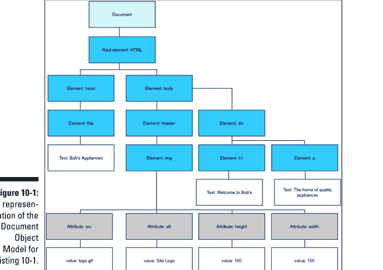

图 10-1：Listing 10-1 的文档对象模型表示。

DOM 树由单个组件组成，称为 *节点 (nodes)*。所有其他节点都从中生长出来的主要节点称为 **文档节点 (document node)**。文档节点之下的节点是 *根元素节点 (root element node)*。对于 HTML 文档，根节点是 HTML。在根节点之后，文档中的每个元素、属性和每一块内容都由树中的一个节点表示，而该节点又源自树中的另一个节点。

DOM 有几种不同类型的节点：

- **文档节点 (Document node)：** 整个 HTML 文档由该节点表示
- **元素节点 (Element nodes)：** HTML 元素
- **属性节点 (Attribute nodes)：** 与元素关联的属性
- **文本节点 (Text nodes)：** 元素的文本内容
- **注释节点 (Comment nodes)：** 文档中的 HTML 注释

### 节点关系

HTML DOM 树在节点之间的层级关系上类似于家谱。事实上，用于描述树中节点之间关系的专业术语就取自亲属关系。

- 每个节点（根节点除外）都有一个 *父节点 (parent)*。
- 每个节点可以有任意数量的 *子节点 (children)*。
- 具有相同父节点的节点是 *兄弟节点 (siblings)*。

由于 HTML 文档通常具有多个相同类型的元素，因此 DOM 允许你使用索引号在节点列表中访问不同的元素。例如，你可以将文档中的第一个 `<p>` 元素引用为 `p[0]`，将第二个 `<p>` 元素节点引用为 `p[1]`。

虽然节点列表看起来像一个数组，但它并不是。你可以遍历节点列表的内容，但不能在节点列表上使用数组方法。

在 Listing 10-2 中，三个 `<p>` 元素都是 `<div>` 元素的子节点。因为它们具有相同的父节点，所以它们是兄弟节点。

在 Listing 10-2 中，HTML 注释也是 `section` 元素的子节点。在关闭 section 标签之前的最后一个注释被称为 section 的 *最后一个子节点 (last child)*。

通过理解文档节点之间的关系，你可以使用 DOM 树在文档中找到任何元素。


## 代码清单 10-2：HTML 文档中父、子节点和兄弟节点关系的演示

```html
<html
<head>
  <title>The HTML Family</title>
</head>
<body>
  <section> <!-- 3 个 p 元素的骄傲父节点，body 的子节点 -->
    <p>First</p> <!-- section 元素的第 1 个子节点，2 个 p 元素的兄弟节点 -->
    <p>Second</p> <!-- section 元素的第 2 个 p 子节点，2 个 p 元素的兄弟节点 -->
    <p>Third</p> <!-- section 元素的第 3 个 p 子节点，2 个 p 元素的兄弟节点 -->
  </section>
</body>
</html
```

代码清单 10-3 是一个 HTML 文档，其中包含一个输出 `section` 元素所有子节点的脚本。

## 代码清单 10-3：显示 section 元素的子节点

```html
<html
<head>
  <title>The HTML Family</title>
</head>
<body>
  <section> <!-- 3 个 p 元素的骄傲父节点，body 的子节点 -->
    <p>First</p> <!-- section 元素的第 1 个子节点，2 个 p 元素的兄弟节点 -->
    <p>Second</p> <!-- section 元素的第 2 个 p 子节点，2 个 p 元素的兄弟节点 -->
    <p>Third</p> <!-- section 元素的第 3 个 p 子节点，2 个 p 元素的兄弟节点 -->
  </section>
  <h1>Nodes in the section element</h1>
  <script>
    var myNodelist =
          document.body.childNodes[1].childNodes;
    for (i = 0; i < myNodelist.length; i++){
      document.write (myNodelist[i] + "<br>");
    }
  </script>
</body>
</html
```

图 10-2 展示了代码清单 10-3 在浏览器中的输出效果。请注意，`section` 元素的第一个子节点是一个文本节点。如果你仔细观察代码清单 10-3 中的 HTML 标记，你会发现起始 `section` 标签和注释之间有一个空格。即使是像这个单空格这样简单的东西，也会在 DOM 树中创建一个完整的节点。当你使用节点之间的关系在 DOM 中进行导航时，需要考虑到这一点。

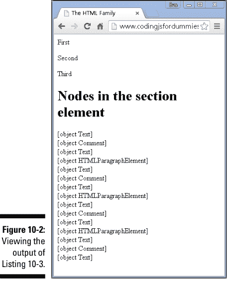

HTML DOM 还提供了一些关键字，用于根据节点相对于其兄弟节点或父节点的位置来导航。这些相对属性包括：

- `firstChild`：引用节点的第一个子节点
- `lastChild`：引用节点的最后一个子节点
- `nextSibling`：引用具有相同父节点的下一个节点
- `previousSibling`：引用具有相同父节点的上一个节点

代码清单 10-4 展示了如何使用这些相对属性来遍历 DOM。

## 代码清单 10-4：使用 firstChild 和 lastChild 高亮导航链接

```html
<html
<head>
  <title>Iguanas Are No Fun</title>
  <script>
    function boldFirstAndLastNav() {
      document.body.childNodes[1].firstChild.style.
        fontWeight="bold";
      document.body.childNodes[1].lastChild.style.
        fontWeight="bold";
    }
  </script>
</head>
<body>
  <nav><a href="home.html">Home</a> | <a
          href="why.html">Why Are Iguanas No Fun?</a> | <a
          href="what.html">What Can Be Done?</a> | <a
          href="contact.html">Contact Us</a></nav>
  <p>Iguanas are no fun to be around. Use the links above
      to learn more.</p>
  <script>
    boldFirstAndLastNav();
  </script>
</body>
</html
```

请注意代码清单 10-4，必须删除 `<nav>` 元素内部各元素之间的所有空格，以便 `firstChild` 和 `lastChild` 属性能够访问到我们想要选择并设置样式的正确元素。

图 10-3 展示了代码清单 10-4 中的文档在浏览器中预览的效果。请注意，导航栏中只有第一个和最后一个链接是粗体。

这是我们第一个使用 DOM 来修改文档中现有元素的示例。然而，这种选择元素的方法几乎从未被使用过。它太容易出错，而且难以理解和使用。

在下一节中，你将看到 DOM 为我们提供了比计算子节点数好得多的遍历和操作 DOM 的手段。

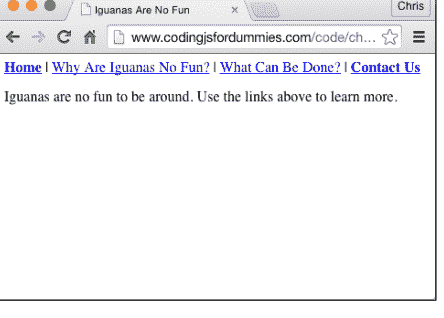
图 10-3：在浏览器中预览代码清单 10-4。

## 使用 Document 对象的属性和方法

`Document` 对象提供了用于操作 HTML 文档的属性和方法。`Document` 对象的完整属性列表如表 10-1 所示。`Document` 对象的方法如表 10-2 所示。

**表 10-1：Document 对象的属性**

| 属性 | 用途 |
| :--- | :--- |
| `anchors` | 获取文档中所有锚点（带有 name 属性的 `<a>` 元素）的列表 |
| `applets` | 获取文档中所有 applet 的有序列表 |
| `baseURI` | 获取文档的基准 URL |
| `body` | 获取文档主体的 `<body>` 或 `<frameset>` 节点 |
| `cookie` | 获取或设置文档中 cookie 的名称/值对 |
| `doctype` | 获取与文档关联的文档类型声明 (Document Type Declaration) |
| `documentElement` | 获取文档的根元素（例如，HTML 文档的 `<html>` 元素） |
| `documentMode` | 获取浏览器用于渲染文档的模式 |
| `documentURI` | 获取或设置文档的位置 |
| `domain` | 获取加载文档的服务器的域名 |
| `embeds` | 获取文档中所有 `<embed>` 元素的列表 |
| `forms` | 获取文档中所有 `<form>` 元素的集合 |
| `head` | 获取文档中的 `<head>` 元素 |
| `images` | 获取文档中所有 `` 元素的列表 |
| `implementation` | 获取处理该文档的 DOMImplementation 对象 |
| `lastModified` | 获取当前文档最后一次修改的日期和时间 |
| `links` | 获取文档中所有包含 href 属性的 `<area>` 和 `<a>` 元素的集合 |
| `readyState` | 获取文档的加载状态。文档加载时返回 `loading`，解析完成后返回 `interactive`，完全加载后返回 `complete` |
| `referrer` | 获取链接到当前文档的页面的 URL |
| `scripts` | 获取文档中 `<script>` 元素的列表 |
| `title` | 获取或设置文档的标题 |
| `URL` | 获取文档的完整 URL |

**表 10-2：Document 对象的方法**

| 方法 | 用途 |
| :--- | :--- |
| `addEventListener()` | 为文档分配事件处理器 |
| `adoptNode()` | 从外部文档采用一个节点 |
| `close()` | 关闭之前通过 document.open() 打开的文档输出写入流 |
| `createAttribute()` | 创建一个属性节点 |
| `createComment()` | 创建一个注释节点 |
| `createDocumentFragment()` | 创建一个空的文档片段 |
| `createElement()` | 创建一个元素节点 |
| `createTextNode()` | 创建一个文本节点 |
| `getElementById()` | 获取具有指定 ID 属性的元素 |
| `getElementsByClassName()` | 获取所有具有指定类名的元素 |
| `getElementsByName()` | 获取所有具有指定名称的元素 |
| `getElementsByTagName()` | 获取所有具有指定标签名的元素 |
| `importNode()` | 从外部文档复制并导入一个节点 |
| `normalize()` | 清除空文本节点并合并相邻节点 |
| `open()` | 打开一个文档用于写入 |
| `querySelector()` | 获取文档中匹配指定选择器组的第一个元素 |
| `querySelectorAll()` | 获取文档中匹配指定选择器的所有元素的列表 |
| `removeEventListener()` | 从文档中清除使用 `.addEventListener()` 方法添加的事件处理器 |
| `renameNode()` | 重命名现有节点 |
| `write()` | 向文档写入 JavaScript 代码或 HTML 表达式 |
| `writeIn()` | 向文档写入 JavaScript 代码或 HTML 表达式，并在每条语句后添加新行字符 |

## 使用 Element 对象的属性和方法

`Element` 对象提供了用于操作文档内 HTML 元素的属性和方法。表 10-3 显示了 `Element` 对象的所有属性。表 10-4 列出了 `Element` 对象的所有方法。


## 表 10-3 Element 对象的属性

| 方法/属性 | 用途 |
| --- | --- |
| accessKey | 获取或设置元素的 accesskey 属性 |
| attributes | 获取注册到指定节点的所有元素属性的集合（返回一个 NameNodeMap） |
| childElementCount | 获取指定节点中的子元素数量 |
| childNodes | 获取元素的子节点列表 |
| children | 获取元素的子元素列表 |
| classList | 获取元素的类名（class name） |
| className | 获取或设置元素的 class 属性值 |
| clientHeight | 获取元素的内部高度，包括内边距（padding） |
| clientLeft | 获取元素的左边框宽度 |
| clientTop | 获取元素的上边框宽度 |
| clientWidth | 获取元素的宽度，包括内边距（padding） |
| contentEditable | 获取或设置元素是否可编辑 |
| dir | 获取或设置元素的 dir 属性值 |
| firstChild | 获取元素的第一子节点 |
| firstElementChild | 获取元素的第一子元素 |
| id | 获取或设置元素的 id 属性值 |
| innerHTML | 获取或设置元素的内容 |
| isContentEditable | 如果元素的内容可编辑则返回 true；否则返回 false |
| lang | 获取或设置元素属性的基础语言 |
| lastChild | 获取元素的最后一个子节点 |
| lastElementChild | 获取元素的最后一个子元素 |
| namespaceURI | 获取元素中第一个节点的命名空间 URI |
| nextSibling | 获取同级节点的下一个节点 |
| nextElementSibling | 获取同级节点的下一个元素 |
| nodeName | 获取当前节点的名称 |
| nodeType | 获取当前节点的类型 |
| nodeValue | 获取或设置节点的值 |
| offsetHeight | 获取元素的高度，包括垂直内边距、边框和滚动条 |
| offsetWidth | 获取元素的宽度，包括水平内边距、边框和滚动条 |
| offsetLeft | 获取元素的水平偏移位置 |
| offsetParent | 获取元素的偏移容器 |
| offsetTop | 获取元素的垂直偏移位置 |
| ownerDocument | 获取元素的根元素（文档节点） |
| parentNode | 获取元素的父节点 |
| parentElement | 获取元素的父元素节点 |
| previousSibling | 获取同级节点树中的上一个节点 |
| previousElementSibling | 获取同级节点树中的上一个元素节点 |
| scrollHeight | 获取元素的整个高度，包括内边距 |
| scrollLeft | 获取或设置元素内容水平滚动的像素数 |
| scrollTop | 获取或设置元素内容垂直滚动的像素数 |
| scrollWidth | 获取元素的整个宽度，包括内边距 |
| style | 获取或设置元素的 `style` 属性值 |
| tabIndex | 获取或设置元素的 `tabindex` 属性值 |
| tagName | 获取元素的标签名 |
| textContent | 获取或设置节点及其后代的文本内容 |
| title | 获取或设置元素的 `title` 属性值 |
| length | 获取 `NodeList` 中的节点数量 |

## 表 10-3 Element 对象的方法

| 方法 | 用途 |
| --- | --- |
| `addEventListener()` | 为元素注册事件处理程序 |
| `appendChild()` | 向元素插入一个新子节点（作为最后一个子节点） |
| `blur()` | 消除元素的焦点 |
| `click()` | 模拟在元素上进行鼠标点击 |
| `cloneNode()` | 克隆元素 |
| `compareDocumentPosition()` | 比较两个元素的文档位置 |
| `contains()` | 如果该节点是某个节点的后代，则返回 `true`；否则返回 `false` |
| `focus()` | 给元素赋予焦点 |
| `getAttribute()` | 获取元素节点的指定属性值 |
| `getAttributeNode()` | 获取指定的属性节点 |
| `getElementsByClassName()` | 获取所有具有指定类名的子元素集合 |
| `getElementsByTagName()` | 获取所有具有指定标签名的子元素集合 |
| `getFeature()` | 获取实现指定功能 API 的对象 |
| `hasAttribute()` | 如果元素具有指定属性，则返回 `true`；否则返回 `false` |
| `hasAttributes()` | 如果元素具有任何属性，则返回 `true`；否则返回 `false` |
| `hasChildNodes()` | 如果元素具有任何子节点，则返回 `true`；否则返回 `false` |
| `insertBefore()` | 在指定的现有节点之前插入一个新子节点 |
| `isDefaultNamespace()` | 如果指定的 `namespaceURI` 是默认值，则返回 `true`；否则返回 `false` |
| `isEqualNode()` | 评估两个元素是否相等 |
| `isSameNode()` | 评估两个元素是否为同一个节点 |
| `isSupported()` | 如果元素支持指定功能，则返回 `true` |
| `normalize()` | 将指定节点与其相邻节点合并，并删除所有空文本节点 |
| `querySelector()` | 获取匹配指定 CSS 选择器（s）的第一个子元素 |
| `querySelectorAll()` | 获取所有匹配指定 CSS 选择器（s）的子元素 |
| `removeAttribute()` | 从元素中移除指定的属性 |
| `removeAttributeNode()` | 从元素中移除指定的属性节点并检索被移除的节点 |
| `removeChild()` | 移除指定的子节点 |
| `replaceChild()` | 用另一个节点替换指定的子节点 |
| `removeEventListener()` | 移除指定的事件处理程序 |
| `setAttribute()` | 将指定属性更改或设置为指定值 |
| `setAttributeNode()` | 更改或设置指定的属性节点 |
| `toString()` | 将元素转换为字符串 |
| `item()` | 获取 `NodeList` 中指定索引处的节点 |

## 第 10 章：使用 DOM 操作文档

### 处理元素的内容

您可以使用 HTML DOM 来显示节点类型和节点值。您还可以使用 `Element` 对象来设置 DOM 中元素的属性值。当您使用 JavaScript 设置 DOM 元素的属性时，新值会实时反映在 HTML 文档中。

为了让浏览器立即反映出网页文档中元素属性的更改，而无需刷新或重新加载网页，这是曾经被称为 Web 2.0 的核心基石。

### innerHTML

您可以通过 DOM 修改的元素最重要的属性是 `innerHTML` 属性。

元素的 `innerHTML` 属性包含元素开始标签和结束标签之间的所有内容。例如，在以下代码中，`div` 元素的 `innerHTML` 属性包含一个 `p` 元素及其文本节点子项：

```
<body><div><p>This is some text.</p></div></body>
```

在 Web 编程中，在 HTML 文档中创建空的 `div` 元素，然后使用 `innerHTML` 属性动态地将 HTML 插入到元素中是非常常见的做法。

要检索并显示 `innerHTML` 属性的值，可以使用以下代码：

```
var getTheInner = document.body.firstChild.innerHTML;
document.write (getTheInner);
```

在上述代码中，`document.write()` 方法将输出的值为：

```
<p>This is some text.</p>
```

设置 `innerHTML` 属性的方式与设置任何对象的属性相同：

```
document.body.firstChild.innerHTML = "Hi there!";
```

运行上述 JavaScript 的结果将是：原标记中的 `p` 元素和文本句子将被替换为文字 "Hi There!"。原始 HTML 文档保持不变，但 DOM 表示和网页的渲染将更新以反映新值。因为 HTML 文档的 DOM 表示就是浏览器显示的内容，所以您的网页显示也会随之更新。


## 设置属性

要设置 HTML 属性的值，可以使用 `setAttribute()` 方法：

```javascript
document.body.firstChild.innerHTML.setAttribute("class", "myclass");
```

运行该语句的结果是，body 元素的第一个子元素将被赋予一个名为 "class" 的新属性，其值为 "myclass"。

## 通过 ID、标签名或类名获取元素

`getElementsBy` 系列方法提供了便捷的访问方式，无需依赖节点的父/子关系即可访问文档中的任何元素或元素组。最常用的三种访问元素的方法是：

- `getElementById`
- `getElementsByTagName`
- `getElementsByClassName`

### getElementById

`getElementById` 是目前最广泛使用的元素选择方法，对于现代 Web 开发至关重要。借助这个便捷的小工具，你只需引用一个唯一的 id 属性，就能找到并操作任何元素。无论 HTML 文档中发生了什么，`getElementById` 始终能可靠地为你选择出所需的那个精确元素。

代码清单 10-5 展示了 `getElementById` 的强大能力，它允许你将所有的 JavaScript 代码集中在文档中，或者将代码模块化。通过使用 `getElementById`，只要你知道元素的 id，就可以操作文档中任何位置的任何元素。

### 代码清单 10-5：使用 getElementById 选择元素

```html
<html>
<head>
  <title>Using getElementById</title>
  <script>
    function calculateMPG(miles,gallons){
      document.getElementById("displayMiles").innerHTML =
        parseInt(miles);
      document.getElementById("displayGallons").innerHTML
        = parseInt(gallons);
      document.getElementById("displayMPG").innerHTML =
        miles/gallons;
    }
  </script>
</head>
<body>
  <p>You drove <span id="displayMiles">___</span>
       miles.</p>
  <p>You used <span id="displayGallons">___</span>
       gallons of gas.</p>
  <p>Your MPG is <span id="displayMPG">___</span>.</p>
  <script>
    var milesDriven = prompt("Enter miles driven");
    var gallonsGas = prompt("Enter the gallons of gas
    used");
    calculateMPG(milesDriven,gallonsGas);
  </script>
</body>
</html>
```

### getElementsByTagName

`getElementsByTagName` 方法返回一个包含所有具有指定标签名称的元素的节点列表。例如，在代码清单 10-6 中，`getElementsByTagName` 被用于选择所有 h1 元素，并将它们的 `innerHTML` 属性更改为连续的数字。

### 代码清单 10-6：使用 getElementsByTagName 选择并更改元素

```html
<html>
<head>
  <title>Using getElementsByTagName</title>
  <script>
    function numberElements(tagName) {
      var getTags =
        document.getElementsByTagName(tagName);
      for(i=0; i < getTags.length; i++){
        getTags[i].innerHTML = i+1;
      }
    }
  </script>
</head>
<body>
  <h1>this text will go away</h1>
  <h1>this will get overwritten</h1>
  <h1>JavaScript will erase this</h1>
  <script>
    numberElements("h1");
  </script>
</body>
</html>
```

### getElementsByClassName

`getElementsByClassName` 方法的工作方式与 `getElementsByTagName` 非常相似，但它使用 class 属性的值来选择元素。代码清单 10-7 中的函数选择类名为 "error" 的元素，并更改其 `innerHTML` 属性的值。

**代码清单 10-7：使用 getElementsByClassName 选择并更改元素**

```html
<html>
<head>
  <title>Using getElementsByClassName</title>
  <script>
    function checkMath(result){
      var userMath = 
        document.getElementById("answer1").value;
      var errors = 
        document.getElementsByClassName("error");
      if(parseInt(userMath) != parseInt(result)) {
        errors[0].innerHTML = "That's wrong. You entered "
          + userMath + ". The answer is " + result;
      } else {
        errors[0].innerHTML = "Correct!";
      }
    }
  </script>
</head>
<body>
  <label for="number1">4+1 = </label><input type="text" id="answer1" value="">
  <button id="submit" onclick="checkMath(4+1);">Check your math!</button>
  <h1 class="error"></h1>
</body>
</html>
```

在浏览器中运行代码清单 10-7 并输入错误答案的结果如图 10-4 所示。

请注意，代码清单 10-7 在 button 元素内部使用了 `onclick` 属性。这是一个 DOM 事件处理程序属性的示例。你可以在第 11 章中了解更多关于事件处理程序的知识。

## 使用 Attribute 对象的属性

`Attribute` 对象提供了用于操作 HTML 元素内属性的属性。表 10-5 列出了所有 `Attribute` 对象的属性。

| 属性 | 用途 |
|----------|-----|
| `isId` | 如果该属性是 Id，则返回 `true`；否则返回 `false` |
| `name` | 获取属性的名称 |
| `value` | 获取或设置属性的值 |
| `specified` | 如果该属性已被指定，则返回 `true`；否则返回 `false` |

## 创建和追加元素

要在 HTML 文档中创建新元素，请使用 `document.createElement()` 方法。当你使用 `createElement()` 时，会创建你所指定类型的新开始标签和结束标签。

代码清单 10-8 展示了一个示例，说明如何使用此方法根据数组在 HTML 文档中动态创建列表。

### 代码清单 10-8：使用 document.createElement() 根据数组生成列表

```html
<html>
<head>
  <title>Generating a list</title>
</head>
<body>
  <h1>Here are some types of balls</h1>
  <ul id="ballList">
  </ul>

  <script>
    var typeOfBall = ["basket", "base", "soccer", "foot",
        "hand"];
    for (i=0; i<typeOfBall.length; i++) {
      var listElement = document.createElement("li");
      listElement.innerHTML = typeOfBall[i];
      document.getElementById("ballList").appendChild(listElement);
    }
  </script>
</body>
</html>
```

## 删除元素

尽管 HTML DOM 允许你对 HTML 文档进行很多很棒的操作，但它在专业 JavaScript 程序员中的评价并不高。它存在一些古怪之处，并且往往使某些事情变得比预想的更复杂。

DOM 的一个重大缺陷是它没有提供任何直接从文档中删除元素的方法。相反，你必须告诉 DOM 找到你想要删除元素的父级，然后告诉父级删除其子级。这听起来有点令人困惑，但代码清单 10-9 应该能将其阐明。

### 代码清单 10-9：从文档中删除元素

```html
<html>
<head>
  <title>Remove an element</title>
  <script>
    function removeFirstParagraph(){
      var firstPara =
        document.getElementById("firstparagraph");
      firstPara.parentNode.removeChild(firstPara);
    }
  </script>
</head>
<body>
  <div id="gibberish">
    <p id="firstparagraph">Lorem ipsum dolor sit amet,
       consectetur adipiscing elit. Vestibulum
       molestie pulvinar ante, a volutpat est
       sodales et. Ut gravida justo ac leo euismod,
       et tempus magna posuere. Cum sociis natoque
       penatibus et magnis dis parturient montes,
       nascetur ridiculus mus. Integer non mi iaculis,
       facilisis risus et, vestibulum lorem. Sed quam
       ex, placerat nec tristique id, mattis fringilla
       ligula. Maecenas a pretium justo. Suspendisse
       sit amet nibh consectetuer, tristique tellus
       congus, congue arcu. Etiam pellentesque dictum
       elit eget semper. Phasellus orci neque, semper
       ac tortor ac, luoreet ultrices enim.</p>
  </div>
  <button onclick="removeFirstParagraph();">That's
  Gibberish!</button>
</body>
</html>
```

当你在浏览器中运行代码清单 10-9 并点击按钮时，`onclick` 事件会调用 `removeFirstParagraph()` 函数。

`removeFirstParagraph()` 首先要做的是选择我们实际想要删除的元素，即 `id = "firstparagraph"` 的元素。然后，脚本选择第一个段落的父节点。最后，它使用 `removeChild()` 方法删除该第一个段落。


 ## 第 11 章

## 在 JavaScript 中使用事件

### 本章内容

- 发现正在发生什么
- 使用事件处理器响应事件
- 了解事件处理器的类型

> “现在，我们将以无特定顺序的方式回顾这一系列事件：”
>
> — 丹·雷瑟 (Dan Rather)

网页不仅仅是文本和图形的静态显示。JavaScript 赋予了网页交互能力以及执行有用工作的能力。JavaScript 在浏览器中执行有用功能的一个重要部分就是其响应事件的能力。

## 了解你的事件

事件是浏览器中发生的事情（例如页面加载）以及用户执行的操作（例如点击、按下键盘按键、移动鼠标等）。事件在浏览器中时刻在发生。

HTML DOM 赋予了 JavaScript 在 Web 浏览器中识别并响应事件的能力。事件可以根据它们所适用的 HTML 元素或浏览器对象进行分组。表 11-1 列出了所有 HTML 元素都支持的事件。

其他类型的事件由除 `body` 和 `frameset` 元素之外的每个元素支持。这些列在表 11-2 中。

### 表 11-1 所有 HTML 元素支持的事件

| 事件 | 发生时间 . . . |
|---|---|
| `abort` | 文件加载被中止。 |
| `change` | 元素在失去焦点并重新获得焦点后，其值发生了改变。 |
| `click` | 鼠标在元素上被点击。 |
| `dblclick` | 鼠标在元素上被双击。 |
| `input` | `<input>` 或 `<textarea>` 元素的值发生改变。 |
| `keydown` | 按键被按下。 |
| `keyup` | 按键在按下后被释放。 |
| `mousedown` | 鼠标按钮在元素上被按下。 |
| `mouseenter` | 鼠标指针移动到绑定了监听器的元素上。 |
| `mouseleave` | 鼠标指针从绑定了监听器的元素上移开。 |
| `mousemove` | 鼠标指针在元素上移动。 |
| `mouseout` | 鼠标指针从绑定了监听器的元素或其子元素上移开。 |
| `mouseover` | 鼠标指针移动到绑定了监听器的元素或其子元素上。 |
| `mouseup` | 鼠标按钮在元素上被释放。 |
| `mousewheel` | 鼠标的滚轮被旋转。 |
| `onreset` | 表单被重置。 |
| `select` | 文本被选中。 |
| `submit` | 表单被提交。 |

### 表 11-2 除 `<body>` 和 `<frameset>` 外每个元素支持的事件

| 事件 | 发生时间 . . . |
|---|---|
| `blur` | 元素失去焦点。 |
| `error` | 文件加载失败。 |
| `focus` | 元素获得焦点。 |
| `load` | 文件及其相关文件已完成加载。 |
| `resize` | 文档大小被调整。 |
| `scroll` | 文档或元素被滚动。 |

表 11-3 显示了 Window 对象支持的事件。

| 事件 | 发生时间 ... |
|---|---|
| `afterprint` | 文档打印预览已关闭或文档已开始打印。 |
| `beforeprint` | 文档打印预览已打开或文档即将被打印。 |
| `beforeunload` | 窗口、文档及其包含的文件即将被卸载。 |
| `hashchange` | URL 中井号 (#) 之后的部分发生变化。 |
| `pagehide` | 浏览器离开浏览器历史记录中的一个页面。 |
| `pageshow` | 浏览器进入会话历史记录中的一个页面。 |
| `popstate` | 激活的会话历史项目发生变化。 |
| `unload` | 文档或包含的文件正在被卸载。 |

除了这些事件外，许多其他规范也定义了可能发生的事件。例如，File API 有一系列与文件加载相关的事件，而 HTML5 Media 规范包含与音频和视频播放相关的事件。如你所见，你的浏览器中正在（或可以）发生很多事情！

如需完整的事件列表，你可以访问 `https://developer.mozilla.org/en-US/docs/Web/Events`。

## 处理事件

当 JavaScript 响应这些事件而采取行动时，这被称为 *事件处理* (*event handling*)。

多年来，浏览器厂商为 JavaScript 程序处理事件实现了多种方式。结果，JavaScript 事件的格局一直处于浏览器之间不兼容的状态。

如今，JavaScript 已经发展到可以很快抛弃那些陈旧且低效的事件处理技术的地步。然而，由于这些旧技术仍被广泛使用，在这里对它们进行介绍是很重要的。

## 使用内联事件处理器

第一套事件处理系统是随 JavaScript 的最初版本一起引入的。它依赖于特殊的事件处理器属性，包括 `onclick` 事件处理器。

内联事件处理器属性是通过在事件前加上前缀 `on` 构成的。要使用它们，请将事件属性添加到 HTML 元素中。当指定事件发生时，属性值中的 JavaScript 代码将被执行。例如，清单 11-1 在点击链接时会弹出警报。

### 清单 11-1：使用内联方法将 onclick 事件处理器附加到链接

```
<a href="home.html" onclick="alert('Go Home!')">Click Here To Go Home</a>
```

如果你将此标记放入 HTML 文档中并点击链接，你会看到一个显示文字 "Go Home!" 的警报窗口。当你关闭警报窗口时，链接将继续执行与 `a` 元素相关的默认事件处理器——即跟随 `href` 属性中的链接。

在许多情况下，你可能不希望执行与元素相关联的默认操作。例如，如果你只想要清单 11-1 中的警报窗口弹出而不执行其他任何操作怎么办？

JavaScript 程序员想出了几种不同的方法来阻止默认操作。一种技巧是让默认操作变成无关紧要的事情。例如，通过将 `href` 属性的值更改为 #，链接将指向其自身：

```
<a href="#" onclick="alert('Go Home!')">Click Here</a>
```

然而，一个更好的方法是告诉事件处理器返回一个布尔值 `false`，这会告知默认操作不要运行：

```
<a href="homepage.html" onclick="alert('Go Home!');return false">Click Here</a>
```

## 使用元素属性进行事件处理

将事件分配给元素的陈旧内联技术最大的问题之一是，它违反了编程的最佳实践之一：将演示（外观如何）与功能（做什么）分离。将事件处理器与 HTML 标签混在一起会使你的网页更难以维护、调试和理解。

在浏览器第三版中，Netscape 引入了一种新的事件模型，允许程序员将事件作为属性附加到元素上。清单 11-2 展示了该模型如何工作的示例。

### 清单 11-2：使用事件属性将事件附加到元素

```
<html>
<head>
  <title>Counting App</title>
  <script>
  // wait until the window is loaded before registering the
  //             onclick event
  window.onload = initializer;
  // create a global counting variable
  var theCount = 0;
  /**
  Registers onclick event
  */
  function initializer(){
  document.getElementById("incrementButton").onclick =
                                increaseCount;
  }
  /**
  Increments theCount and displays result.
  */
  function increaseCount(){
  theCount++;
  document.getElementById("currentCount").innerHTML =
                                theCount;
  }
  </script>
</head>
<body>
  <h1>Click the button to count.</h1>
  <p>Current Number: <span id="currentCount">0</span></p>
  <button id="incrementButton">Increase Count</button>
</body>
</html>
```

关于清单 11-2 需要注意的一点是，分配给事件处理器的函数名后面没有括号。这里发生的情况是，整个函数被分配给了事件处理器，并告诉它“当此事件发生时运行此函数”，而不是实际调用函数。如果你在函数名后添加括号，函数将被立即执行，并且其结果将被分配给 `onclick` 事件，这并不是我们想要的。

## 使用 addEventListener 进行事件处理

虽然前两种事件处理方法非常常用且被所有浏览器支持，但一种更现代、更灵活的处理事件的方式（也是新浏览器的推荐方式）是使用 `addEventListener()` 方法。

`addEventListener` 方法监听任何 DOM 节点上的事件，并根据这些事件触发操作。当被指定为事件操作的函数运行时，它会自动接收一个单一参数，即 `Event` 对象。按照惯例，我们将此参数命名为 `e`。

与使用 DOM 事件属性相比，`addEventListener()` 有几个优点：

- 你可以为同一个元素应用多个事件监听器。
- 它适用于 DOM 树中的任何节点，而不仅仅是元素。
- 它让你能更精确地控制其何时被激活。

清单 11-3 演示了 `addEventListener()` 方法的使用。此示例具有与清单 11-2 相同的计数功能，但它为该按钮添加了第二个事件处理器，每次点击时都会增加数字的大小。

### 清单 11-3：使用 addEventListener() 分配事件

```
<html>
<head>
  <title>Counting App</title>
  <script>
  // wait until the window is loaded before registering
  // the onclick event
  window.addEventListener('load',registerEvents,false);
  // create a global counting variable
  var theCount = 0;
  /**
```


```javascript
/**
Registers onclick events
*/
function registerEvents(e) {
  document.getElementById("incrementButton").addEventListener(
    'click', increaseCount, false);
  );
  document.getElementById("incrementButton").addEventListener(
    'click', changeSize, false
  frameborder="0" 
  );
}

/**
Increments theCount and displays result.
*/
function increaseCount(e) {
  theCount++;
  document.getElementById siege="currentCount">innerHTML = theCount;
}

/**
Change the font size of the count text
*/
function changeSize(e) {
  document.getElementById("currentCount").style.fontSize = theCount;
}
</script>
</head>
<body>
<h1>Click the button to count.</h1>
<p>Current Number: <span id="currentCount">0</span></p>
<button id="incrementButton">Increase Count</button>
</body>
</html>
```

图 11-1 展示了列表 11-3 创建的页面在经历了一个激动人心的下午不断点击按钮后的样子。

`addEventListener()` 方法使用三个参数来实现。

第一个参数是事件类型。与其他两种事件处理方式不同，`addEventListener()` 只需要事件的名称，不需要 `on` 前缀。

第二个参数是事件发生时调用的函数。与使用事件属性的方式一样，这里**不要**使用括号，以便将函数本身赋给事件处理程序，而不是运行该函数的*结果*。

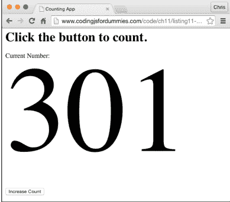
**图 11-1：** 为同一元素附加两个事件可以增加更多可能性！

第三个参数是一个布尔值（`true` 或 `false`），用于指示当带有事件的一个元素拥有也关联了事件的父元素时，事件处理程序的执行顺序。

当元素嵌套时，了解哪个事件会先发生非常重要。图 11-2 说明了一个常见问题：外层方块是可点击的，但内层圆形也是可点击的。当你点击内层圆形时，应该让方块关联的事件先发生，还是让圆形关联的事件先发生？

大多数人会说圆形的事件应该先发生才合理。然而，当微软在 Internet Explorer 中实现其事件版本时，它决定让外层事件（方块）先发生。

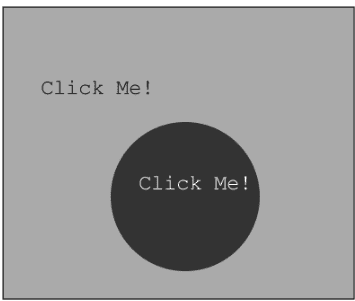
**图 11-2：** 事件中的事件。

在图 11-2 所示的情况下，处理事件最常见的方式称为*冒泡*（bubbling up）。最内层元素的事件先发生，然后逐层向外冒泡到最外层元素。要使用冒泡方式，将 `addEventListener()` 方法的最后一个参数设置为 `false`，这也是默认值。

处理这种情况的另一种方式称为*捕获*（capture）方法。在捕获模式下，最外层的事件先发生，最内层的事件最后发生。

列表 11-4 展示了一个示例，说明为什么了解事件处理程序的执行顺序很重要。`h1` 元素有点击事件，但该标题中的单词也有点事件。

### 列表 11-4：演示事件捕获和事件冒泡

```html
<html>
<head>
 <title>Event capturing vs. Event bubbling</title>
 <style>
 #theText {font-size: 18px;}
 h1 {
 border:1px solid #000;
 background-color: #dadada;
 }
 #capEvent, #bubEvent {
 background-color: #666;
 }
 </style>
 <script>
 // wait until the window is loaded before registering the events
 window.addEventListener('load', registerEvents, false);
 /**
 Registers onclick events
 */
 function registerEvents(e) {
 document.getElementById("capTitle").addEventListener('click', makeTiny, true);
 document.getElementById("capEvent").addEventListener('click', makeHuge, true);
 document.getEleme frameborder="0"  ("bubTitle").addEventListener('click', makeTiny, false);
 document.getElementById("bubEvent").addEventListener('click', makeHuge, false);
 }
 function makeHuge(e) {
 console.log("making the text huge");
 document.getElementById("theText").style.fontSize = "80px";
}
```

### 列表 11-4（续）

```javascript
}
function makeTiny(e) {
  console.log("making the text tiny");
  document.getElementById("theText").style.fontSize = "10px";
}
</script>
</head>
<body>
<h1 id="capTitle">Event <span id="capEvent">capturing</span></h1>
<h1 id="bubTitle">Event <span id="bubEvent">bubbling</span></h1>
<p id="theText">Hello, Events!</p>
</body>
</html>
```

图 11-3 展示了列表 11-4 在网页浏览器中的样子。

在图 11-3 中，当点击 capturing 一词时，注册到较大容器的事件先触发，然后才是注册到包含 capturing 一词的事件才会触发。

当你点击 bubbling 一词时，注册到该 span 的事件先触发，然后才是其**父元素**上的事件。

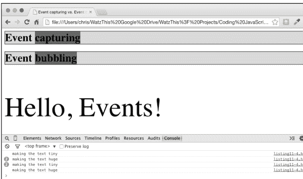
**图 11-3：** 处理嵌套事件。

## 停止传播

除了冒泡和捕获之外，还有第三种处理嵌套事件的方式：只执行单个事件然后停止。你可以使用 `stopPropagation()` 方法为某个事件（甚至所有事件）关闭冒泡和捕获。

> **提示：** 如果你的脚本中不需要事件传播，最好将其关闭，因为所有的冒泡和捕获都会占用系统资源并可能让你的网站变慢。

列表 11-5 演示了如何关闭事件传播。

### 列表 11-5：关闭事件传播

```javascript
function load(e) {
    if (!e) var e = window.event;
    // set cancelBubble for IE 8 and earlier
    e.cancelBubble = true;

    if (e.stopPropagation) e.stopPropagation();

    document.getElementById("capTitle").addEventListener('click', makeTiny, true);
    document.getElementById("capEvent").addEventListener('click', makeHuge, true);
    document.getElementById("bubTitle").addEventListener('click', makeTiny, false);
    document.getElementById("bubEvent").addEventListener('click', makeHuge, false);
}
```

## 第 12 章：整合输入和输出

### 本章内容

- 处理表单
- 使用输入
- 发送输出

> "故障。需要输入。"
> —— 五号，*霹雳五号*（1986）

处理用户输入和返回结果是任何计算机程序的基本和必要功能。在本章中，你将了解 JavaScript 和 HTML 如何协同工作以接收和输出数据。

## 理解 HTML 表单

从 Web 应用程序用户那里获取输入的主要方式是通过 HTML 表单。HTML 表单让 Web 开发人员能够创建文本框、下拉选择器、单选按钮、复选框和按钮。借助 CSS，你可以调整表单的外观以适应你的网站。JavaScript 让你能够**增强**表单的功能。

### 表单元素

所有 HTML 表单都包含在 `form` 元素内。`form` 元素是容纳构成用户输入区域的输入框、按钮、复选框和标签的容器。`form` 元素的作用与任何容器元素（如 `div`、`article` 或 `section`）非常相似。但它还包含一些属性，用于告诉浏览器如何处理表单字段中的用户输入。

列表 12-1 展示了一个包含两个输入框和一个提交按钮的 HTML 表单。

### 列表 12-1：包含表单的 HTML 页面示例

```html
<html>
<head>
<title>HTML form</title>
</head>
<body>

<form action="subscribe.php" name="newsletterSubscribe" method="post">
<label for="firstName">First Name: </label>
<input type="text" name="firstName" id="firstName"><br>
<label for="email">Email: <input type="text" name="email" id="email"></label><br>
<input type="submit" value="Subscribe to our newsletter!">
</form>

</body>
</html>
```

在网页浏览器中查看此表单时，它看起来像图 12-1。

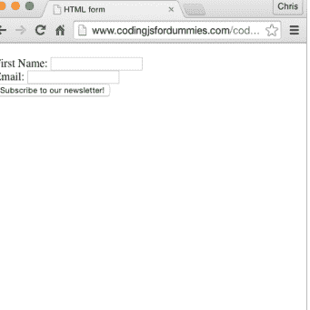
**图 12-1：** 一个 HTML 表单。

在前面的示例中，`form` 元素有三个属性：

- **action**：告诉浏览器如何处理用户输入。通常，action 是一个服务器端脚本。
- **name**：指定程序员为此表单分配的名称。表单的 name 属性对于使用 DOM 访问表单很有用。


**method**: 取值为 get 或 post，用于指示浏览器应将表单数据在 URL 中发送还是在 HTTP 标头中发送。

除了这三个属性外，`form` 元素还可以包含其他几个属性：

-   **accept-charset**: 指示服务器接受的字符集。除非你正在处理多语言内容（即便如此），你也可以放心地省略此属性。
-   **autocomplete**: 指示表单的输入元素是否应在浏览器中使用自动完成功能。
-   **enctype**: 指示表单应提交给服务器的内容类型。对于仅向服务器提交文本数据的表单，此项应设置为 text/html。如果你的表单向服务器提交文件（例如上传的图形文件），则 enctype 应为 multipart/form-data。默认值为 application/x-www-form-urlencoded。
-   **novalidate**: 一个布尔值，指示表单的输入在提交时是否应由浏览器进行验证。如果未指定此属性，表单默认会被验证。
-   **target**: 指示表单提交后服务器的响应应在何处显示。默认值 ("_self") 是在包含该表单的同一个浏览器窗口中打开响应。另一个选项是在新窗口中打开响应 ("_blank")。

## label 元素

你可以使用 `label` 元素将输入字段的描述（标签）与输入字段关联起来。`label` 元素的 `for` 属性取值应为该标签要关联的元素的 `id` 属性值，如下例所示：

```
<label for="firstName">First Name: </label>
<input type="text" name="firstName">
```

另一种将标签与表单字段关联的方法是将表单字段嵌套在 `label` 元素中，如下例所示：

```
<label>First Name: <input type="text"
            name="firstName"></label>
```

这种方法的优点是不要求输入字段具有 id（id 通常只是其 name 属性的重复）。

## input 元素

HTML `input` 元素是最基础的表单相关 HTML 元素。根据其 type 属性的值，它会让浏览器显示（或不显示）几种不同类型的输入字段。

最常见的是将 `input` 元素的 type 设置为 "text"，这会在浏览器中创建一个文本输入框。可选的 `value` 属性为该元素分配默认值，而 `name` 属性是与值配对的名称，形成名称/值对，可以通过 DOM 访问，并在表单提交时与其余表单值一起提交。

一个基础的 `text` 输入字段如下所示：

```
<input type="text" name="streetAddress">
```

随着 HTML5 的出现，`input` 元素获得了大量新的 `type` 属性可选值。这些新值允许 Web 开发人员更精确地指定输入框中应提供的值类型。它们还允许 Web 浏览器提供更适合所需输入类型的控件，以进行输入验证，从而构建更好的 Web 应用程序。


本章如此侧重于 HTML 的表单功能而非直接进入 JavaScript 可能会显得奇怪。然而，表单是 HTML 可以切实减轻程序员工作负担的领域，因此 JavaScript 程序员必须了解通过 HTML 可以实现哪些表单功能。

`input` 元素 type 属性的可能取值如表 12-1 所示。

### 表 12-1：input 元素 Type 属性的可能取值

| 值 | 描述 |
| :--- | :--- |
| `button` | 一个可点击的按钮 |
| `checkbox` | 一个复选框 |
| `color` | 一个颜色选择器 |
| `date` | 一个日期控件（年、月、日） |
| `datetime` | 一个日期和时间控件（基于 UTC 时区的年、月、日、时、分、秒及秒的小数部分） |
| `datetime-local` | 一个日期和时间控件（年、月、日、时、分、秒及秒的小数部分；无时区） |
| `email` | 一个用于电子邮件地址的字段 |
| `file` | 一个文件选择字段和一个“浏览”按钮 |
| `hidden` | 一个隐藏的输入字段 |
| `image` | 一个使用图像而非默认按钮的提交按钮 |
| `month` | 一个月份和年份控件 |
| `number` | 一个数字输入字段 |
| `password` | 一个密码字段 |
| `radio` | 一个单选按钮 |
| `range` | 一个使用数字范围的输入，例如滑块控件 |
| `reset` | 一个重置按钮 |
| `search` | 一个用于输入搜索字符串的文本字段 |
| `submit` | 一个提交按钮 |
| `tel` | 一个用于输入电话号码的字段 |
| `text` | 默认值：一个单行文本字段 |
| `time` | 一个用于输入时间的控件（无时区） |
| `url` | 一个用于输入 URL 的字段 |
| `week` | 一个周和年控件（无时区） |

在撰写本文时，并非所有浏览器都支持 `input` 元素 `type` 属性的所有可能值。使用浏览器无法识别的 `type` 属性将导致其仅显示为文本输入字段。


## select 元素

HTML `select` 元素定义了一个下拉列表或多选输入。`select` 元素包含 `option` 元素，这些元素是用户在选择控件中可选的选项，如代码清单 12-2 所示。

### 代码清单 12-2：使用 select 元素创建的下拉表单控件

```
<select name="favoriteColor">
  <option value="red">red</option>
  <option value="blue">blue</option>
  <option value="green">green</option>
</select>
```

代码清单 12-2 中的标记创建的表单如图 12-2 所示。

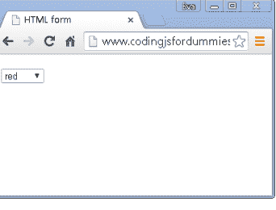

图 12-2：一个 HTML 下拉控件。

## textarea 元素

`textarea` 元素定义了一个多行文本输入字段：

```
<textarea name="description" rows="4" cols="30"></textarea>
```

## button 元素

`button` 元素定义了另一种创建可点击按钮的方法：

```
<button name="myButton">Click The Button</button>
```

`button` 元素可以用作 `type` 属性设置为 'submit' 的 `input` 元素的替代品。或者，你可以在任何需要按钮但又不希望触发提交操作的地方使用 button 元素。


如果你不希望按钮在点击时提交表单，你需要为其添加一个值为 'button' 的 `type` 属性。

## 使用 Form 对象

HTML DOM 使用 Form 对象来表示表单。通过 Form 对象，你可以获取和设置表单字段的值，控制用户提交表单时采取的操作，以及更改表单的行为。

## 使用 Form 属性

Form 对象的属性与 HTML 表单元素的属性相对应（参见本章前面的章节）。它们用于通过 JavaScript 获取或设置 HTML 表单元素属性的值。表 12-2 列出了 Form 对象的所有属性。


DOM 对象是 HTML 页面的表示。其目的是让你通过 JavaScript 访问文档的不同部分（也称为 *编程接口*）。HTML 文档中的任何内容都可以通过使用 DOM 由 JavaScript 访问和更改。

### 表 12-2：Form 对象属性

| 属性 | 用途 |
| --- | --- |
| `acceptCharset` | 获取或设置服务器支持的字符集列表。 |
| `action` | 获取或设置 `form` 元素 `action` 属性的值。 |
| `autocomplete` | 获取或设置 `input` 元素的值是否可以由浏览器自动完成。 |
| `encoding` | 告知浏览器如何对表单数据进行编码（作为文本或文件）。此属性与 `enctype` 同义。 |
| `enctype` | 告知浏览器如何对表单数据进行编码（作为文本或文件）。 |
| `length` | 获取表单中控件的数量。 |
| `method` | 获取或设置浏览器用于提交表单的 HTTP 方法。 |
| `name` | 获取或设置表单的名称。 |
| `noValidate` | 指示表单在提交时不需要验证。 |
| `target` | 指示显示已提交表单结果的位置。 |


## 使用 autocomplete 属性

HTML `form` 元素中的 `autocomplete` 属性为表单内部的 `input` 元素设置默认的自动完成值。如果您希望浏览器为表单中的每个输入项提供自动完成功能，请将 `autocomplete` 设置为 `on`。如果您希望能够选择哪些元素可以由浏览器自动完成，或者您的文档提供了自己的自动完成功能（通过 JavaScript），请将表单的 `autocomplete` 属性设置为 `off`，然后您可以为表单内的每个单独的 `input` 元素设置 `autocomplete` 属性。

您可以在第 10 章中找到设置或获取表单属性值的技术。在通过其中一种方法引用表单后，您可以使用点符号（dot notation）或方括号方法来访问该属性。

要获取文档中第一个表单的 `name` 属性值，可以使用以下语句：

```
document.getElementsByTagName("form")[0].name```

一种更常见的访问表单的方法是为其分配一个 `id` 属性，并使用 `getElementById` 来选择它。

DOM 为访问表单提供了另一种更便捷的方法：`forms` 集合。`forms` 集合允许您通过两种不同方式访问文档中的表单：

- **通过索引号：** 当文档中创建 `form` 元素时，它会被分配一个从零开始的索引号。要访问文档中的第一个表单，请使用 `document.forms[0]`。
- **通过名称：** 您还可以使用 `form` 元素的 `name` 属性值来访问表单。例如，要获取名为 "subscribeForm" 的表单的 `action` 属性值，您可以使用 `document.forms.subscribeForm.action`。或者，您可以使用访问属性的方括号方法，写成 `document.forms["subscribeForm"].action`。

## 使用 Form 对象的方法

`Form` 对象有两个方法：`reset()` 和 `submit()`。

### reset() 方法

`reset()` 方法会清除页面加载后对表单字段所做的任何更改，并将值重置为默认值。它的作用与 HTML 的重置按钮相同，后者是通过在 `input` 元素中使用 `type="reset"` 属性创建的，如下代码所示：

```
<input type="reset" value="Clear the form">
```

### submit() 方法

`submit()` 方法会导致表单根据其属性（`action`、`method`、`target` 等）提交其值。它的作用与 HTML 的提交按钮相同，后者是通过在 `input` 元素中使用 `type="submit"` 属性创建的，如下代码所示：

```
<input type="submit" value="Submit the form">
```

示例 12-3 展示了 `submit()` 和 `reset()` 方法的使用，以及表单对象的几个属性。

### 示例 12-3：使用 Form 对象的属性和方法

```
<html>
<head>
<title>Subscribe to our newsletter!</title>
<script>
  function setFormDefaults() {
    document.forms.subscribeForm.method = "post";
    document.forms.subscribeForm.target = "_blank";
    document.forms.subscribeForm.action = 
      "http://watzthis.us9.list-manage.com/subscribe/
      post?u=1e6d874df7b587af7747ec056&amp=
      id=663906e3ba";

    //register the button events
    document.getElementById('btnSubscribe').
      addEventListener('click', submitForm);
    document.getElementById('btnReset').
      addEventListener('click', resetForm);
  }

  function submitForm() {
    document.forms.subscribeForm.submit();
  }

  function resetForm() {
    document.forms.subscribeForm.reset();
  }
</script>
</head>
<body onload="setFormDefaults();">

<form name="subscribeForm">
    <h2>Subscribe to our mailing list</h2>
    <label for="mce-EMAIL">Email Address </label>
    <input type="email" value="" name="EMAIL" id="mce-EMAIL">
    <button type="button" id="btnSubscribe">Subscribe!</button>
    <button type="button" id="btnReset">Reset</button>
</form>
</body>
</html>
```

## 访问表单元素

JavaScript 提供了几种不同的方式来访问表单输入字段及其值。然而，这些方式并非完全等同，JavaScript 程序员对于哪种技术最好存在分歧。以下列表介绍了不同的技术及其优缺点：

- **使用表单及其输入字段的索引号。** 例如，要访问第一个表单中的第一个输入字段，可以使用以下代码：
```
document.forms[0].elements[0]
```
避免使用上述技术，因为它依赖于文档的结构以及表单内元素顺序不发生变化。一旦有人决定在表单中将电子邮件字段放在名字字段之前，您的整个脚本就会崩溃。

- **使用表单的名称和输入字段的名称。** 例如：
```
document.myForm.firstName
```
这种技术的优点是易于阅读且易于使用。它被所有浏览器支持（并且在 DOM 开发的极早期就已支持）。

- **使用 `getElementById` 选择表单，并使用输入字段的名称来选择输入项。** 例如：
```
document.getElementById("myForm").firstName
```
这种技术要求您为该元素的表单分配一个 `id` 属性。例如，上述代码将匹配以下表单元素中名为 `firstName` 的输入字段：
```
<form id="myForm" action="myaction.php">
...
</form>
```

## 获取和设置表单元素的值

DOM 允许您通过 `name` 和 `value` 属性访问表单元素的名称和值。

示例 12-4 通过一个简单的计算器应用程序演示了如何获取和设置表单输入字段。

### 示例 12-4：一个演示获取和设置表单输入字段的计算器应用

```
<html>
<head>
  <title>Math Fun</title>
  <script>

    function registerEvents() {
      document.mathWiz.operate.addEventListener('click',
          doTheMath,false);
    }

    function doTheMath() {
      var first =
        parseInt(document.mathWiz.numberOne.value);
      var second =
        parseInt(document.mathWiz.numberTwo.value);
      var operator = document.mathWiz.operator.value;

      switch (operator){
        case "add":
          var answer = first + second;
          break;
        case "subtract":
          var answer = first - second;
        break;
        case "multiply":
          var answer = first * second;
          break;
        case "divide":
          var answer = first / second;
          break;
      }

      document.mathWiz.theResult.value = answer;
    }
  </script>
</head>
<body onload="registerEvents();">
<form name="mathWiz">
<label>First Number: <input type="number"
name="numberOne"></label><br>
<label>Second Number: <input type="number"
name="numberTwo"></label><br>
<label>Operator:
<select name="operator">
<option value="add"> + </option>
<option value="subtract"> - </option>
<option value="multiply"> * </option>
<option value="divide"> / </option>
</select>
</label>
<br>
<input type="button" name="operate" value="Do the
Math!"><br>
<label>Result: <input type="number" name="theResult">
</label>
</form>
</body>
</html>
```

## 验证用户输入

JavaScript 最常见的用途之一是在将用户输入提交到服务器之前对其进行检查或验证。JavaScript 表单验证为防止错误或潜在不安全的数据进入 Web 应用程序提供了额外的保障。它还能向用户提供关于是否出错的即时反馈。

一些最常见的 JavaScript 输入验证任务已被 HTML5 中的 HTML 属性所取代。然而，由于浏览器的兼容性问题，使用 JavaScript 验证用户提交的数据仍然是一个良好的习惯。

在示例 12-4 的计算器程序中，操作数单元的 `input` 类型被设置为 `number`。这应该会让浏览器阻止用户在这些字段中提交非数字值。因为 `number` 输入

由于 `type` 属性相对较新，你不能总是指望浏览器都能支持它，因此使用 JavaScript 进行用户输入验证非常重要。

示例 12-5 展示了一个输入验证脚本。这里需要注意的关键点是，表单的 action 已被设置为输入验证函数。只有在输入验证函数中的测试完成后，表单的 `submit()` 方法才会运行。

在前面的代码中，真正发挥魔力的一行是 `validate()` 函数内部这个看起来很奇怪的语句：

```
if (/^\d+$/.test(first) && /^\d+$/.test(second)) {
```

`/` 和 `/` 之间的字符构成了所谓的 *正则表达式*。正则表达式是由代表其他符号组的符号组成的搜索模式。在这种情况下，我们使用正则表达式来检查用户输入的值是否均为数字。你可以在第 14 章中详细了解正则表达式。


输入验证是 JavaScript 非常常见的用途，因此人们创建了许多不同的实现技术。在为你的特定 JavaScript 应用程序重新造轮子之前，请搜索“开源 JavaScript 输入验证”，看看是否有现有的代码库可以为你节省时间并提供更多功能。

## 示例 12-5：使用 JavaScript 执行输入验证

```
<html>
<head>
  <title>Math Fun</title>
  <script>

    function registerEvents() {
      document.mathWiz.operate.addEventListener('click',
          validate,false);
    }

    function validate() {
      var first = document.mathWiz.numberOne.value;
      var second = document.mathWiz.numberTwo.value;
      var operator = document.mathWiz.operator.value;

      if (/^\d+$/.test(first) && /^\d+$/.test(second)) {

        doTheMath();

      } else {

        alert("Error: Both numbers must be numeric");
```

（接下页）

# 第三部分：Web 上的 JavaScript

## 示例 12-5（续）

```
}
}

function doTheMath() {
  var first =
      parseInt(document.mathWiz.numberOne.value);
  var second = parseInt(document.mathWiz.numberTwo.
                        value);
  var operator = document.mathWiz.operator.value;
  switch (operator){
    case "add":
      var answer = first + second;
      break;
    case "subtract":
      var answer = first - second;
      break;
    case "multiply":
      var answer = first * second;
      break;
    case "divide":
      var answer = first / second;
      break;
  }

  document.mathWiz.theResult.value = answer;
}
</script>
</head>
<body onload="registerEvents();">
  <div id="formErrors"></div>
  <form name="mathWiz">
    <label>First Number: <input type="number"
           name="numberOne"></label><br>
    <label>Second Number: <input type="number"
           name="numberTwo"></label><br>
    <label>Operator:
      <select name="operator">
        <option value="add"> + </option>
        <option value="subtract"> - </option>
        <option value="multiply"> * </option>
        <option value="divide"> / </option>
      </select>
    </label>
    <br>
    <input type="button" name="operate" value="Do the
          Math!"><br>
    <label>Result: <input type="number" name="theResult">
           </label>
  </form>
</body>
</html>
```

# 第 13 章

## 使用 CSS 和图形

### 本章内容

- 编辑样式
- 使用图像
- 执行 JavaScript 动画
- 开发幻灯片

> “要实现风格，首先要不刻意追求风格。”

—— E.B. White，《风格的要素》

一旦你理解了如何使用 JavaScript 操作 DOM 对象，网页就会从静态文档转变为交互式应用程序，能够响应用户输入、在不重新加载的情况下发生变化，并将实时数据传递给各种不同的计算设备。

## 使用 Style 对象

DOM 的 `Style` 对象是一个强大的工具，可以让网页改变外观并实时适应用户输入或当前浏览器状况。`Style` 对象允许程序员访问文档中任何选定元素或元素集合的 CSS 样式属性。（有关 CSS 基本规则和语法的更多信息，请参阅第 1 章。）

使用 `Style` 对象可以实现的一些功能包括：

- 更改文本颜色，以突出显示搜索框中输入的关键字
- 在用户点击对象后使其产生动画效果
- 更改用户当前正在编辑的表单部分的边框和背景颜色
- 展开和折叠或隐藏和显示页面的不同部分
- 创建在用户点击链接时出现在页面内容上方的提示或帮助框

`Style` 对象的运作方式与其他 DOM 对象相同。它包含一组属性，你可以使用这些属性来获取或设置选定元素的各个方面。

`Style` 对象的属性与 CSS 属性相对应。两者的区别在于，DOM `Style` 对象的属性使用 `camelCase`（小驼峰命名法）拼写，而不是使用 CSS 的连字符格式。

表 13-1 显示了一些最常用的 `Style` 对象属性及其修改的 CSS 属性。


有关 `Style` 对象属性以及所有其他 DOM 对象属性的完整列表，请访问 `http://overapi.com/html-dom`。

### 获取元素的当前样式

`Style` 对象返回一个元素当前应用的内联样式。它不会告诉你浏览器将渲染的实际样式，因为它不包括外部 CSS 文件中或 `style` 元素内部的样式。

因此，`Style` 对象在获取元素样式方面并非完全有效。在示例 13-1 中，`div` 元素有一个内联样式和几个在 `style` 元素中设置的样式规则。

### 表 13-1 常用 Style 对象属性及其对应的 CSS 属性

| 属性 | CSS 样式 | 描述 |
|---|---|---|
| `backgroundColor` | background-color | 获取或设置元素的背景颜色 |
| `borderWidth` | border-width | 设置元素四个边框的宽度 |
| `fontFamily` | font-family | 获取或设置分配给元素文本的字体族名称列表 |
| `lineHeight` | line-height | 获取或设置文本行之间的距离 |
| `textAlign` | text-align | 获取或设置块级元素中文本的水平对齐方式 |

当使用 `Style` 对象获取元素的样式属性时，仅返回使用 JavaScript 或内联 CSS 设置的样式。

## 示例 13-1：获取元素当前样式的错误方法

```
<html>
<head>
  <title>Getting Inline Styles</title>
  <style>
    #myText {
      color: white;
      background-color: black;
      font-family: Arial;
      margin-bottom: 20px;
    }
    #stylesOutput {
      font-size: 18px;
      font-family: monospace;
    }
  </style>
  <script>
    function getElementStyles(e) {
      var colorOutput = "color: " + e.target.style.color;
      var fontSizeOutput = "font size: " + e.target.style.fontSize;
      document.getElementById("stylesOutput").innerHTML = colorOutput + "<br>" + fontSizeOutput;
    }
  </script>
</head>
<body>
  <div id="myText" style="font-size: 26px;"
onclick="getElementStyles(event);">Here is some text.</div>
  <div id="stylesOutput"></div>
</body>
</html>
```

图 13-1 显示了在浏览器中加载此页面并点击 `div` 元素时发生的情况。

关于此脚本结果的两个重要注意事项是：

- `Style` 对象的属性值为空，尽管 `div` 的颜色在 head 的 CSS 中被设置为白色。
- `Style` 对象的字体大小设置正确，因为 CSS `font-size` 属性是使用内联 CSS 设置的。

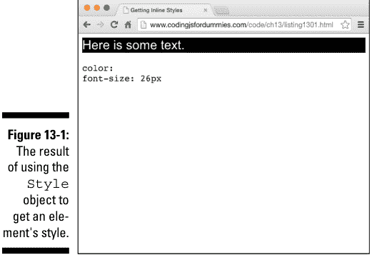

`style` 对象的属性表现得像内联样式，且仅能检索应用于元素的内联样式值。

获取元素当前样式的一种好方法是使用 `window.getComputedStyle()`，如示例 13-2 所示。

## 示例 13-2：获取元素当前样式的正确方法

```
<html>
<head>
  <title>Getting Computed Styles</title>
  <style>
    #myText {
      color: white;
      background-color: black;
      font-family: Arial;
      margin-bottom: 20px;
    }
    #stylesOutput {
      font-size: 18px;
      font-family: monospace;
    }
  </style>
<script>
  function getElementStyles(e){
    var computedColor =
      window.getComputedStyle(e.target).
      getPropertyValue("color");
    var computedSize = window.getComputedStyle
      (e.target).getPropertyValue("font-size");

    var colorOutput = "color: " + computedColor;
    var fontSizeOutput = "font size: " + computedSize;
```


[content]

```
document.getElementById("stylesOutput").innerHTML =
    colorOutput + "<br>" + fontSizeOutput;
}
</script>
</head>
<body>
    <div id="myText" style="font-size: 26px;"
         onclick="getElementStyles(event);">Here is some
         text.</div>
    <div id="stylesOutput"></div>
</body>
</html>
```

图 13-2 展示了清单 13-2 的输出：显示计算（且正确）的 `style` 属性值。

请注意，在清单 13-2 中，`getPropertyValue` 函数接受的是 CSS 属性（`font-size`）而非 style 属性（`fontSize`）。原因在于该脚本直接从元素中查询 `font-size` 的值，而不是通过 `Style` 对象（后者仅会告诉我们关于内联样式的信息）。

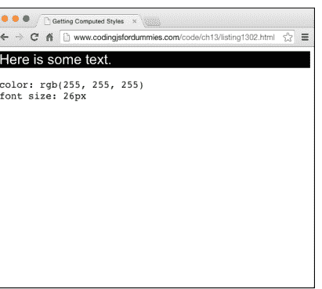

**图 13-2：** 显示计算样式。

## 设置 style 属性

要设置 `Style` 对象的属性，先选择要应用新样式的元素，然后使用点号表示法或括号表示法为 `Style` 对象的属性赋新值。

若要更改 id 为 "borderedSquare" 的元素的边框宽度，可以使用以下代码：

```
document.getElementById("borderedSquare").style.
        borderWidth = "15px";
```

## 使用 Style 对象实现元素动画

你可以使用 CSS 样式来控制元素的外观，但也可以用它来掌控元素的定位。通过使用 JavaScript 循环结合 `style` 属性修改，你可以相当轻松地创建基本动画。

在清单 13-3 中，一个 JavaScript 函数通过使用 `for` 循环来更改 CSS `'left'` 属性，从而将一个方块在屏幕上移动。

### 清单 13-3：使用 Style 对象为元素添加动画

```
<html>
<head>
  <title>JavaScript animation</title>
  <style>
    #square {
      width: 100px;
      height: 100px;
      background-color: #333;
      position: absolute;
      left: 0px;
      top: 100px;
    }
  </style>
  <script>
    function moveSquare() {
      for (i=0; i<500; i++){
        document.getElementById("square").style.left =
          i+"px";
      }
    }
  </script>
</head>
<body onload="moveSquare();">
  <div id="square"></div>
</body>
</html>
```

# 第 13 章：使用 CSS 和图形

如果你在浏览器中打开此脚本，它看起来似乎是动画 completed 状态直接呈现。事实上，动画确实运行了，但它发生得太快，以至于你看不到它正在发生（除非你恰好拥有一台非常慢的计算机或一双非常快的眼睛）。

要使这段动画以人类可感知的速度运行，需要在循环的每次迭代之间插入一个暂停。创建带有暂停的循环最常见的方法是使用 `Window` 对象的 `setTimeout()` 方法。

`setTimeout()` 方法接受两个参数：

- 要运行的函数或代码片段
- 运行前等待的毫秒数（千分之一秒）

通过在函数内部调用 `setTimeout()` 并递归地调用该函数，我们可以控制动画运行的速度。（有关编写递归函数的更多内容，请参阅第 7 章。）

在清单 13-4 中，方框现在以每 1/100 秒移动 1 像素的慢得多的速度移动。此示例还具有比清单 13-3 的一些改进之处：

- 方框现在可以点击。点击方框会触发动画。
- 方框的动画基于点击事件发生时方框的位置。点击方框会使其向右移动 100 像素，相对于它被点击时的位置。

清单 13-4：使用 Style 对象、setTimeout() 和递归实现动画

```
<html>
<head>
<title>JavaScript animation</title>
<style>
#square {
width: 100px;
height: 100px;
background-color: #333;
position: absolute;
left: 0px;
top: 100px;
}
</style>
<script>
```

清单 13-4 *（续）*

```
// wait until the window is loaded
window.addEventListener('load',initialize,false);

function initialize(){

//move the square when clicked
document.getElementById("square").
	addEventListener('click',function(e){

	//get the starting position
	var left = window.getComputedStyle(e.target).
		getPropertyValue("left");

	//convert left to a base 10 number
	left = parseInt(left, 10);
	moveSquare(left,100);

	}, false);

}

function moveSquare(left,numMoves) {
	document.getElementById("square").style.left =
		left+"px";

	if (numMoves > 0) {
		numMoves--;
		left++;
		setTimeout(moveSquare,10,left,numMoves);
	} else {
		return;
	}
}
</script>
</head>
<body>
	<div id="square"></div>
</body>
</html>
```

图 13-3 展示了在浏览器中运行清单 13-4 时的输出。


仔细查看为方框注册点击事件的代码。一个匿名函数被用作事件处理程序。虽然乍一看可能令人困惑，但如果你将其还原为基本部分，它仍然是相同的基本 `addEventListener()` 方法在起作用，带有三个参数：事件类型、监听器（在本例中，是一个匿名函数），以及是否使用事件捕获的布尔值。

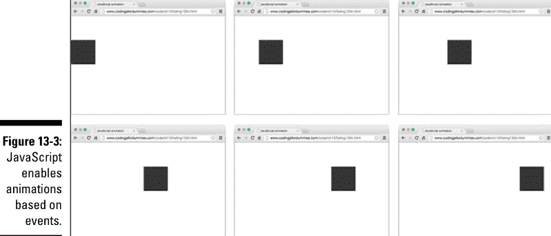

## 处理图像

HTML `img` 元素通常是非常静态、不变的东西——当然，除非图像是动画。借助 JavaScript，通过操纵 `img` 元素的属性和更改 CSS 样式，可以实现调整图像大小、重新定位图像、灯箱效果、悬停效果等效果。

### 使用 Image 对象

DOM 的 `Image` 对象让你可以访问 HTML `img` 元素的属性。一旦获得该访问权限，你就可以设置和获取值来更改该元素的任何有效属性。`Image` 对象的属性如表 13-2 所示。

> **记住**
> `Image` 对象最重要且最广泛使用的属性是 `src` 属性、`width` 属性和 `height` 属性。有了这三个属性，你就可以创建图像切换效果、惊人的图像大小效果、酷炫的悬停按钮，以及更多！

### 创建悬停按钮

*悬停按钮（rollover button）* 是一种当鼠标指针悬停在其上时会发生某种变化的按钮。悬停按钮是向用户表明图像可以被点击的绝佳方式。你也可以用它们来揭示点击按钮或链接后将会发生什么的相关信息。你甚至可以将它们纯粹用于趣味或美学目的。一些网页设计师喜欢在他们所谓的网站中放置 *彩蛋（easter eggs）*，当鼠标悬停在某些区域上或当有人点击页面上的某些隐藏区域时，会触发图像变化或其他变化以满足好奇心。

| 属性 | 描述 |
| --- | --- |
| `alt` | 获取或设置图像的 `alt` 属性的值 |
| `complete` | 当浏览器完成图像加载时为 true |
| `height` | 获取或设置图像的 `height` 属性的值 |
| `isMap` | 获取或设置图像是否应作为服务器端图像映射的一部分 |
| `naturalHeight` | 获取图像的原始高度 |
| `naturalWidth` | 获取图像的原始宽度 |
| `src` | 获取或设置图像的 `src` 属性的值 |
| `useMap` | 获取或设置图像的 `usemap` 属性的值 |
| `width` | 获取或设置图像的 `width` 属性的值 |

你可以使用 CSS 创建悬停效果，但对于更复杂的悬停效果或图像切换，需要使用 JavaScript，或 JavaScript 与 CSS 的组合。

清单 13-5 中的示例展示了如何在 JavaScript 中创建简单的图像悬停效果。

清单 13-5：图像悬停效果

```
<html>
<head>
  <title>Rollover image</title>
  <script>

    function swapImage(imgToSwap) {
      imgToSwap.src = "button2.png";
      imgToSwap.alt = "you're mousing over my button!";
    }
    function swapBack(imgToSwap) {
      imgToSwap.src = "button1.png";
      imgToSwap.alt = "mouse over me!";
    }
```


```html
  </script>
</head>
<body>
  
</body>
</html>
```

为了使示例 13-5 中的页面正常工作，你需要将名为 `button1.png` 和 `button2.png` 的图像保存在与 HTML 文件相同的目录下。你可以创建自己的图像，或者从本书的网站下载。

## 在鼠标悬停时放大图像

另一个让网站更用户友好的实用界面技巧是，当用户将鼠标悬停在图像按钮上时，略微增加其尺寸。这个巧妙的小技巧能微妙地暗示目标图像是可点击的，并提供了一定的交互感。

示例 13-6 修改了示例 13-5 的代码，以便在 `mouseover` 事件发生时将图像尺寸增加 5%。

### 示例 13-6：在鼠标悬停时增加图像尺寸

```html
<html>
<head>
  <title>Rollover image size</title>
  <script>

    function growImage(imgToGrow){
      imgToGrow.width += imgToGrow.width * .05;
      imgToGrow.height += imgToGrow.width * .05;
    }
    function restoreImage(imgToShrink){
      imgToShrink.width = imgToShrink.naturalWidth;
      imgToShrink.height = imgToShrink.naturalHeight;
    }
  </script>
</head>
<body>
  
</body>
</html>
```

你可能已经注意到，示例 13-5 和 13-6 使用了内联事件方法。虽然对于实际的 Web 应用程序开发而言这不是理想的选择，但内联事件经常被用于简单的 `mouseover` 效果，因为这些效果通常与界面相关而非功能相关。

## 创建图像幻灯片

*幻灯片*（也称为轮播图）是在网站的单个空间中显示多张图像的一种流行方式。它们经常被用于网站的首页，能让你的网站变得生动起来。

幻灯片通常具有在多张图像之间切换的过渡效果。这些过渡效果通常使用 JavaScript 函数库（如 jQuery）来创建。你也可以仅使用普通的 JavaScript、CSS 和 DOM 来创建过渡效果。为了简单起见，示例 13-7 中的幻灯片仅在图像之间进行切换，不包含任何形式的过渡效果。

### 示例 13-7：使用 JavaScript 和 CSS 构建的幻灯片

```html
<html>
<head>
  <title>JavaScript slideshow</title>

  <style>
    #carousel {
      position: absolute;
      width: 800px;
      height: 400px;
      top: 100px;
      left: 100px;
      display: hidden;
    }

  </style>
  <script>
    var slides = [
"<div id='slide1'>my first slide<br></div>",
"<div id='slide2'>my second slide<br></div>",
"<div id='slide3'>my third slide<br></div>"];

var currentSlide = 0;
var numberOfSlides = slides.length-1;

window.addEventListener("load",loader,false);

function loader(){
    changeImage();
}

function changeImage(){
    console.log("changeImage function");
    if (currentSlide > numberOfSlides){
        currentSlide = 0;
    }

    document.getElementById("carousel").
        innerHTML=slides[currentSlide];

    console.log('displaying slide' + currentSlide +
        "of " + numberOfSlides);
    currentSlide++;

    setTimeout(changeImage,1000);
}

</script>
</head>
<body>
    <div id="carousel"></div>
</body>
</html>
```

## 使用 Style 对象的动画属性

CSS3 和 DOM 的 `Style` 对象拥有简化元素动画任务的属性。结合使用这些动画属性，你可以用极少的精力创建一些非常酷的动画。`Style` 对象的动画属性列在表 13-3 中。

### 表 13-3 Style 对象的动画相关属性

| 属性 | 描述 |
| :--- | :--- |
| `animation` | 同时设置除 `animationPlayState` 属性以外的所有动画属性。 |
| `animationDelay` | 获取或设置动画开始前的延迟时间 |
| `animationDirection` | 获取或设置动画在某些或所有周期内是否应反向播放 |
| `animationDuration` | 获取或设置动画完成一个周期所需的时间长度 |
| `animationFillMode` | 获取或设置在执行时间之外，动画所应用的数值 |
| `animationIterationCount` | 获取或设置动画应播放的次数 |
| `animationName` | 获取或设置动画列表，使用关键帧 at-rules |
| `animationTimingFunction` | 获取或设置描述动画随时间推进的速度曲线 |
| `animationPlayState` | 获取或设置动画是在运行还是暂停。 |

在示例 13-8 中，使用 CSS 创建了一个简单的动画。首先通过 CSS 配置动画的时间和关键帧，然后使用 JavaScript 来暂停和恢复动画。只要发挥一点创造力，你就可以通过 JavaScript 实现许多控制该动画的可能性。

CSS3 动画仍然比较新，并非所有浏览器都以相同的方式支持它。由于它仍被认为是一项实验性技术，某些浏览器在动画属性名称前需要加上浏览器前缀。

在示例 13-8 中，同时包含了标准和带前缀的 CSS 样式。

### 示例 13-8：使用 JavaScript 控制 CSS3 动画

```html
<!DOCTYPE html>
<html>
<head>
<style>
#words {
position: relative;
width: 300px;
height: 200px;
text-align: center;
padding-top: 20px;
font-family: Arial;
border-radius: 6px;
color: white;

/* Chrome, Safari, Opera */
-webkit-animation-name: movewords;
-webkit-animation-duration: 6s;
-webkit-animation-timing-function: linear;
-webkit-animation-delay: 0s;
-webkit-animation-iteration-count: infinite;
-webkit-animation-direction: alternate;
-webkit-animation-play-state: running;
/* Standard syntax */
animation-name: movewords;
animation-duration: 6s;
animation-timing-function: linear;
animation-delay: 0s;
animation-iteration-count: infinite;
animation-direction: alternate;
animation-play-state: running;
}

/* Chrome, Safari, Opera */
@-webkit-keyframes movewords {
  0%  {background:red; left:100px; top:0px;}
  25% {background:blue; left:200px; top:100px;}
  50% {background:blue; left:300px; top:200px;}
  75% {background:blue; left:200px; top:200px;}
  100% {background:red; left:100px; top:0px;}
}

/* Standard syntax */
@keyframes movewords {
  0%  {background:red; left:100px; top:0px;}
  25% {background:blue; left:200px; top:100px;}
  50% {background:blue; left:300px; top:200px;}
  75% {background:blue; left:200px; top:200px;}
  100% {background:red; left:100px; top:0px;}
}
</style>
<script>

window.addEventListener("load",registerEvents,false);

function registerEvents(e){
  document.getElementById("stop").addEventListener("click",stopAni,false);
  document.getElementById("go").addEventListener("click", startAni, false);
}
function stopAni() {
    document.getElementById("words").style.
    webkitAnimationPlayState = "paused";
    document.getElementById("words").style.
    animationPlayState = "paused";
}
function startAni() {
    document.getElementById("words").style.
    webkitAnimationPlayState = "running";
    document.getElementById("words").style.
    animationPlayState = "running";
}
</script>
</head>
<body>

<h1 id="words">Movin' Around</h1>

<button type="button" id="stop">Pause</button>
<button type="button" id="go">Run</button>

</body>
</html>
```

## 第四部分
## 进阶学习

了解如何强制网页浏览器运行受限版本的JavaScript，请参阅在线文章《JavaScript严格模式》，网址为 www.dummies.com/extras/codingwithjavascript。

# 本部分内容

- 了解如何使用正则表达式进行搜索。
- 探索如何使用回调函数和闭包。
- 通过拥抱AJAX和JSON更上一层楼。
- 了解如何强制网页浏览器运行受限版本的JavaScript，请参阅在线文章《JavaScript严格模式》，网址为 www.dummies.com/extras/codingwithjavascript。

# 第14章：使用正则表达式搜索

### 本章内容

- 用正则表达式查找模式
- 编写正则表达式
- 在JavaScript中使用正则表达式

> "制造问题很容易。我们一直都在做。而找到那些能持久且产生良好效果的解决方案，则需要勇气和细心。"
> —— 亨利·罗林斯

正则表达式是众多编程语言中的一项强大工具，它能帮助你根据文本中的模式来查找和更改文档中的文本。正则表达式的语法起初可能令人望而生畏，但一旦你掌握了窍门，文本处理将无所不能。

## 使用正则表达式进行查找

正则表达式是在字符串中查找模式或字符组合的一种方法。

正则表达式的常见用途包括：

- 检查用户输入的电子邮件地址，确保其格式正确
- 在文章中查找并替换某人名字的所有实例
- 在整本书的句子中定位大写的单词
- 在文档中查找看起来像电话号码的数字串

正则表达式看起来像这样：

```
^((\(\d{3}\) ?)|(\d{3}-))?\d{3}-\d{4}$
```

看起来很吓人，对吧？别担心，你很快就能掌握解码这个表达式所需的工具，并且你会发现它是一个旨在匹配美国电话号码常见格式的正则表达式：

(555)555-5555

不过，正则表达式可以比前面的例子简单得多。清单14-1展示了一个简单的正则表达式用例，图14-1显示了清单14-1在浏览器中渲染的样子。

### 清单14-1：字符串是否包含“JavaScript”？

```html
<html>
<head>
  <title>寻找JavaScript</title>
  <script>
    window.addEventListener("load",registerEvents,false);

    function registerEvents(e){
      document.getElementById("ask")
      addEventListener("click",findAnswer,false);
    }

    function findAnswer(){
      //获取用户的问题
      var question = document.
        getElementById("userQuestion").value;
      /* 创建一个新的正则表达式对象，
         用于精确匹配字符串 "JavaScript"。 */
      var re = new RegExp("JavaScript");

      // 如果在用户的问题中找到"JavaScript"
      if (re.test(question)===true){

        //打印出一个答案。
        document.getElementById("answer").innerHTML =
          "JavaScript问题？查看Chris Minnick和Eva
          Holland编写的《JavaScript编程入门》";
          
        //并在控制台输出"JavaScript!"。
        console.log("JavaScript!");
      }
    }
</script>
</head>
<body>
<form id="userInput">
<label>请输入您的问题：
<textarea id="userQuestion"/>
</label>
<button id="ask" type="button">获取答案</button>
</form>
<div id="answer"/>
</body>
</html>
```

**图14-1：** 在浏览器中运行清单14-1的结果。

## 编写正则表达式

在使用正则表达式之前，你需要创建一个包含该表达式的对象。你可以通过以下两种方式之一编写正则表达式：

- 使用正则表达式字面量
- 通过 `RegExp` 对象的构造函数

### 使用 RegExp 对象

当你通过调用 RegExp 构造函数来创建正则表达式时，生成的对象是在运行时创建的，而不是在脚本加载时。当你在编写脚本时不知道正则表达式的值时，应该使用 RegExp 构造函数。例如，你可能要求用户输入一个正则表达式，或者你可能从外部来源获取正则表达式，或者在脚本运行时计算正则表达式的某个部分。

清单14-2中的程序使用一个随机字母创建正则表达式，然后要求用户输入一个句子。当用户提交表单时，程序会计算用户提交的文本中包含该随机字母的次数。

### 清单14-2：使用 RegExp 对象在运行时创建正则表达式

```html
<html>
<head>
  <title>字母计数游戏</title>
  <script>
    window.addEventListener('load',loader,false);

    //获取一个随机字母
    var letter = String.fromCharCode(97 + Math.floor(Math.
        random() * 26));

    /* 使用该字母创建一个正则表达式。设置
           g 选项以查找所有出现位置。 */
    var re = new RegExp(letter,'g');

    function loader(e){
      document.getElementById("getText").addEventListener(
        'submit',countLetter,false);
    }

    function countLetter(e){
      e.preventDefault();
      document.getElementById("results").innerHTML = "秘密字母是 " + letter +".";
      var userText = document.getElementById("userWords").
        value;
      var matches = userText.match(re);
      if (matches){
        var count = matches.length;
      } else {
        var count = 0;
      }
      document.getElementById("results").innerHTML +=
        " 你输入了秘密字母 " + count + " 次。";
    }
</script>
</head>
<body>
<form id="getText">
<p>我在想一个字母！输入一个句子，然后我会告诉你你的句子中用了多少次我的秘密字母！</p>
<input type="text" name="userWords" id="userWords">
<input type="submit" name="submit">
</form>
<div id="results"></div>
</body>
</html>
```

图14-2显示了在网页浏览器中运行上述程序的结果。

**图14-2：** 清单14-2的字母计数游戏结果。

## 正则表达式字面量

要创建正则表达式字面量，你需要将正则表达式的值用斜杠而不是引号括起来。

例如：

```javascript
var myRegularExpression = /JavaScript/;
```

正则表达式字面量在脚本加载时由浏览器编译，并在脚本的整个生命周期中保持不变。因此，正则表达式字面量能为那些不会改变的表达式提供更好的性能。

前面的例子使用正则表达式来精确匹配字符串“JavaScript”。一个包含需要精确匹配的字符序列的正则表达式被称为简单模式。

在实际应用或程序中，你需要考虑到用户可能使用了正确拼写的一些变体。例如，用户可能输入以下任何一个单词，并且明显指的是JavaScript：

- javascript
- Javascript
- java script
- JS
- js

甚至可能存在更奇特的变体。处理真实用户输入时，既美妙又令人沮丧的事情之一就是你永远无法确切知道他们会做什么！为了能够检测大小写和拼写的变化，你可以使用更复杂的正则表达式来查找模式或字符集，而不仅仅是字面字符串。

以下是一个修改过的正则表达式，它将匹配“JavaScript”、“Javascript”或“javascript”：

```javascript
var myRegularExpression = /[Jj]ava[Ss]cript/;
```

事情开始看起来有点陌生，但如果你理解不同字符的含义，你会看到这实际上仍然相当简单。正则表达式中的方括号定义了一个字符集，它将匹配该集合中的任何一个字符。通过编写 [Jj]，你表达的意思是大写或小写的 j 都会匹配。


## 测试正则表达式

有时在编写正则表达式时，有一种简单的方法来测试表达式，以确保它确实实现了你想要的功能是非常有帮助的。许多网站和工具可以帮助你测试正则表达式。其中一个这样的站点是 `http://regex10101.com`。要使用 regex101.com，请在屏幕顶部的方框中输入你的正则表达式，并在其下方的方框中输入一些文本。该站点会使用你的正则表达式检查文本，并高亮显示找到的匹配项。

图 14-3 展示了 regex101.com 使用我们的示例正则表达式来测试一个关于 JavaScript 的问题。


图 14-3：使用 regex101.com 测试正则表达式。

## 正则表达式中的特殊字符

正则表达式使你能够查找字符串中的数字、字母、字母组、重复的字符等等。

为了创建复杂的搜索模式，你可以使用正则表达式特殊字符。最常用的特殊字符列在表 14-1 中。

| 特殊字符 | 含义 |
|---|---|
| \ | 指定下一个字符应被视为特殊字符还是字面量字符。如果随后的字符是特殊字符，则 \ 指定其应被视为字面量。 |
| ^ | 查找输入的开始位置。 |
| $ | 查找输入的结束位置。 |
| * | 查找前面的字符 0 次或多次。 |
| + | 查找前面的字符 1 次或多次。 |
| ? | 查找前面的字符 0 次或 1 次。 |
| . | 查找除换行符以外的任何单个字符。 |
| x\|y | 查找 x 或 y。 |
| {n} | 查找前面字符恰好 n 次出现。 |
| [xyz] | 查找方括号中的任何一个字符。 |
| [^xyz] | 查找方括号中以外的任何字符。 |
| [\b] | 查找退格键。 |
| \b | 查找单词边界。 |
| \B | 查找非单词边界。 |
| \d | 查找数字字符。 |
| \D | 查找任何非数字字符。 |
| \n | 查找换行符。 |
| \s | 查找单个空白字符，包括空格、制表符、换页符和换行符。 |
| \S | 查找单个非空白字符。 |
| \t | 查找制表符。 |
| \w | 查找任何字母数字字符，包括下划线。 |
| \W | 查找任何非单词字符。 |

## 使用修饰符

修饰符可用于修改整个搜索的若干参数。要使用修饰符，在创建正则表达式对象时将其作为第二个参数传递给 `RegExp()` 构造函数，或者将它们放在正则表达式字面量的结尾 / 之后。

三种修饰符分别是：

- g (global)：表示应搜索整个字符串，而不是在找到第一个匹配项后就停止。
- i (case insensitive)：表示应忽略输入字符的大小写（大写或小写）。
- m (multiline)：执行多行匹配。例如，在使用 ^（开始）和 $（结束）特殊字符时，将每一行视为一个新的开始和结束，而不仅仅是考虑整个输入的开始和结束。

以下正则表达式将匹配我们在本章前面展示的文档中所有 JavaScript 单词的变体：

```
`/javascript/ig`
```

## 使用正则表达式编程

正则表达式与正则表达式方法以及一部分字符串函数（见第 3 章）配合使用。

正则表达式方法有：

- **test**：测试是否匹配，如果找到匹配项则返回 `true`，否则返回 `false`。
- **exec**：测试是否匹配，并返回关于匹配信息的数组。

如果你只需要知道字符串是否包含与正则表达式匹配的内容，应该使用 `test` 方法。如果你需要知道匹配项在字符串中的位置、有多少个匹配项以及匹配的具体文本，应该使用 `exec`。

可以使用正则表达式的字符串函数如表 14-2 所示。

电子邮件验证是正则表达式的一个很好且出人意料地复杂的应用。每个有效的电子邮件地址都符合某些规则。基本规则是：

- 必须包含一个 @ 符号
- @ 符号前后必须包含字符
- @ 符号之后必须至少包含一组分隔字符

| 函数 | 用途 |
| :--- | :--- |
| match | 在字符串中查找与正则表达式匹配的内容。它返回一个关于匹配信息的数组，如果未找到匹配项则返回 `null`。 |
| search | 测试字符串中是否存在匹配项。如果找到，则返回匹配项的索引。如果未找到，则返回 `-1`。 |
| replace | 在字符串中搜索匹配项，并将匹配项替换为替换字符串。 |
| split | 使用正则表达式或固定字符串将字符串拆分为子字符串数组。 |

还有其他规则，但当你开始讨论细节时，事情很快就会变得复杂，例如在某些情况下电子邮件地址中允许使用空格，以及允许使用国际字符。

对于要求用户输入有效电子邮件地址的人来说，通常在接受输入之前对电子邮件地址进行任何简单的测试，都能大大减少虚假条目的输入。

示例 14-3 演示了一个电子邮件验证脚本。在用户输入电子邮件地址并按下验证按钮后，脚本会使用以下正则表达式字面量测试该电子邮件地址：

```
/\b[A-Z0-9._%+-]+@[A-Z0-9.-]+\.[A-Z]{2,4}\b/i
```

这个正则表达式以 `\b`（单词边界特殊字符）开始。单词边界标志着一个新单词的开始。之后，我们有以下模式：

```
[A-Z0-9._%+-]+
```

这匹配一个或多个字母或数字的组合，其中可能包含下划线、百分号或连字符。

```
@[A-Z0-9.-]+
```

这部分要求出现 @ 符号，随后是一个或多个字母、数字或连字符的组合。

```
\. [A-Z]{2,4}\b/i
```

正则表达式的末尾查找一个长度为 2 到 4 个字符的字符串（电子邮件地址的 `com` 或 `net` 或 `org` 部分），随后是单词的结束。在正则表达式的最末尾，它使用了 `/i` 修饰符来表示该正则表达式将匹配大写或小写字符。

如果发生匹配，则输入的数据通过了测试，会出现一个声明地址“valid!”的弹出窗口。

### 示例 14-3：电子邮件验证脚本

```html
<html>
<head>
    <title>Email Validator</title>
    <script>
        window.addEventListener('load',loader,false);
        function loader(e){
            e.preventDefault();
            document.getElementById('emailinput').addEventListener('submit',validateEmail,false);
        }

        function validateEmail(e) {
            var re = /\b[A-Z0-9._%+-]+@[A-Z0-9.-]+\.[A-Z]{2,4}\b/i;
            if (re.test(e.target.yourEmail.value)) {
                alert("valid!");
            } else {
                alert("invalid!");
            }
        }
    </script>
</head>
<body>
    <form id="emailinput">
        <label>Enter an email address:
            <input type="text" id="yourEmail">
        </label>
        <input type="submit" value="Validate" id="validate">
    </form>
</body>
</html>
```

在浏览器中运行示例 14-3 的结果如图 14-4 所示。

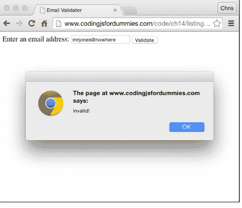

**图 14-4：** 在电子邮件验证脚本中使用正则表达式。

# 第 15 章：理解回调函数和闭包

**本章内容**
- 理解回调函数
- 使用回调函数
- 创建闭包

> “噢，请召唤昨日归来，祈求时间回头。”
> —— 威廉·莎士比亚

回调函数和闭包是 JavaScript 中最有用且最广泛使用的两种技术。在本章中，你将了解到如何以及为什么要将函数作为参数传递给其他函数。


不要忘记访问网站查看与本章相关的在线练习！

## 什么是回调函数？


JavaScript 函数是对象。这句话是理解许多高级 JavaScript 主题（包括回调函数）的关键。

函数与任何其他对象一样，可以被赋值给变量，可以作为参数传递给其他函数，也可以在函数内部创建并由函数返回。


## 将函数作为参数传递

*回调函数*（callback function）是指作为参数传递给另一个函数的函数。回调函数在 JavaScript 中能够实现，是因为函数在 JavaScript 中也是对象。

函数对象包含一段包含该函数代码的字符串。当你通过调用函数名并紧跟 `()` 来调用函数时，你是在告诉该函数执行其代码。而当你仅使用函数名或在没有 `()` 的情况下传递函数时，该函数不会执行。

第 11 章中有回调函数的示例，你可以使用 `addEventListener` 方法，例如：

```javascript
document.addEventListener('click',doSomething,false);
```

该方法将一个事件（`click`）和一个 `Function` 对象（`doSomething`）作为参数。这个`回调`函数不会立即执行。相反，`addEventListener` 方法会在事件发生时执行该函数。

## 编写带有回调的函数

这是一个简单的示例函数 `doMath`，它接受一个回调函数作为参数：

```javascript
function doMath(number1,number2,callback) {
  var result = callback(number1,number2);
  document.write ("The result is: " + result);
}
```

这是一个通用函数，用于返回涉及两个操作数的任何数学运算的结果。你传递给它的回调函数决定了具体执行什么样的运算。

要调用我们的 `doMath` 函数，请传递两个数字参数，然后将函数作为第三个参数传递：

```javascript
doMath(5,2,function(number1,number2){
  var calculation = number1 * number2 / 6;
  return calculation;
});
```

代码清单 15-1 是一个完整的网页，其中包含了 `doMath` 函数，并使用不同的回调函数多次调用它。

### 代码清单 15-1：使用不同的回调函数调用函数

```html
<html>
<head>
<title>Introducing the doMath function</title>
<script>
function doMath(number1, number2, callback) {

    var result = callback(number1, number2);
    document.getElementById("theResult").innerHTML +=
        ("The result is: " + result + "<br>");

}

document.addEventListener('DOMContentLoaded',
    function() {

        doMath(5,2,function(number1, number2){
            var calculation = number1 * number2;
            return calculation;
        });

        doMath(10,3,function(number1, number2){
            var calculation = number1 / number2;
            return calculation;
        });

        doMath(81,9,function(number1, number2){
            var calculation = number1 % number2;
            return calculation;
        });

    }, false);
</script>
</head>
<body>
<h1>Do the Math</h1>
<div id="theResult"></div>
</body>
</html}
```

在浏览器中运行代码清单 15-1 的结果如图 15-1 所示。

## 使用命名回调函数

在前一节的示例中，回调函数都是作为匿名函数编写的。同样也可以定义命名函数，然后将函数名作为回调函数传递。

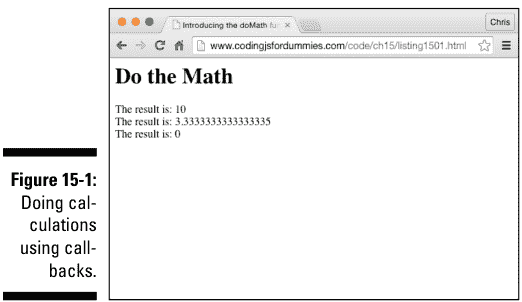

匿名函数（见第 7 章）是指你在创建时没有给它们起名字的函数。

使用命名函数作为回调可以减少使用匿名函数可能带来的视觉代码混乱。代码清单 15-2 展示了如何使用命名函数作为回调的示例。该示例还包含对代码清单 15-1 的以下两项改进：

- 在 `doMath` 函数中增加了一个测试，以确保回调参数确实是一个函数。
- 在显示运行结果之前，它会打印出回调函数的代码。

### 代码清单 15-2：使用命名函数作为回调

```html
<html>
<head>
  <title>doMath with Named Functions</title>
  <script>
    function doMath(number1,number2,callback){

      if (typeof callback === "function") {

        var result = callback(number1,number2);
        document.getElementById("theResult").innerHTML +=
          (callback.toString() + "<br><br>The result is: " + result + "<br><br>");

      }
    }

    function multiplyThem(number1,number2){
      var calculation = number1 * number2;
      return calculation;
    }

    function divideThem(number1,number2) {
        var calculation = number1 / number2;
        return calculation;
    }
    function modThem(number1,number2) {
        var calculation = number1 % number2;
        return calculation;
    }

    document.addEventListener('DOMContentLoaded',
        function() {

            doMath(5,2,multiplyThem);

            doMath(10,3,divideThem);

            doMath(81,9,modThem);

        }, false);
</script>
</head>
<body>
<h1>Do the Math</h1>
<div id="theResult"></div>
</body>
</html}
```

在浏览器中运行代码清单 15-2 的结果如图 15-2 所示。

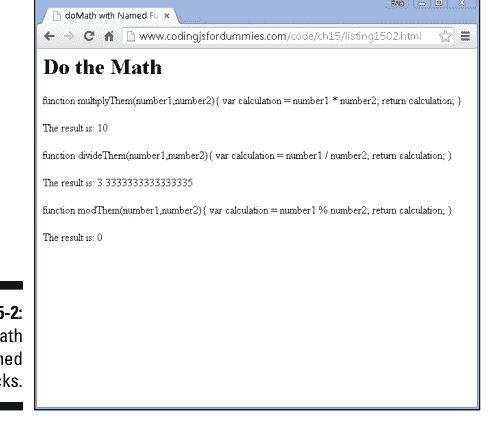

图 15-2：使用命名回调进行数学运算。

与使用匿名函数相比，使用命名函数作为回调有两个优点：

- 它使你的代码更易读。
- 命名函数是多用途的，可以独立使用，也可以作为回调使用。

## 理解闭包

*闭包*（closure）是指函数在返回之后，仍然保持活跃的局部变量。

请看代码清单 15-3 中的示例。在这个示例中，在一个外部函数内部定义了一个内部函数。当外部函数返回内部函数的引用时，返回的引用仍然可以访问来自外部函数的局部数据。

在代码清单 15-3 中，`greetVisitor` 函数返回一个在其中创建的名为 `sayWelcome` 的函数。请注意，`return` 语句在 `sayWelcome` 之后没有使用 `()`。这是因为你不想返回运行该函数的值，而是想要返回该函数本身的代码。

**代码清单 15-3：使用函数创建函数**

```javascript
function greetVisitor(phrase) {
    var welcome = phrase + ". Great to see you!"; // Local variable
    var sayWelcome = function() {
        alert(welcome);
    }
    return sayWelcome;
}

var personalGreeting = greetVisitor('Hola Amiga');
personalGreeting(); // alerts "Hola Amiga. Great to see you!"
```

代码清单 15-3 的实用之处在于，它使用 `greetVisitor` 函数创建了一个名为 `personalGreeting` 的新自定义函数，该函数仍然可以访问原始函数中的变量。

通常，当一个函数执行完毕后，其内部的局部变量是无法访问的。然而，通过返回一个函数引用（`sayWelcome`），`greetVisitor` 函数的内部数据对外部世界变得可见。

理解闭包的关键在于理解 JavaScript 中的变量作用域，以及理解执行函数与函数引用之间的区别。通过将 `greetVisitor` 函数的返回值分配给新的 `personalGreeting` 函数，程序存储了 `sayWelcome` 函数的代码。你可以使用 `toString()` 方法来测试这一点：

```javascript
personalGreeting.toString()
```

如果你在代码清单 15-3 中添加一条 alert 语句来输出 `personalGreeting` 的 `toString()` 值，你将得到如图 15-3 所示的结果。

在图 15-3 中，变量 `welcome` 是在闭包创建之时，从原始 `greetVisitor` 函数中复制的变量 `welcome`。

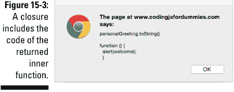

在代码清单 15-4 中，通过向 `greetVisitor` 函数传递不同的参数创建了一个新的闭包。尽管调用 `greetVisitor()` 改变了 `welcome` 变量的值，但调用第一个函数（`personalGreeting`）的结果仍然保持不变。

### 代码清单 15-4：闭包包含对外部函数变量的秘密引用

```html
<html>
<head>
  <title>Using Closures</title>
  <script>
    function greetVisitor(phrase) {

      var welcome = phrase + ". Great to see you!<br><br>"; // local variable
      var sayWelcome = function() {
        document.getElementById("greeting").innerHTML +=
          welcome;
      }
```
（待续）

## 示例 15-4（续）

```javascript
return sayWelcome;
}
// wait until the document is loaded
document.addEventListener('DOMContentLoaded',
    function() {

    // make a function
    var personalGreeting = greetVisitor("Hola Amiga");
    // make another function
    var anotherGreeting = greetVisitor("Howdy, Friend");

    // look at the code of the first function
    document.getElementById("greeting").innerHTML += 
    "personalGreeting.toString() <br>" + personalGreeting.
    toString() + "<br>;"

    // run the first function
    personalGreeting(); // alerts "Hola Amiga. Great to
    see you!"

    // look at the code of the 2nd function
    document.getElementById("greeting").innerHTML += 
    "anotherGreeting.toString() <br>" +
    anotherGreeting.toString() + "<br>;"

    // run the 2nd function
    anotherGreeting(); // alerts "Howdy, Friend. Great to
    see you!"

    // check the first function
    personalGreeting(); // alerts "Hola Amiga. Great to
    see you!"

    // finish the addEventListener method
    }, false);
</script>
</head>
<body>
<p id="greeting"></p>
</body>
</html>
```

在 Web 浏览器中运行示例 15-4 的结果如图 15-4 所示。

> **提示** 在你了解了底层概念并且产生了实际需求后，闭包并不难理解。如果你目前还没有完全适应，也不必担心。完全可以在不使用闭包的情况下编写 JavaScript 代码，但一旦你理解了它们，它们会非常有用，并能让你成为一名更好的程序员。


## 使用闭包

闭包就像是在创建闭包时，保留了一份函数局部变量的副本。

在 Web 编程中，闭包经常被用于消除程序内部重复的工作，或者持有需要在整个程序中重复使用的值，这样程序就不需要每次使用时都重新计算该值。

闭包的另一个用途是为特定用途创建函数的定制版本。

在示例 15-5 中，闭包被用于创建针对程序中可能出现的不同问题而具有特定错误消息的函数。所有的错误消息都是使用同一个函数创建的。

当一个函数的目的是为了创建其他函数时，它被称为“函数工厂”。

### 示例 15-5：使用函数来创建函数

```html
<html>
<head>
  <title>function factory</title>
  <script>
```

## 示例 15-5（续）

```javascript
function createMessageAlert(theMessage){
    return function() {
        alert (theMessage);
    }
}

var badEmailError = createMessageAlert("Unknown email address!");
var wrongPasswordError = createMessageAlert("That's not your password!");

window.addEventListener('load', loader, false);
function loader() {
    document.login.yourEmail.addEventListener('change',
        badEmailError);
    document.login.yourPassword.addEventListener('change',
        wrongPasswordError);
}
</script>
</head>
<body>
    <form name="login" id="logininform">
        <p>
            <label>Enter Your Email Address:
                <input type="text" name="yourEmail">
            </label>
        </p>
        <p>
            <label>Enter Your Password:
                <input type="text" name="yourPassword">
            </label>
        </p>
        <button>Submit</button>
    </form>
</body>
</html>
```

理解示例 15-5 的关键在于工厂函数。

```javascript
function createMessageAlert(theMessage){
    return function() {
        alert (theMessage);
    }
}
```

## 第 15 章：理解回调函数和闭包

要使用这个函数工厂，请将其返回值分配给一个变量，如下面语句所示：

```javascript
var badEmailError = createMessageAlert("Unknown email address!");
```

上述语句创建了一个闭包，只需像下面的事件处理程序那样将 `badEmailError` 作为函数运行，就可以在程序的其他地方使用它：

```javascript
document.login.yourEmail.addEventListener('change', badEmailError);
```

## 第 16 章：拥抱 AJAX 和 JSON

### 本章内容

- 读写 JSON
- 理解 AJAX
- 使用 AJAX

> “Web 不仅仅连接了机器，它连接了人。”
— 蒂姆·伯纳斯-李 (Tim Berners-Lee)

AJAX 是一种通过在用户与页面交互时在后台发送和接收数据，使网页更具动态性的技术。JSON 已成为 AJAX 应用程序使用的标准数据格式。在本章中，你将学习如何使用 AJAX 技术让你的网站焕发光彩！

## 使用 AJAX 在幕后工作

Asynchronous JavaScript + XML (AJAX) 是一个术语，用于描述一种将 JavaScript、DOM、HTML 和 XMLHttpRequest 对象结合在一起的方法，可以在无需刷新整个页面的情况下，使用实时数据刷新网页的部分内容。AJAX 最早在 2004 年由 Google 的 Gmail 大规模实现，随后在 2005 年由 Jesse James Garrett 命名。

HTML DOM 能够动态地改变页面。AJAX 带来的重要创新是使用 XMLHttpRequest 对象异步地（在后台）从服务器检索数据，而不会阻塞网页上其余 JavaScript 的执行。

虽然 AJAX 最初依赖于 XML 格式的数据（这就是名称中 X 的由来），但如今 AJAX 应用程序使用一种名为 JavaScript 对象表示法 (JSON) 的数据格式更为常见。大多数人仍然将异步从服务器获取 JSON 数据的应用程序称为 AJAX，但一个在技术上更准确（但较难记忆）的缩写应该是 AJAJ。

### AJAX 示例

当 Web 开发人员开始使用 AJAX 时，它成为了被标记为 Web 2.0 的标志之一。在 AJAX 出现之前，网页显示动态数据最常见的方式是从服务器下载一个新的网页。例如，请参考图 16-1 所示的 `craigslist.org`。

要在 Craigslist 的列表类别或搜索结果中进行导航，你需要点击链接，这会导致整个页面刷新并显示你请求的页面内容。

虽然这种方式仍然很常见，但为了在页面的某一部分显示新数据而刷新整个页面，其速度慢得不必要，并且会提供不够流畅的用户体验。

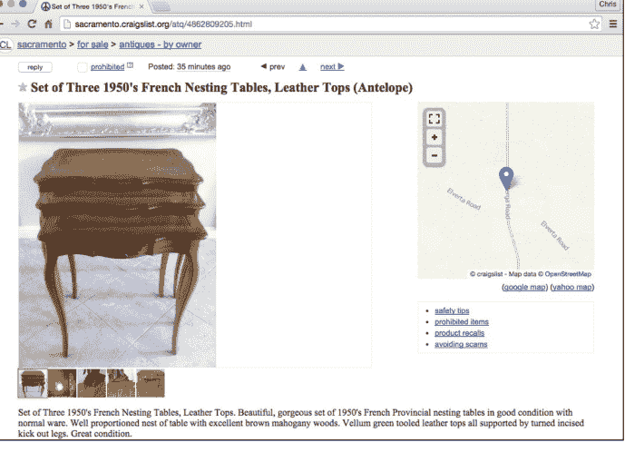
**图 16-1：** Craigslist.org 对 Web 1.0 非常满意，谢谢。

将 Craigslist 风格的导航与图 16-2 所示的更像应用程序的 Google Plus 导航进行对比，后者使用 AJAX 将新内容加载到屏幕的一部分，而导航栏保持静态。

除了使网页导航更流畅外，AJAX 还非常适合在网页中创建实时数据元素。在 AJAX 出现之前，如果你想显示实时数据、图表或电子邮件收件箱的最新视图，你要么需要使用插件（如 Adobe Flash），要么需要定期让网页自动刷新。

通过 AJAX，可以通过在后台运行的异步过程定期刷新数据，然后仅更新页面中需要修改的元素。

请参阅第 10 章，了解如何使用 HTML DOM 的方法和属性来更新网页的 HTML 和 CSS。AJAX 依赖于这些相同的技术来显示具有更新数据的网页。

图 16-3 所示的 Weather Underground 的 Wundermap 显示了一个带有不断变化和更新的数据叠加层的天气图。地图的数据是通过 AJAX 从远程服务器检索的。


### 查看 AJAX 运行实例

在前一节所示的图 16-3 中，Chrome 开发者工具窗口打开在 Network（网络）标签页。Network 标签页显示了与当前网页相关的所有网络活动。当页面加载时，这包括页面 HTML、CSS、JavaScript 和图像的请求与下载。页面加载后，Network 标签页还会显示使 AJAX 成为可能的异步 HTTP 请求和响应。

请按照以下步骤在 Chrome 中查看 AJAX 请求和响应：

1. 打开 Chrome 浏览器并导航至 www.wunderground.com/wundermap。
2. 通过 Chrome 菜单或按下 Command+Option+I（Mac）或 Control+Shift+I（Windows）打开 Chrome 开发者工具。
3. 打开 Network 标签页。

你的开发者工具窗口现在应该类似于图 16-4。此时你可能想要拖动开发者工具的上边界使其更大。如果这导致……的内容区域……不要担心。


## 第 16 章：拥抱 AJAX 和 JSON


图 16-4：开发者工具的 Network（网络）面板。

浏览器窗口太小无法显示。现在最重要的是开发者工具中发生的情况。

请注意，Network 面板中会定期出现新项目。这些就是 AJAX 的请求和响应。其中一些是服务器返回的图像，一些是供客户端 JavaScript 使用的数据。

- 4. **点击 Network 面板 Name（名称）列中的某一行。**

关于该特定项目的附加数据将显示出来，如图 16-5 所示。

- 5. **在详细数据窗格中点击各个标签页（Headers、Preview、Response 等）并检查数据。**

第一个标签页 Headers 显示了发送到远程服务器的 HTTP 请求。请特别关注 Request URL（请求 URL）。这是一个将数据传递给远程服务器的标准网站地址。

- 6. **从你检查的项目中选择并复制 Request URL 的值。**

- 7. **在浏览器中打开一个新标签页，并将完整的 Request URL 粘贴到地址栏中。**

随后会打开一个包含数据或图像的页面，如图 16-6 所示。

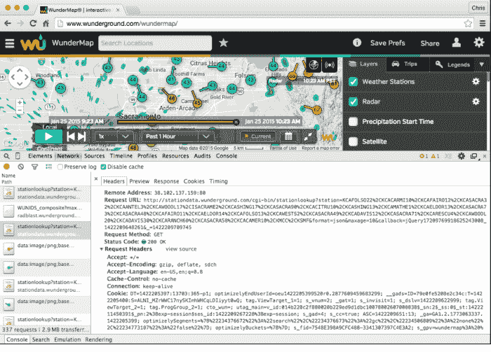
图 16-5：在 Network 面板中查看特定记录的附加信息。

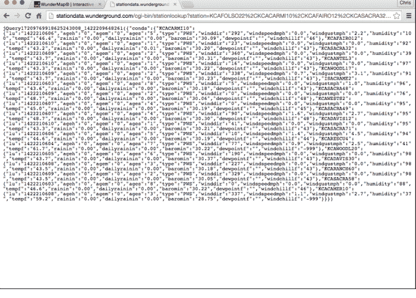
图 16-6：从 Network 面板复制 HTTP Request URL 的结果。

**8. 将在新标签页中打开 Request URL 的结果与开发者工具 Response 标签页中显示的结果进行比较。**

它们应该是相似的，尽管看起来可能不完全相同，因为它们不是在同一时间运行的。

正如你所看到的，AJAX 并没有什么神奇之处。网页上的 JavaScript 只是简单地向服务器请求并接收数据。幕后发生的一切都可以通过 Chrome  Chrome 开发者工具（或目前大多数其他 Web 浏览器提供的类似工具）进行检查。

## 使用 XMLHttpRequest 对象

`XMLHttpRequest` 对象为 Web 浏览器提供了一种无需刷新页面即可从 URL 请求数据的方法。

`XMLHttpRequest` 对象最初由微软在其 Internet Explorer 浏览器中创建并实现，此后已成为一项 Web 标准，被所有现代 Web 浏览器所采用。

你可以使用 `XMLHttpRequest` 对象的方法和属性从远程服务器或本地服务器检索数据。尽管名称如此，`XMLHttpRequest` 对象除了 XML 之外还可以获取其他类型的数据，它甚至可以使用 HTTP 以外的不同协议来获取数据。

代码清单 16-1 展示了如何使用 `XMLHttpRequest` 将包含 HTML 的外部文本文档内容加载到当前的 HTML 文档中。

**代码清单 16-1：使用 XMLHttpRequest 加载外部数据**

```html
<html>
<head>
 <title>Loading External Data</title>
 <script>
 window.addEventListener('load',init,false);
 function init(e){
 document.getElementById('myButton').addEventListener('click',documentLoader,false);
 }

 function reqListener () {
 console.log(this.responseText);
 document.getElementById('content').innerHTML = this.responseText;
 }
}
```

**代码清单 16-1（续）**

```html
function documentLoader(){
    var oReq = new XMLHttpRequest();
    oReq.onload = reqListener;
    oReq.open("get", "loadme.txt", true);
    oReq.send();
}
</script>
</head>
<body>
    <form id="myForm">
        <button id="myButton" type="button">Click to Load</button>
    </form>
    <div id="content"></div>
</body>
</html>
```

该文档的核心是 `documentLoader` 函数：

```javascript
function documentLoader(){
    var oReq = new XMLHttpRequest();
    oReq.onload = reqListener;
    oReq.open("get", "loadme.txt", true);
    oReq.send();
}
```

函数内部的第一行代码创建了一个新的 `XMLHttpRequest` 对象，并将其命名为 `oReq`：

```javascript
var oReq = new XMLHttpRequest();
```

`XMLHttpRequest` 对象的方法和属性可以通过 `oReq` 对象访问。

第二行将一个函数 `reqListener` 分配给 `oReq` 对象的 `onload` 事件。这样做的目的是在 `oReq` 加载文档时调用 `reqListener` 函数：

```javascript
oReq.onload = reqListener;
```

第三行使用 open 方法创建请求：

```javascript
oReq.open("get", "loadme.txt", true);
```

在这种情况下，该函数使用 `HTTP GET` 方法来加载名为 `loadme.txt` 的文件。第三个参数是 `async` 参数。它指定请求是否应该是异步的。如果设置为 false，`send` 方法在请求完成之前不会返回。如果设置为 true，则通过事件监听器提供关于请求完成的通知。由于事件监听器被设置为监听 `load` 事件，因此这里需要的是异步请求。

你不太可能遇到需要将 `async` 参数设置为 false 的情况。事实上，由于同步请求对用户体验产生负面影响，一些浏览器在参数被设为 false 时已开始直接忽略该参数，并将其视为 true。

`documentLoader` 函数的最后一行实际上发送了你使用 open 方法创建的请求：

```javascript
oReq.send();
```

`.open` 方法将获取请求文件的最新版本。所谓的“实时数据”应用程序经常使用循环，通过 AJAX 反复向服务器请求更新的数据。

## 处理同源策略

如果你将代码清单 16-1 中的 HTML 文档保存到电脑上并在 Web 浏览器中打开，很有可能你无法得到预期的结果。如果你从电脑加载该文档并打开 Chrome 开发者工具的 JavaScript 控制台，你会看到几个类似于图 16-7 中的错误消息。

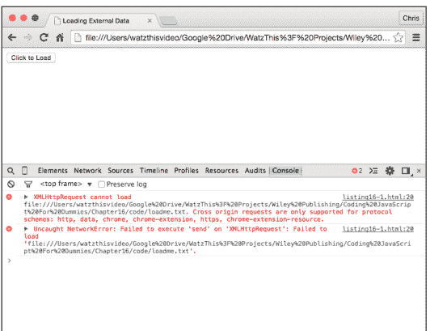

这里的问题被称为同源策略（same-origin policy）。为了防止网页通过 `XMLHttpRequest` 导致用户在不知情的情况下下载可能具有恶意代码的脚本，每当脚本尝试加载一个非同源的 URL 时，浏览器默认会返回错误。如果你从 www.example.com 加载一个网页，而该页面上的脚本尝试从 www.watzthis.com 检索数据，浏览器将阻止该请求，并显示与图 16-7 类似的错误。

同源策略同样适用于本地计算机上的文件。如果不对本地文件应用此策略，`XMLHttpRequests` 可能会被用来破坏计算机的安全性。

不必担心本书中的示例会对你的计算机产生负面影响。然而，为了让本章的示例在你的电脑上正确运行，需要一种绕过同源策略的方法。

第一种绕过同源策略的方法是将包含 `documentLoader` 函数的 HTML 文件和文本文件一起放在同一个 Web 服务器上。你可以通过访问 www.codingjsfordummies.com/code/ch16/listing16-1.html 查看运行示例。

另一种绕过同源策略的方法是在启动浏览器时暂时禁用同源策略限制。

这些指令仅允许你在本地计算机上测试自己的文件。请不要在禁用同源策略的情况下浏览网页，否则可能会使你的计算机暴露在恶意代码面前。

### 在 macOS 上禁用同源策略：

- 1. 关闭 Chrome 浏览器。
- 2. 打开终端（Terminal）应用，并使用以下命令启动 Chrome：

```bash
/Applications/Google\ Chrome.app/Contents/MacOS/Google\ Chrome --disable-web-security
```

### 在 Windows 上禁用同源策略：

- 1. 关闭 Chrome 浏览器。
- 2. 打开命令提示符（Command prompt），并导航到安装 Chrome 的文件夹。
- 3. 输入以下命令启动浏览器：

```cmd
Chrome.exe --disable-web-security
```


## 第16章：拥抱 AJAX 和 JSON

一旦浏览器启动，你就可以在本地运行包含 AJAX 请求的文件，直到关闭浏览器。一旦浏览器关闭并重新打开，安全限制将自动重新启用。

图16-8展示了在没有同源策略错误的浏览器中运行清单16-1的结果。

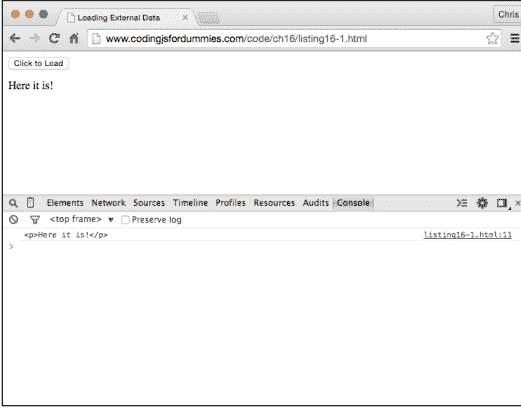

**图16-8：** 在禁用同源策略的浏览器中运行的清单16-1。

## 使用 CORS：AJAX 请求的银弹

Web 应用程序需要向不同的服务器发出请求以检索数据，这是相当常见的。例如，Google 免费为第三方应用程序提供地图数据。

为了确保服务器之间的交互安全，已创建了允许浏览器和服务器解决分歧并建立信任的机制。

目前，允许和限制服务器之间资源访问的最佳方法是名为*跨源资源共享*（CORS）的标准。

要查看 CORS 的实际效果，请在浏览 Weather Underground 的 Wundermap 时查看 Chrome 开发者工具中的“网络”选项卡。单击以下 URL 开头的其中一个请求：`http://stationdata.wunderground.com/cgi-bin/stationlookup`。

单击“标头”选项卡，你将在 HTTP 标头中看到以下文本：

```
Access-Control-Allow-Origin: *
```

这是此特定服务器配置为发送的 CORS 响应头。冒号后的星号值表示该服务器将接受来自任何来源的请求。如果 wunderground.com 的所有者想要将此脚本的数据访问限制为特定服务器或经过身份验证的用户，他们可以使用 CORS 来实现。

## 使用 JSON 让对象动起来

在清单16-1中，你使用 AJAX 打开并显示一个包含 HTML 片段的文本文档。AJAX 的另一个常见用途是请求和接收数据，以便浏览器进行处理。

例如，gasbuddy.com 使用 Google 的地图以及有关汽油价格的数据，以呈现不同地点汽油价格的简单且最新的视图，如图16-9所示。

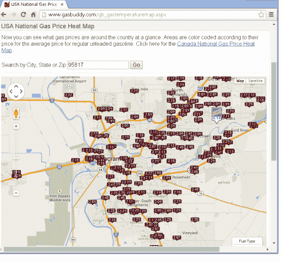

**图16-9：** gasbuddy.com 使用 AJAX 在地图上显示汽油价格。

如果你在网络选项卡中查看 gasbuddy.com，你会发现一些请求的响应看起来类似于清单16-2中所示的代码。

**清单16-2：gasbuddy.com 上 AJAX 请求响应的一部分**

```
([{id: "tuwtvtuvvvv", base: [351289344, 822599680], zrange: [11,11], layer: "m@288429816", features: [{id: "17243857463485476481", a: [0,0], bb: [-8,-8,7,7,-47,7,48,22,-41,19,41,34], c: "1:{title:\"Folsom Lake State Recreation Area\"},4:{type:1}}"}]}, {id: "tuwtvtuvvvw", zrange: [11,11], layer: "m@288429816"}, {id: "tuwtvtuvvvw", base: [351506432, 824291328], zrange: [11,11], layer: "m@288429816", features: [{id: "8748558518353272790", a: [0,0], bb: [-8,-8,7,7,-41,7,41,22], c: "1:{title:\"Deer Creek Hills\"},4:{type:1}}"}]}, {id: "tuwtvtuvvvw", zrange: [11,11], layer: "m@288429816"}])
```

如果你从这段代码中取出一小部分数据并重新格式化，你会得到类似清单16-3的内容，这看起来应该更熟悉一些。

**清单16-3：gasbuddy.com 响应数据，已重新格式化**

```
{id: "tuwtvtuvvvv",
base: [351289344, 822599680],
zrange: [11,11],
layer: "m@288429816",
features:[{
id: "17243857463485476481",
a: [0,0],
bb: [-8,-8,7,7,-47,7,48,22,-41,19,41,34],
c: "1:{title:\"Folsom Lake State Recreation Area\"},
4:{type:1}
}"}
]
}
```

通过查看数据的格式，你可以看到它与 JavaScript 对象字面量的 `name:值` 格式惊人地相似（参见第8章）。

JSON 如此易于使用的主要原因是它已经是 JavaScript 可以使用的格式，因此无需转换。例如，清单16-4展示了一个包含本书信息的 JSON 文件。

### 清单16-4：描述《JavaScript编程从入门到精通》的 JSON 数据

```
{ "book_title": "Coding with JavaScript For Dummies",
  "book_author": "Chris Minnick and Eva Holland",
  "summary": "Everything beginners need to know to start
             coding with JavaScript!",
  "isbn":"9781119056072"
}
```

清单16-5展示了如何使用 JavaScript 将此数据加载到网页中，然后将其数据用于 HTML 中显示。

### 清单16-5：使用 JavaScript 显示 JSON 数据

```
<html>
<head>
  <title>Displaying JSON Data</title>
  <script>
    window.addEventListener('load',init,false);
    function init(e){
      document.getElementById('myButton').
              addEventListener('click',documentLoader,false);
    }

    function reqListener () {
      // convert the string from the file to an object with
      // JSON.parse
      var obj = JSON.parse(this.responseText);

      // display the object's data like any object
      document.getElementById('book_title').innerHTML =
              obj.book_title;
      document.getElementById('book_author').innerHTML =
              obj.book_author;
      document.getElementById('summary').innerHTML =
              obj.summary;
    }

    function documentLoader(){
      var oReq = new XMLHttpRequest();
      oReq.onload = reqListener;
      oReq.open("get", "listing16-4.json", true);
     
      oReq.send();
    }
  </script>
</head>
<body>
    <form id="myForm">
        <button id="myButton" type="button">Click to Load</button>
    </form>
    <h1>Book Title</h1>
    <div id="book_title"></div>
    <h2>Authors</h2>
    <div id="book_author"></div>
    <h2>Summary</h2>
    <div id="summary"></div>
</body>
</html>
```

将从外部源引入 JavaScript 文档的任何 JSON 数据进行显示的关键是使用 `JSON.parse` 方法将其从字符串转换为对象。完成此操作后，你可以像访问任何 JavaScript 对象的属性一样，使用点表示法或括号表示法访问 JSON 文件中的值。

图16-10展示了在 Web 浏览器中运行清单16-5并按下按钮加载 JSON 数据的结果。

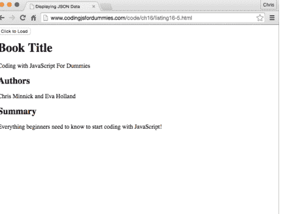

**图16-10：** 在 HTML 页面中显示 JSON 数据。

# 第五部分

## JavaScript 和 HTML5


了解如何在浏览器尚不支持某些功能时，使用 polyfills 来实现它们，请参阅在线文章 "Using Polyfills"（网址：www.dummies.com/extras/codingwithjavascript）。

### 本部分内容 . . .

- 了解如何使用 HTML5 的 API 来访问广泛的计算机和移动设备功能。
- 探索 jQuery 的基础知识，以加速和简化 JavaScript 开发。
- 了解如何在浏览器尚不支持某些功能时，使用 polyfills 来实现它们，请参阅在线文章 "Using Polyfills"（网址：www.dummies.com/extras/codingwithjavascript）。

## 第17章：HTML5 API

### 本章内容

- 探索 API
- 利用地理位置
- 访问媒体

> > "语言是来自外太空的病毒。"
>
> — 威廉·S·巴勒斯

HTML5 的 API 为你提供了对广泛的计算机和移动设备功能的访问权限。在本章中，你将了解如何使用 API、API 使用的标准方法和技术，以及一些更令人兴奋的 API 的示例代码。

### 理解 API 如何工作

API，即应用程序编程接口，是一套软件例程和标准，使程序员能够访问软件应用程序的功能。API 是一个计算机程序赋予另一个计算机程序与其交互能力的方式。当 Web 浏览器允许 JavaScript 程序与其交互时，它就是通过使用 API 来实现的。

例如，W3C 的电池状态 API 描述了浏览器应如何报告有关设备（如智能手机或平板电脑）电池当前状态的数据。其他程序（例如，网页中的 JavaScript 程序）可以访问电池状态 API，以查明设备的电池是否电量低、是否正在充电，或者剩余多少电池时间。然后你可以在你的程序中利用这些电池状态信息。


## 第五部分：JavaScript 和 HTML5

API 中的语言具有高度的精确性，它准确地描述了 Web 浏览器应当如何实现该 API。图 17-1 展示了最新版本 Battery Status API 中的一段引用。


> 如果电池正在放电，则 `charging` 属性必须设置为 `false`；如果电池正在充电、实现方案无法报告状态、系统未连接电池或其他情况，则必须设置为 `true`。当电池充电状态更新时，用户代理（user agent）必须将一个任务放入队列，该任务用于设置 `charging` 属性的值，并在 `BatteryManager` 对象上触发一个名为 `chargingchange` 的简单事件。

如果电池已满或系统未连接电池，`chargingTime` 属性必须设置为 `0`；如果电池正在放电、实现方案无法报告剩余充电时间或其他情况，则必须设置为正无穷大（positive Infinity）。当电池充电时间更新时，用户代理必须将一个任务放入队列，该任务用于设置 `chargingTime` 属性的值，并在 `BatteryManager` 对象上触发一个名为 `chargingtimechange` 的简单事件。

如果电池正在充电、实现方案无法报告剩余放电时间、系统未连接电池或其他情况，`dischargingTime` 属性必须设置为正无穷大（positive Infinity）。当电池放电时间更新时，用户代理必须将一个任务放入队列，该任务用于设置 `dischargingTime` 属性的值，并在 `BatteryManager` 对象上触发一个名为 `dischargingtimechange` 的简单事件。

如果系统电池耗尽且系统即将挂起，`level` 属性必须设置为 `0`；如果电池已满、实现方案无法报告电池电量或系统未连接电池，则必须设置为 `1.0`。当电池电量更新时，用户代理必须将一个任务放入队列，该任务用于设置 `level` 属性的值，并在 `BatteryManager` 对象上触发一个名为 `levelchange` 的简单事件。

通常，API 被编写为一份规范，告知程序员可以使用哪些属性和方法、可以向方法传递哪些参数，以及属性返回什么样的值。

在许多情况下，由万维网联盟（W3C）等标准机构开发的 API，其编写目的是描述程序**应当**如何与 Web 浏览器交互，而不是它们**实际上**如何交互。至于是否真正实现某个 API 标准，则由浏览器厂商决定。


API 告诉程序员如何与软件交互以及软件应当如何响应。当你阅读关于如何与 Web 浏览器交互的 API 时，请记住：仅仅因为一个 API 存在，并不意味着程序员实际上可以使用它。许多已提案并编写的 API 尚未在 Web 浏览器中实现，或者仅实现了部分功能。

## 检查 HTML5 API 的浏览器支持情况

检查哪些 Web 浏览器支持某个特定标准或提案标准的最佳来源是 www.caniuse.com。CanIUse.com 列出了 HTML5 的所有元素和 API，并为每一个提供了浏览器支持表。图 17-2 显示了在撰写本书时，IndexedDB 标准的浏览器支持情况。


图 17-2：根据 caniuse.com 显示的 IndexedDB 浏览器支持情况。

## 了解 HTML5 的 API

HTML5 标准定义并记录了许多 API，JavaScript 程序员可以使用这些 API 以标准化的方式访问 Web 浏览器的能力。

许多 HTML5 API 尚未最终定稿，也没有在每个 Web 浏览器中实现。那些已经实现的 API 非常有用，并且正在扩展 Web 应用的可能性边界。

HTML5 API 的列表在不断变化和增长。表 17-1 列出了目前 HTML5 中定义的最受欢迎且支持最广泛的 API。


你可以在本书的网站 www.dummies.com/extras/codingwithjavascript 上找到更详尽的 HTML5 API 列表。

每个 HTML5 API 的设计目的都是为了精确指定程序员应当如何与 Web 浏览器或计算机的功能进行交互。然而，这些 API 从想法变为现实的过程可能会极其漫长且复杂。

| API | 用途 |
| :--- | :--- |
| Battery Status | 提供有关设备电池状态的信息 |
| Clipboard | 提供对操作系统复制、剪切和粘贴功能的访问 |
| Drag and Drop | 支持在浏览器窗口内部及窗口之间拖放项目 |
| File | 为程序提供对设备文件系统的安全访问 |
| Forms | 使程序能够访问 HTML5 中定义的新数据类型 |
| Geolocation | 为 Web 应用提供访问用户设备地理位置数据的权限 |
| getUserMedia/Stream | 提供对外部设备数据的访问（如摄像头视频） |
| Indexed database | 在 Web 浏览器中创建简单的客户端数据库系统 |
| Internationalization | 提供对本地化格式化和字符串比较的访问 |
| Screen Orientation | 读取屏幕方向状态（纵向或横向），并允许程序员在状态更改时获知并将其锁定 |
| Selection | 支持在 JavaScript 中使用 CSS 风格的选择器选择元素 |
| Server-sent events | 允许服务器在无需浏览器请求的情况下向浏览器推送数据 |
| User Timing | 为程序员提供高精度时间戳以衡量应用程序的性能 |
| Vibration | 允许访问设备的振动功能 |
| Web Audio | 处理或合成音频 |
| Web Speech | 提供语音输入和文本转语音输出功能 |
| Web storage | 允许在浏览器中存储键值对 |
| Web sockets | 在浏览器和服务器之间开启一个交互式通信会话 |
| Web workers | 允许 JavaScript 在后台执行脚本 |
| XMLHttpRequest 2 | 改进 XMLHttpRequest，消除绕过同源策略（Same-Origin Policy）错误的需要，并使其支持 HTML5 的新特性 |

有几个 HTML5 API 已经通过了成为广泛支持的标准所需的各种测试和审查流程，其中最突出的是 Geolocation API。

## 使用 Geolocation

Geolocation API 允许程序访问 Web 浏览器的地理位置功能，该功能可以告知程序设备在地球上的位置。

Geolocation API 是支持最广泛的 HTML5 API 之一，在约 90% 的桌面和移动浏览器中已实现，包括除 Opera Mini 之外的所有主流浏览器。

### Geolocation 能做什么？

Geolocation API 描述了 JavaScript 如何与 `navigator.geolocation` 对象交互，以获取有关设备当前位置的数据，包括：

- **Latitude (纬度)**：以十进制度表示的纬度
- **Longitude (经度)**：以十进制度表示的经度
- **Altitude (海拔)**：以米为单位的海拔高度
- **Heading (航向)**：设备移动的方向
- **Speed (速度)**：设备以米/秒为单位的速度
- **Accuracy (精度)**：纬度和经度的精度，以米为单位

通过获取部分或全部此类数据，运行在 Web 浏览器中的 JavaScript 应用程序可以将用户标记在地图上，查询 Google Maps 等来源以查找用户附近的标志性建筑或餐厅，以及实现更多功能。

### Geolocation 如何工作？

当 JavaScript 通过 `Geolocation` 对象发起对设备位置的请求时，在返回位置信息之前会经历多个步骤。

首先，浏览器需要确保用户已授权该特定 Web 应用访问设备的地理位置信息。不同的浏览器提示用户授权的方式不同，但通常是通过某种弹出窗口或通知完成的。

当网站请求访问地理位置数据时，Chrome 浏览器会在地址栏下方显示一个地理位置图标和一条消息，如图 17-3 所示。


在你允许网站访问地理位置数据后，浏览器会尝试定位你。它通过多种不同手段实现，从最精确的方法开始，逐步尝试精度较低的方法。

如果程序指示需要高精度，Geolocation 将花费更多时间尝试获取高精度的 GPS 信息。否则，浏览器将尝试在速度和精度之间取得平衡，从以下可用来源中获取最准确的结果：

- GPS 卫星定位
- 你的无线网络连接
- 你的手机或移动设备连接的基站
- 你的设备或计算机的 IP 地址


## 如何使用地理定位

使用地理定位的关键是 `navigator.geolocation` 对象的 `getCurrentPosition` 方法。`getCurrentPosition` 方法可以接受三个参数：

- **success**：地理定位成功时，会传递一个 `Position` 对象给此回调函数。
- **error**：可选的回调函数，地理定位失败时会传递一个 `PositionError` 对象给此函数。
- **options**：可选的 `PositionOptions` 对象，可用于控制地理定位查找执行的多个方面。

`getCurrentPosition` 方法返回的 `Position` 对象包含两个属性：

- `Position.coords`：包含一个描述位置的 `Coordinates` 对象。
- `Position.timestamp`：获取位置信息的时间戳。

清单 17-1 展示了如何使用 `getCurrentPosition` 方法获取 `Position` 对象，并遍历 `Position.coords` 中的返回值。

## 清单 17-1：获取位置信息并将其显示在浏览器中

```
<html>
  <head>
    <title>The Position object</title>
    <script>
      var gps = navigator.geolocation.getCurrentPosition(

        function (position) {
          for (key in position.coords) {
            document.write(key + ': ' + position.coords[key]);
            document.write ('<br>');
          }
        });
    </script>
  </head>
  <body>

  </body>
</html>
```

如果你运行此代码的设备支持地理定位，并且浏览器能够确定你的位置，那么运行此脚本的结果应类似于图 17-4。


注意图 17-4 中，`Coordinates` 对象的几个属性都是 `null`。这是因为该脚本是在一台无法获取部分坐标的台式计算机上运行的。在智能手机的移动浏览器中运行相同脚本的结果如图 17-5 所示。


请注意，移动浏览器显示了海拔高度，但航向和速度仍然是 `null`，因为设备在页面加载时是静止的。

## 将地理定位与谷歌地图结合使用

程序员使用地理定位数据最常见的需求之一是在地图上显示位置。为此，你首先需要获取经纬度。你现在已经有这些数据了。但是，如何绘制地图并确定经纬度在地图上的位置呢？这似乎是一项艰巨的任务。

幸运的是，之前已经有人完成了这项工作，并创建了一个用于与其地图软件交互的 API。最著名的是，谷歌通过 Google Maps API 免费向任何人提供其地图软件（在大多数情况下，甚至可用于商业用途）。

要使用 Google Maps API，请按照以下步骤操作：

1.  **前往 Google APIs 控制台 `http://code.google.com/apis/console`，并使用你的 Google 帐户登录。**
2.  **登录后，系统可能会要求你同意使用条款；如果是这样，请点击“接受”。**
3.  **点击标有“启用 API”的按钮。**
    
    你的屏幕现在会显示一个 API 列表和一个“浏览 API”搜索框。
4.  **在“浏览 API”搜索框中，输入 `Google Maps JavaScript API v3`。**
    
    此 API 的链接会出现。
5.  **点击“状态”标题下的“OFF”按钮。**
    
    此步骤将 API 打开（ON）。
    
    激活 Google Maps JavaScript API 后，该 API 旁边会出现绿色的“ON”，如图 17-6 所示。
6.  **点击左侧导航栏中的“凭据”链接。**
    
    你会看到“API 访问”屏幕。
7.  **点击标有“创建新的密钥”的链接。**
    
    “创建新密钥”对话框会出现。
8.  **在“创建新密钥”对话框中点击“浏览器密钥”。**
    
    一个包含标有“接受来自以下 HTTP 推荐来源的请求”的文本输入字段的对话框会打开。


## 图 17-6：激活 Google Maps API。

9.  将标有“接受来自以下 HTTP 推荐来源的请求”的输入框留空，然后点击“创建”。

对话框关闭，你的 API 密钥将被创建。

在“公共 API 访问”部分，你现在会在标有“浏览器应用程序的密钥”的框内找到一长串字母和数字。这就是你的 API 密钥。

API 密钥是你访问 Google Maps API 所有强大功能所需的一切。

既然你已经可以访问 Google Maps JavaScript API，现在就来试试吧。清单 17-2 中的网页使用 `navigator.geolocation` 对象获取你的计算机位置，然后将其传递给 Google Maps 以获取地图。注意代码中的高亮部分，显示了插入 API 密钥的位置。

## 清单 17-2：使用地理定位 API 和 Google Maps API 绘制你的位置

```
<!DOCTYPE html>
<html>
<head>
  <title>Mapping your location</title>
  <style type="text/css">
    html, body, #map-canvas { height: 100%; margin: 0;
      padding: 0;}
  </style>
```

```
<script type="text/javascript"
	src="https://maps.googleapis.com/maps/api/js?key=YO
	UR_API_KEY">
</script>

<script>
	// run the initialize function after the map loads
	google.maps.event.addDomListener(window, 'load',
	initialize);

	function initialize() {
		// get the Position object and send it to a callback
		function
	IBR
		var gps = navigator.geolocation.getCurrentPosition(

		// the callback function
		function (position) {

			//set Google Map options, using latitude and
			longitude from position object
			var mapOptions = {
				center: { lat: position.coords.latitude, lng:
				position.coords.longitude },
				zoom: 8
			};

			// make the map and load it into the map-canvas div
			in the <body>
			var map = new google.maps.Map(document. 
				getElementById('map-canvas'),
				mapOptions);
			}
		);
	};
</script>

</head>
<body>
	<div id="map-canvas"></div>
</body>
</html>
```

为了使此脚本正确运行，你必须将文本 `YOUR_API_KEY` 替换为你从 Google 获得的 API 密钥。

在浏览器中运行清单 17-2 的结果如图 17-7 所示。


## 访问音频和视频

在 HTML5 之前，网页使用连接到计算机或内置在计算机中的摄像头的唯一方法是通过插件（如 Flash）。

HTML5 的主要目标之一是消除对插件的需求，这些插件需要不断更新且存在安全问题。自 HTML5 首次被提出以来，已有多次尝试定义使用摄像头输入的最新标准。

通过网络浏览器实现实时视频和音频通信的最新、最强大的 API 称为 WebRTC（网络实时通信）。

WebRTC 的核心是 `navigator.getUserMedia()`，它的功能正如其名所示：从用户（确切地说是用户的设备）获取媒体（音频和视频）。

**getUserMedia** 目前在 Chrome、Opera 和 Firefox 中受支持。如果你想在其他浏览器（如 Safari 或 Internet Explorer）中使用它，你需要使用一种称为 polyfill 的工具。请访问本书网站 www.dummies.com/extras/codingwithjavascript 了解有关 polyfill 的信息。

`getUserMedia` 的第一个参数是一个对象，其属性指示你要访问的媒体类型。例如，如果你想同时访问视频和音频，你将使用以下对象作为第一个参数：

```
{video: true, audio: true}
```

`getUserMedia` 的其他参数是一个成功回调和一个错误回调。清单 17-3 展示了 `getUserMedia` 的一个使用示例。

## 清单 17-3：获取并显示用户视频和音频

```
<!DOCTYPE html>
<html>
<head>
  <title>Get the Media</title>
  <style type="text/css">
    html, body, #map-canvas { height: 100%; margin: 0;
                padding: 0;}
  </style>
  <script>
    window.addEventListener('DOMContentLoaded', function()
    {
    var v = document.getElementById('v');
    navigator.getUserMedia = (navigator.getUserMedia ||
        navigator.webkitGetUserMedia ||
        navigator.mozGetUserMedia ||
        navigator.msgetUserMedia);

    if (navigator.getUserMedia) {
      // Request access to video only
      navigator.getUserMedia(
        {
          video:true,
          audio:false
        },
        function(stream) {
          var url = window.URL || window.webkitURL;
          v.src = url ? url.createObjectURL(stream) :
            stream;
          v.play();
        },
```

## 示例 17-3 *(续)*

```
function(error) {
    alert('Something went wrong. (error code ' +
        error.code + ')');
    return;
  }
);
} else {
    alert('Sorry, the browser you are using doesn\'t
        support getUserMedia');
    return;
};
});
</script>
</head>
<body>
  <video id = "v"/>
</body>
</html>
```

分析示例 17-3 的关键行：

```
window.addEventListener('DOMContentLoaded', function() {
```

这是一个事件监听器，它会等待 DOM 加载完成后再运行其余代码。

```
var v = document.getElementById('v');
```

前一行创建了一个名为 v 的新变量，用于持有对 id 为 "v" 的视频元素的引用：

```
navigator.getUserMedia = (navigator.getUserMedia ||
        navigator.webkitGetUserMedia ||
        navigator.mozGetUserMedia ||
        navigator.msGetUserMedia);
```

`getUserMedia` 是一项尚未完全标准化的实验性技术。因此，各浏览器对其有不同的实现，并通过使用厂商前缀来区分。这条语句将标准的 `navigator.getUserMedia` 对象的值设置为当前浏览器支持的厂商前缀版本。因此，当你在使用 Firefox 并调用 `navigator.getUserMedia` 时，实际上是在调用 `navigator.mozGetUserMedia`：

```
if (navigator.getUserMedia) {
```

这一行用于检查用户的浏览器是否支持 getUserMedia：

```
navigator.getUserMedia(
```

调用 getUserMedia 方法：

```
{
  video:true,
  audio:false
}
```

第一个参数是一个对象，用于告知你想要访问哪些媒体：

```
function(stream) {
```

如果 getUserMedia 的请求成功，则运行成功回调函数。它接收一个参数：

```
var url = window.URL || window.webkitURL;
v.src = url ? url.createObjectURL(stream) : stream;
```

前两行平滑处理了不同浏览器处理媒体流对象方式的差异。第二行出现了我们的老朋友——三元运算符！该语句根据浏览器支持的方法，将视频元素的 src 属性设置为 `url.createObjectURL(stream)` 或 `stream`：

```
v.play();
```

最后，播放视频。如果你的计算机支持 getUserMedia 并且有摄像头，此时你将看到自己的视频（或摄像头所指向的任何内容）：

```
function(error) {
  alert('Something went wrong. (error code ' + error.code
      + ')');
  return;
}
```

上述代码是一个错误回调函数。如果浏览器支持 `getUserMedia()`，但用户不允许浏览器访问摄像头，则此函数将运行并打印出特定的错误消息：

```
else {
  alert('Sorry, the browser you are using doesn\'t support
       getUserMedia');
  return;
};
```

上述代码是 `else` 条件。如果用户的浏览器不支持 `getUserMedia()`，则会显示此警告：

如果用户的浏览器支持 `getUserMedia`，用户拥有摄像头，并且他们允许应用程序访问摄像头，那么应用程序将在浏览器窗口中显示实时视频，如图 17-8 所示。

## 第 18 章

## jQuery

### 本章内容

- 理解 jQuery
- 选择元素
- 使用 jQuery 创建动画和过渡

> “最好随身携带你的工具。否则，你可能会发现一些意想不到的事情并因此感到沮丧。”
>
> — 斯蒂芬·金 (Stephen King)

jQuery 是目前最流行的 JavaScript 框架，几乎每个 JavaScript 程序员都会使用它来加速并简化 JavaScript 开发。在本章中，你将学习 jQuery 的基础知识，并了解它为何如此受欢迎。

不要忘记访问网站查看与本章相关的在线练习！

### 少写多做

目前，前 100,000 个网站中有超过 61% 使用了 jQuery。它的应用如此广泛，以至于许多人将其视为进行 JavaScript 编程的必备工具。

jQuery 平滑处理了 JavaScript 的一些粗糙之处，例如浏览器兼容性问题，并使选择和更改 HTML 文档的部分内容变得更加容易。jQuery 还包含一些你可以用来为网页添加动画和交互性的工具。

一旦你掌握了 JavaScript，jQuery 的基础知识就很容易学习。

### jQuery 入门

要开始使用 jQuery，你首先需要在网页中引入 jQuery 库。最简单的方法是使用托管在内容分发网络 (CDN) 上的版本。另一种引入 jQuery 的方法是从 jQuery 网站下载该库并将其托管在自己的服务器上。示例 18-1 显示了一个包含 jQuery 的简单网页的标记。

Google 托管了许多不同 JavaScript 库的版本，你可以在 `http://developers.google.com/speed/library` 找到它们的链接和引入标签。

一旦找到了 CDN 托管版本的链接，请在每个将使用 jQuery 功能的页面的 `<head>` 和 `</head>` 标签之间将其引入。

目前 jQuery 有两个分支：1.x 分支和 2.x 分支。1.x 分支最新版本与 2.x 分支最新版本的区别在于，1.x 分支可以在 Internet Explorer 6-8 中运行，而 2.x 分支则取消了对这些陈旧且充满 Bug 的浏览器的支持。

## 示例 18-1：你的第一个 jQuery 网页

```
<html>
<head>
    <title>Hello JQuery</title>
    <style>
        #helloDiv {
            background: #333;
            color: #fff;
            font-size: 24px;
            text-align: center;
            border-radius: 3px;
            width: 200px;
            height: 200px;
            display: none;
        }
    </style>
    <script src="http://code.jquery.com/jquery-1.11.2.min.js"></script>
</head>
<body>
    <button id="clickme">Click me!</button>
    <div id="helloDiv">Hello, JQuery!</div>

    <script>
        $( "#clickme" ).click(function () {
            if ( $( "#helloDiv" ).is( ":hidden" ) ) {
                $( "#helloDiv" ).slideDown( "slow" );
            } else {
                $( "div" ).hide();
            }
        });
    </script>
</body>
</html>
```

### jQuery 对象

jQuery 的所有功能都是通过 `jQuery` 对象实现的。可以使用两种不同的方法引用 `jQuery` 对象：`jQuery` 关键字或 `$` 别名。两种方法的效果完全相同。区别在于 `$` 更短，因此它成为了程序员使用 jQuery 的首选方法。

使用 jQuery 的基本语法如下：

```
$("selector").method();
```

第一部分（括号内）指定你想要影响的元素，第二部分指定要对这些元素执行的操作。

实际上，jQuery 语句经常通过一种称为*链式调用* (chaining) 的技术对选定元素执行多个操作，只需通过额外的点号将更多方法附加到选择器上即可。例如，在示例 18-2 中，链式调用被用于先选择一个单一元素（ID 为 `pageHeader`），然后对其进行样式设置。

## 示例 18-2：使用链式调用

```
<html>
<head>
<title>jQuery Chaining Example</title>
<script src="http://code.jquery.com/jquery-1.11.2.min.js"></script>
</head>
<body>
<div id="pageHeader"/>
<script type="text/javascript">
$("#pageHeader").text("Hello, world!").css("color",
"red").css("font-size",
"60px");
</script>
</body>
</html>
```

当你把几个 `jQuery` 方法链在一起时，语句可能会变得很长且令人困惑。不过请记住，JavaScript 并不太在意空白字符。你可以将示例 18-2 中的链式语句重新格式化为如下更具可读性的形式：

```
$("#pageHeader")
  .text("Hello, world!")
  .css("color", "red")
  .css("font-size", "60px");
```

### 文档准备好了吗？

jQuery 有自己的方式来指示所有内容已加载并准备就绪：文档就绪 (document ready) 事件。为了避免脚本运行时因 DOM 或 jQuery 未加载而导致的错误，使用 document ready 非常重要，除非你将所有的 jQuery 代码都放在 HTML 文档的最底部（就像我们在示例 18-1 和示例 18-2 中所做的那样）。

使用 document ready 的语法如下：

```
$(document).ready(function(){

  // jQuery 方法写在这里 . . . .

});
```

任何你希望在页面加载时执行的 jQuery 代码都需要放在 document ready 语句内部。当然，具名函数可以放在 document ready 之外，因为它们在被调用之前不会运行。

### 使用 jQuery 选择器

与 JavaScript 提供的复杂且有限的元素选择手段不同，jQuery 使元素选择变得简单。在 jQuery 中，程序员可以使用与 CSS 选择元素相同的技术。表 18-1 列出了最常用的 jQuery 和 CSS 选择器。

除了这些基本选择器外，你还可以通过许多不同方式修改部分内容或组合选择。例如，要选择文档中的第一个 `p` 元素，可以使用：

```
$('p:first')
```


以下是基于原生 Web 技术（Vanilla JS）构建的完整前端架构，涵盖事件处理、动态渲染与实时数据同步三大核心领域。本文将深入浏览器底层机制，而非停留在 API 调用层面。

---

## 一、 架构总览与核心设计哲学

在浏览器环境中，所有前端框架（React、Vue 等）最终都外露为 DOM 操作与事件响应。本架构旨在剥离框架抽象，直接面向浏览器引擎的**事件循环（Event Loop）**、**渲染管线（Rendering Pipeline）**与**网络协议栈**进行设计。

核心模块分层如下：

| 层级 | 职责 | 原生技术支撑 |
| :--- | :--- | :--- |
| **交互层** | 统一事件捕获、委托、分发 | `EventTarget`、`addEventListener`、事件传播机制 |
| **状态层** | 响应式状态管理与变更通知 | `Proxy`、`CustomEvent`、`MutationObserver` |
| **渲染层** | 最小化 DOM 更新、避免强制回流 | `DocumentFragment`、`requestAnimationFrame`、Diff 策略 |
| **通信层** | 实时双工通信、断线恢复 | `WebSocket` 协议、`EventSource`(SSE) |
| **同步层** | 多端状态一致性保障 | 操作日志（Op-Log）、乐观更新（Optimistic Update）、最终一致性 |

---

## 二、 交互层：原生事件系统与事件委托

### 2.1 事件传播的三阶段原理

浏览器的事件模型遵循 **W3C 事件流**：**捕获（Capture） -> 目标（Target） -> 冒泡（Bubble）**。当用户点击一个按钮时，事件从 `Window` 向下遍历至目标节点，再向上冒泡。理解这一点是处理动态元素事件绑定和性能优化的基础。

### 2.2 事件委托的实现与性能根源

直接为大量子元素绑定 `click` 监听器会导致内存占用上升，且无法处理动态新增元素。事件委托利用**冒泡机制**，在父级单一节点上监听，通过 `event.target` 分发。

**底层原理**：每个事件监听器在 Chromium 内核中对应一个 `EventListener` 对象。委托策略将 N 个监听器压缩为 1 个，显著降低了 Blink 引擎的内存管理压力与垃圾回收（GC）负担。

```javascript
class NativeEventBus {
  constructor(root = document) {
    this.root = root;
    // 存储委托映射：事件类型 -> Map(选择器 -> 处理器数组)
    this.delegateMap = new Map();
    this._handlerMap = new WeakMap();
  }

  on(event, selector, handler, options = {}) {
    if (!this.delegateMap.has(event)) {
      this.delegateMap.set(event, new Map());
      // 在 root 上建立单一监听器
      this.root.addEventListener(event, this._createDispatcher(event), options.capture);
    }
    const selectorMap = this.delegateMap.get(event);
    if (!selectorMap.has(selector)) selectorMap.set(selector, new Set());
    selectorMap.get(selector).add(handler);
  }

  _createDispatcher(eventType) {
    return (e) => {
      const selectorMap = this.delegateMap.get(eventType);
      if (!selectorMap) return;
      
      for (const [selector, handlers] of selectorMap.entries()) {
        // closest 向上回溯，支持委托在动态子树中的匹配
        const target = e.target.closest(selector);
        if (target && this.root.contains(target)) {
          handlers.forEach(h => h.call(target, e));
        }
      }
    };
  }
}
```

---

## 三、 状态层：基于 `Proxy` 的响应式系统

### 3.1 `Proxy` 优于 `Object.defineProperty` 的底层原因

在 ES2015 之前，实现响应式需要递归遍历对象属性并使用 `Object.defineProperty`，这不仅无法拦截新增属性，而且在数组索引操作时会触发大量 Getter/Setter，造成性能劣化。`Proxy` 直接代理整个对象，基于**内部方法插槽（Internal Slot）**拦截，支持 `set`、`get`、`deleteProperty`、`has` 等 13 种陷阱，且具有更高效的引擎优化路径（如 V8 的 Hidden Class 机制对 Proxy 的优化）。

### 3.2 状态管理与发布订阅

```javascript
class ReactiveStore extends EventTarget {
  #state;
  #effects = new Map(); // 存储 prop -> Set(effectFn)

  constructor(initialState) {
    super();
    this.#state = this._createProxy(initialState);
  }

  _createProxy(target, path = '') {
    const self = this;
    return new Proxy(target, {
      get(obj, prop) {
        // 依赖收集可在此扩展（如配合 effect 系统）
        return obj[prop];
      },
      set(obj, prop, value) {
        const oldVal = obj[prop];
        if (Object.is(oldVal, value)) return true;
        
        obj[prop] = value;
        // 派发变更事件
        self.dispatchEvent(new CustomEvent('state-change', {
          detail: { path: `${path}.${String(prop)}`, oldVal, newVal: value }
        }));
        self._runEffects(prop, value, oldVal);
        return true;
      }
    });
  }

  _runEffects(prop, newVal, oldVal) {
    // 微任务批量处理，避免同步阻塞
    queueMicrotask(() => {
      this.dispatchEvent(new CustomEvent('effect-update', {
        detail: { prop, newVal, oldVal }
      }));
    });
  }

  get state() { return this.#state; }
}

// 使用
const store = new ReactiveStore({ count: 0, user: { name: 'Alice' } });

store.addEventListener('state-change', (e) => {
  console.log(`Path ${e.detail.path} changed to`, e.detail.newVal);
});
```

---

## 四、 渲染层：最小化 DOM 开销与 Diff 策略

### 4.1 渲染管线的瓶颈：回流（Reflow）与重绘（Repaint）

浏览器渲染引擎（如 Blink/WebKit）在接收到 DOM 变更后，会执行：
1. **Recalculate Style**：计算 CSS 属性。
2. **Layout（Reflow）**：计算几何位置。修改 `width`、`height`、`top` 等几何属性会触发。
3. **Paint（Repaint）**：绘制位图。修改 `color`、`background` 等非几何属性触发。
4. **Composite**：合成层由 GPU 处理。

**强制同步布局（Forced Synchronous Layout）**是性能杀手。以下代码会触发两次 Layout：
```javascript
// 错误示范：读写交替导致强制同步布局
const h1 = ele.offsetHeight; // 读（需最新布局）
ele.style.height = h1 + 10 + 'px'; // 写
const h2 = ele.offsetHeight; // 再次读，浏览器被迫立即重算布局
```

### 4.2 批量更新与 `requestAnimationFrame`

将 DOM 读写操作分离，并在下一帧统一提交更新，可最大化利用浏览器的批量渲染优化。

```javascript
class DOMRenderer {
  constructor() {
    this.batch = [];
    this.isFlushing = false;
  }

  scheduleUpdate(fn) {
    this.batch.push(fn);
    if (!this.isFlushing) {
      this.isFlushing = true;
      requestAnimationFrame(() => this.flush());
    }
  }

  flush() {
    // 批量执行读操作
    const reads = this.batch.filter(f => f.type === 'read');
    // 批量执行写操作
    const writes = this.batch.filter(f => f.type === 'write');
    
    reads.forEach(fn => fn());
    writes.forEach(fn => fn());
    
    this.batch = [];
    this.isFlushing = false;
  }
}
```

### 4.3 轻量级 Diff 策略

原生环境下，我们可以实现一个基于 Key 的轻量 Diff 算法，类似于 React 的 Reconciliation 但远轻量：

```javascript
function diffChildren(parent, newVNodes, oldVNodes) {
  // 简化的 Map 复用策略：基于 key 追踪节点
  const oldMap = new Map();
  oldVNodes.forEach((n, i) => n.key && oldMap.set(n.key, { node: n, index: i }));

  const maxLen = Math.max(newVNodes.length, oldVNodes.length);
  
  for (let i = 0; i < maxLen; i++) {
    const newNode = newVNodes[i];
    const oldNode = oldVNodes[i];
    
    if (!newNode) {
      oldNode.el.remove();
    } else if (!oldNode) {
      parent.appendChild(createElement(newNode));
    } else if (newNode.key !== oldNode.key) {
      // Key 不同，尝试复用 Map 中的旧节点
      const reusable = oldMap.get(newNode.key);
      if (reusable) {
        parent.insertBefore(reusable.node.el, oldNode.el);
      } else {
        parent.replaceChild(createElement(newNode), oldNode.el);
      }
    } else {
      // Key 相同，递归更新属性与文本
      patchElement(oldNode.el, newNode);
    }
  }
}
```

---

## 五、 通信层：实时数据同步的协议与工程实践

### 5.1 WebSocket 协议底层解析

WebSocket 并非简单的 HTTP 长连接，而是在 TCP 之上的**独立应用层协议**（RFC 6455）。

- **握手阶段**：客户端发送带有 `Sec-WebSocket-Key` 的 HTTP Upgrade 请求。服务端返回 `101 Switching Protocols` 及经过 `SHA-1` 和 Base64 编码的响应头 `Sec-WebSocket-Accept`，完成协议升级。
- **数据帧（Frame）格式**：
  - `FIN`：是否为最后一帧。
  - `Opcode`：`0x1`(文本), `0x2`(二进制), `0x8`(关闭), `0x9`(Ping), `0xA`(Pong)。
  - `MASK`：客户端向服务端发送必须掩码（XOR 运算），防止缓存投毒。
  - `Payload Length`：`0-125` / `126+2字节` / `127+8字节`。

### 5.2 高可靠 WebSocket 封装

生产环境需处理**网络分区（Network Partition）**、**TCP 半开连接（Half-open）**、**应用层心跳超时**：

```javascript
class ReliableWebSocket extends EventTarget {
  constructor(url, protocols = []) {
    super();
    this.url = url;
    this.protocols = protocols;
    this.ws = null;
    this.reconnectInterval = 3000;
    this.maxReconnectInterval = 30000;
    this.reconnectDecay = 1.5;
    this.attempts = 0;
    this.pingInterval = 15000;
    this.pingTimer = null;
  }

  connect() {
    this.ws = new WebSocket(this.url, this.protocols);
    
    this.ws.onopen = (e) => {
      this.attempts = 0;
      this.emit('open', e);
      this._startHeartbeat();
    };

    this.ws.onmessage = (e) => {
      // 应用层心跳响应处理
      if (e.data === 'pong') return;
      this.emit('message', e);
    };

    this.ws.onclose = (e) => {
      this._stopHeartbeat();
      // 非正常关闭，触发指数退避重连
      if (!e.wasClean) this._reconnect();
      this.emit('close', e);
    };

    this.ws.onerror = (e) => this.emit('error', e);
  }

  _reconnect() {
    const timeout = Math.min(
      this.reconnectInterval * Math.pow(this.reconnectDecay, this.attempts),
      this.maxReconnectInterval
    );
    setTimeout(() => {
      this.attempts++;
      this.connect();
    }, timeout);
  }

  _startHeartbeat() {
    this.pingTimer = setInterval(() => {
      if (this.ws.readyState === WebSocket.OPEN) {
        this.ws.send('ping'); // 或发送空帧
      }
    }, this.pingInterval);
  }
  
  _stopHeartbeat() { clearInterval(this.pingTimer); }
  
  send(data) { this.ws?.send(JSON.stringify(data)); }
  emit(type, detail) { this.dispatchEvent(new CustomEvent(type, { detail })); }
}
```

### 5.3 服务端事件推送（SSE）作为补充

对于服务端到客户端的单向推送（如股票行情），`EventSource` 基于 HTTP/1.1 的 `Transfer-Encoding: chunked` 或 HTTP/2 的 Server Push，相比 WebSocket 有更简单的拓扑（无需处理掩码和帧解析），且原生支持自动重连。

---

## 六、 同步层：最终一致性与状态合并

### 6.1 实时协作的两种模型

1. **操作变换（Operational Transformation, OT）**： Google Docs 早期方案，将用户操作（插入、删除）转换为可交换/可合并的形式，需要中央服务器做权威仲裁。
2. **无冲突复制数据类型（CRDT）**： 基于数学保证（半格合并），如 Yjs 库使用的 RGA（Replicated Growable Array）。客户端在无网环境下仍可本地编辑，联网后合并状态。

### 6.2 乐观更新（Optimistic Update）的实现

在实时性要求高但网络可能波动的场景（如社交点赞），应在本地立即更新 UI，同时向服务端发送请求，失败时回滚：

```javascript
class OptimisticSync {
  constructor(store) {
    this.store = store;
    this.pending = new Map(); // 操作 ID -> undoFn
  }

  async perform(actionId, localUpdate, serverRequest) {
    // 1. 保存快照用于回滚
    const snapshot = JSON.parse(JSON.stringify(this.store.state));
    
    // 2. 立即执行本地更新
    localUpdate();
    
    try {
      // 3. 发送服务端请求
      const result = await serverRequest();
      this.emit('synced', { actionId, result });
    } catch (err) {
      // 4. 失败回滚
      this.store.state = snapshot; // 或执行 inverse patch
      this.emit('rollback', { actionId, err });
    }
  }
}
```

---

## 七、 完整集成：一个自包含的原生架构示例

将上述模块组合，形成一个具有**响应式状态**、**委托事件**、**批量渲染**和**实时通信**能力的微型应用内核：

```javascript
// 1. 初始化状态与渲染器
const store = new ReactiveStore({ tasks: [] });
const renderer = new DOMRenderer();
const bus = new NativeEventBus(document.body);

// 2. 委托事件处理动态列表
bus.on('click', '[data-action="add"]', () => {
  const next = [...store.state.tasks, { id: Date.now(), text: 'New Task' }];
  store.state.tasks = next;
});

// 3. 状态变更驱动视图更新
store.addEventListener('effect-update', () => {
  renderer.scheduleUpdate({
    type: 'write',
    fn: () => renderTasks(store.state.tasks)
  });
});

// 4. 连接实时通道
const ws = new ReliableWebSocket('wss://api.example.com/sync');
ws.addEventListener('message', (e) => {
  const serverState = JSON.parse(e.detail.data);
  // 合并策略：基于时间戳或向量时钟（Vector Clock）
  mergeState(store.state, serverState);
});
```

---

## 八、 总结：回归浏览器本质

这套架构的价值在于证明：**现代浏览器提供的原生 API 已足够构建高性能、可维护的复杂应用**。关键在于理解以下底层机制：

- **Event Loop**：宏任务与微任务的调度决定了响应式更新的时机（`queueMicrotask` vs `setTimeout`）。
- **渲染管线**：`requestAnimationFrame` 对齐 VSync 信号，避免丢帧。
- **网络协议**：WebSocket 的二进制帧结构决定了心跳与重连的必要性；TCP 的拥塞控制意味着不能假设发送即到达。
- **内存模型**：事件监听器的生命周期直接关系着 V8 引擎的垃圾回收效率。

放弃框架并不意味着回到“原始社会”，而是迫使开发者直面计算的本质，从而在任何框架过时之时，依然能驾驭浏览器这台精密的状态机器。


## 效果

jQuery 让 JavaScript 程序员的工作变得轻松许多。它甚至使简单的动画和效果实现起来也更加容易。


jQuery 效果非常简单，以至于常常被过度使用。一旦你见识到它能实现什么，并尝试过各种不同的变体后，你可能会忍不住创建一个网络应用，在每次发生任何事件时都使用所有这些效果。然后，请删除这个文件，并把这种过度使用效果的冲动从你的系统中清除出去。

### 基本效果

jQuery 的基本效果仅仅是控制选中的元素是否显示。基本效果包括

- hide()：hide 方法隐藏匹配的元素。
- show()：show 方法显示匹配的元素。
- toggle()：toggle 方法在隐藏和显示匹配的元素之间切换。如果匹配的元素是隐藏的，toggle 将使其显示。如果它是显示的，toggle 将使其隐藏。

### 淡入淡出效果

你可以使用淡入淡出效果在显示和隐藏之间过渡选中的元素。淡入淡出效果包括

- fadeIn()：fadeIn 方法使匹配的元素在指定的时间内淡入视野（变为不透明）。
- fadeOut()：fadeOut 方法使匹配的元素在指定的时间内淡出（变为透明）。
- fadeTo()：fadeTo 方法可用于将元素的透明度在指定时间内调整到指定级别。
- fadeToggle()：fadeToggle 方法在指定的时间内使匹配的元素淡入或淡出。

### 滑动效果

滑动效果使用动画滑动效果在显示和隐藏之间过渡选中的元素。滑动效果包括

- `slideDown()`：`slideDown` 方法通过向上滑动的动作显示匹配的元素。
- `slideUp()`：`slideUp` 方法通过向上滑动的动作隐藏匹配的元素。
- `slideToggle()`：`slideToggle` 方法在向上滑动和向下滑动之间切换。

### 为动画方法设置参数

每个 jQuery 动画方法都有一组可选参数，用于控制动画发生方式和时机的细节。

基本、滑动和淡入淡出方法的参数包括

- `duration`：duration 是一个数值，表示动画应持续多久（以毫秒为单位）。
- `easing`：easing 是一个字符串值，指明应使用哪个缓动函数来执行动画。缓动函数决定了元素动画的运动方式。例如，它可能开始慢然后加速，或开始快然后减速。jQuery 内置了两个缓动函数：
    - `swing`（默认）：在开头和结尾的进度比中间稍慢。
    - `linear`：以恒定的速度进行动画。
- `complete`：`complete` 参数指定一个函数，在当前动画完成时执行。

### 使用 animate() 创建自定义效果

`animate` 方法执行 CSS 属性的自定义动画。要指定动画，你需要向 `animate` 方法传递一组属性。运行时，动画将向你为每个属性设定的值移动。例如，要对一个 `div` 的宽度和颜色进行增加动画，你可以使用如下语句：

```javascript
$('#myDiv').animate(
{
  width: 800,
  color: 'blue'
}, 5000);
```

除了必需的 CSS 属性参数外，`animate` 方法还接受与其他动画方法相同的可选参数。

### 玩转 jQuery 动画

清单 18-5 实现了几个 jQuery 动画方法。尝试更改值并试验每个方法的不同设置，看看你能得到什么结果！

```html
<html>
<head>
  <title>jQuery CSS</title>
  <style>
    td {
      border: 1px solid black;
    }
  </style>
  <script src="http://code.jquery.com/jquery-1.11.2.min.js"></script>
  <script type="text/javascript">
    // wait for the DOM to be ready
    $(document).ready(function(){
      // when the animator button is clicked, start doing things
      $('#animator').on('click',function() {
        $('#items').fadeToggle(200);
        $('#fruits').slideUp(500);
        $('#wines').toggle(400,'swing',function(){
          $('#wines').toggle(400,'swing');
        });
        $('h1').hide();
        $('h1').slideDown(1000).animate({
          'color': 'red',
          'font-size': '100px'},1000);
      });
    });
  </script>
</head>
<body>
  <h1>Here are a bunch of things!</h1>
  <table id="things">
    <tr id="items">
      <td>item1</td>
      <td>item2</td>
      <td>item3</td>
    </tr>
    <tr id="fruits">
      <td>apples</td>
      <td>oranges</td>
      <td>lemmons</td>
    </tr>
    <tr id="wines">
      <td>merlot</td>
      <td>malbec</td>
      <td>cabernet sauvignon</td>
    </tr>
  </table>
  <form id="tableControl">
    <button type="button" id="animator">Animate Stuff!</button>
  </form>
</body>
</html>
```

## AJAX

jQuery 最有用的一点是它如何简化 AJAX，并使处理外部数据变得更容易。

第 16 章讨论了 AJAX，一种在不刷新页面的情况下向网页加载新技术数据的技术。它还涵盖了如何在 JavaScript 中使用 JSON 数据。

### 使用 ajax() 方法

jQuery AJAX 功能的核心是 `ajax()` 方法。`ajax()` 方法是从外部文件发送和检索数据的底层方式。最简单的情况下，AJAX 方法可以只接受一个文件名或 URL 作为参数，它将加载指定的文件。然后你的脚本可以将该文件的内容赋值给一个变量。

你还可以指定许多关于如何调用和加载外部 URL 的不同选项，并且可以设置在请求成功或失败时应运行的函数。

有关 `ajax()` 方法可选参数的完整列表，请访问 http://api.jquery.com/jQuery.ajax。

在清单 18-6 中，脚本打开一个包含一段文本的文本文件，并将该文本显示在一个 `div` 元素内。

### 清单 18-6：使用 jQuery 和 AJAX 加载和显示外部文件

```html
<html>
<head>
  <title>Dynamic Introduction</title>
  <script src="http://code.jquery.com/jquery-1.11.2.min.js"></script>
  <script>
    // wait until everything is loaded
    $(document).ready(function(){
      // when the button is clicked
      $('#loadIt').on('click',function(){
        // get the value of the select and add .txt to it
        var fileToLoad = $('#intros').val() + '.txt';
        // open that file
        $.ajax({url:fileToLoad,success:function(result){
          // if successful with opening, display the file contents
          $('#introtext').html(result);
        }});
      });
    });
  </script>
</head>
<body>
  <h1>Select the type of introduction you would like:</h1>
  <form id="intro-select">
    <select id="intros">
      <option value="none">Please Select</option>
      <option value="formal">Formal</option>
      <option value="friendly">Friendly</option>
      <option value="piglatin">Piglatin</option>
    </select>
    <button id="loadIt" type="button">Load It!</button>
  </form>
  <div id="introtext"></div>
</body>
</html>
```


如果你尝试在本地计算机上运行清单 18-6，你会遇到称为同源策略的浏览器安全限制，该限制不允许通过 AJAX 加载数据，除非是从同一域加载（参见第 16 章）。要尝试此示例，请访问 http://www.codingjsfordummies.com/extras/coding with javascript，将其上传到你自己的 Web 服务器，或禁用浏览器的安全限制。

### 简写 AJAX 方法

jQuery 还有几个用于处理 AJAX 的简写方法。这些方法的语法被简化了，因为它们是为特定任务设计的。简写 AJAX 方法如下：

- .get() 使用 HTTP GET 请求从服务器加载数据。
- .getJSON() 使用 HTTP GET 请求从服务器加载 JSON 数据。
- .getScript() 使用 HTTP GET 请求从服务器加载 JavaScript 文件，然后执行它。
- .post() 从服务器加载数据并将返回的 HTML 放入匹配的元素中。

要使用简写方法，你可以向它们传递一个 URL，以及可选的 success 处理程序。例如，要使用 get() 方法从服务器获取文件并将其插入页面，你可以这样做：

```javascript
$.get( "getdata.html", function( data ) {
  $( ".result" ).html( data );
});
```

前面的示例等同于以下完整的 .ajax() 语句：

```javascript
$.ajax({
  url: "getdata.html",
  success: function( data ) {
    $( ".result" ).html( data );
  }
});
```

在这个例子中，节省的工作量并不巨大。对于更复杂的 AJAX 请求，学习和使用简写 AJAX 可以产生更易理解和简洁的代码。


## 第六部分：十大清单

请访问 www.dummies.com/extras/codingwithjavascript 浏览额外的“十大清单”章节。

### 在本部分中 . . .

- 确定接下来要学习的十个 JavaScript 框架和库。
- 发现十个常见的 JavaScript Bug 及其避免方法。
- 利用十个能帮助你写出更优秀 JavaScript 代码的在线工具。
- 请访问 www.dummies.com/extras/codingwithjavascript 浏览额外的“十大清单”章节。

## 第 19 章：接下来要学习的十个 JavaScript 框架和库

**本章内容**
- 探索一些流行的 JavaScript 框架和库
- 查看哪些网站正在使用这些框架和库

> “我正撞击着墙壁，但墙壁正在崩塌。”
> —— 古斯塔夫·马勒

你的 JavaScript 之旅才刚刚开始。由 JavaScript 构建的、能帮助你写出更好程序的工具、框架和库的宇宙极其广阔，并且正以惊人的速度增长。

在本章中，我们列出了十个我们最喜欢的 JavaScript 框架和库。你不需要全部掌握，但对它们有所了解并在其中几个方面精通，将极大地助力你的 JavaScript 探索之旅。

这些工具 each 都有一个忠实的用户群体、粉丝以及贡献者。在每个工具下方，我们列出了几个使用该工具的最知名网站。

不要忘记访问网站，查看与本章相关的在线练习！

### Angular JS

Angular JS（通常简称为 Angular）是一个开源的 JavaScript 应用框架（见图 19-1）。由于其轻量级设计，它经常被误认为是一个库，Angular JS 由 Google 和开发者社区共同维护。

**图 19-1：** http://angularjs.org

该框架通过双向数据绑定（two-way data-bindings）来适配和扩展传统的 HTML，以提供动态内容，从而实现模型（数据）和视图（网页）的自动同步。因此，AngularJS 弱化了对 DOM 的操作，旨在提高可测试性和性能。

Angular 的设计目标是：
- 通过将 DOM 操作与应用逻辑分离，提高代码的可测试性。
- 强调代码测试与编写代码同等重要。
- 在应用的客户端和服务端之间创建分离。
- 为应用构建过程提供结构，从 UI 设计到逻辑编写，再到测试。

谁在使用它？YouTube.com, Lynda.com, Netflix.com, 以及 freelancer.com。

### Backbone.js

图 19-2 所示的 Backbone.js 是一个开源的 MVC JavaScript 库，旨在构建单页 Web 应用（SPA）。使用 Backbone 开发 Web 应用能为你的应用提供结构，并强制执行一个非常好的原则：与服务器的通信应通过 RESTful API 完成。

使用 Backbone 的结果是，你的代码将更具模块化，并且能够以极少的代码和有组织的方式构建并跟踪非常复杂的 Web 应用。

Backbone 只有一个依赖项（underscore.js），给 Web 应用带来的负载极小。

谁在使用它？reddit.com, bitbucket.org, tumblr.com, pintrest.com, 以及 linkedin.com。

### Ember.js

Ember.js 是较早的 MVC JavaScript 框架之一，其根源可追溯到 2007 年。图 19-3 所示的 Ember 自称为“一个用于创建雄心勃勃的 Web 应用的框架”。与本章描述的许多其他框架一样，它基于 MVC 软件架构模式。与 Backbone 类似，它旨在创建单页 Web 应用。

Ember 以学习曲线陡峭而著称。然而，一旦你掌握了它，使用 Ember 的益处将非常多。Ember 的设计倾向于“约定优于配置”（convention over configuration）。对于 Ember 开发者来说，这意味着如果他们按照 Ember 的常规实践编写代码，Ember 将推断出应用的大部分配置，而不是要求开发者手动指定应用的所有细节。这可以极大地节省时间。

谁在使用它？digitalocean.com, vine.co, nbcnews.com, twitch.tv, 以及 mediabistro.com。

**图 19-3：** http://emberjs.com。

### Famo.us

图 19-4 所示的 Famo.us 是一个开源的 JavaScript 框架，用于为任何屏幕创建复杂的用户界面。它内置了一个 3D 渲染引擎，使开发者能够编写 JavaScript 代码，在浏览器中 3D 移动对象，并创建此前仅在原生软件应用中才能实现的特效和界面。结果就是，使用 Famo.us 创建的 Web 应用比仅使用 HTML5、CSS3 和 JavaScript 构建的应用运行更快、更流畅。

谁在使用它？InkaBinka, SuperStereo, Requested App, 以及 Japan Today。

**图 19-4：** http://famo.us

### Knockout

图 19-5 所示的 Knockout 是一个开源的 JavaScript 框架，用于简化动态 JavaScript 用户界面。它采用了 Model-View-ViewModel（MVVM）模式。

Knockout 包括：
- 声明式绑定（Declarative bindings）
- 自动用户界面刷新（当数据变化时，UI 自动更新）
- 依赖跟踪（Dependency tracking）
- 模板化（Templating）

谁在使用它？mlb.com, ancestry.com, Eventbrite.com, 以及 ameritrade.com。

**图 19-5：** http://knockoutjs.com

### QUnit

QUnit（见图 19-6）是一个 JavaScript 单元测试框架，被许多开源 JavaScript 项目（包括 jQuery）所使用。它可以测试任何通用 JavaScript 代码，并以功能强大且易于使用而著称。

谁在使用它？jQuery, jQuery UI, jQuery Mobile, sitepoint.com, 以及许多 JavaScript 开发者。

### underscore.js

Underscore（见图 19-7）是一个 JavaScript 库，为程序员提供了许多有用的辅助函数。一旦你开始使用 Underscore 的特性，你会惊讶于以前在没有它们的情况下是如何坚持下来的。

**图 19-7：** http://underscorejs.com

Underscore 辅助函数的示例包括 `sortBy`（用于对列表排序）、`groupBy`（用于将集合分组为多组）、`contains`（如果列表包含指定值则返回 true）、`shuffle`（返回列表的随机打乱副本），以及大约 100 个其他函数——其中许多函数本应从一开始就内置在 JavaScript 中。

谁在使用它？dropbox.com, lifehacker.com, theverge.com, att.com, 以及 gawker.com。

### Modernizr

图 19-8 所示的 Modernizr 是一个 JavaScript 库，用于检测其运行的 Web 浏览器的特性。它最常被用作一种简单便捷的方法，在尝试使用某项功能之前，检查用户的浏览器是否能运行某段特定的 JavaScript 或调用某个 API。Modernizr 通常与名为 Polyfills 的工具结合使用，后者在能力较低的设备和浏览器中提供替代方案，以实现现代浏览器的前沿特性。

**图 19-8：** http://modernizr.com。

谁在使用它？go.com, about.com, hostgator.com, addthis.com, 以及 usatoday.com。

### Handlebars.js

图 19-9 所示的 Handlebars 是一个客户端 JavaScript 模板引擎。它允许程序员将模板插入 HTML 页面中，这些模板将使用传递给 Handlebars.js 函数的实时数据进行解析。

谁在使用它？meetup.com, mashable.com, flickr.com, wired.com, 以及 overstock.com。


## 300 第六部分：十大要点

## jQuery

jQuery（见图 19-10）是"Write Less, Do More"（写得更少，做得更多）的 JavaScript 库。全球超过 60% 最受欢迎的网站都在使用它，它已成为大多数 JavaScript 程序员不可或缺的工具。jQuery 让以下工作变得更加简单，包括文档操作、事件处理、动画和 Ajax。

此外，jQuery 拥有插件架构，允许其他开发者在核心 jQuery 功能的基础上构建新的库和框架。

一些最流行的 jQuery 插件包括 jQuery UI、jQuery Mobile、各种效果、日期选择器、图像处理工具和图像滑块。你可以在 http://plugins.jquery.com 找到完整的 jQuery 插件列表。

谁在使用它？WordPress.com、Pinterest、Amazon、Microsoft.com、Etsy，以及很多很多其他网站。

图 19-10：http://jquery.com

## 302 第六部分：十大要点

## 第 19 章：接下来要学习的十个 JavaScript 框架和库

## 第 20 章：十个常见的 JavaScript 错误及其避免方法

### 本章内容

- 捕获不匹配的括号
- 避开错误的标点符号
- 修复错误
- 修正糟糕的变量名

> "不必害怕完美——你永远达不到它。"
>
> ——萨尔瓦多·达利

即使是最优秀的 JavaScript 程序员也会犯错。有时，这些错误导致你的程序无法产生预期的结果，有时则导致程序完全无法运行。任何导致程序无法运行或无法按预期运行的问题都被称为 *bug*（漏洞/错误）。在本书中，我们为你提供了查找和纠正各种 bug 的技巧和工具。

成为更优秀的程序员的一部分，是能够识别潜在的 bug 来源，并更快、更早地将其消灭。最终，你会开始注意到自己犯的错误越来越少，完美的无 bug 代码会定期从你的指尖流淌出来。当这种情况发生时，你就正在成为 JavaScript 高手的路上。

在本章中，我们指出了各级 JavaScript 程序员常犯的十个常见错误。我们还会告诉你如何预防它们。

别忘了访问网站查看与本章相关的在线练习！

## 304 第六部分：十大要点

### 相等性混淆

*x* 等于 *y* 吗？*x* 为真吗？相等性问题是 JavaScript 的核心问题，可能令人相当困惑。它们围绕 JavaScript 中的三个领域：即条件语句和运算符（`if`、`&&` 等）、相等运算符（`==`）和严格相等运算符（`===`）。

更让我们的生活复杂化的是，赋值运算符（`=`）看起来 suspiciously（可疑地）像我们大多数人所说的等号。不要被欺骗！以下是对 `=`、`==` 和 `===` 各自适用场景的快速概述，并附带示例。

#### 避免误用赋值

赋值运算符将右侧的操作数赋值给左侧的操作数。例如：

```
var a = 3;
```

这条语句给名为 *a* 的新变量赋值为 3。

***操作数**（operand）是程序中的任何东西。可以把它想象成语言中的名词，而运算符（`+`、`-`、`*`、`/` 等）则像动词。

赋值运算符的右侧也可能有表达式（有时是相当复杂的表达式），这些表达式会被求值，然后赋值给左侧的变量。

初学者常犯的一个错误是将赋值误认为比较——例如：

```
if (a=4) { . . . }
```

如果你期望的是比较 *a* 的值是否等于数字 4，那么这段代码不会按预期运行。

#### 避开相等的陷阱

相等运算符（`==`）及其邪恶孪生兄弟不相等运算符（`!=`）可能相当灵活，但也相当危险。我们建议尽可能少用它，如果可能的话干脆不用。原因如下：

```
0 == '0'
```

任何有编程经验的人都知道，引号内的数字并不是真正的数字。但 `==` 运算符认为它们是相同的，因为它会在比较前将两个值转换为相同的类型。这可能导致各种难以追踪的问题。

如果你确实想比较字符串和数字，并在它们看起来相同时得到 `true` 的结果，那么像这样显式地处理要安全得多：

```
parseInt(0) === parseInt("0")
```

这条语句同样求值为 `true`，但其中没有*神秘魔法*。这就引出了我们的朋友，严格相等（`===`）和严格不相等（`!==`）。这些家伙会完全按照你的预期行事。你认为以下语句的结果会是什么？

```
0 === '0'
```

没错！两个操作数明显是不同类型的，结果是 `false`。

### 不匹配的括号

随着程序变得越来越复杂，尤其是当你处理 JavaScript 对象时，括号开始堆积起来。你会在 JavaScript 控制台中看到奇怪的行为或神秘的错误。

这里有一个括号不匹配的 JavaScript 对象：

```
{
    "status": "OK",
    "results": [{
            "id": 12,
            "title": "Coding JavaScript For Dummies",
            "author": "Chris Minnick and Eva Holland",
            "publication_date": "",
            "summary_short": "",
            "link": {
                "type": "review",
                "url": "",
                "link_text": "Read the New York Times Review of Coding JavaScript For Dummies"
            },
            "awards": [{
                "type": "Nobel Prize",
                "url": "",
            }]
}
```

你能看出这里的问题吗？可能需要一些计数和匹配，如果你找不到，你就有一个严重的 bug！当这种情况发生时，一个好的代码编辑器可以说是无价的！Sublime Text 有一个功能，当你将光标放在起始括号或结束括号旁边时，它会显示括号的匹配情况（或者至少 Sublime Text 认为的匹配），如图 20-1 所示。

### 不匹配的引号

JavaScript 允许你使用单引号或双引号来定义字符串。然而，JavaScript 对于必须用与起始引号相同类型的引号来结束字符串的规则完全不灵活。此外，要注意字符串中与包围字符串的引号相同的引号和撇号！例如：

```
var movieName = "Popeye'; // error!
var welcomeMessage = 'Thank you, ' + firstName + ', let's learn JavaScript!' // error!
```

### 缺失的括号

这个错误最常出现在条件语句中，尤其是那些包含多个条件的语句。考虑这个例子：

```
if (x > y) && (y < 1000) {
...
```

我们在这里想做的是检查两个条件都为真。然而，实际上这里有三个条件在起作用，它们都需要括号。前面例子中缺失的是围绕大 `&&` 条件的括号，这个条件表示另外两个条件都必须为真，才能继续执行大括号内的代码。

为了正确，这条语句应该如下所示：

```
if ((x > y) && (y < 1000)) {
  ...
}
```

### 缺失的分号

JavaScript 语句应始终以分号结尾。然而，如果你将每条语句放在单独一行并省略分号，代码仍会像分号存在一样运行。尽管代码仍然运行，但省略分号可能导致你在重新排列代码时出现问题，或者当两条语句不知怎的出现在同一行时。

避免这个错误的最佳方法是在语句末尾始终使用分号。

### 大小写错误

JavaScript 是区分大小写的。这意味着你创建的变量每次使用时都需要完全相同的*大小写*。这也意味着函数（包括内置的 JavaScript 函数）需要正确的大小写才能工作。

最常见这个错误发生的地方之一是 Document 对象的 `getElementById` 方法。你可能会认为它应该拼写为 `getElementByID`，因为那样在语法上更合理，但这是不正确的！

### 在代码加载前引用它

JavaScript 代码（非函数部分）通常按照它在文档中出现的顺序加载和运行。如果你从位于 head 中的脚本引用文档中位置更靠后的 HTML，这可能会产生问题

文档中的内容。例如，清单20-1展示了一个脚本，作者意图通过该脚本修改HTML文档中某个元素的起始和结束标签之间的HTML内容，而图20-2则展示了该脚本在预览时如何产生错误。

## 清单20-1：注意避免在代码或标记加载完成前进行引用

```
<html>
<head>
    <script>
    document.getElementById("myDiv").innerHTML = "This div is MY div";
    </script>
</head>
<body>
    <div id = "myDiv">This div is your div.</div>
</body>
</html>
```

这段代码将导致错误，因为在JavaScript运行时，浏览器尚未获知网页后续内容中 `id = "myDiv"` 的 `div` 元素。


## 第20章：十个常见JavaScript错误及其规避方法

为避免此问题，你有以下几种选择：

-   将JavaScript代码放置在HTML文件的底部，紧接在 `</body>` 之前。
-   将你的JavaScript代码放入一个函数中。然后你可以在起始 `body` 标签中使用 `onload` 事件属性来调用该函数。

在清单20-2中，我们使用第二种方法解决了清单20-1中展示的问题。图20-3展示了在网页浏览器中预览时的结果。

## 清单20-2：等待页面加载完成后再执行脚本

```
<html>
<head>
  <script>
    function nameMyDiv() {
      document.getElementById("myDiv").innerHTML = "This div is MY div";
    }
  </script>
</head>
<body onload = "nameMyDiv();">
  <div id = "myDiv">This div is your div</div>
</body>
</html>
```


## 糟糕的变量名

JavaScript中的变量命名规则在第3章中有详细阐述。其中一条特别难以发现的规则是禁止使用保留字作为变量名。

有趣的是，JavaScript有超过60个保留字，以及许多其他不应用于变量名的词汇。与其记忆所有保留字，避免此类命名错误的最佳方法是简单地想出一个更具描述性的命名方案，该方案极不可能与任何保留字冲突。

例如，`name` 是JavaScript的一个保留字。如果你养成具体命名的习惯，你将为存储内容的变量命名，如 `firstName`、`lastName`、`dogName` 和 `nameOfTheWind`；从而完全避免与保留字冲突。

## 作用域错误

JavaScript具有函数作用域和全局作用域。如果你在声明变量时未使用 `var` 关键字，该变量将具有全局作用域，并可在程序中的任何位置使用。正如我们在第3章中所演示的，其结果可能对你的程序造成损害。为避免作用域错误，请确保始终使用 `var` 关键字来创建新变量。

## 函数调用中缺失参数

每当你创建一个函数时，你都会声明在调用该函数时应传递给它的参数数量。调用时参数数量错误并不总是在JavaScript中导致错误，但如果函数内的代码需要未传递的参数，则可能产生意外结果。

创建函数时，请确保为参数指定描述性的名称，并在每次调用函数时仔细检查，以确保传递了正确数量的参数。

## 计数错误：忘记JavaScript从0开始计数

如果你在JavaScript数组中计数到10，你实际上会有11个项目（参见图20-4）。永远不要忘记数组中的第一个项目的索引是0。

```
var myArray = new Array();
myArray[10] = "List of 10 Common Mistakes";
myArray.length; // 产生 11！
```

图20-4：忘记JavaScript从0开始计数会导致意外结果。


---

## 第21章

### 十个帮助你编写更好JavaScript的在线工具

#### 本章内容

-   使用JSLint进行代码清理
-   玩转JSFiddle
-   使用JSBeautifier美化代码
-   让你的JavaScript文件更小

> “永远不要低估简单工具的力量。”
>
> —— 克雷格·布鲁斯

JavaScript拥有比任何其他编程语言都多的库、资源和实用工具。本章介绍了十个能帮助你编写更多、更好JavaScript的最佳资源。

别忘了访问网站查看与本章相关的在线练习！

### JSLint

JSLint由JavaScript超级天才道格拉斯·克罗克福德创建，是一个代码检查工具，旨在告诉你代码中存在哪些问题——而不仅仅是那些会产生运行时错误的问题。

如图21-1所示的JSLint会告诉你成千上万JavaScript程序员一直在做，但因各种原因存在问题的事情。如果你的代码通过了JSLint的测试，它可能就是相当不错的代码。


### JSFiddle.net

如图21-2所示的JSFiddle是一个用于在测试环境中运行Web应用程序的在线程序。当你访问JSFiddle.net时，首先看到的是一个包含四个窗格的网格：

-   一个用于HTML
-   一个用于CSS
-   一个用于JavaScript
-   一个用于结果

在前三个框中的任意一个输入相应类型的代码，然后按“运行”按钮，结果将显示在“结果”窗格中。

---

### 第21章：十个帮助你编写更好JavaScript的在线工具


**图21-2：** JSFiddle.net是一个完整的JavaScript游乐场。

> 通过JSFiddle，你甚至可以保存你的fiddle，并将URL通过电子邮件发送给其他人查看。

### JSBin

JSBin（参见图21-3）是一个代码共享网站，允许你在其他人观看时编写代码。无论你是有表演倾向，正在指导初级开发者，还是与其他程序员协作一个项目，JSBin中的功能对于调试、获取反馈和共享代码都非常有帮助。


**图21-3：** 使用JSBin进行协作。

---

### javascriptcompressor.com

你的JavaScript文件越小，加载速度就越快。如图21-4所示的JavaScript Compressor.com有一个窗口，你可以在其中放置你的JavaScript代码。当你按下“压缩”按钮时，一个与你原始代码功能相同但已压缩的新版本会显示在下方的窗口中。压缩后的代码不仅占用更少的磁盘空间和带宽，而且经过了混淆处理，以向窥探的目光隐藏其内部细节。


图21-4：javascript-compressor.com让文件更小。

### jsbeautifier.org

JSBeautifier（参见图21-5）是一个在线工具，能将你凌乱的JavaScript代码变得美观。它用于美化代码的一些技巧包括：

-   插入新行
-   分割链式代码的行
-   在条件语句前插入空格
-   使整个脚本中的缩进标准化

---


图21-5：使用 http://jsbeautifier.org 让你的代码变得美观。

### JavaScript 正则表达式生成器

JavaScript Lab的JavaScript RegEx Generator (www.jslab.dk/tools.regex.php)，如图21-6所示，是一个用户友好的表单，你可以通过点击来生成正则表达式。只需点击一些按钮，输入要匹配的文本，设置一些选项，你的正则表达式就会显示在底部。

---

### 第21章：十个帮助你编写更好JavaScript的在线工具


图21-6：点击式生成正则表达式。

### JSONformatter

JSON格式化工具和验证器 (http://jsonformatter.curiousconcept.com)，如图21-7所示，允许你粘贴未格式化的JSON代码，例如从Chrome开发者工具中复制的代码。然后它会使代码变得美观，并确保其有效性。


## 第六部分：十大技巧篇

> 图 21-7：JSON 格式化工具可以验证并整理 JSON 数据。

## jshint.com

JSHint（见图 21-8）是一个帮助你检测 JavaScript 代码中错误和潜在问题的工具。此外，它还能在你编写代码时，为你提供关于 JavaScript 代码的有用信息。

## 第 21 章：十个助你写出更好 JavaScript 的在线工具

## Mozilla 开发者网络

Mozilla 开发者网络的 JavaScript 部分（https://developer.mozilla.org/en-US/docs/Web/JavaScript）是获取所有 JavaScript 相关信息的必备资源。如图 21-9 所示，其 JavaScript 资源包括面向各级程序员的参考材料、教程、文章和演示。

> **图 21-9：** Mozilla 开发者网络是最好的 JavaScript 参考资料之一。

## Douglas Crockford

Douglas Crockford 是许多 JavaScript 程序员的英雄。他的网站（`http://javascript.crockford.com`）如图 21-10 所示，拥有大量关于 JavaScript 各个方面的免费视频。这些视频对于希望从入门级迈向更高级 JavaScript 专业水平的程序员来说至关重要。

图 21-10：Douglas Crockford 的 JavaScript 视频。

# 索引

## 符号

- `--` (递减) 运算符, 73
- `!` (非) 逻辑运算符, 77
- `!=` (不等于) 运算符, 73
- `!=` (不等于运算符), 304–305
- `!==` (严格不等于) 运算符, 73
- `%` (取模) 运算符, 73
- `&` (按位与) 运算符, 76
- `&&` (与) 逻辑运算符, 77
- `*` (乘法) 运算符, 73
- `/` (除法) 运算符, 73
- `^` (按位异或) 运算符, 76
- `|` (按位或) 运算符, 76
- `||` (或) 逻辑运算符, 77
- `~` (按位非) 运算符, 76
- `+` (加法) 运算符, 73
- `++` (递增) 运算符, 73
- `<` (小于) 运算符, 73
- `<<` (左移) 按位运算符, 76
- `<=` (小于或等于) 运算符, 73
- `=` (赋值运算符)
  - 与其他运算符结合, 80
  - 定义, 42
  - 误用, 304
  - 概述, 72
- `==` (等于) 运算符, 73, 304–305
- `===` (严格等于) 运算符, 73, 305
- `>` (大于) 运算符, 73
- `>=` (大于或等于) 运算符, 73
- `>>` (带符号右移) 按位运算符, 76
- `>>>` (无符号右移) 按位运算符, 76

## A

- 访问
  - 数组元素
    - 循环, 63
    - 方法, 64–66
    - 概述, 62–63
    - 属性, 63–64
  - 使用 WebRTC API 访问音频和视频, 266–270
  - 表单元素, 190–191
- `accessKey` 属性, `Element` 对象, 156
- `action` 属性, 表单元素, 182
- `action` 属性, Form 对象, 187
- `addEventListener()` 方法
  - `Document` 对象, 154
  - `Element` 对象, 158
  - 使用其处理事件, 174–178
- 加法 (+), 运算符, 73
- `adoptNode()` 方法, `Document` 对象, 154
- `after()` 方法, jQuery, 278
- `afterprint` 事件, 171
- AJAX (异步 JavaScript + XML)
  - 跨域资源共享, 247–248
  - 示例, 238–240
  - jQuery
    - `ajax()` 方法, 285–287
    - 简写方法, 287
  - 概述, 237–238
  - 同源策略, 245–247
  - 查看实际操作, 240–243
  - `XMLHttpRequest` 对象, 243–245
- `alert()` 方法, Window 对象, 145
- `alt` 属性, Image 对象, 204
- `anchors` 属性, `Document` 对象, 153
- `And` (&&) 逻辑运算符, 77
- Angular JS 框架, 291–292
- `animation` 属性, Style 对象, 208
- `animationDelay` 属性, Style 对象, 208
- `animationDirection` 属性, Style 对象, 208
- `abort` 事件, 170
- `accept-charset` 属性, 表单元素, 183
- `acceptCharset` 属性, Form 对象, 187
- `animationDuration` 属性, Style 对象, 208
- `animationFillMode` 属性, Style 对象, 208
- `animationIterationCount` 属性, Style 对象, 208
- `animationName` 属性, Style 对象, 208
- `animationPlayState` 属性, Style 对象, 208
- 动画, jQuery, 283, 284–285
- `animationTimingFunction` 属性, Style 对象, 208
- 匿名函数, 111–113, 227–230
  - 定义, 111–112
  - 与命名函数的区别, 112
  - 自执行, 112–113
- API, HTML5
  - 访问音频和视频, 266–270
  - 检查浏览器支持, 256–257
  - 地理位置
    - 在浏览器中, 260
    - 与 Google Maps API 结合, 263–266
    - 地理位置对象, 259
    - `getCurrentPosition` 方法, 261–263
    - 概述, 255–256, 257–259
- `appCodeName` 属性, Navigator 对象, 138
- `append()` 方法, jQuery, 278
- `appendChild()` 方法, Element 对象, 158
- `applets` 属性, Document 对象, 153
- `appName` 属性, Navigator 对象, 138
- `appVersion` 属性, Navigator 对象, 138
- Aptana 代码编辑器, 21
- 参数
  - Arguments 对象, 110–111
  - 使用比形参更多的实参调用函数, 110
  - 不带参数调用函数, 109
  - 概述, 100
  - 传递, 106–107
  - 按引用传递, 109
  - 按值传递, 107–108
  - 传递回调函数作为参数, 226
  - 设置默认参数值, 109–110
- Arguments 对象, 110–111
- 算术运算符, 73–75
- 数组字面量表示法, 59
- 数组
  - 数组元素
    - 定义, 57
    - 循环, 63
    - 方法, 64–66
    - 概述, 62–63
    - 属性, 63–64
  - 使用数组字面量表示法创建, 59
  - 使用 new 关键字方法创建, 59
  - 索引号, 57
  - 遍历数组, 86–87
  - 制作列表, 55–57
  - 多维数组, 60–62
  - 填充数组, 60
  - 存储数据, 58
  - 基于零的编号, 57–58
- 赋值运算符 (=)
  - 与其他运算符结合, 80
  - 定义, 42
  - 误用, 304
  - 概述, 72
- 结合性, 71, 72
- 异步 JavaScript + XML (AJAX)
  - 跨域资源共享, 247–248
  - 示例, 238–240
  - jQuery
    - `ajax()` 方法, 285–287
    - 简写方法, 287
  - 概述, 237–238
  - 同源策略, 245–247
  - 查看实际操作, 240–243
  - `XMLHttpRequest` 对象, 243–245
- `atob()` 方法, Window 对象, 145
- `attributes` 属性, Element 对象, 156
- `attr()` 方法, jQuery, 276
- 属性节点, DOM, 149
- Attribute 对象, 165–167
- 属性。另见特定属性名称
  - HTML5, 16, 161
  - jQuery, 276

## B

- Backbone.js 库, 293
- `backgroundColor` 属性, Style 对象, 196
- 基础情况, 递归函数, 113
- `baseUri` 属性, Document 对象, 153
- 基本效果, jQuery, 282
- 电池状态 API, 255–256, 258
- BBEdit 代码编辑器, 22
- `before()` 方法, jQuery, 278
- `beforeprint` 事件, 171
- `beforeunload` 事件, 171
- 《Beginning HTML5 and CSS3 For Dummies》（Tittel 和 Minnick），17
- 蒂姆·伯纳斯-李，237
- 二进制数, 75–76
- 按位运算符
  - 按位与, 76
  - 按位非, 76
  - 按位或, 76
  - 按位异或, 76
  - 在 Chrome JavaScript 控制台中, 77
  - 定义, 75
  - 左移, 76
  - 有符号整数, 76
  - 带符号右移, 76
  - 二进制补码, 76
  - 无符号右移, 76
- Maurice Blanchet, 117
- blur 事件, 170
- `blur()` 方法
  - Element 对象, 158
  - Window 对象, 145
- `body` 属性, Document 对象, 153
- BOM (浏览器对象模型)
  - 浏览器与 BOM, 137
  - 定义, 133
- 乔治·布尔, 52
- 布尔数据类型, 52–53
- `borderWidth` 属性, Style 对象, 196
- 伊丽莎白·鲍恩, 147
- 方括号
  - 方括号匹配功能, 306
  - 不匹配, 305–306
  - 方括号表示法
    - 正则表达式, 218
    - 使用其检索和设置对象属性, 121–122
- 分支语句
  - if ... else 语句, 82–84
  - 运算符, 81–82
  - switch 语句, 84–85
- break 语句, 循环, 91–93
- 浏览器
  - 浏览器检测, 139
  - BOM 与浏览器, 137
  - 检查浏览器对 HTML5 API 的支持, 256–257
  - 浏览器中的地理位置 API, 260
  - HTML 解析, 136
  - 浏览器中的 JavaScript, 136
  - JavaScript 解析, 136
  - 布局, 137
  - 加载器, 134–136
  - Navigator 对象, 137–139
  - 渲染, 137
  - 在浏览器窗口中运行 JavaScript
    - 在 HTML 事件属性中, 30–31
    - 包含外部文件, 33–36
    - JavaScript 控制台, 36–38
    - 概述, 29–30
    - 在 script 元素中, 31–33
  - 用户界面, 134
  - Window 对象
    - 创建返回按钮, 144–145
    - 确定浏览器窗口大小, 142–144
    - 方法, 145–146
    - 使用 `window.location` 属性打开网页, 141
    - 属性, 140–141
- 浏览器 chrome (用户界面), 134
- 浏览器对象模型 (BOM)
  - 浏览器与 BOM, 137
  - 定义, 133
- Craig Bruce, 313
- 事件处理中的冒泡方法, 177


## JavaScript 编程傻瓜书 (Coding with JavaScript For Dummies)

- bug，编程
    - 大小写错误，307
    - 计数错误，311
    - 等值错误
        - 等号运算符，304–305
        - 赋值运算符误用，304
    - 括号不匹配，305–306
    - 引号不匹配，306
    - 函数调用中缺失参数，310
    - 括号缺失，306–307
    - 分号缺失，307
    - 概述，303
    - 在代码加载前引用，307–309
    - 作用域错误，310
    - 变量命名，310
- 布考斯基，查尔斯 (Bukowski, Charles)，97
- 伯勒斯，威廉·S (Burroughs, William S.)，255
- `button` 元素，186
- 按钮值，`input` 元素的 type 属性，184
- `case sensitivity` (大小写敏感)，29, 44, 127, 307
- CDN (内容分发网络)，272
- 链式调用，jQuery，273–274
- change 事件，170
- `charAt( )` 函数，51
- `checkbox` 值，`input` 元素的 type 属性，184
- `childElementCount` 属性，`Element` 对象，156
- `childNodes` 属性，`Element` 对象，156
- 子节点，DOM 节点关系，149
- `children` 属性，`Element` 对象，156
- Chrome
    - 下载与安装，20–21
    - JavaScript 控制台 (Console)，36–38
- `classList` 属性，`Element` 对象，156
- `className` 属性，`Element` 对象，156
- `clearInterval( )` 方法，`Window` 对象，145
- `clearTimeout( )` 方法，`Window` 对象，145
- click 事件，170
- `click( )` 方法，`Element` 对象，158
- `clientHeight` 属性，`Element` 对象，156
- `clientLeft` 属性，`Element` 对象，156
- 客户端 JavaScript，15
- `clientTop` 属性，`Element` 对象，156
- `clientWidth` 属性，`Element` 对象，156
- Clipboard API (剪贴板 API)，258
- `cloneNode( )` 方法，`Element` 对象，158
- `close( )` 方法
    - `Document` 对象，154
    - `Window` 对象，145
- `closed` 属性，`Window` 对象，140
- 闭包 (closures)，230–235
- Coda 代码编辑器，21
- 代码编辑器
    - Aptana，21
    - BBEdit，22
    - Coda，21
    - Dreamweaver，22
    - Eclipse，22
    - EMacs，22
    - Komodo Edit，21
    - Netbeans，22
    - Notepad++，22
    - 概述，21–22
    - Sublime Text
        - 括号匹配功能，306
        - 设置，22–25
        - 快捷键，27–28
        - 语法配色方案，25–27
    - TextMate，22
    - TextPad，22
    - vim，22
- 编码/编程
    - 使用注释防止代码执行，38
    - 在代码加载前引用，307–309
    - 使用正则表达式，221–224
- `color` 值，`input` 元素的 type 属性，184
- 组合运算符，80
- 逗号运算符，78
- 注释节点，DOM，149
- 注释
    - 多行注释，38
    - 防止代码执行，38
    - 单行注释，37–38
- 常见误区，JavaScript，10
- 常见编程错误
    - 大小写错误，307
    - 计数错误，311
    - 等值错误，304–305
        - 等号运算符，304–305
        - 赋值运算符误用，304
    - 括号不匹配，305–306
    - 引号不匹配，306
    - 函数调用中缺失参数，310
    - 括号缺失，306–307
    - 分号缺失，307
    - 概述，303
    - 在代码加载前引用，307–309
    - 作用域错误，310
    - 变量命名，310
- JavaScript 的常见用途，12–13
- `compareDocumentPosition( )` 方法，Element 对象，158
- 比较运算符
    - 等于，73
    - 大于，73
    - 大于或等于，73
    - 不等于，73
    - 小于，73
    - 小于或等于，73
    - 全等 (strict equality)，73, 305
    - 全不等 (strict inequality)，73
- 编译型编程语言，11
- 编译器，11
- `complete` 参数，jQuery 动画方法，283
- `complete` 属性，`Image` 对象，204
- 计算机程序，11
- `concat( )` 函数
    - 数组，65
    - 定义，51
- 拼接运算符，数字数据类型，49
- 条件表达式，`for` 循环，86
- 条件运算符 (三元运算符)，78
- `confirm( )` 方法，`Window` 对象，145
- `const` 关键字，变量，46
- 常量，46
- 构造函数，127–128
- `constructor` 属性，数组，64
- contains 辅助函数，Underscore 库，298
- `contains( )` 方法，`Element` 对象，158
- 内容分发网络 (CDN)，272
- `contentEditable` 属性，`Element` 对象，156
- `continue` 语句，循环，91–93
- 控制语句
    - 分支语句
        - `if ... else` 语句，82–84
        - 运算符，81–82
        - `switch` 语句，84–85
    - 循环
        - 数组与循环，63
        - `break` 语句，91–93
        - `continue` 语句，91–93
        - `do ... while` 循环，91
        - `for ... in` 循环，88–90
        - for 循环，86–87
    - 概述，85
    - while 循环，90–91
- cookie 属性，Document 对象，153
- cookieEnabled 属性，Navigator 对象，138
- CORS (跨源资源共享)，247–248
- 计数错误，311
- createAttribute( ) 方法，Document 对象，154
- createComment( ) 方法，Document 对象，154
- createDocumentFragment( ) 方法，Document 对象，155
- createElement( ) 方法，Document 对象，155
- createPopup( ) 方法，Window 对象，145
- createTextNode( ) 方法，Document 对象，155
- 克罗克福德，道格拉斯 (Crockford, Douglas)，313, 322–323
- 跨源资源共享 (CORS)，247–248
- CSS3 (层叠样式表 3)
    - 确定浏览器窗口大小，142
    - JavaScript 与 CSS3，16
    - jQuery，276–277
    - Style 对象
        - 使用其为元素创建动画，200–203
        - 动画属性，207–210
        - 获取元素的当前样式，196–199
        - 概述，195–196
        - 设置属性，199–200
- 自定义效果，jQuery，283–284

### C (续)

- 回调函数 (callbacks)
    - 定义，225
    - 将函数作为参数传递，226
    - 使用具名回调函数，227–230
    - 编写带有回调的函数，226–227
- 调用函数
    - 定义，100
    - 传递的参数多于定义参数的情况，110
    - 不带参数调用，109
- 大小写，29, 44, 127, 307
- 捕获方法，事件处理，177
- 层叠样式表 3 (CSS3)
    - 确定浏览器窗口大小，142
    - JavaScript 与 CSS3，16
    - jQuery，276–277
    - `Style` 对象
        - 使用其为元素创建动画，200–203
        - 动画属性，207–210
        - 获取元素的当前样式，196–199
        - 概述，195–196
        - 设置属性，199–200
- 不区分大小写 (i) 修饰符，正则表达式，221

### D

- 达利，萨尔瓦多 (Dali, Salvador)，303
- 数据类型
    - 存储在数组中，58
    - 变量
        - Boolean 布尔数据类型，52–53
        - NaN 数据类型，53
        - number 数字数据类型，47–49
        - 概述，46–47
        - string 字符串数据类型，49–52
        - undefined 未定义数据类型，53
- date 值，input 元素的 type 属性，184
- datetime 值，input 元素的 type 属性，184
- datetime-local 值，input 元素的 type 属性，185
- dbclick 事件，170
- 声明变量 (初始化)，41–42
- 自减 (–) 运算符，73
- defaultStatus 属性，Window 对象，140
- 延迟加载，137
- delete 运算符，78
- 开发环境
    - 下载并安装 Chrome，20–21
    - 下载并安装代码编辑器，21–28
    - 概述，19–20
- DHTML (动态 HTML)，9
- dir 属性，Element 对象，156
- 迪士尼，罗伊 (Disney, Roy)，81
- 除法 (/) 运算符，73
- doctype 属性，Document 对象，153
- 文档节点，DOM，149
- Document 对象
    - 方法，154–155
    - 属性，153–154
- 文档对象模型 (DOM)
    - Attribute 对象的属性，165–167
    - Document 对象的属性和方法，153–155
    - 元素内容，159–161
    - Element 对象的属性和方法，155–159
    - getElementsBy 方法
        - getElementById 方法，161–162
        - getElementsByClassName 方法，163–164
        - getElementsByTagName 方法，162–163
    - 在其内部操作元素，277–278
    - 节点关系，149–153
    - 概述，147–149
- document 属性，Window 对象，140
- document ready，jQuery，274
- documentElement 属性，Document 对象，153
- documentMode 属性，Document 对象，153
- documents (文档)。 *另见* DOM
- documentURI 属性，Document 对象，154
- domain 属性，Document 对象，154
- 点符号 (dot notation)
    - 使用其访问数组属性，63–64
    - 使用其检索和设置对象属性，120–121
- 道格拉斯·克罗克福德 (Douglas Crockford) 网站，322–323
- do ... while 循环，91
- Drag and Drop API (拖放 API)，258
- Dreamweaver 代码编辑器，22
- duration 参数，jQuery 动画方法，283
- 动态 HTML (DHTML)，9
- 动态脚本语言
    - 编译型编程语言，11
    - 解释型编程语言，11–12
    - 概述，10–11

### E

- easing 参数，jQuery 动画方法，283
- 彩蛋 (easter eggs)，204
- Eclipse 代码编辑器，22
- ECMAScript，9
- ECMAScript 6，109–110
- 效果
    - JavaScript，9
    - jQuery
        - 动画，284–285
        - 基础效果，282
        - 自定义效果，283–284
        - 淡入淡出 (fading)，282
        - 为动画方法设置参数，283
        - 滑动 (sliding)，283
    - Magic Zoom 效果，13
- 艾克，布兰登 (Eich, Brandon)，8
- 元素节点，DOM，149
- Element 对象
    - 方法，158–159
    - 属性，156–157
- 元素
    - 数组
        - 循环，63
        - 方法，64–66
        - 概述，62–63
        - 属性，63–64
    - 定义，57
    - DOM
        - innerHTML 属性，160
        - 设置 HTML 属性，161
    - 表单
        - 访问，190–191
        - 值，190–191
    - HTML5
        - 创建与追加，165–166
        - 支持的事件，170
        - 移除，166–167
        - 渲染网页，16
- Emacs 代码编辑器，22
- email 值，input 元素的 type 属性，185


## JavaScript 编程傻瓜书

- 将 JavaScript 嵌入元素，31–33
- embeds 属性，文档对象，154
- Ember.js 框架，294
- empty( ) 方法，jQuery，278
- encoding 属性，表单对象，187
- enctype 属性，表单元素，183
- enctype 属性，表单对象，187
- 结束标签，HTML5，15
- 相等性错误
    - 等于运算符，304–305
    - 误用赋值运算符，304
- 等于 (==) 运算符，73
- 等于运算符 (==)，304–305
- error 参数，getCurrentPosition 方法，261
- error 事件，170
- 错误，编程
    - 大小写错误，307
    - 计数错误，311
    - 相等性错误
        - 等于运算符，304–305
        - 误用赋值运算符，304
    - 括号不匹配，305–306
    - 引号不匹配，306
    - 函数调用中缺少参数，310
    - 缺少括号，306–307
    - 缺少分号，307
    - 概述，303
    - 在加载前引用代码，307–309
    - 作用域错误，310
    - 变量命名，310
- 转义引号，字符串数据类型，50
- 事件处理属性，DOM，164
- 事件处理
    - 定义，171
    - 内联事件处理器，172
    - 阻止事件传播，179
    - 使用 addEventListener( ) 方法，174–178
    - 使用元素属性，173–174
- 事件
    - 事件处理
        - 定义，171
        - 内联事件处理器，172
        - 阻止事件传播，179
        - 使用 addEventListener( ) 方法，174–178
        - 使用元素属性，173–174
    - jQuery
        - 绑定到不存在的事件，281
        - off( ) 方法，280
        - on( ) 方法，278–280
        - 快捷事件方法，281
        - 支持所有 HTML 元素，170
        - 除 `<body>` 和 `<frameset>` 元素外的所有元素都支持，170
        - Window 对象支持，171
- every( ) 方法，数组，65
- exec 方法，正则表达式，221
- 表达式，68。另见运算符；正则表达式
- 外部 JavaScript 文件
    - 创建，33–34
    - 组织，34–36

### F

- fadeIn( ) 方法，jQuery，282
- fadeOut( ) 方法，jQuery，282
- fadeTo( ) 方法，jQuery，282
- fadeToggle( ) 方法，jQuery，282
- 淡入淡出效果，jQuery，282
- Famo.us 框架，295
- File API，258
- file 值，input 元素的 type 属性，185
- filter( ) 方法，数组，65
- final 表达式，for 循环，86
- firstChild 属性，Element 对象，156
- firstchild 属性，HTML DOM，151–152
- firstElementChild 属性，Element 对象，156
- focus 事件，170
- focus( ) 方法
    - Element 对象，158
    - Window 对象，145
- fontFamily 属性，Style 对象，196
- for 属性，label 元素，183
- for 循环，86–87
- forEach( ) 方法，数组，65
- for ... in 循环，88–90
- form 元素，181–183
- Form 对象
    - 访问元素，190–191
    - 元素值，191–192
    - 方法，188–190
    - 属性，187–188
    - 验证用户输入，192–194
- Forms API，258
- forms 集合，188
- forms 属性，Document 对象，154
- frame 元素属性，Window 对象，140
- frames 属性，Window 对象，140
- 框架，JavaScript
    - Angular JS，291–292
    - Ember.js，294
    - Famo.us，295
    - Knockout，296
    - QUnit，297
- 函数（局部）变量，42，44
- 函数体，99–100
- 函数工厂，233–235
- 函数头，99
- 函数作用域，111
- 函数
    - 匿名
        - 定义，111–112
        - 与命名函数的对比，112
    - 自执行，112–113
    - 参数
        - Arguments 对象，110–111
        - 使用比参数更多的实参调用函数，110
        - 不带参数调用，109
            - 传递，106–107
            - 按引用传递，109
            - 按值传递，107–108
        - 设置默认参数值，109–110
    - 优势，101–102，104
    - 调用，100
    - 定义，99
    - 函数体，99–100
    - 函数头，99
    - 函数作用域，111
    - 函数内嵌套函数，114–115
    - 概述，97–98
    - 参数，100
    - 递归，113–114
    - 返回值，100，105–106
    - 编写，104–105
    - 使用回调编写，226–227

### G

- g (全局) 修饰符，正则表达式，221
- Garret, Jesse James，237
- Geolocation API，258
    - 在浏览器中，260
    - 与 Google Maps API 结合使用，263–266
    - geolocation 对象，259
    - getCurrentPosition 方法，261–263
- geolocation 属性，Navigator 对象，138
- .get() 方法，AJAX，287
- .getAttribute() 方法，Element 对象，158
- .getAttributeNode() 方法，Element 对象，158
- getCurrentPosition 方法，Geolocation API，261–263
- getElementBy 系列方法
    - getElementById() 方法，155，161–162
    - getElementsByClassName() 方法，155，158，163–164
    - getElementsByTagName() 方法，155，158，162–163
- getElementsByName() 方法，155
- getFeature() 方法，Element 对象，158
- .getJSON() 方法，AJAX，287
- .getScript() 方法，AJAX，287
- getUserMedia navigator，266–270
- getUserMedia/Stream API，258
- global (g) 修饰符，正则表达式，221
- 全局变量，42，44
- Google Chrome
    - 下载与安装，20–21
    - JavaScript 控制台，36–38
- Google Maps API，263–266
- 图形，203–207
- 大于 (>) 运算符，73
- 大于或等于 (>=) 运算符，73
- groupBy 辅助函数，Underscore 库，298

### H

- Handlebars.js 库，299–300
- hasAttribute() 方法，Element 对象，158
- hasAttributes() 方法，Element 对象，158
- hasChildNodes() 方法，Element 对象，158
- hashchange 事件，171
- head 属性，Document 对象，154
- height 属性，Image 对象，203，204
- hidden 值，input 元素的 type 属性，185
- hide() 方法，jQuery，282
- history 属性，Window 对象，140
- Horton, Douglas，39
- HTML 事件属性
    - onblur 属性，30
    - onchange 属性，30
    - onclick 属性，31
    - ondrag 属性，31
    - ondrop 属性，31
    - onfocus 属性，30
    - onkeydown 属性，31
    - onkeyup 属性，31
    - onload 属性，30
    - onmouseover 属性，31
    - onselect 属性，31
    - onsubmit 属性，31
- HTML 表单
    - button 元素，186
    - form 元素，181–183
    - Form 对象
        - 访问元素，190–191
        - 元素值，191–192
        - 方法，188–190
        - 属性，187–188
        - 验证用户输入，192–194
    - input 元素，184–185
    - label 元素，183
    - select 元素，185–186
    - textarea 元素，186
- html() 方法，jQuery，278
- HTML 页面，135
- HTML5 (Hypertext Markup Language 5)。另见 DOM
    - API
        - 访问音频和视频，266–270
        - 检查浏览器支持，256–257
        - Geolocation，259–266
        - 概述，255–256，257–259
    - JavaScript 与 HTML5，15–16
    - 解析，136

### J

- i (不区分大小写) 修饰符，正则表达式，221
- id 属性，Element 对象，156
- if ... else 语句，82–84
- Image 对象
    - 鼠标悬停效果，205–206
    - 属性，203
    - 翻滚按钮，203–205
    - 幻灯片放映，206–207
- image 值，input 元素的 type 属性，185
- images 属性，Document 对象，154
- implementation 属性，Document 对象，154
- importNode() 方法，Document 对象，155
- in 运算符，78–79
- 自增 (++) 运算符，73
- 索引号，数组，57
- Indexed database API，258
- indexOf() 函数，51
- indexOf() 方法，数组，65
- 不等于 (!=) 运算符，73
- 无限循环，38
- 初始化 (声明变量)，41–42
- 初始化表达式，for 循环，86
- 内联事件处理器，172
- innerHeight 属性，Window 对象，140
- innerHTML 属性
    - DOM 元素，160
    - Element 对象，156
- innerWidth 属性，Window 对象，140
- 输入
    - button 元素，186
    - form 元素，181–183
    - Form 对象
        - 访问元素，190–191
        - 元素值，191–192
        - 方法，188–190
        - 属性，187–188
        - 验证用户输入，192–194
    - input 元素，184–185
    - label 元素，183
    - select 元素，185–186
    - textarea 元素，186
- input 元素，184–185
- input 事件，170
- insertBefore( ) 方法，Element 对象，158
- instanceof 运算符，79
- 交互性，客户端 JavaScript，15
- 国际化 API，258
- 解释型编程语言，11–12
- isContentEditable 属性，Element 对象，156
- isDefaultNamespace( ) 方法，Element 对象，158
- isEqualNode( ) 方法，Element 对象，158
- isId 属性，Attribute 对象，165
- isMap 属性，Image 对象，204
- isSameNode( ) 方法，Element 对象，159
- isSupported( ) 方法，Element 对象，159
- item( ) 方法，Element 对象，159
- JavaScript
    - Brandon Eich，8
    - 常见误解，10
    - 常见用途，12–13
    - CSS3 与 JavaScript，16
    - 定义，8
    - 需求，18
    - 开发，9
    - 使用 JSDoc 语言记录，102–103
    - 动态脚本语言
        - 编译型编程语言，11
        - 解释型编程语言，11–12
        - 概述，10–11
    - 效果，9
    - HTML5 与 JavaScript，15–16
    - 解析，136
    - 以前的名称，9
    - 速度，18
    - 易用性，13–14
    - 在网页浏览器中，15
- JavaScript 控制台
    - 注释
        - 多行注释，38
        - 阻止代码执行，38
        - 单行注释，37–38
    - 概述，36–37
- JavaScript 对象表示法 (JSON)
    - 格式化工具，319–320
    - 一般性讨论，248–251
- javascriptcompressor.com，316–317
- join( ) 方法，数组，65
- jQuery
    - AJAX
        - ajax( ) 方法，285–287
        - 简写方法，287
    - 更改 CSS，276–277
    - 文档就绪，274
    - 效果
        - 动画，284–285
        - 基础效果，282
        - 自定义效果，283–284


- jQuery（续）
    - 淡入淡出，282
    - 为动画方法设置参数，283
    - 滑动，283
    - 事件
        - 绑定到不存在的事件，281
        - off() 方法，280
        - on() 方法，278–280
        - 快捷事件方法，281
    - 获取和设置属性，276
    - jQuery 对象，273–274
    - 操作 DOM 中的元素，277–278
    - 概述，271–273
    - 选择器，274–275
- jQuery 库，300–301
- jQuery 对象，273–274
- jsbeautifier.org，317–318
- JSBin 网站，315–316
- JSDoc 语言，102–103
- JSFiddle.net，314–315
- jshint.com，320–321
- JSLint 代码检查器，313–314
- JSON（JavaScript 对象表示法）格式化器，319–320
- 概述，248–251
- lastElementChild 属性，Element 对象，156
- lastIndexOf() 方法，数组，65
- lastModified 属性，Document 对象，154
- 布局，浏览器，137
- 左移（<<）位运算符，76
- length 属性
    - 数组，64
    - Element 对象，157
    - Form 对象，187
    - Window 对象，140
- 小于（<）运算符，73
- 小于等于（<=）运算符，73
- 库，JavaScript
    - Backbone.js，293
    - Handlebars.js，299–300
    - jQuery，300–301
    - Modernizr，298–299
    - underscore.js，297–298
- lineHeight 属性，Style 对象，196
- links 属性，Document 对象，154
- 列表，用数组创建，55–57
- 字面量，正则表达式，217–218
- 实时数据应用程序，245
- LiveScript，9
- load 事件，170
- 加载器，浏览器，134–136
- 加载，延迟，137
- 局部（函数）变量，42，44
- location 属性，Window 对象，140
- 逻辑运算符，77
- 循环
    - 数组和，63
        - break 语句，91–93
        - continue 语句，91–93
    - do ... while 循环，91
    - for ... in 循环，88–90
    - for 循环，86–87
    - 概述，85
    - while 循环，90–91
- 弱类型语言，46
- Lugosi, Bela，133

## K

- keyword 事件，170
- keyup 事件，170
- Kierkegaard, Soren，7
- King, Stephen，271
- Knockout 框架，296
- Komodo edit 代码编辑器，21

## L

- label 元素，183
- lang 属性，Element 对象，156
- language 属性，Navigator 对象，138
- lastChild 属性
    - Element 对象，156
    - HTML DOM，151–152

## M

- m（多行）修饰符，正则表达式，221
- Magic Zoom 效果，13
- Mahler, Gustav，291
- map() 方法，数组，65
- match 函数，正则表达式，222
- method 属性，表单元素，183
- method 属性，Form 对象，187
- 方法
    - 数组，64–66
    - Document 对象，154–155
    - Element 对象，158–159
    - Form 对象，188–190
    - 对象
        - 概述，123–124
        - this 关键字，124–125
    - Window 对象，145–146
- Minnick, Chris，17
- 误解，JavaScript，10
- 不匹配的括号，305–306
- 不匹配的引号，306
- 错误，编程
    - 大小写错误，307
    - 计数错误，311
    - 相等性错误
        - 等于运算符，304–305
        - 误用赋值运算符，304
    - 不匹配的括号，305–306
    - 不匹配的引号，306
    - 函数调用中缺少参数，310
    - 缺少括号，306–307
    - 缺少分号，307
    - 概述，303
    - 在加载前引用代码，307–309
    - 作用域错误，310
    - 变量命名，310
- Mocha，9
- Modernizr 库，298–299
- 修饰符，正则表达式，220–221
- 取模（%）运算符，73
- 月份值，input 元素的 type 属性，185
- mousedown 事件，170
- mouseenter 事件，170
- mouseleave 事件，170
- mousemove 事件，170
- mouseout 事件，170
- 鼠标悬停效果，Image 对象，205–206
- mouseover 事件，170
- mouseup 事件，170
- mousewheel 事件，170
- moveBy() 方法，Window 对象，145
- moveTo() 方法，Window 对象，145
- Mozilla 开发者网络，321–322
- 多维数组，60–62
- 多行（m）修饰符，正则表达式，221
- 多行注释，38
- 乘法（*）运算符，73

## N

- name 属性，表单元素，182
- name 属性
    - Attribute 对象，165
    - Form 对象，187
    - Window 对象，140
- 命名函数
    - 与匿名函数相比，112
- 回调函数，227–230
- namespaceURI 属性，Element 对象，156
- 名称/值对，HTML5，16
- 变量命名，44–45
- NaN 数据类型，53
- naturalHeight 属性，Image 对象，204
- naturalWidth 属性，Image 对象，204
- Navigator 对象，137–139
- navigator 属性，Window 对象，140
- Netbeans 代码编辑器，22
- Netscape，9
- new 关键字方法，59
- new 运算符，79
- nodeName 属性，Element 对象，157
- 节点，DOM，149
- nodeType 属性，Element 对象，157
- nodeValue 属性，Element 对象，157
- normalize() 方法
    - Document 对象，155
    - Element 对象，159
- Not (!) 逻辑运算符，77
- 不等于运算符 (!=)，304–305
- Notepad++ 代码编辑器，22
- novalidate 属性，表单元素，183
- noValidate 属性，Form 对象，187
- 数字数据类型
    - 连接运算符，49
    - Number 函数，48
    - 概述，47
    - parseFloat() 函数，48
    - parseInt() 函数，48
- Number 函数，数字数据类型，48
- 数字值，input 元素的 type 属性，185

## O

- 对象构造函数，120
- 对象字面量，119–120
- Object.create 方法，129–130
- 对象（另请参见具体对象名称）
    - 大小写，127
    - 创建
        - 使用构造函数，127–128
        - 修改对象类型，129
        - 使用对象构造函数，120
        - 使用对象字面量，119–120
        - 使用 Object.create 方法，129–130
    - 概述，125–127
    - 删除属性，123
    - 方法
        - 概述，123–124
        - this 关键字，124–125
    - 修改对象类型，129
    - 概述，117–118
    - 检索和设置属性
        - 使用点表示法，120–121
        - 使用方括号表示法，121–122
- off() 方法，jQuery，280
- offsetHeight 属性，Element 对象，157
- offsetLeft 属性，Element 对象，157
- offsetParent 属性，Element 对象，157
- offsetTop 属性，Element 对象，157
- offsetWidth 属性，Element 对象，157
- on() 方法，jQuery，278–280
- On the Web 图标，3
- onblur 属性，HTML，30
- onchange 属性，HTML，30
- onclick 属性，HTML，31
- onclick 事件处理程序属性，172
- ondrag 属性，HTML，31
- ondrop 属性，HTML，31
- onfocus 属性，HTML，30
- onkeydown 属性，HTML，31
- onkeyup 属性，HTML，31
- 在线内容，4
- 在线内容属性，Navigator 对象，138
- 在线工具
    - Douglas Crockford，322–323
    - javascriptcompressor.com，316–317
    - jsbeautifier.org，317–318
    - JSBin，315–316
    - JSFiddle.net，314–315
    - jshint.com，320–321
    - JSLint，313–314
    - JSON 格式化器，319–320
    - Mozilla 开发者网络，321–322
    - RegEx 生成器，318–319
- onmouseover 属性，HTML，31
- onreset 事件，170
- onselect 属性，HTML，31
- onsubmit 属性，HTML，31
- open() 方法
    - Document 对象，155
    - Window 对象，145
- opener 属性，Window 对象，140
- 操作数，68
- 运算符优先级，68–72
- 运算符
    - 算术运算符，73–75
    - 赋值运算符，72
    - 位运算符，75–77
    - 分支语句，81–82
    - 组合，80
    - 比较运算符，73
    - 定义，68
    - 逻辑运算符，77
    - 运算符优先级，68–72
    - 特殊运算符
        - 逗号运算符，78
        - 条件运算符（三元运算符），78
        - delete 运算符，78
        - instanceof 运算符，79
        - new 运算符，79
        - in 运算符，78–79
        - this 运算符，79
        - typeof 运算符，79
        - void 运算符，79
    - 字符串运算符，75
- options 参数，`getCurrentPosition` 方法，261
- `或 (||)` 逻辑运算符，77
- `outerHeight` 属性，Window 对象，140
- `ownerDocument` 属性，Element 对象，157

## P

- pagehide 事件，171
- pageshow 事件，171
- `pageXOffset` 属性，Window 对象，140
- `pageYOffset` 属性，Window 对象，140
- 参数
    - 函数，100
    - 函数调用中缺少，310
    - 设置默认值，109–110
- 父级，DOM 节点关系，149
- `parent` 属性，Window 对象，140
- `parentElement` 属性，Element 对象，157
- 括号
    - 缺少，306–307
- 运算符优先级，71–72
- `parentNode` 属性，Element 对象，157
- `parseFloat()` 函数，数字数据类型，48
- `parseInt()` 函数，数字数据类型，48
- 传递参数
    - 定义，100
    - 概述，106–107
    - 按引用传递，109
    - 按值传递，107–108
- `password` 值，input 元素的 type 属性，185
- `platform` 属性，Navigator 对象，138
- Polyfills 工具，267，298
- `pop()` 方法，数组，65
- popstate 事件，171
- 填充数组，60
- `Position.coords` 属性，Position 对象，261
- `Position.timestamp` 属性，Position 对象，261
- `.post()` 方法，AJAX，287
- `prepend()` 方法，jQuery，278
- `previousElementSibling` 属性，Element 对象，157
- `previousSibling` 属性，Element 对象，157
- HTML DOM，151，152
- `print()` 方法，Window 对象，145
- `product` 属性，Navigator 对象，138
- 编程错误
    - 大小写错误，307
    - 计数错误，311
    - 相等性错误
        - 等于运算符，304–305
        - 误用赋值运算符，304
    - 不匹配的括号，305–306
    - 不匹配的引号，306
    - 函数调用中缺少参数，310
    - 缺少括号，306–307
    - 缺少分号，307
    - 概述，303
    - 在加载前引用代码，307–309
    - 作用域错误，310
    - 变量命名，310
- 编程接口，187
- `prompt()` 方法，Window 对象，145
- 传播，停止，179

- properties (属性)
    - array (数组), 63–64
    - Attribute object (Attribute 对象), 165–167
    - Document object (Document 对象), 153–154
    - element (元素), 173–174
        - Element object (Element 对象), 156–157
        - Form object (Form 对象), 187–188
        - Image object (Image 对象), 203
    - Navigator object (Navigator 对象), 138
    - object (对象)
        - deleting (删除), 123
        - retrieving and setting (获取与设置), 120–122
    - Style object (Style 对象), 199–200, 207–210
    - Window object (Window 对象), 140–141
- property accessors (属性访问器), 121
- prototype property, arrays (prototype 属性，数组), 64
- push() method, arrays (push() 方法，数组), 65

## Q

- querySelector() method (querySelector() 方法)
    - Document object (Document 对象), 155
    - Element object (Element 对象), 159
- querySelectorAll() method (querySelectorAll() 方法)
    - Document object (Document 对象), 155
    - Element object (Element 对象), 159
- QUnit framework (QUnit 框架), 297
- quotes (引号)
    - escaping (转义), 50
    - mismatched (不匹配), 306

## R

- radio value, input element’s type attribute (radio 值，input 元素的 type 属性), 185
- range value, input element’s type attribute (range 值，input 元素的 type 属性), 185
- Rather, Dan (丹·拉瑟), 169
- reading code (阅读代码), 29
- readyState property, Document object (readyState 属性，Document 对象), 154
- recursion (递归), 113–114
- reduce() method, arrays (reduce() 方法，数组), 65
- reduceRight() method, arrays (reduceRight() 方法，数组), 65
- references, passing arguments by value (引用，按值传递参数), 109
- referrer property, Document object (referrer 属性，Document 对象), 154
- RegEx generator (正则表达式生成器), 318–319
- RegExp object (RegExp 对象), 216–217
- regular expressions (正则表达式)
    - coding (编写), 221–224
    - defined (定义), 193
    - modifiers (修饰符), 220–221
    - overview (概述), 213–215
    - simple pattern (简单模式), 218
    - writing (编写)
        - literals (字面量), 217–218
        - RegExp object (RegExp 对象), 216–217
        - special characters in (其中的特殊字符), 219–220
        - testing (测试), 219
- Remember icon (记住图标), 3
- remove() method, jQuery (remove() 方法，jQuery), 278
- removeAttribute() method, Element object (removeAttribute() 方法，Element 对象), 159
- removeAttributeNode() method, Element object (removeAttributeNode() 方法，Element 对象), 159
- removeChild() method, Element object (removeChild() 方法，Element 对象), 159
- removeEventListener() method (removeEventListener() 方法)
    - Document object (Document 对象), 155
    - Element object (Element 对象), 159
- renameNode() method, Document object (renameNode() 方法，Document 对象), 155
- rendering, browser (渲染，浏览器), 137
- replace function, regular expressions (replace 函数，正则表达式), 222
- replaceChild() method, Element object (replaceChild() 方法，Element 对象), 159
- reserved words, JavaScript (保留字，JavaScript), 29
- reset() method, Form object (reset() 方法，Form 对象), 189
- reset value, input element’s type attribute (reset 值，input 元素的 type 属性), 185
- resize event (resize 事件), 170
- resizeBy() method, Window object (resizeBy() 方法，Window 对象), 145
- resources, web page (资源，网页), 135–136
- return statement (return 语句), 105
- returning values, functions (返回函数值), 100–105
- reverse() method, arrays (reverse() 方法，数组), 65
- Rollins, Henry (亨利·罗林斯), 213
- rollover buttons, Image object (滚轮按钮，Image 对象), 203–205
- root element node, DOM (根元素节点，DOM), 149
- running JavaScript in browser window (在浏览器窗口中运行 JavaScript)
    - in HTML event attribute (在 HTML 事件属性中), 30–31
    - including external files (包含外部文件), 33–36
    - JavaScript Console (JavaScript 控制台), 36–38
    - overview (概述), 29–30
    - in script element (在 script 元素中), 31–33

## S

- same-origin policy, AJAX (同源策略，AJAX), 245–247
- scope errors (作用域错误), 310
- Screen Orientation API (屏幕方向 API), 258
- screen property, Window object (screen 属性，Window 对象), 140
- screenLeft property, Window object (screenLeft 属性，Window 对象), 141
- screenTop property, Window object (screenTop 属性，Window 对象), 141
- screenX property, Window object (screenX 属性，Window 对象), 141
- screenY property, Window object (screenY 属性，Window 对象), 141
- script element (script 元素), 31–33
- scripts property, Document object (scripts 属性，Document 对象), 154
- scroll event (scroll 事件), 170
- scrollBy() method, Window object (scrollBy() 方法，Window 对象), 145
- scrollHeight property, Element object (scrollHeight 属性，Element 对象), 157
- scrollLeft property, Element object (scrollLeft 属性，Element 对象), 157
- scrollTo() method, Window object (scrollTo() 方法，Window 对象), 145
- scrollTop property, Element object (scrollTop 属性，Element 对象), 157
- scrollWidth property, Element object (scrollWidth 属性，Element 对象), 157
- search function, regular expressions (search 函数，正则表达式), 222
- search value input element’s type attribute (search 值，input 元素的 type 属性), 185
- select element (select 元素), 185–186
- select event (select 事件), 170
- Selection API (选择 API), 258
- selectors (选择器)
    - CSS, 17
    - jQuery, 274–275
- self property, Window object (self 属性，Window 对象), 141
- self-executing anonymous functions (立即执行匿名函数), 112–113
- semicolons (分号)
    - JavaScript, 29
    - missing (缺失), 307
- Server-sent events API (服务器发送事件 API), 258
- setAttribute() method, Element object (setAttribute() 方法，Element 对象), 159
- setAttributeNode() method, Element object (setAttributeNode() 方法，Element 对象), 159
- setInterval() method, Window object (setInterval() 方法，Window 对象), 146
- setTimeout() method, Window object (setTimeout() 方法，Window 对象), 146, 201
- Shakespeare, William (威廉·莎士比亚), 225
- shift() method, arrays (shift() 方法，数组), 65
- short-circuiting (短路), 83
- shortcut event methods, jQuery (快捷事件方法，jQuery), 281
- shortcuts (快捷键)
    - if ... else statement (if ... else 语句), 83
    - Sublime Text code editor (Sublime Text 代码编辑器), 27–28
- show() method, jQuery (show() 方法，jQuery), 282
- shuffle helper function, Underscore library (shuffle 辅助函数，Underscore 库), 298
- siblings, DOM node relationships (兄弟节点，DOM 节点关系), 149
- signed integers (有符号整数), 76
- sign-propagating right shift (>>) bitwise operator (有符号右移 (>>) 位运算符), 76
- simple pattern (简单模式), 218
- single-line comments (单行注释), 37–38
- slice() method, arrays (slice() 方法，数组), 65
- slideDown() method, jQuery (slideDown() 方法，jQuery), 283
- slideshows (幻灯片), 206–207
- slideToggle() method, jQuery (slideToggle() 方法，jQuery), 283
- slideUp() method, jQuery (slideUp() 方法，jQuery), 283
- sliding effects, jQuery (滑动效果，jQuery), 283
- some() method, arrays (some() 方法，数组), 65
- sort() method, arrays (sort() 方法，数组), 65
- sortBy helper function, Underscore library (sortBy 辅助函数，Underscore 库), 298
- source code editors (源代码编辑器)
    - Aptana, 21
    - BBEdit, 22
    - Coda, 21
    - Dreamweaver, 22
    - Eclipse, 22
    - EMacs, 22
    - Komodo Edit, 21
    - Netbeans, 22
    - Notepad++, 22
    - overview (概述), 21–22
    - Sublime Text
        - brackets match feature (括号匹配功能), 306
        - setting up (安装配置), 22–25
        - shortcuts (快捷键), 27–28
        - syntax color scheme (语法配色方案), 25–27
    - TextMate, 22
    - TextPad, 22
    - vim, 22
- special characters (特殊字符)
    - in regular expressions (在正则表达式中), 219–220
    - string data type (字符串数据类型), 50
- special operators (特殊运算符)
    - comma operator (逗号运算符), 78
    - conditional operator (ternary operator) (条件运算符（三元运算符）), 78
    - delete operator (delete 运算符), 78
    - instanceof operator (instanceof 运算符), 79
    - new operator (new 运算符), 79
    - in operator (in 运算符), 78–79
    - this operator (this 运算符), 79
    - typeof operator (typeof 运算符), 79
    - void operator (void 运算符), 79
- specified property, Attribute object (specified 属性，Attribute 对象), 165
- speed, JavaScript (速度，JavaScript), 18
- splice() method, arrays (splice() 方法，数组), 65
- split() function (split() 函数)
    - defined (定义), 51
    - regular expressions (正则表达式), 222
- square bracket notation (方括号表示法)
    - regular expressions (正则表达式), 218
    - retrieving and setting object properties with (用于获取和设置对象属性), 121–122
- src attribute, HTML (src 属性，HTML), 33
- src property, Image object (src 属性，Image 对象), 203, 204
- stop() method, Window object (stop() 方法，Window 对象), 146
- stopping propagation (停止传播), 179
- strict equality (===) operator (严格相等 (===) 运算符), 73, 305
- strict inequality (!==) operator (严格不等 (!==) 运算符), 73
- string data types (字符串数据类型)
    - escaping quotes (引号转义), 50
    - overview (概述), 49–50
    - special characters (特殊字符), 50
- string functions (字符串函数)
    - charAt() function, 51
    - concat() function, 51
    - indexOf() function, 51
    - split() function, 51
    - substr() function, 51
    - substring() function, 51
    - toLowerCase() function, 52
    - toUpperCase() function, 52
- string operators (字符串运算符), 75
- Style object (Style 对象)
    - animating elements with (使用其对元素进行动画处理), 200–203
    - animation properties (动画属性), 207–210
    - getting current style of element (获取元素的当前样式), 196–199
    - overview (概述), 195–196
    - setting properties (设置属性), 199–200
- style property, Element object (style 属性，Element 对象), 157
- Sublime Text code editor (Sublime Text 代码编辑器)
    - brackets match feature (括号匹配功能), 306
    - setting up (安装配置), 22–25
    - shortcuts (快捷键), 27–28
    - syntax color scheme (语法配色方案), 25–27
- submit event (submit 事件), 170
- submit() method, Form object (submit() 方法，Form 对象), 189–190
- submit value, input element’s type attribute (submit 值，input 元素的 type 属性), 185
- substr() function, 51
- substring() function, 51
- subtraction (−) operator (减法 (−) 运算符), 73
- success argument (success 参数)
    - getCurrentPosition method (getCurrentPosition 方法), 261
- switch statement (switch 语句), 84–85
- syntax (语法)
    - color scheme, Sublime Text code editor (配色方案，Sublime Text 代码编辑器), 25–27
    - defined (定义), 14
    - if ... else statement (if ... else 语句), 82–84

## T

- tabIndex property, Element object (tabIndex 属性，Element 对象), 157
- tagName property, Element object (tagName 属性，Element 对象), 157
- tags (标签)
    - HTML5, 15
    - JSDoc language (JSDoc 语言), 103
- target attribute, form element (target 属性，form 元素), 183
- target property, Form object (target 属性，Form 对象), 187
- Technical Stuff icon (技术细节图标), 3
- `tel` value, input element’s type attribute (`tel` 值，input 元素的 type 属性), 185
- ternary operator (conditional operator) (三元运算符（条件运算符）), 78
- `test` method, regular expressions (`test` 方法，正则表达式), 221
- testing regular expressions (测试正则表达式), 219
- `text()` method, jQuery (`text()` 方法，jQuery), 277
- text node, DOM (文本节点，DOM), 149
- `text` value, input element’s type attribute (`text` 值，input 元素的 type 属性), 185
- `textAlign` property, Style object (`textAlign` 属性，Style 对象), 196
- `textarea` element (`textarea` 元素), 186
- `textContent` property, Element object (`textContent` 属性，Element 对象), 157
- `TextMate` code editor (`TextMate` 代码编辑器), 22
- `TextPad` code editor (`TextPad` 代码编辑器), 22
- `this` keyword (`this` 关键字), 124—125
- `this` operator (`this` 运算符), 79
- `time` value, input element’s type attribute (`time` 值，input 元素的 type 属性), 185
- Tip icon (提示图标), 3
- `title` property (`title` 属性)
    - Document object (Document 对象), 154
    - Element object (Element 对象), 157
- Tittel, Ed (艾德·蒂特尔), 17
- `toggle()` method, jQuery (`toggle()` 方法，jQuery), 282
- `toLowerCase()` function (`toLowerCase()` 函数), 52
- tools (工具)
    - online (在线)
        - Douglas Crockford, 322—323
        - javascriptcompressor.com, 316—317
        - jsbeautifier.org, 317—318
        - JSBin, 315—316
        - JSFiddle.net, 314—315
        - jshint.com, 320—321
        - JSLint, 313—314
        - JSON formatter (JSON 格式化工具), 319—320
        - Mozilla Developer Network (Mozilla 开发者网络), 321—322
        - RegEx generator (正则表达式生成器), 318—319
        - Polyfills (填充库), 267, 298
- `top` property, Window object (`top` 属性，Window 对象), 141
- `toString()` method (`toString()` 方法)
    - arrays (数组), 65
    - Element object (Element 对象), 159
- `toUpperCase()` function (`toUpperCase()` 函数), 52
- Twain, Mark (马克·吐温), 19
- twos complement (二进制补码), 76
- `typeof` operator (`typeof` 运算符), 79

## U

- undefined data type (undefined 数据类型), 53
- underscore.js library (underscore.js 库), 297—298
- unload event (unload 事件), 171
- `unShift()` method, arrays (`unShift()` 方法，数组), 65
- `URL` property, Document object (`URL` 属性，Document 对象), 154
- `url` value, input element’s type attribute (`url` 值，input 元素的 type 属性), 185
- usability, JavaScript (可用性，JavaScript), 13—14
- `useMap` property, Image object (`useMap` 属性，Image 对象), 204
- user interface (browser chrome) (用户界面（浏览器外壳）), 134
- User Timing API (用户计时 API), 258
- `userAgent` property, Navigator object (`userAgent` 属性，Navigator 对象), 138

## V

- `val()` method, jQuery (`val()` 方法，jQuery), 278
- `value` property, Attribute object (`value` 属性，Attribute 对象), 165
- values (值)
    - passing arguments by (通过其传递参数), 107—108
    - setting default values for parameters (为参数设置默认值), 109—110
- `var` keyword (`var` 关键字), 43
- variables (变量)
    - `const` keyword (`const` 关键字), 46
    - data types (数据类型)
        - Boolean data type (Boolean 数据类型), 52—53
        - NaN data type (NaN 数据类型), 53
        - number data type (number 数据类型), 47—49
        - overview (概述), 46—47
        - string data type (string 数据类型), 49—52
        - undefined data type (undefined 数据类型), 53
    - declaring (声明), 41—42
    - global and local scope (全局和局部作用域), 42, 44
    - naming (命名), 44—45
    - overview (概述), 39—41
    - `var` keyword (`var` 关键字), 43
- variable naming errors (变量命名错误), 310
- Vibration API (振动 API), 258
- vim code editor (vim 代码编辑器), 22
- `void` operator (`void` 运算符), 79


 # 关于作者

**Chris Minnick** 是一位资深的作者、培训师和 Web 开发人员。在共同创立 WatzThis? 之前，Chris 在 Minnick Web Services 担任了 18 年的 CEO，期间为从小型企业到全球顶尖公司的各类客户管理并参与了数百个数百个 Web 和移动项目。

他撰写或合著的其他书籍包括 *Beginning HTML5 and CSS3 For Dummies*、*Webkit For Dummies*、*CIW eCommerce Certification Bible* 和 *XHTML*。自 2001 年以来，Chris 为数千名学生提供了 HTML、JavaScript、CSS 和移动开发方面的培训。

Chris 是一位热衷于业余酿酒、小说写作、游泳和音乐的爱好者。

**Eva Holland** 是一位经验丰富的作家、培训师以及 WatzThis? 的联合创始人。她擅长用易于理解的语言向所有级别的初学者讲解复杂的主题。

Eva 编写、设计并教授过在线课程、线下课程和视频课程。她为 Web 开发、移动 Web 开发和搜索引擎优化 (SEO) 制定了课程体系。在创立 WatzThis? 之前，Eva 担任 MWS 的 COO，她在那里提供了精明的领导力、管理能力和远见，引导公司实现了其目标。

Eva 是一位户外运动爱好者、女歌手、网球运动员，并且热爱生活。

## 献词

> “一个五岁的孩子就能理解这个。派个人去请一个五岁的孩子来。”
>
> —— 格鲁乔·马克斯 (Groucho Marx)

## 作者致谢

**Chris Minnick 和 Eva Holland：**

编写这本书真的很有趣。在整个写作过程中，我们努力从初学者的视角思考主题，并尽可能地提供最现代、最前沿的 JavaScript 和 Web 编程介绍。我们对结果感到自豪，非常希望听到您的看法并回答您的任何问题。

这本书是团队协作的成果，不仅出自我们这两位谦卑的作者之手，还出自下一页列出的才华横溢的编辑团队和其他出版专业人士，我们要亲自感谢他们的巨大努力。

感谢 Wiley 的每一个人，包括执行编辑 Steve Hayes，我们的项目编辑 Kelly Ewing，以及我们的技术编辑 Todd Shelton。

同时感谢我们的代理人 Carole Jelen。

**Eva Holland：** 感谢我的合著者、商业伙伴兼好友 Chris Minnick，感谢他给我机会参与编写这本书，以及他持续的支持和令人振奋的广阔视野。

**Chris Minnick：** 感谢我的合著者、尊敬的同事兼好友 Eva Holland，感谢她带来的简洁、清晰以及通过“减法”带来的启发式增强。

## 出版商致谢

**执行编辑：** Steve Hayes
**项目编辑：** Kelly Ewing
**文字编辑：** Kelly Ewing
**编辑助理：** Claire Brock
**高级编辑助理：** Cherie Case

**制作编辑：** Siddique Shaik
**封面图片：** ©Getty Images/Alwyn Cooper

## WILEY 最终用户许可协议

请访问 www.wiley.com/go/eula 以获取 Wiley 的电子书 EULA。
