# JavaScript 语言编程


## 献给菲莉（还有煎饼）

## 关于作者

尼克·摩根是Twitter的前端工程师。他热爱所有编程语言，但对JavaScript情有独钟。尼克住在旧金山（多雾的那部分）与他的未婚妻和他们毛茸茸的狗“煎饼”一起。他经营着skilldrick.co.uk博客。

## 关于插画师

米兰·利波瓦卡是《*好好学一门Haskell*》的作者。他喜欢拳击、弹贝斯吉他，当然，还有画画。他对跳舞的骷髅和数字71着迷，当他走过自动门时，他会假装是用意念打开了它们。

## 关于技术审校

安格斯·克罗尔是《*如果海明威写JavaScript*》的作者，他对JavaScript和文学的痴迷程度不相上下。他在Twitter的UI框架团队工作，共同撰写了Flight框架。他撰写了颇具影响力的《JavaScript, JavaScript》博客，并在全球各地的会议上演讲。他的推特账号是@angustweets。

## 致谢

非常感谢我出色的未婚妻菲莉，感谢她在过去18个月里的鼓励和支持。没有她，我真的无法完成这本书。还要感谢我们的狗“煎饼”，感谢它慷慨地允许我在代码示例中使用它。

感谢安格斯，没有他，我就不会在旧金山写这本书。安格斯在2011年推荐我去了Twitter，然后在2013年向比尔·波洛克建议，我可能有兴趣写你手中拿着的这本书。最重要的是，他同意担任技术审校，纠正了大量的JavaScript错误。

感谢比尔·波洛克、塞普·克莱默、莱利·霍夫曼、泰勒·奥特曼以及No Starch Press的其他所有人，他们耐心地指导我完成了这本书的写作过程。特别感谢比尔和塞普，他们将我的文字打磨成了现在的样子。

感谢年轻的审校者里弗·布拉德利、达米安·尚普和亚历克斯·楚，他们对早期的PDF版本提供了一些很棒的反馈。

最后，感谢米兰·利波瓦卡。我多年前就是米兰的粉丝——他的《*好好学一门Haskell*》是我最喜欢的编程书籍之一，他为这本书绘制的插图令人惊叹。得知他将为我的书绘制插图，简直就像梦想成真。他为这本书绘制的图画比我想象的还要好，能与他合作，我感到十分荣幸。

## 引言

欢迎来到《给孩子的JavaScript》！在这本书中，你将学习使用Web语言JavaScript进行编程。但不仅如此，你还将成为一名程序员——一个不仅能使用计算机，还能控制计算机的人。一旦学会了编程，你就可以随心所欲地操纵计算机，让它们为你做任何事情！

JavaScript是一门非常棒的编程语言，因为它无处不在。像Chrome、Firefox和Internet Explorer这样的Web浏览器都使用JavaScript。借助JavaScript的力量，网络程序员可以将网页从简单的文档转变成功能齐全的交互式应用和游戏。

但你不仅限于构建网页。JavaScript可以在Web服务器上运行，创建完整的网站，甚至可以用来控制机器人和其他硬件！

## 谁应该阅读这本书？

这本书适合任何想学习JavaScript或第一次开始编程的人。这本书的设计适合孩子，但它也可以作为所有年龄段初学者的入门编程书。

通过这本书，你将逐步建立JavaScript知识，从JavaScript的简单数据类型开始，然后过渡到复杂类型、控制结构和函数。之后，你将学习如何编写代码，使其能够响应用户的鼠标移动或键盘按键操作。

最后，你将学习canvas元素，它允许你使用JavaScript绘制和动画化你能想象的任何东西！在这个过程中，你将创建几个游戏，以锻炼你的编程技能，并将所学知识付诸实践。

## 如何阅读本书

首先，按顺序阅读！这听起来可能很傻，但很多人想直接跳到有趣的部分，比如制作游戏。但每一章都建立在前面章节的基础上，所以如果你从头开始，当你读到游戏部分时会容易很多。

编程语言就像口语：你必须学习语法和词汇，这需要时间。提高的唯一方法就是编写（和阅读）大量的代码。随着你编写越来越多的JavaScript代码，你会发现这门语言的某些部分会变得像第二天性一样，最终你会成为一个熟练的JavaScript编写者。

在阅读过程中，我鼓励你动手输入并测试书中的代码示例。如果你不完全理解发生了什么，试着做一些小的改动，看看它们有什么效果。如果改动没有达到预期效果，看看你能否找出原因。

最重要的是，完成“试一试”和编程挑战部分。输入书中出现的代码是很好的第一步，但当你开始编写自己的代码时，你会更深入地理解编程。如果你发现一个挑战很有趣，那就坚持下去！提出你自己的挑战，在你编写的程序基础上再接再厉。

你可以在http://nostarch.com/javascriptforkids找到编程挑战的示例解决方案（以及游戏和其他示例的代码文件）。在解决了一个挑战之后再看看解决方案，这样你就可以比较你的方法和我的方法。或者，如果你卡住了，可以查看解决方案获取提示。但请记住，这只是*示例*解决方案。在JavaScript中，有很多很多不同的方法来实现相同的目标，所以如果你最终得到了一个与我完全不同的解决方案，也不要担心！

如果你遇到一个不认识的单词，请查看书后的词汇表。词汇表包含了本书中你会遇到的许多编程术语的定义。


## 玩得开心！

最后要记住的一件事：玩得开心！编程可以是一种充满趣味和创造性的活动，就像画画或玩游戏一样（事实上，在这本书中，你会经常用 JavaScript 来画画和玩游戏）。一旦你掌握了编写代码的诀窍，唯一的限制就是你的想象力。欢迎来到奇妙的计算机编程世界——希望你玩得尽兴！

# 第一部分：基础

## 第 1 章：什么是 JavaScript？

计算机是极其强大的机器，能够完成令人惊叹的壮举，比如下赢国际象棋、同时为数千个网页提供服务，或者在不到几秒钟内完成数百万次复杂计算。但归根结底，计算机其实相当笨。计算机*只能*完全按照我们人类的指令行事。我们通过计算机程序来告诉计算机如何运作，而程序只是供计算机遵循的一组指令。没有程序，计算机什么也做不了！

### 认识 JavaScript

更糟糕的是，计算机无法理解英语或任何其他口语。计算机程序是用[编程语言](http://programming-language.com)如 JavaScript 编写的。你可能以前没有听说过 JavaScript，但你肯定用过它。JavaScript 编程语言用于编写在网页中运行的程序。JavaScript 可以控制网页的外观，或者让网页在观众点击按钮或移动鼠标时做出响应。

像 Gmail、Facebook 和 Twitter 这样的网站使用 JavaScript 来让发送电子邮件、发表评论或浏览网站变得更加容易。例如，当你在 Twitter 上阅读 @nostarch 的推文时，向下滚动页面会看到更多推文出现在页面底部，那就是 JavaScript 在发挥作用。

你只需要访问几个网站，就能看到为什么 JavaScript 如此令人兴奋。

- JavaScript 让你可以播放音乐并创造令人惊叹的视觉效果。例如，你可以飞览 HelloEnjoy 为 Ellie Goulding 的歌曲“Lights”制作的互动音乐视频（[http://lights.helloenjoy.com](http://lights.helloenjoy.com)），如图 1-1 所示。
- JavaScript 让你可以为他人构建制作自己艺术作品的工具。Patatap（[http://www.patatap.com](http://www.patatap.com）是一种虚拟的“鼓机”，可以创造各种酷炫的声音——以及随之而来的酷炫动画——如图 1-2 所示。

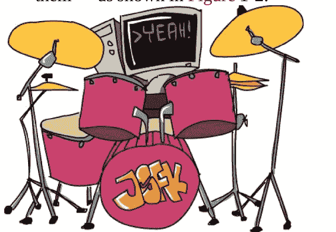

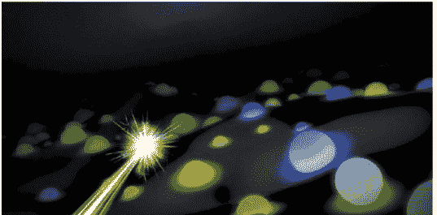
图 1-1. 在 HelloEnjoy 的“Lights”音乐视频中，你控制闪烁的光标。

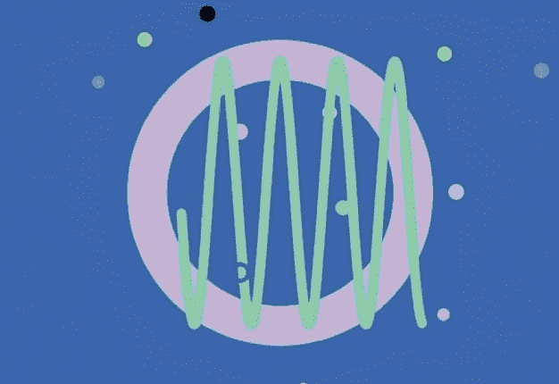
图 1-2. 当你访问 Patatap 时，试着按下一堆键来发出不同的声音！

- JavaScript 让你可以玩有趣的游戏。*CubeSlam*（[https://www.cubeslam.com](https://www.cubeslam.com)）是对经典游戏 Pong 的 3D 重现，看起来有点像空气曲棍球。你可以与你的朋友或电脑生成的熊对战，如图 1-3 所示。

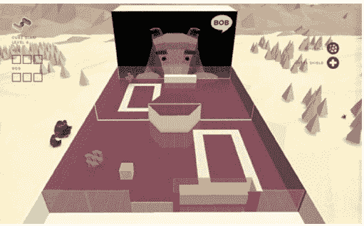
图 1-3. CubeSlam 游戏完全是用 JavaScript 编程的！

### 为什么要学习 JavaScript？

JavaScript 并不是唯一的编程语言——事实上，仅编程语言就有数百种之多。但学习 JavaScript 有很多理由。首先，它比许多其他编程语言更容易学（也更有趣）。但也许最重要的是，为了编写和运行 JavaScript 程序，你只需要一个像 Internet Explorer、Mozilla Firefox 或 Google Chrome 这样的网页浏览器。每个网页浏览器都带有一个 JavaScript*解释器*，知道如何读取 JavaScript 程序。

一旦你编写了一个 JavaScript 程序，你可以把链接发给其他人，他们也可以在自己的电脑上的网页浏览器中运行它！（参见“使用 JSFiddle 分享你的代码”。）

### 编写一些 JavaScript

让我们在 Google Chrome（http://www.google.com/chrome）中写一点简单的 JavaScript。在你的电脑上安装 Chrome（如果还没有安装的话），然后打开它，在地址栏中输入 **about:blank**。现在按回车键，你会看到一个空白页面，如图 1-4 所示。

我们将从在 Chrome 的 JavaScript 控制台中编写代码开始，这是程序员可以测试短 JavaScript 程序的秘密方式。在 Microsoft Windows 或 Linux 上，按住 CTRL 和 SHIFT 键，然后按 J。在 Mac OS 上，按住 COMMAND 和 OPTION 键，然后按 J。

如果你做对了，你应该会看到一个空白网页，以及下方一个闪烁的光标（|）和一个右尖括号（>），如图 1-4 所示。那就是你写 JavaScript 的地方！

> **注意**
>
> *Chrome 控制台会给你的代码文本着色；例如，你输入的文本将是蓝色的，输出将根据其类型着色。*
>
> *在本书中，我们在使用控制台的地方，对代码文本使用类似的颜色。*

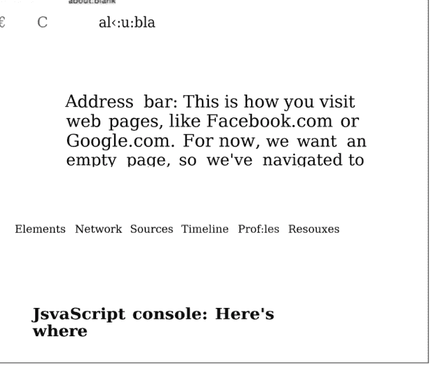
图 1-4. Google Chrome 的 JavaScript 控制台

当你在光标处输入代码并按回车键时，JavaScript 应该会运行，或者说*执行*你的代码，并在下一行显示结果（如果有的话）。例如，在控制台中输入：

```
3 + 4;
```

现在按回车键。JavaScript 应该会将这个简单加法的答案（7）输出到下一行：

```
3 + 4;
7
```

好吧，这足够简单了。但 JavaScript 不就是一个花哨的计算器吗？让我们试试别的。

### JavaScript 程序的结构

让我们创建一些更傻的东西——一个 JavaScript 程序，用来打印一系列看起来像下面这样的猫脸：

与我们的加法程序不同，这个 JavaScript 程序会占用多行。要将程序输入到控制台中，你必须在每行末尾按 SHIFT-ENTER 来添加新行。（如果你只按回车键，Chrome 会尝试执行你已写的内容，程序将无法按预期工作。我警告过你计算机很笨！）

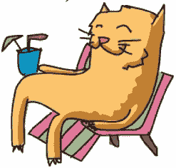

在你的浏览器控制台中输入：

```javascript
// Draw as many cats as you want!
var drawCats = function(howManyTimes){
  for(var i = 0; i < howManyTimes; i++){
    console.log(i + " =^.^=");
  }
}

drawCats(10); // You can put any number here instead of 10.
```

在最后，按回车键而不是 SHIFT-ENTER。当你这样做时，你应该会看到以下输出：

```
0 =^.^=
1 =^.^=
2 =^.^=
3 =^.^=
4 =^.^=
5 =^.^=
6 =^.^=
7 =^.^=
8 =^.^=
9 =^.^=
```

如果你打错了任何字，你的输出可能会看起来非常不同，或者你可能会得到一个错误。这就是我说的计算机很笨的意思——即使是一段简单的代码，也必须完美无缺，计算机才能理解你想让它做什么！

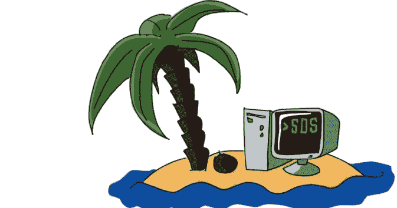

我现在不会详细讲解这段代码是如何工作的（我们将在第 8 章中回到这个程序），但让我们看看这个程序以及 JavaScript 程序的一些共同特点。

### 语法

我们的程序包含很多符号，包括括号（ ）、分号（;）、大括号（{}）、加号（+），以及一些一开始可能看起来很神秘的词（比如 var 和 console.log）。这些都是 JavaScript [语法](https://en.wikipedia.org/wiki/Syntax_(programming_languages))的一部分——也就是说，JavaScript 关于如何组合符号和单词来创建可运行程序的规则。

当你学习一种新的编程语言时，最棘手的部分之一就是习惯于编写不同种类指令给计算机的规则。当你刚开始时，很容易忘记什么时候该包括括号，或者搞混某些值需要包含的顺序。但随着你不断练习，你会开始掌握窍门的。

在本书中，我们会稳扎稳打，一点一点地介绍新语法，这样你就能构建出越来越强大的程序。


 # 注释

我们的猫咪程序的第一行是这样的：

```
// Draw as many cats as you want!
```

这被称为*注释*（comment）。程序员使用注释是为了让其他程序员更容易阅读和理解他们的代码。计算机完全忽略注释。JavaScript 中的注释以两个正斜杠 (//) 开始。紧随斜杠之后（在同一行内）的所有内容都会被 JavaScript 解释器忽略，因此注释对程序的执行方式没有任何影响 —— 它们仅仅是为了提供描述。

在本书的代码中，你会看到描述代码中发生了什么的注释。当你编写自己的代码时，请添加你自己的注释。这样当你以后查看代码时，你的注释会提醒你代码是如何工作的以及每一步发生了什么。在 our 程序的最后一行还有另一个代码注释。记住，// 之后的所有内容都不会被计算机运行！

```
drawCats(10); // You can put any number here instead of 10.
```

代码注释可以单独占一行，也可以跟在代码后面。如果你把 // 放在前面，像这样：

```
// drawCats(10);
```

什么都不会发生！Chrome 将整行视为注释，即使它是 JavaScript 代码。

当你开始阅读现实世界中的 JavaScript 代码时，你还会看到像这样的注释：

```
/*
Draw as many
cats as you want!
*/
```

这是一种不同的注释风格，通常用于超过一行的长注释。但它的作用是一样的：在 `/*` 和 `*/` 之间的所有内容都是计算机不会运行的注释。

### 你学到了什么

在本章中，你初步了解了 JavaScript 是什么以及它可以用来做什么。你还学习了如何使用 Google Chrome 浏览器运行 JavaScript，并尝试运行了一个示例程序。除非我另有说明，否则本书中所有的代码示例都可以（且应该！）在 Chrome 的 JavaScript 控制台中运行。不要只是阅读代码 —— 尝试亲手输入！这是学习编程的唯一方法。

在下一章中，你将开始学习 JavaScript 的基础知识，首先是你可以处理的三种基本信息类型：数字、字符串和布尔值。

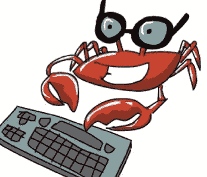

## 第 2 章：数据类型与变量

编程的核心就是操作数据，但数据*究竟*是什么？*数据*是我们存储在计算机程序中的信息。例如，你的名字是一项数据，你的年龄也是。你的发色、你有多少个兄弟姐妹、你住在哪里、你是男性还是女性 —— 这些全都是数据。

在 JavaScript 中，有三种基本的数据类型：数字（numbers）、字符串（strings）和布尔值（Booleans）。数字用于表示，嗯，就是数字！例如，你的年龄可以用数字表示，你的身高也可以。JavaScript 中的数字看起来像这样：

```
5;
```

字符串用于表示文本。在 JavaScript 中，你的名字可以用字符串表示，你的电子邮件地址也可以。字符串看起来像这样：

```
"Hi, I'm a string";
```

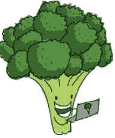

布尔值是只能为 `true`（真）或 `false`（假）的值。例如，关于你的一项布尔值可能是你是否戴眼镜。另一项可能是你是否喜欢西兰花。布尔值看起来像这样：

```
true;
```

处理每种数据类型的方式各不相同。例如，你可以将两个数字相乘，但不能将两个字符串相乘。对于字符串，你可以请求前五个字符。对于布尔值，你可以检查两个值是否都为真。以下代码示例演示了这些可能的操作。

```
99 * 123;
```

```
12177
"This is a long string".slice(0, 4); "This"
true && false;
false
```

JavaScript 中的所有数据都只是这些数据类型的组合。在本章中，我们将依次研究每种类型，并学习处理每种类型的不同方法。

> **注意**
> 你可能已经注意到所有这些命令都以分号 (;) 结尾。分号标志着一个特定的 JavaScript 命令或指令（也称为语句）的结束，有点像句子末尾的句号。

### 数字与运算符

JavaScript 允许你执行基本的数学运算，如加法、减法、乘法和除法。为了进行这些计算，我们使用符号 `+`、`-`、`*` 和 `/`，它们被称为*运算符*（operators）。

你可以像使用计算器一样使用 JavaScript 控制台。我们已经看过一个例子，将 3 和 4 相加。让我们尝试一些更难的。12,345 加上 56,789 是多少？

```
12345 + 56789;
69134
```

这在脑海中计算起来并不容易，但 JavaScript 瞬间就计算出来了。你可以使用多个加号来相加多个数字：

```
22 + 33 + 44;
99
```

JavaScript 还可以进行减法...

```
1000 - 17;
983
```

以及乘法，使用星号...

```
123 * 456;
56088
```

以及除法，使用正斜杠...

```
12345 / 250;
49.38
```

你还可以将这些简单操作组合起来创建更复杂的内容，像这样：

```
1234 + 57 * 3 - 31 / 4;
1397.25
```

这里变得有点复杂，因为这次计算的结果（答案）取决于 JavaScript 执行每项操作的顺序。在数学中，规则是乘法和除法总是先于加法和减法进行，JavaScript 也遵循这一规则。

```
1234 + 57 * 3 - 31 / 4
```

```
1234 + 171 - 31 / 4
```

```
1234 + 171 - 7.75
```

```
1405 - 7.75
```

```
1397.25
```

*图 2-1. 运算顺序：乘法，除法，加法，减法*

**图 2-1** 展示了 JavaScript 将遵循的顺序。首先，JavaScript 计算 57 * 3 得到 171（用红色 표시）。然后它计算 31 ÷ 4 得到 7.75（用蓝色 표시）。接着它计算 1234 + 171 得到 1405（用绿色 표시）。最后它计算 1405 - 7.75 得到 1397.25，这就是最终结果。

如果你想先进行加法和减法，然后再进行乘法和除法怎么办？例如，假设你有 1 个哥哥/弟弟和 3 个姐姐/妹妹，以及 8 颗糖果，你想将这些糖果平均分配给你的 4 个兄弟姐妹？（你已经拿走了你的份额！）你需要将 8 除以你的兄弟姐妹人数。这是一个尝试：

```
8 / 1 + 3;
11
```

这不对！当你只有 8 颗糖果时，你不可能给每个兄弟姐妹 11 颗糖！问题在于 JavaScript 先进行除法再进行加法，所以它先计算 8 除以 1（等于 8），然后再加上 3，得到了 11。为了修复这个问题并让 JavaScript 先进行加法，我们可以使用*括号*：

```
8 / (1 + 3);
2
```

这就对了！每个兄弟姐妹两颗糖。括号强制 JavaScript 在将 8 除以 4 *之前* 先将 1 和 3 相加。


| 试一试！ |
|:---|
| 假设你的朋友正尝试使用 JavaScript 来计算要买多少个气球。她要举办一场派对，希望每个人都有 2 个气球可以吹。最初有 15 个人来，但后来她又邀请了 9 个人。她尝试了以下代码： |
| `15 + 9 * 2;` |
| `33` |
| 但这看起来不对。 |
| 问题在于乘法在加法之前执行。你会如何添加括号以确保 JavaScript 先进行加法？你的朋友实际上需要多少个气球？ |

### 变量

JavaScript 允许你使用变量给值命名。你可以把变量想象成一个只能放一件东西的盒子。如果你往里面放了别的东西，原来的东西就会消失。

要创建一个新变量，请使用关键字 `var`，后面跟着变量的名称。关键字是 JavaScript 中具有特殊含义的词。在这种情况下，当我们输入 `var` 时，JavaScript 知道我们即将输入一个新变量的名称。例如，以下是创建一个名为 `nick` 的新变量的方法：

```
var nick;
undefined
```

我们创建了一个名为 `nick` 的新变量。控制台响应输出了 `undefined`。但这并不是一个错误！每当一个命令不返回数值时，JavaScript 就会这么做。什么是返回值？比如，当你输入 `12345 + 56789;` 时，控制台返回了值 `69134`。在 JavaScript 中创建变量不会返回数值，因此解释器打印了 `undefined`。

要给变量赋值，请使用等号：

```
var age = 12;
undefined
```

设置值被称为赋值（我们将值 `12` 赋值给变量 `age`）。同样，`undefined` 被打印出来，因为我们创建了另一个新变量。（在我接下来的示例中，如果输出是 `undefined`，我将不再显示。）

变量 `age` 现在就在我们的解释器中，并被设置为值 `12`。这意味着如果你单独输入 `age`，解释器会向你显示它的值：

```
age;
12
```

太酷了！不过，变量的值并不是固定不变的（它们之所以被称为“变量”是因为它们可以变化），如果你想更新它，只需再次使用 `=` 即可：

```
age = 13;
13
```


这次我没有使用 `var` 关键字，因为变量 `age` 已经存在了。你只需要在**创建变量**时使用 `var`，而不是在**改变变量值**时使用。还要注意，因为我们没有创建新变量，所以赋值的值 `13` 会被返回并打印在下一行。

这个稍复杂的例子解决了之前的糖果问题，没有使用括号：

```
var numberOfSiblings = 1 + 3;
var numberOfCandies = 8;
numberOfCandies / numberOfSiblings;
2
```

首先，我们创建一个名为 `numberOfSiblings` 的变量，并赋值为 `1 + 3`（JavaScript 计算结果为 4）。然后我们创建变量 `numberOfCandies` 并赋值为 8。最后，我们写出 `numberOfCandies / numberOfSiblings`。因为 `numberOfCandies` 是 8，`numberOfSiblings` 是 4，JavaScript 计算出 `8 / 4` 并得到结果 `2`。

### 命名变量

小心你的变量名，因为很容易拼写错误。即使只是大小写写错了，JavaScript 解释器也不会明白你的意思！例如，如果你不小心在 *numberOfCandies* 中用了小写 *c*，你会得到一个错误：

```
numberOfCandies / numberOfSiblings;
ReferenceError: numberOfcandies is not defined
```

不幸的是，JavaScript 只会完全按照你的要求执行。如果你拼写错了变量名，JavaScript 根本不知道你的意思，它会显示一条错误信息。

JavaScript 中变量名的另一个棘手之处是它们不能包含空格，这意味着它们可能难以阅读。我本可以把变量命名为 *number of candies*（没有大写字母），这会让它更难读，因为不清楚单词在哪里结束。这个变量是 "numberofcan dies" 还是 "numberofcan dies"？没有大写字母，很难分辨。

解决这个问题的一个常见方法是每个单词首字母大写，就像 *NumberOfCandies*。（这种约定被称为 [驼峰命名法](camel case)，因为它看起来据说像骆驼的驼峰。）

标准做法是让变量以小写字母开头，因此常见的做法是除了第一个单词外，每个单词首字母大写，像这样：*numberOfCandies*。（我将在本书中遵循这种驼峰命名法，但你可以自由选择你喜欢的方式！）

### 使用数学运算创建新变量

你可以通过对旧变量进行数学运算来创建新变量。例如，你可以使用变量来找出一年有多少秒——以及你现在的年龄是多少秒！让我们从找出一小时有多少秒开始。

#### 一小时有多少秒

首先，我们创建两个新变量 `secondsInAMinute` 和 `minutesInAnHour`，并都设置为 60（因为，我们知道，一分钟有 60 秒，一小时有 60 分钟）。然后，我们创建一个变量 `secondsInAnHour`，并将其值设置为 `secondsInAMinute` 和 `minutesInAnHour` 相乘的结果。在 `0` 处，我们输入 `secondsInAnHour`，这就像在说：“现在告诉我 `secondsInAnHour` 的值！” JavaScript 然后给你答案：它是 3600。

```
var secondsInAMinute = 60;
var minutesInAnHour = 60;
var secondsInAnHour = secondsInAMinute * minutesInAnHour;
secondsInAnHour;
3600
```

#### 一天有多少秒

现在我们创建一个变量 `hoursInADay` 并将其设置为 24。接下来，我们创建变量 `secondsInADay`，并将其设置为 `secondsInAnHour` 乘以 `hoursInADay`。当我们在 `0` 处询问 `secondsInADay` 的值时，我们得到 86400，这是一天的秒数。

```
var hoursInADay = 24;
var secondsInADay = secondsInAnHour * hoursInADay;
secondsInADay;
86400
```

#### 一年有多少秒

最后，我们创建变量 `daysInAYear` 和 `secondsInAYear`。`daysInAYear` 变量被赋值为 365，而 `secondsInAYear` 变量被赋值为 `secondsInADay` 乘以 `daysInAYear` 的结果。最后，我们询问 `secondsInAYear` 的值，它是 31536000（超过 3100 万）！

```
var daysInAYear = 365;
var secondsInAYear = secondsInADay * daysInAYear;
secondsInAYear;
31536000
```

#### 以秒为单位的年龄

既然你知道了一年有多少秒，你就可以轻松算出你的年龄是多少秒（精确到最近的年）。例如，在我写这篇文章的时候，我是 29 岁：

```
var age = 29;
age * secondsInAYear;
914544000
```

要计算你以秒为单位的年龄，输入相同的代码，但将 `age` 的值改为 `你的年龄`。或者干脆省略 `age` 变量，直接用数字表示你的年龄，像这样：

```
29 * secondsInAYear;
914544000
```

我已经有超过 9 亿秒大了！你有多少秒大了？

### 递增和递减

作为一名程序员，你经常需要将包含数字的变量的值增加或减少 1。例如，你可能有一个变量，用来计算你今天收到的击掌次数。每次有人和你击掌时，你会想将那个变量增加 1。增加 1 称为**递增**，减少 1 称为**递减**。你使用运算符 `++` 和 `--` 进行递增和递减。

```
var highFives = 0;
++highFives;
// 1
++highFives;
// 2
--highFives;
// 1
```

当我们使用 `++` 运算符时，`highFives` 的值增加 1，而当我们使用 `--` 运算符时，它的值减少 1。你也可以将这些运算符放在变量*后面*。这作用相同，但返回的值是递增或递减*之前*的值。

```
highFives = 0;
highFives++;
// 0
highFives++;
// 1
highFives;
// 2
```

在这个例子中，我们再次将 `highFives` 设置为 0。当我们调用 `highFives++` 时，变量被递增了，但打印出来的值是递增*之前*的值。你可以看到在最后（经过两次递增后），如果我们询问 `highFives` 的值，我们得到 2。

### +=（加等于）和 -=（减等于）

要增加变量的值一定的数量，你可以使用这段代码：

```
var x = 10;
x = x + 5;
x;
```

这里，我们从一个名为 `x` 的变量开始，设置为 10。然后，我们将 `x + 5` 赋给 `x`。因为 `x` 是 10，`x + 5` 将是 15。我们在这里做的是使用 `x` 的旧值来计算 `x` 的新值。因此，`x = x + 5` 真正的意思是“给 `x` 加 5”。

JavaScript 提供了一种更简单的方法来通过 `+=` 和 `-=` 运算符增加或减少变量的值。例如，如果我们有一个变量 `x`，那么 `x += 5` 等同于说 `x = x + 5`。`-=` 运算符的工作方式相同，所以 `x -= 9` 等同于 `x = x - 9`（“从 `x` 中减去 9”）。下面是一个使用这两个运算符来跟踪电子游戏分数的例子：

```
var score = 10;
score += 7;
score -= 3;
```

在这个例子中，我们通过将值 10 赋给变量 `score`，从 10 分开始。然后我们打败了一个怪物，使用 `+=` 运算符将 `score` 增加了 7。（`score += 7` 等同于 `score = score + 7`。）在打败怪物之前，`score` 是 10，`10 + 7` 是 17，所以这个操作将 `score` 设置为 17。

在我们打败怪物之后，我们撞上了一个流星，分数减少了 3。同样，`score -= 3` 等同于 `score = score - 3`。因为此时 `score` 是 17，`score - 3` 是 14，这个值被重新赋给了 `score`。

### 动手试试！

还有其他一些运算符类似于 `+=` 和 `-=`。例如，有 `*=` 和 `/=`。你认为它们是做什么的？试一试：

```
var balloons = 100;
balloons *= 2;
???
```

`balloons *= 2` 是做什么的？现在试试这个：

```
var balloons = 100;
balloons /= 4;
???
```

`balloons /= 4` 是做什么的？

### 字符串

到目前为止，我们只处理过数字。现在让我们看看另一种类型的数据：字符串。JavaScript（以及大多数编程语言）中的字符串就是字符序列，可以包括字母、数字、标点符号和空格。我们将字符串放在引号之间，这样 JavaScript 就知道它们的开始和结束。例如，这是一个经典的例子：

```
"Hello world!";
"Hello world"
```

要输入一个字符串，只需输入一个双引号 ( " )，后面跟着你想要在字符串中的文本，然后用另一个双引号结束字符串。你也可以使用单引号 ( ' )，但为了简单起见，在本书中我们只使用双引号。

你可以将字符串保存到变量中，就像数字一样：

```
var myAwesomeString = "Something REALLY awesome!!!";
```

同样没有什么能阻止你将一个字符串赋给一个以前包含数字的变量：

```
var myThing = 5;
myThing = "this is a string";
"this is a string"
```

如果你把一个数字放在引号里呢？那是字符串还是数字？在 JavaScript 中，字符串就是字符串（即使它恰好包含一些是数字的字符）。例如：

```
var numberNine = 9;
var stringNine = "9";
```

`numberNine` 是一个数字，`stringNine` 是一个字符串。要看看它们有什么不同，让我们尝试将它们相加：

```
numberNine + numberNine;
18
stringNine + stringNine;
"99"
```

当我们把数字值 9 和 9 相加时，我们得到 18。但是当我们在 "9" 和 "9" 上使用 `+` 运算符时，字符串只是简单地连接在一起形成 "99"。


### 拼接字符串

正如你刚才看到的，你可以对字符串使用 `+` 运算符，但其结果与对数字使用 `+` 运算符截然不同。当你使用 `+` 来拼接两个字符串时，你会创建一个新字符串，将第二个字符串附加在第一个字符串的末尾，如下所示：

```javascript
var greeting = "Hello"; 
var myName = "Nick";
greeting + myName;
"HelloNick"
```

在这里，我们创建了两个变量（`greeting` 和 `myName`），并分别为其分配了一个字符串值（分别为 "Hello" 和 "Nick"）。当我们把这两个变量相加时，字符串被组合在一起，形成了一个新字符串 "HelloNick"。

不过，这看起来不太对 —— Hello 和 Nick 之间应该有一个空格。但除非我们通过在其中一个原始字符串中添加空格来明确告知，否则 JavaScript 不会自动在那里添加空格：

```javascript
var greeting = "Hello ";
var myName = "Nick";
greeting + myName;
"Hello Nick"
```

引号内的额外空格也会在最终的字符串中产生一个空格。

除了将字符串相加，你还可以用字符串做更多事情。这里有一些示例。

### 获取字符串长度

要获取字符串的长度，只需在字符串末尾添加 `.length`。

```javascript
"Supercalifragilisticexpialidocious".length;
// 34
```

你可以将 `.length` 添加到实际的字符串末尾，或者添加到包含字符串的变量末尾：

```javascript
var java = "Java";
java.length;
// 4

var script = "Script";
script.length;
// 6

var javascript = java + script;
javascript.length;
// 10
```

这里我们将字符串 `"Java"` 赋值给变量 `java`，将字符串 `"Script"` 赋值给变量 `script`。然后我们在每个变量末尾添加 `.length` 来确定每个字符串的长度，以及组合后字符串的长度。

请注意，我说过你可以将 `.length` 添加到“实际字符串或*包含字符串的变量*”上。这说明了关于变量的一个非常重要的点：在任何可以使用数字或字符串的地方，你也可以使用包含数字或字符串的变量。

### 从字符串中获取单个字符

有时你想要从字符串中获取单个字符。例如，你可能有一个秘密代码，其消息由单词列表中每个单词的第二个字符组成。你需要能够仅获取第二个字符并将它们全部拼接在一起，以创建一个新单词。

要获取字符串中特定位置的字符，请使用方括号 `[ ]`。只需取出字符串（或包含字符串的变量），并在末尾的一对方括号中放入你想要的字符编号。例如，要获取 `myName` 的第一个字符，请使用 `myName[0]`，如下所示：

```javascript
var myName = "Nick";
myName[0]; // "N"
myName[1]; // "i"
myName[2]; // "c"
```

请注意，为了获取字符串的第一个字符，我们使用 0 而不是 1。这是因为 JavaScript（以及许多其他编程语言）是从零开始计数的。这意味着当你想要字符串的第一个字符时，你使用 0；当你想要第二个时，你使用 1；依此类推。

让我们尝试我们的秘密代码，我们将消息隐藏在一些单词的第二个字符中。以下是如何在一系列单词中找到秘密消息的方法：

```javascript
var codeWord1 = "are";
var codeWord2 = "tubas";
var codeWord3 = "unsafe"; 
var codeWord4 = "?!";
codeWord1[1] + codeWord2[1] + codeWord3[1] + codeWord4[1]; 
// "run!"
```

同样请注意，为了获取每个字符串的第二个字符，我们使用了 1。

### 截取字符串

要从一个大字符串中“截取”一段，你可以使用 `slice`。例如，你可能想截取长篇电影评论的第一部分，作为网站上的预告。要使用 `slice`，在字符串（或包含字符串的变量）后面加一个点，接着写 `slice` 单词以及一对圆括号。在圆括号内，输入你想要的字符串切片的起始和结束位置，用逗号隔开。

例如：

```javascript
var longstring = "My long string is long";
longstring.slice(3, 14);
// "long string"
```

括号中的第一个数字是切片开始的字符编号，第二个数字是切片最后一个字符之后的那个字符的编号。

在这里，我们基本上是在告诉 JavaScript：“从这个较长字符串的第 3 个位置开始截取一段，一直持续到第 14 个位置。” 如果你在 `slice` 后的括号中仅包含一个数字，那么截取的字符串将从该数字开始，一直持续到字符串的末尾，如下所示：

```javascript
var longstring = "My long string is long";
longstring.slice(3);
// "long string is long"
```

### 将字符串转换为全部大写或全部小写字母

如果你有一些想要大声喊出来的文本，可以尝试使用 `toUpperCase` 将其全部转换为大写字母。

```javascript
"Hello there, how are you doing?".toUpperCase();
// "HELLO THERE, HOW ARE YOU DOING?"
```

当你在字符串上使用 `.toUpperCase()` 时，它会创建一个所有字母都变为大写的新字符串。

你也可以反过来操作：

```javascript
"heLlo THERE, hOw ARE yOu doINg?".toLowerCase(); 
// "hello there, how are you doing?"
```

正如其名，`.toLowerCase()` 将所有字符转换为小写。但句子难道不应该总是以大写字母开头吗？我们如何才能将一个字符串的首字母变为大写，而将其余部分变为小写呢？

**注意**
> 看看你是否能利用刚刚学到的工具，将 "hELlo THERE, hOw ARE yOu doINg?" 转换为 "Hello there, how are you doing?"。如果你卡住了，请回顾关于获取单个字符和使用 `slice` 的章节。完成后，回来看看我是如何实现的。

#### 这里是一种方法：

```javascript
var sillystring = "hELlo THERE, hOW ARE yOu doINg?"; 
var lowerString = sillystring.toLowerCase();
var firstCharacter = lowerString[0];
var firstCharacterUpper = firstCharacter.toUpperCase();
var restOfString = lowerString.slice(1);
firstCharacterUpper + restOfString;
// "Hello there, how are you doing?"
```

让我们逐行分析。首先，我们创建了一个名为 `sillystring` 的新变量，并将想要修改的字符串保存到该变量中。然后，我们使用 `.toLowerCase()` 获取 `sillystring` 的小写版本 ("hello there how are you doing?")，并将其保存在名为 `lowerString` 的新变量中。

接下来，我们使用 `[0]` 获取 `lowerString` 的第一个字符 ("h") 并将其保存在 `firstCharacter` 中（使用 0 来抓取第一个字符）。然后，我们创建 `firstCharacter` 的大写版本 ("H")，并将其命名为 `firstCharacterUpper`。

然后，我们使用 `slice` 获取 `lowerString` 中从第二个字符开始的所有字符 ("ello there how are you doing?")，并将其保存在 `restOfString` 中。最后，我们将 `firstCharacterUpper` ("H") 与 `restOfString` 相加，得到 "Hello there, how are you doing?"。

因为值和变量可以相互替换，我们可以将这些步骤简化为一行，如下所示：

```javascript
var sillystring = "hELlo THERE, hOW ARE you doINg?";
sillystring[0].toUpperCase() + sillystring.slice(1).toLowerCase(); 
// "Hello there, how are you doing?"
```

不过，跟随这种方式编写的代码可能会让人感到困惑，因此对于像这样复杂的任务，在每一步使用变量是一个好主意 —— 至少在你能更熟练地阅读这类复杂代码之前。

### 布尔值

现在来说说布尔值。*布尔（Boolean）*值简单来说就是 `true`（真）或 `false`（假）的值。例如，这是一个简单的布尔表达式。

```javascript
var javascriptIsCool = true;
javascriptIsCool;
// true
```

在这个例子中，我们创建了一个名为 `javascriptIsCool` 的新变量，并将布尔值 `true` 赋值给它。在第二行，我们获取 `javascriptIsCool` 的值，当然，它就是 `true`！


### 逻辑运算符

就像你可以使用数学运算符（+、-、*、/ 等）来组合数字一样，你也可以使用布尔运算符来组合布尔值。当你使用布尔运算符组合布尔值时，结果永远是另一个布尔值（要么是 true，要么是 false）。

JavaScript 中三个主要的布尔运算符是 `&&`、`||` 和 `!`。它们看起来可能有点奇怪，但只要稍加练习，就不难使用。让我们来尝试一下。

#### && (且)

`&&` 表示“且”（and）。在朗读时，人们称之为 “and”、“and-and” 或 “ampersand-ampersand”。*Ampersand* 是字符 & 的名称。将 `&&` 运算符与两个布尔值一起使用，以检查它们是否*全部为 true*。

例如，在去学校之前，你想确保你已经洗过澡*且*带上了背包。如果这两个条件都为 true，你就可以去学校；但如果其中一个或两个为 false，你就还不能离开。

```javascript
var hadShower = true;
var hasBackpack = false;

hadShower && hasBackpack;
```

在这里，我们将变量 `hadShower` 设置为 true，变量 `hasBackpack` 设置为 false。当我们输入 `hadShower && hasBackpack` 时，我们基本上是在问 JavaScript：“这两个值是否都为 true？”由于它们并非全部为 true（你没带背包），JavaScript 返回 `false`（你还没准备好去学校）。


让我们再次尝试，将两个值都设置为 true：

```javascript
var hadShower = true;
var hasBackpack = true;
hadShower && hasBackpack;
true
```

现在 JavaScript 告诉我们 `hadShower && hasBackpack` 为 true。你准备好去学校了！

#### || (或)

布尔运算符 `||` 表示“或”（or）。它可以读作 “or”，甚至 “or-or”，但有些人称之为 “pipes”，因为程序员将 `|` 字符称为 *pipe*（管道）。你可以将此运算符与两个布尔值一起使用，以找出其中*任意一个*是否为 true。

例如，假设你仍在准备去学校，并且需要带一件水果当午餐，但无论你带苹果还是橙子，或者两者都带，都没有关系。你可以使用 JavaScript 来查看你是否至少拥有其中一个，像这样：

```javascript
var hasApple = true;
var hasOrange = false;
hasApple || hasOrange; // true
```

如果 `hasApple` 或 `hasOrange` 其中之一为 true，或者两者都为 true，那么 `hasApple || hasOrange` 将为 `true`。但如果两者都为 false，结果将为 `false`（你没有任何水果）。

#### ! (非)

`!` 仅仅表示“非”（not）。你可以称之为 “not”，但很多人称之为 “bang”。（感叹号有时被称为 *bang*。）使用它将 `false` 转换为 `true`，或将 `true` 转换为 `false`。这在处理相反的值时非常有用。例如：

```javascript
var isWeekend = true;
var needToShowerToday = !isWeekend;
needToShowerToday; // false
```

在这个例子中，我们将变量 `isWeekend` 设置为 `true`。然后我们将变量 `needToShowerToday` 设置为 `!isWeekend`。bang 将该值转换为其相反值 —— 因此如果 `isWeekend` 是 true，那么 `!isWeekend` 就不是 true（它是 false）。所以当我们询问 `needToShowerToday` 的值时，我们得到 `false`（你今天不需要洗澡，因为现在是周末）。

因为 `needToShowerToday` 是 `false`，所以 `!needToShowerToday` 将是 `true`：

```javascript
!needToShowerToday; // true
```

换句话说，你今天不需要洗澡这件事是*正确（true）*的。

#### 组合逻辑运算符

当你开始组合运算符时，事情就变得有趣了。例如，假设如果现在不是周末 *且* 你洗过澡 *且* 你有一个苹果或一个橙子，你就应该去学校。我们可以使用 JavaScript 检查这一切是否为 true，像这样：

```javascript
var isWeekend = false; 
var hadShower = true;
var hasApple = false; 
var hasOrange = true;
var shouldGoToSchool = !isWeekend && hadShower && (hasApple || hasOrange); 
shouldGoToSchool;
```

```javascript
true
```

在这种情况下，现在不是周末，你洗过澡了，虽然你没有苹果但你有橙子 —— 所以你应该去学校。

`hasApple || hasOrange` 放在括号中，是因为我们想确保 JavaScript 先计算这一部分。就像 JavaScript 在数字运算中先计算 `*` 再计算 `+` 一样，它在逻辑语句中也会先计算 `&&` 再计算 `||`。

### 使用布尔值比较数字

布尔值可以用来回答关于数字的简单“是”或“否”的问题。例如，想象你在经营一个主题公园，其中一个游乐设施有身高限制：乘客必须至少 60 英寸高，否则可能会掉出来！当有人想乘坐该设施并告诉你他们的身高时，你需要知道这个身高是否大于这个身高限制。

#### 大于

我们可以使用大于运算符 (`>`) 来查看一个数字是否大于另一个数字。例如，为了查看乘客的身高（65 英寸）是否大于身高限制（60 英寸），我们可以将变量 `height` 设置为 65，将变量 `heightRestriction` 设置为 60，然后使用 `>` 来比较这两个值：

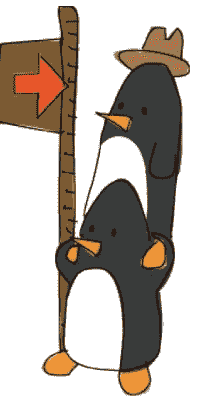

```javascript
var height = 65;
var heightRestriction = 60;
height > heightRestriction; // true
```

通过 `height > heightRestriction`，我们是在要求 JavaScript 告诉我们第一个值是否大于第二个值。在这种情况下，乘客的身高足够了！

但如果乘客恰好 60 英寸高会怎样呢？

```javascript
var height = 60;
var heightRestriction = 60;
height > heightRestriction; // false
```

糟糕！乘客的身高不够！但如果身高限制是 60，那么恰好 60 英寸的人难道不应该被允许进入吗？我们需要修复这个问题。幸运的是，JavaScript 还有另一个运算符 `>=`，意思是“大于或等于”：

```javascript
var height = 60;
var heightRestriction = 60;
height >= heightRestriction; // true
```

很好，这样好多了 —— 60 大于或等于 60。

#### 小于

大于运算符 (`>`) 的相反运算符是小于运算符 (`<`)。如果一个游乐设施是专为幼儿设计的，那么这个运算符就会派上用场。例如，假设乘客的身高是 60 英寸，但乘客的身高必须不超过 48 英寸：

```javascript
var height = 60;
var heightRestriction = 48;
height < heightRestriction;
false
```

我们想知道乘客的身高是否*小于*限制，所以我们使用 `<`。因为 60 不小于 48，我们得到 `false`（身高 60 英寸的人对于这个游乐设施来说太高了）。

而且，正如你可能猜到的，我们也可以使用运算符 `<=`, 意思是“小于或等于”：

```javascript
var height = 48;
var heightRestriction = 48; 
height <= heightRestriction; // true
```

身高 48 英寸的人仍然被允许乘坐该设施。

#### 等于

要找出两个数字是否完全相同，请使用三等号 (`===`)，它表示“等于”。但要注意不要将 `===` 与单等号 (`=`) 混淆，因为 `===` 意味着“这两个数字相等吗？”，而 `=` 意味着“将右侧的值保存到左侧的变量中”。换句话说，`===` 是在提问，而 `=` 是在给变量赋值。

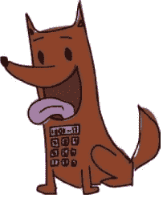

当你使用 `=` 时，左侧必须是一个变量名，而你想保存到该变量中的值必须在右侧。另一方面，`===` 仅用于比较两个值以查看它们是否相同，因此无论哪个值在哪个侧面都无关紧要。

例如，假设你正和朋友 Chico、Harpo 和 Groucho 进行一场竞赛，看看谁能猜出你的秘密数字（它是 5）。为了给朋友们提供便利，你告诉他们数字在 1 到 9 之间，于是他们开始猜测。首先你将 `mySecretNumber` 设置为 5。你的第一个朋友 Chico 猜测它是 3 (`chicoGuess`)。让我们看看接下来发生了什么：

```javascript
var mySecretNumber = 5; 
var chicoGuess = 3;

mySecretNumber === chicoGuess; // false

var harpoGuess = 7;
mySecretNumber === harpoGuess; // false

var grouchoGuess = 5;
mySecretNumber === grouchoGuess; // true
```

变量 `mySecretNumber` 存储了你的秘密数字。变量 `chicoGuess`、`harpoGuess` 和 `grouchoGuess` 代表你朋友们的猜测，我们使用 `===` 来查看每个猜测是否与你的秘密数字相同。你的第三个朋友 Groucho 猜中了 5，赢得了比赛。

当你使用 `===` 比较两个数字时，只有在两个数字相同时才会得到 `true`。因为 `grouchoGuess` 是 5 且 `mySecretNumber` 是 5，所以 `mySecretNumber === grouchoGuess` 返回 `true`。其他猜测与 `mySecretNumber` 不匹配，因此返回 `false`。

你也可以使用 `===` 来比较两个字符串或两个布尔值。如果你使用 `===` 来比较两种不同的类型 —— 例如，一个字符串和一个数字 —— 它将始终返回 `false`。

#### 双等号

现在情况变得稍微复杂一点了：JavaScript 还有另一个运算符（双等号，或 `==`），意思是“近似等于”。使用它可以查看两个值是否相同，即使一个是字符串而另一个是数字。所有值都有某种类型。所以数字 `5` 与字符串 `"5"` 是不同的，尽管它们看起来基本上是一样的。如果你使用 `===` 来比较数字 `5` 和字符串 `"5"`，JavaScript 会告诉你它们不相等。但如果你使用 `==` 来比较它们，它会告诉你它们是相同的：

```javascript
var stringNumber = "5"; 
var actualNumber = 5;

stringNumber === actualNumber; // false
stringNumber == actualNumber; // true
```

此时，你可能会心想：“嗯，使用双等号似乎比三等号容易得多！”但你必须非常小心，因为双等号可能会非常令人困惑。例如，你认为 0 等于 `false` 吗？那么字符串 `"false"` 呢？当你使用双等号时，0 等于 `false`，但字符串 `"false"` 并不等于：

```javascript
0 == false; // true
```


 ```
"false" == false; false
```

这是因为当 JavaScript 尝试使用双等号比较两个值时，它首先会尝试将它们转换为相同的类型。在这种情况下，它会将布尔值转换为数字。如果你将布尔值转换为数字，`false` 变为 0，而 `true` 变为 变为 1。所以当你输入 `0 == false` 时，结果是 true！

由于这种古怪的特性，目前最安全的方法可能是坚持使用 ===。

### 试一试！

当地电影院的经理请你为他们正在构建的一个新自动化系统实现一些 JavaScript 代码。他们希望能够判断一个人是否被允许进入一部 PG-13 级的电影。

规则是：如果某人年满 13 岁或以上，则允许进入。如果他们不满 13 岁，但有成年人陪同，也允许进入。否则，他们不能观看这部电影。

```
var age = 12;
var accompanied = true;
```

请使用 age 和 accompanied 变量完成这个示例，以计算这个 12 岁的孩子是否被允许观看这部电影。尝试更改这些值（例如，将 age 设置为 13，accompanied 设置为 false），看看你的代码是否仍然能得出正确答案。

### undefined 和 null

最后，我们有两种不符合任何特定模具的值。它们被称为 undefined 和 null。它们都用来表示“没有”，但方式略有不同。

undefined 是 JavaScript 在某个事物没有值时使用的一个值。例如，当你创建一个新变量时，如果你没有使用 = 运算符为其设置任何值，它的值将被设置为 undefined：

```
var myVariable;
myVariable;
undefined
```

null 值通常在你想要刻意表示“这是空的”时使用。

```
var myNullVariable = null;
myNullVariable;
null
```

目前，你不会经常使用 undefined 或 null。如果你创建了一个变量但没有设置其值，你会看到 undefined，因为当 JavaScript 没有值时，它总是会给你 undefined。将某个值设置为 undefined 并不常见；如果你觉得需要将一个变量设置为“无”，你应该使用 null。

null 仅在你确实想表达某物不存在时使用，这在极少数情况下很有用。例如，假设你使用一个变量来记录你最喜欢的蔬菜。如果你讨厌所有蔬菜，没有最喜欢的一种，你可能会将最喜欢的蔬菜变量设置为 null。

将变量设置为 null 会让任何阅读代码的人都清楚地意识到你没有最喜欢的蔬菜。然而，如果它是 undefined，有些人可能会认为你只是还没来得及设置值。

### 你学到了什么

现在你已经知道了 JavaScript 中所有基本的数据类型——数字（numbers）、字符串（strings）和布尔值（Booleans）——以及特殊值 null 和 undefined。数字用于数学相关的事物，字符串用于文本，布尔值用于“是”或“否”的问题。null 和 undefined 的值是为了让我们有一种方式来描述不存在的事物。在接下来的两章中，我们将学习数组（arrays）和对象（objects），它们都是将基本类型组合起来以创建更复杂的数值集合的方法。

## 第 3 章 数组

到目前为止，我们学习了数字和字符串，这些是你可以在程序中存储和使用的数据类型。但数字和字符串有点枯燥。单独地对一个字符串能做的事情并不多。JavaScript 允许你通过*数组（arrays）*以更有趣的方式创建和分组数据。数组本质上就是其他 JavaScript 数据值的列表。

例如，如果你的朋友问你最喜欢的三个恐龙是什么，你可以创建一个包含这些恐龙名字的数组，并按顺序排列：

```
var myTopThreeDinosaurs = ["T-Rex", "Velociraptor", "Stegosaurus"];
```

这样，你就不必给你的朋友三个独立的字符串，而只需使用单个数组 `myTopThreeDinosaurs`。

### 为什么你应该关注数组？

让我们再次看看恐龙。假设你想使用一个程序来记录你所知道的许多种类的恐龙。你可以为每种恐龙创建一个变量，像这样：

```
var dinosaur1 = "T-Rex";
var dinosaur2 = "Velociraptor";
var dinosaur3 = "Stegosaurus";
var dinosaur4 = "Triceratops";
var dinosaur5 = "Brachiosaurus";
var dinosaur6 = "Pteranodon";
var dinosaur7 = "Apatosaurus";
var dinosaur8 = "Diplodocus";
var dinosaur9 = "Compsognathus";
```

但是，这个列表使用起来非常尴尬，因为你拥有九个不同的变量，而实际上你只需要一个。想象一下，如果你要记录 1000 种恐龙！你需要创建 1000 个独立的变量，这几乎是不可能操作的。

这就像你有一张购物清单，但每件商品都写在不同的纸片上。你有一张纸写着“鸡蛋”，另一张纸写着“面包”，还有一张纸写着“橙子”。大多数人会将想要购买的所有物品完整地写在一张纸上。如果你能将所有九种恐龙组合在一起放在一个地方，难道不是容易得多吗？

你可以这样做，而这就是数组发挥作用的地方。

### 创建数组

要创建数组，只需使用方括号 `[ ]`。事实上，一个空数组就是一个简单的方括号对，像这样：

但谁会在意空数组呢？让我们用恐龙来填满它！要创建一个包含值的数组，在方括号之间输入值，并用逗号分隔。我们可以将数组中的单个值称为*项（items）*或*元素（elements）*。在这个例子中，我们的元素将是字符串（我们最喜欢的恐龙的名字），所以我们要用引号将它们括起来。我们将把这个数组存储在一个名为 dinosaurs 的变量中：

```
var dinosaurs = ["T-Rex", "Velociraptor", "Stegosaurus", "Triceratops",
"Brachiosaurus", "Pteranodon", "Apatosaurus",
"Diplodocus", "Compsognathus"];
```

> 注意
> 因为这是一本书，页面宽度有限，我们无法将整个数组放在一行中。`|` 符号是为了显示由于页面太窄而将代码换行的地方。当你在计算机上输入时，可以将它全部写在一行中。

长列表在单行中可能难以阅读，但幸运的是，这并不是格式化（或布局）数组的唯一方法。你也可以将数组格式化为：开头方括号独占一行，数组中的各项每项独占一行，最后是一个结尾方括号，像这样：

```
var dinosaurs = [
    "T-Rex",
    "Velociraptor",
    "Stegosaurus",
    "Triceratops",
    "Brachiosaurus",
    "Pteranodon",
    "Apatosaurus",
    "Diplodocus",
    "Compsognathus"
];
```

如果你想将此内容输入到浏览器控制台中，在按下 ENTER 键换行时需要按住 SHIFT 键。否则，JavaScript 解释器会认为你正尝试执行当前这一行不完整的代码。当我们使用解释器工作时，将数组写在一行会更容易。

无论你选择将数组项格式化在同一行还是分行，对 JavaScript 来说都是一样的。无论你使用了多少个换行符，JavaScript 看到的依然是一个数组——在本例中，是一个包含九个字符串的数组。

### 访问数组元素

当需要访问数组中的元素时，使用方括号并填入你想要元素的索引（index），如下例所示：

```
dinosaurs[0];
"T-Rex"

dinosaurs[3];
"Triceratops"
```

*索引（index）*是指与数组中存储值的具体位置相对应（或匹配）的数字。与字符串一样，数组中的第一个元素索引为 0，第二个索引为 1，第三个索引为 2，依此类推。这就是为什么请求 dinosaurs 数组的索引 0 会返回 "T-Rex"（列表中第一个），而索引 3 返回 "Triceratops"（列表中第四个）。

能够访问数组中的单个元素非常有用。例如，如果你只想向某人展示你最最喜欢的恐龙，你不需要整个 dinosaurs 数组，而只需要第一个元素：

```
dinosaurs[0];
"T-Rex"
```


### 设置或更改数组中的元素

你可以使用方括号中的索引来设置、更改，甚至向数组中添加元素。例如，要将 `dinosaurs` 数组中的第一个元素（"T-Rex"）替换为 "Tyrannosaurus Rex"，你可以这样做：

```javascript
dinosaurs[0] = "Tyrannosaurus Rex";
```

操作完成后，`dinosaurs` 数组将如下所示：

```javascript
["Tyrannosaurus Rex", "Velociraptor", "Stegosaurus", "Triceratops",
"Brachiosaurus", "Pteranodon", "Apatosaurus", "Diplodocus",
"Compsognathus"]
```

你也可以使用带有索引的方括号向数组添加新元素。例如，下面是如何通过使用方括号单独设置每个元素来创建 `dinosaurs` 数组的：

```javascript
var dinosaurs = [];
dinosaurs[0] = "T-Rex";
dinosaurs[1] = "Velociraptor";
dinosaurs[2] = "Stegosaurus";
dinosaurs[3] = "Triceratops";
dinosaurs[4] = "Brachiosaurus";
dinosaurs[5] = "Pteranodon";
dinosaurs[6] = "Apatosaurus";
dinosaurs[7] = "Diplodocus";
dinosaurs[8] = "Compsognathus";
```

```javascript
dinosaurs;
["T-Rex", "Velociraptor", "Stegosaurus", "Triceratops",
"Brachiosaurus", "Pteranodon", "Apatosaurus", "Diplodocus",
"Compsognathus"]
```

首先，我们使用 `var dinosaurs = [];` 创建一个空数组。然后，通过接下来的每一行，我们使用一系列从索引 0 到索引 8 的 `dinosaurs[]` 条目向列表中添加值。完成列表后，我们可以查看该数组（通过输入 `dinosaurs;`）。我们可以看到，JavaScript 已根据索引顺序存储了所有名称。

实际上，你可以在任何你想要的索引处添加元素。例如，要在索引 33 处添加一只新（虚构的）恐龙，你可以写以下代码：

```javascript
dinosaurs[33] = "Philosoraptor";
```

```javascript
dinosaurs;
["T-Rex", "Velociraptor", "Stegosaurus", "Triceratops", "Brachiosaurus",
"Pteranodon", "Apatosaurus", "Diplodocus", "Compsognathus",
undefined x 24 "Philosoraptor"]
```

索引 8 和 33 之间的元素将是 `undefined`。当你输出该数组时，Chrome 会贴心地告诉你有多少个元素是 `undefined`，而不是将它们逐一列出。

### 在数组中混合数据类型

数组元素不必全部是相同的类型。例如，接下来的数组包含一个数字 (3)、一个字符串 ("dinosaurs")、一个数组 (["triceratops", "stegosaurus", 3627.5]) 以及另一个数字 (10)：

```javascript
var dinosaursAndNumbers = [3, "dinosaurs", ["triceratops", "stegosaurus", 3627.5], 10];
```

要访问该数组内部数组中的单个元素，你只需要使用第二组方括号。例如，虽然 `dinosaursAndNumbers[2];` 返回整个内部数组，但 `dinosaursAndNumbers[2][0];` 仅返回该内部数组的第一个元素，即 "triceratops"。

```javascript
dinosaursAndNumbers[2]; // ["triceratops", "stegosaurus", 3627.5]
dinosaursAndNumbers[2][0];
"triceratops"
```

当我们输入 `dinosaursAndNumbers[2][0];` 时，我们是在告诉 JavaScript 查看 `dinosaursAndNumbers` 数组的索引 2，该位置包含数组 ["triceratops", "stegosaurus", 3627.5]，并返回该第二个数组索引 0 处的值。索引 0 是第二个数组的第一个值，即 "triceratops"。图 3-1 显示了该数组的索引位置。

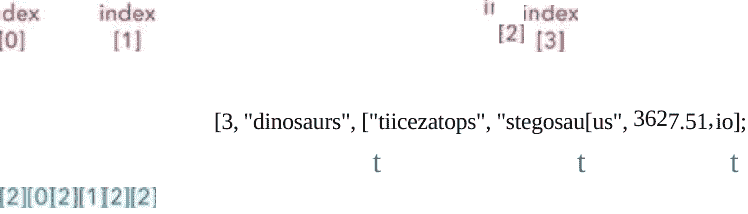

*图 3-1. 主数组的索引位置用红色标记，内部数组的索引用蓝色标记。*

### 操作数组

[属性](https://www.example.com)和[方法](https://www.example.com)可以帮助你操作数组。属性通常告诉你关于数组的一些信息，而方法通常用于更改数组或返回一个新数组。让我们来看看。

### 查找数组的长度

有时了解数组中有多少个元素是非常有用的。例如，如果你不断向 `dinosaurs` 数组中添加恐龙，你可能会忘记你到底有多少只恐龙。

数组的 `length` 属性会告诉你数组中有多少个元素。要查找数组的长度，只需在其名称末尾添加 `.length`。让我们尝试一下。首先，我们创建一个包含三个元素的新数组：

```javascript
var maniacs = ["Yakko", "Wakko", "Dot"];
maniacs[0];
"Yakko"
maniacs[1];
"Wakko"
maniacs[2];
"Dot"
```

要查找数组的长度，在 `maniacs` 后添加 `.length`：

```javascript
maniacs.length;
3
```

JavaScript 告诉我们数组中有 3 个元素，而我们已经知道它们的索引位置是 0、1 和 2。这给我们提供了一个有用的信息：数组的最后一个索引总是等于数组长度减 1。这意味着无论数组有多长，都有一个简单的方法可以访问数组的最后一个元素：

```javascript
maniacs[maniacs.length - 1];
"Dot"
```

在这里，我们请求 JavaScript 从数组中获取一个元素。但我们没有在方括号中输入索引数字，而是使用了一点数学运算：数组长度减 1。JavaScript 找到 `maniacs.length` 为 3，然后减 1 得到 2。接着它返回索引 2 处的元素——数组中的最后一个 maniac "Dot"。

### 向数组添加元素

要向数组末尾添加元素，可以使用 `push` 方法。在数组名称后添加 `.push`，然后在括号内放入要添加的元素，如下所示：

```javascript
var animals = [];
animals.push("Cat");
1
animals.push("Dog");
2
animals.push("Llama");
3
animals;
["Cat", "Dog", "Llama"]
animals.length;
3
```

在这里，我们使用 `var animals = [];` 创建一个空数组，然后使用 `push` 方法将 "Cat" 添加到数组中。接着，我们再次使用 `push` 添加 "Dog" 然后是 "Llama"。当我们显示 `animals;` 时，我们可以看到 "Cat"、"Dog" 和 "Llama" 已按输入顺序添加到数组中。

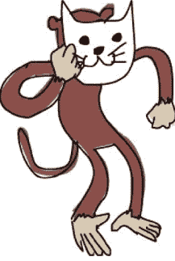

在计算机术语中，运行一个方法的行为被称为*调用*（calling）该方法。当你调用 `push` 方法时，会发生两件事。首先，括号中的元素被添加到数组中。其次，返回数组的新长度。这就是为什么你每次调用 `push` 时都会看到打印出这些数字。

要向数组开头添加元素，可以使用 `.unshift(element)`，如下所示：

```javascript
animals;
["Cat", "Dog", "Llama"]
animals[0];
"Cat"

animals.unshift("Monkey");
4

animals;
["Monkey", "Cat", "Dog", "Llama"]
animals.unshift("Polar Bear");
5

animals;
["Polar Bear", "Monkey", "Cat", "Dog", "Llama"]
animals[0];
"Polar Bear"
animals[2];
"Cat"
```

这里我们从之前使用的数组 ["Cat", "Dog", "Llama"] 开始。然后，当我们使用 `unshift` 将元素 "Monkey" 和 "Polar Bear" 添加到数组开头时，旧值在每次操作时都会向后移动一个索引。因此，原本在索引 0 的 "Cat" 现在位于索引 2。

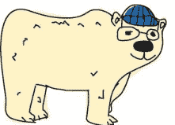

同样，`unshift` 在每次被调用时都会返回数组的新长度，就像 `push` 一样。

### 从数组中删除元素

要删除数组的最后一个元素，可以通过在数组名称末尾添加 `.pop()` 将其“弹出”。`pop` 方法特别方便，因为它做了两件事：它删除了最后一个元素，*并且* 将该最后一个元素作为值返回。例如，让我们从 `animals` 数组 ["Polar Bear", "Monkey", "Cat", "Dog", "Llama"] 开始。然后我们将创建一个名为 `lastAnimal` 的新变量，并通过调用 `animals.pop()` 将最后一只动物保存到其中。

```javascript
animals;
["Polar Bear", "Monkey", "Cat", "Dog", "Llama"]
var lastAnimal = animals.pop();
lastAnimal;
"Llama"
animals;
["Polar Bear", "Monkey", "Cat", "Dog"]
animals.pop();
"Dog"
animals;
["Polar Bear", "Monkey", "Cat"]
animals.unshift(lastAnimal);
4
animals;
["Llama", "Polar Bear", "Monkey", "Cat"]
```

当我们在 ① 处调用 `animals.pop()` 时，`animals` 数组中的最后一项 "Llama" 被返回并保存到变量 `lastAnimal` 中。"Llama" 同时被从数组中删除，使我们剩下四只动物。当我们在 ② 处再次调用 `animals.pop()` 时，"Dog" 从数组中被删除并返回，数组中仅剩下三只动物。

当我们对 "Dog" 使用 `animals.pop()` 时，我们没有将其保存到变量中，因此该值不再被任何地方保存。另一方面，"Llama" 被保存到了变量 `lastAnimal` 中，所以我们可以在需要时再次使用它。在 ③ 处，我们使用 `unshift(lastAnimal)` 将 "Llama" 添加回数组的前端。这给了我们一个最终数组 ["Llama", "Polar Bear", "Monkey", "Cat"]。


入栈和出栈是一对有用的操作，因为有时你只关心数组的末尾。你可以将一个新项推入数组，然后在准备使用时将其弹出。我们将在本章后面介绍一些使用入栈和出栈的方法。

```
["Polar Bear", "Monkey", "Cat", "Dog"]
```

```
["Cat", "Dog", "Llama"]
```

要移除并返回数组的第一个元素，请使用 `.shift()`：

```
animals;
["Llama", "Polar Bear", "Monkey", "Cat"]
var firstAnimal = animals.shift(); firstAnimal;
"Llama"
animals;
["Polar Bear", "Monkey", "Cat"]
```

`animals.shift()` 与 `animals.pop()` 功能相同，但元素是从开头移除的。在本例开始时，`animals` 是 `["Llama", "Polar Bear", "Monkey", "Cat"]`。

当我们在该数组上调用 `.shift()` 时，第一个元素 "Llama" 被返回并保存在 `firstAnimal` 中。由于 `.shift()` 不仅会返回第一个元素还会将其移除，所以最后 `animals` 变成了 `["Polar Bear", "Monkey", "Cat"]`。

你可以使用 `unshift` 和 `shift` 从数组开头添加和移除元素，就像使用 `push` 和 `pop` 从数组末尾添加和移除元素一样。

### 添加数组

要将两个数组合并成一个新数组，可以使用 `firstArray.concat(otherArray)`。术语 concat 是 *concatenate（连接）* 的缩写，这是计算机科学中用于将两个值连接在一起的一个花哨词汇。concat 方法会将两个数组合并成一个新数组，其中来自 `firstArray` 的值放在来自 `otherArray` 的值前面。

例如，假设我们有一些毛茸茸的动物列表和另一些带鳞的动物列表，我们想将它们合并起来。如果我们将所有毛茸茸的动物放在一个名为 `furryAnimals` 的数组中，将所有带鳞的动物放在一个名为 `scalyAnimals` 的数组中，那么输入 `furryAnimals.concat(scalyAnimals)` 将会创建一个新数组，其中第一个数组的值在前面，第二个数组的值在后面。

```
var furryAnimals = ["Alpaca", "Ring-tailed Lemur", "Yeti"];
var scalyAnimals = ["Boa Constrictor", "Godzilla"];
var furryAndScalyAnimals = furryAnimals.concat(scalyAnimals);
furryAndScalyAnimals;
["Alpaca", "Ring-tailed Lemur", "Yeti", "Boa Constrictor", "Godzilla"]
furryAnimals;
["Alpaca", "Ring-tailed Lemur", "Yeti"]
scalyAnimals;
["Boa Constrictor", "Godzilla"]
```

尽管 `firstArray.concat(otherArray)` 返回一个包含 `firstArray` 和 `secondArray` 所有元素的数组，但原始数组都不会被改变。当我们查看 `furryAnimals` 和 `scalyAnimals` 时，它们与创建时相同。

### 连接多个数组

你可以使用 `concat` 连接两个以上的数组。只需将额外的数组放在括号内，用逗号分隔：

```
var furryAnimals = ["Alpaca", "Ring-tailed Lemur", "Yeti"];
var scalyAnimals = ["Boa Constrictor", "Godzilla"];
var featheredAnimals = ["Macaw", "Dodo"];
var allAnimals = furryAnimals.concat(scalyAnimals, featheredAnimals);
allAnimals;
["Alpaca", "Ring-tailed Lemur", "Yeti", "Boa Constrictor", "Godzilla", "Macaw", "Dodo"]
```

这里 `featheredAnimals` 的值被添加到新数组的最末尾，因为它们在 `concat` 方法后的括号中列在最后。

当你有多个数组想要合并成一个时，`concat` 非常有用。例如，假设你有一个你喜欢的书籍列表，你的朋友也有一个喜欢的书籍列表，你想去书店看看这些书是否都能一次性买到。如果你只有一个书籍列表会更容易。你所要做的就是将你朋友的列表与你的列表 `concat` 起来，瞧！一个书籍列表。

### 查找数组中元素的索引

要查找数组中某个元素的索引，请使用 `.indexOf(element)`。这里我们定义数组 `colors`，然后用 `colors.indexOf("blue")` 和 `colors.indexOf("green")` 查询 "blue" 和 "green" 的索引位置。由于 "blue" 在数组中的索引是 2，`colors.indexOf("blue")` 返回 2。"green" 在数组中的索引是 1，所以 `colors.indexOf("green")` 返回 1。

```
var colors = ["red", "green", "blue"];
colors.indexOf("blue"); // 2
colors.indexOf("green"); // 1
```

`indexOf` 就像是使用方括号获取特定索引处值的反向操作：`colors[2]` 是 "blue"，所以 `colors.indexOf("blue")` 是 2：

```
colors[2];
// "blue"
colors.indexOf("blue"); // 2
```

尽管 "blue" 在数组中排在第三位，但它的索引位置是 2，因为我们总是从 0 开始计数。当然，"green" 也是如此，位于索引 1。

如果你要查找位置的元素不在数组中，JavaScript 会返回 -1。

```
colors.indexOf("purple");
// -1
```

这是 JavaScript 在说"这不存在于此处"的方式，同时仍然返回一个数字。

如果元素在数组中出现多次，`indexOf` 方法将返回该元素在数组中的第一个索引。

```
var insects = ["Bee", "Ant", "Bee", "Bee", "Ant"];
insects.indexOf("Bee");
// 0
```

### 将数组转换为字符串

你可以使用 `.join()` 将数组中的所有元素连接成一个大字符串。

```
var boringAnimals = ["Monkey", "Cat", "Fish", "Lizard"];
boringAnimals.join();

"Monkey,Cat,Fish,Lizard"
```

当你在数组上调用 `join` 方法时，它会返回一个包含所有元素的字符串，用逗号分隔。但如果你不想用逗号作为分隔符呢？

你可以使用 `.join(separator)` 来做同样的事情，但使用你自己选择的分隔符放在每个值之间。分隔符是你放在括号内的任何字符串。例如，我们可以使用三种不同的分隔符：两侧有空格的连字符、星号，以及两侧有空格的单词 *sees*。请注意，分隔符需要用引号括起来，因为分隔符是一个字符串。

```
var boringAnimals = ["Monkey", "Cat", "Fish", "Lizard"];
boringAnimals.join(" - ");
"Monkey - Cat - Fish - Lizard"
boringAnimals.join("*")
"Monkey*Cat*Fish*Lizard"
boringAnimals.join(" sees ")
"Monkey sees Cat sees Fish sees Lizard"
```

如果你有一个想要转换为字符串的数组，这会很有用。假设你有很多中间名，并且你已经将它们存储在一个数组中，还有你的名字和姓氏。有人可能会要求你以字符串形式提供你的全名。使用 `join`，以单个空格作为分隔符，会将你所有的名字连接成一个字符串：

```
var myNames = ["Nicholas", "Andrew", "Maxwell", "Morgan"];
myNames.join(" ");
"Nicholas Andrew Maxwell Morgan"
```

如果没有 `join`，你就得这样做，这打出来会非常麻烦：

```
myNames[0] + " " + myNames[1] + " " + myNames[2] + " " + myNames[3];
"Nicholas Andrew Maxwell Morgan"
```

此外，这段代码只有在你恰好有两个中间名时才有效。如果你有一个或三个中间名，你就得修改代码。使用 `join`，你不必更改任何东西——它会打印出数组所有元素的字符串，无论数组有多长。

如果数组中的值不是字符串，JavaScript 会在连接之前将它们转换为字符串：

```
var ages = [11, 14, 79];
ages.join(" ");
"11 14 79"
```

### 用数组做有用的事

现在你已经知道了许多创建和操作数组的不同方法。但是你实际上能用这些属性和方法做什么呢？在本节中，我们将编写一些雾灯序来展示一些用数组做有用的事情。

### 找到回家的路

想象一下：你的朋友来你家做客。现在她想让你看看她的房子。唯一的问题是，你以前从未去过她家，之后你得自己找路回家。

幸运的是，你有一个聪明的主意来帮助你解决问题：在去你朋友家的路上，你会记下所有你看到的地标。在回来的路上，你会反向浏览这个列表，每经过一个地标就勾选掉列表末尾的项，这样你就知道接下来该往哪里走了。

### 用 Push 构建数组

让我们编写一些代码来做到这一点。我们首先创建一个空数组。数组一开始是空的，因为在实际开始走向朋友家之前，你不知道会看到什么地标。然后，对于去朋友家路上的每一个地标，我们都会将该地标的描述推入数组末尾。然后，到回家的时候，我们就将每个地标从数组中弹出。

```
var landmarks = [];
landmarks.push("My house");
landmarks.push("Front path");
landmarks.push("Flickering streetlamp");
landmarks.push("Leaky fire hydrant");
landmarks.push("Fire station");
landmarks.push("Cat rescue center");
landmarks.push("My old school");
landmarks.push("My friend's house");
```


这里我们创建一个名为`landmarks`的空数组，然后使用`push`来存储你去朋友家路上经过的所有地标。

### 使用 pop 反向遍历

一旦你到达朋友家，就可以检查你的地标数组。果然，第一项是“我家”，接着是“前院小路”，如此一直到数组末尾，最后一项是“我朋友家”。当你需要回家时，只需逐个使用`pop`弹出这些项，就能知道接下来该去哪里了。

```javascript
landmarks.pop();
"My friend's house"
landmarks.pop();
"My old school"
landmarks.pop();
"Cat rescue center"
landmarks.pop();
"Fire station"
landmarks.pop();
"Leaky fire hydrarmt"
landmarks.pop();
"Flickering streetlamp"
landmarks.pop();
"Front path"
landmarks.pop();
"My house"
```

呼，你到家了！
你注意到你放入数组的第一个地标也是你最后弹出的那个吗？而放入数组的最后一个地标却是第一个弹出的？你可能以为总是希望放入的第一项就是取出的第一项，但你会看到，有时反向遍历数组也很有用。

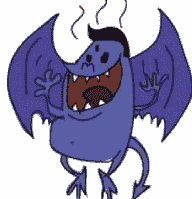

在更大的程序中使用这样的过程实际上非常常见，这就是为什么 JavaScript 让`push`和`pop`操作如此简单。

**注意**
*这种技术在计算机术语中称为“栈”。把它想象成一叠煎饼。每次你煎一个新煎饼，就把它放在顶部（就像`push`），而每次你吃掉一个，就从顶部取下（就像`pop`）。弹出一个栈就像是在时间上倒退：你弹出的最后一项是你最先放入的那一项。煎饼也一样：你吃的最后一个煎饼是最先煎好的。在编程术语中，这也称为“后进先出”（LIFO）。LIFO 的替代方案是“先进先出”（FIFO）。这也被称为队列，因为它就像一队人（或排队）。第一个加入队列的人就是第一个被服务的人。*

### 决策器

我们可以使用 JavaScript 中的数组来构建一个为我们做决策的程序（就像一个魔法8球）。不过，首先我们需要弄清楚如何获取随机数。

#### 使用 Math.random()

我们可以使用一个叫做`Math.random()`的特殊方法来生成随机数，每次调用它时都会返回一个0到1之间的随机数。示例如下：

```javascript
Math.random();
0.8945409457664937
Math.random();
0.3697543195448816
Math.random();
0.48314980138093233
```

需要注意的是，`Math.random()`总是返回一个小于1的数*，并且永远不会返回1本身。

如果你想得到更大的数字，只需将调用`Math.random()`的结果乘以一个数。例如，如果你想得到0到10之间的数字，可以将`Math.random()`乘以10：

```javascript
Math.random() * 10;
7.648027329705656
Math.random() * 10;
9.7565904534421861
Math.random() * 10;
1.21483442978933454
```

#### 使用 Math.floor() 向下取整

不过，我们不能直接使用这些数字作为数组索引，因为索引必须是整数，小数点后不能有任何内容。为了解决这个问题，我们需要另一个叫做`Math.floor()`的方法。它接收一个数字并将其向下舍入到最接近的整数（基本上就是去掉小数点后的所有内容）。

```javascript
Math.floor(3.7463463);
3
Math.floor(9.9999);
9
Math.floor(0.793423451963426);
0
```

我们可以结合这两种技术来创建一个随机索引。我们只需要将`Math.random()`乘以数组的长度，然后对这个值调用`Math.floor()`。例如，如果数组的长度是4，我们会这样做：

```javascript
Math.floor(Math.random() * 4); 
2 // 可能是0, 1, 2或3
```

每次调用上面的代码，它都会返回一个0到3（包括0和3）的随机数。因为`Math.random()`总是返回一个小于1的值，所以`Math.random() * 4`永远不会返回4或比4更高的值。

现在，如果我们将这个随机数用作索引，就可以从数组中随机选择一个元素：

```javascript
var randomWords = ["Explosion", "Cave", "Princess", "Pen"];
var randomIndex = Math.floor(Math.random() * 4);
randomWords[randomIndex];
"Cave"
```

这里我们使用`Math.floor(Math.random() * 4)`从0到3中选取一个随机数。一旦这个随机数被保存到变量`randomIndex`，我们就用它作为索引，从数组`randomWords`中请求一个字符串。

实际上，我们可以通过完全去掉`randomIndex`变量来简化这个写法：

```javascript
randomWords[Math.floor(Math.random() * 4)]; 
"Princess"
```

### 完整的决策器

现在让我们创建我们的短语数组，然后可以使用这段代码来随机选择一个。这就是我们的决策器！我在这里使用注释来展示一些你可能想问计算机的问题。

```javascript
var phrases = [
    "That sounds good",
    "Yes, you should definitely do that", 
    "I'm not sure that's a great idea", 
    "Maybe not today?",
    "Computer says no."
];

// 我应该再喝一杯奶昔吗？
phrases[Math.floor(Math.random() * 5)];
"I'm not sure that's a great idea"

// 我应该做作业吗？
phrases[Math.floor(Math.random() * 5)];
"Maybe not today?"
```

这里我们创建了一个名为`phrases`的数组，存储了不同的建议。现在，每当我们有问题时，我们都可以从`phrases`数组中请求一个随机值，它就会帮助我们做出决定！

注意，因为我们的决策数组有五项，所以我们将`Math.random()`乘以5。这将始终返回五个索引位置之一：0、1、2、3或4。

### 创建随机侮辱生成器

我们可以扩展决策器的例子，创建一个每次运行都会生成随机侮辱的程序！

```javascript
var randomBodyParts = ["Face", "Nose", "Hair"];
var randomAdjectives = ["Smelly", "Boring", "Stupid"];
var randomWords = ["Fly", "Marmot", "Stick", "Monkey", "Rat"];

// 从 randomBodyParts 数组中随机选择一个身体部位：
var randomBodyPart = randomBodyParts[Math.floor(Math.random() * 3)];

// 从 randomAdjectives 数组中随机选择一个形容词：
var randomAdjective = randomAdjectives[Math.floor(Math.random() * 3)];

// 从 randomWords 数组中随机选择一个词：
var randomWord = randomWords[Math.floor(Math.random() * 5)];

// 将所有随机字符串连接成一句话：
var randomInsult = "Your " + randomBodyPart + " is like a " + randomAdjective + " " + randomWord + "!!!";
randomInsult;
"Your Nose is like a Stupid Marmot!!!"
```

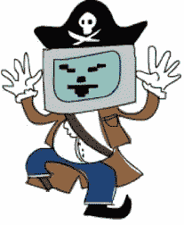

这里有三个数组，在第1、2、3行，我们使用三个索引从每个数组中提取一个随机词。然后，我们在变量`randomInsult`中将它们全部组合起来，形成一句完整的侮辱。在①和②处乘以3，是因为`randomAdjectives`和`randomBodyParts`都包含三个元素。同样，在③处乘以5，是因为`randomWords`有五个元素长。注意，我们在`randomAdjective`和`randomWord`之间添加了一个包含单个空格的字符串。尝试运行几次这段代码——每次你应该会得到一个不同的随机侮辱！

> **动手试试！！**
> 
> 如果你想更聪明一点，可以用这个替换第0行：
> 
> `var randomWord = randomWords[Math.floor(Math.random() * randomWords.length)];`
> 
> 我们知道总是需要将`Math.random()`乘以数组的长度，所以使用`randomWords.length`意味着我们不必硬编码数字。

这是构建随机侮辱的另一种方式：

```javascript
var randomInsult = ["Your", randomBodyPart, "is", "like", "a",
  randomAdjective, randomWord + "!!!"].join(" "); 
  
"Your Hair is like a Smelly Fly!!!"
```

在这个例子中，句子的每个单词都是数组中的一个独立字符串，我们用空格字符将它们连接起来。只有一个地方我们不想要空格，那就是在`randomWord`和"!!!"之间。这种情况下，我们使用`+`运算符来连接这两个字符串，中间没有空格。

### 你学到了什么

如你所见，JavaScript 数组是一种存储值列表的方式。现在你知道了如何创建和使用数组，并且有多种方式访问它们的元素。

数组是 JavaScript 提供的将多个值组合到一个地方的一种方式。在下一章中，我们将研究对象，这是将多个值作为单个单元存储的另一种方式。对象使用`字符串键`来访问元素，而不是数字索引。


### 编程挑战

尝试这些挑战，以练习你在本章中学到的技能。

- #1：新的侮辱语
使用你自己的词库，制作一个随机的侮辱语生成器。

- #2：更复杂的侮辱语
扩展随机侮辱语生成器，使其能生成类似"你的[身体部位]比[动物]的[动物身体部位]更[形容词]。"的侮辱语。（提示：你需要创建另一个数组。）

- #3：使用+还是JOIN？
制作两个版本的随机侮辱语生成器：一个使用+运算符创建字符串，另一个创建数组并使用.join方法连接。你更喜欢哪一种，为什么？

- #4：连接数字
如何使用join方法将数组[3, 2, 1]转换成字符串"3 is bigger than 2 is bigger than 1"？

## 第4章 对象

JavaScript中的对象与数组非常相似，但对象使用字符串而不是数字来访问不同的元素。这些字符串被称为**键或属性**，它们指向的元素被称为**值**。这些信息一起被称为[键值对](https://example.com)。数组主要用于表示多个事物的列表，而对象则常用于表示具有多个特征或**属性**的单个事物。例如，在第3章中，我们创建了几个列出不同动物名称的数组。但如果我们想存储关于一个动物的不同信息呢？

### 创建对象

我们可以通过创建一个JavaScript对象来存储关于单个动物的大量信息。这是一个存储关于一只名叫Harmony的三脚猫信息的对象。

```javascript
var cat = { 
  "legs": 3,
  "name": "Harmony",
  "color": "Tortoiseshell" 
};
```

这里我们创建了一个名为cat的变量，并给它赋值了一个包含三个键值对的对象。要创建一个对象，我们使用花括号{ }，而不是我们用于创建数组的方括号。在花括号之间，我们输入键值对。花括号及其之间的所有内容被称为*对象字面量*。对象字面量是一种通过一次性写出整个对象来创建对象的方法。

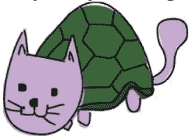

**注意**

我们还见过*数组字面量*（例如，[a, b, c]）、数字字面量（例如，5）、*字符串字面量*（例如，"moose"）和*布尔字面量*（true和false）。字面量只是指整个值是一次性写出的，而不是通过多个步骤构建的。

例如，如果你想创建一个包含数字1到3的数组，你可以使用*数组字面量*[1, 2, 3]。或者你可以创建一个空数组，然后使用push方法将1、2和3添加到数组中。你并不总是事先知道数组或对象中会包含什么，这就是为什么你不能总是使用字面量来构建数组和对象。

**图4-1**显示了创建对象的基本语法。

| 部分 | 描述 |
| :--- | :--- |
| 键 | 总是字符串 |
| 值 | 可以是字符串或任何类型 |

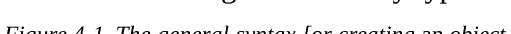

当你创建一个对象时，键放在冒号（:）之前，值放在冒号之后。冒号的作用有点像等号——右边的值被赋给左边的名称，就像你创建变量时一样。在每个键值对之间，你必须放一个逗号。在我们的例子中，逗号在行的末尾——但请注意，最后一个键值对（color: "Tortoiseshell"）后面不需要逗号。因为它是最后一个键值对，所以接下来是右花括号，而不是逗号。

### 不带引号的键

在我们的第一个对象中，我们给每个键加了引号，但键周围不一定需要引号——这也是一个有效的cat对象字面量：

```javascript
var cat = {
  legs: 3,
  name: "Harmony",
  color: "Tortoiseshell"
}
```

JavaScript知道键总是字符串，这就是为什么你可以省略引号。如果你不在键周围加引号，那么不带引号的键必须遵循与变量名相同的规则：例如，不带引号的键中不允许有空格。如果你把键放在引号中，那么允许有空格：

```javascript
var cat = { 
  legs: 3,
  "full name": "Harmony Philomena Snuggly-Pants Morgan", 
  color: "Tortoiseshell"
}
```

请注意，虽然键总是字符串（带或不带引号），但该键的值可以是任何类型的值，甚至可以是包含值的变量。

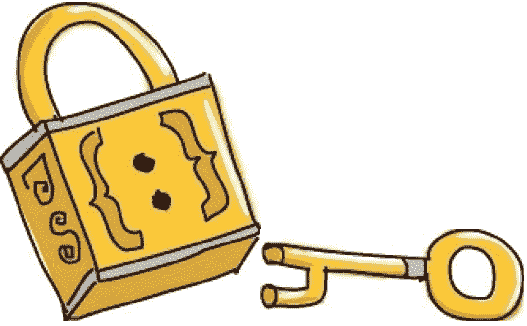

你也可以把整个对象放在一行上，但这样可能更难阅读：

```javascript
var cat = { legs: 3, name: "Harmony", color: "Tortoiseshell" };
```

### 访问对象中的值

你可以像使用数组一样使用方括号访问对象中的值。唯一的区别是，你使用键（一个字符串）而不是索引（一个数字）。

```javascript
cat["name"];
"Harmony"
```

正如创建对象字面量时键周围的引号是可选的，在访问对象中的键时，引号也是可选的。但是，如果你不使用引号，代码看起来会有些不同：

```javascript
cat.name;
"Harmony"
```

这种风格被称为*点表示法*。我们不需要在对象名称后面的方括号中键入带引号的键名，而是使用一个句点，后跟键名，不带任何引号。与对象字面量中不带引号的键一样，这只有在键不包含任何特殊字符（例如空格）时才有效。

假设你不是通过键入键来查找值，而是想获取对象中所有键的列表。JavaScript提供了一种简单的方法来做到这一点，使用`Object.keys()`：

```javascript
var dog = { name: "Pancake", age: 6, color: "white", bark: "Yip yap!" };
var cat = { name: "Harmony", age: 8, color: "tortoiseshell" };

Object.keys(dog);
[ "name", "age", "color", "bark" ]

Object.keys(cat);
[ "name", "age", "color" ]
```

`Object.keys(anyObject)`返回一个包含anyObject所有键的数组。

### 向对象添加值

空对象就像空数组，但它使用花括号{ }而不是方括号：

```javascript
var object = {};
```

你可以像向数组添加项一样向对象添加项，但使用字符串而不是数字：

```javascript
var cat = {};
cat["legs"] = 3;
cat["name"] = "Harmony"; 
cat["color"] = "Tortoiseshell"; 
cat;
{ color: "Tortoiseshell", legs: 3, name: "Harmony" }
```

这里，我们从一个名为cat的空对象开始。然后我们一个接一个地添加了三个键值对。接着，我们输入`cat;`，浏览器会显示对象的内容。不过，不同的浏览器输出对象的方式可能不同。例如，Chrome（在我写这篇文章时）这样输出cat对象：

```javascript
Object {legs: 3, name: "Harmony", color: "Tortoiseshell"}
```

虽然Chrome按那个顺序（legs, name, color）打印键，但其他浏览器可能会以不同的顺序打印它们。这是因为JavaScript存储对象时，键没有任何特定的顺序。

数组显然有一定的顺序：索引0在索引1之前，索引3在索引2之后。但对于对象，没有明显的方法来对每个项进行排序。color应该放在legs之前还是之后？这个问题没有“正确”的答案，所以对象只是存储键而不给它们分配任何特定的顺序，因此不同的浏览器会以不同的顺序打印键。因此，你永远不应该编写依赖于对象键处于精确顺序的程序。

### 使用点表示法添加键

你也可以在添加新键时使用点表示法。让我们尝试前面的例子，我们从一个空对象开始并向其中添加键，但这次我们将使用点表示法：

```javascript
var cat = {};
cat.legs = 3;
cat.name = "Harmony";
cat.color = "Tortoiseshell";
```

如果你询问JavaScript不知道的属性，它会返回特殊值`undefined`。`undefined`只是意味着“这里什么都没有！”例如：

```javascript
var dog = {
  name: "Pancake", 
  legs: 4, 
  isAwesome: true
};

dog.isBrown;
undefined
```

这里我们为dog定义了三个属性：name、legs和isAwesome。我们没有定义isBrown，所以`dog.isBrown`返回`undefined`。

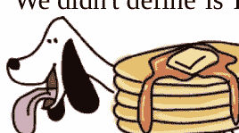


### 结合数组与对象

到目前为止，我们只讨论了包含数字和字符串等简单类型的数组和对象。但没有任何限制阻止你将另一个数组或对象作为数组或对象中的值来使用。

例如，一个恐龙对象数组可能看起来像这样：

```javascript
var dinosaurs = [
  { name: "Tyrannosaurus Rex", period: "Late Cretaceous" },
  { name: "Stegosaurus", period: "Late Jurassic" },
  { name: "Plateosaurus", period: "Triassic" }
];
```

要获取第一只恐龙的所有信息，你可以使用我们之前用过的技术，在方括号中输入索引：

```javascript
dinosaurs[0];
// { name: "Tyrannosaurus Rex", period: "Late Cretaceous" }
```

如果你只想获取第一只恐龙的名字，只需在数组索引后面的方括号中添加对象键即可：

```javascript
dinosaurs[0]["name"];
// "Tyrannosaurus Rex"
```

或者，你可以使用点符号，像这样：

```javascript
dinosaurs[1].period;
// "Late Jurassic"
```

**注意**
*点符号只能用于对象，不能用于数组。*

### 朋友数组

现在让我们看一个更复杂的例子。我们将创建一个朋友对象数组，其中每个对象还包含一个数组。首先，我们创建这些对象，然后将它们全部放入一个数组中。

```javascript
var anna = { name: "Anna", age: 11, luckyNumbers: [2, 4, 8, 16] };
var dave = { name: "Dave", age: 5, luckyNumbers: [3, 9, 40] };
var kate = { name: "Kate", age: 9, luckyNumbers: [1, 2, 3]};
```

首先，我们创建三个对象并将它们保存在名为 anna、dave 和 kate 的变量中。每个对象有三个键：name、age 和 luckyNumbers。每个 name 键被分配了一个字符串值，每个 age 键被分配了一个数字值，而每个 luckyNumbers 键被分配了一个包含几个不同数字的数组。

接下来，我们将创建我们的朋友数组：

```javascript
var friends = [anna, dave, kate];
```

现在我们有一个保存在变量 friends 中的数组，其中包含三个元素：anna、dave 和 kate（它们分别指向对象）。你可以使用数组中的索引来检索其中一个对象：

```javascript
friends[1];
// { name: "Dave", age: 5, luckyNumbers: Array[3] }
```

这将检索数组中的第二个对象，即 dave（索引为 1）。Chrome 为 luckyNumbers 数组打印出 Array[3]，这只是它表达“这是一个包含三个元素的数组”的方式。（你可以使用 Chrome 来查看该数组中的内容；请参阅 [在控制台中探索对象](#exploring-objects-in-the-console)。）我们还可以通过在方括号中输入对象的索引，随后紧跟我们想要的键来检索对象中的某个值：

```javascript
friends[2].name;
// "Kate"
```

这段代码请求索引为 2 的元素（即名为 kate 的变量），然后请求该对象中键为 name 的属性，结果是 "Kate"。我们甚至可以从 friends 数组中某个对象内部的数组中检索一个值，像这样：

```javascript
friends[0].luckyNumbers[1];
// 4
```

图 4-2 显示了每个索引。friends[0] 是 friends 数组中索引为 0 的元素，即对象 anna。friends[0].luckyNumbers 是名为 anna 的对象中的数组 [2, 4, 8, 16]。最后，friends[0].luckyNumbers[1] 是该数组中索引为 1 的元素，即数字值 4。

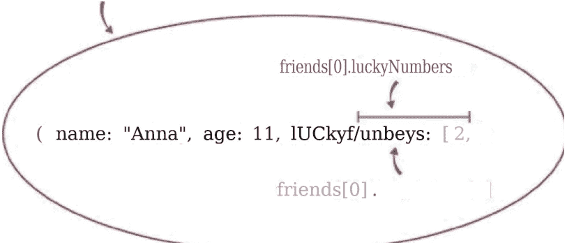

```javascript
var friends = [anna, dave, kate];
```

图 4-2. 访问嵌套值

### 在控制台中探索对象

Chrome 允许你深入研究在控制台中打印出的对象。例如，如果你输入...

```javascript
friends[1];
```

Chrome 将显示图 4-3 所示的输出。

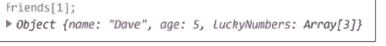

图 4-3. 对象在 Chrome 解释器中的显示方式

左侧的三角形意味着该对象可以展开。点击该对象将其展开，你将看到图 4-4 所示的内容。

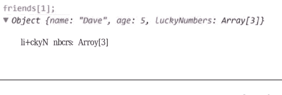

图 4-4. 展开对象

你也可以通过点击 luckyNumbers 来展开它（见图 4-5）。

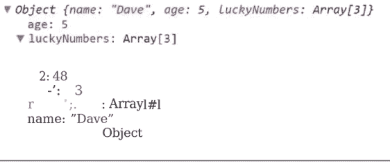

图 4-5. 展开对象中的 luckyNumbers

不用担心那些属性——它们与对象的原型（prototype）有关。我们将在第 12 章中讨论它们。此外，你会注意到解释器显示了数组的值。

你还可以查看整个 friends 数组并展开数组中的每个元素，如图 4-6 所示。

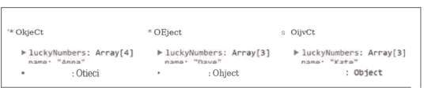

图 4-6. Chrome 解释器中显示的 friends 数组中的所有三个对象

### 对象的实用操作

现在你已经知道了创建对象并为其添加属性的几种不同方法，让我们通过尝试一些简单的程序来运用所学知识。

### 追踪欠款

假设你决定开一家银行。你借钱给朋友，并且想要一种方法来追踪每个人欠你多少钱。

你可以使用对象将字符串和值链接在一起。在这种情况下，字符串将是你朋友的名字，而值将是他或她欠你的金额。让我们来看看。

```javascript
var owedMoney = {};
owedMoney["Jimmy"] = 5;
owedMoney["Anna"] = 7;
owedMoney["Jimmy"];
// 5
owedMoney["Jimen"];
// undefined
```

开始时，我们创建了一个名为 owedMoney 的新空对象。然后，我们将值 5 分配给键 "Jimmy"。我们对键 "Anna" 做同样的操作，分配值 7。然后，我们请求与键 "Jimmy" 相关联的值，结果是 5。接着我们请求与键 "Jimen" 相关联的值，结果是 undefined，因为我们没有设置它。

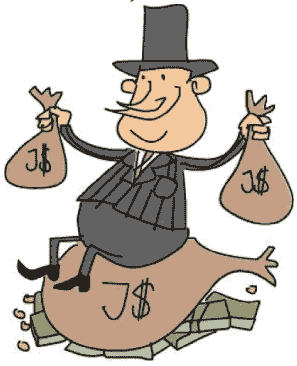

现在想象一下 Jimmy 又借了一些钱（比如 3 美元）。我们可以更新对象，并使用你在第 2 章中看到的加等于运算符 (+=) 将 3 加到 Jimmy 欠款的金额中。

```javascript
owedMoney["Jimmy"] += 3;
owedMoney["Jimmy"];
// 8
```

这就像是在说 `owedMoney["Jimmy"] = owedMoney["Jimmy"] + 3`。我们还可以查看整个对象，看看每个朋友欠我们多少钱：

```javascript
owedMoney;
// { Jimmy: 8, Anna: 7 }
```

### 存储电影信息

假设你拥有大量的 DVD 和蓝光电影收藏。如果能在电脑上存储这些电影的信息，以便轻松地查询每部电影，那该多好啊！

你可以创建一个对象来存储电影信息，其中每个键是电影标题，每个值是另一个包含电影信息的对象。对象中的值本身也可以是对象！

```javascript
var movies = {
  "Finding Nemo": {
    releaseDate: 2003,
    duration: 100,
    actors: ["Albert Brooks", "Ellen DeGeneres", "Alexander Gould"],
    format: "DVD"
  },
  "Star Wars: Episode VI - Return of the Jedi": {
    releaseDate: 1983,
    duration: 134,
    actors: ["Mark Hamill", "Harrison Ford", "Carrie Fisher"],
    format: "DVD"
  },
  "Harry Potter and the Goblet of Fire": {
    releaseDate: 2005,
    duration: 157,
    actors: ["Daniel Radcliffe", "Emma Watson", "Rupert Grint"],
    format: "Blu-ray"
  }
};
```

你可能已经注意到，我对电影标题（外层对象的键）使用了引号，但对内层对象的键没有使用。这是因为电影标题中需要包含空格——否则，我必须把每个标题写成像 "StarWarsEpisodeVIReturnofTheJedi" 这样，那太傻了！内层对象的键不需要引号，所以我省略了它们。这样可以使代码在没有不必要的标点符号时看起来更整洁。


现在，当你想要某部电影的信息时，很容易找到：

```javascript
var findingNemo = movies["Finding Nemo"];
findingNemo.duration;
// 100

findingNemo.format;
// "DVD"
```

这里我们将 *Finding Nemo* 的电影信息保存在名为 findingNemo 的变量中。然后我们可以查看此对象的属性（如 duration 和 format）来了解该电影。

你也可以轻松地向收藏中添加新电影：

```javascript
var cars = {
  releaseDate: 2006,
  duration: 117,
  // ...
};
```


```javascript
actors: ["Owen Wilson", "Bonnie Hunt", "Paul Newman"],
format: "Blu-ray"
```

```
movies["Cars"] = cars;
```

这里，我们创建了一个关于 *《赛车总动员》* 电影信息的新对象。然后我们将其插入到 `movies` 对象中，键名为 `"Cars"`。

现在你的收藏库正在逐渐丰富，你可能会想要找到一个简便的方法来列出所有电影的名称。这就是 `object.keys` 的用武之地：

```
Object.keys(movies);
["Finding Nemo", "Star Wars: Episode VI Return of the Jedi", "Harry Potter and the Goblet of Fire", "Cars"]
```

### 你学到了什么

现在你已经了解了 JavaScript 中对象的工作方式。它们与数组很相似，因为你可以用它们将大量信息组合在一个单元中。一个主要区别是，你使用字符串来访问对象中的元素，而使用数字来访问数组中的元素。因此，数组是有序的，而对象则不是。

在学习了更多 JavaScript 的特性之后，我们将在后面的章节中更多地使用对象。在下一章中，我们将探讨 *条件语句* 和 *循环*，它们都是增加程序结构、使其更强大的方式。

### 编程挑战

尝试这些挑战来练习使用对象。

#### #1：计分员

想象一下，你正在和一些朋友玩游戏，你想要记录分数。创建一个名为 `scores` 的对象。键将是你的朋友名字，值将是分数（都从 0 开始）。当玩家得分时，你必须增加他们的分数。你会如何在 `scores` 对象中增加一个玩家的分数？

#### #2：深入对象和数组

假设你有以下对象：

```
var myCrazyObject = {
  "name": "A ridiculous object",
  "some array": [7, 9, { purpose: "confusion", number: 123 }, 3.3],
  "random animal": "Banana Shark"
}
```

你会如何用一行 JavaScript 代码从这个对象中取出数字 123？在控制台中尝试一下，看看你是否正确。

## 第 5 章 HTML 基础

我们目前使用的基于浏览器的 JavaScript 控制台非常适合尝试小段代码，但为了创建实际的程序，我们需要一些更灵活的东西，比如一个包含一些 JavaScript 的网页。在本章中，我们将学习如何创建一个基本的 HTML 网页。

**HTML** (*超文本标记语言*) 是用于制作网页的语言。*超文本* 一词指的是通过 *超链接* 连接的文本，即网页上的链接。*标记语言* 用于注释文档，使其不仅仅是纯文本。标记告诉软件（如网络浏览器）如何显示文本以及如何处理它。

在本章中，我将向你展示如何在 [文本编辑器](https://example.com) 中编写 HTML 文档，这是一个设计用于编写纯文本文件的简单程序，没有你在 Microsoft Word 等文字处理软件中找到的格式。

文字处理文档包含 *[格式化](https://example.com)* 的文本（具有不同的字体、颜色、大小等），而文字处理软件的设计使得更改文本格式变得容易。文字处理软件通常还允许你插入图片和图形。

纯文本文件只包含文本，没有关于字体、颜色、大小等方面的信息。除非你用文本制作图像，否则你无法在文本文件中放入图片——比如这只猫，例如。

```
      )   (   //
    (")_  (")_//  =( °w° )=
```

### 文本编辑器

我们将在 *跨平台*（兼容 Windows、Mac OS 和 Linux）的 Sublime Text 编辑器中编写 HTML。你可以免费下载并使用 Sublime Text，但过一段时间后，你将被要求支付许可费用。如果你不喜欢这个想法，我在下面列出了一些完全免费的替代品。我本章的说明是针对 Sublime Text 的，但由于文本编辑器相对简单，说明应该对任何编辑器都大致适用。

- Gedit 是 GNOME 项目 (https://wiki.gnome.org/Apps/Gedit) 的跨平台文本编辑器。
- 对于 Microsoft Windows，Notepad++ (http://notepad-plus-plus.org) 是另一个不错的选择。
- 在 Mac OS 上，TextWrangler (http://www.barebones.com/products/textwrangler) 是一个不错的选择。

要安装 Sublime Text，请访问 http://www.sublimetext.com。每个操作系统的安装说明各不相同，但你应该能发现它们相当清晰。如果你遇到任何问题，请尝试访问 Sublime Text 主页的“支持”部分。

> **语法高亮**
>
> Sublime Text 会使用 *语法高亮* 为你的代码添加颜色。这是为了通过为不同类型的代码分配不同的颜色，使程序员更容易阅读程序。例如，字符串可能是绿色的，而像 `var` 这样的关键字可能是橙色的。
>
> Sublime Text 有许多颜色方案可供选择。在本书中，我们使用 IDLE 颜色方案，你可以通过转到 **Preferences > Color Scheme** 并选择 IDLE 来在屏幕上匹配它。

### 我们的第一个 HTML 文档

安装 Sublime Text 后，启动程序，通过 **File > New File** 创建一个新文件。接下来，选择 **File > Save** 保存你新的空白文件；将其命名为 `page.html` 并保存到你的桌面。

现在是时候编写一些 HTML 了。在你的 *page.html* 文件中输入以下文本：

```
<h1>Hello world!</h1>

<p>My first web page.</p>
```

通过 **File > Save** 保存你更新版本的 page.html。现在让我们看看这个页面在网页浏览器中会是什么样子。打开 Chrome，选择 **File > Open File**，并从你的桌面上选择 *page.html*。你应该会看到类似图 5-1 的内容。

*图 5-1. 你的第一个 HTML 页面在 Chrome 中*

你刚刚创建了你的第一个 HTML 文档！虽然你是在网页浏览器中查看它，但它实际上并不在互联网上。Chrome 正在本地打开你的页面，只是读取你的标记标签以确定如何处理其文本。

### 标签和元素

HTML 文档由 *元素* 组成。一个元素以 *开始标签* 开始，以 *结束标签* 结束。例如，在我们目前的文档中，我们有两个元素：`h1` 和 `p`。`h1` 元素以开始标签 `<h1>` 开始，以结束标签 `</h1>` 结束。`p` 元素以开始标签 `<p>` 开始，以结束标签 `</p>` 结束。开始和结束标签之间的任何内容都是元素的 *内容*。

开始标签由用尖括号 < 和 > 括起来的元素名称组成。结束标签相同，但它们在元素名称前有一个斜杠 (/)。

### 标题元素

每个元素都有特殊的含义和用法。例如，`h1` 元素表示“这是一个顶级标题。”你放在开始和结束 `<h1>` 标签之间的内容由浏览器以大号、粗体字体单独显示在一行上。

HTML 中有六个级别的标题元素：`h1`、`h2`、`h3`、`h4`、`h5` 和 `h6`。它们看起来像这样：

```
<h1>一级标题</h1>
<h2>二级标题</h2>
<h3>三级标题</h3>
<h4>四级标题</h4>
<h5>五级标题</h5>
<h6>六级标题</h6>
```

*图 5-2. 不同的标题元素*

### p 元素

`p` 元素用于定义独立的文本段落。你放在 `<p>` 标签之间的任何文本都将作为一个单独的段落显示，段落上下会有一些间距。让我们尝试创建多个 `p` 元素。将这新的一行添加到你的 page.html 文档中（旧行以灰色显示）：

```
<h1>Hello world!</h1>
<p>My first web page.</p>
<p>Let's add another paragraph.</p>
```

图 5-3 显示了包含新段落的网页。

*图 5-3. 同一个页面，但多了一个段落*

注意这些段落出现在不同的行上，并且被一些空间分隔开。这一切都是因为 `<p>` 标签。


### HTML 中的空白字符与块级元素

如果没有标签，我们的页面会是什么样子？让我们来看看：

Hello world!

My first web page.

Let's add another paragraph.

**图 5-4** 展示了没有任何标签的页面。


*图 5-4. 同一页面但在没有 HTML 标签的情况下的样子*

糟糕！我们不仅失去了格式，而且所有内容都挤在了一行里！原因是在 HTML 中，所有[空白字符](link)都会被合并为一个空格。空白字符是指任何在页面上产生空白的字符 —— 例如，空格字符、制表符（tab）和换行符（当你按下 ENTER 或 RETURN 键时插入的字符）。你在 HTML 文档中插入的任何两个文本段落之间的空行，都会被合并为一个空格。

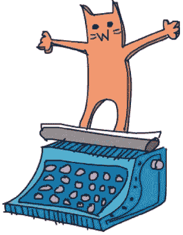

`p` 和 `h1` 元素被称为*块级（block-level）*元素，因为它们将其内容显示在一个单独的块中，从新行开始，且其后的任何内容也会在新行开始。

### 行内元素

让我们在文档中再添加两个元素，`em` 和 `strong`：

```
<h1>Hello world!</h1>
<p>My <em>first</em> <strong>web page</strong>.</p>
<p>Let's add another <strong><em>paragraph</em></strong>.</p>
```

**图 5-5** 展示了添加新标签后页面的样子。

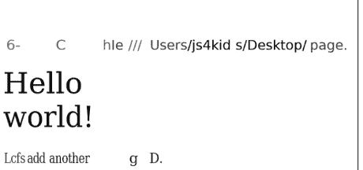

`em` 元素将其内容变为斜体。`strong` 元素将其内容变为粗体。`em` 和 `strong` 元素都是*行内（inline）*元素，这意味着它们不会像块级元素那样将内容放在新行上。

要使内容*同时*变为粗体和斜体，请将其放入这两个标签中。请注意在之前的示例中，粗斜体文本的标签顺序是：`<strong><em>paragraph</em></strong>`。正确地*嵌套*元素非常重要。嵌套意味着如果一个元素在另一个元素内部，那么它的开始标签和结束标签都应该在父元素内部。例如，以下做法是不允许的：

```
<strong><em>paragraph</strong></em>
```

在这种情况下，结束标签 `</strong>` 出现在了结束标签 `</em>` 之前。浏览器通常不会在你犯这种错误时提醒你，但嵌套错误可能会导致你的页面以奇怪的方式崩溃。

### 一个完整的 HTML 文档

到目前为止我们看到的实际上只是 HTML 的片段。一个完整的 HTML 文档需要一些额外的元素。让我们看一个完整 HTML 文档的示例以及每个部分的含义。使用这些新元素更新你的 *page.html* 文件：

```
<!DOCTYPE html>
<html>
<head>
    <title>My first proper HTML page</title>
</head>
<body>
    <h1>Hello world!</h1>
    <p>My <em>first</em> <strong>web page</strong>.</p>
    <p>Let's add another <strong><em>paragraph</em></strong>.</p>
</body>
</html>
```

**注意**

*Sublime Text 应该会自动为你缩进某些行，如本例所示。它实际上是根据标签（如 `<html>`、`<h1>` 等）来识别行，并根据其嵌套关系进行缩进。不过，Sublime Text 不会对 `<head>` 和 `<body>` 标签进行缩进，尽管某些编辑器会这样做。*

**图 5-6** 展示了完整的 HTML 文档。

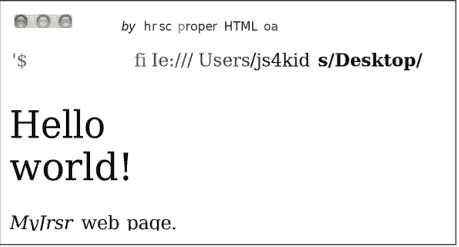

*图 5-6. 完整的 HTML 文档*

让我们浏览一下 page.html 文件中的元素。`<!DOCTYPE html>` 标签只是一个声明。它简单地表示：“这是一个 HTML 文档。” 接下来的开始标签 `<html>`（结束标签 `</html>` 在最后）。所有 HTML 文档必须有一个 `html` 元素作为其最外层元素。

`html` 元素内部有两个元素：`head` 和 `body`。`head` 元素包含关于 HTML 文档的某些信息，例如包含文档标题的 **title** 元素。例如，请注意在图 5-6 中，浏览器标签页中的标题 —— "My first proper HTML page" —— 与我们在 title 元素中输入的内容一致。`title` 元素包含在 `head` 元素中，而 `head` 元素又包含在 `html` 元素中。

`body` 元素包含将在浏览器中显示的内容。在这里，我们只是复制了本章前面部分的 HTML。

### HTML 层级结构

HTML 元素具有清晰的层级或顺序，可以将其视为一种倒置的树。你可以在图 5-7 中看到我们的文档作为一棵树的样子。

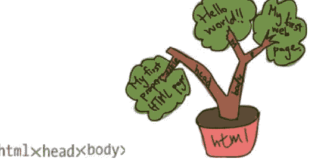

*图 5-7. 将图 5-6 中的元素以树状图显示*

最顶层元素是 `html` 元素。它包含 `head` 和 `body` 元素。`head` 包含 `title` 元素，`body` 包含 `h1` 和 `p` 元素。浏览器根据这个层级结构来解析你的 HTML。我们稍后将在第 9 章中学习如何更改文档结构。

图 5-8 展示了另一种可视化 HTML 层级结构的方法，即一组嵌套的方框。

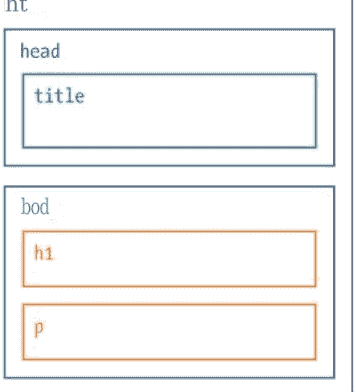

*图 5-8. 将 HTML 层级结构显示为嵌套方框*

### 向 HTML 中添加链接

在本章的前面，我们了解到 *HTML* 中的 *HT* 代表超文本（HyperText），即链接文本。HTML 文档可以包含将你引导至其他网页的*超链接*（简称*链接*）。`a` 元素（代表 *anchor*，锚点）用于创建链接元素。

修改你的 HTML 文档以匹配以下示例：删除第二个 `p` 元素以及 `<em>` 和 `<strong>` 标签，然后添加新的彩色代码以创建指向 http://xkcd.com/ 的链接：

```
<!DOCTYPE html>
<html>
<head>
    <title>My first proper HTML page</title>
</head>
<body>
    <h1>Hello world!</h1>
    <p>My first web page.</p>
    <p><a href="http://xkcd.com">Click here</a> to read some excellent comics.</p>
</body>
</html>
```

现在保存并在浏览器中打开你的页面，它应该看起来像**图 5-9**。

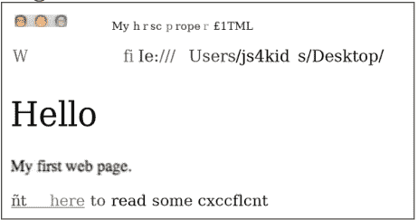

*图 5-9. 一个包含指向 http://xkcd.com 链接的网页*

如果你点击该链接，浏览器应该会跳转到 xkcd 网站 http://xkcd.com。当你尽情欣赏过那些极客漫画后，点击后退按钮返回你的页面。

### 链接属性

让我们仔细看看是如何创建那个 HTML 链接的。为了告诉浏览器在点击 `a` 元素时跳转到哪里，我们在锚点元素中添加了名为“属性”的东西。HTML 元素中的属性类似于 JavaScript 对象中的键值对。每个属性都有一个名称和一个值。

这是我们创建的 xkcd 链接：

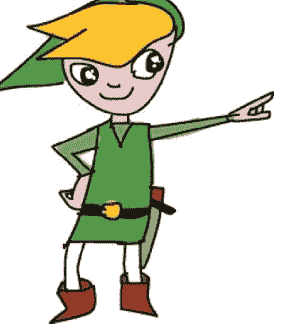

```
<a href="http://xkcd.com">Click here</a>
```

在这种情况下，属性名称是 `href`，属性值是 `"http://xkcd.com"`。名称 `href` 代表 *hypertext reference*（超文本引用），这是“网页地址”的一种专业说法。

**图 5-10** 展示了链接的所有组成部分。

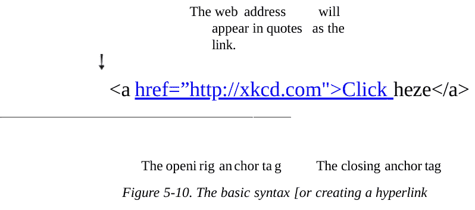

链接将引导你前往作为 `href` 属性值的任何网页地址。

### Title 属性

我们可以为链接添加的另一个属性是 title 属性。该属性设置当你将鼠标悬停在链接上时看到的文本。例如，将开始标签 `<a>` 修改为如下形式：

```
<a href="http://xkcd.com" title="xkcd: Land of geeky comics!">Click here</a>
```

现在重新加载页面。当你将光标悬停在链接上时，你应该能看到文本 "xkcd: Land of geeky comics!" 浮在页面上方，如图 **5-11** 所示。

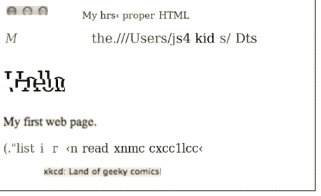

*图 5-11. 一个包含具有 title 属性的 http://xkcd.com 链接的网页*

**动手试试！**

创建一个名为 `links.html` 的新文件。它应该包含与我们的 `page.html` 相同的 HTML 结构，但具有新的标题和标题行，以及三个段落 (`p`) 元素。在每个段落中，包含一个指向你最喜欢的网站的链接。确保所有 `a` 元素都具有 `href` 和 `title` 属性。


### 你学到了什么

在本章中，你学习了 HTML 的基础知识，HTML 是用于创建网页的语言。我们创建了一个包含指向另一个页面链接的简单网页。

在下一章中，我们将学习如何在网页中嵌入 JavaScript。这将使编写更大的程序变得容易得多，因为我们将在接下来的几章中探索更多 JavaScript 的功能。

这是一本关于 JavaScript 的书，而不是 HTML，因此我只介绍了创建 HTML 文档的最基本知识。以下是一些可以进一步学习 HTML 的资源：

- Mozilla 开发者网络的 HTML 入门：https://developer.mozilla.org/en-US/docs/Web/Guide/HTML/Introduction
- Codecademy 的 HTML 和 CSS 课程：http://www.codecademy.com/tracks/web/
- Mozilla Webmaker：https://webmaker.org/

## 第 6 章 条件语句和循环

条件语句和循环是 JavaScript 中最重要的两个概念。[条件语句](conditional)表示："如果某件事为真，就执行这个。否则，执行那个。"例如，如果你完成了作业，就可以吃冰淇淋；但如果你没有完成作业，就不能吃冰淇淋。*循环*表示："只要某件事为真，就一直执行这个。"例如，只要你口渴，就一直喝水。

条件语句和循环是强大的概念，是任何复杂程序的关键。它们被称为[控制结构](control_structures)，因为它们允许你控制代码的哪些部分在什么时候执行、执行多少次，这取决于你定义的某些条件。

我们首先需要了解如何在 HTML 文件中嵌入 JavaScript，这样我们才能开始创建比目前所学更长的程序。

### 在 HTML 中嵌入 JavaScript

以下是在第 5 章中创建的 HTML 文件，新增内容以彩色显示，已有文本以灰色显示。（为了使这个示例更简单一些，我还删除了指向 xkcd 的链接。）

```html
<!DOCTYPE html>
<html>
<head>
  <title>My first proper HTML page</title>
</head>

<body>
  <h1>Hello world!</h1>
  <p>My first web page.</p>
  <script>
  var message = "Hello world!";
  console.log(message);
  </script>
</body>
</html>
```

这里我们添加了一个新的元素，叫做 script。这是 HTML 中的一个特殊元素。对于大多数 HTML 元素，开始标签和结束标签之间的内容会显示在页面上。而对于 script 元素，标签之间的所有内容都会被当作 JavaScript 并由 JavaScript 解释器执行。

现在让我们来看一下 script 元素中的代码：

```javascript
var message = "Hello world!";
console.log(message);
```

在 HTML 文件中运行 JavaScript 与在控制台中运行 JavaScript 有很大不同。当你使用 JavaScript 控制台时，你输入的每一行代码都会在按下 ENTER 键后立即执行，并且该行的值会打印到控制台中。在网页中，JavaScript 从上到下一次性全部执行，除非我们特别要求，否则不会自动打印任何内容到控制台。我们可以使用 console.log 来打印内容，这将使我们在运行程序时更容易观察程序的执行过程。console.log 方法接受任意值并将其打印（记录）到控制台。

例如，如果你在打开 JavaScript 控制台的情况下加载本节开头的 HTML 文件，你会看到如下内容：

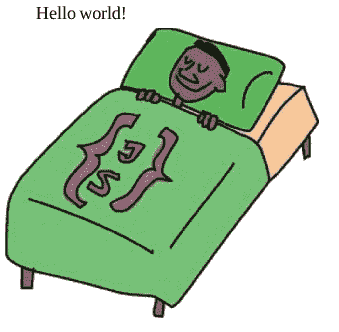

调用 `console.log(message)` 导致字符串 "Hello World !" 被打印到控制台中。

现在你已经知道如何用 JavaScript 编写更长的程序了，接下来可以开始学习条件语句了。

### 条件语句

JavaScript 中有两种形式的条件语句：if 语句和 if ... else 语句。if 语句用于在某件事为真时执行一段代码。例如，如果你表现好，就会得到奖励。if ... else 语句在某件事为真时执行一段代码，在不为真时执行另一段代码。例如，如果你表现好，就会得到奖励；*否则*，就要被禁足。

#### if 语句

if 语句是 JavaScript 控制结构中最简单的一种。它用于在条件为真时运行代码。回到你的 HTML 文件，将 script 元素中的两行代码替换为以下内容：

```javascript
var name = "Nicholas";
console.log("Hello " + name);
if(name.length > 7){
    console.log("Wow, you have a REALLY long name!");
}
```

首先，我们创建一个名为 name 的变量，并将其值设为字符串 "Nicholas"。然后我们使用 console.log 来记录字符串 "Hello Nicholas"。

我们使用 if 语句来检查 name 的长度是否大于 7。如果是，控制台将使用 console.log 显示 "Wow, you have a REALLY long name!"。

如图 6-1 所示，if 语句有两个主要部分：条件和主体。*条件*应该是一个布尔值。*主体*是一行或多行 JavaScript 代码，如果条件为真，这些代码将被执行。

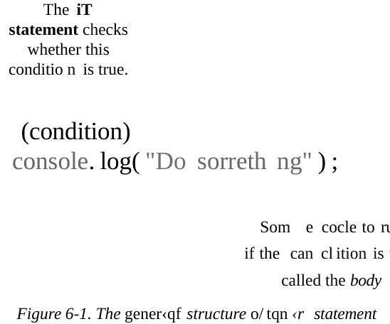

当你加载包含这段 JavaScript 的 HTML 页面时，你应在控制台中看到以下输出：

Hello Nicholas
Wow, you have a REALLY long name!

因为 *Nicholas* 这个名字有八个字符，`name.length` 返回 8。因此，条件 `name.length > 7` 为真，这导致 if 语句的主体被执行，从而输出了这条有点令人惊讶的消息。要避免触发 if 条件，将名字 *Nicholas* 改为 *Nick*（其余代码保持不变）：

```javascript
var name = "Nick";
```

现在保存文件并重新加载页面。这一次，条件 `name.length > 7` 不为真，因为 `name.length` 是 4。这意味着 if 语句的主体不会被执行，控制台中只会打印出以下内容：

Hello Nick

if 语句的主体仅在条件为真时执行。当条件为假时，解释器会简单地跳过 if 语句，继续执行下一行。

#### if...else 语句

如前所述，if 语句仅在条件为真时执行其主体。如果你想在条件为假时执行其他操作，则需要使用 if...else 语句。

让我们扩展前面的示例：

```javascript
var name = "Nicholas";
console.log("Hello " + name); 
if (name.length > 7) {
    console.log("Wow, you have a REALLY long name!"); 
} else {
    console.log("Your name isn't very long.");
}
```

这与之前的功能相同，不同之处在于如果名字*不*超过七个字符，它会打印一条替代消息。

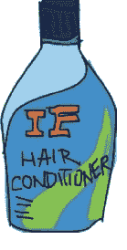

如**图 6-2** 所示，if...else 语句看起来像 if 语句，但有两个主体。关键字 else 放在两个主体之间。在 if...else 语句中，如果条件为真则执行第一个主体；否则执行第二个主体。

```javascript
// Something that is either true or false
if (condition) { 
    console.log("Do something"); // Some code to run if the condition is true
} else {
    console.log("Do something else"); // Some code to run if the condition is false
}
```
图 6-2. if...else 语句的一般结构

#### 链式 if...else 语句

通常我们需要检查一系列条件，当其中某个条件为真时执行相应的操作。例如，假设你在点中餐并选择吃什么。你最喜欢的中国菜是柠檬鸡，所以如果有这道菜你就会点。如果没有，你会点豆豉牛肉。如果这道菜也没有，你会点糖醋排骨。如果这些都没有（这种情况很少见），你会点蛋炒饭，因为你知道你去的所有中餐馆都会有这道菜。

```javascript
var lemonChicken = false;
var beefWithBlackBean = true; 
var sweetAndSourPork = true;

if (lemonChicken) {
    console.log("Great! I'm having lemon chicken!");
} else if (beefWithBlackBean) {
    console.log("I'm having the beef.");
} else if (sweetAndSourPork) {
    console.log("OK, I'll have the pork.");
} else {
    console.log("Well, I guess I'll have rice then.");
}
```

要创建链式 if...else 语句，先从一个普通的 if 语句开始，在其主体的右花括号之后输入关键字 else if，后跟另一个条件和另一个主体。你可以一直这样做，直到用完所有条件；条件的数量没有限制。如果没有任何条件为真，最终的 else 部分将执行。图 6-3 展示了一个通用的链式 if...else 语句。

每个条件都有对应的代码，当该条件为真时执行。

```javascript
if (condition1) {
    console.log("Do this if condition 1 is true");
} else if (condition2) {
    console.log("Do this if condition 2 is true");
} else if (condition3) {
    // ...
}
```


```javascript
console.log("Do this if condition 3 is true");
console.log("Do this otherwise");
```

如果所有条件都为 false，则运行的代码

### 图 6-3. 链式 if...else 语句

你可以这样理解：

- 1. 如果第一个条件为 true，执行第一个代码体。
- 2. 否则，如果第二个条件为 true，执行第二个代码体。
- 3. 否则，如果第三个条件为 true，执行第三个代码体。
- 4. 否则，执行 else 代码体。

当你有这样一条带有最终 else 部分的 if ... else 链时，你可以确定其中一个（且仅有一个）代码体会被执行。一旦找到为 true 的条件，其关联的代码体就会被执行，其他条件将不再被检查。如果我们运行上一个示例中的代码，控制台将打印出 I'm having the beef，因为 beefWithBlackBean 是 if ... else 链中第一个被发现为 true 的条件。如果没有任何条件为 true，则执行 else 代码体。

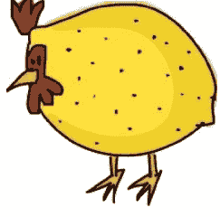

还有一点需要注意：你不一定非要包含最终的 else。但如果你省略了它，并且没有一个条件为 true，那么 if ... else 链中的任何代码都不会被执行。

```javascript
var lemonChicken = false;
var beefWithBlackBean = false;
var sweetAndSourPork = false;

if (lemonChicken) {
  console.log("Great! I'm having lemon chicken");
} else if (beefWithBlackBean) {
  console.log("I'm having the beef.");
} else if (sweetAndSourPork) {
  console.log("OK, I'll have the pork.");
}
```

在这个示例中，我们省略了最终的 else 部分。因为你喜欢的食物都不可用，所以什么也不会打印出来（看起来你什么也吃不上了！）。

> **试一试！**
>
> 编写一个程序，包含一个 name 变量。如果 name 是你的名字，就打印出"Hello me!"；否则，打印"Hello stranger!"。（提示：使用 === 来比较 name 和你的名字。）
>
> 接下来，重写这个程序，使其在 name 设为你爸爸的名字时对他说 hi，或者在 name 设为你妈妈的名字时对她说 hi。如果都不是，就像之前一样说"Hello stranger!"。

### 循环

正如我们所看到的，条件语句允许你在条件为 true 时运行一次代码。而循环则允许你在条件保持为 true 时多次运行一段代码。例如，只要盘子里还有食物，你就应该继续吃；或者，只要脸上还有污渍，你就应该继续洗。

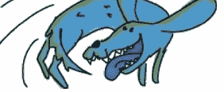

#### while 循环

最简单的循环是 while 循环。while 循环会重复执行其代码体，直到某个特定条件不再为 true。编写 while 循环时，你就是在说："当这个条件为 true 时，就一直做这件事。当条件变为 false 时停止。"

如图 6-4 所示，while 循环以 while 关键字开头，后面跟着括号中的条件，然后是花括号中的代码体。

```javascript
while (condition) {
    console.log("Do something");
    i++;
}
```
图 6-4. while 循环的一般结构

与 if 语句类似，while 循环的代码体在条件为 true 时执行。*不同于* if 语句的是，代码体执行后，条件会再次被检查，如果仍然为 true，则代码体再次执行。这个循环会一直持续下去，直到条件变为 false。

#### 用 while 循环数羊

假设你睡不着，想数羊。但你是个程序员，为什么不写一个程序来帮你数羊呢？

```javascript
var sheepCounted = 0;

while (sheepCounted < 10) {
    console.log("I have counted " + sheepCounted + " sheep!");
    sheepCounted++;
}

console.log("Zzzzzzzzzzz");
```

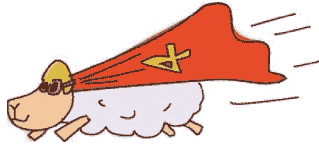

我们创建一个名为 sheepCounted 的变量，并将其值设为 0。当执行到 while 循环时，我们检查 sheepCounted 是否小于 10。因为 0 小于 10，花括号内的代码（循环体）就会执行，"I have counted " + sheepCounted + " sheep!" 会作为 "I have counted 0 sheep!" 被打印出来。接下来，sheepCounted 加 1，然后我们回到循环的开头，如此反复：

```
I have counted 0 sheep!
I have counted 1 sheep!
I have counted 2 sheep!
I have counted 3 sheep!
I have counted 4 sheep!
I have counted 5 sheep!
I have counted 6 sheep!
I have counted 7 sheep!
I have counted 8 sheep!
I have counted 9 sheep!
Zzzzzzzzzzz
```

这个过程会一直重复，直到 sheepCounted 变为 10，此时条件变为 false（10 不小于 10），程序就会继续执行循环之后的代码。在这个例子中，它打印出 Zzzzzzzzzzz。

#### 防止无限循环

使用循环时请记住：如果你设置的条件永远不会变为 false，你的循环将永远循环下去（或者至少直到你关闭浏览器）。例如，如果你省略了 `sheepCounted++;` 这一行，那么 sheepCounted 将始终为 0，输出结果会像这样：

```
I have counted 0 sheep!
I have counted 0 sheep!
I have counted 0 sheep!
I have counted 0 sheep!
```

因为没有任何东西来阻止它，程序将永远这样做下去！这就叫做*无限循环*。

#### for 循环

for 循环使编写循环更加方便，可以创建一个变量、循环直到条件为 true，并在每次循环结束时更新变量。在设置 for 循环时，你需要创建一个变量、指定条件，并说明变量在每个周期后应如何变化——所有这些都在到达循环体之前完成。例如，以下是我们如何使用 for 循环来数羊：

```javascript
for (var sheepCounted = 0; sheepCounted < 10; sheepCounted++){
    console.log("I have counted " + sheepCounted + " sheep!");
}
console.log("Zzzzzzzzzzzzz");
```

如图 6-5 所示，这个 for 循环由三个部分组成，用分号分隔：设置、条件和递增。

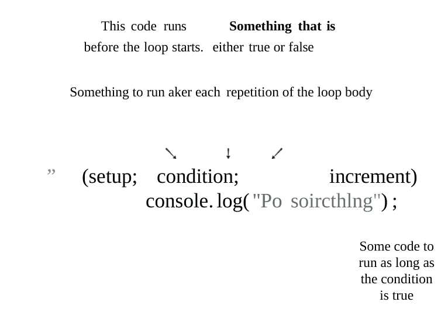

*设置*（`var sheepCounted = 0`）在循环开始之前执行。它通常用于创建一个变量来跟踪循环运行的次数。这里我们创建了变量 sheepCounted，初始值为 0。*条件*（`sheepCounted < 10`）在每次运行循环体之前被检查。如果条件为 true，则执行代码体；如果为 false，则循环停止。在这个例子中，一旦 sheepCounted 不再小于 10，循环就会停止。

*递增*（`sheepCounted++`）在每次执行循环体之后运行。它通常用于更新循环变量。这里我们用它在每次循环运行时将 sheepCounted 加 1。

for 循环通常用于执行某个固定次数的操作。例如，这个程序会说三次 **Hello!**。

```javascript
var timesToSayHello = 3;
for (var i = 0; i < timesToSayHello; i++) { 
    console.log("Hello!");
}
```

以下是输出结果：
Hello!
Hello!
Hello!

如果我们是运行这段代码的 JavaScript 解释器，我们会首先创建一个名为 timesToSayHello 的变量并将其设为 3。当执行到 for 循环时，我们运行设置部分，创建一个变量 i 并将其设为 0。接下来，我们检查条件。因为 i 等于 0 而 timesToSayHello 等于 3，条件为 true，所以我们进入循环体，它简单地输出字符串 "Hello!"。然后我们运行递增部分，将 i 增加到 1。

现在我们再次检查条件。它仍然为 true，所以我们再次运行代码体和递增。这个过程会一直重复，直到 i 等于 3。此时条件为 false（3 不小于 3），所以我们退出循环。

#### 在数组和字符串中使用 for 循环

for 循环一个非常常见的用途是对数组中的每个元素或字符串中的每个字符执行操作。例如，以下是一个打印动物园中动物的 for 循环：

```javascript
var animals = ["Lion", "Flamingo", "Polar Bear", "Boa Constrictor"];

for (var i = 0; i < animals.length; i++) { 
    console.log("This zoo contains a " + animals[i] + ".");
}
```

在这个循环中，i 从 0 开始，一直增加到比 animals.length 少 1，在这个例子中是 3。数字 0、1、2 和 3 是 animals 数组中动物的索引。这意味着每次循环时，i 是一个不同的索引，而 animals[i] 是 animals 数组中的另一个动物。

当 i 为 0 时，animals[i] 是 "Lion"，然后 i 为 1，animals[i] 是 "Flamingo"，以此类推。

运行这段代码将输出：

> This zoo contains a Lion.
> This zoo contains a Flamingo.
> This zoo contains a Polar Bear.
> This zoo contains a Boa Constrictor.

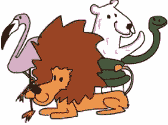

正如你在第 2 章所看到的，你可以像访问数组中的单个元素一样，使用方括号来访问字符串中的单个字符。接下来的示例使用 for 循环打印出名字中的每个字符：

```javascript
var name = "Nick";

for (var i = 0; i < name.length; i++) {
    console.log("My name contains the letter " + name[i] + ".");
}
```

这将输出：

- My name contains the letter N.
- My name contains the letter i.
- My name contains the letter c.
- My name contains the letter k.

### for 循环的其他用法

正如你所想象的，循环变量并不总是必须从 0 开始并每次增加 1。例如，这里有一种打印 10,000 以下所有 2 的幂次方的方法：

```javascript
for (var x = 2; x < 10000; x = x * 2) {
  console.log(x);
}
```

我们将 x 设置为 2，并使用 `x = x * 2;` 来增加 x 的值，这样每次循环运行时 x 的值都会翻倍。如你所见，结果增长得非常快：

- 2
- 4
- 8
- 16
- 32
- 64
- 128
- 256
- 512
- 1024
- 2048
- 4096
- 8192

瞧！这个简短的 for 循环就打印出了 10,000 以下所有 2 的幂次方。

**试一试！**
编写一个循环来打印 10,000 以下 3 的幂次方（应该打印 3, 9, 27 等）。用 While 循环重写这个循环。（提示：为变量提供初始值）。

### 你学到了什么

在本章中，你学习了条件语句和循环。条件语句用于仅在某个条件为真时运行代码。循环用于多次运行代码，并且只要某个条件为真就一直运行该代码。你可以使用条件语句来确保在正确的时间运行正确的代码，可以使用循环来让你的程序在必要时持续运行。具备这两项能力将为你打开编程可能性的全新世界。

在下一章中，我们将利用条件语句和循环的力量来制作我们的第一个真正的游戏！

### 编程挑战

尝试这些挑战来练习使用条件语句和循环。

**#1：超棒动物 (AWESOME ANIMALS)**

编写一个 for 循环来修改一个动物数组，让它们变得“超棒”！例如，如果你的起始数组是……

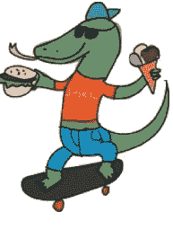

```javascript
var animals = ["Cat", "Fish", "Lemur", "KomodoDragon"];
```

那么在运行循环后，它应该看起来像这样：

```javascript
["Awesome Cat", "Awesome Fish", "Awesome Lemur", "Awesome Komodo Dragon"]
```

提示：你需要给每个索引处的数组值 *重新赋值*。这仅仅意味着在数组的现有位置分配一个新值。例如，为了让第一个动物变得超棒，你可以写：

```javascript
animals[0] = "Awesome " + animals[0];
```

**#2：随机字符串生成器 (RANDOM STRING GENERATOR)**

制作一个随机字符串生成器。你需要从一个包含所有英文字母的字符串开始：

```javascript
var alphabet = "abcdefghijklmnopqrstuvwxyz";
```

为了从这个字符串中随机挑选一个字母，你可以更新我们在第 3 章中用于随机侮辱生成器的代码：`Math.floor(Math.random() * alphabet.length)`。这将创建一个指向字符串的随机索引。然后你可以使用方括号来获取该索引处的字符。

为了创建随机字符串，先从一个空字符串开始（`var randomString = "";`）。然后，创建一个 while 循环，只要字符串长度小于 6（或你选择的任何长度），就不断将新的随机字母添加到该字符串中。你可以使用 `+=` 运算符将新字母添加到字符串末尾。循环结束后，将其打印到控制台来查看你的作品！

**#3：黑客语 (H4CK3R SP34K)**

将文本转换为黑客语！互联网上的许多人喜欢将某些字母替换为看起来像这些字母的数字。一些像字母的数字有：4 代表 A，3 代表 E，1 代表 I，0 代表 O。尽管这些数字看起来更像大写字母，但我们将替换这些字母的小写版本。要将普通文本转换为黑客语，我们需要一个输入字符串和一个新的空字符串：

```javascript
var input = "javascript is awesome";
var output = "";
```

然后你需要使用 for 循环遍历输入字符串的所有字母。如果字母是 "a"，则向输出字符串添加 "4"。如果是 "e"，添加 "3"。如果是 "i"，添加 "1"，如果是 "o"，添加 "0"。否则，只需将原字母添加到新字符串中。像之前一样，你可以使用 `+=` 将每个新字母添加到输出字符串。

循环结束后，将输出字符串打印到控制台。如果运行正确，你应该看到它打印：

```javascript
"j4v4scr1pt 1s 4w3s0m3".
```

## 第 7 章 创建猜词游戏 (Hangman Game)

在本章中，我们将构建一个猜词游戏！我们将学习如何使用对话框使游戏具有交互性，并从玩家那里获取输入。

猜词游戏是一种单词猜测游戏。一名玩家选择一个秘密单词，另一名玩家尝试猜测它。

例如，如果单词是 **TEACHER**，第一名玩家会写：`_ _ _ _ _ _ _`

猜测者尝试猜测单词中的字母。每当他们正确猜测一个字母时，第一名玩家就会填满该字母出现的所有空格。例如，如果猜测者猜到了字母 E，第一名玩家会在单词 TEACHER 中这样填入 E：
`_ E _ _ E _`

当猜测者猜了一个不在单词中的字母时，他们会失去分数，第一名玩家会为每次错误的猜测绘制部分吊死鬼（stick-man）图案。如果第一名玩家在猜测者猜出单词之前完成了吊死鬼的绘制，则猜测者输掉游戏。

在我们的版本中，JavaScript 程序将选择单词，人类玩家将猜测字母。我们不会绘制吊死鬼，因为我们还没有学习如何在 JavaScript 中绘图（我们将在第 13 章学习）。

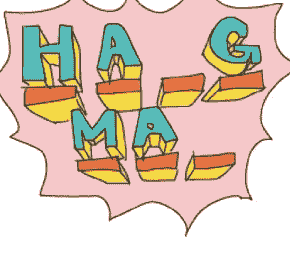

### 与玩家交互

为了创建这个游戏，我们必须有一种方式让猜测者（人类）输入他们的选择。一种方法是打开一个弹出窗口（JavaScript 称之为 *prompt*），玩家可以在其中输入。

### 创建 Prompt

首先，让我们创建一个新的 HTML 文档。使用 **文件 > 另存为**，将第 5 章中的 *page.html* 文件另存为 *prompt.html*。要创建 prompt，请将以下代码输入到 *prompt.html* 的 `<script>` 标签之间，然后刷新浏览器：

```javascript
var name = prompt("What's your name?");

console.log("Hello " + name);
```

在这里，我们创建了一个名为 name 的新变量，并将调用 `prompt("What's your name?")` 返回的值赋给它。当调用 prompt 时，会打开一个小型窗口（或 *对话框*），其外观应如图 7-1 所示。

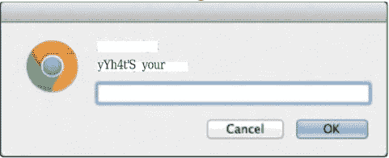
*图 7-1. 一个 prompt 对话框*

调用 `prompt("What's your name?")` 会弹出一个包含文本 "What's your name?" 和一个输入文本框的窗口。在对话框底部有两个按钮：取消（Cancel）和确定（OK）。在 Chrome 中，对话框具有标题 *Javascript*，以告知您是 JavaScript 打开了该 prompt。

当您在框中输入文本并点击确定时，该文本就成为了 prompt 返回的值。例如，如果我在文本框中输入我的名字并点击确定，JavaScript 将在控制台中打印：

```
Hello Nick
```

因为我在文本框中输入了 Nick 并点击了确定，字符串 "Nick" 被保存在变量 name 中，而 `console.log` 打印 "Hello " + "Nick"，从而得到了 "Hello Nick"。

**注意**
在 Chrome 中第二次打开任何形式的对话框时，它会在对话框中添加一行额外的内容，其中有一个复选框写着 “Prevent this page from creating additional dialogs（防止此页面创建更多对话框）”。这是 Chrome 保护用户免受带有大量烦人弹出窗口的网页干扰的一种方式。在本章的练习中，请保持该复选框未勾选。

### 如果点击取消会发生什么？

如果您点击取消按钮，prompt 将返回值 `null`。在第 2 章中，我们学习过可以使用 null 来表示某样东西被刻意留空。

在对话框中点击取消，您应该会看到这个：

```
Hello null
```

这里，null 被 `console.log` 作为一个字符串打印了出来。通常情况下，null 不是字符串，但由于只有字符串才能被打印到控制台，而您告诉 JavaScript 打印 "Hello " + null，因此 JavaScript 将值 null 转换为字符串 "null" 以便打印。当 JavaScript 将一个值转换为另一种类型时，这被称为 *强制类型转换 (coercion)*。

强制类型转换是 JavaScript 试图表现得“聪明”的一个例子。没有任何办法可以使用 `+` 运算符将一个字符串和 null 结合起来，所以 JavaScript 在这种情况下尽力而为。在这种情况下，它知道它需要两个字符串。


### 使用确认框询问是或否的问题

确认函数（`confirm`）是一种无需文本框即可获取用户输入的方式，它通过询问是或否（布尔值）来获取答案。例如，这里我们使用 `confirm` 询问用户是否喜欢猫（参见图 7-2）。如果喜欢，变量 `likesCats` 会被设置为 `true`，然后我们回复 "You're a cool cat!"；如果不喜欢，`likesCats` 会被设置为 `false`，所以我们回复 "Yeah, that's fine. You're still cool!"。

```javascript
var likesCats = confirm("Do you like cats?");
if (likesCats) {
    console.log("You're a cool cat!");
} else {
    console.log("Yeah, that's fine. You're still cool!");
}
```

确认提示框的返回值是一个布尔值。如果用户在如图 7-2 所示的确认对话框中点击了“确定”，则返回 `true`；如果点击了“取消”，则返回 `false`。

### 使用警报框向玩家提供信息

如果你想仅仅是向玩家提供一些信息，你可以使用警报对话框（`alert`）来显示一条带有“确定”按钮的消息。例如，如果你认为 JavaScript 非常棒，你可能会使用这个 `alert` 函数：

```javascript
alert("JavaScript is awesome!");
```

图 7-3 展示了这个简单的警报对话框会是什么样子。

*图 7-3. 一个警报对话框*

警报对话框只显示一条消息，并等待用户点击“确定”。

### 为什么使用 alert 而不是 console.log？

为什么在游戏中使用警报对话框而不是 `console.log`？首先，因为如果你只是想告诉玩家一些事情，使用 `alert` 意味着玩家不需要中断游戏来打开控制台查看状态消息。其次，调用 `alert`（以及 `prompt` 和 `confirm`）会暂停 JavaScript 解释器，直到用户点击“确定”（或在 `prompt` 和 `confirm` 的情况下点击“取消”）。这意味着玩家有时间阅读警报内容。另一方面，当你使用 `console.log` 时，文本会立即显示，解释器会立即继续执行程序中的下一行。

### 设计你的游戏

在我们开始编写猜词游戏之前，让我们思考一下它的结构。我们的程序需要做几件事：

1.  选择一个随机单词。
2.  获取玩家的猜测。
3.  如果玩家想退出，则退出游戏。
4.  检查玩家的猜测是否是有效的单个字母。
5.  跟踪玩家已经猜过的字母。
6.  向玩家展示他们的进展。
7.  当玩家猜出单词时结束游戏。

除了第一个和最后一个任务（为玩家选择一个要猜的单词和结束游戏），这些步骤都需要重复多次，而且我们不知道会重复多少次（这取决于玩家猜得有多好）。当你需要多次执行相同的操作时，你就知道需要使用一个循环。

但是，这个简单的任务列表并没有真正告诉我们什么时候需要发生什么。为了更好地理解代码的结构，我们可以使用*伪代码*。

### 使用伪代码设计游戏

伪代码是程序员常用来设计程序的一种便捷工具。它的意思是“假代码”，是一种描述程序工作方式的方法，看起来像是书面英语和代码的混合体。伪代码有循环和条件语句，但除此之外，所有内容都只是普通的英语。让我们看看我们游戏的伪代码版本，以获得一个概念：

```
选择一个随机单词

当单词尚未被猜出时 {
    向玩家展示他们当前的进度
    从玩家那里获取一个猜测

    如果玩家想退出游戏 {
        退出游戏
    } 否则 如果猜测不是单个字母 {
        告诉玩家选择一个单个字母
    } 否则 {
        如果猜测的字母在单词中 {
            用该猜测更新玩家的进度
        }
    }
}

祝贺玩家猜出了单词
```

正如你所看到的，这些都不是真正的代码，任何计算机都无法理解它。但它让我们了解了程序将如何构建，之后我们再实际编写代码并处理那些杂乱的细节，比如如何选择一个随机单词。

### 跟踪单词的状态

在前面的伪代码中，第一行之一是“向玩家展示他们当前的进度”。对于猜词游戏，这意味着填充玩家正确猜出的字母，并显示秘密单词中哪些字母仍然是空白的。我们将如何做到这一点？实际上，我们可以以与传统猜词游戏类似的方式来跟踪玩家的进展：维护一个空白集合，并在玩家猜对字母时填充它们。

在我们的游戏中，我们将使用一个与单词中每个字母对应的空白数组来实现这一点。我们将称之为答案数组（answer array），并在玩家做出正确猜测时填充它。我们将用字符串 "_" 来表示每个空白。答案数组将从一组与秘密单词中字母数量相等的空白条目开始。例如，如果秘密单词是 *fish*，数组看起来会像这样：

```javascript
["_", "_", "_", "_"]
```

如果玩家正确猜出了字母 `i`，我们会将第二个空白改为 `i`：

```javascript
["_", "i", "_", "_"]
```

一旦玩家猜出了所有正确的字母，完整的数组将如下所示：

```javascript
["f", "i", "s", "h"]
```

我们还将使用一个变量来跟踪玩家需要猜出的剩余字母数量。每猜对一个字母出现一次，这个变量就会减少 1。一旦它变为 0，我们就知道玩家赢了。

### 设计游戏循环

主要游戏发生在 **While** 循环中（在我们的伪代码中，这个循环以 "While the word has not been guessed" 行开始）。在这个循环中，我们显示被猜单词的当前状态（从所有空白开始）；向玩家询问猜测（并确保它是有效的单个字母猜测）；并且如果该字母出现在单词中，就用所选字母更新答案数组。

几乎所有计算机游戏都是围绕某种循环构建的，通常与我们猜词游戏中的循环具有相同的基本结构。一个游戏循环通常执行以下操作：

1.  从玩家那里获取输入
2.  更新游戏状态
3.  向玩家显示游戏的当前状态

即使是不断变化的游戏也遵循同样的循环模式——它们只是执行得*非常*快。对于我们的猜词游戏，程序从玩家那里获取一个猜测，如果猜测正确就更新答案数组，并显示答案数组的新状态。

一旦玩家猜出了单词中的所有字母，我们就会显示完整的单词和一条祝贺信息，告诉他们他们赢了。

### 编写游戏代码

现在我们知道了游戏的大致结构，我们可以开始研究代码将是什么样子。以下部分将带你了解游戏中的所有代码。之后，你将看到整个游戏代码的一个清单，这样你就可以自己输入并试玩。

### 选择一个随机单词

我们要做的第一件事是选择一个随机单词。以下是它将如何实现：

```javascript
var words = [
    "javascript",
    "monkey",
    "amazing",
    "pancake"
];

var word = words[Math.floor(Math.random() * words.length)];
```

我们通过创建一个单词数组（*javascript, monkey, amazing,* 和 *pancake*）作为我们秘密单词的来源来开始游戏，并将数组保存在 `words` 变量中。单词应该都是小写的。我们使用 `Math.random` 和 `Math.floor` 从数组中随机选择一个单词，就像我们在第 3 章中使用随机侮辱生成器时所做的那样。

### 创建答案数组

接下来，我们创建一个名为 `answerArray` 的空数组，并用下划线 (`_`) 填充它，以匹配单词中的字母数量。

```javascript
var answerArray = [];
for (var i = 0; i < word.length; i++) {
    answerArray[i] = "_";
}

var remainingLetters = word.length;
```

`for` 循环创建一个循环变量 `i`，从 0 开始，增加到（但不包括）`word.length`。每次循环，我们向 `answerArray` 添加一个新元素，位于 `answerArray[i]`。

当循环结束时，`answerArray` 的长度将与 `word` 相同。例如，如果 `word` 是 "monkey"（有六个字母），`answerArray` 将是 `[ "_", "_", "_", "_", "_", "_" ]`（六个下划线）。

最后，我们创建变量 `remainingLetters` 并将其设置为秘密单词的长度。我们将使用此变量来跟踪还剩多少字母需要猜测。每次玩家猜对一个字母，这个值就会为单词中每个该字母的实例*递减*（减少）1。


### 编写游戏循环

游戏循环的骨架如下：

```javascript
while (remainingLetters > 0) {
    // 游戏代码放在这里
    // 向玩家展示进度
    // 接收玩家的输入
    // 每次猜对时更新 answerArray 和 remainingLetters
}
```

我们使用 `while` 循环，只要 `remainingLetters > 0` 保持为真，循环就会一直执行。循环体必须对玩家每次猜对的字母更新 `remainingLetters`。一旦玩家猜出了所有字母，`remainingLetters` 将变为 0，循环随之结束。

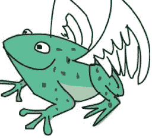

以下几节将解释构成游戏循环体的代码。

### 向玩家展示进度

游戏循环中要做的第一件事是向玩家展示当前进度：

```javascript
alert(answerArray.join(" "));
```

我们通过 `answerArray.join(" ")` 将 `answerArray` 的元素用空格字符连接成一个字符串，然后用 `alert` 将该字符串展示给玩家。例如，假设单词是 monkey，玩家目前已猜了 m、o 和 e。答案数组看起来是这样的 `[ "m", "o", " ", " ", "e", " " ]`，而 `answerArray.join(" ")` 的结果就是 "m o _ _ e _"。弹窗对话框将如图 7-4 所示。

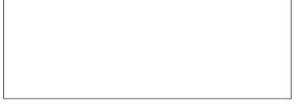
图 7-4. 使用 alert 展示玩家的进度

### 处理玩家的输入

现在我们需要获取玩家输入的猜测字符，并确保它是一个单独的字符。

```javascript
var guess = prompt("Guess a letter, or click Cancel to stop playing."); 
if (guess == null){
    break;
} else if(guess.length !== 1) {
    alert("Please enter a single letter.");
} else {
    // 用猜测更新游戏状态
}
```

在①处，`prompt` 从玩家处获取一个猜测并将其保存到变量 `guess` 中。此时会发生以下四种情况之一。

首先，如果玩家点击了"取消"按钮，那么 `guess` 将为 null。我们在①处通过 `if (guess === null)` 检查这种情况。如果条件为真，我们使用 `break` 退出循环。

#### 注意
> 你可以在任何循环中使用 `break` 关键字来立即停止循环，无论程序在循环中的哪个位置，也无论 while 条件当前是否为真。

第二和第三种可能是玩家输入了空值或过多的字符。如果他们什么都没输入就点击了"确定"，`guess` 将是空字符串 ""。在这种情况下，`guess.length` 为 0。如果他们输入了超过一个字符，`guess.length` 将大于 1。

在①处，我们使用 `else if(guess.length !== 1)` 来检查这些情况，确保 `guess` 恰好是一个字符。如果不是，我们显示一个弹窗，提示"**请输入单个字母**"。

第四种可能是玩家输入了一个有效的单个字母猜测。然后我们必须在①处使用 `else` 语句，用他们的猜测来更新游戏状态，这将在下一节中完成。

### 更新游戏状态

玩家输入有效猜测后，我们必须根据猜测更新游戏的 `answerArray`。为此，我们在 else 语句中添加以下代码：

```javascript
for (var j = 0; j < word.length; j++) {
    if (word[j] === guess) {
        answerArray[j] = guess;
        remainingLetters--;
    }
}
```

在①处，我们创建了一个 `for` 循环，使用名为 `j` 的新循环变量，从 0 运行到 `word.length`。（我们在这个循环中使用 `j` 作为变量，是因为之前的 for 循环中已经使用了 `i`。）我们使用这个循环来逐个遍历 `word` 中的字母。例如，假设 `word` 是 **pancake**。第一次循环时，`j` 为 0，`word[j]` 是 "p"。下一次，`word[j]` 是 "a"，然后是 "n"、"c"、"a"、"k"，最后是 "e"。

在②处，我们使用 `if (word[j] === guess)` 来检查当前查看的字母是否与玩家的猜测匹配。如果匹配，我们使用 `answerArray[j] = guess` 将当前猜测更新到答案数组中。对于单词中每个与 `guess` 匹配的字母，我们都在相应位置更新答案数组。这样做的原因是，循环变量 `j` 可以作为 `answerArray` 的索引，正如它可以作为 `word` 的索引一样，正如你在**图 7-5**中所见。

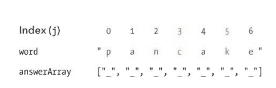
图 7-5. 相同的索引可以同时用于 `word` 和 `answerArray`

例如，想象我们刚开始游戏，并到达了①处的 `for` 循环。假设 `word` 是 "pancake"，`guess` 是 "a"，`answerArray` 当前如下：
`["_", "_", "_", "_", "_", "_", "_"]`

第一次执行①处的 `for` 循环时，`j` 为 0，所以 `word[j]` 是 "p"。我们的 `guess` 是 "a"，所以我们跳过②处的 `if` 语句（因为 "p" === "a" 为假）。第二次循环时，`j` 为 1，所以 `word[j]` 是 "a"。这与 `guess` 相等，所以我们进入 `if` 语句部分。`answerArray[j] = guess;` 这一行将 `answerArray` 中索引 1 处的元素（第二个元素）设置为 `guess`，所以 `answerArray` 现在看起来是这样：
`["_", "a", "_", "_", "_", "_", "_"]`

接下来的两次循环中，`word[j]` 分别是 "n" 和 "c"，它们都不与 `guess` 匹配。然而，当 `j` 达到 4 时，`word[j]` 又是 "a"。我们再次更新 `answerArray`，这次将索引 4 处的元素（第五个元素）设置为 `guess`。现在 `answerArray` 看起来是这样：
`["_", "a", "_", "_", "a", "_", "_"]`

剩下的字母与 "a" 不匹配，所以最后两次循环什么都没发生。在这个循环结束时，`answerArray` 将更新为 `guess` 在 `word` 中的所有出现位置。

对于每一次正确的猜测，除了更新 `answerArray` 外，我们还需要将 `remainingLetters` 减 1。我们在③处使用 `remainingLetters--;` 来实现。每次 `guess` 与 `word` 中的字母匹配时，`remainingLetters` 就减少 1。一旦玩家正确猜出了所有字母，`remainingLetters` 将变为 0。

### 结束游戏

正如我们已经看到的，主游戏循环的条件是 `remainingLetters > 0`，所以只要还有字母需要猜测，循环就会继续执行。一旦 `remainingLetters` 达到 0，我们就退出循环。最后使用以下代码：

```javascript
alert(answerArray.join(" "));
alert("Good job! The answer was " + word);
```

第一行使用 `alert` 最后一次展示答案数组。第二行再次使用 `alert` 向获胜的玩家表示祝贺。

### 游戏代码

现在我们已经看到了游戏的所有代码，只需把它们组合起来即可。以下是我们猜字游戏的完整代码清单。我在其中添加了注释，以便你更容易看清每处发生了什么。这比之前写的任何代码都要长得多，但亲手敲出来将帮助你更熟悉 JavaScript 的编写。创建一个名为 *hangman.html* 的新 HTML 文件，并在其中输入以下内容：

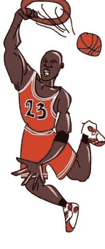

```html
<!DOCTYPE html>
<html>
<head>
    <title>Hangman !</title>
</head>
<body>
    <h1>Hangman !</h1>

    <script>
    // Create an array of words 
    var words = [
        "javascript",
        "monkey",
        "amazing",
        "pancake"
    ];

    // Pick a random word
    var word = words[Math.floor(Math.random() * words.length)];

    // Set up the answer array
    var answerArray = [];

    for (var i = 0; i < word.length; i++) {
        answerArray[i] = "_";
    }

    var remainingLetters = word.length;

    // The game loop
    while (remainingLetters > 0) {
        // Show the player their progress
        alert(answerArray.join(" "));

        // Get a guess from the player
        var guess = prompt("Guess a letter, or click Cancel to stop playing.");
        if (guess === null) {
            // Exit the game loop
            break;
        } else if(guess.length !== 1){
            alert("Please enter a single letter.");
        } else {
            // Update the game state with the guess 
            for (var j = 0; j < word.length; j++) {
                if (word[j] === guess) {
                    answerArray[j] = guess;
                    remainingLetters--;
                }
            }
        }
    }

    // The end of the game loop

    // Show the answer and congratulate the player
    alert(answerArray.join(" "));
    alert("Good job! The answer was " + word);
    </script>
</body>
</html>
```

如果游戏无法运行，请确保你输入的内容完全正确。如果你犯了错误，JavaScript 控制台可以帮助你找到它。例如，如果你拼错了变量名，你会看到类似**图 7-6**的内容，并指向你犯错的位置。


如果你点击 `hangman.html:30`，你会看到出错的准确行。在本例中，它向我们展示我们在 While 循环开头将 `remainingLetters` 错误地拼写成了 `remainingLetter`。

试着玩几次这个游戏。它是否按你期望的方式工作？你能想象你写的代码在你玩游戏时在后台运行的样子吗？


### 你学到了什么

在短短几页的内容中，你已经创建了你的第一个 JavaScript 游戏！如你所见，循环和条件语句对于创建游戏或任何其他交互式计算机程序都至关重要。如果没有这些控制结构，程序就只是简单的开始和结束。

在第 8 章中，我们将使用函数来封装代码，这样你就可以在程序的不同部分运行它。

### 编程挑战

这里有一些挑战，可以用来扩展和改进你在本章中创建的猜词游戏（Hangman）。

#### #1：自定义词库
在 `Words` 数组中添加你自己的单词。记得所有单词都要用小写字母输入。

#### #2：大写字母
如果玩家猜测了一个大写字母，它将无法与秘密单词中的小写字母匹配。为了解决这个潜在问题，请将玩家的猜测转换为小写。（提示：你可以使用 `toLowerCase` 方法将字符串转换为小写。）

#### #3：限制猜测次数
我们的猜词游戏给了玩家无限次的猜测机会。请添加一个变量来跟踪猜测次数，并在玩家用完猜测次数时结束游戏。（提示：在检查 `remaining Letters > 0` 的同一个 `While` 循环中检查这个变量。就像我们在第 2 章中所做的那样，你可以使用 `&&` 来检查两个布尔条件是否同时为真。）

#### #4：修复 Bug
游戏中有一个 Bug：如果你一直猜测同一个正确的字母，`remaining Letters` 会持续递减。你能修复它吗？（提示：你可以添加另一个条件来检查 `Answer Array` 中的值是否仍然是下划线。如果它不是下划线，那么该字母一定已经被猜过了。）

## 第 8 章 函数

<u>函数</u>是一种将代码捆绑在一起以便重复使用的方法。函数允许我们在程序的多个地方运行同一段代码，而无需重复地复制和粘贴代码。此外，通过将长段代码隐藏在函数中并为其起一个易于理解的名字，你将能更好地规划代码，因为你可以专注于组织函数，而不是关注组成它们的每一个微小的代码细节。将代码分解为更小、更易于管理的片段，可以让你看到全局，并从更高层次思考程序的结构。

当你需要在整个程序中重复执行某种计算或操作时，你会发现函数非常有用。在本书的前面部分，你使用了各种函数，如 `Math.random`、`Math.floor`、`alert`、`prompt` 和 `confirm`。在本章中，你将学习如何创建自己的函数。

### 函数的基本解剖结构

图 8-1 展示了函数的构建方式。大括号之间的代码被称为 *函数体*，就像循环中大括号之间的代码被称为 *循环体* 一样。

```javascript
function () {
    console.log("Do something");
}
```
函数体位于大括号之间。

*图 8-1. 创建函数的语法*

### 创建一个简单的函数

让我们创建一个简单的函数来打印 "Hello World!"。在浏览器控制台中输入以下代码。使用 SHIFT-ENTER 来开始每一新行而不在此时执行代码。

```javascript
var ourFirstFunction = function () {
    console.log("Hello world!");
};
```

这段代码创建了一个新函数并将其保存在变量 `ourFirstFunction` 中。

### 调用函数

要运行函数内部的代码（函数体），我们需要调用该函数。要调用函数，输入它的名称，后面跟着一对开闭括号，如下所示。

```javascript
ourFirstFunction(); 
// Hello world!
```

调用 `ourFirstFunction` 会执行函数体 `console.log("Hello World!");`，随后我们请求打印的文本将显示在下一行：`Hello World!`。

但如果你在浏览器中调用这个函数，你会注意到 there 有第三行，带有一个向左的小箭头，如图 8-2 所示。这就是函数的返回值。

*图 8-2. 调用一个返回值为 undefined 的函数*

*返回值* 是函数输出的值，随后可以在代码的其他地方使用。在这种情况下，返回值是 `undefined`，因为我们没有在函数体中告诉函数返回任何特定值。我们所做的只是请求它向控制台打印一条消息，这与返回值不同。除非函数体中有指令告诉它返回不同的值，否则函数总是返回 `undefined`。（我们将在“从函数返回数值”部分学习如何指定返回值。）

> **注意**
> 在 Chrome 控制台以及本书所有的代码清单中，返回值总是根据数据类型进行颜色编码，而使用 `console.log` 打印的文本始终是纯黑色的。

### 向函数传递参数

`ourFirstFunction` 每次被调用时只打印相同的文本行，但你可能希望你的函数比这更灵活。函数参数允许我们将值传递到函数中，以便在调用时改变函数的行为。无论是在创建函数还是在调用函数时，参数始终位于函数括号之间。

下面的 `sayHelloTo` 函数使用一个参数 (`name`) 来向你指定的人打招呼。

```javascript
var sayHelloTo = function(name) {
    console.log("Hello " + name + "!");
};
```

我们在第一行创建了函数并将其赋值给变量 `sayHelloTo`。当函数被调用时，它会记录字符串 `"Hello " + name + "!"`，并将 `name` 替换为你作为参数传递给函数的任何值。

图 8-3 展示了具有一个参数的函数的语法。

要调用一个带有参数的函数，请将你想要用于该参数的值放在函数名之后的括号之间。例如，要向 Nick 打招呼，你应该写：

```javascript
sayHelloTo("Nick");
// Hello Nick!
```

或者，要向 Lyra 打招呼，写：

```javascript
sayHelloTo("Lyra");
// Hello Lyra!
```

每次我们调用函数时，我们传递给 `name` 的参数都会包含在函数打印的字符串中。因此，当我们传递 "Nick" 时，控制台打印 "Hello Nick!"；当我们传递 "Lyra" 时，它打印 "Hello Lyra!"。

### 打印猫脸！

向函数传递参数的一个原因可能是告诉它执行某项操作的次数。例如，`drawCats` 函数会在控制台打印猫脸（像这样：`=^.^=`）。我们使用参数 `howManyTimes` 来告诉函数打印多少只猫：

```javascript
var drawCats = function (howManyTimes){
  for(var i = 0; i < howManyTimes; i++){
    console.log(i + " =^.^=");
  }
}
```

函数体是一个 `for` 循环，它循环的次数由 `howManyTimes` 参数决定（因为变量 `i` 从 0 开始，一直重复到 `howManyTimes` 减 1）。每次循环，函数都会记录字符串 `i + " =^.^="`。

当我们以 5 作为 `howManyTimes` 参数调用此函数时，会发生以下情况：

```javascript
drawCats(5);

0 =^.^=
1 =^.^=
2 =^.^=
3 =^.^=
4 =^.^=
```

试着将 `howManyTimes` 设置为 100 来打印 100 个猫脸吧！

### 向函数传递多个参数

你可以使用多个参数向函数传递不止一个值。要添加另一个参数，在 `function` 关键字后的括号内输入参数，并用逗号隔开。图 8-4 展示了具有两个参数的函数的语法。

```javascript
function(argument1, argument2) {
    console.log("My first argument was: " + argument1);
    console.log("My second argument was: " + argument2);
}
```

函数体可以使用这两个参数。

*图 8-4. 创建具有两个参数的函数的语法*

接下来的 `printMultipleTimes` 函数类似于 `drawCats`，不同之处在于它有一个名为 `whatToDraw` 的第二个参数。

```javascript
var printMultipleTimes = function(howManyTimes, whatToDraw) {
    for (var i = 0; i < howManyTimes; i++) {
        console.log(i + " " + whatToDraw);
    }
};
```

`printMultipleTimes` 函数会根据你通过 `howManyTimes` 参数指定的次数，打印你为 `whatToDraw` 输入的字符串。第二个参数告诉函数打印什么，第一个参数告诉函数打印多少次。


调用带有多个参数的函数时，将你希望使用的值插入函数名后的圆括号中，用逗号分隔。

例如，要使用这个新的 printMultipleTimes 函数打印猫脸，你可以这样调用它：

```
printMultipleTimes(5, "=^.^=");
0 =~^,^=
1 ==
2  =~^,^=
3  =~^,^=
4  =~^,^=
```

要让 printMultipleTimes 打印四次笑脸，你可以这样做：

```
printMultipleTimes(4, "^^");
0  ^_^
1  ^_^
2  ^_^
3  ^_^
```

当我们调用 `printMultipleTimes` 时，我们传入 `4` 作为 `howManyTimes` 的值，传入 `"^_^"` 作为 `whatToDraw` 的值。结果，`for` 循环循环四次（`i` 从 0 递增到 3），每次打印 `i + " " + whatToDraw`。

```
printMultipleTimes(2, ">_<");
0 (>_<)
1 (>_<)
```

在这个例子中，我们传入 `2` 作为 `howManyTimes` 的值，传入 `">_<"` 作为 `whatToDraw` 的值。

### 从函数返回值

到目前为止，我们看到的函数都是使用 console.log 将文本打印到控制台。这是一种简单且实用的方式，让 JavaScript 显示值，但当我们把值记录到控制台时，无法在程序的后续部分使用该值。如果你希望函数输出该值，以便在代码的其他部分继续使用它，该怎么办？

正如本章前面提到的，函数的输出称为返回值。当你调用一个返回值的函数时，你可以在代码的其余部分使用该值（你可以将返回值保存在变量中，将其传递给另一个函数，或者简单地将其与其他代码组合使用）。例如，以下代码行将 5 加到 Math.floor(1.2345) 的调用返回值上：

```
5 + Math.floor(1.2345);
6
```

Math.floor 是一个函数，它返回你传入的数字向下取整后的整数。当你看到像 Math.floor(1.2345) 这样的函数调用时，可以想象将它替换为该函数调用的返回值，即数字 1。

让我们创建一个返回值的函数。函数 double 接受参数 number，并返回 number * 2 的结果。换句话说，该函数返回的值是传入参数的两倍。

```
var double = function(number) {
    return number * 2;
};
```

要从函数返回值，请使用关键字 `return`，后跟你想要返回的值。在 ① 处，我们使用 `return` 关键字从 double 函数返回值 `number * 2`。

现在我们可以调用 double 函数来翻倍数字：

```
double(3);
6
```

这里，返回值（6）显示在第二行。即使函数可以接受多个参数，它们也只能返回一个值。如果你没有让函数返回任何内容，它将返回 `undefined`。

### 将函数调用作为值使用

当你在一段较大的代码中调用一个函数时，该函数的返回值会在函数调用所在的位置被使用。例如，让我们使用 double 函数来计算两个数字翻倍后相加的结果：

```
double(5) + double(6);
22
```

在这个例子中，我们调用了两次 double 函数，并将两个返回值相加。你可以将 double(5) 的调用视为值 10，将 double(6) 的调用视为值 12。

你还可以将函数调用作为参数传递给另一个函数，该函数调用将被其返回值替换。在下一个例子中，我们调用 double，并将 double(3) 的结果作为参数传入。我们将 double(3) 替换为 6，因此 double(double(3)) 简化为 double(6)，然后简化为 12。

```
double(double(3));
12
```

以下是 JavaScript 的计算过程：

```
double( double(3) );
```

```
double( 3 * 2 );
```

```
double(6);
```

double 函数的函数体返回 number * 2。因此在 ① 处，我们将 double(3) 替换为 3 * 2。在 ② 处，我们将 3 * 2 替换为 6。然后在 ③ 处，我们做同样的事情，将 double(6) 替换为 6 * 2。最后，在 ④ 处，我们可以将 6 * 2 替换为 12。

### 使用函数简化代码

在第 3 章中，我们使用了 `Math.random` 和 `Math.floor` 方法从数组中随机选取单词并生成随机侮辱语。在本节中，我们将重新创建侮辱语生成器，并通过创建函数来简化它。

### 选取随机单词的函数

以下是我们**第 3 章**中用于从数组中选取随机单词的代码：

```
randomWords[Math.floor(Math.random() * randomWords.length)];
```

如果我们将这段代码变成一个函数，就可以重复使用它来从数组中选取随机单词，而无需每次都输入相同的代码。例如，下面是我们定义 pickRandomWord 函数的方式。

```
var pickRandomWord = function(words) {
    return words[Math.floor(Math.random() * words.length)];
};
```

我们这里所做的只是将之前的代码包装在一个函数中。现在，我们可以创建这个 randomWords 数组。

```
var randomWords = ["Planet", "Worm", "Flower", "Computer"];
```

并使用 pickRandomWord 函数从该数组中选取一个随机单词，如下所示：

```
pickRandomWord(randomWords);
"Flower"
```

我们可以在任何数组上使用相同的函数。例如，以下是我们从名字数组中选取随机名字的方式：

```
pickRandomWord(["Charlie", "Raj", "Nicole", "Kate", "Sandy"]);
"Raj"
```

### 随机侮辱语生成器

现在让我们尝试使用选取随机单词的函数来重新创建随机侮辱语生成器。首先，回顾一下第 3 章中的代码是什么样的：

```
var randomBodyParts = ["Face", "Nose", "Hair"];

var randomAdjectives = ["Smelly", "Boring", "Stupid"];

var randomWords = ["Fly", "Marmot", "Stick", "Monkey", "Rat"];

// Pick a random body part from the randomBodyParts array:
var randomBodyPart = randomBodyParts[Math.floor(Math.random() * 3)];

// Pick a random adjective from the randomAdjectives array:
var randomAdjective = randomAdjectives[Math.floor(Math.random() * 3)];

// Pick a random word from the randomWords array:
var randomWord = randomWords[Math.floor(Math.random() * 5)];

// Join all the random strings into a sentence:
var randomstring = "Your " + randomBodyPart + " is like a " +
    randomAdjective + " " + randomWord + "!!!";

randomstring;
"Your Nose is like a Stupid Marmot!!!"
```

注意，在这段代码中我们重复了很多次 `words[Math.floor(Math.random() * length)]`。使用 pickRandomWord 函数，我们可以这样重写程序：

```
var randomBodyParts = ["Face", "Nose", "Hair"];

var randomAdjectives = ["Smelly", "Boring", "Stupid"];

var randomWords = ["Fly", "Marmot", "Stick", "Monkey", "Rat"];

// Join all the random strings into a sentence:
var randomstring = "Your " +
    pickRandomWord(randomBodyParts) + " is like a " +
    pickRandomWord(randomAdjectives) +
    " " + pickRandomWord(randomWords) + "!!!";

randomstring;
"Your Nose is like a Smelly Marmot!!!"
```

这里有两处改变。首先，当需要从数组中获取随机单词时，我们使用 `pickRandomWord` 函数，而不是每次都使用 `words[Math.floor(Math.random() * length)]`。另外，我们不再将每个随机单词保存到变量中再添加到最终字符串，而是直接将函数调用的返回值组合在一起形成字符串。函数调用可以被视为该函数返回的值。所以实际上，我们这里所做的只是将字符串相加。如你所见，这个版本的程序更容易阅读，编写起来也更简单，因为我们通过使用函数复用了一些代码。

### 将随机侮辱语生成器封装为函数

我们可以更进一步，创建一个更大的函数来生成随机侮辱语。让我们来看看：

```
var generateRandomInsult = function() {
    var randomBodyParts = ["Face", "Nose", "Hair"];
    var randomAdjectives = ["Smelly", "Boring", "Stupid"];
    var randomWords = ["Fly", "Marmot", "Stick", "Monkey", "Rat"];
    
    // Join all the random strings into a sentence:
    var randomstring = "Your " + 
        pickRandomWord(randomBodyParts) + " is like a " + 
        pickRandomWord(randomAdjectives) + 
        " " + pickRandomWord(randomWords) + "!!!";
    
    return randomstring;
};

generateRandomInsult();
"Your Face is like a Smelly Stick!!!"
generateRandomInsult();
"Your Hair is like a Boring Stick!!!"
generateRandomInsult();
"Your Face is like a Stupid Fly!!!"
```

我们新的 generateRandomInsult 函数就是之前的代码放在了一个无参数的函数中。唯一的添加是在 ① 处，我们在函数末尾返回 randomstring。你可以看到该函数的几次示例运行，每次返回一个新的侮辱语字符串。

将代码放在一个函数中意味着我们可以不断调用该函数来获取随机侮辱语，而不必每次需要新侮辱语时都复制粘贴相同的代码。


### 使用 return 提前退出函数

一旦 JavaScript 解释器在函数中遇到 `return`，它就会离开该函数，即使函数体中还剩余代码。

使用 `return` 的一种常见方法是：如果传递给函数的任何参数无效（即它们不是函数正常运行所需的参数类型），则提前退出函数。例如，下面的函数会返回一个字符串，告知你名字中的第五个字符。如果传递给函数的名称少于五个字符，函数将使用 `return` 立即退出。这意味着末尾那个告知你名字第五个字母的 `return` 语句将永远不会被执行。


```javascript
var fifthLetter = function (name) {
    if (name.length < 5) {
        return;
    }
    return "The fifth letter of your name is " + name[4] + ".";
}
```

在 ① 处，我们检查输入名字的长度是否小于五。如果是，我们使用 ① 处的 `return` 提前退出函数。

让我们尝试调用这个函数。

```javascript
fifthLetter("Nicholas");
// "The fifth letter of your name is o."
```

名字 "Nicholas" 长度超过五个字符，因此 `fifthLetter` 执行完毕并返回 "Nicholas" 中的第五个字母，即字母 o。让我们再次尝试对一个较短的名字调用它：

```javascript
fifthLetter("Nick");
// undefined
```

当我们用名字 *Nick* 调用 `fifthLetter` 时，函数知道该名字不够长，因此通过 ① 处第一个 `return` 语句提前退出。因为 ① 处的 `return` 之后没有指定值，所以函数返回 `undefined`。

### 使用多次 return 代替 if...else 语句

我们可以在函数体中不同的 `if` 语句内部使用多个 `return` 关键字，使函数根据输入返回不同的值。例如，假设你在写一个根据分数给玩家颁奖的游戏。3 分或以下是铜牌，3 到 7 分之间是银牌，7 分以上是金牌。你可以使用像 `medalForScore` 这样的函数来评估分数并返回正确的奖牌类型，如下所示：


```javascript
var medalForScore = function (score) {
    if (score < 3) {
        return "Bronze";
    }
    if (score < 7) {
        return "Silver";
    }
    return "Gold";
}
```

在 ① 处，如果分数小于 3，我们返回 "Bronze" 并退出函数。如果我们到达 ② 处，我们知道分数一定至少为 3，因为如果它小于 3，我们早已经返回了（也就是说，我们在第一个测试中遇到 `return` 关键字时就已经退出了函数）。最后，如果我们到达 ③ 处，我们知道分数一定至少为 7，因此没有其他需要检查的，我们可以直接返回 "Gold"。

虽然我们在检查多个条件，但不需要使用链式的 `if...else` 语句。我们使用 `if...else` 语句是为了确保只有一个选项被执行。当每个选项都有自己的 `return` 语句时，这也确保了只有一个选项会被执行（因为函数只能返回一次）。

### 创建函数的简写形式

编写函数有两种方式：长写形式和简写形式。我一直使用长写形式，因为它能更清晰地展示函数是如何存储在变量中的。尽管如此，你仍然应该了解简写形式的样子，因为大量的 JavaScript 代码都使用了它。一旦你习惯了函数的工作方式，你可能也会想使用简写版本。

这是一个长写函数的示例：

```javascript
var double = function (number) {
    return number * 2;
};
```

简写版本如下所示：

```javascript
function double(number) {
    return number * 2;
}
```

如你所见，在长写版本中，我们明确地创建了一个变量名并将函数赋值给该变量，因此 `double` 出现在 `function` 关键字之前。相比之下，在简写版本中，`function` 关键字首先出现，随后是函数名。在这个版本中，变量 `double` 是（此处原文不完整）

### 你学到了什么

函数允许我们重用代码块。它们可以根据传递给它们的参数执行不同的操作，并且可以将值返回到调用该函数的代码位置。函数还使得给一段代码起一个有意义的名字成为可能。例如，函数 `pickRandomWord` 的名称清楚地表明该函数与选取随机单词有关。

在下一章中，我们将学习如何编写可以操作 HTML 文档的 JavaScript。

### 编程挑战

这里有一些挑战让你练习使用函数。

#### 1：使用函数进行算术运算

创建两个函数 `add` 和 `multiply`。每个函数都应接收两个参数。`add` 函数应将参数求和并返回结果，`multiply` 应将参数相乘。

仅使用这两个函数，解决这个简单的数学问题：

```
36325 * 9824 + 777
```

#### 2：这两个数组相同吗？

编写一个名为 `areArraysSame` 的函数，接收两个数字数组作为参数。如果两个数组相同（即它们具有相同顺序的相同数字），则返回 `true`；如果不同，则返回 `false`。尝试运行以下代码以确保你的函数工作正常：

```javascript
areArraysSame([1, 2, 3], [4, 5, 6]);
// false

areArraysSame([1, 2, 3], [1, 2, 3]);
// true

areArraysSame([1, 2, 3], [1, 2, 3, 4]);
// false
```

提示 1：你需要使用 `for` 循环遍历第一个数组中的每个值，查看它们在第二个数组中是否相同。如果在 `for` 循环中发现不相等的值，可以返回 `false`。

提示 2：如果数组长度不同，你可以提前退出函数，完全跳过 `for` 循环。

#### 3：使用函数实现猜词游戏 (Hangman)

回到第 7 章的猜词游戏。我们将使用函数重写它。

我已经在这里重写了最终的猜词游戏代码，但代码的某些部分被函数调用取代了。你唯一需要做的就是编写这些函数！

```javascript
// 在这里编写你的函数
```

```javascript
var word = pickWord();
var answerArray = setupAnswerArray(word);
var remainingLetters = word.length;

while (remainingLetters > 0) {
    showPlayerProgress(answerArray);
    var guess = getGuess();
    if (guess === null) {
        break;
    } else if (guess.length !== 1) {
        alert("Please enter a single letter.");
    } else {
        var correctGuesses = updateGameState(guess, word, answerArray);
        remainingLetters -= correctGuesses;
    }
}

showAnswerAndCongratulatePlayer(answerArray);
```

这个使用函数的代码版本几乎像第 7 章的伪代码版本一样简单。这应该能让你意识到函数在使代码更易于理解方面有多大用处。

以下是你需要填写的函数：

```javascript
var pickWord = function() {
    // 返回一个随机单词
};
```

```javascript
var setupAnswerArray = function(word) {
    // 返回答案数组
};
```

```javascript
var showPlayerProgress = function(answerArray) {
    // 使用 alert 向玩家展示他们的进度
};
```

```javascript
var getGuess = function() {
    // 使用 prompt 获取一次猜测
};
```

```javascript
var updateGameState = function(guess, word, answerArray) {
    // 更新 answerArray 并返回一个数字，表示该猜测在单词中
    // 出现了多少次，以便更新 remainingLetters
};
```

```javascript
var showAnswerAndCongratulatePlayer = function(answerArray) {
    // 使用 alert 显示答案并祝贺玩家
};
```

# 第二部分：高级 JavaScript

## 第 9 章：DOM 与 jQuery

到目前为止，我们一直使用 JavaScript 来执行相对简单的操作，比如向浏览器控制台打印文本，或显示 alert 或 prompt 对话框。但你也可以使用 JavaScript 来操纵（控制或修改）并在网页中与你编写的 HTML 进行交互。在本章中，我们将讨论两个能让你编写更强大 JavaScript 的工具：DOM 和 jQuery。

DOM，即文档对象模型 (Document Object Model)，是让 JavaScript 能够访问网页内容的核心。浏览器使用 DOM 来跟踪页面上的元素（如段落、标题和其他 HTML 元素），而 JavaScript 可以通过多种方式操纵 DOM 元素。例如，你很快就会看到如何使用 JavaScript 将 HTML 文档的主标题替换为来自 prompt 对话框的输入。


我们还将学习一个非常有用的工具，叫做 jQuery，它让操作 DOM 变得简单得多。jQuery 为我们提供了一组函数，我们可以使用这些函数来选择要操作的元素并对这些元素进行更改。

在本章中，我们将学习如何使用 DOM 和 jQuery 来编辑现有的 DOM 元素并创建新的 DOM 元素，从而通过 JavaScript 完全控制网页的内容。我们还将学习如何使用 jQuery 为 DOM 元素制作动画 —— 例如，让元素淡入淡出。


### 选择 DOM 元素

当你将 HTML 文档加载到浏览器中时，浏览器会将元素转换为一种树状结构。这棵树被称为 *DOM 树*。图 9-1 展示了一个简单的 DOM 树——与我们在第 5 章中用来演示 HTML 层级结构的树相同。浏览器为 JavaScript 程序员提供了一组称为 DOM 的方法来访问和修改这种树结构。


### 使用 id 标识元素

HTML 的 id 属性让你可以为 HTML 元素分配一个唯一的名称，或者说 *标识符*。例如，这个 h1 元素就有一个 id 属性：

```html
<h1 id="main-heading">Hello world!</h1>
```

在这个例子中，"main-heading" 这个 id 将让我们能够识别这个特定的标题，并最终修改它，而不会影响其他元素甚至其他的 h1 标题。

### 使用 getElementById 选择元素

通过 id 唯一地标识了一个元素后（每个 id 必须具有唯一的值），我们就可以使用 DOM 方法 `document.getElementById` 来返回 "main-heading" 元素：

```javascript
var headingElement = document.getElementById("main-heading");
```

通过调用 `document.getElementById("main-heading")`，我们告诉浏览器查找 id 为 "main-heading" 的元素。这个调用返回一个与该 id 对应的 DOM 对象，我们将这个 DOM 对象保存到变量 `headingElement` 中。

一旦我们选择了某个元素，就可以用 JavaScript 来操作它。例如，我们可以使用 `innerHTML` 属性来获取和替换所选元素内部的文本：

```javascript
headingElement.innerHTML;
```

这段代码返回 `headingElement` 的 HTML 内容——即我们使用 `getElementById` 选择的那个元素。在这种情况下，这个元素的内容就是我们输入在 `<h1>` 标签之间的文本 Hello World!。

### 使用 DOM 替换标题文本

下面是一个如何使用 DOM 替换标题文本的示例。首先，我们创建一个名为 *dom.html* 的新 HTML 文档，其中包含以下代码：

```html
<!DOCTYPE html>
<html>
<head>
    <title>Playing with the DOM</title>
</head>
<body>
    <h1 id="main-heading">Hello world!</h1>

    <script>
    (•)
    (•)
    (•)
    var headingElement = document.getElementById("main-heading");
    console.log(headingElement.innerHTML);
    var newHeadingText = prompt("Please provide a new heading:");
    headingElement.innerHTML = newHeadingText;
    </script>
</body>
</html>
```

在 ① 处，我们使用 `document.getElementById` 获取 h1 元素（其 id 为 "main-heading"）并将其保存到变量 `headingElement` 中。在 ② 处，我们打印由 `headingElement.innerHTML` 返回的字符串，这会将 Hello World! 输出到控制台。在 ③ 处，我们使用提示对话框询问用户输入一个新的标题，并将用户输入的文本保存到变量 `newHeadingText` 中。最后，在 ④ 处，我们将 `headingElement` 的 `innerHTML` 属性设置为保存在 `newHeadingText` 中的文本。

当你加载这个页面时，应该会看到一个如图 9-2 所示的提示对话框。

在对话框中输入 "JAVASCRIPT IS AWESOME" 并点击确定。标题应该会立即更新为新的文本，如图 9-3 所示。

借助 `innerHTML` 属性，我们可以使用 JavaScript 来改变任何 DOM 元素的内容。

### 使用 jQuery 操作 DOM 树

内置的 DOM 方法很棒，但它们使用起来并不简单。因此，许多开发者使用一组称为 jQuery 的工具来访问和操作 DOM 树。jQuery 是一个 JavaScript *库*——一组相关的工具（主要是函数），在这种情况下为我们提供了一种更简单的处理 DOM 元素的方式。一旦我们在页面上加载了这个库，就可以使用其中的函数和方法，作为 JavaScript 内置功能和浏览器所提供功能的补充。

### 在 HTML 页面上加载 jQuery

要使用 jQuery 库，我们首先通过以下这行 HTML 告诉浏览器加载它：

```html
<script src="https://code.jquery.com/jquery-2.1.0.js"></script>
```

注意这里的 `<script>` 标签没有内容，而且它有一个 `src` 属性。`src` 属性让我们可以通过其 **URL**（网址）将 JavaScript 文件插入到页面中。在本例中，`https://code.jquery.com/jquery-2.1.0.js` 是 jQuery 网站上 jQuery 特定版本（版本 2.1.0）的 URL。

要查看 jQuery 库，请访问该 URL；你会看到当这个 `<script>` 标签被添加时将要加载的 JavaScript。不过，整个库有超过 9,000 行复杂的 JavaScript，所以别指望现在就能完全理解它！

### 使用 jQuery 替换标题文本

在"使用 DOM 替换标题文本"一节中，你学习了如何使用内置的 DOM 方法来替换文本。在本节中，我们将更新该代码，使用 jQuery 来替换标题文本。打开 *dom.html* 并进行如下所示的更改。

```html
<!DOCTYPE html>
<html>
<head>
    <title>Playing with the DOM</title>
</head>
<body>
    <h1 id="main-heading">Hello world!</h1>

    <script src="https://code.jquery.com/jquery-2.1.0.js"></script>

    <script>
        var newHeadingText = prompt("Please provide a new heading:");
        $("#main-heading").text(newHeadingText);
    </script>
</body>
</html>
```

在 ① 处，我们向页面添加了一个新的 `<script>` 标签来加载 jQuery。加载 jQuery 后，我们使用 jQuery 函数 `$` 来选择 HTML 元素。

`$` 函数接受一个参数，称为 **选择器**（selector），它告诉 jQuery 要从 DOM 树中选择哪个或哪些元素。在本例中，我们输入了 `"#main-heading"` 作为参数。选择器字符串中的 `#` 字符表示"ID"，所以选择器字符串 `"#main-heading"` 的意思是"id 为 main-heading 的元素"。

`$` 函数返回一个 jQuery 对象，代表你所选择的元素。例如，

```javascript
$("#main-heading")
```

返回 h1 元素（其 id 为 "main-heading"）的 jQuery 对象。

我们现在有了一个代表 h1 元素的 jQuery 对象。我们可以在 ② 处对该 jQuery 对象调用 `text` 方法，传入该元素的新文本，从而将标题的文本替换为保存到变量 `newHeadingText` 中的用户输入。与之前一样，当你加载这个页面时，应该会弹出一个对话框，提示你输入用于替换 h1 元素中旧文本的新文本。

### 使用 jQuery 创建新元素

除了使用 jQuery 操作元素之外，我们还可以使用 jQuery 创建新元素并将它们添加到 DOM 树中。为此，我们在 jQuery 对象上调用 `append` 方法，并传入一个包含 HTML 的字符串。`append` 方法将字符串转换为 DOM 元素（使用字符串中的 HTML 标签），并将新元素添加到原始元素的末尾。例如，要在页面末尾添加一个 p 元素，我们可以在 JavaScript 中添加以下内容：

```javascript
$("body").append("<p>This is a new paragraph</p>");
```

这条语句的第一部分使用 `$` 函数和选择器字符串 "body" 来选择我们的 HTML 文档的 body。选择器字符串不必是 id。代码 `$("body")` 选择的是 body 元素。同样，我们可以使用代码 `$("p")` 来选择所有的 p 元素。接下来，我们在 `$("body")` 返回的对象上调用 `append` 方法。传递给 `append` 的字符串被转换为一个 DOM 元素，并被添加到 body 元素内部，就在结束标签之前。

我们也可以在 for 循环中使用 `append` 来添加多个元素，如下所示：

```javascript
for(var i = 0; i < 3; i++){
    var hobby = prompt("Tell me one of your hobbies!");
    $("body").append("<p>" + hobby + "</p>");
}
```

这个循环执行三次。每次循环都会弹出一个提示框，要求用户输入一个爱好。每个爱好都被放入一组 `<p>` 标签中，然后传递给 `append` 方法，由该方法将爱好添加到 body 中。


### 使用 jQuery 为元素创建动画

许多网站使用动画来显示和隐藏内容。例如，如果你想在页面上页面添加一段新文本，你可能希望它缓慢地淡入，而不是突然出现。

jQuery 让为元素创建动画变得简单。例如，要让一个元素淡出，我们可以使用 `fadeOut` 方法。为了测试这个方法，请将 dom.html 中第二个 script 元素的内容替换为以下代码：

```javascript
$("h1").fadeOut(3000);
```

我们使用 `$` 函数来选择所有 h1 元素。因为 dom.html 只有一个 h1 元素（包含文本 Hello World! 的标题），该标题被选为一个 jQuery 对象。通过在此 jQuery 对象上调用 `.fadeOut(3000)`，我们使标题在 3 秒内逐渐淡出直到消失。（fadeOut 的参数单位是毫秒，即千分之一秒，因此输入 3000 使动画持续 3 秒。）

一旦你加载包含这段代码的页面，h1 元素应该就会开始淡出。


图 9-5. 在循环中添加的额外元素

### jQuery 动画链

当你调用 jQuery 对象上的一个方法时，该方法通常会返回它被调用的原始对象。例如，`$("h1")` 返回一个代表所有 h1 元素的 jQuery 对象，而 `$("h1").fadeOut(3000)` 同样返回这个代表所有 h1 元素的 jQuery 对象。要更改 h1 元素的文本并使其淡出，你可以输入：

```javascript
$("h1").text("This will fade out").fadeOut(3000);
```

像这样连续调用多个方法被称为“链式调用”（chaining）。

我们可以在同一个元素上链式调用多个动画。例如，以下是我们如何链式调用 `fadeOut` 和 `fadeIn` 方法，使元素先淡出，然后立即再次淡入：

```javascript
$("h1").fadeOut(3000).fadeIn(2000);
```

`fadeIn` 动画使不可见的元素再次淡入。jQuery 足够智能，知道当你像这样连续链式调用两个动画时，你可能希望它们依次发生。因此，这段代码会在 3 秒内使 h1 元素淡出，然后在 2 秒内将其淡入。

jQuery 还提供了两个与 `fadeOut` 和 `fadeIn` 类似的动画方法，分别叫作 `slideUp` 和 `slideDown`。`slideUp` 方法通过向上滑动使元素消失，而 `slideDown` 则通过向下滑动使它们重新出现。将 dom.html 文档中的第二个 script 元素替换为以下内容，并重新加载页面尝试一下：

```javascript
$("h1").slideUp(1000).slideDown(1000);
```


这里我们选择了 h1 元素，在 1 秒内将其向上滑动，然后在 1 秒内将其向下滑动直到重新出现。

### 试一试！

我们使用 `fadeIn` 使不可见元素可见。但如果你对一个已经可见的元素，或者对一个位于你正在创建动画的元素之后的元素调用 `fadeIn` 会发生什么？

例如，假设你在标题之后向文档添加了一个新的 `p` 元素。尝试使用 `slideUp` 和 `slideDown` 来隐藏和显示 `h1` 元素，看看 `p` 元素会发生什么。如果你使用 `fadeOut` 和 `fadeIn` 呢？

如果在同一个元素上调用 `fadeOut` 和 `fadeIn` 而不使用链式调用会发生什么？例如：

```javascript
$("h1").fadeOut(1000);
$("h1").fadeIn(1000);
```

尝试将上述代码放入一个运行五次的 for 循环中。会发生什么？

你认为 jQuery 的 `show` 和 `hide` 方法是做什么的？尝试运行它们看看你的猜测是否正确。你如何使用 `hide` 来淡入一个已经可见的元素？

### 本章小结

在本章中，你学习了如何通过操作 DOM 元素使用 JavaScript 来更新 **HTML** 页面。正如你所见，jQuery 为我们提供了更强大的方式来选择元素、更改它们甚至为它们创建动画。你还学习了一个新的 HTML 属性 `id`，它允许你给元素一个唯一的标识符。

在下一章中，你将学习如何控制 JavaScript 运行的时机 —— 例如，在定时器到期后或点击按钮时运行。我们还将研究如何以一定的延迟多次运行同一段代码 —— 例如，每秒更新一次时钟。

### 编程挑战

尝试这些挑战，以练习更多关于 jQuery 和 DOM 元素的操作。

#### #1: 使用 jQuery 列出你的朋友（并让他们“发臭”！）

创建一个包含几个朋友名字的数组。使用 for 循环，为你的每个朋友创建一个 `p` 元素，并使用 jQuery 的 `append` 方法将其添加到 body 元素的末尾。使用 jQuery 更改 h1 元素，使其显示为 "My Friends" 而不是 "Hello World!"。使用 `hide` 方法随后调用 `fadeIn` 方法，在提供每个名字时使其淡入。

现在，修改你创建的 `p` 元素，在每个朋友名字后面添加文本 "smells!"。提示：如果你使用 `$("p")` 选择 `p` 元素，`append` 方法将应用于所有的 `p` 元素。

#### #2: 让标题闪烁

你如何使用 `fadeOut` 和 `fadeIn` 使标题每秒闪烁一次，共闪烁五次？如何使用 for 循环来实现这一点？尝试修改你的循环，使其第一次在 1 秒内淡出并淡入，第二次在 2 秒内，第三次在 3 秒内，依此类推。

#### #3: 延迟动画

`delay` 方法可用于延迟动画。使用 `delay`、`fadeOut` 和 `fadeIn`，使页面上的一个元素淡出，然后在 5 秒后再次淡入。

#### #4: 使用 fadeTo

尝试使用 `fadeTo` 方法。它的第一个参数是毫秒数，与其他所有动画方法一样。它的第二个参数是一个 0 到 1 之间的数字。运行以下代码时会发生什么？

```javascript
$("h1").fadeTo(2000, 0.5);
```

你认为第二个参数的意思是什么？尝试使用 0 到 1 之间的不同值来找出第二个参数的用途。

## 第 10 章 交互式编程

到目前为止，我们网页上的 JavaScript 代码在页面加载时立即运行，只有在我们包含像 `alert` 或 `confirm` 这样的函数调用时才会暂停。但我们并不总是希望所有代码在页面加载时立即运行 —— 如果我们希望某些代码在延迟后或响应用户的操作而运行怎么办？

在本章中，我们将研究修改代码运行时间的各种方法。这种编程方式被称为*交互式编程*（interactive programming）。这将使我们能够创建随时间变化并响应用户操作的交互式网页。

### 使用 setTimeout 延迟代码

你可以告诉 JavaScript 在一段时间之后执行某个函数，而不是立即执行。像这样延迟函数被称为*设置超时*（setting a timeout）。在 JavaScript 中设置超时，我们使用 `setTimeout` 函数。该函数接收两个参数（如图 10-1 所示）：时间到期后要调用的函数和等待的时间量（以毫秒为单位）。

```
setTimeout(func, timeout)
```

在 `timeout` 毫秒之后要调用的函数。

在调用函数之前需要等待的毫秒数。

*图 10-1. setTimeout 的参数*

以下列表展示了我们如何使用 `setTimeout` 来显示一个警告对话框。

```javascript
var timeUp = function () {
    alert("Time's up!");
}

setTimeout(timeUp, 3000);
```

在 ① 处，我们创建了函数 `timeUp`，它会打开一个显示文本 "Time's up!" 的警告对话框。在 ② 处，我们调用 `setTimeout` 并传递两个参数：我们要调用的函数 (`timeUp`) 和在调用该函数之前需要等待的毫秒数 (3000)。我们本质上是在说：“等待 3 秒，然后调用 timeUp。” 当 `setTimeout(timeUp, 3000)` 第一次被调用时，什么都不会发生，但 3 秒后 `timeUp` 被调用，警告对话框随即弹出。

请注意，调用 `setTimeout` 会返回 1。这个返回值被称为*超时 ID*（timeout ID）。超时 ID 是一个用于标识这个...


### 取消定时器

一旦你调用了 `setTimeout` 来设置一个延迟函数调用，你可能会发现其实你最终并不想调用那个函数。例如，如果你设置了一个闹钟提醒你做作业，但结果你提前完成了作业，那么你会想要取消这个闹钟。要取消定时器，请对 `setTimeout` 返回的定时器 ID 使用 `clearTimeout` 函数。例如，假设我们像这样创建一个“做作业”闹钟：


```javascript
var doHomeworkAlarm = function() {
    alert("Hey! You need to do your homework!");
};

var timeoutId = setTimeout(doHomeworkAlarm, 60000);
```

`doHomeworkAlarm` 函数会弹出一个警报对话框，提醒你去做作业。当我们调用 `setTimeout(doHomeworkAlarm, 60000)` 时，我们是在告诉 JavaScript 在 60,000 毫秒（或 60 秒）之后执行该函数。此时我们执行这次 `setTimeout` 调用，并将定时器 ID 保存到一个名为 `timeoutId` 的新变量中。

要取消该定时器，像这样将定时器 ID 传递给 `clearTimeout` 函数：

```javascript
clearTimeout(timeoutId);
```

现在 `setTimeout` 最终将不会调用 `doHomeworkAlarm` 函数。

### 使用 setInterval 多次调用代码

`setInterval` 函数与 `setTimeout` 类似，不同之处在于它会在定期的暂停或*间隔（intervals）*之后重复调用提供的函数。例如，如果你想使用 JavaScript 更新时钟显示，你可以使用 `setInterval` 每秒调用一次更新函数。你调用 `setInterval` 时需要传递两个参数：你想要调用的函数和间隔长度（以毫秒为单位），如**图** 10-2 所示。


下面是我们如何每秒向控制台写入一条消息的方法：

```javascript
var counter = 1;
var printMessage = function () {
  console.log("You have been staring at your console for " + counter + " seconds");
  counter++;
}
var intervalId = setInterval(printMessage, 1000);
clearInterval(intervalId);
```

此时我们创建了一个名为 `counter` 的新变量并将其设置为 1。我们将使用这个变量来记录你盯着控制台的时间（秒）。

接下来我们创建了一个名为 `printMessage` 的函数。这个函数做两件事：首先，它打印一条消息，告诉你盯着控制台的时间有多长；然后，它递增 `counter` 变量。随后，我们调用 `setInterval`，传递 `printMessage` 函数和数字 1000。这样调用 `setInterval` 意味着“每 1,000 毫秒调用一次 `printMessage`”。就像 `setTimeout` 返回一个定时器 ID 一样，`setInterval` 返回一个*间隔* ID，我们将其保存在变量 `intervalId` 中。我们可以使用这个间隔 ID 来告诉 JavaScript 停止执行 `printMessage` 函数。这就是我们此时使用 `clearInterval` 函数所做的事情。


> **动手试试！**
> 修改前面的示例，将打印消息的频率从每秒一次改为每五秒一次。

### 使用 setInterval 制作元素动画

事实证明，我们可以使用 `setInterval` 来制作浏览器中的元素动画。基本上，我们需要创建一个将元素移动一小段距离的函数，然后将该函数与一个较短的间隔时间一起传递给 `setInterval`。如果我们让移动距离足够小且间隔足够短，动画看起来就会非常流畅。

让我们通过在浏览器窗口中水平移动文本，来为 HTML 文档中的某些文本位置制作动画。创建一个名为 *interactive.html* 的文档，并填入以下 HTML：

```html
<!DOCTYPE html>
<html>
<head>
    <title>Interactive programming</title>
</head>

<body>
    <h1 id="heading">Hello world!</h1>

    <script src="https://code.jquery.com/jquery-2.1.0.js"></script>

    <script>
    // 我们接下来将填入内容
    </script>

</body>
</html>
```

现在让我们来看看 JavaScript 部分。像往常一样，将你的代码放在 HTML 文档的 `<script>` 标签内。

```javascript
var leftOffset = 0;

var moveHeading = function () {
    $("#heading").offset({ left: leftOffset });
    leftOffset++;

    if (leftOffset > 200) leftOffset = 0;
}

setInterval(moveHeading, 30);
```

当你打开这个页面时，你应该看到标题元素逐渐地横跨屏幕移动，直到移动 200 像素；此时，它将跳回起点并重新开始。让我们看看这是如何运作的。

此时我们创建了变量 `leftOffset`，稍后我们将用它来定位我们的 "Hello world!" 标题。它的初始值为 0，这意味着标题将从页面的最左侧开始。


接下来，我们创建了函数 `moveHeading`，稍后我们将使用 `setInterval` 调用它。在 `moveHeading` 函数内部，我们使用 `$("#heading")` 来选择 ID 为 "heading" 的元素（我们的 h1 元素），并使用 `offset` 方法来设置标题的左偏移量（left offset）——即它距离屏幕左侧的距离。

`offset` 方法接受一个对象，该对象可以包含 `left` 属性（设置元素的左偏移量）或 `top` 属性（设置元素的顶偏移量）。在这个例子中，我们使用 `left` 属性并将其设置为我们的 `leftOffset` 变量。如果我们想要一个静态偏移量（即不变化的偏移量），我们可以将属性设置为一个数值。例如，调用 `$("#heading").offset({ left: 100 })` 会将标题元素放置在距离页面左侧 100 像素的位置。

此时我们将 `leftOffset` 变量递增 1。为了确保标题不会移动太远，我们会检查 `leftOffset` 是否大于 200，如果是，则将其重置为 0。最后，我们调用 `setInterval`，传递的参数是 `moveHeading` 函数和数字 30（代表 30 毫秒）。

这段代码每 30 毫秒调用一次 `moveHeading` 函数，即每秒大约调用 33 次。每次调用 `moveHeading` 时，`leftOffset` 变量都会递增，并且该变量的值被用来设置标题元素的位置。因为函数在不断被调用且 `leftOffset` 每次递增 1，所以标题每 30 毫秒会向右移动 1 像素，从而逐渐横跨屏幕。

> **动手试试！**
> 你可以通过增加每次调用 `moveHeading` 时 **leftOffset** 的增加量，或者通过减少 `setInterval` 两次调用 `moveHeading` 之间的等待时间来加快这个动画的速度。
> 你将如何使标题移动的速度*翻倍*？尝试使用这两种技术。你注意到了什么区别？

### 响应用户操作

正如你所见，控制代码运行的一种方式是使用 `setTimeout` 和 `setInterval` 函数，它们在固定时间过去后运行一个函数。另一种方式是在用户执行某些操作（如点击、输入甚至仅仅是移动鼠标）时才运行代码。这将允许用户与你的网页进行交互，从而使你的页面根据用户的操作做出响应。

在浏览器中，每当你执行点击、输入或移动鼠标等操作时，都会触发一个被称为“事件（event）”的东西。事件是浏览器表达“这件事发生了！”的一种方式。你可以通过在事件发生的元素上添加事件处理器（event handler）来监听这些事件。

添加事件处理器就是你告诉 JavaScript 的一种方式：“如果这个元素上发生了这个事件，请调用这个函数。”例如，如果你想在用户点击标题元素时调用一个函数，你可以给标题元素添加一个点击事件处理器。我们接下来将看看如何实现这一点。


### 响应点击

当用户在浏览器中点击某个元素时，会触发一个*点击事件*。jQuery 使得为点击事件添加处理程序变得非常简单。打开之前创建的 *interactive.html* 文档，使用**文件>另存为**将其保存为 clicks.html，然后将第二个 script 元素替换为以下代码：

```
var clickHandler = function(event) {
    console.log("Click!" + event.pageX + " " + event.pageY);
};

$("h1").click(clickHandler);
```

在①处，我们创建了一个名为 clickHandler 的函数，它只有一个参数 event。当这个函数被调用时，event 参数将是一个包含点击事件信息的对象，例如点击的位置。在①处，在处理程序函数内部，我们使用 console.log 输出 event 对象的 pageX 和 pageY 属性。这些属性告诉我们事件的 x 和 y 坐标——换句话说，它们指明了页面上点击发生的位置。

最后，在①处我们激活了点击处理程序。代码 `$("h1")` 选中了 h1 元素，而调用 `$("h1").click(clickHandler)` 的意思是"当 h1 元素被点击时，调用 clickHandler 函数并将 event 对象传递给它。"在这种情况下，点击处理程序从 event 对象中获取信息，输出点击位置的 x 和 y 坐标。


在浏览器中刷新修改后的页面，然后点击标题元素。每次点击标题时，控制台应该会输出一行新内容，如下所示。每一行显示两个数字：点击位置的 x 和 y 坐标。

```
Click! 88 43
Click! 63 53
Click! 24 53
Click! 121 46
Click! 93 55
Click! 103 48
```

### 浏览器坐标

在 Web 浏览器以及大多数编程和图形环境中，x 和 y 坐标的 0 位置位于屏幕的左上角。随着 x 坐标的增加，你会向右移动，

图 10-3. 浏览器中的坐标，展示了一次点击的

### mousemove 事件

每次鼠标移动时都会触发 mousemove 事件。要尝试一下，创建一个名为 *mousemove.html* 的文件并输入以下代码：

```
<!DOCTYPE html>
<html>
<head>
    <title>Mousemove</title>
</head>
<body>
    <h1 id="heading">Hello world!</h1>

    <script src="https://code.jquery.com/jquery-2.1.0.js"></script>

    <script>

        $("html").mousemove(function (event) {
            }); 
            $("#heading").offset({
            left: event.pageX, top: event.pageY
            });
        });

    </script>
</body>
</html>
```

在①处，我们使用 `$("html").mousemove(*handler*)` 为 mousemove 事件添加了一个处理程序。在这种情况下，*handler* 是出现在 mousemove 之后、`</script>` 之前的整个函数。我们使用 `$("html")` 来选中 html 元素，这样当页面上任何位置发生鼠标移动时，处理程序都会被触发。传入 mousemove 后括号中的函数将在用户每次移动鼠标时被调用。

在这个示例中，我们没有单独创建事件处理程序再将函数名传递给 mousemove 方法（就像之前我们的 clickHandler 函数那样），而是将处理程序函数直接传递给 mousemove 方法。这是编写事件处理程序的一种非常常见的写法，因此熟悉这种语法类型是很有好处的。


在①处，在事件处理程序函数内部，我们选中标题元素并对它调用 offset 方法。正如之前提到的，传递给 offset 的对象可以有 left 和 top 属性。在这种情况下，我们将 left 属性设置为 event.pageX，将 top 属性设置为 event.pageY。现在，每次鼠标移动时，标题都会移动到该位置。换句话说，无论你将鼠标移到哪里，标题都会跟随它！

### 你学到了什么

在本章中，你学习了如何编写只在你想要的时候才运行的 JavaScript。`setTimeout` 和 `setInterval` 函数非常适合在延迟后或按特定间隔运行代码。如果你想在用户在浏览器中执行某个操作时运行代码，可以使用像 click 和 mousemove 这样的事件，还有很多其他事件。

在下一章中，我们将把刚刚学到的知识好好利用起来，制作一个游戏！

### 编程挑战

以下是一些挑战，用来探索更多使用交互式编程的方法。

#### #1：跟随点击

修改之前的 mousemove 程序，使标题不再跟随鼠标，而是只跟随你的点击。每当点击页面时，标题应该移动到点击的位置。

#### #2：创建你自己的动画

使用 `setInterval` 让一个 h1 标题元素在页面上沿正方形路径运动。它应该向右移动 200 像素，向下移动 200 像素，向左移动 200 像素，向上移动 200 像素，然后重新开始。提示：你需要跟踪当前的方向（右、下、左或上），以便知道应该增加还是减少标题的 left 或 top 偏移量。当到达正方形的一个角时，你还需要改变方向。

#### #3：通过点击取消动画

在挑战 #2 的基础上，为移动的 h1 元素添加一个点击处理程序来取消动画。提示：你可以使用 `clearInterval` 函数来取消间隔。

#### #4：制作"点击标题"游戏！

修改挑战 #3，使每次玩家点击标题时，标题不是停止而是加速，变得越来越难点击。记录标题被点击的次数，并更新标题文本以显示这个数字。当玩家点击次数达到 10 次时，停止动画并将标题文本改为"You Win"。提示：要加速，你需要取消当前的间隔，然后以更短的间隔时间启动一个新的间隔。

## 第 11 章. 找到埋藏的宝藏！

让我们把目前学到的知识好好利用起来，制作一个游戏！这个游戏的目标是找到隐藏的宝藏。在游戏中，网页将显示一张藏宝图。在那张地图中，程序会随机选择一个像素位置，代表宝藏埋藏的地方。每次玩家点击地图时，网页会告诉他们离宝藏有多近。当他们点击宝藏的位置（或非常接近的位置）时，游戏会祝贺他们找到宝藏，并说出找宝藏用了多少次点击。图 11-1 展示了玩家点击地图后的游戏画面。


图 11-1. 埋藏的宝藏游戏

### 设计游戏

在开始编写代码之前，让我们先分解一下这个游戏的整体结构。以下是我们需要采取的步骤列表，用于设置游戏使其能够在玩家点击藏宝图时做出相应的响应。

- 1. 创建一个包含一张图片（藏宝图）和一个向玩家显示消息区域的网页。
- 2. 在地图图片上随机选择一个位置来隐藏宝藏。
- 3. 创建一个点击处理程序。每次玩家点击地图时，点击处理程序将执行以下操作：
  - a. 将点击计数器加 1。
  - b. 计算点击位置离宝藏位置有多远。
  - c. 在网页上显示一条消息，告诉玩家他们是"热"还是"冷"（即离宝藏的远近）。
  - d. 如果玩家点击了宝藏或非常接近宝藏的位置，则祝贺他们找到宝藏，并说出找到宝藏用了多少次点击。

我将展示如何在游戏中实现每个功能，然后我们会逐一讲解完整代码。

### 使用 HTML 创建网页

让我们来看看这个游戏的 HTML。我们将使用一个名为 img 的新元素来展示藏宝图，并添加一个 p 元素来向玩家显示消息。在名为 *treasure.html* 的新文件中输入以下代码。

```
<!DOCTYPE html>
<html>
<head>
    <title>Find the buried treasure!</title>
</head>

<body>
    <h1 id="heading">Find the buried treasure!</h1>

    

    <p id="distance"></p>

    <script src="https://code.jquery.com/jquery-2.1.0.js"></script>

    <script>
    // Game code goes here
    </script>
</body>
</html>
```

img 元素用于在 HTML 文档中包含图片。与我们之前看过的其他 HTML 元素不同，img 不使用关闭标签。你只需要一个开标签，它和其他 HTML 标签一样，可以包含各种属性。在①处，我们添加了一个 id 为 "map" 的 img 元素。我们使用 width 和 height 属性来设置这个元素的宽度和高度，两者都设置为 400。这意味着我们的图片将是 400 像素高、400 像素宽。

要告诉文档我们想要显示哪张图片，我们使用 src 属性在①处包含图片的网络地址。在这种情况下，我们链接的是 No Starch Press 网站上名为 *treasuremap.png* 的图片。


选择随机的宝藏位置

现在我们为游戏编写 JavaScript 代码。首先，我们需要在宝藏地图图片中选择一个随机的隐藏宝藏位置。由于地图的尺寸为 400 x 400 像素，左上角像素的坐标为 `{ x: 0, y: 0 }`，右下角像素的坐标为 `{ x: 399, y: 399 }`。


### 选择随机数

要在宝藏地图内设置一个随机坐标点，我们需要为 x 值选择一个 0 到 399 之间的随机数，为 *y* 值选择一个 0 到 399 之间的随机数。为了生成这些随机值，我们将编写一个函数，该函数接收一个 size 参数作为输入，并从 0 到 size（但不包括 size）之间选取一个随机数：

```
var getRandomNumber = function (size)
{ return Math.floor(Math.random() * size);
```

这段代码与我们之前章节中用于选择随机单词的代码类似。我们使用 Math.random 生成一个 0 到 1 之间的随机数，将其乘以 size 参数，然后使用 Math.floor 将该数值向下取整为整数。最后，我们将结果作为函数的返回值输出。调用 getRandomNumber(400) 将返回一个 0 到 399 之间的随机数，这正是我们需要的！

### 设置宝藏坐标

现在让我们使用 getRandomNumber 函数来设置宝藏坐标：

```
var width = 400; var height = 400;

var target: {
    x: getRandomNumber(width),
    y: getRandomNumber(height)
}
```

这段代码设置了 width 和 height 变量，它们代表我们用作宝藏地图的 img 元素的宽度和高度。我们创建一个名为 target 的对象，它有两个属性 x 和 y，分别代表埋藏的宝藏的坐标。x 和 y 属性都由 getRandomNumber 设置。每次我们运行这段代码，都会得到地图上一个新的随机位置，所选坐标将保存在 target 变量的 x 和 y 属性中。

### 点击处理器

点击处理器是在玩家点击宝藏地图时将被调用的函数。用以下代码开始构建这个函数：

```
$("#map").click(function (event) {
			}); // 点击处理器代码放在这里
```

首先我们使用 `$("#map")` 选择宝藏地图区域（因为 img 元素的 id 为 "map"），然后进入点击处理器函数。每次玩家点击地图时，大括号之间的函数体将被执行。关于点击的信息通过 event 参数作为一个对象传递到这个函数体中。

这个点击处理器函数需要完成相当多的工作：它必须增加点击计数器，计算每次点击与宝藏的距离，并显示消息。在填写点击处理器函数的代码之前，我们将定义一些变量并创建一些其他函数来帮助执行所有这些步骤。

### 统计点击次数

我们的点击处理器首先需要做的是跟踪总点击次数。为此，我们在程序开始时（点击处理器外部）创建一个名为 clicks 的变量，并将其初始化为零：

```
var clicks = 0;
```

在点击处理器内部，我们将包含 clicks++，以便每次玩家点击地图时将 clicks 增加 1。

### 计算点击位置与宝藏之间的距离

为了判断玩家是热还是冷（接近宝藏或远离宝藏），我们需要测量玩家点击的位置与隐藏宝藏位置之间的距离。为此，我们将编写一个名为 getDistance 的函数，如下所示：

```
var getDistance = function (event, target) {
	var diffX = event.offsetX - target.x; var diffY = event.offsetY - target.y;
	return Math.sqrt((diffX * diffX) + (diffY * diffY));
}
```

getDistance 函数接收两个对象作为参数：event 和 target。event 对象是传递给点击处理器的对象，它包含大量关于玩家点击的内置信息。特别是，它包含两个名为 offsetX 和 offsetY 的属性，分别告诉我们点击的 x 和 y 坐标，这正是我们需要的信息。

在函数内部，变量 diffX 存储点击位置与目标之间的水平距离，我们通过将 target.x（宝藏的 x 坐标）从 event.offsetX（点击的 x 坐标）中减去来计算。我们以同样的方式计算各点之间的垂直距离，并将结果存储为 diffY。**图 11-2** 展示了如何计算两个点的 diffX 和 diffY。


图 11-2. 计算事件与目标之间的水平和垂直距离

### 使用勾股定理

接下来，getDistance 函数使用 *勾股定理* 来计算两点之间的距离。勾股定理指出，对于直角三角形，*a* 和 *b* 代表与直角相邻的两条边的长度，*c* 代表对角边（*斜边*）的长度，a²


+ b² = c²。已知 *a* 和 *b* 的长度，我们可以通过计算 a² + b² 的平方根来计算斜边的长度。

要计算事件与目标之间的距离，我们将这两个点视为直角三角形的一部分，如**图 11-3** 所示。在 getDistance 函数中，diffX 是三角形水平边的长度，diffY 是垂直边的长度。

要计算点击位置与宝藏之间的距离，我们需要根据 diffX 和 diffY 的长度计算斜边的长度。**图 11-3** 展示了一个示例计算。


图 11-3. 计算斜边以确定事件与目标之间的距离

要得到斜边的长度，我们首先需要对 diffX 和 diffY 进行平方。然后将这些平方值相加，并使用 JavaScript 函数 Math.sqrt 获取平方根。因此，我们计算点击位置与目标之间距离的完整公式如下：

```
Math.sqrt((diffX * diffX) + (diffY * diffY))
```

getDistance 函数计算这个值并返回结果。

### 告诉玩家他们有多接近

一旦我们知道玩家点击位置与宝藏之间的距离，我们就想显示一个提示，告诉玩家他们离宝藏有多近，而不告诉他们宝藏的确切距离。为此，我们使用如下所示的 getDistanceHint 函数：


```
var getDistanceHint = function(distance) {
    if (distance < 10) {
        return "Boiling hot!";
    } else if(distance < 20) {
        return "Really hot";
    } else if(distance < 40) {
        return "Hot";
    } else if(distance < 80) {
        return "Warm";
    } else if(distance < 160) {
        return "Cold";
    } else if(distance < 320) {
        return "Really cold";
    } else {
        return "Freezing!";
    }
};
```

此函数根据与宝藏的计算距离返回不同的字符串。如果距离小于 10，函数返回字符串 "Boiling hot!"。如果距离在 10 到 20 之间，函数返回 "Really hot"。随着距离增加，字符串变得越来越冷，直到距离大于 320 像素时返回 "Freezing!"。

我们通过将其作为文本添加到网页的 p 元素中来向玩家显示消息。以下代码将放在我们的点击处理器中

计算距离，选择合适的字符串，然后将其显示给玩家：

```javascript
var distance = getDistance(event, target);
var distanceHint = getDistanceHint(distance);
$("#distance").text(distanceHint);
```

正如你所见，我们首先调用`getDistance`，然后将结果保存为变量`distance`。接着我们将该距离传递给`getDistanceHint`函数，以选择合适的字符串并将其保存为`distanceHint`。

代码`$("#distance").text(distanceHint);`会选择id为"distance"的元素（在本例中是p元素），并将其文本设置为`distanceHint`，这样每次玩家点击地图时，我们的网页都会告诉他们距离目标有多近。

### 检查玩家是否获胜

最后，我们的点击处理程序需要检查玩家是否已经获胜。由于像素非常小，我们不需要玩家点击宝藏的精确位置，而是允许他们在点击位置距离宝藏8像素以内时获胜。这段代码检查到宝藏的距离，并显示一条消息告诉玩家他们赢了：

```javascript
if (distance <= 8) {
    alert("Found the treasure in " + clicks + " clicks!");
}
```

如果距离小于8像素，这段代码使用`alert`告诉玩家他们找到了宝藏，以及用了多少次点击才做到。

### 整合所有内容

现在我们已经有了所有部分，让我们将它们组合成一个脚本。


```javascript
// 获取从0到size的随机数
var getRandomNumber = function (size) {
    return Math.floor(Math.random() * size);
}

// 计算点击事件与目标之间的距离
var getDistance = function(event, target) {
    var diffX = event.offsetX - target.x;
    var diffY = event.offsetY - target.y;
    return Math.sqrt((diffX * diffX) + (diffY * diffY));
}

// 获取表示距离的字符串
var getDistanceHint = function (distance) {
    if (distance < 10) {
        return "Boiling hot!";
    } else if (distance < 20) {
        return "Really hot";
    } else if (distance < 40) {
        return "Hot";
    } else if (distance < 80) {
        return "Warm";
    } else if (distance < 160) {
        return "Cold";
    } else if (distance < 320) {
        return "Really cold";
    } else {
        return "Freezing!";
    }
}

// 设置我们的变量
var width = 400;
var height = 400;
var clicks = 0;

// 创建随机目标位置
var target = {
    x: getRandomNumber(width),
    y: getRandomNumber(height)
}

// 为img元素添加点击处理程序
$("#map").click(function(event) {
    clicks++;

    // 获取点击事件与目标之间的距离
    var distance = getDistance(event, target);

    // 将距离转换为提示
    var distanceHint = getDistanceHint(distance);

    // 用新的提示更新#distance元素
    $("#distance").text(distanceHint);

    // 如果点击足够接近，告诉他们赢了
    if (distance < 8) {
        alert("Found the treasure in " + clicks + " clicks!");
    }
});
```

首先，我们有三个函数`getRandomNumber`、`getDistance`和`getDistanceHint`，这些我们已经看过了。然后，在❶处，我们设置需要的变量：`width`、`height`和`clicks`。之后，在❷处，我们为宝藏创建随机位置。

在❸处，我们在地图元素上创建了一个点击处理程序。它首先将`clicks`变量增加1。然后，在❹处，计算`event`（点击位置）和`target`（宝藏位置）之间的距离。在❺处，我们使用`getDistanceHint`函数将该距离转换为表示距离的字符串（"Cold"、"warm"等）。我们在❻处更新显示，让用户可以看到他们有多远。

最后，在❼处，我们检查距离是否小于8，如果是，我们就告诉玩家他们赢了，以及用了多少次点击。

这就是整个游戏的JavaScript代码。如果你将它添加到*treasure.html*中的第二个`<script>`标签里，你应该就能在浏览器中玩了！你需要多少次点击才能找到宝藏呢？

### 你学到了什么

在本章中，你运用新学到的****事件处理**技能创建了一个游戏。你还了解了`img`元素，它可以用来在网页中添加***图像*。最后，你学会了如何使用JavaScript测量两点之间的距离。

在下一章中，我们将学习**面向对象编程**，这将给我们提供更多组织代码的工具。

### 编程挑战

这里有一些可以改变游戏并添加更多功能的方法。

### 1：增***大游戏**区域

你可以通过增大游戏区域的大小来增加游戏难度。如何将它设置为800像素宽、800像素高呢？

### 2：添***加更多**消息

尝试添加一些额外的消息来显示给玩家（比如"Really really cold!"），并修改距离使游戏更具个性。

### 3：添***加点击**次数限制

增加点击次数的限制，如果玩家超过这个限制，显示"GAME OVER"消息。

### 4：显***示剩余**点击次数

在距离显示后额外显示剩余点击次数，让玩家知道他们是否即将失败。

## 第12章 面向对象编程

第4章讨论了JavaScript对象——键与值成对组成的集合。在本章中，我们将探讨创建和使用对象的方法，同时深入了解**面向对象编程**。面向对象编程是一种设计和编写程序的方式，使程序的所有重要部分都由对象来表示。例如，在构建赛车游戏时，你可以使用面向对象编程技术将每辆赛车表示为一个对象，然后创建多个共享相同属性和功能的赛车对象。

### 一个简单的对象

在第4章中，你了解到对象由**属性**组成，即简单的键值对。例如，在下面的代码中，对象`dog`代表一只狗，具有`name`、`legs`和`isAwesome`属性：

```javascript
var dog = {
    name: "Pancake",
    legs: 4,
    isAwesome: true
};
```

创建对象后，我们可以使用**点**表示法来访问其属性（在"访问对象中的值"部分讨论过）。例如，以下是我们如何访问`dog`对象的`name`属性：

```javascript
dog.name;
// "Pancake"
```

我们还可以使用**点**表示法向JavaScript对象添加属性，如下所示：

```javascript
dog.age = 6;
```

这会向对象添加一个新的键值对（`age: 6`），如下所示：

```javascript
dog;
// Object {name: "Pancake", legs: 4, isAwesome: true, age: 6}
```

### 向对象添加方法

在前面的示例中，我们创建了几个属性，每个属性保存了不同类型的值：字符串（"Pancake"）、数字（4和6）以及布尔值（true）。除了字符串、数字和布尔值之外，你还可以将***函数**保存为对象内部的属性。当你将函数保存为对象中的属性时，该属性称为**方法**。事实上，我们已经使用了几个内置的JavaScript方法，比如数组上的`join`方法和字符串上的`toUpperCase`方法。

现在让我们看看如何创建自己的方法。向对象添加方法的一种方式是使用**点**表示法。例如，我们可以像这样向`dog`对象添加一个名为`bark`的方法：

```javascript
❶ dog.bark = function() {
  ❷ console.log("Woof woof! My name is " + this.name + "!");
}

❸ dog.bark();
// Woof woof! My name is Pancake!
```

在❶处，我们向`dog`对象添加了一个名为`bark`的属性，并将一个函数赋值给它。在❷处，在这个新函数内部，我们使用`console.log`输出"Woof woof! My name is Pancake!"。请注意，该函数使用了`this.name`，它会检索对象的`name`属性中保存的值。让我们更仔细地看看`this`关键字是如何工作的。

### 使用 this 关键字

你可以在方法内部使用`this`关键字来引用当前正在调用该方法的对象。例如，当你在`dog`对象上调用`bark`方法时，`this`指向`dog`对象，因此`this.name`指向`dog.name`。`this`关键字使方法更加通用，允许你将相同的方法添加到多个对象，并让它访问当前正在调用的对象的属性。

### 在多个对象之间共享方法

让我们创建一个名为 `speak` 的新函数，它可以作为方法在多个代表不同动物的对象中使用。当在某个对象上调用 `speak` 时，它会使用该对象的名称（`this.name`）和动物发出的声音（`this.sound`）来输出一条消息。

```javascript
var speak = function() {
    console.log(this.sound + "! My name is " + this.name + "!");
}
```

现在让我们创建另一个对象，以便将 `speak` 作为方法添加到其中：

```javascript
var cat = {
    sound: "Miaow",
    name: "Mittens",
    speak: speak
}
```

这里我们创建了一个名为 `cat` 的新对象，包含 `sound`、`name` 和 `speak` 属性。我们设置 `speak` 属性，并将之前创建的 `speak` 函数赋值给它。现在 `cat.speak` 就是一个可以通过输入 `cat.speak()` 来调用的方法了。由于我们在方法中使用了 `this` 关键字，当在 `cat` 上调用它时，它会访问 `cat` 对象的属性。让我们看看效果：

```javascript
cat.speak();
// Miaow! My name is Mittens!
```

当我们调用 `cat.speak` 方法时，它从 `cat` 对象中获取了两个属性：`this.sound`（即 "Miaow"）和 `this.name`（即 "Mittens"）。

我们也可以在其他对象中使用相同的 `speak` 函数作为方法：

```javascript
var pig = {
  sound: "Oink",
  name: "Charlie",
  speak: function() {
    console.log(this.sound + "! My name is " + this.name + "!");
  }
};

var horse = {
  sound: "Neigh",
  name: "Marie",
  speak: speak
};

pig.speak();
// Oink! My name is Charlie!

horse.speak();
// Neigh! My name is Marie!
```

同样，每当 `this` 出现在方法内部时，它都指向调用该方法的对象。换句话说，当你调用 `horse.speak()` 时，`this` 指向 `horse`，而当你调用 `pig.speak()` 时，`this` 指向 `pig`。

要在多个对象之间共享方法，你只需将它们添加到每个对象中，就像我们刚才对 `speak` 所做的那样。但如果你有很多方法或对象，逐个为每个对象添加相同的方法可能会变得很烦人，而且也会让你的代码变得混乱。试想一下，如果你需要一个包含 100 个动物对象的完整动物园，而你希望每个对象都共享一组 10 个方法和属性。

JavaScript 对象构造函数提供了一种更好的方式在对象之间共享方法和属性，我们接下来将看到这一点。

### 使用构造函数创建对象

JavaScript *构造函数*是一种创建对象并赋予它们一组内置属性和方法的函数。可以把它想象成一台专门用于创建对象的机器，有点像一个可以批量生产大量相同物品的工厂。一旦你设置好了一个构造函数，你就可以用它来创建任意数量的相同对象。为了尝试一下，我们将构建一个赛车游戏的雏形，使用一个 `car` 构造函数来创建一组具有相似基本属性以及转向和加速方法的汽车。

### 构造函数的结构

每次你调用构造函数时，它都会创建一个对象并为新对象赋予内置属性。要调用一个普通函数，你输入函数名后跟一对括号。要调用构造函数，你需要输入关键字 `new`（它告诉 JavaScript 你想将函数用作构造函数），然后是构造函数名和括号。图 12-1 展示了调用构造函数的语法。

- 新对象保存在这个变量中：`car`
- 传递给构造函数的参数：`(100, 200)`
- 构造函数的名称：`Car`

*图 12-1. 调用一个名为 Car 的构造函数并传递两个参数的语法*

**注意**
大多数 JavaScript 程序员会将构造函数的名称以大写字母开头，这样可以一眼看出它们与其他函数的不同。

### 创建 Car 构造函数

现在让我们创建一个 `car` 构造函数，它会为每个新创建的对象添加 `x` 和 `y` 属性。这些属性将在我们绘制汽车时用来设置每辆汽车在屏幕上的位置。

#### 创建 HTML 文档

在构建构造函数之前，我们需要创建一个新的 HTML 文档。创建一个名为 *cars.html* 的新文件，并在其中输入以下 HTML：

```html
<!DOCTYPE html>
<html>
<head>
    <title>Cars</title>
</head>

<body>
    <script src="https://code.jquery.com/jquery-2.1.0.js"></script>
    <script>
        // Code goes here
    </script>
</body>
</html>
```

#### Car 构造函数

现在将以下代码添加到 *cars.html* 中空的 `<script>` 标签内（替换注释 `// Code goes here`），以创建为每辆汽车提供一组坐标的 `car` 构造函数。

```javascript
var Car = function (x, y) {
    this.x = x;
    this.y = y;
};
```

我们的新构造函数 `Car` 接受 `x` 和 `y` 两个参数。我们添加了 `this.x` 和 `this.y` 属性，用来在新对象中存储传递给 `Car` 的 `x` 和 `y` 值。这样，每次我们以构造函数的方式调用 `Car` 时，都会创建一个新对象，其 `x` 和 `y` 属性被设置为我们指定的参数值。

### 调用 Car 构造函数

正如前面提到的，关键字 `new` 告诉 JavaScript 我们正在调用构造函数来创建一个新对象。例如，要创建一个名为 `tesla` 的汽车对象，请在网页浏览器中打开 *cars.html*，然后在 Chrome JavaScript 控制台中输入以下代码：

```javascript
var tesla = new Car(10, 20); 
tesla;
// Car {x: 10, y: 20}
```

代码 `new Car(10, 20)` 告诉 JavaScript 使用 `Car` 作为构造函数创建一个对象，传入 10 和 20 作为其 `x` 和 `y` 属性的参数，并返回该对象。我们使用 `var tesla` 将返回的对象赋值给 `tesla` 变量。

然后当我们输入 `tesla` 时，Chrome 控制台返回构造函数的名称及其 `x` 和 `y` 的值：`Car {x: 10, y: 20}`。

### 绘制汽车

为了展示 `car` 构造函数创建的对象，我们将创建一个名为 `drawCar` 的函数，用于在浏览器窗口中将一张汽车图片放置在每个汽车对象的 (x, y) 位置。一旦我们了解了这个函数的工作方式，我们将在"为 Car 原型添加 draw 方法"中以更面向对象的方式重写它。在 *cars.html* 的 `<script>` 标签之间添加以下代码：

```javascript
var Car = function(x, y) {
    this.x = x;
    this.y = y;
};

var drawCar = function(car) {
    var carHtml = '';
    var carElement = $(carHtml);
    carElement.css({
        position: "absolute",
        left: car.x,
        top: car.y
    });
    $("body").append(carElement);
};
```

首先，我们创建一个包含 HTML 的字符串，它指向一张汽车图片。（使用单引号创建这个字符串使我们可以在 HTML 中使用双引号。）接下来，我们将 `carHtml` 传递给 `$` 函数，该函数将其从字符串转换为 jQuery 元素。这意味着 `carElement` 变量现在持有一个包含我们 `` 标签信息的 jQuery 元素，我们可以在将其添加到页面之前对这个元素进行调整。

然后，我们对 `carElement` 使用 `css` 方法来设置汽车图片的位置。这段代码将图片的 `left` 位置设置为汽车对象的 `x` 值，将其 `top` 位置设置为 `y` 值。换句话说，图片的左边缘距离浏览器窗口左边缘 `x` 像素，图片的上边缘距离窗口顶部 `y` 像素。

**注意**
在这个例子中，`css` 方法的工作方式类似于我们在第 10 章中用来在页面上移动元素的 `offset` 方法。遗憾的是，`offset` 在处理多个元素时效果不太好，而由于我们想要绘制多辆汽车，这里使用的是 `css`。

最后，我们使用 jQuery 将 `carElement` 追加到网页的 `body` 元素上。这最后一步使 `carElement` 出现在页面上。（如需回顾 `append` 的工作原理，请参阅"使用 jQuery 创建新元素"。）

### 测试 drawCar 函数

让我们测试一下 `drawCar` 函数，确保它能正常工作。将以下代码添加到你的 *cars.html* 文件中（在其他 JavaScript 代码之后），以创建两辆汽车。

```javascript
var tesla = new Car(20, 20);
var nissan = new Car(100, 200);

drawCar(tesla);
drawCar(nissan);
```

这里，我们使用 `Car` 构造函数创建了两个汽车对象，一个位于坐标 (20, 20)，另一个位于 (100, 200)，然后使用 `drawCar` 在浏览器中绘制每一辆。现在当你打开 *cars.html* 时，你应该能在浏览器窗口中看到两张汽车图片，如图 12-2 所示。

*图 12-2. 使用 drawCar 绘制汽车*


### 使用原型自定义对象

一种更加面向对象的方式来绘制我们的汽车，是给每个汽车对象一个 draw 方法。这样，你就不必写 `drawCar(tesla)`，而可以写 `tesla.draw()`。在面向对象编程中，我们希望对象拥有自己的内置功能，以方法的形式提供。在这个例子中，drawCar 函数始终用于汽车对象，因此我们不应该将 drawCar 保存为一个独立的函数，而应该将其作为每个汽车对象的一部分包含进来。

JavaScript 原型使得在不同对象之间共享功能（以方法的形式）变得非常简单。所有构造函数都有一个 prototype 属性，我们可以向其中添加方法。我们添加到构造函数 prototype 属性上的任何方法，都会作为该构造函数创建的所有对象的方法可用。

图 12-3 展示了向 prototype 属性添加方法的语法。

```
Car.prototype.draw = function() {
  // The body of the method
}
```


### 向 Car 原型添加 draw 方法

让我们向 `Car.prototype` 添加一个 draw 方法，这样所有使用 `Car` 创建的对象都将拥有 draw 方法。使用"文件 > 另存为"，将你的 *cars.html* 文件保存为 *cars2.html*。然后将 *cars2.html* 中第二组 `<script>` 标签内的所有 JavaScript 替换为以下代码：

```
var Car = function(x, y) {
    this.x = x;
    this.y = y;
};

Car.prototype.draw = function() {

    var carHtml = '';

    this.carElement = $(carHtml);

    this.carElement.css({
      position: "absolute",
      left: this.x,
      top: this.y
    });

    $("body").append(this.carElement);
};

var tesla = new Car(20, 20);
var nissan = new Car(100, 200);

tesla.draw();
nissan.draw();
```

在 ① 处创建了汽车构造函数之后，我们在 ② 处向 `Car.prototype` 添加了一个名为 draw 的新方法。这使得 draw 方法成为所有由汽车构造函数创建的对象的一部分。draw 方法的内容是我们 drawCar 函数的一个修改版本。首先，我们创建一个 HTML 字符串并将其保存为 `carHtml`。在 ③ 处，我们创建了一个表示该 HTML 的 jQuery 元素，但这次我们通过将其赋值给 `this.carElement`，将其保存为对象的一个属性。然后在 ④ 处，我们使用 `this.x` 和 `this.y` 来设置当前汽车图像左上角的坐标。（在构造函数内部，`this` 指向当前正在创建的新对象。）

运行这段代码后，结果应与图 12-2 相同。我们没有改变代码的功能，只是改变了它的组织方式。这种方法的优点在于，绘制汽车的代码是汽车的一部分，而不是一个单独的函数。

### 添加 moveRight 方法

现在让我们添加一些方法来移动汽车，首先是一个 moveRight 方法，将汽车从当前位置向右移动 5 像素。在 `Car.prototype.draw` 的定义之后添加以下代码：

```
Car.prototype.moveRight = function() {
    this.x += 5;

    this.carElement.css({
        left: this.x,
        top: this.y
    });
};
```

我们将 moveRight 方法保存在 `Car.prototype` 中，以便与汽车构造函数创建的所有对象共享。通过 `this.x += 5`，我们将汽车的 x 值增加 5，使汽车向右移动 5 像素。然后我们使用 `this.carElement` 上的 css 方法来更新浏览器中汽车的位置。在浏览器控制台中试试 moveRight 方法。首先刷新 *cars2.html*，然后打开控制台并输入以下几行：

```
tesla.moveRight();
tesla.moveRight();
tesla.moveRight();
```

每次输入 `tesla.moveRight`，顶部的汽车应该向右移动 5 像素。你可以在赛车游戏中使用这个方法来显示汽车在赛道上行驶。


### 试一试！

尝试将 nissan 向右移动。你需要对 nissan 调用多少次 moveRight 才能让它与 tesla 对齐？使用 `setInterval` 和 moveRight 来让 nissan 动起来，使其驶过屏幕。

### 添加向左、向上和向下移动的方法

现在我们将代码中添加剩余的方向，以便我们可以在屏幕上任意方向移动汽车。这些方法与 moveRight 基本相同，所以我们将一次性编写它们。在 moveRight 的代码之后，将以下方法添加到 *cars2.html* 中：

```
Car.prototype.moveLeft = function() {
    this.x -= 5;

    this.carElement.css({
        left: this.x,
        top: this.y
    });
};

Car.prototype.moveUp = function() {
    this.y -= 5;

    this.carElement.css({
        left: this.x,
        top: this.y
    });
};

Car.prototype.moveDown = function() {
    this.y += 5;

    this.carElement.css({
        left: this.x,
        top: this.y
    });
};
```

这些方法中的每一个都通过将每辆汽车的 x 或 y 值增加或减少 5，使汽车在指定方向上移动 5 像素。


### 你学到了什么

在本章中，你学习了 JavaScript 面向对象编程的基础知识，包括如何创建构造函数来构建新对象，以及如何修改这些构造函数的 prototype 属性来在对象之间共享方法。

在面向对象的程序中，大多数函数都以方法的形式编写。例如，要绘制汽车，我们调用汽车上的 `draw` 方法；要将汽车向右移动，我们调用 `moveRight` 方法。

构造函数和原型是 JavaScript 内置的方式，让你可以创建共享同一组方法的对象，但编写面向对象 JavaScript 的方式有很多。（关于面向对象 JavaScript 的更多信息，请参阅 Nicholas C. Zakas 的《*The Principles of Object-Oriented JavaScript*》[No Starch Press, 2014]。）

以面向对象的方式编写 JavaScript 可以帮助你更好地组织代码。拥有结构良好的代码意味着，当你稍后回来修改时，即使你不记得程序的工作方式（这在较大的程序中或当你开始与其他可能需要访问你的代码的程序员合作时尤其重要），也更容易弄清楚程序的运行方式。例如，在本书的最终项目中，我们将构建一个需要大量代码的贪吃蛇游戏，我们将使用对象和方法来组织游戏并处理许多重要的功能。

在下一章中，我们将介绍如何使用 canvas 元素在网页上绘制和动画化线条和形状。

### 编程挑战

尝试以下挑战来练习使用对象和原型。

#### 1：在汽车构造函数中绘制

在汽车构造函数内部添加对 draw 方法的调用，这样当你创建汽车对象时，它们会自动显示在浏览器中。

#### 2：添加 speed 属性

修改汽车构造函数，为构造的对象添加一个值为 5 的新 speed 属性。然后在移动方法中使用这个属性代替数值 5。

现在尝试不同的 speed 值，让汽车移动得更快或更慢。

#### 3：赛车

修改 moveLeft、moveRight、moveUp 和 moveDown 方法，使它们接受一个 distance 参数（要移动的像素数），而不是总是移动 5 像素。例如，要将 nissan 汽车向右移动 10 像素，你会调用 `nissan.moveRight(10)`。

现在，使用 `setInterval` 每 30 毫秒将两辆汽车（nissan 和 tesla）向右移动不同的随机距离（0 到 5 之间）。你应该能看到两辆汽车在屏幕上动画移动，以不同的速度跳跃前进。你能猜到哪辆汽车会先到达窗口边缘吗？


# 第三部分. Canvas

## 第 13 章. Canvas 元素

JavaScript 并不只是处理文本和数字。你还可以使用 JavaScript 结合 HTML 的 canvas 元素来绘制图像，你可以将它想象成一块空白画布或一张白纸。你几乎可以在这块画布上绘制任何你想要的内容，例如线条、形状和文本。唯一的限制就是你的想象力！

在本章中，你将学习在画布上绘图的基本知识。在接下来的章节中，我们将在此基础上构建一个基于 canvas 的 JavaScript 游戏。

### 创建一个基础 Canvas

作为使用 canvas 的第一步，为 canvas 元素创建一个新的 HTML 文档，如下清单所示。将此文档保存为 `canvas.html`：

```html
<!DOCTYPE html>
<html>
<head>
    <title>Canvas</title>
</head>

<body>
    <canvas id="canvas" width="200" height="200"></canvas>

    <script>
    // 我们接下来将填充这里
    </script>
</body>
</html>
```

如你所见，我们创建了一个 canvas 元素并为其赋予了 id 属性 `canvas`，我们将用它在代码中选择该元素。`width` 和 `height` 属性以像素为单位设置 canvas 元素的尺寸。在这里，我们将这两个维度都设置为 200。

### 在 Canvas 上绘图

现在我们已经构建了一个包含 canvas 元素的页面，让我们用 JavaScript 绘制一些矩形。在 *canvas.html* 的 `<script>` 标签之间输入以下 JavaScript 代码。

```javascript
var canvas = document.getElementById("canvas");
var ctx = canvas.getContext("2d");
ctx.fillRect(0, 0, 10, 10);
```

我们将在接下来的章节中逐行分析这段代码。

### 选择并保存 canvas 元素

首先，我们使用 `document.getElementById("canvas")` 来选择 canvas 元素。正如我们在第 9 章中所看到的，`getElementById` 方法返回一个代表指定 id 元素的 DOM 对象。该对象通过代码 `var canvas = document.getElementById("canvas")` 被赋值给 `canvas` 变量。


### 获取绘图上下文

接下来，我们从 canvas 元素中获取*绘图上下文（drawing context）*。绘图上下文是一个 JavaScript 对象，包含了在画布上绘图所需的所有方法和属性。为了获取这个对象，我们在 `canvas` 上调用 `getContext` 并传入字符串 `"2d"` 作为参数。这个参数表示我们想在画布上绘制一个二维图像。我们使用代码 `var ctx = canvas.getContext("2d");` 将这个绘图上下文对象保存在变量 `ctx` 中。

### 绘制一个正方形

最后，在第三行，我们通过在绘图上下文上调用 `fillRect` 方法在画布上绘制一个矩形。`fillRect` 方法接收四个参数。依次为：矩形左上角的 x 和 y 坐标 (0, 0) 以及矩形的宽度和高度 (10, 10)。在这种情况下，我们的意思是：“在坐标 (0, 0) 处（即画布的左上角）绘制一个 10 像素乘以 10 像素的矩形”。

当你运行这段代码时，你应该能在屏幕上看到一个黑色的小正方形，如图 13-1 所示。


图 13-1. 我们的第一个 canvas 绘图

### 绘制多个正方形

尝试一些更有趣的内容如何？与其只画一个正方形，不如使用循环在屏幕上沿对角线向下绘制多个正方形。将 `<script>` 标签中的代码替换为以下内容。运行此代码后，你应该能看到一组共八个黑色正方形，如图 13-2 所示：

```javascript
var canvas = document.getElementById("canvas");
var ctx = canvas.getContext("2d");
for(var i = 0; i < 8; i++){ 
    ctx.fillRect(i * 10, i * 10, 10, 10);
}
```

前两行与之前的清单相同。在第三行，我们创建了一个从 0 运行到 8 的 for 循环。接着，在这个循环内部，我们在绘图上下文上调用 `fillRect`。


图 13-2. 使用 for 循环绘制多个正方形


每个正方形左上角的 x 和 y 位置取决于循环变量 `i`。在循环的第一轮中，当 `i` 为 0 时，坐标为 (0, 0)，因为 0 * 10 等于 0。这意味着当我们运行代码 `ctx.fillRect(i * 10, i * 10, 10, 10)` 时，将在坐标 (0, 0) 处绘制一个宽度和高度均为 10 像素的正方形。这就是图 13-2 中最左上角的正方形。

在循环的第二轮中，当 `i` 为 1 时，坐标为 (10, 10)，因为 1 * 10 等于 10。这一次，代码 `ctx.fillRect(i * 10, i * 10, 10, 10)` 在坐标 (10, 10) 处绘制一个正方形，但正方形的大小仍然是 10 像素乘以 10 像素（因为我们没有更改宽度和高度参数）。这就是图 13-2 中向下数的第二个正方形。


由于 `i` 在每次循环中递增 1，因此 x 和 y 坐标在每次循环中都增加 10 像素，但正方形的宽度和高度固定为 10。剩下的六个正方形在接下来的六次循环中被绘制出来。


既然你已经知道了如何在画布上绘制正方形和矩形，请尝试使用 `fillRect` 方法绘制这个小机器人。

提示：你需要绘制六个独立的矩形。我用一个 50 像素乘以 50 像素的矩形制作了头部。

### 更改绘图颜色

默认情况下，当你调用 `fillRect` 时，JavaScript 会绘制一个黑色矩形。要使用不同的颜色，你可以更改绘图上下文的 `fillStyle` 属性。当你将 `fillStyle` 设置为新颜色时，你绘制的所有内容都将以该颜色绘制，直到你再次更改 `fillStyle`。

为 `fillStyle` 设置颜色最简单的方法是将其设置为一个颜色名称字符串。例如：

```javascript
var canvas = document.getElementById("canvas"); 
var ctx = canvas.getContext("2d");
ctx.fillStyle = "Red";
ctx.fillRect(0, 0, 100, 100);
```

我们告诉绘图上下文，从现在起我们绘制的所有内容都应该是红色的。运行此代码应该会在屏幕上绘制一个鲜红色的正方形，如图 13-3 所示。


> **注意**
> JavaScript 能够识别 100 多个颜色名称，包括 Green, Blue, Orange, Red, Yellow, Purple, White, Black, Pink, Turquoise, Violet, SkyBlue, PaleGreen, Lime, Fuchsia, DeepPink, Cyan 和 Chocolate。你可以在 CSS-Tricks 网站上找到完整列表：http://css-tricks.com/snippets/css/named-colors-and-hex-equivalents/。


### 尝试一下！

浏览 CSS-Tricks 网站 (http://css-tricks.com/snippets/css/named-colors-and-hex-equivalents/) 并选择三种你喜欢的颜色。使用这些颜色绘制三个矩形。


### 绘制矩形轮廓

正如我们所见，`fillRect` 方法绘制的是填充矩形。如果你需要填充效果，这很好，但有时你可能只想绘制轮廓，就像使用钢笔或铅笔那样。要仅绘制矩形的轮廓，我们使用 `strokeRect` 方法。（*stroke* 一词是轮廓的另一种表达方式。）例如，运行此代码应该会绘制一个小矩形的轮廓，如图 13-4 所示：


```javascript
var canvas = document.getElementById("canvas");
var ctx = canvas.getContext("2d");
ctx.strokeRect(10, 10, 100, 20);
```


图 13-4. 使用 strokeRect 绘制矩形轮廓

`strokeRect` 方法接收与 `fillRect` 相同的参数：首先是左上角的 x 和 y 坐标，然后是矩形的宽度和高度。在这个例子中，我们看到一个矩形从距离画布左上角 10 像素处开始绘制，其宽度为 100 像素，高度为 20 像素。

使用 `strokeStyle` 属性来更改矩形轮廓的颜色。要更改线条的粗细，请使用 `lineWidth` 属性。例如：

```javascript
var canvas = document.getElementById("canvas");
var ctx = canvas.getContext("2d");
ctx.strokeStyle = "DeepPink";
ctx.lineWidth = 4;
ctx.strokeRect(10, 10, 100, 20);
```

在这里，我们将线条颜色设置为 DeepPink，线宽设置为 4 像素。图 13-5 显示了结果...

矩形。


*图 13-5：深粉色矩形，带有 4 像素宽的轮廓*

### 绘制线条或路径

画布上的线条被称为*路径*。要在画布上绘制路径，你需要使用 x 和 y 坐标来设定每条线的起点和终点。通过精心组合起点和终点坐标，你可以在画布上绘制出特定的形状。例如，下面展示如何绘制**图 13-6**中所示的蓝绿色 X：

```javascript
var canvas = document.getElementById("canvas");
var ctx = canvas.getContext("2d");
ctx.strokeStyle = "Turquoise"; 
ctx.lineWidth = 4;
ctx.beginPath();
ctx.moveTo(10, 10); 
ctx.lineTo(60, 60); 
ctx.moveTo(60, 10); 
ctx.lineTo(10, 60); 
ctx.stroke();
```


首先，我们设置线条的颜色和宽度。然后我们调用绘图上下文（保存为`ctx`）的`beginPath`方法，告诉画布我们要开始绘制一条新路径。接着，我们调用`moveTo`方法，传入两个参数：x 和 y 坐标。调用`moveTo`会将我们的虚拟 JavaScript 画笔从画布纸上提起，移动到这些坐标位置，而不绘制线条。

要开始绘制线条，我们调用`lineTo`方法并传入 x 和 y 坐标，这会将虚拟画笔重新放到画布上，并描绘一条路径到达这些新坐标。在这里，我们从点 (10, 10) 画一条线到点 (60, 60)——即从画布的左上角到右下角的对角线，形成了 X 的第一条线。


我们再次调用`moveTo`，设置一个新的绘制起点。然后再次调用`lineTo`，从 (60, 10) 画一条线到 (10, 60)——即从画布的右上角到左下角的对角线，完成了 X 形状。

但还没完！到目前为止，我们只是告诉画布我们想画什么，实际上还没有画出任何东西。最后，我们调用`stroke`方法，使线条显示在屏幕上。

> ### 动手试一试！
>
> 尝试使用`beginPath`、`moveTo`、`lineTo`和`stroke`方法画出一个快乐的火柴人。你可以使用`strokeRect`方法来画头部。头部是一个 20 像素×20 像素的正方形，线条宽度为 4 像素。


### 填充路径

到目前为止，我们已经了解了用于绘制矩形轮廓的`strokeRect`、用于用颜色填充矩形的`fillRect`，以及用于描绘路径轮廓的`stroke`。路径中相当于`fillRect`的方法叫做`fill`。如果你想用颜色填充一个封闭路径，而不是仅仅描绘轮廓，可以使用`fill`方法代替`stroke`。例如，你可以使用以下代码绘制**图 13-7**中所示的简单天蓝色房子。


```javascript
var canvas = document.getElementById("canvas");
var ctx = canvas.getContext("2d");

ctx.fillStyle = "SkyBlue";
ctx.beginPath();
ctx.moveTo(100, 100);
ctx.lineTo(100, 60);
ctx.lineTo(130, 30);
ctx.lineTo(160, 60);
ctx.lineTo(160, 100);
ctx.lineTo(100, 100);
ctx.fill();
```


图 13-7：用路径绘制并填充的天蓝色房子

这段代码的工作原理如下。将绘图颜色设置为`SkyBlue`后，我们用`beginPath()`开始路径，然后用`moveTo`移动到起点 (100, 100)。接下来，我们为房子的每个角调用五次`lineTo`，使用五组坐标。最后一次调用`lineTo`通过返回到起点 (100, 100) 来完成路径。**图 13-8**展示了同一座房子，但标注了每个坐标。


图 13-8：来自图 13-7 的房子，标注了坐标

最后，我们调用`fill`方法，用选定的填充颜色天蓝色填充路径。

### 绘制弧线和圆形

除了在画布上绘制直线，你还可以使用`arc`方法绘制弧线和圆形。要绘制圆形，你需要设置圆心的坐标和半径（圆心到圆外边缘的距离），并通过提供起始角度和终止角度作为参数来告诉 JavaScript 要绘制多少圆。你可以绘制完整的圆形，或者只绘制圆的一部分来创建弧线。

起始角度和终止角度以弧度为单位测量。以弧度计量时，一个完整的圆从 0（圆的右侧）开始，一直到 $\pi \times 2$ 弧度。所以要绘制一个完整的圆，你可以告诉`arc`从 0 弧度绘制到 $\pi \times 2$ 弧度。**图 13-9**展示了一个标注了弧度及其对应角度的圆。360°和 $\pi \times 2$ 弧度都代表一个完整的圆。


图 13-9：从圆的右侧开始并按顺时针方向移动的度数和弧度

例如，以下代码将创建一个四分之一圆、一个半圆和一个完整的圆，如**图 13-10**所示。

```javascript
ctx.lineWidth = 2;
ctx.strokeStyle = "Green";

ctx.beginPath();
ctx.arc(50, 50, 20, 0, Math.PI / 2, false); 
ctx.stroke();

ctx.beginPath();
ctx.arc(100, 50, 20, 0, Math.PI, false); 
ctx.stroke();

ctx.beginPath();
ctx.arc(150, 50, 20, 0, Math.PI * 2, false);
ctx.stroke();
```

图 13-10：绘制四分之一圆、半圆和完整的圆

我们将在以下章节中详细介绍这三种形状。

#### 绘制四分之一圆或弧线

第一块代码绘制一个四分之一圆。调用`beginPath()`后，我们调用`arc`方法。我们将圆心设在点 (50, 50)，半径设为 20 像素。起始角度为 0（从圆的右侧开始绘制弧线），终止角度为`Math.PI / 2`。

`Math.PI`是 JavaScript 表示数字 $\pi$（圆周率）的方式。因为一个完整的圆是 $\pi \times 2$ 弧度，所以 $\pi$ 弧度意味着半圆，而 $\pi / 2$ 弧度（我们在第一条弧线中使用）则给出四分之一圆。

**图 13-11**展示了起始角度和终止角度。


图 13-11：四分之一圆的起始角度（0 弧度，或 0°）和终止角度（$\pi / 2$ 弧度，或 90°）

我们为最后一个参数传入`false`，这告诉`arc`按顺时针方向绘制。如果你想按逆时针方向绘制，请为这个最后一个参数传入`true`。

春天的花园里，蝴蝶在花丛中翩翩起舞，*五彩斑斓的翅膀*在阳光下闪闪发光。


#### 绘制半圆

接下来我们绘制一个半圆。这条弧线的圆心在 (100, 50)，位于第一条弧线（位于 (50, 50)）右侧 50 像素处。半径同样是 20 像素。我们再次从 0 弧度开始，但这次终止于`Math.PI`，绘制一个半圆。**图 13-12**展示了起始角度和终止角度。


图 13-12：半圆的起始角度（0 弧度，或 0°）和终止角度（$\pi$ 弧度，或 180°）

#### 绘制完整的圆

接下来我们绘制一个完整的圆。圆心在 (150, 50)，半径为 20 像素。对于这个圆，我们将弧线从 0 弧度开始，到`Math.PI * 2`弧度结束，绘制一个完整的圆。**图 13-13**展示了起始角度和终止角度。


图 13-13：完整圆的起始角度（0 弧度，或 0°）和终止角度（$\pi \times 2$ 弧度，或 360°）

### 使用函数绘制大量圆形

如果你只是想画圆，`arc`方法有点复杂。对于圆形，你总是希望从 0 开始弧线，到 $\pi \times 2$ 结束，而方向（顺时针或逆时针）并不重要。此外，要实际画出圆形，你总是需要在调用`arc`方法之前调用`ctx.beginPath()`，之后调用`ctx.stroke()`。我们可以创建一个绘制圆形的函数，让我们可以忽略这些细节，只需要提供 x、y 和半径参数。现在我们就来做这件事。

```javascript
var circle = function (x, y, radius) {
    ctx.beginPath();
    ctx.arc(x, y, radius, 0, Math.PI * 2, false); 
    ctx.stroke();
}
```

与`arc`方法一样，在这个函数内我们首先要做的是调用`ctx.beginPath()`，告诉画布我们要绘制路径。然后，我们调用`ctx.arc`，传入函数参数中的`x`、`y`和`radius`变量。和之前一样，我们使用 0 作为起始角度，`Math.PI * 2`作为终止角度，`false`表示顺时针绘制圆形。

现在我们有了这个函数，只需填写圆心坐标和半径作为参数，就可以轻松绘制大量圆形。例如，这段代码会绘制出一些彩色的同心圆：

```javascript
ctx.lineWidth = 4;

ctx.strokeStyle = "Red";
circle(100, 100, 10);

ctx.strokeStyle = "Orange";
circle(100, 100, 20);

ctx.strokeStyle = "Yellow";
circle(100, 100, 30);

ctx.strokeStyle = "Green";
circle(100, 100, 40);

ctx.strokeStyle = "Blue";
circle(100, 100, 50);

ctx.strokeStyle = "Purple";
circle(100, 100, 60);
```


circle(100, 100, 60);


你可以在**图** 13-14 中看到这个效果。首先，我们将线条宽度设置为粗的4像素。然后，我们将描边样式设置为“红色”，并使用圆形函数在坐标(100, 100)处绘制一个半径为10像素的圆形。这就是红色的中心环。


图 13-14。使用我们的圆形函数绘制的彩色同心圆

接着，我们使用相同的技术，在相同位置绘制一个半径为20像素的橙色圆形；然后是黄色圆形，位置相同但半径为30像素。最后三个圆形也在相同位置，但半径依次增大，颜色分别为绿色、蓝色和紫色。

### 试一试！

你会如何修改我们的圆形函数，使其填充圆形而不是仅仅勾勒轮廓？添加第四个参数，一个布尔值，用于指明圆形是应该被填充还是被勾勒轮廓。传入 `true` 表示你希望圆形被填充。你可以将这个参数命名为 `fillCircle`。

使用你修改后的函数，通过混合使用勾勒轮廓和填充的圆形来绘制下面的雪人。


### 你学到了什么

在本章中，你学习了一个名为canvas（画布）的新HTML元素。通过使用canvas的绘图上下文，我们可以轻松地绘制矩形、线条和圆形，并完全控制它们的位置、线宽、颜色等。

在下一章中，我们将学习如何为我们的绘图添加动画效果，使用我们在第9章中学到的一些技巧。


### 编程挑战

尝试这些挑战来练习在画布上绘图。

#### 1：雪人绘制函数

在你的雪人绘制代码（图13-14）基础上，编写一个函数，该函数可以在指定位置绘制一个雪人，使得调用如下：

```
drawsnowman(50, 50);
```

会在点(50, 50)处绘制一个雪人。

#### 2：绘制点数组

编写一个函数，该函数将接受像下面这样的点数组：

```
var points = [[50, 50], [50, 100], [100, 100], [100, 50], [50, 50]];
drawPoints(points);
```

并绘制一条连接这些点的线。在这个例子中，该函数将绘制一条从(50, 50)到(50, 100)再到(100, 100)再到(100, 50)并最终回到(50, 50)的线。

现在使用这个函数来绘制以下点：

```
var mysteryPoints = [[50, 50], [50, 100], [25, 120], [100, 50], [70, 90], [100, 90], [70, 120]];
drawPoints(mysteryPoints);
```

提示：你可以使用 `points[0][0]` 来获取第一个x坐标，使用 `points[0][1]` 来获取第一个y坐标。

#### 3：用鼠标绘画

使用jQuery和 `mousemove` 事件，每当鼠标在画布上移动时，就在鼠标位置绘制一个半径为3像素的填充圆形。因为这个事件是由鼠标的每一个微小移动触发的，所以当鼠标在画布上移动时，这些圆形会连接成一条线。

提示：请参考第10章，回顾如何响应 `mousemove` 事件。

#### 4：绘制猜单词游戏中的人

在第7章，我们创建了我们自己版本的猜单词游戏。现在你可以通过每次玩家猜错一个字母时绘制火柴人的一部分，使其更接近真实的游戏。


提示：记录玩家猜错的次数。编写一个函数，该函数以这个次数作为参数，并根据传入的数字绘制身体的不同部分。

## 第14章 在画布上让事物移动

在JavaScript中创建画布动画非常像创建定格动画。你绘制一个形状，暂停，擦除该形状，然后在新位置重新绘制它。这听起来可能步骤很多，但JavaScript可以非常快速地更新形状的位置，以创建平滑的动画。在[第10章](#chapter-10)中，我们学习了如何为DOM元素添加动画。在本章中，我们将为我们的画布绘图添加动画。

### 跨页面移动

让我们使用canvas和 `setInterval` 来绘制一个正方形，并让它在页面上缓慢移动。创建一个名为 *canvasanimation.html* 的新文件，并添加以下HTML：

```
<!DOCTYPE html>
<html>
<head>
    <title>Canvas Animation</title>
</head>
<body>
    <canvas id="canvas" width="200" height="200"></canvas>

    <script>
    // 我们将在下一步填充这个
    </script>
</body>
</html>
```

现在将以下JavaScript添加到 `script` 元素中：

```
var canvas = document.getElementById("canvas");
var ctx = canvas.getContext("2d");
var position = 0;

setInterval(function () {
    ctx.clearRect(0, 0, 200, 200);
    ctx.fillRect(position, 0, 20, 20);
    position++;
    if(position > 200){
        position = 0;
    }
}, 30);
```

这段代码的前两行创建了画布和上下文。接下来，我们使用代码 `var position = 0;` 创建变量 `position` 并将其设置为0。我们将使用这个变量来控制正方形的左右移动。

现在我们调用 `setInterval` 来启动动画。`setInterval` 的第一个参数是一个函数，该函数每次被调用时都会绘制一个新的正方形。

### 清除画布

在我们传递给 `setInterval` 的函数内部，我们在①处调用 `clearRect`，它清除画布上的一个矩形区域。`clearRect` 方法接受四个参数，它们设置了要清除的矩形的位置和大小。与 `fillRect` 类似，前两个参数代表矩形左上角的x和y坐标，后两个代表宽度和高度。调用 `ctx.clearRect(0, 0, 200, 200)` 会擦除一个从画布左上角开始的200x200像素的矩形。因为我们的画布正好是200x200像素，这将清除整个画布。


### 绘制矩形

一旦我们清除了画布，在②处我们使用 `ctx.fillRect(position, 0, 20, 20)` 在点(position, 0)绘制一个20像素的正方形。当我们的程序启动时，正方形将绘制在(0, 0)处，因为 `position` 初始设置为0。

### 更改位置

接下来，我们使用③处的 `position++` 将 `position` 增加1。然后在④处，我们通过检查 `if (position > 200)` 确保 `position` 不会大于200。如果大于200，我们将其重置为0。

### 在浏览器中查看动画

当你在浏览器中加载此页面时，`setInterval` 将每30毫秒调用一次提供的函数，大约每秒33次（这个时间间隔由 `setInterval` 的第二个参数在①处设置）。每次调用提供的函数时，它都会清除画布，在(position, 0)处绘制一个正方形，并增加变量 `position`。结果就是，正方形逐渐在画布上移动。当正方形到达画布的末端（向右200像素）时，其位置重置为0。

图14-1显示了动画的前四个步骤，放大了画布的左上角。


图14-1。动画前四个步骤的画布左上角特写。在每一步中，`position` 增加1，正方形向右移动1像素。

### 动画化正方形的大小

通过对上一节代码只做三处修改，我们可以创建一个变大而不是移动的正方形。代码如下所示：

```
var canvas = document.getElementById("canvas");
var ctx = canvas.getContext("2d");

var size = 0;

setInterval(function () {
  ctx.clearRect(0, 0, 200, 200);
  ctx.fillRect(0, 0, size, size);

  size++;
  if (size > 200) {
    size = 0;
  }
}, 30);
```

如你所见，我们做了两件事。首先，我们不再使用 `position` 变量，而是现在有了一个名为 `size` 的变量，它将控制正方形的尺寸。其次，我们不再使用这个变量来设置正方形的水平位置，而是使用代码 `ctx.fillRect(0, 0, size, size)` 用它来设置正方形的宽度和高度。这将绘制一个位于画布左上角的正方形，宽度和高度都设置为与 `size` 匹配。因为 `size` 从0开始，正方形一开始是不可见的。下次函数被调用时，`size` 将是1，所以正方形将是1像素宽和1像素高。每次绘制正方形时，它都会变宽一个像素，变高一个像素。当你运行这段代码时，你应该看到一个正方形出现在画布的左上角并开始增长，直到填满整个画布。一旦它填满了整个画布——也就是说，当 (size > 200) 时——正方形将消失并从左上角重新开始增长。


### 一只随机飞行的蜜蜂

既然我们已经知道了如何在屏幕上移动和缩放对象，那么让我们尝试一些更有趣的东西。让我们制作一只在画布上随机飞行的蜜蜂！我们将使用多个圆圈来绘制我们的蜜蜂，如下所示：

这个动画的运行方式与移动正方形的动画非常相似：我们将设置一个位置，然后在动画的每一步中，清除画布，在该位置绘制蜜蜂，并修改位置。不同之处在于，为了让蜜蜂随机移动，我们需要使用比正方形动画更复杂的逻辑来更新蜜蜂的位置。我们将分几个章节来构建这个动画的代码。

### 一个新的圆圈函数

我们将使用几个圆圈来绘制蜜蜂，因此首先我们将创建一个圆圈函数来填充或描边圆圈：

```
var circle = function (x, y, radius, fillCircle) {
    ctx.beginPath();
    ctx.arc(x, y, radius, 0, Math.PI * 2, false);
    if (fillCircle) {
        ctx.fill();
    } else {
        ctx.stroke();
    }
}
```

该函数接受四个参数：x、y、radius 和 fillCircle。我们在第 13 章中使用过类似的圆圈函数，但在这里我们添加了 fillCircle 作为额外参数。当我们调用这个函数时，该参数应设置为 true 或 false，这将决定函数是绘制一个填充的圆圈还是仅绘制一个轮廓。

在函数内部，我们使用 `arc` 方法创建一个圆圈，其中心位于位置 (x, y)，半径为 radius。之后，我们检查 fillCircle 参数是否为 true。如果为 true，我们使用 `ctx.fill` 填充圆圈；否则，我们使用 `ctx.stroke` 绘制圆圈轮廓。

### 绘制蜜蜂

接下来，我们创建 `drawBee` 函数来绘制蜜蜂。`drawBee` 函数使用 `circle` 函数在由其 `x` 和 `y` 参数指定的坐标处绘制一只蜜蜂。它看起来像这样：

```
var drawBee = function (x, y) {
    ctx.lineWidth = 2;
    ctx.strokeStyle = "Black";
    ctx.fillStyle = "Gold";

    circle(x, y, 8, true);
    circle(x, y, 8, false);
    circle(x - 5, y - 11, 5, false);
    circle(x + 5, y - 11, 5, false);
    circle(x - 2, y - 1, 2, false);
    circle(x + 2, y - 1, 2, false);
}
```

在这段代码的第一部分，我们为绘制设置 `lineWidth`、`strokeStyle` 和 `fillStyle` 属性。我们将 `lineWidth` 设置为 2 像素，`strokeStyle` 设置为 Black（黑色）。这意味着我们将用于蜜蜂身体、翅膀和眼睛的轮廓圆圈将具有粗黑的边框。`fillStyle` 设置为 Gold（金色），这将为蜜蜂身体的圆圈填充漂亮的黄色。

在代码的第二部分，我们绘制一系列圆圈来创建我们的蜜蜂。让我们逐一分析。

第一个圆圈使用一个中心在点 `(x, y)`、半径为 8 像素的填充圆来绘制蜜蜂的身体：

```
circle(x, y, 8, true);
```

因为我们将 fillStyle 设置为 Gold，所以这个圆圈将被填充为黄色。

第二个圆圈在蜜蜂身体周围绘制一个黑色轮廓，其大小和位置与第一个圆圈相同：

```
circle(x, y, 8, false);
```

加上第一个圆圈后，它看起来像这样：

接下来，我们使用圆圈来绘制蜜蜂的翅膀。第一个翅膀是一个轮廓圆，其中心在身体中心左侧 5 像素、上方 11 像素处，半径为 5 像素。第二个翅膀相同，只不过它在身体中心的 *右侧* 5 像素处。

```
circle(x - 5, y - 11, 5, false);
circle(x + 5, y - 11, 5, false);
```

加上这些圆圈后，我们的蜜蜂看起来像这样：

最后，我们绘制眼睛。第一个眼睛在身体中心左侧 2 像素、上方 1 像素处，半径为 2 像素。第二个眼睛相同，只不过它在中心右侧 2 像素处。

```
circle(x - 2, y + 1, 2, false);
circle(x + 2, y + 1, 2, false);
```

这些圆圈共同创建了一只蜜蜂，其身体围绕着传递给 `drawBee` 函数的 (x, y) 坐标居中。

### 更新蜜蜂的位置

我们将创建一个更新函数，随机改变蜜蜂的 x 和 y 坐标，使其看起来在画布上嗡嗡地飞来飞去。该更新函数接受一个坐标；我们一次更新一个 x 和 y 坐标，这样蜜蜂就会随机地向左、向右、向上和向下移动。更新函数如下所示：

```
var update = function (coordinate) {
    var offset = Math.random() * 4 - 2;
    coordinate += offset;

    if (coordinate > 200) {
        coordinate = 200;
    }

    if (coordinate < 0) {
        coordinate = 0;
    }

    return coordinate;
}
```

#### 使用偏移量改变坐标

我们创建了一个名为 offset 的变量，它将决定当前坐标改变多少。我们通过计算 `Math.random() * 4 - 2` 来生成偏移值。这将给我们一个 -2 到 2 之间的随机数。原理是这样的：单独调用 `Math.random()` 会给我们一个 0 到 1 之间的随机数，因此 `Math.random() * 4` 会产生一个 0 到 4 之间的随机数。然后我们减去 2，就得到了一个 -2 到 2 之间的随机数。

我们使用 `coordinate += offset` 用这个偏移数来修改我们的坐标。如果 `offset` 是正数，`coordinate` 将增加；如果它是负数，`coordinate` 将减少。例如，如果 `coordinate` 设置为 100 且 offset 为 1，那么在运行那行代码后，`coordinate` 将变为 101。然而，如果 `coordinate` 是 100 且 offset 是 -1，这会将 `coordinate` 变为 99。

#### 检查蜜蜂是否到达边缘

我们通过确保 coordinate 永远不会增加到 200 以上或减少到 0 以下，来防止蜜蜂离开画布。如果 coordinate 大于 200，我们就将其设回 200；如果它低于 0，我们就将其重置为 0。

#### 返回更新后的坐标

最后，我们返回 `coordinate`。返回 `coordinate` 的新值使我们能够在代码的其余部分中使用该值。稍后我们将使用 `update` 方法的这个返回值来像这样修改 `x` 和 `y` 值：

```
x = update(x);
y = update(y);
```

### 制作我们的嗡嗡飞蜂动画

现在我们有了 circle、drawBee 和 update 函数，我们可以为我们的嗡嗡飞蜂编写动画代码了。

```
var canvas = document.getElementById("canvas");
var ctx = canvas.getContext("2d");

var x = 100;
var y = 100;

setInterval(function () {
    ctx.clearRect(0, 0, 200, 200);
    drawBee(x, y);
    x = update(x);
    y = update(y);
    ctx.strokeRect(0, 0, 200, 200);
}, 30);
```

像往常一样，我们从 `var canvas` 和 `var ctx` 行开始以获取绘制上下文。接着，我们创建变量 x 和 y 并将两者都设置为 100。这把蜜蜂的起始位置设置在点 (100, 100)，使其处于画布的中间。

接下来我们调用 `setInterval`，传递一个每 30 毫秒调用一次的函数。在这个函数内部，我们做的第一件事是调用 `clearRect` 来清除画布。接着，我们在点 (x, y) 处绘制蜜蜂。当函数第一次被调用时，蜜蜂被绘制在点 (100, 100)；在此之后每次调用函数，它都会在新的、更新后的 (x, y) 位置绘制蜜蜂。

然后我们更新 x 和 y 的值。`update` 函数接受一个数字，加上一个 -2 到 2 之间的随机数，并返回该更新后的数字。因此，代码 `x = update(x)` 基本上意味着“将 x 改变一个微小的随机量”。

图 14-3. 在点 {100, 100} 绘制的蜜蜂

最后，我们调用 `strokeRect` 在 0 处为画布边缘绘制一条线。这能让我们更容易看清蜜蜂何时接近边缘。如果没有边框，画布的边缘是不可见的。
运行此代码时，你应该会看到黄色的蜜蜂在画布上随机嗡嗡飞舞。图 14-4 展示了动画中的几个画面。

图 14-4. 随机蜜蜂动画

### 让球弹跳起来！

现在，让我们创建一个在画布上弹跳的球。每当球碰到一面墙，它就会像橡胶球一样以一定角度反弹开。

首先，我们将创建一个 JavaScript 对象来表示我们的球，使用 Ball 构造函数。这个对象将使用两个属性 xspeed 和 yspeed 来存储球的速度和方向。球的水平速度由 xspeed 控制，垂直速度由 yspeed 控制。我们将在一个新文件中制作这个动画。创建一个名为 *ball.html* 的新 HTML 文件，并添加以下 HTML：

```html
<!DOCTYPE html>
<html>
<head>
    <title>A Bouncing Ball</title>
</head>
<body>
    <canvas id="canvas" width="200" height="200"></canvas>

    <script>
    // We'll fill this in next
    </script>
</body>
</html>
```

### Ball 构造函数

首先，我们将创建 Ball 构造函数，用于创建弹跳球。在 ball.html 的 <script> 标签中输入以下代码：

```javascript
var Ball = function()
{
    this.x = 100;
    this.y = 100;
    this.xSpeed = -2;
    this.ySpeed = 3;
}
```

我们的构造函数非常直接：它简单地设置了球的起始位置（this.x 和 this.y）、球的水平速度（this.xSpeed）和垂直速度（this.ySpeed）。我们将起始位置设置为点 (100, 100)，这是我们 200x200 像素画布的中心。

this.xSpeed 设置为 -2。这将使球在动画的每一步向左移动 2 像素。this.ySpeed 设置为 3。这将使球在动画的每一步向下移动 3 像素。因此，在每一帧之间，球将对角线向下（3 像素）和向左（2 像素）移动。

图 14-5 显示了球的起始位置及其移动方向。

图 14-5. 球的起始位置，箭头指示其方向

### 绘制球

接下来，我们将添加一个 draw 方法来绘制球。我们将此方法添加到 Ball 的原型上，以便任何由 Ball 构造函数创建的对象都可以使用它：

```javascript
var circle = function(x, y, radius, fillCircle) {
    ctx.beginPath();
    ctx.arc(x, y, radius, 0, Math.PI * 2, false);
    if(fillCircle) {
        ctx.fill();
    } else {
        ctx.stroke();
    }
};

Ball.prototype.draw = function () {
    circle(this.x, this.y, 3, true);
};
```

首先，我们引入了 circle 函数，这与我们在 [一个新的圆形](A%20New%20circle) 函数中使用的是同一个。然后，我们将 draw 方法添加到 Ball.prototype。这个方法只是简单地调用 circle(this.x, this.y, 3, true) 来绘制一个圆。圆的中心将位于 (this.x, this.y)：即球的位置。半径为 3 像素。我们传递 true 作为最后一个参数，告诉 circle 函数填充这个圆。

### 移动球

要移动球，我们只需根据当前速度更新 x 和 y 属性。我们将使用以下 move 方法来实现：

```javascript
Ball.prototype.move = function () {
    this.x += this.xSpeed;
    this.y += this.ySpeed;
}
```

我们使用 `this.x += this.xSpeed` 将球的水平速度加到 `this.x` 上。然后 `this.y += this.ySpeed` 将垂直速度加到 `this.y` 上。例如，在动画开始时，球位于点 (100, 100)，`this.xSpeed` 设置为 -2，`this.ySpeed` 设置为 3。当我们调用 move 方法时，它将 x 值减去 2，并将 y 值加上 3，这使得球移动到点 (98, 103)。这使球的位置向左移动 2 像素并向下移动 3 像素，如图 14-6 所示。

第 1 步
第 2 步
(100, 100)
-2 +3
(98, 103)

第 3 步
-2 +3
(96, 106)

*图 14-6. 动画的前三步，展示 x 和 y 属性如何变化*

### 球的反弹

在动画的每一步，我们都会检查球是否撞到了某面墙。如果撞到了，我们通过 *取反*（乘以 -1）来更新 xspeed 或 yspeed 属性。例如，如果球撞到底部墙壁，我们就将 `this.yspeed` 取反。所以如果 `this.yspeed` 是 3，取反后它会变成 -3。
如果 `this.yspeed` 是 -3，取反后它会变回 3。

我们将这个方法命名为 checkCollision，因为它检查球是否与墙壁发生了碰撞（撞击）。

```javascript
Ball.prototype.checkCollision = function () {
  if (this.x < 0 || this.x > 200) {
    this.xSpeed = -this.xSpeed;
  }
  if (this.y < 0 || this.y > 200) {
    this.ySpeed = -this.ySpeed;
  }
}
```

在 0 处，我们通过检查其 x 属性是否小于 0（意味着撞到了左边缘）或大于 200（意味着撞到了右边缘），来确定球是否撞到了左墙或右墙。如果其中任何一个条件为真，球就开始移出画布边缘，因此我们必须反转其水平方向。我们通过将 `this.xSpeed` 设置为 -this.xSpeed 来实现。例如，如果 this.xSpeed 是 -2 并且球撞到了左墙，this.xSpeed 将变成 2。

在 0 处，我们对顶部和底部墙壁做同样的事情。如果 this.y 小于 0 或大于 200，我们就知道球分别撞到了顶部墙壁或底部墙壁。在这种情况下，我们将 this.yspeed 设置为 -this.yspeed。

图 14-7 展示了当球撞到左墙时会发生什么。this.xSpeed 起初是 -2，但碰撞后它变成了 2。然而，this.ySpeed 保持不变，仍为 3。

( 3, 50)
(i, 53)
(-1, 56)
+2 +3
(i, 59)
( 3, 62)

图 14-7. 与左墙碰撞后 this.xSpeed 如何变化

如图 14-7 所示，在这种情况下，球的中心在第三步碰撞墙壁时移出了画布边缘。在那一步中，球的一部分会消失，但这种情况发生得非常快，在动画运行时几乎难以察觉。

### 球的动画

现在我们可以编写让动画运行起来的代码。这段代码设置了表示球的对象，并使用 setInterval 在每个动画步骤中调用绘制和更新球的方法。

```javascript
var canvas = document.getElementById("canvas");
var ctx = canvas.getContext("2d");
var ball = new Ball();
setInterval(function(){
    ctx.clearRect(0, 0, 200, 200);
    ball.draw();
    ball.move();
    ball.checkCollision();
    ctx.strokeRect(0, 0, 200, 200);
}, 30);
```

前两行我们像往常一样获取画布和绘图上下文。然后我们使用 new Ball() 创建一个球对象，并将其保存在 0 处的变量 ball 中。接下来，我们在 0 处调用 setInterval，传递一个函数和数字 30 作为 0•。正如你之前看到的，这意味着“每 30 毫秒调用此函数”。

我们传递给 setInterval 的函数做了几件事。首先，它使用 0 处的 ctx.clearRect(0, 0, 200, 200) 清除画布。之后，它在 0 处调用球对象上的 draw、move 和 checkCollision 方法。draw 方法在当前 x 和 y 坐标处绘制球。move 方法根据其 xspeed 和 yspeed 属性更新球的位置。最后，checkCollision 方法在球撞到墙时更新其方向。

我们在传递给 setInterval 的函数中做的最后一件事是调用 ctx.strokeRect(0, 0, 200, 200)（在 0 处）在画布边缘绘制一条线，这样我们就能看到球正在撞击的墙壁。

运行此代码时，球应立即开始向下向左移动。它应该先撞到底部墙壁，然后向上向左弹起。只要你保持浏览器窗口打开，它就会持续在画布上弹跳。


### 本章小结

在本章中，我们将第 11 章中关于动画的知识与 canvas 元素的知识相结合，创建了各种基于 canvas 的动画。我们从简单的在画布上移动和放大正方形开始，接着让一只蜜蜂在屏幕上随机飞行，最后以一个弹跳球的动画结束。

所有这些动画的基本工作原理都是相同的：我们在特定位置绘制一个特定大小的形状，然后更新该大小或位置，接着清除画布并重新绘制该形状。对于在 2D 画布上移动的元素，我们通常需要追踪元素的 x 和 y 坐标。在蜜蜂动画中，我们在 x 和 y 坐标上加上或减去一个随机数。对于弹跳球，我们将当前的 `xspeed` 和 `yspeed` 加到 x 和 y 坐标上。在下一章中，我们将为 canvas 添加交互功能，这将允许我们使用键盘控制在画布上绘制的内容。

### 编程挑战

这里有一些可以基于本章弹跳球动画进行扩展的方法。

#### #1：在更大的画布上弹跳

我们 200x200 像素的画布有点小。如果你想将画布尺寸增加到 400x400 像素或其他任意尺寸怎么办？与其在整个程序中手动输入画布的宽度和高度，你可以创建宽度和高度变量，并使用 canvas 对象来设置这些变量。使用以下代码：

```javascript
var width = canvas.width;
var height = canvas.height;
```

现在，如果你在整个程序中使用这些变量，如果你想尝试新的尺寸，只需更改 HTML 中 canvas 元素的属性即可。尝试将画布尺寸改为 500 像素乘以 300 像素。你的程序还能正常运行吗？

#### #2：将 this.xspeed 和 this.yspeed 随机化

为了让动画更有趣，在 `Ball` 构造函数中将 `this.xspeed` 和 `this.yspeed` 设置为不同的随机数（在 -5 到 5 之间）。

#### #3：动画化更多球体

不要只创建一颗球，创建一个空的球体数组，并使用 `for` 循环向数组中添加 10 颗球。现在，在 `setInterval` 函数中，使用 `for` 循环来绘制、移动并检查每颗球的碰撞情况。

#### #4：让球体色彩斑斓

尝试制作一些彩色弹跳球如何？在 `Ball` 构造函数中设置一个名为 `color` 的新属性，并在 `draw` 方法中使用它。使用第 8 章中的 `pickRandomColor` 函数，让每颗球从这个数组中随机获得一种颜色：

```javascript
var colors = ["Red", "Orange", "Yellow", "Green", "Blue", "Purple"];
```

## 第 15 章 使用键盘控制动画

既然你已经知道了如何使用 canvas、绘制和给对象上色，以及让对象移动、弹跳和改变大小，那么让我们通过添加一些交互功能来让事情变得生动起来！

在本章中，你将学习如何让你的 canvas 动画在用户按下键盘按键时做出响应。这样，玩家就可以通过按下方向键或键盘上几个指定的字母（比如经典的 W、A、S、D 游戏控制键）来控制动画。例如，我们不再只是让球在屏幕上弹跳，而是可以让玩家使用方向键控制球的移动。

### 键盘事件

JavaScript 可以通过*键盘事件*来监控键盘。用户每次在键盘上按下按键时，都会产生一个键盘事件，这与我们在第 10 章中看到的鼠标事件非常相似。在鼠标事件中，我们使用 jQuery 来确定事件发生时光标的位置。在键盘事件中，你可以使用 jQuery 来确定哪个键被按下了，然后在代码中使用该信息。例如，在本章中，当用户按下左、右、上或下方向键时，我们将让球向左、右、上或下移动。

我们将使用 `keydown` 事件，该事件在用户按下任何键时都会触发，我们将使用 jQuery 为 `keydown` 事件添加事件处理器。这样，每次发生 `keydown` 事件时，我们的事件处理器函数就可以找出哪个键被按下并做出相应响应。

### 设置 HTML 文件

首先，创建一个包含以下代码的干净 HTML 文件，并将其保存为 *keyboard.html*。

```html
<!DOCTYPE html>
<html>
<head>
    <title>Keyboard input</title>
</head>
<body>
    <canvas id="canvas" width="400" height="400"></canvas>
    <script src="https://code.jquery.com/jquery-2.1.0.js"></script>
    <script>
    // 我们稍后将填入内容
    </script>
</body>
</html>
```

#### 添加 keydown 事件处理器

现在让我们添加一些 JavaScript 来响应 `keydown` 事件。将这段代码输入到 *keyboard.html* 文件中空的 `<script>` 标签内。

```javascript
$("body").keydown(function (event) { 
    console.log(event.keyCode); 
});
```

在第一行中，我们使用 jQuery 的 `$` 函数选择 HTML 中的 body 元素，然后调用 `keydown` 方法。`keydown` 方法的参数是一个函数，每当按下按键时该函数就会被调用。关于 `keydown` 事件的信息通过 `event` 对象传递给该函数。对于这个程序，我们想知道哪个键被按下了，该信息存储在 event 对象中的 `event.keyCode` 中。

在函数内部，我们使用 `console.log` 输出 event 对象的 `keyCode` 属性：一个代表被按下按键的数字。键盘上的每个键都有一个唯一的键码（keycode）。例如，空格键的键码是 32，左方向键是 37。

编辑完 *keyboard.html* 文件后，保存并在浏览器中打开。现在打开控制台以便查看输出，并在浏览器主窗口中点击，让 JavaScript 能够记录你的按键。现在，如果你开始按下按键，相应的键码应该会打印到控制台。

例如，如果你输入 "hit here"，你应该在控制台中看到以下输出：

```
72
73
32
84
72
69
82
69
```

你按下的每个键都有不同的键码。H 键是 72，I 键是 73，依此类推。

> **尝试一下！**
> 按下各种按键来查看它们的键码。上、下、左、右方向键的键码是多少？SHIFT 和 ENTER 又是多少？数字键和字母键也各自有自己的键码。

### 使用对象将键码转换为名称

为了更方便地操作按键，我们将使用一个对象将键码转换为名称，这样按键操作将更容易识别。在接下来的示例中，我们创建了一个名为 `keyNames` 的对象，其中对象的键（key）是键码，值（value）是这些键的名称。删除 *keyboard.html* 中的 JavaScript 并将其替换为：

```javascript
var keyNames = {
 32: "space",
 37: "left",
 38: "up",
 39: "right",
 40: "down"
};

$("body").keydown(function (event) {
  console.log(keyNames[event.keyCode]);
});
```

首先，我们创建 `keyNames` 对象并填入键码 32, 37, 38, 39 和 40。`keyNames` 对象使用键值对将键码（如 32, 37 等）与相应的标签（如空格键的 "space" 和左方向键的 "left"）匹配。

然后我们可以使用这个对象根据键码查找键的名称。例如，要查找键码 32，输入 `keyNames[32]`，这将返回字符串 "space"。

现在，我们在 `keydown` 事件处理器中使用 `keyNames` 对象来获取刚刚按下的键的名称。如果 `event.keyCode` 引用的事件键码与 `keyNames` 对象中的某个键匹配，该函数将记录该键的名称。如果没有匹配的键，此代码将记录 `undefined`。

在浏览器中加载 *keyboard.html*。打开控制台，点击浏览器主窗口，然后尝试按下几个键。如果你按下 `keyNames` 对象中的五个键之一（方向键或空格键），程序将打印出该键的名称。否则，它将打印 `undefined`。

> **尝试一下！**
> 向 `keyNames` 对象中添加更多的键值对，使其能够将更多按键转换为名称。插入 SHIFT、ENTER/RETURN 和 ALT/OPTION 的键码和名称。


### 用键盘移动小球

既然我们已经能够判断按下了哪个键，就可以编写一个程序，利用键盘来控制小球的移动。我们的程序将绘制一个小球并让它向右移动。按下方向键会改变小球的移动方向，按下空格键则会让它停下来。如果小球移出了画布边缘，它会绕到对面重新出现。例如，如果小球从画布右边缘移出，它会重新出现在左边缘，同时继续沿原方向运动，如图 15-1 所示。


*图 15-1. 如果小球从画布右侧移出，它会重新出现在左侧。*

我们将使用一个名为 `keyActions` 的对象来查明按下了哪个键，然后利用该信息设置小球的移动方向。我们还会设置 `Interval` 来持续更新小球的位置，并在新位置重新绘制它。


#### 设置画布

首先需要设置画布和上下文对象。打开 *keyboard.html*，将第二组 `<script>` 标签之间的 JavaScript 替换为以下代码：

```javascript
var canvas = document.getElementById("canvas");
var ctx = canvas.getContext("2d");
var width = canvas.width; 
var height = canvas.height;
```

第一行中，我们使用 `document.getElementById` 来选取画布元素。第二行中，我们在画布上调用 `getContext` 来获取上下文对象。接着在 `var width` 和 `var height` 这两行中，我们将画布元素的宽度和高度分别存储到 `width` 和 `height` 变量中。这样，当需要画布尺寸时，就可以直接使用这些变量，而无需手动输入数值。如果以后需要更改画布大小，只需修改 HTML 即可，JavaScript 代码依然能正常工作。

#### 定义 circle 函数

接下来，我们为小球定义与[第 14 章](#)中相同的 `circle` 函数。在上一节的代码之后添加此函数：

```javascript
var circle = function (x, y, radius, fillCircle) {
  ctx.beginPath();
  ctx.arc(x, y, radius, 0, Math.PI * 2, false); 
  if (fillCircle) {
    ctx.fill();
  } else {
    ctx.stroke();
  }
}
```

#### 创建小球构造函数

现在我们来创建一个 `Ball` 构造函数。我们将使用该构造函数来创建移动的小球对象。移动小球所使用的技术与[第 14 章](#)相同——利用 `xSpeed` 和 `ySpeed` 属性来控制小球的水平和垂直速度。在 `circle` 函数之后添加以下代码：

```javascript
var Ball = function() {
  this.x = width / 2;
  this.y = height / 2;
  this.xSpeed = 5;
  this.ySpeed = 0;
};
```

我们将 `x` 和 `y` 的值（即小球的位置）设为 `width / 2` 和 `height / 2`，这样小球会从画布中心开始。同时将 `this.xSpeed` 设为 5，`this.ySpeed` 设为 0。这意味着小球一开始会向右移动（也就是说，在每个动画步骤中，其 x 坐标增加 5 像素，y 坐标保持不变）。

#### 定义 move 方法

在本节中，我们将定义 `move` 方法。我们会在 `Ball.prototype` 上添加该方法，根据小球当前位置以及 `xSpeed` 和 `ySpeed` 将其移动到新位置。在 `Ball` 构造函数之后添加此方法：


```javascript
Ball.prototype.move = function () { 
    this.x += this.xSpeed;
    this.y += this.ySpeed;

    if (this.x < 0) {
        this.x = width;
    } else if (this.x > width) { 
        this.x = 0;
    } else if (this.y < 0) { 
        this.y = height;
    } else if (this.y > height) {
        this.y = 0;
    }
};
```

首先我们使用 `this.xSpeed` 和 `this.ySpeed` 更新 `this.x` 和 `this.y`，与[第 14 章](see Moving the Ball)的做法一样。之后是小球到达画布边缘时的处理代码。

`if...else` 语句检查小球的位置，判断它是否已经移出画布边缘。如果已经移出，这段代码会让小球绕回到画布的另一边。例如，如果小球从画布左边缘移出，它应该从画布右侧重新出现。换句话说，如果 `this.x` 小于 0，我们将 `this.x` 设为 `width`，使其位于画布最右边缘。`if...else` 语句的其余部分以类似方式处理画布的其他三个边缘。

#### 定义 draw 方法

我们将使用 `draw` 方法来绘制小球。在 `move` 方法定义之后添加以下代码：


```javascript
Ball.prototype.draw = function () {
    circle(this.x, this.y, 10, true);
};
```

该方法调用 `circle` 函数，使用小球的 `x` 和 `y` 值来设置小球中心，将半径设为 10，并将 `fillCircle` 设为 true。图 15-2 展示了生成的小球。


*图 15-2. 小球是一个半径为 10 的实心圆。*

#### 创建 setDirection 方法

现在我们需要一种方法来设置小球的方向。我们将通过一个名为 `setDirection` 的方法来实现。该方法将由 `keydown` 事件处理程序调用，下一节你就会看到。`keydown` 处理程序会通过传递一个字符串（`"left"`、`"up"`、`"right"`、`"down"` 或 `"stop"`）来告诉 `setDirection` 按下了哪个键。根据该字符串，`setDirection` 会更改小球的 `xSpeed` 和 `ySpeed` 属性，使其朝与按键对应的方向移动。例如，如果传入字符串 `"down"`，我们将 `this.xSpeed` 设为 0，`this.ySpeed` 设为 5。在 `draw` 方法之后添加以下代码：

```javascript
Ball.prototype.setDirection = function (direction) { 
    if (direction === "up") {
        this.xSpeed = 0;
        this.ySpeed = -5;
    } else if (direction === "down") {
        this.xSpeed = 0;
        this.ySpeed = 5;
    } else if (direction === "left") {
        this.xSpeed = -5; 
        this.ySpeed = 0;
    } else if (direction === "right") {
        this.xSpeed = 5;
        this.ySpeed = 0;
    } else if (direction === "stop") {
        this.xSpeed = 0;
        this.ySpeed = 0;
    }
};
```

该方法的整个方法体就是一个长长的 `if...else` 语句。新方向作为 `direction` 参数传入方法。如果 `direction` 等于 `"up"`，我们把小球的 `xSpeed` 属性设为 0，`ySpeed` 属性设为 -5。其他方向以相同方式处理。最后，如果方向设为字符串 `"stop"`，我们将 `this.xSpeed` 和 `this.ySpeed` 都设为 0，这意味着小球将停止移动。

### 响应键盘事件

接下来的代码片段使用 `Ball` 构造函数创建一个小球对象，并监听 `keydown` 事件来设置移动方向：

```javascript
var ball = new Ball();
```

```javascript
var keyActions = {
    32: "stop",
    37: "left",
    38: "up",
    39: "right",
    40: "down"
};
```

```javascript
$("body").keydown(function(event){
    var direction = keyActions[event.keyCode];
    ball.setDirection(direction);
});
```

在 ① 处，我们通过调用 `new Ball()` 创建了一个小球对象。在 ② 处我们创建了一个 `keyActions` 对象，用于将键码转换为对应的方向。该对象与我们在**使用对象将键码转换为名称**中创建的 `keyNames` 对象相同，只是对于 32（空格键的键码），我们将标签 `space` 替换为了 `stop`，因为我们希望空格键让小球停止移动。

在 ③ 处，我们使用 jQuery 的 `$` 函数选取 body 元素，然后调用 `keydown` 方法来监听 `keydown` 事件。传递给 `keydown` 方法的函数会在每次按键时被调用。在该函数内部，我们在 ④ 处使用 `keyActions[event.keyCode]` 查找被按下按键对应的标签，并将该标签赋值给 `direction` 变量。这使得 `direction` 变量被设为一个方向：按下左箭头键时为 `"left"`，按下右箭头键时为 `"right"`，上箭头键为 `"up"`，下箭头键为 `"down"`，空格键为 `stop`。如果按下了其他键，`direction` 将被设为 `undefined`，动画不会受到影响。


最后，在 O 处我们对球对象调用 setDirection 方法，传入方向字符串。正如你之前所见，setDirection 会根据新的方向更新球的 xspeed 和 yspeed 属性。

### 让球动起来

现在剩下的就是让球动起来。下面的代码你应该觉得很眼熟，因为它与我们在第 14 章中使用的方法非常相似。它使用了我们在前几章动画代码中见过的 setInterval 函数，以固定的时间间隔更新球的位置。请在上一节的代码之后添加以下代码：

```javascript
setInterval(function () {
    ctx.clearRect(0, 0, width, height);

    ball.draw();
    ball.move();

    ctx.strokeRect(0, 0, width, height);
}, 30);
```

我们使用 setInterval 每隔 30 毫秒调用一次动画函数。该函数首先用 clearRect 清除整个画布，然后对球调用 draw 和 move 方法。正如我们所见，draw 方法只是在球的当前位置绘制一个圆，move 方法则根据球的 xspeed 和 yspeed 属性更新其位置。最后，用 strokeRect 绘制一个边框，以便我们能看到画布的边缘。


### 整合所有代码

既然我们已经逐一讲解了所有代码，下面为了方便你参考，给出完整的代码清单。

```javascript
var canvas = document.getElementById("canvas");

var ctx = canvas.getContext("2d");
var width = canvas.width; 
var height = canvas.height;
```

```javascript
var circle = function(x, y, radius, fillCircle){ 
    ctx.beginPath();
    ctx.arc(x, y, radius, 0, Math.PI * 2, false); 
    if (fillCircle){
        ctx.fill();
    } else {
        ctx.stroke();
    }
}
```

```javascript
// The Ball constructor 
var Ball = function() {
    this.x = width/2;
    this.y = height/2; 
    this.xspeed = 5;
    this.yspeed = 0;
}
```

```javascript
// Update the ball's position based on its speed
Ball.prototype.move = function() {
    this.x += this.xspeed;
    this.y += this.yspeed;

    if(this.x < 0){ 
        this.x = width;
    } else if(this.x > width){
        this.x = 0; 
    } else if(this.y < 0){ 
        this.y = height;
    } else if(this.y > height) {
        this.y = 0; 
    }
}
```

```javascript
// Draw the ball at its current position
Ball.prototype.draw = function() {
    circle(this.x, this.y, 10, true);
}
```

```javascript
// Set the ball's direction based on a string
Ball.prototype.setDirection = function(direction){
    if(direction === "up") {
        this.xspeed = 0;
        this.yspeed = -5; 
    } else if(direction === "down"){
        this.xspeed = 0;
        this.yspeed = 5;
    } else if (direction === "left") {
        this.xspeed = -5;
        this.yspeed = 0;
    } else if (direction === "right") {
        this.xspeed = 5; 
        this.yspeed = 0;
    } else if (direction === "stop") { 
        this.xspeed = 0;
        this.yspeed = 0;
    }
}
```

```javascript
// Create the ball object
var ball = new Ball();
```

```javascript
// An object to convert keycodes into action names
var keyActions = {
    32: "stop",
    37: "left",
    38: "up",
    39: "right",
    40: "down"
};
```

```javascript
// The keydown handler that will be called for every keypress
$("body").keydown(function (event) {
    var direction = keyActions[event.keyCode];
    ball.setDirection(direction);
});
```

```javascript
// The animation function, called every 30 ms
setInterval(function () {
    ctx.clearRect(0, 0, width, height);
    ball.draw();
    ball.move();
    ctx.strokeRect(0, 0, width, height);
}, 30);
```

### 运行代码

现在我们的程序已经完成了。当你运行程序时，你应该能看到一个黑球在画布上向右移动，如图 15-3 所示。当它到达画布右侧时，应该会绕回左侧并继续向右移动。当你按下方向键时，球应该会改变方向，按下空格键则应该让球停下来。


图 15-3. 移动球动画的截图

> **注意**
> 如果动画没有如预期般响应键盘操作，请点击页面以确保程序能接收你的按键。


### 本章小结

在本章中，你学会了如何编写响应键盘事件的程序。我们利用这些知识创建了一个移动的球，球的方向由键盘控制。

既然我们已经能够绘制画布、创建动画以及根据用户输入更新动画，我们就可以创建简单的基于画布的游戏了！在下一章中，我们将重新创建经典的贪吃蛇游戏，把目前为止所学的所有知识结合起来。

### 编程挑战

以下是一些方法，你可以在此基础上对最终的动画进行扩展，使其更加复杂。

#### #1: 撞墙反弹
修改代码，使球碰到侧壁和顶部墙壁时反弹，而不是绕到另一边。提示：当球撞到墙壁时，只需反转方向即可。

#### #2: 控制速度
目前球每一步移动 5 个像素。这是因为 setDirection 总是将 xspeed 或 yspeed 设为 -5 或 5。在 Ball 构造函数中创建一个名为 speed 的新属性，将其设为 5。然后在 setDirection 中用这个属性替代数字 5。

现在，修改你的代码，使你能用数字键将速度设置为 1 到 9 之间。提示：创建一个名为 speeds 的对象，用它来根据 keydown 事件确定新的速度（如果有的话）。

#### #3: 灵活控制
修改你的代码，使按下 Z 键时球减速，按下 X 键时球加速。实现后，再用 C 键让球变小，用 V 键让球变大。

如果速度降到 0 以下会怎样？大小呢？在代码中添加检查，确保速度和大小永远不会低于 0。

## 第 16 章. 制作贪吃蛇游戏：第一部分

在本章和下一章中，我们将构建经典街机游戏贪吃蛇的自己版本。在贪吃蛇中，玩家使用键盘控制蛇的移动方向——向上、向下、向左或向右。当蛇在游戏区域中移动时，苹果会出现。当蛇到达苹果处，它会吃掉苹果并变长。但如果蛇撞到墙壁或碰到自己的身体，游戏就结束了。

在创建这个游戏的过程中，你将综合运用到目前为止所学的许多工具和技术，包括 jQuery 和 canvas，以及动画和交互性。在本章中，我们将介绍游戏的整体结构，并讲解绘制边框、分数和结束游戏的代码。在第 17 章中，我们将编写蛇和苹果的代码，然后将所有内容整合在一起完成游戏。


### 游戏玩法


图 16-1 展示了我们完成后的游戏效果。在游戏运行过程中，我们需要在屏幕上跟踪并绘制四个项目：边框（灰色）、分数（黑色）、蛇（蓝色）和苹果（青绿色）。


*图 16-1. 我们的贪吃蛇游戏*

### 游戏结构

在开始编写代码之前，让我们先看看游戏的整体结构。以下伪代码描述了我们的程序需要做的事情：

```
Set up the canvas
Set score to zero
Create snake
Create apple

Every 100 milliseconds {
    Clear the canvas
    Draw current score on the screen
    Move snake in current direction
    If snake collides with wall or itself {
        End the game
    } Else If snake eats an apple {
        Add one to score
        Move apple to new location
        Make snake longer
    }
    For each segment of the snake {
        Draw the segment
    }
}

Draw apple
Draw border

When the user presses a key {
    If the key is an arrow {
        Update the direction of the snake
    }
}
```

在本章和下一章的学习过程中，我们将编写代码来执行上述每一个步骤。但首先，让我们来讨论一下这个程序的一些主要部分，并规划一下我们将为它们使用的 JavaScript 工具。


### 使用 setInterval 为游戏添加动画

如伪代码所示，每100毫秒我们需要调用一系列函数和方法来更新并绘制游戏画板上的所有内容。正如我们在第14章和第15章中所做的那样，我们将使用 `setInterval` 通过定期调用这些函数来实现游戏的动画效果。在最终程序中，我们的 `setInterval` 调用将如下所示：

```javascript
var intervalId = setInterval(function(){
    ctx.clearRect(0,0,width,height);
    
        drawScore();
        snake.move();
        snake.draw();
    
    apple.draw();
    drawBorder();
}, 100);
```

在我们传递给 `setInterval` 的函数中，第一行使用 `clearRect` 清除画布，以便我们可以绘制动画的下一步。接下来我们看到几个函数和方法的调用。请注意，这些都与上一页伪代码列表中的步骤大致对应。

还要注意，我们将 interval ID 保存在变量 `intervalId` 中。当游戏结束并希望停止动画时，我们将需要这个 interval ID（参见“结束游戏”部分）。

### 创建游戏对象

对于这个程序，我们将使用在第12章中学到的面向对象编程风格来表示游戏中的两个主要对象：蛇和苹果。我们将为每个对象（称为 `Snake` 和 `Apple`）创建一个构造函数，并将方法（如 `move` 和 `draw`）添加到这些构造函数的原型中。

我们还将把游戏画板划分为网格，然后创建一个名为 `Block` 的构造函数，我们将用它来创建表示网格中方块的对象。我们将使用这些块对象来表示蛇身各节段的位置，并使用单个块对象来存储苹果的当前位置。这些块还将包含一些方法，让我们可以绘制蛇身各节段和苹果。

#### 设置键盘控制

在之前的伪代码中，有一部分专门处理用户按键。为了让玩家能够使用键盘上的方向键控制蛇，我们将像第15章中那样使用 jQuery 来响应按键。我们将通过查找 keycode 来识别按下的键，然后相应地设置蛇的移动方向。

#### 游戏设置

现在我们已经概述了程序的工作原理，让我们开始编写一些代码吧！在本章中，我们将首先设置 HTML、画布以及程序中需要的一些变量。然后我们将处理这个游戏所需的一些更直接的函数：一个用于绘制画板边框，一个用于在屏幕上绘制分数，一个用于结束游戏。在下一章中，我们将创建蛇和苹果的构造函数和方法，为方向键按键创建一个事件处理器，并将所有内容整合在一起以完成游戏。

### 创建 HTML

要开始编写我们的游戏，请在文本编辑器中输入以下内容并将其保存为 `snake.html`。

```html
<!DOCTYPE html>
<html>
<head>
    <title>Snake!</title>
</head>
<body>
    <canvas id="canvas" width="400" height="400"></canvas>

    <script src="https://code.jquery.com/jquery-2.1.0.js"></script>

    <script>
        // We'll fill this in next
    </script>
</body>
</html>
```

在 `<canvas>` 处，我们创建了一个 400 x 400 像素的画布元素。这将是我们在游戏上绘制所有内容的地方。我们在 `<script src=...>` 处引入了 jQuery 库，然后在 `<script>` 处添加了另一对 `<script>` 标签，我们将在其中添加用于控制游戏的 JavaScript 代码。现在让我们开始编写该 JavaScript。

### 定义 canvas、ctx、width 和 height 变量

首先，我们将定义变量 `canvas` 和 `ctx`，它们将让我们能够在画布上绘制，以及变量 `width` 和 `height`，用于获取画布元素的宽度和高度。

```javascript
var canvas = document.getElementById("canvas");
var ctx = canvas.getContext("2d");
var width = canvas.width;
var height = canvas.height;
```

HTML 中的代码将宽度和高度设置为 400 像素；如果你在 HTML 中更改这些尺寸，`width` 和 `height` 将与新的尺寸匹配。

### 将画布划分为块

接下来，我们将创建变量，帮助我们将画布视为一个由 10x10 像素块组成的网格，如图 16-2 所示。虽然网格将是不可见的（即游戏实际上不会显示它），但游戏中的一切都将对齐到它来绘制。

蛇和苹果的宽度都将是一个块，以便它们能适应这个网格。对于动画的每一步，蛇都将沿着当前方向正好移动一个块。

我们将使用这些变量在画布上创建块：

```javascript
var blockSize = 10;
var widthInBlocks = width / blockSize;
var heightInBlocks = height / blockSize;
```

在 ❶ 处，我们创建了一个名为 `blockSize` 的变量并将其设置为 `10`，因为我们希望我们的块宽和高都是 10 像素。在 ❷ 处，我们创建了变量 `widthInBlocks` 和 `heightInBlocks`。我们将 `widthInBlocks` 设置为画布宽度除以块大小，这告诉我们画布有多少个块宽。类似地，`heightInBlocks` 告诉我们画布有多少个块高。目前画布是 400 像素宽和高，所以 `widthInBlocks` 和 `heightInBlocks` 都将是 `40`。如果你数一下图 16-2 中的方格数量（包括边框），你会看到它是 40 个块宽和高。

### 定义 score 变量

最后，我们定义 `score` 变量。

```javascript
var score = 0;
```

我们将使用 `score` 变量来跟踪玩家的分数。因为这是程序的开始，我们将 `score` 设置为 0。每次蛇吃到一个苹果，我们将把它增加 1。

### 绘制边框

接下来，我们将创建一个 `drawBorder` 函数来在画布周围绘制边框。我们将使这个边框有一个块（10 像素）厚。我们的函数将绘制四个细长的矩形，每个对应边框的一条边。每个矩形将有 `blockSize`（10 像素）厚，并且是画布的全宽或全高。

```javascript
var drawBorder = function () {
    ctx.fillStyle = "Gray";
    ctx.fillRect(0, 0, width, blockSize);
    ctx.fillRect(0, height - blockSize, width, blockSize);
    ctx.fillRect(0, 0, blockSize, height);
    ctx.fillRect(width - blockSize, 0, blockSize, height);
};
```

首先我们将 `fillStyle` 设置为灰色，因为我们希望边框是灰色的。然后，在 ❶ 处，我们绘制边框的上边沿。这里我们绘制一个从 (0, 0) —— 画布左上角 —— 开始的矩形，宽度为 `width`（400 像素），高度为 `blockSize`（10 像素）。接下来，在 ❷ 处，我们绘制边框的下边沿。这将是一个位于坐标 (0, height - blockSize) 或 (0, 390) 处的矩形。这是在画布底部上方 10 像素处，左侧。与上边框一样，这个矩形的宽度为 `width`，高度为 `blockSize`。

图 16-3 展示了上边框和下边框的外观。

*图 16-3. 上边框和下边框*

在 ❸ 处我们绘制左边框，在 ❹ 处我们绘制右边框。[图 16-4](#figure-16-4) 展示了添加这两条边后的效果。

*图 16-4. 左边框和右边框（上边框和下边框显示为较浅的灰色）*

#### 显示分数

现在让我们编写一个 `drawScore` 函数，在画布的左上角显示分数，如图 16-1 所示。这个函数将使用 `fillText` 上下文方法将文本添加到画布。`fillText` 方法接受一个文本字符串以及你想要显示该文本的 x 和 y 坐标。例如，

```javascript
ctx.fillText("Hello world!", 50, 50);
```

将在画布上坐标 (50, 50) 处写入字符串 "Hello world!"。图 16-5 展示了它的样子。

*图 16-5. 在点 (50, 50) 处绘制的字符串 "Hello world!"*

嘿看，我们已经在画布上打印了文本！但如果我们想通过调整大小和字体或更改对齐方式来更好地控制文本的外观怎么办？对于我们的贪吃蛇游戏中的分数，我们可能想要使用不同的字体，让文本更大，并确保文本精确地显示在左上角，刚好在边框下方。所以在编写 `drawScore` 函数之前，让我们再多了解一些关于 `fillText` 方法的知识，并看看一些自定义画布上文本外观的方法。


#### 设置文本基线

决定文本出现位置的坐标点被称为*基线*。默认情况下，文本的左下角会与基线点对齐，使得文本出现在该点的上方和右侧。

要改变文本相对于基线出现的位置，我们可以修改文本的`textBaseline`属性。

该属性的默认值为"bottom"，但你也可以将`textBaseline`属性设置为"top"或"middle"。图16-6展示了当使用这些选项时，文本相对于传递给`fillText`的基线点（显示为红点）的对齐方式。


*图16-6. 更改`textBaseline`的效果*

例如，要让文本在基线下方显示，可以输入：

```javascript
ctx.textBaseline = "top";
ctx.fillText("Hello world!", 50, 50);
```

现在，当你调用`fillText`时，文本将出现在点 (50, 50) 的下方，如图16-7所示。


图16-7. 当`textBaseline`设置为"top"时的字符串 "Hello world!"

同样，要改变文本相对于基线点的水平位置，你可以将`textAlign`属性设置为"left"、"center"或"right"。图16-8展示了相应结果。


图16-8. 更改`textAlign`的效果

#### 设置大小和字体

我们可以通过设置绘图上下文的`font`属性来改变绘制文本的大小和字体。以下代码清单展示了一些我们可以使用的不同字体示例：

```javascript
ctx.font = "20px Courier";
ctx.fillText("Courier", 50, 50);

ctx.font = "24px Comic Sans MS";
ctx.fillText("Comic Sans", 50, 100);

ctx.font = "18px Arial";
ctx.fillText("Arial", 50, 150);
```

`font`属性接受一个包含你想要使用的字体大小和名称的字符串。例如，我们将`font`属性设置为"20px Courier"，这意味着文本将以20像素大小的Courier字体绘制。图16-9展示了这些不同字体在画布上绘制出来的样子。


*图16-9. 20px Courier, 24px Comic Sans, 和 18px Arial*

### 编写 drawScore 函数

现在我们可以继续编写`drawScore`函数，该函数在画布上绘制一个显示当前得分的字符串。

```javascript
var drawScore = function () {
    ctx.font = "20px Courier";
    ctx.fillStyle = "black";
    ctx.textAlign = "left";
    ctx.textBaseline = "top";

    ctx.fillText("Score: " + score, blockSize, blockSize);
};
```

此函数将字体设置为20像素的Courier（20px Courier），使用`fillStyle`将其颜色设置为黑色，通过`textAlign`属性将文本左对齐，然后将`textBaseline`属性设置为"top"。

接下来，我们调用`fillText`，传入字符串"Score: " + score。

`score`变量以数字形式保存玩家的当前得分。我们在游戏开始时（在定义`score`变量部分）将初始分数设置为0，因此最初它将显示"Score: 0"。

当我们调用`fillText`时，我们将x和y坐标设置为`blockSize`。由于我们将`blockSize`设置为10，这会将得分的基线点设置为(10, 10)，该点刚好位于边框的左上角内部。并且由于我们将`textBaseline`设置为"top"，文本将出现在该基线点的正下方，如图16-10所示。


*图16-10. 得分文本的位置*

### 结束游戏

当蛇撞到墙壁或撞到自身时，我们将调用`gameOver`函数来结束游戏。`gameOver`函数使用`clearInterval`来停止游戏，并在画布上写入文本"Game Over"。以下是`gameOver`函数的样子：

```javascript
var gameOver = function () {
    clearInterval(intervalId);
    ctx.font = "60px Courier";
    ctx.fillStyle = "black";
    ctx.textAlign = "center";
    ctx.textBaseline = "middle";
    ctx.fillText("Game Over", width / 2, height / 2);
};
```

首先，我们通过调用`clearInterval`并传入变量`intervalId`来停止游戏。这会取消我们在使用`setInterval`实现游戏动画部分创建的`setInterval`动画函数。


接下来，我们将字体设置为60像素的黑色Courier，将文本居中，并将`textBaseline`属性设置为"middle"。然后我们调用`fillText`，告诉它绘制字符串"Game Over"，x位置为`width / 2`，y位置为`height / 2`。最终的"Game Over"文本将位于画布中央，如图16-11所示。


图16-11. 蛇撞到左墙后的"Game Over"界面

### 本章所学内容

在本章中，我们了解了贪吃蛇游戏的总体大纲以及制作游戏所需的一些函数。你学习了如何在画布上绘制文本，以及如何自定义其大小、字体和位置。在下一章中，我们将通过编写蛇和苹果的代码以及处理键盘事件来完成我们的游戏。


### 编程挑战

在继续完成游戏编程之前，这里有几个你可以尝试的练习。

#### #1: 整合代码
虽然我还没有展示游戏的全部代码，但你可以运行绘制边框和得分的代码。拿上你的HTML文件（来自创建HTML部分），添加用于设置画布、创建得分、绘制边框和绘制得分的代码。现在你只需要调用`drawBorder`和`drawScore`就可以看到边框和得分。它应该看起来就像图16-10。你也可以尝试`gameOver`函数，但在调用该函数之前，你需要删除`clearInterval(intervalId);`这一行。你还没有创建`interval`变量，所以目前，如果你在不移除该行的情况下调用该函数，它将产生错误。

#### #2: 动态更新得分
编写你自己的`setInterval`调用，该调用使用一个函数，每100毫秒将得分增加1，然后使用`drawScore`函数绘制更新后的得分。记住，每次你都需要使用画布上下文的`clearRect`方法来清空画布。

#### #3: 为Hangman游戏添加文本
第13章中的编程挑战#4是使用画布在我们的Hangman游戏中绘制人物。尝试扩展你的Hangman游戏，使用`fillText`方法在绞刑架下方绘制当前单词，如下所示。


提示：为了给每个字母加下划线，我使用了30像素长的描边线，每个字母之间间隔10像素。如果想要更大的挑战，可以像右侧所示那样，将错误的猜测划掉。

## 第17章. 制作贪吃蛇游戏：第二部分

在本章中，我们将完成贪吃蛇游戏的构建。在第16章中，我们设置了游戏区域并概述了游戏的一般工作方式。现在，我们将创建代表游戏中蛇和苹果的对象，并编写键盘事件处理程序，以便玩家可以用方向键控制蛇。最后，我们将查看程序的完整代码清单。

当我们为这个游戏创建蛇和苹果对象时，我们将使用在第12章学到的面向对象编程技术，为每个对象创建构造函数和方法。我们的蛇和苹果对象都将依赖于一个更基础的块对象，我们将用它来表示游戏网格上的一个块。让我们从为这个简单的块对象构建构造函数开始。

### 构建 Block 构造函数


在本节中，我们将定义一个**Block**构造函数，该函数将创建表示我们无形游戏网格上各个块的对象。每个块将具有属性`col`（*列*的缩写）和`row`，它们将存储该特定块在网格上的位置。图17-1展示了这个网格，其中一些列和行已编号。尽管这个网格实际上不会出现在屏幕上，但我们的游戏设计使得苹果和蛇的片段将始终与其对齐。

| 列 |
| :--- |
| 0 |
| 10 |
| 20 |
| 39 |


**图 17-1.** 构造函数 Block 所使用的列和行编号

在**图 17-1**中，包含青苹果的方块位于第 10 列、第 10 行。蛇头（在苹果左侧）位于第 8 列、第 10 行。**Block**构造函数的代码如下：

```javascript
var Block = function (col, row) {
  this.col = col;
  this.row = row;
};
```

列和行的值作为参数传递给**Block**构造函数，并保存在新对象的**col**和**row**属性中。现在我们可以使用这个构造函数来创建一个代表游戏网格上特定方块的对象。例如，下面展示如何创建一个代表第 5 列、第 5 行的方块对象：

```javascript
var sampleBlock = new Block(5, 5);
```

### 添加 drawSquare 方法

到目前为止，这个方块对象让我们能够表示网格上的一个位置，但要实际在该位置上显示某些内容，我们需要将其绘制到画布上。接下来，我们将添加两个方法：`drawSquare`和`drawCircle`，分别用于在网格的特定方块上绘制正方形或圆形。首先，下面是`drawSquare`方法：

```javascript
Block.prototype.drawSquare = function (color) {
  var x = this.col * blocksize;
  var y = this.row * blocksize;
  ctx.fillStyle = color;
  ctx.fillRect(x, y, blocksize, blocksize);
};
```

在第 12 章中，我们了解到如果将方法附加到构造函数的原型属性上，那么这些方法将对使用该构造函数创建的任何对象都可用。因此，通过将`drawSquare`方法添加到`Block.prototype`，我们使其对任何方块对象都可用。


该方法在由方块的`col`和`row`属性指定的位置绘制一个正方形。它接受一个参数`color`，用于确定正方形的颜色。要在画布上绘制正方形，我们需要提供正方形左上角的 x 和 y 位置。我们通过将`col`和`row`属性乘以`blocksize`来计算当前方块的 x 和 y 值，然后将绘图上下文的`fillStyle`属性设置为方法的`color`参数。

最后，我们调用`ctx.fillRect`，传入计算出的 x 和 y 值，并将`blocksize`作为正方形的宽度和高度。

下面展示如何创建一个位于第 3 列、第 4 行的方块并进行绘制：

```javascript
var sampleBlock = new Block(3, 4);
sampleBlock.drawSquare("LightBlue");
```

**图 17-2**显示了在画布上绘制的这个正方形，以及如何计算该正方形的各项尺寸。

**列**
0 1 2 3 4 5 6


10 像素 {blocksize}
5 * 10 像素
this.col * blocksize
3 * 10 = 30 像素

**图 17-2.** 计算绘制正方形所需的值

### 添加 drawCircle 方法

现在来看`drawCircle`方法。它与`drawSquare`方法非常相似，但它绘制的是实心圆形而不是正方形。

```javascript
Block.prototype.drawCircle = function(color) {
  var centerX = this.col * blocksize + blocksize / 2;
  var centerY = this.row * blocksize + blocksize / 2;
  ctx.fillStyle = color;
  circle(centerX, centerY, blocksize / 2, true);
}
```

首先我们计算圆心的位置，创建两个新变量`centerX`和`centerY`。与之前一样，我们将`col`和`row`属性乘以`blocksize`，但这次还需要加上`blocksize / 2`，因为我们需要的是圆心的像素坐标，而圆心位于方块的正中央（如**图 17-3**所示）。

我们将上下文`fillStyle`设置为`color`参数，方法与`drawSquare`中相同，然后调用我们可靠的`circle`函数，传入`centerX`和`centerY`作为 x 和 y 坐标，`blocksize / 2`作为半径，`true`告诉函数填充圆形。这是我们在第 14 章中定义的同一个`circle`函数，因此我们需要在这个程序中再次包含该函数的定义（如你可以在最终的代码清单egg上看到）。


下面展示如何在第 4 列、第 3 行绘制一个圆：

```javascript
var sampleCircle = new Block(4, 3);
sampleCircle.drawCircle("LightGreen");
```

**图 17-3**显示了该圆形，以及圆心和半径的计算过程。


**图 17-3.** 计算绘制圆形所需的值

### 添加 equal 方法

在我们的游戏中，我们需要知道两个方块是否位于同一位置。例如，如果苹果和蛇头位于同一位置，这意味着蛇吃掉了苹果。另一方面，如果蛇头和蛇尾位于同一位置，那么蛇就撞到了自己。

为了方便比较方块位置，我们将向`Block`构造函数的原型添加一个`equal`方法。当我们对一个方块对象调用`equal`方法，并将另一个对象作为参数传入时，如果它们位于同一位置，则返回`true`（否则返回`false`）。代码如下：

```javascript
Block.prototype.equal = function (otherBlock) {
    return this.col === otherBlock.col && this.row === otherBlock.row;
}
```

这个方法非常直观：如果两个方块（`this`和`otherBlock`）具有相同的`col`和`row`属性（即，如果`this.col`等于`otherBlock.col`且`this.row`等于`otherBlock.row`），那么它们就在同一位置，方法返回`true`。

例如，我们创建两个新方块`apple`和`head`，看看它们是否位于同一位置：

```javascript
var apple = new Block(2, 5);
var head = new Block(3, 5);
head.equal(apple); // false
```

虽然`apple`和`head`的`row`属性相同（5），但它们的`col`属性不同。如果我们把`head`设置为一个向左移动一列的新方块对象，那么该方法就会告诉我们这两个对象位于同一位置：

```javascript
head = new Block(2, 5);
head.equal(apple); // true
```

请注意，无论我们写`head.equal(apple)`还是`apple.equal(head)`都没有区别；在这两种情况下，我们进行的是相同的比较。

稍后我们将使用`equal`方法来检查蛇是否吃掉了苹果，或者是否撞到了自己。

### 创建蛇

现在我们来创建蛇。我们将蛇的位置存储为一个名为`segments`的数组，其中包含一系列方块对象。为了移动蛇，我们将在`segments`数组的开头添加一个新方块，并移除数组末尾的方块。`segments`数组的第一个元素将代表蛇头。


#### 编写 Snake 构造函数

首先，我们需要一个构造函数来创建蛇对象：

```javascript
var Snake = function () {
    this.segments = [ new Block(7, 5), new Block(6, 5), new Block(5, 5) ];
    this.direction = "right";
    this.nextDirection = "right";
};
```

#### 定义蛇的身体段

`segments`属性是一个方块对象数组，每个对象代表蛇身体的一部分。当游戏开始时，该数组将包含位于 (7, 5)、(6, 5) 和 (5, 5) 的三个方块。**图 17-4**显示了蛇的初始三个身体段。


new Block(5, 5)
new Block(7, 5)
尾 头

**图 17-4.** 构成蛇的初始方块

#### 设置移动方向

`direction`属性存储蛇的当前方向。我们的构造函数还添加了`nextDirection`属性，用于存储蛇在下一个动画步骤中移动的方向。当玩家按下方向键时，我们的`keydown`事件处理程序会更新此属性（参见添加 keydown 事件处理程序）。目前，构造函数将这两个属性都设置为`"right"`，因此在游戏开始时，我们的蛇将向右移动。

### 绘制蛇

要绘制蛇，我们只需遍历其`segments`数组中的每个方块，对每个方块调用我们之前创建的`drawSquare`方法。这将为蛇的每个身体段绘制一个正方形。

```javascript
Snake.prototype.draw = function(){
    for (var i = 0; i < this.segments.length; i++){
        this.segments[i].drawSquare("Blue");
    }
};
```

`draw`方法使用`for`循环对`segments`数组中的每个方块对象进行操作。每次循环时，该代码获取当前身体段（`this.segments[i]`）并对其调用`drawSquare("Blue")`，在相应的方块中绘制一个蓝色正方形。

如果你想测试`draw`方法，可以运行以下代码，该代码使用`Snake`构造函数创建一个新对象，并调用其`draw`方法：

```javascript
var snake = new Snake();
snake.draw();
```


### 移动贪吃蛇

我们将创建一个 `move` 方法，使贪吃蛇在其当前方向上移动一个方块。为了移动贪吃蛇，我们在 `segments` 数组的开头添加一个新的头部片段（通过添加一个新的方块对象），然后从 `segments` 数组的末尾移除尾部片段。
`move` 方法还将调用一个 `checkCollision` 方法，以检查新头部是否与蛇身其余部分或墙壁碰撞，以及新头部是否吃到了苹果。如果新头部与身体或墙壁碰撞，我们将通过调用在第 16 章中创建的 `gameover` 函数来结束游戏。如果贪吃蛇吃到了苹果，我们将增加分数并把苹果移动到新位置。


### 添加 move 方法

`move` 方法如下所示：

```
Snake.prototype.move = function () {
  var head = this.segments[0];
  var newHead;

  this.direction = this.nextDirection;

  if(this.direction === "right"){
    newHead = new Block(head.col + 1, head.row);
  } else if(this.direction === "down"){
    newHead = new Block(head.col, head.row + 1);
  } else if(this.direction === "left"){
    newHead = new Block(head.col - 1, head.row);
  } else if(this.direction === "up"){
    newHead = new Block(head.col, head.row - 1);
  }

  if (this.checkCollision(newHead)) {
    gameover();
    return;
  }

  this.segments.unshift(newHead);

  if (newHead.equal(apple.position)) {
    score++;
    apple.move();
  } else {
    this.segments.pop();
  }
}
```

让我们逐步分析这个方法。

### 创建新头部

在开始时，我们将 `this.segments` 数组的第一个元素保存在变量 `head` 中。在这个方法中我们会多次引用贪吃蛇的这个第一个片段，因此使用这个变量可以减少输入量，并使代码更易读。现在，我们无需反复输入 `this.segments[0]`，而只需输入 `head` 即可。

我们创建变量 `newHead`，用于存储代表贪吃蛇新头部（我们将要添加的）的方块。我们将 `this.direction` 设置为等于 `this.nextDirection`，这将更新贪吃蛇的移动方向，使其与最近按下的方向键一致。（我们在查看 `keydown` 事件处理器时会详细了解其工作原理。）


### DIRECTION 与 NEXTDIRECTION

贪吃蛇的 `direction` 属性在动画的每一步中恰好更新一次，因为 `move` 方法在每个动画步骤中被调用一次。而 `nextDirection` 属性则会在玩家按下方向键的任何时候更新（因此如果他们按下键的速度非常快，该属性在理论上可以在一个动画步骤中改变多次）。通过将这两个属性分开，我们可以确保在玩家在两个动画步骤之间迅速按下两个方向键时，贪吃蛇不会直接向后转弯（自撞）。

我们使用一系列 `if ... else` 语句来确定贪吃蛇的方向。在每种情况下，我们为贪吃蛇创建一个新头部并将其保存在变量 `newHead` 中。根据移动方向，我们在现有头部的行或列上加 1 或减 1，以便将这个新头部直接放置在旧头部的旁边（根据贪吃蛇的移动方向，可能是右、左、上或下）。例如，图 17-5 展示了当 `this.nextDirection` 设置为 `"down"` 时，新头部是如何添加到贪吃蛇身上的。


### 检查碰撞并添加头部

我们调用 `checkCollision` 方法来找出贪吃蛇是否与墙壁或自身碰撞。我们稍后会看到这个方法的代码，但正如你可能猜到的，如果贪吃蛇发生了碰撞，该方法将返回 `true`。如果发生这种情况，`if` 语句的主体将调用 `gameOver` 函数来结束游戏并在画布上打印 "Game Over"。

紧随 `gameover` 调用之后的 `return` 关键字会提前退出 `move` 方法，跳过其后的所有代码。只有当 `checkCollision` 返回 `true` 时才会执行到 `return` 关键字，因此如果贪吃蛇没有与任何东西碰撞，我们将执行该方法的其余部分。

只要贪吃蛇没有发生碰撞，我们就使用 `unshift` 将 `newHead` 添加到 `segments` 数组的开头，从而将新头部添加到贪吃蛇的前端。关于 `unshift` 方法在数组上的工作原理，请参阅“向数组添加元素”。

### 吃掉苹果

我们使用 `equal` 方法来比较 `newHead` 和 `apple.position`。如果两个方块在同一位置，`equal` 方法将返回 `true`，这意味着贪吃蛇吃掉了苹果。

如果贪吃蛇吃掉了苹果，我们将增加分数，然后调用苹果的 `move` 方法将其移动到新位置。如果贪吃蛇没有吃掉苹果，我们对 `this.segments` 调用 `pop`。这会移除贪吃蛇的尾部，同时保持蛇的长度不变（因为 `move` 已经向蛇头添加了一个片段）。当贪吃蛇吃掉苹果时，它会增加一个片段，因为我们在添加头部片段的同时没有移除尾部。


我们还没有定义 `apple`，所以该方法在当前形式下无法完全运行。如果你想测试它，可以删除整个 `if ... else` 语句并将其替换为这一行：

```
this.segments.pop();
```

然后你唯一需要做的就是定义 `checkCollision` 方法，我们接下来就来完成。

### 添加 checkCollision 方法

每次为贪吃蛇的头部设置新位置时，我们都必须检查碰撞。碰撞检测是游戏机制中非常常见的一步，通常也是游戏编程中较为复杂的方面之一。幸运的是，在我们的贪吃蛇游戏中，它相对简单。

在贪吃蛇游戏中，我们关注两种碰撞：与墙壁的碰撞和与自身的碰撞。如果贪吃蛇撞墙，则发生墙壁碰撞。如果你旋转头部使其撞上身体，贪吃蛇就会与自身碰撞。在游戏开始时，贪吃蛇太短，无法与自身碰撞，但在吃掉几个苹果后，它就可以了。

以下是 `checkCollision` 方法：

```
Snake.prototype.checkCollision = function (head) {
    var leftCollision = (head.col === 0);
    var topCollision = (head.row === 0);
    var rightCollision = (head.col === widthInBlocks - 1);
    var bottomCollision = (head.row === heightInBlocks - 1);

    var wallCollision = leftCollision || topCollision || rightCollision || bottomCollision;

    var selfCollision = false;

    for (var i = 0; i < this.segments.length; i++) {
        if (head.equal(this.segments[i])) {
            selfCollision = true;
        }
    }

    return wallCollision || selfCollision;
}
```

#### 检查墙壁碰撞

我们创建变量 `leftCollision` 并将其设置为 `head.col === 0` 的值。如果贪吃蛇与左墙碰撞（即位于第 0 列），该变量将为 `true`。类似地，变量 `topCollision` 检查贪吃蛇头部的行，以查看它是否撞到了顶墙。

之后，我们通过检查头部的列值是否等于 `widthInBlocks - 1` 来检查是否与右墙碰撞。由于 `widthInBlocks` 设置为 40，这将检查头部是否在第 39 列，这对应于右墙，正如你在图 17-1 中看到的那样。然后我们对 `bottomCollision` 做同样的操作，检查头部的 `row` 属性是否等于 `heightInBlocks - 1`。

我们使用 `||` (或) 运算符检查 `leftCollision`、`topCollision`、`rightCollision` 或 `bottomCollision` 是否有任何一个为 `true`，从而确定贪吃蛇是否与墙壁碰撞。我们将布尔结果保存在变量 `wallCollision` 中。


#### 检查自身碰撞

为了确定贪吃蛇是否与自身碰撞，我们创建了一个名为 `selfCollision` 的变量，并将其初始值设置为 `false`。然后我们使用 `for` 循环遍历贪吃蛇的所有片段，通过 `head.equal(this.segments[i])` 来确定新头部是否与任何片段处于同一位置。头部和所有其他片段都是方块，因此我们可以使用为方块对象定义的 `equal` 方法来查看它们是否在同一位置。如果我们发现贪吃蛇的任何片段与新头部在同一位置，我们就知道贪吃蛇与自身碰撞，并将 `selfCollision` 设置为 `true`。

最后，我们返回 `wallCollision || selfCollision`，如果贪吃蛇与墙壁或自身发生了碰撞，该结果将为 `true`。


### 使用键盘设置蛇的方向

接下来我们将编写一段代码，让玩家能够使用键盘设置蛇的方向。我们将添加一个 `keydown` 事件处理器来检测何时按下了方向键，并将蛇的方向设置为与该按键相匹配的方向。

#### 添加 keydown 事件处理器

这段代码处理键盘事件：

```javascript
var directions = {
    37: "left",
    38: "up",
    39: "right",
    40: "down"
};

$("body").keydown(function(event) {
    var newDirection = directions[event.keyCode];
    if(newDirection !== undefined) {
        snake.setDirection(newDirection);
    }
});
```

在 ❶ 处，我们创建了一个对象，将方向键的键码（keycodes）转换为表示其方向的字符串（这个对象与我们在 [响应键盘](Reacting to the Keyboard) 中使用的 keyActions 对象非常相似）。在 ❷ 处，我们将一个事件处理器绑定到 body 元素的 keydown 事件上。当用户按下按键时，该处理器将被调用（前提是他们必须先点击网页内部）。

该处理器首先将事件的键码转换为方向字符串，然后将该字符串保存在变量 newDirection 中。如果键码不是 37、38、39 或 40（我们关心的方向键键码），那么 `directions[event.keyCode]` 将会是 `undefined`。

在 ❸ 处，我们检查 newDirection 是否不等于 `undefined`。如果不为 `undefined`，我们就调用蛇的 `setDirection` 方法，并传递 newDirection 字符串。（因为这个 if 语句中没有 else 分支，所以如果 newDirection 是 `undefined`，我们就直接忽略这次按键。）

这段代码现在还不能工作，因为我们还没有在蛇对象上定义 `setDirection` 方法。现在就来定义它。

#### 添加 setDirection 方法

`setDirection` 方法接收来自刚才讨论的键盘处理程序的新方向，并用它来更新蛇的方向。该方法还会防止玩家做出会导致蛇立即撞到自身的转向。例如，如果蛇正在向右移动，然后突然向左转，而没有先向上或向下移动以避开自身，它就会与自己相撞。我们将这些转向称为*非法*转向，因为我们不希望允许玩家这样做。例如：


图 17-6. 基于当前方向的有效新方向


`setDirection` 方法会检查玩家是否试图进行非法转向。如果是，该方法使用 `return` 提前结束；否则，它会更新蛇对象的 `nextDirection` 属性。以下是 `setDirection` 方法的代码。

```javascript
Snake.prototype.setDirection = function (newDirection){
    if (this.direction === "up" && newDirection === "down") { 
        return;
    } else if(this.direction === "right" && newDirection === "left"){
        return;
    } else if(this.direction === "down" && newDirection === "up"){
        return;
    } else if(this.direction === "left" && newDirection === "right"){
        return;
    }

    this.nextDirection = newDirection;
};
```

❶ 处的 `if...else` 语句包含四个部分，用于处理我们要防止的四种非法转向。第一部分规定，如果蛇正在向上移动（`this.direction` 为 "up"）且玩家按下下方向键（`newDirection` 为 "down"），我们应该使用 `return` 提前退出方法。语句的其他部分以同样的方式处理其他非法转向。

只有当 newDirection 是一个有效的方向时，`setDirection` 方法才会执行到最后一行；否则，其中一个 `return` 语句将停止该方法。

如果 newDirection 是允许的，我们在 ❷ 处将其设置为蛇的 `nextDirection` 属性。

### 创建苹果

在这个游戏中，我们将苹果表示为一个包含三个组件的对象：一个 `position` 属性，用于将苹果的位置存储为一个 block 对象；一个 `draw` 方法，用于绘制苹果；以及一个 `move` 方法，用于在苹果被蛇吃掉后为其赋予一个新的位置。

#### 编写 Apple 构造函数

构造函数简单地将苹果的 `position` 属性设置为一个新的 block 对象。

```javascript
var Apple = function () {
  this.position = new Block(10, 10);
};
```

这在第 10 列、第 10 行创建了一个新的 block 对象，并将其分配给苹果的 `position` 属性。我们将使用此构造函数在游戏开始时创建苹果对象。

#### 绘制苹果

我们将使用这个 `draw` 方法来绘制苹果：

```javascript
Apple.prototype.draw = function () {
    this.position.drawCircle("LimeGreen");
};
```

苹果的 `draw` 方法非常简单，因为所有繁重的工作都由 `drawCircle` 方法（在 [添加 drawCircle 方法](...) 中创建）完成。为了绘制苹果，我们只需在苹果的 `position` 属性上调用 `drawCircle` 方法，并传递颜色 "LimeGreen"，告知它在给定的 block 中绘制一个绿色的圆圈。

要测试绘制苹果，请运行以下代码：

```javascript
var apple = new Apple();
apple.draw();
```

#### 移动苹果

`move` 方法将苹果移动到游戏区域内的一个随机新位置（即画布上除边界外的任何 block）。每当蛇吃掉苹果时，我们都会调用此方法，使苹果在新的位置重新出现。

```javascript
Apple.prototype.move = function () {
    var randomCol = Math.floor(Math.random() * (widthInBlocks - 2)) + 1; 
    var randomRow = Math.floor(Math.random() * (heightInBlocks - 2)) + 1;

    this.position = new Block(randomCol, randomRow);
};
```

在 ❶ 处，我们创建了变量 `randomCol` 和 `randomRow`。这些变量将被设置为可玩区域内的随机列和行值。正如你在图 17-1 中看到的，可玩区域的列和行范围是从 1 到 38，因此我们需要在这个范围内选取两个随机数。

为了生成这些随机数，我们可以调用 `Math.floor(Math.random() * 38)`，它会给我们一个 0 到 37 之间的随机数，然后将结果加 1，从而得到一个 1 到 38 之间的数字（关于 `Math.floor` 和 `Math.random` 如何工作的更多信息，请参阅 Decision Maker）。

这正是我们在 ❷ 处创建随机列值时所做的，但我们没有写 38，而是写了 `(widthInBlocks - 2)`。这意味着如果我们以后更改游戏的大小，就不需要同时修改这段代码。我们用同样的方法获取随机行值，使用 `Math.floor(Math.random() * (heightInBlocks - 2)) + 1`。

最后，在 ❸ 处，我们使用随机的列和行值创建一个新的 block 对象，并将此 block 保存到 `this.position` 中。这意味着苹果的位置将被更新为游戏区域内某个随机的新位置。

你可以这样测试 `move` 方法：

```javascript
var apple = new Apple();
apple.move();
apple.draw();
```

### 整合全部代码

我们完整的游戏代码包含了将近 200 行 JavaScript！在将所有部分组装起来后，它看起来像这样。

```javascript
// Set up canvas
var canvas = document.getElementById("canvas");
var ctx = canvas.getContext("2d");

// Get the width and height from the canvas element
var width = canvas.width;
var height = canvas.height;

// Work out the width and height in blocks
var blocksize = 10;
var widthInBlocks = width / blocksize; 
var heightInBlocks = height / blocksize;

// Set score to 0
var score = 0;

// Draw the border
var drawBorder = function() {
    ctx.fillStyle = "Gray"; 
    ctx.fillRect(0, 0, width, blocksize);
    ctx.fillRect(0, height - blocksize, width, blocksize);
    ctx.fillRect(0, 0, blocksize, height); 
    ctx.fillRect(width - blocksize, 0, blocksize, height);
}

// Draw the score in the top-left corner
var drawscore = function() {
    ctx.font = "20px Courier";
    ctx.fillStyle = "Black";
    ctx.textAlign = "left";
    ctx.textBaseline = "top";
    ctx.fillText("Score: " + score, blocksize, blocksize);
}

// Clear the interval and display Game Over text
var gameover = function(){
    clearInterval(intervalId); 
    ctx.font = "60px Courier"; 
    ctx.fillStyle = "Black"; 
    ctx.textAlign = "center";
    ctx.textBaseline = "middle";
    ctx.fillText("Game Over", width / 2, height / 2);
}

// Draw a circle (using the function from Chapter 14)
var circle = function(x, y, radius, fillCircle) {
    ctx.beginPath();
    ctx.arc(x, y, radius, 0, Math.PI * 2, false); 
    if (fillCircle) {
        // ... (filling logic)
    }
}
```


```javascript
ctx.fill();
} else {
    ctx.stroke();
}
```

```javascript
// The Block constructor
var Block = function(col, row) { 
    this.col = col;
    this.row = row; 
};

// Draw a square at the block's location
Block.prototype.drawSquare = function(color) { 
    var x = this.col * blocksize; 
    var y = this.row * blocksize;
    ctx.fillStyle = color;
    ctx.fillRect(x, y, blocksize, blocksize);
};

// Draw a circle at the block's location
Block.prototype.drawCircle = function(color) {
    var centerX = this.col * blocksize + blocksize / 2; 
    var centerY = this.row * blocksize + blocksize / 2;
    ctx.fillStyle = color;
    circle(centerX, centerY, blocksize / 2, true); 
};

// Check if this block is in the same location as another block
Block.prototype.equal = function (otherBlock) {
    return this.col === otherBlock.col && this.row === otherBlock.row;
};

// The Snake constructor
var Snake = function () {
    this.segments = [
        new Block(7, 5),
        new Block(6, 5),
        new Block(5, 5)
    ];

    this.direction = "right";
    this.nextDirection = "right";
};

// Draw a square for each segment of the snake's body
Snake.prototype.draw = function () {
    for (var i = 0; i < this.segments.length; i++) {
        this.segments[i].drawSquare("Blue");
    }
};

// Create a new head and add it to the beginning of
// the snake to move the snake in its current direction
Snake.prototype.move = function () {
    var head = this.segments[0];
    var newHead;

    this.direction = this.nextDirection;

    if (this.direction == "right") {
        newHead = new Block(head.col + 1, head.row);
    } else if (this.direction === "down") {
        newHead = new Block(head.col, head.row + 1);
    } else if (this.direction === "left") { 
        newHead = new Block(head.col - 1, head.row);
    } else if (this.direction == "up") {
        newHead = new Block(head.col, head.row - 1);
    }

    if (this.checkCollision(newHead)) {
        gameover();
        return;
    }

    this.segments.unshift(newHead);

    if (newHead.equal(apple.position)) {
        score++;
        apple.move();
    } else {
        this.segments.pop();
    }
};

// Check if the snake's new head has collided with the wall or itself
Snake.prototype.checkCollision = function (head) {
    var leftCollision = (head.col === 0);
    var topCollision = (head.row === 0);
    var rightCollision = (head.col === widthInBlocks - 1);
    var bottomCollision = (head.row === heightInBlocks - 1);

    var wallCollision = leftCollision || topCollision || rightCollision || bottomCollision;

    var selfCollision = false;

    for (var i = 0; i < this.segments.length; i++) {
        if (head.equal(this.segments[i])) {
            selfCollision = true;
        }
    }
    return wallCollision || selfCollision;
};

// Set the snake's next direction based on the keyboard
Snake.prototype.setDirection = function (newDirection){
    if (this.direction === "up" && newDirection === "down"){
        return;
    } else if (this.direction === "right" && newDirection === "left") {
        return;
    } else if (this.direction === "down" && newDirection === "up") {
        return;
    } else if (this.direction === "left" && newDirection === "right"){
        return;
    }
    this.nextDirection = newDirection;
};

// The Apple constructor
var Apple = function () {
    this.position = new Block(10, 10);
};

// Draw a circle at the apple's location
Apple.prototype.draw = function () {
    this.position.drawCircle("LimeGreen");
};

// Move the apple to a new random location
Apple.prototype.move = function () {
    var randomCol = Math.floor(Math.random() * (widthInBlocks - 2)) + 1; 
    var randomRow = Math.floor(Math.random() * (heightInBlocks - 2)) + 1;
    this.position = new Block(randomCol, randomRow);
};

// Create the snake and apple objects
var snake = new Snake();
var apple = new Apple();

// Pass an animation function to setInterval
var intervalId = setInterval(function() {
    ctx.clearRect(0, 0, width, height);
    drawScore();
    snake.move();
    snake.draw();
    apple.draw();
    drawBorder();
}, 100);

// Convert keycodes to directions
var directions = {
    37: "left",
    38: "up",
    39: "right",
    40: "down"
};

// The keydown handler for handling direction key presses
$("body").keydown(function(event){
    var newDirection = directions[event.keyCode]; 
    if (newDirection !== undefined) {
        snake.setDirection(newDirection);
    }
});
```

这段代码由多个部分组成。第一部分是设置游戏的所有变量，包括画布（canvas）、上下文（context）、宽度和高度（我们在第 16 章中讨论过这些）。接下来是所有的独立函数：`drawBorder`、`drawScore`、`gameOver` 和 `circle`。

然后是 `Block` 构造函数的代码，接着是它的 `drawSquare`、`drawCircle` 和 `equal` 方法。之后是 `Snake` 构造函数及其所有方法。再之后是 `Apple` 构造函数及其 `draw` 和 `move` 方法。

最后，你可以看到启动游戏并使其持续运行的代码。首先，我们创建 `snake` 和 `apple` 对象。然后，我们使用 `setInterval` 来启动游戏动画。请注意，当我们调用 `setInterval` 时，我们将间隔 ID 保存到变量 `intervalId` 中，以便稍后在 `gameover` 函数中取消它。

传递给 `setInterval` 的函数在游戏的每一步都会被调用。它负责在画布上绘制所有内容并更新游戏状态。它首先清除画布，然后绘制分数、蛇、苹果和边界。它还调用蛇的 `move` 方法，正如你之前看到的，该方法使蛇在其当前方向上移动一步。在调用 `setInterval` 之后，我们以监听键盘事件并设置蛇方向的代码结束。

一如既往，你需要将所有这些代码输入到 HTML 文档的 `script` 元素中。要运行游戏，只需在浏览器中加载 `snake.html` 并使用方向键来控制蛇的方向。如果方向键不起作用，你可能需要点击浏览器窗口内部，以确保它能够捕捉到按键事件。

如果游戏无法运行，可能是你的 JavaScript 中存在错误。任何错误都会在控制台中输出，所以请在其中寻找有用的提示信息。如果你无法确定原因，请仔细对照前面的代码清单检查每一行。

现在游戏已经运行起来了，你觉得怎么样？你能获得多少分？

### 你学到了什么

在本章中，我们使用 canvas 元素制作了一个完整的游戏。这个游戏结合了你在本书中所学到的许多数据类型、概念和技术：数字、字符串、布尔值、数组、对象、控制结构、函数、面向对象编程、事件处理器、`setInterval` 以及使用 canvas 绘图。

既然你已经编写了这个贪吃蛇游戏，你还可以使用 JavaScript 编写许多其他简单的二维游戏。你可以制作经典游戏的自己的版本，比如打砖块（Breakout）、小行星（Asteroids）、太空入侵者（Space Invaders）或俄罗斯方块（Tetris）。或者你也可以构思自己的游戏！

当然，除了游戏，你还可以将 JavaScript 用于其他程序。既然你已经使用 JavaScript 完成了一些复杂的数学计算，你可以用它来辅助完成数学作业。或者，你可能想创建一个网站向世界展示你的编程技能。可能性是无穷的！

### 编程挑战

以下是几种改进游戏并增加功能的方法。

#### #1：扩大游戏规模

将游戏大小改为 500 像素见方。为了使其在 500 像素下正常工作，你需要在哪里修改代码？

#### #2：给蛇上色

我们的蛇有点枯燥：身体的每一段都是蓝色的。如果你交替颜色来创建条纹，它看起来可能更像一条真正的蛇。例如，将头部设为绿色，然后身体其余部分在蓝色和黄色之间交替，或者选择你自己的颜色。

#### #3：让游戏随进度加速

修改游戏，使得每次蛇吃到苹果时，游戏速度都会加快。为此，你必须将代码改为使用 `setTimeout` 而不是 `setInterval`，因为 `setInterval` 始终以一个无法更改的固定间隔调用函数。相反，你可以使用 `setTimeout` 重复调用函数，并在每次调用时更改超时延迟：

```javascript
var animationTime = 100;

var gameLoop = function (){
    // 绘制和更新游戏的代码应放在这里
    setTimeout(gameLoop, animationTime);
};

gameLoop();
```

`gameLoop` 函数不再使用 `setInterval` 重复调用，而是调用 `setTimeout(gameLoop, animationTime)`，这意味着“在 `animationTime` 毫秒后再次调用 `gameLoop`”。与 `setInterval` 类似，这也是一种反复调用函数的方法，且每次函数调用之间有短暂的暂停。不同之处在于，你可以通过更改 `animationTime` 在代码的任何位置轻松修改动画时间，程序将在后续调用 `setTimeout` 时使用该值。（这里还需记住的一点是，你需要找到一种新方法，在游戏结束时停止循环。你会怎么做？）


#### #4：修复 apple.move 方法

每次移动苹果时，它都会移动到一个新的随机位置，但按目前的写法，无法阻止苹果移动到蛇身已经占据的方块上。为了防止这种情况，请修改移动方法，使其考虑蛇身各段的当前位置。（提示：使用 while 循环持续调用 move，直到它选择了一个未被蛇占据的位置。）

# 后记：下一步去哪里

既然你已经学习了 JavaScript 的基础知识，就可以深入探索广阔的编程世界了。你可以学习另一种编程语言，也可以选择在 JavaScript 知识的基础上继续深造，将你的技能提升到新的水平。下一步完全取决于你，但这里有一些建议。

## 进阶 JavaScript

本书涵盖了大量 JavaScript 内容，但关于这门语言，你还可以学习更多。以下书籍和网站将帮助你了解更多 JavaScript 细节：

- *JavaScript: The Good Parts* by Douglas Crockford (O'Reilly Media, 2008)
- *Eloquent JavaScript, 2nd Edition*, by Marijn Haverbeke (No Starch Press, 2014)
- *JavaScript: The Definitive Guide*, 4th Edition, by David Flanagan (O'Reilly Media, 2001)
- Mozilla 开发者网络的 JavaScript 资源：https://developer.mozilla.org/en-US/docs/Web/JavaScript/
- Codecademy JavaScript 课程：http://www.codecademy.com/careers/tracks/javascript/

## Web 编程

要创建网站，你需要使用一些 HTML 和 CSS，以及 JavaScript。

### HTML

HTML 是用于创建网页的标记语言。我们在第 5 章学习了一些基础 HTML，但还有很多内容需要学习。以下是一些可以了解更多 HTML 知识的地方：

- Mozilla 开发者网络的 HTML 入门：https://developer.mozilla.org/en-US/docs/Web/Guide/HTML/Introduction/
- Codecademy HTML & CSS 课程：http://www.codecademy.com/tracks/web/
- Mozilla Webmaker：https://webmaker.org

### CSS

CSS（*Cascading Style Sheets* 的缩写）是用于控制网页外观的语言。在此了解更多 CSS 知识：

- Mozilla 开发者网络的 CSS 入门：https://developer.mozilla.org/en-US/docs/Web/Guide/CSS/Getting_started/
- Codecademy HTML & CSS 课程：http://www.codecademy.com/tracks/web/

### 使用 Node.js 进行服务器端编程

网页存在于 *web 服务器* 上。服务器存储网页的所有 HTML、CSS 和 JavaScript，并允许人们从互联网访问该页面。你还可以为服务器编写程序（称为 *服务器端代码*），使服务器在每次加载网页时生成新的 HTML 文件。例如，当你访问 http://twitter.com 时，服务器上的一个程序会运行，查找你信息流中的最新推文，生成包含这些推文的 HTML 文件，并将该文件发送到你的浏览器。

Node.js 允许你使用 JavaScript 编写服务器端代码。通过以下链接了解更多关于 Node.js 的信息：

- Node.js 文档：http://nodejs.org
- The Node Beginner Book：http://www.nodebeginner.org

## 图形编程

如果你想在 JavaScript 中制作交互式图形，你有两个主要选择：canvas 元素和 SVG。

### Canvas

我们在本书中学习了 canvas 元素的基础知识，但你可以用它做更多事情。以下是一些教程和游戏，你可以用它们来学习更多：

- Mozilla 开发者网络的 Canvas 教程：https://developer.mozilla.org/en-US/docs/Web/API/CanvasRenderingContext2D/Tutorial/
- Crunchzilla 的 Code Monster：http://www.crunchzilla.co/code-monster/

### 使用 Raphaël 进行 SVG 编程

SVG 是一种图像格式，允许你绘制形状并对其设置动画，而无需为每个动画步骤从头重绘。SVG 编程可能难以掌握，但如果你使用名为 Raphaël 的 JavaScript 库，就会容易得多。以下是一些学习 Raphaël 的资源：

- Raphaël 网站：http://raphaeljs.com/
- Raphaël JS 库入门：http://code.tutsplus.com/tutorials/an-introduction-to-the-raphael-js-library--net-71B6/

### 3D 编程

还记得第 13 章我们如何通过调用 `canvas.getContext("2d")` 来告诉 canvas 我们想要一个 2D 绘图上下文吗？使用 canvas 也可以制作 3D 图形。这又是一个使用库会更容易的领域，所以我推荐使用 three.js 库。以下是一些学习 three.js 的资源：

- three.js 手册：http://threejs.org/docs/index.html#Manual
- three.js 初学者指南：http://blog.teamtreehouse.com/the-beginners-guide-to-three-js

## 机器人编程

你甚至可以使用 JavaScript 来控制机器人！例如，Parrot AR.Drone 是一个小型飞行直升机，你可以使用 Node.js 来控制它。或者你可以了解 Johnny-Five，这是一个 JavaScript 库，允许你使用 Node.js 来控制 Arduino 等设备（Arduino 是一种流行的微控制器，用于许多自制电子和机器人项目）。以下是一些学习如何使用 JavaScript 控制机器人和其他设备的资源：

- node-ar-drone：https://github.com/elixge/node-ar-drone
- NodeCopter：http://nodecopter.com
- NodeBots：http://nodebots.io/
- Johnny-Five：https://github.com/rwaldron/johnny-five/

## 音频编程

JavaScript 还允许你使用 Web Audio API（*application programming interface* 的缩写）在 Web 浏览器中进行高级音频编程。你可以使用 Web Audio API 制作音效，甚至创建你自己的音乐！以下是一些了解更多关于 Web Audio API 的资源：

- Mozilla 开发者网络的 Web Audio API：https://developer.mozilla.org/en-US/docs/Web/API/Web_Audio_API/
- HTML5 Rocks：Web Audio API 入门：http://www.html5rocks.com/en/tutorials/webaudio/intro/

## 游戏编程

如果你想在 JavaScript 中进行更多游戏编程，你可能想尝试使用 *游戏引擎*。游戏引擎是一组代码，它处理游戏中许多底层问题（如键盘和鼠标输入），让你能够专注于让你的游戏与众不同的部分。

以下是一些你可以查看的资源，以了解更多关于游戏编程和游戏引擎的信息：

- Crafty 游戏引擎：http://crajs.org
- Pixi 渲染器：https://github.com/GoodBoyDigital/pixi.js
- HTML5 游戏引擎：http://html5gameengine.com/
- Udacity HTML5 游戏开发：https://www.udacity.com/course/cs255
- 2D Game Programming for Kids by Chris Strom (Pragmatic Programmers, 2013)

## 使用 JSFiddle 分享你的代码

如果你想与世界分享你编写的精彩 JavaScript 代码怎么办？有很多方法可以做到这一点。其中一种简单的方法是使用 JSFiddle http://jsfiddle.net。只需在 JavaScript 框中输入你的 JavaScript，在 HTML 框中添加任何你想要的 HTML，然后点击运行来运行你的程序。要分享它，点击保存，这将为你提供一个 URL，你可以与任何人分享。

# 术语表

计算机编程世界有各种各样的专业术语和定义，需要一些时间才能掌握。在本术语表中，你将找到本书中使用的许多编程术语的定义。当你阅读本书时，如果你遇到一个不太理解的术语，可以在这里查找简要解释。

- **参数（argument）**：可以传递给函数的值。
- **数组（array）**：一个 JavaScript 值的列表。在数组中，每个值都有一个索引，即该值在数组中的编号位置。第一个值位于索引 0，下一个值位于索引 1，依此类推。
- **属性（attribute）**：HTML 元素中的一个键值对。你可以使用 HTML 属性来控制元素的某些方面，例如元素链接的位置或元素的大小。
- **布尔值（Boolean）**：一个可以是 true 或 false 的值。
- **调用（call）**：执行或运行一个函数。在 JavaScript 中调用函数时，你输入函数名，后跟一对括号（括号内包含任何参数）。
- **驼峰命名法（camel case）**：一种常见的命名变量的方式，其中每个单词（第一个单词除外）的首字母大写，然后将所有单词连接成一个长单词，例如：myCamelCaseVariable。
- **注释（comment）**：程序中不被 JavaScript 解释器执行的文本——注释只是为了向阅读代码的人描述程序。
- **条件语句（conditional statement）**：


## 条件语句 (conditional statement)

一种在检查条件后执行代码的语句。如果条件为真，该语句将执行一段代码；如果条件为假，它将执行另一段代码或完全停止。示例包括 if 语句和 if . . else 语句。

## 构造函数 (constructor)

一种用于创建多个对象的函数，以便它们共享内置属性。

## 控制结构 (control structure)

一种控制一段代码何时运行以及运行频率的方法。示例包括条件语句（通过检查条件来控制代码何时运行）和循环（将一段代码重复运行一定次数）。

## 数据 (data)

我们在计算机程序中存储和操作的信息。

## 递减 (decrement)

减小一个变量的值（通常减 1）。

## 对话框 (dialog)

一个小弹出窗口。你可以使用 JavaScript 在浏览器中打开不同类型的对话框，例如 alert（用于显示消息）或 prompt（用于提出问题并接收输入）。

## 文档对象模型 (DOM)

Web 浏览器组织和跟踪网页上 HTML 元素的方式。这些元素被组织在一个称为 DOM 树的树状结构中。JavaScript 和 jQuery 提供了操作 DOM 的方法来创建和修改元素。

## 元素 (element)

HTML 页面的一部分，例如页眉、段落或正文。元素由开始标签和结束标签（决定它是哪种类型的元素）标记，并包括两者之间的所有内容。DOM 树由这些元素组成。

## 事件 (event)

浏览器中发生的动作，例如用户点击鼠标或按下键盘。我们可以通过事件处理器来检测并响应这些事件。

## 事件处理器 (event handler)

每当某个 HTML 元素中发生特定事件时就被调用的函数。例如，在第 11 章的游戏中，我们创建了一个事件处理器函数，每当用户点击地图图像时就会调用该函数。

## 执行 (execute)

运行一段代码，例如一个程序或函数。

## 函数 (function)

将多个语句捆绑在一起以便它们共同执行的一段代码。函数使得在程序的不同部分重复某个动作变得简单。函数可以接收参数作为输入，并输出一个返回值。

## 递增 (increment)

增加一个变量的值（通常加 1）。

## 索引 (index)

一个指示数组中某个值位置的数字。索引可用于访问数组中的特定值。

## 死循环 (infinite loop)

一个永远不会停止重复的循环（通常会导致解释器崩溃）。如果循环条件设置不正确，可能会出现此错误。

## 解释器 (interpreter)

一种读取并运行代码的软件。Web 浏览器包含一个 JavaScript 解释器，我们在本书中一直使用它来运行 JavaScript。

## jQuery

一个 JavaScript 库，提供了许多用于修改和操作网页上 DOM 元素的实用方法。

## 键值对 (key-value)

由一个字符串（称为键）与一个特定值（可以是任何类型的值）配对而成的组合。键值对存在于 JavaScript 对象内部，用于定义对象的属性和方法。

## 关键字 (keyword)

在 JavaScript 中具有特殊含义的词（例如 `for`、`return` 或 `function`）。关键字不能用作变量名。

## 库 (library)

一组可以加载到网页中的 JavaScript 代码，用于提供额外的函数和方法。在本书中，我们使用 jQuery 库，它为我们提供了更轻松地操作 DOM 的函数和方法。

## 循环 (loop)

一种多次执行一段代码的方法。

## 方法 (method)

作为对象属性的函数。

## null

一个特殊值，用于表示一个变量被刻意留空。

## 对象 (object)

一组键值对。每个键是一个字符串，可以与任何 JavaScript 值配对。然后你可以使用该键来检索对象中与之配对的任何值。

## 面向对象编程 (object-oriented programming)

一种利用对象和方法来组织代码并表示程序最重要特征的编程风格。

## 编程语言 (programming language)

程序员用来告诉计算机执行什么操作的语言。JavaScript 是一种编程语言，但还有许多其他语言。

## 属性 (property)

对象中键值对的名称。

## 原型 (prototype)

构造函数的一个属性。添加到构造函数原型的任何方法都可以被该构造函数创建的所有对象使用。

## 返回 (return)

离开函数并返回到调用该函数的代码的行为。当函数执行到其主体末尾或遇到 return 关键字（可用于提前离开函数）时，函数就会返回。当函数返回时，它会输出一个返回值（如果没有指定特定的返回值，它简单地返回空值 undefined）。

## 选择器字符串 (selector string)

一个代表一个或多个 HTML 元素的字符串。我们可以将此字符串传递给 jQuery 的 $ 函数来选择这些元素。

## 字符串 (string)

由引号包围的一组字符，用于在计算机程序中表示文本。

## 语法 (syntax)

关键字、标点符号和其他字符如何组合以构建可运行的 JavaScript 程序。

## 标签 (tag)

用于创建 HTML 元素的标记。所有元素都以开始标签开始，大多数以结束标签结束。这些标签决定了创建的是什么类型的元素，且开始标签可以包含元素的属性。

## 文本编辑器 (text editor)

一种用于编写和编辑纯文本的计算机程序，没有任何特殊的格式（如字体样式或颜色）。一个好的文本编辑器对于编写以纯文本形式编写的程序非常有帮助。

## undefined

当属性或变量没有被分配任何特定值时，JavaScript 使用的一个值。

## 变量 (variable)

给 JavaScript 值命名的一种方式。在你将一个值分配给变量后，以后可以使用变量名来检索该值。

## 空白符 (whitespace)

不可见的字符，如空格、换行符和制表符。

# 更新

访问 http://www.nostarch.com/javascriptforkids 获取更新、勘误和其他信息。

## 更多适合好奇孩子的智能书籍！


**PYTHON FOR KIDS**
编程的趣味入门
作者：JASON R. BRIGGS
2012年12月，344页，$34.95
ISBN 978-1-59327-407-8
*全彩*


**RUBY WIZARDRY**
儿童编程入门
作者：ERIC WEINSTEIN
2014年12月，360页，$29.95
ISBN 978-1-59327-566-2
*双色*


## LAUREN IPSUM

关于计算机科学和其他不可能之事的的故事

作者：CARLOS BUENO

2014年12月，192页，$16.95

ISBN 978-1-59327-574-7

*全彩*


## SURVIVE! INSIDE THE HUMAN BODY, VOL. 1

消化系统

作者：GAMABORI Co. 和 HYUN-DONG HAN

2013年10月，184页，$17.95

ISBN 978-1-59327-471-9

*全彩*


## ELOQUENT JAVASCRIPT, 2ND EDITION

现代编程入门

作者：MARIJN HAVERBEKE

2014年12月，400页，$39.95

ISBN 978-1-59327-584-6


## THE MANGA GUIDE TO DATABASES

作者：MANA TAKAHASHI, SHOKO AZUMA, and TREND-PRO CO., LTD.

2009年1月，224页，$19.95

ISBN 978-1-59327-190-9

800.420.7240 或 415.863.9900 | sales@nostarch.com | www.nostarch.com

# 索引

关于数字索引的说明

索引条目中的链接显示为该条目出现的章节标题。由于某些章节有多个索引标记，因此一个条目有多个指向同一章节的链接是很常见的。点击任何链接都将直接带你到文本中标记出现的位置。

### 符号

- +   - ! (非), *JavaScript 是什么？*
- - (加等于) 和 -- (减等于), *创建 ...*
- " (双引号)
- # (选择器字符串中的 id), *使用 jQuery 替换标题文本*
- $ (jQuery 函数), *使用 jQuery 替换标题文本*
  - (另见 jQuery)
- && (与), *将字符串更改为全部大写或全部小写字母*, *组合逻辑运算符*
- ' (单引号), *字符串*
- () (括号), *数字和运算符*, *从字符串中获取单个字符*, *调用函数*
- * (乘法), *数字和运算符*
- += (加等于) 和 --= (减等于), *编程挑战*
- *= (乘法并赋值), += 和 -=
- + (加法), *数字和运算符*, *连接字符串*, *编程挑战*, *创建提示框*
  - 与字符串结合, *连接字符串*, *编程挑战*, *创建提示框*
- ++ (递增), *以秒计的年龄*
- += (加并赋值), *递增和递减*, *跟踪欠款*
- , (逗号), *向函数传递多个参数*
- - (减法), *数字和运算符*


 ## -- (自减), [Incrementing and Decrementing, Keep Track of Owned Money](#)

-- (减并赋值), [Incrementing and Decrementing](#)

- (句点), [Keys Without Quotes](#) (参见 dot notation)

/ (除法), [Numbers and Operators](#)

/= (除并赋值), [+= (plus-equals) and -= (minus-equals)](#)

: (冒号), [Creating Objects](#)

; (分号), [Data Types and Variables](#), [Preventing Infinite Loops](#)

< (小于), [Greater Than](#)

---

= (赋值), [Variables](#)

== (双等于), [Equal To](#)

=== (严格等于), [Equal To](#), [Chaining if...else Statements](#)

> (大于), [Combining logical operators](#)

[] (方括号), [Finding the Length of a String](#), [Why Should You Care About Arrays?](#), [Creating an Array](#), [Accessing an Array's Elements](#), [Mixing Data Types in an Array](#), [Keys Without Quotes](#)

- 用方括号从字符串中访问字符, [Finding the Length of a String](#)
- 用方括号从数组中访问元素, [Creating an Array](#), [Mixing Data Types in an Array](#)
- 用方括号从对象中访问值, [Keys Without Quotes](#)
- 用方括号向数组添加元素, [Accessing an Array's Elements](#)
- 用方括号创建数组, [Why Should You Care About Arrays?](#)

{} (花括号), [Objects](#), [Accessing Values in Objects](#)

|| (或), [&& (and)](#), [Combining logical operators](#)

---

## A

- 加并赋值运算符 (+=), [Incrementing and Decrementing, Keep Track of Owned Money](#)
- 加法, [Numbers and Operators](#), [Programming Challenges, Creating a Prompt](#)
  - 与字符串, [Joining Strings](#), [Programming Challenges, Creating a Prompt](#)
- alert 方法, [Using confirm to Ask a Yes or No Question](#)
- 与运算符 (&&), [Chaining Strings to All Capital or All Lowercase Letters](#), [Combining logical operators](#)
- 动画, [Calling Code Multiple Times with setInterval](#), [Moving Across the Page](#), [Animating the Size of a Square](#), [Animating the Size of a Square](#), [Bouncing a Ball!](#)
  - 使用 canvas, [Moving Across the Page](#), [Animating the Size of a Square](#), [Animating the Size of a Square](#), [Bouncing a Ball!](#)
    - 弹跳球, [Bouncing a Ball!](#)
    - 改变大小, [Animating the Size of a Square](#)
    - 水平移动, [Moving Across the Page](#)
    - 随机蜜蜂, [Animating the Size of a Square](#)
  - 使用 setInterval, [Calling Code Multiple Times with setInterval](#)
- append jQuery 方法, [Creating New Elements with jQuery](#), [Drawing the Cars](#)
- arc context 方法, [Filling Paths](#)
- 参数, 用于函数, [Passing Arguments into Functions](#), [Glossary](#)
- 数组, [Why Should You Care About Arrays?](#), [Why Should You Care About Arrays?](#), [Creating an Array](#), [Accessing an Array's Elements](#)
  - 在数组中混合数据类型
  - 使用数组
  - 查找数组的长度
  - 向数组添加元素
  - 从数组中移除元素
  - 从数组中移除元素
  - 连接多个数组
  - 查找数组中元素的索引
  - 将数组转换为字符串
  - 在对象中访问值
  - 数组和对象的组合
  - for 循环
  - 访问
  - 创建数组
  - 向数组添加元素
  - 查找数组的长度
  - 从数组中移除元素
  - 在数组中混合数据类型
  - 连接多个数组
  - 从数组中移除元素
  - 与对象组合
  - 数组和对象的组合
  - 转换为字符串
  - 查找数组中元素的索引
  -销售渠道
  - 为什么要关注数组？
  - 查找元素的索引
  - 连接多个数组
  - 查找长度
  - 使用数组
  - 遍历数组元素
  - for 循环
  - 修改
  - 访问数组的元素
  - 从数组中移除元素
  - 向数组添加元素
  - 与对象对比
  - 在对象中访问值
  - 赋值
  - 变量
- 属性
  - HTML, [Adding Links to Your HTML](#)
  - 术语表

---

## B

- beginPath context 方法, [Drawing Lines or Paths](#)
- 块级 HTML 元素, [The p Element](#)
- body, [if Statements](#), [while Loops](#), [Preventing Infinite Loops](#), [Functions](#)
  - 控制结构的, [if Statements](#), [while Loops](#), [Preventing Infinite Loops](#)
  - 函数的, [Functions](#)
- body 元素, [A Full HTML Document](#)
- 布尔值, [Data Types and Variables](#), [Changing Strings to All Capital or All Lowercase Letters](#), [Changing Strings to All Capital or All Lowercase Letters](#), [Combining logical operators](#), [Embedding JavaScript in HTML](#), [Creating a Prompt](#), [Glossary](#)
  - 用布尔值比较数字, [Combining logical operators](#)
  - 用于是或否答案, [Creating a Prompt](#)
  - 在条件语句中, [Embedding JavaScript in HTML](#)
  - 逻辑运算符, [Changing Strings to All Capital or All Lowercase Letters](#)
- 括号
  - 花括号, [Objects](#), [Accessing Values in Objects](#)
  - 方括号, [Finding the Length of a String](#) ({ 参见方括号 })
- break 关键字, [Quitting a Loop Midway](#)

---

## C

- 调用, [Finding the Length of an Array](#), [Calling a Function](#), [Passing Arguments into Functions](#), [Glossary](#)
  - 函数, [Calling a Function](#), [Passing Arguments into Functions](#), [Glossary](#)
  - 方法, [Finding the Length of an Array](#)
- 驼峰命名法, [Naming Variables](#), [Glossary](#)
- canvas 元素, [The Canvas Element](#), [The Canvas Element](#), [Selecting a Moment the canvas Element](#), [Drawing Multiple Squares](#), [Drawing Rectangle Outlines](#), [Drawing Lines or Paths](#), [Drawing Lines or Paths](#), [Drawing Lines or Paths](#), [Filling Paths](#), [Making Things Move on the Canvas](#), [Moving Across the Page](#]
  - Ball, CSS, [Clearing the Canvas](#), [Animating the Size of a Square](#), [Animating the Size of a Square](#), [Bouncing a Ball!](#)
  - 动画, [Making Things Move on the Canvas](#), [Moving Across the Page](#), [Animating the Size of a Square](#), [Animating the Size of a Square](#), [Bouncing a Ball!](#)
    - 弹跳球, [Bouncing a Ball!](#)
    - 改变大小, [Animating the Size of a Square](#)
    - 水平移动, [Moving Across the Page](#</parameter>
    - 随机蜜蜂, [Animating the Size of a Square](#)
  - 圆形和弧形, [Filling Paths](#)
  - 清除, [Clearing the Canvas](#)
  - 颜色, [Drawing Multiple Squares](#)
  - 创建, [The Canvas Element](#)
  - 线条和路径, [Drawing Lines or Paths](#), [Drawing Lines or Paths](#)
    - 绘制, [Drawing Lines or Paths](#)
    - 填充, [Drawing Lines or Paths](#)
  - 矩形和正方形, [Selecting a Moment the canvas Element](#), [Drawing Rectangle Outlines](#)
    - 绘制, [Selecting a Moment the canvas Element](#)
    - 描边, [Drawing Rectangle Outlines](#)
  - 资源, [CSS](#)
- 层叠样式表 (CSS), [CSS](#)
- 链式 if...else 语句, [Chaining if...else Statements](#)
- 链式 jQuery 动画, [Chaining jQuery Animations](#)
- Chrome, 网页浏览器和控制台, [Writing Some JavaScript](#]
- clearInterval 函数, [Calling Code Multiple Times with setInterval](#)
- clearRect context 方法, [Moving Across the Page](#)
- clearTimeout 函数, [Delaying Code with setTimeout](#)
- 点击事件, [Responding to User Actions](#)
- 强制类型转换, [Creating a Prompt](#)
- 碰撞检测, [Moving the Ball](#), [Checking for Collisions and Adding the Speed](#)
- 冒号 (:), [Creating Objects](#)
- 逗号 (,)</parameter>, [Passing Multiple Arguments to a Function](#)
- 注释, [Syntax, Changing the flame State](#), [Glossary](#)
- concat 方法, [Removing Elements from an Array](#)
- 条件 (控制结构的), [if Statements](#), [Chaining if...else Statements](#), [while loops](#), [Preventing Infinite Loops](#)
  - 在 for 循环中, [Preventing Infinite Loops](#)
  - 在 if 语句中, [if Statements](#)
  - 在 if...else 语句中, [Chaining if...else Statements](#)
  - 在 while 循环中, [while loops](#)
- 条件语句, [Conditionals and Loops](#), [Embedding JavaScript in HTML](#), [Embedding JavaScript in HTML](#), [if Statements](#), [Leaving a Function Early with return](#), [Glossary](#)
  - if 语句, [Embedding JavaScript in HTML](#)


if...else 语句, 将 JavaScript 嵌入 HTML, if 语句
使用 return 提前退出函数

confirm 函数, 创建提示框 (Prompt)

控制台 (console), 编写 JavaScript 代码, 创建数组, 在控制台中探索对象, 将 JavaScript 嵌入 HTML, 游戏代码, Car 构造函数, 添加 keydown 事件处理器

- 在...中调用构造函数, Car 构造函数
- 在...中探索对象, 在控制台中探索对象
- 使用...查找错误, 游戏代码
- 将值记录到, JavaScript 嵌入 HTML
- 输入, 创建数组
- 查看键盘事件的输出, 添加 keydown 事件处理器

console.log 方法, JavaScript 嵌入 HTML, 使用 confirm 询问“是”或“否”的问题, 调用函数

对比 alert, 使用 confirm 询问“是”或“否”的问题

构造函数 (constructors), 在多个对象之间共享方法, 词汇表

控制结构 (control structures), acos

条件语句 (conditionals) 与 循环 (Loops), 词汇表

(另请参阅 条件语句, 循环)

坐标 (coordinates), 浏览器 (browser), 响应点击

CSS (层叠样式表), CSS

css jQuery 方法, 绘制汽车

花括号 (curly brackets), 对象, 访问对象中的值

## D

(单引号和双引号)

数据 (data), 数据类型与变量, 词汇表

递减 (decrementing), 以秒为单位的年龄, 词汇表

对话框 (dialogs), 创建猜单词 (Hangman) 游戏, 词汇表

除并赋值 (/=) 运算符, +—

除法 (division), 数字与运算符

文档对象模型 (DOM), DOM 与 jQuery, 词汇表

document.getElementById DOM 方法, 使用 id 标识元素, Canvas 元素

DOM (文档对象模型), DOM 与 jQuery, 词汇表

DOM 树, DOM 与 jQuery

点符号 (dot notation), 无引号的键, 向对象添加值, 结合数组与对象, 面向对象编程, 面向对象编程

- 使用...访问对象键, 结合数组与对象
- 使用...向对象添加键, 向对象添加值
- 使用...向对象添加方法, 面向对象编程
- 使用...向对象添加属性, 面向对象编程

双等号 (==) 运算符, 等于

双引号 ("), +—

绘制上下文 (用于 canvas), 选择并保存 canvas 元素

## E

元素 (elements), HTML, 标签与元素, 词汇表

else 关键字, if 语句, 链式 if...else 语句

em 元素, HTML 中的空白与块级元素

结束标签 (end tags), HTML, 标签与元素, 词汇表

等于 (==) 运算符, 等于, 链式 if...else 语句

错误 (errors), 游戏代码

事件处理器 (event handlers), 响应用户操作, 设计游戏, 随机选取数字, 词汇表

事件对象 (event object), 响应用户操作, 点击处理器

全等 (===) 运算符, 等于, 链式 if...else 语句

执行 (execute), 编写 JavaScript 代码, 词汇表

## F

fadeIn jQuery 方法, 链式 jQuery 动画

fadeOut jQuery 方法, 使用 jQuery 创建新元素

fadeTo jQuery 方法, 编程挑战

false (布尔值), 数据类型与变量, 将字符串转换为全部大写或全部小写字母

(另请参阅 布尔值)

fill 上下文方法, 绘制直线或路径, 新的 circle 函数

fillRect 上下文方法, Canvas 元素, 绘制直线或路径, 清空画布, 定义 score 变量, 构建 Block 构造函数

fillStyle 上下文属性, 绘制多个正方形, 绘制蜜蜂, 定义 score 变量, 编写 drawScore 函数, 构建 Block 构造函数

fillText 上下文方法, 显示分数, 设置文本基线

“寻找埋藏宝藏！”游戏, 寻找埋藏宝藏, 寻找埋藏宝藏, 设计游戏, 使用 HTML 创建网页, 随机选取数字, 点击处理器

- 计算距离, 点击处理器
- 点击处理器, 随机选取数字
- 相关代码, 告诉玩家他们距离宝藏有多近
- 创建网页, 设计游戏
- 设计, 寻找埋藏宝藏！
- 显示提示, 告诉玩家他们距离宝藏有多近
- 随机化宝藏位置, 使用 HTML 创建网页
- 获胜条件, 告诉玩家他们距离宝藏有多近

## G

游戏 (games), 编程, 初识 JavaScript, 音频编程

(另请参阅 寻找埋藏宝藏！游戏; 猜单词游戏; 贪吃蛇游戏)

getContext canvas 方法, Canvas 元素

getElementById, 使用 id 标识元素, Canvas 元素

Google Chrome, 浏览器与控制台, 编写 JavaScript 代码

图形编程 (graphical programming), 初识 JavaScript

大于 (>) 运算符, 结合逻辑运算符

## H

h1 元素, 标签与元素

猜单词 (Hangman) 游戏, 创建猜单词游戏, 为什么使用 alert 而不是 console.log?, 设计游戏循环, 编写游戏循环, 编写游戏循环, 处理玩家输入, 更新游戏状态, 更新游戏状态, 编程挑战, 编程挑战, 编程挑战

- 选择随机单词, 设计游戏循环
- 相关代码, 更新游戏状态
- 使用函数创建, 编程挑战
- 设计, 为什么使用 alert 而不是 console.log?
- 显示玩家进度, 编写游戏循环
- 绘制, 编程挑战, 编程挑战
- 猜测, 编程挑战
- 吊死鬼 (hangman), 编程挑战
- 响应玩家输入, 编写游戏循环
- 更新游戏状态, 处理玩家输入
- 获胜条件, 更新游戏状态

head 元素, 一个完整的 HTML 文档

height 属性, 使用 HTML 创建网页, Canvas 元素

hide jQuery 方法, 链式 jQuery 动画

href 属性, 链接属性

HTML, HTML 基础

- 标签与元素, 一个完整的 HTML 文档, 一个完整的 HTML 文档, 为你的 HTML 添加链接, DOM 与 jQuery, 初识 JavaScript, 词汇表
- 属性, 为你的 HTML 添加链接, 词汇表
- 元素, 标签与元素, 词汇表

层次结构，[完整的 HTML 文档]()，嵌套，[完整的 HTML 文档]()

html 元素，[完整的 HTML 文档]()，[mousemove 事件]()，超链接，[HTML 基础]()，[术语表]()

## I

id 属性，[使用 id 识别元素]()，[使用 jQuery 替换标题文本]()，if 语句，[在 HTML 中嵌入 JavaScript]()

if...else 语句，[在 HTML 中嵌入 JavaScript]()，[if 语句](https://example.org) 使用 return 提前退出函数

img 元素，[设计游戏]()，[随机取数]()，[绘制汽车]()，递增，[以秒为单位的年龄]()，[术语表]()

索引，数组中的，[创建数组]()，[访问数组的元素]()，[在数组中混合数据类型]()，[合并多个数组]()，[使用 Math.random()]()，术语表

以及数据类型，[在数组中混合数据类型](link) 使用索引修改元素，[访问数组的元素](link)

查找，[合并多个数组](link) 与字符串，[使用 Math.random()](link)

indexOf 方法，[合并多个数组](link) 无限循环，[使用 while 循环数绵羊](link)，术语表 HTML 中的空白元素，[HTML 中的空白和块级元素](link) innerHTML 属性，[使用 id 识别元素](link)

交互式编程，[交互式编程](link)

interval ID，[使用 setInterval 多次调用代码](link)，[使用 setInterval 制作游戏结束动画](link)，整合所有内容

join 方法，[查找数组中元素的索引](link)，[编程挑战](link)

jQuery，[DOM 和 jQuery](link)，[使用 jQuery 操作 DOM 树](link)，[使用 jQuery 替换标题文本](link)，[使用 jQuery 创建新元素](link)，[使用键盘控制动画](link)，[响应键盘事件](link)，术语表

$ 函数，[替换标题文本](link)

[使用 jQuery](link) 使用 jQuery 制作元素动画，[使用 jQuery 创建新元素](link)

使用 jQuery 创建新元素，[使用 jQuery 创建新元素](link)

键盘事件，响应方式，[使用键盘控制动画](link)，[响应键盘事件](link)

页面加载时加载，[使用 jQuery 操作 DOM 树](link) 使用 jQuery 替换页面文本，[使用 jQuery](link) 操作 DOM 树

## K

对象中的键值对，对象，创建对象，面向对象编程，术语表

keyCode 事件属性，添加 keydown 事件处理器，使用键盘设置蛇的方向

keydown 事件，使用键盘控制动画，响应键盘事件，使用键盘设置蛇的方向

对象中的键，对象，创建对象，向对象添加值，面向对象编程

- 添加，向对象添加值
- 和引号，创建对象

关键字，数字和运算符，术语表

## L

length 属性，连接字符串，操作数组，创建随机侮辱生成器，在控制台中探索对象

- 数组上的，操作数组，创建随机侮辱生成器，在控制台中探索对象
- 字符串上的，连接字符串

小于 (<) 运算符，大于

库，使用 jQuery 操作 DOM 树，术语表

lineTo 上下文方法，绘制线条或路径

lineWidth 上下文属性，绘制矩形轮廓，绘制蜜蜂

链接，基础

log(HTML)，HTML

字面量，对象

日志，在 HTML 中嵌入 JavaScript

循环，条件语句和循环，while 循环，防止无限循环，术语表

- for 循环，防止无限循环
- while 循环，while 循环

## M

Math.floor，使用 Math.random()，编程挑战

Math.PI，绘制弧线和圆形

Math.random，使用 Math.random()

Math.sqrt，使用勾股定理

数学运算符，数字和运算符

方法，[创建数组](javascript:void(0))，[查找数组的长度](javascript:void(0))，[面向对象编程](javascript:void(0))，[向对象添加方法](javascript:void(0))，术语表

- 向对象添加，[面向对象编程](javascript:void(0)) 和 this，[向对象添加方法](javascript:void(0))
- 调用，[查找数组的长度](javascript:void(0))
- 在对象间共享，[向对象添加方法](javascript:void(0))

mousemove 事件，[mousemove 事件](javascript:void(0))，[编程挑战](javascript:void(0))

moveTo 上下文方法，[绘制线条或路径](javascript:void(0))

乘法，[数字和运算符](javascript:void(0))

加等于 (+) 和减等于 (-)，编程挑战

赋值 (=) 运算符，+=

音乐编程，JavaScript 音频编程

## N

new 关键字，在多个对象间共享方法，绘制汽车，Node.js，CSS

null 值，双重运河，创建提示框，术语表

数字，数据类型和变量，创建数组，不带引号的键

面向对象编程，面向对象编程，术语表

Object.keys 方法，在对象中访问值，存储你的电影信息

对象，对象，不带引号的键，在对象中访问值，向对象添加值，组合数组和对象，在控制台中探索对象，面向对象编程，在多个对象间共享方法，使用原型自定义对象，术语表

- 访问其中的值，不带引号的键
- 向其添加键，向对象添加值
- 向其添加方法，面向对象编程
- 向其添加值，在对象中访问值
- 与数组组合，组合数组和对象
- 创建，对象 面向对象编程
- 使用原型自定义，[使用原型自定义对象](url)
- 使用控制台探索，[在控制台中探索对象](url)
- 使用构造函数，[在多个对象间共享方法](url)

offset jQuery 方法，[使用 setInterval 制作元素动画](url)，[mousemove 事件](url) 绘制汽车

offsetX 和 offsetY 事件属性，[点击处理器](url)

运算符，[数字和运算符](url)

- &&（与）运算符，[组合逻辑运算符](url)

p 元素，[标签和元素](url)

pageX 和 pageY 事件属性，[响应用户操作](url)，[mousemove 事件](url)

圆括号 ()，数字和运算符，从字符串中获取单个字符，调用函数

点 (.)，不带引号的键（参见点表示法），绘制弧线和圆形

纯文本，HTML 基础

put 方法，向数组添加元素，找到回家的路

push 方法，创建哈努曼游戏，使用 DOM 替换标题文本，操作数组，在控制台中探索对象，面向对象编程，术语表

prototype 属性，使用原型自定义对象，球构造函数

原型，在控制台中探索对象，使用原型自定义对象，球构造函数

伪代码，为什么使用 alert 而不是 console.log？，游戏的结构

push 方法，查找数组的长度，找到回家的路

勾股定理，计算点击位置与宝藏之间的距离

## Q

队列（数据结构），使用 for 倒序遍历

引号，+=（加等于）和 -=（减等于），创建

## R

弧度，填充路径

随机数生成，使用 Math.random，[使用 Math.random()](Usina Math.randomly)

return 关键字，从函数返回值，使用函数简化代码，术语表

从函数返回值，调用函数，向函数传递多个参数


 ## S

-scr, elements
条件语句与循环，使用 jQuery 操作 DOM 树
选择器字符串，使用 jQuery 替换标题文本
分号，数据类型与变量，防止死循环
setInterval 函数，使用 setInterval 多次调用代码，使用 setInterval 多次调用代码，在页面上移动，使用偏移值改变坐标，球体反弹，响应键盘
使用 setInterval 为游戏创建动画，移动苹果和贪吃蛇游戏，*使用 setInterval 为游戏创建动画*，*移动苹果*
反弹球，*球体反弹*
移动文本，*使用 setInterval 多次调用代码*
随机蜜蜂，*使用偏移值改变坐标*
使用 canvas，*在页面上移动*
使用键盘，*响应键盘*

setTimeout 函数，*交互式编程*

shift 方法，*移除元素（从数组中）*

show jQuery 方法，*链式调用 jQuery 动画*

单引号，*字符串*

slice 方法，*从字符串中获取单个字符*

slideDown jQuery 方法，*链式调用 jQuery 动画*

slideUp jQuery 方法，*链式调用 jQuery 动画*

贪吃蛇游戏
- *制作贪吃蛇游戏：第一部分*
  - *游戏的结构*
  - *设置键盘控制*
  - *创建 HTML*
  - *定义分数变量*
  - *显示分数*
  - *寻找游戏对象*
- *制作贪吃蛇游戏：第二部分*
  - *构建 Block 构造函数*
  - *添加 drawSquare 方法*
  - *添加 equal 方法*
  - *添加 equal 方法*
  - *创建蛇*
  - *绘制蛇*
  - *我就是那条蛇*
  - *通过键盘设置蛇的方向*
  - *添加 setDirection 方法*
  - *绘制苹果*
  - *移动苹果*

苹果
- 创建，*添加 setDirection 方法*
- 移动，*绘制苹果*
- 代码实现，*移动苹果*

碰撞检测，*添加 equal 方法*，*吃掉苹果*

设计，*游戏的结构*

显示文本，*显示分数*

绘制
- *构建 Block 构造函数*
- *添加 drawSquare 方法*
  - 圆形，*添加 drawSquare 方法*
  - 正方形，*构建 Block 构造函数*

结束游戏，*结束游戏*，*添加 equal 方法*

游戏网格
- *创建 HTML*
- *定义 score 变量*
- *制作贪吃蛇游戏：第二部分*
  - 添加边框，*定义 score 变量*
  - 创建 Block，*制作贪吃蛇游戏：第二部分*
  - 尺寸设定，*创建 HTML*

游戏玩法，*制作贪吃蛇游戏：第一部分*

HTML 代码，*设置键盘控制*

蛇
- *创建蛇*
- *绘制蛇*
- *通过键盘设置蛇的方向*
  - 创建，*创建蛇*
  - 移动，*绘制蛇*
  - 设置方向，*通过键盘设置蛇的方向*

方括号，[]
- *寻找字符串长度*
- *为什么你应该关注数组？*
- *清空网格*
- *访问数组元素*
- *在数组中混合数据类型*
- *无需引号的键*

使用方括号访问字符串中的字符，*寻找字符串长度*

使用方括号访问数组中的元素，*创建数组*，*在数组中混合数据类型*

使用方括号访问对象中的值，*无需引号的键*

使用方括号向数组添加元素，*访问数组元素*

使用方括号创建数组，*为什么你应该关注数组？*

平方根，*使用勾股定理*

src 属性，*使用 jQuery 操作 DOM 树*，*使用 HTML 创建网页*

栈（数据结构），*使用 pop 进行反向操作*

开始标签，*标签与元素*，*术语表*

## Statements (语句)

严格等于 (`===`)，*连接字符串*，*连接字符串，数据类型与变量，加等与减等*

## Strings (字符串)

id，*寻找字符串长度*，*从字符串中获取单个字符*，*切割字符串*，*寻找元素在数组中的索引*，*对象*，*创建对象，无需引号的键*，*在数组和字符串中使用 for 循环*，*处理玩家输入*，*术语表*

从中访问单个字符，*寻找字符串长度*

作为对象键，*对象，创建对象，无需引号的键*

更改大小写，*切割字符串*

字符串长度，*连接字符串*

连接，*连接字符串*

遍历每个字符，*在数组和字符串中使用 for 循环*，*处理玩家输入*

切片，*从字符串中获取单个字符*

将数组转换为字符串，*寻找元素在数组中的索引*

stroke 上下文方法，*绘制直线或路径*，*一个新的 circle 函数*

strokeRect 上下文方法，*绘制矩形轮廓*，*使用偏移值改变坐标，球体反弹*

strokeStyle 上下文属性，*绘制矩形轮廓，绘制蜜蜂*

strong 元素，*HTML 中的空白符与块级元素*

Sublime Text，*HTML 基础*

减法赋值运算符 (-=)，*递增与递减*

减法，*数字与运算符*

SVG，*使用 Raphael 的 SVG* 语法，*术语表*

## Syntax Highlighting (语法高亮)

文本编辑器

## T

标签，HTML，*标签与元素*，*术语表*

文本编辑器，*HTML 基础*，*术语表*

text jQuery 方法，*告诉玩家他们离目标有多近*

textAlign 上下文属性，*设置文本基线*

textBaseline 上下文属性，*设置文本基线*，*编写 drawScore 函数*

this 关键字，*向对象添加方法*，*Car 构造函数*，*向 Car 原型添加 draw 方法*

超时 ID，*使用 setTimeout 延迟代码执行*

title 属性，*链接属性*

toLowerCase 方法，*切割字符串*

toUpperCase 方法，*切割字符串*

true (布尔值)，*数据类型与变量*，*将字符串全部转换为大写或小写字母*

(另见 Booleans)

undefined 值，*数字与运算符中的双等号*，*设置或更改数组中的元素*，*调用函数*，*术语表*

unshift 方法，*向数组添加元素*

## V

值（对象中），*对象*，*创建对象*，*创建对象*，*无需引号的键*，*访问对象中的值*，*面向对象编程*

访问，*无需引号的键*

添加，*访问对象中的值*

数据类型，*创建对象*

var 关键字，*数字与运算符*，*变量*，*变量命名*

变量，*数字与运算符*，*变量命名*，*以秒计的年龄*，*双等号与数组*，*术语表*

通过数学运算创建，*变量命名*

增加和减少值，*以秒计的年龄*

命名，*变量命名*

变量的 undefined 和 null，*双等号*

与数组的区别，*数组*

## W

网页浏览器，*认识 JavaScript*

while 循环，*while 循环*

空白符，*if-else 语句*，*HTML 中的空白符与块级元素*，*术语表*

width 属性，*使用 HTML 创建网页 Canvas 元素*


## 少儿 JavaScript：趣味编程入门 Nick Morgan

版权所有 © 2014

**少儿 JavaScript (JavaScript for Kids)。**
保留所有权利。未经版权所有者和出版商的事先书面许可，不得以任何形式或通过任何手段（无论是电子还是机械形式，包括影印、录制或任何信息存储和检索系统）复制或传播本作品的任何部分。

18 17 16 15 14 13 12 11 10 9 8 7 6 5 4 3 2 1

ISBN-10: 1-59327-408-4
ISBN-13: 978-1-59327-408-5

- 出版商：William Pollock
- 制作编辑：Riley Hoffman
- 封面插图：Tina Salameh
- 插画师：Miran Lipovaca
- 开发编辑：William Pollock 和 Seph Kramer
- 技术审校：Angus Croll
- 文字编辑：Rachel Monaghan
- 排版师：Riley Hoffman
- 校对：Paula L. Fleming

有关发行、翻译或大宗销售的信息，请直接联系 No Starch Press, Inc.：
No Starch Press, Inc.
245 8th Street, San Francisco,
CA 94103
电话：415.863.9900；
info@nostarch.com
www.nostarch.com

国会图书馆控制号：2014953113

No Starch Press 及其 Logo 是 No Starch Press, Inc. 的注册商标。本文中提到的其他产品和公司名称可能是其各自所有者的商标。我们并非在每次出现商标名称时都使用商标符号，而仅以编辑方式使用这些名称，旨在造福商标所有者，无意侵犯商标权。

本书中的信息按“原样”分发，不提供任何保证。尽管在准备本作品时已采取一切预防措施，但作者和 No Starch Press, Inc. 对任何人或实体因本书包含的信息直接或间接引起或据称引起的任何损失或损害不承担任何责任。

No Starch Press

2014-12-02T10:57:26-08:00
