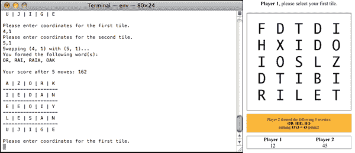
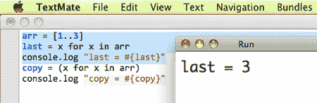
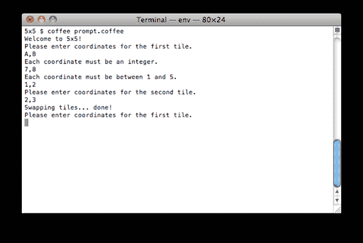
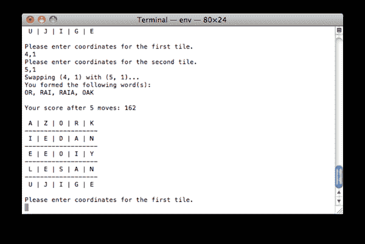
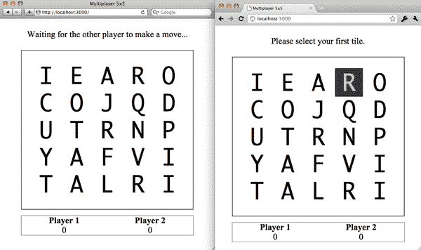

# CoffeeScript：加速 JavaScript 开发指南

## 读者对《CoffeeScript：加速 JavaScript 开发》的评价

如今很难想象一个不大量使用 JavaScript 的新 Web 应用，但如果你习惯了像 Ruby 这样的语言，处理 JavaScript 会感觉像是明显降级，更像是苦差事而非乐趣。CoffeeScript 应运而生：它是一个预编译器，去除了 JavaScript 所有不必要的冗长，让编写和阅读变成一种享受。加油，Coffee！这本书是对 CoffeeScript 世界的绝佳入门。

> → David Heinemeier Hansson  
> Rails 创始人

正如 CoffeeScript 本身一样，Trevor 直击要点，向你展示 CoffeeScript 的优势以及如何编写简洁、清晰的 CoffeeScript 代码。

> → Scott Leberknight  
> Near Infinity 首席架构师

尽管 CoffeeScript 是一门新语言，但你几乎到处都能找到它的身影。这本书将向你展示 CoffeeScript 可以多么强大和有趣。

> → Stan Angeloff  
> PSP WebTech Bulgaria 董事总经理

这本书帮助读者在学习 CoffeeScript 的过程中成为更好的 JavaScript 开发者。更重要的是，读起来非常过瘾，尤其是当你刚接触 CoffeeScript 并准备学习时。

> → Brendan Eich  
> JavaScript 创始人

CoffeeScript 可能成为 Web 应用开发的伟大创新之一；自从我第一次发现它，就再也不用写一行纯 JavaScript 了。希望这本精彩书籍的读者也能说出同样的话。

> → Dr. Nic Williams  
> Mocra CEO/创始人

《CoffeeScript：加速 JavaScript 开发》是来自社区最受尊敬成员之一的优秀 CoffeeScript 指南。无论你编写的是浏览器端还是服务端代码，它都能帮你迅速掌握这门语言。Trevor 的这本书应该出现在每位 CoffeeScript 开发者的书架上。

> → Sam Stephenson  
> Prototype JavaScript 框架创始人

CoffeeScript 是过去几年编程语言世界中最有趣的发展之一。它吸收了 Ruby 和 Python 等语言在过去十年中的经验教训，是一门具有强大表现力的语言。《CoffeeScript：加速 JavaScript 开发》是你学习这门新语言的指南，也是那些希望高效使用 JavaScript 的人必读之作。

> → Travis Swicegood  
> 《Pragmatic Version Control Using Git》作者

Trevor 提供了丰富的语言概述和实际案例，展示了我为何将 CoffeeScript 视为 iOS、Android 和 WebOS 移动开发的秘密武器。

> → Wynn Netherland  
> The Changelog 联合主持人

系好安全带，与 Trevor Burnham 一起从 JavaScript 驶向 CoffeeScript，重新享受 Web 开发的乐趣。

> → Javier Collado  
> Canonical Ltd. QA 自动化工程师

## 前言

JavaScript 生而自由，但直到最近，它处处都戴着镣铐。

JavaScript 从来都不是一种令人愉悦的编程语言：速度极慢，在不同浏览器中实现方式各异，自 1990 年代末以来就停滞在时间的琥珀中。也许你过去曾用它实现下拉菜单或可排序列表，但你可能并不享受这个过程。

幸运的是，如今的 JavaScript 正迎来当之无愧的复兴。得益于浏览器实现者的不懈努力，它已成为最快的动态主流语言；它无处不在，从服务器到 Photoshop，并且是唯一能全方位编程 Web 的语言。

CoffeeScript 是一门小巧的语言，旨在让你轻松触及 JavaScript 的精华部分：一等函数、类似哈希的对象，甚至是被广泛误解的原型链。如果我们做得好，你最终将少写三分之一的代码，却能生成与你原本会编写的 JavaScript 几乎相同的代码。

CoffeeScript 高度重视代码的可读性和消除语法杂乱。同时，CoffeeScript 与 JavaScript 之间几乎是一一对应的关系，这意味着不会有性能损失——事实上，许多 JavaScript 库在移植到 CoffeeScript 后，由于编译器能进行一些优化，运行速度反而更快。

你很幸运能读到这本书，因为 Trevor 从早期就是 CoffeeScript 的热情贡献者。很少有人比他更了解这门语言的方方面面，以及语言特性与取舍背后的争论历史。这本书是在专家引导下对 CoffeeScript 的温和介绍。

我期待听到由此产生的所有激动人心的项目，而且——谁知道呢——也许你会受到启发，创造属于你自己的小语言。

Jeremy Ashkenas，CoffeeScript 创始人

2011 年 4 月

版权所有 © 2011, The Pragmatic Bookshelf.

## 致谢

CoffeeScript 是一门年轻的语言。但从一开始，它就吸引了异常多样且充满活力的人群。正是那种美妙的能量——在 IRC、GitHub、Hacker News、博客、Twitter 和其他地方——激励我写了这本书。感谢每一位在 CoffeeScript 初期就热情拥抱它的人。

当然，感谢 Jeremy Ashkenas 创造了这门语言，并为本书撰写了慷慨的前言；CoffeeScript 不可能有更好的 BDFL 了。还要感谢 CoffeeScript 的其他贡献者，他们人数众多，无法在此一一列举。[[1]](#f_0004.html_FOOTNOTE-1)

感谢技术审阅者——任何遗留的错误完全是我的“锅”。我从 Javier Collado、Kevin Gisi、Darcy Laycock、Scott Leberknight、Sam Stephenson、Travis Swicegood、Federico Tomassetti、Stefan Turalski 和 Dr. Nic Williams 那里获得了有益的反馈。特别感谢 Jeremy Ashkenas（再次）和 Michael Ficarra，他们是 CoffeeScript 项目的核心贡献者，在百忙之中抽出时间纠正了我对语言许多细节的理解。还要感谢 JavaScript 创始人 Brendan Eich，他亲切地澄清了几个要点。

感谢 Pragmatic Bookshelf 团队。首先是我的编辑 Michael Swaine，我以称他为编辑为荣。还要感谢执行编辑 Susannah Pfalzer，以及大人物 Dave Thomas 和 Andy Hunt，他们冒险出版了一本关于鲜为人知语言的书，作者更是名不见经传。

最后，感谢 Scott 和 Teresa Burnham，我和至少另外两个人通常称他们为“爸爸”和“妈妈”。他们的支持和榜样作用，价值无法估量。

### 脚注

|  |  |
| --- | --- |
| [[1]](#f_0004.html_FNPTR-1) | [`github.com/jashkenas/coffee-script/contributors`](http://github.com/jashkenas/coffee-script/contributors) |

版权所有 © 2011，The Pragmatic Bookshelf。

## 前言

JavaScript 从来就不是为了成为世界上最重要的编程语言而设计的。它是在十天内拼凑出来的，融合了 Scheme 和 Self 的思想，并套上了类似 C 的语法。甚至连它的名字都显得格格不入，除了几个关键字之外，与另一种语言几乎毫无共同之处。[[2]](#f_0010.html_FOOTNOTE-2) 但一旦 JavaScript 发布，就再也无法控制它了。作为所有主流浏览器都能理解的唯一语言，JavaScript 迅速成为了 Web 的通用语言。随着 21 世纪初 Ajax 的引入，这种最初只是用于增强网页的简单脚本语言，突然变成了一种成熟的富应用开发语言。

随着 JavaScript 的崛起，不满之声从四面八方传来。一些人指出了它众多的小毛病和不一致性。[[3]](#f_0010.html_FOOTNOTE-3) 另一些人则抱怨它缺乏类和继承。而新一代的开发者，他们是在 Ruby 和 Python 的熏陶下成长起来的，却被 JavaScript 那密密麻麻的花括号、圆括号和分号所困扰。

少数勇敢的人创建了 Web 应用开发框架，这些框架能从其他语言生成 JavaScript 代码，其中最著名的是 Google 的 GWT 和 280 North 的 Objective-J。但很少有程序员愿意在自己和浏览器之间添加一层厚厚的抽象。不，他们将继续前进，通过将自己限制在“精华部分”（正如 Douglas Crockford 在 2008 年同名书中所说）来应对 JavaScript 的缺陷。

也就是说，直到现在。

### 新来的小家伙

2009 年圣诞节，Jeremy Ashkenas 首次发布了 CoffeeScript，这是一种被他称为“JavaScript 不那么张扬的小兄弟”的小型语言。该项目迅速在 GitHub 上吸引了数百名关注者，Ashkenas 和其他贡献者每月都会添加大量新功能。该语言的编译器最初是用 Ruby 编写的，但在 2010 年 3 月被一个用 CoffeeScript 编写的编译器所取代。

在 2010 年圣诞节发布 1.0 版本后，CoffeeScript 成为了 GitHub 上“最受关注”的项目之一。2011 年 4 月，当 David Heinemeier Hansson 确认了 CoffeeScript 支持将包含在 Ruby on Rails 3.1 中的传言时，该语言再次引起了广泛关注。

为什么这种小语言能如此迅速地流行起来？我想到了三个原因：熟悉感、安全性和可读性。

#### 精华部分依然存在

JavaScript 博大精深。它包罗万象。JavaScript 提供了函数式语言的许多最佳特性，同时保留了命令式语言的感觉。这种微妙的力量是 JavaScript 常常让新手感到困惑的原因之一：函数可以作为参数传递，也可以从其他函数返回；对象可以随时添加新方法；简而言之，函数是一等公民。

所有这些力量在 CoffeeScript 中依然存在，同时还有鼓励你明智使用它的语法。

#### 编译器来帮忙了

想象一种没有语法错误的语言，一种计算机能原谅你的拼写错误并尽力理解你给出的代码的语言。那将是多么美好的世界！当然，程序并不总是按你预期的方式运行，但这就是测试的目的。

现在想象一下，你编写了一次代码并将其发布到全世界，包括所有拼写错误，数百万台计算机以微妙不同的方式处理你的小错误。突然，你的计算机默默跳过的语句导致整个应用崩溃，影响了成千上万的用户。

可悲的是，这就是我们生活的世界。JavaScript 没有标准的解释器。相反，数百种浏览器和服务器端框架以各自的方式运行 JavaScript。调试跨平台的不一致性是一件非常痛苦的事情。

CoffeeScript 无法治愈所有这些弊病，但编译器会尽力生成符合 JavaScript Lint 规范的输出[[4]](#f_0010.html_FOOTNOTE-4)，这对于过滤常见的人为错误和非标准惯用法来说是一个很好的过滤器。而且，如果你输入了一些毫无意义的内容，比如 `2 = 3`，CoffeeScript 编译器会告诉你。早发现总比晚发现好。

#### 现在一切都清晰了

编写 CoffeeScript 可能会让人上瘾。为什么？看看这段 JavaScript 代码：

```javascript
function cube(num) {
return Math.pow(num, 3);
}
var list = [1, 2, 3, 4, 5];
var cubedList = [];
for (var i = 0; i < list.length; i++) {
cubedList.push(cube(list[i]));
}
```

现在，这是等价的 CoffeeScript 代码片段：

```coffeescript
cube = (num) -> Math.pow num, 3
list = [1, 2, 3, 4, 5]
cubedList = (cube num for num in list)
```

对于正在计数的各位来说，字符数减少了一半，行数减少了一半以上！这种收益在 CoffeeScript 中很常见。正如 Paul Graham 曾经说过的，“简洁就是力量。”[[5]](#f_0010.html_FOOTNOTE-5)

更短的代码更容易阅读、更容易编写，而且也许最关键的是，更容易修改。庞大的代码堆往往步履蹒跚，因为任何重大修改都需要付出巨大的努力。而小块的代码只需几次快速的按键就能重写，从而鼓励更敏捷、更迭代的开发风格。

值得补充的是，切换到 CoffeeScript 并不是一个全有或全无的命题——CoffeeScript 代码和 JavaScript 代码可以自由交互。CoffeeScript 的字符串就是 JavaScript 的字符串，它的数字就是 JavaScript 的数字；甚至它的类也能在像 Backbone.js[[6]](#f_0010.html_FOOTNOTE-6) 这样的 JavaScript 框架中工作。所以不要害怕从 CoffeeScript 代码中调用 JavaScript 代码，反之亦然。例如，我们将在第 5 章 *使用 jQuery 实现 Web 交互* 中讨论如何将 CoffeeScript 与 JavaScript 最流行的库之一结合使用。

#### 在 CoffeeScript 中嵌入 JavaScript

现在正好可以提一下，你可以通过将 JavaScript 代码用反引号括起来，将其嵌入到 CoffeeScript 代码中，如下所示：

```coffeescript
console.log `impatient ? useBackticks() : learnCoffeeScript()`
```

CoffeeScript 编译器会忽略反引号之间的所有内容。这意味着，例如，如果你在反引号之间声明了一个变量，该变量将不遵守常规的 CoffeeScript 作用域规则。

在我编写 CoffeeScript 的所有时间里，我从未需要过使用反引号转义。它们充其量是碍眼的东西，最坏的情况下是危险的。所以，借用 Troy McClure 的不朽名言：“既然你知道怎么做了——就别做。”

但历史已经说得够多了。编码才是真理，其他一切都是元讨论，正如 Jeff Atwood 曾经说过的，“元讨论就是谋杀。”[[7]](#f_0010.html_FOOTNOTE-7) 所以让我们先谈谈你现在正在读的这本书，然后——我保证，就在几页之后！——我们将开始编写一些热辣的代码。

## 本书适合谁

如果你有兴趣学习 CoffeeScript，那你来对地方了！然而，由于 CoffeeScript 与 JavaScript 紧密相连，本书实际上涉及两种语言——而且没有足够的篇幅来同时教你两者。因此，我将假设你了解一些 JavaScript。

你不必成为约翰·“JavaScript 忍者”·雷西格。事实上，如果你只是个业余的 JavaScript 爱好者，那太好了！在阅读本书的过程中，你会学到很多 JavaScript 知识。请查看脚注中我推荐的额外资源链接。如果你是编程新手，一定要看看*《Eloquent JavaScript》*[Hav11]，它也有交互式在线版本。[[8]](#f_0010.html_FOOTNOTE-8) 如果你已经涉猎过一些，但想成为专家，可以去 JavaScript 花园。[[9]](#f_0010.html_FOOTNOTE-9) 如果你想要一份全面的参考手册，没有人比 Mozilla 开发者网络做得更好。[[10]](#f_0010.html_FOOTNOTE-10)

你可能会注意到，我在本书中经常提到 Ruby。Ruby 启发了 CoffeeScript 的许多优秀特性，比如隐式返回、展开运算符和后置 `if`/`unless`。而且，得益于 Rails 3.1，CoffeeScript 在 Ruby 世界中拥有大量追随者。所以，如果你是 Ruby 开发者，那太好了！你已经有了先发优势。如果不是，也别担心；一旦你掌握了一些示例，一切都会水到渠成。

如果书中有任何让你困惑的地方，我鼓励你在本书的论坛上提问。[[11]](#f_0010.html_FOOTNOTE-11) 虽然我力求清晰，但编程语言唯一能完全理解的对象是计算机——而它们几乎不买书。

## 本书的组织方式

我们将从探索编译和运行 CoffeeScript 代码的各种方法开始这段旅程。然后，我们会深入探讨这门语言的细节。每一章都会介绍与我们正在进行的项目相关的概念和约定（见下一节）。

要掌握 CoffeeScript，你需要了解它如何与 JavaScript 生态系统的其他部分协同工作。因此，在学习语言基础之后，我们将简要介绍 jQuery（世界上最流行的 JavaScript 框架）和 Node.js（一个令人兴奋的新项目，让你可以在浏览器之外运行 JavaScript）。虽然我们不会深入探讨这两个工具，但我们会发现它们与 CoffeeScript 的搭配就像巧克力和花生酱一样完美。通过结合它们的力量，我们只需几个小时就能编写一个完整的多人游戏。

无论你处于什么水平，一定要完成每章末尾的练习。这些练习设计得既快速又具有挑战性，展示了 CoffeeScript 开发者最容易陷入的一些常见陷阱。在查看附录 A《练习答案》之前，请尝试自己解决。

本书中展示的代码、勘误和讨论论坛都可以在 PragProg 页面上找到：[`pragprog.com/titles/tbcoffee/coffeescript`](http://pragprog.com/titles/tbcoffee/coffeescript)。

## 关于示例项目：5x5



* * *


**图 1. 在控制台和网页版本的项目中，游戏逻辑代码是相同的。**

每章的最后一节会将新概念应用到一个名为`5x5`的原创文字游戏中。顾名思义，`5x5`是在一个 5 格宽、5 格高的网格上进行的。游戏开始时，每个格子上随机放置一个字母。然后玩家轮流交换网格上的字母，根据交换后形成的所有单词计分（每次交换的两个格子可能各形成四个单词：一个水平方向、一个垂直方向、两个对角线方向——只有从左到右的对角线算数）。

计分基于所形成单词中字母的 Scrabble 分值，并根据形成的不同单词数量乘以倍数。因此，在极限情况下，如果一次移动形成了八个单词，那么每个单词的分值都会乘以八。游戏中已经使用过的单词不计分。

我们将在第 2-4 章构建一个命令行版本的游戏，然后在第 5 章《使用 jQuery 实现网页交互》中将其迁移到浏览器，最后在第 6 章《使用 Node.js 构建服务器端应用》中添加多人游戏功能。将代码从命令行迁移到浏览器再到服务器将非常容易——它们都使用同一种语言！

## CoffeeScript 社区

没有强大的社区，再好的语言也用处不大。如果你遇到问题，该找谁呢？

在 StackOverflow 上提问（记得给你的问题加上`coffeescript`标签）是获得帮助的绝佳方式，尤其是当你附上困扰你的代码片段时。[[12]](#f_0010.html_FOOTNOTE-12) 如果你需要更即时的答案，通常可以在 Freenode IRC 的`#coffeescript`频道找到友好的人。如果想轻松讨论 CoffeeScript 的各种话题，可以试试 Google Group。[[13]](#f_0010.html_FOOTNOTE-13) 对于更严重的问题，比如可能的 bug，你应该在 GitHub 上创建一个 issue。[[14]](#f_0010.html_FOOTNOTE-14) 你也可以在那里请求新的语言特性。CoffeeScript 仍在发展中，整个团队欢迎反馈。

文档呢？你可能已经看过[`coffeescript.org`](http://coffeescript.org)上漂亮的官方文档了。还有一个官方维基：[`github.com/jashkenas/coffee-script/wiki`](http://github.com/jashkenas/coffee-script/wiki)。现在，还有这本书。

这就说到我了。我在 Twitter 上运营@CoffeeScript；你可以通过 Twitter 联系我，或者通过老式的电子邮件：trevorburnham@gmail.com。

对于 Web 开发来说，这是一个激动人心的时代。欢迎加入！

### 脚注

| [[2]](#f_0005.html_FNPTR-2) | 参见 Peter Seibel 对 JavaScript 创始人 Brendan Eich 的访谈，收录于《Coders at Work》[Sei09]。 |
|---|---|
| [[3]](#f_0005.html_FNPTR-3) | [`wtfjs.com/`](http://wtfjs.com/) |
| [[4]](#f_0006.html_FNPTR-4) | [`www.javascriptlint.com/`](http://www.javascriptlint.com/) |
| [[5]](#f_0006.html_FNPTR-5) | [`www.paulgraham.com/power.html`](http://www.paulgraham.com/power.html) |
| [[6]](#f_0006.html_FNPTR-6) | [`documentcloud.github.com/backbone/`](http://documentcloud.github.com/backbone/) |
| [[7]](#f_0006.html_FNPTR-7) | [`www.codinghorror.com/blog/2009/07/meta-is-murder.html`](http://www.codinghorror.com/blog/2009/07/meta-is-murder.html) |
| [[8]](#f_0007.html_FNPTR-8) | [`eloquentjavascript.net/`](http://eloquentjavascript.net/) |
| [[9]](#f_0007.html_FNPTR-9) | [`javascriptgarden.info/`](http://javascriptgarden.info/) |
| [[10]](#f_0007.html_FNPTR-10) | [`developer.mozilla.org/en/JavaScript/Guide`](https://developer.mozilla.org/en/JavaScript/Guide) |
| [[11]](#f_0007.html_FNPTR-11) | [`forums.pragprog.com/forums/169`](http://forums.pragprog.com/forums/169) |
| [[12]](#f_0010.html_FNPTR-12) | [`stackoverflow.com`](http://stackoverflow.com) |
| [[13]](#f_0010.html_FNPTR-13) | [`groups.google.com/forum/#!forum/coffeescript`](http://groups.google.com/forum/#!forum/coffeescript) |
| [[14]](#f_0010.html_FNPTR-14) | [`github.com/jashkenas/coffee-script/issues`](http://github.com/jashkenas/coffee-script/issues) |

版权所有 © 2011，The Pragmatic Bookshelf。

# 第 1 章

## 开始

如果你读过前言，那么你现在已经知道 CoffeeScript 是什么、它从何而来，以及为什么它是自 Herman Miller 以来程序员遇到的最好的东西。但你还没有真正写过一行代码。等待是难以忍受的，对吧？

好吧，深呼吸；时候到了。在本章中，我们将把 CoffeeScript 安装到你的系统上，让你的编辑器跟上节奏，最后运行一些代码！

## 1.1 安装 CoffeeScript

CoffeeScript 编译器是用 CoffeeScript 编写的。这带来了一个先有鸡还是先有蛋的问题：我们如何在没有 CoffeeScript 编译器的系统上运行编译器？要是能在没有网页浏览器的情况下在你的机器上运行 JavaScript，并让代码访问本地文件系统就好了……

啊，但确实有：`Node.js`！人们通常认为 Node 只是一个 JavaScript 网络服务器（更多内容见第 6 章《用 Node.js 构建服务端应用》），但它的功能远不止于此。从根本上说，它是 JavaScript 代码与操作系统之间的桥梁。Node 还有一个出色的工具叫`npm`，即 Node 包管理器。[[15]](#f_0016.html_FOOTNOTE-15) 如果你有 Ruby 背景，可以把它看作 RubyGems 在 Node 中的对应物。它已成为安装和管理 Node 应用及库的事实标准。

本节剩余部分将介绍如何安装 Node 和 npm，因为我们需要它们来使用 CoffeeScript 的标准`coffee`编译器。（本书最后一章也需要 Node 和 npm。）但如果你急于上手，可以直接访问[`coffeescript.org/`](http://coffeescript.org/)，点击“Try CoffeeScript”按钮，然后跳到下一章。（你需要在浏览器中安装能显示`console`输出的工具，例如 Firebug Lite。[[16]](#f_0016.html_FOOTNOTE-16)）

准备好了吗？我们开始吧。

### 在 Node.js 和 npm 环境下使用 CoffeeScript

虽然有很多方法可以在没有 Node 的情况下运行 CoffeeScript（附录 B《运行 CoffeeScript 的方式》中介绍了几种），但本书假设你使用的是标准的`coffee`命令，该命令设计为在 Node 下运行。只有最后一章（第 6 章《用 Node.js 构建服务端应用》）明确需要 Node 和 npm。

注意——如果你使用的是 Windows，在继续之前需要先安装 Cygwin。[[17]](#f_0016.html_FOOTNOTE-17) Cygwin 基本上充当了 Linux 模拟器。虽然 Node.js 的 0.6 版本路线图中包含了对 Windows 的一流支持，但在撰写本文时，使用 Cygwin 是最可靠的方法。

如果你使用的是 Mac，则需要安装 Xcode，[[18]](#f_0016.html_FOOTNOTE-18) 不是为了 Xcode 本身，而是为了它附带的命令行开发者工具。你可以尝试运行`gcc`（GNU 编译器集合）来检查这些工具是否已存在于系统中：

```
$ gcc
i686-apple-darwin10-gcc-4.2.1: no input files
```

如果输出类似上述内容，说明已就绪。如果没有，请获取 Xcode（如果你用的是 Mac），或者直接安装标准构建工具（如果你用的是 Linux 或 Cygwin）。

现在大家都使用带有标准构建工具的 Linux/Unix/Mac 系统了吗？太好了！接下来请访问[`gist.github.com/579814`](http://gist.github.com/579814)。在那里你会看到由 npm 创建者 Isaac Schlueter 整理的一系列令人眼花缭乱的安装选项。对于所有 Mac 用户，我推荐使用 Homebrew 方法（先安装 Homebrew）。[[19]](#f_0016.html_FOOTNOTE-19) 对于其他用户，列表中的第一种方法——直接安装——可能是最好的。Node 是一个大型包，因此安装可能需要几分钟。

一旦 Node 安装到你的系统上，运行 npm 的最新远程安装脚本：

```
$ curl http://npmjs.org/install.sh | sh
```

如果遇到权限错误，要么`chown`修改 Node 安装目录的所有权（这样可以避免以后出现麻烦），要么使用`sudo sh`代替普通的`sh`。

无论你如何安装，请检查`node`和`npm`是否在你的`PATH`路径中：

```
$ node -v
v0.4.8
$ npm -v
1.0.13
```

（关于版本说明：Node 的 API 在偶数次点版本中是稳定的。因此，本书中的示例在最新的 0.4.x 版本下应该能正常运行。而 Node 0.5.x 将包含 API 更改，这些更改将被整合到稳定的 0.6.x 版本中。至于 npm，本书假设你使用的是 npm 1.x。因此，如果你仍在使用 npm 0.x，现在正是升级的好时机。）

现在获取最新的 CoffeeScript 版本：

```
$ npm install -g coffee-script
/usr/local/bin/cake -> /usr/local/lib/node_modules/coffee-script/bin/cake
/usr/local/bin/coffee -> /usr/local/lib/node_modules/coffee-script/bin/coffee
```

`-g`标志是`--global`的缩写，它使安装的库在系统范围内可用。（默认情况下，`npm install [package]`会将指定包放在本地的`node_modules`子目录中，这在安装仅用于特定项目的包时很方便。）我建议在安装包含二进制文件的包时始终使用`-g`。

`npm install`的输出告诉我们，该包安装了两个二进制文件：`cake`和`coffee`。让我们检查一下`coffee`是否在系统的`PATH`中：

```
$ coffee -v
CoffeeScript version 1.1.1
```

如果上述命令没有生效，请查看`npm install`输出中`->`之前的目录（例如`/usr/local/bin`），并将该目录添加到你的`PATH`中。在 Mac 上使用默认的`bash` shell 时，可以通过将以下行添加到`~/.profile`文件中来实现：

```
export PATH=/usr/local/bin:$PATH
```

务必包含`:$PATH`部分——否则`/usr/local/bin`会替换你的`PATH`，而不是添加到其中！要使该行生效，你需要保存文件并启动一个新的 shell 会话（例如，打开一个新的终端窗口并关闭旧的窗口）。

如果你使用的是不同的操作系统或 shell，这些步骤可能略有不同；输入`echo $SHELL`来查看你正在使用的 shell。别忘了，修改文件后必须重启 shell 会话才能生效。

最后一步：就像我们的二进制文件必须位于`PATH`中才能从任何地方使用它们一样，npm 安装的 Node 库也必须位于`NODE_PATH`中。要查看 Node 将库安装在哪里，请键入以下命令：

```
$ npm ls -g
/usr/local/lib
```

（此命令还会列出 npm 全局安装的所有包。如果省略`-g`，你将看到当前目录下安装的所有包。）我们需要将该路径下的`node_modules`子目录添加到`NODE_PATH`中。在我的系统上，这意味着将以下内容添加到`~/.profile`中：

```
export NODE_PATH=/usr/local/lib/node_modules
```

同样，你在系统上需要执行的步骤可能有所不同。要测试`NODE_PATH`是否正常工作，请启动一个新的 shell 会话并输入`node`命令。这将进入 Node.js REPL，一个可以交互式运行命令的环境。现在输入以下内容：

```
> require('coffee-script')
```

我保证，这是你在本书中唯一需要输入的 JavaScript 代码！

如果`NODE_PATH`设置不正确，你会看到`Error: Cannot find module ’coffee-script’`。如果你看到的是一个长对象描述，那就说明一切正常。完成 Node REPL 后，输入`process.exit()`，或者直接按`Ctrl`-`c`。

顺便提一下，`coffee-script`库超出了本书的讨论范围；只需知道它允许你在 CoffeeScript 或 JavaScript 程序中将 CoffeeScript 编译为 JavaScript 即可。你可以用它做一些很酷的事情，比如编写带有自定义后处理的编译器，[[20]](#f_0016.html_FOOTNOTE-20) 或者编写自己的构建脚本作为 Cakefile。[[21]](#f_0016.html_FOOTNOTE-21)

#### 保持最新版本

如果你绝对需要最新的 CoffeeScript，其实非常简单。只需使用`git`克隆 CoffeeScript 仓库，然后让`npm`从本地目录安装即可：

```
$ git clone http://github.com/jashkenas/coffee-script.git
$ cd coffee-script
$ npm install -g
```

这将安装当前的`master`分支，该分支可能稳定也可能不稳定。你可以通过运行以下命令回退到 CoffeeScript 的特定版本（例如 1.1.1）：

```
$ npm install -g coffee-script@1.1.1
```

呼！我知道安装过程可能感觉有些繁琐，但请相信我，既然我们现在拥有了 Node 和 npm 的全部功能，这些努力是值得的。接下来，让我们设置你的编辑环境。

## 1.2 CoffeeScript 的文本编辑器

支持 CoffeeScript 的最新文本编辑器列表可在[`github.com/jashkenas/coffee-script/wiki/Text-editor-plugins`](http://github.com/jashkenas/coffee-script/wiki/Text-editor-plugins)找到。如果你使用 Mac，我推荐由 Jeremy Ashkenas 本人维护的 TextMate 插件。[[22]](#f_0016.html_FOOTNOTE-22) 在撰写本文时，还有适用于 Vim、Emacs、gedit、jEdit 和 IntelliJ IDEA 的插件。

最近，使用基于 Web 的文本编辑器进行编码已成为可能，这可以实现实时协作，并让你摆脱特定设备的束缚。目前，对 CoffeeScript 支持最好的 Web 编辑器是 Cloud9，配合 Cloud9 Live CoffeeScript 扩展。[[23]](#f_0016.html_FOOTNOTE-23)

当然，你可以使用任何你喜欢的编辑器，但使用支持 CoffeeScript 的编辑器会带来三大优势：语法高亮、智能缩进和内置编译快捷键。前两点很容易理解，但最后一点是许多程序员未能充分利用的。



**图 2. 直接从 TextMate 运行选中的代码**

在 TextMate 中，我可以使用 ⌘R（“运行”）来运行 CoffeeScript 文件，或者使用 ⌘B（“构建”）仅查看编译后的 JavaScript。编译只需几毫秒，因此如果我不确定某个 CoffeeScript 表达式如何转换为 JavaScript，快速构建是最快的查找方式。如果选中了文本，这些命令将仅对选中的部分执行，而不是整个文件，这使得测试代码片段和定位语法错误更加容易。


有一点需要提醒——某些编辑器（包括 TextMate）默认不会读取`PATH`，这意味着当它尝试运行`coffee`时，你会收到类似`command not found`的错误。如果遇到此问题，请进入编辑器的偏好设置（可能在“Shell 变量”下），并将`PATH`设置为与你在 shell 中运行`echo $PATH`时得到的输出一致。你还可以顺便设置`NODE_PATH`。

## 1.3 认识`coffee`

现在你已经设置好了编辑器，是时候介绍`coffee`——标准命令行编译器了。让我们从必不可少的“Hello, world!”程序开始。打开编辑器，创建一个名为`hello.coffee`的新文件，内容如下：

```coffee
console.log 'Hello, world!'
```

现在只需运行它：

```shell
$ coffee hello.coffee
```

```text
Hello, world!
```

你可能会疑惑几个问题：首先，那个`console.log`函数是从哪里来的？（答案：它是 Node.js 的全局函数。）其次，JavaScript 在哪里？CoffeeScript 的意义不就是编译成 JavaScript 吗？

这里发生的是，`coffee`在内部将`hello.coffee`编译成 JavaScript，然后将输出直接传递给 Node 立即执行。如果这不是你想要的效果，你需要使用`coffee`的众多选项中的一个或多个。要查看它们，请使用`coffee -h`：

```shell
$ coffee -h

Usage: coffee [options] path/to/script.coffee

-c, --compile compile to JavaScript and save as .js files
-i, --interactive run an interactive CoffeeScript REPL
-o, --output set the directory for compiled JavaScript
-j, --join concatenate the scripts before compiling
-w, --watch watch scripts for changes, and recompile
-p, --print print the compiled JavaScript to stdout
-l, --lint pipe the compiled JavaScript through JSLint
-s, --stdio listen for and compile scripts over stdio
-e, --eval compile a string from the command line
-r, --require require a library before executing your script
-b, --bare compile without the top-level function wrapper
-t, --tokens print the tokens that the lexer produces
-n, --nodes print the parse tree that Jison produces
--nodejs pass options through to the "node" binary
-v, --version display CoffeeScript version
-h, --help display this help message
```

因此，如果你想查看编译器刚才隐藏的 JavaScript，可以运行以下命令：

```shell
$ coffee -p hello.coffee
(function() {
  console.log('Hello, world!');
}).call(this);
```

关于那两行额外代码的解释，请参见*JavaScript 的包装*。

### JavaScript 的包装

你可能想知道为什么 CoffeeScript 的输出会被包装在一个函数中。原因很简单：命名空间。如果你将一堆 JavaScript 文件加载到浏览器应用程序中，它们会被视为一大块代码。这很容易导致意外后果：

```javascript
// 第一个文件
function declareNuclearWar() {
  alert('放松。这只是一次测试');
}
window.onload = function() {
  declareNuclearWar();
}

// 第二个文件
function declareNuclearWar() {
  alert('轰炸将在 5 分钟后开始。');
}
```

编写第一个文件的人完全不知道那段代码会引发怎样的混乱！通过将每个文件包装在一个匿名函数中，可以避免灾难，从而隔离两个`declareNuclearWar`声明。（参见第 2.2 节*作用域：你在哪里看到它们*。）这被称为模块模式。

为了让模块之间能够通信，你需要“导出”一些变量。（更多内容请参见第 4.1 节*模块：拆分应用*。）

哦——如果你必须去掉包装，请使用`-b`（“bare”）标志运行`coffee`。

### 编译为 JavaScript

最常用的标志可能是`-c`（“compile”），它将 JavaScript 输出保存到文件中。文件名与原文件相同，只是扩展名从`coffee`变为`js`。让我们继续以咖啡因饮料为主题：

```shell
$ coffee -c mochaccino.coffee
```

这会在同一目录下编译生成一个名为`mochaccino.js`的文件。你可以使用`-o`（“output”）标志将输出放到其他位置，后跟目标目录名称：

```shell
$ coffee -co output source
```

此示例读取`source`目录（及其子目录）中的每个`coffee`文件，并将对应的`js`文件写入`output`目录。注意，`-co`只是`-c -o`的简写形式。顺序很重要：`-o`需要紧跟在输出目录名称之前。

另一个常用的标志是`-w`（“watch”），它告诉`coffee`在后台持续运行；与`-c`结合使用时，它会在你每次修改代码时重新编译。它甚至适用于目录，并保留嵌套的文件结构。因此，如果我运行以下命令，`coffee`目录中的所有内容将不断重新编译到`js`目录：

```shell
$ coffee -cwo js coffee
```

这将持续运行，直到我按`Ctrl`-`c`终止编译器。

### REPL

如果你直接运行`coffee`而不带任何参数，你将进入被过度复杂的程序员称为 REPL（读取-求值-输出循环）的环境。通俗地说，这意味着你输入一些内容，它运行，你看到输出，然后重复。

这对于尝试语言特性非常有用。REPL 在 Node.js 环境中运行，并打印每个表达式的结果。例如，如果我们想回顾一下 JavaScript 的`parseInt`函数的一些古怪之处，可以尝试以下操作：

```shell
$ coffee
coffee> parseInt '221'
221
coffee> parseInt '221b'
221
coffee> parseInt 'b221'
NaN
```

以上就是关于`coffee`的全部内容。顺便提一下，如果你想了解`coffee`的工作原理，可以查看带注释的源代码。[[24]](#f_0016.html_FOOTNOTE-24) 如果你愿意，甚至可以对其进行逆向工程，并为 CoffeeScript 编译器编写自己的接口（比如我自己的 Jitter[[25]](#f_0016.html_FOOTNOTE-25)）。

请记住，`coffee`是一个轻量级工具；它不提供诸如压缩或编译后自动运行测试等功能。如果你想将这些功能添加到项目中，应该编写自己的构建脚本，通常以`Cakefile`的形式。你可以在 CoffeeScript 维基上找到一些关于`Cakefile`的文档。[[26]](#f_0016.html_FOOTNOTE-26)

你几乎已经准备好开始编写 CoffeeScript 代码了——但首先，如果出现问题该怎么办？

## 1.4 调试 CoffeeScript

许多人在使用 CoffeeScript 这类语言编写代码时遇到的一个问题是，运行时错误引用的是`编译后`的代码，而不是源代码。这是一个合理的担忧，并且已经讨论过几种解决方案。[[27]](#f_0016.html_FOOTNOTE-27) 不幸的是，目前你只能面对堆栈跟踪中行号与源代码几乎无关的情况。

好消息是：CoffeeScript 编译后的 JavaScript 非常易读。如果你理解这两种语言之间的关系（我希望你在读完本书后能够理解），那么将程序中的失败点与原始 CoffeeScript 源代码对应起来就相当容易了。

这并不理想，但这是站在前沿所付出的代价。随着 CoffeeScript 生态系统的发展和工具的改进，追踪 bug 会变得越来越容易。Mozilla 基金会的人员正在努力为 Firefox 添加 CoffeeScript 调试支持，Node 也不会落后太多。在此之前，请彻底测试你的代码，使用调试模式日志记录，并熟悉你的 JavaScript。

中间那部分是什么？哦，对了。在 Node.js 和配备了开发者控制台（或像前面提到的 Firebug Lite 这样的书签工具）的浏览器中，你可以使用`console.log`显示消息。有两个可能的问题：你并不总是想记录每一个细节，而且如果`console.log`不存在，你也不想调用它。一个常见的解决方案是使用包装函数，但这样在记录某些内容时，你就无法获得宝贵的 JavaScript 行号（因为所有日志记录都是从同一个地方进行的：包装函数）。因此，我推荐以下方法：

```coffeescript
window.debugMode = document.location.hash.match(/debug/) and console?
console.log 'This is the first of many debug-mode outputs' if debugMode
```

在这个例子中，当且仅当地址栏中的“哈希”包含字符串`debug`（例如`page.html#debug`）并且浏览器有`console`对象时，`debugMode`将为`true`。这为你提供了一种在加载页面时轻松启用/禁用所有额外消息的方法。将`debugMode`声明为`window`的属性使其成为全局变量。

一种更简单但通用性较差的方法是使用浸入（参见*浸入: ’a?.b’*）来确保仅在`console`存在时才调用`console.log`：

```coffeescript
console?.log 'Thanks to ?, this line is perfectly safe!'
```

在 Node 环境下，有许多库可以在不同详细级别显示输出（只需快速谷歌搜索“nodejs logging library”），包括我自己的`styout`，它支持彩色控制台输出。[[28]](#f_0016.html_FOOTNOTE-28)

日志记录可以替代注释，在开发过程中提供更多关于代码如何工作的信息。例如，下面是一段典型的带注释的代码：

```coffeescript
area = height * (base1 + base2) / 2
# now we have the area of the trapezoid
```

该注释可以用对`console.log`的调用来替换，如下所示：

```coffeescript
area = height * (base1 + base2) / 2
console.log "The area of the trapezoid is #{area}" if debugMode
```

另一个常见的习惯是在代码中进行断言。标准的`console`对象有一个`assert`函数，可以很好地满足这一目的，它接受一个值和一个错误消息（如果该值为假，则显示该消息）：

```coffeescript
fundamentalLaws = ['death', 'taxes', 'gravity']
if debugMode
  console.assert 'gravity' in fundamentalLaws, 'gravity oughta be a law!'
```

最后，防止 bug 最重要的方法是编写结构良好的代码。虽然目前还没有工具能为你提供运行时错误的确切行号，但至少你应该始终能够追踪到应用程序中导致问题的部分。

## 1.5 准备就绪！

在本章中，你学习了如何使用 Node.js 和 npm 在机器上安装 CoffeeScript。你还让你的首选文本编辑器与这门语言“对话”，探索了将 CoffeeScript 作为开发工作流程一部分的几种方式，并考虑了调试的挑战。

那么，既然你已经知道如何运行 CoffeeScript 代码，是时候深入了解这门语言本身的细节了。本书的其余部分将充满代码片段。最好的学习方法是使用你最喜欢的文本编辑器运行这些代码；如果你不理解它们的工作原理，试着修改一两行看看会发生什么。你也可以时不时地查看编译后的 JavaScript。

像这样引用文件的代码片段可能需要额外的部分才能运行：

```coffeescript
GettingStarted/outOfContext.coffee
foo bar, baz
```

而那些不引用文件的代码片段则是自包含的：

```coffeescript
OK = 'computer'
console.log 'No alarms and no surprises.' if OK
```

相信我——如果你的编辑器配备了“运行”命令，只需按一下键盘快捷键就能看到代码结果，你会获得更多的乐趣。这是 CoffeeScript 学习者的最佳伙伴。

#### 脚注

[[15]](#f_0012.html_FNPTR-15) [`npmjs.org/`](http://npmjs.org/)

[[16]](#f_0012.html_FNPTR-16) [`getfirebug.com/firebuglite`](http://getfirebug.com/firebuglite)

[[17]](#f_0012.html_FNPTR-17) [`www.cygwin.com/`](http://www.cygwin.com/)

[[18]](#f_0012.html_FNPTR-18) [`developer.apple.com/xcode/`](http://developer.apple.com/xcode/)

[[19]](#f_0012.html_FNPTR-19) [`github.com/mxcl/homebrew`](http://github.com/mxcl/homebrew)

[[20]](#f_0012.html_FNPTR-20) [`github.com/jashkenas/coffee-script/wiki/%5BExtensibility%5D-Hooking-into-the-Command-Line-Compiler`](http://github.com/jashkenas/coffee-script/wiki/%5BExtensibility%5D-Hooking-into-the-Command-Line-Compiler)

[[21]](#f_0012.html_FNPTR-21) [`github.com/jashkenas/coffee-script/wiki/%5BHowTo%5D-Compiling-and-Setting-Up-Build-Tools`](https://github.com/jashkenas/coffee-script/wiki/%5BHowTo%5D-Compiling-and-Setting-Up-Build-Tools)

[[22]](#f_0013.html_FNPTR-22) [`github.com/jashkenas/coffee-script-tmbundle`](http://github.com/jashkenas/coffee-script-tmbundle)

[[23]](#f_0013.html_FNPTR-23) [`cloud9ide.com/`](http://cloud9ide.com/) 和 [`github.com/tanepiper/cloud9-livecoffee-ext`](https://github.com/tanepiper/cloud9-livecoffee-ext)，分别对应。

[[24]](#f_0014.html_FNPTR-24) [`jashkenas.github.com/coffee-script/documentation/docs/command.html`](http://jashkenas.github.com/coffee-script/documentation/docs/command.html)

[[25]](#f_0014.html_FNPTR-25) [`github.com/TrevorBurnham/jitter`](http://github.com/TrevorBurnham/jitter)

[[26]](#f_0014.html_FNPTR-26) [`github.com/jashkenas/coffee-script/wiki`](http://github.com/jashkenas/coffee-script/wiki)

[[27]](#f_0015.html_FNPTR-27) [`github.com/jashkenas/coffee-script/issues/558`](http://github.com/jashkenas/coffee-script/issues/558)

[[28]](#f_0016.html_FNPTR-28) [`github.com/TrevorBurnham/styout`](http://github.com/TrevorBurnham/styout)


[[28]](#f_0015.html_FNPTR-28) [`github.com/TrevorBurnham/styout`](http://github.com/TrevorBurnham/styout)

版权所有 © 2011，The Pragmatic Bookshelf。

# 第 2 章 函数、作用域与上下文

CoffeeScript 的核心与灵魂由两个字符组成：`->`。定义一个函数仅需这些，但不要被它的简洁所迷惑；我们很快就会看到，函数是强大且多用途的对象。掌握它们是学习 CoffeeScript 的第一步。

虽然函数是本章的主角，但一路上我们还会遇到一些有趣的配角：变量、字符串、条件语句、异常，以及编写实用函数所需的其他一切。我们还将重温两个关键概念——作用域和上下文，并展示它们如何延续到 CoffeeScript 中。最后，我们将通过一些非常酷的特性来结束我们的旅程：属性参数、默认参数和不定参数。

至此，我们将准备好迎接第一个项目，在这个项目中，我们将为小文字游戏构建一个输入提示。最后但同样重要的是，本章的练习将把你新学的 CoffeeScript 技能推向极限。

## 2.1 函数入门

终于到了声明第一个函数的时候了！看这里：

```
-> 'Hello, functions!'
```

我可没说这会是一个有用的函数，对吧？但它确实做了点事：返回一个字符串。

别光听我说。把它输入到你最喜欢的文本编辑器中，然后点击运行命令：

```
console.log do -> 'Hello, functions!'
```

你会看到一些令人愉快的内容：

```
Hello, functions!
```

`do` 是做什么的？（它与 JavaScript 的 `do...while` 循环无关。）它只是表示“运行后面的函数”。我们也可以用一堆括号实现同样的效果：

```
console.log (-> 'Hello functions!')()
```

```
Hello, functions!
```

你可能会问：“`return` 关键字在哪里？”CoffeeScript 借鉴了 Ruby 的做法，隐式地返回每个函数中的最后一个表达式。你仍然可以显式地使用 `return`，但它是可选的，并且推荐的做法是省略它，除非你要中断执行流程。如果你不想返回任何内容，可以单独使用 `return`。

到目前为止，我们的函数都是匿名的。匿名函数有其用途，但这个函数确实需要一个名字：

```
hi = -> 'Hello, functions!'
```

```
console.log hi()
```

再次，我们得到这样的响应：

```
Hello, functions!
```

在 CoffeeScript 中给函数命名就是将它赋值给一个变量。注意，我们可以写成 `do hi` 而不是 `hi()`。但在实践中，`do` 通常只用于创建作用域，尤其是在迭代中。更多内容请参见 *循环中的作用域*。

### 两种函数声明语法

在 JavaScript 中，有两种定义函数的方式。第一种：

```
var cube1 = function(x) { return Math.pow(x, 3); };
```

第二种：

```
function cube2(x) { return Math.pow(x, 3); }
```

这两种方式的主要区别在于：如果在定义之前调用 `cube1`，会报错；但如果在其作用域内较早的位置调用 `cube2`，解释器会自动向前查找函数定义。

由于 IE 中的一个棘手问题，CoffeeScript 总是生成变量风格的函数声明，就像 `cube1`。（唯一的例外是“命名”函数由 `class` 关键字生成，我们将在第 4.3 节 *类：带原型的函数* 中看到。）所以别忘了在调用函数之前先定义它们！

但是，仅仅从函数返回一个常量有什么用呢？没什么大用。所以让我们让这个函数更通用一些：

```
greeting = (subject) -> "Hello, #{subject}!"
```

```
console.log greeting 'arguments'
```

```
'Hello, arguments!'
```

我们在 `->` 前面添加了一个参数列表 `(subject)`。（注意，在函数调用中括号是可选的，但在参数列表中不是，除非参数列表为空。详情请参见 *隐式括号*。）我们还使用了字符串插值将表达式插入到字符串中。

CoffeeScript 的插值语法与 Ruby 类似：`"A#{expression}Z"` 等价于 `'A' + (expression) + 'Z'`。插值只适用于双引号字符串。（作为一种风格，我倾向于在不进行插值时使用单引号字符串，以清楚地表明没有发生任何奇怪的事情。）

给聪明人的提示：CoffeeScript 的 `+` 运算符对空白敏感。因此像这样的字符串拼接可以正常工作：

```
squadron = 'Red'
xWing = squadron + 5 # 'Red5'
```

然而，下面这样不行：

```
squadron = 'Red'
xWing = squadron +5 # TypeError
```

问题在于 `squadron +5` 被编译为 `squadron(+5)`。（`+` 前缀是将字符串转换为数字的便捷方式。）由于 `squadron` 是字符串而不是函数，这会导致错误。字符串插值可以避免这个陷阱：

```
squadron = 'Red'
xWing = "#{squadron}5" # 'Red5'
```

### 隐式括号

在函数调用中省略括号的能力是一把双刃剑。要明智地使用这个能力，你需要理解一个简单的规则：隐式括号直到表达式结束才会闭合。

期望 CoffeeScript 理解你的意图是新手常犯的错误。例如，如果你写下以下代码，可能会感到惊讶：

```
console.log(Math.round 3.1, Math.round 5.2)
```

输出是 `3`。`Math.round 5.2` 去哪了？当我们显式地加上括号时，答案就清楚了：

```
console.log(Math.round(3.1, Math.round(5.2)))
```

`Math.round(5.2)` 被求值了，但随后它被作为参数传递给了另一个 `Math.round`（它忽略了该参数），而不是像预期的那样传递给 `console.log`。

为了避免混淆，我喜欢除了最外层的函数调用外，其他都使用括号：

```
console.log Math.round(3.1), Math.round(5.2) # 3, 5
```

### 访问 `arguments`

现在是时候提一下，你可以使用 JavaScript 的类数组对象 `arguments` 来访问函数的所有参数，无论它们是否在参数列表中声明。例如，我们可以这样编写 `greeting` 函数：

```
greeting = -> "Hello, #{arguments[0]}!"
```

`arguments` 对象通常用于函数需要接受可变数量参数的情况。当然，这种通用性是以可读性为代价的。它也是 JavaScript 头痛的常见来源，因为 `arguments` 的行为类似于数组，但不支持普通数组的许多方法。

幸运的是，由于我们将在第 2.6 节 *不定参数 (...)* 中学习的一个特性，你很少需要在 CoffeeScript 中直接使用 `arguments`。

### 条件语句与异常

现在，让我们写一个数值函数来换换口味：

```
cube = (num) -> Math.pow num, 3
```

注意，`Math` 对象作为 JavaScript 标准的一部分，在 CoffeeScript 中是相同的（而且，在所有主流浏览器和服务器端环境中也是如此）。

再来点更复杂的：一个布尔测试？

```
odd = (num) -> num % 2 is 1
```

`%` 是模运算符；它返回除法后的余数。`is` 关键字编译为 JavaScript 的 `===`，即严格相等运算符。（没有与 JavaScript 的 `==` 对应的运算符；请参阅 *严格相等或什么都不做*。）因此，如果给定的数字是一个不能被 2 整除的正整数，`odd` 将返回 `true`，否则返回 `false`。（因为 `%` 会将其值强制转换为数字，所以对于字符串 `'3'` 这样的值，`odd` 也会返回 `true`。）

### 严格相等或什么都不做

CoffeeScript 的 `is` 和 `==` 都编译为 JavaScript 的 `===`；无法获得 JavaScript 的 `==` 那种宽松的、类型强制转换的相等性检查，这种检查被 JSLint 等工具视为许多“WTF？”时刻的根源。让我们借用 [`wtfjs.com/2011/02/11/all-your-commas-are-belong-to-Array`](http://wtfjs.com/2011/02/11/all-your-commas-are-belong-to-Array) 中的一个例子：

```
",,," == new Array(4) // true
'' == '0' // false
0 == '' // true
0 == '0' // true
```

为了避免这些令人困惑的情况，你应该显式地进行类型转换。

在大多数情况下，这会被认为是一个非常好的奇偶性检查。但假设你正在编写一个具有非常严格规范的数学库，该规范规定如果函数接收到的值不是严格的正整数，则应该抛出异常。我们可以通过使用条件语句来实现，如下所示：

```
# Functions/odd.coffee
odd = (num) ->
  if typeof num is 'number'
    if num is Math.round num
      if num > 0
        num % 2 is 1
      else
        throw "#{num} is not positive"
    else
      throw "#{num} is not an integer"
  else
    throw "#{num} is not a number"
```

注意使用有意义的缩进来界定函数和每个条件分支，而不是 JavaScript 的花括号。在 CoffeeScript 中，花括号只用于一件事：声明 JSON 风格的对象。（更多内容将在下一章中介绍。）

现在，如果你尝试用非正整数的参数调用 `odd`，你将得到 `undefined`（因为 `throw` 语句没有返回值）。为了实际看到错误消息，你需要使用 `try...catch` 块：

```
# Functions/odd.coffee
try
  odd 5.1
catch e
  console.log e
# 5.1 is not an integer
```

我们可以通过依次检查三个条件来改进 `odd` 函数的风格：

```
# Functions/odd.coffee
odd = (num) ->
  unless typeof num is 'number'
    throw "#{num} is not a number"
  unless num is Math.round num
    throw "#{num} is not an integer"
  unless num > 0
    throw "#{num} is not positive"
  num % 2 is 1
```

（如果这些行不那么长，我们会使用后缀风格 `throw a unless b`，而不是缩进风格。）通常，只要条件导致 `throw` 或 `return`，我们就可以将分支逻辑简化为简单的系列检查。

当然，函数不仅限于返回值或抛出异常；它们还可以通过修改变量和运行其他函数来执行操作。（在函数式编程术语中，这些被称为副作用。）这些行为与你在 JavaScript 中预期的一样：

```
count = 0
incrementCount = -> count++
incrementCount() # count is now 1
```

现在你已经了解了在 CoffeeScript 中定义和调用函数的基础知识。但细节决定成败，让我们来看一个最重要的细节：变量在哪里可见？

## 2.2 作用域：你在哪里看到它们

到目前为止，我们还没有担心过变量存在于何处。唉，我们不能总是如此漫不经心。考虑这个例子：

```
age = 99
reincarnate = -> age = 0
reincarnate()
console.log "I am #{age} years old"
```

正如你可能预期的，输出是这样的：

```
I am 0 years old
```

然而，我们可以尝试交换第一行和第二行，像这样：

```
reincarnate = -> age = 0
age = 99
reincarnate()
console.log "I am #{age} years old"
```

现在点击运行，代码讲述了一个截然不同的故事：

```
I am 99 years old
```

奇怪——`reincarnate()` 调用没有任何效果！如果我们完全去掉 `age = 99` 呢？

```
reincarnate = -> age = 0
reincarnate()
console.log "age = #{age}"
```

```
ReferenceError: age is not defined
```

我们遇到了一个“作用域”问题！但什么是作用域？变量的作用域就是它的家，由三条规则定义：

1. 每个函数都会创建一个作用域，而创建作用域的唯一方法是定义一个函数。
2. 变量存在于对其进行了赋值的最外层作用域中。
3. 在其作用域之外，变量是不可见的。

例如，第一个例子中 `age` 的作用域是全局作用域；中间的例子中，全局作用域中有一个名为 `age` 的变量，`reincarnate` 函数的作用域中也有一个；最后一个例子中，只有 `reincarnate` 作用域内的 `age`。这就是为什么我们尝试在 `reincarnate` 外部显示 `age` 时得到了 `ReferenceError`：在该函数外部不存在同名的变量。

CoffeeScript 的作用域方法被称为词法作用域，与 JavaScript 相同，不同之处在于 JavaScript 使用 `var` 关键字显式定义变量的作用域，而 CoffeeScript 从赋值中推断作用域。这不仅节省了你宝贵的手指劳动，还阻止了你通过在嵌套作用域中给不同变量起相同名称来遮蔽变量。请参阅 *遮蔽：同名之惑*。

### 遮蔽：同名之惑

在 CoffeeScript 中，只有两种方式可以遮蔽变量：一种是在内部作用域变量之后，在外部作用域中创建一个变量，正如我们在第二个 `reincarnate` 例子中看到的那样。另一种方式是通过函数参数：

```
x = 5
triple = (x) -> x *= 3
triple x # 15
x # 5
```

遮蔽通常被认为是不良风格，应该避免。给你的变量起不同的名字，以免埋下作用域混乱的种子。

函数的作用域嵌套在函数本身所在的作用域中。（记住，函数只是变量。）这是关于作用域需要理解的另一个重要点：它不依赖于函数被调用的位置或方式。你总是可以通过查看代码或编译为 JavaScript 并查找 `var` 声明来判断某个东西存在于哪个作用域中，这些 `var` 声明总是放在其作用域的顶部：

```
singCountdown = (count) ->
  singBottleCount = (specifyLocation) ->
    locationStr = if specifyLocation then 'on the wall' else ''
    bottleStr = if count is 1 then 'bottle' else 'bottles'
    console.log "#{count} #{bottleStr} of beer #{locationStr}"
  singDecrement = ->
    console.log "Take one down, pass it around"
    count--
  singBottleCount true; singBottleCount false
  singDecrement(); singBottleCount true
```

`if count isnt 0 then singCountdown count`

这个示例会产生以下结果（省略了除创建作用域的 `function` 和存在于其中的 `var` 之外的所有内容）：

```
var singCountdown;
singCountdown = function(count) {
  var singBottleCount, singDecrement;
  singBottleCount = function(specifyLocation) {
    var bottleStr, locationStr;
    // ...
  }
  // ...
}
```

你可能会想：“如何在不进行赋值的情况下给变量一个作用域？”答案是：你做不到。相反，你需要进行赋值，传统上使用 `null` 或某个更合理的初始值。下面是一个例子：

```
obj = null
initializeObj = ->
  obj = ... # 创建具有超能力的对象
  window.onload = initializeObj
```

以上就是我们对 CoffeeScript 中作用域的讨论。接下来是完全不同的内容：`this`。

## 2.3 上下文（或者说，“`this` 是什么？”）

作用域和上下文是近亲，但不要混淆它们。作用域涉及标识符指向哪个变量，而上下文（也称为接收者）则涉及 `this` 关键字——以及它方便的 CoffeeScript 简写 `@`。


JavaScript 和 CoffeeScript 的新手常常觉得 `this` 令人困惑。用得对，它就像魔法；用得错，它可能是错误的头号来源。毫无疑问，部分困惑源于这个词本身；人们期望 `this` 指向“这个对象”。相反，你应该把它理解为“这个上下文”。而且我们很快就会看到，上下文（即 `this`/`@`）在每次调用函数时都可能不同。

（在继续之前，我应该指出，用“上下文”来描述 `this` 虽然流行，但并非标准。有些人对此不以为然，因为 JavaScript 规范定义了一个叫做“执行上下文”的东西，它相关但不同。不幸的是，对于 `this` 的值，没有其他普遍认可的术语，因此在本书中，我将继续称其为上下文。）

让我们通过这个简单的函数来看一些例子：

[Functions/setName.coffee](http://media.pragprog.com/titles/tbcoffee/code/Functions/setName.coffee)

```coffeescript
setName = (name) -> @name = name
```

这里，`name` 和 `@name` 是完全不同的变量：`name`（实际上我们可以叫它任何名字）是一个局部变量，在函数外部永远不可见；而 `@name`（`this.name` 的简写）是上下文的一个属性。

上下文的主要目的是让对象的方法（作为属性附加的函数）能够引用它们被调用的对象：

[Functions/setName.coffee](http://media.pragprog.com/titles/tbcoffee/code/Functions/setName.coffee)

```coffeescript
cat = {}
cat.setName = setName
cat.setName 'Mittens'
console.log cat.name # 'Mittens'
```

当我们调用 `cat.setName` 时，我们是在以 `cat` 对象作为上下文调用 `setName`；因此 `this`（或 `@`）指向猫，而 `@name` 指向 `cat.name`。函数本身没有改变。我们可以这样调用：

```coffeescript
setName 'Mr. Mistoffelees'
```

这不会对 `cat` 产生任何影响。

我们可以通过使用所有函数都有的 `call` 或 `apply` 方法，在特定上下文中调用函数，而无需将该函数附加到该对象上。（如果你对 JavaScript 中属性的工作方式感到模糊，或者惊讶于函数也是对象，那么你可能需要先跳到第 3.1 节 *对象作为哈希表*，然后再回来。）`apply` 接受一个上下文和一个参数数组传递给函数：

[Functions/setName.coffee](http://media.pragprog.com/titles/tbcoffee/code/Functions/setName.coffee)

```coffeescript
pig = {}
setName.apply pig, ['Babe']
console.log pig.name # 'Babe'
```

`call` 的工作方式相同，只是它接受单个参数而不是一个数组。因此，与上面等效的是：

```coffeescript
setName.call pig, 'Babe'
```

在实践中，`apply` 比 `call` 更常用，因为它更灵活：`call` 只允许你改变普通函数调用的上下文，而 `apply` 允许你改变上下文并传入任意数量的参数。

你可以使用 `call` 和 `apply` 来“借用”一个对象的方法并在另一个对象上使用：

[Functions/setName.coffee](http://media.pragprog.com/titles/tbcoffee/code/Functions/setName.coffee)

```coffeescript
horse = {}
cat.setName.apply horse, ['Mr. Ed']
console.log horse.name # 'Mr. Ed'
```

这里，我们使用 `cat.setName` 而不是 `setName` 并不重要：它们是同一个函数。

最后，给函数指定上下文的最后一种方式是使用 `new`，它会以该函数作为构造函数创建一个新对象：

[Functions/setName.coffee](http://media.pragprog.com/titles/tbcoffee/code/Functions/setName.coffee)

```coffeescript
Dog = setName # 按照惯例，构造函数首字母大写
dog1 = new Dog('Jimmy')
dog2 = new Dog('Jake')
console.log dog1.name # 'Jimmy'
console.log dog2.name # 'Jake'
```

`new` 关键字的意思是：“不要返回函数的结果；而是创建一个新对象，在该对象的上下文中运行函数，然后返回该对象。”（我们还可以使用原型为 `new` 创建的对象添加额外属性，我们将在第 4.2 节 *原型的力量* 中看到。）因为 `new` 关键字将新的 `Dog` 设置为上下文，所以 `@name` 指向新狗的 `name` 属性。

如果一个函数不是作为方法调用的，并且你没有使用 `new` 关键字或 `call`/`apply`，那么上下文就是全局对象。我们将在第 4.1 节 *模块：拆分应用* 中了解更多关于全局上下文的内容；现在，只需记住，当 `this` 指向全局对象时，通常是一个坏主意：

[Functions/setName.coffee](http://media.pragprog.com/titles/tbcoffee/code/Functions/setName.coffee)

```coffeescript
setName 'Lulu'
console.log name # 'Lulu'
console.log @name # undefined
```

所以，你看，上下文完全由函数的调用方式决定；与作用域不同，它与函数定义的位置无关。（当然，我们通常希望上下文由函数定义的位置决定。幸运的是，有一种巧妙的技术可以让我们有效地做到这一点，我们将在 *绑定函数：'this' 意味着 'this'* 中遇到。）

回顾一下，以下是 CoffeeScript 上下文规则的简要总结，前面的规则优先于后面的规则：

1. 当 `new` 关键字放在函数调用前面时，上下文是新创建的对象。
2. 当函数通过 `call` 或 `apply` 调用时，上下文是第一个参数。
3. 否则，如果函数作为对象属性（`obj.func` 或 `obj['func']`）调用，则在该对象的上下文中运行。
4. 如果以上都不适用，则函数在全局上下文中运行。

我们将在第 4.1 节 *模块：拆分应用* 中了解更多关于全局上下文的内容。

### 绑定函数：`this` 意味着 `this`

有时你希望一个函数无论以何种方式调用，都在当前上下文中运行。这在事件回调中尤其常见。假设你想让某人在你的 `voicemail` 数组（绑定到当前上下文）中留言。那么你可能会这样写：

```coffeescript
callback = (message) -> @voicemail.push message
```

啊，但你当然知道，当 `callback` 在没有相关对象的情况下被调用时，`this` 只会指向全局对象——或者指向其他库通过 `call` 或 `apply` 设置的任何上下文。难道就没有办法让 `this` 始终指向同一个对象，无论函数如何被调用吗？

JavaScript 可以做到这一点，但需要编写大量样板代码（参见 *=> 是如何工作的？*，不过值得一提的是，ECMAScript 5 作为最新一代浏览器支持的标准，在 `Function` 原型上提供了一个更简单的 `bind` 方法）。幸运的是，CoffeeScript 让将函数绑定到当前上下文变得像改变一个字符一样简单：用 `=>` 代替 `->`。我们将 `=>` 称为“绑定函数运算符”，或者更非正式地称为“胖箭头”。

于是我们的回调函数变成了这样：

```coffeescript
callback = (message) => @voicemail.push message
```

现在我们可以放松了，因为 `this` 在函数内部的意义与函数定义处的意义相同，无论它在哪里被调用！

### `=>` 是如何工作的？

我们可以用 JavaScript 这样编写 `callback = (message) => @voicemail.push message`：

```javascript
var callback;
callback = (function(__this) {
  var __func = function(message) {
    return this.voicemail.push(message);
  };
  return function() {
    return __func.apply(__this, arguments);
  };
})(this);
```

①④

最外层的函数将当前上下文 `this` 作为参数 `__this` 传入。

②

`__func` 包含我们想要绑定到当前上下文的函数代码。

③

这里定义的匿名函数将成为 `callback`。因此，每当调用 `callback` 时，它的参数都会被传递给 `__func`，而 `__func` 在 `__this` 作用域中运行，并返回 `__func` 的结果。

注意，传递给 `callback` 本身的上下文从未被使用，并且 `__func` 从未暴露给外部世界，从而确保它始终在定义 `callback` 的上下文中被调用。

在实践中，CoffeeScript 使用一个名为 `__bind` 的辅助函数，但底层技术是相同的。`=>` 可能是 CoffeeScript 最强大的简写形式。

你可能会想，为什么不总是使用 `=>` 而不是 `->` 呢？有两个原因。首先，绑定代码会在文件大小和执行时间上带来一些微小开销，而且通常是不必要的。但更重要的是，虽然上下文像变色龙一样的特性常常令人困惑，但它也能实现非常优雅的代码。例如，许多库通过上下文将关键信息传递给回调函数。这里有一个简单的例子（在第五章 *使用 jQuery 实现网页交互* 中会更清楚）：

```coffeescript
$('#clickToHide').click -> $(this).hide()
```

与其严格地只使用普通函数或绑定函数，你需要在每次定义使用 `this`/`@` 的函数时仔细思考上下文应该意味着什么。

作用域和上下文就讲到这里——现在你可以自认为是函数语义的大师了！接下来的几节将介绍一些有用的语法糖，然后我们终于要开始处理游戏项目的第一次迭代了。

## 2.4 属性参数（`@arg`）

还记得我们之前定义的那个函数吗？它只是将参数的值设置为其上下文对象的属性：

```coffeescript
setName = (name) -> @name = name
```

实际上，CoffeeScript 为此提供了一个方便的简写形式：

```coffeescript
setName = (@name) -> # 无需代码！
```

很简单，当 `@` 出现在函数参数名称之前时，该函数会自动将参数赋值给上下文对象 `this` 上同名的属性。

这对于构造函数尤其有用，在第四章 *模块和类* 中我们将大量使用它。通常，为了设置实例对象的初始属性，我们会向构造函数传递四五个参数。而使用 `@argument` 语法，可以节省那么多行代码。不错。

## 2.5 默认参数（`arg =`）

假设你有一个函数，它的某个参数在大多数情况下都会取一个特定的值，比如这样：

```coffeescript
ringFireAlarm = (isDrill) ->
  # 几乎总是演习
  ...
```

如果 `ringFireAlarm()` 是更常见的 `ringFireAlarm true` 的简写，那该多好啊？我们可以这样写：

```coffeescript
ringFireAlarm = (isDrill) ->
  isDrill = true unless isDrill?
  ...
```

这里 `unless (expression)` 是 `if not (expression)` 的简写。`isDrill?` 中的 `?` 是存在运算符，它用于检查给定值 (1) 是否存在于当前作用域中，并且 (2) 不是 `undefined` 或 `null`。在心里，你可以将 `x?` 理解为“`x` 存在”。

存在运算符也可以放在两个变量之间：`a ? b` 如果 `a?` 则返回 `a`，否则返回 `b`。它还可以与 `=` 结合形成复合赋值运算符：`c ?= d` 是 `c = d unless c?` 的简写。你可以理解为“让 `d` 成为 `c` 的默认值”。

### 使用 `or=` 实现真值默认

你可能会看到有人这样写：

```coffeescript
a or= b
```

这（或其等价形式 `a ||= b`）是一种让 `b` 成为 `a` 默认值的方法。那么，它与 `a ?= b` 究竟有何不同？

答案与“真值性”有关。在 CoffeeScript 中（与 JavaScript 一样），所有值都会被布尔逻辑运算符 `&&` 和 `||`（在 CoffeeScript 风格中称为 `and` 和 `or`）以及 `if` 隐式地强制转换为布尔值。大多数值会变成 `true`，而少数值——特别是 `null`、`undefined`、`0` 和空字符串——会变成 `false`。

这种宽松灵活的布尔逻辑方法也延续到了布尔运算符的结果上。虽然某些语言只会从 `a or b` 语句中返回 `true` 或 `false`，但 CoffeeScript（像 JavaScript 一样）如果 `a` 为真则返回 `a`，否则返回 `b`。（`x and y` 如果两者都为真则返回 `y`，如果两者都为假则返回 `x`，如果只有一个为假则返回那个假值。）

这给了我们很多有用的快捷方式——包括 `a = a or b`（通常简写为 `a or= b`），意思是“如果 `a` 的值为假，则将 `a` 设置为 `b`”。虽然不如 `?=` 那么方便，但 `or=` 也是一个好帮手。

```coffeescript
ringFireAlarm = (isDrill) ->
  isDrill ?= true
  ...
```

当然，正如你可能从本节标题中推断出的那样，还有一种更简洁的方式：

```coffeescript
ringFireAlarm = (isDrill = true) ->
  ...
```

“那么，”你可能会问，“你为什么花了那么多时间讨论存在运算符？”有两个原因。首先，存在运算符很酷。其次，CoffeeScript 中默认参数的行为与其他编程语言（如 Ruby、Python 和 PHP）有些不同。在这些语言中，传递给函数的参数数量才是关键——只有当 `ringFireAlarm` 被无参数调用时，`isDrill = true` 的赋值才会执行。相比之下，CoffeeScript 在幕后使用了存在运算符。这意味着显式传递 `null` 或 `undefined` 与完全省略参数是一样的。

如果不小心，这可能会导致令人不快的意外，但它也更灵活。你可以为一个参数设置多个默认值，调用者可以选择为其中任意子集使用默认值，如下所示：

```coffeescript
chooseMeals = (breakfast = 'waffles', lunch = 'gyros', dinner = 'pizza') ->
  ...

chooseMeals null, 'burrito', null # 不喜欢 gyros
```

当然，你可以通过使赋值依赖于 `arguments.length` 来实现更传统的默认参数行为。但如果你发现自己这样做，请问自己是否真的需要接受 `null` 作为值。换成 `false` 或 `NaN` 甚至自定义类型如何？

还有一个细节值得一提——你可以使用任意表达式作为默认参数，尽管通常不推荐这样做。如果你这样做，表达式将在函数被调用的上下文中执行，在函数体中的任何表达式之前，并且仅在赋值发生时执行。换句话说，以下两个表达式是完全等价的。第一种方式：

```coffeescript
dontTryThisAtHome = (noArgNoProblem = @iHopeThisWorks()) ->
...
```

另一种方式：

```coffeescript
dontTryThisAtHome = (noArgNoProblem) ->
  noArgNoProblem ?= @iHopeThisWorks()
...
```

在我们开始第一个项目之前，还有一个特性要讨论，它非常了不起。以前从未有一个省略号能完成这么多工作……

## 2.6 展开参数（`...`）

在 JavaScript 中，接受可变数量的参数既容易又困难：容易是因为传递给函数的每个参数（无论函数声明中的数量如何）都可以从 `arguments` 对象中获取，困难是因为 `arguments` 不支持标准的 `Array` 方法，如 `slice` 和 `shift`。

幸运的是，CoffeeScript 允许你将任意范围的参数自动转换为数组。只需在任何参数名称的末尾添加一个省略号 `...`（也称为“展开参数”）：

```coffeescript
refine = (wheat, chaff...) ->
  console.log "The best: #{wheat}"
  console.log "The rest: #{chaff.join(', ')}"
```

这里的展开参数意味着“取第一个参数 `wheat` 之后的所有参数，并将它们组合成一个数组 `chaff`。”用四个参数列表调用 `refine` 会得到以下结果：

```coffeescript
refine 'great', 'not bad', 'so-so', 'meh'
The best: great
The rest: not bad, so-so, meh
```

如果只给一个参数，或者没有参数，那么 `chaff` 将只是一个空数组。

展开参数不必放在参数列表的末尾。CoffeeScript 编译器能够智能地确定要放入数组的适当参数：

```coffeescript
sandwich = (beginning, middle..., end) ->
...
```


非展开参数总是先被填充。因此，如果`sandwich`只被调用两个参数，那么它们将成为`beginning`和`end`。只有当有三个或更多参数时，才会有`middle`。展开参数会吸收所有额外的参数。

即使展开参数放在前面，普通参数也优先：

```
spoiler = (filler..., theEnding) -> console.log theEnding
spoiler 'Darth Vader is Luke\'s father!'
Darth Vader is Luke's father!
```

当然，在一个给定的函数中只有一个展开参数才有意义。否则，展开参数们将不得不争夺如何分割参数。

值得一提的是，展开参数也可以在不使用函数的情况下动态地分割数组。启动 REPL（只需运行不带参数的`coffee`，还记得吗？）并稍微尝试一下这个功能：

```
coffee> birds = ['duck', 'duck', 'duck', 'duck', 'goose!']
coffee> [ducks..., goose] = birds
coffee> ducks
duck,duck,duck,duck
```

我们将在第 3.6 节*模式匹配（或解构赋值）*中了解更多关于这种语法的内容。

在函数调用中，展开参数的含义与在参数列表和模式匹配赋值中的含义完全相反：它们将数组展开为一系列参数，而不是将一系列参数折叠成一个数组。让我们再次进入 REPL：

```
coffee> console.log 1, 2, 3, 4
1 2 3 4
coffee> arr = [1, 2, 3]
coffee> console.log arr, 4
[ 1, 2, 3 ] 4
coffee> console.log arr..., 4
1 2 3 4
```

正如你可能已经猜到的，这种语法在幕后使用了`apply`（我们在第 2.3 节*上下文（或“什么是’this’？”）*中遇到过）。

希望这一章让你收获颇丰。现在是时候通过一个小项目将所有内容整合起来，然后是一大堆脑筋急转弯。

## 2.7 项目：5x5 输入解析器

还记得我们的小文字游戏想法吗（参见*关于示例项目：5x5*）？是时候把它变成现实了！目前，我们对哈希、数组和循环的了解还不够，无法实现一个完整的工作版本（这些遗漏将在第 3 章*集合与迭代*中弥补）。不过，我们至少可以通过使用 Node.js 编写一个命令行提示来初步尝试。

但在开始之前，我们需要理解非阻塞 IO。在大多数语言中，我们可以这样写：

```
input = getInput()
# now process input...
```

`getInput`函数会等待用户输入内容，然后返回它。这被称为阻塞 IO，因为`getInput`会“阻塞”我们程序的执行，直到输入可用。

然而，我们不能在 Node 中这样做，因为它的 IO 是非阻塞的（除了少数名称以`Sync`结尾的便利函数）。相反，我们需要给 Node 一个回调函数，每当有输入事件时，它就会被执行。（我们将在第 6.3 节*异步思考*中更深入地探讨 Node 的事件模型。）在 Node 中，与上述最接近的模拟是：

```
stdin.on 'data', (input) ->
# now process input...
```

（`stdin`对象需要一些初始化，我们稍后会讲到。）如果你习惯了阻塞 IO，过渡到非阻塞 IO 可能会让人感到不适。但好处是巨大的，因为等待输入（以及较小程度上的输出）长期以来一直是性能下降和可扩展性受限的主要来源。在这个特定的应用中，这些都不是大问题，但设计在等待输入时仍能继续运行的应用程序是一个好习惯，而 Node 基本上迫使你这样做。编写阻塞函数的唯一方法是用 C++ 创建原生扩展。

那么让我们稍微思考一下我们应用的结构。以下是它需要做的事情：

1. 提示输入第一个方块的坐标（`x, y`）。
2. 如果输入有效（两个整数，每个在 1 到网格大小之间），则提示输入第二个方块的坐标。
3. 再次验证输入。如果通过，则说明我们正在交换两个方块。如果失败，解释原因并提供重试机会。

让我们从“打开”标准输入开始：

[`函数/5x5/prompt.coffee`](http://media.pragprog.com/titles/tbcoffee/code/Functions/5x5/prompt.coffee)

```
stdin = process.openStdin()
stdin.setEncoding 'utf8'
```

`process`从哪里来？它是 Node 环境的一部分，是少数不需要`require`语句即可访问的部分之一。`process`提供了获取命令行参数、管理内存以及处理标准 IO 的方法。

如果此时运行应用（使用`coffee prompt.coffee`），我们会得到一系列永无止境的提示。（`Ctrl`-`c`是你的朋友。）每次你按下`Return`，Node 都会寻找一个回调函数来传递该输入。由于我们还没有给它回调函数，所以什么也不会发生。让我们来解决这个问题，好吗？

[`函数/5x5/prompt.coffee`](http://media.pragprog.com/titles/tbcoffee/code/Functions/5x5/prompt.coffee)

```
inputCallback = null
stdin.on 'data', (input) -> inputCallback input
```

`stdin.on 'data'`调用告诉 Node：“每当有新的一行输入时，就将其传递给这个函数。”该函数只是将输入转发给另一个函数`inputCallback`。更准确地说，`inputCallback`稍后才会成为一个函数——目前它只是`null`。我们为什么要这样做？因为这个代理函数使得更改回调行为变得容易。`inputCallback = null`这一行（其中`null`是任意值）告诉编译器赋予该变量模块级作用域，从而允许在匿名函数外部修改它。

请注意，如果我们尝试在`stdin.on 'data'`上设置多个回调，它们会简单地“堆叠”起来，因此每次有新输入时每个回调都会被调用。如果我们存储了对监听器的引用，可以使用`stdin.removeListener`来解除现有回调的绑定，但这需要两步操作（解除绑定、绑定）。相反，我们只需更改`inputCallback`的值。

我们的简单应用将有两个“状态”：提示输入第一个方块的坐标，以及提示输入第二个方块的坐标。进入一个状态只需显示一条消息，然后设置`inputCallback`：

[`Functions/5x5/prompt.coffee`](http://media.pragprog.com/titles/tbcoffee/code/Functions/5x5/prompt.coffee)

```
promptForTile1 = ->
  console.log "请输入第一个方块的坐标。"
  inputCallback = (input) ->
    promptForTile2() if strToCoordinates input
```

当新输入到来时，回调会检查尚未定义的`strToCoordinates`函数；如果它给出许可，我们就将控制权传递给镜像提示，以获取移动的第二个方块：

[`Functions/5x5/prompt.coffee`](http://media.pragprog.com/titles/tbcoffee/code/Functions/5x5/prompt.coffee)

```
promptForTile2 = ->
  console.log "请输入第二个方块的坐标。"
  inputCallback = (input) ->
    if strToCoordinates input
      console.log "正在交换方块...完成！"
      promptForTile1()
```

那么，验证是怎么回事呢？首先，我们来编写一个简单的测试，判断一个（从零开始的）`x`、`y`坐标对是否在网格内：

[`Functions/5x5/prompt.coffee`](http://media.pragprog.com/titles/tbcoffee/code/Functions/5x5/prompt.coffee)

```
GRID_SIZE = 5
inRange = (x, y) ->
  0 <= x < GRID_SIZE and 0 <= y < GRID_SIZE
```

`GRID_SIZE`全部大写，表示它是一个常量（这是针对我们人类而非编译器的风格约定）。该函数利用了 CoffeeScript 的链式比较特性：`0 <= x < GRID_SIZE`是`(0 <= x) and (x < GRID_SIZE)`的简写。

下面是另一个简单的测试，判断一个数字是否为整数：

[`Functions/5x5/prompt.coffee`](http://media.pragprog.com/titles/tbcoffee/code/Functions/5x5/prompt.coffee)

```
isInteger = (num) ->
  num is Math.round(num)
```

现在，我们用这些来创建一个神奇的字符串到坐标的转换器，并附带便捷的错误消息：

[`Functions/5x5/prompt.coffee`](http://media.pragprog.com/titles/tbcoffee/code/Functions/5x5/prompt.coffee)

```
strToCoordinates = (input) ->
  halves = input.split(',')
  if halves.length is 2
    x = parseFloat halves[0]
    y = parseFloat halves[1]
    if !isInteger(x) or !isInteger(y)
      console.log "每个坐标必须是整数。"
    else if not inRange x - 1, y - 1
      console.log "每个坐标必须在 1 到 #{GRID_SIZE} 之间。"
    else
      {x, y}
  else
    console.log '输入格式必须为 `x, y`。'
```

你可能会好奇这在两个`inputCallback`实现中的`if`条件里是如何工作的。实际上，`console.log`返回`undefined`，条件检查会将其强制转换为`false`，而任何非空对象都会被强制转换为`true`。因此，我们要么返回`{x, y}`，要么给出错误消息，所有布尔需求都得到了满足。

现在只缺一块：我们需要从某个状态开始，以便在调用`inputCallback`之前定义它：

[`Functions/5x5/prompt.coffee`](http://media.pragprog.com/titles/tbcoffee/code/Functions/5x5/prompt.coffee)

```
console.log "欢迎来到 5x5！"
promptForTile1()
```

就是这样！运行`prompt.coffee`亲自试试吧。它应该看起来像图 3，*使用我们的命令行提示*。



---

**图 3. 使用我们的命令行提示**

希望你已经对 CoffeeScript 函数的强大和语法简洁性有了更深的体会。在下一章中，我们将学习如何处理对象和数组，并将我们的小型标准输入输出实验变成一个完整的游戏。

## 2.8 你做得很好，年轻的帕达万

可以毫不夸张地说，你现在对 CoffeeScript 的了解已经超过了地球上 99.999% 的人。你已经学会了如何定义、调用函数以及从函数返回值。你还了解到函数会创建作用域，并且上下文变量`this`是一个善变的家伙，它取决于函数的调用方式——除非函数使用`=>`定义，从而绑定到其定义时的上下文。

你还品尝了 CoffeeScript 其他特性的盛宴：`if/unless`、`try...catch`、默认参数值以及属性参数等。然后我们利用这些特性编写了一个运行在 Node.js 上的简单命令行应用。

CoffeeScript 中我们尚未触及的只有两个领域：集合（对象和数组）和迭代（循环）。巧合的是，这些正是下一章的主题。

但在继续之前，请通过以下练习测试你的知识。你该不会想跳过它们吧？相信我：它们能让你将来少走弯路。

## 2.9 练习

### 1.

以下函数将从给定数组中移除所有元素，并返回`splice`的结果，在本例中将是原数组的一个副本。（我们将在*切片与拼接*中详细了解该函数。）

```
clearArray = (arr) ->
  arr.splice 0, arr.length
```

如何让`clearArray`返回清空后的数组？如何让它什么都不返回？

（虽然这是一个简单的例子，但将函数标记为不返回任何值通常能让 CoffeeScript 编译器生成更高效的输出，尤其是在涉及循环时。）

### 2.

编写一个名为`run`的函数，它接受一个函数作为第一个参数，并将所有额外参数传递给被调用的函数。也就是说，`run func, a, b`应该等价于`func(a, b)`。提示：这应该不超过一行。

### 3.

隐式括号总是延伸到表达式的末尾，但不一定延伸到行尾。找出一个隐式括号未延伸到行尾的情况。

### 4.

在函数调用中使用显式括号时，CoffeeScript 不允许函数名后面有任何空白。例如，`f (a, b)`是语法错误。你能想到这条规则存在的原因吗？（提示：`f (g) h`是什么意思？）

### 5.

函数调用`foo.bar.baz()`的上下文是什么？`@hoo()`呢？`@hoo.rah()`呢？

### 6.

`x`引用一个遵循作用域规则的变量，而`@x`引用一个遵循上下文规则的变量。两者永远不会等价——它们可能引用同一个对象，但写`x = y`不会影响`@x`，反之亦然。但`what.x`和`@x`可以等价。如果它们等价，那么`what`是什么？

要找到答案，请在这段代码中添加一行非常短的代码，使其输出“量子纠缠”：

```
xInContext = ->
  console.log @x
```

```
what = {x: 'quantum entanglement'}
```

### 7.

这段代码能工作吗？

```
x = true
showAnswer = (x = x) ->
console.log if x then 'It works!' else 'Nope.'
showAnswer()
```

解释原因。

版权所有 © 2011, The Pragmatic Bookshelf.

# 第 3 章：集合与迭代

在上一章中，我们掌握了函数。现在，是时候将这些函数应用到数据集合上了。

我们将首先以全新的视角审视对象，将其视为通用存储。然后学习数组，它为我们提供了更有序的存储位置。接着，我们将过渡到循环——迭代的通用语言。我们还将学习如何使用推导式直接从循环构建数组，以及如何使用模式匹配提取数组的部分内容。最后，我们将完成上一章开始的命令行版 5x5 游戏，并通过一组新的练习来回顾所学内容。

## 3.1 对象作为哈希

首先，回顾一下我们在 JavaScript 中关于对象的知识，然后看看 CoffeeScript 提供的语法扩展。

### 对象 101：JavaScript 复习

任何有价值的编程语言都有某种数据结构，允许你存储任意命名的值。无论你称它们为哈希、映射、字典还是关联数组，核心功能都是一样的：你提供一个键和一个值，然后使用键来获取值。

在 JavaScript 中，每个对象都是一个哈希。而且几乎一切都是对象；唯一的例外是原始类型（布尔值、数字和字符串）以及一些特殊常量，如`undefined`和`NaN`。

最简单的对象可以这样写：

```
obj = new Object()
```

或者（更常见）使用 JSON 风格的语法：

```
obj = {}
```

在 JSON 中，对象用`{}`表示，数组用`[]`表示。注意，JSON 是 JavaScript 的子集，通常可以直接粘贴到 CoffeeScript 代码中。（例外情况是当 JSON 包含可能被 CoffeeScript 编译器误解的缩进时。）

但创建对象的方法还有很多。事实上，我们在上一章中创建了大量对象，因为所有函数都是对象。

访问对象属性有两种方式：点号表示法和方括号表示法。点号表示法很简单：`obj.x`引用`obj`中名为`x`的属性。方括号表示法更灵活：方括号中的任何表达式都会被求值并转换为字符串，然后该字符串被用作属性名。因此，`obj['x']`始终等同于`obj.x`，而`obj[x]`引用的是属性名与`x`（字符串化后）的值相匹配的属性。

通常，如果你事先知道属性名，则使用点号表示法；如果需要动态确定属性名，则使用方括号表示法。然而，由于属性名可以是任意字符串，有时你可能需要使用带字面量键的方括号表示法：

```
symbols.+ = 'plus' # 非法语法
```

```
symbols['+'] = 'plus' # 完全有效
```

我们可以使用 JSON 风格的构造一次性创建具有多个属性的对象，键和值之间用`:`分隔，如下所示：

```
father = {
name: 'John',
daughter: {
name: 'Jill'
},
son: {
name: 'Jack'
}
}
```

注意，虽然花括号在 JavaScript 中有多种用途，但在 CoffeeScript 中，它们唯一的用途是声明对象。

只要键遵循标准的变量命名规则，引号是可选的；否则，可以使用单引号或双引号：

```
symbols = {
'+': 'plus'
'-': 'minus'
}
```

注意，哈希键中不支持字符串插值。


### 精简 JSON

CoffeeScript 将 JSON 提炼到其本质。虽然完整的 JSON 完全有效，但可以使用有意义的空白来代替大部分“符号”：属性之间如果由换行分隔，则逗号是可选的；最重要的是，当对象的属性缩进时，花括号是可选的。这意味着上面的 JSON 可以替换为更像 YAML 的形式：

```coffeescript
father =
  name: 'John'
  daughter:
    name: 'Jill'
  son:
    name: 'Jack'
```

你也可以内联使用这种精简表示法：

```coffeescript
fellowship = wizard: 'Gandalf', hobbits: ['Frodo', 'Pippin', 'Sam']
```

这段代码等价于以下内容：

```coffeescript
fellowship = {wizard: 'Gandalf', hobbits: ['Frodo', 'Pippin', 'Sam']}
```

这里的魔法在于，每当 CoffeeScript 编译器看到 `:` 时，它就知道你在构建一个对象。这种技术特别适用于函数将选项哈希作为最后一个参数的情况：

```coffeescript
drawSprite x, y, invert: true
```

### 同名键值对

CoffeeScript 提供的一个便捷技巧是，当值是由键命名的变量时，可以省略键值对中的值。例如，以下两段代码是等价的。

下面是简短方式：

```coffeescript
delta = '\u0394'
```

```coffeescript
greekUnicode = {delta}
```

这稍微长一点：

```coffeescript
delta = '\u0394'
```

```coffeescript
greekUnicode = {delta: delta}
```

（注意，这种简写只适用于显式的花括号。）我们将在第 3.6 节 *模式匹配（或解构赋值）* 中发现这种技巧的常见用途。

### 浸泡操作符：`a?.b`

在进入数组之前，还有最后一个 CoffeeScript 特性你应该了解，即访问对象属性时的存在性链操作符，它被称为“浸泡操作符”。

浸泡操作符是我们在第 2.5 节 *默认参数（`arg =`）* 中遇到的存在性操作符的一种特殊情况。回想一下，`a = b ? c` 的意思是“如果 `b` 存在，则将 `a` 设为 `b`；否则，将 `a` 设为 `c`。”但假设我们想将 `a` 设为 `b` 的一个属性（如果 `b` 存在的话）。一个天真的尝试可能如下：

```coffeescript
a = b.property ? c # 不好！
```

问题在于，如果这段代码运行时 `b` 不存在，我们会得到一个 `ReferenceError`。这是因为代码只检查了 `b.property` 是否存在，隐含地假设了 `b` 本身存在。

解决方案？在属性访问器前加一个 `?`：

```coffeescript
a = b?.property ? c # 好
```

现在，如果 `b` 或 `b.property` 不存在，`a` 将被设为 `c`。你可以链式使用任意多个浸泡操作符，既可以用点号也可以用方括号，甚至可以在调用函数前检查函数是否存在：

```coffeescript
cats?['Garfield']?.eat?() if lasagna?
```

在一行中，我们刚刚表达了：如果有千层面，并且我们有猫，并且其中一只叫加菲猫，并且加菲猫有一个 `eat` 函数，那么就运行那个函数！

很酷，对吧？但有时宇宙比这更有秩序一些。当我想到有序的事物时，一种非常特殊的对象就会浮现在脑海中。

## 3.2 数组

虽然你可以使用任何旧对象来存储有序的值列表，但数组（继承自 `Array` 原型）提供了几个很好的特性。[29]

数组可以使用 JSON 风格的语法定义：

```coffeescript
mcFlys = ['George', 'Lorraine', 'Marty']
```

这等价于以下内容：

```coffeescript
mcFlys = new Array()
mcFlys[0] = 'George'
mcFlys[1] = 'Lorraine'
mcFlys[2] = 'Marty'
```

记住，所有对象键都会被转换为字符串，因此 `arr[1]`、`arr['1']`，甚至 `arr[{toString: -> '1'}]` 都是同义的。（当一个对象有 `toString` 方法时，该方法的返回值会在对象转换为字符串时使用。）

因为数组是对象，你可以自由地向数组添加各种属性，尽管这并不常见。更常见的做法是修改 `Array` 原型，为所有数组添加特殊方法。例如，Prototype.js 框架就是这样做的，它让数组更像 Ruby 数组，添加了 `flatten` 和 `each` 等方法。

### 范围

启动 REPL，因为熟悉 CoffeeScript 范围语法（以及下一节介绍的切片和拼接语法）的最佳方式就是 `('practice' for i in [1..3]).join(', ')`。

CoffeeScript 添加了一种类似 Ruby 的语法，用于定义连续整数的数组：

```coffeescript
coffee> [1..5]
[1, 2, 3, 4, 5]
```

`..` 定义了一个包含范围。但通常，我们想省略最后一个值；这时，我们多加一个 `.` 来创建一个排除范围：

```coffeescript
coffee> [1...5]
[1, 2, 3, 4]
```

（作为记忆技巧，可以把多出的 `.` 想象成替换了结束值。）范围也可以反向：

```coffeescript
coffee> [5..1]
[5, 4, 3, 2, 1]
```

无论范围方向如何，排除范围都会省略结束值：

```coffeescript
coffee> [5...1]
[5, 4, 3, 2]
```

这种语法很少单独使用，但很快我们会看到，它对 CoffeeScript 的 `for` 循环至关重要。

### 切片与拼接

当你想从 JavaScript 数组中切出一块时，你会用到听起来暴力的 `slice` 方法：

```coffeescript
coffee> ['a', 'b', 'c', 'd'].slice 0, 3
['a', 'b', 'c']
```

`slice` 的两个数字是索引；从第一个索引开始到第二个索引（但不包括）的所有元素会被复制到结果中。你可能会看着它说：“这听起来有点像排除范围。”你说得对：

```coffeescript
coffee> ['a', 'b', 'c', 'd'][0...3]
['a', 'b', 'c']
```

你也可以使用包含范围：

```coffeescript
coffee> ['a', 'b', 'c', 'd'][0..3]
['a', 'b', 'c', 'd']
```

不过，由于 `slice` 的特性，这里的规则与独立范围略有不同。值得注意的是，如果第一个索引在第二个之后，结果是一个空数组，而不是反转：

```coffeescript
coffee> ['a', 'b', 'c', 'd'][3...0]
[]
```

另外，负索引从数组末尾向前计数。虽然 `arr[-1]` 只是查找名为 `'-1'` 的属性，但 `arr[0...-1]` 的意思是“给我一个从数组开头到最后一个元素（但不包括）的切片”。换句话说，在对 `arr` 进行切片时，`-1` 的含义与 `arr.length - 1` 相同。

如果省略第二个索引，那么切片会一直取到末尾，无论你使用两个点还是三个点：

```coffeescript
coffee> ['this', 'that', 'the other'][1..]
['that', 'the other']
```

```coffeescript
coffee> ['this', 'that', 'the other'][1...]
['that', 'the other']
```

#### 字符串切片

有趣的是，JavaScript 为字符串提供了 `slice` 方法，尽管它的行为与 `substring` 相同。这很方便，因为这意味着你可以使用 CoffeeScript 的切片语法来获取子字符串：

```coffeescript
coffee> 'The year is 3022'[-4..]
3022
```

不过，不要太得意——虽然切片对字符串有效，但拼接不行。一旦 JavaScript 字符串被定义，就永远无法更改。

CoffeeScript 还为 `splice`（`slice` 的插入值表亲）提供了一种简写形式。看起来就像是对切片进行赋值：

```coffeescript
coffee> arr = ['a', 'c']
coffee> arr[1...2] = ['b']
coffee> arr
['a', 'b']
```

范围定义了要替换的数组部分。如果范围是空的，则会在第一个索引处进行纯插入：

```coffeescript
coffee> arr = ['a', 'c']
coffee> arr[1...1] = ['b']
coffee> arr
['a', 'b', 'c']
```

一个重要警告：虽然负索引在切片时效果很好，但在拼接时完全失效。不过，省略最后一个索引的技巧仍然有效：

```coffeescript
coffee> steveAustin = ['regular', 'guy']
coffee> replacementParts = ['better', 'stronger', 'faster']
coffee> steveAustin[0..] = replacementParts
coffee> steveAustin
['better', 'stronger', 'faster']
```

切片和拼接就介绍到这里。现在，你应该认为自己已经掌握了使用范围提取子字符串和子数组的魔法！但范围在 `for...in` 语法中还有另一个更神奇的应用，我们将在下一节中看到。

## 3.3 遍历集合

CoffeeScript 中有两种内置语法用于遍历集合：一种用于对象，另一种用于数组（以及其他可枚举对象，但通常是数组）。两者看起来相似，但行为截然不同。

要遍历对象的属性，请使用以下语法：

```coffeescript
for key, value of object
  # 对 key 和 value 进行操作
```

### `hasOwnProperty` 和 `for own`

JavaScript 区分对象“自有”属性和从原型继承的属性。你可以使用 `object.hasOwnProperty(key)` 来检查某个属性是否为对象自身的属性。

由于通常只想遍历对象自身的属性，而不是与所有兄弟对象共享的属性，CoffeeScript 允许你编写 `for own` 来自动执行此检查并跳过未通过的属性。示例如下：

```coffeescript
for own sword of Kahless
  ...
```

这是以下代码的简写：

```coffeescript
for sword of Kahless
  continue unless Kahless.hasOwnProperty(sword)
  ...
```

每当 `for...of` 循环给你带来意想不到的属性时，尝试改用 `for own...of`。

这个循环会遍历对象的所有键，并将它们赋值给 `for` 之后的第一个变量。第二个变量（上面命名为 `value`）是可选的；正如你所料，它被设置为键对应的值。所以，`value = object[key]`。

对于数组，语法略有不同：

```coffeescript
for value in array
  # 对 value 进行操作
```

为什么要有单独的语法？为什么不直接使用 `for key, value of array`？因为没有什么能阻止数组拥有额外的方法或数据。如果你想要全部内容，那么当然可以使用 `of`。但如果你只想把数组当作数组来对待，请使用 `in`——你只会按顺序得到 `array[0]`、`array[1]`，直到 `array[array.length - 1]`。

### `for` 没有作用域

当你编写 `for x of obj` 或 `for x in arr` 时，你是在当前作用域中对名为 `x` 的变量进行赋值。你可以利用这一点，在循环之后使用这些变量。示例如下：

```coffeescript
for name, occupation of murderMysteryCharacters
  break if occupation is 'butler'
console.log "#{name} did it!"
```

另一个示例：

```coffeescript
countdown = [10..0]
for num in countdown
  break if abortLaunch()
  if num is 0
    console.log 'We have liftoff!'
  else
    console.log "Launch aborted with #{num} seconds left"
```

但这种缺乏作用域的情况也可能让你感到意外，尤其是当你在 `for` 循环内定义函数时。因此，如有疑问，请使用 `do` 来捕获每次迭代的循环变量：

```coffeescript
for x in arr
  do (x) ->
    setTimeout (-> console.log x), 0
```

我们将在第 3.9 节 *练习* 中回顾这个问题。

两种风格的 `for` 循环后面都可以跟一个 `when` 子句，当给定条件不满足时跳过循环迭代。例如，以下代码将对 `obj` 上的每个函数运行，忽略非函数属性：

```coffeescript
for key, func of obj when typeof func is 'function'
  func()
```

这段代码仅在 `bid` 更大时，将 `highestBid` 设置为 `bid`。

```coffeescript
highestBid = 0
for bid of entries when bid > highestBid
  highestBid = bid
```

当然，我们也可以在这些循环的顶部写 `continue unless condition`；但 `when` 是一种有用的语法糖，尤其适用于单行代码。它也是防止任何值被添加到循环返回列表的唯一方法，我们将在第 3.5 节 *推导式* 中看到这一点。

`for...in` 支持一个其表亲 `for...of` 所没有的额外修饰符：`by`。与默认的每次遍历数组一个值不同，`by` 允许你设置任意的步长值：

```coffeescript
decimate = (army) ->
  execute(soldier) for soldier in army by 10
```

步长值也不必是整数。分数值与范围结合使用效果很好：

```coffeescript
animate = (startTime, endTime, framesPerSecond) ->
  for pos in [startTime..endTime] by 1 / framesPerSecond
    addFrame pos
```

你也可以使用负步长来反向遍历范围：

```coffeescript
countdown = (max) ->
  console.log x for x in [max..0] by -1
```

但请注意，数组不支持负步长。当你写 `for...in [start..end]` 时，`start` 是第一个循环值（`end` 是最后一个），因此只要 `start > end`，使用负值的 `by step` 就能正常工作。但当你写 `for...in arr` 时，第一个循环索引始终是 `0`，最后一个循环索引是 `arr.length - 1`。因此，如果 `arr.length` 为正数，使用负值的 `by step` 将导致无限循环——永远无法到达最后一个循环索引！

这就是你需要了解的关于 `for...of` 和 `for...in` 循环的全部内容。最重要的是要记住，CoffeeScript 的 `of` 等同于 JavaScript 的 `in`。可以这样理解：值存在于数组中，而数组的键则属于数组。

`of` 和 `in` 作为运算符还有另一重身份：`key of obj` 检查 `obj[key]` 是否已设置，`x in arr` 检查 `arr` 中是否有任何值等于 `x`。与 `for...in` 循环一样，`in` 运算符应仅用于数组（以及其他可枚举实体，如 `arguments` 和 jQuery 对象）。示例如下：

```coffeescript
fruits = ['apple', 'cherry', 'tomato']
'tomato' in fruits # true
germanToEnglish: {ja: 'yes', nein: 'no'}
'ja' of germanToEnglish # true
germanToEnglish[ja]?
```

如果你想检查一个不可枚举的对象是否包含某个特定值，该怎么办？我们把这个留作练习。

## 3.4 条件迭代

如果你觉得 `for...of` 和 `for...in` 有点令人困惑，别担心——还有更简单的循环可用。事实上，这些循环是显而易见的：

```coffeescript
makeHay() while sunShines()
makeHay() until sunSets()
```

你可能已经猜到，`until` 只是 `while not` 的简写，就像 `unless` 是 `if not` 的简写一样。

请注意，在这两种语法中，如果条件最初不满足，`makeHay()` 根本不会运行。没有与 JavaScript 的 `do...while` 语法等效的写法，后者至少会运行一次循环体。我们将在本章的练习中为此定义一个实用函数。

在许多语言中，你会看到 `while true` 循环，表示该块将重复执行，直到它强制 `break` 或 `return`。CoffeeScript 为此提供了一个简写，即简单命名的 `loop`：

```coffeescript
loop
  console.log 'Home'
  break if @flag is true
  console.log 'Sweet'
  @flag = true
```

请注意，除了 `loop` 之外，所有循环语法都支持后缀形式和缩进形式，就像 `if`/`unless` 一样。`loop` 的独特之处在于它是前缀形式而非后缀形式，如下所示：

```coffeescript
a = 0
loop break if ++a > 999
console.log a # 1000
```

尽管 `while`、`until` 和 `loop` 不如 `for` 语法常见，但它们的多功能性应使其成为你技能库中不可或缺的补充。

接下来，我们将回答一个古老的禅宗公案：列表的值是什么？

## 3.5 推导式


在函数式语言（如 Scheme、Haskell 和 OCaml）中，你很少需要循环。相反，你通过`map`、`reduce`和`compact`等操作来迭代数组。许多此类操作可以通过库（如 Underscore.js）添加到 JavaScript 中。[[30]](#f_0036.html_FOOTNOTE-30) 但为了获得最大的简洁性和灵活性，语言需要数组推导式（也称为列表推导式）。

想想你多少次为了基于一个数组创建另一个数组而循环遍历它。例如，要在 JavaScript 中对一组数字取反，你会这样写：

```javascript
positiveNumbers = [1, 2, 3, 4];
negativeNumbers = [];
for (i = 0; i < positiveNumbers.length; i++) {
  negativeNumbers.push(-positiveNumbers[i]);
}
```

现在，这是使用数组推导式的等效 CoffeeScript 代码：

```coffeescript
negativeNumbers = (-num for num in [1, 2, 3, 4])
```

你也可以将推导式语法与条件循环一起使用：

```coffeescript
keysPressed = (char while char = handleKeyPress())
```

你明白这里发生了什么吗？CoffeeScript 中的每个循环都会返回一个值。该值是一个数组，包含每次循环迭代的结果（除了那些被`continue`或`break`跳过，或因`when`子句而跳过的迭代）。而且，不仅仅是单行循环会这样做：

```coffeescript
code = ['U', 'U', 'D', 'D', 'L', 'R', 'L', 'R', 'B', 'A']
codeKeyValues = for key in code
  switch key
    when 'L' then 37
    when 'U' then 38
    when 'R' then 39
    when 'D' then 40
    when 'A' then 65
    when 'B' then 66
```

（你明白为什么单行代码需要用括号，而这里不需要吗？另外，你可能对`switch`感到好奇；它将在*多态性与切换*中变得更清晰。）

请注意，你可以将推导式与`for`循环修饰符`by`和`when`结合使用：

```coffeescript
evens = (x for x in [2..10] by 2)
isInteger = (num) -> num is Math.round(num)
numsThatDivide960 = (num for num in [1..960] when isInteger(960 / num))
```

列表推导式是 CoffeeScript 哲学核心部分的结果：CoffeeScript 中的一切都是表达式。每个表达式都有一个值。那么循环的值是什么？自然是循环迭代值的数组。

CoffeeScript 哲学的另一部分是 DRY：不要重复自己。在下一节中，我们将遇到我最喜欢的反重复特性之一。

## 3.6 模式匹配（或解构赋值）

在 JavaScript 中，赋值是严格的一次一个变量。如果你有一个值列表想要传递给一个变量列表，你可能会编写一个自定义函数。但在 CoffeeScript 中，你只需写一行代码：

```coffeescript
[firstName, middleInitial, lastName] = ['Joe', 'T', 'Plumber']
```

这种语法称为数组模式匹配，乍一看可能有些奇怪。赋值左侧的方括号实际上并不是在创建数组。相反，它只是描述了一个变量“模式”，由右侧的数组来填充。因此，上面的代码等价于：

```coffeescript
firstName = 'Joe'; middleInitial = 'T'; lastName = 'Plumber'
```

但数组模式匹配不仅仅是进行多重赋值的漂亮语法。首先，你可以在赋值的两边引用同一个变量，使得交换操作变成一行代码，而不是三行：

```coffeescript
[newBoss, oldBoss] = [oldBoss, newBoss]
```

我们也可以像在 2.6 节*展开运算符 (...)*的函数定义中使用展开运算符一样使用它：

```coffeescript
[theBest, theRest...] = topStudents
```

如果你觉得数组模式匹配很棒，那么你会爱上对象模式匹配。假设我们想从一个对象中提取几个值：

```coffeescript
myRect =
x: 100
y: 200
{x: myX, y: myY} = myRect
```

同样，赋值左侧的“对象”并不是真正的对象，而是一个模式，它提供了键和变量名来匹配这些键。所以这等价于：

```coffeescript
myX = myRect.x; myY = myRect.y
```

这看起来可能没什么大不了的，但请记住（正如我们在*同名键值对*中讨论的），`{x}`是`{x: x}`的简写。这个规则在模式中也适用，这意味着如果你只想把`rect.x`和`rect.y`复制到名为`x`和`y`的局部变量中，你只需这样写：

```coffeescript
{x, y} = rect
```

相信我，这种语法将永远改变你从对象中读取属性的方式。再举一个例子，假设我们正在使用 Node 的`assert`模块编写一些测试。具体来说，我们想使用`assert.ok`和`assert.strictEqual`方法。我们可以这样将它们加载为名为`ok`和`strictEqual`的变量：

```coffeescript
{ok, strictEqual} = require 'assert'
```

最后一点提示——我有没有提到数组模式和对象模式可以相互嵌套？

```coffeescript
{languages: [favoriteLanguage, otherLanguages...]} = resume
```

这段代码的意思是：“获取`resume.languages`，将其第一个条目赋值给名为`favoriteLanguage`的变量，然后将剩余条目赋值给一个名为`otherLanguages`的新数组。”一行代码就能做到，不错吧？

模式匹配也被称为解构赋值，是 JavaScript 1.7 标准的一部分（目前受最新版 Firefox 支持）。但你不需要等待这个标准普及——CoffeeScript 会将每个模式编译成一系列简单的赋值。

我知道这一章内容很多，但现在是时候整理一下，将它们组合成我们单词游戏的第一个可用版本了。别忘了后面的练习——我保证它们很有挑战性。

## 3.7 项目：5x5 纸牌游戏

既然我们在上一章处理了输入，那么我们的应用只需要做几件事就能成为一个完整的游戏。让我们从最简单的拼图开始，然后逐步解决更难的。

首先：我们需要一些单词。幸运的是，Scrabble 锦标赛使用的单词列表——第二官方锦标赛和俱乐部单词列表（死忠 Scrabble 玩家称之为 OWL2）是公开的。本书的代码中包含了其中一个版本。[[31]](#f_0036.html_FOOTNOTE-31)

我们将把这个单词列表存储为一个数组。（其他数据结构，比如二叉树，能提供更高效的查找，但我把这些优化留给读者去实现。）但首先，我们需要通过 Node 的文件系统（`fs`）模块来访问它：

`[Collections/5x5/game.coffee](http://media.pragprog.com/titles/tbcoffee/code/Collections/5x5/game.coffee)`

```coffeescript
fs = require 'fs'
owl2 = fs.readFileSync 'OWL2.txt', 'utf8'
```

`readFileSync`只是将文件内容读取为一个字符串。`Sync`后缀意味着，与大多数 Node.js I/O 函数不同，这个函数会阻塞程序的执行直到完成。如果我们在读取文件的同时还有后台工作要做，那么我们会使用带回调的`readFile`，这样在操作系统后台加载文件时，我们可以继续处理。

字典的每一行包含一个单词及其定义和句子成分，例如：

```text
OD a hypothetical force of natural power [n -S]
```

尽管这些附加信息很有趣，但我们不会用到它们。所以让我们用一个简单的正则表达式从每行中提取第一个单词：

`[Collections/5x5/game.coffee](http://media.pragprog.com/titles/tbcoffee/code/Collections/5x5/game.coffee)`

```coffeescript
wordList = owl2.match /^(\w+)/mg
```

然后我们将单词列表缩减为那些可能适合网格的单词：

`[Collections/5x5/game.coffee](http://media.pragprog.com/titles/tbcoffee/code/Collections/5x5/game.coffee)`

```coffeescript
wordList = (word for word in wordList when word.length <= GRID_SIZE)
```

其中`GRID_SIZE`是一个常量，我们将其设置为 5。（当然，我们可以通过调整正则表达式只捕获短单词来更高效地完成这个操作。）

现在我们将定义一个函数来检查给定的单词是否有效：

`[Collections/5x5/game.coffee](http://media.pragprog.com/titles/tbcoffee/code/Collections/5x5/game.coffee)`

```coffeescript
isWord = (str) ->
str in wordList
```

很简单，对吧？回想一下，`x in arr`只是告诉我们值`x`是否在数组`arr`中。（这与 JavaScript 的`in`不同，CoffeeScript 中对应的操作符是`of`。）

生成随机网格会稍微复杂一些。首先我们需要一种生成具有正确概率分布的随机字母的方法：

`[Collections/5x5/game.coffee](http://media.pragprog.com/titles/tbcoffee/code/Collections/5x5/game.coffee)`

```coffeescript
# 概率取自 Scrabble，只是没有空白牌。
# 参见 http://www.hasbro.com/scrabble/en_US/faqGeneral.cfm
tileCounts =
A: 9, B: 2, C: 2, D: 4, E: 12, F: 2, G: 3, H: 2, I: 9, J: 1, K: 1, L: 4
M: 2, N: 6, O: 8, P: 2, Q: 1, R: 6, S: 4, T: 6, U: 4, V: 2, W: 2, X: 1
Y: 2, Z: 1
totalTiles = 0
totalTiles += count for letter, count of tileCounts

# JavaScript 哈希是无序的，所以我们需要自己创建键数组：
alphabet = (letter for letter of tileCounts).sort()

randomLetter = ->
randomNumber = Math.ceil Math.random() * totalTiles
x = 1
for letter in alphabet
x += tileCounts[letter]
return letter if x > randomNumber
```

现在，我们使用嵌套数组推导式生成网格：

`[Collections/5x5/game.coffee](http://media.pragprog.com/titles/tbcoffee/code/Collections/5x5/game.coffee)`

```coffeescript
# grid 是一个二维数组：grid[col][row]，其中 0, 0 是左上角
grid = for x in [0...GRID_SIZE]
for y in [0...GRID_SIZE]
randomLetter()
```

我们还需要漂亮地打印网格（这是一个单词游戏，不是 Zork）：

`[Collections/5x5/game.coffee](http://media.pragprog.com/titles/tbcoffee/code/Collections/5x5/game.coffee)`

```coffeescript
printGrid = ->
# 转置网格以便绘制行
rows = for x in [0...GRID_SIZE]
for y in [0...GRID_SIZE]
grid[y][x]
rowStrings = (' ' + row.join(' | ') for row in rows)
rowSeparator = ('-' for i in [1...GRID_SIZE * 4]).join('')
console.log '\n' + rowStrings.join("\n#{rowSeparator}\n") + '\n'
```

最后，我们进入计分环节。我们将从一个包含 Scrabble 字母值的哈希和一个用于跟踪已使用单词的数组开始：

`[Collections/5x5/game.coffee](http://media.pragprog.com/titles/tbcoffee/code/Collections/5x5/game.coffee)`

```coffeescript
# 每个字母的分数与拼字游戏相同。
tileValues =
A: 1, B: 3, C: 3, D: 2, E: 1, F: 4, G: 2, H: 4, I: 1, J: 8, K: 5, L: 1
M: 3, N: 1, O: 1, P: 3, Q: 10, R: 1, S: 1, T: 1, U: 1, V: 4, W: 4, X: 8,
Y: 4, Z: 10

moveCount = 0
score = 0
usedWords = []
```

现在来看我们实际的计分函数。它接收一个网格和两个被交换的方块（基于零的坐标），并依赖一个`wordsThroughTile`函数，该函数返回通过网格中某个特定方块的所有单词：

`[Collections/5x5/game.coffee](http://media.pragprog.com/titles/tbcoffee/code/Collections/5x5/game.coffee)`

```coffeescript
scoreMove = (grid, swapCoordinates) ->
{x1, x2, y1, y2} = swapCoordinates
words = wordsThroughTile(grid, x1, y1).concat wordsThroughTile(grid, x2, y2)
moveScore = multiplier = 0
newWords = []
for word in words when word not in usedWords and word not in newWords
multiplier++
moveScore += tileValues[letter] for letter in word
newWords.push word
usedWords = usedWords.concat newWords
moveScore *= multiplier
{moveScore, newWords}
```

`wordsThroughTile`函数本身更复杂，因为我们需要在二维数组中沿四个不同方向经过一个点，同时确保不超出范围。我们先看完整代码，然后再逐步分解：

`[Collections/5x5/game.coffee](http://media.pragprog.com/titles/tbcoffee/code/Collections/5x5/game.coffee)`

```coffeescript
wordsThroughTile = (grid, x, y) ->
strings = []
for length in [MIN_WORD_LENGTH..GRID_SIZE]
range = length - 1
addTiles = (func) ->
strings.push (func(i) for i in [0..range]).join ''
for offset in [0...length]
# 垂直方向
if inRange(x - offset, y) and inRange(x - offset + range, y)
addTiles (i) -> grid[x - offset + i][y]
# 水平方向
if inRange(x, y - offset) and inRange(x, y - offset + range)
addTiles (i) -> grid[x][y - offset + i]
# 对角线（左上到右下）
if inRange(x - offset, y - offset) and
inRange(x - offset + range, y - offset + range)
addTiles (i) -> grid[x - offset + i][y - offset + i]
# 对角线（左下到右上）
if inRange(x - offset, y + offset) and
inRange(x - offset + range, y + offset - range)
addTiles (i) -> grid[x - offset + i][y + offset - i]
str for str in strings when isWord str
```

外层循环`for length in [MIN_WORD_LENGTH..GRID_SIZE]`遍历所有游戏允许的单词长度（本例中为 2 到 5）。我们定义了一个`addTiles`函数，它接收一个函数，并用从 0 到`length - 1`（含）的每个整数`i`调用该函数，然后将结果（字符）合并成一个字符串。`addTiles`的参数是一个函数，该函数给定`i`，返回从起点沿某个方向移动`i`步后的方块值。


内层循环 `for offset in [0...length]` 的存在是因为我们需要所有经过给定方块的单词，而不仅仅是从它开始的单词。例如，在垂直方向上，当 `offset` 为 `0` 时，我们得到从给定方块向下延伸的所有单词；当 `offset` 为 `1` 时，我们得到从给定方块上方一个方块向下延伸的所有单词；依此类推，直到网格边缘。

说到边缘，那些 `inRange` 检查确保潜在单词的两端都在网格内。如果这些测试通过，我们向 `addTiles` 发送一个回调，提供每一步 `i` 的方块值，然后 `addTiles` 将潜在单词推入 `strings` 列表。`strings` 中通过 `isWord` 测试的项将从函数返回。

（在 `addTiles` 中使用函数传递可能看起来不必要，但实际上它大大简化了 `wordsThroughTile` 函数；在早期版本中，相同的循环和 `join` 代码重复了四次！）

呼！现在来初始化游戏。我们希望将网格中已有的单词视为已使用，这可以通过对每个方块执行一次“自身交换”的 `scoreMove` 来实现：

[Collections/5x5/game.coffee](http://media.pragprog.com/titles/tbcoffee/code/Collections/5x5/game.coffee)

```
console.log "欢迎来到 5x5！"
for x in [0...GRID_SIZE]
for y in [0...GRID_SIZE]
scoreMove grid, {x1: x, x2: x, y1: y, y2: y}
unless usedWords.length is 0
console.log """
初始已使用单词：
#{usedWords.join(', ')}
"""
console.log "请以 (x, y) 形式选择一个方块。"
```

最后，我们接入上一章的输入代码，修改提示信息使其实际可用：

[Collections/5x5/game.coffee](http://media.pragprog.com/titles/tbcoffee/code/Collections/5x5/game.coffee)

```
promptForTile1 = ->
printGrid()
console.log "请输入第一个方块的坐标。"
inputCallback = (input) ->
try
{x, y} = strToCoordinates input
catch e
console.log e
return
promptForTile2 x, y
```



---

**图 4. 使用命令行提示进行游戏**

[Collections/5x5/game.coffee](http://media.pragprog.com/titles/tbcoffee/code/Collections/5x5/game.coffee)

```
promptForTile2 = (x1, y1) ->
console.log "请输入第二个方块的坐标。"
inputCallback = (input) ->
try
{x: x2, y: y2} = strToCoordinates input
catch e
console.log e
return
if x1 is x2 and y1 is y2
console.log "第二个方块必须与第一个不同。"
else
console.log "正在交换 (#{x1}, #{y1}) 与 (#{x2}, #{y2})..."
x1--; x2--; y1--; y2--; # 将基于 1 的索引转换为基于 0
[grid[x1][y1], grid[x2][y2]] = [grid[x2][y2], grid[x1][y1]]
{moveScore, newWords} = scoreMove grid, {x1, y1, x2, y2}
unless moveScore is 0
console.log """
你组成了以下单词：
#{newWords.join(', ')}

"""
score += moveScore
moveCount++
console.log "你在 #{moveCount} 步后的得分：#{score}"
promptForTile1()
```

就是这样！运行游戏（`coffee game.coffee`），你应该会看到类似图 4 的内容：使用命令行提示进行游戏。

当然，这个程序远非杰作。在前端，界面有点……古典？而在程序员方面，代码也相当混乱。我们将在下一章解决后一个问题，然后使用 jQuery 将我们简陋的命令行游戏转变为更复杂的基于浏览器的体验。最后，我们将使用 Node 服务器端应用来添加多人支持。

CoffeeScript 的一大优点在于，我们可以在所有这些环境中复用其代码。无论我们是在浏览器中还是在服务器上运行游戏，用于计算走棋得分的代码都将保持不变。这种客户端与服务器的融合具有各种实际用途——例如表单验证。而且，通过深入理解对象和循环，你已经在掌握这门语言的道路上迈出了坚实的一步。

## 3.8 超越基础

完成以下练习后，你就可以自称是黄带 CoffeeScripter 了。如何达到黑带？模块，小菜鸟。虽然 CoffeeScript 让我们能用少量代码表达丰富的内容，但有些程序需要大量代码。最好使用许多小文件，每个文件都有明确的目的，而不是使用几个大文件，让读者感觉像迷宫里的老鼠。

## 3.9 练习

1. 通常使用 `slice` 来复制整个数组：

   ```
   coffee> original = ['Mary', 'Poppins']
   coffee> copy = original[0..]
   coffee> copy[0] = 'Sh' + copy[0][1..]
   coffee> copy[1] = 'B' + copy[1][1..]
   coffee> original.join ' '
   Mary Poppins
   coffee> copy.join ' '
   Shary Boppins
   ```

   解释 `copy = original[0..]` 与 `copy = original` 有何不同。

2. 以下代码展示了 CoffeeScript 的 `for...in` 循环与 JavaScript 中 C 风格 `for` 循环的一个细微差别。解释为什么这段代码会产生以下结果：

   ```
   once = ->
     if once.hasRun
       null
     else
       once.hasRun = true
       [1, 2, 3]

   console.log x for x in once()
   1
   2
   3
   ```

3. 这段代码的输出是什么？

   ```
   for x in [1, 2]
     setTimeout (-> console.log x), 50
   ```

   附加题：超时时间设为 `0` 是否有影响？

   有关说明，请参见*循环中的作用域*。

4. 回想一下，`'foo' in arr` 会告诉你数组 `arr` 是否包含字符串 `'foo'`，而 `'bar' of obj` 会告诉你 `obj.bar` 是否存在。但如何检查任意对象是否包含给定的值？从以下代码开始：

   ```
   objContains = (obj, val) ->
   ```

5. 假设我们需要至少运行一次函数，然后重复运行直到满足条件。在 C/Java/JavaScript 中，我们可以这样写：

   ```
   do {
     user.harangue()
   } while (!user.paidInFull)
   ```

   CoffeeScript 的直接等价写法如下：

   ```
   user.harangue()
   user.harangue() until user.paidInFull
   ```

   但这违反了 DRY（不要重复自己）的神圣原则。定义一个 `doAndRepeatUntil` 函数，它接受两个函数（分别对应循环体和条件），这样我们就可以这样写：

   ```
   doAndRepeatUntil user.harangue, -> user.paidInFull
   ```

6. 在本章的项目中，我们将 `MIN_WORD_LENGTH` 设置为常量。然而，从模块化的角度来看，根据加载到游戏中的字典来推导这个值更有意义。如何使用 `Math.min.apply` 和列表推导式在一行代码中实现这一点？（`Math.min` 返回参数中最小值，例如 `Math.min 15, 16, 23, 42, 5, 8` 的结果是 `5`。）

#### 脚注

- [[29]](#f_0029.html_FNPTR-29) [`developer.mozilla.org/en/JavaScript/Reference/Global_Objects/Array`](http://developer.mozilla.org/en/JavaScript/Reference/Global_Objects/Array)
- [[30]](#f_0032.html_FNPTR-30) [`documentcloud.github.com/underscore/`](http://documentcloud.github.com/underscore/)
- [[31]](#f_0034.html_FNPTR-31) 来自 [`www.zyzzyva.net/wordlists.shtml`](http://www.zyzzyva.net/wordlists.shtml)

版权所有 © 2011，The Pragmatic Bookshelf。

# 第 4 章 模块与类

在前面的章节中，我们学习了如何用 CoffeeScript 的动词和名词组成句子。但句子串并不总能构成优雅的程序。我们需要的是更高层次的抽象。特别是，我们需要一种清晰的方式来描述对象类型。

在像 C++ 这样的经典面向对象语言中，对象和类之间有明显的区别：对象是类的实例，继承其方法但存储自己的数据。许多动态语言（如 Ruby）通过允许在运行时修改对象的方法来模糊这种区别。JavaScript 则完全消除了这种区别：没有类。只有原型，这使得对象可以轻松共享方法。因此，JavaScript 有时被描述为一种基于原型的语言。

这种动态共享方法的方式功能强大，但清晰度上有所牺牲。如果你在严格基于类的语言中阅读代码，并且想找出某个特定对象支持哪些方法，你只需查看定义该对象类的代码。但如果你想知道一个 JavaScript 对象有哪些方法（在不运行代码的情况下），你必须追踪该对象或其原型在应用程序中所有可能的引用。

多年来，出现了几种将 JavaScript 代码组织成类似类结构的方法。随着时间的推移，一种标准模式逐渐形成。该模式为 CoffeeScript 的 `class` 关键字提供了基础。在本章中，我们将学习 CoffeeScript 类的工作原理，然后使用它们来模块化我们的 5x5 游戏代码。

但在深入 CoffeeScript 类的工作原理之前，我们需要先讨论一下模块在 CoffeeScript 中如何交互。

## 4.1 模块：拆分应用

在浏览器环境中，JavaScript 不关心文件。无论你有多少个文件，它们都只是一堆代码行。因此，如果应用中的两个文件恰好声明了同名的全局作用域变量，那么它们就只能互相冲突了。让最好的代码胜出。

对于复杂的 JavaScript 应用来说，这是一个巨大的问题。如果一个团队正在拆分项目，他们如何确保不会覆盖彼此的变量？你如何确保引入的开源代码不会与自己的代码冲突？

解决方案是命名空间。在 JavaScript（以及 CoffeeScript）中，每个函数都有自己的命名空间。在函数中声明的变量在函数外部永远不可见。因此，一种常见的 JavaScript 约定是将每个文件包装在一个立即执行的函数中，从而使其成为一个模块。像 Node.js 这样的服务器端环境实现了 CommonJS 规范，总是将每个文件视为单独的模块。

正如在*JavaScript 的包装*中提到的，CoffeeScript 编译器会将每个 `coffee` 文件包装在一个匿名函数中，除非使用 `--bare` 标志调用。CoffeeScript 还防止你意外声明全局变量，而在 JavaScript 中，忘记 `var` 关键字很容易导致这种情况。那么问题来了，如何在模块之间共享数据？

答案是将其附加到现有的全局变量上。一种选择是使用根对象，这是唯一一个无需限定即可引用其属性的对象。在浏览器环境中，根对象是 `window`。在 Node 中，它是 `global`。

事实上，你习惯处理的所有全局变量实际上都是根对象的属性。例如，`parseInt` 实际上是 `window.parseInt`/`global.parseInt`，而 `Math` 是 `window.Math`/`global.Math`。甚至定义内置类型的对象（如 `String`）实际上也是 `window.String`/`global.String`。

在 JavaScript 中，将变量附加到根对象很容易——实际上，当省略 `var` 关键字时，这通常是误操作造成的。而在 CoffeeScript 中，你需要显式地这样做：

```
root = global ? window

# file1.coffee
root.emergencyNumber = 911

# file2.coffee
console.log emergencyNumber # '911'
emergencyNumber is root.emergencyNumber # true
```

第一行定义了 `root`：如果 `global` 存在则取 `global`，否则取 `window`，从而确保在 Node 和浏览器环境中都能兼容。

### 注意：全局变量与隐式声明

虽然你可以不引用根对象就获取全局变量，但你不能用那种方式设置它们。这是一个容易犯的错误：

```
root = global ? window

# file1.coffee
root.dogName = 'Fido'
dogName is root.dogName # true

# file2.coffee
console.log dogName # undefined
dogName = 'Bingo'
dogName is root.dogName # false
```

为什么在第二个模块开始时 `dogName` 是 `undefined`？因为后面又赋值了一个同名的变量。CoffeeScript 将其解释为一个新的变量声明，而 CoffeeScript 中的所有变量声明都会自动提升到作用域的顶部。

所以请记住：在设置全局变量时，一定要、一定要、一定要使用根对象！形如 `x = y` 的语句永远不会改变其他模块中 `x` 的值。

Node 还有另一个特殊对象叫做 `exports`。通常，你应该使用它而不是 `global`（更多内容见第 6.2 节*使用 'exports' 和 'require' 模块化代码*）。我在上面的例子中使用了 `global ? window` 而不是 `exports ? window`，这样代码在每个环境中看起来都一样；另一种方法是使用像 RequireJS 这样的库，它允许你在每个环境中以相同的方式模块化代码，而无需使用像 `global` 和 `window` 这样默认随处可用的对象。[[32]](#f_0044.html_FOOTNOTE-32)

当然，把每件小事都放在全局命名空间中通常被认为是不好的做法。相反，更自然的做法是将变量打包到清晰引用的对象中。下面是一个例子：

```
root = global ? window
root.httpCodes =
  movedPermanently: 301
  pageNotFound: 404
  serverError: 500
```

一旦这个模块运行完毕，其他模块就可以引用 `httpCodes.pageNotFound` 了。

## 4.2 原型的力量

在继续讨论类之前，理解原型的工作原理非常重要。如果你精通 JavaScript，本节只是复习一下。

原型是一个对象，它的属性被所有拥有该原型的对象共享。通常可以通过名为 `prototype` 的属性访问对象的原型，尽管也有例外。[[33]](#f_0044.html_FOOTNOTE-33)

然而，你不能直接写 `A.prototype = B`。相反，你需要使用 `new` 关键字，它接受一个称为构造函数的函数，并创建一个“继承”该构造函数原型的对象。下面是一个快速示例：

```
Boy = -> # 按照惯例，构造函数名称首字母大写
Boy::sing = -> console.log "It ain't easy being a boy named Sue"
sue = new Boy()
sue.sing()
```

这里，`Boy::sing` 是 `Boy.prototype.sing` 的简写。`::` 符号之于 `prototype`，就像 `@` 之于 `this`。

输出如下：

```
It ain't easy being a boy named Sue
```

这是因为 `sue` 继承了 `Boy.prototype` 的属性。很酷吧！但它是如何工作的呢？

### 原型、优先级与 `hasOwnProperty`

当一个对象从原型继承属性时，对原型的更改也会更改继承的属性：

[Classes/Raven.coffee](http://media.pragprog.com/titles/tbcoffee/code/Classes/Raven.coffee)


```coffee
Raven = ->
Raven::quoth = -> console.log 'Nevermore'
raven1 = new Raven()
raven1.quoth() # Nevermore

Raven::quoth = -> console.log "I'm hungry"
raven1.quoth() # I'm hungry
```

直接附加到对象上的属性优先于原型属性。因此，我们可以通过编写以下代码来消除这种歧义：

[Classes/Raven.coffee](http://media.pragprog.com/titles/tbcoffee/code/Classes/Raven.coffee)

```coffee
raven2 = new Raven()
raven2.quoth = -> console.log "I'm my own kind of raven"
raven1.quoth() # I'm hungry
raven2.quoth() # I'm my own kind of raven
```

要检查一个属性是直接附加到对象上还是从原型继承而来，请使用`hasOwnProperty`函数：

[Classes/Raven.coffee](http://media.pragprog.com/titles/tbcoffee/code/Classes/Raven.coffee)

```coffee
console.log raven1.hasOwnProperty('quoth') # false
console.log raven2.hasOwnProperty('quoth') # true
```

当我们使用`new`时，会发生几件事：创建一个新对象，该对象被赋予构造函数的原型，然后执行构造函数（在新对象的上下文中）。因此，假设我们希望每个新对象都存储自己的名字，并宣布现有的礼物数量：

```coffee
Gift = (@name) ->
  Gift.count++
  @day = Gift.count
  @announce()

Gift.count = 0
Gift::announce = ->
  console.log "On day #{@day} of Christmas I received #{@name}"

gift1 = new Gift('a partridge in a pear tree')
gift2 = new Gift('two turtle doves')
```

输出如下：

```text
On day 1 of Christmas I received a partridge in a pear tree
On day 2 of Christmas I received two turtle doves
```

每次运行`Gift`构造函数时，它会做四件事：将给定的名称赋值给`@name`（使用参数简写），递增`Gift`构造函数上的`count`属性，将该值复制到`@day`，并运行从原型继承的`@announce`函数。这里需要注意的重要一点是，新对象上的所有函数都在该对象的上下文中运行。

这一切都很好，但有点混乱，不是吗？难道不应该有一种更清晰的方式来区分构造函数属性（如`Gift.count`）和原型属性（如`Gift::announce`）吗？以及区分构造函数和普通函数？事实上，确实有。

## 4.3 类：带原型的函数

CoffeeScript 的类声明语法看起来与它的对象声明语法一模一样。这并非巧合；当你定义一个类时，你就是在定义一个对象。具体来说，你是在定义一个原型。唯一不属于原型的类属性是`constructor`函数（如果你定义了一个的话）。

让我们看一个例子，说明一个众所周知的事实：tribble 制造的麻烦与现有 tribble 的数量成正比：

[Classes/Tribble.coffee](http://media.pragprog.com/titles/tbcoffee/code/Classes/Tribble.coffee)

```coffee
class Tribble
  constructor: ->
    @isAlive = true
    Tribble.count++

  # 原型属性
  breed: -> new Tribble if @isAlive
  die: ->
    Tribble.count-- if @isAlive
    @isAlive = false

  # 类级属性
  @count: 0
  @makeTrouble: -> console.log ('Trouble!' for i in [1..@count]).join(' ')
```

这里有很多新语法。让我们逐一分析。

每当创建一个新的 tribble 时，`Tribble.count`就会增加 1。（在这里我们可以称之为`@count`，因为类体中`this`的值就是类本身。）当调用`Tribble.makeTrouble()`时，它会显示`Tribble.count`次 “Trouble!”。

我们来测试一下：

[Classes/Tribble.coffee](http://media.pragprog.com/titles/tbcoffee/code/Classes/Tribble.coffee)

```coffee
tribble1 = new Tribble
tribble2 = new Tribble
Tribble.makeTrouble() # "Trouble! Trouble!"
```

注意，在`Tribble`类的上下文中，`Tribble.count`被引用为`@count`，但在`Tribble`方法内部则不是。一开始这有点令人困惑，但请记住，这里涉及三个对象：`Tribble`对象本身（实际上是`constructor`函数）、`Tribble.prototype`以及`Tribble`实例。默认情况下，`Tribble`的属性（除了`constructor`）都附加到原型上。当我们使用`@`前缀时，我们坚持要将属性附加到类对象本身。

由于附加到原型上的函数是在单个对象的上下文中调用的（构造函数也是如此），这些函数中以`@`为前缀的变量是对实例属性的引用。这就是为什么我们在构造函数中定义`@isAlive`：我们需要为每个实例附加一个独立的`@isAlive`属性。这样我们就可以做到：

[Classes/Tribble.coffee](http://media.pragprog.com/titles/tbcoffee/code/Classes/Tribble.coffee)

```coffee
tribble1.die()
Tribble.makeTrouble() # "Trouble!"
```

再次杀死`tribble1`不会产生任何效果，这要归功于`if @isAlive`检查。而且我们知道，tribble 生来就怀孕，所以用不了多久，这个物种就会在我们的程序中重新繁衍：

[Classes/Tribble.coffee](http://media.pragprog.com/titles/tbcoffee/code/Classes/Tribble.coffee)

```coffee
tribble2.breed().breed().breed()
Tribble.makeTrouble() # "Trouble! Trouble! Trouble! Trouble!"
```

## 4.4 使用`extends`实现继承

到目前为止，我们已经讨论了原型如何使一组对象之间轻松共享功能，以及 CoffeeScript 的类如何提供一种有用的语法来将原型属性捆绑在一起。如果类只做这些，那它们还算有点用。但类真正大放异彩的地方在于我们想要使用继承时。

JavaScript 通过所谓的“原型链”支持继承。假设`A`的原型`B`有自己的原型`C`。那么当我们这样写：

```coffee
a = new A
console.log a.flurb()
```

首先，运行时检查特定的`A`实例`a`是否具有属性`flurb`；如果没有，则检查`A`的原型（`B`）；如果还是没有，则检查`B`的原型（`C`）。简而言之，它正在遍历原型链。

如果`C`也没有`flurb`呢？那么运行时就会检查默认的对象原型（即`{}`的原型）。因此，每个原型都继承自`{}`的原型，但中间可能还有其他原型。

所有这些将原型赋给原型再赋给原型的操作会变得有点混乱。这时 CoffeeScript 的`extends`关键字就派上用场了。

让我们声明：

```coffee
class B extends A
```

那么，`B`的原型继承自`A`的原型。此外，`A`的类级属性也会被复制到`B`中。因此，如果我们不对`B`的定义做任何修改，`B`的实例将具有与`A`实例完全相同的行为。（有一个例外：`B.name`会是`'B'`，而`A.name`会是`'A'`——`name`是一个特殊属性。）

现在来看一个稍微深入一点的例子：

```coffee
class Pet
  constructor: -> @isHungry = true
  eat: -> @isHungry = false

class Dog extends Pet
  eat: ->
    console.log '*crunch, crunch*'
    super()
  fetch: ->
    console.log 'Yip yip!'
    @isHungry = true
```

`Pet`的构造函数被`Dog`继承，这意味着狗一开始是饥饿的。当狗吃东西时，它会发出一些声音，然后调用`super()`，这表示“调用父类中同名的方法”。（更准确地说，它表示`Pet::eat.call this`。）然后狗就不再饿了。

如果在子类中定义了构造函数，那么它会覆盖父类的构造函数。它可以随时使用`super()`调用父构造函数。通常明智的做法是在子类构造函数的开头调用`super()`（或者更可能是`super`——参见 *“super”不是“super()”*）。

### “super”不是“super()”

这段代码有什么问题？

```coffee
class Appliance
  constructor: (warranty) ->
    warrantyDb.save(this) if warranty

class Toaster extends Appliance
  constructor: (warranty) ->
    super()
```

当我们创建一个新的`Toaster`时，`super()`会调用父构造函数，但没有传递`warranty`参数，这意味着烤面包机不会被保存到保修数据库中。

我们可以通过编写`super(warranty)`来修复这个问题，但有一个简写形式可以使用：`super`。不带括号或参数时，`super`会传递当前函数的所有参数。如果你是 Ruby 开发者，这看起来会很熟悉。如果不是，只需将`super`视为一个贪婪的关键字——如果你不告诉它要传递哪些参数，它就会全部拿走。

信不信由你，你现在已经知道了关于类的所有知识。与 CoffeeScript 中的一切一样，语法可能远离 JavaScript，但转换是直接的。如果你是经典 OOP（面向对象编程）方法的爱好者，那么下一节就是为你准备的。

### 多态与切换

类的一个伟大用途是多态，这是一个花哨的面向对象编程术语，意思是“一个东西可以是很多不同的东西，但又不是任何东西”。下面是一个经典例子：

```coffee
class Shape
  constructor: (@width) ->
  computeArea: -> throw new Error('I am an abstract class!')

class Square extends Shape
  computeArea: -> Math.pow @width, 2

class Circle extends Shape
  radius: -> @width / 2
  computeArea: -> Math.PI * Math.pow @radius(), 2

showArea = (shape) ->
  unless shape instanceof Shape
    throw new Error('showArea requires a Shape instance!')
  console.log shape.computeArea()

showArea new Square(2) # 4
showArea new Circle(2) # pi
```

注意，`showArea`函数检查传递给它的对象是否是`Shape`实例（使用`instanceof`关键字）。但它并不关心传入的是哪种形状；`Square`和`Circle`实例都可以工作。虽然这是一个简单的例子，但不难想象一个丰富的几何库会采用这种方法。

如果我们不使用`instanceof`检查，那将被称为“鸭子类型”（就像“如果它看起来像鸭子……”）。如果目标对象没有`computeArea`函数，我们仍然会得到一个有意义的错误消息。鸭子类型很棒，但有时你需要确保某个特定对象确实是你认为的那个对象。

在更经典的面向对象语言中，一个常见的惯用法是结合`switch`使用多态。我们还没有讨论 CoffeeScript 的`switch`，它与 JavaScript 的`switch`有许多不同之处：首先，每个分支之间隐式地存在`break`，以防止意外的“穿透”；其次，`switch`的结果会被返回。（当返回值被使用时，不允许使用`break`和`return`。如果你尝试这样做，会得到`SyntaxError: cannot include a pure statement in an expression`。这是行话，意思是说`a = return x`没有意义，因此编译器不允许这种写法。）

CoffeeScript 还做了几处语法上的改动，部分目的是提醒 JavaScript 开发者注意这些隐藏的差异：用`when`代替`case`，用`else`代替`default`。（这些关键字借自 Ruby，在 Ruby 中`case`结构具有类似的语义。）单个`when`后面可以跟多个可能的匹配项，用逗号分隔。此外，这些匹配子句与其结果之间不再使用`:`，而是通过缩进（或`then`）来分隔。

下面是一个简单的工厂函数，展示了所有这些特性：

```coffee
requisitionStarship = (captain) ->
  switch captain
    when 'Kirk', 'Picard', 'Archer'
      new Enterprise()
    when 'Janeway'
      new Voyager()
    else
      throw new Error('Invalid starship captain')
```

以上就是我们对模块和类的介绍。请记住：CoffeeScript 当然不要求你使用类或经典的面向对象设计模式——毕竟大多数 JavaScript 开发者即使不使用这些也能做得很好——但对于某些应用来说，类是一种很自然的选择。

说到这个，还记得上一章项目中那堆混乱的代码吗？让我们看看能对它做些什么。

## 4.5 项目：重构 5x5

类提供了一种简洁清晰的方式来重新组织我们到目前为止编写的代码，以促进模块化和可扩展性。让我们创建三个类：

1. `Dictionary`，用于在网格上查找有效单词。
2. `Grid`，用于管理字母方块。
3. `Player`，用于跟踪玩家的得分。

我们将把这些类保存在三个不同的`coffee`文件中。此外，我们还会让这些类兼容所有主流浏览器环境以及 Node.js，为下一章中基于 jQuery 的游戏版本铺平道路。为了让游戏能在 Node 下运行，我们将创建一个`console.coffee`文件，提供提示符并`require`这三个类。

### Dictionary 类

由于我们希望支持浏览器，因此将单词列表从文本文件转换为可直接加载的 JavaScript 代码是合理的。我写了一个简短脚本来完成这项工作：

```coffee
fs = require 'fs'
owl2 = fs.readFileSync 'OWL2.txt', 'utf8'
wordList = owl2.match /^(\w+)/mg
fileContents = """
root = typeof exports === "undefined" ? window : exports;
root.OWL2 = ['#{wordList.join "',\n'"}']
"""
fs.writeFile 'OWL2.js', fileContents
```

三引号`"""`语法（Python 程序员应该很熟悉）被称为 heredoc 字符串。它允许你以人类可读的格式编写多行字符串。你也可以使用三个单引号`'''`来界定 heredoc 字符串。`"""`和`'''`的区别与`"`和`'`的区别相同：前者允许插值，而后者不允许。

运行脚本后，生成的`OWL2.js`看起来像这样：

```javascript
root = typeof global === "undefined" ? window : global;
root.OWL2 = ['AA',
...
'ZOOGEOGRAPHICAL'];
```

（为简洁起见，我省略了中间的 178,687 行。）

现在，为了将`Dictionary`与 Node 解耦，我们将单词列表和游戏网格传递给`Dictionary`的构造函数：

```coffee
class Dictionary
  constructor: (@originalWordList, grid) ->
    @setGrid grid if grid?
```

注意第一个参数隐式赋值给了`@originalWordList`（这个特性我们在第 2.4 节 *属性参数 (@arg)* 中介绍过）。


当新游戏开始时，我们会自己调用`setGrid`并传入新网格。这个网格可能有不同的大小，因此我们每次都会复制并过滤原始单词列表（`slice(0)`是复制 JavaScript 数组的著名技巧）：

```coffeescript
setGrid: (@grid) ->
  @wordList = @originalWordList.slice(0)
  @wordList = (word for word in @wordList when word.length <= @grid.size)
  @minWordLength = Math.min.apply Math, (w.length for w in @wordList)
  @usedWords = []
  for x in [0...@grid.size]
    for y in [0...@grid.size]
      @markUsed word for word in @wordsThroughTile x, y
```

注意我们在这里也重置了`usedWords`列表。我们需要一种方法来标记某个单词已被使用：

```coffeescript
markUsed: (str) ->
  if str in @usedWords
    false
  else
    @usedWords.push str
    true
```

我们提供一个方法来判断单词是否有效，另一个方法来判断单词在当前游戏阶段是否可用：

```coffeescript
isWord: (str) -> str in @wordList
isNewWord: (str) -> str in @wordList and str not in @usedWords
```

下面是难点：给定一对坐标，我们希望找到所有经过`Grid`实例中该方块的单词。这里我就不详细列出了，因为它基本上与上一章中的`wordsThroughTile`函数相同。

现在，为了让这个类可访问，我们将其设为全局：

```coffeescript
root = exports ? window
root.Dictionary = Dictionary
```

### Grid 类

在定义`Grid`类之前，我们先在`grid.coffee`中放置一些其他变量，赋予它们模块作用域：

```coffeescript
tileCounts =
  A: 9, B: 2, C: 2, D: 4, E: 12, F: 2, G: 3, H: 2, I: 9, J: 1, K: 1, L: 4
  M: 2, N: 6, O: 8, P: 2, Q: 1, R: 6, S: 4, T: 6, U: 4, V: 2, W: 2, X: 1
  Y: 2, Z: 1

totalTiles = 0
totalTiles += count for letter, count of tileCounts
alphabet = (letter for letter of tileCounts).sort()

randomLetter = ->
  randomNumber = Math.ceil Math.random() * totalTiles
  x = 1
  for letter in alphabet
    x += tileCounts[letter]
    return letter if x > randomNumber
```

当我们实例化一个网格时，自动生成其初始的`tiles`矩阵：

```coffeescript
class Grid
  constructor: ->
    @size = size = 5
    @tiles = for x in [0...size]
```

现在我们将定义一些简单的函数，用于检查某个`(x, y)`坐标对是否超出范围、交换两个方块（给定一个包含两个坐标对的对象），以及获取网格的转置版本（即行数组而非列数组）：

[`Classes/5x5/Grid.coffee`](http://media.pragprog.com/titles/tbcoffee/code/Classes/5x5/Grid.coffee)

```coffeescript
inRange: (x, y) ->
  0 <= x < @size and 0 <= y < @size

swap: ({x1, y1, x2, y2}) ->
  [@tiles[x1][y1], @tiles[x2][y2]] = [@tiles[x2][y2], @tiles[x1][y1]]

rows: ->
  for x in [0...@size]
    for y in [0...@size]
      @tiles[y][x]
```

我就不展示将类设为全局的那两行代码了。

### Player 类

每个`Player`实例都应拥有自己的名字，并且可以选择性地拥有一个初始网格。（与`Dictionary`一样，当新游戏开始时，我们会使用`setGrid`。）玩家自然从 0 分开始：

[`Classes/5x5/Player.coffee`](http://media.pragprog.com/titles/tbcoffee/code/Classes/5x5/Player.coffee)

```coffeescript
class Player
  constructor: (@name, dictionary) ->
    @setDictionary dictionary if dictionary?

  setDictionary: (@dictionary) ->
    @score = 0
    @moveCount = 0
```

让我们为玩家提供一种执行移动的方式：

[`Classes/5x5/Player.coffee`](http://media.pragprog.com/titles/tbcoffee/code/Classes/5x5/Player.coffee)

```coffeescript
makeMove: (swapCoordinates) ->
  @dictionary.grid.swap swapCoordinates
  @moveCount++
  result = scoreMove @dictionary, swapCoordinates
  @score += result.moveScore
  result
```

### Console.Coffee 接口

上一章中所有未重构到其他类中的代码——即所有与命令行 I/O 相关的内容——都位于`console.coffee`中。这里我不再重复那些复用的代码，但重要的部分是前四行：

[`Classes/5x5/console.coffee`](http://media.pragprog.com/titles/tbcoffee/code/Classes/5x5/console.coffee)

```coffeescript
{Dictionary} = require './Dictionary'
{Grid} = require './Grid'
{Player} = require './Player'
{OWL2} = require './OWL2'
```

每个文件名前的`./`前缀告诉 Node 从当前路径加载文件。另一种方法（在 Node 0.4 中新增）是在`console.coffee`的工作路径下创建一个`node_modules`目录，然后将文件放入其中[[34]](#f_0044.html_FOOTNOTE-34)。这样就不需要前缀了。

大功告成！自己试试看：

```shell
$ coffee console.coffee
Welcome to 5x5!
```

我们已经将过去杂乱无章的代码重构为四个整洁的模块，其中三个将在接下来的两章中复用——首先在浏览器中，然后在服务器上。通过将可复用的游戏逻辑代码与命令行部分分离，我们为自己节省了大量工作（松了一口气），以后再也不提命令行部分了。继续前进！

## 4.6 一勺糖

在本章中，我们学习了 CoffeeScript 支持模块化程序的两种方式：首先，各个文件（“模块”）彼此隔离，除非显式导出变量。其次，函数和数据可以组合成类。

我们应用这两种技术清理了上一章中快速而粗糙的 5x5 版本。结果如何？代码不仅更易读，而且重构起来也容易得多，正如我们在下一章中将看到的——将老式的基于文本的程序转变为新潮的 Web 应用。而且我们将借助 JavaScript 的好朋友 jQuery 来实现这一目标。

## 4.7 练习

1. 解释以下输出，并修复代码，使那句古老的格言显示两次：

   ```coffeescript
   root = global ? window

   root.aphorism = 'Fool me 8 or more times, shame on me'

   do restoreOldAphorism = ->
     aphorism = 'Fool me once, shame on you'
     console.log aphorism

   console.log aphorism
   Fool me once, shame on you
   Fool me 8 or more times, shame on me
   ```

2. 众所周知，精灵工人国际联盟规定所有精灵的愿望总数不得超过三个。以下代码旨在强制执行该规则，但存在缺陷：

   ```coffeescript
   Genie = ->
     Genie::wishesLeft = 3

   Genie::grantWish = ->
     if @wishesLeft > 0
       console.log 'Your wish is granted!'
       @wishesLeft--
   ```

   这段代码有什么问题？你如何修复它？

3. 不幸的是，`prototype`属性并不是对象的“真正”原型。好消息是，你可以通过`__proto__`获取真正的原型。坏消息是，`__proto__`并非在所有 JavaScript 环境中都受支持；特别是在 Internet Explorer 中不可用。

   尽管如此，使用`__proto__`来说明我们之前讨论的原型继承规则仍然很有用：

   ```coffeescript
   class Season
   class Spring extends Season

   (new Season).__proto__.__proto__
   (new Spring).__proto__.__proto__.__proto__
   ```

   在支持它的环境中（例如 Node），这里显示的两个原型的值是什么？

4. 我们还没有讨论类上的绑定函数，因此或许有必要演示一下。你期望以下代码生成什么输出？

   ```coffeescript
   (window ? global).property = 'global context'
   @property = 'surrounding context'
   class Foo
     constructor: -> @property = 'instance context'
     bar: => console.log @property

   foo = new Foo
   bar = foo.bar
   foo.bar()
   bar()
   ```

   为什么你可能更倾向于使用`->`来定义`bar`？

### 脚注

| [[32]](#f_0038.html_FNPTR-32) | [`requirejs.org/`](http://requirejs.org/) |
|---|---|
| [[33]](#f_0039.html_FNPTR-33) | [`javascriptweblog.wordpress.com/2010/06/07/understanding-javascript-prototypes/`](http://javascriptweblog.wordpress.com/2010/06/07/understanding-javascript-prototypes/) |
| [[34]](#f_0042.html_FNPTR-34) | [`nodejs.org/docs/v0.4.8/api/modules.html`](http://nodejs.org/docs/v0.4.8/api/modules.html) |

版权所有 © 2011，The Pragmatic Bookshelf。

# 第 5 章

## 使用 jQuery 实现 Web 交互

曾几何时，程序员们用纯 JavaScript 编写 Web 应用程序，不受繁重框架的束缚。富有冒险精神的程序员在这片肥沃的土地上漫游，为他们的应用设计出令人兴奋的新功能。但一切并非尽善尽美，因为这些动态骑士们完成的每一个大胆壮举都必须至少做两次：一次在 Netscape（及其开源后代）中，一次在 Internet Explorer 中。

为了减轻这一负担，程序员们开始编写函数，以避免代码中的重复。这些函数变得越来越多、越来越复杂，最终融合成由数千行代码组成的库。很快，围绕这些库形成了相互争斗的派系。其中包括 MooTools、Prototype、Dojo 和 YUI。

但随着时间推移，有一个库变得如此流行，以至于成为了事实上的标准：jQuery。[[35]](#f_0052.html_FOOTNOTE-35) jQuery 最初由当时 22 岁的 John Resig 于 2006 年发布，如今在访问量最高的前一万个网站中，近三分之一使用了 jQuery，[[36]](#f_0052.html_FOOTNOTE-36)而 Resig 也已成为世界上最著名的程序员之一。最近的衍生项目，包括 jQuery Mobile，已将 jQuery 熟悉的语法带到了远超桌面端网页的领域。[[37]](#f_0052.html_FOOTNOTE-37)尽管其他库仍被广泛使用，但 jQuery 确实独树一帜。

在本章中，我们将介绍使用 jQuery 操作网页元素和响应事件的基础知识。（如果你熟悉 JavaScript 中的 jQuery，那么这只是一次复习，只需注意一些语法上的细微调整。）在本章末尾，我们将利用这些新获得的超能力，把我们那个古色古香的小文字游戏变成一个功能完备的基于浏览器的应用。

## 5.1 jQuery 之道

每个 JavaScript 库都有其独特的哲学，而 jQuery 的哲学与 JavaScript（以及 CoffeeScript！）天然契合。

jQuery 不会修改 JavaScript 的内置对象原型，例如`String`和`Array`。这是 jQuery 与第二流行的 JavaScript 库 Prototype 之间的根本区别。Prototype 可以做一些令人惊叹的事情，但使用它意味着可能会破坏任何并非为 Prototype 编写的代码。例如，某个库可能使用`for x of arr`来遍历数组的索引，却没有意识到这也会包含 Prototype.js 添加到`Array.prototype`上的属性。（部分出于这个原因，在数组迭代中`for...in`比`for...of`更受青睐。在这种情况下，`for own...of`也能正常工作，因为它会跳过未通过`hasOwnProperty`测试的属性。）

相反，jQuery 的强大功能被安全地封装在一个对象`jQuery`中，通常用别名`$`表示。本书将全程使用`$`这个别名，但请注意，可以禁用该别名，以防其他库也想使用这个变量名。[[38]](#f_0052.html_FOOTNOTE-38)

jQuery 对象让你能够完成从动画过渡、添加事件回调到从服务器获取数据等各种操作。这甚至还没有用到成千上万个免费插件。[[39]](#f_0052.html_FOOTNOTE-39)当然，本章和下一章篇幅有限，无法展示 jQuery 的全部能力，但应该能让你充分理解，从而在探索 jQuery 的广阔功能时避免常见陷阱——这些功能在[`api.jquery.com`](http://api.jquery.com)上有详尽的文档说明。

## 5.2 操作 DOM

如果你熟悉在网页上下文中使用原生 JavaScript，你就会知道像`<p>`这样的 HTML 标签定义了 DOM 元素，JavaScript 代码可以读取、修改甚至从头创建这些元素。

jQuery 将这些元素封装在自己的对象中，与直接访问元素相比，提供了更方便的功能（以及更强的跨浏览器一致性）。要获取一个 jQuery 对象，通常需要使用选择器，即传递给 jQuery 对象的字符串。我们将在下一节 5.3 *选择元素*中进一步了解选择器；目前你只需要知道它们是 CSS 的超集。因此，要选择 ID 为`pikachu`的 DOM 元素并将结果存储在 jQuery 对象`$pokemon`中（通常的样式约定是所有 jQuery 对象名称都以`$`为前缀），你可以这样写：

`$pokemon = $('pikachu')`

那些 DOM 元素去哪了？

你创建的每个 jQuery 对象实际上就是一个有序的 DOM 元素列表，外面包裹着一个功能丰富、整洁的包装。要取出这些元素，官方文档建议你使用`get`：

`pikachu = $('pikachu').get(0)`

但 jQuery 对象有一个不为人知的小秘密：它们通过数字索引存储 DOM 元素，从而允许以数组方式访问：

`pikachu = $('pikachu')[0]`

你甚至可以使用数组函数，如`length`和`slice`（但不能使用`push`或`concat`——可以尝试用`add`代替）。

当然，除非你清楚自己在做什么，否则应该克制直接使用 DOM 元素的冲动。如果你的在 Firefox 上测试通过的 DOM 代码在 IE7 中崩溃了，那只能怪你自己。

一旦你有了一个 jQuery 对象，你就拥有了一个庞大的函数库可供使用。通常，这些函数会作用于所有匹配的元素。因此，如果你有两个段落，并写下以下代码，两个段落都会淡出：

`$('p').fadeOut()`

这条规则的一个例外是“getter”函数。它们只作用于第一个匹配的元素（但`text`是一个明显的例外，它会将所有匹配元素的文本内容合并成一个字符串）。考虑以下代码：

`sonnet = $('p').html()`


这段代码只会返回文档中第一个段落的 HTML 内容。相比之下，“setter”函数则作用于所有匹配的元素。通常，它们具有相同的名称，例如：

`sonnet = $('p').html()`

`$('p').html sonnet`

这将会先读取第一个段落的 HTML，然后将所有段落的 HTML 设置为相同内容。（`text` getter 会去除 HTML 标签，并将所有匹配元素的内容拼接起来。在提取内容时，请仔细考虑使用`text`还是`html`更合适。[[40]](#f_0052.html_FOOTNOTE-40)）当然，这可以简化为一行（有点令人费解）的代码：

`$('p').html $('p').html()`

这个故事的寓意是：jQuery 和 CoffeeScript 可以用来编写优雅、可读的代码——你也可以用它来制作可运行的 ASCII 艺术。能力越大，责任越大。

## 5.3 选择元素

当你向 jQuery 传递一个字符串时，它会被解释为一个选择器，并返回一个包含匹配元素的对象。选择器语法旨在镜像并扩展 CSS 的选择器语法。单独一个 HTML 标签类型（例如`'p'`）会匹配所有该类型的元素。以`#`开头的标识符是唯一 ID，以`.`开头的是类名。

你可以列出多个选择器，用逗号分隔，以匹配所有它们。例如，`$('a, button, .link')`会匹配所有`a`元素、所有`button`元素以及所有具有`link`类的元素。同样的元素集合也可以通过`$('a').add($('button')).add($('.link'))`获得。

当多个标识符用空格连接时，它们匹配后代元素。例如，`$('#header img')`匹配所有位于唯一 ID 为`header`的元素内部的`img`标签。同样的选择可以通过链式调用`find`方法实现：`$('#header').find('img')`。如果你只想要`header`的直接子元素中的图片，可以使用 CSS2 语法`$('#header > img')`或链式调用`$('#header').children('img')`。

除了这些 CSS 选择器，jQuery 还添加了几个特殊修饰符。例如，要只匹配奇数表格行，可以写`$('tr:odd')`。要只匹配包含链接的列表项，可以写`$('li:has(a)')`。匹配所有已选中的复选框只需写`$(':checked')`。

关于 jQuery 中选中的元素，有两点需要牢记。第一，选择只执行一次——选择器不是“实时”的（除了恰如其名地命名为`live`的方法以及功能类似的`delegate`，它们会在每次事件触发时根据需要运行给定的选择器）。第二，jQuery 中不区分单个元素和元素集合；单个元素只是一个大小为 1 的集合。因此，例如，如果页面上的第一个`div`的 id 是`header`，那么`$('#header')`、`$('div:first')`和`$('div').first()`都是等价的。

感觉不知所措了吗？放松！重要的是记住总体概念：你向 `$` 函数传递一个字符串，就能得到一组元素。我们将在练习中回顾其中一些选择技巧。你可以在 [`api.jquery.com/category/selectors/`](http://api.jquery.com/category/selectors/) 找到 jQuery 支持的完整选择器字符串列表。

## 5.4 响应事件

我们已经看到 jQuery 如何轻松地抓取、更改甚至向页面添加元素。但 jQuery 在其内心深处，还为我们凡人赐予了另一个奇迹：简单的事件绑定。

有多简单？假设我们希望页面上的大标题每次被点击时都增加一个感叹号：

```
$('h1').click -> $(this).html $(this).html() + '!'
```

这段代码选中页面上所有的`h1`元素，然后为每个元素绑定一个点击事件处理程序。当该点击处理程序被触发时，它会在被点击元素的内容后追加`'!'`。

事件回调在触发事件的 DOM 元素上下文中被调用。通常，我们希望通过编写`$(this)`来将上下文元素 jQuery 化，就像上面的例子那样。

### jQuery 链式调用

看看这个：

```
$('#logo')
.css(fontSize: 64)
.hover(-> $(this).css(fontWeight: 'bold'))
.click(-> alert 'How dare you click the mighty logo!')
```

这里我们使用了链式调用——几乎所有 jQuery 方法都会返回它们被调用的对象，因此上面的代码等价于：

```
$logo = $('#logo')
$logo.css fontSize: 64
$logo.hover -> $logo.css fontWeight: 'bold'
$logo.click -> alert 'How dare you click the mighty logo!'
```

通常，链式调用是件好事——它通过减少重复来提高可读性，并且能让代码更好地压缩。但要注意：有些 jQuery 用户会“链式调用成瘾”，把整个应用变成一条冗长曲折的链条。请适度使用。

如果我们为同一元素绑定多个相同类型的事件处理程序，会发生什么？

```
$('h1')
.click(-> $(this).html $(this).html() + '!')
.click(-> alert $(this).text())
```

每个`click`调用都是针对同一个对象进行的；参见 *jQuery 链式调用*。注意这里的空白并不重要，纯粹是风格约定。我们可以轻松地将这段代码压缩成一行：`$('h1').click(-> ...).click(-> ...)`。这意味着，虽然最后一行的回调括号是可选的，但`'h1'`和第二行回调的括号则是必需的。

所有事件处理程序将按照它们被绑定的顺序依次执行。因此，当我们在这个例子中点击一个标题时，`'!'`会被添加到其内容中，然后结果文本会（烦人地）显示在一个警告框中。

你可以使用——猜猜看——`unbind`来解绑事件。调用`$elem.unbind()`会解绑所有绑定在`$elem`上的事件，而`$elem.unbind 'click'`则只解绑点击事件。（如果你想解绑特定的事件呢？请参见本章末尾的练习。）

在我们进入项目之前，还有最后一点需要了解。还记得我说过选择器不是“实时”的吗？好吧，这条规则有一个例外：当你使用恰如其名的`live`方法来绑定事件处理程序时。让我们看一个例子：

```
$('#oldSpiceGuy').live 'click', -> alert "I'm on a horse."
$('body').html '<p id="oldSpiceGuy">The man your man could smell like</p>'
```

尽管第一行中的`$('#oldSpiceGuy')`没有匹配任何元素，但事件处理程序仍然会生效。你看，与所有其他 jQuery 方法不同，`live`并不关心选择时匹配到的元素：它只关心选择器字符串本身。（jQuery 通过`.selector`属性提供这个字符串。）

关于`live`如何工作的完整解释超出了本书的范围，但它与“事件冒泡”有关。[[41]](#f_0052.html_FOOTNOTE-41)

## 5.5 项目：基于浏览器的 5x5 游戏

我们将使用上一章中的三个类文件创建一个基于浏览器的游戏版本：`Grid.coffee`、`Dictionary.coffee`和`Player.coffee`。这些文件封装了我们的游戏状态和逻辑。我们将添加一个新的 CoffeeScript 文件`jq5x5.coffee`，它将与`index.html`和`style.css`一起定义我们的界面。

### index.html

对于生产部署，我们希望将 CoffeeScript 文件编译为 JavaScript，然后压缩并合并这些代码，形成一个整洁的包。不过，就我们的目的而言，在浏览器中编译就足够了。我们将使用来自 [`jashkenas.github.com/coffee-script/extras/coffee-script.js`](http://jashkenas.github.com/coffee-script/extras/coffee-script.js) 的`coffee-script.js`来实现这一点。让我们包含它，同时顺便加入旧的 OWL2 单词列表和 jQuery：

```
[jQuery/5x5/index.html](http://media.pragprog.com/titles/tbcoffee/code/jQuery/5x5/index.html)
<script type="text/javascript" src="coffee-script.js"></script>
<script type="text/javascript" src="OWL2.js"></script>
<script type="text/javascript" src="jquery-1.5.2.min.js"></script>
```

现在，让我们使用特殊的`type="text/coffeescript"`属性包含源文件：

```
[jQuery/5x5/index.html](http://media.pragprog.com/titles/tbcoffee/code/jQuery/5x5/index.html)
<script type="text/coffeescript" src="Grid.coffee"></script>
<script type="text/coffeescript" src="Dictionary.coffee"></script>
<script type="text/coffeescript" src="Player.coffee"></script>
<script type="text/coffeescript" src="jq5x5.coffee"></script>
```

哦，我们还需要包含`style.css`：

```
[jQuery/5x5/index.html](http://media.pragprog.com/titles/tbcoffee/code/jQuery/5x5/index.html)
<link rel="stylesheet" type="text/css" href="./style.css" />
```

页面的`head`部分就这些了。现在我们只需要一个包含三个元素的`body`——一个名为`message`的`p`（用于向玩家显示消息）、一个名为`grid`的`div`（用于包含方块）以及一个名为`scores`的`table`（猜猜看）：

```
[jQuery/5x5/index.html](http://media.pragprog.com/titles/tbcoffee/code/jQuery/5x5/index.html)
<body>
<p id="message"></p>
<div id="grid"></div>
<table id="scores">
<tr>
<th id="p1name"></th>
<th id="p2name"></th>
</tr>
<tr>
<td id="p1score"></td>
<td id="p2score"></td>
</tr>
</table>
</body>
```

现在在你喜欢的浏览器中打开`index.html`。（如果你恰好用的是 Chrome，你需要使用`-allow-file-access-from-files`标志启动浏览器；否则，Chrome 严格的安全策略会阻止加载 CoffeeScript 文件。这个问题仅在直接加载本地文件（例如以`file://`开头的 URL）时出现。在下一章中，我们将使用 Node.js 从`localhost://`提供我们的站点。）

### style.css

原则上，CSS 文件中能做的所有事情都可以通过代码使用 jQuery 的`css`方法来实现。然而，使用静态样式通常更高效。例如，如果我们希望页面上的所有文本都是深灰色，我们可以简单地这样写：

`body { color: #333 }`

如果不使用样式表，我们每次创建带有文本的新元素时，都必须调用`$elem.css('color', '#333')`。真是麻烦。

为了避免这种麻烦，我们现在就来决定页面的布局方式。我们将用 5 个`ul`行来表示 5x5 的方块网格，每行包含 5 个`li`，并放在`#grid`容器中。我们希望`#grid`居中显示，并使用大号等宽字体：

[jQuery/5x5/style.css](http://media.pragprog.com/titles/tbcoffee/code/jQuery/5x5/style.css)

```
#grid {
    position: relative;
    text-align: center;
    width: 480px;
    margin: 16px auto;
    padding: 32px 0;
    border: 2px solid #555;
    font-size: 64px;
    font-family: Monaco, "DejaVu Sans Mono", "Lucida Console", monospace;
}
```

为了让每一行水平显示，我们将`ul`元素设置为`list-style: none`，`li`元素设置为`display: inline`。同时设置`cursor: pointer`，使鼠标光标在方块上时像链接一样响应，并提供一个`hover`样式，让鼠标悬停的方块改变颜色。哦，如果方块带有`selected`类，也会改变颜色。

其他需要的 CSS 元素包括用于提示下一步操作的`#message`、用于显示每一步结果的`.notice`容器，以及一个`#scores`表格：

[jQuery/5x5/style.css](http://media.pragprog.com/titles/tbcoffee/code/jQuery/5x5/style.css)

```
#message {
    position: relative;
    text-align: center;
    margin: 32px;
    font-size: 24px;
}
```

[jQuery/5x5/style.css](http://media.pragprog.com/titles/tbcoffee/code/jQuery/5x5/style.css)

```
.notice {
    position: relative;
    text-align: center;
    width: 486px;
    margin: 0 auto;
    padding: 16px 0;
    background: #eb4;
    font-size: 18px;
}
```

[jQuery/5x5/style.css](http://media.pragprog.com/titles/tbcoffee/code/jQuery/5x5/style.css)

```
#scores {
    position: relative;
    text-align: center;
    width: 484px;
    margin: 16px auto;
    border: 1px solid #555;
    font-size: 24px;
}
```

### jq5x5.coffee

现在进入项目的核心部分！我们首先定义一些需要模块级作用域的变量：

[jQuery/5x5/jq5x5.coffee](http://media.pragprog.com/titles/tbcoffee/code/jQuery/5x5/jq5x5.coffee)

```
grid = dictionary = currPlayer = player1 = player2 = selectedCoordinates = null
```

这些变量中的大部分将在我们新的`newGame`函数中被赋予实际值：

[jQuery/5x5/jq5x5.coffee](http://media.pragprog.com/titles/tbcoffee/code/jQuery/5x5/jq5x5.coffee)

```
newGame = ->
    grid = new Grid
    dictionary = new Dictionary(OWL2, grid)
    currPlayer = player1 = new Player('Player 1', dictionary)
    player2 = new Player('Player 2', dictionary)
    drawTiles()

    player1.num = 1
    player2.num = 2
    for player in [player1, player2]
        $("#p#{player.num}name").html player.name
        $("#p#{player.num}score").html 0
        showMessage 'firstTile'
```

由于这个函数引用了页面上的 HTML，我们需要确保它在文档就绪之前不会被调用。因此，它通过`$(document).ready`回调来调用：

[jQuery/5x5/jq5x5.coffee](http://media.pragprog.com/titles/tbcoffee/code/jQuery/5x5/jq5x5.coffee)

```
$(document).ready ->
    newGame()
    $('#grid li').live 'click', tileClick
```


你可能对 `newGame` 中的 `drawTiles` 函数感到好奇。它就在这里：

[jQuery/5x5/jq5x5.coffee](http://media.pragprog.com/titles/tbcoffee/code/jQuery/5x5/jq5x5.coffee)

```coffee
drawTiles = ->
    gridHtml = ''
    for x in [0...grid.tiles.length]
        gridHtml += '<ul>'
        for y in [0...grid.tiles.length]
            gridHtml += "<li id='tile#{x}_#{y}'>#{grid.tiles[x][y]}</li>"
        gridHtml += '</ul>'
    $('#grid').html gridHtml
```

我们本可以使用 jQuery 逐个生成并插入每个方块，但当你需要一次性向文档添加大量内容时，直接创建一大段 HTML 字符串并没有什么问题。事实上，这通常是最有效的方法，因为操作字符串比操作 DOM 开销更小。

现在，如果没有输入，游戏就不算真正开始——我们需要定义 `tileClick`，它通过 jQuery 的 `live` 函数绑定到 `#grid` 中的 `li` 元素上。为什么用 `live` 而不是 `bind`？因为 `live` 事件无论绑定的元素发生什么变化都会触发——即使元素被彻底销毁再重新创建，这些可靠的 `live` 事件依然存在。此外，它还有效率优势——`live` 只创建一个事件处理程序，而 `bind` 会创建二十五个。

总之，当你点击一个方块时会发生以下事情：

[jQuery/5x5/jq5x5.coffee](http://media.pragprog.com/titles/tbcoffee/code/jQuery/5x5/jq5x5.coffee)

```coffee
tileClick = ->
    $tile = $(this)
    if $tile.hasClass 'selected'
        # 撤销
        selectedCoordinates = null
        $tile.removeClass 'selected'
        showMessage 'firstTile'
    else
        $tile.addClass 'selected'
        [x, y] = @id.match(/(\d+)_(\d+)/)[1..]
        selectTile x, y
```

jQuery 事件回调的上下文是触发事件的 DOM 元素——在本例中，就是被点击的 `li`。我们将该元素包装成 jQuery 对象，并命名为 `$tile`。如果方块已被选中，则取消选中并返回要求玩家选择第一个方块的状态。如果是有效的选择，则继续执行 `selectTile`：

[jQuery/5x5/jq5x5.coffee](http://media.pragprog.com/titles/tbcoffee/code/jQuery/5x5/jq5x5.coffee)

```coffee
selectTile = (x, y) ->
    if selectedCoordinates is null
        selectedCoordinates = {x1: x, y1: y}
        showMessage 'secondTile'
    else
        selectedCoordinates.x2 = x
        selectedCoordinates.y2 = y
        $('#grid li').removeClass 'selected'
        doMove()
```

如果 `selectedCoordinates` 为 `null`，说明这是玩家选择的第一个方块，我们只需存储坐标。否则，玩家已经为本回合选择了两个方块，于是进入 `doMove`，该函数让 `Player` 实例移动方块并计算得分，然后将结果显示在通知框中：

[jQuery/5x5/jq5x5.coffee](http://media.pragprog.com/titles/tbcoffee/code/jQuery/5x5/jq5x5.coffee)

```coffee
doMove = ->
    {moveScore, newWords} = currPlayer.makeMove selectedCoordinates
    if moveScore is 0
        $notice = $("""#{currPlayer.name} formed no words this turn.""")
    else
        $notice = $("""
            <p class="notice">
            #{currPlayer} formed the following #{newWords.length} word(s):<br />
            <b>#{newWords.join(', ')}</b><br />
            earning <b>#{moveScore / newWords.length}x#{newWords.length} = #{moveScore}</b> points!
            </p>
            """)
    showThenFade $notice
    endTurn()
```

`showThenFade` 是一个视觉小特效，它在网格下方添加一个黄色框，然后淡出并压缩它，最后将其从 DOM 中完全移除：

[jQuery/5x5/jq5x5.coffee](http://media.pragprog.com/titles/tbcoffee/code/jQuery/5x5/jq5x5.coffee)

```coffee
showThenFade = ($elem) ->
```

```coffee
$elem.insertAfter $('#grid')
```

```coffee
animationTarget = opacity: 0, height: 0, padding: 0
```

```coffee
$elem.delay(5000).animate animationTarget, 500, -> $elem.remove()
```

最后，`endTurn` 更新了瓷砖网格和计分表，然后通知下一位玩家轮到他们了。

要查看游戏整合后的效果，请参见图 5，*5x5，由 jQuery 驱动*。


**图 5. 5x5，由 jQuery 驱动**

当然，我们还可以添加更多功能——例如，已使用单词列表、每回合的时间限制、每位玩家进行一定回合数（或一定时间后）的“游戏结束”画面，更不用说更炫酷的动画和界面元素（比如拖放功能，用 jQuery UI 实现起来轻而易举）。[[42]](#f_0052.html_FOOTNOTE-42) 但这些就留给你自己去探索了。

## 5.6 未来已 jQuery 化

在本章中，我们涵盖了 jQuery 的所有基础知识，它是 JavaScript 中与网页交互最接近标准库的东西。你学会了用选择器抓取元素、操作它们的 CSS 样式和 HTML 属性，以及绑定事件。从头开始构建一个交互式网页的前景，应该不会再让你冷汗直冒了。

我们尚未涉及的一个主要主题是 Ajax。jQuery 让与服务器通信变得轻而易举。你可以在 [`api.jquery.com/category/ajax/`](http://api.jquery.com/category/ajax/) 找到相关文档。

还有一点值得一提。得益于 Node.js，jQuery 现在可以轻松地在服务器上运行。怎么做到的？通过一个名为 `jsdom` 的库，它在 Node 中提供了一个模拟的浏览器环境。[[43]](#f_0052.html_FOOTNOTE-43) `jsdom` 和 jQuery 的一个绝佳用例是模板化。当你可以直接获取原始 HTML 并在服务器上用 jQuery 操作它再提供服务时，何必还要费心编写服务器端模板（比如 Ruby on Rails 中的 ERB 文件）呢？这样，你可以提供一个有意义的页面初始版本（对搜索引擎和屏幕阅读器非常友好），然后在客户端重用相同的代码来添加动态内容。

我鼓励你自己尝试 Ajax 和 `jsdom`。在下一章中，我们将采用不同的方法：使用 WebSocket（通过一个名为 `Socket.io` 的库）来实现客户端和服务器之间的双向异步通信。同时，我们也会更深入地了解 Node.js，用它来托管 5x5 的多玩家版本。

## 5.7 练习

1. jQuery 新手常犯的一个（实际上几乎是普遍的）错误是认为 jQuery 选择器是“活的”。例如，他们认为可以向菜单中添加新项目（即，将新的 `li` 作为 `#menu` 的子元素插入），这些项目也会被以下代码隐藏：

   ```javascript
   $('#menu li').hide()
   ```

   错！在不调用单个 `li` 元素上的任何方法的情况下，你会如何实现所需的行为？（你可以使用样式表。）

2. 这段代码做了什么？世界安全吗？

   ```javascript
   $('a').click(destroyWorld).unbind('click')
   ```

3. 以下三个选择器在功能上是等价的。哪一个行为不同，以及如何不同？

   ```javascript
   $('#awayTeam .redShirt').die()
   ```

   ```javascript
   $('#awayTeam').find('.redShirt').die()
   ```

   ```javascript
   $('.redShirt, #awayTeam').die()
   ```

   ```javascript
   $('.redShirt', $('#awayTeam')).die()
   ```

   （顺便说一句，`die` 确实是 jQuery 的一个方法——它用于解绑通过 `live` 绑定的事件！）

4. 找出、解释并修复这段代码中的 bug：

   ```coffeescript
   $('#drJekyll').click ->
   alert 'Now I shall transform!'
   $('#drJekyll').attr 'id', 'mrHyde'
   $('#drJekyll').unbind 'click'
   ```

#### 脚注

- [[35]](http://jquery.com/)
- [[36]](http://trends.builtwith.com/javascript/JQuery)
- [[37]](http://jquerymobile.com/)
- [[38]](http://api.jquery.com/jQuery.noConflict/)
- [[39]](http://plugins.jquery.com/)
- [[40]](http://stackoverflow.com/questions/1910794/jquery-text-vs-html)
- [[41]](http://www.alfajango.com/blog/the-difference-between-jquerys-bind-live-and-delegate/)
- [[42]](http://jqueryui.com/)
- [[43]](http://jsdom.org/)

版权所有 © 2011，The Pragmatic Bookshelf。

# 第 6 章

## 使用 Node.js 构建服务器端应用

长期以来，在服务器上运行 JavaScript 一直是 Web 开发者的梦想。使用 JavaScript 驱动的服务器，开发者无需在客户端语言和服务器端语言之间来回切换，只需精通这种 Web 应用的通用语言——或者它的 21 世纪分支 CoffeeScript。

如今，这个梦想终于成为现实。在本章中，我们将简要介绍 Node.js，从它的模块模式（CommonJS 规范的一部分）开始。然后，我们将弄清楚什么是“事件驱动架构”，以及它对服务器性能和我们的心智的影响。最后，我们将为上一章的 5x5 项目添加一个 Node 后端，并通过 WebSocket 提供实时多玩家支持。

## 6.1 什么是 Node.js？

忽略这个名字：Node.js 不是一个 JavaScript 库。相反，Node.js 是一个 JavaScript 解释器（由 V8 驱动，即 Google Chrome 浏览器使用的引擎），它与底层操作系统交互。这样，由 Node.js 运行的 JavaScript 可以读写文件、生成进程，以及——最吸引人的——发送和接收 HTTP 请求。

与 CoffeeScript 一样，Node 是一个新项目（始于 2009 年初），它迅速崛起并吸引了各种关注。看看 Node.js Knockout 就知道了，这是一个受 Rails Rumble 启发的竞赛，旨在 48 小时内开发出最好的 Node 应用。[[44]](#f_0059.html_FOOTNOTE-44)

许多令人惊叹的项目已经用 Node 和 CoffeeScript 编写完成。以下是一个精选的小样本。你可能想在读完本书后再回来看看这个列表；阅读真实世界的代码是提升你掌握程度的绝佳方式：

- *Docco* [Ash11]：超级计算机科学家 Donald Knuth 倡导“文学编程”，即代码和注释的编写方式使得初次接触程序的人只需阅读一遍就能理解。Jeremy Ashkenas 编写的 `Docco` 通过生成漂亮的网页来支持这种方法，其中注释和代码并排显示。
- *Eco* [Ste11]：假设你正在编写一个基于 Node 的 Web 应用程序。你有一堆 HTML 骨架和一堆应用程序代码，但不确定如何将两者结合起来。`Eco` 允许你在标记中嵌入 CoffeeScript，将其转变为服务器端模板语言。
- *Zappa* [NM11]：从头开始创建 Web 应用程序从未如此简单。`Zappa` 是 Node 流行的 Express 框架之上的一个层，让你可以简洁地定义 Web 服务器应如何响应任意 HTTP 请求。[[45]](#f_0059.html_FOOTNOTE-45) 与 `Eco` 配合使用效果也很好！
- `Zombie.js` [Ark11]：全栈 Web 应用测试领域出现了一个新成员：`Zombie.js`。Zombie 让你能够借助 Sizzle（即 jQuery 所使用的选择引擎）来验证应用的行为。它不仅易于使用，而且速度极快。

你可以在 [`github.com/jashkenas/coffee-script/wiki/In-The-Wild`](http://github.com/jashkenas/coffee-script/wiki/In-The-Wild) 找到一份更全面的各类 CoffeeScript 应用列表。

## 6.2 使用 `exports` 和 `require` 实现代码模块化

在前几章中，我们使用 `global` 将变量放入应用全局命名空间。虽然 `global` 有其用武之地，但 Node 开发者通常更倾向于保持代码的整洁和模块化，让每个文件拥有自己的命名空间。那么，如何在不同文件之间共享对象呢？

答案是使用一个名为 `exports` 的特殊对象，它是 CommonJS 模块标准的一部分。当另一个文件通过 `require` 调用某个文件时，会返回该文件的 `exports` 对象。例如，假设我有两个文件：

`Nodejs/app.coffee`：

```coffeescript
util = require './util'
console.log util.square(5)
```

`Nodejs/util.coffee`：

```coffeescript
console.log 'Now generating utility functions...'
exports.square = (x) -> x * x
```

当你运行 `coffee app.coffee` 时，`require './util'` 会执行 `util.coffee`，然后返回它的 `exports` 对象，你会看到以下输出：

```text
Now generating utility functions...
25
```

你可能想知道为什么我们不需要指定文件扩展名。在 Node.js 中，`js` 文件扩展名始终是可选的。`coffee` 也是可选的，但前提是运行中的应用已经加载了 `coffee-script` 库——当我们使用 `coffee` 运行文件时，这一操作是隐式完成的。`coffee-script` 还会告诉 Node 如何处理 CoffeeScript 文件。因此，如果我们将 `app` 编译为 JavaScript 但未编译 `util`，那么我们需要这样写：

`Nodejs/app.js`：

```javascript
require('coffee-script');
var util = require('./util');
console.log(util.square(5));
```

当库的名称不以 `.` 或 `/` 开头时，Node 会在其库路径中查找匹配的文件，你可以通过查看 `require.paths` 来了解这些路径。

按照惯例，`require` 使用的库名称与其在 `npm` 中的名称相同。例如，我们曾使用 `npm install -g coffee-script` 安装 CoffeeScript。这为我们提供了 `coffee` 二进制文件，同时也提供了 `coffee-script` 库。在本章末尾，我们将使用 `npm` 为项目安装更多库。

## 6.3 异步思维

关于 JavaScript 最常见的抱怨之一，始终是它缺乏对线程的支持。虽然 Java、Ruby 和 Python 等流行语言允许同时执行多个任务，但 JavaScript 严格来说是线性的。


然而，表面上看似 JavaScript 最大弱点的特性，如今却被广泛视为因祸得福。没有线程，就没有互斥锁、没有竞态条件、没有无尽的 `sleep` 循环。许多最常见的软件错误来源都被消除了。更重要的是，多线程通常会给应用（尤其是 Web 服务器）带来显著的开销，这也是 Node.js 被誉为高效替代方案的原因之一，它取代了那些通常依赖线程实现并发的语言框架。

（当然，没有线程就无法利用多处理器的优势。好消息是，已经有一些项目（例如 multi-node 和 cluster）能够将应用的多个实例有效地绑定到同一个服务器端口，从而在不跨线程共享数据带来的麻烦下，获得并行处理的性能优势。[[46]](#f_0059.html_FOOTNOTE-46)）

由于 JavaScript 是事件导向而非线程导向，事件只会在所有其他执行停止后运行。想象一下，如果你的应用每次发起请求（比如向文件系统或 HTTP 服务器）时，都会完全冻结直到请求完成，那该有多令人沮丧！正因如此，Node.js API 中几乎每个函数都使用回调：你发起请求，Node.js 迅速将其传递出去，然后你的应用继续运行，仿佛什么都没发生。当你的请求完成（或出错）时，你传递给 Node.js 的函数就会被调用。

例如，如果你想显示当前目录的内容，可以这样写：

```
fs = require 'fs'
fs.readdir '.', (err, files) ->
  console.log files
console.log 'This will happen first.'
```

以下是执行过程：

1. 我们通过 `fs.readdir` 请求 Node.js 读取当前目录，并传入一个回调函数。
2. Node.js 将请求传递给操作系统，然后立即返回。
3. 我们在控制台打印 `'This will happen first.'`。
4. 一旦我们的代码运行完毕，Node.js 会检查操作系统是否已经响应了我们的请求。如果已经响应，它就会运行我们的回调函数，并将当前目录中的文件列表打印到控制台。

你明白了吗？理解这一点非常重要。你的代码永远不会被中断。无论你的硬盘转速有多快，那个回调函数都要等到你的所有代码运行完毕后才会执行。JavaScript 代码永远不会被中断。即使看似精确的 `setTimeout` 和 `setInterval`，如果你的代码陷入无限循环，它们也会永远等待下去。

以上所有内容在浏览器中和 Node 中同样适用，但在 Node 中理解这一点尤为重要，因为你的应用逻辑将以错综复杂的回调链形式呈现。这一点毋庸置疑。挑战在于如何以人类可理解的方式管理它们。

考虑一下，一个简单的表单提交到 Web 应用是如何被处理的：

1. 我们从数据库中获取用户信息，以检查他们是否有权限发起请求。
2. 如果有权限，我们相应地更新数据库。
3. 我们从文件系统中读取模板，进行适当的定制，然后发送给用户。

那么，至少我们的应用骨架看起来是这样的：

```
formRequestReceived = (req) ->
  checkDatabaseForPermissions req, ->
    updateDatabase req, ->
      renderTemplate req, (tmpl) ->
        sendResponse tmpl
```

而且这还没有考虑每一步的错误处理！

不幸的是，这种套娃式的感觉永远不会完全消失。事实上，在大多数语言中，你会依赖线程，这样你就可以直接写出类似这样的代码：

```
formRequestReceived = (req) ->
  if checkDatabaseForPermissions req
    updateDatabase req
    tmpl = renderTemplate req
    sendResponse tmpl
```

但这些语言是在假装将异步操作同步化。在那些调用数据库和读取文件的函数中，总有一个 `sleep` 循环在说：“希望在我等待数据库回复的时候，有其他人能做点有用的事。” 这在表面上更简单，但代价是内存、CPU，而且往往还会带来不愉快的意外。

请注意，许多 NodeJS API 函数为了方便也提供了同步版本。例如，你可以调用 `fs.readdirSync` 直接获取返回的文件名列表，而不必使用带回调的 `fs.readdir`。如果你的应用没有等待触发的事件，那么没有理由不使用这些便捷的替代方案。

不幸的是，在 JavaScript 或 CoffeeScript 中，无法为任意异步函数实现同步版本。这只能通过原生扩展（通常用 C++ 编写）来实现，而这超出了本书的范围。

### 循环中的作用域

回想一下我们在第 2.2 节“作用域：你在哪里看到它们”中学到的内容：只有函数会创建作用域。期望循环创建作用域会导致原本温和的程序员在处理异步回调时引发可怕的 bug。事实上，这可能是异步代码中最常见的困惑来源。

例如，假设我们有一个应用程序，它从某个（同步）源加载数字，并持续累加这些数字，直到总和达到或超过 `limit`。每次加载一个数字时，都需要保存该数字以及当前的总和。此外，由于过于严格的安全要求，每次保存都需要使用该数字独有的密钥进行加密。该密钥必须通过 `getEncryptionKey` 函数异步获取。

第一次尝试可能如下所示：

```
sum = 0
while sum < limit
  sum += x = nextNum()
  getEncryptionKey (key) ->
    saveEncrypted key, x, sum # FAIL!
```

这里的问题是，当 `getEncryptionKey` 回调被调用时，`x` 和 `sum` 已经发生了变化——实际上，整个循环已经运行完毕。因此，对于循环中经过的每个 `x`，保存的将是循环结束后 `x` 和 `sum` 的值（很可能使用了错误的加密密钥）。

解决方案是捕获 `x` 和 `sum` 的值。最简单的方法是使用匿名函数。CoffeeScript 添加了 `do` 关键字正是为了这个目的：

```
sum = 0
while sum < limit
  sum += x = nextNum()
  do (x, sum) ->
    getEncryptionKey (key) ->
      saveEncrypted key, x, sum # Success!
```

如果你熟悉 Lisp，这种 `do` 的用法应该会让你想起 `let` 关键字。`do (x, sum) -> ...` 是 `((x, sum) -> ...)(x, sum)` 的简写。因此，现在 `saveEncrypted key, x, sum` 这一行引用的是由 `do` 创建的 `x` 和 `sum` 的副本，而不是循环所使用的 `x` 和 `sum`。

请注意，这种形式会遮蔽外部的 `x` 和 `sum`，使它们无法访问。如果你希望在捕获它们值的同时仍然能够访问原始变量，那么可以这样写：

```
do ->
  capturedX = x; capturedSum = sum
  ...
```

现在，是时候开始我们自己的一个小项目了：为 jQuery 版本的 5x5 游戏添加一个基于 Node 的后端。

## 6.4 项目：多人 5x5

我们将构建一个 Web 服务器，让玩家可以在 5x5 游戏中相互对战。在客户端，我们将使用与上一章基本相同的 HTML 和 CSS；我们的服务器将提供所有这些静态文件（当然还有一些 CoffeeScript），并处理游戏状态。

有多种方法可以处理客户端与服务器的协调问题。我们希望在客户端放置多少逻辑，在服务器上放置多少逻辑？许多框架（例如 Backbone.js）的存在就是为了从概念上简化这个问题。[[47]](#f_0059.html_FOOTNOTE-47) 通常，我们希望将一些逻辑放在客户端（为了性能），一些逻辑放在服务器端（为了安全），两者可能有所重叠。但出于我们的目的，我们将倾向于采用“哑客户端”方法，将所有逻辑放在服务器端。这意味着当玩家 A 执行一步操作时，会发生以下情况：

1. 玩家 A 的客户端将操作（即交换的方块坐标）发送给服务器。
2. 如果操作有效，服务器将操作结果发送给两个客户端。
3. 两个客户端显示结果。

很简单，对吧？这种方法使客户端库非常轻量，因为 `Dictionary`、`Grid` 和 `Player` 类只需要存在于服务器端（更不用说 2.1 MB 的有效单词列表了！）。缺点是玩家在看到自己操作的结果之前会有一些延迟。在实际应用中，我们需要更多地考虑优化响应速度。（例如，Google Docs 会将你输入的每个单词同步到服务器，但想象一下，如果直到服务器确认后你才能在屏幕上看到这些字母，那该有多令人沮丧！）

我们将处理两个文件：`5x5client.coffee` 和 `5x5server.coffee`。让我们从服务器开始。

### 5x5server.coffee

我们将基于流行的 Connect 框架构建服务器。[[48]](#f_0059.html_FOOTNOTE-48) Connect 扩展了 Node 自身的 `net` 模块，并被更强大的框架（如 Express 和 Zappa）进一步扩展。对于更复杂的应用程序，你绝对应该看看这些其他框架，它们增加了诸如用于定义 URL 路由的 DSL 等便利功能。然而，对于我们的单页应用，Connect 就足够了。让我们安装它：

```bash
$ npm install connect
```

（请确保从项目目录运行该命令，或者通过添加 `-g` 标志进行全局安装。）

现在，让我们通过创建一个 Connect 服务器实例来开始我们的服务器代码：

[`Nodejs/5x5/5x5server.coffee`](http://media.pragprog.com/titles/tbcoffee/code/Nodejs/5x5/5x5server.coffee)

```coffeescript
connect = require 'connect'

app = connect.createServer(
  connect.compiler(src: __dirname + '/client', enable: ['coffeescript']),
  connect.static(__dirname + '/client'),
  connect.errorHandler dumpExceptions: true, showStack: true
)

port = 3000
app.listen port
console.log "Browse to http://localhost:#{port} to play"

io = require 'socket.io'
socket = io.listen app
socket.on 'connection', (client) ->
  if assignToGame client
    client.on 'message', (message) -> handleMessage client, message
    client.on 'disconnect', -> removeFromGame client
  else
    client.send 'full'

assignToGame = (client) ->
  idClientMap[client.sessionId] = client
  return false if game.isFull()
  game.addPlayer client.sessionId
  if game.isFull() then welcomePlayers()
  true

removeFromGame = (client) ->
  delete idClientMap[client.sessionId]
  game.removePlayer client.sessionId

welcomePlayers = ->
  players = [game.player1, game.player2]
  info = {players, tiles: game.grid.tiles, currPlayerNum: game.currPlayer.num}
  for player in players
    playerInfo = extend {}, info, {yourNum: player.num}
    idClientMap[player.id].send "welcome:#{JSON.stringify playerInfo}"

handleMessage = (client, message) ->
  {type, content} = typeAndContent message
  if type is 'move'
    return unless client.sessionId is game.currPlayer.id # no cheating!
    swapCoordinates = JSON.parse content
    {moveScore, newWords} = game.currPlayer.makeMove swapCoordinates
    result = {swapCoordinates, moveScore, newWords, player: game.currPlayer}
    socket.broadcast "moveResult:#{JSON.stringify result}"
    game.endTurn()

typeAndContent = (message) ->
  [ignore, type, content] = message.match /(.*?):(.*)/
  {type, content}

extend = (a, others...) ->
  for o in others
    a[key] = val for key, val of o
  a
```

虽然我们可以将 `Connect` 与 Apache 或 nginx 结合使用，但它完全有能力独立提供静态文件（位于 `client` 子目录中）。我们只需在其 `configure` 块中要求它这样做即可。同时，我们还会添加一个错误处理器；否则，异常会被静默吞掉：

[`Nodejs/5x5/5x5 服务器.coffee`](http://media.pragprog.com/titles/tbcoffee/code/Nodejs/5x5/5x5server.coffee)

```coffeescript
app = connect.createServer(
  connect.compiler(src: __dirname + '/client', enable: ['coffeescript']),
  connect.static(__dirname + '/client'),
  connect.errorHandler dumpExceptions: true, showStack: true
)
```

为了启动服务器，我们只需要再做一件事：通过 `listen` 函数告诉它运行在哪个端口。端口的选择很大程度上是任意的；在生产环境中，我们很可能希望使用 80 端口（HTTP 标准端口），但为了避免潜在冲突，我们使用 3000：

[`Nodejs/5x5/5x5 服务器.coffee`](http://media.pragprog.com/titles/tbcoffee/code/Nodejs/5x5/5x5server.coffee)

```coffeescript
port = 3000
app.listen port
console.log "Browse to http://localhost:#{port} to play"
```

如果我们直接运行现有代码，并在浏览器中访问 `http://localhost:3000/`，我们会自动获得 `index.html`。现在，我们只需要添加与客户端代码通信的方式。但如何实现呢？当一名玩家执行操作时，两名玩家都需要被告知结果。Ajax 不适合这类场景；我们需要一种能够随时将数据从服务器同时广播到多个客户端的方法。

幸运的是，一种名为 WebSocket 的新技术正好提供了这种能力。一个名为 Socket.IO 的 Node 库让这一切变得轻而易举；此外，它还能在不支持 WebSocket 的浏览器中自动回退到其他协议。

我们将以可靠的 npm 方式安装 Socket.io：

```bash
$ npm install socket.io
```

现在，我们在服务器上使用它：

[`Nodejs/5x5/5x5 服务器.coffee`](http://media.pragprog.com/titles/tbcoffee/code/Nodejs/5x5/5x5server.coffee)

```coffeescript
io = require 'socket.io'
socket = io.listen app
socket.on 'connection', (client) ->
  if assignToGame client
    client.on 'message', (message) -> handleMessage client, message
    client.on 'disconnect', -> removeFromGame client
  else
    client.send 'full'
```

现在，每当浏览器连接到服务器时，我们都会获得一个新的 Socket.io `client` 实例。我们实现了两个回调：一个用于客户端发送消息（即移动操作）时，另一个用于客户端断开连接时。同时，我们立即将客户端分配到一个游戏中。

为简单起见，此服务器实现一次只托管一个游戏，但游戏状态已由 `Game` 类封装，因此将项目扩展为多游戏服务器应该很简单。这样，我们只需要两个模块作用域变量（当然，除了函数之外）：游戏本身和一个从 ID 到客户端的映射。

[`Nodejs/5x5/5x5server.coffee`](http://media.pragprog.com/titles/tbcoffee/code/Nodejs/5x5/5x5server.coffee)


```coffee
game = new Game
idClientMap = {}
```

每个 `Player` 实例现在都有一个 `id` 属性，因此当我们需要向特定玩家发送消息时，我们使用 `idClientMap` 获取其 `client` 对象。以下是将新客户端添加到游戏的方法：

[Nodejs/5x5/5x5 服务器.coffee](http://media.pragprog.com/titles/tbcoffee/code/Nodejs/5x5/5x5server.coffee)

```coffee
assignToGame = (client) ->
  idClientMap[client.sessionId] = client
  return false if game.isFull()
  game.addPlayer client.sessionId
  if game.isFull() then welcomePlayers()
  true
```

一旦游戏有两名玩家，我们就会向每位玩家发送一条欢迎消息，其中包含方块列表，以及如果有人中途加入，还会包含分数：

[Nodejs/5x5/5x5 服务器.coffee](http://media.pragprog.com/titles/tbcoffee/code/Nodejs/5x5/5x5server.coffee)

```coffee
welcomePlayers = ->
  players = [game.player1, game.player2]
  info = {players, tiles: game.grid.tiles, currPlayerNum: game.currPlayer.num}
  for player in players
    playerInfo = extend {}, info, {yourNum: player.num}
    idClientMap[player.id].send "welcome:#{JSON.stringify playerInfo}"
```

注意到其中的 `extend` 了吗？这是一个小型工具函数，用于将一个对象的属性添加到另一个对象。它等同于 Underscore.js 中的 `_.extend`：

[Nodejs/5x5/5x5 服务器.coffee](http://media.pragprog.com/titles/tbcoffee/code/Nodejs/5x5/5x5server.coffee)

```coffee
extend = (a, others...) ->
  for o in others
    a[key] = val for key, val of o
  a
```

剩下的唯一事情就是处理玩家的移动操作：

[Nodejs/5x5/5x5 服务器.coffee](http://media.pragprog.com/titles/tbcoffee/code/Nodejs/5x5/5x5server.coffee)

```coffee
handleMessage = (client, message) ->
  {type, content} = typeAndContent message
  if type is 'move'
    return unless client.sessionId is game.currPlayer.id # no cheating!
    swapCoordinates = JSON.parse content
    {moveScore, newWords} = game.currPlayer.makeMove swapCoordinates
    result = {swapCoordinates, moveScore, newWords, player: game.currPlayer}
    socket.broadcast "moveResult:#{JSON.stringify result}"
    game.endTurn()
```

注意，我们使用客户端唯一的会话 ID（由 Socket.io 提供）作为简单的安全检查，以防止一名玩家替另一名玩家移动。计算出移动结果后，我们使用 `socket.broadcast`，这是一个方便的简写，用于向每个连接的客户端发送相同的消息。

### 5x5 客户端.coffee

那么，我们如何从客户端与 Socket.io 交互呢？幸运的是，Socket.io 为我们提供了一个客户端库。我们只需包含它：

[Nodejs/5x5/client/index.html](http://media.pragprog.com/titles/tbcoffee/code/Nodejs/5x5/client/index.html)

```html
<script type="text/javascript" src="/socket.io/socket.io.js"></script>
```

如果你特别好奇，可能会注意到我们的静态目录中并没有名为 `socket.io.js` 的文件。然而，如果你向服务器请求它，它就在那里！

原来，服务器端的 Socket.io 库会自动提供自己的客户端库。当然，在生产环境中，你会希望将该脚本与其他所有脚本一起压缩和合并，但对于开发来说，这个功能非常方便。如果你在服务器端更新到新版本的 Socket.io，则无需担心提供新的客户端库——它会自动处理。

那么，我们实际上如何使用它呢？嗯，它实际上与我们为服务器编写的代码非常相似：

[Nodejs/5x5/client/5x5 客户端.coffee](http://media.pragprog.com/titles/tbcoffee/code/Nodejs/5x5/client/5x5client.coffee)

```coffee
$(document).ready ->
  $('#grid li').live 'click', tileClick
  socket = new io.Socket()
  socket.connect()
  socket.on 'connect', -> showMessage 'waitForConnection'
  socket.on 'message', handleMessage
```

我们需要处理两种类型的消息：初始欢迎消息和移动结果消息：

[Nodejs/5x5/client/5x5 客户端.coffee](http://media.pragprog.com/titles/tbcoffee/code/Nodejs/5x5/client/5x5client.coffee)

```coffee
handleMessage = (message) ->
  {type, content} = typeAndContent message
  switch type
    when 'welcome'
      {players, currPlayerNum, tiles, yourNum: myNum} = JSON.parse content
      startGame players, currPlayerNum
```

```coffeescript
when 'moveResult'
{player, swapCoordinates, moveScore, newWords} = JSON.parse content
showMoveResult player, swapCoordinates, moveScore, newWords

startGame = (players, currPlayerNum) ->
  for player in players
    $("#p#{player.num}name").html player.name
    $("#p#{player.num}score").html player.score
  drawTiles()
  if myNum is currPlayerNum
    startTurn()
  else
    endTurn()

showMoveResult = (player, swapCoordinates, moveScore, newWords) ->
  $("#p#{player.num}score").html player.score
  $notice = $('<p class="notice"></p>')
  if moveScore is 0
    $notice.html "#{player.name} formed no words this turn."
  else
    $notice.html """
      #{player.name} formed the following #{newWords.length} word(s):<br />
      <b>#{newWords.join(', ')}</b><br />
      earning <b>#{moveScore / newWords.length}x#{newWords.length}
      = #{moveScore}</b> points!
    """
  showThenFade $notice
  swapTiles swapCoordinates
  if player.num isnt myNum then startTurn()
```

就这样！剩下的代码与上一章的版本非常相似——实际上更简单，因为游戏逻辑全部在服务器端。



* * *

**图 6. 多人 5x5 游戏**

运行 `coffee 5x5server.coffee` 会得到如下邀请：

```text
Browse to http://localhost:3000 to play
```

打开两个浏览器，都指向该地址，你会看到类似图 6 *多人 5x5 游戏* 的内容。

### 就这些吗？

哎呀——你已经用 Node.js 和 WebSocket 构建了一个完全符合流行词汇的多人游戏应用！它可能不会成为 YouFace 上的下一个病毒式传播热点，但它证明了使用前沿网络技术实际上可以相当简单。

当然，对于更大规模的应用，你会想要使用更健壮的 Web 框架（如 brunch 或前面提到的 Zappa）；[[49]](#f_0059.html_FOOTNOTE-49) 接入数据库（Node.js 已经拥有对 MySQL、MongoDB 和 Redis 的一流绑定）；并添加日志记录、跟踪和性能监控（也许使用简洁的、基于 Node 的 Hummingbird）。[[50]](#f_0059.html_FOOTNOTE-50) Node 生态系统如此充满活力，真是令人惊叹——而且它甚至还没有达到 1.0 版本。

## 6.5 客户端、服务器——有什么区别？

本章我们只是浅尝了 Node.js。尽管它还很年轻，但 Node 已经是一个拥有蓬勃生态系统的强大框架，使得 CoffeeScript 成为一种在浏览器之外也可行的语言。

Node 之所以引起大量炒作，部分原因在于其基于非阻塞 IO 的事件驱动架构，这使其成为依赖多线程的 Web 平台的高效替代方案。但对于广大码农来说，更令人兴奋的是，我们现在可以用同一种语言编写客户端和服务器代码，甚至可以将代码从一端迁移到另一端。由此带来的技术（从测试到模板再到验证）才刚刚开始被探索。谁知道接下来会发生什么？

可惜，这超出了这本拙作的范围，在此我祝贺你完成了本书！你现在已经学会了将 CoffeeScript 应用于前端和后端环境，利用它的力量提供比最伟大的 JavaScript 程序员（对事不对人，Resig）所能编写的更短、更清晰的代码。

把自己当作 CoffeeScript 大学的毕业生吧，记住：virtus brevitas！

## 6.6 练习

1. 这段代码会做什么？

   ```coffeescript
   countdown = 10
   h = setInterval (-> countdown--), 100
   do (->) until countdown is 0
   clearInterval h
   console.log 'Surprise!'
   ```

   （附加练习：重写这段代码以实现程序员可能想要的效果。）

### 脚注

[[44]](#f_0054.html_FNPTR-44) [`nodeknockout.com/`](http://nodeknockout.com/)

[[45]](#f_0054.html_FNPTR-45) [`expressjs.com`](http://expressjs.com)

[[46]](#f_0056.html_FNPTR-46) [`github.com/kriszyp/multi-node`](http://github.com/kriszyp/multi-node) 和 [`github.com/learnboost/cluster`](http://github.com/learnboost/cluster)

[[47]](#f_0057.html_FNPTR-47) [`documentcloud.github.com/backbone/`](http://documentcloud.github.com/backbone/)

[[48]](#f_0057.html_FNPTR-48) [`senchalabs.github.com/connect/`](http://senchalabs.github.com/connect/)

[[49]](#f_0057.html_FNPTR-49) [`brunchwithcoffee.com/`](http://brunchwithcoffee.com/)

[[50]](#f_0057.html_FNPTR-50) [`projects.nuttnet.net/hummingbird/`](http://projects.nuttnet.net/hummingbird/)

版权 © 2011, The Pragmatic Bookshelf.

# 附录 1

## A1.1 函数、作用域和上下文

第 2.9 节 *练习* 的答案：

1. CoffeeScript 中的函数返回其最后一个表达式的值——在本例中，是 `splice` 方法的返回值。要改变返回值，只需添加一行，如下所示：

   ```coffeescript
   clearArray = (arr) ->
     arr.splice 0, arr.length
     arr
   ```

   这将返回现在为空的 `arr`。要让函数不返回任何值，请使用以下代码：

   ```coffeescript
   clearArray = (arr) ->
     arr.splice 0, arr.length
     return
   ```

2. 你可以用两种方式编写，任何一种都可以。第一种：

   ```coffeescript
   run = (func, args...) -> func.apply this, args
   ```

   第二种：

   ```coffeescript
   run = (func, args...) -> func.call this, args...
   ```

   注意，使用 `this` 允许通过在所需上下文中调用 `run` 来传递上下文。

3. 后缀运算符（`if`/`unless` 和 `for`/`while`/`until`）是隐式括号延伸到行尾这一规则的唯一主要例外。例如，以下所有行都是等价的：

   ```coffeescript
   return abortMission warning if warning?
   return abortMission(warning) if warning?
   if warning? then return abortMission warning
   if warning? then return abortMission(warning)
   ```

   添加延伸到行尾的显式括号会大大改变含义：

   ```coffeescript
   return abortMission(warning if warning?)
   ```

   现在无论如何我们都会 `return` 并调用 `abortMission`！表达式 `warning if warning?` 被求值，但效果甚微（它将 `null` 转换为 `undefined`，但保持 `warning` 的其他所有值不变）。

4. CoffeeScript 不允许在函数和其显式括号之间有空格，因为这样会使表达式周围的括号彻底改变其含义。以下是一些例子：

   ```coffeescript
   f g h
   ```

   这个表达式实际上意味着：

   ```coffeescript
   f(g(h))
   ```

   将该含义与以下表达式进行比较：

   ```coffeescript
   f (g) h
   ```

   这里的括号实际上意味着：

   ```coffeescript
   f(g)(h)
   ```

   CoffeeScript 的规则是，如果任何标识符后面有空白（并且空白后面不是后缀运算符），那么该标识符就是一个带有隐式括号的函数。

5. `foo.bar.baz()` 在 `foo.bar` 上下文中运行。`@hoo` 在 `this`（也称为 `@`）中运行。`@hoo.rah()` 在 `@hoo` 中运行。

6. `what.x` 和 `@x` 当然等价当且仅当 `what` 是 `this`。同样，`what.x` 和 `@x` 完全有可能指向同一个对象，但 `what.x = y` 不会覆盖 `@x`，除非 `what` 是 `this`。

代码示例可以通过编写 `xInContext.call what` 来解决。

7. 代码失败的原因是 `x = x`，这是一个空操作。以下是问题部分：


```coffeescript
x = true
showAnswer = (x = x) ->
  console.log if x then 'It works!' else 'Nope.'
showAnswer()
```

回想一下，默认参数语法 `a = b` 等价于在函数体顶部放置 `a ?= b`；无法将外部作用域的 `x` 引入函数。解决方案是使用 `showAnswer x` 或者放弃变量遮蔽。

## A1.2 集合与迭代

第 3.9 节练习的答案：

1. 当你使用 `slice` 时，结果是一个新数组，包含原始数组中的部分或全部元素；在新数组中添加、删除或替换元素不会影响原始数组。这就是为什么你会在很多函数中看到 `arr.slice[0..]`——当有人向你传递一个数组，而你想为了自己的目的修改它时，使用副本是一种常见的礼貌。

2. 在以下代码中，重要的是要意识到 `once` 只被调用了一次，嗯，`once()`：

```coffeescript
once = ->
  if once.hasRun
    null
  else
    once.hasRun = true
    [1, 2, 3]

console.log x for x in once()
```

最后一行等价于：

```coffeescript
onceResult = once()
console.log x for x in onceResult
```

简而言之，CoffeeScript 在 `for` 循环中自动缓存函数结果。如果你想在每次循环迭代中调用一个函数，应该使用 `while` 或 `until`。

3. 看这一部分：

```coffeescript
for x in [1, 2]
  setTimeout (-> console.log x), 50
```

输出如下：

```text
2
2
```

这是怎么回事？关键在于只有一个 `x` 变量。超时函数在循环结束且 `x` 被设置为 `2` 之后才被调用；函数声明时 `x` 的值无关紧要。

将超时时间改为 `0` 也没有效果，因为 `setTimeout` 总是将其目标添加到“事件队列”中，而事件队列在所有其他代码运行之后才会被调用。

最简单的解决方案是使用 `do` 来捕获每次循环迭代中 `x` 的值：

```coffeescript
for x in [1, 2]
  do (x) ->
    setTimeout (-> console.log x), 50
```

4. 下面是一个检查特定值是否附加到给定对象的函数：

```coffeescript
objContains = (obj, match) ->
  for k, v of obj
    if v is match
      return true
  false
```

注意 `k` 未使用但必不可少；`of` 语法总是按 `key, value` 的顺序，而我们想要的是值。

在实践中，你应该编写代码以避免这种循环。哈希结构的全部意义在于，当你知道对应的键时，获取值很快。如果你经常检查一个值是否在哈希中，你应该使用不同的数据结构。

5. 要运行一个函数一次，然后重复直到满足条件，我们可以这样写：

```coffeescript
doAndRepeatUntil = (func, condition) ->
  func.call this
  func.call this until condition()
```

6. 要获取 `wordList` 数组中最短字符串的长度，我们可以这样写：

```coffeescript
Math.min.apply Math, (w.length for w in wordList)
```

推导式 `(w.length for w in wordList)` 生成了一个列表，包含 `wordList` 中每个单词的长度。使用 `apply` 将其作为巨大的参数列表传递给 `Math.min`。（`apply` 的第一个参数确保 `Math.min` 在 `Math` 上下文中运行，就像我们直接调用 `Math.min` 一样。）这不是最高效的方法，但非常简洁。

## A1.3 模块与类

第 4.7 节练习的答案：

1. 为什么下面的代码没有两次给出相同的古老格言？

```coffeescript
root = global ? window

root.aphorism = 'Fool me 8 or more times, shame on me'

do restoreOldAphorism = ->
  aphorism = 'Fool me once, shame on you'
  console.log aphorism

console.log aphorism
```

问题在于 `restoreOldAphorism` 在其自身作用域中声明了一个名为 `aphorism` 的变量。编译器没有意识到设置 `root.aphorism` 已经在全局作用域中创建了一个同名变量；它的作用域规则仅适用于 `aphorism = ...` 这种简单赋值。

将 `root.aphorism` 读取为 `aphorism` 是可以的，但赋值必须针对 `root.aphorism`。

2. 以下代码令人困惑，因为它使用 `@wishesLeft` 同时引用原型属性和实例属性：

```coffeescript
Genie = ->
  Genie::wishesLeft = 3

Genie::grantWish = ->
  if @wishesLeft > 0
    console.log 'Your wish is granted!'
    @wishesLeft--
```

结果是每个精灵都会实现三个愿望，而不是强制执行总共三个愿望的限制。

要理解原因，请考虑：

```coffeescript
@wishesLeft--
```

这等价于 `@wishesLeft = @wishesLeft - 1`。第一次在 `Genie` 实例（我们称之为 `genie1`）上运行这一行时，它会读取 `Genie::wishesLeft`，从中减去 1，然后将该值赋给一个新的实例属性 `genie1.wishesLeft`！

你可以从对象中读取原型属性，就像该属性附加到对象上一样，但是当你写 `obj.x = y` 时，你总是在设置对象本身的属性值（可能会遮蔽原型属性）。

作为规则，你永远不应该对原型属性和实例属性使用相同的名称。在这种情况下，最好的解决方案是将 `Genie::wishesLeft` 和 `@wishesLeft` 都替换为 `Genie.wishesLeft`。

3. 答案基于给出的定义：

```coffeescript
class Season
class Spring extends Season
```

`(new Season).__proto__.__proto__` 和 `(new Spring).__proto__.__proto__.__proto__` 都等于 `{}.__proto__`，即默认的对象原型。

4. 类上的绑定函数的行为可能正如你所期望的那样。当你调用 `foo = new Foo()` 时，使用 `=>` 在 `Foo` 上定义的实例方法会自动绑定到实例上下文。

这是 95% 的情况下你想要的行为。然而，绑定函数会有一些开销（在代码大小和实例化时间上），因此它们可能不适合性能关键的代码。

## A1.4 使用 jQuery 实现 Web 交互

第 5.7 节练习的答案：

1. 这行代码将隐藏 `#menu` 中包含的所有当前列表项，但不会影响将来创建的项：

```javascript
$('#menu li').hide()
```

要隐藏 `#menu` 中所有当前和将来的列表项，我们需要做两件事。首先，修改样式表，为 `#menu` 提供一个特殊类 `hideItems`：

```css
#menu.hideItems li {
  visibility: hidden;
}
```

借助这段 CSS，隐藏所有菜单项就像使用 jQuery 的 `addClass` 方法一样简单：

```javascript
$('#menu').addClass 'hideItems'
```

现在，所有当前和将来的菜单项都将不可见，直到我们调用 `removeClass`。

2. 关于这段代码，有两点值得注意：

```javascript
$('a').click(destroyWorld).unbind('click')
```

首先，`destroyWorld` 永远不会被调用，因为 `click` 事件处理器在绑定后立即被解绑。其次，这里的 `unbind` 会移除所有 `<a>` 元素上的所有 `click` 事件处理器。

3. 在这四个选择器中，与众不同的是第三个：`$('.redShirt, #awayTeam').die()`：

```javascript
$('#awayTeam .redShirt').die()
$('#awayTeam').find('.redShirt').die()
$('.redShirt, #awayTeam').die()
$('.redShirt', $('#awayTeam')).die()
```

这会杀死所有带有 `redShirt` 类的元素以及 `awayTeam` 元素上的所有实时事件，而不仅仅是 `awayTeam` 中属于 `redShirt` 类的成员。

4. 以下代码实际上会将 `drJekyll` 的 ID 更改为 `mrHyde`。

```coffeescript
$('#drJekyll').click ->
  alert 'Now I shall transform!'
  $('#drJekyll').attr 'id', 'mrHyde'
  $('#drJekyll').unbind 'click'
```

但烦人的是，每次点击它都会弹出“Now I shall transform!”。问题在于，ID 更改后，`'#drJekyll'` 选择器不再匹配任何元素。将 `unbind` 移到 `click` 函数的顶部是一种解决方案。使用 `$(this)` 代替 `$('#drJekyll')` 则更好。

## A1.5 使用 Node.js 的服务器端应用

第 6.6 节练习的答案：

1. 给出的代码不幸是一个无限循环：

```coffeescript
countdown = 10
h = setInterval (-> countdown--), 100
do (->) until countdown is 0
clearInterval h
console.log 'Surprise!'
```

无论经过多少百毫秒，`countdown` 都不会减少，因为循环代码永远不会结束运行。以下是可用的版本：

```coffeescript
countdown = 10

decreaseCountdown = ->
  countdown--
  if countdown is 0
    clearInterval h
    console.log 'Surprise!'

h = setInterval decreaseCountdown, 100
```

注意，当我们写下 `clearInterval h` 这一行时，`h` 还不存在，这并不构成问题。当这行代码运行时，程序会在当前作用域中找不到 `h`，然后检查外部作用域，从而找到 `setInterval` 返回的句柄。这种非线性思维，唉，正是我们为摆脱线程祸害所付出的代价。

Copyright © 2011, The Pragmatic Bookshelf.

# 附录 2

## 运行 CoffeeScript 的方式

尽管 CoffeeScript 的生态系统还很年轻，但已经有大量用于编译和运行 CoffeeScript 代码的工具。我们在第 1.3 节认识 `coffee` 中已经介绍了官方的命令行编译器；本附录将介绍我推荐的其他几个选项。更全面的列表请访问 [`github.com/jashkenas/coffee-script/wiki`](http://github.com/jashkenas/coffee-script/wiki)。

## A2.1 网页控制台

如果你访问 [`coffeescript.org`](http://coffeescript.org)，你不仅会看到大量示例，还会找到一个标有“Try CoffeeScript”的按钮。点击它，一个实时控制台就会弹出。你最好使用带有开发者控制台的浏览器，这样就不必忍受 `alert` 输出了。[[51]](#f_0073.html_FOOTNOTE-51) 尝试输入以下内容：

```coffeescript
console.log ['a','b','c'][0...-1]
```

你会立刻看到右侧出现编译后的 JavaScript：

```javascript
console.log(['a','b','c'].slice(0, -1));
```

点击 Run，你会在浏览器的控制台中看到结果 `["a", "b"]`。

当你想要并排查看 CoffeeScript 和编译后的 JavaScript 时，“Try CoffeeScript”非常棒，但如果你想要更像 REPL 的体验，比如可以让你尝试 CoffeeScript 以及 jQuery 和 Underscore.js 等库，那该怎么办？那就试试 JS Console。[[52]](#f_0073.html_FOOTNOTE-52) 虽然它有限制（目前无法编写多行表达式），但非常流畅，甚至还有 iPhone 版本！

你可能会对这些控制台的速度感到惊讶。对于基于网页的 Ruby 或 Python 控制台，所有命令都必须在服务器上远程运行。但这些网站是在你的浏览器中运行 CoffeeScript 编译器。你也可以做到这一点——请参阅下一节。

## A2.2 在网页应用中运行 CoffeeScript

如果你能直接将 CoffeeScript 包含在 HTML 中，而无需先将其编译为 JavaScript，那该多好啊？啊，你可以做到！

```html
<script type="text/coffeescript">
alert 'Wow, this CoffeeScript is right in your HTML!'
</script>
```

唯一的条件是，你必须包含一个特殊版本的 CoffeeScript 编译器，其体积高达 170 KB。[[53]](#f_0073.html_FOOTNOTE-53)

由于它简化了开发，我们在第 5 章使用 jQuery 实现网页交互的示例项目中使用了基于浏览器的编译器。但除非你正在构建自己的 CoffeeScript 控制台，否则不建议在生产环境中使用这种方法。除了编译器本身的庞大体积外，所有 CoffeeScript 文件都是在编译器加载后通过 Ajax 加载的。

接下来我们将介绍几个工具，旨在弥合简易网页开发与高效部署之间的差距。

## A2.3 Rails 上的 CoffeeScript

CoffeeScript 在很大程度上归功于 Ruby。它的第一个编译器是用 Ruby 编写的；许多早期用户也是 Ruby 开发者；如今，这门语言得到了 37signals 的杰出 Ruby 开发者的支持。2011 年 4 月，宣布将通过 Sprockets 2 在 Rails 3.1 中集成 CoffeeScript 支持。在撰写本文时，两者均未发布，但你可以在 [`github.com/sstephenson/sprockets`](https://github.com/sstephenson/sprockets) 查看最新的 Sprockets。

较早版本的 Rails 仍然可以通过一个名为 `Barista` 的插件享受一流的 CoffeeScript 集成：[[54]](#f_0073.html_FOOTNOTE-54) 你将 `coffee` 文件放在一个目录中，对应的 `js` 文件会在每次页面请求时根据需要自动生成。你还可以在 ERB 和 Haml 模板中嵌入 CoffeeScript。

`Barista` 更进一步，允许你从 gems 中打包和引入 CoffeeScript。这是将大型项目拆分为可重用、版本清晰组件的绝佳方式。此外，它 100% 兼容 Heroku；只需插入 `therubyracer-heroku`，这是一个设计用于在任何 Ruby 环境中运行的 JavaScript 解释器。[[55]](#f_0073.html_FOOTNOTE-55) （同样适用于 Rails 3.1 应用；`Barista` 和 Rails 3.1 都使用相同的 gem 来封装 CoffeeScript 编译器。）[[56]](#f_0073.html_FOOTNOTE-56)

`Barista`（以及大多数其他 CoffeeScript 的 Web 框架集成）的一个缺点是，如果你的代码中有语法错误，只有当你刷新页面并看到损坏的 JavaScript 时才会发现。为了解决这个问题，我编写了一个插件，扩展了 `Barista`，以便在 CoffeeScript 编译失败时提供 Growl 通知。[[57]](#f_0073.html_FOOTNOTE-57)

## A2.4 通过中间件使用 CoffeeScript

如果你的应用可以认为自己使用的是普通的旧 JavaScript，而服务器透明地处理 CoffeeScript 编译，那该多好啊？嗯，通过中间件——一种紧密贴合在 Web 框架和服务器之间的软件——所有这些梦想，甚至更多，都可以实现！

在 Ruby 世界中，首选的中间件是 Rack。最成熟的 Rack 集成方案是名副其实的 `rack-coffee`。[[58]](#f_0073.html_FOOTNOTE-58) 它与 Rails、Sinatra 以及所有其他主流 Ruby Web 框架兼容（尽管 Sinatra 实际上自 2010 年 10 月起就已内置了对 CoffeeScript 的支持）。最近，前面提到的 Barista 已被修改为可在任何基于 Rack 的框架中运行，而不仅仅是 Rails。

与此同时，在 Python 领域，CoffeeCup 为 Django、Pylons、CherryPy 以及无数其他基于 WSGI 的框架提供了一流的 CoffeeScript 支持。[[59]](#f_0073.html_FOOTNOTE-59) 如果你希望前端和后端都使用有意义的空白缩进，那将是一个很好的选择。当然，另一种选择是完全用同一种语言编写前端和后端。


## A2.5 Node.js 上的 CoffeeScript

回想一下，`coffee` 文件可以直接在 Node.js 上使用 `coffee` 命令运行。因此在后端，无需编译。真正的技巧在于为前端提供编译后的 JavaScript。

幸运的是，Connect（Node.js Web 框架的标准核心）附带了自动完成此操作的中间件。只需进行少量配置即可。你需要按顺序挂载 Connect 的 `compiler` 和 `static` 中间件，如下所示。（我们在第 6 章《使用 Node.js 构建服务端应用》中使用了此技术。）

```coffeescript
compiler = connect.compiler src: coffeeDir, enable: ['coffeescript']
static = connect.static coffeeDir
connect.createServer compiler, static
```

在此示例中，`coffeeDir` 中的 `coffee` 文件将自动编译并作为 `js` 文件提供。

一些 Node 框架包含了预配置的 CoffeeScript 服务功能。例如，参见 brunch 和 Zappa。

虽然如今似乎每个人都在用 Rails 或 Django 开发 Web 应用，但仍然有很多网站根本不需要后端。如果能利用 CoffeeScript——或许还有 Haml 和 Sass——来开发普通网站，同时生成符合标准的 HTML/CSS 和用于部署的压缩 JavaScript，那岂不是很好？

## A2.6 使用 Middleman 快速构建网站

幸运的是，有 Thomas Reynolds 的 Middleman。[[60]](#f_0073.html_FOOTNOTE-60) 如果你已经安装了 Ruby 和 RubyGems，那么启动并运行 Middleman 就像这样简单：

```shell
$ gem install middleman
$ mm-init myProject
$ cd myProject
$ mm-server
```

现在访问 [`localhost:4567`](http://localhost:4567)，你的网站已经启动并运行。然后修改 `view` 目录中的模板文件并刷新浏览器；重复此过程直到你准备好部署。

Middleman 期望 CoffeeScript 文件保存在 `view` 文件夹中的任何位置，扩展名为 `js.coffee`。例如，如果你将 `awesome.js.coffee` 放在 `view/scripts` 中，那么相应的 `<script>` 标签将引用 `scripts/awesome.js`。请注意，这样的文件并不存在——它是由服务器在每个请求时自动生成的。这意味着当你更改 CoffeeScript 代码并刷新浏览器时，页面将始终提供最新最好的 JavaScript。

当你准备好部署时，只需运行：

```shell
$ mm-build
```

所有需要的 HTML/CSS/JavaScript 都会出现在 `build` 文件夹中。将该文件夹上传到服务器，你的网站就上线了！

## A2.7 用于系统脚本的 CoffeeScript

在结束本附录之前，你是否知道你可以使用 CoffeeScript 来完成通常与 Perl 或 Python 相关的系统任务？只需在文件开头添加一个“shebang”行，指定 `coffee` 的路径（抱歉，Windows 用户，这只在类 Unix 系统上有效）：

```coffeescript
#!/usr/bin/env coffee
console.log 'Hello, world!'
```

确保脚本是可执行的（`chmod +x helloscript.coffee`）；然后你可以使用 `sh helloscript.coffee` 或 `./helloscript.coffee` 运行它。（熟悉的 `coffee helloscript.coffee` 仍然有效。）

请记住，此脚本只能在安装了 CoffeeScript 编译器且其位于 `PATH` 中的系统上运行。

至此，我们对 CoffeeScript 构建工具生态系统的介绍就结束了，但毫无疑问，自本书撰写以来，许多其他优秀的项目已经涌现！请务必查看 [`github.com/jashkenas/coffee-script/wiki`](http://github.com/jashkenas/coffee-script/wiki) 以获取最新列表，并在 Twitter 上关注 @CoffeeScript 以了解新进展。

### 脚注

|  |  |
| --- | --- |
| [[51]](#f_0067.html_FNPTR-51) | [`getfirebug.com/firebuglite`](http://getfirebug.com/firebuglite) |
| [[52]](#f_0067.html_FNPTR-52) | [`jsconsole.com/`](http://jsconsole.com/) |
| [[53]](#f_0068.html_FNPTR-53) | [`jashkenas.github.com/coffee-script/extras/coffee-script.js`](http://jashkenas.github.com/coffee-script/extras/coffee-script.js) |
| [[54]](#f_0069.html_FNPTR-54) | [`github.com/Sutto/barista`](http://github.com/Sutto/barista) |
| [[55]](#f_0069.html_FNPTR-55) | [`github.com/aler/therubyracer-heroku`](https://github.com/aler/therubyracer-heroku) |
| [[56]](#f_0069.html_FNPTR-56) | [`github.com/josh/ruby-coffee-script`](https://github.com/josh/ruby-coffee-script) |
| [[57]](#f_0069.html_FNPTR-57) | [`github.com/TrevorBurnham/barista_growl`](http://github.com/TrevorBurnham/barista_growl) |
| [[58]](#f_0070.html_FNPTR-58) | [`github.com/mattly/rack-coffee`](http://github.com/mattly/rack-coffee) |
| [[59]](#f_0070.html_FNPTR-59) | [`github.com/dsc/coffeecup`](http://github.com/dsc/coffeecup) |
| [[60]](#f_0072.html_FNPTR-60) | [`middlemanapp.com/`](http://middlemanapp.com/) |

版权所有 © 2011，The Pragmatic Bookshelf。

# 附录 3

## JavaScript 开发者速查表

本速查表总结了 CoffeeScript 提供的大多数关键字和运算符及其 JavaScript 等价物。在下表中，**符号** 指 CoffeeScript 中推荐使用的形式，而 **别名** 指不太推荐使用的替代形式。通常，别名与 JavaScript 中的相同。例如，在 CoffeeScript 中推荐使用 `or` 而非 `||`，但两者都允许。

有时，给出的 JavaScript 代码会略有简化，并在某些边缘情况下与 CoffeeScript 有所不同；这些差异会在每个表格底部的注释中说明。

与 JavaScript 中相同的符号（例如数学和位运算符）在此不提及。

## A3.1 布尔运算符

| 符号 | 别名 | JavaScript |
| --- | --- | --- |
| `not x` | `!x` | `!x` |
| `x or y` | `x &#124;&#124; y` | `x &#124;&#124; y` |
| `x or= y` | `x &#124;&#124;= y` | `x = x &#124;&#124; y` |
| `x and y` | `x && y` | `x && y` |
| `x and= y` | `x &&= y` | `x = x && y` |

## A3.2 存在运算符

| 符号 | 别名 | JavaScript |
| --- | --- | --- |
| `x?` |  | `typeof x != ’undefined’ && x !== null` |
| `func?()` |  | `if (typeof func === ’function’) {func()}` |
| `x?.y` | `x.y if x?` | `typeof x !== ’undefined’ && x !== null ? x.y : undefined` |
| `x ?= y` | `x = y unless x?` | `if (typeof x === ’undefined’ &#124;&#124; x === null) {x=y}` |

## A3.3 上下文和原型访问器

| 符号 | 别名 | JavaScript |
| --- | --- | --- |
| `@` | `this` | `this` |
| `@x` | `this.x` | `this.x` |
| `@[’x’]` | `this[’x’]` | `this[’x’]` |
| `obj::y` | `obj.prototype.y` | `obj.prototype.y` |
| `obj::[’y’]` | `obj.prototype[’y’]` | `obj.prototype[’y’]` |

## A3.4 函数定义

| 符号 | JavaScript |
| --- | --- |
| `func = (a) -> ...` | `func = function(a) {...}` |
| `func = (a) => ...` | `func = bind(function(a) {...}, this)`* |

*其中 `bind` 返回一个包装函数，该函数在给定的上下文中运行。参见《=> 是如何工作的？》。

## A3.5 条件语句

| 符号 | 别名 | JavaScript |
| --- | --- | --- |
| `y if x` | `if x then y`* | `if (x) {y}` |
| `y unless x` | `y if not x` | `if (!x) {y}` |
| `a = if x then y` | `if x then a = y else a = undefined` | `a = x ? y : undefined` |
| `a = if x then y else z` | `if x then a = y else a = z` | `a = x ? y : z` |

*缩进可以用来代替 `then`。

## A3.6 属性存在性

| 符号 | JavaScript |
| --- | --- |
| `x of obj` | `x in obj` |
| `x in arr` | `y.indexOf(x) >= 0`* |

*CoffeeScript 实际上直接使用 `Array` 原型中的 `indexOf` 方法；如果 `Array.prototype.indexOf` 未定义（如在 Internet Explorer 8 及以下版本中），则使用等效函数代替。

## A3.7 迭代

| 符号 | 别名 | JavaScript |
| --- | --- | --- |
| `f() for x of obj` | `for x of obj then f()` | `for (x in obj) {f()}` |
| `f() for x in arr` | `for x in arr then f()` | `for (var i = 0; i < arr.length; i++) {f()}`* |
| `f() for x in [a..b]` | `for x in [a..b] then f()` | `for (var i = a; i <= b; i++) {f()}`** |
| `f() for x in [a...b]` | `for x in [a...b] then f()` | `for (var i = a; i < b; i++) {f()}`** |

*在 CoffeeScript 版本中，`arr.length` 被缓存，因此循环期间对数组所做的更改不会影响迭代范围。

**假设 `a < b`。如果 `a > b`，则循环向下计数而非向上。

版权 © 2011, 实用书架出版社。

# 附录 4

## 参考文献

[Ark11]

阿萨夫·阿金。《僵尸.js》。Labnotes.org, http://zombie.labnotes.org/, 2011.

[Ash11]

杰里米·阿什肯纳斯。《多科》。Github, https://github.com/, 2011.

[Hav11]

马里恩·哈弗贝克。《JavaScript 精粹：现代编程入门》。No Starch Press, 旧金山, 加利福尼亚州, 2011.

[NM11]

西山西山和莫里斯·马查多。《扎帕》。Github, https://github.com/, 2011.

[Sei09]

彼得·塞贝尔。《程序员在工作：编程技艺的反思》。Apress, 纽约市, 纽约州, 2009.

[Ste11]

萨姆·斯蒂芬森。《生态》。Github, https://github.com/, 2011.

版权 © 2011, 实用书架出版社。

## 你可能感兴趣…

*点击封面了解更多信息*


---
