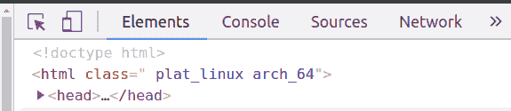
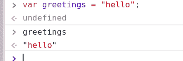

# 现代 JavaScript 完整指南

## 引言

本书最初于 2018 年出版，是数月自学 JavaScript 的成果，旨在帮助那些希望将技能更新到最新 ECMAScript 规范的 JavaScript 开发者。

我对这个成果感到非常自豪，但与此同时，我也觉得这本书缺少了一些东西。它并不适合这门语言的新手。

2019 版解决了第一版的问题，并进行了扩展，同时面向 JavaScript 开发者和完全初学者。

这就是为什么我增加了一个全新的章节，专门向初学者介绍 JavaScript。

另一个新增内容是 TypeScript 部分。经过一年的 TypeScript 工作实践，我可以肯定地说，它是每个 JavaScript 开发者必备的知识，而且我认为即使是初学者也应该尝试将其应用到自己的工作流程中。

本书的免费版本可以在 Github 上找到：https://github.com/AlbertoMontalesi/The-complete-guide-to-modern-JavaScript

在那里你可以找到本书的核心章节，这些章节将随着每个新版本的 ECMAScript 进行更新。

## 关于我


我叫 Alberto Montalesi，来自意大利，目前在越南担任软件开发人员，负责企业级软件的开发。

我对编程的热情开始得比较晚，2016 年，在我 24 岁获得法学学士学位之后。

成为一名自学成才的软件开发者的道路并不容易，但我绝对愿意再来一次。

你可以在 DevTo 上通过这个链接阅读我的故事：https://dev.to/albertomontalesi/my-journey-from-esl-teacher-to-software-developer-5h30。

写一本能够帮助其他有抱负的开发者的书让我充满自豪，因为我深知找到继续学习和提升技能的动力与资源是多么困难。

除了编程，我的其他爱好还包括摄影、旅行和游戏。

### 联系我

如果你想就任何形式的合作或讨论与我联系，可以在以下平台找到我：

1. [Twitter](https://twitter.com/montalesi)
2. [DevTo](https://dev.to/albertomontalesi) 访问 https://dev.to/albertomontalesi
3. [Github](https://github.com/AlbertoMontalesi) 访问 https://github.com/AlbertoMontalesi
4. [InspiredWebDev](https://inspiredwebdev.com) 我的个人博客 https://inspiredwebdev.com

### 贡献与捐赠

当然，非常感谢你做出的任何贡献。

如果你喜欢我的内容，并想请我喝杯咖啡，可以访问 [`www.paypal.me/albertomontalesi`](https://www.paypal.me/albertomontalesi)。

### 许可协议


本作品采用知识共享署名-非商业性使用-禁止演绎 4.0 国际许可协议进行许可。

## 设置你的环境

如果你已经在电脑上安装了代码编辑器，并且已经知道如何使用 Chrome 开发者工具或类似工具，那么你可以跳过本章，继续往下看。

为了让你能够尝试本书中将要使用的代码，我建议你下载一个代码编辑器，用来编写和运行我们将要讨论的 JavaScript 代码。

我个人选择的是 Visual Studio Code，由微软开发，可在此处免费获取：https://code.visualstudio.com/

其他替代方案包括：

1. Atom：https://atom.io/
2. Sublime Text：https://www.sublimetext.com/

无论你选择哪一个，它们都能满足你的需求。

安装完成后，你只需打开软件，创建一个新文件并将其保存为 `.js` 扩展名，你就拥有了第一个 JavaScript 文件。

我们要看的第二件事是开发者工具。

打开浏览器访问任意页面，在某个位置右键单击。你会看到一组选项，其中一个是“检查”或“检查元素”。点击它，就会打开开发者工具，你可以用它查看网页代码、尝试 JavaScript 或调试你的应用程序。

Chrome 开发者工具的外观如下所示。



第一个标签页“Elements”可以让你查看正在检查的页面的代码，第二个标签页“Console”则是你可以编写 JavaScript 并进行实验的地方。



我在这里做的是定义一个变量并调用它。你将在下一章中学习变量以及更多内容，届时我将向你介绍 JavaScript 的基础知识。

## JavaScript 基础

JavaScript 是一种由 Brendan Eich 于 1995 年创建的编程语言，它使网页具有交互性，并且是 Web 应用程序的重要组成部分。

如果你想了解更多关于这门语言的历史及其名称，我建议你阅读 Medium.com 上的这篇简短文章 [`medium.com/@benastontweet/lesson-1a-the-history-of-javascript-8c1ce3bffb17`](medium.com/@benastontweet/lesson-1a-the-history-of-javascript-8c1ce3bffb17)。

如果你曾经打开过 Chrome 开发者工具或类似工具，你可能已经见过 JavaScript 是如何插入到 HTML 页面中的。

我们通过使用 `script` 标签来实现，要么将 JavaScript 代码直接写在标签内部，要么引用一个外部文件。

写在 `script` 标签内部的代码：

```html
<script type="text/javascript"> [YOUR_SCRIPT_HERE] </script>
```

引用外部文件：

```html
<script src="/home/script.js"></script>
```

当然，你可以添加任意数量的脚本，也可以同时使用相对路径、绝对路径和完整路径，例如：

```html
<!-- 从项目根目录开始的绝对路径 -->
<script src="/home/script.js"></script>

<!-- 相对于当前文件夹的路径 -->
<script src="script.js"></script>

<!-- jQuery 库的完整 URL -->
<script src="https://cdnjs.cloudflare.com/ajax/libs/jquery/3.3.1/core.js"></script>
```

最好不要将代码写在 `script` 标签内部，而是将其放在单独的文件中，这样浏览器可以缓存它，无论有多少文件引用它，都只需下载一次。这些文件将使用缓存版本，从而提高性能。

### 变量

我们使用变量来存储值，这些值可以是用户名、地址或电子商务网站上的商品等任何内容。

在 ES6（ES2015）之前，我们声明变量的方式是：

```javascript
var username = "Alberto Montalesi"
```

现在，在声明变量时，我们还有另外两种选择：

```javascript
let username = "Alberto Montalesi"
const username = "Alberto Montalesi"
```

我们将在第 1 章中深入探讨这三个关键字之间的区别，但让我先给你一个简单的解释。

使用关键字 `const` 创建的变量，顾名思义，是常量，意味着它们不能被覆盖。

打开你的 Chrome 开发者工具，尝试输入以下内容：

```javascript
const age = 26;
age = 27;
// Uncaught TypeError: Assignment to constant variable
```

如你所见，我们不允许给常量赋新值。

另一方面，如果我们这样做：

```javascript
let height = 190;
height = 189
```

这次没有报错，`let` 可以被重新赋值，类似于旧的 `var` 关键字。

如果 `var` 和 `let` 都可以被重新赋值，那么为什么我们应该使用 `let` 而不是 `var` 呢？这个问题的答案需要对 JavaScript 的工作原理进行更多解释，将在第 1 章后面讨论。

很多人争论 `let` 和 `const` 的最佳实践是什么。我的看法是：始终使用 `const`，除非你事先知道需要重新赋值。

如果之后你需要重新赋值某个 `const` 变量，只需将其改为 `let` 即可。就我个人而言，我倾向于默认使用 `const`。这样，如果我意外尝试重新赋值，就会看到错误，而不必在之后调试代码才发现引用了错误的变量。

#### 关于变量命名的注意事项

在命名变量时，有一些规则需要遵守。不过别担心，大多数规则都很容易记住。

以下都是禁止的：

```javascript
// 变量名不能以数字开头
let 1apple = "one apple";

// 变量名不能包含空格、符号和标点等字符
let hello! = "hello!";
```

还有一些保留字不能用作变量名和函数名。

|  |  |  |  |
|---|---|---|---|
| abstract | arguments | await | boolean |
| break | byte | case | catch |
| char | class | const | continue |
| debugger | default | delete | do |
| double | else | enum | eval |
| export | extends | false | final |
| finally | float | for | function |
| goto | if | implements | import |
| in | instanceof | int | interface |
| let | long | native | new |
| null | package | private | protected |
| public | return | short | static |
| super | switch | synchronized | this |
| throw | throws | transient | true |
| try | typeof | var | void |
| volatile | while | with | yield |

选择变量名时的经验法则是让它们具有描述性。

避免使用首字母缩写、缩写和无意义的名称。

```javascript
// 不好
let cid = 12; // `cid` 是什么？

// 好
let clientID = 12; // 哦，是 `client id`

// 不好
let id = 12; // 什么 id？userID？dogID？catID？

// 好
let userID = 12; // 具体一点
```

如果你希望变量名尽可能具有描述性，那么它们很可能是由多个单词组成的。

在这种情况下，最常见的两种变量命名方式是 `camelCase` 和 `snake_case`。

```javascript
// 不好
let lastloggedin = ''; // 难以阅读

// 好
let lastLoggedIn = ''; // camelCase
let last_logged_in = ''; // snake_case
```

无论你选择使用 `camelCase`（首单词后每个单词首字母大写）还是 `snake_case`（单词之间用下划线分隔），请记住保持一致并坚持你的选择。

### 数据类型

JavaScript 是一种动态语言，这意味着与静态语言相反，你在定义变量时无需定义其类型。

```javascript
// 这是字符串还是数字？
var userID;
userID = 12; // 现在是数字
console.log(typeof userID); // number

userID = 'user1'; // 现在是字符串
console.log(typeof userID); // string
```

这起初可能看起来很便捷，但在处理较大项目时可能会引发问题。

在本书末尾，当你掌握了 JavaScript 的基础知识后，我将向你介绍 TypeScript，它为 JavaScript 增加了强类型。

在 JavaScript 中，有 7 种数据类型：6 种原始类型和 `Object`。

#### 原始类型

原始值是一种简单的数据，它不是 `Object`，也没有方法。

它们是：

1. `string`
2. `number`
3. `boolean`
4. `null`
5. `undefined`
6. `symbol`（最新添加的）

让我们快速浏览一下它们，如果你有编程经验，可能已经了解其中一些。

`string` 用于表示文本数据，无论是名称、地址还是书籍的章节。

```javascript
let userName = "Alberto";
console.log(userName); // Alberto
```

`number` 用于表示数值。

在 JavaScript 中，没有专门用于整数的类型。

```javascript
let age = 25;
```

`boolean` 用于表示值为 `true` 或 `false` 的数据。

```javascript
let married = false;
```

`null` 表示值的缺失，而 `undefined` 表示未定义的值。

`symbol` 表示唯一且不可变的值。它是在 ES2015 中添加的，是该列表中最新的成员。

我们将在第 11 章中更详细地了解它。

#### 对象

虽然我们之前讨论的 6 种原始类型只能保存单个值（无论是 `null`、`true`、`false` 等），但 `Object` 用于存储属性的集合。

让我们先看一个简单的 `Object`：

```javascript
const car = {
  wheels: 4,
  color: "red",
}
```

这是一个简单的 `Object`，我用来存储我的汽车的属性。

每个属性都有一个键（在第一行中是 `wheels`）和一个值（在本例中是 4）。

键的类型是 `string`，但值可以是任何类型，也可以是函数，在这种情况下我们称它们为方法。

```javascript
const car = {
  wheels: 4,
  color: "red",
  drive: function() {
    console.log("wroom wroom")
  }
}

console.log(Object.keys(car)[0]) // wheels
console.log(typeof Object.keys(car)[0]) // string
car.drive(); // wroom wroom
```

如你所见，我们现在可以在 `car` 对象上调用 `drive` 函数。

别担心，我们将在下一章中更详细地介绍函数。

#### 创建空对象

我们在创建 `Object` 时不必声明属性。

以下是创建空 `Object` 的两种方法：

```javascript
const car = new Object()
const car = {}
```

更常用的语法是第二种，称为对象字面量。

现在你有了一个新的空汽车对象，要为其添加新属性，只需这样做：

```javascript
car.color = 'red';
console.log(car) // {color: "red"}
```

如你所见，我们使用点表示法向 `car` 对象添加新属性。

如何访问 `Object` 上的属性呢？

非常简单，我们有两种选择：

```javascript
const car = {
  wheels: 4,
  color: "red",
}

console.log(car.wheels); // 4
console.log(car['color']); // 'red'
```

我们有两种不同的方式来做同一件事？为什么？

嗯，它们并不完全相同。

对于多词属性，我们不能使用点表示法。

```javascript
const car = {
  wheels: 4,
  color: "red",
  "goes fast": true
}

console.log(car.goes fast); // 语法错误
console.log(car['goes fast']) // true
```

当你想要使用多词属性时，需要记得用引号将它们的名称括起来，并且只能使用方括号表示法来访问它们。

方括号表示法的另一个用途是通过键来访问 `Object` 的属性。

假设我们的应用程序接收用户的输入，然后将其保存到一个变量中，该变量将用于访问我们的对象。

用户正在寻找汽车，并且被要求告诉我们他/她喜欢的品牌。该品牌是一个键，我们将用它来仅显示相应的型号。

为简单起见，在示例中每个品牌只有一个型号。

```javascript
const cars = {
  ferrari: "california",
  porsche: "911",
  bugatti: "veyron",
}

// 用户输入
const key = "ferrari"

console.log(cars.key); // undefined
console.log(cars['key']); // undefined
console.log(cars[key]); // california
```

如你所见，我们需要使用方括号表示法通过存储在变量中的键来访问 `Object` 的属性。

注意，`key` 周围没有引号，因为它是一个变量名，而不是字符串。

#### 复制对象

与原始类型不同，对象是通过引用复制的，这意味着如果我们写：

```javascript
let car = {
  color: 'red'
}

let secondCar = car;
```

我们的 `secondCar` 只会存储一个引用，即 `car` 的“地址”，而不是 `Object` 本身。

看看这个例子就更容易理解了：


```javascript
let car = { color: 'red' }
let secondCar = car
car.wheels = 4
console.log(car) // {color: 'red', wheels: 4}
console.log(secondCar) // {color: 'red', wheels: 4}
```

如你所见，`secondCar` 只是存储了对 `car` 的引用，因此当我们修改 `car` 时，`secondCar` 也发生了变化。

如果我们比较这两个对象，会发现一些有趣的事情：

```javascript
console.log(car == secondCar) // true
console.log(car === secondCar) // true
```

无论我们使用相等（`==`）还是严格相等（`===`），都会得到 `true`，这意味着这两个对象是同一个。

只有对同一个 `Object` 进行比较时才会返回 `true`。

看看空对象和具有相同属性的对象之间的比较。

```javascript
const emptyObj1 = {}
const emptyObj2 = {}
emptyObj1 == emptyObj2 // false
emptyObj1 === emptyObj2 // false

const obj1 = { a: 1 }
const obj2 = { a: 1 }
obj1 == obj2 // false
obj1 === obj2 // false
```

如你所见，只有同一个对象的比较才会返回 `true`。

在 JavaScript 中快速克隆一个对象的方法是使用 `Object.assign`。

```javascript
const car = { color: 'red' }
const secondCar = Object.assign({}, car)
car.wheels = 4
console.log(car) // {color: 'red', wheels: 4}
console.log(secondCar) // {color: 'red'}
```

更新 `car` 并没有影响 `secondCar`。`Object.assign` 将目标对象作为第一个参数，源对象作为第二个参数。

在我们的例子中，我们使用一个空对象作为目标，`car` 作为源。

如果你准备好更深入地了解 JavaScript 中对象的复制，我推荐你阅读 [Scotch.io](https://scotch.io/bar-talk/copying-objects-in-javascript) 上的这篇文章，链接为 [`scotch.io/bar-talk/copying-objects-in-javascript`](https://scotch.io/bar-talk/copying-objects-in-javascript)。

### 数组

正如我们所见，对象以键值对的形式存储数据。现在我们来看看什么是数组。

数组是一种按顺序存储值的对象。

在上面的例子中，我们使用对象来存储汽车，因为它具有特定的属性，我们希望可以通过键轻松访问这些属性。

如果我们只是想存储一个列表，那么就没有必要创建对象。相反，我们可以使用数组。

例如：

```javascript
const fruitBasket = ['apple', 'banana', 'orange']
```

我们通过索引访问数组的值。记住数组从位置 0 开始。

```javascript
const fruitBasket = ['apple', 'banana', 'orange']
console.log(fruitBasket[0]) // apple
console.log(fruitBasket[1]) // banana
console.log(fruitBasket[2]) // orange
```

我们可以对数组调用许多方法。让我们看看一些最常用的方法。

```javascript
const fruitBasket = ['apple', 'banana', 'orange']

// 获取数组的长度
console.log(fruitBasket.length) // 3

// 在数组末尾添加一个新值
fruitBasket.push('pear')
console.log(fruitBasket) // ["apple", "banana", "orange", "pear"]

// 在数组开头添加一个新值
fruitBasket.unshift('melon')
console.log(fruitBasket) // ["melon", "apple", "banana", "orange", "pear"]

// 从数组末尾移除一个值
fruitBasket.pop()
console.log(fruitBasket) // ["melon", "apple", "banana", "orange"]

// 从数组开头移除一个值
fruitBasket.shift()
console.log(fruitBasket) // ["apple", "banana", "orange"]
```

正如我们所见，通过这些方法，我们可以轻松地在数组的开头或末尾添加和删除元素。

你可以在 [MDN](https://developer.mozilla.org/en-US/docs/Web/JavaScript/Reference/Global_Objects/Array) 上找到更完整的方法列表，链接为 [`developer.mozilla.org/en-US/docs/Web/JavaScript/Reference/Global_Objects/Array`](https://developer.mozilla.org/en-US/docs/Web/JavaScript/Reference/Global_Objects/Array)。

### 使用 `typeof` 确定类型

我们可以使用 `typeof` 来确定变量的值。例如：

```javascript
const str = "hello"
typeof str // string

const num = 12
typeof num // number

const arr = [1, 2, 3]
typeof arr // object

const obj = { prop: 'value' }
typeof obj // object
```

记住 `Array` 不是一种类型，数组是对象！

到目前为止一切看起来都很直接，但如果我们尝试这样的操作呢：

```javascript
typeof null
```

我们知道 `null` 是一种原始类型，那么我们应该期望看到 `null` 作为结果吗？

```javascript
typeof null // object
```

长话短说，这是 JavaScript 最初实现中的一个 bug。如果你想了解更多，[这篇文章](http://2ality.com/2013/10/typeof-null.html) 提供了很好的解释（[`2ality.com/2013/10/typeof-null.html`](http://2ality.com/2013/10/typeof-null.html)）。

## 函数

函数是我们用来执行各种任务和计算的一个非常重要的工具。

在 JavaScript 中，我们可以用不同的方式声明函数。

让我们看看一个函数定义：

```javascript
function greet(name) {
  console.log("hello " + name)
}

greet("Alberto") // hello Alberto
```

这是一个简单的函数，调用时会输出一个字符串。

第 1 行括号内的变量称为参数，而花括号内的代码是语句，在这个例子中是一个简单的 `console.log()`。

需要记住的一个非常重要的事情是：原始类型是按值传递给函数的，这意味着对这些值的修改不会全局反映出来。另一方面，如果值不是原始类型，比如对象或数组，那么它是按引用传递的，这意味着对它的任何修改都会反映在原始对象中。

```javascript
let myInt = 1

function increase(value) {
  return value += 1
}

console.log(myInt) // 1
console.log(increase(myInt)) // 2
console.log(myInt) // 1
```

如你所见，我们增加了整数的值，但这并没有影响原始变量。

让我们看一个对象的例子。

```javascript
let myCar = { make: "bmw", color: "red" }

console.log(myCar) // {make: "bmw", color: "red"}

function changeColor(car) {
  car.color = "blue"
}

changeColor(myCar)
console.log(myCar) // {make: "bmw", color: "blue"}
```

如你所见，由于参数 `car` 只是对象 `myCar` 的一个引用，修改它导致了 `myCar` 对象的改变。

另一种声明函数的方式是使用函数表达式。

```javascript
const greeter = function greet(name) {
  console.log("hello " + name)
}

greeter("Alberto") // hello Alberto
```

这里我们将函数 `greet` 赋值给一个名为 `greeter` 的常量。

我们得到了与第一个例子相同的结果，但使用函数表达式我们还可以创建匿名函数。

```javascript
const greeter = function(name) {
  console.log("hello " + name)
}

greeter("Alberto") // hello Alberto
```

我们将 `function greet` 改为 `function`，得到了一个匿名函数。

我们还可以进一步调整，使用 ES2015 引入的箭头函数。

```javascript
const greeter = (name) => {
  console.log("hello " + name)
}

greeter("Alberto") // hello Alberto
```

`function` 关键字消失了，参数后面出现了一个漂亮的胖箭头（`=>`）。

我们将在第 2 章详细讨论箭头函数。

## 理解函数作用域和 `this` 关键字

在 JavaScript 中需要理解的最重要的概念之一就是作用域。

什么是作用域？

变量的作用域控制着该变量可以从哪里被访问。

我们可以有全局作用域，意味着变量可以从代码中的任何位置访问；也可以有块级作用域，意味着变量只能从声明它的块内部访问。

块可以是一个函数、一个循环或任何由花括号分隔的内容。

让我们看两个例子，首先使用关键字 `var`。

```javascript
var myInt = 1

if (myInt === 1) {
  var mySecondInt = 2
  console.log(mySecondInt) // 2
}

console.log(mySecondInt) // 2
```

如你所见，我们能够在块作用域之外访问 `mySecondInt` 的值，因为使用关键字 `var` 声明的变量不受块作用域的约束。

现在让我们使用关键字 `let`。

```javascript
var myInt = 1

if (myInt === 1) {
  let mySecondInt = 2
  console.log(mySecondInt) // 2
}

console.log(mySecondInt) // Uncaught ReferenceError: mySecondInt is not defined
```

这次我们无法从块作用域外部访问该变量，并得到了一个错误 `mySecondInt is not defined`。

使用关键字 `let` 或 `const` 声明的变量受限于它们被声明的块作用域。

你将在第 1 章中了解更多关于它们的内容。

### `this` 关键字

我想讨论的第二个重要概念是 `this` 关键字。

让我们先从一个简单的例子开始：

```javascript
const myCar = {
  color: 'red',
  logColor: function() {
    console.log(this.color)
  }
}

myCar.logColor() // red
```

如你在本例中所见，不言而喻，`this` 关键字指向了 `myCar` 对象。

`this` 的值取决于函数的调用方式。

在上面的例子中，函数是作为 `Object` 的方法被调用的。

请看另一个例子：

```javascript
function logThis() {
  console.log(this)
}

logThis() // Window {...}
```

我们在全局上下文中调用了这个函数，因此 `this` 的值指向了 `Window` `Object`。

我们可以通过开启严格模式来避免意外地引用 `Window` `Object`。

你可以在 JavaScript 文件的开头写上 `'use strict';` 来实现这一点。

这样做会启用一套更严格的 JavaScript 规则，其中一条规则是将全局对象的值设置为 `undefined` 而不是 `Window` `Object`，从而导致我们的 `this` 关键字也变成 `undefined`。

如果我们想手动将 `this` 的值设置为某个内容，可以使用 `.bind`。

```javascript
const myCar = {
  color: 'red',
  logColor: function() {
    console.log(this.color)
  }
}

const unboundGetColor = myCar.logColor
console.log(unboundGetColor()) // undefined

const boundGetColor = unboundGetColor.bind(myCar)
console.log(boundGetColor()) // red
```

我们来梳理一下刚才的操作：

1. 首先，我们创建了一个 `Object`，与之前的例子类似。
2. 我们将 `unboundGetColor` 设置为 `myCar` 的方法。
3. 当我们尝试调用 `unboundGetColor` 时，它会尝试查找 `this.color`，但由于它在全局上下文中被调用，`this` 的值是 `Window` `Object`，而它上面没有 `color`，因此我们得到 `undefined`。
4. 最后，我们使用 `.bind` 来明确告诉 `boundGetColor`，`this` 关键字将指向括号内的 `Object`，在本例中是 `myCar`。
5. 当我们调用 `boundGetColor` 时，可以看到这次我们得到了想要的结果。

还有另外两种方法可以用来设置 `this` 关键字的值：`.call()` 和 `.apply()`。

它们两者相似之处在于，这两个方法都会使用给定的 `this` 值来调用一个函数。它们接受的参数略有不同。

`.call()` 接受一个参数列表，而 `.apply()` 接受一个参数数组。

请看这个使用 `.call()` 的例子：

```javascript
function Car(make, color) {
  this.carMake = make
  this.carColor = color
}

function MyCar(make, color) {
  Car.call(this, make, color)
  this.age = 5
}

const myNewCar = new MyCar('bmw', 'red')
console.log(myNewCar.carMake) // bmw
console.log(myNewCar.carColor) // red
```

我们将 `MyCar` `Object` 传入 `.call()`，这样 `this.carMake` 就会被设置为传递给 `MyCar` 的参数 `make`。`color` 同理。

请看这个使用 `.apply()` 的例子，以了解两者之间的区别。

```javascript
function Car(make, color) {
  this.carMake = make
  this.carColor = color
}

function MyCar(make, color) {
  Car.apply(this, [make, color])
  this.age = 5
}

const myNewCar = new MyCar('bmw', 'red')
console.log(myNewCar.carMake) // bmw
console.log(myNewCar.carColor) // red
```

如你所见，结果相同，但在这个例子中 `.apply()` 接受一个包含参数列表的数组。

两者之间的主要区别在于，当你编写一个不需要知道或不知道所需参数数量的函数时，就会体现出来。

在这种情况下，由于 `.call()` 要求你逐个传递参数，这样做就会变得很麻烦。

解决方案是使用 `.apply()`，因为你只需传递数组，无论它包含多少个参数，都会在函数内部被解包。

```javascript
const ourFunction = function(item, method, args) {
  method.apply(args)
}

ourFunction(item, method, ['argument1', 'argument2'])
ourFunction(item, method, ['argument1', 'argument2', 'argument3'])
```

无论我们传递多少个参数，当调用 `.apply()` 时，它们都会被逐个应用。

## JavaScript 基础测验

### JS-01 以下哪种变量命名方式是错误的？


- `var very_important = "very_important"`
- `var important_999 = "important_999"`
- `var important! = "important!"`
- `var VeRY_ImP_orTant = "VeRY_ImP_orTant"`

### JS-02 以下哪个不是真正的原始类型？

- `symbol`
- `boolean`
- `null`
- `Object`

### JS-03 定义对象的正确方式是什么？

- `const car: { color: "red"}`
- `const car = {color = "red"}`
- `const car = { color: "red" }`
- `const car: {color = "red"}`

### JS-04 以下代码的正确输出是什么？

```js
const obj1 = {a: 1};
const obj2 = {a: 1};
console.log(obj1 === obj2);
```

- `true`
- `undefined`
- `false`
- `null`

### JS-05 以下代码的正确输出是什么？

```js
const fruitBasket = ['apple', 'banana', 'orange'];
fruitBasket.unshift('melon');
console.log(fruitBasket);
```

- `["apple", "banana", "orange", "melon"]`
- `["melon"]`
- `["apple", "banana", "orange", "pear", "melon"]`
- `["melon", "apple", "banana", "orange"]`

# 第 1 章：Var vs Let vs Const 与暂时性死区

随着 ES6 中 `let` 和 `const` 的引入，我们现在可以根据需求更好地定义变量。在 JavaScript 入门中，我们了解了这三个关键字的基本区别，现在我们将更详细地探讨。

## Var

使用 `var` 关键字声明的变量是函数作用域的，这意味着如果我们在 `for` 循环（这是一个块级作用域）内部声明它们，它们即使在循环外部也是可用的。

```js
for (var i = 0; i < 10; i++) {
  var leak = "I am available outside of the loop";
}
console.log(leak); // I am available outside of the loop

function myFunc() {
  var functionScoped = "I am available inside this function";
  console.log(functionScoped);
}

myFunc(); // I am available inside this function
console.log(functionScoped); // ReferenceError: functionScoped is not defined
```

在第一个例子中，`var` 的值泄漏到了块级作用域之外，可以从外部访问；而在第二个例子中，`var` 被限制在函数作用域内，我们无法从外部访问它。

## Let

使用 `let`（和 `const`）关键字声明的变量是块级作用域的，这意味着它们只在其声明的块及其子块中可用。

```js
// 使用 let
let x = "global";

if (x === "global") {
  let x = "block-scoped";
  console.log(x); // 预期输出: block-scoped
}

console.log(x); // 预期输出: global

// 使用 var
var y = "global";

if (y === "global") {
  var y = "block-scoped";
  console.log(y); // 预期输出: block-scoped
}

console.log(y); // 预期输出: block-scoped
```

如你所见，当我们在块级作用域内给用 `let` 声明的变量赋新值时，它并没有改变外部作用域中的值。而当我们对用 `var` 声明的变量做同样操作时，它泄漏到了块级作用域之外，并且也改变了外部作用域中的值。

## Const

与 `let` 类似，用 `const` 声明的变量也是块级作用域的，但不同之处在于，它们的值不能通过重新赋值来改变，也不能被重新声明。

```js
const constant = 'I am a constant';
constant = " I can't be reassigned";
// Uncaught TypeError: Assignment to constant variable
```

重要提示：

这并不意味着用 `const` 声明的变量是不可变的。

### `const` 的内容是一个 `Object`

```js
const person = {
  name: 'Alberto',
  age: 25,
};

person.age = 26;
console.log(person.age); // 26
```

在这种情况下，我们并没有重新赋值整个变量，而只是修改了它的一个属性，这是完全可行的。


注意：我们仍然可以冻结 `const` 对象，这样就不会改变对象的内容（但尝试修改对象的值时，JavaScript 不会抛出任何错误）。

```js
const person = {
  name: 'Alberto',
  age: 25,
};

person.age = 26;
console.log(person.age); // 26

Object.freeze(person);

person.age = 30;
console.log(person.age); // 26
```

## 暂时性死区

现在我们将探讨一个非常重要的概念，它的名字听起来可能很复杂，但我向你保证并非如此。

首先来看一个简单的例子：

```js
console.log(i);
var i = "I am a variable"; // 预期输出：undefined

console.log(j);
let j = "I am a let";
// 预期输出：ReferenceError: can't access lexical declaration `j' before initialization
```

`var` 可以在定义之前被访问，但我们无法访问它们的值。`let` 和 `const` 在定义之前不能被访问。

尽管你可能会在其他资料上看到不同的说法，但 `var` 和 `let`（以及 `const`）都会受到**提升**的影响，这意味着它们在任何代码执行之前就会被处理，并被提升到其作用域（无论是全局还是块级作用域）的顶部。

主要区别在于：`var` 仍然可以在定义之前被访问，这会导致其值为 `undefined`。而 `let` 则会让变量处于**暂时性死区**，直到它们被声明为止。因此，在初始化之前访问它们会引发错误，这比得到 `undefined` 结果更容易调试代码。

## 何时使用 Var、Let 和 Const

并没有规定必须使用哪一个，人们也有不同的看法。这里我将介绍 JavaScript 社区中两位知名开发者的观点。

第一个观点来自 [Mathias Bynes：](https://mathiasbynens.be/notes/es6-const)

1. 默认使用 `const`
2. 仅在需要重新绑定时使用 `let`
3. 在 ES6 中不应使用 `var`

第二个观点来自 [Kyle Simpson：](https://me.getify.com/)

1. 对于跨多个（尤其是较大）作用域共享的顶层变量，使用 `var`
2. 对于较小作用域中的局部变量，使用 `let`
3. 只有在编写了一些代码后，并且你相当确定不应该有变量重新赋值的情况下，才将 `let` 重构为 `const`

选择哪种观点完全取决于你。一如既往，请自行研究并找出你认为最佳的方式。

我个人观点是默认始终使用 `const`，如果发现需要重新绑定值，再改用 `let`。

## 第一章小测验

### 1.1 以下代码的正确输出是什么？

```js
var greeting = "Hello";
greeting = "Farewell";

for (var i = 0; i < 2; i++) {
  var greeting = "Good morning";
}

console.log(greeting);
```

- Hello
- Good morning
- Farewell;

### 1.2 以下代码的正确输出是什么？

```js
let value = 1;

if (true) {
  let value = 2;
  console.log(value);
}

value = 3;
```

- 1
- 2
- 3

### 1.3 以下代码的正确输出是什么？

```js
let x = 100;

if (x > 50) {
  let x = 10;
}

console.log(x);
```

- 10
- 100
- 50

### 1.4 以下代码的正确输出是什么？

```js
console.log(constant);
const constant = 1;
```

- undefined
- ReferenceError
- 1

# 第二章：箭头函数

## 什么是箭头函数？

ES6 引入了胖箭头（`=>`）作为声明函数的一种方式。

在 ES5 中，我们通常这样声明函数：

```js
const greeting = function(name) {
  return "hello " + name;
}
```

使用胖箭头的新语法如下：

```js
var greeting = (name) => {
  return `hello ${name}`;
}
```

我们可以更进一步，如果只有一个参数，可以省略括号，写成：

```js
var greeting = name => {
  return `hello ${name}`;
}
```

如果没有参数，则需要写成空括号，如下：

```js
var greeting = () => {
  return "hello";
}
```

## 隐式返回

使用箭头函数，我们可以省略显式的 `return`，像这样返回：

```js
const greeting = name => `hello ${name}`;
```

与旧的 ES5 函数并排比较：

```js
const oldFunction = function(name) {
  return `hello ${name}`;
}

const arrowFunction = name => `hello ${name}`;
```

两个函数实现相同的结果，但新语法允许你更简洁。

注意！可读性比简洁性更重要，因此如果你在团队中工作，且并非所有人都完全熟悉 ES6，你可能希望这样写函数：

```js
const arrowFunction = (name) => {
  return `hello ${name}`;
}
```

假设我们想隐式返回一个对象字面量，可以这样做：

```js
const race = "100m dash";
const runners = ["Usain Bolt", "Justin Gatlin", "Asafa Powell"];

const results = runners.map((runner, i) => ({
  name: runner,
  race,
  place: i + 1
}));

console.log(results);
// [{name: "Usain Bolt", race: "100m dash", place: 1}
// {name: "Justin Gatlin", race: "100m dash", place: 2}
// {name: "Asafa Powell", race: "100m dash", place: 3}]
```

在这个例子中，我们使用 `map` 函数遍历数组 `runners`。第一个参数是数组中的当前项，`i` 是它的索引。对于数组中的每一项，我们向 `results` 中添加一个包含属性 `name`、`race` 和 `place` 的对象。

为了告诉 JavaScript 花括号内是一个我们想要隐式返回的对象字面量，我们需要将整个内容包裹在括号中。

写 `race` 和 `race: race` 是等价的。

## 箭头函数是匿名的

从之前的例子可以看出，箭头函数是匿名的。

如果我们想给它们一个名字以便引用，可以将它们绑定到一个变量：

```js
const greeting = name => `hello ${name}`;
greeting("Tom");
```

## 箭头函数与 `this` 关键字

在使用箭头函数时，需要小心 `this` 关键字，因为它们的行为与普通函数不同。

当你使用箭头函数时，`this` 关键字继承自父作用域。

这在以下情况下非常有用：

<bdi><div class="box open"></bdi> <bdi>这是一个盒子 </div></bdi>

<bdi>.opening {</bdi> <bdi>background-color:red; }</bdi>

```js
// 获取 class 为 box 的 div
const box = document.querySelector(".box");

// 监听点击事件
box.addEventListener("click", function() {
  // 切换 div 上的 opening 类
  this.classList.toggle("opening");

  setTimeout(function() {
    // 尝试再次切换类
    this.classList.toggle("opening");
  }, 500);
});
```

这里的问题是，第一个 `this` 绑定到了 `const box`，但第二个 `this`（在 `setTimeout` 内部）将指向 Window 对象，从而抛出以下错误：

```text
Uncaught TypeError: cannot read property "toggle" of undefined
```

由于我们知道箭头函数会从父作用域继承 `this` 的值，我们可以将函数重写如下：

```js
const box = document.querySelector(".box");

// 监听点击事件
box.addEventListener("click", function() {
  // 切换 div 上的 opening 类
  this.classList.toggle("opening");

  setTimeout(() => {
    // 尝试再次切换类
    this.classList.toggle("opening");
  }, 500);
});
```


这里，第二个`this`将从其父级继承，并指向`const box`。

运行示例代码，你应该会看到我们的`div`在半秒内变为红色。

## 何时应避免使用箭头函数

利用我们对`this`关键字继承机制的理解，我们可以定义一些不应使用箭头函数的情况。

接下来的两个示例展示了在箭头函数内部使用`this`时需要谨慎的场景。

### 示例 1

```javascript
const button = document.querySelector("btn");
button.addEventListener("click", () => {
  // error: this refers to the `Window` Object
  this.classList.toggle("on");
})
```

### 示例 2

```javascript
const person1 = {
  age: 10,
  grow: function() {
    this.age++;
    console.log(this.age);
  }
}
person1.grow(); // 11
const person2 = {
  age: 10,
  grow: () => {
    // error: this refers to the `Window` Object
    this.age++;
    console.log(this.age);
  }
}
person2.grow();
```

箭头函数与普通函数的另一个区别在于对`arguments`对象的访问。

`arguments`对象是一个类数组对象，我们可以在函数内部访问它，它包含传递给该函数的参数值。

一个简单的示例：

```javascript
function example(){
  console.log(arguments[0])
}
example(1,2,3); // 1
```

如你所见，我们使用数组表示法`arguments[0]`访问了第一个参数。

与我们在`this`关键字中看到的情况类似，箭头函数会从其父作用域继承`arguments`对象的值。

让我们看看之前跑步者列表中的这个示例：

```javascript
const showWinner = () => {
  const winner = arguments[0];
  console.log(`${winner} was the winner`)
}
showWinner("Usain Bolt", "Justin Gatlin", "Asafa Powell")
```

这段代码将返回：

`ReferenceError: arguments is not defined`

要访问传递给函数的所有参数，我们可以使用旧函数表示法或展开语法（我们将在第 9 章中进一步讨论）。

请记住，`arguments`只是一个关键字，而不是变量名。

使用箭头函数的示例：

```javascript
const showWinner = (...args) => {
  const winner = args[0];
  console.log(`${winner} was the winner`)
}
showWinner("Usain Bolt", "Justin Gatlin", "Asafa Powell") // "Usain Bolt was the winner"
```

使用函数的示例：

```javascript
const showWinner = function() {
  const winner = arguments[0];
  console.log(`${winner} was the winner`)
}
showWinner("Usain Bolt", "Justin Gatlin", "Asafa Powell") // "Usain Bolt was the winner"
```

## 第 2 章末测验

### 2.1 箭头函数的正确语法是什么？

```javascript
let arr = [1,2,3];
//a) let func = arr.map(n -> n+1);
//b) let func = arr.map(n => n+1);
//c) let func = arr.map(n ~> n+1);
```

`a`

`b`

`c`

### 2.2 以下代码的正确输出是什么？

```javascript
const person = {
  age: 10,
  grow: () => {
    this.age++;
  },
}
person.grow();
console.log(person.age);
```

`10`

`11`

`undefined`

### 2.3 将以下代码重构为使用箭头函数语法：

```javascript
function(arg) { console.log(arg); }
```

# 第 3 章：默认函数参数

在 ES6 之前，为函数参数设置默认值并不容易。让我们看一个示例：

```javascript
function getLocation(city, country, continent){
  if(typeof country === 'undefined'){
    country = 'Italy'
  }
  if(typeof continent === 'undefined'){
    continent = 'Europe'
  }
  console.log(continent, country, city)
}
getLocation('Milan') // Europe Italy Milan
getLocation('Paris','France') // Europe France Paris
```

如你所见，我们的函数接受三个参数：城市、国家和洲。在函数体中，我们检查`country`或`continent`是否为`undefined`，如果是，则赋予它们默认值。

当调用`getLocation('Milan')`时，第二个和第三个参数（`country`和`continent`）是`undefined`，并被替换为函数的默认值。

但是，如果我们希望默认值位于参数列表的开头而不是末尾呢？

```javascript
function getLocation(continent, country, city){
  if(typeof country === 'undefined'){
    country = 'Italy'
  }
  if(typeof continent === 'undefined'){
    continent = 'Europe'
  }
  console.log(continent, country, city)
}
getLocation(undefined, undefined, 'Milan') // Europe Italy Milan
getLocation(undefined, 'Paris', 'France') // Europe Paris France
```

如果我们想用默认值替换任何第一个参数，则需要将它们作为`undefined`传递，这看起来并不优雅。幸运的是，ES6 通过默认函数参数解决了这个问题。

## 默认函数参数

ES6 使得设置默认函数参数变得非常容易。让我们看一个示例：

```javascript
function calculatePrice(total, tax = 0.1, tip = 0.05){
  // When no value is given for tax or tip, the default 0.1 and 0.05 will be used
  return total + (total * tax) + (total * tip);
}
```

如果我们根本不想传递某个参数呢？比如这样：

```javascript
// The 0.15 will be bound to the second argument, tax even if in our intention it was to set 0.15 as the tip
calculatePrice(100, 0.15)
```

我们可以通过这样做来解决：

```javascript
// In this case 0.15 will be bound to the tip
calculatePrice(100, undefined, 0.15)
```

这样可行，但不太美观，如何改进呢？

使用解构，我们可以这样写：

```javascript
function calculatePrice({ total = 0, tax = 0.1, tip = 0.05 } = {}){
  return total + (total * tax) + (total * tip);
}
const bill = calculatePrice({ tip: 0.15, total:150 }); // 187.5
```

我们将函数的参数设为一个对象。调用函数时，我们甚至不必担心参数的顺序，因为它们会根据键进行匹配。

在上面的示例中，`tip`的默认值是 0.05，我们将其覆盖为 0.15，但没有给`tax`赋值，因此它保持默认值 0.1。

请注意这个细节：

```javascript
{ total = 0, tax = 0.1, tip = 0.05 } = {}
```

如果我们不将参数对象默认设置为空对象，并且尝试运行`calculatePrice()`，我们会得到：

```text
Cannot destructure property `total` of 'undefined' or 'null'.
```

通过编写`= {}`，我们将参数默认设置为一个对象，无论我们向函数传递什么参数，它都将是一个对象：

```javascript
calculatePrice({}); // 0
calculatePrice(); // 0
calculatePrice(undefined) // 0
```

无论我们传递什么，参数都被默认设置为一个对象，该对象具有三个默认属性：`total`、`tax`和`tip`。

```javascript
function calculatePrice({ total = 0, tax = 0.1, tip = 0.05}){
  return total + (total * tax) + (total * tip);
}
calculatePrice({}); // cannot read property `total` of 'undefined' or 'null'.
calculatePrice(); // cannot read property `total` of 'undefined' or 'null'.
calculatePrice(undefined) // cannot read property `total` of 'undefined' or 'null'.
```

不要担心解构，我们将在第 10 章中讨论它。

## 第 3 章末测验

### 3.1 编写代码完成以下任务：

在以下代码中，修改`arg1`和`arg2`，使第一个代表税率，第二个代表小费值。

给`tax`一个默认值 0.1，给`tip`一个默认值 0.05。

```javascript
function calculatePrice(total, arg1, arg2) {
  return total + (total * tax) + (total * tip);
}
calculatePrice(10); // expected result: 11.5
```

### 3.2 以下代码的正确输出是什么？

```javascript
var b = 3;
function multiply(a, b=2){
  return a * b;
}
console.log(multiply(5));
```

`2`

`5`

`10`

`15`

# 第 4 章：模板字面量

在 ES6 之前，它们被称为模板字符串，现在我们称之为模板字面量。让我们看看 ES6 中字符串插值方式的变化。

## 字符串插值

在 ES5 中，我们通常这样写来进行字符串插值：

```javascript
var name = "Alberto";
var greeting = 'Hello my name is ' + name;
console.log(greeting); // Hello my name is Alberto
```

在 ES6 中，我们可以使用反引号来简化操作。

```javascript
let name = "Alberto";
const greeting = `Hello my name is ${name}`;
console.log(greeting); // Hello my name is Alberto
```

## 表达式插值

在 ES5 中，我们通常这样写：

```javascript
var a =  1; var b =  10; console.log('1 * 10 is '  + ( a * b)); // 1 * 10 is 10
```

在 ES6 中，我们可以使用反引号来减少输入：

```javascript
var a =  1; var b =  10; console.log(`1 * 10 is ${a * b}`); // 1 * 10 is 10
```

## 创建 HTML 片段

在 ES5 中，我们通常这样处理多行字符串：

```javascript
// 每行都必须加上反斜杠 var text =  "hello, \ my name is Alberto \ how are you?\ "
```

在 ES6 中，我们只需将所有内容包裹在反引号内，不再需要每行加反斜杠。

```javascript
const content =  `hello, my name is Alberto how are you?`;
```

## 嵌套模板

将一个模板嵌套在另一个模板中非常容易，如下所示：

```javascript
const people = [{name:  'Alberto',age:  27 },{name:  'Caroline',age:  27 },{name:  'Josh',age:  31 }]; const markup =  ` <ul> ${people.map(person =>  `<li> ${person.name}</li>`)} </ul> `; console.log(markup); // <ul> // <li> Alberto</li>,<li> Caroline</li>,<li> Josh</li> // </ul>
```

这里我们使用`map`函数遍历每个人，并显示一个包含人名的`li`标签。

## 添加三元运算符

我们可以通过使用三元运算符轻松地在模板字符串中添加一些逻辑。

三元运算符的语法如下：

```javascript
const isDiscounted =  false function  getPrice(){console.log(isDiscounted ?  "$10" : "$20"); } getPrice(); // $20
```

如果`?`之前的条件可以转换为`true`，则返回第一个值，否则返回`:`之后的值。

```javascript
// 创建一个包含姓名和年龄的艺术家对象 const artist =  { name:  "Bon Jovi", age:  56, }; // 只有当 artist 对象有 song 属性时，才将其添加到段落中，否则不返回任何内容 const text =  ` <div> <p> ${artist.name} is ${artist.age} years old ${artist.song  ?  `and wrote the song ${artist.song}` : ''  } </p> </div> ` // <div> // <p> Bon Jovi is 56 years old // </p> // </div> const artist =  { name:  "Trent Reznor", age:  53, song:  'Hurt' }; // <div> // <p> Trent Reznor is 53 years old and wrote the song Hurt // </p> // </div>
```

## 在模板字面量中传递函数

与上面的示例（代码第 10 行）类似，如果需要，我们可以在模板字面量中传递一个函数。


```javascript
const groceries = {
  meat: "pork chop",
  veggie: "salad",
  fruit: "apple",
  others: ["mushrooms", "instant noodles", "instant soup"],
};

// 这个函数将映射 groceries 中的每个值
function groceryList(others) {
  return `
    <p>
      ${others.map(other => `<span>${other}</span>`).join("\n")}
    </p>
  `;
}

// 在一个 p 标签中显示所有 groceries，最后一个将包含数组 others 中的所有项
const markup = `
  <div>
    <p>${groceries.meat}</p>
    <p>${groceries.veggie}</p>
    <p>${groceries.fruit}</p>
    <p>${groceryList(groceries.others)}</p>
  <div>
`;

// <div>
//   <p>pork chop</p>
//   <p>salad</p>
//   <p>apple</p>
//   <p>
//     <p>
//       <span>mushrooms</span>
//       <span>instant noodles</span>
//       <span>instant soup</span>
//     </p>
//   </p>
// <div>
```

在最后一个 `p` 标签中，我们调用了函数 `groceryList`，并将其他 groceries 作为参数传递给它。

在函数内部，我们返回一个 `p` 标签，并使用 `map` 遍历 grocery 列表中的每一项，返回一个包含每个 grocery 的 `span` 标签数组。然后我们使用 `.join("\n")` 在每个 `span` 之后添加一个新行。

## 带标签的模板字面量

通过给模板字面量添加一个函数标签，我们可以让该函数处理模板字面量，为其提供模板内的所有内容。

其工作方式非常简单：只需将函数名放在要处理的模板前面。

```javascript
let person = "Alberto";
let age = 25;

function myTag(strings, personName, personAge) {
  let str = strings[1];
  let ageStr;

  personAge > 50 ? (ageStr = "grandpa") : (ageStr = "youngster");

  return personName + str + ageStr;
}

let sentence = myTag`${person} is a ${age}`;
console.log(sentence); // Alberto is a youngster
```

我们捕获了变量 `age` 的值，并使用三元运算符决定打印什么。`strings` 将获取 `let sentence` 中的所有字符串，而其他参数将保存变量。

在我们的示例中，字符串被分为三部分：`${person}`、`is a` 和 `${age}`。

我们使用数组表示法来访问中间的字符串，如下所示：

```javascript
let str = strings[1];
```

要了解更多关于模板字面量的用例，请查看[这篇文章](https://codeburst.io/javascript-es6-tagged-template-literals-a45c26e54761)（[`codeburst.io/javascript-es6-tagged-template-literals-a45c26e54761`](https://codeburst.io/javascript-es6-tagged-template-literals-a45c26e54761)）。

## 第 4 章结束测验

### 4.1 编写代码完成以下任务

利用模板字面量，组合不同的变量以达到预期的输出。

```javascript
let a = "Hello,";
let b = "is";
let c = "my";
let d = "name";
let e = "Tom";

// 编辑 result 以达到预期输出
let result = "";

console.log(result); // 预期输出 "Hello, my name is Tom"
```

### 4.2 使用模板字面量重构以下代码

```javascript
let a = "1";
let b = "2";
let c = "plus";
let d = "3";
let e = "equals";

// 编辑 result 以使用模板字面量
let result = a + " " + c + " " + b + " " + e + " " + d;

console.log(result); // 1 plus 2 equals 3
```

### 4.3 使用模板字面量重构以下代码

```javascript
// 编辑 str 以使用模板字面量
let str = "this is a very long text\n" + "a very long text";

console.log(str); // this is a very long text
// a very long text
```

# 第 5 章：其他字符串方法

有许多方法可以用于字符串。以下是一些方法的列表：

### `indexOf()`

获取字符串中指定值第一次出现的位置。

```javascript
const str = "this is a short sentence";

str.indexOf("short"); // 输出: 10
```

### `slice()`

提取字符串的指定部分作为新字符串。

```javascript
const str = "pizza, orange, cereals";

str.slice(0, 5); // 输出: "pizza"
```

### `toUpperCase()`

将字符串中的所有字符转换为大写。

```javascript
const str = "i ate an apple";

str.toUpperCase(); // 输出: "I ATE AN APPLE"
```

### `toLowerCase()`

将字符串中的所有字符转换为小写。

```javascript
const str = "I ATE AN APPLE";

str.toLowerCase(); // 输出: "i ate an apple"
```

还有更多方法；这里只是列举了几个作为提醒。请查看 [MDN 文档](https://developer.mozilla.org/en-US/docs/Web/JavaScript/Reference/Global_Objects/String%23) 以获取上述方法的更详细描述。

## 其他字符串方法

ES6 引入了 4 个新的字符串方法：

1. `startsWith()`
2. `endsWith()`
3. `includes()`
4. `repeat()`

### `startsWith()`

这个新方法将检查字符串是否以我们传入的值开头：

```javascript
const code = "ABCDEFG";

code.startsWith("ABB"); // false
code.startsWith("abc"); // false, startsWith 区分大小写
code.startsWith("ABC"); // true
```

我们可以传入一个额外的参数，即方法开始检查的起始位置。

```javascript
const code = "ABCDEFGHI";

code.startsWith("DEF", 3); // true, 它将在 3 个字符后开始检查
```

### `endsWith()`

与 `startsWith()` 类似，这个新方法将检查字符串是否以我们传入的值结尾：

```javascript
const code = "ABCDEF";

code.endsWith("DDD"); // false
code.endsWith("def"); // false, endsWith 区分大小写
code.endsWith("DEF"); // true
```

我们可以传入一个额外的参数，即检查结尾时要考虑的字符数。

```javascript
const code = "ABCDEFGHI";

code.endsWith("EF", 6); // true, 6 表示我们只考虑前 6 个值 ABCDEF，是的，这个字符串以 EF 结尾，因此我们得到 `true`
```

### `includes()`

这个方法将检查我们的字符串是否包含我们传入的值。

```javascript
const code = "ABCDEF";

code.includes("ABB"); // false
code.includes("abc"); // false, includes is case sensitive
code.includes("CDE"); // true
```

### `repeat()`

顾名思义，这个新方法接受一个参数，指定需要 `repeat` 字符串的次数。

```javascript
let hello = "Hi";

console.log(hello.repeat(10)); // "HiHiHiHiHiHiHiHiHiHi"
```

## 第 5 章小测验

### 5.1 以下代码的正确输出是什么？

```javascript
const code = "ABCDEFGHI";

code.startsWith("DEF", 3);
```

 true

 false

### 5.2 以下代码的正确输出是什么？

```javascript
const code = "ABCDEF";

code.endsWith("def");
```

 true

 false

### 5.3 编写代码完成以下任务

```javascript
let str = "Na";
let bat = "BatMan";
let batman = ...;

console.log(batman); // expected output: "NaNaNaNaNaNaNaNa Batman"
```

# 第 6 章：解构

MDN 对解构的定义如下：

解构赋值语法是一种 JavaScript 表达式，它可以将数组中的值或对象中的属性解包到不同的变量中。

我们先从解构对象开始。

## 解构对象

过去，要从对象创建变量，我们通常这样做：

```javascript
var person = {
  first: "Alberto",
  last: "Montalesi",
};

var first = person.first;
var last = person.last;
```

在 ES6 中，我们可以这样写：

```javascript
const person = {
  first: "Alberto",
  last: "Montalesi",
};

const { first, last } = person;
```

由于我们的常量变量 `person` 与我们要获取的属性同名，因此我们不再需要指定 `person.first` 和 `person.last`。

即使有嵌套数据（例如从 API 获取的数据），也同样适用。

```javascript
const person = {
  name: "Alberto",
  last: "Montalesi",
  links: {
    social: {
      facebook: "https://www.facebook.com/alberto.montalesi",
    },
    website: "http://albertomontalesi.github.io/",
  },
};

const { facebook } = person.links.social;
```

我们并不局限于将变量命名为与对象属性相同的名称。我们也可以像下面这样重命名：

```javascript
const { facebook: fb } = person.links.social;

// 它会查找 person.links.social.facebook 属性，并将变量命名为 fb
console.log(fb); // https://www.facebook.com/alberto.montalesi
console.log(facebook); // ReferenceError: facebook is not defined
```

我们使用语法 `const { facebook: fb }` 来指定我们要定位对象 `person.links.social` 的属性 `facebook`，并且希望常量变量名为 `fb`。

这就是为什么当我们尝试输出 `facebook` 时会报错。

我们还可以像这样传递默认值：

```javascript
const { facebook: fb = "https://www.facebook.com" } = person.links.social;

// 我们将变量重命名为 fb，并为其设置了默认值
```

## 解构数组

解构数组时，我们注意到的第一个区别是使用 `[]` 而不是 `{}`。

```javascript
const person = ["Alberto", "Montalesi", 25];

const [name, surname, age] = person;
```

如果我们创建的变量数量少于数组中的元素数量，会发生什么？

```javascript
const person = ["Alberto", "Montalesi", 25];

// 我们省略了 age，不需要它
const [name, surname] = person;

// age 的值不会绑定到任何变量
console.log(name, surname); // Alberto Montalesi
```

假设我们想获取所有剩余的值，可以使用剩余运算符：

```javascript
const person = [
  "Alberto",
  "Montalesi",
  "pizza",
  "ice cream",
  "cheese cake",
];

// 我们使用剩余运算符来获取所有剩余的值
const [name, surname, ...food] = person;

console.log(food); // Array [ "pizza", "ice cream", "cheese cake" ]
```

在上面的例子中，数组的前两个值被绑定到 `name` 和 `surname`，而其余的值（这就是为什么它被称为剩余运算符）被分配给 `food`。

`...` 是剩余运算符的语法。

## 使用解构交换变量

解构赋值使得交换变量变得极其简单，请看这个例子：

```javascript
let hungry = "yes";
let full = "no";

// 吃完饭后我们不再感到饿，而是感到饱，让我们交换值
[hungry, full] = [full, hungry];

console.log(hungry, full); // no yes
```

没有比这更简单的交换值的方法了。

## 第 6 章小测验

### 6.1 编写代码完成以下任务

使用解构交换两个变量的值。

```javascript
let hungry = "yes";
let full = "no";

// 你的代码写在这里
console.log(hungry); // no
console.log(full); // yes
```

### 6.2 编写代码完成以下任务

用一行代码声明变量，分别存储以下数组中的每个值。

```javascript
let arr = ["one", "two", "three"];

// 预期输出
console.log(one); // "one"
console.log(two); // "two"
console.log(three); // "three"
```

# 第 7 章：可迭代对象与循环

## `for of` 循环

ES6 引入了一种新的循环类型：`for of` 循环。

让我们看看它是如何使用的。

### 遍历数组

通常，我们会使用以下方法进行遍历：

```javascript
var fruits = ["apple", "banana", "orange"];

for (var i = 0; i < fruits.length; i++) {
  console.log(fruits[i]);
}

// apple
// banana
// orange
```

这是一个普通的循环，每次迭代将 `i` 的值增加 1，直到它小于 `fruits.length`。此时循环停止。

看看我们如何使用 `for of` 循环实现同样的效果：

```javascript
const fruits = ["apple", "banana", "orange"];

for (const fruit of fruits) {
  console.log(fruit);
}

// apple
// banana
// orange
```

### 遍历对象

对象是不可迭代的，那么我们如何遍历它们呢？

我们必须首先使用类似 `Object.keys()` 或新的 ES6 函数 `Object.entries()` 来获取对象的所有值。


```javascript
const car = {
  maker: "BMW",
  color: "red",
  year: "2010",
};

for (const prop of Object.keys(car)) {
  const value = car[prop];
  console.log(prop, value);
}

// maker BMW
// color red
// year 2010
```

## `for in` 循环

尽管它不是 ES6 的新循环，但让我们看看 `for in` 循环，以了解它与 `for of` 循环的区别。

`for in` 循环略有不同，因为它会以任意顺序遍历对象的所有[可枚举属性](https://developer.mozilla.org/en-US/docs/Web/JavaScript/Enumerability_and_ownership_of_properties)。

因此，建议不要在迭代期间添加、修改或删除对象的属性。因为无法保证它们会被访问到，或者是在修改之前还是之后被访问。

```javascript
const car = {
  maker: "BMW",
  color: "red",
  year: "2010",
};

for (const prop in car) {
  console.log(prop, car[prop]);
}

// maker BMW
// color red
// year 2010
```

## `for of` 与 `for in` 的区别

通过查看这个例子，我们可以看到第一个区别：

```javascript
let list = [4, 5, 6];

// for...in 返回键的列表
for (let i in list) {
  console.log(i);
  // "0", "1", "2"
}

// for...of 返回值
for (let i of list) {
  console.log(i);
  // "4", "5", "6"
}
```

`for in` 会返回键的列表，而 `for of` 会返回被迭代对象数值属性的值的列表。

## 第 7 章小测验

### 7.1 以下哪个循环是在 ES6 中引入的？

 `while`

 `for of`

 `for in`

### 7.2 以下代码的正确输出是什么？

```javascript
let people = ["Tom", "Jerry", "Mickey"];

for (let person of people) {
  console.log(person);
}
```

 Tom Jerry

 Tom

 Tom Jerry Mickey

 Mickey

# 第 8 章：数组改进

## `Array.from()`

`Array.from()` 是 ES6 引入的众多新数组方法中的第一个。

它会接受一个类数组（即看起来像数组但并非数组的东西），并将其转换为真正的数组。

```html
<div class="fruits">
  <p>Apple</p>
  <p>Banana</p>
  <p>Orange</p>
</div>
```

```javascript
const fruits = document.querySelectorAll(".fruits p");
// fruits 是一个节点列表（类数组集合），包含我们的三个 p 标签

// 现在我们将其转换为数组
const fruitArray = Array.from(fruits);
console.log(fruitArray); // [p, p, p]

// 既然我们现在处理的是数组，就可以使用 map
const fruitNames = fruitArray.map(fruit => fruit.textContent);
console.log(fruitNames); // ["Apple", "Banana", "Orange"]
```

我们也可以这样简化：

```javascript
const fruits = Array.from(document.querySelectorAll(".fruits p"));
const fruitNames = fruits.map(fruit => fruit.textContent);
console.log(fruitNames); // ["Apple", "Banana", "Orange"]
```

现在我们将 `fruits` 转换成了真正的数组，这意味着我们可以对它使用任何方法，比如 `map`。

`Array.from()` 还接受第二个参数，一个映射函数，因此我们可以这样写：

```javascript
const fruits = document.querySelectorAll(".fruits p");

const fruitArray = Array.from(fruits, fruit => {
  console.log(fruit);
  // <p>Apple</p>
  // <p>Banana</p>
  // <p>Orange</p>

  return fruit.textContent; // 我们只想获取内容，而不是整个标签
});

console.log(fruitArray); // ["Apple", "Banana", "Orange"]
```

在上面的例子中，我们向 `.from()` 方法传递了一个映射函数，以便只将 `p` 标签的 `textContent` 推入新形成的数组，而不是整个标签。

## `Array.of()`

`Array.of()` 会创建一个包含我们传入的所有参数的数组。

```javascript
const digits = Array.of(1, 2, 3, 4, 5);
console.log(digits); // Array [1, 2, 3, 4, 5]
```

## `Array.find()`

`Array.find()` 返回数组中满足提供的测试函数的第一个元素的值。否则返回 `undefined`。

让我们看一个简单的例子来了解 `Array.find()` 是如何工作的。

```javascript
const array = [1, 2, 3, 4, 5];

// 这将返回数组中第一个值大于 3 的元素
let found = array.find(e => e > 3);
console.log(found); // 4
```

正如我们提到的，它会返回第一个满足条件的元素，这就是为什么我们只得到 4 而不是 5。

## `Array.findIndex()`

`Array.findIndex()` 会返回第一个满足我们条件的元素的索引。

```javascript
const greetings = ["hello", "hi", "byebye", "goodbye", "hi"];
let foundIndex = greetings.findIndex(e => e === "hi");
console.log(foundIndex); // 1
```

同样，只返回第一个满足条件的元素的索引。

## `Array.some()` 和 `Array.every()`

我把这两个放在一起，因为它们的用法不言自明：`.some()` 会搜索是否存在某些满足条件的项，一旦找到第一个就停止。而 `.every()` 会检查所有项是否都满足给定条件。

```javascript
const array = [1, 2, 3, 4, 5, 6, 1, 2, 3, 1];

let arraySome = array.some(e => e > 2);
console.log(arraySome); // true

let arrayEvery = array.every(e => e > 2);
console.log(arrayEvery); // false
```

简单来说，第一个条件为 true，因为存在一些大于 2 的元素，但第二个条件为 false，因为并非每个元素都大于 2。

## 第 8 章末测验

### 8.1 编写代码完成以下任务

给定以下代码，从以下字符串创建一个新数组，其中字符串的每个字母成为数组中的一个项。

```javascript
const apple = "Apple";
const myArr = // 在此处添加你的代码

console.log(myArry); // 预期输出 = ["A", "p", "p", "l", "e"]
```

### 8.2 以下代码的正确输出是什么？

```javascript
const array = [1, 2, 3, 4, 5];
let found = array.find(e => e > 3);
console.log(found);
```

 3

 5

 4,5

 4

### 8.3 以下代码的正确输出是什么？

```javascript
const array = [1, 2, 3, 4, 5, 6, 1, 2, 3, 1];
let arraySome = array.some(e => e > 2);
console.log(arraySome);
```

 2

 false

 3

 true

### 8.4 以下代码的正确输出是什么

```javascript
Array.from([1, 2, 3], x => x * x);
```

 [1, 2, 3]

 [1, 4, 9]

 [1, 3, 5]

# 第 9 章：展开运算符和剩余参数

## 展开运算符

根据 MDN 的说法：

展开语法允许在需要零个或多个参数（用于函数调用）或元素（用于数组字面量）的地方展开可迭代对象（如数组表达式或字符串），或者在需要零个或多个键值对（用于对象字面量）的地方展开对象表达式。

### 合并数组

```javascript
const veggie = ["tomato", "cucumber", "beans"];
const meat = ["pork", "beef", "chicken"];
const menu = [...veggie, "pasta", ...meat];

console.log(menu);
// Array ["tomato", "cucumber", "beans", "pasta", "pork", "beef", "chicken"]
```

`...` 是展开语法，它允许我们获取数组 `veggie` 和 `meat` 的所有单个值，并将它们放入数组 `menu` 中，同时还可以在它们之间添加一个新项。

### 复制数组

如果我们想创建数组的副本，展开语法非常有用。

```javascript
const veggie = ["tomato", "cucumber", "beans"];
const newVeggie = veggie;
// 这看起来像是创建了 veggie 数组的副本，但现在看看

veggie.push("peas");

console.log(veggie); // Array ["tomato", "cucumber", "beans", "peas"]
console.log(newVeggie); // Array ["tomato", "cucumber", "beans", "peas"]
```

我们的新数组也发生了变化，但为什么呢？因为我们实际上并没有创建副本，而只是在新数组中引用了旧数组。

以下是在 ES5 及更早版本中通常复制数组的方式：

```javascript
const veggie = ["tomato", "cucumber", "beans"];

// 我们创建了一个空数组，并将旧数组的值放入其中
const newVeggie = [].concat(veggie);

veggie.push("peas");

console.log(veggie); // Array ["tomato", "cucumber", "beans", "peas"]
console.log(newVeggie); // Array ["tomato", "cucumber", "beans"]
```

而使用展开语法，我们可以这样做：

```javascript
const veggie = ["tomato", "cucumber", "beans"];
const newVeggie = [...veggie];

veggie.push("peas");

console.log(veggie); // Array ["tomato", "cucumber", "beans", "peas"]
console.log(newVeggie); // Array ["tomato", "cucumber", "beans"]
```

展开运算符的语法如下：`...YourArray`。因为我们希望变量 `newVeggie` 成为数组 `veggie` 的副本，所以我们将其赋值为一个数组，并在其中展开变量 `veggie` 的所有值，像这样：`[...veggie]`。

### 展开到函数中

得益于展开运算符，我们现在有了一种更简单的方法来使用参数数组调用函数。

```javascript
// 旧方法
function doStuff(x, y, z) {
  console.log(x + y + z);
}

var args = [0, 1, 2];

// 调用函数，传递 args
doStuff.apply(null, args);

// 使用展开语法
doStuff(...args); // 3 (0 + 1 + 2)
console.log(args); // Array [0, 1, 2]
```

如你所见，在示例中，我们的 `doStuff` 函数接受 3 个参数，我们通过将数组 `args` 展开到函数中来传递它们，像这样：`...args`，从而无需使用 `.apply()`。

让我们看另一个例子：

```javascript
const name = ["Alberto", "Montalesi"];

function greet(first, last) {
  console.log(`Hello ${first} ${last}`);
}

greet(...name); // Hello Alberto Montalesi
```

数组的两个值自动分配给函数的两个参数。

如果我们提供的值多于参数会怎样？

```javascript
const name = ["Jon", "Paul", "Jones"];

function greet(first, last) {
  console.log(`Hello ${first} ${last}`);
}

greet(...name); // Hello Jon Paul
```

在上述示例中，我们在数组中提供了三个值，但函数只有两个参数，因此最后一个被忽略了。

### 对象字面量中的展开运算符（ES 2018 / ES9）

这个特性并非 ES6 的一部分，但既然我们已经讨论到这个话题，值得提一下 ES2018 为对象引入了展开运算符。

让我们看一个例子：

```javascript
let person = {
  name: "Alberto",
  surname: "Montalesi",
  age: 25,
};

let clone = { ...person };

console.log(clone);
// Object {name: "Alberto", surname: "Montalesi", age: 25}
```

你可以在第 20 章中了解更多关于 ES2018 的内容。

## Rest 参数

Rest 语法看起来与展开语法完全相同，都是三个点 `...`，但它的作用恰恰相反。展开运算符展开数组，而 rest 参数将多个元素合并成一个。

```javascript
const runners = ["Tom", "Paul", "Mark", "Luke"];
const [first, second, ...losers] = runners;

console.log(...losers); // Mark Luke
```

我们将前两个值存储在常量 `first` 和 `second` 中，剩下的所有值通过 rest 参数放入 `losers` 中。

## 第 9 章末测验

### 9.1 展开数组值的正确语法是什么？

 `[.]`

 `(...)`

 `[...]`


`{...}`

## 9.2 编写代码完成以下任务

给定常量 `veggie` 和 `meat`。创建一个名为 `menu` 的新数组，包含：

1. `veggie` 的所有值
2. 一个新字符串 `'pasta'`
3. `meat` 的所有值

```javascript
const veggie = ["tomato", "cucumber", "beans"];
const meat = ["pork", "beef", "chicken"];
```

## 9.3 编写代码完成以下任务

给定以下数组 `runners`，创建一个名为 `losers` 的新数组，包含前两个值之后的所有值：

```javascript
const runners = ["Tom", "Paul", "Mark", "Luke"];
```

## 9.4 以下代码的正确输出是什么？

```javascript
let arr = [1, 2, 3, 4];
let arr2 = arr;
arr2.push(5);
console.log(arr);
```

`[1, 2, 3, 4]`

`[1, 2, 4, 5]`

`[1, 2, 3, 4, 5]`

`"1, 2, 3, 4, 5"`

# 第 10 章：对象字面量的升级

在本节中，我们将了解 ES6 为对象字面量语法带来的诸多升级。

## 将变量解构为键和值

这是初始情况：

```javascript
const name = "Alberto";
const surname = "Montalesi";
const age = 25;
const nationality = "Italian";
```

如果我们想创建一个对象字面量，通常的做法是：

```javascript
const person = {
  name: name,
  surname: surname,
  age: age,
  nationality: nationality,
};

console.log(person);
// { name: 'Alberto',
// surname: 'Montalesi',
// age: 25,
// nationality: 'Italian' }
```

在 ES6 中，我们可以简化为：

```javascript
const person = {
  name,
  surname,
  age,
  nationality,
};

console.log(person);
// {name: "Alberto", surname: "Montalesi", age: 25, nationality: "Italian"}
```

由于我们的常量名称与使用的属性名称相同，因此可以减少输入。

## 向对象添加函数

让我们看一个 ES5 的例子：

```javascript
const person = {
  name: "Alberto",
  greet: function () {
    console.log("Hello");
  },
};

person.greet(); // Hello
```

如果我们想向对象添加一个函数，必须使用 `function` 关键字。在 ES6 中，这变得更简单了，请看：

```javascript
const person = {
  name: "Alberto",
  greet() {
    console.log("Hello");
  },
};

person.greet(); // Hello;
```

不再需要 `function`，更简洁，行为相同。

请记住，箭头函数是匿名的，看这个例子：

```javascript
// 这样不行，你需要一个键来访问函数
const person1 = {
  () => console.log("Hello"),
};

const person2 = {
  greet: () => console.log("Hello"),
};

person2.greet(); // Hello
```

## 动态定义对象的属性

在 ES5 中，我们这样动态定义对象的属性：

```javascript
var name = "myname";

// 创建空对象
var person = {};

// 更新对象
person[name] = "Alberto";

console.log(person.myname); // Alberto
```

在上面的例子中，我们先创建了对象，然后修改了它。然而，在 ES6 中，我们可以同时完成这两件事。请看下面的例子：

```javascript
const name = "myname";

const person = {
  [name]: "Alberto",
};

console.log(person.myname); // Alberto
```

## 第 10 章末测验

### 10.1 重构代码使其更简洁

```javascript
const animal = {
  name: name,
  age: age,
  breed: breed,
};
```

### 10.2 以下代码的正确输出是什么：

```javascript
const name = "myname";

const person = {
  [name]: "Alberto",
};

console.log(person.myname);
```

`name`

`"Alberto"`

`myname`

`"name"`

### 10.3 以下代码的正确输出是什么：

```javascript
const name = "myname";
const age = 27;
const favoriteColor = "Green";

const person = {
  name,
  age,
  color,
};

console.log(person.color);
```

`"Green"`

`color`

`color is not defined`

`favoriteColor`

# 第 11 章：Symbol

ES6 新增了一种原始类型，称为 `Symbol`。它们是什么？它们有什么作用？

## Symbol 的唯一性

`Symbol` 始终是唯一的，我们可以将它们用作对象属性的标识符。

让我们一起来创建一个 `Symbol`：

```javascript
const me = Symbol("Alberto");
console.log(me); // Symbol(Alberto)
```

我们说它们始终是唯一的，让我们尝试创建一个具有相同值的新 Symbol，看看会发生什么：

```javascript
const me = Symbol("Alberto");
console.log(me); // Symbol(Alberto)

const clone = Symbol("Alberto");
console.log(clone); // Symbol(Alberto)

console.log(me == clone); // false
console.log(me === clone); // false
```

它们具有相同的值，但由于 `Symbol` 始终是唯一的，我们永远不会遇到命名冲突。

## 对象属性的标识符

如前所述，我们可以使用它们来创建对象属性的标识符，让我们看一个例子：

```javascript
const office = {
  "Tom": "CEO",
  "Mark": "CTO",
  "Mark": "CIO",
};

for (person in office) {
  console.log(person);
}

// Tom
// Mark
```

这里我们有一个包含三个人的办公室对象，其中两个人同名。

为了避免命名冲突，我们可以使用 `Symbol`。

```javascript
const office = {
  [Symbol("Tom")]: "CEO",
  [Symbol("Mark")]: "CTO",
  [Symbol("Mark")]: "CIO",
};

for (person in office) {
  console.log(person);
}

// undefined
```

当我们尝试遍历 `Symbol` 时得到了 `undefined`，因为它们是不可枚举的，所以我们不能使用 `for in` 遍历它们。

如果我们想获取它们的对象属性，可以使用 `Object.getOwnPropertySymbols()`。

```javascript
const office = {
  [Symbol("Tom")]: "CEO",
  [Symbol("Mark")]: "CTO",
  [Symbol("Mark")]: "CIO",
};

const symbols = Object.getOwnPropertySymbols(office);

console.log(symbols);
// 0: Symbol(Tom)
// 1: Symbol(Mark)
// 2: Symbol(Mark)
// length: 3
```

我们获取到了数组，但要访问属性，必须使用 `map`。

```javascript
const symbols = Object.getOwnPropertySymbols(office);
const value = symbols.map((symbol) => office[symbol]);

console.log(value);
// 0: "CEO"
// 1: "CTO"
// 2: "CIO"
// length: 3
```

现在我们终于得到了包含所有 `Symbol` 值的数组。

## 第 11 章末测验

### 11.1 什么是 Symbol？

一个穴居人

一个属性

一种原始类型

一种函数类型

### 11.2 Symbol 的主要特征是什么？

尝试重新赋值时会抛出错误

它们不能在 `for` 循环中使用

它们是唯一的

它们只能存储字符串而不能存储整数

### 11.3 以下代码的正确输出是什么？

```javascript
const friends = {
  "Tom": "bff",
  "Jim": "brother",
  "Tom": "cousin",
};

for (friend in friends) {
  console.log(friend);
}
```

`Jim Tom`

`Error`

`Tom Jim Tom`

`Tom Jim`

### 11.4 以下代码的正确输出是什么？

```javascript
const family = {
  [Symbol("Tom")]: "father",
  [Symbol("Jane")]: "mother",
  [Symbol("Tom")]: "brother",
};

const symbols = Object.getOwnPropertySymbols(family);

console.log(symbols);
```

`Symbol(Tom) Symbol(Jane) Symbol(Tom)`

`Symbol(Tom) Symbol(Jane)`

`undefined`

`Symbol(Jane) Symbol(Tom)`

# 第 12 章：类

引用 MDN：

类主要是对 JavaScript 现有基于原型的继承的语法糖。类语法并没有为 JavaScript 引入新的面向对象继承模型。

话虽如此，在进入类之前，让我们回顾一下原型继承。

```javascript
function Person(name, age) {
  this.name = name;
  this.age = age;
}

Person.prototype.greet = function () {
  console.log("Hello, my name is " + this.name);
};

const alberto = new Person("Alberto", 26);
const caroline = new Person("Caroline", 26);

alberto.greet(); // Hello, my name is Alberto
caroline.greet(); // Hello, my name is Caroline
```

我们向原型添加了一个新方法，以便它对我们创建的所有 `Person` 新实例都可访问。

好了，现在我已经刷新了你对原型继承的认识，让我们来看看类。

## 创建类

有两种创建类的方式：

1. 类声明
2. 类表达式

```javascript
// class declaration
class Person {}

// class expression
const person = class Person {};
```

记住：类声明（和表达式）不会被提升，这意味着除非你想得到一个 `ReferenceError`，否则你需要在访问类之前声明它。

让我们开始创建第一个类。

我们只需要一个名为 `constructor` 的方法（记住只能添加一个构造函数，如果类包含多个构造函数方法，则会抛出 `SyntaxError`）。

```javascript
class Person {
  constructor(name, age) {
    this.name = name;
    this.age = age;
  }

  greet() {
    console.log(
      `Hello, my name is ${this.name} and I am ${this.age} years old`
    );
  }

  // no commas in between methods
  farewell() {
    console.log("goodbye friend");
  }
}

const alberto = new Person("Alberto", 26);

alberto.greet();
// Hello, my name is Alberto and I am 26 years old

alberto.farewell();
// goodbye friend
```

如你所见，一切和之前一样。正如我们一开始提到的，类只是语法糖，一种更优雅的继承方式。

## 静态方法

现在我们创建的两个新方法 `greet()` 和 `farewell()` 可以被每个 `Person` 的新实例访问，但如果我们想要一个只能由类本身访问的方法，类似于数组的 `Array.of()`，该怎么办？

```javascript
class Person {
  constructor(name, age) {
    this.name = name;
    this.age = age;
  }

  static info() {
    console.log("I am a Person class, nice to meet you");
  }
}

const alberto = new Person("Alberto", 26);

alberto.info();
// TypeError: alberto.info is not a function

Person.info();
// I am a Person class, nice to meet you
```

## set 和 get

我们可以使用 setter 和 getter 方法来设置和获取类内部的值。


```js
class Person {
  constructor(name, surname) {
    this.name = name;
    this.surname = surname;
    this.nickname = "";
  }

  set nicknames(value) {
    this.nickname = value;
    console.log(this.nickname);
  }

  get nicknames() {
    console.log(`Your nickname is ${this.nickname}`);
  }
}

const alberto = new Person("Alberto", "Montalesi");

// first we call the setter
alberto.nicknames = "Albi";
// "Albi"

// then we call the getter
alberto.nicknames;
// "Your nickname is Albi"
```

## 扩展我们的类

如果我们想要一个继承自之前类的新类呢？我们使用`extends`关键字来实现。请看下面的例子：

```js
// our initial class
class Person {
  constructor(name, age) {
    this.name = name;
    this.age = age;
  }

  greet() {
    console.log(`Hello, my name is ${this.name} and I am ${this.age} years old`);
  }
}

// our new class
class Adult extends Person {
  constructor(name, age, work) {
    this.name = name;
    this.age = age;
    this.work = work;
  }
}

const alberto = new Adult("Alberto", 26, "software developer");
```

我们创建了一个新的`class Adult`，它继承自`Person`，但如果你尝试运行这段代码，你会得到一个错误：

`ReferenceError: must call super constructor before using |this| in Adult class constructor`

错误信息告诉我们，在新类中使用`this`之前，必须先调用`super()`。

这意味着我们基本上必须在创建新的`Adult`之前创建一个新的`Person`，而`super()`构造函数正是这样做的。

```js
class Adult extends Person {
  constructor(name, age, work) {
    super(name, age);
    this.work = work;
  }
}
```

为什么我们设置了`super(name, age)`？因为我们的`Adult`类从`Person`继承了`name`和`age`，所以我们不需要重新声明它们。

`super`会简单地为我们创建一个新的`Person`。

如果我们现在再次运行代码，我们会得到：

```js
// our initial class
class Person {
  constructor(name, age) {
    this.name = name;
    this.age = age;
  }

  greet() {
    console.log(`Hello, my name is ${this.name} and I am ${this.age} years old`);
  }
}

// our new class
class Adult extends Person {
  constructor(name, age, work) {
    super(name, age);
    this.work = work;
  }
}

const alberto = new Adult("Alberto", 26, "software developer");

console.log(alberto.age);
// 26

console.log(alberto.work);
// "software developer"

alberto.greet();
// Hello, my name is Alberto and I am 26 years old
```

如你所见，我们的`Adult`继承了`Person`类的所有属性和方法。

## 扩展数组

我们想要创建类似这样的东西，一个类似于数组的结构，其中第一个值是一个属性，用于定义我们的班级，其余的是我们的学生及其成绩。

```js
// we create a new `class`room
const my`class` = new `class`room("1A", [
  { name: "Tim", mark: 6 },
  { name: "Tom", mark: 3 },
  { name: "Jim", mark: 8 },
  { name: "Jon", mark: 10 },
]);
```

我们可以做的是创建一个扩展数组的新类。

```js
class `class`room extends Array {
  // we use rest operator to grab all the students
  constructor(name, ...students) {
    // we use spread to place all the students in the array individually
    // otherwise we would push an array into an array
    super(...students);
    this.name = name;
  }

  // we create a new method to add students
  add(student) {
    this.push(student);
  }
}

const my`class` = new `class`room(
  "1A",
  { name: "Tim", mark: 6 },
  { name: "Tom", mark: 3 },
  { name: "Jim", mark: 8 },
  { name: "Jon", mark: 10 },
);

// now we can call my`class`.add
my`class`.add({ name: "Timmy", mark: 7 });

my`class`[4];
// Object { name: "Timmy", mark: 7 }

// we can also loop over with for of
for (const student of my`class`) {
  console.log(student);
}
// Object { name: "Tim", grade: 6 }
// Object { name: "Tom", grade: 3 }
// Object { name: "Jim", grade: 8 }
// Object { name: "Jon", grade: 10 }
// Object { name: "Timmy", grade: 7 }
```

## 第 12 章结束测验

### 12.1 什么是类？

一个新的原始类型

只是执行原型继承的语法糖

一种新的数组类型

### 12.2 如何声明一个类？

`const person = class Person {...}`

`const person = new class Person {...}`

`class Person {...}`

### 12.3 什么是静态方法？

- 一种不能改变的方法
- 一种可以被类的每个实例访问的方法
- 一种只能被类本身访问的方法

### 12.4 以下代码的正确输出是什么？

```js
class Person {
  constructor(name, age) {
    this.name = name;
    this.age = age;
  }
}

class Adult extends Person {
  constructor(work) {
    this.work = work;
  }
}

const my = new Adult("software developer");
console.log(my.work);
```

- `"software developer"`
- `'Error: age is not defined'`
- `ReferenceError: Must call super constructor in derived class before accessing 'this'`

### 12.5 编写代码完成以下任务：

给定以下类，创建一个名为`Adult`的新类，它继承自前一个类，并添加一个名为`work`的新属性。

```js
// 初始类
class Person {
  constructor(name, age) {
    this.name = name;
    this.age = age;
  }

  greet() {
    console.log(`Hello, my name is ${this.name} and I am ${this.age} years old`);
  }
}

// 创建一个继承自 Person 并添加新属性的新类
const me = new Adult("Alberto", 27, "software developer");

console.log(me.work);
// software developer
```

# 第 13 章：Promise

JavaScript 是同步工作的，这意味着每个代码块会在前一个代码块执行完毕后执行。

```js
const data = fetch("your-api-url-goes-here");

console.log("Finished");

console.log(data);
```

在上面的例子中，我们使用`fetch`从 URL 获取数据（在这个例子中，我们只是假装这样做）。

如果是同步代码，我们会期望后续的行只有在`fetch`完成后才会被调用，但实际上会发生的是，`fetch`被调用后，紧接着两个`console.log`也会被调用，导致最后一个`console.log(data)`返回`undefined`。

这是因为`fetch`是异步执行的，这意味着代码不会在遇到这一行时停止运行，而是会继续执行。

我们需要一种方法，在继续执行代码之前等待`fetch`返回结果。

为了避免这种情况，我们会使用回调函数或 Promise。

## 回调地狱

你可能听说过一种叫做“回调地狱”的东西，当我们试图以同步的方式编写异步代码时就会发生这种情况，也就是说，我们试图将每个代码块一个接一个地链式执行。

简单来说，它就像：

做 A，如果 A 完成则做 B，如果 B 完成则做 C，以此类推。

以下是一个示例，只是为了展示回调地狱的含义。假设每一步都是异步的，意味着我们需要为准备披萨的每一步向服务器发送请求，并等待服务器响应。

```js
const makePizza = (ingredients, callback) => {
  mixIngredients(ingredients, function (mixedIngredients) {
    bakePizza(mixedIngredients, function (bakedPizza) {
      console.log("finished!");
    });
  });
};
```

我们试图以一种从上到下视觉上执行的方式编写代码，导致函数过度嵌套，最终形成你上面看到的结果。

要改进你的回调函数，可以查看[`callbackhell.com/`](http://callbackhell.com/)。

Promise 将帮助我们逃离这个“地狱”并改进我们的代码。

## 什么是 Promise？

来自 MDN：

`Promise`是一个对象，代表异步操作的最终完成或失败。

快速看一下下面的例子：

```js
const data = fetch("your-api-url-goes-here");

console.log("Finished");
console.log(data);
```

## 创建你自己的 Promise

```js
const myPromise = new Promise((resolve, reject) => {
  // 你的代码写在这里
});
```

这就是创建你自己的 Promise 的方式，`resolve`和`reject`会在 Promise 完成时被调用。

我们可以立即返回它，看看会得到什么：

```js
const myPromise = new Promise((resolve, reject) => {
  resolve("我们从 Promise 中得到的值");
});

myPromise.then((data) => {
  console.log(data);
});

// 我们从 Promise 中得到的值
```

我们立即解决了 Promise，并在控制台中看到了结果。

我们可以结合`setTimeout()`来等待一段时间再解决。

```js
const myPromise = new Promise((resolve, reject) => {
  setTimeout(() => {
    resolve("我们从 Promise 中得到的值");
  }, 2000);
});

myPromise.then((data) => {
  console.log(data);
});

// 2 秒后 ...
// 我们从 Promise 中得到的值
```

这两个例子非常简单，但 Promise 在处理大量数据请求时非常有用。

在上面的例子中，我们保持简单，只解决了 Promise，但实际上你也会遇到错误，所以让我们看看如何处理它们：

```js
const myPromise = new Promise((resolve, reject) => {
  setTimeout(() => {
    reject(Error("这是我们的错误"));
  }, 2000);
});

myPromise
  .then((data) => {
    console.log(data);
  })
  .catch((err) => {
    console.error(err);
  });

// Error: 这是我们的错误
// Stack trace:
// myPromise</<@debugger eval code:3:14
```

我们使用`.then()`来获取 Promise 解决时的值，使用`.catch()`来获取 Promise 拒绝时的值。

查看我们的错误日志，你可以看到它告诉我们错误发生的位置，这是因为我们写了`reject(Error("这是我们的错误"));`而不是简单的`reject("这是我们的错误");`。

### 链式 Promise

我们可以一个接一个地链式调用 Promise，使用前一个 Promise 返回的值作为后一个 Promise 的基础，无论 Promise 是解决还是拒绝。

你可以链式调用任意数量的 Promise，代码仍然会比我们在上面回调地狱中看到的更易读、更简洁。

```js
const myPromise = new Promise((resolve, reject) => {
  resolve();
});

myPromise
  .then((data) => {
    // 返回一些新内容
    return "working...";
  })
  .then((data) => {
    // 记录从上一个 Promise 得到的数据
    console.log(data);
    throw "failed!";
  })
  .catch((err) => {
    // 捕获上一个 Promise 的错误并记录
    console.error(err);
    // failed!
  });
```

如你所见，第一个`then`将一个值传递给了第二个`then`，我们在那里记录了它，并且还抛出了一个错误，该错误被`catch`子句捕获。

我们不仅可以在成功时链式调用，也可以在拒绝时链式调用。

```js
const myPromise = new Promise((resolve, reject) => {
  resolve();
});

myPromise
  .then((data) => {
    throw new Error("ooops");
    console.log("first value");
  })
  .catch(() => {
    console.log("catch an error");
  })
  .then((data) => {
    console.log("second value");
  });

// catch an error
// second value
```

我们没有得到“first value”，因为我们抛出了一个错误，所以只得到了第一个`.catch()`和最后一个`.then()`。

### `Promise.resolve()`和`Promise.reject()`

`Promise.resolve()`和`Promise.reject()`会创建自动解决或拒绝的 Promise。


```javascript
//Promise.resolve()
Promise.resolve('Success').then(
  function(value) {
    console.log(); // "Success"
  },
  function(value) {
    cnsole.log('fail');
  }
);

// Promise.reject()
Promise.reject(new Error('fail')).then(
  function() {
    // 不会被调用
  },
  function(error) {
    console.log(error); // Error: fail
  }
);
```

如你在第一个例子中所见，`then`子句中创建的 Promise 有两个参数，一个函数在 Promise 解决时被调用，另一个在 Promise 拒绝时被调用。由于`Promise.resolve()`立即解决了 Promise，因此第一个函数被调用。

第二个例子中则相反，我们使用`Promise.reject()`立即拒绝 Promise，因此`then`子句的第二个参数被调用。

### `Promise.all()`和`Promise.race()`

`Promise.all()`返回一个单一的 Promise，当所有 Promise 都解决时，该 Promise 才会解决。

让我们看一个有两个 Promise 的例子。

```javascript
const promise1 = new Promise((resolve, reject) => {
  setTimeout(resolve, 500, 'first value');
});
const promise2 = new Promise((resolve, reject) => {
  setTimeout(resolve, 1000, 'second value');
});

promise1.then(data => {
  console.log(data);
}); // after 500 ms // first value

promise2.then(data => {
  console.log(data);
}); // after 1000 ms // second value
```

它们将彼此独立地解决，但看看当我们使用`Promise.all()`时会发生什么。

```javascript
const promise1 = new Promise((resolve, reject) => {
  setTimeout(resolve, 500, 'first value');
});
const promise2 = new Promise((resolve, reject) => {
  setTimeout(resolve, 1000, 'second value');
});

Promise.all([promise1, promise2])
  .then(data => {
    const [promise1data, promise2data] = data;
    console.log(promise1data, promise2data);
  });
// after 1000 ms // first value second value
```

我们的值在 1000 毫秒后（第二个 promise 的超时时间）一起返回，这意味着第一个必须等待第二个完成。

如果我们传递一个空的可迭代对象，那么它将返回一个已经解决的 promise。

如果其中一个 promise 被拒绝，那么所有 promise 都会异步地以该拒绝的值拒绝，即使它们已经解决。

```javascript
const promise1 = new Promise((resolve, reject) => {
  resolve("my first value");
});
const promise2 = new Promise((resolve, reject) => {
  reject(Error("oooops error"));
});

// one of the two promises will fail, but `.all` will return only a rejection.
Promise.all([promise1, promise2])
  .then(data => {
    const [promise1data, promise2data] = data;
    console.log(promise1data, promise2data);
  })
  .catch(err => {
    console.log(err);
  });
// Error: oooops error
```

另一方面，`Promise.race()`返回一个 promise，该 promise 会在可迭代对象中的任何一个 promise 解决或拒绝时立即解决或拒绝，并使用该 promise 的值。

```javascript
const promise1 = new Promise((resolve, reject) => {
  setTimeout(resolve, 500, 'first value');
});
const promise2 = new Promise((resolve, reject) => {
  setTimeout(resolve, 100, 'second value');
});

Promise.race([promise1, promise2]).then(function(value) {
  console.log(value); // Both resolve, but promise2 is faster
});
// expected output: "second value"
```

如果我们传递一个空的可迭代对象，那么 race 将永远处于待定状态！

## 第 13 章测验结束

### 13.1 什么是 Promise？

-  一种新的原始类型
-  是一个表示异步操作最终完成或失败的对象
-  一种新的循环类型

### 13.2 编写代码完成以下任务：

编写一个简单的 Promise，它将立即解决并在控制台打印一些内容。

### 13.3 以下哪个 promise 方法不存在？

-  `Promise.race()`
-  `Promise.some()`
-  `Promise.all()`
-  `Promise.reject()`

### 13.4 以下代码的正确输出是什么：

```javascript
function myPromise() {
  return new Promise((resolve, reject) => {
    reject();
  });
}

myPromise()
  .then(() => {
    console.log('1');
  })
  .then(() => {
    console.log('2');
  })
  .catch(() => {
    console.log('3');
  })
  .then(() => {
    console.log('4');
  });
```

-  1,2,3,4
-  3,4,1,2
-  3,4
-  4

# 第 14 章：生成器

## 什么是生成器？

生成器函数是一个我们可以启动和停止的函数，可以无限期地暂停。并且，可以在稍后的时间点重新启动并传递额外的数据。

要创建一个生成器函数，我们这样写：

```javascript
function* fruitList() {
  yield 'Banana';
  yield 'Apple';
  yield 'Orange';
}

const fruits = fruitList();

fruits; // Generator
fruits.next(); // Object { value: "Banana", done: false }
fruits.next(); // Object { value: "Apple", done: false }
fruits.next(); // Object { value: "Orange", done: false }
fruits.next(); // Object { value: undefined, done: true }
```

让我们逐段看一下代码：

1. 我们使用`function*`声明了函数。
2. 我们在内容前使用了关键字`yield`。
3. 我们使用`.next()`启动函数。
4. 最后一次调用`.next()`时，我们收到一个空对象，并得到`done: true`。

我们的函数在每次`.next()`调用之间暂停。

## 使用生成器遍历数组

我们可以使用`for of`循环来迭代我们的生成器，并在每次循环中产出内容。

```javascript
// create an array of fruits
const fruitList = ['Banana', 'Apple', 'Orange', 'Melon', 'Cherry', 'Mango'];

// create our looping generator
function* loop(arr) {
  for (const item of arr) {
    yield `I like to eat ${item}s`;
  }
}

const fruitGenerator = loop(fruitList);

fruitGenerator.next(); // Object { value: "I like to eat Bananas", done: false }
fruitGenerator.next(); // Object { value: "I like to eat Apples", done: false }
fruitGenerator.next().value; // "I like to eat Oranges"
```

1. 我们的新生成器将遍历数组，每次调用`.next()`时打印一个值。
2. 如果你只关心获取值，那么使用`.next().value`，它不会打印生成器的状态。

## 使用`.return()`结束生成器

使用`.return()`我们可以返回一个给定的值并结束生成器。

```javascript
function* fruitList() {
  yield 'Banana';
  yield 'Apple';
  yield 'Orange';
}

const fruits = fruitList();

fruits.return(); // Object { value: undefined, done: true }
```

在这种情况下，我们得到了`value: undefined`，因为我们没有在`return()`中传递任何内容。

## 使用`.throw()`捕获错误

```javascript
function* gen() {
  try {
    yield "Trying...";
    yield "Trying harder...";
    yield "Trying even harder..";
  } catch (err) {
    console.log("Error: " + err);
  }
}

const myGenerator = gen();

myGenerator.next(); // Object { value: "Trying...", done: false }
myGenerator.next(); // Object { value: "Trying harder...", done: false }
myGenerator.throw("ooops"); // Error: ooops
// Object { value: undefined, done: true }
```

正如你所看到的，当我们调用`.throw()`时，生成器返回了错误并结束，尽管我们还有一个 yield 要执行。

## 将生成器与 Promise 结合

正如我们之前所见，Promise 对于异步编程非常有用，通过将它们与生成器结合，我们拥有一个非常强大的工具来避免像回调地狱这样的问题。

由于我们只讨论 ES6，我不会谈论 async 函数，因为它们是在 ES2017 中引入的，但要知道它们的工作方式是基于你现在将要看到的内容。

你可以在第 19 章中阅读更多关于 async 函数的内容。

将生成器与 Promise 结合使用，将使我们能够编写感觉像同步代码的异步代码。

我们想要做的是等待一个 promise 解决，然后将解决的值通过`.next()`调用传回我们的生成器。

```javascript
const myPromise = () =>
  new Promise((resolve) => {
    resolve("our value is...");
  });

function* gen() {
  let result = "";

  // returns promise
  yield myPromise().then(data => {
    result = data;
  });

  // wait for the promise and use its value
  yield result + ' 2';
}

// Call the async function and pass params
const asyncFunc = gen();
const val1 = asyncFunc.next();

console.log(val1);

// call the promise and wait for it to resolve
// {value: Promise, done: false}
val1.value.then(() => {
  console.log(asyncFunc.next());
});
// Object { value: "our value is... 2", done: false }
```

第一次调用`.next()`时，它会调用我们的 promise 并等待它解决（在我们的简单示例中，它立即解决），当我们再次调用`.next()`时，它将利用 promise 返回的值来做其他事情（在这种情况下只是插值一个字符串）。

## 第 14 章测验结束

### 14.1 生成器函数的正确语法是什么？

 `generator function() {...}`

 `new generator(){...}`

 `function*(){...}`

### 14.2 生成器的主要特性是什么？

 它无法被停止

 它可以生成其他函数

 它无法被覆盖

 它可以被停止并重新启动

### 14.3 以下代码的正确输出是什么？

```javascript
function* fruitList() {
  yield 'Banana';
  yield 'Apple';
  yield 'Pomelo';
  yield 'Mangosteen';
  yield 'Orange';
}

const fruits = fruitList();

fruits;
fruits.next();
fruits.next();
fruits.next();
```

`fruits.next();`的最后一次输出是什么？

 `Object { value: "Banana", done: false }`

 `Object { value: "Pomelo", done: true }`

 `Object { value: "Mangosteen", done: false }`

 `Object { value: "Pomelo", done: false }`

### 14.4 以下代码的正确输出是什么？

```javascript
function* fruitList() {
  yield 'Banana';
  yield 'Apple';
  yield 'Orange';
}

const fruits = fruitList();

fruits.return();
```


 `Object { value: "Banana", done: true }`

 `Object { value: undefined, done: false }`

 `Object { value: "Banana", done: false }`

 `Object { value: undefined, done: true }`

# 第 15 章：代理

## 什么是 `Proxy`？

来自 MDN：

`Proxy` 对象用于定义基本操作的自定义行为（例如属性查找、赋值、枚举、函数调用等）。

## 如何使用 `Proxy`？

创建 `Proxy` 的方式如下：`var x = new Proxy(target, handler)`

1. 我们的 `target` 可以是任何东西，从对象到函数，再到另一个 `Proxy`。
2. `handler` 是一个对象，它将定义当对 `Proxy` 执行操作时的行为。

```javascript
// our object
const dog = {
  breed: "German Shephard",
  age: 5
};

// our Proxy
const dogProxy = new Proxy(dog, {
  get(target, breed) {
    return target[breed].toUpperCase();
  },
  set(target, breed, value) {
    console.log("changing breed to...");
    target[breed] = value;
  }
});

console.log(dogProxy.breed); // "GERMAN SHEPHERD"
console.log(dogProxy.breed = "Labrador"); // changing breed to...
// "Labrador"
console.log(dogProxy.breed); // "LABRADOR"
```

当我们调用 `get` 方法时，我们进入正常流程并将 `breed` 的值改为大写。

当设置新值时，我们再次进入并在设置值之前记录一条简短消息。

`Proxies` 非常有用。例如，我们可以用它们来验证数据。

```javascript
const validateAge = {
  set: function(object, property, value) {
    if (property === "age") {
      if (value < 18) {
        throw new Error("you are too young!");
      } else {
        // default behaviour
        object[property] = value;
        return true;
      }
    }
  }
};

const user = new Proxy({}, validateAge);

user.age = 17; // Uncaught Error: you are too young!
user.age = 21; // 21
```

当我们设置 `user` 对象的 `age` 属性时，我们将其传递给 `validateAge` 函数，该函数检查它是否大于或小于 18，如果小于 18 则抛出错误。

如果我们有许多属性，每个属性都需要一个 getter 和 setter，那么 `Proxies` 会非常有用。通过使用 `Proxy`，我们只需要定义一个 getter 和一个 setter。让我们看这个例子：

```javascript
const dog = {
  _name: "pup",
  _age: 7,

  get name() {
    console.log(this._name);
  },

  get age() {
    console.log(this._age);
  },

  set name(newName) {
    this._name = newName;
    console.log(this._name);
  },

  set age(newAge) {
    this._age = newAge;
    console.log(this._age);
  }
};

dog.name; // pup
dog.age; // 7
dog.breed; // undefined
dog.name = "Max"; // Max
dog.age = 8; // 8
```

注意我写的是 `_name` 而不是 `name` 等，`_` 符号在 JavaScript 约定中用于定义私有属性，即不应被同一类的实例访问的属性。

这不是 JavaScript 强制要求的，只是为了让开发者快速识别私有属性。我在这里使用它的原因是，如果我调用：

`set name(newName) { this.name = newName; }`

这会导致无限循环，因为 `this.name =` 会反复调用 setter。通过在它前面加下划线，我实现了与将 setter 重命名为其他名称相同的结果，例如：

`set rename(newName) { this.name = newName; }`

如你所见，我们有两个属性：`name` 和 `age`，并且每个属性我们都必须创建一个 getter 和一个 setter。

当我们尝试访问对象上不存在的属性（如 `breed`）时，会得到 `undefined`。

使用 `Proxy`，我们可以通过编写以下代码来简化代码：

```javascript
const dog = {
  name: "pup",
  age: 7
};

const handler = {
  get: (target, property) => {
    property in target
      ? console.log(target[property])
      : console.log("property not found");
  },

  set: (target, property, value) => {
    target[property] = value;
    console.log(target[property]);
  }
};

const dogProxy = new Proxy(dog, handler);

dogProxy.name; // pup
dogProxy.age; // 7
dogProxy.name = "Max"; // Max
dogProxy.age = 8; // 8
dogProxy.breed; // property not found
```

首先，我们创建了 `dog` 对象，但这次我们没有在其中设置任何 getter 和 setter。

我们创建了 `handler`，它将仅用一个 getter 和一个 setter 处理每个可能的属性。

在 getter 中，我们检查属性是否存在于 `target` 对象中。如果存在，则记录它，否则记录自定义消息。

setter 接受三个参数：`target` 对象、`property` 名称和 `value`，这里没有特殊操作，我们将属性设置为新值并记录它。

如你所见，通过使用 `Proxy`，我们实现了两件事：

1. 更短、更清晰的代码
2. 如果我们尝试访问不存在的属性，我们会记录一条自定义消息。

## 第 15 章测验结束

### 15.1 `Proxy` 的用途是什么？

存储唯一值

定义基本操作的自定义行为

使值无法被其他函数访问

### 15.2 `Proxy` 可以接受多少个参数？

1

2

3

4

### 15.3 以下哪项是正确的？

`Proxy` 的 `target` 参数必须是 `Array`

`Proxy` 的 `target` 参数不能是 `Array`

`Proxy` 的 `target` 参数可以是另一个 `Proxy`

`Proxy` 的 `target` 参数不能是另一个 `Proxy`

# 第 16 章：Set、WeakSet、Map 和 WeakMap

## 什么是 `Set`？

`Set` 是一个对象，我们可以在其中存储任何类型的唯一值。

```javascript
// create our set
const family = new Set();

// add values to it
family.add("Dad");
console.log(family); // Set [ "Dad" ]

family.add("Mom");
console.log(family); // Set [ "Dad", "Mom" ]

family.add("Son");
console.log(family); // Set [ "Dad", "Mom", "Son" ]

family.add("Dad");
console.log(family); // Set [ "Dad", "Mom", "Son" ]
```

如你所见，最后我们尝试再次添加 `"Dad"`，但 `Set` 仍然保持不变，因为 `Set` 只能包含唯一值。

让我们继续使用同一个 `Set`，看看我们可以对它使用哪些方法。

`family.size`; // 3

`family.keys()`; // SetIterator {"Dad", "Mom", "Son"}

`family.entries()`; // SetIterator {"Dad", "Mom", "Son"}

`family.values()`; // SetIterator {"Dad", "Mom", "Son"}

`family.delete("Dad")`;

`family`; // Set [ "Mom", "Son" ]

`family.clear()`;

`family`; // Set []

如你所见，`Set` 有一个 `size` 属性，我们可以从中删除一个元素，或者使用 `clear` 删除所有元素。

我们还可以注意到，`Set` 没有键，因此当我们调用 `.keys()` 时，得到的结果与调用 `.values()` 或 `.entries()` 相同。

### 遍历 Set

有两种遍历 `Set` 的方式：使用 `.next()` 或使用 `for of` 循环。

```javascript
// 使用 `.next()`
const iterator = family.values();

iterator.next(); // Object { value: "Dad", done: false }
iterator.next(); // Object { value: "Mom", done: false }

// 使用 `for of` 循环
for (const person of family) {
  console.log(person);
}

// Dad
// Mom
// Son
```

方法 `values()` 会返回一个 `Iterator` 对象，我们可以像之前讨论生成器函数时那样，在其上调用 `next()`。

### 从数组中移除重复项

我们可以利用 `Set` 只能包含唯一值的特性，从 `Array` 中移除重复项。

```javascript
const myArray = ["dad", "mom", "son", "dad", "mom", "daughter"];
const set = new Set(myArray);

console.log(set); // Set [ "dad", "mom", "son", "daughter" ]

// 将 `Set` 转换为数组
const uniqueArray = Array.from(set);
console.log(uniqueArray); // Array [ "dad", "mom", "son", "daughter" ]

// 一行代码实现相同功能
const uniqueArray = Array.from(new Set(myArray));
// Array [ "dad", "mom", "son", "daughter" ]
```

如你所见，新数组只包含原数组中的唯一值。

## 什么是 WeakSet？

`WeakSet` 类似于 `Set`，但它只能包含对象。

```javascript
let dad = { name: "Daddy", age: 50 };
let mom = { name: "Mummy", age: 45 };

const family = new WeakSet([dad, mom]);

for (const person of family) {
  console.log(person);
}

// TypeError: family is not iterable
```

我们创建了新的 `WeakSet`，但尝试使用 `for of` 循环时失败了——我们不能遍历 `WeakSet`。

当我们从 `WeakSet` 中删除一个元素后，它会自动清理自身。

```javascript
let dad = { name: "Daddy", age: 50 };
let mom = { name: "Mummy", age: 45 };

const family = new WeakSet([dad, mom]);

dad = null;

console.log(family); // WeakSet [ {…}, {…} ]

// 等待几秒

console.log(family); // WeakSet [ {…} ]
```

你可以在浏览器的开发者工具中尝试运行上面的示例，几秒钟后 `dad` 被移除并被垃圾回收。这是因为当我们将其值设为 `null` 时，对它的引用丢失了。

## 什么是 Map？

`Map` 类似于 `Set`，但它包含键/值对。

```javascript
const family = new Map();

family.set("Dad", 40);
family.set("Mom", 50);
family.set("Son", 20);

family; // Map { Dad → 40, Mom → 50, Son → 20 }

family.size; // 3

family.forEach((val, key) => console.log(key, val));

// Dad 40
// Mom 50
// Son 20

for (const [key, val] of family) {
  console.log(key, val);
}

// Dad 40
// Mom 50
// Son 20
```

如果你还记得，我们只能使用 `for of` 循环遍历 `Set`，而 `Map` 既可以用 `for of` 也可以用 `forEach` 循环遍历。

## 什么是 WeakMap？

`WeakMap` 是一个键/值对的集合，与 `WeakSet` 类似，`WeakMap` 中的键也是弱引用的，这意味着当引用丢失时，该值会从 `WeakMap` 中被移除并被垃圾回收。

`WeakMap` 不可枚举，因此我们不能遍历它。

```javascript
let dad = { name: "Daddy" };
let mom = { name: "Mommy" };

const myMap = new Map();
const myWeakMap = new WeakMap();

myMap.set(dad);
myWeakMap.set(mom);

dad = null;
mom = null;

console.log(myMap); // Map(1) {{…}}
console.log(myWeakMap); // WeakMap {}
```

如你所见，`mom` 在我们将它的值设为 `null` 后被垃圾回收了，而 `dad` 仍然保留在我们的 `Map` 中。

## 第 16 章小测验

### 16.1 以下哪个不存在？

 `Set`

 `WeakSet`

 `StrongSet`

 `WeakMap`

### 16.2 以下哪个定义是正确的？

 `Set` 只能存储对象

 `WeakSet` 只能存储对象

 `WeakSet` 可以被覆盖

 `Set` 和 `WeakSet` 都只能存储对象

### 16.3 以下哪个定义是正确的？

 `Map` 只存储键


 `Set` 存储键和值，`Map` 只存储值

 `Map` 存储键和值，`Set` 只存储值

 都不对，它们都只存储值

# 第 17 章：ES2016 中的所有新特性

ES2016 只引入了两个新特性：

1. `Array.prototype.includes()`
2. 指数运算符

## Array.prototype.includes()

如果我们的数组包含某个元素，`includes()` 方法将返回 `true`，否则返回 `false`。

```javascript
let array = [1,2,4,5];
array.includes(2); // true
array.includes(3); // false
```

### 将 `includes()` 与 `fromIndex` 结合使用

我们可以为 `.includes()` 提供一个索引，从该位置开始搜索元素。默认值为 `0`，但也可以传入负值。

第一个参数是要搜索的元素，第二个参数是起始索引：

```javascript
let array = [1,3,5,7,9,11];
array.includes(3,1); // 从数组索引 1 开始查找数字 3
// true
array.includes(5,4); // false
array.includes(1,-1); // 从数组末尾向前查找数字 1
// false
array.includes(11,-3); // true
```

`array.includes(5,4)` 返回 `false`，因为尽管数组确实包含数字 `5`，但它位于索引 `2`，而我们是从位置 `4` 开始查找的，所以找不到，返回 `false`。

`array.includes(1,-1)` 返回 `false`，因为我们从索引 `-1`（即数组的最后一个元素）开始查找，然后从该点向后继续。

`array.includes(11,-3)` 返回 `true`，因为我们回到索引 `-3` 并向前移动，在路径上找到了值 `11`。

## 指数运算符

在 ES2016 之前，我们会这样做：

```javascript
Math.pow(2,2); // 4
Math.pow(2,3); // 8
```

现在有了新的指数运算符，我们可以这样做：

```javascript
2**2; // 4
2**3; // 8
```

当组合多个运算时，它会变得非常有用，例如：

```javascript
2**2**2; // 16
Math.pow(Math.pow(2,2),2); // 16
```

使用 `Math.pow()` 需要不断嵌套，代码会变得冗长且混乱。指数运算符提供了一种更快、更简洁的方式来完成相同操作。

## 第 17 章小测验

### 17.1 ES2016 引入了哪个新数组方法？

 `Array.prototype.contains()`

 `Array.prototype.has()`

 `Array.prototype.includes()`

 `Array.prototype.find()`

### 17.2 以下代码的正确输出是什么？

```javascript
let array = [1,3,5,7,9,11];
array.includes(5,4);
```

 `4`

 `true`

 `5`

 `false`

### 17.3 编写代码完成以下任务：

重构以下代码，使用新的指数运算符。

```javascript
Math.pow(Math.pow(2,2),2); // 16
```

# 第 18 章：ES2017 字符串填充、`Object.entries()`、`Object.values()` 等

ES2017 引入了许多很酷的新特性，我们将在本章中介绍。

## 字符串填充（`.padStart()` 和 `.padEnd()`）

现在我们可以为字符串添加一些填充，可以在末尾（`.padEnd()`）或开头（`.padStart()`）进行填充。

`"hello".padStart(6);` // " hello"

`"hello".padEnd(6);` // "hello "

我们指定了填充长度为 6，那么为什么两种情况下都只得到了一个空格呢？

这是因为 `padStart` 和 `padEnd` 会去填充空白位置。在我们的例子中，`"hello"` 有 5 个字母，填充长度为 6，所以只留下 1 个空白位置。

再看这个例子：

`"hi".padStart(10);` // 10 - 2 = 8 个空白位置 // "        hi"

`"welcome".padStart(10);` // 10 - 6 = 4 个空白位置 // "   welcome"

### 使用 `padStart` 右对齐

如果我们想右对齐某些内容，可以使用 `padStart`。

```javascript
const strings = ["short",  "medium length",  "very long string"];
const longestString =  strings.sort(str =>  str.length).map(str =>  str.length)[0];
strings.forEach(str =>  console.log(str.padStart(longestString)));
// very long string
// medium length
// short
```

首先，我们找出最长的字符串并测量其长度。然后，基于最长字符串的长度，对所有字符串应用 `padStart`，这样它们就完美地右对齐了。

### 为填充添加自定义值

我们不仅限于添加空格作为填充，还可以传入字符串和数字。

`"hello".padEnd(13," Alberto");` // "hello Alberto"

`"1".padStart(3,0);` // "001"

`"99".padStart(3,0);` // "099"

## Object.entries() 和 Object.values()

首先创建一个对象。

```javascript
const family =  {
  father:  "Jonathan Kent",
  mother:  "Martha Kent",
  son:  "Clark Kent",
}
```

在旧版本的 JavaScript 中，我们这样访问对象内部的值：

```javascript
Object.keys(family); // ["father", "mother", "son"]
family.father; "Jonathan Kent"
```

`Object.keys()` 只返回对象的键，然后我们必须用这些键来访问值。

现在我们有了另外两种访问对象的方式：

```javascript
Object.values(family); // ["Jonathan Kent", "Martha Kent", "Clark Kent"]
Object.entries(family); // ["father", "Jonathan Kent"]
// ["mother", "Martha Kent"]
// ["son", "Clark Kent"]
```

`Object.values()` 返回所有值的数组，而 `Object.entries()` 返回一个包含键和值对的数组的数组。

## Object.getOwnPropertyDescriptors()

这个方法会返回一个对象的所有自身属性描述符。

它可以返回的属性包括 `value`、`writable`、`get`、`set`、`configurable` 和 `enumerable`。

```javascript
const myObj =  {
  name:  "Alberto",
  age:  25,
  greet() { console.log("hello"); },
}
Object.getOwnPropertyDescriptors(myObj);
// age:{value: 25, writable: true, enumerable: true, configurable: true}
// greet:{value: ƒ, writable: true, enumerable: true, configurable: true}
// name:{value: "Alberto", writable: true, enumerable: true, configurable: true}
```

## 尾逗号

这只是语法上的一个小改动。现在，在编写对象时，我们可以在每个参数后面加上一个尾逗号，无论它是不是最后一个参数。

```javascript
// 从这样
const object =  {
  prop1:  "prop",
  prop2:  "propop"
}
// 变成这样
const object =  {
  prop1:  "prop",
  prop2:  "propop",
}
```

注意我在第二个属性末尾写了一个逗号。

如果你不写它，也不会抛出任何错误，但遵循这个习惯可以让你的同事或团队成员的工作更轻松。

```javascript
// 我这样写
const object =  {
  prop1:  "prop",
  prop2:  "propop"
}
// 我的同事更新代码，添加一个新属性
const object =  {
  prop1:  "prop",
  prop2:  "propop"
  prop3:  "propopop"
}
// 突然，他得到了一个错误，因为他没有注意到我忘了在最后一个参数末尾加逗号。
```

## 共享内存和 Atomics

来自 [MDN](https://developer.mozilla.org/en-US/docs/Web/JavaScript/Reference/Global_Objects/Atomics)：

当内存被共享时，多个线程可以读取和写入内存中的同一数据。原子操作确保可预测的值被写入和读取，确保操作在下一个操作开始之前完成，并且操作不会被中断。

`Atomics` 不是一个构造函数，它的所有属性和方法都是静态的（就像 `Math` 一样），因此我们不能使用 `new` 操作符来调用它，也不能将 `Atomics` 对象作为函数调用。

它的方法示例包括：

1. `add` / `sub`
2. `and` / `or` / `xor`
3. `load` / `store`

`Atomics` 与 `SharedArrayBuffer`（通用固定长度二进制数据缓冲区）对象一起使用，这些对象表示通用的、固定长度的原始二进制数据缓冲区。

让我们看一些 `Atomics` 方法的示例：

### Atomics.add()、Atomics.sub()、Atomics.load() 和 Atomics.store()

`Atomics.add()` 接受三个参数：一个数组、一个索引和一个值，并返回执行加法之前该索引处的旧值。

```javascript
// 创建一个 `SharedArrayBuffer`
const buffer =  new  SharedArrayBuffer(16);
const uint8 =  new  Uint8Array(buffer);
// 在第一个位置添加一个值
uint8[0] =  10;
console.log(Atomics.add(uint8,  0,  5)); // 10
// 10 + 5 = 15
console.log(uint8[0]) // 15
console.log(Atomics.load(uint8,0)); // 15
```

如你所见，调用 `Atomics.add()` 会返回目标数组位置处的旧值。当我们再次调用 `uint8[0]` 时，发现加法已经执行，得到了 15。

要从数组中检索特定值，我们可以使用 `Atomics.load`，并传入两个参数：一个数组和一个索引。

`Atomics.sub()` 的工作方式与 `Atomics.add()` 相同，但它会减去一个值。

```javascript
// 创建一个 `SharedArrayBuffer`
const buffer =  new  SharedArrayBuffer(16);
const uint8 =  new  Uint8Array(buffer);
// 在第一个位置添加一个值
uint8[0] =  10;
console.log(Atomics.sub(uint8,  0,  5)); // 10
// 10 - 5 = 5
console.log(uint8[0]) // 5
console.log(Atomics.store(uint8,0,3)); // 3
console.log(Atomics.load(uint8,0)); // 3
```

这里我们使用 `Atomics.sub()` 从 `uint8[0]` 位置的值中减去 5，相当于 10 - 5。

与 `Atomics.add()` 一样，该方法会返回该索引处的旧值，这里是 10。

然后我们使用 `Atomics.store()` 在数组的特定索引（这里是 0，第一个位置）存储一个特定值（这里是 3）。`Atomics.store()` 会返回我们刚刚传入的值，这里是 3。你可以看到，当我们对该索引调用 `Atomics.load()` 时，得到的是 3，而不是之前的 5。

### Atomics.and()、Atomics.or() 和 Atomics.xor()

这三个方法都在数组的给定位置执行按位与（AND）、或（OR）和异或（XOR）操作。你可以在 [Wikipedia](https://en.wikipedia.org/wiki/Bitwise_operation) 上通过链接 https://en.wikipedia.org/wiki/Bitwise_operation 了解更多关于按位操作的信息。

## 第 18 章测验结束

### 18.1 以下代码的正确输出是什么？

`"hello".padStart(6);`

 `" hello"`

 `"hello "`

 `" hello"`

 `"hello"`

### 18.2 编写代码完成以下任务：

使用 `padStart` 将以下三个字符串右对齐。

```javascript
const strings = ["short",  "medium length",  "very long string"];
// 期望输出
// short
// medium length
// very long string
```

### 18.3 以下哪个不是在 ES2016 中新增的？

 `Object.entries()`

 `Object.keys()`

 `Object.values()`

### 18.4 以下代码的正确输出是什么：

```javascript
const buffer =  new  SharedArrayBuffer(16);
const uint8 =  new  Uint8Array(buffer);
uint8[0] =  10;
console.log(Atomics.add(uint8,  0,  5));
```

 `0`

 `10`

 `15`

 `5`

### 18.5 以下代码的正确输出是什么：

```javascript
const buffer =  new  SharedArrayBuffer(16);
const uint8 =  new  Uint8Array(buffer);
uint8[0] =  10;
Atomics.sub(uint8,  0,  6);
console.log(Atomics.load(uint8,0));
```

 `0`

 `10`

 `6`

 `4`

# 第 19 章：ES2017 异步与等待

ES2017 引入了一种处理 Promise 的新方式，称为“async/await”。

## Promise 回顾

在深入探讨这个新语法之前，我们先快速回顾一下通常如何编写 Promise：


```javascript
// 从 GitHub 获取用户
fetch('api.github.com/user/AlbertoMontalesi').then(res => {
  // 以 JSON 格式返回数据
  return res.json();
}).then(res => {
  // 如果一切顺利，打印数据
  console.log(res);
}).catch(err => {
  // 或者打印错误
  console.log(err);
});
```

这是一个非常简单的 Promise，用于从 GitHub 获取用户并打印到控制台。

让我们看另一个例子：

```javascript
function walk(amount) {
  return new Promise((resolve, reject) => {
    if (amount < 500) {
      reject("the value is too small");
    }
    setTimeout(() => resolve(`you walked for ${amount}ms`), amount);
  });
}

walk(1000).then(res => {
  console.log(res);
  return walk(500);
}).then(res => {
  console.log(res);
  return walk(700);
}).then(res => {
  console.log(res);
  return walk(800);
}).then(res => {
  console.log(res);
  return walk(100);
}).then(res => {
  console.log(res);
  return walk(400);
}).then(res => {
  console.log(res);
  return walk(600);
});
// you walked for 1000ms
// you walked for 500ms
// you walked for 700ms
// you walked for 800ms
// uncaught exception: the value is too small
```

让我们看看如何用新的 async/await 语法重写这个 Promise。

## Async 和 Await

```javascript
function walk(amount) {
  return new Promise((resolve, reject) => {
    if (amount < 500) {
      reject("the value is too small");
    }
    setTimeout(() => resolve(`you walked for ${amount}ms`), amount);
  });
}

// 创建一个 async 函数
async function go() {
  // 使用关键字 `await` 等待响应
  const res = await walk(500);
  console.log(res);
  const res2 = await walk(900);
  console.log(res2);
  const res3 = await walk(600);
  console.log(res3);
  const res4 = await walk(700);
  console.log(res4);
  const res5 = await walk(400);
  console.log(res5);
  console.log("finished");
}

go();
// you walked for 500ms
// you walked for 900ms
// you walked for 600ms
// you walked for 700ms
// uncaught exception: the value is too small
```

让我们分解一下我们刚刚做了什么：

1. 要创建一个 async 函数，我们需要在它前面加上 `async` 关键字。
2. 该关键字会告诉 JavaScript 始终返回一个 Promise。
3. 如果我们指定返回 `<non-promise>`，它会返回一个包裹在 Promise 中的值。
4. `await` 关键字只能在 async 函数内部工作。
5. 顾名思义，`await` 会告诉 JavaScript 等待 Promise 返回其结果。

让我们看看如果尝试在 async 函数外部使用 `await` 会发生什么：

```javascript
// 在普通函数中使用 await
function func() {
  let promise = Promise.resolve(1);
  let result = await promise;
}
func();
// SyntaxError: await is only valid in async functions and async generators

// 在顶层代码中使用 await
let response = Promise.resolve("hi");
let result = await response;
// SyntaxError: await is only valid in async functions and async generators
```

记住：你只能在 async 函数内部使用 `await`。

## 错误处理

在普通的 Promise 中，我们会使用 `.catch()` 来捕获 Promise 可能返回的错误。

在这里，它并没有太大区别：

```javascript
async function asyncFunc() {
  try {
    let response = await fetch('http:your-url');
  } catch (err) {
    console.log(err);
  }
}
asyncFunc();
// TypeError: failed to fetch
```

我们使用 `try...catch` 来捕获错误，但在没有它们的情况下，我们仍然可以像这样捕获错误：

```javascript
async function asyncFunc() {
  let response = await fetch('http:your-url');
}
asyncFunc();
// Uncaught (in promise) TypeError: Failed to fetch
asyncFunc().catch(console.log);
// TypeError: Failed to fetch
```

## 第 19 章结束测验

### 19.1 以下代码的正确输出是什么？

```javascript
function func() {
  let promise = Promise.resolve(1);
  let result = await promise;
}
func();
```

1

true

undefined

`SyntaxError`

### 19.2 以下代码的最后输出是什么：

```javascript
function walk(amount) {
  return new Promise((resolve, reject) => {
    if (amount > 500) {
      reject("the value is too big");
    }
    setTimeout(() => resolve(`you walked for ${amount}ms`), amount);
  });
}

async function go() {
  const res = await walk(500);
  console.log(res);
  const res2 = await walk(300);
  console.log(res2);
  const res3 = await walk(200);
  console.log(res3);
  const res4 = await walk(700);
  console.log(res4);
  const res5 = await walk(400);
  console.log(res5);
  console.log("finished");
}

go();
```

"you walked for 700ms"

"you walked for 400ms"

uncaught exception: the value is too big

"finished"

# 第 20 章：ES2018 异步迭代及其他？

在本章中，我们将了解 ES2018 引入了哪些新特性。

## 对象的 Rest / Spread

还记得 ES6（ES2015）允许我们这样做吗？

```javascript
const veggie = ["tomato", "cucumber", "beans"];
const meat = ["pork", "beef", "chicken"];
const menu = [...veggie, "pasta", ...meat];
console.log(menu);
// Array [ "tomato", "cucumber", "beans", "pasta", "pork", "beef", "chicken" ]
```

现在，我们也可以对对象使用 rest/spread 语法，让我们看看如何操作：

```javascript
let myObj = {
  a: 1,
  b: 3,
  c: 5,
  d: 8,
};

// 我们使用 rest 运算符来获取对象中剩余的所有内容。
let { a, b, ...z } = myObj;
console.log(a); // 1
console.log(b); // 3
console.log(z); // {c: 5, d: 8}

// 使用 spread 语法，我们克隆了对象
let clone = { ...myObj };
console.log(clone); // {a: 1, b: 3, c: 5, d: 8}

myObj.e = 15;
console.log(clone); // {a: 1, b: 3, c: 5, d: 8}
console.log(myObj); // {a: 1, b: 3, c: 5, d: 8, e: 15}
```

使用 spread 运算符，我们可以轻松创建对象的克隆，这样当我们修改原始对象时，克隆不会受到影响，这与我们在讨论数组时看到的情况类似。

## 异步迭代

通过异步迭代，我们可以异步地遍历数据。

[来自文档：](https://github.com/tc39/proposal-async-iteration)

异步迭代器与迭代器非常相似，不同之处在于它的 `next()` 方法返回一个 Promise，该 Promise 解析为 `{ value, done }` 对。

为此，我们将使用 `for-await-of` 循环，它会将我们的可迭代对象转换为 Promise，除非它们已经是 Promise。

```javascript
const iterables = [1, 2, 3];

async function test() {
  for await (const value of iterables) {
    console.log(value);
  }
}

test();
// 1
// 2
// 3
```

在执行过程中，会使用 `[Symbol.asyncIterator]()` 方法从数据源创建一个异步迭代器。

每次我们访问序列中的下一个值时，都会隐式地等待迭代器方法返回的 Promise。

## Promise.prototype.finally()

在 Promise 完成后，我们可以调用一个回调函数。

```javascript
const myPromise = new Promise((resolve, reject) => {
  resolve();
});

myPromise
  .then(() => {
    console.log('still working');
  })
  .catch(() => {
    console.log('there was an error');
  })
  .finally(() => {
    console.log('Done!');
  });
```

`.finally()` 也会返回一个 Promise，因此我们可以在它后面链式调用更多的 `then` 和 `catch`，但这些 Promise 将基于它们所链式调用的 Promise 来履行。

```javascript
const myPromise = new Promise((resolve, reject) => {
  resolve();
});

myPromise
  .then(() => {
    console.log('still working');
    return 'still working';
  })
  .finally(() => {
    console.log('Done!');
    return 'Done!';
  })
  .then(res => {
    console.log(res);
  });
// still working
// Done!
// still working
```

正如你所见，`finally` 之后链式调用的 `then` 返回的值是由第一个 `then` 创建的 Promise 返回的，而不是由 `finally` 创建的。

## RegExp 特性

四个与正则表达式相关的新特性被纳入新版本的 ECMAScript。它们是：

1. [正则表达式的 s（dotAll）标志](https://github.com/tc39/proposal-regexp-dotall-flag)
2. [正则表达式命名捕获组](https://github.com/tc39/proposal-regexp-named-groups)
3. [正则表达式后行断言](https://github.com/tc39/proposal-regexp-lookbehind)
4. [正则表达式 Unicode 属性转义](https://github.com/tc39/proposal-regexp-lookbehind)

### 正则表达式的 s（dotAll）标志

这为 ECMAScript 正则表达式引入了一个新的 `s` 标志，使得 `.` 能够匹配任何字符，包括行终止符。

```javascript
/foo.bar/s.test('foo\nbar'); // true
```

### 正则表达式命名捕获组

[来自文档：](https://github.com/tc39/proposal-regexp-named-groups)

编号捕获组允许引用正则表达式匹配的字符串的特定部分。每个捕获组被分配一个唯一的编号，并可以通过该编号引用，但这可能使正则表达式难以理解和重构。例如，给定匹配日期的 `/(\d{4})-(\d{2})-(\d{2})/`，如果不检查周围代码，就无法确定哪个组对应月份，哪个组对应日期。此外，如果想要交换月份和日期的顺序，组引用也需要更新。捕获组可以使用 `(?<name>...)` 语法为任何标识符名称命名。那么日期的正则表达式可以写成 `/(?<year>\d{4})-(?<month>\d{2})-(?<day>\d{2})/u`。每个名称必须唯一，并遵循 ECMAScript IdentifierName 的语法。命名组可以通过正则表达式结果的 `groups` 属性的属性来访问。同时也会创建对组的编号引用，就像非命名组一样。例如：

```javascript
let re = /(?<year>\d{4})-(?<month>\d{2})-(?<day>\d{2})/u;
let result = re.exec('2015-01-02');
// result.groups.year === '2015';
// result.groups.month === '01';
// result.groups.day === '02';
// result[0] === '2015-01-02';
// result[1] === '2015';
// result[2] === '01';
// result[3] === '02';

let { groups: { one, two } } =
  /^(?<one>.*):(?<two>.*)$/u.exec('foo:bar');

console.log(`one: ${one}, two: ${two}`); // one: foo, two: bar
```

### 正则表达式后行断言

[来自文档：](https://github.com/tc39/proposal-regexp-lookbehind)


使用后行断言，可以确保某个模式前面有（或没有）另一个模式，例如匹配美元金额而不捕获美元符号。正向后行断言表示为 `(?<=...)`，它确保包含的模式位于断言后面的模式之前。例如，如果想要匹配美元金额而不捕获美元符号，可以使用`/(?<=\$)\d+(\.\d*)?/`，匹配`'$10.53'`并返回`'10.53'`。但这不会匹配`€10.53`。负向后行断言表示为 `(?<!...)`，它确保包含的模式不在断言后面的模式之前。例如，`/(?<!\$)\d+(?:\.\d*)/`不会匹配`'$10.53'`，但会匹配`'€10.53'`。

### 正则表达式 Unicode 属性转义

[来自文档：](https://github.com/tc39/proposal-regexp-unicode-property-escapes)

这引入了形式为 `\p{…}` 和 `\P{…}` 的 Unicode 属性转义。Unicode 属性转义是一种新的转义序列类型，可用于设置了 `u` 标志的正则表达式。有了这个特性，我们可以编写：

```javascript
const regexGreekSymbol = /\p{Script=Greek}/u;
regexGreekSymbol.test('π'); // true
```

## 解除模板字面量的限制

在使用带标签的模板字面量时，对转义序列的限制被移除。

你可以在此处阅读更多内容：[这里](https://tc39.github.io/proposal-template-literal-revision/#sec-template-literals)（[`tc39.github.io/proposal-template-literal-revision/#sec-template-literals`](https://tc39.github.io/proposal-template-literal-revision/#sec-template-literals)）。

## 第 20 章末测验

### 20.1 对象的展开运算符的正确语法是什么？

`[...]`

`(...)`

`{...}`

`=>`

### 20.2 以下代码的正确输出是什么：

```javascript
let myObj = { a: 1, b: 2, c: 3, d: 4 };
let { a, b, ...z } = myObj;
console.log(z);
```

`[3,4]`

`{c:3, d:4}`

`undefined`

`[c,d]`

### 20.3 以下代码的正确输出是什么：

```javascript
const myPromise = new Promise((resolve, reject) => {
  resolve();
});
myPromise
  .then(() => {
    return '1';
  })
  .finally(() => {
    return '2!';
  })
  .then(res => {
    console.log(res);
  });
```

`1`

`2`

`1,2`

# 第 21 章：ES2019 的新特性？

在本章中，我们将了解最新版本的 ECMAScript：ES2019 中包含的内容。

## `Array.prototype.flat()` / `Array.prototype.flatMap()`

`Array.prototype.flat()` 会递归地将数组扁平化到我们指定的深度。如果没有指定深度参数，默认值为 1。我们可以使用 `Infinity` 来扁平化所有嵌套数组。

```javascript
const letters = ['a', 'b', ['c', 'd', ['e', 'f']]];

// 默认深度为 1
letters.flat(); // ['a', 'b', 'c', 'd', ['e', 'f']]

// 深度为 2
letters.flat(2); // ['a', 'b', 'c', 'd', 'e', 'f']

// 这相当于执行两次深度为 1 的 flat
letters.flat().flat(); // ['a', 'b', 'c', 'd', 'e', 'f']

// 递归扁平化直到数组不包含嵌套数组
letters.flat(Infinity); // ['a', 'b', 'c', 'd', 'e', 'f']
```

`Array.prototype.flatMap()` 在处理 `depth` 参数方面与前一个相同，但 `flatMap()` 不仅可以扁平化数组，还可以映射数组并将结果返回到新数组中。

```javascript
let greeting = ['Greetings from', ' ', 'Vietnam'];

// 首先尝试使用普通的 `map()` 函数
greeting.map(x => x.split(' '));
// ['Greetings', 'from']
// ['', '']
// ['Vietnam']

greeting.flatMap(x => x.split(' '));
// ['Greetings', 'from', '', '', 'Vietnam']
```

如你所见，如果使用`.map()`，我们会得到一个多层数组，而使用`.flatMap()`可以解决这个问题，因为它也会扁平化数组。

## `Object.fromEntries()`

`Object.fromEntries()` 将键值对列表转换为对象。

```javascript
const keyValueArray = [
  ['key1', 'value1'],
  ['key2', 'value2']
];
const obj = Object.fromEntries(keyValueArray);
// { key1: 'value1', key2: 'value2' }
```

我们可以将任何可迭代对象作为`Object.fromEntries()`的参数传递，无论是数组、Map 还是其他实现了可迭代协议的对象。

你可以在此处阅读更多关于可迭代协议的内容：[`developer.mozilla.org/en-US/docs/Web/JavaScript/Reference/Iterationprotocols#Theiterable_protocol`](https://developer.mozilla.org/en-US/docs/Web/JavaScript/Reference/Iteration_protocols%23The_iterable_protocol)

## `String.prototype.trimStart()` / `.trimEnd()`

`String.prototype.trimStart()` 移除字符串开头的空白字符，而 `String.prototype.trimEnd()` 移除字符串末尾的空白字符。

```javascript
let str = '   this string has a lot of whitespace   ';
str.length; // 42

str = str.trimStart(); // 'this string has a lot of whitespace   '
str.length; // 38

str = str.trimEnd(); // 'this string has a lot of whitespace'
str.length; // 35
```

我们也可以使用`.trimLeft()`作为`.trimStart()`的别名，使用`.trimRight()`作为`.trimEnd()`的别名。

## 可选的 `catch` 绑定

在 ES2019 之前，你必须在 `catch` 子句中始终包含一个异常变量。ES2019 允许你省略它。

在`try { ... } catch(error) { ... }`之前：

```javascript
try {
  // ...
} catch (error) {
  // ...
}
```

ES2019：

```javascript
try {
  // ...
} catch {
  // ...
}
```

当你想要忽略错误时，这很有用。关于此特性的更多使用场景，我强烈推荐这篇文章：[`2ality.com/2017/08/optional-catch-binding.html`](http://2ality.com/2017/08/optional-catch-binding.html)

## `Function.prototype.toString()`

`.toString()` 方法返回一个表示函数源代码的字符串。

```javascript
function sum(a, b) {
  return a + b;
}

console.log(sum.toString());
// function sum(a, b) {
//   return a + b;
// }
```

它也会包含注释。

```javascript
function sum(a, b) {
  // 执行求和
  return a + b;
}

console.log(sum.toString());
// function sum(a, b) {
//   // 执行求和
//   return a + b;
// }
```

## `Symbol.prototype.description`

`.description` 返回 Symbol 对象的可选描述。

```javascript
const me = Symbol('Alberto');

me.description; // 'Alberto'
me.toString(); // 'Symbol(Alberto)'
```

## 第 21 章小测验

### 21.1 使用 ES2019 引入的新数组方法，将以下多维数组转换为单维数组，要求一行代码完成

```javascript
const letters = ['a', 'b', ['c', 'd', ['e', 'f']]];
// 预期结果：['a', 'b', 'c', 'd', 'e', 'f']
```

### 21.2 从给定的数组出发，使用 ES2019 的新特性创建一个对象

```javascript
const keyValueArray = [
  ['key1', 'value1'],
  ['key2', 'value2']
];
// 预期结果：{ key1: 'value1', key2: 'value2' }
```

### 21.3 以下代码的正确输出是什么？

```javascript
const me = Symbol('Alberto');
console.log(me.description);
```

`Symbol`

`Symbol(Alberto)`

`"Alberto"`

`undefined`

### 21.4 以下代码的正确输出是什么？

```javascript
const letters = ['a', 'b', ['c', 'd', ['e', 'f']]];
console.log(letters.flat());
```

`['a', 'b', ['c', 'd', ['e', 'f']]]`

`['a', 'b', 'c', 'd', 'e', 'f']`

`['a', 'b', 'c', 'd', ['e', 'f']]`

`['a', 'b', ['c', 'd', 'e', 'f']]`

### 21.5 以下代码的正确输出是什么？

```javascript
function sum(a, b) {
  return a + b;
}

console.log(sum.toString());
```

`Function`

`"a + b"`

`sum`

`function sum(a, b) { return a + b; }`

# TypeScript 简介

现在你已经清楚了 2019 年 JavaScript 的面貌，我认为是时候向你介绍 TypeScript 了。

虽然对于 JavaScript 开发者来说这不是一项必备技能，但我认为它非常有用，尤其是在团队协作处理大型项目时。

如你所知，JavaScript 不是强类型语言，这意味着你不需要在声明变量时定义其类型。

这意味着变量可以更灵活，接受不同的值，但同时也会使代码更混乱，更容易出现 bug。

看这个例子：

```javascript
function getUserByID(userID) {
  // 执行 API 调用到服务器，通过 id 获取用户
}
```

`userID` 是什么？是整数还是字符串？我们可以假设它是整数，但也许它是一个字母数字字符串（例如：`'A123'`）。

除非我们编写了这段代码，否则我们无法知道参数的类型。

这时 TypeScript 就派上用场了。同样的代码在 TypeScript 中是这样的：

```typescript
function getUserByID(userID: number) {
  // 执行 API 调用到服务器，通过 id 获取用户
}
```

完美！现在我们确定，如果向函数传递字符串，将会导致错误。

一个简单的添加就让代码更易于使用。

## 什么是 TypeScript？

TypeScript 由微软在几年前创建，是 JavaScript 的一个类型化超集，编译后生成纯 JavaScript。

作为超集，意味着你可以在 TypeScript 文件中编写纯 JavaScript，而不会引发错误。

浏览器不理解 TypeScript，因此它必须被转译成纯 JavaScript。

接下来我们将看看如何设置环境来编写 TypeScript。

## 如何使用 TypeScript

开始使用 TypeScript 实际上只需要 5 分钟。

首先要做的是安装它。在终端中运行以下命令：

```bash
npm install -g TypeScript
```

然后打开你的代码编辑器，创建一个名为 `greeter.ts` 的文件（注意不是 `.js`）。

```typescript
const greeter = (name: string) => {
  console.log(`hello ${name}`);
};

greeter('Alberto'); // hello Alberto
```

现在，要生成 JavaScript 文件，我们需要在与文件相同的目录下，在终端中运行以下命令：

```bash
tsc greeter.ts
```

现在你应该有一个 `greeter.js` 文件，其中包含以下代码：

```javascript
var greeter = function (name) {
  console.log('hello ' + name);
};

greeter('Alberto'); // hello Alberto
```

`name:string` 去哪了？我们知道 JavaScript 不是强类型语言，因此类型声明在代码转译时会被移除。

为代码添加类型将帮助你调试并减少错误，但它不会产生与不使用类型时不同的 JavaScript 输出。

## TypeScript 基本类型

在本节中，我们将介绍 TypeScript 支持的基本类型。你应该已经从 JavaScript 入门部分了解了其中大部分类型的含义。

TypeScript 支持的基本类型有：

1. `boolean`
2. `number`
3. `string`
4. `Array`
5. `object`
6. `Tuple`
7. `enum`
8. `any`
9. `void`
10. `null` 和 `undefined`
11. `never`

### boolean

定义一个可以是 `true` 或 `false` 的值：

```typescript
const active: boolean = true;
```

### number

`number` 类型支持十六进制、十进制、二进制和八进制字面量：

```typescript
const decimal: number = 9;
const hex: number = 0xf00d;
const binary: number = 0b1010;
const octal: number = 0o744;
```

### string

`string` 类型用于存储文本数据：

```typescript
const message: string = 'Welcome';
```

### Array

有两种定义数组类型的方式：


```
 // 第一种方式 -> type[]
const firstArray: number[] = [1,2,3];

// 第二种方式 -> Array<type>
const secondArray: Array<number> = [4,5,6];
```

在像这样简单的情况下，两者没有区别，但如果处理比数字类型更复杂的内容，则无法使用第一种表示法。

看这个例子：

```
 // 我们的函数接受一个对象数组，每个对象具有 label 和 value 属性
function example(arg: Array<{label:string,value:string}> ){
  // 执行某些操作
}
```

`Array<{label:string,value:string}>` 简单来说就是参数是一个对象数组，这些对象具有 `label` 和 `value` 属性，两者都是 `string` 类型。

### object

`object` 表示一个不是原始类型的值。

假设我们的函数接受一个 `object` 类型的参数：

```
function greetUser(user: object){
  // 属性 name 在类型 object 上不存在
  console.log(`hello ${user.name}`)
}

greetUser({name: 'Alberto', age:27}); // hello Alberto
```

TypeScript 编译器会报错，说属性 `name` 在类型 `object` 上不存在。

让我们更好地定义该对象的属性。

```
function greetUser(user: {name:string,age:number}){
  console.log(`hello ${user.name}`)
}

greetUser({name: 'Alberto', age:27}); // hello Alberto
```

现在我们指定了用户对象的所有属性，这让我们和任何查看代码的人都能更容易地知道他们能对该对象做什么，不能做什么。

### Tuple

元组允许你定义数组中已知元素的类型。

```
let myTuple: [string,number,string];

myTuple = ['hi',5,'hello'];

console.log(myTuple); // [ 'hi', 5, 'hello' ]
```

TypeScript 会知道我们在元组中定义的已知索引处的元素类型，但无法知道添加到数组中的额外元素的类型。

### enum

枚举是一种为一组数值赋予名称的方式：

```
enum Status {deleted, pending, active}

const blogPostStatus: Status = Status.active;

console.log(blogPostStatus); // 2
```

枚举内部的值从 0 开始，因此在我们的示例中，`active` 对应 2，`pending` 对应 1，`deleted` 对应 0。

说博客文章的状态是 `active` 比说它是 2 要有意义得多。

如果你愿意，可以通过如下方式指定枚举的起始值来覆盖默认值：

```
enum Status {deleted = -1, pending, active}

const blogPostStatus: Status = Status.active;

console.log(blogPostStatus); // 1
```

现在 `deleted` 对应 -1，`pending` 对应 0，`active` 对应 1，比以前好多了。

我们还可以根据枚举的值来访问枚举中的成员：

```
enum Status {deleted = -1, pending, active}

console.log(Status[0]); // pending
```

### any

顾名思义，`any` 表示某个变量的值可以是任何类型。

当我们处理不支持 TypeScript 的第三方库，或者将现有代码从纯 JavaScript 升级时，可能会用到它。

`any` 允许我们访问可能不存在的属性和方法。

当我们只了解类型的一部分时，也可以使用 `any`：

```
let firstUser: Object<any> = { name: 'Alberto', age: 27 }

let secondUser: Object<any> = { name: 'Caroline' }
```

我们期望这两个变量都是对象类型，但不确定它们的属性，因此我们使用 `any`。

### void

顾名思义，`void` 定义了类型的缺失。

它常用于如下场景：

```
function storeValueInDatabase(objectToStore): void {
  // 将你的值存储到数据库中
}
```

这个函数接收一个对象并将其存储到数据库中，但不返回任何内容，因此我们将其返回值设为 `void`。

当声明 `void` 类型的变量时，你只能将 `null` 和 `undefined` 赋值给它。

### null 和 undefined

与 `void` 类似，创建 `null` 或 `undefined` 类型的变量并不是很有用，因为我们只能将 `null` 和 `undefined` 作为值赋给它们。

在讨论联合类型时，你会看到这两种类型的用途。

### never

`never` 表示永远不会出现的值，例如，我们可以将其用于从不返回或总是抛出错误的函数。

```
function throwError(error: string): never {
  throw new Error(error)
}
```

这个函数只抛出错误，永远不会返回任何值。

## 接口、类等更多内容

### 接口

在前面某个示例中，我这样设置了变量的类型：`Array<{label: string, value: string}>`

但如果变量的形状更复杂，并且需要在多个地方重复使用呢？

我们可以使用接口来定义该变量应有的形状。

```
interface Car {
  wheels: number;
  color: string;
  brand: string;
}
```

注意，接口不是对象，我们使用 `;` 而不是 `,`。

我们还可以像这样设置可选属性：

```
interface Car {
  wheels: number;
  color: string;
  brand: string;
  coupe?: boolean;
}
```

`?` 将属性定义为可选的，即使我们在创建新汽车对象时没有包含它，TypeScript 也不会报错。

也许我们不希望某些属性在对象创建后可以被修改，在这种情况下，我们可以将它们标记为 `readonly`。

```
interface Car {
  readonly wheels: number;
  color: string;
  brand: string;
  coupe?: boolean;
}
```

在创建汽车对象时，我们可以设置轮子数量，但之后就无法更改了。

使用接口，我们还可以为函数创建形状，而不仅仅是对象。

```
interface Greet {
  (greeting: string, name: string): string
}

let greetingFunction: Greet;

greetingFunction = (greeting: string, name: string): string => {
  console.log(`${greeting} ${name}`);
  return `${greeting} ${name}`;
}

greetingFunction('Bye', 'Alberto');
```

我们创建了函数应有的形状，然后将变量赋给一个符合该形状的函数。

如果我们将变量赋给一个形状不同的函数，就会抛出错误。

### 扩展接口

一个接口可以扩展另一个接口，并继承前一个接口的成员：

```
interface Vehicle {
  wheels: number;
  color: string;
}

interface Airplane extends Vehicle {
  wings: number;
  rotors: number;
}
```

如你所见，一个飞机类型的对象将期望拥有所有四个属性，而不仅仅是 `Airplane` 接口中定义的两个。

### 类

TypeScript 类与 ES6 类非常相似，允许我们执行原型继承，为应用程序构建可复用的组件。

提醒一下它们的样子：

```
class Animal {
  eat = () => { console.log('gnam gnam'); }
  sleep = () => { console.log('zzzz'); }
}

class Human extends Animal {
  work = () => { console.log('zzzzzzz'); }
}

const me = new Human();

me.work(); // zzzzzzz
me.eat(); // gnam gnam
me.sleep() // zzzz
```

我们创建了两个类，第二个类从第一个类继承了两种方法。

与 ES6 类的一个区别是，TypeScript 允许我们定义类成员在应用程序中的访问方式。

如果我们希望它们在任何地方都可访问，需要使用关键字 `public`。

```
class Animal {
  public eat = () => { console.log('gnam gnam') }
  public sleep = () => { console.log('zzzz') }
}

const dog = new Animal();

dog.eat(); // gnam gnam
```

在 JavaScript 中，所有类成员都是公开的，我们无法限制对它们的访问。

TypeScript 还允许我们将成员标记为 `private`，这意味着它将无法从类外部访问。

```
class Animal {
  public eat = () => { console.log('gnam gnam') }
  public sleep = () => { console.log('zzzz') }
}

class Human extends Animal {
  private work = () => { console.log('zzzzzzz') }
}

const me = new Human();

me.work(); // 属性 'work' 是私有的，只能在类 'Human' 内部访问
```

我们还可以将成员标记为 `protected`，这意味着它只能在声明它的类以及扩展它的类内部访问。

```
class Human {
  protected work = () => { console.log('zzzzzzz') }
}

class Adult extends Human {
  public doWork = () => { console.log(this.work) }
}
```

类 `Adult` 扩展了类 `Human`，因此它可以访问相同的受保护方法。

## 交叉类型和联合类型

我们已经了解了如何使用 TypeScript 定义基本类型，现在让我们深入探讨更高级的类型。

### 交叉类型

顾名思义，交叉类型允许我们将多个类型合并在一起。让我们看看如何使用它们：

```
interface Person {
  sex: 'male' | 'female' | 'N/A'
  age: number,
}

interface Worker {
  job: string
}

type Adult = Person & Worker;

const me: Adult = { sex: 'male', age: 27, job: 'software developer' }

console.log(me); // { sex: 'male', age: 27, job: 'software developer' }
```

如你所见，我们有两个不同的类型 `Person` 和 `Worker`，我们将它们组合在一起创建了类型 `Adult`，它是两者的结合。

注意，当组合具有相同名称但不同类型的属性时，要小心，因为这会导致编译器报错。

### 联合类型

```
const attendee = string | string[];
```

该变量可以是 `string` 或字符串数组。

另一个例子可能是：

```
const identifier = string | number | string[];
```

我们使用管道符（`|`）来分隔每个类型。

请记住，我们只能访问联合类型中所有类型的公共成员。

```
interface Kid { age: number }

interface Adult { age: number, job: string }

function person(): Kid | Adult {
  return { age: 27 }
}

const me = person();

me.age  // ok
me.job  // error
```

属性 `job` 只存在于接口 `Adult` 中，而不存在于 `Kid` 中，因此我们无法在联合类型中访问它。

### 结论

本节向你展示了为什么 TypeScript 在使用 JavaScript 时是一个有用的工具，尤其是在与他人协作时。

现在剩下要做的就是开始一个简单的项目，并熟悉它。

起初，你可能觉得给变量标注类型是件麻烦事，但随着项目规模增长、复杂度提升，你会逐渐意识到这样做的好处，尤其是在花了几个月时间做其他事情后再回到这个项目时。

关于 TypeScript 的进一步问题，我建议的最佳资源是官方文档，可通过以下链接访问：<https://www.TypeScriptlang.org/docs/>。

## TypeScript 测验

### TS-01 以下哪个不是 TypeScript 的基本类型？

 `Tuple`

 `void`

 `enum`

 `every`

### TS-02 以下变量的正确类型是什么？

```
const x = 0xf00d;
```

 `string`

 `void`

 `hex`

 `number`

### TS-03 以下哪个类型定义是错误的？

 `const firstArray: number[] = [1,2,3]`

 `const firstArray: Array<number> = [1,2,3]`

 `const firstArray: number<Array> = [1,2,3]`

### TS-04 以下代码的正确输出是什么？

```
enum Rank {first, second, third}

const myRank: Rank = Rank.second;

console.log(myRank);
```

 `"second"`

 `{second:1}`

 `true`

 `2`

 `1`

### TS-05 定义接口的正确方式是什么？

 `interface Car = { wheels: number }`

 `interface Car { wheels = number }`

 `interface Car { wheels: number }`

 `interface Car = { wheels = number }`

# 结语

衷心感谢你坚持读到这里。这是我的第一本书，知道有人读完了它，我满心欢喜。

希望你觉得它有用。如果是这样，我建议你关注我的新[网站](https://www.inspiredwebdev.com/)（[inspiredwebdev.com](http://inspiredwebdev.com)）和我的 [DevTo](https://dev.to/albertomontalesi)（https://dev.to/albertomontalesi），我在那里撰写关于 Web 开发的文章。

非常感谢你的时间和支持。

特别感谢 GitHub 上的所有用户，他们提交了拉取请求并提出了问题，帮助修正错误并提高本书的质量。

# 测验答案

## JavaScript 入门答案


### JS-01

1. `var important! = "important!"`

变量名不能包含标点符号。

### JS-02

1. `Object`

### JS-03

1. `const car = { color: "red" }`

### JS-04

1. `false`

### JS-05

1. `["melon", "apple", "banana", "orange"]`

## 第 1 章测验答案结束

### 1.1

1. `Good morning`

### 1.2

1. `2`

### 1.3

1. `100`

### 1.4

1. `ReferenceError`

## 第 2 章测验结束

### 2.1

1. `B`

箭头函数的正确语法是所谓的胖箭头`=>`。

### 2.2

1. `10`

在箭头函数内部，`this`关键字继承自其父作用域，本例中父作用域是`window`，因此`age`仍为`10`。

### 2.3

```javascript
(arg) => { console.log(arg); }
```

## 第 3 章测验结束

### 3.1

```javascript
function calculatePrice(total, tax = 0.1, tip = 0.05) {
  // 当未给 tax 或 tip 赋值时，将使用默认值 0.1 和 0.05
  return total + (total * tax) + (total * tip);
}
```

### 3.2

1. `10`

## 第 4 章测验结束

### 4.1

```javascript
let result = `${a} ${c} ${d} ${b} ${e}`;
```

### 4.2

```javascript
let result = `${a} ${c} ${b} ${e} ${d}`;
console.log(result); // 1 plus 2 equals 3
```

### 4.3

```javascript
console.log(`this is a very long text a very long text`);
// this is a very long text
// a very long text
```

## 第 5 章测验结束

### 5.1

1. `true`

它将在 3 个字符后开始检查。

### 5.2

1. `false`

`endsWith`区分大小写。

### 5.3

```javascript
let batman = `${str.repeat(8)} ${bat}`;
console.log(batman); // "NaNaNaNaNaNaNaNa BatMan"
```

## 第 6 章测验结束

### 6.1

```javascript
let hungry = "yes";
let full = "no";
[hungry, full] = [full, hungry];
console.log(hungry); // no
console.log(full); // yes
```

### 6.2

```javascript
let arr = ["one", "two", "three"];
// 解决方案：
let [one, two, three] = arr;
console.log(one); // "one"
console.log(two); // "two"
console.log(three); // "three"
```

## 第 7 章测验结束

### 7.1

1. `for of`

### 7.2

1. `Tom Jerry Mickey`

## 第 8 章测验结束

### 8.1

```javascript
Array.from(apple);
```

### 8.2

1. `4`

`Array.find()`将返回第一个匹配条件的元素。

### 8.3

1. `true`

`Array.some()`如果有一个元素匹配给定条件，则返回`true`。

### 8.4

1. `[1,4,9]`

我们传入的`map`函数将对数组中的每个值返回`x * x`。

## 第 9 章测验结束

### 9.1

1. `[...]`

### 9.2

```javascript
const menu = [...veggie, "pasta", ...meat];
```

### 9.3

```javascript
const [first, second, ...losers] = runners;
console.log(...losers);
```

我们使用`rest`运算符来获取前两个之后的所有剩余值。

### 9.4

1. `[1, 2, 3, 4, 5]`

## 第 10 章测验结束

### 10.1

```javascript
const animal = { name, age, breed };
```

### 10.2

1. `"Alberto"`

### 10.3

1. `color is not defined`

由于变量名和属性名不匹配，我们需要写成`color: favoriteColor`而不是仅仅`color`。

## 第 11 章测验结束

### 11.1

1. `a primitive`

`Symbol`是`ES6`引入的一种新的原始类型。

### 11.2

1. `they are unique`

`Symbol`总是唯一的。

### 11.3

1. `Tom Jim`

第二次赋值`"Tom"`时，我们覆盖了第一个`"Tom"`，因为我们没有使用`symbol`。

### 11.4

1. `Symbol(Tom) Symbol(Jane) Symbol(Tom)`

这次我们看到了全部三个，因为我们将它们存储在`symbol`中，保持了唯一性并避免了命名冲突。

## 第 12 章测验结束

### 12.1

1. `just syntactic sugar`

类主要是对 JavaScript 现有基于原型的继承的语法糖。类语法并没有为 JavaScript 引入新的面向对象继承模型。

### 12.2

1. `const person = class Person {...}`

2. `class Person {...}`

答案 1 和 3 都正确。第一个称为类表达式，第二个称为类声明。

### 12.3

1. `A method that can be accessed only by the class itself`

静态方法是只能由类本身访问的方法。

### 12.4

1. `ReferenceError: Must call super constructor in derived class before accessing 'this'`

### 12.5

```javascript
class Adult extends Person {
  constructor(name, age, work) {
    super(name, age);
    this.work = work;
  }
}
```

记得添加关键字`super`来创建原始类，然后再扩展它。

## 第 13 章测验结束

### 13.1

1. `is an object representing the eventual completion or failure of an asynchronous operation`

### 13.2

```javascript
const myPromise = new Promise((resolve, reject) => {
  resolve();
  console.log("Good job!");
});
```

### 13.3

1. `Promise.some()`

### 13.4

1. `3,4`

对于前两个`.then`，我们只传递了一个参数，这意味着只有在`promise`被解决时才会调用`console.log`，但在我们的示例中它被拒绝了。对于`.catch`，第一个参数是`promise`被拒绝时的回调，这就是为什么我们能在控制台中看到 3 被打印出来。最后一个`.then`链接在`.catch`创建的`promise`之后，该`promise`被解决了，因此我们也看到 4 被打印出来。

## 第 14 章测验结束

### 14.1

1. `function*(){...}`

### 14.2

1. `It can be stopped and restarted`

### 14.3

1. `Object { value: "Pomelo", done: false }`

`fruits.next();`的最后一次输出是`Object { value: "Pomelo", done: false }`。注意`done`被设置为`false`而不是`true`。

### 14.4

1. `Object { value: undefined, done: true }`

正确的输出是`Object { value: undefined, done: true }`，因为`.return()`会结束生成器并返回我们传入的值。在这个例子中，我们得到了`undefined`，因为我们没有在`.return()`中传入任何内容。

## 第 15 章测验结束

### 15.1

1. 定义基本操作的自定义行为

来自 MDN：

`Proxy`对象用于定义基本操作的自定义行为（例如属性查找、赋值、枚举、函数调用等）。

### 15.2

1. 2

`Proxy`可以接受一个处理器和一个目标。

### 15.3

1. `Proxy`的目标参数可以是另一个`Proxy`

它可以是任何类型的对象，包括原生数组、函数甚至另一个代理。

## 第 16 章测验结束

### 16.1

1. `StrongSet`

### 16.2

1. `WeakSet`只能存储对象。

### 16.3

1. `Map`存储键和值，`Set`只存储值。

## 第 17 章测验结束

### 17.1

1. `Array.prototype.includes()`

### 17.2

1. `false`

答案是`false`，因为我们从索引 4 开始查找值 5，但值 5 只存在于索引 2。

### 17.3

```javascript
2**2**2; // 16
```

## 第 18 章测验结束

### 18.1

1. `" hello"`

`padStart(6)`只会给我们的字符串添加 1 个空格，因为它的长度是 5（6-5=1）。

### 18.2

```javascript
strings.forEach(str => console.log(str.padStart(16)));
```

### 18.3

1. `Object.keys()`

### 18.4

1. `10`

`Atomics.add()`会返回该索引的先前值。

### 18.5

1. `4`

`Atomics.load()`会返回该索引的值。

## 第 19 章测验结束

### 19.1

1. `SyntaxError`

记住：`await`仅在异步函数和异步生成器中有效。

### 19.2

1. 未捕获的异常：值太大

## 第 20 章测验结束

### 20.1

1. `{...}`

### 20.2

1. `{c:3, d:4}`

### 20.3

1. `1`

记住：在`finally`之后创建的`Promise`会返回`finally`所链接着的`Promise`的值。

## 第 21 章测验结束

### 21.1

```javascript
// many options
letters.flat(2); // or letters.flat().flat()
// or letters.flat(Infinity)
```

### 21.2

```javascript
Object.fromEntries(keyValueArray)
```

### 21.3

1. `"Alberto"`

### 21.4

1. `['a', 'b', 'c', 'd', ['e', 'f']]`

### 21.5

1. `function sum(a, b) { return a + b; }`

## TypeScript 解决方案简介

### TS-01

1. `every`

### TS-02

1. `number`

### TS-03

1. `const firstArray: number<Array> = [1,2,3]`

### TS-04

1. `1`

### TS-05

1. `interface Car { wheels: number }`
