# 软件组合：JavaScript 函数式编程与对象组合探索（2024）

## 导读

1. 开始阅读

## 致谢

致我的编辑 JS Cheerleader，她以数不胜数的方式让这本书变得更好。如果你觉得文本易读，那是因为她仔细审阅了每一页，并在每一步都提供了深刻的反馈和鼓励。没有她的帮助，你现在就不会读到这本书。

致博客读者们，你们的支持和热情帮助我们将一个小小的博客系列变成了一种现象，吸引了数百万读者，并为我们提供了将其转化为一本书所需的动力。

致那些铺平道路的计算机科学传奇人物。

> “如果我看得更远，那是因为我站在巨人的肩膀上。” —— 艾萨克·牛顿

## 组合软件：引言

> 组合：“将部分或元素结合以形成整体的行为。” —— Dictionary.com

在我高中的第一堂编程课上，我被告知软件开发是“将复杂问题分解为更小的问题，并将简单解决方案组合起来形成复杂问题的完整解决方案的过程”。

我一生中最大的遗憾之一就是未能及早理解这堂课的重要性。我太晚才领悟到软件设计的本质。

我面试过数百名开发者。从这些面试中我学到的是，我并非孤例。很少有在职软件开发者能很好地掌握软件开发的本质。他们不了解我们手中最重要的工具，也不知道如何善用它们。100% 的开发者都难以回答软件开发领域中一个或两个最重要的问题：

- 什么是函数组合？
- 什么是对象组合？

问题在于，你不能因为不了解组合就回避它。你仍然会进行组合——但你会做得很糟糕。你编写的代码会有更多 bug，并且让其他开发者更难理解。这是一个大问题。其影响代价高昂。我们花在维护软件上的时间比从头创建软件的时间还要多，而我们的 bug 影响着全球数十亿人。

如今整个世界都运行在软件之上。每一辆新车都是一个带轮子的迷你超级计算机，而软件设计问题会导致真实的事故，并夺走真实的人类生命。2013 年，在一次事故调查揭示了包含 10,000 个全局变量的意大利面条式代码后，陪审团裁定丰田的软件开发团队犯有“鲁莽漠视”罪。

[黑客和政府囤积漏洞](https://www.technologyreview.com/s/607875/should-the-government-keep-stockpiling-software-bugs/)以监视人们、窃取信用卡、利用计算资源发起分布式拒绝服务（DDoS）攻击、破解密码，甚至[操纵选举](https://www.technologyreview.com/s/604138/the-fbi-shut-down-a-huge-botnet-but-there-are-plenty-more-left/)。

我们必须做得更好。

### 你每天都在组合软件

如果你是一名软件开发者，无论你是否意识到，你每天都在组合函数和数据结构。你可以有意识地（并且更好地）进行组合，也可以偶然地、用胶带和强力胶进行组合。

软件开发的过程就是将大问题分解为小问题，构建解决这些小问题的组件，然后将这些组件组合起来形成完整的应用程序。

#### 组合函数

**函数组合**是将一个函数应用于另一个函数输出的过程。在代数中，给定两个函数  和 ，有 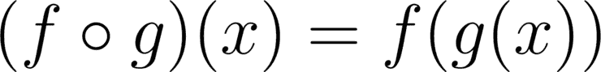。圆圈是组合运算符。通常读作“与……组合”或“之后”。你可以大声说“`f`与`g`组合等于`f`作用于`g`作用于`x`”，或者“`f`在`g`之后等于`f`作用于`g`作用于`x`”。我们说`f`在`g`之后，因为先计算`g`，然后将其输出作为参数传递给`f`。

每当你编写这样的代码时，你就在组合函数：

```javascript
const g = n => n + 1;
const f = n => n * 2;

const doStuff = x => {
  const afterG = g(x);
  const afterF = f(afterG);
  return afterF;
};

doStuff(20); // 42
```

每当你编写一个 Promise 链时，你就在组合函数：

```javascript
const g = n => n + 1;
const f = n => n * 2;

const wait = time => new Promise(
  (resolve, reject) => setTimeout(
    resolve,
    time
  )
);

wait(300)
  .then(() => 20)
  .then(g)
  .then(f)
  .then(value => console.log(value)) // 42
;
```

同样，每当你链式调用数组方法、lodash 方法、observables（RxJS 等）时，你都在组合函数。如果你在链式调用，你就在组合。如果你将返回值传递给其他函数，你就在组合。如果你按顺序调用两个方法，你就是在使用`this`作为输入数据进行组合。

> 如果你在链式调用，你就在组合。

当你有意地组合函数时，你会做得更好。

有意地组合函数，我们可以将`doStuff()`函数改进为简单的一行代码：

```javascript
const g = n => n + 1;
const f = n => n * 2;

const doStuffBetter = x => f(g(x));

doStuffBetter(20); // 42
```

对这种形式的一个常见反对意见是它更难调试。例如，我们如何使用函数组合来编写以下代码？

```javascript
const doStuff = x => {
  const afterG = g(x);
  console.log(`after g: ${ afterG }`);
  const afterF = f(afterG);
  console.log(`after f: ${ afterF }`);
  return afterF;
};

doStuff(20); // =>
/*
"after g: 21"
"after f: 42"
*/
```

首先，让我们将“after f”、“after g”的日志记录抽象成一个名为`trace()`的小工具：

```javascript
const trace = label => value => {
  console.log(`${ label }: ${ value }`);
  return value;
};
```

现在我们可以这样使用它：

```javascript
const doStuff = x => {
  const afterG = g(x);
  trace('after g')(afterG);
  const afterF = f(afterG);
  trace('after f')(afterF);
  return afterF;
};

doStuff(20); // =>
/*
"after g: 21"
"after f: 42"
*/
```

流行的函数式编程库如 Lodash 和 Ramda 包含使函数组合更容易的工具。你可以像这样重写上面的函数：

```javascript
import pipe from 'lodash/fp/flow';

const doStuffBetter = pipe(
  g,
  trace('after g'),
  f,
  trace('after f')
);

doStuffBetter(20); // =>
/*
"after g: 21"
"after f: 42"
*/
```

如果你想在不导入任何东西的情况下尝试这段代码，你可以像这样定义`pipe`：

```javascript
// pipe(...fns: [...Function]) => x => y
const pipe = (...fns) => x => fns.reduce((y, f) => f(y), x);
```

如果你还不理解它是如何工作的，别担心。稍后我们将更详细地探讨函数组合。事实上，它如此重要，以至于你会在本书中多次看到它的定义和演示。目的是帮助你熟悉它，使其定义和用法变得自动化。与组合融为一体。

`pipe()`创建了一个函数管道，将一个函数的输出传递给另一个函数的输入。当你使用`pipe()`（及其孪生函数`compose()`）时，你不需要中间变量。编写不提及参数的函数被称为“无点风格”。要做到这一点，你需要调用一个返回新函数的函数，而不是显式地声明该函数。这意味着你不需要`function`关键字或箭头语法（`=>`）。

无点风格可能被过度使用，但偶尔使用一点是很好的，因为那些中间变量会给你的函数增加不必要的复杂性。

降低复杂性有几个好处：

##### 工作记忆

普通人的[工作记忆](http://www.nature.com/neuro/journal/v17/n3/fig_tab/nn.3655_F2.html)中只有少数共享资源用于离散量子，每个变量都可能消耗其中一个量子。随着变量数量的增加，我们准确回忆每个变量含义的能力会下降。工作记忆模型通常包含 4-7 个离散量子。超过这些数量，错误率会急剧上升。

使用管道形式，我们消除了 3 个变量——释放了将近一半的可用工作记忆用于其他事情。这显著降低了我们的认知负荷。软件开发人员通常比普通人更擅长将数据分块存入工作记忆，但也不至于强到可以忽视节约的重要性。

##### 信噪比

简洁的代码还能提高代码的信噪比。这就像听收音机——当收音机没有正确调谐到电台时，你会听到很多干扰噪音，更难听清音乐。当你调谐到正确的电台时，噪音消失，音乐信号更强。

代码也是如此。更简洁的代码表达能增强理解。有些代码提供了有用的信息，而有些代码只是占用了空间。如果你能在不减少传递含义的前提下减少代码量，就能让其他需要阅读代码的人更容易解析和理解。

##### Bug 的暴露面

看看改造前后的函数。看起来这个函数像是节食减肥成功，瘦了一大圈。这很重要，因为额外的代码意味着更多的 Bug 藏身空间，也就意味着会有更多 Bug 藏匿其中。更少的代码 = 更小的 Bug 暴露面 = 更少的 Bug。

#### 组合对象

> “优先使用对象组合而非类继承”——GoF（四人帮），[《设计模式：可复用面向对象软件的基础》](https://www.amazon.com/Design-Patterns-Elements-Reusable-Object-Oriented/dp/0201633612/ref=as_li_ss_tl?ie=UTF8&qid=1494993475&sr=8-1&keywords=design+patterns&linkCode=ll1&tag=eejs-20&linkId=6c553f16325f3939e5abadd4ee04e8b4)

> “在计算机科学中，复合数据类型或组合数据类型是指任何可以在程序中使用编程语言的基本数据类型和其他复合类型构造的数据类型。[…] 构造复合类型的行为被称为组合。”——维基百科

以下是基本类型：

```javascript
const firstName = 'Claude';
const lastName = 'Debussy';
```

而这是复合类型：

```javascript
const fullName = {
  firstName,
  lastName
};
```

同样，`Array`、`Set`、`Map`、`WeakMap`、`TypedArray`等也是复合数据类型。任何时候你构建任何非基本数据结构，你都在进行某种对象组合。

请注意，GoF 定义了一种称为组合模式的模式，这是一种特定类型的递归对象组合，允许你以相同的方式对待单个组件和聚合后的复合体。有些开发者会混淆，认为组合模式是唯一形式的对象组合。不要混淆。对象组合有很多不同的种类。

GoF 继续说道：“你会在设计模式中一次又一次地看到对象组合的应用”，然后他们列举了三种对象组合关系，包括**委托**（当一个对象将属性访问委托给另一个对象时，如状态模式、策略模式和访问者模式中所使用的）、**相识**（当一个对象通过引用知道另一个对象，通常作为参数传递：一种使用关系，例如，网络请求处理器可能会被传递一个日志记录器的引用来记录请求——请求处理器使用日志记录器），以及**聚合**（当子对象构成父对象的一部分时：一种拥有关系，例如，DOM 子节点是 DOM 节点中的组件元素——DOM 节点拥有子节点）。

类继承可以用来构造复合对象，但这样做既有限制又脆弱。当 GoF 说“优先使用对象组合而非类继承”时，他们是在建议你使用灵活的方法来构建复合对象，而不是使用类继承那种僵化、紧耦合的方式。他们鼓励你优先使用“拥有”和“使用”关系，而不是“是”关系。

我们不讨论具体的设计模式，而是采用来自[《计算机科学中的范畴方法：拓扑学视角》](https://www.amazon.com/Categorical-Methods-Computer-Science-Topology/dp/0387517227/ref=as_li_ss_tl?ie=UTF8&qid=1495077930&sr=8-3&keywords=Categorical+Methods+in+Computer+Science:+With+Aspects+from+Topology&linkCode=ll1&tag=eejs-20&linkId=095afed5272832b74357f63b41410cb7)（1989）中更通用的对象组合定义：

> “复合对象是通过将对象组合在一起形成的，其中每个后者都是前者的‘一部分’。”

另一个很好的参考是《通过复合设计实现可靠软件》，Glenford J Myers，1975 年。这两本书都已绝版多年，但如果你希望从更深入的技术和历史背景角度探索对象组合这一主题，仍然可以在亚马逊或 eBay 上找到卖家。

类继承只是复合对象构造的一种方式。所有类都会产生复合对象，但并非所有复合对象都是由类或类继承产生的。“优先使用对象组合而非类继承”意味着你应该从小型组件部分构建复合对象，而不是从类层次结构中的祖先继承所有属性。后者会在面向对象设计中导致大量众所周知的问题：

- **紧耦合问题：** 由于子类依赖于父类的实现，类继承是面向对象设计中最紧密的耦合方式。
- **脆弱的基类问题：** 由于紧耦合，对基类的更改可能会破坏大量派生类——甚至可能破坏由第三方管理的代码。作者可能会破坏他们不知道的代码。
- **僵化的层次结构问题：** 对于单一祖先的分类体系，经过足够的时间和演化，所有类分类体系最终都会不适用于新的用例。
- **必要性重复问题：** 由于僵化的层次结构，新的用例通常通过重复而非扩展来实现，导致相似的类出现意外的分歧。一旦重复出现，新类应该从哪个类派生以及为什么，就变得不明确了。
- **大猩猩/香蕉问题：** “……面向对象语言的问题在于，它们携带了所有隐式的环境。你想要一根香蕉，但得到的却是一只拿着香蕉的大猩猩，以及整个丛林。”——乔·阿姆斯特朗，[《编程人生》](http://www.amazon.com/gp/product/1430219483?ie=UTF8&camp=213733&creative=393185&creativeASIN=1430219483&linkCode=shr&tag=eejs-20&linkId=3MNWRRZU3C4Q4BDN)

JavaScript 中最常见的对象组合形式被称为**对象拼接**（又称**拼接式继承**，非正式说法为“混入组合”）。它的运作方式就像冰淇淋：你从一个基础对象（比如香草冰淇淋）开始，然后混入你想要的特性。加些坚果、焦糖、巧克力漩涡，最终你就得到了坚果焦糖巧克力漩涡冰淇淋。

使用类继承构建组合体：

```javascript
class Foo {
  constructor () {
    this.a = 'a'
  }
}

class Bar extends Foo {
  constructor (options) {
    super(options);
    this.b = 'b'
  }
}

const myBar = new Bar(); // {a: 'a', b: 'b'}
```

使用混入组合构建组合体：

```javascript
const a = {
  a: 'a'
};

const b = {
  b: 'b'
};

const c = {...a, ...b}; // {a: 'a', b: 'b'}
```

我们稍后会更深入地探讨其他形式的对象组合。目前，你需要理解的是：

1. 实现方式不止一种。
2. 有些方式优于其他方式。
3. 你应该为手头的任务选择最简单、最灵活的解决方案。

### 结论

这并非关于函数式编程（FP）与面向对象编程（OOP）之争，也不是某种语言与另一种语言之争。组件可以是函数、数据结构、类等形式。不同的编程语言往往提供不同的原子元素来构建组件。Java 提供对象，Haskell 提供函数，等等。但无论你偏爱哪种语言和范式，都无法回避组合函数和数据结构这件事。归根结底，一切都会归结于此。

我们会大量讨论函数式编程，因为在 JavaScript 中，函数是最容易组合的东西，而且函数式编程社区投入了大量时间和精力来形式化函数组合技术。

我们不会说函数式编程优于面向对象编程，也不会说你必须在两者中二选一。OOP 与 FP 是一种虚假的二分法。近年来我见过的每一个真实的 JavaScript 应用都广泛混合了 FP 和 OOP。

我们将使用对象组合来为函数式编程生成数据类型，并使用函数式编程来为 OOP 生成对象。

无论你如何编写软件，都应该将其组合好。

> 软件开发的本质就是组合。


一个不懂组合的软件开发者，就像一个不知道螺栓或钉子的房屋建造者。在不知晓组合的情况下构建软件，就像房屋建造者用胶带和强力胶把墙壁拼在一起。

是时候简化了，而简化的最佳方式就是抓住本质。问题在于，行业中几乎没有人能真正掌握这些本质。作为一个行业，我们辜负了你——软件开发者。我们有责任作为行业更好地培训开发者。我们必须改进。我们需要承担责任。如今一切都在软件上运行，从经济到医疗设备。这个星球上人类生活的每一个角落，几乎都受到我们软件质量的影响。我们需要知道自己在做什么。

是时候学习如何组合软件了。

## 不可变之道（函数式程序员之路）

函数式编程是 JavaScript 的基石，而不可变性是函数式编程的基石。不理解不可变性，就无法完全理解函数式编程。这个故事或许能有所帮助。

### 前言

我在一座古老图书馆的档案中漫步，发现了一条通往计算之室的黑暗隧道。在那里，我找到了一卷似乎掉在地上被遗忘的卷轴。

卷轴装在一个布满灰尘的钢管里，标签上写着：“来自 Lambda 教堂档案室。”

它被一张薄纸包裹着，上面写着：

一位大师级程序员和他的学徒坐在图灵冥想中，沉思着 Lambda。学徒看着大师问道：“大师，您告诉我要简化，但程序是复杂的。框架通过消除艰难选择来减轻创作的工作。类和框架哪个更好？”大师级程序员看着他的学徒问道：“你没有读过智者卡马克的教诲吗？”接着引用道……

> “有时，优雅的实现就是一个函数。不是一个方法。不是一个类。不是一个框架。就是一个函数。”

“但是大师，”学徒刚开口——大师打断了他，问道：

“‘不函数’（not functional）这个词不就是‘功能失调’（dysfunctional）吗？”

于是学徒明白了。

* * *

纸的背面有一个索引，似乎指向计算之室中的许多书籍。我偷偷看了看那些书，但里面全是我看不懂的大词，于是我把它们放回去，继续阅读卷轴。我注意到索引的空白处写满了简短的评论，我将在这里忠实地复述它们，连同卷轴上的文字：

> **不可变性：** 真正的恒常是变化。变异隐藏了变化。隐藏的变化会引发混乱。因此，智者拥抱历史。

如果你有一美元，我又给了你一美元，这并不会改变片刻之前你只有一美元、而现在你有两美元的事实。变异试图抹去历史，但历史无法真正被抹去。当过去没有被保留时，它会回来困扰你，表现为程序中的 bug。

> **分离：** 逻辑是思考。效果是行动。因此，智者先思考后行动，且只在思考完成后才行动。

如果你试图同时执行效果和逻辑，可能会产生隐藏的副作用，导致逻辑中的 bug。保持函数小巧。一次只做一件事，并把它做好。

> **组合：** 自然界的一切都和谐运作。没有水，树无法生长。没有空气，鸟无法飞翔。因此，智者将各种配料混合在一起，让他们的汤更美味。

为组合做规划。编写那些输出能自然成为许多其他函数输入的函数。保持函数签名尽可能简单。

> **守恒：** 时间是宝贵的，努力需要时间。因此，智者尽可能重复使用他们的工具。愚者则为每个新创造制作专用工具。

特定类型的函数无法用于不同类型的数据。明智的程序员会提升函数以适用于多种数据类型，或者包装数据使其看起来符合函数的预期。列表和条目是极好的通用抽象。

> **流动：** 静止的水不安全饮用。食物放置会腐烂。智者繁荣，因为他们让事物流动。

[编者注：卷轴上唯一的插图是一排长相不同的鸭子顺着溪流漂浮，就在这段文字上方。我没有复制插图，因为我认为自己无法恰当地呈现它。奇怪的是，插图下方写着：]

> 随时间展开的列表就是流。

[相应的注释写道：]

共享对象和数据固定装置可能导致函数相互干扰。争夺同一资源的线程可能互相绊倒。只有当数据通过纯函数自由流动时，程序才能被推理，结果才能被预测。

[编者注：卷轴以最后一段诗句结束，没有注释：]

> **智慧：** 智者程序员在踏上道路之前就理解了道。因此，智者程序员是函数式的，而愚者则在*丛林*中迷失。

## 函数式编程的兴衰与复兴（可组合软件）

大约在我六岁的时候，我花了很多时间和最好的朋友一起玩电脑游戏。他家有一整间屋子摆满了电脑。对我来说，它们无法抗拒，就像魔法。我花了很多时间探索各种游戏。有一天我问朋友：“我们怎么才能做一个游戏？”

他不知道，于是我们问了他的父亲，他伸手从高架子上取下一本用 BASIC 语言编写的游戏书。我的编程之旅就此开始。等到公立学校开始教代数时，我已经对这门学科了如指掌，因为编程本质上就是代数。至少可以这么说。

### 函数式编程的兴起

在计算机科学诞生之初，在大多数计算机科学工作真正在计算机上完成之前，有两位伟大的数学家：阿隆佐·邱奇（Alonzo Church）和艾伦·图灵（Alan Turing）。他们提出了两种不同但等价的通用计算模型。这两种模型都能计算任何图灵机可计算的函数，也就是说，给定输入 `n`，存在一台图灵机最终会停机并返回 `f(n)`。

阿隆佐·邱奇发明了 λ 演算。λ 演算是一种基于函数应用的通用计算模型。艾伦·图灵则以图灵机闻名。图灵机是一种通用计算模型，它定义了一个理论设备，可以在一条纸带上操作符号。正如图灵所说：

> “如果一个函数的值可以通过某种纯机械过程求得，那么它就是有效可计算的。” —— A.M. 图灵，《[基于序数的逻辑系统](https://en.wikipedia.org/wiki/Systems_of_Logic_Based_on_Ordinals)》

邱奇-图灵论题表明 λ 演算和图灵机是等价的。

在 λ 演算中，函数是核心。一切都是函数，包括数字。将函数视为原子构建块（就像我们用乐高积木搭建作品一样）是一种极具表现力和优雅的方式来组合软件。在本文中，我们将讨论函数组合在软件设计中的重要性。

λ 演算之所以特殊，有三个要点：

1. 函数总是匿名的。在 JavaScript 中，`const sum = (x, y) => x + y` 的右侧是匿名函数表达式 `(x, y) => x + y`。

2. λ 演算中的函数始终是一元的，也就是说它们只接受一个参数。如果需要多个参数，函数会接受一个输入，然后返回一个新函数来接受下一个参数，依此类推，直到所有参数都被收集完毕，函数应用才能完成。多元函数 `(x, y) => x + y` 可以表示为一元函数：`x => y => x + y`。这种将多元函数转换为一系列一元函数的变换称为柯里化。

3. 函数是一等公民，这意味着函数可以作为其他函数的输入，并且函数可以返回函数。

这些特性共同构成了一套简单而富有表现力的词汇，用于以函数为主要构建块来组合软件。在 JavaScript 中，匿名函数和柯里化函数是可选的特性。虽然 JavaScript 支持 λ 演算的重要特性，但并不强制使用它们。

经典的函数组合是将一个函数的输出作为另一个函数的输入。例如，组合 `f . g` 可以写成：

```javascript
1 const compose = (f, g) => x => f(g(x));
```

使用方法如下：

```javascript
1 const compose = (f, g) => x => f(g(x));
2 
3 const double = n => n * 2;
4 const inc = n => n + 1;
5 
6 const transform = compose(double, inc);
7 
8 transform(3); // 8
```

`compose()` 函数将 `double` 函数作为第一个参数，`inc` 函数作为第二个参数，并返回一个组合了两者的函数。在 `compose()` 函数内部，当 `transform()` 被调用时，`f` 是 `double()`，`g` 是 `inc()`，`x` 是 `3`：

1. `x` 求值为 `3`，并传入 `inc()`。

2. `inc(3)` 求值为 `4`。

3. `double(4)` 求值为 `8`。

4. `8` 从组合函数中返回。

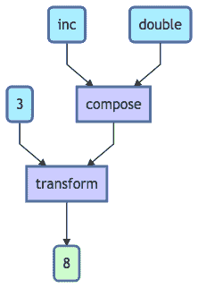

组合函数的数据流图

λ 演算对软件设计产生了巨大影响，大约在 1980 年之前，许多极具影响力的计算机科学先驱都在使用函数组合来构建软件。Lisp 创建于 1958 年，深受 λ 演算的影响。如今，Lisp 是仍在广泛使用的第二古老的语言。

我是通过 AutoLISP 接触到它的：AutoLISP 是最流行的计算机辅助设计（CAD）软件 AutoCAD 中使用的脚本语言。AutoCAD 非常流行，以至于几乎所有其他 CAD 应用程序都支持 AutoLISP，以便保持兼容。Lisp 也是计算机科学课程中流行的教学语言，原因有三：

1. 它的简洁性使得大约一天内就能学会 Lisp 的基本语法和语义。

2. Lisp 完全围绕函数组合，而函数组合是构建应用程序的一种优雅方式。

3. 我最喜欢的计算机科学教材使用了 Lisp：《[计算机程序的构造与解释](https://www.amazon.com/Structure-Interpretation-Computer-Programs-Engineering/dp/0262510871/ref=as_li_ss_tl?ie=UTF8&linkCode=ll1&tag=eejs-20&linkId=4896ed63eee8657b6379c2acd99dd3f3)》。

### 函数式编程的衰落

大约在 1970 年到 1980 年之间，软件的组合方式从简单的代数数学偏离，变成了计算机要遵循的一系列线性指令，例如 K&R C（1978 年）以及 20 世纪 70 年代和 80 年代初早期家用计算机附带的微型 BASIC 解释器。

1972 年，艾伦·凯的 Smalltalk 被形式化，将对象作为组合原子单元的思想开始占据主导地位。Smalltalk 关于组件封装和消息传递的伟大思想，在 80 年代和 90 年代被 C++ 和 Java 扭曲成了关于继承层次结构和 is-a 关系以实现功能复用的可怕想法。

尽管 Smalltalk 是一种函数式面向对象语言，但当 C++ 和 Java 占据主导地位时，函数式编程被边缘化到了学术界和边缘领域：成为最极客的程序员、象牙塔里的教授以及少数幸运地逃脱了 1990 年代至 2010 年 Java 填鸭式灌输的学生们痴迷的快乐源泉。

对我们大多数人来说，在长达 30 年的时间里，创建软件简直是一场噩梦。黑暗时代。;)

> **注：** 我是通过 Basic、Pascal、C++ 和 Java 学习编程的。我用 AutoLisp 操作 3D 图形。只有 AutoLisp 是函数式的。在我编程生涯的头几年，我并没有意识到函数式编程在矢量图形编程领域之外也是一种实用的选择。

### 函数式编程的复兴

大约在 2010 年，一件伟大的事情开始发生：JavaScript 爆发了。在 2006 年之前，JavaScript 被广泛认为是一种玩具语言，用于在网页浏览器中制作可爱的动画，但它隐藏着一些强大的特性。具体来说，就是 λ 演算最重要的特性。人们开始在暗处窃窃私语，谈论这种叫做“函数式编程”的酷东西。

到 2015 年，函数式编程的思想再次流行起来。为了简化，JavaScript 规范迎来了十年来的第一次重大升级，增加了箭头函数，使得创建和阅读函数、柯里化以及 λ 表达式变得更加容易。

箭头函数就像火箭燃料，推动了 JavaScript 中函数式编程的爆发。如今，很少能看到一个大型应用程序不使用大量函数式编程技术。

组合是一种简单、优雅且富有表现力的方式，可以清晰地建模软件的行为。通过组合小的、确定性的函数来创建更大的软件组件和功能，所生成的软件更易于组织、理解、调试、扩展、测试和维护。

### 函数式编程一直生机勃勃

尽管这种对流行语言的调侃带有讽刺意味，但函数式编程始终充满活力。在 20 世纪 80 年代和 90 年代的工业格局中，Lisp 和 Smalltalk 是 C 语言最大的竞争对手之一。Smalltalk 是财富 500 强公司（包括 [摩根大通](http://www.cincomsmalltalk.com/main/successes/financial-services/jpmorgan/)）中流行的企业软件解决方案，而 Lisp 则被 [NASA 喷气推进实验室用于编程火星探测器](http://www.flownet.com/gat/jpl-lisp.html)。

Lisp 过去是，现在也仍然被斯坦福研究所（SRI）用于人工智能和生物信息学研究。（SRI 正是苹果 SIRI 虚拟助手背后技术的诞生地。）硅谷最具影响力的风险投资公司之一 YCombinator 由保罗·格雷厄姆联合创立，他是 Lisp 社区的一位影响者。热门科技新闻网站 [Hacker News](https://news.ycombinator.com/) 是用 Lisp 的一种方言 Ark 编写的。

Clojure 是 Lisp 的一种方言，由 Rich Hickey 于 2007 年创建，并迅速在包括亚马逊、苹果和脸书在内的主要科技公司中获得普及和应用。

Erlang 是一种流行的函数式编程语言，由爱立信开发，用于电话交换机。它至今仍被 T-Mobile 用于移动网络。亚马逊将 Erlang 用于包括 SimpleDB 和弹性计算云（EC2）在内的云技术。

尽管如此，作为网络的标准语言，JavaScript 是世界上最流行的编程语言，而 JavaScript 让前所未有的开发者接触到了函数式编程范式。

## 为什么要在 JavaScript 中学习函数式编程？

抛开你对 JavaScript 的一切既有认知，以初学者的心态来接触这些内容。为了帮助你做到这一点，我们将从头开始回顾 JavaScript 基础知识，就好像你从未见过 JavaScript 一样。如果你是初学者，那你很幸运。终于有东西从零开始探索 ES6 和函数式编程了！希望所有新概念都能在过程中得到解释——但别指望有太多呵护。

如果你是一位已经熟悉 JavaScript 或纯函数式语言的经验丰富的开发者，你可能会认为 JavaScript 是探索函数式编程的一个奇怪选择。请把这些想法放在一边，试着以开放的心态来接触这些内容。你可能会发现 JavaScript 编程还有另一个层次——一个你从未知道存在的层次。

既然这本书叫做《组合软件》，而函数式编程显然是组合软件的方式（使用函数组合、高阶函数等），你可能会好奇为什么我不谈论 Haskell、ClojureScript 或 Elm，而是选择 JavaScript。

JavaScript 拥有函数式编程所需的最重要特性：

1. **一等函数：** 将函数作为数据值使用的能力：将函数作为参数传递、返回函数、将函数赋值给变量和对象属性。这一特性使得高阶函数成为可能，进而实现偏应用、柯里化和组合。

2. **匿名函数和简洁的 lambda 语法：** `x => x * 2` 在 JavaScript 中是一个有效的函数表达式。简洁的 lambda 使得使用高阶函数更加容易。

3. **闭包：** 闭包是函数与其词法环境的捆绑。闭包在函数创建时生成。当一个函数在另一个函数内部定义时，它可以访问外部函数中的变量绑定，即使外部函数已经退出。闭包是偏应用获取其固定参数的方式。固定参数是指在返回函数的闭包作用域中绑定的参数。在 `add2(1)(2)` 中，`1` 是 `add2(1)` 返回函数中的一个固定参数。

### JavaScript 缺少什么

JavaScript 是一种多范式语言，意味着它支持多种不同风格的编程。JavaScript 支持的其他风格包括过程式（命令式）编程（如 C 语言），其中函数代表可重复调用以实现复用和组织的指令子程序；面向对象编程，其中对象（而非函数）是主要构建块；当然还有函数式编程。多范式语言的缺点在于，命令式和面向对象编程往往暗示几乎所有东西都需要是可变的。

可变性是指对数据结构进行的原地修改。例如：

```javascript
1 const foo = {
2   bar: 'baz'
3 };
4 
5 foo.bar = 'qux'; // 可变操作
```

对象通常需要是可变的，以便其属性可以通过方法更新。在命令式编程中，大多数数据结构都是可变的，以便能够高效地原地操作对象和数组。

以下是一些函数式语言拥有而 JavaScript 没有的特性：

1. **纯函数性：** 在某些函数式编程语言中，语言强制要求纯函数性。不允许有副作用的表达式。

2. **不可变性：** 某些函数式编程语言禁止可变操作。表达式不会修改现有数据结构（如数组或对象），而是求值生成新的数据结构。这听起来可能效率低下，但大多数函数式语言在底层使用字典树（trie）数据结构，这些结构具有结构共享特性：即旧对象和新对象共享相同数据的引用。

3. **递归：** 递归是函数为了迭代而引用自身的能力。在许多函数式编程语言中，递归是唯一的迭代方式。没有像 `for`、`while` 或 `do` 这样的循环语句。

**纯函数性：** 在 JavaScript 中，纯函数性需要通过约定来实现。如果你不是通过组合纯函数来构建大部分应用程序，那么你就不是在用函数式风格编程。不幸的是，在 JavaScript 中，很容易因为意外创建和使用不纯函数而偏离轨道。

**不可变性：** 在纯函数式语言中，不可变性通常是强制执行的。JavaScript 缺乏大多数函数式语言使用的高效、基于字典树的不可变数据结构，但有一些库可以提供帮助，包括 [Immutable.js](https://facebook.github.io/immutable-js/) 和 [Mori](https://github.com/swannodette/mori)。我希望未来版本的 ECMAScript 规范能够拥抱不可变数据结构。有一些迹象带来了希望，比如 ES6 中增加了 `const` 关键字。用 `const` 定义的名称绑定不能被重新赋值以指向不同的值。但重要的是要理解 `const` 并不代表不可变的值。

一个 `const` 对象不能被重新赋值指向一个完全不同的对象，但它所指向的对象的属性可以被修改。JavaScript 还具有 `freeze()` 对象的能力，但这些对象只在根层级被冻结，意味着嵌套对象的属性仍然可以被修改。换句话说，在 JavaScript 规范中看到真正的复合不可变之前，还有很长的路要走。


## 递归

JavaScript 在技术上支持递归，但大多数函数式语言都有一个称为“正确尾调用”的特性。**正确尾调用**是一种语言特性，允许递归函数为递归调用重用栈帧。

如果没有正确尾调用，调用栈可能会无限增长并导致栈溢出。JavaScript 在 ES6 规范中技术上获得了正确尾调用。不幸的是，只有一种主流浏览器引擎将其作为默认特性启用，并且该优化在 Babel（最流行的标准 JavaScript 编译器，用于将 ES6 编译为 ES5 以在旧浏览器中使用）中被部分实现后又被移除了。

归根结底：即使你小心地在尾位置调用函数，使用递归进行大规模迭代仍然不安全。

## JavaScript 拥有而纯函数式语言所缺乏的

纯粹主义者会告诉你，JavaScript 的可变性是其主要缺点，这有时确实如此。然而，副作用和可变性有时也是有益的。事实上，没有副作用就不可能创建大多数有用的现代应用程序。像 Haskell 这样的纯函数式语言也使用副作用，但通过称为单子的盒子将它们与纯函数伪装开来，使得程序保持纯函数性，即使单子所代表的副作用是不纯的。

单子的麻烦在于，尽管它们的使用相当简单，但向不熟悉大量示例的人解释什么是单子，有点像向盲人描述“蓝色”是什么样子。在最基本的形式中，单子只是一种在单个操作中映射和扁平化的数据类型（后面会更深入地介绍）。但要直观地理解它们的使用方式以及它们提供的灵活性，你实际上只需要直接上手使用它们。如果你正在使用 Promise 或新的 `Array.prototype.flatMap()` 方法，那么你已经走在路上了。

但初次学习它们可能会非常令人生畏，而关于这个主题的惯用文献也帮不上忙：

> “单子不过是自函子范畴上的幺半群，这有什么问题？” ~ James Iry，虚构引用 Philip Wadler，转述 Saunders Mac Lane 的真实引文。[《编程语言简史（不完整且大部分错误）》](http://james-iry.blogspot.com/2009/05/brief-incomplete-and-mostly-wrong.html)

通常，戏仿会夸大事实以使有趣的观点更有趣。在上面的引文中，对单子的解释实际上比原始引文*简化*了，原始引文是这样的：

> “`X` 中的单子不过是 `X` 的自函子范畴上的幺半群，其中乘积 `×` 被自函子的复合取代，单位元由恒等自函子设定。” ~ Saunders Mac Lane。[《工作数学家的范畴论》](https://www.amazon.com/Categories-Working-Mathematician-Graduate-Mathematics/dp/0387984038//ref=as_li_ss_tl?ie=UTF8&linkCode=ll1&tag=eejs-20&linkId=de6f23899da4b5892f562413173be4f0)

即便如此，在我看来，对单子的恐惧是站不住脚的。学习单子的最佳方法不是阅读大量关于这个主题的书籍和博客文章，而是直接上手使用它们。与函数式编程中的大多数事物一样，难以理解的学术词汇比概念本身要难理解得多。相信我，你不需要理解 Saunders Mac Lane 也能理解函数式编程。

虽然 JavaScript 可能并非绝对适合每一种编程风格，但它毫不掩饰地是一种通用语言，旨在供具有不同编程风格和背景的各类人群使用。

[据 Brendan Eich 所说](https://brendaneich.com/2008/04/popularity/)，这从一开始就是有意为之。Netscape 必须支持两种程序员：

> “……组件作者，他们用 C++ 或（我们希望）Java 编写；以及‘脚本编写者’，无论是业余还是专业，他们编写直接嵌入 HTML 的代码。”

最初，意图是 Netscape 支持两种不同的语言，而脚本语言可能类似于 Scheme（Lisp 的一种方言）。再次引用 Brendan Eich：

> “我被招募到 Netscape，承诺‘在浏览器中实现 Scheme’。”

JavaScript 必须是一种新语言：

> “来自高级工程管理层的*指令*是，这种语言必须‘看起来像 Java’。这排除了 Perl、Python、Tcl 以及 Scheme。”

因此，Brendan Eich 从一开始就有的想法是：

1. 在浏览器中实现 Scheme。
2. 看起来像 Java。

最终它变成了一个更加混杂的东西：

> “我并不自豪，但我很高兴我选择了类似 Scheme 的一等函数和类似 Self（尽管是单一的）原型作为主要成分。Java 的影响，尤其是 y2k `Date` 错误以及原始类型与对象的区分（例如，string 与 `String`），是不幸的。”

我会在最终进入 JavaScript 的“不幸”类 Java 特性列表中添加：

- 构造函数和 `new` 关键字，它们与工厂函数具有不同的调用和使用语义。
- 一个 `class` 关键字，以单祖先 `extends` 作为主要继承机制。
- 用户倾向于将 `class` 视为静态类型（实际上并非如此）。

我的建议：在你自己的代码中，尽可能避免使用这些。当你为不属于你的代码做贡献时，采用“入乡随俗”的原则。像罗马人那样做。

我们很幸运，JavaScript 最终成为如此强大的语言，因为事实证明“脚本”方法胜过了“组件”方法（如今，Java、Flash 和 ActiveX 扩展在大量已安装的浏览器中已不受支持）。

我们最终得到的是浏览器直接支持的一种语言：JavaScript。

这意味着浏览器更精简、更少 bug，因为它们只需要支持一套语言绑定：JavaScript 的。你可能会认为 WebAssembly 是个例外，但 WebAssembly 的设计目标之一就是使用兼容的抽象语法树（AST）来共享 JavaScript 的语言绑定。事实上，最初的演示将 WebAssembly 编译为 JavaScript 的一个子集，称为 ASM.js。

作为 Web 平台唯一标准的通用编程语言，JavaScript 得以乘上了软件史上最大的语言流行浪潮：

> 应用吞噬了世界，Web 吞噬了应用，而 JavaScript 吞噬了 Web。

根据[多项](http://redmonk.com/sogrady/2016/07/20/language-rankings-6-16/)[指标](http://stackoverflow.com/research/developer-survey-2016)，[JavaScript](https://octoverse.github.com/)现在是世界上最流行的编程语言。

JavaScript 并非函数式编程的理想工具，但它是在非常庞大、分布式的团队中构建大型应用的绝佳工具，在这些团队中，不同团队可能对如何构建应用有不同的想法。

有些团队可能专注于脚本粘合，其中命令式编程特别有用。其他团队可能专注于构建架构抽象，此时一点（克制的、谨慎的）面向对象思维可能并非坏事。还有一些团队可能拥抱函数式编程，使用纯函数来减少用户操作，以实现确定性的、可测试的应用状态管理。这些团队的成员都在使用同一种语言，这意味着他们可以更容易地交流思想、相互学习，并在彼此的工作基础上进行构建。

在 JavaScript 中，所有这些想法都可以共存，这使得更多人能够拥抱 JavaScript，从而诞生了世界上最大的开源包注册中心（截至 2017 年 2 月），[npm](https://www.npmjs.com/)。


Modulecounts 图：包数量

JavaScript 的真正优势在于生态系统中的**思想和用户的多样性**。它可能不是纯函数式编程纯粹主义者的绝对理想语言，但它可能是使用一种语言在你能想象的几乎所有平台上协作的理想语言——对于来自其他流行语言（如 Java、Lisp 或 C）的人来说也很熟悉。JavaScript 不会让任何背景的用户感到绝对舒适，但他们可能会觉得*足够舒适*，从而学习这门语言并快速上手。

我同意 JavaScript 并非函数式程序员的最佳语言。然而，没有其他函数式语言能声称自己是一种人人都能使用并接纳的语言，而正如 ES6 所证明的那样：JavaScript 能够且确实在更好地满足对函数式编程感兴趣的用户的需求。与其抛弃 JavaScript 及其被全球几乎所有公司使用的惊人生态系统，为什么不拥抱它，并逐步让它成为更适合软件组合的语言呢？

就目前而言，JavaScript 已经是一种*足够好*的函数式编程语言，这意味着人们正在使用函数式编程技术，用 JavaScript 构建各种有用且有趣的东西。Netflix（以及每个用 Angular 2+ 构建的应用）都使用基于 RxJS 的函数式工具。[Facebook](https://github.com/facebook/react/wiki/sites-using-react)在 React 中运用纯函数、高阶函数和高阶组件的概念来构建 Facebook 和 Instagram。[PayPal、KhanAcademy 和 Flipkart](https://github.com/reactjs/redux/issues/310)使用 Redux 进行状态管理。

它们并非孤例：Angular、React、Redux 和 Lodash 是 JavaScript 应用生态系统中的主要框架和库，它们都深受函数式编程的影响——或者就 Lodash 和 Redux 而言，它们就是为了在真实 JavaScript 应用中实现函数式编程模式而专门构建的。

“为什么是 JavaScript？”因为 JavaScript 是大多数真实公司用来构建真实软件的语言。无论你喜欢还是讨厌它，JavaScript 已经从 Lisp 手中夺走了“最流行的函数式编程语言”的称号，而 Lisp 曾是这个称号几十年的标准承载者。诚然，Haskell 如今更适合作为函数式编程概念的标准承载者，但人们并没有用 Haskell 构建那么多真实应用。

在任何时刻，美国都有近十万个 JavaScript 职位空缺，全球范围内还有数十万个。学习 Haskell 会让你学到很多关于函数式编程的知识，但学习 JavaScript 会让你学到很多关于为真实工作构建生产级应用的知识。

应用吞噬了世界，网络吞噬了应用，而 JavaScript 吞噬了网络。

## 纯函数

纯函数对于多种目的至关重要，包括函数式编程、并发和可靠的用户体验组件。但“纯函数”是什么意思呢？

在探讨什么是纯函数之前，最好先仔细看看函数。也许有一种不同的视角来看待它们，能让函数式编程更容易理解。

### 什么是函数？

函数是一个过程，它接收一些输入（称为参数），并产生一些输出（称为返回值）。函数可以服务于以下目的：

- **映射：**根据给定的输入产生一些输出。函数将输入值映射到输出值。
- **过程：**函数可以被调用来执行一系列步骤。这一系列步骤称为过程，以这种方式编程称为过程式编程。
- **输入/输出：**有些函数用于与系统的其他部分通信，例如屏幕、存储、系统日志或网络。

### 映射

纯函数完全关乎映射。函数将输入参数映射到返回值，这意味着对于每组输入，都存在一个输出。函数会接收输入并返回相应的输出。

`Math.max()`接收数字作为参数并返回最大的数字：

```
Math.max(2, 8, 5); // 8
```

在这个例子中，`2`、`8`和`5`是参数。它们是传递给函数的值。

`Math.max()`是一个接收任意数量参数并返回最大参数值的函数。在这个例子中，我们传入的最大数字是`8`，而返回的正是这个数字。

函数在计算和数学中非常重要。它们帮助我们以有用的方式处理数据。优秀的程序员会给函数起描述性的名称，这样当我们看到代码时，就能通过函数名理解函数的作用。

数学中也有函数，它们的工作方式与 JavaScript 中的函数非常相似。你可能在代数中见过函数。它们看起来像这样：

```
f(x) = 2x
```

这意味着我们声明了一个名为`f`的函数，它接收一个名为`x`的参数，并将`x`乘以`2`。

要使用这个函数，我们只需为`x`提供一个值：

```
f(2)
```

在代数中，这与写`4`完全相同，因此任何出现`f(2)`的地方都可以替换为`4`。这个性质称为**引用透明性**。

现在让我们把这个函数转换成 JavaScript：

```
const double = x => x * 2;
```

你可以使用`console.log()`来检查函数的输出：

```
console.log( double(5) ); // 10
```

还记得我说过在数学函数中，你可以用`4`替换`f(2)`吗？在这个例子中，JavaScript 引擎用答案`10`替换了`double(5)`。

所以，`console.log( double(5) );`等同于`console.log(10);`

这是正确的，因为`double()`是一个纯函数，但如果`double()`有副作用，比如将值保存到磁盘或记录到控制台，你就不能简单地将`double(5)`替换为`10`而不改变其含义。

如果你想要**引用透明性**，就需要使用纯函数。

### 纯函数

纯函数是指满足以下条件的函数：

1. 给定相同的输入，总是返回相同的输出。
2. 不产生副作用。

一个明显的迹象表明函数不纯，就是调用它而不使用其返回值是有意义的。对于纯函数来说，这样做是无效操作。

我建议你优先使用纯函数。也就是说，如果使用纯函数来实现程序需求是可行的，那么你应该优先选择它们而不是其他方案。纯函数接收一些输入，并基于这些输入返回一些输出。它们是程序中最简单的可复用代码构建块。也许计算机科学中最重要的设计原则是 KISS（保持简单，傻瓜）。我更喜欢“**保**持**简**单**愚**蠢”。纯函数以最好的方式做到了简单愚蠢。

纯函数有许多有益的特性，并构成了函数式编程的基础。纯函数完全独立于外部状态，因此它们免疫于与共享可变状态相关的整类错误。它们的独立性也使其成为跨多个 CPU 以及整个分布式计算集群进行并行处理的绝佳候选，这使得它们对于许多类型的科学和资源密集型计算任务至关重要。

纯函数也极其独立——易于在代码中移动、重构和重新组织，使你的程序更加灵活，更能适应未来的变化。

### 共享状态的问题

几年前，我在开发一个应用，允许用户搜索数据库中的音乐艺术家，并将艺术家的音乐播放列表加载到网络播放器中。那大约是谷歌自动补全功能推出的时候。基于 AJAX 的自动补全突然风靡一时。

唯一的问题是，用户打字的速度往往比 API 自动补全搜索响应返回的速度快，这导致了一些奇怪的错误。它会触发竞态条件，较新的建议会被过时的建议替换。

为什么会发生这种情况？因为每个 AJAX 成功处理程序都可以直接更新显示给用户的建议列表。最慢的 AJAX 请求总是通过盲目替换结果来赢得用户的注意力，即使这些被替换的结果可能是更新的。

为了解决这个问题，我创建了一个建议管理器——一个单一数据源来管理查询建议的状态。它能感知当前挂起的 AJAX 请求，当用户输入新内容时，挂起的 AJAX 请求会在新请求发出前被取消，这样每次只有一个响应处理器能够触发 UI 状态更新。

任何异步操作或并发都可能导致类似的竞态条件。当输出依赖于不可控事件（如网络、设备延迟、用户输入、随机性等）的顺序时，就会发生竞态条件。事实上，如果你使用共享状态，并且该状态依赖于随非确定性因素变化的顺序，那么无论从哪个角度看，输出都是不可预测的，这意味着无法正确测试或完全理解。正如 Scala 创始人 Martin Odersky 所说：

> “非确定性 = 并行处理 + 可变状态”

程序确定性通常是计算中一个理想的特性。也许你认为没问题，因为 JS 运行在单线程中，因此不受并行处理问题的影响，但正如 AJAX 示例所示，单线程 JS 引擎并不意味着没有并发。相反，JavaScript 中有许多并发的来源。API I/O、事件监听器、Web Workers、iframes 和定时器都可能将非确定性引入你的程序。再加上共享状态，你就得到了一个滋生 bug 的温床。

纯函数可以帮助你避免这类 bug。

### 相同输入，相同输出

对于我们的`double()`函数，你可以用结果替换函数调用，程序的含义不变——`double(5)`在你的程序中始终等同于`10`，无论上下文如何，无论调用多少次或何时调用。

但并非所有函数都如此。有些函数依赖传入参数之外的信息来产生结果。

考虑这个例子：

```
1 Math.random(); // => 0.4011148700956255
2 Math.random(); // => 0.8533405303023756
3 Math.random(); // => 0.3550692005082965
```

尽管我们没有向任何函数调用传递参数，但它们都产生了不同的输出，这意味着`Math.random()`不是纯函数。

`Math.random()`每次运行都会产生一个 0 到 1 之间的新随机数，所以显然你不能简单地用`0.4011148700956255`替换它而不改变程序的含义。

那样每次都会产生相同的结果。当我们向计算机请求一个随机数时，通常意味着我们想要一个与上次不同的结果。一副每面都印有相同数字的骰子有什么意义呢？

有时我们需要向计算机请求当前时间：

```
1 const time = () => new Date().toLocaleTimeString();
2 time(); // => "5:15:45 PM"
```

如果你用当前时间替换`time()`函数调用，会发生什么？

它总会说同一个时间：即函数调用被替换时的时间。换句话说，如果你每毫秒运行一次，它每天只能产生一次正确的输出。

所以显然，`time()`不像我们的`double()`函数。

一个函数只有在给定相同输入时总是产生相同输出，才是纯函数。你可能记得代数课上的规则：相同的输入值总是映射到相同的输出值。然而，多个输入值可能映射到同一个输出值。例如，以下函数是纯函数：

```
1 const highpass = (cutoff, value) => value >= cutoff;
```


相同的输入值总是映射到相同的输出值：

```javascript
1 highpass(5, 5); // => true
2 highpass(5, 5); // => true
3 highpass(5, 5); // => true
```

多个输入值可能映射到同一个输出值：

```javascript
1 highpass(5, 123); // true
2 highpass(5, 6);   // true
3 highpass(5, 18);  // true
4
5 highpass(5, 1);   // false
6 highpass(5, 3);   // false
7 highpass(5, 4);   // false
```

纯函数不能依赖任何外部可变状态，否则它将不再具有确定性或引用透明性。

### 无副作用

纯函数不产生副作用，这意味着它不能改变任何外部状态。

#### 不可变性

JavaScript 的对象参数是引用，这意味着如果函数修改了对象或数组参数的属性，就会改变函数外部可访问的状态。纯函数不能修改外部状态。

```javascript
 1 // impure addToCart mutates existing cart
 2 const addToCart = (cart, item, quantity) => {
 3   cart.items.push({
 4     item,
 5     quantity
 6   });
 7   return cart;
 8 };
 9
10 const originalCart =     {
11   items: []
12 };
13
14 const newCart = addToCart(
15   originalCart,
16   {
17     name: "Digital SLR Camera",
18     price: '1495'
19   },
20   1
21 );
22
23 console.log(
24   // pretty print originalCart to the console
25   JSON.stringify(originalCart, undefined, 2)
26 );
```

它通过传入一个`cart`、要添加到该`cart`的`item`以及`item`的`quantity`来工作。然后函数返回同一个`cart`，并将`item`添加进去。

问题在于我们刚刚修改了一些共享状态。其他函数可能依赖于该`cart`对象的状态保持函数调用前的样子，而现在我们修改了共享状态，就必须担心如果改变函数调用顺序会对程序逻辑产生什么影响。重构代码可能导致 bug 出现，从而搞乱订单，导致客户不满。

如果你的软件依赖于状态更新的纯性，这可能会导致 bug。例如，如果你的视图在渲染前比较下一个状态和上一个状态，以便在状态未改变时跳过渲染，那么这个修改版本的函数将永远不会更新视图，即使状态实际上已经改变。

现在考虑这个版本：

```javascript
 1 // Pure addToCart() returns a new cart
 2 // It does not mutate the original.
 3 const addToCart = (cart, item, quantity) => {
 4   return {
 5     ...cart,
 6     items: cart.items.concat([{
 7       item,
 8       quantity
 9     }]),
10   };
11 };
12
13 const originalCart =     {
14   items: []
15 };
16
17 const newCart = addToCart(
18   originalCart,
19   {
20     name: "Digital SLR Camera",
21     price: '1495'
22   },
23   1
24 );
25
26 console.log(
27   // pretty print originalCart to the console
28   JSON.stringify(originalCart, undefined, 2)
29 );
```

输出：

```javascript
1 {
2   "items": []
3 }
```

而`newCart`包含新物品：

```javascript
 1 {
 2   "items": [
 3     {
 4       "item": {
 5         "name": "Digital SLR Camera",
 6         "price": "1495"
 7       },
 8       "quantity": 1
 9     }
10   ]
```

### 结论

**纯函数**是一个函数，给定相同的状态，总是返回相同的输出，并且没有副作用。

**纯函数是最简单的函数。**只要可行，你应该优先使用它们。它们是确定性的，因此易于理解、调试和测试。确定性也使它们免受涉及共享可变状态、副作用、竞态条件等整类 bug 的影响。

如果一个表达式可以用其对应的值替换而不改变程序的含义，则该表达式是**引用透明**的。

**纯函数**可用于优化软件性能。例如，渲染视图通常是一项昂贵的操作，如果视图底层数据未发生变化，则可以跳过该操作。当使用纯函数进行视图状态更新时，可以通过比较先前状态与新状态来检查视图是否需要重新渲染。

## 什么是函数式编程？

函数式编程已成为 JavaScript 领域的一个热门话题。就在几年前，几乎没有 JavaScript 程序员知道什么是函数式编程，但过去三年里我见过的每一个大型应用代码库都大量使用了函数式编程思想。

**函数式编程**（常缩写为 FP）是一种编程范式，应用程序通过使用纯函数来组合，避免共享可变状态和副作用。函数式编程通常比命令式编程更具声明性，这意味着我们表达的是“做什么”而非“如何做”。

其他编程范式的例子包括面向对象编程（数据和行为放在一起）和过程式编程（一种命令式风格，将算法分组为过程，这些过程往往依赖于共享可变状态）。

与命令式或面向对象代码相比，函数式代码往往更简洁、更可预测、更易于测试——但如果你不熟悉它及其常见模式，函数式代码也可能看起来更晦涩，相关文献对新手来说可能难以理解。

如果你开始搜索函数式编程术语，很快就会遇到一堵由学术行话组成的墙，这可能会让人望而生畏。说它有学习曲线是一种严重的轻描淡写。但如果你已经用 JavaScript 编程了一段时间，很可能你已经在实际软件中使用了大量函数式编程概念和工具。

不要让这些新词吓到你。它比听起来容易得多。

最难的部分是理解所有陌生的词汇。上面那个看似简单的定义中包含了许多概念，在你能开始理解函数式编程的含义之前，都需要先理解它们：

- 纯函数
- 函数组合
- 避免共享状态
- 避免改变状态
- 避免副作用
- 声明式 vs 命令式

换句话说，如果你想了解函数式编程在实践中意味着什么，你必须从理解这些核心概念开始。

### 纯函数

纯函数是指满足以下条件的函数：

- 给定相同的输入，总是返回相同的输出，并且
- 没有副作用

纯函数具有许多对函数式编程很重要的特性，包括引用透明性（你可以用函数调用的结果值替换该调用，而不改变程序的含义）。

### 函数组合

函数组合是将两个或多个函数组合在一起以产生新函数或执行某些计算的过程。例如，组合 `f . g`（点表示“与……组合”）在 JavaScript 中等价于`f(g(x))`。理解函数组合是理解如何使用函数式编程构建软件的重要一步。更多信息请阅读“什么是函数组合？”。

### 共享状态

共享状态是指存在于共享作用域中，或作为在作用域之间传递的对象的属性的任何变量、对象或内存空间。共享作用域可以包括全局作用域或闭包作用域。在面向对象编程中，对象通常通过向其他对象添加属性来在作用域之间共享。

例如，一个电脑游戏可能有一个主游戏对象，角色和游戏物品作为该对象拥有的属性存储。函数式编程避免共享状态——而是依赖不可变数据结构和纯计算从现有数据中推导出新数据。

共享状态的问题在于，要理解一个函数的效果，你必须知道该函数使用或影响的每个共享变量的完整历史。

想象你有一个需要保存的用户对象。你的`saveUser()`函数向服务器上的 API 发起请求。在此期间，用户通过`updateAvatar()`更改了个人资料图片，并触发了另一个`saveUser()`请求。保存时，服务器返回一个规范的用户对象，该对象应替换内存中的任何内容，以便与服务器上发生的变化或其他 API 调用的响应同步。

不幸的是，第二个响应在第一个响应之前被接收，因此当第一个（现已过时的）响应返回时，新的个人资料图片在内存中被清除并替换为旧图片。这是一个竞态条件的例子——一种与共享状态相关的非常常见的错误。

与共享状态相关的另一个常见问题是，改变函数调用的顺序可能导致一连串的失败，因为作用于共享状态的函数依赖于时序。在共享状态下，函数调用的顺序会改变函数调用的结果：

```javascript
 1 // 共享状态
 2 const x = {
 3   val: 2
 4 };
 5
 6 // 改变共享状态
 7 const x1 = () => x.val += 1;
 8
 9 // 改变共享状态
10 const x2 = () => x.val *= 2;
11
12 x1();
13 x2();
14
15 console.log(x.val); // 6
16
17 // 这个例子与上面完全等价，除了...
18 const y = {
19   val: 2
20 };
21
22 const y1 = () => y.val += 1;
23
24 const y2 = () => y.val *= 2;
25
26 // ...函数调用的顺序被反转了...
27 y2();
28 y1();
29
30 // ...这改变了结果值：
31 console.log(y.val); // 5
```

当你避免共享状态时，函数调用的时序和顺序不会改变调用函数的结果。对于纯函数，给定相同的输入，你总是会得到相同的输出。这使得函数调用完全独立于其他函数调用，从而可以极大地简化更改和重构。一个函数或函数调用时序的变化不会波及并破坏程序的其他部分。

```javascript
 1 const x = {
 2   val: 2
 3 };
 4
 5 const inc = x => ({...x, val: x.val + 1});
 6 const double = x => ({...x, val: x.val * 2});
 7
 8 console.log(inc(double(x)).val); // 5
 9
10 const y = {
11   val: 2
12 };
13
14 /*
15 因为这些函数不会改变数据，所以你可以
16 任意多次、以任意顺序调用这些函数，
17 而不会改变其他函数调用的结果。
18 */
19
20 // 这些调用什么都不做：
21 inc(y);
22 double(y);
23
24 console.log(inc(double(y)).val); // 5
```

在上面的例子中，我们使用对象展开（`{...x, val: x.val + 1}`）来复制`x`的属性，而不是就地改变它。

如果你仔细看这个例子中的`console.log()`语句，你应该会注意到我之前提到过的东西：函数组合。回想一下，函数组合看起来像这样：`f(g(x))`。在这个例子中，我们用`inc()`和`double()`替换`f()`和`g()`来进行组合：`x1 . x2`。

当然，如果你改变组合的顺序，输出也会改变。运算顺序仍然重要。`f(g(x))`并不总是等于`g(f(x))`，但不再重要的是函数外部变量发生了什么——这很重要。对于不纯的函数，除非你知道该函数使用或影响的每个变量的完整历史，否则不可能完全理解函数的作用。

消除函数调用的时序依赖性，你就消除了一整类潜在的 bug。

### 不可变性

不可变对象是指在创建后无法修改的对象。相反，可变对象是指在创建后可以修改的任何对象。

不可变性是函数式编程的核心概念，因为如果没有它，程序中的数据流就会丢失。状态历史被抛弃，奇怪的错误可能潜入你的软件中。

在 JavaScript 中，重要的是不要将`const`与不可变性混淆。`const`创建了一个变量名绑定，该绑定在创建后无法重新赋值。`const`不会创建不可变对象。你不能更改绑定所引用的对象，但仍然可以更改该对象的属性，这意味着用`const`创建的绑定是可变的，而不是不可变的。

不可变对象根本无法更改。你可以通过深度冻结对象来使一个值真正不可变。JavaScript 有一个方法可以冻结对象的一层深度：

```javascript
1 const a = Object.freeze({
2   foo: 'Hello',
3   bar: 'world',
4   baz: '!'
5 });
6
7 a.foo = 'Goodbye';
8 // Error: Cannot assign to read only property 'foo' of object Object
```

但冻结的对象只是表面上的不可变。例如，以下对象是可变的：

```javascript
 1 const a = Object.freeze({
 2   foo: { greeting: 'Hello' },
 3   bar: 'world',
 4   baz: '!'
 5 });
 6
 7 a.foo.greeting = 'Goodbye';
 8
 9 console.log(`${ a.foo.greeting }, ${ a.bar }${a.baz}`);
10 // 'Goodbye, world!'
```

如你所见，冻结对象的顶层原始属性无法更改，但任何也是对象（包括数组等）的属性仍然可以被修改——因此，即使冻结的对象也不是不可变的，除非你遍历整个对象树并冻结每个对象属性。

在许多函数式编程语言中，有一种特殊的不可变数据结构，称为字典树数据结构（发音为“tree”），它实际上是深度冻结的——这意味着无论属性在对象层次结构中的级别如何，都不能更改任何属性。

字典树使用结构共享来为对象中在“修改”后未更改的所有部分共享引用内存位置，这使用了更少的内存，并为某些类型的操作带来了显著的性能提升。

例如，你可以在对象树的根节点使用身份比较来进行比较。如果身份相同，则无需遍历整个树来检查差异。

JavaScript 中有几个库利用了字典树，包括 [Immutable.js](https://facebook.github.io/immutable-js/) 和 [Mori](https://github.com/swannodette/mori)。

### 副作用

副作用是指在被调用函数之外可观察到的任何应用程序状态变化，而不是其返回值。副作用包括：

- 修改任何外部变量或对象属性（例如，全局变量，或父函数作用域链中的变量）
- 在控制台输出日志
- 写入屏幕
- 写入文件
- 写入网络
- 触发任何外部进程
- 调用任何具有副作用的函数

函数式编程中通常会避免副作用，这使得程序的效果更容易扩展、重构、调试、测试和维护。这就是大多数框架鼓励用户将状态和组件渲染管理在分离的、松散耦合的模块中的原因。

### 通过高阶函数实现可重用性

**高阶函数**是指接受函数作为参数、返回函数，或两者兼有的函数。高阶函数通常用于：

- 使用回调函数、Promise、Monad 等抽象或隔离操作、效果或异步流程控制
- 创建能够作用于多种数据类型的工具函数
- 将函数部分应用到其参数，或创建柯里化函数以便重用或函数组合
- 接受一个函数列表并返回这些输入函数的某种组合

函数式编程倾向于重用一组常见的函数式工具来处理数据。面向对象编程倾向于将方法和数据共同放在对象中。在大多数面向对象的软件中，这些共同放置的方法只能操作它们设计用于的数据类型，并且通常只能操作该特定对象实例中包含的数据。

在函数式编程中，任何类型的数据都是公平的。同一个`map()`工具可以映射对象、字符串、数字或任何其他数据类型，因为它接受一个函数作为参数，该函数适当地处理给定的数据类型。函数式编程通过高阶函数和参数替换实现了其通用工具技巧。

JavaScript 拥有一等函数，这使我们能够将函数视为数据——将它们赋值给变量，传递给其他函数，从函数中返回它们等。

### 容器、函子、列表和流

**函子数据结构**是一种可以被映射的数据结构（例如，`[1,2,3].map(x => x * 2)`）。换句话说，它是一个容器，具有一个接口，可用于将函数应用于其内部的值。当你看到“函子”这个词时，应该想到“可映射的”。

之前我们了解到，同一个`map()`工具可以作用于多种数据类型。它通过将映射操作提升到与函子 API 配合使用来实现这一点。`map()`使用的重要流程控制操作利用了该接口。

在`Array.prototype.map()`的情况下，容器是一个数组，但其他数据结构也可以是函子——只要它们提供映射 API。

让我们看看`Array.prototype.map()`如何允许你从映射工具中抽象出数据类型，从而使`map()`可用于任何数据类型。我们将创建一个简单的`double()`映射函数，它只是将传入的任何值乘以`2`：

```javascript
1 const double = n => n * 2;
2 const doubleMap = numbers => numbers.map(double);
3 console.log(doubleMap([2, 3, 4])); // [ 4, 6, 8 ]
```

如果我们想对游戏中的目标进行操作，将它们的奖励点数加倍呢？我们只需要对传递给`map()`的`double()`函数进行细微的更改，一切仍然有效：


```javascript
const double = n => n.points * 2;

const doubleMap = numbers => numbers.map(double);

console.log(doubleMap([
  { name: 'ball', points: 2 },
  { name: 'coin', points: 3 },
  { name: 'candy', points: 4}
])); // [ 4, 6, 8 ]
```

使用像函子和高阶函数这样的抽象，以便使用通用工具函数来操作任意数量的不同数据类型，这一概念在函数式编程中非常重要。你会看到类似的概念以各种不同的方式应用。

> “随时间展开的列表就是流。”

数组和函子并不是容器和容器中值这一概念的唯一应用方式。例如，数组只是一组事物的列表。随时间展开的列表就是流——因此你可以应用相同类型的工具来处理传入事件的流——当你开始使用函数式编程构建真实软件时，你会经常看到这一点。

## 声明式与命令式

函数式编程是一种声明式范式，意味着程序逻辑在不显式描述流程控制的情况下表达。

- **命令式**程序用代码行描述实现所需结果的具体步骤——流程控制：*如何做事情。*
- **声明式**程序抽象了流程控制过程（如何做被抽象掉了），而是用代码行描述数据流：*做什么。*

例如，这个命令式映射接受一个数字数组，并返回一个新数组，其中每个数字乘以 `2`：

```javascript
const doubleMap = numbers => {
  const doubled = [];
  for (let i = 0; i < numbers.length; i++) {
    doubled.push(numbers[i] * 2);
  }
  return doubled;
};

console.log(doubleMap([2, 3, 4])); // [4, 6, 8]
```

这种声明式映射做了同样的事情，但通过函数式 `Array.prototype.map()` 工具抽象了流程控制，让你能更清晰地表达数据流：

```javascript
const doubleMap = numbers => numbers.map(n => n * 2);

console.log(doubleMap([2, 3, 4])); // [4, 6, 8]
```

命令式代码经常使用语句。**语句**是一段执行某些操作的代码。常用语句的例子包括 `for`、`if`、`switch`、`throw` 等。

声明式代码更依赖表达式。**表达式**是一段求值为某个值的代码。表达式通常是函数调用、值和运算符的组合，它们被求值后产生结果值。

以下是表达式的例子：

- `2 * 2`
- `doubleMap([2, 3, 4])`
- `Math.max(4, 3, 2)`
- `'a' + 'b' + 'c'`
- `{...a, ...b, ...c}`

通常在代码中，你会看到表达式被赋值给标识符（变量名）、从函数返回或传入函数。在赋值、返回或传入之前，表达式会先被求值，然后使用结果值。

## 结论

函数式编程倾向于：

- **纯函数**，而非共享状态和副作用
- **不可变性**，而非可变数据
- **函数组合**，而非命令式流程控制
- 作用于多种数据类型的**通用**工具，而非仅操作其同位置数据的对象方法
- **声明式**代码，而非命令式代码（做什么，而非怎么做）
- **表达式**，而非语句

## 面向函数式程序员的 JavaScript 简介

对于不熟悉 JavaScript 或 ES6+ 的人，本文旨在提供一个简要介绍。无论你是初学者还是经验丰富的 JavaScript 开发者，都可能学到新东西。以下内容仅触及表面，希望能激发你的兴趣。如果你想了解更多，就需要深入探索。前方还有更多内容。

学习编程的最佳方式就是动手编程。我建议你使用交互式 JavaScript 编程环境（如 [CodePen](https://codepen.io) 或 [Babel REPL](https://babeljs.io/repl/)）跟着练习。

或者，你也可以使用 Node 或浏览器控制台 REPL。

### 表达式与值

**表达式**是一段求值为某个值的代码。

以下是 JavaScript 中所有有效的表达式：

```javascript
7;

7 + 1; // 8

7 * 2; // 14

'Hello'; // Hello
```

表达式的值可以被赋予一个名称。当你这样做时，表达式会先被求值，然后将结果值赋给该名称。为此，我们将使用 `const` 关键字。这不是唯一的方法，但它是你最常用的，所以我们暂时坚持使用 `const`：

```javascript
const hello = 'Hello';
hello; // Hello
```

#### var、let 和 const

JavaScript 支持另外两个变量声明关键字：`var` 和 `let`。我喜欢按选择顺序来考虑它们。默认情况下，我选择最严格的声明：`const`。用 `const` 关键字声明的变量不能被重新赋值。最终值必须在声明时赋值。这听起来可能很死板，但这种限制是件好事。它告诉你一个信号：“赋给这个名称的值不会改变”。它帮助你立即完全理解该名称的含义，而无需阅读整个函数或块作用域。

有时重新赋值变量是有用的。例如，如果你使用手动、命令式的迭代而不是更函数式的方法，你可以用 `let` 声明一个计数器来迭代。

因为 `var` 对变量的信息最少，所以它是最弱的信号。自从我开始使用 ES6 以来，我从未在真正的软件项目中有意声明过 `var`。

请注意，一旦用 `let` 或 `const` 声明了变量，任何再次声明它的尝试都会导致错误。如果你在 REPL（读取、求值、打印、循环）环境中更喜欢实验性的灵活性，你可以使用 `var` 而不是 `const` 来声明变量。允许重新声明 `var`。

本文会使用 `const`，以帮助你养成在实际程序中默认使用 `const` 的习惯，但为了交互式实验，你可以随意用 `var` 替代。

### 类型

到目前为止，我们已经看到了两种类型：数字和字符串。JavaScript 还有布尔值（`true` 或 `false`）、数组、对象等。我们稍后会介绍其他类型。

**数组**是一个有序的值列表。可以把它想象成一个可以容纳多个项目的盒子。以下是**数组字面量表示法**：

```javascript
[1, 2, 3];
```

当然，这是一个可以赋予名称的表达式：

```javascript
const arr = [1, 2, 3];
```

JavaScript 中的**对象**是一个键值对集合。它也有字面量表示法：

```javascript
{
  key: 'value'
};
```

当然，你可以将对象赋给一个名称：

```javascript
const foo = {
  bar: 'bar'
};
```

如果你想将现有变量赋给同名的对象属性键，有一个快捷方式。你只需输入变量名，而不必同时提供键和值：

```javascript
const a = 'a';
const oldA = { a: a }; // 冗长的方式
const oA = { a }; // 简洁明了！
```

为了好玩，我们再试一次：

```javascript
const b = 'b';
const oB = { b };
```

对象可以轻松组合成新对象：

```javascript
const c = {...oA, ...oB}; // { a: 'a', b: 'b' }
```

这些点号是**对象展开运算符**。它遍历 `oA` 中的属性并将它们赋给新对象，然后对 `oB` 做同样的事情，覆盖新对象上已存在的任何键。在撰写本文时，对象展开是一个新的实验性特性，可能尚未在所有主流浏览器中可用，但如果它对你不起作用，有一个替代方案：`Object.assign()`：

```javascript
const d = Object.assign({}, oA, oB); // { a: 'a', b: 'b' }
```

在 `Object.assign()` 示例中只需多打几个字，如果你要组合很多对象，它甚至可能节省一些打字。请注意，当你使用 `Object.assign()` 时，必须将目标对象作为第一个参数传递。它是属性将被复制到的对象。如果你忘记并省略了目标对象，那么传入第一个参数的对象**会被改变**。

根据我的经验，改变现有对象而不是创建新对象**通常是一个错误**。至少，它容易出错。使用 `Object.assign()` 时要小心。

### 解构

对象和数组都支持解构，这意味着你可以从中提取值并将它们赋给命名变量：

```javascript
const [t, u] = ['a', 'b'];
t; // 'a'
u; // 'b'
```

```javascript
const blep = {
  blop: 'blop'
};

// 以下等价于：
// const blop = blep.blop;
const { blop } = blep;
blop; // 'blop'
```

与上面的数组示例一样，你可以一次解构多个赋值。这是你在许多 Redux 项目中会看到的一行代码：

```javascript
const { type, payload } = action;
```

以下是在 reducer 上下文中如何使用它（稍后会详细介绍这个主题）：

```javascript
const myReducer = (state = {}, action = {}) => {
  const { type, payload } = action;
  switch (type) {
    case 'FOO': return Object.assign({}, state, payload);
    default: return state;
  }
};
```

如果你不想为新绑定使用不同的名称，你可以赋一个新名称：

```javascript
const { blop: bloop } = blep;
bloop; // 'blop'
```

解读：将 `blep.blop` **作为** `bloop` 赋值。

### 比较与三元运算符

你可以使用严格相等运算符（有时称为“三等号”）来比较值：

```javascript
3 + 1 === 4; // true
```

还有一个松散相等运算符。它的正式名称是“相等”运算符。非正式地称为“双等号”。双等号有一两个有效的用例，但几乎总是默认使用 `===` 运算符更好。

其他比较运算符包括：

- `>` 大于
- `<` 小于
- `>=` 大于等于
- `<=` 小于等于
- `!=` 不等于
- `!==` 不严格等于
- `&&` 逻辑与
- `||` 逻辑或

三元表达式是一种让你使用比较器提出问题的表达式，它会根据表达式是否为真值而求值为不同的答案：

```javascript
14 - 7 === 7 ? 'Yep!' : 'Nope.'; // Yep!
14 - 7 === 53 ? 'Yep!' : 'Nope.'; // Nope.
```

### 函数

JavaScript 拥有函数表达式，可以赋值给名称：

```javascript
const double = x => x * 2;
```

这与数学函数 `f(x) = 2x` 含义相同。口头表达时，该函数读作 `f` of `x` equals `2x`。只有当将其应用于 `x` 的特定值时，这个函数才有意义。要在其他方程中使用该函数，你可以写 `f(2)`，其含义与 `4` 相同。

换句话说，`f(2) = 4`。你可以将数学函数视为从输入到输出的映射。这里的 `f(x)` 是将 `x` 的输入值映射到等于输入值与 `2` 的乘积的相应输出值。

在 JavaScript 中，函数表达式的值就是函数本身：

```javascript
double; // [Function: double]
```

你可以使用 `.toString()` 方法查看函数定义：

```javascript
double.toString(); // 'x => x * 2'
```

如果你想将函数应用于某些参数，你必须通过**函数调用**来**调用**它。函数调用将函数应用于其参数，并求值为一个**返回值**。

你可以使用 `<函数名>(参数 1, 参数 2, ...剩余参数)` 来调用函数。例如，要调用我们的 `double` 函数，只需添加括号并传入一个要加倍的值：

```javascript
double(2); // 4
```

与某些函数式语言不同，这些括号是有意义的。没有它们，函数将不会被调用：

```javascript
double 4; // SyntaxError: Unexpected number
```

#### 签名

函数拥有签名，签名包括：

1. 一个*可选的*函数名称。
2. 括号内的参数类型列表。参数可以选择性地命名。
3. 返回值的类型。

在 JavaScript 中不需要指定类型签名。JavaScript 引擎会在运行时确定类型。如果你提供足够的线索，开发工具（如 IDE（集成开发环境）和 [Tern.js](http://ternjs.net/)）也可以通过数据流分析推断出签名。

JavaScript 缺乏自己的函数签名表示法，因此存在几种相互竞争的标准：JSDoc 历史上非常流行，但它冗长且笨拙，而且没有人愿意费力让文档注释与代码保持同步，因此许多 JS 开发者已经停止使用它。

TypeScript 和 Flow 目前是主要的竞争者。我不确定如何用它们来表达我所需要的一切，因此我使用 [Rtype](https://github.com/ericelliott/rtype)（仅用于文档目的）。有些人则退而使用 Haskell 的仅柯里化 [Hindley-Milner 类型](https://en.wikipedia.org/wiki/Hindley%E2%80%93Milner_type_system)。我很希望看到一种好的表示法系统被标准化用于 JavaScript，哪怕只是为了文档目的，但我认为目前没有任何现有解决方案能够胜任。目前，请眯起眼睛，尽力跟上这些奇怪的 rtype 签名，它们可能与你正在使用的任何东西看起来略有不同。

```text
functionName(param1: Type, param2: Type) => ReturnType
```

签名以函数名称（上面的 `functionName`）开头，后跟左括号，再跟一个*可选的*参数名称（末尾带冒号，如 `param1`），然后是类型（`Type`）。类型可以是类型变量（惯例为单个小写字母），也可以是具体类型（完整单词，拼写出来，首字母大写）。返回类型由指向返回类型（`ReturnType`）的粗箭头（`=>`）标识，与参数类型一样，它也可以是 `name: Type` 对。

`double` 的签名是：

```text
double(x: Number) => Number
```

但如果我们希望它也接受对象呢？

```javascript
const one = {
  name: 'One',
  valueOf: () => 1
};

double(one); // 2
```

在这种情况下，我们需要将签名改为使用类型变量：

```text
double(x: n) => Number
```

如果变量的名称不重要，我们有时会省略它：

```text
double(n) => Number
```

尽管 JavaScript 不要求注释签名，但了解签名*是什么*以及它们*意味着什么*对于有效沟通函数的使用方式和组合方式仍然很重要。大多数可重用的函数组合工具要求你传入具有兼容类型签名的函数，因此我们需要一种方式来表达这些签名。你在本文中遇到的 [Rtype](https://github.com/ericelliott/rtype) 签名混合了 Haskell 和 TypeScript 类型表示法的最佳特性，以匹配 JavaScript 语言本身的表达能力（而 Haskell 和 TypeScript 的表示法在这方面都做得不够好）。

#### 默认参数值

JavaScript 支持默认参数值。以下函数作为恒等函数（返回你传入的相同值的函数）工作，除非你使用 `false`、`null`、`undefined` 调用它，或者根本不传参数——此时它会返回零：

```javascript
const orZero = (n = 0) => n;
```

要设置默认值，只需在函数签名中使用 `=` 运算符将其赋值给参数，如上文的 `n = 0`。当你以这种方式分配默认值时，类型推断工具（如 [Tern.js](http://ternjs.net/)、Flow 或 TypeScript）可以自动推断函数的类型签名，即使你没有显式声明类型注释。

结果是，如果你在编辑器或 IDE 中安装了正确的插件，你就能在输入函数调用时看到内联显示的函数签名。你还可以根据调用签名一目了然地理解如何使用函数。在合理的地方使用默认赋值可以帮助你编写更具自文档性的代码。

> 注意：带有默认值的参数不计入函数的 `.length` 属性，这会影响依赖于 `.length` 值的工具（如自动柯里化）。如果你遇到这个问题，某些柯里化工具（如 `lodash/curry`）允许你传入自定义元数来绕过此限制。

#### 命名参数

JavaScript 函数可以将对象字面量作为参数，并在参数签名中使用解构赋值，以实现命名参数的效果。注意，你还可以使用默认参数特性为参数分配默认值：


```javascript
const createUser = ({
  name = 'Anonymous',
  avatarThumbnail = '/avatars/anonymous.png'
}) => ({
  name,
  avatarThumbnail
});

const george = createUser({
  name: 'George',
  avatarThumbnail: 'avatars/shades-emoji.png'
});

george;
/*
{
  name: 'George',
  avatarThumbnail: 'avatars/shades-emoji.png'
}
*/
```

#### 剩余参数与展开运算符

JavaScript 函数的一个常见特性是能够使用剩余运算符`...`在函数签名中将一组剩余参数收集在一起。

例如，以下函数简单地丢弃第一个参数，并将剩余参数作为数组返回：

```javascript
const aTail = (head, ...tail) => tail;
aTail(1, 2, 3); // [2, 3]
```

剩余运算符将单个元素收集到数组中。展开运算符则相反：它将数组中的元素展开为单个元素。考虑以下代码：

```javascript
const shiftToLast = (head, ...tail) => [...tail, head];
shiftToLast(1, 2, 3); // [2, 3, 1]
```

JavaScript 中的数组拥有一个迭代器，当使用展开运算符时会调用该迭代器。对于数组中的每一项，迭代器都会提供一个值。在表达式`[...tail, head]`中，迭代器按顺序将`tail`数组中的每个元素复制到由周围字面量表示法创建的新数组中。由于`head`已经是一个单独的元素，我们只需将其放到数组末尾即可完成操作。

### 柯里化

柯里化函数是一种一次只接收一个参数的函数：它接收一个参数，然后返回一个接收下一个参数的函数，依此类推，直到所有参数都提供完毕，此时函数执行完成并返回最终值。

通过返回另一个函数可以实现柯里化和偏函数应用：

```javascript
const gte = cutoff => n => n >= cutoff;
const gte4 = gte(4); // gte() 返回一个新函数
```

你不必使用箭头函数。JavaScript 也有`function`关键字。我们使用箭头函数是因为`function`关键字需要输入更多字符。以下代码与上面的`gte()`定义等价：

```javascript
function gte(cutoff) {
  return function(n) {
    return n >= cutoff;
  };
};
```

JavaScript 中的箭头大致表示“函数”。根据你使用的函数类型，函数行为会有一些重要差异（`=>`没有自己的`this`，也不能用作构造函数），但我们会在后续遇到这些差异时再讨论。现在，当你看到`x => x`时，可以理解为“一个接收`x`并返回`x`的函数”。因此，你可以将`const gte = cutoff => n => n >= cutoff;`解读为：

“`gte`是一个函数，它接收`cutoff`并返回一个函数，该函数接收`n`并返回`n >= cutoff`的结果”。

由于`gte()`返回一个函数，你可以用它来创建更专门的函数：

```javascript
const gte4 = gte(4);

gte4(6); // true
gte4(3); // false
```

自动柯里化可以让你自动对函数进行柯里化，以获得最大的灵活性。假设你有一个函数`add3()`：

```javascript
const add3 = curry((a, b, c) => a + b + c);
```

使用自动柯里化，你可以通过多种方式使用它，它会根据你传入的参数数量返回正确的结果：

```javascript
add3(1, 2, 3); // 6
add3(1, 2)(3); // 6
add3(1)(2, 3); // 6
add3(1)(2)(3); // 6
```

抱歉，Haskell 爱好者们，JavaScript 缺少内置的自动柯里化机制，但你可以从 Lodash 中导入一个：

```bash
$ npm install --save lodash
```

然后，在你的模块中：

```javascript
import curry from 'lodash/curry';
```

或者，你可以使用以下魔法咒语：

```javascript
// 小巧的递归自动柯里化
const curry = (
  f, arr = []
) => (...args) => (
  a => a.length === f.length ?
    f(...a) :
    curry(f, a)
)([...arr, ...args]);
```

### 函数组合

当然，你可以组合函数。函数组合是将一个函数的返回值作为参数传递给另一个函数的过程。用数学符号表示：

```text
f . g
```

在 JavaScript 中对应：

```javascript
f(g(x))
```

它从内向外求值：

1. 求值`x`
2. 将`g()`应用于`x`
3. 将`f()`应用于`g(x)`的返回值

例如：

```javascript
const inc = n => n + 1;
inc(double(2)); // 5
```

值`2`被传入`double()`，得到`4`。`4`被传入`inc()`，结果为`5`。

你可以将任何表达式作为参数传递给函数。该表达式会在函数应用之前被求值：

```javascript
inc(double(2) * double(2)); // 17
```

由于`double(2)`求值为`4`，你可以将其理解为`inc(4 * 4)`，即`inc(16)`，最终结果为`17`。

函数组合是函数式编程的核心。我们稍后会对此进行更多讨论。

### 数组

数组有一些内置方法。方法是与对象关联的函数：通常是关联对象的一个属性：

```javascript
const arr = [1, 2, 3];
arr.map(double); // [2, 4, 6]
```

在这个例子中，`arr`是对象，`.map()`是对象的一个属性，其值为一个函数。当你调用它时，该函数会应用于参数，同时还有一个名为`this`的特殊参数，该方法被调用时会自动设置该参数。`this`值就是`.map()`访问数组内容的方式。

注意，我们将`double`函数作为值传递给`map`，而不是调用它。这是因为`map`将函数作为参数，并将其应用于数组中的每一项。它返回一个新数组，其中包含`double()`返回的值。

注意，原始`arr`值保持不变：

```javascript
arr; // [1, 2, 3]
```

### 方法链

你还可以链式调用方法。方法链是指直接在函数的返回值上调用方法，而无需通过名称引用该返回值：

```javascript
const arr = [1, 2, 3];
arr.map(double).map(double); // [4, 8, 12]
```

谓词是一个返回布尔值（`true`或`false`）的函数。`.filter()`方法接收一个谓词，并返回一个新列表，只选择那些通过谓词（返回`true`）的项包含在新列表中：

```javascript
const gte = cutoff => n => n >= cutoff;
[2, 4, 6].filter(gte(4)); // [4, 6]
```

通常，你会想从一个列表中选择项，然后将这些项映射到一个新列表：

```javascript
const gte = cutoff => n => n >= cutoff;
[2, 4, 6].filter(gte(4)).map(double); // [8, 12]
```

注意：在本文后面，你会看到一种更高效的方法，可以同时进行选择和映射，使用一种叫做*transducer*的东西，但在此之前还有其他内容需要探索。

### 结论

如果你现在感到头晕，别担心。我们只是浅尝辄止地接触了许多值得深入探索和思考的内容。我们很快就会回过头来，更深入地探讨其中一些主题。

## 高阶函数

之前我们看到了`.map()`和`.filter()`的例子。它们都将一个函数作为参数。它们都是高阶函数。高阶函数是接收函数作为参数，或者返回函数的函数。高阶函数与一阶函数相对，一阶函数既不接收函数作为参数，也不返回函数作为输出。

让我们看一个一阶函数的例子，它从一个单词列表中过滤出所有四个字母的单词：

```javascript
const censor = words => {
  const filtered = [];
  for (let i = 0, { length } = words; i < length; i++) {
    const word = words[i];
    if (word.length !== 4) filtered.push(word);
  }
  return filtered;
};

censor(['oops', 'gasp', 'shout', 'sun']);
// [ 'shout', 'sun' ]
```

现在，如果我们想选择所有以`s`开头的单词呢？我们可以创建另一个函数：

```javascript
const startsWithS = words => {
  const filtered = [];
  for (let i = 0, { length } = words; i < length; i++) {
    const word = words[i];
    if (word.startsWith('s')) filtered.push(word);
  }
  return filtered;
};

startsWithS(['oops', 'gasp', 'shout', 'sun']);
// [ 'shout', 'sun' ]
```

你可能已经注意到大量重复的代码。这里形成了一种模式，可以抽象成更通用的解决方案。这两个函数有很多共同点：它们都遍历一个列表，并根据给定条件进行过滤。

遍历和过滤似乎都渴望被抽象出来，以便共享和重用，从而构建各种类似的函数。毕竟，从事物列表中选择事物是一项非常常见的任务。

幸运的是，JavaScript 拥有头等函数。这意味着什么？就像数字、字符串或对象一样，函数可以：

- 被赋值给标识符（变量）
- 被赋值给对象属性值
- 作为参数传递
- 从函数中返回

我们可以像使用程序中的任何其他值一样使用函数，这使得抽象变得容易得多。例如，我们可以创建一个函数，通过传入一个处理*不同部分*的函数，来抽象遍历列表并累积返回值的流程。我们将这个函数称为*归约器*：

```javascript
const reduce = (reducer, initial, arr) => {
  // shared stuff
  let acc = initial;
  for (let i = 0, { length } = arr; i < length; i++) {
    // unique stuff in reducer call
    acc = reducer(acc, arr[i]);

    // more shared stuff
  }
  return acc;
};

reduce((acc, curr) => acc + curr, 0, [1, 2, 3]); // 6
```

这个`reduce()`实现接收一个归约器函数、一个累加器的初始值以及一个要遍历的数据数组。对于数组中的每一项，都会调用归约器，传入累加器和当前数组元素，返回值被赋给累加器。当它完成对列表中所有值的归约应用后，返回累积的值。

在使用示例中，我们调用`reduce`并传入函数`(acc, curr) => acc + curr`，该函数接收累加器和列表中的当前值，并返回一个新的累积值。接着我们传入初始值`0`，最后传入要遍历的数据。

通过抽象出迭代和值累积的过程，现在我们可以实现一个更通用的`filter()`函数：

```javascript
const filter = (
  fn, arr
) => reduce((acc, curr) => fn(curr) ?
  acc.concat([curr]) :
  acc, [], arr
);
```

在`filter()`函数中，除了作为参数传入的`fn()`函数外，其他部分都是共享的。这个`fn()`参数被称为谓词。谓词是一个返回布尔值的函数。

我们用当前值调用`fn()`，如果`fn(curr)`测试返回`true`，则将`curr`值连接到累加器数组；否则，直接返回当前的累加器值。

现在我们可以用`filter()`实现`censor()`来过滤掉 4 字母单词：

```javascript
const censor = words => filter(
  word => word.length !== 4,
  words
);
```

哇！将所有公共部分抽象出来后，`censor()`是一个很小的函数。`startsWithS()`也是如此：

```javascript
const startsWithS = words => filter(
  word => word.startsWith('s'),
  words
);
```

如果你留意的话，可能已经知道 JavaScript 已经为我们完成了这种抽象工作。我们有`Array.prototype`方法，如`.reduce()`、`.filter()`、`.map()`以及更多。

高阶函数也常用于抽象如何操作不同的数据类型。例如，`.filter()`不必只操作字符串数组，它同样可以轻松过滤数字，因为你可以传入一个知道如何处理不同数据类型的函数。还记得`highpass()`的例子吗？

```javascript
const highpass = cutoff => n => n >= cutoff;
const gte3 = highpass(3);
[1, 2, 3, 4].filter(gte3); // [3, 4];
```

换句话说，你可以使用高阶函数使函数变得多态。如你所见，高阶函数比它们的一阶表亲更具可复用性和通用性。一般来说，在实际应用代码中，你会将高阶函数与非常简单的一阶函数结合使用。

## 柯里化与函数组合

随着函数式编程在主流 JavaScript 中的显著兴起，柯里化函数在许多应用中变得常见。理解它们是什么、如何工作以及如何善用它们非常重要。

### 什么是柯里化函数？

柯里化函数是一个*一次只接收一个*参数的函数。对于一个有 3 个参数的函数，其柯里化版本会接收一个参数并返回一个接收下一个参数的函数，该函数再返回一个接收第三个参数的函数。最后一个函数返回将函数应用于所有参数的结果。

你可以对更多或更少的参数做同样的事情。例如，给定两个数字`a`和`b`的柯里化形式，返回`a`和`b`的和：

```javascript
// add = a => b => Number
const add = a => b => a + b;
```

要使用它，我们必须使用函数应用语法来应用两个函数。在 JavaScript 中，函数引用后的括号`()`会触发函数调用。当一个函数返回另一个函数时，可以通过添加额外的一组括号立即调用返回的函数：

```javascript
const result = add(2)(3); // => 5
```

首先，函数接收`a`，然后*返回一个新函数*，该函数再接收`b`并返回`a`和`b`的和。每个参数*一次只取一个*。如果函数有更多参数，它可以继续返回新函数，直到所有参数都提供完毕，应用才能完成。

`add`函数接收一个参数，然后返回一个偏应用，其中`a`被固定在闭包作用域中。闭包是一个函数与其词法作用域捆绑在一起的结构。闭包在函数创建时于运行时生成。固定意味着变量在闭包的捆绑作用域中被赋值。

上面示例中的括号表示函数调用：`add`被调用并传入`2`，返回一个部分应用的函数，其中`a`被固定为`2`。我们没有将返回值赋给变量或以其他方式使用它，而是通过括号将`3`传入立即调用返回的函数，从而完成应用并返回`5`。

### 什么是偏应用？

偏应用是一个已经应用了部分但尚未全部参数的函数。换句话说，它是一个在闭包作用域中*固定*了一些参数的函数。一个固定了部分参数的函数被称为*部分应用*。

### 有什么区别？

偏应用可以一次接收任意数量的参数（多或少）。而柯里化函数*总是*返回一个一元函数：一个*只接收一个参数*的函数。

所有柯里化函数都返回偏应用，但并非所有偏应用都是柯里化函数的结果。

柯里化函数的一元要求是一个重要特性。

### 什么是无点风格？

无点风格是一种编程风格，其中函数定义不引用函数的参数。让我们看看 JavaScript 中的函数定义：

```javascript
function foo (/* parameters are declared here */) {
  // ...
}
```

```javascript
const foo = (/* parameters are declared here */) => // ...
```

```javascript
const foo = function (/* parameters are declared here */) {
  // ...
}
```


# 如何在不引用所需参数的情况下在 JavaScript 中定义函数？

嗯，我们不能使用 `function` 关键字，也不能使用箭头函数（`=>`），因为它们需要声明任何形式参数（这会引用其参数）。因此，我们需要做的是调用一个返回函数的函数。

使用无点风格创建一个函数，将传入的任何数字加 1。记住，我们已经有一个名为 `add` 的函数，它接收一个数字并返回一个部分应用的函数，其第一个参数固定为你传入的值。我们可以用它来创建一个名为 `inc()` 的新函数：

```javascript
1 // inc = n => Number
2 // Adds 1 to any number.
3 const inc = add(1);
4 inc(3); // => 4
```

这作为一种泛化和特化的机制变得有趣。返回的函数只是更通用的 `add()` 函数的一个特化版本。我们可以使用 `add()` 创建任意数量的特化版本：

```javascript
1 const inc10 = add(10);
2 const inc20 = add(20);
3 inc10(3); // => 13
4 inc20(3); // => 23
```

当然，这些函数都有各自的闭包作用域（闭包在函数创建时生成——当调用 `add()` 时），因此原始的 `inc()` 仍然有效：

```javascript
1 inc(3) // 4
```

当我们通过函数调用 `add(1)` 创建 `inc()` 时，`add()` 内部的参数 `a` 在返回的函数中被固定为 `1`，该函数被赋值给 `inc`。

然后当我们调用 `inc(3)` 时，`add()` 内部的参数 `b` 被替换为参数值 `3`，函数执行完成，返回 `1` 和 `3` 的和。

所有柯里化函数都是高阶函数的一种形式，它允许你为当前特定用例创建原始函数的特化版本。

## 为什么要柯里化？

柯里化函数在函数组合的上下文中特别有用。

在代数中，给定两个函数 `g` 和 `f`：

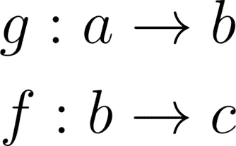

你可以将这些函数组合起来创建一个新函数 `h`，直接从 `a` 到 `c`：

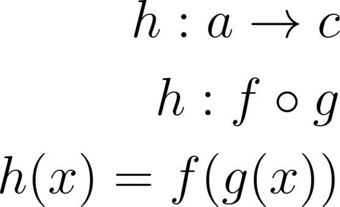

在 JavaScript 中：

```javascript
1 const g = n => n + 1;
2 const f = n => n * 2;
3 
4 const h = x => f(g(x));
5 
6 h(20); //=> 42
```

代数定义：


可以翻译成 JavaScript：

```javascript
1 const compose = (f, g) => x => f(g(x));
```

但这只能一次组合两个函数。在代数中，可以写成：

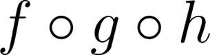

我们可以编写一个函数来组合任意数量的函数。换句话说，`compose()` 创建了一个函数管道，其中一个函数的输出连接到下一个函数的输入。

以下是我通常的写法：

```javascript
1 // compose = (...fns) => x => y
2 const compose = (...fns) => x => fns.reduceRight((y, f) => f(y), x);
```

这个版本接受任意数量的函数，并返回一个函数，该函数接受初始值，然后使用 `reduceRight()` 从右向左遍历 `fns` 中的每个函数 `f`，并依次将其应用于累积值 `y`。在这个函数中，我们用累加器 `y` 累积的是 `compose()` 返回的函数的返回值。

现在我们可以这样编写组合：

```javascript
1 const g = n => n + 1;
2 const f = n => n * 2;
3 
4 // 用 `compose(f, g)` 替换 `x => f(g(x))`
5 const h = compose(f, g);
6 
7 h(20); //=> 42
```

## 追踪

使用无点风格进行函数组合可以生成非常简洁、可读性强的代码，但可能会牺牲调试的便利性。如果你想检查函数之间的值怎么办？`trace()` 是一个方便的工具，可以让你做到这一点。它采用柯里化函数的形式：

```javascript
1 const trace = label => value => {
2   console.log(`${ label }: ${ value }`);
3   return value;
4 };
```

现在我们可以检查管道：

```javascript
 1 const compose = (...fns) => x => fns.reduceRight((y, f) => f(y), x);
 2 
 3 const trace = label => value => {
 4   console.log(`${ label }: ${ value }`);
 5   return value;
 6 };
 7 
 8 const g = n => n + 1;
 9 const f = n => n * 2;
10 
11 /*
12 注意：函数应用顺序是
13 从下到上：
14 */
15 const h = compose(
16   trace('after f'),
17   f,
18   trace('after g'),
19   g
20 );
21 
22 h(20);
23 /*
24 after g: 21
25 after f: 42
26 */
```

`compose()` 是一个很棒的实用工具，但当我们需要组合两个以上的函数时，有时如果能从上到下阅读会更方便。我们可以通过反转函数调用的顺序来实现这一点。还有另一个组合工具叫做 `pipe()`，它以相反的顺序进行组合：

```javascript
1 const pipe = (...fns) => x => fns.reduce((y, f) => f(y), x);
```

现在我们可以这样编写上面的代码：

```javascript
 1 const pipe = (...fns) => x => fns.reduce((y, f) => f(y), x);
 2 
 3 const trace = label => value => {
 4   console.log(`${ label }: ${ value }`);
 5   return value;
 6 };
 7 
 8 const g = n => n + 1;
 9 const f = n => n * 2;
10 
11 /*
12 现在函数应用顺序
13 从上到下：
14 */
15 const h = pipe(
16   g,
17   trace('after g'),
18   f,
19   trace('after f'),
20 );
21 
22 h(20);
23 /*
24 after g: 21
25 after f: 42
26 */
```

## 柯里化与函数组合的结合

即使在函数组合的上下文之外，柯里化也是一种有用的抽象，可以用来特化函数。例如，`map()` 的柯里化版本可以被特化以执行许多不同的操作：

```javascript
 1 const map = fn => mappable => mappable.map(fn);
 2 
 3 const pipe = (...fns) => x => fns.reduce((y, f) => f(y), x);
 4 const log = (...args) => console.log(...args);
 5 
 6 const arr = [1, 2, 3, 4];
 7 const isEven = n => n % 2 === 0;
 8 
 9 const stripe = n => isEven(n) ? 'dark' : 'light';
10 const stripeAll = map(stripe);
11 const striped = stripeAll(arr); 
12 log(striped);
13 // => ["light", "dark", "light", "dark"]
14 
15 const double = n => n * 2;
16 const doubleAll = map(double);
17 const doubled = doubleAll(arr);
18 log(doubled);
19 // => [2, 4, 6, 8]
```

但柯里化函数的真正威力在于它们简化了函数组合。一个函数可以接受任意数量的输入，但只能返回一个输出。为了使函数可组合，输出类型必须与预期的输入类型对齐：

```text
1 f: a => b
2 g:      b => c
3 h: a    =>   c
```

如果上面的 `g` 函数期望两个参数，那么 `f` 的输出就无法与 `g` 的输入对齐：

```text
1 f: a => b
2 g:     (x, b) => c
3 h: a    =>   c
```

在这种情况下，我们如何将 `x` 传入 `g`？通常的答案是对 `g` 进行柯里化。

记住，柯里化函数的定义是：一个函数通过接受第一个参数并返回一系列函数，每个函数依次接受下一个参数，直到所有参数都被收集，从而一次一个地接受多个参数。

该定义中的关键词是“一次一个”。柯里化函数之所以对函数组合如此方便，是因为它们将期望多个参数的函数转换为可以接受单个参数的函数，从而使它们能够适应函数组合管道。以之前的 `trace()` 函数为例：

```javascript
 1 const pipe = (...fns) => x => fns.reduce((y, f) => f(y), x);
 2 
 3 const trace = label => value => {
 4   console.log(`${ label }: ${ value }`);
 5   return value;
 6 };
 7 
 8 const g = n => n + 1;
 9 const f = n => n * 2;
10 
11 const h = pipe(
12   g,
13   trace('after g'),
14   f,
15   trace('after f'),
16 );
17 
18 h(20);
19 /*
20 after g: 21
21 after f: 42
22 */
```

`trace()` 定义了两个参数，但一次只接受一个，允许我们内联特化该函数。如果 `trace()` 不是柯里化的，我们就无法以这种方式使用它。我们不得不这样编写管道：

```javascript
 1 const pipe = (...fns) => x => fns.reduce((y, f) => f(y), x);
 2 
 3 const trace = (label, value) => {
 4   console.log(`${ label }: ${ value }`);
 5   return value;
 6 };
 7 
 8 const g = n => n + 1;
 9 const f = n => n * 2;
10 
11 const h = pipe(
12   g,
13   // trace() 调用不再是无点的，
14   // 引入了中间变量 `x`。
15   x => trace('after g', x),
16   f,
17   x => trace('after f', x),
18 );
19 
20 h(20);
```

但仅仅对函数进行柯里化还不够。你还需要确保函数期望的参数顺序正确，以便进行特化。看看如果我们再次对 `trace()` 进行柯里化，但交换参数顺序会发生什么：

```javascript
 1 const pipe = (...fns) => x => fns.reduce((y, f) => f(y), x);
 2 
 3 const trace = value => label => {
 4   console.log(`${ label }: ${ value }`);
 5   return value;
 6 };
 7 
 8 const g = n => n + 1;
 9 const f = n => n * 2;
10 
11 const h = pipe(
12   g,
13   // trace() 的调用无法实现无参风格，
14   // 因为参数的顺序不符合预期。
15   x => trace(x)('after g'),
16   f,
17   x => trace(x)('after f'),
18 );
19 
20 h(20);
```

如果你遇到困难，可以用一个名为 `flip()` 的函数来解决这个问题，它只是交换两个参数的顺序：

```javascript
1 const flip = fn => a => b => fn(b)(a);
```

现在我们可以创建一个 `flippedTrace()` 函数：

```javascript
1 const flippedTrace = flip(trace);
```

然后像这样使用它：

```javascript
 1 const flip = fn => a => b => fn(b)(a);
 2 const pipe = (...fns) => x => fns.reduce((y, f) => f(y), x);
 3 
 4 const trace = value => label => {
 5   console.log(`${ label }: ${ value }`);
 6   return value;
 7 };
 8 const flippedTrace = flip(trace);
 9 
10 const g = n => n + 1;
11 const f = n => n * 2;
12 
13 const h = pipe(
14   g,
15   flippedTrace('after g'),
16   f,
17   flippedTrace('after f'),
18 );
19 
20 h(20);
```

但更好的做法是从一开始就正确地编写函数。这种风格有时被称为“数据最后”，这意味着你应该先接受特化参数，最后才接受函数要操作的数据。这样我们就得到了函数的原始形式：

```javascript
1 const trace = label => value => {
2   console.log(`${ label }: ${ value }`);
3   return value;
4 };
```

每次将 `trace()` 应用于一个 `label`，都会创建一个特化版本的 `trace` 函数，用于管道中，其中标签被固定在返回的 `trace` 部分应用内部。所以这段代码：

```javascript
1 const trace = label => value => {
2   console.log(`${ label }: ${ value }`);
3   return value;
4 };
5 
6 const traceAfterG = trace('after g');
```

……等价于：

```javascript
1 const traceAfterG = value => {
2   const label = 'after g';
3   console.log(`${ label }: ${ value }`);
4   return value;
5 };
```

如果我们用 `traceAfterG` 替换 `trace('after g')`，意思是一样的：

```javascript
 1 const pipe = (...fns) => x => fns.reduce((y, f) => f(y), x);
 2 
 3 const trace = label => value => {
 4   console.log(`${ label }: ${ value }`);
 5   return value;
 6 };
 7 
 8 // trace() 的柯里化版本
 9 // 让我们免于编写所有这些代码……
10 const traceAfterG = value => {
11   const label = 'after g';
12   console.log(`${ label }: ${ value }`);
13   return value;
14 };
15 
16 const g = n => n + 1;
17 const f = n => n * 2;
18 
19 const h = pipe(
20   g,
21   traceAfterG,
22   f,
23   trace('after f'),
24 );
25 
26 h(20);
```

## 结论

**柯里化函数**是一种一次只接受多个参数中一个的函数：它先接受第一个参数，然后返回一系列函数，每个函数接受下一个参数，直到所有参数都被固定，函数应用完成，此时返回结果值。

**部分应用**是一个已经应用于部分（但尚未全部）参数的函数。该函数已经应用的那些参数称为固定参数。

**无参风格**是一种在不引用其参数的情况下定义函数的方式。通常，无参函数是通过调用一个返回函数的函数（例如柯里化函数）来创建的。

**柯里化函数非常适合函数组合**，因为它们允许你轻松地将 n 元函数转换为函数组合管道所需的一元函数形式：管道中的函数必须恰好接受一个参数。

**数据最后函数**便于函数组合，因为它们可以轻松地以无参风格使用。

# 抽象与组合

随着我在软件开发中日益成熟，我越发珍视那些基础原理——那些在我初学时看似微不足道，但如今凭借经验却具有深远意义的见解。


> “在空手道武术中……黑带引以为傲的象征是将其佩戴足够久，直到染料褪成白色，象征着回归初学者的状态。” ~ 约翰·前田，《[简单法则：设计、技术、商业、生活](https://www.amazon.com/Laws-Simplicity-Design-Technology-Business/dp/0262134721/ref=as_li_ss_tl?ie=UTF8&qid=1516330765&sr=8-1&keywords=the+laws+of+simplicity&linkCode=ll1&tag=eejs-20&linkId=287b1d3357fa799ce7563584e098c5d8)》

根据谷歌词典，**抽象**是“独立于其关联、属性或具体伴随物来考虑某事物的过程”。

抽象一词源自拉丁语动词 `abstrahere`，意为“抽离”。我喜欢这个见解。抽象是关于移除事物——但我们移除的是什么，目的又是什么？

有时我喜欢将单词翻译成其他语言，再翻译回英语，以了解我们在英语中通常不会想到的其他关联。当我把“abstraction”翻译成意第绪语再翻译回来时，结果是“心不在焉”。我也喜欢这个。一个心不在焉的人处于自动驾驶状态，并不主动思考自己在做什么……只是去做。

抽象让我们安全地处于自动驾驶状态。所有软件都是自动化。只要有足够的时间，你在计算机上做的任何事情，都可以用纸、墨水和信鸽来完成。软件只是处理了那些手动操作过于耗时的小细节。

所有软件都是抽象，隐藏了所有辛苦的工作和琐碎的细节，而我们则享受其成果。

许多软件过程会一遍又一遍地重复。如果在问题分解阶段，我们决定一次又一次地重新实现重复的内容，那将需要大量不必要的工作。至少是愚蠢的。在许多情况下，这是不切实际的。

相反，我们通过编写某种组件（函数、模块、类等），为其命名（标识），并根据需要多次重用它来消除重复。

分解的过程就是抽象的过程。成功的抽象意味着结果是一组独立有用且可重新组合的组件。由此我们得到了软件架构的一个重要原则：

软件解决方案应能分解为其组成部分，并能重新组合成新的解决方案，而无需更改内部组件的实现细节。

### 抽象即简化

> “简化就是减去显而易见的部分，添加有意义的部分。” ~ 约翰·前田，《[简单法则：设计、技术、商业、生活](https://www.amazon.com/Laws-Simplicity-Design-Technology-Business/dp/0262134721/ref=as_li_ss_tl?ie=UTF8&qid=1516330765&sr=8-1&keywords=the+laws+of+simplicity&linkCode=ll1&tag=eejs-20&linkId=287b1d3357fa799ce7563584e098c5d8)》

抽象过程有两个主要组成部分：

**泛化**是在重复模式中寻找*相似性*（显而易见的部分），并将这些相似性隐藏在抽象背后的过程。

**特化**是使用抽象，为每个用例*只提供不同的部分*（有意义的部分）的过程。

抽象是提取概念本质的过程。通过探索不同领域中不同问题之间的共同点，我们学会了暂时跳出自己的思维框架，从不同角度看待问题。当我们看到问题的本质时，我们会发现一个好的解决方案可能适用于许多其他问题。如果我们很好地编写了解决方案，就可以大幅降低应用程序的复杂性。

> “如果你以深刻的觉知触碰一件事，你就触碰了一切。” ~ 一行禅师

这一原则可用于大幅减少构建应用程序所需的代码。

### 软件中的抽象

软件中的抽象有多种形式：

- 算法
- 数据结构
- 模块
- 类
- 框架

以及我个人最喜欢的：

> “有时候，优雅的实现就是一个函数。不是一个方法。不是一个类。不是一个框架。就是一个函数。” ~ 约翰·卡马克（Id Software，Oculus VR）

函数之所以能成为优秀的抽象，是因为它们具备良好抽象所必需的特性：

- **标识性** —— 能够为其赋予名称并在不同上下文中复用。
- **可组合性** —— 能够将简单函数组合成更复杂的函数。

### 通过组合实现抽象

软件中最有用的抽象函数是*纯函数*，它们与数学中的函数共享模块化特性。在数学中，给定相同输入的函数总是返回相同输出。可以将函数视为输入与输出之间的关系。给定某个输入 ，函数  会产生输出 。可以说 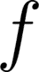 定义了  与  之间的关系：

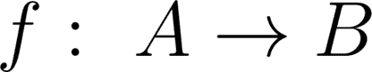

同样，我们可以定义另一个函数 `g`，它定义了 `B` 与 `C` 之间的关系：

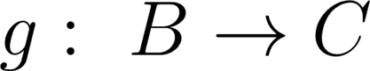

这*意味着*存在另一个函数 `h`，它直接定义了从 `A` 到 `C` 的关系：


这些关系构成了问题空间的结构，而你在应用程序中组合函数的方式则构成了应用程序的结构。

优秀的抽象通过隐藏结构来简化，就像  将  简化为  一样。

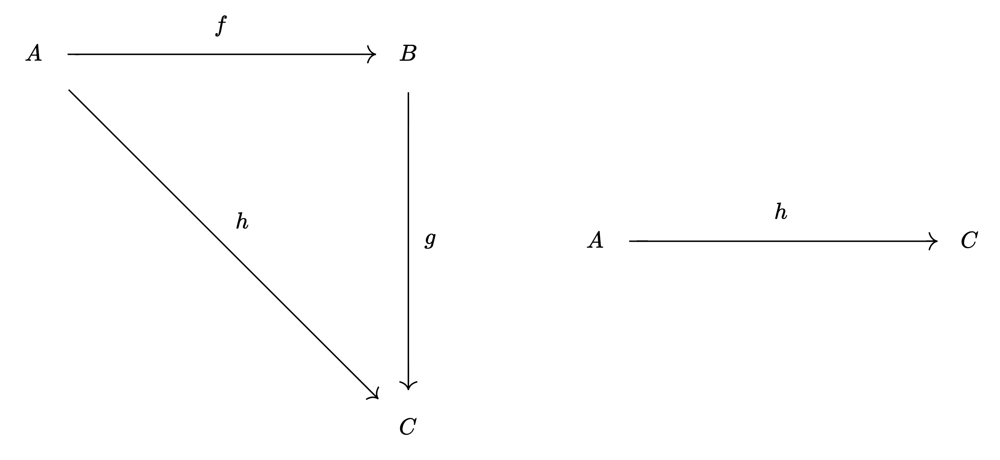

函数组合示意图

### 如何用更少的代码做更多的事

抽象是用更少代码做更多事的关键。例如，假设你有一个简单的两数相加函数：

```javascript
const add = (a, b) => a + b;
```

但你经常用它来递增，那么**固定**其中一个数字可能是有意义的：

```javascript
const a = add(1, 1);
const b = add(a, 1);
const c = add(b, 1);
// ...
```

我们可以对 `add` 函数进行**柯里化**：

```javascript
const add = a => b => a + b;
```

然后创建一个**偏应用**，将函数应用于其第一个参数，并返回一个接受下一个参数的新函数：

```javascript
const inc = add(1);
```

现在，当我们需要递增 `1` 时，可以使用 `inc` 代替 `add`，从而减少所需代码：

```javascript
const a = inc(1);
const b = inc(a);
const c = inc(b);
// ...
```

在这个例子中，`inc` 只是 `add` 的一个*特化*版本。所有柯里化函数都是抽象。事实上，所有高阶函数都是泛化，你可以通过传递一个或多个参数来特化它们。

例如，`Array.prototype.map()` 是一个高阶函数，它抽象了将函数应用于数组每个元素以返回处理后的新数组这一概念。我们可以将 `map` 写成一个柯里化函数，使其更明显：

```javascript
const map = f => arr => arr.map(f);
```

这个版本的 `map` 接受特化函数，然后返回一个特化版本的自身，该版本接受待处理的数组：

```javascript
const f = n => n * 2;

const doubleAll = map(f);
const doubled = doubleAll([1, 2, 3]);
// => [2, 4, 6]
```

注意，`doubleAll` 的定义只需要极少的代码：`map(f)` —— 仅此而已！这就是完整的定义。以有用的抽象作为构建块，我们可以用很少的新代码构建相当复杂的行为。

### 结论

大多数软件开发人员整个职业生涯都在创建和组合抽象，却没有对抽象或组合有扎实的基本理解。

当你创建抽象时，应该深思熟虑，并且应该意识到那些已经为你提供的优秀抽象（例如始终有用的 `map`、`filter` 和 `reduce`）。学会识别优秀抽象的特征：

- 可组合
- 可复用
- 独立
- 简洁
- 简单

### Reduce

**Reduce**（又称：fold、accumulate）是函数式编程中常用的工具，它允许你遍历一个列表，将函数应用于累积值和列表中的下一个元素，直到遍历完成并返回累积值。许多有用的功能都可以用 `reduce` 实现。通常，它是对集合进行任何非平凡处理的最优雅方式。

Reduce 接受一个 reducer 函数和一个初始值，并返回累积值。对于 `Array.prototype.reduce()`，初始列表由 `this` 提供，因此它不是参数之一：

```javascript
array.reduce(
  reducer: (accumulator: Any, current: Any) => Any,
  initialValue: Any
) => accumulator: Any
```

让我们对一个数组求和：

```javascript
[2, 4, 6].reduce((acc, n) => acc + n, 0); // 12
```

对于数组中的每个元素，reducer 被调用并传入累积值和当前值。reducer 的工作是以某种方式将当前值“折叠”到累积值中。如何折叠并未指定，而指定如何折叠正是 reducer 函数的目的。reducer 返回新的累积值，然后 `reduce()` 继续处理数组中的下一个值。reducer 可能需要一个初始值来开始，因此大多数实现都将初始值作为参数。

在这个求和 reducer 的例子中，第一次调用 reducer 时，`acc` 从 `0` 开始（我们传递给 `.reduce()` 的第二个参数）。reducer 返回 `0` + `2`（`2` 是数组的第一个元素），结果为 `2`。下一次调用时，`acc = 2, n = 4`，reducer 返回 `2 + 4` 的结果（`6`）。在最后一次迭代中，`acc = 6, n = 6`，reducer 返回 `12`。由于迭代完成，`.reduce()` 返回最终的累积值 `12`。

在这个例子中，我们传入了一个匿名归约函数，但我们可以将其抽象并赋予一个名称：

```javascript
const summingReducer = (acc, n) => acc + n;
[2, 4, 6].reduce(summingReducer, 0); // 12
```

通常，`reduce()` 从左到右工作。在 JavaScript 中，我们还有 `[].reduceRight()`，它从右到左工作。换句话说，如果你对 `[2, 4, 6]` 应用 `.reduceRight()`，第一次迭代将使用 `6` 作为 `n` 的第一个值，然后依次向前，最后以 `2` 结束。

### Reduce 的多功能性

Reduce 非常灵活。使用 reduce 可以轻松定义 `map()`、`filter()`、`forEach()` 以及许多其他有趣的功能：

**Map：**

```javascript
const map = (fn, arr) => arr.reduce((acc, item, index, arr) => {
  return acc.concat(fn(item, index, arr));
}, []);
```

对于 map，我们的累积值是一个新数组，其中每个元素对应原始数组中的每个值。新值是通过将传入的映射函数（`fn`）应用于 `arr` 参数中的每个元素生成的。我们通过使用当前元素调用 `fn`，并将结果连接到累积数组 `acc` 来累积新数组。

**Filter：**

```javascript
const filter = (fn, arr) => arr.reduce((newArr, item) => {
  return fn(item) ? newArr.concat([item]) : newArr;
}, []);
```

Filter 的工作方式与 map 非常相似，不同之处在于我们使用一个谓词函数，并且*有条件地*将当前值追加到新数组中——如果元素通过了谓词检查（`fn(item)` 返回 `true`）。

对于上述每个示例，你都有一个数据列表，遍历这些数据，应用某个函数，并将结果折叠成一个累积值。很多应用场景都浮现在脑海中。但如果*你的数据是一个函数列表*呢？

### Compose（组合）

`Reduce` 也是组合函数的一种便捷方式。还记得函数组合吗：如果你想将函数 `f` 应用于 `x` 的 `g` 的结果，即组合 `f . g`，你可以使用以下 JavaScript：

```javascript
f(g(x))
```

`Reduce` 让我们能够抽象这个过程，使其适用于任意数量的函数，因此你可以轻松定义一个表示以下内容的函数：

```javascript
f(g(h(x)))
```

要实现这一点，我们需要反向运行 `reduce`。即从右到左，而不是从左到右。幸运的是，JavaScript 提供了 `.reduceRight()` 方法：

```javascript
const compose = (...fns) => x => fns.reduceRight((v, f) => f(v), x);
```

> 注意：如果 JavaScript 没有提供 `[].reduceRight()`，你仍然可以使用 `reduce()` 来实现 `reduceRight()`。我把这个留给有冒险精神的读者去思考如何实现。

### Pipe（管道）

如果你想从内到外表示组合（即数学符号意义上的组合），`compose()` 非常棒。但如果你想将其视为一系列事件呢？

假设我们想给一个数字加 `1`，然后将其翻倍。使用 `compose()`，会是这样的：

```javascript
const add1 = n => n + 1;
const double = n => n * 2;

const add1ThenDouble = compose(
  double,
  add1
);

add1ThenDouble(2); // 6
// ((2 + 1 = 3) * 2 = 6)
```

看到问题了吗？第一步列在最后，因此要理解顺序，你需要从列表底部开始，然后向上回溯到顶部。

或者我们可以像通常那样从左到右使用 `reduce`，而不是从右到左：

```javascript
const pipe = (...fns) => x => fns.reduce((v, f) => f(v), x);
```

现在你可以这样写 `add1ThenDouble()`：

```javascript
const add1ThenDouble = pipe(
  add1,
  double
);

add1ThenDouble(2); // 6
// ((2 + 1 = 3) * 2 = 6)
```

这很重要，因为有时如果你反向组合，会得到不同的结果：

```javascript
const doubleThenAdd1 = pipe(
  double,
  add1
);

doubleThenAdd1(2); // 5
```

我们稍后会详细介绍 `compose()` 和 `pipe()`。你现在应该理解的是，`reduce()` 是一个非常强大的工具，你真的需要学会它。只是要注意，如果你把 `reduce` 用得很巧妙，有些人可能很难跟上。

#### 关于 Redux 的一点说明

你可能听说过术语“`reducer`”被用来描述 Redux 中重要的状态更新部分。在撰写本文时，Redux 是使用 React 和 Angular（后者通过 `ngrx/store`）构建的 Web 应用程序中最流行的状态管理库/架构。

Redux 使用 `reducer` 函数来管理应用程序状态。Redux 风格的 `reducer` 接收当前状态和一个动作对象，并返回新状态：

```javascript
reducer(state: Any, action: { type: String, payload: Any}) => newState: Any
```

Redux 有一些你需要记住的 `reducer` 规则：

1. 不带参数调用的 `reducer` 应返回其有效的初始状态。
2. 如果 `reducer` 不处理该动作类型，它仍然需要返回状态。
3. Redux 的 `reducers` **必须是纯函数。**

让我们将求和的 `reducer` 重写为 Redux 风格的 `reducer`，它会对动作对象进行归约：

```javascript
const ADD_VALUE = 'ADD_VALUE';

const summingReducer = (state = 0, action = {}) => {
  const { type, payload } = action;

  switch (type) {
    case ADD_VALUE:
      return state + payload.value;
    default: return state;
  }
};
```

Redux 的酷炫之处在于，`reducers` 只是标准的 `reducers`，你可以将它们插入任何尊重 `reducer` 函数签名的 `reduce()` 实现中，包括 `[].reduce()`。这意味着你可以创建一个动作对象数组，并对它们进行 `reduce`，以获得一个状态快照，该快照与将这些相同动作分派到你的 store 后所拥有的状态相同：


```
1 const actions = [
2   { type: 'ADD_VALUE', payload: { value: 1 } },
3   { type: 'ADD_VALUE', payload: { value: 1 } },
4   { type: 'ADD_VALUE', payload: { value: 1 } },
5 ];
6 
7 actions.reduce(summingReducer, 0); // 3
```

这使得对 Redux 风格的 `reducers` 进行单元测试变得轻而易举。

### 结论

你应该开始看到 `reduce` 是一个极其有用且多功能的抽象。它肯定比 `map` 或 `filter` 更难理解，但它是在你的函数式编程实用工具腰带中必不可少的工具——你可以用它来制作许多其他出色的工具。

## 抽象数据类型与软件危机

> 不要与以下概念混淆：
>
> * **代数数据类型（有时缩写为 `ADT` 或 `AlgDT`）。** 代数数据类型指的是编程语言（例如 Rust、Haskell、F#）中的复杂类型，它们展示了特定代数结构的某些属性。例如，和类型与积类型。
> * **代数结构。** 代数结构是从抽象代数中研究和应用的，与 `ADTs` 一样，它们也通常通过**公理**的代数描述来指定，但适用范围远不止计算机和代码世界。可能存在一个无法在软件中完全建模的代数结构。相比之下，抽象数据类型作为规范和指南，用于正式验证可工作的软件。

**抽象数据类型（`ADT`）** 是一个由公理定义的抽象概念，这些公理表示某些数据以及对这些数据的操作。`ADTs` *不是*根据具体实例定义的，并且*不指定*实现中使用的具体数据类型、结构或算法。相反，`ADTs` 仅根据其操作以及这些操作必须遵守的公理来定义数据类型。

### 常见的 `ADT` 示例

* `List`（列表）
* `Stack`（栈）
* `Queue`（队列）
* `Set`（集合）
* `Map`（映射）
* `Stream`（流）

`ADTs` 可以表示任何类型数据上的任何操作集合。换句话说，所有可能的 `ADTs` 的详尽列表是无限的，原因与所有可能的英语句子的详尽列表是无限的一样。`ADTs` 是对未指定数据的一组操作的抽象概念，而不是一组特定的具体数据类型。一个常见的误解是，许多大学课程和数据结构教科书中教授的具体 `ADTs` 示例就是 `ADTs` 的全部。许多这样的教科书将数据结构标记为“`ADTs`”，然后跳过 `ADT`，直接用具体术语描述数据结构，而从未让学生接触到数据类型的实际抽象表示。*哎呀！*

`ADTs` 可以表达许多有用的代数结构，包括半群、幺半群、函子、单子等。[Fantasyland 规范](https://github.com/fantasyland/fantasy-land) 是一个由 `ADTs` 描述的代数结构的有用目录，旨在鼓励 JavaScript 中的可互操作实现。库构建者可以使用提供的公理来验证其实现。

### 为什么使用 `ADTs`？

抽象数据类型很有用，因为它们提供了一种方式，让我们能够以**数学上严谨**、精确且无歧义的方式正式定义可重用的模块。这使我们能够共享一种通用语言，来指代大量有用的软件构建块词汇：这些思想值得学习，并在我们跨越不同领域、框架甚至编程语言时随身携带。

### `ADTs` 的历史

在 20 世纪 60 年代和 70 年代初，许多程序员和计算机科学研究人员对软件危机感兴趣。正如 Edsger Dijkstra 在他的图灵奖演讲中所说：

> “软件危机的首要原因是机器的性能提升了数个数量级！直白地说：只要没有机器，编程根本不是问题；当我们拥有一些弱小的计算机时，编程变成了一个小问题；而现在我们有了巨大的计算机，编程也变成了一个同样巨大的问题。”

他指出的问题是软件非常复杂。美国宇航局阿波罗登月舱和导航系统的打印版大约有一个文件柜那么大。那是大量的代码。想象一下，试图阅读并理解其中的每一行。

现代软件的复杂程度又提升了数个数量级。Facebook 在 2015 年大约有 [6200 万行代码](https://www.informationisbeautiful.net/visualizations/million-lines-of-code/)。如果每页打印 50 行，你会填满 124 万页。如果把这些页堆叠起来，每英尺大约 1800 页，也就是 688 英尺。这比旧金山的 [千禧塔](https://en.wikipedia.org/wiki/Millennium_Tower_(San_Francisco)) 还要高，后者在撰写本文时是旧金山最高的住宅楼。

管理软件复杂性几乎是每个软件开发人员面临的主要挑战之一。在 20 世纪 60 年代和 70 年代，他们还没有我们今天习以为常的语言、模式或工具。像 linter、智能感知甚至静态分析工具都尚未发明。

许多软件工程师注意到，他们构建软件所依赖的硬件大多能正常工作。但软件往往复杂、混乱且脆弱。软件通常：

* 超出预算
* 延期交付
* 充满错误
* 缺少需求
* 难以维护

如果你能模块化地思考软件，就无需理解整个系统也能理解如何让系统的某一部分工作。这一软件设计原则被称为**局部性**。要实现局部性，你需要能够独立于系统其余部分来理解的*模块*。你应该能够明确地描述一个模块，而不过度指定其实现。这正是抽象数据类型（`ADT`）要解决的问题。

从 20 世纪 60 年代几乎延续至今，推进软件模块化的发展一直是核心关注点。正是带着这些问题，包括 Barbara Liskov（与 SOLID 面向对象设计原则中里氏替换原则提到的 Liskov 是同一人）、Alan Kay、Bertrand Meyer 以及其他计算机科学传奇人物，致力于描述和指定各种工具以实现模块化软件，分别包括 `ADT`、面向对象编程和契约式设计。

`ADT` 源于 Liskov 和她的学生在 1974 年至 1975 年间对 [CLU 编程语言](https://en.wikipedia.org/wiki/CLU_(programming_language)) 的研究。他们对软件模块规范的技术水平做出了重大贡献——我们用来描述允许软件模块交互的接口的语言。形式上可证明的接口合规性使我们更接近软件模块化和互操作性。

Liskov 因在数据抽象、容错和分布式计算方面的贡献于 2008 年获得图灵奖。`ADT` 在这一成就中发挥了重要作用，如今，几乎每所大学的计算机科学课程都将 `ADT` 纳入教学大纲。

软件危机从未完全解决，上述许多问题对任何专业开发人员来说都应该很熟悉，但学习如何使用对象、模块和 `ADT` 等工具无疑会有所帮助。

### ADT 的规范

可以用几个标准来判断 `ADT` 规范的适用性。我将这些标准称为 FAMED，但我只是发明了这个助记符。原始标准由 Liskov 和 Zilles 在他们 1975 年的著名论文 [《数据抽象的规范技术》](https://dl.acm.org/doi/10.1145/800027.808426) 中发表。

* **F**ormal（形式化）。规范必须是形式化的。规范中每个元素的含义必须定义得足够详细，使得目标受众有相当好的机会根据规范构建出符合要求的实现。必须能够为规范中的每个公理在代码中实现代数证明。
* **A**pplicable（可应用）。`ADT` 应具有广泛适用性。`ADT` 通常应可重用于许多不同的具体用例。描述特定代码部分中特定语言的特定实现的 `ADT` 可能过度指定了内容。相反，`ADT` 最适合描述常见数据结构、库组件、模块、编程语言特性等的行为。例如，描述栈操作的 `ADT`，或描述 promise 行为的 `ADT`。
* **M**inimal（最小化）。`ADT` 规范应尽量精简。规范应包含行为中有趣且广泛适用的部分，**仅此而已**。每个行为都应精确且明确地描述，但尽可能少地涉及具体细节。大多数 `ADT` 规范应能用少量公理来证明。
* **E**xtensible（可扩展）。`ADT` 应具有可扩展性。需求的小变化应仅导致规范的小变化。
* **D**eclarative（声明式）。声明式规范描述的是**是什么，而不是怎么做**。`ADT` 应根据事物是什么以及输入与输出之间的映射关系来描述，而不是创建数据结构的步骤或每个操作必须执行的具体步骤。

一个好的 `ADT` 应包含：

* **人类可读的描述。** 如果没有人类可读的描述，`ADT` 可能会相当简洁。自然语言描述与代数定义相结合，可以相互校验，以消除规范中的任何错误或读者理解上的歧义。
* **定义。** 明确定义规范中使用的任何术语，以避免歧义。
* **抽象签名。** 描述预期的输入和输出，而不将其与具体类型或数据结构关联。
* **公理。** 用于证明实现满足规范要求的公理不变量的代数定义。

### 栈 ADT 示例

栈是一种后进先出（LIFO）的项目堆，允许用户通过将新项目推入栈顶，或从栈顶弹出最近推入的项目来与栈交互。

栈常用于解析、排序和数据整理算法。

#### 定义

* `a`：任意类型
* `b`：任意类型
* `item`：任意类型
* `stack()`：一个空栈
* `stack(a)`：一个包含 `a` 的栈
* `[item, stack]`：一个由 `item` 和 `stack` 组成的对

#### 抽象签名

##### 构造

`stack` 操作接受任意数量的项目，并返回这些项目的栈。通常，构造函数的抽象签名是用自身定义的。请不要将其与递归函数混淆。

* `stack(...items) => stack(...items)`

##### 栈操作（返回栈的操作）

* `push(item, stack()) => stack(item)`
* `pop(stack) => [item, stack]`

#### 公理

栈公理主要处理栈和项目的标识、栈项目的顺序以及栈为空时 `pop` 的行为。

##### 标识

推入和弹出没有副作用。如果你向栈中 `push` 一个项目并立即从同一个栈中 `pop`，栈应恢复到推入前的状态。

```
1 pop(push(a, stack())) = [a, stack()]
```

* 给定：将 `a` `push` 到栈中，并立即从栈中 `pop`
* 应返回：一个由 `a` 和 `stack()` 组成的对。

##### 顺序

从栈中弹出应遵循顺序：后进先出（LIFO）。

```
1 pop(push(b, push(a, stack())) = [b, stack(a)]
```

* 给定：将 `a` `push` 到栈中，然后将 `b` `push` 到栈中，然后从栈中 `pop`
* 应返回：一个由 `b` 和 `stack(a)` 组成的对。

### 空栈

从空栈中弹出会得到一个 `undefined` 项的值。具体来说，这可以用 `Maybe(item)`、`Nothing` 或 `Either` 来定义。在 JavaScript 中，习惯使用 `undefined`。从空栈中弹出不应改变栈。

```
1 pop(stack()) = [undefined, stack()]
```

* 给定：从空栈中 `pop`
* 应返回：一个由 `undefined` 和 `stack()` 组成的对。

### 具体实现

一个抽象数据类型可以有多种具体实现，使用不同的语言、库、框架等。以下是上述栈 `ADT` 的一种实现，使用封装的对象以及作用于该对象的纯函数：

```
 1 const stack = (...items) => ({
 2   push: item => stack(...items, item),
 3   pop: () => {
 4     // 创建一个项列表
 5     const newItems = [...items];
 6 
 7     // 从列表中移除最后一项并
 8     // 将其赋值给一个变量
 9     const [item] = newItems.splice(-1);
10 
11     // 返回该对
12     return [item, stack(...newItems)];
13   },
14   // 这样我们就能在 assert 函数中比较栈
15   toString: () => `stack(${ items.join(',') })`
16 });
17 
18 const push = (item, stack) => stack.push(item);
19 const pop = stack => stack.pop();
```

另一种实现将栈操作表示为作用于 JavaScript 现有 `Array` 类型的纯函数：

```
1 const stack = (...elements) => [...elements];
2 
3 const push = (a, stack) => stack.concat([a]);
4 
5 const pop = stack => {
6   const newStack = stack.slice(0);
7   const item = newStack.pop();
8   return [item, newStack];
9 };
```

两个版本都满足以下公理证明：

```
 1 // 一个简单的 assert 函数，用于显示结果
 2 // 如果某个实现未能满足公理，则抛出描述性错误
 3 const assert = ({given, should, actual, expected}) => {
 4   const stringify = value => Array.isArray(value) ?
 5     `[${ value.map(stringify).join(',') }]` :
 6     `${ value }`;
 7 
 8   const actualString = stringify(actual);
 9   const expectedString = stringify(expected);
10 
11   if (actualString === expectedString) {
12     console.log(`OK:
13       given: ${ given }
14       should: ${ should }
15       actual: ${ actualString }
16       expected: ${ expectedString }
17     `);
18   } else {
19     throw new Error(`NOT OK:
20       given ${ given }
21       should ${ should }
22       actual: ${ actualString }
23       expected: ${ expectedString }
24     `);
25   }
26 };
27 
28 // 传递给函数的具体值：
29 const a = 'a';
30 const b = 'b';
31 
32 // 证明
33 assert({
34   given: '将 `a` push 到栈中并立即从栈中 pop',
35   should: '返回一个由 `a` 和 `stack()` 组成的对',
36   actual: pop(push(a, stack())),
37   expected: [a, stack()]
38 })
39 
40 assert({
41   given: '将 `a` push 到栈中，然后将 `b` push 到栈中，然后从栈中 pop',
42   should: '返回一个由 `b` 和 `stack(a)` 组成的对',
43   actual: pop(push(b, push(a, stack()))),
44   expected: [b, stack(a)]
45 });
46 
47 assert({
48   given: '从空栈中 pop',
49   should: '返回一个由 undefined 和 stack() 组成的对',
50   actual: pop(stack()),
51   expected: [undefined, stack()]
52 });
```

### 结论

* 抽象数据类型（`ADT`）是一种由公理定义的抽象概念，这些公理表示某些数据以及对这些数据的操作。
* 抽象数据类型关注的是“是什么”，而不是“如何做”（它们以声明式的方式构建，不指定算法或数据结构）。
* 常见的例子包括列表、栈、集合等。
* `ADT` 提供了一种方式，使我们能够以数学上合理、精确且无歧义的方式正式定义可复用的模块。
* `ADT` 源于 20 世纪 70 年代 Liskov 及其学生在 CLU 编程语言上的工作。
* `ADT` 应当具备 FAMED 特性：形式化（Formal）、广泛适用（widely Applicable）、最小化（Minimal）、可扩展（Extensible）和声明式（Declarative）。
* `ADT` 应包含人类可读的描述、定义、抽象签名以及可形式化验证的公理。

> **额外提示：** 如果你不确定是否应该封装某个函数，问问自己是否会将其包含在组件的 `ADT` 中。记住，`ADT` 应当是最小化的，因此如果该函数非必要、与其他操作缺乏内聚性，或者其规范可能发生变化，那么就将其封装起来。

### 术语表

* **公理** 是数学上合理的陈述，必须成立。
* **数学上合理** 意味着每个术语在数学上都有明确定义，从而可以基于它们写出无歧义且可证明的事实陈述。

## 函子与范畴


## 函子数据类型

**函子数据类型**是一种可以映射（`map`）的东西。它是一个容器，具有一个`map`操作，可用于将函数应用于其内部的值。当你看到函子数据类型时，应该想到“可映射的”。

在 JavaScript 中，函子类型通常表示为一个带有`.map()`方法的对象，该方法从输入映射到输出，例如`Array.prototype.map()`。一个常见的类比是将函子数据结构想象成一个盒子，而`map`则是将函数应用于盒子内每个项的一种方式，从而创建一个包含输出的新盒子。

![{[Box\ of\ a's]} \xrightarrow{map(a \rightarrow b)} {[Box\ of\ b's] }](images/leanpub_equation_19.png)

在范畴论中，**函子**是一种保持结构的范畴到范畴的映射，其中“保持结构”意味着对象和态射之间的关系得以保留。所有函子的`map`操作必须遵守两个公理，称为“函子定律”。我们稍后会讨论范畴论及相关数学知识。你现在还不需要理解它。

JavaScript 数组的`.map()`方法是函子的一个很好的例子，但还有许多其他类型的对象也可以被映射，包括 Promise、流、树、对象等。

JavaScript 内置的数组和 Promise 对象的行为类似于函子。对于集合（数组、流、树等），`.map()`通常遍历集合并将给定的函数应用于集合中的每个值，但并非所有函子都进行迭代。函子的要点是将给定的函数应用于结构上下文内包含的值。

`Promise`使用`.then()`而不是`.map()`。通常你可以将`.then()`视为异步的`.map()`方法，除非遇到嵌套的 Promise，此时它会自动展开外层的 Promise。

同样，对于非 Promise 的值，`.then()`的行为类似于异步的`.map()`。对于本身就是 Promise 的值，`.then()`的行为类似于单子（monad）中的`.flatMap()`方法（有时也称为`.chain()`或`.bind()`）。因此，Promise 既不完全算是函子，也不完全算是单子，但在实践中，你通常可以将它们视为两者之一。我们稍后会讨论单子。

在 Haskell 中，函子的`map`操作称为`fmap`，其签名为：

```haskell
1 fmap :: (a -> b) -> f a -> f b
```

给定一个接受`a`并返回`b`的函数，以及一个包含零个或多个`a`的盒子：`fmap`返回一个包含零个或多个`b`的盒子。`f a`和`f b`部分可以理解为“`a`的函子”和“`b`的函子”，意思是`f a`的盒子中有`a`，而`f b`的盒子中有`b`。

在 JavaScript 中，通常将数据类型与作用于该数据类型的方法配对。换句话说，值与实例上下文一起存储，因此上述签名变为：

```javascript
1 functor.map = Functor(a) ~> (a => b) => Functor(b)
```

波浪箭头（`~>`）表示被映射的实例——即`this`指向的值。它类似于上面 Haskell 签名中的`f a`。

你可以将签名理解为`functor.map`：从一个`a`类型的函子开始，接受一个从`a`到`b`的函数，并返回一个`b`类型的函子。

使用函子很简单——只需调用`.map()`：

```javascript
1 const a = [1, 2, 3];
2 const b = a.map(x => x * 2);
3 
4 console.log(
5   b // [2, 4, 6]
6 );
```

### 为什么使用函子？

函子之所以出色，有几个原因：

- 底层数据结构实现的细节被抽象化了。用户无需知道是否需要迭代，或者如果需要迭代，它是如何处理的。你可以对数组、流、树或其他任何东西进行映射。
- 函子隐藏了它们所包含数据的类型，这允许你使用通用函数对容器进行操作，而无需关心你在其中存储了什么。你不需要为数字准备特殊的数组，为字符串准备特殊的数组。相反，你将能够处理函子内部包含的类型的函数传递给`map()`。
- 对空函子进行映射与对包含多个项的函子进行映射是一样的。在空集合的情况下不需要切换逻辑，如果数据结构枚举一个项目集合，也无需跟踪迭代状态。
- 最重要的是，函子允许你轻松地对内部数据进行函数组合。

想象你正在构建一个社交网络，允许你发布动态并让朋友评论。在向用户显示评论之前，你需要将一些 UI 包装在评论周围。此外，每条评论也可能有自己的评论。在下面的例子中，Bartosz Milewski 发布了一条评论，JS Cheerleader 对他的评论进行了评论。


评论界面

有两种处理评论的方式：使用命令式代码手动迭代，或者使用声明式代码对它们进行映射。如果你选择手动迭代，有一些缺点你应该了解：

- 命令式方法代码更多。如果我们使用映射，下面的`iterateComments()`函数根本不需要存在。代码越多 = 隐藏 bug 的表面积越大 = 更多的 bug。
- 如果评论列表非常大，你必须等待整个列表从服务器到达，然后才能开始将评论绘制到屏幕上。如果你使用了映射，你可以将数组替换为流式数据类型，并且完全不需要更改 UI 组件。

```javascript
 1 import React from "react";
 2 import ReactDOM from "react-dom";
 3 import getAvatar from './get-avatar';
 4 
 5 const getComments = () => [
 6   { 
 7     name: 'Bartosz Milewski',
 8     avatar: getAvatar('bartosz'),
 9     body: 'I like functors.',
10     comments: [
11       {
12         name: 'JS Cheerleader',
13         avatar: getAvatar('jsCheerleader'),
14         body: 'Functors are cool!'
15       }
16     ]
17   }
18 ];
19 
20 const iterateComments = (comments) => {
21   // We have to know how to get the length here:
22   const length = comments.length;
23   const children = [];
24 
25   // We need conditional logic to prevent
26   // running the code if there are no comments,
27   // and to stop looping when we're done.
28   // We also need to maintain an internal
29   // index, `i`:
30   for (let i = 0; i < length; i++) {
31     // We have to know how to add to the collection
32     // here:
33     children.push(comment(comments[i]));
34   }
35 
36   return children;
37 };
38 
39 const comment = ({ name, avatar, body, comments = []}) => (
40   <div className="comment">
41     
42     <span className="user-name">{ name}</span>
43     <div className="comment-body">{body}</div>
44     <div className="comments">{ iterateComments(comments) }</div>
45   </div>
46 );
47 
48 function App() {
49   return (
50     <div className="App">
51       <div>{getComments().map(comment)}</div>
52     </div>
53   );
54 }
55 
56 const rootElement = document.getElementById("root");
57 ReactDOM.render(<App />, rootElement);
```

或者你可以直接使用`.map()`。在这种情况下，你可以删除整个`iterateComments()`函数，并将函数调用替换为`comments.map(comment)`：

```javascript
 1 import React from "react";
 2 import ReactDOM from "react-dom";
 3 import getAvatar from './get-avatar';
 4 
 5 const getComments = () => [
 6   { 
 7     name: 'Bartosz Milewski',
 8     avatar: getAvatar('bartosz'),
 9     body: 'I like functors.',
10     comments: [
11       {
12         name: 'JS Cheerleader',
13         avatar: getAvatar('jsCheerleader'),
14         body: 'Functors are cool!'
15       }
16     ]
17   }
18 ];
19 
20 const comment = ({ name, avatar, body, comments = []}) => (
21   <div className="comment">
22     
23     <span className="user-name">{ name}</span>
24     <div className="comment-body">{body}</div>
25     <div className="comments">{ comments.map(comment) }</div>
26   </div>
27 );
28 
29 function App() {
30   return (
31     <div className="App">
32       <div>{getComments().map(comment)}</div>
33     </div>
34   );
35 }
36 
37 const rootElement = document.getElementById("root");
38 ReactDOM.render(<App />, rootElement);
```

注意，在`comments` `div`中，没有处理调用`comment`次数的特殊逻辑。整个逻辑表达式就是`comments.map(comment)`。

## 函子定律

函子来自范畴论：抽象代数的一个分支。范畴是对象和对象之间的箭头的集合。对象可以是任何东西，但通常将它们视为事物的集合，比如编程语言中的类型。箭头就像在对象之间映射的函数。在编程中，箭头通常表示为函数。

范畴有两个重要性质：

1. **同一性：** 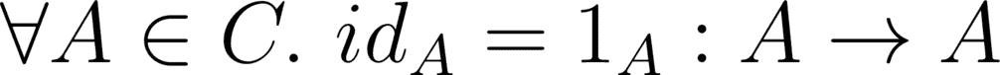 对于范畴中的所有对象，必须存在一个映射回同一对象的同一性箭头，表示为或。
2. **组合：**  对于所有箭头对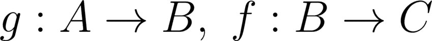，存在一个箭头。


组合：

函子是范畴之间的映射。函子必须尊重同一性和组合。

**函子定律**是确保同一性和组合得到遵守的公理。

### 同一性

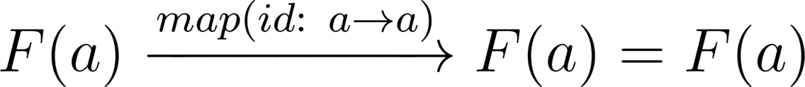

如果你将同一性函数（`x => x`）传递给`a.map()`，其中`a`是任何函子类型，结果应该等同于`a`：

```javascript
1 const a = [20];
2 const b = a.map(a => a);
3 
4 console.log(
5   a.toString() === b.toString() // true
6 );
```

### 组合

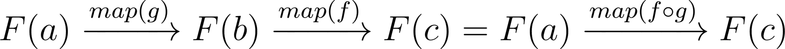

组合律示意图

```javascript
 1 const g = n => n + 1;
 2 const f = n => n * 2;
 3 const mappable = [20];
 4 
 5 const a = mappable.map(g).map(f);
 6 const b = mappable.map(x => f(g(x)));
 7 
 8 console.log(
 9   a.toString() === b.toString() // true
10 );
```

**函数组合**是将一个函数应用于另一个函数的结果：。函数组合是从右向左进行的，而不是从左向右，这就是为什么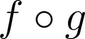常被称为在之后。

函子必须遵守组合律：`a.map(g).map(f)`等价于`a.map(x => f(g(x)))`。

## 范畴论

许多函数式编程术语源自范畴论，而范畴论的核心就是组合。范畴论初看令人畏惧，实则简单。就像跳下跳板或乘坐过山车一样。以下是范畴论基础的几个要点：

- 一个**范畴**由一组对象和对象之间的箭头组成（这里的“对象”几乎可以指代任何东西）。对象类似于编程中的类型，意味着它们通常代表包含一个或多个元素的集合。
- 箭头被称为**态射**。态射在两个对象和之间映射，用箭头连接它们。在图中通常表示为。
- 所有对象都必须有恒等箭头，即指向自身对象的箭头，例如。恒等箭头也可以表示为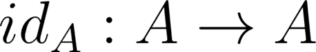或。
- 对于任何一组相连的对象，必须存在一个直接从的组合。
- 所有态射都等价于组合，例如，给定对象以及它们之间的箭头：


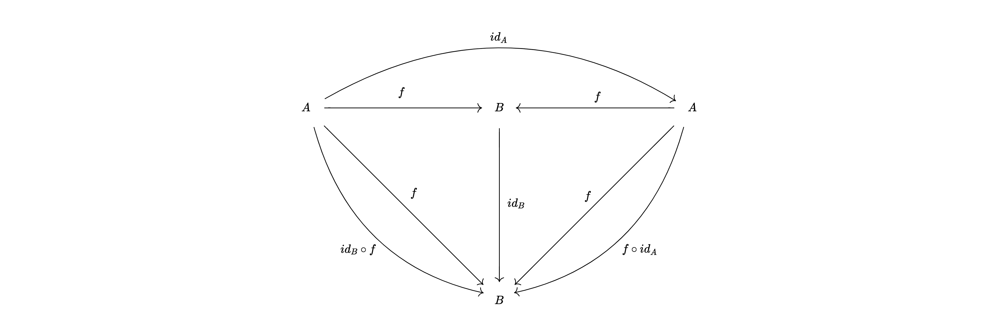

左恒等和右恒等组合 

这类似于代码中的函数组合。假设你有一个类型为`g: a => b`的函数，以及另一个类型为`f: b => c`的函数。你可以创建一个函数`h: a => c`：`const h = x => f(g(x))`。

在范畴论中，存在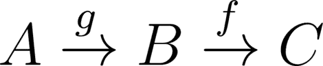意味着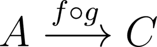也存在：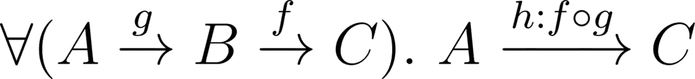

箭头组合是结合的。这意味着在组合态射时不需要括号：

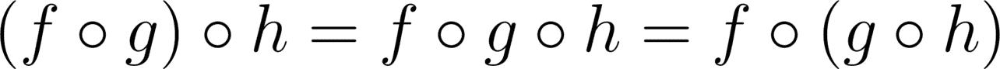

函子映射是函数组合的一种形式。在以下代码中，`mappable.map(g).map(f)`等价于`mappable.map(x => f(g(x)))`：

```javascript
 1 const g = n => n + 1;
 2 const f = n => n * 2;
 3 const mappable = [20];
 4 
 5 const a = mappable.map(g).map(f);
 6 const b = mappable.map(x => f(g(x)));
 7 
 8 console.log(
 9   a.toString() === b.toString() // true
10 );
```

### 构建你自己的函子

以下是一个简单的函子示例：

```javascript
1 const Identity = value => ({
2   map: fn => Identity(fn(value))
3 });
```

`Identity`接收一个`value`并返回一个带有`.map()`方法的对象。`.map()`方法接收一个函数，并返回将该函数应用于`Identity`内部`value`的结果。返回的值被包装在另一个`Identity`中。函子映射总是返回相同函子类型的实例：左边是`Array`？右边也是`Array`。左边是`Stream`？右边也是`Stream`。左边是`Promise`？右边也是`Promise`，以此类推。

如你所见，`Identity`满足函子定律：

```javascript
 1 // trace() 是一个工具函数，方便你检查内容。
 2 const trace = x => {
 3   console.log(x);
 4   return x;
 5 };
 6 
 7 const u = Identity(2);
 8 
 9 // 恒等律
10 const r1 = u;             // Identity(2)
11 const r2 = u.map(x => x); // Identity(2)
12 
13 r1.map(trace); // 2
14 r2.map(trace); // 2
15 
16 const f = n => n + 1;
17 const g = n => n * 2;
18 
19 // 组合律
20 const r3 = u.map(x => f(g(x))); // Identity(5)
21 const r4 = u.map(g).map(f);     // Identity(5)
22 
23 r3.map(trace); // 5
24 r4.map(trace); // 5
```

现在你可以像映射数组一样映射任何数据类型。你可以将`map`方法添加到任何自定义数据类型中。

### 柯里化的 Map

函数式编程的核心在于组合微小的函数以创建更高层次的抽象。如果你想要一个适用于任何函子的通用`map`呢？你可以通过部分应用参数来创建新的映射函数，这些函数适用于任何可映射的类型！

```javascript
 1 // import curry from 'lodash/fp/curry';
 2 // 或者
 3 // import curry from 'ramda/curry';
 4 // 或者使用这个魔法咒语：
 5 const curry = (
 6   f, arr = []
 7 ) => (...args) => (
 8   a => a.length === f.length ?
 9     f(...a) :
10     curry(f, a)
11 )([...arr, ...args]);
12 
13 const Identity = value => ({
14   map: fn => Identity(fn(value))
15 });
16 
17 const map = curry((fn, mappable) => mappable.map(fn));
18 const log = x => console.log(x);
19 
20 const double = n => n * 2;
21 const mdouble = map(double);
22 
23 mdouble(Identity(4)).map(log); // 8
24 mdouble([4]).map(log);         // 8
```

### 结论

**函子数据类型就是你可以进行映射的数据类型。**你可以将它们视为容器，能够将函数应用于容器内的内容，并返回一个包含结果的新容器。

在范畴论中，**函子是一种保持结构的从范畴到范畴的映射**，其中“保持结构”意味着对象和态射之间的关系得以保留。

一个**范畴**由一组对象和对象之间的箭头组成。箭头代表态射，我们可以粗略地将其视为代码中的函数。范畴中的每个对象都有一个恒等态射。对于任何对象链，都存在一个组合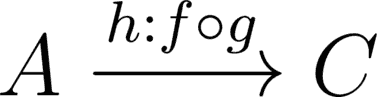。

函子是出色的高阶抽象，它允许你在容器内容上组合函数，而无需将这些函数与函子数据类型的结构或实现细节耦合。函子构成了其他非常有用的代数结构（如单子）的基础。

## 单子

> “一旦你理解了单子，你立刻就变得无法向其他人解释它们了。” —— 蒙娜德格林夫人的诅咒，吉拉德·布拉查（道格拉斯·克洛克福特曾著名地引用过）

> “霍尼克博士过去常说，任何不能向八岁孩子解释自己工作的科学家都是骗子。” —— 库尔特·冯内古特的小说《猫的摇篮》

在开始学习之前，你应该已经了解：

- 函数组合：`compose(f, g) = f(g(x))`
- 函子基础：理解`Array.prototype.map()`操作。

如果你上网搜索“monad”，你会被一堆难以理解的范畴论数学以及一群“热心”用墨西哥卷饼和太空服来解释单子的人淹没。

单子很简单。用来描述它们的语言很难。让我们直击本质。

**单子**是一种组合函数的方式，这些函数除了返回值外还需要上下文，例如计算、分支或副作用。单子通过**映射**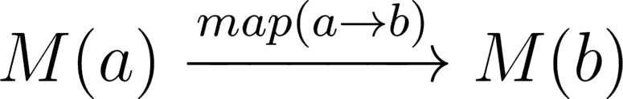和**展平**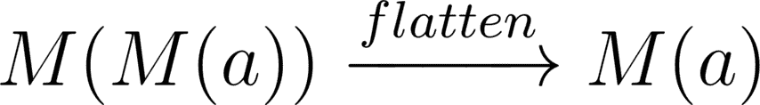操作，使得类型能够对齐，从而支持类型提升函数（如和）的组合。

给定两个函数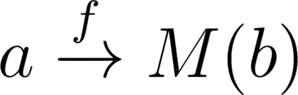和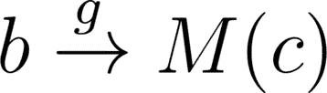，单子允许我们将它们组合成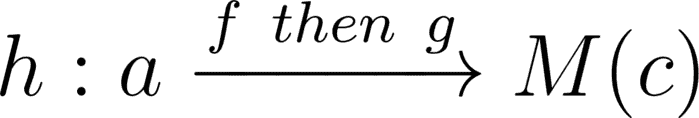，其中表示 Kleisli 箭头运算符（在 Haskell 中为`>=>`）。这类似于组合运算符，但方向相反。你可以将其视为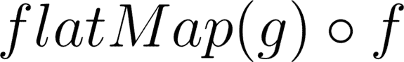（`flatMap(g)`*在*`f`*之后*）。它是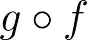在单子中的等价形式。我使用“`then`”来表示 Kleisli 组合运算符，以明确操作顺序，并使文本对不熟悉范畴论或 Haskell 符号的读者更友好。

> **注意：** JavaScript 没有 Kleisli 组合运算符。在 JavaScript 代码中尝试使用`>=>`会导致“`SyntaxError: Unexpected token >`”。JavaScript 的`Promise`对象上确实有`.then()`方法。

- 函数组合组合了类型为`a => b`的函数。
- 函子映射在函子上下文中组合了类型为`a => b`的函数：`Functor(a).map(a => b)`返回`Functor(b)`。
- 单子`flatMap`在单子上下文中组合了类型为`a => Monad(b)`的函数：`Monad(a).flatMap(a => M(b))`返回`Monad(b)`。`FlatMap`在一次操作中同时执行*映射*和*展平*。

换句话说：

- 函数可以组合：`a => b => c`变为`a => c`。
- 函子可以组合带上下文的函数：给定`F(a)`和两个函数`a => b => c`，返回`F(c)`。
- 单子可以组合类型提升函数：`a => M(b)`、`b => M(c)`变为`a => M(c)`。

但“展平”、“映射”和“上下文”是什么意思呢？

- **映射**意味着“将一个函数应用于`a`并返回一个`b`”。给定一些输入，返回一些输出。函子映射操作在称为函子数据类型的容器上下文中执行此操作，并返回一个包含结果的新容器。
- **上下文**是单子的计算细节。函子或单子提供在映射过程中要执行的某些计算，例如遍历列表中的元素，或等待未来值解析。函子和单子的意义在于抽象掉这个上下文，这样我们在组合操作时就不必担心它。在上下文中映射意味着将`a => b`（对于函子）或`a => Monad(b)`（对于单子）的函数应用于上下文中的值，并返回包装在相同上下文中的新类型`b`的值。左边是 Observable？右边也是 Observable：`Observable(a) => Observable(b)`。左边是数组？右边也是数组：`Array(a) => Array(b)`。
- **类型提升**意味着将类型提升到上下文中，将值包装在提供计算上下文的数据类型中：`a => M(a)`。
- **展平**可用于解开可能因使用函子映射操作应用类型提升函数而添加的额外上下文层。如果你使用函子映射操作映射一个类型为`a => M(b)`的函数，它将返回一个类型为`M(M(b))`的值。展平解开额外的上下文层：`M(M(b)) => M(b)`。单子不要求直接暴露展平操作。它会在`flatMap`内部自动发生。
- **FlatMap**是定义单子的操作。它将映射和展平合并为一个操作，用于组合类型提升函数（`a => M(b)`）。

JavaScript 中函子上下文的示例：

```javascript
1 const x = 20;             // 类型 `a` 的一些数据
2 const f = n => n * 2;     // 从 `a` 到 `b` 的函数
3 const arr = Array.of(x);  // 类型提升
4 // JS 对数组有类型提升的语法糖：[x]
5 
6 // .map() 在数组的上下文中将函数 f 应用于值 x
7 const result = arr.map(f); // [40]
```

在这个例子中，`Array`是上下文，`x`是我们映射的值。但如果我们有一个接受值并返回数组的函数呢？例如，这个`echo()`函数会接受一个值并将其重复`n`次：

```javascript
1 const echo = n => x => Array.from({ length: n }).fill(x);
```

使用`map()`处理这个函数，我们会得到一个数组的数组：

```javascript
1 const echo = n => x => Array.from({ length: n }).fill(x);
2 
3 console.log(
4   [1, 2, 3].map(echo(3))
5   // [[1, 1, 1], [2, 2, 2], [3, 3, 3]]
6 );
```

如果这正是你想要的，那没问题，但如果你想要一个数字数组而不是数字数组的数组呢？`FlatMap`来救场！

```javascript
1 const echo = n => x => Array.from({ length: n }).fill(x);
2 
3 console.log(
4   [1, 2, 3].flatMap(echo(3))
5   // => [1, 1, 1, 2, 2, 2, 3, 3, 3]
6 );
```

### 你可能已经在使用单子了

无论你的技能水平或对范畴论的理解如何，使用单子都能让你的代码更易于处理。未能利用单子可能会使你的代码更难处理（例如，回调地狱、嵌套条件分支，以及可能更多的代码）。

请记住，软件开发的本质是组合，而单子使组合更容易。再看一下单子的本质：

- 函数可以组合：`a => b => c`变为`a => c`。
- 函子可以组合带上下文的函数：给定`F(a)`和两个函数`a => b => c`，返回`F(c)`。
- 单子可以组合类型提升函数：`a => M(b)`、`b => M(c)`变为`a => M(c)`。

函数存在的全部理由就是你可以组合它们。函数帮助你将军问题分解为简单问题，这些简单问题更容易单独解决，然后你可以以各种方式组合它们来构建你的应用程序。

理解函数及其正确用法的关键在于更深入地理解函数组合。

函数组合创建了数据流经的管道。你将一些输入放入管道的第一个阶段，然后一些数据从管道的最后一个阶段输出，经过转换。但要做到这一点，管道的每个阶段都必须期望前一个阶段返回的数据类型。

组合简单函数很容易，因为类型很容易对齐。只需将输出类型`b`与输入类型`b`匹配即可：

```text
1 g: a => b
2 f:      b => c
3 h: a    =>   c
```


组合在`g`之后应用`f`。

如果你映射`F(a) => F(b)`，那么使用函子组合也很容易，因为类型对齐了：

```text
1 f: F(a) => F(b)
2 g:         F(b) => F(c)
3 h: F(a)    =>      F(c)
```

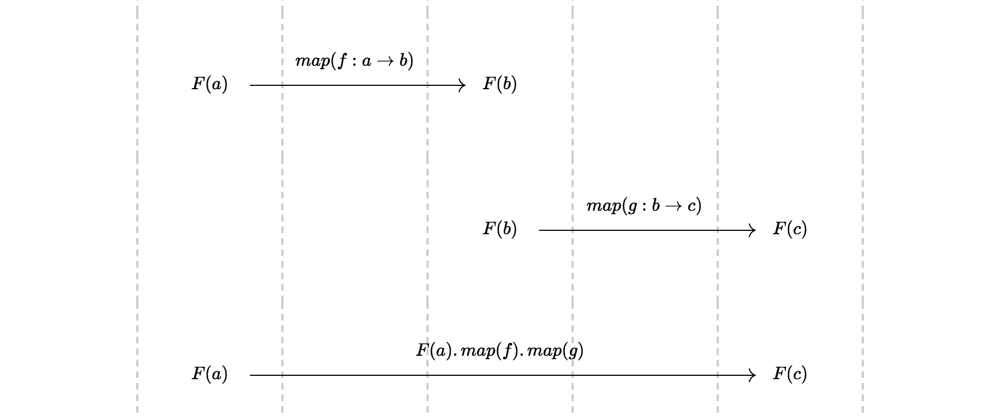

映射在函子上下文中应用函数。

但如果你想组合`a => F(b)`、`b => F(c)`等函数，你需要单子。让我们将`F()`替换为`M()`以明确这一点：

```text
1 f: a => M(b)
2 g:      ???   b => M(c)
3 h: a      =>       M(c)
```

哎呀。在这个例子中，*组件函数类型不匹配！*对于`g`的输入，我们想要类型`b`，但实际得到的是类型`M(b)`（`b`的 monad）。由于这种不匹配，`h`需要在`M(b)`的上下文中应用`g`，因为`g`期望的是类型`b`，而不是类型`M(b)`。我们不能像使用 functor 那样简单地`f(a).map(g)`，因为`map`会为其返回值额外添加一层包装，从而产生`M(M(c))`而不是我们期望的`M(c)`。我们需要`flatMap`而不是`map`。Monad 使得类型能够匹配用于提升函数`a => M(b)`，从而可以组合它们。

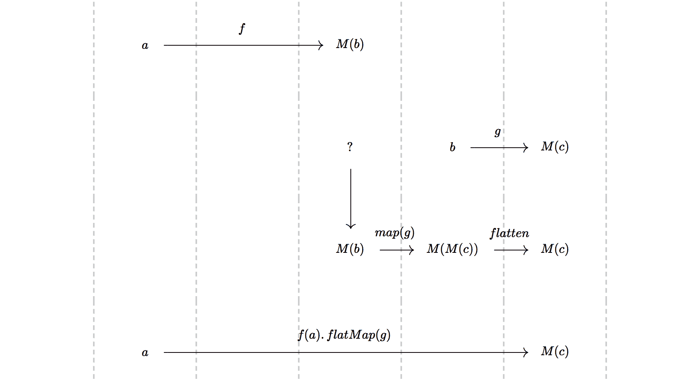

FlatMap 在一次操作中同时进行映射和展平。

在上图中，从`b => M(M(c))`的映射和从`M(M(c)) => c`的展平发生在从`a => M(c)`的`flatMap`内部。使用`flatMap`操作，我们可以用与组合普通函数相同的声明式工具来组合返回 monad 的函数。例如，如果你想组合返回 promise 的函数，可以将`pipe`替换为`asyncPipe`，其他一切保持不变。


需要`monad`是因为很多函数并不是简单的从`a => b`的映射。有些函数需要处理副作用（`promise`、流）、处理分支（`Maybe`）、处理异常（`Either`）等。

这里有一个更具体的例子。如果你需要从一个异步 API 获取用户，然后将该用户数据传递给另一个异步 API 来执行某些计算，该怎么办？

```js
getUserById(id: String) => Promise(User)
hasPermision(User) => Promise(Boolean)
```

让我们编写一些函数来演示这个问题。首先是工具函数`compose()`和`trace()`：

```js
const compose = (...fns) => x => fns.reduceRight((y, f) => f(y), x);

const trace = label => value => {
  console.log(`${ label }: ${ value }`);
  return value;
};
```

然后是一些要组合的函数：

```js
{
  const label = 'API call composition';

  // a => Promise(b)
  const getUserById = id => id === 3 ?
    Promise.resolve({ name: 'Kurt', role: 'Author' }) :
    undefined
  ;

  // b => Promise(c)
  const hasPermission = ({ role }) => (
    Promise.resolve(role === 'Author')
  );

  // Try to compose them. Warning: this will fail.
  const authUser = compose(hasPermission, getUserById);

  // Oops! Always false!
  authUser(3).then(trace(label));
}
```

当我们尝试将`hasPermission()`与`getUserById()`组合成`authUser()`时，遇到了一个大问题，因为`hasPermission()`期望的是一个`User`对象，但得到的却是一个`Promise(User)`。为了解决这个问题，我们需要将`compose()`替换为`composePromises()`——一个特殊的`compose`版本，它知道需要使用`.then()`来完成函数组合：

```js
{
  const composeM = flatMap => (...ms) => (
    ms.reduce((f, g) => x => g(x)flatMap)
  );

  const composePromises = composeM('then');

  const label = 'API call composition';

  // a => Promise(b)
  const getUserById = id => id === 3 ?
    Promise.resolve({ name: 'Kurt', role: 'Author' }) :
    undefined
  ;

  // b => Promise(c)
  const hasPermission = ({ role }) => (
    Promise.resolve(role === 'Author')
  );

  // Compose the functions (this works!)
  const authUser = composePromises(hasPermission, getUserById);

  authUser(3).then(trace(label)); // true
}
```

我们稍后会讨论`composeM()`的作用。

记住`monad`的本质：

- 函数可以组合：`a => b => c`变成`a => c`
- `Functor`可以组合带上下文的函数：给定`F(a)`和两个函数`a => b => c`，返回`F(c)`。
- `Monad`可以组合类型提升函数：`a => M(b)`，`b => M(c)`变成`a => M(c)`

在这个例子中，我们的`monad`实际上是`promise`，所以当我们组合这些返回 promise 的函数时，我们得到的是`Promise(User)`，而不是`hasPermission()`所期望的`User`。

### Monad 的构成

一个`monad`基于一个简单的对称性：

- **of：** 类型提升`a => M(a)`
- **map：** 在`monad`上下文中应用函数`a => M(b)`，产生`M(M(b))`
- **flatten：** 解开一层`monad`上下文：`M(M(b)) => M(b)`

将`map`与`flatten`结合，就得到了`flatMap`——用于`monad`提升函数的函数组合，也称为 Kleisli 组合，以 [Heinrich Kleisli](https://en.wikipedia.org/wiki/Heinrich_Kleisli) 命名：

- **FlatMap** Map + flatten：`f(a).flatMap(g) = M(c)`

对于`monad`，`.map()`和`.flatten()`方法通常从公共 API 中省略，而是作为`flatMap`操作的一部分。提升 + 展平并没有明确地拼写出`.map()`，但你拥有制作它所需的所有要素。如果你能提升（`of`）和`flatMap`（也称为`chain`/`bind`/`then`），你就可以制作`.map()`：

```js
const Monad = value => ({
  flatMap: f => f(value),
  map (f) {
    return this.flatMap(a => Monad.of(f(a)));
  }
});
Monad.of = x => Monad(x);

Monad(21).map(x => x * 2).map(x => console.log(x))
```

因此，如果你为你的`monad`定义了`.of()`和`.flatMap()`，你就可以推导出`.map()`的定义。

提升是工厂/构造函数和/或`constructor.of()`方法。在范畴论中，它被称为“单位”。它所做的只是将类型提升到`monad`的上下文中。它将一个`a`转换为一个`Monad`的`a`。

在 Haskell 中，它被称为`return`，当你想大声谈论它时可能会很尴尬，因为几乎每个人都会把它与函数返回混淆。我在文章中几乎总是称它为“提升”或“类型提升”，在代码中则称为`.of()`。

展平过程（没有`.flatMap()`中的 map）通常被称为`flatten()`或`join()`。通常（但并非总是），`flatten()`/`join()`被完全省略，因为它内置于`.flatMap()`中。展平通常与组合相关联，因此它经常与映射结合。记住，解开包装和映射都是组合`a => M(a)`函数所必需的。

根据你处理的`monad`类型，解开包装的过程可能非常简单。对于 identity monad，`.flatMap()`就像`.map()`一样，只是你不会将结果值提升回`monad`上下文。这样做的效果是丢弃一层包装：

```js
{ // Identity monad
  const Id = value => ({
    // Functor mapping
    // Preserve the wrapping for .map() by 
    // passing the mapped value into the type
    // lift:
    map: f => Id.of(f(value)),

    // Monad flatMap
    // Discard one level of wrapping
    // by omitting the .of() type lift:
    flatMap: f => f(value),

    // Just a convenient way to inspect
    // the values:
    toString: () => `Id(${ value })`
  });

  // The type lift for this monad is just
  // a reference to the factory.
  Id.of = Id;
}
```

但解开包装的部分也是诸如副作用、错误分支或等待异步 I/O 等奇怪事物通常隐藏的地方。在所有软件开发中，组合才是所有真正有趣的事情发生的地方。

例如，对于 promise，`.flatMap()`被称为`.then()`。调用`promise.then(f)`不会立即调用`f()`。相反，它会等待 promise 解析，*然后*调用`f()`（因此得名）。

示例：

```js
{
  const x = 20;                 // The value
  const p = Promise.resolve(x); // The context
  const f = n =>
    Promise.resolve(n * 2);     // The function

  const result = p.then(f);     // The application

  result.then(
    r => console.log(r)         // 40
  );
}
```

对于 promise，使用`.then()`代替`.flatMap()`，但两者*几乎*相同。

你可能听说过 Promise 并不严格是一个单子。这是因为只有当值本身是一个 Promise 时，它才会解包外层的 Promise。否则，`.then()`的行为就像`.map()`。

但由于它对 Promise 值和其他值的行为不同，`.then()`并不严格遵循所有函子和/或单子对于所有给定值必须满足的数学定律。在实践中，只要你意识到这种行为分支，通常可以将它们视为其中之一。

### 构建克莱斯利组合函数

让我们更深入地看看我们用来组合 Promise 提升函数的`composeM`函数：

```js
const composeM = method => (...ms) => (
  ms.reduce((f, g) => x => g(x)method)
);
```

隐藏在那个奇怪的 reducer 中的是函数组合的代数定义：`f(g(x))`。让我们更容易发现它：

```js
{
  // The algebraic definition of function composition:
  // (f . g)(x) = f(g(x))
  const compose = (f, g) => x => f(g(x));

  const x = 20;    // The value
  const arr = [x]; // The container

  // Some functions to compose
  const g = n => n + 1;
  const f = n => n * 2;

  // Proof that .map() accomplishes function composition.
  // Chaining calls to map is function composition.
  trace('map composes')([
    arr.map(g).map(f),
    arr.map(compose(f, g))
  ]);
  // => [42], [42]
}
```

这意味着我们可以编写一个通用的 compose 工具，它应该适用于所有提供`.map()`方法的函子（例如数组）：

```js
const composeMap = (...ms) => (
  ms.reduce((f, g) => x => g(x).map(f))
);
```

这只是标准`f(g(x))`的一个轻微改写。给定任意数量的类型为`a -> Functor(b)`的函数，遍历每个函数并将其应用于输入值`x`。`.reduce()`方法接受一个具有两个输入值的函数：一个累加器（此处为`f`）和数组中的当前项（`g`）。

我们返回一个新函数`x => g(x).map(f)`，它在下一次应用中成为`f`。我们已经在上面证明了`x => g(x).map(f)`等价于将`compose(f, g)(x)`提升到函子的上下文中。换句话说，它等价于将`f(g(x))`应用于容器中的值：在这种情况下，就是将组合应用于数组内的值。

> **性能警告：** 我不建议对数组这样做。以这种方式组合函数需要对整个数组进行多次迭代（可能包含数十万个项）。对于数组上的映射，先组合简单的`a -> b`函数，然后*一次*映射数组，或者使用`.reduce()`或 transducer 优化迭代。

对于数组数据上的同步、急切函数应用来说，这有些过度。然而，很多事情是异步或惰性的，许多函数需要处理诸如异常或空值分支等混乱情况。

这就是单子的用武之地。单子可以依赖于组合链中先前异步或分支操作的值。在这些情况下，你无法为简单的函数组合获得一个简单的值。你的返回单子的操作采用`a => Monad(b)`的形式，而不是`a => b`。

每当你有一个函数接收一些数据，调用一个 API，并返回一个对应的值，以及另一个函数接收该数据，调用另一个 API，并返回对该数据进行计算的结果时，你会想要组合类型为`a => Monad(b)`的函数。由于 API 调用是异步的，你需要将返回值包装在类似 promise 或 observable 的东西中。换句话说，这些函数的签名分别是`a => Monad(b)`和`b => Monad(c)`。

组合类型为`g: a => b`、`f: b => c`的函数很容易，因为类型对齐：`h: a => c`就是`a => f(g(a))`。

组合类型为`g: a => Monad(b)`、`f: b => Monad(c)`的函数稍微困难一些：`h: a => Monad(c)`不仅仅是`a => f(g(a))`，因为`f`期望的是`b`，而不是`Monad(b)`。

让我们更具体一些，组合一对各自返回 promise 的异步函数：

```js
{
  const label = 'Promise composition';

  const g = n => Promise.resolve(n + 1);
  const f = n => Promise.resolve(n * 2);

  const h = composePromises(f, g);

  h(20)
    .then(trace(label))
  ;
  // Promise composition: 42
}
```

我们如何编写`composePromises()`以便正确记录结果？*提示：你已经见过了。*

还记得我们的`composeMap()`函数吗？你只需要将`.map()`调用改为`.then()`。`Promise.then()`基本上是一个异步的`.map()`。

```js
{
  const composePromises = (...ms) => (
    ms.reduce((f, g) => x => g(x).then(f))
  );

  const label = 'Promise composition';

  const g = n => Promise.resolve(n + 1);
  const f = n => Promise.resolve(n * 2);

  const h = composePromises(f, g);

  h(20)
    .then(trace(label))
  ;
  // Promise composition: 42
}
```

奇怪的是，当你遇到第二个函数`f`（记住，`f`在`g`*之后*），输入值是一个 promise。它不是类型`b`，而是类型`Promise(b)`，但`f`接受类型`b`（解包后）。那么发生了什么？

在`.then()`内部，有一个从`Promise(b) -> b`的解包过程。这个操作称为 **flatten**（也称为 join）。

你可能已经注意到`composeMap()`和`composePromises()`几乎是相同的函数。这是高阶函数处理两者的完美用例。让我们将`flatMap`方法混合到一个柯里化函数中，然后使用方括号表示法：


```
1 const composeM = method => (...ms) => (
2   ms.reduce((f, g) => x => g(x)method)
3 );
```

现在我们可以这样编写专门的实现：

```
1 const composePromises = composeM('then');
2 const composeMap = composeM('map');
3 const composeFlatMap = composeM('flatMap');
```

### 单子定律

在开始构建自己的单子之前，你需要知道所有单子都应满足的三条定律。

#### 左恒等和右恒等定律

左恒等和右恒等定律是对称的等式：

*   左恒等：
*   右恒等：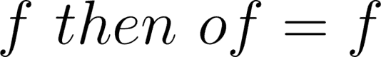

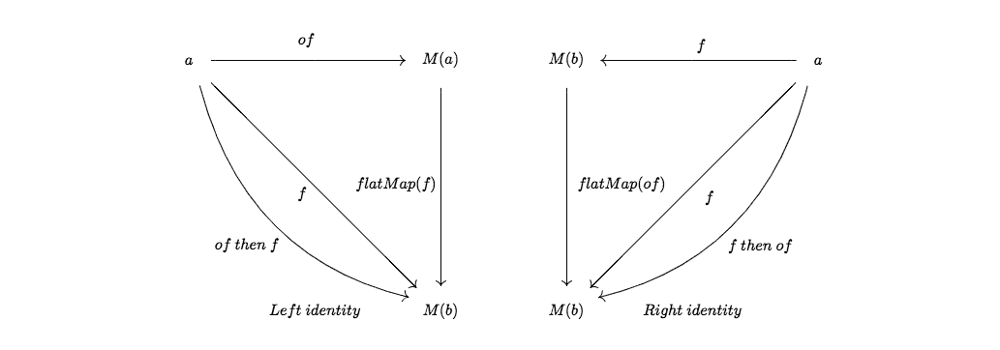

左恒等：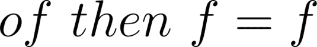 右恒等：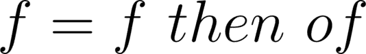

合在一起：

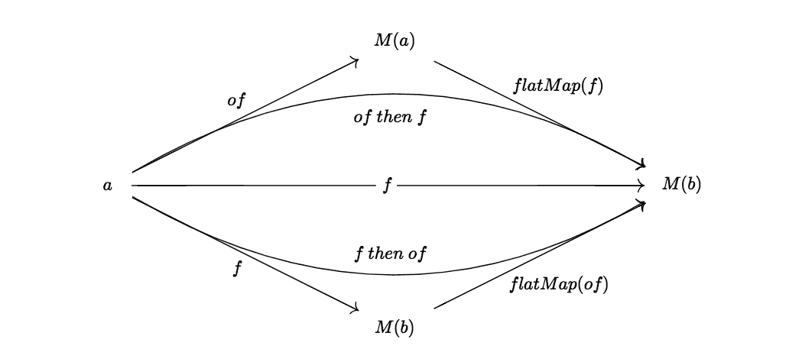

单子左恒等和右恒等：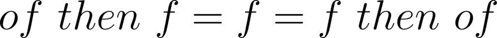

如果第一个图看起来很熟悉，那并非巧合。单子定律正是定义范畴的定律。


范畴恒等态射：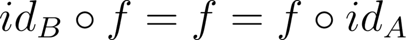

所有这三个图都表达了相同的一般概念。单子遵循范畴定律是有意为之的。单子形成范畴，其中对象是箭头，态射是箭头之间的函子（记住，函子从范畴映射到范畴）。

#### 结合律

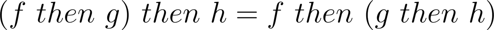

在 JavaScript 代码中，这些定律可以表示为：

1.  左恒等：`of(x).flatMap(f)`  `f(x)`
2.  右恒等：`f(x).flatMap(of)`  `f(x)`
3.  结合律：`of(x).flatMap(f).flatMap(g)`  `of(x).flatMap(x => f(x).flatMap(g))`

#### 恒等律

单子（`Monad`）是一个函子（`Functor`）。函子是范畴对象之间的态射，即 。态射用对象之间的箭头表示。除了我们明确看到的对象之间的箭头外，范畴中的每个对象还有一个指向自身的箭头。换句话说，对于范畴中的每个对象 `A`，都存在一个箭头 。这个箭头被称为恒等箭头，通常画成一个指向原对象的循环箭头。

#### 结合律

结合律意味着在组合时，括号放在哪里并不重要。例如，在加法中，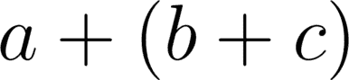 与 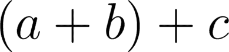 相同。函数组合也是如此：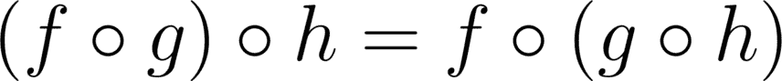。

Kleisli 组合也是如此。你只需要反向理解。当你看到组合运算符（`flatMap`）时，将其理解为“之后”：

```
1 h(x).flatMap(x => g(x).flatMap(f)) ==== (h(x).flatMap(g)).flatMap(f)
```

#### 证明单子定律

让我们证明恒等单子满足单子定律：

```
 1 { // 恒等单子
 2   const Id = value => ({
 3     // 函子映射
 4     // 通过将映射后的值传入类型提升来保留 .map() 的包装：
 5     map: f => Id.of(f(value)),
 6 
 7     // 单子链式调用
 8     // 通过省略 .of() 类型提升来丢弃一层包装：
 9     flatMap: f => f(value),
10 
11     // 仅用于方便检查值的便捷方法：
12     toString: () => `Id(${ value })`
13   });
14 
15   // 该单子的类型提升就是工厂函数的引用。
16   Id.of = Id;
17 
18   const g = n => Id(n + 1);
19   const f = n => Id(n * 2);
20 
21   // 左单位元
22   // unit(x).flatMap(f) ==== f(x)
23   trace('Id 单子左单位元')([
24     Id(x).flatMap(f),
25     f(x)
26   ]);
27   // Id 单子左单位元: Id(40), Id(40)
28 
29 
30   // 右单位元
31   // m.flatMap(unit) ==== m
32   trace('Id 单子右单位元')([
33     Id(x).flatMap(Id.of),
34     Id(x)
35   ]);
36   // Id 单子右单位元: Id(20), Id(20)
37 
38   // 结合律
39   // m.flatMap(f).flatMap(g) ====
40   // m.flatMap(x => f(x).flatMap(g)  
41   trace('Id 单子结合律')([
42     Id(x).flatMap(g).flatMap(f),
43     Id(x).flatMap(x => g(x).flatMap(f))
44   ]);
45   // Id 单子结合律: Id(42), Id(42)
46 }
```

### 结论

单子是一种组合类型提升函数的方式：`g: a => M(b)`，`f: b => M(c)`。为了实现这一点，单子必须在应用 `f()` 之前将 `M(b)` 展平为 `b`。换句话说，函子是可以进行映射（`map`）的东西，而单子是可以进行 `flatMap` 的东西：

*   函数可以组合：`a => b => c` 变为 `a => c`
*   函子可以组合带上下文的函数：给定 `F(a)` 和两个函数 `a => b => c`，返回 `F(c)`。
*   单子可以组合类型提升函数：`a => M(b)`，`b => M(c)` 变为 `a => M(c)`

单子基于一个简单的对称性——将值包装到上下文中的方式，以及从上下文中取出值的方式：

*   `提升/单位（Lift/Unit）`：从某个类型到单子上下文的类型提升：`a => M(a)`
*   `展平/连接（Flatten/Join）`：从上下文中解包类型：`M(c) => c`——这通常是映射 `a => M(b)` 的结果，因此 `M(c) => c` 通常就是 `M(M(b)) => M(b)`。展平的目的在于丢弃多余的包装层。

由于单子也是函子，它们也可以进行映射：

*   `映射（Map）`：在保留上下文的情况下进行映射：`M(a) -> M(b)`
*   `FlatMap/链式调用（FlatMap/Chain）`：展平 + 映射：给定 `f: a => M(b)`，`g: b => M(c)`，`f(a).map(g)` 返回 `M(M(b))`，因此 `f(a).map(g).flatten()` 返回 `M(b)`，这与 `f(a).flatMap(g)` 相同。

单子必须满足三条定律（公理），统称为单子定律：

*   左单位元：`unit(x).flatMap(f) ==== f(x)`
*   右单位元：`m.flatMap(unit) ==== m`
*   结合律：`m.flatMap(f).flatMap(g) ==== m.flatMap(x => f(x).flatMap(g))`

在日常 JavaScript 代码中可能遇到的单子示例包括 `Promise` 和 `Observable`。Kleisli 组合允许你组合数据流逻辑，而无需担心数据类型 API 的细节，也无需担心隐藏在 `flatMap()` 操作中的可能副作用、条件分支或其他解包计算的细节。

这使得单子成为简化代码的非常强大的工具。你无需理解或担心单子内部发生了什么，就能享受单子带来的简化好处。但现在你了解了更多底层原理，窥探一下内部也就不那么可怕了。

无需害怕 Lady Monadgreen 的诅咒。

## 被遗忘的 OOP 历史

> “我所设想的网络，我们尚未看到。未来仍然比过去广阔得多。” ~ 蒂姆·伯纳斯-李

蒂姆·伯纳斯-李曾说过“未来仍然比过去广阔得多”，但有时，过去照亮了道路。自 20 世纪 90 年代初以来，一种编程风格主导了软件开发团队的思维：面向对象编程（OOP）。但我们真的理解 OOP 是什么、它从何而来、以及塑造其发展的目标和权衡吗？如果你想了解某件事，通常有助于在其形成的历史背景中仔细审视它。

我们今天使用的大多数编程范式最初都是在 20 世纪 30 年代通过 λ 演算和图灵机在数学上探索的，它们是通用计算（能够执行一般计算的形式化系统）的两种不同表述。丘奇-图灵论题表明，λ 演算和图灵机在功能上是等价的——任何可以用图灵机计算的东西都可以用 λ 演算计算，反之亦然。

> 注：有一种常见的误解，认为图灵机可以计算任何可计算的东西。存在某些问题类别（例如[停机问题](https://en.wikipedia.org/wiki/Halting_problem)），在某些情况下是可计算的，但并非所有情况下都能用图灵机一般性地计算。当我在本文中使用“可计算”一词时，我指的是“图灵机可计算的”。

λ 演算代表了一种自上而下、函数应用的计算方法，而图灵机的纸带/寄存器机表述则代表了一种自下而上、命令式（逐步）的计算方法。

低级语言如机器码和汇编出现在 20 世纪 40 年代，到 20 世纪 50 年代末，第一批流行的高级语言出现了。Lisp 方言至今仍被广泛使用，包括 `Clojure`、`Scheme`、`AutoLISP` 等。`FORTRAN` 和 `COBOL` 都出现在 20 世纪 50 年代，是至今仍在使用的命令式高级语言的例子，尽管在大多数应用中，C 系列语言已经取代了 `COBOL` 和 `FORTRAN`。

命令式编程和函数式编程都源于计算理论的数学基础，早于数字计算机。“面向对象编程”（OOP）一词由艾伦·凯（Alan Kay）在 1966 或 1967 年左右读研究生时提出，但今天我们所说的 OOP 并非艾伦·凯当初设想的那样。

伊万·萨瑟兰的开创性 `Sketchpad` 应用是面向对象编程的早期灵感来源。它于 1961 年至 1962 年间创建，并于 1963 年发表在他的[Sketchpad 论文](https://dspace.mit.edu/handle/1721.1/14979)中。其中的“对象”是表示示波器屏幕上图形图像的数据结构，并通过动态委托实现了继承，伊万·萨瑟兰在论文中将其称为“主对象”。任何对象都可以成为主对象，而对象的其他实例则被称为“出现”。多个出现可以组合在一起形成一幅画。`Sketchpad` 的主对象与 JavaScript 的原型有很多共同之处。

`Sketchpad` 的一个有趣特性是约束求解器。例如，`Sketchpad` 允许人类艺术家创建两条线，然后设置一个约束，意思是“这两条线应该平行”。与大多数现代图形应用程序不同，这些关系是通过最小化约束的总误差来动态求解的。在 `Sketchpad` 中，可以模拟桥梁在重载或强风下的行为。`Sketchpad` 不仅仅是一个绘图程序——它是一个对象交互的动态模拟。

> “约束及其集成求解器以‘做什么’而非‘怎么做’的方式呈现了‘编程计算机’。`Sketchpad` 的‘程序员’可以*影响*值和历史，但只有 `Sketchpad` 的内部才能实现‘怎么做’。这给我留下了深刻印象。[……] 生命之所以能扩展，是因为通过放弃‘机械式’思维并拥抱动态重构和‘误差衰减’，可以更有效地处理非常大型系统的系统动力学。”——艾伦·凯在 2018 年的一封电子邮件交流中。

1965 年规范的 `Simula` 是面向对象编程的另一个早期影响。艾伦·凯在 1966 年同一周了解了 `Sketchpad` 和 `Simula I`。与 `Sketchpad` 一样，`Simula I` 可以用相对较少的代码生成复杂的模拟。它也具有没有类继承的对象。最终，`Simula 67` 引入了类继承、子类和虚方法，这些后来出现在 C++ 和 Java 等语言中。

> 注意：**虚方法**是定义在类上的方法，旨在被子类重写。虚方法允许程序调用在代码编译时可能不存在的方法，通过动态分派在运行时确定要调用的具体方法。JavaScript 具有动态类型，并使用委托链来确定要调用的方法，因此不需要向程序员暴露虚方法的概念。换句话说，JavaScript 中的所有方法都使用运行时方法分派，因此 JavaScript 中的方法不需要声明为“虚”来支持该特性。

### 核心理念

> “‘面向对象’这个术语是我创造的，我可以告诉你，我当时并没有想到 C++。”——艾伦·凯，OOPSLA '97

艾伦·凯在 1966 年或 1967 年的研究生院创造了“面向对象编程”这个术语。其核心理念是在软件中使用封装的微型计算机，通过消息传递而非直接数据共享进行通信——即不再将程序分解为独立的“数据结构”和“过程”。

> “递归设计的基本原则是让部分具有与整体相同的能力。”——鲍勃·巴顿，B5000（一款为运行 `Algol-60` 而优化的主机）的主要设计师。

> “我第一次将整体视为整个计算机，并想知道为什么有人要把它分解成称为数据结构和过程的更弱的东西。为什么不把它分解成小型计算机，就像分时系统开始做的那样？但不是几十个。为什么不是成千上万个，每个模拟一个有用的结构？”——艾伦·凯，[《Smalltalk 的早期历史》](http://worrydream.com/EarlyHistoryOfSmalltalk)

`Smalltalk` 由艾伦·凯、丹·英格尔斯、阿黛尔·戈德堡等人在施乐帕克研究中心开发。`Smalltalk` 比 `Simula` 更加面向对象——`Smalltalk` 中的一切都是对象，包括类、整数和块（闭包）。最初的 `Smalltalk-72` 没有子类化特性。[该特性由丹·英格尔斯在 `Smalltalk-76` 中引入](http://worrydream.com/EarlyHistoryOfSmalltalk)。

虽然 `Smalltalk` 支持类并最终支持子类化，但 `Smalltalk` 的重点并非类或子类化。它更像是一种受 `Sketchpad` 和 Lisp 启发而非 `Simula` 的函数式语言。艾伦·凯认为业界对子类化的关注分散了对面向对象编程真正好处的注意力。

> “我很抱歉很久以前为这个主题创造了‘对象’这个术语，因为它让很多人关注次要的想法。核心理念是消息传递。”——艾伦·凯

在[2003 年的一封电子邮件交流](http://www.purl.org/stefan_ram/pub/doc_kay_oop_en)中，艾伦·凯澄清了他称 `Smalltalk` 为“面向对象”时的含义：

> “对我来说，OOP 仅意味着消息传递、本地保留和保护以及状态过程的隐藏，以及所有事物的极端后期绑定。”——艾伦·凯

换句话说，根据艾伦·凯的说法，OOP 的基本要素是：

*   消息传递
*   封装
*   动态绑定

值得注意的是，继承和子类多态性在艾伦·凯看来并不是 OOP 的基本要素。

### OOP 的本质

消息传递和封装的结合实现了一些重要目的：

*   **封装状态**：通过将其他对象与本地状态变化隔离开来。影响另一个对象状态的唯一方法是发送消息请求（而非命令）该对象改变它。状态变化在本地、细胞级别上受到控制，而不是暴露于共享访问。
*   **解耦对象**：消息发送者仅通过消息传递 API 与消息接收者松散耦合。
*   **运行时适应性**：通过后期绑定实现。运行时适应性提供了许多艾伦·凯认为对 OOP 至关重要的好处。

这些想法受到生物细胞和网络计算机的启发，源于艾伦·凯的生物学背景以及 `Arpanet`（互联网的早期版本）设计的影响。即使在那个早期，艾伦·凯就设想软件运行在一个巨大的分布式计算机（如互联网）上，其中单个计算机像生物细胞一样，独立操作自己的隔离状态，并通过消息传递进行通信。但他也认为，一个本地程序也可以看起来像成千上万台联网计算机。小部分可以像大型网络一样运作，如同分形。

> “我意识到细胞/整个计算机的隐喻将消除数据[……]”——艾伦·凯

通过“消除数据”，艾伦·凯显然意识到了共享可变状态问题以及由共享数据引起的紧耦合——这些是当今常见的主题。


但在 20 世纪 60 年代末，[ARPA 程序员感到沮丧的是，他们需要在构建软件之前预先为程序选择一种数据模型表示](https://www.rand.org/content/dam/rand/pubs/research_memoranda/2007/RM5290.pdf)。与特定数据结构过于紧密耦合的过程难以应对变化或无法重用。他们希望有一种更统一的数据处理方式。

> “[……] OOP 的全部意义在于不必担心对象内部是什么。在不同机器上、使用不同语言创建的对象应该能够相互通信[……]”——艾伦·凯

对象可以抽象并隐藏数据结构的实现。对象的内部实现可以更改，而不会破坏软件系统的其他部分。事实上，通过极端后期绑定，一个完全不同的计算机系统可以接管对象的职责，而软件仍能继续工作。同时，对象可以暴露一个标准接口，该接口适用于对象内部使用的任何数据结构。同一个接口可以用于链表、树、流等。

艾伦·凯也将对象视为代数结构，这些结构能对其行为做出数学上可证明的保证：

> “我的数学背景让我意识到，每个对象都可以关联多个代数，并且可以存在这些代数的族，这将非常非常有用。”

事实证明这是正确的，并构成了诸如 `promise` 和 `lens` 等对象的基础，两者都受到范畴论的启发。

艾伦·凯对对象的代数本质的设想，使得对象能够支持形式化验证、确定性行为以及更好的可测试性，因为代数本质上就是遵循一些方程形式规则的操作。

用程序员的话来说，代数就像是由函数（操作）组成的抽象，并附带了单元测试必须通过的特定法则（公理/方程）。

你可能会说，在软件行业几乎遗忘了函数式编程和等式推理几十年之后，编程界正在现代通用语言中重新发现它们的优势。

就像之前的 `JavaScript` 和 `Smalltalk` 一样，大多数现代面向对象语言正变得越来越支持多范式。没有必要在函数式编程和面向对象编程之间做出选择。当我们审视它们各自的历史本质时，它们不仅是兼容的，而且是互补的思想。

由于它们共享许多共同特性，我喜欢说 `JavaScript` 是 `Smalltalk` 对世界误解面向对象编程的报复。`Smalltalk` 和 `JavaScript` 都支持：

*   对象
*   一等函数和闭包
*   动态类型
*   后期绑定（函数/方法可在运行时更改）
*   无类继承的面向对象编程

### 面向对象编程并不意味着什么

面向对象编程的本质是什么？

*   封装
*   消息传递
*   动态绑定（程序在运行时演化/适应的能力）

非本质的是什么？

*   类
*   类继承
*   对对象/函数/数据的特殊处理
*   `new` 关键字
*   多态
*   静态类型
*   将类视为“类型”

如果你的背景是 `Java` 或 `C#`，你可能会认为静态类型和多态是必不可少的要素，但艾伦·凯更倾向于以代数形式处理通用行为。例如，来自 `Haskell`：

```
1 fmap :: (a -> b) -> f a -> f b
```

这是函子映射签名，它泛化地作用于未指定类型 `a` 和 `b`，在 `a` 的函子上下文中应用从 `a` 到 `b` 的函数，以产生 `b` 的函子。函子是数学术语，本质上意味着“支持 `map` 操作”。如果你熟悉 `JavaScript` 中的 `[].map()`，你已经知道这意味着什么。

以下是 `JavaScript` 中的两个示例：

```
 1 // isEven = Number => Boolean
 2 const isEven = n => n % 2 === 0;
 3 
 4 const nums = [1, 2, 3, 4, 5, 6];
 5 
 6 // map 接受一个函数 `a => b` 和一个 `a` 的数组（通过 `this`）
 7 // 并返回一个 `b` 的数组。
 8 // 在这个例子中，`a` 是 `Number`，`b` 是 `Boolean`
 9 const results = nums.map(isEven);
10 
11 console.log(results);
12 // [false, true, false, true, false, true]
```

`.map()` 方法是泛化的，因为 `a` 和 `b` 可以是任何类型，而 `.map()` 能很好地处理，因为数组是实现了代数“函子”法则的数据结构。类型对 `.map()` 来说并不重要，因为它不会直接操作它们，而是应用一个期望并返回正确类型的函数。

```
 1 // matches = a => Boolean
 2 // 这里，`a` 可以是任何可比较的类型
 3 const matches = control => input => input === control;
 4 
 5 const strings = ['foo', 'bar', 'baz'];
 6 
 7 const results = strings.map(matches('bar'));
 8 
 9 console.log(results);
10 // [false, true, false]
```

这种泛型类型关系在 `TypeScript` 这样的语言中很难正确且彻底地表达，但在支持高阶类型（类型的类型）的 `Haskell` 的 `Hindley-Milner` 类型系统中却相当容易表达。

大多数类型系统过于严格，无法自由表达动态和函数式思想，例如函数组合、自由对象组合、运行时对象扩展、组合子、`lens` 等。换句话说，静态类型常常使得编写可组合的软件更加困难。

如果你的类型系统过于严格（例如 `TypeScript`、`Java`），你被迫编写更复杂的代码来实现相同的目标。这并不意味着静态类型是个坏主意，或者所有静态类型实现都同样严格。我在 `Haskell` 的类型系统中遇到的问题要少得多。

如果你是静态类型的粉丝，并且不介意这些限制，那很好，但如果你发现本文中的某些建议难以实现，因为难以对组合函数和复合代数结构进行类型标注，那么请责怪类型系统，而不是这些思想。人们喜欢 SUV 的舒适性，但没有人抱怨它们不能让你飞行。为此，你需要一个自由度更高的交通工具。

如果限制让你的代码更简单，那太好了！但如果限制迫使你编写更复杂的代码，也许这些限制是错误的。

### 什么是对象？

多年来，对象显然承载了许多内涵。我们在 `JavaScript` 中称为“对象”的东西仅仅是复合数据类型，既没有基于类的编程的含义，也没有艾伦·凯的消息传递的含义。

在 `JavaScript` 中，这些对象可以并且经常支持封装、消息传递、通过方法共享行为，甚至子类多态（尽管使用委托链而不是基于类型的分发）。你可以将任何函数分配给任何属性。你可以动态构建对象行为，并在运行时改变对象的意义。`JavaScript` 还支持使用闭包进行封装以实现私有性。但所有这些都是可选行为。

我们目前对对象的理解仅仅是复合数据结构，并不需要更多条件才能被视为对象。但使用这类对象进行编程并不会使你的代码成为“面向对象”的，就像使用函数进行编程并不会使你的代码成为“函数式”的一样。

### 我们迷失了方向。

因为现代编程语言中的“对象”比艾伦·凯所理解的意义要少得多，所以我使用“组件”而不是“对象”来描述可能的情况。在 `JavaScript` 中，许多对象被其他代码直接拥有和操作，但组件应该封装并控制自己的状态。

#### 消息传递的特征

*   使用组件进行编程（艾伦·凯的“对象”）
*   封装组件状态
*   使用消息传递进行通信
*   在运行时添加/更改/替换组件

大多数组件行为可以使用代数数据结构泛化地指定。不需要继承。组件可以从共享函数和模块导入中重用行为，而无需共享它们的数据。

在大多数现代软件中，有一些 UI 负责管理用户交互，一些代码管理应用程序状态（用户数据），以及管理系统或网络 I/O 的代码。

这些系统中的每一个都可能需要长期运行的进程，例如事件监听器、用于跟踪网络连接等状态的状态、UI 元素状态以及应用程序状态本身。

这些系统并非直接相互访问并操纵彼此的状态，而是通过消息分发与其他组件通信。当用户点击保存按钮时，可能会分发一条 `"SAVE"` 消息，应用状态组件会解释该消息并将其转发给状态更新处理程序（例如一个纯 `reducer` 函数）。或许在状态更新后，状态组件会向 UI 组件分发一条 `"STATE_UPDATED"` 消息，UI 组件进而解释状态，协调需要更新的 UI 部分，并将更新后的状态转发给处理这些 UI 部分的子组件。

与此同时，网络连接组件可能正在监控用户与网络中另一台机器的连接，监听消息，并分发更新后的状态表示以将数据保存到远程机器上。它内部会跟踪网络心跳脉冲、连接当前是在线还是离线等状态。

这些系统无需了解系统其他部分的细节，只需关注各自独立的模块化问题。系统组件是可分解和可重新组合的。它们实现标准化的接口，以便能够互操作。只要满足接口要求，就可以替换为以不同方式完成相同功能的组件，或者用相同的消息完成完全不同功能的组件。甚至可以在运行时进行替换，而一切仍能正常工作。

同一软件系统的组件甚至可能不需要位于同一台机器上。系统可以是去中心化的。网络存储可能会将数据分片存储到像 [IPFS](https://en.wikipedia.org/wiki/InterPlanetary_File_System) 这样的去中心化存储系统中，这样用户就不必依赖某台特定机器的健康状态来确保数据安全存储。

OOP 部分灵感来源于 Arpanet，而 Arpanet 的目标之一就是构建一个能够抵御网络故障或攻击的去中心化网络：一个“星际网络”，将所有 ARPA 项目计算机（及其伙伴）连接在一起。据 Arpanet 开发期间 DARPA 主任 Stephen J. Lukasik 所述（[《为什么建造 Arpanet》](https://ieeexplore.ieee.org/document/5432117)）：

> “目标是利用新的计算机技术来满足军事指挥和控制应对核威胁的需求，实现美国核力量的生存控制，并改进军事战术和管理决策。”

> **注意：** Arpanet 的主要推动力是便利性而非核威胁，其明显的防御优势是后来才显现的。ARPA 当时使用三个独立的计算机终端与三个独立的计算机研究项目通信。Bob Taylor 希望建立一个单一的计算机网络，将每个项目与其他项目连接起来。

利用封装和消息传递，可以模拟互联网的健壮性，使用在应用程序运行时即可热插拔的组件。如果用户使用手机，在进入隧道后离线，系统仍能继续工作。如果飓风切断了某个服务器所在数据中心的电源，系统也能继续运行。

利用这些原则，可以构建更灵活、更具弹性、组合更佳的软件，将对象和函数式编程和谐地结合起来。

> “如果说我看得比别人更远些，那是因为我站在巨人的肩膀上。” —— 艾萨克·牛顿

我常常觉得，我们似乎从巨人的肩膀上滑落，过于迷失在 OOP 系统的实现细节中。我并不主张回到 Smalltalk 时代，但我在想，如果我们重新爬回那些肩膀之上，又能看得多远呢？

## 对象组合

> “**对象组合** 组装或*组合*对象以获得更复杂的行为。” —— 四人帮，《[设计模式：可复用面向对象软件的基础](https://www.amazon.com/Design-Patterns-Elements-Reusable-Object-Oriented/dp/0201633612//ref=as_li_ss_tl?ie=UTF8&linkCode=ll1&tag=eejs-20&linkId=06ccc4a53e0a9e5ebd65ffeed9755744)》

> “优先使用对象组合，而不是类继承。” —— 四人帮，《设计模式》

软件开发中最常见的错误之一就是过度使用类继承。类继承是一种代码复用机制，其中实例与基类形成 `is-a` 关系。如果你试图用 `is-a` 关系（例如，鸭子 `is-a` 鸟）来建模你的领域，你注定会遇到麻烦，因为类继承是面向对象设计中最紧密的耦合形式，会导致许多常见问题，包括（但不限于）：

*   脆弱的基类问题
*   大猩猩/香蕉问题
*   必要性重复问题

类继承通过将公共接口抽象到基类中来实现复用，子类可以继承、添加和覆盖该基类。

**抽象**有两个重要部分：

*   **泛化**：提取仅服务于通用用例的共享属性和行为的过程
*   **特化**：提供服务于特殊用例所需的实现细节的过程

在代码中实现泛化和特化的方法有很多。类继承的一些良好替代方案包括简单函数、高阶函数、模块和对象组合。

不幸的是，对象组合被严重误解，许多人在思考对象组合时感到困难，甚至在日常看到和使用它时也无法识别。现在是时候更深入地探讨这个主题了。

### 什么是对象组合？

> “在计算机科学中，复合数据类型或组合数据类型是指可以使用编程语言的原始数据类型和其他复合类型在程序中构造的任何数据类型。[…] 构造复合类型的行为称为组合。” —— 维基百科

围绕对象组合产生混淆的原因之一是，任何将原始类型组装成复合对象的行为都是对象组合的一种形式，但继承技术常常被拿来与对象组合对比，仿佛它们是互斥的，例如“优先使用对象组合，而不是类继承”。它们并非互斥。类继承是对象组合的一个子集。区别更多在于意图而非技术：我们是继承自一个庞大的基类，还是组装更小的组件来形成新的复合体？

在讨论对象组合与类继承时，我们谈论的不是具体的技术：我们谈论的是组件对象之间的*语义关系*和*耦合程度*。我们谈论的是*意义*，而非*技术*。人们常常无法区分这一点，从而陷入技术细节的泥潭。他们只见树木，不见森林。

组合对象的方式有很多种。不同的组合形式会产生不同的复合结构以及对象之间的不同关系。当对象依赖于与之相关的对象时，这些对象就是耦合的，这意味着改变一个对象可能会破坏另一个对象。

四人帮建议“优先使用对象组合，而不是类继承”，这邀请我们将对象视为由更小、松散耦合的对象组合而成，而不是从庞大的基类进行整体继承。GoF 将紧密耦合的对象描述为“单体系统，在这种系统中，如果不理解并修改许多其他类，就无法更改或删除一个类。系统会变成一团难以学习、移植和维护的密集块。”

另一个混淆的根源在于，大多数面向对象语言中，数据和函数之间存在显著区别。而在大多数函数式语言中，函数和数据可以互换传递。

这一区别之所以重要，是因为艾伦·凯（Alan Kay）为 Smalltalk 所描述的对象（它影响了之后所有主流面向对象语言，包括 C++、Java、Objective C 和 C#）旨在解决共享可变状态的问题。它们通过封装（外部函数无法直接观察或操作对象的私有状态）和消息传递（我们与对象通信的机制——方法调用是最简单的形式）来控制对数据的访问，从而实现这一目标。

当我们通过组合来组装对象时，我们并不关心这些。我们只是在组装数据结构，将方法和属性视为数据。

### 对象组合的三种不同形式

在《设计模式》一书中，四人组指出：“你会在设计模式中反复看到对象组合的应用”，并接着描述了各种组合关系，包括*聚合*和*委托*。

《设计模式》的作者主要使用 C++ 和 Smalltalk（后来是 Java）进行工作。在这些语言中，通过运行时扩展来构建对象相对困难，因此四人组对动态对象扩展（即*拼接*）着墨不多。然而，在 JavaScript 中，它是最常见的对象组合技术之一。

对象有很多种，通过对象组合可以创建许多数据结构，但所有其他形式的对象组合都基于三种基本技术：

*   **聚合**：当一个对象由可枚举的子对象集合构成时。换句话说，一个*包含*其他对象的对象。每个子对象保留其自身的引用标识，因此可以从聚合中解构出来而不会丢失信息。
*   **拼接**：当一个对象通过向现有对象添加新属性而形成时。属性可以逐个拼接，也可以从现有对象复制而来。例如，jQuery 插件就是通过将新方法拼接到 jQuery 委托原型 `jQuery.fn` 上创建的。
*   **委托**：当一个对象将请求转发或*委托给*另一个对象时。例如，[伊万·萨瑟兰的 Sketchpad](https://www.youtube.com/watch?v=495nCzxM9PI)（1962 年）包含对“主对象”的引用实例，这些主对象被委托以共享属性。Photoshop 包含“智能对象”，它们作为本地代理，委托给外部资源。JavaScript 的原型也是委托：`Array` 实例将内置数组方法调用转发给 `Array.prototype`，对象转发给 `Object.prototype`，等等。

需要注意的是，这些不同的组合形式并非互斥。可以使用聚合来实现委托，而在 JavaScript 中，类继承是通过委托实现的。许多软件系统使用多种组合类型，例如，jQuery 的插件使用拼接来扩展 jQuery 委托原型 `jQuery.fn`。当客户端代码调用插件方法时，请求被委托给拼接到委托原型上的方法。

### 关于代码示例的说明

下面的代码示例将共享以下设置代码：

```
1 const objs = [
2   { a: 'a', b: 'ab' },
3   { b: 'b' },
4   { c: 'c', b: 'cb' }
5 ];
```

所有对象组合的代码示例都将以归约函数的形式编写。这当然不是唯一的方法，但它很方便，并且在各种编程语言中广泛用于组装和管理各种数据结构。

`Reduce` 是一个高阶函数，它接受一个函数并将其应用于一组项目。在对象组合的情况下，这些项目是源对象，我们将源对象集合归约为一个用于输出的目标对象。

归约函数的形式如下：

```
1 (accumulator, currentValue) => accumulator
```

每次迭代中，新的当前值被折叠到累加器中，这里的“折叠”并非单一、明确定义的操作，而是由归约函数体提供的操作。

经典的求和示例：

```
1 const sum = (a, c) => a + c;
2 
3 const total = [1,2,3].reduce(sum, 0);
4 // => 6
```

以及一个基本的对象组合示例，使用对象展开语法进行拼接：

```
1 const assign = (a, c) => ({...a, ...c});
2 
3 const composed = [{a: 'a'}, {b: 'b'}].reduce(assign, {});
4 // => { a: 'a', b: 'b' }
```

### 聚合

**聚合**是指一个对象由可枚举的子对象集合构成。聚合是一个*包含*其他对象的对象。聚合中的每个子对象都保留其自身的引用标识，并且可以从聚合中无损地解构出来。聚合可以用多种结构来表示。

#### 示例


- 数组
- 映射
- 集合
- 图
- 树
  - DOM 节点（一个 DOM 节点可能包含子节点）
  - UI 组件（一个组件可能包含子组件）

#### 何时使用

当存在需要共享通用操作的对象集合时，例如可迭代对象、栈、队列、树、图、状态机或组合模式（当你希望单个项目与多个项目共享相同接口时）。

#### 注意事项

聚合非常适合应用通用抽象，例如对聚合中的每个成员应用函数（如`array.map(fn)`）、将向量视为单个值进行转换等。然而，如果子对象可能有数十万或数百万个，流处理或委托可能更高效。

#### 代码实现

数组聚合：

```javascript
 1 const collection = (a, e) => a.concat([e]);
 2 
 3 const a = objs.reduce(collection, []);
 4 
 5 console.log( 
 6   'collection aggregation',
 7   a,
 8   a[1].b,
 9   a[2].c,
10   `enumerable keys: ${ Object.keys(a) }`
11 );
```

这将输出：

```text
1 collection aggregation
2 [{"a":"a","b":"ab"},{"b":"b"},{"c":"c","b":"cb"}]
3 b c
4 enumerable keys: 0,1,2
```

使用对（pair）的链表聚合：

```javascript
 1 const pair = (a, b) => [b, a];
 2 
 3 const l = objs.reduceRight(pair, []);
 4 
 5 console.log(
 6   'linked list aggregation',
 7   l,
 8   `enumerable keys: ${ Object.keys(l) }`
 9 );
10 
11 /*
12 linked list aggregation
13 [
14   {"a":"a","b":"ab"}, [
15     {"b":"b"}, [
16       {"c":"c","b":"cb"},
17       []
18     ]
19   ]
20 ]
21 enumerable keys: 0,1
22 */
```

链表是许多其他数据结构和聚合的基础，例如数组、字符串和各种树。DOM 树基于链表，DOM 节点指向子节点，子节点指回父节点，并委托引用兄弟节点。还有许多其他可能的聚合类型。我们在此不深入介绍所有内容。

### 拼接

拼接是指通过向现有对象添加新属性来形成对象。

#### 示例

- 通过拼接将插件添加到`jQuery.fn`
- 状态归约器（例如 Redux）
- 函数式混入

#### 何时使用

任何需要在运行时逐步组装数据结构的情况，例如合并 JSON 对象、从多个来源填充应用状态、创建不可变状态的更新（通过将先前状态与新数据合并）等。

#### 注意事项

- 小心修改现有对象。共享可变状态是许多错误的根源。
- 可以通过拼接模拟类层次结构和`is-a 关系`。同样的问题也存在。要思考组合小型独立对象，而不是从“基”实例继承属性并应用差异继承。
- 注意隐式的组件间依赖关系。
- 属性名冲突通过拼接顺序解决：后定义的获胜。这对于默认值/覆盖行为很有用，但如果顺序无关紧要，则可能带来问题。

#### 代码实现

```javascript
 1 const concatenate = (a, o) => ({...a, ...o});
 2 
 3 const c = objs.reduce(concatenate, {});
 4 
 5 console.log(
 6   'concatenation',
 7   c,
 8   `enumerable keys: ${ Object.keys(c) }`
 9 );
10 
11 // concatenation { a: 'a', b: 'cb', c: 'c' } enumerable keys: a,b,c
```

### 委托

委托是指一个对象将属性查找转发或委托给另一个对象。

#### 示例

- JavaScript 的内置类型使用委托将内置方法调用沿原型链向上转发。例如，`[].map()`委托给`Array.prototype.map()`，`obj.hasOwnProperty()`委托给`Object.prototype.hasOwnProperty()`，等等。
- jQuery 插件依赖委托在所有 jQuery 对象实例之间共享内置方法和插件方法。
- Sketchpad 的“主对象”是动态委托。对委托的修改会立即反映在所有对象实例中。
- Photoshop 使用称为“智能对象”的委托来引用定义在单独文件中的图像和资源。对智能对象所引用对象的更改会反映在该智能对象的所有实例中。

#### 何时使用

1. **节省内存：** 当可能存在大量对象实例，并且在这些实例之间共享相同的属性或方法（否则需要分配更多内存）时，使用委托很有用。
2. **动态更新多个实例：** 当许多对象实例需要共享相同的状态，且该状态可能需要动态更新，并且更改需要立即反映在每个实例中时，例如 Sketchpad 的“主对象”或 Photoshop 的“智能对象”。

#### 注意事项

- 委托通常用于在 JavaScript 中模拟类继承（通过`extends`关键字实现），但实际上很少真正需要。
- 委托可用于精确模仿类继承的行为和限制。事实上，JavaScript 中的类继承是建立在通过原型委托链实现的静态委托之上的。避免使用`is-a`思维。
- 使用常见机制（如`Object.keys(instanceObj)`）时，委托属性是不可枚举的。
- 委托以属性查找性能为代价节省内存，并且对于动态委托（创建后发生变化的委托），某些 JS 引擎优化会被关闭。然而，即使在最慢的情况下，属性查找性能也以每秒数百万次操作来衡量——除非你正在构建用于对象操作或图形编程的实用库（例如 RxJS 或 three.js），否则这很可能不是你的瓶颈。
- 需要区分实例状态和委托状态。
- 动态委托上的共享状态不是实例安全的。更改在所有实例之间共享。动态委托上的共享状态通常（但并非总是）是一个 bug。
- ES6 类不会在 ES6 中创建动态委托。它们在 Babel 中可能看起来有效，但在真正的 ES6 环境中会彻底失败。

#### 代码实现

```javascript
 1 const delegate = (a, b) => Object.assign(Object.create(a), b);
 2 
 3 const d = objs.reduceRight(delegate, {});
 4 
 5 console.log(
 6   'delegation',
 7   d,
 8   `enumerable keys: ${ Object.keys(d) }`
 9 );
10 
11 // delegation { a: 'a', b: 'ab' } enumerable keys: a,b
12 
13 console.log(d.b, d.c); // ab c
```

### 结论

我们学到了：

- 所有由其他对象和语言原语创建的对象都是复合对象。
- 创建复合对象的行为称为对象组合。
- 存在不同类型的对象组合。
- 组合对象时形成的关系和依赖关系取决于对象的组合方式。
- `is-a 关系`（类继承形成的那种）是面向对象设计中最紧密的耦合形式，在实际应用中通常应避免。
- “四人帮”告诫我们，应该通过组装较小的特性来形成更大的整体，而不是继承自一个庞大的基类或基对象。“优先使用对象组合，而不是类继承。”
- 聚合将对象组合成可枚举的集合，其中集合中的每个成员保持其自身标识，例如数组、DOM 树等。
- 委托通过链接对象委托链来组合对象，其中一个对象将属性查找转发或委托给另一个对象。例如，`[].map()`委托给`Array.prototype.map()`。
- 拼接通过用新属性扩展现有对象来组合对象，例如`Object.assign(destination, a, b)`、`{...a, ...b}`。
- 不同类型对象组合的定义**并非互斥**。委托是聚合的子集，拼接可用于形成委托和聚合，等等……

这些并不是仅有的三种对象组合类型。还可以通过相识/关联关系在对象之间形成松散的动态关系，其中对象作为参数传递给其他对象（依赖注入），等等。

所有软件开发都是组合。有简单灵活的组合对象的方式，也有脆弱僵化的方式。某些形式的对象组合在对象之间形成松散耦合的关系，而另一些则形成非常紧密的耦合。

寻找这样的组合方式：当程序需求发生微小变化时，只需对代码实现进行微小改动。清晰简洁地表达你的意图，并记住：如果你认为需要类继承，那么很可能有更好的方法。

## 工厂函数

工厂函数是任何不是`class`或`constructor`但返回一个（通常是`new`的）对象的函数。在 JavaScript 中，任何函数都可以返回一个对象。当它不使用`new`关键字返回对象时，它就是一个工厂函数。

工厂函数在 JavaScript 中一直很有吸引力，因为它们能够轻松地生成对象实例，而无需深入`classes`和`new`关键字的复杂性。

JavaScript 提供了一种非常方便的对象字面量语法。它看起来像这样：

```javascript
1 const user = {
2   userName: 'echo',
3   avatar: 'echo.png'
4 };
```

与 JSON（基于 JavaScript 的对象字面量表示法）类似，冒号左侧是属性名，右侧是值。你可以使用点号表示法访问属性：

```javascript
1 console.log(user.userName); // "echo"
```

你可以使用方括号表示法访问计算属性名：

```javascript
1 const key = 'avatar';
2 console.log( user[key] ); // "echo.png"
```

如果作用域中有与预期属性名同名的变量，你可以在对象字面量创建中省略冒号和值：

```javascript
 1 const userName = 'echo';
 2 const avatar = 'echo.png';
 3 
 4 const user = {
 5   userName,
 6   avatar
 7 };
 8 
 9 console.log(user);
10 // { "avatar": "echo.png",   "userName": "echo" }
```

对象字面量支持简洁方法语法。我们可以添加一个`.setUserName()`方法：

```javascript
 1 const userName = 'echo';
 2 const avatar = 'echo.png';
 3 
 4 const user = {
 5   userName,
 6   avatar,
 7   setUserName (userName) {
 8     this.userName = userName;
 9     return this;
10   }
11 };
12 
13 console.log(user.setUserName('Foo').userName); // "Foo"
```

在简洁方法中，`this`指向调用该方法的对象。要调用对象上的方法，只需使用对象点号表示法访问该方法，并通过括号调用它，例如`game.play()`会将`.play()`应用于 game 对象。要使用点号表示法应用方法，该方法必须是该对象的属性。你也可以使用函数原型方法`.call()`、`.apply()`或`.bind()`将方法应用于任何其他任意对象。

在这种情况下，`user.setUserName('Foo')`将`.setUserName()`应用于`user`，因此`this === user`。在`.setUserName()`方法中，我们通过其`this`绑定修改`user`对象上的`.userName`属性，并返回同一个对象实例以实现方法链。

### 单个用字面量，多个用工厂

如果你需要创建多个对象，你会希望结合对象字面量和工厂函数的力量。

使用工厂函数，你可以创建任意数量的用户对象。例如，如果你正在构建一个聊天应用，你可以有一个表示当前用户的对象，以及许多其他表示当前登录并正在聊天的其他用户的对象，这样你也可以显示他们的名字和头像。

让我们将用户对象转换为一个`createUser()`工厂：

```javascript
 1 const createUser = ({ userName, avatar }) => ({
 2   userName,
 3   avatar,
 4   setUserName (userName) {
 5     this.userName = userName;
 6     return this;
 7   }
 8 });
 9 
10 console.log(createUser({ userName: 'echo', avatar: 'echo.png' }));
11 /*
12 {
13   "avatar": "echo.png",
14   "userName": "echo",
15   "setUserName": [Function setUserName]
16 }
17 */
```

### 返回对象

箭头函数（`=>`）具有隐式返回特性：如果函数体由单个表达式组成，你可以省略`return`关键字：`() => 'foo'`是一个不接受参数并返回字符串`"foo"`的函数。

返回对象字面量时要小心。默认情况下，JavaScript 假设你在使用花括号时想要创建一个函数体，例如`{ broken: true }`。如果你想对对象字面量使用隐式返回，你需要通过将对象字面量包裹在圆括号中来消除歧义：

```javascript
1 const noop = () => { foo: 'bar' };
2 console.log(noop()); // undefined
3 
4 const createFoo = () => ({ foo: 'bar' });
5 console.log(createFoo()); // { foo: "bar" }
```

在第一个示例中，`foo:`被解释为一个标签，而`bar`被解释为一个不会被赋值或返回的表达式。该函数返回`undefined`。

在`createFoo()`示例中，圆括号强制将花括号解释为要计算的表达式，而不是函数体块。

### 解构

特别注意函数签名：

```javascript
1 const createUser = ({ userName, avatar }) => ({
```

在这一行中，花括号`({`、`})`表示对象解构。该函数接受一个参数（一个对象），但从该单个参数中解构出两个形式参数：`userName`和`avatar`。这些参数随后可以在函数体作用域中作为变量使用。你也可以解构数组：

```javascript
1 const swap = ([first, second]) => [second, first];
2 console.log( swap([1, 2]) ); // [2, 1]
```

并且你可以使用剩余和展开语法`(...varName)`来收集数组（或参数列表）中的其余值，然后将这些数组元素展开回单个元素：

```javascript
1 const rotate = ([first, ...rest]) => [...rest, first];
2 console.log( rotate([1, 2, 3]) ); // [2, 3, 1]
```

### 计算属性键

之前我们使用方括号计算属性访问符号来动态确定要访问哪个对象属性：

```javascript
1 const key = 'avatar';
2 console.log( user[key] ); // "echo.png"
```

我们也可以计算要赋值的键的值：

```javascript
1 const arrToObj = ([key, value]) => ({ [key]: value });
2 console.log( arrToObj([ 'foo', 'bar' ]) ); // { "foo": "bar" }
```

在这个示例中，`arrToObj()`接受一个由键/值对（也称为元组）组成的数组，并将其转换为一个对象。由于我们不知道键的名称，我们需要计算属性名称以便在对象上设置键/值对。为此，我们借用了计算属性访问符中的方括号表示法，并在构建对象字面量的上下文中重用它：

```javascript
1 { [key]: value }
```

插值完成后，我们得到最终的对象：

```javascript
1 { "foo": "bar" }
```

### 默认参数

JavaScript 中的函数支持默认参数值，这有几个好处：

- 用户能够省略具有合适默认值的参数。
- 函数更具自文档性，因为默认值提供了预期输入的示例。
- IDE 和静态分析工具可以使用默认值来推断参数期望的类型。例如，默认值为 1 意味着该参数可以接受 Number 类型的成员。

使用默认参数，我们可以为我们的`createUser`工厂记录预期的接口，并在未提供用户信息时自动填入“匿名”详情：


```javascript
const createUser = ({
  userName = 'Anonymous',
  avatar = 'anon.png'
} = {}) => ({
  userName,
  avatar
});

console.log(
  // { userName: "echo", avatar: 'anon.png' }
  createUser({ userName: 'echo' }),
  // { userName: "Anonymous", avatar: 'anon.png' }
  createUser()
);
```

函数签名的最后一部分可能看起来有点奇怪：

```javascript
} = {}) => ({
```

参数签名关闭前的最后一个`= {}`表示，如果没有为此参数传入任何内容，我们将使用一个空对象作为默认值。当你尝试从空对象解构值时，属性的默认值将自动使用，因为这就是默认值的作用：用预定义的值替换`undefined`。

如果没有`= {}`默认值，不带参数调用`createUser()`会抛出错误，因为你无法尝试从`undefined`访问属性。

### 类型推断

截至撰写本文时，JavaScript 没有任何原生的类型注解，但多年来出现了几种竞争格式来填补空白，包括 JSDoc（由于更好选项的出现而衰落）、[Facebook 的 Flow](https://flow.org/) 和 [微软的 TypeScript](https://www.typescriptlang.org/)。我使用 [rtype](https://github.com/ericelliott/rtype) 进行文档记录——我发现这种表示法对于函数式编程比 TypeScript 更易读。

在撰写本文时，类型注解还没有明确的赢家。所有替代方案都未被 JavaScript 规范认可，而且它们似乎都有明显的缺陷。

类型推断是根据使用上下文推断类型的过程。在 JavaScript 中，它是类型注解的一个非常好的替代方案。

如果你在标准的 JavaScript 函数签名中提供足够的推断线索，你将获得类型注解的大部分好处，而无需承担任何成本或风险。

即使你决定使用像 TypeScript 或 Flow 这样的工具，你也应该尽可能多地利用类型推断，并将类型注解保留在类型推断不足的情况下。例如，JavaScript 中没有原生方法来指定共享接口。而使用 TypeScript 或 rtype 则既简单又有用。

Tern.js 是一个流行的 JavaScript 类型推断工具，它有许多代码编辑器和 IDE 的插件。

微软的 Visual Studio Code 不需要 Tern，因为它将 TypeScript 的类型推断能力带到了常规 JavaScript 代码中。

当你在 JavaScript 中为函数指定默认参数时，支持类型推断的工具（如 Tern.js、TypeScript 和 Flow）可以提供 IDE 提示，帮助你正确使用正在处理的 API。

没有默认值，IDE（以及通常的人类）没有足够的提示来推断预期的参数类型。


IDE 截图：`userName` 的类型未知。

有了默认值，IDE（以及通常的人类）可以从示例中推断出类型。


IDE 截图：`userName` 期望一个字符串。

将参数限制为固定类型并不总是合理的（这会使泛型函数和高阶函数变得困难），但当这样做合理时，默认参数通常是最佳方式，即使你使用的是 TypeScript 或 Flow。

### 用于混入组合的工厂函数

工厂函数非常擅长通过简洁的调用 API 批量生成对象。通常，它们就能满足你的需求，但偶尔你会发现自己需要为不同类型的对象构建相似的功能，这时你可能希望将这些功能抽象为函数式混入，以便更轻松地复用它们。

这正是函数式混入大显身手的地方。让我们构建一个`withConstructor`混入，为所有对象实例添加`.constructor`属性。

```javascript
// withConstructor.js
const withConstructor = constructor => o => ({
  // 创建委托 [[Prototype]]
  __proto__: {
    // 将 constructor 属性添加到新的 [[Prototype]]
    constructor
  },
  // 将 o 的所有属性混入新对象
  ...o
});
```

现在你可以导入它并与其他混入一起使用：

```javascript
import withConstructor from './with-constructor';

const pipe = (...fns) => x => fns.reduce((y, f) => f(y), x);
// 或 `import pipe from 'lodash/fp/flow';`

// 设置一些函数式混入
const withFlying = o => {
  let isFlying = false;
  return {
    ...o,
    fly () {
      isFlying = true;
      return this;
    },
    land () {
      isFlying = false;
      return this;
    },
    isFlying: () => isFlying
  }
};

const withBattery = ({ capacity }) => o => {
  let percentCharged = 100;
  return {
    ...o,
    draw (percent) {
      const remaining = percentCharged - percent;
      percentCharged = remaining > 0 ? remaining : 0;
      return this;
    },
    getCharge: () => percentCharged,
    getCapacity: () => capacity
  };
};

const createDrone = ({ capacity = '3000mAh' }) => pipe(
  withFlying,
  withBattery({ capacity }),
  withConstructor(createDrone)
)({});

const myDrone = createDrone({ capacity: '5500mAh' });

console.log(`
  can fly:  ${ myDrone.fly().isFlying() === true }
  can land: ${ myDrone.land().isFlying() === false }
  battery capacity: ${ myDrone.getCapacity() }
  battery status: ${ myDrone.draw(50).getCharge() }%
  battery drained: ${ myDrone.draw(75).getCharge() }% remaining
`);

console.log(`
  constructor linked: ${ myDrone.constructor === createDrone }
`);
```

如你所见，可复用的`withConstructor()`混入被简单地与其他混入一起放入管道中。`withBattery()`可以与其他类型的对象一起使用，比如机器人、电动滑板或便携设备充电器。`withFlying()`可用于模拟飞行汽车、火箭或热气球。

组合更多是一种思维方式，而非代码中的特定技术。你可以通过多种方式实现它。函数组合只是从头构建它的最简单方式，而工厂函数则是为实现细节包装友好 API 的简单方法。

### 结论

ES6 为处理对象创建和工厂函数提供了便捷的语法。大多数情况下，这就足够了，但因为是 JavaScript，还有另一种方法让它更像 Java：`class`关键字。

在 JavaScript 中，类比工厂更冗长且更具限制性，在重构时有点像雷区，但它们也被 React 和 Angular 等主流前端框架所接受，并且有一些罕见的用例使得这种复杂性值得。

> “有时，优雅的实现只是一个函数。不是一个方法。不是一个类。不是一个框架。只是一个函数。” ~ John Carmack

从最简单的实现开始，只在需要时才转向更复杂的实现。

## 函数式混入

**函数式混入**是可组合的工厂函数，它们像流水线上的工人一样连接成管道；每个函数添加一些属性或行为。函数式混入不依赖或不需要基础工厂或构造函数：只需将任意对象传入混入，就会返回该对象的增强版本。

函数式混入的特性：

- 数据隐私/封装
- 继承私有状态
- 从多个来源继承
- 无菱形问题（属性冲突歧义）——最后者胜出
- 无需基类

### 动机

所有现代软件开发本质上都是组合：我们将一个庞大复杂的问题分解成更小、更简单的问题，然后将解决方案组合起来形成应用程序。

组合的原子单元有两种：

- 函数
- 数据结构

应用程序结构由这些原子单元的组合定义。通常，组合对象是通过类继承生成的，其中子类从父类继承大部分功能，并扩展或覆盖部分功能。这种方法的问题在于它导致了`is-a`思维，例如“管理员是员工”，从而引发了许多设计问题：

- **紧耦合问题：** 由于子类依赖于父类的实现，类继承是面向对象设计中最紧密的耦合。
- **脆弱的基类问题：** 由于紧耦合，对基类的更改可能会破坏大量派生类——甚至可能破坏由第三方管理的代码。作者可能会破坏他们不知道的代码。
- **不灵活的层次结构问题：** 对于单一祖先分类法，经过足够的时间和演化，所有类分类法最终都会对新用例失效。
- **必要重复问题：** 由于层次结构不灵活，新用例通常通过重复而非扩展来实现，导致相似的类意外地出现分歧。一旦重复出现，新类应该继承自哪个类以及为什么就不明确了。
- **大猩猩/香蕉问题：** “……面向对象语言的问题在于它们携带了所有隐式环境。你想要一根香蕉，但你得到的却是拿着香蕉的大猩猩和整个丛林。” ~ Joe Armstrong，[《程序员修炼之道》](http://www.amazon.com/gp/product/1430219483?ie=UTF8&camp=213733&creative=393185&creativeASIN=1430219483&linkCode=shr&tag=eejs-20&linkId=3MNWRRZU3C4Q4BDN)

如果管理员是员工，那么当你临时雇佣外部顾问来履行管理职责时，该如何处理？如果你事先知道所有需求，也许类继承可以工作，但我从未见过这种情况。随着使用量的增加，应用程序和需求不可避免地会随着时间推移而增长和演变，因为新的问题和更高效的流程会被发现。

混入提供了一种更灵活的方法。

### 什么是混入？

> “优先使用对象组合而非类继承” —— 四人组，《设计模式：可复用面向对象软件的基础》

**混入**是对象组合的一种形式，其中组件特性被混入到组合对象中，使得每个混入的属性成为组合对象的属性。

OOP 中的术语“混入”源自冰淇淋店的混搭。不是将大量不同口味的冰淇淋预先混合在不同的桶中，而是有香草冰淇淋和一堆单独的配料，可以为每位顾客混合定制口味。

对象混入类似：你从一个空对象开始，混入特性来扩展它。由于 JavaScript 支持动态对象扩展和无类对象，因此在 JavaScript 中使用对象混入非常简单——以至于它成为 JavaScript 中最常见的继承形式，远超其他方式。让我们看一个例子：

```javascript
const chocolate = {
  hasChocolate: () => true
};

const caramelSwirl = {
  hasCaramelSwirl: () => true
};

const pecans = {
  hasPecans: () => true
};

const iceCream = Object.assign({}, chocolate, caramelSwirl, pecans);

/*
// or, if your environment supports object spread...
const iceCream = {...chocolate, ...caramelSwirl, ...pecans};
*/

console.log(`
  hasChocolate: ${ iceCream.hasChocolate() }
  hasCaramelSwirl: ${ iceCream.hasCaramelSwirl() }
  hasPecans: ${ iceCream.hasPecans() }
`);
```

输出结果为：

```text
hasChocolate: true
hasCaramelSwirl: true
hasPecans: true
```

### 什么是函数式继承？

**函数式继承**是通过对对象实例应用增强函数来继承特性的过程。该函数提供了一个闭包作用域，你可以用它来保持某些数据的私有性。增强函数使用动态对象扩展来为对象实例添加新的属性和方法。

让我们看一个来自道格拉斯·克洛克福特（Douglas Crockford）的例子，他创造了这个术语：

```javascript
// Base object factory
function base(spec) {
  var that = {}; // Create an empty object
  that.name = spec.name; // Add it a "name" property
  return that; // Return the object
}

// Construct a child object, inheriting from "base"
function child(spec) {
  var that = base(spec); // Create the object through the "base" constructor
  that.sayHello = function() { // Augment that object
    return 'Hello, I\'m ' + that.name;
  };
  return that; // Return it
}

// Usage
var result = child({ name: 'a functional object' });
console.log(result.sayHello()); // 'Hello, I'm a functional object'
```

因为`child()`与`base()`紧密耦合，当你添加`grandchild()`、`greatGrandchild()`等时，你将遇到类继承中的大多数常见问题。

### 什么是函数式混入？

**函数式混入**是可组合的函数，它们将新的属性或行为混入现有对象。函数式混入不依赖或不需要基础工厂或构造函数：只需将任意对象传入混入函数，它就会被扩展。

让我们看一个例子：

```javascript
const flying = o => {
  let isFlying = false;

  return Object.assign({}, o, {
    fly () {
      isFlying = true;
      return this;
    },

    isFlying: () => isFlying,

    land () {
      isFlying = false;
      return this;
    }
  });
};

const bird = flying({});
console.log(bird.isFlying()); // false
console.log(bird.fly().isFlying()); // true
```

注意，当我们调用`flying()`时，需要传入一个对象来扩展。函数式混入是为函数组合而设计的。让我们创建一些东西来组合：

```javascript
const quacking = quack => o => Object.assign({}, o, {
  quack: () => quack
});

const quacker = quacking('Quack!')({});
console.log(quacker.quack()); // 'Quack!'
```

### 组合函数式混入

函数式混入可以通过简单的函数组合来组合：


```javascript
const createDuck = quack => quacking(quack)(flying({}));

const duck = createDuck('Quack!');

console.log(duck.fly().quack());
```

不过，这看起来有点难以阅读。调试或重新排列组合顺序也可能有点棘手。

当然，这是标准的函数组合，我们已经知道一些更好的方法，比如使用`compose()`或`pipe()`。如果我们使用`pipe()`来反转函数顺序，组合将读起来像`Object.assign({}, ...)`或`{...object, ...spread}`——保持相同的优先级顺序。在属性冲突的情况下，最后一个对象获胜。

```javascript
const pipe = (...fns) => x => fns.reduce((y, f) => f(y), x);
// OR...
// import pipe from `lodash/fp/flow`;

const createDuck = quack => pipe(
  flying,
  quacking(quack)
)({});

const duck = createDuck('Quack!');

console.log(duck.fly().quack());
```

### 何时使用函数式混入

你应该始终使用最简单的抽象来解决你正在处理的问题。从纯函数开始。如果你需要一个具有持久状态的对象，尝试工厂函数。如果你需要构建更复杂的对象，尝试函数式混入。

以下是一些函数式混入的良好用例：

- 应用状态管理，例如类似于`Redux` store 的东西。
- 某些横切关注点和服务，例如集中式日志记录器。
- 可组合的函数式数据类型，例如 JavaScript 的`Array`类型实现了`Semigroup`、`Functor`、`Foldable`……一些代数结构可以从其他代数结构派生而来，这意味着某些派生可以组合成一个新的数据类型而无需自定义。

**React 用户：** `class`对于生命周期钩子来说是可以的，因为调用者不需要使用`new`，并且文档中的最佳实践是避免继承除 React 提供的基础组件之外的任何组件。

我使用并推荐 HOCs（高阶组件）与函数组合来组合 UI 组件。

### 注意事项

大多数问题都可以使用纯函数优雅地解决。函数式混入则不然。与类继承一样，函数式混入也会带来自身的问题。事实上，使用函数式混入可以忠实地再现类继承的所有特性和问题。

不过，你可以通过以下建议来避免这些问题：

- 优先选择纯函数 > 工厂函数 > 函数式混入 > 类。
- 避免在对象、混入或数据类型之间创建“是一个”关系。
- 避免混入之间的隐式依赖——尽可能让函数式混入自包含，且不感知其他混入。
- “函数式混入”并不意味着“函数式编程”。
- 使用`Object.assign()`或对象展开语法（`{...object}`）访问属性时可能会有副作用。你还会跳过任何不可枚举的属性。ES2017 添加了`Object.getOwnPropertyDescriptors()`来解决这个问题。

我主要依赖函数组合来组合行为和应用程序结构，但经常以高阶组件（HOCs）（混入组件属性）和 Express 中间件（混入请求和响应对象）的形式使用函数式混入。

> **注意：** React 最近宣布了 React hooks：一种基于函数的方式来处理副作用和组件状态。Hooks 提供了比类生命周期方法更清晰的抽象。类生命周期方法将继续有效，但如果你在 React 中倾向于使用类，你应该考虑使用 hooks。

#### 类

类继承在 JavaScript 中很少（也许从不）是最佳方法，但有时你无法控制的库或框架会做出这种选择。在这种情况下，使用`class`有时是可行的，前提是该库：

1. 不要求你扩展自己的类（即不要求你构建多级类层次结构），并且
2. 不要求你直接使用`new`关键字——换句话说，框架为你处理实例化。

Angular 2+ 和 React 都满足这些要求，因此只要你不扩展自己的类，就可以安全地使用类。如果你愿意，React 允许你避免使用类，但你的组件可能无法利用 React 基类内置的优化，并且你的组件看起来会与文档示例中的组件不同。无论如何，在合理的情况下，你应该始终优先为 React 组件使用函数形式。

##### 类性能

在某些浏览器中，类可能提供 JavaScript 引擎优化，而这些优化在其他情况下无法获得。在几乎所有情况下，这些优化不会对你的应用性能产生显著影响。事实上，你可能多年都无需担心`class`的性能差异。无论你如何构建对象，对象创建和属性访问总是非常快（每秒数百万次操作）。

话虽如此，像 RxJS、Lodash 等通用工具库的作者应该研究使用`class`创建对象实例可能带来的性能优势。除非你测量到了一个显著的瓶颈，并且可以通过使用`class`来证明并大幅减少它，否则你应该优先优化代码的清晰和灵活性，而不是担心性能。

#### 隐式依赖

你可能会倾向于创建旨在协同工作的函数式 mixin。想象一下，你想为你的应用构建一个配置管理器，当尝试访问不存在的配置属性时，它会记录警告。

可以这样构建：

```javascript
const pipe = (...fns) => x => fns.reduce((y, f) => f(y), x);

// 在自己的模块中...
const withLogging = logger => o => Object.assign({}, o, {
  log (text) {
    logger(text)
  }
});

// 在另一个没有显式提及 withLogging 的模块中——
// 我们只是假设它存在...
const withConfig = config => (o = {
  log: (text = '') => console.log(text)
}) => Object.assign({}, o, {
  get (key) {
    return config[key] == undefined ?

      // vvv 这里有隐式依赖... 哎呀！ vvv
      this.log(`Missing config key: ${ key }`) :
      // ^^^ 这里有隐式依赖... 哎呀！ ^^^

      config[key]
    ;
  }
});

// 在另一个导入 withLogging 和 withConfig 的模块中...
const createConfig = ({ initialConfig, logger }) =>
  pipe(
    withLogging(logger),
    withConfig(initialConfig)
  )({})
;

// 其他地方...
const initialConfig = {
  host: 'localhost'
};

const logger = console.log.bind(console);

const config = createConfig({initialConfig, logger});

console.log(config.get('host')); // 'localhost'
config.get('notThere'); // 'Missing config key: notThere'
```

然而，也可以这样构建：

```javascript
const pipe = (...fns) => x => fns.reduce((y, f) => f(y), x);

// 在 withConfig 模块中显式导入 withLogging()
import withLogging from './with-logging';

const addConfig = config => o => Object.assign({}, o, {
  get (key) {
    return config[key] == undefined ? 
      this.log(`Missing config key: ${ key }`) :
      config[key]
    ;
  }
});

const withConfig = ({ initialConfig, logger }) => o =>
  pipe(

    // vvv 在这里组合显式依赖 vvv
    withLogging(logger),
    // ^^^ 在这里组合显式依赖 ^^^

    addConfig(initialConfig)
  )(o)
;

// 现在工厂只需要知道 withConfig...
const createConfig = ({ initialConfig, logger }) =>
  withConfig({ initialConfig, logger })({});


// 其他地方，在另一个模块中...
const initialConfig = {
  host: 'localhost'
};

const logger = console.log.bind(console);

const config = createConfig({initialConfig, logger});

console.log(config.get('host')); // 'localhost'
config.get('notThere'); // 'Missing config key: notThere'
```

正确的选择取决于很多因素。要求函数式 mixin 操作一个提升后的数据类型是合理的，但如果是这样，API 契约应该在函数签名和 API 文档中明确说明。

这就是为什么隐式版本在签名中为`o`提供了默认值。由于 JavaScript 缺乏类型注解能力，我们可以通过提供默认值来模拟：

```javascript
const withConfig = config => (o = {
  log: (text = '') => console.log(text)
}) => Object.assign({}, o, {
```

这告诉读者：“`o`参数应该是一个具有`log()`方法的对象，该方法接受一个字符串。”

如果你使用 TypeScript 或 Flow，最好为你的`o`需求声明一个显式接口。

#### 函数式 Mixin 与函数式编程

在函数式 mixin 的上下文中，“函数式”并不总是与“函数式编程”具有相同的纯度含义。函数式 mixin 通常用于面向对象风格，并伴有副作用。许多函数式 mixin 会修改你传递给它们的对象参数。买者自负。

同样，一些开发者更喜欢函数式编程风格，并且不会保持对你传入对象的引用标识。你应该编写你的 mixin 和使用它们的代码，假设两种风格会随机混合。

这意味着，如果你需要返回对象实例，始终返回`this`而不是闭包中对实例对象的引用——在函数式代码中，这些很可能不是对同一对象的引用。此外，始终假设对象实例会通过`Object.assign()`或`{...object, ...spread}`语法进行赋值复制。这意味着，如果你设置了不可枚举的属性，它们很可能在最终对象上不起作用：

```javascript
const a = Object.defineProperty({}, 'a', {
  enumerable: false,
  value: 'a'
});

const b = {
  b: 'b'
};

console.log({...a, ...b}); // { b: 'b' }
```

同样，如果你在函数式代码中使用了不是你创建的函数式 mixin，不要假设代码是纯的。假设基础对象可能会被修改，并且假设可能存在副作用且没有引用透明性保证，即，对由函数式 mixin 组成的工厂进行记忆化通常是不安全的。

### 结论

函数式 mixin 是可组合的工厂函数，它们像装配线上的工位一样向对象添加属性和行为。这是一种从多个源特性（*has-a*、*uses-a*、*can-do*）组合行为的好方法，而不是继承给定类的所有特性（*is-a*）。

请注意，“函数式 mixin”并不意味着“函数式编程”——它仅仅意味着“使用函数的 mixin”。函数式 mixin 可以用函数式编程风格编写，避免副作用并保持引用透明性，但这并不能保证。可能存在副作用和非确定性。

- 与简单的对象 mixin 不同，函数式 mixin 支持真正的数据隐私（封装），包括继承私有数据的能力。
- 与单祖先类继承不同，函数式 mixin 还支持从多个祖先继承的能力，类似于类装饰器、特质或多重继承。
- 与 C++ 中的多重继承不同，钻石问题在 JavaScript 中很少成为问题，因为当冲突发生时有一个简单的规则：最后添加的 mixin 获胜。
- 与类装饰器、特质或多重继承不同，不需要基类。

优先选择最简单的实现，而不是更复杂的构造：

纯函数 > 工厂函数 > 函数式 mixin > 类

## 为什么组合在类中更困难

之前，我们探讨了工厂函数，并了解了如何利用函数式混入轻松实现组合。现在，我们将更深入地研究类，并审视类的机制如何阻碍组合。

我们还将探讨类的良好使用场景，以及如何安全地使用它们。

ES6 提供了一种便捷的类语法，因此你可能会疑惑为什么我们还要关心工厂函数。最明显的区别在于，构造函数和类需要使用`new`关键字。但`new`实际上做了什么呢？

- 创建一个新对象，并在构造函数中将`this`绑定到该对象。
- 隐式返回`this`，除非你显式返回另一个对象。
- 将实例的`[[Prototype]]`（即`instance.__proto__`）设置为`Constructor.prototype`，使得`Object.getPrototypeOf(instance) === Constructor.prototype`且`instance.__proto__ === Constructor.prototype`。
- 设置`instance.constructor === Constructor`。

所有这些都意味着，与工厂函数不同，类并不是组合函数式混入的好方案。你仍然可以使用类来实现组合，但过程要复杂得多，而且你会看到，额外的代价通常不值得付出那么多努力。

### 委托原型

你最终可能需要将类重构为工厂函数，而如果你要求调用者使用`new`关键字，这种重构可能会以几种方式破坏你甚至未意识到的客户端代码：首先，与类和构造函数不同，工厂函数不会自动建立委托原型链接。

`[[Prototype]]`链接用于原型委托，这是一种便捷的方式，可以在拥有数百万个对象时节省内存，或者如果你需要在 16 毫秒的渲染循环周期内访问对象上的数万个属性，则可以从中榨取微小的性能提升。

如果你不需要对内存或性能进行微优化，`[[Prototype]]`链接可能弊大于利。原型链驱动了 JavaScript 中的`instanceof`运算符，但不幸的是，`instanceof`会撒谎，原因有二：

在 ES5 中，`Constructor.prototype`链接是动态且可重新配置的，如果你需要创建抽象工厂，这可能是一个有用的特性——但如果你重新分配了原型，当`Constructor.prototype`当前未引用与实例`[[Prototype]]`相同的对象时，`instanceof`会给出假阴性：

```javascript
class User {
  constructor ({userName, avatar}) {
    this.userName = userName;
    this.avatar = avatar;
  }
}

const currentUser = new User({
  userName: 'Foo',
  avatar: 'foo.png'
});

User.prototype = {};

console.log(
  currentUser instanceof User, // <-- false -- 哎呀！
  // 但它显然具有正确的形状：
  // { avatar: "foo.png", userName: "Foo" }
  currentUser
);
```

Chrome 通过将属性描述符中的`Constructor.prototype`属性设置为`configurable: false`来解决这个问题。然而，Babel（一个流行的 JavaScript 编译器）目前并未模仿这种行为，因此 Babel 编译后的代码会像 ES5 构造函数一样运行。如果你尝试重新配置`Constructor.prototype`属性，V8 会静默失败。无论哪种方式，你都不会得到预期的结果。更糟糕的是：行为不一致，现在在 Babel 中能正常工作的代码将来很可能会出问题。

我不建议重新分配`Constructor.prototype`。


一个更常见的问题是，JavaScript 有多个称为 `realms` 的执行上下文——内存沙箱，其中相同的代码会访问不同的物理内存位置。例如，如果你在父框架中有一个构造函数，在 iframe 中也有同一个构造函数，那么父框架的 `Constructor.prototype` 将不会引用与 iframe 中的 `Constructor.prototype` 相同的内存位置。JavaScript 中的对象值在底层是内存引用，不同的框架指向内存中的不同位置，因此 `===` 检查会失败。

`instanceof` 的另一个问题是，它是一种名义类型检查，而非结构类型检查，这意味着如果你从类开始，后来切换到工厂函数，所有使用 `instanceof` 的调用代码将无法理解新的实现，即使它们满足相同的接口契约。例如，假设你负责构建一个音乐播放器接口。后来产品团队告诉你添加对视频的支持。再后来，他们要求你添加对 360 度视频的支持。它们都提供相同的控件：播放、停止、快退、快进。

但如果你使用 `instanceof` 检查，你的视频接口类的成员将无法满足代码库中已有的 `foo instanceof AudioInterface` 检查。

它们会在本应成功时失败。其他语言中的可共享接口通过允许类声明它实现了特定接口来解决这个问题。这在 JavaScript 中目前还无法实现。

在 JavaScript 中处理 `instanceof` 的最佳方法是，如果不需要，就断开委托原型链接，让 `instanceof` 对每次调用都失败。这样你就不会产生虚假的可靠性感。不要听信 `instanceof`，它就不会对你撒谎。

### `.constructor` 属性

`.constructor` 属性在 JavaScript 中是一个很少使用的特性，但它可能非常有用，并且将其包含在你的对象实例中是个好主意。如果你不尝试用它进行类型检查（由于与 `instanceof` 相同的原因，这是不安全的），它基本上是无害的。

理论上，`.constructor` 可以用于创建通用函数，这些函数能够返回你传入的任何对象的新实例。

实际上，在 JavaScript 中有许多不同的方式来创建新实例——拥有构造函数的引用并不等同于知道如何用它实例化一个新对象——即使对于看似简单的目的，比如创建一个给定对象的空实例：

```javascript
// 返回任何对象类型的空实例？
const empty = ({ constructor } = {}) => constructor ?
  new constructor() :
  undefined
;

const foo = [10];

console.log(
  empty(foo) // []
);
```

它似乎对数组有效。让我们用 Promise 试试：

```javascript
// 返回任何类型的空实例？
const empty = ({ constructor } = {}) => constructor ?
  new constructor() :
  undefined
;

const foo = Promise.resolve(10);

console.log(
  empty(foo) // [TypeError: Promise resolver undefined is
             //  not a function]
);
```

注意代码中的 `new` 关键字。这是问题的主要部分。假设你可以对任何工厂函数使用 `new` 关键字是不安全的。有时，这会导致错误。

要使这个工作正常，我们需要一种标准方式，通过一个不需要 `new` 的标准工厂函数将值传入新实例。有一个规范可以做到：任何工厂或构造函数上的静态方法，称为 `.of()`。`.of()` 方法是一个工厂，它返回一个包含你传入 `.of()` 的任何值的数据类型的新实例。

我们可以使用 `.of()` 来创建更好的通用 `empty()` 函数版本：

```javascript
// 返回任何类型的空实例？
const empty = ({ constructor } = {}) => constructor.of ?
  constructor.of() :
  undefined
;

const foo = [23];

console.log(
  empty(foo) // []
);
```

不幸的是，静态的 `.of()` 方法在 JavaScript 中才刚刚开始获得支持。`Promise` 对象确实有一个类似于 `.of()` 的静态方法，但它叫做 `.resolve()`，因此我们的通用 `empty()` 函数无法与 Promise 一起使用：

```
 1 // 返回任意类型的空实例？
 2 const empty = ({ constructor } = {}) => constructor.of ?
 3   constructor.of() :
 4   undefined
 5 ;
 6 
 7 const foo = Promise.resolve(10);
 8 
 9 console.log(
10   empty(foo) // undefined
11 );
```

同样地，在撰写本文时，JavaScript 中的字符串、数字、对象、Map、WeakMap 或 Set 都没有 `.of()` 方法。

如果 `.of()` 方法在其他标准 JavaScript 数据类型中得到支持，那么 `.constructor` 属性最终可能成为该语言中更有用的特性。我们可以用它来构建一个丰富的工具函数库，这些函数能够作用于各种函子、单子以及其他代数数据类型。

为工厂函数添加对 `.constructor` 和 `.of()` 的支持很容易：

```
 1 const createUser = ({
 2   userName = 'Anonymous',
 3   avatar = 'anon.png'
 4 } = {}) => ({
 5   userName,
 6   avatar,
 7   constructor: createUser
 8 });
 9 createUser.of = createUser;
10 
11 // 测试 .of 和 .constructor：
12 const empty = ({ constructor } = {}) => constructor.of ?
13   constructor.of() :
14   undefined
15 ;
16 
17 const foo = createUser({ userName: 'Empty', avatar: 'me.png' });
18 
19 console.log(
20   empty(foo), // { avatar: "anon.png", userName: "Anonymous" }
21   foo.constructor === createUser.of, // true
22   createUser.of === createUser       // true
23 );
```

你甚至可以通过添加到委托原型来使 `.constructor` 不可枚举：

```
 1 const createUser = ({
 2   userName = 'Anonymous',
 3   avatar = 'anon.png'
 4 } = {}) => ({
 5   __proto__: {
 6     constructor: createUser
 7   },
 8   userName,
 9   avatar
10 });
```

### 从类到工厂函数是一个破坏性变更

工厂函数提供了更高的灵活性，因为它们：

- 将实例化细节与调用代码解耦。
- 允许你返回任意对象——例如，使用对象池来驯服垃圾回收器。
- 不假装提供任何类型保证，因此调用者不太倾向于使用 `instanceof` 和其他不可靠的类型检查手段，这些手段可能会在跨执行上下文或切换到抽象工厂时破坏代码。
- 可以动态替换抽象工厂的实现。例如，一个媒体播放器可以为不同的媒体类型替换 `.play()` 方法。
- 使用组合来增加功能在工厂函数中更容易实现。

虽然使用类也可以实现这些目标中的大部分，但使用工厂函数更容易做到。潜在的 bug 陷阱更少，需要处理的复杂性更低，代码量也少得多。

出于这些原因，通常希望将类重构为工厂函数，但这可能是一个复杂且容易出错的过程。从类重构为工厂函数是每种面向对象语言中的常见需求。你可以在 Martin Fowler、Kent Beck、John Brant、William Opdyke 和 Don Roberts 合著的《重构：改善既有代码的设计》中了解更多信息。

由于 `new` 会改变被调用函数的行为，因此从类或构造函数更改为工厂函数是一个潜在的破坏性变更。换句话说，强制调用者使用 `new` 可能会无意中将调用者锁定在构造函数实现中，因此 `new` 会将潜在的破坏性实现细节泄露到调用 API 中。

在内部，你还需要注意 `this` 可能会从工厂调用站点动态绑定，而当调用者使用 `new` 时则不会。如果你想将备用的抽象工厂原型作为静态属性存储在工厂上，这可能会使事情复杂化。

还有另一个问题。所有类的调用者都必须使用 `new`。在 ES6 中省略它会始终抛出错误：

```
1 class Foo {};
2 
3 // TypeError: Class constructor Foo cannot be invoked without 'new'
4 const Bar = Foo();
```

在 ES6+ 中，箭头函数通常用于创建工厂函数，但由于箭头函数在 JavaScript 中没有自己的 `this` 绑定，因此使用 `new` 调用箭头函数会抛出错误：

```
1 const foo = () => ({});
2 
3 // TypeError: foo is not a constructor
4 const bar = new foo();
```

因此，如果你尝试将类重构为箭头函数工厂，它将在原生 ES6 环境中失败，这没问题。硬失败是件好事。

但是，如果你将箭头函数编译为标准函数，它将无法失败。这很糟糕，因为它本应是一个错误。在构建应用时它“能工作”，但在生产环境中可能会失败，从而影响用户体验，甚至导致应用完全无法运行。

即使你没有更改任何自己的代码，编译器默认设置的更改也可能破坏你的应用。这个陷阱值得重复强调：

> **警告：** 将类重构为箭头函数工厂在编译器中可能看似可行，但如果代码将工厂编译为原生箭头函数，你的应用将会崩溃，因为你不能对箭头函数使用 `new`。

正如我们已经看到的，以下隐式行为可能使切换成为破坏性变更：

- 工厂实例缺少 `[[Prototype]]` 链接会破坏调用者的 `instanceof` 检查。
- 工厂实例缺少 `.constructor` 属性可能会破坏依赖它的代码。
- 使用 `new` 的调用者在切换到工厂后可能会开始抛出错误或遇到意外行为。

#### 需要 `new` 的代码违反了开闭原则

我们的 API 应该对扩展开放，但对破坏性变更关闭。由于类的常见扩展是将其转变为更灵活的工厂函数，但该重构是一个破坏性变更，因此需要 `new` 关键字的代码对扩展关闭且对破坏性变更开放。这与我们想要的相反。

其影响比最初看起来更大。如果你的类 API 是公开的，或者你在一个非常大的团队中处理一个非常大的应用，那么重构很可能会破坏你甚至不知道的代码。更好的做法是完全弃用该类，并用工厂函数替换它以向前推进。

这个过程将一个可以通过代码静默解决的小技术问题，转变为一个需要意识、教育和认同的无边界人员问题——一个代价高得多的变更！

我多次看到 `new` 问题导致非常昂贵的麻烦，而避免它却非常简单：

> 导出工厂函数而不是类。

#### `class` 关键字和 `extends`

`class` 关键字本应是 JavaScript 中对象创建模式的更友好语法，但它在几个方面存在不足。

##### 友好的语法

`class` 的主要目的是提供一种友好的语法，在 JavaScript 中模仿其他语言的 `class`。然而，我们应该问自己的是，JavaScript 真的需要模仿其他语言的 `class` 吗？

JavaScript 的工厂函数开箱即用地提供了更友好的语法，且复杂性低得多。通常，对象字面量就足够了。如果你需要创建多个实例，工厂函数是一个很好的下一步。

在 Java 和 C++ 中，工厂函数比类更复杂，但它们通常仍然值得构建，因为它们提供了更高的灵活性。在 JavaScript 中，工厂函数比类更简单且更灵活。

比较类：

```
 1 class User {
 2   constructor ({userName, avatar}) {
 3     this.userName = userName;
 4     this.avatar = avatar;
 5   }
 6 }
 7 
 8 const currentUser = new User({
 9   userName: 'Foo',
10   avatar: 'foo.png'
11 });
```

与等效的工厂函数：

```
1 const createUser = ({ userName, avatar }) => ({
2   userName,
3   avatar
4 });
5 
6 const currentUser = createUser({
7   userName: 'Foo',
8   avatar: 'foo.png'
9 });
```

熟悉 JavaScript 和箭头函数后，工厂模式的语法显然更简洁、更易读。也许你更喜欢看到 `new` 关键字，但避免使用 `new` 有充分的理由。熟悉性偏见可能阻碍了你。

### 性能与内存

`class` 提供了两种性能优化：委托原型上属性的共享内存，以及属性查找优化。

**委托原型的适用场景很少。** `class` 语法比 ES5 构造函数对应的语法稍微友好一些，但其主要目的是连接委托原型链，而委托原型的适用场景很少。这归根结底还是性能问题。

**委托原型的内存优化对工厂和类都适用。** 工厂可以通过在对象字面量中设置 `__proto__` 属性，或使用 `Object.create(proto)` 来设置原型。即便如此，大多数现代设备的内存都以 GB 计。在使用委托原型之前，你应该进行性能分析，确保确实需要它。

**`class` 的属性查找优化是微小的微优化。** 任何类型的闭包作用域或属性访问都以每秒数十万或数百万次操作来衡量，因此在应用程序上下文中，性能差异几乎无法测量，更不用说产生影响了。

当然也有例外。RxJS 使用了类实例，因为它们在性能分析时比闭包作用域更快，但 RxJS 是一个通用工具库，可能用于需要在 16ms 渲染循环中挤入数十万次操作的场景。

ThreeJS 使用了类，但 ThreeJS 是一个 3D 渲染库，可能用于游戏引擎，每 16ms 操作数千个对象。

对于像 ThreeJS 和 RxJS 这样的库来说，尽可能地进行极端优化是有意义的。

在应用程序上下文中，我们应该避免过早优化，只将精力集中在能产生重大影响的地方。对于大多数应用程序来说，这意味着网络调用和负载、动画、资源缓存策略等。

除非你注意到性能问题、对应用程序代码进行了性能分析并找到了真正的瓶颈，否则不要进行微优化。

相反，你应该为可维护性和灵活性优化代码。

### 类型检查

JavaScript 中的类是动态的，`instanceof` 检查在不同执行上下文中无法工作，因此基于 `class` 的类型检查是行不通的。它不可靠，很可能导致 bug，并使你的应用程序变得不必要地僵化。

### 使用 `extends` 的类继承

类继承会导致几个众所周知的问题，值得重申：

- **紧耦合：** 类继承是面向对象设计中最紧密的耦合形式。
- **僵化的层次结构：** 只要有足够的时间和用户，所有类层次结构最终都会不适合新的用例，但紧耦合使得重构变得困难。
- **大猩猩/香蕉问题：** 无法选择性继承。“你想要一根香蕉，但得到的却是拿着香蕉的大猩猩和整个丛林。”——乔·阿姆斯特朗，《编程大师》（[“Coders at Work”](https://www.amazon.com/Coders-Work-Reflections-Craft-Programming/dp/1430219483/ref=as_li_ss_tl?ie=UTF8&linkCode=ll1&tag=eejs-20&linkId=bba2355edc3c24d87ecf2901fb91a473&language=en_US)）
- **被迫重复：** 由于僵化的层次结构和大猩猩/香蕉问题，代码复用通常通过复制/粘贴实现，违反了 DRY（不要重复自己）原则，并首先破坏了继承的初衷。

`extends` 的唯一目的是创建单祖先类分类法。一些聪明的黑客会读到这一点并说：“啊哈！并非如此！你可以进行类组合！”对此我的回答是：“啊，但你现在使用的是对象组合而不是类继承，而在 JavaScript 中，有更简单、更安全的方法来实现这一点，无需使用 `extends`。”

### 小心使用类是可以的

在列出所有警告之后，一些明确的指导原则浮现出来，可以帮助你安全地使用类：

- **避免使用 `instanceof`**——它会撒谎，因为 JavaScript 是动态的，并且有多个执行上下文，`instanceof` 在这两种情况下都会失败。如果你以后切换到抽象工厂，它也可能导致问题。


# 避免使用 `extends`

不要将单个层次结构扩展超过一次。“优先使用对象组合而非类继承。”——《设计模式：可复用面向对象软件的基础》（[“Design Patterns: Elements of Reusable Object-Oriented Software”](https://www.amazon.com/Design-Patterns-Elements-Reusable-Object-Oriented/dp/0201633612/ref=as_li_ss_tl?ie=UTF8&linkCode=ll1&tag=eejs-20&linkId=f5bc273a996c30f845cc99d929523abf&language=en_US)）

# 避免导出你的类

在内部使用`class`以获得性能提升，但导出一个创建实例的工厂，以阻止用户扩展你的类，并避免强制调用者使用`new`。

# 避免使用 `new`

尽量在合理的情况下避免直接使用它，并且不要强制调用者使用它。（而是导出一个工厂。）

在以下情况下可以使用类：

- **你正在为 React 或 Angular 等框架构建 UI 组件。** 这两个框架都会将你的组件类包装成工厂，并为你管理实例化，因此你无需在自己的代码中使用`new`。
- **你从不继承自己的类或组件。** 相反，尝试对象组合、函数组合、高阶函数、高阶组件或模块——所有这些都比类继承更好的代码复用模式。
- **你需要优化性能。** 只需记住导出一个工厂，这样调用者就不必使用`new`，也不会被引诱进入`extends`陷阱。

在大多数其他情况下，工厂模式会更适合你。

在 JavaScript 中，工厂比类或构造函数更简单。始终从最简单的解决方案开始，只在需要时才转向更复杂的解决方案。

# 可组合的自定义数据类型

在 JavaScript 中，最简单的组合方式是函数组合，而函数只是一个可以添加方法的对象。换句话说，你可以这样做：

```javascript
 1 const t = value => {
 2   const fn = () => value;
 3 
 4   fn.toString = () => `t(${ value })`;
 5 
 6   return fn;
 7 };
 8 
 9 
10 const someValue = t(2);
11 
12 console.log(
13   someValue.toString() // "t(2)"
14 );
```

这是一个工厂，返回数值数据类型`t`的实例。但请注意，这些实例不是简单的对象。相反，它们是函数，并且像任何其他函数一样，你可以组合它们。假设它的主要用途是对其成员求和。也许在组合时对它们求和是有意义的。

以下代码还不能工作，因为我们还没有完成类型的构建，所以现在只需想象你有一个类型为`t(0)`的值。该值本身是一个函数，当你将另一个相同类型的值传入返回的函数时，它会将两个值相加，并返回相同类型的求和值。换句话说：

```javascript
1 console.log(
2   t(3)(t(5)).toString() // t(8)
3 );
```

在实现所需的更改之前，让我们先建立一些规则（公理）：

- 同一性：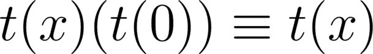
- 结合律：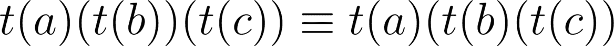 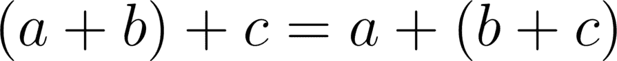

> **注意：**  表示“等价于”。

- `t(x)(t(0)).toString() === t(x).toString()`
- `t(a)(t(b))(t(c)).toString() === t(a)(t(b)(t(c)).toString()`

我们可以将这些规则转化为一种简单的单元测试：

```javascript
 1 const assert = ({given, should, actual, expected}) => {
 2   if (actual.toString() !== expected.toString()) {
 3     throw new Error(`NOT OK: Given ${ given }, should ${ should }
 4       Expected: ${ expected }
 5       Actual:   ${ actual }
 6     `);
 7   }
 8 
 9   console.log(`OK: Given ${ given }, should ${ should }`);
10 };
11 
12 
13 {
14   const given = 'a value `t(x)` composed with `t(0)`';
15   const should = 'be equivalent to `t(x)`';
16   const x = 20;
17 
18   const actual = t(x)(t(0));
19   const expected = t(x);
20 
21   assert({
22     given,
23     should,
24     actual,
25     expected
26   });
27 }
28 
29 {
30   const given = 'a value `t(x)` composed with `t(1)`';
31   const should = 'be equivalent to `t(x + 1)`';
32   const [a, b, c] = [1, 2, 3];
33 
34   const actual = t(x)(t(1));
35   const expected = t(x + 1);
36 
37   assert({
38     given,
39     should,
40     actual,
41     expected
42   });
43 }
```

这些测试最初会失败：

```javascript
1 NOT OK: a value t(x) composed with t(0) ==== t(x)
2         Expected: t(20)
3         Actual:   20
```

但我们可以通过三个简单的步骤让它们通过：

1. 将`fn`函数改为`add`函数，该函数返回`t(value + n)`，其中`n`是传入的参数。
2. 为`t`类型添加一个`valueOf()`方法，以便新的`add()`函数可以将`t()`的实例作为参数。`+`运算符会使用`n.valueOf()`的结果作为第二个操作数。
3. 使用`Object.assign()`将这些方法分配给`add()`函数。

当把所有内容组合在一起时，看起来像这样：

```javascript
1 const t = value => {
2   const add = n => t(value + n);
3 
4   return Object.assign(add, {
5     toString: () => `t(${ value })`,
6     valueOf: () => value
7   });
8 };
```

然后测试通过了：

```javascript
1 "OK: a value t(x) composed with t(0) ==== t(x)"
2 "OK: a value t(x) composed with t(1) ==== t(x + 1)"
```

现在你可以通过函数组合来组合`t()`的值：

```javascript
 1 // 从上到下组合函数：
 2 const pipe = (...fns) => x => fns.reduce((y, f) => f(y), x);
 3 
 4 // 用初始值启动管道的语法糖：
 5 const add = (...fns) => pipe(...fns)(t(0));
 6 
 7 const sum = add(
 8   t(2),
 9   t(4),
10   t(-1)
11 );
12 
13 console.log(sum.toString()) // t(5)
```

## 你可以对任何数据类型这样做

你的数据是什么形状并不重要，只要存在某种有意义的组合操作即可。对于列表或字符串，可以是拼接。对于数字信号处理（DSP），可以是信号求和。当然，对于同一数据，可能有许多不同的操作都有意义。问题是，哪个操作最能代表组合的概念？换句话说，哪个操作以如下方式表达会受益最大？：

```javascript
1 const result = compose(
2   value1,
3   value2,
4   value3
5 );
```

## 可组合的货币

[Moneysafe](https://github.com/ericelliott/moneysafe) 是一个开源库，实现了这种可组合的函数式数据类型风格。JavaScript 的`Number`类型无法精确表示某些美元分数。

```javascript
1 .1 + .2 === .3 // false
```

Moneysafe 通过将美元金额提升为美分来解决这个问题：

```bash
1 npm install --save moneysafe
```

然后：

```javascript
1 import { $ } from 'moneysafe';
2 
3 $(.1) + $(.2) === $(.3).cents; // true
```

账本语法利用了 Moneysafe 将值提升为可组合函数这一事实。它暴露了一个简单的函数组合工具，称为账本：

```javascript
 1 import { $ } from 'moneysafe';
 2 import { $$, subtractPercent, addPercent } from 'moneysafe/ledger';
 3 
 4 $$(
 5   $(40),
 6   $(60),
 7   // 减去折扣
 8   subtractPercent(20),
 9   // 加上税费
10   addPercent(10)
11 ).$; // 88
```

返回值是提升后的货币类型的值。它暴露了方便的`.$`获取器，该获取器将内部的浮点美分值转换为美元，并四舍五入到最近的美分。

结果是一个直观的接口，用于执行账本风格的货币计算。

# 透镜

透镜是一对可组合的纯 getter 和 setter 函数，专注于对象内的特定字段，并遵循一组称为透镜定律的公理。将对象视为*整体*，字段视为*部分*。getter 接收整体并返回透镜所关注的对象部分。

```javascript
1 // view = whole => part
```

setter 接收一个整体和一个要设置的部分值，并返回一个更新了部分的新整体。与简单地将值设置到对象成员字段的函数不同，透镜 setter 是纯函数：

```javascript
1 // set = whole => part => whole
```

> **注意：** 在本文中，我们将在代码示例中使用一些简单的透镜，以便让你一窥底层的一般概念。对于生产代码，你应该使用像 Ramda 这样经过充分测试的库。不同透镜库的 API 有所不同，并且可以用比这里展示的更可组合、更优雅的方式来表达透镜。

想象你有一个表示点`x`、`y`和`z`坐标的元组数组：

```javascript
1 [x, y, z]
```

要单独获取或设置每个字段，你可以创建三个透镜。每个轴一个。你可以手动创建专注于每个字段的 getter：

```javascript
1 const getX = ([x]) => x;
2 const getY = ([x, y]) => y;
3 const getZ = ([x, y, z]) => z;
4 
5 console.log(
6   getZ([10, 10, 100]) // 100
7 );
```

同样，相应的 setter 可能如下所示：

```javascript
1 const setY = ([x, _, z]) => y => ([x, y, z]);
2 
3 console.log(
4   setY([10, 10, 10])(999) // [10, 999, 10]
5 );
```

## 为什么使用透镜？

状态形状依赖是软件中常见的耦合来源。许多组件可能依赖于某些共享状态的形状，因此如果以后需要更改该状态的形状，你必须在多个地方更改逻辑。

透镜允许你将状态形状抽象到 getter 和 setter 后面。与其用深入特定对象形状的代码污染你的代码库，不如导入一个透镜。如果以后需要更改状态形状，你可以在透镜中进行更改，而依赖于该透镜的任何代码都不需要更改。

这遵循了这样一个原则：需求的小变化应该只导致系统的小变化。

## 背景

1985 年，[《计算机程序的构造与解释》](https://www.amazon.com/Structure-Interpretation-Computer-Programs-Engineering/dp/0262510871/ref=as_li_ss_tl?ie=UTF8&linkCode=ll1&tag=eejs-20&linkId=9fac31d60f8b9b60f63f71ab716694bc) 描述了 getter 和 setter 对（在文本中称为`put`和`get`）作为将对象形状与使用该对象的代码隔离的一种方式。该文本展示了如何创建通用选择器来访问复数的部分，而不管该数字如何表示。这种隔离很有用，因为它打破了状态形状依赖。这些 getter/setter 对有点像引用查询，后者在关系数据库中已经存在了几十年。

透镜通过使 getter/setter 对更加通用和可组合，进一步推进了这一概念。它们在 Edward Kmett 发布了 Haskell 的 Lens 库后流行起来。他受到了 Jeremy Gibbons 和 Bruno C. d. S. Oliveira（他们展示了遍历表达了迭代器模式）、Luke Palmer 的“访问器”、Twan van Laarhoven 以及 Russell O'Connor 的影响。

> **注意：** 一个常见的错误是将现代函数式透镜的概念与 Anamorphisms 混为一谈，后者基于 Erik Meijer、Maarten Fokkinga 和 Ross Paterson 在 1991 年发表的[《Functional Programming with Bananas, Lenses, Envelopes and Barbed Wire》](http://citeseerx.ist.psu.edu/viewdoc/summary?doi=10.1.1.41.125)。 “在函数式引用中，‘lens’一词指的是它观察整体的一部分。而在递归模式中，‘lens’一词指的是`[(`和`)]`在语法上看起来像凹透镜。**长话短说**，它们之间毫无关系。” —— [Edward Kmett 在 Stack Overflow 上的回答](https://stackoverflow.com/questions/17198072/how-is-anamorphism-related-to-lens)

## 透镜定律

透镜定律是一些代数公理，用于确保透镜行为良好。

1. `view(lens, set(lens, value, store))`  `value` —— 如果你将一个值存入 store，并立即通过透镜查看该值，你将得到刚刚设置的值。
2. `set(lens, b, set(lens, a, store))`  `set(lens, b, store)` —— 如果你先将透镜值设为`a`，然后立即将其设为`b`，这与直接设为`b`的效果相同。
3. `set(lens, view(lens, store), store)`  `store` —— 如果你从 store 中获取透镜值，然后立即将该值设置回 store，store 的值不变。

在深入代码示例之前，请记住，如果在生产环境中使用透镜，你应该使用经过充分测试的透镜库。我在 JavaScript 中知道的最好的是 Ramda。这里我们先跳过它，自己构建一些简单的透镜，仅用于学习目的：


```js
// 用于查看和设置的纯函数，可与任何透镜一起使用：
const view = (lens, store) => lens.view(store);
const set = (lens, value, store) => lens.set(value, store);

// 一个接受 prop 并返回该 prop 的简单
// 透镜访问器的函数。
const lensProp = prop => ({
  view: store => store[prop],
  // 这非常简单，因为它只适用于对象：
  set: (value, store) => ({
    ...store,
    [prop]: value
  })
});

// 一个示例 store 对象。用透镜访问的对象
// 通常被称为“store”对象：
const fooStore = {
  a: 'foo',
  b: 'bar'
};

const aLens = lensProp('a');
const bLens = lensProp('b');

// 使用 `view()` 函数从透镜中解构出 `a` 和 `b` 属性。
const a = view(aLens, fooStore);
const b = view(bLens, fooStore);
console.log(a, b); // 'foo' 'bar'

// 使用 `aLens` 将值设置到 store 中：
const bazStore = set(aLens, 'baz', fooStore);

// 查看新设置的值。
console.log(view(aLens, bazStore)); // 'baz'
```

让我们验证这些函数的透镜定律：

```js
const store = fooStore;

{
  // `view(lens, set(lens, value, store))` = `value`
  // 如果你将一个值存入 store，并立即通过透镜查看该值，
  // 你将得到刚刚设置的值。
  const lens = lensProp('a');
  const value = 'baz';

  const a = value;
  const b = view(lens, set(lens, value, store));

  console.log(a, b); // 'baz' 'baz'
}

{
  // `set(lens, b, set(lens, a, store))` = `set(lens, b, store)`
  // 如果你先将透镜值设为 `a`，然后立即将其设为 `b`，
  // 这与直接设为 `b` 的效果相同。
  const lens = lensProp('a');

  const a = 'bar';
  const b = 'baz';

  const r1 = set(lens, b, set(lens, a, store));
  const r2 = set(lens, b, store);

  console.log(r1, r2); // {a: "baz", b: "bar"} {a: "baz", b: "bar"}
}

{
  // `set(lens, view(lens, store), store)` = `store`
  // 如果你从 store 中获取透镜值，然后立即将该值设置回 store，
  // store 的值不变。
  const lens = lensProp('a');

  const r1 = set(lens, view(lens, store), store);
  const r2 = store;

  console.log(r1, r2); // {a: "foo", b: "bar"} {a: "foo", b: "bar"}
}
```

### 组合透镜

透镜是可组合的。当你组合透镜时，生成的透镜将深入对象，遍历完整的对象路径。让我们从 Ramda 导入功能更完善的 `lensProp` 来演示：

```js
import { compose, lensProp, view } from 'ramda';

const lensProps = [
  'foo',
  'bar',
  1
];

const lenses = lensProps.map(lensProp);

const truth = compose(...lenses);

const obj = {
  foo: {
    bar: [false, true]
  }
};

console.log(
  view(truth, obj)
);
```

这很好，但关于透镜的组合还有更多需要我们了解的内容。让我们深入探讨。

#### Over

可以在任何函子数据类型的上下文中应用一个 `a => b` 的函数。我们已经证明，函子映射*就是组合*。类似地，我们可以将一个函数应用于透镜焦点上的值。通常，该值会是相同类型，因此它是一个 `a => a` 的函数。在 JavaScript 库中，透镜的映射操作通常被称为 `over`。我们可以这样创建它：

```js
// over = (lens, f: a => a, store) => store
const over = (lens, f, store) => set(lens, f(view(lens, store)), store);
const uppercase = x => x.toUpperCase();

console.log(
  over(aLens, uppercase, store) // { a: "FOO", b: "bar" }
);
```

设置器（setter）遵循函子定律：

```js
{ // 如果你将恒等函数映射到透镜上，
  // store 保持不变。
  const id = x => x;
  const lens = aLens;
  const a = over(lens, id, store);
  const b = store;

  console.log(a, b);
}
```

对于组合示例，我们将使用自动柯里化版本的 `over`：

```js
import { curry } from 'ramda';

const over = curry(
  (lens, f, store) => set(lens, f(view(lens, store)), store)
);
```

现在很容易看出，在 `over` 操作下的透镜也遵循函子组合律：

```js
{ // over(lens, f) 后接 over(lens, g) 等同于
  // over(lens, compose(f, g))
  const lens = aLens;

  const store = {
    a: 20
  };

  const g = n => n + 1;
  const f = n => n * 2;

  const a = compose(
    over(lens, f),
    over(lens, g)
  );

  const b = over(lens, compose(f, g));

  console.log(
    a(store), // {a: 42}
    b(store)  // {a: 42}
  );
}
```

我们在这里只是浅尝辄止地介绍了透镜，但这应该足以让你入门。更多细节方面，Edward Kmett 对此有很多论述，也有许多人撰写了更深入的探索文章。

## 转换器（Transducers）

在接触转换器之前，你应该首先对**归约器（reducers）**和**函数组合**有深入的理解。

> Transduce：源自 17 世纪的科学拉丁语，“transductionem”意为“改变、转换”。它进一步源自“transducere/traducere”，意为“引导、转移”。

**转换器**是一种可组合的**高阶归约器**。它接收一个归约器作为输入，并返回另一个归约器。

转换器具有以下特点：

- 可使用简单的函数组合进行组合
- 对于包含多个操作的大型集合效率高：无论管道中有多少个操作，只对集合枚举一次
- 能够对任何可枚举源进行转换（例如数组、树、流、图等）
- 可用于惰性求值或急切求值，且无需更改转换器管道

归约器将多个输入*折叠*为单个输出，其中“折叠”可以替换为几乎任何产生单个输出的二元操作，例如：

```js
// 求和：(1, 2) = 3
const add = (a, c) => a + c;

// 求积：(2, 4) = 8
const multiply = (a, c) => a * c;

// 字符串拼接：('abc', '123') = 'abc123'
const concatString = (a, c) => a + c;

// 数组合并：([1,2], [3,4]) = [1, 2, 3, 4]
const concatArray = (a, c) => [...a, ...c];
```

Transducers 做的事情大致相同，但与普通 reducer 不同的是，transducers 可以通过常规的函数组合进行组合。换句话说，你可以将任意数量的 transducers 组合成一个新的 transducer，将每个组件 transducer 串联在一起。

普通 reducer 无法组合，因为它们接受两个参数，只返回一个输出值，因此你不能简单地将输出连接到系列中下一个 reducer 的输入。类型不匹配：

```text
f: (a, c) => a
g:          (a, c) => a
h: ???
```

Transducers 具有不同的签名：

```text
f: reducer => reducer
g:            reducer => reducer
h: reducer    =>         reducer
```

由于管道中的所有函数都接受一个 reducer 并返回一个 reducer，因此输入和输出类型始终匹配，便于组合。

### 为什么使用 Transducers？

通常，在处理数据时，将处理过程分解为多个独立、可组合的阶段是很有用的。例如，从一个较大的集合中选择一些数据，然后处理这些数据，这是非常常见的。你可能会倾向于这样做：

```js
const friends = [
  { id: 1, name: 'Sting', nearMe: true },
  { id: 2, name: 'Radiohead', nearMe: true },
  { id: 3, name: 'NIN', nearMe: false },
  { id: 4, name: 'Echo', nearMe: true },
  { id: 5, name: 'Zeppelin', nearMe: false }
];

const isNearMe = ({ nearMe }) => nearMe;

const getName = ({ name }) => name;

const results = friends
  .filter(isNearMe)
  .map(getName);

console.log(results);
// => ["Sting", "Radiohead", "Echo"]
```

对于这样的小列表来说没问题，但存在一些潜在问题：

1. 这只适用于数组。对于来自网络订阅的潜在无限数据流，或者包含朋友的朋友的社交图谱，该怎么办？

2. 每次在数组上使用点链式语法时，JavaScript 都会在进入链中的下一个操作之前构建一个全新的中间数组。如果你有一个包含 2,000,000 个“朋友”的列表需要处理，这可能会使速度降低一到两个数量级。使用 transducers，你可以将每个朋友流式传输通过完整的管道，而无需在它们之间构建中间集合，从而节省大量时间和内存开销。

3. 使用点链式语法，你必须为标准操作（如 `.filter()`、`.map()`、`.reduce()`、`.concat()` 等）构建不同的实现。数组方法是 JavaScript 内置的，但如果你想构建一个自定义数据类型并支持一系列标准操作，而不必从头编写所有操作，该怎么办？Transducers 可以潜在地与任何传输数据类型一起工作：编写一次操作符，就可以在任何支持 transducers 的地方使用它。

让我们看看使用 transducers 会是什么样子。这段代码目前还不能运行，但请继续阅读，你将能够自己构建这个 transducer 管道的每一个部分：

```js
const friends = [
  { id: 1, name: 'Sting', nearMe: true },
  { id: 2, name: 'Radiohead', nearMe: true },
  { id: 3, name: 'NIN', nearMe: false },
  { id: 4, name: 'Echo', nearMe: true },
  { id: 5, name: 'Zeppelin', nearMe: false }
];

const isNearMe = ({ nearMe }) => nearMe;

const getName = ({ name }) => name;

const getFriendsNearMe = compose(
  filter(isNearMe),
  map(getName)
);

const results2 = toArray(getFriendsNearMe, friends);
```

Transducers 在你告诉它们启动并输入一些数据之前不会做任何事情，这就是为什么我们需要 `toArray()`。它提供可转换的过程，并告诉 transducer 将结果转换成一个新数组。你可以告诉它转换到流、可观察对象或任何你喜欢的东西，而不是调用 `toArray()`。

一个 transducer 可以将数字映射为字符串，或将对象映射为数组，或将数组映射为更小的数组，或者根本不改变任何东西，映射 `{ x, y, z } -> { x, y, z }`。Transducers 也可以过滤掉流中的部分信号 `{ x, y, z } -> { x, y }`，甚至生成新值插入到输出流中，`{ x, y, z } -> { x, xx, y, yy, z, zz }`。

在本节中，我会在一定程度上互换使用“信号”和“流”这两个词。请记住，当我说“流”时，我指的不是任何特定的数据类型：仅仅是零个或多个值的序列，或者*随时间表达的值列表*。

### 背景与词源

在硬件信号处理系统中，transducer 是一种将一种能量形式转换为另一种能量形式的设备，例如，麦克风 transducer 将声波转换为电信号。换句话说，它将一种信号转换为另一种信号。同样，代码中的 transducer 将一种信号转换为另一种信号。

“transducers”这个词以及软件中可组合的数据转换管道的一般概念至少可以追溯到 20 世纪 60 年代，但我们对它们应该如何工作的想法随着语言和上下文的不同而变化。在计算机科学的早期，许多软件工程师同时也是电气工程师。那时计算机科学的普遍研究通常涉及硬件和软件设计。因此，将计算过程视为“transducers”并不特别新奇。你可以在早期的计算机科学文献中遇到这个术语——特别是在数字信号处理（DSP）和**数据流编程**的背景下。

20 世纪 60 年代，麻省理工学院林肯实验室使用 TX-2 计算机系统（美国空军 SAGE 防御系统的前身）在图形计算方面取得了开创性成果。伊万·萨瑟兰著名的 [Sketchpad](https://dspace.mit.edu/handle/1721.1/14979)（开发于 1961-1962 年）是对象原型委托和使用光笔进行图形编程的早期例子。

伊万的兄弟威廉·罗伯特·“伯特”·萨瑟兰是数据流编程的先驱之一。他在 Sketchpad 之上构建了一个数据流编程环境，该环境将软件“过程”描述为操作符节点的有向图，其中输出链接到其他节点的输入。他在 1966 年的论文 [《计算机过程的在线图形化规范》](https://dspace.mit.edu/handle/1721.1/13474) 中写下了这一经验。与数组和数组处理不同，所有内容都表示为连续运行的交互式程序循环中的值流。每个值在到达参数输入时由每个节点处理。今天，你可以在 [Unreal Engine 的蓝图可视化脚本环境](https://docs.unrealengine.com/en-us/Engine/Blueprints) 或 [Native Instruments 的 Reaktor](https://www.native-instruments.com/en/products/komplete/synths/reaktor-6/)（音乐家用来构建自定义音频合成器的可视化编程环境）中找到类似的系统。


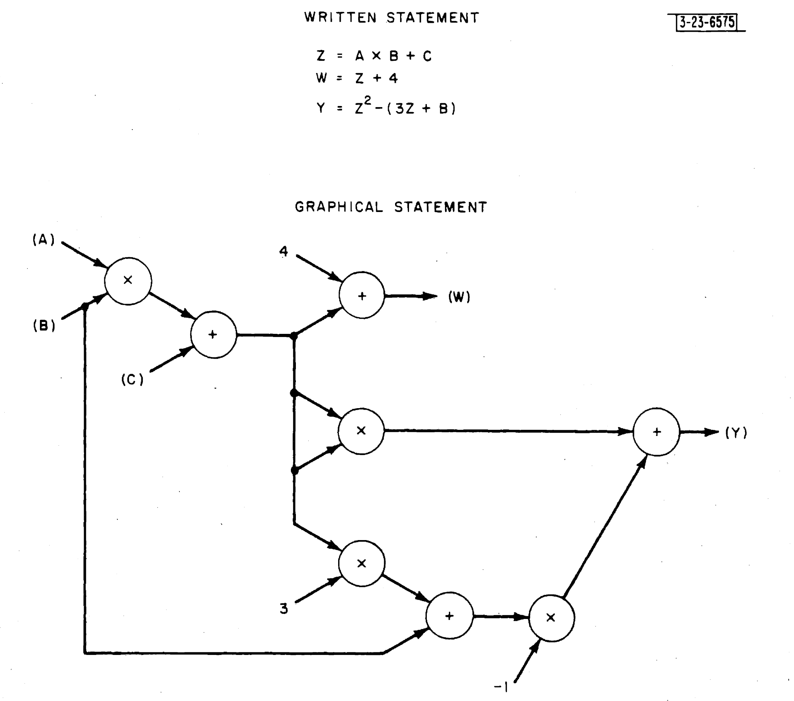

来自伯特·萨瑟兰论文的连接图形操作符管道

据我所知，第一本在通用软件流处理语境下普及“变换器”（transducer）一词的书籍，是 1985 年麻省理工学院计算机科学课程的教材——由哈罗德·阿贝尔森（Harold Abelson）、杰拉尔德·杰伊·萨斯曼（Gerald Jay Sussman）与朱莉·萨斯曼（Julie Sussman）合著的[《计算机程序的构造与解释》](https://www.amazon.com/Structure-Interpretation-Computer-Programs-Engineering/dp/0262510871/ref=as_li_ss_tl?ie=UTF8&qid=1507159222&sr=8-1&keywords=sicp&linkCode=ll1&tag=eejs-20&linkId=44b40411506b45f32abf1b70b44574d2)（`SICP`）。然而，在数字信号处理领域，“变换器”一词的使用早于 `SICP`。

> **注意：** `SICP` 至今仍是从函数式编程视角学习计算机科学的优秀入门书，它依然是我最喜爱的相关书籍。

近年来，变换器被独立重新发现，并由里奇·希基（Rich Hickey）为 Clojure 开发了一套不同的协议（约 2014 年）。希基以根据词源精心挑选概念用词而闻名。在我看来，他这次做得非常到位，因为 Clojure 变换器几乎完全填补了 `SICP` 中变换器的相同生态位，并且它们共享许多共同特征。不过，它们并非严格意义上的同一事物。

作为通用概念（不特指希基的协议规范），变换器对计算机科学的重要分支产生了深远影响，包括数据流编程、科学与媒体应用的信号处理、网络、人工智能等。随着我们在应用代码中表达变换器的工具和技术日益完善，它们正帮助我们更好地理解各种软件组合方式，包括 Web 和移动应用中的用户界面行为；未来，它们还可能帮助我们管理增强现实、自主设备与车辆等领域的复杂性。

在本文的讨论中，当我提到“变换器”时，并非指 `SICP` 中的变换器（尽管如果你已经熟悉 `SICP` 中的变换器，可能会觉得我描述的就是它们）。我也并非特指 Clojure 的变换器，或已成为 JavaScript 事实标准的变换器协议（由 Ramda、Transducers-JS、RxJS 等支持）。我指的是高阶归约器的通用概念——即对变换的变换。

在我看来，变换器协议的具体细节远不如变换器的一般原理和底层数学性质重要。不过，如果你想在生产中使用变换器，我目前的建议是使用实现了变换器协议的现有库，以保证互操作性。

我将在本文中描述的变换器应视为表达概念的伪代码。它们与变换器协议不兼容，不应在生产中使用。如果你想学习如何使用某个特定库的变换器，请参考该库的文档。我之所以这样编写，是为了揭开引擎盖，让你在不被迫同时学习协议的情况下，了解它们的工作原理。

读完本文后，你应该能更好地理解变换器的一般概念，以及如何在任何上下文、任何库、任何支持闭包和高阶函数的语言中应用它们。

## 变换器的音乐类比

如果你属于同时是音乐人的大量软件开发者之一，那么音乐类比可能会有所帮助：你可以将变换器想象成信号处理设备（例如吉他失真踏板、均衡器、音量旋钮、回声、混响以及音频混音器）。

要使用乐器录制一首歌，我们需要某种物理变换器（即麦克风）将空气中的声波转换为电线上的电信号。然后，我们需要将电线连接到我们想使用的任何信号处理单元。例如，为电吉他添加失真，或为人声轨道添加混响。最终，这些不同的声音必须被聚合在一起并混合成代表最终录音的单一信号（或一组声道）。

换句话说，信号流可能看起来像这样。想象箭头是变换器之间的连线：

```text
1 [ 音源 ] -> [ 麦克风 ] -> [ 滤波器 ] -> [ 混音器 ] -> [ 录音 ]
```

用更通用的术语，可以这样表达：

```text
1 [ 枚举器 ] -> [ 变换器 ] -> [ 变换器 ] -> [ 累加器 ]
```

如果你曾使用过音乐制作软件，这可能会让你想起一串音频效果链。当你思考变换器时，这是一个很好的直觉，但变换器可以更广泛地应用于数字、对象、动画帧、3D 模型，或任何你能在软件中表示的事物。

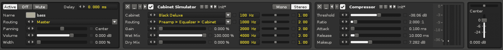

Renoise 音乐软件效果链

如果你曾使用过数组的 `map` 方法，你可能已经体验过与变换器有些相似的东西。例如，将一系列数字加倍：

```javascript
1 const double = x => x * 2;
2 const arr = [1, 2, 3];
3 
4 const result = arr.map(double);
```

在这个例子中，数组是一个可枚举对象。`map` 方法枚举原始数组，将其元素传递给处理阶段 `double`，该阶段将每个元素乘以 2，然后将结果累加到一个新数组中。

你甚至可以像这样组合效果：

```javascript
 1 const double = x => x * 2;
 2 const isEven = x => x % 2 === 0;
 3 
 4 const arr = [1, 2, 3, 4, 5, 6];
 5 
 6 const result = arr
 7   .filter(isEven)
 8   .map(double)
 9 ;
10 
11 console.log(result);
12 // [4, 8, 12]
```

但是，如果你想过滤并加倍一个可能无限的数字流（例如无人机的遥测数据）呢？

数组不能是无限的，并且数组处理中的每个阶段都需要处理完整个数组，才能让单个值流经管道中的下一个阶段。同样的限制意味着使用数组方法进行组合会降低性能，因为组合中的每个阶段都需要创建一个新数组并迭代一个新集合。

想象你有两段管道，每段代表要应用于数据流的变换，以及一个代表数据流的字符串。第一个变换代表 `isEven` 过滤器，下一个代表 `double` 映射。为了从数组中产生一个完全变换后的值，你必须先将整个字符串通过第一段管道，得到一个全新的、过滤后的数组，然后才能将任何一个值通过 `double` 管道进行处理。当你最终开始对第一个值进行 `double` 时，你必须等待整个数组被加倍，才能读取单个结果。

因此，上面的代码等价于：

```javascript
 1 const double = x => x * 2;
 2 const isEven = x => x % 2 === 0;
 3 
 4 const arr = [1, 2, 3, 4, 5, 6];
 4 
 6 const tempResult = arr.filter(isEven);
 7 const result = tempResult.map(double);
 8 
 9 console.log(result);
10 // [4, 8, 12]
```

另一种方法是将值直接从过滤后的输出流到映射变换，而无需在中间创建并迭代一个临时的临时数组。逐个流式处理值消除了在变换过程中为每个阶段迭代同一集合的需要，并且变换器可以随时发出停止信号，这意味着你无需为了产生所需值而比必要深度更深地枚举每个阶段。

有两种方法可以实现这一点：

- **拉取（Pull）：** 惰性求值，或
- **推送（Push）：** 急切求值

拉取 API 会一直等待，直到消费者请求下一个值。JavaScript 中的一个典型例子是 `Iterable`，比如生成器函数产生的对象。在生成器函数中，除非你通过调用其返回的迭代器对象上的 `.next()` 来请求下一个值，否则不会发生任何操作。

推送 API 会枚举源值，并尽可能快地将它们通过管道推送出去。调用 `array.reduce()` 就是推送 API 的一个好例子。`array.reduce()` 每次从数组中取出一个值，并将其推送到归约器中，最终在另一端产生一个新值。对于像数组归约这样的急切处理过程，数组中的每个元素都会立即重复该过程，直到整个数组被处理完毕，同时阻塞后续的程序执行。

变换器不关心你是拉取还是推送。变换器对它们所操作的数据结构没有感知。它们只是调用你传入的归约器来累积新值。

变换器是**高阶归约器**：即接受一个归约器并返回一个新归约器的归约函数。Rich Hickey 将变换器描述为**过程变换**，意思是变换器不仅仅是改变流经其中的值，而是改变作用于这些值的过程。

其签名如下：

```text
1 reducer = (accumulator, current) => accumulator
2 
3 transducer = reducer => reducer
```

或者，详细说明：

```text
1 transducer = ((accumulator, current) => accumulator) =>
2   ((accumulator, current) => accumulator)
```

不过一般来说，大多数变换器需要部分应用一些参数来使其特化。例如，一个映射变换器可能看起来像这样：

```text
1 map = transform => reducer => reducer
```

或者更具体地说：

```text
1 map = (a => b) => step => reducer
```

换句话说，映射变换器接受一个映射函数（称为变换）和一个归约器（称为 `step` 函数），并返回一个新的归约器。`step` 函数是一个归约器，当我们产生一个新值并需要在下一步将其添加到累加器中时调用它。

让我们看一些简单的例子：

```javascript
 1 const compose = (...fns) => x => fns.reduceRight((y, f) => f(y), x);
 2 
 3 const map = f => step =>
 4   (a, c) => step(a, f(c));
 5 
 6 const filter = predicate => step =>
 7   (a, c) => predicate(c) ? step(a, c) : a;
 8 
 9 const isEven = n => n % 2 === 0;
10 const double = n => n * 2;
11 
12 const doubleEvens = compose(
13   filter(isEven),
14   map(double)
15 );
16 
17 const arrayConcat = (a, c) => a.concat([c]);
18 
19 const xform = doubleEvens(arrayConcat);
20 
21 const result = [1,2,3,4,5,6].reduce(xform, []); // [4, 8, 12]
22 
23 console.log(result);
```

这需要消化很多内容。让我们分解一下。`map` 将函数应用于某个上下文内的值。在这个例子中，上下文是变换器管道。它大致看起来像这样：

```javascript
1 const map = f => step =>
2   (a, c) => step(a, f(c));
```

你可以这样使用它：

```javascript
1 const double = x => x * 2;
2 
3 const doubleMap = map(double);
4 
5 const step = (a, c) => console.log(c);
6 
7 doubleMap(step)(0, 4);  // 8
8 doubleMap(step)(0, 21); // 42
```

最后函数调用中的零表示归约器的初始值。注意，`step` 函数本应是一个归约器，但为了演示目的，我们可以劫持它并输出到控制台。如果你需要在单元测试中断言 `step` 函数的使用方式，也可以使用同样的技巧。

当我们组合变换器时，它们变得有趣起来。让我们实现一个简化的过滤变换器：

```javascript
1 const filter = predicate => step =>
2   (a, c) => predicate(c) ? step(a, c) : a;
```

`Filter` 接受一个谓词函数，只允许匹配谓词的值通过。否则，返回的归约器会原封不动地返回累加器。

由于这两个函数都接受一个归约器并返回一个归约器，我们可以通过简单的函数组合来组合它们：

```javascript
1 const compose = (...fns) => x => fns.reduceRight((y, f) => f(y), x);
2 
3 const isEven = n => n % 2 === 0;
4 const double = n => n * 2;
5 
6 const doubleEvens = compose(
7   filter(isEven),
8   map(double)
9 );
```

这也会返回一个变换器，这意味着我们必须提供一个最终的 `step` 函数来告诉变换器如何累积结果：

```javascript
1 const arrayConcat = (a, c) => a.concat([c]);
2 
3 const xform = doubleEvens(arrayConcat);
```

这个调用的结果是一个标准的归约器，我们可以直接将其传递给任何兼容的归约 API。第二个参数表示归约的初始值。在这个例子中，是一个空数组：

```javascript
1 const result = [1,2,3,4,5,6].reduce(xform, []); // [4, 8, 12]
```

如果这看起来工作量很大，请记住，已经有一些函数式编程库提供了常见的变换器以及诸如 `compose`（处理函数组合）和 `into`（将值变换到给定的空值中）等工具，例如：

```javascript
1 const xform = compose(
2   map(inc),
3   filter(isEven)
4 );
5 
6 into([], xform, [1,2,3,4]); // [2, 4]
```

由于大多数所需工具已经存在于工具包中，使用变换器进行编程非常直观。

支持变换器的流行库包括 RxJS 和 Ramda。

## 变换器从上到下组合

在标准函数组合（`f(g(x))`）下，变换器是从上到下/从左到右应用，而不是从下到上/从右到左。换句话说，使用普通函数组合，`compose(f, g)` 表示“在 `g` 之后组合 `f`”。变换器在组合中会包裹其他变换器。换句话说，变换器说：“我要做我的事情，然后调用管道中的下一个变换器”，这实际上将执行栈从内到外翻转了。

想象你有一叠纸，最上面标有 `f`，下一张标有 `g`，再下一张标有 `h`。对于每一张纸，将其从堆顶取下，放到旁边一个新堆的顶部。完成后，你会得到一叠纸，其顺序从上到下是 `h`，然后是 `g`，然后是 `f`。

## 变换器规则

上面的例子是简化的，因为它们忽略了变换器为了互操作性必须遵守的规则。

与软件中的大多数事物一样，变换器和变换过程需要遵守一些规则：

1. **初始化：** 如果没有提供初始累加器值，变换器必须调用 `step` 函数来生成一个有效的初始值以供操作。该值应表示空状态。例如，累积数组的累加器在其 `step` 函数被无参数调用时，应提供一个空数组。
2. **提前终止：** 使用变换器的过程必须检查并在收到一个已归约的累加器值时停止。此外，使用嵌套归约的变换器 `step` 函数必须检查并在遇到已归约值时传递它们。
3. **完成（可选）：** 某些变换过程永远不会完成，但那些会完成的过程应调用完成函数来生成最终值和/或刷新状态，并且有状态的变换器应提供一个完成操作，用于清理任何累积的资源并可能产生一个最终值。

### 初始化

让我们回到 `map` 操作，确保它遵守初始化（空）法则。当然，我们不需要做任何特殊处理，只需通过 `step` 函数将请求向下传递以创建默认值：

```javascript
1 const map = f => step => (a = step(), c) => (
2   step(a, f(c))
3 );
```

我们关心的部分是函数签名中的 `a = step()`。如果没有 `a`（累加器）的值，我们将通过请求链中的下一个归约器来创建一个。最终，它会到达管道的末端，并（希望）为我们创建一个有效的初始值。

记住这条规则：当无参数调用时，reducer 应始终返回一个有效的初始（空）值用于归约。对于任何 reducer 函数，包括 React 或 Redux 的 reducer，遵循此规则通常是个好主意。

### 提前终止

可以向管道中的其他转换器发出信号，表明我们已经完成归约，它们不应再期望处理更多值。当看到 `reduced` 值时，其他转换器可能决定停止向集合添加元素，而转换过程（由最终的 `step()` 函数控制）可能决定停止枚举值。转换过程可能会因为接收到 `reduced` 值而多进行一次调用：即上面提到的完成调用。我们可以通过一个特殊的 `reduced` 累加器值来表明这一意图。

什么是 `reduced` 值？它可以简单到将累加器值包装在一个名为 `reduced` 的特殊类型中。可以想象成将包裹装进一个盒子，并在盒子上贴上“快递”或“易碎”等标签。这种元数据包装在计算中很常见。例如：http 消息被包装在称为“请求”或“响应”的容器中，这些容器类型带有提供状态码、预期消息长度、授权参数等信息的头部。

基本上，这是一种在期望单个值的地方发送多个消息的方式。一个最小（非标准）的 `reduced()` 类型提升示例可能如下所示：

```javascript
1 const reduced = v => ({
2   get isReduced () {
3     return true;
4   },
5   valueOf: () => v,
6   toString: () => `Reduced(${ JSON.stringify(v) })`
7 });
```

严格必需的只有以下几部分：

- **类型提升：** 一种获取类型内部值的方法（例如本例中的 `reduced` 函数）
- **类型识别：** 一种测试值是否为 `reduced` 类型的方法（例如 `isReduced` getter）
- **值提取：** 一种从类型中取出值的方法（例如 `valueOf()`）


`toString()` 仅出于调试方便而包含在内。它让你可以在控制台中同时检查类型和值。

## 完成

> “在完成步骤中，带有归约状态的转换器应在调用嵌套转换器的完成函数之前刷新状态，除非它之前从嵌套步骤中看到过 `reduced` 值，在这种情况下应丢弃待处理状态。” ~ Clojure 转换器文档

换句话说，如果在前一个函数发出已完成归约的信号后，你还有更多状态需要刷新，那么完成步骤就是处理它的时机。在此阶段，你可以选择：

- 发送一个更多值（刷新待处理状态）
- 丢弃待处理状态
- 执行任何必要的状态清理

### 转换

可以对许多不同类型的数据进行转换，但该过程可以概括为：

```js
// import a standard curry, or use this magic spell:
const curry = (
  f, arr = []
) => (...args) => (
  a => a.length === f.length ?
    f(...a) :
    curry(f, a)
)([...arr, ...args]);

const transduce = curry((step, initial, xform, foldable) =>
  foldable.reduce(xform(step), initial)
);
```

`transduce()` 函数接受一个 `step` 函数（转换器管道中的最后一步）、一个累加器的初始值、一个转换器和一个可折叠对象。**可折叠对象**是任何提供 `.reduce()` 方法的对象。

定义了 `transduce()` 后，我们可以轻松创建一个将数据转换为数组的函数。首先，我们需要一个归约到数组的 reducer：

```js
const concatArray = (a, c) => a.concat([c]);
```

现在我们可以使用柯里化的 `transduce()` 来创建一个部分应用，将数据转换为数组：

```js
const toArray = transduce(concatArray, []);
```

有了 `toArray()`，我们可以用一行代码替换两行代码，并在许多其他情况下重用：

```js
// Manual transduce:
const xform = doubleEvens(arrayConcat);
const result = [1, 2, 3, 4, 5, 6].reduce(xform, []);
// => [4, 8, 12]
```

```js
// Automatic transduce:
const result2 = toArray(doubleEvens, [1, 2, 3, 4, 5, 6]);
console.log(result2); // [4, 8, 12]
```

### 转换器协议

到目前为止，我一直将一些细节隐藏在幕后，但现在该看看它们了。转换器实际上并不是一个单一的函数。它们由三个不同的函数组成。Clojure 通过函数参数数量的模式匹配在它们之间切换。

在计算机科学中，函数的**元数**是指函数接受的参数数量。对于转换器，reducer 函数有两个参数：累加器和当前值。在 Clojure 中，两者都是*可选的*，行为根据是否传递参数而变化。如果未传递参数，函数内部该参数的类型为 `undefined`。

JavaScript 转换器协议的处理方式略有不同。JavaScript 转换器不是使用函数元数，而是一个接受转换器并返回转换器的函数。转换器是一个具有三个方法的对象：

- **init** 返回累加器的有效初始值（通常只需调用下一个 `step()`）。
- **step** 应用转换，例如对于 `map(f)`：`step(accumulator, f(current))`。
- **result** 如果转换器在没有新值的情况下被调用，它应处理其完成步骤（通常是 `step(a)`，除非转换器是有状态的）。

> **注意：** JavaScript 中的转换器协议分别使用 `@@transducer/init`、`@@transducer/step` 和 `@@transducer/result`。

这是一个不那么简单的 map 转换器实现：

```js
const map = f => next => transducer({
  init: () => next.init(),
  result: a => next.result(a),
  step: (a, c) => next.step(a, f(c))
});
```

默认情况下，大多数转换器应将 `init()` 调用传递给管道中的下一个转换器，因为我们不知道传输数据类型，所以无法为其生成有效的初始值。

此外，特殊的 `reduced` 对象使用以下属性（在转换器协议中也使用 `@@transducer/<name>` 命名空间）：

- **reduced** 一个布尔值，对于 reduced 值始终为 `true`。
- **value** 被 reduced 的值。

## 结论

**转换器**是可组合的高阶 reducer，可以在任何底层数据类型上进行归约。

转换器生成的代码可能比使用数组的点链式调用高效数个数量级，并且可以处理潜在无限的数据集而无需创建中间聚合。

> **注意：** 转换器并不*总是*比内置数组方法快。性能优势往往在数据集非常大（数十万项）或管道非常大（显著增加使用方法链所需的迭代次数）时显现。如果你追求性能优势，请记得进行性能分析。

再看一下引言中的示例。你应该能够使用示例代码作为参考构建 `filter()`、`map()` 和 `toArray()`，并使以下代码工作：

```js
const friends = [
  { id: 1, name: 'Sting', nearMe: true },
  { id: 2, name: 'Radiohead', nearMe: true },
  { id: 3, name: 'NIN', nearMe: false },
  { id: 4, name: 'Echo', nearMe: true },
  { id: 5, name: 'Zeppelin', nearMe: false }
];

const isNearMe = ({ nearMe }) => nearMe;

const getName = ({ name }) => name;

const getFriendsNearMe = compose(
  filter(isNearMe),
  map(getName)
);

const results2 = toArray(getFriendsNearMe, friends);
```

在生产环境中，你可以使用来自 [RxJS](https://github.com/ReactiveX/rxjs) 或 [Ramda](http://ramdajs.com/) 的 transducer。在实际代码中，我通常会在需要订阅数据流并在应用代码中使用之前处理流中的数据时，使用 transducer。在这些情况下，我会使用 RxJS 中的可管道操作符。RxJS 的可管道操作符的行为与常规 transducer 类似，但它们不是从 reducer 映射到 reducer，而是从 observable 映射到 observable。

以下是一个来自 Ramda 的示例：

```js
import {
  compose,
  filter,
  map,
  into
} from 'ramda';

const isEven = n => n % 2 === 0;
const double = n => n * 2;

const doubleEvens = compose(
  filter(isEven),
  map(double)
);

const arr = [1, 2, 3, 4, 5, 6];

// into = (structure, transducer, data) => result
// into 使用提供的 transducer 处理数据，
// 并将结果放入作为第一个参数传入的结构中。
const result = into([], doubleEvens, arr);

console.log(result); // [4, 8, 12]
```

每当我需要组合多个操作（例如 `map`、`filter`、`chunk`、`take` 等）时，我会使用 transducer 来优化处理过程，并保持代码的可读性和整洁性。试试看吧。

## JavaScript 风格要素

1920 年，小威廉·斯特伦克（William Strunk Jr.）出版了《风格的要素》（The Elements of Style），为英语语言风格制定了经得起时间考验的指南。你可以通过将类似的标准应用于代码风格来改进你的代码。

以下是指南，而非不可改变的法则。如果偏离它们能更清晰地表达代码含义，那么可能有合理的理由这样做，但请保持警惕和自我意识。这些指南之所以经得起时间考验，是有充分理由的：它们通常是正确的。只有在充分理由下才能偏离它们——而不是仅仅出于一时兴起或个人风格偏好。

几乎每一条关于写作基本要素的指南都适用于源代码：

- 将段落作为写作单元：一个段落对应一个主题。
- 省略不必要的词语。
- 使用主动语态。
- 避免一连串松散的句子。
- 将相关的词语放在一起。
- 用肯定形式表达陈述。
- 对平行概念使用平行结构。

我们可以将几乎相同的概念应用于代码风格：

1. 将函数作为组合单元。每个函数只做一件事。
2. 省略不必要的代码。
3. 使用主动语态。
4. 避免一连串松散的语句。
5. 将相关代码放在一起。
6. 用肯定形式表达语句和表达式。
7. 对平行概念使用平行代码。

### 1. 将函数作为组合单元。每个函数只做一件事。

> 软件开发的本质是组合。我们通过组合模块、函数和数据结构来构建软件。
>
> 理解如何编写和组合函数是软件开发人员的基本技能。

模块只是由一个或多个函数或数据结构的集合，而数据结构是我们表示程序状态的方式，但只有当我们应用函数时，才会发生有趣的事情。

在 JavaScript 中，有三种函数：

- 通信函数：执行 I/O 的函数。
- 过程函数：一组指令，组合在一起。
- 映射函数：给定一些输入，返回相应的输出。

虽然所有有用的程序都需要 I/O，并且许多程序遵循某些过程序列，但你的大多数函数应该是映射函数：给定一些输入，函数将返回相应的输出。

**每个函数只做一件事：** 如果你的函数用于 I/O，不要将 I/O 与映射（计算）混合。如果你的函数用于映射，不要将其与 I/O 混合。根据定义，过程函数违反了这一指南。过程函数还违反了另一条指南：避免一连串松散的语句。

理想的函数是一个简单的、确定性的纯函数：

- 给定相同的输入，始终返回相同的输出
- 无副作用

另请参阅“纯函数”。

### 2. 省略不必要的代码。

> “有力的写作是简洁的。一个句子不应包含不必要的词语，一个段落不应包含不必要的句子，其道理与一幅画不应有不必要的线条、一台机器不应有不必要的零件相同。这并非要求作者把所有句子都写短，或避免所有细节、只以提纲形式处理主题，而是要求每个词都有其作用。”[省略了不必要的词语。]
>
> ~ 小威廉·斯特伦克，《风格的要素》

简洁的代码在软件中至关重要，因为更多的代码会为 bug 提供更多的藏身之处。*更少的代码 = 更少的 bug 藏身之处 = 更少的 bug。*

简洁的代码更易读，因为它具有更高的信噪比：读者需要筛选的语法噪音更少，才能理解其含义。*更少的代码 = 更少的语法噪音 = 更强的含义传递信号。*

借用《风格的要素》中的一句话：简洁的代码更有力。

```js
function secret(message) {
  return function () {
    return message;
  };
}
```

可以简化为：

```js
const secret = msg => () => msg;
```

对于熟悉简洁箭头函数（2015 年随 ES6 引入）的人来说，这更易读。它省略了不必要的语法：花括号、`function` 关键字和 `return` 语句。

第一个示例包含了不必要的语法。对于熟悉简洁箭头语法的人来说，花括号、`function` 关键字和 `return` 语句毫无意义。它们的存在只是为了那些尚未熟练掌握 ES6 的人能看懂代码。

ES6 自 2015 年以来一直是语言标准。是时候熟悉它了。

#### 省略不必要的变量。

有时我们倾向于为那些实际上不需要命名的东西分配名称。问题在于，人脑的工作记忆资源有限，每个变量都必须作为一个离散的量子存储，占用一个可用的工作记忆槽位。

因此，经验丰富的开发者会学会消除那些不需要存在的变量。

例如，在大多数情况下，你应该省略那些仅用于命名返回值的变量。函数名应提供足够的信息，说明函数将返回什么。考虑以下代码：

```js
const getFullName = ({ firstName, lastName }) => {
  const fullName = firstName + ' ' + lastName;
  return fullName;
};
```

对比……

```js
const getFullName = ({ firstName, lastName }) => (
  firstName + ' ' + lastName
);
```

开发者减少变量的另一种常见方法是利用函数组合和无点风格。

无点风格是一种定义函数的方式，无需引用函数所操作的参数。实现无点风格的常见方法包括柯里化和函数组合。

让我们看一个使用柯里化的示例：

```js
const add2 = a => b => a + b;

// 现在我们可以定义一个无点的 inc()
// 它将任何数字加 1。
const inc = add2(1);

inc(3); // 4
```

看看 `inc()` 函数的定义。注意它没有使用 `function` 关键字，也没有使用胖箭头语法（`=>`）。没有地方列出参数，因为该函数内部没有使用参数列表。相反，它返回一个知道如何处理参数的函数。

让我们看另一个使用函数组合的示例。函数组合是将一个函数应用于另一个函数的结果的过程。

无论你是否意识到，你一直在使用函数组合。例如，当你链式调用 `.map()` 或 `promise.then()` 等方法时，你就在使用它。在其最基本的形式中，它看起来像这样：`f(g(x))`。在代数中，这种组合通常写作 `f ∘ g`（通常读作“`f` 在 `g` 之后”或“`f` 与 `g` 组合”）。

当你组合两个函数时，就无需创建变量来保存两个函数调用之间的中间值。让我们看看函数组合如何让代码更简洁：

```js
const g = n => n + 1;
const f = n => n * 2;

// 有点式风格：
const incThenDoublePoints = n => {
  const incremented = g(n);
  return f(incremented);
};

incThenDoublePoints(20); // 42
```

对比……

```js
const g = n => n + 1;
const f = n => n * 2;

// compose2 - 接收两个函数，返回它们的组合
const compose2 = (f, g) => x => f(g(x));

// 无点式风格：
const incThenDoublePointFree = compose2(f, g);

incThenDoublePointFree(20); // 42
```

你可以对任何 `functor` 做同样的事情。`functor` 是任何可以映射（map）的东西，例如数组（`array.map()`）或 Promise（`promise.then()`）。

让我们用 `.map()` 链式调用来编写另一个版本的 `compose2()`，用于函数组合：

```js
const compose2 = (f, g) => x => [x].map(g).map(f).pop();

const incThenDoublePointFree = compose2(f, g);

incThenDoublePointFree(20); // 42
```

每次使用 Promise 链时，你都在做几乎相同的事情。

几乎每个函数式编程库都至少有两个版本的组合工具：`compose()`（从右向左应用函数）和 `pipe()`（从左向右应用函数）。

Lodash 将它们称为 `compose()` 和 `flow()`。当我从 Lodash 中使用它们时，我总是这样导入：

```js
import pipe from 'lodash/fp/flow';

pipe(g, f)(20); // 42
```

不过，下面这段代码也不多，而且功能相同：

```js
const pipe = (...fns) => x => fns.reduce((acc, fn) => fn(acc), x);

pipe(g, f)(20); // 42
```

如果函数组合这个概念对你来说很陌生，并且你不确定如何使用它，请仔细思考这一点：

> 软件开发的本质就是组合。我们通过组合更小的模块、函数和数据结构来构建应用程序。

由此你可以得出结论：理解函数组合和对象组合的工具，就像房屋建造者理解电钻和射钉枪一样基础。


当你使用命令式代码，通过中间变量将函数拼凑在一起时，就像用胶带和强力胶来组合这些部件。

请记住：

- 如果可以用更少的代码表达相同的意思，且不改变或混淆含义，那就应该这样做。
- 如果可以用更少的变量表达相同的意思，且不改变或混淆含义，那就应该这样做。

### 3. 使用主动语态

> “主动语态通常比被动语态更直接、更有力。” —— 威廉·斯特伦克 Jr.，《风格的要素》

尽可能直接地命名事物：

- `myFunction.wasCalled()` 优于 `myFunction.hasBeenCalled()`
- `createUser()` 优于 `User.create()`
- `notify()` 优于 `Notifier.doNotification()`

将谓词和布尔值命名为像是回答“是/否”的问题：

- `isActive(user)` 优于 `getActiveStatus(user)`
- `isFirstRun = false;` 优于 `firstRun = false;`

使用动词形式命名函数：

- `increment()` 优于 `plusOne()`
- `unzip()` 优于 `filesFromZip()`
- `filter(isActive, array)` 优于 `activeItemsFromArray(isActive, array)`

#### 事件处理器

事件处理器和生命周期方法是动词规则的例外，因为它们用作限定词；它们不表达要做什么，而是表达何时做。它们的命名应该读作“<何时行动>, <动词>”。

- `element.onClick(handleClick)` 优于 `element.click(handleClick)`
- `component.onDragStart(handleDragStart)` 优于 `component.startDrag(handleDrag)`

在第二种形式中，看起来我们像是在尝试触发事件，而不是响应事件。

#### 生命周期方法

考虑以下用于组件假设生命周期方法的备选方案，该方法的作用是在组件更新之前调用一个处理函数：

- `componentWillBeUpdated(doSomething)`
- `componentWillUpdate(doSomething)`
- `beforeUpdate(doSomething)`

第一个例子使用了被动语态（`willBeUpdated` 而不是 `willUpdate`）。它很冗长，而且并不比其他备选方案更清晰。

第二个例子好得多，但这个生命周期方法的全部意义在于调用一个处理函数。`componentWillUpdate(handler)` 读起来像是它会更新处理函数，但这并不是我们的意思。我们的意思是“在组件更新之前，调用处理函数”。`beforeComponentUpdate()` 更清晰地表达了意图。

我们甚至可以进一步简化。由于这些是方法，主语（组件）是内置的。在方法名中重复提及它是多余的。想想如果你直接调用这些方法会怎样：`component.componentWillUpdate()`。这就像在说“Jimmy Jimmy 晚餐要吃牛排”。你不需要听两次主语的名字。

```js
component.beforeUpdate(doSomething)
```

优于：

```js
component.beforeComponentUpdate(doSomething)
```

`函数式混入` 是向对象添加属性和方法的函数。这些函数像流水线一样一个接一个地应用。每个函数式混入将实例作为输入，在将其传递给流水线中的下一个函数之前，向它添加一些内容。

我喜欢用形容词来命名函数式混入。你通常可以使用“ing”或“able”后缀来找到有用的形容词。例如：

- `const duck = composeMixins(flying, quacking);`
- `const box = composeMixins(iterable, mappable);`

### 4. 避免一连串松散的语句

> “……一系列语句很快就会变得单调乏味。” —— 威廉·斯特伦克 Jr.，《风格的要素》

开发人员经常在过程中将一系列事件串在一起；一组松散相关的语句，设计为依次执行。过多的过程是意大利面条式代码的根源。

这样的序列经常被许多相似的形式重复，每个形式都有细微且有时出乎意料的不同。例如，一个用户界面组件与几乎所有其他用户界面组件共享相同的核心需求。它的关注点可以分解为生命周期阶段，并由不同的函数管理。

考虑以下序列：

```js
const drawUserProfile = ({ userId }) => {
  const userData = loadUserData(userId);
  const dataToDisplay = calculateDisplayData(userData);
  renderProfileData(dataToDisplay);
};
```

这个函数实际上处理了三件不同的事情：加载数据、根据加载的数据计算视图状态、以及渲染。

在大多数现代前端应用架构中，这些关注点都是分开考虑的。通过分离关注点，我们可以轻松地为每个关注点混合搭配不同的函数。例如，我们可以完全替换渲染器，而不会影响程序的其他部分，比如 React 丰富的自定义渲染器：用于原生 iOS 和 Android 应用的 React Native、用于 WebVR 的 AFrame、用于服务端渲染的 ReactDOM/Server 等。

这个函数的另一个问题是，你不能在不先加载数据的情况下简单地计算要显示的数据并生成标记。如果你已经加载了数据呢？你最终会在后续调用中做不必要的工作。

分离关注点也使它们可以独立测试。我喜欢在编写代码时对应用程序进行单元测试，并在每次更改时显示测试结果。然而，如果我们将渲染代码与数据加载代码绑定在一起，我就不能简单地传递一些假数据给渲染代码进行测试。我必须端到端地测试整个组件——这个过程可能因为浏览器加载、异步网络 I/O 等而耗时。我无法从单元测试中获得即时反馈。分离函数允许你独立地测试各个单元。

这个示例已经包含了独立的函数，我们可以将它们挂载到应用的不同生命周期钩子上。加载可以在组件挂载时触发，而计算与渲染则可以响应视图状态的更新。

最终得到的软件职责划分更加清晰：每个组件可以复用相同的结构和生命周期钩子，并且软件性能更好；我们不会在后续周期中重复那些无需重复的工作。

### 5. 将相关代码放在一起

许多框架和模板规定了一种按技术类型分组文件的程序组织方式。如果你在构建一个小型计算器或待办事项应用，这没问题；但对于大型项目，通常更好的做法是按功能将文件分组。

例如，考虑一个待办事项应用的两种备选文件层级结构：按类型分组和按功能分组。

按类型分组：

```text
.
├── components
│   ├── todos
│   └── user
├── reducers
│   ├── todos
│   └── user
└── tests
    ├── todos
    └── user
```

按功能分组：

```text
.
├── todos
│   ├── component
│   ├── reducer
│   └── test
└── user
    ├── component
    ├── reducer
    └── test
```

当你按功能将文件分组时，就无需在文件列表中上下滚动来查找实现某个功能所需编辑的所有文件。

将与功能相关的文件放在一起。

### 6. 使用肯定形式的语句和表达式

> “做出明确的断言。避免软弱、平淡、犹豫不决、模棱两可的语言。将‘not’用作否定或对比的手段，绝不要用作逃避的手段。”——威廉·斯特伦克（小），《风格的要素》

- `isFlying` 优于 `isNotFlying`
- `late` 优于 `notOnTime`

#### If 语句

```js
if (err) return reject(err);
// 执行某些操作...
```

……优于：

```js
if (!err) {
  // ... 执行某些操作
} else {
  return reject(err);
}
```

#### 三元表达式

```js
{
  [Symbol.iterator]: iterator ? iterator : defaultIterator
}
```

……优于：

```js
{
  [Symbol.iterator]: (!iterator) ? defaultIterator : iterator
}
```

#### 优先使用强否定形式

有时我们只关心某个变量是否缺失，因此使用肯定名称会迫使我们用 `!` 运算符来否定它。在这种情况下，优先使用强否定形式。单词“not”和 `!` 运算符会形成弱表达式。

- `if (missingValue)` 优于 `if (!hasValue)`
- `if (anonymous)` 优于 `if (!user)`
- `if (isEmpty(thing))` 优于 `if (notDefined(thing))`

#### 避免在函数调用中传递 `null` 或 `undefined` 参数

不要要求函数调用者传递 `undefined` 或 `null` 来替代可选参数。优先使用命名选项对象：

```js
const createEvent = ({
  title = 'Untitled',
  timeStamp = Date.now(),
  description = ''
}) => ({ title, description, timeStamp });

// 稍后...
const birthdayParty = createEvent({
  title: 'Birthday Party',
  description: 'Best party ever!'
});
```

……优于：

```js
const createEvent = (
  title = 'Untitled',
  timeStamp = Date.now(),
  description = ''
) => ({ title, description, timeStamp });

// 稍后...
const birthdayParty = createEvent(
  'Birthday Party',
  undefined, // 这是可以避免的
  'Best party ever!'
);
```

### 7. 对并行概念使用并行代码

> “……并行结构要求内容与功能相似的表达式在外观上也应相似。形式上的相似性使读者更容易识别内容与功能上的相似性。”——威廉·斯特伦克（小），《风格的要素》

应用中很少有从未被解决过的问题。我们最终会一遍又一遍地做同样的事情。当这种情况发生时，就是抽象的机会。识别出相同的部分，构建一个抽象，让你只需提供不同的部分。这正是库和框架为我们所做的。

UI 组件就是一个很好的例子。不到十年前，人们还普遍使用 jQuery 将 UI 更新与应用逻辑和网络 I/O 混在一起。后来人们开始意识到可以将 MVC 应用于客户端 Web 应用，于是开始将模型与 UI 更新逻辑分离。

最终，Web 应用采用了组件模型方法，让我们可以使用 JSX 或 HTML 模板等声明式地建模组件。

我们最终得到了一种方式，可以为每个组件以相同的方式表达 UI 更新逻辑，而不是为每个组件编写不同的命令式代码。

对于熟悉组件的人来说，很容易看出每个组件是如何工作的：有一些声明式标记来表达 UI 元素，有用于连接行为的事件处理程序，还有用于附加回调的生命周期钩子，这些回调会在需要时运行。

当我们对类似的问题重复使用类似的模式时，任何熟悉该模式的人都应该能够快速理解代码的作用。

### 结论：代码应该简洁，而非简单化

> “有力的写作是简洁的。一个句子不应包含不必要的词语，一个段落不应包含不必要的句子，这正如一幅画不应有不必要的线条，一台机器不应有不必要的零件。这并非要求作者把所有句子都写短，或避免所有细节，只对主题进行概述，而是要求每个词都有其作用。”[强调部分为原文所加]——威廉·斯特伦克（小），《风格的要素》

人们经常争论说冗长且显式的代码可读性更好，但如果你对语言足够熟练，简洁的语法特性通常优于更冗长的替代方案：与语法繁重的替代方案相比，简洁的代码更简单。

代码应该简洁，而不是简单化。

鉴于简洁的代码：

- 更不容易出错
- 更容易调试

并且鉴于错误：

- 修复成本极高
- 往往会导致更多错误
- 会打断正常功能开发的流程

同时鉴于简洁的代码：

- 更容易编写
- 更容易阅读
- 更容易维护

因此，值得投入精力去熟练掌握简洁语法、柯里化和组合。当我们为了熟悉而放弃这样做时，我们就是在用低幼化的方式与代码读者交流，就像成年人用婴儿语对幼儿说话一样。

假设读者对实现一无所知，但不要假设读者愚蠢，或者读者不懂这门语言。

要清晰，但不要降低难度。把事情简单化既浪费又侮辱人。投入练习和熟悉，以获得更好的编程词汇和更有力的风格。

> 代码应该简洁，而非简单化。

## Mocking 是一种代码坏味道

关于 TDD 和单元测试，我听到的最大抱怨之一是人们难以处理隔离单元所需的大量 mock。有些人难以理解他们的单元测试到底有什么意义。事实上，我见过开发者深陷于 mock、fake 和 stub 之中，以至于他们编写了整文件的单元测试，但实际上根本没有执行任何实现代码。哎呀。

另一方面，常见的情况是开发者被 TDD 的教条所吸引，认为他们必须不惜一切代价达到 100% 的代码覆盖率，即使这意味着他们必须让代码库变得更复杂才能实现。

我经常告诉人们 mocking 是一种代码坏味道，但大多数开发者在 TDD 技能上都会经历一个阶段，他们希望达到 100% 的单元测试覆盖率，并且无法想象一个不广泛使用 mock 的世界。为了将 mock 塞进他们的应用，他们倾向于在单元周围包裹依赖注入函数，或者（更糟）将服务打包到依赖注入容器中。

Angular 通过将依赖注入直接嵌入所有 Angular 组件类，将这一理念推向了极致，诱使用户将依赖注入视为解耦的主要手段。但依赖注入并非实现解耦的最佳方式。

### TDD 应导向更好的设计

> 学习有效 TDD 的过程，就是学习如何构建更模块化应用的过程。

TDD 往往对代码产生简化效果，而非复杂化效果。如果你发现为了让代码更可测试，代码反而变得更难阅读或维护，或者不得不通过依赖注入样板代码来膨胀代码，那么你就做错了 TDD。

不要浪费时间将依赖注入塞进你的应用，以便你可以模拟整个世界。很可能它对你的伤害大于帮助。编写更可测试的代码应该简化你的代码。它应该需要更少的代码行，并产生更可读、更灵活、更易维护的结构。依赖注入则产生相反的效果。

本文旨在教你两件事：

1. 你可以在没有依赖注入的情况下编写解耦的代码。
2. 最大化代码覆盖率会带来递减的回报——你越接近 100% 的覆盖率，就越需要复杂化你的应用代码来更进一步，这可能会破坏减少应用中 Bug 的重要目标。

更复杂的代码往往伴随着更混乱的代码。你希望产生整洁的代码，原因与你希望保持房屋整洁相同：

- 更多的混乱为 Bug 提供了更多藏身之处，从而导致更多 Bug。
- 当混乱较少时，更容易找到你要找的东西，而不会迷失其中。

### 什么是代码异味？

> “代码异味是一种表面迹象，通常对应系统中更深层次的问题。” ~ 马丁·福勒

代码异味并不意味着一定有问题，或者必须立即修复。它是一个经验法则，应提醒你注意可能改进的机会。

本文及其标题绝不意味着所有模拟都是坏的，或者你永远不应该模拟任何东西。

此外，不同类型的代码需要不同级别（和不同类型）的模拟。有些代码主要存在是为了促进 I/O，在这种情况下，除了测试 I/O 之外几乎无事可做，而减少模拟可能意味着你的单元测试覆盖率将接近 0%。

如果你的代码中没有逻辑（只有管道和纯组合），假设你的集成测试或功能测试覆盖率接近 100%，那么 0% 的单元测试覆盖率可能是可以接受的。然而，如果存在逻辑（条件表达式、变量赋值、对单元显式函数调用等），你可能确实需要单元测试覆盖率，并且可能存在简化代码和减少模拟需求的机会。

### 什么是模拟？

模拟是一种测试替身，在单元测试过程中代替真实的实现代码。模拟能够生成关于测试对象在测试运行期间如何操作它的断言。如果你的测试替身生成断言，那么它就是特定意义上的模拟。

“模拟”一词也更广泛地用于指代使用任何类型的测试替身。为了本文的目的，我们将根据流行用法互换使用“模拟”和“测试替身”这两个词。所有测试替身（桩、间谍、伪造等）都代替测试对象紧密耦合的真实代码，因此，所有测试替身都是耦合的迹象，并且可能存在简化实现和提高被测代码质量的机会。同时，消除模拟需求可以极大地简化测试本身，因为你无需构建模拟。

### 什么是单元测试？

单元测试在隔离于程序其余部分的情况下测试单个单元（模块、函数、类）。

将单元测试与集成测试（测试两个或多个单元之间的集成）和功能测试（从用户角度测试应用，包括从模拟 UI 操作到数据层更新再回到用户输出（例如，应用的屏幕表示）的完整用户交互工作流）进行对比。功能测试是集成测试的子集，因为它们测试应用的所有单元，这些单元在运行应用的上下文中集成。

通常，单元仅通过单元的公共接口（又称“公共 API”或“表面区域”）进行测试。这被称为黑盒测试。黑盒测试导致更不易碎的测试，因为单元的实现细节随时间变化的可能性比单元的公共 API 更大。如果你使用白盒测试（测试了解实现细节），那么对实现细节的任何更改都可能破坏测试，即使公共 API 继续按预期运行。换句话说，白盒测试会导致浪费返工。

### 什么是测试覆盖率？


代码覆盖率是指测试用例覆盖的代码量。覆盖率报告可以通过对代码进行插桩并记录测试运行期间执行了哪些行来创建。通常，我们试图产生高水平的覆盖率，但随着覆盖率接近 100%，代码覆盖率开始产生递减的回报。

根据我的经验，将覆盖率提高到约 90% 以上似乎与更低的 Bug 密度几乎没有持续的相关性。

为什么会这样？100% 测试过的代码难道不意味着我们 100% 确定代码做了它设计要做的事吗？

事实证明，事情没那么简单。

大多数人没有意识到有两种覆盖率：

1. **代码覆盖率：**有多少代码被执行了，以及
2. **用例覆盖率：**测试套件覆盖了多少用例。

用例覆盖率指的是用例场景：代码在真实世界环境中的行为方式，包括真实用户、真实网络，甚至故意试图出于恶意目的破坏软件设计的黑客。

覆盖率报告识别的是代码覆盖率的弱点，而不是用例覆盖率的弱点。同一段代码可能适用于多个用例，而单个用例可能依赖于被测对象之外的代码，甚至依赖于另一个应用或第三方 API。

由于用例可能涉及环境、多个单元、用户和网络条件，因此不可能用仅包含单元测试的测试套件覆盖所有必需的用例。单元测试根据定义是在隔离中测试单元，**而不是在集成中**，这意味着仅包含单元测试的测试套件对于**集成**和**功能**用例场景的用例覆盖率将始终接近 0%。

100% 的代码覆盖率并不能保证 100% 的用例覆盖率。

追求 100% 代码覆盖率的开发者正在追逐错误的指标。

### 什么是紧耦合？

为了单元测试而需要模拟以实现单元隔离，是由单元之间的耦合引起的。紧耦合使代码更僵化、更易碎：在需要更改时更容易损坏。通常，减少耦合本身是可取的，因为它使代码更易于扩展和维护。它还能通过消除模拟需求使测试更容易，这不过是锦上添花。

由此我们可以推断，如果我们在模拟某些东西，那么可能有机会通过减少单元之间的耦合来使代码更灵活。一旦完成，你将不再需要模拟。

**耦合**是指一个代码单元（模块、函数、类等）对其他代码单元的依赖程度。紧耦合，即高耦合度，指的是当依赖项发生变更时，该单元出现故障的可能性。换句话说，耦合越紧，应用程序就越难以维护或扩展。松耦合则降低了修复错误和使应用程序适应新用例的复杂性。

耦合有多种形式：

- **子类耦合：**子类依赖于父类的实现和整个层次结构——这是面向对象设计中最紧密的耦合形式。
- **控制依赖：**通过告诉依赖项该做什么来控制它们的代码，例如传递方法名等。如果依赖项的控制 API 发生变化，依赖代码就会出错。
- **可变状态依赖：**与其他代码共享可变状态的代码，例如可以更改共享对象上的属性。如果变更的相对时序发生变化，可能会破坏依赖代码。如果时序是不确定的，那么在不彻底重写所有依赖单元的情况下，可能无法实现程序的正确性：例如，可能存在无法修复的竞态条件纠缠。修复一个错误可能导致其他依赖单元中出现新错误。
- **状态形状依赖：**与其他代码共享数据结构，但只使用该结构子集的代码。如果共享结构的形状发生变化，可能会破坏依赖代码。
- **事件/消息耦合：**通过消息传递、事件等方式与其他单元通信的代码。

### 什么导致了紧耦合？

紧耦合有多种原因：

- **可变性** vs 不可变性
- **副作用** vs 纯函数/隔离的副作用
- **职责过载** vs 单一职责（DOT）
- **过程式指令** vs 描述结构
- **命令式组合** vs 声明式组合

命令式和面向对象代码比函数式代码更容易出现紧耦合。这并不意味着用函数式风格编程就能让你的代码免疫紧耦合，但函数式代码使用纯函数作为组合的基本单元，而纯函数天生就不易受到紧耦合的影响。

纯函数：

- 给定相同的输入，总是返回相同的输出，并且
- 不产生副作用。

纯函数如何降低耦合？

- **不可变性：**纯函数不会改变现有值。它们会返回新值。
- **无副作用：**纯函数唯一可观察到的效果就是它的返回值，因此它不会干扰其他可能正在观察外部状态（如屏幕、DOM、控制台、标准输出、网络或磁盘）的函数。
- **单一职责：**纯函数只做一件事：将某些输入映射到相应的输出，避免了困扰基于类和对象的代码的职责过载问题。
- **结构而非指令：**纯函数可以安全地记忆化，这意味着，如果系统拥有无限内存，任何纯函数都可以替换为一个查找表，该表使用函数的输入作为索引来检索表中对应的值。换句话说，纯函数描述的是数据之间的结构关系，而不是计算机要执行的指令，因此两套不同的冲突指令同时运行时不会互相干扰并引发问题。

### 组合与模拟有什么关系？

一切。所有软件开发的本质都是将一个大问题分解成更小、更独立的片段（分解），然后将解决方案组合起来形成一个解决大问题的应用程序（组合）。

> 当我们的分解策略失败时，就需要模拟。

当用于将大问题分解成更小部分的单元相互依赖时，就需要模拟。换句话说，*当我们假定的组合原子单元实际上并非原子时，就需要模拟，*而我们的分解策略未能将大问题分解成更小、独立的问题。

当分解成功时，就可以使用通用的组合工具将各个部分重新组合起来。例如：

- 函数组合，例如 `lodash/fp/compose`
- 组件组合，例如通过函数组合来组合高阶组件
- 状态存储/模型组合，例如 [Redux combineReducers](http://redux.js.org/docs/api/combineReducers.html)
- 对象或工厂组合，例如混入或函数式混入
- 过程组合，例如变换器
- Promise 或单子组合，例如 `asyncPipe()`、使用 `composeM()`、`composeK()` 等的 Kleisli 组合
- 等等。

当你使用通用组合工具时，组合中的每个元素都可以独立进行单元测试，*而无需模拟其他元素。*

组合本身将是声明式的，因此它们*不包含任何需要单元测试的逻辑*（假设组合工具是第三方库，自带单元测试）。

在这种情况下，没有什么值得进行单元测试的。你需要的是集成测试。

让我们用一个熟悉的例子来对比命令式组合与声明式组合：

```javascript
// 函数组合 或
// import pipe from 'lodash/fp/flow';
const pipe = (...fns) => x => fns.reduce((y, f) => f(y), x);

// 要组合的函数
const g = n => n + 1;
const f = n => n * 2;

// 命令式组合
const doStuffBadly = x => {
  const afterG = g(x);
  const afterF = f(afterG);
  return afterF;
};

// 声明式组合
const doStuffBetter = pipe(g, f);

console.log(
  doStuffBadly(20), // 42
  doStuffBetter(20) // 42
);
```

**函数组合**是将一个函数应用于另一个函数返回值的过程。换句话说，你创建了一个函数管道，然后将一个值传入管道，该值会像流水线上的工位一样依次经过每个函数，在传递给管道中的下一个函数之前以某种方式转换该值。最终，管道中的最后一个函数返回最终值。

```text
initialValue -> [g] -> [f] -> result
```

这是每种主流语言中组织应用程序代码的主要方式，无论其范式如何。即使是 Java 也使用函数（方法）作为不同类实例之间的主要消息传递机制。

你可以手动（命令式）或自动（声明式）组合函数。在没有一等函数的语言中，你没有太多选择，只能使用命令式。在 JavaScript（以及几乎所有其他主流流行语言）中，你可以通过声明式组合做得更好。

命令式风格意味着我们一步步地命令计算机做某事。这是一份操作指南。在上面的例子中，命令式风格说：

1. 接受一个参数并将其赋值给 `x`。
2. 创建一个名为 `afterG` 的绑定，并将 `g(x)` 的结果赋值给它。
3. 创建一个名为 `afterF` 的绑定，并将 `f(afterG)` 的结果赋值给它。
4. 返回 `afterF` 的值。

命令式风格的版本包含需要测试的逻辑。我知道那些只是简单的赋值，但我经常看到（并写过）传递或返回错误变量的 Bug。

声明式风格意味着我们告诉计算机事物之间的关系。它使用等式推理来描述结构。声明式例子说：

- `doStuffBetter` *就是*`g` 和 `f` 的管道组合。

仅此而已。

假设 `f` 和 `g` 有自己的单元测试，并且 `pipe()` 也有自己的单元测试（使用 Lodash 的 `flow()` 或 Ramda 的 `pipe()`，它们都有），那么这里就没有需要单元测试的新逻辑了。

为了使这种风格正常工作，我们编写的单元需要是*解耦的*。

### 如何消除耦合？

要消除耦合，我们首先需要更好地理解耦合依赖的来源。以下是主要来源，大致按耦合紧密程度排序：

紧密耦合：

- 类继承（耦合度随每一层继承和每个子类成倍增加）
- 全局变量
- 其他可变全局状态（浏览器 DOM、共享存储、网络等）
- 带有副作用的模块导入
- 组合中的隐式依赖，例如 `const enhancedWidgetFactory = compose(eventEmitter, widgetFactory, enhancements);`，其中 `widgetFactory` 依赖于 `eventEmitter`
- 依赖注入容器
- 依赖注入参数
- 控制参数（外部单元通过指示被控单元做什么来控制它）
- 可变参数

松散耦合：

- 无副作用的模块导入（在黑盒测试中，并非所有导入都需要隔离）
- 消息传递/发布订阅
- 不可变参数（仍可能导致对状态形状的共享依赖）

具有讽刺意味的是，大多数耦合来源最初都是为减少耦合而设计的机制。这很合理，因为为了将我们解决小问题的方案重新组合成一个完整的应用程序，它们需要以某种方式集成和通信。有好的方式，也有坏的方式。导致紧密耦合的来源应尽可能避免。在健康的应用程序中，松散耦合选项通常是可取的。

你可能会困惑，我将依赖注入容器和依赖注入参数归类为“紧密耦合”，而许多书籍和博客文章却将它们归类为“松散耦合”。

我用一个简单的试金石来划分界限：

> 该单元能否在不模拟依赖的情况下进行测试？如果不能，那么它与被模拟的依赖就是*紧密耦合*的。

你的单元拥有的依赖越多，就越可能出现有问题的耦合。现在我们了解了耦合是如何发生的，我们能做些什么呢？

1. **使用纯函数**作为组合的原子单元，而不是类、命令式过程或可变函数。
2. **将副作用与程序的其他逻辑隔离**。这意味着不要将逻辑与 I/O（包括网络 I/O、渲染 UI、日志记录等）混合。
3. **从命令式组合中移除依赖逻辑**，使其成为声明式组合，从而无需自己的单元测试。如果没有逻辑，就没有什么值得进行单元测试。

这意味着用于设置网络请求和请求处理程序的代码不需要单元测试。对这些代码使用集成测试。

这一点值得重复强调：

> 不要对 I/O 进行单元测试。I/O 是用于集成的。改用集成测试。

在集成测试中模拟和伪造是完全可行的。

#### 使用纯函数

使用纯函数需要一些练习，如果没有这种练习，并不总是清楚如何编写一个纯函数来实现你想要的功能。纯函数不能直接修改全局变量、传入的参数、网络、磁盘或屏幕。它们所能做的就是返回一个值。

如果你传入一个数组或对象，并且想要返回该对象的修改版本，你不能直接修改该对象并返回它。你必须创建一个包含所需更改的新对象副本。你可以使用数组的[复制方法](https://developer.mozilla.org/en-US/docs/Web/JavaScript/Reference/Global_Objects/Array#copying_methods_and_mutating_methods)（例如 `map`、`concat`、`filter`……）、`Object.assign()` 或数组/对象展开语法来实现。例如：

```javascript
// 非纯函数
const signInUser = user => user.isSignedIn = true;

const foo = {
  name: 'Foo',
  isSignedIn: false
};

// Foo 被修改
console.log(
  signInUser(foo), // true
  foo              // { name: "Foo", isSignedIn: true }
);
```

对比……

```javascript
// 纯函数
const signInUser = user => ({...user, isSignedIn: true });

const foo = {
  name: 'Foo',
  isSignedIn: false
};

// Foo 未被修改
console.log(
  signInUser(foo), // { name: "Foo", isSignedIn: true }
  foo              // { name: "Foo", isSignedIn: false }
);
```

或者，你可以尝试使用不可变数据类型的库，例如 `Mori` 或 `Immutable.js`。我希望有一天我们能在 JavaScript 中拥有一套类似 Clojure 的出色不可变数据类型，但我并不抱太大期望。

你可能会认为返回新对象会导致性能下降，因为我们创建新对象而不是重用现有对象，但这样做的一个附带好处是，我们可以通过身份比较（`===` 检查）来检测对象的变化，因此无需遍历整个对象来发现是否有任何变化。

如果你有一个复杂的状态树，并且不需要在每次渲染时都深入遍历它，你可以利用这个技巧让 `React` 组件渲染得更快。继承自 `PureComponent`，它会使用浅层 prop 和 state 比较来实现 `shouldComponentUpdate()`。当检测到身份相等时，它就知道状态树的该部分没有变化，从而可以跳过深层状态遍历。

纯函数还可以被记忆化，这意味着如果你之前见过相同的输入，就不必再次构建整个对象。你可以用计算复杂度换取内存，并将预先计算的值存储在查找表中。对于不需要无限内存的计算密集型过程，这可能是一个很好的优化策略。

纯函数的另一个特性是，由于它们没有副作用，因此可以安全地使用分治策略将复杂计算分布到大型处理器集群上。这种策略通常用于使用最初为图形设计但现在常用于科学计算等许多其他用途的大规模并行 GPU 来处理图像、视频或音频帧。

换句话说，可变并不总是更快，而且通常慢几个数量级，因为它阻止了这类宏观优化。

#### 将副作用与程序的其他逻辑隔离

有几种策略可以帮助你将副作用与程序的其他逻辑隔离开来。以下是一些策略：

1. **使用发布/订阅**将 I/O 与视图和程序逻辑解耦。不要直接在 UI 视图或程序逻辑中触发副作用，而是发出描述事件或意图的事件或动作对象。
2. **将逻辑与 I/O 隔离**，例如，使用 `asyncPipe()` 组合返回 promise 的函数。
3. **使用表示未来计算的对象**，而不是直接通过 I/O 触发计算，例如，[redux-saga](https://github.com/redux-saga/redux-saga) 中的 `call()` 实际上并不调用函数。相反，它返回一个包含函数引用及其参数的对象，然后 saga 中间件为你调用它。这使得 `call()` 以及所有使用它的函数成为*纯函数*，并且易于进行单元测试，*无需模拟*。

##### 使用发布/订阅

**发布/订阅**是发布/订阅模式的简称。在发布/订阅模式中，单元不直接相互调用。相反，它们发布消息，其他单元（订阅者）可以监听这些消息。发布者不知道哪些（如果有的话）单元会订阅，订阅者也不知道哪些（如果有的话）发布者会发布。

发布/订阅模式已内置于文档对象模型（DOM）中。应用程序中的任何组件都可以监听从 DOM 元素分发的事件，例如鼠标移动、点击、滚动、按键等。在过去，当大家都用 jQuery 构建 Web 应用时，常见做法是使用 jQuery 自定义事件将 DOM 变成一个发布/订阅事件总线，从而将视图渲染与状态逻辑解耦。

发布/订阅模式同样内置于 Redux 中。在 Redux 中，你为应用状态创建一个全局模型（称为 store）。视图和 I/O 处理程序不再直接操作模型，而是向 store 分发 action 对象。action 对象有一个特殊的键，名为 `type`，各种 reducer 可以监听并响应它。此外，Redux 支持中间件，中间件也可以监听并响应特定的 action 类型。这样一来，视图无需了解应用状态是如何处理的，而状态逻辑也无需了解视图的任何信息。

这也使得通过中间件轻松接入分发器并触发横切关注点变得轻而易举，例如操作日志/分析、与存储或服务器同步状态，以及添加与服务器和网络对等节点的实时通信功能。

##### 将逻辑与 I/O 隔离

有时你可以使用 monad 组合（例如 Promise）来从组合中消除依赖逻辑。例如，以下函数包含的逻辑如果不模拟所有异步函数就无法进行单元测试：


```javascript
async function uploadFiles({ user, folder, files }) {
  const dbUser = await readUser(user);
  const folderInfo = await getFolderInfo(folder);
  if (await haveWriteAccess({ dbUser, folderInfo })) {
    return uploadToFolder({ dbUser, folderInfo, files });
  } else {
    throw new Error("No write access to that folder");
  }
}
```

让我们加入一些辅助伪代码使其可运行：

```javascript
const log = (...args) => console.log(...args);

// Ignore these. In your real code you'd import
// the real things.
const readUser = () => Promise.resolve(true);
const getFolderInfo = () => Promise.resolve(true);
const haveWriteAccess = () => Promise.resolve(true);
const uploadToFolder = () => Promise.resolve("Success!");

// gibberish starting variables
const user = "123";
const folder = "456";
const files = ["a", "b", "c"];

async function uploadFiles({ user, folder, files }) {
  const dbUser = await readUser({ user });
  const folderInfo = await getFolderInfo({ folder });
  if (await haveWriteAccess({ dbUser, folderInfo })) {
    return uploadToFolder({ dbUser, folderInfo, files });
  } else {
    throw new Error("No write access to that folder");
  }
}

uploadFiles({ user, folder, files })
  .then(log);
```

现在重构它，使用`asyncPipe()`进行 Promise 组合：

```javascript
const asyncPipe = (...fns) => x => (
  fns.reduce(async (y, f) => f(await y), x)
);

const uploadFiles = asyncPipe(
  readUser,
  getFolderInfo,
  haveWriteAccess,
  uploadToFolder
);

uploadFiles({ user, folder, files })
  .then(log);
```

条件逻辑很容易被移除，因为 Promise 内置了条件分支。其思想是逻辑和 I/O 不宜混合，因此我们希望从依赖 I/O 的代码中移除逻辑。

为了使这种组合生效，我们需要确保两件事：

1. `haveWriteAccess()`在用户没有写权限时会 reject。这会将条件逻辑移入 Promise 上下文，这样我们就不必对其进行单元测试或担心它（Promise 在 JS 引擎代码中有自己的测试）。
2. 每个函数都接收并解析为相同的数据类型。我们可以为此组合创建一个`pipelineData`类型，它只是一个包含以下键的对象：`{ user, folder, files, dbUser?, folderInfo? }`。这会在组件之间创建结构共享依赖，但你可以在其他地方使用这些函数的更通用版本，并通过薄包装函数将它们专门用于此管道。

满足这些条件后，就可以轻松地单独测试每个函数，而无需模拟其他函数。由于我们已经将所有逻辑从管道中提取出来，因此该文件中没有剩下任何有意义的单元测试内容。剩下的只是集成测试。

> 记住：逻辑和 I/O 是不同的问题。逻辑是思考。副作用是行动。三思而后行！

## 使用表示未来计算的对象

redux-saga 使用的策略是采用表示未来计算的对象。其思想类似于返回一个 monad，但返回的不一定总是 monad。Monad 能够通过链式操作组合函数，但你也可以使用命令式风格手动链式调用函数。以下是 redux-saga 实现方式的粗略草图：

```javascript
// sugar for console.log we'll use later
const log = msg => console.log(msg);

const call = (fn, ...args) => ({ fn, args });
const put = msg => ({ msg });

// imported from I/O API
const sendMessage = msg => Promise.resolve("some response");

// imported from state handler/Reducer
const handleResponse = response => ({
  type: "RECEIVED_RESPONSE",
  payload: response
});

const handleError = err => ({
  type: "IO_ERROR",
  payload: err
});

function* sendMessageSaga(msg) {
  try {
    const response = yield call(sendMessage, msg);
    yield put(handleResponse(response));
  } catch (err) {
    yield put(handleError(err));
  }
}
```

你可以在单元测试中看到所有调用，而无需模拟网络 API 或触发任何副作用。额外好处：这使得你的应用程序非常容易调试，无需担心非确定性网络状态等问题。

想要模拟网络错误时应用中会发生什么？很简单：

```javascript
iter.throw(NetworkError);
```

在其他地方，一些库中间件驱动着该函数，并在生产应用中实际触发副作用：

```javascript
const iter = sendMessageSaga("Hello, world!");

// Returns an object representing the status and value:
const step1 = iter.next();

log(step1);
/* =>
{
  done: false,
  value: {
    fn: sendMessage
    args: ["Hello, world!"]
  }
}
*/
```

从`yield`的值中解构出`call()`对象，以检查或调用未来计算：

```javascript
const { value: { fn, args } } = step1;
```

副作用在真实的中间件中运行。在测试和调试时可以跳过此部分：

```javascript
const step2 = fn(args);

step2.then(log); // "some response"
```

如果你想模拟网络响应而不模拟 API 或 http 调用，可以将模拟响应传入`.next()`：

```javascript
iter.next(simulatedNetworkResponse);
```

然后你可以继续调用`.next()`直到`done`为`true`，函数执行完毕。

在单元测试中使用生成器和计算表示，你可以模拟所有内容，*直到但不包括*调用真实的副作用。你可以向`.next()`调用传入值来伪造响应，或者向迭代器抛出错误来伪造错误和 Promise 拒绝。

使用这种风格，单元测试中无需模拟任何东西，即使是包含大量副作用的复杂集成工作流也是如此。

### “代码坏味”是警告信号，不是法律。模拟并非邪恶。

所有这些关于使用更好架构的内容都很棒，但在现实世界中，我们必须使用他人的 API，并与遗留代码集成，而且有很多 API 并不纯。在这些情况下，隔离的测试替身可能很有用。例如，Express 通过延续传递来传递共享可变状态并建模副作用。

让我们看一个常见的例子。有人试图告诉我，`express`应用需要依赖注入，否则你如何对`express`应用中所有内容进行单元测试呢？例如：

```javascript
const express = require("express");
const app = express();

app.get("/", function (req, res) {
  res.send("Hello World!");
});

app.listen(3000, function () {
  console.log("Example app listening on port 3000!");
});
```

为了对*这个文件*进行“单元测试”，我们不得不设计一个依赖注入方案，然后为所有内容传入模拟对象（可能包括`express()`本身）。如果这是一个非常复杂的文件，不同的请求处理器使用了`express`的不同特性，并且依赖这些逻辑存在，那么你可能需要构建一个相当复杂的伪造对象才能使其工作。我见过开发者创建了诸如`express`、会话中间件、日志处理器、实时网络协议等复杂伪造对象和模拟对象，你能想到的都有。我自己也曾面临过棘手的模拟问题，但正确的答案很简单。

## 这个文件不需要单元测试

`express`应用的服务器定义文件，从定义上讲，就是应用的主要**集成**点。测试一个`express`处理器，从定义上讲，就是在测试你的程序逻辑、`express`以及该`express`应用的所有处理器之间的集成。即使你能达到 100% 的单元测试覆盖率，也绝对不应该跳过集成测试。

与其试图对这个文件进行单元测试，不如将你的程序逻辑隔离到独立的单元中，并对这些文件进行单元测试。为服务器文件编写真正的集成测试，这意味着你实际上会访问网络，或者至少创建真实的 HTTP 消息，包括使用像 [supertest](https://github.com/visionmedia/supertest) 这样的工具来构造完整的头部信息。

让我们重构 Hello World 的`express`示例，使其更易于测试：

将`hello`处理器抽取到单独的文件中，并为其编写单元测试。无需模拟应用的其他组件。显然这不是一个纯函数，所以我们需要监视响应对象，以确保我们调用了`.send()`。

```javascript
const hello = (req, res) => res.send("Hello World!");
```

你可以像这样测试它。将`if`语句替换为你喜欢的测试框架的断言：

```javascript
{
  const expected = "Hello World!";
  const msg = `should call .send() with ${expected}`;

  const res = {
    send: actual => {
      if (actual !== expected) {
        throw new Error(`NOT OK ${msg}`);
      }
      console.log(`OK: ${msg}`);
    }
  };

  hello({}, res);
}
```

将监听处理器抽取到单独的文件中，并为其编写单元测试。这里我们面临同样的问题。`Express`处理器不是纯函数，所以我们需要监视日志记录器，以确保它被调用。测试方法与上一个示例类似：

```javascript
const handleListen = (log, port) => () => (
  log(`Example app listening on port ${port}!`)
);
```

现在服务器文件中剩下的只有集成逻辑：

```javascript
const express = require("express");

const hello = require("./hello.js");
const handleListen = require("./handleListen");
const log = require("./log");

const port = 3000;
const app = express();

app.get("/", hello);

app.listen(port, handleListen(port, log));
```

你仍然需要对这个文件进行集成测试，但更多的单元测试并不会显著提高你的用例覆盖率。对于`express`应用来说，绝对不需要任何依赖注入框架。

### 模拟非常适合集成测试

由于集成测试测试的是单元之间的协作集成，因此伪造服务器、网络协议、网络消息等是完全合理的，目的是重现你在与其他单元通信时可能遇到的各种情况，这些单元可能分布在多个 CPU 集群或网络上的不同机器中。

有时你需要测试你的单元如何与第三方 API 通信，而有时这些 API 的真实测试成本过高。你可以针对真实服务记录真实的工作流事务，然后从伪造服务器重放这些事务，以测试你的单元与实际运行在独立网络进程中的第三方服务集成的效果。这通常是测试诸如“我们是否看到了正确的消息头部？”之类问题的最佳方法。

有许多有用的集成测试工具可以限制网络带宽、引入网络延迟、产生网络错误，以及测试其他许多无法通过模拟通信层的单元测试来测试的条件。

没有集成测试，就不可能达到 100% 的用例覆盖率。即使你设法达到了 100% 的单元测试覆盖率，也不要跳过集成测试。有时 100% 并不是真正的 100%。
