# 绝对初学者的计算机编程基础：从基础到高级的 Python、PHP、C++、C#、HTML 和 CSS、Java、JavaScript、SQL 逐步快速学习

## 引言

《高级 JAVA 和 PYTHON》这本书是关于 Java 和 Python 面试题的。Java 是一种编程语言，由 Sun Microsystems（Sun）的詹姆斯·高斯林于 1991 年创建。Java 的目标是编写一次程序，然后在多个操作系统上运行。Java 的第一个公开可用版本（Java 1.0）于 1995 年发布。……如今 Oracle 拥有 Java 的掌控权。

Python 是一种广泛使用的通用高级编程语言。它由吉多·范罗苏姆于 1991 年创建，并由 Python 软件基金会进一步开发。它的设计强调代码可读性，其语法允许程序员用更少的代码行表达他们的概念。

## Java

我们整理了一份最常被问到的 Java 面试题及答案，帮助你准备基础 Java 面试，面试官可能会在面试中问到这些问题。在这份基础 Java 面试题列表中，我们涵盖了所有常问的基础和高级核心 Java 面试题，并附有详细解答，帮助你顺利通过工作面试。

以下列表包含 100 道重要的核心 Java 面试题，适合初学者以及有经验的程序员，帮助他们准备面试。这份全面的 Java 编程面试题指南将帮助你轻松通过工作面试（2021 年）。

### 前 100 道 Java 面试题及答案

#### 面向新手和有经验者的核心 Java 面试题及答案

**Q1. 内部类和子类有什么区别？**

答：内部类是一个嵌套在另一个类内部的类。内部类拥有对其嵌套类的访问权限，并且可以访问外部类中定义的所有方法和变量。

子类是一个继承自另一个类（称为超类）的类。子类可以访问其超类的所有受保护和公共方法及字段。

**Q2. Java 类有哪些不同的访问修饰符？**

答：在 Java 中，访问修饰符是在类名之前使用的关键字，用于定义访问范围。类的访问修饰符类型有：

1. `Public`：类、方法、字段可以从任何地方访问。
2. `Protected`：方法、字段可以从它们所属的同一个类、子类以及同一个包中的类访问，但不能从外部访问。
3. `Default`：方法、字段、类只能从同一个包中访问，不能从其本包外部访问。
4. `Private`：方法、字段只能从它们所属的同一个类访问。

**Q3. 静态方法和静态变量的作用是什么？**

答：当需要在类的多个对象之间共享一个方法或变量，而不是为每个对象创建不同的副本时，我们使用 `static` 关键字来使方法或变量对所有对象共享。

**Q4. 什么是数据封装？它的重要性是什么？**

答：封装是面向对象编程中的一个概念，用于将属性和方法组合在一个单一单元中。

封装帮助开发者遵循模块化的软件开发方法，因为每个对象都有自己的方法和变量集，并独立于其他对象提供其功能。封装还提供了信息隐藏的目的。

**Q5. 什么是单例类？给出一个实际的使用示例。**

答：Java 中的单例类只能有一个实例，因此它的所有变量和方法都只属于这一个实例。单例类概念适用于需要限制一个类的对象数量的场景。

由于任何许可问题，单例使用场景的最佳示例是当由于某些驱动程序限制而只能有一个数据库连接时。

**Q6. Java 中的循环是什么？有哪三种类型的循环？**

答：循环用于编程中重复执行一条语句或一个语句块。Java 中有三种类型的循环：

1. `For` 循环

   `For` 循环用于在 Java 中重复执行语句给定的次数。当程序员知道要执行语句的次数时，使用 `For` 循环。

2. `While` 循环

   当某些语句需要重复执行直到满足某个条件时，使用 `while` 循环。在 `while` 循环中，条件在执行语句之前首先被检查。

3. `Do While` 循环

   `Do While` 循环与 `While` 循环相同，唯一的区别是条件在语句块执行之后被检查。因此，在 `do while` 循环中，语句至少执行一次。

**Q7. 什么是无限循环？如何声明无限循环？**

答：无限循环在没有条件的情况下运行，并且无限地执行。可以通过在语句块的主体中指定任何破坏逻辑来打破无限循环。

无限循环声明如下：

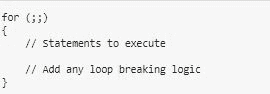

**Q8. `continue` 和 `break` 语句有什么区别？**

答：`break` 和 `continue` 是循环中使用的两个重要关键字。当在循环中使用 `break` 关键字时，循环会立即中断；而当使用 `continue` 关键字时，当前迭代被中断，循环继续执行下一次迭代。

在下面的示例中，当计数器达到 4 时，循环被中断。

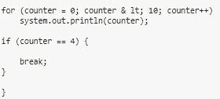

在下面的示例中，当计数器达到 4 时，循环跳转到下一次迭代，并且 `continue` 关键字之后的任何语句在当前迭代中被跳过。

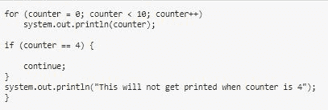

**Q9. Java 中 `double` 和 `float` 变量有什么区别？**

答：在 Java 中，`float` 占用 4 字节内存，而 `Double` 占用 8 字节内存。`Float` 是单精度浮点十进制数，而 `Double` 是双精度十进制数。

**Q10. Java 中的 `final` 关键字是什么？给出一个例子。**

答：在 Java 中，常量使用关键字 `final` 声明。值只能被赋值一次，赋值后常量的值不能更改。

在下面的示例中，声明了一个名为 `const_val` 的常量并赋了值：

```java
private final int const_val = 100;
```

当一个方法被声明为 `final` 时，它不能被子类重写。这种方法比其他任何方法都快，因为它们在编译时就被解析了。

当一个类被声明为 `final` 时，它不能被继承。例如 `String`、`Integer` 和其他包装类。

**Q11. 什么是三元运算符？给出一个例子。**

答：三元运算符，也称为条件运算符，用于根据布尔值评估来决定将哪个值赋给变量。它用 `?` 表示。

在下面的示例中，如果排名为 1，则状态被赋值为 "Done"，否则为 "Pending"。

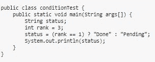

**Q12. 如何在 Java 中生成随机数？**

答：

利用 `Math.random()` 可以生成大于等于 0.1 且小于 1.0 的随机数。

使用 `java.util` 包中的 `Random` 类。

**Q13. 什么是默认 case 实例？请举例说明。**

答：在 `switch` 语句中，当没有其他 `case` 匹配时，会执行 `default case`。在所有其他 `case` 都已编写完成后，`default case` 是一个可选的 `case`，只能声明一次。

在下面的例子中，当分数不是 1 或 2 时，会使用 `default case`。

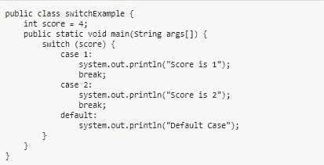

**Q14. Java 中所有类的基类是什么？**

答：`java.lang.Object`。

**Q15. Java 中的 `main()` 方法可以返回任何数据吗？**

答：在 Java 中，`main()` 方法不能返回任何数据，因此它总是声明为 `void` 返回类型。

**Q16. 什么是 Java 包？包有什么意义？**

答：在 Java 中，包是一组相互关联的类和接口的集合。使用包有助于开发者模块化代码，并将代码分组以便于复用。一旦代码被打包成包，就可以在其他类中导入并使用。

**Q17. 我们能否声明一个没有抽象方法的抽象类？**

答：可以。即使没有抽象方法，我们也可以在类名前使用 `abstract` 关键字来创建抽象类。但是，如果一个类至少有一个抽象方法，它必须被声明为抽象类，否则会报错。

**Q18. Java 中抽象类和接口的区别是什么？**

答：抽象类和接口的主要区别在于：接口只能声明 `public static` 方法，没有具体实现；而抽象类可以包含任何访问修饰符（`public`、`private` 等）的成员，可以有具体实现，也可以没有。

另一个重要区别是：实现接口的类必须实现接口中的所有方法，而继承抽象类的类不需要实现其超类的所有方法。

一个类可以实现多个接口，但只能继承一个抽象类。

**Q19. 接口相对于抽象类的性能影响是什么？**

答：接口的性能比抽象类慢，因为接口需要额外的间接寻址。开发者需要考虑的另一个重要因素是：任何类只能继承一个抽象类，但可以实现多个接口。

使用接口还会给开发者带来额外负担，因为一旦在类中实现了接口，开发者必须实现接口中的每一个方法。

**Q20. 在 Java 中，导入一个包是否会同时导入其子包？**

答：在 Java 中，导入一个包时，其子包不会被导入，如果需要，开发者必须单独导入它们。

如果开发者导入包 `college.*`，则只会加载名为 `college` 的包中的所有类，而不会加载子包中的任何类。要加载子包（例如 `department`）中的类，开发者必须显式导入，如下所示：

**Q21. 我们可以将类的 `main` 方法声明为 `private` 吗？**

答：在 Java 中，`main` 方法必须是 `public static` 才能正确运行任何程序。如果 `main` 方法被声明为 `private`，开发者不会收到编译错误，但它不会被执行，并且会引发运行时错误。

**Q22. 如何通过引用而不是按值向函数传递参数？**

答：在 Java 中，我们只能按值向函数传递参数，而不能按引用传递。

**Q23. 如何在 Java 中序列化一个对象？**

答：在 Java 中，要将对象转换为字节流进行序列化，类需要实现名为 `Serializable` 的接口。实现 `Serializable` 接口的类的所有对象都会被序列化，其状态会保存在字节流中。

**Q24. 什么时候应该使用序列化？**

答：当需要通过网络发送数据时，会使用序列化。通过序列化，对象的状态被保存并转换为字节流。字节流通过网络传输，并在目标位置重新创建对象。

**Q25. 在 Java 的异常处理中，`try` 块后面是否必须跟一个 `catch` 块？**

答：`try` 块后面必须跟 `catch` 块或 `finally` 块，或者两者都跟。从 `try` 块抛出的任何异常要么在 `catch` 块中被捕获，要么在 `finally` 块中执行代码中止前的必要任务。

**Q26. 即使异常块中发生了异常，有没有办法跳过 `finally` 块？**

答：如果 `try` 块中抛出异常，控制权会传递给 `catch` 块（如果存在），否则传递给 `finally` 块。当异常发生时，`finally` 块总是会被执行，唯一避免执行 `finally` 块中任何语句的方法是在 `try` 块末尾强制终止代码，写入以下代码行：


**Q27. 类的构造方法何时被调用？**

答：每次使用 `new` 关键字创建对象时，都会调用类的构造方法。

例如，在下面的类中，使用 `new` 关键字创建了两个对象，因此构造方法被调用了两次。

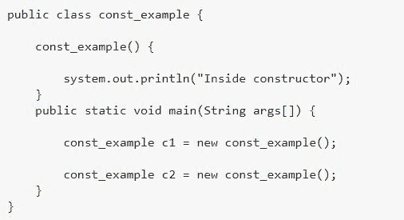

**Q28. 一个类可以有多个构造方法吗？**

答：可以，一个类可以有多个参数不同的构造方法。具体使用哪个构造方法来创建对象，取决于创建对象时传递的参数。

**Q29. 我们可以重写类的静态方法吗？**

答：我们不能重写静态方法。静态方法属于类而不是单个对象，并且在编译时（而不是运行时）处理。即使我们尝试重写静态方法，也不会得到编译错误，但在运行代码时也不会产生重写的效果。

**Q30. 在下面的例子中，输出结果是什么？**

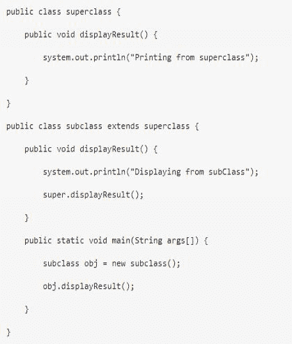

答：结果将是：

显示来自子类。

显示来自超类。

**Q31. Java 中的 `String` 是一种数据类型吗？**

答：在 Java 中，`String` 不是基本数据类型。当在 Java 中创建字符串时，它实际上是 `java.lang.String` 类的一个对象。创建该字符串对象后，可以使用 `String` 类的所有内置方法。

**Q32. 在下面的例子中，创建了多少个 `String` 对象？**

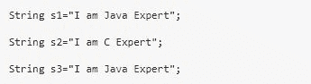

答：在上面的例子中，创建了两个 `java.lang.String` 类的对象。`s1` 和 `s3` 引用的是同一个对象。

**Q33. 为什么 Java 中的 `String` 被称为不可变的？**

答：在 Java 中，字符串对象被称为不可变的，因为一旦给字符串赋值，就不能更改；如果更改，则会创建一个新对象。

在下面的例子中，引用 `str` 指向一个值为 "Value one" 的字符串对象。


当给它赋一个新值时，会创建一个新的 `String` 对象，并且引用会转移到新对象上。


**Q34. 数组和 `Vector` 之间有什么区别？**

**Q35. 什么是多线程？**

答：多线程是一种在单个程序中同时运行多个任务的概念。线程共享相同的进程堆栈并并行运行。它有助于提高任何程序的效率。

**Q36. 为什么在 Java 中使用 `Runnable` 接口？**

答：`Runnable` 接口在 Java 中用于执行多线程应用程序。`Java.Lang.Runnable` 接口由类实现以支持多线程。

**Q37. 在 Java 中执行多线程的两种方式是什么？**

答：在 Java 中，可以通过以下两种技术之一来建立多线程应用程序：

1. 通过使用 `Java.Lang.Runnable` 接口。类实现此接口以启用多线程。该接口中有一个 `Run()` 方法需要实现。
2. 通过创建一个扩展 `Java.Lang.Thread` 类的类。

**Q38. 当数据需要大量更改时，应该选择使用哪一个？`String` 还是 `StringBuffer`？**

答：考虑到 `StringBuffer` 本质上是动态的，并且我们可以改变 `StringBuffer` 对象的值，而 `String` 是不可变的，因此当数据被频繁更改时，使用 `StringBuffer` 总是一个很好的选择。如果在这种情况下使用 `String`，每次数据更改都会产生一个新的 `String` 对象，这将带来额外的开销。

**Q39. 在 `switch` 语句的每个 `case` 中使用 `break` 的作用是什么？**

答：在 `switch` 语句中，每个 `case`（除了最后一个）之后使用 `break`，以便代码在匹配的 `case` 之后跳出，而不会继续执行后续的 `case` 实例。如果每个 `case` 之后没有使用 `break`，那么匹配的 `case` 之后的所有实例也会被执行，导致错误的结果。

**Q40. Java 中如何进行垃圾回收？**

答：在 Java 中，当一个对象不再被引用时，就会发生垃圾回收，该对象会被自动销毁。对于自动垃圾回收，Java 会调用 `System.gc()` 方法或 `Runtime.gc()` 方法。

**Q41. 如何在 `main` 方法之前执行任何代码？**

答：如果我们想在类加载时甚至在创建对象之前执行任何声明，可以在类中使用静态代码块。这个静态代码块中的任何语句将在类加载时执行一次，甚至在创建对象和 `main` 方法之前。

**Q42. 一个类可以同时是超类和子类吗？举例说明。**

答：如果使用了继承层次结构，一个类可以同时是另一个类的超类，又是另一个类的子类。在下面的例子中，`continent` 类是 `world` 类的子类，同时又是 `country` 类的超类。

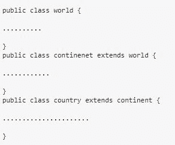

**Q43. 如果类中没有指定构造器，如何创建该类的对象？**

答：即使在 Java 类中没有指定显式构造器，对象也能成功创建，因为默认构造器会被隐式用于对象创建。这个构造器没有参数。

**Q44. 在多线程中，如何确保一个资源不会被多个线程同时使用？**

答：在多线程中，对多个线程共享的资源的访问可以通过同步原则来控制。使用 `synchronized` 关键字，我们可以确保一次只有一个线程可以使用共享资源，其他线程只有在当前使用资源的线程释放资源后才能获得控制权。

**Q45. 对于一个对象，我们可以多次调用类的构造器吗？**

答：当我们使用 `new` 关键字创建对象时，构造器会被自动调用。它只在对象创建时被调用一次，因此，在对象创建之后，我们不能再次调用该对象的构造器。

**Q46. 有两个类名为 `classA` 和 `classB`。两个类在同一个包中。`classB` 的对象可以访问 `classA` 的私有成员吗？**

答：类的私有成员在该类的作用域之外是不可访问的，同一包中的任何其他类也无法访问它们。

**Q47. 一个类中可以有同名的方法吗？**

答：我们可以在一个类中定义两个同名但参数数量/类型不同的方法。调用哪个方法将取决于传递的参数。在下面的类中，我们有两个同名的 `print` 方法，但参数不同。根据参数，将调用合适的方法：

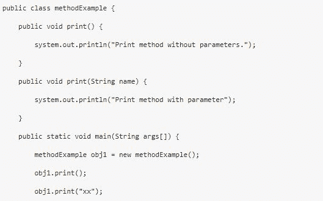

**Q48. 如何复制一个 Java 对象？**

答：我们可以使用克隆的概念来创建对象的副本。使用 `clone`，我们可以创建具有对象实际状态的副本。`Clone()` 是 `Cloneable` 接口的一个方法，因此，需要实现 `Cloneable` 接口来制作对象副本。

**Q49. 使用继承的好处是什么？**

答：使用继承的主要好处是代码的可重用性，因为继承允许子类重用其超类的代码。多态性（可扩展性）是另一个巨大的优势，它允许在不影响现有派生类的情况下引入新功能。

**Q50. 类的变量和方法的默认访问说明符是什么？**

答：变量和方法的默认访问说明符是包访问权限，即变量和类对同一包中的任何其他类可用，但对包外不可用。

**Q51. 请举例说明 Java 类中指针的使用。**

答：Java 中没有指针。因此我们不能在 Java 中使用指针的概念。

**Q52. 如何限制类的继承，使得没有类可以继承它？**

答：如果我们希望一个类不能被任何其他类继承，我们可以使用关键字 `Final` 与类名一起。在下面的例子中，`Rock` 类是 `Final` 的，不能被扩展。

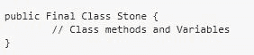

**Q53. `Protected` 访问说明符的访问范围是什么？**

答：当一个变量或方法被声明为 `Protected` 访问说明符时，它可以在同一个类、同一包中的任何其他类以及子类中访问。

**Q54. 栈和队列有什么区别？**


答：栈和队列都用作数据集合的占位符。栈和队列的主要区别在于栈基于后进先出（LIFO）概念，而队列基于先进先出（FIFO）原则。

### Q55. 在 Java 中，如何禁止序列化某些变量？

答：如果我们希望类的某些变量不被序列化，可以在声明它们时使用关键字 `transient`。下面的变量 `trans_var` 是一个临时变量，不能被序列化：

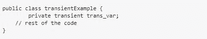

### Q56. 如何将原始数据类型作为对象使用？

答：像 `int` 这样的原始数据类型可以通过使用它们对应的包装类来作为对象处理。例如，`Integer` 是原始数据类型 `int` 的包装类。我们可以像对待任何其他对象一样对包装类应用各种方法。

### Q57. 哪些类型的异常在编译时被捕获？

答：已检查的异常可以在程序编译时捕获。已检查的异常应通过代码中的 `try catch` 块进行处理，以便有效编译代码。

### Q58. 解释线程的各种状态。

答：Java 中的线程可以处于以下任一状态：

- 就绪（Ready）：当线程被创建时，它处于就绪状态。
- 运行（Running）：当前正在执行的线程处于运行状态。
- 等待（Waiting）：等待另一个线程释放特定资源的线程处于等待状态。
- 死亡（Dead）：执行后已死亡的线程处于死亡状态。

### Q59. 即使定义了特定的构造函数，我们还能使用类的默认构造函数吗？

答：如果 Java 类中没有显式定义构造函数，Java 会提供一个默认的无参构造函数。但如果已经定义了特定的构造函数，则无法调用默认构造函数，程序员只能使用类中定义的构造函数。

### Q60. 我们可以通过使用相同的方法名和参数但不同的返回类型来重写一个方法吗？

答：方法重写的基本要求是方法名、参数以及返回类型必须与被重写的方法完全相同。使用不同的返回类型并不能重写方法。

### Q61. 以下代码片段的结果是什么？

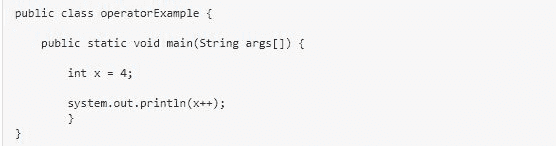

答：在此示例中，使用了后缀 `++` 运算符，它先返回值，然后递增。因此结果是 4。

### Q61. 有人说他成功编译了一个 Java 类，即使其中没有 `main` 方法？这可能吗？

答：`main` 方法是 Java 类的入口点，是程序执行所必需的；然而，即使没有 `main` 方法，类也能成功编译。不过它无法运行。

### Q62. 我们可以从静态方法内部调用非静态方法吗？

答：非静态方法由类的对象拥有，具有对象级别的作用域。为了从静态块（如静态 `main` 方法）中调用非静态方法，需要创建该类的对象。然后通过对象引用，可以调用这些方法。

### Q63. 运行任何 Java 程序必须设置哪两个环境变量？

答：只有在正确设置以下两个环境变量后，Java 程序才能在机器上执行：

- `PATH` 变量
- `CLASSPATH` 变量

### Q64. Java 中的变量可以不初始化就使用吗？

答：在 Java 中，如果变量在代码中使用前没有通过有效值进行初始化，程序将无法编译并报错，因为 Java 不会为变量分配默认值。

### Q65. Java 中的类可以继承多个类吗？

答：在 Java 中，一个类只能派生自一个类，而不能派生自多个类。Java 不支持多重继承。

### Q66. Java 中构造函数的名称可以与类名不同吗？

答：Java 中的构造函数必须与类名相同，如果名称不同，它就不会作为构造函数，编译器会将其视为普通方法。

### Q67. `Round(3.7)` 和 `Ceil(3.7)` 的结果是什么？

答：`Round(3.7)` 返回 4，`Ceil(3.7)` 返回 4。

### Q68. 我们可以在 Java 中使用 `goto` 跳转到特定行吗？

答：在 Java 中，没有 `goto` 关键字，Java 不支持这种跳转到特定标记行的功能。

### Q69. 已死亡的线程可以重新启动吗？

答：在 Java 中，处于死亡状态的线程无法重新启动。没有办法重启一个已死亡的线程。

### Q70. 以下类声明正确吗？

答：

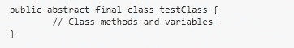

答：上述类声明不正确，因为抽象类不能被声明为 `Final`。

### Q71. 运行 Java 程序时，每台机器上都需要 JDK 吗？

答：JDK 是 Java 的开发工具包，仅用于开发。要在机器上运行 Java 程序，不需要 JDK，只需要 JRE。

### Q72. `equals()` 方法和 `==` 运算符进行的比较有什么区别？

答：在 Java 中，`equals()` 方法用于比较两个字符串对象的内容，如果两者具有相同的值则返回 true；而 `==` 运算符比较的是两个字符串对象的引用。

在下面的示例中，`equals()` 返回 true，因为两个字符串对象具有相同的值。但 `==` 运算符返回 false，因为两个字符串对象引用的是不同的对象：

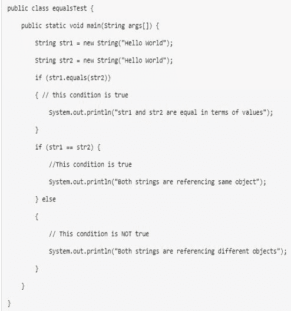

### Q73. 是否可以在 Java 类中定义一个方法，但用另一种语言（如 C）的代码来实现它？

答：可以，我们可以通过使用本地方法（native methods）来实现。在基于本地方法的开发中，我们在 Java 类中定义 `public static` 方法而不实现它，然后单独用另一种语言（如 C）来实现。

### Q74. Java 中如何定义析构函数？

答：在 Java 中，类中没有定义析构函数，因为没有必要这样做。当对象不再被引用时，Java 有自己的垃圾回收机制，它会自动销毁对象来完成这项工作。

### Q75. 一个变量可以同时是静态的和局部的吗？

答：不可以，一个变量不能同时是静态的和局部的。将局部变量定义为静态会导致编译错误。

### Q76. 接口中可以有静态方法吗？

答：静态方法在任何类中都不能被重写，而接口中的任何方法默认都是抽象的，并且需要在实现接口的类中实现。因此在 Java 的接口中拥有静态方法是没有意义的。

### Q77. 在实现接口的类中，我们可以改变接口中定义的任何变量的值吗？

答：不可以，我们不能在实现类中更改接口中任何变量的值，因为接口中定义的所有变量默认都是 `public`、`final` 和 `static` 的，而 `final` 变量就像常量，之后无法更改。

### Q78. 是否可以认为由于 Java 的垃圾回收特性，Java 程序永远不会内存不足？

答：尽管 Java 提供了自动垃圾回收，但这并不能保证 Java 程序不会内存不足，因为有可能 Java 对象的创建速度比垃圾回收更快，从而导致所有可用内存资源被填满。

垃圾回收有助于降低程序内存不足的可能性，但并不能保证这一点。

### Q79. `main` 方法除了 `void` 之外还能有其他返回类型吗？

答：不可以，Java 类的 `main` 方法只能有 `void` 返回类型，程序才能正确执行。

如果你确实需要在 `main` 方法结束时返回一个值，可以使用 `System.exit(int status)`。

### Q80. 一旦对象被垃圾回收，我想重新使用它并再次访问。这如何实现？

答：当一个对象被垃圾回收器销毁后，它不再存在于堆中，也无法再次访问。没有办法再次引用它。

### Q81. 在 Java 线程中，所有线程必须实现哪个方法？

答：`Run()` 是 `Runnable` 接口的一个方法，所有线程都必须实现它。

### Q82. 我想在程序中控制数据库连接，希望一次只有一个线程能够建立数据库连接。如何实现这个逻辑？

答：这可以通过利用同步的思想来实现。与数据库相关的代码可以放在一个带有 `hs` 同步关键字的方法中，这样每次只有一个线程可以访问它。

### Q83. 设计者如何手动抛出异常？

答：为了在代码块中手动抛出异常，使用 `throw` 关键字。该异常会在 `catch` 块中被捕获和处理。

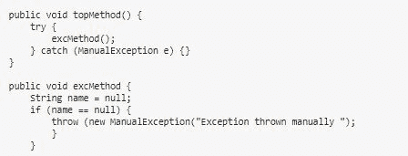

### Q84. 我希望我的类被设计成其他类（包括派生类）都无法创建它的实例。我该怎么做？

答：如果我们将类的构造函数声明为私有的，那么其他任何类都无法访问它，因此其他类将无法实例化它，其对象的创建将仅限于自身。

### Q85. Java 中对象是如何存储的？

答：在 Java 中，每个对象在创建时都会从堆中获取一块内存空间。当对象被垃圾回收器销毁时，分配给它的堆空间会重新分配给堆，并可用于任何新对象。

### Q86. 我们如何知道堆上对象的实际大小？

答：在 Java 中，没有办法知道堆上对象的精确大小。

### Q87. 以下哪个类会分配更多内存？

- 类 A：3 个方法，4 个变量，没有对象。
- 类 B：5 个方法，3 个变量，没有对象。

答：在创建对象之前不会分配内存。因为两个类都没有创建对象，所以堆上不会为任何类分配内存。

### Q88. 如果程序中的异常没有被处理，会发生什么？

答：如果程序中没有使用 `try-catch` 块处理异常，程序会终止，并且抛出异常的语句之后的任何代码都不会执行。

### Q89. 我在一个类中定义了多个构造函数。是否可以从另一个构造函数的主体中调用一个构造函数？

答：如果一个类有多个构造函数，可以使用 `this()` 从另一个构造函数的主体中调用一个构造函数。

### Q90. 什么是匿名类？

答：匿名类是在一行代码中使用 `new` 关键字定义的没有名称的类。

例如，下面的代码中我们在一行代码中定义了一个匿名类：

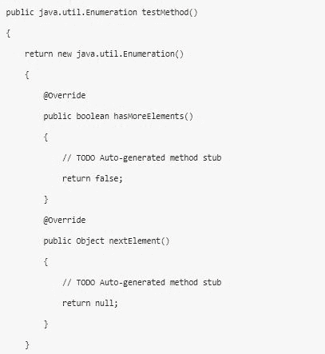

### Q91. 数组声明后有没有办法增加其大小？

答：数组是静态的，一旦我们指定了它的大小，就无法更改。如果我们想要使用可能需要改变大小（元素数量）的集合，应该优先使用 `Vector` 而不是数组。

### Q92. 如果一个应用程序中有多个类，那么多个类中都有 `main` 方法可以吗？

答：如果 Java 应用程序中有多个类包含 `main` 方法，这不会造成任何问题，因为任何应用程序的入口点都是特定的类，代码只会从那个特定类的 `main` 方法开始执行。

### Q93. 我想持久化对象数据以供以后使用。最好的方法是什么？

答：持久化数据以供将来使用的最佳方法是使用序列化原理。

### Q94. 什么是 Java 中的局部类？

答：在 Java 中，如果我们在某个块内部定义一个新类，它被称为局部类。这样的类具有局部作用域，在其定义的块之外不可用。

### Q95. `String` 和 `StringBuffer` 都表示字符串对象。我们可以在 Java 中比较 `String` 和 `StringBuffer` 吗？

答：尽管 `String` 和 `StringBuffer` 都表示字符串对象，但我们不能相互比较它们，如果尝试比较，会得到错误。

### Q96. Java 提供了哪个 API 用于对对象集合进行操作？

答：Java 提供了集合 API，它提供了许多可用于对象集合的有用方法。集合 API 提供的一些重要类包括 `ArrayList`、`HashMap`、`TreeSet` 和 `TreeMap`。

### Q97. 我们可以通过类型转换将任何其他类型转换为布尔类型吗？

答：不，我们既不能将任何其他基本类型转换为布尔数据类型，也不能将布尔数据类型转换为任何其他基本数据类型。

### Q98. 重写方法时可以使用不同的返回类型吗？

答：Java 中方法重写的基本要求是重写的方法必须具有相同的名称和参数。但是，只要新的返回类型扩展了原始返回类型，就可以用不同的返回类型重写方法。

方法返回一个引用类型。

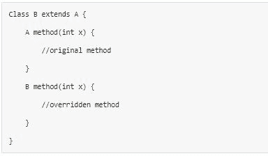

### Q99. 所有异常类的基类是什么？

答：在 Java 中，`Java.lang.Throwable` 是所有异常类的超类，所有异常类都派生自这个基类。

### Q100. 继承中构造函数的调用顺序是什么？

答：在继承的情况下，当创建派生类的新对象时，首先调用超类的构造函数，然后调用派生类的构造函数。

# 2021 年你必须准备的 100 个顶级 Python 面试问题

## 基础 Python 面试问题

### Q1. Python 中列表和元组的区别是什么？

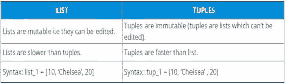

### Q2. Python 的关键特性是什么？

Python 是一种解释型语言。这意味着，与 C 及其变体等语言不同，Python 在运行之前不需要编译。其他解释型语言包括 PHP 和 Ruby。

Python 是动态类型的，这意味着你在声明变量时不需要指定变量的类型。你可以做像 `x = 111` 然后 `x = "I'm a string"` 这样的事情而不会出错。

Python 非常适合面向对象编程，因为它允许定义类以及组合和继承。Python 没有访问说明符（如 C++ 的 `public`、`private`）。

在 Python 中，函数是一等对象。这意味着它们可以被赋值给变量、从其他函数返回并传递给函数。类也是一等对象。

编写 Python 代码很快，但运行它通常比编译型语言慢。Python 允许添加基于 C 的扩展，因此瓶颈可以被优化掉，而且通常确实如此。`numpy` 包就是一个很好的例子，它实际上非常快，因为它所做的许多数值计算并不是由 Python 完成的。

Python 在许多领域都有应用——Web 应用程序、自动化、科学建模、大数据应用等等。它也常被用作“胶水”代码，让其他语言和组件协同工作。

### Q3. Python 是什么类型的语言？编程语言还是脚本语言？

答：Python 可以用于脚本编写，但一般来说，它被认为是一种通用编程语言。要了解更多关于脚本的知识，可以参考 Python 脚本教程。

### Q4. Python 是一种解释型语言。请解释。

答：解释型语言是指在运行时之前不是机器级代码的任何编程语言。因此，Python 是一种解释型语言。

### Q5. 什么是 PEP 8？

答：PEP 代表 Python 增强提案。它是一套规则，定义了如何格式化 Python 代码以获得最大可读性。

### Q6. Python 中是如何管理内存的？

答：Python 中的内存管理通过以下方式进行：

Python 中的内存管理由 Python 自身的栈空间负责。所有 Python 对象和数据结构都位于一个私有堆中。开发者无法访问这个私有堆，而是由 Python 解释器代为处理。

Python 对象的内存分配由 Python 的内存管理器完成。核心 API 为开发者提供了一些工具用于编码。

Python 还内置了垃圾回收器，它会回收所有多余的内存，以便这些内存可以重新供栈空间使用。

### Q7. 什么是 Python 中的命名空间？

答：命名空间是一种命名系统，用于确保名称唯一，以避免命名冲突。

### Q8. 什么是 `PYTHONPATH`？

答：它是一个环境变量，在导入模块时使用。每当导入一个模块时，也会检查 `PYTHONPATH`，以确认导入的组件是否存在于多个目录中。解释器利用它来确定要加载哪个模块。

### Q9. 什么是 Python 组件？列举一些 Python 中常用的内置模块。

答：Python 组件是包含 Python 代码的文件。这些代码可以是函数、类或变量。一个 Python 组件就是一个包含可执行代码的 `.py` 文件。

一些常用的内置模块包括：

- `os`
- `sys`
- `math`
- `random`
- `data time`
- `JSON`

### Q10. 什么是 Python 中的局部变量和全局变量？

**全局变量：**

在函数外部或全局作用域中声明的变量称为全局变量。程序中的任何函数都可以访问这些变量。

**局部变量：**

在函数内部声明的任何变量都称为局部变量。该变量存在于局部空间，而非全局空间。

**示例：**

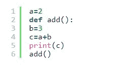

输出：5。

当你试图在函数 `include()` 外部访问局部变量时，将会抛出错误。

### Q11. Python 区分大小写吗？

答：是的。Python 是一种区分大小写的语言。

### Q12. 什么是 Python 中的类型转换？

答：类型转换是指将一种数据类型转换为另一种数据类型。

- `int()` – 将任何数据类型转换为整数类型
- `float()` – 将任何数据类型转换为浮点类型
- `ord()` – 将字符转换为整数
- `hex()` – 将整数转换为十六进制
- `oct()` – 将整数转换为八进制
- `tuple()` – 此函数用于转换为元组。
- `set()` – 此函数在转换为集合后返回类型。
- `list()` – 此函数用于将任何数据类型转换为列表类型。
- `dict()` – 此函数用于将（键，值）顺序的元组转换为字典。
- `str()` – 用于将整数转换为字符串。
- `complex(real, imag)` – 此函数将实数转换为 `complex(real, imag)` 数。

### Q13. 如何在 Windows 上安装 Python 并设置路径变量？

答：要在 Windows 上安装 Python，请按照以下步骤操作：

从以下链接安装 Python：[`www.python.org/downloads/`](https://www.python.org/downloads/)

之后，将其安装到你的 PC 上。使用命令提示符中的以下命令查找 Python 在 PC 上的安装位置：`cmd python`。

然后进入高级系统设置，添加一个替换变量，将其命名为 `PYTHON_NAME`，并粘贴复制的路径。

查找路径变量，选择其值，然后点击“编辑”。

**如果值末尾没有分号，则添加一个分号，然后输入 `%PYTHON_HOME%`**

### Q14. Python 中需要缩进吗？

答：缩进对 Python 很重要。它指定了一个代码块。循环、类、函数等中的所有代码都在缩进块内指定。通常使用四个空格字符。如果你的代码没有正确缩进，它将无法准确执行，并且还会抛出错误。

### Q15. Python 数组和列表有什么区别？

答：在 Python 中，数组和列表存储数据的方式相同。但是，数组只能保存一种数据类型的元素，而列表可以保存任何数据类型的元素。

**示例：**

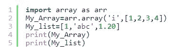

输出：


```python
array('i', [1, 2, 3, 4]) [1, 'abc', 1.2]
```

## Q16. 什么是 Python 中的函数？

答：函数是一个代码块，只有在被调用时才会执行。要定义 Python 函数，需要使用`def`关键字。


输出：Hi, Welcome to Edureka

## Q17. 什么是`__init__`？

答：`__init__`是 Python 中的一个方法或构造函数。当创建一个类的新对象/实例时，会自动调用此方法来分配内存。所有类都有`__init__`方法。

以下是使用它的示例。

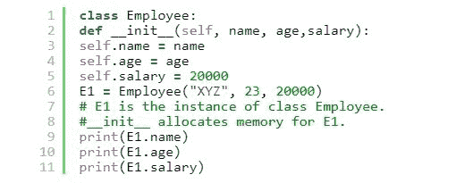

输出：

- XYZ
- 23
- 20000

## Q18. 什么是 lambda 函数？

答：匿名函数被称为 lambda 函数。此函数可以有任意数量的参数，但只能有一个语句。

示例：


输出：11

## Q19. Python 中的`self`是什么？

答：Self 是一个类的实例或对象。在 Python 中，它被显式地作为第一个参数包含在内。然而，在 Java 中并非如此，它是可选的。它有助于区分类的属性和方法与局部变量。

`init`方法中的`self`变量指向新创建的对象，而在其他方法中，它指向调用该方法的对象。

## Q20. `break`、`continue`和`pass`是如何工作的？

- `break`– 当满足某个条件时，允许终止循环，并将控制权转移到后续语句。
- `continue`– 当满足某个特定条件时，允许跳过循环的某一部分，并将控制权转移到循环的开头。
- `pass`– 当你需要在语法上有一个代码块，但希望跳过其执行时使用。这基本上是一个空操作。执行时不会发生任何事情。

## Q21. `[::-1]`的作用是什么？

答：`[::-1]`用于反转数组或序列的顺序。

例如：

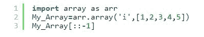

输出：`array('i', [5, 4, 3, 2, 1])`

`[::-1]`会重新打印有序数据结构（如数组或列表）的反向副本。原始数组或列表保持不变。

## Q22. 如何在 Python 中原地随机化列表中的元素？

答：考虑以下示例：

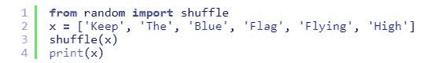

以下代码的输出如下：

```python
['Flying', 'Keep', 'Blue', 'High', 'The', 'Flag']
```

## Q23. 什么是 Python 迭代器？

答：迭代器是可以被遍历或迭代的对象。

## Q24. 如何在 Python 中生成随机数？

答：`random`模块是用于生成随机数的标准模块。该方法定义如下：


语句`random.random()`方法返回 [0, 1) 范围内的浮点数。该函数生成随机浮点数。与`random`类一起使用的方法是隐藏实例的绑定方法。`Random`的实例可以用于指示多线程程序，该程序为各个线程创建单独的实例。此中使用的其他随机生成器包括：

- `randrange(a, b)`：它选择一个整数，并定义范围在 [a, b) 之间。它通过从指定范围内随机选择元素来返回元素。它不会构建一个范围对象。
- `uniform(a, b)`：它选择一个在 [a, b) 范围内定义的浮点数。它返回该浮点数。
- `normalvariate(mean, sdev)`：它用于正态分布，其中 mu 是均值，sdev 是用于正态偏差的 sigma。

使用并实例化的`Random`类会创建独立的多个随机数生成器。

# Python 面试题

## Q25. `range`和`xrange`有什么区别？

答：首先，`xrange`和`range`在功能上几乎完全相同。它们都提供了一种获取整数列表供你使用的方式，具体用法随你喜好。唯一的区别在于`range`返回一个 Python 列表对象，而`xrange`返回一个`xrange`对象。

这意味着`xrange`实际上不会像`range`那样在运行时生成一个静态列表。它通过一种称为“生成”（yielding）的特殊技术按需创建值。这种技术用于一种称为生成器的对象。也就是说，如果你有一个非常大的范围需要生成列表，比如十亿，那么`xrange`就是应该使用的函数。

这一点在你处理内存非常敏感的系统（比如手机）时尤为明显，因为`range`会尽可能多地占用内存来创建整数数组，这可能导致内存错误并使程序崩溃。它是个内存贪婪的家伙。

## Q26. 如何在 Python 中编写注释？

答：Python 中的注释以`#`字符开头。不过，有时也会使用文档字符串（用三重引号括起来的字符串）来进行注释。

> 示例：

```python
#Python 中的注释是这样开始的
print("Python 中的注释以 # 开头")
```

输出：Python 中的注释以`#`开头

## Q27. 什么是 pickling 和 unpickling？

答：`Pickle`模块接受任何 Python 对象，将其转换为字符串表示形式，并通过`dump`函数将其转储到文件中，这个过程称为 pickling。而从存储的字符串表示形式中检索原始 Python 对象的方法称为 unpickling。

## Q28. Python 中的生成器是什么？

答：返回可迭代对象集合的函数称为生成器。

## Q29. 如何将字符串的首字母大写？

答：在 Python 中，`capitalize()`方法可以将字符串的首字母大写。如果字符串开头已经是大写字母，则返回原字符串。

## Q30. 如何将字符串全部转换为小写？

答：要将字符串转换为小写，可以使用`lower()`函数。

示例：


输出：abcd

## Q31. 如何在 Python 中注释多行？

答：多行注释出现在多行中。所有需要注释的行都要以`#`开头。你也可以使用一个很好的快捷方法来注释多行。你只需按住`ctrl`键，然后在每个你想插入`#`字符的位置左键单击，再输入一次`#`即可。这样就会在你放置光标的所有行上添加注释。

## Q32. Python 中的文档字符串是什么？

答：文档字符串实际上不是注释，而是文档字符串。这些文档字符串位于三重引号内。它们不分配给任何变量，因此有时也起到注释的作用。

**示例：**

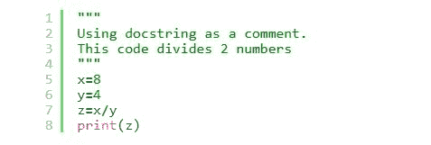

输出：2.0

## Q33. `is`、`not`和`in`运算符的用途是什么？

答：运算符是特殊的函数。它们接受一个或多个值并产生相应的结果。

- `is`：当两个操作数都为真时返回真（例如："a" is 'a'）。
- `not`：返回布尔值的相反值。
- `in`：检查某个元素是否存在于某个序列中。

## Q34. Python 中`help()`和`dir()`函数的用途是什么？

答：`help()`和`dir()`这两个函数都可以从 Python 解释器中访问，用于查看内置函数的汇总转储。

`help()`函数：`help()`函数用于显示文档字符串，还可以帮助你查看与模块、关键字、属性等相关的帮助信息。

`dir()`函数：`dir()`函数用于显示已定义的符号。

## Q35. 每当 Python 退出时，为什么没有释放所有内存？

答：

每当 Python 退出时，尤其是那些包含对其他对象的循环引用或从全局命名空间引用的对象的 Python 模块，并不总是被释放或回收。

C 库保留的那部分内存是无法释放的。

退出时，由于 Python 拥有自己高效的清理机制，它会尝试释放/销毁所有其他对象。

## Q36. Python 中的字典是什么？

答：Python 中的内置数据类型称为字典。它定义了键和值之间的一对一关系。字典包含键及其对应值的配对。字典通过键进行索引。

让我们看一个例子：

下面的示例包含一些键：Country、Capital 和 PM。它们对应的值分别是 India、Delhi 和 Modi。

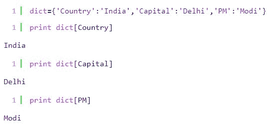

## Q37. 如何在 Python 中使用三元运算符？

答：三元运算符是用于表示条件语句的运算符。它由真值或假值以及一个需要被求值的语句组成。

语法：

三元运算符的写法如下：

```python
[on_true] if [expression] else [on_false]
x, y = 25, 50
big = x if x < y else y
```

示例：

表达式求值过程如下：如果`x < y`为真，则返回`big = x`；如果为假，则返回`big = y`作为结果。

## Q38. `*args`和`**kwargs`是什么意思？为什么要使用它们？

答：当我们不确定会向函数传递多少个参数，或者想要将存储的列表或元组作为参数传递给函数时，我们使用`*args`。当我们不知道会向函数传递多少个关键字参数时，使用`**kwargs`，或者它也可以用于将字典的值作为关键字参数传递。标识符`args`和`kwargs`是一种约定，你也可以使用`*bob`和`**billy`，但这可能不太明智。

## Q39. `len()`的作用是什么？

答：它用于确定字符串、列表、数组等的长度。

示例：

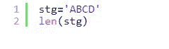

## Q40. 解释 Python 中`re`模块的`split()`、`sub()`、`subn()`方法。

答：为了修改字符串，Python 的`re`模块提供了三种方法。它们是：

- `split()`– 使用正则表达式模式将给定的字符串“分割”成一个列表。
- `sub()`– 查找所有匹配正则表达式模式的子字符串，然后用另一个字符串替换它们。
- `subn()`– 与`sub()`类似，但还会返回新字符串以及替换的次数。

## Q41. 什么是负索引？为什么使用它们？

答：Python 中的序列是有索引的，包含正数和负数。正数索引使用 '0' 作为第一个索引，'1' 作为第二个索引，以此类推。

负数索引从 '-1' 开始，表示序列中的最后一个索引，'-2' 表示倒数第二个索引，以此类推，与正数索引类似。

负索引用于去除字符串中的换行空格，并允许字符串排除最后一个字符，例如`S[:-1]`。负索引也用于以正确的顺序表示字符串的索引。

## Q42. 什么是 Python 包？

答：Python 包是包含多个模块的命名空间。

## Q43. 如何在 Python 中删除文件？

答：要删除 Python 中的内容，你需要导入 OS 模块。然后，你需要使用`os.remove()`函数。

示例：


## Q44. Python 有哪些内置类型？

答：Python 中的内置类型如下：

- 整数
- 浮点数
- 复数
- 字符串
- 布尔值
- 内置函数

## Q45. NumPy 数组相比（嵌套的）Python 列表有哪些优势？

答：

Python 的列表是高效的通用容器。它们支持（相当）高效的插入、删除、追加和连接，并且 Python 的列表推导式使它们易于构建和操作。

但它们也有一定的局限性：它们不支持“向量化”操作（如逐元素加法和乘法），而且由于它们可以包含不同类型的对象，这意味着 Python 必须为每个元素存储类型信息，并且在操作每个元素时必须执行类型分发代码。

NumPy 不仅更高效，而且更方便。你可以免费获得大量的向量和矩阵操作，这有时可以避免不必要的工作。而且它们也实现了高效的执行。

NumPy 数组更快，并且 NumPy 内置了大量功能，如 FFT、卷积、快速搜索、基本统计、代数、直方图等。

## Q46. 如何向 Python 数组添加值？

答：可以使用`append()`、`extend()`和`insert(i,x)`函数向数组添加元素。

示例：

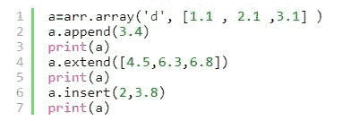

输出：

```python
array(‘d’, [1.1, 2.1, 3.1, 3.4])
array(‘d’, [1.1, 2.1, 3.1, 3.4, 4.5, 6.3, 6.8])
array(‘d’, [1.1, 2.1, 3.8, 3.1, 3.4, 4.5, 6.3, 6.8])
```

## Q47. 如何删除 Python 数组中的值？

答：可以使用`pop()`或`remove()`方法删除数组元素。这两个函数的区别在于，前者返回删除的值，而后者不返回。

示例：


输出：

```python
4.6
3.1
array(‘d’, [2.2, 3.8, 3.7, 1.2])
```

## Q48. Python 有面向对象的概念吗？

答：Python 是一种面向对象的编程语言。这意味着任何程序都可以通过创建对象模型在 Python 中解决。然而，Python 也可以被视为过程式语言和结构化语言。

## Q49. 深拷贝和浅拷贝有什么区别？

答：浅拷贝用于创建新实例类型，并保留在新实例中复制的值。浅拷贝用于复制引用指针，就像复制值一样。这些引用指向原始对象，因此对类中任何成员所做的更改也会影响其原始副本。浅拷贝允许程序执行更快，这取决于所用数据的大小。

深拷贝用于存储已经复制的值。深拷贝不会复制指向对象的引用指针。它创建对对象的引用，并且由另一个对象指向的新对象会被存储。在原始副本中所做的更改不会影响使用该对象的任何其他副本。深拷贝会使程序执行变慢，因为它需要确保每个被调用的对象都有副本。

## Q50. Python 中如何实现多线程？

答：

Python 有一个多线程包，但如果你想通过多线程来加速代码，通常不建议使用它。

Python 有一个称为全局解释器锁（GIL）的结构。GIL 确保在任何时候只有一个“线程”可以执行。一个线程获取 GIL，执行一点工作，然后将 GIL 传递给下一个线程。

这种情况发生得非常快，所以在人眼看来，你的线程似乎是并行执行的，但它们实际上只是在轮流使用同一个 CPU 核心。

所有这些 GIL 传递都会增加执行开销。这意味着，如果你想让代码运行得更快，使用`threading`包通常不是一个好主意。

## Q51. Python 中的编译和链接过程是怎样的？

答：编译和链接允许新扩展在没有任何错误的情况下正确编译，并且只有在通过编译过程后才能进行链接。如果使用动态加载，则取决于系统给定的设计。Python 解释器可用于提供配置设置文件的动态加载，并会重建解释器。

此过程所需的步骤如下：

1. 创建一个文件，文件名任意，语言可以是系统编译器支持的任何语言。例如`file.c`或`file.cpp`。
2. 将此文件放入正在使用的发行版的`Modules/`目录中。
3. 在`Modules/`目录下的`Setup.local`文件中添加一行。
4. 使用`spam file.o`运行该文件。
5. 成功运行后，使用顶层目录中的`make`命令重建解释器。
6. 如果文件被修改，则使用命令`make Makefile`运行`rebuildMakefile`。

## Q52. 什么是 Python 库？列举几个。

Python 库是一组 Python 包。一些主要使用的 Python 库有：Numpy、Pandas、Matplotlib、Scikit-learn 等等。

## Q53. `split`有什么用途？

`split()`方法用于在 Python 中分割给定的字符串。

示例：


输出：`[‘edureka’, ‘python’]`

## Q54. 如何在 Python 中导入模块？

可以使用`import`关键字导入模块。你可以通过三种方式导入模块：

示例：


## Q55. 举例说明 Python 中的继承。

答：继承允许一个类获取另一个类的所有成员（如属性和方法）。继承提供了代码复用性，使应用程序的创建和维护更加容易。被继承的类称为超类，继承的类称为派生类/子类。

Python 支持不同类型的继承：

- 单继承——派生类获取一个超类的成员。
- 多级继承——派生类 d1 继承自基类 base1，d2 继承自 base2。
- 层次继承——从一个基类可以继承任意数量的子类。
- 多重继承——派生类继承自多个基类。

## Q56. 如何在 Python 中创建类？

答：Python 中使用`class`关键字创建类。

示例：

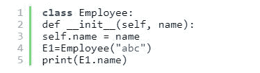

输出：`abc`

## Q57. Python 中的猴子补丁是什么？

答：在 Python 中，术语“猴子补丁”仅指在运行时对类或模块进行动态修改。

考虑以下示例：

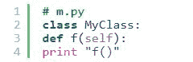

然后我们可以像这样运行猴子补丁测试：

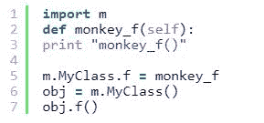

输出如下：

`monkey_f()`

## Q58. Python 支持多重继承吗？

答：多重继承意味着一个类可以从多个父类派生。与 Java 不同，Python 支持多重继承。

## Q59. Python 中的多态是什么？

答：多态意味着能够呈现多种形式。例如，如果父类有一个名为`ABC`的方法，那么子类也可以有一个同名的方法`ABC`，并带有自己的参数和变量。Python 允许多态。

## Q60. 定义 Python 中的封装？

答：封装意味着将代码和数据绑定在一起。Python 类就是封装的一个例子。

## Q61. 如何在 Python 中实现数据抽象？


## Q61. 什么是数据抽象？

答：数据抽象是只提供指定的细节，而对世界隐藏实现。在 Python 中，可以通过使用接口和抽象类来实现。

## Q62. Python 是否使用访问说明符？

答：Python 不会剥夺对实例变量或函数的访问。Python 提出了在变量、函数或方法名称前加一个或两个下划线的概念，以模仿受保护和私有访问说明符的行为。

## Q63. 在 Python 中创建空类的方法？

答：空类是指在其块内没有定义任何代码的类。可以使用`pass`关键字创建。但是，你可以在类本身之外创建该类的对象。在 Python 中，`pass`命令在执行时不执行任何操作。它是一个空语句。

例如：

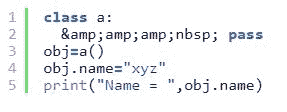

`Name = xyz`

## Q64. `object()`的作用是什么？

答：它返回一个无特征的对象，是所有类的基类。此外，它不接受任何参数。

## 基础 Python 程序——Python 面试题

### Q65. 用 Python 编写一个执行冒泡排序算法的程序

```python
1. def bs(a):                     # a = name of list
2.    b=len(a)-1                  # minus 1 because we always compare 2 adjacent values
3.    
4.    for x in range(b):
5.        for y in range(b-x):
6.            if a[y] > a[y+1]:
7.                a[y],a[y+1]=a[y+1],a[y]
8.    return a
9. a=[32,5,3,6,7,54,87]
10. bs(a)
```

输出：`[3, 5, 6, 7, 32, 54, 87]`

### Q66. 用 Python 编写一个生成星号三角形的程序

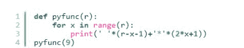

输出：

```text
*
***
*****
*******
*********
***********
*************
***************
*****************
```

### Q67. 用 Python 编写一个生成斐波那契数列的程序

```python
1.  # Enter number of terms needed          #0,1,1,2,3,5....
2.  a=int(input("Enter the terms"))
3.  f=0                                     #first element of series
4.  s=1                                     #second element of series
5.  if a <= 0:
6.      print("The requested series is ",f)
7.  else:
8.      print(f,s,end=" ")
9.      for x in range(2,a):
10.         next=f+s
11.         print(next,end=" ")
12.         f=s
13.         s=next
```

输出：`Enter the terms 5 0 1 1 2 3`

### Q68. 用 Python 编写一个检查数字是否为质数的程序

```python
1.  a=int(input("enter number"))
2.  if a > 1:
3.      for x in range(2,a):
4.          if(a%x)==0:
5.              print("not prime")
6.              break
7.      else:
8.          print("Prime")
9.  else:
10.     print("not prime")
```

输出：

```text
enter number 3
Prime
```

### Q69. 用 Python 编写一个检查序列是否为回文的程序

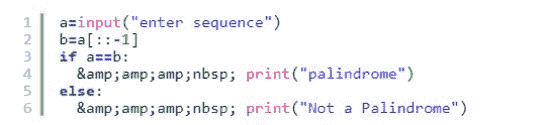

输出：

```text
enter sequence 323 palindrome
```

### Q70. 编写一行代码，统计文件中大写字母的数量。你的代码应该能够处理文件太大无法放入内存的情况。

答：让我们先编写一个多行解决方案，然后将其转换为一行代码。

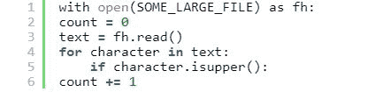

### Q71. 用 Python 为数值数据集编写一个排序算法

答：以下代码可用于在 Python 中对列表进行排序：


### Q72. 观察下面的代码，写出 A0、A1、… An 的最终值

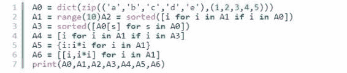

答：以下是 A0、A1、… A6 的最终输出：

`A0 = {'a': 1, 'c': 3, 'b': 2, 'e': 5, 'd': 4}` # 顺序可能不同

`A1 = range(0, 10)`

`A2 = []`

`A3 = [1, 2, 3, 4, 5]`

`A4 = [1, 2, 3, 4, 5]`

`A5 = {0: 0, 1: 1, 2: 4, 3: 9, 4: 16, 5: 25, 6: 36, 7: 49, 8: 64, 9: 81}`

`A6 = [[0, 0], [1, 1], [2, 4], [3, 9], [4, 16], [5, 25], [6, 36], [7, 49], [8, 64], [9, 81]]`

## Python 库——Python 面试题

### Q73. 解释什么是 Flask 及其优点？

答：Flask 是一个基于“Werkzeug、Jinja2 和良好意图”BSD 许可证的 Python Web 微框架。Werkzeug 和 Jinja2 是其两个依赖项。这意味着它对外部库的依赖很少甚至没有。这使得框架轻量，同时需要更新的依赖项少，安全漏洞也更少。

会话基本上允许你在一个请求到另一个请求之间记住信息。在 Flask 中，会话使用签名 cookie，因此用户可以查看会话内容并进行修改。用户只有在拥有密钥`Flask.secret_key`时才能修改会话。

### Q74. Django 比 Flask 更好吗？

答：Django 和 Flask 将用户在 Web 浏览器中输入的 URL 或地址映射到 Python 函数。

与 Django 相比，Flask 简单得多，但 Flask 不会为你做太多事情，这意味着你需要指定细节，而 Django 为你做了很多事情，你不需要做太多工作。Django 包含预编写的代码，用户需要分析这些代码，而 Flask 允许用户编写自己的代码，因此更容易理解代码。从技术上讲，两者同样优秀，各有优缺点。

### Q75. 指出 Django、Pyramid 和 Flask 之间的区别。

答：

Flask 是一个“微框架”，主要针对需求较简单的小型应用程序构建。在 Flask 中，你必须使用外部库。Flask 开箱即用。

Pyramid 是为大型应用而设计的。它提供了灵活性，让开发者能够为项目选择合适的工具。开发者可以自由选择数据库、URL 结构、模板风格等。Pyramid 具有高度可配置性。

Django 也可以用于大型应用，与 Pyramid 有些类似。它内置了 ORM。

### Q76. 讨论 Django 的架构。

答：Django MVT 模式：


图：Python 面试题——Django 架构

开发者提供模型（Model）、视图（View）和模板（Template），然后将其映射到 URL，Django 就会自动处理，将内容呈现给用户。

### Q77. 解释如何在 Django 中配置数据库。

答：你可以使用命令`edit mysite/setting.py`，这是一个传统的 Python 模块，模块级别定义了 Django 的设置。

Django 默认使用 SQLite；这对 Django 用户来说很方便，因为它不需要额外的安装。如果你选择了其他数据库，则需要修改`DATABASE`配置中`'default'`项下的以下键值，以匹配你的数据库连接设置。

引擎：你可以通过使用`'django.db.backends.sqlite3'`、`'django.db.backends.mysql'`、`'django.db.backends.postgresql_psycopg2'`、`'django.db.backends.oracle'`等来更改数据库。

名称：你的数据库名称。如果你使用 SQLite 作为数据库，那么数据库将是一个文件，名称应为该文件的完整绝对路径（包括文件名）。

如果你没有选择 SQLite 作为数据库，则需要添加密码、主机、用户等设置。

Django 默认使用 SQLite 作为数据库，它将数据存储为文件系统中的一个文件。如果你有数据库服务器（PostgreSQL、MySQL、Oracle、MSSQL）并希望使用它而不是 SQLite，那么请使用数据库管理工具为你的 Django 项目创建一个新数据库。无论哪种方式，有了（空的）数据库后，剩下的就是告诉 Django 如何使用它。这就是项目中的`settings.py`文件发挥作用的地方。

我们需要在`setting.py`文件中添加以下代码行：

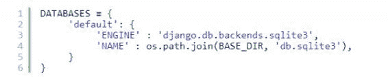

### Q78. 举例说明如何在 Django 中编写一个视图（VIEW）。

答：以下是在 Django 中编写视图的方法：

```
1. from django.http import HttpResponse
2. import datetime
3. ......
4. def Current_datetime(request):
5.     now = datetime.datetime.now()
6.     html = "&amp;lt;html&amp;gt;&amp;lt;body&amp;gt;It is now %s&amp;lt;/body&amp;gt;&amp;lt;/html&amp;gt; now known
7.     return HttpResponse(html)
```

返回当前日期和时间，以 HTML 文档形式呈现。

### Q79. 提及 Django 模板包含哪些内容。

答：模板是一个简单的文档。它可以创建任何基于文本的格式，如 XML、CSV、HTML 等。模板包含变量（在模板求值时会被替换为值）和标签（`% tag %`，用于控制模板的逻辑）。

图：Python 面试题——Django 模板


### Q80. 解释 Django 框架中会话（session）的用途。

答：Django 提供了会话机制，允许你按站点访问者存储和检索数据。Django 抽象了发送和接收 cookie 的过程，通过在客户端放置会话 ID cookie，并将所有相关数据存储在服务器端。


图：Python 面试题——Django 框架

因此，数据本身并不存储在客户端。从安全角度来看，这非常不错。

### Q81. 列出 Django 中的继承风格。

答：在 Django 中，有三种可能的继承风格：

- 抽象基类：当你希望父类仅包含你不必为每个子模型重复输入的信息时，使用此风格。
- 多表继承：当你对现有模型进行子类化，并且希望每个模型都有自己的数据库表时，使用此风格。
- 代理模型：如果你只想修改模型的 Python 级别行为，而不更改模型字段，则可以使用此模型。

## Web 爬取——Python 面试题

### Q82. 如何将已知 URL 地址的图片保存到本地（使用 Python）？

答：我们可以使用以下代码将图片从 URL 地址保存到本地：


### Q83. 如何获取任何 URL 或网页的 Google 缓存年龄？

答：使用以下 URL 格式：

`http://webcache.googleusercontent.com/search?q=cache:URLGOESHERE`

请务必将“URLGOESHERE”替换为你想要检索缓存的页面或网站的正确网址。例如，要查看 edureka.co 的 Google 网页缓存年龄，可以使用以下 URL：

`http://webcache.googleusercontent.com/search?q=cache:edureka.co`

### Q84. 你需要从 IMDb 前 250 名电影页面抓取数据。只需要电影名称、年份和评分字段。

答：我们将使用以下代码行：

```
1. from bs4 import BeautifulSoup
2. import requests
3. import sys
4. url = 'http://www.imdb.com/chart/top'
5. response = requests.get(url)
6. soup = BeautifulSoup(response.text)
7. tr = soup.findChildren("tr")
8. tr = iter(tr)
9. next(tr)
10. for movie in tr:
11.     title = movie.find('td', {'class': 'titleColumn'} ).find('a').contents[0]
12.     year = movie.find('td', {'class': 'titleColumn'} ).find('span', {'class': 'secondaryInfo'}).contents[0]
13.     rating = movie.find('td', {'class': 'ratingColumn imdbRating'} ).find('strong').contents[0]
14.     row = title + ' - ' + year + ' ' + ' ' + rating
15.     print(row)
```

上述代码将帮助从 IMDb 前 250 名列表中抓取数据。

## 数据分析——Python 面试题

### Q85. Python 中的 map 函数是什么？

答：`map`函数将第一个参数给定的函数应用于第二个参数给定的可迭代对象中的所有元素。如果给定的函数需要多个参数，则提供多个可迭代对象。# 点击链接了解更多类似函数。

### Q86. Python 的 NumPy 比列表更好吗？

答：我们使用 Python NumPy 数组而不是列表，原因有以下三个：

- 内存占用更少
- 速度更快
- 更方便

关于这些参数的更多信息，请参考本节——NumPy 与列表对比。

### Q87. 如何获取 NumPy 数组中 N 个最大值的索引？

答：我们可以使用以下代码获取 NumPy 数组中 N 个最大值的索引：


输出：

```text
[ 4 3 1 ]
```

### Q88. 如何使用 Python/NumPy 计算百分位数？

答：我们可以使用以下代码计算百分位数：

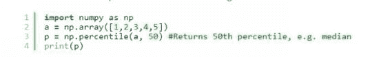

输出：

```text
3
```

### Q89. NumPy 和 SciPy 有什么区别？

答：

在理想情况下，NumPy 只包含数组数据类型和最基本的操作：索引、排序、重塑、基本逐元素函数等。

所有数值代码都应位于 SciPy 中。然而，NumPy 的重要目标之一是兼容性，因此 NumPy 试图保留其前身支持的所有功能。

因此，NumPy 包含一些代数函数，尽管这些函数更应属于 SciPy。无论如何，SciPy 包含更全功能的代数模块版本，以及许多其他数值算法。

如果你使用 Python 进行科学计算，你可能应该同时安装 NumPy 和 SciPy。大多数新功能属于 SciPy 而不是 NumPy。

### Q90. 如何使用 NumPy/SciPy 制作 3D 图/可视化？

答案：与二维绘图类似，三维图形超出了`NumPy`和`SciPy`的范围，但即使在二维情况下，也存在与`NumPy`集成的包。`Matplotlib`在`mplot3d`子包中提供了基本的三维绘图功能，而`Mayavi`则利用强大的`VTK`引擎提供了丰富的高质量三维可视化特性。

# 多项选择题（MCQ）——Python 面试题

## Q91. 以下哪些语句会创建一个字典？（多选）

a) `d = {}`

b) `d = {"john":40, "peter":45}`

c) `d = {40:"john", 45:"peter"}`

d) `d = (40:"john", 45:"50")`

**答案：** b、c 和 d。

字典是通过指定键和值来创建的。

## Q92. 以下哪个是整除运算符？

a) `/`

b) `//`

c) `%`

d) 以上都不是

**答案：** b) `//`

当两个操作数都是整数时，Python 会截去小数部分并返回四舍五入后的值，要获得精确结果请使用整除。例如，`5/2 = 2.5`，但由于两个操作数都是整数，该表达式在 Python 中的结果是 2。要得到 2.5 作为答案，请使用`//`进行整除。因此，`5//2 = 2.5`。

## Q93. 标识符的最大可能长度是多少？

a) 31 个字符

b) 63 个字符

c) 79 个字符

d) 以上都不是

**答案：** d) 以上都不是

标识符可以是任意长度。

## Q94. 为什么以下划线开头的局部变量名不被鼓励？

a) 它们用于表示类的私有变量

b) 它们会混淆解释器

c) 它们用于表示全局变量

d) 它们会降低执行速度

**答案：** a) 它们用于表示类的私有变量

由于 Python 没有私有变量的概念，前导下划线用于表示不应从类外部访问的变量。


## Q95. 以下哪个是无效语句？

a) `abc = 1,000,000`

b) `a b c = 1000 2000 3000`

c) `a,b,c = 1000, 2000, 3000`

d) `a_b_c = 1,000,000`

**答案：** b) `a b c = 1000 2000 3000`

变量名中不允许有空格。

## Q96. 以下代码的输出是什么？

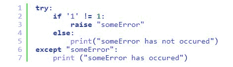

a) `someError has occured`

b) `someError has not occured`

c) `invalid code`

d) 以上都不是

**答案：** c) `invalid code`

新的异常类必须继承自`BaseException`。这里没有这样的继承。

## Q97. 假设`list1`是`[2, 33, 222, 14, 25]`，那么`list1[-1]`是什么？

a) 错误

b) `None`

c) 25

d) 2

**答案：** c) 25

索引`-1`对应列表中的最后一个索引。

## Q98. 要打开文件`c:scores.txt`进行写入，我们使用

a) `outfile = open("c:scores.txt", "r")`

b) `outfile = open("c:scores.txt", "w")`

c) `outfile = open(file = "c:scores.txt", "r")`

d) `outfile = open(file = "c:scores.txt", "o")`

**答案：** b) 路径中包含双反斜杠（`\\`），并且使用`w`表示正在写入文件。

## Q99. 以下代码的输出是什么？

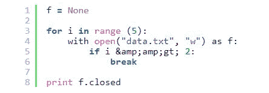

a) `True`

b) `False`

c) `None`

d) 错误

**答案：** a) `True`

当`with`语句与`open`文件一起使用时，它保证在`with`块退出时文件对象被关闭。

## Q100. `try-except-else`中的`else`部分何时执行？

a) 总是

b) 当发生异常时

c) 当没有异常发生时

d) 当异常发生在`except`块中时

**答案：** c) 当没有异常发生时

`else`部分在没有异常发生时执行。

希望这套 Python 面试题能帮助你准备面试。祝你好运！
