# 编程入门：4 合 1 完全初学者指南，学习 JavaScript、Python、SQL 和 Java 基础

本书包含：

- 《面向初学者的 JavaScript》
- 《面向初学者的 Python 编程》
- 《学习 SQL 编程的终极初学者指南》
- 《学习 Java 编程》

**LEONARD BASE**

## 目录

1. JavaScript
2. Python
3. SQL
4. Java

## 面向初学者的 JavaScript

[开始快速、轻松学习 JavaScript 语言的完整现代指南。包含编码和编程的技巧与窍门。](https://example.com)

## 面向初学者的 Python

Python 编程的终极速成课程。一本掌握这门强大编程语言并学习机器学习的综合指南。

## 面向初学者的 SQL 编码

学习 SQL 数据库和服务器的智能分步指南。如何构建高级和精英水平的 SQL。

## 学习 Java 编程

一本让初学者快速学习 Java 的权威速成课程。用 Java 代码编程的秘密、技巧和窍门，以及创建第一个程序的基础知识。

# 面向初学者的 JavaScript

快速轻松学习 JavaScript 语言的完整现代指南。包含编码和编程的技巧与窍门。

## 引言

市面上有很多关于这个主题的书，再次感谢您选择本书！我们已尽一切努力确保本书包含尽可能多的有用信息，请尽情阅读吧！

### 什么是 JavaScript？

JavaScript 是一种解释型编程语言，因此无需编译程序即可执行它们。换句话说，用 JavaScript 编写的程序可以在任何浏览器中直接测试，无需中间过程。

尽管名称相似，但 JavaScript 与 Java 编程语言没有直接关系。

## 如何在 XHTML 文档中包含 JavaScript

JavaScript 和 XHTML 的集成非常灵活，因为至少有三种方法可以将 JavaScript 代码包含在网页中。

### 在同一 XHTML 文档中包含 JavaScript

JavaScript 代码包含在 `<script>` 标签之间，并可以包含在文档中的任何位置。虽然将任何代码块包含在页面的任何区域都是正确的，但建议在文档的头部（在 `<head>` 标签内）定义 JavaScript 代码。

文档本身的 JavaScript 代码示例：

```html
<script type = "text / javascript"> alert ("A test message");
</script>
</head>
<body>
<p> A paragraph of text. </p>
</body>
</html>
```

为了使生成的 XHTML 页面有效，需要为 `<script>` 添加 `type` 属性。`type` 属性中包含的值是标准化的，对于 JavaScript，正确的值是 `text / javascript`。

当定义一小块代码，或者希望将特定指令包含在特定 HTML 文档中，以完成网站所有文档中默认包含的指令和功能时，可以使用此方法。

主要缺点是，如果要对代码块进行修改，则需要修改包含该相同 JavaScript 代码的所有页面。

### 在外部文件中定义 JavaScript

JavaScript 指令可以包含在外部 JavaScript 文件中，XHTML 文档使用 `<script>` 标签链接该文件。您可以创建所有必要的 JavaScript 文件，并且每个 XHTML 文档可以根据需要链接多个 JavaScript 文件。

除了 `type` 属性外，此方法还需要定义 `src` 属性，该属性指示要链接的 JavaScript 文件对应的 URL。每个 `<script>` 标签只能链接一个文件，但同一页面可以包含任意数量的 `<script>` 标签。

JavaScript 文件是扩展名为 `.js` 的普通文本文档，可以使用任何文本编辑器（如 Notepad、Wordpad、EmEditor、UltraEdit、Vi 等）创建。

链接外部 JavaScript 文件的主要优点是简化了页面的 XHTML 代码，相同的 JavaScript 代码可以在网站的所有页面上重用，并且对 JavaScript 文件所做的任何修改都会立即反映在所有链接它的 XHTML 页面中。

### 在 XHTML 元素中包含 JavaScript

最后一种方法使用最少，因为它包括在页面的 XHTML 代码中包含 JavaScript 片段：

```html
<! DOCTYPE html PUBLIC "- // W3C // DTD XHTML 1.0 Transitional
// EN" "http://www.w3.org/TR/ xhtml1 / DTD / xhtml1-
transitional.dtd">

<html xmlns = "http://www.w3.org/1999/xhtml">
<head>
<meta http -equiv = "Content-Type" content = "text / charset =
iso-8859-1" />
<title> Example of JavaScript code in the document itself </title>
</head>
<body>
<p onclick = "alert ('A test message')"> A paragraph of text. </p>
</body>
</html>
```

这种方法最大的缺点是不必要地弄乱了页面的 XHTML 代码，并使 JavaScript 代码的维护变得复杂。通常，此方法仅用于定义某些事件以及其他一些特殊情况，稍后将介绍。

### Noscript 标签

一些浏览器没有完整的 JavaScript 支持，其他浏览器允许您部分阻止它，甚至一些用户完全阻止使用 JavaScript，因为他们认为这样浏览更安全。

在这些情况下，如果网页需要 JavaScript 才能正常运行，通常会向用户包含一条警告消息，指出应激活 JavaScript 才能充分享受该页面。以下示例展示了在启用 JavaScript 和完全禁用 JavaScript 时访问基于 JavaScript 的网页的情况。

以下代码展示了使用 `<noscript>` 标签的示例：

```html
<head> ... </head>
<body>
<noscript>
<p> Welcome to My Site </p>
<p> The page you are viewing requires the use of JavaScript for its operation.

If you have intentionally disabled it, please enable it again. </p>
</noscript>
```

`</body>`

`<noscript>` 标签必须包含在 `<body>` 标签内部（通常放置在 `<body>` 的开头）。`<noscript>` 显示的消息可以包含任何 XHTML 元素或标签。

### 基础术语表

- **脚本（Script）**：使用 JavaScript 编程语言创建的每个程序、应用程序或代码片段。几行代码可以构成一个脚本，而一个包含数千行 JavaScript 的文件也被认为是一个脚本。有时它被直接翻译成西班牙语的 "escribir"，但 script 是一个更合适且更被广泛接受的词汇。
- **语句（Sentence）**：构成脚本的每条指令。
- **保留字（Reserved words）**：这些是用于构建 JavaScript 语句的词汇（英文），因此不能被随意使用。

#### 语法

编程语言的语法被定义为在编写程序源代码时必须遵守的一套规则，以便该源代码被认为符合该编程语言的正确标准。

定义 JavaScript 语法的基本规则如下：

- **不考虑空格和换行**：与 XHTML 一样，JavaScript 解释器会忽略任何多余的空白空间，因此代码可以进行适当的整理以提高可读性（如行缩进、添加空格、创建新行等）。
- **区分大小写**：与 XHTML 标签和元素的语法一样。然而，如果 XHTML 页面在大小写上互换使用，页面仍能正确显示，唯一的问题是页面无法通过验证。另一方面，如果 JavaScript 互换了大小写字母，脚本将无法运行。
- **变量类型不定义**：在创建变量时，无需指明将要存储的数据类型。这样，同一个变量在脚本执行期间可以存储不同类型的数据。
- **不需要用分号字符（`;`）结束每个语句**：在大多数编程语言中，必须用分号 `;` 结束每个语句。虽然 JavaScript 不强制要求这样做，但遵循在每个语句末尾添加分号（`;`）的传统是比较方便的。
- **可以包含注释**：注释用于在程序的源代码中添加信息。虽然注释的内容不会在屏幕上显示，但对包含在注释中的信息需要采取谨慎态度。

JavaScript 定义了两种类型的注释：单行注释和多行注释。

单行注释示例：

```javascript
// below is an alert message ("test message");
```

单行注释通过在行首添加两个斜杠（`//`）来定义。

多行注释示例：

```javascript
/* Multi-line comments are very useful when you need to include enough information in comments */ alert ("test message");
```

多行注释通过将注释文本包裹在 `/*` 和 `*/` 符号之间来定义。

## 可能性与局限性

自诞生以来，JavaScript 一直被大多数互联网网站大规模地使用。Flash 的出现削弱了它的流行度，因为 Flash 允许执行一些通过 JavaScript 无法实现的操作。

然而，使用 JavaScript 编程的 AJAX 应用程序的出现，使其在 Web 编程语言中重新获得了无与伦比的流行度。

至于局限性，JavaScript 的设计运行在一个非常受限的环境中，以允许用户信任脚本的执行。因此，JavaScript 脚本不能与不属于下载该脚本之相同域的资源进行通信。脚本也不能关闭非由该脚本打开的窗口。创建的窗口不能太小或太大，也不能放置在用户视线之外（尽管具体细节取决于每个浏览器）。

此外，脚本不能访问用户计算机的文件（无论是以读取模式还是写入模式），也不能读取或修改浏览器偏好设置。

最后，如果脚本执行时间过长（例如由于编程错误），浏览器会通知用户某个脚本消耗了过多资源，并提供停止执行的可能性。

尽管如此，仍有一些替代方案可以跳过上述部分限制。最常用且最广为人知的替代方案是对脚本进行数字签名，并请求用户允许执行这些操作。

## JavaScript 与浏览器

目前可用的最现代化浏览器都包含对 ECMA-262 标准第三版对应版本的 JavaScript 支持。最大的区别在于所使用的方言，因为 Internet Explorer 使用 JScript，而其余浏览器（Firefox、Opera、Safari、Konqueror）使用 JavaScript。

## 其他环境中的 JavaScript

JavaScript 作为 Web 应用程序编程语言的极高流行度已扩展到其他应用程序和其他非 Web 相关环境中。像 Adobe Acrobat 这样的工具允许你在 PDF 文件中包含 JavaScript 代码。其他 Adobe 工具（如 Flash 和 Flex）使用 ActionScript，它是同一 JavaScript 标准的一种方言。Photoshop 允许你使用 JavaScript 编写小型脚本，而 Java 6 版本包含了一个新包（称为 `javax.script`），允许你集成这两种语言。

# 第 1 章：为什么选择 JavaScript？

## 为什么学习 JavaScript？

这里有几点值得考虑：

- 它是 Web 浏览器的编程语言（所有重要的浏览器都支持它并默认激活：Firefox、Chrome、IE、Opera、Safari……），这使其成为互联网上最流行的语言。虽然有其他选择，但它们需要通过插件安装和激活，或者仅在特定浏览器中运行。
- 浏览器之间存在激烈的竞争，旨在优化其引擎并为 JavaScript 提供更好的支持，使你的代码运行得更快。因此，JavaScript 变得越来越稳定，性能也越来越好。
- 它与 HTML 和 CSS 完全集成。每种语言在网页中扮演不同的角色：HTML 是创建结构的标记语言，CSS 是配置呈现样式的语言，而 JavaScript 则提供交互式和动态的行为。
- 随着 HTML5 / CSS3 的到来，它将发挥重要作用并增强性能。
- 它非常强大且具有表现力，其语法与其他非常流行的语言保持相似，但又具有独特的特点。
- 易于学习。它具有快速的学习曲线，且在开始使用前所需的投入时间较少。
- 非常易于操作。你不需要 Web 服务器或特殊的开发环境。它是解释执行的，所以我们不需要编译代码。我们不需要购买许可证。一个文本编辑器（或一个能简化任务的代码编辑器）和一个浏览器就是你所需的一切。除此之外，我们可以添加一个像 Firebug 这样的插件来进行调试，我们就拥有了完整的免费工具集。
- 它是我们在页面上使用 AJAX 的基础，这种编程技术如果运用得当，可以让我们构建“新一代”网站，大大改善用户体验（我们将在接下来的文章中讨论）。
- 一旦掌握了 JavaScript 的基础，我们就有开放且免费的框架（工作环境/库）可用，如 JQuery、Prototype、Dojo……它们使我们的工作变得更加轻松，并允许我们以极高的简洁度开发非常先进的元素。
- 它允许我们在一个开放和标准化的环境中工作，而不受任何软件厂商标准的束缚。此外，它可以与其他流行技术（如 Flash 或 Java）进行交互。

诚然，其中一些原因也被用来批评 JavaScript，因为它如此简单，以至于人们在不知不觉中就使用了它。由于被用于在网页上过度堆砌视觉效果，它曾被贴上“业余爱好者的语言”的标签，但这一看法已发生剧变。像 Douglas Crockford 这样的观点帮助人们更好地理解它，并激发了包括高级程序员在内的广大群体对探索和应用其可能性的浓厚兴趣。

对于那些刚开始并对（Web）编程感兴趣的人来说，这是一种让他们能够轻松迈出第一步的语言。事实上，其低操作复杂度鼓励了它被用作教授编程概念的参考语言。像任何工具一样，它有其缺陷并可能被滥用，但了解其局限性所在，它是任何想要开始 Web 编程的人应该考虑的首选学习方案之一。

## Python 对比 JavaScript：哪个更适合 Web 开发？

目前很难找到一个没有网站的个人、公司或品牌。其中许多网站是“量身定制”的，而且在大多数情况下，它们实现了超越演示和告知的功能，而后者正是那些（甚至更不那么静态的）企业网站诞生时的初衷。

这时，一些问题便出现了，尽管它们很简单，但对于我们这些以某种方式参与 IT 领域的人来说，有时可能会让人感到有些困惑。如何开发一个不同的网站？哪种方案更好？为了让网站看起来更专业，我应该使用什么语言进行 Web 开发？Python 更适合我，还是我应该专注于学习 JavaScript？

在开始任何比较（尤其是本次比较）时，最好先说明两者虽然语法不同，但范式（paradigms）是相同的，且初步结论是它们能获得相似的结果。

但尽管这些相似之处可以讨论，但在代码层面以及涉及 Web 开发时，它们完全不同。因此，在这里我们将简单地了解每一种语言，探讨它们的优势以及你应该选择哪一个。

### 什么是 Python？

Python 是一种极简主义的编程语言，其语法使其非常简单。它是一种解释型语言，也就是说，它不需要编译。此外，它适用于所有类型的开发，尤其是为不同程序和/或范式中的对象赋予动态特性。

毫无疑问，Python 是开发网站的最佳选择之一，尤其是当你掌握了该语言的基本元素时。

让我们来看看 Python 能为我们提供什么。

### Python 特性

在继续之前，我们将指出一些重要的 Python 特性以及你为什么要学习它。

#### 极简代码

是的，其代码和简单的语法非常适合开发网站，简化了编写工作及其过程。

#### 高薪回报

没错，如果你打算开发 Python 网站，请准备好你的银行账户，因为从开发 Python 网站中获得的收益将是非常丰厚的，正如你在 Medium 上看到的那样。

#### 跨平台

Python 不仅能在一种操作系统上运行，因此你可以将其带到任何地方，从 Linux 等开源操作系统到众所周知的 Windows 或 Mac，以及其他基于上述发行版系统的设备。

#### 丰富的库

Python 的一个极大优势是你可以在开发中找到的大量库（libraries）。

这里有广泛的可重用代码，从游戏创建到高质量的大型网站。

## 什么是 JavaScript？

JavaScript 是一种非常简单的语言，几乎可以通过浏览器直接解释。这意味着它不需要编译即可执行。

JavaScript 非常推荐用于网页制作，因为它允许在其中开发用户交互。怎么实现？JavaScript 让网站不再那么静态，并且它与 HTML 和 CSS 等其他必学语言相辅相成。

通过动画为 Web 带来交互性，让用户感到更舒适，因为他们看到的不再是一个扁平的网站，所有这些都包含在 JavaScript 中。

通常，人们先使用 JavaScript 创建程序或应用程序，然后将其插入到网站中使用。同样，它们也被用于开发移动应用程序和复杂的程序，涵盖后端（Backend）和前端（Front End）两个视角。

### JavaScript 的特点

#### 需求量极高

大多数潜在客户要求其网站使用 JavaScript 开发，因为与 Python 相比，它更简单且更经济。

#### 易于学习

毫无疑问，这是 JavaScript 的一个优势，因为在不同阶段它都有非常完善的文档，并且拥有庞大的社区，初学者开发者可以在其中获得支持，从而建立坚实的基础。

#### 快速且灵活

由于它在浏览器中执行，因此开发和测试改进非常容易。它还可以用于为网页提供动态性和交互性，然后使用该代码创建该站点的移动版本。

#### 良好的集成

与云平台（如 Amazon Cloud 和 Heroku）具有高度的集成能力。这意味着在大量情况下，我们只需简单的几个步骤即可上传程序，而不像 Python 在使用不同框架时需要特定的操作，而这些操作并不总是由支持部门提供，或者在任何情况下，在 JavaScript 平台上都更容易找到。


## 个人建议

在分析了每种语言的特点后，根据我们的经验，最明智的做法是投入其中一种并循序渐进地学习，看看是否符合自己的喜好和舒适度。在编程学习中，拥有坚实的基础至关重要，而这只有在你理解构成语言的范式以及如何将这些概念应用于大规模项目时才能实现。

`Javascript` 是一种典型的 Web 语言。但使用 `Python` 我们可以开发许多类似性质的项目，此外它还允许我们构建桌面程序并完成其他事情，如脚本编写或大数据处理。

一旦掌握了初步基础，程序员就有责任深入研究更复杂的内容。尽管在这个问题上存在分歧，但绝大多数人发现，学习一个框架不仅是创建特定程序的快速便捷方法，而且还能获得大量学习机会，因为了解框架可以让人们深入研究编程概念。

从这个意义上说，理想的做法是先开始构建基础应用程序或网站，以更好地理解 Web 开发，然后深入到更复杂的项目中。像 `Awwwards` 这样的网站可以让你看到获奖站点，从而获得新鲜的灵感以及激励你继续学习的内容。

两种语言之间没有绝对的差异，唯一的差距在于程序员是否能够将代码行构建成真正的现代艺术品和二进制杰作。

## JavaScript 的优势与劣势

正如我们所说，`JavaScript` 是一种通用语言，存在于无数的 `HTML` 页面中，作为该代码的补充。得益于 `JavaScript`，`HTML` 页面变得更加有趣并拥有许多额外功能。

懂得编写 `JavaScript` 脚本意味着允许你的 `HTML` 页面用户访问其他功能和其他服务，从而提高网站的专业程度。甚至在不久前，当用户第一次选择用户名时，必须点击按钮并等待服务器的响应，而服务器有时会要求重新启动该过程，因为用户名已属于他人。然而今天，得益于 `AJAX` 技术的应用，控制在后台运行，与此同时用户正在完成填写。不可否认，`JavaScript` 为网站的易用性做出了巨大贡献，同时也增加了用户忠诚度。

考虑到这种重要的普及，掌握 `JavaScript` 编程已成为当今每位 Web 开发者的基础知识。

然而，`JavaScript` 的使用并不局限于网络；事实上，市场上许多程序（如 `Adobe Photoshop` 或 `Adobe Illustrator`）都使用与 `JavaScript` 非常相似的版本来自动化许多任务。

## 工具构思

支持 `JavaScript` 代码的工具很多。从简单的文本编辑器（如 `Windows WordPad`）到专业工具（如 `Aptana Studio`），再到允许插入 `JavaScript` 代码块的 `HTML` 代码编辑器（如 `Dreamweaver` 或 `FrontPage`）。使用这些程序可以获得许多简化代码编写的工具。例如，以下操作变得非常简单：

- 得益于源代码的自动着色，可以验证语法；
- 拥有自动补全功能（提供可用的方法或对象属性）；
- 在脚本执行后知道变量的值。

一旦选择了设计工具，建议创建编程和测试环境，以便在寻找不可避免会出现的错误时浪费尽可能少的时间。

## 参数与理想测试环境

需要记住的是，要开始使用 `JavaScript`，你需要具备基础的 `HTML` 知识，特别是允许你在页面中定位的标签概念。为了唤起记忆，我们简单地记住一个 `HTML` 页面分为两个主要部分：

- `Head`（头部）：存放与内容描述相关的数据；
- `Body`（主体）：出现使页面上对象（表单字段、文本区域、图像等）构建成为可能的代码。

`JavaScript` 脚本可以根据需要位于这两个部分之一。然而，原则上，脚本通常位于页面的 `Head` 部分。其执行可以是即时的（当页面加载时执行）或延迟执行（例如点击按钮）。在这种情况下，必须使用基于事件的编程和函数来执行代码。这些要点将在本书的函数和事件章节中讨论。然而，将脚本放在 `head` 部分并不意味着它们会被搜索引擎索引。事实上，到目前为止，`Yahoo` 或 `Google` 等搜索引擎不会从这些代码元素中提取任何内容，但随着 `Web 2.0` 的发展，它们迟早会这样做。目前，在……的情况下

## HTML 与 JavaScript

我们之前已经解释过，`JavaScript` 和 `HTML` 密切相关，`HTML` 代码通常作为 `JavaScript` 指令块的容器。`HTML` 页面加载后，浏览器执行 `JavaScript` 指令，从而使其能够丰富新功能。然而，还有另一种 `JavaScript` 执行方式。

## JavaScript 的两种执行类型

`JavaScript` 代码块可以直接存在于 `HTML` 页面的源代码中，位于两个标签之间（一个开始标签和一个结束标签），或者写入扩展名为 `.js` 的 `JavaScript` 文件中，完全独立于页面的 `HTML` 代码。第一种情况称为内部 `JavaScript`，与之相对的是第二种，称为外部 `JavaScript`。

两者并无优劣之分，这只是一种编程选择。然而，第二种选择具有允许代码在其他 `HTML` 页面中重用的优势，无需重写或复制。

具体来说，脚本使用文本编辑器在特殊文档中编写，并以 `.js` 扩展名保存，不带格式。如果编辑器默认不提供此扩展名，只需在保存文档时添加即可。建议明确命名脚本在 `HTML` 页面中的作用，以便日后更容易找到它。

完成这些操作后，在 `HTML` 页面中指定 `JavaScript` 文件非常容易，遵循以下语法：

```html
<script src = "javascript_file.js"> </script>
```

显然，该文件必须位于与相应 `HTML` 文件相同的硬盘文件夹或服务器上。

## 代码语法规则

鉴于 `JavaScript` 是一种非灵活语言，不允许出现错误，如下文所示，遵守这些规则对于开始 `JavaScript` 编程至关重要。

### 1. 大小写

`JavaScript` 的主要难点之一是它区分大小写的编程语言。在处理变量和对象时，这一规则变得非常重要。

具体来说，在 `JavaScript` 中，`Myobject` 与 `myobject` 并不相同。这适用于所有关键字（属性、方法、`JavaScript` 函数），使用 `Aptana` 或 `Dreamweaver` 编辑器之类的设计工具可以更容易识别这种语法，因为它们几乎能即时用颜色标识。

另一条语法规则涉及注释的插入。

### 2. 插入注释

与大多数编程语言一样，在脚本中插入注释可能非常有用。事实上，除了能够更轻松地找到您创建的指令块外，注释在您不得不重新处理代码时也能提供巨大帮助。代码的可读性甚至是评判 `JavaScript` 代码质量的主要标准之一。因为，毕竟，如果……

## 创建测试页面

要有效地在 `HTML` 页面中编写代码，最好创建一个模型页面，其中必须包含指示脚本开始和结束的标签。

由于页面的 `head` 部分通常是插入 `JavaScript` 代码的地方，请看这个模型页面的 `HTML` 代码示例，它将用于编写您的所有脚本。

前两行确定文档类型，其存在对于 `DHTML` 指令的正常运行至关重要，我们将在改进 `JavaScript` 与 `CSS` 交互性章节中看到。第四行表示我们特别感兴趣的 `head` 标签的开始。第五行允许您添加一个指示所用字符的 `meta` 标签，第六行为页面添加标题（在我们的例子中，`JavaScript` 模型页面）。

## 创建个人 JavaScript 脚本库

随着时间的推移，您将开发大量可以稍后重用的脚本。为了便于这种重用，请用明确指示 `JavaScript` 脚本用途的名称来标识您的页面。

注意不要将个人库脚本与网络上丰富的通用库混淆，这些通用库丰富了经典的 `JavaScript` 功能。新 `JavaScript` 库的安装将在改进 `JavaScript` 与 `CSS` 交互性章节中讨论。

## 错误消息和调试代码的技巧（Debug）

浏览器对 `JavaScript` 的解释不同，这使得有必要在每种浏览器上进行测试。然而，最好的建议是首先在 `Firefox / Mozilla` 中测试脚本，它拥有更强大的错误解决工具，然后在 `Internet Explorer` 中进行测试。为了帮助您处理可能的错误，我们可以将这些错误分为不同的类别：

首先，可能会出现页面加载时没有任何反应的情况。需要知道的是，`JavaScript` 在显示任何内容之前会先检查脚本。如果发现错误，脚本会在更进一步之前中断。这些错误通常是由于近似语法或键盘输入错误造成的。

也可能在加载页面时找不到错误，但在执行时找到。这通常意味着对象、它们的属性、方法甚至函数不对应或被误用。

最后，最难检测的错误是纯逻辑错误，这些错误出现在脚本测试不足够时。在这些情况下，脚本可能在一种情况下工作，而在其他值或其他情况下导致错误。请不要犹豫，用不同的值测试您的脚本，并仔细观察获得的结果。谨慎起见，如果您没有允许您控制脚本状态的工具（例如 `Aptana` ……

### JavaScript 调试工具

尽管可以以非常简单的方式编写脚本，但使用设计工具是很有用的，特别是在解决错误时。它的使用将使我们能够设置断点、了解变量值以及其他一些在这个阶段非常有用的辅助功能，例如查找错误。

我们将介绍其中一些工具：

- `1. Microsoft Script Debugger`：使用 `Microsoft Script Debugger`，您可以在 `Internet Explorer` 浏览器遇到脚本开发问题时获得语法和问题解决方面的帮助，在 `Microsoft Script Debugger` 中可以直接跳到有问题的行。
- `2. Microsoft FrontPage / Adobe Dreamweaver`：`HTML` 代码编辑器允许您查看页面代码，从而访问 `JavaScript` 部分。但它们不具备添加断点和了解变量值的功能。

# 第 2 章：基础编程

在开始使用 `JavaScript` 开发程序和实用工具之前，有必要了解构建应用程序的基本元素。如果您已经知道如何用某种编程语言编程，本章将帮助您了解 `JavaScript` 的特定语法。

如果您从未编程过，本章将详细解释从零开始的基础知识，以便日后能够理解用于创建真正应用程序的高级编程。

## 变量

编程语言中的变量遵循与数学等其他领域中使用的变量类似的逻辑。变量是用来存储和引用另一个值的元素。thanks to variables it is possible to create（translated above and below this mark）"generic programs"，即无论使用什么具体值，始终相同工作的程序。

同样地，如果在数学中不存在变量，就无法定义方程和公式；在编程中，没有变量就无法制作真正有用的程序。如果没有变量，一个将两个数字相加的程序可以写成：`result = 3 + 1`

前面的程序如此无用，以至于它只适用于求和的第一个数字是 3 且第二个数字是 1 的情况。在任何其他情况下，程序都会得到不正确的结果。

然而，使用变量来存储和引用每个数字，可以将程序重新制作如下：

```javascript
number_1 = 3
number_2 = 1

result = number_1 + number_2
```

元素 `number_1` 和 `number_2` 是存储程序所用值的变量。结果始终根据变量存储的值计算，因此该程序对任何指定数量的数字都能正确运行。如果变量 `number_1` 和 `number_2` 的值被修改，程序仍能继续正确运行。

在 `JavaScript` 中，变量使用保留字 `var` 创建。通过这种方式，之前的示例在 `JavaScript` 中可以如下实现：

```javascript
var number_1 = 3; var number_2 = 1;
var result = number_1 + number_2;
```

保留字 `var` 仅在首次定义变量时指定，这被称为声明变量。当变量在后续的脚本指令中使用时，只需指明其名称即可。换句话说，在之前的示例中，如果像下面这样写将是一个错误：

```javascript
var number_1 = 3; var number_2 = 1;
var result = var number_1 + var number_2;
```

如果在声明变量的同时还赋予了一个值，则称该变量已被初始化。在 `JavaScript` 中，初始化变量不是强制性的，因为可以先声明变量，稍后再为其赋值。因此，之前的示例可以改写如下：

```javascript
var number_1; var number_2;
number_1 = 3; number_2 = 1; var result = number_1 + number_2;
```

对于习惯于其他编程语言的程序员来说，`JavaScript` 最令人惊讶的特性之一就是不需要声明变量。换句话说，你可以使用之前没有通过保留字 `var` 定义的变量。之前的示例在 `JavaScript` 中如下写法也是正确的：

```javascript
var number_1 = 3; var number_2 = 1;
result = number_1 + number_2;
```

变量 `result` 没有被声明，因此 `JavaScript` 会创建一个全局变量（局部变量和全局变量的区别将在稍后讨论）并为其分配相应的值。同样，以下代码也是正确的：

```javascript
number_1 = 3; number_2 = 1;
result = number_1 + number_2;
```

无论如何，建议声明所有要使用的变量。

变量的名称也被称为标识符，且必须遵守以下规则：

- 只能由字母、数字以及符号 `$`（美元符号）和 `_`（下划线）组成。
- 第一个字符不能是数字。

因此，以下变量的名称是正确的：

```javascript
var $number1; var _$letter; var $$$otherNumber; var $_to$4;
```

然而，以下变量的标识符是不正确的：

```javascript
var 1number; // 以数字开头
var number;1_123; // 包含字符 ";"
```

### 变量类型

虽然所有 `JavaScript` 变量的创建方式相同（使用保留字 `var`），但其赋值方式取决于要存储的值的类型（数字、文本等）。

#### 数值型（Numeric）

用于存储整数数值（英文称为 integer）或小数（英文称为 float）。在这种情况下，通过直接指定整数或小数来赋值。小数使用字符 `.`（点）而非 `,`（逗号）来分隔整数部分和小数部分：

```javascript
var iva = 16; // 整数变量
var total = 234.65; // 小数类型变量
```

#### 文本字符串（Text Strings）

用于存储字符、单词和/或文本短语。为了给变量赋值，需要将值包含在双引号或单引号中，以界定其开始和结束：

```javascript
var message = "Welcome to our website";
var productName = "Product ABC";
var Selectedletter = "c";
```

有时，存储在变量中的文本并不那么简单。例如，如果文本本身包含单引号或双引号，采取的策略是用文本中未使用的引号（单引号或双引号）将文本包裹起来：

```javascript
/* text1 的内容包含单引号，因此用双引号包裹 */
var text1 = "A phrase with 'single quotes' inside";

/* text2 的内容包含双引号，因此用单引号包裹 */
var text2 = 'A phrase with "double quotes" inside';
```

然而，有时文本字符串同时包含单引号和双引号。此外，还有一些难以直接包含在文本变量中的字符（如制表符 `tab`、回车 `ENTER` 等）。为了解决这些问题，`JavaScript` 定义了一种机制，以便在文本字符串中轻松包含特殊和有问题的字符。

该机制是通过将有问题的字符替换为简单的字符组合。这样，之前包含单引号和双引号的示例可以改写如下：

```javascript
var text1 = 'A phrase with \' single quotes \'inside';
var text2 = "A phrase with \" double quotes \"inside";
```

#### 数组（Arrays）

有时，数组被称为向量（vectors）、矩阵（matrices）甚至阵列。然而，`array` 一词最常用，且在编程环境中被广泛接受。

数组是一个变量集合，其中的变量可以是全部相同类型，也可以是互不相同。通过一个简单的例子可以更好地理解其用途：如果一个应用程序需要处理一周的日期，可以创建七个文本类型的变量：

```javascript
var day1 = "Monday";
var day2 = "Tuesday";
...
var day7 = "Sunday";
```

虽然之前的代码没有错误，但效率低下且过度复杂化了编程。如果除了星期，你还需要保存一年中月份的名称、世界上所有国家的名称或过去 100 年的每日温度测量值，你将不得不创建数十个或数百个变量。

在这种情况下，所有相关的变量可以被组合到一个变量集合或数组中。之前的示例可以改写如下：

```javascript
var days = ["Monday", "Tuesday", "Wednesday", "Thursday", "Friday", "Saturday", "Sunday"];
```

现在，一个名为 `days` 的单一变量存储了所有相关值，在本例中即一周的日期。定义数组使用字符 `[` 和 `]` 来界定其开始和结束，并使用字符 `,`（逗号）分隔其元素：

```javascript
var array_name = [value1, value2, ..., valueN];
```

一旦定义了数组，访问其每个元素就非常容易。通过指定元素在数组中的位置来访问。唯一复杂的地方（这也是许多初学者编程时出错的原因）是，元素的位置从 0 开始计数，而不是从 1 开始：

```javascript
var daySelected = days[0]; // selected day = "Monday"
var otherDay = days[5]; // otherDay = "Saturday"
```

在上面的示例中，第一条指令旨在获取数组的第一个元素。为此，指定数组名称并在方括号中注明元素在数组中的位置。如前所述，位置从 0 开始计数，因此第一个元素占据位置 0，通过 `days[0]` 访问。

`days[5]` 指的是占据 `days` 数组第六个位置的元素。由于位置从 0 开始计数，位置 5 指的是第六个元素，在本例中即 `Saturday` 的值。

#### 布尔值（Booleans）


布尔值或布尔类型变量也被称为逻辑类型变量。虽然要真正理解其用途需要学习下一章中 JavaScript 的高级编程，但其基本操作非常简单。

布尔类型的变量存储一种特殊类型的值，该值只能取两个值：`true`（真）或 `false`（假）。它不能用于存储数字，也不能保存文本字符串。

这些变量唯一能存储的值就是 `true` 和 `false`。以下是几个布尔变量：

```javascript
var Registeredclient = false;
var vatIncluded = true;
```

## 运算符（Operators）

仅有变量是没有太大用处的。到目前为止，我们只看到了如何创建不同类型的变量以及如何通过`alert()`函数显示它们的值。为了编写真正有用的程序，还需要其他工具。

运算符允许你操纵变量的值，对其值进行数学运算并比较不同的变量。通过这种方式，运算符使程序能够执行复杂的计算，并基于比较和其他类型的条件做出逻辑决策。

### 赋值（Assignment）

赋值运算符是最常用且最简单的。该运算符用于将特定值存储在变量中。使用的符号是`=`（不要与稍后将看到的`==`运算符混淆）：

`var number1 = 3;`

## 赋值运算符

在运算符左侧，必须指明变量的名称。在运算符右侧，可以指明变量、值、逻辑条件等：

```javascript
var number1 = 3;
var number2 = 4;
```

错误，赋值总是给变量，所以在左侧不能指明一个数字：

```javascript
5 = number1;
```

现在，变量`number1`的值为 5：

```javascript
number1 = 5;
```

现在，变量`number1`的值为 4：

```javascript
number1 = number2;
```

### 增加和减少

这两个运算符仅对数值变量有效，用于将变量值增加或减少一个单位。

示例：

```javascript
var number = 5;
++number;
```

```javascript
alert(number); // number = 6
```

递增运算符表示为变量名前的前缀`++`。结果是将该变量的值增加一个单位。因此，前面的示例等同于：

```javascript
var number = 5;
number = number + 1;
alert(number); // number = 6
```

同样地，递减运算符（表示为变量名前的前缀`-`）用于减少变量的值：

```javascript
var number = 5;
--number;
```

```javascript
alert(number); // number = 4
```

前面的示例等同于：

```javascript
var number = 5;
number = number - 1;
alert(number); // number = 4
```

递增和递减运算符不仅可以作为变量名的前缀，也可以作为后缀使用。在这种情况下，它们的行为相似但非常不同。在下面的示例中：

```javascript
var number = 5;
number++;

alert(number); // number = 6
```

执行前一个脚本的结果与使用`++number`运算符时相同，因此将`++`运算符放在变量标识符前面或后面可能看起来是等价的。然而，下面的示例显示了它们的差异：

```javascript
var number1 = 5;
var number2 = 2;
number3 = number1++ + number2; // number3 = 7, number1 = 6

var number1 = 5;
var number2 = 2;
number3 = ++number1 + number2;
// number3 = 8, number1 = 6
```

如果`++`运算符作为变量标识符的前缀，则其值在执行任何其他操作之前增加。如果`++`运算符作为变量标识符的后缀，则其值在执行它所在的语句之后增加。

因此，在指令`number3 = number1++ + number2;`中，`number1`的值在操作之后增加（首先进行加法，`number3`的值为 7，然后`number1`的值增加并变为 6）。然而，在指令`number3 = ++number1 + number2;`中，首先增加`number1`的值，然后进行求和（首先增加`number1`，值变为 6，然后进行求和，`number3`的值为 8）。

### 逻辑运算符

逻辑运算符对于复杂应用程序至关重要，因为它们用于根据某些条件决定程序应执行哪些指令。

任何使用逻辑运算符的操作结果始终是逻辑值或布尔值。

#### 取反

最常用的逻辑运算符之一是取反运算符。它用于获取变量的相反值：

```javascript
var visible = true;
alert(!visible); // 显示 "false" 而不是 "true"
```

逻辑取反是通过将符号`!`置于变量标识符之前获得的。如果原始变量是布尔类型，则获取其否定非常简单。但是，当变量是数字或文本字符串时会发生什么？要获得此类变量的否定，首先将其转换为布尔值：

- 如果变量包含一个数字，则当其为 0 时变为 false，对于任何其他数字（正数或负数、小数或整数）变为 true。
- 如果变量包含一个文本字符串，则当字符串为空（`""`）时变为 false，在任何其他情况下变为 true。

```javascript
var quantity = 0;
empty = !quantity; // empty = true
quantity = 2;
empty = !quantity; // empty = false

var message = "";
empty message = !message; // empty= true
message = "Welcome";
empty message = !message; // empty message = false
```

#### 与运算符

逻辑与运算通过组合两个布尔值来获得其结果。该运算符表示为`&&`符号，其结果仅在两个操作数都为 true 时才为 true。

#### 或运算符

逻辑或运算也组合两个布尔值。该运算符表示为`||`符号，如果两个操作数中任何一个为 true，则其结果为 true。

### 数学运算符

JavaScript 允许对数值变量的值进行数学操作。定义的运算符有：加法（`+`）、减法（`-`）、乘法（`*`）和除法（`/`）。

示例：

```javascript
var number1 = 10;
var number2 = 5;
```

```javascript
result = number1 / number2; // result = 2
result = 3 + number1; // result = 13
result = number1 - 4; // result = 6
result = number1 * number2; // result = 50
```

除了四个基本运算符，JavaScript 定义了另一个在初次学习时不容易理解但在某些情况下非常有用的数学运算符。

这就是“模”运算符，它计算两个数字整除后的余数。例如，如果你将 10 除以 5，除法是精确的，结果为 2。该除法的余数为 0，因此 10 和 5 的模等于 0。

然而，如果你将 9 除以 5，除法不精确，结果为 1，余数为 4，因此 9 和 5 的模等于 4。

JavaScript 的模运算符由`%`符号表示，不应与百分比计算混淆：

```javascript
var number1 = 10;
var number2 = 5;
result = number1 % number2; // result = 0

number1 = 9;
number2 = 5;
result = number1 % number2; // result = 4
```

数学运算符也可以与赋值运算符结合使用以缩写其表示法：

```javascript
var number1 = 5;
number1 += 3; // number1 = number1 + 3 = 8
number1 -= 1; // number1 = number1 - 1 = 4
number1 *= 2; // number1 = number1 * 2 = 10
number1 /= 5; // number1 = number1 / 5 = 1
number1 %= 4; // number1 = number1 % 4 = 1
```

### 关系运算符

JavaScript 定义的关系运算符与数学中定义的关系运算符相同。

用于关联变量的运算符对于任何复杂的应用程序都至关重要，正如将在下一章关于高级编程的内容中看到的那样。所有这些运算符的结果始终是一个布尔值。

必须特别注意等于运算符（`==`），因为即使对于已经有一定脚本开发经验的用户来说，它也是大多数编程错误的根源。`==`运算符用于比较两个变量的值，因此它与`=`运算符非常不同，后者用于为变量赋值：

```javascript
// 运算符 "=" 赋值
var number1 = 5;
result = number1 = 3; // number1 = 3 并且 result = 3

// 运算符 "==" 比较变量
var number1 = 5;
result = number1 == 3; // number1 = 5 并且 result = false
```

关系运算符也可以用于文本字符串类型的变量：

```javascript
var text1 = "hello";
var text2 = "hello";
var text3 = "goodbye";

result = text1 == text3; // result = false
result = text1 != text2; // result = false
result = text3 >= text2; // result = false
```

当使用文本字符串时，“大于”（`>`）和“小于”（`<`）运算符遵循一种非直观的推理：从左到右逐个字母比较，直到在两个文本字符串之间找到差异。要确定一个字母是大于还是小于另一个字母，大写字母被认为小于小写字母，并且字母表中的第一个字母小于最后几个字母（a 小于 b，b 小于 c，A 小于 a，等等）。

## 流程控制结构

仅使用变量和运算符可以执行的程序是基本指令的简单线性序列。

然而，如果变量的值等于某个值则显示一条消息，而在所有其他情况下都不显示消息的程序则无法执行。同样，也不能有效地重复执行相同的指令，例如向数组的所有元素添加某个值。

为了运行这类程序，需要使用流程控制结构，这类指令的形式类似于“如果满足此条件，则执行此操作；如果不满足，则执行另一个操作”。此外，还有像“只要满足此条件，就重复执行此操作”之类的指令。

如果使用了流程控制结构，程序将不再是简单的线性指令序列，而会变成能够根据变量值做出决策的智能程序。

### `if` 结构

在 JavaScript 以及大多数编程语言中最常用的结构是`if`结构。它用于根据某个条件做出决策。其正式定义为：

```javascript
if (condition) {
...
}
```

如果条件满足（即其值为 true），则执行`{...}`内部的所有指令。如果条件不满足（即其值为 false），则不执行`{...}`中包含的任何指令，程序将继续执行脚本中剩余的指令。

```javascript
Example: var showMessage = true;
if (showMessage) {
  alert ("Hello World");
}
```

在这里，由于变量`showMessage`的值为 true，因此程序进入`if`指令块，向用户显示消息。

该示例也可以重写为：

```javascript
var showMessage = true;
if (showMessage == true) {
  alert ("Hello World");
}
```

在这种情况下，条件是变量`showMessage`的值与值`true`之间的比较。由于两个值一致，等式成立，因此条件为 true，其值为 true，执行该`if`块中包含的指令。

前一个示例中的比较通常是许多编程错误的根源，因为容易混淆`==`和`=`运算符。比较总是使用`==`运算符，因为`=`运算符仅用于赋值：`var showMessage = true;`

```javascript
// 比较两个 if 值
if (showMessage == false) {
  ...
}

// 错误 - 将值 "false" 赋值给变量
if (showMessage = false) {
  ...
}
```

在控制`if ()`的条件中，你可以组合前面介绍的不同逻辑运算符和关系运算符：

```javascript
var shown = false;
if (!shown) {
  alert ("This is the first time the message is displayed");
}
```

AND（与）和 OR（或）运算符允许你将多个简单条件串联起来以构建复杂条件：

```javascript
var shown = false;
var userPermitMessages = true;
if (!shown && userPermitMessages) {
  alert ("This is the first time the message is displayed");
}
```

上述条件由两个变量的 AND 操作组成。在执行 AND 操作之前，首先对第一个变量应用非（negation）运算符。因此，由于`shown`的值为 false，`!shown`的值将为 true。由于变量`userPermitMessages`为 true，`!shown && userPermitMessages`的结果将等于`true && true`，因此`if ()`条件的最终结果为 true，从而执行块内部的指令。

#### 练习 5

完成以下脚本中`if`的条件，使`alert ()`的消息能够始终正确显示：

```javascript
var number1 = 5;
var number2 = 8;

if (...) {
  alert ("number1 is not greater than number2");
}
if (...) {
  alert ("number2 is positive");
}
if (...) {
  alert ("number1 is negative or nonzero");
}
if (...) {
  alert ("Increasing the value of number2 by 1 unit does not make it greater than or equal to number1");
}
```

### `if ... else`结构

有时，需要做出的决策并非“如果满足条件，则执行；如果不满足，则什么都不做”这种类型。通常，条件往往是“如果满足此条件，则执行此操作；如果不满足，则执行另一个操作”。

对于第二类决策，存在一种`if`结构的变体，称为`if ... else`。其正式定义如下：

```javascript
if (condition) {
  ...
} else {
  ...
}
```

如果条件满足（即其值为 true），则执行`if ()`中发现的所有指令。如果条件不满足（即其值为 false），则执行`else {}`中包含的所有指令。示例：

```javascript
var age = 18;
if (age >= 18) {
    alert("You are of legal age");
} else {
    alert("You are still a minor");
}
```

如果变量`age`的值大于或等于数值 18，则满足`if ()`的条件，因此执行其指令并显示消息 "You are of age"。然而，当`age`变量的值不等于或不大于 18 时，不满足`if ()`的条件，因此`else {}`块中的所有指令将被自动执行。在这种情况下，将显示消息 "You are still a minor"。

以下示例比较了文本字符串类型的变量：

```javascript
var name = "";
if (name == "") {
    alert("You haven't told us your name yet");
} else {
    alert("We have saved your name");
}
```

上述`if ()`的条件是使用`==`运算符构建的，该运算符用于比较两个值（不要与用于赋值的`=`运算符混淆）。在上述示例中，如果存储在变量`name`中的文本字符串为空（即等于`""`），则显示`if ()`中定义的的消息。否则，显示`else {}`块中定义的消息。

`if ... else`结构可以链式连接，以连续执行多次检查：

```javascript
if (age < 12) {
    alert("You are still too small");
} else if (age < 19) {
    alert("You are a teenager");
} else if (age < 35) {
    alert("You are still young");
} else {
    alert("Think about taking care of yourself a little more");
}
```

`if ... else`结构的组合并不强制要求以`else`语句结束，因为它也可以以`if ()`类型的指令结束。

### `for`结构

当你想要重复执行某条指令时，`if`和`if ... else`结构效率不高。例如，如果你想将一条消息显示五次，你可能会考虑使用以下`if`语句：


```javascript
var times = 0;
if (times < 4) {
    alert("Message"); 
    times++;
}
```

程序会检查变量`times`是否小于 4。如果满足，则进入`if ()`，显示消息并增加变量`times`的值。这应该持续运行，直到消息显示五次为止。

然而，上述脚本的实际运行结果与预期大相径庭，因为消息在每个屏幕上仅显示一次。原因是`if ()`结构的执行不会重复，条件检查仅执行一次，无论在`if ()`内部是否修改了条件中使用的变量值。

`for`结构允许你以非常简单的方式执行这类重复（也称为循环）。不过，它的正式定义不像`if ()`那样简单：

```javascript
for (initialization; condition; update) {
  ...
}
```

`for`循环的操作逻辑如下：“只要指定的条件仍然满足，就重复执行`for`内部定义的指令。此外，在每次重复之后，它会更新条件中使用的变量值”。

- “Initialization（初始化）”是建立控制重复的变量初始值的区域。
- “Condition（条件）”是决定重复是继续还是停止的唯一元素。
- “Update（更新）”是每次重复后分配给控制重复变量的新值。

```javascript
var message = "Hi, I'm in a loop";
for (var i = 0; i < 5; i++) {
    alert (message);
}
```

循环初始化部分由以下内容组成：

```javascript
var i = 0;
```

因此，首先创建变量`i`并为其赋值 0。此初始化区域仅在开始执行循环之前被考虑。随后的重复执行将不再考虑此初始化部分。

循环的条件区域为：

```javascript
i < 5
```

循环会持续运行，只要条件得到满足，并在验证条件不满足后立即停止执行。在这种情况下，当变量`i`的值小于 5 时，循环将无限期地执行。

由于变量`i`已被初始化为 0，且退出循环的条件是`i`小于 5，如果`i`的值在任何方式下都没有被修改，那么循环将无限重复。

因此，必须指明更新区域，在该区域中修改控制循环的变量的值：`i++`

在这种情况下，变量`i`的值在每次重复后增加一个单位。更新区域在执行`for`语句中包含的指令之后执行。

因此，在执行第五次重复时，`i`的值将是 4。第五次执行后，`i`的值被更新，此时将变为 5。由于条件是`i`小于 5，该条件不再满足，`for`指令不会第六次执行。

通常，控制`for`循环的变量被称为`i`，因为它让人联想到`index`这个词，并且其简短的名称节省了大量时间和空间。

前面展示数组中星期的示例可以使用`for`结构更轻松地重新实现：

```javascript
var days = ["Monday", "Tuesday", "Wednesday", "Thursday",
"Friday", "Saturday Sunday"];

for (var i = 0; i < 7; i++) {
    alert(days[i]);
}
```

### `for ... in`结构

`for`的一个派生控制结构是`for ... in`结构。其确切定义涉及对象的使用，这是一种高级编程元素，此处不予讨论。因此，仅将适用于数组使用的`for ... in`结构介绍如下。

其适用于数组的形式定义为：

```javascript
for (index in array) {
...
}
```

如果要遍历构成数组的所有元素，`for ... in`结构是最高效的方法，如以下示例所示：

```javascript
var days = ["Monday", "Tuesday", "Wednesday", "Thursday",
"Friday", "Saturday", "Sunday"];

for (i in days) {
    alert(days[i]);
}
```

指定为索引的变量可以在`for ... in`循环内用于访问数组元素。这样，在循环的第一次重复中，变量`i`的值为 0，在最后一次重复中为 6。

这种控制结构最适合遍历数组（和对象），因为它避免了在简单情况下需要指示`for`循环的初始化和条件，并且无论数组的长度如何，都能正确工作。事实上，即使数组元素的数量发生变化，它仍然可以正常工作。

## JavaScript 的函数和基本属性

JavaScript 包含一系列工具和实用程序（称为函数和属性，稍后将看到）来处理变量。这样，许多对变量的基本操作可以直接使用 JavaScript 提供的实用程序来执行。

### 处理文本字符串的实用函数

以下是一些处理文本字符串最有用的函数：

`length`，计算文本字符串的长度（构成它的字符数）。

```javascript
var message = "Hello World";
var numberLetters = message.length; // numberLetters = 10
```

`+`，用于连接多个文本字符串。

```javascript
var message1 = "Hello";
var message2 = "World";
var message = message1 + message2; // message = "Hello World"
```

除了`+`运算符外，还可以使用`concat()`函数。

```javascript
var message1 = "Hello";
var message2 = message1.concat("World"); // message2 = "Hello World"
```

文本字符串也可以与数值变量连接：

```javascript
var variable1 = "Hello";
var variable2 = 3;
var message = variable1 + variable2; // message = "Hello 3"
```

连接多个文本字符串时，通常会忘记在单词之间添加空格：

```javascript
var message1 = "Hello";
var message2 = "World";
var message = message1 + message2; // message = "HelloWorld"
```

空格可以添加到字符串的末尾或开头，也可以显式地指定：

```javascript
var message1 = "Hello";
var message2 = "World";
var message = message1 + " " + message2; // message = "Hello World"
```

`toUpperCase()`，将字符串中的所有字符转换为对应的大写字符：

```javascript
var message1 = "Hello";
var message2 = message1.toUpperCase(); // message2 = "HELLO"
```

`toLowerCase()`，将字符串中的所有字符转换为对应的小写字符：

```javascript
var message1 = "HolA";
var message2 = message1.toLowerCase(); // message2 = "hello"
```

`charAt(position)`，获取指定位置的字符：

```javascript
var message = "Hello";
var letter = message.charAt(0); // letter = H
letter = message.charAt(2); // letter = l
```

`indexOf(character)`，计算指定字符在文本字符串中的位置。如果字符在文本字符串中出现多次，则从左侧开始搜索并返回其第一个位置。如果字符串不包含该字符，函数返回值 -1：

```javascript
var message = "Hello";
var position = message.indexOf('a'); // position = 3
position = message.indexOf('b'); // position = -1
```

其类似函数是`lastIndexOf()`：

`lastIndexOf(character)`，计算指定字符在文本字符串中的最后一个位置。如果字符串不包含该字符，函数返回值 -1：

```javascript
var message = "Hello";
var position = message.lastIndexOf('a'); // position = 3
position = message.lastIndexOf('b'); // position = -1
```

`lastIndexOf()`函数从字符串末尾开始向开头搜索，但返回的位置是从单词开头算起的正确位置。

`substring(start, end)`，提取文本字符串的一部分。第二个参数是可选的。如果只指定`start`参数，函数将返回从该位置到末尾的原始字符串相应部分：

```javascript
var message = "Hello World";
var portion = message.substring(2); // portion = "llo World"
portion = message.substring(5); // portion = "World"
portion = message.substring(7); // portion = "orld"
```

如果指定负数的`start`，则返回原始字符串本身：

```javascript
var message = "Hello World";
var portion = message.substring(-2); // portion = "Hello World"
```

当指定起始和结束位置时，返回原始字符串在起始位置和紧接结束位置之前位置之间的部分（即包含起始位置，不包含结束位置）：

```javascript
var message = "Hello World";
var portion = message.substring(1, 8); // portion = "ello Wo"
portion = message.substring(3, 4); // portion = "l"
```

如果指定的结束值小于起始值，JavaScript 会将它们视为相反，因为它会自动将较小的值赋给起始位置，较大的值赋给结束位置：

```javascript
var message = "Hello World";
var portion = message.substring(5, 0); // portion = "Hello"
portion = message.substring(0, 5); // portion = "Hello"
```

`split(separator)`，将文本字符串转换为文本字符串数组。该函数通过指定的分隔符字符确定其块来分割文本字符串：

```javascript
var message = "Hello World, I am a text string!";
var words = message.split(" ");
// words = ["Hello", "World,", "I", "am", "a", "text", "string!"]
```

使用此函数可以轻松提取构成单词的字母：

```javascript
var word = "Hello";
var letters = word.split(""); // letters = ["H", "e", "l", "l", "o"]
```

### 处理数字的实用函数

以下是一些处理数字最有用的函数和属性。

`NaN`，（来自英文，"Not a Number"）JavaScript 使用`NaN`值来表示未定义的数值（例如，除法`0/0`）。

```javascript
var number1 = 0;
var number2 = 0;
alert(number1 / number2); // 值 NaN
```

`isNaN()`函数，它允许保护应用程序免受可能的未定义数值的影响。

```javascript
var number1 = 0;
var number2 = 0;
if (isNaN(number1 / number2)) {
```

```javascript
alert ("The division is not defined for the indicated numbers");
} else {
alert ("The division is equal to =>" + number1 / number2); }
```

`Infinity`，是指一个无穷大的正数值（对于负无穷大，还有一个`–Infinity`值）。

```javascript
var number1 = 10; var number2 = 0;
alert (number1 / number2); // 显示 Infinity 值
```

`toFixed(digits)`，返回原数字，并保留由`digits`参数指定的的小数位数，并进行必要的四舍五入。这是一个非常有用的函数，例如用于显示价格。

```javascript
var number1 = 4564.34567; 
number1.toFixed (2); // 4564.35
number1.toFixed (6); // 4564.345670 
number1.toFixed (); // 4564
```

# 第 3 章：高级编程

在之前的章节中看到的控制结构、运算符以及所有 JavaScript 工具，允许我们创建简单和中等复杂度的脚本。

然而，对于更复杂的应用程序，需要其他元素，如函数和其他更高级的控制结构，本章将对此进行描述。

## 函数

在开发复杂应用程序时，反复使用相同的指令是非常常见的。例如，一个电子商务商店的脚本必须多次计算产品的总价，以添加税费和运费。

当一系列指令被反复重复时，应用程序的源代码会变得过于复杂，因为：

- 由于许多指令被重复，应用程序代码变得冗长得多。
- 如果你想修改其中任何重复的指令，你需要进行与该指令编写次数一样多的修改，这会变成一项非常繁重且极易出错的工作。

无论是 JavaScript 还是其他编程语言，函数都是解决所有这些问题的方案。函数是一组被组合在一起以执行特定任务且可以轻松重复使用的指令。

在下面的示例中，将两个数字相加并显示结果消息的指令被反复重复：

```javascript
var result;
var number1 = 3; var number2 = 5;
// 将数字相加并显示结果 
result = number1 + number2; 
alert ("The result is" + result);

number1 = 10; number2 = 7;
// 将数字相加并显示结果 
result = number1 + number2; 
alert ("The result is" + result);

number1 = 5; number2 = 8;
// 将数字相加并显示结果
result = number1 + number2; 
alert ("The result is" + result); 
...
```

虽然这是一个非常简单的例子，但很明显，在代码中重复相同的指令是不推荐的。函数提出的解决方案包括提取重复的指令，并用一条类似于“在此处，执行已提取的指令”类型的指令来代替它们：

```javascript
var result;
var number1 = 3; var number2 = 5;
/* 在此处，调用相加 2 个数字的函数并显示结果 */

number1 = 10; number2 = 7;
/* 在此处，调用相加 2 个数字的函数并显示结果 */

number1 = 5; number2 = 8;
/* 在此处，调用相加 2 个数字的函数并显示结果 */ 
...
```

为了使前一个示例的解决方案有效，必须将公共指令组合到一个函数中，该函数可以在显示消息之前指定要相加的数字。

因此，你必须首先使用公共指令创建基础函数。JavaScript 中的函数由保留字`function`定义，后面跟着函数名称。其正式定义如下：

```javascript
function function_name () {
    // instructions
}
```

函数名称用于在必要时调用该函数。这个概念与变量相同，变量被分配一个唯一的名称以便在代码中使用。在函数名称之后，包含两个括号，其含义在下文详细说明。最后，使用符号`{`和`}`来包裹所有属于该函数的指令（类似于指令在`if`或`for`结构中的包裹方式）。

回到之前的示例，创建一个名为`sum_and_sample`的函数如下：

```javascript
function sum_and_sample () {
    result = number1 + number2;
    alert ("The result is" + result); 
}
```

虽然上述函数创建正确，但它无法按预期工作，因为缺少“参数”，这将在下一节中解释。一旦函数创建完成，就可以在代码的任何位置调用该函数以执行其指令（除了“调用函数”之外，也常使用“触发函数”或“invoke the function”这一表达）。

调用函数只需指出其名称，包括括号并在指令末尾加上字符`;`：

```javascript
function sum_and_sample () {
    result = number1 + number2; 
    alert ("The result is" + result);
} 

var result;
var number1 = 3; var number2 = 5; 
sum_and_sample ();

number1 = 10; number2 = 7; 
sum_and_sample ();

number1 = 5; number2 = 8;
sum_and_sample (); 
...
```

上一个示例中的代码比第一个示例代码高效得多，因为没有重复的指令。相加和显示消息的指令已被组合在一个函数下，只需指出函数名称即可在程序的任何位置执行。

上个示例要正常运行唯一缺失的是能够向函数指定要相加的数字。当需要将数据传递给函数时，需要使用“参数”，详见下一节。

### 参数与返回值

最简单的函数不需要任何信息即可产生结果。然而，实际应用程序中的大多数函数必须访问某些变量的值才能产生结果。


函数需要的变量被称为参数。在使用它们之前，函数必须指定需要多少个参数以及每个参数的名称。此外，在调用函数时，必须包含将传递给函数的值。参数在函数名称之后的括号内指定，并用逗号（`,`）分隔。

延续之前的示例，函数必须指定它需要两个参数，分别对应它要相加的两个数字：`function sum_and_sample(firstNumber, secondNumber) {...}`

接下来，为了在函数内部使用参数的值，应该使用定义参数时所用的名称：

```javascript
function sum_and_sample(firstNumber, secondNumber) {
    var result = firstNumber + secondNumber;
    alert("The result is" + result);
}
```

在函数内部，变量 `firstNumber` 的值将等于传递给函数的第一个值，变量 `secondNumber` 的值将等于传递给它的第二个值。要将值传递给函数，需将其包含在调用函数时使用的括号中：

```javascript
// 函数定义
function sum_and_sample(firstNumber, secondNumber) {
    var result = firstNumber + secondNumber;
    alert("The result is " + result);
}

// 变量声明
var number1 = 3;
var number2 = 5;

// 调用函数
sum_and_sample(number1, number2);
```

在上述代码中，应注意以下几点：

- 虽然几乎总是使用变量将数据传递给函数，但也可以直接使用这些变量的值：`sum_and_sample(3, 5);`
- 传递给函数的参数数量应与函数指定的参数数量相同。然而，如果传递的参数比需要的多或少，JavaScript 不会显示任何错误。
- 参数的顺序至关重要，因为调用中指定的第一个数据将是函数预期的第一个值；调用中指定的第二个值是函数预期的第二个值，依此类推。
- 可以使用无限数量的参数，但如果数量过多，函数调用会变得过于复杂。
- 函数使用的参数名称与传递的参数名称不必一致。在之前的例子中，传递的参数是 `number1` 和 `number2`，而函数使用的参数是 `firstNumber` 和 `secondNumber`。

下面是另一个根据基本价格计算产品总价的函数示例：

```javascript
// 函数定义
function calculateTotalPrice(price) {
```

```javascript
var taxes = 1.16
```

上述函数接受一个名为 `price` 的参数，并加上税费和运费来计算总价。调用该函数时，基本价格通过数字 `23.34` 直接传入。

然而，前面的代码不太实用，理想的情况是函数能够返回计算结果，以便将其保存到另一个变量中，并能继续使用这个总价：

```javascript
function calculatesTotalPrice(price) {
  var taxes = 1.16;
  var expensesShipping = 10;
  var totalPrice = (price * taxes) + expensesShipping;
}
```

```javascript
// 函数返回的值存储在一个变量中
var totalPrice = calculatesTotalPrice(23.34);
```

```javascript
// 继续使用变量 "totalPrice"
```

幸运的是，函数不仅可以接收变量和数据，还可以返回其计算出的值。在函数中返回值，需要使用保留字 `return`。虽然函数可以返回任何类型的值，但每次执行时只能返回一个值。

```javascript
function calculatesTotalPrice(price) {
  var taxes = 1.16;
  var expensesShipping = 10;
  var totalPrice = (price * taxes) + expensesShipping;
  return totalPrice;
}

var totalPrice = calculatesTotalPrice(23.34);
```

```javascript
// 继续使用变量 "totalPrice"
```

为了让函数返回一个值，只需在保留字 `return` 后加上要返回的变量名。在前面的例子中，函数执行到语句 `return totalPrice;` 时，就会返回变量 `priceTotal` 中的值。

由于函数会返回一个值，在调用处必须指明一个变量名来存储返回的值：`var totalPrice = calculatesTotalPrice(23.34);`

如果不指定任何变量名，JavaScript 不会显示任何错误，函数返回的值会丢失，因此不会在程序的其余部分使用。同样，这里也没有强制要求函数返回的变量名必须与存储该值的变量名匹配。

如果函数执行到 `return` 类型的指令，就会返回指定的值并结束函数的执行。因此，`return` 语句之后的所有指令都会被忽略，这也是为什么 `return` 语句通常是大多数函数的最后一个语句。

为了使上面的例子更完整，可以给函数添加另一个参数，该参数指示必须添加到产品价格中的税率百分比。显然，新参数必须添加到函数的定义及其调用中：

```javascript
function calculatesTotalPrice(price, percentageTaxes) {
  var expensesShipping = 10;
  var priceWithTaxes = (1 + percentageTaxes / 100) * price;
  var totalPrice = priceWithTaxes + expensesShipping;
  return totalPrice;
}

var totalPrice = calculatesTotalPrice(23.34, 16);
var otherTotalPrice = calculatesTotalPrice(15.20, 4);
```

为了完成上一个练习，可以将函数返回的总价四舍五入到两位小数：

```javascript
function calculatesTotalPrice(price, percentageTaxes) {
  var expensesShipping = 10;
  var priceWithTaxes = (1 + percentageTaxes / 100) * price;
  var totalPrice = priceWithTaxes + expensesShipping;
  return priceTotal.toFixed(2);
}

var totalPrice = calculatesTotalPrice(23.34, 16);
```

## 变量的作用域

变量的作用域（英文称为 “scope”）是程序中定义该变量的区域。JavaScript 为变量定义了两种作用域：全局作用域和局部作用域。

以下示例说明了作用域的行为：

```javascript
function createMessage() {
  var message = "Test message";
}

createMessage();
alert(message);
```

上面的例子首先定义了一个名为 `createMessage` 的函数，该函数创建了一个名为 `message` 的变量。然后，通过调用 `createMessage();` 执行该函数，接着，`alert()` 函数会显示一个名为 `message` 的变量的值。

然而，执行上述代码时，屏幕上不会显示任何消息。原因是 `message` 变量是在 `createMessage()` 函数内部定义的，因此它是一个只在该函数内部定义的局部变量。

函数内部的任何指令都可以使用该变量，但位于其他函数内部或任何函数外部的所有指令将无法访问 `message` 变量。因此，要在前面的代码中显示消息，必须在 `createMessage()` 函数内部调用 `alert()` 函数：

```javascript
function createMessage() {
  var message = "Test message";
  alert(message);
}

createMessage();
```

除了局部变量，还有全局变量的概念，它可以在程序的任何位置定义（甚至可以在任何函数内部）。

```javascript
var message = "Test message";

function sampleMessage() {
  alert(message);
}
```

上面的代码是前面示例的反例。在 `sampleMessage` 函数内部，你想使用一个名为 `message` 的变量，但它没有在函数本身内部定义。然而，如果执行前面的代码，`message` 变量定义的消息会被显示出来。

原因是，在前面的 JavaScript 代码中，`message` 变量是在任何函数外部定义的。这类变量会自动转换为全局变量，可在程序的任何位置使用（包括任何函数内部）。

因此，尽管函数内部没有定义名为 `message` 的变量，但之前创建的全局变量允许函数内的 `alert()` 指令正确显示消息。

如果一个变量在任何函数外部声明，无论是否使用保留字 `var` 定义，它都会自动转换为全局变量。然而，在函数内部定义的变量可以是全局的，也可以是局部的。

如果在函数内部，使用 `var` 声明的变量被视为局部变量，而未使用 `var` 声明的变量则自动转换为全局变量。

因此，可以重写第一个示例中的代码，使其正确显示消息。为此，只需在函数内部定义变量时省略保留字 `var`，使其成为全局变量：

```javascript
function createMessage() {
  message = "Test message";
}
```

```javascript
createMessage();
alert(message);
```

如果函数定义了一个与现有全局变量同名的局部变量，会发生什么？在这种情况下，局部变量会优先于全局变量，但仅限于函数内部：

```javascript
var message = "wins the one outside";

function sampleMessage() {
  var message = "win the one inside";
  alert(message);
}

alert(message);
sampleMessage();
alert(message);
```

上面的代码在屏幕上显示以下消息：外部的获胜 内部的获胜 外部的获胜

在函数内部，名为 `message` 的局部变量比同名的全局变量优先级更高，但仅限于函数内部。

如果在一个函数内部定义了一个与另一个现有全局变量同名的全局变量，会发生什么？在这种情况下，函数内部定义的全局变量只是修改了之前定义的全局变量的值：

```javascript
var message = "wins the outside";

function sampleMessage() {
  message = "win the inside";
  alert(message);
}

alert(message);
sampleMessage();
alert(message);
```

在这种情况下，显示的消息是：外部的获胜 内部的获胜 内部的获胜

一般建议是将所有仅用于执行分配给每个函数的任务的变量定义为局部变量。全局变量用于在函数之间轻松共享变量。

## Break 和 Continue 语句

`for` 循环的控制结构使用起来非常简单，但其缺点是执行重复次数只能由循环更新区域中定义的变量来控制。

`break` 和 `continue` 语句允许你操纵 `for` 循环的正常行为，以停止循环或跳过某些重复执行。具体来说，`break` 语句允许你突然终止循环，而 `continue` 语句则允许你跳过循环中的某些重复执行。

以下示例展示了 `break` 语句的使用：

```javascript
var string = "In a spot of the Stain whose name I don't want to remember ...";

var letters = string.split("");

var result = "";

for (i in letters) {
    if (letters[i] == 'a') {
        break;
    } else {
        result += letters[i];
    }
}

alert(result); // shows "In a lug"
```

如果程序执行到 `break` 类型的指令，它会立即退出循环，并继续执行 `for` 循环之外的其余指令。在上面的示例中，程序遍历了文本字符串的所有字母，当遇到第一个字母 “a” 时，`for` 循环的执行停止。

`break` 的用途是在变量取得某个特定值或满足某些条件时结束循环的执行。

有时，我们希望在某些条件发生时跳过循环的某些重复执行。延续之前的示例，现在希望输出的文本从原文本中删除所有字母 “a”：

```javascript
var string = "In a spot of the Stain whose name I don't want to remember ...";

var letters = string.split("");

var result = "";

for (i in letters) {
    if (letters[i] == 'a') {
        continue;
    } else {
        result += letters[i];
    }
}

alert(result);

// shows "In a lugr of l Mnch whose name I don't cordr ..."
```

在这种情况下，当发现字母 “a” 时，循环不会终止，但该次重复执行的指令不会被执行，而是直接进入 `for` 循环的下一次重复。

`continue` 的用途是允许你使用 `for` 循环根据某些条件或当变量值匹配某个特定值时来过滤结果。

## 其他控制结构

目前看到的流程控制结构（`if`、`else`、`for`）以及修改其行为的语句（`break`、`continue`）不足以执行某些复杂任务和其他类型的重复操作。因此，JavaScript 提供了其他不同且在某些情况下更高效的流程控制结构。

### While 结构

`while` 结构允许你根据指示的条件创建运行次数不等（更多或更少）的循环。其正式定义为：

```javascript
while (condition) {

}
```

`while` 循环的操作可以概括为：“只要指示的条件满足，就无限次地重复执行循环内包含的指令”。

如果条件在第一次检查时就不满足，则循环不执行。如果条件满足，指令执行一次，然后再次检查条件。如果条件仍然满足，循环将再次执行，如此类推，直到条件不再满足为止。

显然，控制条件的变量必须在循环内部进行修改，否则条件将始终满足，`while` 循环将无限次重复。

### do ... while 结构

`do ... while` 类型的循环与 `while` 循环非常相似，不同之处在于，在这种情况下，循环指令在第一次时总是会被执行。其正式定义为：

```javascript
do {

} while (condition);
```

通过这种方式，由于条件是在每次重复之后检查的，因此循环指令在第一次时总是会执行。重要的是不要忘记在 `while()` 之后必须添加字符 `;`（这与简单 `while` 循环的情况相反）。

使用这种循环可以轻松计算一个数的阶乘：

```javascript
var result = 1;

var number = 5;

do {
    result *= number; // result = result * number
    number--;
} while (number > 0);

alert(result);
```

在上述代码中，结果在每次重复时都乘以变量 `number` 的值。此外，在每次重复中，变量 `number` 的值递减。`do ... while` 循环的条件是 `number` 的值大于 0，因为一个数的阶乘是将所有小于或等于自身的数相乘，直到数字 1 为止（例如，5 的阶乘是 5 x 4 x 3 x 2 x 1 = 120）。

由于在每次重复中变量 `number` 的值都会递减，且条件是 `number` 大于零，因此在 `number` 为 0 的那次重复中，条件不再满足，程序离开 `do ... while` 循环。

### Switch 结构

`if ... else` 结构可用于执行多次检查并做出复杂决策。然而，如果所有条件总是依赖于同一个变量，生成的 JavaScript 代码会过于冗长：

```javascript
if (number == 5) {...} else if (number == 8) {...} else if (number == 20) {...} else {...}
```


在这种情况下，`switch` 结构是最有效的，因为它专门设计用于轻松处理同一变量上的多个条件。它的正式定义可能看起来很复杂，但使用起来非常简单。

`switch` 结构由保留关键字 `switch` 定义，后面括号内跟着用于比较的变量名。像往常一样，属于 `switch` 的指令被包含在花括号 `{}` 中。

在 `switch` 内部，定义了所有你想要对变量值进行的比较。每次比较由保留字 `case` 表示，后面跟着用于比较的值。

如果没有 `switch` 变量的任何值与 `case` 中定义的值匹配会怎样？在这种情况下，使用 `default` 值来指示在没有任何 `case` 满足指定变量时执行的指令。

虽然 `default` 是可选的，但 `switch` 结构通常包含它，以便为某些变量定义至少一个默认值或在屏幕上显示一条消息。

# 第 4 章

## DOM 文档对象模型

文档对象模型（Document Object Model，简称 DOM）的创建是影响动态网页开发和最复杂 Web 应用开发最深远的创新之一。

DOM 允许 Web 程序员像操作 XML 文档一样访问和操纵 XHTML 页面。事实上，DOM 最初是为了方便操作 XML 文档而设计的。

尽管起源如此，DOM 已成为大多数编程语言（Java, PHP, JavaScript）可用的工具，其唯一的区别在于实现方式。

### 节点树

使用 JavaScript 编程 Web 应用的常见任务之一是操纵网页。在这种情况下，通常需要获取某些元素（例如表单元素）存储的值，动态创建元素（段落、`<div>` 等）并将其添加到页面中，或者对某个项目应用动画（出现/消失、滚动等）。

得益于 DOM，所有这些常见任务的执行都变得非常简单。然而，为了使用 DOM 工具，必须对原始页面进行“转换”。一个普通的 HTML 页面不过是一连串字符，因此它是一种非常难以操纵的格式。因此，浏览器会自动将所有网页转换为一种更高效的操纵结构。

这种转换由所有浏览器自动完成，使我们能够非常轻松地使用 DOM 工具。展示这种内部转换操作的原因是，它决定了 DOM 的行为，进而决定了操纵页面的方式。

DOM 将所有 XHTML 文档转换为一组称为“节点”的元素，这些节点相互连接，代表网页的内容及其之间的关系。由于其外观，所有节点的结合被称为“节点树”。

它变成了如下的节点树。任何 XHTML 页面的节点树根节点始终相同：一个名为“Document”的特殊类型节点。

从该根节点开始，每个 XHTML 标签都被转换为一个“Element”（元素）类型的节点。标签到节点的转换是以层级方式进行的。这样，只有 HEAD 和 BODY 节点能直接源自根节点。在这种初始衍生之后，每个 XHTML 标签都被转换为一个源自其“父标签”对应节点的节点。

常用 XHTML 标签的转换会生成两个节点：第一个是“Element”类型节点（对应于 XHTML 标签本身），第二个是“Text”类型节点，包含该 XHTML 标签所包围的文本。

因此，以下 XHTML 标签：

`<title> Simple page </title>`

将生成以下两个节点：

`<p> This page is <strong> very simple </strong> </p>` 将生成以下节点：

- 对应于 `<p>` 标签的“Element”类型节点。
- 包含 `<p>` 标签文本内容的“Text”类型节点。
- 由于 `<p>` 的内容包含另一个内部 XHTML 标签，该内部标签被转换为一个代表 `<strong>` 标签的“Element”类型节点，并衍生自前一个节点。
- `<strong>` 标签的内容生成另一个“Text”类型节点，该节点衍生自 `<strong>` 生成的节点。

页面自动转换为节点树始终遵循相同的规则：

- XHTML 标签被转换为两个节点：第一个是标签本身，第二个节点是第一个节点的子节点，由该标签的文本内容组成。
- 如果一个 XHTML 标签位于另一个标签内部，则遵循上述相同的步骤，但生成的节点将是其父标签的子节点。

正如你所猜测的，通常的 XHTML 页面会产生包含数千个节点的树。即便如此，转换过程仍然快速且自动，而 DOM 提供的函数（稍后将介绍）是唯一能够轻松且立即访问页面任何节点的手段。

#### 节点类型

完整的 DOM 规范定义了 12 种节点类型，尽管通常的 XHTML 页面只需处理四五种节点类型即可进行操作：

- Document（文档），所有其他树节点都派生自该根节点。
- Element（元素），代表每个 XHTML 标签。它是唯一可以包含属性且可以派生出其他节点的节点。
- Attr（属性），此类节点定义为代表 XHTML 每一个 XHTML 标签的属性，也就是说，每个“属性 = 值”对对应一个节点。
- Text（文本），包含被 XHTML 标签所包围的文本的节点。
- Comment（注释），代表 XHTML 页面中包含的注释。

其他不需要考虑的现有节点类型包括 DocumentType、CDataSection、DocumentFragment、Entity、EntityReference、ProcessingInstruction 和 Notation。

#### 直接访问节点

一旦完整的 DOM 节点树自动构建完成，现在就可以使用 DOM 函数直接访问树中的任何节点。访问树中的一个节点相当于访问页面的“一部分”，一旦树构建完成，就可以轻松操纵页面：访问元素的值、设置元素的值、移动页面元素、创建并添加新元素等。

DOM 提供了两种访问特定节点的方法：通过其父节点访问和直接访问。

DOM 提供的通过父节点访问节点的函数包括：首先访问页面的根节点，然后访问其子节点，接着访问这些子节点的子节点，依此类推，直到到达由所搜索节点终止的分支末端。然而，当你想要访问一个特定节点时，直接访问该节点比通过所有父节点层层到达要快得多。

因此，本文将不介绍分级节点访问所需的函数，仅展示允许直接访问节点的函数。

最后，请记住，只有在 DOM 树完全构建之后（即 XHTML 页面完全加载之后），才能对节点进行访问、修改和删除。

通常，`name` 属性对于定义它的 HTML 元素是唯一的，因此它是直接访问所需节点的非常实用的方法。在 HTML 单选按钮（radiobutton）元素的情况下，`name` 属性在所有相关的单选按钮中是共用的，因此该函数会返回一个元素集合。

Internet Explorer 6.0 没有正确实现此函数，因为它仅考虑 `<input>` 和 `` 类型的元素。此外，它还会考虑 `id` 属性等于函数参数的元素。

#### `getElementById()`

`getElementById()` 函数是在开发动态 Web 应用程序时最常用的函数。这是直接访问节点并能够读取或修改其属性的首选函数。

`getElementById()` 函数返回 `id` 属性与函数中指定参数相匹配的 XHTML 元素。由于 `id` 属性对于同一页面的每个元素必须是唯一的，因此该函数仅返回所需的单个节点。

```javascript
var header = document.getElementById("header");
```

```html
<div id="header">
  <a href="/" id="logo"> ... </a>
</div>
```

`getElementById()` 函数在所有 Web 应用程序中如此重要且被频繁使用，以至于接下来的几乎所有示例和练习都会不断地使用它。

Internet Explorer 6.0 同样错误地解析了此函数，因为它还会返回那些 `name` 属性与函数提供的参数相匹配的元素。

### 创建和删除节点

访问节点及其属性（稍后介绍）只是页面常见操作的一部分。其他常见操作是从 DOM 树中创建和删除节点，也就是说，在 Web 页面中创建和删除“块”。

#### 创建简单的 XHTML 元素

正如我们所见，一个简单的 XHTML 元素（如段落）会生成两个节点：第一个节点是 Element 类型，代表 `<p>` 标签；第二个节点是 Text 类型，代表 `<p>` 标签的文本内容。

因此，在页面中创建并添加一个新的简单 XHTML 元素包含四个不同步骤：

1. 创建一个代表该元素的 Element 类型节点。
2. 创建一个代表元素内容的 Text 类型节点。
3. 将 Text 节点作为 Element 节点的子节点添加。
4. 将 Element 节点添加到页面中，作为你想插入该元素的位置所对应节点的子节点。

因此，如果你想在 XHTML 页面的末尾添加一个简单的段落，需要包含以下 JavaScript 代码：

```javascript
// Create node of type Element
var paragraph = document.createElement("p");

// Create node of type Text
var content = document.createTextNode("Hello World!");

// Add the Text node as a child of the Element node
paragraph.appendChild(content);

// Add the Element node as a child of the document
document.body.appendChild(paragraph);
```

创建新节点的这个过程可能会变得乏味，因为它涉及三个 DOM 函数的使用：

- `createElement(tag)`：创建一个 Element 类型的节点，代表作为参数传递的标签所对应的 XHTML 元素。
- `createTextNode(content)`：创建一个 Text 类型的节点，存储 XHTML 元素的文本内容。
- `parentNode.appendChild(sonNode)`：将一个节点作为另一个节点的子节点添加。

#### 删除节点

幸运的是，从页面的 DOM 树中删除节点比添加节点要简单得多。在这种情况下，只需要使用 `removeChild()` 函数：

```javascript
var paragraph = document.getElementById("provisional");

paragraph.parentNode.removeChild(paragraph);
```

```html
<p id="provisional"> ... </p>
```

`removeChild()` 函数需要将要删除的节点作为参数。此外，该函数必须由要删除节点的父元素调用。访问元素父节点最安全、最快的方法是通过 `node.parentNode` 属性。

因此，要从 XHTML 页面中删除一个节点，需要从该节点的 `parentNode` 值调用 `removeChild()` 函数。当一个节点被删除时，它所有的子节点都会被自动删除，因此不需要手动删除每个子节点。

### 直接访问 XHTML 属性

一旦访问了节点，接下来的自然步骤就是访问和/或修改其属性（attributes）和特性（properties）。通过 DOM，可以轻松访问页面任何元素的所有 XHTML 属性和所有 CSS 属性。

页面元素的 XHTML 属性会自动转换为节点的特性。要访问其值，只需在节点名称后面指定 XHTML 属性的名称即可。

# 第 5 章：事件

到目前为止，所有创建的应用程序和脚本都有一个共同点：它们是从第一条指令到最后一条指令顺序执行的。借助流程控制结构（`if`、`for`、`while`），可以稍微修改这种行为，根据某些条件重复脚本的部分片段或跳过其他片段。

这类应用程序的作用并不大，因为它们不与用户交互，无法响应应用程序执行过程中发生的各种事件。幸运的是，使用 JavaScript 语言创建的 Web 应用程序可以使用基于事件的编程模型。

在这种编程模式中，脚本专门用于等待用户“执行某些操作”（按下按键、移动鼠标、关闭浏览器窗口）。随后，脚本通过处理该信息并生成结果来响应用户的操作。

事件使用户能够将信息传输给程序。JavaScript 定义了大量事件，允许用户与网页/应用程序之间进行完整的交互。按下按键构成一个事件，点击或移动鼠标、选择表单元素、调整浏览器窗口大小等同样如此。

JavaScript 允许你为每个事件分配一个函数。这样，当任何事件发生时，JavaScript 就会执行其关联的函数。这类函数被称为“事件处理程序（event handlers）”。

## 事件模型

由于浏览器之间的不兼容性，创建网页和应用程序一直比它本该的样子复杂得多。

尽管目前已有数十种技术标准，但浏览器并未完全支持它们，甚至有时会直接忽略。

主要的不兼容性出现在 XHTML 语言、CSS 样式表支持以及最重要的 JavaScript 实现上。在所有这些中，最严重的不兼容性恰恰发生在浏览器的事件模型中。因此，根据应用程序运行的浏览器不同，最多存在三种不同的事件处理模型。

### 基础事件模型

这种简单的事件模型是为 HTML 标准的第 4 版本引入的，被认为是 DOM 最基础层级的一部分。尽管其功能有限，但它是唯一在所有浏览器中都兼容的模型，因此，它是唯一能让你创建在所有浏览器中运行方式一致的应用程序的模型。

### 标准事件模型

最先进的 DOM 标准版本（DOM level 2）定义了一个比原始模型完全不同且强大得多的事件模型。除了 Internet Explorer 之外，所有现代浏览器都包含了该模型。

### Internet Explorer 事件模型

Internet Explorer 使用自己的事件模型，该模型与标准模型相似但不兼容。它最早在 Internet Explorer 4 中使用，尽管微软参与了定义标准事件模型的 DOM 标准的创建，但该公司仍决定在后续版本中继续使用该模型。

### 基础事件模型

#### 事件类型

在这种模型中，每个 XHTML 元素或标签定义了其自身的一组可分配的可能事件。同一类型的事件（例如，点击鼠标左键）可以为多个不同的 XHTML 元素定义，同一个 XHTML 元素也可以关联多个不同的事件。

每个事件的名称由前缀 `on` 加上与该事件相关的操作的英文名称构成。因此，用鼠标点击元素的事件被称为 `onclick`，而与移动鼠标操作相关的事件被称为 `onmousemove`。

传统 Web 应用程序中最常用的事件是用于等待页面完全加载的 `onload`，用于控制鼠标的 `onclick`、`onmouseover`、`onmouseout` 以及用于控制表单提交的 `onsubmit`。

用户在网页上执行的典型操作可能会引发一系列事件。例如，按下类型为 `<input type = "submit">` 的按钮会依次触发 `onmousedown`、`onclick`、`onmouseup` 和 `onsubmit` 事件。

#### 事件处理器

JavaScript 事件本身缺乏实用性。为了让事件有用，必须将 JavaScript 函数或代码与每个事件关联起来。这样，当事件发生时，指定的代码将被执行，从而使应用程序能够响应其执行过程中发生的任何事件。

为每个事件定义的函数或 JavaScript 代码被称为“事件处理器”（event handler），由于 JavaScript 是一种非常灵活的语言，有几种不同的方式来指定处理器：

- 作为 XHTML 元素属性的处理器。
- 作为外部 JavaScript 函数的处理器。
- “语义化”处理器。

##### 作为 XHTML 属性的事件处理器

这是指定当事件发生时应执行的 JavaScript 代码最简单但最不专业的方法。在这种情况下，代码包含在 XHTML 元素本身的属性中。在下面的示例中，我们希望在用户点击按钮时显示一条消息：

```html
<input type = "button" value = "Click me and you will see" onclick = "alert ('Thanks for clicking');" />
```

在这种方法中，XHTML 属性的定义名称与要处理的事件名称相同。上例仅希望控制鼠标点击事件，其名称为 `onclick`。因此，想要定义此事件的 XHTML 元素必须包含一个名为 `onclick` 的属性。

属性的内容是一个文本字符串，包含在事件发生时执行的所有 JavaScript 指令。在这个案例中，JavaScript 代码非常简单（`alert ('Thanks for clicking');`），因为它仅涉及显示一条消息。

在另一个示例中，当用户点击 `<div>` 元素时会显示一条消息，当用户将鼠标悬停在元素上时，会显示另一条消息：

```html
<div onclick = "alert ('You clicked with the mouse' ); " onmouseover = "alert ('You just ran over the mouse');">You can click on this element or just hover over the mouse</div>
```

这个示例包含了一个在旧版 JavaScript 应用程序中最常用的指令：

```html
<body onload = "alert ('The page has been fully loaded');"> ...</body>
```


上述消息在页面完全加载后显示，也就是说在 HTML 代码、图像以及页面中包含的任何其他对象下载完成后显示。

`onload` 事件是最常用的事件之一，因为正如在 DOM 章节中所见，允许访问和操作 DOM 树节点的函数只有在页面完全加载后才可用。

## 事件处理器与 `this` 变量

JavaScript 定义了一个名为 `this` 的特殊变量，它是自动创建的，并用于某些高级编程技术。在事件中，变量 `this` 可用于引用引发该事件的 XHTML 元素。

## 作为外部函数的事件处理器

在 XHTML 属性中定义事件处理器是处理 JavaScript 事件最简单但最不推荐的方法。主要缺点是，一旦增加几条指令，它就会变得过于复杂，因此仅推荐用于最简单的情况。

如果开发复杂的应用程序（如表单验证），建议将所有 JavaScript 代码组合到一个外部函数中，并从 XHTML 元素中调用该函数。

回顾之前在点击按钮时显示消息的示例：

```
<input type = "button" value = "Click me and you will see" onclick = "alert ('Thanks for clicking');" />
```

使用外部函数可以将其转换为：

```javascript
function sampleMessage() {
    alert('Thanks for clicking');
}
```

```
<input type = "button" value = "Click me and you will see" onclick = "sampleMessage()" />
```

这种技术包括提取所有 JavaScript 指令并将其组合在一个外部函数中。一旦定义了函数，就将函数名称包含在 XHTML 元素的属性中，以表明它是事件发生时执行的函数。

函数调用以通常的方式进行，指定其名称，后面跟着括号，并可选地包含所有必要的参数。

这种方法的主要缺点是在外部函数中无法继续使用变量 `this`，因此需要将该变量作为参数传递给函数。

在之前的示例中，外部函数在调用时带有参数 `this`，而在函数内部该参数被命名为 `element`。示例的复杂性主要在于不同浏览器存储 `borderColor` 属性值的方式不同。

Firefox 存储的是黑色值（如果四个边颜色一致），Internet Explorer 存储为 `black black black black`，而 Opera 存储其十六进制表示 `#000000`。

## 语义化事件处理器

之前看到的添加事件处理器的方法（作为 XHTML 属性和作为外部函数）有一个严重的缺陷：它们“污染”了页面的 XHTML 代码。

众所周知，网页和应用程序设计中的一项基本良好实践是将内容（XHTML）与其外观或演示（CSS）分离。只要有可能，建议将内容（XHTML）与其行为或编程（JavaScript）也分开。

将 JavaScript 代码与 XHTML 元素混合只会增加页面源代码的复杂性，使其难以修改和维护，并降低最终生成文档的语义化程度。

幸运的是，有一种替代方法来定义 JavaScript 事件处理器。这种技术是外部函数方法的演进，因为它是基于使用 XHTML 元素的 DOM 属性来分配所有充当事件处理器的外部函数。因此，以下示例：

```
<input id = "clickable" type = "button" value = "Click me and you will see" onclick = "alert ('Thanks for clicking');" />
```

可以转换为：

```javascript
// External function
function sampleMessage() {
    alert('Thanks for clicking');
}

// 将外部函数分配给 document.getElementById("clickable") 元素。onclick = sampleMessage;

// XHTML 元素
<input id="pinchable" type="button" value="Click and see" />
```

语义处理程序技术包括：

1. 使用 `id` 属性为 XHTML 元素分配一个唯一标识符。
2. 创建一个负责处理事件的 JavaScript 函数。
3. 将外部函数分配给所需元素上的相应事件。

最后一步是此技术的关键。首先，获取你想关联外部函数的元素：`document.getElementById("clickable");`

接下来，使用与要处理的事件同名的元素属性。在本例中，该属性是 `onclick`：`document.getElementById("clickable").onclick = ...`

最后，通过函数名（不带括号）来分配外部函数。最重要的事情（也是最常见的错误原因）是在分配函数时只指示函数名，即省略括号：`document.getElementById("clickable").onclick = sampleMessage;`

如果在函数名后添加括号，函数实际上会运行，并将函数返回的值保存在元素的 `onclick` 属性中。

```javascript
// 将外部函数分配给 document.getElementById("pinchable") 元素的事件。onclick = sampleMessage;
```

```javascript
// 执行一个函数并将其结果保存在 a 的属性中
document.getElementById("pinchable").onclick = sampleMessage();
```

此方法的一个巨大优势是，生成的 XHTML 代码非常“干净”，因为它不与 JavaScript 代码混合。此外，在分配的外部函数内，可以使用变量 `this` 来引用触发事件的元素。

此方法的唯一缺点是，在分配给 XHTML 元素的处理程序使用的 DOM 函数能够使用之前，页面必须完全加载。确保某些代码在页面完全加载后执行的最简单方法之一是使用 `onload` 事件：

```javascript
window.onload = function () {
    document.getElementById("clickable").onclick = sampleMessage;
}
```

前面的技术使用了匿名函数的概念，这里不打算研究，但它允许创建紧凑且非常简单的代码。要确保 JavaScript 代码在页面完全加载后执行，只需将那些指令包含在 `{` 和 `}` 符号之间：

```javascript
window.onload = function () {
    // ...
}
```

在下面的示例中，你将事件添加到复杂表单的 `input = text` 类型的元素中：

```javascript
function highlights () {
    // JavaScript 代码
}

window.onload = function () {
    var form = document.getElementById("form"); 
    var fieldsInput = form.getElementsByTagName("input");
    for (var i = 0; i < fieldsInput.length; i++) {
        if (fieldsInput[i].type == "text") {
            fieldsInput[i].onclick = highlights;
        }
    }
}
```

## 获取事件信息（事件对象）

通常，事件处理程序需要额外的信息来处理其任务。例如，如果一个函数负责处理 `onclick` 事件，你可能想知道单击按钮时鼠标所在的位置。

然而，需要知道事件的额外信息的最常见情况是与键盘相关的事件。通常，知道按下了哪个键非常重要，例如，区分普通键和特殊键（ENTER、Tab、Alt、Ctrl 等）。

JavaScript 允许你使用一个称为 `event` 的特殊对象来获取鼠标和键盘的信息。不幸的是，不同的浏览器在处理事件信息方面存在非常显著的差异。

主要区别在于获取事件对象的方式。Internet Explorer 认为此对象是 `window` 对象的一部分，而其他浏览器则认为它是事件处理函数拥有的唯一参数。

尽管这种行为起初看起来非常奇怪，但除了 Internet Explorer 之外，所有现代浏览器都会神奇地、自动地创建一个传递给管理函数的参数，因此无需在调用管理函数时包含它。因此，要使用这个“神奇的参数”，只需为其分配一个名称即可，因为浏览器会自动创建它。

总之，在 Internet Explorer 类型的浏览器中，事件对象通过以下方式直接获取：`var event = window.event;`

另一方面，在其他浏览器中，事件对象是从浏览器自动创建的参数中神奇地获取的：

```javascript
function handlerEvents (theEvent) {
    var event = theEvent;
}
```

如果你想编写一个在所有浏览器中都能正确工作的应用程序，则需要根据每个浏览器正确地获取事件对象。以下代码展示了在任何浏览器中获取事件对象的正确方法：

```javascript
function handlerEvents (elEvento) {
    var event = elEvento || window.event; 
}
```

一旦获得事件对象，就可以访问所有与事件相关的信息，这取决于所产生的事件类型。

### 事件信息

`type` 属性指示所产生的事件类型，当同一函数用于处理多个事件时非常有用：`var type = event.type;`

`type` 属性返回所产生的事件类型，该类型等于事件名称但没有 `on` 前缀。

使用此属性，可以回到前面那个当鼠标悬停在内容部分上时高亮显示该部分的示例。

### 键盘事件信息

在 JavaScript 中所有可用的事件中，与键盘相关的事件在不同浏览器之间最不兼容，因此也最难处理。首先，浏览器、键盘和用户操作系统之间存在许多差异，这主要是由于语言差异造成的。

此外，对于击键有三种不同的事件（`onkeyup`、`onkeypress` 和 `onkeydown`）。最后，有两种类型的键：普通键（如字母、数字和普通符号）和特殊键（如 ENTER、Alt、Shift 等）。

当用户按下一个普通键时，会连续发生三个事件，顺序如下：`onkeydown`、`onkeypress` 和 `onkeyup`。`onkeydown` 事件对应于按下键而未释放的事实；`onkeypress` 事件是键按压本身，而 `onkeyup` 事件指的是释放已按下的键。

获取有关所按键信息的最简单方法是通过 `onkeypress` 事件。由 `onkeydown` 和 `onkeyup` 事件提供的信息可以被认为是更技术性的，因为它们返回每个键的内部代码而不是所按键的字符。

下面列出了 Internet Explorer 和其他浏览器中所有键盘事件的所有不同属性：

#### Keydown 事件：
- 在所有浏览器中行为相同：
    - `keyCode` 属性：键的内部代码
    - `charCode` 属性：未定义

#### Keypress 事件：
- Internet Explorer：
    - `keyCode` 属性：所按键的字符代码
    - `charCode` 属性：未定义
- 其他浏览器：
    - `keyCode` 属性：对于普通键，未定义。对于特殊键，键的内部代码。
    - `charCode` 属性：对于普通键，所按键的字符代码。对于特殊键，为 0。

#### Keyup 事件：
- 在所有浏览器中行为相同：
    - `keyCode` 属性：键的内部代码
    - `charCode` 属性：未定义

要将字符代码（不要与内部代码混淆）转换为表示所按键的字符，使用 `String.fromCharCode()` 函数。

当在 Firefox 浏览器中按下 "a" 键时，会显示以下事件序列：

```
-----------------------------------
事件类型: keydown 
KeyCode 属性: 65
charCode 属性: 0
所按键字符: ?
-----------------------------------
事件类型: keypress
KeyCode 属性: 0
charCode 属性: 97
所按键字符: a
-----------------------------------
事件类型: keyup 
KeyCode 属性: 65
charCode 属性: 0 
所按键字符: ?
```

按下 "A" 键（相同的键，但之前已激活大写字母）时，在 Firefox 浏览器中会显示以下事件序列：

```
-----------------------------------
事件类型: keydown 
KeyCode 属性: 65
charCode 属性: 0
按下的字符: ?
------------------------------------------
事件类型: keypress
KeyCode 属性: 0
charCode 属性: 65
按下的字符: A
------------------------------------------
事件类型: keyup
KeyCode 属性: 65
charCode 属性: 0
按下的字符: ?
```

在 `keydown` 和 `keyup` 事件中，`keyCode` 属性在两种情况下仍然有效。原因在于，`keyCode` 存储的是按键的内部代码，因此，如果按下的键相同，获得的代码也相同，而与同一按键可能产生不同字符（例如大写和小写）的事实无关。

在 `keypress` 事件中，`charCode` 属性的值会变化，因为字符 a 与字符 A 并不相同。在这种情况下，`charCode` 的值与按下字符的 ASCII 码相匹配。

以 Firefox 浏览器为例，如果按下特殊键，例如 Tab 键，会显示以下信息：

```
------------------------------------------
事件类型: keydown
KeyCode 属性: 9
charCode 属性: 0
按下的字符: ?
------------------------------------------
事件类型: keypress
KeyCode 属性: 9
charCode 属性: 0
按下的字符: ?
------------------------------------------
事件类型: keyup
KeyCode 属性: 9
charCode 属性: 0
按下的字符: ?
```

特殊键没有 `charCode` 属性，因为只有在 `keyCode` 属性中保存了按下的按键的内部代码，在本例中是代码 9。如果按下回车键，将获得代码 13，向上箭头键产生代码 38，等等。然而，这些代码可能会因用于按键的键盘以及键盘语言的按键布局而有所不同。

同一个示例在 Internet Explorer 浏览器中的执行结果如下所示。按下 `a` 键时，获得以下信息：

```
---------------------------------------
事件类型: keydown
KeyCode 属性: 65
charCode 属性: undefined
按下的字符:
---------------------------------------
事件类型: keypress
KeyCode 属性: 97
charCode 属性: undefined
按下的字符:
---------------------------------------
事件类型: keyup
KeyCode 属性: 65
charCode 属性: undefined
按下的字符:
```

在 `keypress` 事件中的 `keyCode` 属性包含按键字符的 ASCII 码，因此可以直接使用 `String.fromCharCode(keyCode)` 来获取字符。

如果按下 `A` 键，显示的信息与之前相同，只是 `keypress` 事件显示的代码变为 65，这是 `A` 键的 ASCII 码：

```
-------------------------------------------
事件类型: keydown
KeyCode 属性: 65
charCode 属性: undefined
按下的字符:
-------------------------------------------
事件类型: keypress
KeyCode 属性: 65
charCode 属性: undefined
按下的字符:
-------------------------------------------
事件类型: keyup
KeyCode 属性: 65
charCode 属性: undefined
按下的字符:
```

当你按下特殊键，如 Tab 键时，Internet Explorer 显示以下信息：

```
--------------------------------------
事件类型: keydown
KeyCode 属性: 9
charCode 属性: undefined
按下的字符:
```

特殊键显示的代码与 Firefox 和其他浏览器相同，但请记住，它们可能会因所使用的键盘以及每种语言的按键布局而有所不同。

最后，`altKey`、`ctrlKey` 和 `shiftKey` 属性存储一个布尔值，指示在键盘事件发生时是否按下了这些键中的任何一个。令人惊讶的是，这三个属性在所有浏览器中的工作方式都相同：

```javascript
if (event.altKey) {
    alert('The ALT key was pressed'); 
}
```


下面是在按下 Shift 键且不释放的情况下，按下包含数字 2 的键的情况（在这种情况下，它指的是位于键盘顶部的键，因此不指的是数字小键盘上的键）。Internet Explorer 和 Firefox 都显示相同的事件序列：

---

事件类型：`keydown`  
KeyCode 属性：`16`  
charCode 属性：`0`  
按下的字符：`?`

---

事件类型：`keydown`  
KeyCode 属性：`50`  
charCode 属性：`0`  
按下的字符：`?`

---

事件类型：`keypress`  
KeyCode 属性：`0`  
charCode 属性：`34`  
按下的字符：`"`

---

事件类型：`keyup`  
KeyCode 属性：`50`  
charCode 属性：`0`  
按下的字符：`?`

---

事件类型：`keyup`  
KeyCode 属性：`16`  
charCode 属性：`0`  
按下的字符：`?`

`keypress` 事件是唯一允许获取实际按下字符的事件，因为在按下 Shift 键后按下数字 2 键，会获得字符 `"`，这正是 `keypress` 事件所显示的。

以下 JavaScript 代码允许在任何浏览器中正确获取与按键对应的字符：

```javascript
function handler(elEvento) {
    var event = elEvento || window.event;
    var character = event.charCode || event.keyCode;
    alert("The clicked character is:" + String.fromCharCode(character));
}

document.onkeypress = handler;
```

### 关于鼠标事件的信息

与鼠标相关事件的最重要信息是鼠标指针位置的坐标。虽然坐标原点始终在左上角，但作为坐标参考点的点可能会有所不同。

这样，就可以获得相对于计算机屏幕、相对于浏览器窗口以及相对于 HTML 页面本身（当用户在页面上滚动时使用）的鼠标位置。最简单的坐标是那些指针相对于浏览器窗口的位置的坐标，通过 `clientX` 和 `clientY` 属性获得：

```javascript
function showsInformation(theEvent) {
    var event = theEvent || window.event;
    var coordinateX = event.clientX;
    var coordinateY = event.clientY;
    alert("You clicked on the position:" + coordinateX + "," + coordinateY);
}

document.onclick = sampleInformation;
```

鼠标指针相对于用户计算机全屏的位置坐标以相同方式获得，使用 `screenX` 和 `screenY` 属性：

```javascript
var coordinateX = event.screenX;
var coordinateY = event.screenY;
```

在许多情况下，需要获得另一对不同的坐标：即对应于鼠标相对于页面原点位置的坐标。这些坐标并不总是与关于浏览器窗口原点的坐标一致，因为用户可以滚动网页。Internet Explorer 不直接提供这些坐标，而其他浏览器则提供。因此，需要检测浏览器是否是 Internet Explorer 类型，如果是，则执行一个简单的计算。

如果运行脚本的浏览器是 Internet Explorer 类型（任何版本），则变量 `ie` 为 `true`，否则为 `false`。对于其他浏览器，关于页面原点的坐标使用 `pageX` 和 `pageY` 属性获得。在 Internet Explorer 的情况下，它们通过将相对于浏览器窗口的位置（`clientX`、`clientY`）和页面滚动（`document.body.scrollLeft`、`document.body.scrollTop`）相加来获得。

# 第 6 章

## 表单

对包含网页表单的应用程序进行编程一直是 JavaScript 的基本任务之一。事实上，JavaScript 编程语言被发明的主要原因之一是需要直接在用户的浏览器中验证表单数据。这样，当用户在填写表单时出错，就可以避免重新加载页面。

然而，AJAX 应用程序的出现已经将表单处理降级为 JavaScript 的主要活动。现在，JavaScript 的主要用途是与服务器进行异步通信以及对应用程序进行动态操作。无论如何，表单的处理仍然是任何 JavaScript 程序员的基本要求。

### 表单和元素的基本属性

JavaScript 具有许多属性和函数，可以方便处理表单的应用程序编程。首先，当网页加载时，浏览器会自动创建一个名为 `forms` 的数组，其中包含页面上所有表单的引用。

要访问 `forms` 数组，使用 `document` 对象，因此 `document.forms` 是包含页面上所有表单的数组。由于它是一个数组，访问每个表单使用与数组相同的语法。以下指令访问页面的第一个表单：`document.forms[0]`。

除了 `forms` 数组外，浏览器还会为页面上的每个表单自动创建一个名为 `elements` 的数组。每个数组元素包含对该表单所有元素（文本框、按钮、下拉列表等）的引用。使用该数组，以下指令获取页面第一个表单的第一个元素：`document.forms[0].elements[0]`。

数组语法并不总是如此简洁。下面的示例展示了如何直接获取页面第一个表单的最后一个元素：`document.forms[0].elements[document.forms[0].elements.length - 1]`。

尽管这种访问表单的方式快速而简单，但它存在一个非常严重的不便。如果页面布局发生变化，HTML 代码中原始表单的顺序被更改或添加了新表单，会发生什么？问题在于“页面的第一个表单”现在可能是另一个不同于应用程序所期望的表单。

在网页设计这样瞬息万变的环境中，很难相信表单的顺序会在网页上保持稳定。因此，应始终避免通过 `document.forms` 数组来访问页面上的表单。

避免前述方法问题的一种方式是通过表单的名称（`name` 属性）或 `id` 属性来访问页面上的表单。`document` 对象允许通过其 `name` 属性直接访问任何表单：

```javascript
var formPrincipal = document.formulario;
var SecondaryForm = document.otro_formulario;
```

```html
<form name="form">
    ...
</form>

<form name="other_form">
    ...
</form>
```

以这种方式访问页面上的表单，即使表单被重新排序或向页面添加新表单，脚本也能正确工作。表单的元素也可以通过其 `name` 属性直接访问：

```javascript
var formPrincipal = document.form;
var firstElement = document.form.element;
```

```html
<form name="form">
    <input type="text" name="element" />
</form>
```

显然，您也可以使用 DOM 的直接节点访问函数来访问表单及其元素。以下示例使用常用的 `document.getElementById()` 函数直接访问表单及其一个元素：

```javascript
var formPrincipal = document.getElementById("form");
var firstElement = document.getElementById("element");
```

```html
<form name="form" id="form">
    <input type="text" name="element" id="element" />
</form>
```

无论使用何种方法获取表单元素的引用，每个元素都具有以下有助于应用程序开发的有用属性：

- `type`：指示正在处理的元素类型。对于 `<input>` 类型的元素（text、button、checkbox 等），它与其 `type` 属性的值匹配。对于普通下拉列表（`<select>` 元素），其值为 `select-one`，这允许将其与允许同时选择多个元素的列表区分开来，后者的类型为 `select-multiple`。最后，在 `<textarea>` 类型的元素中，`type` 的值为 `textarea`。
- `form`：是对元素所属表单的直接引用。因此，要访问元素的表单，可以使用 `document.getElementById("element_id").form`。
- `name`：获取 XHTML 的 `name` 属性的值。只能读取其值，因此无法修改。
- `value`：允许读取和修改 XHTML 的 `value` 属性的值。对于文本字段（`<input type="text">` 和 `<textarea>`），它获取用户输入的文本。对于按钮，它获取按钮上显示的文本。对于 checkbox 和 radiobutton 元素，它不是很有用，稍后将看到。

最后，表单处理中最常用的事件如下：

- `onclick`：当用鼠标单击元素时发生的事件。通常它与 XHTML 允许定义的任何类型的按钮一起使用（`<input type="button">`、`<input type="submit">`、`<input type="image">`）。
- `onchange`：当用户更改文本元素（`<input type="text">` 或 `<textarea>`）的值时发生的事件。当用户从下拉列表（`<select>`）中选择一个选项时也会发生。但是，该事件只有在用户进行更改后移动到表单的下一个字段时才会发生，这在技术上被称为“另一个表单字段已失去焦点”。
- `onfocus`：当用户选择表单的某个元素时发生的事件。
- `onblur`：与 `onfocus` 互补的事件，因为它发生在用户通过选择表单的另一个元素来取消选择某个元素时。从技术上讲，是说前一个元素“已失去焦点”。

### 表单的基本实用工具

#### 获取表单字段的值

大多数与表单相关的 JavaScript 技术都需要读取和/或修改表单字段的值。因此，下面介绍如何获取最常用表单字段的值。

#### 文本框和 `textarea`

这些元素显示的文本值直接通过 `value` 属性获取和设置。

#### 单选按钮

当有一组单选按钮时，通常不希望获取其中任何一个的 `value` 属性的值，重要的是要知道所有单选按钮中哪个被选中。`checked` 属性对选中的单选按钮返回 `true`，其他情况下返回 `false`。

#### 复选框

复选框元素与单选按钮非常相似，不同之处在于，在这种情况下，应该独立于其他复选框检查每个复选框。原因是单选按钮组是互斥的，一次只能选中其中一个。而复选框可以独立于其他复选框被选中。

如果以下复选框可用：

```html
<input type="checkbox" value="conditions" name="conditions" id="conditions" /> 我已阅读并接受条款

<input type="checkbox" value="privacy" name="privacy" id="privacy" /> 我已阅读隐私政策
```

使用 `checked` 属性，可以检查每个复选框是否被选中：

```javascript
var element = document.getElementById("conditions");

alert("Element:" + element.value + "\n Selected:" + element.checked);

element = document.getElementById("privacy");

alert("Element:" + element.value + "\n Selected:" + element.checked);
```

#### 选择框

下拉列表（`<select>`）是其值较难获取的元素。如果有如下拉列表：

```html
<select id="options" name="options">
    <option value="1">第一个值</option>
    <option value="2">第二个值</option>
    <option value="3">第三个值</option>
    <option value="4">第四个值</option>
</select>
```

通常，需要获取用户选择的选项（`<option>`）的 `value` 属性的值。获取该值并不容易，因为必须执行一系列步骤。此外，要获取选中的值，必须使用以下属性：

- `options`：是浏览器为每个下拉列表自动创建的数组，包含对该列表中所有选项的引用。这样，列表中的第一个选项可以通过 `document.getElementById("list_id").options[0]` 获取。
- `selectedIndex`：当用户选择一个选项时，浏览器会自动更新该属性的值，它保存所选选项的索引。该索引指的是浏览器为每个列表自动创建的 `options` 数组。

```javascript
// 获取列表的引用
var list = document.getElementById("options");

// 获取所选选项的索引
var indexSelected = list.selectedIndex;

// 通过索引和 "options" 数组，获取所选选项
var optionSelected = list.options[indexSelected];

// 获取所选选项的值和文本
var selectedText = optionSelected.text;
var valueSelected = optionSelected.value;

alert("Selected option:" + selectedText + "\n Option value:" + valueSelected);
```

如所见，要获取与用户选择的选项对应的 `value` 属性的值，需要执行多个步骤。但是，所有必要的步骤通常缩写为一条指令：

```javascript
var list = document.getElementById("options");

// 获取所选选项的值
var valueSelected = list.options[list.selectedIndex].value;
```

### 将焦点设置在元素上

在编程中，当一个元素被选中，且你可以直接向其写入内容或修改其任何属性时，就称该元素拥有程序的焦点（focus）。

如果表单的一个文本框拥有焦点，用户可以直接在其中输入，而无需先用鼠标点击该文本框内部。同样，如果一个下拉列表拥有焦点，用户可以通过使用方向键上下移动来直接选择选项。

通过在网页上重复按下 TAB 键，不同的元素（链接、图像、表单字段等）会依次获得浏览器的焦点（每次被选中的元素通常会显示一个小的虚线边框）。

如果在网页上表单是最重要的元素（例如在搜索页面或注册页面上），在加载页面时自动将焦点分配给表单的第一个元素被认为是一种良好的可用性实践。

要将焦点分配给 XHTML 元素，可以使用 `focus()` 函数。

## 错误检测与修正

JavaScript 是一种解释型编程语言，这意味着代码中的大多数错误在脚本执行之前无法被检测到。因此，在认为一个脚本正确之前，必须在所有将要运行该脚本的浏览器中对其进行测试。

当脚本执行过程中出现错误时，浏览器会提供一些有用的信息，以发现错误发生的准确位置及其可能的解决方案。解决脚本错误的这个过程被称为“调试脚本”（debug the script，该术语源自英文单词“debug”，意为“消除应用程序的错误”）。

不幸的是，并非所有浏览器都提供相同的有用信息，这增加了在每种浏览器中解决错误的复杂性。以下是各浏览器提供的用于检测和修正 JavaScript 错误的工具。

### 使用 Internet Explorer 修正错误

根据你的配置，Internet Explorer 浏览器可能会禁用 JavaScript 错误通知。因此，可能首先需要激活关于 JavaScript 错误的警告消息。要激活通知，请访问“工具 > 选项”菜单，进入“高级”选项卡并激活该选项。

### 避免发送重复表单

使用 Web 表单时常见的问题之一是用户可能会连续两次按下“发送”按钮。如果用户的连接速度太慢或服务器响应时间较长，原始表单仍显示在浏览器中，因此用户倾向于再次点击“发送”按钮。

在大多数情况下，这个问题并不严重，甚至可以在服务器端进行控制，但在涉及经济交易等重要的应用程序表单中，情况可能会变得复杂。

因此，设计 Web 应用程序的一个良好实践通常是在第一次点击后禁用发送按钮。以下示例显示了必要的代码：

```html
<form id="form" action="#">
    ...

    <input
        type="button"
        value="Send"
        onclick="this.disabled = true; this.value = 'Sending ...'; this.form.submit()"
    />
</form>
```


# 表单处理与验证

当你点击表单提交按钮时，按钮上会触发 `onclick` 事件，从而执行 `onclick` 属性中包含的 JavaScript 指令：

1. 首先，通过指令 `this.disabled = true;` 禁用按钮。如果你只想禁用按钮，这是唯一必要的指令。
2. 接下来，更改按钮显示的文本。从原来的 `"Send"` 变为更合适的 `"Sending ..."`。
3. 最后，使用以下指令中的 `submit()` 函数发送表单：`this.form.submit()`。

上述示例中的按钮是使用 `<input type = "button" />` 类型的按钮定义的，因为所示的 JavaScript 代码在 `<input type = "submit" />` 类型的按钮上无法正常工作。如果使用 `submit` 类型的按钮，按钮会在提交表单之前被禁用，从而导致表单最终未被发送。

## 限制 `textarea` 的字符长度

`textarea` 类型表单字段最重要的一点缺失是无法限制可输入的最大字符数，这与普通文本框的 `maxlength` 属性不同。

JavaScript 允许你非常轻松地添加此功能。首先需要记住的是，对于某些事件（如 `onkeypress`、`onclick` 和 `onsubmit`），如果返回 `false`，则可以避免执行默认行为。

避免默认行为相当于完全修改该事件的常规行为。例如，如果在 `onkeypress` 事件中返回 `false` 值，用户按下的键将不被计入。如果在链接等项目的 `onclick` 事件中返回 `false`，浏览器将不会加载链接指示的页面。

如果事件返回 `true` 值，其行为则是正常的：

```html
<textarea onkeypress = "return true;"></textarea>
```

在上述示例的 `textarea` 中，用户可以输入任何字符，因为 `onkeypress` 事件返回 `true`，因此其行为正常，按下的键会成为 `textarea` 中的一个字符。

然而，在以下示例中：

```html
<textarea onkeypress = "return false;"></textarea>
```

由于 `onkeypress` 事件返回的值等于 `false`，浏览器不会执行该事件的默认行为，也就是说，按下的键不会转换为 `textarea` 中的任何字符。无论按下多少次键，无论按下的是哪个键，该 `textarea` 都不会允许你输入任何字符。

利用这一特性，可以轻松限制 `textarea` 类型元素中可写入的字符数：检查是否已达到允许的最大字符数，如果是，则避免事件的常规行为，从而不在 `textarea` 中添加额外字符：

```javascript
function limit(maximumCharacters) {
    var element = document.getElementById("text");

    if (element.value.length >= maximumCharacters) {
        return false;
    } else {
        return true;
    }
}

<textarea id = "text" onkeypress = "return limits(100);"></textarea>
```

在上述示例中，每次按下按键时，都会将 `textarea` 中的总字符数与允许的最大字符数进行比较。如果字符数等于或大于限制，则返回 `false` 值，从而避免 `onkeypress` 的默认行为，该按键将不会被添加。

## 限制文本框中的允许字符

有时，在文本框中屏蔽某些特定字符可能会很有用。例如，如果一个文本框预期输入数字，那么不允许用户输入任何非数字字符可能会很有意义。

当按键被按下时，程序会检查该键的字符是否在该 `<input>` 元素允许的字符范围内。

如果字符在允许范围内，则返回 `true`，因此 `onkeypress` 行为正常，按键被写入。如果字符不在允许范围内，则返回 `false`，从而阻止正常的 `onkeypress` 行为，按键不会被写入输入框。

此外，之前的脚本始终允许按下某些特殊键。特别是用于删除字符的 BackSpace 和 Delete 键，以及用于在文本框中移动的左箭头键和右箭头键，无论允许的字符类型是什么，这些键始终可以被按下。

## 验证

JavaScript 在处理表单时的主要效用是对用户输入的数据进行验证。在将表单发送到服务器之前，建议通过 JavaScript 验证用户插入的数据。这样，如果用户在填写表单时出现错误，可以立即通知用户，而无需等待服务器的响应。

通过 JavaScript 立即报告错误可以提高用户对应用程序的满意度（技术上称为“提升用户体验”），并有助于减轻服务器的处理负载。

通常，表单的验证包括在用户点击表单提交按钮时调用一个验证函数。在该函数中，检查用户输入的值是否符合应用程序强加的限制。

### 验证必填文本字段

此验证用于强制用户在文本框或必须填写的文本框中输入值。

对于必填文本字段，系统会检查输入的值是否有效、输入的字符数是否大于零，以及是否只输入了空白字符。

### 验证包含数值的文本字段

此验证用于强制用户在文本框中输入数值。JavaScript 条件语句如下：

```javascript
value = document.getElementById("field").value;

if (isNaN(value)) {
    return false;
}
```

如果 `value` 变量的内容不是有效数字，则条件不成立。使用内置 `isNaN()` 函数的优点在于它简化了检查，因为 JavaScript 会自动处理小数、正负号等情况。

### 验证电子邮件地址

此验证用于强制用户输入格式有效的电子邮件地址。检查的是该地址看起来是否有效，因为系统并不会验证它是否是一个真实可用的电子邮件账户。JavaScript 条件语句如下：

```javascript
value = document.getElementById("field").value;

if (!(/^\w{1,}[@][\w\-]{1,}([.]([\w\-]{1,})){1,3}$/.test(value))) {
    return false;
}
```

检查再次使用正则表达式完成，因为有效的电子邮件地址格式可能差异很大。尽管该条件非常复杂，但只要原样复制，就可以应用于任何需要验证电子邮件地址的场景。

### 验证日期

日期通常是最复杂的表单字段，因为其输入方式多种多样。以下代码假设用户输入的年、月、日已经以某种方式获取：

```javascript
var year = document.getElementById("year").value;
var month = document.getElementById("month").value;
var day = document.getElementById("day").value;

value = new Date(year, month, day);

if (!isNaN(value)) {
    return false;
}
```

`Date` 函数（`year`、`month`、`day`）是 JavaScript 的内置函数，允许你根据年、月、日构建日期。需要特别注意的是，月份编号从 0 到 11，其中 0 代表一月，11 代表十二月。日期的编号方式不同，最小值为 1，最大值为 31。

验证的原理是尝试使用用户提供的数据构建一个日期。如果用户提供的数据不正确，日期将无法正确构建，因此表单验证也不会通过。

### 验证身份证号码

此验证用于核实用户提供的号码是否对应有效的国民身份证件（DNI）号码。虽然不同国家或地区对身份证件的要求可能不同，但下面展示了一个易于调整的通用示例。验证不仅要检查号码是否由八位数字和一个字母组成，还需要验证所指定的字母是否与输入的号码正确对应：

```javascript
value = document.getElementById("field").value;

var letters = ['T', 'R', 'W', 'A', 'G', 'M', 'Y', 'F', 'P', 'D', 'X', 'B', 'N', 'J', 'Z', 'S', 'Q', 'V', 'H', 'L', 'C', 'K', 'E', 'T'];

if (!(/^\d{8}[A-Z]$/.test(value))) {
    return false;
}

if (value.charAt(8) != letters[(value.substring(0, 8)) % 23]) {
    return false;
}
```

第一项检查确保输入号码的格式正确，即由连续的八位数字和一个字母组成。如果字母在数字前面，检查正则应为 `/^[A-Z]\d{8}$/`。如果要求的是十位数字和两个字母，检查正则应为 `/^\d{10}[A-Z]{2}$/`，以此类推。

第二项检查应用了 DNI 字母的计算算法，并将其与用户提供的字母进行比较。每种身份证件的算法不同，因此这部分验证需要相应地进行调整。

### 验证电话号码

电话号码的表示方式可以非常多样：带有国内区号、国际区号、成对分组、用破折号分隔数字等。

以下脚本假定电话号码由连续的九位数字组成，数字之间没有空格或破折号：

```javascript
value = document.getElementById("field").value;

if (!(/^\d{9}$/.test(value))) {
    return false;
}
```

同样地，该 JavaScript 条件是基于正则表达式的，用于检查指定的值是否为连续的九个数字。

### 验证复选框是否被选中

如果复选框类型的元素是必填项，JavaScript 允许你非常轻松地进行检查：

```javascript
element = document.getElementById("field");

if (!element.checked) {
    return false;
}
```

### 验证单选按钮是否被选中

虽然这种情况与复选框类似，但单选按钮的验证有一个重要区别：通常情况下，验证的是用户是否从组成某个特定组的单选按钮中选择了一个。使用 JavaScript，可以轻松确定组中是否已选中某个单选按钮。

# 时钟、计数器和时间间隔

有时，一些网页会显示一个显示当前时间的时钟。如果时钟必须每秒更新一次，那么时间不能直接显示在由服务器生成的 HTML 页面上。在这种情况下，虽然有使用 Java 和 Flash 制作的替代方案，但最简单的方法是使用 JavaScript 显示用户计算机的时间。

要使用 JavaScript 创建并显示时钟，必须使用内部的 `Date()` 对象来创建日期/时间，以及允许你定义计数器的实用工具，以便每秒更新时钟。

`Date()` 对象是 JavaScript 提供的一个用于创建日期和时间的实用工具。一旦创建了日期类型对象，就可以对其进行操作以获取信息或进行日期计算。要获取当前日期和时间，只需创建一个不传递任何参数的 `Date()` 对象即可：`var dateTime = new Date();`

使用上述代码，你可以构建一个非常基础的、内容不会更新的时钟：

```javascript
var dateHour = new Date();
document.getElementById("clock").innerHTML = dateTime;
<div id = "clock" />
```

当页面加载时，之前的示例将在为时钟预留的 `<div>` 中显示类似于以下内容的文本：

> Thu Aug 02 2007 19:35:19 GMT+0200 (Summer time romance)

这个初步构建的时钟与你想要构建的时钟有许多不同之处。首先，它显示的信息比必要的要多得多。此外，它的值不是每秒更新的，因此它不是一个非常实用的时钟。

`Date()` 对象提供了非常实用的函数来获取日期和时间信息。具体来说，有直接获取小时、分钟和秒的函数。

使用 `Date` 对象的 `getHours()`、`getMinutes()` 和 `getSeconds()` 函数，时钟可以仅显示时间信息。之前示例的结果将是一个如下所示的时钟：

> 20: 9: 21

如果小时、分钟或秒小于 10，JavaScript 不会在前面添加 0，因此结果并不完全令人满意。

为了完成时钟，你只需要每秒更新一次它的值。为了实现这一点，必须使用特殊的 JavaScript 函数，允许你在一定时间间隔后执行某些指令。

`setTimeout()` 函数允许你在指定时间间隔后执行一个函数。该函数的定义为：`setTimeout(functionName, milliseconds);`

要执行的函数必须通过其名称（不带括号）来指定，而执行前必须经过的时间则以毫秒为单位。这样，如果创建了一个用于显示时钟时间的函数并将其命名为 `sampleClock()`，可以指定它在 1 秒内执行。

然而，该代码仅在页面加载 1 秒后显示时钟内容，因此不太有用。要定期执行函数，可以使用一个与 `setTimeout()` 非常相似的 JavaScript 函数，称为 `setInterval()`。其定义为：`setInterval(functionName, milliseconds);`

这个函数的定义与 `setTimeout()` 函数完全相同，不同之处在于，在这种情况下，被编程的函数将无限期地定期执行，每次执行之间的时间间隔为所设定的毫秒数。

因此，为了构建完整的时钟，可以设定每秒定期执行一次 `clock()` 示例函数。

利用 `Date` 对象及其函数，可以构建“倒计时”，即显示距离某个事件发生还剩多少时间的时钟。此外，`setTimeout()` 和 `setInterval()` 函数在其他编程技术中也非常有用。

# 结论

感谢你阅读完《JavaScript 初学者指南》，希望本书能为你提供信息，并为你提供实现目标（无论目标是什么）所需的所有工具。

本书的目的是帮助进行 Java 编程，并确保每个人都能学会充分利用这门语言。本书旨在启发知识，并确保在 JavaScript 方面尽可能少地产生混淆。在本书结束之际，这里有一段关于 JavaScript 的历史。

ECMA（欧洲计算机制造商协会）创建了 TC39 委员会，目标是“标准化一种跨平台且独立于任何公司的脚本语言”。TC39 委员会创建的第一个标准被称为 ECMA-262，其中首次定义了 ECMAScript 语言。

因此，一些程序员更喜欢使用 ECMAScript 这一名称来指代 JavaScript 语言。事实上，JavaScript 不过是 Netscape 公司对 ECMAScript 标准的实现。

国际标准化组织（ISO）通过其 IEC 委员会采用了 ECMA-262 标准，从而产生了 ISO/IEC-16262 标准。

ECMA 已经发布了几个与 ECMAScript 相关的标准。目前 ECMA-262 的第四个版本正在开发中，其中可能包括包（packages）、命名空间（namespaces）、类的显式定义等新功能。

ECMA 还定义了几个与 ECMAScript 相关的标准，例如 ECMA-357 标准，它定义了一个名为 E4X 的扩展，允许 JavaScript 和 XML 的集成。

最后，如果你觉得本书在任何方面有用，非常感谢你在 Amazon 上给出好评！

# Python 初学者指南

## Python 终极快速入门课程：掌握强大编程语言并快速学习的智能指南

**Leonard Base**

## 介绍

在这本 Python 初学者指南中，你将学习到：

- Python 编程最至关重要的基础知识。快速掌握其方言并开始将这些想法应用于你编写的任何代码中。
- 适用于初学者的 Python 实用特性——包括一些你可以应用于现实世界场景甚至其他程序的想法。
- Python 编程的不同机制：控制流、因子、记录/词典以及类，以及为什么掌握这些核心标准对于 Python 的成功至关重要。
- 面向对象编程及其对现代脚本语言的影响，以及为什么它如此重要。

本指南专门为新手和初学者编写。我们将引导你完成第一个程序的每一个步骤，并在你测试和分析数据时解释脚本的每个部分。

机器学习被定义为人工智能（AI）的一个子集。机器学习的最终目标是首先理解所呈现数据的结构，并将这些数据排列成任何人都可以理解和使用的特定模型。

尽管机器学习是计算机科学领域的一个分支，但它确实与普通的数据处理方法不同。

在常见的计算程序中，公式是由单个编程指令组成的组，计算机利用这些指令来确定结果并解决问题。相反，机器学习算法允许计算机仅关注输入的数据，并使用经过验证的统计分析来交付落在特定概率范围内的正确值。这意味着计算机有能力分解简单的数据模型，从而使其能够基于输入特定数据的常规决策步骤实现自动化。

如今的任何技术用户都从机器学习中获益。面部识别技术使基于网络的社交平台能够允许用户标记并分享朋友的照片。

光学字符识别（OCR）技术将文本图像转换为可移植形式。由机器学习驱动的推荐引擎会根据用户偏好推荐接下来要观看的电影或电视节目。依赖机器学习导航的自动驾驶汽车可能很快就会面向消费者开放。

机器学习是一个不断增长的领域。沿着这个思路，在研究机器学习哲学或分析机器学习形式的影响时，有几件事需要记住。

在本书中，我们将探讨用于监督学习和无监督学习的常用机器学习策略，基础算法方法（包括 `k`-最近邻计算、特定决策树学习）以及具有深远影响的技术。我们还将研究机器学习中最常用的编程语言，并为您分析其优缺点。

此外，我们将讨论由机器学习算法传播的一些重要偏差，并思考可以通过哪些措施来避免偏差影响您的算法构建。

市场上关于这个主题的书籍很多。感谢您选择这一本！我们尽一切努力确保书中包含尽可能多的有用信息，请尽情阅读！

# 第 1 章：Python 编程语言基础

选择 Python 作为机器学习语言有几个绝佳的原因。最重要的是，乍一看它是一种简单的语言。无论您是否熟悉 Python，如果您曾经使用过任何其他具有类 C 语法的语言，都能快速上手。


其次，Python 拥有一个庞大的社区，这带来了极佳的文档，以及在 Stack Overflow 上友好且详尽的答案（至关重要！）。

第三，得益于庞大的社区，Python 有许多有用的库（无论是“内置”的还是第三方库），几乎可以处理您遇到的任何问题（包括机器学习）。

*等等，我以为这种机器语言运行很慢？*

不幸的是，这是一个非常合理且值得回答的问题。的确，Python 绝不是地球上运行最快的语言。

然而，这里有一个关键点：库可以将昂贵的计算卸载到性能显著更高的语言上，C 和 C++ 就是典型的例子。例如 NumPy，这是一个用于数值计算的库。它是用 C 编写的，速度很快。事实上，目前所有包含严肃计算的库都使用它——接下来列出的所有库都以某种形式使用了它。只要您看到`NumPy`，请将其等同于“快速”。

这样一来，您可以让您的脚本运行速度几乎与用低级语言手动编写的一样快。因此，关于速度和敏捷性，真的没有什么好担心的。

如果您想知道应该尝试哪些 Python 库，可以看看下面这些。

### Scikit-learn

您是否需要一个能全面解决从模型测试、训练到工程技术所有问题的工具？

那么`scikit-learn`是您的最佳选择。这款出色的免费软件提供了机器学习和数据挖掘所需的所有工具。它是 Python 机器学习真正的标准库；适用于绝大多数“经典” ML 算法。

该库同时支持分类和回归，几乎支持所有现有的算法（支持向量机、随机森林、贝叶斯等，不胜枚举）。它允许简单地更换算法，使实验过程变得更加容易。这些“资深”算法出奇地灵活，在大量问题和案例研究中表现极佳。

然而，这还不是全部！Scikit-learn 还支持聚类、多维分析等。由于它基于`NumPy`和`SciPy`运行，因此速度极快。

查看一些案例以了解该库能做的一切，参考其网站上的教程，以确定它是否适合您的需求。

### NLTK

虽然`NLTK`本质上不是一个机器学习库，但在处理自然语言时，它是不二之选。它捆绑了大量的数据集和其他语言信息资源，这对于训练某些模型具有不可估量的价值。除了处理文本的库之外，它还非常适合确定功能，例如分类、分词、词干提取、标注和解析——而这仅仅是开始。

将所有这些东西完美打包在一起的便捷性怎么强调都不为过。如果您对自然语言感兴趣，请查看他们网站上的一个教程！

### Theano

`Theano`常用于研究和学术界，它是所有深度学习框架的“祖父”。由于它是用 Python 编写的，因此与`NumPy`紧密集成。

`Theano`允许您创建由多维数组组成的本质科学表达式的神经网络。`Theano`处理了这些底层细节，因此您无需担心其中涉及的数学具体实现。

它支持将计算卸载到速度快得多的 GPU 上，虽然现在这是一个普遍功能，但在它推出之初并非如此。该库现在已经非常成熟，拥有广泛的操作集，这在将其与其他类似库进行对比时非常有用。

关于`Theano`最大的抱怨是其 API 对某些人来说可能比较繁琐，导致初学者难以使用。不过，有一些工具可以缓解这种痛苦并使`Theano`的使用变得简单，例如尝试使用`Keras`、`Blocks`，甚至是`Lasagne`。

### TensorFlow

Google 的天才们开发`TensorFlow`用于内部机器学习应用，并于 2015 年底公开发布。他们需要某种东西来取代之前更成熟但非开源的机器学习框架`DistBelief`。之前的框架不够灵活，且过于深嵌在他们的基础设施中，无法与全球其他研究人员共享。

于是，`TensorFlow`应运而生。尽管过去有过失误，但许多人认为该库是对`Theano`的一次必要变革，主张更高的灵活性和更直观的 API。另一个巨大的优势是它可以用于创建新条件，支持大量新 GPU 用于训练和学习。虽然它支持的功能范围不像`Theano`那么广，但它具有更好的计算图表示。

`TensorFlow`如今极其受欢迎。事实上，如果您熟悉此列表中的每个库，您会同意该库及其功能的使用者和博主数量出现了爆发式增长。这对初学者来说绝对是一件好事。

### Keras

`Keras`是一个出色的库，为神经网络提供了一个高级 API，最适合与`Theano`或`TensorFlow`协同运行或在其之上运行。它使得充分发挥这些复杂软件的威力比单独使用它们要简单得多。该库最大的优势是极其易于理解，将最终用户的需求和体验放在首位。这减少了许多错误。

它还具有独立性；这意味着像神经层和成本函数这样的单个模型可以组合在一起，几乎没有限制。这也使得该库很容易添加新模型并将其与现有模型接口连接。

有些人评价`Keras`太强大了，简直就像在考试中作弊一样。如果您正开始在这个领域进行高级学习，请参考示例和案例，探索您能用它实现什么。尝试去探索吧。

此外，如果您想从零开始学习，建议从他们的教程开始，然后看能走多远。

两个类似的选项是`Lasagne`和`Blocks`；但它们仅在`Theano`上运行。如果您尝试了`Keras`遇到困难，也许可以尝试这些不同的选项，看看是否适合您。

### PyTorch

如果您正在寻找一个流行的深度学习库，那么请关注`Torch`，它是用一种名为 Lua 的语言编写的。

Facebook 最近开源了一个`Torch`的 Python 模型并将其命名为`PyTorch`，这使得你可以轻松地在 Python 中使用与`Torch`完全相同的库，而无需使用其原始语言 Lua。

由于`Theano`、`TensorFlow`和`PyTorch`之间存在一个重大差异，`PyTorch`的调试要容易得多。旧版本使用符号计算（allegorical computation），而新版本则不使用。符号计算简单来说就是：编写一个操作（例如`a + b`）时，在读取该行代码时并不会立即计算。在执行之前，它必须被翻译成所谓的 CUDA 或 C。这使得在`Theano`/`TensorFlow`中执行调试变得更加困难，因为这类错误很难精准地定位到具体的某行代码。基本上，很难追溯到源头。调试并不是该类库最强大的特性之一。

这对初学者极其友好；随着学习的深入，可以尝试一些更高级的教程和示例。

## Python 历史

Python 发明于 20 世纪 80 年代后期。创始人 Guido van Rossum 于 1989 年 12 月开始使用这种语言。他是 Python 唯一为人知的创建者，由于他在语言增长和发展中起到的关键作用，人们给了他一个绰号——“终身仁慈独裁者”。它的创建是为了成为 ABC 语言的继任者。

下一个发布的版本是 2000 年 10 月推出的 Python 2.0，它拥有显著的升级和新亮点，包括循环区分垃圾回收机制以及对 Unicode 的备份支持。幸运的是，这个特定版本对语言进行的广泛改进程序被证明更加直接且受网络支持。

Python 3.0 最初以 Py3K 的身份出现。很有趣吧？这个版本在经过严格的测试期后，于 2008 年 12 月推出。这个特定版本的 Python 很难回滚到之前的兼容版本，这是最不幸的一点。然而，其许多核心亮点已被回滚到 2.6 或 2.7 版本（Python），而 Python 3 的推出利用了`2to3`工具，有助于自动化 Python 脚本的解析。

Python 2.7 的过期日期原定于 2015 年，但由于不可名状的原因，被推迟到了 2020 年。众所周知，当时一个主要担忧是数据无法回滚，但可以“向前”滚动到新版本 Python 3 中。2017 年，Google 宣布将对 Python 2.7 进行工作，以增强其在并发运行任务下的执行效率。

## Python 基本特性

Python 是一种清晰且极其强大的编程语言，基于面向对象，与 Ruby、Perl 和 Java 非常相似。

### Python 的一些显著特性

- Python 使用丰富的结构，在影响和编写项目时可以更简单地进行分析。
- 它是一种易于使用的语言，让你的程序能够快速运行。这使得 Python 在不牺牲效率的情况下，成为模型开发和其他定制化编程任务的理想选择。
- 它附带一个巨大的标准库，支持大量简单的编程命令，例如极其流畅的 Web 服务器连接、文件的处理与加工，以及使用正则表达式和命令搜索文本的能力。
- Python 易于使用的交互式界面使得测试简短的代码片段变得简单。它还附带了一个名为`IDLE`的“开发环境”。
- Python 可以通过包含用 C 或 C++ 等源代码实现的模块而轻松扩展。
- Python 也可以被嵌入到另一个应用程序中，以提供一个易于编程的接口。
- Python 可以运行在任何地方，包括 OS X、Windows 环境、Linux 甚至 Unix，并为 Android 和 iOS 环境提供了非正式模型。
- Python 可以被轻松记录、修改、重新下载和分发，也可以被自由地调整和重新发布。虽然它受版权保护，但它是以开源形式提供的。最终，Python 是一款免费软件。

### Python 常见的编程语言特性

- 广泛的通用数据类型：浮点数、复数、无限长度整数、ASCII 字符串和 Unicode，以及多种字典和列表。
- Python 以面向对象框架为指导，支持多个类和继承。
- Python 代码可以被打包到不同的模块和包中。
- Python 因支持捕获（catching）和抛出（raising）异常，而被称为一种处理错误时更加简洁的语言。
- 数据是强类型且渐进组成的。混合不兼容的数据类型（例如将字符串和数字相加）会立即抛出异常，从而使错误能在第一时间被捕获。
- Python 具有先进的编码特性，如列表推导式和迭代器。
- Python 的自动化内存管理让你无需手动删除未使用或不需要的代码。

# 第 2 章：Python 安装

Python 既是一种过程式编程语言，也是一种面向对象编程语言。它具有简单的语法。Python 是跨平台的，这意味着它可以在不同的操作系统环境（如 Linux、Windows 平台、Mac OS X 平台、UNIX 平台）上运行，并可以移植到 .NET 和 Java 虚拟机。Python 是免费且开源的。虽然大多数最新版本的 Mac 和 Linux 都预装了 Python，但建议安装并运行当前最新版本。

## 安装 Python

大多数最新版本的 Linux 和 Mac 已经安装了 Python。不过，你可能需要安装 Python，以下是在 Windows、Mac OS X 或 Linux 中安装 Python 的步骤。

### 在 Macintosh Operating System X 中安装 Python

- a) 访问权威的 [Download Python](https://www.python.org/downloads/) 页面，点击 “Download Python 3.7.2”（版本号可能与此处所述不同）。
- b) 下载完成后，点击打开安装包并按照给定指令操作。安装完成后应出现 “The installation was successful” 提示。
- c) 现在，访问 [Download Notepad++](https://notepad-plus-plus.org/) 下载该文本编辑器，通过打开安装包并按照提示信息进行安装。Notepad++ 文本编辑器是免费的，适合帮助编写源代码（纯文本编程语言）。

### 在 Linux 操作系统中安装 Python

- v. 现在可以向你的 OS（操作系统）发出指令以运行源代码了。

### 在 Windows 操作系统中安装 Python

- a) 访问推荐的 [Download Python](https://www.python.org/downloads/) 网站，点击 “Download Python 3.7.2”（版本号可能与此处所述不同）。
- b) 下载完成后，点击打开安装包并按照指南操作。Python 安装完成后应出现 “The installation was successful” 提示。当你成功安装 Python 时，它还会随之安装一个名为`IDLE`的程序。`IDLE`是在处理 Python 时的图形用户界面。
- c) 现在，访问 [Download Notepad++](https://notepad-plus-plus.org/) 下载该文本编辑器，通过打开安装包并按照提示信息进行安装。Notepad++ 文本编辑器是免费的，适合帮助编写源代码（纯文本编程语言）。

## 如何运行 Python

在我们开始运行第一个 Python 程序之前，了解我们如何运行 Python 程序非常重要。运行、执行、部署或触发一个程序，简单来说就是让计算机处理指令/代码行。例如，如果代码行（程序）要求计算机显示某些消息，那么它就应该显示。以下是运行 Python 程序的方法或模式。解释器（interpreter）是在安装 Python 安装包时安装的一个特殊程序，它帮助将文本代码转换为计算机能够理解并执行的语言。

### 立即模式（Immediate Mode）

这是一种运行未写入文件中的 Python 程序的方法。我们在命令行中输入`python`单词即可进入立即模式，这将触发解释器切换到立即模式。立即模式允许直接输入表达式，按下回车键即可生成输出。下面的符号就是 Python 提示符：

```
>>>
```

Python 提示符指示解释器接受用户输入。例如，输入`2+2`并按回车键将显示 4 作为输出。从某种意义上说，这个提示符可以当作计算器使用。如果你需要退出即时模式，输入`quit()`或`exit()`。

现在输入`5 + 3`，并按回车键，输出应该是 8。下一种模式是脚本模式。

### 脚本模式

脚本模式用于运行写入文件中的 Python 程序；该文件称为脚本。

## 集成开发环境（IDE）

IDE 提供了一种方便的编写和运行 Python 程序的方式。人们也可以使用文本编辑器来创建 Python 脚本文件，而不是使用 IDE，方法是编写代码行并以`.py`扩展名保存文件。然而，使用 IDE 可以简化编写和运行 Python 程序的过程。Python 包中自带的`IDLE`是一个具有图形用户界面的 IDE 示例，它随 Python 语言一起安装。IDE 的优点包括帮助摆脱重复性任务，并简化初学者的编码工作。IDE 提供语法高亮、代码提示和语法检查等功能。还有一些商业 IDE，例如`PyScripter IDE`，它执行上述大部分功能。

### 注意

我们已经介绍了什么是 Python、如何下载和安装 Python、Python IDE 的即时模式和脚本模式，以及什么是 IDE。

## 你的第一个 Python 程序

其余的示例将假设你在 Windows 环境中运行 Python 程序。

1. 启动`IDLE`。
2. 导航到文件菜单并点击新建窗口。
3. 输入以下内容：
4. `print("Hello World!")`
5. 在文件菜单上，点击保存。输入名称`myProgram1.py`。
6. 导航到运行并点击运行模块来运行程序。

我们编写的第一个程序被称为"Hello World!"，它不仅用于介绍itudeto 一种新的计算机编码语言，还用于测试 IDE 的基本配置。该程序的输出是"Hello World!"。以下是发生的事情：`print()`是一个内置函数，它是预先编写和预加载的，用于显示括号`()`中包含的内容，只要它在双引号之间。计算机将显示双引号内写入的任何内容。

### 作业

现在编写并运行以下 Python 程序：

- a) `print("I am now a Python Language Coder!")`
- b) `print("This is my second simple program!")`
- c) `print("I love the simplicity of Python")`
- d) `print("I will display whatever is here in quotes such as owyhen2589gdbnz082")`

现在我们需要编写一个涉及数字的程序，但在编写这样的程序之前，我们需要了解一些关于变量和类型的知识。

记住 Python 是面向对象的，并且不是静态类型的，这意味着我们在使用变量之前不需要声明它们，也不需要指定它们的类型。让我们解释这句话；面向对象的语言简单地意味着该语言支持将现实生活中的场景视为具有可关联和共享的子组的组，模仿事物的自然秩序和交互。并非所有编程语言都是面向对象的；例如，Visual C 编程语言就不是面向对象的。在编程中，声明变量意味着我们明确说明变量的性质。变量可以声明为整数、长整数、短整数、浮点数、字符串或字符，包括它是局部访问还是全局访问。变量是一个根据条件改变值的存储位置。

例如，`number1`可以取从 0 到无穷大的任何数字。然而，如果我们明确指定`int number1`，那么这意味着该存储位置将只接受整数而不接受分数。幸运的是或不幸的是，Python 不需要我们明确说明存储位置的性质（声明变量），因为这是由 Python 语言本身来确定的。

在处理变量类型和变量编写规则之前，让我们运行一个简单的程序来理解在编写 Python 程序时变量是什么。

```python
Start IDLE
Navigate to the File menu and click New Window
Type the following:
num1=4
num2=5
sum=num1+num2
print(sum)
```

在文件菜单上，点击保存。输入名称`myProgram2.py`。

导航到运行并点击运行模块来运行程序。

该程序的预期输出应该是"9"，不带双引号。

### 解释

此时，你急于理解刚刚发生了什么，以及为什么`print(sum)`没有像我们先前写的第一个程序那样有双引号。以下是解释。

第一行`num1=4`意味着变量`num1`（我们缩短的写法，代表`number1`，第一个数字）在程序运行前已被赋值为 4。

第二行`num2=5`意味着变量`num2`（我们缩短的写法，代表`number2`，第二个数字）在程序运行前已被赋值为 5。计算机解释这些指令并存储给定的数字。

第三行`sum=num1+num2`告诉计算机取`num1`被赋予的值并加上`num2`被赋予的值。换句话说，对`num1`和`num2`的值求和。


第四行 `print(sum)` 意味着显示 `sum` 拥有的任何内容。如果我们给 `sum` 加上双引号，计算机将显示单词 `sum`，而不是两个数字的和！记住那句老话，计算机是垃圾进垃圾出。它们遵循你给它们的东西！

### 注意

`+` 是用于变量求和的运算符，它还有其他用途，将在后面讨论。

现在让我们尝试三个涉及数字的作业，然后我们解释变量类型和变量编写规则，以便你对变量有更多的自由操作空间。记住变量值会变化；例如 `num1` 可以取 3、8、1562、1。

按照打开 Python IDE 的步骤执行以下操作：

#### 输出应为 54

```python
num1=43
num2=11
sum=num1+num2
print(sum)
```

#### 输出应为 167

```python
num1=101
num2=66
sum=num1+num2
print(sum)
```

#### 输出应为 28

```python
num1=9
num2=19
sum=num1+num2
print(sum)
```

## 变量

我们已经使用了 `num1`、`num2` 和 `sum`，变量名称不是随机的；它们必须遵循某些规则和惯例。规则是我们不能违反的，而惯例则更类似于推荐的方式。让我们从规则开始。

### Python 中命名变量的规则

- a) 变量名应始终以字母或下划线开头，即 `num1`、`_num1`。
- b) 变量名称的其余部分可以由数字、字母和下划线组成，即 `number1`、`num_be_r`。
- c) 变量名区分大小写，这意味着大写字母和非大写字母被不同对待。`Num1` 将与 `num1` 不同对待。

### 作业

为以下内容编写或建议五个变量名：

- 1. 医院科室。
- 2. 银行。
- 3. 媒体机构。

给定 `scri=75`、`scr4=9`、`sscr2=13`、`Scr2=18`：

- 4. 上述变量名应该代表学生的分数。重写这些变量以满足 Python 变量规则和约定。

### Python 中变量命名的惯例

如前所述，约定本身不是规则，而是增加 Python 变量命名价值和可读性的既定传统。

保持可读性。你的变量应该暗示它们正在处理的内容，因为程序是供除编写者之外的其他人阅读的。`Number1` 比 `n1` 更容易阅读。同样，`first_name` 比 `firstname`、`firstName` 或 `fn` 更容易阅读。所有这些的含义是，两者都是 Python 中有效且可接受的变量，但约定迫使我们将它们写成易于阅读的形式。

在编写变量时使用描述性名称。例如，`number1` 作为变量名比 `yale` 或 `myththing` 更具描述性。换句话说，我们可以使用 `yale` 来捕获 `number1` 的值，但该名称并不能直接暗示我们在做什么。记住在编写程序时，假设另一个人将维护它们。该人应该能够在运行程序之前快速弄清楚程序的全部内容。

由于混淆，避免使用大写 `O`、小写字母 `l` 和大写字母 `I`，因为它们可能与数字混淆。换句话说，使用这些字母不会违反变量编写规则，但将它们包含为变量名将产生混淆。

### 作业 1

重写以下变量名，使其：

1. 成为有效的变量名；
2. 遵循变量名编写的约定。

- 1. `23doctor`
- 2. `line1`
- 3. `Option3`
- 4. `iMydesk`
- 5. `#cup3`

### 作业 2

编写或建议符合以下条件的变量名：

1. 有效；
2. 符合变量命名约定。

- 1. 你想求三个数的和。
- 2. 你想存储四个学生的姓名。
- 3. 你想存储一家医院中五位医生的姓名。

## 小结

变量是用户在编写和运行 Python 程序之前指定的存储位置。变量名是这些存储位置的标签。变量根据具体情况保存一个值。例如，`doctor1` 可以是 Daniel、Brenda 或 Rita。`Patient1` 可以是 Luke、William 或 Kelly。变量名的书写需遵守规则和惯例。规则是必须遵守的，而惯例是可选的但建议遵循，因为它们有助于编写可读的变量名。在编写程序时，你应该假设另一个人将在没有你的参与的情况下检查或运行它，因此程序应该写得好。

下一章将讨论变量。在编程中，声明变量意味着我们明确地说明变量的性质。变量可以声明为整数、长整数、短整数、浮点数、字符串、字符，包括它是本地可访问还是全局可访问。变量是根据条件改变值的存储位置。编写变量时请使用描述性名称。

# 第 3 章

## 什么是变量？

变量是值的名称。在 Python 中，`=` 符号将右侧的值赋给左侧的名称。当为变量赋值时，该变量就被创建了。下面是一个 Python 程序，将年龄赋给变量 `age`，将引号中的名字赋给变量 `first_name`。

```python
age = 42
first_name = 'Eunice'
```

### 变量的类型

既然我们在上一章已经定义了什么是变量以及变量名的命名规则，让我们探索不同类型的变量。

#### a) 数值

Python 支持两种数值，即浮点数和整数。Python 也支持复数。当你为数值赋值时，就会创建一个数值对象。例如 Mauris：

```python
number3 = 9
number4 = 12
```

**Python 支持的不同数值类型**

- `long`：例如 `681581903L`
- `int`：例如 `11`、`123`、`-151`
- `float`：例如 `0.5`、`23.1`、`-54.2`
- `complex`：例如 `4.12j`

### 练习

请识别以下数值的类型：

- a. `234`、`19`、`312`
- b. `4.56`、`2.9`、`9.3`
- c. `76189251468290127624471`

请为以下场景确定合适的数值类型：

- d. 工资金额。
- e. 统计班级中的学生人数。
- f. 获取中国全国人口普查数据。

#### b) 字符串

在 Python 中，单引号或双引号用于表示字符串。可以使用切片运算符 `[:]` 获取字符串的子集，索引从字符串开头的 0 开始，到末尾的 -1 结束。字符串可以使用 `+`（加号）连接，这被称为连接运算符。星号（`*`）用作重复运算符。记住，编程中的计数从索引零（第一个值）开始！

### 注意

`#`（井号）用于表示单行注释。注释是对 handsome 特定代码行的描述性信息。注释在运行程序时通常被忽略。在 Python 中，注释应写在 `#` 符号之后。注释可以提高所写程序的可读性。

### 作业

你将输入或键入以下程序语句：

`str = 'I think I am now a Programmer.'`

- a. 编写一个程序语句，显示上面的整个字符串或语句。
- b. 编写一个程序语句，显示字符串中从第二个字符到第六个字符的内容。
- c. 编写一个单独的程序语句，将上面的整个字符串显示两次（使用 `*`）。
- d. 编写一个程序语句，在上面的语句末尾添加 `" of Python."`。

## 标识符和关键字

至此，你可能一直在想为什么必须以这种方式使用 `print` 和 `str`，而不清楚或不知道为什么这些词必须这样写。`print` 和 `str` 这些词构成了一类特殊的词，必须始终这样书写。每种编程语言都有一组关键字。在大多数情况下，一些关键字在多种编程语言中都能找到。Python 中的关键字区分大小写，意味着我们必须始终以小写形式输入它们。关键字不能用于命名函数（我们稍后会解释这是什么）或变量名。

Python 有 33 个关键字，除了 `None`、`False` 和 `True` 外，其余全部是小写。它们必须始终按以下方式书写。

### 注意

`print()` 和 `str` 是函数，但它们是 Python 中内置或预加载的函数。函数是一组在被调用时生效的规则和方法。例如，`print` 函数在激活、调用或执行时会显示输出。目前，你还没有遇到所有的关键字，但你会逐渐遇到它们。花点时间浏览、阅读并尽量记住尽可能多的关键字。

### 作业

请识别以下变量名的问题所在（此作业需要回忆我们目前所学的内容）：

- a. `for=1`
- b. `yield=3`
- c. `34ball`
- d. `m`

## 注释和语句

### Python 中的语句

Python 中的语句指的是 Python 解释器可以执行或运行的指令。例如 `str=' I am a Programmer'` 和 `number1=3`。带有等号（`=`）的语句被称为赋值语句。还有其他类型的语句，如 `if`、`while` 和 `for`，这些将在稍后介绍。

### 作业

- a. 编写一个 Python 语句，将第一个数值 18 赋值。
- b. 编写一个程序语句，将第二个数值 21 赋值。
- c. 上述 a. 和 b. 属于什么类型的语句？

### Python 多行语句

将语句分布在多行是可能的。这样的语句被称为多行语句。程序语句的结束由换行符表示。要在 Python 中将语句分布在多行，我们使用反斜杠（`\`），即行延续字符。多行语句的示例：

```python
sum=3+6+7+\
    9+1+3+\
    11+4+8
```

上面的示例也被称为显式行延续。在 Python 中，方括号 `[]` 表示行延续，类似于圆括号 `()`，以及最后的花括号 `{}`。上面的示例可以重写为：

```python
sum=(3+6+7+
    9+1+3+
    11+4+8)
```

### 注意

当我们使用圆括号时，我们去掉了反斜杠（`\`），即行延续字符，因为圆括号正在执行反斜杠 `\` 所做的工作。

### 已解答问题

你认为多行语句为什么是必要的？我们可以简单地写单行，程序语句也能正常运行。

**答案**

多行语句可以帮助改善整个程序的格式和可读性。记住，编写程序时始终假设是其他人将在没有你的参与的情况下使用和维护它。

### 作业

使用多行运算符（如 `\`、`[]`、`()` 或 `{}`）重写以下程序语句，以提高程序语句的可读性。

- a. `total=2+9+3+6+8+2+5+1+24+5+1+21+4+7+21+6+4+7+13+31+24`
- b. `count=13+1+56+3+9+7+9+5+12+54+4+7+45+71+4+8+5`

分号也可用于在一行中创建多个语句。假设我们要在 Python 程序中分配并显示四名员工的年龄。程序可以写成：`employee1=25; employee2=45; employee3=32; employee4=43`。

## Python 中的缩进

缩进用于在 Python program lines categorize into a block。在 Python 中，使用的缩进数量完全取决于程序员。然而，保持一致性很重要。按照惯例，使用四个空格进行缩进，而不是使用制表符。

### 注意

我稍后会解释这是什么类型的程序。Python 中的缩进还有助于使程序看起来整洁干净。缩进创造了一致性。然而，在执行行延续时可以忽略缩进。不正确的缩进会产生缩进错误。没有缩进的正确 Python 程序仍然会运行，但从人类可读性的角度来看，它们可能不会那么整洁和一致。

## Python 中的注释

在编写 Python 程序以及任何编程语言时，注释都非常重要。注释用于描述程序中正在发生的事情。当其他人查看程序时，通过阅读其中的注释可以更容易地了解程序的功能。注释对程序员也很有用，因为人们可能会忘记所编写程序的关键细节。在 Python 中，编写注释时需要在前面加上井号（`#`）。注释一直延续到换行符。Python 解释器通常会忽略注释。注释的目的是帮助程序员更好地理解程序。

### 示例

- i. 启动 IDLE。
- ii. 导航到 File 菜单并点击 New Window。
- iii. 输入以下内容：
- iv. 在 File 菜单上点击 Save。将文件命名为 `myProgram5.py`。

```python
#This is my first comment
#The program will print Hello World
print('Hello World')  #This is an inbuilt function to display
```

导航到 Run 并点击 Run Module 来运行程序。

### 练习

本练习整合了我们目前所学的大部分内容。

- 编写一个程序，将两个数字 45 和 12 相加，并在每行代码处添加单行注释。
- 编写一个程序，显示两名员工的姓名，其中第一名员工为 `"Daisy"`，第二名员工为 `"Richard"`。在每行代码处添加单行注释。
- 编写一个程序，显示学生的注册编号，其中学生姓名及其注册编号为：`Yvonne=235`、`Ian=782`、`James=1235`、`Juliet=568`。

### 多行注释

就像多行程序语句一样，我们也有**多行注释**。编写多行注释有几种方式。第一种方法是在每个注释行的开头输入井号（`#`）。

例如：

- 启动 IDLE。
- 导航到 File 菜单并点击 New Window。
- 输入以下内容：

```python
#I am going to write a long comment line
#the comment will spill over to this line
#and finally end here.
```

编写多行注释的第二种方法是使用三重单引号或双引号：`'''` 或 `"""`。在 Python 中，对于多行字符串和多行注释，我们使用三重引号。注意：当用于文档字符串时，它们会生成额外的代码，但目前我们不需要担心这一点。

### 示例

- 启动 IDLE。
- 导航到 File 菜单并点击 New Window。
- 输入以下内容：

> “这也是 Python 中多行注释的一个很好的示例。”

### Python 的文档字符串

在 Python 中，文档字符串（docstring）指的是提供描述性文字的内容，它作为函数、模块、方法或类定义中的第一条程序语句写入。（我们将在后面学习这部分内容。）Python 中的文档字符串使用三重引号编写。

### 练习

本练习将运用我们之前涵盖的几个概念。

a. 给定以下程序语句：`Color1='red'; color1='blue'; CoLor1='yellow'`，解释为什么这三个在 Python 中会被视为不同的变量。

b. 考虑以下 Python 程序，并找出其中的错误。

```python
student1_age=23                    #This is the age of the first student
student2_age=19                    #This is the age of the student
sotal_age=student1_age + student2_age      #Getting the sum of the ages of the
print(age)                         #Displaying their ages
```

c. 将上述 b. 重写为一个有效的 Python 程序。

## Python 中的基本运算符

到目前为止，我们一直在使用求和（`+`）运算符，它还可以用作连接运算符（拼接语句）。然而，我们希望扩展运算符列表，这就引出了 Python 中的基本运算符。

## 算术运算符

乘法（`*`）、除法（`/`）、减法（`-`）和加法（`+`）是用于操作数字的算术运算符。

### 练习

编写以下程序并运行。

#### a. 差值

```python
number1=35                     #declaring first number
number2= 12                    #declaring second number
difference=number2-number1       #declaring what the difference does
print(difference)               #Calling the print function to display what difference has
```

#### b. 乘法

```python
number1=2            #declaring first number
number2= 15          #declaring second number
product=number1*number2    #declaring what the product does
print(product)        #Calling the print function to display what product has
```

#### c. 除法

```python
number1=10           #declaring first number
number2= 50          #declaring second number
division=number2/number1    #declaring what the division does
print(division)      #Calling the print function to display what product has
```

### 取模运算符

取模运算符用于返回除法后的整数余数。取模公式为：余数 = 被除数 % 除数。

### 示例

- 启动 IDLE。
- 导航到 File 菜单并点击 New Window。
- 输入以下内容：

```python
number1=2            #declaring first number
number2= 15          #declaring second number
remainder=number2%number1    #declaring what the remainder does
print(remainder)     #Calling the print function to display remainder has
```

### Python 中的平方和立方运算


求一个数的平方：`number**2`

求一个数的立方：`number**3`

### 示例

- 启动 IDLE。
- 导航到 File 菜单并点击 New Window。
- 输入以下内容：

在 Python 中，3 的平方为 `3**2`。

在 Python 中，5 的立方为 `5**3`。

#### 3 的平方

- 启动 IDLE。
- 导航到 File 菜单并点击 New Window。
- 输入以下内容：

```python
number=3             #declaring variable number and assigning value 3
square=number**2
print(square)        #Calling the print function to display what square has
```

#### 5 的立方

- 启动 IDLE。
- 导航到 File 菜单并点击 New Window。
- 输入以下内容：

```python
number=5             #declaring variable number and assigning value 5
cube=number**3
print(cube)          #Calling the print function to display what cube has
```

### 练习

使用 Python 运算符编写并运行一个 Python 程序来计算以下内容：

- a. 7 的立方
- b. 15 的平方
- c. 6 的立方
- d. 11 的平方
- e. 8 的立方
- f. 13 的平方

##### 注意

我们仍然可以将 2 乘以 2 两次来得到 2 的平方。使用平方和立方运算符的原因是为了帮助我们编写简洁高效的代码。请记住，解释器会逐行执行，包括注释行，只是会忽略注释内容。使用立方和平方运算符有助于简化代码，提高解释效率，包括故障排除以及代码的可读性。

## Python 中字符串的运算符

在 Python 中，某些运算符用于帮助拼接字符串。加号用于在 Python 中拼接字符串。

### 示例

- 启动 IDLE。
- 导航到 File 菜单并点击 New Window。
- 输入以下内容：

```python
status=" I am happy I know" + "how to write programs in Python."
print(status)
```

Python 中通过字符串乘法创建序列：

```python
many_words="Great Programmer" * 5
print(many_words)
```

### 练习

- a. 使用拼接运算符在 Python 中连接以下字符串：

  `"I have realized that programming is a passion, dedication and frequent practice."`

- b. 使用运算符生成以下字符串的十次重复：

  `"Happy"`

## 总结

我们已经学习了 Python 中变量的组成。变量是命名的存储位置，因此我们需要变量名。变量有数值型和字符串型，这些被称为变量类型。在处理变量以及 Python 的其他各个方面时，我们会遇到并使用称为保留字或关键字的特殊词汇。关键字是固定的，必须按指定方式输入。关键字不能用作变量名或标识符。注释（使用 `#`、`"""` 或 `'''` 引导）用于 Python 程序的人类可读性方面。缩进在 Python 中用于将代码行分组为代码块。不同类型的运算符，如算术运算符和字符串运算符，用于实现对变量的操作，并由用户和 Python 内置函数提供支持。

# 第4章

## 深入了解数据类型

### 数字

如前所述，Python 支持浮点数、整数和复数。有无小数点可以区分整数和浮点数。例如，4 是整数，而 4.0 是浮点数。

另一方面，Python 中的复数表示为 $r+tj$，其中 `j` 代表实部，`t` 代表虚部。在此上下文中，函数 `type()` 用于确定变量的类。Python 函数 `isinstance()` 用于判断变量具体属于哪个类。

### 示例

启动 IDLE。

导航到 File 菜单并点击 New Window。

输入以下内容：

```python
number=6
print(type(number))  #should output class int
print(type(6.0))  #should output class float
complex_num=7+5j
print(complex_num+5)
print(isinstance(complex_num, complex)) #should output True
```

**重要提示：** Python 中的整数可以是无限长度的。Python 中的浮点数精度最高可达十五位小数。

#### 数字转换

本节假设你已具备如何手动或使用计算器将十进制转换为二进制、八进制和十六进制的基础知识。可以查看 Windows 10 中的计算器（版本 10.1804.911.1000），选择程序员模式来自动转换。

程序员经常需要将十进制数转换为八进制、十六进制和二进制形式。Python 中的前缀允许将这些数字标记为对应的类型。

| 数字系统 | 前缀 |
| :--- | :--- |
| 八进制 | `'0O'` 或 `'0o'` |
| 二进制 | `'0B'` 或 `'0b'` |
| 十六进制 | `'0X'` 或 `'0x'` |

示例：

```python
print(0b1010101) #Output:85
```

```python
print(0x7B+0b0101) #Output: 128 (123+5)
```

```python
print(0o710)  #Output:710
```

### 作业

用 Python 创建一个程序，显示以下内容：

- i) $0011 1111_2$
- ii) $74_8$
- iii) $93_{16}$

## 类型转换

类型转换有时也称为强制转换，它允许我们将一种类型的数字转换为另一种类型。预加载的函数如 `float()`、`int()` 和 `complex()` 可以实现隐式和显式类型转换。这些函数也可以用于将字符串进行转换。

### 示例

启动 IDLE。

导航到 File 菜单并点击 New Window。

输入以下内容：

```python
int(5.3) #Gives 5
int(5.9) #Gives 5
```

当 `int()` 应用于浮点数时，会产生截断效果。它会直接丢弃小数点部分，而不会进行四舍五入。对于 `float()`，让我们来看一下：

启动 IDLE。

导航到 File 菜单并点击 New Window。

输入以下内容：

```python
float(6) #Gives 6.0
complex('4+2j') #Gives (4+2j)
```

### 作业

对以下数值应用 `int()` 转换：

- a. 4.1
- b. 4.7
- c. 13.3
- d. 13.9

对以下数值应用 `float()` 转换：

- e. 7
- f. 16
- g. 19

### Python 中的十进制

### 示例

启动 IDLE。

导航到 File 菜单并点击 New Window。

输入以下内容：

```python
(1.2+2.1)==3.3 #Will return False, why?
```

### 解释

计算机使用有限的数字进行运算，分数不能以其原始形式存储，因为它们会产生无限长的二进制序列。

### Python 中的分数

Python 中的 `fractions` 模块允许对分数进行运算。

### 示例

启动 IDLE。

导航到 File 菜单并点击 New Window。

输入以下内容：

**重要提示：** 从浮点数创建 `my_fraction` 可能会导致不寻常的结果，因为二进制浮点数的表示具有误导性。

### Python 中的数学运算

要执行数学函数，Python 提供了 `random` 和 `math` 等模块。

启动 IDLE。

导航到 File 菜单并点击 New Window。

输入以下内容：

```python
import math
print(math.pi)  #output:3.14159....
print(math.cos(math.pi)) #the output will be -1.0
print(math.exp(10)) #the output will be 22026.4....
print(math.log10(100)) #the output will be 2
print(math.factorial(5)) #the output will be 120
```

### 练习

编写一个 Python 程序，使用 `math` 模块中的数学函数执行以下操作：

- a. 34 的平方
- b. Log10(10000)
- c. Cos 45 × sin 90
- d. 20 的指数

### Python 中的随机函数

启动 IDLE。

导航到 File 菜单并点击 New Window。

输入以下内容：

```python
import random
print(random.randint(11, 21))
y=['f','g','h','m']
print(random.choice(y))
random.shuffle(y)
print(y)
```

### Python 中的列表

我们通过将称为元素的项目放在方括号内、用逗号分隔来创建 Python 列表。列表中的项目可以是混合数据类型。

启动 IDLE。

导航到 File 菜单并点击 New Window。

输入以下内容：

```python
list_mine=[]  #empty list
list_mine=[2,5,8] #list of integers
list_mine=[5,"Happy", 5.2] #list having mixed data types
```

### 作业

编写一个程序，将以下内容捕获到一个列表中：`"Best"`, `26`, `89`, `3.9`

#### 嵌套列表

嵌套列表是作为另一个列表中项目的列表。

### 示例

启动 IDLE。

导航到 File 菜单并点击 New Window。

输入以下内容：

```python
list_mine=["carrot", [9, 3, 6], ['g']]
```

### 练习

为以下元素编写一个嵌套列表：`[36,2,1]`、`"Writer"`、`'t'`、`[3.0, 2.5]`

#### 从列表中访问元素

在编程中，特别是在 Python 中，第一个项目的索引始终为零。对于一个包含五个项目的列表，我们将从索引 0 到索引 4 来访问它们。如果不按此方式访问列表中的项目，将产生索引错误。索引始终为整数，因为使用其他数字类型会产生类型错误。对于嵌套列表，它们通过嵌套索引来访问。

### 示例

启动 IDLE。

导航到 File 菜单并点击 New Window。

输入以下内容：

```python
list_mine=['b','e','s','t']
print(list_mine[0])  #the output will be b
print(list_mine[2])  #the output will be s
print(list_mine[3])  #the output will be t
```

### 练习

给定以下列表：

```python
your_collection=['t','k','v','w','z','n','f']
```

- a. 创建一个 Python 程序来显示列表中的第二个项目。
- b. 创建一个 Python 程序来显示列表中的第六个项目。
- c. 创建一个 Python 程序来显示列表中的最后一个项目。

#### 嵌套列表索引

启动 IDLE。

导航到 File 菜单并点击 New Window。

输入以下内容：

```python
nested_list=["Best",[4,7,2,9]]
print(nested_list[1][1]) 
```

#### Python 负索引

Python 的序列允许使用负索引。列表中的最后一个项目的索引为 -1，索引 -2 是倒数第二个项目，依此类推。

启动 IDLE。

导航到 File 菜单并点击 New Window。

输入以下内容：

```python
list_mine=['c','h','a','n','g','e','s']
print(list_mine[-1])  #Output is s
print(list_mine[-4])  #Output is n
```

#### Python 中的列表切片

切片运算符（全角冒号）用于访问列表中一定范围的元素。

### 示例

启动 IDLE。

导航到 File 菜单并点击 New Window。

输入以下内容：

```python
list_mine=['c','h','a','n','g','e','s']
print(list_mine[3:5])  #Picking elements from the 4th to the 5th
```

### 示例：从开头选取到第五个元素

启动 IDLE。

导航到 File 菜单并点击 New Window。

输入以下内容：

```python
print(list_mine[:-2])
```

### 示例：从第三个元素选取到最后一个

```python
print(list_mine[2:])
```

### 练习

给定 `class_names=['John', 'Kelly', 'Yvonne', 'Una', 'Lovy', 'Pius', 'Tracy']`：

- a. 编写一个 Python 程序，使用切片运算符显示从第二个学生开始的所有学生。
- b. 编写一个 Python 程序，使用切片运算符和负索引功能显示从第一个学生到第三个学生。
- c. 编写一个 Python 程序，使用切片运算符仅显示第四和第五个学生。

#### 使用赋值运算符操作列表中的元素

列表中的项目可以被更改，这意味着列表是可变的。

启动 IDLE。

导航到 File 菜单并点击 New Window。

输入以下内容：

```python
list_yours=[4,8,5,2,1]
list_yours[1]=6
print(list_yours) #The output will be [4,6,5,2,1]
```

#### 更改列表中一定范围的项目

启动 IDLE。

导航到 File 菜单并点击 New Window。

输入以下内容：

```python
list_yours[0:3]=[12,11,10] #Will change first item to third item in the list
```

```python
print(list_yours) #Output will be: [12,11,10,1]
```

## 在列表中追加/扩展项目

`append()` 方法允许扩展列表中的项目。也可以使用 `extend()`。

### 示例

启动 IDLE。

导航到“文件 (File”菜单并点击“新建窗口 New Window”。

输入以下内容：

```python
list_yours=[4, 6, 5]
list_yours.append(3)
print(list_yours) #The output will be [4,6,5, 3]
```

### 示例

启动 IDLE。

导航到“文件 File”菜单并点击“新建窗口 New Window”。

输入以下内容：

```python
list_yours=[4,6,5]
list_yours.extend([13,7,9])
print(list_yours) #The output will be [4,6,5,13,7,9]
```

加号运算符（`+`）也可以用来合并两个列表。`*` 运算符可以用来将一个列表重复迭代指定的次数。

### 示例

启动 IDLE。

导航到“文件 File”菜单并点击“新建窗口 New Window”。

输入以下内容：

```python
list_yours=[4,6,5]
print(list_yours+[13,7,9]) # Output:[4, 6, 5,13,7,9]
print(['happy']*4) #Output:["happy","happy", "happy","happy"]
```

## 从列表中删除或抹除项目

关键字 `del` 在 Python 中用于删除元素或整个列表。

### 示例

启动 IDLE。

导航到“文件 File”菜单并点击“新建窗口 New Window”。

输入以下内容：

```python
list_mine=['t','r','o','g','r','a','m']
del list_mine[1]
print(list_mine) #t, o, g, r, a, m
```

### 删除多个元素

#### 示例

```python
del list_mine[0:3]
```

### 示例

```python
print(list_mine) #a, m
```

### 删除整个列表

启动 IDLE。

导航到“文件 File”菜单并点击“新建窗口 New Window”。

输入以下内容：

```python
del list_mine
print(list_mine) #will generate an error of lost not found
```

`remove()` 方法或 `pop()` 函数可用于删除指定项目。如果未给出索引，`pop()` 方法将删除并返回最后一个项目，这有助于将列表实现为栈。`clear()` 方法用于清空列表。

启动 IDLE。


导航到“文件 File”菜单并点击“新建窗口 New Window”。

输入以下内容：

```python
list_mine=['t','k','b','d','w','q','v']
list_mine.remove('t')
print(list_mine) #output will be ['k','b','d','w','q','v']
print(list_mine.pop(1)) #output will be 'k'
print(list_mine.pop()) #output will be 'v'
```

### 练习

已知 `list_yours=['K','N','O','C','K','E','D']`：

- a. 弹出（Pop）列表中的第三个项目，将程序保存为 `list1`。
- b. 使用 `remove()` 方法删除第四个项目，将程序保存为 `list2`。
- c. 删除列表中的第二个项目，将程序保存为 `list3`。
- d. 在不指定索引的情况下弹出（Pop）列表项，将程序保存为 `list4`。

## 使用空列表删除整个或特定元素

启动 IDLE。

导航到“文件 File”菜单并点击“新建窗口 New Window”。

输入以下内容：

```python
list_mine=['t','k','b','d','w','q','v']
list_mine[1:2]=[]
print(list_mine) #Output will be ['t','b','d','w','q','v']
```

## Python 中的列表方法

### 练习

- 使用列表访问方法以反序显示以下项目：`list_yours=[4,9,2,1,6,7]`。
- 使用列表访问方法计算 a 中的元素数量。
- 使用列表访问方法将 a 中的项目按升序/默认顺序排序。

## 可用于操作 Python 列表的内置 Python 函数

## Python 中的元组（Tuple）

元组类似于列表，但我们不能更改元组中的元素。

### 示例

启动 IDLE。

导航到“文件 File”菜单并点击“新建窗口 New Window”。

输入以下内容：

```python
tuple_mine = (21, 12, 31)
print(tuple_mine)
tuple_mine = (31, "Green", 4.7)
print(tuple_mine)
```

### 访问 Python 元组元素

#### 示例

启动 IDLE。

导航到“文件 File”菜单并点击“新建窗口 New Window”。

输入以下内容：

```python
tuple_mine=('t','r','o','g','r','a','m')
print(tuple_mine[1])  #output:'r'
print(tuple_mine[3])  #output:'g'
```

### 负索引

与列表一样，元组也可以使用负索引。

就像列表一样，`-1` 指的是列表中的最后一个元素，`-2` 指的是倒数第二个元素。

#### 示例

启动 IDLE。

导航到“文件 File”菜单并点击“新建窗口 New Window”。

输入以下内容：

```python
tuple_mine=('t','r','r','o','g','r','a','m')
print(tuple_mine[-2]) #the output will be 'a'
```

### 切片

切片运算符（全冒号）用于访问元组中的一组项目。

#### 示例

启动 IDLE。

导航到“文件 File”菜单并点击“新建窗口 New Window”。

输入以下内容：

```python
tuple_mine=('t','r','r','o','g','r','a','m')
print(tuple_mine[2:5]) #Output: 'r','o','g'
print(tuple_mine[:-4]) # 't','r','r','o'
```

#### 注意

元组元素是不可变的，这意味着它们不能被更改。但是，我们可以使用 `+`（连接运算符）来合并元组中的元素。我们还可以像列表一样使用 `*` 运算符来重复元组中的元素。

#### 示例

启动 IDLE。

导航到“文件 File”菜单并点击“新建窗口 New Window”。

输入以下内容：

```python
print((7, 45, 13) + (17, 25, 76))
print(("Several",) * 4)
```

#### 注意

由于我们不能更改元组中的元素，因此也不能删除这些元素。不过，可以使用关键字 `del` 来删除整个元组。

#### 示例

启动 IDLE。

导航到“文件 File”菜单并点击“新建窗口 New Window”。

输入以下内容：

```python
t_mine=('t','k','q','v','y','c','d')
del t_mine
```

## Python 中可用的元组方法

Python 元组只有两种可用方法：

- `count(y)`：调用时将返回与 `y` 相等的项目数量。
- `index(y)`：调用时将返回第一个与 `y` 相等的项目的索引。

### 示例

启动 IDLE。

导航到“文件 File”菜单并点击“新建窗口 New Window”。

输入以下内容：

```python
t_mine=('t','k','q','v','y','c','d')
print(t_mine.count('t'))
print(t_mine.index('l'))
```

## 测试元组中的成员资格

关键字 `in` 用于检查指定元素是否存在于元组中。

启动 IDLE。

导航到“文件 File”菜单并点击“新建窗口 New Window”。

输入以下内容：

```python
t_mine=('t','k','q','v','y','c','d')
print('a' in t_mine) #Output: False
print('k' in t_mine) #Output: True
```

## 用于元组的内置 Python 函数

## Python 中的字符串（String）

### 示例

启动 IDLE。

导航到“文件 File”菜单并点击“新建窗口 New Window”。

输入以下内容：

```python
string_mine = 'Colorful'
print(string_mine)
string_mine = "Hello"
print(string_mine)
string_mine = """Hello"""
print(string_mine)
string_mine = """"I feel like I have
    been born a programmer""""
print(string_mine)
```

### 访问字符串中的项目

#### 示例

启动 IDLE。

导航到“文件 File”菜单并点击“新建窗口 New Window”。

输入以下内容：

```python
str = 'Colorful'
print('str = ', str)
print('str[1] = ', str[1]) #Output the second item
print('str[-2] = ', str[-2]) #Output the second last item
print('str[2:4] = ', str[2:4]) #Output the third through the fourth item
```

### 在 Python 中删除或更改

在 Python 中，字符串是不可变的，因此一旦赋值就不能更改。但是，删除整个字符串是可能的。

#### 示例

启动 IDLE。

导航到“文件 File”菜单并点击“新建窗口 New Window”。

输入以下内容：

```python
del string_mine
```

### 字符串操作

字符串可以执行多种操作，使其成为 Python 中广泛使用的数据类型。

使用 `+` 运算符进行拼接，使用 `*` 运算符进行重复。

#### 示例

启动 IDLE。

导航到“文件 File”菜单并点击“新建窗口 New Window”。

输入以下内容：

```python
string1='Welcome'
string2='Again'
print('string1+string2=', string1+string2)
print(' string1 * 3 =', string1 * 3)
```

### 练习

已知 `string_a="I am awake"` 且 `string_b="coding in Python in a pajama"`。

### 字符串迭代

**for 控制**语句用于持续扫描整个字符串，直到达到指定的次数后终止扫描。

#### 示例

启动 IDLE。

导航到“文件 File”菜单并点击“新建窗口 New Window”。

输入以下内容：

### 字符串成员测试

关键字 `in` 用于测试子字符串是否存在。

#### 示例

```python
't' in "triumph" #Will return True
```

### 用于处理字符串的内置 Python 函数

它们包括 `enumerate()` 和 `len()`。`len()` 函数返回字符串的长度。

## Python 中的字符串格式化

### 转义序列

单引号和双引号。

#### 示例

启动 IDLE。

导航到“文件 File”菜单并点击“新建窗口 New Window”。

输入以下内容：

```python
print("They said, 'We need a new team?'") # escape with single quotes
```

```python
#### escaping double quotes
print("They said, \" We need a new team\"")
```

### Python 中的转义序列

转义序列使我们能够格式化输出，以增强人类用户的清晰度。即使不使用转义序列，程序仍然能成功运行，但输出结果对于人类用户来说会非常混乱。按照预期输出编写和显示输出是良好编程习惯的一部分。以下是常用的转义序列。

#### 示例

启动 IDLE。

导航到“文件 File”菜单并点击“新建窗口 New Window”。

输入以下内容：

```python
print("D:\\Lessons\\Programming")
print("Prints\n in two lines")
```

## 总结

Python 支持整数、浮点数和复数。有相应的整数类、浮点数类和复数类，它们有助于转换不同的数字数据类型。小数点的有无是区分整数和浮点数的标志。例如，4 是整数，而 4.0 是浮点数。程序员经常需要将十进制数转换为八进制、十六进制和二进制形式。在 Python 中，我们只需在数字前加上特定的前缀，就可以表示二进制、十六进制和八进制系统。有时也称为强制转换，类型转换允许我们将一种数字类型转换为另一种。

内置函数，如 `int()`，允许我们直接转换数据类型。同样的函数也可以用于从字符串转换。在 Python 中，我们通过将称为元素的项目放在方括号内并用逗号分隔来创建列表。在编程中，特别是在 Python 中，第一项的索引总是零。对于一个包含五项的列表，我们将从索引 0 访问到索引 4。如果未按此方式访问列表中的项目，将产生索引错误。

# 第五章：类型转换与类型强制转换

类型转换指的是将一种编程数据类型的值更改为另一种编程数据类型的过程。想想将两个整数相除导致小数的情况。在这种情况下，有必要强制将整数转换为浮点数。Python 有两种转换类型：隐式类型转换和显式转换。

### i. 隐式转换类型

在这种情况下，Python 自动将一种数据类型更改为另一种数据类型，此过程不需要用户参与。隐式类型转换主要用于避免数据丢失。

**示例：将整数转换为浮点数**

启动 IDLE。

导航到“文件”菜单并点击“新建窗口”。

输入以下内容：

```python
number_int=451
number_flo=4.51
number_new=number_int+number_flo
print("the type of data of number_int-", type(number_int))
print("the type of data of number_flo-", type(number_flo))
print("value of number_new-", number_new)
print("type of data of number_new-", type(number_new))
```

**解释**

程序将两个变量相加，一个是整数数据类型，另一个是浮点数数据类型，并将值存储在一个新的浮点数数据类型的变量中。Python 自动将较小的数据类型转换为较大的数据类型以防止数据丢失。这就是所谓的隐式类型转换。

**注意**

然而，Python 无法隐式地将数值数据类型转换为字符串数据类型，或将字符串数据类型转换为数值数据类型。尝试这样的转换将会产生错误。

**示例**

- 启动 IDLE。
- 导航到“文件”菜单并点击“新建窗口”。
- 输入以下内容：

```python
number_int=432    #lower data type
number_str="241"  #higher data type
print("The type of data of number_int-", type(number_int))
print("The type of data of number_str-", type(number_str))
print(number_int+number_str)
```

挑战：你能猜到为什么会这样吗？Python 解释器无法确切理解我们是想要字符串连接还是数字加法。当它假设是字符串连接时，它找不到另一个字符串。当它假设是加法运算时，它找不到另一个数字。上述错误的解决方案是进行显式类型转换。

### ii. 显式转换

在这里，程序员将命名的编程对象的数据类型转换为所需的数据类型。显式转换通过 `float()`、`int()` 和 `str()` 等函数实现。

特定或显式转换的语法是：

`(needed_datatype) (expression)`

**示例：使用显式转换将字符串和整数求和**

启动 IDLE。

导航到“文件”菜单并点击“新建窗口”。

输入以下内容：

```python
number_int=431
number_str="231"
print("Type of data of number_int-", type(number_int))
print("Type of data number_str prior to Type Casting-", type(number_str))
number_str=int(number_str)
number_sum=number_int+number_str
print("Addition of number_int and number_str-", number_sum)
print("Type of data of the sum-", type(number_sum))
```

注意：运行此程序将显示数据类型和总和，并显示一个整数和一个字符串。

**解释**

在上面的程序中，我们将 `number_str` 和 `number_int` 变量相加。然后我们使用 `int()` 函数将 `number_str` 从字符串（较高数据类型）转换为整数（较低数据类型）类型以执行求和。Python 在将 `number_str` 转换为整数值后，成功地将两个变量相加。`number_sum` 的值和数据类型是整数数据类型。

**总结**

将对象从一种数据类型转换为另一种数据类型的过程称为类型转换。Python 解释器自动执行隐式类型转换。隐式类型转换旨在使 Python 能够避免数据丢失。当程序员使用预定义的函数转换对象的数据类型时，就会发生类型强制转换或显式转换。与隐式转换不同，类型强制转换可能导致数据丢失，因为我们强制对象成为特定的数据类型。

之前的显式转换/类型强制转换可以写成：

启动 IDLE。

导航到“文件”菜单并点击“新建窗口”。

输入以下内容：

```python
number_int=431 #int data type
number_str="231" #string data type
number_str=int(number_str) #int function converting string into int data type
number_sum=number_int+number_str #variable number_sum
print("Addition of number_int and number_str-", number_sum)
```


**注意**

显式转换/类型强制转换需要一些练习才能掌握，但它很容易。诀窍在这里：
`要转换的变量名 = 目标数据类型的预定义函数 (要转换的变量名)`

**练习**

利用类型强制转换/显式数据转换的知识，编写一个程序计算以下各项的和：
- a. `score_int=76`
- b. `score_str="61"`
- c. `count_int=231`
- d. `count_str="24"`

利用类型强制转换/显式数据转换的知识，编写一个程序求以下各项的积：
- c. `number_int=12`, `number_str="5"`
- d. `odds_int=6`, `odds_str="2"`
- e. `minute_int=45`, `minute_str="7"`

## Python 中的输入、输出和导入

在 Python 中，输入和输出 (I/O) 任务由内置函数执行。`print()` 执行输出/显示，而 `input()` 执行输入任务。`print()` 用于将数据输出到标准输出设备，如屏幕。但是，也可以将数据复制到文件。你现在应该熟悉 `print()` 函数了。它是一个内置函数，因为我们不需要编写它并指定它是什么以及如何工作。主要有两种函数类型：内置函数和用户定义函数，我们将在后面处理。当我们希望 `print` 函数引用或获取变量的值时，我们不使用双引号。

**示例**

启动 IDLE。
导航到“文件”菜单并点击“新建窗口”。
输入以下内容：

```python
number=6  #variable definition and assignment

print(number)  #displaying value stored in variable number
```

注意：现在假设我们想向运行此程序的用户提供一些解释，因为他或她只会看到 6，不理解为什么 6 出现在屏幕上。

```python
number=6

print("This is a number stored in the variable number, it is:", number)
```

注意：我们可以在 `print` 函数中显示字符串和其他数据类型。通常使用逗号来分隔一种数据类型的结束和另一种数据类型的开始。

**练习**

- a) 给定 `score=5`，编写一个 Python 程序，显示“The score is 5”。该程序应在 `print` 函数中引用/提取 `score` 的值。
- b) 给定 `age=26`，编写一个 Python 程序，显示“Richard’s age is 26”。该程序应在 `print` 函数中引用/提取 `age` 的值。
- c) 给定 `marks=87`，编写一个 Python 程序，显示“The average marks in the class is 87”。该程序应在 `print` 函数中引用/提取 `marks` 的值。

注意，Python 中的换行符是通过字符串内的 `\n` 获得的。

### 格式化输出

为了使输出更吸引人，可能需要调整输出的布局，即格式化。`str.format()` 方法用于格式化输出，并且对任何字符串对象都是可见/可访问的。

**示例**

启动 IDLE。
导航到“文件”菜单并点击“新建窗口”。
输入以下内容：

```python
lucy=3

brian=7

print('The age of lucy is {} and brian is {}'.format(lucy, brian))
```

**注意**

预期的输出是“The age of lucy is 3 and brian is 7”。

**示例**

启动 IDLE。
导航到“文件”菜单并点击“新建窗口”。
输入以下内容：

```python
print('Brian loves {1} and {0}'.format('soccer', 'movies'))

# The expected output will be: Brian loves movies and soccer

print('he likes {1} and {0}'.format('soccer', 'movies'))
```

# 输出：He likes movies and soccer

#### 注意事项

使用元组索引/数字来指定显示顺序可以减轻编程者的负担，因为在切换变量顺序时，无需重新输入整个字符串。

### 练习

给定 `print('She studies {0} and {1}'.format('Health', 'ICT'))`

- a. 重写该 Python 程序以显示 “She studies ICT and Health.”
- b. 重写该 Python 程序以显示 “She studies Health and Health.”
- c. 重写该 Python 程序以显示 “She studies ICT and ICT.”

在现实生活中，上述概念（元组索引/指定显示顺序）在无需重写整行代码的情况下非常有用。例如，考虑一个要求用户注册账户的网站，但它先询问姓（surname）再询问名（first name）。现在假设 ICT 团队建议应该先询问名再询问姓。请编写一个简单的 Python 模拟程序，以演示元组索引概念如何提高代码的效率、可读性和可维护性。

### Python 中的输入

到目前为止，我们的 Python 程序都是静态的，这意味着我们无法输入数据，因为在运行程序之前所有内容都已给定给变量。在现实生活中，应用程序允许用户向程序输入值，并等待程序根据给定值执行操作。`input()` 函数用于接收来自用户的输入值。

### Python 中的语法/使用方式

`variable_name = input('可以选择包含一条向用户说明当前情况的消息/也可以将其省略')`

### 示例

一个接收用户输入数字的程序：

```python
number = input('Type your number here:')    # 将显示: Type a number here:
```

重要提示：在此阶段，Python 解释器会将输入的任何数字视为字符串。为了让 Python 解释器将输入的数字视为数字，我们必须使用数字类型转换函数 `int()` 和 `float()` 来转换该数字。

若要将数字转换为整数，在用户输入后执行以下操作：
```python
int(number)
```

若要将数字转换为浮点数，在用户输入后执行以下操作：
```python
float(number)
```

### 练习

- a) 创建一个 Python 程序，接收用户输入的年龄数值，以捕获用户的年龄。
- b) 使用显式类型转换将 a 中输入的字符串转换为浮点值。
- c) 创建一个 Python 程序，接收用户输入的薪资数值。
- d) 使用显式类型转换将 c 中的字符串转换为浮点值。
- e) 编写一个程序，接收用户输入的某个班级的学生人数/学生数量。
- f) 使用显式类型转换将 e 中输入的字符串转换为整数数据类型。

### Python 中的导入

我们目前运行的程序规模较小，但在现实中，一个程序可能包含数百到上万行代码。在这种情况下，大型程序被分解为称为模块（modules）的较小单元。这些模块相互关联，但通常存储在以 `.py` 为后缀的不同文件中。Python 允许使用 `import` 关键字将一个模块导入到另一个模块中。

类比：你可能将一些证书扫描并存储在 Google 云端硬盘中，将笔记本放在办公桌上，将护照照片保存在手机外部存储中，将笔记本电脑放在房间里。在申请实习时，你需要找到一种方法来访问所有这些资源，但在通常情况下，尽管它们都已连接，你一次只会使用其中几个。程序也是如此。

### 示例

假设我们需要访问位于不同模块中的数学常数 $\pi$。以下程序将进行演示：

1. 启动 IDLE。
2. 导航到“File”菜单并点击“New Window”。
3. 输入以下内容：

```python
import math # 引用 math 模块的内容

print(math.pi) # 现在利用该引用 math 模块中发现的功能
```

## Python 中的命名空间与作用域

标识符简单来说就是一个命名对象。Python 将每个项目都处理为对象。

### 示例

1. 启动 IDLE。
2. 导航到“File”菜单并点击“New Window”。
3. 输入以下内容：

```python
number = 3

print('id(3) =', id(3))

print('id(number) =', id(number))
```

注意：两者指向的是同一个对象。

### Python 中的命名空间

当我们启动 Python 解释器时，只要工作区保持活动状态，就会创建一个包含所有内置名称的命名空间。内置函数如 `print()` 和 `id()` 在整个程序中都存在。

- **内置命名空间 (Built-in Namespace)**：这些是函数、方法和相关数据，在 Python 解释器加载后即可立即访问，因此在工作区的每个实例和区域中都可访问。
- **全局命名空间 (Global Namespace)**：这涉及在整个模块中都可以访问的模块内容。模块可以拥有多个函数和方法。
- **局部命名空间 (Local Namespace)**：主要用于用户定义函数，局部命名空间仅限于该特定函数，在函数外部无法隐式访问。

### 变量作用域

尽管可能指定了多个唯一的命名空间，但由于作用域（scope）的原因，可能无法访问所有给定的命名空间。作用域的概念是指程序中的一个片段，在该片段中我们可以直接访问命名空间而无需任何前缀。作用域类型如下：

- i. 包含局部名称的作用域，即当前函数。
- ii. 包含全局名称的作用域，即模块的作用域。
- iii. 包含最外层作用域的内置名称的作用域。

## 总结

类型转换（Type Conversion）是指将一种数据类型的值更改为另一种数据类型的过程。例如，两个整数相除会导致出现小数。在这种情况下，必须强制将整数转换为浮点数。Python 有两种转换类型：隐式类型转换和显式转换。

在 Python 中，输入和输出 (I/O) 任务由内置函数执行。`print()` 执行输出/显示，而 `input()` 执行输入任务。

Python 中的命名空间是指名称的集合。虽然不同的命名空间可以在一个实例中共存，但它们是完全隔离的。当我们启动 Python 解释器时，只要工作区保持活动状态，就会创建一个包含所有内置名称的命名空间。

Python 中的函数有助于将大型代码拆分为较小的单元。函数使程序更有组织且易于管理。在 Python 中，函数将采用以下语法形式：

```python
def name_of_function (arguments):

    """docstring"""

    statements(s)
```

### 示例

启动 IDLE。导航到“File”菜单并点击“New Window”。输入以下内容：

```python
def welcome(salute):

    """The Python function welcomes you to 

    the individual passed in as parameter"""

    print("Welcome " + salute + ". Lovely Day!")
```

## 在 Python 中调用方法

一旦我们定义了函数，就可以从另一个函数或程序中调用它。调用函数只需输入函数名称及其适当的参数。启动 IDLE。导航到“File”菜单并点击“New Window”。输入以下内容：

```python
welcome('Brenda')
```

输出将是 “Welcome Brenda. Lovely Day!”

### 练习

编写一个函数，当被调用时输出 "Hello (student name), kindly submit your work by Sunday"。

## 文档字符串 (Docstring)

它被放置在函数头之后作为第一条语句，简要解释函数的作用。文档字符串应始终放置在三引号之间，以适应多行字符串。

调用/执行我们之前编写的文档字符串：

### 示例

1. 启动 IDLE。
2. 导航到“File”菜单并点击“New Window”。
3. 输入以下内容：

```python
print(welcome.__doc__)
```

输出将是 “The Python function welcomes you to the individual passed in as parameter”。

调用/执行文档字符串的语法是：
```python
print(function_name.__doc__)
```

## Python 函数返回语句

### 返回语法

```python
return [list of expressions]
```

### 解释

`return` 语句可以返回一个值或一个 `None` 对象。

### 示例

```python
print(welcome("Richard")) # 传递参数并调用函数
```

Welcome Richard. Lovely Day!

```
None #返回值
```

## 返回非 None 值的示例

启动 IDLE。

导航到“文件”菜单，点击“新建窗口”。

输入以下内容：

## Python 函数中的变量作用域与生命周期

在 Python 函数中定义的变量和参数具有**局部作用域**，这意味着它们从外部不可见。在 Python 中，变量的生命周期在函数执行期间有效，也就是变量在内存中存在的整个时间段。函数返回时会销毁函数变量。

### 示例

启动 IDLE。

导航到“文件”菜单，点击“新建窗口”。

输入以下内容：

```python
def function_my():

    marks=15

    print("The value inside the function is:", marks)

marks=37

function_my()

print("The value outside the function is:", marks)
```

## 函数类型

它们大致分为**用户定义函数**和**内置函数**。内置函数是 Python 解释器的一部分，而用户定义函数由用户指定。

### 作业

给出 Python 中三个内置函数的示例。

## 函数参数

调用函数时需要传递正确数量的参数，否则解释器将生成错误。

### 示例

启动 IDLE。

导航到“文件”菜单，点击“新建窗口”。

输入以下内容：

```python
def welcome(name, message):

    """This function welcomes the student with the provided message"""

    print("Welcome", name + ', ' + message)

welcome("Brenda", "Lovely Day!")
```

##### 注意

函数 `welcome()` 有两个参数。由于提供了两个参数，我们不会收到任何错误。让我们尝试用一个参数调用该函数，看看会发生什么：

```python
welcome("Brenda")  # only one argument passed
```

运行此程序将生成错误提示 "TypeError: welcome() missing 1 required positional argument"。当我们不向函数传递任何参数时，也会发生同样的情况。

### 示例 2

启动 IDLE。

导航到“文件”菜单，点击“新建窗口”。

输入以下内容：

```python
welcome()
```

解释器将生成错误 "TypeError: welcome() missing 2 required positional arguments"。

**类型转换**是指将一种编程数据类型的值更改为另一种编程数据类型的过程。考虑将两个整数相除得到小数的情况。在这种情况下，有必要强制将整数转换为浮点数。Python 有两种转换类型：**隐式类型转换**和**显式转换**。

## 隐式转换类型

在这种情况下，Python 会自动将一种数据类型更改为另一种数据类型，该过程不需要用户参与。隐式类型转换主要用于*避免数据丢失*。

### 示例：将整数转换为浮点数

- 启动 IDLE。
- 导航到“文件”菜单，点击“新建窗口”。
- 输入以下内容：

```python
number_int=451

number_flo=3.51

number_new=number_int+number_flo

print("the type of data of number_int-", type(number_int))

print("the type of data of number_flo-", type(number_flo))

print("value of number_new-", number_new)

print("type of data of number_new-", type(number_new))
```

### 解释

该程序将两个变量相加，一个是整数数据类型，另一个是浮点数数据类型，并将值存储在新的浮点数数据类型变量中。Python 自动将较小的数据类型转换为较大的数据类型，以防止数据丢失。这称为**隐式类型转换**。

##### 注意

然而，Python 无法隐式将数值数据类型转换为字符串数据类型，或将字符串数据类型转换为数值数据类型。尝试此类转换将生成错误。

### 示例

启动 IDLE。

导航到“文件”菜单，点击“新建窗口”。

输入以下内容：

```python
number_int=432       # lower data type

number_str="241"      # higher data type

print("The type of data of number_int-", type(number_int))
```


```python
print("The type of data of number_str-", type(number_str))

print(number_int + number_str)
```

挑战：你能猜出为什么会发生这种情况吗？Python 解释器无法准确理解我们想要的是连接还是加法。当它假设为连接时，它找不到另一个字符串。当它假设为加法时，它找不到另一个数字。解决上述错误的方法是进行显式类型转换。

## 显式转换

在这里，程序员将指定编程对象的数据类型转换为所需的数据类型。显式转换通过函数 `float()`、`int()` 和 `str()` 等实现。

显式转换的语法为：

```
(needed_datatype)(expression)
```

### 示例：使用显式转换对字符串和整数求和

启动 IDLE。

导航到“文件”菜单，点击“新建窗口”。

输入以下内容：

```python
number_int = 431

number_str = "231"

print("Type of data of number_int-", type(number_int))

print("Type of data number_str prior to Type Casting-", type(number_str))

number_str = int(number_str)

number_sum = number_int + number_str

print("Addition of number_int and number_str-", number_sum)

print("Type of data of the sum-", type(number_sum))
```

注意：运行此程序将显示整数和字符串的数据类型以及它们的和。

### 解释

在上面的程序中，我们添加了 `number_str` 和 `number_int` 变量。然后我们使用 `int()` 函数将 `number_str` 从字符串（较高的数据类型）转换为整数（较低的数据类型）以执行求和。Python 在将 `number_str` 转换为整数值后成功地将两个变量相加。`number_sum` 的值和数据类型均为整数数据类型。

## 总结

将对象从一种数据类型转换为另一种数据类型称为类型转换。Python 解释器自动执行隐式类型转换。隐式类型转换旨在使 Python 避免数据丢失。类型转换或显式转换是指程序员使用预定义函数转换对象的数据类型时发生的情况。与隐式转换不同，类型转换可能导致数据丢失，因为我们将对象强制转换为特定的数据类型。

上面的显式转换/类型转换可以写作：

- 启动 IDLE。
- 导航到“文件”菜单，点击“新建窗口”。
- 输入以下内容：

```python
number_int = 431  # int data type

number_str = "231"  # string data type

number_str = int(number_str)  # int function converting string into int data type

number_sum = number_int + number_str  # variable number_sum

print("Addition of number_int and number_str-", number_sum)
```

##### 注意

显式转换/类型转换需要一些练习才能掌握，但它很容易。

诀窍在于：

`要转换的变量名 = 所需数据类型的预定义函数(要转换的变量名)`

### 作业

利用类型转换/显式数据转换的知识，编写程序计算以下各项的和：

- a. `score_int = 76`，`score_str = "61"`
- b. `count_int = 231`，`count_str = "24"`

利用类型转换/显式数据转换的知识，编写程序求以下各项的积：

- c. `number_int = 12`，`number_str = "5"`
- d. `odds_int = 6`，`odds_str = "2"`
- e. `minute_int = 45`，`minute_str = "7"`

## Python 中的输入、输出和导入

在 Python 中，输入和输出（I/O）任务由内置函数执行。`print()` 执行输出/显示，而 `input()` 执行输入任务。`print()` 用于将数据输出到标准输出设备（如屏幕）。然而，也可以将数据复制到文件中。你现在熟悉写作 `print()` 的 print 函数。它是一个内置函数，因为我们不需要编写它并指定其工作原理。函数主要有两种类型：内置函数和用户定义函数，我们将在后面处理。当我们希望 print 函数引用或提取变量的值时，我们不使用双引号。

### 示例

启动 IDLE。

导航到“文件”菜单，点击“新建窗口”。

输入以下内容：

```python
number = 6  # variable definition and assignment

print(number)  # displaying value stored in variable number
```

注意：现在假设我们想向运行此程序的用户提供一些解释，因为他或她只会看到 6，但不理解为什么 6 会出现在屏幕上。

```python
number = 6

print("This is a number stored in the variable number, it is:", number)
```

注意：我们可以在 print 函数中显示字符串和其他数据类型。通常使用逗号来分隔一种数据类型的结束和另一种数据类型的开始。

### 作业

- a) 给定 `score = 5`，编写一个 Python 程序显示“The score is 5”。程序应在 print 函数中引用/提取 `score` 的值。
- b) 给定 `age = 26`，编写一个 Python 程序显示“Richard's age is 26”。程序应在 print 函数中引用/提取 `age` 的值。
- c) 给定 `marks = 87`，编写一个 Python 程序显示“The average marks in the class is 87”。程序应在 print 函数中引用/提取 `marks` 的值。

注意，Python 中的换行符由 `\n` 表示，不带双引号，且位于字符串或行代码之外。

### 格式化输出

有时可能需要调整输出的布局以使其更具吸引力，即格式化。`str.format()` 方法用于格式化输出，并且任何字符串对象都可以使用该方法。

### 示例

启动 IDLE。

导航到“文件”菜单，点击“新建窗口”。

输入以下内容：

```python
lucy = 3
brian = 7

print("The age of lucy is {} and brian is {}".format(lucy, brian))
```

##### 注意

预期输出为 `"The age of lucy is 3, and brian is 7"`。

### 示例

启动 IDLE。

导航到“文件”菜单，点击“新建窗口”。

输入以下内容：

```python
print("Brian loves {1} and {0}".format("soccer", "movies"))

# The expected output will be: Brian loves movies and soccer

print("he likes {1} and {0}".format("soccer", "movies"))

# Output: he likes movies and soccer
```

##### 注意

使用元组索引/编号来指定显示顺序可以让程序员更加自由，因为在切换变量顺序时不需要重新输入整个字符串。

### 作业

给定 `print("She studies {0} and {1}".format("Health", "ICT"))`：

- a. 重写 Python 程序以显示 `"She studies ICT and Health."`
- b. 重写 Python 程序以显示 `"She studies Health and Health."`
- c. 重写 Python 程序以显示 `"She studies ICT and ICT."`

在现实生活中，上述概念（元组索引/指定显示顺序）可能非常有用，因为你不需要重写整行代码。例如，设想一个网站要求用户注册账户，但先询问姓氏再询问名字。现在假设信息技术团队建议先询问用户名字再询问姓氏。编写一个简单的 Python 模拟程序来演示元组索引概念如何提高代码的效率、可读性和可维护性。

### Python 中的输入

到目前为止，我们的 Python 程序都是静态的，意味着我们无法输入任何内容，因为所有内容在运行程序之前就已经赋值给变量了。在现实生活中，应用程序允许用户向程序输入值，并等待程序对这些给定值作出反应。输入函数（`input()`）用于接受用户输入的值。

### 在 Python 中使用它的语法/方式

```python
variable_name = input("可选择包含一条消息告诉用户正在发生什么/也可以留空")
```

### 示例

一个接受用户输入数字的程序：

```python
number = input("Type your number here:")  # 将显示: Type your number here:
```

重要提示：在此阶段，Python 解释器会将输入的任何数字视为字符串。为了让 Python 解释器将输入的数字视为数字，我们必须使用数字的类型转换函数进行转换，即 `int()` 和 `float()`。

要在用户输入后将数字转换为整数，请执行以下操作：

```python
int(number)
```

要在用户输入后将数字转换为浮点数，请执行以下操作：

```python
float(number)
```

### 作业

- a) 在 Python 中创建一个程序，接受用户输入的数值数据以捕获用户的年龄。
- b) 在 a 中使用显式类型转换将输入的字符串转换为浮点值。
- c) 在 Python 中创建一个程序，接受用户输入的薪资数据。
- d) 在 c 中使用显式类型转换将字符串转换为浮点值。
- e) 编写一个程序，接受用户输入的班级学生人数。
- f) 在 e 中使用显式类型转换将输入的字符串转换为整数数据类型。

### Python 中的导入

到目前为止我们运行的程序都很小，但在现实中，一个程序可能有数百到数万行代码。在这种情况下，大型程序被划分为更小的单元，称为模块。这些模块相互关联，但位于不同的文件中，通常以 `.py` 扩展名结尾。Python 允许使用关键字 `import` 将模块导入到另一个模块中。

类比：你可能有一些扫描好的证书存储在 Google 云端硬盘中，笔记本放在桌子上，护照照片在手机外部存储中，笔记本电脑放在房间里。当你撰写实习申请时，你需要想办法访问所有这些资源，但在正常情况下，你只会使用其中一部分，即使它们都是相互关联的。程序也是如此。

### 示例

假设我们需要访问位于不同模块中的 math 模块的 pi。以下程序将说明：

启动 IDLE。

导航到“文件”菜单，点击“新建窗口”。

输入以下内容：

```python
import math  # 引用 math 模块的内容

print(math.pi)  # 现在使用所引用的 math 模块中的功能
```

## Python 中的命名空间和作用域

标识符简单来说就是一个命名对象。Python 将每个项目都视为对象。

### 示例

启动 IDLE。

导航到“文件”菜单，点击“新建窗口”。

输入以下内容：

```python
number = 3

print("id(3) =", id(3))

print("id(number) =", id(number))
```

注意：两者都指向同一个对象。

### Python 中的命名空间

当我们启动 Python 解释器时，只要工作区保持活动状态，就会创建一个包含所有内置名称的命名空间。内置函数如 `print()` 和 `id()` 在整个程序中都存在。

- **内置命名空间**：这些是 Python 解释器加载后即可立即访问的函数、方法和相关数据，因此它们在工作区的每个实例和区域中都可以访问。
- **全局命名空间**：这涉及模块中在整个模块范围内可访问的内容。模块可以包含多个函数和方法。
- **局部命名空间**：主要用于用户自定义函数，局部命名空间仅限于特定函数，在函数外部无法隐式访问。

### 变量作用域

尽管可能存在多个不同的命名空间，但由于作用域的限制，可能无法访问所有命名空间。作用域的概念指的是程序中可以直接访问命名空间而无需任何前缀的段落。以下是作用域类型：

1. 包含局部名称的作用域，即当前函数。
2. 包含全局名称的作用域，即模块的作用域。
3. 包含最外层作用域内置名称的作用域。

## 总结

类型转换是指将一个数据类型的值更改为另一个数据类型的过程。例如，两个整数相除得到小数。在这种情况下，有必要强制将整数转换为浮点数。Python 有两种转换类型：隐式类型转换和显式转换。

在 Python 中，输入和输出（I/O）任务由内置函数执行。`print()` 执行输出/显示，而 `input()` 执行输入任务。Python 中的命名空间是指名称的集合。虽然不同的命名空间可以同时存在，但它们是完全隔离的。当我们启动 Python 解释器时，只要工作区保持活动状态，就会创建一个包含所有内置名称的命名空间。

# 第 6 章：Python 中的类和对象

Python 支持不同的编程方法，因为它是一种多范式语言。Python 中的对象具有属性和行为。在使用 Python 面向对象编程语言学习机器学习时，理解对象和类至关重要。

**示例**

汽车作为一个对象：

- 属性：颜色、里程、型号、使用年限
- 行为：倒车、加速、转弯、滚动、停止、启动。

## 类

它是创建对象的模板。

**示例**

`class Car:`

**注意**

按照惯例，我们将类名的首字母大写。类名按照惯例使用单数形式。

**语法**

`class Name_of_Class:`

从类中，我们可以通过创建类的实例来构造对象。`class_name()` 运算符通过将对象分配给空方法来创建对象。

**类或对象实例化**

从我们的 `Car` 类中，我们可以有多个对象，例如第一辆车、第二辆车或 SUV。

**示例**

启动 IDLE。

导航到“File”菜单并点击“New Window”。

输入以下内容：

```python
my_car = Car()

pass
```

### 练习

- a. 为学生创建一个类和一个对象。
- b. 为医院创建一个类和一个对象。
- c. 为银行创建一个类和一个对象。
- d. 为警察局创建一个类和一个对象。

### 示例

启动 IDLE。

导航到“File”菜单并点击“New Window”。

输入以下内容：

```python
class Car:
    category = "Personal Automobile"

    def __init__(self, model, insurance):
        self.model = model
        self.insurance = insurance


subaru = Car("Subaru", "Insured")

toyota = Car("Toyota", "Uninsured")

print("Subaru is a {}".format(subaru._class_car))

print("Toyota is a {}".format(toyota._class_car))

print("{} is {}".format(subaru.model, subaru.insurance))

print("{} is {}".format(toyota.model, toyota.insurance))
```

## 函数

在类主体内定义的函数被称为方法，它们是基础函数。方法定义了对象的行为。

### 示例

启动 IDLE。

导航到“File”菜单并点击“New Window”。

输入以下内容：

```python
def __init__(self, model, insurance):
    self.model = model
    self.insurance = insurance


def ignite(self, ignition):
    return "{} ignites {}".format(self.model, ignition)


def stop(self):
    return "{} is now stopping".format(self.model)


subaru = Car("Subaru", "Insured")

print(subaru.ignite("Fast"))

print(subaru.stop())
```


##### 注意

`ignite()` 和 `stop()` 方法被称为实例方法，因为它们是所创建对象的实例。

### 练习

- a. 创建一个 `Dog` 类并对其进行实例化。
- b. 创建一个 Python 程序，显示 a 中两只狗的名字及其两个属性。

## Python 中的继承

一种通过使用现有类的详细信息来创建新类且无需修改原类的方法被称为继承。派生类（derived class）或子类（child class）是新形成的类，而现有类被称为父类（parent class）或基类（base class）。

### 示例

启动 IDLE。  
导航到“File”菜单并点击“New Window”。  
输入以下内容：

### 解释

我们在上述程序中创建了两个 Python 类。其中 `Dog` 作为基类，`Pitbull` 作为派生类。派生类继承了基类的功能。`__init__()` 方法和 `super()` 函数用于将基类中 `__init__()` 方法的内容拉取到派生类中。

## 数据封装/数据隐藏

Python 面向对象编程方法中的封装旨在防止数据的直接修改。Python 中的私有属性使用单个或双下划线作为前缀来表示。

### 示例

启动 IDLE。  
导航到“File”菜单并点击“New Window”。  
输入以下内容：“__”或“_”。

```python
class Tv:

    def __init__(self):
        self.__Finalprice = 800

    def offer(self):
        print("Offering Price: {}".format(self.__finalprice))

    def set_final_price(self, offer):
        self.__finalprice = offer

t = Tv()
t.offer()

t.__finalprice = 950
t.offer()
```

#### 使用 setter 函数

```python
t.setFinalPrice(990)
t.sell()
```

### 解释

该程序定义了一个 `Tv` 类，并使用 `__init__()` 方法来持有电视的最终报价。在此过程中，我们尝试更改价格但未能成功。无法更改的原因是 Python 将 `__finalprice` 视为私有属性。修改此值的唯一方法是通过使用一个接收价格作为参数的 setter 函数 `setMaxPrice()`。

## 多态

在 Python 中，多态是指为多种数据类型使用共享接口的能力。

启动 IDLE。  
导航到“File”菜单并点击“New Window”。  
输入以下内容：

### 解释

上述程序定义了 `Tilapia` 和 `Shark` 两个类，尽管它们的功能不同，但都共享 `jump()` 方法。通过创建公共接口 `jumping_test()`，我们在上述程序中实现了多态。然后我们将对象 `bonny` 和 `biggy` 传递给 `jumping_test()` 函数。

### 练习

- a. 在医生诊室场景中，从编程角度建议类和对象。
- b. 在足球队场景中，建议编程类和对象。
- c. 在杂货店场景中，建议编程类和对象。

## 类的定义

关键字 `def`（注：此处原文为 def，应为 class）用于在 Python 中定义一个类。Python 类中的第一个字符串用于描述该类，尽管它并非总是必需的。

### 示例

启动 IDLE。  
导航到“File”菜单并点击“New Window”。  
输入以下内容：

```python
class Dog:

    """Briefly taking about class Dog using this docstring"""

    Pass
```

### 示例 2

启动 IDLE。  
导航到“File”菜单并点击“New Window”。  
输入以下内容：

```python
class Bright:

    "My other class"

    b = 10

    def salute(self):
        print('Welcome')

print(Bright.b)
print(Bright.salute)
print(Bright.__doc__)
```

## 在 Python 中创建对象

### 来自前一节课的示例

打开之前包含 `Bright` 类的程序文件。

```python
student1 = Bright()
```

### 解释

最后一个程序将创建对象 `student1`，这是一个新实例。对象的属性可以通过特定的对象名称前缀来访问。属性可以是方法或数据，包括匹配的类函数。换句话说，`Bright.salute` 是一个函数对象，而 `student1.salute` 将是一个方法对象。

### 示例

启动 IDLE。  
导航到“File”菜单并点击“New Window”。  
输入以下内容：

```python
class Bright:

    "Another class again!"

    c = 20

    def salute(self):
        print('Hello')

student2 = Bright()

print(Bright.salute)
print(student2.salute)
student2.salute()
```

### 解释

尽管有参数 `self`，你仍然调用了 `student2.salute()`，且在不放置参数的情况下它依然能工作。这种现象的原因是，每当对象调用其方法时，对象本身会被作为第一个参数传递。这意味着 `student2.salute()` 实际上被转换为 `student2.salute(student2)`。这就是 `self` 这个名称的原因。

## 构造函数

启动 IDLE。  
导航到“File”菜单并点击“New Window”。  
输入以下内容：

```python
class NumberComplex:

    def __init__(self, realnum=0, i=0):
        self.real = realnum
        self.imaginarynum = i

    def getData(self):
        print("{0}+{1}j".format(self.realnumber, self.imaginarynum))

complex1 = NumberComplex(2, 3)
complex1.getData()

complex2 = NumberComplex(5)
complex2.attribute = 10

print((complex2.realnumber, complex2.imaginarynumber, complex2.attribute))

complex1.attribute
```

## 删除对象和属性

`del` 语句用于在任何实例中删除对象的属性。

### 示例

启动 IDLE。  
导航到“File”菜单并点击“New Window”。  
输入以下内容：

```python
complex1 = NumberComplex(2, 3)

del complex1.imaginarynumber

complex1.getData()

del NumberComplex.getData

complex1.getData()
```

### 删除对象

#### 示例

启动 IDLE。  
导航到“File”菜单并点击“New Window”。  
输入以下内容：

```python
complex1 = NumberComplex(1, 3)

del complex1
```

### 解释

当执行 `complex1 = NumberComplex(1, 3)` 时，内存中会生成对象的一个新实例，名称 `complex1` 与之绑定。对象不会立即被销毁，它会暂时留在内存中，直到垃圾回收器将其从内存中清除。清除对象有助于释放与对象绑定的资源并提高系统效率。Python 中的垃圾销毁是指对无引用对象的自动销毁。

## Python 中的继承

在 Python 中，继承允许我们指定一个类，该类承接基类的所有功能并添加更多功能。它是 OOP（面向对象编程）的一个强大特性。

### 语法

```python
class ParentClass:

    Body of parent class

class ChildClass(ParentClass):

    Body of derived class
```

### 示例

启动 IDLE。  
导航到“File”菜单并点击“New Window”。  
输入以下内容：

```python
class Rect_mine(Rect_mine):

    def __init__(self):
        Shape.__init__(self, 4)

    def getArea(self):
        s1, s2, s3, s4 = self.count_sides
        perimeter = (s1 + s2 + s3 + s4)
```

```python
area = (s1*s2)

print('The rectangle area is:' %area)
```

### 示例 2

```python
r = rect_mine()

r.inputSides()

Type b1 : 4

Type l1 : 8

Type b2 : 4

Type l1: 8

r.dispSides()

Type b1 is 4.0

Type l1 is 8.0

Type b2 is 4.0

Type l1 is 8.0

r.getArea()
```

## Python 中的方法重写

当基类和派生类中都定义了同一个方法时，子类/派生类中的方法将覆盖父类/基类中的方法。在上面的例子中，`Rectangle` 类中的 `__init__()` 方法将覆盖 `Shape` 类中的 `__init__()`。

## 多形式继承

### 示例

启动 IDLE。  
导航到“文件”菜单，点击“新建窗口”。  
输入以下内容：

`Multilnherit` 派生自类 `Parent1` 和 `Parent2`。

## 多级继承

从派生类继承称为多级继承。

### 示例

启动 IDLE。  
导航到“文件”菜单，点击“新建窗口”。  
输入以下内容：

```python
class Parent:

  pass

class Multilevel1(Parent):

  pass

class Multilevel2(Multilevel1):

  pass
```

### 解释

`Multilevel1` 派生自 `Parent`，`Multilevel2` 派生自 `Multilevel1`。

## 方法解析顺序

### 示例

启动 IDLE。  
导航到“文件”菜单，点击“新建窗口”。  
输入以下内容：

```python
print(issubclass(list,object))

print(isinstance(6.7,object))

print("Welcome",object))
```

### 解释

类中的特定属性将首先被扫描。搜索将继续到父类。此搜索不会重复搜索同一个类两次。这种搜索的方法或顺序有时被称为 Python 中多重派生类的线性化。方法解析顺序是指确定此顺序所需的规则。

## Python 中的运算符重载

内置类可以使用运算符，并且相同的运算符将对不同类型表现出不同的行为。例如 `+` 根据上下文可以执行两个字符串的连接、数字的算术加法或合并列表。运算符重载是一种面向对象编程特性，允许根据上下文为运算符赋予不同的含义。

### 使类兼容内置特殊函数

#### 示例

启动 IDLE。  
导航到“文件”菜单，点击“新建窗口”。  
输入以下内容：

```python
class Planar:

    def __init__(self, x_axis= 0, y_axis = 0):
        self.x_axis = x_axis
        self.y_axis = y_axis

    def __str__(self):
        return "({0},{1})".format(self.x_axis,self.y_axis)
```

### 解释

```python
planar1=Planar(3,5)

print(planar1) #输出将是 (3,5)
```

### 额外的内置方法

#### 示例

启动 IDLE。  
导航到“文件”菜单，点击“新建窗口”。  
输入以下内容：

```python
class Planar:

    def __init__(self, x_axis= 0, y_axis = 0):
        self.x_axis = x_axis
        self.y_axis = y_axis

str(planar1)

format(planar1)
```

### 解释

由此可见，每次我们调用 `format(planar1)` 或 `str(planar1)` 时，Python 实际上执行的是 `planar1.__str__()`，因此得名特殊函数。

### 运算符 `+` 重载

类中的 `__add__()` 函数加法将重载 `+`。

#### 示例

启动 IDLE。导航到“文件”菜单，点击“新建窗口”。输入以下内容：

```python
class Planar:

    def __init__(self, x_axis= 0, y_axis = 0):
        self.x_axis = x_axis
        self.y_axis = y_axis

    def __str__(self):
        return "({0},{1})".format(self.x_axis,self.y_axis)

    def __add__(self,z):
        x_axis = self.x_axis + z.x_axis
        y_axis = self.y_axis + z.y_axis
        return Planar(x_axis,y_axis)
```

### 作业

- a. 从上面的示例中打印 `planar1 + planar2`。

### 解释

当你在 Python 中执行 `planar1+planar2` 时，它将调用 `planar.__add__(planar2)`，进而调用 `Planar.__add__(planar1, planar2)`。

## 回顾逻辑和比较运算符

### 作业

- a. 给定 `x=8`，`y=9`，编写一个 Python 程序，使用逻辑等于测试 `x` 是否等于 `y`。
- b. 编写一个程序，在 Python 编程语言中求值 `x!=y`。
- c. 编写并运行以下程序：

```python
m = True
n = False

print('m and n is',m and n)
print('m or n is',m or n)
print('not m is',not n)
```

- d. 在 c. 中的程序里，哪些程序语句求值为 `True` 或 `False`。
- e. 在 Python 中编写并运行以下程序：

```python
m1 = 15
n1 = 15

m2 = 'Welcome'
n2 = 'Welcome'

m3 = [11,12,13]
n3 = [11,12,13]

print(m1 is not n1)
print(m2 is n2)
print(m3 is n3)
```

- f. 在 e. 中，哪些程序语句生成 `True` 或 `False` 状态。
- g. 编写并运行以下程序：

```python
m = 'Welcome'
n = {11:'b',12:'c'}

print('W' in m)
print('Welcome' not in m)
print(10 in n)
print('b' in n)
```


- h. 在 g. 中，哪些程序语句返回 True 或 False 状态。

重载其他运算符所需的特殊函数如下所示。

## 重载比较运算符

在 Python 中，比较运算符可以被重载。

### 示例

### 作业

- a. 在上面的示例中对`Planar(1,1)`执行以下操作。
- b. 再次在上面的示例中对`Planar(1,1)`执行操作。
- c. 最后，从上面的示例中对`Planar(1,1)`执行操作。

## 实现比较运算符重载的函数

## 总结

Python 支持不同的编程方法，因为它是一种多范式语言。Python 中的对象具有属性和行为。从类中，我们可以通过简单地创建类的实例来构造对象。`class_name()`运算符通过将对象分配给空方法来创建对象。关键字`def`用于在 Python 中定义类。Python 类中的第一个字符串用于描述类，尽管它并不总是必需的。当基类和派生类中都定义了同一个方法`peat`方法时，子类/派生类中的方法将覆盖父类/基类。在上面的例子中，Rectangle 类中的`__init__()`方法将覆盖 Shape 类中的`__init__()`。

内置类可以使用运算符，并且相同的运算符将对不同类型表现出不同的行为。例如`+`根据上下文可以执行两个字符串的连接、数字的算术加法或合并列表。运算符重载是一种面向对象编程特性，允许根据上下文为运算符赋予不同的含义。从类中，我们可以通过简单地创建类的实例来构造对象。`class_name()`运算符通过将对象分配给空方法来创建对象。

`__init__()`函数是一个特殊函数，每当创建相应类的新对象实例时就会被调用。在类体内定义的函数称为方法，是基本函数。方法定义了对象的行为。在 Python 中，多态性是指为多个数据类型使用共享接口的能力。示例是一个程序定义了两个类 Tilapia 和 Shark，它们都共享`jump()`方法，即使它们有不同的功能。通过创建通用接口`jumping_test()`，我们在上面的程序中实现了多态性。然后我们将对象 bonny 和 biggy 传递到`jumping_test()`函数中。

# 第 7 章

## Python 中的循环

在讨论流程控制之前，重要的是我们要先探讨逻辑运算符。比较运算符是 Python 中的特殊运算符，用于评估条件的 True 或 False 状态。

程序流程控制是指程序员显式指定程序代码行执行顺序的方式。通常，流程控制涉及在程序代码行上放置一些条件。在本章中，我们将探讨和测试 Python 中的各种流程控制。

## if....else 语句

Python 中的 if....else 语句是在执行程序时进行决策的语句。if....else 语句**仅在**指定条件存在时才会执行代码。

Python 中 if....else 的语法：

```python
if 测试表达式:
    语句(s)
```

### 解释

Python 程序仅在测试表达式为 true 时才会执行语句(s)。程序首先评估测试表达式，然后执行语句(s)。如果测试表达式为 False，程序将不执行语句(s)。按照惯例，其主体通过缩进标记，而第一个未缩进的行表示结束。

### 作业

思考现实生活中的场景，if....else 条件是必需的。

- 如果你还没有注册课程，那么你不能参加考试，*否则*参加考试。
- 如果你已经支付了房租，那么你将获得一份确认收据，否则请申请更多时间。
- 如果你拥有驾驶执照，那么你可以开车去学校，否则你得打车。
- 如果你感到疲倦，那么你可以看电影，否则可以完成论文。
- 如果你是一个正直的人，那么你会承认自己的错误，否则你会忽视所造成的损害。
- 如果你致力于编程，那么你会每天练习，否则你会失去兴趣。
- 如果你注册了电子邮件提醒，你将频繁收到更新，否则你必须每天检查网站。
- 如果你对所有指控认罪，你很可能会被定罪，否则你的案件结果将取决于对证人和所提交证据的交叉质询。

**注意**

当我们单独使用 if 语句而没有 else 部分时，只有在条件为真（True）时才会打印/显示，它不会处理另一种情况，即第一个条件不成立的情况。

#### 示例 1

启动 IDLE。  
导航到“文件（File）”菜单并点击“新窗口（New Window）”。  
输入以下内容：

```python
number=5

if number>0:           #比较运算符
    print(number, "The number is a positive number")
```

**解释**

该程序包含一个 if 条件，用于测试给定的数字是否满足 if 条件“是否大于 0”。由于 5 大于零，条件成立，解释器被允许执行下一条语句，即提取并显示数值以及字符串消息。本程序中的测试条件是`number>0`。但思考一下，当条件不满足时会发生什么？让我们看看示例 2。

### 示例 2

启动 IDLE。  
导航到“文件（File）”菜单并点击“新窗口（New Window）”。  
输入以下内容：

```python
number=-9

if number>0:
    print(number, "This is a positive number")
```

**解释**

该程序仅包含 if 语句，通过测试 -9 是否大于零来验证表达式。由于结果为否，解释器将不会执行随后的程序代码行。在现实生活中，你会希望在第一个条件不满足时提供一个替代方案。该程序在执行时不会显示任何内容，因为 if 条件未满足。本程序中的测试条件是`number>0`。

### 练习

使用仅含 if 语句的 Python 程序来执行以下操作：

- a. 给定`number=7`，编写一个程序来测试并仅显示偶数。
- b. 给定`number1=8`, `number2=13`，编写一个程序，仅在总和小于 10 时显示。
- c. 给定`count_int=57`，编写一个程序测试计数是否超过 45，并显示 "the count is above the recommended number"。
- d. 给定`marks=34`，编写一个程序测试分数是否低于 50，并显示消息 "the score is below average"。
- e. 给定`marks=78`，编写一个程序测试分数是否高于 50，并显示消息 "great performance"。
- f. 给定`number=88`，编写一个程序测试该数字是否为奇数，并显示消息 "Yes it is an odd number"。
- g. 给定`number=24`，编写一个程序测试并显示该数字是否为偶数。
- h. 给定`number=21`，编写一个程序测试该数字是否为奇数，并显示字符串 "Yes it is an odd number"。

**注意**

只有当 if 表达式求值为 True 时，才会执行 if 表达式之后的语句，否则这些语句将被忽略。

## Python 中的 if...else 语句

```python
The if...else syntax

if test condition:
    Statements
else:
    Statements
```

在对 if 语句的解释基础上，if...else 语句在测试条件为 True 的情况下将执行 if 的主体。如果 if...else 测试表达式求值为 False，则执行 else 的主体。程序块通过缩进来表示。if...else 在为代码设置条件时提供了更多的灵活性。

### 示例

一个检查数字是正数还是负数的程序。

启动 IDLE。  
导航到“文件（File）”菜单并点击“新窗口（New Window）”。  
输入以下内容：

```python
number_mine=-56

if(number_mine<0):
    print(number_mine, "The number is negative")
else:
    print(number_mine, "The number is a positive number")
```

### 练习

编写一个使用 if..else 语句执行以下操作的 Python 程序：

- a. 给定`number=9`，编写一个程序测试并显示该数字是偶数还是奇数。
- b. 给定`marks=76`，编写一个程序测试并显示分数是否高于及格分，已知及格分为 50。
- c. 给定`number=78`，编写一个程序测试并显示该数字是偶数还是奇数。
- d. 给定`marks=27`，编写一个程序测试并显示分数是否高于及格分，已知及格分为 50。

### 练习

编写一个程序，接收用户输入的年龄，将其显式转换为整数数据类型，然后使用 if...else 流程控制来测试该人是否未成年，法定年龄为 21 岁。包含注释和缩进来提高程序的可读性。

## Python 中的 if...elif...else 语句

现在考虑我们需要评估多个条件的情况，而不仅仅是一个或两个，而是三个或更多。想象一下你需要选择团队成员的情况：如果不是 Richard，那么选 Mercy；如果不是 Richard 和 Mercy，那么选 Brian；如果不是 Richard, Mercy 和 Brian，那么选 Yvonne。在编写程序时，现实场景可能会涉及必须捕获的多个选择/条件。

请记住，`elif`简单地是指 "else if"，旨在允许检查多个表达式。if 块首先被评估，然后是 elif 块（一个或多个），最后是 else 块。在这种情况下，else 块更多的是一种在所有其他条件都返回 False 时的兜底选项。重要的一点是：尽管 if..elif..else 中有多个可用块，但**只有一个块会被执行**。

### 示例

涵盖了三个条件，但在给定实例中只能执行一个。

启动 IDLE。  
导航到“文件（File）”菜单并点击“新窗口（New Window）”。  
输入以下内容：

**解释**

存在三种可能性，但在任何给定实例中只有一个条件会成立，这符合使用 if 族流程控制语句的资格。为了评估三个或更多条件，if…elif..else 流程语句是非常合适的。

## Python 中的嵌套 if 语句

有时会出现一个条件存在，但还需要涵盖更多子条件的情况，这就引出了一个称为“嵌套（nesting）”的概念。嵌套语句的数量没有限制，但你应该谨慎行事，因为你会发现嵌套在编写代码时可能会导致用户错误。嵌套还会增加代码维护的复杂度。缩进可以帮助确定嵌套的层级。

### 示例

启动 IDLE。  
导航到“文件（File）”菜单并点击“新窗口（New Window）”。  
输入以下内容：

```python
my_charact=str(input("Type a character here either ‘a’, ‘b’ or ‘c’:"))

if(my_charact=='a'):
    print("a")
elif(my_charact=='b'):
    print("b")
else:
    print("c")
```

### 练习

编写一个使用 if..else 流程控制语句来检查非闰年并显示两种情况之一的程序。包含注释和缩进来增强程序的可读性。

## Python 中的 for 循环

在 Python 中，缩进用于分隔 for 循环的主体。

**注意**

简单线性列表采用以下语法：

```python
Variable_name=[values separated by a comma]
```

### 示例

启动 IDLE。  
导航到“文件（File）”菜单并点击“新窗口（New Window）”。  
输入以下内容：

```python
numbers=[12, 3, 18, 10, 7, 2, 3, 6, 1] #存储列表的变量名

sum=0 #在使用前初始化 sum，非常重要

for cumulative in numbers: #遍历列表
    sum=sum+cumulative

print("The sum is ", sum)
```

### 练习

启动 IDLE。  
导航到“文件（File）”菜单并点击“新窗口（New Window）”。  
输入以下内容：

编写一个 Python 程序，使用 for 循环对以下列表求和。

- a. `marks=[3, 8, 19, 6, 18, 29, 15]`
- b. `ages=[12, 17, 14, 18, 11, 10, 16]`
- c. `mileage=[15, 67, 89, 123, 76, 83]`
- d. `cups=[7, 10, 3, 5, 8, 16, 13]`

## Python 中的 range() 函数

Python 中的 range 函数（`range()`）可以帮助生成数字。请记住，在编程中，第一个项目的索引是 0。

因此，`range(11)`将生成从 0 到 10 的数字。

### 示例

启动 IDLE。  
导航到“文件（File）”菜单并点击“新窗口（New Window）”。  
输入以下内容：

```python
print(range(7))
```

输出将是 0, 1, 2, 3, 4, 5, 6。

### 练习

无需编写和运行 Python 程序，以下内容的输出将是什么：

- a. `range(16)`
- b. `range(8)`
- c. `range(4)`

### 使用 range()、len() 和索引

**已解决练习**

启动 IDLE。  
导航到“文件（File）”菜单并点击“新窗口（New Window）”。  
输入以下内容：

该程序的输出将是：

```text
I prefer omelet
I prefer fish
I prefer jazz
```

### 练习

使用 Python 创建一个程序，遍历以下列表进行迭代，并包含消息“I listen to (每种音乐流派)”。使用`for`循环、`len()`和`range()`。语法请参考之前的示例。

```python
folders=['Rumba', 'House', 'Rock']
```

## 在 for 循环中使用 else

可以将`else`块作为一种选项包含在`for`循环中。如果序列中包含的项目已全部耗尽，则将执行`else`块。

### 示例

启动 IDLE。  
导航到“File”菜单并点击“New Window”。  
输入以下内容：

```python
marks=[12, 15,17]

for i in marks:
    print(i)
else:
    print("No items left")
```

### 练习

编写一个 Python 程序，打印 1 到 50 之间的所有质数。

## Python 中的 while 循环

在 Python 中，只要测试条件保持为 True，`while`循环就会用于迭代一段程序代码块。`while`循环用于用户不知道所需循环次数的场景。如前所述，`while`循环体通过缩进来确定。

### 示例

启动 IDLE。  
导航到“File”菜单并点击“New Window”。  
输入以下内容：

**注意**：如果未能包含计数器的值，将导致死循环。

### 练习

- a. 编写一个 Python 程序，利用`while`流程控制语句来显示 1 到 10 之间所有奇数的和。
- b. 编写一个 Python 程序，采用`while`流程控制语句来显示 11 到 21 之间所有数字的和。
- c. 编写一个 Python 程序，结合`while`流程控制语句来显示 1 到 10 之间所有偶数的和。

## 在 while 循环中使用 else

如果条件为 False 且没有发生`break`，则执行`while`循环的`else`部分。

### 示例

启动 IDLE。  
导航到“File”菜单并点击“New Window”。  
输入以下内容：

```python
track = 0

while track < 4:
    print("Within the loop")
    track = track + 1
else:
    print("Now within the else segment")
```

## Python 的 break 和 continue

让我们用一个生活中的类比，当我们必须在迭代完全评估之前强制停止时。想象一下使用简单的字典攻击（遍历所有可能的字符组合）来破解/打破密码，你会希望程序在击中搜索的密码时立即停止，而无需完成整个遍历。同样，想象使用恢复软件恢复意外删除的照片，你会希望恢复程序在找到指定范围内的项目后立即停止遍历文件。Python 中的`break`和`continue`语句就以类似的方式工作。

### 示例

启动 IDLE。  
导航到“File”菜单并点击“New Window”。  
输入以下内容：

```python
for tracker in "bring":
    if tracker == "i":
        break

print(tracker)

print("The End")
```

## Python 中的 continue 语句

当使用`continue`语句时，解释器仅跳过当前迭代中循环内部的其余代码，而循环不会终止。循环将继续进行下一次迭代。

Python continue 的语法：

```python
continue
```

### 示例

启动 IDLE。  
导航到“File”菜单并点击“New Window”。  
输入以下内容：

```python
for tracker in "bring":
    if tracker == "i":
        continue

    print(tracker)

print("Finished")
```

该程序的输出将是：

```text
b
r
n
g
Finished
```


### 类比

假设你正在运行数据恢复软件，并指定跳过 Word 文件（`.doc`，`.dox` 扩展名）。程序在跳过 Word 文件后必须继续迭代。

### 练习

- a. 使用`for`循环编写一个 Python 程序，在字符串"Oliver"中击中"v"后中断（`break`）。
- b. 编写一个 Python 程序，在跳过字符串"Lemon"中的"m"后继续（`continue`）。

## Python 中的 pass 语句

就像注释一样，`pass`语句不影响程序，因为它不执行任何操作。

`pass`的语法：

```
pass
```

想象一段你计划在未来使用但目前不需要的程序代码。无需在未来重新插入该代码，现在可以将代码写为`pass`语句。

### 示例

启动 IDLE。
导航到"File"菜单并点击"New Window"。
输入以下内容：

```python
my_list={'k','i','n'}

for tracker in my_list:

    pass
```

---

# 第 8 章
变量和函数的生命周期

## Python 中的关键字参数

Python 提供了一种使用关键字参数调用函数的方法。当使用关键字参数调用函数时，参数的顺序可以改变。函数的值将根据参数名进行匹配，而非位置。

**注意**
在之前的示例中，当`welcome`函数被调用为`welcome("Brenda", "Lovely Day!")`时，值"Brenda"被分配给参数`name`，而"Lovely Day!"被分配给`msg`。

使用关键字调用函数：
启动 IDLE。
导航到"File"菜单并点击"New Window"。
输入以下内容：

```
welcome(name="Brenda", msg="Lovely Day!")
```

不按顺序排列的关键字：

```
welcome(msg="Lovely Day!", name="Brenda")
```

## 可变参数 (Arbitrary Arguments)

有时我们可能不知道需要传递给函数的全部参数。类比：假设你正在编写一个程序来欢迎本学期所有的新学生。在这种情况下，你不知道会有多少人报到。

### 示例

启动 IDLE。
导航到"File"菜单并点击"New Window"。
输入以下内容：

```python
def welcome(*names):

    """这个 welcome 函数向 names 元组中的所有学生问候。"""

    for name in names:

        print("Welcome", name)

welcome("Lucy","Richard","Fridah","James")
```

程序的输出将是：

```
Welcome Lucy
Welcome Richard
Welcome Fridah
Welcome James
```

## Python 中的递归

用自身来定义某事被称为递归。递归函数会调用其他函数（通常是调用自身）。

### 示例

一个计算整数阶乘的 Python 程序

启动 IDLE。
导航到"File"菜单并点击"New Window"。
输入以下内容：

### 练习

创建一个 Python 程序来计算 7 的阶乘。

## Python 匿名函数

有些函数可以不指定名称，这些函数被称为匿名函数。`lambda`关键字用于表示匿名函数。在 Python 中，匿名函数也被称为 lambda 函数。

##### 语法

`lambda arguments: expression`

Lambda 函数必须始终包含一个表达式，但可以有多个参数。

### 示例

启动 IDLE。
导航到"File"菜单并点击"New Window"。
输入以下内容：

```python
double = lambda y: y * 2

#### 输出: 10

print(double(5))
```

### 示例 2

我们可以使用内置函数如`filter()`和`lambda`来显示列表/元组中仅有的偶数。

启动 IDLE。
导航到"File"菜单并点击"New Window"。
输入以下内容：

```python
fresh_marks = list(filter(lambda n: (n%2 == 0) , first_marks))

#### 输出: [14, 16, 18, 32]

print(fresh_marks)
```

Lambda 函数和`map()`可以用于将列表中的单个项目翻倍。

### 示例 3

启动 IDLE。
导航到"File"菜单并点击"New Window"。
输入以下内容：

```python
first_score = [3, 7, 14, 16, 18, 21, 13, 32]

fresh_score = list(map(lambda m: m * 2 , first_score))

#### 输出: [6, 14, 28, 32, 36, 42, 26, 64]

print(fresh_score)
```

## Python 的 Global、Local 和 Nonlocal

### Python 的全局变量

在 Python 中，在函数外部声明的变量被称为全局变量。它们被声明在全局作用域中。全局变量可以在函数外部或内部被访问。

### 示例

启动 IDLE。
导航到"File"菜单并点击"New Window"。
输入以下内容：

```python
y= "global"

def foo():

    print("y inside the function :", y)

foo()

print("y outside the function:", y)
```

### 解释

在上面的示例中，`y`是一个全局变量，`foo()`被定义用于打印全局变量`y`。当我们调用`foo()`时，它将打印`y`的值。

### 局部变量

局部变量是在函数体内部或局部作用域中声明的。

### 示例

启动 IDLE。
导航到"File"菜单并点击"New Window"。
输入以下内容：

```python
def foo():

    x = "local"

foo()
```

```python
print(x)
```

### 解释

运行这个程序会产生一个错误，提示'x'未定义。出现该错误的原因是，我们试图在全局作用域中访问局部变量`x`，而`foo()`函数只在局部作用域中生效。

### 在 Python 中创建局部变量

### 示例

在函数内部声明变量即可创建局部变量。

```python
def foo():

    x = "local"

    print(x)

foo()
```

启动 IDLE。
导航到 File 菜单并点击 New Window。
输入以下内容：

### 解释

当我们执行代码时，预期输出为：
```
Local
```

### Python 的全局变量与局部变量

以下示例展示了如何在同一个 Python 程序中同时使用局部变量和全局变量。

### 示例

启动 IDLE。
导航到 File 菜单并点击 New Window。
输入以下内容：

```python
y = "global"

def foo():

    global y

    x = "local"

    y = y * 2

    print(y)

    print(x)

foo()
```

### 解释

程序的输出将是：
```
global global
local
```

我们将`y`声明为全局变量，在`foo()`中将`x`声明为局部变量。使用`*`运算符来修改全局变量`y`，最后我们打印了`y`和`x`。

### 同名的局部变量和全局变量

启动 IDLE。
导航到 File 菜单并点击 New Window。
输入以下内容：

```python
y = 6

def foo():

    y = 11

    print("Local variable y-", y)

foo()

print("Global variable y-", y)
```

### Python 的 nonlocal 变量

Python 的 nonlocal 变量用于嵌套函数中，其作用域既非全局也非局部。

### 示例

本示例展示了如何创建 nonlocal 变量。

启动 IDLE。
导航到 File 菜单并点击 New Window。
输入以下内容：

```python
def outer():

    y = "local variable"

    def inner():

        nonlocal y

        y = "nonlocal variable"

        print("inner:", y)

    inner()

    print("outer scope:", y)

outer()
```

### Python 中的 global 关键字

Python 中的`global`关键字允许在当前作用域之外修改变量。`global`关键字用于在局部上下文中修改变量。使用`global`关键字有以下规则：

- 在函数内部创建变量时，默认情况下它是局部变量。
- 在函数外部定义变量时，默认情况下它是全局变量，此时不需要使用`global`关键字。
- `global`关键字用于在函数内部读取和写入全局变量。
- 在函数外部使用`global`关键字不会产生任何效果。

### 示例

启动 IDLE。
导航到 File 菜单并点击 New Window。
输入以下内容：

```python
number = 3  # 全局变量

def add():

    print(number)

add()
```

该程序的输出将是 3。

在函数内部修改全局变量：

```python
number = 3  # 全局变量

def add():

    number = number + 4  # 3 加 4

    print(number)

add()
```

### 解释

执行程序时会产生一个错误，提示局部变量`number`在赋值前被引用。遇到该错误的原因是，全局变量只能被访问，无法在函数内部直接修改。使用`global`关键字可以解决这个问题。

### 示例

启动 IDLE。
导航到 File 菜单并点击 New Window。
输入以下内容：

使用`global`关键字在函数内部修改全局变量。

```python
number = 3  # 全局变量

def add():

    global number

    number = number + 1 # 增加 1

    print("Inside the function add():", number)

add()

print("In main area:", number)
```

### 解释

运行程序时，输出将是：
```
Inside the function add(): 4
In the main area: 4
```

我们在`add()`函数内部将`number`定义为`global`关键字。然后将变量`number`增加 1。接着调用`add()`函数来打印全局变量。

## 跨 Python 模块创建全局变量

我们可以创建一个名为`config.py`的单一模块，其中包含所有全局变量，并在同一程序的多个模块之间共享信息。

### 示例

启动 IDLE。
导航到 File 菜单并点击 New Window。
输入以下内容：

创建`config.py`：
```python
x = 0

y = "empty"
```

然后创建`update.py`文件来修改全局变量：
```python
import config

config.x = 11

config.y = "Today"
```

然后创建`main.py`文件来评估数值变化：
```python
import config

import update

print(config.x)

print(config.y)
```

### 解释

运行`main.py`文件将输出：
```
11
Today
```

# 第 9 章：Python 模块与包

## Python 模块

模块由定义和程序语句组成。
例如，名为`config.py`的文件即为一个模块，模块名称为`config`。模块有助于将大型程序拆分为更小、更易管理的文件，同时促进代码的可重用性。

### 示例

创建第一个模块
启动 IDLE。
导航到 File 菜单并点击 New Window。
输入以下内容：

```python
def add(x, y):

    """This is a program to add two

    numbers and return the outcome"""

    outcome = x + y

    return outcome
```

## 导入模块

使用关键字`import`进行导入。

### 示例

```python
import first
```

只要知道模块名称，就可以使用点运算符来访问函数。

### 示例

启动 IDLE。
导航到 File 菜单并点击 New Window。
输入以下内容：
`first.add(6, 8)`

## Python 中的 import 语句

`import`语句可用于通过点运算符访问模块内的定义。

启动 IDLE。
导航到 File 菜单并点击 New Window。
输入以下内容：

```python
import math

print("The PI value is", math.pi)
```

### 使用别名导入

### 示例

启动 IDLE。
导航到 File 菜单并点击 New Window。
输入以下内容：

```python
import math as h

print("The PI value is-", h.pi)
```

### 解释

在本例中，`h`是我们重命名后的`math`模块，目的是在某些情况下节省输入时间。重命名后，新名称变为有效且被认可的名称，而不再是原始名称。

### Python 中的 from...import 语句

可以从模块中导入特定名称，而非导入整个模块。

### 示例

启动 IDLE。
导航到 File 菜单并点击 New Window。
输入以下内容：

```python
from math import pi

print("The PI value is-", pi)
```

#### 导入所有名称

### 示例

启动 IDLE。
导航到 File 菜单并点击 New Window。
输入以下内容：

```python
from math import *

print("The PI value is-", pi)
```

### 解释

在这种情况下，我们导入了特定模块中的所有定义，但这并不推荐，因为它可能导致不可见的重复。

## Python 中的模块搜索路径

### 示例

启动 IDLE。
导航到 File 菜单并点击 New Window。
输入以下内容：

```python
import sys

print(sys.path)
```

Python 会搜索所有位置，包括`sys`文件。

## 重新加载模块

Python 只会导入模块一次，从而提高执行效率。

```python
print("This program was executed")

import mine
```

### 重新加载代码

### 示例

启动 IDLE。
导航到 File 菜单并点击 New Window。
输入以下内容：

```python
import mine

import importlib

importlib.reload(mine)
```

## Python 内置函数 dir()

要发现模块中包含的名称，我们使用内置函数`dir()`。

**语法**
```python
dir(module_name)
```

## Python 包

Python 中的文件存放模块，目录存放于包中。Python 中的一个包装载相似的模块。因此，不同的模块应放置在不同的 Python 包中。

# 第 10 章：Python 字典与数据结构

## 字典

信不信由你，Python 字典的工作方式与常规字典非常相似。Python 提供了许多不同的数据结构来存储信息，而字典是最简单且最有用的之一。虽然 Python 中有很多东西都是可迭代的，但并非所有都是序列，Python 字典就属于这一类别。在本文中，我们将讨论什么是 Python 字典、它是如何工作的，以及它最常见的应用。

### 什么是 Python 字典？

获取干净且可操作的数据是数据分析中的关键挑战之一。你无法为不可用的数据构建和拟合模型。Python 字典使读取和修改数据变得更加容易，从而使其对预测建模更具可操作性。

Python 字典是数据值的无序集合。与其他只将单个值作为元素的数据类型不同，Python 字典保存的是*键: 值*对。Python 字典经过优化，可以在已知键的情况下访问对应的值。

在 Python 字典中，每个键之间用逗号分隔，而每个键-值对之间用冒号分隔。此外，字典的键必须是唯一且不可变的（元组、字符串、整数等），而键值可以是任何类型，并且可以重复任意次数。

### Python 字典如何工作？

虽然 Python 字典有多种方法，但有一些基本操作需要掌握。我们将在本节中介绍最重要的几种。

### 创建 Python 字典


要创建一个 Python 字典，你需要将条目（每个条目包含一个键和一个对应的值，表示为 `key: value`）放在花括号 `{}` 内。每个条目之间需要用逗号分隔。如上所述，值可以重复且可以是任何类型。而键则必须是唯一的且不可变的。还有一个内置函数 `dict()` 可以用来创建字典。为了便于理解，请注意在本 rest of this book 中，这个内置函数被写作 `diction()`。以下是一些示例：

## 访问 Python 字典中的条目

在 Python 中访问字典中的条目非常简单。你只需要将条目的键名放在方括号 `[]` 内即可。这很重要，因为键是唯一的且不可重复。

### 示例

要获取 `model` 键的值：

`k = thisdiction["model"]`

你也可以使用 Python 字典的另一个方法 `get()` 来访问条目。其用法如下：

`k = thisdiction.get("model")`

## 如何更改 Python 字典中的值

要更改条目的值，你同样需要引用其键名。下面是一个示例。

假设你需要将键 `year` 的值从 1890 改为 2025：

```python
thisdiction = {
    "brand": "Mitsubishi",
    "model": "Toyota",
    "year": 1890
}
thisdiction["year"] = 2025
```

## 如何遍历 Python 字典

你可以使用 `for` 循环函数来遍历 Python 中的字典。默认情况下，遍历字典时的返回值是字典的键。但是，也有其他方法可以用来返回值。

要打印键名：

```python
for k in thisdiction:
    print(k)
```

要逐个打印字典中的值：

```python
for k in thisdiction:
    print(thisdiction[k])
```

使用 `values()` 函数来返回值的另一种方式：

```python
for k in thisdiction.values():
    print(k)
```

如果你想同时遍历键和值，可以使用 `items()` 函数：

```python
for k, m in thisdiction.items():
    print(k, m)
```

## 如何检查字典中是否存在某个键

以下是如何确定某个特定键是否确实存在于 Python 字典中的方法：

假设你需要检查键 `model` 是否存在于字典中：

```python
thisdiction = {
    "brand": "Mitsubishi",
    "model": "Toyota",
    "year": 1890
}
if "model" in thisdiction:
    print("Yes, 'model' is one of the keys in the thisdiction dictionary")
```

## 如何确定字典中的条目数量

要确定字典中 `key: value` 对的数量，我们使用最常用的 Python 字典方法之一：`len()`。其工作方式如下：

```python
print(len(thisdiction))
```

## 如何向 Python 字典添加条目

要向字典中添加新的 `key: value` 对，你必须使用一个新的索引键，然后为其赋值。

例如，

```python
thisdiction = {
    "brand": "Mitsubishi",
    "model": "Toyota",
    "year": 1890
}

thisdiction["color"] = "pink"
print(thisdiction)
```

## 从 Python 字典中移除条目

以下是一些从 Python 字典中移除条目的方法。每种方法都从不同的角度达到相同的目标。

### 方法 1

此方法使用 `pop()`，它移除具有指定键名的条目。由于键名是唯一的且不可变的，此方法效果很好。

```python
thisdiction = {
    "brand": "Mitsubishi",
    "model": "Toyota",
    "year": 1890
}
thisdiction.pop("model")
print(thisdiction)
```

### 方法 2

`popitem()` 方法移除最近添加的条目。在早期版本中，此方法用于移除任意一个条目。其工作方式如下：

```python
thisdiction = {
    "brand": "Mitsubishi",
    "model": "Toyota",
    "year": 1890
}
thisdiction.popitem()
print(thisdiction)
```

### 方法 3

与 `pop()` 方法类似，`del` 关键字用于移除已提及键名的条目。

```python
thisdiction = {
    "brand": "Mitsubishi",
    "model": "Toyota",
    "year": 1890
}
del thisdiction["model"]
print(thisdiction)
```

### 方法 4

与 `pop()` 方法不同的是，`del` 关键字也可以用于完全删除整个字典。以下是其使用方式：

```python
thisdiction = {
    "brand": "Mitsubishi",
    "model": "Toyota",
    "year": 1890
}
del thisdiction
print(thisdiction) # 这将导致错误，因为“thisdiction”已不再存在。
```

### 方法 5

`clear()` 关键字会清空字典中的所有条目，但不会删除字典本身：

```python
thisdiction = {
    "brand": "Mitsubishi",
    "model": "Toyota",
    "year": 1890
}
thisdiction.clear()
print(thisdiction)
```

## 常用 Python 字典方法列表

有许多 Python 字典方法可用于执行基本操作。以下列出了最常用的方法。

| 方法 | 描述 |
| :--- | :--- |
| `clear()` | 从字典中移除所有条目 |
| `copy()` | 此方法返回 Python 字典的副本 |
| `fromkeys()` | 返回一个新字典，其中仅包含已指定的 `key : value` 对 |
| `get()` | 返回提及的键的值 |
| `items()` | 此方法返回字典中每个 `key: value` 对的元组 |
| `keys()` | 返回字典中所有 Python 字典键的列表 |
| `popitem()` | 在最新版本中，此方法删除最近添加的条目 |
| `pop()` | 仅移除提及的键 |
| `update()` | 此方法使用提及的某些键值对更新字典 |
| `values()` | 此方法简单地返回列表中所有条目的值 |

## Python 字典的优点

以下是 Python 字典的一些主要优点：

- a) 它提高了代码的可读性。将 Python 字典键与值一起写出为代码增加了一层文档说明。如果代码更简洁，调试起来就会容易得多。最终，分析工作完成得更快，模型也能更高效地拟合。

- b) 除了可读性，还有速度问题。你可以非常快地在 Python 字典中查找一个键。像查找键这样的任务速度是通过完成它所需的操作次数来衡量的。查找一个键是常数时间复杂度，而从一个大列表中查找一个项则是线性时间复杂度。

要在巨大的列表中查找一个项，计算机会遍历列表中的每一项。如果每个项都分配了一个键值对，那么你只需要查找键，这使得整个过程快得多。Python 字典本质上是哈希表的一种实现。因此，它具有哈希表的所有优点，包括成员检查和快速查找键等任务。

## Python 字典的缺点

虽然 Python 字典无疑是最有用的工具之一，尤其是在数据清洗和数据分析方面，但它确实有一个缺点。以下是使用 Python 字典的一些缺点。

- a) 字典是无序的。在数据顺序很重要的情况下，Python 字典并不适用。

- b) Python 字典比其他数据结构占用更多的空间。当 Python 字典键很多时，占用的空间会急剧增加。当然，这并不算太大的缺点，因为内存并不是很昂贵。

## 总结

归根结底，Python 字典代表了一种在数据清洗和使其可操作方面非常有价值的数据结构。它变得更加有价值，是因为它本质上易于使用，而且更快、更高效。

当然，如果你正在寻找数据科学方面的职业，一个包含现场课程、评估和就业援助的综合课程可能正是你需要的。

## Python 中的数据结构

Python 中的基本数据类型和结构包括以下几种：

- 逻辑类型：`bool`

- 数值类型：`int`, `float`, `complex`

- 序列类型：`list`, `tuple`, `range`

- 文本序列：`str`

- 二进制序列：`bytes`, `bytearray`, `memoryview`

- 映射类型：`dict`

- 集合类型：`set`, `frozenset`

以上所有这些都是可以创建对象实例的类。除此之外，任何默认 Python 安装都自带的模块中还提供了更多的数据类型/结构：`collections`、`heapq`、`array`、`enum` 等。额外的数字类型可从 `numbers`、`decimals` 和 `fractions` 模块获取。内置函数 `type()` 允许我们获取任何对象的类型。

### 解释

关于数据类型，Python2 和 Python3 之间有什么区别？

以下是重要区别：

- 在 Python2 中，像 `5 / 2` 这样的除法会因截断而返回整数值 `2`。在 Python3 中，即使输入值仅为整数，该表达式也会计算为浮点值 `2.5`。

- 在 Python2 中，字符串是 ASCII 格式。要使用 Unicode，必须使用 `unicode` 类型，并通过前缀创建：`name = u'Saṃsāra'`。在 Python3 中，`str` 类型默认就是 Unicode。

- Python2 有 `int` 和 `long` 类型，但这两者在 Python3 中都整合为 `int`。整数可以达到系统内存允许的任意大小。

Python 中哪些数据结构是不可变和可变的？

**可变对象**是指在创建后可以更改的对象，例如在列表中更新/添加/删除元素。可以说可变对象是**就地修改**的。

**不可变对象**在创建后**无法就地更改**。不可变的基本数据类型/结构包括 `bool`、`int`、`float`、`complex`、`str`、`tuple`、`range`、`frozenset` 和 `bytes`。`frozenset` 和 `bytes` 的可变对应物分别是 `set` 和 `bytearray`。其他可变数据结构包括 `list` 和 `dict`。

对于不可变对象，我们可能看起来可以通过赋值来修改其值。实际上发生的是，创建了一个新的不可变对象，然后将其分配给现有变量。这可以通过检查赋值前后变量的 ID（使用 `id()` 函数）来验证。

### Python 中哪些数据结构适合处理二进制数据？

用于处理二进制数据的基本内置类型是 `bytearray` 和 `bytes`。它们支持 `memoryview`，该视图利用缓冲区协议来访问其他二进制对象的存储位置，而无需复制数据。

`array` 模块支持存储简单数据类型，例如三十二位整数和双精度浮点值。字符、整数和浮点数可以存储在数组类型中，这提供了对存储数据的底层字节的访问。

### Python 中有哪些可用的容器和序列？

下图展示了 `List` 数据类型及其与其他数据类型的关系。

**容器**是包含一个或多个对象的数据结构。在 Python 中，容器对象可以包含不同类型的对象。因此，容器可以包含其他容器，且深度不限。容器也可以称为**集合**。

**序列**是其项目间具有内在顺序的容器。例如，字符串如 `str = "hello world"` 是 Unicode 字符 `h`、`e`、`l` 等的序列。请注意，Python 中没有字符数据类型，表达式 `"h"` 实际上是一个包含 1 个字符的字符串。

序列支持两种主要操作（例如，序列变量 `seq`）：

- 索引：访问特定元素：`seq[0]`（第一个元素），`seq[-1]`（最后一个元素）。

- 切片：使用语法 `seq[start:stop:step]` 访问元素的子集：`seq[0::2]`（隔一个元素），`seq[0:3]`（前三个元素），`seq[-3:]`（最后三个元素）。请注意，`stop` 点不包含在结果中。

基本序列类型包括 `list`、`tuple`、`range`、`str`、`bytes`、`bytearray` 和 `memoryview`。反过来，`dict`、`set` 和 `frozenset` 只是元素没有特定顺序的简单容器。更多的容器是 `collections` 模块的一部分。

### 如何构建一些常见的容器？

以下示例不言自明：

```
str: a = "" (空), a = """ (空), a = 'Hello'
bytes: a = b"" (空), a = b""" (空), a = b'Hello'
list: a = list() (空), a = [] (空), a = [1, 2, 3]
tuple: a = tuple() (空), a = (1,) (单元素), a = (1, 2, 3), a = 1, 2, 3
set: a = set() (空), a = {1, 2, 3}
dict: a = dict() (空), a = {} (空), a = {1:2, 2:4, 3:9}
```

我们可以使用各自的内置函数从 `bytes` 构造 `bytearray`，以及从 `set` 构造 `frozenset`。

### 什么是可迭代对象和迭代器？

**可迭代对象**是可以逐个元素处理的容器。对于序列，元素按其存储顺序处理。对于非序列，元素按某种任意顺序处理。

形式上，任何实现了**迭代器协议**的对象都是可迭代对象。迭代器协议由两个特殊方法定义：`__iter__()` 和 `__next__()`。对可迭代对象调用 `iter()` 会返回一个称为迭代器的对象。对迭代器调用 `next()` 会给出可迭代对象的下一个元素。因此，迭代器帮助我们逐个元素地处理可迭代对象。

当我们在 Python 中使用循环或推导式时，迭代器在底层被使用。程序员不需要显式调用 `iter()` 或 `next()`。

### 我可以从一种数据类型转换为另一种吗？

可以，前提是它们兼容。以下是一些示例：

- `int('3')` 将从字符串转换为整数

- `int(3.4)` 将把浮点数截断为整数

- `bool(0)` 和 `bool([])` 都将返回 `False`

- `ord('A')` 将返回等效的 Unicode 码位作为整数值

- `chr(65)` 将返回等效的单个字符的 Unicode 字符串

- `bin(100)`、`oct(100)` 和 `hex(100)` 将分别返回其各自进制的字符串表示形式

- `int('45', 16)` 和 `int('0x45', 16)` 将从十六进制转换为十进制

- `tuple([1, 2, 3])` 将从列表转换为元组

- `list('hello')` 将把字符串拆分成一个由单个字符字符串组成的列表

- `set([1, 1, 2, 3])` 将移除列表中的重复项以得到一个集合

- `dict([(1,2), (2,4), (3,9)])` 将根据给定的元组列表构造一个字典

- `list({1:2, 2:4, 3:9})` 将基于字典的键返回一个列表。

### 我应该使用列表还是元组？

如果顺序很重要，则不应使用集合和字典：优先选择列表和元组。元组用于向函数传递参数和返回结果。这是因为它们可以包含多个元素并且是不可变的。元组也适合存储紧密相关的数据。例如，`(a, b, c)` 坐标或 `(red, green, blue)` 颜色分量可以存储为元组。如果在对象生命周期内值可能会改变，则使用列表。

如果需要对序列进行排序，请使用列表进行就地排序。元组也可以使用，但它应该返回一个新的排序对象。元组无法就地排序。

为了更好的代码可读性，元组的元素可以命名。为此，可以使用 `collections.namedtuple` 类。这允许我们通过名称而不是元组索引来访问元素。

可以使用函数 `list()` 和 `tuple()` 在列表和元组之间进行转换。

### 何时使用集合，何时使用字典？

集合和字典没有顺序。但是，从 Python 3.7 开始，项目插入到字典中的顺序会被保留。

集合存储唯一的项目。重复项会被丢弃。字典可以包含重复的值，但键必须是唯一的。由于字典键是唯一的，因此经常使用字典进行计数。例如，要统计一个单词在文档中出现的次数，单词可以作为键，计数可以作为值。

集合适合查找两组的交集/并集，例如查找居住在某个社区（集合 1）和/或也拥有汽车（集合 2）的人。其他集合操作也是可能的。

字符串、列表和元组只能使用整数作为索引，因为它们具有有序性质，但字典也可以使用字符串进行索引。一般来说，字典可以使用任何内置的不可变类型进行索引，这些类型被认为是**可哈希的**。因此，字典适合键值对，例如将国家名称（键）映射到其首都（值）。但如果首都是你的算法更常见的输入，则应将其用作键。

### 如何在 Python 中实现链表？

**链表**是由指针或链接连接的一组节点。**节点**是链表中的一个统计数据点或细节。它不仅保存数据，还显示单链表中下一个节点的方向。因此，节点的定义是递归的。对于双向链表，节点有两个指针，一个连接到前一个节点，另一个连接到下一个节点。链表可以设计为有序或无序。


必须能够访问链表的头节点。这允许我们遍历整个列表并执行所有可能的操作。双向链表也可能暴露尾部，以便从末尾遍历。虽然一个`Node`类可能足以实现链表，但通常将头指针和所有操作封装起来。

# 第11章

## 数据处理、分析与可视化

如果你从事数据相关工作，那么数据可视化就是你日常工作的重要组成部分。如果你恰好使用Python编程语言进行分析，那么你一定被海量的数据可视化库搞得眼花缭乱。有些库如`Matplotlib`用于初步探索，但不太适合展示数据中的复杂关系。有些库适合处理大型数据集，而还有一些库则主要侧重于3D渲染。没有哪个可视化库可以被视为完美的最佳选择。每个库都有某些优于其他库的功能，反之亦然。简而言之，选项众多，你不可能逐一尝试，更别说让它们协同工作了。那么我们该如何完成工作呢？`PyViz`一定能给你答案。

### 了解数据处理

数据处理是将数据的本质改变为更有用、更理想的形式的行为。换言之，就是让数据更具意义和信息量。通过应用机器学习算法、统计知识和数学建模，人们可以自动化整个过程。整个过程的输出可以是任何形式，如表格、图形、图表、图像等，具体取决于所进行的活动和机器的需求。

这看起来可能很简单，但对于Facebook、Twitter、联合国教科文组织以及医疗卫生领域的大型组织和公司而言，整个过程必须以结构化的方式进行。下图展示了其中一些遵循的步骤：

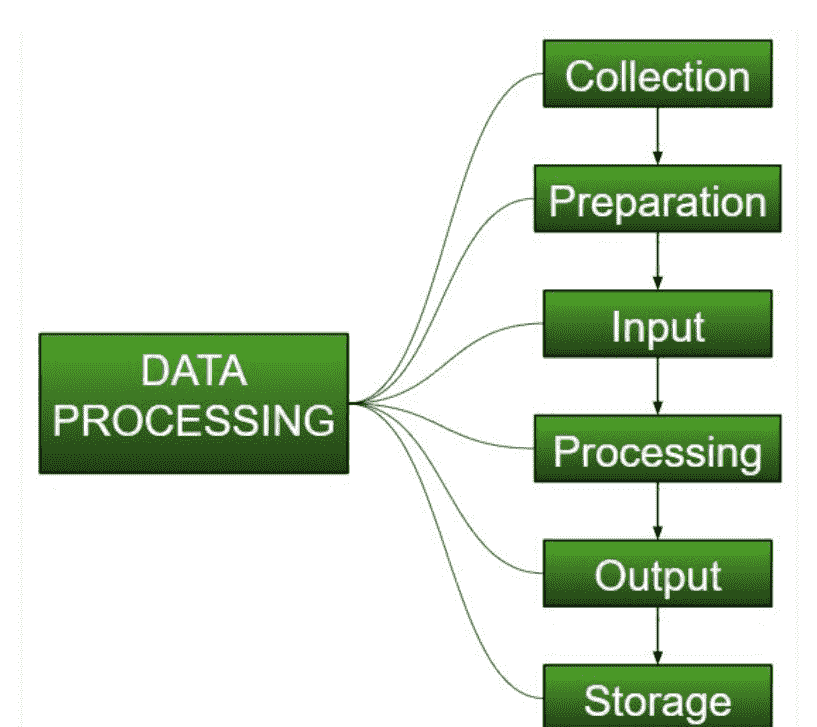

让我们详细看看每个步骤：

#### 数据采集

开始机器学习时最重要的步骤是确保可用数据具有高质量。你可以从Kaggle、`data.gov.in`和UCI数据集仓库等正规来源获取数据。请看以下例子：当学生准备参加竞争性考试时，他们总是寻找最好的备考资源，以确保取得好成绩。同样，准确且高质量的数据将简化模型的学习过程。这意味着在测试阶段，模型将输出最佳结果。

数据采集需要耗费大量的时间、资金和资源。这意味着组织和研究人员必须选择他们想要实施或研究的正确数据类型。

例如，进行面部表情识别工作需要大量包含不同人类表情的图像。优质的数据将确保模型结果的准确性和真实性。

#### 数据准备

收集到的数据可能是原始形式。原始数据无法直接输入机器。相反，必须先对数据进行处理。准备阶段涉及从各种来源收集数据、分析数据集，然后构建新的数据集以进行进一步的处理和探索。准备可以手动或自动完成，数据应以数值形式准备，以提高模型的学习速率。

#### 数据输入

有时，已准备好的数据可能采用机器无法读取的形式，这种情况下，必须将其转换为可读形式。为了进行转换，特定算法的存在至关重要。

执行此任务需要大量的计算和精度。请看以下例子，你可以通过MNIST、音频文件、Twitter评论和视频剪辑等来源收集数据。

#### 数据处理

在此阶段，需要机器学习技术和算法来对大量数据执行指令，确保精度和更好的计算性能。

#### 数据输出

在此阶段，机器以合理的方式获取结果，以便用户可以决定参考使用。输出可以以视频、图形和报告的形式呈现。

#### 数据存储

这是最后阶段，生成的输出、数据模型以及任何其他重要信息都将被保存以备将来使用。

## Python中的数据处理

在了解如何使用Python处理和分析数据之前，让我们先学习一些Python库知识。首先是要熟悉一些重要的库。你需要知道如何将它们导入环境中。在Python中有不同的实现方式。

你可以输入：

```
import math as m
from math import *
```

第一种方式中，你为`math`库定义了一个别名`m`。然后你可以通过别名`m.factorial()`来使用`math`库中的不同函数。

第二种方法中，你导入了`math`的整个命名空间。你可以直接使用`factorial()`而无需引用`math`。

**注意：**

Google推荐使用第一种方法导入库，因为它有助于你辨别函数的来源。

下面的列表展示了你需要了解其函数来源的库。

- **NumPy**：即Numerical Python的缩写。`NumPy`最突出的特性是n维数组。该库拥有标准的线性代数函数、高级随机数生成功能，以及与其他低级编程语言集成的工具。

- **SciPy**：即Scientific Python的缩写。`SciPy`建立在`NumPy`之上。它是线性代数、稀疏矩阵和傅里叶变换等高级科学和工程模块中最重要的库之一。

- **Matplotlib**：当你需要绘制大量图形时，这是最佳选择。从折线图到热力图，你可以使用IPython notebook中的`Pylab`功能来确保绘图功能内联显示。

- **Pandas**：最适合用于结构化数据操作和处理。它广泛用于数据准备和挖掘。`Pandas`是近期才引入Python的，对提升Python在数据科学社区的应用非常有用。

- **Scikit-learn**：专为机器学习而设计。它基于`matplotlib`、`NumPy`和`SciPy`构建。这个特定的库拥有许多高效的机器学习和统计建模工具，包括回归、分类、聚类和降维。

- **StatsModels**：该库专为统计建模而设计。`Statsmodels`是一个Python模块，允许用户探索数据、拟合统计模型并实施统计检验。

#### 其他库

- `Requests`用于访问网络。

- `Blaze`用于支持`NumPy`和`Pandas`的功能。

- `Bokeh`用于在当前Web浏览器上创建仪表盘、交互式图表和数据应用程序。

- `Seaborn`用于统计数据可视化。

- 正则表达式，用于发现文本数据中的模式。

- `NetWorx`和`igraph`用于图形数据操作。

现在你已经熟悉了Python基础知识和关键库，让我们开始通过Python解决问题吧。

## 使用Pandas进行Python探索性分析

如果你还不知道，`Pandas`是Python中一个重要的数据分析库。这个库在提升Python在数据科学社区的应用方面发挥了关键作用。我们的示例使用`Pandas`从Analytics Vidhya竞赛中读取数据集，运行探索性分析，并创建一个初步的分类算法来解决此问题。

在加载数据之前，了解`Pandas`中的两个主要数据结构非常重要，即`Series`和`DataFrames`。

## Series与DataFrames

你可以将`Series`视为一个带标签的一维数组。这些标签帮助你通过标签来理解`Series`中的各个元素。

`DataFrame`类似于Excel工作簿，包含列名（对应列）以及可通过行号访问的行。最重要的区别是，列名和行号分别被称为列索引和行索引。

`Series`和`DataFrame`为Python中的`Pandas`创建了核心数据模型。首先，数据必须从`DataFrame`中读取，然后可以对这些列轻松执行不同的操作。

#### 练习数据集——贷款预测问题

以下是变量的描述：

| 变量描述： | |
|:---|:---|
| 变量 | 描述 |
| `Loan_ID` | 唯一贷款 ID |
| `Gender` | 性别（男/女） |
| `Married` | 申请人是否结婚 (Y/N) |
| `Dependents` | 扶养人数 |
| `Education` | 申请人教育程度（研究生/本科生） |
| `Self_Employed` | 是否自雇 (Y/N) |
| `ApplicantIncome` | 申请人收入 |
| `CoapplicantIncome` | 共同申请人收入 |
| `LoanAmount` | 贷款金额（以千为单位） |
| `Loan_Amount_Term` | 贷款期限（月） |
| `Credit_History` | 信用历史是否符合指南 |
| `Property_Area` | 房产区域（城市/半城市郊区/农村） |
| `Loan_Status` | 贷款是否获批 (Y/N) |

首先，在终端输入以下命令，以 Inline Pylab 模式启动 iPython 界面：

```
ipython notebook --pylab-inline
```

#### 导入库和数据集

本章将使用以下 Python 库：

- `NumPy`

- `Matplotlib`

- `Pandas`

导入库之后，您可以使用`read_csv()`函数读取数据集。到此为止，代码如下所示。

```
import pandas as pd
import numpy as np
import matplotlib as plt
%matplotlib inline
#Using Pandas reading the dataset in a dataframe
df = pd.read_csv("/home/kunal/Downloads/Loan_Prediction/train.csv")
```

请注意，数据集存储在`"/home/kunal/Downloads/Loan_Prediction/train.csv"`中。

读取数据集后，您可以使用`head()`函数来检查前几行数据。

接下来，您可以使用`describe()`函数来查看数值字段的摘要。

#### 分布分析

既然您已经熟悉了数据的基本特征，现在是时候查看不同变量的分布情况了。让我们从数值变量——`ApplicantIncome`和`LoanAmount`开始。

首先，输入以下命令来绘制`ApplicantIncome`的直方图。

```
df['ApplicantIncome'].hist(bins=50)
```


请注意，存在少量极端值。这就是为什么需要 50 个 bins 来清晰地表示分布。

接下来的重点是箱线图。`fare`的箱线图通过以下代码绘制：

```
df.boxplot(column='ApplicantIncome')
```


就 Python 数据处理而言，这仅仅是冰山一角。

让我们来看看：

### Python 中数据预处理的技术

以下是 Python 中数据预处理的最佳技术。

#### 数据重缩放 (Rescaling Data)

当您处理具有不同量级的数据时，需要对属性进行重缩放，使其具有相同的量级。将属性重缩放至 0 到 1 之间，这被称为归一化 (normalization)。为了实现这一点，使用了`Scikit-learn`中的`MinMaxScaler`类。请看以下示例：

```
>>> import pandas, scipy, numpy
>>> from sklearn.preprocessing import MinMaxScaler
>>> df= pandas.read_csv( 'http://archive.ics.uci.edu/ml/machine-learning-databases/wine-quality/winequality-red.csv ',sep=';')
>>> array=df.values
>>> #Separating data into input and output components
>>> x=array[:,0:8]
>>> y=array[:,8]
>>> scaler =MinMaxScaler(feature_range=(0,1))
>>> rescaledX= scaler.fit_transform(x)
>>> numpy.set_printoptions(precision=3) #Setting precision for the output
>>> rescaledX[0:5,:]
```

```
>>> rescaledX[0:5,:]
array([[0.248, 0.397, 0.   , 0.068, 0.107, 0.141, 0.099, 0.568],
       [0.283, 0.521, 0.   , 0.116, 0.144, 0.338, 0.216, 0.494],
       [0.283, 0.438, 0.04 , 0.096, 0.134, 0.197, 0.17 , 0.509],
       [0.584, 0.11 , 0.56 , 0.068, 0.105, 0.225, 0.191, 0.582],
       [0.248, 0.397, 0.   , 0.068, 0.107, 0.141, 0.099, 0.568]])
```

重缩放后，您将获得 0 到 1 之间的值。通过重缩放数据，可以确保神经网络、优化算法以及像k-最近邻这样具有距离度量算法的有效使用。

#### 数据归一化 (Normalizing Data)

在接下来的任务中，您将每个观测值重缩放为特定的长度 1。在这种情况下，您可以使用`Normalizer`类。示例如下：

```
>>> from sklearn.preprocessing import Normalizer
>>> scaler=Normalizer().fit(x)
>>> normalizedX=scaler.transform(x)
>>> normalizedX[0:5,:]
```

```
>>> normalizedX[0:5,:]
array([[2.024e-01, 1.914e-02, 0.000e+00, 5.196e-02, 2.079e-03, 3.008e-01,
       9.299e-01, 2.729e-02],
       [1.083e-01, 1.222e-02, 0.000e+00, 3.611e-02, 1.361e-03, 3.472e-01,
       9.306e-01, 1.385e-02],
       [1.377e-01, 1.342e-02, 7.061e-04, 4.060e-02, 1.624e-03, 2.648e-01,
       9.533e-01, 1.760e-02],
       [1.767e-01, 4.416e-03, 8.833e-03, 2.997e-02, 1.183e-03, 2.681e-01,
       9.464e-01, 1.574e-02],
       [2.024e-01, 1.914e-02, 0.000e+00, 5.196e-02, 2.079e-03, 3.008e-01,
       9.299e-01, 2.729e-02]])
```

#### 数据二值化 (Binarizing Data)

如果您使用二值阈值，可以将数据进行转换，使高于阈值的值变为 1，而等于或低于阈值的值变为 0。对于这项任务，您可以使用`Binarizer`类。

```
>>> from sklearn.preprocessing import Binarizer
>>> binarizer=Binarizer(threshold=0.0).fit(x)
>>> binaryX=binarizer.transform(x)
>>> binaryX[0:5,:]
>>> binaryX[0:5,:]
array([[1., 1., 0., 1., 1., 1., 1., 1.],
       [1., 1., 0., 1., 1., 1., 1., 1.],
       [1., 1., 1., 1., 1., 1., 
```

针对不同电影。我们将从比较图表开始，它非常适合比较多个变量随时间的变化，我们会介绍其类型，如折线图、柱状图和雷达图。关系图便于展示变量之间的关系。我们将涵盖用于展示两个变量关系的散点图、用于三个变量的气泡图、用于变量对的相关矩阵图，最后是热力图。

构图图表用于展示作为整体一部分的变量，我们还将解释饼图、堆叠柱状图、堆叠面积图和维恩图。为了深入了解变量的分布情况，会使用分布图。作为分布图的一部分，我们将涵盖直方图、密度图、箱线图和小提琴图。最后，我们将讨论点地图、连接地图和等值线地图，它们可以归类为地理图表。

### 比较图表

**比较图表**包含非常适合比较多个变量或变量随时间变化的图表。对于项目之间的比较，柱状图（也称为条形图）是最佳选择。折线图非常适合将变量随时间可视化。对于某些特定时间段（例如，少于十个时间点），也可以使用垂直柱状图。雷达图或蜘蛛图非常适合为多个群体可视化多个变量。

#### 折线图

**折线图**用于在连续时间段内显示定量数值，并将信息显示为一系列数据。折线图非常适合时间序列数据，数据点通过直线段连接。

数值放在 y 轴上，而 x 轴是时间刻度。

#### 用途：

折线图非常适合比较多个变量以及可视化单个和多个变量的趋势，尤其是当您的数据集包含许多时间段时（大约超过十个）。

对于较小的时间段，垂直柱状图可能是更好的选择。

下图显示了两个十年间房地产价格（以百万美元计）的趋势。折线图非常适合展示数据趋势：


*单变量折线图*

#### 示例：

下图是一个多变量折线图，比较了 Google、Facebook、Apple、Amazon 和 Microsoft 的收盘股价。折线图非常适合比较数值和可视化股票趋势。正如我们所见，Amazon 显示出最高的增长：


*图：显示五家公司股票趋势的折线图*

#### 设计规范：

- 每张图避免使用过多线条

- 调整比例尺，使趋势清晰可见

##### 注意

多变量图表的设计规范。应有图例来描述每个变量。

#### 柱状图

柱子的长度编码了数值。柱状图有两种变体：垂直柱状图和水平柱状图。

#### 用途：

虽然两者都用于比较不同类别的数值，但垂直柱状图有时用于展示单个变量随时间的变化。

柱状图的注意事项：

不要将垂直柱状图与直方图混淆。柱状图比较不同的变量或类别，而直方图展示单个变量的分布。直方图将在本章后面讨论。

另一个常见错误是使用柱状图展示群体或类别之间的中心趋势。在这些情况下，请使用箱线图或小提琴图来展示统计度量或分布。

#### 示例：

下图展示了垂直柱状图。每根柱子显示了五名学生在一次考试中获得的百分制分数：

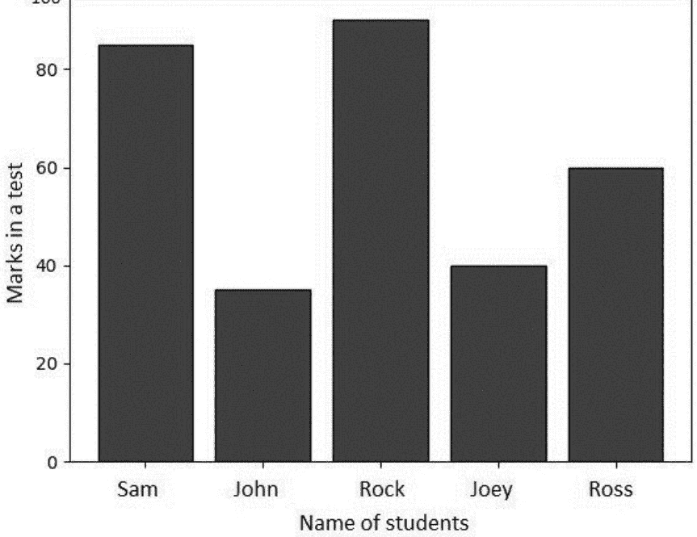


**图：使用学生测试数据的垂直柱状图**

下图展示了水平柱状图。每根柱子显示了五名学生在一次考试中获得的百分制分数：

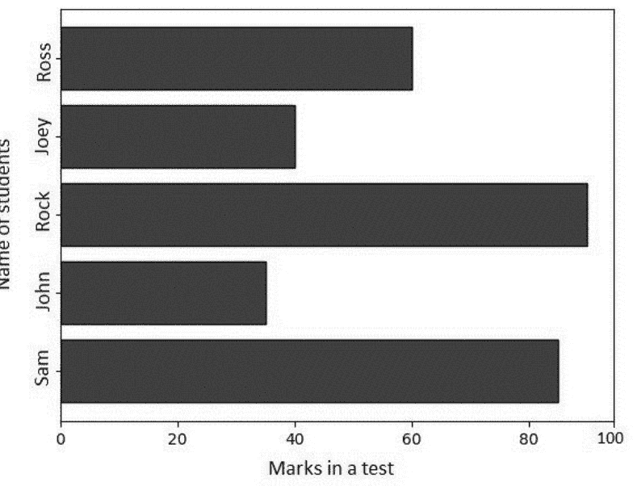

**图：使用学生测试数据的水平柱状图**

下图比较了电影评分，给出了两个不同的分数。`Tomatometer`是给予正面评价的获批影评人百分比。`Audience Score`是给出 3.5 分及以上（满分 5 分）的用户百分比。正如我们所见，**《火星救援》**是唯一一部`Tomatometer`评分和`Audience Score`都高的电影。**《霍比特人：意外之旅》**的`Audience Score`相对于`Tomatometer`评分来说较高，这可能是由于庞大的粉丝群体：


### 对比柱状图

#### 设计规范

对应数值变量的坐标轴应从零开始。从另一个值开始可能会产生误导，因为它会使小数值差异看起来很大。

使用水平标签，即只要柱子数量不多且图表看起来不会太杂乱。

### 雷达图

**雷达图**，也称为**蜘蛛图**或**蛛网图**，可视化多个变量，每个变量绘制在各自的轴上，形成一个多边形。所有轴从中心径向排列，彼此等距，且具有相同的比例尺。

#### 用途

雷达图非常适合为单个群体或多个群体比较多个定量变量。

它们也有助于展示数据集中哪些变量得分高或低，使其成为可视化性能的理想选择。

#### 示例

下图展示了单变量的雷达图。该图显示了关于一名学生在不同科目中得分的相关数据：


## 结语

感谢您能坚持读完*Python 入门*这本书的最后一章。我希望您觉得它内容丰富且有所帮助。我们已采取一切措施确保所有章节都为您提供详细且易于理解的信息。全书我故意使用了简单的语言，以确保您阅读后能够获得提升。本书刻意避免了复杂的理论，坚持使用简单易懂的解释，方便您在学习和研究时随意使用。

一旦您使用`Python`语言理解了编程基础，学习人工智能和机器学习等高级概念就会变得更加容易。人工智能在日常生活中很重要。本书带您领略了`Python`编程的许多概念，如数据分析、多态性、继承、列表、类、循环、对象、变量、方法等等。没有什么特定的方法能让你一夜学会面向对象编程。然而，如果您以坚定的承诺和奉献精神遵循正确的步骤，您将获得 desired 的结果。将结合多次实践课程作为您的日常习惯，以提高您的`Python`编程技能。如果您与经验丰富的程序员一起工作，请遵循提供给您的所有指示，并在不理解的地方提出问题。

下一步是停止阅读，开始将您学到的知识应用到实际生活中。做任何您认为有必要的、能改善编程在现实生活中应用的事情。您会发现，那些看起来什么都有的人中，大多数缺乏基本的`Python`编程技能。试着与他们交流，教他们一两条您在这里学到的知识。您甚至可以向他们推荐或赠送这本书。

最后，如果您觉得这本书以任何方式对您有用，在亚马逊上给出一个好评将不胜感激！

# SQL 编程入门

### 零基础学习 SQL 数据库与服务器的智能指南。更快更好地学习

## Leonard Base

### 引言

**祝贺您下载了《SQL 编程入门》。**

以下章节将讨论“结构化查询语言（SQL）”的基本概念，以帮助初学者学习并掌握这种用于“关系数据库管理系统”的分析语言。本书将为您提供所需的一切知识，以便高效有效地使用`SQL`在 SQL 数据库和服务器上检索和更新信息，主要聚焦于`MySQL`服务器——这是关系数据库管理领域备受推崇的接口之一。

本书第一章题为“SQL 与数据定义语言简介”，您将从数据库管理系统的概述开始，了解不同类型的数据库管理系统及其优势。您将接触到`SQL`语言以及五种基本的`SQL`查询类型，即“数据定义语言（DDL）”、“数据操作语言（DML）”、“数据控制语言（DCL）”、“数据查询语言（DQL）”和“事务控制语言（TCL）”。

本章还将为您提供构建`SQL`语法或查询所需的经验法则，这涉及到能够被数据库服务器处理的语句结构。您还将学习最常用的数据类型，这些类型是学习`SQL`不可或缺的一部分。我们将通过`SQL CREATE`语句开启实际的编程语言学习，并在此基础上不断深化这些概念。此外，本章还将通过多个示例和动手练习，详细解释在`SQL ALTER`语句中使用的`SQL`约束这一至关重要的概念。

在标题为“使用 SQL 创建数据库并维护数据完整性”的第 2 章中，您将接触到`MySQL`，它是一个“免费且开源的关系型数据库管理系统”。`MySQL`服务器提供多种用户界面，包括`MySQL workbench`、`phpMyAdmin`、`Adminer`、`ClusterControl`、`Database workbench`、`DBeaver`、`DBEdit`、`HeidiSQL`、`Sequel Pro`、`Toad`等；任何希望在`MySQL`数据库服务器上执行`SQL`查询的人都可以使用这些工具。我们将引导您完成在操作系统上安装`MySQL`的过程。由于这是一个开放且免费的程序，您可以轻松地将其下载并安装在您的系统中，从而充分利用本书及其中包含的动手练习和示例，有效地学习`SQL`编程语言。您将学习如何在`MySQL`服务器上生成一个全新的数据库，随后创建表并向这些表中插入数据。您还将学习临时表、派生表的概念，以及如何从数据库中已存在的表中生成一个新表。

在标题为“SQL 连接与联合命令”的第 3 章中，您将学习`SQL SELECT`语句以及各种数据操纵子句，包括`ORDER BY`和`WHERE`。本章将详细介绍`SQL`连接（Joins）的核心概念，包括不同的`SQL JOIN`函数，如`INNER JOIN`、`LEFT JOIN`、`RIGHT JOIN`、`CROSS JOIN`和`SELF JOIN`。这些子句的语法将通过示例以及在您自己的`MySQL`实例上进行动手执行时预期获得的结果集图片进行极其详尽的解释。这样做是为了增强您的理解并允许您对`SQL`编程语言进行实操练习。在本章中，您还将学习用于将多个输出合并为单个综合结果集的`SQL union`函数。本章将详细介绍`MySQL UNION`和`MySQL UNION ALL`语句，并阐明`MySQL`连接（join）和联合（union）函数之间的区别。

在标题为“SQL 视图与事务”的第 4 章中，您将学习`SQL`中“数据库视图（Database View）”的概念，它简单来说就是使用`SQL SELECT`语句配合`SQL JOIN`子句定义的虚拟表。本章将解释使用“数据库视图”或“SQL 视图”的诸多优势。本章将解释`CREATE VIEW`语句以及`MySQL`中使用的底层处理算法，如`MERGE`、`TEMPTABLE`和`UNDEFINED`。您还将学习如何从另一个现有视图创建视图，其中可以包含或不包含子查询。此外，本章还通过示例和动手练习解释了“可更新 SQL 视图（Updatable SQL Views）”的概念，以便您学习如何使用`ALTER VIEW`和`CREATE OR REPLACE VIEW`语句来修改`SQL`视图。在`SQL`中，事务被定义为“针对数据库执行的一个工作单元”。本章包含了`SQL`事务的不同属性以及各种带有控制子句的`SQL`事务语句，例如`START TRANSACTION`、`COMMIT`、`ROLLBACK`等。这里还将解释数据库恢复模型的另一个重要概念，包括不同类型的恢复模型和`SQL BACKUP`语句。正如您将在本书中学到的，在发生故障时恢复数据库的过程对于维护宝贵的数据至关重要。

最后一章标题为“数据库安全与管理”，将主要关注用于管理和保护`MySQL`服务器上数据的用户访问权限。您将获得一个逐步指导，学习如何创建新用户账户、根据需要更新用户密码、授予和撤销访问权限，以确保只有获得许可的用户才具有对数据库的授权且必要的访问权限。

市场上关于这个主题的书籍很多，再次感谢您选择这一本！我们尽了最大努力确保书中包含尽可能多有用的信息，请尽情阅读！

# 第 1 章

## SQL 简介与数据定义语言

数据库可以被定义为“一个有组织的各种信息或数据的集合，它可以以电子方式存储在计算机系统中并在需要时被访问”。数据库管理系统（DBMS）被定义为“一种与最终用户、应用程序以及数据库本身进行交互，以捕获和分析数据的软件”。`DBMS`是一个集成计算机软件软件包，使用户能够与多个数据库进行通信，并提供对存储在数据库中的信息的访问。`DBMS`提供了多种功能，使得大量数据能够被输入、存储和检索，并提供了管理数据组织方式的方法。考虑到这种密切的关联，“数据库”一词经常被用来同时指代数据库本身以及`DBMS`。

现有的`DBMS`提供了多种功能来管理数据库，并将其信息分为以下四个主要功能组：

- **数据定义（Data definition）** – 创建、修改和删除代表数据组织的定义。
- **更新（Update）** – 插入、修改和删除实际数据。
- **检索（Retrieval）** – 以可以直接使用或由其他应用程序进一步处理的形式提供数据。收集的数据可以是与数据库中相同的形式，也可以是通过对来自不同数据库的数据集进行更改或组合而获得的不同形式。
- **管理（Management）** – 用户注册与跟踪、数据安全执行、性能跟踪、数据完整性、并发控制，以及恢复因特定事件（例如系统意外故障）而损坏的数据。

一个数据库及其`DBMS`遵循给定的数据库模型。“数据库系统”可以被定义为数据库、`DBMS`和数据库模型的集合。

数据库服务器是物理连接的计算机，它们仅运行`DBMS`和相关软件，持有真实的数据库。具有大内存且使用`RAID`磁盘阵列进行数据长期存储的多处理器机器被称为“数据库服务器”。如果其中一个磁盘损坏，可以使用`RAID`来恢复数据。在海量事务处理环境下，人们开始利用通过高速通道连接到单个或多个服务器的“硬件数据库加速器”。大多数数据库应用程序的核心都是`DBMS`。`DBMS`可以围绕自定义的多任务内核构建内置网络支持，但现代`DBMS`通常使用标准的操作系统来提供相同的功能。

由于`DBMS`代表了一个重要的市场，计算机和存储供应商在自己的生产计划中经常会考虑`DBMS`的需求。

“数据库”和`DBMS`可以根据以下参数进行分组：

- 支持的数据库模型，例如关系型数据库或`XML`数据库。
- 它们可以运行的计算机种类，例如“从服务器集群到移动设备”。
- 使用的查询语言，例如`SQL`或`XQuery`。
- 驱动系统效率、可扩展性、韧性和安全性的“内部工程”。

在本书中，我们将主要关注与`SQL`语言相关的关系型数据库。在 20 世纪 70 年代初，`IBM`开始根据计算机科学家`Edgar Codd`的想法开发一个名为`System R`的原型模型。第一个版本在 1974 年和 1975 年推出，随后开展了对多表系统的研究，允许对数据进行拆分以便于避免将所有数据存储为单个大片区以记录个体。在添加了名为`SQL`的标准化查询语言后，客户在 1978 年和 1979 年测试了随后的多用户版本。`Codd`的概念迫使`IBM`创建了`System R`的真实版本，即`SQL / DS`，随后演变为`Database 2 (DB2)`。

由`Larry Ellison`开发的`Oracle`数据库是从一个截然不同的分支开始的，其基础是`IBM`关于`System R`发表的工作。虽然`Oracle V1`的实现于 1978 年完成，但直到 1979 年发布`Oracle Version 2`，`Ellison`才在进入市场方面胜过`IBM`。

为了进一步开发新的数据库`Postgres`（现称为`PostgreSQL`），`Stonebraker`使用了`INGRES`类。`PostgreSQL`被广泛用于全球范围内的关键任务应用。`.org`和`.info`域名的注册主要使用`PostgreSQL`进行数据存储，许多大企业和金融机构也采取了类似做法。瑞典“乌普萨拉大学”的计算机程序员也受到了`Codd`研究的启发，在 20 世纪 70 年代中期开发了`Mimer SQL`。1984 年，该项目转型为一家独立公司。

1976 年，“实体关系模型”被开发出来，并因其比之前的“关系模型”能产生相对更好的描述而变得非常流行，被广泛用于设计数据库。随后，实体关系的结构被重构为“关系模型的一种数据建模结构”，两者之间的区别变得微乎其微。

“关系数据库”由一组可以匹配到预定类别的表组成。“每个表在列中至少有一个数据类别，每行对于列中定义类别的特定数据实例”。关系数据库有多个名称，如“关系数据库管理系统 (RDBMS)”或“SQL 数据库”。从历史上看，`Microsoft SQL Server`、`Oracle Database`、`MySQL`和`IBM DB2`是最受欢迎的关系数据库。除了可以用在基于 Web 的数据存储中的`MySQL`之外，“关系数据库”主要用于大型企业环境。

所有关系数据库都可以用于管理“面向事务的应用 (OLTP)”。另一方面，大多数在“文档存储”和“列存储”分类中的非关系数据库也可以用于`OLTP`，从而导致两者之间产生混淆。`OLTP`数据库可以被视为“操作性”数据库，其特点是常规的快速交易，包括数据更新、小量数据，以及同时处理成百上千次交易，例如在线预订和银行应用。

### 数据库管理系统的优势

数据库管理系统 (DBMS) 被描述为“允许用户识别、开发、维护并监管数据库访问权限的软件系统”。`DBMS`允许最终客户在数据库中生成信息，以及读取、编辑和删除所需数据。它可以被视为信息与利用该数据的程序之间的一层。

与“基于文件的数据管理系统”相比，`DBMS`提供了若干优势。其中一些优势列举如下：

- **减少数据冗余** - “基于文件的 DBMS”包含存储在系统内多种位置甚至跨多个系统的许多文件。因此，同一个文件的多个副本经常会导致数据冗余。在数据库中这可以很容易地避免，因为只有一个数据库持有所有数据，并且对数据库所做的任何修改都会立即反映在整个系统中。因此，数据库中不存在发现重复信息的可能性。
- **无缝数据共享** - 用户可以相互共享数据库中发现的所有现有数据。数据库内部存在不同级别的授权，以便有选择地访问信息。因此，如果不遵循适当的授权协议，则无法共享信息。多个远程用户可以并发访问数据库并根据需要共享所需信息。
- **数据完整性** - 数据的完整性意味着数据库中的信息是可靠且准确的。由于`DBMS`包含多种数据库，数据的完整性至关重要。所有这些数据库中所包含的信息对所有用户都是公开的。因此，必须确保所有数据库和客户在任何时候都能获得正确且一致的数据。
- **数据安全性** - 数据安全性在数据库的创建和维护中至关重要。只有授权用户在通过有效的用户名和密码验证身份后，才被允许访问数据库。在任何情况下，未经授权的用户都不得被允许访问数据库，因为这违反了数据完整性规则。
- **隐私性** - 数据库中的“隐私规则”规定，只有授权用户才能根据数据库预定义的隐私约束访问数据库。数据库有多个访问级别，用户只能查看被允许的数据。例如，社交网络网站上用户想要访问的账户具有各种访问限制。
- **备份与恢复** - `DBMS`能够生成数据库的自动备份和恢复。因此，用户不需要定期备份数据，因为`DBMS`可以高效地处理此项工作。此外，如果发生技术错误或系统故障，它还可以将数据库恢复到之前的状态。
- **数据一致性** - 在数据库中，由于不存在冗余数据，数据的一致性得到了保证。整个数据库一致地包含所有数据，所有访问数据库的用户接收到的都是相同的数据。此外，对数据库的修改会立即通知所有用户，以避免现有数据出现任何不一致。

### 结构化查询语言

在关系数据库的语境下，“结构化查询语言 (SQL)”被认为是一种标准的用户和应用程序接口。1986 年，`SQL`成为了“美国国家标准学会 (ANSI)”的标准，1987 年，它被添加到“国际标准化组织 (ISO)”中。从那时起，这些标准被频繁改进，并得到了所有主流商业关系`DBMS`的认可（合规程度有所不同）。

对于关系模型，`SQL`是最初的商业语言之一，尽管`Codd`认为它在某些方面与关系结构有所不同。例如，`SQL`允许组织数据行和列。关系数据库具有高度的可扩展性。在初始数据库创建后，可以轻松引入新的数据类别，而无需更改任何现有应用程序。

### SQL 查询类型

数据库语言被定义为“专用语言”，能够执行下面列出的一项或多项任务，通常被称为“子语言”：

- **“数据定义语言 (DDL)”** – 用于定义数据类型，包括其创建、修改或删除，以及它们之间的关系。（随着您阅读本章，您将学习更多关于此主题的内容）
- **“数据操纵语言 (DML)”** – 只有在数据库创建并使用`DDL`命令构建表之后，才能使用`DML`命令来操纵这些表和数据库中的数据。使用`DML`命令的便利之处在于，如果对数据或其值进行了任何错误的修改，可以随时更改并回滚。用于执行特定任务的`DML`命令为：

### 数据控制语言 (DCL) 命令

**`Insert`** – 用于在表中插入新行。

**`Update`** – 用于修改表中行中所包含的数据值。

**`Deletion`** – 用于删除数据库中选定的行或整个表。

**`Lock`** – 用于定义用户访问权限为“只读”或“读写”权限。

**`Merge`** – 用于合并表中的几行数据。

**“数据控制语言 (DCL)”** – 正如其名，`DCL`命令涉及数据库中的数据控制问题。`DCL`命令为用户提供唯一的数据库访问权限，并根据需要用于定义用户角色。最常用的`DCL`命令有两个：

- **`Grant`** – 向用户授予访问权限。
- **`Revoke`** – 撤销已授予用户的访问权限。

**“数据查询语言 (DQL)”** – `DQL`包含一个驱动`SQL`中数据选择的单一命令。结合其他`SQL`子句，`SELECT`命令用于根据用户应用的筛选条件从数据库或表中收集和检索数据。**`SELECT`** 语句用于搜索数据并从表和/或数据库中计算导出信息。


**事务控制语言 (TCL)** – 正如其名，`TCL`管理数据库中与事务相关的问题。它们用于将对原始数据库所做的修改还原或确认。

`Roll back`意味着修改被“撤销”，而`Commit`意味着修改被“应用”。可用的 3 个主要`TCL`命令是：

- **Rollback** – 用于“取消或撤销”在表或数据库中所做的任何更新。
- **Commit** – 用于“部署、应用或保存”在表或数据库中所做的任何更新。
- **Savepoint** – 用于暂时“保存”表或数据库中的数据。

“数据库语言”限于特定的数据模型。一些示例包括：

- **SQL** – 它将数据定义、数据操纵和查询等功能作为一种统一语言提供。
- **OQL** – 它是一种“由对象数据管理组 (Object Data Management Group) 开发的对象模型语言标准”。这种语言启发了`JDOQL`和`EJBQL`等一些现代查询语言的开发。
- **XQuery** – 它是一种“标准 XML 查询语言”，由“MarkLogic 和 eXist 等 XML 数据库技术、具有 XML 能力的关系数据库（如 Oracle 和 DB2）以及 Saxon 等内存 XML 处理器”引入。
- **SQL / XML** – 它是`SQL`和`XQuery`的结合。

### SQL 语法

下图描绘了`SQL`查询最常见的语法（服务器可以理解的代码结构）。在我们进入实际可执行的`SQL`命令以获得实践学习体验之前，这里有一些你必须首先记住的经验法则：

1. 每个命令的末尾必须使用“分号”。
2. 命令的开头必须使用“关键字”。随着本书的深入，你将学习到所有的关键字。
3. 字母的大小写结构与命令无关。
4. 你必须记住创建时使用的表名或数据库名，并确保在所有命令中始终使用这些特定名称。

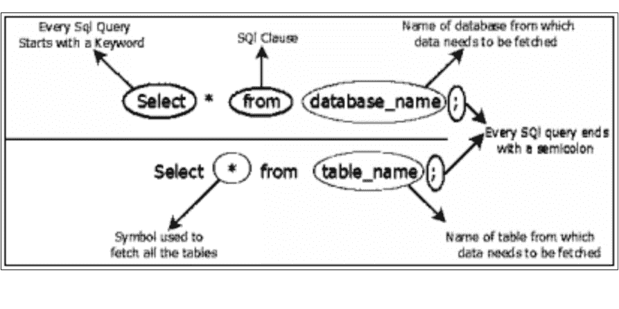

### SQL 数据类型

学习`SQL`的另一个重要概念是各种数据类型，它们可用于“定义可以输入到特定列中的数据值的类型”。常用数据类型列在下表中：

| 数据类型 | 描述 |
| :--- | :--- |
| `char(size)` | 用于定义“固定长度字符字符串”。数据值的大小可以使用括号中所示的所需数字来指定。最大允许长度为`255`个字符。 |
| `varchar(size)` | 用于定义“可变长度字符字符串”。数据值的大小可以使用括号中所示的所需数字来指定。最大允许长度为`255`个字符。 |
| `number(size)` | 用于定义括号中指定的“数值”。列中的最大位数可以使用括号中所示的所需数字来指定。 |
| `date` | 用于为相关列定义“日期值”。 |
| `number(size, d)` | 用于定义括号中指定的“数值”。列中的最大位数可以使用括号中的所需数字指定，同时还包括如所示的小数点右侧的位数`d`。 |

### 数据定义语言 (DDL)

随着`Codasyl`数据库模型的引入，“数据定义语言”这一术语被创造出来。`DDL`的概念要求数据库方案使用一种能够描述“用户数据模型的记录、字段和集合”的语法来开发。随后，`DDL`被认为是`SQL`的一个子集，用于声明表、列、数据类型和约束。`SQL`的第三次重大修订（称为`SQL – 92`）为“架构操纵语言和用于查询架构的架构信息表”奠定了基础。在`SQL – 2003`中，数据表被描述为`SQL/Schemata`。

`DDL`可用于创建或修改给定数据库中目标表的物理结构。所有此类命令在执行后可以自动提交，对表的所有修改会立即反映在整个数据库中并被存储。以下是最知名且广泛使用的`DDL`命令：

- **Create** – 用于创建新表或整个数据库。
- **Alter** – 用于修改表中已存在行的数据值。
- **Rename** – 用于重命名表或数据库。
- **Drop** – 用于从数据库中删除表。
- **Truncate** – 用于从数据库中删除整个表。

现在，我们将探索这些`DDL`命令在执行所需操作时的各种用途。为了便于学习，所有固定代码或关键字都将用大写字母编写，以便你轻松区分虚拟数据和命令语法。

#### SQL `CREATE`命令

*用法* – 正如其名，`CREATE`命令主要用于构建数据库和表。这通常是学习`SQL`的第一步。

**语法：**

```
CREATE DATABASE database_name;
CREATE TABLE table_name;
CREATE TABLE table_name (column1 datatype, column2 datatype, column3 datatype,....);
```

## 示例：

假设你想创建一个名为`database_football`的数据库，其中包含一个存储球队详情的表`team_details`和另一个存储球员详情的表`player_details`。

第一步是使用以下命令构建所需的数据库：

```
CREATE DATABASE database_football;
```

现在，你的系统中有了数据库，你可以使用以下命令创建所需的表：

```
CREATE TABLE team_details;
CREATE TABLE player_details;
```

如果你想创建`player_details`表，并包含一些列，如长度为 15 的`player_firstname`、长度为 25 的`player_lastname`和`player_age`。你将使用以下命令：

```
CREATE TABLE player_details ( player_firstname varchar(15), player_lastname varchar(25), player_age int );
```

***记住，`varchar`数据类型的大小可以在语句中注明，最大长度为`255`个字符；如果未指定列大小，系统将“默认”为你设置最大长度。***

##### 动手练习

为了练习，想象你是一个初创企业主，正准备招聘一些员工。首先，你需要为公司创建一个数据库，我们将你的公司命名为`Fit Life`，并创建一个名为`database_FitLife`的数据库。然后，你可以添加一个名为`New_Employees`的表，包含用于存储员工`First Name`（名）、`Last Name`（姓）、`Job Title`（职位）、`Age`（年龄）和`Salary`（薪水）的列。

**请自行斟酌并先写出你的`SQL`语句！**

现在，你可以将你的语句与下面给出的正确命令进行对比验证：

```
CREATE DATABASE database_FitLife;
```

```
CREATE TABLE New_Employees ( employee_firstname varchar, employee_lastname varchar, employee_jobtitle varchar, employee_age int, employee_salary int );
```

#### SQL `ALTER`命令

*用法* – 此命令主要用于“添加列、删除列、添加不同数据约束以及删除预定义的数据约束”。

*数据约束* – 在`SQL`中，“约束”不过是应用于表中数据的特定规则。它们可以应用于“列级别”，即仅适用于选定的列，或者

#### SQL 数据约束

在“表级”上，约束适用于表中的所有列。它们“限制”了允许添加到表中的数据值的类型，以确保表中的数据准确可靠。违反这些约束将中止你尝试执行的命令。

数据约束可以在创建表时（使用`CREATE`命令）添加，或者在表生成后（利用`ALTER`命令）添加。

最常用的`SQL`约束包括：

- **NOT NULL** – 用于确保列始终包含一个值，且不持有`NULL`值。这意味着，如果没有在该列中添加值，则无法添加新记录，也无法修改已存在的记录。
- **UNIQUE** - 此约束用于确保列中的每一个数据值都互不相同。
- **PRIMARY KEY** - 此约束本质上是`NOT NULL`和`UNIQUE`约束的“组合”。它作为表中每条记录的唯一标识，且必须包含一个数据值。单个表只能指定一个“主键”。
- **FOREIGN KEY** - 此约束作为存在于另一个不同表中的记录/行的唯一标识，该表已与你当前操作的表相关联。这有助于中止会破坏两表之间链接的命令，即不能在“外键”列中添加无效数据，因为其值必须存在于持有该特定列的表中。
- **CHECK** - 此约束用于确保列中的所有数据值满足特定条件并限制在预定义的值范围内。在列上应用`Check`约束将只允许向该列添加选定值。然而，在表上应用`Check`约束将对可添加的值产生限制。
- **DEFAULT** – 用于为特定列设置“默认数据值”，以防该列未指定其他值。
- **INDEX** - 此约束利用用户不可见的索引，用于快速地从数据库中“创建和检索”数据值。这应仅用于比其他列更频繁被搜索的列。

##### 语法

### 添加列

```
ALTER TABLE table_name
ADD column_name datatype;
```

### 删除列

```
ALTER TABLE table_name
DROP column_name;
```

### 添加`NOT NULL`约束

```
ALTER TABLE table_name
MODIFY column_name datatype NOT NULL;
```

### 添加`UNIQUE`约束

```
ALTER TABLE table_name
ADD UNIQUE column_name;
```

### 添加`PRIMARY KEY`约束

```
ALTER TABLE table_name
ADD PRIMARY KEY column_name;
```

### 添加`FOREIGN KEY`约束

```
ALTER TABLE table_name
ADD FOREIGN KEY (column_name) REFERENCES table_name (column_name);
```

### 添加`CHECK`约束

```
ALTER TABLE table_name
ADD CHECK (column_name <= 'numeric value');
```

### 添加`DEFAULT`约束

```
ALTER TABLE table_name
ADD CONSTRAINT (column_name) DEFAULT 'data_value' FOR (column_name);
```

### 添加`INDEX`约束

```
CREATE INDEX index_name
ON table_name (column1, column2, ...);
```

### 删除`NOT NULL`约束

```
ALTER TABLE table_name
DROP CONSTRAINT column_name datatype;
```

### 删除`UNIQUE`约束

```
ALTER TABLE table_name
DROP CONSTRAINT column_name datatype;
```

### 删除`PRIMARY KEY`约束

```
ALTER TABLE table_name
DROP PRIMARY KEY;
```

### 删除`FOREIGN KEY`约束

```
ALTER TABLE table_name
DROP FOREIGN KEY (column_name);
```

### 删除`CHECK`约束

```
ALTER TABLE table_name
DROP CHECK (column_name);
```

### 删除`DEFAULT`约束

```
ALTER TABLE table_name
ALTER COLUMN (column_name) DROP DEFAULT;
```

### 删除`INDEX`约束

```
DROP INDEX table_name.index_name;
```

### 示例

现在，假设你想修改在上一节中生成的`player_details`表。要添加一个名为`player_ID`的列，然后删除`player_age`列，你可以执行以下命令：

```
ALTER TABLE player_details
ADD player_ID number;
```

```
ALTER TABLE player_details
DROP player_age;
```

现在让我们看看如何为`player_details`表添加各种“约束”！

你可以指定`player_firstname`列具有`NOT NULL`约束。`player_lastname`列是唯一的（`UNIQUE`）。`player_ID`列可以被定义为主键，并可以用作另一个名为`team_details`表中的外键。我们可以在`player_age`列上定义“检查约束（check constraint）”，以确保所有输入的值大于或等于 20。我们还可以将`player_age`列的默认值设为`20`。由于我们将频繁使用`player_lastname`列，让我们为其添加一个索引。

步骤 1：

```
ALTER TABLE player_details
MODIFY player_firstname varchar (15) NOT NULL;
```

步骤 2：

```
ALTER TABLE player_details
ADD UNIQUE player_lastname;
```

步骤 3：

```
ALTER TABLE player_details
ADD PRIMARY KEY player_ID;
```

步骤 4：

```
ALTER TABLE team_details
ADD FOREIGN KEY (player_ID) REFERENCES player_details (player_ID);
```

步骤 5：

```
ALTER TABLE player_details
ADD CHECK (player_age <= '20');
```

步骤 6：

```
ALTER TABLE player_details
ADD CONSTRAINT (player_age) DEFAULT '20' FOR (player_age);
```

步骤 7：

```
CREATE INDEX idx_name
ON player_details (player_lastname, player_firstname);
```

**现在，让我们按照相同的顺序，删除刚才定义的所有约束。**

步骤 1：

```
ALTER TABLE player_details
DROP CONSTRAINT player_firstname varchar (15) NOT NULL;
```

步骤 2：

```
ALTER TABLE player_details
DROP CONSTRAINT player_lastname;
```

步骤 3：

```
ALTER TABLE player_details
DROP PRIMARY KEY;
```

步骤 4：

```
ALTER TABLE team_details
DROP FOREIGN KEY (player_ID);
```

步骤 5：

```
ALTER TABLE player_details
DROP CHECK (player_age);
```

步骤 6：

```
ALTER TABLE player_details
ALTER COLUMN (player_age) DROP DEFAULT;
```

步骤 7：

```
DROP INDEX player_details.idx_name;
```

##### 动手练习

为了练习，我们将继续使用在前一节中创建的`database_FitLife`数据库，其中包含一个名为`New_Employees`的表，该表包含存储员工“名字 (First Name)”、“姓氏 (Last Name)”、“职位 (Job Title)”、“年龄 (Age)”和“薪水 (Salary)”的列。

现在，让我们在这个数据库中添加另一个名为`Current_Employees`的表。然后添加一个新的员工 ID 列，该列将作为`New_Employees`表的“主键”和`Current_Employees`表的“外键”。在本次练习中，可以删除薪水（salary）列。

将名字（first name）列设为`NOT NULL`，姓氏（last name）列设为`UNIQUE`。在员工年龄列上添加一个`CHECK`约束，要求其“大于或等于 21”。然后将该列的默认值设置为`21`。最后，为`New_Employees`表的姓氏列添加一个索引。

**请根据你的判断，先准备好你的`SQL`语句！**

现在你可以对照下面的正确命令来验证你的语句：

步骤 1：

```
CREATE TABLE Current_Employees (employee_firstname varchar, employee_lastname varchar, employee_jobtitle varchar, employee_age int, employee_salary int);
```

步骤 2：

```
ALTER TABLE New_Employees ADD employee_ID number;
```

步骤 3：

```
ALTER TABLE New_Employees DROP employee_salary;
```

步骤 4：


`ALTER TABLE New_Employees ADD PRIMARY KEY employee_ID;`

步骤 5：

`ALTER TABLE Current_Employees ADD FOREIGN KEY (employee_ID) REFERENCES New_Employees (employee_ID);`

步骤 6：

`ALTER TABLE New_Employees MODIFY employee_firstname varchar NOT NULL;`

步骤 7：

`ALTER TABLE New_Employees ADD UNIQUE employee_lastname;`

步骤 8：

`ALTER TABLE New_Employees ADD CHECK (employee_age <= '21');`

步骤 9：

`ALTER TABLE New_Employees ADD CONSTRAINT (employee_age) DEFAULT '21' FOR (employee_age);`

步骤 10：

`CREATE INDEX idx_lastname ON New_Employees (employee_lastname);`

`CREATE INDEX idx_name ON New_Employees (employee_lastname);`

完成了！现在你的任务是删除所有这些约束，然后将 `salary` 列重新添加到 `New_Employees` 表中。

> **请自行尝试，先写出你的 SQL 语句！**

现在你可以对照下面给出的正确命令来验证你的语句：

```
Step 1:
ALTER TABLE New_Employees
DROP PRIMARY KEY;

Step 2:
ALTER TABLE Current_Employees
DROP FOREIGN KEY (employee_ID);

Step 3:
ALTER TABLE New_Employees
DROP CONSTRAINT employee_firstname varchar NOT NULL;

Step 4:
ALTER TABLE New_Employees
DROP CONSTRAINT employee_lastname;

Step 5:
ALTER TABLE New_Employees
DROP CHECK (employee_age);

Step 6:
ALTER TABLE New_Employees
ALTER COLUMN (employee_age) DROP DEFAULT;

Step 7:
DROP INDEX New_Employees.idx_name;
```

第 8 步：

```
ALTER TABLE New_Employees
ADD employee_salary number;
```

## SQL `DROP DATABASE` 命令

**用途** – 此命令主要用于删除一个已存在的 SQL 数据库。

### 语法：

```
DROP DATABASE database_name;
```

### 示例：

假设你由于某些业务原因想要删除数据库 `database_football`，例如数据库中存在无关数据或重复数据库等。

你只需使用下面的命令，整个数据库就会从系统中被彻底清除。

```
DROP DATABASE database_football;
```

## 动手练习

出于练习目的，假设你的公司 `Fit Life` 已经倒闭或更名，你想要删除与该公司相关的所有可用数据。你会怎么做？

**请自行尝试，先写出你的 SQL 语句！**

现在你可以对照下面给出的正确命令来验证你的语句：

```
DROP DATABASE database_FitLife;
```

## SQL `CREATE VIEW` 命令

**用途** – 此命令主要用于根据 SQL 命令的“结果集”在数据库中生成“表的虚拟视图”。该视图类似于一个实际的数据库表，它同样具有列和行，但其数据值可以通过 SQL 函数 `WHERE` 和 `JOIN` 从数据库中的单个或多个表中调用。“SQL 视图”用于增强数据结构，使其更加用户友好。

在 SQL 中，`WHERE` 函数用于根据特定条件有选择地过滤数据或记录。它是一个功能非常强大的函数，也可以与其他 SQL 语句（包括 `UPDATE` 和 `DELETE`）一起使用。

生成视图时将仅使用最新和最新的数据！

### 语法：

```
CREATE VIEW view_name AS
SELECT column1, column2, ...
FROM table_name
WHERE condition;
```

### 示例：

让我们回到数据库 `database_football`，假设你想查看年龄为 25 岁的球员的详细信息。

你只需使用下面的命令即可查看所需信息。

```
CREATE VIEW young_players AS
SELECT player_firstname, player_lastname
FROM player_details
WHERE player_age = '25';
```

### 动手练习

出于练习目的，假设你的公司 `Fit Life` 正在经历组织变革，你想要查看所有职位为“经理”的员工列表。

**请自行尝试，先写出你的 SQL 语句！**

现在你可以对照下面给出的正确命令来验证你的语句：

```
CREATE VIEW employee_managers AS
SELECT employee_firstname, employee_lastname
FROM Current_Employees
WHERE employee_jobtitle = 'manager';
```

# 第 2 章

使用 SQL 创建数据库并维护数据完整性

`MySQL` 一直是一个广受欢迎的“免费开源的基于 SQL 的关系型数据库管理系统（RDMS）”。1995 年，一家名为 `MySQL AB` 的瑞典公司最初开发、营销并授权了 MySQL 数据管理系统，后来被 `Sun Microsystems`（现称 `Oracle Co.`）收购。MySQL 是“LAMP 软件栈 Web 应用程序组件，即 Linux、Apache、MySQL、Perl / PHP / Python 的缩写”。多个数据库驱动的 Web 应用程序，包括 `Drupal`、`Joomla`、`PhpBB` 和 `WordPress`，都在使用 `MySQL`。它是 RDBMS 创建各种在线软件应用程序的最佳应用之一，已被用于开发多个知名网站，包括 `Facebook`、`YouTube`、`Twitter` 和 `Flickr`。

MySQL 已被用于 `C` 和 `C++` 语言。MySQL 可以在多个系统上运行，包括 `AIX、BSDi、FreeBSD、HP-UX、eComStation、i5/OS、IRIX、Linux、macOS、Microsoft Windows、NetBSD、Novell NetWare、OpenSolaris、OS/2 Warp、QNX、Oracle Solaris、Symbian、SunOS、SCO OpenServer、SCO UnixWare、Sanos 和 Tru64`。其 SQL 解析器使用 `yacc` 开发，并使用了内部开发的“词法分析器”。还为 `OpenVMS` 开发了 MySQL 移植版本。`MySQL 服务器`及其`客户端库`采用双许可证分发模式，可在 `GPL 版本 2` 或专有许可下使用。此外，在各种 IRC 博客和频道上还可以获得免费帮助。Oracle 还通过其 `MySQL 企业版产品`提供付费支持服务。服务范围和价格各有不同。一些第三方提供商，包括 `MariaDB` 和 `Percona`，也提供相关帮助和服务。

MySQL 在开发者社区中获得了极高的评价，评审人员注意到它在大多数情况下确实表现出色。开发者接口齐全，并且有大量优秀的配套文档以及来自实际网络环境的反馈。`MySQL` 还成功通过了“快速、稳定且真正的多用户、多线程 SQL 数据库服务器”的测试。

`MySQL` 有两个不同的版本：`MySQL Community Server`（开源版）和 `Enterprise Server`（企业版），后者为专有软件。`MySQL Enterprise Server` 的区别在于它基于一系列可以作为“服务器插件”安装的专有扩展，但它们共享相同的版本编号方案，并使用相同的基础代码开发。

以下是 `MySQL v5.6` 提供的一些主要特性：

- `ANSI SQL 99 的广泛子集及扩展。`
- `跨平台支持。`
- `存储过程，使用与 SQL/PSM 紧密遵循的过程语言。`
- `触发器`；`游标`；`可更新视图`；`SSL 支持`；`查询缓存`；`子查询（即嵌套 SELECT）`；`内置复制支持`；`信息架构。`
- `使用 InnoDB 存储引擎时支持在线数据定义语言（DDL）。`
- `性能架构，用于收集和汇总有关服务器执行和查询性能的统计数据，以进行监控。`
- `一组用于控制运行时行为的 SQL 模式选项，包括用于更好遵守 SQL 标准的严格模式。`
- `X/Open XA 分布式事务处理（DTP）支持；使用默认 InnoDB 存储引擎作为其中一部分的两阶段提交。`
- `使用默认 InnoDB 存储引擎时支持带保存点的事务。`
- `NDB Cluster 存储引擎同样支持事务。`
- `使用 InnoDB 和 NDB Cluster 存储引擎时符合 ACID 标准。`
- `异步复制：从一个主节点到多个从节点的主从复制，或从多个主节点到一个从节点的复制。`
- `半同步复制：主节点到从节点的复制，主节点在复制时会等待。`
- `同步复制：MySQL Cluster 中提供多主节点复制。`
- `虚拟同步：可通过 Galera Cluster 或内置的组复制插件实现具有多主节点支持的 MySQL 服务器自管理组。`
- `全文索引和搜索`；`嵌入式数据库库`；`Unicode 支持。`
- `分区表及优化器中的分区修剪。`
- `通过 MySQL Cluster 实现无共享集群。`
- `多存储引擎，允许为应用程序中的每个表选择最有效的引擎。`
- `原生存储引擎 InnoDB、MyISAM、Merge、Memory（heap）、Federated、Archive、CSV、Blackhole、NDB Cluster。`
- `提交分组，将来自多个连接的多个事务汇集在一起，以增加每秒的提交次数。`

## MySQL 的用户界面

图形用户界面（GUI）可以定义为“一种允许用户通过图形图标和视觉指示器（如辅助标记）与电子设备或程序交互的界面类型，区别于基于文本的界面、键入的命令标签或文本导航”。“GUI” 通常更易于学习

与必须通过键盘输入命令的“命令行界面 (CLIs”相比，“MySQL”提供了多种界面，您可以利用这些界面来最佳地满足您的需求。一些广受欢迎的“MySQL 界面”包括：

### MySQL Workbench

MySQL Workbench 是“MySQL 数据库的官方内置环境”。它由 `MySQL AB` 创建，允许用户以图形化方式监督 MySQL 数据库并以可视化方式设计数据库。它取代了之前的软件套件 `MySQL GUI Tools`。`MySQL Workbench`允许用户进行数据库设计和模型创建、“SQL 实现”（取代 `MySQL Query Browser`）以及“数据库管理”（取代 `MySQL Administrator`）。这些功能在其他第三方应用程序中也可以实现，但 `MySQL Workbench` 仍被视为官方的 MySQL 前端。`MySQL Workbench`可以从 MySQL 官方网站下载，分为两个独立版本：常规的“免费且开源的社区”版本，以及一个“专有标准”版本，后者持续扩展并增强社区版本的功能集。

### phpMyAdmin

PhpMyAdmin 是“一个使用 PHP 编程语言开发的免费且开源的应用程序，允许使用 Web 浏览器来管理 MySQL 管理”。它允许通过运行 SQL 查询来执行多种功能，如数据库、表、字段或行的生成、修改或删除，以及用户和权限的管理。phpMyAdmin 易于访问，支持多达 78 种不同语言，并由 `The phpMyAdmin Project` 管理。数据可以从 `CSV` 和 `SQL` 导入，并使用一组预定义功能将存储的数据转换为所需格式，例如“将 BLOB 数据表示为图片或下载链接”。

### Adminer

Adminer（之前被称为 `phpMinAdmin`）是另一个“用于维护 MySQL 数据库中信息的免费且开源的 MySQL 前端”。随着第 2 版本的发布，`Adminer` 也可以用于 `PostgreSQL`、`SQLite` 和 `Oracle` 数据库。`Adminer` 可以使用多个易于获取的 `CSS skins` 来管理多个数据库。它根据 `Apache License` 或 `GPL v2` 以单个 `PHP 文件` 的形式提供。Jakub Vrána 于 2007 年 7 月开始开发 `Adminer`，将其作为原 `phpMyAdmin` 应用程序的一个轻量级替代方案。

### ClusterControl

ClusterControl 被定义为“一个端到端的 MySQL 管理系统或 GUI，用于通过单一界面管理、监控、扩展和部署不同版本的 MySQL”。它由 `Severalnines` 设计。`ClusterControl 社区版本`可以免费访问，允许用户直接进行 MySQL 实例的部署和跟踪。诸如负载均衡、备份和恢复等高级特性是需要付费的额外功能。

### Database Workbench

`Database Workbench` 应用程序由 `Upscene Productions` 创建，用于使用 SQL 创建和管理在不同数据库系统之间可互操作的各种关系数据库。`Database Workbench` 可以支持多种数据库系统，并为计算机程序员提供一个跨数据库工具，针对多种数据库具有相似的界面和生产环境。`Database Workbench` 支持的关系数据库包括：`Oracle Database, Microsoft SQL Server, SQL Anywhere, Firebird, NexusDB, InterBase, MySQL 和 MariaDB`。`Database Workbench 5` 可以在 `32 位或 64 位` 的 Windows 系统上运行，也可以通过利用 `Wine` 应用程序在 `Linux, FreeBSD 或 MacOS` 操作系统上运行。

### DBeaver

DBeaver 是一个“根据 `Apache License 2.0` 推广的开源且免费的软件应用程序，用作数据库管理工具和 SQL 客户端，其源代码托管在 GitHub 上”。DBeaver 为以下数据库提供广泛支持：`MySQL 和 MariaDB, PostgreSQL, Oracle, DB2 (LUW), Exasol, SQL Server, Sybase, Firebird, Teradata, Vertica, Apache Phoenix, Netezza, Informix, H2, SQLite 以及任何其他 JDBC 或 ODBC 驱动数据库`。

### DBEdit

DBEdit 是一个“数据库编辑器，可以连接到 Oracle, DB2, MySQL 以及任何提供 JDBC 驱动的数据库，其源代码托管在 SourceForge 上”。它也被定义为“一款根据 GNU 通用公共许可证分发的免费且开源软件”。它可在 `Windows, Linux 和 Solaris` 上使用。

### HeidiSQL

HeidiSQL（早先被称为 `MySQL-Front`）是另一个免费且开源的应用程序，充当 MySQL 的前端，可与 `MariaDB`、`Percona Server`、`Microsoft SQL Server` 和 `PostgreSQL` 配合使用。德国计算机科学家 Ansgar Becker 和 `Delphi` 的其他几位贡献者共同开发了 `HeidiSQL` 界面。要操作 `HeidiSQL` 数据库，客户需要登录并使用合格的凭据创建一个到本地或远程 MySQL 服务器的会话。该会话允许用户连接并管理 `MySQL 服务器` 上的 `MySQL 数据库`，并在完成任务后从服务器断开连接。`HeidiSQL` 的功能集适用于大多数流行且复杂的数据库、表和数据记录相关活动，但它仍在向 MySQL 用户界面所需的完整功能积极发展。

### LibreOffice Base

LibreOffice Base 允许创建和管理数据库，准备表单，并为终端用户提供便捷获取信息的报告。它还充当不同数据库系统的接口，如 `Microsoft Access`，包括 `Access 数据库 (JET), ODBC 信息源, 以及 MySQL 或 PostgreSQL`。

### Navicat

Navicat 是由 PremiumSoft CyberTech Ltd 生产的“一套用于 MySQL, MariaDB, Oracle, SQLite, PostgreSQL 和 Microsoft SQL Server 的图形化数据库管理和开发软件”。它具有一个类似于 `Microsoft Internet Explorer` 的图形用户界面，并支持各种本地和远程数据库连接。它的设计旨在满足从数据库管理员、开发人员到为公众服务并与合作伙伴公司共享数据的各类企业的需求。`Navicat` 是一款跨平台软件，可以在 `Microsoft Windows, OS X 和 Linux` 等系统上运行。一旦购买软件，用户可以选择八种可用语言之一来操作软件，分别是：`英语, 法语, 德语, 日语, 波兰语, 简体中文和繁体中文`。

### Sequel Pro


Sequel Pro 也是一款免费且开源的“Macintosh”操作系统软件，可以本地或远程操作“MySQL 数据库”，并托管在“Sourceforge”上。它采用了“免费增值模式 (freemium model)”，有效地为“免费用户”提供了大部分基础功能。这些应用程序需要由 SQL 表本身进行管理。对于较新的 Unicode，它可以管理最新的“fun” UTF-8 函数，并且在处理各种 GBington 表时几乎没有困难。

## SQLBuddy

SQLBuddy 是一款“使用 PHP 发布的基于 Web 的开源软件，通过 Web 浏览器管理 MySQL 和 SQLite 管理”。该设计的目的是实现简单的软件安装，并为用户提供增强且便捷的界面。

## SQLyog

SQLyog 是另一个“MySQL GUI”应用程序，提供免费版本，但也提供其平台的付费软件版本。它具有一个类似电子表格的界面，允许轻松完成数据操纵（例如：插入、更新和删除）。

其编辑器提供了多种自动格式化选择，例如“语法高亮”。可以使用查询来操纵原始表数据和结果集。其搜索功能采用“类 Google 的搜索语法”，可以透明地为用户转换为 SQL。它提供了一个备份实用程序以执行无人值守备份。如果需要，备份可以被压缩存储为“每个表一个文件并带有时间戳标识”。

## Toad

Toad for MySQL 由 Dell Software 开发，是一款由数据库程序员、数据库管理员以及数据分析师使用的计算机应用程序，使用 SQL 在“关系型和非关系型数据库”上运行。Toad 可与众多数据库和环境配合使用。它可以轻松安装在所有“32 位/64 位 Windows 平台，包括 Microsoft Windows Server, Windows XP, Windows Vista, Windows 7 和 8 (32 位或 64 位)”。“Dell Software”最近还发布了 Toad Mac Edition，提供商业版本和试用/免费软件版本。Toad 的免费软件版本可以通过“ToadWorld.com”社区获取。

## Webmin

Webmin 最初被开发为“一个用于类 Unix 系统的基于 Web 的系统配置工具”，但较新版本也可安装并运行在“Windows 操作系统”上。它允许自定义内部“操作系统配置，如用户、磁盘配额、实用程序或配置文件”，以及对“开源应用程序，如 Apache HTTP Server, PHP 或 MySQL”进行修改和控制。

“Webmin”主要基于“Perl”构建，并作为其自身的网络服务器和进程运行。在通信方面，它默认使用“TCP 端口 10000”，并配置为使用“SSL”（前提是系统已安装“OpenSSL”以及执行所需的所有“Perl”模块）。它围绕与“Webmin 服务器”和“配置文件”具有接口的模块进行开发。这使得添加最新功能变得更加便捷。由于“Webmin”采用模块化设计，热心用户可以为其桌面设置创建自定义插件。“Webmin”还支持通过一个综合用户界面控制同一子网或局域网上的多台设备，或者无缝连接到其他“Webmin”主机。

## 在 Linux/UNIX 上安装 MySQL

在“Linux 系统”上应使用“RPM”安装 MySQL。以下 RPM 可在“MySQL AB”官方网站上下载：

- **MySQL** – “MySQL 数据库服务器管理数据库和表，控制用户访问并处理 SQL 查询”。
- **MySQL 客户端** – “MySQL 客户端程序，使得连接和与服务器交互成为可能”。
- **MySQL 开发库** – “编译其他使用 MySQL 的程序时用到的库和头文件”。
- **MySQL 共享库** – “MySQL 客户端的共享库”。
- **MySQL 基准测试工具** – “MySQL 数据库服务器的基准和性能测试工具”。

为了继续设置，您必须遵循以下说明：

1. 使用 root 用户登录系统。
2. 切换到包含 RPM 的目录。
3. 执行以下命令安装 MySQL 数据库服务器。请注意将“斜体文件名”替换为您所需的 RPM 文件名。

```bash
[root@host]# rpm -i MySQL-5.0.9-0.i386.rpm
```

此函数负责安装“MySQL 服务器”、创建“MySQL”用户、所需的设置以及“MySQL 服务器”的自动启动。

您可以在`/usr/bin`和`/usr/sbin`目录中找到所有与“MySQL”相关的二进制文件。每个数据库和表将在`/var/lib/mysql`目录中生成。

以下命令是可选的，可用于使用相同方法安装其他 RPM，但强烈建议在系统上安装所有这些 RPM：

```bash
[root@host]# rpm -i MySQL-client-5.0.9-0.i386.rpm
[root@host]# rpm -i MySQL-devel-5.0.9-0.i386.rpm
[root@host]# rpm -i MySQL-shared-5.0.9-0.i386.rpm
[root@host]# rpm -i MySQL-bench-5.0.9-0.i386.rpm
```

## 在 Windows 操作系统上安装 MySQL

在任何 Windows 版本上，MySQL 的标准安装比过去变得容易得多，因为 MySQL 现在以安装包形式提供。您只需“下载安装程序包，解压并运行安装文件”即可。

默认`setup.exe`中的安装过程无关紧要，所有组件都默认安装在`C:\mysql`下。

要首次测试服务器，只需使用命令提示符打开用户界面。转到 MySQL 服务器位置（可能位于`C:\mysql\bin`），然后输入`mysqld.exe –console`。

成功安装后，屏幕上会显示一些启动和“InnoDB”消息。安装失败可能与“系统权限”问题有关。确保包含数据的目录对运行数据库过程的所有用户（可能是 MySQL）可用非常重要。

MySQL 无法通过安装添加到开始菜单，也没有提供用户友好的方式来退出服务器。因此，您应考虑使用“mysql admin”、“任务列表”、“任务管理器”或其他“Windows 特定”方法手动停止进程，而不是双击“mysqld 可执行文件”来启动服务器。

## 在 Macintosh 操作系统上安装 MySQL

要在“Mac OS X”上安装“MySQL”，请遵循以下步骤：

下载包含“MySQL 安装程序包”的“磁盘映像文件（`.dmg`）”。要挂载“磁盘映像”并查看内容，请双击`.dmg`文件。

现在，双击“MySQL 安装程序包”。“OS X MySQL 安装程序包版本”的名称将与您使用的“MySQL”和“OS X”版本相对应。例如，“如果您已下载 MySQL 5.6.46 和 OS X 10.8 的包，请双击`mysql-5.6.46-osx-10.8-x86_64.pkg`”。

打开的安装程序消息将显示在屏幕上。要开始安装，请单击“继续”。

所有“MySQL 社区版本”的下载都将显示附带的“GNU 通用公共许可证”副本。单击“继续”，然后单击“同意”以继续。

您可以从“安装类型”页面选择“安装”，使用所有默认设置运行安装向导。然后单击“自定义”以选择您想要安装的组件（“MySQL 服务器”、“首选项窗格”或“Launchd 支持”，所有组件默认都是激活的）。

要开始安装过程，请单击“安装”。

成功安装完成后，屏幕上将显示“安装成功”消息及简要概述。此时您可以退出安装助手并开始使用“MySQL 服务器”。

MySQL 现在已配置，但无法自动启动。您可以从命令行选择`launchctl`，或单击 MySQL 首选项窗格上的“启动”来启动 MySQL 服务器。

使用安装程序包进行的安装将在`/usr/local`目录中配置文件，该目录与安装版本和所使用的操作系统名称相匹配。例如，“安装文件`mysql-5.6.46-osx10.8-x86_64.dmg`将 MySQL 安装到`/usr/local/mysql-5.6.46-osx10.8-x86_64/`”。安装包时，会从`/usr/local/mysql`生成一个指向特定目录（取决于版本或平台）的符号链接，该链接会在您安装包时自动更新。下表说明了安装目录布局。

| 目录 | 目录内容 |
| :--- | :--- |
| `bin, scripts` | “mysqld 服务器、客户端和实用程序” |
| `data` | “日志文件、数据库” |
| `docs` | “辅助文档，如发行说明和构建信息” |
| `include` | “包含（头）文件” |
| `lib` | “库” |
| `man` | “Unix 手册页” |
| `mysql-test` | “MySQL 测试套件” |
| `share` | “各种支持文件，包括错误消息、示例配置文件、用于数据库安装的 SQL” |
| `sql-bench` | “基准测试” |
| `support-files` | “脚本和示例配置文件” |
| `/tmp/mysql.sock` | “MySQL Unix 套接字的位置” |

## 使用 MySQL 服务器创建新数据库

在“MySQL 服务器”中，数据库被实现为包含特定数据库中所有对应表文件的目录。

既然您已安装“MySQL 服务器”，您可以按照以下说明使用`CREATE`命令和以下语法生成新数据库：

```sql
CREATE DATABASE [IF NOT EXISTS] database_name
[CHARACTER SET charset_name]
[COLLATE collation_name]
```

在上面的语法中，第一步是在`CREATE DATABASE`命令后指定`database_name`。在“MySQL 服务器”实例中，新数据库的名称必须是唯一的。当您尝试创建一个与现有数据库同名的数据库时，服务器将中止操作。接下来，您可以指定`IF NOT EXISTS`选项，以防止在错误创建与服务器上已有数据库同名的新数据库时发生冲突。在这种情况下，MySQL 不会生成问题，而是会终止`CREATE DATABASE`语句。最后，创建新数据库后，您可以指定字符集和排序规则要求。如果省略`CHARACTER SET`和`COLLATE`子句，则“MySQL”将使用新数据库的默认设置。

或者，您可以使用“MySQL Workbench”并按照以下步骤创建新数据库：

1. 打开“MySQL Workbench”，然后单击屏幕上的“设置新连接”按钮。
2. 为您的连接输入想要的名称，然后点击“Test Connection”按钮。在“MySQL Workbench”中会显示一个要求输入“root 用户”密码的窗口面板。您必须输入“root 用户密码”，勾选“Save password in vault”并选择“OK”。
3. 要连接到“MySQL 服务器”，双击“connection name Local”。MySQL Workbench 将打开一个包含四个不同组件的窗口，分别是：“Navigator, Query, Information, and Output”。
4. 从工具栏点击“在已连接的服务器中创建新 schema”按钮。在 MySQL 中，“schema”与“database”（数据库）是同义词。因此，开发一个新 schema 仅意味着您正在生成一个新数据库。
5. 在随后的窗口中，您必须输入“schema 名称”，根据需要修改“字符集和排序规则（character set and collation）”，然后点击“Apply”按钮。
6. “MySQL Workbench”将打开一个新窗口，显示需要执行的 SQL 脚本。请记住，“CREATE SCHEMA”查询将产生与“CREATE DATABASE”查询相同的结果。如果一切顺利，新数据库将被生成并显示在“Navigator 部分的 schemas 选项卡”中。
7. 要选择“testdb2 数据库”，只需右键点击数据库名称并选择“Set as Default Schema”。
8. “testdb2 节点”将被打开，这样您就可以使用 MySQL Workbench 在“testdb2”上运行查询。

## 使用 MySQL 服务器管理数据库

一旦创建了包含所需数据的所有数据库，您可以使用以下指令有选择地显示和使用所需的内容。

### 显示数据库

`SHOW DATABASES`语句用于列出当前存在于“MySQL 服务器”上的所有数据库。在构建新数据库之前，您可以通过使用`SHOW DATABASES`语句仅检查您的数据库或服务器上的每个数据库。例如，如果您假设目前我们创建的数据库都在“MySQL Server”上并执行`SHOW DATABASES;`语句，您将看到结果为“information_schema; database_football; database_FitLife; mysql”。

现在您知道您的 MySQL 服务器上有四个不同的数据库。“information_schema”和“mysql”是安装 MySQL 服务器时创建的默认数据库，而另外两个数据库，即“database_football”和“database_FitLife”是由我们创建的。

### 选择数据库

在操作特定数据库之前，您需要首先通知 MySQL 您想要操作哪个数据库，可以使用如下的`USE`命令：

`USE database_name;`

要选择“database_FitLife”，您可以编写如下命令：

`USE database_FitLife;`

## 使用 MySQL 服务器创建新数据库表

您将使用`MySQL CREATE TABLE`语句在数据库中构建一个新表。`CREATE TABLE`命令被认为是 SQL 中最复杂的语句之一。一个简单的`CREATE TABLE`语法可以写成如下形式：

```sql
CREATE TABLE [IF NOT EXISTS] table_name(
    column_list
) ENGINE=storage_engine
```

首先在`CREATE TABLE`子句之后指明您想要创建的表名。新表的名称必须是唯一的。`IF NOT EXISTS`是一个辅助子句，用于验证您尝试构建的表是否已经存在于该数据库中。如果表名重复，整个语句将被 MySQL 忽略，且不会生成新表。建议在每个`CREATE TABLE`语句中使用`IF NOT EXISTS`子句，以防止意外创建服务器上已存在的同名新表。

接下来，在“column list”（列清单）部分，可以指定表的列清单，每列名称之间可以用逗号分隔。

最后，在`ENGINE`子句中，您可以选择指定表存储引擎。可以使用任何存储引擎，如“InnoDB”和“MyISAM”。如果未特别声明存储引擎，MySQL 将使用默认的“InnoDB”引擎。

在`CREATE TABLE`语句中，可以使用以下语法来描述表列：

```sql
column_name data_type(length) [NOT NULL] [DEFAULT value] [AUTO_INCREMENT]
```

在上述语法中，列名由`column_name`子句指定。每列包含特定的类型和所需的数据长度，例如`VARCHAR (255)`。`NOT NULL`子句指定该列不允许 NULL 值。

`DEFAULT`值可用于指定特定列的默认值。`AUTO_INCREMENT`表示当向表中添加新行时，列值将由该列自动创建。每个表中的`AUTO_INCREMENT`列是唯一的。例如，您可以使用以下命令创建名为“tasks”的表：

```sql
CREATE TABLE IF NOT EXISTS tasks (
    task_id INT AUTO_INCREMENT,
    title VARCHAR(255) NOT NULL,
    start_date DATE,
    due_date DATE,
    status TINYINT NOT NULL,
    priority TINYINT NOT NULL,
    description TEXT,
    PRIMARY KEY (task_id)
) ENGINE=INNODB;
```

在上述语法中，`task_id`是一个“自动递增列”。如果使用`INSERT`查询向表中添加新记录且未指定`task_id`列的值，则`task_id`列将被赋予一个从`1`开始的“自动生成”整数值。`task_id`列已被指定为该表的“主键（primary key）”。

`title`列被赋予了“可变字符字符串”数据类型，最大允许长度为“255 个字符”。这意味着长度大于“255 个字符”的字符串不能插入此列。`NOT NULL`表示该列需要一个值。也就是说，在插入或更新此列时，必须提供一个值。

`start_date`和`due_date`是日期列，允许`NULL`值。

`status`和`priority`是`TINYINT`列，不允许`NULL`值。

`description`列是`TEXT`列，允许 NULL 值。

## 向 MySQL 服务器中的表插入数据

要向表中添加一条或多条记录，可以使用`INSERT`语句，其语法如下所示：

```sql
INSERT INTO table (c1, c2,...)
VALUES (v1, v2,...);
```

在上述语句中，在`INSERT INTO`子句之后必须指定表名，随后是在“括号”内用“逗号”分隔的所需列清单。之后，在`VALUES`函数之后，必须写一个与括号内列相对应的用“逗号”分隔的值清单。请确保列的数量与相应的列值数量一致。此外，列的位置必须与列值的位置相对应。

使用以下语法，仅通过一个`INSERT`语句向表中添加多行：

```sql
INSERT INTO table(c1,c2,...)
VALUES
(v11,v12,...),
(v21,v22,...),
...
(vnn,vn2,...);
```

下面的示例将在“tutorials_tbl”表中生成三行记录，并显示“row has been affected”（行已受影响）的确认信息。


```bash
root@host# mysql -u root -p password;
Enter password:********
mysql> use TUTORIALS;
Database changed
mysql> INSERT INTO tutorials_tbl
->(tutorial_title, tutorial_author, submission_date)
->VALUES
->('Learn PHP', 'John Poul', NOW());
Query OK, 1 row affected (0.01 sec)
mysql> INSERT INTO tutorials_tbl
->(tutorial_title, tutorial_author, submission_date)
->VALUES
->('Learn MySQL', 'Abdul S', NOW());
Query OK, 1 row affected (0.01 sec)
mysql> INSERT INTO tutorials_tbl
->(tutorial_title, tutorial_author, submission_date)
->VALUES
->('JAVA Tutorial', 'Samer', '2007-05-06');
Query OK, 1 row affected (0.01 sec)
mysql>
```

这里有另一个示例，下面的查询可用于向之前创建的`tasks`表添加新记录：

```sql
"INSERT INTO
tasks (title, priority)
VALUES
('Learn MySQL INSERT Statement',1);
1 row(s) affected:"
```

输出应如下图所示：


在上面的示例中，我们仅为`title`和`priority`列指定了值。MySQL 将为其他未指定的列使用`默认值`。

`task_id`列已被指定为自动递增列。这意味着在向表中添加新记录时，MySQL 将生成一个后续整数。

`start_date`、`due_date`和`description`列已被指定以`NULL`作为默认值，因此如果在`INSERT`语句中未指定值，MySQL 将向这些列插入`NULL`。

要在特定列中`插入默认值`，要么直接忽略该列名及其相应的值，要么在`INSERT INTO`函数中指明列名并输入`VALUES`子句中的`DEFAULT`。例如，在下面的语法中，`priority`列使用了`DEFAULT`关键字。

```sql
"INSERT INTO
tasks (title, priority)
VALUES
('Understanding DEFAULT keyword in INSERT statement',
DEFAULT);"
```

您可以使用`YYYY-MM-DD`格式将日期插入表中，该格式按顺序代表年、月、日。例如，您可以使用以下命令将`start date`（开始日期）和`due date`（截止日期）的值添加到`tasks`表中：

```sql
"INSERT INTO tasks (title, start_date, due_date)
VALUES ('Insert date into table','2018-01-09','2018-09-15')."
```

`VALUES`子句还支持表达式，如下例所示，该语法将使用`CURRENT_DATE()`函数，利用`开始日期和截止日期列的当前日期`来添加一个新任务。请记住，`CURRENT_DATE()`函数将始终返回系统当前的日期。

```sql
"INSERT INTO tasks (title, start_date, due_date)
VALUES
('Use current date for the task', CURRENT_DATE (),
CURRENT_DATE ());"
```

要插入多行或多条记录，请参考下面`tasks`表的示例，其中每条记录都表示为`VALUES`子句中列出的值：

```sql
"INSERT INTO tasks (title, priority)
VALUES
('My first task', 1),
('It is the second task', 2),
('This is the third task of the week', 3);"
```

最终的输出结果应为：`3 row(s) affected Records: 3 Duplicates: 0 Warnings: 0`，这意味着记录已被添加到表中，且表中没有`重复项或警告`。

## 使用`MySQL server`在数据库中创建`临时表`

MySQL 中的`临时存储表`是一种特殊的表，它允许存储临时结果集，以便在同一个会话中多次重复使用。

当查询信息需要使用包含`JOIN`子句的单个`SELECT`语句但不可行或成本过高时，`临时表`极其有用。在这种情况下，临时表可用作中间结果的存储，随后可以使用不同的查询对其进行进一步处理。

MySQL 中的`临时表`可能具有以下特征：

- 使用`CREATE TEMPORARY TABLE`语句生成`临时表`。请注意，在`CREATE`和`TABLE`函数之间必须添加`TEMPORARY`关键字。

- 当会话完成或连接结束时，MySQL 服务器将自动从其内存中删除临时表。另一件需要记住的是，一旦您完成了对临时表的操作，可以使用`DROP TABLE`命令显式删除它。

- `临时表`仅对生成它的用户可见且可被其访问。不同的用户可能会生成多个同名的`临时表`而不引起任何错误，因为它们只能被产生该特定临时表的用户看到。然而，在同一个会话中，两个或多个`临时表`不能共享同一个名称。

- 在数据库中，`临时表`可以被赋予与标准表相同的名称。例如，如果您在示例数据库中创建了一个名为`employees`的`临时表`，那么现有的`employee table`将无法被访问。您针对`employees table`进行的所有查询现在都将指向`临时 employees 表`。当您删除`employees 临时表`时，永久的`employees table`仍将存在于系统中并可再次访问。

虽然`临时表`可以与`永久表`使用相同的名称而不会触发任何错误，但建议为`临时表`使用不同的名称。因为相同的名称会导致混淆，并可能导致意外的信息丢失。例如，如果由于某种原因与数据库服务器的连接中断，然后自动重新连接到服务器，您将无法区分`临时表`和`永久表`。此时，您可能会输入`DROP TABLE`语句意外地删除了`永久表`而非`临时表`。

现在，可以通过在`CREATE TABLE`语句中使用`TEMPORARY`关键字在 MySQL 中创建`临时表`。例如，下面的命令将创建一个名为`top10customers`的`临时表`，用于存储收入最高的前十名客户：

```sql
"CREATE TEMPORARY TABLE top10customers
SELECT p.customerNumber,
	 c.customerName,
	 ROUND(SUM(p.amount),2) sales
FROM payments p
	 INNER JOIN customers c ON c.customerNumber =
 p.customerNumber
GROUP BY p.customerNumber
ORDER BY sales DESC
LIMIT 10;"
```

使用这个`临时表`，您可以像在数据库中的标准表或永久表上一样，进一步在该表上运行查询。

```sql
"SELECT
    customerNumber,
    customerName,
    sales
FROM
    top10customers
ORDER BY sales;"
```

## 使用 MySQL server 从数据库中的现有表创建新表

您还可以使用`CREATE TABLE`命令生成一个已存在表的副本，如下面的语法所示：

```sql
"CREATE TABLE new_table_name AS
    SELECT column1, column2,...,
    FROM existing_table_name
    WHERE ....;"
```

新表的列规格将与父表相同。可以选择所有列或特定列。如果使用数据库中已存在的表来生成新表，那么父表中的当前值将自动加载到新表中。例如，在下面的语法中，将创建一个名为`TestTables`的表，作为父表`Customers`的副本：

```sql
"CREATE TABLE TestTable AS
SELECT customername, contactname
FROM customers;"
```

您可能会遇到这样一种情况：需要一个表的精确副本或`克隆`，而`CREATE TABLE... SELECT`无法满足要求，因为您希望克隆表包含与父表完全相同的索引、默认值等。

这种情况可以通过执行以下措施来解决：

- 使用`SHOW CREATE TABLE`获取一个`CREATE TABLE`查询，该查询指定了源表或父表的结构、索引和其他特性。

- 调整该查询，将表名修改为与`克隆表`相同，然后运行该查询。通过这种方法，您将能够获得表的精确克隆。

- （可选）如果您还想复制表内容，可以执行`INSERT INTO... SELECT`语句。

例如，您可以使用下面的语法为`tutorials_tbl`生成一个`克隆表`：

首先，复制表的整个架构（schema）：

```sql
mysql> SHOW CREATE TABLE tutorials_tbl \G;
********************************* 1. row **********************************
Table: tutorials_tbl
Create Table: CREATE TABLE `tutorials_tbl` (
`tutorial_id` int (11) NOT NULL auto_increment,
`tutorial_title` varchar (100) NOT NULL default '',
`tutorial_author` varchar (40) NOT NULL default '',
`submission_date` date default NULL,
PRIMARY KEY (`tutorial_id`),
UNIQUE KEY `AUTHOR_INDEX` (`tutorial_author`)
) TYPE = MyISAM
1 row in set (0.00 sec)
ERROR:
No query specified
```

其次，重命名父表以生成新的`克隆表`：

```sql
mysql> CREATE TABLE clone_tbl (
    -> tutorial_id int (11) NOT NULL auto_increment,
    -> tutorial_title varchar (100) NOT NULL default '',
    -> tutorial_author varchar (40) NOT NULL default '',
    -> submission_date date default NULL,
    -> PRIMARY KEY (tutorial_id),
    -> UNIQUE KEY AUTHOR_INDEX (tutorial_author)
    -> ) TYPE = MyISAM;
Query OK, 0 rows affected (1.80 sec)
```

最后，如果您想将数据从源表复制到克隆表，可以使用以下命令：

```sql
mysql> INSERT INTO clone_tbl (tutorial_id,
    -> tutorial_title,
    -> tutorial_author,
    -> submission_date)
    -> SELECT tutorial_id, tutorial_title,
    -> tutorial_author, submission_date
    -> FROM tutorials_tbl;
Query OK, 3 rows affected (0.07 sec)
Records: 3  Duplicates: 0  Warnings: 0
```

## MySQL Server 中的派生表 (DERIVED TABLES)

`派生表`可以定义为`执行 SELECT 语句时返回的虚拟表`。`派生表`似乎与`临时表`相当，然而，在`SELECT`语句中，使用`派生...`。

前一节中讨论的`派生表`（Derived Table）更像是`临时表`，因为创建它不需要额外的步骤。

`派生表`和`子查询`（subquery）这两个术语经常可以互换使用。当`SELECT`查询的`FROM`子句使用独立的`子查询`时，它就被称为`派生表`。例如，可以使用下面的语法来创建`派生表`：

```sql
SELECT
    column_list
FROM
    (SELECT
        column_list
    FROM
        table_1) derived_table_name
WHERE derived_table_name.c1 > 0;
```

`派生表`必须有一个别名，以便在后续查询中引用；但子查询则没有此要求。如果未为`派生表`定义别名，MySQL 将显示如下错误信息：

> "Every derived table must have its own alias."

下面回顾一个示例查询，该查询将从 MySQL 服务器`示例数据库`的`orders`和`orderdetails`表中生成`2003 年销售额前五名的产品`：

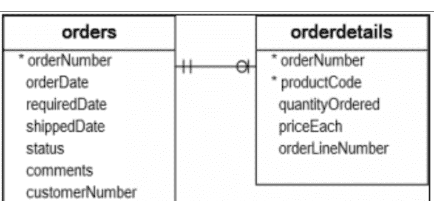

```sql
SELECT
  productCode,
  ROUND (SUM (quantityOrdered * priceEach)) sales
FROM
  orderdetails
    INNER JOIN
  orders USING (orderNumber)
WHERE
  YEAR(shippedDate) = 2003
GROUP BY productCode
ORDER BY sales DESC
LIMIT 5;
```

结果表如下所示：

| productCode | sales |

| :--- | :--- |

| S18_3232 | 103480 |

| S10_1949 | 67985 |

| S12_1108 | 59852 |

| S12_3891 | 57403 |

| S12_1099 | 56462 |

上图所示的结果可以作为`派生表`，并使用下面的语法与`products`表进行连接：

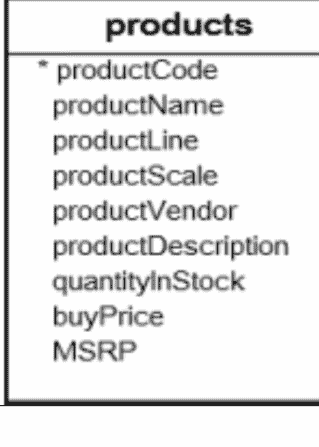

```sql
SELECT
    productName, sales
FROM
    (SELECT
        productCode,
        ROUND(SUM(quantityOrdered * priceEach)) sales
    FROM
        orderdetails
    INNER JOIN orders USING (orderNumber)
    WHERE
        YEAR(shippedDate) = 2003
    GROUP BY productCode
    ORDER BY sales DESC
    LIMIT 5) top5products2003
INNER JOIN
    products USING (productCode);
```

上述查询将产生如下所示的输出：


为了深入理解这个概念，下面回顾一个相对复杂的`派生表`示例：

假设需要将 2009 年的客户分为三组：`白金、黄金和白银`。此外，根据以下标准，希望计算每个组中的客户数量：

- 白金客户：订单数量大于 100K。

- 黄金客户：订单数量在 10K 到 100K 之间。

- 白银客户：订单数量小于 10K。

要生成此分析的查询，必须首先使用`CASE`子句和`GROUP BY`函数将每个客户分类到适当的组中，如下面的语法所示：

```sql
SELECT
    customerNumber,
    ROUND (SUM(quantityOrdered * priceEach)) sales,
    (CASE
        WHEN SUM (quantityOrdered * priceEach) < 10000 THEN 'Silver'
        WHEN SUM (quantityOrdered * priceEach) BETWEEN 10000 AND 100000 THEN 'Gold'
        WHEN SUM (quantityOrdered * priceEach) > 100000 THEN 'Platinum'
    END) customerGroup
FROM
    orderdetails
    INNER JOIN
    orders USING (orderNumber)
WHERE
    YEAR(shippedDate) = 2003
GROUP BY customerNumber;
```

查询输出如下图所示：

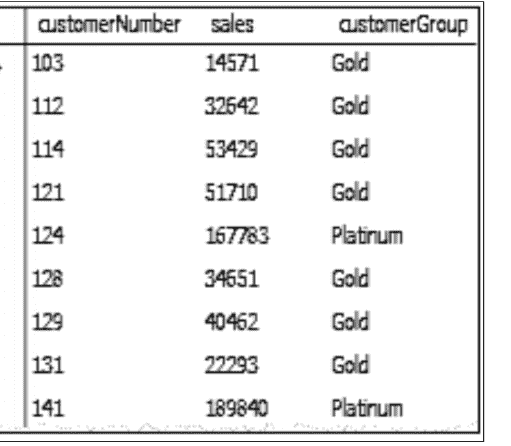


现在，您可以执行下面的代码来生成“派生表”并按需对客户进行分组：

```sql
SELECT
    customerGroup,
    COUNT(cg.customerGroup) AS groupCount
FROM
    (SELECT
        customerNumber,
        ROUND (SUM (quantityOrdered * priceEach)) sales,
        (CASE
            WHEN SUM (quantityOrdered * priceEach) < 10000 THEN 'Silver'
            WHEN SUM (quantityOrdered * priceEach) BETWEEN 10000 AND 100000 THEN 'Gold'
            WHEN SUM (quantityOrdered * priceEach) > 100000 THEN 'Platinum'
        END) customerGroup
    FROM
        orderdetails
    INNER JOIN orders USING (orderNumber)
    WHERE
        YEAR(shippedDate) = 2003
    GROUP BY customerNumber) cg
GROUP BY cg.customerGroup;
```

查询输出如下图所示：

| customerGroup | groupCount |
| :--- | :--- |
| Gold | 61 |
| Silver | 8 |
| Platinum | 4 |

# 第 3 章：SQL 连接（Join）和联合（Union）命令

SQL 中最常用的命令是“SELECT”命令，我们在本书前面提到的练习中已经使用过它。现在，让我深入讲解一下“SQL SELECT”命令以及可以与它一起使用的各种子句。

## MySQL SELECT

您可以使用`SELECT`语句从表或视图中选择性地获取所需数据。正如您已经知道的，类似于电子表格，表由行和列组成。您很可能需要查看列的子集、行的子集，或两者的组合。`SELECT`查询的结果称为“结果集”，即每条记录具有相同列数的记录列表。

下图所示为“MySQL 示例数据库”中的`employees`表，该表有 8 个不同的列，分别是：“employee number”（员工编号）、“last name”（姓氏）、“first name”（名字）、“extension”（分机号）、“email”（电子邮件）、“office code”（办公室代码）、“reports to”（汇报给）、“job title”（职位），以及若干行或记录。

| employeeNum | lastName | firstName | extension | email | officeCode | reportsTo | jobTitle |
|---|---|---|---|---|---|---|---|
| 1002 | Murphy | Diane | x5800 | dmurphy@classicmodelcars.com | 1 | | President |
| 1006 | Patterson | Mary | x4971 | mpatterson@classicmodelcars.com | 1 | 1002 | VP Sales |
| 1076 | Finnell | Jeff | x9273 | finell@classicmodelcars.com | 1 | 1002 | VP Marketing |
| 1088 | Patterson | William | x4671 | wpatterson@classicmodelcars.com | 6 | 1056 | Sales Manager (APAC) |
| 1102 | Bondur | Gerard | x5400 | gbondur@classicmodelcars.com | 4 | 1056 | Sales Manager (EMEA) |
| 1143 | Bow | Anthony | x5422 | abow@classicmodelcars.com | 1 | 1056 | Sales Manager (NA) |
| 1165 | Jennings | Leslie | x3291 | jennings@classicmodelcars.com | 1 | 1143 | Sales Rep |
| 1166 | Thompson | Leslie | x4065 | thompson@classicmodelcars.com | 1 | 1143 | Sales Rep |
| 1188 | Finnell | Julie | x2271 | finell@classicmodelcars.com | 2 | 1143 | Sales Rep |
| 1216 | Patterson | Steve | x4334 | spatterson@classicmodelcars.com | 2 | 1143 | Sales Rep |
| 1286 | Teo | Fung | x2240 | ftsong@classicmodelcars.com | 3 | 1143 | Sales Rep |
| 1323 | Vanaux | George | x4102 | gvanaux@classicmodelcars.com | 3 | 1143 | Sales Rep |
| 1327 | Bondur | Laur | x6433 | lbondur@classicmodelcars.com | 4 | 1102 | Sales Rep |
| 1370 | Hernandez | Gerard | x2020 | ghernandez@classicmodelcars.com | 4 | 1102 | Sales Rep |
| 1401 | Castillo | Pamela | x2759 | pcastillo@classicmodelcars.com | 4 | 1102 | Sales Rep |
| 1401 | Bapt | Igor | x2311 | ibapt@classicmodelcars.com | 7 | 1102 | Sales Rep |

`SELECT`查询规定了可以从表中获取的列和记录。例如，如果您只想显示所有员工的“first name”（名字）、“last name”（姓氏）和“job title”（职位），或者您只想查看“job title”（职位）为“sales rep”（销售代表）的员工信息，那么您都可以利用`SELECT`查询来实现。

以下是`SELECT`语句的标准语法：

```sql
SELECT
    column_1, column_2, ...
FROM
    table_1
[INNER | LEFT | RIGHT] JOIN table_2 ON conditions
WHERE
    conditions
GROUP BY column_1
HAVING group_conditions
ORDER BY column_1
LIMIT offset, length;
```

上述`SELECT`查询包含各种子句，描述如下：

- `SELECT`子句后跟由“逗号”分隔的列列表，或“星号（`*`）”，表示返回所有列。
- `FROM`子句定义应从中查询数据的表或视图。
- `JOIN`子句根据指定的连接条件从其他表获取相关数据。
- 在“结果集”中，`WHERE`子句用于选择性地过滤行或记录。
- `GROUP BY`子句用于选择性地将一组记录分组，并对每个组应用“聚合函数”。
- `HAVING`子句用于根据`GROUP BY`子句指定的组来过滤组。
- `ORDER BY`子句可用于指定要排序的列列表。
- `LIMIT`子句可用于限制命令执行时显示的行数。

请注意，只有`SELECT`和`FROM`子句是执行命令所必需的，所有其他子句都可以根据需要使用。

例如，如果您只想显示所有员工的“first name”（名字）、“last name”（姓氏）和“job title”（职位），可以使用下面的语法：

```sql
SELECT
    lastname, firstname, jobtitle
FROM
    employees;
```

但如果您想查看`employees`表中的所有列，请使用下面的语法：

### MySQL SELECT DISTINCT

在从表中检索信息时，可能会收到重复的行。您可以在`SELECT`查询中使用`DISTINCT`子句来消除这些冗余行。

`DISTINCT`子句的语法如下：

```sql
SELECT DISTINCT
    columns
FROM
    table_name
WHERE
    where_conditions;
```

### 示例

下面的语法展示了`DISTINCT`子句的一个示例，用于从`employees`表中选择性地查看员工的“唯一姓氏”。

首先，您需要使用以下语法显示`employees`表中所有员工的“姓氏”：

```sql
SELECT
    last name
FROM
    employees
ORDER BY last name;
```

现在，要消除重复的姓氏，请使用以下语法：

```sql
SELECT DISTINCT
    last name
FROM
    employees
ORDER BY last name;
```

请注意，如果某个列被指定为可以包含`NULL`值且使用了`DISTINCT`子句，服务器将仅保留一个`NULL`值，因为`DISTINCT`子句会将所有`NULL`值视为相同。

#### 在多列上使用 `DISTINCT` 子句

为了实现这一点，`MySQL server`将使用所选列中所有值的组合来识别“结果集”中的唯一记录。例如，您可以使用以下语法查看`customers`表中“城市（city）”和“州（state）”列的唯一组合：

```sql
SELECT DISTINCT
    state, city
FROM
    customers
WHERE
    state IS NOT NULL
ORDER BY state, city;
```

### MySQL “ORDER BY”

在使用`SELECT`语句查询数据时，“结果集”不会按照特定的格式组织。这时可以使用`ORDER BY`子句按照所需的顺序组织“结果集”。`ORDER BY`子句允许基于一个或多个列对“结果集”进行排序，以及将多个列按升序或降序排列。

以下是`ORDER BY`子句的语法：

```sql
SELECT column1, column2,...
FROM tbl
ORDER BY column1 [ASC|DESC], column2 [ASC|DESC],...;
```

正如您所预期的，`ASC`表示升序（ascending），而`DESC`表示降序（descending）。默认情况下，如果没有明确指定`ASC`或`DESC`，`ORDER BY`子句将按升序对“结果集”进行排序。

### 示例

下面的语法展示了`ORDER BY`子句的一个示例，用于选择性地查看`customers`表中的联系人，并按“姓氏”的升序排列。

```sql
SELECT
    contactLastname,
    contactFirstname
FROM
    customers
ORDER BY
    contactLastname;
```

升序的“结果集”如下图所示：

| contactLastname | contactFirstname |
|---|---|
| Accorti | Paolo |
| Altagar,G M | Raanan |
| Andersen | Mel |
| Anton | Carmen |
| Ashworth | Rachel |
| Barajas | Miguel |
| Benite Teresa | Violeta |
| Bennett | Helen |
| Berglund | Christina |

现在，如果您想按降序查看姓氏，将使用以下语法：

```sql
SELECT
    contactLastname,
    contactFirstname
FROM
    customers
ORDER BY
    contactLastname DESC;
```

降序的“结果集”如下图所示：

| contactLastName | contactFirstName |
| :--- | :--- |
| Young | Jeff |
| Young | Julie |
| Young | Mary |
| Young | Dorothy |
| Yoshido | Juri |
| Walker | Brydey |
| Victorino | Wendy |
| Urs | Braun |
| Urs | Jerry |
| Tseng | |

或者，如果您希望将“姓氏”按降序排列，而将“名字”按升序排列，可以在同一个查询中使用`DESC`和`ASC`子句，但针对相关的列，如以下语法所示：

```sql
SELECT
    contactLastname,
    contactFirstname
FROM
    customers
ORDER BY
    contactLastname DESC,
    contactFirstname ASC;
```

“结果集”如下图所示，其中`ORDER BY`子句将首先对“姓氏”进行降序排序，随后对“名字”进行升序排序：

| contactLastName | contactFirstName |
| :--- | :--- |
| Young | Dorothy |
| Young | Jeff |
| Young | Julie |
| Young | Mary |
| Yoshido | Juri |
| Walker | Brydey |
| Victorino | Wendy |
| Urs | Braun |
| Tseng | Jerry |

### MySQL WHERE

`WHERE`子句允许为运行查询后显示的记录指定搜索标准。

`WHERE`子句的语法如下：

```sql
SELECT
    select_list
FROM
    table_name
WHERE
    search_condition;
```

“search_condition”（搜索条件）是由一个或多个“谓词”组成的，并利用如下表所示的“逻辑运算符”如`AND`、`OR`和`NOT`。在 SQL 中，“谓词”被定义为“一个评估为真（true）、假（false）或未知（unknown）的表达式”。

| 运算符 | 描述 |
| :--- | :--- |
| `=` | “等于。几乎可以用在任何数据类型上。” |
| `<>`或`!=` | “不等于” |
| `<` | “小于。通常用于数值和日期/时间数据类型。” |
| `>` | “大于” |
| `<=` | “小于或等于” |
| `>=` | “大于或等于” |

最终的“结果集”将包含`table_name`中所有使`search_condition`评估为有效的记录。

除了`SELECT`语句外，您还可以在`UPDATE`和`DELETE`查询中使用`WHERE`子句来指定需要更新和删除的行。

### 示例

下面的语法展示了`WHERE`子句的一个示例，用于从“MySQL 示例数据库”的`employees`表中选择性地查看职位为“Sales Rep”的员工：

```sql
SELECT
    lastname,
    firstname,
    jobtitle
FROM
    employees
WHERE
    jobtitle = 'Sales Rep';
```

虽然`WHERE`子句定义在查询的末尾，但`MySQL`会先评估`WHERE`子句中的短语，然后选择相应的行。它先选择职位为“Sales Rep”的行，然后从`SELECT`子句的“选择列表”中选择列。下图中的高亮行包含了最终结果集的列和行。

| employeeNumber | lastName | firstName | extension | email | officeCode | reportsTo | jobTitle |
|---|---|---|---|---|---|---|---|
| 1002 | Murphy | Diane | x5800 | dmurphy@classicmodelcars.com | 1 | | President |
| 1056 | Patterson | Mary | x4611 | mpatterson@classicmodelcars.com | 1 | 1002 | VP Sales |
| 1076 | Firrelli | Jeff | x9273 | jfirrelli@classicmodelcars.com | 1 | 1002 | VP Marketing |
| 1088 | Patterson | William | x4871 | wpatterson@classicmodelcars.com | 6 | 1056 | Sales Manager (APAC) |
| 1102 | Bondur | Gerard | x5408 | gbondur@classicmodelcars.com | 4 | 1056 | Sale Manager (EMEA) |


| 1143 | Bow | Anthony | x5428 | abow@classicmodelcars.com | 1 | 1056 | Sales Manager (NA) |
| 1165 | Jennings | Leslie | x3291 | ljennings@classicmodelcars.com | 1 | 1143 | Sales Rep |
| 1166 | Thompson | Leslie | x4065 | lthompson@classicmodelcars.com | 1 | 1143 | Sales Rep |
| 1188 | Firrelli | Julie | x2173 | jfirrelli@classicmodelcars.com | 2 | 1143 | Sales Rep |
| 1216 | Patterson | Steve | x4334 | spatterson@classicmodelcars.com | 2 | 1143 | Sales Rep |
| 1286 | Tseng | Foon Yue | x2248 | ftseng@classicmodelcars.com | 3 | 1143 | Sales Rep |
| 1323 | Vanauf | George | x4102 | gvanauf@classicmodelcars.com | 3 | 1143 | Sales Rep |
| 1337 | Bondur | Loui | x5490 | lbondur@classicmodelcars.com | 4 | 1102 | Sales Rep |

## MySQL JOIN 语句

MySQL 的`JOIN`函数是一种基于所选表之间的公共属性或列值，将一个或多个表的信息链接起来的方法。关系数据库由各种通过共享或公共列（称为“外键”）链接的表组成。因此，从业务角度来看，每个单独表中的信息可能被认为是完整不足的。例如，在“MySQL 示例数据库”中有两个单独的表，分别叫`orders`和`orderdetails`，它们使用名为`orderNumber`的列相互连接。您必须在`orders`和`orderdetails`表中同时搜索信息，才能获得完整的订单信息。

共有 6 种不同的 SQL`JOINS`函数，分别是：`INNER JOIN`、`LEFT JOIN`、`RIGHT JOIN`、`CROSS JOIN`和`SELF JOIN`。

为了方便您理解每种`JOIN`类型，我们将使用如下语法中所描述的名为`t1`和`t2`的表。`t1`和`t2`表中的`pattern`列作为它们之间的公共列。

```
CREATE TABLE t1 (
  id INT PRIMARY KEY,
  pattern VARCHAR (50) NOT NULL
);
CREATE TABLE t2 (
  id VARCHAR (50) PRIMARY KEY,
  pattern VARCHAR (50) NOT NULL
);
```

我们可以使用下面的`INSERT`语句向两个表中插入一些数据：

```
INSERT INTO t1(id, pattern)
VALUES(1,'Divot'),
    (2,'Brick'),
    (3,'Grid');
INSERT INTO t2(id, pattern)
VALUES('A','Brick'),
    ('B','Grid'),
    ('C','Diamond');
```

上述语句的结果如下图所示：

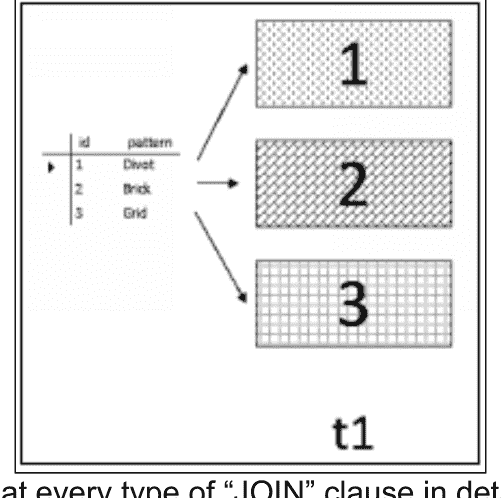

现在，让我们详细了解每一种`JOIN`子句！

### `INNER JOIN`

`MySQL INNER JOIN`用于将一个表中的行与其他表中的行对齐，以便可以查询包含两个表中列的数据。

`SELECT`语句的执行并不强制要求包含`INNER JOIN`子句，它通常紧跟在`FROM`子句之后。

在使用`INNER JOIN`子句之前，你必须明确以下要求：

- 从要在`FROM`子句中包含的主表开始。
- 然后，在步骤 1 中，选择你要连接到主表的表，并将其包含在`INNER JOIN`子句中。请记住，理论上你可以将一个表同时连接到多个表。不过，建议限制要连接的表数量，以获得更高的性能和效率。
- 最后，必须定义`join condition`（连接条件）或`join predicate`（连接谓词）。在`INNER JOIN`的初始`ON`关键字之后，可以指定连接条件。连接条件是规定主表中的行如何与另一个表中的记录匹配的规则。

`INNER JOIN`子句的语法如下：

```
SELECT column_list
FROM t1
INNER JOIN t2 ON join_condition1
INNER JOIN t3 ON join_condition2
...
WHERE where_conditions;
```

现在，为了进一步简化上述查询，假设你只关心使用下面的语法将`t1`和`t2`两个表连接起来：

```
SELECT column_list
FROM t1
INNER JOIN t2 ON join_condition;
```

`INNER JOIN`子句会将`t1`表的每一行与`t2`表的每一条记录进行比较，以确定它们是否满足定义的`join condition`（连接条件）。一旦满足“连接条件”，`INNER JOIN`就会返回一条新记录，该记录由`t1`和`t2`两表的列组成。

请注意，`t1`和`t2`中的记录需要根据`join condition`（连接条件）进行合并。如果两张表中没有任何两条记录满足“连接条件”，查询将返回一个空的`result set`（结果集）。当连接超过两个表时，同样的逻辑也适用。

下图的韦恩图展示了`INNER JOIN`子句的工作原理。结果集中的记录必须同时存在于`t1`和`t2`中，如两个圆圈的重叠部分所示，每个圆圈分别代表一个表。

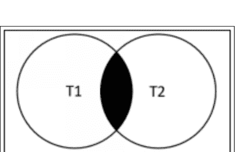

### 示例

考虑下图所示的“MySQL 示例数据库”中的`products`和`productlines`表。`products`表通过引用`productline`列与`productlines`表相连。因此，`productline`列在`products`表中充当`foreign key`（外键）。

按照惯例，具有`foreign key`（外键）关系的表通常使用`JOIN`子句进行查询。

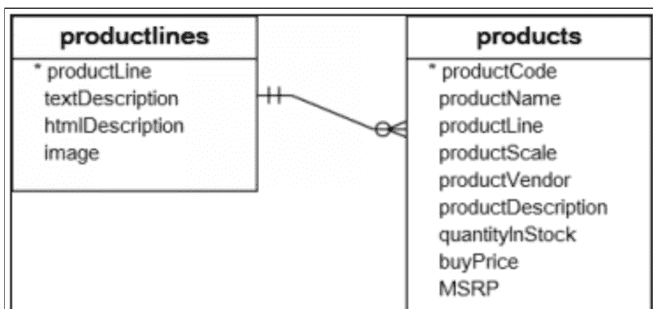

假设你想查看`products`表中的`productCode`和`productName`列，以及`productlines`表中的产品系列`textDescription`。你可以使用下面的语句来实现，基于两个表中的`productline`列匹配行。

```
SELECT
    productCode,
    productName,
    textDescription
FROM
  products t1
    INNER JOIN
  productlines t2 ON t1.productline = t2.productline;
```

`result set`（结果集）如下图所示：

| productCode | productName | textDescription |
|---|---|---|
| S10_1949 | 1952 Alpine Renault 1300 | Attention car enthusiasts: Make your wildest car ownership dreams come true. |
| S10_4757 | 1972 Alfa Romeo GTA | Attention car enthusiasts: Make your wildest car ownership dreams come true. |
| S10_4962 | 1962 Lancia Delta 16V | Attention car enthusiasts: Make your wildest car ownership dreams come true. |
| S12_1099 | 1968 Ford Mustang | Attention car enthusiasts: Make your wildest car ownership dreams come true. |
| S12_1108 | 2001 Ferrari Enzo | Attention car enthusiasts: Make your wildest car ownership dreams come true. |

这里有个小技巧！

由于两个表都包含名为`productline`的相同列，你可以使用更简单的查询（无需使用表别名），获得与上图相同的`result set`（结果集）：

```
SELECT
  productCode,
  productName,
  textDescription
FROM
  products
    INNER JOIN
  productlines USING (productline);
```

#### `INNER JOIN`与`GROUP BY`

下图包含`orders`和`orderdetails`表：

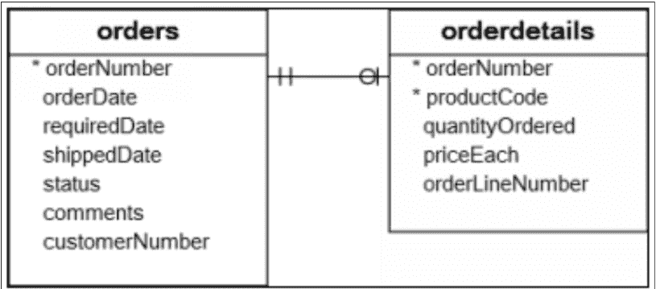

你可以将`INNER JOIN`与`GROUP BY`子句结合使用，从`orders`和`orderdetails`表中获取所需信息，如下面两个语句所示：

```
SELECT
  T1.orderNumber,
  status,
  SUM(quantityOrdered * priceEach) total
FROM
  orders AS T1
    INNER JOIN
  orderdetails AS T2 ON T1.orderNumber = T2.orderNumber
GROUP BY orderNumber;
```

```
SELECT
  orderNumber,
  status,
  SUM(quantityOrdered * priceEach) total
FROM
  orders
    INNER JOIN
  orderdetails USING (orderNumber)
GROUP BY orderNumber;
```

`result set`（结果集）如下图所示：

| orderNumber | status | total |
|---|---|---|
| 10100 | Shipped | 10223.83 |
| 10101 | Shipped | 10549.01 |
| 10102 | Shipped | 5494.78 |
| 10103 | Shipped | 50218.95 |
| 10104 | Shipped | 40206.20 |

#### MySQL `INNER JOIN`使用不同的运算符

我们之前只探索了使用`equal operator (=)`（等于运算符）来匹配行的连接条件。但我们还可以使用其他运算符与连接谓词一起使用，包括`greater than (>)`（大于）、`less than (<)`（小于）和`not-equal (<>)`（不等于）运算符。

下面的语句使用`less than (<)`（小于）运算符来查找代码为`S10_1678`的商品的销售价格，这些价格低于`manufacturer's suggested retail price (MSRP)`（厂商建议零售价）。

```
SELECT
  orderNumber,
  productName,
  msrp,
  priceEach
FROM
  products p
    INNER JOIN
  orderdetails o ON p.productcode = o.productcode
    AND p.msrp > o.priceEach
WHERE
  p.productcode = 'S10_1678';
```

`result set`（结果集）如下图所示：

| orderNumber | productName | msrp | priceEach |
|---|---|---|---|
| 10107 | 1969 Harley Davidson Ultimate Chopper | 95.70 | 81.35 |
| 10121 | 1969 Harley Davidson Ultimate Chopper | 95.70 | 86.13 |
| 10134 | 1969 Harley Davidson Ultimate Chopper | 95.70 | 90.92 |
| 10145 | 1969 Harley Davidson Ultimate Chopper | 95.70 | 76.56 |
| 10159 | 1969 Harley Davidson Ultimate Chopper | 95.70 | 81.35 |
| 10168 | 1969 Harley Davidson Ultimate Chopper | 95.70 | 94.74 |
| 10180 | 1969 Harley Davidson Ultimate Chopper | 95.70 | 76.56 |
| 10201 | 1969 Harley Davidson Ultimate Chopper | 95.70 | 82.30 |

### `LEFT JOIN`

`MySQL LEFT JOIN`可以实现从数据库中的 2 个或多个表查询数据。`SELECT`语句的执行并不强制要求包含`LEFT JOIN`子句，它通常紧跟在`FROM`子句之后。当使用`LEFT JOIN`子句连接两个表时，会应用`left table`（左表）和`right table`（右表）的概念。

与`INNER JOIN`不同，`LEFT JOIN`或`LEFT OUTER JOIN`将返回左表中的所有记录，包括满足`join condition`（连接条件）的记录以及不满足的`join condition`（连接条件）的记录。对于不匹配连接条件的行，来自右表列的值在`result set`（结果集）中显示为`NULL`值。

现在，为了进一步简化此查询，我们假设只使用下面的`LEFT JOIN`语句连接`t1`和`t2`两个表：

```
SELECT
    t1.c1, t1.c2, t2.c1, t2.c2
FROM
t1
LEFT JOIN
t2 ON t1.c1 = t2.c1;
```

在上述语法中，您正在使用`LEFT JOIN`子句将`t1`连接到`t2`。其基础是根据“连接谓词 (`t1.c1 = t2.c1`)”的定义，将“左表`t1`”的一条记录与“右表`t2`”的一条记录进行匹配，然后将结果包含在“结果集”中。

如果“左表”中的记录在“右表”中没有与之匹配的记录，那么“左表”中的记录仍然会被选中，并与来自“右表”且包含`NULL`值的“虚拟记录”进行连接。

简单来说，`LEFT JOIN`子句能够选择“左表和右表”中匹配的记录，以及“左表 (`t1`)”中的所有记录，即使“右表 (`t2`)”中没有匹配的记录。

下图所示的“文恩图（Venn diagram）”将帮助您理解`LEFT JOIN`的工作原理。两个圆圈的重叠部分包含两个表中匹配的记录，而“左圆”的其余部分则包含`t1`表中“在`t2`表中没有对应记录”的记录。因此，“结果集”将包含“左表”中的所有记录。

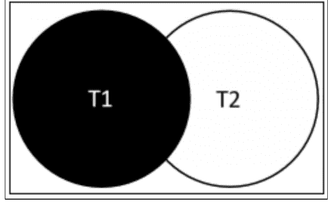

### 示例

考虑“MySQL 示例数据库”中的“customers（客户）”和“orders（订单）”表（如下图所示），其中“orders”表中的每个“订单值”都对应“customers”表中的一个“客户值”，但“customers”表中的每个客户值可能在“orders”表中没有对应的订单值。

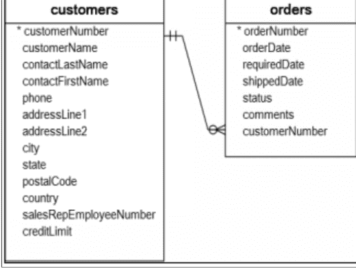

所有“对应于某个客户的订单”都可以使用以下语法的`LEFT JOIN`子句进行查询：

```sql
SELECT
c.customerNumber,
c.customerName,
orderNumber,
o.status
FROM
customers c
LEFT JOIN orders o ON c.customerNumber = o.customerNumber;
```

“结果集”如下图所示，其中左表是指“customers”表，因此`customers`表中所有有值的行都将被添加到“结果集”中；尽管它包含了一些没有订单数据的客户行，例如`168`和`169`。对于这类行，订单数据值显示为`NULL`，这意味着`orders`表中没有这些客户的订单。

| customerNumber | customerName | orderNumber | status |
|---|---|---|---|


| 166 | Handji Gifts& Co | 10288 | Shipped |
| 166 | Handji Gifts& Co | 10409 | Shipped |
| 167 | Herkku Gifts | 10181 | Shipped |
| 167 | Herkku Gifts | 10188 | Shipped |
| 167 | Herkku Gifts | 10289 | Shipped |
| 168 | American Souvenirs Inc | NULL | NULL |
| 169 | Porto Imports Co. | NULL | NULL |
| 171 | Daedalus Designs Imports | 10180 | Shipped |
| 171 | Daedalus Designs Imports | 10224 | Shipped |
| 172 | La Corne D'abondance, ... | 10114 | Shipped |

这里有一个技巧！

由于两个表共享列名 `customerNumber`，您可以使用下面更简单的查询（无需使用表别名）来获得与上图相同的“结果集”：

```sql
SELECT
c.customerNumber,
customerName,
orderNumber,
status
FROM
customers c
LEFT JOIN orders USING (customerNumber);
```

#### MySQL 中 `LEFT JOIN` 与 `WHERE` 子句的结合

考虑以下语法，在 `LEFT JOIN` 之后使用 `WHERE` 子句，从 `orders` 和 `orderDetails` 表中检索所需信息。

```sql
SELECT
    o.orderNumber,
    customerNumber,
    productCode
FROM
    orders o
    LEFT JOIN
    orderDetails USING (orderNumber)
WHERE
    orderNumber = 10123;
```

对于所有订单号列为“10123”的记录，其“结果集”如下图所示：

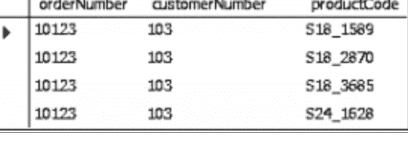

请注意，如果将“连接条件”从 `WHERE` 子句更改为如下语法中的 `ON` 子句，则查询将产生不同的“结果集”，其中包含所有订单，但仅显示与订单号“10123”相关的详细信息，如下图所示：

```sql
SELECT
    o.orderNumber,
    customerNumber,
    productCode
FROM
    orders o
    LEFT JOIN
    orderDetails d ON o.orderNumber = d.orderNumber
    AND o.orderNumber = 10123;
```

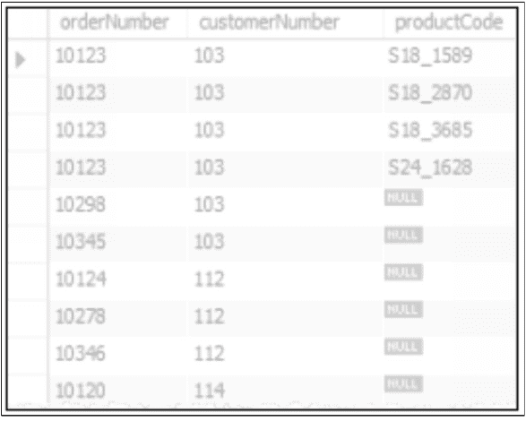

### `RIGHT JOIN`

`RIGHT JOIN` 或 `RIGHT OUTER JOIN` 与 `LEFT JOIN` 类似，唯一的区别是对表的处理方式，即由左到右反转。在使用 `RIGHT JOIN` 时，“右表（t2）”的每条记录都会出现在“结果集”中。对于“右表中在左表（t1）中没有任何对应行的记录”，其“左表（t1）”的列将显示 `NULL` 值。

您可以使用 `RIGHT JOIN` 子句来连接表 `t1` 和 `t2`，如下语法所示：

```sql
SELECT *
FROM t1
RIGHT JOIN t2 ON join_predicate;
```

在上述语法中，右表是 `t2`，左表是 `t1`，而 `join_predicate` 表示匹配标准，据此将 `t1` 的记录与 `t2` 的记录进行对齐。

执行上述查询后，“右表 t2”的所有行都将显示在“结果集”中；根据连接条件，如果 `t2` 与 `t1` 的行之间没有找到匹配项，则 `t1` 表的这些列将添加 `NULL` 值。

### 示例

让我们考虑如下语法中描述的 `t1` 和 `t2` 表：

```sql
CREATE TABLE t1 (
    id INT PRIMARY KEY,
    pattern VARCHAR(50) NOT NULL
);

CREATE TABLE t2 (
    id VARCHAR(50) PRIMARY KEY,
    pattern VARCHAR(50) NOT NULL
);

INSERT INTO t1(id, pattern)
VALUES(1,'Divot'),
      (2,'Brick'),
      (3,'Grid');

INSERT INTO t2(id, pattern)
VALUES('A','Brick'),
      ('B','Grid'),
      ('C','Diamond');
```

表 `t1` 和 `t2` 可以通过 `pattern` 列进行连接，如下查询所示：

```sql
SELECT
    t1.id, t2.id
FROM
    t1
    RIGHT JOIN t2 USING (pattern)
ORDER BY t2.id;
```

“结果集”如下图所示：

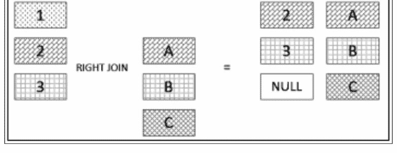

或者查看以下语法，以查看“MySQL 示例数据库”中 `employees` 和 `customers` 表中的“销售代表”及其“客户”：

```sql
SELECT
    concat(e.firstName,', ', e.lastName) salesman,
    e.jobTitle,
    customerName
FROM
    employees e
    RIGHT JOIN customers c ON e.employeeNumber = c.salesRepEmployeeNumber
    AND e.jobTitle = 'Sales Rep'
ORDER BY customerName;
```

“结果集”如下图所示：

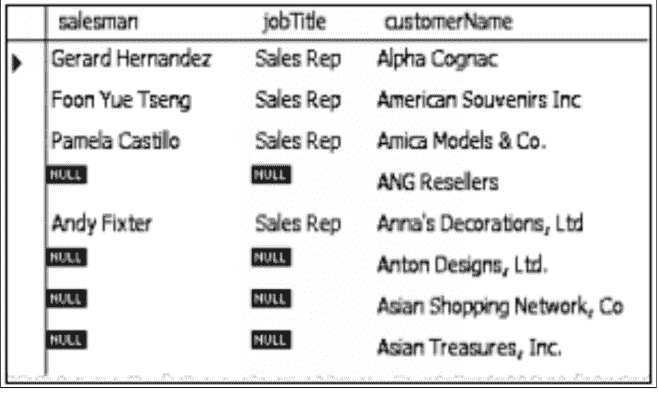

### `CROSS JOIN`

`CROSS JOIN` 子句用于获取“笛卡尔积”，其定义为“将一个表的每一行与另一个表的每一行进行连接”。当使用 `CROSS JOIN` 子句时，“结果集”包含两个表的所有行，这些行是由“第一个表”的记录和第二个表的记录组合而成的。这种情况仅在无法找到被连接的“两个表之间的共同链接或列”时存在。

最大的缺点是数据量极其庞大。假设每个表包含 1,000 行，那么“结果集”将包含 1,000 x 1,000 = 1,000,000 行。

您可以使用 `CROSS JOIN` 来连接 `t1` 和 `t2`，如下语法所示：

```sql
SELECT
  *
FROM
  T1
    CROSS JOIN
  T2;
```

与 `RIGHT JOIN` 和 `LEFT JOIN` 不同，`CROSS JOIN` 可以在不使用“连接谓词”的情况下运行。此外，如果在 `CROSS JOIN` 中添加 `WHERE` 子句，并且两个表 `t1` 和 `t2` 之间存在连接，那么 `CROSS JOIN` 将像 `INNER JOIN` 一样运行，如下语法所示：

```sql
SELECT
    *
FROM
    T1
        CROSS JOIN
    T2
WHERE
    T1.id = T2.id;
```

### 示例

让我们使用如下语法中描述的 `testdb` 数据库，以更好地理解 `CROSS JOIN` 是如何运行的：

```sql
CREATE DATABASE IF NOT EXISTS testdb;
USE testdb;
CREATE TABLE products (
    id INT PRIMARY KEY AUTO_INCREMENT,
    product_name VARCHAR (100),
    price DECIMAL (13, 2)
);
CREATE TABLE stores (
    id INT PRIMARY KEY AUTO_INCREMENT,
    store_name VARCHAR (100)
);
CREATE TABLE sales (
    product_id INT,
    store_id INT,
    quantity DECIMAL (13 , 2 ) NOT NULL,
    sales_date DATE NOT NULL,
    PRIMARY KEY (product_id , store_id),
    FOREIGN KEY (product_id)
        REFERENCES products (id)
        ON DELETE CASCADE ON UPDATE CASCADE,
    FOREIGN KEY (store_id)
        REFERENCES stores (id)
        ON DELETE CASCADE ON UPDATE CASCADE
);
```

在上面的语法中，我们有 3 张表：

- `products` 表，包含产品的基本数据，包括“product id”、“product name”和“sales price”。
- `stores` 表，包含产品销售门店的相关数据。
- `sales` 表，包含特定门店按日期和数量销售产品的相关数据。

假设有 3 件商品“iPhone”、“iPad”和“MacBook Pro”在名为“North”和“South”的 2 家门店中销售。我们可以使用下面的语法填充表以保存这些数据：

```sql
INSERT INTO products(product_name, price)
VALUES('iPhone', 699),
       ('iPad',599),
       ('Macbook Pro',1299);

INSERT INTO stores(store_name)
VALUES('North'),
       ('South');

INSERT INTO sales(store_id,product_id,quantity,sales_date)
VALUES(1,1,20,'2017-01-02'),
       (1,2,15,'2017-01-05'),
       (1,3,25,'2017-01-05'),
       (2,1,30,'2017-01-02'),
       (2,2,35,'2017-01-05');
```

现在，要查看“每家门店和每种产品的总销售额”，首先需要计算销售额，然后使用下面的语法按门店和产品进行“分组”：

```sql
SELECT
    store_name,
    product_name,
    SUM (quantity * price) AS revenue
FROM
    sales
    INNER JOIN products ON products.id = sales.product_id
    INNER JOIN stores ON stores.id = sales.store_id
GROUP BY store_name, product_name;
```

“结果集”如下图所示：

| store_name | product_name | revenue |
| --- | --- | --- |
| North | iPad | 8985.0000 |
| North | iPhone | 13980.0000 |
| North | Macbook Pro | 32475.0000 |
| South | iPad | 20965.0000 |
| South | iPhone | 20970.0000 |

现在，如果你想查看某特定产品销量为零的门店，上面的语法将无法提供该信息。此时你可以利用 `CROSS JOIN`，首先查看所有产品和门店的完整组合，如下面查询所示：

```sql
SELECT
    store_name, product_name
FROM
    stores AS a
    CROSS JOIN
    products AS b;
```

“结果集”如下图所示：

| store_name | product_name |
| --- | --- |
| North | iPhone |
| South | iPhone |
| North | iPad |
| South | iPad |
| North | Macbook Pro |
| South | Macbook Pro |

然后，你可以将之前获得的查询结果与此查询结合，得到“门店和产品的销售总额”，使用下面的语法：

```sql
SELECT
    b.store_name,
    a.product_name,
    IFNULL (c.revenue, 0) AS revenue
FROM
    products AS a
        CROSS JOIN
    stores AS b
        LEFT JOIN
    (SELECT
        stores.id AS store_id,
        products.id AS product_id,
        store_name,
        product_name,
        ROUND (SUM(quantity * price), 0) AS revenue
    FROM
        sales
    INNER JOIN products ON products.id = sales.product_id
    INNER JOIN stores ON stores.id = sales.store_id
    GROUP BY store_name , product_name) AS c ON c.store_id = b.id
        AND c.product_id = a.id
ORDER BY b.store_name;
```

“结果集”如下图所示：

| store_name | product_name | revenue |
| --- | --- | --- |
| North | Macbook Pro | 32475 |
| North | iPad | 8985 |
| North | iPhone | 13980 |
| South | iPhone | 20970 |
| South | Macbook Pro | 0 |
| South | iPad | 20965 |

上面的语法中使用了 `IFNULL` 函数，以便在收入报告为 `NULL` 时返回 `0`。

### `SELF JOIN`

顾名思义，`SELF JOIN` 语句用于将表中的行与同一表中的行进行关联，而不是与另一个表关联。这需要你使用“表别名”来帮助服务器在同一查询中区分“左表”和“右表”。例如，在“MySQL 示例数据库”中的 `employees` 表中，存储了组织的结构数据和员工数据，如下图所示。`reportsTo` 列可用于查看任何员工的经理 ID。

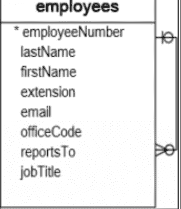

如果你想查看完整的“组织架构”，可以使用下面的语法对 `employees` 表进行自连接，使用 `employeeNumber` 和 `reportsTo` 列。`employees` 表中的 2 个角色分别是“Manager”和“Direct Reports”。

```sql
SELECT
  CONCAT (m.lastname, ', ', m.firstname) AS 'Manager',
  CONCAT (e.lastname, ', ', e.firstname) AS 'Direct report'
FROM
  employees e
    INNER JOIN
  employees m ON m.employeeNumber = e.reportsto
ORDER BY manager;
```

“结果集”如下图所示：

| Manager | Direct report |
| --- | --- |
| Bondur, Gerard | Jones, Barry |
| Bondur, Gerard | Bott, Larry |
| Bondur, Gerard | Castillo, Pamela |
| Bondur, Gerard | Hernandez, Gerard |
| Bondur, Gerard | Bondur, Loui |
| Bondur, Gerard | Gerard, Martin |
| Bow, Anthony | Tseng, Foon Yue |
| Bow, Anthony | Patterson, Steve |
| Bow, Anthony | Firrelli, Julie |
| Bow, Anthony | Thompson, Leslie |
| Bow, Anthony | Jennings, Leslie |
| Bow, Anthony | Vanauf, George |

上面的“结果集”中只能看到向经理汇报的员工。但“最高经理”不可见，因为他的名字被 `INNER JOIN` 子句过滤掉了。“最高经理”是不向任何其他经理汇报的经理，或者他们的“经理编号”持有 `NULL` 值。


我们可以将上面语法中的`INNER JOIN`子句改为`LEFT JOIN`子句，以便在“结果集”中包含“最高经理”。如果“经理”的名字持有`NULL`值，你可以利用`IFNULL`子句将“最高经理”包含在输出中，如下面查询所示：

```sql
SELECT
    IFNULL (CONCAT (m.lastname, ', ', m.firstname),
        'Top Manager') AS 'Manager',
    CONCAT (e.lastname, ', ', e.firstname) AS 'Direct report'
FROM
    employees e
        LEFT JOIN
    employees m ON m.employeeNumber = e.reportsto
ORDER BY manager DESC;
```

“结果集”如下图所示：

| Manager | Direct report |
| :--- | :--- |
| Top Manager | Murphy, Diane |
| Patterson, William | King, Tom |
| Patterson, William | Marsh, Peter |
| Patterson, William | Fixter, Andy |
| Patterson, Mary | Bondur, Gerard |
| Patterson, Mary | Nishi, Mami |
| Patterson, Mary | Patterson, William |
| Patterson, Mary | Bow, Anthony |
| Nishi, Mami | Kato, Yoshimi |
| Murphy, Diane | Firrelli, Jeff |
| Murphy, Diane | Patterson, Mary |

通过使用 MySQL 自连接将`customers`表与自身关联，你可以显示“同一位置的客户列表”，如下面查询所示：

```sql
SELECT
  c1.city, c1.customerName, c2.customerName
FROM
  customers c1
  INNER JOIN
  customers c2 ON c1.city = c2.city
  AND c1.customername > c2.customerName
ORDER BY c1.city;
```

“结果集”如下图所示：

| city | customerName | customerName |
|---|---|---|
| Auckland | Kelly's Gift Shop | Down Under Souvenirs, Inc |
| Auckland | GiftsForHim.com | Down Under Souvenirs, Inc |
| Auckland | Kelly's Gift Shop | GiftsForHim.com |
| Boston | Gifts4AllAges.com | Diecast Collectables |
| Brickhaven | Online Mini Collectables | Auto-Moto Classics Inc. |
| Brickhaven | Collectables For Less Inc. | Auto-Moto Classics Inc. |
| Brickhaven | Online Mini Collectables | Collectables For Less Inc. |
| Cambridge | Marta's Replicas Co. | Cambridge Collectables Co. |
| Frankfurt | Messner Shopping Network | Blauer See Auto, Co. |
| Glendale | Gift Ideas Corp. | Boards & Toys Co. |
| Lisboa | Porto Imports Co. | Lisboa Souvenirs, Inc |
| London | Stylish Desk Decors, Co. | Double Decker Gift Stores, Ltd |

## MySQL UNION

MySQL 中的`UNION`函数用于将 2 个或更多“结果集”合并为一个综合的“结果集”。`UNION`运算符的语法如下：

```sql
SELECT column_list
UNION [DISTINCT | ALL]
SELECT column_list
UNION [DISTINCT | ALL]
SELECT column_list
...
```

使用`UNION`运算符时需要遵循的基本规则是：

- `SELECT`语句中包含的列数和列顺序必须相同，这一点至关重要。
- 列的“数据类型”需要相同或“可转换”为相同类型。
- 冗余或重复的行将被移除，无需在查询中显式使用`DISTINCT`函数。

### 示例

考虑下述语法中所示的示例表`t1`和`t2`：

```sql
DROP TABLE IF EXISTS t1;
DROP TABLE IF EXISTS t2;
CREATE TABLE t1 (
  id INT PRIMARY KEY
);
CREATE TABLE t2 (
  id INT PRIMARY KEY
);
INSERT INTO t1 VALUES (1),(2),(3);
INSERT INTO t2 VALUES (2),(3),(4);
```

下面的查询可用于使用`UNION`运算符合并来自`t1`和`t2`表的“结果集”：

```sql
SELECT id
FROM t1
UNION
SELECT id
FROM t2;
```

生成的合并“结果集”将包含两个“结果集”中不同的值，如下所示：

| id |
|----|
| 1 |
| 2 |
| 3 |
| 4 |

```text
4 rows in set (0.00 sec)
```

可以注意到，包含值`2`和`3`的行是重复的，因此`UNION`函数去除了重复项，仅保留唯一值。下面的韦恩图表示了来自`t1`和`t2`表的“结果集”的组合：

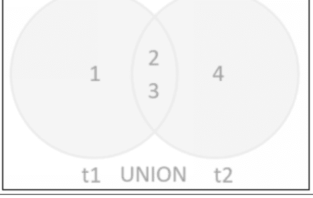

### MySQL UNION ALL

当你希望在“最终结果集”中保留重复行（如果有的话）时，可以使用`UNION ALL`运算符。`UNION ALL`运算符的查询执行速度比`UNION`或`UNION DISTINCT`运算符快得多，因为它无需处理数据的冗余。`UNION ALL`运算符的语法如下所示：

```sql
SELECT id
FROM t1
UNION ALL
SELECT id
FROM t2;
```

包含重复行的“结果集”如下：

| id |
|----|
| 1 |
| 2 |
| 3 |
| 2 |
| 3 |
| 4 |

```text
6 rows in set (0.00 sec)
```

## MySQL JOIN 与 UNION

`JOIN`子句用于按行或记录水平合并“结果集”。而`UNION`子句用于按列垂直合并“结果集”。下面的图将帮助你理解`UNION`和`JOIN`运算符之间的区别：

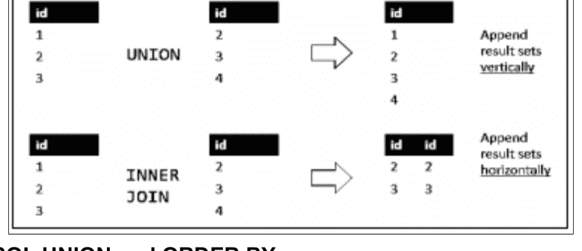

## MySQL UNION 和 ORDER BY

`ORDER BY`子句可用于对`UNION`运算符的结果进行排序，如下所示：

```sql
SELECT
    concat(firstName, ' ', lastName) fullname
FROM
    employees
UNION SELECT
    concat(contactFirstName, ' ', contactLastName)
FROM
    customers
ORDER BY fullname;
```

“结果集”如下图所示：


如果你想按列位置对结果进行排序，可以使用`ORDER BY`，如下所示：

```sql
SELECT
    concat(firstName, ' ', lastName) fullname
FROM
    employees
UNION SELECT
    concat(contactFirstName, ' ', contactLastName)
FROM
    customers
ORDER BY 1;
```

## 第 4 章 SQL 视图和事务

SQL 中的“数据库视图”可以被定义为一个“虚拟表”或“逻辑表”，它由包含连接函数的`SQL SELECT`语句描述。由于“数据库视图”类似于数据库中由行和列组成的表，你可以在其上轻松运行查询。许多 DBMS（包括`MySQL`）允许用户通过满足某些前提条件来使用“数据库视图”修改现有表中的信息，如下图所示。

“SQL 数据库视图”可以被视为动态的，因为“SQL 视图”与物理系统之间没有直接关联。数据库系统将以`SELECT`语句的形式存储“SQL 视图”，并使用`JOIN`子句。当表中的信息被修改时，“SQL 视图”也会反映出该修改。

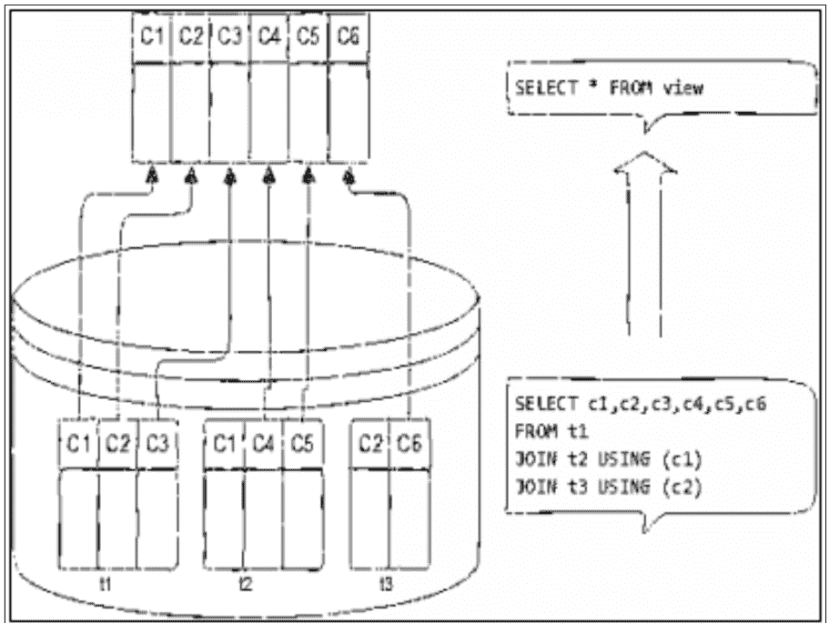

## 使用 SQL 视图的优点

“SQL 视图”能够简化复杂的查询：一个“SQL 视图”的特征是一条与多个表关联的 SQL 语句。为了向终端用户和外部应用程序隐藏底层表的复杂性，“SQL 视图”非常有用。使用“SQL 视图”，你只需使用简单的`SQL`语句，而不必编写包含多个`JOIN`子句的复杂语句。

“SQL 视图”能够根据用户需求限制对信息的访问。也许你不希望所有用户都能查询某些机密信息的子集。在这种情况下，可以使用“SQL 视图”选择性地向特定用户群展示非敏感信息。

“SQL 视图”提供了额外的安全层。安全性是每个“关系数据库管理系统”的关键组件。“SQL 视图”为 DBMS 确保了“额外的安全性”。“SQL 视图”能够生成“只读”视图，为目标用户显示“只读”信息。在“只读视图”中，用户只能检索数据，不允许更新任何信息。

“SQL 视图”用于支持计算列。数据库中的表不能包含计算列，但“SQL 视图”可以轻松包含计算列。假设在`OrderDetails`表中有一个`quantityOrder`列用于记录订购的产品数量，以及一个`priceEach`列用于记录每件商品的价格。但`orderDetails`表无法包含一个计算每笔订单中每个产品总销售额的计算列。如果可以的话，数据库模式可能从来都不是一个好的设计。在这种情况下，为了显示计算结果，你可以创建一个名为`total`的计算列，它是`quantityOrder`列和`priceEach`列的乘积。当从“SQL 视图”查询信息时，计算列的信息将即时计算。

“SQL 视图”支持向后兼容。假设我们有一个被多个应用程序使用的中心数据库。突然间，你需要重新设计数据库以满足新的业务需求。在删除一些表并创建新表时，你不希望其他应用程序受到这些修改的影响。在这种情况下，你可以创建“SQL 视图”，使用你计划删除的“遗留表”的相同结构。

### 使用 SQL 视图的缺点

除了上述优点外，使用“SQL 视图”可能存在某些缺点，例如：

- 性能：针对“SQL 视图”执行查询可能较慢，特别是当它由另一个“SQL 视图”生成时。
- 表依赖性：由于“SQL 视图”是根据数据库的底层表创建的，任何时候与“SQL 视图”关联的表结构发生修改，你也需要修改“SQL 视图”。

## MySQL 服务器中的视图

从`MySQL 5+`版本开始，已支持数据库视图。在 MySQL 中，“视图”的几乎所有特性都符合“标准 SQL: 2003”。

MySQL 可以通过两种方式对视图运行查询：

1. MySQL 可以根据“视图定义语句”生成一个“临时表”，然后在此“临时表”上执行所有后续查询。
2. MySQL 可以将新查询与定义“SQL 视图”的查询合并为一个综合查询，然后执行该合并查询。

MySQL 为所有“SQL 视图”提供版本控制功能。每当“SQL 视图”被修改或替换时，视图的副本会被备份到特定数据库文件夹中的`arc（归档）目录`。“备份文件”的命名为`视图名称.frm-00001`。如果你再次修改视图，MySQL 将生成一个名为`视图名称.frm-00002`的新“备份文件”。

你还可以通过 MySQL 基于其他视图创建视图，方法是在定义目标“SQL 视图”的`SELECT`语句中引用其他视图。

### MySQL 中的 CREATE VIEW

`CREATE VIEW`查询可用于在 MySQL 中创建新的“SQL 视图”，语法如下：

```sql
CREATE
[ALGORITHM = {MERGE | TEMPTABLE | UNDEFINED}]
VIEW view_name [(column_list)]
AS
select-statement;
```

### 视图处理算法

算法属性使你能够控制 MySQL 使用哪种机制来创建“SQL 视图”。

MySQL 提供了三种算法，分别是：`MERGE`、`TEMPTABLE`和`UNDEFINED`。

使用`MERGE`算法时，服务器会首先将传入的查询与定义“视图”的`SELECT`语句合并为一个查询。随后，MySQL 执行合并后的查询以检索“结果集”。如果`SELECT`语句包含“聚合函数”，如`MIN`、`MAX`、`SUM`、`COUNT`、`AVG`或`DISTINCT`、`GROUP BY`、`HAVING`、`LIMIT`、`UNION`、`UNION ALL`、“子查询”，则不能使用`MERGE`算法。如果`SELECT`语句不涉及任何表，则无法使用`MERGE`算法。在不允许使用`MERGE`算法的情况下，服务器将改用`UNDEFINED`算法。请记住，视图解析被定义为“将输入查询和视图定义中的查询合并为一个查询”。

使用`TEMPTABLE`算法时，服务器会首先根据`SELECT`语句生成一个描述“SQL 视图”的“临时表”。随后，任何传入的查询都将针对这个“临时表”执行。`TEMPTABLE`算法的效率低于`MERGE`算法，因为 MySQL 需要生成一个“临时表”来存储“结果集”，并将数据从“永久表”传输到“临时表”。此外，使用`TEMPTABLE`算法的“SQL 视图”无法更新。

如果您创建“视图”时没有显式指定要使用的算法，则默认使用`UNDEFINED`算法。`UNDEFINED`算法允许 MySQL 在`MERGE`或`TEMPTABLE`算法中进行选择。由于`MERGE`算法的效率要高得多，MySQL 优先选择`MERGE`算法而非`TEMPTABLE`算法。

#### 视图名称

视图和表存储在数据库的同一空间中，因此不能为视图和表使用相同的名称。此外，视图的名称必须符合表的命名约定。

#### SELECT 语句

通过使用`SELECT`语句，可以轻松地从数据库中的任何表或视图查询所需数据。`SELECT`语句需要满足各种准则，例如：

- 可以在`WHERE`子句中包含“子查询”，但不能在`FROM`子句中包含子查询。
- 不能在`SELECT`语句中引用任何变量，包括“局部变量”、“用户变量”和“会话变量”。
- `SELECT`语句也不能引用预处理语句的参数，也不需要引用数据库中的任何表。

### 示例

要为包含每个订单总“销售额”的`orderDetails`表创建“SQL 视图”，可以使用以下查询：

```sql
CREATE VIEW SalePerOrder AS
    SELECT
        orderNumber, SUM (quantityOrdered * priceEach) total
    FROM
        orderDetails
    GROUP BY orderNumber
    ORDER BY total DESC;
```

通过使用`SHOW TABLE`命令，您可以查看`classicmodels`数据库中的所有表，可以很容易地看到`SalesPerOrder`视图显示在列表中（如下图所示）：

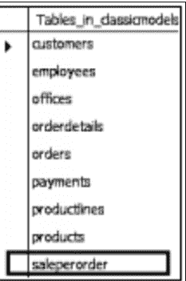

这证明了视图名称和表名称存储在数据库的同一空间中。因此，现在如果您想知道上图中的哪个对象是“视图”，哪个是“表”，可以使用`SHOW FULL TABLE`查询，“结果集”将如下图所示：

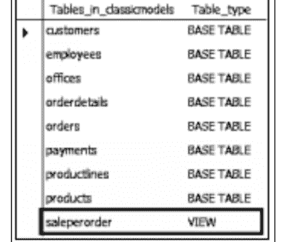

您可以查看上图中的`table_type`列，以确认哪个对象是视图或表。

现在，您只需使用以下`SELECT`语句即可查看“每个销售订单的总销售额”：

```sql
SELECT
*
FROM
salePerOrder;
```

“结果集”如下图所示：

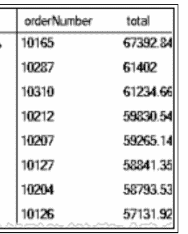

### 基于另一个 SQL 视图创建 SQL 视图

MySQL 服务器允许基于另一个视图创建新视图。例如，您可以基于之前创建的`SalesPerOrder`视图创建一个名为`BigSalesOrder`的视图，使用以下语法显示总额超过 60,000 的每个销售订单：

```sql
CREATE VIEW BigSalesOrder AS
SELECT
    orderNumber, ROUND(total, 2) AS total
FROM
    salePerOrder
WHERE
    total > 60000;
```

现在，您可以轻松地从`BigSalesOrder`视图中检索所需数据，如下所示：


```sql
SELECT
    orderNumber, total
FROM
    BigSalesOrder;
```

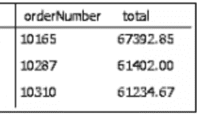

### 使用 `JOIN` 子句创建 `SQL 视图`

MySQL 数据库允许您使用 `JOIN` 子句创建 `SQL 视图`。例如，可以使用以下带有 `INNER JOIN` 子句的查询来创建包含“订单号”、“客户名称”和“每个订单的总销售额”的视图：

```sql
CREATE VIEW customerOrders AS
SELECT
    d.orderNumber,
    customerName,
    SUM(quantityOrdered * priceEach) total
FROM
    orderDetails d
    INNER JOIN orders o
        ON o.orderNumber = d.orderNumber
    INNER JOIN customers c
        ON c.customerNumber = c.customerNumber
GROUP BY d.orderNumber
ORDER BY total DESC;
```

您可以使用以下语法从 `customerOrders` 视图中检索所需数据：

```sql
SELECT
    *
FROM
    customerOrders;
```

“结果集”如下图所示：

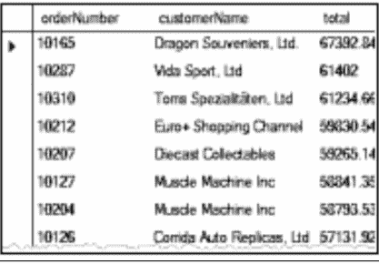

### 使用子查询创建 `SQL 视图`

可以使用以下查询生成带有“子查询”的 `SQL 视图`，包含购买价格高于平均产品价格的产品。

```sql
CREATE VIEW aboveAvgProducts AS
SELECT
    productCode, productName, buyPrice
FROM
    products
WHERE
    buyPrice > (
        SELECT
            AVG(buyPrice)
        FROM
            products
    )
ORDER BY buyPrice DESC;
```

从 `aboveAvgProducts` 视图中提取数据的查询更加简单，如下图所示：

```sql
SELECT
    *
FROM
    aboveAvgProducts;
```

“结果集”如下图所示：

| productCode | productName | buyPrice |
| :--- | :--- | :--- |
| $10_4952 | 1962 LanciaA Delta 16V | 103.42 |
| $18_2258 | 1998 Chrysler Plymouth Prowler | 101.51 |
| $10_1949 | 1952 Alome Renault 1300 | 98.50 |
| $24_3056 | 1956 Porsche 356A Coupe | 90.3 |
| $12_1108 | 2001 Ferrari Enzo | 95.59 |
| $12_1099 | 1963 Ford Mustang | 95.34 |
| $18_1984 | 1995 Honda Civic | 93.09 |
| $18_4027 | 1970 Triumph Spitfire | 91.92 |

## 可更新的 SQL 视图

MySQL 服务器不仅能够查询视图，还能够更新视图。可以使用 `INSERT` 或 `UPDATE` 语句通过可更新的 `MySQL 视图` 添加和编辑基础表的记录。此外，可以使用 `DELETE` 语句通过可更新的 `MySQL 视图` 从基础表中删除记录。

此外，用于生成和定义可更新视图的 `SELECT` 语句不能包含以下任何函数：

- “聚合函数”，如 `MIN`、`MAX`、`SUM`、`AVG` 和 `COUNT`。
- `DISTINCT`。
- `GROUP BY`。
- `HAVING`。
- `UNION` 或 `UNION ALL`。
- `LEFT JOIN` 或 `OUTER JOIN`。
- `SELECT` 语句中的子查询或 `WHERE` 子句中引用 `FROM` 子句中指定的表。
- `FROM` 子句中引用不可更新的视图。
- 仅引用文字值。
- 对基础表任何列的多处引用。

请记住，不能使用 `TEMPTABLE` 算法来生成可更新的 `MySQL 视图`。

### 示例

您可以使用以下语法基于 `MySQL 示例数据库` 中的 `offices` 表创建一个名为 `officeInfo` 的视图。

这个“可更新视图”将引用 `offices` 表的 3 列：`officeCode`、`phone` 和 `city`。

```sql
CREATE VIEW officeInfo AS
SELECT
    officeCode, phone, city
FROM
    offices;
```

现在，如果您想从 `officeInfo` 视图查询数据，可以使用以下语法轻松实现：

```sql
SELECT
    *
FROM
    officeInfo;
```

“结果集”如下图所示：


您还可以使用以下 `UPDATE` 语句在 `officeInfo` 视图上更新 `officeCode` 为 4 的办公室联系电话：

```sql
UPDATE officeInfo
SET
    phone = '+33 14 723 5555'
WHERE
    officeCode = 4;
```

最后，您可以使用下面的语法从 `officeInfo` 视图中检索所需数据，以确认此次修改：

```sql
SELECT
    *
FROM
    officeInfo
WHERE
    officeCode = 4;
```

“结果集”显示在下面的图片中：

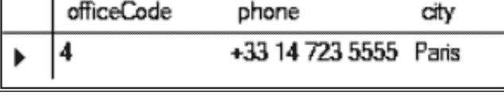

### 检查现有视图是否可更新

通过对 `information_schema` 数据库中视图的 `is_updatable` 列运行查询，您应该验证数据库中的某个视图是否可更新。

您可以使用下面的查询来显示 `classicmodels` 数据库中的所有视图，并检查其中哪些是可更新的：

```sql
SELECT
    table_name,
    is_updatable
FROM
    information_schema.views
WHERE
    table_schema = 'classicmodels';
```

“结果集”显示在下面的图片中：

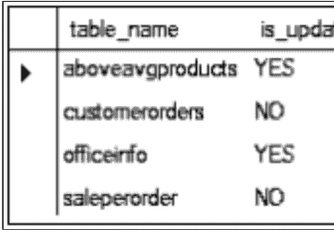

### 使用 `SQL 视图` 删除行

为了理解这个概念，请执行下面的语法：首先创建一个名为 `items` 的表，使用 `INSERT` 语句向该表中添加记录，然后使用 `CREATE` 子句生成一个包含价格高于 `700` 的项目的视图。

```sql
-- create a new table named items
CREATE TABLE items (
    id INT AUTO_INCREMENT PRIMARY KEY,
    name VARCHAR(100) NOT NULL,
    price DECIMAL(11, 2) NOT NULL
);

-- insert data into the items table
INSERT INTO items(name, price)
VALUES
    ('Laptop', 700.56),
    ('Desktop', 699.99),
    ('iPad', 700.50);

-- create a view based on items table
CREATE VIEW LuxuryItems AS
SELECT
    *
FROM
    items
WHERE
    price > 700;

-- query data from the LuxuryItems view
SELECT
    *
FROM
    LuxuryItems;
```

“结果集”显示在下面的图片中：

| id | name | price |
| --- | --- | --- |
| 1 | Laptop | 700.56 |
| 3 | iPad | 700.50 |

现在，使用 `DELETE` 子句删除 `id` 值为 3 的记录。

```sql
DELETE FROM LuxuryItems
WHERE
    id = 3;
```

运行上述查询后，您将收到一条消息，指出“1 row(s) affected”（影响了 1 行）。

现在，您可以使用下面的查询通过视图验证数据：

```sql
SELECT
    *
FROM
    LuxuryItems;
```

“结果集”显示在下面的图片中：

| id | name | price |
| --- | --- | --- |
| 1 | Laptop | 700.56 |

最后，使用下面的语法从底层表 `items` 中检索所需数据，以确认 `DELETE` 语句是否确实删除了该记录：

```sql
SELECT
    *
FROM
    items;
```

“结果集”显示在下面的图片中，这证实了 `id` 值为 3 的行已从 `items` 表中删除：

| id | name | price |
| --- | --- | --- |
| 1 | Laptop | 700.56 |
| 2 | Desktop | 699.99 |

## `SQL 视图` 的修改

在 MySQL 中，您可以使用 `ALTER VIEW` 和 `CREATE OR REPLACE VIEW` 语句对现有视图进行更改。

### 使用 `ALTER VIEW` 语句

`ALTER VIEW` 的语法与您之前学过的 `CREATE VIEW` 语句非常相似，唯一的区别是用 `ALTER` 关键字代替了 `CREATE` 关键字，如下所示：

```sql
ALTER
[ALGORITHM = {MERGE | TEMPTABLE | UNDEFINED}]
VIEW [database_name].[view_name]
AS
[SELECT statement]
```

下面的查询将通过在表中加入 `email` 列来更改 `organization` 视图：

```sql
ALTER VIEW organization AS
SELECT
    CONCAT(E.lastname, E.firstname) AS Employee,
    E.email AS employeeEmail,
    CONCAT(M.lastname, M.firstname) AS Manager
FROM
    employees AS E
    INNER JOIN employees AS M
        ON M.employeeNumber = E.ReportsTo
ORDER BY Manager;
```

您可以对 `organization` 视图运行下面的查询以验证修改结果：

```sql
SELECT
    *
FROM
    Organization;
```

“结果集”显示在下面的图片中：

| Employee | employeeEmail | Manager |
| :--- | :--- | :--- |
| JonesBarry | bjones@classicmodelcars.com | BonDurGerard |
| HernandezGerard | ghernande@classicmodelcars.com | BonDurGerard |
| BottLarry | lbott@classicmodelcars.com | BonDurGerard |
| GerardMartin | mgerard@classicmodelcars.com | BonDurGerard |
| BonDurLoui | lbondur@classicmodelcars.com | BonDurGerard |
| CastilloPamela | pcastillo@classicmodelcars.com | BonDurGerard |
| VanaufGeorge | gvanauf@classicmodelcars.com | BowAnthony |

### 使用 `CREATE OR REPLACE VIEW` 语句

`CREATE OR REPLACE VIEW` 可用于替换或生成数据库中已存在的 `SQL 视图`。对于所有现有视图，MySQL 将修改该视图；但如果该视图不存在，它将根据查询创建新视图。

下面的语法可用于在 `employees` 表的基础上生成 `contacts` 视图：

```sql
CREATE OR REPLACE VIEW contacts AS
SELECT
    firstName, lastName, extension, email
FROM
    employees;
```

“结果集”显示在下面的图片中：

| firstName | lastName | extension | email |
| :--- | :--- | :--- | :--- |
| Diane | Murphy | x5800 | dmurphy@classicmodelcars.com |
| Mary | Patterson | x4611 | mpatterson@classicmodelcars.com |
| Jeff | Firrelli | x9273 | jfirrelli@classicmodelcars.com |
| William | Patterson | x4871 | wpatterson@classicmodelcars.com |
| Gerard | Bondur | x5408 | gbondur@classicmodelcars.com |
| Anthony | Bow | x5428 | abow@classicmodelcars.com |
| Leslie | Jennings | x3291 | ljennings@classicmodelcars.com |

现在，假设您想在 `contacts` 视图中插入 `jobtitle` 列。您可以使用下面的语法来实现：

```sql
CREATE OR REPLACE VIEW contacts AS
SELECT
    firstName,
    lastName,
    extension,
    email,
    jobtitle
FROM
    employees;
```

“结果集”显示在下面的图片中：

| firstName | lastName | extension | email | jobtitle |
| :--- | :--- | :--- | :--- | :--- |
| Diane | Murphy | x5800 | dmurphy@classicmodelcars.com | President |
| Mary | Patterson | x4611 | mpatterson@classicmodelcars.com | VP Sales |
| Jeff | Firrell | x9273 | jfirrelli@classicmodelcars.com | VP Marketing |
| William | Patterson | x4871 | wpatterson@classicmodelcars.com | Sales Manager (APAC) |
| Gerard | Bonour | x5408 | gbonour@classicmodelcars.com | Sales Manager (EMEA) |
| Anthony | Bow | x3428 | abow@classicmodelcars.com | Sales Manager (NA) |
| Leslie | Jennings | x3291 | ljennings@classicmodelcars.com | Sales Rep |

## 删除 `SQL 视图`

可以使用 `DROP VIEW` 语句从数据库中删除现有视图，语法如下：

```sql
DROP VIEW [IF EXISTS] [database_name].[view_name]
```

在上述语句中，`IF EXISTS` 子句不是强制性的，它用于确定视图是否已存在于数据库中。它可以防止您误删数据库中不存在的视图。

例如，您可以使用如下语法中的 `DROP VIEW` 语句来删除 `organization` 视图：

```sql
DROP VIEW IF EXISTS organization;
```

## SQL 事务（SQL TRANSACTIONS）

事务可以被定义为“针对数据库执行的一个工作单元”。它们是按“逻辑顺序”执行的“工作单元或工作序列”，可以通过用户手动执行，也可以由数据库程序自动执行。

简单来说，它们是“一次或多次数据库修改的展开”。例如，如果您在表中创建一行、更新一行或删除一行，这意味着您在该表上执行了一个事务。为了维护数据完整性并处理数据库错误，规范这些事务至关重要。

基本上，要执行一个事务，您必须将多个 SQL 查询分组并同时运行它们。

### 事务的特性

事务的基本特性可以用缩写 `ACID` 来定义，具体属性如下：

- **原子性（Atomicity）** – 保证工作单元中分组的所有操作均能成功完成。否则，在失败点，事务将被终止，且之前的所有操作都将回滚到原始状态。
- **一致性（Consistency）** – 确保当事务被正确提交时，数据库状态也得到了正确的更新。


- **隔离性 (Isolation)** – 允许事务独立且透明地执行。
- **持久性 (Durability)** – 确保在系统发生故障的情况下，已提交事务的结果或影响仍然存在。

为了更详细地解释这个概念，请参考在 “MySQL 示例数据库” 中添加新销售订单的以下步骤：

- 首先，从 `orders` 表中查询最新的 “销售订单号”，并利用下一个 “销售订单号” 作为新的 “订单号”。
- 然后，使用 `INSERT` 子句将新的 “销售订单” 添加到 `orders` 表中。
- 接下来，检索上一步中插入的 “销售订单号”。
- 现在，将包含 “销售订单号” 的新 “销售订单项” `INSERT` 到 `orderdetails` 表中。
- 最后，为了验证修改，从 `orders` 和 `orderdetails` 表中分别选择数据。

试想一下，如果这里列出的任何一个步骤因为某种原因而失败，销售订单数据将如何被修改。例如，如果将订单项插入 `orderdetails` 表的步骤失败，将导致产生一个 “空销售订单”。

这就是将“事务处理”作为安全措施使用的地方。你可以执行“MySQL 事务”来运行一组操作，确保数据库不会包含任何部分操作。在并发处理多个操作时，如果其中任何一个操作失败，则可以触发“回滚（rollback）”。如果没有失败，所有语句都将“提交（committed）”到数据库中。

## “MySQL Transaction”语句

MySQL 提供了以下语句用于控制事务：

- 用于启动事务，使用 `START TRANSACTION` 语句。`BEGIN` 或 `BEGIN WORK` 语句与 `START TRANSACTION` 相同。
- 用于提交“当前事务”并使修改永久生效，使用 `COMMIT` 语句。
- 通过使用 `ROLLBACK` 声明，你可以简单地撤销当前事务并使其修改失效。
- 通过使用 `SET auto-commit` 语句，你可以为当前事务停用或启用自动提交模式。

默认情况下，MySQL 旨在将修改永久提交到数据库。通过使用以下语句，你可以强制 MySQL 默认不提交修改：

```sql
SET autocommit = 0;
-- 或者
SET autocommit = OFF;
```

要重新激活默认的自动提交模式，可以使用以下语法：

```sql
SET autocommit = ON;
```

### 示例

让我们利用下面图片中来自“MySQL 示例数据库”的 `orders` 和 `orderDetails` 表来进一步理解这个概念。

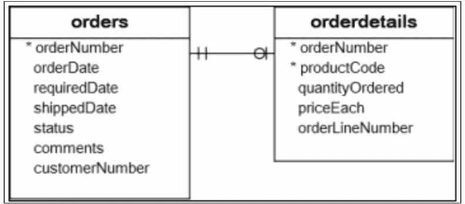

#### “COMMIT” 事务

你必须首先将 SQL 语句拆分为逻辑部分，以便有效地使用事务并评估何时需要提交或回滚事务。

以下步骤展示了如何生成一个新的“销售订单”：

1. 使用 `START TRANSACTION` 语句开始一个事务。
2. 从 `orders` 表中选择最新的“销售订单号”，并将随后的“订单号”作为新的“订单号”。
3. 在 `orders` 表中“插入”一个新的销售订单。
4. 在 `orderdetails` 表中“插入”销售订单项。
5. 最后，使用 `COMMIT` 语句提交事务。

你可以使用 `orders` 和 `orderdetails` 表的数据来验证新的“销售订单”，如下面的语法所示：

开始一个新事务

```sql
START TRANSACTION;
```

获取最新的订单号

```sql
SELECT @orderNumber := MAX(orderNumber) + 1 FROM orders;
```

为客户 145 插入一个新订单

```sql
INSERT INTO orders (orderNumber,
    orderDate,
    requiredDate,
    shippedDate,
    status,
    customerNumber)
VALUES (@orderNumber,
    '2005-05-31',
    '2005-06-10',
    '2005-06-11',
    'In Process',
    145);
```

插入订单行项目

```sql
INSERT INTO orderdetails(orderNumber,
    productCode,
    quantityOrdered,
    priceEach,
    orderLineNumber)
VALUES (@orderNumber, 'S18_1749', 30, '136', 1),
    (@orderNumber, 'S18_2248', 50, '55.09', 2);
```

提交更改

```sql
COMMIT;
```

“结果集”显示在下面的图片中：

| @orderNumber:=IFNULL(MAX(orderNumber),0)+1 | |
| --- | --- |
| ▶ | 10426 |

使用下面的查询，你可以检索你刚刚创建的新销售订单：

```sql
SELECT
    a.orderNumber,
    orderDate,
    requiredDate,
    shippedDate,
    status,
    comments,
    customerNumber,
    orderLineNumber,
    productCode,
    quantityOrdered,
    priceEach
FROM
    orders a
    INNER JOIN
    orderdetails b USING (orderNumber)
WHERE
    a.ordernumber = 10426;
```

“结果集”显示在下面的图片中：

| orderNumber | orderDate | requiredDate | shippedDate | status | comments | customerNumber | orderLineNumber | productCode | quantityOrdered | priceEach |
| --- | --- | --- | --- | --- | --- | --- | --- | --- | --- | --- |
| 10426 | 2005-03-31 | 2005-06-10 | 2005-06-11 | In Process | NULL | 145 | 1 | S18_1749 | 30 | 136.00 |
| 10426 | 2005-03-31 | 2005-06-10 | 2005-06-11 | In Process | NULL | 145 | 2 | S18_2248 | 50 | 55.09 |

#### “ROLLBACK” 事务

这里的第一步是使用以下语句删除 `orders` 表中的数据：

```sql
mysql> START TRANSACTION;
Query OK, 0 rows affected (0.00 sec)

mysql> DELETE FROM orders;
Query OK, 327 rows affected (0.03 sec)
```

从上述查询的输出可以明显看出，`orders` 表中的所有记录都已被删除。

现在，你需要在一个不同的会话中登录到“MySQL 数据库服务器”，并针对 `orders` 表运行以下查询。

```sql
mysql> SELECT COUNT(*) FROM orders;
+----------+
| COUNT(*) |
+----------+
|      327 |
+----------+
1 row in set (0.00 sec)
```

在第二个会话中仍然可以看到 `orders` 表的数据。

第一个会话中所做的更改不是永久性的，因此你需要提交它们或将它们回滚。假设你想撤销第一个会话中的更改，请使用以下查询：

```sql
mysql> ROLLBACK;
Query OK, 0 rows affected (0.04 sec)
```

可以使用以下语法验证第一个会话中 `orders` 表的数据：

```sql
mysql> SELECT COUNT(*) FROM orders;
+----------+
| COUNT(*) |
+-----------+
|    327    |
+-----------+
1 row in set (0.00 sec)
```

从上面的“结果集”可以看出，修改已被回滚。

#### “SAVEPOINT” 事务

“SAVEPOINT”被定义为“事务中的一个点，当你可以将事务回滚到某个特定点而无需回滚整个事务时”，如下面的语法所示：

```sql
SAVEPOINT SAVEPOINT_NAME;
```

上述查询仅用于在所有事务语句中创建“SAVEPOINT”，然后可以使用 `ROLLBACK` 查询来撤回所需的事务，如下面的查询所示：

```sql
ROLLBACK TO SAVEPOINT_NAME;
```

例如，假设你有一个如下图所示的 `customers` 表，想要删除 3 行数据，并在每次删除前创建一个“SAVEPOINT”，然后根据需要将更改“ROLLBACK”到之前的状态。

| ID | NAME | AGE | ADDRESS | SALARY |
|---|---|---|---|---|
| 1 | Ramesh | 32 | Ahmedabad | 2000.00 |
| 2 | Khilan | 25 | Delhi | 1500.00 |
| 3 | Kaushik | 23 | Kota | 2000.00 |
| 4 | Chaitali | 25 | Mumbai | 6500.00 |
| 5 | Hardik | 27 | Bhopal | 8500.00 |
| 6 | Komal | 22 | MP | 4500.00 |
| 7 | Muffy | 24 | Indore | 10000.00 |

你可以通过运行以下查询来完成此操作：

```sql
SQL> SAVEPOINT SP1;
Savepoint created.
SQL> DELETE FROM CUSTOMERS WHERE ID=1;
1 row deleted.
SQL> SAVEPOINT SP2;
Savepoint created.
SQL> DELETE FROM CUSTOMERS WHERE ID=2;
1 row deleted.
SQL> SAVEPOINT SP3;
Savepoint created.
SQL> DELETE FROM CUSTOMERS WHERE ID=3;
1 row deleted.
```

通过上述查询，你已成功删除了 3 条记录，现在可以使用以下查询将更改“ROLLBACK”到名为“SP2”的“SAVEPOINT”，该点是在第一次删除后生成的，因此最后两次删除将被回滚：

```sql
SQL> ROLLBACK TO SP2;
Rollback complete.
```

“结果集”显示在下面的图片中：

| ID | NAME | AGE | ADDRESS | SALARY |
|---|---|---|---|---|
| 2 | Khilan | 25 | Delhi | 1500.00 |
| 3 | Kaushik | 23 | Kota | 2000.00 |
| 4 | Chaitali | 25 | Mumbai | 6500.00 |
| 5 | Hardik | 27 | Bhopal | 8500.00 |
| 6 | Komal | 22 | MP | 4500.00 |
| 7 | Muffy | 24 | Indore | 10000.00 |

#### “RELEASE SAVEPOINT” 事务

“RELEASE SAVEPOINT”可用于删除之前可能生成的“SAVEPOINT”，如下面的语法所示：

```sql
RELEASE SAVEPOINT SAVEPOINT_NAME;
```

请记住，一旦运行上述查询，就没有任何功能可以撤销在最后一个“SAVEPOINT”之后可能执行的事务。

#### "SET TRANSACTION"

"SET TRANSACTION" 可用于通过指定后续事务的特性来启动事务。例如：

```sql
SET TRANSACTION [ READ WRITE | READ ONLY ];
```

## 数据库恢复模型

恢复模型可以定义为“一种数据库属性，用于控制事务如何记录、事务日志是否需要并允许备份，以及可用的还原操作类型”。它是一个数据库配置选项，指定了可以执行的备份类型，并使得在发生故障时能够还原或恢复数据。三种“SQL Server 恢复模型”分别是：

### SIMPLE (简单模型)

该模型被认为是所有现有恢复模型中最简单的一种。它提供“完整、差异和文件级”备份。然而，不支持事务日志的备份。每当 SQL Server 后台进程的检查点（checkpoint）操作发生时，日志空间将被重用。日志文件的非活动部分将被删除并可供重新使用。

不支持时间点（point-in-time）和页面还原，仅能还原次要的只读文件。

### FULL (完整模型)

在“FULL”恢复模型中，事务日志文件中的所有类型事务（DDL (数据定义语言) 以及 DML (数据操纵语言)）都可以被完整记录。日志序列保持不变，并为以下还原活动而维护：

数据库。与“简单恢复模型”不同，在“CHECKPOINT”事务期间，“事务日志”文件不会被自动截断。

它支持所有恢复活动，例如“时间点恢复、页恢复和文件恢复”。

## 大容量日志

“大容量日志恢复模型”是一种独特的数据库配置选项，它产生的结果与“完整恢复模型”类似，但某些“大容量操作”仅能被最小化记录。“事务日志”文件使用一种称为“大容量操作的最小日志记录”的方法。其缺点是无法恢复特定时间点的数据。

## “SQL BACKUP DATABASE”语句

“BACKUP DATABASE”语句可用于为SQL服务器上已存在的数据库生成完整备份，语法如下所示：

```
"BACKUP DATABASE databasename
TO DISK = 'filepath';"
```

## “SQL BACKUP WITH DIFFERENTIAL”语句

“差异备份”用于选择性地备份自上次“数据库完整备份”后发生更改的数据库部分，语法如下所示：

```
"BACKUP DATABASE databasename
TO DISK = 'filepath'
WITH DIFFERENTIAL;"
```

### 示例

假设你有一个名为“testDB”的数据库，并希望为其创建完整备份。为此，你可以使用以下查询：

```
"BACKUP DATABASE testDB
TO DISK = 'D:\backups\testDB.bak';"
```

现在，如果在运行上述查询后对数据库进行了修改。你可以使用以下查询来创建这些修改的备份：

```
"BACKUP DATABASE testDB
TO DISK = 'D:\backups\testDB.bak'
WITH DIFFERENTIAL;"
```

## 恢复数据库

恢复可以定义为“从备份复制数据并将日志记录的事务应用到该数据”的方法。生成的备份文件（如前所述）用于将数据库恢复到先前状态。有几种方法可以实现：

### T-SQL

此方法的语法如下：

```
"Restore database <Your database name> from disk = '<Backup file location + file name>';"
```

例如，可以使用以下查询来恢复一个名为“TestDB”的数据库，使用名为“TestDB_Full.bak”的备份文件，该文件位于“D:\”：

```
"Restore database TestDB from disk = ' D:\TestDB_Full.bak' with replace;"
```

### “SSMS (SQL SERVER Management Studio)”

首先连接到“TESTINSTANCE”数据库，然后右键单击数据库文件夹并单击“还原数据库”，如下图所示。

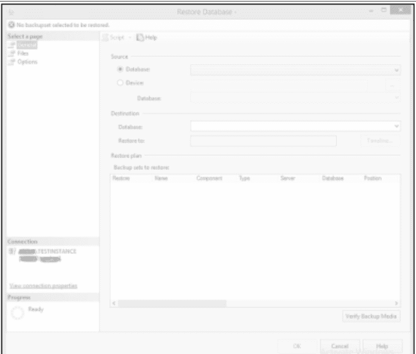

现在，选择备份文件如下图所示，“选择设备单选按钮并单击省略号”。

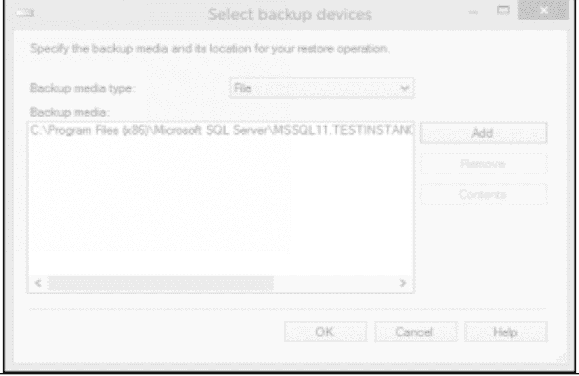

接下来，单击“确定”，你将看到如下所示的窗口。

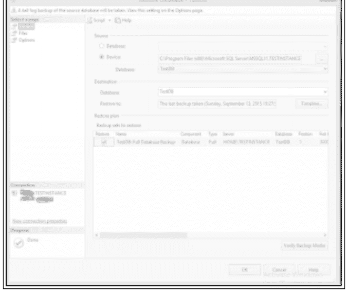

现在，从“屏幕左上角选择文件选项”，如下图所示：

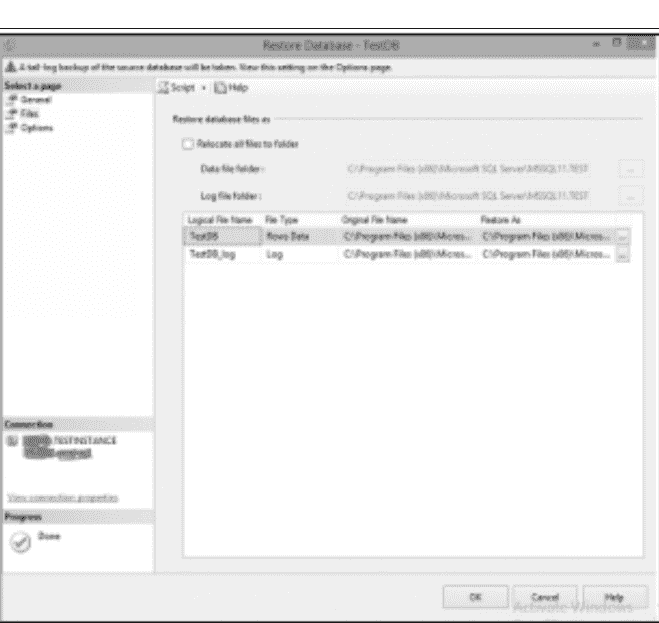

最后，从“屏幕左上角”选择“选项”，然后单击“确定”以恢复“TestDB”数据库，如下图所示：

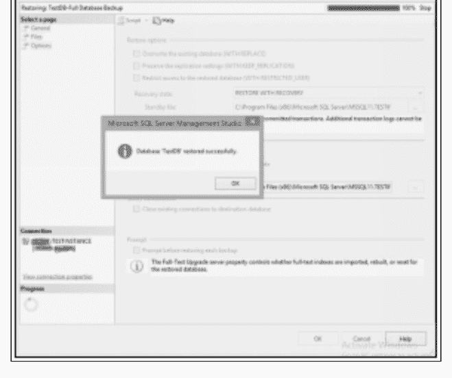

# 第5章：数据库安全与管理

MySQL具有集成的高级访问控制和权限系统，能够为用户活动生成广泛的访问准则，并有效防止未经授权的用户访问数据库系统。

当用户连接到服务器时，MySQL访问控制系统有两个阶段：

- **连接验证**：每个用户必须拥有有效的用户名和密码，才能连接到“My数据库服务器”。此外，用户用于连接的主机必须与“My授权表”中的主机相同。
- **请求验证**：在为用户执行的每个查询建立有效连接后，MySQL将验证用户是否具有运行该特定查询所需的权限。MySQL能够检查数据库、表和字段级别的用户权限。

MySQL安装程序将自动生成一个名为“mysql”的数据库。“mysql数据库”由5个主要的授权表组成。使用`GRANT`和`REVOKE`语句可以间接操作这些表。


- **用户**：包括“用户帐户”和“全局权限”的列。MySQL 使用这些用户表接受或拒绝来自主机的连接。在“用户表”下授予的权限适用于“My 服务器”上的所有数据库。
- **数据库**：包括“数据库级”权限。MySQL 使用`db_table`评估用户可以访问和建立连接的数据库。`db_table`中的“数据库级”权限适用于特定数据库以及该数据库中的所有对象，例如“表、触发器、视图、存储过程”等。
- **Table_priv**和**columns_priv**：包括“表级”和“列级”权限。在“table priv”表中授予的权限适用于该特定表及其列；另一方面，在“columns priv”表中授予的权限仅适用于表的特定列。
- **Procs_priv**：包括“存储函数”和“存储过程”的权限。

MySQL 使用上述列表中的表来管理 MySQL 数据库服务器权限。在实施自己的动态访问控制系统之前，理解这些表至关重要。

## 创建用户帐户

在 MySQL 中，你不仅可以指定哪个用户可以连接到数据库服务器，还可以指定用户可以使用哪个主机建立连接。因此，为每个用户帐户在 MySQL 中生成一个“用户名”和“主机名”，并用`@`字符分隔。

例如，如果一个“管理员用户”从`localhost`连接到“My 数据库服务器”，用户帐户将被命名为`admin@localhost`。但是，`admin_user`仅允许使用`localhost`或远程主机（如`mysqltutorial.org`）连接到“My 数据库服务器”，这确保了 My 数据库服务器具有更高的安全性。

此外，通过组合“用户名”和“主机”，可以配置具有相同名称的各种帐户，并且仍然能够从不同的主机连接，同时根据需要获得不同的权限。

在“mysql 数据库”中，所有用户帐户都存储在“用户授权”表中。

## 使用`CREATE USER`语句

`CREATE USER`与 MySQL 服务器一起用于设置新用户帐户，语法如下所示：

```sql
CREATE USER user_account IDENTIFIED BY password;
```

在上述语法中，`CREATE USER`子句后跟`username @ hostname`格式的用户帐户名称。

在`IDENTIFIED BY`子句中，将指定用户密码。重要的是密码必须以纯文本形式指定。在将用户帐户保存到`user`表之前，MySQL 需要加密“用户密码”。

例如，`CREATE USER`语句可以如下使用，用于创建一个新的“用户 dbadmin”，该用户从`localhost`连接到“My 数据库服务器”，用户密码为`SECRET`。

```sql
CREATE USER dbadmin@localhost
IDENTIFIED BY 'SECRET';
```

如果你想检查“用户帐户的权限”，可以运行以下语法：

```sql
SHOW GRANTS FOR dbadmin@localhost;
```

| Grants for dbadmin@localhost |
| :--- |
| GRANT USAGE ON *.* TO `dbadmin`@`localhost` |

`1 row in set (0.00 sec)`

上述“结果集”中的`*.*`表示“dbadmin 用户”帐户仅允许登录服务器，没有任何其他访问权限。

请记住，“点（`.`）”之前的部分代表数据库，“点（`.`）”之后的部分代表表，例如`database.table`。

如以下语法所示，可以使用“百分比（`%`）”通配符来允许用户从任何主机创建连接：

```sql
CREATE USER superadmin@'%' IDENTIFIED BY 'secret';
```

“百分比（`%`）”通配符产生的结果与在`LIKE`运算符中使用时相同。例如，要使`mysqladmin user`账户能够从`mysqltutorial.org`主机的任何“子域名”连接到服务器，可以使用如下语法中的“百分比（`%`）”通配符：

```sql
CREATE USER mysqladmin@'%.mysqltutorial.org' IDENTIFIED BY 'secret';
```

这里还应注意，在`CREATE USER`语句中还可以使用另一个通配符“下划线（`_`）”。

如果用户账户中省略了主机名部分，服务器将识别并允许该用户从任何主机连接。例如，以下语法将生成一个允许从任何主机建立服务器连接的新远程用户账户：

```sql
CREATE USER remote;
```

要查看授予`remote`账户的权限，可以使用以下语法：

```sql
SHOW GRANTS FOR remote;
```

| Grants for remote@% |
| :--- |
| GRANT USAGE ON *.* TO `remote`@`%` |

`1 row in set (0.00 sec)`

必须记住，如果用户账户包含像“下划线”或“百分比”这样的特殊字符，上述语法中的单引号（`'`）就变得尤为重要。

如果你不小心地将用户账户引用为`username@hostname`，服务器将创建一个名为`username@hostname`的用户，并允许该用户从任何主机连接，这可能与您的预期不符。

例如，下面的语法可用于生成一个名为`api@localhost`的新账户，该账户可以从任何主机连接到“MySQL 数据库服务器”。

```sql
CREATE USER 'api@localhost';
SHOW GRANTS FOR 'api@localhost';
```

| Grants for api@localhost@% |
| :--- |
| GRANT USAGE ON *.* TO `api@localhost`@`%` |

`1 row in set (0.00 sec)`

如果您意外创建了一个在数据库中已存在用户，MySQL 将发出错误。例如，以下语法可用于创建名为`remote`的新用户账户：

```sql
CREATE USER remote;
```

屏幕上将显示以下错误消息：

```text
ERROR 1396 (HY000): Operation CREATE user failed for 'remote'@'%'
```

需要注意的是，`CREATE USER`语句仅创建不具备任何权限的新用户。`GRANT`语句可用于向用户授予访问权限。

## 更新用户密码

在更改 MySQL 用户账户密码之前，应考虑以下事项：

- 您想要修改密码的用户账户。
- 正在使用该用户账户的应用程序。如果更改了密码而没有更改应用程序使用的连接字符串，那么这些应用程序将无法连接到数据库服务器。

MySQL 提供了多种用于更改用户密码的语句，例如`UPDATE`、`SET PASSWORD`和`GRANT USAGE`语句。

让我们来探索其中的一些语法！

### 使用`UPDATE`语句

`UPDATE`可用于更新`mysql`数据库的`user`表。在执行`UPDATE`语句后，您还必须运行`FLUSH PRIVILEGES`语句，以从`mysql`数据库的`grant`表中刷新权限。

假设您想修改从`localhost`连接到`dolphin`的`dbadmin`用户的密码。您可以通过执行以下查询来实现：

```sql
USE mysql;
UPDATE user
SET password = PASSWORD('dolphin')
WHERE user = 'dbadmin' AND host = 'localhost';
FLUSH PRIVILEGES;
```

### 使用`SET PASSWORD`语句

在更新用户密码时，采用`user@host`格式。现在，假设您想修改另一个用户账户的密码，那么您的用户账户需要拥有`UPDATE`权限。

使用`SET PASSWORD`语句时，不需要执行`FLUSH PRIVILEGES`语句来从`grant`表重新加载`mysql`数据库的权限。

可以通过执行`SET PASSWORD`语句，使用以下语法来更改`dbadmin`用户账户的密码：

```sql
SET PASSWORD FOR 'dbadmin'@'localhost' = PASSWORD('bigshark');
```

### 使用`ALTER USER`语句

另一种更改用户密码的方法是使用带有`IDENTIFIED BY`子句的`ALTER USER`语句。例如，可以执行以下查询将`dbadmin`用户的密码更改为`littlewhale`。

```sql
ALTER USER dbadmin@localhost IDENTIFIED BY 'littlewhale';
```

### 有用技巧

如果您需要更改 MySQL“root 账户”的密码，则需要强制退出“MySQL 数据库服务器”，并在不触发“grant 表验证”的情况下重启服务器。

## 授予用户权限

当创建新用户账户时，默认情况下不向用户提供任何访问权限。必须使用`GRANT`语句来“向用户账户授予权限”。`GRANT`语句的语法如下：

```sql
GRANT privilege, [privilege],.. ON privilege_level
TO user [IDENTIFIED BY password]
[REQUIRE tsl_option]
[WITH [GRANT_OPTION | resource_option]];
```

在上述语法中，我们首先在`GRANT`子句后指定一个或多个权限。如果您想同时向用户账户授予多个权限，每个被授予的权限必须使用逗号隔开。（下表列出了可“授予用户账户”的潜在权限列表。）之后，您必须指定`privilege_level`，它将决定权限适用的级别。MySQL 支持的权限级别有“全局（`*.*`）”、“数据库（`database.*`）”、“表（`database.table`）”和“列”级别。如果您使用“列”权限级别，必须指定单个或多个列（每个权限后跟逗号分隔的列列表）。

接下来，您需要指定需要授予权限的用户。如果服务器上能找到指定的用户，则`GRANT`语句将修改其权限；否则，`GRANT`语句将创建一个新用户账户。`IDENTIFIED BY`子句不是强制性的，它允许为用户创建新密码。

随后，指定用户是否需要通过“安全连接”（如`SSL`、`X509`等）连接到数据库。

最后，添加`WITH GRANT OPTION`子句（非强制性），它允许授予和撤销“已授予您自己用户账户”的其他用户的权限。此外，`WITH`子句还可用于分配 MySQL 数据库服务器的资源，例如限制用户每小时可使用的连接数或语句数。在像“MySQL 共享托管”这样的共享环境中，`WITH`子句非常有用。

请注意，为了能够使用`GRANT`语句，`GRANT OPTION`权限以及您打算授予其他用户的权限必须已经配置在您的用户账户中。如果已启用只读系统变量，则执行`GRANT`语句需要`SUPER`权限。

| 权限 | 描述 | 全局级别 | 数据库级别 | 表级别 | 列级别 | 存储过程级别 | 代理级别 |
| :--- | :--- | :---: | :---: | :---: | :---: | :---: | :---: |
| `ALL` | 授予指定访问级别的所有权限，但不包括 `GRANT OPTION` | | | | | | |
| `ALTER` | 允许用户使用 `ALTER TABLE` 语句 | Y | Y | Y | | | |
| `ALTER ROUTINE` | 允许用户修改或删除存储例程 | Y | Y | | | Y | |
| `CREATE` | 允许用户创建数据库和表 | Y | Y | Y | | | |
| `CREATE ROUTINE` | 允许用户创建存储例程 | Y | Y | | | | |
| `CREATE TABLESPACE` | 允许用户创建、修改或删除表空间和日志文件组 | Y | | | | | |
| `CREATE TEMPORARY TABLES` | 允许用户通过使用 `CREATE TEMPORARY TABLE` 创建临时表 | Y | Y | | | | |
| `CREATE USER` | 允许用户使用 `CREATE USER`、`DROP USER`、`RENAME USER` 和 `REVOKE ALL` | Y | | | | | |

| 权限语句 | 描述 | 全局 | 数据库 | 表 | 列 |
| :--- | :--- | :---: | :---: | :---: | :---: |
| `CREATE VIEW` | 允许用户创建或修改视图 | Y | Y | | Y |
| `DELETE` | 允许用户使用 `DELETE` 语句 | Y | Y | | Y |
| `DROP` | 允许用户删除数据库、表和视图 | Y | Y | | Y |
| `EVENT` | 为事件调度器启用事件使用权限 | Y | Y | | |
| `EXECUTE` | 允许用户执行存储过程 | Y | Y | | Y |
| `FILE` | 允许用户读取数据库目录中的任何文件 | Y | | | |
| `GRANT OPTION` | 允许用户拥有向其他账户授予或撤销权限的权限 | Y | Y | Y | Y |
| `INDEX` | 允许用户创建或删除索引 | Y | Y | | Y |
| `INSERT` | 允许用户使用 `INSERT` 语句 | Y | Y | Y | |
| `LOCK TABLES` | 允许用户在拥有 `SELECT` 权限的表上使用 `LOCK TABLES` | Y | Y | | |
| `PROCESS` | 允许用户使用 `SHOW PROCESSLIST` 语句查看所有进程 | Y | | | |
| `PROXY` | 启用用户代理 | | | | |
| `REFERENCES` | 允许用户创建外键 | Y | Y | Y | Y |
| `RELOAD` | 允许用户使用 `FLUSH` 操作 | Y | | | |
| `REPLICATION CLIENT` | 允许用户查询以查看主服务器或从服务器的位置 | Y | | | |
| `REPLICATION SLAVE` | 允许用户使用复制从服务器从主服务器读取二进制日志事件 | Y | | | |
| `SELECT` | 允许用户使用 `SELECT` 语句 | Y | Y | Y | Y |
| `SHOW DATABASES` | 允许用户显示所有数据库 | Y | | | |
| `SHOW VIEW` | 允许用户使用 `SHOW CREATE VIEW` 语句 | Y | Y | Y | |
| `SHUTDOWN` | 允许用户使用 `mysqladmin shutdown` 命令 | Y | | | |
| `SUPER` | 允许用户使用其他管理操作，如 `CHANGE MASTER TO`、`KILL`、`PURGE BINARY LOGS`、`SET GLOBAL` 以及 `mysqladmin` 命令 | Y | | | |
| `TRIGGER` | 允许用户使用 `TRIGGER` 操作 | Y | Y | Y | |
| `UPDATE` | 允许用户使用 `UPDATE` 语句 | Y | Y | Y | Y |
| `USAGE` | 等同于没有任何权限 | | | | |

### 示例

通常情况下，会先使用`CREATE USER`语句创建新用户账户，然后使用`GRANT`语句为该用户分配权限。

例如，可以通过执行以下`CREATE USER`语句来创建一个新的“超级用户”账户：

```sql
CREATE USER super@localhost IDENTIFIED BY 'dolphin';
```

为了检查授予`super@localhost`用户的权限，可以使用下面包含`SHOW GRANTS`语句的查询。

```text
SHOW GRANTS FOR super@localhost;
+--------------------------------------------------+
| Grants for super@localhost                       |
+--------------------------------------------------+
| GRANT USAGE ON *.* TO `super`@`localhost`        |
+--------------------------------------------------+
1 row in set (0.00 sec)
```

现在，如果你想将所有权限分配给`super@localhost`用户，可以使用下面包含`GRANT ALL`语句的查询。

```sql
GRANT ALL ON *.* TO 'super'@'localhost' WITH GRANT OPTION;
```

`ON *.*`子句是指所有数据库以及这些数据库中的所有项。`WITH GRANT OPTION`使`super@localhost`能够将权限分配给其他用户账户。

如果此时再次使用`SHOW GRANTS`语句，可以看到`super@localhost`用户的权限已被修改，如下面的语法和“结果集”所示：

```sql
SHOW GRANTS FOR super@localhost;
```

| Grants for super@localhost |
| :--- |
| GRANT ALL PRIVILEGES ON *.* TO `super`@`localhost` WITH GRANT OPTION |

`1 row in set (0.00 sec)`


现在，假设你想在“classicmodels 示例数据库”中创建一个拥有所有服务器权限的新用户账户。你可以通过使用以下查询来实现：

```sql
CREATE USER auditor@localhost IDENTIFIED BY 'whale';
GRANT ALL ON classicmodels.* TO auditor@localhost;
```

仅使用一个`GRANT`语句，就可以向用户账户授予多种权限。例如，要创建一个对`classicmodels`数据库具有执行`SELECT`、`INSERT`和`UPDATE`语句权限的用户账户，可以使用以下查询：

```sql
CREATE USER rfc IDENTIFIED BY 'shark';
GRANT SELECT, UPDATE, DELETE ON classicmodels.* TO rfc;
```

### 撤销用户权限

你将使用`MySQL REVOKE`语句来撤销任何用户账户的权限。MySQL 支持撤销一个或多个权限，甚至撤销用户账户之前被授予的所有权限。

可以使用以下查询从用户账户中撤销特定权限：

```sql
REVOKE privilege_type [(column_list)]
    [, priv_type [(column_list)]]...
ON [object_type] privilege_level
FROM user [, user]...
```

在上述语法中，我们首先在`REVOKE`关键字旁边指定需要从用户账户撤销的权限列表。正如你可能记得的，在语句中列出多个权限时，必须用逗号隔开。然后我们通过`ON`子句指示撤销这些权限的“权限级别”。最后，我们在`FROM`子句中指定要撤销权限的用户账户。

请记住，你自己的用户账户必须同时拥有`GRANT OPTION`权限以及你想要从其他用户账户中撤销的那些权限。

如果你希望撤销用户账户的所有权限，将使用如下语法所示的`REVOKE`语句：

```sql
REVOKE ALL PRIVILEGES, GRANT OPTION FROM user [, user]...
```

请务必记住，要能够执行`REVOKE ALL`语句，你必须在`mysql`数据库的“全局级别”拥有`CREATE USER`或`UPDATE`权限。

为了撤销代理用户，你将使用如下查询所示的`REVOKE PROXY`子句：

```sql
REVOKE PROXY ON user FROM user [, user]...
```

代理用户可以被定义为“MySQL 中一个可以冒充另一个用户的有效用户”。因此，代理用户能够获得被冒充用户所拥有的所有权限。

最佳实践建议，在撤销用户权限之前，应首先通过执行以下包含`SHOW GRANTS`语句的语法来检查已分配给该用户的权限：

```sql
SHOW GRANTS FOR user;
```

### 示例

假设有一个名为`rfc`的用户，在“classicmodels 示例数据库”上拥有`SELECT`、`UPDATE`和`DELETE`权限，而你想从`rfc`用户处撤销`UPDATE`和`DELETE`权限。为此，你可以执行以下查询。

首先，我们将使用下面的`SHOW GRANTS`语句检查用户权限：

```sql
SHOW GRANTS FOR rfc;
```

```sql
GRANT SELECT, UPDATE, DELETE ON 'classicmodels'.* TO 'rfc'@'%'
```

此时，可以使用以下查询从`rfc`用户处撤销`UPDATE`和`DELETE`权限：

```sql
REVOKE UPDATE, DELETE ON classicmodels.* FROM rfc;
```

接下来，可以使用`SHOW GRANTS`语句检查`rfc`用户的权限。

```sql
SHOW GRANTS FOR 'rfc'@'localhost';
```

```sql
GRANT SELECT ON 'classicmodels'.* TO 'rfc'@'%'
```

现在，如果你想撤销`rfc`用户的所有权限，可以使用以下查询：

```sql
REVOKE ALL PRIVILEGES, GRANT OPTION FROM rfc;
```

```sql
GRANT USAGE ON *.* TO 'rfc'@'%'
```

记住，正如本书前面权限描述表中所提到的，`USAGE`权限简单来说就是该用户在服务器中没有任何权限。

## “REVOKE”查询产生的影响

`MYSQL REVOKE`语句的影响主要取决于授予用户账户的权限级别，具体说明如下：

- 对“全局权限”的修改只有在`REVOKE`查询成功执行后，用户在随后的会话中连接到 MySQL 服务器时才会生效。在执行`REVOKE`语句期间，修改不会适用于所有其他已连接到服务器的用户。
- 对数据库权限的修改只有在执行`REVOKE`查询之后，执行了`USE`语句后才会生效。
- “表和列权限”的修改将适用于在`REVOKE`语句生效后执行的所有查询。

## 结语

感谢你阅读完《SQL 编程入门》（SQL Coding For Beginners），希望本书能为你提供有益的信息，并为你提供实现目标的所有必要工具。

下一步是充分利用你新获得的智慧和对 SQL 编程语言的学习，这将使你能够进入系统和数据分析的世界。非常重要的一点是，请遵循本书中的说明，在你的操作系统上安装免费且开源的 MySQL 用户界面，以便你能够进行实际操作，从而不仅能创建正确的，而且能创建高效的 SQL 查询，以便在工作中或求职面试中取得成功。与生活中大多数学习一样，反复练习是达到完美的关键。因此，让本书成为你学习关系型数据库管理系统编程语言之旅的指路明灯。为了充分利用本书，在阅读和理解所有概念以及 SQL 查询结构时，尝试使用自己的名称和标签来替换示例中的内容，并将获得的结果集与本书中给出的结果进行验证。

最后，如果你觉得本书在任何方面对你有所帮助，在亚马逊上给予好评将不胜感激！

# 学习 Java 编程

## 面向初学者的 Java 终极速成课程

快速掌握 Java 编程。Java 代码编程秘诀、技巧与窍门，以及大师级技巧以及创建你的第一个程序的基础知识。

### Java 简介

“一次编写，随处运行。”

Java 是一种语言。与任何语言一样，需要时间来精通。学习西班牙语或法语等语言让我们能够与该国的人交流，而编程语言则让我们能够通过编写计算机可以理解和执行的指令来与计算机交互。

Java 由 Sun Microsystems 于 1995 年发布，以其可移植性、安全性和健壮性而闻名。二十多年后，它仍然是最受欢迎的编程语言之一。

`Java 虚拟机（JVM）`是促成这一点的核心优势之一。JVM 使得 Java 代码能够在几乎所有操作系统（OS）上运行。“一次编写，随处运行”这句口号是 Sun 在发布 Java 时使用的，读完本书后，希望你能理解其中缘由。

除了作为一种编程语言，Java 还充当一个平台：即执行程序的硬件或软件环境。Windows、Linux、Solaris 和 Mac OS 都是你很可能已经熟悉的平台。平台本质上是操作系统和底层硬件的组合。Java 平台的独特之处在于它完全是软件。这就是 Java 实现其通用性的方式。因为 Java 仅为软件，所以它能够在任何基于硬件的其他平台上运行。

Java 平台有两个组成部分：Java 应用程序编程接口和 Java 虚拟机。API 由包组成。包是包含类和接口的库。这些包被收集在 API 中，并提供许多有用的功能。

# 第 1 章：为 Java 做好准备

## 什么是 JDK？

`Java 开发工具包（JDK）`与`Java 虚拟机（JVM）`以及`Java 运行时环境（JRE）`一起用于开发 Java 程序。这些技术虽然各自独立，但完全相互依赖，理解三者之间的区别非常重要。Java 虚拟机负责执行程序。Java 运行时环境负责创建 Java 虚拟机。最后，Java 开发工具包是程序员实际与之交互的工具，用于开发由 JVM 和 JRE 执行的代码。

## 什么是 NetBeans？

NetBeans 是一个集成开发环境（IDE）。IDE 让程序员能够轻松整合代码开发的各个方面。IDE 的有用之处在于，它们通过整合编辑源代码、开发可执行文件和调试等操作来提高生产力。

## 安装 JDK 和 NetBeans

为了开始编写代码，你需要做两件事：下载 Java 开发工具包和 NetBeans IDE。这两者都可以通过快速谷歌搜索找到。下载最新可用的版本（撰写本文时应为 JDK 12.0.2 和 NetBeans 8.0.2）。

# 第 2 章：HelloWorld.java

我们从所有编程语言的通用入门程序`Hello World 程序`开始。与任何稍微涉足计算机编程的人交谈，他们很可能都对“Hello World”非常熟悉。这个程序的目的是向你介绍 Java 程序的一般结构，说明编程语言的基本语法，并将开始我们关于类和方法的讨论。

```java
HelloWorld.java
public class HelloWorld {
    public static void main(String[] args) {
        System.out.println("Hello World!");
    }
}
```

花点时间看看这段代码。这段代码的目的很简单：运行时，我们的代码会在屏幕上打印“Hello World!”字样。现在语法对你来说可能显得任意而陌生，但请相信每个单词、括号、圆括号、句点和分号都有其用途。很快你就会有信心和能力完全理解这个程序。

你会看到程序文件名以`.java`扩展名结尾。所有用 Java 编写的程序文件都是如此。在`HelloWorld.java`文件中，我们保存了 HelloWorld 程序的代码。

让我们看看代码的第一行。

```java
public class HelloWorld {
    public static void main(String[] args) {
        System.out.println("Hello World!");
    }
}
```

在这第一行中，有几点需要注意。首先，我们建立了一个类，它是用于创建对象和定义方法的模板（现在不必太担心这些术语，它们将在后面的章节中进一步探讨）。我们类的名称是`HelloWorld`（特别注意每个单词的首字母都大写了）。我们创建的每个文件都会有一个主类，其名称与文件名相同。在这种情况下，我们的文件是`HelloWorld.java`，所以我们也让主类为`HelloWorld`。其次，我们使用花括号`{}`定义了这个类的作用域。现在，我们放在这些括号内的所有语法都将成为`HelloWorld`类的一部分。

我们的下一行代码位于`HelloWorld`类之内。

```java
public class HelloWorld {
    public static void main(String[] args) {
        System.out.println("Hello World!");
    }
}
```

这里的关键是建立`main()`方法。在 Java 中，方法包含执行特定任务并在调用时返回响应的语句集合。`main()`方法是 Java 程序开始执行的入口点，因此你编写的每个 Java 程序都会包含一个`main()`方法。与`HelloWorld`类类似，我们使用花括号`{}`来定义`main()`方法的作用域，所以放在这些括号内的任何语法都将属于它。在方法内部，我们最终提供将由计算机执行以执行任务的语句。术语`public`、`static`和`void`是稍后讨论的语法，现在先忽略它们。`String[] args`只是信息的占位符，也将在稍后讨论。

这些术语是程序运行所必需的，但以我们目前的能力还无法理解。

如前所述，这个程序的全部目的是在屏幕上打印某些内容。到目前为止，我们已经设置好代码来接受指令，既然已经在类中建立了一个方法，我们就可以开始指定要让计算机执行的任务了。考虑到这一点，我们进入最后一行。

```java
public class HelloWorld {
    public static void main(String[] args) {
        System.out.println("Hello World!");
    }
}
```

这一行是可执行语句，告诉我们的计算机执行我们想要的操作。`println`一词是“print line”的缩写，而`System.out.println`是我们想让程序打印某些内容时使用的（在本例中是 Hello World!）。

## 注释

显然，编写代码是编程时的主要目的。代码是指令计算机执行任务的指令，这是我们的终极目标。然而，在任何有用的代码中，除了代码语法之外，还会有注释，它们对于描述代码的功能和澄清程序的某些方面至关重要，这些方面对第一次看到它的人来说可能不是一目了然的。这看似有违直觉，但编程是一项高度协作的追求，有效的注释对于使代码对其他程序员有用至关重要。

幸运的是，注释代码很容易。当注释较短时，我们使用单行语法：`//`，后跟你想说的内容。当注释较长时，我们使用多行语法：`/* */`。

```java
/*
```

这是一个多行注释

你可以畅所欲言

在多行语法内。

```java
*/
```

## 第 3 章：变量的世界

我们已经讨论了 Java 程序的基本要素：类和方法。我们知道方法包含程序执行的任务，以便告诉计算机该做什么，但我们可以执行什么样的任务呢？现在我们将深入探讨你会放入方法中的内容。

假设我们被要求开发一个帮助用户找新工作的程序。要做到这一点，我们在某个时刻需要了解求职者的一些基本信息。我们需要用户的姓名、年龄、薪资、出生日期、就业状态等。所有这些信息都需要存储在程序中的某个地方。这就是变量的作用。在 Java 中，变量是内存中的命名位置，本质上是程序员用来存储值的容器，以便这些值可以在程序后续被调用。

变量赋予所存储数据以上下文和意义。如果没有与之关联的单位，数字 42 本身可能指代无穷多的事物。它可能是某人的年龄、以磅或千克为单位的重量、也可能是已下单的数量，谁知道呢。如果没有指定的变量，我们永远不会知道数字 42 为什么重要。变量名的例子可以是`age`、`weightInPounds`或`numOrdersPlaced`。命名变量时，常见的做法是在单词之间不留空格，第一个单词小写，后续所有单词首字母大写（这被称为`camelCase`）。从技术角度来说，你几乎可以随意命名变量，但选择的名称越直观，就越容易记住变量存储的内容及其用途。

在 Java 中，我们需要指定所存储信息的类型。基本数据类型内置于 Java 系统中，用于告诉计算机变量持有的是哪种类型的信息。

在代码中引用变量之前，我们需要通过指定其名称和数据类型来声明变量。

```java
// 数据类型 变量名

int age;
double salaryRequirement;
boolean isEmployed;
```

上面列出了三种数据类型的例子：`int`、`double`和`boolean`。这些变量的名称分别是`age`、`salaryRequirement`和`isEmployed`。在这种状态下，这些变量没有任何关联的值。它们更像是等待被填充的空容器。要给变量赋值，或者说填充容器，我们使用赋值运算符`=`：

```java
int age = 42;
```

通常我们在声明变量的同一行赋值。在这一行中，我们本质上创建了一个`int`类型的变量（容器），命名为`age`，并用值 42 填充了该变量。现在，每当我们在程序中引用这个变量`age`时，它将返回数值 42。

## 基本数据类型

至此，我们知道变量用于存储信息，并通过指定数据类型和名称来声明。命名变量相对简单，但指定数据类型呢？有哪些数据类型，我们又该如何选择？在 Java 中，基本数据类型由 8 种不同的类型组成：`int`、`double`、`boolean`、`char`、`byte`、`short`、`long`和`float`。

### int

我们要存储的第一种数据类型是整数。整数在编程中非常常见。你经常看到它们被用来存储年龄、最大尺寸，或代码运行的次数。在 Java 中，整数存储在`int`基本数据类型中。`int`类型持有正数、负数和零。它们不存储分数或小数。`int`数据类型允许的值在 -2,147,483,648 到 2,147,483,647 之间。要声明`int`类型的变量，我们使用`int`关键字：

```java
int sizeOfHousehold = 5;
```

### double

整数并不能满足我们每个程序的需求。如果我们想存储某物的价格呢？我们需要小数点。如果我们想存储世界人口呢？这个数字会超过`int`类型所能容纳的范围。`double`基本数据类型可以提供帮助。`double`可以保存小数以及非常大和非常小的数字。最大值是 1.797,693,134,862,315,7 E+308，大约是 17 后面跟 307 个零。最小值是 4.9 E-324，即 324 位小数！

要声明`double`类型的变量，我们在声明中使用`double`关键字：

```java
double price = 7.39;
```

### boolean

通常我们的程序面临只能用是或否来回答的问题。烤箱开着吗？灯是绿色的吗？我吃早餐了吗？这些问题用`boolean`来回答，这是一种包含两个值之一的类型：`true`或`false`。

我们通过在变量名前使用关键字`boolean`来声明`boolean`变量：

```java
boolean isItColdOutside = true;
```

稍后我们将看到`boolean`对于程序导航和决策制定有多么重要。

### char

我们如何回答这样的问题：你考试得了什么成绩？你的名字以什么字母开头？`char`数据类型可以保存任何字符，如字母、空格或标点符号。它必须用单引号包围。

```java
char testGrade = 'B';
```

### byte


`byte` 的最小值为 -128，最大值为 127。字节在大数组中有助于节省时间，或者在内存节省至关重要的情况下发挥作用。在边界有助于解释代码的地方，可以使用 `byte` 代替 `int`。变量类型可以用作文档类型。

### short

`Short` 的最小值为 -32,768，最大值为 32,767。`Short` 与 `byte` 类似，可以在内存至关重要的场合用于节省数据。

### long

`Long` 的最小值为 -2^63，最大值为 2^63 - 1。此外，要表示最小值为 0、最大值为 2 的 64 次方减 1 的值，你可以使用 `long`。另外，`Long` 类还有诸如 `compareUnsigned`、`divideUnsigned` 等有用的方法。这些方法促进了长整数的算术运算。

### float

`Float` 的数值范围超出了本书的范围。如果你需要节省内存（类似于 `byte` 和 `short`），请使用 `float`。

## 引用数据类型

除了基本数据类型之外，还有引用数据类型。我们稍后会深入探讨这些，但简而言之，它们也可以用来声明变量。重要的一点是，基本数据类型（如上所述）存储并引用基本值（数字、小数等）。另一方面，引用数据类型仅仅引用数据存储的地址。现在不要对此想得太深，正如所说，这个概念稍后会有解释。

# 第 4 章：字符串和数组

## 字符串

到目前为止，我们已经学习了基本数据类型，它们是最简单的数据类型，没有内置行为。我们的程序还会使用 `Strings`，它们是定义为 `objects` 而非基本类型的字符序列。对象具有内置行为。字符串在 Java 编程中被广泛使用。我们声明字符串的方式与声明任何变量相同：即指定类型和名称。

```java
String example = "Hello World";

System.out.println(example);
```

在这里，我们声明了一个名为 `"example"` 的字符串，并为其赋值为 `Hello World`。现在，每次你想打印 `Hello World` 时，你不必每次都输入 `Hello World`，只需引用 `example` 字符串即可。当使用 `System.out.println()` 打印时，该字符串将在屏幕上打印 `Hello World`。

### 字符串方法

由于字符串对于存储信息非常有用，Java 为它们专门开发了一个完整的类。这个类对于 Java 编程至关重要，因为它提供了一个包含大量有用方法的库，帮助我们执行字符串操作，用于数据处理。我们将讨论七种最有用的字符串方法：`length()`、`concat()`、`equals()`、`indexOf()`、`substring()`、`toUpperCase()` 和 `toLowerCase()`。

#### length()

在 Java 中，`length()` 字符串方法返回，如你可能已经猜到的，字符串的长度。如果我们有一个名为 `example` 的字符串，那么运行 `example.length()` 将返回一个值，表示 `example` 字符串中包含的字符数量。

## Java 中的字符串方法

#### length()

`length()` 返回一个整型值。请查看以下程序文件 `StrCounter.java`：

```java
public class StrCounter {
    public static void main(String[] args) {
        String example = "this is a string.";
        int exampleLength = example.length();
        System.out.println(exampleLength);
    }
}
```

如果我们运行这个程序，代码将向终端屏幕返回一个值 17。请注意，在使用此方法时，空格和标点符号也会被计算在内。我们声明了一个名为 `strLength` 的整型变量，并将 `str.length()` 方法放入其中，该方法在执行时返回一个整型。然后我们使用 `System.out.println()` 来打印包含在变量 `strLength` 中的整型结果值。对于熟悉社交媒体应用 Twitter 的人来说，`length()` 正是他们用来判断推文是否在每条推文设定的 280 个字符限制内的方法。

#### concat()

连接是将两个字符串连接在一起的操作。`concat()` 方法正是做这个。假设我们有两个字符串 `str1` 和 `str2`。如果我们运行 `str1.concat(str2)`，我们的程序将返回连接在一起的两个字符串。`concat()` 返回另一个字符串值。请看以下示例：

`StrConcat.java`

```java
public class StrConcat {
    public static void main(String[] args) {
        String ex1 = "this is ";
        String ex2 = "a string.";
        String ex3 = ex1.concat(ex2);
        System.out.println(ex3);
    }
}
```

因为 `concat()` 返回一个字符串值，所以我们初始化了一个名为 `str3` 的新字符串，以容纳 `ex1.concat(ex2)` 的返回值。通过使用 `System.out.println()` 打印 `ex3` 并运行程序，结果语句 `"this is a string."` 将打印到我们的屏幕上。

#### equals()

在某些情况下，比较两个字符串的值会很有用。`equals()` 方法使我们能够做到这一点。`equals()` 方法使用两个字符串的内存地址来比较这两个字符串。`equals()` 返回一个布尔值。如果这些地址的字符不匹配，它返回 `false`。如果所有字符都匹配，它返回 `true`。

```java
// StrEqual.java
public class StrEquals {
    public static void main(String[] args) {
        String flavor1 = "mango";
        String flavor2 = "peach";
        boolean compareFlavor = flavor1.equals(flavor2);
        System.out.println(compareFlavor);
    }
}
```

在这种情况下，`flavor1.equals(flavor2)` 将返回一个布尔值。因为存储在 `flavor1` 中的语句 `"mango"` 显然与存储在 `flavor2` 中的语句 `"peach"` 不匹配，所以 `flavor1.equals(flavor2)` 将返回 `false`。由于这个结果现在存储在布尔变量 `compareFlavor` 中，当我们使用 `System.out.println(compareFlavor)` 时，结果 `false` 将被打印到我们的终端。

另外值得一提的是，还有一个 `equalsIgnoreCase()` 方法，它也可以比较两个字符串。但是，运行此方法时不会考虑大小写。

## indexOf()

如果想了解某个元素在字符串中第一次出现的索引，我们可以对字符串使用 `indexOf()` 技术。`indexOf()` 返回一个整型值，即我们正在寻找的字符在字符串中的位置。

```java
// strIndex.java
public class strIndex {
    public static void main(String[] args) {
        String ex1 = "ABCDEFGHIJKLMNOP";
        int ex1Count = ex1.indexOf("B");
        System.out.println(ex1Count);
    }
}
```

这里我们定义了一个名为 `ex1` 的字符串，包含从 A 到 P 的每个字母。然后我们定义了一个整型变量 `ex1Count`，其中包含 `indexOf()` 方法。我们这样做是因为 `indexOf()` 返回一个整型值。这段代码将返回的整型输出是 1。这可能看起来违反直觉，但重要的是要记住 Java 中的索引从 0 开始，而不是从 1 开始。所以虽然 `"B"` 从技术上讲是字母表中的第二个字母，但它将返回为 1，因为在这种情况下 `"A"` 位于位置 0。这样，B 位于位置 1，C 位于位置 2，D 位于位置 3，E 位于位置 4，依此类推。

假设我们想了解一个完整子字符串（我们已经定义的字符串的一个多字符部分）的第一次出现的索引。如果整个字母表构成一个字符串，那么字母 `"ABC"` 将构成字母表字符串的一个子字符串。`indexOf()` 实例方法也可以返回子字符串开始的位置（子字符串中第一个字符的位置）。让我们修改前一个代码块中的一行：

```java
String ex1 = "ABCDEFGHIantecedentstack overflowHIJKLMNOP";
int ex1Count = ex1.indexOf("BCD");
System.out.println(ex1Count);
```

这段代码的返回值仍然是 1。发生了什么？当我们运行程序时，它不会返回我们指定的每个字符的唯一位置，而只会返回子字符串 `BCD` 中第一个字符的值，即 B。如我们所知，B 在位置 1。如果 `indexOf()` 没有找到它要找的内容，它将返回 -1。

考虑以下几行：

```java
String ex1 = "ABCDEFGHIJKLMNOP";
int ex1Count1 = ex1.indexOf("BCD");
int ex1Count2 = ex1.indexOf("BDF");
```

值得一提的是，如果你想索引一个子字符串，其中包含的字符必须是连续的。这些语句中的一个将返回 -1。你能告诉是哪个吗？顶行将按我们预期的运行并返回值 1。底行是不正确的。即使底行包含字母表中存在的字母，它也将返回 -1，因为不存在由 `BDF` 按此顺序组成的子字符串存在于该字母表字符串中。

#### charAt()

`charAt()` 技术产生一个字符，具体是序列中特定索引处的字符。可以说 `charAt()` 是 `indexOf()` 的反面。`indexOf()` 接受一个字符作为参数，并返回一个等于该字符位置的整型值。而 `charAt()` 则接受一个整型作为参数，并返回该位置存在的字符。`charAt()` 方法返回一个字符值。

```java
// strChar.java
public class strChar {
    public static void main(String[] args) {
        String ex1 = "apple";
        char ex1Char = ex1.charAt(3);
        System.out.println(ex1Char);
    }
}
```

执行此代码块将返回字符值 `"l"`。记住，索引从 0 开始，这意味着如果我们输入数字 5 作为 `str.charAt` 的参数，将会返回一个错误，因为那将超出范围（a=0, p=1, l=2, l=3, e=4）。

#### substring()

回想一下我们在讨论 `charAt()` 时搜索字母表字符串中的一组字母的时候。出于任何原因，我们可能希望访问先前定义的字符串的某个部分。我们通过使用 `substring()` 方法来做到这一点。此方法允许我们访问代码中已建立的其他字符串的完整部分，而不仅仅是一次一个字符。请参见下面：

```java
// strSubstring.java
public class strSubstring {
    public static void main(String[] args) {
        String ex1 = "Alexander the Great was great.";
        String ex1Substring = ex1.substring(3);
        System.out.println(ex1Substring);
    }
}
```

打印后，这段代码的输出将是 `"xander the Great was great."`，因为 x 是字符串 `ex1` 中的第三个字符。`substring()` 将找到位于指定位置的字符，然后输出此字符以及之后的所有字符，直到到达行尾。显然，如果你只是想查找一个特定的字符，`charAt()` 可能是一个更简单的方法。然而，`substring()` 的特殊之处在于你可以随意切割字符串的整个子部分。看看上面代码所做的更改：

```java
public class exampleSubstring {
    public static void main(String[] args) {
        String ex1 = "Alexander the Great was great.";
        String ex1Substring = ex1.substring(3, 7);
        System.out.println(ex1Substring);
    }
}
```

通过在逗号后添加另一个数字，我们可以隔离字符串的单个部分。现在，不是从第三个字符开始并输出之后的所有内容，而是使 `substring()` 只输出存在于第三和第七位置之间的字符。因此，通过运行这段更新后的代码，`System.out.println(ex1Substring)` 现在将输出 `"xand"`。这对于代码重用非常有用。

#### toUpperCase()/toLowerCase()

假设我们有两个不同的字符串。

```java
String upper = "UPPER";
String lower = "upper";
```

现在假设，无论出于什么原因，我们需要使用 `equals()` 方法比较这两个字符串，并且我们需要结果为 `true`。虽然这两个术语说的是同一个单词，但一个是完全大写的，而另一个是完全小写的。显然，在这种状态下，`upper.equal(lower)` 将返回 `false`。对于更

你很有胆量，你可能会想到在我们讨论 `equals()` 方法时提到的 `equalsIgnoreCase()` 方法。虽然这很有效，但还有第二种方法同样能满足我们的需求。

这里我们将讨论两种方法：`toUpperCase()` 和 `toLowerCase()`。这些方法的用途几乎不言自明。`toUpperCase()` 方法会接受一个字符串并返回全部大写的相同字符串。参见下面的示例：

```java
public class ex1ChangeCase {
    public static void main(String[] args) {
        String example1 = "up";
        String upperCase = example1.toUpperCase();
        System.out.println(upperCase);
    }
}
```

在这个示例中，我们将单词 `"up"` 存储在名为 `example1` 的字符串中。然后我们将 `example1` 作为参数传入 `toUpperCase()` 方法，并将返回值存储在一个名为 `upperCase` 的独立字符串中。当我们使用 `System.out.println()` 打印 `upperCase` 时，返回值应该是全大写的单词 `"UP"`。

那么，如果 `toUpperCase()` 将字符串中的所有字符转换为大写字母，`toLowerCase()` 做的就是相反的事情，这也就不足为奇了。

```java
public class strChangeCase {
    public static void main(String[] args) {
        String example2 = "DOWN";
        String lowerCase = example2.toLowerCase();
        System.out.println(lowerCase);
    }
}
```

正如你所预期的，这个示例所阐述的概念与解释 `toUpperCase()` 方法时使用的是相同的。我们将单词 `"DOWN"`（全大写）存储在名为 `example2` 的字符串中。然后我们创建了另一个名为 `lowerCase` 的字符串。我们对 `example2` 字符串使用了 `toLowerCase()` 方法，并将结果存储在字符串 `lowerCase` 中。接着我们使用 `System.out.println()` 打印 `lowerCase` 中存储的值，即全小写的单词 `"down"`。

## 数组

在 Java 的语境中，数组是一种极其重要的对象。数组用作容器，用于保存固定数量的相同数据类型的值。当我们声明一个数组时，系统会为指定类型的指定数量的值分配内存空间。在创建时，数组的长度必须被声明，且不能更改。

假设我们正在使用一个程序来追踪我们想购买的不同服装商品的价格。我们会需要一个价格列表以及它们对应的商品列表。创建数组与创建一个普通变量类似。

```java
double priceOfClothes;
```

```java
double[] priceOfClothes;
```

看一下上面的两行代码。第一行声明了一个名为 `priceOfClothes` 的 double 类型变量。我们在第 3 章中已经声明过这种类型的变量。而下一行则有所不同。注意数据类型 double 旁边的一对括号 `[]`。这些括号的存在声明了一个数组，这意味着我们声明了一个名为 `pricesOfClothes` 的数组，它将包含 double 数据类型的值。

现在我们的数组已声明完毕，我们可以做两件事：直接为其赋值，或者留空以便稍后填充。我们该怎么做呢？直接填充数组很简单，只需列出你希望数组包含的值即可。

```java
double[] pricesOfClothes = {32.29, 15.78, 9.01, 100.28};
```


我们的`pricesOfClothes`数组现在包含四个元素。数组的好处之一是，只要你知道数组的名称和所需元素的位置，就可以在代码的其他地方召回并使用该数组中的任何元素。（注意：数组的索引与索引类似，从 0 开始。也就是说，虽然`pricesOfClothes`数组中有四个元素，但最后一个元素"100.28"实际上位于位置三。）现在我们知道了数组中的值及其位置，就可以随时召回其中的任何一个值。

如果你知道稍后会需要一个数组，但目前还没有或不知道填充数组所需的值，你可以简单地声明一个空数组。如果这样做，你仍然需要确定数组可以容纳的元素数量。否则，你的计算机将无法分配数组存储信息所需内存，当需要填充数组时就没有地方存放信息了。这可不好。

让我们继续使用服装商品的例子。在某个时刻，客户会想购买一些服装商品，而这些商品会有我们需要输入数组的价格。然而，在我们知道客户想购买什么商品之前，我们无法确定要输入数组的价格值。为了本示例的目的，我们将假设我们知道客户计划购买四件商品。以下是我们创建空数组的方式：

```java
double[] pricesOfClothes = new double[4];
```

现在我们有了一个数组，我们知道它将包含 double 数据类型，并且包含四个元素将在稍后分配。我们如何分配元素呢？只需输入数组名称、括号内要分配的元素编号，然后使用赋值运算符来指示你想在该位置放入什么值。

```java
double[] pricesOfClothes = new double[4];
pricesOfClothes[0] = 32.29;
pricesOfClothes[1] = 15.78;
pricesOfClothes[2] = 9.01;
pricesOfClothes[3] = 100.28;
```

现在我们已经为数组中的四个空位分配了值。请注意，第一个赋值位于位置`[0]`，最后一个赋值位于位置`[3]`。尽管最后一个值位于位置`[3]`，但总共有*四个*元素，这就是为什么我们在声明空数组时指定了四个位置。

需要提一下的是，我们不仅可以使用基本类型来声明数组，也可以使用字符串。方法是一样的：

```java
String[] strArr = {"I love programming", "It's the best"};
```

现在我们已经有了声明并初始化的数组，我们希望能够访问其中的值。我们使用方括号`[ ]`和数组名称来访问特定索引处的数据：

```java
int[] evenNumbers = {0, 2, 4, 6, 8};
System.out.println(evenNumbers[1]);
```

在这里，我们使用`System.out.println()`来打印`evenNumbers`数组中索引位置一的值。在本例中，屏幕上会打印出数字"2"（记住：数组索引从 0 开始）。

### 打印数组

在之前所有关于数组的示例中，我们从未实际列出打印数组所需的代码。虽然我们可以召回特定元素，但打印整个数组则更加困难。与字符串和基本类型变量不同，我们需要一个额外的方法将数组转换为可以使用`System.out.println()`方法打印的字符串。为了获得更具描述性的数组输出，我们需要 Java 的 Array*包*中提供的`toString()`方法。不多做赘述，Java 中的包包含有用的类、接口和子包，它们提供了编写代码至关重要的工具。让我们看看本章前面创建的数组：

```java
double[] pricesOfClothes = {32.29, 15.78, 9.01, 100.28};
```

如果我们简单地尝试使用`System.out.println(pricesOfClothes)`来打印这个数组的内容，我们将会在屏幕上看到一堆乱码。`System.out.println()`无法完成解释和返回我们所请求内容的全部任务。为了赋予它这个能力，我们需要导入`toString()`方法。为此，我们需要使用 Java 的内置包之一。在本例中，我们将使用`java.util.Arrays`。第一个术语"java"是顶级包，"util"是子包，"Arrays"是 util 子包中存在的一个类。我们将在代码中建立任何类或`main()`方法之前导入这个包。当我们导入一个包时，我们就使其中包含的所有类和其他属性都可以使用了。

```java
import java.util.Arrays;

public class prinArr {
    public static void main(String[] args) {
        double[] pricesOfClothes = {32.29, 15.78, 9.01, 100.28};
        String printOut = Arrays.toString(pricesOfClothes);
        System.out.println(printOut);
    }
}
```

那么我们在这里做了什么？我们使用`import`术语来打开`java.util.Arrays`包。再次强调，我们在编写任何代码或建立任何方法或类之前导入包。这样，我们导入的所有内容将在整个代码中都可用。我们为什么需要导入这个包？以便我们可以使用`Arrays.toString()`方法。我们已经初始化并定义了名为`pricesOfClothes`的数组，但为了将其转换为可以通过`System.out.println()`打印的字符串，我们需要创建一个单独的字符串（我们将其命名为`printOut`）。然后，我们将从`pricesOfClothes`数组传入`Arrays.toString()`方法所获得的返回值填充到`printOut`中，该方法显然返回一个字符串。`printOut`字符串包含与`pricesOfClothes`数组完全相同的信息，但现在处于可以使用`System.out.println()`打印的形式。当我们把`printOut`字符串打印到屏幕上时，它应该看起来像`[32.29, 15.78, 9.01, 100.28]`。

### 查找数组长度

如果我们有一个数组存储了程序的所有用户名，而我们想快速查看有多少用户，该怎么办？在这种情况下，我们将使用`.length()`方法。要获取数组的长度，我们可以访问数组对象的`length`字段：

```java
String[] menuItems = new String[5];

int menuItemsLength = menuItems.length;

System.out.println(menuItemsLength);
```

这个命令会打印"5"。我们定义了一个空的、可容纳五个字符串类型元素的数组。然后我们定义了一个新的 int 类型变量，命名为`menuItemsLength`。我们用对`menuItems`数组使用`.length`方法所获得的输出（它返回一个 int）来填充这个变量。然后我们使用`System.out.println()`打印这个值。（注意，尽管我们从未向`menuItems`数组填充任何值，我们仍然可以找到长度，因为即使是空数组在定义时也必须被分配一个长度。）

### 复制数组

当你想将数据从一个数组复制到另一个数组时，请使用`arraycopy()`方法。

```java
private static void arraycopy(
    Object source, int sourcePosition,
    Object destination, int destinationPosition, int length
)
```

这里我们有两个对象来协调哪个数组是复制源，哪个数组是复制目标。三个 int 用于指定源数组中的索引、目标数组中的起始索引以及要复制的数组元素数量。

以下程序`copyDemo`声明了一个字符数组，拼写出单词"deoxygenated"。使用`arraycopy`方法复制了数组组件的一个子序列：

```java
class copyDemo {
    private static void main(String[] args) {
        char[] copyFrom = { 'd', 'e', 'o', 'x', 'y', 'g', 'e',
            'n', 'a', 't', 'e', 'd'};
        char[] copyTo = new char[9];
        System.arraycopy(copyFrom, 2, copyTo, 0, 9);
        System.out.println(new String(copyTo));
    }
}
```

该程序的输出是"oxygenated"。

### 数组操作

操作数组是 Java 编程中最实用、最强大的方面之一。许多 Java 方法正是用于此目的。一个例子是`System`类中的`arraycopy`方法。该方法通过遍历源数组的元素并将每个元素放置到目标数组中，从而非常有用。Java 使得执行此操作变得容易。

Java 提供的其他用于操作数组的便捷方法存储在`java.util.Arrays`类中。该类包含诸如复制、排序和搜索数组等常见任务。`copyOfRange`方法（位于`java.util.Arrays`类中）可用于修改前面的示例。在这种情况下，使用`copyOfRange`方法不需要在调用方法之前创建目标数组。这是因为目标将由该方法返回：

```java
class copyDemo {
    private static void main(String[] args) {
        char[] copyFrom = { 'd', 'e', 'o', 'x', 'y', 'g', 'e',
            'n', 'a', 't', 'e', 'd'};

        char[] copyTo = java.util.Arrays.copyOfRange(copyFrom, 2, 11);

        System.out.println(new String(copyTo));
    }
}
```

我们使用更少的代码行获得了相同的输出（oxygenated）。需要注意的是，`copyOfRange`方法的第二个参数是要复制的数组的起始索引。同样，第三个参数是要复制的数组的最终索引。

`java.util.Arrays`类提供了许多有用的操作。以下是几个示例：

- 使用`binarySearch()`方法将返回一个特定值，即该值所在的索引。
- 使用`equals()`方法比较两个数组。
- 使用`fill()`方法在每个位置放置某个值。
- 使用`sort()`方法或`parallelSort()`方法，我们可以将数组按升序排序。

### 多维数组

通过使用不同的括号集，你也可以定义一个变量数组（也称为多维数组）。然后，指定数量的属性将访问每个组件。

Java 中的多维数组是其元素也是数组的数组。因此，各行的长度可以不同，如下所示的 Demo 程序所示：

```java
class Demo {
    private static void main(String[] args) {
        String[][] e1 = {
            {"0", "1", "2"},
            {"Yup", "Nope"}
        };
        // Prints Yup 0
        System.out.println(e1[1][0] + e1[0][0]);
        // Prints Nope 2
        System.out.println(e1[1][1] + e1[0][2]);
    }
}
```

该程序的输出是 Yup 0 和 Nope 2。

## ArrayLists

数组的局限性在于一旦创建，它们就具有固定大小。这意味着什么？这意味着它们不能添加或删除元素。问题在于，我们有一些东西，如作业列表、待办事项列表以及其他很容易用数组表示的结构。这些结构就是我们所说的“动态列表”。为了表示这些事物，我们将使用称为`ArrayLists`的东西。Java 的 ArrayLists 包有许多有用的方面。谷歌可以告诉你所有这些方面。重要的是要记住，你需要使用包装类型，如 Integer、Character、Boolean 等。这些在第 11 章的“泛型”主题下讨论过。

还记得我们必须导入`java.util.Arrays`才能使用额外的数组方法吗？要使用 ArrayList，我们需要从 Java 的 util 包导入它们，使用`import java.util.ArrayList;`

我们需要声明 ArrayList 将容纳的对象的数据类型，就像数组一样：

```java
ArrayList<String> exampleName;
```

我们使用尖括号`<>`来声明 ArrayList 的类型。这些符号用于“泛型”。如前所述，泛型将在后面更详细地讨论。目前，请接受泛型是一个允许我们定义可被 ArrayList 使用的类和对象的概念。因此，原始类型（int、char、double）不能在 ArrayList 中使用。相反，我们使用`<Integer>`、`<Double>`和`<Character>`来声明 ArrayLists。String 类型仍然可以使用。

我们可以使用`new`关键字初始化一个空的 ArrayList：

```java
ArrayList<Integer> ages = new ArrayList<Integer>();
```

我们如何让一个空的 ArrayList 来存储值呢？幸运的是，ArrayList 配备了一个`add()`方法，使我们能够向 ArrayList 添加参数。

```java
public class Demo {
    public static void main(String[] args) {
        // An ArrayList is created
        List<String> demo = new ArrayList<>();
        // Elements are added
        demo.add("1");
        demo.add("2");
        demo.add("3");
        demo.add("4");
        System.out.println(demo);
        // An element is added at a specific index
        demo.add(2, "two");
        System.out.println(demo);
    }
}
```

此代码的输出为：

```text
1, 2, 3, 4
1, 2, two, 3, 4
```

### ArrayListSize

假设我们有一个 ArrayList 存储了一个人工具包中的工具。随着这个人添加物品，他的包变得越来越大。如果我们想显示包中工具的数量，我们可以使用`size()`方法来查找其大小：

```java
ArrayList<String> toolBag = new ArrayList<String>();
toolBag.add("Trench Coat");
System.out.println(toolBag.size());
// 1 is printed
toolBag.add("Tweed Houndstooth Hat");
System.out.println(toolBag.size());
// 2 is printed
toolBag.add("Magnifying Glass");
System.out.println(toolBag.size());
// 3 is printed
```

这里，我们建立了一个名为`toolBag`的空 ArrayList，然后开始使用`add()`方法填充它。我们在添加一个物品后使用`size()`方法来确定数组中的物品总数。在像 ArrayLists 这样的动态对象中，知道如何访问我们存储的对象数量非常重要。

### 访问索引

对于数组，我们可以使用方括号表示法来访问特定索引处的值：

```java
double[] movieRatings = {3.2, 2.5, 1.7};
System.out.println(movieRatings[1]);
```

这段代码会打印 2.5，即数组中索引 1 处的值。

方括号表示法不适用于 ArrayList。在这种情况下，我们使用`get()`方法来访问索引：

```java
ArrayList<String> toolBag = new ArrayList<String>();
toolBag.add("0");
toolBag.add("1");
toolBag.add("2");
System.out.println(toolBag.get(2));
```

这段代码会打印 "2"，它是 ArrayList 中索引 2 的值。

### 修改值

回想一下，我们可以使用方括号表示法重写数组项：

```java
String[] toolBag = {"0", "1", "2"};
toolBag[0] = "zero";
// toolBag 现在持有 ["zero", "1", "2"]
```

ArrayList 则利用`set()`方法来实现这一目标：

```java
ArrayList<String> toolBag = new ArrayList<String>();
toolBag.add("0");
toolBag.add("1");
toolBag.add("2");
toolBag.set(0, "zero");
// toolBag 现在持有 ["zero", "1", "2"]
```

## 基本类型与引用类型

我们现在有能力讨论上一章中提到的一个概念：**引用类型 (Reference Types)**。如果你还记得，在讨论基本数据类型之后，我们触及了引用类型的概念。引用类型是另一种数据类型的分类，用于声明变量并持有信息。字符串（Strings）和数组（arrays）都是引用类型。直观地说，你可能能分辨出字符串和数组与 int、double 等类型的不同。虽然基本类型创建的是存储基本值的容器，但引用类型仅仅是在内存中创建存储有价值信息的地址。


当使用基本变量时，它直接交付该变量中持有的 `int`、`double` 或其他值。而当调用引用类型时，它指向的是信息存放的地址。在许多情况下，这对我们来说并没有实际意义。你打印一个基本类型，它给你一个值；你打印一个引用，它给你一个语句。然而，在进行赋值或比较时，识别基本类型和引用类型之间的区别是非常有用的。

当你将一个变量赋值给基本类型时，过程很简单：基本类型的内容被复制到另一个变量中。而当引用被赋值时，复制的是地址而非内容。同样地，当我们比较两个基本类型时，比较的是变量的实际内容。而当两个字符串被比较时，实际上比较的是这些字符串所指向的地址，而不是内容。这就引出了不可变性（`immutability`）的概念。

## 不可变性

不可变性意味着一个对象的内部状态不能被更改。更广泛地说，一旦创建了不可变对象，它在整个对象的生命周期内将保持不变。例如，字符串就是不可变的。一旦声明了一个字符串，其内容就不能被更改。即使是 `String` 类中包含的 `replace()` 等方法（人们通常认为它会改变字符串），也必须在新的字符串下进行初始化。

```java
String example1 = "Strings are immutable.";
String example2 = example1.replace("immutable", "absolutely immutable");
System.out.println(example1);
System.out.println(example2);
System.out.println(example1.equals(example2));
```

这里，前两个 `println` 语句会在屏幕上打印不同的字符串。尽管我们修改了 `example1`，但修改后的版本仅仅是一个修改过的副本，且存在于不同的位置（`example2`）。我们可以替换 `example1` 中任何想要的部分，但打印 `example1` 字符串时，它将始终显示 “Strings are immutable.”。更重要的是，当我们使用 `equals()` 方法比较两者时，返回的结果是 `false`。

虽然不可变性是字符串内置的特性，但其他类型并非如此。以简单的 `int` 为例：

```java
int a = 0;
System.out.println(a);
a = 1;
System.out.println(a);
```

在这里，我们只是简单地将 `a` 的值从 “0” 改为了 “1”。就我们的程序而言，`a` 从未被赋予过值 “0”，那个值现在已经消失了。显而易见，`int` 天生不是不可变的。虽然可以将 `int` 或其他数据类型设为不可变，但本书将不讨论实现此操作的方法。不过，我们可以讨论不可变性的好处以及我们最初为什么要这样做。因为不可变对象的内部状态在瞬间保持连续，我们可以安全地在各个线程之间传递它。我们也可以公开地使用它，且它所引用的任何项都不会有区别。换句话说，不可变对象可以免受副作用的影响。

# 第 5 章：运算符的世界

Java 中的运算符（`operator`）是一种特定的符号，作用于特定变量并返回结果。根据运算符的不同，一次最多可能有三个变量受到作用。Java 提供了极其丰富的运算符选择，其中许多与其它语言中的运算符具有相同的特性。运算符的分类取决于两个主要属性：受运算符影响的变量数量以及运算符执行的操作类型。

Java 运算符分为一元、二元或三元运算符。一元运算符作用于一个变量，二元运算符作用于两个，三元运算符作用于三个。赋值运算符是一元运算符的例子。算术运算符是二元运算符类的例子。在 Java 中，只有一个三元运算符，且它仅用于非常特定的场景。

分类运算符的第二种方法是关注运算符执行的操作类型。定义如下：

- 赋值运算符（Assignment Operators）
- 算术运算符（Arithmetic Operators）
- 自增/自减运算符（Increment/Decrement Operators）
- 位运算符（Bitwise Operators）
- 等值/关系运算符（Equality/Relation Operators）
- 逻辑/条件运算符（Logical/Conditional Operators）
- 杂项运算符（Miscellaneous Operators）

## 赋值运算符

Java 中基础的赋值运算符是单个等号（`=`）。该运算符将右侧的值赋给左侧的变量。左侧的变量必须是能够持有被赋值值的对应数据类型的变量。赋值运算符在基本类型和引用类型上的语法如下：

```java
dataType variableName = expression;
```

请注意，变量类型必须与表达式类型一致。使用赋值链，您还可以将单个值赋给多个变量。通过类似于以下语法的赋值链即可实现：

```java
// 将变量 a, b 和 c 设置为 1
int a, b, c;
a = b = c = 1;
```

软件通过单一语句将变量 `a`、`b` 和 `c` 建立为 1。记住，赋值运算符是一个赋予右侧表达式值的元素。`int a` 的值等于 1，是因为 `int b` 等于 1，而 `int b` 等于 1 是因为 `int c` 已被分配值为 1。使用赋值链是设置一组变量共同值的一种便捷方式。

## 算术运算符

共有 5 个算术运算符：`+`、`-`、`*`、`/` 和 `%`。这些运算符分别执行加法、减法、乘法、除法和取模运算。任何数值类型都可以与算术运算符配合使用。Java 还提供加号（`+`）和减号（`-`）来使数值变为正数或负数。默认情况下，如果没有给出任何符号，数值为正。

### 加法与字符串连接运算符（`+`）

加法/连接运算符（`+`）用于将两个数字相加。除了执行加法外，它还用于连接两个字符串。因此，如果加法运算符作用于两个数值，则执行算术加法；如果作用于两个字符串，则将它们连接在一起。一个非常重要的注意事项是：如果其中一个变量是字符串，那么另一个变量也会被转换为字符串。在将加法与连接结合使用时，请务必使用括号。

以下代码展示了加法运算符的字符串连接过程：

```java
public class addDemo{
    public static void main(String[] args){
        int x = 1, y = 2;
        System.out.println("You may expect 3 but the result is: " + x + y);
    }
}
```

`System.out.println` 将在屏幕上显示：“You may expect 3 but the result is: 12.”。这里，加法运算符只是简单地将两项拼在一起，而不是将两个数字相加。要将 1 和 2 相加，`x` 和 `y` 必须被包含在括号中。

```java
System.out.println("To get 3, put x and y in brackets, like this: " + (x + y));
```

第一个打印语句将变量 `x` 和 `y` 与字符串 `"You may expect 3 but the result is: "` 连接，然后输出 `"You may expect 3 but the result is: 12"`。在第二个打印语句中，`x + y` 被包含在括号中，因此会先进行 `x` 和 `y` 的加法运算。这归因于加法运算符的优先级低于括号。

### 减法运算符（`-`）

减法运算符（`-`）既是二元运算符也是一元运算符。作为二元运算符，减法运算符简单地对两个变量执行减法，从左侧变量中减去右侧变量。

考虑 `11 - 5`。这将得到 6。作为一元运算符，负号运算符只是将一个值变为负数。

### 乘法运算符（`*`）

乘法运算符（`*`）或多或少是直观的。该运算符执行乘法运算。例如，`4 * 11` 的结果为 44。

### 除法运算符（`/`）

除法运算符（`/`）将左侧变量除以右侧变量。与更直观的算术运算符不同，除法运算符存在一些复杂情况。如果整数除以整数，结果也将是整数。这里需要注意的是，任何余数都会被丢弃。如果其中一个变量是浮点类型，结果也将是浮点类型。除以零将导致整数抛出 `ArithmeticException` 或浮点值得到无穷大或 NaN（非数字）。请参见下方：

```
11/5    // 2
11/5.0  // 2.2
11/0    // ArithmeticException
11/0.0  // positive infinity
0.0/0.0 // NaN
```

### 取模运算符（`%`）

取模运算符（`%`）是一个奇怪的运算符。该运算符将返回执行除法后的余数。该运算符同样从左到右运算。`11 % 5` 的结果为 1。结果的正负取决于右侧变量的状态。在 Java 中，取模运算符对浮点值和整数一视同仁。请看以下例子：对 11 和 5 执行取模运算将得到 1，而对 11.5 和 5 执行取模运算将得到 1.5。与除法运算符类似，整数除以零进行取模将抛出 `ArithmeticException`，浮点值除以零进行取模将得到 NaN。对正无穷或负无穷进行取模也将得到 NaN。

请看以下代码：

```java
public class modOpDemo{
  public static void main(String[] args){
    int a = 11;
    double b = 11.5;
    double c = Double.POSITIVE_INFINITY;
    System.out.println("a modulus 5 is: " + (a % 5));
    System.out.println("b modulus 5 is: " + (b % 5));
    System.out.println("c modulus 5 is: " + (c % 5));
  }
}
```

第一条打印语句的输出为 `"a modulus 5 is: 1"`。第二条打印语句的输出为 `"b modulus 5 is: 1.5"`。最后，第三条打印语句的输出为 `"c modulus 5 is: NaN"`。

取模可能是一个令人困惑的概念。记住它的一个应用场景会很有用。假设我们需要判断一个数是偶数还是奇数。偶数能被 2 整除。取模可以帮上忙。偶数除以 2 的余数为 0。奇数除以 2 的余数为 1。

## 自增/自减运算符

Java 提供了两种自增（`++`）和自减（`--`）运算符。自增和自减运算符用于将变量的值增加或减少一。

自增和自减运算符将 `int` 变量的值增加或减少 1，或将浮点值（`float`、`double`）增加或减少 1.0。在 Unicode 排序序列中，一元自增和自减运算符也可以应用于 `char` 变量，使其前进或后退一个位置。由于它们只作用于单个变量，因此这些运算符被视为一元运算符。自增和自减运算符可以用作前缀或后缀。如果运算符放在变量前面，则称为前缀模式。

自增和自减的前缀模式首先增加或减少变量的值，然后在将一个变量赋值给另一个变量时使用更新后的值。相反，在后缀自增和自减模式中，首先使用变量的当前值进行赋值，然后变量才被增加或减少。（请注意，如果在单独的声明中使用前缀或后缀方式，仅增加或减少值而不产生赋值，则两者之间没有任何区别。）现在让我们详细说明自增和自减运算符。

### 自增运算符（`++`）

自增运算符（`++`）将单个变量的值增加一。自增运算符的行为取决于它相对于变量的位置（前缀或后缀）以及赋值操作。以前缀模式使用时，变量会先增加，然后使用该变量递增后的值进行求值。以后缀模式使用时，变量会增加，但在递增之前会先对该变量的原始值进行求值。

让我们通过一个例子来看看 Java 自增运算符的前缀和后缀行为。

```java
int a = 10;
int b;

/*
 The following code shows increment of the prefix. 
 First, an increment will be applied, then the updated value of a is assigned to b.
*/
b = ++a;
System.out.println("b : " + b); //will print b : 11
System.out.println("a : " + a); //will print a : 11

/*
The following code shows increment of postfix. 
The current value of a is assigned to b, then a is incremented.
*/
b = a++;
System.out.println("b : " + b); //will print b : 11
System.out.println("a : " + a); //will print a : 12

/*
The following code displays independent increment.
*/
++a;
System.out.println("a : " + a); //will print a : 13
a++;
System.out.println("a : " + a); //will print a : 14
```

### 自减运算符（`--`）

自减运算符（`--`）将单个变量的值减少一。自减运算符在赋值操作中的行为取决于它相对于变量使用的是前缀模式还是后缀模式。以前缀模式使用时，变量会减少，并对该变量递减后的值进行求值。以后缀模式使用时，变量会减少，但在递减之前会先对该变量的当前值进行求值。

让我们通过一个例子来看看 Java 自减运算符的前缀和后缀行为。

```java
int a = 10;
int b;

/*
The following code shows decrement of the prefix. 
First, a decrement is applied, then the updated value of a is assigned to b.
*/
b = --a;
System.out.println("a : " + a); //will print a : 9
System.out.println("b : " + b); //will print b : 9

/*
The following code shows decrement of postfix. 
The current value is assigned to b and then a decrement is applied.
*/
b = a--;
System.out.println("a : " + a); //will print a : 8
System.out.println("b : " + b); //will print b : 9

/*
When a decrement is produced in an independent statement, 
there is no distinction between prefix and postfix methods.
*/
--a;
System.out.println("a : " + a); //will print a : 7
a--;
System.out.println("a : " + a); //will print a : 6
```

### Java 后缀运算符的奇怪行为

有时你可能会发现自增或自减运算符的后缀形式表现出奇怪的行为。请看以下代码：

```java
int a = 1;
a = a++;
System.out.println("a : " + a);
```

学习上面的代码后，你可能认为 `a` 的值应该是 2。但实际上，这段代码返回的值是 1。这不是 Java 的 bug，而是有合理的原因。在描述这个原因之前，建议你在使用的任何软件中发现 `"a = a++;"` 时，应立即将其替换为 `"a++;"`。现在，让我们探究一下：为什么它会表现得如此奇怪？

根据定义，后缀自增或自减运算符首先返回变量的初始值，然后增加该变量。在 Java 中，后缀运算符的优先级高于赋值运算符，因此 `a++` 返回的是 `a` 的初始值而不是递增后的值。与此同时，`a` 增加并变为 2。然而，`a++` 所接收到的初始值（即 1）随后被重新赋值给 `a`，覆盖了递增后的值。

## 位运算符

底层运算符是 Java 的位运算符。这意味着它们在位级别上运作，用于对单个位创建位模式。位运算符只能用于整数类型，即 `byte`、`short`、`int`、`long` 和 `char`。位运算符最常用于检查和存储值中的单个位。如果位运算符的操作数之一是 `long` 类型，则结果为 `long` 类型。否则，结果为 `int` 类型。Java 的位运算符包括：位补码（NOT 运算符）、位与、位或和位异或。位运算符不能用于浮点、布尔、数组或数组对象变量。

### 位补码（`~`）

位补码（`~`）或位 NOT 运算符是一元运算符，它将单个变量的每一位取反（将 0 变为 1，将 1 变为 0）。

### 位与（`&`）

位与运算符（`&`）是二元运算符，通过对两个整数操作数的每一位执行布尔与运算来进行操作。仅当两个变量中对应的位都为 1 时，结果才为 1。

相应的部分是 1。按位与（AND）运算符是检查一个整数位是 1 还是 0 的完美方式。

### 按位或（`|`）

按位或运算符（`|`）是一个二进制运算符，它对两个整数变量的相应位执行布尔 OR 运算。如果两个因子中任一或两者的相应位为 1，则结果为 1。只有当两个相应的变量位都为 0 时，结果才为 0。

### 按位异或（`^`）或互斥或

按位异或运算符（`^`）是一个二进制运算符，它通过对两个整数因子的相应位执行布尔 XOR（互斥或）运算来工作。如果两个变量在相应位上不同，则结果为 1。如果两个相应的变量位均为 1 或均为 0，则结果位为 0。

### 二进制移位运算符

二进制移位运算符根据移位运算符将输入值的所有位向左或向右移动。包括左移运算符、右移运算符和无符号右移运算符。所有移位运算符的语法如下：

```
value <operator> <number_of_shifts>
```

表达式的左侧是被移位的整数，表达式的右侧表示需要移位的次数。


# 按位运算符

**左移运算符**`<<`根据变量右侧指示的数量将位向高位移动。左移后，右侧的空位用`0`填充。

另一个需要记住的重要点是，移动一位相当于乘以`2`，通常来说，移动`n`位相当于乘以`2^n`。

下面是一个示例代码。

```java
public void shiftLeft{
    int value = 12;
    int leftShift = value << 2;
    assertEquals(48, leftShift); //assertEquals 将检查 value 
    左移两次后 leftShift 的值是否等于 48
}
```

这里，我们取数字`12`并将其向左移动两位`(12 << 2)`。`12`的二进制等价形式是`00001100`。向左移动`2`位后，结果为`00110000`，相当于十进制的`48`，因此`assertEquals`方法将返回`true`。

**右移运算符**`>>`将所有位向右移动。左侧的空位根据输入数字而填充。当输入数字为负数（最左位为`1`）时，空位将填充为`1`。当输入数字为正数（最左位为`0`）时，空位将填充为`0`。让我们继续使用`12`作为输入示例。

```java
public void shiftRight{
    int value = 12;
    int rightShift = value >> 2;
    assertEquals(3, rightShift);
}
```

在这种情况下，我们取`12`并将其向右移动`2`位`(12 >> 2)`。输入数字是正数，因此向右移动`2`位后，结果是`0011`，即十进制的`3`。`assertEquals`方法将返回`true`。

**无符号右移运算符**`>>>`与有符号右移运算符非常相似。唯一的区别是，无论数字是正还是负，左侧的空位都填充为`0`。因此，结果将始终是一个正整数。

## Java 按位运算符的应用

在对单个位而不是整个数值进行操作时，按位运算符非常有帮助。掩码（Masking）是一种删除特定位地技术。例如，如果你想检查一个给定整数的第`5`位是`0`还是`1`，可以使用以下代码：

```java
int x = 34;
int sixthBit = (x & 16) / 16; // 第六位是 0，因为 34 的二进制形式是 100010
System.out.println("The sixth bit of " + x + " is " + sixthBit);
```

这将返回`"The fifth bit of 34 is 0"`。

我们还可以在不使用取模或除法过程的情况下测试一个指定整数是奇数还是偶数。如果结果`(x & 1)`为`1`，则为奇数；否则为偶数。按位运算符还可以计算数字的符号。我们知道，如果一个整数的最左位（也称为最高有效位或 MSB）为`0`，则该数值为正；否则为负。如果一个整数是`2`的幂，我们也可以按如下方式识别：

```java
int num = 32;
int minusOne = num - 1;
boolean isPowerOfTwo = (num & minusOne) == 0;
System.out.println("Is " + num + " a power of two? " + isPowerOfTwo);
```

这将返回`"Is 32 a power of two? True"`。

# 相等运算符和关系运算符

在 Java 中，使用相等运算符和关系运算符进行比较。相等运算符有两种：等于`==`和不等于`!=`。这些运算符用于测试两个值是否相等。关系运算符用于对有序类型进行大于和小于的交互实验。所有相等和关系运算符都是二进制运算符，并返回`true`或`false`的布尔结果。

## 相等运算符

Java 的两个相等运算符是等于运算符`==`和不等于运算符`!=`。如果其两个因子等价，则运算符返回`true`，否则返回`false`。当应用于基本类型因子时，等于运算符检查变量数值是否相同。然而，对于引用类型数据，它检查变量是否引用同一个对象或集合。换句话说，等于运算符在比较两个对象时比较的是两个内存地址，显然，如果两个引用指向同一个对象，则内存地址将相同。你不能使用此运算符检查两个独立的字符串是否相等。

相反，不等于运算符与等于运算符正好相反。如果被分析的两个基本类型因子具有不同的值，或者其两个引用变量指向不同的集合或对象，则返回`true`；否则判断为`false`。

请注意，相等运算符可以与布尔值、对象或数组一起使用，但关系运算符则不行。关系运算符只能与数字和符号一起使用。

## 关系运算符

关系运算符作用于有序类型。共有四种关系运算：**大于运算符**`>`、**大于或等于运算符**`>=`、**小于运算符**`<`和**小于或等于运算符**`<=`。这些运算符基本是自明的。如果你想知道一个值是否高于另一个值，只需使用大于运算符。重要的是要记住，即使参数中只有一个方面为真，大于或等于以及小于或等于运算符也会返回`true`。如下所示：

```java
int a = 100;
int b = 200;
boolean result1 = a > b;
```

```java
System.out.println(result1);
boolean result2 = a >= b;
System.out.println(result2);
boolean result3 = a < b;
System.out.println(result3);
boolean result4 = a <= b;
System.out.println(result4);
```

运行此代码将为结果一和结果二返回`false`，因为`100`既不大于也不等于`200`；并为结果三和结果四返回`true`，因为`100`小于`200`。请注意，虽然`100`不等于`200`，但小于或等于运算符仍然返回`true`，因为该参数的至少一个方面是正确的。

# 逻辑运算符和条件运算符

当一个决策语句涉及两个或多个关系表达式时，它们由逻辑运算符组合。逻辑运算符有两种类型：短路（short circuit）和非短路（non-short circuit）。两者都作用于布尔值并返回布尔值。短路运算符被称为逻辑运算符，而非短路运算符被称为布尔运算符。

短路和非短路运算符都对布尔表达式进行逻辑运算。主要区别在于它们的工作模式：短路逻辑运算符仅在需要时才评估后续表达式。例如，如果你想在表达式 1 和表达式 2 之间执行逻辑与（AND）操作，且表达式 1 为假，那么无论第二个表达式返回什么，结果都将为`false`。在这种情况下，表达式 2 若不执行，将不会对逻辑运算的最终结果产生影响。这样做的好处是使过程变得更快。另一方面，非短路逻辑关联将执行逻辑运算时的所有可用步骤。短路操作高效且安全，因此另一种替代方案很少被使用。

## 逻辑与`&&`

逻辑与运算符`&&`对其操作数执行布尔与操作。当且仅当逻辑与的两个操作数都为真时，它才求值为真。如果任一或两个操作数为假，则求值为假。例如：

```java
// 如果两个比较都为真，则求值为真
if ((x < 20) && (y > 5)) ...
```

逻辑与或称条件与运算符是一种短路运算符，因为它仅在必要时才求值第二个操作数unting。如果第一个操作数求值为假，则整个表达式求值为假，无论第二个操作数的值是什么。因此程序员可以利用这个捷径跳过第二个操作数以提高效率。由于不能保证第二个操作数会被求值，使用此运算符时必须小心。

## 逻辑或`||`

逻辑或运算符对两个布尔操作数执行布尔或操作。如果任一或两个操作数为真，则求值为真。如果两个操作数都为假，则求值为假。与逻辑与运算符类似，逻辑或运算符并不总是求值第二个操作数。如果第一个操作数为真，则整个表达式求值为真，无论第二个操作数的值是什么。因此在这种情况下，用户可以直接跳过第二个操作数。

## 布尔与`&`

当用于布尔表达式时，布尔与运算的功能类似于逻辑与运算，不同之处在于它始终对两个操作数求值，无论第一个操作数的值是什么。然而，这个工具几乎总是作为位运算符与整数操作数一起使用，大多数程序员会质疑将其用于布尔操作数的做法。

## 布尔或`|`

此运算符对两个布尔操作数执行布尔或操作。逻辑或运算符与此类似，但不同之处在于两个操作数始终会被求值，即使第一个为真。与布尔与运算符一样，布尔或运算符几乎总是作为位运算符使用，很少用于布尔郁金博。

## 布尔异或`^`

当用于布尔操作数时，此运算符计算其操作数的**异或**（XOR）。如果两个操作数中有一个为真，则求值为真。本质上，如果两个操作数都为假或两个操作数都为真，则求值为假。与逻辑与和逻辑或运算符不同，此运算符必须始终对两个操作数求值。异或运算符更常作为位运算符使用。它与用于布尔表达式时的运算符相同。

## 布尔非`!`

布尔非运算符`!`是一元运算符，用于反转其操作数的布尔值。当与真值比较时求值为假，当与假值比较时求值为真。由于布尔非运算符是一元运算符，它具有高优先级，因此经常需要与括号配合使用。

```java
if (!f) ... // f 是在某处声明的布尔变量
while (!isE()) ... // isE() 返回布尔值
if (!(a > b && b > c))
```

# 其他运算符

除了基本赋值运算符外，Java 还定义了 12 种简写赋值运算符，它们将赋值与 5 种算术运算符（`+=`、`-=`、`*=`、`/=`、`%=`）和 6 种位运算符和移位运算符（`&=`、`^=`、`|=`、`<<=`、`>>=`、`>>>=`）结合在一起。例如，`+=`运算符读取左侧变量的值，将右侧变量的值加到其上，然后将和作为副作用存回左侧变量，并返回和作为表达式的值。因此语句`a += 2`几乎与语句`a = a + 2`相同。

这两个术语的区别在于，使用`+=`运算符时，左侧变量只被求值一次。当该变量有副作用时，这就会产生区别。考虑以下两个表达式：`x[j++] += 4`和`x[j++] = x[j++] + 4`。这两者并不等价。

```java
public class Demo1
{
    public static void main( String []args)
    {
        int x[] = new int[6];
        int j = 1;
        x[j++] += 2; // j 只递增一次
        System.out.println(j);
        x[j++] = x[j++] + 2; // j 递增两次
        System.out.println(j);
    }
}
```

这段代码的输出将是`3`和`4`。

# 类型转换

类型转换允许我们将原始值从一种类型转换为另一种类型，通常是从较大的类型转换为较小的类型。转换可以是显式的或隐式的。在隐式转换中，转换自动发生，这意味着我们不需要编写任何代码。当我们转换为更宽的类型时，通常会有隐式转换。例如，如果我们将较小的东西（比如`byte`）放入较大的容器（比如`int`）中，这将是隐式转换。从较大容器到较小容器的转换称为**窄化转换**，需要显式转换。在显式转换中，我们通知编译器我们认识到风险，并承担处理任何后续问题的全部责任。

非常重要的一点是，简写赋值运算符允许我们在没有显式转换的情况下执行加法、减法、乘法或除法。事实上，`+=`、`-=`、`*=`和`/=`都会进行隐式转换。下面是一个例子：

```java
byte y = 5;
y += 5; 
// 没有问题。这将 5 加到 y（结果是 10），与下面相同：

byte z = 5;
z = (byte) (z + 5);
// 没有转换则无法编译，因为 z+5 的结果是 int
```

# 优先级和结合性

在 Java 中，当一个对象被求值时，表达式中可能涉及多个运算符。当必须在一个操作中评估多个运算符时，Java 明确规定了哪个运算符应该先被评估。Java 基于运算符的**优先级**和**结合性**来做出这个决定。

**优先级**是运算符的优先顺序；如果表达式中有两个或多个运算符，则优先级最高的运算符先执行，然后是次高的，依此类推。例如，在表达式`1 + 2 * 5`中，乘法`*`运算符会先处理，然后才是加法。这是因为乘法的优先级高于加法。

另外，如果一个操作数由两个运算符共享（上述例子中的`2`由加法和乘法运算符共享），则优先级较高的运算符先处理共享的操作数。任何熟悉基本数学"运算顺序"概念的人都能直观地理解上述实例。然而，在更微妙的情况下，情况可能不那么明显。

如果表达式中的每个运算符具有相同的优先级，我们该怎么办？在这种情况下，与 Java 运算符相关的第二种性质就变得显而易见了。这个性质称为**结合性**。结合性告知运算符执行路径是从左到右还是从右到左。例如，赋值运算符在表达式`a = b = c = 10`中从右到左执行。这意味着`c`被赋值为`10`，然后`b`被赋值为`c`的值，最后`a`被赋值为`b`的值。

请注意，通过将低优先级的运算符用括号括起来，可以改变 Java 运算符的优先级（但不能改变结合性）。在表达式`(1 + 2) * 3`中，加法会先执行，因为括号内的运算（加法）的优先级高于外部运算（乘法运算符）。

以下是从高到低的优先级列表：

- 后缀（`expr++`、`expr--`）
- 一元（`++expr`、`--expr`、`+expr`、`-expr`、`!`、`~`）
- 乘法（`*`、`/`、`%`）
- 加法（`+`、`-`）
- 移位（`<<`、`>>`、`>>>`）
- 关系（`>`、`<`、`>=`、`<=`、`instanceof`）
- 相等（`==`、`!=`）
- 按位与（`&`）
- 按位异或（`^`）
- 按位或（`|`）
- 逻辑与（`&&`）
- 逻辑或（`||`）
- 三元（`?:`）
- 赋值（`=`、`+=`、`-=`、`*=`、`/=`、`%=`、`&=`、`^=`、`|=`、`<<=`、`>>=`、`>>>=`）

# 第 6 章：控制流语句

想象一下，我们正在编写一个为学生选课的程序。如果学生已完成先修课程，则他们可以选修该课程。否则，他们需要先修读先修课程。他们不能在未完成物理 I 的情况下选修物理 II。

我们在程序中使用**条件语句**或**控制流语句**来表示这种决策。到目前为止，我们的代码都是从上到下逐行运行的。然而，通过控制流语句，我们可以通过创建决策、循环和分支来分割执行流，使我们的程序能够根据条件执行特定的代码片段。条件语句检查一个布尔条件，并根据该条件运行一个代码块。花括号标记条件块的范围，类似于方法或类。

本节介绍 Java 编程语言支持的`if-then`、`if-then-else`和`switch`语句（条件、决策语句），（`for`、`while`、`do-while`）以及`break`、`continue`和`return`语句（分支、迭代、循环语句）。我们还将涉及异常、异常处理以及其他干扰程序流程的意外事件。

## 决策语句

为了促进 Java 中的条件控制流，有**关系运算符**和**逻辑运算符**来构成返回真或假的条件表达式。`true`和`false`看起来像关键字，但实际上它们是布尔字面量，不能在 Java 程序中用作标识符。Java 程序根据条件表达式为真或为假来确定执行路径。

### If-Then 语句

`if-then`语句是最基本的控制流语句。它测试一个表达式是真还是假，然后根据条件执行一段代码。

```java
if (value == 1) {
    //Then
    
    System.out.println("Yes");
}
```

`if`关键字标志着条件语句的开始，后面跟着包含布尔类型条件的括号。括号中的条件可以使用引用布尔值的变量，或者求值为布尔值的比较表达式。布尔条件之后是定义代码块的开括号和闭括号。该代码块只有在布尔值为真时才会运行。

```java
boolean value1 = true;
if (value1) {
    System.out.println("Value is true.");
}
// Prints "Value is true."
```

```java
int value2 = 9;
if (value2 > 12) {
    System.out.println("Yes!");
}
// Nothing prints.
```

默认情况下，`if`关键字只控制一条语句。因此，如果`if`只引用一条语句，则不需要将该语句用花括号括起来。但是，每次使用花括号是一个好的做法，因为它提高了程序的可读性。如果有两条或更多语句需要由`if`语句控制，则必须使用花括号才能使程序正常工作。最后请注意，控制流语句不以分号结尾。

### Else 语句

我们已经看到了如何有条件地执行一个代码块，但如果有两个可能的代码块需要执行呢？假设如果学生有所需的先修课程，那么他们就可以注册所选课程，*否则*他们将被注册到先修课程中。

我们使用`else`关键字创建另一个条件分支：

```java
int x;
int y;
boolean value1 = x>y;
if (value1) {
  //This code executes.
} else {
  // This alternative code executes.
}
```

这个条件语句确保只有一个代码块会被执行。如果条件`value1`为假，则`else`后面的代码块会运行。现在我们的条件语句中有两个独立的代码块。第一个块在条件求值为真时运行，第二个块在条件求值为假时运行。

### Else-if 语句

我们学到的条件结构可以链接在一起，以检查程序所需的任意多个条件。假设我们的程序现在正在选择某人想要购买的汽车的正确颜色。我们将检查他们的提交内容，以找到正确的购买车辆。条件语句现在具有多个条件，从上到下进行评估：

```java
String carColor = "Purple";
if (carColor.equals("Blue")) {
  // Select Blue car
} else if (carColor.equals("Red")) {
    // Select Red car
} else if (carColor.equals("Purple")) {
    // Select Purple car
} else {
    System.out.println("Vehicle not found!");
}
```

第一个求值为真的条件将运行其代码块。以下是一个演示顺序的例子：


```java
int value = 80;
if (value >= 90) {
    System.out.println("Result1");
} else if (value >= 80) {
    System.out.println("Result2");
} else if (value>= 70) {
    System.out.println("Result3");
} else if (value >= 60) {
    System.out.println("Result4");
} else {
    System.out.println("Result5");
}
// prints: Result2
```

这个链式条件语句有两个条件求值为真。由于`value >= 80`在`value >= 70`之前，只有前面的代码块会运行。重要的是要认识到，只有一个代码块可以运行。

### Switch 语句

将`if-then-else`条件链接在一起的替代方法是使用`Switch`语句。此操作将给定的值与多种条件进行比对，并运行与真值情况相关联的代码块。

以下是将我们的汽车选择代码改为`switch`语句的示例：

```java
String carColor = "Purple";
switch (carColor) {
  case "Blue":
    // Select Blue car
    break;
  case "Red":
    // Select Red car
    break;
  case "Purple":
    // Select Purple car
    break;
  case "Green":
    // Select Green car
    break;
  default:
    System.out.println("Vehicle Not Found.");
}
```

此示例将括号中的`carColor`与每个`case`标签进行比对。如果`case`标签后的值与括号内的值匹配，则运行`switch`代码块。

在上面的示例中，`carColor`引用字符串`"Purple"`，与`case "Purple"`匹配。

当没有值匹配时，`default`代码块会运行。可以将其视为`else`的等价物。

`Switch`代码块与其他代码块不同，因为它们不用花括号标记，我们使用`break`关键字退出`switch`语句。如果没有`break`，匹配`case`标签下方的代码会运行，包括其他`case`标签下的代码，这很少是期望的行为。

```java
String carColor = "Purple";
switch (carColor) {
  case "Blue":
    // Select Blue car
  case "Red":
    // Select Red car
  case "Purple":
    // Select Purple car
  case "Green":
    // Select Green car
  default:
    System.out.println("Vehicle Not Found.");
}
```

在这种情况下，由于没有`break`语句，此代码将选择紫色汽车以及蓝色、红色和绿色汽车。

## 循环语句

在编程世界中，我们讨厌重复自己。一遍又一遍地编写相同的代码既耗时又费力。此外，代码越少意味着需要调试的内容就越少。然而，我们经常需要多次执行相同的任务。幸运的是，计算机非常擅长快速有效地执行重复性任务。在 Java 中，我们可以使用循环让计算机来完成这些工作。

循环是一种编程工具，允许开发者在满足某些条件之前重复执行相同的代码块。我们使用循环来轻松扩展程序，节省时间并减少错误。

你可以在任何地方看到三种类型的循环：`While`循环、`For`循环和`For-Each`循环。

### While 循环

`While`循环是一种入门级的循环语句，其形式如下：

```java
while (boolean){
//Code Block
}
```

在`while`循环中，计算机首先会评估括号内的布尔表达式。如果它发现表达式为真，就会执行花括号内的代码块。然后再次评估布尔表达式，如果仍然有效，代码块将再次运行。一旦布尔表达式有效，它就会继续重复这个代码块。这个过程会重复进行，直到布尔表达式结果为假，或者循环被`break`语句终止。

我们可以使用循环来发现著名的斐波那契数列：

```java
public class FibonacciDemo
{
    public static void main(String[] args)
    {
        int a = 0;
        int b = 1;
        while (a < 50)
        {
            System.out.print(a);
            a = a + b;
            b = a - b;
        }
    }
}
```

该程序的输出将打印斐波那契数列的前十个数（0, 1, 1, 2, 3, 5, 8, 13, 21, 34）。在第 11 次迭代后，我们的变量`"a"`将等于 55，这会导致布尔表达式`"a < 50"`求值为假并终止我们的`while`循环。请注意，我们在方程式之前使用了`System.out.print()`。请记住，根据设计，我们的程序从上到下运行。如果我们将打印行语句放在方程式之后，代码仍然会运行。但是，在`while`循环被评估之前的最后一步将是`print()`。这意味着第 11 个值将被打印出来，这是一个大于 50 的值，然后计算机才意识到这个值超出了我们想要的范围。

另一个有益的任务是在`while`循环中使用增量（`++`、`--`）。计数器（也称为迭代器）是在循环内使用的变量，通常在每次代码运行时值会增加。

例如：

```java
// counter is initialized
int a = 0;
// conditional logic uses counter
while (a < 4) {
    System.out.println("Success");
    // counter is incremented
    a++;
}
```

在上述示例中，计数器（`int a`）在循环开始前被初始化为 0。每次循环执行时，都会打印单词`"Success"`且计数器增加 1。`"Success"`将持续打印，计数器持续增加，直到达到 4。在`while`循环终止前，`"Success"`将被打印四次。同样地，你可以将计数器初始化为一个较大的数字，然后递减直到计数器达到 0。想象一个在除夕夜向午夜倒计时的时钟。

在`while`循环以及 Java 中的任何循环中，都要警惕创建死循环：

```java
int a = 4;
while (a < 6) {
    System.out.println("Success");
}
```

这段代码会导致我们的计算机崩溃。由于条件变量没有办法变得大于 6，我们的计算机将无限地打印`"Success"`。显然，这不是理想的情况……

### Do While

在 Java 的`while`语句中，你已经看到在进入循环体之前，会先检查`booleanExpression`（布尔表达式）是否为真。相反，在 Java 的`Do While`循环中，在进入循环后，才会对布尔表达式进行真假筛选。如果返回`false`，那么循环体中的命令将不会再次执行。

因此，根据布尔表达式评估的位置（是在进入循环体时还是离开循环体时），循环可以分为入口控制和出口控制。Java 的`do while`循环是一个出口控制电路。从上述定义也可以看出，即使在第一次执行示例时返回`true`（此处应指`false`，原文为`true`），出口控制的面板主体也将至少被执行一次。

Java 的基本`while`语句语法如下：

```java
do {
    //Statement
} while (booleanExpression);
```

注意，在`do while`的`while (boolean expression)`之后有一个分号（`;`）。

### For 循环

递增的`while`循环非常有用，因此 Java 引入了专门执行此功能的语法。这种语法被称为`For`循环。`for`循环在一行代码中完成了计数器变量的初始化、定义循环条件以及最后递增计数器。

`for`循环的语法如下：

```java
//(initialization; booleanExpression; updateCounter)
for (int j = 0; j < 5; j++) {
    //block of code
}
```

在这里，我们的计数器`"j"`被初始化为 0（`int j = 0`）。给定了一个必须由`j`满足的布尔表达式（`j < 5`）。最后，我们的计数器将在每次循环结束时递增（`j++`）。代码总共将运行该循环五次。在提及循环时，你还会听到“迭代”（iteration）这个词。当你迭代时，就意味着你在重复同一块代码。

以下是使用`for`循环实现的上述`"Success"`示例：

```java
for (int j = 0; j < 4; j++) {
    System.out.println("Success");
}
```

这段代码将我们的计数器变量初始化为零（`int j = 0`），设置条件语句（`j < 4`），并递增计数器变量（`j++`）。`"Success"`将再次被打印四次。

`for`循环对于遍历数据列表并对每个项目进行更改也非常有用。在 Java 中，此类列表的示例可以是数组或`ArrayList`。这是如何工作的？记住`for`循环涉及一个计数器变量。我们可以使用该计数器在数据列表的位置之间移动并跟踪每个元素。因为数组或`ArrayList`的第一个位置是 0，所以计数器从 0 开始，递增直到列表末尾。通过这种方式，我们可以使用索引来遍历数组或`ArrayList`。

例如，如果我们想给数组中的每个项目都加 1，可以这样做：

```java
for (int j = 0; j < example.length; j++) {
    example[j] += 1;
}
```

请注意，在本示例中，我们的条件是`j < example.length`。因为数组从 0 开始，`example`的长度比其最终索引大 1。因此，当计数器小于但**不等于**长度值时，循环应该停止。

如果你想用`ArrayList`来实现，代码如下：

```java
for (int j = 0; j < example.size(); j++) {
    int num = example.get(j);
    example.set(j, num + 1);
}
```

### For Each（增强型 For）循环

有时我们需要访问元素的索引，或者我们只想迭代列表的一部分。在这种情况下，常规的`for`循环是一个很好的选择。但有时我们完全不在意索引，只在意元素本身。在这种时候，`for-each`循环或**增强型 For 循环**就派上用场了。

`for-each`循环允许你直接遍历项目列表（如数组或`ArrayList`）中的每个项目，并对每个项目执行某些操作。其语法如下：

```java
for (String inventoryItem : inventoryItems) {
    System.out.println(inventoryItem);
}
```

我们可以将`:`读作"in"（在……之中），就像这样：对于`inventoryItems`中的每一个`inventoryItem`（应该是`String`类型），打印`inventoryItem`。

请注意，我们可以为单个项目随意命名；使用复数形式的单数形式只是一种约定。你可能还会遇到类似`String word : sentence`的约定。

## 分支语句

Java 提供了`break`、`continue`和`return`语句。Java 中的`break`和`continue`是初学者在使用循环（`for`循环、`while`循环和`do while`循环）时需要熟悉的一对关键字。Java 的`break`语句用于中断电路并将执行权转移到循环紧接之后的代码，而`continue`语句用于跳过当前的执行（迭代）并将执行权转移回循环开始处。`break`和`continue`语句都允许程序员生成更先进的算法结构和循环。

在本文中，我们将看到 Java 中`break`和`continue`声明的实例，以及一些与使用`break`和`continue`声明维持电路相关的重要点。`break`关键字还可以用于进入`switch`语句中的当前决策，如果不使用，则可以触发`switch`的中断。`break`语句和`continue`语句都可以选择标记（labeled）或不标记。使用不带标签的`break`和`continue`要常见得多。

### Break 语句

Java 的`Break`语句正是如此：它们中断执行流。它在 Java 中执行三种活动：终止更改语句的执行、退出循环，以及充当`goto`。这些语句可以是带标签的或不带标签的。不带标签的`break`执行前两个列出的操作，而`goto`则被用作不带标签的`break`。

#### Java 的不带标签 break 语句

让我们先看看 Java 中的不带标签`break`语句。当在循环内部发现`break`语句时，循环终止，程序控制权在循环后的下一条语句处恢复。必须记住的是，当在嵌套循环中使用`break`时，它仅退出执行该语句所在的那个电路。这里有一个简单的实例：

```java
// Exiting a Loop using break

class BreakDemo {
    public static void main(String args[]) {
        //solo loop break
        for(int j = 1; j <= 121; j++) {
            if(j * j == 169) break; // if j is 13 this loop will break
            System.out.print(j + " ");
        }
        System.out.println("Done.");
        System.out.println(); //This enters an extra blank line for
                              //the sake of formatting
        
        //exiting from nested loops
        for(int j = 1; j <= 11; j++) {
            for(int k = 1; k <= 50; k++) {
                if(k > j) break; // terminate loop if k is greater than j
                System.out.print(j + " ");
            }
            System.out.println();
        }
        System.out.println("Done.");
    }
}
```

这段代码的输出是：

```text
1 2 3 4 5 6 7 8 9 10 11 12
Done.

1
1 2
1 2 3
1 2 3 4
1 2 3 4 5
1 2 3 4 5 6
1 2 3 4 5 6 7
1 2 3 4 5 6 7 8
1 2 3 4 5 6 7 8 9
1 2 3 4 5 6 7 8 9 10
1 2 3 4 5 6 7 8 9 10 11
Done.
```

在上述程序中，有两种情况：要么`j`退出第一个循环，要么`j*j`的乘积等于 169。使用`break`语句，允许电路提前结束。在第二个示例中，在打印金字塔时有两个嵌套循环，而当（`k > j`）的情况发生时，只有在变为真实控制时才会从内层循环退出。请注意，在电路或更改之外，使用无标签的`break`是不可行的。

#### Java 的有标签 break 语句

在某些方面，Java 的有标签`break`语句实现了`goto`的目标。Java 将`goto`作为保留字，但目前并不使用。因为`goto`语句被认为是不良的编程风格，会降低结构化编程的氛围。关于`goto`的使用在程序中一直是一个争论的话题。规模较大的合作程序员认为，`goto`的不受限使用容易出错，但定期使用它来跳出循环是方便的。Java 设计者顺应程序员社区对这种编程风格的偏好，引入了有标签的`break`。

有标签的`break`标记了一个代码块，当在该块内部执行时，它会将您带出该块。这种情况要求`break`语句必须在同一个块中执行且被正确标记。

有标签`break`语句的语法如下：

```java
break label;
```

请看以下程序，我们有一个名为`break1`的块，如果发生特定情况，我们希望跳出此块。在这种情况下，我们将在指定的`break1`块内执行一个`break`声明。接下来的示例展示了有标签`break`的使用：


`public class Demo` 是一个简单的 Java 程序示例，用于演示 `break` 语句在嵌套循环中的使用。

```java
public class Demo{
    public static void main( String[] args){
        break1:
            for(int a = 1; a < 6; a++){
                for(int b = 1; b < 6; b++){
                    for(int c = 1; c < 6; c++){
                        if (a >= 2){
                            //break1 block is broken out of
                            break break1;
                        }
                        System.out.print(c + " ");
                    }
                    System.out.println();
                }
            }
            System.out.println("break");
    }
}
```

该程序的输出结果为：

```
1 1 1 1 1 1
2 2 2 2 2 2
3 3 3 3 3 3
4 4 4 4 4 4
5 5 5 5 5 5
6 6 6 6 6 6
break
```

如果您查看上述程序中最内层 `for` 声明的核心部分，会看到一个由 `if (a >= 2)` 调节的 `break` 语句。一旦该情况返回 `true`，该声明就会中断。`break1` 块被执行，控制权从该块转移。

## Continue 语句

只有迭代（循环）语句（`while`、`do` 和 `for`）可以使用 Java 的 `continue` 语句来触发提前迭代。这意味着在某些情况下，如果您不想处理整个循环体而希望将命令转移到循环继续点，可以在该阶段放置一个 `continue` 语句。Java 的 `continue` 声明可以使用标签，也可以不使用标签。在 Java 程序中，其语法如下：

`continue optional-label;`

Java 中不带转移标签的 `continue` 声明将控制权交给包裹它的 `while`、`do` 或 `for` 配置。另一方面，带有标签的 `continue` 语句则将顺序转移到标记的循环语句。以下程序演示了无标签和有标签 `continue` 语句的使用。

```java
private class Demo
{
    private static void main( String[] args)
    {
        // unlabelled
        System.out.println("Unlabeled: ");
        for (int j =1; j <= 20; j++)
        {
            if (j % 3 != 0) continue;
            System.out.format("%3d", j);
        }
        System.out.println("\n");
        System.out.println("Labeled: ");
        example1:
        for (int j =1; j <= 20; j++)
        {
            if (j % 3 != 0) continue example1;
            for(int k = 1; k <= 5; k++)
            {
                if (j % 3 != 0) continue example1;
                System.out.format("%3d", j*k);
            }
            System.out.println();
        }
    }
}
```

上述示例中的有标签 `continue` 要求将程序命令转移到外层循环开始的外部标签处。

## Return 语句

分支的最后一种语句是 `return` 语句。`return` 语句退出当前方法，且执行流返回到调用该方法的地方。`return` 声明有两种类型：一种产生值，另一种不产生值。只需在 `return` 关键字后放置该值（或计算该值的实体）即可返回一个值。

```java
return ++count;
```

返回值的数据类型必须与声明的方法返回类型匹配。当方法被声明为 `void` 时，请使用不返回值的 `return` 形式。

```java
return;
```

## 异常

异常是在程序执行期间（即运行时）发生的非预期或意外事件，它会中断程序的正常指令流。区分异常（`exception`）和错误（`error`）至关重要。异常是“杰出事件”的简写。由于缺乏更强的词汇，它被视为程序可以合理应对的较轻微的错误。另一方面，错误则表示一个超出程序处理能力的重要问题。

当方法内部发生异常时，该过程会产生一个事件并将其交给运行时系统（Java 虚拟机）。该项目被称为异常对象，包含异常发生时的异常信息，包括其类型和程序的运行状态。创建异常对象并将其交给运行时系统的过程称为“抛出异常”。

方法产生异常后，运行时系统会尝试寻找处理方法。处理该异常的可能“对象”集合是调用发生异常方法的有序方法列表。这个调用栈被称为过程列表。

运行时系统在调用队列中搜索包含能够处理该异常的代码段的方法。这段代码被称为异常处理器。搜索从发生错误的方法开始，并按照通过调用栈调用方法的相反顺序进行。当找到合适的处理器时，运行时系统将异常传递给该处理器。如果抛出的异常对象类型与处理器能处理的类型匹配，则该异常处理器被认为是合适的。

异常将被选定的异常处理器接收。如果运行时系统穷尽搜索调用栈上的所有方法仍未发现合适的异常处理器，运行时系统将把异常对象交付给标准异常处理方法（它是 JVM 的一个组件）。该管理器将异常信息记录在以下格式中并异常终止程序。

`Exception in thread "thread name"`

`Name of Exception :`

`Description`

这里有一个抛出异常的程序示例：

```java
public class exampleException{
    public static void main(String[] args) {
        String example1 = null;
        System.out.println(example1.length());
    }
}
```

该程序的输出结果如下：

```
Exception in thread "main"
java.lang.NullPointerException
at exampleException.main(exampleException.java:8)
```

所有类型的异常和错误都是 `class Throwable` 的子类。`Exception` 引导一个分支。该类别用于捕获用户程序中的杰出情况。例如，`IllegalAccessException` 表示无法找到特定方法，`NegativeArraySizeException` 则表示程序尝试创建负数大小的范围。

Java 运行时系统使用另一个分支 `Error` 来识别与运行时环境（JRE）本身相关的严重方案错误。此类错误的一个实例是 `StackOverflowError`。典型的程序不处理 `Error`。

### 处理异常

Java 异常处理使用了五个关键字：`try`、`catch`、`throw`、`throws` 和 `finally`。以下是它们工作方式的摘要。您认为可能会产生异常的程序语句被包含在一个 `try` 块中。如果 `try` 块内出现异常，它将被抛出。您的软件可以使用 `catch` 块以合理的方式捕获并管理此异常。Java 运行时系统会自动抛出系统生成的异常。

使用 `throw` 关键字可以手动添加异常。任何从方法中抛出的异常都必须通过 `throws` 子句进行定义。

```java
try {
    // block of code used to monitor for errors - this will be a block of code that throws an exception
    // block of code you want to execute
}
catch (ExceptionType1 object) {
    // exception handler for type of exception you believe may occur
}
catch (ExceptionType2 object) {
    // exception handler for second type of exception you believe may occur
}

finally {
    // any code within these brackets will be executed after the try block regardless of outcome
}
```

必须注意的是，一个方法中可能有多条语句会抛出异常。因此，需要将所有这些语句放入你自己的 `try` 块中，并在你自己的 `catch` 块中为每条语句提供对应的异常处理器。如果异常发生在 `try` 块中，与之关联的异常处理器将处理该异常。

我们需要在它之后插入一个 `catch` 函数来将其连接到异常处理器。可能存在多个异常来源。每个 `catch` 块都是一个异常处理器，用于管理其参数类型的异常。

每个 `try` 块可以有零个或多个 `catch` 点，但最多只能有一个 `finally` 块。`finally` 块是可选的。无论 `try` 块中是否发生异常，它都会被执行。如果发生异常，在尝试 `catch` 块之后，它将被执行。如果没有异常，则在 `try` 块之后执行。最终，Java 中的 `finally` 块用于插入重要的指令，例如清理代码，如关闭文件或关闭连接。

既然你已经了解了基本概念，请注意你必须抛出异常才能捕获异常。那么，我们该怎么做呢？

### 抛出异常

任何源代码中的异常都可以被抛出。它们可以从你自己的代码中抛出，也可以从其他人编写的包中的代码抛出，例如 Java 平台自带的包或 Java 运行时环境。无论是什么抛出了异常，`throw` 声明总是被抛到它上面。

你可能已经注意到，Java 平台上有无数种异常类别。所有类别都是 `Throwable` 类的子类，它们都使程序能够区分程序执行过程中可能出现的不同类型的异常。

你还可以创建自己的异常类来表示你编写的类中可能出现的问题。实际上，如果你是产品设计师，你可能需要创建一定数量的异常类，以使客户能够区分你的产品中可能出现的错误与 Java 平台或其他应用中出现的错误。

所有方法都使用 `throw` 语句来生成异常。`throw` 语句需要一个参数：一个可以被抛出的对象。`Throwable` 的产物是 `Throwable` 类的任何子类的实例。以下是一个 `throw` 语句的示例。

```java
throw someThrowableObject;
```

让我们在上下文中查看 `throw` 语句。以下示例方法取自一个实现通用栈对象的类。该方法从栈中移除顶部元素并返回该对象。

```java
private Object example() {
  Object example1;
  if (s == 0) {
    throw new EmptyStackException();
  }
  example1 = objectAt(s - 1);
  setObjectAt(s - 1, null);
  s--;
  return example1;
}
```

该实例方法测试栈上是否有任何元素。如果栈为空（其大小等于 0），该方法会生成并抛出一个新的 `EmptyStackException` 对象（`java.util` 的一部分）。你可以创建自己的异常类，但现在你需要记住的是，你只能抛出 `java.lang.Throwable` 类的子类实例。

# 第 7 章：使我们的程序具有交互性

## 显示输出

你可以简单地使用 `System.out.println`、`System.out.print` 或 `System.out.printf` 将输入传送到标准输出（显示）。`print()` 打印括号内的任何字符串。`println()` 打印括号内的字符串，然后移到下一行开头。`printf()` 提供字符串的格式化功能。`System.out.format()` 与 `printf()` 等效，也可以使用。

### 转义序列

Java 中有一些特殊字符，它们以反斜杠开头，在编译器中具有特定的功能。这些被称为**转义序列**。

- `\t` 在文本中插入点的位置插入一个制表符。
- `\b` 在文本中插入点的位置插入一个退格符。
- `\n` 在文本中插入点的位置插入一个换行符。
- `\r` 在文本中插入点的位置插入一个回车符。
- `\f` 在文本中插入点的位置插入一个换页符。
- `\'` 在文本中插入点的位置插入一个单引号字符。
- `\"` 在文本中插入点的位置插入一个双引号字符。
- `\\` 在文本中插入点的位置插入一个反斜杠字符。

当在 `print` 语句中遇到转义序列时，编译器会对其进行相应的解释。

### 格式化输出

我们已经讨论了使用 `printf()` 进行格式化，但还有其他有用的格式化输出方式。例如，`DecimalFormat` 用于格式化十进制数字。

```java
import java.text.DecimalFormat;
class JavaFormatter2
{
  public static void main(String args[])
  {
    double value1 = 765.4321;
    // prints only numeric part of a floating number
    DecimalFormat ft = new DecimalFormat("####");
    System.out.println(": value1 = " + ft.format(value1));
    // print up to 2 decimal places
    ft = new DecimalFormat("#.##");
    System.out.println("value1 = " + ft.format(value1));
    // append zero to the rightmost part of a decimal
    // use digit 0 instead of #
    ft = new DecimalFormat("#.000000");
    System.out.println("value1 = " + ft.format(value1));
    // append zero to the leftmost part of a decimal
    // use # instead of 0
    ft = new DecimalFormat("00000.00");
    System.out.println("value1 = "+ft.format(value1));
    // formatting money in dollars
    double income = 98765.432;
    ft = new DecimalFormat("$###,###.##");
    System.out.println(ft.format(income));
  }
}
```

该程序的输出为：

```
value1 = 765
value1 = 765.43
value1 = 765.432100
value1 = 00765.43
$98,765.43
```

你还可以使用 `java.text` 包中的类来格式化日期。它被称为 `SimpleDateFormat` 类。

```java
import java.text.ParseException;
import java.text.SimpleDateFormat;
import java.util.Date;
class Demo
{
    public static void main(String args[]) throws ParseException
    {
        // Argument provides the format
        SimpleDateFormat example1 = new SimpleDateFormat("dd-MM-yyyy");
        String example2 = example1.format(new Date());
        System.out.println("Formatted Date : " + example2);
        // String parsing
        example2 = "04/10/2005";
        example1 = new SimpleDateFormat("MM/dd/yyyy");
        Date example3 = example1.parse(example2);
        // prints date as a parsed string
        System.out.println("Parsed Date : " + example3);
    }
}
```

该程序的输出为：

**格式化日期 : 09-07-2019**

**解析日期 : Sat Apr 10 00:00:00 UTC 2005**

## 接受用户输入

有多种方法可以获取 Java 用户输入。在本章中，你将了解如何使用 `Scanner` 对象获取输入。为此，你需要使用以下方式导入 `Scanner` 类：

```java
import java.util.Scanner;
```

然后，我们将创建一个 `Scanner` 类的对象，用于从用户那里获取输入。


```java
import java.util.Scanner;
class Input {
    public static void main(String[] args) {

        Scanner input = new Scanner(System.in);

        System.out.print("Integer Entry: ");
        int example1 = input.nextInt();
        System.out.println("Integer entered " + example1);
    }
}
```

如果运行此程序并输入数字 40，该程序的输出将是：

```
Integer Entry: 40
```

输入的整数：40

这里创建了`Scanner`类的输入对象。然后，使用`Scanner`类的`nextInt()`方法从用户那里获取整数输入。这个扫描器将仅接受整数！为了获取其他类型，必须分别使用`nextLong()`、`nextFloat()`、`nextDouble()`和`next()`方法来获取 long、float、double 和 string 类型。

# 第 8 章：面向对象编程 第一部分

如果你以前从未使用过面向对象编程语言，在实际开始编写任何软件之前，你需要了解一些基本概念。显然，我们能够顺利进行到这一步，并且在之前的章节中已经接触到了其中的许多想法。然而，如果你真的想认真掌握 Java，将所有这些概念相互对比并建立深刻的理解至关重要。本节将向你介绍或加强对诸如对象（artifacts）、课程（courses，此处应指类/概念）、继承（heritage）、接口（interfaces）和应用程序（applications）等主题的认识。每场讨论都侧重于这些想法如何与实际世界相关联，同时提供对 Java 编程语言中所用语法的更深层次理解。我们将探讨以下概念：

## 对象 (Objects)

对象是一个将状态和行为关联在一起的软件包。软件对象通常用于模拟你在现实世界日常生活中发现的对象。本节描述了对象内部的状态和行为是如何描绘的，介绍了数据封装的概念，并阐述了软件设计的优势。

### 类 (Classes)

类是创建对象的蓝图或原型。本章描述了一个模拟现实世界对象状态和行为的类别。它刻意依赖于基础知识，演示即使是一个简单的类，也可以清晰地对状态和行为进行建模。

## 继承 (Inheritance)

继承为组织和构建你的软件提供了一种强大且自然地结构。本节解释了类如何利用 Java 编程语言的简单语法，从其超类中继承状态和行为，以及如何从一个类派生出另一个类。

### 接口 (Interface)

接口是一个面向外部世界的类协议。它确保当一个类使用某个 API 时，它将提供该实现所发布的行为。本节定义了一个简单的接口，并解释了任何类要执行该接口所需的更改。

### 包 (Package)

包是一个命名空间，其中类和功能可以被逻辑地组织起来。将代码放入包中使大型软件项目更容易管理。本节解释了为什么这样做很有用，并带你了解 Java 平台的应用程序编程接口 (API)。

## 对象 (Objects)

对象是理解面向对象技术的关键。现在环顾四周，你会发现很多现实世界对象的例子：你的狗、你的办公室、你的电视机、你的自行车。

现实世界中的对象共享两个特征：它们都有**状态**和**行为**。狗有状态（名字、颜色、品种、饥饿程度）和行为（吠叫、取回、摇尾巴）。自行车同样有状态和行为（当前档位、当前踏频、当前速度）（切换档位、改变踏频、刹车）。从面向对象编程的角度去识别现实世界物品的状态和行为是一个极好的思考起点。

花一点时间观察你周围目前的现实世界对象。为你看到的每个物品问自己两个问题：“这个对象可以处于什么样的状态？”以及“这个对象可以做出什么样的行为？”确保将你的答案记录下来。在记录时，你会意识到现实世界中的物品在复杂程度上有所不同；你的卧室、走廊和厨房的灯可能只有两种可能状态（开/关）和两种可能行为（开/关），但你的桌面收音机可能有更多状态（开/关、当前频率、当前位置）和行为（开/关、关闭、增加频率、降低频率、搜索、扫描和模式）。你可能还会意识到，某些物品反过来也会包含其他物品。所有这些现实世界的发现都可以转化为面向对象编程世界。

软件对象在概念上与现实世界中的物品相似：它们同样由状态和相关的行为组成。一个对象在字段（在某些编程部分中称为变量）中存储其状态，并通过方法（在某些形式的编程中称为功能）公开其行为。方法作用于对象的统一状态，并作为对象与对象之间通信的主要系统。隐藏内部状态并要求所有通信必须通过对象的方法进行，被视为**信息封装**——这是面向对象编程的一个基本概念。

以自行车为例。通过分配状态（当前速度、当前踏频和当前档位）并提供改变该状态的方法，对象能够控制外部世界如何使用它。例如，如果自行车只有 6 个档位，那么任何小于 1 或大于 6 的值都可能被改变档位的方法拒绝。

将代码打包到独立的软件对象中具有一系列优势：

- **信息隐藏**：通过仅与对象的方法进行交互，其内部执行的细节对外部世界保持隐藏。

- **模块化**：对象的源代码可以独立于其他对象进行编写和维护。一旦创建，系统中的对象可以轻松地传递。

- **可插拔性和调试便捷性**：如果一个对象出现问题，你只需将其从数据库中提取并插入另一个对象作为替代品。这类似于解决现实世界的机械问题。如果一个螺栓掉了，你更换的是螺栓，而不是整个设备。

- **代码复用**：如果一个对象已经存在（可能是由另一个软件开发人员开发的），你可以在程序中使用它。这允许专业人员在自己的软件中运行复杂的特定任务对象以进行实现/测试/调试。

## 类 (Class)

在现实世界中经常能发现许多同类的对象。可能存在数千辆其他自行车，它们具有相同的形式和模式。基于同一套蓝图构建，每辆自行车都包含相同的部件。用面向对象的术语来说，你的自行车是被称为“自行车”这一类的**实例**。类就是创建私有产品的蓝图。

一个可能的自行车应用是以下自行车类：

```java
class cycle {
    int c = 0 ;
    int s = 0;
    int g = 1;
    void C(int number) {
        c = number ;
    }
    void G(int number) {
        g = number ;
    }
    void Speed(int number) {
        s ++ ;
    }
    void Brakes(int number) {
        s -- ;
    }
    void printStates() {
        System.out.println("c:" + c + " s:" + s + " g:" + g);
    }
}
```

这个类布局是基于之前的自行车对象讨论。字段`c`、`s`和`g`描述了对象的状态，而方法（`C`、`G`、`Speed`等）描述了它与外部环境的关系。

你可能已经注意到，`cycle`类中没有主方法（main method）。这是因为它不是一个完整的实现，而只是一个可以在实现中使用的自行车蓝图。在你的具体实现中，创建和使用新自行车对象的职责由另一个类承担。

这是一个`cycleDemo`类，它分别创建了两个自行车对象并调用它们的方法：

```java
class Demo {
    public static void main(String[] args) {
        // Create two unique Cycle objects
        cycle b1 = new cycle();
        cycle b2 = new cycle();
        // Invokes methods on those cycles
        b1.C(23);
        b1.Speed(3);
        b1.G(6);
        b1.printStates();
        b2.C(23);
        b2.Speed(3);
        b2.G(6);
        b2.C(40);
    }
}
```

```java
b2.Speed(14);
b2.G(4);
b2.printStates();
}
```

```java
}
```

### 声明类

你已经见过以下方式定义的类：

```java
class exampleClass {
// 方法、字段和构造函数包含在这里
}
```

这是一个类声明。类主体（大括号之间的区域）包含了所有为类创建的对象提供生命周期的代码：用于初始化新对象初始化的构建器、提供类及其对象状态的字段语句，以及实现类及其行为的方法。

上述类声明是一个最小化声明。它仅包含类声明中必不可少的组件。在类语句的开头，你可以提供关于该类的更多数据，例如其超类名称、是否使用了某些特性等。例如：

```java
class exampleClass extends exampleSuperClass implements exampleInterface {
// 更多方法、字段和构造函数
}
```

这意味着`exampleClass`是`exampleSuperClass`的子类，并实现了`exampleInterface`接口。

在最开始，你还可以插入诸如`public`或`private`之类的修饰符——因此你可以看到，类声明的起始行可能会变得相当复杂。在本课程中，后续将讨论决定其他课程（类）可以访问`exampleClass`的`public`和`private`修饰符。接口和继承课程将阐明在类语句中使用`extends`和`implements`关键字的方式及原因。目前你不需要担心这些额外的问题。

通常，类声明可以按顺序包含以下组件：

- 公有（Public）、私有（private）和其他修饰符。修饰符将在稍后讨论。

- 类名是必须的。通常，首字母大写以便于识别。

- `extends`关键字后跟类的父类（超类）名称（如果有）。一个类（子类）只能扩展一个父类。

- `implements`关键字后跟由逗号分隔的类实现的接口列表（如果有）。一个类可以实现多个接口。

- 由大括号 {} 包围的类主体。

### 字段

正如你所见，你通常可以在字段声明中提供初始值：

```java
public class Example {
    // 我们将其设置为 20
    public static int example1 = 20;
    // 我们将其设置为 true
    private boolean example2 = true;
}
```

如果初始化值可以访问且初始化可以放在一行内，这种方式运行良好。然而，由于其简便性，这种类型的初始化存在限制。如果初始化需要某些逻辑（例如，错误处理或完成复杂范围的循环），简单的赋值是不够的。实例变量可以在构造函数中初始化，在那里可以使用错误处理或其他逻辑。Java 编程语言包含静态初始化块，为类变量提供同样的能力。在类定义的开始处，不需要声明区域，尽管这是最常见的做法。

在使用之前，它们只需要被指定并初始化。静态初始化块是一个包含在 { } 大括号中的标准代码块，前面带有`static`关键字。这是一个示例：

```java
static {
    // 用于初始化的代码放在这里
}
```

一个类可以有多个静态初始化块，它们可以出现在类主体的任何位置。运行时系统确保按照它们在源代码中出现的顺序调用静态初始化块。

静态块有一个替代方案——可以编写一个私有静态方法：

```java
class Example {
    public static Type example1 = initializeExampleVariable();
    private static Type initializeExampleVariable() {
        // 用于初始化的代码放在这里
    }
}
```

私有静态方法的优点是，如果类变量需要重新初始化，以后可以重复使用它们。

通常你会将代码放在构造函数中以初始化实例变量。为了初始化示例变量，使用构造函数有两种解决方案：初始化块和初始化技术。

例如，初始化块看起来像静态初始化块，但没有`static`关键字：

```java
{
  // 用于初始化的代码放在这里
}
```

Java 编译器将初始化块的部分内容复制到每个构建器中。因此，此策略可用于在各种构建器之间共享代码块。子类中的最终（final）方法不能被重写。以下是一个使用 final 技术初始化实例变量的示例：

```java
class Example {
  private type example1 = initializeExampleVariable();
  protected final type initializeExampleVariable() {
    // 用于初始化的代码放在这里
  }
}
```

如果初始化技术可能被子类重复使用，这将特别有用。该技术是 final 的，因为在初始化实例时调用非 final 技术可能会引发问题。

### 方法

这是一个典型的方法声明示例：

```java
public double example(double var1, int var2,
                        double var3, double var4) {
    // 这里执行计算
}
```

方法声明唯一必需的元素是方法的返回类型、名称、一对圆括号以及大括号 {} 之间的主体。方法声明通常按顺序分为六个部分：

- 修饰符——例如`public`、`private`以及你稍后会听到的其他修饰符。

- 返回类型——过程接收的信息值类型，如果过程不接收值，则为`void`。

- 方法的名称——域边界规则同样适用于技术（方法）的名称，但协议略有不同。

- 圆括号中的参数列表——由逗号分隔的输入参数列表，每个参数前都有其信息类型，包括方括号 []。如果没有参数，必须使用空括号。

- 异常列表。

- 包裹在大括号之间的过程主体——过程的文档（实现），包括局部变量语句，在此运行。

方法声明的两个组件构成了方法签名——方法的名称和参数类型。

上述声明的方法签名是：

```
example(double, int, double, double)
```

#### 方法命名

虽然任何合法的标识符都可以作为方法的名称，但代码约定限制了方法的名称。按照约定，过程名称应为一个小写动词或以小写动词开头的多词名称，并辅以形容词、名词等。在多词标题中，第二个及后续短语的第一个元素应大写。一个技术在其类别中通常具有独特名称。然而，由于重载技术，一个技术可能与其他技术具有相同的名称。

#### 方法重载

Java 编程语言支持技术重载，通过不同的方法签名，Java 可以区分不同的技术。这意味着，如果参数列表不同，同一个类中的技术可以具有相同的名称。

假设你有一个类，可以使用书法编写不同类型的信息（字符串、整数等），并包含一个编写每种信息类型的技术。为每个方法使用一个新名称是很麻烦的——例如`drawString`、`drawInteger`、`drawFloat`等。在 Java 编程语言中，你可以为所有绘制技术使用相同的名称，但你可以为每个技术传递不同的参数列表。因此，信息绘制类别可以指定四个名为`draw`的技术，每个技术都有不同的参数列表。

```java
public class artistArtist {
    ...

    public void makeArt(String s) {
        ...
    }

    public void makeArt(int i) {
        ...
    }

    public void makeArt(double f) {
        ...
    }

    public void makeArt(int i, double f) {
        ...
    }
}
```

传递到技术中的语句数量和类型区分了重载的技术。`draw(String s)`和`draw(int i)`是...

因为它们涉及不同类型的参数，所以在软件示例中它们是独立且唯一的技巧。

如果方法名相同且参数的数量和类型也相同，你不能声明多个这样的方法，因为编译器无法区分它们。

编译器在区分技巧时不会考虑返回类型，因此即使返回类型不同，也不能创建两个具有相同签名的方法。

## 构造函数 (Constructors)

类包含构造函数，它们从类蓝图中被调用以生成项。构造函数语句听起来像方法语句 —— 区别在于它们使用类名且没有返回类型。例如，Cycle 有一个构造函数：

```java
public Cycle(int C, int S, int G) {
    g = G;
    c = C;
    s = S;
}
```

为了创建一个名为 example1 的新 cycle 对象，通过 new 运算符调用构造函数：

```java
Cycle example1 = new Cycle(5, 10, 4);
```

“new Cycle(5, 10, 4)” 创建对象内存空间并初始化对象的区域。虽然 Cycle 只有一个构造函数，但它可能拥有其他构造函数，包括一个无参构造函数：

```java
public Cycle() {
    g = 3;
    c = 15;
    s = 20;
}
```

```java
Cycle example1 = new Cycle();
```

调用无参构造函数来创建一个名为 example1 的新 Cycle 对象。

由于它们具有不同的签名表，这两个构造函数都可以被声明在 Cycle 中。与技巧一样，Java 平台根据参数列表的数量和种类来区分构造函数。你不能为同一个类编写两个参数数量和类型相同的构造函数，因为平台无法区分它们。这样做会在编译时产生错误。


你不必为你的类提供任何构造函数，但这样做时必须小心。对于任何没有构造函数的类，编译器会自动提供一个无参的默认构造函数。这个标准构造函数将调用超类的无参构造函数。在这种情况下，如果超类没有无参构造函数，编译器会报错，因此你必须检查它是否拥有。如果你的类没有显式的超类，它就有一个隐式的`Object`超类，而`Object`具有一个无参构造函数。

你可以使用超类构造函数。在本节开始时，`Mountaincycle`类就是这么做的。在构造函数语句中，你可以使用访问修饰符来控制哪些其他类可以调用该构造函数。

# 第 9 章：面向对象编程 第二部分

## 继承（Inheritance）

不同类型的工件通常与某些数量相关联。例如，所有共享单车特性（当前速度、当前踏板节奏、当前设施）的都是山地车、公路车和双人车。但每种车也具有使其特别的附加特征：双人车有两个座位和两组车把；公路车有宽松的车把；一些山地车有一个额外的链轮，为其提供较低的传动比。面向对象编程允许类从其他类继承常用的状态和行为。

在这种情况下，`Cycle`现在变成了`Mountaincycle`、`Roadcycle`和`Tandemcycle`的超类。在 Java 编程语言中，每个类可以有一个直接超类，而每个超类可以拥有无限数量的子类。

创建子类的语法很简单。在类语句的开始使用`extends`关键字，后面跟着要继承的类名：

```java
class MB extends B {
  //fields and methods are written here
}
```

这使得`MB`拥有与`B`相同的区域和技巧，但允许其软件仅专注于独特的特征。这使得阅读子类的代码变得简单。然而，你必须小心正确地记录由每个超类定义的状态和行为，因为这些代码不会出现在每个子类的源文件中。以下是重要的继承理解术语：

- **超类（Super Class）**：其特征被继承的类被称为超类（或基类、父类）。
- **子类（Sub Class）**：继承另一个类的类被称为子类（或派生类、扩展类、子类）。除了超类的区域和技巧外，子类可以添加自己的区域和技巧。
- **可重用性（Reusability）**：继承促进了“可重用性”的概念，即如果我们想创建一个新类，且已经有一个类包含我们所需的部分软件，我们可以从现有类中衍生出我们的新类。通过这样做，我们重用了现有类的区域和技巧。

### 在 Java 中使用继承

用于继承的关键字是`extends`。语法示例在下方：

```java
class exampleClass1 extends exampleClassOne
{
    //code for fields and methods, etc
}
```

通过使用子类对象，我们也可以访问超类的成员。请注意，在继承过程中仅创建子类对象，而非超类对象。

### 继承的类型

- **单继承（Single Inheritance）**：在单继承中，子类保留一个超类的特征。
- **多级继承（Multilevel Inheritance）**：一个派生类继承一个基类，且该派生类同时又作为另一个类的基类。
- **分层继承（Hierarchical Inheritance）**：在分层继承中，一个类别作为多个子类的超类（基类）。
- **多继承（通过接口）（Multiple Inheritance (Through Interfaces)）**：一个类可以拥有多个超类的多继承特征，并源自所有父组织。请注意，Java 不支持类的多继承。在 Java 中，我们只能通过接口实现多种继承。
- **混合继承（通过接口）（Hybrid Inheritance (Through Interfaces)）**：上述两种或多种继承类型的组合。因为 Java 不支持类的多继承，所以类也不支持混合继承。在 Java 中，我们只能通过接口实现混合继承。

## 多态（Polymorphism）

多态是一个对象能够承担多种类型的能力。在 OOP 中，多态最常用于使用父类引用来指向子类项的情况。

必须理解的是，引用变量是访问项的唯一方式。只有一个对象可以作为引用变量。一旦声明，就无法更改引用变量的类型。如果它没有被声明为`final`，则可以将引用变量重新赋值给其他项。引用变量的类型将决定它可以调用该项上的哪些技巧。一个引用变量可以指向任何指定类型的项或任何指定类型的子类型。可以将引用变量声明为一个类别或某种接口。

## 抽象（Abstraction）

根据词典，抽象是处理思想而非具体实例的标准。例如，当你考虑电子邮件的情况时，关于发送电子邮件时发生了什么等复杂细节，对用户协议而言是被隐藏在电子邮件服务器中的。因此，只需输入内容，指定收件人地址，然后点击提交即可发送电子邮件。

在面向对象编程中，抽象也是一种隐藏用户执行信息的方法，用户仅被提供功能。换句话说，读者将获得关于对象“在做什么”的数据，而不是它“如何做”。

在 Java 中，抽象是通过抽象类（Abstract classes）和接口（interfaces）实现的。

### 抽象类（Abstract Classes）

在声明中包含`abstract`关键字的类被称为抽象类。

抽象类可以包含也可以不包含抽象方法，即没有方法体的方法（`public void get();`）。

但是，如果一个类至少有一个抽象方法，那么该类必须被声明为抽象类。

如果一个类被声明为抽象类，它不能被实例化。

要使用抽象类，你必须通过另一个类继承它，并为其中的抽象方法提供实现。

如果你继承了一个抽象类，你必须为其中的所有抽象方法提供实现。

### 抽象方法（Abstract Methods）

如果你希望一个类包含某个特定方法，但希望子类来决定该方法的实际实现，你可以将该方法在父类中声明为抽象。

`abstract`关键字用于将方法声明为抽象。

在方法声明中，你必须将`abstract`关键字放在方法名之前。

抽象方法包含方法签名，但没有方法体。

抽象方法末尾将使用分号（`;`）而不是花括号。

### 接口（Interfaces）

正如你已经学到的，工件通过它们公开的技巧来描述它们与外部世界的关系。方法构成了对象与外部世界的接口；例如，电视机前面的按钮就是你与电视机内部电气线路之间的接口。你按下“电源开启”按钮，电视就打开了。电视机的内部是一个黑盒子。你不知道也不需要知道它是如何工作的。

以及塑料外壳另一侧的接线。要开关电视，请点击“电源”按键。

接口最流行的类型是一组与空白体相关联的技术。如果被标识为接口，循环的行为可以如下所示：

```java
interface Cycle {
    void C(int number);
    void G(int number);
    void Speed(int number);
    void B(int number);
}
```

要执行此接口，你的类名需要更改（例如改为特定的 Cycle 品牌，如`ExampleCycle`），并且你需要在类语句中使用关键字工具：

```java
class ExampleCycle implements Cycle {
    int c = 10;
    int s = 15;
    int g = 11;
    // The compiler will now require that methods
    // C, G, Speed, and B
    // all be implemented. Compilation will fail if those
    // methods are missing from this class.
    void C(int number) {
        c= number;
    }
    void G(int number) {
        g = number;
    }
    void Speed(int number) {
        s++;
    }
    void B(int number) {
        b--;
    }
    void printStates() {
        System.out.println("c:" + c + " s:" + s + " g:" + g);
    }
}
```

实现 API 允许一个类对其承诺的行为变得更加规范。接口在类与外部世界之间形成一种约定，在构建时编译器会强制执行此约定。如果你的类声明实现某个 API，该接口指定的所有方法都必须出现在源代码中，该类才能成功编译。API 是 Java 的一种引用类型。它像集合一样。它是一组抽象方法的集合。一个类利用 API 来继承接口的抽象技术。接口除了抽象方法外，还可以包含常量、常规方法、静态方法和嵌套类型。常规方法和静态方法有方法体。

编写 API 与创建一个类类似。但是，类定义对象的特征和行为。而 API 包含由类实现的行为。除非实现的类是抽象类，否则类中所有的输入方法都必须被描述。

接口在以下方面与类相似：一个接口可以包含任意数量的方法。在一个扩展名为`.java`的文件中，发布一个 API，其名称编号与文件名匹配。接口的字节码出现在`.class`文件中。包包含接口及其各自的字节码文件必须放在与包名称相匹配的目录结构中。

接口在以下几个方面与类不同，包括：你不能实例化一个接口。接口没有构造函数。所有输入方法都是抽象的。接口不能包含实例字段。接口中唯一可以出现的字段必须同时声明为`static`和`final`。类不扩展 API；类实现它。一个 API 可以被多个类实现。

#### 声明接口

`interface`关键字用于声明接口。以下是一个声明接口的简单示例：

```java
Example.java

import java.lang.*;

public interface Example {

//Final, static fields along with abstract methods. These can be declared in any amount.

}
```

接口具有以下特性：

- 接口是隐式抽象的。声明接口时不需要使用`abstract`关键字。
- 接口中的每个方法也是隐式抽象的，因此不需要`abstract`关键字。
- 接口中的方法是隐式 public 的。

#### 实现接口

你可以将类理解为在使用应用时签署了一份协议，同意执行接口的特定行为。如果一个类没有执行所有接口的行为，该类必须声明自身为抽象类。一个类使用关键字工具来部署 API。关键字`implements`出现在类语句中声明的`extends`部分之后。

```java
public class ExampleInt implements Numbers {
    public void action() {
        System.out.println("action occurs");
    }
    public void action2() {
        System.out.println("action2 occurs");
    }
    public int values {
        return 0;
    }
    public static void main(String args[]) {
        ExampleInt m = new ExampleInt();
        m.action();
        m.action2();
    }
}
```

输出：

```text
action occurs

action2 occurs
```

在重写接口中定义的方法时，需要遵循以下规则：

在实现方法上不应声明受检异常，除非该方法由接口方法或接口方法声明的子类所声明。

重写方法时，应保持接口方法签名和相同类型或子类型的返回值。

如果应用类本身是抽象的，则不需要强制实现接口方法。

实现接口时，有以下规则：

- 一个类可以同时实现多个接口。
- 一个类只能扩展一个类，但可以实现多个接口。
- 一个接口可以扩展另一个接口，类似于一个类可以扩展另一个类。

## 包

包是一个命名空间，用于组织与其相关的类和接口的集合。从概念上讲，你可以将桌面上的包比作各种文件夹。你可以在一个文件夹中保存 HTML 页面，在另一个文件夹中保存图像，在另一个文件夹中保存脚本或应用程序。由于用 Java 编程语言编写的软件可以包含数百甚至数千个独立的类，因此通过将相关的类和接口放入应用中来保持内容的组织是有意义的。

Java 平台提供了一个庞大的类库（包集合）供你在自己的应用中使用。这个库被称为“应用程序编程接口”，简称“API”。它的组件是与编程最常相关的功能。例如，一个`String`对象涉及字符串的状态和行为；一个`File`对象允许程序员轻松地创建、删除、检查、附加或修改文件系统上的文件；一个`Socket`对象允许创建和使用网络套接字；各种 GUI 产品控制按钮、复选框以及与图形用户界面相关的所有内容。

实际上有数千个类可供选择。这使你作为程序员能够专注于应用的设计，而不是使其运行所需的基础设施。

# 第 10 章：文件处理

本章讨论读取、写入、创建和打开文件的详细信息。有各种各样的文件 I/O 类和方法可供选择。

## 读取文本文件

读取文本文件是 Java 中一项关键技能，具有许多实际应用。`FileReader`、`BufferedReader`和`Scanner`是 Java 中用于读取纯文本文件的实用类。它们各自具有特定的品质，使其能够独特地处理某些情况。

### BufferedReader

此方法从字符输入流中读取文本。它缓冲字符、数组和行以进行高效读取。你可以指定缓冲区类型或使用标准类型。对于大多数情况，默认值已足够大。具体来说，从`Reader`产生的每个读取应用都会导致底层字符或字节流执行相应的读取应用。因此，建议将`BufferedReader`包装在任何读取操作可能开销较大的`Reader`周围，如`FileReader`和`InputStreamReader`。

例如：

```java
BufferedReader in = new BufferedReader(Reader in, int size)
```

### FileReader

读取字符文档的便捷类。此类的构造函数假定默认字符格式和默认字节缓冲区大小是合适的。

### Scanner

一个简单的文本扫描器，使用正则表达式解析基本类型和字符串。`Scanner`使用分隔符模式将其输入按空白符分割为符合要求的标记。

通过不同的处理技术，生成的标记随后可以转换为不同类型的值。

```java
import java.io.File;
import java.util.Scanner;
public class ReadFromFileUsingScanner
{
    public static void main(String[] args) throws Exception
    {
        // filepath is set as a parameter now so that it can be scanned
        File example = new File("C:\\Users\\userName\\Desktop\\example.txt");
        Scanner example1 = new Scanner(example);
        while (example1.hasNextLine())
        {
            System.out.println(example1.nextLine());
        }
    }
}
```

使用`Scanner`类但不使用循环：

```java
import java.io.File;
import java.io.FileNotFoundException;
import java.util.Scanner;
public class example{
    public static void main(String[] args)
    throws FileNotFoundException {
        File example = new File("C:\\Users\\userName\\Desktop\\example.txt");
        Scanner example1 = new Scanner(example);
        // we will use \Z as a delimiter
        example1.useDelimiter("\\Z");
        System.out.println(example1.next());
    }
}
```

在 Java 中将文本文件作为字符串读取：

```java
package io;
import java.nio.file.*;
public class example{
    public static example(String fileName)throws Exception {
        String example1 = "";
        example1 = new String(Files.readAllBytes(Paths.get(fileName)));
        return example1;
    }

    public static void main(String[] args) throws Exception {
        String example1 = example("C:\\Users\\userName\\Desktop\\example.java");
        System.out.println(example1);
    }
}
```

## 写入文本文件

你可以使用以下任意一种写入方法将字节或行写入文件。写入方法包括：

- `write(Path, byte[], OpenOption...)`
- `write(Path, Iterable<? extends CharSequence>, Charset, OpenOption...)`

## 重命名和删除文件

### 重命名


在 Java 中，`File` 类中有一个名为 `renameTo(fileName)` 的方法，可用于重命名文件。

### 删除文件

使用 Java 程序保存的文件将被永久删除，而不会移至回收站。使用 `java.io.File.delete` 可从文件或文件夹中删除此抽象路径名。使用 `java.nio.file.Files.deleteIfExists` 将删除存在的文件夹。如果文件夹未被占用，它还会删除路径中列出的文件夹。

# 第 11 章：Java 高级主题

## 泛型

在任何非平凡的软件项目中，缺陷都是不可避免的事实。仔细的规划、编程和测试可能有助于减少它们的普遍性，但它们总会以某种方式找到进入系统的途径。这一点在引入新功能以及代码库规模和复杂度增加时尤为明显。

幸运的是，某些缺陷比其他缺陷更容易检测。例如，编译时缺陷可以很快被识别；你可以使用编译器的错误代码来确定问题所在并立即解决。然而，运行时缺陷可能要困难得多；它们并不总是立即出现，而且当它们出现时，可能位于程序中远离问题真正原因的位置。泛型通过在编译时识别更多缺陷来帮助稳定你的软件。

简而言之，泛型允许在定义类、接口和方法时为类型（类和对象）提供参数。与方法声明中更常见的形式参数类似，类型参数为你提供了重用相同代码的不同途径。区别在于，值是形式参数的输入，而类型是类型参数的答案。使用泛型的代码比非泛型代码具有许多优势。通过使用泛型，程序员可以引入适用于不同类型集合的泛型算法，这些算法可以被定制，并且更加安全、更易于阅读。

### 泛型类型

泛型形式是类型参数化的泛型类或接口。可以通过修改一个简单的箱子类来展示这个概念。考虑一个适用于任何类型对象的非泛型箱子类。它只需要提供两个方法：`set()`，向箱子中添加项目；以及 `get()`，检索项目。由于其方法接受或返回对象，你可以自由传入任何内容，只要它不是基本类型之一。无法在编译时检查该类的使用方式。程序的一部分可能将整数放入箱子并期望从中获取整数，而程序的另一部分可能错误地传入字符串，导致运行时错误。

类型参数部分由尖括号（`< >`）表示，显示类的名称。它表示形式参数（也称为类型参数）`T1`、`T2`，直到 `T`。通过将 `public class Box` 修改为 `public class Box <T>` 来更新箱子类以使用泛型，从而生成泛型类型声明。这引入了类型变量 `T`，可以在类内部的任何位置使用。这将所有 `Object` 实例替换为 `T`。你指定的任何非基本类型都可以是类型变量：任何类型的类、任何类型的接口、任何类型的数组，甚至是其他类型变量。同样的方法可以应用于泛型接口。

类型名称按照惯例使用单个大写字母。这与你已经了解的变量命名惯例形成鲜明对比，而且有充分的理由：如果没有这种惯例，将很难区分类型变量与普通类或对象名称。

最常用的类型参数名称为：

- `E` - 元素（被 Java 集合框架广泛使用）
- `K` - 键
- `N` - 数字
- `T` - 类型
- `V` - 值
- `S`、`U`、`V` 等 - 第二、第三、第四类型

你会在整个 JDK 和 API 中看到这些名称的使用。

### 调用和实例化泛型类型

要在程序中引用泛型箱子类，必须执行泛型类型调用，将 `T` 替换为某个具体值，例如 `Integer`：

```
Box<Integer> integerBox;
```

你可能认为泛型类型的调用类似于普通的方法调用，但不是向方法传递参数，而是向箱子类本身传递类型参数——在此例中为 `Integer`。

许多开发者将“类型参数”和“类型声明”互换使用，但它们的含义并不相同。在编码时，要生成参数化类型，需要提供类型参数。因此，`Foo<T>` 中的 `T` 是类型参数，而 `Foo<String> f` 是类型声明。本课程在使用这些术语时遵循此约定。

与任何其他变量声明一样，此语句不会生成箱子类的新实例。它仅仅表明 `integerBox` 将持有对“Integer Box”的引用，这就是 `Box<Integer>` 的读法。泛型类型调用通常称为参数化类型。

要实例化此类，像往常一样使用 `new` 关键字，但在类名和括号之间放置 `<Integer>`：

```
Box<Integer> integerBox = new Box<Integer>();
```

### 菱形操作符

在较新版本的 Java 中，只要编译器能够确定或从上下文推断出类型参数，你就可以用空的类型参数对（`<>`）替换调用泛型类构造函数所需的类型参数。这对尖括号 `<>` 被通俗地称为菱形操作符。例如，你可以使用前面的声明来创建 `Box<Integer>` 的实例：

```
Box<Integer> integerBox = new Box<>();
```

### 泛型方法

泛型方法是拥有自己类型参数的方法。这类似于泛型类型声明，但类型参数的范围仅限于声明它的方法。除了泛型类构造函数外，静态和非静态泛型方法都是允许的。

泛型方法的语法涉及在返回类型之前出现的尖括号内的类型参数列表。对于静态泛型方法，类型参数部分必须出现在方法返回类型之前。`Util` 类包含 `compare`，一个比较两个 `Pair` 项的泛型方法。

```
Pair<Integer, String> ex1 = new Pair<>(49, "string1");
Pair<Integer, String> ex2 = new Pair<>(64, "string2");
boolean comparison = Util.<Integer, String>compare(ex1, ex2);
```

### 有界类型参数

有时你想要限制参数化类型中可以用作形式参数的类型。例如，一个处理数字的方法可能只接受 `Number` 类实例或其子类。这就是类型有界参数的用途。

列出类型参数的名称以指示有界类型参数，后跟 `extends` 关键字，然后是上界，在此例中为 `Number`。注意，`extends` 在此上下文中通常既表示“扩展”（如类）也表示“实现”（如接口）。

### 多重边界

类型参数可以有多个边界。具有多个边界的类型变量是所有边界中列出的类型的子类型。如果其中一个边界是类，它必须首先指定。例如：

```
class X { /* ... */ }
interface Y { /* ... */ }
interface Z { /* ... */ }
```

```
class R <T extends X & Y & Z> { /* ... */ }
```

如果未首先指定边界 `X`，则会出现编译时错误：

```
class R <T extends Y & X & Z> { /* ... */ } // compile-time error
```

# 第 12 章：集合（Collections）

**集合框架（Collections Framework）** 是一种用于表示和操作集合的统一架构。所有集合框架都包含以下内容：

- **接口（Interfaces）**：这些是代表集合的抽象信息类型。接口允许在不考虑其具体描述信息的情况下对集合进行操作。通常，接口在面向对象语言中构建了一个层级结构。
- **实现（Implementations）**：这些是集合接口的具体应用。原则上，它们是可以重复使用的数据结构。
- **算法（Algorithms）**：这些是在执行编译功能的项上进行有用计算的技术，例如搜索和排序。也就是说，算法是多态的：同一技术可以在许多独立应用程序的合适集合接口上使用。本质上，算法是可复用的特性。

## Java 集合框架

Java 集合框架提供了以下优势：通过提供实用的数据结构和算法，集合框架允许您专注于程序的关键组件，而不是使其运行所需的低层“管道”工作。Java 集合框架允许您编写适配项或转换代码来链接 API，从而实现不相关 API 之间的互操作性。

该集合框架通过高性能、高质量的应用提供了实用的数据结构和算法。每个接口的不同应用都是可互换的，允许通过更改集合的应用来轻松定制程序。因为您从编写自定义数据结构的苦差事中解脱了出来，您将有更多时间来提高程序的质量和性能。

编译的接口是 API 之间来回传递记录的通用语言。如果我的网络管理 API 提供一组节点编号，而您的 GUI 工具包假设一组列标题，那么我们的 API 将无缝互操作，即使它们是分别发布的。

自然地，许多 API 接收输入集并将其作为输出提供。在过去，这些 API 中的每一个都有一个专门用于控制其集合的小型子 API。这些临时的集合子 API 缺乏一致性，因此您必须从零开始学习每一个，且在使用时很容易出错。随着标准集合接口的引入，这个问题消失了。

这是前述优势的另一面。设计者和实现者在创建基于集合的 API 时，无需每次都重新造轮子；相反，他们可以使用标准的集合工具。

符合标准编译接口的新数据结构天生就是可复用的。同样适用于在实现这些接口的项上运行的新算法。

除了 Java 集合框架外，C++ 标准模板库（STL）和 Smalltalk 的集合层级结构也是最著名的集合框架实例。从历史上看，库框架相当复杂，因此被认为有陡峭的学习曲线。我们认为，Java 集合框架打破了这一传统。

### 自动装箱与拆箱（Autoboxing and Unboxing）

Java 编译器在基本类型及其相应的对象包装类之间进行自动转换。这种转换被称为**自动装箱（Autoboxing）**。将 `int` 转换为 `Integer` 就是自动装箱的一个例子。同样的操作也可以在 `double` 上执行，将其转换为 `Double`。这种模式在其他基本类型中重复出现。

以下是一个使用 `char` 基本类型的自动装箱示例：

```
Character cha = 'b';
```

本节其余的示例使用了泛型。泛型在第 11 章中讨论。

考虑以下代码：

```
List<Integer> ex1 = new ArrayList<>();
for (int j = 1; j < 50; j += 2)
    ex1.add(j);
```

即使您将 `int` 数字添加到 `ex1` 中，软件也会将其作为基本类型而非 `Integer` 项进行编译。由于 `ex1` 是 `Integer` 对象的列表，而不是 `int` 值的列表，您可能会好奇为什么 Java 编译器没有产生编译时错误。编译器没有生成错误，是因为它从 `j` 生成了一个 `Integer` 项并将其连接到 `ex1`。因此，编译器在运行时将之前的代码转换为以下内容：

```
List<Integer> ex1 = new ArrayList<>();
for (int j = 1; j < 50; j += 2)
    ex1.add(Integer.valueOf(j));
```

将基本值（例如 `int`）转换为相应包装类（`Integer`）的对象称为自动装箱。当基本值作为参数传递给一个期望接收相应包装类对象的方法时，Java 编译器会应用自动装箱，并将其赋值给相应的包装类变量。

考虑以下方法：

```
public static int example(List<Integer> ex1) {
    int value = 0;
    for (Integer j: ex1)
        if (j % 2 == 0)
            value += j;
    return value;
}
```

由于剩余运算符（百分号）和一元加（`+=`）不适用于 `Integer` 对象，您可能会好奇为什么 Java 编译器在编译该方法时没有创建任何错误。编译器没有报错，是因为它在运行时调用 `intValue` 过程将 `Integer` 转换为 `int`：

```
public static int example(List<Integer> ex1) {
    int value = 0;
    for (Integer j : ex1)
        if (j.intValue() % 2 == 0)
            value += j.intValue();
    return value;
}
```

自动装箱的逆过程是**拆箱（Unboxing）**。这种方法将包装类型项（如 `Integer` 或 `Double`）转换为基本类型（如 `int` 或 `double`）。当包装类对象被传递给一个需要基本类型作为值的方法时，Java 编译器会应用拆箱，并将其赋值给相应的基本类型变量。

以下示例演示了这一特性：

```
import java.util.ArrayList;
import java.util.List;

public class Demo {
    public static void main(String[] args) {
        Integer j = new Integer(15);
        // Method invocation
        int var1 = absoluteValue(j);
        System.out.println(var1);

        // Assignment Invocation
        // (Note: the original OCR text had an error here regarding 'pie' and 'get(0)')
        // double pie = pie.get(0);
        // System.out.println(pie);
    }

    public static int absoluteValue(int j) {
        return (j < 0) ? -j : j;
    }
}
```

自动装箱和拆箱让开发人员能够编写更简洁的代码，使其更易于阅读。

### 列表（Lists）

`ArrayList`、`LinkedList`、`Vector` 和 `Stack` 类都有共同点。这些类都实现了 **List 接口**。`List` 接口通过保留插入顺序，允许对元素进行位置访问/插入。`Java.util.List` 是 `Collection` 的子接口。它是一个有序的对象集合，其中可以存储重复的值。

#### 链表（Linked List）

**链表（Linked List）** 是一种包含存储在非连续位置元素的列表。链表中的每个元素都有一个数据区和一个地址区。我们如何链接这些元素？通过使用地址和指针。链表中的一个元素被称为一个节点。由于插入/删除方便以及动态性强，这些结构比数组更受欢迎。然而，它们也存在明显的缺点。首先，必须间接地访问节点。这是通过从头节点开始并跟踪链接直到找到目标节点来实现的。在链表中存储元素需要使用 `LinkedList` 类，该类提供了一个抽象类、实现了 `list` 及其必要的 `list` 接口。

**`LinkedList()` 方法**用于初始化一个空链表，而 **`LinkedList(Collection C)`** 用于创建一个包含特定集合所有元素的列表。
