# JavaScript、Python、SQL 与 Java 编程入门指南

## 初学者 JavaScript：快速轻松开始学习 JavaScript 语言

这是一份完整的现代指南，包含编码与编程方面的技巧和窍门。

## 介绍

市场上关于这个主题的书籍很多，再次感谢您选择这一本！我们尽一切努力确保书中包含尽可能多的有用信息，请尽情阅读！

## 什么是 JavaScript？

JavaScript 是一种解释型编程语言，因此不需要编译程序即可执行。换句话说，用 JavaScript 编写的程序可以直接在任何浏览器中测试，而无需中间过程。

尽管名字如此，JavaScript 与 Java 编程语言没有直接关系。

## 如何在 XHTML 文档中包含 JavaScript

JavaScript 和 XHTML 的集成非常灵活，因为至少有三种方式可以在网页中包含 JavaScript 代码。

### 在同一个 XHTML 文档中包含 JavaScript

JavaScript 代码被包含在`<script>`标签之间，并可以包含在文档的任何位置。虽然在页面的任何区域包含代码块都是正确的，但建议将 JavaScript 代码定义在文档的头部（在`<head>`标签内）。

```html
Example of JavaScript code in the document itself </title>
<script type="text/javascript"> alert("A test message");
</script>
</head>
<body>
<p> A paragraph of text. </p>
</body>
</html>
```

为了使生成的 XHTML 页面有效，必须向`<script>`添加`type`属性。`type`属性中包含的值是标准化的，对于 JavaScript 来说，正确的值是`text/javascript`。

这种方法用于定义一个小代码块，或者当您想在特定的 HTML 文档中包含特定的指令，以补充网站所有文档中默认包含的指令和函数时。

主要缺点是，如果您想对代码块进行修改，则必须修改所有包含该相同 JavaScript 代码块的页面。

### 在外部文件中定义 JavaScript

JavaScript 指令可以包含在一个外部 JavaScript 文件中，XHTML 文档使用`<script>`标签链接该文件。您可以创建所有必要的 JavaScript 文件，每个 XHTML 文档可以链接尽可能多的 JavaScript 文件。

除了`type`属性外，此方法还需要定义`src`属性，该属性指定要链接的 JavaScript 文件的 URL。每个`<script>`标签只能链接一个文件，但在同一个页面上您可以包含尽可能多的`<script>`标签。

JavaScript 文件是扩展名为`.js`的普通文本文档，可以使用任何文本编辑器创建，如 Notepad、Wordpad、EmEditor、UltraEdit、Vi 等。

链接外部 JavaScript 文件的主要优点是简化了页面的 XHTML 代码，相同的 JavaScript 代码可以在网站的所有页面上重复使用，并且对 JavaScript 文件所做的任何修改都会立即反映在所有链接它的 XHTML 页面中。

### 在 XHTML 元素中包含 JavaScript

最后一种方法最少被使用，因为它是将 JavaScript 片段包含在页面的 XHTML 代码中：

```html
<!DOCTYPE html PUBLIC "-//W3C//DTD XHTML 1.0 Transitional//EN" "http://www.w3.org/TR/xhtml1/DTD/xhtml1-transitional.dtd">
<html xmlns="http://www.w3.org/1999/xhtml">
<head>
<meta http-equiv="Content-Type" content="text/html; charset=iso-8859-1" />
<title> Example of JavaScript code in the document itself </title>
</head>
<body>
<p onclick="alert('A test message')"> A paragraph of text. </p>
</body>
</html>
```

这种方法最大的缺点是它不必要地污染了页面的 XHTML 代码，并增加了 JavaScript 代码维护的复杂度。通常，这种方法仅用于定义某些事件以及其他一些特殊情况，稍后将详细介绍。

## `noscript` 标签

某些浏览器不完全支持 JavaScript，其他浏览器允许您部分禁用它，甚至有些用户完全禁用 JavaScript 的使用，因为他们认为这样浏览更安全。

在这些情况下，如果网页需要 JavaScript 才能正常运行，通常会向用户包含一条警告消息，提示您应该激活 JavaScript 以充分体验页面。以下示例展示了一个基于 JavaScript 的网页在启用 JavaScript 访问时和完全禁用 JavaScript 访问时的样子。

以下代码展示了如何使用`<noscript>`标签：

```html
<head> ... </head>
<body>
<noscript>
<p> Welcome to My Site </p>
<p> The page you are viewing requires the use of JavaScript for its operation.
If you have intentionally disabled it, please enable it again. </p>
</noscript>
</body>
```

`<noscript>`标签必须包含在`<body>`标签内（通常放在`<body>`的开头）。`<noscript>`显示的消息可以包含任何 XHTML 元素或标签。

## 为什么选择 JavaScript？

### 为什么学习 JavaScript？

以下是一些值得考虑的要点：

- 它是网页浏览器的编程语言（所有最重要的浏览器都支持它，并且默认启用：Firefox、Chrome、IE、Opera、Safari……），这使其成为互联网上最流行的语言。虽然也有其他选择，但它们需要通过插件进行安装和激活，或者只在特定浏览器中工作。
- 浏览器之间存在真正的竞争，不断优化其引擎以提供更好的 JavaScript 支持，让你的代码运行得更快。因此，JavaScript 越来越稳定，性能也越来越好。
- 它与 HTML 和 CSS 完全集成。每种技术在网页中扮演着明确的角色：HTML 是用于创建结构的标记语言，CSS 是用于配置表现形式的样式语言，而 JavaScript 则提供交互和动态行为。
- 随着 HTML5 / CSS3 的到来，它将发挥重要作用，进一步提升其性能。
- 它非常强大且表达力强，语法与其他非常流行的语言保持相似之处，但又有其独特的特性。
- 它很容易学习。拥有快速的学习曲线，只需很少的时间投入即可开始使用。
- 它非常容易上手。不需要 Web 服务器或特殊的开发环境。它是解释型语言，因此我们无需编译代码。我们也不需要购买许可证。一个文本编辑器（或能简化任务的代码编辑器）和一个浏览器就是你所需要的全部。在此基础上，我们可以添加 Firebug 等附加组件来进行调试，这样我们就拥有了完整且免费的工具集。
- 它是在页面中使用 AJAX 的基础，这种编程技术如果使用得当，可以让我们构建“新一代”网站，极大地改善用户体验（我们将在下一篇文章中看到）。
- 一旦掌握了 JavaScript 的基础知识，我们就有开源免费的框架可用（工作环境 / 库），如 JQuery、Prototype、Dojo……它们让我们的工作更加轻松，能够以非凡的简便性开发非常高级的功能。
- 它让我们能够在开放且标准化的环境中工作，而不受制于任何软件制造商的标准。此外，它还可以与其他流行技术（如 Flash 或 Java）进行交互。

诚然，其中一些理由也曾被用来批评 JavaScript，因为它太简单了，以至于人们在不了解的情况下就使用了它。“业余爱好者语言”的标签，以及它被用来给网页添加过多视觉效果的做法，已经发生了彻底的改变。Douglas Crockford 等人的观点帮助人们更好地理解它，并在高级程序员中产生了极大的兴趣，促使他们了解并应用其可能性。

对于那些刚开始学习并对 Web 编程感兴趣的人来说，这是一种让他们轻松迈出第一步的语言。事实上，使用它的低门槛促使其成为教授编程概念的参考语言。与任何工具一样，它有缺点，也可能被误用，但了解其局限性所在，是任何想要开始 Web 编程的人应该考虑的首选学习选项之一。

## Python 与 JavaScript：哪个更适合 Web 开发？

如今，很难找到一个人、公司或品牌是没有网站的。这些网站中的许多都是“量身定制”的，而且在大多数情况下，它们实现的功能远远超出了初创企业网站所具有的宣传和展示功能——后者甚至比前者更加静态。

于是，一些问题随之而来的问题出现了，虽然这些问题很容易回答，但对于我们这些以某种方式从事 IT 行业的人来说，有时会感到有些困扰。如何开发一个不同的网站？哪个更好？为了让网站看起来更专业，我应该使用什么语言进行 Web 开发？Python 更适合我，还是我应该专注于学习 JavaScript？

在开始任何比较（尤其是这一次）时，最好先指出两者虽然语法不同，但范式相同，且初步结论是两者都能获得相似的结果。

但尽管这些相似之处可以讨论，在代码层面以及涉及 Web 开发时，它们是完全不同的。因此，在这里我们将简单地了解每一种语言，它们的优势以及你应该选择哪一个。

## 基本术语表

**Script（脚本）：** 使用 JavaScript 编程语言创建的每个程序、应用或代码片段。几行代码构成一个脚本，数千行的 JavaScript 文件也被视为一个脚本。有时在西班牙语中直接翻译为“escribir”，但 script 是更合适且普遍接受的词。

**Sentence（语句）：** 构成脚本的每条指令。

**Reserved words（保留字）：** 这些是用于构建 JavaScript 语句的单词（英文），因此不能随意使用。

### 语法

编程语言的语法被定义为：在编写程序源代码时必须遵循的一套规则，以便该编程语言能够将其视为正确。

定义 JavaScript 语法的基本规则如下：

- 空白字符和换行不被考虑：与 XHTML 一样，JavaScript 解释器忽略任何多余的空白，因此可以适当地整理代码以更好地理解它（缩进行、添加空格、创建新行等）。
- 区分大小写：与 XHTML 标签和元素的语法一样。然而，如果 XHTML 页面中大小写混用，页面仍能正确显示，唯一的问题是无法通过验证。另一方面，如果 JavaScript 中大小写混用，脚本将无法工作。
- 变量类型未定义：创建变量时，无需指明将要存储的数据类型。这样一来，同一个变量可以在脚本执行期间存储不同类型的数据。
- 不必以分号字符（`;`）结束每条语句：在大多数编程语言中，必须以字符`;`结束每条语句是强制性的。虽然 JavaScript 不要求这样做，但遵循每条语句以分号字符（`;`）结束的传统是明智的。
- 可以包含注释：注释用于在程序的源代码中添加信息。虽然注释的内容不会显示在屏幕上，但对注释中包含的信息采取预防措施是必要的。JavaScript 定义了两种注释：单行注释和多行注释。

#### 单行注释示例

```javascript
// below is an alert message ("test message");
```

单行注释通过在一行的开头添加两个斜杠（`//`）来定义。

#### 多行注释示例

```javascript
/* Multi-line comments are very useful whenPrecisely when you need to include enough information in comments */
alert("test message");
```

多行注释通过将注释文本包含在`/*`和`*/`符号之间来定义。

## 可能性与局限性

自诞生以来，JavaScript 一直被大多数互联网网站大规模使用。Flash 的出现降低了其流行度，因为 Flash 可以执行一些通过 JavaScript 无法实现的操作。

然而，使用 JavaScript 编程的 AJAX 应用的出现，使其在 Web 编程语言中获得了无与伦比的流行度。

至于局限性，JavaScript 被设计为在非常有限的环境中运行，以使用户能够依赖脚本的执行。

因此，JavaScript 脚本无法与不属于脚本下载来源同一域的资源进行通信。脚本也无法关闭不是由它们自己打开的窗口。创建的窗口不能太小或太大，也不能放置在用户视野之外（尽管具体细节取决于每个浏览器）。

此外，脚本无法访问用户计算机上的文件（无论是读取模式还是写入模式），也无法读取或修改浏览器偏好设置。

最后，如果脚本的执行时间过长（例如由于编程错误），浏览器会告知用户某个脚本正在消耗过多资源，并提供停止其执行的可能性。

尽管如此，仍有可以绕过上述部分限制的替代方案。最常用和知名的替代方案是对脚本进行数字签名，并请求用户允许执行这些操作。

## JavaScript 与浏览器

目前可用的最新浏览器都支持 JavaScript，支持到与 ECMA-262 标准第三版相对应的版本。最大的区别在于所使用的方言，因为虽然 Internet Explorer 使用 JScript，但其他浏览器（Firefox、Opera、Safari、Konqueror）使用 JavaScript。

## JavaScript 在其他环境中

JavaScript 作为 Web 应用编程语言的无与伦比的流行度，已经扩展到了其他应用和其他非 Web 相关的环境中。Adobe Acrobat 等工具允许在 PDF 文件中包含 JavaScript 代码。Flash 和 Flex 等其他 Adobe 工具使用 ActionScript，这是同一 JavaScript 标准的一种方言。Photoshop 允许使用 JavaScript 制作小型脚本，Java 6 版本包含了一个新的包（称为`javax.script`），允许集成这两种语言。

## 什么是 Python？

Python 是一种极简主义的编程语言，其语法使其非常简单。它是一种解释型语言，也就是说它不是编译的；此外，它适用于所有类型的开发，特别是为不同程序和/或范式中的对象提供动态性。

毫无疑问，Python 是开发网站的最佳选择之一，尤其是当你掌握了该语言的基本元素时。

让我们来看看 Python 能为我们提供什么。

## Python 特性

在继续之前，我们将指出一些重要的 Python 特性以及你为什么要学习它。

### 极简代码

是的，代码和简单的语法非常适合开发网站，方便了开发工作和代码编写。

### 高薪

没错，如果你准备开发 Python 网站，请准备好你的银行账户，因为开发 Python 网站所获得的收益将是非常丰厚的，正如你在 Medium 上看到的那样。

### 跨平台

Python 不仅能在一种操作系统中运行，因此你可以将其带到任何地方，从 Linux 等开源操作系统，到广为人知的 Windows 或 Mac，以及其他基于上述发行版的系统的设备。

### 丰富的库

Python 的一个巨大优势是你能找到大量用于开发的库。

这里有广泛的可重用代码，从游戏创建到大型高质量网站。

## 什么是 JavaScript？

JavaScript 是一种非常简单的语言，几乎可以通过浏览器直接解释。这意味着它不需要编译即可执行。

JavaScript 非常推荐用于网页制作，因为它允许在其中开发用户交互。怎么实现？JavaScript 让网站能够尽可能地摆脱静态，并与 HTML 和 CSS 等其他必须学习的语言相辅相成。

通过动画为网页带来交互性，让用户感到更舒适，因为他们看到的不再是一个扁平的网站，所有这些都包含在 JavaScript 中。

通常使用 JavaScript 创建程序或应用程序，然后将其插入到网站中以供使用。同样，它们也被用于开发移动应用程序和复杂的程序，涵盖后端（Backend）和前端（Front End）视角。

## JavaScript 的特点

### 需求量大

大多数潜在客户要求其网站使用 JavaScript 开发，因为与 Python 相比，它更简单且成本更低。

### 易于学习

毫无疑问，这是 JavaScript 的一个优势，因为它在不同阶段都有非常详尽的文档，并拥有一个庞大的社区，初学者开发者可以在其中获得支持，以实现具有坚实基础的学习。

### 快速且多才多艺

由于它在浏览器中执行，因此开发和测试改进非常容易。它还可以用于赋予网页动态性和交互性，然后利用该代码创建该站点的移动版本。

### 良好的集成

与 Amazon Cloud 和 Heroku 等云平台具有高度的集成水平。这意味着在大量情况下，我们只需简单的步骤即可上传程序，而不像 Python 在使用不同框架时需要特定的操作，而这些操作并不总是由支持提供，或者无论如何，在使用 JavaScript 的平台上并不常见。

## 个人建议

在分析了每种语言的特点后，根据我们的经验，最明智的做法是让自己沉浸在其中一种语言中，以循序渐进的方式学习，看看是否符合自己的喜好和舒适度。在编程学习中，拥有坚实的基础至关重要，而这只有在你理解构成语言的范式以及如何将这些概念应用于大规模项目时才能实现。

JavaScript 是一种卓越的 Web 语言。但通过 Python，我们可以开发许多性质相似的项目，此外它还允许我们构建桌面程序并完成其他工作，如脚本编写或大数据处理。

一旦掌握了基础知识，深入研究更复杂的内容就是程序员的职责。尽管在这个话题上存在分歧，但绝大多数人发现，学习一个框架不仅是创建特定程序的快速简便方法，而且能带来很多学习收获，因为了解框架允许深入探讨编程概念。


从这个意义上说，理想的做法是先构建基础应用程序或网站，以更好地理解 Web 开发，然后深入到更复杂的项目中。有一些像 Awwwards 这样的网站可以看到获奖站点，你可以从中获得新鲜的灵感以及激励你继续学习的内容。

两种语言之间没有绝对的差异，唯一的差距在于程序员能否将代码行构建成真正的二进制现代艺术作品。

## JavaScript 的优缺点

正如我们所说，JavaScript 是一种通用语言，存在于众多 HTML 页面中，作为该代码的补充。得益于 JavaScript，HTML 页面更加有趣且具有许多额外功能。

知道如何编写 JavaScript 脚本意味着允许你的 HTML 页面用户访问其他功能和其他服务，从而提高网站的专业度。甚至在不久前，当用户第一次选择用户名时，必须点击按钮并等待服务器的响应，而服务器有时会要求重新开始，因为该用户名已经属于另一个人。然而今天，得益于 AJAX 技术的应用，控制在后台进行，与此同时用户在完成填写。不可否认，JavaScript 为网站的易用性做出了巨大贡献，同时也增加了用户忠诚度。

考虑到这种重要的普及，掌握 JavaScript 编程已成为当今每个 Web 开发者的基础知识。

然而，JavaScript 的使用并不局限于网络；事实上，市场上许多程序（如 Adobe Photoshop 或 Adobe Illustrator）都使用与 JavaScript 非常相似的版本来自动化许多任务。

## 工具构思

支持 JavaScript 代码的集成工具很多。从简单的文本编辑器（如 Windows WordPad）到专业工具（如 Aptana Studio），再到 HTML 代码编辑器（如 Dreamweaver 或 FrontPage），它们都允许你插入 JavaScript 代码块。使用这些程序可以获得一定数量的辅助工具，方便代码编写。例如，以下操作非常简单：

- 借助源代码的自动着色来验证语法；
- 拥有自动完成功能（提供可用的方法或对象的属性建议）；
- 在脚本执行后知道变量的值。

一旦选择了设计工具，建议创建编程和测试环境，以便在寻找不可避免会出现的错误时尽可能少地浪费时间。

## 参数与理想测试环境

需要记住的是，要开始使用 JavaScript，你需要具备最基本的 HTML 知识，尤其是允许你在页面上进行定位的标签概念。为了唤起记忆，我们简单地记得 HTML 页面分为两个主要部分：

- 头部（head），其中包含与内容描述相对应的数据；
- 主体（body），其中出现使页面上对象（表单字段、文本区域、图像等）构建成为可能的代码。

JavaScript 脚本可以根据需要位于这两个部分之一。然而，原则上，脚本通常位于页面的头部部分。其执行可以是立即的（当页面加载时）或延迟执行（例如点击按钮）。在这种情况下，需要使用基于事件的编程和函数来执行代码。这些要点将在本书的函数与事件章节中讨论。然而，将脚本放在头部部分并不意味着它们会被搜索引擎索引。事实上，直到现在，Yahoo 或 Google 等搜索引擎都不会从这些代码元素中提取任何内容，但随着 Web 2.0 的发展，它们迟早会这样做。目前，在……的情况下

## HTML 与 JavaScript

我们之前已经解释过，JavaScript 和 HTML 密切相关，HTML 代码通常作为 JavaScript 指令块的容器。HTML 页面加载后，浏览器执行 JavaScript 指令，从而使其能够丰富新功能。然而，还有另一种 JavaScript 执行方式。

## JavaScript 的两种执行类型

JavaScript 代码块可以直接存在于 HTML 页面的源代码中，位于两个标签之间（一个开始标签和一个结束标签），或者写在一个扩展名为`.js`的 JavaScript 文件中，该文件与页面的 HTML 代码完全独立。第一种情况称为内部 JavaScript，与之相对的第二种称为外部 JavaScript。

两者并无优劣之分，这仅仅是一种编程选择。然而，第二种选项具有允许代码在其他 HTML 页面中重用的优势，无需重写或复制。

具体来说，脚本使用文本编辑器在特殊 documents 中编写，并在保存时使用`.js`扩展名，不带任何格式。如果编辑器默认不提供此扩展名，只需在保存文档时手动添加。建议明确命名脚本在 HTML 页面中的作用，以便日后更容易找到它。

完成这些操作后，在 HTML 页面中指定 JavaScript 文件非常容易，遵循以下语法：

```
<script src = "javascript_file.js"> </script>
```

显然，该文件必须位于硬盘上或与相应 HTML 文件相同的服务器文件夹中。

## 代码语法规则

鉴于 JavaScript 是一种不灵活的语言，不允许错误，我们将在下面几行中看到，遵守这些规则对于开始学习 JavaScript 至关重要。

### 1. 大小写

JavaScript 的主要难点之一是它区分大小写的编程语言。在使用变量和对象时，这一规则变得非常重要。

具体来说，在 JavaScript 中，`Myobject` 与`myobject`并不相同。

这适用于所有关键字（属性、方法、JavaScript 函数），使用 Aptana 或 Dreamweaver 编辑器这样的设计工具可以方便地识别这种语法，因为它们几乎能即时以颜色标识。

另一条语法规则涉及注释的插入。

### 2. 插入注释

与大多数编程语言一样，在脚本中插入注释可能非常有用。事实上，除了能够更容易地找到您创建的指令块外，注释在您日后需要重新处理代码时也能提供巨大帮助。代码的可读性甚至是衡量 JavaScript 代码质量的主要标准之一。因为，毕竟，如果……

## 创建测试页面

要有效地在 HTML 页面中编写，最好创建一个模型页面，其中必须包含指示脚本开始和结束的标签。

由于页面的头部位置通常是插入 JavaScript 代码的地方，让我们看看这个 HTML 代码模型页面的示例，它将用于编写您的所有脚本。

前两行确定文档类型，其存在对于 DHTML 指令的正常运行至关重要，我们将在改善 JavaScript 和 CSS 的交互性一章中看到。第四行指示我们特别感兴趣的 head 标签的开始。第五行允许您添加一个指示所使用字符的 meta 标签，第六行为页面设置标题（在我们的例子中，是 JavaScript 模型页面）。

## 创建个人 JavaScript 脚本库

随着时间的推移，您将开发许多可以稍后重用的脚本。为了便于这种重用，请用明确指示 JavaScript 脚本用途的名称来标识您的页面。

请注意区分个人库脚本和网络上丰富的常见库，后者丰富了经典的 JavaScript 操作。新 JavaScript 库的安装将在改善 JavaScript 和 CSS 的交互性一章中讨论。

## 错误信息与调试代码的技巧（Debug）

由于浏览器对 JavaScript 的解释不同，需要在每个浏览器上进行测试。然而，最好的建议是首先在 Firefox / Mozilla 中测试脚本，它具有更强大的错误解决工具，然后在 Internet Explorer 中进行测试。为了帮助您处理可能的错误，我们可以将这些错误分为不同类别：

首先，可能会出现加载页面时没有任何反应的情况。需要知道的是，JavaScript 在显示任何内容之前会先检查脚本。如果发现错误，脚本会在未走远的情况下中断。这些错误通常是由于近似语法或键盘错误造成的。

也可能不是在加载页面时发现错误，而是在执行时发现。这通常意味着对象、它们的属性、方法甚至函数不对应或被错误使用。

最后，最难检测的错误是纯逻辑错误，它们出现在脚本测试不充分的情况下。在这些情况下，脚本可能在一种情况下工作，而在其他值或其他情况下导致错误。不要犹豫，用不同的值测试您的脚本，并仔细观察获得的结果。谨慎起见，如果您没有可以控制脚本状态的工具（例如 Aptana ……

### JavaScript 调试工具

尽管可以非常简单地编写脚本，但使用设计工具可能会有所帮助，特别是在解决错误时。它的使用将使我们能够设置断点、了解变量值以及其他在查找错误这一关键阶段非常有用的辅助功能。

我们将介绍其中一些工具：

1. **Microsoft Script Debugger**：使用 Microsoft Script Debugger，您可以在 Internet Explorer 浏览器遇到脚本开发问题时获得语法和问题解决的辅助工具，在 Microsoft Script Debugger 中可以直接跳到有问题的行。

2. **Microsoft FrontPage / Adobe Dreamweaver**：HTML 代码编辑器允许您查看页面的代码，从而访问 JavaScript 部分。但它们不具备添加断点和了解变量值的功能。

## 第 2 章：基础编程

在开始使用 JavaScript 开发程序和工具之前，有必要了解构建应用程序的基本元素。如果您已经知道如何以某种编程语言进行编程，本章将帮助您了解 JavaScript 的特定语法。

如果您从未编程过，本章将从零开始详细解释理解高级编程所需的基础知识，后者用于创建真正的应用程序。

### 变量

编程语言中的变量与数学等其他领域中使用的变量遵循相似的逻辑。变量是一个用于存储和引用另一个值的元素。借助变量，可以创建“通用程序”，即无论使用的具体数值如何，始终相同工作的程序。

同样地，如果在数学中不存在变量，就无法定义方程和公式；在编程中，没有变量就无法制作真正有用的程序。如果没有变量，一个将两个数字相加的程序可以写成：`result = 3 + 1`

上述程序如此无用，以至于它只适用于求和的第一个数字是 3 且第二个数字是 1 的情况。在任何其他情况下，程序都会得到不正确的结果。

然而，可以使用变量存储和引用每个数字来重新编写程序，如下所示：

```javascript
number_1 = 3
number_2 = 1

result = number_1 + number_2
```

元素`number_1`和`number_2`是存储程序所使用值的变量。结果始终基于此计算

### 所有变量的类型

虽然所有 JavaScript 变量的创建方式都一样（使用保留字`var`），但它们被赋值的方式取决于要存储的值的类型（数字、文本等）。

#### 数值型（Numeric）

它们用于存储整数数值（英文称为 integer）或小数（英文称为 float）。在这种情况下，值是通过直接指定整数或小数来赋值的。小数使用字符`.`（点）而不是`,`（逗号）来分隔整数部分和小数部分：

```javascript
var iva = 16 // 整数变量
var total = 234.65; // 小数类型变量
```

#### 文本字符串（Text Strings）

用于存储字符、单词和/或文本短语。为了给变量赋值，该值被包含在双引号或单引号中，以界定其开始和结束：

```javascript
var message = "Welcome to our website";
var productName = 'Product ABC';
var selectedLetter = 'c';
```

有时，有时存储在变量中的文本并不那么简单。例如，如果文本本身包含单引号或双引号，采取的策略是用文本中没有使用的引号（单引号或双引号）将文本括起来：

```javascript
/* text1 的内容包含单引号，因此用双引号括起来 */
var text1 = "A phrase with 'single quotes' inside";
```

```javascript
/* text2 的内容包含双引号，因此用单引号括起来 */
var text2 = 'A phrase with "double quotes" inside';
```

然而，有时文本字符串同时包含单引号和双引号。此外，还有其他难以包含在文本变量中的字符（制表符 tab、回车 ENTER 等）。为了解决这些问题，JavaScript 定义了一种机制，可以轻松地将特殊字符和有问题地字符包含在文本字符串中。

该机制是将问题字符替换为简单的字符组合。通过这种方式，之前包含单引号和双引号的示例可以重新编写如下：

```javascript
var text1 = 'A phrase with \'single quotes\' inside';
var text2 = "A phrase with \"double quotes\" inside";
```

#### 数组（Arrays）

有时，数组被地称为向量（vectors）、矩阵（matrices）甚至阵列。然而，array（数组）这个术语是最常用的，也是编程环境中公认的词汇。

数组是一组变量的集合，它们可以是全部相同类型，也可以是各不相同。通过一个简单的例子可以更好地理解其用途：如果一个应用程序需要处理一周的日期，可以创建七个文本类型的变量：

```javascript
var day1 = "Monday";
var day2 = "Tuesday";
...
var day7 = "Sunday";
```

虽然之前的代码没有错，但它效率低下且使编程过于复杂。如果你需要保存的是一年中月份的名称、世界上所有国家的名称或过去 100 年的每日温度测量值，而不仅仅是一周的日期，你将不得不创建数十个或数百个变量。

在这种情况下，所有相关的变量都可以被组合到一个变量集或数组中。之前的示例可以改写为：

```javascript
var days = ["Monday", "Tuesday", "Wednesday", "Thursday", "Friday", "Saturday", "Sunday"];
```

现在，一个名为`days`的单一变量存储了所有相关的值，在这个例子中就是一周的日期。为了定义一个数组，使用字符`[`和`]`来界定其开始和结束，并使用字符`,`（逗号）来分隔其元素：

```javascript
var array_name = [value1, value2, ..., valueN];
```

一旦定义了数组，访问其每个元素就非常简单。每个元素是通过指定其在数组中的位置来访问的。唯一复杂的地方（也是初学者编程时产生许多错误的原因）是元素的计数位置从 0 开始，而不是从 1 开始：

```javascript
var selectedDay = days[0]; // selected day = "Monday"
var otherDay = days[5]; // otherDay = "Saturday"
```

在上面的例子中，第一条指令想要获取数组的第一个元素。为此，指定数组的名称并在方括号中注明元素在数组中的位置。如前所述，位置从 0 开始计数，因此第一个元素占据位置 0，通过`days[0]`访问。

`days[5]`的值是指占据`days`数组中第六个位置的元素。由于位置从 0 开始计数，位置 5 指的是第六个元素，在本例中是 Saturday（周六）的值。

#### 布尔值（Booleans）

布尔值或布尔类型变量也被称为逻辑类型变量。虽然要真正理解其用途，你应该在接下来的章节中学习 JavaScript 的高级编程，但其基本操作非常简单。

布尔类型的变量存储一种特殊类型的值，该值只能取两个值：`true`（真）或`false`（假）。它不能用于存储数字，也不能保存文本字符串。

这些变量唯一能存储的值就是`true`和`false`，因此`true`和`false`不能用作变量名。下面是几个布尔变量：

```javascript
var registeredClient = false;
var vatIncluded = true;
```

### 运算符（Operators）

仅有变量作用不大。到目前为止，我们只看到了如何创建不同类型的变量以及如何通过`alert()`函数显示它们的值。为了编写真正有用的程序，还需要其他工具。

运算符允许你操纵变量的值，使用其值进行数学运算并比较不同的变量。通过这种方式，运算符允许程序进行复杂的计算，并基于比较和其他类型的条件做出逻辑决策。

#### 赋值（Assignment）

赋值运算符是最常用且最简单的。此运算符用于在变量中存储一个特定值。使用的符号是`=`（不要与稍后将看到的`==`运算符混淆）：

```javascript
var number1 = 3;
```

---

变量`number_1`和`number_2`用于存储值。无论指定多少个数字，程序都能正常工作。如果变量`number_1`和`number_2`的值被修改，程序仍能正常运行。

JavaScript 中的变量使用保留字`var`创建。这样，之前的示例在 JavaScript 中可以写作：

```javascript
var number_1 = 3;
var number_2 = 1;
var result = number_1 + number_2;
```

保留字`var`仅在首次定义变量时指定，这被称为声明变量。当变量在脚本的其余指令中使用时，只需指定其名称。换句话说，在之前的示例中，以下写法是错误的：

```javascript
var number_1 = 3;
var number_2 = 1;
var result = var number_1 + var number_2;
```

如果在声明变量的同时还赋了值，则称该变量已初始化。在 JavaScript 中，初始化变量不是强制性的，因为它们可以先声明，稍后再赋值。因此，之前的示例可以改写为：

```javascript
var number_1;
var number_2;
number_1 = 3;
number_2 = 1;
var result = number_1 + number_2;
```

对于习惯于其他编程语言的程序员来说，JavaScript 最令人惊讶的特点之一是：不需要声明变量。换句话说，你可以使用之前没有通过保留字`var`定义的变量。之前的示例在 JavaScript 中如下写法也是正确的：

```javascript
var number_1 = 3;
var number_2 = 1;
result = number_1 + number_2;
```

`result`变量没有被声明，因此 JavaScript 会创建一个全局变量（局部变量和全局变量的区别将在稍后讨论）并为其分配相应的值。同样，以下代码也是正确的：

```javascript
number_1 = 3;
number_2 = 1;
result = number_1 + number_2;
```

无论如何，建议声明所有要使用的变量。

变量的名称也称为标识符，必须遵守以下规则：


- 只能由字母、数字以及符号 `$`（美元符号）和 `_`（下划线）组成。
- 第一个字符不能是数字。

因此，以下变量的命名是正确的：

```javascript
var $number1;
var _$letter;
var $$$otherNumber;
var $_to_$4;
```

然而，以下变量的标识符是不正确的：

```javascript
var 1number; // 以数字开头
var number_1,123; // 包含字符 ","
```

在运算符的左侧，必须始终指明变量的名称。在运算符的右侧，你可以指明变量、值、逻辑条件等：

```javascript
var number1 = 3;
var number2 = 4;
```

`/* 错误，赋值总是给一个变量，因此在左侧不能指明一个数字 */`

```javascript
5 = number1;
```

```javascript
// 现在，变量 number1 的值为 5
number1 = 5;
```

```javascript
// 现在，变量 number1 的值为 4
number1 = number2;
```

#### 递增和递减

这两个运算符仅对数值变量有效，用于将变量值增加或减少一个单位。

示例：

```javascript
var number = 5;
++number;
```

```javascript
alert(number); // number = 6
```

递增运算符通过在变量名前使用前缀 `++` 来表示。其结果是该变量的值增加一个单位。因此，前一个示例等价于：

```javascript
var number = 5;
number = number + 1;
alert(number); // number = 6
```

同样，递减运算符（在变量名前表示为前缀 `--`）用于减少变量的值：

```javascript
var number = 5;
--number;
```

```javascript
alert(number); // number = 4
```

前一个示例等价于：

```javascript
var number = 5;
number = number - 1;
alert(number); // number = 4
```

递增和递减运算符不仅可以作为变量名的前缀使用，也可以作为后缀使用。在这种情况下，它们的行为相似但有很大不同。在以下示例中：

```javascript
var number = 5;
number++;
alert(number); // number = 6
```

执行前一个脚本的结果与使用 `++number` 运算符相同，因此在变量标识符前或后使用 `++` 运算符似乎等价。然而，以下示例展示了它们的区别：

```javascript
var number1 = 5;
var number2 = 2;
number3 = number1++ + number2; // number3 = 7, number1 = 6
```

```javascript
var number1 = 5;
var number2 = 2;
number3 = ++number1 + number2;
// number3 = 8, number1 = 6
```

如果 `++` 运算符作为变量标识符的前缀，则其值在执行任何其他操作之前增加。如果 `++` 运算符作为变量标识符的后缀，则其值在执行包含它的语句之后增加。

因此，在指令 `number3 = number1++ + number2;` 中，`number1` 的值在操作之后增加（首先进行加法，`number3` 的值为 7，然后 `number1` 的值增加并变为 6）。然而，在指令 `number3 = ++number1 + number2;` 中，首先增加 `number1` 的值，然后进行求和（首先增加 `number1` 使其变为 6，然后进行求和，`number3` 变为 8）。

#### 逻辑运算符

逻辑运算符对于复杂应用程序至关重要，因为它们用于根据某些条件对程序应执行的指令做出决策。

使用逻辑运算符的任何操作的结果始终是逻辑值或布尔值。

##### 非运算

最常用的逻辑运算符之一是非运算。它用于获取变量的相反值：

```javascript
var visible = true;
alert(!visible); // 显示 "false" 而不是 "true"
```

逻辑非是通过在变量标识符前预置符号 `!` 获得的。如果原始变量是布尔类型，则很容易获得其非。但是，当变量是数字或文本字符串时会发生什么？要获取此类变量的非，首先将其转换为布尔值：

- 如果变量包含一个数字，如果它是 0，则变为 false，对于任何其他数字（正数或负数、小数或整数）则为 true。
- 如果变量包含一个文本字符串，如果字符串为空（""），则变为 false，其他情况为 true。

```javascript
var quantity = 0;
var empty = !quantity; // empty = true

quantity = 2;
empty = !quantity; // empty = false

var message = "";
var empty_message = !message; // empty_message = true

message = "Welcome";
empty_message = !message; // empty_message = false
```

##### 与运算

逻辑与操作通过组合两个布尔值来获得其结果。运算符由符号 `&&` 表示，其结果仅在操作数都为 true 时为 true。

##### 或运算

逻辑或操作也组合两个布尔值。运算符由符号 `||` 表示，如果两个操作数中任何一个为 true，则其结果为 true。

#### 数学运算

JavaScript 允许对数值变量的值执行数学运算。定义的运算符有：加法 (`+`)、减法 (`-`)、乘法 (`*`) 和除法 (`/`)。示例：

```javascript
var number1 = 10;
var number2 = 5;

result = number1 / number2; // result = 2
result = 3 + number1; // result = 13
result = number2 - 4; // result = 1
result = number1 * number2; // result = 50
```

除了四个基本运算符，JavaScript 还定义了另一个数学运算符，该运算符在第一次学习时不易理解，但在某些场合非常有用。

这就是“模”运算符，它计算两个数整除的余数。例如，如果你用 10 除以 5，除法是精确的，结果为 2。该除法的余数为 0，因此 10 和 5 的模等于 0。

但是，如果你用 9 除以 5，除法不是精确的，结果为 1，余数为 4，因此 9 和 5 的模等于 4。

JavaScript 模运算符用符号 `%` 表示，不要与百分比计算混淆：

```javascript
var number1 = 10;
var number2 = 5;

result = number1 % number2; // result = 0

number1 = 9;
number2 = 5;
result = number1 % number2; // result = 4
```

数学运算符也可以与赋值运算符结合使用以缩写其表示法：

```javascript
var number1 = 5;

number1 += 3; // number1 = number1 + 3 = 8
number1 -= 1; // number1 = number1 - 1 = 4
number1 *= 2; // number1 = number1 * 2 = 10
number1 /= 5; // number1 = number1 / 5 = 2
number1 %= 4; // number1 = number1 % 4 = 2
```

#### 关系运算符

JavaScript 定义的关系运算符与数学定义的关系运算符相同。

关系变量的运算符对于任何复杂应用程序都至关重要，正如将在下一章关于高级编程中看到的。所有这些运算符的结果始终是布尔值。

必须特别注意相等运算符 (`==`)，因为它是大多数编程错误的根源，即使是对于已经有一些脚本开发经验的用户也是如此。`==` 运算符用于比较两个变量的值，因此它与用于给变量赋值的 `=` 运算符非常不同：

```javascript
// 运算符 "=" 用于赋值
var number1 = 5;
result = number1 = 3; // number1 = 3 且 result = 3
```

```javascript
// 运算符 "==" 用于比较变量
var number1 = 5;
result = number1 == 3; // number1 = 5 且 result = false
```

关系运算符也可以用于文本字符串类型的变量：

```javascript
var text1 = "hello";
var text2 = "hello";
var text3 = "goodbye";

result = text1 == text3; // result = false
result = text1 != text2; // result = false
result = text3 >= text2; // result = false
```

使用文本字符串时，“大于” (`>`) 和“小于” (`<`) 运算符遵循非直观的推理：从左侧开始逐个字母进行比较，直到在两个文本字符串之间发现差异。要确定一个字母是否大于或小于另一个字母，大写字母被认为小于小写字母，字母表中前面的字母小于后面的字母（a 小于 b，b 小于 c，A 小于 a，等等）。

### 流程控制结构

仅使用变量和运算符可以执行的程序是基本指令的简单线性序列。

但是，如果变量的值等于某个值则显示消息，而在所有其他情况下不显示消息的程序无法执行。同样，无法高效地重复执行相同的指令，例如向数组的所有元素添加特定值。

#### If 结构

为了执行这类程序，流程控制结构是必需的，这类指令类似于“如果满足此条件，则执行该操作；如果不满足，则执行另一操作”。还存在类似“当满足此条件时重复执行”的指令。

使用流程控制结构后，程序不再是线性的指令序列，而是能够根据变量的值做出决策的智能程序。

在 JavaScript 和大多数编程语言中最常用的结构是 if 结构。它用于根据条件做出决策。其正式定义如下：

```javascript
if (condition) {
  …
}
```

如果条件满足（即其值为 true），则执行 `{…}` 内的所有指令。如果条件不满足（即其值为 false），则不执行 `{…}` 中包含的任何指令，程序将继续执行脚本中的其余指令。

示例：

```javascript
var showMessage = true;

if (showMessage) {
  alert("Hello World");
}
```

此处消息会显示给用户，因为变量 `showMessage` 的值为 true，因此程序进入 if 指令块。

该示例也可以重写为：

```javascript
var showMessage = true;

if (showMessage == true) {
  alert("Hello World");
}
```

在这种情况下，条件是变量 `showMessage` 的值与 true 值之间的比较。由于两个值相等，相等性成立，因此条件为真，其值为 true，并且该 if 块中包含的指令被执行。

前一个示例中的比较通常是许多编程错误的根源，因为混淆了 `==` 和 `=` 运算符。比较始终使用 `==` 运算符，因为 `=` 运算符仅用于赋值：`var showMessage = true;`

```javascript
// 比较两个 if 值
if (showMessage == false) {
  …
}
```

```javascript
// 错误 - 将值 "false" 赋给变量
if (showMessage = false) {
  …
}
```

控制 `if ()` 的条件可以结合上述不同的逻辑和关系运算符：

```javascript
var shown = false;

if (!shown) {
  alert("This is the first time the message is displayed");
}
```

AND 和 OR 运算符允许你链接多个简单条件以构建复杂条件：

```javascript
var shown = false;
var userPermitMessages = true;

if (!shown && userPermitMessages) {
  alert("This is the first time the message is displayed");
}
```

前面的条件由对两个变量执行 AND 操作形成。依次，在执行 AND 操作之前，对第一个变量应用了否定运算符。因此，由于 `shown` 的值为 false，`!shown` 的值将为 true。由于变量 `userPermitMessages` 为 true，`!shown && userPermitMessages` 的结果将等于 true && true，因此 `if ()` 的条件最终结果将为 true，从而块内的指令被执行。

**练习 5**

完成以下脚本中 if 的条件，以便 `alert()` 的消息始终正确显示：

```javascript
var number1 = 5;
var number2 = 8;

if (...) {
  alert("number1 is not greater than number2");
}

if (...) {
  alert("number2 is positive");
}

if (...) {
  alert("number1 is negative or nonzero");
}

if (...) {
  alert("Increasing the value of number2 by 1 unit does not make it greater than or equal to number1");
}
```

#### if ... else 结构

有时，需要做出的决策不是“如果条件满足，则执行；如果不满足，则不做任何操作”的类型。通常条件通常是“如果满足此条件，则执行；如果不满足，则执行另一操作”。

对于第二种决策类型，存在一种 if 结构的变体，称为 if ... else。其正式定义如下：

```javascript
if (condition) {
  ...
} else {
  ...
}
```

如果条件满足（即其值为 true），则执行 `if()` 内的所有指令。如果条件不满足（即其值为 false），则执行 `else {}` 中包含的所有指令。

示例：

```javascript
var age = 18;

if (age >= 18) {
  alert("You are of legal age");
} else {
  alert("You are still a minor");
}
```

如果变量 `age` 的值大于或等于数值 18，则满足 `if()` 的条件，因此执行其指令并显示消息“You are of age”。但是，当 `age` 变量的值不等于或大于 18 时，`if()` 的条件不满足，因此自动执行 `else {}` 块中的所有指令。在这种情况下，将显示消息“You are still a minor”。

以下示例比较文本字符串类型的变量：

```javascript
var name = "";

if (name == "") {
  alert("You haven't told us your name yet");
} else {
  alert("We have saved your name");
}
```

前面 `if()` 的条件使用 `==` 运算符构建，该运算符用于比较两个值（不要与用于赋值的 `=` 运算符混淆）。在前面的示例中，如果存储在变量 `name` 中的文本字符串为空（即等于 `""`），则显示 `if()` 中定义的消息。否则，显示 `else {}` 块中定义的消息。

if ... else 结构可以链接起来以连续执行多个检查：

```javascript
if (age < 12) {
  alert("You are still too small");
} else if (age < 19) {
  alert("You are a teenager");
} else if (age < 35) {
  alert("You are still young");
} else {
  alert("Think about taking care of yourself a little more");
}
```

if ... else 结构的组合不一定必须以 else 语句结束，因为它可以以 `else if()` 指令结束。

#### for 结构

当需要重复执行指令时，`if` 和 `if ... else` 结构效率不高。例如，如果你想显示消息五次，你可能会考虑使用以下 `if`：

```javascript
var times = 0;

if (times < 4) {
  alert("Message");
  times++;
}
```

检查变量 `times` 是否小于 4。如果满足，则进入 `if()`，显示消息并增加变量 `times` 的值。这应该会继续运行，直到消息按预期显示五次。

但是，前面脚本的实际操作与预期大不相同，因为消息每次屏幕只显示一次。原因是 `if()` 结构的执行不会重复，并且无论 `if()` 中使用的条件变量的值是否被修改，条件检查只进行一次。

`for` 结构允许你以非常简单的方式执行这种类型的重复（也称为循环）。然而，它的正式定义不像 `if()` 那样简单：

```javascript
for (initialization; condition; update) {
  ...
}
```

`for` 循环的操作思路如下：“只要指定的条件仍然满足，就重复执行 `for` 内定义的指令。此外，每次重复后，更新用于条件的变量的值”。

- “初始化”是设置控制重复的变量初始值的区域。
- “条件”是决定重复继续或停止的唯一元素。


- “更新”是在每次重复后分配给控制重复的变量的新值。

```javascript
var message = "Hi, I'm in a loop";
for (var i = 0; i < 5; i++) {
  alert(message);
}
```

循环初始化部分包含：

```javascript
var i = 0;
```

因此，首先创建变量`i`并赋值为`0`。此初始化区域仅在开始执行循环之前被考虑。后续的重复不考虑此初始化部分。

循环的条件区域是：

```javascript
i < 5
```

只要条件满足，循环就会继续运行，并在验证条件不再满足后立即停止执行。在这种情况下，只要变量`i`的值小于`5`，循环就会无限执行。

由于变量`i`已被初始化为`0`，且退出循环的条件是`i`小于`5`，如果`i`的值不以任何方式被修改，循环将无限重复。

因此，必须指定更新区域，在该区域中修改控制循环的变量值：`i`。

在这种情况下，变量`i`的值在每次重复后增加一个单位。更新区域在`for`包含的指令执行之后执行。

因此，在执行第五次重复期间，`i`的值将为`4`。在第五次执行之后，`i`的值被更新，现在其值为`5`。由于条件是`i`小于`5`，该条件不再满足，因此`for`指令不会执行第六次。

通常，控制`for`循环的变量被称为`i`，因为它代表单词 index（索引），且其简写名称节省了大量时间和空间。

之前展示包含在一组数组中的星期几的示例，可以使用`for`结构更轻松地重新实现：

```javascript
var days = ["Monday", "Tuesday", "Wednesday", "Thursday", "Friday", "Saturday", "Sunday"];
for (var i = 0; i < 7; i++) {
    alert(days[i]);
}
```

#### Structure for ... in

源自`for`的一种控制结构是`for ... in`结构。它的确切定义涉及到对象（object）的使用，这是一种高级编程元素，在此不予讨论。因此，这里仅介绍适应于数组使用的`for ... in`结构。其适应于数组的正式定义为：

```javascript
for (index in array) {
    ...
}
```

如果你想遍历组成数组的所有元素，`for ... in`结构是最有效的方法，如下例所示：

```javascript
var days = ["Monday", "Tuesday", "Wednesday", "Thursday", "Friday", "Saturday", "Sunday"];

for (i in days) {
    alert(days[i]);
}
```

被指定为`index`的变量可以在`for ... in`循环中使用，用以访问数组元素。这样，在循环的第一次重复中，变量`i`的值为`0`，在最后一次重复中值为`6`。

这种控制结构最适合遍历数组（和对象），因为它避免了必须指定简单`for`循环的初始化和条件，并且无论数组长度如何都能正确工作。事实上，即使数组元素的数量发生变化，它仍然以同样的方式工作。

### Functions And Basic Properties Of Javascript

JavaScript 包含了一系列用于处理变量的工具和实用程序（稍后将看到，这些被称为函数和属性）。通过这种方式，许多针对变量的基本操作可以直接使用 JavaScript 提供的实用程序来执行。

#### Useful functions for text strings

以下是一些处理文本字符串最有用的函数：

- `length`：计算文本字符串的长度（组成它的字符数）。

```javascript
var message = "Hello World";
var numberLetters = message.length; // numberLetters = 11
```

- `+`：用于连接多个文本字符串。

```javascript
var message1 = "Hello"; 
var message2 = "World";
var message = message1 + message2; // message = "HelloWorld"
```

除了`+`运算符外，你还可以使用`concat()`函数：

```javascript
var message1 = "Hello";
var message2 = message1.concat("World"); // message2 = "HelloWorld"
```

文本字符串也可以与数值变量结合：

```javascript
var variable1 = "Hello"; 
var variable2 = 3;
var message = variable1 + variable2; // message = "Hello 3"
```

当连接多个文本字符串时，通常容易忘记在单词之间添加空格：

```javascript
var message1 = "Hello"; 
var message2 = "World";
var message = message1 + message2; // message = "HelloWorld"
```

可以在字符串的末尾或开头添加空格，也可以明确地指定空格：

```javascript
var message1 = "Hello"; 
var message2 = "World";
var message = message1 + " " + message2; // message = "Hello World"
```

- `toUpperCase()`：将字符串中的所有字符转换为对应的大写字符：

```javascript
var message1 = "Hello";
var message2 = message1.toUpperCase(); // message2 = "HELLO"
```

- `charAt(position)`：获取指定位置的字符：

```javascript
var message = "Hello"; 
var letter = message.charAt(0); // letter = H
letter = message.charAt(2); // letter = l
```

- `indexOf(character)`：计算指定字符在文本字符串中的位置。如果该字符在文本字符串中出现多次，则从左侧开始搜索并返回其第一个位置。如果字符串不包含该字符，函数将返回值`-1`：

```javascript
var message = "Hello"; 
var position = message.indexOf('a'); // position = -1 
position = message.indexOf('b'); // position = -1
```

其类似函数是`lastIndexOf()`：

- `lastIndexOf(character)`：计算指定字符在文本字符串中的最后一个位置。如果字符串不包含该字符，函数将返回值`-1`：

```javascript
var message = "Hello"; 
var position = message.lastIndexOf('a'); // position = -1 
position = message.lastIndexOf('b'); // position = -1
```

`lastIndexOf()`函数从字符串的末尾向开头开始搜索，但返回的位置仍然是从单词开头开始计算的正确位置。

- `substring(start, end)`：提取文本字符串的一部分。第二个参数是可选的。如果仅指定`start`参数，函数将返回原字符串中从该位置到末尾的部分：

```javascript
var message = "Hello World"; 
var portion = message.substring(2); // portion = "llo World" 
portion = message.substring(6); // portion = "World"
```

如果指定了负数的`start`，则返回原字符串本身：

```javascript
var message = "Hello World";
var portion = message.substring(-2); // portion = "Hello World"
```

当指定了开始（`start`）和结束（`end`）位置时，将返回原字符串在起始位置和紧邻结束位置之前之间的部分（也就是说，包含起始位置，不包含结束位置）：

```javascript
var message = "Hello World"; 
var portion = message.substring(1, 8); // portion = "ello Wo" 
portion = message.substring(3, 4); // portion = "l"
```

如果指定的结束位置小于开始位置，JavaScript 会将其反向考虑，因为它会自动将较小的值分配给开始位置，将较大的值分配给结束位置：

```javascript
var message = "Hello World"; 
var portion = message.substring(5, 0); // portion = "Hello" 
portion = message.substring(0, 5); // portion = "Hello"
```

- `split(separator)`：将文本字符串转换为文本字符串数组。该函数通过指定的分隔符字符来确定文本字符串的块：

```javascript
var message = "Hello World, I am a text string!"; 
var words = message.split(" ");
// words = ["Hello", "World,", "I", "am", "a", "text", "string!"]
```

使用此函数可以轻松提取组成单词的字母：

```javascript
var word = "Hello"; 
var letters = word.split(""); // letters = ["H", "e", "l", "l", "o"]
```

#### Useful functions for numbers

以下是一些用于处理数字最有用且最常用的函数和属性。

- `NaN`：（来自英文 "Not a Number"）JavaScript 使用`NaN`值来表示未定义的数值（例如，除法`0/0`）。

```javascript
var number1 = 0; 
var number2 = 0;
alert(number1 / number2); // 值为 NaN
```

- `isNaN()`：允许保护应用程序免受可能的未定义数值的影响。

```javascript
var number1 = 0; 
var number2 = 0; 
if (isNaN(number1 / number2)) {
    alert("The division is not defined for the indicated numbers");
} else {
    // ...
}
```

```javascript
alert ("The division is equal to =>" + number1 / number2); }
```

`Infinity`指的是一个无穷大的正数值（对于负无穷大，则有`–Infinity`值）。

```javascript
var number1 = 10; var number2 = 0;
alert (number1 / number2); // 显示 Infinity 值
```

`toFixed(digits)`返回原数字，并根据`digits`参数指示的小数位数进行保留，同时执行必要的四舍五入。这是一个非常有用的函数，例如用于显示价格。

```javascript
var number1 = 4564.34567; 
number1.toFixed (2); // 4564.35
number1.toFixed (6); // 4564.345670 
number1.toFixed (); // 4564
```

## 第 3 章

## 高级编程

在前面章节中看到的控制结构、运算符以及所有 JavaScript 工具，已经能够让我们创建简单和中等复杂度的脚本。

然而，对于更复杂的应用程序，则需要函数和其他更高级的控制结构，本章将对此进行详细描述。

### 函数

在开发复杂应用程序时，反复使用相同的指令是非常常见的。例如，一个电商商店的脚本必须多次计算产品的总价，以添加税费和运费。

当一系列指令被反覆重复时，应用程序的源代码会变得过于复杂，因为：

- 由于许多指令被重复，应用程序代码变得冗长得多。
- 如果你想修改任何重复的指令，你必须在每次编写该指令的地方进行修改，这会变成一项非常繁重且极易出错的工作。

函数是解决这些问题的方案，无论是在 JavaScript 还是在其他编程语言中。函数是一组被组合在一起以执行特定任务且可以轻松复用的指令集。

在下面的示例中，将两个数字相加并显示结果消息的指令被反复重复：

```javascript
var result;
var number1 = 3; var number2 = 5;
// 将数字相加并显示结果
result = number1 + number2; 
alert ("The result is" + result);
```

```javascript
number1 = 10; number2 = 7;
// 将数字相加并显示结果
result = number1 + number2; 
alert ("The result is" + result);

number1 = 5; number2 = 8;
// 将数字相加并显示结果
result = number1 + number2; 
alert ("The result is" + result); 
...
```

虽然这是一个非常简单的例子，但很明显，在代码中重复相同的指令是不推荐的。函数提出的解决方案是由提取重复的指令，并用一个类似于“在此处执行已提取的指令”类型的指令来替代它们：

```javascript
var result;
var number1 = 3; var number2 = 5;
/* 在此点，调用将 2 个数字相加并显示结果的函数 */

number1 = 10; number2 = 7;
/* 在此点，调用将 2 个数字相加并显示结果的函数 */

number1 = 5; number2 = 8;
/* 在此点，调用将 2 个数字相加并显示结果的函数 */ 
...
```

为了使上述示例的解决方案有效，公共指令必须被组合到一个函数中，该函数可以在显示消息之前指定要相加的数字。

因此，你必须首先使用公共指令创建基础函数。JavaScript 中的函数由保留字`function`定义，后面跟着函数名称。其正式定义如下：

```javascript
function function_name () {
    ...
}
```

函数名用于在需要时调用该函数。这与变量的概念相同，变量被赋予一个唯一的名称以便在代码中使用。在函数名之后，包含两个括号，其含义在下文详细说明。最后，使用符号`{`和`}`来包裹所有属于该函数的指令（类似于指令在`if`或`for`结构中的包裹方式）。

回到之前的示例，创建一个名为`sum_and_sample`的函数如下：

```javascript
function sum_and_sample () {
    result = number1 + number2;
    alert ("The result is" + result); 
}
```

虽然上述函数创建正确，但它无法按预期工作，因为缺少“参数”，这将在下一节中解释。一旦函数创建完成，就可以在代码的任何位置调用该函数以执行其指令（除了“调用函数”外，还经常使用“执行/触发函数”这一表达）。

调用函数只需指明其名称，包含括号并以字符`;`结束指令即可：

```javascript
function sum_and_sample () {
    result = number1 + number2; 
    alert ("The result is" + result);
} 

var result;
var number1 = 3; var number2 = 5; 
sum_and_sample ();

number1 = 10; number2 = 7; 
sum_and_sample ();

number1 = 5; number2 = 8 ;
sum_and_sample (); 
...
```

前一个示例中的代码比第一个展示的代码效率高得多，因为没有重复的指令。相加和显示消息的指令被组合在一个函数下，只需指明函数名即可在程序的任何位置执行。

前一个示例要正常运行唯一缺少的是能够向函数指明要相加的数字。当需要将数据传递给函数时，就会用到“参数”，详见下一节。

#### 参数与返回值

最简单的函数不需要任何信息即可产生结果。然而，大多数实际应用程序的函数必须访问某些变量的值才能产生结果。

函数需要的变量被称为参数。在可以使用它们之前，函数必须指明需要多少个参数以及每个参数的名称。此外，在调用函数时，必须包含将传递给函数的值。参数在函数名之后的括号内指明，并用逗号（`,`）分隔。

延续之前的示例，函数必须指明它需要两个参数，对应于它要相加的两个数字：`function sum_and_sample (firstNumber, secondNumber) {...}`

接下来，要在函数内部使用参数的值，应使用定义参数时所用的相同名称：


```javascript
function sum_and_sample (firstNumber, secondNumber) {
    var result = firstNumber + secondNumber; 
    alert ("The result is" + result); 
}
```

在函数内部，变量 `firstNumber` 的值将等于传递给函数的第一个值，而变量 `secondNumber` 的值将等于传递给它的第二个值。要向函数传递值，将其包含在调用函数时使用的括号中：

```javascript
// 定义
function sum_and_sample (firstNumber, secondNumber) {
    var result = firstNumber + secondNumber; 
    alert ("The result is" + result);
}

// 变量声明 
var number1 = 3; var number2 = 5;

// 调用函数 
sum_and_sample (number1, number2);
```

在上述代码中，应注意以下几点：

- 虽然几乎总是使用变量向函数传递数据，但也可以直接使用这些变量的值：`sum_and_sample (3, 5);`
- 传递给函数的参数数量应与函数指明的参数数量相同。然而，如果传递的参数比必要的多或少，JavaScript 不会报任何错误。
- 参数的顺序至关重要，因为调用中指明的第一个数据将是函数预期的第一个值；调用中指明的第二个值是函数预期的第二个值，依此类推。
- 可以使用无限数量的参数，但如果参数数量过多，函数调用会变得过于复杂。
- 函数使用的参数名称与传递的参数名称不需要一致。在之前的例子中，传递的参数是 `number1` 和 `number2`，而函数使用的参数是 `firstNumber` 和 `secondNumber`。

下面是另一个计算产品根据基础价格得出总价的函数示例：

```javascript
// 函数定义 
function calculateTotalPrice (price) {
    var taxes = 1.16; 
    var expensesShipping = 10; 
    var totalPrice = (price * taxes) + expensesShipping;
}
```

```javascript
// 调用函数 
calculatesTotalPrice(23.34);
```

之前的函数接收一个名为 `price` 的变量作为参数，并加上税费和运费以获得总价。在调用函数时，基本价格的值直接通过数字 `23.34` 传递。

然而，之前的代码不是很有用，因为理想的情况应该是函数能够返回获得的结果，以便将其保存到另一个变量中，并能够继续使用这个总价进行操作：

```javascript
function calculatesTotalPrice(price) {
    var taxes = 1.16; 
    var expensesShipping = 10; 
    var totalPrice = (price * taxes) + expensesShipping;
}
```

```javascript
// 函数返回的值存储在一个变量中
var totalPrice = calculatesTotalPrice(23.34);

// 继续使用变量 "totalPrice" 进行操作
```

幸运的是，函数不仅可以接收变量和数据，还可以返回它们计算出的值。为了在函数中返回数值，使用了保留字 `return`。虽然函数可以返回任何类型的值，但每次执行时只能返回一个值。

```javascript
function calculatesTotalPrice(price) {
    var taxes = 1.16; 
    var expensesShipping = 10; 
    var totalPrice = (price * taxes) + expensesShipping; 
    return totalPrice;
}
```

```javascript
var totalPrice = calculatesTotalPrice(23.34);

// 继续使用变量 "totalPrice" 进行操作
```

为了让函数返回一个值，只需要写下保留字 `return` 以及要返回的变量名称。在上面的示例中，函数的执行运行到语句 `return totalPrice;`，此时，它会返回变量 `totalPrice` 所包含的值。

由于函数返回一个值，在调用该函数的地方，必须指定一个用于存储返回值的变量名称：`var totalPrice = calculatesTotalPrice(23.34);`

如果没有指定任何变量名称，JavaScript 不会显示任何错误，函数返回的值会被简单地丢弃，因此无法在程序的其余部分中使用。在这种情况下，函数返回的变量名称也不一定必须与存储该值的变量名称一致。

如果函数执行到了 `return` 类型的指令，则返回指定的值并结束函数的执行。因此，所有在 `return` 之后包含的指令都会被忽略，这就是为什么 `return` 语句通常是大多数函数的最后一条语句。

为了使上面的示例更完整，可以为函数添加另一个参数，用于指示必须添加到产品价格中的税率百分比。显然，新参数必须同时添加到函数的定义和调用中：

```javascript
function calculatesTotalPrice(price, percentage) {
    var expensesShipping = 10; 
    var priceTaxes = (1 + percentage / 100) * price; 
    var totalPrice = priceTaxes + expensesShipping; 
    return totalPrice;
}
```

```javascript
var totalPrice = calculatesTotalPrice(23.34, 16); 
var otherTotalPrice = calculatesTotalPrice(15.20, 4);
```

为了完成之前的练习，可以将函数返回的总价四舍五入到两位小数：

```javascript
function calculatesTotalPrice(price, percentage) {
    var expensesShipping = 10; 
    var priceTaxes = (1 + percentage / 100) * price; 
    var totalPrice = priceTaxes + expensesShipping; 
    return totalPrice.toFixed(2);
} 

var totalPrice = calculatesTotalPrice(23.34, 16);
```

### 变量的作用域

变量的作用域（英文称为 "scope"）是指变量在程序中被定义并生效的区域。JavaScript 为变量定义了两种作用域：全局作用域和局部作用域。

以下示例阐明了作用域的行为：

```javascript
function createMessage() {
    var message = "Test message";
} 

createMessage(); 
alert(message);
```

上面的示例首先定义了一个名为 `createMessage` 的函数，该函数创建了一个名为 `message` 的变量。然后，通过调用 `createMessage();` 执行该函数，接着由 `alert()` 函数显示名为 `message` 的变量的值。

然而，在执行上述代码时，屏幕上不会显示任何消息。原因是 `message` 变量是在 `createMessage()` 函数内部定义的，因此它是一个局部变量，仅在该函数内部定义。

任何在函数内部的指令都可以使用该变量，但所有在其他函数中或任何函数之外的指令都无法识别 `message` 变量。因此，要在上述代码中显示消息，必须在 `createMessage()` 内部调用 `alert()`：

```javascript
function createMessage() {
    var message = "Test message"; 
    alert(message);
} 

createMessage();
```

除了局部变量，还有一个全局变量的概念，它可以在程序的任何位置（甚至是任何函数内部）定义。

```javascript
var message = "Test message";

function sampleMessage() {
    alert(message);
}
```

上面的代码是与之前示例相反的例子。在 `sampleMessage()` 函数内部，你想使用一个名为 `message` 的变量，而该变量并未在函数内部定义。然而，如果执行上述代码，会显示由 `message` 变量定义的消息。

原因是之前的 JavaScript 代码中，`message` 变量定义在任何函数之外。这类变量会自动转换为全局变量，并在程序的任何位置（甚至是任何函数内部）可用。

因此，尽管函数内部没有定义名为 `message` 的变量，但先前创建的全局变量使得函数内的 `alert()` 指令能够正确地显示消息。

如果变量在任何函数之外声明，无论是否使用保留字 `var` 定义，它都会自动转换为全局变量。然而，在函数内部定义的变量可以是全局的，也可以是局部的。

如果在函数内部，使用 `var` 声明的变量被视为局部变量，而没有使用 `var` 声明的变量则会自动转换为全局变量。

因此，你可以重新编写第一个示例的代码，使其能正确显示消息。为此，只需在函数内部定义变量而不使用保留字 `var`，使其成为全局变量：

```javascript
function createMessage() {
    message = "Test message";
}

createMessage(); 
alert(message);
```

如果函数定义了一个与已存在的全局变量同名的局部变量会发生什么？在这种情况下，局部变量在函数内部优先于全局变量，但仅限于该函数内部：

```javascript
var message = "wins the one outside";

function sampleMessage() {
    var message = "win the one inside"; 
    alert(message);
}

alert(message); 
sampleMessage(); 
alert(message);
```

之前的代码会在屏幕上显示以下消息：

"wins the one outside"

"win the one inside"

"wins the one outside"

在函数内部，名为 `message` 的局部变量比同名的全局变量具有更高的优先级，但仅限于函数内部。

如果在一个函数内部定义了一个与另一个已存在的全局变量同名的全局变量会发生什么？在这种情况下，函数内部定义的全局变量会直接修改上方定义的全局变量的值：

```javascript
var message = "wins the outside"; 

function sampleMessage() {
    message = "win the inside"; 
    alert(message);
}

alert(message); 
sampleMessage(); 
alert(message);
```

在这种情况下，显示的消息是：

"wins the outside"

"win the inside"

"win the inside"

一般建议将所有仅用于执行每个函数所承担任务的变量定义为局部变量。全局变量则用于在函数之间轻松共享变量。

### `break` 和 `continue` 语句

`for` 的控制结构非常简单易用，但它的缺点是重复执行的次数只能由循环更新区域中定义的变量来控制。

`break` 和 `continue` 语句允许您操纵 `for` 循环的正常行为，以停止循环或跳过某些重复执行。具体而言，`break` 语句允许您突然终止循环，而 `continue` 语句允许您跳过循环中的某些重复执行。

以下示例展示了 `break` 语句的使用：

```javascript
var string = "In a spot of the Stain whose name I don't want to remember ..."; 
var letters = string.split(""); 
var result = "";

for (i in letters) {
    if (letters[i] == 'a') {
        break; 
    } else {
        result += letters[i];
    }
}

alert(result); // shows "In a lug"
```

如果程序运行到 `break` 类型的指令，它会立即退出循环并继续执行 `for` 循环之外的其余指令。在前面的示例中，程序遍历了文本字符串的所有字母，当遇到第一个字母 "a" 时，`for` 循环的执行被停止。

`break` 的用途是在变量取某个特定值或满足某些条件时结束循环的执行。

有时，我们希望在发生某些条件时跳过循环的某些重复执行。延续之前的示例，现在希望输出的文本从原文本中删除所有字母 "a"：

```javascript
var string = "In a spot of the Stain whose name I don't want to remember ..."; 
var letters = string.split(""); 
var result = "";

for (i in letters) {
    if (letters[i] == 'a') {
        continue; 
    } else {
        result += letters[i];
    }
} 

alert(result);
// shows "In  spot of the Stin whose name I don't want to remember ..."
```

在这种情况下，当找到字母 "a" 时，循环不会终止，但该次重复执行的指令不会被执行，而是直接进入 `for` 循环的下一次重复。

`continue` 的用途是允许您使用 `for` 循环根据某些条件或当变量的值匹配某个特定值时来过滤结果。

### 其他控制结构

已经见过的流控制结构（`if`、`else`、`for`）以及修改其行为的语句（`break`、`continue`）不足以执行某些复杂任务和其他类型的重复。因此，JavaScript 提供了其他不同且在某些情况下更高效的流控制结构。

#### `while` 结构

`while` 结构允许您根据指定的条件创建运行次数不定的循环。其正式定义为：

```javascript
while (condition) {
    ...
}
```

`while` 循环的操作可概括为：“只要指定的条件满足，就无限次重复执行循环内包含的指令”。

如果即使在第一次检查时条件也不满足，循环将不执行。如果条件满足，指令将执行一次，然后再次检查条件。如果条件仍然满足，循环将再次执行，依此类推，直到条件不再满足为止。

显然，控制条件的变量必须在循环内部进行修改，否则条件将始终满足，`while` 循环将无限次重复。

#### `do ... while` 结构

`do ... while` 类型的循环与 `while` 循环非常相似，不同之处在于，在这种情况下，循环指令在第一次时总是会被执行。其正式定义为：

```javascript
do {
    ...
} while (condition);
```

通过这种方式，由于条件是在每次重复之后检查的，因此循环指令在第一次时总是会被执行。重要的是不要忘记在 `while ()` 之后必须添加分号 `;`（这与简单 `while` 循环的情况相反）。

使用这种循环可以轻松计算一个数字的阶乘：

```javascript
var result = 1; 
var number = 5;

do {
    result *= number; // result = result * number 
    number--; 
} while (number > 0); 

alert(result);
```

在上述代码中，结果在每次重复中都乘以变量 `number` 的值。此外，在每次重复中，变量 `number` 的值都会递减。`do ... while` 循环的条件是 `number` 的值大于 0，因为一个数字的阶乘是将所有小于或等于该数字的正整数相乘，直到数字 1（例如，5 的阶乘是 5 x 4 x 3 x 2 x 1 = 120）。

由于在每次重复中，变量 `number` 的值都会递减，且条件是 `number` 大于零，因此当 `number` 的值为 0 时，条件不再满足，程序离开 `do ... while` 循环。

#### `switch` 结构

`if ... else` 结构可用于执行多次检查并做出复杂决定。然而，如果所有条件总是依赖于同一个变量，生成的 JavaScript 代码会过于冗余：

```javascript
if (number == 5) {...} 
else if (number == 8) {...} 
else if (number == 20) {...} 
else {...}
```

在这些情况下，`switch` 结构是最有效的，因为它专门设计用于轻松处理同一变量上的多种条件。其正式定义看起来可能很复杂，但使用起来非常简单。

`switch` 结构由保留关键字 `switch` 定义，后面括号内跟着用于比较的变量名称。像往常一样，属于 `switch` 的指令被包裹在花括号 `{}` 中。

在 `switch` 内部，定义了所有您想要对变量值进行的比较。每次比较由保留字 `case` 引导，后面跟着进行比较的值。


如果 `switch` 变量的任何值都与 `case` 中定义的值不匹配会怎样？在这种情况下，使用 `default` 值来指定在没有任何 `case` 满足指定变量时执行的指令。

虽然 `default` 是可选的，但 `switch` 结构通常包含它，以为某些变量定义至少一个默认值或在屏幕上显示一条消息。

# 第 4 章

## DOM 文档对象模型

文档对象模型（Document Object Model，简称 DOM）的创建是影响动态网页开发和复杂 Web 应用程序最深远的创新之一。

DOM 允许 Web 程序员像访问和操作 XML 文档一样访问和操作 XHTML 页面。事实上，DOM 最初是为了轻松操作 XML 文档而设计的。

尽管起源如此，但 DOM 已成为大多数编程语言（Java、PHP、JavaScript）可用的实用工具，唯一的区别在于实现方式。

### 节点树

使用 JavaScript 编写 Web 应用程序的常用任务之一是操纵网页。例如，获取某些元素存储的值（如表单元素）、动态创建元素（段落、`<div>` 等）并将其添加到页面中，或者给项目应用动画（出现/消失、滚动等）。

得益于 DOM，所有这些常用任务都非常简单地完成。然而，为了使用 DOM 工具，有必要对原始页面进行“转换”。一个普通的 HTML 页面不过是一串字符，因此是一种很难操纵的格式。因此，Web 浏览器会自动将所有网页转换为一种更高效的操纵结构。

所有浏览器都会自动执行此转换，使我们能够非常方便地使用 DOM 工具。展示这种内部转换操作的原因是，它决定了 DOM 的行为，进而决定了操纵页面的方式。

DOM 将所有 XHTML 文档转换为一组称为“节点”的元素，这些节点相互连接，代表了网页的内容及其之间的关系。由于其外观，所有节点的结合体被称为“节点树”。

它成为下一个节点树。任何 XHTML 页面的节点树的根总是相同的：一个名为“Document”的特殊类型节点。

从该根节点开始，每个 XHTML 标签都被转换为一个“Element”类型的节点。标签到节点的转换是按层次结构进行的。这样，只有 HEAD 和 BODY 节点可以从根节点派生。从这个初始派生开始，每个 XHTML 标签都被转换为一个从其“父标签”对应的节点派生而来的节点。

常规 XHTML 标签的转换会生成两个节点：第一个是“Element”类型的节点（对应于 XHTML 标签本身），第二个是“Text”类型的节点，包含该 XHTML 标签所包围的文本。

因此，以下 XHTML 标签：

`<title> Simple page </title>` 生成以下两个节点：

`<p>` This page is `<strong>` very simple `</strong>` `</p>` 它生成以下节点：

- 对应于 `<p>` 标签的“Element”类型节点。
- 包含 `<p>` 标签文本内容的“Text”类型节点。
- 由于 `<p>` 的内容包含另一个 XHTML 标签在内部，内部标签被转换为代表 `<strong>` 标签的“Element”类型节点，并从之前的节点派生。
- `<strong>` 标签的内容生成另一个从 `<strong>` 生成的节点派生而来的“Text”类型节点。

页面自动转换为节点树始终遵循相同的规则：

- XHTML 标签被转换为两个节点：第一个是标签本身，第二个节点是第一个节点的子节点，由标签的文本内容组成。
- 如果一个 XHTML 标签在另一个标签内部，则遵循上述相同步骤，但生成的节点将是其父节点的子节点。

正如你可以猜到的，常规的 XHTML 页面会产生包含数千个节点的树。即便如此，转换过程是快速且自动的，而 DOM 提供的功能（稍后会看到）是唯一能够轻松、即时地访问页面中任何节点的方式。

### 节点类型

完整的 DOM 规范定义了 12 种节点类型，尽管常规的 XHTML 页面通常只需处理四到五种节点类型即可操作：

- Document，根节点，树中所有其他节点都从其派生。
- Element，代表每个 XHTML 标签。它是唯一可以包含属性的节点，也是唯一可以从其派生其他节点的节点。
- Attr，定义此类型节点是为了代表 XHTML 标签的每个属性，即每个 `attribute = value` 对对应一个。
- Text，包含 XHTML 标签所包围文本的节点。
- Comment，代表 XHTML 页面中包含的注释。

其他不考虑的现有节点类型包括 DocumentType、CDataSection、DocumentFragment、Entity、EntityReference、ProcessingInstruction 和 Notation。

### 直接访问节点

一旦完整的 DOM 节点树被自动构建，现在就可以使用 DOM 功能直接访问树中的任何节点。如何访问树中的节点等同于访问页面的“一部分”，一旦树被构建，就可以轻松操作页面：访问元素的值、设置元素的值、移动页面上的元素、创建和添加新元素等。

DOM 提供了两种访问特定节点的方法：通过其父节点访问和直接访问。

DOM 提供的通过父节点访问节点的功能包括访问页面的根节点，然后访问其子节点以及这些子节点的子节点，依此类推，直到由被搜索节点终止的分支的最后一个节点。然而，当你想访问特定节点时，直接访问该节点要比通过所有父节点到达该节点快得多。

因此，将不介绍用于层次结构节点访问的功能，只展示那些允许直接访问节点的功能。

最后，重要的是要记住，对节点的访问、修改和删除只有在 DOM 树完全构建后才可能，即在 XHTML 页面完全加载之后。

通常，`name` 属性对于定义它的 HTML 元素是唯一的，因此这是一种非常实用的直接访问所需节点的方法。在 HTML 单选按钮元素的情况下，`name` 属性对于所有相关的单选按钮是相同的，因此该功能返回一个元素集合。

Internet Explorer 6.0 未能正确实现此功能，因为它仅对 `<input>` 和 `` 类型的元素考虑该功能。此外，它还会考虑那些 `id` 属性等于功能参数的元素。

#### `getElementById()`

`getElementById()` 功能是开发动态 Web 应用程序时最常用的。这是直接访问节点并能够读取或修改生存其属性的首选功能。

`getElementById()` 功能返回 `id` 属性与功能中指示的参数匹配的 XHTML 元素。由于 `id` 属性对于同一页面的每个元素必须是唯一的，因此该功能只返回所需的节点。

```javascript
var header = document.getElementById("header");
// Example HTML:
// <div id="header">
//   <a href="/" id="logo"> ... </a>
// </div>
```

`getElementById()` 功能如此重要且在所有 Web 应用程序中如此常用，以至于几乎所有后续示例和练习都会持续使用它。

Internet Explorer 6.0 也会错误地解释此功能，因为它还会返回那些 `name` 属性与提供给功能的参数匹配的元素。

### 创建和删除节点

访问节点及其属性（稍后会看到）只是对页面进行常规操作的一部分。其他常规操作是在 DOM 树中创建和删除节点，即创建和删除 Web 页面的“块”。

#### 创建简单的 XHTML 元素

正如我们所见，一个简单的 XHTML 元素，例如段落，会生成两个节点：第一个节点是 Element 类型，代表 `<p>` 标签；第二个节点是 Text 类型，代表 `<p>` 标签的文本内容。

因此，创建并将新的简单 XHTML 元素添加到页面包括四个不同的步骤：

1. 创建代表该元素的 Element 类型节点。
2. 创建代表元素内容的 Text 类型节点。
3. 将 Text 节点作为 Element 节点的子节点添加。
4. 将 Element 节点添加到页面中，作为对应于要插入元素位置的节点的子节点。

因此，如果要在 XHTML 页面末尾添加一个简单的段落，需要包含以下 JavaScript 代码：

```javascript
// Create node of type Element
var paragraph = document.createElement("p");

// Create node of type Text
var content = document.createTextNode("Hello World!");

// Add the Text node as a child of the Element node
paragraph.appendChild(content);

// Add the Element node as a child of the document
document.body.appendChild(paragraph);
```

创建新节点的过程可能会变得繁琐，因为它涉及使用三个 DOM 功能：

- `createElement(tag)`：创建一个 Element 类型的节点，代表标签作为参数传递的 XHTML 元素。
- `createTextNode(content)`：创建一个 Text 类型的节点，存储 XHTML 元素的文本内容。
- `parentNode.appendChild(sonNode)`：将一个节点作为另一个节点的子节点添加。

#### 删除节点

幸运的是，从页面的 DOM 树中删除节点要比添加节点容易得多。在这种情况下，只需使用 `removeChild()` 功能：

```javascript
var paragraph = document.getElementById("provisional");
paragraph.parentNode.removeChild(paragraph);

// Example HTML:
// <p id="provisional"> ... </p>
```

`removeChild()` 功能需要将要删除的节点作为参数。此外，此功能必须从要删除节点的父元素调用。访问元素父节点最安全且最快的方式是通过 `parentNode` 属性。

# 第 5 章

## 事件

到目前为止，所有已创建的应用程序和脚本都有一个共同点：它们从第一条指令到最后一条指令按顺序执行。借助流程控制结构（`if`、`for`、`while`），可以稍微修改这种行为，根据某些条件重复脚本的某些部分并跳过其他部分。

这类应用程序用处不大，因为它们不与用户交互，也无法响应应用程序执行过程中发生的各种事件。幸运的是，使用 JavaScript 语言创建的 Web 应用程序可以使用基于事件的编程模型。

在这种编程模式下，脚本专门等待用户“做某事”（按键、移动鼠标、关闭浏览器窗口）。然后，脚本通过处理这些信息并生成结果来响应用户的操作。

事件使用户能够向程序传递信息。JavaScript 定义了大量事件，允许用户与网页/应用程序之间进行完整的交互。按键构成一个事件，点击或移动鼠标、选择表单元素、调整浏览器窗口大小等也是如此。

JavaScript 允许你为每个事件分配一个函数。这样，当任何事件发生时，JavaScript 会执行其关联的函数。这类函数在英语中称为“event handlers”，通常被翻译为“事件处理程序”。

### 事件模型

由于浏览器之间的不兼容性，创建网页和应用程序一直比它应有的复杂得多。尽管已有数十种技术标准，但浏览器并未完全支持甚至忽略了它们。

主要的不兼容性出现在 XHTML 语言、CSS 样式表的支持上，尤其是在 JavaScript 的实现方面。其中最重要的不兼容性恰恰体现在浏览器的事件模型上。因此，根据应用程序运行的浏览器不同，有多达三种不同的事件模型来处理事件。

#### 基本事件模型

这个简单的事件模型是为 HTML 标准第 4 版引入的，被认为是 DOM 最基础级别的一部分。虽然功能有限，但它是唯一在所有浏览器中都兼容的模型，因此也是唯一能让应用程序在所有浏览器中以相同方式运行的模型。

#### 标准事件模型

DOM 标准的较高级版本（DOM level 2）定义了一个全新的、比原始模型强大得多的事件模型。除 Internet Explorer 外，所有现代浏览器都包含它。

#### Internet Explorer 事件模型

Internet Explorer 使用自己的事件模型，它与标准模型类似但不兼容。它最早在 Internet Explorer 4 中使用，尽管微软参与了定义标准事件模型的 DOM 标准的创建，但该公司仍决定在其他版本中继续使用它。

### 事件类型

在这个模型中，每个 XHTML 元素或标签都定义了自己可以分配的可能事件列表。同一种类型的事件（例如，点击鼠标左键）可以为多个不同的 XHTML 元素定义，同一个 XHTML 元素也可以关联多个不同的事件。

每个事件的名称由前缀 `on` 加上与该事件关联的动作的英文名称组成。因此，用鼠标点击一个元素的事件称为 `onclick`，与移动鼠标动作关联的事件称为 `onmousemove`。

在传统 Web 应用程序中最常用的事件有：用于等待页面完全加载的 `onload`，用于控制鼠标的 `onclick`、`onmouseover`、`onmouseout`，以及用于控制表单提交的 `onsubmit`。

用户在网页上执行的典型操作可能导致一连串事件的发生。例如，点击一个 `<input type = "submit">` 类型的按钮会依次触发 `onmousedown`、`onclick`、`onmouseup` 和 `onsubmit` 事件。

### 事件处理程序

JavaScript 事件本身缺乏实用性。要使事件有用，必须将 JavaScript 函数或代码与每个事件关联起来。这样，当事件发生时，指定的代码就会被执行，从而使应用程序能够响应执行过程中发生的任何事件。

为每个事件定义的函数或 JavaScript 代码称为“事件处理程序”，由于 JavaScript 是一种非常灵活的语言，有多种不同的方式来指定处理程序：

- 作为 XHTML 元素属性的处理程序。
- 作为外部 JavaScript 函数的处理程序。
- “语义化”处理程序。

#### 作为 XHTML 属性的事件处理程序

这是指定事件发生时应执行的 JavaScript 代码最简单但也最不专业的方法。在这种情况下，代码被包含在 XHTML 元素本身的属性中。在下面的示例中，我们希望在用户点击按钮时显示一条消息：

```html
<input type = "button" value = "Click me and you will see" onclick = "alert('Thanks for clicking');" />
```

在这种方法中，XHTML 属性的名称与要处理的事件名称相同。上面的示例只想控制鼠标点击事件，其名称为 `onclick`。因此，要定义此事件的 XHTML 元素必须包含一个名为 `onclick` 的属性。

属性的内容是一个文本字符串，包含事件发生时执行的所有 JavaScript 指令。在这个例子中，JavaScript 代码非常简单（`alert('Thanks for clicking');`），因为它只是显示一条消息。

在下面这个示例中，当用户点击 `<div>` 元素时显示一条消息，当用户将鼠标悬停在元素上时显示另一条消息：

```html
<div onclick = "alert ('You clicked with the mouse');" onmouseover = "alert ('You just ran over the mouse');">

You can click on this element or just hover over the mouse

</div>
```

下面这个示例包含了早期 JavaScript 应用程序中最常用的指令之一：

```html
<body onload = "alert ('The page has been fully loaded');"> ...

</body>
```

上面的消息在页面完全加载后显示，即在页面下载了 HTML 代码、图片以及页面中包含的任何其他对象之后。

`onload` 事件是最常用的事件之一，因为正如在 DOM 章节中所看到的，允许访问和操作 DOM 树节点的函数仅在页面完全加载后才可用。

#### 事件处理程序与 `this` 变量

JavaScript 定义了一个名为 `this` 的特殊变量，它会自动创建并在某些高级编程技术中使用。在事件中，变量 `this` 可用于引用触发事件的 XHTML 元素。

#### 作为外部函数的事件处理程序

在 XHTML 属性中定义事件处理程序是处理 JavaScript 事件最简单但最不推荐的方法。主要缺点是，一旦添加了少量指令，就会变得过于复杂，因此仅推荐用于最简单的情况。

如果开发复杂的应用程序，例如表单验证，最好将所有 JavaScript 代码集中到一个外部函数中，然后从 XHTML 元素中调用该函数。

继续前面点击按钮显示消息的示例：

```html
<input type = "button" value = "Click me and you will see" onclick = "alert ('Thanks for clicking');" />
```

使用外部函数可以转换为：

```javascript
function sampleMessage() {
    alert ('Thanks for clicking');
}
```

```html
<input type = "button" value = "Click me and you will see" onclick = "sampleMessage()" />
```

这种技术包括提取所有 JavaScript 指令并将它们组合到一个外部函数中。函数定义完成后，将函数名包含在 XHTML 元素的属性中，以指示它是事件发生时执行的函数。

函数调用以通常的方式进行，指定其名称后跟圆括号，并可选择包含所有必要的参数。

这种方法的主要缺点是，在外部函数中无法继续使用变量 `this`，因此它有必要将此变量作为参数传递给函数。

### 直接访问 XHTML 属性

一旦访问了节点，下一个自然步骤就是访问和/或修改其属性和特性。通过 DOM，可以轻松访问页面中任何元素的所有 XHTML 属性和所有 CSS 特性。

页面元素的 XHTML 属性会自动转换为节点的属性。要访问其值，只需在节点名称后面指定 XHTML 属性的名称即可。


在前面的示例中，外部函数在调用时使用了参数 `this`，而在函数内部该参数被命名为 `element`。该示例的复杂性主要在于不同浏览器存储 `borderColor` 属性值的方式不同。

Firefox 存储的是黑色值（在四边颜色一致的情况下），Internet Explorer 将其存储为 `black black black black`，而 Opera 则存储其十六进制表示形式 `#000000`。

### 语义事件处理器

之前看到的添加事件处理器的方法（作为 XHTML 属性或外部函数）有一个严重的缺点：它们会“污染”页面的 XHTML 代码。

众所周知，网页和应用程序设计中的一项基本良好实践是将内容（XHTML）与其外观或呈现（CSS）分离。只要有可能，建议将内容（XHTML）与其行为或编程（JavaScript）也分离开来。

将 JavaScript 代码与 XHTML 元素混合在一起只会使页面的源代码变得复杂，增加修改和维护页面的难度，并降低最终生成的文档的语义性。

幸运的是，还有另一种定义 JavaScript 事件处理器的方法。这项技术是外部函数方法的演进，因为它基于使用 XHTML 元素的 DOM 属性来分配所有充当事件处理程序的外部函数。例如，以下代码：

```html
<input id="clickable" type="button" value="Click me and you will see" onclick="alert('Thanks for clicking');" />
```

可以转换为：

```javascript
// External function
function sampleMessage() {
    alert('Thanks for clicking');
}

// Assign the external function to the XHTML element
document.getElementById("clickable").onclick = sampleMessage;
```

```html
<input id="pinchable" type="button" value="Click and see" />
```

语义处理器的技术由以下步骤组成：

1. 使用 `id` 属性为 XHTML 元素分配一个唯一标识符。
2. 创建一个负责处理事件的 JavaScript 函数。
3. 将外部函数分配给目标元素中相应的事件。

最后一步是该技术的关键。首先，获取你想要关联外部函数的元素：`document.getElementById("clickable");`

接下来，使用一个与要处理的事件同名的元素属性。在这种情况下，该属性是 `onclick`：`document.getElementById("clickable").onclick = ...`

最后，通过函数名（不带括号）来分配外部函数。最重要的一点（也是最常见的错误原因）是仅指定函数名称，也就是说，在分配函数时要省去括号：`document.getElementById("clickable").onclick = sampleMessage;`

如果在函数名后加上括号，函数实际上会被立即执行，并且函数返回的值将被保存在元素的 `onclick` 属性中。

```javascript
// Assign an external function to an event of an element
document.getElementById("pinchable").onclick = sampleMessage;

// Execute a function and save its result in a property of an element
document.getElementById("pinchable").onclick = sampleMessage();
```

这种方法的巨大优势在于最终的 XHTML 代码非常“干净”，因为它没有与 JavaScript 代码混在一起。此外，在分配的外部函数内部，可以使用变量 `this` 来引用触发事件的元素。

这种方法唯一的缺点是，在处理器将 DOM 函数分配给 XHTML 元素之前，页面必须完全加载。确保某些代码在页面完全加载后执行的最简单方法之一是使用 `onload` 事件：

```javascript
window.onload = function () {
    document.getElementById("clickable").onclick = sampleMessage;
}
```

先前的技术使用了匿名函数的概念（这里不再详细探讨），它允许创建简洁且简单的代码。要确保 JavaScript 代码在页面完全加载后执行，只需将这些指令包含在 `{` 和 `}` 符号之间：

```javascript
window.onload = function () {…}
```

在接下来的示例中，你将为复杂表单中类型为 `input = text` 的元素添加事件：

```javascript
function highlights() {
    // JavaScript code
}

window.onload = function () {
    var form = document.getElementById("form");
    var fieldsInput = form.getElementsByTagName("input");

    for (var i = 0; i < fieldsInput.length; i++) {
        if (fieldsInput[i].type == "text") {
            fieldsInput[i].onclick = highlights;
        }
    }
}
```

### 获取事件信息（事件对象）

通常，事件处理器需要额外的信息来处理其任务。例如，如果一个函数负责处理 `onclick` 事件，你可能需要知道点击按钮时鼠标所处的位置。

然而，最常见到需要获取事件额外信息的场景是与键盘相关的事件。通常，知道哪个键被按下非常重要，例如，用来区分普通键和特殊键（ENTER、Tab、Alt、Ctrl 等）。

JavaScript 允许你使用一个名为 `event` 的特殊对象来获取关于鼠标和键盘的信息。不幸的是，不同浏览器在处理事件信息方面存在非常显著的差异。

主要区别在于获取事件对象的方式。Internet Explorer 认为该对象是 `window` 对象的一部分，而其他浏览器则将其视为事件处理函数所拥有的唯一参数。

虽然这种行为起初看起来很奇怪，但除了 Internet Explorer 之外的所有现代浏览器都会神奇地且自动地创建一个传递给处理函数的参数，因此无需在调用处理函数时将其包含在内。因此，要使用这个“魔法参数”，只需要为其分配一个名称，因为浏览器会自动创建它。

总之，在 Internet Explorer 类型的浏览器中，直接通过以下方式获取事件对象：`var event = window.event;`

另一方面，在其余浏览器中，事件对象是从浏览器自动创建的参数中“神奇地”获取的：

```javascript
function handlerEvents(theEvent) {
    var event = theEvent;
}
```

如果你想开发一个在所有浏览器中都能正常运行的应用程序，则必须根据每个浏览器正确地获取事件对象。以下代码展示了在任何浏览器中获取事件对象的正确方法：

```javascript
function handlerEvents(elEvento) {
    var event = elEvento || window.event;
}
```

一旦获得了事件对象，就可以访问所有与该事件相关的信息，具体取决于所产生的事件类型。

### 关于事件的信息

`type` 属性指示产生的事件类型，当同一个函数用于处理多个事件时，这非常有用：`var type = event.type;`

`type` 属性返回产生的事件类型，该类型等于事件名称但没有 `on` 前缀。

利用这个属性，可以实现之前的示例，即当鼠标悬停在内容区域上时将其高亮显示。

### 关于键盘事件的信息

在 JavaScript 提供的所有事件中，键盘相关事件在不同浏览器之间的不兼容性最高，因此最难处理。首先，浏览器、键盘和用户操作系统之间存在许多差异，这主要源于语言的不同。

此外，按键有三种不同的事件（`onkeyup`、`onkeypress` 和 `onkeydown`）。最后，键有两种类型：普通键（如字母、数字和普通符号）和特殊键（如 ENTER、Alt、Shift 等）。

当用户按下普通键时，会依次发生三个事件：`onkeydown`、`onkeypress` 和 `onkeyup`。其中 `onkeydown` 事件对应于按下按键且未释放之前的事实；`onkeypress` 事件是按键按下本身，而 `onkeyup` 事件是指按下按键后的释放。

获取被按下按键信息最简单的方法是通过 `onkeypress` 事件。`onkeydown` 和 `onkeyup` 事件提供的信息可以被认为是更偏向技术性的，因为它们返回的是每个按键的内部代码，而不是被按下的字符。

下面是一个列出 Internet Explorer 和其他浏览器中所有键盘事件不同属性的列表：

### Keydown 事件

- 在所有浏览器中行为一致：
  - `KeyCode` 属性：按键的内部代码
  - `CharCode` 属性：未定义

### Keypress 事件

- Internet Explorer：
  - `keyCode` 属性：按下按键的字符代码
  - `charCode` 属性：未定义

- 其他浏览器：
  - `keyCode` 属性：对于普通按键，未定义。对于特殊按键，为按键的内部代码。
  - `charCode` 属性：对于普通按键，为按下按键的字符代码。对于特殊按键，为 0。

### Keyup 事件

- 在所有浏览器中行为一致：
  - `KeyCode` 属性：按键的内部代码
  - `charCode` 属性：未定义

为了将字符代码（不要与内部代码混淆）转换为代表按下按键的字符，可以使用 `String.fromCharCode()` 函数。

当你在 Firefox 浏览器中按下按键时，会显示以下事件序列：

```
--------------------------------------------------
Event type: keydown 
KeyCode property: 65
charCode property: 0 
Character pressed: ?
--------------------------------------------------
```

```
--------------------------------------------------
Event type: keypress
KeyCode property: 0
charCode property: 97
Character pressed: a
--------------------------------------------------
```

```
--------------------------------------------------
Event type: keyup 
KeyCode property: 65
charCode property: 0 
Character pressed: ?
--------------------------------------------------
```

按下 A 键（同一个键，但此前已激活大写字母）在 Firefox 浏览器中显示以下事件序列：

```
--------------------------------------------------
Event type: keydown 
KeyCode property: 65
charCode property: 0 
Character pressed: ?
--------------------------------------------------
```

```
--------------------------------------------------
Event type: keypress
KeyCode property: 0
charCode property: 65
Character pressed: A
--------------------------------------------------
```

```
--------------------------------------------------
Event type: keyup 
KeyCode property: 65
charCode property: 0 
Character pressed: ?
--------------------------------------------------
```

在 `keydown` 和 `keyup` 事件中，`keyCode` 属性在两种情况下依然有效。原因是 `keyCode` 存储的是按键的内部代码，因此无论该键产生什么字符（例如大写或小写），只要按下同一个键，就能获得相同的代码。

在 `keypress` 事件中，`charCode` 属性的值会发生变化，因为字符 a 与字符 A 不同。在这种情况下，`charCode` 的值与按下字符的 ASCII 码相匹配。

同样在 Firefox 浏览器中，如果按下特殊键（如 Tab 键），则显示以下信息：

```
--------------------------------------------------
Event type: keydown 
KeyCode property: 9
charCode property: 0 
Character pressed: ?
--------------------------------------------------
```

```
--------------------------------------------------
Event type: keypress
KeyCode property: 9
charCode property: 0
Character pressed: ?
--------------------------------------------------
```

```
--------------------------------------------------
Event type: keyup 
KeyCode property: 9
charCode property: 0 
Character pressed: ?
--------------------------------------------------
```

特殊键没有 `charCode` 属性，因为只有按下按键的内部代码被保存到 `keyCode` 属性中，在本例中为代码 9。如果按下 Enter 键，获得代码 13；上方向键产生代码 38，依此类推。然而，根据所使用的键盘以及不同语言的键盘布局，这些代码可能会有所不同。

在 Internet Explorer 浏览器中运行上述相同示例的结果如下。按下 a 键，获得以下信息：

```
-----------------------------------
Event type: keydown 
KeyCode property: 65
charCode property: undefined 
Character pressed: 
-----------------------------------
```

```
-----------------------------------
Event type: keypress
KeyCode property: 97
charCode property: undefined 
Character pressed: 
-----------------------------------
```

```
-----------------------------------
Event type: keyup 
KeyCode property: 65
charCode property: undefined 
Character pressed: 
-----------------------------------
```

`keypress` 事件中的 `keyCode` 属性包含按键字符的 ASCII 码，因此可以直接使用 `String.fromCharCode(keyCode)` 获取该字符。

如果按下 A 键，显示的信息与之前相同，唯独 `keypress` 事件显示的代码变为 65，这是 A 键的 ASCII 码：

```
--------------------------------------------------
Event type: keydown 
KeyCode property: 65
charCode property: undefined 
Character pressed: 
--------------------------------------------------
```

```
--------------------------------------------------
Event type: keypress
KeyCode property: 65
charCode property: undefined 
Character pressed: 
--------------------------------------------------
```


```text
--------------------------------------------------
Event type: keyup 
KeyCode property: 65
charCode property: undefined 
Character pressed: 
--------------------------------------------------
```

当你按下像 Tab 这样的特殊键时，Internet Explorer 显示以下信息：

```text
--------------------------------------------------
Event type: keydown 
KeyCode property: 9
charCode property: undefined 
Character pressed: 
--------------------------------------------------
```

特殊键显示的代码与 Firefox 及其他浏览器一致，但请记住，它们可能会根据所使用的键盘以及各语言的键位布局而有所不同。

最后，`altKey`、`ctrlKey` 和 `shiftKey` 属性存储一个布尔值，用于指示在键盘事件发生时是否按下了这些键中的任何一个。令人惊讶的是，这三个属性在所有浏览器中的工作方式都相同：

```javascript
if (event.altKey) {
  alert ('The ALT key was pressed'); 
}
```

下面是一个示例：按下 Shift 键且不释放的情况下，按下包含数字 2 的按键（此处指键盘顶部的按键，而非数字键盘上的按键）。Internet Explorer 和 Firefox 显示相同的事件序列：

```text
------------------------------------------
Event type: keydown 
KeyCode property: 16
charCode property: 0 
Character pressed: ?
------------------------------------------
```

```text
------------------------------------------
Event type: keydown 
KeyCode property: 50
charCode property: 0 
Character pressed: ?
------------------------------------------
```

```text
------------------------------------------
Event type: keypress
KeyCode property: 0
charCode property: 34
Character pressed: "
------------------------------------------
```

```text
------------------------------------------
Event type: keyup 
KeyCode property: 50
charCode property: 0 
Character pressed: ?
------------------------------------------
```

```text
------------------------------------------
Event type: keyup
KeyCode property: 16
charCode property: 0 
Character pressed: ?
------------------------------------------
```

`keypress` 事件是唯一能够获取真正按下字符的事件，因为在先按下 Shift 键再按下 2 键时，获取的字符是 `"`，而这正是 `keypress` 事件所显示的。

以下 JavaScript 代码允许你在任何浏览器中正确获取与按下按键相对应的字符：

```javascript
function handler (elEvento) {
  var event = elEvento || window.event; 
  var character = event.charCode || event.keyCode; 
  alert ("The clicked character is:" + String.fromCharCode (character));
} 
document.onkeypress = handler;
```

### 关于鼠标事件的信息

关于鼠标相关事件最相关的信息是鼠标指针位置的坐标。虽然坐标原点始终在左上角，但作为坐标参考的点可能会有所不同。

通过这种方式，可以获取鼠标相对于计算机屏幕、相对于浏览器窗口以及相对于 HTML 页面本身（当用户在页面上滚动时使用）的位置。最简单的坐标是指向指针相对于浏览器窗口的位置，通过 `clientX` 和 `clientY` 属性获取：

```javascript
function showsInformation (theEvent) {
  var event = theEvent || window.event; 
  var coordinateX = event.clientX; 
  var coordinateY = event.clientY; 
  alert ("You clicked on the position:" + coordinateX + "," + coordinateY);
} 
document.onclick = showsInformation;
```

鼠标指针相对于用户计算机全屏的位置坐标以同样的方式获取，使用 `screenX` 和 `screenY` 属性：

```javascript
var coordinateX = event.screenX; var coordinateY = event.screenY;
```

在许多情况下，需要获取另一对不同的坐标：即鼠标相对于页面原点的坐标。这些坐标并不总是与相对于浏览器窗口原点的坐标一致，因为用户可以在网页上滚动。Internet Explorer 不会直接提供这些坐标，而其他浏览器则会。因此，需要检测浏览器是否为 Internet Explorer 类型，如果是，则执行一个简单的计算。

变量 `ie` 在运行脚本的浏览器为 Internet Explorer 类型（任何版本）时为 `true`，否则为 `false`。对于其他浏览器，可以使用 `pageX` 和 `pageY` 属性获取相对于页面原点的坐标。在 Internet Explorer 的情况下，则通过将相对于浏览器窗口的位置（`clientX`、`clientY`）与页面滚动距离（`document.body.scrollLeft`、`document.body.scrollTop`）相加来获取。

## 第 6 章：表单

包含 Web 表单的应用程序编程一直是 JavaScript 的基本任务之一。事实上，发明 JavaScript 编程语言的主要原因之一，就是为了满足在用户浏览器中直接验证表单数据的需要。这样，当用户在填写表单时出错，就可以避免重新加载页面。

然而，AJAX 应用程序的出现已经将表单处理降级为 JavaScript 的非主要活动。现在，JavaScript 的主要用途是与服务器进行异步通信以及对应用程序进行动态操作。无论如何，表单处理对于任何 JavaScript 程序员来说仍然是一个基本要求。

### 表单和元素的基本属性

JavaScript 拥有众多属性和函数，便于处理表单的应用程序编程。首先，当网页加载时，浏览器会自动创建一个名为 `forms` 的数组，其中包含对页面上所有表单的引用。

要访问 `forms` 数组，需要使用 `document` 对象，因此 `document.forms` 就是包含页面上所有表单的数组。由于它是一个数组，对每个表单的访问使用与数组相同的语法。以下指令访问页面的第一个表单：

```javascript
document.forms[0];
```

除了 `forms` 数组，浏览器还会为页面上的每个表单自动创建一个名为 `elements` 的数组。每个数组元素包含对该表单所有元素（文本框、按钮、下拉列表等）的引用。使用数组语法，以下指令获取页面第一个表单的第一个元素：

```javascript
document.forms[0].elements[0];
```

数组语法并不总是如此简洁。以下示例展示了如何直接获取页面第一个表单的最后一个元素：

```javascript
document.forms[0].elements[document.forms[0].elements.length-1];
```

尽管这种访问表单的方式快速简便，但它有一个非常严重的弊端。如果页面布局发生变化，并且在 HTML 代码中原始表单的顺序被更改或添加了新的表单，会发生什么？问题在于，“页面的第一个表单”现在可能是与应用程序预期不同的另一个表单。

在像 Web 设计这样变化无常的环境中，很难相信表单的顺序在网页上会保持稳定。因此，应始终避免通过 `document.forms` 数组访问页面上的表单。

避免前述方法问题的一种方式是通过其 `name` 属性（name 属性）或 `id` 属性访问页面上的表单。`document` 对象允许通过其 `name` 属性直接访问任何表单：

```javascript
var formPrincipal = document.formulario; 
var secondaryForm = document.otro_formulario;
```

```html
<form name="form"> ... </form>
<form name="other_form"> ... </form>
```

以这种方式访问页面上的表单，即使表单被重新排序或向页面添加了新表单，脚本也能正确工作。表单的元素也可以直接通过其 `name` 属性访问：

```html
<form name="form">
    <input type="text" name="element" />
</form>
```

显然，你也可以使用直接访问节点的 DOM 函数来访问表单及其元素。以下示例使用常用的 `document.getElementById()` 函数直接访问一个表单及其一个元素：

```javascript
var formPrincipal = document.getElementById("form"); 
var firstElement = document.getElementById("element");
```

```html
<form name="form" id="form">
    <input type="text" name="element" id="element" /> 
</form>
```

无论使用何种方法获取表单元素的引用，每个元素都具有以下对应用程序开发有用的属性：

- `type`：指示所处理元素的类型。对于类型为 `<input>` 的元素（文本、按钮、复选框等），其值与其 type 属性的值匹配。对于普通下拉列表（`<select>` 元素），其值为 `select-one`，这允许将其与允许同时选择多个元素的列表（其类型为 `select-multiple`）区分开来。最后，对于类型为 `<textarea>` 的元素，`type` 的值为 `textarea`。

- `form`：是对该元素所属表单的直接引用。因此，要访问元素的表单，可以使用：

  ```javascript
  document.getElementById("element_id").form
  ```

- `name`：获取 XHTML 的 name 属性的值。只能读取其值，因此无法修改。

- `value`：允许读取和修改 XHTML 的 value 属性的值。对于文本字段（`<input type="text">` 和 `<textarea>`），获取用户编写的文本。对于按钮，获取按钮上显示的文本。对于 checkbox 和 radiobutton 元素，它不是很有用，稍后将会看到。

最后，在处理表单时最常用的事件如下：

- `onclick`：当用鼠标点击元素时发生的事件。通常用于 XHTML 允许定义的任何按钮类型（`<input type="button">`、`<input type="submit">`、`<input type="image">`）。

- `onchange`：当用户更改文本元素（`<input type="text">` 或 `<textarea>`）的值时发生的事件。当用户从下拉列表（`<select>`）中选择一个选项时也会发生。但是，只有在用户更改后移动到表单的下一个字段时，该事件才会发生，这在技术上被称为“另一个表单字段已失去焦点”。

- `onfocus`：当用户选择表单元素时发生的事件。

- `onblur`：与 `onfocus` 互补的事件，因为当用户通过选择另一个表单元素取消选择某个元素时发生。技术上，称为前一个元素“已失去焦点”。

### 表单的基本实用工具

#### 获取表单字段的值

大多数与表单相关的 JavaScript 技术都需要读取和/或修改表单字段的值。因此，下面介绍如何获取最常用表单字段的值。

##### 文本框和 textarea

这些元素显示的文本的值通过 `value` 属性直接获取和设置。

##### Radiobutton

当有一组 radiobutton 时，通常不希望获取其中任何一个的 `value` 属性的值，重要的是要知道所有 radiobutton 中哪一个被选中。`checked` 属性对选中的 radiobutton 返回 `true`，对其他任何情况返回 `false`。

##### Checkbox

Checkbox 元素与 radiobutton 非常相似，只是在这种情况下，你应该独立于其他 checkbox 来检查每个 checkbox。原因是 radiobutton 组是互斥的，一次只能选择其中一个。而 checkbox 可以独立于其他 checkbox 进行选择。

如果存在以下 checkbox：

```html
<input type="checkbox" value="conditions" name="conditions" id="conditions" /> 我已阅读并接受条款
<input type="checkbox" value="privacy" name="privacy" id="privacy" /> 我已阅读隐私政策
```

使用 `checked` 属性，可以检查每个 checkbox 是否被选中：

```javascript
var element = document.getElementById("conditions"); 
alert("Element:" + element.value + "\n Selected:" + element.checked);

element = document.getElementById("privacy");
alert("Element:" + element.value + "\n Selected:" + element.checked);
```

##### Select

下拉列表（`<select>`）是获取其值最困难的元素。如果有如下所示的下拉列表：

```html
<select id="options" name="options">
    <option value="1"> 第一个值 </option>
    <option value="2"> 第二个值 </option>
    <option value="3"> 第三个值 </option>
    <option value="4"> 第四个值 </option>
</select>
```

通常需要的是获取用户选择的选项（`<option>`）的 value 属性的值。获取该值并不容易，因为必须执行一系列步骤。此外，要获取所选值，必须使用以下属性：

- `options`：是浏览器为每个下拉列表自动创建的一个数组，包含该列表中所有选项的引用。通过这种方式，可以通过 `document.getElementById("list_id").options[0]` 获取列表中的第一个选项。

- `selectedIndex`：当用户选择一个选项时，浏览器会自动更新此属性的值，该值保存所选选项的索引。索引指的是浏览器为每个列表自动创建的 `options` 数组。

```javascript
// Get the reference to the list 
var list = document.getElementById("options");

// Get the index of the option selected 
var indexSelected = list.selectedIndex;

// With the index and array "options", get the option selected 
var optionSelected = list.options[indexSelected];

// Get the value and the text of the selected option 
var selectedText = optionSelected.text; 
var valueSelected = optionSelected.value;

alert("Selected option:" + selectedText + "\n Option value:" + valueSelected);
```

如上所述，要获取用户所选选项对应的 value 属性值，需要执行多个步骤。然而，所有必要的步骤通常可以缩写为一条指令：

```javascript
var list = document.getElementById("options");
```


```javascript
// Get the value of the selected option 
var valueSelected = list.options[list.selectedIndex].value;

// Get the text that shows the selected option 
var textSelected = list.options[list.selectedIndex].text;
```

最重要的是不要将`selectedIndex`属性的值与所选选项的`value`属性的值混淆。在前面的示例中，第一个选项的值等于1。但是，如果选择了此选项，`selectedIndex`的值将为0，因为它是`options`数组的第一个选项（数组从0开始计数元素）。

## 将焦点设置到元素上

在编程中，当一个元素被选中，你可以直接在其中输入或修改其任何属性时，就说该元素获得了程序的焦点。

如果表单的文本框获得焦点，用户可以直接在其中输入内容，而无需事先用鼠标点击该框。同样，如果下拉列表获得焦点，用户可以通过上下方向键直接选择一个选项。

在网页上反复按TAB键，不同的元素（链接、图片、表单字段等）会依次获得浏览器的焦点（当前选中的元素通常会显示一个小虚线边框）。

如果在网页上表单是最重要的元素，例如在搜索页面或注册表单页面上，良好的可用性实践是在页面加载时自动将焦点分配给表单的第一个元素。

要将焦点分配给XHTML元素，使用`focus()`函数。

## 错误检测与修正

JavaScript是一种解释型编程语言，这意味着代码中的大多数错误在脚本执行之前无法被检测到。因此，在认为脚本正确之前，需要在所有将要使用它的浏览器中对其进行测试。

当脚本执行过程中发生错误时，浏览器会提供一些有用的信息，以发现错误发生的确切位置及其可能的解决方案。解决脚本错误的过程被称为"调试脚本"（该术语来自英文单词"debug"，意为"消除应用程序中的错误"）。

不幸的是，并非所有浏览器都提供相同的有用信息，这使得针对每种浏览器的错误解决变得复杂。以下是各浏览器提供的用于检测和修正JavaScript错误的工具。

### 使用Internet Explorer进行错误修正

根据您的配置，Internet Explorer浏览器可能禁用了JavaScript错误通知。因此，可能首先需要激活关于JavaScript错误的警告消息。要激活通知，请访问"工具 > 选项"菜单，"高级选项"选项卡，然后激活该选项。

## 避免重复提交表单

使用Web表单时常见的问题之一是用户可能连续两次点击"发送"按钮。如果用户的网速过慢或服务器响应需要等待，原始表单仍然显示在浏览器中，因此用户会倾向于再次点击"发送"按钮。

在大多数情况下，这个问题并不严重，甚至可以在服务器端进行控制，但在重要的应用表单中（如涉及经济交易的表单），情况可能会变得复杂。

因此，在设计Web应用程序时，一个良好的实践通常是在第一次点击后禁用发送按钮。以下示例展示了所需的代码：

```html
<form id="form" action="#"> 
  ...
  <input type="button" value="Send" onclick="this.disabled = true; this.value = ' Sending ... '; this.form.submit();" /> 
</form>
```

当您点击表单提交按钮时，按钮上会触发`onclick`事件，因此会执行`onclick`属性中包含的JavaScript指令：

1. 首先，通过指令`this.disabled = true;`禁用按钮。如果您只想禁用一个按钮，这是唯一需要的指令。
2. 接下来，更改按钮显示的消息。从原来的"发送"变为更合适的"发送中..."。
3. 最后，使用`submit()`函数发送表单，对应指令为：`this.form.submit()`。

前面示例中的按钮使用`<input type="button" />`类型定义，因为所示的JavaScript代码在使用`<input type="submit" />`类型的按钮时无法正确工作。如果使用`submit`类型的按钮，按钮会在表单提交之前被禁用，导致表单最终未能发送。

## 限制textarea的字符数

`textarea`类型表单字段最主要的缺点是无法限制可输入的最大字符数，类似于普通文本框的`maxlength`属性。

JavaScript允许您非常容易地添加此功能。首先，应该记住，对于某些事件（如`onkeypress`、`onclick`和`onsubmit`），如果返回`false`，则可以避免其默认行为。

避免默认行为等同于完全改变事件的通常行为。例如，如果在`onkeypress`事件中返回值`false`，用户按下的键不会被识别。如果在链接元素的`onclick`事件中返回`false`，浏览器不会加载链接指向的页面。

如果事件返回值`true`，其行为是正常的：

```html
<textarea onkeypress="return true;"></textarea>
```

在前面示例的`textarea`中，用户可以输入任何字符，因为`onkeypress`事件返回`true`，因此其行为正常，按下的键会成为`textarea`中的一个字符。

然而，在以下示例中：

```html
<textarea onkeypress="return false;"></textarea>
```

由于`onkeypress`事件返回的值等于`false`，浏览器不会执行事件的默认行为，即按下的键不会在`textarea`中转换为任何字符。无论按多少次键以及按的是哪个键，该`textarea`都不允许您输入任何字符。

利用这一特性，可以轻松限制`textarea`类型元素中可输入的字符数：检查是否已达到允许的最大字符数，如果是，则避免事件的默认行为，从而不向`textarea`中添加额外的字符：

```javascript
function limit(maximumCharacters) {
  var element = document.getElementById("text"); 
  if (element.value.length >= maximumCharacters) {
    return false;
  } else {
    return true;
  }
}
```

```html
<textarea id="text" onkeypress="return limit(100);"></textarea>
```

在前面的示例中，每按一次键，`textarea`中的总字符数就会与允许的最大字符数进行比较。如果字符数等于或超过限制，则返回值`false`，从而避免`onkeypress`的默认行为，键入的字符不会被添加。

## 限制文本框中允许的字符

有时，可能需要在文本框中屏蔽某些特定字符。例如，如果一个文本框期望输入数字，那么不允许用户输入任何非数字字符可能是有意义的。

当按下某个键时，会检查该键对应的字符是否在该`<input>`元素允许的字符范围内。

如果字符在允许范围内，则返回`true`，因此`onkeypress`行为照常执行，该字符会被输入。如果字符不在允许范围内，则返回`false`，从而阻止了正常的`onkeypress`行为，该字符不会被输入。

此外，之前的脚本始终允许按下某些特殊键。特别是无论允许输入何种字符类型，始终可以按下退格键（BackSpace）和删除键（Delete）来删除字符，以及按下左箭头键和右箭头键在文本框内移动光标。

## 验证

JavaScript在处理表单方面的主要用途是验证用户输入的数据。在将表单发送到服务器之前，建议通过JavaScript验证用户输入的数据。这样，如果用户在填写表单时出错，可以立即得到通知，而无需等待服务器的响应。

通过JavaScript立即报告错误可以提高用户对应用程序的满意度（技术上称为"改善用户体验"），并有助于减少服务器的处理负载。

通常，表单验证是在用户点击表单提交按钮时调用一个验证函数来完成的。在此函数中，会检查用户输入的值是否满足应用程序施加的限制。

尽管可能的检查项目与表单元素的种类一样多，但有些检查非常常见：

- 必填字段是否已填写。
- 下拉列表的值是否被选中。
- 指定的电子邮件地址是否正确。
- 输入的日期是否合理。
- 在需要数字的地方是否输入了数字，等等。

以下是将验证集成到表单中所需的基本JavaScript代码：

```html
<form action="" method="" id="" name="" onsubmit="return validation()"> ... </form>
```

验证函数`validation()`的框架如下：

```javascript
function validation() {
    if (表单第一个字段必须满足的条件) {
        // 如果条件未满足 ...
        alert('[错误] 该字段的值必须为 ... ');
        return false;
    }
    else if (表单第二个字段必须满足的条件) {
        // 如果条件未满足 ...
        alert('[错误] 该字段的值必须为 ...');
        return false;
    }
    ...
    else if (表单最后一个字段必须满足的条件) {
        // 如果条件未满足 ...
        alert('[错误] 该字段的值必须为 ...');
        return false;
    }
    // 如果脚本执行到这里，说明所有条件
    // 都已满足，因此返回 true；
    return true;
}
```

此验证技术的运作基于JavaScript的`onsubmit`事件行为。与`onclick`和`onkeypress`等其他事件类似，`onsubmit`事件的行为会根据返回的值而变化。

因此，如果`onsubmit`事件返回`true`，表单将按正常方式发送。但是，如果`onsubmit`事件返回`false`值，则表单不会被发送。此技术的关键在于检查表单的每一个元素。当发现错误项时，返回`false`值。如果未发现错误，则返回`true`值。

因此，首先将表单的`onsubmit`事件定义为：`onsubmit = "return validation()"`

由于JavaScript代码返回的是验证函数`validation()`的结果值，因此只有当该函数返回`true`时，表单才会被发送到服务器。如果`validation()`函数返回`false`，表单将保持未发送状态。

在验证函数`validation()`内部，会检查应用程序施加的所有条件。当条件不满足时，返回`false`，因此表单不会被发送。如果执行到函数末尾，说明所有条件都已正确满足，因此返回`true`，表单将被发送。

错误通知的方式取决于每个应用程序的设计。在上面的示例代码中，错误消息只是通过`alert()`函数简单显示出来。设计良好的Web应用程序会将每条错误消息显示在相应的表单元素旁边，并且通常还会显示一条主要消息，表明表单存在错误。

定义好验证函数`validation()`的框架后，必须将相应的代码添加到此函数中，以实现对表单元素的所有检查。以下是一些最常见的表单字段验证。

### 验证必填文本字段

这用于强制用户在必须填写的文本框中输入值。

要验证必填文本字段是否已填写，需要检查输入的值是否有效、输入的字符数是否大于零，以及是否没有仅输入空格。

保留字`null`是一个特殊值，用于表示"无值"。如果变量的值为`null`，则该变量不包含任何对象、数组、数字、文本字符串或布尔值类型的值。

条件的第二部分要求输入的文本长度大于零，即不是空文本。

最后，条件的第三部分（`/^\s+$/.test(value)`）要求用户输入的值不能仅由空格组成。此验证基于"正则表达式"的使用，这是任何编程语言中的常见资源，但由于其复杂性，此处不作研究。因此，只需逐字复制此条件，特别注意不要修改表达式的任何字符。

### 验证数值文本字段

这涉及强制用户在文本框中输入数值。JavaScript条件如下：

```javascript
value = document.getElementById("field").value;
if (isNaN(value)) {
    return false;
}
```

如果变量`value`的内容不是有效数字，则条件不满足。使用内置`isNaN()`函数的优点是它简化了检查，因为JavaScript会负责考虑小数、符号等。

### 验证电子邮件地址

这用于强制用户输入格式有效的电子邮件地址。检查的是地址看起来是否有效，因为它不会检查该地址是否是真实且可操作的电子邮件账户。JavaScript条件如下：

```javascript
value = document.getElementById("field").value;
if (!(/^\w{1,} [@] [\w\-] {1,} ([.] ([\w\-] {1,})) {1,3} $/ .test(value))) {
    return false;
}
```

验证再次使用正则表达式完成，因为有效的电子邮件地址可能差异很大。尽管条件非常复杂，但如果逐字复制，它可以应用于需要检查电子邮件地址的任何情况。

### 验证日期

日期通常是最复杂的表单字段之一，因为其输入方式多种多样。以下代码假设已通过某种方式获取了用户输入的月份、年份和日期：

```javascript
var year = document.getElementById("year").value;
var month = document.getElementById("month").value;
var day = document.getElementById("day").value;
var value = new Date(year, month, day);

if (isNaN(value)) {
    return false;
}
```

`Date(year, month, day)`是一个内部JavaScript函数，允许根据年、月、日构建日期。需要特别注意的是，月份编号是从0到11，其中0表示一月，11表示十二月。日期的编号方式不同，因为允许的最小值是1，最大值是31。

验证包括尝试使用用户提供的数据构建日期。如果用户数据不正确，则无法正确构建日期，因此表单验证将不正确。

### 验证身份证号码

这用于验证用户提供的号码是否对应于有效的国家身份证号码或DNI号码。尽管不同国家或地区对个人身份证件的要求可能不同，但下面展示了一个易于适应的通用示例。验证不仅要检查号码是否由八位数字和一个字母组成，还需要验证指定的字母是否与输入的号码对应正确：

```javascript
value = document.getElementById("field").value;
var letters = ['T', 'R', 'W', 'A', 'G', 'M', 'Y', 'F', 'P', 'D', 'X', 'B', 'N', 'J'];
```

### 验证复选框是否被选中

如果复选框（checkbox）类型的元素是必填项，JavaScript允许你非常轻松地对其进行检查：

```javascript
element = document.getElementById("field");
if (! element.checked) {
    return false;
}
```

### 验证单选按钮是否被选中

虽然这种情况与复选框类似，但单选按钮（radiobutton）的验证存在一个重要区别：通常情况下，验证的是用户是否从构成某个组的单选按钮中选择了一个。使用JavaScript，可以很容易地确定某个组中是否有一个单选按钮被选中。

## 时钟、计数器和时间间隔

有时，某些网页会显示一个显示当前时间的时钟。如果时钟必须每秒更新一次，则不能直接在服务器生成的HTML页面上显示时间。在这种情况下，虽然有使用Java和Flash的替代方案，但最简单的方法是使用JavaScript显示用户计算机的时间。

要使用JavaScript创建并显示时钟，必须使用内部的`Date()`对象来创建日期/时间，并使用允许你定义计数器的实用工具，以便每秒更新时钟。

`Date()`对象是JavaScript提供的一个用于创建日期和时间的实用工具。一旦创建了日期类型对象，就可以对其进行操作以获取信息或进行日期计算。要获取当前日期和时间，只需创建一个不传递任何参数的`Date()`对象即可：`var dateTime = new Date();`

使用上述代码，你可以构建一个非常基础的、内容不会更新的时钟：

```javascript
var dateHour = new Date();
document.getElementById("clock").innerHTML = dateTime;
```

```html
<div id="clock" />
```

当页面加载时，之前的示例将在为时钟预留的`<div>`中显示类似于以下内容的文本：

> Thu Aug 02 2007 19:35:19 GMT + 0200 (Summer time romance)

这个初步构建的时钟与你想要构建的时钟有许多不同。首先，它显示的信息比必要的要多。此外，它的值不会每秒更新，因此它不是一个非常实用的时钟。

`Date()`对象提供了非常实用的函数来获取日期和时间信息。具体来说，有直接获取小时、分钟和秒的函数。

使用`Date`对象的`getHours()`、`getMinutes()`和`getSeconds()`函数，时钟可以仅显示时间信息。前一个示例的结果将是一个如下的时钟：

> 20:9:21


如果小时、分钟或秒小于 10，JavaScript 不会在前面添加 0，因此结果并不完全令人满意。

为了完善时钟，你只需要每秒更新一次它的值。为了实现这一点，你必须使用特殊的 JavaScript 函数，这些函数允许你在一定时间间隔后执行某些指令。

`setTimeout()` 函数允许你在指定时间段过后执行一个函数。该函数的定义为：`setTimeout(functionName, milliseconds);`

要执行的函数必须通过其名称（不带括号）来指定，而执行前必须经过的时间则以毫秒为单位。这样，如果创建了一个用于显示时钟时间的函数并将其命名为 `sampleClock()`，就可以指定它在 1 秒内执行。

然而，该代码仅在页面加载 1 秒后显示一次时钟内容，因此不够实用。要定期执行一个函数，你可以使用一个与 `setTimeout()` 非常相似的 JavaScript 函数，称为 `setInterval()`。其定义为：`setInterval(functionName, milliseconds);`

这个函数的定义与 `setTimeout()` 函数完全相同，不同之处在于，在这种情况下，程序化的函数将无限期地定期执行，执行之间的时间间隔为设定的毫秒数。

因此，为了构建完整的时钟，可以设定每秒定期执行一次示例函数 `clock()`。

利用 `Date` 对象及其函数，可以构建“倒计时”，即显示距离某个事件发生还剩多少时间的时钟。此外，`setTimeout()` 和 `setInterval()` 函数在其他编程技术中也非常有用。

## 结论

感谢你坚持阅读完《JavaScript 初学者指南》，希望本书能为你提供启发，并为你提供实现目标所需的全部工具，无论你的目标是什么。

本书的目的是帮助进行 Java 编程，并确保每个人都能充分学习如何使用这种语言。本书旨在启发知识，并确保在 JavaScript 方面尽可能减少困惑。在书末，这里有一段关于 JavaScript 的简史。

ECMA（欧洲计算机制造商协会）创建了 TC39 委员会，目标是“标准化一种跨平台且独立于任何公司的脚本语言”。TC39 委员会创建的第一个标准被称为 ECMA-262，其中首次定义了 ECMAScript 语言。

因此，一些程序员更喜欢用 ECMAScript 这一名称来指代 JavaScript 语言。事实上，JavaScript 不过是 Netscape 公司对 ECMAScript 标准的实现。

国际标准化组织 (ISO) 通过其 IEC 委员会采用了 ECMA-262 标准，从而产生了 ISO/IEC-16262 标准。

ECMA 已经发布了几个与 ECMAScript 相关的标准。ECMA-262 的第四个版本目前正在开发中，其中可能包含包（`packages`）、命名空间（`namespaces`）、类的显式定义等新特性。

ECMA 还定义了几个与 ECMAScript 相关的标准，例如 ECMA-357 标准，它定义了一个称为 E4X 的扩展，允许 JavaScript 和 XML 的集成。

最后，如果你觉得本书在任何方面对你有帮助，我们非常感谢你在 Amazon 上给出好评！

## 介绍

在本 Python 初学者指南中，你将学习到……

- Python 编程最至关重要的基础知识。快速掌握这种语言风格，并将这些想法应用于你编写的任何代码中。

- 适用于初学者的 Python 实用功能——包括一些你可以应用于现实场景甚至其他程序的想法。

- Python 编程的不同机制：控制流、因子、记录/词典以及类——以及为什么掌握这些核心标准对于 Python 成功至关重要。

- 面向对象编程及其对现代脚本语言的影响，以及为什么它如此重要。

本指南专门为新手和初学者编写。我们将引导你完成第一个程序的每一个步骤，并在你测试和分析数据的同时，解释脚本的每个部分。

机器学习被定义为*人工智能 (AI)* 的一个子集。机器学习的最终目标是首先理解所呈现数据的结构，并将这些数据整理成任何人都能理解和使用的特定模型。

尽管机器学习是计算机科学领域的一个分支，但它确实与普通的数据处理方法不同。

在常规的计算程序中，算法是单独编程的指令组，由计算机用于确定结果和解决问题。相反，机器学习算法允许计算机仅关注输入的数据并使用经过验证的统计分析，旨在提供落在特定概率范围内的正确数值。这意味着计算机有能力分解简单的数据模型，从而能够根据输入的特定数据，自动化例行决策步骤。

如今，任何创新客户都从机器学习中获益。面部识别技术使得在线社交平台能够为用户提供标记和分享朋友照片的功能。

光学字符识别（OCR）技术将文本图像转换为可编辑字体。由机器学习驱动的推荐引擎，会根据用户偏好推荐接下来观看的电影或电视节目。依赖机器学习进行导航的自动驾驶汽车，可能很快就能面向消费者。

机器学习是一个不断发展的领域。因此，在使用机器学习方法或分析机器学习流程的影响时，有几件事需要记住。

在本书中，我们将探讨监督学习和无监督学习的常见机器学习策略，包括 k-近邻算法、特定决策树学习和影响深远的深度学习技术在内的基本算法方法。我们还将研究机器学习中最常用的编程语言，并向您介绍其部分优缺点。

此外，我们将讨论机器学习算法传播的一些重要偏见，并思考如何避免偏见影响您的算法构建。

市面上有很多关于这个主题的书籍。感谢您选择了这一本！我们已尽一切努力确保它尽可能充满有用信息，请尽情阅读吧！

### Python 历史

Python 发明于 20 世纪 80 年代后期。创始人 Guido van Rossum 于 1989 年 12 月开始使用这种语言。他是 Python 唯一已知的创造者，他在该语言的增长和发展中发挥了不可或缺的作用，这为他赢得了“终身仁慈独裁者”的绰号。Python 的创建旨在成为名为 ABC 语言的继承者。

下一个发布的版本是 2000 年 10 月发布的 Python 2.0，它具有显著的升级和新亮点，包括一个循环区分垃圾回收器以及对 Unicode 的备份支持。非常幸运的是，这个特定版本对语言所做的广泛改进程序被证明更加简单且受到网络支持。

Python 3.0 最初以 Py3K 的形式存在。很有趣，对吧？该版本在经过严格的测试期后，于 2008 年 12 月推出。这个特定版本的 Python 很难回滚到之前的兼容版本，这是最不幸的。然而，其许多核心亮点已被回滚到 2.6 或 2.7 版本（Python），并且 Python 3 的部署利用了 `2to3` 工具，这有助于自动解释 Python 脚本。

Python 2.7 的过期日期原定于 2015 年，但由于不可名状的原因，被推迟到了 2020 年。众所周知，当时一个主要担忧是数据无法回滚，但可以“前滚”到新版本 Python 3 中。2017 年，谷歌宣布将对 Python 2.7 进行工作，以增强其在同时运行任务下的执行能力。

### Python 的基本特性

Python 是一种清晰且极其强大的编程语言，它是基于面向对象的，与 Ruby、Perl 和 Java 非常相似。

### Python 的一些卓越特性：

- Python 使用丰富的结构，影响并编写可以更简单地分析的项目。

- 它是一种易于使用的语言，使你的程序能够快速运行。这使得 Python 非常适合模型开发和其他定制化编程任务，且无需牺牲效率。

- 它附带一个巨大的标准库，支持大量简单的编程命令，例如极其流畅的 Web 服务器连接、文件的处理和管理，以及使用正则表达式和命令搜索文本的能力。

- Python 易于使用的交互式界面使得测试短代码片段变得简单。它还自带 IDLE，这是一个“开发环境”。

- Python 可以通过包含用 C 或 C++ 等源代码实现的模块轻松扩展。

- Python 也可以被嵌入到另一个应用程序中，以提供一个易于编程的接口。

- Python 可以在任何地方运行，包括 OS X、Windows 环境、Linux 甚至 Unix，并为 Android 和 iOS 环境提供了非正式模型。

- Python 可以轻松地被记录、修改、重新下载和分发，可以自由地调整和重新传播。虽然它有版权，但它是以开源形式提供的。最终，Python 是一款免费软件。

#### Python 常见的编程语言特性

- 广泛的通用数据类型：浮点数、复数、无限长度整数、ASCII 字符串和 Unicode，以及各种字典和列表。

- Python 以面向对象框架为指导，具有多个类和继承机制。

- Python 代码可以被打包到不同的模块和包中。

- Python 因允许捕获和抛出异常而闻名，在错误处理方面是一种更干净的语言。

- 数据被严格且渐进地组成。混合不兼容的数据类型（例如，将字符串和数字相加）会立即引发异常，从而使错误被及时捕获。

- Python 具有先进的编码特性，如列表推导式（`comprehending lists`）和迭代器。

- Python 的自动内存管理让你无需手动删除未使用或不需要的代码。

## 第 2 章：Python 的安装

Python 既是过程式又是面向对象的编程语言。它具有简单的语法。Python 是跨平台的，这意味着它可以在不同的操作系统环境中运行，如 Linux、Windows 平台、Mac OS X 平台、UNIX 平台，并且可以移植到 .NET 和 Java 虚拟机。Python 是免费且开源的。虽然大多数最新的 Mac 和 Linux 已经预装了 Python，但建议安装并运行当前版本。

### 安装 Python

大多数最新的 Linux 和 Mac 已经安装了 Python。但是，你可能需要安装 Python，以下是在 Windows、Mac OS X 或 Linux 中安装 Python 的步骤。

#### 在 Macintosh Operating System X 中安装 Python

- a) 访问可靠的 [Download Python](https://www.python.org/downloads/) 页面，点击 "Download Python 3.7.2"（版本可能与此处所述不同）。

- b) 下载完成后，点击打开安装包并按照给出的指令操作。安装完成后应出现 "The installation was successful" 提示。

- c) 现在，访问 [Download Notepad++](https://notepad-plus-plus.org/downloads/) 下载文本编辑器，通过打开安装包并按照提示进行安装。Notepad++ 文本编辑器是免费的，非常适合编写源代码（纯文本编程词汇）。

#### 在 Linux 操作系统中安装 Python

- v. 现在可以发布指令在你的操作系统（OS）上运行源代码了。

#### 在 Windows 操作系统中安装 Python

- a) 访问推荐的 [Download Python](https://www.python.org/downloads/) 网站，点击 "Download Python 3.7.2"（版本可能与此处所述不同）。

- b) 下载完成后，点击打开安装包并按照给出的准则操作。Python 安装完成后应出现 "The installation was successful" 提示。当你成功安装 Python 时，它还会随之安装一个名为 IDLE 的程序。IDLE 是在 Python 工作时的图形用户界面。

- c) 现在，访问 [Download Notepad++](https://notepad-plus-plus.org/downloads/) 下载文本编辑器，通过打开安装包并按照提示进行安装。Notepad++ 文本编辑器是免费的，非常适合编写源代码（纯文本编程词汇）。

### 如何运行 Python

在我们开始运行第一个 Python 程序之前，了解如何运行 Python 程序至关重要。运行、执行、部署或启动一个程序，简单来说就是让计算机处理指令/代码行。例如，如果代码行（程序）要求计算机显示某些信息，那么它就应该显示。以下是运行 Python 程序的方式或模式。解释器是在安装 Python 包时安装的一个特殊程序，它帮助将文本代码转换为计算机能够理解并可以执行的语言。

#### 立即模式（Immediate Mode）

这是一种运行未写入文件中的 Python 程序的方式。我们在命令行中输入 `python` 单词即可进入立即模式，这将触发解释器切换到立即模式。立即模式允许输入表达式。

#### 脚本模式

脚本模式用于运行编写在文件中的 Python 程序；该文件被称为脚本。

##### 集成开发环境（IDE）

IDE 提供了一种编写和运行 Python 程序的便捷方式。你也可以使用文本编辑器而非 IDE 来创建 Python 脚本文件，只需逐行编写代码并将文件保存为 `.py` 扩展名即可。但是，使用 IDE 可以简化编写和运行 Python 程序的过程。Python 软件包中自带的 IDLE 就是一个带有图形用户界面的 IDE 示例，它会随 Python 语言一起安装。IDE 的优势包括帮助消除重复性任务，并简化初学者的编码工作。IDE 提供语法高亮、代码提示和语法检查等功能。还有一些商业 IDE，如 PyScripter IDE，也具备上述大部分功能。

#### 注意

我们已经介绍了什么是 Python、如何下载和安装 Python、Python IDE 的交互模式和脚本模式，以及什么是 IDE。

#### 你的第一个 Python 程序

后续的演示将假设你在 Windows 环境中运行 Python 程序。

- I. 启动 IDLE

- II. 导航到 File 菜单并点击 New Window

- III. 输入以下内容：

- IV. `print("Hello World!")`

- V. 在 File 菜单中点击 Save。输入文件名 `myProgram1.py`

- VI. 导航到 Run 并点击 Run Module 以运行程序。

我们编写的第一个程序被称为 "Hello World!"，它不仅用于介绍一门新的计算机编程语言，还用于测试 IDE 的基本配置。该程序的输出为 "Hello World!"。以下是其中发生的事情：`print()` 是一个内置函数，它是预先编写好并为你预加载的，用于显示括号中包含的所有内容，只要这些内容在双引号之间。计算机会显示写在双引号内的任何内容。

#### 作业

现在编写并运行以下 Python 程序：

- a. `print("I am now a Python Language Coder!")`

- b. `print("This is my second simple program!")`

- c. `print("I love the simplicity of Python")`

- d. `print("I will display whatever is here in quotes such as owywhen2589gdbnz082")`

现在我们需要编写一个涉及数字的程序，但在编写此类程序之前，我们需要先了解变量和类型的相关知识。

记住 Python 是面向对象的，且不是静态类型语言，这意味着我们在使用变量之前不需要声明它们，也不需要指定它们的类型。让我们来解释这句话：面向对象的语言简单来说就是该语言支持将现实场景视为组和子组进行查看和操控，这些组和子组可以相互关联和共享，模拟事物的自然秩序和交互方式。并非所有编程语言都是面向对象的；例如，Visual C 编程语言就不是面向对象的。在编程中，声明变量意味着我们明确说明变量的性质。变量可以被声明为整数、长整数、短整数、浮点数、字符串或字符，还包括它是局部可访问还是全局可访问。变量是一个存储位置，其值会根据条件而变化。

例如，`number1` 可以取从 0 到无穷大的任何数字。但是，如果我们明确指定 `int number1`，则意味着该存储位置只接受整数而不接受分数。幸运或不幸的是，Python 不需要我们明确说明存储位置的性质（声明变量），因为这由 Python 语言自身来处理。

在探讨变量的类型和变量命名规则之前，让我们运行一个简单的程序，了解编写 Python 程序时变量是什么。

- i. 启动 IDLE

- ii. 导航到 File 菜单并点击 New Window

- iii. 输入以下内容：

```
num1=4
num2=5
sum=num1+num2
print(sum)
```

- iv. 在 File 菜单中点击 Save。输入文件名 `myProgram2.py`

- v. 导航到 Run 并点击 Run Module 以运行程序。

- 该程序的预期输出应为 "9"（不含双引号）。

#### 解释

此时，你一定很想了解刚刚发生了什么，以及为什么 `print(sum)` 不像我们之前编写的程序那样使用双引号。以下是解释。

第一行 `num1=4` 意味着变量 `num1`（我们对 number1、第一个数字的简写）在程序运行前已被赋值为 4。

第二行 `num2=5` 意味着变量 `num2`（我们对 number2、第二个数字的简写）在程序运行前已被赋值为 5。

计算机解释这些指令并存储给出的数字。

第三行 `sum=num1+num2` 告诉计算机将 `num1` 的值与 `num2` 的值相加。换言之，将 `num1` 和 `num2` 的值求和。

第四行 `print(sum)` 意味着显示 `sum` 的内容。如果我们给 `sum` 加上双引号，计算机将显示 `sum` 这个单词，而不是两个数字的和！记住那句老话：计算机是"垃圾进，垃圾出"。它们按照你给它们的指令执行！

**注意**

`+` 是用于变量求和的运算符，它还有其他用途，将在后面讨论。

现在让我们在解释变量类型和变量命名规则之前，尝试三个涉及数字的作业，以便你有更多自由来操作变量。记住变量的值是可以变化的，例如 `num1` 可以取 3、8、1562、1。

按照打开 Python IDE 的步骤操作，然后完成以下内容：

**a) 输出应为 54**

```
num1=43
num2=11
sum=num1+num2
print(sum)
```

**b) 输出应为 167**

```
num1=101
num2=66
sum=num1+num2
print(sum)
```

**c) 输出应为 28**

```
num1=9
num2=19
sum=num1+num2
print(sum)
```

#### 变量


我们已经使用了`num1`、`num2`和`sum`，这些变量名并非随意选取，它们必须遵循一定的规则和约定。规则是我们不能违反的，而约定更像是推荐的写法。让我们从规则开始：

## Python 中变量命名的规则

- a) 变量名应始终以字母或下划线开头，例如`num1`、`_num1`
- b) 变量名的其余部分可以由数字、字母和下划线组成，例如`number1`、`num_be_r`
- c) 变量名区分大小写，意味着大写字母和小写字母会被区别对待。`Num1`将与`num1`被视为不同的变量。

## 作业

为以下场景编写/建议五个变量：

- i) 医院科室。
- ii) 银行。
- iii) 媒体机构。

已知`scri=75`，`scr4=9`，`sscr2=13`，`Scr=18`

- iv) 上述变量名用于表示学生的分数。请重写这些变量以符合 Python 的变量命名规则和约定。

## Python 中变量命名的约定

如前所述，约定本身并非规则，而是已形成的传统，能够提升 Python 中变量命名的价值和可读性。

- d) 坚持可读性。你的变量应能暗示它们所处理的内容，因为程序是给除编写者之外的其他人阅读的。与`n1`相比，`Number1`更容易阅读。同样，`first_name`比`firstname`或`firstName`或`fn`更容易阅读。所有这些的含义是，它们在 Python 中都是有效的/可接受的变量名，但约定促使我们使用易于阅读的形式来编写。
- e) 编写变量时使用描述性的名称。例如，`number1`作为变量名比`yale`或`mything`更具描述性。换句话说，我们可以用`yale`来获取`number1`的值，但这个名称并不能直观地暗示我们在做什么。记住编写程序时，假设另一个人会维护它们。那个人应该能够在运行程序之前快速了解程序的功能。
- f) 为避免混淆，不要使用大写字母`O`、小写字母`l`和大写字母`I`，因为它们容易与数字混淆。换言之，使用这些字母

### 作业 1

请重写以下变量名，使其 (1) 为合法变量名且 (2) 符合变量命名规范。

- i) `23doctor`
- ii) `line1`
- iii) `Option3`
- iv) `Mydesk`
- v) `#cup3`

### 作业 2

编写/建议 (1) 合法且 (2) 符合规范的变量名。

- i) 你想对三个数字求和。
- ii) 你想存储四个学生的姓名。
- iii) 你想存储一家医院中五个医生的姓名。

## 总结

变量是在编写和运行 Python 程序之前由用户指定的存储位置。变量名是这些存储位置的标签。变量根据情况持有不同的值。例如，`doctor1`可以是 Daniel，Brenda 或 Rita；`Patient1`可以是 Luke，William 或 Kelly。变量名的编写需遵守规则和规范。规则是必须遵守的，而规范是可选的，但建议遵守，因为它们有助于编写可读性强的变量名。在编写程序时，你应该假设另一个人将在没有你指导的情况下检查或运行它，因此代码应当写得清晰易懂。下一章将讨论变量。在编程中，声明变量意味着我们要明确指出变量的性质。变量可以被声明为整数 (integer)、长整数 (long integer)、短整数 (short integer)、浮点数 (floating integer)、字符串 (string) 或字符 (character)，包括它是局部访问还是全局访问。

变量是一个根据条件改变值的存储位置。在编写变量时，请使用具有描述性的名称。

## 第 3 章：什么是变量？

变量是值的名称。在 Python 中，`=` 符号将右侧的值赋给左侧的名称。当一个值被赋给变量时，该变量就被创建了。下面是一个 Python 程序，它将一个年龄赋给变量`age`，将一个带引号的名称赋给变量`first_name`。

```python
age = 42
first_name = 'Eunice'
```

### 变量类型

在上一章中我们定义了什么是变量以及编写变量名的规则，现在让我们来探索不同类型的变量。

#### a) 数字

Python 支持两种数字，即浮点数 (floating point numbers) 和整数 (integer numbers)。Python 还支持复数 (complex numbers)。当你给一个数字赋值时，就会创建一个数字对象。例如：

```python
number3 = 9
number4 = 12
```

Python 支持的不同数值类型：

- `long`，例如`681581903L`
- `int`，例如`11`，`123`，`-151`
- `float`，例如`0.5`，`23.1`，`-54.2`
- `complex`，例如`4.12j`

##### 练习

识别以下数值的类型：

- a. `234`，`19`，`312`
- b. `4.56`，`2.9`，`9.3`
- c. `76189251468290127624471`

识别适用于以下场景的数值类型：

- d. 工资金额。
- e. 统计一个班级的学生人数。
- f. 获取整个中国的普查数据。

#### b) 字符串

在 Python 中，单引号或双引号用于表示字符串。可以使用切片运算符（`[:]`和`[]`）来获取字符串的子集，索引从字符串开头的 0 开始，到末尾的 -1 结束。字符串可以使用`+`（加号）连接，该符号被称为连接运算符。星号（`*`）用作重复运算符。请记住，编程中的计数是从索引零（第一个值）开始的！

##### 注意

`#`（井号）用于表示单行注释。注释是对特定代码行的一段描述性信息。在运行程序时，解释器通常会忽略注释。在 Python 中，注释应写在`#`符号之后。注释可以增加所写程序的代码可读性。

##### 作业

请输入/键入以下程序语句：

```python
str = 'I think I am now a Programmer.'
```

- a. 编写一条程序语句，显示上述整个字符串/语句。
- b. 编写一条程序语句，显示字符串从第二个字符到第六个字符的内容。
- c. 编写一条单一的程序语句，将整个字符串显示两次（使用`*`）。
- d. 编写一条程序语句，在上述语句末尾添加" of Python."。

### 标识符和关键字

到目前为止，你可能在疑惑为什么必须以那种方式使用`print`和`str`，而没有自由度，也不明白为什么这些词必须那样写。`print`和`str`构成了特殊类型的词汇，必须始终那样编写。每种编程语言都有一组关键字。在大多数情况下，一些关键字在多种编程语言中都是通用的。在 Python 中，关键字是大小写敏感的，这意味着我们必须始终以小写形式输入它们。关键字不能用于命名函数（我们稍后会解释函数是什么）或变量名。

Python 中有 33 个关键字，除了`None`、`False`和`True`之外，全部为小写。它们必须始终按照下面的样子编写。

##### 注意

`print()`和`str`是函数，但它们是 Python 的内置/预装函数。函数是一组在被调用时起作用的规则和方法。例如，`print`函数在被激活/调用时会显示输出。目前，你还没有接触到所有的关键字，但你会逐渐遇到它们。请花时间浏览、阅读并尝试尽可能多地回忆起来。

##### 作业

识别以下变量名错在哪里（本作业要求回顾我们目前学到的知识）：

- a. `for=1`
- b. `yield=3`
- c. `34ball`
- d. `m`

### 注释与语句

#### Python 中的语句

Python 中的语句是指 Python 解释器可以处理/执行的指令。例如`str = 'I am a Programmer'`和`number1 = 3`。包含等号（`=`）的语句被称为赋值语句。还有其他类型的语句，如`if`、`while`和`for`，这些将在稍后处理。

##### 作业

- a. 编写一个 Python 语句，将第一个数值赋值为 18。
- b. 编写一个编程语句，将第二个数值赋值为 21。
- c. 以上 a. 和 b. 属于什么类型的语句？

#### Python 多行语句

将一条语句分布在多行是可能的。这样的语句被称为多行语句。编程语句的终止由换行符表示。在 Python 中，为了将一条语句分布在几行，我们使用反斜杠（`\`），它被称为续行符。多行语句的一个示例是：

```python
sum = 3 + 6 + 7 + \
    9 + 1 + 3 + \
    11 + 4 + 8
```

上面的示例也被称为显式续行。在 Python 中，方括号`[]`表示续行，类似于圆括号`()`，以及最后的花括号`{}`。上面的示例可以重写为：

```python
sum = (3 + 6 + 7 +
    9 + 1 + 3 +
    11 + 4 + 8)
```

##### 注意

当我们使用圆括号时，我们舍弃了被称为续行符的反斜杠（`\`），因为圆括号承担了续行符`\`所做的工作。

##### 已解答问题

既然我们可以简单地写成一行且程序能正常运行，为什么你认为多行语句是必要的？

##### 回答

多行语句有助于提高整个程序的格式化/可读性。记住，在编写程序时，始终假设是其他人将在没有你指导的情况下使用和维护它。

##### 作业

使用多行运算符（如`\`，`[]`，`()`，或`{}`）重写以下程序语句，以提高程序语句的可读性。

- a. `total = 2 + 9 + 3 + 6 + 8 + 2 + 5 + 1 + 14 + 5 + 21 + 26 + 4 + 7 + 13 + 31 + 24`
- b. `count = 13 + 11 + 56 + 3 + 7 + 9 + 5 + 12 + 54 + 4 + 7 + 45 + 71 + 4 + 8 + 5`

在单行中创建多个语句时也可以使用分号。假设我们需要在 Python 程序中赋值并显示四个员工的年龄。程序可以写成：`employee1 = 25; employee2 = 45; employee3 = 32; employee4 = 43`。

#### Python 中的缩进

在 Python 中，缩进用于将程序行分类到一个代码块中。在 Python 中使用多少缩进完全取决于程序员。然而，确保一致性非常重要。按照惯例，缩进使用四个空格而不是使用制表符 (tabs)。例如：

##### 注意

我稍后会解释这是什么样的程序。Python 中的缩进还有助于使程序看起来整洁清爽。缩进创造了一致性。然而，在执行续行时，缩进可以被忽略。错误的缩进会导致错误。

### Python 中的注释

在编写 Python 程序以及实际上任何编程语言时，注释都非常重要。注释用于描述程序中正在发生的事情。通过阅读程序中的注释，其他人在查看程序时能更容易地了解程序的功能。注释对于程序员本身也很有用，因为人们可能会忘记所写程序的关键细节。在 Python 中，在编写注释前使用井号 (`#`) 符号。注释一直延伸到换行符为止。Python 解释器通常会忽略注释。注释旨在让程序员更好地理解程序。

#### 示例

i. 启动 IDLE。
ii. 导航至“文件 (File)”菜单并点击“新建窗口 (New Window)”。
iii. 输入以下内容：

```python
#This is my first comment
#The program will print Hello World
print('Hello World')  #This is an inbuilt function to display
```

iv. 在文件菜单中，点击“保存 (Save)”。输入名称`myProgram5.py`。
导航至“运行 (Run)”并点击“运行模块 (Run Module)”来运行程序。

#### 练习

本练习综合了我们目前涵盖的大部分内容。

a. 编写一个程序来计算两个数字 45 和 12 的和，并在每行代码中包含单行注释。
b. 编写一个程序显示两名员工的姓名，第一名员工是“Daisy”，第二名员工是“Richard”。在每行代码中包含单行注释。
c. 编写一个程序显示学生的注册号，学生姓名及其注册号为：Yvonne=235，Ian=782，James=1235，Juliet=568。

#### 多行注释

就像多行程序语句一样，我们也有多行注释。编写多行注释有几种方法。第一种方法是在每行注释的起始点输入井号 (`#`)。

例如：

启动 IDLE。
导航至“文件 (File)”菜单并点击“新建窗口 (New Window)”。
输入以下内容：

```python
#I am going to write a long comment line
#the comment will spill over to this line
#and finally end here.
```

第二种编写多行注释的方法涉及使用三个单引号或双引号：`'''`或`"""`。在 Python 中，我们使用三引号来表示多行字符串和多行注释。注意：当用于文档字符串 (docstrings) 时，它们会产生额外的代码，但在目前的情况下我们不需要担心这个问题。

#### 示例

启动 IDLE。
导航至“文件 (File)”菜单并点击“新建窗口 (New Window)”。
输入以下内容：

```
"""
This is also a great
illustration of
a multi-line comment in Python.
"""
```

#### Python 的文档字符串 (Docstring)

在 Python 中，docstring 指的是提供描述的文字，并作为函数、模块、方法或类定义中的初始程序语句编写。（我们稍后将处理此内容）。Python 中的 docstring 使用三引号编写。

#### 练习

a. 本练习将利用我们之前涵盖的几个概念。
b. 给定以下程序语句：`Color1='red'; color1='blue'; CoLor1='yellow'`，请解释为什么这三个在 Python 中会被视为不同的变量。
c. 思考以下 Python 程序并找出其中的错误。

```python
student1_age=23      #This is the age of the first student
student2_age=19      #This is the age of the student
total_age=student1_age + student2_age   #Getting the sum of the ages of the
print(age)           #Displaying their ages
```

d. 重写上述 b 选项，使其成为一个有效的 Python 程序。

### Python 中的基本运算符

到目前为止，我们一直在使用加法 (`+`) 运算符，它同时也充当连接运算符（拼接语句）。然而，我们想要扩展运算符列表，这就引导我们进入 Python 的基本运算符。

### 算术运算符

乘法 (`*`)、除法 (`/`)、减法 (`-`) 和加法 (`+`) 是用于操作数字的算术运算符。

#### 练习

编写以下程序并运行。

##### a. 差值 (Difference)

```python
number1=35      #declaring first number
number2= 12     #declaring second number
difference=number2-number1   #declaring what the difference does
print(difference)   #Calling the print function to display what difference has
```

##### b. 乘积 (Multiplication)

```python
number1=2       #declaring first number
number2= 15     #declaring second number
product=number1*number2     #declaring what the product does
print(product)  #Calling the print function to display what product has
```

##### c. 除法 (Division)

```python
number1=10      #declaring first number
number2= 50     #declaring second number
division=number2/number1    #declaring what the division does
print(division) #Calling the print function to display what product has
```

##### 取模 (Modulus)

取模运算符用于返回除法后的整数余数。公式为：`modulus=dividend%divisor`。

###### 示例

启动 IDLE。
导航至“文件 (File)”菜单并点击“新建窗口 (New Window)”。
输入以下内容：

```python
number1=2       #declaring first number
number2= 15     #declaring second number
remainder=number2%number1       #declaring what the remainder does
print(remainder)               #Calling the print function to display remainder has
```

#### Python 中的平方和立方

计算一个数的平方：`number**2`
计算一个数的立方：`number**3`

##### 示例

启动 IDLE。
导航至“文件 (File)”菜单并点击“新建窗口 (New Window)”。
输入以下内容：

3 的平方在 Python 中将是`3**2`


5 的立方在 Python 中将是 `5**3`。

### a. 3 的平方

启动 IDLE。

导航至“文件 (File)”菜单并点击“新建窗口 (New Window)”。

输入以下内容：

```python
number=3             #declaring variable number and assigning value 3
square=number**2
print(square)        #Calling the print function to display what square has
```

### b. 5 的立方

启动 IDLE。

导航至“文件 (File)”菜单并点击“新建窗口 (New Window)”。

输入以下内容：

```python
number=5             #declaring variable number and assigning value 5
cube=number**3
print(cube)    #Calling the print function to display what cube has
```

#### 练习

使用 Python 运算符编写并运行一个 Python 程序来计算以下内容：

a. 7 的立方

b. 15 的平方

c. 6 的立方

d. 11 的平方

e. 8 的立方

f. 13 的平方

## 注意

我们仍然可以通过将 2 乘以 2 次来获得 2 的平方。使用平方和立方运算符的原因是为了帮助我们编写简洁高效的代码。请记住，解释器会遍历每一行（包括注释），只是它会忽略注释。使用立方和平方运算符有助于简化代码，并提高解释效率（包括故障排查）以及代码的人类可读性。

#### Python 中的字符串运算符

在 Python 中，某些运算符用于帮助连接字符串。加号 (`+`) 用于在 Python 中连接字符串。

#### 示例

启动 IDLE。

导航至“文件 (File)”菜单并点击“新建窗口 (New Window)”。

输入以下内容：

```python
status=" I am happy I know" + "how to write programs in Python."
print(status)

# Python Multiplication of a string to create a sequence
many_words="Great Programmer" * 5
print(many_words)
```

#### 练习

a. 使用连接运算符在 Python 中连接以下字符串：

I have realized

that programming is a passion,

dedication and frequent practice.

b. 使用运算符生成十次以下字符串：

Happy

### 总结

我们已经涵盖了 Python 中变量的构成。变量是命名的存储位置，因此我们有变量名。变量分为数值型和字符串型，这些被称为变量类型。在处理变量以及 Python 的任何其他方面时，我们会遇到并使用被称为保留字或关键字的特殊词汇。关键字是固定的，必须按照指定的方式输入。关键字不能用作变量名或标识符。注释（使用 `#`、`'''` 或 `"""` 开头）是为了提高 Python 程序的人类可读性。缩进在 Python 中用于将代码行分组为块。不同类型的运算符（如算术运算符和字符串运算符）用于允许通过 Python 的用户定义函数和内置函数来操作变量。

## 第 4 章：深入探讨数据类型

如前所述，Python 支持浮点数、整数和复数。小数点出现与否将整数和浮点数区分开来。例如，4 是整数，而 4.0 是浮点数。

另一方面，Python 中的复数表示为 $r+tj$，其中 `j` 代表实部，`t` 是虚部。在这种情况下，使用 `type()` 函数来确定变量的类。调用 Python 函数 `isinstance()` 来判定特定的类函数源自哪个类。

#### 示例

启动 IDLE。

导航到“文件 (File)”菜单并点击“新窗口 (New Window)”。

输入以下内容：

```python
number=6
print(type(number)) #应该输出 class int
print(type(6.0)) #应该输出 class float
complex_num=7+5j
print(complex_num+5)
print(isinstance(complex_num, complex)) #应该输出 True
```

重要提示：Python 中的整数可以是无限长度的。Python 中的浮点数被认为在小数点后十五位内是精确的。

### 数字转换

本节假设你已经具备了如何手动或使用计算器将十进制转换为二进制、八进制和十六进制的基础知识。你可以查看 Windows 10 中的 Windows 计算器（计算器版本 10.1804.911.1000），并选择“程序员”模式来自动转换。

程序员经常需要将十进制数转换为八进制、十六进制和二进制形式。Python 中的前缀允许将这些数字表示为相应的类型。

| 数制 | 前缀 |
| :--- | :--- |
| 八进制 | `'0O'` 或 `'0o'` |
| 二进制 | `'0B'` 或 `'0b'` |
| 十六进制 | `'0X'` 或 `'0x'` |

#### 示例

```python
print(0b1010101) #输出:85
print(0x7B+0b0101) #输出: 128 (123+5)
print(0o710) #输出:710
```

#### 练习

创建一个 Python 程序来显示以下内容：

- i) $0011 1111_2$
- ii) $747_8$
- iii) $931_{16}$

### 类型转换

类型转换有时被称为强制转换，它允许我们将一种类型的数字转换为另一种类型。预装的函数如 `float()`、`int()` 和 `complex()` 可以实现隐式和显式类型转换。同样，这些函数也可以用于从字符串进行转换。

#### 示例

启动 IDLE。

导航到“文件 (File)”菜单并点击“新窗口 (New Window)”。

输入以下内容：

```python
int(5.3) #结果为 5
int(5.9) #结果为 5
```

当 `int()` 应用于浮点数时，会产生截断效果。它会直接丢弃小数点部分而不会进行四舍五入。对于 `float()`，让我们来看一下：

启动 IDLE。

导航到“文件 (File)”菜单并点击“新窗口 (New Window)”。

输入以下内容：

```python
float(6) #结果为 6.0
complex('4+2j') #结果为 (4+2j)
```

#### 练习

对以下内容应用 `int()` 转换：

- a. 4.1
- b. 4.7
- c. 13.3
- d. 13.9

对以下内容应用 `float()` 转换：

- e. 7
- f. 16
- g. 19

### Python 中的十进制

#### 示例

启动 IDLE。

导航到“文件 (File)”菜单并点击“新窗口 (New Window)”。

输入以下内容：

```python
(1.2+2.1)==3.3 #将返回 False，为什么？
```

#### 解释

计算机处理的是有限的数字，分数不能以原始形式存储，因为它们会产生无限长的二进制序列。

### Python 中的分数

Python 中的 `fractions` 模块允许对分数进行运算。

#### 示例

启动 IDLE。

导航到“文件 (File)”菜单并点击“新窗口 (New Window)”。

输入以下内容：

**重要提示**：由于二进制浮点数的误导性表示，使用浮点数创建 `my_fraction` 可能会导致异常结果。

### Python 中的数学运算

为了执行数学函数，Python 提供了 `random` 和 `math` 等模块。

启动 IDLE。

导航到“文件 (File)”菜单并点击“新窗口 (New Window)”。

输入以下内容：

```python
import math

print(math.pi) #输出:3.14159....
print(math.cos(math.pi)) #输出将是 -1.0
print(math.exp(10)) #输出将是 22026.4....
print(math.log10(100)) #输出将是 2
print(math.factorial(5)) #输出将是 120
```

#### 练习

编写一个 Python 程序，使用 `math` 模块中的数学函数来执行以下运算：

- a. 34 的平方
- b. $\log_{10} 10000$
- c. $\cos 45 \times \sin 90$
- d. 20 的指数

### Python 中的随机函数

启动 IDLE。

导航到“文件 (File)”菜单并点击“新窗口 (New Window)”。

输入以下内容：

```python
import random # 已从 import math 修正
print(random.shuffle_num(11, 21))
y=['f','g','h','m']
print(random.pick(y))
random.anypic(y)
print(y)
print(your_pick.random())
```

### Python 中的列表

我们在 Python 中通过将称为“元素”的项目放在方括号内并用逗号隔开来创建列表。列表中的项目可以是混合的数据类型。

启动 IDLE。

导航到“文件 (File)”菜单并点击“新窗口 (New Window)”。

输入以下内容：

```python
list_mine=[]  #空列表
list_mine=[2,5,8]  #整数列表
list_mine=[5,"Happy", 5.2]  #具有混合数据类型的列表
```

#### 练习

编写一个程序将以下内容捕获在一个列表中："Best", 26, 89, 3.9

#### 嵌套列表

嵌套列表是指作为一个项目存在于另一个列表中的列表。

#### 示例

- 启动 IDLE。
- 导航到“文件 (File)”菜单并点击“新建窗口 (New Window)”。
- 输入以下内容：

```python
list_mine=["carrot", [9, 3, 6], ['g']]
```

#### 练习

为以下元素编写一个嵌套列表：[36,2,1], "Writer", 't', [3.0, 2.5]

#### 访问列表中的元素

在编程中，特别是 Python 中，第一个项目的索引始终为 0。对于一个包含五个项目的列表，我们将通过索引 0 到索引 4 来访问它们。未能以这种方式访问列表中的项目将导致索引错误（index error）。索引始终是整数，因为使用其他数字类型将导致类型错误（type error）。对于嵌套列表，通过嵌套索引来访问。

#### 示例

- 启动 IDLE。
- 导航到“文件 (File)”菜单并点击“新建窗口 (New Window)”。
- 输入以下内容：

```python
list_mine=['b','e','s','t']
print(list_mine[0]) #输出将是 b
print(list_mine[2]) #输出将是 s
print(list_mine[3]) #输出将是 t
```

#### 练习

给定以下列表：

```python
your_collection=['t','k','v','w','z','n','f']
```

- a. 创建一个 Python 程序来显示列表中的第二个项目。
- b. 创建一个 Python 程序来显示列表中的第六个项目。
- c. 创建一个 Python 程序来显示列表中的最后一个项目。

#### 嵌套列表索引

启动 IDLE。

导航到“文件 (File)”菜单并点击“新窗口 (New Window)”。

输入以下内容：

```python
nested_list=["Best",[4,7,2,9]]
print(nested_list[0][1])
```

#### Python 负索引

对于其序列，Python 允许使用负索引。列表中的最后一个项目索引为 -1，索引 -2 是倒数第二个项目，依此类推。

启动 IDLE。

导航到“文件 (File)”菜单并点击“新窗口 (New Window)”。

输入以下内容：

```python
list_mine=['c','h','a','n','g','e','s']
print(list_mine[-1]) #输出是 s
print(list_mine[-4]) #输出是 n
```

#### Python 中的列表切片

切片运算符（全冒号）用于访问列表中的一个元素范围。

#### 示例

启动 IDLE。

导航到“文件 (File)”菜单并点击“新窗口 (New Window)”。

输入以下内容：

```python
list_mine=['c','h','a','n','g','e','s']
print(list_mine[3:5]) #选取第 4 个到第 5 个元素
```

### 示例：选取从开始到第五个元素

启动 IDLE。

导航到“文件 (File)”菜单并点击“新窗口 (New Window)”。

输入以下内容：

```python
print(list_mine[:-6])
```

### 示例：选取第三个元素到最后一个

```python
print(list_mine[2:])
```

#### 练习

给定 `class_names=['John', 'Kelly', 'Yvonne', 'Una','Lovy' ,'Pius', 'Tracy']`：

- a. 编写一个使用切片运算符的 Python 程序，显示从第二个学生起的所有剩余学生。
- b. 编写一个使用切片运算符的 Python 程序，利用负索引功能显示第一到第三个学生。
- c. 编写一个使用切片运算符的 Python 程序，仅显示第四和第五个学生。

#### 使用赋值运算符操作列表中的元素

列表中的项目是可以更改的，这意味着列表是可变的（mutable）。

启动 IDLE。

导航到“文件 (File)”菜单并点击“新窗口 (New Window)”。

输入以下内容：

```python
list_yours=[4,8,5,2,1]
list_yours[1]=6
print(list_yours)  #输出将是 [4,6,5,2,1]
```

### 更改列表中的一个项目范围

启动 IDLE。

#### 在列表中追加/扩展项目

`append()` 方法允许扩展列表中的项目。也可以使用 `extend()` 方法。

#### 示例

启动 IDLE。

导航到“文件”菜单并点击“新建窗口”。

输入以下内容：

```python
list_yours[0:3]=[12,11,10] #将把列表中第一个到第三个项目更改为这些值
print(list_yours) #输出将是：[12,11,10,1]
```

#### 示例

启动 IDLE。

导航到“文件”菜单并点击“新建窗口”。

输入以下内容：

```python
list_yours=[4, 6, 5]
list_yours.append(3)
print(list_yours) #输出将是 [4,6,5, 3]
```

#### 示例

启动 IDLE。

导航到“文件”菜单并点击“新建窗口”。

输入以下内容：

```python
list_yours=[4,6,5]
list_yours.extend([13,7,9])
print(list_yours) #输出将是 [4,6,5,13,7,9]
```

加号运算符 (`+`) 也可以用来合并两个列表。`*` 运算符可用于将列表迭代指定次数。

#### 示例

启动 IDLE。

导航到“文件”菜单并点击“新建窗口”。

输入以下内容：

```python
list_yours=[4,6,5]
print(list_yours+[13,7,9]) # 输出：[4, 6, 5,13,7,9]
print(['happy']*4) #输出：["happy","happy", "happy","happy"]
```

#### 从列表中删除或移除项目

关键字 `del` 用于删除元素或整个列表。

#### 示例

启动 IDLE。

导航到“文件”菜单并点击“新建窗口”。

输入以下内容：

```python
list_mine=['t','r','o','g','r','a','m']
del list_mine[1]
print(list_mine) #t, o, g, r, a, m
```

### 删除多个元素

#### 示例

启动 IDLE。

导航到“文件”菜单并点击“新建窗口”。

输入以下内容：

```python
del list_mine[0:3]
```

#### 示例

```python
print(list_mine) #a, m
```

### 删除整个列表

启动 IDLE。

导航到“文件”菜单并点击“新建窗口”。

输入以下内容：

```python
del list_mine
print(list_mine) #将产生一个“名称未找到”的错误
```

`remove()` 方法或 `pop()` 函数可用于移除指定的项目。如果未给出索引，`pop()` 方法将移除并返回最后一个项目，这有助于将列表实现为堆栈。`clear()` 方法用于清空一个列表。

启动 IDLE。

导航到“文件”菜单并点击“新建窗口”。

输入以下内容：

```python
list_mine=['t','k','b','d','w','q','v']
list_mine.remove('t')
print(list_mine) #输出将是 ['k','b','d','w','q','v']
print(list_mine.pop(1)) #输出将是 'b'
print(list_mine.pop()) #输出将是 'v'
```

#### 练习

给定 `list_yours=['K','N','O','C','K','E','D']`


- a. 弹出列表中的第三个项目，将程序保存为`list1`。
- b. 使用`remove()`方法移除第四个项目，并将程序保存为`list2`。
- c. 删除列表中的第二个项目，并将程序保存为`list3`。
- d. 不指定索引弹出列表，并将程序保存为`list4`。

## 使用空列表删除整个或特定元素

启动 IDLE。

导航到“文件”菜单并点击“新建窗口”。

输入以下内容：

```
list_mine=['t','k','b','d','w','q','v']
list_mine[1:2]=[]
print(list_mine) #输出将是 ['t','b','d','w','q','v']
```

### Python 中的列表方法

#### 练习

- a. 使用列表访问方法以相反的顺序显示以下项目`list_yours=[4,9,2,1,6,7]`。
- b. 使用列表访问方法统计 a 中的元素数量。
- c. 使用列表访问方法将 a 中的项目按升序/默认顺序排序。

### 可用于操作 Python 列表的内建函数

## Python 中的元组

元组类似于列表，但我们不能更改元组中的元素。

### 示例

启动 IDLE。

导航到“文件”菜单并点击“新建窗口”。

输入以下内容：

```
tuple_mine = (21, 12, 31)
print(tuple_mine)
tuple_mine = (31, "Green", 4.7)
print(tuple_mine)
```

### 访问 Python 元组元素

#### 示例

启动 IDLE。

导航到“文件”菜单并点击“新建窗口”。

输入以下内容：

```
tuple_mine=['t','r','o','g','r','a','m']
print(tuple_mine[1]) #输出：'r'
print(tuple_mine[3]) #输出：'g'
```

### 负索引

与列表一样，元组也可以使用负数索引。

与列表一样，`-1`指列表中的最后一个元素，`-2`指倒数第二个元素。

#### 示例

启动 IDLE。

导航到“文件”菜单并点击“新建窗口”。

输入以下内容：

```
tuple_mine=['t','r','o','g','r','a','m']
print(tuple_mine[-2]) #输出将是 'a'
```

### 切片

切片运算符，即冒号，用于访问元组中的一个范围内的项目。

#### 示例

启动 IDLE。

导航到“文件”菜单并点击“新建窗口”。

输入以下内容：

```
tuple_mine=['t','r','o','g','r','a','m']
print(tuple_mine[2:5]) #输出：'o','g','r','a'
print(tuple_mine[:-4]) #'g','r','a','m'
```

## 注意

元组元素是不可变的，这意味着它们无法被更改。但是，我们可以使用`+`（连接运算符）组合元组中的元素。我们也可以使用`*`运算符重复元组中的元素，就像列表一样。

### 示例

启动 IDLE。

导航到“文件”菜单并点击“新建窗口”。

输入以下内容：

```
print((7, 45, 13) + (17, 25, 76))
print("Several", *4)
```

## 注意

由于我们不能更改元组中的元素，因此也无法删除这些元素。但是，可以使用关键字`del`来删除整个元组。

### 示例

启动 IDLE。

导航到“文件”菜单并点击“新建窗口”。

输入以下内容：

```
t_mine=['t','k','q','v','y','c','d']
del t_mine
```

### Python 中可用的元组方法

可用于操作 Python 元组的方法只有两个。

- `count(y)`：调用时将给出等于`y`的项目数量。
- `index(y)`：调用时将给出等于`y`的第一个项目的索引。

#### 示例

启动 IDLE。

导航到“文件”菜单并点击“新建窗口”。

输入以下内容：

```
t_mine=['t','k','q','v','y','c','d']
print(t_mine.count('t'))
print(t_mine.index('l'))
```

### 测试元组中的成员资格

关键字`in`用于检查指定元素是否存在于元组中。

启动 IDLE。

导航到“文件”菜单并点击“新建窗口”。

输入以下内容：

```
t_mine=['t','k','q','v','y','c','d']
print('a' in t_mine) #输出：False
print('k' in t_mine) #输出：True
```

### 元组的内建 Python 函数

## Python 中的字符串

### 示例

启动 IDLE。

导航到“文件”菜单并点击“新建窗口”。

输入以下内容：

```
string_mine = 'Colorful'
print(string_mine)
string_mine = "Hello"
print(string_mine)
string_mine = '"Hello"'
print(string_mine)
string_mine = '""I feel like I have been born a programmer""'
print(string_mine)
```

### 访问字符串中的项目

#### 示例

启动 IDLE。

导航到“文件”菜单并点击“新建窗口”。

输入以下内容：

```
str = 'Colorful'
print('str = ', str)
print('str[1] = ', str[1]) #输出第二个项目
print('str[-2] = ', str[-2]) #输出倒数第二个项目
print('str[2:4] = ', str[2:4]) #输出第三到第五个项目
```

### 在 Python 中删除或更改

在 Python 中，字符串是不可变的，因此一旦赋值就无法更改。但是，删除整个字符串是可能的。

#### 示例

启动 IDLE。

导航到“文件”菜单并点击“新建窗口”。

输入以下内容：

```
del string_mine
```

### 字符串操作

可以对字符串执行多种操作，使其成为 Python 中广泛使用的数据类型。

使用`+`运算符进行连接，使用`*`运算符进行重复。

#### 示例

启动 IDLE。

导航到“文件”菜单并点击“新建窗口”。

输入以下内容：

```
string1='Welcome'
string2='Again'
print('string1+string2=',string1+string2)
print('string1 * 3 =', string1 * 3)
```

#### 练习

给定`string_a="I am awake"`和`string_b="coding in Python in a pajama"`。

### 字符串迭代

`for`控制语句用于持续扫描整个扫描，直到达到指定次数才终止扫描。

#### 示例

启动 IDLE。

导航到“文件”菜单并点击“新建窗口”。

输入以下内容：

### 字符串中的成员测试

关键字`in`用于测试是否存在子字符串。

#### 示例

```
't' in "triumph" #将返回 True
```

### 用于处理字符串的内建 Python 函数

它们包括`enumerate()`和`len()`。`len()`函数返回字符串的长度。

## Python 中的字符串格式化

### 转义序列

### 单引号和双引号

#### 示例

启动 IDLE。

导航到“文件”菜单并点击“新建窗口”。

输入以下内容：

```
print('They said, "We need a new team?"') # 使用单引号进行转义
```

### 转义双引号

```python
print("They said, \" We need a new team\"")
```

## Python 中的转义序列

转义序列使我们能够格式化输出，从而增强对人类用户的清晰度。即使不使用转义序列，程序仍然可以成功运行，但输出结果会让用户感到非常困惑。按照预期编写并显示输出是良好编程实践的一部分。以下是常用的转义序列。

### 示例

启动 IDLE。

导航到“文件”菜单并点击“新建窗口”。

输入以下内容：

```python
print("D:\\Lessons\\Programming")
```

```python
print("Prints\n in two lines")
```

## 总结

Python 支持整数、浮点数和复数。Python 提供了整数、浮点和复数类，用于帮助转换不同的数字数据类型。小数点的存在与否将整数和浮点数区分开来。例如，4 是整数，而 4.0 是浮点数。程序员经常需要将十进制数转换为八进制、十六进制和二进制形式。在 Python 中，我们只需在特定数字前添加前缀即可表示二进制、十六进制和八进制系统。类型转换（有时称为强制转换）允许我们将一种数字类型更改为另一种数字类型。

内置函数（如`int()`）允许我们直接转换数据类型。同样的函数也可以用于从字符串进行转换。在 Python 中，我们通过将名为“元素”的项目放在方括号内并用逗号分隔来创建列表。在编程中，特别是 Python 中，第一个项目的索引始终为零。对于一个包含五个项目的列表，我们将通过索引 0 到索引 4 来访问它们。未能以这种方式访问列表中的项目将导致索引错误。

## 第 5 章：类型转换与类型强制转换

类型转换（Type Conversion）是指将一种编程数据类型的值更改为另一种编程数据类型的过程。想象一下两个整数相除导致出现小数的情况。在这种情况下，必须强制将整数转换为浮点数。Python 有两种类型的转换：隐式类型转换和显式转换。

### i. 隐式转换类型

在这种情况下，Python 自动将一种数据类型更改为另一种数据类型，且该过程不需要用户干预。隐式类型转换主要用于避免数据丢失。

#### 示例：将整数转换为浮点数

启动 IDLE。

导航到“文件”菜单并点击“新建窗口”。

输入以下内容：

```python
number_int=451
number_flo=4.51
number_new=number_int+number_flo
print("the type of data of number_int-", type(number_int))
print("the type of data of number_flo-", type(number_flo))
print("value of number_new-", number_new)
print("type of data of number_new-", type(number_new))
```

#### 解释

该程序将两个变量（一个数据类型为整数，另一个为浮点数）相加，并将结果存储在一个数据类型为浮点数的新变量中。Python 自动将较小的数据类型转换为较大的数据类型以防止数据丢失。这被称为隐式类型转换。

#### 注意

然而，Python 不能隐式地将数值数据类型转换为字符串数据类型，也不能将字符串数据类型转换为数值数据类型。尝试进行此类转换将产生错误。

#### 示例

启动 IDLE。

导航到“文件”菜单并点击“新建窗口”。

输入以下内容：

```python
number_int=432    # 较低的数据类型
number_str="241"  # 较高的数据类型
print("The type of data of number_int-", type(number_int))
print("The type of data of number_str-", type(number_str))
print(number_int+number_str)
```

挑战：你能猜到为什么会发生这种情况吗？Python 解释器无法准确判断我们想要的是字符串拼接还是数值相加。当它假设为拼接时，无法定位另一个字符串；当它假设为相加时，无法定位另一个数字。解决上述错误的方法是进行显式类型转换。

### ii. 显式转换

在这里，程序员将名为编程对象的数据类型转换为所需的数据类型。显式转换是通过`float()`、`int()`和`str()`等函数实现的。

特定或显式转换的语法为：

`(所需数据类型) (表达式)`

#### 示例：使用显式转换计算字符串和整数的和

启动 IDLE。

导航到“文件”菜单并点击“新建窗口”。

输入以下内容：

```python
number_int=431
number_str="231"
print("Type of data of number_int-", type(number_int))
print("Type of data number_str prior to Type Casting-", type(number_str))
number_str=int(number_str)
number_sum=number_int+number_str
print("Addition of number_int and number_str-", number_sum)
print("Type of data of the sum-", type(number_sum))
```

注意：运行此程序将显示数据类型、总和，并显示一个整数和一个字符串。

#### 解释

在上述程序中，我们将`number_str`和`number_int`变量相加。然后，我们使用`int()`函数将`number_str`从字符串（较高的数据类型）转换为整数（较低的数据类型）以执行求和。在将`number_str`转换为整数值后，Python 成功将两个变量相加。`number_sum`的值和数据类型均为整数类型。

## 总结

将对象从一种数据类型转换为另一种数据类型被称为类型转换。Python 解释器会自动执行隐式类型转换。隐式类型转换旨在使 Python 避免数据丢失。当程序员使用预定义函数转换对象的数据类型时，就发生了类型强制转换或显式转换。与隐式转换不同，类型强制转换可能会导致数据丢失，因为我们强迫对象成为特定的数据类型。

之前的显式转换/类型强制转换可以写成：

启动 IDLE。

导航到“文件”菜单并点击“新建窗口”。

输入以下内容：

```python
number_int=431           # int 数据类型
number_str="231"         # 字符串数据类型
number_str=int(number_str)          # int 函数将字符串转换为 int 数据类型
number_sum=number_int+number_str   # 变量 number_sum
print("Addition of number_int and number_str-", number_sum)
```

#### 注意

显式转换/类型强制转换需要一些练习才能掌握，但它很简单。

诀窍在于：

`要转换的变量名 = 所需数据类型的预定义函数 (要转换的变量名)`

#### 练习

利用类型强制转换/显式数据转换的知识，编写一个程序来计算以下各项的和：

- a. `score_int=76`, `score_str="61"`
- b. `count_int=231`, `count_str="24"`

利用类型强制转换/显式数据转换的知识，编写一个程序来计算以下各项的积：

- c. `number_int=12`, `number_str="5"`
- d. `odds_int=6`, `odds_str="2"`
- e. `minute_int=45`, `minute_str="7"`

## Python 中的输入、输出和导入

在 Python 中，输入和输出（I/O）任务由内置函数执行。`print()`执行输出/显示，而`input()`执行输入任务。`print()`用于将数据输出到标准输出设备（如屏幕）。不过，将数据复制到文件中也是可能的。你现在已经熟悉了写成`print()`的打印函数。它是一个内置函数，因为我们不需要编写它并指定其工作内容和方式。函数主要有两种类型：内置函数和用户定义函数，我们稍后将处理后者。当我们希望 print 函数引用或选取变量的值时，不要使用双引号。

### 示例

启动 IDLE。

导航到“文件”菜单并点击“新建窗口”。

输入以下内容：

```python
number=6    # 变量定义和赋值
print(number)    # 显示存储在变量 number 中的值
```

注意：现在假设我们要为运行此程序的用户提供一些说明，因为他/她只能看到 6，而不明白为什么屏幕上会出现 6。

```python
number=6
print("This is a number stored in the variable number, it is:", number)
```

注意：我们可以在 print 函数中显示字符串和其他数据类型。通常使用逗号来分隔一种数据类型的结束和另一种数据类型的开始。

### 练习

- a. 给定`score=5`，编写一个 Python 程序显示 “The score is 5”。该程序应在其 print 函数中引用/提取`score`的值。
- b. 给定`age=26`，编写一个 Python 程序显示 “Richard’s age is 26”。该程序应在其 print 函数中引用/提取`age`的值。
- c. 给定`marks=87`，编写一个 Python 程序显示 “The average marks in the class is 87”。该程序应在其 print 函数中引用/提取`marks`的值。

请注意，Python 中的换行是通过“\n”实现的（不含双引号），且位于字符串或行代码之外。

### 格式化输出


为了让输出结果更具吸引力，可能需要对输出布局进行调整和格式化。`str.format()` 方法用于格式化输出，它可以被任何字符串对象调用。

#### 示例

启动 IDLE。

导航至 File（文件）菜单并点击 New Window（新窗口）。

输入以下内容：

```python
lucy=3; brian=7
print('The age of lucy is {} and brian is {}'.format(lucy,brian))
```

### 注意

预期输出为 “The age of lucy is 3, and brian is 7”。

#### 示例

启动 IDLE。

导航至 File（文件）菜单并点击 New Window（新窗口）。

输入以下内容：

```python
print('Brian loves {1} and {0}'.format('soccer', 'movies'))
# The expected output will be: He likes movies and soccer
```

```python
print('he likes {1} and {0}'.format('soccer', 'movies'))
# Output: He likes movies and soccer
```

### 注意

使用元组索引/数字来指定显示顺序，使程序员在切换变量顺序时无需重新输入整个字符串，从而提高了灵活性。

#### 练习

给定 `print('She studies {0} and {1}'.format('Health', 'ICT'))`

- a. 重写该 Python 程序以显示 “She studies ICT and Health.”

- b. 重写该 Python 程序以显示 “She studies Health and Health.”

- c. 重写该 Python 程序以显示 “She studies ICT and ICT.”

在现实生活中，上述概念（元组索引/指定显示顺序）在无需重写整行代码时非常有用。例如，考虑一个要求用户注册账户的网站，它开始时先询问姓氏，然后是名字。现在假设 ICT 团队建议应先询问名字，再询问姓氏。请编写一个简单的 Python 模拟程序，演示元组索引概念如何提高代码的效率、可读性和可维护性。

#### Python 中的输入

到目前为止，我们的 Python 程序都是静态的，这意味着由于所有内容在运行程序前就已赋值给变量，我们无法进行输入。在现实生活中，应用程序允许用户向程序输入数值，并等待程序根据给定的值做出响应。`input()` 函数用于接收来自用户的输入值。

### 语法/在 Python 中的使用方式

`variable_name = input('可选择包含一条向用户说明当前情况的消息/也可以省略')`

#### 示例

一个接收用户输入数字的程序：

```python
number=input('Type your number here:')  # 将显示: Type your number here:
```

重要提示：在此阶段，Python 解释器会将输入的任何数字视为字符串。为了让 Python 解释器将输入的值视为数字，我们必须使用数字类型转换函数 `int()` 和 `float()` 来转换该数字。

要将用户输入后的数字转换为整数，执行以下操作：

```python
int(number)
```

要将用户输入后的数字转换为浮点数，执行以下操作：

```python
float(number)
```

#### 练习

- a. 创建一个 Python 程序，接收用户输入的年龄数值，以捕获用户的年龄。

- b. 使用显式类型转换将 a 中输入的字符串转换为浮点值。

- c. 创建一个 Python 程序，接收用户输入的薪资数值。

- d. 使用显式类型转换将 c 中的字符串转换为浮点值。

- e. 编写一个程序，接收用户输入的班级学生人数。

- f. 使用显式类型转换将 e 中输入的字符串转换为整数数据类型。

#### Python 中的导入

我们目前运行的程序规模较小，但在实际情况中，一个程序可能有数百到上万行代码。在这种情况下，大型程序会被分解为称为“模块”的小单元。这些模块相互关联，但通常保存在以 `.py` 结尾的不同文件中。Python 允许使用 `import` 关键字将一个模块导入到另一个模块中。

类比：你可能将一些证书扫描并存储在 Google 云端硬盘中，将笔记本放在书桌上，将护照照片存在手机外部存储中，而笔记本电脑放在房间里。在申请实习时，你需要找到一种方法来访问所有这些资源，但在通常情况下，尽管它们全部相关，你一次只会使用其中几个。程序也是如此。

#### 示例

假设我们需要访问属于不同模块的数学常数 pi。以下程序将对此进行演示：

启动 IDLE。

导航至 File（文件）菜单并点击 New Window（新窗口）。

输入以下内容：

```python
import math    # 引用 math 模块的内容
print(math.pi)  # 现在利用该引用的 math 模块中的特性
```

### Python 中的命名空间和作用域

标识符简单来说就是一个命名对象。Python 将每个项目都处理为对象。

#### 示例

启动 IDLE。

导航至 File（文件）菜单并点击 New Window（新窗口）。

输入以下内容：

```python
number=3
print('id(3)=', id(3))
print('id(number)=', id(number))
```

注意：两者都指向同一个对象。

#### Python 中的命名空间

当我们启动 Python 解释器时，只要工作区应用程序处于活动状态，就会创建一个包含所有内置名称的命名空间。内置函数（如 `print()` 和 `id()`）在整个程序中都存在。

- **内置命名空间（Built-in Namespace）**：这些是 Python 解释器加载后即可立即访问的函数、方法和相关数据，因此可被工作区的每个实例和区域访问。

- **全局命名空间（Global Namespace）**：这涉及在整个模块中都可以访问的模块内容。模块可以包含多个函数和方法。

- **局部命名空间（Local Namespace）**：主要用于用户定义函数，局部命名空间仅限于该特定函数内部，在函数外部无法隐式访问。

#### 变量作用域

尽管可能指定了多个唯一的命名空间，但由于作用域的限制，可能无法访问所有给定的命名空间。作用域的概念是指程序中的一个片段，在该片段中我们可以直接访问命名空间而无需任何前缀。作用域类型如下：

- i. 包含局部名称的作用域，即当前函数。

- ii. 包含全局名称的作用域，即模块的作用域。

- iii. 包含最外层作用域的内置名称的作用域。

### 总结

类型转换是指将一个数据类型的值更改为另一个数据类型的过程。例如，两个整数相除会导致产生小数，在这种情况下，必须强制将整数转换为浮点数。Python 有两种转换类型：隐式类型转换和显式转换。

在 Python 中，输入和输出 (I/O) 任务由内置函数执行。`print()` 执行输出/显示，而 `input()` 执行输入任务。Python 中的命名空间是指名称的集合。虽然不同命名空间可以在同一实例中共存，但它们是完全隔离的。当我们启动 Python 解释器时，只要工作区应用程序处于活动状态，就会创建一个包含所有内置名称的命名空间。

## 第 5 章：函数详解

Python 中的函数有助于将大型代码拆分为较小的单元。函数使程序更有组织且易于管理。在 Python 中，函数将采用以下语法形式：

```python
def name_of_function (arguments):
    """docstring"""
    statements(s)
```

#### 示例

启动 IDLE。

导航至 File（文件）菜单并点击 New Window（新窗口）。

输入以下内容：

```python
def welcome(salute):
    """The Python function welcomes you to
    the individual passed in as
    parameter"""
    print("Welcome " + salute + ". Lovely Day!")
```

### 在 Python 中调用方法

一旦我们定义了函数，就可以从另一个函数或程序中调用它。调用函数只需输入函数名称并传递合适的参数。

启动 IDLE。

导航至 File（文件）菜单并点击 New Window（新窗口）。

输入以下内容：

```python
welcome('Brenda')
```

#### 作业

编写一个函数，当被调用时输出“你好（学生姓名），请在周日之前提交作业”。

### 文档字符串

它位于函数头之后，作为第一个语句，用于简要解释函数的功能。文档字符串应始终放在三引号之间，以适应多行字符串。

调用/调用我们之前输入的文档字符串

#### 示例

启动IDLE。

导航到“文件”菜单并点击“新建窗口”。

输入以下内容：

```
print(welcome.__doc__)
```

输出将是“This function welcomes you to the individual passed in as parameter”。

调用/调用文档字符串的语法是：

```
print(function_name.__doc__)
```

## Python函数返回语句

#### 返回语法

return [表达式列表]

#### 解释

return语句可以返回一个值或一个None对象。

#### 示例

```
print(welcome("Richard"))  # 传递参数并调用函数
```

欢迎Richard。美好的一天！

None                  # 返回的值

### 返回非None值的示例

启动IDLE。

导航到“文件”菜单并点击“新建窗口”。

输入以下内容：

## Python函数中的变量作用域和生命周期

在Python函数内定义的变量和参数具有局部作用域，这意味着它们在外部不可见。在Python中，变量的生命周期在函数执行期间有效，并且是变量在内存中存在的期间。函数返回后，函数变量被销毁。

#### 示例

启动IDLE。

导航到“文件”菜单并点击“新建窗口”。

输入以下内容：

```
def function_my():
    marks = 15
    print("函数内的值是:", marks)

marks = 37
function_my()
print("函数外的值是:", marks)
```

### 函数类型

它们大致分为用户定义函数和内置函数。内置函数是Python解释器的一部分，而用户定义函数由用户指定。

#### 作业

给出Python中三个内置函数的例子。

### 函数参数

调用函数需要传递正确数量的参数，否则解释器将生成错误。

#### 示例

启动IDLE。

导航到“文件”菜单并点击“新建窗口”。

输入以下内容：

```
def salute(name, message):
    """此函数使用提供的消息欢迎学生"""
    print("欢迎", name + ', ' + message)

salute("Brenda", "美好的一天！")
```

### 注意

函数`solute()`有两个参数。由于它被传入了两个参数，因此不会出现任何错误。让我们尝试用一个参数调用该函数，看看会发生什么：

```
salute("Brenda")   # 只传递了一个参数
```

运行此程序将生成一个错误，提示“TypeError: salute() missing 1 required positional argument”。当我们向函数传递零个参数时，情况也是如此。

### 示例2

启动IDLE。

导航到“文件”菜单并点击“新建窗口”。

输入以下内容：

```
salute()
```

解释器将生成一个错误“TypeError: salute() missing 2 required positional arguments”。

# 第6章：Python中的类型转换和类型强制转换

类型转换指的是将一种编程数据类型的值更改为另一种编程数据类型的过程。想想将两个整数相除得到小数的情况。在这种情况下，有必要强制将整数转换为浮点数。Python有两种类型的转换：隐式类型转换和显式类型转换。

### 隐式类型转换

在这种情况下，Python自动将一种数据类型更改为另一种数据类型，此过程不需要用户参与。隐式类型转换主要用于避免数据丢失。

#### 示例

### 将整数转换为浮点数

启动IDLE。

导航到“文件”菜单并点击“新建窗口”。

输入以下内容：

```
number_int = 451
number_flo = 4.51
number_new = number_int + number_flo
print("number_int的数据类型-", type(number_int))
print("number_flo的数据类型-", type(number_flo))
print("number_new的值-", number_new)
print("number_new的数据类型-", type(number_new))
```

#### 解释

该程序将两个变量相加，一个是整数数据类型，另一个是浮点数数据类型，并将值存储在新的浮点数数据类型变量中。Python自动将较小的数据类型转换为较大的数据类型以防止数据丢失。这被称为隐式类型转换。

### 注意

然而，Python无法隐式地将数值数据类型转换为字符串数据类型，或将字符串数据类型转换为数值数据类型。尝试此类转换将生成错误。

#### 示例

启动IDLE。

导航到“文件”菜单并点击“新建窗口”。

输入以下内容：

```
number_int = 432  # 较低的数据类型
number_str = "241"  # 较高的数据类型

print("number_int的数据类型", type(number_int))
print("number_str的数据类型", type(number_str))

print(number_int + number_str)
```

挑战：你能猜出为什么会发生这种情况吗？Python解释器无法准确理解我们是想要拼接还是相加。当它假设是拼接时，它无法找到另一个字符串。当它假设是相加时，它无法找到另一个数字。上述错误的解决方案是进行显式类型转换。

### 显式类型转换

在这里，程序员将命名的编程对象的数据类型转换为所需的数据类型。显式转换通过`float()`、`int()`和`str()`等函数实现。

特定或显式转换的语法是：

```
needed_datatype(expression)
```

#### 示例

使用显式转换对字符串和整数求和

启动IDLE。

导航到“文件”菜单并点击“新建窗口”。

输入以下内容：

```
number_int = 431
number_str = "231"
print("number_int的数据类型-", type(number_int))
print("类型转换前number_str的数据类型-", type(number_str))
number_str = int(number_str)
number_sum = number_int + number_str
print("number_int和number_str的和-", number_sum)
print("和的数据类型-", type(number_sum))
```

注意：运行此程序将显示数据类型和总和，并显示一个整数和一个字符串。

#### 解释

在上面的程序中，我们将`number_str`和`number_int`变量相加。然后我们使用`int()`函数将`number_str`从字符串（较高的数据类型）转换为整数（较低的数据类型）以执行求和。Python在将`number_str`转换为整数值后，成功地将这两个变量相加。`number_sum`的值和数据类型是整数数据类型。

### 总结

将对象从一种数据类型转换为另一种数据类型的过程称为类型转换。Python解释器自动执行隐式类型转换。隐式类型转换旨在使Python能够避免数据丢失。类型转换或显式转换发生在程序员使用预定义函数转换对象的数据类型时。与隐式转换不同，类型转换可能导致数据丢失，因为我们强制对象成为特定的数据类型。

之前的显式转换/类型转换可以写成：

启动IDLE。

导航到“文件”菜单并点击“新建窗口”。

输入以下内容：

```
number_int = 431          # 整数数据类型
number_str = "231"        # 字符串数据类型

number_str = int(number_str)    # int函数将字符串转换为整数数据类型

number_sum = number_int + number_str  # 变量number_sum

print("number_int和number_str的和-", number_sum)
```

### 注意

显式转换/类型转换需要一些练习才能掌握，但它很容易。

技巧是：

要转换的变量名 = 用于所需数据类型的预定义函数（要转换的变量名）

#### 作业

使用类型转换/显式数据转换的知识编写一个程序来计算以下各项的和：

+ a. `score_int = 76`

  `score_str = "61"`

+ b. `count_int = 231`

  `count_str = "24"`

使用类型转换/显式数据转换的知识编写一个程序来找出以下各项的乘积：

+ c. `number_int = 12`

  `number_str = "5"`

+ d. `odds_int = 6`

  `odds_str = "2"`

+ e. `minute_int = 45`

 minute_str="7"

### Python 中的输入、输出与导入


在 Python 中，输入和输出（I/O）任务由内置函数执行。`print()` 执行输出/显示，而 `input()` 执行输入任务。`print()` 用于将数据输出到标准输出设备（如屏幕）。不过，将数据复制到文件中也是可能的。你现在已经熟悉了写成 `print()` 的打印函数。它是一个内置函数，因为我们不需要编写它并指定它在做什么以及如何工作。

函数主要有两种类型：内置函数和用户定义函数，后者我们将在稍后处理。当我们希望 `print` 函数引用或获取变量的值时，我们不使用双引号。

## 示例

启动 IDLE。

导航到“文件（File）”菜单并点击“新窗口（New Window）”。

输入以下内容：

```python
number=6  #变量定义与赋值
print(number)  #显示存储在变量 number 中的值
```

注意：现在假设我们想给运行此程序的用户提供一些解释，因为他或她只会看到 6，而不知道为什么屏幕上会出现 6。

```python
number=6
print("This is a number stored in the variable number, it is:", number)
```

注意：我们可以在 `print` 函数中显示字符串和其他数据类型。逗号通常用于分隔一个数据类型的结束和另一个数据类型的开始。

## 练习

- a. 给定 `score=5`，编写一个 Python 程序，显示 "The score is 5"。该程序应在其 `print` 函数中引用/提取 `score` 的值。
- b. 给定 `age=26`，编写一个 Python 程序来显示 "Richard's age is 26"。该程序应在其 `print` 函数中引用/提取 `score`（注：此处原文如此，应指 age）的值。
- c. 给定 `marks=87`，编写一个 Python 程序，显示 "The average marks in the class is 87"。该程序应在其 `print` 函数中引用/提取 `score`（注：此处原文如此，应指 marks）的值。

请注意，Python 中的换行符是通过 `"\n"`（不含双引号，且在字符串或行代码之外）来实现的。

## 格式化输出

为了使输出更具吸引力，可能需要对输出布局进行调整，这就是格式化。`str.format()` 方法用于格式化输出，并且对于任何字符串对象都是可见/可访问的。

## 示例

启动 IDLE。

导航到“文件（File）”菜单并点击“新窗口（New Window）”。

输入以下内容：

```python
lucy=3; brian= 7
print('The age of lucy is {} and brian is {}'.format(lucy,brian))
```

### 注意

预期输出为 "The age of lucy is 3, and Brian is 7"。

## 示例

启动 IDLE。

导航到“文件（File）”菜单并点击“新窗口（New Window）”。

输入以下内容：

```python
print('Brian loves {1} and {0}'.format('soccer', 'movies'))
#The expected output will be: He likes soccer and moves
print('he likes {1} and {0}'.format('soccer', 'movies'))
#Output: He likes movies and soccer
```

### 注意

使用元组索引/数字来指定显示顺序，为程序员提供了灵活性，因为在切换变量顺序时，无需重新输入整个字符串。

## 练习

给定 `print('She studies {0} and {1}'.format('Health', 'ICT'))`

- a. 重写该 Python 程序以显示 "She studies ICT and Health."
- b. 重写该 Python 程序以显示 "She studies Health and Health."
- c. 重写该 Python 程序以显示 "She studies ICT and ICT."

在现实生活中，上述概念（元组索引/指定显示顺序）在不需要重写整行代码时非常有用。例如，想象一个要求用户注册账户的网站，但它先要求输入姓（surname）然后再输入名（first name）。现在假设 ICT 团队建议应该先询问用户的名，然后再询问姓。编写一个简单的 Python 模拟程序，演示元组索引概念如何提高代码的效率、可读性和可维护性。

## Python 中的输入

到目前为止，我们的 Python 程序一直是静态的，这意味着我们无法输入，因为在运行程序之前所有内容都已给定给变量。在现实生活中，应用程序允许用户向程序输入数值，并等待程序根据给定值采取行动。`input` 函数（`input()`）用于接收来自用户的输入值。

### 语法/在 Python 中的使用方法

`变量名=input('可以包含一条告知用户发生了什么的提示信息/也可以省略')`。

#### 示例

一个接收用户数字的程序：

```python
number=input('Type your number here:')    #将显示: Type a number here:
```

重要提示：在此阶段，Python 解释器会将输入的任何数字视为字符串。为了让 Python 解释器将输入数字视为数值，我们必须使用数字类型转换函数 `int()` 和 `float()` 来转换该数字。

要将数字转换为整数，在用户输入后执行以下操作：

```python
int('number')
```

要将数字转换为浮点数，在用户输入后执行以下操作：

```python
float('number')
```

## 练习

- a. 创建一个 Python 程序，接收用户输入的年龄数值，以捕获用户的年龄。
- b. 使用显式类型转换，将 a 中输入的字符串转换为浮点值。
- c. 创建一个 Python 程序，接收用户输入的工资数字。
- d. 使用显式类型转换，将 c 中的字符串转换为浮点值。
- e. 编写一个程序，接收用户输入的一个班级中的学生人数。
- f. 使用显式类型转换，将 e 中输入的字符串转换为整数数据类型。

## Python 中的导入

我们目前运行的程序规模较小，但在实际应用中，一个程序可能有数百到上万行代码。在这种情况下，大型程序被分解为称为“模块”的小单元。这些模块相关，但通常存储在以 `.py` 结尾的不同文件中。Python 允许使用 `import` 关键字将一个模块导入另一个模块。

类比：你可能将一些证书扫描后存储在 Google 云端硬盘中，笔记本在桌子上，护照照片在手机外部存储中，而笔记本电脑在房间里。在申请实习时，你必须想办法访问所有这些资源，但在正常情况下，即使所有资源都相关联，你也只会使用其中的一部分。程序也是如此。

#### 示例

假设我们需要访问位于不同模块中的数学常数 $\pi$。以下程序将对此进行演示：

启动 IDLE。

导航到“文件（File）”菜单并点击“新窗口（New Window）”。

输入以下内容：

```python
import math    #引用 math 模块的内容
print(math.pi)  #现在利用该引用 math 模块中找到的功能
```

## Python 中的命名空间与作用域

标识符简单来说就是一个命名对象。Python 将每个项都处理为对象。

#### 示例

启动 IDLE。

导航到“文件（File）”菜单并点击“新窗口（New Window）”。

输入以下内容：

```python
number=3
print(id(3)=', id(3))
print('id(number)=', id(number))
```

注意：两者都指向同一个对象。

### Python 中的命名空间

当我们启动 Python 解释器时，只要工作区保持活跃，就会创建一个包含所有内置名称的命名空间。内置函数如 `print()` 和 `id()` 在整个程序中都存在。

**内置命名空间 (Built-in Namespace)**：这些是函数、方法和相关数据，在 Python 解释器加载后立即可以访问，因此可被工作区的每个实例和区域访问。

**全局命名空间 (Global Namespace)**：这涉及在整个模块中可访问的模块内容。模块可以包含多个函数和方法。

**局部命名空间 (Local Namespace)**：主要用于用户定义函数，局部命名空间仅限于该特定函数，在函数外部无法隐式访问。

### 变量作用域

尽管可能指定了多个唯一的命名空间，但由于作用域的原因，可能无法访问所有给定的命名空间。作用域的概念是指程序的一个片段，在该片段中我们可以直接访问命名空间而无需任何前缀。作用域类型如下：

- i. 包含局部名称的作用域，即当前函数。
- ii. 包含全局名称的作用域，即模块的作用域。
- iii. 包含最外层作用域的内置名称的作用域。

## 总结

类型转换是指将一个数据类型的值转换为另一个数据类型的过程。想象一下除以两个整数而导致产生小数的情况。在这种情况下，有必要强制将整数转换为浮点数。Python 有两种转换类型：隐式类型转换和显式类型转换。

# 第 7 章：Python 中的类与对象

Python 是一种多范式语言，支持不同的编程方法。Python 中的对象具有属性（attribute）和行为（behavior）。在使用 Python 面向对象编程语言学习机器学习时，理解对象和类至关重要。

## 示例

将汽车（Car）作为一个对象：

- 属性：颜色、里程、型号、车龄
- 行为：倒车、加速、转向、滚动、停止、启动。

### 类（Class）

类是创建对象的模板。

#### 示例

`class Car:`

### 注意

按照惯例，我们编写类名时首字母大写。按照惯例，类名使用单数形式。

### 语法

`class Name_of_Class:`

我们可以通过创建类的一个实例，从类中构造对象。`class_name()` 运算符通过将对象分配给空方法来创建对象。

## 类或对象实例化（Class or Object Instantiation）

从我们的 `Car` 类中，我们可以拥有多个对象，例如第一辆车、第二辆车或 SUV。

#### 示例

启动 IDLE。

导航到“文件（File）”菜单并点击“新建窗口（New Window）”。

输入以下内容：

```python
my_car=Car()
    pass
```

## 练习

- a. 为学生创建类和对象。
- b. 为医院创建类和对象。
- c. 为银行创建类和对象。
- d. 为警察局创建类和对象。

## 示例

启动 IDLE。

导航到“文件（File）”菜单并点击“新建窗口（New Window）”。

输入以下内容：

```python
class Car:
    category="Personal Automobile"
    def __init__(self, model, insurance):
        self.model = model
        self.insurance = insurance
subaru=Car("Subaru","Insured")
toyota=Car("Toyota","Uninsured")
print("Subaru is a {}".format(subaru._class_.car))
print("Toyota is a {}".format(toyota._class_.car))
print("{} is {}".format(subaru.model, subaru.insurance))
print("{} is {}".format(toyota.model, toyota.insurance))
```

### 函数（Functions）

在类主体内定义的函数被称为方法（methods），它们是基础函数。方法定义了对象的行为。

#### 示例

启动 IDLE。

导航到“文件（File）”菜单并点击“新建窗口（New Window）”。

输入以下内容：

```python
def __init__(self, model, insurance):
    self.model = model
    self.insurance = insurance
    def ignite(self, ignite):
        return "{} ignites {}".format(self.model, ignition)
    def stop(self):
        return "{} is now stopping".format(self.model)
subaru=Car("Subaru","Insured")
print(subaru.ignite("Fast"))
print(subaru.stop())
```

### 注意

`ignite()` 和 `stop()` 方法被称为实例方法，因为它们是所创建对象的实例。

## 练习

- a. 创建一个 `Dog` 类并对其进行实例化。
- b. 编写一个 Python 程序，显示 a 中两只狗的名字及其两个属性。

## Python 中的继承（Inheritance in Python）

一种通过使用现有类的细节来创建新类且不修改原类的方法称为继承。派生类（derived class）或子类（child class）是新形成的类，而现有类被称为父类（parent class）或基类（base class）。

#### 示例

启动 IDLE。

导航到“文件（File）”菜单并点击“新建窗口（New Window）”。

输入以下内容：

### 详解

我们在上述程序中创建了两个 Python 类。其中 `Dog` 是基类，`Pitbull` 是派生类。派生类继承了基类的功能。`_init_()` 方法和 `super()` 函数用于将基类 `_init_()` 方法的内容拉入派生类中。

## 数据封装/数据隐藏（Data Encapsulation/Data Hiding）

Python 面向对象编程方法中的封装旨在防止数据的直接修改。Python 中的私有属性使用单个或双下划线作为前缀来表示。

#### 示例

启动 IDLE。

导航到“文件（File）”菜单并点击“新建窗口（New Window）”。

输入以下内容：

`"__" or "_ "`。

```python
class Tv:
    def __init__(self):
        self.__Finalprice = 800
    def offer(self):
        print("Offering Price: {}".format(self.__finalprice))
    def set_final_price(self, offer):
        self.__finalprice = offer
t = Tv()
t.offer()
t.__finalprice = 950
t.offer()
```

```python
# using setter function
t.setFinalPrice(990)
t.sell()
```

### 详解

该程序定义了一个 `Tv` 类，并使用 `_init_(0` 方法来持有电视的最终报价。在此过程中，我们尝试修改价格但未能成功。无法修改的原因是 Python 将 `_finalprice` 视为私有属性。修改此值的唯一方法是通过使用一个将价格作为参数的 setter 函数 `setMaxPrice()`。

## 多态（Polymorphism）

在 Python 中，多态是指为多种数据类型使用共享接口的能力。

启动 IDLE。

导航到“文件（File）”菜单并点击“新建窗口（New Window）”。

输入以下内容：

### 详解

上述程序定义了 `Tilapia`（罗非鱼）和 `Shark`（鲨鱼）两个类，尽管它们具有不同的功能，但都共享 `jump()` 方法。通过创建通用接口 `jumping_test()`，我们在上述程序中实现了多态。然后我们将对象 `bonny` 和 `biggy` 传递给 `jumping_test()` 函数。

## 练习

- a. 在医生诊室的场景中，从编程角度建议类和对象。
- b. 在足球队场景中，建议编程类和对象。
- c. 在杂货店场景中，建议编程类和对象。

## 类的定义

关键字 `def` 用于在 Python 中定义类（注：此处原英文为 def，实际应为 class）。Python 类中的第一个字符串用于描述该类，尽管并非总是需要。

#### 示例

启动 IDLE。

导航到“文件（File）”菜单并点击“新建窗口（New Window）”。

输入以下内容：

```python
class Dog:
    """Briefly talking about class Dog using this docstring"""
    pass
```

### 示例 2

启动 IDLE。

导航到“文件（File）”菜单并点击“新建窗口（New Window）”。

输入以下内容：

```python
class Bright:
    "My other class"
    b=10

    def salute(self):
        print('Welcome')

print(Bright.b)
print(Bright.salute)
print(Bright.__doc__)
```

## 在 Python 中创建对象

### 来自前一个类的示例

打开之前包含 `Bright` 类的程序文件。

```python
student1=Bright()
```

### 详解

最后一个程序将创建对象 `student1`，这是一个新实例。对象的属性可以通过特定的对象名称前缀来访问。属性可以是方法或数据，包括匹配的类函数。换句话说，`Bright.salute` 是一个函数对象，而 `student1.salute` 将是一个方法对象。

#### 示例

启动 IDLE。


导航到“文件（File）”菜单并点击“新建窗口（New Window）”。

输入以下内容：

```python
class Bright:
    "Another class again!"
    c = 20
    def salute(self):
        print('Hello')

student2 = Bright()
print(Bright.salute)
print(student2.salute)
student2.salute()
```

### 详解

尽管有参数`self`，你仍然调用了`student2.salute()`，且在不传递参数的情况下它依然能正常工作。出现这种现象的原因是，每次对象调用其方法时，对象本身都会作为第一个参数传递。这意味着`student2.salute()`被转换为`student2.salute(student2)`。这就是`self`这个名称的原因。

#### 构造函数（Constructors）

启动`IDLE`。

导航到“文件（File）”菜单并点击“新建窗口（New Window）”。

输入以下内容：

```python
class ComplexNumber:
    def __init__(self, realnum=0, i=0):
        self.real = realnum
        self.imaginarynum = i
    def getData(self):
        print("{0}+{1}j".format(self.realnumber, self.imaginarynum))
complex1 = NumberComplex(2,3)
complex1.getData()
complex2 = NumberComplex(5)
complex2.attribute = 10
print((complex2.realnumber, complex2.imaginarynumber, complex2.attribute))
complex1.attribute
```

#### 删除对象和属性

`del`语句用于在任何实例中删除对象的属性。

#### 示例

启动`IDLE`。

导航到“文件（File）”菜单并点击“新建窗口（New Window）”。

输入以下内容：

```python
complex1 = NumberComplex(2,3)
del complex1.imaginarynumber
complex1.getData()
del NumberComplex.getData
complex1.getData()
```

### 删除对象

#### 示例

启动`IDLE`。

导航到“文件”菜单，然后单击“新建窗口”。

输入以下内容：

```python
complex1=NumberComplex(1,3)
del complex1
```

#### 解释

当执行`complex1=NumberComplex(1,3)`时，内存中会生成该对象的一个新实例，并且名称`complex1`与其绑定。该对象不会立即被销毁，因为它会在被垃圾回收器从内存中清除之前临时保留在内存中。清除对象有助于释放与之绑定的资源并提高系统效率。Python中的垃圾回收指的是自动销毁未被引用的对象。

### Python 中的继承

在Python中，继承允许我们指定一个类，该类获取基类的所有功能并添加更多功能。这是面向对象编程（OOP）的一个强大特性。

#### 语法

```python
class ParentClass:
    # 父类的代码体
class ChildClass(ParentClass):
    # 派生类的代码体
```

#### 示例

启动`IDLE`。

导航到“文件”菜单，然后单击“新建窗口”。

输入以下内容：

```python
class Rect_mine(Rect_mine):
    def __init__(self):
        Shape.__init__(self,4)
    def getArea(self):
        s1, s2, s3, s4 = self.count_sides
        perimeter = (s1+s2+s3+s4)
        area = (s1*s2)
        print('The rectangle area is: %s' % area)
```

## 示例 2

```python
r = rect_mine()
r.inputSides()
# Type b1 : 4
# Type l1 : 8
# Type b2 : 4
# Type l1:  8
r.dispSides()
# Type b1 is 4.0
# Type l1 is 8.0
# Type b2 is 4.0
# Type l1 is 8.0
r.getArea()
```

#### Python 中的方法重写

当一个方法在基类和派生类中都被定义时，子类/派生类中的方法将覆盖父类/基类中的方法。在上面的示例中，`Rectangle`类中的`__init__()`方法将覆盖`Shape`类中的`__init__()`。

#### 多形式继承

#### 示例

启动`IDLE`。

导航到“文件”菜单，然后单击“新建窗口”。

输入以下内容：

`MultiInherit`派生自`Parent1`和`Parent2`类。

#### 多级继承

从派生类继承被称为多级继承。

#### 示例

启动`IDLE`。

导航到“文件”菜单，然后单击“新建窗口”。

输入以下内容：

```python
class Parent:
    pass

class Multilevel1(Parent):
    pass

class Multilevel2(Multilevel1):
    pass
```

#### 解释

`Multilevel1`派生自`Parent`，而`Multilevel2`派生自`Multilevel1`。

#### 方法解析顺序

#### 示例

启动`IDLE`。

导航到“文件”菜单，然后单击“新建窗口”。

输入以下内容：

```python
print(issubclass(list,object))
print(isinstance(6.7,object))
print(isinstance("Welcome",object))
```

#### 解释

类中的特定属性将首先被扫描。搜索将继续进入父类。此搜索不会重复搜索同一个类两次。这种搜索的方法或顺序有时在Python中被称为多派生类的线性化。方法解析顺序（Method Resolution Order）指的是确定此顺序所需的规则。

### Python 中的运算符重载

内置类可以使用运算符，相同的运算符在不同类型上表现会不同。一个例子是`+`，根据上下文，它将执行两个字符串的连接、数字的算术加法或合并列表。运算符重载是OOP的一个特性，它允许根据上下文为运算符赋予不同的含义。

#### 使类与内置特殊函数兼容

#### 示例

启动`IDLE`。

导航到“文件”菜单，然后单击“新建窗口”。

输入以下内容：

```python
class Planar:
    def __init__(self, x_axis= 0, y_axis = 0):
        self.x_axis = x_axis
        self.y_axis = y_axis
    def __str__(self):
        return "({0},{1})".format(self.x_axis,self.y_axis)
```

#### 解释

```python
planar1=Planar(3,5)
print(planar1)    # 输出将是 (3,5)
```

## 额外的内置方法

#### 示例

启动`IDLE`。

导航到“文件”菜单，然后单击“新建窗口”。

输入以下内容：

```python
class Planar:
    def __init__(self, x_axis= 0, y_axis = 0):
        self.x_axis = x_axis
        self.y_axis = y_axis

str(planar1)
format(planar1)
```

#### 解释

由此可知，每次我们调用`format(planar1)`或`str(planar1)`时，Python实际上是在执行`planar1.__str__()`，因此得名“特殊函数”。

#### 运算符 + 重载

类中的`__add__()`函数重载将重载`+`运算符。

#### 示例

启动`IDLE`。

导航到“文件”菜单，然后单击“新建窗口”。

输入以下内容：

```python
class Planar:
    def __init__(self, x_axis= 0, y_axis = 0):
        self.x_axis = x_axis
        self.y_axis = y_axis
    def __str__(self):
        return "({0},{1})".format(self.x_axis,self.y_axis)
    def __add__(self, z):
        x_axis = self.x_axis + z.x_axis
        y_axis = self.y_axis + z.y_axis
        return Planar(x_axis,y_axis)
```

#### 作业

- a. 从上面的示例中打印`planar1 + planar2`。

#### 解释

当你在Python中执行`planar1 + planar2`时，它将调用`planar1.__add__(planar2)`，进而调用`Planar.__add__(planar1, planar2)`。

## 重新审视逻辑和比较运算符

#### 作业

- a. 给定`x=8, y=9`，编写一个Python程序，使用逻辑等于运算符测试`x`是否等于`y`。

- b. 编写一个在Python编程语言中计算`x != y`的程序。

- c. 编写并运行以下程序：

```python
m = True
n = False
print('m and n is', m and n)
print('m or n is', m or n)
print('not m is', not n)
```

- d. 根据c中的程序，哪些程序语句计算结果为True或False。

- e. 在Python中编写并运行以下程序：

```python
m1 = 15
n1 = 15
m2 = 'Welcome'
n2 = 'Welcome'
m3 = [11,12,13]
n3 = [11,12,13]
print(m1 is not n1)
print(m2 is n2)
print(m3 is n3)
```

- f. 在e中，哪些程序语句生成True或False状态。

- g. 编写并运行以下程序：

```python
m = 'Welcome'
n = {11:'b', 12:'c'}
print('W' in m)
print('Welcome' not in m)
print(10 in n)
print('b' in n)
```

- h. 在g中，哪些程序语句返回True或False状态。

用于重载其他运算符的特殊函数如下所列。

#### 重载比较运算符

在Python中，比较运算符可以被重载。

#### 示例

#### 作业

- a. 对上面的示例`Planar(1,1)`执行以下操作。

- b. 再次对上面示例中的`Planar(1,1)`执行操作。

- c. 最后，对上面示例中的`Planar(1,1)`执行操作。

#### 用于实现比较运算符重载的函数

### 总结

Python支持不同的编程方法，因为它是一种多范式语言。Python中的对象具有属性和行为。从一个类，我们只需通过创建该类的实例来构造对象。`class_name()`运算符通过将对象分配给空方法来创建对象。关键字`def`用于在Python中定义方法。Python类中的第一个字符串用于描述该类，尽管并非总是需要。当一个方法在基类和派生类中都被定义时，子类/派生类中的方法将覆盖父类/基类中的方法。在上面的示例中，`Rectangle`类中的`__init__()`方法将覆盖`Shape`类中的`__init__()`。

内置类可以使用运算符，相同的运算符在不同类型上表现会不同。一个例子是`+`，根据上下文，它将执行两个字符串的连接、数字的算术加法或合并列表。运算符重载是OOP的一个特性，它允许根据上下文为运算符赋予不同的含义。从一个类，我们只需通过创建该类的实例来构造对象。

`__init__()`函数是一个特殊函数，每当创建相应类的新对象时都会被调用。在类体中定义的函数称为方法。方法定义了对象的行为。在Python中，多态性指的是为多种数据类型使用共享接口的能力。一个例子是定义了两个类`Tilapia`和`Shark`的程序，它们都共享`jump()`方法，尽管它们的函数不同。通过创建通用接口`jumping_test()`，我们在上述程序中实现了多态性。然后我们将对象`bonny`和`biggy`传递到`jumping_test()`函数中。

## 第8章：Python中的循环

在学习流程控制之前，探索运算符是很重要的。比较运算符是Python中的特殊运算符，用于判断条件的状态为真(True)或假(False)。

程序流程控制是指程序员显式指定程序代码行执行顺序的一种方式。通常，流程控制涉及对程序代码行设置某些条件。在本章中，我们将探索和测试Python中各种流程控制方式。

### if...else语句

Python中的`if...else`语句是程序执行时的一种决策机制。`if...else`语句**仅在指定条件成立时**才会执行代码。

Python中`if...else`的语法

```
if test expression:
    Statement(s)
```

#### 说明

Python程序仅在测试表达式为真时执行语句。程序在执行语句之前会先计算测试表达式。如果测试表达式为假，程序将不会执行语句。按照惯例，`if`的代码体通过缩进标记，而第一个非缩进的行表示`if`语句的结束。

#### 练习

思考一下现实生活中的场景，哪些地方需要使用`if...else`条件。

- 如果你没有报名课程，就不能参加考试，否则就参加考试。

- 如果你已经支付了房租，将会收到付款确认收据，否则需要申请更多时间。

- 如果你是持照驾驶员，可以开车去学校，否则需要雇出租车。

- 如果你累了，可以看电影，否则可以完成论文。

- 如果你是一个有道德的人，你会承认自己的错误，否则你会忽视所造成的损害。

- 如果你致力于编程，你会每天练习，否则你会失去兴趣。

- 如果你注册了邮件提醒，会经常收到更新，否则你需要每天查看网站。

- 如果你对所有指控认罪，很可能会被定罪，否则案件的结果将取决于对证人和所提交证据的交叉质询。

### 注意

当我们单独使用`if`语句而不带`else`部分时，只有在条件为真时才会打印/显示，它不会处理替代情况，即第一个条件不成立的情况。

### 示例1

启动`IDLE`。

导航到`File`菜单，点击`New Window`。

输入以下内容：

```python
number=5
if number>0:          #The comparison operator
    print(number, "The number is a positive number")
```

### 说明

程序包含一个`if`条件，用于测试给定的数字是否满足`if`条件，即"是否大于0"。由于5大于零，条件满足，解释器被允许执行下一条语句，即提取并显示数值以及字符串消息。本程序中的测试条件是`number>0`。但是，想一想当条件不满足时会发生什么？让我们看示例2。

### 示例2

启动`IDLE`。

导航到`File`菜单，点击`New Window`。

输入以下内容：

```python
number=-9

if number>0:

    print(number, "This is a positive number")
```

### 说明

程序只包含`if`语句，通过测试-9是否大于零来判断表达式。由于-9不大于零，解释器不会执行后续的程序代码行。在现实生活中，你会希望在第一个条件不满足时提供替代方案。这个程序在执行时不会显示任何内容，因为`if`条件未被满足。本程序中的测试条件是`number>0`。

#### 练习

编写仅使用`if`语句的Python程序来完成以下任务：

- a. 给定`number=7`，编写一个程序来测试并仅显示偶数。

- b. 给定`number1=8, number2=13`，编写一个程序在总和小于10时才显示。

- c. 给定`count_int=57`，编写一个程序测试计数是否大于45，如果是则显示"计数超过了建议的数值"。

- d. 给定`marks=34`，编写一个程序测试分数是否小于50，并显示消息"分数低于平均水平"。

- e. 给定`marks=78`，编写一个程序测试分数是否大于50，并显示消息"表现优秀"。

- f. 给定`number=88`，编写一个程序测试该数是否为奇数，并显示消息"是的，这是一个奇数"。

- g. 给定`number=24`，编写一个程序测试并显示该数是否为偶数。

- h. 给定`number=21`，编写一个程序测试该数是否为奇数，并显示字符串"是的，这是一个奇数"。

### 注意

`if`表达式后的语句只有在`if`表达式的计算结果为`True`时才会执行，否则这些语句将被忽略。

### Python中的if...else语句

`if...else`语法

```
if test condition:
    Statements
else:
    Statements
```


`if`语句，即`if...else`语句，在测试条件为`True`时执行`if`的代码体。如果`if...else`的测试表达式计算结果为`false`，则执行`else`的代码体。程序块通过缩进来表示。`if...else`在对代码设置条件时提供了更大的灵活性。

### 示例

一个检查数字是正数还是负数的程序。

启动 IDLE。

导航到`File`菜单，点击`New Window`。

输入以下内容：

```python
number_mine=-56
if(number<0):
    print(number_mine, "The number is negative")
else:
    print(number_mine, "The number is a positive number")
```

### 练习

编写一个 Python 程序，使用`if...else`语句完成以下任务：

- a. 给定`number=9`，编写一个程序测试并显示该数是偶数还是奇数。
- b. 给定`marks=76`，编写一个程序测试并显示分数是否高于及格分数，及格分数为 50。
- c. 给定`number=78`，编写一个程序测试并显示该数是偶数还是奇数。
- d. 给定`marks=27`，编写一个程序测试并显示分数是否高于及格分数，及格分数为 50。

### 练习

编写一个程序，接受用户输入的年龄，将年龄显式转换为整数数据类型，然后使用`if...else`流程控制来测试该人是否未成年，法定年龄为 21 岁。包含注释和缩进以提高程序的可读性。

## Python 中的`if...elif...else`语句

现在想一想需要评估多个条件的场景，不仅仅是一个，不仅仅是两个，而是三个或更多。想想你需要选择团队成员的情况，如果不是 Richard，就选 Mercy，如果不是 Richard 和 Mercy，就选 Brian，如果不是 Richard、Mercy 和 Brian，就选 Yvonne。现实生活中的场景可能涉及编写程序时需要捕获的多个选择/条件。

请记住，`elif`实际上就是`else if`的简写，用于允许多个表达式的检查。首先评估`if`块，然后是`elif`块，最后是`else`块。在这种情况下，`else`块更像是当所有其他条件都返回`false`时的备选选项。重要的是要记住，尽管`if...elif...else`中有多个块可用，但只有一个块会被执行。

### 示例

涵盖三个条件，但在给定时刻只能执行一个。

- 启动 IDLE。
- 导航到`File`菜单，点击`New Window`。
- 输入以下内容。

### 说明

存在三种可能性，但在任何给定时刻只会存在一个条件，这使得使用`if`系列流程控制语句成为合理的选择。对于三个或更多条件的评估，`if...elif...else`流程语句更为合适。

## Python 中的嵌套`if`语句

有时会出现这样的情况：条件成立，但还需要覆盖更多的子条件，这就引出了一个称为嵌套的概念。需要嵌套的语句数量没有限制，但你应该谨慎，因为你会发现嵌套在编写代码时可能导致用户错误。嵌套也可能使代码维护变得复杂。缩进可以帮助确定嵌套的层级。

### 示例

启动 IDLE。

导航到“文件”菜单并单击“新建窗口”。

输入以下内容：

```python
my_charact=str(input("Type a character here either 'a', 'b' or 'c':"))
if (my_charact=='a'):
    print("a")
elif (my_charact=='b'):
    print("b")
else:
    print("c")
```

### 作业

编写一个程序，使用`if..else`流程控制语句来判断是否为平年并显示相应结果。包含注释和缩进以增强程序的可读性。

## Python 中的`for`循环

在 Python 中，缩进用于分隔`for`循环体。

### 注意

简单线性列表采用以下语法：

`变量名=[用逗号分隔的值]`

### 示例

启动 IDLE。

导航到“文件”菜单并单击“新建窗口”。

输入以下内容：

```python
numbers=[12, 3, 18, 10, 7, 2, 3, 6, 1] #存储列表的变量名
sum=0 #在使用前初始化总和，非常重要
for cumulative in numbers: #遍历列表
    sum=sum+cumulative
    print("The sum is" ,sum)
```

### 作业

启动 IDLE。

导航到“文件”菜单并单击“新建窗口”。

输入以下内容：

编写一个 Python 程序，使用`for`循环对以下列表求和。

- a. `marks=[3, 8, 19, 6, 18, 29, 15]`
- b. `ages=[12, 17, 14, 18, 11, 10, 16]`
- c. `mileage=[15, 67, 89, 123, 76, 83]`
- d. `cups=[7, 10, 3, 5, 8, 16, 13]`

## Python 中的`range()`函数

Python 中的`range()`函数有助于生成数字。记住在编程中，第一个元素的索引是 0。

因此，`range(11)`将生成从 0 到 10 的数字。

### 示例

启动 IDLE。

导航到“文件”菜单并单击“新建窗口”。

输入以下内容：

```python
print(range(7))
```

输出将是 0, 1, 2, 3, 4, 5, 6。

### 作业

不编写和运行 Python 程序，以下各项的输出是什么：

- a. `range(16)`
- b. `range(8)`
- c. `range(4)`

使用`range()`和`len()`以及索引。

### 已解决的练习

启动 IDLE。

导航到“文件”菜单并单击“新建窗口”。

输入以下内容：

此程序的输出将是：

I prefer omelet

I prefer fish

I prefer jazz

### 作业

创建一个 Python 程序，遍历以下列表并包含消息 `"I listen to (each of the music genre)"`。使用`for`循环、`len()`和`range()`。参考前一个关于语法的示例。

`folders=['Rumba', 'House', 'Rock']`

## 将`for`循环与`else`结合使用

可以将`for`循环与`else`结合使用，但这只是可选项。如果序列中的项目耗尽，`else`块将被执行。

### 示例

启动 IDLE。

导航到“文件”菜单并单击“新建窗口”。

输入以下内容：

```python
marks=[12, 15, 17]
for i in marks:
    print(i)
else:
    print("No items left")
```

### 作业

编写一个 Python 程序，打印 1 到 50 之间的所有质数。

## Python 中的`while`循环

在 Python 中，`while`循环用于只要测试条件保持为真，就迭代执行一段程序代码块。`while`循环用于用户不知道所需循环次数的场景。如前所述，`while`循环体是通过缩进来确定的。

### 示例

启动 IDLE。

导航到“文件”菜单并单击“新建窗口”。

输入以下内容：

**注意**：未包含计数器的值将导致无限循环。

### 作业

- a. 编写一个 Python 程序，使用`while`流程控制语句显示 1 到 10 之间所有奇数的和。
- b. 编写一个 Python 程序，使用`while`流程控制语句显示 11 到 21 之间所有数字的和。
- c. 编写一个 Python 程序，使用`while`流程控制语句显示 1 到 10 之间所有偶数的和。

## 将`While`循环与`else`结合使用

如果条件为假且没有发生`break`，则`while`循环的`else`部分将运行。

### 示例

启动 IDLE。

导航到“文件”菜单并单击“新建窗口”。

输入以下内容：

```python
track = 0
while track < 4:
    print("Within the loop")
    track = track + 1
else:
    print("Now within the else segment")
```

## Python 的`break`和`continue`

让我们用一个现实生活中的类比，我们必须在迭代完全评估之前强制停止。想象一下在使用简单的字典攻击暴力破解密码时，该攻击会循环遍历所有可能的字符组合，你会希望程序在找到搜索到的密码时立即停止，而无需完成整个循环。同样，想象一下在使用恢复软件恢复意外删除的照片时，你会希望在找到指定范围内的项目后立即停止遍历文件。Python 中的`break`和`continue`语句的工作原理类似。

### 示例

启动 IDLE。

导航到“文件”菜单并单击“新建窗口”。

输入以下内容：

```python
for tracker in "bring":
    if tracker == "i":
        break
    print(tracker)
print("The End")
```

## Python 中的`continue`语句

当使用`continue`语句时，解释器仅跳过当前迭代中循环内的其余代码，而循环不会终止。循环将继续进行下一次迭代。

Python `continue`的语法：

`continue`

### 示例

启动 IDLE。

导航到“文件”菜单并单击“新建窗口”。

输入以下内容：

```python
for tracker in "bring":
    if tracker == "i":
        continue
    print(tracker)
print("Finished")
```

此程序的输出将是：

b

r

n

g

Finished

### 类比

假设你正在运行数据恢复软件，并指定了跳过 Word 文件（`.doc`，`.docx`扩展名）。程序将必须在跳过 Word 文件后继续迭代。

### 作业

- a. 编写一个 Python 程序，使用`for`循环，在字符串`"Oliver"`中遇到`"v"`后中断。
- b. 编写一个 Python 程序，在字符串`"Lemon"`中跳过`"m"`后继续执行。

## Python 中的`pass`语句

像注释一样，`pass`语句不会影响程序，因为它不执行任何操作。

`pass`的语法：

```python
pass
```

考虑一段你计划将来使用但目前不需要的程序代码。与其将来不得不插入那段代码，不如将代码写成`pass`语句。

### 示例

启动 IDLE。

导航到“文件”菜单并单击“新建窗口”。

输入以下内容：

```python
my_list={'k','i','n'}
for tracker in my_list:
    pass
```

# 第 9 章：变量和函数的生命周期

## Python 中的关键字参数

Python 提供了一种使用关键字参数调用函数的方式。使用关键字参数调用函数时，可以更改参数的顺序。函数的值是按位置匹配到参数的。

### 注意

在前面的示例函数`welcome`中，当调用为`welcome("Brenda", "Lovely Day!")`时，值`"Brenda"`被分配给参数`name`，`"Lovely Day!"`被分配给`msg`。

使用关键字调用函数：

启动 IDLE。

导航到“文件”菜单并单击“新建窗口”。

输入以下内容：

```python
welcome(name="Brenda", msg="Lovely Day!")
```

不按顺序使用关键字：

```python
welcome(msg="Lovely Day!", name="Brenda")
```

## 任意参数

我们可能不知道传递给函数所需的所有参数。类比：假设你正在编写一个程序来欢迎本学期所有新生。在这种情况下，你不知道有多少人会报到。

### 示例

启动 IDLE。

导航到“文件”菜单并单击“新建窗口”。

输入以下内容：

```python
def welcome(*names):
    """This welcome function salutes all students in the names tuple."""
    for name in names:
        print("Welcome", name)

welcome("Lucy", "Richard", "Fridah", "James")
```

此程序的输出将是：

Welcome Lucy

Welcome Richard

Welcome Fridah

Welcome James

## Python 中的递归

根据自身定义某物被称为递归。递归函数调用其他函数。

### 示例

一个计算整数阶乘的 Python 程序。

启动 IDLE。

导航到“文件”菜单并单击“新建窗口”。

输入以下内容：

### 作业

创建一个 Python 程序来求 7 的阶乘。

## Python 匿名函数

有些函数可以指定为没有名称，这些被称为匿名函数。`lambda`关键字用于表示匿名函数。匿名函数在 Python 中也被称为 lambda 函数。

### 语法

`lambda arguments: expression`

Lambda 函数必须始终有一个表达式，但可以有多个参数。

### 示例

启动 IDLE。

导航到“文件 (File)”菜单并点击“新建窗口 (New Window)”。

输入以下内容：

```python
double = lambda y: y * 2
# Output: 10
print(double(5))
```

## 示例 2

我们可以使用内置函数如`filter()`和`lambda`来仅显示列表/元组中的偶数。

启动 IDLE。

导航到“文件 (File)”菜单并点击“新建窗口 (New Window)”。

输入以下内容：

```python
first_marks = [3, 7, 14, 16, 18, 21, 13, 32]
fresh_marks = list(filter(lambda n: (n%2 == 0), first_marks))
# Output: [14, 16, 18, 32]
print(fresh_marks)
```

Lambda 函数和`map()`可用于将列表中的单个项目翻倍。

## 示例 3

启动 IDLE。

导航到“文件 (File)”菜单并点击“新建窗口 (New Window)”。

输入以下内容：

```python
first_score = [3, 7, 14, 16, 18, 21, 13, 32]
fresh_score = list(map(lambda m: m * 2, first_score))
# Output: [6, 14, 28, 32, 36, 42, 26, 64]
print(fresh_score)
```

## Python 的全局、局部和非局部变量

### Python 的全局变量

在 Python 中，在函数外部声明的变量被称为全局变量。它们被声明在全局作用域中。全局变量可以在函数外部或内部被访问。

### 示例

启动 IDLE。

导航到“文件 (File)”菜单并点击“新建窗口 (New Window)”。

输入以下内容：

```python
y = "global"
def foo():
    print("y inside the function :", y)
foo()
print("y outside the function:", y)
```

### 解析

在上述示例中，`y`是一个全局变量，并定义了一个`foo()`函数来打印全局变量`y`。当我们调用`foo()`时，它将打印`y`的值。

### 局部变量

局部变量是在函数体内部或局部作用域中声明的。

### 示例

启动 IDLE。

导航到“文件 (File)”菜单并点击“新建窗口 (New Window)”。

输入以下内容：

```python
def foo():
    x = "local"

foo()
print(x)
```

### 解析

运行此程序将产生一个错误，指出`x`未定义。出现该错误是因为我们尝试在全局作用域中访问局部变量`x`，而`foo()`函数仅在局部作用域中运行。

### 在 Python 中创建局部变量

### 示例

通过在函数内部声明变量来创建局部变量。

启动 IDLE。

导航到“文件 (File)”菜单并点击“新建窗口 (New Window)”。

输入以下内容：

```python
def foo():
    x = "local"
    print(x)
foo()
```

### 解析

当我们执行代码时，预期输出为：

`Local`

### Python 的全局变量和局部变量

以下示例展示了如何在同一个 Python 程序中使用局部变量和全局变量。

### 示例

启动 IDLE。

导航到“文件 (File)”菜单并点击“新建窗口 (New Window)”。

输入以下内容：

```python
y = "global"
def foo():
    global y
    x = "local"
    y = y * 2
    print(y)
    print(x)
foo()
```

### 解析

程序的输出将是：

`globalglobal`

`local`

我们在`foo()`中将`y`声明为全局变量，将`x`声明为局部变量。使用`*`运算符来修改全局变量`y`，最后，我们打印了`y`和`x`。

### 同名的局部变量和全局变量

启动 IDLE。


导航到“文件 (File)”菜单并点击“新建窗口 (New Window)”。

输入以下内容：

```python
y = 6
def foo():
    y = 11
    print("Local variable y-", y)
foo()
print("Global variable y-", y)
```

### Python 的非局部变量 (Nonlocal Variables)

Python 的非局部变量用于局部作用域未指定的嵌套函数中。它既不是全局作用域，也不是局部作用域。

**示例**

此示例展示了如何创建非局部变量。

启动 IDLE。

导航到“文件 (File)”菜单并点击“新建窗口 (New Window)”。

输入以下内容：

```python
def outer():
    y = "local variable"
    def inner():
        nonlocal y
        y = "nonlocal variable"
        print("inner:", y)
    inner()
    print("outer scope:", y)
outer()
```

### Python 中的 Global 关键字

Python 中的 `global` 关键字允许修改当前作用域之外的变量。`global` 关键字使得在局部上下文中对变量进行更改成为可能。创建 `global` 关键字时有以下规则：

- 当我们在函数内创建变量时，该关键字默认是局部的。
- 当我们在函数外定义变量时，它默认是全局的，你不需要使用 `global` 关键字。
- `global` 关键字用于在函数内部读取和写入全局变量。
- 在函数外部使用 `global` 关键字没有效果。

**示例**

启动 IDLE。

导航到“文件 (File)”菜单并点击“新建窗口 (New Window)”。

输入以下内容：

```python
number = 3      # 一个全局变量
def add():
    print(number)
add()
```

该程序的输出将是 3。

在函数内部修改全局变量：

```python
number = 3            # 一个全局变量
def add():
    number = number + 4   # 将 3 加上 4
    print(number)
add()
```

**解析**

当程序执行时，它将产生一个错误，指出局部变量 `number` 在赋值前被引用。出现此错误的原因是全局变量只能被访问，而不能在函数内部被直接修改。使用 `global` 关键字可以解决这个问题。

**示例**

启动 IDLE。

导航到“文件 (File)”菜单并点击“新建窗口 (New Window)”。

输入以下内容：

使用 `global` 关键字在函数内修改全局变量。

```python
number = 3	# 一个全局变量
def add():
	global number
	number = number + 1 # 递增 1
	print("Inside the function add():", number)
add()
print("In main area:", number)
```

**解析**

运行程序后，输出将是：

`Inside the function add(): 4`

`In the main area: 4`

我们在 `add()` 函数内部将 `number` 定义为 `global` 关键字。然后该变量递增 1。接着我们调用 `add()` 函数来打印全局变量。

### 在 Python 模块间创建全局变量

我们可以创建一个单一的模块 `config.py`，其中包含所有全局变量，并在同一程序中的多个模块之间共享这些信息。

**示例**

启动 IDLE。

导航到“文件 (File)”菜单并点击“新建窗口 (New Window)”。

输入以下内容：

创建 `config.py`：

```python
x = 0
y = "empty"
```

然后创建一个 `update.py` 文件来修改全局变量：

```python
import config
config.x = 11
config.y = "Today"
```

然后创建一个 `main.py` 文件来评估值的变化：

```python
import config
import update
print(config.x)
print(config.y)
```

**解析**

运行 `main.py` 文件将生成：

```text
11
Today
```

## 第 10 章：Python 模块和包

### Python 模块

模块由定义以及程序语句组成。例如，一个名为 `config.py` 的文件就被认为是一个模块。模块名为 `config`。模块用于帮助将大型程序分解为更小、更易管理且有组织的文件，同时促进代码的重用。

**示例**

创建第一个模块：

启动 IDLE。

导航到“文件 (File)”菜单并点击“新建窗口 (New Window)”。

输入以下内容：

```python
def add(x, y):
    """这是一个将两个数字相加
    并返回结果的程序"""
    outcome = x + y
    return outcome
```

#### 模块导入

`import` 关键字用于导入。

**示例**

```python
import first
```

只要知道模块的名称，点运算符 (dot operator) 就可以帮助我们访问函数。

**示例**

启动 IDLE。

导航到“文件 (File)”菜单并点击“新建窗口 (New Window)”。

输入以下内容：

```python
first.add(6, 8)
```

#### Python 中的 import 语句

`import` 语句可通过点运算符访问模块内的定义。

启动 IDLE。

导航到“文件 (File)”菜单并点击“新建窗口 (New Window)”。

输入以下内容：

```python
import math
print("The PI value is", math.pi)
```

#### 使用重命名导入

**示例**

启动 IDLE。

导航到“文件 (File)”菜单并点击“新建窗口 (New Window)”。

输入以下内容：

```python
import math as h
print("The PI value is-", h.pi)
```

**解析**

在这种情况下，`h` 是我们重命名的 `math` 模块，目的是在某些情况下帮助节省输入时间。当我们重命名时，新名称成为有效且被认可的名称，而原名称不再适用。

#### Python 中的 From…import 语句

可以从模块中导入特定的名称，而不是导入整个模块。

**示例**

启动 IDLE。

导航到“文件”菜单并点击“新建窗口”。

输入以下内容：

```python
from math import pi
print("The PI value is-", pi)
```

#### 导入所有名称

**示例**

启动 IDLE。

导航到“文件”菜单并点击“新建窗口”。

输入以下内容：

```python
from math import*
print("The PI value is-", pi)
```

#### 解释

在此上下文中，我们从特定模块导入所有定义，但这并非被鼓励的规范，因为它可能导致不可见的重复。

### Python 中的模块搜索路径

#### 示例

启动 IDLE。

导航到“文件”菜单并点击“新建窗口”。

输入以下内容：

```python
import sys
sys.path
```

Python 会搜索所有位置，包括 `sys` 文件。

### 重新加载模块

Python 只会导入一次模块，以提高执行效率。

```python
print("This program was executed")
import mine
```

### 重新加载代码

#### 示例

- 启动 IDLE。
- 导航到“文件”菜单并点击“新建窗口”。
- 输入以下内容：

```python
import mine
import mine
import mine
mine.reload(mine)
```

### `Dir()` Python 内置函数

为了发现模块中包含的名称，我们使用 `dir()` 内置函数。

#### 语法

```python
dir(module_name)
```

### Python 包

Python 中的文件存放模块，而目录则存储在包中。Python 中的一个包容纳相似的模块。因此，不同的模块应该放在不同的 Python 包中。

## 第 11 章：Python 中的字典与数据结构

### 字典

信不信由你，Python 字典的工作方式与普通字典非常相似。Python 提供了许多不同的数据结构来存储信息，而字典是最简单且最有用的之一。虽然 Python 中的许多东西都是可迭代的，但并非所有都是序列，而 Python 字典就属于这一类别。在本文中，我们将讨论什么是 Python 字典、它是如何工作的，以及它最常见的应用。

#### 什么是 Python 字典？

获取干净且可操作的数据是数据分析中的关键挑战之一。你无法对无法使用的数据构建和拟合模型。Python 字典使读取和更改数据变得更加容易，从而使其对预测建模更具可操作性。

Python 字典是数据值的**无序**集合。与仅将单个值作为元素的其他数据类型不同，Python 字典保存的是*键值对*。Python 字典经过优化，可以在已知键的情况下访问值。

在 Python 字典中，每个键之间用逗号分隔，每个键值对之间用冒号分隔。此外，字典的键必须是唯一的且不可变的（元组、字符串、整数等），而键值可以是任何类型，也可以重复任意次数。下面是一个 Python 字典的示例：

#### Python 字典如何工作？

虽然存在多种 Python 字典方法，但需要掌握一些基本操作。我们将在本节中介绍最重要的几个。

#### 创建 Python 字典

要创建 Python 字典，你需要将项（每个项都有键和相应的值，表示为 `key: value`）放在花括号内。每个项需要用逗号与下一个项分隔。如上所述，值可以重复且可以是任何类型。而键则是唯一且不可变的。还有一个内置函数 `dict()` 可用于创建字典。为了便于理解，请注意这个内置函数在本书其余部分中写作 `dict()`。以下是一些示例：

#### 访问 Python 字典中的项

在 Python 字典中访问项非常简单。只需将项的键名放在方括号内即可。这很重要，因为键是唯一的且不可重复的。

#### 示例

获取 `model` 键的值：

```python
k = thisdiction["model"]
```

你还可以使用另一个 Python 字典方法 `get()` 来访问项。如下所示：

```python
k = thisdiction.get("model")
```

#### 如何更改 Python 字典中的值

要更改项的值，再次需要引用键名。下面是一个示例。

如果你需要将键 `"year"` 的值从 1890 更改为 2025：

```python
thisdiction = {
    "brand": "Mitsubishi",
    "model": "Toyota",
    "year": 1890
}

thisdiction["year"] = 2025
```

#### 如何遍历 Python 字典

你可以使用 `for` 循环函数来遍历 Python 字典。默认情况下，遍历字典时返回的值将是字典的键。但是，还有其他方法可用于返回值。

打印键名：

```python
for k in thisdiction:
    print(k)
```

逐个打印字典中的值：

```python
for k in thisdiction:
    print(thisdiction[k])
```

另一种通过使用 `values()` 函数返回值的方法：

```python
for k in thisdiction.values():
    print(k)
```

如果你想同时遍历键和值，可以使用 `items()` 函数：

```python
for k, m in thisdiction.items():
    print(k, m)
```

#### 如何检查字典中是否存在某个键

以下是如何确定特定键是否实际存在于 Python 字典中的方法：

假设你需要检查键 `"model"` 是否存在于字典中：

```python
thisdiction = {
    "brand": "Mitsubishi",
    "model": "Toyota",
    "year": 1890
}

if "model" in thisdiction:
    print("Yes, 'model' is one of the keys in the thisdiction dictionary")
```

#### 如何确定字典中的项数

要确定字典中键值对的数量，我们使用最常用的 Python 字典方法之一：`len()`。它的工作原理如下：

```python
print(len(thisdiction))
```

#### 如何向 Python 字典添加项

要向字典添加新的键值对，需要使用新的索引键，然后为其赋值。

例如：

```python
thisdiction = {
    "brand": "Mitsubishi",
    "model": "Toyota",
    "year": 1890
}

thisdiction["color"] = "pink"
print(thisdiction)
```

#### 从 Python 字典中移除项

以下是一些从 Python 字典中移除项的方法。每种方法从不同角度实现相同的目标。

#### 方法 1

此方法 `pop()` 移除具有指定键名的项。这很有效，因为键名是唯一且不可变的。

```python
thisdiction = {
    "brand": "Mitsubishi",
    "model": "Toyota",
    "year": 1890
}
thisdiction.pop("model")
print(thisdiction)
```

#### 方法 2

`popitem()` 方法移除最近添加的项。在早期版本中，此方法用于移除任意随机项。它的工作原理如下：

```python
thisdiction = {
    "brand": "Mitsubishi",
    "model": "Toyota",
    "year": 1890
}
thisdiction.popitem()
print(thisdiction)
```

#### 方法 3

与 `pop()` 方法类似，`del` 关键字移除已提及键名的项。

```python
thisdiction = {
    "brand": "Mitsubishi",
    "model": "Toyota",
    "year": 1890
}
del thisdiction["model"]
print(thisdiction)
```

#### 方法 4

与 `pop()` 方法不同，`del` 关键字也可用于完全删除字典。以下是如何使用它来实现这一点：

```python
thisdiction = {
    "brand": "Mitsubishi",
    "model": "Toyota",
    "year": 1890
}
del thisdiction

print(thisdiction) # 这将导致错误，因为 "thisdiction" 已不存在。
```

#### 方法 5

`clear()` 关键字清空字典中的所有项，但不删除字典本身：

```python
thisdiction = {
    "brand": "Mitsubishi",
    "model": "Toyota",
    "year": 1890
}
thisdiction.clear()
print(thisdiction)
```

#### 常用 Python 字典方法列表

有多种 Python 字典方法可用于执行基本操作。以下是常用方法的列表。

| 方法 | 描述 |
| :--- | :--- |
| `clear()` | 移除字典中的所有项 |
| `copy()` | 该方法返回 Python 字典的一个副本 |
| `fromkeys()` | 返回一个仅包含指定键值对的新字典 |
| `get()` | 返回指定键对应的值 |
| `items()` | 该方法返回字典中每个键值对的元组 |
| `keys()` | 返回字典中所有 Python 字典键的列表 |
| `popitem()` | 在最新版本中，该方法删除最近添加的项目 |
| `pop()` | 仅删除指定的键 |
| `update()` | 该方法使用指定的某些键值对来更新字典 |
| `values()` | 该方法简单地返回列表中所有项的值 |

## Python 字典的优点

以下是 Python 字典的一些主要优点：

它提高了代码的可读性。将 Python 字典的键与值一起写出，为代码增加了一层文档说明。如果代码更加精简，则更容易调试。最终，分析速度会快得多，模型拟合也会更高效。

除了可读性，还有一个纯粹速度的问题。您可以非常快速地在 Python 字典中查找键。查找键这类任务的速度是通过计算完成它所需的运行次数来衡量的。与在大型列表中查找项（线性时间复杂度）相比，查找键是在常数时间内完成的。

要在巨大的列表中查找一项，计算机将遍历列表中的每一个项目。如果每个项目都被分配了一个键值对，那么您只需要查找该键，这使得整个过程快得多。Python 字典基本上是哈希表（hash table）的一种实现。因此，它具有哈希表的所有优点，包括成员检查和快速的键查找任务。

## Python 字典的缺点


虽然 Python 字典无疑是最有用的工具之一，尤其是在数据清洗和数据分析方面，但它确实有缺点。以下是使用 Python 字典的一些不足之处。

字典是无序的。在数据顺序至关重要的情况下，Python 字典并不适用。

Python 字典比其他数据结构占用更多的空间。当 Python 字典键较多时，所占空间会剧增。当然，这并不是太大的劣势，因为内存并不昂贵。

### 总结

归根结底，Python 字典代表了一种在清洗数据并使其可操作方面非常有价值的数据结构。由于它本质上简单易用，且速度更快、效率更高，因此它变得更有价值。

当然，如果您在寻求数据科学方面的职业发展，一个包含实时课程、评估和就业协助的全面课程可能正是您所需要的。

### Python 中的数据结构

Python 中的基本数据类型和结构包括以下内容：

- 逻辑型：`bool`
- 数值型：`int`, `float`, `complex`
- 序列型：`list`, `tuple`, `range`
- 文本序列：`str`
- 二进制序列：`bytes`, `bytearray`, `memoryview`
- 映射型：`dict`
- 集合型：`set`, `frozenset`

以上所有内容都是可以创建对象实例的类。除了上述内容外，在任何默认 Python 安装的模块中还提供更多数据类型/结构：`collections`, `heapq`, `array`, `enum` 等。额外的数值类型可从 `numbers`, `decimals` 和 `fractions` 模块中获得。内置函数 `type()` 允许我们获取任何对象的类型。

## 详解

就数据类型而言，Python2 和 Python3 之间有什么区别？

以下是重要区别：

由于截断，Python2 中像 `5 / 2` 这样的除法返回整数值 `2`。在 Python3 中，即使输入值仅为整数，这也会计算为浮点值 `2.5`。

在 Python2 中，字符串是 ASCII 编码。要使用 Unicode，必须通过添加前缀来使用 `unicode` 类型：`name = u'Samsāra'`。在 Python3 中，`str` 类型默认就是 Unicode。

Python2 具有 `int` 和 `long` 类型，但在 Python3 中这两者都统一为 `int`。整数的大小可以由系统内存允许的范围决定。

Python 中哪些数据结构是不可变的，哪些是可变的？

可变对象（Mutable objects）是指在创建后可以被更改的对象，例如在列表中更新/添加/删除元素。可以说，可变对象是在原位（in place）更改的。

不可变对象（Immutable objects）在创建后不能在原位更改。在不可变的基本数据类型/结构中包括 `bool`, `int`, `float`, `complex`, `str`, `tuple`, `range`, `frozenset` 和 `bytes`。

`frozenset` 和 `bytes` 的可变对应物分别是 `set` 和 `bytearray`。其他可变数据结构还包括 `list` 和 `dict`。

对于不可变对象，看起来我们可以通过赋值来修改它们的值。实际上发生的是创建了一个新的不可变对象，然后将其分配给现有变量。这可以通过检查赋值前后的变量 ID（使用 `id()` 函数）来验证。

## Python 中哪些数据结构适合处理二进制数据？

用于操作二进制数据的基本内置类型是 `bytearray` 和 `bytes`。它们支持 `memoryview`，后者利用缓冲区协议（buffer protocol）来访问其他二进制对象的存储位置而无需进行复制。

`array` 模块支持存储简单的数据类型，如 32 位整数和双精度浮点值。字符、整数和浮点数可以存储在 `array` 类型中，这提供了对存储数据的字节的底层访问。

## Python 中有哪些容器和序列？

下图显示了 `List` 数据类型及其与其他数据类型的关系。

容器（Containers）是包含一个或多个对象的数据结构。在 Python 中，一个容器对象可以包含不同类型的对象。就此而言，容器可以在任何深度包含其他容器。容器也可以被称为集合（collections）。

序列（Sequences）是其项目之间具有固有顺序的容器。例如，像 `str = "hello world"` 这样的字符串是 Unicode 字符 `h`, `e`, `l` 等的序列。请注意，Python 中没有字符数据类型，表达式 `"h"` 实际上是一个 1 个字符的字符串。

序列支持两种主要操作（例如，序列变量 `seq`）：

- 索引（Indexing）：访问特定元素：`seq[0]`（第一个元素），`seq[-1]`（最后一个元素）。
- 切片（Slicing）：使用语法 `seq[start:stop:step]` 访问元素的子集：`seq[0::2]`（隔项元素），`seq[0:3]`（前三个元素），`seq[-3:]`（最后三个元素）。请注意，结果中不包含停止点。

基本序列类型包括 `list`, `tuple`, `range`, `str`, `bytes`, `bytearray` 和 `memoryview`。相反，`dict`, `set` 和 `frozenset` 仅仅是元素没有特定顺序的容器。更多容器包含在 `collections` 模块中。

## 我该如何构建一些常见的容器？

以下示例自明：

- `str`: `a = ""` (空), `a = 'Hello'`
- `bytes`: `a = b""` (空), `a = b'Hello'`
- `list`: `a = list()` (空), `a = []` (空), `a = [1, 2, 3]`
- `tuple`: `a = tuple()` (空), `a = (1,)` (单个项目), `a = (1, 2, 3)`, `a = 1, 2, 3`
- `set`: `a = set()` (空), `a = {1, 2, 3}`
- `dict`: `a = dict()` (空), `a = {}` (空), `a = {1:2, 2:4, 3:9}`

我们可以使用相应的内置函数从 `bytes` 构建 `bytearray`，以及从 `set` 构建 `frozenset`。

## 什么是可迭代对象和迭代器？

可迭代对象（iterable）是一个可以逐个元素进行处理的容器。对于序列，元素按存储顺序处理。对于非序列，元素按某种任意顺序处理。

正式地说，任何实现了迭代器协议（iterator protocol）的对象都是可迭代对象。迭代器协议由两个特殊方法 `__iter__()` 和 `__next__()` 定义。对可迭代对象调用 `iter()` 返回所谓的迭代器。在迭代器上调用 `next()` 可以得到可迭代对象的下一个元素。因此，迭代器帮助我们逐个处理可迭代对象的元素。

当我们在 Python 中使用循环或推导式时，迭代器会在底层使用。程序员不需要显式调用 `iter()` 或 `next()`。

## 我可以将一种数据类型转换为另一种吗？

可以，只要它们是兼容的。以下是一些例子：

- `int('3')` 将字符串转换为整数
- `int(3.4)` 将浮点数截断为整数
- `bool(0)` 和 `bool([])` 都将返回 `False`
- `ord('A')` 返回等效的 Unicode 码点作为整数值
- `chr(65)` 返回等效的单个字符的 Unicode 字符串
- `bin(100)`, `oct(100)` 和 `hex(100)` 返回各自基数的字符串表示形式
- `int('45', 16)` 和 `int('0x45', 16)` 将十六进制转换为十进制
- `tuple([1, 2, 3])` 将列表转换为元组
- `list('hello')` 将字符串拆分为单个字符字符串的列表
- `set([1, 1, 2, 3])` 移除列表中的重复项，得到集合
- `dict([(1,2), (2,4), (3,9)])` 从给定的元组列表构建字典
- `list({1:2, 2:4, 3:9})` 基于字典的键返回列表。

## 我应该使用列表还是元组？

如果顺序很重要，不应使用集合和字典：优先选择列表和元组。元组用于传递参数和从函数返回结果。这是因为它们可以包含多个元素且不可变。元组也适合存储密切相关的数据。例如，`(a, b, c)` 坐标或 `(红, 绿, 蓝)` 颜色分量可以存储为元组。如果值在对象的生命周期内可以更改，则使用列表。

如果要对序列进行排序，请使用列表进行原地排序。也可以使用元组，但它应返回新的已排序对象。元组不能进行原地排序。

为了提高代码可读性，可以为元组的元素命名。为此目的，请使用 `collections.namedtuple` 类。这使我们能够通过名称而不是元组索引来访问元素。

可以使用 `list()` 和 `tuple()` 函数在列表和元组之间进行转换。

## 何时使用集合，何时使用字典？

集合和字典没有顺序。然而，从 Python 3.7 开始，字典中插入项目的顺序会被保留。

集合存储唯一项目。重复项会被丢弃。字典可以包含重复值，但键必须唯一。由于字典键是唯一的，字典通常用于计数。例如，要统计单词在文档中出现的次数，可以将单词作为键，将次数作为值。

集合适用于查找两组元素的交集/并集，例如查找居住在某个社区的人（集合 1）和/或拥有汽车的人（集合 2）。还可以进行其他集合操作。

字符串、列表和元组由于其有序性，只能以整数作为索引，但字典也可以用字符串作为索引。通常，位于可哈希位置的内置不可变类型都可以作为字典的索引。因此，字典适用于键值对，例如将国家名称（键）映射到其首都（值）。但如果首都是算法更常见的输入，请改用它们作为键。

## 如何在 Python 中实现链表？

链表是由指针或链接连接的节点组。节点是链表中的一个数据点或详细信息。它不仅保存数据，还指示单链表中下一个节点的方向。因此，节点的定义是递归的。对于双向链表，节点有两个指针，一个连接到前一个节点，另一个连接到后一个节点。链表可以设计为有序或无序的。

链表的头必须可访问。这使我们能够遍历整个列表并执行所有可能的操作。双向链表还可能暴露尾部以便从末尾开始遍历。虽然 `Node` 类可能足以实现链表，但通常将头指针和所有操作封装在 `LinkedList` 类中。链表上的操作是该类的方法。Downey 给出了一种可能的实现。`DoubleLinkedList` 可以作为 `LinkedList` 的派生类，增加一个尾部指针和相关方法。

## 第 12 章：数据处理、分析与可视化

如果你从事数据工作，那么数据可视化是你日常工作的重要部分。如果你碰巧使用 Python 编程语言进行分析，你一定会被大量的数据可视化库选择所淹没。有些库如 `Matplotlib` 用于初始探索，但对于展示数据中的复杂关系不太有用。有些库在处理大型数据集时表现良好，而另一些则主要专注于 3D 渲染。没有一个可视化库可以被认为是绝对最好的。某些库在某些功能上优于其他库，反之亦然。简而言之，有很多选择，不可能全部学习和尝试，或者让它们全部一起工作。那么我们如何完成工作呢？`PyViz` 肯定有答案。

### 理解数据处理

数据处理是将数据的性质改变为更有用和更理想形式的行为。换句话说，就是使数据更有意义和信息量。通过应用机器学习算法、统计知识和数学建模，可以自动化这整个过程。这整个过程的输出可以是任何形式，如表格、图形、图表、图像等，基于所进行的活动和机器的需求。

这似乎很简单，但对于 Facebook、Twitter、UNESCO 以及卫生部门组织等大型机构和公司来说，这整个过程必须以结构化的方式进行。下图展示了遵循的一些步骤：

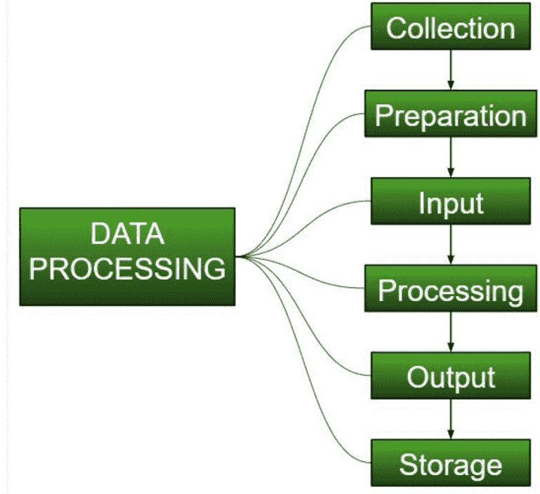

让我们详细看看每一步：

### 收集

开始使用机器学习时，最重要的一步是确保可用数据具有高质量。您可以从 Kaggle、data.gov.in 和 UCI 数据集存储库等真实来源收集数据。请看下面的例子，当学生准备参加竞争性考试时，他们总是找到最好的资源使用，以确保取得好成绩。同样，准确和高质量的数据将简化模型的学习过程。这意味着在测试时，模型会输出最佳结果。

数据收集涉及大量的时间、资金和资源。这意味着组织和研究人员必须选择他们想要实施或研究的正确数据类型。例如，从事面部表情识别需要大量具有不同人类表情的图像。良好的数据将确保模型的结果正确且真实。

### 准备

收集的数据可能是原始形式。原始数据不能直接输入机器。相反，必须先对数据进行处理。准备阶段涉及从广泛的来源收集数据、分析数据集，然后构建新的数据集以进行额外的处理和探索。准备可以手动或自动进行，数据应以数值形式准备，以提高模型的学习速度。

### 输入

有时，已经准备好的数据可能以机器无法读取的形式存在，在这种情况下，必须将其转换为可读形式。为了进行转换，需要特定的算法存在。

要执行此任务，需要密集的计算和准确性。请看下面的例子，您可以通过 MNIST、音频文件、推特评论和视频剪辑等来源收集数据。

### 处理

在此阶段，需要机器学习技术和算法来准确、更好地计算，执行针对大量数据生成的指令。

### 输出

在此阶段，机器以合理的方式获取结果，以便用户可以决定参考它。输出可以以视频、图形和报告的形式出现。

### 存储

这是最后的阶段，生成的输出、数据模型和任何其他重要信息都被保存以备将来使用。

### Python 中的数据处理

在探讨如何使用 Python 处理和分析数据之前，让我们先学习一些 Python 库。首先需要熟悉一些重要的库，并且你需要知道如何将它们导入到环境中。在 Python 中有多种实现方式。

你可以输入：

```python
import math as m
from math import *
```

在第一种方式中，你为 `math` 库定义了一个别名 `m`。然后，你可以通过使用别名 `m` 来引用并调用 `math` 库中的不同函数，例如 `factorial()`。

在第二种方法中，你导入了 `math` 中的整个命名空间。你可以选择直接应用 `factorial()` 而无需引用 `math`。

### 注意：

Google 推荐使用第一种导入库的方法，因为这有助于你分辨函数的来源。

下面的列表显示了你需要了解其函数来源的库。

- **NumPy**：代表 Numerical Python。NumPy 最先进的特性是 n 维数组。该库具有标准线性代数函数、高级随机数能力以及与其他低级编程语言集成工具。
- **SciPy**：是 Scientific Python 的缩写。SciPy 基于 NumPy 构建。它是用于各种高级科学和工程模块（如线性代数、稀疏矩阵和傅里叶变换）最重要的库之一。
- **Matplotlib**：当你需要绘制大量图表时，这是最佳选择。它涵盖了从折线图到热力图的各种图表，你可以应用 IPython notebook 中的 Pylab 功能以确保绘图结果内联显示。
- **Pandas**：最适用于结构化数据的操作和处理。它被广泛用于数据准备和数据挖掘。Pandas 最近被引入 Python，在增强 Python 在数据科学家社区的应用方面发挥了重要作用。
- **Scikit-learn**：专为机器学习而设计。它基于 `matplotlib`、`NumPy` 和 `SciPy` 构建。这个特定的库提供了许多用于机器学习和统计建模的高效工具，包括回归、分类、聚类和降维。
- **StatsModels**：该库专为统计建模而设计。`Statsmodels` 是一个 Python 模块，允许用户探索数据、近似统计模型并实施统计检验。

**其他库**

- **Requests**：用于访问 Web。
- **Blaze**：用于支持 NumPy 和 Pandas 的功能。
- **Bokeh**：用于在当前的 Web 浏览器上创建仪表板、交互式图表和数据应用。
- **Seaborn**：用于统计数据可视化。
- **Regular expressions**：用于发现文本数据中的模式。
- **NetworkX** 和 **igraph**：应用于图数据处理。

现在你已经熟悉了 Python 基础知识和关键库，让我们开始通过 Python 解决问题。

### 使用 Pandas 在 Python 中进行探索性分析

如果你还不知道，Pandas 是 Python 中一个重要的数据分析库。该库一直是提高 Python 在数据科学社区应用的关键。我们的示例使用 Pandas 从 Analytics Vidhya 竞赛中读取数据集，运行探索性分析，并创建第一个分类算法来解决这个问题。

在加载数据之前，了解 Pandas 中的两种主要数据结构非常重要，即 Series 和 DataFrames。

#### Series 和 DataFrames

你可以将 Series 视为一维有标签数组。这些标签帮助你通过标签来理解该 Series 中的单个元素。

DataFrame 类似于 Excel 工作簿，包含指代列的列名以及可以通过行号访问的行。最重要的一点是，列名和行号被称为列索引和行索引。

Series 和 DataFrames 构建了 Python 中 Pandas 的主要数据模型。首先，数据集必须从 DataFrames 中读取，然后可以轻松地对这些列执行不同的操作。

#### 练习数据集 – 贷款预测问题

以下是变量描述：

| 变量 | 描述 |
|---|---|
| Loan_ID | 唯一贷款 ID |
| Gender | 性别（男/女） |
| Married | 申请人是否结婚 (Y/N) |
| Dependents | 赡养人数 |
| Education | 申请人教育程度 (研究生/本科生) |
| Self_Employed | 是否自雇 (Y/N) |
| ApplicantIncome | 申请人收入 |
| CoapplicantIncome | 共同申请人收入 |
| LoanAmount | 贷款金额（以千为单位） |
| Loan_Amount_Term | 贷款期限（月） |
| Credit_History | 信用历史是否符合指南 |
| Property_Area | 地区（城市/半城市/农村） |
| Loan_Status | 贷款是否批准 (Y/N) |

首先，通过在终端输入以下命令，以 Inline Pylab 模式启动 iPython 界面：

```
ipython notebook --pylab-inline
```

## 导入库和数据集

本章将使用以下 Python 库：

- NumPy
- Matplotlib
- Pandas


导入库后，你可以继续使用`read_csv()`函数读取数据集。到此为止，代码如下所示：

```python
import pandas as pd
import numpy as np
import matplotlib.pyplot as plt
%matplotlib inline
#使用 Pandas 将数据集读取到 dataframe 中
df = pd.read_csv("/home/kunal/Downloads/Loan_Prediction/train.csv")
```

请注意，数据集存储在`/home/kunal/Downloads/Loan_Prediction/train.csv`中。

读取数据集后，你可以决定使用`head()`函数检查前几行。

接下来，你可以使用`describe()`函数检查数值字段的摘要。

## 分布分析

既然你已经熟悉了数据的基本特征，现在是时候观察不同变量的分布了。让我们从数值变量——`ApplicantIncome`（申请人收入）和`LoanAmount`（贷款金额）开始。

首先，输入以下命令绘制`ApplicantIncome`的直方图。

```python
df['ApplicantIncome'].hist(bins=50)
```

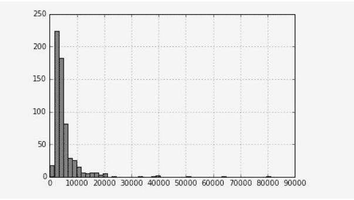

注意到存在一些极端值。这就是为什么需要 50 个 bin 才能清晰地表示分布。

接下来的关注点是箱线图。`ApplicantIncome`的箱线图绘制方法为：

```python
df.boxplot(column='ApplicantIncome')
```


就 Python 数据处理而言，这仅仅是冰山一角。

让我们看看：

### Python 中的数据预处理技术

以下是 Python 中数据预处理的最佳技术。

#### 数据重缩放 (Rescaling Data)

当你处理具有不同量级的数据时，需要对属性进行重缩放以使其具有相同的量级。属性被重缩放到 0 到 1 的范围内，这被称为归一化（normalization）。为了实现这一点，可以使用 Scikit-learn 中的`MinMaxScaler`类。请看以下示例：

```python
>>> import pandas, scipy, numpy
>>> from sklearn.preprocessing import MinMaxScaler
>>> df=pandas.read_csv('http://archive.ics.uci.edu/ml/machine-learning-databases/wine-quality/winequality-red.csv',sep=';')
>>> array = df.values
>>> #将数据分为输入和输出组件
>>> X=array[:,0:8]
>>> y=array[:,8]
>>> scaler=MinMaxScaler(feature_range=(0,1))
>>> rescaledX=scaler.fit_transform(X)
>>> numpy.set_printoptions(precision=3) #设置输出精度
>>> rescaledX[0:5,:]
>>> rescaledX[0:5,:]
array([[0.248, 0.397, 0.,    0.068, 0.107, 0.141, 0.099, 0.568],
       [0.283, 0.521, 0.,    0.116, 0.144, 0.338, 0.216, 0.494],
       [0.283, 0.438, 0.04,  0.096, 0.134, 0.197, 0.17,  0.509],
       [0.584, 0.11,  0.56,  0.068, 0.105, 0.225, 0.191, 0.582],
       [0.248, 0.397, 0.,    0.068, 0.107, 0.141, 0.099, 0.568]])
```

重缩放后，你将获得 0 到 1 之间的值。通过重缩放数据，可以确保神经网络、优化算法以及具有距离度量（如 k-最近邻）的算法能够有效运行。

#### 数据标准化 (Normalizing Data)

在接下来的任务中，你将把每个观察值重缩放到特定的长度 1。在这种情况下，你使用`Normalizer`类。示例代码如下：

```python
>>> from sklearn.preprocessing import Normalizer
>>> scaler=Normalizer().fit(X)
>>> normalizedX=scaler.transform(X)
>>> normalizedX[0:5,:]
```

```python
>>> normalizedX[0:5,:]
array([[2.024e-01, 1.914e-02, 0.000e+00, 5.196e-02, 2.079e-03, 3.008e-01,
        9.299e-01, 2.729e-02],
       [1.083e-01, 1.222e-02, 0.000e+00, 3.611e-02, 1.361e-03, 3.472e-01,
        9.306e-01, 1.385e-02],
       [1.377e-01, 1.342e-02, 7.061e-04, 4.060e-02, 1.624e-03, 2.648e-01,
        9.533e-01, 1.760e-02],
       [1.767e-01, 4.416e-03, 8.833e-03, 2.997e-02, 1.183e-03, 2.681e-01,
        9.464e-01, 1.574e-02],
       [2.024e-01, 1.914e-02, 0.000e+00, 5.196e-02, 2.079e-03, 3.008e-01,
        9.299e-01, 2.729e-02]])
```

#### 数据二值化

如果你使用二值阈值，可以将数据进行转换，使其高于阈值的值变为 1，而等于或低于阈值的值变为 0。对于此任务，你可以使用`Binarizer`类。

```python
>>> from sklearn.preprocessing import Binarizer
>>> binarizer=Binarizer(threshold=0.0).fit(x)
>>> binaryX=binarizer.transform(x)
>>> binaryX[0:5,:]
```

```python
>>> binaryX[0:5,:]
array([[1., 1., 0., 1., 1., 1., 1., 1.],
       [1., 1., 0., 1., 1., 1., 1., 1.],
       [1., 1., 1., 1., 1., 1., 1., 1.],
       [1., 1., 1., 1., 1., 1., 1., 1.],
       [1., 1., 0., 1., 1., 1., 1., 1.]])
```

如你所见，Python 代码会将所有等于或小于 0 的值标记为 0，其余值标记为 1。

#### 均值移除

在此步骤中，你从每个属性中移除均值，使其以零为中心。

#### 独热编码 (One Hot Encoding)

当你处理少量且分散的数值时，可能需要在执行独热编码之前先存储它们。对于 k 个不同的值，你可以将该特征转换为一个 k 维向量，其中只有一个值为 1，其余值均为 0。

```python
>>> from sklearn.preprocessing import OneHotEncoder
>>> encoder=OneHotEncoder()
>>> encoder.fit([[0,1,6,2],
[1,5,3,5],
[2,4,2,7],
[1,0,4,2]
]])
```

#### 标签编码 (Label Encoding)

标签有时可以是单词或数字。如果你想对训练数据进行标记，可以使用单词以提高可读性。标签编码将单词标签转换为数字，以便算法能够对其进行操作。以下是一个示例：

```python
>>> from sklearn.preprocessing import LabelEncoder
>>> label_encoder=LabelEncoder()
>>> input_classes=['Havells','Philips','Syska','Eveready','Lloyd']
>>> label_encoder.fit(input_classes)
```

### 使用 Python 函数绘制图表

NumPy 和 pandas 是数据整理（data wrangling）必不可少的工具。它们用户友好的接口和高性能的实现使得数据处理变得简单。尽管它们对数据集的洞察程度有限，但在整理、增强和清洗数据集方面绝对具有极高价值。掌握这些技巧将提高你可视化结果的质量。

尽管涵盖的统计概念非常基础，但它们对于通过信息丰富我们的可视化至关重要，而这些信息在大多数情况下在数据集中并不是直接提供的。这种实践经验将帮助你在接下来的章节中实现练习和活动。

这将为你提供理论知识，使你了解何时以及为什么使用特定的图表类型。它还将为后续章节奠定基础，这些章节将重点教你如何使用 Matplotlib 和 seaborn 来创建所讨论的图表。在涵盖了 Matplotlib 和 seaborn 的基础可视化技术之后，我们将深入探索交互式和动画图表的可能性，这将为我们的可视化引入故事讲述（storytelling）元素。

## 关于图表你应该了解的内容

- 针对给定的数据集和场景识别最佳的图表类型
- 解释某些图表的设计实践
- 设计出色且直观的可视化方案

我们将详细描述可视化并给出实际示例，例如比较不同股票随时间的变化或比较不同电影的评分。首先从比较图表开始（它们非常适合比较多个变量随时间的变化），我们将探讨其类型，如折线图、柱状图和雷达图。关系图（Relation plots）方便地显示变量之间的关系。我们将涵盖用于显示两个变量之间关系的散点图、三个变量的气泡图、变量对的相关图（correlograms），以及最后的热力图。

接下来将解释成分图（Composition plots），用于可视化作为整体一部分的变量，包括饼图、堆叠柱状图、堆叠面积图和韦恩图。为了更深入地了解变量的分布，可以使用分布图。作为分布图的一部分，我们将涵盖直方图、密度图、箱线图和小提琴图。最后，我们将讨论点图、连接图和分级色彩图（choropleth maps），这些可以归类为地理图（geo plots）。

## 比较图表

**比较图表**包括非常适合比较多个变量或变量随时间变化的图表。对于项目之间的比较，柱状图（也称为列图）是最佳选择。折线图非常适合可视化随时间变化的变量。对于特定的时间段（例如少于十个时间点），也可以使用垂直柱状图。雷达图或蜘蛛图非常适合可视化多个组的多个变量。

#### 折线图

**折线图**用于显示连续时间段内的定量值，并将信息作为一系列数据展示。折线图非常适合时间序列，其数据点由直线段连接。

数值位于 y 轴，而 x 轴为时间尺度。

#### 用途：

折线图非常适合比较多个变量，以及可视化单个或多个变量的趋势，特别是当你的数据集包含许多时间段（大约超过十个）时。

对于较短的时间段，垂直柱状图可能是更好的选择。

下图显示了二十年来房地产价格（单位：百万美元）的趋势。折线图非常适合展示数据趋势：


#### 单变量折线图

#### 示例：

下图是一个多变量折线图，比较了谷歌、脸书、苹果、亚马逊和微软的股票收盘价。折线图非常适合比较数值并可视化股票趋势。我们可以看到，亚马逊的增长最高：


图：显示五家公司股票趋势的折线图

**设计实践：**

- 避免在每张图表中绘制过多的线条

# 比较条形图

### 设计实践：

对应于数值变量的坐标轴应从零开始。从其他值开始可能会产生误导，因为它会使小的数值差异看起来像大的差异。

使用水平标签，即，只要条形数量较少且图表看起来不太杂乱即可。

#### 雷达图

**雷达图**，也称为**蜘蛛图**或**网络图**，用于可视化多个变量，每个变量绘制在自己的轴上，形成一个多边形。所有轴均呈放射状排列，从中心开始，彼此之间距离相等，并且具有相同的量程。

### 用途：

雷达图非常适合比较单个组或多个组的多个定量变量。

它们也有助于显示在数据集中哪些变量得分高或得分低，因此非常适合可视化性能表现。

### 示例：

下图显示了一个单变量的雷达图。此图展示了某学生在不同科目中得分的数据：


## 结论

感谢你阅读《Python编程初学者指南》的最后一章。希望你觉得本书信息丰富且有帮助。我们采取了所有措施来确保所有章节都为你提供详细且易于理解的信息。我有意在整本书中使用简单的语言，以确保你在阅读后能获得赋能。本书刻意避免了复杂的理论，坚持使用简单的解释，以便你在学习时可以随时运用。

一旦你理解了使用 Python 语言的编程基础，学习人工智能和机器学习等高级概念就会变得更容易。人工智能在日常生活中非常重要。本书带领你了解了许多 Python 编程概念，如数据分析、多态性、继承、列表、类、循环、对象、变量、方法等等。没有任何一种特定的方法可以让你在一夜之间学会面向对象编程。然而，如果你遵循正确的步骤并投入精力和专注，你将会获得你期望的结果。将多个实践环节融入你的日常，以提高你的 Python 编程技能。如果你与一位经验丰富的程序员一起工作，请遵循提供给你的所有指令，并在有不明白的地方提问。

下一步是停止阅读，开始将你在现实生活中学到的知识付诸实践。去做任何你认为必要的是去提高编程在现实生活中的应用。你会意识到，那些看似万事俱备的人大多缺乏基本的 Python 编程技能。尝试与他们交流，并教给他们你在这里学到的一两个知识点。你甚至可以向他们推荐或赠送这本书。

最后，如果你觉得本书对你有任何帮助，在亚马逊上留下好评将不胜感激！

# SQL编程终极初学者指南：

## 一份关于学习 SQL 数据库和服务器的智能分步指南。如何构建 SQL 的高级和精英水平。

## 引言

恭喜你下载了《SQL编程终极初学者指南：一份关于学习 SQL 数据库和服务器的智能分步指南。如何构建 SQL 的高级和精英水平》，并感谢你这样做。

接下来的章节将讨论“结构化查询语言（SQL）”的基本概念，以帮助希望学习和掌握这种用于“关系数据库管理系统”的分析语言的初学者。本书将为你提供高效有效地使用“SQL”从 SQL 数据库和服务器中检索和更新信息所需的一切知识，主要侧重于 MySQL 服务器，这是关系数据库管理领域备受推崇的接口之一。

在本书题为“SQL 和数据定义语言简介”的第一章中，你将首先概述数据库管理系统，以及不同类型的数据库管理系统及其优势。你将被介绍 SQL 语言和五种基本类型的 SQL 查询，即“数据定义语言（DDL）”、“数据操作语言（DML）”、“数据控制语言（DCL）”、“数据查询语言（DQL）”和“事务控制语言（TCL）”。本章还将为你提供构建 SQL 语法或查询的基本规则，这些规则涉及可由数据库服务器处理的和弦结构。你还将学习最常用的数据类型，这是学习 SQL 不可或缺的部分。我们将从“SQL CREATE”语句开始真正的编程语言学习，并在此基础上继续构建概念。与“SQL ALTER”语句一起使用的 SQL 约束的重要概念也将通过多个示例和实践练习进行详细解释。

在第二章“使用 SQL 创建数据库并维护数据完整性”中，你将被介绍“MySQL”，这是一个“免费且开源的关系数据库管理系统”。“MySQL”服务器提供了多种用户界面，包括“MySQL Workbench”、“phpMyAdmin”、“Adminer”、“ClusterControl”、“Database Workbench”、“DBeaver”、“DBeEdit”、“HeidiSQL”、“Sequel Pro”、“Toad”等；这些界面供任何希望在 MySQL 数据库服务器上执行 SQL 查询的人使用。你将一步步了解在你的操作系统上安装 MySQL 的过程。由于这是一个开放且免费的程序，你可以轻松地在你的系统上下载和安装它，以便充分利用本书以及其中包含的实践练习和示例，有效地学习 SQL 编程语言。你将学习如何在“MySQL”服务器上生成一个全新的数据库，然后创建表并插入数据到这些表中。你还将学习临时表、派生表的概念，以及如何根据数据库中已存在的表生成新表。

在第三章“SQL 连接和联合命令”中，你将被介绍“SQL SELECT”语句以及各种数据操作子句，包括“ORDER BY”、“WHERE”。SQL 连接的关键概念将被详细阐述，包括不同的“SQL JOIN”函数，如“INNER JOIN”、“LEFT JOIN”、“RIGHT JOIN”、“CROSS JOIN”和“SELF JOIN”。这些子句的语法将通过示例和结果集的图片进行极其详细的解释，这些是你可以在自己的 MySQL 实例上执行示例时预期获得的结果。这样做是为了增进你的理解，并允许你对 SQL 编程语言进行实践。在本章中，你还将学习“SQL union”函数，该函数用于将多个输出汇总为一个综合的结果集。将详细展示“MySQL UNION”和“MySQL UNION ALL”语句，并区分 MySQL 连接和联合函数。


在第四章“SQL视图和事务”中，你将学习SQL中“数据库视图”的概念，它简单来说就是一个使用带有“SQL JOIN”子句的“SQL SELECT”语句定义的虚拟表。使用“数据库视图”或“SQL视图”有多种优势，如本章所述。将解释“CREATE VIEW”语句以及MySQL中使用的底层处理算法，例如“MERGE”、“TEMPTABLE”和“UNDEFINED”。你还将学习如何从另一个现有视图创建视图，该视图可能包含也可能不包含子查询。“可更新SQL视图”的概念也将通过示例和实践练习进行解释，以便你学习如何使用“ALTER VIEW”和“CREATE OR REPLACE VIEW”语句修改SQL视图。在SQL中，事务被定义为“针对数据库执行的工作单位”。本章包含SQL事务的不同属性以及各种SQL事务语句，如“START TRANSACTION”、“COMMIT”、“ROLLBACK”等控制子句。此处还解释了另一个重要概念——数据库恢复模型，包括不同类型的恢复模型和“SQL BACKUP”语句。正如你将在本书中学到的，故障时恢复数据库的过程对于维护宝贵数据可能至关重要。

最后一章“数据库安全和管理”将主要关注用户访问权限，以管理MySQL服务器上的数据并确保其安全。你将获得关于如何创建新用户帐户、根据需要更新用户密码、授予和撤销访问权限以确保只有获得许可的用户才能授权访问数据库的分步指导。

市场上有很多关于这个主题的书，再次感谢你选择这一本！我们已尽力确保它包含尽可能多的有用信息，请尽情阅读吧。

## 第一章：SQL 与数据定义语言简介

数据库可以定义为“信息或数据的有序集合，可以电子形式存储在计算机系统上，并可根据需要访问”。数据库管理系统（DBMS）被定义为“一种与终端用户、应用程序以及数据库本身交互以捕获和分析数据的软件”。“DBMS”是一个集成的计算机软件包，使用户能够与多个数据库通信，并提供对存储在数据库中的信息的访问。DBMS提供了多种功能，允许输入、存储和检索大量数据，并提供管理数据组织方式的方法。考虑到这种紧密关联，“数据库”一词常被同时用来指代数据库本身以及“DBMS”。

现有的DBMS提供了多种功能来管理和分类数据库及其信息，主要分为以下四个功能组：

- **数据定义** – 创建、修改和删除代表数据组织的定义。
- **更新** – 插入、修改和删除实际数据。
- **检索** – 以可直接使用或可由其他应用程序进一步处理的形式提供数据。收集到的数据可以以与数据库中相同的形式访问，也可以通过不同形式访问，这种形式是通过更改或组合来自不同数据库的数据集而获得的。
- **管理** – 用户注册和跟踪、数据安全执行、性能跟踪、数据完整性、权限控制以及从特定事件（例如系统意外故障）中恢复损坏的数据。

数据库及其DBMS遵循给定的模型数据库。“数据库系统”可以定义为数据库、DBMS和数据库模型的集合。

数据库服务器是物理连接的计算机，仅运行DBMS及相关软件，承载真实的数据库。具有大容量内存和用于数据长期存储的“RAID磁盘阵列”的多处理器机器被称为“数据库服务器”。如果其中一个磁盘发生故障，可以使用RAID来恢复数据。在重事务处理环境中，通过高速通道连接到单个或多个服务器的“硬件数据库加速器”正在被使用。大多数数据库应用程序的核心是DBMS。DBMS可以围绕自定义多任务内核创建，内置网络支持，但现代DBMS通常使用标准操作系统来提供相同的功能。

由于DBMS代表了一个重要的市场，计算机和存储供应商在自身的产品规划中通常会考虑DBMS的要求。

“数据库”和“DBMS”可以根据以下参数进行分组：

- 支持的数据库模型，例如关系型或XML数据库。
- 可以在其上运行的计算机种类，例如“从服务器集群到移动设备”。
- 使用的查询语言，例如“SQL”或“XQuery”。
- 驱动系统效率、可扩展性、弹性和安全性的“内部工程”。

本书我们将主要关注关系数据库，这涉及到SQL语言。在20世纪70年代初，“IBM”开始根据名为埃德加·科德的计算机科学家的想法开发一个原型模型，称为“System R”。第一个版本在1974年和1975年推出，随后进行了多表系统的工作，允许拆分数据，以避免将所有数据作为单个大块存储在单个记录中。客户在1978年和1979年测试了后续的多用户版本，此后一种名为“SQL”的标准化查询语言被添加到数据库中。科德的概念迫使“IBM”创建了“System R”的真实版本，称为“SQL / DS”，随后是“Database 2 (DB2)”。

拉里·埃里森开发的“Oracle数据库”始于一个基于“IBM”在“System R”上发表的工作的独立链条。尽管“Oracle V1”的实现于1978年完成，但埃里森在1979年发布了“Oracle Version 2”之后，才成功在市场上超越了“IBM”。

为了进一步开发新的数据库“Postgres”，现在称为“PostgreSQL”，斯通布雷克使用了“INGRES类”。“PostgreSQL”被广泛用于全球关键任务应用。‘.org’和‘.info’域名的注册主要使用“PostgreSQL”进行数据存储，许多大企业和金融机构也这样做。瑞典“乌普萨拉大学”的计算机程序员也受到科德工作的启发，在20世纪70年代中期开发了“Mimer SQL”。1984年，该项目过渡为一家独立公司。

1976年，“实体关系模型”被开发出来，并在数据库设计中变得非常流行，因为它比之前的“关系模型”产生了相对更好的描述。随后，实体关系结构被重建为“关系模型的数据建模构造”，两者之间的区别变得微不足道。

“关系数据库”由一组可以映射到预定类别的表组成。“每列至少有一个数据类别，每行在列定义的类别中有一定的数据实例”。关系数据库有多个名称，例如“关系数据库管理系统（RDBMS）”或“SQL数据库”。“Microsoft SQL Server”、“Oracle Database”、“MySQL”和“IBM DB2”历史上是最受欢迎的关系数据库。“关系数据库”主要用于大型企业环境，但“MySQL”例外，它也可以用于基于Web的数据存储。

所有关系数据库都可用于管理“面向事务的应用程序（OLTP）”。另一方面，大多数分类为“文档存储”和“列存储”的非关系数据库也可能用于OLTP，从而导致两者之间的混淆。OLTP数据库可以被认为是“操作型”数据库，其特点是常规快速事务，包括数据更新、少量数据以及同时处理成百上千个事务，例如在线预订和银行应用程序。

### 数据库管理系统的优势

数据库管理系统（DBMS）被描述为“使用户能够识别、开发、维护和控制对数据库访问的软件系统”。DBMS允许最终用户在数据库中创建信息，以及读取、编辑和删除所需数据。它可以被看作是信息和使用该数据的程序之间的一层。

与“基于文件的数据管理系统”相比，DBMS提供了若干优势。其中一些优点如下所列：

**降低数据冗余** - “基于文件的DBMS”包含存储在系统上多个位置甚至跨多个系统的多个文件。因此，同一文件的多个副本通常会导致数据冗余。在数据库中这很容易避免，因为只有一个数据库持有所有数据，并且对数据库所做的任何修改都会立即在整个系统中反映出来。因此，数据库中不可能存在重复信息。

**无缝数据共享** - 用户可以与数据库中找到的所有现有数据共享。数据库中存在不同的授权级别，用于选择性地访问信息。因此，不遵循适当的授权协议就无法共享信息。多个远程用户可以同时访问数据库，并根据需要共享所需信息。

#### 数据完整性

- 数据的完整性意味着数据库中的信息是可靠和准确的。数据的完整性非常关键，因为DBMS包含多个数据库。所有这些数据库中包含的信息都对所有用户开放。因此，必须确保所有数据库和客户随时都能获得正确和一致的数据。

#### 数据安全

- 数据安全对于创建和维护数据库至关重要。只有授权用户才能通过使用有效的用户名和密码进行身份验证来访问数据库。在任何情况下，未经授权的用户都不能被允许访问数据库，因为这违反了数据完整性规则。

#### 隐私

- 数据库中的“隐私规则”规定，只有授权用户才能根据数据库的预定义隐私约束访问数据库。存在多个数据库访问级别，只有允许的数据才能被用户查看。例如，社交网络站点上用户可能想要访问的帐户的各种访问限制。

#### 备份和恢复

- DBMS能够生成数据库的自动备份和恢复。因此，用户不需要定期备份数据，因为DBMS可以有效地处理这个问题。此外，如果发生技术错误或系统故障，它还将数据库恢复到其先前状态。

#### 数据一致性

- 在数据库中，由于没有任何冗余数据，数据的一致性得到保证。整个数据库一致地包含所有数据，所有访问数据库的用户都会接收到相同的数据。此外，对数据库会即时通知所有用户，以避免现有数据出现任何不一致。

### 结构化查询语言

在关系数据库的语境下，“结构化查询语言（SQL）”被视为标准的用户和应用程序程序接口。1986年，“SQL”成为“美国国家标准协会（ANSI）”的标准，1987年又被纳入“国际标准化组织（ISO）”。此后，该标准不断改进，并得到所有主流商业关系数据库管理系统（RDBMS）的认可（合规程度各有不同）。

对于关系模型而言，尽管根据科德的观点，SQL在某些方面与关系结构有所不同，但它是最早的商业语言之一。例如，SQL允许按行和列组织数据。关系数据库具有高度的可扩展性。在初始数据库创建之后，可以轻松引入新的数据类别，而无需修改任何现有应用程序。

## SQL查询类型

数据库语言被定义为“专用语言”，能够执行下表中列出的一项或多项任务，通常被称为“子语言”：

**“数据定义语言（DDL）”** – 用于定义数据类型，包括其创建、修改或删除，以及它们之间的关系。（在本章的学习过程中，你将了解更多关于此主题的内容）

**“数据操作语言（DML）”** – 只有在使用DDL命令创建数据库和构建表之后，才能使用DML命令来操作这些表和数据库中的数据。使用DML命令的便利之处在于，如果对数据或其值进行了错误修改，可以方便地更改和回滚。用于执行特定任务的DML命令包括：

- “**Insert**” – 用于向表中插入新行。
- “**Update**” – 用于修改表中行包含的数据值。
- “**Deletion**” – 用于删除数据库中选定的行或整个表。
- “**Lock**” – 用于定义用户的“只读”或“读写”访问权限。
- “**Merge**” – 用于合并表中的若干行。
- “**数据控制语言（DCL）**” – 顾名思义，DCL命令涉及数据库中的某些数据控制问题。DCL命令为用户提供唯一的数据库访问权限，也用于定义适用的用户角色。常用的DCL命令有两个：
  - “**Grant**” – 用于向用户授予访问权限。
  - “**Revoke**” – 用于撤销授予用户的访问权限。
- “**数据查询语言（DQL）**” – DQL包含一条命令，用于在SQL中进行数据选择。与其他SQL子句结合使用时，“SELECT”命令用于根据选定的用户条件从数据库或表中收集和检索数据。“SELECT”语句用于搜索数据以及从表和/或数据库中计算派生信息。
- “**事务控制语言（TCL）**” – 顾名思义，TCL管理数据库中与事务相关的问题。它们用于将修改恢复到原始数据库状态或确认修改。

回滚意味着“撤销”修改，提交意味着“应用”修改。可用的3个主要TCL命令包括：

- “**Rollback**” – 用于“取消或撤销”对表或数据库进行的任何更新。
- “**Commit**” – 用于“部署、应用或保存”对表或数据库进行的任何更新。
- “**Savepoint**” – 用于临时“保存”表或数据库中的数据。

“数据库语言”仅限于特定的数据模型。以下是一些示例：

- “SQL” – 它将数据定义、数据操作和查询功能集成为一种统一的语言。
- “OQL” – 它是由“对象数据管理组制定的对象模型语言标准”。该语言启发了一些现代查询语言的开发，如“JDOQL”和“EJBQL”。
- “Xquery” – 它是一种“标准XML查询语言”，由“XML数据库技术（如MarkLogic和eXist）、具备XML功能的关系数据库（如Oracle和DB2）以及内存XML处理器（如Saxon）”引入。
- “SQL / XML” – 它是“SQL”和“Xquery”的结合。

## SQL语法

下图展示了“SQL查询”最常见的语法（服务器可理解的代码结构）。在我们开始学习可实际执行的SQL命令之前，以下是一些你必须首先牢记的基本规则：

每条命令的末尾必须使用“分号”。

每条命令的开头必须使用“关键字”。随着本书的学习深入，你将掌握所有关键字。

命令中的字母大小写无关紧要。

你必须记住创建时使用的表和数据库的名称或标题，并确保在所有命令中始终使用这些特定名称。

## SQL数据类型

学习SQL的另一个重要概念是可以用于“定义特定列中可输入的数据值类型”的各种数据类型。常用的数据类型如下表所示：

| 数据类型 | 描述 |
|---|---|
| “char(size)” | 用于定义“固定长度字符串”。数据值的大小可在括号中指定所需数字，如所示。最大允许大小为“255个字符”。 |
| “varchar(size)” | 用于定义“可变长度字符串”。数据值的大小可在括号中指定所需数字，如所示。最大允许大小为“255个字符”。 |
| “number(size)” | 用于定义具有指定括号中值的“数值”。列中最大位数可在括号中指定所需数字，如所示。 |
| “date” | 用于定义相关列的“日期值”。 |
| “number(size, d)” | 用于定义具有指定括号中值的“数值”。列中最大位数可在括号中指定所需数字，同时指定小数点右侧的位数“d”，如所示。 |

### 数据定义语言（DDL）

随着“Codasyl数据库模型”的引入，“数据定义语言”这一术语被创造出来。DDL的概念要求数据库模式以描述“用户数据模型的记录、字段和集合”的语法来开发。随后，DDL被认为是“SQL”的子集，用于声明表、列、数据类型和约束。SQL的第三个主要修订版“SQL-92”为“模式操作语言和用于查询模式的模式信息表”奠定了基础。在“SQL-2003”中，数据表被描述为“SQL/Schemata”。

DDL可用于对给定数据库中所需表的物理结构进行创建或修改。所有此类命令在执行时会自动提交，对表的所有修改会立即反映并存储到整个数据库中。以下是最知名且广泛使用的DDL命令：

- **“Create”** – 用于创建新表或整个数据库。
- **“Alter”** – 用于修改表中已存在的行的数据值。
- **“Rename”** – 用于重命名表或数据库。
- **“Drop”** – 用于从数据库中删除表。
- **“Truncate”** – 用于从数据库中删除整个表。

现在，我们将探索这些DDL命令的各种用途以执行所需操作。为便于学习，所有固定代码或关键字将以大写字母书写，以便你轻松区分虚拟数据和命令语法。

## SQL “CREATE”命令

*用法* – 顾名思义，“CREATE”命令主要用于创建数据库和表。这始终是学习SQL的第一步。

**语法：**

> “CREATE DATABASE *database_name*;”

> “CREATE TABLE *table_name*;”

> “CREATE TABLE *table_name* (*column1 datatype*, *column2 datatype*, *column3 datatype*,….,);”

**示例：**

假设你想创建一个名为“database_football”的数据库，其中包含一个用于存储以下详情的表：

分别叫作“team_details”和“player_details”，前者用于存储球队详情，后者用于存储球员详情。

第一步是使用下面的命令创建目标数据库：

```sql
CREATE DATABASE database_football;
```

现在数据库已经在系统中创建好了，你可以使用下面的命令创建所需的表：

```sql
CREATE TABLE team_details;
```

```sql
CREATE TABLE player_details;
```

如果你想创建“player_details”表，并包含以下列：“player_firstname”，列大小为15；“player_lastname”，列大小为25；以及“player_age”。你可以使用下面的命令：

```sql
CREATE TABLE player_details (player_firstname varchar (15), player_lastname varchar (25), player_age int);
```

> ***请记住，可以在语句中指定“varchar”数据类型的大小，最大为“255个字符”；如果未指定列大小，系统将“默认”使用最大尺寸***

## 实践练习

为了练习，假设你是一位新创业的企业主，正在招聘员工。首先，你需要为公司创建数据库，假设你的公司名叫“Fit Life”，创建一个名为“database_FitLife”的数据库。然后添加一个名为“New_Employees”的表，包含以下列以存储员工的“名字”、“姓氏”、“职位”、“年龄”和“薪资”。

**请自行判断，先写出你的SQL语句！**

现在你可以对照下面的正确命令来验证你的语句：

```sql
CREATE DATABASE database_FitLife;
```

```sql
CREATE TABLE New_Employees (employee_firstname varchar, employee_lastname varchar, employee_jobtitle varchar, employee_age int, employee_salary int);
```

#### SQL “ALTER” 命令

**用途** – 该命令主要用于“添加列、删除列、添加不同的数据约束以及删除预定义的数据约束”。

**数据约束** – 在SQL中，“约束”就是对表中数据应用的特定规则。它们可以在“列级别”应用，即仅适用于选定的列；也可以在“表级别”应用，即适用于表中的所有列。它们“限制”允许添加到表中的数据值类型，以确保表中数据的准确性和可靠性。违反这些约束将导致你尝试执行的命令中止。

数据约束可以在创建表时添加（使用“CREATE”命令），也可以在表创建后添加（使用“ALTER”命令）。

最常用的SQL约束包括：


- **“NOT NULL”** – 用于确保列始终包含值，不持有“NULL值”。这意味着，如果未向该列添加值，则无法添加新记录，也无法修改已存在的记录。

- **“UNIQUE”** - 该约束用于确保列中的每个数据值都彼此不同。

- **“PRIMARY KEY”** - 该约束本质上是“NOT NULL和UNIQUE约束的组合”。它为表中的每条记录提供一个唯一标识，且该标识必须包含数据值。每个表只能指定一个“主键”。

- **“FOREIGN KEY”** - 该约束作为存在于另一张表中且已链接到你正在操作的表中的记录/行的唯一标识。这有助于中止会破坏两个表之间关联的命令，即无法向“外键”列添加无效数据，因为该值必须是包含该特定列的表中所存在的值。

- **“CHECK”** - 该约束用于确保列中的所有数据值都满足特定条件，并限制在预定义的值范围内。在列上应用“Check”约束将只允许向该列添加特定值。然而，在表上应用“Check”约束将根据行中其他列定义的值，限制可以添加到特定列中的值。

- **“DEFAULT”** – 用于为特定列设置“默认数据值”，以防未为该列指定其他值。

## 步骤 1

```sql
CREATE TABLE Current_Employees (employee_firstname varchar, employee_lastname varchar, employee_jobtitle varchar, employee_age int, employee_salary int);
```

## 步骤 2

```sql
ALTER TABLE New_Employees
ADD employee_ID number;
```

## 步骤 3

```sql
ALTER TABLE New_Employees
DROP employee_salary;
```

## 步骤 4

```sql
ALTER TABLE New_Employees
ADD PRIMARY KEY employee_ID;
```

## 步骤 5

```sql
ALTER TABLE Current_Employees
ADD FOREIGN KEY (employee_ID) REFERENCES New_Employees (employee_ID);
```

## 步骤 6

```sql
ALTER TABLE New_Employees
MODIFY employee_firstname varchar NOT NULL;
```

## 步骤 7

```sql
ALTER TABLE New_Employees
ADD UNIQUE employee_lastname;
```

## 步骤 8

```sql
ALTER TABLE New_Employees
ADD CHECK (employee_age <= 21);
```

## 步骤 9

```sql
ALTER TABLE New_Employees
ADD CONSTRAINT (employee_age) DEFAULT '21' FOR (employee_age);
```

## 步骤 10

```sql
CREATE INDEX idx_name
ON New_Employees (employee_lastname);
```

**完成啦！** 现在你的任务是删除所有这些约束，然后将薪资列重新添加到 `New_Employees` 表中。

**请自行发挥，先编写你的 SQL 语句！**

现在你可以对照下面给出的正确命令来验证你的语句：

## 步骤 1

```sql
ALTER TABLE New_Employees
DROP PRIMARY KEY;
```

## 步骤 2

```sql
ALTER TABLE Current_Employees
DROP FOREIGN KEY (employee_ID);
```

## 步骤 3

```sql
ALTER TABLE New_Employees
DROP CONSTRAINT employee_firstname;
```

## 步骤 4

```sql
ALTER TABLE New_Employees
DROP CONSTRAINT employee_lastname;
```

## 步骤 5

```sql
ALTER TABLE New_Employees
DROP CHECK (employee_age);
```

## 步骤 6

```sql
ALTER TABLE New_Employees
ALTER COLUMN employee_age DROP DEFAULT;
```

## 步骤 7

```sql
DROP INDEX New_Employees.idx_name;
```

## 步骤 8

```sql
ALTER TABLE New_Employees
ADD employee_salary number;
```

#### SQL “DROP DATABASE” 命令

**用途** – 该命令主要用于删除已存在的 SQL 数据库。

**语法：**

```sql
DROP DATABASE database_name;
```

**示例：**

假设你出于某些业务原因，比如数据库中存在无关数据或重复数据库等，想要删除数据库 `database_football`。

你只需使用下面的命令，整个数据库就会从系统中被清除。

```sql
DROP DATABASE database_football;
```

# 动手练习

为了练习，假设你的公司 `Fit Life` 已经倒闭或更名，你需要丢弃所有与该公司相关的可用数据。你会怎么做？

**请自行发挥，先编写你的 SQL 语句！**

现在你可以对照下面给出的正确命令来验证你的语句：

```sql
DROP DATABASE database_FitLife;
```

#### SQL “CREATE VIEW” 命令

**用途** – 该命令主要用于根据 SQL 命令的“结果集”在数据库中生成“表的虚拟视图”。视图类似于实际的数据库表，它同样拥有列和行，但可以使用 SQL 函数 `WHERE` 和 `JOIN` 从数据库中的单个或多个表调用数据值。“SQL 视图”用于增强数据的结构，使其更加用户友好。

在 SQL 中，`WHERE` 函数用于根据特定条件选择性地过滤数据或记录。它是一个功能非常强大的函数，也可以与其他 SQL 语句（包括 `UPDATE` 和 `DELETE`）一起使用。只有最新和最完整的数据将用于生成视图！

**语法：**

```sql
CREATE VIEW view_name AS
SELECT column1, column2, ...
FROM table_name
WHERE condition;
```

**示例：**

让我们回到数据库 `database_football`，假设你想查看 25 岁球员的详细信息。你只需使用下面的命令即可查看所需信息。

```sql
CREATE VIEW young_players AS
SELECT player_firstname, player_lastname
FROM player_details
WHERE player_age = '25';
```

# 动手练习

为了练习，假设你的公司 `Fit Life` 正在经历组织变革，你想查看所有职位为 `managers`（经理）的员工列表。

**请自行发挥，先编写你的 SQL 语句！**

现在你可以对照下面给出的正确命令来验证你的语句：

```sql
CREATE VIEW employee_managers AS
SELECT employee_firstname, employee_lastname
FROM Current_Employees
WHERE employee_jobtitle = 'manager';
```

## 第 2 章：使用 SQL 创建数据库并维护数据完整性

`MySQL` 一直是广受欢迎的“免费开源基于 SQL 的关系数据库管理系统（RDBMS）”。1995 年，一家名为 `MySQL AB` 的瑞典公司最初开发、营销并授权了 MySQL 数据管理系统，后来被 `Sun Microsystems`（现称 `Oracle Co.`）收购。MySQL 是“LAMP 软件栈 Web 应用组件，即 Linux、Apache、MySQL、Perl / PHP / Python 的缩写”。多个数据库驱动的 Web 应用程序，包括 `Drupal`、`Joomla`、`PhpBB` 和 `WordPress`，都在使用 `MySQL`。它是 RDBMS 中创建各类在线软件应用的最佳应用程序之一，已被用于开发多个知名网站，包括 `Facebook`、`YouTube`、`Twitter` 和 `Flickr`。

MySQL 使用了 `C` 和 `C++` 两种语言开发。MySQL 可以在多种系统上运行，包括 `AIX、BSDi、FreeBSD、HP-UX、eComStation、i5/OS、IRIX、Linux、macOS、Microsoft Windows、NetBSD、Novell NetWare、Open Solaris、OS/2 Warp、QNX、Oracle Solaris、Symbian、SunOS、SCO Open Server、SCO UnixWare、Sanos 和 Tru64`。其 SQL 解析器使用 `yacc` 开发，并利用内部开发的“词法分析器”。还开发了用于 `OpenVMS` 的 MySQL 移植版本。`MySQL 服务器`及其`客户端库`采用双许可证分发方式，可在 `GPL 版本 2`或专有许可证下获取。额外的免费协助可在各种 IRC 博客和频道上获得。Oracle 还通过其 `MySQL 企业版产品`为其软件提供付费支持服务。服务范围和价格各不相同。包括 `MariaDB` 和 `Percona` 在内的多家第三方服务提供商也提供协助和设施。

MySQL 获得了开发者社区的高度好评，评审者注意到它在大多数情况下表现非常出色。开发者接口齐全，并且拥有大量优秀的支持文档，以及来自真实世界网站的反馈。`MySQL` 也成功通过了“快速、稳定且真正的多用户、多线程 SQL 数据库服务器”的测试。

`MySQL` 有两个不同的版本：`MySQL Community Server`（社区版，开源）和 `Enterprise Server`（企业版，专有）。`MySQL Enterprise Server` 通过一系列专有扩展来区分自身，这些扩展可以作为“服务器插件”安装，但仍然共享相同的版本编号方案，并使用相同的基础代码开发。

以下是 `MySQL v5.6` 提供的一些关键特性：

- `ANSI SQL 99 的广泛子集以及扩展。`
- `跨平台支持。`
- `存储过程，使用与 SQL/PSM 紧密遵循的过程化语言。`
- `触发器`；`游标`；`可更新视图`；`SSL 支持`；`查询缓存`；`子查询（即嵌套 SELECT）`；`内置复制支持`；`信息模式`。
- `使用 InnoDB 存储引擎时的在线数据定义语言（DDL）。`
- `性能模式，用于收集和聚合服务器执行和查询性能的统计数据，以供监控使用。`
- `一组用于控制运行时行为的 SQL 模式选项，包括严格模式以更好地遵循 SQL 标准。`
- `X/Open XA 分布式事务处理（DTP）支持；作为其中的一部分，使用默认的 InnoDB 存储引擎进行两阶段提交。`
- `使用默认 InnoDB 存储引擎时的带保存点的事务。``NDB 集群存储引擎也支持`
- `使用 InnoDB 和 NDB Cluster 存储引擎时的 ACID 合规性。`
- `异步复制：从一个主节点到多个从节点的主从复制，或从多个主节点到一个从节点的复制。`
- `半同步复制：主节点到从节点的复制，主节点会等待复制完成。`
- `同步复制：MySQL Cluster 提供多主复制。`
- `虚拟同步：可使用 Galera Cluster 或内置的 Group Replication 插件实现具有多主支持的自管理 MySQL 服务器组。`
- `全文索引和搜索`；`嵌入式数据库库`；`Unicode 支持`。
- `支持分区表，并在优化器中进行分区裁剪。`
- `通过 MySQL Cluster 实现无共享集群。`
- `多种存储引擎，允许为应用中的每张表选择最有效的存储引擎。`
- `原生存储引擎包括 InnoDB、MyISAM、Merge、Memory (heap)、Federated、Archive、CSV、Blackhole、NDB Cluster。`
- `提交合并，将来自多个连接的多个事务聚集在一起，以提高每秒的提交次数。`

### MySQL 的用户界面

图形用户界面（GUI）可以定义为“一种允许用户通过图形图标和可视化指示器（如辅助标记）与电子设备或程序交互的界面类型，区别于基于文本的界面、键入的命令标签或文本导航”。与需要通过键盘输入命令的“命令行界面（CLI）”相比，`GUI`通常更容易学习。`MySQL`提供了多种可供利用的界面，以最好地满足你的需求。一些广受欢迎的`MySQL 界面`包括：

#### MySQL Workbench

MySQL Workbench 是`MySQL 数据库的官方内置环境`。它由`MySQL AB`创建，允许用户以图形方式管理 MySQL 数据库，并以可视化方式设计数据库。它取代了作为先前软件套件的`MySQL GUI Tools`。`MySQL Workbench`使用户能够进行数据库设计和模型创建、`SQL 实现`（取代`MySQL Query Browser`）以及`数据库管理`（取代`MySQL Administrator`）。这些功能也可从其他第三方应用程序获得，但`MySQL Workbench`仍被视为 MySQL 的官方前端。`MySQL Workbench`可从 MySQL 官方网站下载，提供两个独立版本：一个常规的`免费开源社区`版本，以及一个`专有标准`版本，后者持续扩展和增强社区版本的功能集。

#### phpMyAdmin

PhpMyAdmin 是“一个用 PHP 编程语言开发的免费开源应用程序，允许使用 Web 浏览器管理 MySQL 管理工作”。它允许通过运行 SQL 查询来执行多种功能，如生成、修改或删除数据库、表、字段或行，以及管理用户和权限。phpMyAdmin 支持多达 78 种不同的语言，易于访问，由`The phpMyAdmin Project`管理。数据可以从`CSV`和`SQL`导入，并通过一组预定义功能导出，将存储的数据转换为所需的格式，例如“将 BLOB 数据表示为图片或下载链接”。

#### Adminer

Adminer（先前称为`phpMinAdmin`）是另一个“免费开源的 MySQL 前端，用于维护 MySQL 数据库中的信息”。自第 2 版发布起，`Adminer`还可用于`PostgreSQL`、`SQLite`和`Oracle`数据库。`Adminer`可用于管理多个数据库，支持多种易于获取的`CSS 主题`。它以单个`PHP 文件`的形式，在`Apache License`或`GPL v2`许可下提供。Jakub Vrána 于 2007 年 7 月开始开发`Adminer`，作为原始`phpMyAdmin`应用程序的轻量级替代方案。

#### ClusterControl

ClusterControl 被定义为“一种端到端的 MySQL 管理系统或 GUI，用于从单一界面管理、监控、扩展和部署各版本的 MySQL”。它由`Severalnines`设计开发。`ClusterControl 社区版本`可免费访问，允许用户直接部署和跟踪 MySQL 实例。高级功能如负载均衡、备份和恢复等为付费附加功能。

#### Database Workbench

`Database Workbench`应用程序由`Upscene Productions`创建，用于使用 SQL 创建和管理各种可在不同数据库系统间互操作的关系型数据库。`Databases Workbench`支持多种数据库系统，为计算机程序员提供具有相似界面和生产环境的跨数据库工具，适用于各种数据库。`Database Workbench`可支持的关系型数据库包括：`Oracle Database、Microsoft SQL Server、SQL Anywhere、Firebird、NexusDB、InterBase、MySQL 和 MariaDB`。`Database Workbench 5`可在`32 位或 64 位`的 Windows 系统上运行，也可通过`Wine`应用程序在`Linux、FreeBSD 或 MacOS`操作系统上运行。

#### DBeaver


DBeaver 是一款在 `Apache License 2.0` 下发布的开源免费软件应用程序，用作数据库管理工具和 SQL 客户端，源代码托管在 GitHub 上。DBeaver 广泛支持以下数据库：`MySQL` 和 `MariaDB`、`PostgreSQL`、`Oracle`、`DB2 (LUW)`、`Exasol`、`SQL Server`、`Sybase`、`Firebird`、`Teradata`、`Vertica`、`Apache Phoenix`、`Netezza`、`Informix`、`H2`、`SQLite` 以及任何其他 JDBC 或 ODBC 驱动数据库。

#### DBEdit

DBEdit 是一款数据库编辑器，可以连接到 `Oracle`、`DB2`、`MySQL` 以及任何提供 JDBC 驱动程序的数据库，其源代码托管在 SourceForge 上。它也被定义为一款在 GNU General Public License 下分发的免费开源软件。适用于 Windows、Linux 和 Solaris 系统。

#### HeidiSQL

HeidiSQL 早期称为 `MySQL-Front`，是另一个免费开源应用程序，作为 `MySQL` 的前端，可与 `MariaDB`、`Percona Server`、`Microsoft SQL Server` 和 `PostgreSQL` 配合使用。德国计算机科学家 Ansgar Becker 和 `Delphi` 的多位贡献者共同开发了 `HeidiSQL` 界面。

要操作 `HeidiSQL` 数据库，用户需要使用有效凭据登录并与本地或远程的 `MySQL` 服务器创建会话。此会话使用户能够连接并管理 `MySQL 服务器`上的 `MySQL 数据库`，并在完成任务后断开与服务器的连接。`HeidiSQL` 的功能集适用于大多数与数据库、表和数据记录相关的常用和复杂操作，但它仍在积极发展，以实现 MySQL 用户界面所需的完整功能。

#### LibreOffice Base

LibreOffice Base 能够创建和管理数据库，准备表单和报表，为最终用户提供简单的信息访问。它也可作为不同数据库系统的接口，如 `Microsoft Access`，包括 `Access 数据库（JET）`、`ODBC 信息源`，以及 `MySQL` 或 `PostgreSQL`。

#### Navicat

Navicat 是由 PremiumSoft CyberTech Ltd 制造的用于 `MySQL`、`MariaDB`、`Oracle`、`SQLite`、`PostgreSQL` 和 `Microsoft SQL Server` 的一系列图形化数据库管理和开发软件。它拥有类似 `Microsoft Internet Explorer` 的图形用户界面，并支持多种本地和远程数据库连接。

它的设计旨在满足从数据库管理员和开发人员到服务公众并与合作伙伴公司共享数据的各种企业的需求。`Navicat` 是一款跨平台软件，可在 `Microsoft Windows`、`OS X` 和 `Linux` 等系统上运行。软件购买后，用户可从可用的八种语言中选择一种使用，包括：`English`、`French`、`German`、`Japanese`、`Polish`、`Simplified Chinese` 和 `Traditional Chinese`。

#### Sequel Pro

Sequel Pro 也是一款免费开源的 `Macintosh` 操作系统软件，可本地或远程操作 `MySQL 数据库`，托管在 `Sourceforge` 上。它采用免费增值模式，有效地为免费用户提供大多数基本功能。对于新的 Unicode 支持，它能够轻松管理最新的 UTF-8 功能以及各种 GB 编码的表。

#### SQLBuddy

SQLBuddy 是一款基于 Web 的开源软件，使用 PHP 编写，通过 Web 界面管理 MySQL 和 SQLite 管理工作。

#### SQLyog

SQLyog 是另一款 `MySQL GUI` 应用程序，它提供免费版本，同时也提供付费的软件版本。它拥有类似电子表格的界面，可以轻松完成数据操作（例如插入、更新和删除）。

其编辑器提供了多种自动格式化选项，例如“语法高亮”。一条查询可以用于操作原始表数据和结果集。其搜索功能采用“类 Google 搜索语法”，可以为用户透明地翻译成 SQL。它配备了备份实用程序，可以执行无人监控的备份。如果需要，备份可以压缩并存储，采用“每表一个文件以及带时间戳的标识”格式。

#### Toad

Toad for MySQL 由 Dell Software 开发，是一款供数据库程序员、数据库管理员以及数据分析师使用的计算机应用程序，使用 SQL 操作关系型和非关系型数据库。Toad 可以与众多数据库和环境一起使用。它可以轻松安装在所有 32 位/64 位 Windows 平台上，包括 `Microsoft Windows Server`、`Windows XP`、`Windows Vista`、`Windows 7` 和 `8`（32 位或 64 位）。

`Dell Software` 最近还发布了 Toad Mac 版，并提供商业版和试用/免费版。Toad 的免费版可以从 `ToadWorld.com` 社区获取。

#### Webmin

Webmin 最初是作为面向类 Unix 系统的基于 Web 的系统配置工具开发的，但较新的版本也可用于安装和在 Windows 操作系统上运行。它允许自定义内部操作系统配置，例如用户、磁盘配额、实用程序或配置文件，以及修改和控制开源应用程序，例如 `Apache HTTP Server`、`PHP` 或 `MySQL`。

`Webmin` 主要基于 `Perl` 构建，并且作为其自身的互联网服务器和进程运行。对于通信，它默认使用 `TCP 端口 10000`，并配置为利用 `SSL`（当系统上已安装 `OpenSSL` 以及执行所需的所有 `Perl` 模块时）。

它围绕与 `Webmin 服务器` 和 `配置文件` 具有接口的模块进行开发。这使得添加最新功能更加方便。由于 `Webmin` 的模块化设计，可以为热衷于桌面设置的用户创建自定义插件。`Webmin` 还支持通过一个综合用户界面控制同一子网或局域网上的许多设备，或无缝连接到其他 `Webmin` 主机。

#### 在 Linux/UNIX 上安装 MySQL

MySQL 应该在 Linux 系统上使用 `RPM` 进行安装。以下 RPM 可从 `My SQL AB` 官方网站下载：

- `MySQL` – MySQL 数据库服务器管理数据库和表，控制用户访问并处理 SQL 查询。
- `MySQL client` – MySQL 客户端程序，使连接和与服务器交互成为可能。
- `MySQL devel` – 在编译使用 MySQL 的其他程序时会用到的库和头文件。
- `MySQL shared` – MySQL 客户端的共享库。
- `MySQL bench` – MySQL 数据库服务器的基准测试和性能测试工具。

要继续安装，您必须遵循以下说明：

- 使用 root 用户登录系统。
- 切换到包含 RPM 的目录。
- 执行以下命令安装 MySQL 数据库服务器。请记住将斜体文件名替换为您所需 RPM 的实际文件名。

```bash
[root@host]# rpm -i MySQL-5.0.9-0.i386.rpm
```

此功能负责安装 `My SQL 服务器`、创建 `My SQL` 用户、进行必要的设置以及自动启动 `My SQL 服务器`。

您将能够在 `/usr/bin` 和 `/usr/sbin` 目录中找到所有 `My SQL` 相关的二进制文件。每个数据库和表将生成在 `/var/lib/mysql` 目录中。

以下命令是可选的，可以使用相同方法安装其他 RPM，但强烈建议在您的系统上安装所有这些 RPM：

```bash
[root@host]# rpm -i MySQL-client-5.0.9-0.i386.rpm
[root@host]# rpm -i MySQL-devel-5.0.9-0.i386.rpm
[root@host]# rpm -i MySQL-shared-5.0.9-0.i386.rpm
[root@host]# rpm -i MySQL-bench-5.0.9-0.i386.rpm
```

#### 在 Windows 操作系统上安装 MySQL

在任何 Windows 版本上，MySQL 的标准安装已变得比过去容易得多，因为 MySQL 现在作为安装包提供。您所要做的就是下载安装包，解压并运行安装文件。

默认 `setup.exe` 中的安装过程微不足道，所有内容默认安装在 `C:\mysql` 下。

要首次测试服务器，只需使用命令提示符打开用户界面。转到 MySQL 服务器位置（可能是 `C:\mysql\bin`）并输入 `mysqld.exe –console`。

成功安装后，屏幕上将显示一些启动和 `InnoDB` 消息。安装失败可能与系统权限问题有关。确保数据目录对运行数据库进程的所有用户（可能是 MySQL）都可用非常重要。

MySQL 无法通过安装添加到开始菜单，也没有提供友好的方式来退出服务器。因此，您应该考虑使用 `mysql admin`、`任务列表`、`任务管理器` 或其他 Windows 特定方法手动停止进程，而不是双击 `mysqld 可执行文件` 来启动服务器。

#### 在 Macintosh 操作系统上安装 MySQL

要在 `Mac OS X` 上安装 `My SQL`，请按照以下步骤操作：

- 下载包含 My SQL 包安装程序的磁盘映像文件（`.dmg`）。要挂载磁盘映像并查看内容，请双击 `.dmg` 文件。
- 现在，双击 My SQL 安装程序包。OS X My SQL 安装程序包版本的名称将与您使用的 MySQL 和 OS X 版本相对应。例如，如果您下载了适用于 MySQL 5.6.46 和 OS X 10.8 的包，请双击 `mysql-5.6.46-osx-10.8-x86_64.pkg`。
- 打开的安装程序消息将显示在屏幕上。要开始安装，请单击“继续”。
- 对于所有 My SQL 社区版本的下载，将显示附带的 GNU 通用公共许可证副本。单击“继续”，然后单击“同意”以继续。
- 您可以从“安装类型”页面选择“安装”以使用所有默认设置运行安装向导。然后单击“自定义”以选择您希望安装的组件（`My SQL 服务器`、`首选项窗格` 或 `Launchd 支持`，所有这些默认都是启用的）。
- 要开始安装过程，请单击“安装”。

成功安装后，屏幕上将显示一条带有简要概述的安装成功消息。此时您可以退出安装助手并开始使用 `My SQL 服务器`。

MySQL 现已配置完成，但无法自动启动。您可以从命令行选择 `launchctl`，或单击 My SQL 首选项窗格上的“启动”来启动 My SQL 服务器。

使用包安装程序完成的安装将配置与安装版本和所用操作系统名称匹配的 `/usr/local` 目录内的文件。例如，安装程序文件 `mysql-5.6.46-osx10.8-x86_64.dmg` 将 MySQL 安装到 `/usr/local/mysql-5.6.46-osx10.8-x86_64/`。

在设置阶段，将从 `/usr/local/mysql` 生成指向特定目录（取决于版本或平台）的符号链接，该链接会在您安装包时自动更新。下表说明了安装目录布局。

| 目录 | 目录内容 |
| --- | --- |
| `bin, scripts` | `mysqld` 服务器、客户端和实用程序 |
| `data` | 日志文件、数据库 |
| `docs` | 辅助文档，如发行说明和构建信息 |
| `include` | 包含（头）文件 |
| `lib` | 库 |
| `man` | Unix 手册页 |
| `mysql-test` | MySQL 测试套件 |
| `share` | 各种支持文件，包括错误消息、示例配置文件、用于数据库安装的 SQL |
| `sql-bench` | 基准测试 |
| `support-files` | 脚本和示例配置文件 |
| `/tmp/mysql.sock` | MySQL Unix 套接字的位置 |

#### 使用 MySQL 服务器创建新数据库

在 MySQL 服务器中，数据库被实现为包含特定数据库中所有表对应文件的目录。

既然您已安装 MySQL 服务器，可以按照以下说明，使用 `CREATE` 命令和下面的语法生成新数据库：

```sql
CREATE DATABASE [IF NOT EXISTS] database_name
```

```sql
[CHARACTER SET charset_name]
```

```sql
[COLLATE collation_name]
```

在上面的语法中，第一步是在 `CREATE DATABASE` 命令后指定 `database_name`。在 MySQL 服务器实例中，新数据库的名称必须是唯一的。当您尝试创建一个已存在同名数据库时，服务器将中止该操作。

接下来，您可以指定 `IF NOT EXISTS` 选项以防止出错，如果您错误地生成了一个与服务器上已有数据库同名的新数据库。在这种情况下，MySQL 不会产生错误，而是会终止 `CREATE DATABASE` 语句。

最后，当新数据库创建后，您可以指定字符集和排序规则要求。如果省略 `CHARACTER SET` 和 `COLLATE` 子句，则 MySQL 将使用新数据库的默认设置。

或者，您可以使用 MySQL Workbench 并按照以下步骤创建新数据库：

1. 打开 MySQL Workbench 并点击屏幕上的“设置新连接”按钮。
2. 输入您想要的连接名称，然后点击“测试连接”按钮。在 MySQL Workbench 中会显示一个要求输入 root 用户密码的窗口。您必须输入 root 用户密码，勾选“在密码库中保存密码”，然后选择“确定”。
3. 要连接到 MySQL 服务器，双击“连接名称 Local”。MySQL Workbench 将打开一个包含四个不同组件的窗口，即：“导航器、查询、信息与输出”。
4. 点击工具栏上的“在已连接服务器中创建新架构”按钮。“架构”在 MySQL 中与“数据库”同义。因此，创建新架构仅仅意味着您正在生成一个新数据库。
5. 在随后的窗口中，您必须输入“架构名称”，根据需要修改“字符集和排序规则”，然后点击“应用”按钮。
6. MySQL Workbench 将打开一个新窗口，显示需要执行的 SQL 脚本。请记住，`CREATE SCHEMA` 查询将导致与 `CREATE DATABASE` 查询相同的结果。如果一切顺利，新数据库将被生成并显示在“导航器部分的架构选项卡”中。
7. 要选择 `testdb2数据库`，只需右键单击数据库名称并选择“设为默认架构”。
8. `testdb2节点` 将会打开，这样您就可以使用 MySQL Workbench 在 `testdb2` 上运行查询。

#### 使用 MySQL 服务器管理数据库

一旦所有包含您所需数据的数据库都已创建，您可以按照以下说明有选择地显示和使用所需内容。

##### 显示数据库

`SHOW DATABASES` 语句用于列出 MySQL 服务器上当前存在的所有数据库。在构建新数据库之前，您可以使用 `SHOW DATABASES` 语句仅查看您的数据库或服务器上的每个数据库。

例如，假设我们目前创建的所有数据库都在 MySQL 服务器上，并执行 `SHOW DATABASES;` 语句，您将看到结果为 `information_schema; database_football; database_FitLife; mysql`。

现在您知道您的 MySQL 服务器上有四个不同的数据库。`information_schema` 和 `mysql` 是安装 MySQL 服务器时创建的默认数据库，另外两个数据库，即 `database_football` 和 `database_FitLife` 是我们创建的。

##### 选择数据库

在操作特定数据库之前，您需要先使用 `USE` 命令告知 MySQL 您要操作哪个数据库，如下所示：

```sql
USE database_name;
```

要选择 `database_FitLife`，您可以将命令编写如下：

```sql
USE database_FitLife;
```

##### 使用 MySQL 服务器创建新的数据库表

您将使用 `MySQL CREATE TABLE` 语句在数据库中创建一个新表。`CREATE TABLE` 命令被认为是 SQL 中最复杂的语句之一。一个简单的 `CREATE TABLE` 语法可以编写如下：

```sql
CREATE TABLE [IF NOT EXISTS] table_name(
    column_list
) ENGINE=storage_engine
```

首先，在 `CREATE TABLE` 子句后指定您想要创建的表的名称。新表的名称必须是唯一的。`IF NOT EXISTS` 是一个辅助子句，用于验证您尝试创建的表是否已经存在于该数据库中。如果表名重复，整个语句将被 MySQL 忽略，并且不会生成新表。建议您在每个 `CREATE TABLE` 语句中使用 `IF NOT EXISTS` 子句，以防止意外创建服务器上已存在的新表名。

接下来，在列列表部分，可以为表指定列的列表，每个列名可以用逗号分隔。

最后，在 `ENGINE` 子句中，您可以选择指定表的存储引擎。可以使用任何存储引擎，如 `InnoDB` 和 `MyISAM`。如果未明确声明存储引擎，MySQL 将使用默认的 `InnoDB` 引擎。

以下语法可用于在 `CREATE TABLE` 语句中描述表列：

```sql
column_name data_type(length) [NOT NULL] [DEFAULT value] [AUTO_INCREMENT]
```

在上面的语法中，列名已由 `column_name` 子句指定。每个列包含特定类型和所需的数据长度，例如 `VARCHAR (255)`。`NOT NULL` 子句指定此列不允许 NULL 值。

`DEFAULT` 值可用于指定特定列的默认值。`AUTO_INCREMENT` 表示当向表中添加新行时，列值将由该列自动生成。每个表中的 `AUTO_INCREMENT` 列是唯一的。例如，您可以使用以下命令创建一个名为 `tasks` 的表：


```sql
CREATE TABLE IF NOT EXISTS tasks (
    task_id INT AUTO_INCREMENT,
    title VARCHAR(255) NOT NULL,
    start_date DATE,
    due_date DATE,
    status TINYINT NOT NULL,
    priority TINYINT NOT NULL,
    description TEXT,
    PRIMARY KEY (task_id)
) ENGINE=INNODB;
```

在上面的语法中，`task_id` 是一个“自增列”。如果使用 `INSERT` 查询向表中添加一条新记录，而未指定 `task_id` 列的值，则 `task_id` 列将被赋予一个从 `1` 开始的“自动生成的”整数值。`task_id` 列已被指定为表的“主键”。

`title` 列被赋予了“可变长度字符串”数据类型，最大允许长度为“255 个字符”。这意味着长度超过“255 个字符”的字符串无法插入此列。`NOT NULL` 表示该列需要一个值。即在插入或更新此列时，必须提供一个值。

`start_date` 和 `due_date` 是允许 `NULL` 值的日期列。

`status` 和 `priority` 是 `TINYINT` 列，不允许 `NULL` 值。

`description` 列是一个允许 `NULL` 值的 `TEXT` 列。

#### 在 MySQL 服务器上向表中插入数据

要向表中添加一条或多条记录，使用 `INSERT` 语句，如下面的语法所示：

```sql
INSERT INTO table (c1, c2, ...) VALUES (v1, v2, ...);
```

在上面的语句中，必须在 `INSERT INTO` 子句后指定表名，后跟用“括号”括起来的、用“逗号”分隔的所需列的列表。然后，在 `VALUES` 函数后，必须编写与括号内列对应的、用“逗号”分隔的值列表。请确保列的数量和对应的列值数量相同。此外，列的位置必须与列值的位置相对应。

使用下面的语法，仅用一个 `INSERT` 语句向表中添加多行：

```sql
INSERT INTO table (c1, c2, ...)
VALUES
    (v11, v12, ...),
    (v21, v22, ...),
    ...
    (vnn, vn2, ...);
```

下面的示例将在表 `tutorials_tbl` 中生成三行或记录，并显示“已影响行”的确认信息：

```text
root@host# mysql -u root -p password;
Enter password:******
mysql> use TUTORIALS;
Database changed
mysql> INSERT INTO tutorials_tbl
    -> (tutorial_title, tutorial_author, submission_date)
    -> VALUES
    -> ('Learn PHP', 'John Poul', NOW());
```

查询成功，1 行受影响（0.01 秒）

```text
mysql> INSERT INTO tutorials_tbl
    -> (tutorial_title, tutorial_author, submission_date)
    -> VALUES
    -> ('学习MySQL', '阿卜杜勒·S', NOW());
```

查询成功，1 行受影响（0.01 秒）

```text
mysql> INSERT INTO tutorials_tbl
    -> (tutorial_title, tutorial_author, submission_date)
    -> VALUES
    -> ('JAVA教程', '萨米尔', '2007-05-06');
```

查询成功，1 行受影响（0.01 秒）

```text
mysql>"
```

这里是另一个示例，下面的查询可用于向之前创建的 `tasks` 表中添加新记录：

```sql
INSERT INTO tasks (title, priority)
VALUES
    ('学习MySQL INSERT语句', 1);
```

1 行受影响。

输出结果应如下图所示：

| task_id | title | start_date | due_date | priority | description |
|---|---|---|---|---|---|
| 1 | 学习MySQL INSERT语句 | NULL | NULL | 1 | NULL |

在上面的例子中，我们只为 `title` 和 `priority` 列指定了值。MySQL 将为其他未指定的列使用“默认值”。

`task_id` 列被指定为自增列。这意味着当向表中添加新记录时，MySQL 将生成一个后续的整数。

`start_date`、`due_date` 和 `description` 列被指定为默认值为 `NULL`，因此如果在 `INSERT` 语句中未指定值，MySQL 将向这些列插入 `NULL`。

要向特定列插入默认值，只需省略列名及其对应的值，或者在 `INSERT INTO` 函数中指定列名，并在 `VALUES` 子句中输入 `DEFAULT`。例如，在下面的语法中，`priority` 列被指定为使用 `DEFAULT` 关键字。

```sql
INSERT INTO tasks (title, priority)
VALUES
    ('理解INSERT语句中的DEFAULT关键字', DEFAULT);
```

你可以使用 `YYYY-MM-DD` 格式将日期插入表中，该格式按顺序表示年、月和日。例如，你可以使用以下命令向 `tasks` 表中添加“开始日期”和“截止日期”值：

```sql
INSERT INTO tasks (title, start_date, due_date)
VALUES ('向表中插入日期', '2018-01-09', '2018-09-15');
```

`VALUES` 子句也支持表达式，如下例所示，该语法将使用“当前日期作为开始日期和截止日期列的值”，通过 `CURRENT_DATE()` 函数添加一个新任务。请记住，`CURRENT_DATE()` 函数始终返回系统中的当前日期。

```sql
INSERT INTO tasks (title, start_date, due_date)
VALUES
    ('将当前日期用于任务', CURRENT_DATE(), CURRENT_DATE());
```

要在表中插入多行或记录，请查看下面 `tasks` 表的示例，其中每条记录被指示为 `VALUES` 子句中列出的值：

```sql
INSERT INTO tasks (title, priority)
VALUES
    ('我的第一个任务', 1),
    ('这是第二个任务', 2),
    ('这是本周的第三个任务', 3);
```

结果输出应为：“3 行受影响 记录：3 重复：0 警告：0”，这意味着记录已添加到表中，且表中没有“重复或警告”。

## 使用 MySQL 服务器在数据库中创建临时表

MySQL 中的“临时表”是一种特殊的表，它允许存储临时结果集，以便在同一会话中多次重复使用。

当需要使用包含 `JOIN` 子句的单个 `SELECT` 语句查询信息，而这不可行或代价高昂时，“临时表”非常有用。在这种情况下，临时表可以用作中间结果的存储，然后可以使用不同的查询进一步处理。

MySQL 中的“临时表”可能具有以下列出的特征：

- “临时表”是使用 `CREATE TEMPORARY TABLE` 语句生成的。请注意，必须在 `CREATE` 和 `TABLE` 函数之间添加 `TEMPORARY` 关键字。
- 当会话完成或连接结束时，MySQL 服务器将自动从其内存中删除临时表。另一件需要记住的事情是，一旦你使用完临时表，可以使用 `DROP TABLE` 命令显式删除它。
- “临时表”仅可供生成它的用户访问和使用。不同的用户可能会生成多个同名的“临时表”而不会导致任何错误，因为它们只能由生成该特定临时表的用户看到。然而，两个或多个“临时表”不能在同一个会话中共享相同的名称。
- 在数据库中，“临时表”可以被赋予与标准表相同的名称。例如，如果你在示例数据库中创建一个名为 `employees` 的“临时表”，则无法访问现有的“employee 表”。你针对 `employees` 表进行的所有查询现在都将指向“临时 `employees` 表”。当你删除“`employees` 临时表”时，永久的 `employees` 表仍将保留在系统中并可再次访问。
- 虽然“临时表”可以与“永久表”同名而不会触发任何错误，但建议为“临时表”使用不同的名称。因为相同的名称可能会导致混淆，并可能导致意外的信息丢失。例如，如果与数据库服务器的连接由于某种原因断开，然后自动重新连接到服务器，你将无法区分“临时表”和“永久表”。那么，你可能会意外地输入 `DROP TABLE` 语句来删除“永久表”，而不是“临时表”。

现在，可以在 MySQL 中使用 `CREATE TABLE` 语句中的 `TEMPORARY` 关键字创建“临时表”。例如，下面的命令将创建一个名为 `top10customers` 的“临时表”，用于存储按收入排名前十的客户：

```sql
CREATE TEMPORARY TABLE top10customers
SELECT
    p.customerNumber,
    c.customerName,
    ROUND(SUM(p.amount), 2) sales
FROM payments p
INNER JOIN customers c ON c.customerNumber = p.customerNumber
GROUP BY p.customerNumber
ORDER BY sales DESC
LIMIT 10;
```

使用这个“临时表”，你可以像对数据库中的标准表或永久表一样，对此表进一步运行查询。

```sql
SELECT
    customerNumber,
    customerName,
    sales
FROM top10customers
ORDER BY sales;
```

## 使用 MySQL 服务器从数据库中的现有表创建新表

你也可以使用 `CREATE TABLE` 命令生成数据库中已存在表的副本，如下面的语法所示：

```sql
CREATE TABLE new_table_name AS
SELECT column1, column2, ...
FROM existing_table_name
WHERE ...;
```

新表将具有与父表相同的列规范。你可以选择所有列或特定列。如果使用数据库中已存在的表生成新表，则父表中的当前值将自动加载到新表中。例如，在下面的语法中，将创建一个名为 `TestTable` 的表，作为父表 `customers` 表的副本：

```sql
CREATE TABLE TestTable AS
SELECT customername, contactname
FROM customers;
```

你可能会遇到需要表的精确副本或“克隆”的情况，而 `CREATE TABLE ... SELECT` 无法满足要求，因为你希望克隆表包含与父表完全相同的索引、默认值等。

可以通过执行以下步骤来解决此场景：

- 使用 `SHOW CREATE TABLE` 获取指定源表或父表结构、索引和其他特征的 `CREATE TABLE` 查询。
- 调整查询以将表名更改为与“克隆表”相同，然后运行查询。通过这种方法，你将能够获得表的精确克隆。
- 可选地，如果你还想复制表内容，可以执行 `INSERT INTO ... SELECT` 语句。

例如，你可以使用以下语法为 `tutorials_tbl` 生成一个“克隆表”。

首先，复制表的整个模式：

```text
mysql> SHOW CREATE TABLE tutorials_tbl \G;
*********************************** 1. row ***********************************
```

表：`tutorials_tbl`

建表语句：

```sql
CREATE TABLE `tutorials_tbl` (
    `tutorial_id` int (11) NOT NULL auto_increment,
    `tutorial_title` varchar (100) NOT NULL default '',
    `tutorial_author` varchar (40) NOT NULL default '',
    `submission_date` date default NULL,
    PRIMARY KEY (`tutorial_id`),
    UNIQUE KEY `AUTHOR_INDEX` (`tutorial_author`)
) TYPE = MyISAM;
```

```text
1 row in set (0.00 sec)
ERROR:
No query specified
```

其次，重命名父表以生成一个新的“克隆表”：

```sql
CREATE TABLE clone_tbl (
    tutorial_id int (11) NOT NULL auto_increment,
    tutorial_title varchar (100) NOT NULL default '',
    tutorial_author varchar (40) NOT NULL default '',
    submission_date date default NULL,
    PRIMARY KEY (tutorial_id),
    UNIQUE KEY AUTHOR_INDEX (tutorial_author)
) TYPE = MyISAM;
```

```text
Query OK, 0 rows affected (1.80 sec)
```

最后，如果你想将数据从源表复制到克隆表中，可以使用以下命令：

```sql
INSERT INTO clone_tbl (
    tutorial_id,
    tutorial_title,
    tutorial_author,
    submission_date
)
SELECT
    tutorial_id,
    tutorial_title,
    tutorial_author,
    submission_date
FROM tutorials_tbl;
```

```text
Query OK, 3 rows affected (0.07 sec)
Records: 3 Duplicates: 0 Warnings: 0
```

#### MySQL Server 中的派生表（DERIVED TABLES）

“派生表”可以定义为“执行 `SELECT` 语句时返回的虚拟表”。“派生表”似乎与“临时表”相当，然而，在 `SELECT` 语句中，使用“派生表”比使用“临时表”要简单得多且快捷得多，因为它不需要额外的步骤来创建“临时表”。

“派生表”和“子查询”这两个术语经常互换使用。当 `SELECT` 查询的 `FROM` 子句使用一个独立的“子查询”时，它就被称为“派生表”。例如，可以使用以下语法创建“派生表”：

```sql
SELECT
    column_list
FROM (
    SELECT
        column_list
    FROM table_1
) derived_table_name
WHERE derived_table_name.c1 > 0;
```

“派生表”必须具有别名，以便在后续查询中引用，但子查询没有此要求。如果未为“派生表”定义别名，MySQL 将显示以下错误消息：

> Every derived table must have its own alias.（每个派生表必须有自己的别名。）

请查看下面的查询示例，该查询将从 MySQL 服务器“示例数据库”的 `orders` 和 `orderdetails` 表中生成“2003 年销售额最高的前五个产品”：

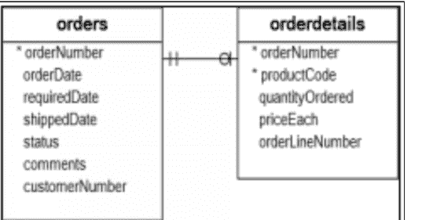

```sql
SELECT
    productCode,
    ROUND(SUM(quantityOrdered * priceEach)) sales
FROM orderdetails
INNER JOIN orders USING (orderNumber)
WHERE YEAR(shippedDate) = 2003
GROUP BY productCode
ORDER BY sales DESC
LIMIT 5;
```

结果表将如下图所示：

| productCode | sales |
|---|---:|
| S18_3232 | 103460 |
| S10_1949 | 67985 |
| S12_1108 | 59852 |
| S12_3891 | 57403 |
| S12_1099 | 56462 |

上图所示的结果可以用作“派生表”，并使用以下语法与 `products` 表进行连接：

**products**

- `productCode`
- `productName`
- `productLine`
- `productScale`
- `productVendor`
- `productDescription`
- `quantityInStock`
- `buyPrice`
- `MSRP`

```sql
SELECT
    productName,
    sales
FROM (
    SELECT
        productCode,
        ROUND(SUM(quantityOrdered * priceEach)) sales
    FROM orderdetails
    INNER JOIN orders USING (orderNumber)
    WHERE YEAR(shippedDate) = 2003
    GROUP BY productCode
    ORDER BY sales DESC
    LIMIT 5
) top5products2003
INNER JOIN products USING (productCode);
```


上述查询的结果将如下图所示：

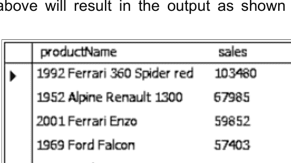

为了进一步深化这一概念，请查看下面一个相对复杂的“派生表”示例。

假设 2009 年的客户需要被分为三组：“铂金、黄金和白银”。此外，考虑到以下标准，你想计算每组中的客户数量：

- 铂金客户：订单数量大于 100K。
- 黄金客户：订单数量在 10K 到 100K 之间。
- 白银客户：订单数量小于 10K。

为了生成用于此分析的查询，你必须首先使用“CASE”子句和“GROUP BY”函数将每个客户分类到相应的组中，如下面的语法所示：

```sql
SELECT
    customerNumber,
    ROUND(SUM(quantityOrdered * priceEach)) sales,
    CASE
        WHEN SUM(quantityOrdered * priceEach) < 10000 THEN 'Silver'
        WHEN SUM(quantityOrdered * priceEach) BETWEEN 10000 AND 100000 THEN 'Gold'
        WHEN SUM(quantityOrdered * priceEach) > 100000 THEN 'Platinum'
    END customerGroup
FROM
    orderdetails
    INNER JOIN orders USING (orderNumber)
WHERE
    YEAR(shippedDate) = 2003
GROUP BY customerNumber;
```

查询输出如下图所示：

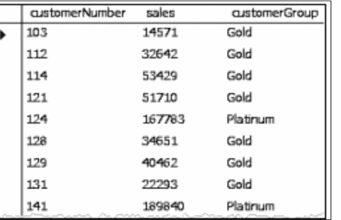

现在，你可以执行以下代码来生成一个“派生表”并根据需要对客户进行分组：

```sql
SELECT
    customerGroup,
    COUNT(cg.customerGroup) AS groupCount
FROM
    (
        SELECT
            customerNumber,
            ROUND(SUM(quantityOrdered * priceEach)) sales,
            CASE
                WHEN SUM(quantityOrdered * priceEach) < 10000 THEN 'Silver'
                WHEN SUM(quantityOrdered * priceEach) BETWEEN 10000 AND 100000 THEN 'Gold'
                WHEN SUM(quantityOrdered * priceEach) > 100000 THEN 'Platinum'
            END customerGroup
        FROM
            orderdetails
            INNER JOIN orders USING (orderNumber)
        WHERE
            YEAR(shippedDate) = 2003
        GROUP BY customerNumber
    ) cg
GROUP BY cg.customerGroup;
```

查询输出如下图所示：

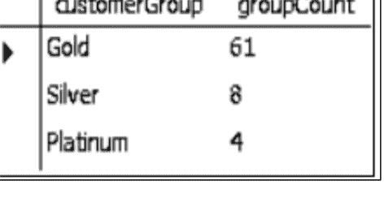

## 第 3 章：SQL 连接（Joins）和联合（Union）命令

SQL 中最常用的命令是`SELECT`命令，我们在本书前面提到的练习中已经使用了它。因此，现在让我带你深入了解`SQL SELECT`命令以及可与其配合使用的各种子句。

### MySQL SELECT

你可以使用`SELECT`语句从表或视图中选择性地获取所需数据。如你所知，与电子表格类似，一个表由行和列组成。你很可能需要查看一部分列、一部分行，或者两者的结合。`SELECT`查询的结果被称为“结果集（result set）”，它是一个记录列表，每条记录包含相同数量的列。

在下面这张来自“MySQL 示例数据库”的“employees 表”图片中，该表有 8 个不同的列，分别是：“员工编号”、“姓”、“名”、“分机号”、“电子邮件”、“办公室代码”、“汇报对象”、“职位”，以及若干行或记录。

| employeeNumber | lastName | firstName | extension | email | officeCode | reportsTo | jobTitle |
|---|---|---|---|---|---|---|---|
| 1002 | Murphy | Dianne | | dmurphy@classicmodelcars.com | 1 | | President |
| 1098 | Patterson | Maggie | x6011 | mpatterson@classicmodelcars.com | 1 | 1002 | VP Sales |
| 1878 | Jeffs | a a | x9273 | jeffs@classicmodelcars.com | 1 | 1002 | VP Marketing |
| 1601 | Watson | William | x6411 | watson@classicmodelcars.com | 6 | 1002 | Sales Manager (APAC) |
| 1188 | Bender | Gerard | x5845 | gbender@classicmodelcars.com | 6 | 1601 | Sales Manager (EMEA) |
| 1143 | Pew | Andrew | | apew@classicmodelcars.com | 1 | 1002 | Sales Manager (NA) |
| 1695 | Jennings | Leslie | x3291 | jennings@classicmodelcars.com | 1 | 1143 | Sales Rep |
| 1389 | Thompson | Leslie | x4841 | thompson@classicmodelcars.com | 1 | 1143 | Sales Rep |
| 1183 | Fraude | Julie | x2773 | jfraude@classicmodelcars.com | 2 | 1143 | Sales Rep |
| 1216 | Patterson | Brent | | bpatterson@classicmodelcars.com | 2 | 1143 | Sales Rep |
| 1239 | Young | Fern | x3290 | fyoung@classicmodelcars.com | 3 | 1143 | Sales Rep |
| 1323 | Varoul | George | x4160 | gvaroul@classicmodelcars.com | 5 | 1143 | Sales Rep |
| 1337 | Bender | Lou | x4500 | lbender@classicmodelcars.com | 4 | 1162 | Sales Rep |
| 1370 | Hernandez | Gerard | x2305 | ghernandez@classicmodelcars.com | 4 | 1162 | Sales Rep |
| 1401 | Castillo | Pamela | x2705 | pcastillo@classicmodelcars.com | 4 | 1162 | Sales Rep |
| 1491 | Loft | Finn | x2011 | floft@classicmodelcars.com | 7 | 1162 | Sales Rep |

`SELECT`查询用于指定可以从表中获取的列和记录。例如，如果您只想显示所有员工的“名字”、“姓氏”和“职位”，或者您选择性地想要查看“职位”为“sales rep”的员工信息，那么您可以使用`SELECT`查询来实现。

以下是`SELECT`语句的标准语法：

```sql
SELECT
    column_1, column_2, ...
FROM
    table_1
[INNER | LEFT | RIGHT] JOIN table_2 ON conditions
WHERE
    conditions
GROUP BY column_1
HAVING group_conditions
ORDER BY column_1
LIMIT offset, length;
```

上述`SELECT`查询包含多种条款，描述如下：

- `SELECT`子句后面跟着由“逗号”分隔的列列表，或者使用“星号（`*`）”表示返回所有列。
- `FROM`子句定义了要从中查询数据的表或视图。
- `JOIN`子句根据指定的连接条件从其他表中获取相关联的数据。
- 在“结果集”中，`WHERE`子句用于选择性地过滤行或记录。
- `GROUP BY`子句用于选择性地将一组记录分组，并对每个组应用“聚合函数”。
- `HAVING`子句用于根据`GROUP BY`子句指定的组来过滤组。
- `ORDER BY`子句可用于指定要排序的列列表。
- `LIMIT`子句可用于限制执行命令时显示的行数。

请注意，只有`SELECT`和`FROM`子句是执行该命令所必需的，所有其他子句都可以根据具体需求（ad-hoc）使用。

例如，如果您只对显示所有员工的“名字”、“姓氏”和“职位”感兴趣，可以使用以下语法：

```sql
SELECT
    lastname, firstname, jobtitle
FROM
    employees;
```

但如果您想查看`employees`表中的所有列，请使用以下语法：

```sql
SELECT * FROM employees;
```

在实践中，建议列出您想要查看的列，而不是使用星号（`*`）命令，因为星号（`*`）会返回所有列数据，其中一些您可能无权使用。这会产生“MySQL 数据库服务器与应用程序之间不必要的 I/O 磁盘和网络流量”。如果显式定义列，那么“结果集”将更容易预测和处理。假设您使用了星号（`*`），而其他用户修改了表并生成了额外的列，您将收到一个包含与所需不同列的“结果集”。此外，使用星号（`*`）可能会向未经授权的用户泄露敏感数据。

## MySQL SELECT DISTINCT

在从表中搜索信息时，可能会收到重复的行。您可以在`SELECT`查询中使用`DISTINCT`子句来消除这些冗余行。

`DISTINCT`子句的语法如下：

```sql
SELECT DISTINCT
    columns
FROM
    table_name
WHERE
    where_conditions;
```

### 示例

以下语法提供了一个`DISTINCT`子句的示例，用于选择性地查看`employees`表中员工的“唯一姓氏”。

首先，您需要使用以下语法显示`employees`表中所有员工的“姓氏”：

```sql
SELECT
    lastname
FROM
    employees
ORDER BY lastname;
```

现在，为了消除重复的姓氏，请使用以下语法：

```sql
SELECT DISTINCT
    lastname
FROM
    employees
ORDER BY lastname;
```

请注意，如果某列被指示可以持有`NULL`值且使用了`DISTINCT`子句，服务器将仅保留一个`NULL`值，因为`DISTINCT`子句会将所有`NULL`值视为相同。

### 在多列上使用`DISTINCT`子句

为了实现这一点，`MySQL 服务器`将使用所选列中所有值的组合来识别“结果集”中的唯一记录。例如，您可以使用以下语法查看`customers`表中“城市”和“州”列的唯一组合：

```sql
SELECT DISTINCT
    state, city
FROM
    customers
WHERE
    state IS NOT NULL
ORDER BY state, city;
```

### MySQL `ORDER BY`

在使用`SELECT`语句查询数据时，“结果集”不会以特定格式组织。这时可以使用`ORDER BY`子句按需组织“结果集”。`ORDER BY`子句允许根据一个或多个列对“结果集”进行排序，以及将若干列按升序或降序排列。

以下是`ORDER BY`子句的语法：

```sql
SELECT column1, column2, ...
FROM tbl
ORDER BY column1 [ASC|DESC], column2 [ASC|DESC], ...;
```

正如您所预期的，`ASC`表示升序，`DESC`表示降序。默认情况下，如果没有显式指定`ASC`或`DESC`，`ORDER BY`子句将按升序对“结果集”进行排序。

### 示例

以下语法提供了一个`ORDER BY`子句的示例，用于选择性地查看`customers`表中的联系人，并按“姓氏”的升序排列。

```sql
SELECT
    contactLastname,
    contactFirstname
FROM
    customers
ORDER BY
    contactLastname;
```

升序的“结果集”如下图所示：


现在，如果您想按降序查看姓氏，将使用以下语法：

```sql
SELECT
    contactLastname,
    contactFirstname
FROM
    customers
ORDER BY
    contactLastname DESC;
```

降序的“结果集”如下图所示：


或者，如果您想将“姓氏”按降序排列，将“名字”按升序排列，您可以在同一个查询中使用`DESC`和`ASC`子句，但对应到相关的列，如下面语法所示：

```sql
SELECT
    contactLastname,
    contactFirstname
FROM
    customers
ORDER BY
    contactLastname DESC,
    contactFirstname ASC;
```

“结果集”如下图所示，其中`ORDER BY`子句将首先对“姓氏”进行降序排序，随后对“名字”进行升序排序：


### MySQL WHERE

`WHERE`子句允许为运行查询后显示的记录指定搜索条件。

`WHERE`子句的语法如下：

```sql
SELECT
    select_list
FROM
    table_name
WHERE
    search_condition;
```

`search_condition`是一个或多个“谓词”的组合，利用了如下表所示的“逻辑运算符”，如`AND`、`OR`和`NOT`。在 SQL 中，“谓词”被定义为“一个评估为真、假或未知的表达式”。

| 运算符 | 描述 |
|---|---|
| `=` | “等于。您可以将其用于几乎任何数据类型。” |
| `<>`或`!=` | “不等于” |
| `<` | “小于。您通常将其用于数值和日期/时间数据类型。” |
| `>` | “大于” |
| `<=` | “小于或等于” |
| `>=` | “大于或等于” |

最终的“结果集”包含`table_name`中所有使`search_condition`评估为有效的记录。

除了`SELECT`语句外，您还可以在`UPDATE`和`DELETE`查询中使用`WHERE`子句来指定需要更新和删除的行。

### 示例

以下语法提供了一个`WHERE`子句的示例，用于从“MySQL 示例数据库”的`employees`表中选择性地查看职位为“Sales Rep”的员工：

```sql
SELECT
    lastname,
    firstname,
    jobtitle
FROM
    employees
WHERE
    jobtitle = 'Sales Rep';
```

虽然`WHERE`子句定义在查询的末尾，但`MySQL`会在评估`WHERE`子句中的短语后首先选择相应的行。它先选择职位为“Sales Rep”的行，然后选择`SELECT`子句中的列。

来自“选择列表”。下图中的高亮行包括最终结果集的列和行。

| employeeNumber | lastName | firstName | extension | email | officeCode | reportsTo | jobTitle |
|---|---|---|---|---|---|---|---|
| 1002 | Murphy | Diane | x5800 | dmurphy@classicmodelcars.com | 1 | | President |
| 1056 | Patterson | Mary | x4611 | mpatterson@classicmodelcars.com | 1 | 1002 | VP Sales |
| 1076 | Firrelli | Jeff | x5273 | jfirrelli@classicmodelcars.com | 1 | 1002 | VP Marketing |
| 1080 | Patterson | William | x4871 | wpatterson@classicmodelcars.com | 6 | 1056 | Sales Manager (APAC) |


| 1102 | Bondur | Gerard | x5408 | gdbondur@classicmodelcars.com | 4 | 1056 | Sales Manager (EMEA) |
| 1143 | Bow | Anthony | x5428 | abow@classicmodelcars.com | 1 | 1056 | Sales Manager (NA) |
| 1165 | Jennings | Leslie | x3291 | ljennings@classicmodelcars.com | 1 | 1143 | Sales Rep |
| 1166 | Thompson | Leslie | x4365 | lthompson@classicmodelcars.com | 1 | 1143 | Sales Rep |
| 1188 | Firrelli | Julie | x2173 | jfirrelli@classicmodelcars.com | 2 | 1143 | Sales Rep |
| 1216 | Patterson | Steve | x4334 | spatterson@classicmodelcars.com | 2 | 1143 | Sales Rep |
| 1286 | Foon Yew | Teoh | x2240 | tfoonyew@classicmodelcars.com | 3 | 1143 | Sales Rep |
| 1323 | Vanauf | George | x4102 | gvanauf@classicmodelcars.com | 3 | 1143 | Sales Rep |
| 1337 | Bondur | Loui | x6493 | lbondur@classicmodelcars.com | 4 | 1102 | Sales Rep |

### MySQL JOIN 语句

MySQL 的 `JOIN` 函数是一种基于所选表之间的共同属性或列值，将一个或多个表的信息链接起来的方法。关系型数据库由各种通过共享或公共列（称为“外键”）链接的表组成。因此，从业务角度来看，每个单独表中的信息可能是不完整的。例如，在“MySQL 示例数据库”中有两个独立的表，分别称为 `orders` 和 `orderdetails`，它们通过名为 `orderNumber` 的列相互连接。您必须在 `orders` 和 `orderdetails` 表中同时搜索信息，才能获得完整的订单信息。

共有 6 种不同的 SQL `JOIN` 函数，分别是 `INNER JOIN`、`LEFT JOIN`、`RIGHT JOIN`、`CROSS JOIN` 和 `SELF JOIN`。

为了方便您理解每种 `JOIN` 类型，我们将使用下文语法中描述的名为 `t1` 和 `t2` 的表。`t1` 和 `t2` 表中的 `pattern` 列作为它们之间的公共列。

```sql
CREATE TABLE t1 (
    id INT PRIMARY KEY,
    pattern VARCHAR (50) NOT NULL
);

CREATE TABLE t2 (
    id VARCHAR (50) PRIMARY KEY,
    pattern VARCHAR (50) NOT NULL
);
```

我们可以使用如下语法所示的 `INSERT` 函数向这两个表中插入一些数据：

```sql
INSERT INTO t1(id, pattern)
VALUES(1,'Divot'),
       (2,'Brick'),
       (3,'Grid');

INSERT INTO t2(id, pattern)
VALUES('A','Brick'),
       ('B','Grid'),
       ('C','Diamond');
```

上述语法的执行结果如下图所示：

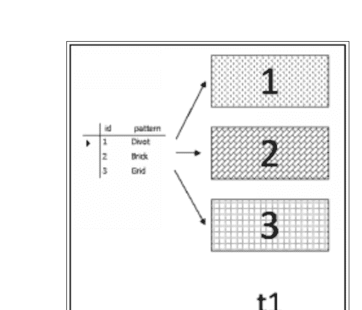

现在，让我们详细了解每种 `JOIN` 子句！

### `INNER JOIN`

`MySQL INNER JOIN` 用于将“一个表中的行与另一个表中的行”对齐，从而可以查询包含来自两个表列的行。

执行 `SELECT` 语句并不强制要求包含 `INNER JOIN` 子句，它通常出现在 `FROM` 子句的正后方。

在使用 `INNER JOIN` 子句之前，您必须指定以下要求：

首先，在 `FROM` 子句中指定要包含的主表。

然后，在 `INNER JOIN` 子句中选择您想要连接到步骤 1 中主表的表。理论上，您可以同时将一个表连接到多个表。然而，为了获得更高的性能和效率，建议限制连接表的数量。

最后，必须定义“连接条件”或“连接谓词”。在 `INNER JOIN` 的初始 `ON` 关键字之后，可以指定“连接条件”。连接条件是决定“主表”中的一行如何与另一个表中的记录相匹配的规则。

`INNER JOIN` 子句的语法如下：

```sql
SELECT column_list
FROM t1
INNER JOIN t2 ON join_condition1
INNER JOIN t3 ON join_condition2
...
WHERE where_conditions;
```

为了进一步简化上述查询，假设您仅希望使用以下语法链接 `t1` 和 `t2` 表：

```sql
SELECT column_list
FROM t1
INNER JOIN t2 ON join_condition;
```

`INNER JOIN` 子句将 `t1` 表的每一行与 `t2` 表的每一条记录进行比较，以确定两者是否满足定义的“连接条件”。一旦满足“连接条件”，`INNER JOIN` 就会返回一条由 `t1` 和 `t2` 列组成的新记录。

请注意，`t1` 和 `t2` 中的记录需要根据“连接条件”进行合并。如果在两个表中没有找到满足“连接条件”的记录，查询将返回一个空的“结果集”。当连接两个以上的表时，同样的逻辑也适用。

下图中的文恩图（Venn diagram）展示了 `INNER JOIN` 子句的工作原理。“结果集”中的记录必须同时存在于 `t1` 和 `t2` 中，由两个圆圈（分别代表每个表）的重叠部分表示。

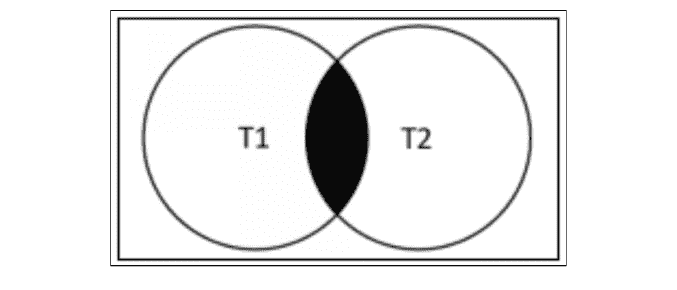

#### 示例

考虑“MySQL 示例数据库”中的 `products` 和 `productlines` 表，如下图所示。`products` 表通过引用 `productline` 列与 `productlines` 表相连。因此，`productline` 列在 `products` 表中充当“外键”。

按照惯例，具有“外键”关系的表使用 `JOIN` 子句进行查询。

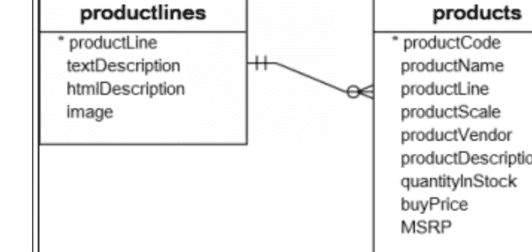

假设您想查看 `products` 表中的 `productCode` 和 `productName` 列，以及 `productlines` 表中对应的产品 `textDescription`。您可以使用以下语法，并根据两个表中的 `productline` 列来匹配两表的行。

```sql
SELECT
    productCode,
    productName,
    textDescription
FROM
    products t1
INNER JOIN
    productlines t2 ON t1.productline = t2.productline;
```

“结果集”如下图所示：

| productCode | productName | textDescription |
|---|---|---|
| S10_1949 | 1952 Alpine Renault 1300 | Attention car enthusiasts: Make your wildest car ownership dreams come true. |
| S10_4757 | 1972 Alfa Romeo GTA | Attention car enthusiasts: Make your wildest car ownership dreams come true. |
| S10_4962 | 1962 Lancia Delta 16V | Attention car enthusiasts: Make your wildest car ownership dreams come true. |
| S12_1099 | 1968 Ford Mustang | Attention car enthusiasts: Make your wildest car ownership dreams come true. |
| S12_1108 | 2001 Ferrari Enzo | Attention car enthusiasts: Make your wildest car ownership dreams come true. |

## 这里有一个技巧！

由于两个表都包含名为 `productline` 的相同列，您可以使用下面更简单的查询（无需使用表别名），即可获得与上图相同的“结果集”：

```sql
SELECT
    productCode,
    productName,
    textDescription
FROM
    products
INNER JOIN
    productlines USING (productline);
```

### `INNER JOIN` 与 `GROUP BY` 结合使用

下图包含 `orders` 和 `orderdetails` 表：

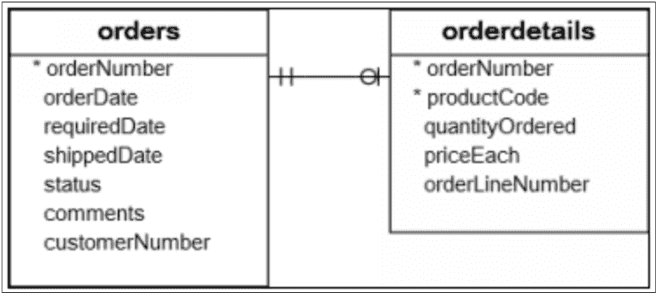

您可以将 `INNER JOIN` 与 `GROUP BY` 子句结合使用，以从 `orders` 和 `orderdetails` 表中获取所需信息，如下两个语法所示：

```sql
SELECT
  T1.orderNumber,
  status,
  SUM(quantityOrdered * priceEach) total
FROM
  orders AS T1
    INNER JOIN
  orderdetails AS T2 ON T1.orderNumber = T2.orderNumber
GROUP BY orderNumber;
```

```sql
SELECT
  orderNumber,
  status,
  SUM(quantityOrdered * priceEach) total
FROM
  orders
    INNER JOIN
  orderdetails USING (orderNumber)
GROUP BY orderNumber;
```

“结果集”如下图所示：

| orderNumber | status | total |
|---|---|---|
| 10100 | Shipped | 10223.83 |
| 10101 | Shipped | 10549.01 |
| 10102 | Shipped | 5494.78 |
| 10103 | Shipped | 50218.95 |
| 10104 | Shipped | 40206.20 |

## 使用不同运算符的 MySQL `INNER JOIN`

我们之前只探索了使用“等号运算符 (`=`)”作为连接条件来匹配行。但我们也可以在连接谓词中使用其他运算符，包括“大于号 (`>`)”、“小于号 (`<`)”和“不等于 (`<>`)”运算符。

以下语法使用“小于号 (`<`)”运算符来查找商品代码为 `S10_1678` 的商品中，售价低于“制造商建议零售价 (MSRP)”的记录。

```sql
SELECT
  orderNumber,
  productName,
  msrp,
  priceEach
FROM
  products p
    INNER JOIN
  orderdetails o ON p.productcode = o.productcode
    AND p.msrp > o.priceEach
WHERE
  p.productcode = 'S10_1678';
```

“结果集”如下图所示：

| orderNumber | productName | msrp | priceEach |
| :--- | :--- | :--- | :--- |
| 10107 | 1969 Harley Davidson Ultimate Chopper | 95.70 | 81.35 |
| 10121 | 1969 Harley Davidson Ultimate Chopper | 95.70 | 86.13 |
| 10134 | 1969 Harley Davidson Ultimate Chopper | 95.70 | 90.92 |
| 10145 | 1969 Harley Davidson Ultimate Chopper | 95.70 | 76.56 |
| 10159 | 1969 Harley Davidson Ultimate Chopper | 95.70 | 81.35 |
| 10168 | 1969 Harley Davidson Ultimate Chopper | 95.70 | 94.74 |
| 10180 | 1969 Harley Davidson Ultimate Chopper | 95.70 | 76.56 |
| 10201 | 1969 Harley Davidson Ultimate Chopper | 95.70 | 82.30 |

## `LEFT JOIN`

`MySQL LEFT JOIN` 可以从数据库中的 2 个或多个表中查询数据。`SELECT` 语句执行时并不强制要求包含 `LEFT JOIN` 子句，该子句紧跟在 `FROM` 子句之后。当使用 `LEFT JOIN` 子句连接两个表时，会应用“左表”和“右表”的概念。

与 `INNER JOIN` 不同，`LEFT JOIN` 或 `LEFT OUTER JOIN` 将返回左表中的所有记录，包括满足“连接条件”的记录以及不满足的记录。对于不符合连接条件的行，“来自右表的列”在“结果集”中会显示 `NULL` 值。

现在，为了进一步简化此查询，我们假设仅使用 `LEFT JOIN` 连接表 `t1` 和 `t2`，语法如下：

```sql
SELECT
  t1.c1, t1.c2, tidx.c1, t2.c2
FROM
  t1
  LEFT JOIN
  t2 ON t1.c1 = t2.c1;
```

在上面的语法中，你使用 `LEFT JOIN` 子句将 `t1` 与 `t2` 连接起来，连接的基础是根据“连接谓词 (`t1.c1 = t2.c1)`”的定义，将“左表 `t1`”中的记录与“右表 `t2`”中的记录进行对齐，然后将匹配的记录包含在“结果集”中。

如果“左表”中的记录在“右表”中没有与之对齐的匹配记录，那么“左表”中的记录仍然会被选中，并与一个包含来自“右表”的 `NULL` 值的“虚拟记录”进行连接。

简而言之，`LEFT JOIN` 子句可以从“左表和右表”中选择匹配的记录，同时也返回“左表 (`t1`)”中的所有记录，即使它们在“右表 (`t2`)”中没有对齐的记录。

下面图片中展示的“维恩图”将帮助你理解 `LEFT JOIN` 的工作原理。两个圆的重叠部分包含两张表中匹配的记录，而“左圆”的其余部分包含“在 `t2` 表中没有对应记录的 `t1` 表中的记录”。因此，“结果集”将包含“左表”中的所有记录。

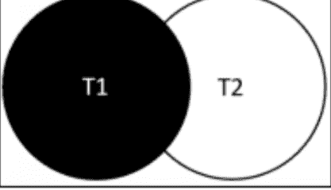

#### 示例

考虑“MySQL 示例数据库”中的 `customers` 和 `orders` 表，如下图所示。其中 `orders` 表中的每个“订单值”都对应 `customers` 表中的一个“客户值”，但 `customers` 表中的每个客户值在 `orders` 表中不一定有对应的订单值。

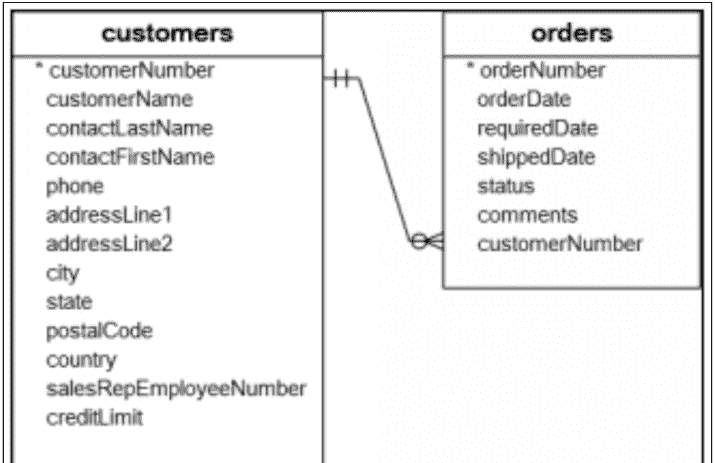

可以使用下面的语法，通过 `LEFT JOIN` 子句查询“与客户对应的所有订单”：

```sql
SELECT
  c.customerNumber,
  c.customerName,
  orderNumber,
  o.status
FROM
  customers c
  LEFT JOIN orders o ON c.customerNumber = o.customerNumber;
```

“结果集”如下图所示，其中左表指的是 `customers` 表，因此在 `customers` 表中有值的所有行都会被添加到“结果集”中；尽管其中包含了一些没有订单数据的客户数据行，如 `168` 和 `169`。对于这些行，订单数据值显示为 `NULL`，意味着在 `orders` 表中没有这些客户的订单。

| customerNumber | customerName | orderNumber | status |
|---|---|---|---|
| 165 | Handji Gifts& Co | 10288 | Shipped |
| 166 | Handji Gifts& Co | 10409 | Shipped |
| 167 | Herkku Gifts | 10181 | Shipped |
| 167 | Herkku Gifts | 10188 | Shipped |
| 167 | Herkku Gifts | 10289 | Shipped |
| 168 | American Souvenirs Inc | NULL | NULL |
| 169 | Porto Imports Co. | NULL | NULL |
| 171 | Daedalus Designs Imports | 10180 | Shipped |


| 171 | Daedalus Designs Imports | 10224 | Shipped |
| 172 | La Corne D'abondance, ... | 10114 | Shipped |

以下是小提示！

由于两个表共享列名`customersNumber`，你可以使用下面更简洁的查询（无需使用表别名）来获得与上图相同的“结果集”：

```sql
SELECT
  c.customerNumber,
  customerName,
  orderNumber,
  status
FROM
  customers c
  LEFT JOIN orders USING (customerNumber);
```

## 使用`WHERE`子句的 MySQL`LEFT JOIN`

考虑以下语法，其中`WHERE`子句用在`LEFT JOIN`之后，用于从`orders`和`orderDetails`表中检索所需信息。

```sql
SELECT
    o.orderNumber,
    customerNumber,
    productCode
FROM
    orders o
    LEFT JOIN
    orderDetails USING (orderNumber)
WHERE
    orderNumber = 10123;
```

“结果集”如下图所示，显示所有订单编号为`10123`的记录：

| orderNumber | customerNumber | productCode |
|---|---|---|
| 10123 | 103 | S18_1589 |
| 10123 | 103 | S18_2870 |
| 10123 | 103 | S18_3685 |
| 10123 | 103 | S24_1628 |

请注意，如果将“连接条件”从`WHERE`子句更改为`ON`子句，如下所示的语法，那么查询将产生不同的“结果集”，其中包含所有订单，但只会显示与订单编号`10123`相关联的详细信息，如下图所示：

```sql
SELECT
    o.orderNumber,
    customerNumber,
    productCode
FROM
    orders o
    LEFT JOIN
    orderDetails d ON o.orderNumber = d.orderNumber
    AND o.orderNumber = 10123;
```

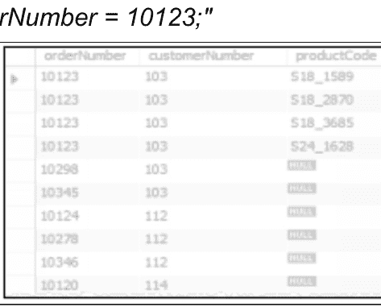

## `RIGHT JOIN`

`RIGHT JOIN`或`RIGHT OUTER JOIN`与`LEFT JOIN`类似，唯一的区别是表的处理方式从左到右进行了反转。使用`RIGHT JOIN`时，“右表 (t2)”中的每条记录都会出现在“结果集”中。对于“右表中在左表 (t1) 中没有对应行”的记录，“左表 (t1)”中的列将显示`NULL`值。

你可以使用`RIGHT JOIN`子句将表`t1`和`t2`进行连接，如下所示：

```sql
SELECT
  *
FROM t1
RIGHT JOIN t2 ON join_predicate;
```

在上面的语法中，右表是`t2`，左表是`t1`，`join_predicate`表示将`t1`中的记录与`t2`中的记录进行对齐的匹配条件。

执行上述查询后，“右表 t2”中的所有行都将显示在“结果集”中，并且根据连接条件，如果`t2`中的行与`t1`中的行没有匹配，则`t1`表对应列将添加`NULL`值。

### 示例

让我们考虑如下语法中描述的表“t1”和“t2”：

```sql
CREATE TABLE t1 (
    id INT PRIMARY KEY,
    pattern VARCHAR(50) NOT NULL
);
CREATE TABLE t2 (
    id VARCHAR(50) PRIMARY KEY,
    pattern VARCHAR(50) NOT NULL);
INSERT INTO t1(id, pattern)
VALUES(1,'Divot'),
    (2,'Brick'),
    (3,'Grid');
INSERT INTO t2(id, pattern)
VALUES('A','Brick'),
    ('B','Grid'),
    ('C','Diamond');
```

表“t1”和“t2”可以通过`pattern`列进行连接，如下面的查询所示：

```sql
SELECT
    t1.id, t2.id
FROM
    t1
    RIGHT JOIN t2 USING (pattern)
ORDER BY t2.id;
```

“结果集”如下图所示：

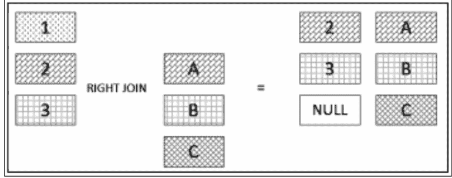

或者查看下面的语法，从“MySQL 示例数据库”的`employees`表和`customers`表中查看“销售代表”及其“客户”：

```sql
SELECT
  concat(e.firstName,' ', e.lastName) salesman,
  e.jobTitle,
  customerName
FROM
  employees e
    RIGHT JOIN
      customers c ON e.employeeNumber = c.salesRepEmployeeNumber
    AND e.jobTitle = 'Sales Rep'
ORDER BY customerName;
```

“结果集”如下图所示：

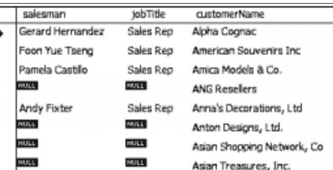

## `CROSS JOIN`

`CROSS JOIN`子句用于获取“笛卡尔积”，其定义为“一个表的每一行与另一个表的每一行的连接”。当使用`CROSS JOIN`子句时，“结果集”包含来自这两个表的所有行，这些行是由“第一个表”的记录和第二个表的记录复合而成的。这种情况仅发生在无法找到两个被连接表之间的“共同链接或列”时。

最大的缺点是数据量巨大，假设每个表包含 1,000 行，那么“结果集”将包含 1,000 x 1,000 = 1,000,000 行。

你可以利用`CROSS JOIN`来连接`t1`和`t2`，如下面的语法所示：

```sql
SELECT
  *
FROM
  T1
  CROSS JOIN
  T2;
```

与`RIGHT JOIN`和`LEFT JOIN`不同，`CROSS JOIN`可以在不使用“连接谓词”的情况下操作。此外，如果向`CROSS JOIN`添加`WHERE`子句，且两个表`t1`和`t2`之间存在关联，那么`CROSS JOIN`将像`INNER JOIN`一样运行，如下面的语法所示：

```sql
SELECT *
FROM
    T1
    CROSS JOIN
    T2
WHERE
    T1.id = T2.id;
```

### 示例

让我们使用如下语法中描述的`testdb`数据库，以更好地理解`CROSS JOIN`如何运行：

```sql
CREATE DATABASE IF NOT EXISTS testdb;
USE testdb;
CREATE TABLE products (
    id INT PRIMARY KEY AUTO_INCREMENT,
    product_name VARCHAR (100),
    price DECIMAL (13 , 2 )
);
CREATE TABLE stores (
    id INT PRIMARY KEY AUTO_INCREMENT,
    store_name VARCHAR (100)
);
CREATE TABLE sales (
    product_id INT,
    store_id INT,
    quantity DECIMAL (13 , 2 ) NOT NULL,
    sales_date DATE NOT NULL,
    PRIMARY KEY (product_id , store_id),
    FOREIGN KEY (product_id)
      REFERENCES products (id)
      ON DELETE CASCADE ON UPDATE CASCADE,
    FOREIGN KEY (store_id)
      REFERENCES stores (id)
      ON DELETE CASCADE ON UPDATE CASCADE
);
```

在上述语法中，我们有 3 张表：

- `products`表，保存产品的基本数据，包括“产品 ID”、“产品名称”和“销售价格”。
- `stores`表，保存与可购买产品的门店相关的数据。
- `sales`表，保存特定门店按日期和数量销售产品的相关数据。

假设在名为“North”和“South”的 2 家门店中有 3 种商品“iPhone”、“iPad”和“MacBook Pro”可供销售。我们可以使用下面的语法填充表以保存这些数据：

```sql
INSERT INTO products(product_name, price)
VALUES('iPhone', 699),
    ('iPad',599),
    ('Macbook Pro',1299);

INSERT INTO stores(store_name)
VALUES('North'),
    ('South');

INSERT INTO sales(store_id,product_id,quantity,sales_date)
VALUES(1,1,20,'2017-01-02'),
    (1,2,15,'2017-01-05'),
    (1,3,25,'2017-01-05'),
    (2,1,30,'2017-01-02'),
    (2,2,35,'2017-01-05');
```

现在，为了查看“每个门店每种产品的总销售额”，必须先计算销售额，然后使用下面的语法按门店和产品进行“分组”：

```sql
SELECT
  store_name,
  product_name,
  SUM (quantity * price) AS revenue
FROM
  sales
    INNER JOIN
  products ON products.id = sales.product_id
    INNER JOIN
  stores ON stores.id = sales.store_id
GROUP BY store_name , product_name;
```

“结果集”如下图所示：

| store_name | product_name | revenue |
|:---|:---|:---|
| North | iPad | 8985.0000 |
| North | iPhone | 13980.0000 |
| North | Macbook Pro | 32475.0000 |
| South | iPad | 20965.0000 |
| South | iPhone | 20970.0000 |

现在，如果你想查看对某个特定产品零销售的门店，上面的语法无法为你提供该信息。这时你可以利用`CROSS JOIN`先查看所有产品和门店的复合组合，如下面的查询所示：

```sql
SELECT
    store_name, product_name
FROM
    stores AS a
        CROSS JOIN
    products AS b;
```

“结果集”如下图所示：

| store_name | product_name |
|:---|:---|
| North | iPhone |
| South | iPhone |
| North | iPad |
| South | iPad |
| North | MacBook Pro |
| South | MacBook Pro |

然后，你可以将之前收到的查询结果与此查询连接，从而得出“按门店和产品分的销售总额”，使用如下语法：

```sql
SELECT
    b.store_name,
    a.product_name,
    IFNULL (c.revenue, 0) AS revenue
FROM
    products AS a
        CROSS JOIN
    stores AS b
        LEFT JOIN
(SELECT 
    stores.id AS store_id,
    products.id AS product_id,
    store_name,
    product_name,
    ROUND(SUM(quantity * price), 0) AS revenue
FROM
    sales
INNER JOIN products ON products.id = sales.product_id
INNER JOIN stores ON stores.id = sales.store_id
GROUP BY store_name , product_name) AS c ON c.store_id = b.id
    AND c.product_id= a.id
ORDER BY b.store_name;
```

“结果集”如下图所示：

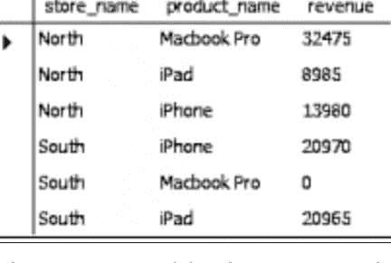

上述语法中使用了`IFNULL`函数，以便在收入报告为`NULL`时返回`0`。

## `SELF JOIN`

顾名思义，`SELF JOIN`语句用于将一个表的行与同一表中的行（而不是另一个表）进行链接。这需要你使用“表别名”来帮助服务器在同一个查询中区分“左表”和“右表”。例如，以“MySQL 示例数据库”中的`employees`表为例，其中存储了组织结构数据和员工数据，如下图所示。`reportsTo`列可用于查看任何员工的经理 ID。

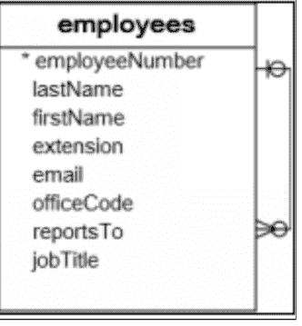

如果你想查看完整的“组织结构”，可以使用`employeeNumber`和`reportsTo`列对`employees`表进行自连接，如下面的语法所示。`employees`表中的两个角色分别是“经理 (Manager)”和“直接下属 (Direct Reports)”。

```sql
SELECT
  CONCAT (m.lastname, ', ', m.firstname) AS 'Manager',
  CONCAT (e.lastname, ', ', e.firstname) AS 'Direct report'
FROM
  employees e
    INNER JOIN
  employees m ON m.employeeNumber = e.reportsto
ORDER BY manager;
```

“结果集”如下图所示：

| Manager | Direct report |
|:---|:---|
| Bondur, Gerard | Jones, Barry |
| Bondur, Gerard | Bott, Larry |
| Bondur, Gerard | Castillo, Pamela |
| Bondur, Gerard | Hernandez, Gerard |
| Bondur, Gerard | Bondur, Loui |
| Bondur, Gerard | Gerard, Martin |
| Bow, Anthony | Tseng, Foon Yue |
| Bow, Anthony | Patterson, Steve |
| Bow, Anthony | Firrelli, Julie |
| Bow, Anthony | Thompson, Leslie |
| Bow, Anthony | Jennings, Leslie |
| Bow, Anthony | Vanauf, George |

在上面的“结果集”中只能看到向经理汇报的员工。但“最高经理”是不可见的，因为他的名字被`INNER JOIN`子句过滤掉了。“最高经理”是指不向任何其他经理汇报，或者其“经理编号”持有`NULL`值的经理。

我们可以将上述语法中的`INNER JOIN`子句改为`LEFT JOIN`子句，这样就可以将“最高经理”包含在“结果集”中。如果“经理”的姓名持有`NULL`值，你可以利用`IFNULL`子句将“最高经理”包含在输出中，如下面的查询所示：

```sql
SELECT
    IFNULL (CONCAT (m.lastname, ', ', m.firstname),
        'Top Manager') AS 'Manager',
    CONCAT (e.lastname, ', ', e.firstname) AS 'Direct report'
FROM
    employees e
        LEFT JOIN
    employees m ON m.employeeNumber = e.reportsto
ORDER BY manager DESC;
```

下图展示了“结果集”：

| 经理 | 直属下属 |
|:---|:---|
| 顶级经理 | 墨菲，戴安 |
| 帕特森，威廉 | 金，汤姆 |
| 帕特森，威廉 | 马什，彼得 |
| 帕特森，威廉 | 菲克斯特，安迪 |


| 帕特森，玛丽 | 邦杜尔，杰拉德 |
|---|---|
| 帕特森，玛丽 | 西，真由美 |
| 帕特森，玛丽 | 帕特森，威廉 |
| 帕特森，玛丽 | 博，安东尼 |
| 西，真由美 | 加藤，义美 |
| 墨菲，戴安 | 菲雷利，杰夫 |
| 墨菲，戴安 | 帕特森，玛丽 |

通过使用 MySQL 自连接将“客户”表与其自身链接，你将能够显示“位于同一地点的客户列表”，如下方查询所示：

```sql
SELECT
    c1.city, c1.customerName, c2.customerName
FROM
    customers c1
    INNER JOIN
    customers c2 ON c1.city = c2.city
    AND c1.customername > c2.customerName
ORDER BY c1.city;
```

下图展示了“结果集”：

| 城市 | 客户名称 | 客户名称 |
|---|---|---|
| 奥克兰 | 凯利礼品店 | 澳大利亚纪念品公司 |
| 奥克兰 | 为他购物网 | 澳大利亚纪念品公司 |
| 奥克兰 | 凯利礼品店 | 为他购物网 |
| 波士顿 | 全年龄礼品网 | 压铸收藏品店 |
| 布里克黑文 | 在线迷你收藏品店 | 汽车经典公司 |
| 布里克黑文 | 低价收藏品公司 | 汽车经典公司 |
| 布里克黑文 | 在线迷你收藏品店 | 低价收藏品公司 |
| 剑桥 | 玛塔复制品公司 | 剑桥收藏品公司 |
| 法兰克福 | 梅斯纳购物网络 | 蓝色湖汽车公司 |
| 格伦代尔 | 礼品创意公司 | 棋盘与玩具公司 |
| 里斯本 | 波尔图进口公司 | 里斯本纪念品公司 |
| 伦敦 | 时尚桌面装饰公司 | 双层巴士礼品商店 |

### MySQL UNION

MySQL 中的“UNION”函数用于将 2 个或多个“结果集”合并为一个综合的“结果集”。“UNION”运算符的语法如下：

```sql
SELECT column_list
UNION [DISTINCT | ALL]
SELECT column_list
UNION [DISTINCT | ALL]
SELECT column_list
...
```

使用“UNION”运算符需遵循的基本规则是：

- 至关重要的一点是，“SELECT”语句中包含的列的数量和顺序必须相同。
- 列的“数据类型”需要相同或“可转换”为相同类型。
- 即使在查询中没有显式使用“DISTINCT”函数，冗余或重复的行也将被删除。

#### 示例

考虑如下语法描述的示例表“t1”和“t2”：

```sql
DROP TABLE IF EXISTS t1;
DROP TABLE IF EXISTS t2;
CREATE TABLE t1 (
    id INT PRIMARY KEY
);
CREATE TABLE t2 (
    id INT PRIMARY KEY
);
INSERT INTO t1 VALUES (1),(2),(3);
INSERT INTO t2 VALUES (2),(3),(4);
```

可以使用以下查询，通过“UNION”运符合并来自“t1”和“t2”表的“结果集”：

```sql
SELECT id
FROM t1
UNION
SELECT id
FROM t2;
```

生成的合并“结果集”将包含来自两个“结果集”的不同值，如下所示：

| id |
|---|
| 1 |
| 2 |
| 3 |
| 4 |

可以注意到，包含值“2”和“3”的行是冗余的，因此“UNION”函数删除了重复项，仅保留了唯一值。下方的韦恩图表示了来自“t1”和“t2”表的“结果集”的组合：

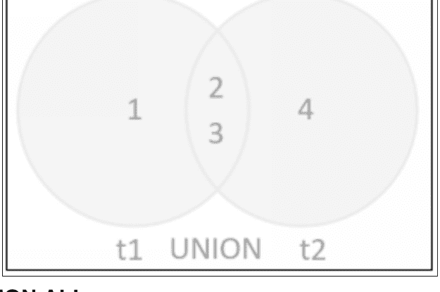

## MySQL UNION ALL

当您希望在“最终结果集”中保留重复行（如果有的话）时，会使用“UNION ALL”运算符。“UNION ALL”运算符执行查询的速度比“UNION”或“UNION DISTINCT”运算符快得多，因为它不需要处理数据的冗余性。“UNION ALL”运算符的语法如下查询所示：

```sql
SELECT id
FROM t1
UNION ALL
SELECT id
FROM t2;
```

“结果集”如下，其中包含重复行：

```text
+----+
| id |
+----+
|  1 |
|  2 |
|  3 |
|  2 |
|  3 |
|  4 |
+----+
6 rows in set (0.00 sec)
```

### MySQL JOIN vs UNION

“JOIN”子句用于基于行或记录水平合并“结果集”。另一方面，“UNION”子句用于基于表的列垂直合并“结果集”。下方的图片将帮助您理解“UNION”和“JOIN”运算符之间的区别：

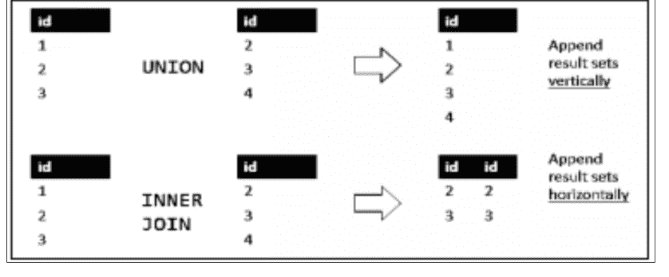

## MySQL UNION and ORDER BY

“ORDER BY”子句可用于对“UNION”运算符的结果进行排序，如下方查询所示：

```sql
SELECT
    concat (firstName,' ', lastName) fullname
FROM
    employees
UNION SELECT
    concat (contactFirstName,' ', contactLastName)
FROM
    customers
ORDER BY fullname;
```

下图展示了“结果集”：

| 全名 |
|---|
| 阿德里安·赫胥黎 |
| 秋子·岛村 |
| 亚历杭德拉·卡米诺 |
| 亚历山大·福伊尔 |
| 亚历山大·谢苗诺夫 |
| 艾伦·纳尔逊 |
| 安迪·菲克斯特 |
| 安·布朗 |
| 安娜·奥哈拉 |
| 安妮特·鲁莱 |

如果您想根据列位置对结果进行排序，可以如下方语法所示使用“ORDER BY”：

```sql
SELECT
    concat (firstName,' ', lastName) fullname
FROM
    employees
UNION SELECT
    concat (contactFirstName, ' ', contactLastName)
FROM
    customers
ORDER BY 1;
```

# 第 4 章：SQL 视图与事务

SQL 中的“数据库视图”可以定义为“虚拟表”或“逻辑表”，它被描述为包含连接函数的“SQL SELECT”语句。由于“数据库视图”就像数据库中由行和列组成的表，你将能够轻松地对其运行查询。许多数据库管理系统，包括“MySQL”，允许用户通过满足某些先决条件，使用“数据库视图”修改现有表中的信息，如下图所示。

“SQL 数据库视图”可以被认为是动态的，因为“SQL 视图”与物理系统之间没有直接联系。数据库系统将使用带有“JOIN”子句的“SELECT”语句形式存储“SQL 视图”。当表中的信息被修改时，“SQL 视图”也会反映该修改。

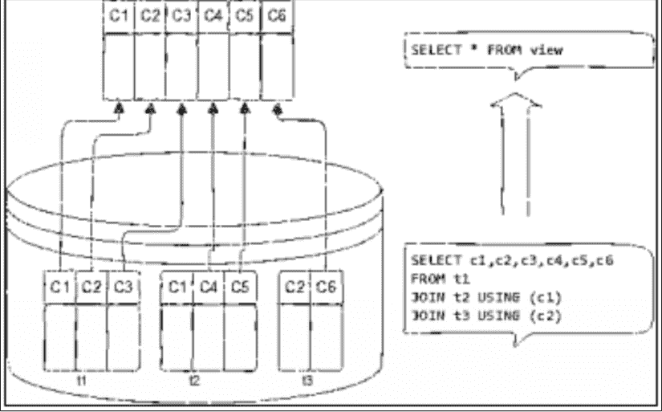

### 使用 SQL 视图的优点

“SQL 视图”能够简化复杂的查询：“SQL 视图”的特点是关联了多个表的 SQL 语句。为了向最终用户和外部应用程序隐藏底层表的复杂性，“SQL 视图”非常有用。你只需要使用简单的“SQL”语句，而不是使用多个“JOIN”子句的复杂语句，通过“SQL 视图”即可实现。

“SQL 视图”能够根据用户需求限制对信息的访问。也许你不想让所有用户都能查询机密信息的子集。在这种情况下，可以使用“SQL 视图”有选择地向目标用户组公开非敏感信息。

“SQL 视图”提供了一层额外的安全性。安全性是每个“关系数据库管理系统”的关键组成部分。“SQL 视图”确保了数据库管理系统的“额外安全性”。“SQL 视图”能够生成“只读”视图，为目标用户显示“只读”信息。在“只读视图”中，用户只能检索数据，不允许更新任何信息。

“SQL 视图”用于支持计算列。数据库中的表无法包含计算列，但“SQL 视图”可以轻松包含计算列。假设在“订单详情”表中，有一个用于产品订购数量的“quantityOrder”列，以及一个用于每件商品价格的“priceEach”列。但是“orderDetails”表不能包含一个计算列来存储每个产品的订单总销售额。如果能，数据库模式可能就不是一个好的设计。在这种情况下，为了显示计算结果，你可以生成一个名为“total”的计算列，该列将是“quantityOrder”和“priceEach”列的乘积。当从“SQL 视图”查询信息时，计算列信息将即时计算。

“SQL 视图”允许向后兼容。假设我们有一个被多个应用程序使用的中央数据库。突然有一天，你被指派重新设计数据库以适应新的业务需求。当你删除一些表并创建新表时，你可能不希望

## 使用 SQL 视图的缺点

除了上述优点外，使用“SQL 视图”可能会有某些缺点，例如：

- 性能：针对“SQL 视图”执行查询可能会比较慢，特别是当该视图是由另一个“SQL 视图”生成时。
- 表依赖性：由于“SQL 视图”是基于数据库的底层表创建的。每当与“SQL 视图”相关的表结构被修改时，你也需要相应地修改“SQL 视图”。

## MySQL 服务器中的视图

从 MySQL 5 版本发布起，它就一直支持数据库视图。在 MySQL 中，“视图”的几乎所有特性都符合“标准 SQL: 2003”。

MySQL 可以通过几种方式对视图运行查询：

- MySQL 可以基于“视图定义语句”产生一个“临时表”，然后在该“临时表”上执行所有后续查询。
- MySQL 可以将新查询与定义“SQL 视图”的查询合并为一个单一的综合查询，然后执行这个合并后的查询。

MySQL 为所有“SQL 视图”提供了版本控制能力。每当“SQL 视图”被修改或替换时，视图的克隆本会被备份到位于特定数据库文件夹中的“arc（归档）目录”中。“备份文件”命名为“view name.frm-00001”。如果你再次修改视图，MySQL 将生成一个新的“备份文件”，名为“view name.frm-00002”。

你还可以通过 MySQL 基于其他视图生成视图，在定义目标“SQL 视图”的“SELECT”语句中创建对其他视图的引用即可。

### MySQL 中的 CREATE VIEW

“CREATE VIEW”查询可用于在 MySQL 中生成新的“SQL 视图”，其语法如下所示：

```sql
CREATE
[ALGORITHM = {MERGE | TEMPTABLE | UNDEFINED}]
VIEW view_name[[column_list]]
AS
select-statement;
```

## 视图处理算法

`algorithm` 属性使你能够调节 MySQL 使用哪种机制来创建“SQL 视图”。MySQL 提供了三种算法，即：“MERGE”、“TEMPTABLE”和“UNDEFINED”。

使用“MERGE”算法时，服务器将首先把传入的查询与定义“视图”的“SELECT”语句合并为一个合并查询。随后，MySQL 执行该合并查询以检索“结果集”。如果“SELECT”语句包含“聚合函数”如“MIN、MAX、SUM、COUNT、AVG 或 DISTINCT、GROUP BY、HAVING、LIMIT、UNION、UNION ALL、子查询”，则不能使用“MERGE”算法。如果“SELECT”语句不引用任何表，则无法使用“MERGE”算法。在不允许使用“MERGE”算法的情况下，服务器将改为使用“UNDEFINED”算法。请记住，视图解析被定义为“将输入查询与视图定义中的查询合并为一个查询”。

使用“TEMPTABLE”算法时，服务器将首先基于“SELECT”语句产生一个描述“SQL 视图”的“临时表”。随后，任何传入的查询都将针对该“临时表”执行。“TEMPTABLE”算法的效率低于“MERGE”算法，因为 MySQL 需要生成一个“临时表”来存储“结果集”，并将数据从“永久表”传输到“临时表”。此外，使用“TEMPTABLE”算法的“SQL 视图”无法被更新。

如果你在生成“视图”时没有明确指定需要使用的算法，则默认将使用“UNDEFINED”算法。“UNDEFINED”算法允许 MySQL 在 MERGE 或 TEMPTABLE 算法之间进行选择。由于“MERGE”算法效率更高，MySQL 倾向于选择“MERGE”算法而非“TEMPTABLE”算法。

## 视图名称

视图和表存储在数据库的同一个空间中，因此不能给视图和表起相同的名称。此外，视图的名称必须符合表的命名规范。

## SELECT 语句

通过使用“SELECT”语句，可以轻松地从数据库中包含的任何表或视图中查询所需数据。“SELECT”语句需要满足各种准则，例如：

- 它可以包含在“WHERE”子句中的“子查询”，但不能在“FROM”子句中包含子查询。
- “SELECT”语句中可以引用变量，包括“局部变量”、“用户变量”和“会话变量”。
- “SELECT”语句不能引用预处理语句（prepared statements）的参数，且不强制要求引用数据库中的任何表。

### 示例

要为“orderDetails”表创建一个包含“每笔订单总销售额”的“SQL 视图”，你可以使用以下查询：

```sql
CREATE VIEW SalePerOrder AS
  SELECT
    orderNumber, SUM (quantityOrdered * priceEach) total
  FROM
    orderDetails
GROUP BY orderNumber
ORDER BY total DESC;
```

通过使用“SHOW TABLE”命令，你可以检查“classicmodels”数据库中的所有表，可以清楚地看到“SalesPerOrder”视图在显示列表中（如下图所示）：

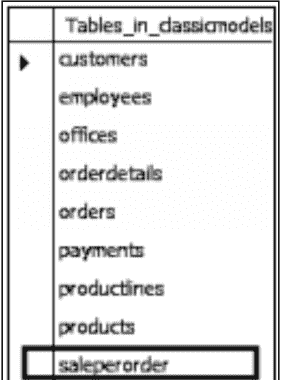

这证明了视图名称和表名称存储在数据库的同一个空间中。因此，现在如果你想知道上图中的哪个对象是“视图”，哪个是“表”，请使用“SHOW FULL TABLE”查询，“结果集”将如下图所示：

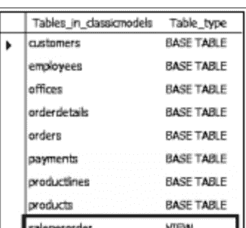

你可以检查上图中的“table_type”列来确认哪个对象是视图或表。

现在，你只需使用下面的“SELECT”语句即可查看“每笔销售订单的总销售额”：

```sql
SELECT
  *
FROM
  salePerOrder;
```

“结果集”如下图所示：

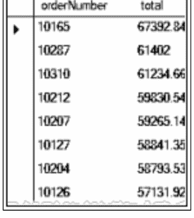

## 基于另一个 SQL 视图创建 SQL 视图

MySQL 服务器允许基于另一个视图创建新视图。例如，你可以基于我们之前创建的“SalesPerOrder”视图，使用以下语法产生一个名为“BigSalesOrder”的视图，以显示总额超过 60,000 的每笔销售订单：

```sql
CREATE VIEW BigSalesOrder AS
SELECT
  orderNumber, ROUND(total,2) as total
FROM
  salePerOrder
WHERE
  total > 60000;
```

现在，你可以像下面这样轻松地从“BigSalesOrder”视图中检索所需数据：

```sql
SELECT
  orderNumber, total
FROM
  BigSalesOrder;
```

| | orderNumber | total |
|---|---|---|
| ▶ | 10165 | 67392.85 |
| | 10287 | 61402.00 |
| | 10310 | 61234.67 |

## 使用 JOIN 子句创建 SQL 视图

MySQL 数据库允许你使用“JOIN”子句创建“SQL 视图”。例如，可以使用带有“INNER JOIN”子句的以下查询来创建一个包含“订单号”、“客户姓名”和“每笔订单总销售额”的视图：

```sql
CREATE VIEW customerOrders AS
SELECT
  d.orderNumber,
  customerName,
  SUM (quantityOrdered * priceEach) total
FROM
  orderDetails d
    INNER JOIN
  orders o ON o.orderNumber = d.orderNumber
    INNER JOIN
  customers c ON c.customerNumber = o.customerNumber
GROUP BY d.orderNumber
ORDER BY total DESC;
```

你可以使用以下语法从“customerOrders”视图中检索所需数据：

```sql
SELECT
  *
FROM
  customerOrders;
```

“结果集”如下图所示：


## 使用子查询创建 SQL 视图

下面的查询可用于生成一个带有“子查询”的“SQL 视图”，包含采购价格高于平均产品价格的产品。

```sql
CREATE VIEW aboveAvgProducts AS
  SELECT
    productCode, productName, buyPrice
  FROM
    products
  WHERE
    buyPrice >
      (SELECT AVG(buyPrice) FROM products);
```


```sql
(SELECT
        AVG(buyPrice)
    FROM
        products)
    ORDER BY buyPrice DESC;"
```

从`aboveAvgProducts`视图中提取数据的查询更加简单，如下图所示：

```sql
SELECT
    *
FROM
    aboveAvgProducts;
```

“结果集”显示在下图中：

| productCode | productName | buyPrice |
|---|---|---:|
| S10_4962 | 1962 Lancia Delta 16V | 103.42 |
| S18_2238 | 1998 Chrysler Plymouth Prowler | 101.51 |
| S10_1949 | 1952 Alpine Renault 1300 | 98.58 |
| S24_3856 | 1956 Porsche 356A Coupe | 98.3 |
| S12_1108 | 2001 Ferrari Enzo | 95.59 |
| S12_1099 | 1968 Ford Mustang | 95.34 |
| S18_1984 | 1995 Honda Civic | 93.89 |
| S18_4027 | 1970 Triumph Spitfire | 91.92 |

#### 可更新的 SQL 视图

MySQL 服务器不仅提供了查询视图的能力，还提供了更新视图的能力。可以使用`INSERT`或`UPDATE`语句通过可更新的`MySQL 视图`来添加和编辑底层表的记录。此外，还可以使用`DELETE`语句通过可更新的`MySQL 视图`从底层表中删除记录。

此外，用于生成和定义可更新视图的`SELECT`语句不能包含以下任何函数：

- “聚合函数”，如`MIN`、`MAX`、`SUM`、`AVG`和`COUNT`。
- `DISTINCT`。
- `GROUP BY`。
- `HAVING`。
- `UNION`或`UNION ALL`。
- `LEFT JOIN`或`OUTER JOIN`。
- “在`SELECT`语句或`WHERE`子句中引用`FROM`子句中指定表的子查询”。
- “在`FROM`子句中引用不可更新的视图”。
- “仅引用字面量值”。
- “多次引用底层表的任何列”。

请记住，不能使用`TEMPTABLE`算法来生成可更新的`MySQL 视图`。

#### 示例

您可以使用以下语法，在`MySQL 示例数据库`的`offices`表基础上生成一个名为`officeInfo`的视图。这个“可更新视图”将引用`offices`表的 3 个列：`officeCode`、`phone`和`city`。

```sql
CREATE VIEW officeInfo
AS
SELECT officeCode, phone, city
FROM offices;
```

现在，如果您想从`officeInfo`视图中查询数据，可以使用以下语法轻松实现：

```sql
SELECT
*
FROM
  officeInfo;
```

“结果集”显示在下图中：

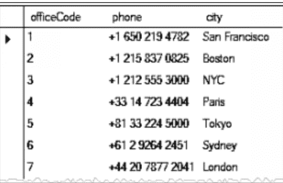

您还可以使用如下`UPDATE`语句，在`officeInfo`视图上更新`officeCode`为 4 的办公联系电话：

```sql
UPDATE officeInfo
SET
  phone = '+33 14 723 5555'
WHERE
  officeCode = 4;
```

最后，您可以使用以下语法从`officeInfo`视图中检索所需数据，以确认此次修改：

```sql
SELECT
  *
FROM
  officeInfo
WHERE
  officeCode = 4;
```

“结果集”显示在下图中：

| officeCode | phone | city |
|:---|:---|:---|
| 4 | +33 14 723 5555 | Paris |

## 检查现有视图是否可更新

通过对`information_schema`数据库中视图的`is_updatable`列运行查询，您可以验证数据库中的某个视图是否可更新。

您可以使用以下查询来显示`classicmodels`数据库中的所有视图，并检查其中哪些是可更新的：

```sql
SELECT
  table_name,
  is_updatable
FROM
  information_schema.views
WHERE
  table_schema = 'classicmodels';
```

“结果集”显示在下图中：

| table_name | is_updatable |
|:---|:---|
| aboveavgproducts | YES |
| customerorders | NO |
| officeinfo | YES |
| saleperorder | NO |

## 使用 SQL 视图删除行

为了理解这个概念，请先执行以下语法创建名为`items`的表，使用`INSERT`语句向该表中添加记录，然后使用`CREATE`子句生成一个包含价格高于`700`的项的视图。

```sql
-- create a new table named items
CREATE TABLE items (
    id INT AUTO_INCREMENT PRIMARY KEY,
    name VARCHAR(100) NOT NULL,
    price DECIMAL(11 , 2 ) NOT NULL
);
-- insert data into the items table
INSERT INTO items(name,price)
VALUES('Laptop',700.56),('Desktop',699.99),('iPad',700.50) ;
-- create a view based on items table
CREATE VIEW LuxuryItems AS
    SELECT
        *
    FROM
        items
    WHERE
        price > 700;
-- query data from the LuxuryItems view
SELECT
    *
FROM
    LuxuryItems;
```

“结果集”显示在下图中：

| id | name | price |
|---:|:---|---:|
| 1 | Laptop | 700.56 |
| 3 | iPad | 700.50 |

现在，使用`DELETE`子句删除`id`值为 3 的记录。

```sql
DELETE FROM LuxuryItems
WHERE
  id = 3;
```

运行上述查询后，您将收到一条信息，提示“1 row(s) affected”。

现在，您可以使用以下查询通过视图验证数据：

```sql
SELECT
  *
FROM
  LuxuryItems;
```

“结果集”显示在下图中：

| id | name | price |
|---:|:---|---:|
| 1 | Laptop | 700.56 |

最后，使用以下语法从底层表`items`中检索所需数据，以确认`DELETE`语句是否确实删除了该记录：

```sql
SELECT
  *
FROM
  items;
```

“结果集”显示在下图中，这证实了`id`值为 3 的行已从`items`表中删除：

| id | name | price |
|---:|:---|---:|
| 1 | Laptop | 700.56 |
| 2 | Desktop | 699.99 |

## SQL 视图的修改

在 MySQL 中，您可以使用`ALTER VIEW`和`CREATE OR REPLACE VIEW`语句对现有视图进行更改。

### 使用 ALTER VIEW 语句

`ALTER VIEW`的语法与您之前学习的`CREATE VIEW`语句非常相似，唯一的区别是使用`ALTER`关键字代替`CREATE`关键字，如下所示：

```sql
ALTER
[ALGORITHM = {MERGE | TEMPTABLE | UNDEFINED}]
VIEW [database_name].[view_name]
AS
[SELECT statement]
```

以下查询将通过在表中加入`email`列来修改`organization`视图：

```sql
ALTER VIEW organization
AS
SELECT CONCAT(E.lastname,E.firstname) AS Employee,
E.email AS employeeEmail,
CONCAT(M.lastname,M.firstname) AS Manager
FROM employees AS E
INNER JOIN employees AS M
ON M.employeeNumber = E.ReportsTo
ORDER BY Manager;
```

您可以对`organization`视图运行以下查询以验证修改：

```sql
SELECT *
FROM Organization;
```

“结果集”显示在下图中：

| Employee | employeeEmail | Manager |
|:---|:---|:---|
| JonesBarry | bjones@classicmodelcars.com | BondurGerard |
| HernandezGerard | ghernande@classicmodelcars.com | BondurGerard |
| BottLarry | lbott@classicmodelcars.com | BondurGerard |
| GerardMartin | mgerard@classicmodelcars.com | BondurGerard |
| BondurLoui | lbondur@classicmodelcars.com | BondurGerard |
| CastilloPamela | pcastillo@classicmodelcars.com | BondurGerard |
| VanaufGeorge | gvanauf@classicmodelcars.com | BowAnthony |

### 使用 CREATE OR REPLACE VIEW 语句

`CREATE OR REPLACE VIEW`可用于替换或生成数据库中已存在的 SQL 视图。对于所有现有视图，MySQL 将直接修改该视图；如果视图不存在，它将根据查询创建新视图。

可以使用以下语法在`employees`表的基础上生成`contacts`视图：

```sql
CREATE OR REPLACE VIEW contacts AS
    SELECT
        firstName, lastName, extension, email
    FROM
        employees;
```

“结果集”显示在下图中：

| firstName | lastName | extension | email |
|:---|:---|:---|:---|
| Diane | Murphy | x5800 | dmurphy@classicmodelcars.com |
| Mary | Patterson | x4611 | mpatterson@classicmodelcars.com |
| Jeff | Firrelli | x9273 | jfirrelli@classicmodelcars.com |
| William | Patterson | x4871 | wpatterson@classicmodelcars.com |
| Gerard | Bondur | x5408 | gbondur@classicmodelcars.com |
| Anthony | Bow | x5428 | abow@classicmodelcars.com |
| Leslie | Jennings | x3291 | ljennings@classicmodelcars.com |

现在，假设您想在`contacts`视图中插入`jobtitle`列。您可以使用以下语法来实现：

```sql
CREATE OR REPLACE VIEW contacts AS
SELECT
    firstName,
    lastName,
    extension,
    email,
    jobtitle
FROM
    employees;
```

“结果集”显示在下图中：

| firstName | lastName | extension | email | jobtitle |
|:---|:---|:---|:---|:---|
| Diane | Murphy | x5600 | dmurphy@classicmodelcars.com | President |
| Mary | Patterson | x4611 | mpatterson@classicmodelcars.com | VP Sales |
| Jeff | Firrelli | x3273 | jfirrelli@classicmodelcars.com | VP Marketing |
| William | Patterson | x4671 | wpatterson@classicmodelcars.com | Sales Manager (APAC) |
| Gerard | Bondur | x5408 | gbondur@classicmodelcars.com | Sales Manager (EMEA) |
| Anthony | Bow | x5428 | abow@classicmodelcars.com | Sales Manager (NA) |
| Leslie | Jennings | x3291 | ljennings@classicmodelcars.com | Sales Rep |

## 删除 SQL 视图

`DROP VIEW`语句可用于从数据库中删除现有视图，其语法如下：

```sql
DROP VIEW [IF EXISTS] [database_name].[view_name]
```

上述语句中的`IF EXISTS`子句不是强制性的，用于确定视图是否已存在于数据库中。它可以防止您误删数据库中不存在的视图。

例如，您可以使用如下语法中的`DROP VIEW`语句来删除`organization`视图：

```sql
DROP VIEW IF EXISTS organization;
```

### SQL 事务

事务可以定义为“针对数据库执行的一个工作单元”。它们是以“逻辑顺序”执行的“单元或工作序列”，可由用户手动执行，也可由数据库程序自动执行。

简单来说，它们是“一次或多次数据库修改的集合”。例如，如果您在表中创建一行、更新一行或删除一行，这意味着您在该表上执行了一个事务。为了维护数据完整性并处理数据库错误，对这些事务进行管理至关重要。

基本上，要执行一个事务，您必须将多个 SQL 查询分组并同时运行。

#### 事务的属性

事务的基本属性可以使用缩写词`ACID`来定义，对应以下属性：

- **原子性 (Atomicity)** – 保证工作单元中分组的所有操作都能成功完成。否则，在失败点，事务将被终止，所有之前的操作都将回滚到原始状态。
- **一致性 (Consistency)** – 确保当事务正确提交时，数据库状态也得到正确更新。
- **隔离性 (Isolation)** – 允许事务独立且透明地执行。
- **持久性 (Durability)** – 确保在系统发生故障的情况下，已提交事务的结果或影响依然存在。

为了更详细地解释这个概念，请考虑在`MySQL 示例数据库`中添加新销售订单的以下步骤：

首先从`orders`表中查询最新的销售订单号，并利用下一个销售订单号作为新的订单号。

然后使用`INSERT`子句将新的销售订单添加到`orders`表中。

接下来，检索上一步中插入的销售订单号。

现在，将新的销售订单项目插入到包含销售订单号的`orderdetails`表中。

最后，为了验证修改，从`orders`和`orderdetails`两个表中选择数据。

试想一下，如果这里列出的任何一个步骤因为某种原因失败了，销售订单数据将如何被修改。例如，如果将订单项目插入到`orderdetails`表的步骤失败，将导致产生一个空销售订单。

这就是使用事务处理作为安全措施的地方。您可以执行 MySQL 事务来运行一组操作，确保数据库不会包含任何部分操作。当并发处理多个操作时，如果其中任何一个操作失败，就可以触发回滚（`rollback`）。如果没有失败，所有语句都将被提交（`committed`）到数据库中。

#### MySQL 事务语句

MySQL 提供了以下用于控制事务的语句：

- 用于启动事务，使用`START TRANSACTION`语句。`BEGIN`或`BEGIN WORK`语句与`START TRANSACTION`相同。
- 用于提交当前事务并使修改永久生效，使用`COMMIT`语句。
- 通过使用`ROLLBACK`声明，您可以简单地撤销当前事务并使其修改失效。
- 通过使用`SET auto-commit`语句，您可以为当前事务停用或启用自动提交模式。

默认情况下，MySQL 被设计为将修改永久提交到数据库。通过使用以下语句，您可以强制 MySQL 默认不提交修改：

```sql
SET autocommit = 0;
```


或者：

```sql
SET autocommit = OFF;
```

要重新激活自动提交的默认模式，可以使用以下语法：

```sql
SET autocommit = ON;
```

### 示例

让我们利用下方图片中显示的“MySQL 示例数据库”的`orders`和`orderDetails`表来进一步理解这个概念。

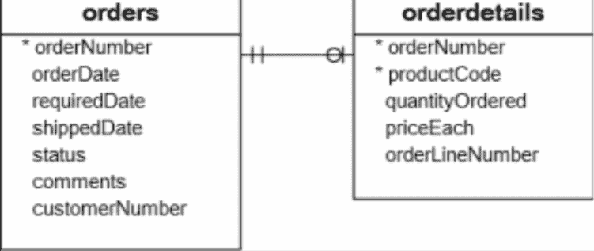

## `COMMIT` 事务

您必须首先将 SQL 语句拆分为逻辑部分，以便有效地使用事务并评估何时需要提交或回滚事务。

以下步骤显示了如何生成一个新的“销售订单”：

- 使用`START TRANSACTION`语句开始事务。
- 从`orders`表中选择最新的“销售订单号”，并使用随后的“订单号”作为新的“订单号”。
- 在`orders`表中“插入 (Insert)”一个新的销售订单。
- 将销售订单项目“插入 (Insert)”到`orderdetails`表中。
- 最后，使用`COMMIT`语句提交事务。

您可以像下面语法所示，利用`orders`和`orderdetails`表中的数据来验证新的“销售订单”：

```sql
-- start a new transaction
START TRANSACTION;

-- Get the latest order number
SELECT
    @orderNumber := MAX(orderNUmber) + 1
FROM
    orders;

-- insert a new order for customer 145
INSERT INTO orders (
    orderNumber,
    orderDate,
    requiredDate,
    shippedDate,
    status,
    customerNumber
)
VALUES (
    @orderNumber,
    '2005-05-31',
    '2005-06-10',
    '2005-06-11',
    'In Process',
    145
);
```

### 插入订单行项目

```sql
INSERT INTO orderdetails (
    orderNumber,
    productCode,
    quantityOrdered,
    priceEach,
    orderLineNumber
)
VALUES
    (@orderNumber, 'S18_1749', 30, '136', 1),
    (@orderNumber, 'S18_2248', 50, '55.09', 2);
```

### 提交更改

```sql
COMMIT;
```

“结果集”显示在下图中：

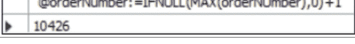

使用下面的查询，您可以检索刚刚创建的新销售订单：

```sql
SELECT
    a.orderNumber,
    orderDate,
    requiredDate,
    shippedDate,
    status,
    comments,
    customerNumber,
    orderLineNumber,
    productCode,
    quantityOrdered,
    priceEach
FROM
    orders a
    INNER JOIN orderdetails b USING (orderNumber)
WHERE
    a.ordernumber = 10426;
```

“结果集”显示在下图中：

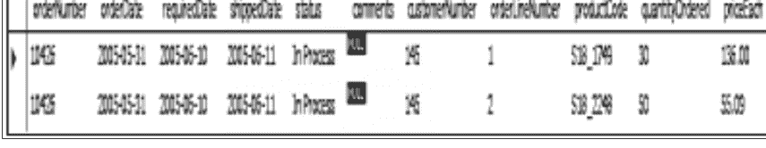

## `ROLLBACK` 事务

这里的第一步是使用以下语句删除`orders`表中的数据：

```sql
mysql> START TRANSACTION;
Query OK, 0 rows affected (0.00 sec)

mysql> DELETE FROM orders;
Query OK, 327 rows affected (0.03 sec)
```

从上述查询的输出可以明显看出，`orders`表中的所有记录已被删除。

现在，您需要在另一个会话中登录“MySQL 数据库服务器”，并对`orders`表运行以下查询。

```sql
mysql> SELECT COUNT(*) FROM orders;
+----------+
| COUNT(*) |
+----------+
|   327    |
+----------+
1 row in set (0.00 sec)
```

来自`orders`表的数据仍然可以在第二个会话中查看。

在第一个会话中所做的更改不是永久性的，因此您需要对其进行提交（commit）或回滚（roll back）。假设您想撤销第一个会话中的更改，请使用以下查询：

```sql
mysql> ROLLBACK;

Query OK, 0 rows affected (0.04 sec)
```

可以使用以下语法验证第一个会话中`orders`表的数据：

```sql
mysql> SELECT COUNT(*) FROM orders;

+----------+
| COUNT(*) |
+----------+
|   327    |
+----------+
1 row in set (0.00 sec)
```

从上面的“结果集”中可以看出，修改已被回滚。

## `SAVEPOINT` 事务

`SAVEPOINT`被定义为“事务中的一个点，您可以将事务回滚到该特定点，而无需回滚整个事务”，如下面的语法所示：

```sql
SAVEPOINT SAVEPOINT_NAME;
```

上述查询仅用于在所有事务语句中创建`SAVEPOINT`，随后可以使用`ROLLBACK`查询来撤回所需的事务，如下面的查询所示：

```sql
ROLLBACK TO SAVEPOINT_NAME;
```

例如，假设您有一个如下图所示的`customers`表，想要删除 3 行数据，并在每次删除前创建`SAVEPOINT`，然后根据需要将更改`ROLLBACK`到之前的状态。

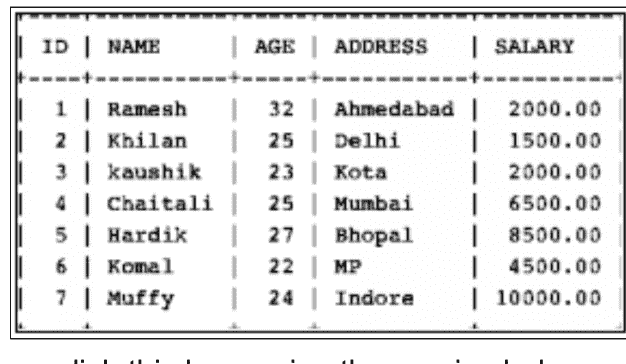

您可以通过运行以下查询来实现：

```sql
SQL> SAVEPOINT SP1;
Savepoint created.

SQL> DELETE FROM CUSTOMERS WHERE ID = 1;
1 row deleted.

SQL> SAVEPOINT SP2;
Savepoint created.

SQL> DELETE FROM CUSTOMERS WHERE ID = 2;
1 row deleted.

SQL> SAVEPOINT SP3;
Savepoint created.

SQL> DELETE FROM CUSTOMERS WHERE ID = 3;
1 row deleted.
```

通过上述查询，您已成功删除了 3 条记录，现在可以使用下面的查询将更改`ROLLBACK`到名为`SP2`的`SAVEPOINT`。由于`SP2`是在第一次删除后生成的，因此最后两次删除将被回滚：

```sql
SQL> ROLLBACK TO SP2;
```

回滚完成。

“结果集”显示在下图中：

| ID | NAME    | AGE | ADDRESS | SALARY    |
|----|---------|-----|---------|-----------|
| 2  | Khilan  | 25  | Delhi   | 1500.00   |
| 3  | Kaushik | 23  | Kota    | 2000.00   |
| 4  | Chaitali| 25  | Mumbai  | 6500.00   |
| 5  | Hardik  | 27  | Bhopal  | 8500.00   |
| 6  | Komal   | 22  | MP      | 4500.00   |
| 7  | Muffy   | 24  | Indore  | 10000.00  |

## `RELEASE SAVEPOINT` 事务

`RELEASE SAVEPOINT`可用于删除之前生成的`SAVEPOINT`，如下面的语法所示：

```sql
RELEASE SAVEPOINT SAVEPOINT_NAME;
```

请记住，一旦运行上述查询，就没有任何功能可以撤销在最后一个`SAVEPOINT`之后执行的事务。

## `SET TRANSACTION`

`SET TRANSACTION`可用于通过指定后续事务的特性来启动事务。例如，使用以下语法，可以将事务设置为“仅读写”：

```sql
SET TRANSACTION [ READ WRITE | READ ONLY ];
```

### 数据库恢复模型

恢复模型可以定义为“一种数据库属性，用于控制事务如何记录、事务日志是否需要且允许备份，以及可执行哪些类型的还原操作”。它是一个数据库配置选项，指定了可以执行的备份类型，并在发生故障时使数据能够被还原或恢复。“SQL Server 恢复模型”共有 3 种类型：

### `SIMPLE`（简单模型）

该模型被认为是所有现有恢复模型中最简单的一种。它提供“完整、差异和文件级”备份。然而，它不支持事务日志备份。每当 SQL Server 背景进程的检查点（checkpoint）操作发生时，日志空间将被重用。日志文件的非活动部分将被删除并可供重新使用。

该模型不支持时间点还原和页面还原，仅能还原次要的只读文件。

### `FULL`（完整模型）

在`FULL`恢复模型中，事务日志文件中的所有类型事务（包括 DDL（数据定义语言）和 DML（数据操纵语言））都可以被完整记录。日志序列保持不变，用于数据库的还原活动。与“简单恢复模型”不同，在`CHECKPOINT`事务期间，“事务日志”文件不会被自动截断。

它支持所有还原活动，例如“时间点还原、页面还原和文件还原”。

### Bulk Logged（大容量日志模型）

“大容量日志恢复模型”是一个独特的数据库配置选项，它产生与`FULL`恢复模型类似的结果，但某些“大容量操作”仅能进行最小化记录。“事务日志”文件使用一种称为“大容量操作最小日志记录”的方法。其缺陷是无法还原到特定的时间点。

## `SQL BACKUP DATABASE` 语句

`BACKUP DATABASE`语句可用于为 SQL 服务器上已存在的数据库生成完整备份，如下面的语法所示：

```sql
BACKUP DATABASE databasename
TO DISK = 'filepath';
```

## `SQL BACKUP WITH DIFFERENTIAL` 语句

“差异备份”用于选择性地备份在上次“数据库完整备份”之后被修改的数据库部分，如下面的语法所示：

```sql
BACKUP DATABASE databasename
TO DISK = 'filepath'
WITH DIFFERENTIAL;
```

### 示例

假设您有一个名为`testDB`的数据库，并且想要为其创建完整备份。为此，您可以使用以下查询：

```sql
BACKUP DATABASE testDB
TO DISK = 'D:\backups\testDB.bak';
```

现在，如果您在运行上述查询后对数据库进行了修改，可以使用以下查询为这些修改创建备份：

```sql
BACKUP DATABASE testDB
TO DISK = 'D:\backups\testDB.bak'
WITH DIFFERENTIAL;
```

### 还原数据库

还原（Restoration）可以定义为“将数据从备份中复制并向该数据应用已记录事务”的方法。生成的备份文件（如前所述）用于将数据库返回到之前的状态。实现这一目标有几种方法：

#### T-SQL

该方法的语法如下：

```sql
RESTORE DATABASE <Your database name>
FROM DISK = '<Backup file location + file name>';
```

例如，可以使用以下查询，利用位于`D:\`且名为`TestDB_Full.bak`的备份文件来还原名为`TestDB`的数据库：

```sql
RESTORE DATABASE TestDB
FROM DISK = 'D:\TestDB_Full.bak'
WITH REPLACE;
```

#### `SSMS (SQL Server Management Studio)`

首先连接到`TESTINSTANCE`数据库，然后右键单击数据库文件夹，点击“还原数据库（Restore database）”，如下图所示。

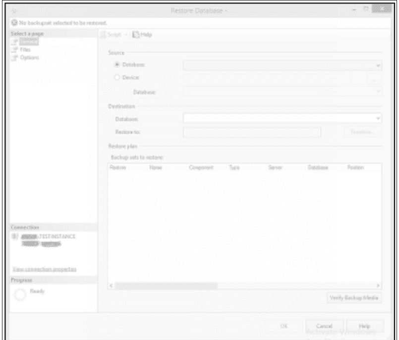

现在，要选择备份文件（如下图所示），请“选择设备单选按钮并点击省略号”。

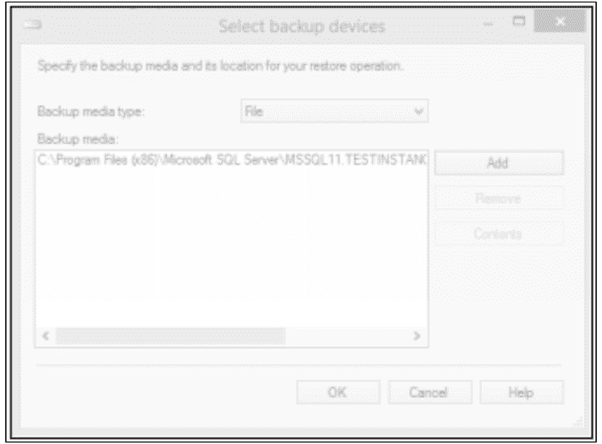

接着点击确定，将显示如下窗口。

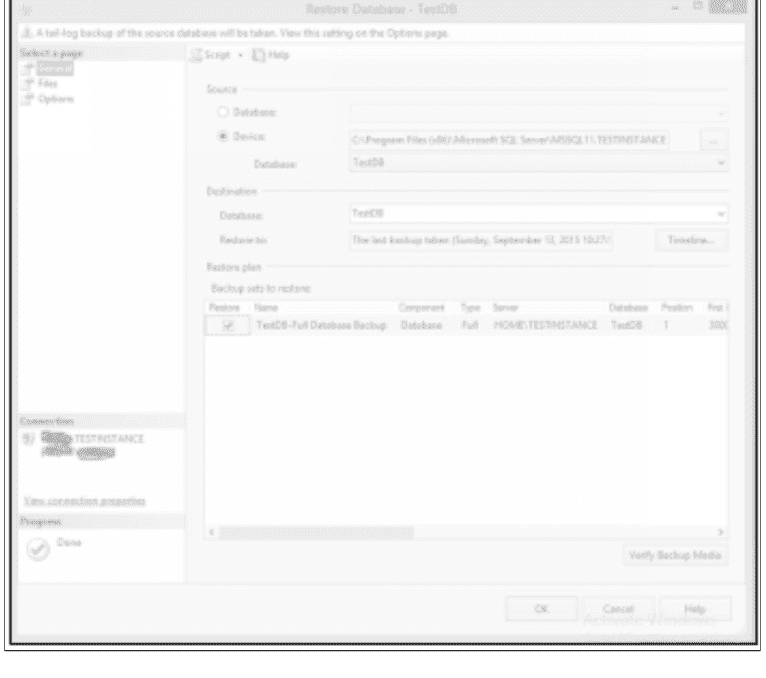

现在，从“屏幕左上角选择文件（Files）选项”，如下图所示：

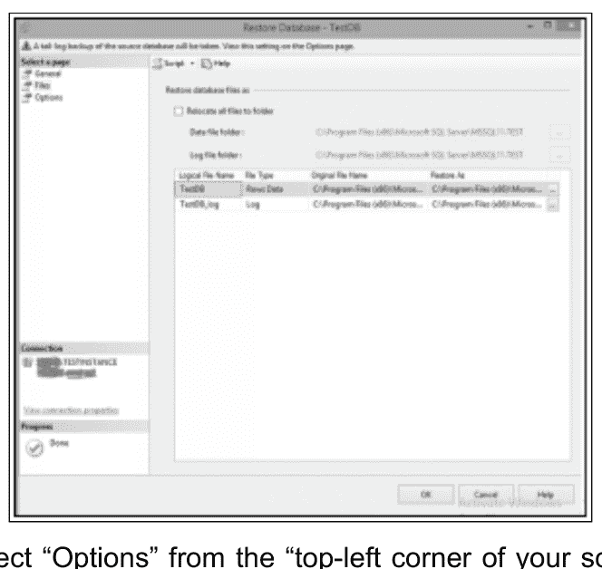

最后，从“屏幕左上角”选择“选项（Options）”并点击“确定（OK）”以还原`TestDB`数据库，如下图所示：

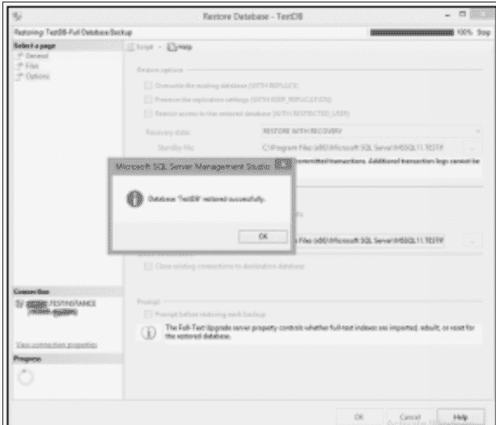

## 第 5 章：数据库安全与管理

MySQL 拥有一个集成的高级访问控制和权限系统，能够为用户活动生成广泛的访问指南，并有效防止未经授权的用户访问数据库系统。

当用户连接到服务器时，MySQL 访问控制系统分为两个阶段：

**连接验证**：每个用户必须拥有有效的用户名和密码，并且连接到“MySQL 数据库服务器”。此外，用户用于连接的主机必须与“MySQL 授权表”中的主机一致。

**请求验证**：在为用户执行的每个查询建立有效链接后，MySQL 将验证该用户是否具有运行该特定查询所需的权限。MySQL 能够在数据库、表和字段级别检查用户权限。

MySQL 安装程序会自动生成一个名为`mysql`的数据库。`mysql 数据库`由 5 个主要的授权表组成。通过使用`GRANT`和`REVOKE`语句，可以间接操作这些表。

**User**：包含“用户账户”和“全局权限”列。MySQL 使用这些用户表来接受或拒绝来自主机的连接。在`user 表`中授予的权限适用于`MySQL 服务器`上的所有数据库。

**Database**：包含“数据库级别”的权限。MySQL 利用`db_table`来评估用户可以访问和托管连接的数据库。`db_table`中的“数据库级别”权限适用于该特定数据库以及该数据库中所有可用对象，例如“表、触发器、视图、存储过程”等。

**`table_priv`** 和 **`columns_priv`**：包括“表级”和“列级”权限。在`table_priv`表中授予的权限适用于特定表及其所有列，而另一方面，在`columns_priv`表中授予的权限仅适用于表中的特定列。

**`procs_priv`**：包括“存储函数”和“存储过程”的权限。

MySQL 使用上述表格来管理 MySQL 数据库服务器的权限。在实施自己的动态访问控制系统之前，理解这些表格是极其重要的。

### 创建用户账户

在 MySQL 中，你不仅可以指定哪个用户允许连接到数据库服务器，还可以指定用户可以使用哪个主机来建立连接。因此，MySQL 中为每个用户账户生成并以“@”字符分隔的“用户名”和“主机名”。

例如，如果一个“管理员用户”从`localhost`连接到“MySQL 数据库服务器”，则该用户账户将被命名为`admin@localhost`。然而，如果`admin_user`仅允许使用`localhost`或远程主机（如`mysqltutorial.org`）连接到“MySQL 数据库服务器”，这确保了 MySQL 数据库服务器具有更高的安全性。

此外，通过合并“用户名”和“主机”，可以配置具有相同名称的各种账户，并且仍然能够从不同的主机连接，同时根据需要赋予不同的权限。

在“mysql 数据库”中，所有用户账户都存储在`user`表中。

## 使用`MySQL CREATE USER`语句

`CREATE USER`与 MySQL 服务器一起用于设置新用户账户，语法如下所示：

```sql
CREATE USER user_account
IDENTIFIED BY password;
```

在上面的语法中，`CREATE USER`子句后跟以“用户名 @ 主机名”格式表示的用户账户名称。

在`IDENTIFIED BY`子句中，将指定用户密码。需要注意的是，密码是以纯文本形式指定的。在用户账户保存到`user`表之前，MySQL 需要加密“用户密码”。

例如，`CREATE USER`语句可以如下所示使用，用于创建一个新的“用户 dbadmin”，该用户从`localhost`使用密码`SECRET`连接到“MySQL 数据库服务器”。

```sql
CREATE USER dbadmin@localhost
IDENTIFIED BY 'SECRET';
```

如果你想检查“用户账户的权限”，可以运行以下语法：


`SHOW GRANTS FOR dbadmin@localhost;`

| Grants for dbadmin@localhost |
| :--- |
| GRANT USAGE ON *.* TO `dbadmin`@`localhost` |

`1 row in set (0.00 sec)`

上面结果集中的`*.*`表示 “dbadmin 用户” 账户仅被允许登录服务器，并且没有其他访问权限。

请记住，点号 (.) 之前的部分代表数据库，点号 (.) 之后的部分代表表，例如 “database.table”。

百分号 (%) 通配符可用于以下语法，以允许用户从任何主机创建连接：

```
CREATE USER superadmin@'%'
IDENTIFIED BY 'secret';
```

百分号 (%) 通配符将导致与在 “LIKE” 运算符中包含时相同的结果，例如，要使 “mysqladmin 用户” 账户能够从 “mysqltutorial.org” 主机的任何“子域”连接到服务器，可以使用如下所示语法中的百分号 (%) 通配符：

```
CREATE USER mysqladmin@'%.mysqltutorial.org'
IDENTIFIED by 'secret';
```

这里还应注意，另一个通配符下划线 (_) 也可用于 `CREATE USER` 语句中。

如果用户名部分从用户账户中省略，服务器将识别它并允许用户从任何主机连接。例如，以下语法将生成一个新的远程用户账户，允许从任何主机连接到服务器：

```
CREATE USER remote;
```

要查看授予 “remote” 账户的权限，可以使用以下语法：

```
SHOW GRANTS FOR remote;
+---------------------------------------------+
| Grants for remote@%                          |
+---------------------------------------------+
| GRANT USAGE ON *.* TO `remote`@`%`          |
+---------------------------------------------+
1 row in set (0.00 sec)
```

有必要记住，上面语法中的单引号 (' ') 特别重要，如果用户账户具有特殊字符（如“下划线”或“百分号”）。

如果你无意中将用户账户引用为 “username@hostname”，服务器将创建一个名为 “username@hostname” 的用户，并允许用户从任何主机连接，这可能不是预期的。

例如，以下语法可用于生成一个名为 “api@localhost” 的新账户，该账户可以从任何主机连接到 “MySQL 数据库服务器”。

```
CREATE USER 'api@localhost';
```

```
SHOW GRANTS FOR 'api@localhost';
+----------------------------------+
| Grants for api@localhost@%       |
+----------------------------------+
| GRANT USAGE ON *.* TO `api@localhost`@`%` |
+----------------------------------+
1 row in set (0.00 sec)
```

如果你意外生成了一个数据库中已存在的用户，MySQL 将发出错误。例如，以下语法可用于生成一个名为 “remote” 的新用户账户：

```
CREATE USER remote;
```

屏幕上将显示以下错误消息：

```
ERROR 1396 (HY000): Operation CREATE USER failed for 'remote'@'%'
```

需要注意的是，`CREATE USER` 语句只会创建一个没有权限的新用户。`GRANT` 语句可用于向用户授予访问权限。

## 更新 “USER PASSWORD”

在更改 MySQL 用户账户密码之前，应考虑以下事项：

1. 你想要更改密码的用户账户。
2. 与你想要更改密码的用户账户一起使用的应用程序。如果更改密码而不更改该用户账户使用的应用程序连接字符串，则这些应用程序将无法连接到数据库服务器。

MySQL 提供了多种可用于更改用户密码的语句，例如 `UPDATE`、`SET PASSWORD` 和 `GRANT USAGE` 语句。

让我们探索其中一些语法！

## 使用 `UPDATE` 语句

`UPDATE` 可用于更新 `mysql` 数据库中的 `user` 表。在通过执行 `UPDATE` 语句更改密码后，你还必须运行 `FLUSH PRIVILEGES` 语句来从 `mysql` 数据库中的 `grant` 表刷新权限。

假设你想修改从 `localhost` 连接到 “dolphin” 的 `dbadmin` 用户的密码。你可以通过执行以下查询来完成此操作：

```
USE mysql;
UPDATE user
SET password = PASSWORD('dolphin')
WHERE user = 'dbadmin' AND
    host = 'localhost';
FLUSH PRIVILEGES;
```

## 使用 `SET PASSWORD` 语句

为了更新用户密码，使用 “user@host” 格式。现在，假设你想修改其他用户账户的密码，那么你需要在你的用户账户上具有 `UPDATE` 权限。

使用 `SET PASSWORD` 语句时，不需要执行 `FLUSH PRIVILEGES` 语句来从 `mysql` 数据库中的 `grant` 表重新加载权限。

可以使用以下语法通过执行 `SET PASSWORD` 语句来更改 `dbadmin` 用户账户密码：

```
SET PASSWORD FOR 'dbadmin'@'localhost' = PASSWORD('bigshark');
```

## 使用 `ALTER USER` 语句

另一种更改用户密码的方法是使用带有 `IDENTIFIED BY` 子句的 `ALTER USER` 语句。例如，可以执行以下查询将 `dbadmin` 用户的密码更改为 “littlewhale”。

```
ALTER USER dbadmin@localhost IDENTIFIED BY 'littlewhale';
```

***实用提示***

如果你需要更改 MySQL “root 账户” 的密码，那么你需要强制退出 “MySQL 数据库服务器” 并在不触发 “grant 表验证” 的情况下重新启动服务器。

## 授予用户权限

创建新用户账户时，默认情况下不会向用户授予任何访问权限。必须使用 `GRANT` 语句来“向用户账户授予权限”。`GRANT` 语句语法如下所示：

```
GRANT privilege, [privilege],.. ON privilege_level
TO user [IDENTIFIED BY password]
[REQUIRE tsl_option]
[WITH [GRANT_OPTION | resource_option]];
```

在上面的语法中，我们首先在 `GRANT` 子句后指定一个或多个权限。每个被授予的权限...

如果希望同时为用户账户授予多个权限，必须使用“逗号”将用户账户隔开。（下表列出了可以“授予用户账户”的潜在权限列表）。

之后，您必须指定 “privilege_level”（权限级别），它将决定权限适用的级别。MySQL 支持的权限级别包括 “全局 (*. *)”、“数据库 (database. *)”、“表 (database.table)”和“列”级别。如果您使用“列”权限级别，必须指定单个或多个列（在每个权限后列出以逗号分隔的列列表）。

接下来，您需要指定需要被授予权限的用户。如果在服务器上能找到指定的用户，则 `GRANT` 语句将修改其权限；否则，`GRANT` 语句将创建一个新的用户账户。`IDENTIFIED BY` 子句不是强制性的，它可以为用户创建新密码。

随后，需指明用户是否需要通过“安全连接”（如 `SSL`、`X509` 等）连接到数据库。

最后，添加 `WITH GRANT OPTION` 子句。该子句不是强制性的，但它允许用户授予或撤销其他用户的权限，只要这些权限已“授予您自己的用户账户”。此外，`WITH` 子句还可用于分配 MySQL 数据库服务器的资源，例如，限制用户每小时可使用的连接数或语句数。在像 “MySQL 共享托管” 这样的共享环境中，`WITH` 子句极其有用。

请注意，`GRANT OPTION` 权限以及您希望授予其他用户的权限必须已经配置在您的用户账户中，这样您才能使用 `GRANT` 语句。如果允许了只读系统变量，那么执行 `GRANT` 语句则需要 `SUPER` 权限。

| 权限 | 描述 | 全局 | 数据库 | 表 | 列 | 存储过程 | 代理 |
| :--- | :--- | :---: | :---: | :---: | :---: | :---: | :---: |
| "ALL" | "授予指定访问级别的所有权限，但 GRANT OPTION 除外" | Y | Y | Y | Y | Y | Y |
| "ALTER" | "允许用户使用 ALTER TABLE 语句" | Y | Y | Y | | | |
| "ALTER ROUTINE" | "允许用户修改或删除存储例程" | Y | | | | | Y |
| "CREATE" | "允许用户创建数据库和表" | Y | Y | Y | | | |
| "CREATE ROUTINE" | "允许用户创建存储例程" | Y | | | | | |
| "CREATE TABLESPACE" | "允许用户创建、修改或删除表空间和日志文件组" | Y | | | | | |
| "CREATE TEMPORARY TABLES" | "允许用户通过使用 CREATE TEMPORARY TABLE 创建临时表" | Y | Y | | | | |
| "CREATE USER" | "允许用户使用 CREATE USER, DROP USER, RENAME USER, 和 REVOKE ALL PRIVILEGES 语句" | Y | | | | | |
| "CREATE VIEW" | "允许用户创建或修改视图" | Y | Y | Y | | | |
| "DELETE" | "允许用户使用 DELETE" | Y | Y | Y | | | |
| "DROP" | "允许用户删除数据库、表和视图" | Y | Y | Y | | | |
| "EVENT" | "为事件调度器启用事件的使用" | Y | Y | | | | |
| "EXECUTE" | "允许用户执行存储例程" | Y | Y | Y | | | |
| "FILE" | "允许用户读取数据库目录中的任何文件" | Y | | | | | |
| "GRANT OPTION" | "允许用户拥有向其他账户授予或撤销权限的权限" | Y | Y | Y | | Y | Y |
| "INDEX" | "允许用户创建或删除索引" | Y | Y | Y | | | |
| "INSERT" | "允许用户使用 INSERT 语句" | Y | Y | Y | Y | | |
| "LOCK TABLES" | "允许用户对拥有 SELECT 权限的表使用 LOCK TABLES" | Y | Y | | | | |
| "PROCESS" | "允许用户通过 SHOW PROCESSLIST 语句查看所有进程" | Y | | | | | |
| "PROXY" | "启用用户代理" | | | | | | |
| REFERENCES | "允许用户创建外键" | Y | Y | Y | Y | | |
| "RELOAD" | "允许用户使用 FLUSH 操作" | Y | | | | | |
| "REPLICATION CLIENT" | "允许用户通过查询查看主服务器或从服务器的位置" | Y | | | | | |
| "REPLICATION SLAVE" | "允许从服务器从主服务器读取二进制日志事件" | Y | | | | | |
| "SELECT" | "允许用户使用 SELECT 语句" | Y | Y | Y | | | |
| "SHOW DATABASES" | "允许用户显示所有数据库" | Y | | | | | |
| "SHOW VIEW" | "允许用户使用 SHOW CREATE VIEW 语句" | Y | Y | Y | | | |
| "SHUTDOWN" | "允许用户使用 mysqladmin shutdown 命令" | Y | | | | | |
| "SUPER" | "允许用户执行其他管理操作，如 CHANGE MASTER TO, KILL, PURGE BINARY LOGS, SET GLOBAL 以及 mysqladmin 命令" | Y | | | | | |
| "TRIGGER" | "允许用户使用 TRIGGER 操作" | Y | Y | Y | | | |
| "UPDATE" | "允许用户使用 UPDATE 语句" | Y | Y | Y | | | |
| "USAGE" | "相当于没有权限" | | | | | | |

#### 示例

通常情况下，会先使用 `CREATE USER` 语句创建新用户账户，然后使用 `GRANT` 语句分配用户权限。

例如，可以通过执行以下 `CREATE USER` 语句来创建一个新的 “超级用户” 账户：

```
CREATE USER super@localhost IDENTIFIED BY 'dolphin';
```

为了检查授予 `super@localhost` 用户的权限，可以使用包含 `SHOW GRANTS` 语句的以下查询。

```
SHOW GRANTS FOR super@localhost;
```

```
+---------------------------------------------+
| Grants for super@localhost                  |
+---------------------------------------------+
| GRANT USAGE ON *.* TO `super`@`localhost`   |
+---------------------------------------------+
```

1 row in set (0.00 sec)

现在，如果您想将所有权限分配给 `super@localhost` 用户，可以使用包含 `GRANT ALL` 语句的以下查询。

```
GRANT ALL ON *.* TO 'super'@'localhost' WITH GRANT OPTION;
```

`ON *. *` 子句指的是所有数据库及其内部的所有项。`WITH GRANT OPTION` 使得 `super@localhost` 能够将权限分配给其他用户账户。

此时如果再次使用 `SHOW GRANTS` 语句，可以看到 `super@localhost` 用户的权限已被修改，如下面的语法和 “结果集” 所示：

```
SHOW GRANTS FOR super@localhost;
```

```
+-------------------------------------------------------------------------------+
| Grants for super@localhost                                                    |
+-------------------------------------------------------------------------------+
| GRANT ALL PRIVILEGES ON *.* TO `super`@`localhost` WITH GRANT OPTION            |
+-------------------------------------------------------------------------------+
```

1 row in set (0.00 sec)

现在，假设您想在 “classicmodels 示例数据库” 中创建一个拥有所有服务器权限的新用户账户。您可以通过使用以下查询来实现：

```
CREATE USER auditor@localhost IDENTIFIED BY 'whale';
GRANT ALL ON classicmodels.* TO auditor@localhost;
```

仅使用一个 `GRANT` 语句，就可以向用户账户授予多种权限。例如，要创建一个对 `classicmodels` 数据库具有执行 `SELECT`、`INSERT` 和 `UPDATE` 语句权限的用户账户，可以使用以下查询。

```
CREATE USER rfc IDENTIFIED BY 'shark';
GRANT SELECT, UPDATE, DELETE ON classicmodels.* TO rfc;
```

## 撤销用户权限

您将使用 `MySQL REVOKE` 语句来撤销任何用户账户的权限。MySQL 允许撤销一个或多个权限，甚至撤销用户账户之前被授予的所有权限。

可以使用以下查询从用户账户中撤销特定权限：

```
REVOKE privilege_type [(column_list)]
    [, priv_type [(column_list)]]...
ON [object_type] privilege_level
FROM user [, user]...
```


在上述语法中，我们首先在`REVOKE`关键字后面指定需要从用户账户中撤销的权限列表。正如您可能记得的，在语句中列出多个权限时，必须用逗号分隔。然后，我们指定`ON`子句将撤销这些权限的“权限级别”。最后，我们在`FROM`子句中指定权限将被撤销的用户账户。

```
{
	"direction": "horizontal",
	"contents": [
		{
			"type": "paragraph",
			"markdown": "请记住，您自己的用户账户必须拥有 `GRANT OPTION` 权限，以及您希望从其他用户账户撤销的权限。",
			"bbox": [0.083, 0.062, 0.917, 0.103]
		},
		{
			"type": "paragraph",
			"markdown": "如果您想要撤销用户账户的所有权限，将使用如下语法中所示的 `REVOKE` 语句：",
			"bbox": [0.083, 0.125, 0.917, 0.166]
		},
		{
			"type": "code",
			"markdown": "```\n\"REVOKE ALL PRIVILEGES, GRANT OPTION FROM user [, user] ...\"\n```",
			"bbox": [0.125, 0.180, 0.875, 0.236]
		},
		{
			"type": "paragraph",
			"markdown": "重要的是要记住，要能够执行 `REVOKE ALL` 语句，您需要拥有针对 `mysql` 数据库“全局级别”的 `CREATE USER` 或 `UPDATE` 权限。",
			"bbox": [0.083, 0.250, 0.917, 0.291]
		},
		{
			"type": "paragraph",
			"markdown": "要撤销代理用户，您将使用如下查询中所示的 `REVOKE PROXY` 子句：",
			"bbox": [0.083, 0.305, 0.917, 0.346]
		},
		{
			"type": "code",
			"markdown": "```\n\"REVOKE PROXY ON USER FROM user [, user]...\"\n```",
			"bbox": [0.125, 0.360, 0.875, 0.401]
		},
		{
			"type": "paragraph",
			"markdown": "代理用户可以定义为“一个可以冒充另一个用户的 MySQL 有效用户”。因此，代理用户能够获得被冒充用户被授予的所有权限。",
			"bbox": [0.083, 0.415, 0.917, 0.470]
		},
		{
			"type": "paragraph",
			"markdown": "The(**)",
			"bbox": [0.083, 0.484, 0.917, 0.525]
		},
		{
			"type": "paragraph",
			"markdown": "最佳实践规定，在撤销用户权限之前，您应先通过使用下面的 `SHOW GRANTS` 语句来检查已分配给用户的权限：",
			"bbox": [0.083, 0.539, 0.917, 0.580]
		},
		{
			"type": "code",
			"markdown": "```\n\"SHOW GRANTS FOR user;\"\n```",
			"bbox": [0.125, 0.594, 0.875, 0.635]
		},
		{
			"type": "title",
			"markdown": "## 示例",
			"bbox": [0.083, 0.649, 0.917, 0.690]
		},
		{
			"type": "paragraph",
			"markdown": "假设有一个名为 `rfc` 的用户，该用户对 `classicmodels` 示例数据库拥有 `SELECT`、`UPDATE` 和 `DELETE` 权限，而您希望撤销 `rfc` 用户的 `UPDATE` 和 `DELETE` 权限。要完成此操作，您可以执行以下查询。",
			"bbox": [0.083, 0.704, 0.917, 0.759]
		},
		{
			"type": "paragraph",
			"markdown": "首先，我们将使用下面的 `SHOW GRANTS` 语句来检查用户权限：",
			"bbox": [0.083, 0.773, 0.917, 0.814]
		},
		{
			"type": "code",
			"markdown": "```\n\"SHOW GRANTS FOR rfc;\"\n```",
			"bbox": [0.125, 0.828, 0.875, 0.869]
		},
		{
			"type": "code",
			"markdown": "```\nGRANT SELECT, UPDATE, DELETE ON 'classicmodels'.* TO 'rfc'@'%'\n```",
			"bbox": [0.125, 0.897, 0.875, 0.938]
		},
		{
			"type": "paragraph",
			"markdown": "此时，可以使用下面的查询从 `rfc` 用户撤销 `UPDATE` 和 `DELETE` 权限：",
			"bbox": [0.083, 0.952, 0.917, 0.993]
		},
		{
			"type": "code",
			"markdown": "```\nREVOKE UPDATE, DELETE ON classicmodels.* FROM rfc;\n```",
			"bbox": [0.125, 0.007, 0.875, 0.048]
		},
		{
			"type": "paragraph",
			"markdown": "接下来，可以使用 `SHOW GRANTS` 语句来检查 `rfc` 用户的权限。",
			"bbox": [0.083, 0.062, 0.917, 0.103]
		},
		{
			"type": "code",
			"markdown": "```\nSHOW GRANTS FOR 'rfc'@'localhost';\n```",
			"bbox": [0.125, 0.117, 0.875, 0.158]
		},
		{
			"type": "code",
			"markdown": "```\nGRANT SELECT ON 'classicmodels'.* TO 'rfc'@'%'\n```",
			"bbox": [0.125, 0.186, 0.875, 0.227]
		},
		{
			"type": "paragraph",
			"markdown": "现在，如果您想从 `rfc` 用户撤销所有权限，可以使用以下查询：",
			"bbox": [0.083, 0.241, 0.917, 0.282]
		},
		{
			"type": "code",
			"markdown": "```\nREVOKE ALL PRIVILEGES, GRANT OPTION FROM rfc;\n```",
			"bbox": [0.125, 0.296, 0.875, 0.337]
		},
		{
			"type": "paragraph",
			"markdown": "要验证 `rfc` 用户的所有权限都已被撤销，您需要使用以下查询：",
			"bbox": [0.083, 0.351, 0.917, 0.392]
		},
		{
			"type": "code",
			"markdown": "```\nSHOW GRANTS FOR rfc;\n```",
			"bbox": [0.125, 0.406, 0.875, 0.447]
		},
		{
			"type": "code",
			"markdown": "```\nGRANT USAGE ON *.* TO 'rfc'@'%'\n```",
			"bbox": [0.125, 0.461, 0.875, 0.502]
		},
		{
			"type": "paragraph",
			"markdown": "请记住，如本书前面的权限描述表中所述，`USAGE` 权限仅表示用户在服务器中没有任何权限。",
			"bbox": [0.083, 0.516, 0.917, 0.557]
		},
		{
			"type": "title",
			"markdown": "## `REVOKE` 查询的影响结果",
			"bbox": [0.083, 0.585, 0.917, 0.626]
		},
		{
			"type": "paragraph",
			"markdown": "`MySQL REVOKE` 语句的影响主要取决于授予用户账户的权限级别，具体解释如下：",
			"bbox": [0.083, 0.640, 0.917, 0.681]
		},
		{
			"type": "paragraph",
			"markdown": "对“全局权限”所做的修改仅在用户成功执行 `REVOKE` 查询后，在后续会话中连接到 MySQL 服务器时才会生效。在执行 `REVOKE` 语句期间，这些修改不会适用于连接到服务器的所有其他用户。",
			"bbox": [0.083, 0.695, 0.917, 0.750]
		},
		{
			"type": "paragraph",
			"markdown": "对数据库权限所做的修改仅在执行 `REVOKE` 查询后执行 `USE` 语句后才适用。",
			"bbox": [0.083, 0.764, 0.917, 0.805]
		},
		{
			"type": "paragraph",
			"markdown": "“表和列权限”的修改将适用于在使用 `REVOKE` 语句进行修改后执行的所有查询。",
			"bbox": [0.083, 0.062, 0.917, 0.103]
		},
		{
			"type": "title",
			"markdown": "## 总结",
			"bbox": [0.083, 0.062, 0.917, 0.103]
		},
		{
			"type": "paragraph",
			"markdown": "感谢您读完 **SQL编程终极初学者指南：学习SQL数据库和服务器的智能分步指南。如何构建SQL的进阶和精英水平**，希望本书内容丰富，并能为您提供实现目标所需的所有工具，无论您的目标是什么。",
			"bbox": [0.083, 0.117, 0.917, 0.172]
		},
		{
			"type": "paragraph",
			"markdown": "下一步是充分利用您新掌握的关于SQL编程语言的知识和学习成果，这将使您能够进入系统和数据分析的世界。您遵循本书中的说明，在您的操作系统上安装免费且开源的MySQL用户界面非常重要，这样您就可以进行实践操作，并能够创建不仅正确而且高效的SQL查询，从而在工作或求职面试中取得成功。正如生活中大多数学习一样，重复练习是实现完美的关键。因此，让本书成为您在学习关系数据库管理系统编程语言旅程中的指引明灯。为了充分利用本书，在阅读和理解所有概念和SQL查询结构时，尝试提出您自己的名称和标签，用于示例中，并验证所获得的结果集与本书中给出的结果集是否一致。",
			"bbox": [0.083, 0.186, 0.917, 0.327]
		},
		{
			"type": "paragraph",
			"markdown": "最后，如果您觉得本书对您有任何帮助，欢迎在亚马逊上留下好评！",
			"bbox": [0.083, 0.341, 0.917, 0.382]
		},
		{
			"type": "title",
			"markdown": "# 学习Java编程",
			"bbox": [0.083, 0.062, 0.917, 0.103]
		},
		{
			"type": "paragraph",
			"markdown": "针对初学者的快速学习Java的权威速成课程。使用Java代码编程的秘诀、技巧和诀窍，以及创建您的第一个程序的基础知识",
			"bbox": [0.083, 0.117, 0.917, 0.158]
		},
		{
			"type": "title",
			"markdown": "# Java简介",
			"bbox": [0.083, 0.062, 0.917, 0.103]
		},
		{
			"type": "quote",
			"markdown": "> \"一次编写，到处运行。\"",
			"bbox": [0.125, 0.117, 0.875, 0.158]
		},
		{
			"type": "paragraph",
			"markdown": "Java是一门语言。和任何语言一样，它需要时间才能精通。学习西班牙语或法语等语言使我们能够与来自该国的人们互动，而编程语言则使我们能够通过编写计算机可以理解和执行的指令来与计算机互动。",
			"bbox": [0.083, 0.172, 0.917, 0.241]
		},
		{
			"type": "paragraph",
			"markdown": "Java由Sun Microsystems于1995年发布，以其可移植性、安全性和健壮性而闻名。二十多年后，它仍然是最受欢迎的编程语言之一。",
			"bbox": [0.083, 0.255, 0.917, 0.296]
		},
		{
			"type": "paragraph",
			"markdown": "*Java虚拟机*（*JVM*）是促成这一点的主要优势之一。正是JVM允许Java代码在几乎任何操作系统（OS）上运行。Sun在发布Java时使用了 \"一次编写，到处运行\" 的口号，我们希望到本书结束时，您会明白其中的原因。",
			"bbox": [0.083, 0.310, 0.917, 0.365]
		},
		{
			"type": "paragraph",
			"markdown": "除了是一种编程语言外，Java还充当一个**平台**：执行程序的硬件或软件环境。Windows、Linux、Solaris和Mac OS是您可能已经熟悉的平台。平台本质上是操作系统和底层硬件的混合体。Java平台的独特之处在于它仅仅是软件。这就是Java实现其多功能性的原因。因为Java仅仅是软件，所以它能够在任何其他基于硬件的平台上运行。",
			"bbox": [0.083, 0.379, 0.917, 0.489]
		},
		{
			"type": "paragraph",
			"markdown": "Java平台有两个组成部分：Java应用程序编程接口（API）和Java虚拟机。API由包组成。包是包含类和接口的库。这些包被收集在API中，并提供许多有用的功能。",
			"bbox": [0.083, 0.503, 0.917, 0.572]
		},
		{
			"type": "title",
			"markdown": "## 第1章：为Java做好准备",
			"bbox": [0.083, 0.062, 0.917, 0.103]
		},
		{
			"type": "paragraph",
			"markdown": "**什么是JDK？**\n**Java开发工具包（JDK）**与**Java虚拟机（JVM）**和**Java运行时环境（JRE）**一起用于开发Java程序。这些技术是不同的，但完全相互依赖，理解它们之间的区别非常重要。Java虚拟机负责执行程序。Java运行时环境负责创建Java虚拟机。最后，Java开发工具包是程序员实际交互以开发由JVM和JRE执行的代码。",
			"bbox": [0.083, 0.117, 0.917, 0.269]
		},
		{
			"type": "paragraph",
			"markdown": "**什么是NetBeans？**\nNetBeans是一个集成开发环境（IDE）。IDE使程序员能够轻松整合开发代码的各个方面。IDE通过整合编辑源代码、开发可执行文件和调试的操作，从而提高生产力。",
			"bbox": [0.083, 0.283, 0.917, 0.380]
		},
		{
			"type": "paragraph",
			"markdown": "**安装JDK和NetBeans**\n为了开始编写代码，您需要做两件事：下载Java开发工具包和NetBeans IDE。这两者都可以通过快速的谷歌搜索找到。下载可用的最新版本（撰写本文时，JDK应为12.0.2，NetBeans应为8.0.2）。",
			"bbox": [0.083, 0.394, 0.917, 0.477]
		}
	]
}
```

## 第 2 章：HelloWorld.java

我们以所有编程语言通用的入门程序——**Hello World 程序**——开始讲起。随便找一位哪怕只是稍微接触过计算机编程的人聊一聊，都很可能他们对"Hello World"了如指掌。这个程序的目的是向你介绍 Java 程序的基本结构，展示编程语言的基本语法，同时也将开启我们对**类（class）**和**方法（method）**的讨论。

```java
HelloWorld.java
```


`public class HelloWorld {

    public static void main(String[] args) {

        System.out.println("Hello World!");

    }

}`

花点时间仔细看一下这段代码。这段代码的目的很简单：运行时，我们的代码会将"Hello World!"这几个字打印到屏幕上。语法现在看起来可能显得任意而陌生，但请相信，每一个单词、括号、花括号、句点和分号都有其用途。很快你就会有信心和能力完全理解这个程序。

你会发现程序文件名以`.java`扩展名结尾。所有用 Java 编写的程序文件都是如此。在`HelloWorld.java`文件中，我们保存了`HelloWorld`程序的代码。

让我们看看代码的第一行。

```java
public class HelloWorld {

    public static void main(String[] args) {

        System.out.println("Hello World!");

    }

}
```

这一行中有几点需要注意。首先，我们建立了一个**类（class）**，它是用于创建对象和定义方法的模板（现在不必太在意这些术语，后续章节会进一步探讨）。我们的类名是`HelloWorld`（特别注意每个单词的首字母都是大写的）。我们创建的每个文件都会有一个主类，其名称与文件名相同。在这个例子中，我们的文件是`HelloWorld.java`，所以我们创建的主类也是`HelloWorld`。其次，我们用花括号`{}`定义了这个类的作用域。现在，我们放在这些花括号内的所有语法都将成为`HelloWorld`类的一部分。

我们的下一行代码位于`HelloWorld`类内部。

```java
public class HelloWorld {

    public static void main(String[] args) {

        System.out.println("Hello World!");

    }

}
```

这里的关键是建立`main()`方法。在 Java 中，方法包含执行特定任务的语句集合，并在该方法被调用时返回响应。`main()`方法是 Java 程序开始执行的入口点，因此你编写的每个 Java 程序都会包含一个`main()`方法。与`HelloWorld`类类似，我们用花括号`{}`定义了`main()`方法的作用域，所以放在这些花括号内的任何语法都将属于它。在方法内部，我们最终将提供由计算机执行以完成任务的语句。`public`、`static`和`void`这些术语是后续会讨论的语法，现在先忽略它们。`String[] args`只是一个信息占位符，稍后也会讨论。

这些术语对程序运行是必要的，但以我们目前的能力还无法理解。

正如前面所说，这个程序的全部目的就是向屏幕打印某些内容。到目前为止，我们已经设置好了代码来接受指令，既然已经在类中建立了类和方法，我们就可以开始指定要让计算机执行的任务了。基于此，我们进入最后一行。

```java
public class HelloWorld {

  public static void main(String[] args) {

    System.out.println("Hello World!");

  }

}
```

这一行是可执行语句，告诉计算机执行我们想要的操作。`println`是 "print line"（打印行）的缩写，而`System.out.println`是我们想让程序向屏幕打印某些内容时（在这个例子中是`Hello World!`）会使用的语句。

## 注释

显然，编写代码是我们编程时的主要目的。代码是指令计算机执行任务的载体，这是我们的终极目标。然而，在任何有用的代码中，除了语法之外还会有**注释**，它们对于描述代码的功能以及澄清程序中那些对初次看到的人来说不是一目了然的方面至关重要。这看似违反直觉，但编程是一项高度协作性的工作，有效的注释对于让代码对其他程序员有用来说至关重要。

好在代码注释很简单。注释较短时，我们使用单行语法：`//`，后面跟上你想说的话。注释较长时，我们使用多行语法：`/* */`。

```java
/*

This is a multiline comment

You can say as much as you want

Within the multiline syntax.

*/
```

## 第 3 章：变量的世界

我们已经讨论了 Java 程序的基本要素：类和方法。我们知道方法包含由程序执行的任务，用于告诉计算机该做什么，但我们可以执行哪些类型的任务呢？现在我们要深入探讨你将要在方法中放置的内容类型。

假设有人要求我们开发一个帮助用户找新工作的程序。为了做到这一点，我们在某个时刻需要了解求职者的基本 facts。我们需要用户的姓名、年龄、薪资、出生日期、就业状态等信息。所有这些信息片段都需要存储在程序的某个地方。这就是**变量（variables）**的作用。在 Java 中，变量是内存中的命名位置，本质上是程序员用来存储值的容器，以便这些值可以在程序后续被调用。

变量为所存储的数据提供背景和意义。如果没有与之关联的单位，单独的数字 42 可能指代无数事物。它可能是某人的年龄、以磅或千克为单位的重量、可能是已下订单的数量，谁知道呢。如果没有指定的变量，我们永远不会知道数字 42 为什么重要。变量名的例子可以是`age`、`weightInPounds`或`numOrdersPlaced`。命名变量时，常见的做法是不在单词之间留空格，第一个单词小写，后续所有单词首字母大写（这称为`camelCase`，即驼峰命名法）。从技术上讲，你几乎可以随意命名变量，但名字选得越直观，就越容易记住变量存储的内容及其用途。

在 Java 中，我们需要指定要存储的信息类型。**原始数据类型（Primitive data types）**内置于 Java 系统中，用于告诉计算机变量所持有的信息类型。

在代码中引用变量之前，我们需要通过指定其名称和数据类型来声明变量。

```java
// datatype variableName
int age;
double salaryRequirement;
boolean isEmployed;
```

上面列出了三种数据类型的例子：`int`、`double`和`boolean`。这些变量的名称是`age`、`salaryRequirement`和`isEmployed`。在这种状态下，这些变量还没有任何关联的值。它们或多或少是等待被填充的空容器。要给变量赋值，或者说要填充容器，我们使用赋值运算符 "="：

```java
int age = 42;
```

在同一行中声明变量的同时赋值是很常见的。在这一行中，我们本质上创建了一个`int`类型的变量（容器），命名为`age`，并用值 42 填充了该变量。现在，每当我们在程序中引用这个变量`age`时，它将返回值 42。

### 原始数据类型

到目前为止，我们知道变量用于存储信息，并通过指定数据类型和名称来声明。命名变量相对简单，但指定数据类型呢？有哪些数据类型，我们如何知道该选哪一个？在 Java 中，原始数据类型由 8 种不同的类型组成：`int`、`double`、`boolean`、`char`、`byte`、`short`、`long`和`float`。

#### int

我们将存储的第一种数据类型是整数。整数在编程中非常常见。你经常可以看到它们被用于存储年龄、最大容量，或者代码运行的次数。在 Java 中，整数存储在`int`原始数据类型中。`int`可以保存正数、负数和零。它们不存储分数或小数。`int`数据类型允许

让我仔细处理这段OCR文本。

（子字符串中第一个字符的位置）。让我们修改之前代码块中的其中一行：

```java
String ex1 = "ABCDEFGHIJKLMNOP";
int ex1Count = ex1.indexOf("BCD");
System.out.println(ex1Count);
```

这段代码的返回值仍然是 1。发生了什么？当我们运行程序时，它不会返回我们指定的每个字符的唯一位置，而仅仅返回子字符串`BCD`中第一个字符`B`的值。我们知道，`B`位于位置 1。如果`indexOf()`没有找到它要查找的内容，它将简单地返回 -1。

考虑以下几行：

```java
String ex1 = "ABCDEFGHIJKLMNOP";
int ex1Count1 = ex1.indexOf("BCD");
int ex1Count2 = ex1.indexOf("BDF");
```

值得一提的是，如果你试图索引一个子字符串，其中包含的字符必须是连续的。这两条语句中有一条将返回 -1。你能分辨出是哪一条吗？第一行将按预期运行并返回值 1。最后一行是不正确的。尽管最后一行包含字母表中存在的字母，但它将返回 -1，因为在字母表字符串中不存在按`BDF`顺序排列的子字符串。

#### charAt()

`charAt()`技术会产生一个字符，具体来说是位于特定索引序列的字符。可以说`charAt()`是`indexOf()`的反面。`indexOf()`接收一个`char`作为参数，并返回一个等于该字符位置的`int`值。另一方面，`charAt()`接收一个`int`作为参数，并返回该位置存在的`char`。`charAt()`方法返回一个`char`值。

### strChar.java

```java
private static class strChar {

    private static void main(String[] args) {

        String ex1 = "apple";

        char ex1Char = ex1.charAt(3);

        System.out.println(ex1Char);

    }

}
```

执行这段代码将返回字符值 "l"。记住，索引从 0 开始，这意味着如果我们输入数字 5 作为`charAt()`的参数，将会返回一个错误，因为这超出了范围（a=0 p=1 p=2 l=3 e=4）。

**substring()**
回想一下我们在讨论`charAt()`时在字母表字符串中搜索一组字母的情况。出于各种原因，我们可能想要访问之前定义的字符串的某个特定部分。我们通过利用`substring()`方法来实现这一点。该方法允许我们访问代码中已建立的其他字符串的完整部分，而不仅仅是一次一个字符。请参见下文：

**strSubstring.java**
```java
private class yep {

    private static void main(String[] args) {

        String ex1 = "Alexander the Great was great.";

        String ex1Substring = ex1.substring(3);

        System.out.println(ex1Substring);

    }

}
```

打印后，这段代码的输出将是 "xander the Great was great."，因为`x`是字符串`ex1`中的第三个字符。`substring()`将找到位于指定位置的字符，然后输出该字符以及随后的所有字符，直到到达行尾。显然，如果你只是在寻找一个特定字符，`charAt()`可能是实现此目标更简单的方法。然而，`substring()`的特别之处在于你可以随意选择字符串的整个子部分。看看上述代码中所做的更改：

```java
private class exampleSubstring {

    private static void main(String[] args) {

        String ex1 = "Alexander the Great was great.";

        String ex1Substring = ex1.substring(3, 7);

        System.out.println(ex1Substring);

    }

}
```

通过添加一个逗号和另一个数字，我们可以隔离字符串的一个单一部分。现在，`substring()`不再从第三个字符开始并输出其后的所有内容，而是仅输出位于第三个和第七个位置之间的字符。因此，运行这段更新后的代码，`System.out.println(ex1Substring)`现在将输出 "xand"。这对于代码复用非常有用。

#### toUpperCase/toLowerCase

假设我们有两个独立的字符串。

```java
String upper = "UPPER";
String lower = "upper";
```

现在假设，由于某种原因，我们需要使用`equals()`方法比较这两个字符串，并且我们需要结果为 true。虽然这两个词表达的是同一个单词，但一个全部是大写，而另一个完全是以小写编写的。显然，在这种状态下`upper.equals(lower)`将返回 false。对于比较大胆的人，你可能会考虑使用我们在讨论`equals()`方法时提到的`equalsIgnoreCase()`方法。虽然这很有效，但还有第二种方法可能同样能满足我们的需求。

我们将在这里讨论两种方法：`toUpperCase()`和`toLowerCase()`。这些方法的目的大致是直观的。`toUpperCase()`方法将接收一个语句并返回该语句的全大写形式。请参见下文：

```java
private class ex1ChangeCase {

    private static void main(String[] args) {

        String example1 = "up";

        String upperCase = example1.toUpperCase();

        System.out.println(upperCase);

    }

}
```

在这个例子中，我们将单词 "up" 存储在名为`example1`的字符串中。然后我们将`example1`作为`toUpperCase()`方法的参数，并将其存储在名为`upperCase`的独立字符串中。当我们使用`System.out.println()`打印`upperCase`时，返回值应该是全大写的单词 "UP"。

那么，如果`toUpperCase()`将语句中的所有字符更改为大写字母，`toLowerCase()`将执行相反的操作，这也就不足为奇了。

```java
private class strChangeCase {

    private static void main(String[] args) {

        String example2 = "DOWN";

        String lowerCase = example2.toLowerCase();

        System.out.println(lowerCase);

    }

}
```

正如你预期的那样，这个例子所阐明的概念与解释`toUpperCase()`方法时所用的一样。我们将单词 "DOWN"（全大写）存储在名为`example2`的字符串中。然后我们创建了另一个名为`lowercase`的字符串。我们在`example2`字符串上使用了`toLowerCase()`方法，并将结果存储在字符串`lowercase`中。然后我们使用`System.out.println()`打印存储在`lowercase`中的值，即全小写的单词 "down"。

### Arrays (数组)

在 Java 的语境中，数组是一个极其重要的对象。数组是用于保存固定数量且相同数据类型值的容器。当我们声明一个数组时，会为指定类型的指定数量的值分配内存空间。在创建时，必须声明数组的长度且不可更改。

想象一下，我们正在使用一个程序来跟踪我们想要购买的不同服装的价格。我们需要一个价格列表以及与这些价格相对应的项目列表。建立数组与建立典型的变量类似。

```java
double priceOfClothes;
double[] priceOfClothes;
```

看看上面的两行。第一行声明了一个名为`priceOfClothes`的`double`类型变量。我们在第三章中声明过这种类型的变量。而下一行则略有不同。注意`double`数据类型旁边的方括号`[]`。这些方括号的存在声明了一个数组，这意味着我们声明了一个名为`pricesOfClothes`的数组，它将包含`double`数据类型的值。

现在我们的数组已经声明，我们可以做两件事：直接为其分配值，或者将其留空以便以后填充。我们该如何操作？直接填充数组很简单，只需列出你希望数组包含的值即可。

```java
double[] pricesOfClothes = {32.29, 15.78, 9.01, 100.28};
```


我们的`pricesOfClothes`数组现在包含四个元素。数组的益处之一是，只要你知道它的名称和你要查找的元素位置，数组中的任何元素都可以被调用并在代码的其他地方使用。（注意：数组在从 0 开始这一点上与索引相似。这意味着虽然`pricesOfClothes`数组中有四个元素，但最后一个元素 “100.28” 技术上位于位置 3。）现在我们知道了数组中的值及其位置，我们可以在任何时候调用其中的任何值。

如果你知道以后某个时候需要一个数组，但目前还没有或不知道填充数组所需的值，你可以简单地声明一个空数组。如果你这样做，你仍然需要确定数组可以容纳的元素数量。否则，你的计算机将无法为数组分配存储信息所需的内存，当需要填充数组时，信息将无处可放。这可不太妙。

让我们继续用服装项目的例子。在某个时刻，顾客会想要购买一些服装，而这些项目将有我们需要输入到数组中的价格。然而，在知道顾客想要什么服装之前，我们不知道要在数组中输入什么样的价格值。为了这个例子，我们假设我们知道顾客计划购买四个项目。以下是我们建立空数组的方法：

```java
double[] pricesOfClothes = new double[4];
```

现在我们拥有一个数组，我们知道它将包含`double`数据类型，并且将包含四个待分配的元素。我们如何分配元素？只需输入数组名称，在方括号内输入你要分配的元素编号，然后使用赋值运算符来指示你想在该位置放入什么。

```java
double[] pricesOfClothes = new double[4];
pricesOfClothes[0] = 32.29;
pricesOfClothes[1] = 15.78;
pricesOfClothes[2] = 9.01;
```

现在我们已经为数组中的四个空位赋值了。请特别注意，第一个被赋值的元素位于`[0]`位置，最后一个被赋值的元素位于`[3]`位置。尽管最后一个元素位于`[3]`位置，但总共有*四个*元素，这就是为什么我们在声明空数组时指定了四个位置。

需要提到的是，我们不仅可以使用基本类型来声明数组，还可以使用字符串。方法是一样的：

```java
String[] strArr = {"I love programming", "It’s the best"};
```

现在我们已经声明并初始化了一个数组，我们希望能够访问其中的值。我们使用方括号`[]`和数组名称来访问特定索引处的数据：

```java
int[] evenNumbers = {0, 2, 4, 6, 8};
System.out.println(evenNumbers[1]);
```

在这里，我们使用`System.out.println()`来打印`evenNumbers`数组中索引位置为一的值。在这种情况下，数字 “2” 将会被打印到屏幕上（请记住：数组索引从 0 开始）。

## 打印数组

在之前所有关于数组的示例中，我们实际上从未列出打印数组所需的完整代码。虽然我们可以访问特定元素，但打印整个数组要困难得多。与字符串和基本变量不同，我们需要额外的方法将数组转换为可以使用`System.out.println()`方法打印的字符串。为了获得更具描述性的数组打印输出，我们需要 Java 中`Array`*包*提供的`toString()`方法。不深入太多细节，Java 中的包包含类、接口和子类等，提供了编写代码所必需的工具。让我们看看本章前面建立的数组：

```java
double[] pricesOfClothes = {32.29, 15.78, 9.01, 100.28};
```

如果我们简单地尝试使用`System.out.println(pricesOfClothes)`来打印这个数组的内容，屏幕上会打印出乱码。`System.out.println()`无法执行解释和返回我们所请求内容所需的所有任务。为了赋予它这种能力，我们需要导入`toString()`方法。为此，我们需要使用 Java 的一个内置包。在这种情况下，我们将使用`java.util.Arrays`。第一个术语 “java” 是顶级包，“util” 是子包，“Arrays” 是`util`子包中存在的一个类。我们会在代码中建立任何类或`main()`方法之前就导入这个包。当我们导入一个包时，我们就将其中的所有类和其他属性都变为可用。

```java
import java.util.Arrays;
```

```java
private class prinArr {
    private static void main(String[] args){
        double[] pricesOfClothes = {32.29, 15.78, 9.01, 100.28};
        String printOut = Arrays.toString(pricesOfClothes);
        System.out.println(printOut);
    }
}
```

那么我们这里做了什么？我们使用术语`import`来打开`java.util.Arrays`包。再次强调，我们在编写任何代码或建立任何方法或类之前导入包。这样，我们导入的所有内容将在我们整个代码中都可用。为什么我们需要导入这个包？这样我们才能使用`Arrays.toString()`方法。我们初始化并定义了名为`pricesOfClothes`的数组，但为了将其转换为可以使用`System.out.println()`打印的字符串，我们需要创建一个单独的字符串（我们命名为`printOut`的字符串）。然后我们用将`pricesOfClothes`数组放入`Arrays.toString()`方法所获得的返回值来填充`printOut`，该方法显然返回一个字符串。`printOut`字符串包含与`pricesOfClothes`数组相同的信息，但现在已转换为可以使用`System.out.println()`打印的形式。当我们将`printOut`字符串打印到屏幕上时，它应该看起来像这样`[32.29, 15.78, 9.01, 100.28]`。

## 获取数组长度

如果我们有一个数组存储了程序中所有的用户名，并且我们想快速查看有多少用户怎么办？在这种情况下，我们将使用`.length()`方法。要获取数组的长度，我们可以访问数组对象的`length`字段：

```java
String[] menuItems = new String[5];
int menuItemsLength = menuItems.length;
System.out.println(menuItemsLength);
```

这个命令会打印 “5”。我们定义了一个有五个槽位可以存储字符串类型的空数组。然后我们定义了一个类型为`int`的新变量并命名为`menuItemsLength`。我们用对`menuItems`数组使用`.length`方法所得到的输出填充了这个变量，该方法返回一个`int`。然后我们使用`System.out.println()`打印了这个值。请注意，尽管我们从未在`menuItems`数组中填充任何值，我们仍然可以找到长度，因为即使是空数组在定义时也必须被分配长度。

## 复制数组

当你想将数据从一个数组复制到另一个数组时，使用`arraycopy()`方法。

```java
public static void arraycopy(Object src, int srcPos, Object dest, int destPos, int length)
```

这里有两个对象来协调从哪个数组复制、复制到哪个数组。三个`int`用于指定源数组中的索引、目标数组中的起始索引，以及要复制的数组元素数量。下面的程序`copyDemo`声明了一个字符数组，拼出单词 “deoxygenated”。使用`arraycopy`方法复制数组组件的子序列：

```java
class copyDemo {
    private static void main(String[] args) {
        char[] copyFrom = { 'd', 'e', 'o', 'x', 'y', 'g', 'e',
            'n', 'a', 't', 'e', 'd'};
        char[] copyTo = new char[9];
        System.arraycopy(copyFrom, 2, copyTo, 0, 9);
        System.out.println(new String(copyTo));
    }
}
```

该程序的输出是 “oxygenated”。

## 数组操作

操作数组是 Java 编程中最有用和最强大的方面之一。许多 Java 方法就是用于此目的的。一个例子是`System`类中包含的`arraycopy`方法。这个方法很有用，因为它遍历源数组的元素并将每个元素放入目标数组中。Java 使执行此操作变得简单。

Java 提供的其他方便的数组操作方法存储在`java.util.Arrays`类中。在这个类中有一些常见任务，如复制、排序和搜索数组。`copyOfRange`方法（在`java.util.Arrays`类中找到）可以用来修改前面的示例。在这种情况下，使用`copyOfRange`方法不需要在调用方法之前创建目标数组。这是因为目标数组已经会由方法返回：

```java
class copyDemo {
    private static void main(String[] args) {
        char[] copyFrom = { 'd', 'e', 'o', 'x', 'y', 'g', 'e',
            'n', 'a', 't', 'e', 'd'};
        char[] copyTo = java.util.Arrays.copyOfRange(copyFrom, 2, 11);
        System.out.println(new String(copyTo));
    }
}
```

我们用更少的代码行获得了相同的输出（oxygenated）。需要注意的是，`copyOfRange`方法的第二个参数是要复制的数组的初始索引。同样，第三个参数是要复制的数组的最终索引。

`java.util.Arrays`类提供了许多有用的操作。以下是一些示例：

- 使用`binarySearch()`方法将返回一个特定值，即该值所处的索引位置。
- 使用`equals()`方法来比较两个数组。
- 使用`fill()`方法在每个位置放置特定值。
- 使用`sort()`方法或`parallelSort()`方法，我们可以将数组排序为升序。

### 多维数组

通过使用多组方括号，您还可以定义变量数组（也称为多维数组）。然后指定数量的属性将访问每个组件。Java 中的多维数组是其元素也是数组的数组。因此，行的长度可以不同，如下面的`Demo`程序所示：

```java
class Demo {
    private static void main(String[] args) {
        String[][] names = {
            {"0 ", "1 ", ", "2"},
            {"Yup", "Nope"}
        };
        // Prints Yup 0
        System.out.println(names[1][0] + names[0][0]);
        // Prints Nope 2
        System.out.println(names[1][1] + names[0][2]);
    }
}
```

该程序的输出结果是`Yup 0`和`Nope 2`。

### ArrayLists（动态数组）

数组的局限性在于它们一旦创建就具有固定的大小。这意味着什么？这意味着它们不能添加或删除元素。问题在于，我们经常会遇到诸如作业清单、待办事项列表以及其他可以使用数组轻松表示的结构。这些结构就是我们所说的 “动态列表”。为了表示这些内容，我们将使用被称为`ArrayLists`的东西。Java 的`ArrayLists`包中有许多有用的方面，你可以通过 Google 了解所有这些细节。重要的是要记住，你需要使用包装类型（boxed types），如`Integer`、`Character`、`Boolean`等。这些将在第 11 章的 “泛型（Generics）” 主题下讨论。

还记得为了使用额外的数组方法，我们必须导入`java.util.Arrays`吗？为了能够使用`ArrayList`，我们需要使用`import java.util.ArrayList;`从 Java 的`util`包中导入它们。

就像数组一样，我们需要声明`ArrayList`将持有对象的数据类型：

`ArrayList<String> exampleName;`

我们使用尖括号`<>`来声明`ArrayList`的类型。这些符号用于 “泛型”。如前所述，稍后将详细讨论泛型。现在，请接受泛型是一个允许我们定义可被`ArrayList`使用的类和对象的概念。因此，基本类型（`int`, `char`, `double`）不能在`ArrayList`中使用。相反，我们使用`<Integer>`、`<Double>`和`<Character>`来声明`ArrayList`。`String`类型同样可以使用。

我们可以使用`new`关键字初始化一个空的`ArrayList`：

`ArrayList<Integer> ages = new ArrayList<Integer>();`

我们如何让一个空的`ArrayList`存储值呢？幸运的是，`ArrayList`配备了一个`add()`方法，使我们能够向`ArrayList`中添加参数。

```java
public class Demo {
    public static void main(String[] args) {
        // 创建一个 ArrayList
        List<String> demo = new ArrayList<>();
        // 添加元素
        demo.add("1");
        demo.add("2");
        demo.add("3");
        demo.add("4");
        System.out.println(demo);
        // 在特定索引处添加元素
        demo.add(2, " two");
        System.out.println(demo);
    }
}
```

这段代码的输出结果是：

`1, 2, 3, 4`

`1, 2, two, 3, 4`

## ArrayListSize（ArrayList 大小）

假设我们有一个`ArrayList`，用于存储一个人工具袋里的工具。随着这个人添加物品，他们的袋子变得越来越大。如果我们想显示袋中工具的数量，可以使用`size()`方法来获取其大小：

```java
ArrayList<String> toolBag = new ArrayList<String>();
toolBag.add("Trench Coat");
System.out.println(toolBag.size()); // 输出 1
toolBag.add("Tweed Houndstooth Hat");
System.out.println(toolBag.size()); // 输出 2
toolBag.add("Magnifying Glass");
System.out.println(toolBag.size()); // 输出 3
```

在这里，我们创建了一个名为`toolBag`的空`ArrayList`，然后开始使用`add()`方法填充它。我们在添加物品后使用`size()`方法来确定数组中的物品总数。在像`ArrayList`这样的动态对象中，知道如何访问存储的对象数量是非常重要的。

## Accessing an Index（访问索引）

对于数组，我们可以使用方括号表示法来访问特定索引处的值：

```java
double[] movieRatings = {3.2, 2.5, 1.7};
System.out.println(movieRatings[1]);
```

这段代码将打印`2.5`，即数组索引 1 处的值。

方括号表示法不适用于`ArrayList`。在这种情况下，我们使用`get()`方法来访问索引：

```java
ArrayList<String> toolBag = new ArrayList<String>();
toolBag.add("0");
toolBag.add("1");
toolBag.add("2");
System.out.println(toolBag.get(2));
```

这段代码将打印 “2”，它是`ArrayList`索引 2 处的值。

### Changing A Value（修改值）

回想一下，我们可以使用方括号表示法重写数组条目：

```java
String[] toolBag = {"0", "1", "2"};
toolBag[0] = "zero";
// toolBag 现在持有 ["zero", "1", "2"]
```

`ArrayList`使用`set()`方法来实现这一点：

```java
ArrayList<String> toolBag = new ArrayList<String>();
toolBag.add("0");
toolBag.add("1");
toolBag.add("2");
toolBag.set(0, "zero");
// toolBag 现在持有 ["zero", "1", "2"]
```


## Primitive Types vs. Reference Types（基本类型 vs. 引用类型）

现在我们可以讨论上一章提到的一个概念：**引用类型（Reference Types）**。如果你还记得，在讨论基本数据类型后，我们触及了引用类型的概念。引用类型是数据类型的另一种分类。引用类型用于声明变量并持有信息。`String`和数组都是引用类型。凭直觉，你可能能分辨出`String`和数组与`int`、`double`等有何不同。基本类型创建存储基本值的容器，而引用类型仅仅在内存中创建存储重要信息的地址（位置）。

当使用基本类型变量时，它直接交付该变量中持有的`int`或`double`或任何值。当调用引用类型时，它指向一个信息存放的地址。在很多情况下，这对我们来说没什么意义。你打印一个基本类型，它给你一个值；你打印一个引用，它给你一个语句。然而，在进行赋值或比较时，识别基本类型和引用类型之间的区别是非常有用的。

当你将一个变量赋值给基本类型时，过程很直接：基本类型的内容被复制到另一个变量中。而当引用被赋值时，复制的是地址而非内容。同样，当我们比较两个基本类型时，比较的是变量的实际内容。而当两个字符串被比较时，实际上是在比较这些字符串所指向的地址，而不是内容。这引出了*不可变性（immutability）*的概念。

### Immutability（不可变性）

不可变性意味着一个对象的内部状态不能被更改。更广泛地说，一旦创建了不可变对象，它在整个生命周期内将保持不变。例如，`String`是不可变的。一旦声明了一个字符串，其内容就不能被更改。即使是`String`类中包含的如`replace()`等方法（人们通常认为它会改变字符串），也必须在新的字符串下进行初始化。

```java
String example1 = "Strings are immutable.";
String example2 = example1.replace("immutable", "absolutely immutable");
System.out.println(example1);
System.out.println(example2);
System.out.println(example1.equals(example2));
```

在这里，前两个`println`语句将在屏幕上打印不同的字符串。尽管我们修改了`example1`，但修改后的版本仅仅是一个被修改的副本，且存在于不同的位置（`example2`）。我们可以替换`example1`的任何部分，但打印`example1`字符串时，它将始终显示 “Strings are immutable.”。更关键的是，当我们使用`equals()`方法比较两者时，会返回`false`。

虽然不可变性是`String`固有的特性，但并非所有类型都如此。考虑简单的`int`类型。

```java
int a = 0;
System.out.println(a);
a = 1;
System.out.println(a);
```

在这里，我们简单地将`a`的值从 “0” 更改为 “1”。就我们的程序而言，`a`从未被赋值为 “0”（之前的值已经消失了）。显然，`int`天生不是不可变的。虽然可以将`int`或其他数据类型设为不可变，但本书不会讨论实现此操作的方法。不过，我们可以讨论不可变性的好处以及我们为什么想这么做。因为不可变对象的内部状态在任何时刻都保持连续一致，我们可以安全地在各个线程之间传递它。我们也可以公开地使用它，而它所指向的任何项目都不会有歧义。换句话说，不可变对象可以免受副作用的影响。

## 第五章：运算符的世界

Java 中的**运算符**是一种作用于特定变量并返回结果的特定符号。根据运算符的不同，一次最多可作用于三个变量。Java 提供了丰富的自有运算符，其中许多运算符与其他语言中的运算符具有相同的特性。运算符的分类源于两个主要属性：运算符可以影响的变量数量，以及运算符执行的操作类型。

Java 运算符分为一元、二元或三元运算符。一元运算符作用于一个变量，二元运算符作用于两个变量，而三元运算符作用于三个变量。赋值运算符就是一元运算符的一个例子。算术运算符是二元运算符类的一个例子。在 Java 中，只有一个三元运算符，它用于非常特定的情况。

运算符分类的第二种方法关注运算符执行的操作类型。这些类型定义如下：

- 赋值运算符
- 算术运算符
- 自增/自减运算符
- 位运算符
- 相等/关系运算符
- 逻辑/条件运算符
- 其他运算符

### 赋值运算符

Java 中的基本赋值运算符是单个等号（`=`）。此运算符将右侧的值赋给左侧的变量。左侧的变量必须是能够容纳所赋值的数据类型的变量。赋值运算符在原始类型和引用类型上的语法如下：

```java
dataType variableName = expression;
```

请注意，变量类型必须与表达式类型一致。使用赋值链，你还可以将单个值赋给多个变量。使用类似以下语法，可以完成赋值链：

```java
// 将变量 a、b 和 c 设置为 1
int a, b, c;
a = b = c = 1;
```

软件使用一条语句将变量`a`、`b`和`c`设置为 1。请记住，赋值运算符是一个赋予右侧表达式值的元素。`int a`的值等于 1，因为`int b`等于 1，因为`int c`被分配了值 1。使用赋值链是设置一组变量共同值的简便方法。

### 算术运算符

有 5 种算术运算符：`+`、`-`、`*`、`/`和`%`。这些运算符分别执行加法、减法、乘法、除法和取模运算。任何数值类型都可以与算术运算符一起使用。Java 还提供加号（`+`）和减号（`-`）来使数值为正或负。默认情况下，如果不给数值指定符号，则数值为正。

#### 加法和字符串连接运算符 (+)

加法/连接运算符（`+`）将两个数字相加。除了执行加法外，它还用于连接两个字符串。因此，如果将加法运算符用于两个数值量，则执行算术加法；如果应用于两个字符串，则将它们连接在一起。关于加法运算符的一个非常重要的注意事项是：如果任一变量是字符串，则另一个变量也会被转换为字符串。在组合加法和连接时，请务必使用括号。

以下代码部分展示了加法运算符的字符串连接过程：

```java
public class addDemo{
    public static void main(String[] args){
        int x = 1, y = 2;
        System.out.println("You may expect 3 but the result is: " + x + y);
    }
}
```

`System.out.println`将输出以下内容到屏幕："You may expect 3 but the result is: 12."。在这里，加法运算符只是将两项连接在一起，而不是将两个数字相加。要将 1 和 2 相加，必须将`x`和`y`用括号括起来。

```java
System.out.println("To get 3, put x and y in brackets, like this: " + (x + y));
```

第一条打印语句将变量`x`和`y`与字符串 "You may expect 3 but the result is: " 连接起来，然后输出 "You may expect 3 but the result is: 12"。在第二条打印语句中，`x + y`被括号括起来，因此首先执行`x`和`y`的加法。这可以归因于加法运算符的优先级低于括号。

#### 减法运算符 (-)

**减号运算符** (`-`) 既是二元运算符也是一元运算符。作为二元运算符，减号运算符只是对两个变量执行减法。右侧变量将从左侧变量中减去。考虑 11 - 5。结果将是 6。作为一元运算符，减号运算符只是使值为负。

#### 乘法运算符 (*)

**乘法运算符** (`*`) 基本上是直观的。此运算符执行乘法。例如，4 * 11 的结果是 44。

#### 除法运算符 (/)

**除法运算符** (`/`) 将左侧变量除以右侧变量。与更直观的算术运算符不同，除法运算符存在一些复杂性。如果一个整数除以一个整数，结果也将是整数。这里需要注意的是，任何余数都会被舍去。如果其中一个变量是浮点类型，结果也将是浮点类型。除以零将导致整数的`ArithmeticException`或浮点值的无穷大或 NaN（非数字）。见下文：

```java
11/5    // 2
11/5.0  // 2.2
11/0    // ArithmeticException
11/0.0  // positive infinity
0.0/0.0 // NaN
```

#### 取模运算符 (%)

**取模运算符** (`%`) 是一个特殊的运算符。此运算符将返回除法运算后的余数。此运算符也从左到右工作。11 % 5 的结果将是 1。结果将是正数或负数，取决于右侧变量的状态。在 Java 中，浮点值和整数在取模运算符下被同等对待。考虑以下情况：对 11 和 5 执行取模运算的结果是 1，而对 11.5 和 5 执行取模运算的结果是 1.5。与除法运算符类似，对整数执行除零取模会抛出`ArithmeticException`，对浮点值则会产生 NaN。对正无穷大或负无穷大执行取模也将得到 NaN。

考虑以下代码：

```java
public class modOpDemo{
    public static void main(String[] args){
        int a = 11;
        double b = 11.5;
        double c = Double.POSITIVE_INFINITY;
        System.out.println("a modulus 5 is: " + (a % 5));
        System.out.println("b modulus 5 is: " + (b % 5));
        System.out.println("c modulus 5 is: " + (c % 5));
    }
}
```

第一条打印语句的输出将是 "a modulus 5 is: 1"。第二条打印语句将读取 "b modulus 5 is: 1.5"。最后，第三条打印语句将读取 "c modulus 5 is: NaN"。

取模可能是一个令人困惑的概念。记住它的一个应用会很有用。想象我们需要知道一个数字是偶数还是奇数。偶数能被 2 整除。取模可以提供帮助。偶数除以 2 的余数为 0。奇数除以 2 的余数为 1。

### 自增/自减运算符

Java 提供了两个**自增 (`++`)** 和**自减 (`--`) 运算符**。自增和自减运算符用于将变量的值增加或减少一个。

自增和自减运算符将`int`变量的值增加或减少 1，或将浮点值（`float`, `double`）增加或减少 1.0。在 Unicode 排序系列中，一元自增和自减运算符也可以应用于`char`变量，使其向前或向后移动一个像素位置。由于它们作用于单个变量，这些运算符被视为一元运算符。自增和自减运算符可以用作前缀或后缀。如果运算符放在变量前面，则称为前缀模式。

前缀模式的自增和自减首先增加或减少变量的值，然后在将一个变量赋值给另一个变量时使用该变量的更新值。相反，在后缀自增和自减模式中，首先在赋值中使用第一个变量，然后再增加或减少该变量。（注意，如果前缀和后缀方法用在单独的声明中，仅增加或减少数值而不产生赋值操作，则它们之间没有任何区别。）现在让我们详细解释自增和自减运算符。

## 自增运算符 (++)

**自增运算符 (`++`)** 将单个变量增加一。自增运算符的行为取决于其在赋值操作中相对于变量的位置（前缀或后缀）。在前缀模式下使用时，变量先增加，然后评估该变量的递增值。在后缀模式下使用时，变量也会增加，但在递增之前先评估该变量的含义。

让我们通过一个实例来看看Java自增运算符的前缀和后缀行为。

```java
int a = 10;
int b;

/*
以下代码展示前缀递增。首先，递增后的a的更新值将被赋值给b。
*/
b = ++a;
System.out.println("b : " + b); //将打印 b : 11
System.out.println("a : " + a); //将打印 a : 11

/*
以下代码展示后缀递增。首先将a的原始值赋值给b，然后再递增。
*/
b = a++;
System.out.println("b : " + b); //将打印 b : 11
System.out.println("a : " + a); //将打印 a : 12

/*
以下代码展示后缀递增。首先将a的原始值赋值给b，然后再递增。
*/
++a;
System.out.println("a : " + a); //将打印 a : 13
a++;
System.out.println("a : " + a); //将打印 a : 14
```

## 自减运算符 (--)

**自减运算符 (`--`) 将其单个变量减少一。** 自减运算符在赋值操作中的行为取决于它是相对于变量用于前缀模式还是后缀模式。在前缀模式下使用时，变量先减少，然后评估该变量的递减值。在后缀模式下使用时，变量也会减少，但在递减之前先评估该变量的值。

让我们通过一个实例来看看Java自减运算符的前缀和后缀行为。

```java
int a = 10;
int b;

/*
以下代码展示前缀递减。首先，递减后a的更新值将被赋值给b。
*/
b = --a;
System.out.println("a : " + a); //将打印 a : 9
System.out.println("b : " + b); //将打印 b : 9

/*
以下代码展示后缀递减。首先将a的原始值赋值给b，然后再应用递减操作。
*/
b = a--;
System.out.println("a : " + a); //将打印 a : 8
System.out.println("b : " + b); //将打印 b : 9

/*
当递减操作在独立语句中执行时，前缀和后缀方法之间没有区别。
*/
--a;
System.out.println("a : " + a); //将打印 a : 7
a--;
System.out.println("a : " + a); //将打印 a : 6
```

## Java后缀运算符的奇怪行为

有时你可能会看到自增或自减运算符后缀形式的奇怪行为。以以下代码为例：

```java
int a = 1;
a = a++;
System.out.println("a : " + a);
```

学习了上面的代码片段后，你可能认为`a`的值会是2。在这种情况下，我们的代码将返回值1。这不是Java的bug，它有合理的原因。在描述这个原因之前，建议如果在你使用的任何软件中发现 "a = a++;"，应立即将其替换为 "a++"。现在，让我们探索一下：为什么它会有如此奇怪的行为？

根据定义，后缀自增或自减运算符首先返回变量的初始值，然后增加该变量。在Java中，后缀运算符的优先级高于赋值运算符，因此`a++`返回的是`a`的初始值而不是递增后的值。与此同时，`a`增加并变为2。然而，`a++`获取的初始值被赋值给了`a`，而初始值是1。

### 位运算符

Java **位运算符**是低级运算符。这意味着它们在位级别上工作，用于在单个位上创建位模式。位运算符只能用于整数类型，即`byte`、`short`、`int`、`long`和`char`。位运算符最常用于检查和存储值中的单个位。如果位运算符的任一操作数是`long`类型，则结果是`long`类型。否则，结果是`int`类型。Java的位运算符包括"位补码或非运算符"、"位与"、"位或"和"位异或或奇数运算符"。位运算符不能用于浮点数、布尔值、数组或对象变量。

## 位补码 (~)

**位补码 (`~`)** 或 **位非运算符** 是一种单目运算符，它反转其单个变量的每一位，将它们转换为0和1。

## 位与 (&)

**位与运算符 (`&`)** 是一种二元运算符，通过对其两个整数操作数的单个位执行布尔与运算来工作。只有当两个变量的相应位都是1时，结果才是1。位与运算符是检查整数某位是1还是0的绝佳方式。

## 位或 (|)

**位或运算符** (`|`) 是一种二元运算符，对其两个整数变量的相应位执行布尔或函数。如果任一或两个操作数的相应位是1，则结果为1。只有当两个相应变量位都是0时，结果位才是0。

## 位异或 (^) 或 异或

**位异或运算符** (`^`) 是一种二元运算符，通过对其两个整数操作数的相应位执行布尔异或（XOR）函数来工作。如果两个变量的相应位不同，则结果为1。如果两个相应变量位都是0或都是1，则结果位为0。

## 二进制移位运算符

**二进制移位运算符** 根据移位运算符将输入值的所有位向左或向右移动。有左移运算符、右移运算符和无符号右移运算符。所有移位运算符的语法如下：

**值 `<运算符>` `<移位次数>`**

表达式的左侧是要移位的整数，右侧表示需要移位的次数。

**左移运算符** (`<<`) 根据右侧变量的指示将位向左移动。左移后，右侧的空位用0填充。

另一个需要注意的要点是，将一个数左移一位等于将其乘以2，或者一般来说，将一个数左移n位等于乘以 2^n。

下面我们有一个示例代码。

```java
public void shiftLeft {
    int value = 12;
    int leftShift = value << 2;
    assertEquals(48, leftShift); //assertEquals将检查在value左移两次后leftShift的值是否等于48
}
```


在这里，我们取数字`12`并将其左移两位（`12 << 2`）。`12`的二进制等效值是`00001100`。左移2位后，结果是`00110000`，十进制等效于`48`，因此`assertEquals`方法将返回`true`。

**右移运算符**（`>>`）将所有位向右移动。左侧的空位根据输入数字填充。当输入数字为负数时，最左边的位是`1`，此时空位将用`1`填充。当输入数字为正数时，最左边的位是`0`，此时空位将用`0`填充。让我们继续以`12`作为输入的例子。

```
public void shiftRight {

    int value = 12;

    int rightShift = value >> 2;

    assertEquals(3, rightShift);

}
```

在这种情况下，我们取`12`并将其右移2位（`12 >> 2`）。输入数字是正数，所以右移2位后，结果是`0011`，十进制为`3`。`assertEquals`方法将返回`true`。

**无符号右移运算符**（`>>>`）与有符号右移运算符非常相似。唯一的区别是左侧的空位始终用`0`填充，无论数字是正数还是负数。因此，结果将始终是一个正整数。

## Java位运算符的应用

位运算符在处理单个位而不是完整数值时非常有用。掩码是一种用于移除某个特定部分的方法。例如，如果你想检查一个给定整数的第5位是`0`还是`1`，可以使用以下代码：

```java
int x = 34;

int sixthBit = (x & 16) / 16; // 第六位是 0，因为 34 的二进制形式是 100010

System.out.println("The sixth bit of " + x + " is " + sixthBit);
```

这将返回“The fifth bit of 34 is 0”。

我们还可以在不使用取模或除法过程的情况下，测试一个指定整数是奇数还是偶数。如果结果`(x & 1)`为`1`，则它是奇数；否则，它是偶数。按位运算符还可以计算数字的符号。我们知道，如果一个整数的最左侧数字（也称为最高有效位或MSB）为`null`（`0`），则该数值为正；否则，该值为负。如果一个整数是2的幂，我们也可以按如下方式识别：

```java
int num = 32;

int minusOne = num - 1;

boolean isPofT = (num & minusOne) == 0;

System.out.println("is " + num + " a power of two? " + isPofT);
```

这将返回“Is 32 a power of two? True”。

### 等值和关系运算符

在Java中，使用等值运算符和关系运算符进行比较。等值处理有两种载体：等于（`==`）和不等于（`!=`）。这些运算符用于测试两个值是否相等。关系运算符用于实验有序类型之间的大于和小于交互。所有等值和关系运算符都是二元运算符，并返回一个`true`或`false`的布尔结果。

### 等值运算符

Java的两个等值提供者是等于运算符（`==`）和不等于运算符（`!=`）。如果其两个因子相等，该代理返回`true`，否则返回`false`。当应用于基本类型因子时，等于运算符检查变量数值是否相同。然而，对于引用类型数据，它检查变量是否引用同一个项或集合。换句话说，等于运算符在比较两个对象时比较的是两个内存地址，显然，如果两个引用指向同一个对象，内存地址将相同。你不能使用此运算符检查两个独立字符串的等值性。

相反，不等于运算符与等于运算符完全相反。如果被分析的两个基本类型因子具有不同的值，或者其两个引用变量引用不同的集合或项，它将返回`true`。否则，它被判定为`false`。

请注意，等值运算符可以与布尔值、对象或数组一起使用，但关系运算符则不行。关系运算符只能与数字和符号一起使用。

#### 关系运算符

关系运算符作用于有序类型。共有四种关系操作：**大于运算符**（`>`）、**大于或等于运算符**（`>=`）、**小于运算符**（`<`）以及**小于或等于运算符**（`<=`）。这些运算符基本就是其字面意思。如果你想知道一个值是否高于另一个值，只需使用大于运算符。重要的是要记住，即使参数的只有一个方面为真，大于或等于以及小于或等于运算符也会返回`true`。见下文：

```java
int a = 100;

int b = 200;

boolean result1 = a > b;

System.out.println(result1);

boolean result2 = a >= b;

System.out.println(result2);

boolean result3 = a < b;

System.out.println(result3);

boolean result4 = a <= b;

System.out.println(result4);
```

运行此代码将为结果1和2返回`false`，因为`100`既不大于也不等于`200`；而为结果3和4返回`true`，因为`100`小于`200`。请注意，虽然`100`不等于`200`，但小于或等于运算符仍然返回`true`，因为该参数的至少一个方面为真。

### 逻辑和条件运算符

当一个决策声明涉及两个或多个关系短语时，它们由逻辑运算符配对。逻辑运算符有两种类型：短路和非短路。两者都作用于布尔值并返回布尔值。短路运算符被称为逻辑运算符，而布尔运算符被称为非短路运算符。

短路和非短路运算符都在布尔表达式上执行逻辑运算。主要区别在于它们的工作模式：短路逻辑运算符仅在需要时才评估后续短语。例如，如果你想在表达式1和表达式2之间执行逻辑与（AND）操作，且表达式1为`false`，那么无论第二个表达式返回什么，结果都将是`false`。在这种情况下，如果不对表达式2执行，它将不会对逻辑运算的最终结果产生影响。这样做的好处是使过程更快。另一方面，非短路逻辑运算符在运行逻辑运算时将执行所有可用步骤。短路操作高效且安全，因此另一种方案很少被使用。

### 逻辑与（`&&`）

逻辑与运算符（`&&`）对其操作数执行布尔与（AND）过程。当且仅当逻辑与的两个操作数都有效时，它评估为`true`。如果任一或两个操作数错误，它则评估为`false`。例如：

```java
// 如果两个比较都为 true，则评估为 true
if ((x < 20) && (y > 5)) ...
```

逻辑与或条件与运算符是一个短路运算符，因为它仅在必要时才评估第二个操作数。如果第一个操作数评估为`false`，那么无论第二个操作数的意义如何，短语评估结果均为`false`。因此，程序员可以使用快捷方式并忽略第二个操作数以提高效率。由于不能保证第二个操作数会被评估，在使用此载体时必须小心。

### 逻辑或（`||`）

逻辑或运算符对两个布尔操作数执行布尔或（OR）操作。如果其任一或两个操作数为`true`，则评估为`true`。如果两个操作数均为`false`，则评估为`false`。与逻辑与运算符一样，逻辑或运算符并不总是评估第二个操作数。如果第一个操作数为`true`，那么无论第二个操作数的意义如何，短语的评估结果都将为`true`。因此，用户在这种情况下只需跳过第二个操作数。

### 布尔与（`&`）

当与布尔表达式一起使用时，与（AND）过程的功能类似于逻辑与过程，不同之处在于，无论第一个操作数的意义如何，它总是评估两个操作数。然而，此工具几乎总是作为按位运算符与整数操作数一起使用，大多数程序员会质疑将其用于布尔操作数。

### 布尔或（`|`）

该运算符对两个布尔操作数执行布尔或（OR）功能。逻辑或运算符与之类似，但不同之处在于两个操作数总是被评估，即使第一个为`true`也是如此。与布尔与运算符一样，布尔或运算符几乎总是作为按位运算符使用，极少在布尔表达式上执行。

### 布尔异或（`^`）

当与布尔操作数一起使用时，此代理计算其操作数的异或（XOR）。如果两个操作数中有一个为`true`，它将评估为`true`。本质上，如果两个操作数都为`false`或都为`true`，它将被评估为`false`。与逻辑与和逻辑或运算符不同，这个运算符必须总是评估两个操作数。异或分发器更常被用作按位运算符。

### 布尔非（`!`）

布尔非运算符（`!`）是一个单目代理，用于更改其操作数的布尔值。与`true`值相比时评估为`false`，与`false`值相比时评估为`true`。由于布尔非运算符是单目运算符，它具有高优先级，且通常必须与括号一起使用。

```java
if (!f) ... // f 是在某处声明的布尔变量
while (!isE()) ... // isE() 返回一个布尔值
if (!(a > b && b > c))
```

### 杂项运算符

除了基本的赋值运算符外，Java还定义了12个简写赋值运算符，它们将任务与5个算术运算符（`+=`, `-=`, `*=`, `/=`, `%=`）以及6个按位和移位运算符（`&=`, `|=`, `^=`, `<<=`, `>>=`, `>>>=`）相结合。例如，`+=`运算符读取左变量值，将右变量值加到其中，然后将和存回左变量作为副作用，并将和作为表达式值返回。因此，语句`a += 2`与语句`a = a + 2`几乎相同。

这两个术语的区别在于，当我们使用`+=`运算符时，剩余变量仅被评估一次。

当变量中存在副作用时，会有所区别。考虑以下两个表达式：`x[j++] += 4`和`x[j++] = x[j++]+4`。这两者是不等价的。

```
public class Demo1
{
    public static void main(String []args)
    {
        int x[] = new int[6];
        int j = 1;
        x[j++] += 2; // j 仅递增一次
        System.out.println(j);
        x[j++] = x[j++] + 2; // j 递增两次
        System.out.println(j);
    }
}
```

这段代码的输出结果将是`1`和`4`。

### 类型转换

类型转换允许我们将原始值从一种类型转换为另一种类型，通常是从较大类型转换为较小类型。转换可以是显式的，也可以是隐式的。在隐式转换中，转换是自动发生的，这意味着我们不需要编写任何代码。当我们转换为更宽的类型时，通常采用隐式转换。例如，如果我们将一个小容器（比如`byte`）放入一个大容器（比如`int`）中，这就是一次隐式转换。而从大容器到小容器的转换被称为窄化转换，这需要进行显式转换。在显式转换中，我们告知编译器我们意识到风险，并对处理后续出现的任何问题承担全部责任。

必须记住的是，复合赋值运算符允许我们在不进行特定转换的情况下执行加、减、乘或除法。事实上，`+=`、`-=`、`*=`和`/=`都会被放入一个隐式转换中。下面是一个示例：

```
byte y = 5;
y += 5;
```

// 没有问题。这将给`y`加上`5`（结果为`10`），并且等同于：

```
byte z = 5;
z = (byte) (z + 5);
```

// 如果没有强制转换，这将无法编译，因为`z+5`的结果是一个`int`类型。

### 优先级与结合性

在Java中，当对对象进行评估时，一个表达式中可能会涉及多个运算符。当一个操作中必须评估多个运算符时，Java明确规定了哪个运算符应该先被评估。Java根据运算符的优先级和结合性做出这一选择。

**优先级（Precedence）**是运算符的优先级顺序。如果一个表达式中有两个或更多运算符，那么优先级最高的运算符将首先执行，然后是次高优先级，依此类推。例如，在表达式`1 + 2 * 5`中，乘法（`*`）运算符将首先被处理，然后再进行加法。这是因为乘法的优先级高于加法。

另外，如果一个操作数被两个运算符共享（在上述示例中，`2`被加法和乘法运算符共享），那么优先级较高的运算符将首先获取该共享操作数进行处理。任何熟悉基本数学“运算顺序”概念的人都可以直观地理解上述实例。然而，在更复杂的情况下，情况可能没有那么明显。

如果表达式中的每个运算符优先级相同，我们该怎么办？在这种情况下，与Java运算符相关的第二个属性就变得显而易见了。这个属性被称为结合性（Associativity）。结合性告诉运算符实现路径是从左到右还是从右到左。例如，在表达式`a = b = c = 10`中，赋值运算符是从右到左执行的。这意味着`c`被赋值为`10`，然后`b`被赋值为`c`，最后`a`被赋值为`b`。

请注意，通过将低优先级运算符包含在括号中，您可以更改Java运算符的优先级（但不能更改结合性）。在表达式`(1 + 2) * 3`中，将先执行加法，因为括号内的过程（加法）比括号外的过程（乘法运算符）具有更高的优先级。

以下是从高到低的优先级列表：

- 后置（`expr++`, `expr--`）
- 一元（`++expr`, `--expr`, `-expr`, `+expr`, `~`, `!`）
- 乘法（`*`, `/`, `%`）
- 加法（`+`, `-`）
- 移位（`<<`, `>>`, `>>>`）
- 关系（`>`, `<`, `>=`, `<=`, `instanceof`）
- 相等（`==`, `!=`）
- 按位与（`&`）
- 按位异或（`^`）
- 按位或（`|`）
- 逻辑与（`&&`）
- 逻辑或（`||`）
- 三元（`? :`）
- 赋值（`=`, `+=`, `-=`, `*=`, `/=`, `%=`, `&=`, `|=`, `^=`, `<<=`, `>>=`, `>>>=`）

## 第6章：控制流语句

想象我们正在编写一个学生选课程序。如果学生完成了先修课程，就可以选修某门课程。否则，他们需要先修先修课程。不完成物理I就不能学习物理II。

我们在程序中使用条件语句或控制流语句（Control Flow Statements）来表示这种决策过程。到目前为止，我们的代码是从上到下逐行运行的。然而，通过控制流语句，我们可以通过创建决策、循环和分支来分流执行流，允许我们的程序根据条件执行特定的代码段。条件语句检查一个布尔条件，并根据该条件运行一段代码。大括号标记了条件块的范围，类似于方法或类。

本节介绍了Java编程语言支持的`if-then`、`if-then-else`和`switch`语句（条件、决策语句），`for`、`while`、`do-while`以及`break`、`continue`和`return`语句（分支、迭代、循环语句）。我们还将探讨异常、处理异常以及其他会中断程序流程的意外事件。

### 决策语句

Java中有关系运算符和逻辑运算符来构建返回`true`或`false`的条件表达式，以实现条件控制流。`true`和`false`看起来像关键字，但它们实际上是布尔字面量，不能在Java程序中用作标识符。Java程序根据条件表达式的`true`或`false`来决定执行路径。

## If-Then语句

`if-then`语句是最基本的控制流语句。它测试一个表达式是`true`还是`false`，并根据测试结果执行一段代码。

```
if (value == 1) {
  // Then
  System.out.println("Yes");
}
```

`if`关键字标志着条件语句的开始，后面跟着包含布尔数据类型作为条件的括号。对于括号中的条件，我们也可以使用引用布尔值的变量，或者求值为布尔值的比较表达式。布尔条件后面跟着定义代码块的左大括号和右大括号。当且仅当布尔值为`true`时，该代码块才会运行。

```
boolean value1 = true;
if (value1) {
  System.out.println("Value is true.");
}
```

// 打印“Value is true.”

```
int value2 = 9;
if (value2 > 12) {
  System.out.println("Yes!");
}
```

// 不打印任何内容。

默认情况下，`if`关键字仅控制一个语句。因此，如果您使用`if`仅引用一个语句，则不需要将该语句包含在大括号中。然而，养成每次都使用大括号的习惯是良好的实践，因为这增加了程序的可见性。如果有两个或更多语句由一个`if`语句控制，则必须使用大括号才能使程序正常工作。最后请注意，控制流语句末尾不加分号。

## Else语句

我们已经看到了如何有条件地执行一个代码块，但如果要执行两个可能的代码块怎么办？假设如果学生具备所需的先修条件，则他们选修所选课程，否则他们改为选修先修课程。

我们使用`else`关键字创建一个备选的条件分支：

```
int x;
int y;
boolean value1 = x>y;
if (value1) {
    // 这段代码执行。
} else {
    // 这段备选代码执行。
}
```

此条件语句确保恰好运行一个代码块。如果条件`value1`为`false`，则执行`else`后的代码块。现在我们的条件语句中有两个独立的代码块。如果条件求值为`true`，则运行第一个块；如果条件求值为`false`，则运行第二个块。

## Else-if语句

我们学过的条件结构可以链式连接在一起，以检查程序所需的任意数量的条件。想象我们的程序现在正在为某人选择想要购买的正确颜色的汽车。我们将检查他们的提交以找到要购买的正确汽车。条件语句现在具有多个条件，它们从上到下进行评估：

```
String carColor = "Purple";
if (carColor.equals("Blue")) {
    // 选择蓝色汽车
} else if (carColor.equals("Red")) {
    // 选择红色车
} else if (carColor.equals("Purple")) {
    // 选择紫色车
} else {
    System.out.println("Vehicle not found!");
}
```

第一个求值为`true`的条件将执行其对应的代码块。以下示例演示了执行顺序：

```java


```java
int value = 80;

if (value >= 90) {
    System.out.println("Result1");
} else if (value >= 80) {
    System.out.println("Result2");
} else if (value >= 70) {
    System.out.println("Result3");
} else if (value >= 60) {
    System.out.println("Result4");
} else {
    System.out.println("Result5");
}

// 输出：Result2
```

这个链式条件语句中有两个条件求值为 true。由于`value >= 80`出现在`value >= 70`之前，因此只有前面的代码块会被执行。需要注意的是，只有一个代码块会被执行。

## Switch 语句

链式 if-then-else 条件的一种替代方式是使用`Switch 语句`。该操作会将给定的值与多个条件进行比较，并执行与 true 分支相关联的代码块。

以下是我们之前选择车辆代码的 switch 语句版本：

```java
String carColor = "Purple";

switch (carColor) {
    case "Blue":
        // 选择蓝色车
        break;

    case "Red":
        // 选择红色车
        break;

    case "Purple":
        // 选择紫色车
        break;

    case "Green":
        // 选择绿色车
        break;

    default:
        System.out.println("Vehicle Not Found.");
}
```

此示例将括号中的值`carColor`与每个 case 标签进行比较。如果 case 标签后的值与括号中的值匹配，则执行 switch 块中的代码。

在上面的示例中，`carColor`引用字符串 "Purple"，与`case "Purple"`匹配。

当没有值匹配时，default 块会被执行。可以将其理解为 else 的等价物。

switch 块与其他代码块不同，因为它们不是用花括号标记的，我们使用`break`关键字来退出 switch 语句。如果没有`break`，匹配的 case 标签下方的代码会被执行，包括其他 case 标签下的代码，这通常不是我们期望的行为。

```java
String carColor = "Purple";

switch (carColor) {
    case "Blue":
        // 选择蓝色车

    case "Red":
        // 选择红色车

    case "Purple":
        // 选择紫色车

    case "Green":
        // 选择绿色车

    default:
        System.out.println("Vehicle Not Found.");
}
```

在这种情况下，由于没有`break`语句，这段代码不仅会选择紫色车，还会继续执行绿色车的代码以及 default 消息。

## 循环语句

在编程世界中，我们不喜欢重复自己。反复编写相同的代码非常耗时。此外，代码越少，需要调试的就越少。然而，我们经常需要多次执行相同的任务。幸运的是，计算机非常擅长快速高效地执行重复性任务。在 Java 中，我们可以使用循环来让计算机完成这些工作。

循环是一种编程工具，允许开发人员重复执行同一代码块，直到满足某个条件。我们使用循环可以轻松地扩展程序，节省时间并最大限度地减少错误。

你会在各处看到三种类型的循环：While 循环、For 循环和 For-Each 循环。

### While 循环

`While 循环`是一种入门级的循环语句，形式如下：

```java
while (boolean) {
    //代码块
}
```

在 while 循环中，计算机会先对括号内的布尔表达式进行求值。如果表达式为 true，则执行花括号内的代码块。然后再次对布尔表达式求值，如果仍为 true，则代码块会再次执行。这个过程会一直持续，直到布尔表达式求值为 false，或者循环通过`break`语句结束。

我们可以使用循环来生成著名的斐波那契数列：

```java
public class FibonacciDemo {
    public static void main(String[] args) {
        int a = 0;
        int b = 1;

        while (a < 50) {
            System.out.print(a + " ");
            a = a + b;
            b = a - b;
        }
    }
}
```

此程序的输出将打印斐波那契数列的前十个数字（0, 1, 1, 2, 3, 5, 8, 13, 21, 34）。在第 11 次迭代之后，变量 "a" 的值将等于 55，这将导致布尔表达式 "a < 50" 求值为 false，从而结束 while 循环。

请注意，我们在方程式之前使用了`System.out.print()`。记住，按照程序设计，程序是从上到下运行的。如果我们将打印语句放在方程式之后，代码仍然会运行。但是，在 while 循环被求值之前的最后一步将是打印语句。这意味着在计算机意识到该值超出我们所需的范围之前，第 11 个值（大于 50）将被打印出来。

另一个有用的技巧是在 while 循环中使用自增运算（`++`、`--`）。计数器（也称为迭代器）是在循环内使用的变量，通常在每次代码执行时递增。

例如：

```java
// 计数器初始化
int a = 0;

// 条件逻辑使用计数器
while (a < 4) {
    System.out.println("Success");

    // 计数器递增
    a++;
}
```

在上面的示例中，计数器（`int a`）在循环之前被初始化为 0。每次执行循环时，都会打印 "Success" 并将计数器加一。"Success" 将继续被打印，计数器也会继续递增，直到达到四。while 循环将终止之前，"Success" 会被打印四次。类似地，你可以将计数器初始化为一个较大的数，然后递减直到计数器归零。想象一下新年前夜倒计时的时钟。

对于 while 循环，以及 Java 中的所有循环，都要警惕创建无限循环：

```java
int a = 4;

while (a < 6) {
    System.out.println("Success");
}
```

这段代码将导致我们的计算机崩溃（或挂起）。由于我们的条件变量没有递增，它永远不会大于六，因此计算机会无限打印 "Success"。显然，这不是理想的情况……

### Do While

在 Java 的 while 语句中，你会发现在进入循环体之前会检查布尔表达式是否为真。而在 Java 的`Do While 循环`中，情况恰恰相反——代码块先被执行，然后才对布尔表达式进行检查。如果返回 false，则不会再次执行循环体中的命令。

因此，根据布尔表达式是在进入循环体时还是离开循环体时被求值，循环可以分为入口控制和出口控制两类。Java 的 do while 循环是出口控制型循环。从上面的说明中，你也可以知道，即使表达式在第一次求值时返回 false，出口控制型的循环体也至少会被执行一次。

Java 的 do-while 语句的基本语法如下：

```java
do {
    //语句
} while (booleanExpression);
```

请注意，do-while 中`while (booleanExpression)`后面有一个分号（`;`）。

### For 循环

在 while 循环中使用自增非常有用，以至于 Java 专门提供了执行此功能的语法。这种语法被称为`For 循环`。for 循环在一行中完成计数器的初始化、循环条件的定义以及计数器的递增。

for 循环的语法如下：

```java
//(初始化; 布尔表达式; 更新计数器)
for (int j = 0; j < 5; j++) {
    //代码块
}
```

这里，我们的计数器 "j" 被初始化为 0（`int j = 0`）。给出了一个 j 必须满足的布尔表达式（`j < 5`）。最后，计数器将在每次循环结束时递增（`j++`）。代码将总共运行五次循环。你还会听到 "迭代" 这个术语来描述循环。迭代就是指重复执行同一代码块。

以下是上面 success 示例的 for 循环版本：

```java
for (int j = 0; j < 4; j++) {
    System.out.println("Success");
}
```

这段代码将计数器变量初始化为零（`int j = 0`），设置条件语句（`j < 4`），并递增计数器变量（`j++`）。"Success" 将再次被打印四次。

For 循环对于遍历数据列表并对每个项目施加改变也非常有用。在 Java 中，这种列表的一个例子可以是数组或 ArrayList。这是如何工作的呢？请记住，for 循环涉及一个计数器变量。我们可以使用这个计数器来遍历数据列表的位置并跟踪每个元素。因为数组或`ArrayList`的第一个位置是零，所以计数器并不大中就是从零开始，并递增直到列表末尾。通过这种方式，我们可以使用索引来遍历数组或`ArrayList`。

例如，如果我们想给数组中的每个项目加一，我们可以这样做：

```java
for (int j = 0; j < example.length; j++) {
    example[j] += 1;
}
```

请注意，在这个例子中我们的条件是`j < example.length`。因为数组从 0 开始，example 的长度比它的最后一个索引大 1。因此，当 j 小于**但不等于**长度值时，循环应该停止。

如果你想用 ArrayList 来做这件事，代码看起来会是这样：

```java
for (int j = 0; j < example.size(); j++) {
    int num = example.get(j);
    example.set(j, num + 1);
}
```

## For Each（增强型 For）循环

有时我们需要访问元素的索引，或者只想遍历列表的一部分。如果是这种情况，常规的 for 循环是一个很好的选择。但有时我们完全不在乎索引；我们只关心元素本身。在这种时候，`for-each 循环`或`增强型 For 循环`就派上用场了。

For-each 循环允许你直接遍历列表（如数组或`ArrayList`）中的每个项目，并对每个项目执行某些操作。语法看起来像这样：

```java
for (String inventoryItem : inventoryItems) {
    System.out.println(inventoryItem);
}
```

我们可以把`:`读作"in"，像这样：对于 inventoryItems 中的每个 inventoryItem（应该是一个 String），打印 inventoryItem。

注意，我们可以给单个项目起任何我们想要的名字；使用复数的单数形式只是一种约定。你也可能遇到像`String word : sentence`这样的约定。

## 分支语句

Java 提供了`break`、`continue`和`return`语句。Java 中的 break 和 continue 是两个初学者在使用循环（for 循环、while 循环和 do-while 循环）时需要熟悉的关键字。Java 的 break 语句用于中断电路并将控制权转移到循环外部紧接的代码，而 continue 语句用于逃避当前执行（迭代）并将控制权返回给循环开头。break 和 continue 语句都允许程序员生成高级的算法和循环结构。

在本节中，我们将看到 Java 中 break 和 continue 声明的一些实例，以及与使用 break 和 continue 声明维持电路相关的一些重要观点。break 关键字也可以用来进入 switch 语句中的当前决策，如果不使用，可能会在 switch 上触发中断。break 语句和 continue 语句都可以是无标签或有标签的。更常见的是使用无标签的 break 和 continue。

### Break 语句

Java 的`Break 语句`正是这样做的：它们中断执行流。在 Java 中，它执行三项活动：结束分支语句执行、退出循环，以及充当 goto 的功能。这些语句可以有标签或无标签。无标签 break 执行前两项列出的操作，而 goto 则用作无标签 break。

### 工业级的 unlabel break 语句 in Java

先看一下 Java 中的无标签 break 语句。当在循环内部找到 break 语句时，循环终止，程序控制恢复在循环之后的下一个语句。要记住，当在嵌套循环中使用 break 时，它只退出执行它的那层循环。这里有一个简单的例子：

```java
// 使用 break 退出循环
class BreakDemo {
    public static void main(String args[]) {
        //单个循环中断
        for (int j = 1; j <= 121; j++) {
            if (j * j == 169) break; // 如果 j 是 13，这个循环就会中断
            System.out.print(j + " ");
        }

        System.out.println("Done.");
        System.out.println(); //这是为了格式化的目的而输入的额外空白行
    }
}

//从嵌套循环中退出
for (int j = 1; j <= 11; j++) {
    for (int k = 1; k <= 50; k++) {
        if (k > j) break; // 如果 k 大于 j 则终止循环
        System.out.print(j + " ");
    }

    System.out.println();
}

System.out.println("Done.");
}
}
```

这段代码的输出是：

```text
1 2 3 4 5 6 7 8 9 10 11 12

Done.

1
1 2
1 2 3
1 2 3 4
1 2 3 4 5
1 2 3 4 5 6
1 2 3 4 5 6 7
1 2 3 4 5 6 7 8
1 2 3 4 5 6 7 8 9
1 2 3 4 5 6 7 8 9 10
1 2 3 4 5 6 7 8 9 10 11

Done.
```

在上面的程序中，有两种情况下 j 退出第一个循环，要么 j*j 的乘积等于 169。使用 break 语句，允许电路提前结束。在第二个例子中，有两个嵌套循环打印金字塔，当（k > j）情况变为真时只从内层循环退出。注意，在 switch 或决策之外不能使用无标签 break。

### Java 的有标签 break 语句

在某些方面，Java 的有标记 break 语句满足了 goto 的目标。Java 将 goto 作为保留字 bypassing 去，但它目前没有被使用。因为 goto 语句被认为是糟糕的编程风格，所以降低了结构化编程的氛围。关于程序中是否应该始终使用 goto 一直是一个争论的话题。一个更大的合作程序员争论说，goto 的无限制使用容易出错，但为了跳出循环而经常使用是方便的。Java 设计者致力于程序员的社区，支持这种编程风格，并放置了一个有标记的 break。

有标签的 break 标记了一个代码块，当从该块内部执行时，它会带你跳出那个块。情况是从同一个块执行 break 语句，并且正确地进行了标记。

有标签 break 语句的语法如下所示：

```java
break label;
```

看看下面的程序，我们有一个名为 break1 的块，如果特定情况发生，我们想跳出这个块。在这种情况下，我们将在指定的 break1 块内执行 break 声明。下一个实例展示了有标签 break 的使用：

```java
public class Demo {
    public static void main(String[] args) {
        break1:

        for (int a = 1; a < 6; a++) {
            for (int b = 1; b < 6; b++) {
                for (int c = 1; c < 6; c++) {
                    if (a >= 2) {
                        //跳出 break1 块
                        break break1;
                    }

                    System.out.print(j + " ");
                }

                System.out.println();
            }

            System.out.println();
        }

        System.out.println("break");
    }
}
```

这个程序的输出是：

```text
1 1 1 1 1 1

2 2 2 2 2 2

3 3 3 3 3 3

4 4 4 4 4 4

5 5 5 5 5 5

6 6 6 6 6 6

break
```


如果你查看上面程序中最内层 `for` 声明的核心，你会看到一个由 `if (a >= 3)` 控制的 `break` 语句。一旦这种情况返回 `true`，该声明就会中断。执行 `break1` 块，并将控制权从该块中转出。

## Continue 语句

只有迭代（循环）语句（`while`、`do` 和 `for`）可以将 Java 的 `continue` 语句放置来触发早期迭代。这意味着你可以在某些情况下在该阶段放置 `continue` 语句，如果你不想处理整个循环体，并且想将命令转移到循环继续点。Java 的 `continue` 声明也可以有标签或无标签地使用。在 Java 程序中，它具有以下语法：

```java
continue optional-label;
```

Java 中无标签的 `continue` 声明将控制权转移到外层的 `while`、`do` 或 `for` 语句。另一方面，带有标签语句的 `continue` 语句将命令转移到有标记的循环语句。以下程序演示了无标签和有标签 `continue` 语句的使用。

```java
private class Demo
{
    private static void main(String[] args)
    {
        // 无标签
        System.out.println("Unlabeled: ");

        for (int j = 1; j <= 20; j++)
        {
            if (j % 3 != 0) continue;
            System.out.format("%3d", j);
        }

        System.out.println("\n");

        System.out.println("Labeled: ");

        example1:
        for (int j = 1; j <= 20; j++)
        {
            for(int k = 1; k <= 5; k++)
            {
                if (j % 3 != 0) continue example1;
                System.out.format("%3d", j * k);
            }

            System.out.println();
        }
    }
}
```

上述实例中的带标签的 `continue` 要求程序跳转到外层循环开始处的外部标签。

## Return 语句

分支语句的最后一种是 `return` 语句。`return` 语句退出当前方法，控制流返回到调用该方法的地方。`return` 声明有两种类型：一种产生值，另一种不产生值。只需在 `return` 关键字后面放置值（或计算该值的表达式）即可返回一个值。

```java
return ++count;
```

返回值的数据类型必须与方法类型声明的返回值匹配。当方法被声明为 `void` 时，请使用不返回值的 `return` 形式。

```java
return;
```

### 异常（Exceptions）

异常是指在程序执行期间（即运行时）发生的非预期或意外事件，它会中断程序的正常指令流。区分异常（exception）和错误（error）至关重要。异常是“异常情况”的简写。由于缺乏更强烈的词汇，它被定义为程序可以妥善处理的较轻微的错误。另一方面，错误则表示一个超出程序处理能力的重要问题。

当方法内部发生异常时，该过程会产生一个事件并将其交给运行时系统（Java 虚拟机）。该项目被称为异常对象，包含异常发生时的异常信息，包括其类型和程序的运行状态。创建异常对象并将其交给运行时系统的过程称为“抛出异常”。

方法产生异常后，运行时系统会尝试寻找处理它的机制。用于处理异常的“可行”机制集合是调用发生异常方法的方法的有序列表。这个过程列表被称为调用栈（call stack）。

运行时系统在调用队列中搜索包含能够处理该异常的代码块的方法。这段代码被称为异常处理器。搜索从发生错误的方法开始，并按照通过调用栈调用方法的相反顺序进行。当找到合适的处理器时，运行时系统将异常转移给该处理器。如果抛出的异常对象类型与处理器可以处理的类型匹配，则该异常处理器被认为是合适的。

异常将被选定的异常处理器接管。如果运行时系统穷尽扫描调用栈上的所有方法仍未发现合适的异常处理器，运行时系统将把异常对象交付给标准异常处理器方法，该方法是 JVM 的一个组件。该管理器按以下格式记录异常信息并异常终止程序：

```text
Exception in thread "thread name"

Name of Exception :

Description
```

这是一个抛出异常的程序示例：

```java
public class exampleException {
    public static void main(String[] args) {
        String example1 = null;
        System.out.println(example1.length());
    }
}
```

该程序的输出将如下所示：

```text
Exception in thread "main"

java.lang.NullPointerException
    at exampleException.main(exampleException.java:8)
```

所有类型的异常和错误都是 `Throwable` 类的子类。`Exception` 构成一个分支。这一类别用于捕获用户程序中的异常情况。例如，`IllegalAccessException` 表示无法找到特定方法，而 `NegativeArraySizeException` 则表示程序尝试创建负数大小的数组。

Java 运行时系统使用另一个分支 `Error` 来识别与运行时环境（JRE）本身相关的严重系统错误。此类错误的一个实例是 `StackOverflowError`。典型的程序不会处理 `Error`。

#### 处理异常

Java 使用五个关键字来管理异常处理：`try`、`catch`、`throw`、`throws` 和 `finally`。以下是它们工作方式的总结。

你认为可能会产生异常的程序语句被包裹在 `try` 块中。如果 `try` 块内发生异常，它将被抛出。你的程序可以用一种合理的方式（使用 `catch` 块）捕获并处理此异常。Java 运行时系统自动抛出系统生成的异常。使用 `throw` 关键字手动添加异常。任何从方法中抛出的异常必须通过 `throws` 声明来定义。

```java
try {
    // 用于监控错误的代码块 - 这将是一个抛出异常的代码块

    // 你想要执行的代码块
}
catch (ExceptionType1 object) {
    // 处理你认为可能发生的第一类异常的处理器
}
catch (ExceptionType2 object) {
    // 处理你认为可能发生的第二类异常的处理器
}
finally {
    // 无论结果如何，这些括号内的任何代码都将在 try 块之后执行
}
```

必须注意，一个方法中可能有多个可能抛出异常的声明。因此，请将所有这些语句放入你的 `try` 块中，并在你的 `catch` 块中为每一个提供一个独立的异常处理器。如果异常发生在测试块中，与其关联的异常处理器将处理该异常。

我们需要在其后插入一个 `catch` 函数将其连接到异常处理器。可能存在多个异常提供者。每个 `catch` 块都是一个处理其参数类型异常的异常处理器。

每个 `try` 块可以有零个或多个 `catch` 点，但最后只能有一个 `finally` 块。`finally` 块是可选的。无论 `try` 块中是否发生异常，它总是会被执行。如果发生了异常，在尝试 `catch` 块之后，它将被执行。如果没有异常，则在 `try` 块之后执行。最终，Java 中的 `finally` 块用于插入重要的指令，例如清理代码（如关闭文件或关闭链接）。

既然你已经了解了基本概念，请注意，你必须先抛出一个异常才能捕获一个异常。那么，我们该如何实现这一点呢？

#### 抛出异常

任何源代码中的异常都可以被抛出。它们可以来自你的代码，也可以来自他人编写的包（如 Java 平台自带的包或 Java 运行时环境）。无论谁抛出异常，`throw` 声明始终作用于它。

正如你可能已经注意到的，Java 平台上有无数的异常类别。所有类别都是 `Throwable` 类的后代，所有这些类别使程序能够区分在程序执行期间可能出现的不同类型的异常。

你也可以创建自己的异常类来表示在你编写的类中可能出现的问题。事实上，如果你是一名产品设计者，你可能需要创建自己的异常类，以便客户能够区分你的产品中可能出现的错误与 Java 平台或其他应用中出现的错误。

所有方法都使用 `throw` 语句来产生异常。`throw` 语句需要一个单一参数：一个可以被抛出的对象。`Throwable` 对象是 `Throwable` 类任何子类的实例。这是一个 `throw` 语句的示例：

```java
throw someThrowableObject;
```

让我们在上下文中看看 `throw` 语句。以下示例方法取自一个实现通用栈对象的类。该方法从栈中移除顶部元素并返回该对象。

```java
private example() {
    Object example1;

    if (s == 10) {
        throw new EmptyStackException();
    }

    example1 = objectAt(s - 1);
    setObjectAt(s - 1, null);

    s--;

    return example1;
}
```

该实例方法测试栈中是否有任何组件。如果栈为空（其大小等于 0），该方法会生成并启动一个新的 `EmptyStackException` 对象（属于 `java.util` 包）。你可以创建自己的异常类，但目前你只需要记住，你只能添加 `java.lang.Throwable` 类的实例。

## 第 7 章：让我们的程序具有交互性

### 显示输出

你可以简单地使用 `System.out.println`、`System.out.print` 或 `System.out.printf` 将输入传递到标准输出（显示器）。`print()` 会打印括号内的任何序列。`println()` 会打印括号内的字符串，然后移至下一行开头。`printf()` 提供了字符串的格式化功能。`System.out.format()` 与 `printf()` 等效，也可以使用。

#### 转义序列

Java 中有一些特殊字符，它们以反斜杠开头，在编译器中具有特定职责。这些被称为转义序列（Escape Sequences）。

- `\t` 在文本插入点插入一个制表符。
- `\b` 在文本插入点插入一个退格符。
- `\n` 在文本插入点插入一个换行符。
- `\r` 在文本插入点插入一个回车符。
- `\f` 在文本插入点插入一个换页符。
- `\'` 在文本插入点插入一个单引号字符。
- `\"` 在文本插入点插入一个双引号字符。
- `\\` 在文本插入点插入一个反斜杠字符。

当在打印语句中遇到转义序列时，编译器会相应地对其进行解释。

#### 格式化输出

我们已经讨论了使用 `printf()` 进行格式化，但还有其他有用的方法来格式化输出。例如，`DecimalFormat` 用于格式化小数。

```java
import java.text.DecimalFormat;

class JavaFormatter2 {
    public static void main(String args[]) {
        double value1 = 765.4321;

        // prints only numeric part of a floating number
        DecimalFormat ft = new DecimalFormat("####");
        System.out.println(": value1 = " + ft.format(value1));

        // print up to 2 decimal places
        ft = new DecimalFormat("#.##");
        System.out.println("value1 = " + ft.format(value1));

        // append zero to the rightmost part of a decimal
        // use digit 0 instead of #
        ft = new DecimalFormat("#.000000");
        System.out.println("value1 = " + ft.format(value1));

        // append zero to the leftmost part of a decimal
        // use # instead of 0
        ft = new DecimalFormat("00000.00");
        System.out.println("value1 = " + ft.format(value1));

        // formatting money in dollars
        double income = 98765.432;
        ft = new DecimalFormat("$###,###.##");
        System.out.println(ft.format(income));
    }
}
```

该程序的输出为：

```text
value1 = 765
value1 = 765.43
value1 = 765.432100
value1 = 00765.43
$98,765.43
```

你还可以使用 `java.text` 包中的类来格式化日期。它被称为 `SimpleDateFormat` 类。

```java
import java.text.ParseException;
import java.text.SimpleDateFormat;
import java.util.Date;

class Demo {
    public static void main(String args[]) throws ParseException {
        // Argument provides the format
        SimpleDateFormat example1 = new SimpleDateFormat("dd-MM-yyyy");
        String example2 = example1.format(new Date());
        System.out.println("Formatted Date : " + example2);

        // String parsing
        example2 = "04/10/2005";
        example1 = new SimpleDateFormat("MM/dd/yyyy");
        Date example3 = example1.parse(example2);

        // prints date as a parsed string
        System.out.println("Parsed Date : " + example3);
    }
}
```

该程序的输出为：

```text
Formatted Date : 09-07-2019
Parsed Date : Sat Apr 10 00:00:00 UTC 2005
```

### 接收用户输入

Java 有几种获取用户输入的方法。在本章中，你将学习如何使用 `Scanner` 项来获取输入。为此，你需要使用以下代码导入 `Scanner` 类：

```java
import java.util.Scanner;
```

然后，我们将创建一个 `Scanner` 类的对象，用于从用户那里获取输入：

```java
import java.util.Scanner;

class Input {
    public static void main(String[] args) {
        Scanner input = new Scanner(System.in);

        System.out.print("Integer Entry: ");

        int example1 = input.nextInt();

        System.out.println("Integer entered " + example1);
    }
}
```


如果运行此程序并输入数字 40，该程序的输出将为：

`Integer Entry: 40`
`Integer entered: 40`

这里，创建了一个`Scanner`类的`input`对象。然后，使用`Scanner`类的`nextInt()`方法从用户那里获取整数输入。这个扫描器将只接受整数！为了获取其他类型，必须分别使用`nextLong()`、`nextFloat()`、`nextDouble()`和`next()`方法来获取`long`、`float`、`double`和`string`类型。

## 第 8 章：面向对象编程（第一部分）

如果你以前从未使用过面向对象编程语言，在实际开始编写任何软件之前，你需要了解一些基本概念。显然，我们目前为止进展顺利，并且在之前的章节中已经接触到了其中许多想法。然而，如果你真的想认真掌握 Java，那么深入理解所有这些概念及其相互关系至关重要。本节将为你介绍或增强对制品（artifacts）、类（classes）、继承（inheritance）、接口（interfaces）和包（packages）等主题的认识。每次讨论都侧重于这些想法如何与现实世界相关联，同时提供对 Java 编程语言中所用语法的更深层理解。我们将考虑以下一些概念：

### 对象（Objects）

对象是一个与状态（state）和行为（behavior）相关联的软件包。软件对象经常被用来模拟你在现实世界日常生活中发现的对象。本节描述了一个项内部的状态和行为是如何描绘的，提出了数据封装的概念，并阐明了软件设计的益处。

### 类（Classes）

类是创建对象的蓝图或原型。本章描述了一个模拟现实世界对象状态和行为的类别。它刻意依赖于基础知识，演示即使是一个简单的类也能清晰地模拟状态和行为。

### 继承（Inheritance）

继承为组织和构建软件提供了一种强大且自然结构。本节解释了类如何利用 Java 编程语言的简单语法从其超类（superclasses）中继承状态和行为，以及如何从一个类派生出另一个类。

### 接口（Interface）

接口是一种外部世界类协议。它确保当一个类利用 API 时，它将提供该实现所公布的行为。本节定义了一个简单的接口，并解释了任何类要执行该接口所需的更改。

### 包（Package）

包是一个命名空间，类和特性可以在其中进行逻辑组织。将代码放入包中使得大型软件项目更容易管理。本节解释了为什么这样做很有用，并带你了解 Java 平台的应用程序编程接口（API）。

### 对象（Objects）

对象是了解面向对象技术的关键。现在环顾四周，你会发现很多现实世界对象的例子：你的狗、你的办公室、你的电视机、你的自行车。

现实世界中的对象共有两个特征：它们都具有状态和行为。狗有状态（名字、颜色、品种、饥饿程度）和行为（吠叫、取物、摇尾巴）。自行车同样具有状态和行为（当前档位、当前踏频、当前速度）（更改档位、更改踏频、刹车）。从面向对象编程的角度去识别现实世界项的状态和行为是一个极佳的思考起点。

花一分钟观察你周围环境中的现实世界对象。对于你看到的每一个项，问自己两个问题：“这个对象可以处于什么样的状态？”以及“这个对象可以表现出什么样的行为？”确保将你的观察结果记录下来。在记录过程中，你会意识到现实世界中的项在复杂度上有所不同；你的卧室、走廊和厨房的灯可能只有两种可行状态（开/关）和两种可行行为（开/关），但你的桌面收音机可能具有更多状态（开/关、当前频率、当前位置）和行为（开/关、增加频率、降低频率、搜索、扫描，以及...模式）。你可能还会意识到，有些物品反过来也会包含其他物品。所有这些真实世界的发现在面向对象编程世界中都有对应的体现。

软件对象在概念上可与现实世界中的物品类比：它们也由状态和相关行为组成。一个物品将其状态存储在字段中（编程某些部分中的变量），并通过方法（某些编程形式中的函数）来展示其行为。方法作用于对象的联合状态，并作为对象与对象之间通信的主要机制。隐藏内部状态并要求所有通信都通过对象的方法进行，这被认为是**信息封装**——面向对象编程的一个基本概念。

例如，考虑一辆自行车。通过分配状态（当前速度、当前踏板节奏和当前档位）并提供修改该状态的方法，该物品可以掌控外部世界如何使用它。例如，如果该自行车只有6个档位，任何小于1或大于6的值都可能被换挡方法拒绝。

将代码捆绑到单独的软件对象中有诸多好处：

- **信息隐藏**：通过仅与对象的方法交互，其内部执行细节对外部世界保持隐藏。
- **模块化**：一个对象的源代码可以独立于其他对象的源代码进行编写和维护。一旦创建，系统中的对象可以轻松传递。
- **可插拔性和调试便利性**：如果一个物品有问题，你可以直接将其从数据库中提取出来，并插入另一个物品作为替代。这类似于解决现实中的机械问题。如果一个螺栓掉了，你只需替换它，而不是整个设备。
- **代码复用**：如果某个对象已经存在（可能由另一位软件开发者开发），你可以在你的程序中使用它。这使得专家可以在你自己的软件中运行复杂的特定任务对象来实现/测试/调试。

## 类

在现实世界中，经常会发现许多相同类型的物品。可能有成千上万的其他自行车，它们都具有相同的形状和样式。它们由同一套蓝图制造，每辆自行车都包含相同的部件。在面向对象术语中，我们说你的自行车是被称为自行车的物品类别的一个实例。类就是创建单个产品的蓝图。

以下是关于自行车类别的一个可行应用：

```java
class cycle {

    int c = 0;

    int s = 0;

    int g = 1;

    void C(int number) {

        c = number;

    }

    void G(int number) {

        g = number;

    }

    void Speed(int number) {

        s++;

    }

    void Brakes(int number) {

        s--;

    }

    void printStates() {

        System.out.println("c:" + c + " s:" + s + " g:" + g);

    }

}
```

这个类布局集中于先前关于自行车物品的讨论。字段`c`、`s`和`g`描述了对象的状态，而方法（`C`、`G`、`Speed`等）描述了其与外部环境的关系。

你可能已经注意到，`cycle`类别中没有`main`方法。这是因为它不是一个完整的实现；它只是可用于实现的自行车蓝图。在实现中，创建和使用新自行车物品的责任属于其他类别。

以下是一个`cycleDemo`类别，它分别创建两个自行车物品并调用其方法：

```java
class Demo {

    public static void main(String[] args) {

        // Create two unique Cycle objects

        cycle b1 = new cycle();

        cycle b2 = new cycle();

        // Invokes methods on those cycles

        b1.C(23);

        b1.Speed(3);

        b1.G(6);

        b1.printStates();

        b2.C(23);

        b2.Speed(3);

        b2.G(6);

        b2.C(40);

        b2.Speed(14);

        b2.G(4);

        b2.printStates();

    }

}
```

## 声明类

你已经看到类以如下方式定义：

```java
class exampleClass {

    // Methods, fields, and constructors are contained here

}
```

这是一个类声明。类体（大括号之间的区域）包含所有为类创建的对象的生命周期提供支持的代码：用于初始化新对象的构造器、提供类及其对象状态的字段声明，以及实现类及其对象行为的方法。

先前的类声明是一个最小化声明。它只包含类声明中必不可少的组件。在类语句的开头，你可以提供更多关于类的信息，例如其超类标题、是否使用任何特性等。例如：

```java
class exampleClass extends exampleSuperClass implements exampleInterface {

    //More methods, fields, and constructors

}
```

这意味着`exampleClass`是`SuperClass`的子类，并使用了`Interface`用户`example`。

在最开始，你还可以插入诸如`public`或`private`之类的修饰符——因此你可以看到，类声明的起始行可能变得相当复杂。在本课程中，将后续讨论确定其他哪些类可以访问`exampleClass`的`public`和`private`修饰符。接口和继承课程将阐明如何在类语句中使用`extends`和`implements`关键字，以及为什么使用它们。目前你不需要担心这些额外的问题。

一般来说，类声明可以按顺序包含以下组件：

- `Public`、`private`和其他修饰符。修饰符将在后面讨论。
- 类名称是必需的。通常，首字母大写以便于识别。
- 父类（超类）名称，如果有的话，前面加上关键字`extends`。一个类只能扩展一个父（子类）。
- 由类实现的接口列表，以逗号分隔，如果有的话，前面加上关键字`implements`。一个类可以使用多个接口。
- 类体，由大括号`{}`包围。

## 字段

如你所见，你通常可以在字段声明中为其提供初始值：

```java
public class Example {

    // we set to 20

    public static int example1 = 20;

    // We set to true

    private boolean example2 = true;

}
```

如果初始化值可访问且初始化可以放在一行中，这种方式运作良好。然而，由于其简易性，这种初始化类型存在限制。如果初始化需要一些逻辑（例如，错误处理或使用循环来完成复杂的范围），仅仅赋值是不够的。实例变量可以在构造器中初始化，在那里可以使用错误处理或其他逻辑。Java 编程语言使用**静态初始化块**来为类变量提供相同的能力。在类定义的开头，字段不需要声明，尽管这是最常见的做法。

在它们被使用之前，只需要被指定和初始化。静态初始化块是一个包含在`{ }`大括号中的标准代码块，前面有`static`关键字。以下是一个实例：

```java
static {

    //code used to initialize goes here

}
```

一个类可以有多个静态初始化块，它们可以出现在类体中的任何位置。运行时系统确保按照它们在源代码中出现的顺序调用静态初始化块。

静态块有一个替代方案——可以编写私有静态方法：

```java
class Example {

    public static Type example1 = initializeExampleVariable();

    private static Type initializeExampleVariable() {

        //code used to initialize goes here

    }

}
```

私有静态方法的优点是，如果以后需要重新初始化类变量，它们可以被复用。

通常你会将代码放在构造器中以初始化实例变量。初始化实例变量有两种替代构造器的方案：初始化器块和初始方法。

## 方法 (Methods)

这是一个典型的方法声明示例：

```java
public double example(double var1, int var2,

                         double var3, double var4) {

    //calculation are performed here

}
```

方法声明的必要元素仅包括：方法的返回类型、名称、一对括号以及一对花括号`{}`之间的主体。方法声明通常按顺序包含六个部分：修饰符（例如`public`、`private`等，稍后会详细介绍）；返回类型——即过程接收到的信息值类型，如果没有返回值则为`null`；方法名称——标识符的命名规则同样适用于方法名，但约定略有不同；括号内的参数列表——一个由逗号分隔的输入参数列表，每个参数前需注明其数据类型，包含在括号`()`中。如果没有参数，则必须使用空括号；异常列表；以及包裹在花括号中的过程主体——此处编写过程的实现，包括局部变量声明等。

方法声明中的两个组件构成了**方法签名 (method signature)**——即方法的名称和参数类型。

上述声明的方法签名是：

```
example(double, int, double, double)
```

#### 方法命名

虽然任何合法的标识符都可以作为方法的名称，但代码规范对方法名有所限制。按照约定，方法名应为一个小写开头的动词，或是一个以小写动词开头的多词名称，并辅以形容词、名词等。在多词名称中，第二个及后续单词的首字母应大写。一个方法在其类别中通常具有唯一的名称。然而，由于方法重载，一个方法可能与其他方法具有相同的名称。

#### 方法重载 (Method Overloading)

Java 编程语言支持方法重载，通过不同的方法签名，Java 可以区分不同的方法。这意味着，只要参数列表不同，同一个类中的方法可以具有相同的名称。

假设你有一个类，可以使用书法编写不同类型的信息（字符串、整数等），并且包含一个编写每种信息类型的方法。为每个方法使用新名称（如`drawString`、`drawInteger`、`drawFloat`等）会非常繁琐。在 Java 编程语言中，你可以为所有绘制方法使用相同的名称，但为每个方法传递不同的参数列表。因此，信息绘制类可以定义四个名为`draw`的方法，每个方法具有不同的参数列表。

```java
public class Artist {

    ...

    public void draw(String s) {

        ...

    }

    public void draw(int i) {

    }

    public void draw(double f) {

        ...

    }

    public void draw(int i, double f) {

        ...

    }

}
```

传递给方法传递的参数数量和类型将重载方法区分开来。在上述软件示例中，`draw(s)`和`draw(int l)`是独立且唯一的方法，因为它们涉及不同类型的参数。

如果方法名称相同，且参数的数量和类型也相同，则不能声明多个这样的方法，因为编译器无法区分它们。

编译器在区分方法时**不考虑返回类型**，因此即使返回类型不同，也无法创建具有相同签名的两个方法。

#### 构造函数 (Constructors)

类包含构造函数，这些构造函数由类蓝图调用以生成对象。构造函数语句看起来像方法语句——不同之处在于它们使用类名且没有返回类型。例如，`Cycle`有一个构造函数：

```java
public Cycle(int c, int s, int g) {

    g = G;

    c = C;

    s = S;

}
```

为了创建一个名为`example1`的新`Cycle`对象，可以通过`new`运算符调用构造函数：

```java
Cycle example1 = new Cycle(5, 10, 4);
```

`"new Cycle(5, 10, 4)"`创建对象内存空间并初始化对象的区域。虽然`Cycle`只有一个构造函数，但它也可以有其他构造函数，包括无参构造函数：

```java
public Cycle() {

    g = 3;

    c = 15;

    s = 20;

}
```

`Cycle example1 = new Cycle();`调用无参构造函数来创建一个名为`example1`的新`Cycle`对象。

由于它们具有不同的参数列表，这两个构造函数都可以被声明在`Cycle`中。与方法一样，Java 平台根据参数列表的数量和类型来区分构造函数。你不能为同一个类编写两个参数数量和类型相同的构造函数，因为平台无法将它们区分开。这样做会导致编译时错误。

你不需要为类提供任何构造函数，但这样做时必须谨慎。对于任何没有构造函数的类，编译器会自动提供一个无参的默认构造函数。这个标准构造函数会调用超类（superclass）的无参构造函数。在这种情况下，如果超类没有无参构造函数，编译器会报错，因此你必须确保它存在。如果你的类没有显式的超类，它就有一个隐式的`Object`超类，而`Object`类有一个无参构造函数。

你可以调用超类构造函数。在本节开始时，`Mountaincycle`类就是这么做的。在构造函数语句中，你可以使用访问修饰符来控制哪些其他类可以调用该构造函数。

## 第 9 章：面向对象编程（第二部分）

### 继承 (Inheritance)

不同类型的对象通常与某些共同点相关联。例如，山地车、公路车和串联车都共享单车特征（当前速度、当前踏频、当前设施）。但每种车也具有使其独特的附加特性：串联车有两个座位和两套车把；公路车有弯把；某些山地车有一个额外的链轮，为其提供较低的齿比。面向对象编程允许类从其他类继承常用的状态和行为。

在这种情况下，`Cycle`成为`Mountaincycle`、`Roadcycle`和`Tandemcycle`的超类。在 Java 编程语言中，每个类只能有一个直接超类，而每个超类可以拥有无限数量的子类。

创建子类的语法很简单。在类语句的开头使用`extends`关键字，后面跟着要继承的类名：

```java


`class MB extends B` {

    //fields and methods are written here

}

这使得`MB`拥有与`B`相同的区域和方法，但允许其代码仅专注于独特的特性。这使得子类的代码易于阅读。但是，你必须小心地记录每个超类定义的状态和行为，因为这些代码不会出现在每个子类的源文件中。以下是重要的继承相关术语：

**超类 (Super Class)**：被继承特性的类被称为超类（或基类、父类）。

**子类**：继承其他类的类被称为子类（或派生类、扩展类、子类）。除了超类的区域和方法外，子类可以添加自己的区域和方法。

**可重用性**：继承促进了"可重用性"的概念，即如果我们想要创建一个新类，而已经有一个类包含了我们想要的一些软件，我们可以从当前类中绘制我们的新类。通过这样做，我们重用了当前类的区域和方法。

### 在 Java 中使用继承

用于继承的关键字是`extends`。下面是一个语法示例：

```java
class exampleClass1 extends exampleClassOne
{
    //code for fields and methods, etc
}
```

通过使用子类的对象，我们也可以访问超类的成员。请注意，在继承期间只创建子类的对象，而不是超类。

### 继承的类型

- **单一继承**：在单一继承中，子类保留一个超类的特性。
- **多级继承**：派生类继承基类，并且该派生类也作为另一个类的基类。
- **层次继承**：在层次继承中，一个类别作为多个子类的超类（基类别）。
- **多重继承（通过接口）**：一个类可以具有多个超类的多重继承特性，并从所有父组织起源。请注意，Java 不支持用类的多重继承。在 Java 中，我们只能通过接口实现各种继承。
- **混合继承（通过接口）**：两种或两种以上上述继承类型的组合。因为 Java 不协助类的多重继承，类也不支持混合继承。在 Java 中，我们只能通过接口实现混合继承。

## 多态性

多态性是对象承担多种类型的能力。多态性在 OOP 中最常用的情况是使用父类引用指向子类的项目。

必须理解引用变量是访问项目的唯一方式。引用变量只能是一个集合。一旦声明，就无法更改引用变量的类型。如果未声明为 final，可以将引用变量重新分配给其他项目。引用变量的类型将决定它可以调用项目上的方法。引用变量可以引用任何指定类型的项目或任何指定类型的子类型。可以将引用变量声明为类别或接口类型。

## 抽象

根据词典，抽象是处理想法而不考虑事件的标准。例如，当你考虑电子邮件案例时，发送电子邮件时发生的复杂细节，如用户的协议，对你来说是隐藏的。因此，只需输入材料，指定收件人的地址，然后按提交按钮发送电子邮件。

在面向对象编程中，抽象也是一种隐藏用户执行信息的方法，只向用户提供特性。换句话说，读者将拥有关于项目正在做什么的数据，而不是它是如何做的。

在 Java 中，抽象是通过抽象类和接口实现的。

## 抽象类

在其声明中包含`abstract`关键字的类被称为抽象类。

抽象类可能包含也可能不包含抽象方法，即没有主体的方法（`public void get();`）。

但是，如果一个类至少有一个抽象方法，那么该类必须声明为抽象的。

如果一个类被声明为抽象的，则不能实例化它。

要使用抽象类，你必须从另一个类继承它，为其抽象方法提供实现。

如果继承一个抽象类，你必须为其所有抽象方法提供实现。

## 抽象方法

如果希望一个类包含特定方法，但希望子类确定该方法的实际实现，可以在父类中将该方法声明为抽象的。

使用`abstract`关键字将方法声明为抽象的。

必须在方法声明中将`abstract`关键字放在方法名称之前。

抽象方法包含方法签名，但没有方法体。

抽象方法将以分号（`;`）结尾，而不是花括号。

## 接口

如你所知，对象通过它们公开的技术来描述它们与外部世界的关系。方法构成对象与外部世界的接口；例如，电视机正面的按钮是你与塑料外壳另一侧电气接线之间的接口。要打开和关闭电视，请单击"电源"键。

在其最常见的类型中，接口是一组与空白主体相连的方法。如果表示为接口，`Cycle`的行为可能如下所示：

```java
interface Cycle {
    void C(int number);
    void G(int number);
    void Speed(int number);
    void B(int number);
}
```

要执行此接口，您的类标题将更改（例如，更改为特定的`Cycle`品牌，如`ExampleCycle`），并且您将在类声明中使用关键字`implements`：

```java
class ExampleCycle implements Cycle {
    int c = 10;
    int s = 15;
    int g = 11;

    // The compiler will now require that methods
    // C, G, Speed, and B
    // all be implemented. Compilation will fail if those
    // methods are missing from this class.

    void C(int number) {
        c = number;
    }

    void G(int number) {
        g = number;
    }

    void Speed(int number) {
        s++;
    }

    void B(int number) {
        // Assuming b is defined as part of the state
        // b--; 
    }

    void printStates() {
        System.out.println("c:" + c + " s:" + s + " g:" + g);
    }
}
```

实现 API 允许类对其承诺的行为更加正式。接口在类和外部世界之间形成一种安排，并且在构建时编译器强制执行此合同。如果您的类说要实现 API，那么在该类高效编译之前，该接口指示的所有方法必须出现在其源代码中。API 是 Java 的引用类型。它是一组抽象方法。类利用 API 来继承接口的抽象技术。接口除了抽象方法外，还可以包括常量、常规方法、静态方法和嵌套形状。标准方法和静态方法只有方法主体。

编写 API 类似于创建类。但是，类别定义了对象的特性和行为。而 API 包括由类实施的习惯。除非实现类是抽象的，否则类中所有输入方法都必须说明。

接口在以下方面与类相似：接口可以包含任意数量的方法。在具有`.java`扩展名的文件夹中，API 被发布，按钮数量与文件名匹配。接口的字节码出现在`.class`文件夹中。

包包含接口，其各自的字节码文件必须位于与包裹标题匹配的目录结构中。

在几个方面，工具与类不同，包括：
- 不能实例化接口。
- 接口中没有构建器（构造函数）。
- 所有输入方法都是抽象的。
- 接口不能包含实例字段。必须声明为静态和最终的唯一区域可以出现在接口中。
- 类不扩展 API；类实现它。
- 一个 API 可以扩展多个应用程序。

### 声明接口

使用`interface`关键字声明接口。以下是声明接口的简单示例：

```java
// Example.java
import java.lang.*;

public interface Example {
    // Final, static fields along with abstract methods. 
    // These can be declared in any amount.
}
```

接口具有以下特性：

- 接口是隐式抽象的。声明接口时不需要使用`abstract`关键字。
- 接口中的每个方法也是隐式抽象的，因此不需要`abstract`关键字。
- 接口中的方法是隐式公共的。

### 实现接口

当类使用应用程序时，你可以将类视为签署协议，同意执行接口的特定活动。如果类不执行所有接口活动，则该类必须声明自身为抽象的。类使用关键字`implements`来部署 API。`implements`关键字出现在类声明中`extends`部分之后的声明中。

```java
public class ExampleInt implements Numbers {
    public void action() {
        System.out.println("action occurs");
    }
    public void action2() {
        System.out.println("action2 occurs");
    }
    public int values {
        return 0;
    }
    public static void main(String args[]) {
        ExampleInt m = new ExampleInt();
        m.action();
        m.action2();
    }
}
```

Output:

```
action occurs
action2 occurs
```

重写接口中定义的方法时，需要遵循以下规则：

检查异常不应在实现的方法上声明，但接口方法声明的异常或其子类声明的异常除外。

重写方法时，应保持接口方法签名和相同类型或子类型的返回值。

应用类本身可以是抽象的，如果是这样，接口技术不需要被强制执行。

实现接口时，有以下几个规则：

- 一个类可以同时实现多个接口。
- 一个类只能扩展一个类，但可以实现多个接口。
- 一个接口可以扩展另一个接口，类似于类可以扩展另一个类。

## 包

包是一种命名空间，用于组织与之相关的类和接口的集合。从概念上讲，你可以将桌面上的包比作各种文件夹。你可以将 HTML 页面放在一个文件夹中，图片放在另一个文件夹中，脚本或应用程序放在另一个文件夹中。由于用 Java 编程语言编写的软件可能由数百或数千个单独的类组成，因此通过将相关的类和接口放入包中来保持内容的有序排列是合理的。

Java 平台提供了一个庞大的类库（包的集合），供你在自己的应用程序中使用。这个库被称为"应用程序编程接口"，简称"API"。出于特定原因，其组件是与编程最相关的功能。例如，`String`对象涉及字符串状态和行为；`File`对象允许程序员轻松地创建、删除、检查、附加或修改文件系统上的文件；`Socket`对象允许创建和使用网络套接字；各种 GUI 产品控制按钮、复选框以及任何与图形用户界面相关的内容。

实际上有数千个类可供选择。这使你可以作为程序员，专注于应用程序的布局，而不是专注于使其运行所需的基础架构。

## 第 10 章：文件处理

本章讨论读取、写入、创建和打开文件的细节。有各种各样的文件 I/O 类和方法可供选择。

### 读取文本文件

读取文本文件是 Java 中的一项重要能力，有许多实际应用。`FileReader`、`BufferedReader`和`Scanner`是用于在 Java 中读取纯文本文件的有用类。它们各自具有特定的特性，使它们特别适合处理某些情况。

### BufferedReader

此技术从字符输入流中读取文本。它缓冲字符、数组和行以便高效读取。你可以指定缓冲区类型或使用标准类型。对于大多数情况，默认值已经足够大。特别是，从`Reader`生成的每个读取请求都会导致底层字符或字节流产生相应的读取请求。因此，建议将`BufferedReader`包装在任何读取操作可能昂贵的`Reader`周围，如`FileReader`和`InputStreamReader`。

例如：

```java
BufferedReader in = new BufferedReader(Reader in, int size)
```

### FileReader

读取字符文件的便捷类。此类的构造函数假设默认字符格式和默认字节缓冲区大小是合适的。

### Scanner

一种简单的文本扫描器，可以使用正则表达式解析原始类型和字符串。`Scanner`使用分隔符模式将其输入分解为标记，默认情况下该模式匹配空白。使用不同的 next 方法，可以将生成的标记转换为不同类型的值。

```java
import java.io.File;
import java.util.Scanner;

public class ReadFromFileUsingScanner
{
  public static void main(String[] args) throws Exception
  {
    // filepath is set as a parameter now so that it can be scanned
    File example =
      new File("C:\\Users\\userName\\Desktop\\example.txt");
    Scanner example1 = new Scanner(example);

    while (example1.hasNextLine())
      System.out.println(example1.nextLine());
  }
}
```

使用`Scanner`类但不使用循环：

```java
import java.io.File;
import java.io.FileNotFoundException;
import java.util.Scanner;

public class example{
  public static void main(String[] args)
          throws FileNotFoundException {
    File example = new
File("CiqueUsers\\userName\\Desktop\\example.txt");
    Scanner example1 = new Scanner(example);

    // we will use \\Z as a delimiter
    example1.useDelimiter("\\Z");
    System.out.println(example1.next());
  }
}
```

在 Java 中将文本文件读取为字符串：

```java
package io;

import java.nio.file.*;

public class example{
    public static String read(String fileName)throws Exception {
        String example1 = "";
        example1 = new String(Files.readAllBytes(Paths.get(fileName)));
        return example1;
    }

    public static void main(String[] args) throws Exception
    {
        String example1 = read("C:\\Users\\userName\\Desktop\\example.java");
        System.out.println(example1);
    }
}
```

### 写入文本文件

你可以使用其中一种写入方法将字节或行写入文件。写入方法包括：

```java
write(Path, byte[], OpenOption...)
write(Path, Iterable<? extends CharSequence>, Charset, OpenOption...)
```


### 重命名和删除文件

#### 重命名

在 Java 中，`File` 类中有一个名为 `renameTo(File)` 的方法，我们可以使用它来重命名文件。

#### 删除文件

使用 Java 程序保存的文件将被永久删除，而不会移动到废纸篓/回收站。使用 `java.io.File.delete` 从文件或文件夹中删除此抽象路径名。使用 `java.nio.file.Files.deleteIfExists` 将删除文件夹（如果存在）。如果文件夹未打开，它还会删除路径中列出的文件夹。

## 第 11 章：Java 高级主题

### 泛型

在任何非平凡的软件项目中，错误都是不可避免的。仔细的规划、编程和测试可能有助于减少它们的普遍存在，但不知何故，它们总会找到进入系统某处的方式。随着新功能的引入和代码库规模及复杂性的增加，这一点变得尤为明显。

幸运的是，有些错误比其他错误更容易检测。例如，编译时错误可以很快被识别；你可以使用编译器的错误代码来确定问题所在并立即解决。然而，运行时错误可能更难处理；它们并不总是立即发生，而且当它们发生时，可能出现在程序中与问题真正原因相距甚远的地方。泛型通过在编译时识别更多错误来帮助稳定你的软件。

简而言之，泛型允许在定义类、接口和方法时为类型（类和对象）使用参数。就像方法声明中使用的更常见的形式参数一样，类型参数为你提供了重用相同代码的不同输出。区别在于值是形式参数的输入，而类型是类型参数的答案。使用泛型的代码比非泛型代码有许多优势。通过使用泛型，程序员可以引入对不同类型集合进行操作的通用算法，这些算法可以定制，并且形式安全且更易读。

### 泛型类型

泛型类型是参数化的泛型类或接口。可以修改一个简单的盒子类来展示这个概念。考虑一个处理任何类型对象的非泛型盒子类。它只需要提供两个方法：`set`（添加一个项目到柜子中）和 `get`（检索它）。因为它们的`set`方法接受或返回一个对象，你可以自由地传入任何你想要的东西，只要它不是基本类型之一。在编译时无法检查该类是如何被使用的。软件的一部分可能将一个整数放入柜子中，并期望从中获取整数，而另一部分可能错误地传入一个字符串，导致运行时错误。

类型参数段由尖括号（`< >`）分隔，显示类别的标题。它指示形式参数（也称为类型因子）`T1`、`T2`，直到`T`。你可以通过将类`Box`修改为`Box<T>`来生成泛型类型声明，以更新盒子类别以使用泛型。这引入了类型变量`T`，它可以在类内部任何地方使用。这将所有`Object`事件替换为`T`。你指定的任何非基本类型都可以是类型变量：任何类类型、任何接口类型、任何数组类型，甚至其他类型变量。同样的方法也适用于泛型接口。

按照惯例，类型名称是单个大写字母。这与你已经了解的变量命名约定形成鲜明对比，并且有充分的理由：没有这个约定，很难区分类型变量和普通类或对象名称。

最常用的类型参数名称有：

- `E` - Element（被 Java 集合框架广泛使用）
- `K` - Key
- `N` - Number
- `T` - Type
- `V` - Value
- `S`、`U`、`V` 等 - 第 2、3、4 种类型

你将在 JDK 和 API 中看到这些名称被广泛使用。

### 调用和实例化泛型类型

要在你的程序中引用泛型盒装类别，必须执行泛型类型调用，将`T`替换为某个具体的值，例如`Integer`：

```java
Box<Integer> integerBox;
```

你可能认为泛型类型的调用类似于普通的函数调用，但不同之处在于，你不是向函数传递实参，而是向盒装类别本身传递类型实参——在本例中是`Integer`。

许多设计者混用"类型参数"和"类型实参"这两个术语，但它们的含义并不相同。在编码时，为了创建参数化类型，需要提供类型实参。因此，`Foo<T>`中的`T`是类型参数，而`Foo<String>`是类型实参。本书在使用这些术语时遵循这一概念。

与其他任何变量声明一样，这段代码并不会创建一个全新的`Box`对象。它仅仅表示`integerBox`将持有一个指向"Integer Box"的引用，这就是`Box<Integer>`的含义。泛型类型调用通常被称为参数化类型。

要实例化该类，像往常一样使用`new`关键字，但在类名和括号之间放置`<Integer>`：

```java
Box<Integer> integerBox = new Box<Integer>();
```

### 菱形运算符

在较新版本的 Java 中，只要编译器能够确定或从上下文中推断出类型实参，你就可以将调用泛型类构造函数所需的类型实参替换为空的类型实参对（`< >`）。这对尖括号`< >`被通俗地称为菱形运算符。例如，你可以使用以下声明来创建`Box<Integer>`的实例：

```java
Box<Integer> integerBox = new Box<>();
```

### 泛型方法

泛型方法是具有自己的类型参数的方法。这类似于泛型类型声明，但类型参数的作用域仅限于声明它的方法。除了泛型类构造方法外，静态和非静态泛型方法都是允许的。

泛型方法的语法包括位于尖括号内的类型参数列表，该列表出现在方法返回类型之前。对于静态泛型方法，类型参数部分必须出现在方法返回类型之前。`Util`类包含一个泛型方法`compare`，用于比较两个`Pair`对象。

```java
Pair<Integer, String> ex1 = new Pair<>(49, "string1");
Pair<Integer, String> ex2 = new Pair<>(64, "string2");
boolean comparison = Util.<Integer, String>compare(ex1, ex2);
```

### 有界类型参数

有时你想限制参数化类型中作为类型形式参数使用的类型种类。例如，一个处理数字的方法可能只接受`Number`类或其子类的实例。这就是有界类型参数的用途。

要声明有界类型参数，需列出类型参数的名称，后跟`extends`关键字，再后跟上界，本例中是`Number`。注意，在此上下文中`extends`通常表示"继承"（对于类）或"实现"（对于接口）两种含义。

### 多重边界

类型参数可以有多个边界。具有多个边界的类型变量是所有边界中列出的类型的子类型。如果其中某个边界是类，则必须首先指定。例如：

```java
class X { /* ... */ }
interface Y { /* ... */ }
interface Z { /* ... */ }
class R <T extends X & Y & Z> { /* ... */ }
```

如果未首先指定边界`X`，则会出现编译时错误：

```java
class R <T extends Y & X & Z> { /* ... */ } // 编译时错误
```

## 第 12 章：集合

**集合框架**是用于表示和操纵集合的统一架构。所有集合框架包含以下内容：

- **接口**：这些是表示集合的抽象数据类型。接口允许在不考虑其底层表示的情况下操纵集合。通常，接口在面向对象语言中形成层次结构。
- **实现**：这些是集合接口的具体实现。本质上，它们是可复用的数据结构。
- **算法**：这些是对实现集合接口的对象执行有用计算的方法，例如搜索和排序。可以说算法具有多态性：即同一方法可以在许多不同的集合接口实现上使用。本质上，算法是可复用的功能。

### Java 集合框架

Java 集合框架具有以下优点：通过提供有用的数据结构和算法，集合框架让你能够将注意力集中在程序的重要组件上，而不是使其运作所需的底层"管道"工作上。Java 集合框架通过实现不相关 API 之间的互操作性，允许你编写适配器对象或转换代码来连接 API。

该集合框架提供了高性能、高质量的有用数据结构和算法实现。每个接口的不同实现是可以互换的，这使得程序可以通过更换集合的实现来轻松定制。由于你从编写自己数据结构的繁琐工作中解放出来，你将有更多时间来提高程序的质量和性能。

集合接口是 API 之间交换数据的通用语言。如果你的网络管理 API 提供一组节点编号，而你的 GUI 工具包需要一组列标题，那么我们的 API 将无缝地互操作，即使它们是分别发布的。

自然地，许多 API 接受集合作为输入并将其作为输出提供。过去，这些 API 中的每一个都有一个小型子 API 专门用于管理其集合。这些临时的集合子 API 一致性较差，因此你必须从头学习每一个，而且使用时很容易出错。随着标准集合接口的引入，这个问题消失了。

这是前述优点的另一面。设计者和实现者不必每次都重新发明轮子来生成基于集合的 API；相反，他们可以使用标准的集合工具。

符合标准集合接口的新数据结构本质上是可复用的。同样，作用于实现这些接口的对象的新算法也是如此。

除了 Java 集合框架外，C++ 标准模板库（STL）和 Smalltalk 的集合层次结构是最著名的集合框架实例。从历史上看，库框架一直相当复杂，使其获得了学习曲线陡峭的声誉。我们认为 Java 集合框架打破了这一传统。

### 自动装箱与拆箱

Java 编译器在基本类型和其对应的对象包装类之间进行自动转换。这种转换被称为**自动装箱**。将`int`转换为`Integer`就是自动装箱的一个例子。同样也可以对`double`进行转换，将它们转换为`Double`。这种模式同样适用于其他基本类型。

这是一个使用`char`基本类型进行自动装箱的示例：

```java
Character cha = 'b';
```

本节中的其余示例将使用泛型。泛型将在第 11 章中将详细讨论。

请考虑以下代码：

```java
List<Integer> ex1 = new ArrayList<>();
for (int j = 1; j < 50; j += 2)
    ex1.add(j);
```

即使你将`int`数字添加到`ex1`中，软件编译时将其视为基本类型而非`Integer`项目。由于`ex1`是一个`Integer`对象的列表，而不是`int`值的列表，你可能会好奇为什么 Java 编译器没有产生编译时错误。编译器没有生成错误，因为它会从`j`生成一个`Integer`项目并将其连接到`ex1`。因此，编译器在运行时将上述软件转换为以下内容：

```java
List<Integer> ex1 = new ArrayList<>();
for (int j = 1; j < 50; j += 2)
    ex1.add(Integer.valueOf(j));
```

将基本值（例如`int`）转换为相应包装类（`Integer`）对象的这种操作称为**自动装箱（autoboxing）**。当一个基本值作为参数传递给一个预期接收相应包装类对象的方法时，Java 编译器会应用自动装箱，并将其赋值给相应的包装类变量。

请考虑以下方法：

```java
public static int example(List<Integer> ex1) {
    int value = 0;
    for (Integer j: ex1)
        if (j % 2 == 0)
            value += j;
    return value;
}
```

由于取模运算符（`%`）和复合赋值运算符（`+=`）不直接适用于`Integer`对象，你可能会好奇为什么 Java 编译器在编译该方法时没有创建任何错误。编译器没有报错，是因为它在运行时调用了`intValue`方法将`Integer`转换为`int`：

```java
public static int example(List<Integer> ex1) {
    int value = 0;
    for (Integer j : ex1)
        if (j.intValue() % 2 == 0)
            value += j.intValue();
    return value;
}
```

自动装箱的逆过程是**拆箱（Unboxing）**。该方法将包装类型项目（如`Integer`或`Double`）转换为基本类型（如`int`或`double`）。当一个包装类对象被传递给一个需要基本类型作为值的方法时，Java 编译器会应用拆箱，并将其赋值给相应的基本类型变量。

以下示例演示了这一特性：

```java
import java.util.ArrayList;
import java.util.List;

public class Demo{
    public static void main(String[] args) {
        Integer j = new Integer(15);
        //Method invocation
        int var1 = absoluteValue(j);
        System.out.println(var1);
        //Assignment Invocation
        double pie = pie.get(0);
        System.out.println(pie);
    }

    public static int absoluteValue(int j) {
        return (j < 0) ? -j : j;
    }
}
```

自动装箱和拆箱让开发人员能够编写更简洁的代码，使其更易于阅读。

### 列表 (Lists)

`ArrayList`、`LinkedList`、`Vector`和`Stack`类都有共同点。这些类都实现了**List 接口**。List 接口通过保留插入顺序，允许对元素进行位置访问/插入。`Java.util.List`是`Collection`的子接口。它是一个有序的对象集合，其中可以存储重复的值。

### 链表 (Linked List)

**链表 (Linked List)** 是一种包含存储在非连续位置元素的列表。链表中的每个元素都有一个数据部分和一个地址部分。我们如何链接这些元素？通过使用地址和指针。链表中的一个元素被称为一个节点。由于插入/删除方便且具有动态性，这些结构比数组更受欢迎。

然而，它也存在明显的缺点。首先，必须间接地访问节点。这是通过从头节点开始并跟随链接直到找到目标节点来实现的。在链表中存储元素需要使用`LinkedList`类，它提供了一个抽象类、实现列表以及必要的列表接口。

**`LinkedList()`方法**用于初始化一个空的链表，而**`LinkedList(Collection C)`**用于创建包含特定集合所有元素的列表。
