# 计算机编程初学者指南：五合一 - Python编程 + SQL + Arduino + C# + Javascript 快速精通秘籍

### 引言

Python 是当今最强大且对初学者最友好的编程语言之一。近年来，它在机器学习、深度学习和数据科学等领域已成为首选技术，地位日益稳固。现在是学习 Python 编程的最佳时机。

*Python 编程：终极初学者指南——通过实践练习逐步掌握 Python 编程* 的目的，是让这门出色的编程语言尽可能易于获取，无论你目前的编程技能和知识水平如何。在本指南的帮助下，你将很快入门，即使你对此主题毫无了解。

本书的每一章都经过精心编排，逐步教你每个核心编程概念。此外，你不仅会学习理论和令人昏昏欲睡的枯燥定义，还将同步进行大量实际示例和练习，边学边练。请记住，如果不练习每个概念并编写自己的代码，你将无法走得太远。编程不需要任何特殊才能，你需要的只是练习、练习、再练习。所以让本书来引导你，记得偶尔停下来动手实验，编写你自己的小程序。Python 就是未来！

# 第一章：入门

编程正成为一项日益受重视的技能，从网页设计到机器学习和物联网，几乎所有领域都需要它。随着科技重要性的不断提升，编程正逐渐成为日常技能。过去，编程是人们攻读计算机科学学位时才会学习的科目，而如今，编程教学往往从小学就开始了。其广泛普及的主要原因之一是易上手。你不需要太多准备就能开始。得益于互联网的力量，你只需一台电脑和一些软件工具，就能免费下载安装。此外，还有许多学习资源可供使用，以及你可以加入和学习的有组织社区。

在本章中，你将了解为什么 Python 是最好的入门编程语言之一，即使它不是你的第一门语言，也能助力你的职业发展。此外，你将探索所需的工具，安装它们，并开始你的旅程。本章将一步步地引导你，展示入门所需了解的一切。如果你已经熟悉其他编程语言，如 C、C++ 或 Java，你可能想跳过本章，或者简单浏览一遍以温故知新。

## 为什么选择 Python？

Python 是一门通用且强大的编程语言，由 Guido van Rossum 于 1991 年开发。一个有趣的事实是，这门语言的名字并非来源于同名的蛇。Guido 以他非常喜爱的英国喜剧团体"蒙提·派森"（Monty Python）为他的项目命名。如果你恰好也是该团体的粉丝，你将在该语言的官方文档中发现若干个"彩蛋"。

自 1991 年以来，Python 因其简洁的语法而被用于引导人们入门编程，同时也用于创建复杂的程序或分析海量数据。作为初学者，使用 Python 你将能快速编写基础程序。然而，你可以轻松地将其扩展为商业项目。Python 如此受初学者欢迎的主要原因在于这门语言易于读写。其结构类人且易于理解，因此代码非常友好。这意味着你应该不会觉得记忆这门语言和其结构太困难。此外，Python 附带大量库和预制函数，你可以立即将其添加到代码中，从而节省时间。在很多方面，这就像玩乐高积木一样。只要你循序渐进，学习并练习本书中的所有内容，并利用其他资源扩展知识，你将能编写出即使十年后依然看得懂的程序。程序维护是程序员职责中至关重要的部分，但幸运的是，与其他语言相比，Python 代码易于管理。考虑到这些，让我们简要探讨一下你应该学习 Python 而非其他语言的众多理由。毕竟，Python 并不是唯一能为你提供目前所了解的这些优势的语言。

1.  **用户友好：** 编程语言的目的是在人与计算机之间建立连接。Python 和 C#、Java 一样，是一种高级编程语言，这意味着它与计算机最终处理的机器语言相差甚远。与之相对的是低级语言，通常指汇编语言或机器代码。换句话说，Python 接近英语。一旦你掌握了规则和语法，你就能像写任何句子一样快速地编写代码。

2.  **功能强大：** 有时 Python 会被人看轻，因为它太容易学习了，而且通常是程序员无论是自学还是在计算机科学入门课程中探索的第一门语言。然而，Python 是一门非常强大的语言，与 C++ 等更复杂的语言一样多才多艺且高效。Python 在谷歌、微软、IBM、施乐、美国国家航空航天局等公司的每个技术部门都有使用。如果你更喜欢以一种更具艺术性的方式练习编程语言，你甚至可以用 Python 进行游戏开发。

3.  **面向对象编程（OOP）：** 面向对象编程很多时候是解决计算机问题的最佳方案。它是一种将数据和操作定义为对象的方法论。并非总是需要这种编程类型，然而在开发大型应用程序时，它通常是最优的方式。例如，C# 和 Java 等编程语言就是面向对象的。Python 也可以被视为面向对象语言，不过此特性是可选的。上述其他语言不具备如此灵活性。这意味着使用 Python，你不一定非要从一开始就学习面向对象方法论。这也是为什么使用 Python 入门编程比使用 C++ 容易得多的原因之一。

不过，你可以随时获得面向对象编程的巨大优势，但前提是你确实需要它。如果你只是在编写一个基础程序，就没有必要使用它。Python 为你提供了所需的一切强大功能和灵活性。

### 4. 计算机友好性
你可以在任何类型的计算机上运行 Python。你不需要强大的处理器和大量的 RAM 才能开始编程。你甚至可以使用像树莓派（Raspberry Pi）这样的信用卡大小的计算机。事实上，Python 对硬件要求如此之低，以至于它是用 $5 计算机控制的微型机器人的首选编程语言之一。此外，Python 可以在任何操作系统上运行，无论是 Linux、Windows 还是 Mac。你编写的程序不依赖于平台。你可以在 Windows 电脑上开发应用程序，然后把它转移到 Mac 上继续使用。例如，如果你完成了一个程序的编写，需要进行 beta 测试，你可以把项目通过邮件发送给使用 Linux 的朋友和另一个使用 Windows 的朋友。程序都能正常运行。

### 5. 语言适应性
如果你曾经使用其他语言编写过程序，你可以在其中集成 Python。换句话说，你可以在用 Java 编写的程序中使用 Python。此外，你还可以将 Python 与另一种语言结合使用，以发挥两者各自的优势。例如，你可以集成 C 或 C++，以获得它们在系统优化和速度方面的优势。

### 6. 免费
人人都喜欢免费的东西，而 Python 不会让你花一分钱。你可以随时免费下载和安装，想安装多少次都行。此外，Python 是一种开源语言，这意味着其许可证甚至允许你对源代码进行修改。也就是说，你可以修改 Python，然后出售你自己的版本。你可能目前对这些功能不感兴趣，但这正是它如此受欢迎的原因之一。

### 7. 社区
作为一种功能强大且灵活的开源编程语言，Python 带来的好处之一就是社区支持。有许多在线社区致力于教授和学习 Python 的一切知识。你可以在在线论坛上提问，或向资深程序员寻求建议。你还可以寻找志同道合的学习者，一起合作项目。Python 的流行吸引了大量用户围绕它形成社群，你应该好好利用这一点。

## 安装 Python

在开始编程之前，你需要在电脑上安装 Python。无论你使用什么操作系统，安装过程都非常简单直接，不过你还是需要注意几点。

首先，你需要访问 Python 的主页 www.python.org，然后进入"Downloads"（下载）部分。在那里你会看到许多不同的安装程序，每个都有不同的版本。请确保下载与你的计算机操作系统匹配的安装程序，并选择最新版本。

下载完成后，运行安装程序并按照步骤操作。你只需接受默认设置即可，安装完成后就可以开始使用了。

如果由于某种原因你不想安装 Python，你可能会注意到网站主页上有一个类似控制台的界面。这是 Python 在线控制台，你可以用它来练习编程技能，或尝试本书中的一些示例。建议你亲自输入代码，即使是从书中复制，然后尝试发挥创意。你需要通过练习来记住语法和特定命令，在线控制台对于快速练习非常方便。

## 使用文本编辑器

几乎任何纯文本编辑器都可以用来进行 Python 编程。你可以使用 Notepad、Notepad++、gedit 等程序。请注意，其中一些文本编辑器带有各种对程序员有用的功能。例如，其中一些如 Notepad++ 提供了语法高亮功能，可以立即显示你犯的任何错误。如果你在像纯文本 Notepad 这样的基础编辑器中输入代码，程序不会提醒你忘记了分号，或者你是否添加了额外的空格。有很多程序可供选择，所以挑选任何你感觉舒适的编辑器即可。

牢记这一点，避免使用 Microsoft Word 或 Open Office 等文字处理软件。它们不适合编程用途。虽然它们可以用来编写代码，但问题在于保存时程序会自动插入一些额外的代码行。这些代码是文字处理器特有的，可能会影响程序的运行速度，更糟糕的是，程序可能根本无法运行。

## 使用 IDE

IDE，全称集成开发环境（Integrated Development Environment），是一种为程序员设计的多功能程序。它具有图形界面，由于自动补全和历史记录功能，使代码输入更加快速。无论你使用文本编辑器还是 IDE，编程的本质都是一样的，但使用 IDE 可以让你受益于许多快捷方式、提示、错误提示和代码自动修正功能。许多 IDE 甚至还包括如何修复错误的建议。

有许多 IDE 可供选择，但最流行的之一是 IDLE。它与 Python 捆绑在同一安装包中，因此无需进行任何额外操作。请注意，它可以运行在两种模式下，即交互模式（interactive）和脚本模式（script）。如果你希望 Python 立即响应你输入的任何命令，请使用交互模式。

## 你的第一个程序

既然你的工具包已经准备就绪，是时候编写你的第一个程序了。在这个示例中，我们将使用 IDLE，因为从开始适应 IDE 很重要，可以避免将来遇到挫折。如果你更喜欢使用文本编辑器或在线 Python 控制台，请继续，代码的运行效果是一样的。

现在，以交互模式启动 IDLE。你会看到一个被称为 Python shell 的窗口。在命令提示符处输入以下行：

```
print ("Hello World!")
```

现在你应该会在屏幕上看到如下结果：Hello World！

就是这样！恭喜你，你现在可以称自己为程序员了。现在让我们简要讨论一下这段代码。首先你会注意到 Python 代码是 Plain English，易于阅读和理解。即使没有编程知识，你可能也知道这行代码会做什么，因为它是*自解释*的。这就是使用 Python 的美妙之处。

至于我们使用的命令，`"print()"` 是一个函数，用于显示括号中写下的文本。请记住，该行内容需要被引号包围，否则你会得到错误。此外，请注意你输入函数的方式，因为在 Python 中所有内容都是**区分大小写**的。命令 `"print"` 可以工作，但如果你将其输入为 `"Print"` 则不行。

不要忘记交互模式会立即给你结果。它的工作方式与在线 Python shell 相同。然而，你无法保存你的程序以便稍后继续处理。为了保存并稍后编辑，你需要在脚本模式下工作。你可以通过点击 "File"（文件）并选择 "New Window"（新建窗口）来让 IDLE 运行在脚本模式下。现在再次输入同一行：

```
print("Hello World!")
```

按 Enter 键。你会注意到什么都没有发生。这是因为你在编写一系列指令，这些指令将在以后运行程序时执行。首先，你需要通过点击 "File"（文件）菜单中的 "Save As"（另存为）来保存应用程序。你会注意到文件默认具有 `.py` 扩展名。始终确保你的脚本以这种方式保存，以便被识别为 Python 程序。现在如果你运行程序，IDLE 将打开交互模式窗口并显示结果。

目前，你已经使用 IDLE 运行了你的"Hello World"程序。然而，你通常希望你的应用程序像你现在正在使用的那些一样运行。这意味着你想要一个可执行文件，双击即可运行。目前，如果你点击 Python 文件，窗口会打开然后突然关闭。你可能以为程序没有工作，因为什么都没发生，但实际上确实发生了一些事情。只是它发生得太快，你来不及观察到任何具体的东西。程序执行了它的所有指令，这意味着它在几分之一秒内显示了消息，然后自行终止。你需要做的是在程序执行完所有命令后保持运行，这样你就能看到结果并与它们交互。但在那之前，让我们花点时间讨论一下如何注释你的代码，使其可读且易于理解。

## 代码注释与你的程序

打开你的脚本并输入以下几行：

```
# Hello World!

# This is a demonstration of the "print" function.
```

如果你再次运行程序，你会发现什么都没有改变。你添加的这些行不会作为代码执行。它们被称为**注释**，其目的是使应用程序的代码更易于理解。你可能会认为输入这些信息是浪费时间，因为作为程序员你

你可能已经知道你的代码是做什么的了。这可能是真的，但当你编写了一个复杂的程序，然后将其搁置一两周后，你可能会难以理解每个函数和变量的目的。当然，你可以阅读代码并最终弄清楚一切，但这并非正确利用你的时间。代码注释用于标记和解释复杂的函数，这样你就不必深入研究代码本身。如果以后有其他程序员要处理你的程序，它们尤其有用。想象一下，一个陌生人不得不解读你开发应用程序的个人方法。在一个大型项目上，他可能会浪费数周的时间，而不是做一些实际的工作来推进进度。

注释由行首的井号标记定义。你打算作为注释的每一行都需要有自己的标记，否则你会得到错误。如果你担心程序因数百甚至数千条注释而影响效率，你大可不必担心。它们对你的计算机没有影响，因为当代码执行时，机器会忽略所有注释，不会使用任何额外资源。

此外，为了让你的注释和代码更具可读性，你可以留空行。但是，不要在每一行代码后都这样做。你在代码块或节之间使用空格。程序会忽略空格，所以使用它不会影响任何内容。现在让我们回到你的第一个程序。在 print 函数后添加以下行：

```
input ("\n\n Hit the Enter key to exit!")
```

这一行将显示打印了 "Hello World!" 行的控制台，然后显示 "Hit the Enter key to exit!" 行。最后，程序将保持打开状态并等待你，直到你按下 Enter 键。这是一种简单的方法，可以让程序保持运行直到用户执行某个操作。

## 总结

在本章中，我们介绍了 Python 的入门知识。你了解了这种编程语言的优势以及你能用它做什么。此外，你在计算机上安装了 Python，并通过创建每个未来程序员都会构建的第一个程序，初步体验了它。你学会了使用 Python 的 shell 或 IDE，以及如何在编写代码后立即测试它。现在你知道了创建程序所需的基本工具，并了解了为代码添加注释的重要性。你已经准备好开始你的 Python 学习之旅，所以让我们为你的开发工具包添加更多工具！

## 第 2 章：软件设计周期

在我们继续探索 Python 的语法、数据类型和函数之前，我们将暂时搁置，学习程序的设计周期。这个主题在大多数专门讲授编程的书籍和课程中经常被遗漏，这是一个错误。了解如何从头到尾设计和开发程序是所有程序员都应该掌握的技能。此外，如果你有兴趣从事程序员职业，你应该知道与此主题相关的问题在面试中经常出现。

在本章中，你将学习如何面对一个问题，并弄清楚如何创建一个解决它的程序。开发周期的第一个阶段是处理应用程序的设计方面。你将学习如何将所有的想法转化为小的、可实现的目标，探索你需要解决的所有问题，并制定一系列能产生最佳结果的操作。在本章的第一节中，你将识别问题并开始设计你的解决方案。在这个阶段你将问自己的所有问题，将产生你设计一个初步程序所需的所有信息，之后你可以对其进行优化和改进。在本章的第二部分，你将把设计转化为实际的代码，一旦代码编写完成，你可以经历一个测试和改进的循环，直到实现无错误的结果。

此外，你将学习使用伪代码的技巧，它被称为设计语言。它不是实际的代码，但它可以作为指南，向你展示下一个需要实现的目标以及你打算如何实现它。这是另一个在其他学习材料中经常缺失但对将你变成高效且有条理的程序员至关重要的主题。

### 解决问题

编程就是以最合乎逻辑的方式解决问题。你将在练习从本书和其他资源中学到的知识的过程中编写许多程序，然后你将独立开发它们。无论你是为了乐趣还是作为职业来创建应用程序，你这样做都是为了解决某种问题，因为没有其他应用程序适合你的需求。即使你是创建另一个问题的克隆，你仍然可以添加自己的特色，以便根据你的喜好改进它。你可能已经知道你想解决什么问题，因为你迈出了重要的一步，拿起了一本关于编程的书。也许你有一个绝妙的游戏创意，想与世界分享。或者也许你想到了一个提供其他应用所没有的服务的应用程序。也许你对机器人感兴趣，想建立一支机器人大军来接管世界（Python 完全可以帮忙）。无论你的目标是什么，第一步是开始提问。但为什么不直接开始编写代码呢？因为程序很复杂，你很容易在开发过程中迷失方向。例如，想象一下 J. R. R. 托尔金在没有问自己许多关于其世界、文化和居民的问题的情况下写作《指环王》。没有提纲，他如何能创造出如此宏大复杂的东西？程序的工作方式相同。如果你坐下来设计，你将更快地完成项目，途中遇到的问题更少，并且更容易进行故障排除和代码维护。

“为什么我应该这样做？”当你看到你的项目创意，或者函数、模块等时，这可能是你脑海中浮现的第一个问题。如今，几乎你能想到的每件事都有一个程序，这意味着你可以找到类似的东西并将其添加到你的项目中，而无需从头开始编写所有内容。找到别人编写和共享的代码相当容易，你经常会考虑对其进行调整。

下一个浮现的问题将是“有没有更简单的方法？”大多数程序员不喜欢从一无所有开始并记住关于他们选择的编程语言的所有知识。幸运的是，编程不是关于学习所有的理论、定义和代码。简化是关键。大多数程序员在其设计过程中应用 KISS 原则，它恰当地代表“Keep it simple, stupid”（保持简单，傻瓜）。你的第一个障碍是在通往目标的道路上找到复杂度最低的路径。

### 问题识别

在编写代码之前，你需要一个创意。想出创意最简单的方法是思考你经常执行的任务。任何重复性的事情都可以通过编写一个脚本来自动化。一旦你有了创意，你就面临你的第一个问题。你需要找到一种方法，通过使用 Python 向你的计算机传达一系列指令，然后接收信息作为回报。考虑到这一点，让我们了解程序的基本开发周期。请记住，你不必遵循任何僵化的结构。你可以为大纲添加你自己的个人风格。

没有一个开始的结构，起步可能很困难，并且随着项目的进行添加脚本可能会变得一团糟。幸运的是，执行以下步骤你不需要成为专业的开发人员：

- 1. **软件的目的**：通过写下你想解决的问题以及你的程序需要具备的能力来开始规划你的项目。由于此时你可能只有很少的编程知识，你可以从一些非常基本的任务开始。例如，假设你需要一个程序向用户打印一些消息。现在你知道了问题所在，你可以开始集思广益寻找解决方案。

- 2. **用户类型**：下一步是弄清楚你的目标受众是谁。即使你正在处理一个个人项目以获得一些练习，你也应该完成每一步。那么，除了你自己，还有谁会使用这个程序？你的朋友和家人？客户？用户与程序的交互程度如何？用户是否需要具备技术知识才能使用它？你得出的所有答案将定义你程序的设计。如果你的用户只是懂得如何上网、观看视频和在文字处理器中打字的普通人，你将不得不限制设计以适应目标受众。

- 3. **计算机系统**：你需要考虑的最后一个方面是你的目标受众最有可能使用的操作系统。如果你希望你的程序在 Linux 和 Windows 等多个系统上运行，你可能需要进行修改和额外的测试。你可能还需要考虑他们可能使用的其他类型的设备或软件。此时，你应该在一般层面上弄清楚这些问题，以便对以后在开发过程中可能面临的情况有个概念。

所有这些问题都将影响你对程序设计所做的决策。通过现在回答它们，你将使你的旅程更加顺畅，因为你知道会发生什么。另一方面，如果你目前无法回答其中一些问题，这完全没问题。当你开始开发项目并更好地了解它将如何呈现时，你会找到其中一些答案。

### 寻找解决方案


既然你已经掌握了一些信息，就可以继续设计过程了。如果觉得这个过程比预期花的时间更长，也不必担心。许多开发者花费在设计程序上的时间往往比实际编码还要多。下一步是添加更多关于目标用户需求的信息。确定了目标受众后，你需要理解他们的需求。作为一个专业开发者，这一阶段通常涉及你与客户之间的协议。目前，你只需要审视问题，确保自己理解需要解决的所有问题。有时解决方案并非显而易见，你可能会遇到各种复杂情况。不过，如果你能用自然语言尽可能详细地写下这些信息，你就能更轻松地将这些信息转化为代码，并避免潜在的问题。以下是你在这一阶段需要考虑的一些事项：

1.  **功能需求**：换句话说，你需要找出程序需要完成的所有任务。例如，你需要软件打印一条“Hello World!”这样的消息。以你之前开发的第一个程序为例，你会意识到其主要功能需求是系统向显示屏打印一条消息。
2.  **结果**：在某些时候，你需要测试程序，看看它是否按预期运行。在开始时，仅仅运行应用程序并确保它能工作可能就足够了，但随着程序的发展变得越来越复杂，你也将需要改进测试技术。在大多数情况下，创建具有预定数据的测试来观察程序的行为以及是否给出了预期的结果就足够了。在其他情况下，只需编写一个包含数值的表格，然后观察程序在每次操作中的结果是否与这些值匹配就足够了。通常，你会希望在开发过程中测试你的软件。不要等到项目完成才测试。如果等到那时才测试，当测试揭示出某种错误或给出令人困惑的结果时，你将花费大量时间来找出问题的原因。不过，目前只需运行程序并查看它是否给出了你计划中的输出可能就足够了。
3.  **维护**：在设计程序时，你需要考虑它是否会多次使用或长期使用。旨在定期使用多年的软件将需要支持和维护。通常，关于维护有两点需要考虑。你需要规划更新、更改和扩展，并找到跟踪任何已报告问题的方法。此外，如果你正在开发一个基于 Web 的应用程序，你需要找到一种方法，在程序仍在运行时集成你的更改。为了使维护尽可能简单明了，你应该专注于以任何人都能一目了然的方式编写程序。许多创建程序的开发者也是在其整个生命周期中维护和更新它的人。然而，在某些情况下，会有其他人为你处理这一步骤，或者至少在某种程度上有所贡献。此外，通过避免重复代码，让你的代码更加清晰。编程中一条不成文的规则是，如果你需要重复某个信息不止一次，你就需要停下来，审视一下程序的设计。记住，简化能使一切变得更简单，包括维护。

以下是一个基于你的“Hello World”程序的软件设计文档示例：

问题：系统需要向用户的显示屏显示一条消息。

用户：我

操作系统：Windows / Linux

界面：命令行终端

功能需求：打印一行文本

测试：执行应用程序运行测试，确保文本正确显示。

## 开始设计

现在你已准备好采取设计应用程序的第一个实际步骤了。最简单、最快捷的方法是用伪代码编写程序，之后你可以将其翻译成实际的编程代码。伪代码涉及使用你自己的语言来表达一系列逻辑语句和操作，你的程序需要执行这些语句和操作才能为用户提供预期的结果。此外，它还允许你为这个特定项目集思广益你的编码方法。例如，它可以帮助你理解为了让程序工作，你需要编写哪些函数、数据类型和变量。

请记住，目前你的伪代码可以用你自己的语言以任何你想要的方式编写。但是，当你与其他程序员一起工作时，你需要遵循每个人都使用的标准。但这种标准是如何创建的呢？通常，伪代码在语法和规则方面实际上与 Python 代码相同，但它不是通过一系列命令和指令编写的，而是用文字。目前，你不需要担心这样的标准。你首先需要理解其结构背后的理念。以下是编写伪代码的方法：

```
### 开始程序

### 输入两个值，X 和 Y

### 将这两个值相加

### 打印总和

### 结束程序
```

你会注意到所有的行都被注释掉了，这样当 Python 尝试执行代码时就不会出现任何错误。在这个例子中，我们有了新程序的主要设计。它是你需要采取的所有步骤的基本描述。当你用实际代码执行其中一个步骤时，程序就会执行该语句。

## 改进你的伪代码

如前所述，可读性是编写代码时最重要的因素之一。这在编写伪代码时同样有效。改进代码的最佳方法之一是使用缩进。然而请记住，Python 将空格和制表符都视为缩进，并且它们的解释方式不同。它们不可互换，所以不要混淆。例如，你可以留出一整行空白来分隔代码块或部分，这样你就可以在不费力的情况下识别每个函数。伪代码也是如此。缩进可用于确定哪些逻辑语句或操作属于同一部分。

请记住，编写伪代码时，你需要始终将其注释掉。这意味着你可以使用任何你喜欢的缩进类型，因为它不会影响代码。然而，缩进也用于实际代码中，并且有一些你需要遵循的规则，否则你的程序将无法响应或你会遇到错误。你将在后面的章节中更深入地了解这个主题。目前，你只需专注于设计和伪代码本身。

代码块的第一行可以不加任何缩进来编写。但是，属于它的每个操作都应缩进到子部分中。这样，当你在编写 Python 代码时，就能知道如何从逻辑上遵循每个步骤。目前，你可以构建任何你想要的结构，但随着你学习 Python 代码和语法，你将开始按照相同的规则来编写伪代码。现在让我们来看一个改进后的伪代码块：

```
### 执行第一个任务
    # 输入第一个值
    # 检查该值是否为文本
    # 打印该值
```

如你所见，在编写伪代码时使用缩进可以使你的目标更加清晰。接下来，你可以添加一个空白行来分隔这个块和下一个块，并以相同的方式编写它。就是这样！现在你可以按照你为自己设定的每个目标开始编写你的设计代码了。

## 总结

在本章中，你学习了软件设计周期以及如何开始创建 Python 程序的过程。在这个过程中，你还认识到了通过将问题分解为一系列目标和任务来发现问题并分析它们的方法。此外，你还学习了伪代码在开发过程中的重要性，以及如何构建它以获得最大的可读性。本章的目的是让你了解计划和勾勒想法的重要性，以便在编写程序时避免问题和困惑。现在，你已经具备了学习更多关于 Python 本身及其语法的知识和工具。

 ## 第三章：变量与数据类型

变量用于存储计算机处理的数值。每个值可以是不同的数据类型，例如整数、列表、字符串、字典等。在本章中，你将了解可用于创建应用程序的多种变量。它们对任何程序都至关重要，这意味着不使用它们就无法真正编写代码。

此外，你将通过实际示例学习如何修改文本字符串或执行数学运算。在编程中，许多任务都是通过变量来解决的。例如，你可以确定一个操作以获得结果，而无需提前知道某些变量指向的具体值。任何引入计算机的数据实际上都会被转换为变量，然后你可以将其作为具有多种功能的程序的一部分来使用。

## Python 标识符

编写代码时，你仅通过标识符或标签就能清晰理解和识别每种数据类型。你可以将标识符定义为你未注释掉或未放在引号内使其变为纯文本的单词。标识符用于命名，以使代码可读，前提是你使用与项目和变量相关的恰当名称。只需注意不要尝试对多个变量和函数使用相同的标识符，否则会导致代码冲突，产生混乱的结果。始终专注于使用**唯一的标识符**。

请记住，你几乎可以使用任何能想到的单词，但 Python 保留了一些单词，你不能将其用作标识符。它们是编程语言本身的一部分，不能用作标签。这些单词被称为**关键字**。以下是一些这样的单词：`False`、`lambda`、`class`、`import`、`global`、`while`、`yield`、`continue` 等。幸运的是，你不必立即开始学习所有这些单词。通过练习你最终会记住它们，但在此之前 Python 会帮助你。如果你将某个关键字用作标识符，Python 会警告你并要求你更改名称。

考虑到这一点，让我们看看如何精确地为变量命名。为变量命名时，你应该始终以**下划线**或**字母**开头。这并非一成不变的规则，但它是大多数程序员遵循的通用命名约定。请记住，只要标识符不以数字开头，你也可以在标识符中使用数字。此外，Python 是一种**区分大小写**的编程语言，因此在使用小写或大写字母时应始终注意，因为它们是不同的。例如，你可以将变量命名为 `"newVariable"`、`"NewVariable"`、`"NEWVARIABLE"` 和 `"_newVariable"`，它们将被视为四个完全独立的变量。此外，你应该在整个项目中坚持使用其中一种命名方法。如果你选择使用下划线命名变量，则应以相同方式为所有其他变量命名。这将防止你和其他程序员查阅代码时产生任何混淆。

## 变量简介

在大多数编程语言中，定义变量分为两个阶段。第一个阶段称为**初始化**，它涉及创建一个容器，并用适当的标识符为其命名。第二个阶段是**赋值**，它涉及放入一个值。实际上，这两个阶段在一个操作中完成。如下所示：

```
variable = value
```

如你所见，初始化和赋值都是通过**等号**完成的。

实现某功能的代码块称为**语句**。一个例子就是赋值。另一方面，我们有**表达式**，它是可以计算以获得值的代码。以下示例中，我们在一系列赋值语句中包含了一个表达式。

```
number = 0
product_weight = 2.1
price_per_kilogram = 10
filename = 'file.txt'
trace = False
sentence = "this is an example"
total_price = product_weight * price_per_kilogram
```

编程时，你需要尽可能有条理。每行写一个语句。在这个例子中，我们有一个简单的列表。它看起来很像购物清单。编写程序时，你首先需要做的其中一件事就是定义将要使用的变量。一旦定义完成，你就可以用它们执行各种任务。

目前你应该知道变量有不同的形态。它们可以是字符串（文本）、列表、数字、字典或布尔值。这些类型构成了一个程序。它们是你食谱的原料。但是，在我们开始探索每种变量类型之前，让我们先偏离主题，讨论一下**动态类型**。

## Python 与动态类型

在 Python 中，变量的值是自动确定的，这意味着你在编写代码时不必自己定义它。这被称为**动态类型**。请记住，这与你的打字技能无关。其他编程语言要求你声明变量是数字、列表还是字典。这意味着你可以专注于代码，而无需考虑正在使用什么类型的数据。你唯一关心的是如何使用它，并确保它完成你需要的功能。

请记住，如果不强制声明变量，你有时可能会在代码中不经意间添加各种变量而未察觉。动态类型的缺点是，除非你为某个变量声明了任何值，否则 Python 不会提醒你。初学者常常难以跟踪他们的变量以及在哪里赋值的。幸运的是，当你拥有许多变量时，有两件事可以做以避免这种耗时的情况。第一件应该做的事是在代码块的开头声明值，在那里你将使用它们。这样，你就能将所有变量及其值集中在一个部分。第二个选择是完善你的设计文档。如果你要处理大量变量，可以创建一个表格，在其中集中声明所有变量及其值。这样你就可以随时跟踪它们。通过这两种方法彻底了解你的变量，将使你日后解决任何错误并维护代码，而无需费力地剖析代码。

动态类型的另一个优点是，它允许 Python 标记使用了错误类型值的任何变量。如果你对它们执行无效操作，你将收到一个 `"TypeError"`。以下是一个例子：

```
x = 2

y = 'text'

trace = False

x + y Traceback (most recent call last):

File "<stdin>", line 1, in <module>

TypeError: unsupported operand type(s) for +: 'int' and 'str'

y - trace Traceback (most recent call last):

File "<stdin>", line 1, in <module>

TypeError: unsupported operand type(s) for -: 'str' and 'bool'
```

虽然你可能还无法理解部分代码，但你会注意到变量 `x` 是一个数字，变量 `y` 是文本。在声明它们之后，我们尝试计算这两个变量的和。结果当然是一个错误。你无法在单词和数字之间进行数学运算。你可以将单词甚至句子相加，或对数字进行算术运算，但不能将它们混淆。因此，在这个例子中你会看到一种叫做**回溯（traceback）**的东西。这是 Python 在告诉你程序背后的逻辑存在问题。请记住，回溯只是 Python 可以提醒你的众多类型错误之一。这种警报类型告诉你需要返回代码并重写它，以使操作成为可能。你需要确保数据类型代表可以与其他数据一起使用的真实数据，而不违反任何现实世界的规则。

在上述例子中，我们有一个**整数（int）**类型的变量，表示整数，以及一个**字符串（str）**类型的变量，表示文本。这些是最基本的数据类型，在


## 字符串拼接

在"Hello World"示例中，你学会了如何使用打印函数将一行文本输出到显示屏上。请记住，你同样可以使用该函数来打印变量的赋值值，以及字符字符串。然而，在你的程序中，你只有一个打印语句。那么问题来了，如何在一行中打印多个语句呢？如果你使用程序中的基本方法，你会发现需要在每一行打印一条语句。现在让我们来介绍字符串拼接的概念。拼接在这里简单来说就是将多个文本字符串连接在一起。你可以通过几种方式实现。以下是其中一种用逗号分隔值的示例：

```python
characterClass = "warrior"
characterGender = "male"
print (characterGender, characterClass)
```

输出结果为"male warrior"。

还有其他方法可以将文本片段组合成一行。例如，如果你拼接的是字符串本身而不是代表它们的变量，你甚至可以省略逗号。方法如下：

```python
print ("male" "warrior")
```

输出结果为"malewarrior"。请记住，使用此方法时，如果需要空格，你必须在字符串本身中包含空格，否则两个字符串将不带空格地合并在一起，就像本例所示。以下是添加空格的方法：

```python
print ("male " "warrior")
```

现在结果将是"male warrior"。但是，如果你尝试以这种方式将字符串与变量拼接，你将会遇到问题。情况如下：

```python
print (characterGender "warrior")
```

结果将类似这样：

```
File "<stdin>", line 1
print (characterGender "warrior")
      ^
SyntaxError: invalid syntax
```

如你所见，如果你尝试在没有任何分隔符的情况下将字符串与变量拼接，你会得到语法错误。使用此方法只能将两个独立的字符串写成一个，因为它本质上等同于写一个字符串。

另一种组合字符串的方法是使用运算符，即加号。在这种情况下，它被称为拼接运算符，其工作方式类似于等式中使用的算术运算符。示例如下：

```python
x = "male"
y = "warrior"
x + y
```

结果将是"malewarrior"。

请记住，由于加号用于解决数学问题，如果你以这种方式拼接字符串，你会迫使 Python 在后台做更多的工作。这意味着如果你的项目相当大，并且你使用此运算符进行了大量的字符串拼接，你的程序将需要消耗计算机更多的资源。这是一个完美的例子，展示了在编码之前你需要考虑项目设计的重要性。如果你需要拼接大量字符串，你应该使用其他不涉及此类运算的方法。

## 引号

在 Python 中，引号有着重要的用途。从前面所有的示例中你可能已经得出了结论，它们用于将字符和单词标记为文本。字符被定义为任何单个字母、标点符号、数字，甚至空格。文本实际上是一个字符序列，因此变量类型被称为"字符串"。为了将文本与 Python 命令和关键字区分开来，你需要将其用引号括起来。到目前为止，你已经使用了双引号，但在 Python 中实现相同效果不止一种方式。

你可以用双引号将单行字符串括起来，就像在"Hello World"程序中那样，或者你也可以使用单引号。以下是两个示例：

```python
print ("double quote string")
print ('single quote string')
```

这两个示例的读取方式相同。Python 不会区分这两种方法，因此你可以使用任意一种你偏好的方式。但当你有一大段文本作为字符串并且占用了多行时，你该怎么办呢？在 Python 中，你可以使用块引号来包含多行，包括换行符和其他空白。以下是两种你可选的方式：

```python
x = '''this is a long line of text
that requires multiple lines'''
```

```python
y = """this is another long line of strings
but this time we're using double quotes
because they're cooler"""
```

如你所见，两种方法实现了相同的效果。与单行示例一样，你可以使用双引号或单引号。只要你在字符串开始处使用三个引号，在字符串结束处也使用三个引号，这完全取决于个人偏好。

那么问题来了，当你必须在文本字符串中使用实际的引号时，你该怎么办呢？简单来说，你必须使用不同的引号。例如，你可以使用双引号来标记字符串，在其内部使用单引号来标记真正的引号。看起来大概是这样：

```python
x = "She told me to 'quote' like this"
```

在这个示例中，看起来我们有一个引号层级，其中双引号标记的是字符串的结尾而不是单引号。单引号之间的文本成为主字符串的子串。这种类型的引号被称为嵌套引号。但如果你想在引号中再嵌套引号呢？这可能不太常见，不过当你使用三引号标记多行字符串时，你可以同时使用单引号和双引号。

## 开发文本应用

现在你已经对软件设计有了一些了解，并且对文本和字符串有了基本的理解，是时候将你的知识付诸实践了。我们将创建一个简单的脚本，用于生成关于角色扮演游戏中若干角色的一些信息。我们将为他们的姓名、性别、种族和描述设置几个变量，这些变量将保存字符串值。然后将这些值打印到显示屏上。

你已经具备了独自完成所有这些工作所需的知识，因此在查看示例之前，你应该尝试开发自己的程序。考虑到这一点，它大概看起来是这样的：

```python
### myFile.py
#
### Problem: Generate information on roleplaying characters
### Target audience: Personal / Friends and family
### System: Windows / Linux
### Interface: Command Line
#
### Functional requirements: Print a character sheet.
### User will input name, gender, race and description.
### Test: Basic execute test.

Name = ""
Gender = ""
Race = ""
Description = ""

### Prompt user for information
Name = input ('what is your name? ')
Gender = input ('what gender are you? (male / female / not sure): ')
Race = input ('what race are you? (Human / Elf / Orc / Dwarf / Gnome): ')

### Output character sheet
cool_line = '<__==#|==--++**$/**++--==|#==__>'
print("\n", cool_line)
print("\t", Name)
print("\t", Race, Gender)
print("\t", Description)
print(cool_line, "\n")
```

这个程序是"Hello World"的增强版本。我们使用了相同的概念和技术，只是添加了一些小细节。首先，我们将设计文档包含进来，以便始终记住程序的用途。其次，我们使用了一些转义序列，如"\t"和"\n"。这些序列用于格式化文本，以便组织内容并使其更易于阅读。"\n"表示换行，"\t"表示制表符。空白字符非常适合用于字符串格式化，这两个是最常用的。

现在我们有了角色卡，我们需要为角色扮演角色设定属性。为此，我们需要开始使用数字。

## 数字

将数字赋值给变量与赋值字符串或任何其他类型的值没有区别。让我们看一个示例：

```python
x = 5
y = 2
```

在这种情况下，Python 会自动检测到数字字符而非字母或标点符号，并确定它处理的是一个数字，即整数。请记住这一点，这样你就永远不会写一个以数字开头的变量名。现在，在我们继续讨论数字之前，你需要对计算机的工作原理有一个基本的了解。

数据以零和一的序列存储，也就是以二进制方式存储。所有这些信息都是通过触发大量开关来处理的，这些开关只有两种状态，开或关，或者换句话说就是 0 和 1。其中还有很多内容，不过为了使用 Python 和在运算中使用数字，这就是你需要知道的全部。话虽如此，以下是你会经常使用的数字类型：

 1. 整数：在编程以及数学中，整数有一个名称，那就是整数（Integer）。如果它有小数点，那就不再是整数了。不过，它们可以是负数、正数或零。整数在许多运算中经常使用。

2. 浮点数：这些数字带有小数点。如果 1 是整数，1.1 就是浮点数。与整数一样，它们可以是负数或正数。它们的赋值方式也相同。简而言之，如果任何数字带有小数点，Python 会自动将其视为浮点数，你无需做其他操作。

3. 布尔值：这是最基本的数值类型，它与计算机的工作方式密切相关。布尔值只有两个值，True（1）或 False（0）。程序员将它们与"and"（与）、"or"（或）和"not"（非）等逻辑运算符一起使用。我们将在另一节中更详细地讨论这个问题。变量通过使用 Python 的 True 或 False 关键字来赋予布尔值。确保首字母始终大写，否则含义将无法保留。

## 基本运算

你已经知道如何给变量赋值，现在让我们执行一些操作来操作它们。数值数据可以使用你在小学学到的相同运算来操作。你可以进行加法（+）、减法（-）、乘法（*）和除法（/）。执行这些操作中的任何一个都会创建一个表达式，这是计算机需要处理的代码，以便得到结果（值）。表达式可以通过语句赋值给变量。以下是几个例子：

```
strength = 10 + 2
dexterity = 10 - 4
endurance = 6 * 2

awesomeness = strength + dexterity * endurance

awesomeness
```

你可能看到这个输出时眨了两次眼，因为你期望的结果是 216。难道不应该是 12 + 6 = 18，然后乘以 12 等于 216 吗？答案是否定的，因为计算方式是这样的：(10 + 2) + ((10 - 4) * (6 * 2))。Python 知道应该按照什么规则来处理每个操作。

这个例子演示了 Python 如何评估某个表达式，然后决定其中的哪些部分与其他部分一起计算。那么，你怎么能知道它的内部决策过程呢？简而言之，操作有一个顺序，这被称为**运算符优先级**。你可以将其理解为一个规则，告诉 Python 哪个运算符优先。如果你不希望 Python 使用其关于运算符的默认规则，你应该以不同的方式编写代码。下面是一个例子：

awesomeness = (strength + dexterity) * endurance

现在结果是 216。

到目前为止，我们的例子中只使用了整数值，但你可以简单地用浮点数替换它们，一切都能完全正常工作。

使用 Python，你还可以将一种数值类型转换为另一种。以下是最重要的几种：

1. 将任何数字转换为整数：int (x)
2. 将任何数字转换为浮点数：float (x)
3. 将任何值转换为字符串：str (object)

如你所见，现在我们处理的是函数而不是运算符，你可以通过语法的变化来判断。这里我们正在操作的值位于由括号确定的容器中，这是函数的一部分。以下是这些转换的一些实际例子：

```
float (12)

12.0

int (10.4)

10

float (int (15.5))
```

现在你已经掌握了关于数值数据的足够知识，让我们创建一个简单的数字应用程序，应用到目前为止你所学到的一切。

## 开发数字应用程序

如果你期待着继续你的角色生成程序，你需要再等一会儿，因为你需要学习如何比较数值和存储数据。换句话说，你需要学习条件语句是如何工作的，以及如何操作比字符串和数字稍微复杂一些的数据类型。然而，在追求这些知识之前，你首先需要理解如何使用简单的数学数据类型。

现在让我们在简单的例子中运用数学。假设你想购买材料来为你的梦幻之家制作一些定制窗帘。你的第一个问题是知道你需要的量是多少。

你需要做的第一件事是确定确切的问题，即计算出你需要多少材料，这可以根据你窗户的大小来计算。然后你需要确定功能需求，即你需要输入窗户尺寸，结果是你需要购买的材料量和成本。下一步是做你的研究。请记住，作为软件开发人员或程序员，你经常不得不研究你一无所知的领域。在这种情况下，你必须使用你的在线研究技能来了解窗帘的材料量是如何计算的。此外，你可以去一家卖布料的商店，与专家交谈。一旦你的所有研究都结束了，并且你有了所需的所有信息，你就应该创建你的软件设计文档。始终保持为你的应用程序创建这个大纲的习惯。你未来的自己会感激的。在这种情况下，它看起来会是这样的：

- 提示用户输入以厘米为单位的窗户尺寸
- 考虑误差范围并将其添加到尺寸中
- 计算布料的宽度
- 并计算一个窗帘所需材料的长度
- 你需要两个窗帘，将材料数量翻倍
- 并除以 10 以将尺寸转换为米
- 计算所有东西的价格
- 打印结果

首先，你需要一些关于材料宽度和每米价格的信息。让我们取宽度为 150 厘米，每米成本为 10 个货币单位。接下来，程序需要能够询问有关窗户高度和宽度的信息。这些数据将来自用户，为了实现这个功能，我们将使用 `input` 函数。这个函数将返回一个字符串，但我们需要将其转换为浮点数。然后我们可以开始我们的计算。程序应该如下所示：

```
### One roll of material is 150 cm in width
### One meter of material costs 10 units of currency

material_width = 150
price_meter = 10

### Prompt the user to input the window measurements in cm
window 게시 = input(' What is the height of your window (cm): ')
window_width = input(' What is the width of your window (cm): ')

### Extra material is needed for the hems
### Convert the string to a float
### Without the conversion you will not be able to do the math
curtain_width = float(window_width) * 0.75 + 20
curtain_length = float(window_height) + 15

### Calculate how much material you need
### The calculation is done in widths
### Calculate the total length of material needed for every curtain (stick to cm)
widths_of_cloth = curtain_width / material_width
total_length = curtain_length * widths_of_cloth
```

```
### Double the quantity of material because we have two curtains
### Remember to divide by ten in order to calculate meters
total_length = (total_length * 2) / 10
### Calculate the price
price = total_length * price_meter
### Print the result
print("You require", total_length, "meters of cloth for ", price)
```

请注意，这里的数字并不准确。如果你有窗帘和布料的经验，或者你愿意做必要的研究，你可以获得准确的结果。然而，为了演示的目的，数字本身并不重要。

## 总结

在本章中，你了解了变量以及如何给它们赋值。你探索了字符串、整数、浮点数等基本数据类型，并练习了使用它们进行多种数学运算。此外，你学习了如何组合字符串以及如何将一种值转换为另一种。现在你有足够的信息来创建一个简单的程序，从用户那里获取信息以执行任务。这样的应用程序可能非常基础，然而，你进步得越多，你能扩展的就越多。在下一章中，你将学习如何比较数值，并教会程序根据这些比较自行做出决策。


第四章：Python 中的决策制定

到目前为止，你已经学习了使用 Python 和设计应用程序的基础知识。你已经掌握了足够的编程知识来操作数字和文本字符串，并且可以使用这些简单的数据类型来创建有趣的小程序。更重要的是，你现在知道了如何设计程序，以及如何从最初就开始构建结构，以便在开发阶段拥有可实现的里程碑。接下来，你需要学习如何改进设计，并为程序添加更复杂的功能所提供的必要功能。

你对 Python 编程了解得越多，你就越能扩展自己设计更复杂程序以解决更复杂问题的能力。随着你的进步，你应该经常回顾旧的应用程序，看看可以做些什么来改进它们。更新和改进程序是任何程序员技能组合的一部分，但最重要的是，你会注意到自己的进步以及你的思维方式如何变化。

考虑到这一点，在本章中我们将探讨多种方法，以改进你目前所做的一切。你将学习如何比较值，然后指示程序基于比较结果做出决策。每个决策都会带来不同的行动。这将使你能够创建更加灵活的程序，它们具有一定的自主思考能力。它们将能够评估情况并从多个可用选项中做出选择。然而，有选择就有复杂性。这意味着你需要调整自己的代码管理方式，因为代码会不断增长为更大的脚本。此外，在本章结束时，你还将学习如何使用循环的强大功能。

## 条件语句

我们之前讨论的应用程序可能很有用，但目前它不够准确，缺乏某些功能。此外，代码中存在一些逻辑问题，我们需要解决它们以改进程序。获得更高准确性结果的最佳方法之一是使用值比较。如果能够比较值，我们就可以指示程序根据结果采取不同的行动。这就是条件语句的作用。

条件语句为程序增加了一层复杂性。到目前为止，我们拥有的只是一系列产生特定结果的命令。然而，条件语句允许你将脚本提升到新的水平，赋予它有限的自主思考能力。换句话说，如果满足某个条件，程序将执行一个操作。以下是整个过程在伪代码中的样子：

```
If condition is true:
    Perform these actions;

If this condition is true:
    Perform another set of actions;

If this condition is false:
    Don't do anything;
```

听起来很合逻辑，不是吗？将你的思路转化为伪代码非常有帮助，你应该始终养成这个习惯。此外，我们这个例子中的伪代码与 Python 代码以及其他一些编程语言中条件语句的写法非常相似。正如你所见，条件语句遵循一个简单的逻辑结构：如果 x，那么 y。

然而，在我们深入使用条件语句之前，你应该知道有几种方法可以强制执行条件。你可以使用以下任何可用的比较运算符来比较值：

- 小于：<
- 小于或等于：<=
- 大于：>
- 大于或等于：>=
- 等于：==
- 不等于：!=

所有这些运算符对数据有不同的影响，你可以用多种方式使用它们。你甚至可以通过简单地改变逻辑，使用不同的运算符写出相同的条件语句。只要记住条件语句给你的答案要么是 true，要么是 false。让我们通过数字来看几个例子：

```
5 < 9

True

-10 >= 10

False

5.5 != 5.5

False

23.56 > 78.2

False
```

现在让我们先给一个变量赋值，然后看看条件表达式：

```
myVariable = 10

myVariable == 10

True
```

注意等号，因为如果我们只有一个等号，这意味着我们给变量赋值。当我们连续使用两个等号时，我们是在比较两个值。结果是 True 或 False，取决于两个值是否相等。许多程序员在开始学习时会混淆这两个符号的用途。幸运的是，如果你使用了错误的符号，比如用赋值运算符代替比较运算符，Python 会抛出语法错误，你就会知道该怎么做。然而，请记住，如果你在应该使用赋值运算符时使用了比较运算符，你的程序可能仍然可以正常运行而不会显示任何错误。这种情况下的问题在于，你很可能会得到错误的值，这可能导致整个程序受到影响并给出错误的结果。

## 控制流

在大多数情况下，开发应用程序时你需要能够选择代码段的执行顺序。这就是为什么我们有控制流语句，它们评估单个语句和指令以确定应该如何执行。到目前为止，你 mostly 比较了值，但它们的结果需要用来创建条件语句，而条件语句实际上是一种控制流语句。它们用于允许程序根据满足的条件启动某些操作。

在 Python 中，以及通常的编程中，我们使用以下关键字来创建条件语句：if、elif、else。请记住，如果你熟悉其他语言，你会注意到在 Python 中没有 "then" 关键字。话虽如此，让我们来看看条件语句的语法：

```
if condition:
    #Do this
    print "This condition is true"

elif condition != True:
    #Do this instead
    print "This condition isn't true"

else:
    #Perform a default action if none of the conditions are met
    print "The condition isn't true or false"
```

正如你所见，语法简单直接且易于理解，因为你已经在用这些术语思考了，即使你没有意识到这一点。现在让我们把它分解一下。我们以 "if" 条件开始这个例子，然后跟着给出结果的表达式。下一条语句是 "elif"，代表 "else if"。这个语句只会在第一个语句被判定为 false 时才会被程序评估。最后，我们有 "else" 语句。如果所有前面的语句都未能通过测试，最后这一个充当默认角色，或者捕获任何不符合我们设定条件的数据。这样，如果发生了你没有预料到的事情，你的程序将继续运行，而不是因为需要满足特定条件而抛出错误。请记住，在 Python 中你不一定要使用 elif 或 else 语句。有些情况下，你希望条件满足时应用程序不执行任何操作。因此，你只需要 "if" 语句。此外，你可以写尽可能多的 "if" 语句来包含更多选项。

现在，注意我们例子中的缩进。在 Python 中，缩进很重要，如果你不遵守它，运行代码时会报错。与其他依赖花括号的编程语言不同，Python 不使用任何形式的分隔符来建立代码块。如果你不尊重它，你会从解释器那里得到像这样的错误：

```
if x:
    print (x)
    x + 1

indent = "terrible"

File "<stdin>, line 4
indent = "terrible"
    ^
IndentationError: unindent does not match any outer indentation level
```

条件语句的重要性不可忽视。它们赋予程序验证数据的能力，并确保数据按照开发者的预期呈现。这种检查被称为*验证*。想象一下程序在查看一个项目时有一个内部清单。它查看每个特性和特征，如果符合要求就打个勾。使用条件语句来验证所有数据是否已提供、数字是否在特定范围内、数据类型是否是我们需要的，等等。进行检查是编程中最重要的部分之一，无论你在哪种编程语言中编写代码，你都会因为这个原因而使用条件语句。

## 处理错误

到目前为止，你的 Python 脚本都很简单，它们只需要基本的运行测试。然而，随着你的程序变得越来越复杂，你需要改进测试以确保你的设计有效。最流行的方法之一是使用*跟踪表*来发现项目中的问题。跟踪表用于测试你的算法或程序的任何类型


## 逻辑错误与跟踪表

逻辑错误。它们所做的基本上就是模拟应用程序执行的每一步。每个语句都会逐步评估。一个简单的跟踪表看起来像这样：

| 步骤 | 语句 | 备注 | 变量1 | 变量2 | 条件1 | 条件2 |
|------|------|------|-------|-------|-------|-------|
| 1 | | | | | | |
| 2 | | | | | | |
| 3 | | | | | | |

现在，我们要回到我们的窗帘应用程序，看看我们做错了什么。我们将在应用程序执行过程中跟踪变量的值和语句。我们的跟踪表表头将替换为程序中的变量和条件名称。理想情况下，你应该用不同的数据集执行多次跟踪，以尝试找到每一个可能的选项和情况。请记住，在大多数应用程序中，一些最麻烦、最耗时的错误是由于异常值（也称为临界值）造成的。这些值不被应用程序支持，也无法使用。这就是为什么你应该尽早测试这个常见问题，以暴露任何重大的设计缺陷。

以我们的窗帘例子为例，最重要的值是材料宽度，设置为150厘米。如果我们为折边预留20厘米，那么我们可以用于单块窗帘的最大材料宽度就是130厘米。任何更大的尺寸，我们就需要将两幅或更多幅材料缝合在一起。根据我们的估算，窗帘需要占据窗户宽度的四分之三，这意味着一幅材料最多只能覆盖170厘米的宽度。这意味着对于更大的窗户，我们需要计算几幅材料的宽度。此外，你需要问自己：如果窗户的宽度大于深度怎么办？这意味着你可以旋转材料方向，只需15厘米的折边。然而，窗户的高度必须小于125厘米。如你所见，我们需要考虑几个条件。为了验证它们，最简单的方法是为可能的窗户尺寸创建一组固定值，例如100x100、100x200等等。此外，你必须手工计算结果，以确保程序输出有效的结果。让我们来计算一下：

- 1. 从第一个案例开始，我们取100x100作为尺寸，由于显而易见的原因，我们不必担心宽度或高度。如果我们考虑折边，我们需要115x95厘米的材料。现在，请记住这里有两个额外的情况，因为你可以沿着材料的宽度或长度方向裁剪。两种情况会得到不同的值。如果你选择长度方向，大约需要230厘米的材料，但如果你测量宽度方向，则只需要190厘米。

- 2. 在第二个例子中，如果窗户尺寸是100x200厘米，窗帘宽度需要是150厘米。由于这个尺寸恰好是我们的材料宽度，我们需要计算额外的折边用布（20厘米），以及材料拼接处（另外20厘米）。这使我们总共需要190厘米，这样窗帘的尺寸就是115x190厘米。同样，如果我们沿着长度方向测量材料，会比沿着宽度方向需要更多的材料。

你可以自己继续计算其他案例并得出数值。话虽如此，这个快速回顾揭示了我们设计中的几个问题。如果你继续计算其他案例，你会注意到，如果我们翻转窗户尺寸，我们将面临材料问题。在这些情况下，如果我们沿着宽度方向测量，除非宽度大于深度，否则我们将毫无益处。另一个条件是深度小于125厘米。此时，程序员需要做出重要的设计决定。你是应该实现考虑沿着宽度方向测量材料的选项，还是只专注于长度方向？第二个潜在问题是精度问题。理想情况下，你会希望结果向上取整到最近的0.5米。请记住，这关乎最终输出，而不是执行过程中的计算。

既然我们有了一些信息，让我们创建一个跟踪表并比较数据。只需使用打印函数，它看起来会像这样：

```
### 给跟踪表添加表头
print()
print('\twidth\theight\twidths\ttotal\tprice')
### 考虑折边
### 在其他任何事情之前，你需要将字符串转换为数字变量
### 如果不这样做，由于在文本上使用数学运算符，你会得到一个错误
curtain_width = (float(window_width) * 0.75) + 20
print('\t', curtain_width)

curtain_length = float(window_height) + 15
print('\t\t', curtain_length)

### 接下来，你需要计算你需要多少幅材料
### 并计算每幅窗帘所需的布料长度。

### 所有尺寸单位保持为厘米
widths = curtain_width / roll_width
print('\t\t\t', widths)

total_length = curtain_length * widths
print('\t\t\t\t', total_length)

### 别忘了你有两幅窗帘。
### 将材料总量翻倍，然后除以十得到以米为单位的结果（而不是厘米）
total_length = (total_length * 2) / 10
print('\t\t\t\t', total_length)

### 现在我们需要计算总价
price = total_length * price_per_metre
print('\t\t\t\t\t', price)
```

目前就这些。请记住，我们使用了多个制表符空格“\t”来分隔变量列并排列我们的跟踪表。现在我们有了所有需要的东西，我们可以测试设计了。结果应该如下所示：

```
Enter the height of the window (cm): 100

Enter the width of the window (cm): 100
```

| width | height | widths | total | price |
|---|---|---|---|---|
| 95.0 | | | | |
| 115 | | | | |
| 0.678571428571 | | | | |
| 78.0357142857 | | | | |
| 15.6071428571 | | | | |
| 78.0357142857 | | | | |

你需要15.6071428571米的布料来制作尺寸为78.0357142857的窗帘。

现在我们有了第一次测试，我们可以看到几个问题。首先，我们的结果有偏差，因为转换为米时不够精确。你应该能轻松修复这个问题。此外，我们有太多小数位，因为在窗帘和布料方面，我们实际上不需要那么高的精度。为了解决这个小问题，我们应该使用“round”函数。它需要两个参数：一个是我们需要去掉若干小数点的数字，另一个是我们想要保留的小数位数。在这种情况下，我们真的不需要超过两个小数点。但请记住，我们四舍五入的是显示的数字，而不是程序内部进行的实际计算。我们不希望改变实际值，因为那可能会导致其他问题和更多错误。现在，如果你用这些小修改再做一次测试，结果应该看起来像这样：

你需要2.92米的布料来制作14.59。

我们已经设法改进了结果，然而，如果我们真的去购买这些数量的材料，我们最终可能会有些短缺。由于某种原因，结果比应有的要小。总之，我们需要确切地知道应该得到什么样的值，以确认程序正常工作并提供准确的结果。如果不多次运行测试，几乎不可能使计算足够精确，从而真正对某人有用。然而，尽管我们的发现结果令人沮丧，但看到结果与预期之间的这些差异可以帮助我们弄清楚发生了什么。你现在应该花几分钟时间，浏览一下程序，再运行几次测试，看看有什么地方没有按预期工作。应用程序的设计需要一些微调，让我们看看我们能做什么。

## 添加条件语句

改进程序的下一步是应用条件语句。理想情况下，我们需要赋予应用程序以不止一种方式测量布料的能力。例如，如果窗帘的长度小于材料卷的宽度，那么我们可以将其翻转，简单地使用一幅材料的宽度。但如果窗帘既需要更长也需要更宽，超过布料卷的允许范围怎么办？假设我们需要的材料量相当于不到一卷宽度的一半。这意味着我们将不得不购买另一卷相同长度的材料。然而，如果我们需要超过一半，我们将不得不额外购买两卷。我们刚刚描述的情况就是我们需要编码到程序中的条件。像往常一样，让我们开始将所有这些想法转化为伪代码，但这次模仿实际的Python语法：

```
if curtain width < roll width:

    total_length = curtain width

else:

    total_length = curtain length

if (curtain width > roll width) and (curtain length > roll width):

    if extra material < (roll width / 2):

        width += 1

    if extra material > (roll width / 2):

        width += 2
```

下一步是计算窗帘宽度中有多少卷宽度，以及我们需要多少布料来确定一整幅的宽度。这里有一个简单的计算方法：

```
widths = int(curtain_width / roll_width)

additional_material = curtain_width % roll_width
```

我们需要的只是一个整数函数来截去小数部分，然后借助取模运算来计算出我们需要多少额外的材料。


操作符。现在，你可以运用目前掌握的所有知识，将这些碎片拼凑起来，改进你的程序。

此外，你应该考虑通过应用不同的值来重复整个过程，不过你可能不想手动编写所有内容。编程的目的是通过自动化大部分任务并避免重复，从而使一切尽可能顺畅高效。所有这些都可以借助循环来实现，这意味着一个特定的任务被重复执行多次。在 Python 以及一般编程中，有两种创建循环的方式：使用 `while` 语句或 `for` 语句。

## “While” 循环

`while` 循环会验证一个条件是否为真，然后只要该条件保持为真，就执行一条语句。这里有一个简单的例子：

```python
x = 1

while x < 10:
    print(x)
    x += 1
```

这个简单的循环验证 `x` 是否小于十。只要这个条件为真，循环就会持续执行。在每次迭代中，`x` 的值增加一。当 `x` 达到十时，条件将不再满足，这意味着循环将停止执行，程序的其余部分将继续。顺便说一下，迭代只是重复执行一组语句，就像本例中的语句一样。

构建 `while` 循环时，你需要考虑两件事。在循环执行之前，条件语句中使用的变量需要先初始化。此外，你需要确保变量在每次循环执行时都更新，否则你最终会创建一个无限循环。请记住，无限循环可能相当麻烦，尤其是在 Python 在创建无限循环时不会提醒你。当程序陷入无限循环时，你需要终止它，但根据程序的复杂性，尝试简单地关闭应用程序可能无法奏效。虽然它们不会损坏你的系统或导致任何此类严重问题，但应该避免使用无限循环。

编写条件语句时，你可以使用任何类型的变量。以一个需要计算用户输入的多个值的平均值的程序为例。这样的应用程序应该关注什么问题？我们需要考虑用户的输入，因为我们不知道他会使用多少个值，或者这些值是否为正数。解决方案很简单。我们需要一个包含所谓“哨兵值”的循环。哨兵值用于向应用程序发出信号，表明当测试到该特殊值时应中断循环。程序需要验证用户输入的数字是否包含脚本应接受的值类型。例如，只要值为正，循环就继续迭代，然而当引入一个负值时，程序将中断循环。这里是用代码表示的例子：

```python
offset = 0
total = 0
x = 0

while x >= 0:
    x = int(input("Enter a positive value: "))
    total += x
    offset += 1

mean = total / offset
print(mean)
```

如前所述，问题之一是不知道用户插入的值的类型。为了解决这个问题，我们将用户输入自动转换为整数。如果用户尝试输入字符串，程序将因值错误而终止。

关于循环的下一个问题是如何退出它们。有几种方法可以不会引起任何问题地跳出循环，它们分别是借助 `break` 和 `continue` 关键字。例如，如果你想在某个时间点退出循环而不经过更多条件语句，你需要使用 `break`。但是，如果你想只跳过一次特定的迭代，你可以使用 `continue` 关键字，循环将进行下一次迭代。

在另一种情况下，你可能希望程序验证条件的有效性，但你不想让它以任何方式执行。这时你应该使用 `pass` 关键字代替。它所做的本质上是形成一个空语句。这意味着程序将知道跳过这个循环并继续下一段代码。这里有一个例子：

```python
while True:
    my_input = int(new_input("$? : >> "))
    if my_input > 0:
        pass
    else:
        print("This input is negative")
```

现在让我们看看一个使用 `break` 和 `continue` 的例子：

```python
offset = 0
total = 0
while True:
    my_input = float(input("$? : >> "))
    if my_input < 0:
        if offset == 0:
            print("You need to enter some values!")
            continue
        break
    total += my_input
    offset += 1
    print(offset, ':', total)
```

值得一提的是，在 Python 中你可以嵌套多个循环以及条件语句。事实上，你可以有无限层的循环结构，但不建议走向那个极端。嵌套太多循环会很快变得令人困惑，并且由于程序员无法理解十几个嵌套循环，可能导致许多错误。从大量选项中知道程序试图遵循哪个条件并非易事。记住，永远保持简单。此外，缩进可能导致可读性问题。每个循环和条件语句都需要缩进，大量复杂的块对任何程序员来说，无论其技能水平如何，看起来都会很可怕。这里的一般不成文规则是，如果你的程序需要超过两层的循环，你应该重新审视设计一次。没有必要如此多的嵌套。总有更简单的解决方案可以极大地改进你的代码。

## “For” 循环

创建循环的另一种流行方式是使用 `for` 语句。它的结构类似于 `while` 循环。事实上，在大多数情况下，你可以用任一语句编写相同的循环。对于许多程序员来说，这实际上是一个风格问题，然而 `for` 循环最适合在你需要迭代序列（列表、字典、字符串等）时使用。在第一次迭代期间，序列中的第一个元素被提供，然后在第二次迭代期间取第二个元素，依此类推。

为了理解 `for` 循环的工作原理，你应该了解一些关于序列的基础知识。虽然它们留待后面章节介绍，但你已经使用过一种序列，那就是字符串。字符串是最简单的形式，因为它们实际上是一个字符序列。同时我们有列表，它们是可以以多种方式编辑和操作的数据序列。此外，我们还有元组，它们与列表非常相似，只是它们的数据元素不能被编辑。话虽如此，这里有一个基本 `for` 循环的例子。

```python
buildings = ["store", "house", "hospital", "school"]

for x in buildings:
    print(x)
```

列表中的每个元素都将被打印出来。同时你也可以遍历字符串：

```python
for x in "store":
    print(x)
```

单词 "store" 中的每个字符都将被单独打印出来。从 `for` 循环中跳出的方式与从 `while` 循环中跳出的方式相同。你可以像本例中一样使用 `break` 语句：

```python
buildings = ["store", "house", "hospital", "school"]
for x in buildings:
    print(x)
    if x == "hospital":
        break
```

这使我们能够在第三次迭代（包括打印单词 "hospital"）时中断循环。请记住，在这种情况下，`break` 发生在我们指定的元素被打印之后。这里是一个稍有不同的情况：

```python
buildings = ["store", "house", "hospital", "school"]
for x in buildings:
    if x == "hospital":
        break
    print(x)
```

在这个例子中，我们将在单词 "hospital" 被打印之前跳出循环。接下来，我们可以使用 `continue` 语句来退出当前迭代并实质上跳过它。这里有一个例子：

```python
buildings = ["store", "house", "hospital", "school"]
for x in buildings:
    if x == "hospital":
        continue
    print(x)
```

循环将遍历每一个可能的迭代，除了包含元素 "hospital" 的那个。


## 总结

在本章中，你学习了如何使你的应用程序更加智能化，并实际执行各种任务本身。许多基本操作需要你一起使用逻辑运算符、比较运算符和赋值运算符，并结合决策的各个方面。此外，你还学习了如何利用循环和条件语句赋予程序选择的能力。

懂得如何通过条件语句和循环来改进程序设计，是编程中最重要的基础方面之一。从现在开始，始终考虑使用这些强大的工具来改进你的程序设计。此外，你还学习了跟踪表（trace tables）的功能以及它们如何帮助你发现并解决逻辑错误，从而提高结果的准确性。开发应用程序实际上是一个循环过程，你需要设计、编程、测试并反复迭代，直到获得一个能解决问题的有效程序。

在下一章中，你将学习Python数据结构，其中包括复杂数据类型。学习如何操作和编辑数据序列是Python拼图中的另一块。

## 第5章：Python数据结构

在本章中，你将学习如何处理序列中的数据。数据结构是编程的基础元素之一，你将探索使用列表、元组、字典和字符串的基础知识。所有这些数据类型都可以通过多种方式进行操作，你将通过一个项目实践并结合理论学习来了解它们的功能。

在本章中，我们将专注于创建一个更复杂的程序，即一个角色扮演游戏。这个游戏非常适合涵盖这个主题，因为我们需要使用数据结构来确定角色的统计数据和物品清单。此外，我们需要计算战斗结果，然后将其转换为文本数据。在这个项目中，你将运用从前几章中学到的知识，所以希望你花了一些时间练习循环和条件语句，因为我们将大量使用它们。

此外，我们将继续讨论设计与开发，因为复杂程序会带来自身的问题。在创建像游戏这样具有挑战性的东西时，你通常需要大量的计算和数学运算，以及文本数据，而Python非常擅长消除随之而来的重复性障碍。目前，你主要关注产生基本结果的数据示例。通常，当你为现实世界开发程序时，就不会这么幸运了。数据以复杂的结构出现，并被分组在一起，这将需要程序员编写大量语句。然而，如果你熟悉Python的数据类型，你就可以简化整个过程。这就是元组、列表、字典和字符串的用途。它们是数据结构，能帮助你将大量的数据元素整理得井井有条。

### 序列

如前所述，字符串、列表和元组是序列的类型。访问它们内部数据有多种方式，但首先我们应该从不同的角度来分析它们。序列是否可以被修改？这被称为可变性。字符串和元组不能被修改，因此它们是不可变的，但它们仍然可以用来形成新的元组和字符串。另一方面，我们有列表，它们是可变序列，因为我们可以通过添加或删除其中的元素来编辑它们。

现在的问题是，我们如何访问序列中的元素？最简单的方法是使用每个项目的索引。索引代表一个元素在序列中的位置。它是一个写在方括号内、变量之后的整数。以下是一个示例：

```
building = "hospital"

building[0]

"h"
```

以下是使用列表的另一个示例：

```
buildings = ["store", "house", "hospital", "school"]

buildings[2]

"hospital"
```

在这两个示例中，你会注意到索引从零开始。在编程中，零代表第一个元素，而不是一。一切都从零开始。因此，索引二将访问列表中的第三个元素。顺便说一句，你也可以使用负整数来访问项目。以下是一个示例：

```
buildings[-1]

"school"
```

负索引将从列表或字符串的末尾开始计数。

但如果你想同时访问多个元素呢？你可以使用所谓的切片（slicing）。你可以通过编写两个用冒号分隔的索引来切片一个序列的一部分。第一个索引作为起点，第二个作为终点。因此，切片 [0:3] 意味着将访问索引 0 到索引 3 的元素。但请记住，索引三的位置不包括在内，因此你只会访问元素 0、1 和 2。如果需要，你也可以反向访问这些元素。此外，你可以省略起始索引，然后切片将默认从第一个元素开始。如果你省略结束索引，情况也是一样的。

请记住，当你切片一个序列时，实际上是创建了一个新序列。但是，其中的数据不会改变。你仍然使用包含相同信息的相同元素。这意味着如果你在父序列或切片序列中编辑其中一个，两个序列中的数据都会改变。

### 序列检查

有时你需要创建一个序列检查来验证某个项目是否是序列的一部分。这可以在"in"关键字的帮助下完成，它是一个布尔值，返回关于数据成员资格的真或假值。以下是使用前面代码的一个简单示例：

```
"pear" in buildings

False
```

如果你想得到相反的结果，也可以添加"not"关键字：

```
"pear" not in buildings

True
```

此外，你可以使用其他运算符来组合序列：

```
"sun" + "flower"

"sunflower"
```

进一步地，你可以使用join()方法来组合字符串。如你所见，我们有多种方式组合不同类型的数据。这也适用于我们执行的其他操作。根据数据类型，需要调整函数、方法和运算符。然而，在大多数情况下，你要么使用数学运算符，如加号和减号，要么使用关键字如"in"、"or"等。

虽然我们还没有介绍方法，但你应该知道它们的访问方式是通过特定变量后跟一个点。方法在圆括号内也包含参数。在我们的例子中，一个这样的方法示例是`separator.join(seq)`。Join是方法本身，如你所见，它与函数非常相似。但是，它们与特定对象（如数据类型）绑定。我们将在后面的章节中更详细地讨论对象和方法。现在你应该知道对象是数据类型的各种实例。

对于字符串，当使用join方法时，序列将作为参数传递。结果将是一个单独的字符串，包含序列中的所有项目，并用初始字符串的克隆连接起来。代码示例如下：

```
", ".join(buildings)
"store, house, hospital, school"
```

如果这看起来有点混乱，你可以通过添加`sep = ","`然后调用join方法来提高可读性。

接下来，我们可以将字符串分割成各个元素，以便创建一个列表。这可以通过"split"方法完成，看起来像这样：`string.split(separator, max)`。

如你所见，在分割时，我们必须指定第二个参数，它表示我们可以分割字符串的次数。

```
buildingsLst = "store, house, hospital, school, church"

buildingsLst = buildingsLst.split(", ")

buildingsLst

['store', 'house', 'hospital', 'school', 'church']
```

现在我们将字符串分割成元素，我们可以根据需要处理或操作它们。我们甚至可以将序列转换为其他类型的序列。例如，我们可以使用list方法将其转换为列表。以下是一个将字符串转换为字符列表的示例：

```
list('house')

['h', 'o', 'u', 's', 'e']
```

现在，让我们将序列转换为元组：

```
tuple(buildingsLst)

('store', 'house', 'hospital', 'school', 'church')
```

你也可以将列表转换为字符串，如下例所示：

```
str(buildingsLst)

"['store', 'house', 'hospital', 'school', 'church']"
```

另一条有用的指令是"len"，它可以让你查询某个序列包含多少元素。对于我们的短序列来说，这可能不太重要，但请想象一个包含数百甚至数千个元素的列表。你肯定不会开始一个一个地数。它是这样工作的：

```
len(buildings)
5
```

另外两个有用的命令是"max"和"min"，它们分别会获取序列中排序最高的元素和最低的。它们的工作方式如下：

```
max(buildings)
'store'

min(buildings)
church
```

你可能以为max关键字会返回索引最高的项，而min关键字则相反，对吧？事实并非如此。序列是有顺序的，你现在可能会注意到它们是按字母顺序排列的。即使我们没有特别对元素进行排序，它们也有一个默认顺序。正因为这种排序顺序，你还可以使用比较运算符来比较多个序列。假设我们有第二个名为"jobs"的序列，它也包含五个元素。如果你比较它们，Python会判定一个大于另一个。这在代码中看起来是这样的：

```
jobs > buildings
False

buildings == jobs
False
```

请记住，如果你尝试与空序列进行比较，结果将始终显示为false。

## *元组*

你之前学到过，元组是一种不可变的数据结构，包含按特定顺序排列的若干元素。事实上它们与列表几乎完全相同，只是不能被修改。本质上，它们是包含锁定信息的数据包。

元组是由逗号分隔的值列表，并包含在圆括号内。请注意，圆括号并不总是必需的，但你还是应该使用它们，以避免任何混淆和可能的错误。元组的另一个特点是，它包含的值不必是相同的数据类型。元组甚至可以包含其他元组，或者根本不包含任何元素。下面是一个空元组的例子：

```
emptyTuple = ()
```

下面是一个包含一个元素的元组：

```
lonelyTuple = ('element')
```

元组和列表一样以序列形式存在。然而，你无法更改它们的值。元组的目的不是为你提供可编辑的数据。它们是密封的，因为其目的是在需要将某个值传递给其他东西而不改变其状态时使用。如果你需要操作任何数据，你应该改用列表。

## *列表*

与元组类似，列表包含若干由逗号分隔的元素，但它们被放在方括号而不是圆括号中。列表也可以包含多种数据类型，包括其他列表。此外，我们可以对它们执行多种操作，例如连接、索引、切片等等。基本上，你可以对其他类型序列做的任何事情都可以对列表做。然而，与其中一些不同的是，列表是可变结构，意味着你可以编辑和操作其中包含的元素。你还可以将它们切片，然后为这些部分赋值或数据，从而大幅改变列表本身。下面是一个在Python中编写列表的简单示例：

```
character_inventory = ['sword', ['more', 'lists'], 'bag of gold', '2 healing potions']
```

要编辑列表并添加新元素，你可以借助索引进行以下操作：

```
character_inventory[1] = 'leather armor'
```

```
character_inventory ['sword', 'leather armor', 'bag of gold', '2 healing potions']
```

接下来，你甚至可以用另一个序列替换列表的某个部分。方法如下：

```
character_inventory[::2] = ['spell scroll', 'healing herb', 'pet rock']
```

```
character_inventory ['spell scroll', 'leather armor', 'healing herb', 'bag of gold', 'pet rock']
```

当我们定义新切片时，没有明确说明它应该从何处开始或结束。唯一提到的是它的步长应等于二。这意味着列表中每隔一个的项目都会受到该修改的影响。

接下来，我们有一些便捷的方法可以让我们向列表中引入新元素。例如我们有"append"和"extend"。第一个选项只会添加新元素，而第二个选项则会添加不同列表中的项目。下面是两个方法同时使用的示例：

```
character_inventory.append('raw meat')
```

```
character_inventory ['spell scroll', 'leather armor', 'healing herb', 'bag of gold', 'pet rock', 'raw meat']
```

```
character_inventory.extend(['mace', 'flask'])
```

```
character_inventory ['spell scroll', 'leather armor', 'healing herb', 'bag of gold', 'pet rock', 'raw meat', 'mace', 'flask']
```

现在让我们删除一些元素。这就是"del"关键字的作用，但你需要记住，此操作并不会从列表中删除数据本身。它只是移动对某个项目的引用，如果该引用在另一个数据结构中使用，内部不会发生任何变化。举例如下：

```
character_inventory.insert(2, 'staff')
```

```
character_inventory
['spell scroll', 'leather armor', 'staff', 'healing herb', 'bag of gold']
```

在这种情况下，我们在索引为2的项目之后添加了一个新元素。接下来，让我们用以下代码删除列表中的特定元素：

```
character_inventory.remove('leather armor')
```

```
character_inventory
['spell scroll', 'staff', 'healing herb', 'bag of gold']
```

但如果你想删除一个项目同时返回它的值呢？你当然可以发出两条独立的指令，但这可以用一个命令完成。请记住，如果有办法让你的代码更简单、更易读，你就应该这样做。这个操作是通过"pop"方法完成的，它接受元素的位置作为参数。请记住，如果不指定索引，默认会选择最后一个元素。以下是它在代码中的样子：

```
character_inventory.pop(-2)
'healing herb'

character_inventory
['spell scroll', 'staff', 'healing herb', 'bag of gold']
```

如你所见，我们选择了一个负索引位置，这导致倒数第二个元素被移除，然后返回了它的值。

最后，让我们看看如何对列表进行排序。通常有两种方法。首先，你可以使用"sort"方法，它直接对列表进行修改。其次，你可以改用"sorted"方法，它会返回一个新的排序后的列表，而不会修改原始列表。这两种方法非常相似，所以尽量不要混淆。示例如下：

```
sorted(character_inventory)
['bag of gold', 'healing herb', 'staff', 'spell scroll']

character_inventory.sort()
```

让我们借助"reverse"方法反转原始列表的顺序：

```
reversed(character_inventory)
<listreverseiterator object at 0x81abf0c>

character_inventory.reverse()
character_inventory
['spell scroll', 'staff', 'healing herb', 'bag of gold']
```

请注意，当我们使用某些方法和函数改变序列时，有时得到的不是一个新序列，而是一个对象。例如，在我们的示例中我们有一个迭代器对象。这可以在"for"循环中当作序列使用。因此，当我们使用"reversed"函数时，我们获得了一个反向迭代器对象。它的工作方式如下：

```
for element in reversed(character_inventory):
    print(element)

spell scroll
staff
healing herb
bag of gold
```

## 进入矩阵

不，不是那部电影，而是多维列表！这是一种花哨的说法，意思是我们可以将列表嵌套在其他列表内部，从而形成一个矩阵或多维列表。这样我们就可以用列表来以表格形式保存数据。下面是一个赋值给变量的嵌套列表示例：

```
my_matrix = [[11, 12, 13], [21, 22, 23], [31, 32, 33]]
```

这是一个三乘三的矩阵。如果你还记得小学数学课，它可能看起来很熟悉。

当你遍历列表时，你可能应该使用"for"循环，因为这被认为是标准做法。为什么？因为如果你不确定

你的列表包含的元素，你的系统也能处理。计算机在这方面令人惊叹。然而，如果你处理的是一个矩阵，那么你应该在“for”循环中再使用一个“for”循环。换句话说，你需要嵌套循环，并且需要为列表的每一个维度都设置循环。接下来，你可以使用“enumerate”函数来获取索引值。让我们先看一个列表示例，再看一个矩阵示例：

```
for x, value in enumerate(character_inventory):
    print x, value
0 spell scroll
1 staff
2 healing herb
3 bag of gold
```

现在让我们看看矩阵版本：

```
for row in matrix:
    for x, value in enumerate(row):
        print i, value,
    print
0 11 1 21 2 31
0 21 1 22 2 32
0 31 1 32 2 33
```

## 字典

这种数据序列类似于黄页。只要你有一个要查找的名字，你就能找到他的电话号码和其他信息。在这个例子中，人的名字被称为键，数据则以值的形式出现。键本身是不可变的，这意味着它只能是字符串、元组或数字，而值可以是任何类型的数据。然而，字典是可变结构。这意味着你可以编辑大量的值。这包括添加和删除它们，以及更改键。另外需要注意的是，字典也被称为映射，因为它们的键被映射到特定的对象。这使得它们与其他序列有显著不同，这也是它们有另一个名称的原因。

如果你熟悉其他编程语言，你可能会注意到具有与字典相似结构的数据类型被称为哈希或关联数组。这些是重要的区别，因为确定键的值实际上是哈希值。这是什么意思？哈希键可以用于存储较大的键，因为它们实际上是根据键定义的较小的值。这一切现在听起来可能极其令人困惑，然而Python根据哈希键而不是字母顺序来组织字典内的数据。因此，如果你修改了值，由此产生的哈希值也会被修改，因此程序将无法找到存储在其中的值。这就是为什么键是不可变的。

现在让我们抛开理论，看看字典在代码中是什么样子。请记住，它们是由键值对定义的。它们用冒号分隔，并包含在花括号中。确保不要将你的花括号与方括号和圆括号混淆，因为如果你弄混了，应用程序将无法正确响应。话虽如此，这里有一个例子：

```
character_profile = {'Name':'""', 'Description':'""', 'Race':'""',
'Sex':'""', 'Strength':0, 'Intellect':0, 'Dexterity':0, 'Charisma':0}
```

```
character_profile['Name'] = "Player"
```

```
print character_profile['Name'], "has", character_profile['Intellect'], "Intellect"
```

Player has 0 Intellect

当你传递对字典内部元素之一的引用时，你需要使用方括号。然而，请记住，它的工作方式与列表不同，在列表中我们可以使用表示元素位置的索引值。字典项没有位置。相反，我们有与它们匹配的键和值。这意味着我们需要调用键来引用其值。语法类似于“[dictionary [key] = value]”。请记住，键的名称必须在引号内，否则它将被视为变量。遍历字典元素的另一种方法是使用‘for’循环。如你所见，循环在许多情况下都非常方便。这里有一个例子：

```
for key in character_profile:
    print key,
```

Intellect Name Sex Race Charisma Strength Dexterity Description

如果你需要访问值，你需要输入“profile [key]”，但如果你需要检查某个键是否存在，你需要在配置文件中查找该键。检查的结果将是真或假。唯一的其他可能性是错误。然而，假设你不确定某个键是否已经存在。在这种情况下，你可以使用以下方法：

```
get(key, default)
```

这里我们需要使用参数。第一个参数代表你感兴趣的键。第二个参数代表键不存在时的默认值。现在，让我们看一些代码：

```
character_profile.get('Name')
'Player'
character_profile.get('Sex', 'unknown')
''
character_profile.get('Health', 'not found')
'not found'
```

你会注意到我们有键，但只有一个空值，而不是消息。现在，让我们看看如何从字典中删除一个元素：

```
character_profile {'Name': 'Player', 'Sex': "", 'Race': "", 'Charisma': 0, 'Strength': 0, 'Dexterity': 0, 'Description': ""}
del character_profile['Sex']
character_profile
{'Name': 'Player', 'Race': "", 'Charisma': 0, 'Strength': 0, 'Dexterity': 0, 'Description': ""}
```

如你所见，与其他序列一样，为了删除一个元素，我们必须使用“del”方法。此外，如果你需要从字典中删除一个值，你可以使用之前演示的“pop”方法。排序的工作方式与列表类似，使用“sorted”方法。

本质上，字典是一种重要的数据结构，因为在任何需要存储多个属性和值的程序中都需要它们。例如，你甚至可以定义一个字典来简单地计算某个对象的不同状态。这之所以有效，是因为每个键实际上是唯一的，因此你不会为一个键得到相同的值。这意味着键可以用于存储输入数据，然后值将存储我们执行任何操作的结果。例如，如果你想了解一个字母在某个句子中出现的频率，你可以遍历所有单个字符，然后将每个字符分配给一个键。

## 创建一个基本游戏

正如本章开头所提到的，我们将创建一个非常基础的游戏，在这个游戏中你将运用你所学的关于序列的一切。这本质上是我们之前处理的简单角色生成器的延续。现在，在我们开始编码之前，让我们从设计的最开始着手。

代码将分为三个主要块。你需要能够生成你的角色属性、购买一些装备，然后进行战斗。让我们进一步阐述这些想法：

- 1. 首先我们需要存储角色属性。由于我们需要一个容器来存放它们，字典可能是理想的选择。玩家将能够确定自己的角色名称、描述、性别和种族。然而，角色属性，即力量、敏捷、魅力以及金币，将是随机的。我们还将引入一些次要属性，如生命值、法力值和护甲。为了生成这些数字，我们将实现一个随机模块。我们还没有讨论这个话题，但你需要知道的是，模块是函数的集合，你可以调用它们来执行特定任务。Python模块需要在程序中导入后才能使用。然而，一旦导入，它们的使用方式与普通方法和函数完全相同。你可以将它们视为Python能力的扩展。

- 2. 在代码的下一部分，我们将定义“商人”，玩家将在这里用他的金币购买各种物品。同样，理想的容器将是一个字典。商人提供的物品有它们自己的键，我们将把价格（值）与之关联起来。

- 3. 最后但同样重要的是，我们将实现战斗系统。角色将能够选择武器并在轮到他们时攻击某人。此外，我们不想只看到一些数字，因此我们将添加文本来描述造成的伤害量。为了实现这一点，我们需要使用多个元组。下一个问题是我们将如何处理武器伤害计算。我们将在这里稍作简化，并为我们的“商人”引入两个额外的元素。一个是“攻击伤害”，另一个是“攻击速度”。此外，我们将有一个包含价格、攻击伤害和攻击速度的元组。请记住，这些元素的数字不会改变，因此我们将在程序开始时就添加它们，以便尽快解决它们。最后，我们需要战斗阶段进入一个循环，直到其中一个角色死亡。

现在我们已经有了程序的总体设计，让我们开始开发的第二阶段：伪代码！

```
### 声明值不变的常量变量

### 定义商人 = {}

#1 当角色数量 < 2 时

#1.1 声明角色配置文件字典

#1.2 询问用户输入其角色的以下信息

### (姓名', '描述', '性别', '种族')

#1.3 确认数据

#1.4 实现随机属性生成

#('力量', '智力', '敏捷', '魅力')

#1.5 实现次要角色属性

#('生命值', '法力值', '护甲', '金币')
```


## 允许用户修改某些属性

1.6 确认角色属性

1.7 显示角色属性文档显示

1.8 要求玩家从商人那里购买一些装备

1.9 当购买意愿不等于 'no' 时循环。

1.9.1 显示商人的商品列表及价格。

1.9.2 要求用户购买物品。

1.9.3 如果玩家拥有足够的金币且商人有该商品，则购买该商品。

1.10 引入另一名玩家

## 战斗部分

准备带有描述性文本的列表。

`hits = (), misses = (), damage_taken = (), health_update = ()`

2 玩家进入战斗。

玩家决定使用哪种武器。

只要该武器在他的库存中。

如果选定的武器不存在，玩家将使用拳头。

3 当对手 [health] > 0 且目标 [health] > 0 时循环：

3.1 玩家在战斗中：

3.1.1 计算攻击速度

3.1.2 计算攻击伤害

3.1.3 打印承受的伤害

3.1.4 如果对手 [health] > 0 且目标 [health] > 0：跳出（break）

3.2 打印玩家进度

4 打印获胜者

如你所见，这个程序比我们目前设计的要复杂一些。在继续之前，请务必注意伪代码的结构和缩进。设计越复杂，你就应该在准备工作中投入更多时间。不要把一个应用程序看作是一个巨大的任务，觉得它需要多少个工时才能开发完成。相反，将其分解为更小的任务，组织好代码块和你需要解决的问题。然后你可以一个接一个地开始攻克敌制胜。

话虽如此，我们目前的伪代码可以很容易地翻译成 Python 代码。首先我们定义常量变量，然后是 `import random` 语句，因为我们将使用随机数方法。接下来，在第一部分中，我们在名为 “trader” 的字典中确定物品。每个元素包含三个元组，分别代表价格、攻击伤害和攻击速度。然后我们有一组元素，这些将是我们的角色可以购买的物品（如护甲和武器），随后是另外四个元组。它们将保存描述武器击中、脱靶、伤害报告和生命值更新的文本。毕竟这是一个游戏，你应该花一点时间在描述性文本的设计上。它需要契合你的游戏氛围以及你为角色设定的目标。

接下来，我们有一个存放玩家配置文件的简单列表，直观地将其命名为 “players”。其中每个配置文件随后被临时托管在 `character_profile` 字典中。在那里，我们将有四个独立的字段，用户将在其中输入关于其角色的一些信息。然后我们开始使用随机模块 `random.randint(start, end)` 来自动生成玩家的属性。这本质上是一个随机数生成器，相当于掷骰子。次要属性随后根据这些数字生成，并经过验证，确保它们在 1 到 100 之间，以保持简单易读。如果数字不在这个范围内，我们就再次掷骰子，直到获得有效结果。在这一块的最后，我们打印玩家的角色属性表。

接着，我们有物品购买部分，实际上我们可以将其附加到角色生成器中。这样可以在一定程度上简化编码并使设计更紧凑。此外，我们可以使用 “for” 循环来遍历玩家可以购买的物品列表。然后，我们借助索引从元组中获取价格。此时，玩家将能够做出决定，随后该物品被添加到其库存中。相应数量的金币将被扣除以交换物品。接下来，要求玩家选择一件武器，如果角色库存中没有武器，则默认使用拳头。在后台实际发生的是，玩家访问来自商人字典的元组并将其转化为武器值。角色护甲值的处理方式相同。通过所有这些数据，构建出一个配置文件。最后，战斗在一个 while 循环中进行，直到其中一名对手失去所有生命值为止。在循环内部，我们有另一个循环来切换每个玩家的回合。请记住，本示例采用的是回合制战斗机制。概念很简单：嵌套循环借助 “enumerate” 函数访问玩家索引，然后将其转换为布尔值。一名玩家回合结束后， “not” 运算符会反转该值。这意味着我们有一个攻击者索引和一个目标索引，在两名玩家之间切换。

接下来是攻击速度计算。只要玩家掷出正数，他就会击中目标。负数则被转化为脱靶。我们将数值设定在零到七之间，但我们必须对其进行限制，否则会出现一些非预期的行为。然后，该值会在脱靶（misses）和击中（hits）元组中进行验证，并根据结果打印描述性文本。消息取决于攻击是成功命中对手还是脱靶。该值还用于伤害计算。请记住，这些值是在有限的随机范围内设置的，目的是为游戏提供趣味性，而不是死板的结果。

在最后一部分中，我们根据目标承受的伤害定义从目标生命值池中扣除多少生命值。随后更新目标的生命值。只要它不等于零或负值，游戏就继续。当它达到零时，我们跳出循环并判定获胜者。一旦达到最终结果，程序将结束执行。

## 编程练习

到此为止，你已经学习了大量关于 Python 和通用编程的知识。我们已经制定了游戏计划，编写了伪代码，并进行了详细解释。现在，剩下的就交给你了！你已经拥有了独立编写代码所需的一切。你不需要应用任何超出目前所学范围的知识。特别是对于这次练习，你应该专注于在本章中学到的内容。

你可能会对这个练习感到畏惧，然而，如果没有独立实践，初学者很容易陷入仅仅复制代码并查看其是否运行的误区。这不是学习编程的方式。你需要进入“战场”，独立攻坚，或者在一定的帮助下前进。即使你没能成功编写这个游戏，遇到了错误或卡在了某个地方，研究也是程序员工具箱的一部分。如果你卡住了，请利用众多的在线 Python 编程社区并提出问题。通过每一次尝试，你都会学到新东西。

## 总结

在本章中，你希望已经积累了大量信息，有时甚至可能感到有些过载。你在之前章节打下的基础上继续构建，现在你已经能够开始独立迈出第一步。你学习了如何使用最重要的 Python 数据结构（如字典、元组和列表），现在你可以通过创建更复杂的应用程序来发挥它们的作用。

此外，你探索了可变序列和不可变序列之间的区别，并学习了如何使用索引或切片来访问多个元素。借助各种方法和函数，你现在可以编辑列表，或者使用 for 和 while 循环遍历各种序列。在编程中，避免使用循环几乎是不可能的。请利用它们的力量，让你的程序更智能，并构建一个更简单、更逻辑的设计来处理信息。

最后，你利用目前积累的所有知识，完成了一个较为复杂的程序的开发。通过编写自己的代码并研究沿途遇到的任何问题，你独立迈出了第一步。这次挑战是你学习 Python 之旅中的重要一步，因为这是你首次体验现实世界的编程——它伴随着起伏，以及所有那些美妙的 “顿悟（aha!）”时刻。


## 第6章：函数

到目前为止，你已经学习了如何使用变量、执行基本的算术运算和比较操作，以及让程序具备有限的条件判断能力。你已经掌握了足够的Python编程知识，可以将你的技能提升到新的水平。

目前，你可以运用所学知识编写按从上到下的精确顺序执行的基本脚本，然而，你能做的远不止于此。你目前面临的最大问题是，如果程序需要重复某个部分，它必须完整地执行所有内容。这又引出了一个更严重的问题：如果你需要修改代码，除非检查整个脚本，否则很可能会破坏程序的所有功能。这使得维护和更新成为一项耗时的苦差事，而事情本不必如此。理想情况下，你希望将代码分成不同的部分，每个部分只处理一项任务。这就是函数的用途，在本章中，我们将专注于函数，以编写最优的代码。

### 创建函数

到目前为止，你的程序不过是一系列按顺序逐条执行的指令。它们运行得很好，然而，随着程序规模的增长，你将越来越难以应对整体的复杂性。这就是为什么你需要学习利用函数来简化工作。

你已经使用了许多Python内置的默认函数。然而，在开发具有一定复杂性的任何东西时，默认函数就显得不够用了。幸运的是，Python和其他编程语言一样，允许你创建自己的函数。一旦你创建了一个函数，它的使用方式与你已有的内置函数完全相同。

定义新函数带来了一系列好处：

1.  使用它们，你可以将代码分割成任意数量的小块。这样，你就可以在不破坏整个程序的情况下修改代码。更新和维护小块代码比处理整个应用程序要容易得多。
2.  自定义函数将消除任何代码重复。虽然没有关于重复代码的成文规定，但普遍观点是，如果你需要写两次以上相同的内容，就应该将其转换为函数。你希望你的代码尽可能简单、高效和易读。因此，你应该编写包含在程序中需要多次使用的代码的函数。当你需要执行它时，你只需调用该函数，而不是再次编写该部分代码。
3.  另一个优势是在与程序员团队合作时体现的。通过将应用程序划分为可管理的部分，每个程序员都可以独立工作。这样你可以更快地完成项目，因为最后你可以轻松地将所有部分连接起来。

现在，让我们来看一个借助函数编写的全新项目。

如你所知，学习的最佳方式就是有一个实践项目。在本节中，我们将制作一个简单的井字棋游戏，用户将与计算机对战。我们将从游戏说明开始，它被编写为一个独立的程序。我们将分析这段代码，以便更好地理解用户定义的函数。让我们开始吧！代码如下：

```python
### 游戏指南
### 演示用户定义函数

def gameGuide():
    '''显示游戏说明。'''
    print('''
欢迎来到你将玩过的最史诗级的游戏！

这将是一场智慧对决，由你，一个有血有肉的生物

对抗我，无所不知的计算机！

你将首先输入一个0到8的数字，
它将对应游戏棋盘上的以下位置：

0 | 1 | 2

3 | 4 | 5

准备好战斗吧！ \n''')

### 主程序
print("这是井字棋的游戏指南：")
gameGuide()

print("再复习一遍：")
gameGuide()
print("你肯定明白它是如何运作的了。")

input("\n\n 按回车键退出。")
```

现在，让我们在接下来的章节中分析这段代码，看看函数是如何工作的。

### 函数定义

要创建自己的函数，你需要使用 `def` 关键字来定义它。在上面的例子中，这是我们做的第一件事：

```python
def gameGuide():
```

那么，我们所说的“定义”是什么意思呢？我们输入的代码告诉计算机，后面所有的语句都将属于这个函数。本质上，我们是在声明一段代码并给它一个名字。这样，我们只需要调用函数，就可以随时访问函数内的代码。函数内部的信息定义了它的用途以及它所执行的操作。当Python看到函数定义时，它知道这个函数存在于程序中，并且你可以在需要的任何地方调用它。请记住，这意味着函数在定义时不会自己执行任何任务。你需要在程序中的某个地方调用它。

要调用它，你只需输入函数名及其括号。在我们的例子中，我们用下面这行代码调用了它几次：

```python
gameGuide()
```

现在系统知道它需要启动并执行该函数。在我们的例子中，每次调用该函数时，程序都会打印游戏说明。

至于语法，你可以看到它相当简单。你需要做的就是以 `def` 关键字开头，输入一个直观/能提示函数功能的名字，然后是括号（括号内可以包含参数），最后是冒号。然后你可以根据函数的目的编写任何类型的语句。

### 函数文档

用户定义的函数允许你借助文档字符串（也称为docstring）来为它们编写文档。在我们的小游戏指南中，它是这样显示的：

```python
"""显示游戏说明。"""
```

如你所见，我们需要使用三引号，就像我们可以注释掉一段文本一样。然而，当你编写文档字符串时，它必须是定义函数之后的第一行。在我们的例子中，我们只写了一个描述函数用途的简单句子。请记住，文档不是必需的，但如果你创建了大量的函数，你可能需要确保以后知道它们的用途，特别是如果你与其他程序员一起工作的话。文档字符串以后可以在IDLE中访问，你可以像查看默认有文档的函数一样，查看你创建的函数。

### 使用参数

在使用Python默认函数时，你可能已经注意到，你可以为它们设置值，并让它们向你返回值。例如，你可以使用 `len` 函数来设置一个序列，它会返回其长度值。对于用户定义的函数，你也可以做同样的事情。

接下来，我们将看另一个小程序，其中我们定义了三个新函数。你将学习如何形成不同的组合来获取和返回值。换句话说，我们将设置一个函数来接收值，而另一个函数来返回值。最后，第三个函数将能够同时做到这两点。代码如下：

```python
### 参数和返回值
### 探索参数的使用

def show(message):
    print(message)

def return_me_ten():
    ten = 10
    return ten

def ask_yes_or_no(question):
    """提出一个是非问题。"""
    response = None
    while response not in ("y", "n"):
        response = input(question).lower()
    return response

### 主程序
show("你有一条消息。\n")
number = return_me_ten()
print("这是我从 return_me_ten() 接收到的值：", number)
answer = ask_yes_or_no("\n请输入 'y' 或 'n'： ")
print("谢谢：", answer)
input("\n\n按回车键退出。")
```

在这个例子中，我们定义了 `show` 函数，它简单地打印出通过其参数接收到的值。如果你仍然对参数感到有些困惑，你应该把它们看作函数内部的变量。参数的作用就是获取通过函数调用传递的值。这意味着在我们的第一个函数中，有一个 `message` 参数，它被赋予了一个值，即字符串 `"你有一条消息。\n"`。这个字符串随后被 `message` 参数接收，然后函数会将其作为内部变量来运行。如果该参数没有被赋予任何值，我们就会收到一个错误。请记住，在我们的例子中，`show` 函数只有一个参数，但这并不意味着所有函数都需要有一个参数。实际上，它们可以有很多。你只需要列出所有参数，并用逗号将它们分隔开即可。


本脚本中的第二个函数是"return_me_ten"，它通过 aptly named 的"return"语句返回一个值。当执行"return ten"语句时，该函数会将值发送到调用它的应用程序部分。请注意，函数在执行到"return"语句时就会终止。请记住，一个函数可以保存多个值，并且可以通过逗号分隔将它们全部返回。

第三个 aptly named 的函数"ask_yes_or_no"将接收一个问题，并将用户给出的答案作为简单的是(y)或否(n)返回。问题是通过函数定义中的参数获得的。然后问题接收一个作为参数发送给函数的值。在这个脚本中，我们有字符串"\nPlease enter 'y' or 'n': "。在函数的下一部分，我们使用这个参数来要求用户给我们一个答案：

```
response = None

while response not in ("y", "n"):

response = input(question).lower()
```

请记住，我们需要一个循环来重复执行这一部分，直到用户向程序提供答案。一旦输入了响应，就会通过一个参数将其发送回调用它的应用程序部分。答案被返回，函数终止，程序打印它。

## 重用函数

让我们暂时抛开所有的理论和代码，谈谈用户定义函数的可重用性。

创建自己的函数最大的好处之一是你可以保存它们并在其他脚本中使用，而不仅仅是在当前项目中。例如，在我们的示例中，我们提示用户对问题给出肯定或否定的答案。这是一个常见的任务，在许多其他程序中都会执行，即使不是为了完全相同的目的。你可以在许多其他场景中重用这个函数。这将节省你的时间，并使你的编码工作变得不那么繁琐。

重用函数最简单的方法之一就是从旧脚本中复制它们到新脚本中。然而，这并不是处理这个过程的最高效方式。还记得我们之前讨论的Python模块吗？你可以导入它们来扩展你的可能性。那么，你可以开发自己的模块，并使用它们将自定义函数导入到其他程序中。它的工作方式与使用标准模块完全相同。我们将在后面的部分更详细地讨论这个问题。目前你可以坚持使用老式的复制粘贴方法。

现在在你的学习过程中，你可以做任何事，因为没有真正的后果，优化也并不真正重要。但是，当你要在现实世界中编程时，你希望尽可能高效。编码需要时间，你不想浪费它。这就是为什么你不应该试图 reinvent the wheel。大多数软件开发公司往往非常关注可重用代码，并开发新技术将旧的东西实现到新东西中。如果你选择将编程作为职业，以下是代码可重用性如此重要的原因：

- 1. 提高你和你团队的生产力。以更快的速度完成你的项目，并创建将来可以进一步加速任何未来项目的新构建模块。
- 2. 它允许你保持一致，并在你的开发环境中变得舒适。人类可能是适应性强的，但通过切换构建项目的方式，你会浪费宝贵的时间。即使是像使用不同用户界面这样小的事情，也足以显著减慢你的速度，甚至让你感到困惑。

## 全局变量

我们迄今为止创建和使用的函数彼此封闭且完全独立。这就是它们如此有用的原因。你总是可以将它们移动到任何位置，并将它们连接到任何你想要的组件。但是，为了访问它们内部的数据，你需要通过它们指定的参数。为此，它们需要返回一个值。虽然通常是这样，但还有另一种方法。

在应用程序的各个部分之间共享数据也可以通过全局变量来实现。但是，为了理解全局变量，你首先需要了解作用域。

## 作用域

正如你已从更复杂的示例中了解的，将程序划分为可以单独访问的各个部分是正常的。这就是我们所说的作用域。我们创建的每一个函数都有一个作用域。这就是为什么一个函数不能直接访问另一个函数的变量的原因。一个简单的表示看起来像这样：

```
def function_1 ():
    variable_1

#第一个函数作用域的结束

def function_2 ():
    variable2

#第二个函数作用域的结束

#这代表整个应用程序的全局作用域
variable()
```

如你所见，在这种情况下，我们在一个程序中有三个作用域。默认情况下，所有程序都有一个全局作用域，在我们的示例中，我们还有由两个函数定义的另外两个作用域。所有这些究竟意味着什么？

当你不在任何两个函数内部操作时，你就在全局作用域内。我们在这里定义的变量被称为全局变量。我们在任何函数块内定义的其他变量将属于它们，并被称为局部变量。例如，在我们的示例中，我们在第一个函数中有"variable1"。这意味着它是一个局部变量，因此我们无法从另一个作用域（如第二个函数）访问它。此外，我们也无法从全局部分更改该变量。

想象一下，作用域是一辆带有**有色玻璃**的汽车。如果你在车内，你可以看到里面的所有东西。然而，如果你在外面，你看不到里面。这本质上也是函数的工作方式。你只能在其内部访问函数的变量，如果你在全局空间中，这些变量对你来说是*不可见的*。此外，如果我们有多个名称相同但属于不同函数的变量，它们将是各自独立的实体，彼此之间没有任何联系。例如，如果我们在示例中的第一个函数中添加"variable2"，它将包含与第二个函数中的"variable2"完全不同的数据。

### 处理全局变量

我们将编写一个简短的程序来演示如何使用函数读取和编辑全局变量。让我们创建应用程序，然后分析每个特性：

```
#Playing with global variables

def read_global ():
    print ("From within read_global(), value is:", value)

def shadow_global ():
    value = -10
    print ("From within shadow_global(), value is:", value)

def change_global ():
    global value
    value = -10
    print ("From within change_global(), value is:", value)

#main
#From here on we are inside the global scope
#Value becomes a global variable

value = 10

print ("Within the global scope, value is: ", value, "\n")

read_global ()

print ("Within the global scope, value is set to: ", value, "\n")

shadow_global ()

print ("Within the global scope, value is set to: ", value, "\n")

change_global ()

print ("Within the global scope, value is now: ", value, "\n")
```

```
input("\n\nPress the enter key to quit.")
```

### 读取全局变量

我们讨论了局部变量和全局变量，以及如何根据它们的作用域访问它们。现在是时候稍微让你困惑一下了。读取全局变量可以在任何作用域中完成。你可以在全局作用域中读取函数的变量，反之亦然。让我们回到我们带有有色窗户的汽车类比。当你在车内时，你可以看到里面的一切，但你也可以通过窗户看到外面。这意味着当你在函数中时，你可以读取全局变量的值。

我们之前创建的简短程序演示了可读性。我们定义了一个名为"read_global"的新函数，它打印全局变量的值。这些指令完美地工作，没有任何错误。但是，请记住，虽然你可以在函数外部读取，但你不能直接进行任何更改。因此，如果我们将在read_global函数中写入以下行，我们会看到来自Python的错误：

```
value += 1
```

### 遮蔽全局变量

你一定已经阅读了我们上面示例中某个函数的名称，并问自己"什么是shadow？"遮蔽特指将局部变量命名为与全局变量相同的名称。它们可以有相同的名称，但不要陷入认为你可以编辑全局变量值的陷阱。唯一发生的变化是局部变量。这被称为"遮蔽"的原因是，我们实际上是用新变量隐藏了全局变量。以下是我们在示例中为shadow_global函数赋值时所做的事情：

```
value = -10
```

全局值没有改变。然而，在同一个值的函数内部定义了一个局部版本，该版本的值为-10。你可以观察这是如何工作的演示，因为我们已经指示程序打印该值的全局版本。

请记住，在函数内遮蔽全局变量很少是一个好主意。为什么？嗯，你可能已经知道了。你对我们的例子感到困惑吗？


以及你刚刚读到的解释吗？如果你理解了，并且需要一些额外时间来弄清楚是怎么回事，那么你应该避免使用它们。你可以实现变量遮蔽，然后当你想使用全局变量的值时，却用了另一个。

## 修改全局变量

你可以通过使用 "global" 关键字来访问全局变量。你可以在我们的示例中看到我们如何使用它将值更改为 -10。当我们执行程序时，新值将被打印出来。

现在的问题是何时使用全局变量。你显然可以随时使用它们，但这样做是否明智呢？在编程中，仅仅因为你可以用某种方式做某事，并不意味着你真的应该这样做。你需要权衡你的选择，因为并非每个可能性都适合你的项目。全局变量就是一个有问题的决策的例子。正如前面提到的，它们会引起混淆，因为值会发生变化，然后你就不再确切知道自己在处理什么了。这就是你应该很少使用它们的主要原因。

另一方面，你可以选择将全局变量变成常量，这样追踪起来就不那么困难了。例如，如果你开发一个税款计算器，你自然会有许多函数，但它们都使用 .45 作为某个值。这意味着我们可以将这个值放在一个全局常量中。然后我们就不必在每个函数中都调用这个值本身了。这可能看起来不是什么大变化，但当你在一个复杂的项目上工作时，使用清晰的变量而不是对你毫无意义数字，会让你的编程生活轻松得多。

## 编写井字棋

在本章早些时候，我们讨论了开发一个新游戏，即井字棋。现在你已经学到了很多关于函数的知识，你已经准备好编写更复杂的程序了。然而，让我们不要直接跳到写代码。复杂的程序需要比以往任何项目都更周密的规划。

永远从规划开始！是的，你已经在本书中多次读到过这个提示、建议，甚至可以说是命令。那是因为规划阶段是任何项目的一半工作。它可能很无聊，但你需要一张带有指针的地图来指引你方向。没有它，你将会跌跌撞撞，花费大量时间和精力，然后在网络森林中迷失时放弃。

话虽如此，让我们从伪代码开始。请记住，这个程序的目的是练习使用我们已经写好的函数，以及一些你自己编写的新函数。这意味着伪代码不必那么详细。看到了吗？这就是使用函数的另一个好处。即使你的伪代码也可以简化，从而节省更多时间。现在让我们看看我们的大纲：

- # 打印游戏指南
- # 决定谁先走
- # 构建游戏棋盘并显示它
- # 当没有赢家或平局时
    - # 如果是玩家的回合，
        - # 获取他的走法
        - # 更新棋盘并显示它
    - # 否则
        - # 获取 AI 的走法
        - # 更新棋盘并显示它
- # 交换回合
- # 宣布获胜者

现在我们对游戏的内容有了概念，我们需要考虑更具体的定义。我们将如何展示游戏棋盘？棋子将如何移动？这样的问题需要回答，所以让我们思考整个概念。首先，我们需要显示棋盘，我们可以用字符来表示棋子。然后棋盘可以是一个列表，因为当两个玩家移动时我们可以编辑它。由于我们知道经典的井字棋游戏需要在棋盘上设置 9 个位置，我们将在列表中引入 9 个元素。每个元素将代表棋盘的一个区域。下面是我们设计它的方式：

```
0 | 1 | 2
3 | 4 | 5
6 | 7 | 8
```

不要忘记从位置零开始计数元素，而不是一。棋盘的每个部分将有一个从零到八的指定数字。玩家走的步也将由数字表示，因为他们每回合只能移动一格。至于代表两个玩家，人类可以是 "X"，计算机可以是 "O"。然后我们只需要一个变量来表示轮到谁了。

## 添加函数

到目前为止，我们只有部分设计。这个游戏很复杂，我们拥有的伪代码只代表了大纲。我们需要的是在真正开始编写函数之前创建一个函数列表。这样我们就可以头脑风暴我们真正需要什么以及它们应该接受什么参数。这是我们需要的东西：

1. `game_guide()`: 显示游戏规则和说明。
2. `ask_yes_or_no(question)`: 问玩家一个可以用是或否回答的问题。
3. `ask_number(question, low, high)`: 问玩家一个范围内的数字。如你所见，我们有一个问题参数，用户会收到，并且一个数字将被返回。这个数字将在从 low 到 high 的范围内。
4. `game_piece()`: 这个函数将代表棋盘上的两个棋子。一个属于人类玩家，另一个属于 AI。
5. `empty_board()`: 创建一个新棋盘。
6. `display_board(board)`: 在屏幕上显示棋盘。
7. `allowed_moves(board)`: 这将返回棋盘返回后允许的走法列表。
8. `winner(board)`: 宣布获胜者。
9. `player_move(board, player)`: 从人类玩家那里获取走法。接收到棋盘和玩家的棋子，并返回走法。
10. `computer_move(board, computer, player)`: 计算 AI 的走法、棋盘和两个棋子。返回 AI 的走法。
11. `next_turn(turn)`: 交换回合。
12. `announce_winner(winner, computer, player)`: 宣布获胜者，以及平局。

现在我们对游戏的结构有了了解，让我们从准备工作开始。

## 设置和练习

你需要做的第一件事是定义全局常量。它们将被大多数函数使用，由于它们的值不会改变，你可以在开始时直接声明它们。这样你的函数将更容易编写和管理，因为你已经准备好了所有东西。以下是让你开始的代码：

```python
### 全局常量

X = "X"

O = "O"

EMPTY = " "

TIE = "TIE"

NUM_POSITIONS = 9
```

X 和 O 代表属于玩家和计算机的两个棋子。"EMPTY" 常量指的是棋盘上的空位。它的值是一个空格，因为当我们打印它时，它需要看起来像一个空位。"TIE" 常量Scrolling down continuously reveals unexpected end positions." 常量代表计算机和玩家之间可能的平局，没有获胜者被宣布。最后，我们有 "NUM_POSITIONS" 代表棋盘上的所有方格。

现在你已经拥有了构建井字棋游戏所需的一切。你在本章学到的一切都为这个项目做好了准备。你有详细的计划，你知道需要创建哪些函数以及它们的目的应该是什么，而且你已经用所有需要的全局常量设置好了游戏。有些函数你已经有了，因为我们在本书的这一部分早些时候将它们用作示例。运用你的技能来组装创建程序所需的所有组件。这就是函数的真正目的。它们使程序员易于单独编写和处理，然后再将它们连接起来构建应用程序。

## 总结

在本章中，你学习了用户自定义函数的基础知识以及如何编写它们。你学习了什么是作用域，以及全局变量和局部变量之间的区别。此外，你还学习了记录函数的重要性以及限制全局常量使用频率。最后，你学习了如何将所有函数组装在一起，以构建一个易于阅读和维护的高效程序。现在你可以使用组件开发方法来创建新项目，而不是编写冗长混乱的脚本。


## 第 7 章：面向对象编程简介

Python 可以被认为是一种面向对象编程语言，但这具体意味着什么呢？

OOP（面向对象编程的缩写）是一种相对较新的编程方法。近年来，它已成为软件和游戏开发行业的标准，如今大多数程序都是使用这种方法论创建的。定义面向对象编程的核心是“对象”本身，在本章中，你将重点学习其背后的基本概念。你将探索以下内容：

1. 定义对象和创建类。
2. 编写方法和声明对象的属性。
3. 多态。
4. 创建模块。

## 类 (Classes)

到目前为止，你已经掌握了一些关于使用基本方法的有限知识。然而，OOP 中最重要的概念之一就是“类”。类本质上是一个模板，允许你构建自己的数据类型。在这种情况下，不要将数据类型仅仅视为数字或文本。一个新的数据类型例如可以是一辆“汽车”，它将拥有一系列唯一的属性，如品牌、型号、颜色等等。

类是面向对象编程的基石，因为它们是旨在塑造你在项目中使用的对象的模板。这是调整编程风格的下一个步骤。你从基础的自顶向下脚本开始，进阶到函数的使用，现在你通过专注于类达到了顶峰。类的作用是允许你将所有内容放在一个地方，即你自己创建的对象。这意味着它将包含以属性形式存在的数据，以及以方法形式存在的命令。

虽然在你的编程旅程中这些变化可能看起来令人不知所措，但你最终应该努力掌握面向对象编程。当你必须处理冗长、复杂的程序时，面向对象将大大减少你需要完成的工作量。由于对象可以从不同的类继承许多属性和方法，OOP 允许你重复使用大量代码。这意味着你可以轻松修改一个对象，或者创建一个包含其他对象某些数据的新对象。这得益于 OOP 特有的“继承”概念。这意味着我们可以从一个通用对象构建一个对象，然后创建一整个源自它的对象家族。它看起来就像一棵家族树。

例如，假设我们将 Flora（植物群）、Fauna（动物群）和 Minerals（矿物）作为基础类。它们将拥有一系列属性，可以传递给属于这些类的任何对象。这意味着你可以创建子类。例如，Fish（鱼）和 Bird（鸟）是 Fauna 父类的子类，它们将继承父类的一系列属性。此外，它们还将拥有不属于父类的各自独特的属性。然后你可以创建另一轮子类，如 Chicken（鸡）和 Raven（乌鸦），它们将继承 Bird 类的属性。接着我们可以进一步深入。假设我们有一个程序，其中我们要使用 Fauna 类，并从中创建一个名为 Charlie 的 Raven 实例。这只特定的乌鸦将继承所有乌鸦都具备的 `caw()` 方法。因此，当我们编写代码时，可以通过输入 `charlie.caw()` 来调用该方法，结果将打印出字符串 "Caw! Caw!"。

如你所见，在处理对象、类和方法时，我们使用的思维方式与现实世界完全相同。这就是为什么面向对象编程在软件开发中如此受欢迎的主要原因之一。它允许程序员自然地思考和编写代码，而无需编写大量的函数。

### Python 命名空间 (Namespaces)

在开始探索类以及如何定义类之前，你需要了解命名空间，以便理解面向对象编程的整个概念。

命名空间允许从名称到对象的映射。默认情况下，它们以 Python 字典的形式出现，你可能甚至不会注意到它们。命名空间的一个例子是包含各种函数（如 `abs`）的默认名称集合。它还包括模块名称或局部函数调用。甚至类的属性也会形成一个命名空间。你从中应该领会到的是，属于几个不同命名空间的相同名称彼此之间没有任何关系。让我们以模块为例：我们可以有两个不同的模块定义同名函数，但它们不会相互混淆。它们是唯一且独立的。

当你运行解释器时，Python 就会创建命名空间，但其中一些在不同时间启用并持续一定时间。例如，Python 内置的命名空间永远不会被删除。此外，当读取一个模块时，会为其定义一个全局命名空间，但当我们关闭解释器时，它就会消失。

请记住，虽然某些命名空间是预定义的，但我们并不一定能从任何地方访问它们。这时“作用域 (scope)”再次发挥作用。在这种情况下，作用域还代表了我们可以直接访问命名空间的应用程序部分。虽然在上一章中我们讨论了全局作用域和局部作用域，但这里通常分为三种。第一个作用域是函数的，它拥有一个局部命名空间。第二个是模块，它创建了一个全局命名空间。最后，我们有第三个，即包含所有预建默认命名空间的通用作用域。

## 定义类

让我们从类的语法开始。这是一个最基本类示例：

```
class Raven:
    <myStatement1>
    <myStatement2>
    <myStatementN>
```

在某种程度上，定义类的工作方式与定义函数几乎相同。类定义在产生实际效果之前会被执行。但请记住，定义内部的语句通常会以函数定义的形式出现。

关于语法，如你所见，我们需要使用关键字 `class`，后面跟着该类的名称。此外，你可能已经注意到名称是以大写字母开头的。类的命名标准并不遵循变量和函数的命名约定。请记住，这并非 Python 强制执行的铁律。如果类名以底线开头，你不会收到错误。然而，这是程序员和软件开发人员之间普遍认可的约定，全球大多数公司都在遵循。

现在让我们使用创建的类来构建一个对象：

```
myObject = Raven()

print (myObject.x)
```

我们创建了一个名为 `myObject` 的对象并打印了它的值 `x`。

## 定义方法

对象可以包含方法，实际上就是属于它们自身的函数。让我们看一个例子：

```
class Man:

    def __init__(self, name, age):
        self.name = name
        self.age = age

    def myfunction(self):
        print("Hi, I am " + self.name)

x = Man("Thomas", 25)

x.myfunction()
```

请注意，我们有一个 `self` 参数，它指的是类当前的实例。它用于访问属于该实例的任何变量。请记住，这并不意味着你必须将其命名为 `self`，它不是一个关键字。但拥有它是很重要的，因为我们需要它作为属于类的函数的第一个参数。

你可能还会注意到这个示例与基础语法示例之间的另一个区别，就是我们使用了一个名为 `__init__` 的函数。这种类型的函数被称为**构造函数**。Python 中还有其他构造函数，你可以通过名称开头和结尾的下划线来识别它们。

基础的类和对象在实际应用中并不那么有用，但在该函数的帮助下，我们可以赋予它们意义。`__init__` 函数在类初始化时执行，用于为对象分配一系列值。此外，你还可以指定在创建对象时需要执行的任何其他操作。

## Python 继承

继承是编程中最强大的概念之一。它允许你定义一个类，该类获取另一个类的功能以定义一个新类。请记住，你对新类（或子类）所做的修改不必过于剧烈。如果需要，你甚至可以创建多个完全相同的子类。

派生自主类的新类被称为**子类 (child class)**。考虑到这一点，让我们看看继承的语法：

```
class MainClass:
    #add functions and statements

class ChildClass(MainClass):
    #add functions and statements
```

这就是在 Python 中重复利用代码的方法。通过遵循这种结构，你可以通过创建其子类来添加或修改主类的功能。

请注意，Python 提供了多种继承类型：

1. **单继承 (Single inheritance)**：这就是我们目前一直在处理的。当只有一个子类继承其父类的特性时，被称为单继承。
2. **多继承 (Multiple inheritance)**：与 C++ 等某些编程语言不同，Python 允许多继承。这意味着可以创建一个继承多个父类特性的子类。语法只有轻微变化，即你通过逗号分隔来声明所有父类。
3. **多级继承 (Multilevel inheritance)**：假设我们有一个子类继承其父类的特性。当出现第二个子类继承第一个子类的特性时，这就是多级继承。有时这

这种类被称为孙子类。

- 4. 层次继承：当我们使用一个父类来构建多个子类时，就称为层次继承。

- 5. 混合继承：当我们将多种类型的继承组合在一起时，就称为混合继承。

## 多态性

这个词翻译过来就是"多种形式"。在编程中，多态性代表了一种语言根据其类或数据类型来处理对象的能力。在这个概念下，对象可以重新定义派生类的方法，从而使其代码适应正在处理的数据类型。

由于多态性对初学者来说往往更难理解，因为它是一个相对高级的主题，所以我们来通过一个非编程的类比来更好地理解。想象一下，你让某人去帮你买点午餐。如果你对12岁的孩子说这句话，他可能会骑上自行车，用他的零花钱买几个汉堡和薯条。同时，如果你对妻子说同样的话，她可能会开车去商店，给你买些小牛肉和蔬菜，然后用信用卡付款。这就是多态性的本质。你提出一个通用的要求，比如去商店买食物。然后不同的对象以不同的方式实现你的请求。请记住，这个类比相当简化，当你将这个概念转化为编程时，它需要比我们的例子更详细。不过，原理是相同的。

多态性在面向对象编程中很重要，有两个重要原因。首先，它允许一个对象根据参数的不同来执行方法的多种实现。其次，你为一种数据类型编写的代码可以用于另一种相关的类型。多态性是掌握Python编程的关键。

多态性的另一个重要方面，它试图模拟现实世界，是编程语言能够穿越类层次结构的能力。换句话说，它执行了一些它过去某个时候学到的、经常做的事情。

用另一个类比来描述，这就好比你能够阅读一本书，因为这是你在更小的时候就已经学会的事情。

根据面向对象编程的规则，你是一个对象，你可以与书互动，翻页，并理解字母背后的含义。然而，如果你能够阅读一本书，你也可以阅读网页，它们与书页相同，但不需要翻页和物理互动。你也可以阅读街道标志，甚至可能阅读其他语言的文本。所有这些例子都是阅读书籍的专门化版本。如果你能阅读一本书，在这种情况下可以被视为基础对象或通用对象，那么你也能阅读其他东西。

在编程语言中，上面的例子表明，多态性允许为某种类型编写的代码也可以用于派生的不同类型。

## 创建模块

你已经有一些使用Python模块的经验，主要是导入它们。然而，Python最强大的功能之一是编写你自己的模块。

编写自定义模块是重用或重新利用代码的另一种方式，从而在未来节省大量时间。例如，你可以使用你已经定义的一些常用类并重用它们。假设你参与某种纸牌游戏的工作，你需要创建某些类，例如牌和牌组。当你需要开发另一个纸牌游戏时，即使它不同，它仍然需要所有这些游戏都包含的通用类，例如牌和牌组。

创建自己的模块的另一个好处是程序管理。当程序增长时，很容易在其中迷失。因此，你应该借助模块将它们分解成小的部分。假设你正在做一个商业项目，你需要处理数千行代码。对于专业软件来说，这是意料之中的，但这正是你可以最大限度地利用模块的时候。此外，如果程序以这种方式划分，你可以与其他程序员分担各个部分并同时工作，从而节省大量时间。

除了这些优点之外，你还可以与朋友和 fellow 程序员分享你的模块。无论你是想通过电子邮件发送你的模块，还是将它们上传到社区论坛，你都可以这样做。任何人都可以像使用默认模块一样下载和导入你的模块。

## 编写模块

在本节中，我们将编写一个可以在简单游戏中使用的模块。请记住，编写模块与编写任何其他脚本或程序没有什么不同。然而，在规划模块时，你应该考虑需要定义的所有函数和类。此外，一旦有了它们，你需要将它们放在一个文件中，以后可以导入到你的新项目中。

考虑到这一点，让我们创建一个名为"game"的简单模块。我们将实现一个类和两个函数，完成你在基础游戏中常见的任务。让我们来看看代码：

```python
### game

### 编写自定义模块的示例

class Player(object):
    """ 一个基本玩家。 """
    def __init__(self, name, score=0):
        self.name = name
        self.score = score

    def __str__(self):
        rep = self.name + ":\t" + str(self.score)
        return rep

def ask_yes_or_no(question):
    """询问一个是或否的问题。"""
    response = None
    while response not in ("y", "n"):
        response = input(question).lower()
    return response

def ask_number(question, low, high):
    """询问一个范围内的数字。"""
    response = None
    while response not in range(low, high):
        response = int(input(question))
    return response

if __name__ == "__main__":
    print("此模块是直接执行的，没有导入。")
    input("\n\n按回车键退出。")
```

我们创建的模块将被称为"game"，因为默认情况下模块会采用其文件的名称。如果你浏览代码本身，你几乎会认出所有内容，因为我们实现了在其他示例中使用过的一些函数。我们有一个"player"类，它定义了一个对象。该对象有两个属性，它们在构造函数中设置。然而，这个模块有一个我们之前没有探讨过的独特方面。我们有一个"if"语句，用于验证程序是否直接执行。这意味着如果该语句判断为真，应用程序将直接运行，但如果为假，则会作为模块导入。

## 小结

在本章中，你了解了Python最重要的方面之一，那就是面向对象编程。请记住，本章的目的是向你介绍OOP。这个主题对初学者来说相当高级，所以如果你不太理解术语或理论，不要感到沮丧。

在这个简短的OOP入门章节中，你还学习了类、多态性和继承。当你计划开发复杂程序时，所有这些概念都很重要。此外，你还学习了更多关于模块的知识以及如何编写自己的模块。不要忘记，使你的代码可重用是你作为程序员的优先事项之一。如果你写了一个好的函数或模块，保存它，因为总有一天你会需要它。

# 第8章：异常

无论你的技能多么高超，准备多么充分，期望多么美好，项目永远不会像你预期的那么顺利。作为程序员，你需要预料到遇到异常的可能性。

在Python中，异常是当代码出现问题且程序无法执行过有问题的行时出现的错误。修复错误将是你经常要做的事情，这就是为什么在本章中我们将重点学习如何处理异常。

## 当事情出错时

简单的程序几乎永远不会因为代码简单而表现出任何不稳定的行为。看看你最早的应用程序之一，比如"Hello World"。其背后的编程如此简单，如果你运行程序并且它工作了，你可以保证无论进行多少次测试，它始终会工作。然而，你已经收集了足够的知识来扩展你的程序，它们变得越来越复杂。你写了更多的代码行，你在玩弄更高级的编程概念，比如面向对象编程。随着项目复杂性的增加，你遇到异常和错误的机会急剧增加。仅仅查看你的代码并断定它会在每次执行周期中按预期工作已经不够了。

这里有一个常见问题的简单例子。如果你的应用程序的配置文件没有正确的设置怎么办？或者它完全缺失了。请记住，拥有数百甚至数千行代码的复杂程序在某些时候会包含不再准确甚至无法使用的损坏数据。此外，如果代码和数据都是完美的，但你的应用程序被设计为连接Web服务器以获取某些信息，而连接不可用怎么办？在某些情况下，错误本身并不重要，甚至可以忽略，但当它确实重要时，你需要处理它。

当Python遇到阻止指令正常流动的异常情况时，你会看到异常。目前，如果你确实遇到了一个，你可能会想深入代码并开始编写一些额外的行来处理该事件。然而，这涉及繁琐的工作，而且是对你时间的低效利用。幸运的是，Python为你提供了异常处理机制。


 methodology that is easy to write and maintain and doesn't take much of your time. It is a simple concept, and while there are other ways of handling exceptions, you will soon realize that you rarely need anything else besides exception handling.

## 基本异常

为了演示异常处理，我们从最基本的错误开始，即尝试除以零。这是一个简单的错误，你可能不会犯，因为它太明显了，但这足以触发 Python 的异常处理系统。只需输入以下行，然后分析结果：

```
1 / 0
```

```
Traceback (most recent call last):

File "<stdin>", line 1, in <module>

ZeroDivisionError: int division or modulo by zero
```

如果你还记得，在之前的章节中你遇到过产生与此非常相似的报告的错误。让我们先分析算术运算。正如你应该已经知道的，除法需要被除数和除数。这是最基本的运算之一，然而，在其内部 Python 会经过一系列内部验证。它检查两个参数是否为数字，以及除数是否不为零。当条件满足时，我们得到预期的结果。然而，当由于其中一项检查导致验证失败时，运算符会依赖 Python 的异常处理。除数为零的结果是名为 "ZeroDivisionError" 的类，它会生成一个异常对象。用编程术语来说，这意味着该运算**引发**（raised）了一个异常。

注意 "raised" 这个词的含义，因为它指的是某个问题经过层级顺序传递的过程。发生的情况是第一个函数调用包含除以零运算的第二个函数，因此运算符会在其中引发异常。由于第二个函数无法自行处理该异常，它将异常**提升**给第一个函数。最终，该异常无论如何都无法处理，所以解释器将异常呈现给你。幸运的是，异常与任何 Python 代码一样易于阅读和理解。你在示例末尾看到的报告被称为**回溯**（traceback）。

请记住，在某些编程语言中并不存在异常**提升**的概念。相反，它们使用**抛出**（throwing）或**捕获**（catching）异常。这意味着异常被抛给第二个函数，但如果它未能捕获，则将其带给第一个函数。基本上，过程是相同的，只是术语不同。

当你遇到异常时，最简单的处理方法之一是在脚本中实现 "try" 语句。"try" 代码块的作用是查找错误，然后由 "except" 代码块来处理它。这是一个会导致错误的基本语句示例：

```
print(x)
```

由于我们没有定义 "x"，这会导致错误，如果没有 "try" 语句来捕获它，程序将直接崩溃。现在让我们用以下代码来处理异常：

```
try:
    print(x)
except:
    print("An exception occurred")
```

如果你希望捕获多个错误，也可以定义多个异常语句。示例如下：

```
try:
    print(x)
except NameError:
    print("There is no definition for variable x")
except:
    print("Something else went wrong")
```

如果我们的 try 语句引发 NameError 异常，程序将打印第一条消息，但如果发生任何其他错误，我们将看到第二条消息。

通过 "try" 语句处理异常时，你还可以使用 "else" 关键字来指定在没有错误时要执行的代码。示例如下：

```
try:
    print("Hello World")

except:
    print("An error occurred")

else:
    print("Everything is fine")
```

## *异常类*

在 Python 中，我们有一定数量的异常类，它们告知程序员代码执行期间究竟出了什么问题。请注意，这些内置类实际上都是主异常类 "BaseException" 的**子类**。这意味着你处理的每一个异常都基于该类。

在下一个示例中，我们将引发一些异常，以找出它们从哪些类继承了特性。为此，我们将使用数组来存储异常并处理它们，然后调查它们的主类。代码如下所示：

```
store = []
### Create a number of different exceptions and handle them
try: {}["foo"]
except KeyError as e: store.append(e)
try: 1 / 0
except ZeroDivisionError as e: store.append(e)
try: "".bar()
except AttributeError as e: store.append(e)
### Loop through the errors and print the class ladder
for exception_object in store:
    ec = exception_object.__class__
    print(ec.__name__)
    indent = "+-"
    while ec.__bases__:
        # Assign ec's superclass to itself and increase
        ec = ec.__bases__[0]
        print(indent + ec.__name__)
```

```
indent = " " + indent
```

结果应该类似如下：

```
KeyError
+-LookupError
+-Exception
+-BaseException
+-object
ZeroDivisionError
+-ArithmeticError
+-Exception
+-BaseException
+-object
AttributeError
+-Exception
+-BaseException
+-object
```

现在我们有了每个异常从主类派生出的类层次结构。如果你想了解更多关于它们的信息，可以在 Python 的文档库中找到所有这些异常。然而，你很少需要带着异常列表工作。通常，你会尝试捕获特定异常并单独处理它，或者为所有异常创建一个通用的捕获。

虽然 Python 的每个异常类都可以在这个层次结构中找到，但你需要注意这同样包括任何**自定义异常**。是的，你甚至可以创建自己的异常类，从它们的父类继承各种特性。我们不会展开这个话题，因为初级程序员在大多数情况下不需要使用它们。

### 断言错误

这类错误的目的是告诉程序员存在某种程序无法恢复的错误。它们不应该显示像 "variable is not defined" 这样的报告，因为这类报告通常允许你采取行动。断言本质上是代码内部的**自我检查**。它们验证你的程序是否包含任何**不可能的条件**。如果在程序执行期间遇到任何这些条件，应用程序将因断言错误而崩溃，并告诉你哪个不可能的条件是原因所在。

断言错误是很棒的工具，能让你知道存在 bug 并需要尽快修复。要放置断言，你需要使用 "assert" 关键字。通常，程序员将语句放在函数开头以检查输入，或放在函数末尾以检查输出。当 Python 检测到 assert 语句时，它会分析附加在其上的表达式。如果评估返回 "true" 值，则函数可以继续执行。然而，如果得到 "false" 读数，你将遇到断言错误异常。

语法如下所示：

```
assert Expression [, Arguments]
```

请记住，断言错误的处理方式与任何其他异常完全相同。只需使用 "try / except" 语句。只是要确保你捕获了断言，否则程序将直接崩溃。

## 小结

在本章中，你了解了基本错误、异常以及处理它们最常用的技术。在项目开发阶段添加异常处理，并充分利用 "try / except" 语句。此外，你还学习了**断言错误**，这是一个稍微复杂一些的问题，但可以用与其他异常大致相同的方式来解决。


## 参考文献

Barry, P. (2016). Head first Python: a brain-friendly guide. 北京: OReilly.

Beazley, D., & Jones, B. K. (2013). *Python cookbook: recipes for mastering Python 3*. 北京: OReilly.

Gray, W. (2019). Learn Python programming: write code from scratch in a clear & concise way, with a complete basic course. From beginners to intermediate, an hands-on project with examples, to follow step by step.

Rees, J. (2019). Python programming: a practical introduction to Python programming for total beginners. The Pragmatic Bookshelf.

Ramalho, L. (2016). Fluent Python: Clear, Concise, and Effective Programming. 北京: OReilly.

Lutz, M. (2018). Learning Python: Powerful Object-Oriented Programming. 北京: OReilly.

# SQL

## SQL 编程分步学习终极初学者指南

# © Copyright 2018 - 保留所有权利。

未经作者或出版商直接书面许可，不得复制、重复或传播本书所包含的内容。

在任何情况下，出版商或作者均不对因本书所含信息而导致的任何损害、赔偿或金钱损失承担任何责任或法律责任，无论是直接还是间接。

### **法律声明：**

本书受版权保护。本书仅供个人使用。未经作者或出版商同意，您不得修改、分发、销售、使用、引用或转述本书的任何部分或内容。

### **免责声明：**

请注意，本文件包含的信息仅用于教育和娱乐目的。我们已尽一切努力提供准确、最新、可靠且完整的信息。不声明或暗示任何形式的保证。读者承认作者并未提供法律、财务、医疗或专业建议。本书内容源自多种渠道。在尝试本书中概述的任何技术之前，请咨询持有执照的专业人士。

通过阅读本文件，读者同意在任何情况下，作者均不对因使用本文件包含的信息而导致的任何直接或间接损失（包括但不限于错误、遗漏或不准确之处）负责。

## 目录

+   - [简介](#)
    1. [数据库的优势](#)
    2. [SQL 查询的类型](#)

+   - [第 1 章：数据定义语言 (DDL)](#)
    3. [用于创建数据库和表的 DDL](#)
    4. [用于添加外键的 Alter DDL](#)
    5. [表中的外键 DDL](#)
    6. [表中的唯一约束 DDL](#)
    7. [表中的 Delete 和 Drop DDL](#)
    8. [用于创建视图的 DDL](#)

+   - [第 2 章：SQL 连接与联合](#)
    1. [SQL INNER JOIN](#)
    2. [SQL RIGHT JOIN](#)
    3. [SQL LEFT JOIN](#)
    4. [SQL UNION 命令](#)
    5. [SQL UNION ALL 命令](#)

+   - [第 3 章：如何确保数据完整性](#)
    - [完整性约束 – 基础知识](#)
    - [Not Null 约束](#)
    - [Unique 约束](#)
    - [PRIMARY KEY 约束](#)
    - [FOREIGN KEY 约束](#)
    - [CHECK 约束](#)

+   - [第 4 章：如何创建 SQL 视图](#)
    - [如何向数据库添加视图](#)
    - [如何创建可更新视图](#)
    - [如何删除视图](#)
    - [数据库安全性](#)
    - [SQL 的安全模型](#)
    - [创建和删除角色](#)
    - [授予和撤销权限](#)

+   - [第 5 章：数据库创建](#)
    - [创建数据库](#)
    - [删除数据库](#)

+   - 模式创建
- 创建表并将数据插入表
- 如何创建表
- 基于现有表创建新表
- 向表中插入数据
- 使用新数据填充表
- 向特定列插入数据
- 插入 NULL 值
- 查询结构和 SELECT 语句
- WHERE 子句
- 使用 ORDER BY
- 数据定义语言 (DDL)
- 应用 DDL 语句
- 运行 DDL 脚本
- 数据操作语言 (DML)
- 运行 DML 脚本

### 第 6 章：数据库管理

+   - 恢复模型
- 数据库备份方法
- 数据库还原
- 准备还原数据库
- 数据库还原类型
- 附加和分离数据库
- 附加/分离 AdventureWorks2012 数据库
- 分离数据库
- 附加数据库
- 查询结构和 SELECT 语句
- WHERE 子句
- 使用 ORDER BY

### 第 7 章：SQL 事务

+   - 什么是 SQL 事务？
- Commit (提交)
- Rollback (回滚)
- Savepoint (保存点)
- Release savepoint (释放保存点)
- Set Transaction (设置事务)
- Start Transaction (启动事务)
- Set Constraint (设置约束)

# 第 8 章：登录、用户和角色

+   - 服务器登录
- 服务器级角色
- 分配服务器角色
- 数据库用户
- 数据库级角色
- 分配数据库角色和创建用户
- LIKE 子句
- SQL 函数
- SQL AVG 函数
- SQL ROUND 函数
- SQL SUM 函数
- SQL MAX() 函数
- SQL MIN() 函数

### 第 9 章：修改和控制表

+   - 修改列属性
- 重命名列
- 删除列
- 添加新列
- 在不更改名称的情况下修改现有列
- 使用 ALTER TABLE 时需要记住的规则
- 删除表
- 组合和连接表
- 使用 Outer Join
- 结果如下：
- SQL 字符函数
- 注意：
- SQL 约束
- NOT NULL 约束
- Default 约束
- Unique 约束
- 主键 (Primary Key)
- 外键 (Foreign Key)
- CHECK 约束
- INDEX 约束
- ALTER TABLE 命令

### 结论与后续步骤

+   - 产品回顾与反馈

+   - [更多数据库示例](#)
- [持续学习](#)
- [更多参考资料](#)

## 参考文献

### 简介

> “能说话时不要写信。能点头时不要说话。永远不要在电子邮件里写任何东西。” —— 埃利奥特·斯皮策

在硬盘上，数据可以以不同的文件格式存储。它可以存储为文本文件、Word 文件、mp4 文件等。然而，我们需要一个统一的界面，能够以稳健且高效的方式在同一个体系下提供对不同类型数据的访问。这时，数据库的作用就体现出来了。

数据库的定义是“以一种可以轻松访问、管理和操作的方式存储在计算机中的信息集合”。

数据库以一组表的集合形式存储数据，其中每个表存储关于特定实体的数据。我们要存储的关于学生的信息将体现在表的列中。表的每一行将包含一个特定学生的记录。每条记录将由一个特定的列来区分，该列在每一行中都包含一个唯一值。

假设您想存储学生的 ID、姓名、年龄、性别和系别。数据库中包含该学生数据的表将如下所示：

| SId | SName | SAge | SGender | SDepartment |
|---|---|---|---|---|
| 1 | Tom | 14 | Male | Computer |
| 2 | Mike | 12 | Male | Electrical |
| 3 | Sandy | 13 | Female | Electrical |
| 4 | Jack | 10 | Male | Computer |
| 5 | Sara | 11 | Female | Computer |

学生表

这里，每个列名的前缀都加上了字母 “S”。这又是用于表示列名的一种惯例。您可以给列起任何名称。（我们将在接下来的章节中探讨如何创建表及其内部的列。）以这种形式存储的数据更容易访问、操作和管理。SQL 查询可以在以表形式存储且与其他表具有关系的数据上执行。

一个数据库并不只包含一张表。相反，它包含多个相关的表。关系维护了数据库的完整性并防止数据冗余。例如，如果学校决定将计算机系从 “Computer” 重命名为 “Comp & Soft”，您将必须更新所有学生的记录。


## 第107章

在计算机系。你将需要更新学生表的第1、第4和第5条记录。

更新三条记录很容易；然而，在实际场景中，有成千上万的学生，更新所有学生的记录是一项艰巨的任务。在这样的场景中，数据表之间的关系就变得重要起来。例如，为了解决上述冗余问题，我们可以创建另一个名为Department的表，并在该表中存储所有系的记录。该表将如下所示：

| DID | DName | DCapacity |
|-----|-------|-----------|
| 101 | 电气 | 800 |
| 102 | 计算机 | 500 |
| 103 | 机械 | 500 |

系表

现在，在学生表中，存储的不再是系名，而是系ID。学生表将更新如下：

| SID | SName | SAge | SGender | DID |
|-----|-------|------|---------|-----|
| 1 | Tom | 14 | 男 | 102 |
| 2 | Mike | 12 | 男 | 101 |
| 3 | Sandy | 13 | 女 | 101 |
| 4 | Jack | 10 | 男 | 102 |
| 5 | Sara | 11 | 女 | 102 |

学生表

你可以看到，系名列已被系ID列（由"DID"表示）取代。之前被分配到"计算机"系的第1、第4和第5行现在包含了系的ID，即102。现在，如果系名从"计算机"改为"计算机与软件"，这个更改只需在系表的一条记录中完成，所有关联的学生将自动指向更新后的系名。

### 数据库的优势

以下是数据库的一些主要优势：

- 数据库维护数据完整性。这意味着数据变更是受控进行的。
- 通过复杂的查询，可以高效地访问、修改和操作数据库。SQL就是为此目的而设计的。
- 数据库避免数据冗余。通过表和关系，数据库避免了数据冗余，属于特定实体的数据在数据库中只存储在一个地方。
- 数据库提供更好、更可控的安全性。例如，用户名和密码可以存储在具有高级别安全措施的表中。

### SQL查询的类型

根据功能，SQL查询可以大致分为以下几个主要类别：

- **数据定义语言 (DDL)**

数据定义语言 (DDL) 查询用于创建和定义数据库模式。以下是一些属于此类别的查询：

1. CREATE – 在数据库中创建表和其他对象
2. ALTER – 更改数据库结构，主要是表。
3. DROP - 从数据库中删除对象，主要是表

- **数据操作语言**

数据操作语言 (DML) 查询用于操作数据库中的数据。以下是DML查询的一些示例。

1. SELECT – 从数据库的表中选择数据
2. UPDATE - 更新表中的现有数据
3. DELETE - 删除表中的所有行，但记录的空间会保留

## 第108章

### 数据定义语言 (DDL)

> “人人都有权发表自己的观点，但无人有权在事实上犯错。” – 伯纳德·曼·巴鲁克

SQL数据定义语言用于使用以下关键字定义新数据库、数据表、删除数据库、删除数据表以及更改数据表结构：create、alter和drop。在本章中，我们将以实践的方式详细讨论SQL数据定义语言。

#### 用于数据库和表创建的DDL

数据库创建语言用于在数据库管理系统中创建数据库。语言语法如下所述：

```sql
CREATE DATABASE my_Database
```

例如，要在你的数据库管理系统中创建一个customer_details数据库，请使用以下SQL DDL语句：

```sql
CREATE DATABASE customer_details
```

请记住，SQL语句不区分大小写。接下来，我们需要在早期创建的‘customer_details’数据库中创建各种客户表，以保存相关的客户记录。这就是为什么该系统被称为关系数据库管理系统，因为所有表都是相关的，便于记录检索和信息处理。为了在customer_details数据库中创建不同但相关的客户表，我们应用以下DDL语法：

```sql
CREATE TABLE my_table
(
    table_column-1 data_type,
    table_column-2 data_type,
    table_column-3 data_type,
    table_column-n data_type
)
```

```sql
CREATE TABLE customer_accounts
(
    acct_no INTEGER, PRIMARY KEY,
    acct_bal DOUBLE,
    acct_type INTEGER,
    acct_opening_date DATE
);
```

属性“PRIMARY KEY”确保名为`acct_no`的列在整个表中具有唯一值，且没有空值。每个表都应有一个主键列，以唯一标识表中的每条记录。其他列属性包括'NOT NULL'，它确保列中不接受空值；以及'FOREIGN KEY'，它确保不会错误地或无意中删除另一个表中的相关记录。具有'FOREIGN KEY'属性的列是另一个相关表中主键列的副本。例如，我们可以在`customer_details`数据库中创建另一个表`customer_personal_info`，如下所示：

```sql
CREATE TABLE customer_personal_info
(
    cust_id INTEGER PRIMARY KEY,
    first_name VARCHAR(100) NOT NULL,
    second_name VARCHAR(100),
    lastname VARCHAR(100) NOT NULL,
    sex VARCHAR(5),
    date_of_birth DATE,
    address VARCHAR(200)
);
```

新创建的`customer_personal_info`表有一个名为`cust_id`的主键列。`customer_accounts`表需要在其字段中包含一个名为`cust_id`的列，以链接到`customer_personal_info`表，以便通过给定的账户号访问客户的更多信息。

因此，确保两个表之间数据完整性，使得一个表中的活动记录永远不会被删除的最佳方法是在`customer_accounts`表中插入一个名为`cust_id`的键作为外键。这确保了`customer_personal_info`表中与`customer_accounts`表相关的记录永远不会被意外删除。我们将在下一节讨论如何做到这一点。

### 用于添加外键的ALTER DDL

由于'customer_accounts'表已经创建，我们需要修改该表以容纳新的外键。为此，我们使用下面描述的SQL数据定义语言语法：

```sql
ALTER TABLE mytable
ADD FOREIGN KEY (targeted_column)
REFERENCES related_table(related_column)
```

现在，为了向'customer_accounts'表添加外键，并使其引用表'customer_personal_info'的键列'cust_id'，我们使用以下SQL语句：

```sql
ALTER TABLE customer_accounts
ADD FOREIGN KEY (cust_id)
REFERENCES customer_personal_info(cust_id)
```

### 表中的外键DDL

在需要在创建新表的同时创建外键的情况下，我们使用以下DDL语法：

```sql
CREATE TABLE my_table
(
    Column-1 data_type FOREIGN KEY, REFERENCES (related column)
)
```

### 表中的唯一约束DDL

唯一约束可以放置在表列上，以确保存储在该列中的值是唯一的，就像主键列一样。唯一的区别是，你只能在表中有一个主键列，但可以根据需要设置任意数量的唯一列。创建唯一表列或字段的DDL语法如下所述：

```sql
CREATE TABLE my_table
(
    Column-1 data_type UNIQUE
)
```

### 表中的删除和DROP DDL

```sql
DROP TABLE my_table
```

必须注意，此操作是不可逆的，在执行之前必须格外小心。此外，可以使用以下DDL语法删除数据库：

```sql
DROP DATABASE my_database
```

此操作也是不可逆的。在原子级别，你可能决定从数据表中删除一列。为此，我们使用'Delete' DDL而不是'DROP'。语法如下：

```sql
DELETE column_name FROM data_table
```

### 用于创建视图的DDL

```sql
CREATE VIEW virtual_table AS
SELECT column-1, column-2, ..., column-n
FROM data_table
WHERE column-n operator value;
```

例如，给定一个如下表（customer_personal_info）：

| cust_id | first_nm | second_nm | lastname | sex | Date_of_birth |
|---|---|---|---|---|---|
| 03051 | Mary | Ellen | Brown | Female | 1980-10-19 |
| 03231 | Juan | John | Maslow | Female | 1978-11-18 |
| 03146 | John | Ken | Pascal | Male | 1983-07-12 |
| 03347 | Alan | Lucas | Basal | Male | 1975-10-09 |

表 2.1 customer_personal_info

要创建一个女性客户的视图，我们使用以下SQL CREATE VIEW语句：

```sql
CREATE VIEW [Female Depositors] AS
SELECT cust_id, first_nm, second_nm, lastname, sex, date_of_birth
FROM customer_personal_info
WHERE sex = ‘Female’;
```


要查询并显示已创建视图的记录，请使用以下 select 语句：

```
SELECT * FROM [Female Depositors]
```

执行上述 select 语句将生成以下视图：

| cust_id | first_nm | second_nm | lastname | sex | Date_of_birth |
| --- | --- | --- | --- | --- | --- |
| 03051 | Mary | Ellen | Brown | Female | 1980-10-19 |
| 03231 | Juan | | Maslow | Female | 1978-11-18 |

需要注意的是，视图永远不会存储在内存中，而是在需要时重新创建。视图可以像处理真实表一样进行处理。

## 第2章：SQL 的错误连接与联合

> "我注意到，判断力差的人最坚持要我们按照他们认为最好的方式去做。" —— 莱昂内尔·艾贝

select 语句可以通过使用逻辑运算符（'OR' 和 'AND'）在同一个 select 语句中同时处理多个表。有时使用左连接、右连接和内连接运算符可以更高效地处理。

### 1. SQL INNER JOIN

SQL 'INNER JOIN' 也可用于在 SQL 查询或语句中处理多个数据表。但是，数据表必须具有相关列（主键及其关联的外键列）。"INNER JOIN" 关键字如果在受影响的表中的列之间找到匹配项，则返回两个数据表的记录。使用语法如下所示：

```
SELECT column-1, column-2... column-n

FROM data_table-1

INNER JOIN data_table-2

ON data_table-1.keycolumn = data_table-2.foreign_keycolumn
```

例如，要基于匹配的 'cust_id' 列，从两个表 'customer_accounts'（表 4.1）和 'customer_personal_info'（表 4.2）中选择客户 acct_no、first_name、surname、sex 和 account bal_data，我们使用以下 SQL INNER JOIN 查询：

| acct_no | cust_id | acct_bal | acct_type | acct_opening_date |
|---|---|---|---|---|
| 0411003 | 03231 | 2540.33 | 100 | 2000-11-04 |
| 0412007 | 03146 | 10350.02 | 200 | 2000-09-13 |
| 0412010 | 03347 | 7500.00 | 200 | 2002-12-05 |

**表 4.1 customer_accounts**

**表 4.2 customer_personal_info**

```
SELECT a.acct_no, b.first_nm AS first_name, b. lastname AS surname, b.sex, a.acct_bal
FROM customer_accounts AS a
INNER JOIN customer_personal_info AS b
ON b.cust_id = a.cust_id
```

上述 SQL 查询将产生下表 4.3 中的结果集：

| acct_no | first_name | surname | sex | acct_bal |
|---|---|---|---|---|
| 0411003 | Juan | Maslow | Female | 2540.33 |
| 0412007 | John | Pascal | Male | 10350.02 |
| 0412010 | Alan | Basal | Male | 7500.00 |

**表 4.3**

### SQL RIGHT JOIN

当与 SQL select 语句一起使用时，"RIGHT JOIN" 关键字包含右数据表中的所有记录，即使在左数据表中没有找到匹配的记录。使用语法如下所示：

```
SELECT column-1, column-2… column-n
FROM left-data_table
RIGHT JOIN right-data_table
ON left-data_table.keyColumn = right-data.table.foreign_keycolumn
```

例如，要跨两个表 customer_accounts 和 customer_personal_info 选择客户的 acct_no、first_name、surname、sex 和 account_bal 详细信息，显示客户个人信息，无论他们是否有活动账户。我们使用以下 SQL 'RIGHT JOIN' 查询：

```
SELECT a.acct_no, b.first_nm AS first_name, b.lastname AS surname, b.sex, a.acct_bal
FROM customer_accounts AS a
RIGHT JOIN customer_personal_info AS b
ON b.cust_id = a.cust_id
```

上述 SQL RIGHT JOIN 查询的执行结果呈现在下表 4.4 中：

| acct_no | first_name | surname | sex | acct_bal |
|---|---|---|---|---|
| 0411003 | Juan | Maslow | Female | 2540.33 |
| 0412007 | John | Pascal | Male | 10350.02 |
| 0412010 | Alan | Basal | Male | 7500.00 |
| | Mary | Brown | Female | |

**表 4.4**

### SQL LEFT JOIN

'LEFT JOIN' 与 SQL select 语句一起使用，返回左数据表（第一个表）中的所有记录，即使在相关的右表（第二个表）中没有找到匹配项。使用语法如下所示：

```
SELECT column-1, column-2... column-n
FROM left-data_table
LEFT JOIN right-data_table
ON left-data_table.keyColumn = right-data_table.foreign_keycolumn
```

例如，要显示 'customer_accounts' 和 'customer_personal_info' 表中所有活动账户持有人的详细信息，我们使用以下 SQL 'LEFT JOIN' 查询：

```
SELECT a.acct_no, b.first_nm AS first_name, b.lastname AS surname, b.sex, a.acct_bal
FROM customer_accounts AS a
LEFT JOIN customer_personal_info AS b
ON b.cust_id = a.cust_id
```

上述 SQL LEFT JOIN 查询将产生下表 4.5 中的结果集：

| acct_no | first_name | surname | sex | acct_bal |
|---|---|---|---|---|
| 0411003 | Juan | Maslow | Female | 2540.33 |
| 0412007 | John | Pascal | Male | 10350.02 |
| 0412010 | Alan | Basal | Male | 7500.00 |

**表 4.5**

## SQL UNION 命令

两个或更多 SQL select 语句的结果集可以通过 'UNION' 命令进行连接。使用语法如下所示：

```
SELECT column-1, column-2... column-n

FROM data_table-1

UNION

SELECT column-1, column-2... column-n

FROM data_table-2
```

来源‡

例如，要显示幻影银行在英国和美国分支机构的客户列表，您可以为在两个分支机构都有账户的客户显示一条记录，根据以下表 4.6 和 4.7：

| acct_no | first_name | surname | sex | acct_bal |
|---|---|---|---|---|
| 0411003 | Juan | Maslow | Female | 2540.33 |
| 0412007 | John | Pascal | Male | 10350.02 |
| 0412010 | Alan | Basal | Male | 7500.00 |

**表 4.6 London_Customers**

| acct_no | first_name | surname | sex | acct_bal |
|---|---|---|---|---|
| 0413112 | Deborah | Johnson | Female | 4500.33 |
| 0414304 | John | Pascal | Male | 13360.53 |
| 0414019 | Rick | Bright | Male | 5500.70 |
| 0413014 | Aurthur | Warren | Male | 220118.02 |

**表 4.7 Washington_Customers**

我们使用以下 SQL 查询：

```
SELECT first_name, surname, sex, acct_bal

FROM London_Customers

UNION

SELECT first_name, surname, sex, acct_bal

FROM Washington_Customers‡
```

以下是执行上述 SQL 查询的结果集：

| first_name | surname | sex | acct_bal |
| :--- | :--- | :--- | :--- |
| Juan | Maslow | Female | 2540.33 |
| John | Pascal | Male | 10350.02 |
| Alan | Basal | Male | 7500.00 |
| Deborah | Johnson | Female | 4500.33 |
| Rick | Bright | Male | 5500.70 |
| Aurthur | Warren | Male | 220118.02 |

**表 4.8 SQL UNION**

请注意，客户（John Pascal）的记录只列出一次，即使他是两个分支机构的客户。这是因为 UNION 命令只列出表之间的不同记录。因此，要显示跨关联表的所有记录，请使用 'UNION ALL' 代替。

### SQL UNION ALL 命令

UNION ALL 命令基本上与 UNION 命令相同，只是它会显示跨联合表的所有记录，如前所述。使用语法如下所示：

```
SELECT column-1, column-2... column-n
FROM data_table-1
UNION
SELECT column-1, column-2... column-n
FROM data_table-2
```

将 'UNION ALL' 命令应用于两个表 'London_Customers' 和 'Washington_Customers' 的数据，使用以下 SQL 查询：

```
SELECT first_name, surname, sex, acct_bal
FROM London_Customers
UNION ALL
SELECT first_name, surname, sex, acct_bal
FROM Washington_Customers
```

然后将显示在下表中的记录：

| first_name | surname | sex | acct_bal |
| :--- | :--- | :--- | :--- |
| Juan | Maslow | Female | 2540.33 |
| John | Pascal | Male | 10350.02 |
| Alan | Basal | Male | 7500.00 |
| Deborah | Johnson | Female | 4500.33 |
| John | Pascal | Male | 13360.53 |
| Rick | Bright | Male | 5500.70 |
| Aurthur | Warren | Male | 220118.02 |

**表 4.9**


## 如何保证数据完整性

> "拥有事实即知识，运用事实即智慧。"——托马斯·杰斐逊

SQL 数据库不仅仅是存储信息。如果信息的完整性受到损害，其可靠性就会成问题。如果数据不可靠，包含它的数据库也会变得不可靠。

为了确保数据完整性，SQL 提供了广泛的规则，可以限制表能保存的值。这些规则被称为"完整性约束"，作用在列和表上。本章将解释每种约束。

## 完整性约束基础

SQL 用户将完整性约束分为以下几类：

- 断言（Assertions）——你需要在单独的定义中定义这种约束（称为"断言定义"）。这意味着你不需要在表的定义中指示断言。在 SQL 中，你可以将断言应用于多个表。

- 表相关约束（Table-Related Constraints）——这是你需要在表的定义中定义的约束。你可以将约束定义为表或列定义的一个组成部分。

- 域约束（Domain Constraints）——与断言类似，你需要在单独的定义中创建域约束。这种约束作用在你声明的涉及域内的列上。

表相关约束提供了多种约束选项。因此，如今它是最流行的完整性约束类别。你可以将这一类别分为两类：列约束和表约束。前者属于列的定义。而后者则作为表的元素。

表约束和列约束可以与不同类型的约束一起工作。然而，域约束和断言只能与一种约束类型一起工作。

## 非空约束（NOT NULL）

在上一章中，你了解到"null"代表一个未知/未定义的值。请记住，未定义/未知与零、空格、默认值和空字符串不同。相反，它表示值的缺失。你可以将此值视为一个"标志"（即表达关于列的一些数据的位、数字或字符）。如果你将一列留空，因此该值为 null，系统将放置该"标志"以表示它是未知值。

列有一个称为"可空性（nullability）"的属性。此属性显示列是否可以接受未知值。在 SQL 中，列被设置为可以接受 null 值。但是，你可以根据需要更改此属性。要禁用列的可空性，你只需使用 **NOT NULL** 约束。此约束通知 SQL 该列不接受任何 null 值。

在这种语言中，你需要在列上使用 NOT NULL。这意味着你不能将此约束用于断言、域约束或基于表的约束。使用 NOT NULL 是一个简单的过程。只需将下面的语法添加到你的列定义中：

```
(name of column) [ (domain) | (data type) ] NOT NULL
```

例如，假设你需要生成一个名为 FICTION_NOVEL_AUTHORS 的表。该表需要有三列：AUTHOR_ID、AUTHOR_NAME 和 AUTHOR_DOB。你需要确保添加的每个条目都有 AUTHOR_ID 和 AUTHOR_NAME 的值。为了完成此任务，你必须将 NOT NULL 约束插入到这两列的定义中。代码如下：

```
CREATE TABLE FICTION_NOVEL_AUTHORS

( AUTHOR_ID INT NOT NULL,
  AUTHOR_NAME CHARACTER(50) NOT NULL,
  AUTHOR_DOB CHARACTER(50) );
```

如你所见，此代码没有为 AUTHOR_DOB 列设置 NOT NULL。因此，如果新条目没有任何 AUTHOR_DOB 的值，系统将在该列中插入一个 null 值。

## 唯一约束（Unique Constraint）

表约束和列约束都接受唯一约束。在 SQL 中，唯一约束属于以下两种类型之一：

1. **UNIQUE**
2. **PRIMARY KEY**

**重要提示**：本书的这一部分将集中在第一种类型。你稍后将学习第二种。

基本上，你可以使用 UNIQUE 来确保列不接受重复值。此约束将阻止你输入列中已存在的值。

假设你想将此约束应用于 AUTHOR_DOB 列。这样，你可以确保该列中的值都是唯一的。现在，假设你意识到要求出生日期唯一是个坏主意，因为人们可能出生于同一天。你可以通过将 UNIQUE 约束放在 AUTHOR_NAME 和 AUTHOR_DOB 上来调整你的方法。在这里，表将阻止你重复 AUTHOR_NAME/AUTHOR_DOB 对。你可以在 AUTHOR_NAME 和 AUTHOR_DOB 列中重复值。但是，你不能重新输入表中已存在的精确对。

请记住，你可以将 UNIQUE 约束标记为表约束或列约束。要生成列约束，请将它们添加到列的定义中。语法如下：

```
(name of column) [ (domain) | (data type) ] UNIQUE
```

如果你需要在表上使用 UNIQUE 约束，你必须将其作为元素插入表定义中。代码如下：

```
{ CONSTRAINT (name of constraint) }
UNIQUE < (name of column) { [, (name of column) ] ... } >
```

如上面的语法所示，在表上使用 UNIQUE 比在列上使用约束更复杂。但是，你不能在多个列上应用 UNIQUE。无论你如何使用此约束（即作为表约束或列约束），你都可以在每个表定义中定义任意数量的 UNIQUE 约束。

让我们在列级别应用此约束：

```
CREATE TABLE BOOK_LIBRARY
( AUTHOR_NAME CHARACTER (50) ,
BOOK_TITLE CHARACTER (70) UNIQUE,
PUBLISHED_DATE INT );
```

你也可以在其他列上使用 UNIQUE。但是，如果我们对多个列使用表约束，其结果会有所不同。以下代码将说明这一概念：

```
CREATE TABLE BOOK_LIBRARY
( AUTHOR_NAME CHARACTER (50) ,
BOOK_TITLE CHARACTER (70) ,
PUBLISHED_DATE INT,
CONSTRAINT UN_AUTHOR_BOOK UNIQUE ( AUTHOR_NAME,
BOOK_TITLE ) );
```

现在，对于表来说，要接受新条目，AUTHOR_NAME 和 BOOK_TITLE 列必须具有唯一的值。

正如你之前所读到的，UNIQUE 约束确保一个或多个列没有重复值。这是要记住的重要规则。但是，你也应该知道 **UNIQUE 不适用于" null "**。因此，即使你在列上设置了 UNIQUE 约束，列也会接受任意数量的 null 值。

如果你想设置你的列不接受 null 值，你必须使用 **NOT NULL**。让我们在 BOOK_TITLE 的列定义上应用 NOT NULL：

```
CREATE TABLE BOOK_LIBRARY
( AUTHOR_NAME CHARACTER (50) ,
BOOK_TITLE CHARACTER (70) UNIQUE NOT NULL,
PUBLISHED_DATE INT ).
```

在 SQL 中，你也可以将 NOT NULL 插入到表级约束指向的列定义中：

```
CREATE TABLE BOOK_LIBRARY
( AUTHOR_NAME CHARACTER (50) ,
BOOK_TITLE CHARACTER (70) NOT NULL,
PUBLISHED_DATE INT,
CONSTRAINT UN_AUTHOR_BOOK UNIQUE (BOOK_TITLE ) );
```

来源：https://www.w3schools.com/sql/sql_notnull.asp

在这两种情况下，BOOK UNIQUE 列都会获得约束。这意味着 BOOK_TITLE 不接受 null 或重复值。

## 主键约束（PRIMARY KEY）

**PRIMARY KEY** 约束几乎与 **UNIQUE** 约束相同。你可以使用 PRIMARY KEY 来防止重复条目。此外，你可以将其应用于多个列，并将其用作表约束或列约束。唯一的区别是 PRIMARY KEY 有两个不同的限制。这些限制是：

如果你将 PRIMARY key 应用于某列，该列将不接受任何 null 值。基本上，你不需要在具有 PRIMARY KEY 的列上使用 NOT NULL 约束。

一个表不能有多个 PRIMARY KEY 约束。

这些限制存在是因为主键（也称为"唯一标识符"）在每个表中扮演着重要角色。如第一章所述，表不能有重复的行。此规则至关重要，因为 SQL 语言无法识别冗余行。如果你更改一行，其所有重复项也将受到影响。

你需要从数据库的候选键中选择主键。基本上，候选键是唯一标识行的列组。你可以使用 UNIQUE 或 PRIMARY KEY 来强制候选键的唯一性。但是，即使你没有定义任何唯一约束，也必须在每个表上放置一个主键。此要求确保每个数据行的唯一性。

要定义主键，你需要指示要使用的列。你可以通过 **PRIMARY KEY**（即 SQL 关键字）来完成此任务。此过程与上一节讨论的过程类似。要在新列上应用 PRIMARY KEY，请使用以下语法：

```
(name of column) [ (domain) | (data type) ] PRIMARY KEY
```

要在表上使用 PRIMARY key，你必须将其作为你正在处理的表的一个元素输入。请查看以下语法：

```
{ CONSTRAINT (name of constraint) }
PRIMARY KEY < (name of column) {, (name of column) ] ... } >
```

SQL 允许你使用列约束来定义主键。但是，你只能在单列上使用此功能。分析以下示例：

```
CREATE TABLE FICTION_NOVEL_AUTHORS
```


 ```
(AUTHOR_ID INT,
AUTHOR_NAME CHARACTER (50) PRIMARY KEY ,
PUBLISHER_ID INT ) ;
```

如果您想将主键应用于多列（或将其存储为另一种定义），可以在表级别使用：

```
CREATE TABLE FICTION_NOVEL_AUTHORS
(AUTHOR_ID  INT,
AUTHOR_NAME CHARACTER (50) ,
PUBLISHER_ID INT,
CONSTRAINT    PK_AUTHOR_ID    PRIMARY    KEY    (AUTHOR_ID,
AUTHOR_NAME )) ;
```

这种方法在两个列（即 AUTHOR_ID 和 AUTHOR_NAME）上设置主键。这意味着这两列的配对值必须是唯一的。但是，任何一列内部可能存在重复值。有经验的数据库用户将这种主键称为"超键"。"超键"一词意味着主键包含的列数超过了所需的列数。

在大多数情况下，您需要对表同时设置 UNIQUE 和 PRIMARY KEY 约束。为此，您只需像往常一样定义相关的约束即可。例如，下面的代码应用了这两种约束：

```
CREATE TABLE FICTION_NOVEL_AUTHORS
(AUTHOR_ID INT,
AUTHOR_NAME CHARACTER (50) PRIMARY KEY ,
PUBLISHER_ID INT,
CONSTRAINT UN_AUTHOR_NAME UNIQUE (AUTHOR_NAME) ) ;
```

以下代码将产生相同的结果：

```
CREATE TABLE FICTION_NOVEL_AUTHORS
(AUTHOR_ID INT,
AUTHOR_NAME CHARACTER (50) UNIQUE,
PUBLISHER_ID INT,
CONSTRAINT PK_PUBLISHER_ID PRIMARY KEY (PUBLISHER_ID) );
```

## 外键约束

到目前为止讨论的约束侧重于确保表的数据完整性。NOT NULL 防止列接受空值。而 PRIMARY KEY 和 UNIQUE 则保证一列或多列的值是唯一的。在这方面，外键（即另一种 SQL 约束）有所不同。外键，也称为"引用约束"，关注的是一个表中的信息如何与另一个表中的信息交互。

这种连接确保了整个数据库的信息完整性。此外，不同表之间的连接导致了"引用完整性"。这种完整性确保对一个表进行的数据操作不会影响其他表中的数据。下面的表将帮助您理解这个主题。下面这两个表分别名为 PRODUCT_NAMES 和 PRODUCT_MANUFACTURERS，每个表都有一个主键：

| PRODUCT_NAME_ID: INT | PRODUCT_NAME: CHARACTER (50) | MANUFACTURER_ID: INT |
| :--- | :--- | :--- |
| 1001 | X Pen | 91 |
| 1002 | Y Eraser | 92 |
| 1003 | Z Notebook | 93 |

| MANUFACTURER_ID: INT | BUSINESS_NAME: CHARACTER (50) |
| :--- | :--- |
| 91 | THE PEN MAKERS INC. |
| 92 | THE ERASER MAKERS INC. |
| 93 | THE NOTEBOOK MAKERS INC. |

PRODUCT_NAMES 表的 PRODUCT_NAME_ID 列有一个 PRIMARY KEY。PRODUCT_MANUFACTURERS 表的 MANUFACTURER_ID 列具有相同的约束。这些列在表格中显示为黄色（见上表）。

如您所见，PRODUCT_NAMES 表有一个名为 MANUFACTURER_ID 的列。该列包含 PRODUCT_MANUFACTURERS 表中某一列的值。实际上，PRODUCT_NAMES 表的 MANUFACTURER_ID 列只能接受来自 PRODUCT_MANUFACTURERS 表的 MANUFACTURER_ID 列的值。

此外，您对 PRODUCT_NAMES 表所做的更改可能会影响存储在 PRODUCT_MANUFACTURERS 表中的数据。如果您移除一个制造商，也需要从 PRODUCT_NAMES 表的 MANUFACTURER_ID 列中移除相应的条目。您可以通过使用 FOREIGN KEY 来实现这一点。此约束通过防止对任何表的操作影响受保护的信息，来确保数据库的引用完整性。

重要提示：如果一个表具有外键，则该表称为"引用表"。外键指向的表称为"被引用表"。

创建此类约束时，您需要遵循以下准则：

-   您必须使用 PRIMARY KEY 或 UNIQUE 定义被引用的列。大多数 SQL 程序员选择 PRIMARY KEY 来达到此目的。
-   您可以将外键约束标记为列约束或表约束。如果使用表约束，您可以处理任意数量的列。另一方面，如果在列级使用此约束，您只能处理单个列。
-   引用表的外键应覆盖您要引用的所有列。此外，引用表的列应与其对应列（即被引用的列）的数据类型匹配。但是，您的引用列和被引用列不必使用相同的名称。

您无需手动指定引用列。如果未为约束指定任何列，SQL 将认为被引用表的主键列就是引用列。此过程是自动发生的。

一旦您分析了下面给出的示例，您就会理解这些准则。现在，让我们分析此约束的语法。以下是应用外键在列级必须使用的格式：

```
(name of column) [ (domain) | (data type) ] { NOT NULL }
REFERENCES (name of the referenced table) { < (the referenced columns) > }
{ MATCH [ SIMPLE | FULL | PARTIAL ] }
{ ( the referential action) }
```

要将此外键用作表约束，您需要将其作为表元素插入。语法如下：

```
{ CONSTRAINT (name of constraint) }
FOREIGN KEY <(the referencing column) { [, (the referencing column) ] ... } >
REFERENCES (the referenced table) { <(the referenced column/s) > }
{ MATCH [ SIMPLE | FULL | PARTIAL ] }
{ (the referential action) }
```

您可能已经注意到，外键比您目前见过的约束更复杂。这种复杂性源于该约束充满选项的语法。然而，生成此类约束是简单易行的。让我们先分析一个基本示例：

```
CREATE TABLE PRODUCT_NAMES
( PRODUCT_NAME_ID INT,
PRODUCT_NAME CHARACTER (50) ,
MANUFACTURER_ID INT REFERENCES PRODUCT_MANUFACTURERS ) ;
```

此代码将约束应用于 MANUFACTURER_ID 列。要在表上应用此约束，您只需键入 REFERENCES 并指明被引用表的名称。此外，此外键的列等于被引用表的主键列。如果您不想引用目标表的主键，则需要指定您要使用的列。例如，`REFERENCES PRODUCT_MANUFACTURERS (MANUFACTURER_ID)`。

重要提示：外键约束要求被引用的表必须存在。此外，该表必须具有 PRIMARY KEY 或 UNIQUE 约束。

在第二个示例中，您将使用外键作为表约束。您下面看到的代码指定了被引用列的名称，即使该信息不是必需的。

```
CREATE TABLE PRODUCT_NAMES
( PRODUCT_NAME_ID INT,
PRODUCT_NAME CHARACTER (50) ,
MANUFACTURER_ID INT,
CONSTRAINT TS_MANUFACTURER_ID FOREIGN KEY (MANUFACTURER_ID)
REFERENCES PRODUCT_MANUFACTURERS (MANUFACTURER_ID));
```

您可以将最后两行视为约束的定义。约束的名称 TS_MANUFACTURER_ID 出现在关键字 CONSTRAINT 之后。您不需要为约束指定名称，因为如果缺少此信息，SQL 会为您生成一个。另一方面，您可能希望手动设置约束的名称，因为该值会出现在错误中（即当 SQL 命令违反现有约束时）。此外，您提供的名称比系统生成的名称更易于识别。

接下来，您应该设置要使用的约束类型。然后，输入您的引用列的名称（本例中为 MANUFACTURER_ID）。您将把约束放在该列上。如果处理多列，必须使用逗号分隔列名。之后，键入 REFERENCES 以及被引用表的名称。最后，输入被引用列的名称。

就是这样。一旦定义了此约束，PRODUCT_NAMES 表的 MANUFACTURER_ID 列将只接受已列在 PRODUCT_MANUFACTURERS 表主键中的值。如您所见，外键不需要持有唯一的值。您可以在外键中重复任意次数的值，除非您在所操作的列上放置了 UNIQUE 约束。

现在，让我们将此约束应用于多列。在研究该约束语法的剩余元素之前，您应该掌握此技术。在此示例中，我们使用两个表：BOOK_AUTHORS 和 BOOK_GENRES。

名为 BOOK_AUTHORS 的表有一个在 AUTHOR_NAME 和 AUTHOR_DOB 列上定义的主键。下面的 SQL 语句生成了一个名为 BOOK_GENRES 的表。此表有一个外键，由 AUTHOR_DOB 和 DATE_OF_BIRTH 列组成。

```
CREATE TABLE BOOK_GENRES
(AUTHOR_NAME CHARACTER(50),
DATE_OF_BIRTH DATE,
GENRE_ID INT,
CONSTRAINT TS_BOOK_AUTHORS FOREIGN KEY ( AUTHOR_NAME,
```


```
`DATE_OF_BIRTH ) REFERENCES BOOK_AUTHORS (AUTHOR_NAME, AUTHOR_DOB ) );`

这段代码包含一对引用列（即 AUTHOR_NAME, AUTHOR_DOB）和一对被引用列（即 AUTHOR_NAME 和 DATE_OF_BIRTH）。数据表中名为 AUTHOR_NAME 的列包含相同类型的数据。DATE_OF_BIRTH 列的数据类型与 AUTHOR_DOB 列相同。正如本例所示，被引用列的名称无需与引用列的名称匹配。

## MATCH 部分

现在，我们来讨论约束语法的另一个部分：

```
{ MATCH [ SIMPLE | FULL | PARTIAL ] }
```

花括号表明此子句是可选的。此子句的主要功能是让你选择如何处理外键列中的空值，同时考虑你可能添加到引用列中的值。此子句不适用于不接受空值的列。

此语法部分提供三种选择：

- SIMPLE – 如果你选择此选项，且至少一个引用列具有空值，则可以在其余引用列上放置任何值。如果你未在 FOREIGN KEY 的定义中指定 MATCH 部分，系统将自动触发此选项。
- FULL – 此选项要求你所有引用列都接受空值；否则，它们都不能接受空值。
- PARTIAL – 使用此选项时，如果其他引用列包含与其各自被引用列匹配的值，则可以在引用列上放置空值。

## (referential action) 部分

这是 FOREIGN KEY 语法的最后部分。与 MATCH 部分一样，“引用操作”是完全可选的。你可以使用此子句来指定从一个或多个被引用列更新或删除信息时要采取的操作。

例如，假设你要从表的主键中删除一个条目。如果一个外键引用了你正在处理的主键，你期望的操作将违反约束。因此，你应该始终将引用列的数据包含在被引用列中。

使用此子句时，你将为引用表的定义设置一个特定操作。一旦被引用的表发生更改，此操作就会发生。

```
ON UPDATE (the referential action) { ON DELETE (the referential action) } |
ON DELETE (the referential action) { ON UPDATE (the referential action) }
(the referential action) ::=
RESTRICT | SET NULL | CASCADE | NO ACTION | SET DEFAULT
```

根据此语法，你可以设置 ON DELETE、ON UPDATE 或两者。这些子句可以接受以下操作之一：

- RESTRICT – 此引用操作阻止你执行可能违反 FOREIGN KEY 约束的更新或删除操作。引用列中的信息不能违反 FOREIGN KEY。
- SET NULL – 如果对应的被引用列被删除或更新，此操作会将引用列的值更改为 "null"。
- CASCADE – 使用此引用操作时，你对被引用列应用的更改也会应用到其引用列。
- NO ACTION – 与 RESTRICT 类似，NO ACTION 阻止你执行会违反 FOREIGN KEY 的操作。主要区别在于，NO ACTION 允许在执行 SQL 命令时发生数据违规。但是，一旦命令执行完毕，外键中的信息将不会受到损害。
- SET DEFAULT – 使用此选项时，你可以通过更新或删除对应被引用列中的数据，将引用列设置为其默认值。如果你的引用列没有默认值，此引用操作将不起作用。

要使用此子句，你只需将其插入 FOREIGN KEY 定义的最后一部分。以下是一个示例：

```
CREATE TABLE AUTHORS_GENRES
( AUTHOR_NAME CHARACTER(50),
DATE_OF_BIRTH DATE,
GENRE_ID INT,
CONSTRAINT TS_BOOK_AUTHORS FOREIGN KEY ( AUTHOR_NAME, DATE_OF_BIRTH ) REFERENCES BOOK_AUTHORS ON DELETE
RESTRICT ON UPDATE RESTRICT ) ;
```

## CHECK 约束

你可以将此约束应用于表、列、域或断言内部。此约束允许你设置可以放入列中的值。你可以使用不同的条件（例如，值范围）来定义你的列可以持有的值。

根据 SQL 程序员的说法，CHECK 约束是目前可用的最复杂且最灵活的约束。然而，此约束具有简单的语法。要将 CHECK 作为列约束使用，请将以下语法添加到你的列定义中：

```
(name of column) [ (domain) | (data type) ] CHECK <(the search condition) >
```

如果你想将此约束应用于表，请将以下语法插入表的定义中：

```
{ CONSTRAINT (name of constraint) } CHECK <(the search条件) >
```

重要提示：你稍后将学习如何在断言和域上使用此约束。

如此语法所示，CHECK 易于理解。然而，其搜索条件可能涉及复杂且广泛的值。此约束会测试尝试更改受 CHECK 保护的列中信息的 SQL 命令所分配的搜索条件。如果测试结果为 TRUE，则命令将运行；如果结果为 false，系统将取消命令并显示错误消息。

你需要通过分析示例来掌握此子句。然而，搜索条件的几乎所有组件都涉及谓词。谓词是作用于值的表达式。在 SQL 中，你可以使用谓词来比较不同的值（例如，COLUMN_3 < 5）。“小于”谓词检查 COLUMN_3 中的值是否小于 5。

搜索条件的大多数组件还利用子查询。基本上，子查询是充当其他表达式组件的表达式。如果一个表达式需要访问或计算不同层次的信息，则使用子查询。例如，一个表达式可能需要访问 TABLE_X 以将信息插入 TABLE_Z。

在下面的示例中，CHECK 定义了你可以在列中输入的最高值和最低值。此表定义生成了一个 CHECK 约束和三个列：

```
CREATE TABLE BOOK_TITLES
( BOOK_ID    INT,
BOOK_TITLE  CHARACTER (50) NOT NULL,
STOCK_AVAILABILITY  INT,
CONSTRAINT TS_STOCK_AVAILABILITY ( STOCK_AVAILABILITY < 50
AND STOCK_AVAILABILITY > 1 ) );
```

生成的表将拒绝超出 1-50 范围的值。以下是编写该表的另一种方式：

```
CREATE TABLE BOOK_TITLES
( BOOK_ID    INT,
BOOK_TITLE  CHARACTER (50) NOT NULL,
STOCK_AVAILABILITY  INT CHECK ( STOCK_AVAILABILITY < 50
AND STOCK_AVAILABILITY > 1 ) );
```

现在，让我们分析这些语句的条件子句。此子句告诉 SQL，添加到 STOCK_AVAILABILITY 列的所有值都必须小于 50。关键字 AND 通知 SQL 还有另一个必须应用的条件。最后，该子句告诉 SQL，添加到该列的每个值都应大于 1。简而言之，每个值都应小于 50 且大于 1。

此约束还允许你简单地列出你的“可接受值”。SQL 用户认为，当涉及到不会经常更改的值时，这是一个强大的选项。在下一个示例中，你将使用 CHECK 约束来定义书籍的流派：

```
CREATE TABLE BOOK_TITLES
( BOOK_ID    INT,
BOOK_TITLE  CHARACTER (50) ,
GENRE   CHAR (10) ,
CONSTRAINT TS_GENRE CHECK ( GENRE IN ( ' DRAMA ', ' HORROR ',
' SELF HELP ', ' ACTION ', ' MYSTERY ', ' ROMANCE ' ) ) );
```

GENRE 列中的每个值都应包含在条件列出的流派中。如你所见，此语句使用了 IN（即一个 SQL 运算符）。基本上，IN 确保 GENRE 中的值包含在列出的条目中。

由于涉及大量括号，此约束可能非常令人困惑。你可以通过将 SQL 代码分成多行来简化它们。例如，让我们重写上面给出的代码：

```
CREATE TABLE BOOK_TITLES
(
BOOK_ID          INT,
BOOK_TITLE       CHAR (50),
GENRE            CHAR (10),
CONSTRAINT TS_GENRE CHECK
(
GENRE IN
( 'DRAMA ', ' HORROR ', ' SELF HELP ', ' ACTION ', ' MYSTERY ', ' ROMANCE '
)
)
);
```

这种编写 SQL 命令的风格确保了代码的可读性。在这里，你需要缩进括号及其内容，以便它们清楚地显示它们在 SQL 语句不同层次中的位置。通过使用这种风格，你可以快速识别放在每对括号中的子句。此外，此语句的工作方式与前一个相同。这种风格的唯一缺点是你需要使用大量的空格。

让我们分析另一个示例：

```
CREATE TABLE BOOK_TITLES
( BOOK_ID          INT,
  BOOK_TITLE       CHAR (50),
  STOCK_AVAILABILITY   INT,
```

```
CONSTRAINT TS_STOCK_AVAILABILITY CHECK ( ( STOCK_AVAILABILITY BETWEEN 1 AND 50 ) OR ( STOCK_AVAILABILITY BETWEEN 79 AND 90 ) ) ;
```

这段代码使用了 `BETWEEN`（即另一种 SQL 运算符）来设置一个包含最低点和最高点的范围。由于存在两个范围，它使用括号分隔范围规格。`OR` 关键字连接了这些范围规格。基本上，`OR` 告诉 SQL 只需满足其中一个条件。因此，您在名为 `STOCK_AVAILABILITY` 的列中输入的值应该是从 1 到 50，或者从 79 到 90。

## 如何定义断言

断言（Assertion）是可以在多个表上应用的 `CHECK` 约束。因此，您无法在定义表的同时创建断言。以下是创建断言时必须使用的语法：

```
CREATE ASSERTION (约束名称) CHECK (搜索条件)
```

定义断言类似于定义表级 `CHECK` 约束。输入 `CHECK` 后，您需要指定一个或多个搜索条件。

让我们分析一个新例子。假设 `BOOK_TITLES` 表有一个列用于存储书籍的库存数量。该表的总数应始终低于您期望的库存量。此示例使用断言来检查 `STOCK_AVAILABILITY` 列的总和是否小于 3000。

```
CREATE ASSERTION LIMIT_STOCK_AVAILABILITY CHECK ( ( SELECT SUM (STOCK_AVAILABILITY) FROM BOOK_TITLES ) < 3000 ) ;
```

此语句使用了一个子查询（即 `SELECT SUM (STOCK_AVAILABILITY) FROM BOOK_TITLES`），并将其与 3000 进行比较。子查询以 SQL 关键字 `SELECT` 开头，用于从任何表中查询信息。名为 `SUM` 的 SQL 函数将 `STOCK_AVAILABILITY` 内的所有值相加。另一方面，`FROM` 关键字指定了包含该表的列。然后，系统会将子查询的结果与 3000 进行比较。如果您向 `STOCK_AVAILABILITY` 列添加了一个导致总数超过 3000 的条目，您将收到错误消息。

## 如何创建域和域约束

如前所述，您也可以将 `CHECK` 约束插入到您的域定义中。这类约束与您之前看到的类似。唯一的区别是，您不会将域约束附加到特定的表或列。实际上，域约束在引用为该域指定的列内的值时，使用了另一个 SQL 关键字 `VALUE`。现在，让我们讨论创建新域所需的语法：

```
CREATE DOMAIN (域名) {AS } (数据类型)

{ DEFAULT (默认值) }

{ CONSTRAINT (约束名称) } CHECK < (搜索条件) >
```

此语法包含您之前见过的元素，例如您在第三章中见过的默认子句和数据类型。另一方面，约束的定义与前几节讨论的内容有一些相似之处。

在下面的示例中，您将生成一个 `INT` 类型的域。此域只能接受 1 到 50 之间的值：

```
CREATE DOMAIN BOOK_QUANTITY AS INT CONSTRAINT TS_BOOK_QUANTITY CHECK (VALUE BETWEEN 1 and 50);
```

此示例涉及一个新项目，即 `VALUE` 关键字。如前所述，此关键字使用 `BOOK_QUANTITY` 域来引用列中指定的值。因此，如果您输入的值不满足指定的条件（即每个值必须在 1 到 50 之间），您将收到错误消息。

## 第 4 章：
### 如何创建 SQL 视图

> “你可以通过一个人的回答来判断他是否聪明……你可以通过一个人的问题来判断他是否智慧。” —— 纳吉布·马哈福兹

您的数据库使用“持久化”（即永久的）表来存储 SQL 信息。但是，如果您只想检查一个或多个表中的特定条目，持久化表可能不切实际。因此，SQL 语言允许您使用“视图”（也称为“虚拟表”）。

视图是虚拟表，其定义充当模式对象。视图和持久化表之间的主要区别在于，前者不存储任何数据。实际上，虚拟表并非真实存在——只有它们的定义存在。此定义允许您根据定义的查询语句从一个或多个表中选择特定数据。要调用视图，您只需在查询中包含其名称，就像它是一个普通表一样。

### 如何向数据库添加视图

当您尝试访问各种信息时，视图非常有用。如果您使用视图，您可以定义复杂的查询并将它们保存在视图定义中。您不必每次使用时都输入查询，只需调用视图即可。此外，视图允许您向其他人呈现数据，而无需显示任何不必要或机密的信息。

例如，您可能需要允许某些用户访问员工记录的某些部分。但是，您不希望这些用户访问所列员工的 SSN（即社会安全号码）或工资率。在这里，您可以创建仅显示用户所需数据的视图。

### 如何定义 SQL 视图

在 SQL 中，您可以创建的最基本的视图是指向单个表并从列中收集信息而不做任何更改的视图。以下是视图的基本语法：

```
CREATE VIEW (视图名称) { < (视图列名) > }
AS (查询语句)
{ WITH CHECK OPTION }
```

重要提示：本书的这一部分重点关注格式的第一行和第二行。您将在后面学习第三行。

您需要在定义的第一部分设置视图的名称。此外，如果遇到以下任何情况，您应该为视图的列命名：

-   如果您需要执行操作来获取列的值，而不是仅仅从表中复制它们。
-   如果您正在处理重复的列名。当您组合表时，就会发生这种情况。

即使不需要，您也可以为列设置名称。例如，您可以为列分配逻辑名称，以便即使是没有经验的用户也能理解它们。

格式的第二部分包含一个必需的关键字（即 `AS`）和一个查询的占位符。尽管其结构看似简单，但查询占位符可能涉及执行不同操作的复杂 SQL 语句结构。

让我们分析一个基本示例：

```
CREATE VIEW BOOKS_IN_STOCK

( BOOK_TITLE, AUTHOR, STOCK_AVAILABILITY ) AS

SELECT BOOK_TITLE, AUTHOR, STOCK_AVAILABILITY

FROM BOOK_INVENTORY²¹
```

此示例是您可以创建的最简单的视图之一。它从一个表中获取三个列。请记住，SQL 对于换行和空格并不严格。例如，在创建视图时，您可以在单独的行上列出列名（如果适用）。数据库管理系统不会关心您使用哪种编码技术。但是，通过采用编码风格，您可以确保代码的可读性。

现在，让我们分析上面给出的示例代码。第一部分将 `BOOKS_IN_STOCK` 设置为视图的名称。第二部分设置列的名称，并包含 SQL 关键字 `AS`。

如果您没有指定要使用的名称，视图的列将只复制表的列名。最后两行包含搜索表达式，即 `SELECT` 语句。如下所示：

```
SELECT BOOK_TITLE, AUTHOR, STOCK_AVAILABILITY
FROM BOOK_INVENTORY
```

`SELECT` 是灵活且广泛的：它允许您编写复杂的查询，以提供您所需的确切信息。

此示例的 `SELECT` 语句是基本的。它只有两个子句：`SELECT` 和 `FROM`。第一个子句设置要返回的列。而第二个子句则设置信息将被拉取的表。一旦您调用 `BOOKS_IN_STOCKS` 视图，您实际上将调用该视图中嵌入的 `SELECT` 命令。此操作从正确的表中获取信息。

对于第二个示例，让我们创建一个带有额外子句的视图：

```
CREATE VIEW BOOKS_IN_STOCK_80s
( BOOK_TITLE, YEAR_PUBLISHED, STOCK_AVAILABILITY ) AS
SELECT BOOK_TITLE, YEAR_PUBLISHED, STOCK_AVAILABILITY
FROM BOOK_INVENTORY
WHERE YEAR_PUBLISHED >1979 AND YEAR_PUBLISHED < 1990;
```

最后一个子句设置了一个必须满足的条件，系统才能检索数据。唯一的区别在于，它不是拉取作者信息，而是根据每本书的出版年份来过滤搜索结果。

重要提示：最后一个子句的内容不会以任何方式影响源表。它们仅对视图返回的信息起作用。

您可以在 `SELECT` 语句中使用 `WHERE` 来设置不同类型的条件。例如，您可以使用此子句来组合表。查看以下代码：

```
CREATE VIEW BOOK_PUBLISHERS
(BOOK_TITLE, PUBLISHER_NAME ) AS
SELECT BOOK_INVENTORY.BOOK_TITLE, TAGS.PUBLISHER_NAME
FROM BOOK_INVENTORY, TAGS
WHERE BOOK_INVENTORY.TAG_ID = TAGS.TAG_ID;
```

此代码创建了一个名为 `BOOK_PUBLISHERS` 的视图。`BOOK_PUBLISHERS` 视图包含两列：`BOOK_TITLE` 和 `PUBLISHER_NAME`。使用此视图，您将从两个不同的来源获取数据：（1）`BOOK_INVENTORY` 表的 `BOOK_TITLE` 列，以及（2）`TAGS` 表的 `PUBLISHER_NAME` 列。
```


现在，让我们聚焦于第三个子句（即SELECT语句）。该子句基于列所属表的名称（例如`BOOK_INVENTORY.BOOK_TITLE`）来限定列。如果你正在连接多个表，你需要指定每个表的名称以避免混淆。显然，如果列名重复，会造成很大混淆。但是，如果你处理的是简单的列名，则可以省略表名。例如，你的SELECT子句可能如下所示：

```
SELECT BOOK_TITLE, PUBLISHER_NAME
```

现在，我们来讨论该语句的FROM部分。当组合多个表时，你需要列出所有要使用的表名，并用逗号分隔。除了重名问题，该子句与之前的示例是相同的。

WHERE，即该语句的最后一个子句，用于匹配数据行。这个子句很重要，因为如果不使用它，你将无法匹配从不同表中获取的值。在当前示例中，`BOOK_INVENTORY`表的`TAG_ID`列中的值应与名为`TAGS`的表的`TAG_ID`列中的值相匹配。

SQL允许你通过扩展查询的WHERE子句来限定查询。在下一个示例中，WHERE将返回的行限制为`BOOK_INVENTORY`表的`TAG_ID`列中包含"999"的那些行：

```
CREATE VIEW BOOK_PUBLISHERS

(BOOK_TITLE, BOOK_PUBLISHER ) AS

SELECT BOOK_INVENTORY.BOOK_TITLE, TAGS.BOOK_PUBLISHER

FROM BOOK_INVENTORY, TAGS

WHERE BOOK_INVENTORY.TAG_ID = TAGS.TAG_ID

AND BOOK_INVENTORY.TAG_ID = 999;
```

我们来看另一个示例。类似于你之前看到的示例，这个视图从单个表中收集信息。然而，该视图执行计算以返回修改后的信息。语句如下：

```
CREATE VIEW BOOK_DISCOUNTS

(BOOK_TITLE, ORIGINAL_PRICE, REDUCED_PRICE ) AS

SELECT BOOK_TITLE, ORIGINAL_PRICE, REDUCED_PRICE * 0.8

FROM BOOK_INVENTORY;
```

此语句创建了一个包含三列的视图：`BOOK_TITLE`、`ORIGINAL_PRICE`和`REDUCED_PRICE`。这里，SELECT指明了包含所需信息的列。该语句使用前文示例中讨论的方法定义了`BOOK_TITLE`和`ORIGINAL_PRICE`。系统将复制`BOOK_INVENTORY`表中`BOOK_TITLE`和`ORIGINAL_PRICE`列的数据。然后，系统会将这些数据粘贴到`BOOK_DISCOUNTS`视图中同名的列里。

然而，最后一列有所不同。除了从其对应列获取值外，它还将收集到的值乘以0.8（即80%）。这样，系统就能确定在视图的`REDUCED_PRICE`列中显示的正确值。

SQL还允许你在SELECT语句中加入WHERE子句。示例如下：

```
CREATE VIEW BOOK_DISCOUNTS
( BOOK_TITLE, ORIGINAL_PRICE, REDUCED_PRICE ) AS
SELECT BOOK_TITLE, ORIGINAL_PRICE, REDUCED_PRICE * 0.8
FROM BOOK_INVENTORY
WHERE STOCK_AVAILABILITY > 20;
```

这个WHERE子句将搜索限制为`STOCK_AVAILABILITY`值大于20的条目。如示例所示，你可以对视图中包含的列执行比较操作。

### 如何创建可更新的视图

在SQL语言中，某些视图允许你执行更新操作。简单来说，你可以使用视图来更改表中的信息（即添加新行和/或修改现有信息）。视图的“可更新性”取决于其SELECT语句。通常，包含简单SELECT语句的视图更有可能成为可更新视图。

请记住，SQL没有用于创建可更新视图的特定语法。相反，你需要编写符合某些标准的SELECT语句。这是创建可更新视图的唯一方法。

你在本章中看到的示例表明，SELECT语句作为CREATE VIEW命令的搜索表达式。准确地说，查询表达式可以属于不同类型的表达式。作为SQL用户，大多数时候，你将处理查询规范。查询表达式是以SELECT开头并包含不同元素的SQL表达式。为简单起见，我们假设SELECT就是一个查询规范。数据库产品也使用这个假设，因此它无疑是有效的。

你不能对视图中的信息进行汇总、合并或自动删除。

你正在使用的表至少应包含一个可更新的列。

视图中的每一列都应指向表中的单一列。

视图中的每一行都应指向表中的单一行。

### 如何删除视图

在某些情况下，你需要从数据库中删除一个视图。为此，你必须使用以下语法：

```
DROP VIEW (视图名称);
```

当你运行此语句时，系统将立即删除该视图。但是，此过程不会影响底层信息（即实际表中存储的数据）。删除视图后，你可以重新创建它，或使用其名称来生成另一个视图。让我们分析一个基本示例：

```
DROP VIEW BOOK_PUBLISHERS;
```

此命令将从数据库中删除`BOOK_PUBLISHERS`视图。但是，底层信息将不受影响。

## 数据库安全性

安全性是每个数据库的重要元素。你需要确保数据库免受可能查看或更改数据的未授权用户的侵害。同时，你还需确保授权用户能够无障碍地访问和/或更改数据。解决此问题的最佳方案是为每个用户提供其工作所需的权限。

为了保护数据库，SQL采用了一种安全方案，允许你指定哪些数据库用户可以查看特定信息。该方案还允许你设置每个用户可以执行的操作。这种安全方案（或模型）依赖于授权标识符。正如你在第二章所学到的，授权标识符是代表一个或多个可以访问/修改数据库内部信息的用户的对象。

## SQL的安全模型

数据库的安全性依赖于授权标识符。你可以使用这些标识符允许其他人访问和/或更改你的数据库条目。如果某个授权标识符缺少更改特定对象的权限，则用户将无法更改该对象内的信息。此外，你可以为每个标识符配置各种类型的权限。

在SQL中，授权标识符可以是用户标识符（即“用户”）或角色名称（即“角色”）。“用户”是一个安全配置文件，可以代表程序、人员或服务。SQL对于用户创建没有特定规则。你可以将标识符绑定到数据库系统运行的操作系统（OS）。或者，你可以在数据库系统内部创建用户标识符。

角色是一组访问权限，你可以将其分配给用户或其他角色。如果某个角色有权访问某个对象，那么所有被分配了该角色的用户都可以访问该对象。

SQL用户经常使用角色来为其他授权标识符提供统一的访问权限集。角色的主要优势之一在于，它可以在没有任何用户标识符的情况下存在。这意味着你可以在创建用户之前创建一个角色。此外，即使你删除了所有用户标识符，角色仍会保留在数据库中。此功能使你能够实施灵活的流程来管理访问权限。

SQL语言有一个特殊的授权标识符，称为PUBLIC。该标识符覆盖所有数据库用户。与其他标识符类似，你可以为PUBLIC配置文件分配访问权限。

重要提示：将访问权限分配给PUBLIC标识符时需要小心，因为用户可能会将该标识符用于未经授权的目的。

## 创建和删除角色

创建新角色是一个简单的过程。语法包含两个子句：一个可选子句和一个必需子句。

```
CREATE ROLE (角色名称)

{ WITH ADMIN [ CURRENT_ROLE | CURRENT_USER ] }
```

如你所见，`CREATE ROLE`是此语句中唯一必需的部分。你不需要设置语句的`WITH ADMIN`部分。实际上，SQL用户很少设置该子句。只有当你的当前角色

name/user identifier pair doesn't have any null values.

让我们使用语法来创建一个角色：

```
CREATE ROLE READERS;
```

就这样。创建此角色后，您将能够将其授予用户或其他角色。

要删除（或删除）一个角色，您只需使用以下语法：

```
DROP ROLE (name of role)
```

此语法有一个要求：要删除的角色的名称。

## 授予和撤销权限

每当您授予权限时，您实际上是将一个权限链接到一个授权标识符。您将把这个权限/授权标识符对放置在一个对象上，允许前者根据定义的权限访问后者。

```
GRANT [ ( list of privileges ) | ALL PRIVILEGES ]

ON (type of object) (name of object)

TO [ ( list of authorization identifiers ) | PUBLIC ] { WITH GRANT OPTION }

{ GRANTED BY [ CURRENT_ROLE | CURRENT_USER ] }
```

此语法有三个强制性子句，即：ON、TO 和 GRANT。最后两个子句，GRANTED BY 和 WITH GRANT OPTION，是完全可选的。

撤销权限的过程简单易行。您只需使用以下语法：

```
REVOKE { GRANT OPTION FOR } [ ( list of privileges ) | ALL PRIVILEGES ]

ON (type of object) (name of object)

FROM [ { list of authorization identifiers ) | PUBLIC }
```

## 第五章：数据库创建

> "进步在于改变；完美在于经常改变。" – 温斯顿·丘吉尔爵士

数据存储在表中并建立索引以使查询更高效。在创建表之前，您需要一个数据库来容纳表。如果您是从零开始，您将必须学习如何创建和使用数据库。

### 创建数据库

> "我们是我们假装成为的人，所以我们必须谨慎对待我们假装成为的样子。" – 库尔特·冯内古特

要创建数据库，您将使用 CREATE 命令以及数据库的名称。

以下是语法：

```
CREATE DATABASE database_name;
```

为了演示，假设您想创建一个名为 xyzcompany 的数据库：

```
CREATE DATABASE xyzcompany;
```

通过该语句，您刚刚创建了 xyzcompany 数据库。在使用此数据库之前，您需要将其指定为活动数据库。您必须使用带有数据库名称的 USE 命令来激活您的新数据库。

以下是语句：

```
USE xyzcompany;
```

在后续的会话中，您只需输入语句 'USE xyzcompany' 即可访问数据库。

### 移除数据库

如果您需要移除一个现有的数据库，您可以使用此语法轻松完成：

```
DROP DATABASE databasename;
```

因此，在使用 DROP 命令移除数据库时，您必须谨慎行事。您还需要管理员权限才能删除数据库。

### 创建模式

CREATE SCHEMA 语句用于定义模式。在同一语句中，您还可以创建对象并授予权限给这些对象。

`CREATE SCHEMA` 命令可以嵌入到应用程序中。同样，它也可以使用动态 SQL 语句发出。例如，如果您有数据库管理员权限，您可以发出以下语句，该语句创建一个名为 USER1 的模式，其所有者为 USER1：

```
CREATE SCHEMA USER1 AUTHORIZATION USER1
```

以下语句创建一个包含库存表的模式。它还授予 USER2 对库存表的权限：

```
CREATE SCHEMA INVENTORY
CREATE TABLE ITEMS (IDNO INT(6) NOT NULL,
    SNAME VARCHAR(40),
    CLASS INTEGER)
GRANT ALL ON ITEMS TO USER2
```

## MySQL 5.7

如果您使用的是 MySQL 5.7，`CREATE SCHEMA` 与 `CREATE DATABASE` 命令是同义的。

以下是语法：²²

```
CREATE {DATABASE | SCHEMA} [IF NOT EXISTS] db_name
[create_specification]...
```

create_specification:

```
[DEFAULT] CHARACTER SET [=] charset_name | [DEFAULT] COLLATE
[=] collation_name
```

## Oracle 11g

在 Oracle 11g 中，您可以在 `CREATE SCHEMA` 语句的一个事务中创建多个视图和表，并执行多个授予权限操作。要成功执行 `CREATE SCHEMA` 命令，Oracle 会运行块中的每条语句，并在未遇到错误时提交事务。如果某条语句返回错误，则所有语句都将回滚。

语句 `CREATE VIEW`、`CREATE TABLE` 和 `GRANT` 可以包含在 `CREATE SCHEMA` 语句中。因此，您不仅必须拥有创建模式的权限，还必须拥有在其中发出这些语句所需的权限。

语法如下：²⁸

```
{ create_table_statement
| create_view_statement
| grant_statement
} ... ;
```

## SQL Server 2014

在 SQL Server 2014 中，CREATE SCHEMA 语句用于在当前数据库中创建模式。此事务还可以在新创建的模式中创建视图和表，并设置这些对象的 GRANT、REVOKE 或 DENY 权限。

此语句创建一个模式并设置每个参数的规范：²⁹

```
CREATE SCHEMA schema_name_clause [ <schema_element> [ ...n] ]

<schema_name_clause>::=
{
 schema_name
 | AUTHORIZATION owner_name
 | schema_name AUTHORIZATION owner_name
}

<schema_element> ::= 
{
 table_definition | view_definition | grant_statement |
 revoke_statement | deny_statement
}
```

## PostgreSQL 9.3.13

CREATE SCHEMA 语句用于将新模式输入数据库。模式名称在当前数据库中应该是唯一的。³⁰

以下是语法：

```
CREATE SCHEMA schema_name [AUTHORIZATION user_name] [schema_element[...]]
```

```
CREATE SCHEMA AUTHORIZATION user_name [schema_element[...]]
CREATE SCHEMA IF NOT EXISTS schema_name [AUTHORIZATION user_name]
CREATE SCHEMA IF NOT EXISTS AUTHORIZATION user_name
```

### 创建表并向表中插入数据

表是数据库中信息的主要存储。创建表意味着指定表的名称、定义其列以及每列的数据类型。

### 如何创建表

关键字 CREATE TABLE 用于创建一个新表。其后跟一个唯一标识符和一个列表，该列表定义了每一列及其将保存的数据类型。

```
CREATE TABLE table_name
(
  column1 datatype [NULL | NOT NULL],
  column2 datatype [NULL | NOT NULL],
  ...
);
```

这是创建表的基本语法：

参数

table_name: 这是表的标识符。

column1, column2: 这些是您希望表具有的列。所有列都应有一个数据类型。一列被定义为 NULL 或 NOT NULL。如果未指定，数据库将假定其为 NULL。

以下问题集可以在创建新表时作为指导：

- 这个表最合适的名称是什么？
- 我将处理哪些数据类型？
- 每个列最合适的名称是什么？
- 哪个列应作为主键？
- 可以分配给每列的数据类型是什么？
- 每列的最大宽度是多少？
- 哪些列可以为空，哪些列不应为空？

以下示例在 xyzcompany 数据库中创建一个新表。它将被命名为 EMPLOYEES：

```
CREATE TABLE EMPLOYEES(
ID INT(6) auto_increment, NOT NULL,
FIRST_NAME VARCHAR(35) NOT NULL,
LAST_NAME VARCHAR(35) NOT NULL,
POSITION VARCHAR(35),
SALARY DECIMAL(9,2),
ADDRESS VARCHAR(50),
PRIMARY KEY (id)
);
```

该代码创建一个包含 6 列的表。ID 字段被指定为其主键。第一列是 INT 数据类型，精度为 6。它不接受 NULL 值。第二列 FIRST_NAME 是 VARCHAR 类型，最大范围为 35 个字符。第三列 LAST_NAME 是另一个 VARCHAR 类型，最大为 35 个字符。第四列 POSITION 是 VARCHAR 类型，设置为最大 35 个字符。第五列 SALARY 是 DECIMAL 类型，精度为 9，小数位数为 2。最后，第五列 ADDRESS 是 VARCHAR 类型，最大为 50 个字符。id 列被指定为主键。

### 基于现有表创建新表

您可以使用 CREATE TABLE 关键字与 SELECT 一起，基于现有表创建一个新表。

以下是语法：11

```
CREATE TABLE new_table_name AS
(
```


```sql
SELECT [column1, column2, ...columnN]
FROM existing_table_name
[WHERE condition]
```

执行此代码将创建一个新表，其列定义与原表完全相同。你可以复制所有列，也可以为新表选择特定列。新表将由原表的值填充。

为了演示，从 xyzcompany 现有的 EMPLOYEES 表中创建一个名为 STOCKHOLDERS 的副本表。以下是代码：

```sql
CREATE TABLE STOCKHOLDERS AS
SELECT ID, FIRST_NAME, LAST_NAME, POSITION, SALARY, ADDRESS
FROM EMPLOYEES;
```

### 将数据插入表中

SQL 的数据操作语言（DML）用于对数据库执行更改。你可以使用 DML 子句用新数据填充表并更新现有表。

### 用新数据填充表

有两种方式可以向表中填充新信息：手动输入或通过计算机程序自动输入。

手动填充数据涉及使用键盘进行数据录入，而自动输入涉及从外部源加载数据。它还可能包括将数据从一个数据库传输到目标数据库。

与不区分大小写的 SQL 关键字或子句不同，数据是区分大小写的。因此，你必须确保使用或引用数据时的一致性。例如，如果你将员工的名字存储为 'Martin'，那么以后应始终将其引用为 'Martin'，而绝不能是 'MARTIN' 或 'martin'。

### INSERT 关键字

INSERT 关键字用于向表中添加记录。它向现有表中插入新的数据行。

使用 INSERT 关键字添加数据有两种方式。在第一种格式中，你只需提供每个字段的值，它们将按顺序分配给表的列。如果你需要向所有列添加数据，通常使用这种形式。

第一种形式的语法如下：

```sql
INSERT INTO table_name
VALUES ('value1', 'value2', ... [NULL]);
```

在第二种形式中，你需要包含列名。值将根据列出现的顺序进行分配。如果你想向特定列添加记录，通常使用这种形式。

语法如下：

```sql
INSERT INTO table_name (column1, column2, column3)
VALUES ('value1', 'value2', 'value3');
```

请注意，在两种形式中，都使用逗号分隔列和值。此外，你必须将字符/字符串和日期/时间数据用引号括起来。

假设你有以下员工记录：

| 字段 | 值 |
| :--- | :--- |
| 名字 | Robert |
| 姓氏 | Page |
| 职位 | Clerk |
| 薪资 | 5,000.00 |
| 地址 | 282 Patterson Avenue, Illinois |

要将此数据插入 EMPLOYEES 表，你可以使用以下语句：

```sql
INSERT INTO EMPLOYEES (FIRST_NAME, LAST_NAME, POSITION, SALARY, ADDRESS)
VALUES ('Robert', 'Page', 'Clerk', 5000.00, '282 Patterson Avenue, Illinois');
```

要查看更新后的表，语法如下：

```sql
SELECT * FROM table_name;
```

要显示存储在 EMPLOYEES 表中的数据，请使用以下语句：

```sql
SELECT * FROM EMPLOYEES;
```

通配符（*）字符告诉数据库系统选择表中的所有字段。

以下是结果截图：32

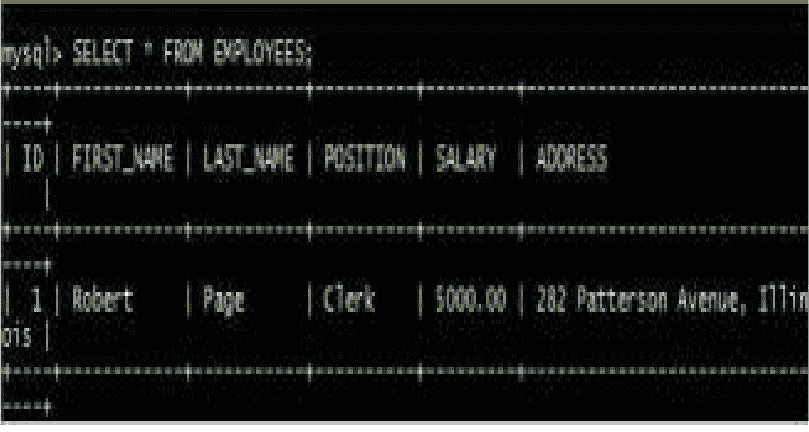

现在，尝试为另一组员工录入以下数据：

| 名字 | 姓氏 | 职位 | 薪资 | 地址 |
| :--- | :--- | :--- | :--- | :--- |
| John | Malley | Supervisor | 7,000.00 | 5 Lake View, New York |
| Kristen | Johnston | Clerk | 4,500.00 | 25 Jump Road, Florida |
| Jack | Burns | Agent | 5,000.00 | 5 Green Meadows, California |

你需要反复使用 INSERT INTO 关键字将每位员工的数据输入到数据库中。语句如下所示：

```sql
INSERT INTO EMPLOYEES(FIRST_NAME, LAST_NAME, POSITION, SALARY, ADDRESS)
VALUES('John', 'Malley', 'Supervisor', 7000.00, '5 Lake View, New York');
INSERT INTO EMPLOYEES(FIRST_NAME, LAST_NAME, POSITION, SALARY, ADDRESS)
VALUES('Kristen', 'Johnston', 'Clerk', 4500.00, '25 Jump Road, Florida');
INSERT INTO EMPLOYEES(FIRST_NAME, LAST_NAME, POSITION, SALARY, ADDRESS)
VALUES('Jack', 'Burns', 'Agent', 5000.00, '5 Green Meadows, California');
```

要获取更新后的 EMPLOYEES 表，请使用带通配符的 SELECT 命令。

```sql
SELECT * FROM EMPLOYEES;
```

以下是结果截图：

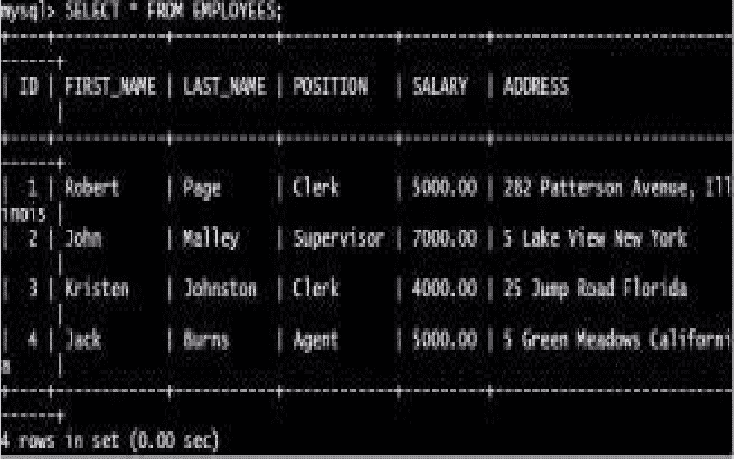

请注意，SQL 为你输入的每组数据分配了一个 ID 编号。这是因为你已将 ID 列定义为 auto_increment（自动递增）属性。此属性会使你在插入数据时无法使用第一种形式。因此，你必须在 INSERT INTO table_name 行中指定其余列。

### 向特定列插入数据

你还可以向特定列插入数据。你可以通过在 INSERT INTO 语句的列列表中指定列名，并在 VALUES 列表中指定相应的值来实现。例如，如果你只想输入员工的全名和职位，你需要在列列表中指定列名 FIRST_NAME、LAST_NAME 和 POSITION，并在 VALUES 列表中输入名字、姓氏和职位的值。

要查看其工作原理，尝试将以下数据输入到 EMPLOYEES 表中：

| 名字 | 姓氏 | 职位 | 薪资 | 地址 |
| :--- | :--- | :--- | :--- | :--- |
| James | Hunt | | 7,500.00 | |

以下是更新后的 EMPLOYEES 表截图。

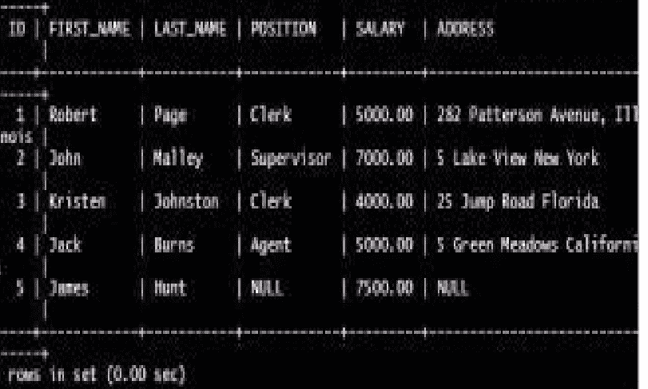

### 插入 NULL 值

在某些情况下，你可能需要向列中输入 NULL 值。例如，你可能手头没有新员工的薪资数据。随意提供任何薪资数字可能会产生误导。

语法如下：

```sql
INSERT INTO schema.table_name
VALUES ('column1', NULL, 'column3');
```

你需要这份答案手册来检查每个练习中的语法是否正确。如果你在某个练习中遇到困难，也非常欢迎使用它。在每个练习结束时，我建议你检查自己的答案。

每个练习在你开始应用每节所学内容之前，都会提供概述和示例。

以下是接下来几个练习中将使用的 Product 表示例。

| 产品 ID | 名称 | 产品编号 | 颜色 | 标准成本 | 标价 | 尺寸 |
| :--- | :--- | :--- | :--- | :--- | :--- | :--- |
| 317 | LL Crankarm | CA-5965 | Black | 0 | 0 | NULL |
| 318 | ML Crankarm | CA-6738 | Black | 0 | 0 | NULL |
| 319 | HL Crankarm | CA-7457 | Black | 0 | 0 | NULL |
| 320 | Chainring Bolts | CB-2903 | Silver | 0 | 0 | NULL |
| 321 | Chainring Nut | CN-6137 | Silver | 0 | 0 | NULL |

### 查询结构和 SELECT 语句

理解语法及其结构将对你未来的学习非常有帮助。让我们深入了解最常见的语句之一——SELECT 语句的基础知识，该语句专门用于检索数据。

```sql
SELECT Column_Name1, Column_Name2
FROM Table_Name
```

在上面的查询中，你从整个表中选择两列和所有行。由于你只选择两列，查询的执行速度将比选择所有列快得多，如下所示：

```sql
SELECT *
FROM Table_Name
```

从 Production.Product 表中选择所有列。

使用同一张表，仅选择 ProductID、Name、Product Number、Color 和 Safety Stock Level 列。

*（提示：表中的列名不包含空格！）*

### WHERE 子句

WHERE 子句用于过滤查询返回的行数。该子句通过使用条件来工作，例如某列是否等于、大于或小于某个值。

编写语法时，重要的是记住 WHERE 条件位于 FROM 语句之后。可用的运算符类型取决于你所筛选的数据类型。

- **等于（EQUALS）** – 用于查找精确匹配。以下语法使用 WHERE 子句查找包含精确字符串 'Value' 的列。请注意，字符串需要用单引号括起来，但数值不需要。

```sql
SELECT Column_Name1, Column_Name2
FROM Table_Name
WHERE Column_Name3 = 'Value'
```

- **BETWEEN** – 通常用于查找某个数字范围或日期范围之间的值。需要注意的是，BETWEEN 比较运算符中的第一个值应小于右边的值。请注意下面在 100 和 1000 之间进行比较的示例。

```sql
SELECT Column_Name1, Column_Name2
FROM Table_Name
WHERE Column_Name3 BETWEEN 100 AND 1000
```

- **大于、小于、小于或等于、大于或等于** – SQL Server 具有可用于比较特定值的比较运算符。

```sql
SELECT Column_Name1, Column_Name2
FROM Table_Name
WHERE Column_Name3 <= 1000 --请注意，你还可以使用 <、>、>= 甚至 <> 表示不等于
```

- **LIKE** – 用于搜索列中包含的值或字符串。你仍然使用单引号，但包含百分号来指示字符串是在开头、末尾还是在字符串范围内的任意位置。

```sql
SELECT Column_Name1, Column_Name2
FROM Table_Name
WHERE Column_Name3 LIKE '%Value%' --在任何字段中搜索 'value' 一词
```

```sql
SELECT Column_Name1, Column_Name2
```


来自表名

其中列名3类似'值%' --搜索字段开头的单词'值'

选择列名1，列名2

来自表名

其中列名3类似'%值' --搜索字段末尾的单词'值

IS NULL 和 IS NOT NULL - 如前所述，NULL是一个不包含数据的空单元格。最终，你会处理一个包含NULL值的表，你可以通过几种方式来处理它们。

```
选择列名1，列名2

来自表名

其中列名3 IS NULL --筛选该列中任何为NULL的值，但不要将NULL放在单引号中，因为它不被视为字符串。
```

```
选择列名1，列名2

来自表名

其中列名3 IS NOT NULL --筛选该列中任何不为NULL的值。
```

再次使用Production.Product表，选择产品ID、名称、产品编号和颜色。筛选出银色的产品。

### 使用ORDER BY

ORDER BY子句仅用于按升序或降序对数据进行排序，并通过你想要排序的列来指定。此命令默认也按升序排序，因此如果你想按降序排序，请在命令中使用DESC。

```
选择列名1，列名2

来自表名

其中列名3 = '值'

按列名1，列名2排序 --按升序排序，但你也可以包含ASC来按升序排序。

选择列名1，列名2

来自表名

其中列名3 = '值'

按列名1，列名2 DESC排序 --通过在列列表后指定DESC，这会将数据按降序排序。
```

从Production.Product表中选择产品ID、名称、产品编号和标价，其中标价在100.00美元到400.00美元之间。然后，按标价从小到大对结果进行排序。

> *（提示：你的查询中不会使用$符号，另外，如果你需要，可以回顾你刚刚复习的排序选项。）⁴*

## 数据定义语言（DDL）

> "没有比攻击性愚蠢更糟糕的事情了。" – 约翰·沃尔夫冈·冯·歌德

DDL是用于在实例或数据库本身中创建、更改或删除对象的SQL语法。以下是一些帮助你入门的示例。DDL分为三种类型的命令：

CREATE - 这将创建数据库或实例中的对象，例如其他数据库、表、视图等。

```
--创建数据库

CREATE DATABASE DatabaseName
```

```
--为当前数据库中的表创建模式（或容器）

CREATE SCHEMA SchemaName
```

```
--在指定模式内创建表

CREATE TABLE SchemaName.TableName
(
Column1 datatype PRIMARY KEY,
Column2 datatype(n),
Column3 datatype
)
```

```
--创建视图

CREATE VIEW ViewName

AS
选择
Column1,
Column2
FROM TableName
```

ALTER - 此命令允许你更改现有对象，例如向表添加额外列或更改数据库名称等。

--更改数据库名称

```
ALTER DATABASE DatabaseName MODIFY NAME = NewDatabaseName
```

--通过添加列来更改表

```
ALTER TABLE TableName
ADD ColumnName datatype(n)
```

DROP - 此命令允许你删除数据库中的对象或数据库本身。这可用于删除表、触发器、视图、存储过程等。请注意，这些项目将不再存在于你的数据库中——或者如果你删除了数据库，它将不复存在。

--删除数据库 - 首先使用master数据库

```
USE master
GO
```

--然后删除所需的数据库

```
DROP DATABASE DatabaseName
GO
```

--删除表；应在指定表所在的数据库中执行

```
DROP TABLE Table_Name
```

--从当前数据库删除视图

```
DROP VIEW ViewName
```

### 应用DDL语句

通过点击“新建查询”按钮，在你自己的机器上打开一个新的查询窗口，并确保你正在使用'master'数据库。

你可以通过检查下方并使用下拉菜单来判断你正在使用哪个数据库以及在数据库之间切换。

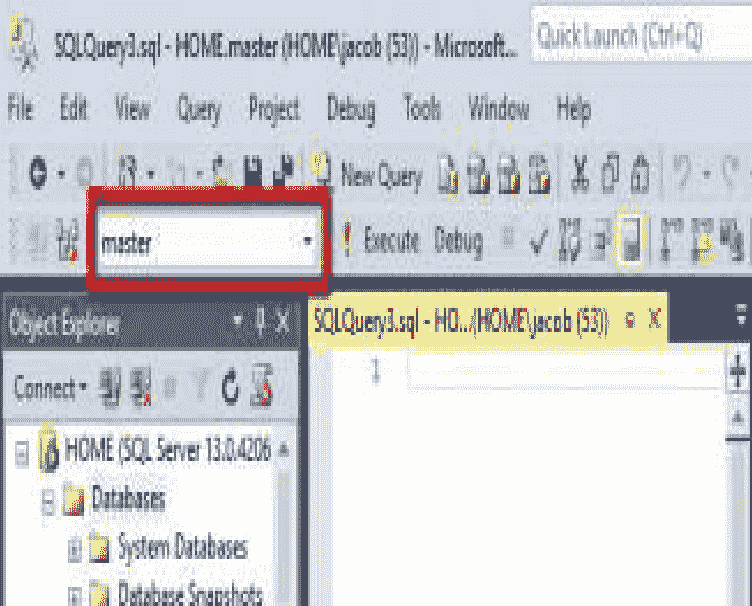

回到`编写T-SQL语法指南`部分，你学习了'USE'语句以及使用'GO'来分隔代码批处理。

你将在下一个练习中使用这个。所以，在练习之前或期间，随时可以回顾该部分。

创建一个名为Company的数据库。不要忘记在使用master数据库和创建新数据库之间使用GO语句！

执行此操作后，你现在将拥有一个可以开始添加表的数据库。以下是一系列练习，你将开始在此数据库中创建你的第一个模式和表。

创建一个名为Dept的模式。你将在下一个练习中创建的表将与此模式关联。

创建一个名为Department的表。该表应有两列：Department_Id，它应该是整数数据类型并是主键。另一列应该是Department_Name，它应该是30字节的VARCHAR数据类型。

将你的数据库名称从Company更改为Company_Db。

### 运行DDL脚本

现在，是时候下载以下DDL脚本来创建你将要处理的其余表了。别担心，我编写了这个脚本，只需点击“执行”按钮即可成功运行。只需确保你正确完成了练习，否则它将无法工作。

一旦你完成了这个，你将开始使用你的DML知识来添加和检索数据。

## 数据操作语言（DML）

DML或数据操作语言，正如其名称所暗示的那样；它操作数据。作为DML一部分的语句允许你修改现有数据、创建新数据，甚至删除数据。

请注意，DML并非特定于对象（如修改表结构或数据库设置），而是处理这些对象内的数据。

SELECT - 此语句是最常见的SQL语句，它允许你检索数据。它也用于许多报告场景。

```
--从表中选择两列
选择

列名1,

列名2

来自表名
```

INSERT - 此语句允许你将数据插入到特定数据库的表中。

```
--向表中插入三行

INSERT INTO 表名

(列名1, 列名2) --这两项是列

VALUES
('--值1', 1), --这里，我将值1插入列名1，将
数字1插入列名2。
('--值2', 2),
('--值3', 3)
```

现在，是时候向你的Department表中插入数据了。插入如下所示的值。例如，Marketing的部门名称必须具有部门ID 1，依此类推。

- Department_Id: 1, Department_Name: Marketing
- Department_Id: 2, Department_Name: Development
- Department_Id: 3, Department_Name: Sales
- Department_Id: 4, Department_Name: Human Resources
- Department_Id: 5, Department_Name: Customer Support
- Department_Id: 6, Department_Name: Project Management
- Department_Id: 7, Department_Name: Information Technology
- Department_Id: 8, Department_Name: Finance/Payroll
- Department_Id: 9, Department_Name: Research and Development

UPDATE - 允许你更新现有数据。例如，你可以将表中现有的一个数据更改为另一个值。

建议在更新表中的值时要谨慎。如果你没有在WHERE子句中指定条件，你可能会将一列中的所有行设置为相同的值。

--更新表中一列的一个值或一组值

```
UPDATE 表名
SET
列名1 = '新值1', --在这里指定你的新值应该是什么
列名2 = '新值2'
WHERE
列名1 = '旧值' --使用WHERE子句作为条件
```

--用相同的值更新表中所有行的特定列


```sql
UPDATE Table_Name
SET Column_Name1 = 'Value'
```

现在，你将更新表中一个部门的名称。假设你觉得“Finance/Payroll”（财务/薪资）这个名称不合适，因为薪资是通过在线网络门户由员工自行处理的。所以，就剩下“Finance”（财务），但由于该部门的职责，最好将其称为“Accounting”（会计）。

根据ID更新Department表，将值从‘Finance/Payroll’更改为‘Accounting’。

DELETE（删除）— 这个操作不言自明；它从指定对象（如表）中删除数据。运行DELETE语句时最好谨慎。

如果在查询中不使用WHERE子句，你将删除表中的所有数据。因此，在DELETE语句中使用WHERE子句总是最佳实践。

*注意：与UPDATE语句类似，只要你在查询中使用了WHERE子句，也可以在语句中将DELETE替换为SELECT，以查看你将要删除哪些数据。与UPDATE语句一样，当你删除单个值时，最好在WHERE子句中使用主键作为条件！

**--在DELETE语句中使用条件，仅删除特定值或一组值**

```sql
DELETE FROM Table_Name
WHERE Column_Name1 = 'Some Value'
```

**--由于未使用WHERE子句，删除表中的所有数据**

```sql
DELETE FROM Table_Name
```

假设这家公司实际上并没有研发部门。也许他们规模还不够大，或者不需要该部门。

在本次练习中，根据ID从Department表中删除“Research and Development”（研发）部门。

## 运行 DML 脚本

现在，你需要下载以下DML脚本，以便为Company_Db数据库填充数据。再次强调，请确保你已正确完成练习，否则将无法运行。

这些数据将在“数据转换”部分的后续练习中使用。因此，请记住，除非另有说明，每个练习都引用CompanyDb数据库。

## 第6章：数据库管理

> “过于宽泛的法律很少被遵守；过于严苛的法律则很少被施行。” – 本杰明·富兰克林

为了踏上数据库管理员、数据库开发人员甚至数据分析师的道路，你需要了解如何备份、恢复和管理数据库。这些是维护数据库的基本要素，也是非常重要的职责。

### 恢复模型

在SQL Server中，可以为每个数据库使用几种不同的恢复模型。恢复模型是数据库的一个选项或模型，它决定了可以备份和还原的信息类型。

根据你的情况，例如，如果你不能丢失关键数据，或者你想镜像一个生产环境，你可以根据需要设置恢复模型。另外，请记住，你选择的恢复模型也可能影响备份或恢复数据库和日志所需的时间，具体取决于它们的大小。

以下是恢复模型及其简要说明。每个模型末尾的SQL语句示例是用于设置恢复模型的语法。

### 完整

此模型涵盖数据库中的所有数据以及事务日志历史记录。

使用此模型并执行数据库还原时，它提供“时间点”恢复。这意味着，例如，如果在还原过程中某个时间点数据库丢失了数据，它允许你回滚并恢复该数据。

如果你不能丢失任何数据，这是理想的恢复模型。

根据数据大小，备份和恢复可能需要更多时间。

- 可以执行完整、差异和事务日志备份。

```sql
ALTER DATABASE DatabaseName SET RECOVERY FULL
```

### 简单

此模型也涵盖数据库中的所有数据，但会回收事务日志。当还原数据库时，事务日志将为空，并记录后续的新活动。

与“完整”恢复模型不同，事务日志将被重用于新事务，因此如果数据被意外丢失或删除，则无法回滚恢复。

如果你有一台空白服务器，需要相当快速轻松地还原数据库，或者只是镜像另一个环境并将其用作测试实例，这是一个很好的选择。

- 由于事务日志会根据此恢复模型被回收，因此只能执行完整和差异备份。

```sql
ALTER DATABASE DatabaseName SET RECOVERY SIMPLE
```

### 大容量日志

此特定模型的工作方式是跳过SQL Server中的大容量操作（如BULK INSERT、SELECT INTO等），并且不将这些操作存储在事务日志中。这将有助于释放事务日志空间，并使备份和恢复过程更简单、更快捷。

使用此方法，你可以使用“时间点”恢复，因为它的工作方式与“完整”恢复模型非常相似。

如果你的数据对你至关重要，并且你的数据库处理经常使用大容量语句，此恢复模型是理想的。但是，如果你的数据库不经常使用大容量语句，则建议使用“完整”恢复模型。

- 可以执行完整、差异和事务日志备份。

```sql
ALTER DATABASE DatabaseName SET RECOVERY BULK_LOGGED
```

假设你正在一个大型数据库项目中，需要备份数据库。使用SQL语法（及上述示例）将Company_Db的恢复模型设置为“Full”（完整），以准备备份过程。

### 数据库备份方法

在SQL Server中，有几种主要的备份方法可用于备份数据库，每种方法都取决于所使用的恢复模型。在上一节关于恢复模型的内容中，每个模型的最后一个要点讨论了可以执行的备份类型，即完整、差异和事务日志。

> 注意：如果你不记得每个恢复模型可以执行哪些类型的备份，给自己一些时间！最终你会记住的！

每种备份方法将执行以下操作：

### 完整备份：

完整备份数据库以及事务日志（如果适用）。如果需要将同一个数据库添加到新服务器进行测试，这是理想的选择。

如果数据库体积庞大，除了备份整个数据库和事务日志外，备份可能需要更长时间。

- 然而，这不需要像差异备份那样频繁执行，因为你是在备份整个数据库。

```sql
BACKUP DATABASE DatabaseName TO DISK = 'C:\SQLBackups\DatabaseName.BAK'
```

### 差异备份：

它依赖于完整备份，因此必须先执行完整备份。但是，它将备份上次完整备份到差异备份执行之间所有数据更改。

在任何情况下都是理想的，但由于数据库中经常添加新数据，因此必须更频繁地执行。

它比完整备份快得多，并且占用更少的存储空间。

- 然而，它并没有捕获整个数据库，因此这就是为什么必须定期执行的原因。

```sql
BACKUP DATABASE DatabaseName TO DISK = 'C:\SQLBackups\DatabaseName.BAK' WITH DIFFERENTIAL
```

### 事务日志备份：

与差异备份类似，它依赖于完整备份。

备份数据库中发生的所有活动。

在某些情况下很有用且必要，例如完全还原数据库时。

由于它们保存了数据库历史记录中的活动，明智的做法是经常备份这些日志，以免日志变得过大。

一些日志初始较大，但随着更频繁的备份执行会变小（取决于数据库内的活动）。

- 因此，如果数据库活动较少且备份频繁，日志的备份和恢复可能很快。

```sql
BACKUP LOG DatabaseName TO DISK = 'C:\SQLBackups\DatabaseName.TRN'
```

在上次练习中，你已将Company_Db的恢复模型设置为“Full”（完整）。现在，在本次练习中，你将备份数据库。

首先，使用完整备份方法完整备份数据库。

接下来，删除Sales.Product_Sales表中的所有数据（旨在模拟数据丢失）。

最后，查询你刚刚删除了数据的表，以确保数据已不存在。稍后，你将还原数据库并确保Sales.Product_Sales表中的数据恢复。

### 数据库还原

在数据库领域，你可能会听到还原数据库最重要的部分是使用可靠的备份。这完全正确！这就是为什么确保使用正确的恢复模型很重要的原因。

### 准备还原数据库

需要注意的一个重要事项是，.bak文件通常包含其中的文件组或文件。每个文件可能是完整备份或差异备份。了解你正在还原哪个备份很重要，但你也可以指定要还原哪个文件。但是，如果你没有指定，SQL Server将选择默认文件，即文件1。这是典型的完整备份。

首先，使用RESTORE HEADERONLY来标识.BAK文件中的文件。这是在还原数据库之前应该做的事情。


 # --查看数据库备份文件

```
RESTORE HEADERONLY FROM DISK = 'C:\SQLBackups\DatabaseName.BAK'
```

执行上述查询后，查看"BackupType"列中的数字。1表示完整备份，而5表示差异备份。

此外，您需要使用的文件编号在"Position"列中。在下面的示例中，请注意文件编号8是完整备份，文件编号9是差异备份。

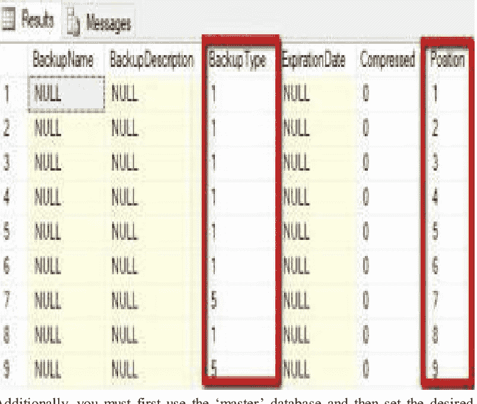

另外，在还原之前，您必须首先使用'master'数据库，然后将目标数据库设置为非活动状态（SINGLE_USER），以仅允许一个打开的数据库连接。

在下面的语法中，WITH ROLLBACK IMMEDIATE意味着任何不完整的事务都将被回滚（未完成），以便将数据库设置为单一打开连接状态。

**--将数据库设置为仅允许一个打开连接**

**--所有其他数据库连接必须关闭，否则还原将失败**

```
ALTER DATABASE DatabaseName SET SINGLE_USER WITH ROLLBACK IMMEDIATE
```

还原完成后，您可以将数据库设置回活动状态（MULTI_USER），如下所示。此状态允许多个用户连接到数据库，而不仅仅是一个。

**--将数据库设置为允许多个连接**

```
ALTER DATABASE DatabaseName SET MULTI_USER
```

### 数据库还原类型

以下是根据您的情况/需求可以执行的还原类型的概述。

### 完整还原

还原整个数据库，包括其文件。

使用WITH REPLACE选项覆盖已存在的数据库。

如果恢复模型设置为"Full"，则需要使用WITH REPLACE选项。

使用FILE =参数选择您要还原的文件（可以是完整备份或差异备份）。

如果恢复模型设置为"Simple"，则不需要WITH REPLACE选项。

如果数据库不存在，它将创建数据库，包括其文件和数据。

从.BAK文件还原。

**--如果恢复模型设置为Full - 同时选择备份集中的文件# 1**

```
RESTORE DATABASE DatabaseName FROM DISK = 'C:\SQLBackups\DatabaseName.BAK' WITH FILE = 1, REPLACE
```

```
RESTORE DATABASE DatabaseName FROM DISK = 'C:\SQLBackups\DatabaseName.BAK'
```

### 差异还原

使用RESTORE HEADERONLY查看您可用的备份文件，即完整备份和差异备份文件类型。

首先必须使用NORECOVERY选项还原.BAK文件的完整备份，因为NORECOVERY选项指示还需要还原其他文件。

在指定要还原的完整备份文件并使用WITH NORECOVERY后，可以还原差异备份。

最后，应在最后一个差异文件还原中包含RECOVERY选项，以指示没有更多文件需要还原。

作为参考，下面的语法使用前面RESTORE HEADERONLY截图中的文件。

```
**--首先执行完整数据库备份文件的还原**
RESTORE DATABASE DatabaseName FROM DISK = 'C:\SQLBackups\DatabaseName.BAK' WITH FILE = 8, NORECOVERY

**--现在执行差异备份文件的还原**
RESTORE DATABASE DatabaseName FROM DISK = 'C:\SQLBackups\DatabaseName.BAK' WITH FILE = 9, RECOVERY
```

### 日志还原

这是执行彻底数据库还原的最后一步。

您必须先还原数据库的"完整"或"差异"副本，然后还原日志。

- 还原数据库备份时，必须使用NORECOVERY选项，使数据库保持在还原状态，并允许您还原事务日志。

由于您已经执行了数据库备份，并且在Sales.Product_Sales表中"丢失"了数据，现在是时候完整还原数据库了。

为此，您需要先使用'master'数据库，然后将数据库设置为单用户状态，执行还原，最后将其设置回多用户状态。

还原数据库后，检索Sales.Product_Sales表中的所有数据，以验证数据是否再次存在。

### 附加和分离数据库

如您所知，因为您已经完成了这部分，附加和分离数据库的方法类似于备份和还原。

本质上，这种方法的详细说明如下：

允许您将.MDF文件和.LDF文件复制到新磁盘或服务器。

执行方式类似于备份和还原过程，但有时可能更快，具体取决于情况。

- 数据库将脱机，任何用户或应用程序都无法访问它。它将保持脱机状态，直到重新附加。

那么，您应该选择哪一个？虽然备份是理想选项，但在某些情况下，附加/分离数据库可能是您唯一的选择。

考虑以下情况：

您的数据库包含许多文件组。附加这些文件可能相当麻烦。

最佳解决方案是备份数据库，然后将其还原到目标位置，因为这将在备份过程中将所有文件组合在一起。

根据数据库的大小，备份/还原过程需要很长时间。 然而，如果需要尽快完成，附加/分离数据库可能会快得多。

- 在这种情况下，您可以使数据库脱机，分离它，然后重新附加到新的目标位置。

如您所知，在附加数据库时有两个主要文件组。这些文件是.MDF和.LDF。.MDF文件是数据库的主数据文件，保存其结构和数据。.LDF文件保存事务日志活动和历史记录。

然而，备份数据库时创建的.BAK文件将所有文件组合在一起，您可以从单个备份集中还原不同的文件版本。

在使用任一选项之前请考虑您的情况，但也要将备份和还原作为您的首选，然后将附加/分离方法作为您的下一个选项。此外，在使用实时数据之前，请务必进行测试！

### 附加/分离AdventureWorks2012数据库

由于您已经附加了此数据库，现在让我们将其从服务器分离。之后，您将使用SQL语法再次附加它。

### 分离数据库

在SQL Server中，有一个存储过程可以为您分离数据库。这个特定的存储过程位于'master'数据库中。实际上，您可以通过以下步骤查看该存储过程的复杂性：

- 单击展开Databases文件夹
- 单击System Databases，然后单击Master数据库
- 单击Programmability
- 单击Stored Procedures，然后单击System Stored Procedures
- 找到sys.sp_detach_db，右键单击它并在SSMS中选择'Modify'。然后您将看到其语法。

为此，只需按原样执行存储过程即可。语法如下：

```
USE master
GO
ALTER DATABASE DatabaseName SET SINGLE_USER WITH ROLLBACK IMMEDIATE
GO
EXEC master.dbo.sp_detach_db @dbname = N'DatabaseName', @skipchecks = 'false'
GO
```

为了进一步说明正在发生的事情，您希望使用'master'数据库来更改将要分离的数据库，并将其设置为单用户而不是多用户。

最后，@dbname后面的值允许您指定要分离的数据库的名称，@skipchecks设置为false意味着数据库引擎将更新统计信息，标识该数据库已被分离。分离数据库时，最好将其设置为@false，以便系统保存有关所有数据库的当前信息。

现在，从您的服务器实例分离AdventureWorks2012数据库。请使用上面的SQL示例作为指导。

### 附加数据库

分离数据库后，如果您导航到数据目录所在位置，您会看到AdventureWorks2012_Data.MDF文件仍然存在——它应该会存在，因为您只是分离了它，还没有删除它。

接下来，获取.MDF文件的路径，并将其复制粘贴到您可以轻松访问的位置，如记事本中。

*我的位置是C:\Program Files\Microsoft SQL Server\MSSQL13.MSSQLSERVER\MSSQL\DATA*。

连接到实例并打开新的查询会话后，您只需要使用数据文件存储的路径。获得该路径后，您可以在以下SQL语法示例中输入该值，以便附加数据库。

以下是用于附加数据库文件和日志文件的语法。因此，在以下练习中，您将完全跳过附加日志文件，因为这不是附加到新服务器。因此，您可以省略附加日志文件的语句。

```
CREATE DATABASE DatabaseName ON (FILENAME = 'C:\SQL Data Files\DatabaseName.mdf'), (FILENAME = 'C:\SQL Data Files\DatabaseName_log.ldf') FOR ATTACH
```

在上面的示例中，我在有可用日志文件时调用了附加日志文件的语句。然而，如果您恰好没有.LDF文件而只有.MDF文件，那也没关系。您只需附加.MDF文件，数据库引擎将创建一个新的日志文件，并开始向该特定日志写入活动。

在本练习中，假设您必须将此数据库从旧服务器分离，并将其附加到新服务器。请使用上面的语法作为示例，以附加AdventureWorks2012数据库。

每个练习在开始应用您在每个部分所学内容之前，都会提供概述和示例。


下面是 `Production.Product` 表的示例，你将在接下来的几个练习中使用到它。

| 产品 ID | 名称 | 产品编号 | 颜色 | 标准成本 | 列表价格 | 尺寸 |
|---|---|---|---|---|---|---|
| 317 | LL Crankarm | CA-5965 | Black | 0 | 0 | NULL |
| 318 | ML Crankarm | CA-6738 | Black | 0 | 0 | NULL |
| 319 | HL Crankarm | CA-7457 | Black | 0 | 0 | NULL |
| 320 | Chainring Bolts | CB-2903 | Silver | 0 | 0 | NULL |
| 321 | Chainring Nut | CN-6137 | Silver | 0 | 0 | NULL |

### 查询结构和 SELECT 语句

理解语法及其结构将对你未来的学习非常有帮助。让我们深入了解最常用的语句之一——`SELECT` 语句的基础知识，该语句专门用于检索数据。

```
SELECT Column_Name1, Column_Name2
FROM Table_Name
```

在上面的查询中，你从整个表中选择了两列和所有行。由于你只选择了两列，查询执行速度比选择所有列要快得多，如下所示：

```
SELECT *
FROM Table_Name
```

从 `Production.Product` 表中选择所有列。

使用同一张表，仅选择 `ProductID`、`Name`、`Product Number`、`Color` 和 `Safety Stock Level` 列。

> （提示：表中的列名不含空格！）

### WHERE 子句

`WHERE` 子句用于过滤查询返回的行数。该子句通过使用条件来工作，例如判断某一列是否等于、大于、小于、介于某个值之间，或与某个值匹配。

编写语法时，记住 `WHERE` 条件要放在 `FROM` 语句之后，这一点很重要。

**等于** – 用于查找精确匹配。下面的语法使用 `WHERE` 子句查找某一列中包含精确字符串 `'Value'` 的行。请注意，字符串需要用单引号括起来，而数值则不需要。

```
SELECT Column_Name1, Column_Name2
FROM Table_Name
WHERE Column_Name3 = 'Value'
```

**介于之间（BETWEEN）** – 通常用于查找介于某个数字范围或日期范围之间的值。需要注意的是，`BETWEEN` 比较运算符中的第一个值应小于右边的值。注意下面介于 10 和 100 之间的示例。

```
SELECT Column_Name1, Column_Name2
FROM Table_Name
WHERE Column_Name3 BETWEEN 10 AND 100
```

**大于、小于、小于等于、大于等于** – SQL Server 提供了比较运算符，可用于比较特定的值。

```
SELECT Column_Name1, Column_Name2
FROM Table_Name
WHERE Column_Name3 <= 1000 --注意你也可以使用 < , > , >= 甚至是 <> 表示不等于
```

**LIKE** – 用于搜索包含在列中的值或字符串。你仍然使用单引号，但需要包含百分号（`%`）来指示字符串是否在开头、结尾或字符串范围之间的任何位置。

```
SELECT Column_Name1, Column_Name2
FROM Table_Name
WHERE Column_Name3 LIKE '%Value%' --在任意位置搜索包含 'value' 的词
```

```
SELECT Column_Name1, Column_Name2
FROM Table_Name
WHERE Column_Name3 LIKE 'Value%' --在字段开头搜索 'value'
```

```
SELECT Column_Name1, Column_Name2
FROM Table_Name
WHERE Column_Name3 LIKE '%Value' --在字段末尾搜索 'value'
```

**IS NULL 和 IS NOT NULL** – 如前所述，`NULL` 是不包含任何数据的空单元格。最终你会处理包含 `NULL` 值的表，你可以通过几种方式来处理。

```
SELECT Column_Name1, Column_Name2
FROM Table_Name
WHERE Column_Name3 IS NULL --过滤该列中为 NULL 的值，但不要用单引号括起来，因为 NULL 不被视为字符串。
```

```
SELECT Column_Name1, Column_Name2
FROM Table_Name
WHERE Column_Name3 IS NOT NULL --过滤该列中不为 NULL 的值。
```

再次使用 `Production.Product` 表，选择产品 ID、名称、产品编号和颜色。筛选出银色的产品。

### 使用 ORDER BY

`ORDER BY` 子句用于按升序或降序对数据进行排序，具体取决于你要从哪一列开始排序。该命令默认按升序排序，因此如果要按降序排序，请在命令中使用 `DESC`。

```
SELECT Column_Name1, Column_Name2
FROM Table_Name
WHERE Column_Name3 = 'Value'
ORDER BY Column_Name1, Column_Name2 --默认按升序排序，但你也可以加上 ASC 按升序排序。
```

```
SELECT Column_Name1, Column_Name2
FROM Table_Name
WHERE Column_Name3 = 'Value'
ORDER BY Column_Name1, Column_Name2 DESC
```

--通过在列列表后指定 `DESC` 来按降序排序数据。

然后，按列表价格从低到高对结果进行排序。

> *（提示：查询中不要使用 `$` 符号，如有需要可以回顾刚才介绍的排序选项。）*

### 第 7 章：SQL 事务

> "仅仅因为某件事没有按照你的计划进行，并不意味着它毫无用处。" – 托马斯·爱迪生

### 什么是 SQL 事务？

事务是按照逻辑顺序对数据库执行的一系列任务。我们将每个事务视为一个单独的工作单元。事务让你对 SQL 行为有更多的控制，这在你持续维护数据完整性或计划避免数据库错误时变得至关重要。

在第 3 章中，我们详细讨论了数据完整性以及可以采用的各种确保完整性存在的方法。然而，这基于一个前提，即多个用户不会同时访问相同的数据。

在现实中，情况可能并非如此。

当许多用户试图修改数据时，操作之间可能会发生重叠。在许多情况下，用户对数据执行的某些操作可能无效。他/她并没有意识到数据已经被破坏，因为另一个用户在同一时间进行了操作。由于两个用户都不会立即察觉到任何形式的变化，数据可能会在相当长的一段时间内保持不一致。

考虑到这一点，所有用户将继续假设数据是完整的，不存在需要他们关注的问题。

让我们通过一个例子来理解上述场景。假设有两个用户，用户 A 和用户 B，他们同时在处理客户数据。

用户 A 可能注意到客户的姓氏不正确，于是开始更改姓氏，更改后立即保存数据。而用户 B 可能在处理客户数据的其他部分，比如客户的地址或电话号码。然而，用户 A 的更改可能不会反映到用户 B 那边。用户 B 仍然在使用旧的、错误的姓氏处理客户数据，在保存数据时会无意中将姓氏改为错误的条目。

现在两个用户都没有意识到他们工作中的不一致，这个问题可能会在很长一段时间内不被发现。当只发生一个错误时，这看起来似乎无关紧要。然而，想象一下这种情况随时间反复发生，在大量数据上造成不一致。届时，你将被迫检查所有数据。如果你的数据库很大，这可能会花费你相当多的时间。

使用 SQL 事务，连续的操作或更改不会影响另一个用户所看到的数据有效性。

SQL 事务赋予你提交（`COMMIT`）SQL 语句的能力，这会将语句应用到数据库中。或者，你也可以使用回滚（`ROLLBACK`），将数据库中的语句撤销。

在 SQL 事务中，如果一个操作成功通过了四个特征的检验，它就会转换为一个事务，这四个特征用首字母缩写 **ACID** 表示。

### 原子性（Atomic）

此属性关注事务的"全有或全无"原则。它确保事务中所有操作的执行。如果在任何时刻有一个操作失败，整个事务将被中止。此外，如果只有部分语句被执行，事务将回滚到之前的状态。要成功完成一个事务并将其应用到数据库中，所有操作必须正确且无一缺失。

### 一致性（Consistent）

通过此属性，数据库不仅在事务开始时必须一致，在事务完成后也必须一致。因此，如果一组操作在执行过程中的任何时刻导致了一致性的变化，那么事务将被恢复到原始状态。

### 隔离性（Isolated）

当某个特定事务正在进行时，数据可能是不一致的。这种不一致有可能影响数据库，因此在事务完成之前，数据将不会供其他操作使用，它将不受任何外部影响。换句话说，它是被隔离的。此外，其他任何事务都不能以任何方式影响或干涉被隔离的事务，从而确保完整性不受损害。

### 持久性（Durable）


当所有事务完成时，任何更改或修改都必须被保存和维护。在发生硬件或应用程序错误的情况下，不应丢失数据；它应该可靠且一致地可用。这一特性确保了您的数据在此类事件中始终可用。

需要注意的是，在任何时候，无论操作是完成还是回滚，事务都将维护数据库的完整性。

共有七个命令可用于管理事务。它们是：

- **COMMIT**：保存更改并将其提交到数据库。

- **ROLLBACK**：回滚更改：回滚到特定的 SAVEPOINT，或事务的开头。更改不会应用到数据库。

- **SAVEPOINT**：在事务中创建检查点——一种标记形式。当您执行 ROLLBACK 时，可以回到此点，而不是事务的开头。

- **RELEASE SAVEPOINT**：移除或释放检查点。执行此命令后，任何 ROLLBACK 都会将事务恢复到其原始状态。

- **SET TRANSACTION**：为特定事务的执行创建特性。

- **START TRANSACTION**：设置事务的特性并开始事务。

- **SET CONSTRAINTS**：在事务中建立约束模式。约束创建一种条件，决定是在数据修改开始时立即应用约束，还是将约束的应用延迟到事务完成时。

是时候再看一个例子了。

重要的是要记住，当您即将开始事务时，数据库处于其原始状态。在此状态下，您可以预期数据是一致的。一旦您执行事务，这些事务中的 SQL 语句就开始处理。如果处理成功，则使用 COMMIT 命令。此命令使 SQL 语句更新数据库并终止事务。如果更新过程不成功，则 ROLLBACK 命令就派上用场了。此过程为您简要概述了命令。不过，我们将深入探讨它们的功能。

### Commit

当特定事务中的所有语句都完成后，下一步就是终止事务。终止事务的推荐方法之一是将到目前为止所做的所有更改提交到数据库。当您对自己所做的更改有信心时，可以使用 COMMIT 命令。请参阅以下可用于提交语句的语法语句：

```
COMMIT [WORK] [AND CHAIN]
COMMIT [WORK] [AND NO CHAIN]
```

您必须记住，WORK 条目的使用不是强制性的。只有 COMMIT 关键字就足以处理 COMMIT 命令。实际上，COMMIT 和 COMMIT WORK 条目具有相同的目的。早期版本的 SQL 曾包含 WORK 关键字，一些 tasted 用户可能更熟悉它。但是，如果您不习惯使用它，则不必包含它来执行 COMMIT 命令。

AND CHAIN 子句是 COMMIT 语句中另一个可选的包含项。它在 SQL 实现中并不常用。AND CHAIN 子句只是告诉系统在当前事务一结束时就启动新的事务。使用此子句，您将无需使用 SET TRANSACTION 或 START TRANSACTION 语句，让系统自动继续下一步。

然而，这可能被证明是缺点而不是便利。由于您需要对事务有完全的控制，最好使用替代方案。与其在 COMMIT 语句中使用 AND CHAIN，不如尝试使用 AND NO CHAIN 参数。这本质上是让您的系统知道它不应该使用与当前事务相同的设置来开始新事务。如果没有提到任一参数（AND CHAIN 或 AND NO CHAIN），则 AND NO CHAIN 将是系统采用的默认子句。

您的 COMMIT 语句可能如下所示：

```
COMMIT;
```

我们没有包含上述两个子句中的任何一个。但是，请注意，如果您希望系统在提交后自动开始新事务，请使用以下语句：

```
COMMIT AND CHAIN;
```

假设您有一个名为 EMPLOYEES 的表，包含"names"和"salaries"列。

| NAME | SALARIES |
|------|----------|
| John | 5,000 |
| Mary | 7,000 |
| Jennifer | 9,000 |
| Mark | 10,000 |
| Adam | 7,000 |

如果您想删除工资为 7,000 的记录，那么您只需使用以下内容：

```
SQL > DELETE FROM EMPLOYEES
    WHERE SALARIES = 7,000

SQL > COMMIT;
```

现在，如前所述，如果您希望在当前事务执行后开始下一个事务，那么您的语句将如下所示：

```
SQL > DELETE FROM EMPLOYEES
    WHERE SALARIES = 7,000

SQL > COMMIT AND CHAIN;
```

### Rollback

人为错误是任何过程中永久存在的一部分。因此，如果您发现需要回滚的情况，此语句赋予您执行此类操作的权力。

通过使用 ROLLBACK，您将撤消到目前为止所做的语句，要么将它们带回到特定的检查点——如果您已建立这样的检查点——要么将它们发送到事务的开头。

查看 ROLLBACK 语句的一些参数或包含项：

```
ROLLBACK [WORK] [AND CHAIN]
ROLLBACK [WORK] [AND NO CHAIN]
```

当用户对数据进行更改但未使用 COMMIT 语句时，这些更改以称为事务日志的临时格式存储。用户可以查看此未保存的数据，分析它是否满足特定要求。如果更改不能表达用户想要的期望结果，他们可以执行 ROLLBACK，确保数据不被保存，并且可以重新处理。

用户还可以使用 ROLLBACK 功能在硬件故障或应用程序崩溃时将数据库发送到检查点或事务的开头。如果停电中断了您的工作，那么一旦系统重新启动，ROLLBACK 功能将审查所有待处理的事务并将回滚所有语句。

与 COMMIT 语句不同，ROLLBACK 可以选择包含 TO SAVEPOINT 参数。使用 TO SAVEPOINT 子句时，系统不会取消事务。您只是被带到一个特定的点，从那里您可以继续工作。

如果您希望取消事务，只需从您的语句中移除 TO SAVEPOINT 参数。

以下是 ROLLBACK 语句最基本形式的示例：

```
ROLLBACK;
```

请注意，我们没有使用 AND CHAIN 参数。这是因为，如前所述在 COMMIT 命令部分提到的，系统默认使用 AND NO CHAIN 命令。或者，如果您希望在当前事务结束后启动新事务，可以使用 AND CHAIN 命令。但是，请记住，您不能同时使用 TO SAVEPOINT 和 AND CHAIN 参数。这是因为 TO SAVEPOINT 命令需要终止当前事务。

包含 TO SAVEPOINT 参数时，请确保添加检查点的名称。请参阅以下此过程的示例：

```
ROLLBACK TO SAVEPOINT;
```

SAVEPOINT 值被检查点的名称替换，如下例所示：

```
BEGIN
    SELECT customer_number, customer_lastname, purchases
    DELETE FROM customer_number WHERE purchases < 10000;
    SAVEPOINT section_1;
    ROLLBACK TO section_1;
END;
```

虽然上面的例子是一个相当简单的命令形式，但其目的是让您清楚检查点的使用和命名。请注意，您可以在 SAVEPOINT 命令和 ROLLBACK 子句之间输入尽可能多的参数。

如果您指定检查点名称，则回滚命令将带您回到该特定检查点，而不管中间可能存在其他检查点。

```
BEGIN
SELECT customer_number, customer_lastname, purchases
DELETE FROM customer_number WHERE purchases < 10000;
SAVEPOINT section_1;
SAVEPOINT section_2;
SAVEPOINT section_3;
SAVEPOINT section_4;
ROLLBACK TO section_1;
END;
```

请注意，即使您有名为 section_2 到 section_4 的检查点，您已要求系统回滚到 section_1。这样做，系统将忽略所有其他检查点。

### Savepoint

既然我们正在讨论检查点，让我们看看为什么这些命令很重要，以及如何与它们一起工作。

本质上，您将处理一组复杂的事务。为了更容易理解事务，您会将不同部分分组为单元。以这种方式分解事务将使您能够识别问题

轻松定位并解决问题所需的部分。

但问题随之而来：如何在不更改整个事务的情况下访问这些部分呢？

当然，你可以使用SAVEPOINT命令！

此时，你应该了解一个重要信息：MySQL和Oracle支持SAVEPOINT参数，但如果你使用的是SQL Server，可能会用到SAVE TRANSACTION查询。

不过，SAVEPOINT和SAVE TRANSACTION的功能是相同的。

让我们通过一个示例来理解保存点的工作原理。

- 步骤1：启动事务
- 步骤2：执行SQL语句
- 步骤3：如果SQL语句执行成功，则继续执行；如果失败，则回滚到事务起点
- 步骤4：设置保存点1
- 步骤5：执行SQL语句
- 步骤6：如果SQL语句执行成功，则继续执行；如果失败，则回滚到保存点1
- 步骤7：设置保存点2
- 步骤8：执行SQL语句
- 步骤9：如果SQL语句执行成功，则继续执行；如果失败，则回滚到保存点2
- 步骤10：提交事务

在上面的示例中，我们在处理SQL语句后设置保存点。执行此流程时，我们会在进入下一条语句前处理特定的SQL语句。这确保了所有语句都能正确执行，如果出现错误，我们可以重新处理。一旦系统确认语句完全成功，我们就可以使用保存点并进入下一组操作。这样，我们保护了第一组操作的完整性。设置保存点后，我们可以继续推进，因为已知第一组语句不会再发生任何更改。

这成为了一种便捷的方法来处理一组操作，而无需担心之前操作的完整性。

创建保存点的过程相当简单。你只需使用以下命令：

```
SAVEPOINT <保存点名称>
```

保存点的名称不必是“SECTION_1”。这只是示例中选择的名称。你可以选择自己的名字，最好是当你需要时能轻松想起的名称。

### 释放保存点

在事务中完成某些操作后，你可能不再需要之前建立的保存点。要移除它们，可以使用RELEASE SAVEPOINT命令。

但是，请注意，一旦释放了保存点，你就无法再回滚到它。因此，释放保存点的理想方式是确认你对当前工作成果感到满意。尽职调查可能是一项额外任务，但它将使你能够有信心地完成工作。

要释放保存点，只需输入以下命令：

```
RELEASE SAVEPOINT <保存点名称>
```

让我们以一个示例来说明，假设你有以下保存点：

```
SAVEPOINT section_1;
SAVEPOINT section_2;
SAVEPOINT section_3;
SAVEPOINT section_4;
```

要释放所有保存点，你需要逐一指定。因此，过程如下所示：

```
RELEASE SAVEPOINT section_1;
RELEASE SAVEPOINT section_2;
RELEASE SAVEPOINT section_3;
RELEASE SAVEPOINT section_4;
```

你不必按照创建保存点的顺序使用释放命令。你可以选择在任何时间、以任何顺序释放任何保存点。

### 设置事务

此命令允许你处理事务的不同属性。这些属性可以是以下之一：

- 只读
- 读写
- 指定隔离级别
- 附加回滚属性

SET TRANSACTION操作的任何效果仅影响你自己的事务。其他用户不会注意到其端有任何变化。

你可以使用以下命令设置SET TRANSACTION：

```
SET TRANSACTION <模式>
```

在上面的命令中，`<模式>`指的是你希望指定的选项类型。你可以在SET TRANSACTION中使用三种模式，它们是：

- 访问级别
- 隔离级别
- 诊断大小

你可以将多个事务模式添加到`<模式>`占位符中。如果希望这样做，请用逗号分隔不同的模式。但是，你不能重复相同的模式。

例如：你可以包含一个隔离级别并处理诊断大小。但是，你不能包含两个诊断大小模式。

现在让我们尝试分别查看每种模式。

### 访问级别

在SET TRANSACTION中，有两种访问级别：READ ONLY和READ WRITE。如果你选择READ ONLY选项，系统将不允许你对数据库进行任何更改。但是，如果你选择READ WRITE访问级别，你将能够在事务中添加语句。

### 隔离级别

你还记得我们之前讨论过的如何隔离事务，以便在处理时不受任何影响吗？这里我们将讨论设置隔离级别。

对于SET TRANSACTION，你可以使用四种隔离级别，如下语法所示：

```
SET TRANSACTION ISOLATION LEVEL
    READ UNCOMMITTED
    READ COMMITTED
    REPEATABLE READ
    SERIALIZABLE
```

隔离级别按其有效性顺序排列，其中READ UNCOMMITTED是你可以使用的最低隔离级别，而SERIALIZABLE是最高的隔离级别。如果你不指定隔离级别，系统将假设为SERIALIZABLE级别，为你的事务提供最大隔离。

### 诊断大小

SET TRANSACTION允许你指定诊断大小。你包含的大小让系统知道为你提供多少区域来处理条件。在SQL语句中，条件是由语句引发的消息、警告或其他通知。如果你不指定诊断大小，那么你的数据库将自动为你分配一个。这个数字不是固定的，它因数据库而异。

### 启动事务

在数据库中，你可以在开始执行命令时显式或自动地启动事务。

例如，当你使用DELETE、CREATE TABLE等命令时，可以启动一个事务。

或者，你可以使用START TRANSACTION语句来启动一个事务。

与SET TRANSACTION一样，你也可以在此处指定一个或多个模式。这些是我们之前提到的访问级别、隔离级别和诊断大小模式。

以下是START TRANSACTION命令的示例：

```
START TRANSACTION
    READ ONLY
    ISOLATION LEVEL SERIALIZABLE
    DIAGNOSTICS SIZE 10;
```

一旦你输入上述语法，START TRANSACTION将执行该语句及其操作。

### 设置约束

在处理事务时，你可能会遇到这样的情况：你的工作将与数据库中建立的约束相冲突。让我们举个例子。

假设你有一个包含NOT NULL约束的表。现在，当你在处理该表时，你意识到在那个时候可能没有值可以替代NOT NULL约束。但你不能不输入值就离开。这迫使你向该部分插入随机值。

为了避免这种情况，你可以将约束定义为可延迟的。

此操作的语法如下所示：

```
SET CONSTRAINTS (约束名称) DEFERRED/IMMEDIATE
```

要提及多个约束名称，你需要用竖线分隔它们。例如：

```
(constraint_1 | constraint_2 | constraint_3)
```

但是，如果你希望选择所有约束——当你的数据库中有很多约束时，这可能很有用——那么你只需使用ALL这个词。

以下是示例：

```
SET CONSTRAINTS ALL DEFERRED/IMMEDIATE
```

另一件需要注意的事情是，你不必同时提及DEFERRED和IMMEDIATE。你必须选择适合当时活动的那个。

约束，在这种情况下，你的语句应该如下所示：

```
SET CONSTRAINTS ALL DEFERRED
```

一旦你完成了对数据库的操作，你可以选择应用更改。在这种情况下，语句将如下所示：

```
SET CONSTRAINT ALL IMMEDIATE
```

因此，通过本章的学习，你已经理解了 SQL 事务背后的理念，以及为什么它们在使用 SQL 编程时至关重要。

# 第 8 章：登录、用户和角色

> "先确认设计是明智且公正的；一旦确认，就坚定地执行。" — 威廉·莎士比亚

### 服务器登录

服务器登录是在 SQL 服务器中创建的用户账户，使用 SQL Server 身份验证，即需要输入密码和用户名来登录 SQL Server 实例。SQL Server 身份验证与 Windows 身份验证不同，因为 Windows 不会提示你输入密码。

这些登录可以被授予登录 SQL Server 的权限，但根据分配的权限，不一定具有数据库访问权限。它们还可以被分配某些服务器级别角色，这些角色在 SQL Server 内提供特定的服务器权限。

### 服务器级别角色

权限通过服务器级别角色封装到登录中。服务器级别角色决定了用户拥有的权限类型。

共有九种预定义的服务器级别角色：

- **Sysadmin** - 可以在服务器上执行任何操作，本质上是最高等级的访问权限。
- **Serveradmin** - 可以更改服务器配置并关闭 SQL 服务器。
- **Securityadmin** - 如果用户有权访问数据库，可以 GRANT、DENY 和 REVOKE 服务器级别和数据库级别的权限。securityadmin 还可以重置 SQL Server 密码。
- **Processadmin** - 提供终止正在 SQL Server 实例中运行的进程的能力。
- **Setupadmin** - 可以使用 SQL 命令添加或删除链接服务器。
- **Diskadmin** - 此角色用于管理 SQL Server 中的磁盘文件。
- **Dbcreator** - 提供使用 DDL 语句的能力，如 CREATE、ALTER、DROP 甚至 RESTORE 数据库。
- **Bulkadmin** - 可以执行 BULK INSERT 语句。
- **Public** - 所有登录都是 "public" 角色的一部分，如果没有特定的服务器或数据库对象权限，则继承 "public" 角色的权限。

如果你真的想深入研究这个话题（我鼓励你这样做），请点击此链接通过 Microsoft 网站获取更多关于服务器角色的信息。

以下是可用于创建服务器登录的语法示例。在为登录分配服务器级别角色时，你可以将 'dbcreator' 替换为上述任何角色。

你还会注意到 'master' 和 'User Name' 周围的方括号 []。这些是分隔标识符，我们之前已经讨论过。

```
--首先，使用 master 数据库

USE [master]

GO
```

```
--创建登录名 - 将 'User A' 替换为你想要使用的登录名

--在 'Password' 字段中输入密码 - 建议使用强密码

--同时为其指定默认数据库 'master'

CREATE LOGIN [User A] WITH PASSWORD= N'123456',

DEFAULT_DATABASE=[master]

GO
```

创建一个登录名为 Server User 的用户。给此用户设置一个简单的密码 123456，并赋予其默认数据库访问权限 'master'。

### 分配服务器角色

在 SQL Server 中有几种不同的方式将这些角色分配给用户登录。一种选项是使用 Management Studio 中的界面，另一种是使用 SQL 语法。

以下是给用户分配特定服务器角色的语法。如果你还记得我们之前用于为 'User A' 创建登录的语法，这将给 'User A' 分配 dbcreator 服务器角色。

```
--将 'dbcreator' 角色分配给用户登录，（默认具有 public 角色）

ALTER SERVER ROLE dbcreator ADD MEMBER [User A]

GO
```

对于你创建的上述名为 Server User 的用户，给它分配 serveradmin 服务器角色。

成功完成练习后，你将收到一条消息，告诉你命令已成功完成。现在你可以使用该账户登录 SQL Server！

要登录，只需导航到对象资源管理器窗口中的 "连接对象资源管理器" 按钮，点击它以打开连接窗口。

当登录窗口出现时，选择下拉菜单中显示的 "Windows 身份验证"，然后选择 "SQL Server 身份验证" 代替。只需输入用户名和密码即可登录！

一旦你能够使用此用户登录，尝试在对象资源管理器中打开数据库（系统数据库除外）。它应该看起来像这样；当你尝试展开数据库时，它会显示为空白。

你不应该能够访问，因为此用户没有任何数据库访问权限。我们将在下一节中更全面地介绍这一点。

### 数据库用户

数据库用户是通常与登录名关联并映射到一个数据库或一组数据库的用户。此数据库用户的目的是提供对服务器本身内数据库的访问权限。你还可以限制对其他数据库的访问。

在许多情况下，一个服务器实例上有多个数据库，你不会想将所有数据库访问权限授予所有用户。

### 数据库级别角色

与服务器级别角色类似，数据库级别角色可以分配给用户，以控制他们在特定数据库内的权限。

共有九个预定义的数据库角色：

- **Db_owner** - 提供在数据库上执行所有配置和维护工作的能力。此角色还允许用户 DROP 数据库 — 这是一个强大的命令！
- **Db_securityadmin** - 提供修改角色成员资格和管理权限的能力。
- **Db_accessadmin** - 提供为 Windows 登录、Windows 组和 SQL 登录添加或删除数据库访问权限的能力。
- **Db_backupoperator** - 允许用户备份数据库。
- **Db_ddladmin** - 提供在 SQL Server 中运行任何 DDL 语句的能力。
- **Db_datawriter** - 提供在任何用户表中添加、删除或修改数据的能力。
- **Db_datareader** - 提供查看用户表中任何数据的能力。
- **Db_denydatawriter** - 不能在任何用户表中添加、删除或修改数据。
- **Db_denydatareader** - 不能查看用户表中的任何数据。

### 分配数据库角色和创建用户

与分配服务器角色和创建登录类似，你可以使用 Management Studio 或 SQL 语法来创建数据库用户并将数据库级别角色分配给该特定用户。你还可以将该用户映射到登录名，使两者相关联。

以下是将数据库用户关联到登录名并分配数据库角色的示例语法。它可能会变得有些冗长，但我将其分解为四个部分以便于理解。

```
--使用我们想要添加用户的数据库
USE [AdventureWorks2012]
GO
--为登录 'User A' 创建名为 'User A' 的用户
CREATE USER [User A] FOR LOGIN [User A]
GO
--再次使用 AdventureWorks2012，因为数据库级别角色需要正确映射到用户
USE [AdventureWorks2012]
GO
--更改 db_datawriter 角色并添加数据库用户 'User A'，使用户可以在
--AdventureWorks2012 中添加、删除或修改现有数据
ALTER ROLE [db_datawriter] ADD MEMBER [User A]
GO
```

### LIKE 子句

SQL 为我们提供了 LIKE 子句，帮助我们使用通配符运算符将值与相似的值进行比较。

与 LIKE 子句一起使用的通配符运算符包括百分号 (%) 和下划线 (_)。

这些符号的语法如下：

```
SELECT FROM tableName
WHERE column LIKE 'XXX%'
```

或者以下语法：

```
SELECT FROM tableName
```


 ```
WHERE column LIKE '%XXX%'",
Or the following syntax:
SELECT FROM tableName
WHERE column LIKE 'XXX_' 
```

```
Or the following syntax:
SELECT FROM tableName
WHERE column LIKE '_XXX'
```

```
Or the following syntax:
SELECT FROM tableName
WHERE column LIKE '_XXX_'
```

如果你有多个条件，可以使用连接运算符（AND、OR）进行组合。上面示例中的 XXX 代表任意字符串或数值。

下面我们来描述一些可以使用 LIKE 子句创建的语句的含义：

- 1. `WHERE SALARY LIKE '300%'`

返回任何以 300 开头的值。

- 2. `WHERE SALARY LIKE '%300%'`

这将返回任何包含 300 的值。

- 3. `WHERE SALARY LIKE '_00%'`

这将查找在第二和第三位置上为 00 的值。

- 4. `WHERE SALARY LIKE '4_%_%'`

这将查找以 3 开头且长度至少为 3 个字符的值。

- 5. `WHERE SALARY LIKE '%3'`

这将查找以 3 结尾的值。

- 6. `WHERE SALARY LIKE '_3%4'`

这将查找在第二个位置上有 3 且以 4 结尾的值。

- 7. `WHERE SALARY LIKE '3__4'`

这将查找一个 5 位数字中以 3 开头且以 4 结尾的值。现在，我们需要演示如何使用这个子句。我们将使用 EMPLOYEES 表，其中的数据如下所示：⁴²

| ID | NAME | ADDRESS | AGE | SALARY |
|---|---|---|---|---|
| 2 | Mercy | Mercy32 | 25 | 3500.00 |
| 3 | Joel | Joe142 | 30 | 4000.00 |
| 4 | Alice | Alice442 | 31 | 2500.00 |
| 5 | Nicholas | nicoh442 | 45 | 5000.00 |
| 6 | Milly | mil342 | 32 | 2000.00 |
| 7 | Grace | gra361 | 35 | 4000.00 |

让我们运行一个命令，显示所有工资值以 400 开头的记录：

```
SELECT * FROM EMPLOYEES

WHERE SALARY LIKE '400%';
```

该命令返回以下结果：

### SQL 函数⁴¹

以下是语法：

```
SELECT COUNT (<expression>)
FROM table_name:
```

| ID | EMP_NAME | SALES | BRANCH |
|----|----------|-------|--------|
| 1001 | ALAN MARSCH | 3000.00 | NEW YORK |
| 1098 | NEIL BANKS | 5400.00 | LOS ANGELES |
| 2005 | RAIN ALONZO | 4000.00 | NEW YORK |
| 3008 | MARK FIELDING | 3555.00 | CHICAGO |
| 4356 | JENNER BANKS | 14600.00 | NEW YORK |
| 4810 | MAINE ROD | 7000.00 | NEW YORK |
| 5783 | JACK RINGER | 6000.00 | CHICAGO |
| 6431 | MARK TWAIN | 10000.00 | LOS ANGELES |
| 7543 | JACKIE FELTS | 3500.00 | CHICAGO |
| 8934 | MARK GOTH | 5400.00 | AUSTIN |

10 rows in set (0.00 sec)

在此语句中，表达式可以指算术运算或列名。如果你想计算表中存储的总记录数，也可以指定 (*)。

要执行简单的计数操作，例如计算 SALES_REP 表中有多少行，请输入：

```
SELECT COUNT(EMP_NAME)
FROM SALES_REP;
```

结果如下：

你也可以使用 (*) 代替指定列名：[15]

```
SELECT COUNT(EMP_NAME)
FROM SALES_REP;
```

该语句将产生相同的结果，因为 EMP_NAME 字段没有 NULL 值。然而，假设 EMP_NAME 中的某个字段包含 NULL 值，则该值不会包含在指定 EMP_NAME 的语句中，但如果你使用 * 符号作为参数，则会包含在 COUNT() 结果中。

```
SELECT BRANCH, COUNT(*) FROM SALES_REP

GROUP BY BRANCH;
```

输出结果如下：

COUNT() 函数可以与 DISTINCT 一起使用，以查找不同条目的数量。例如，如果你想知道 SALES_REP 表中保存了多少个不同的分支，请输入以下语句：

```
SELECT COUNT (DISTINCT BRANCH)

FROM SALES_REP;
```

### SQL AVG 函数

以下是语法：

```
SELECT AVG (<expression>)
FROM "table_name";
```

| ID | EMP_NAME | SALES | BRANCH |
|---|---|---|---|
| 1001 | ALAN MARSCH | 3000.00 | NEW YORK |
| 1098 | NEIL BANKS | 5400.00 | LOS ANGELES |
| 2005 | RAIN ALONZO | 4000.00 | NEW YORK |
| 3008 | MARK FIELDING | 3555.00 | CHICAGO |
| 4356 | JENNER BANKS | 14600.00 | NEW YORK |
| 4810 | MAINE ROD | 7000.00 | NEW YORK |
| 5783 | JACK RINGER | 6000.00 | CHICAGO |
| 6431 | MARK TWAIN | 10000.00 | LOS ANGELES |
| 7543 | JACKIE FELTS | 3500.00 | CHICAGO |
| 8934 | MARK GOTH | 5400.00 | AUSTIN |

在上述语句中，表达式可以指算术运算或列名。算术运算可以包含单个或多个列。

在第一个示例中，你将使用 AVG() 函数计算平均销售金额。你可以输入以下语句：

```
SELECT AVG(Sales) FROM Sales_Rep;
```

结果如下：

https://docs.microsoft.com/en-us/sql/t-sql/statements/create-function-transact-sql?view=sql-server-2017

数值 6245.500000 是 Sales_Rep 表中所有销售数据的平均值，它是通过将 Sales 字段相加然后除以记录数计算得出的，在此示例中为 10 行。

AVG() 函数可以用于算术运算中。例如，假设销售税是销售额的 6.6%，你可以使用以下语句计算平均销售税金额：

```
SELECT AVG(Sales*.066) FROM Sales_Rep;
```

结果如下：

https://docs.microsoft.com/en-us/t-sql/t-sql/statements/create-function-transact-sql?view=sql-server-2017

为了得到结果，SQL 必须在应用 AVG 函数之前先计算算术运算 'Sales *.066' 的结果。

```
SELECT Branch, AVG(Sales) FROM Sales_Rep
```

```
GROUP BY Branch;
```

结果如下：

[https://docs.microsoft.com/en-us/sql/t-sql/statements/create-function-transact-sql?view=sql-server-2017](https://docs.microsoft.com/en-us/sql/t-sql/statements/create-function-transact-sql?view=sql-server-2017)

### SQL ROUND 函数

以下是 SQL ROUND() 函数的语法：

```
ROUND (expression, [decimal place])
```

在上述语句中，decimal place 指定将返回的小数点位数。例如，指定 -1 会将数字四舍五入到最接近的十位数。

本节示例将使用 Student_Grade 表，其数据如下：

| ID | Name | Grade |
|---|---|---|
| 1 | Jack Knight | 87.6498 |
| 2 | Daisy Poult | 98.4359 |
| 3 | James McDuff | 97.7853 |
| 4 | Alicia Stone | 89.9753 |

要将成绩四舍五入到最接近的十分位，请输入以下语句：

```
SELECT Name, ROUND (Grade, 1) Rounded_Grade FROM Student_Grade;
```

| Name | Rounded_Grade |
| :--- | :--- |
| Jack Knight | 87.6 |
| Daisy Poult | 98.4 |
| James McDuff | 97.8 |
| Alicia Stone | 90.0 |

4 rows in set (0.46 sec)

结果如下：

假设你想将成绩四舍五入到最接近的十位，你需要为 ROUND() 函数使用负参数：

```
SELECT Name, ROUND (Grade, -1) Rounded_Grade FROM Student_Grade;
```

结果如下：

### SQL SUM 函数

SUM() 函数用于返回表达式的总和。

以下是 SUM() 函数的语法：

```
SELECT SUM (<expression>)
FROM "table_name";
```

expression 参数可以指算术运算或列名。算术运算可以包含一个或多个列。同样，除了 SUM() 函数中指定的列之外，SELECT 语句中还可以有多个列。这些列也应该属于 GROUP BY 子句。以下是语法：

| ID | EMP_NAME | SALES | BRANCH |
| --- | --- | --- | --- |
| 1001 | ALAN MARSCH | 3000.00 | NEW YORK |
| 1098 | NEIL BANKS | 5400.00 | LOS ANGELES |
| 2005 | RAIN ALONZO | 4000.00 | NEW YORK |
| 3008 | MARK FIELDING | 3555.00 | CHICAGO |
| 4356 | JENNER BANKS | 14600.00 | NEW YORK |
| 4810 | MAINE ROD | 7000.00 | NEW YORK |
| 5783 | JACK RINGER | 6000.00 | CHICAGO |
| 6431 | MARK TWAIN | 10000.00 | LOS ANGELES |
| 7543 | JACKIE FELTS | 3500.00 | CHICAGO |
| 8914 | MARK GOTH | 5400.00 | AUSTIN |

```
SELECT column n1, column n2, ... column N, SUM ("column nN+1")
FROM table_name;
GROUP BY column n1, column n2, ... column n_nameN;
```

本节示例将使用 SALES_REP 表，其数据如下：

要计算 Sales_Rep 表中所有销售额的总和，请输入以下语句：

```
SELECT SUM(Sales) FROM Sales_Rep;
```


结果将如下所示：<sup>51</sup>

数字 62455.00 代表 Sales 列中所有条目的总和。

为了阐明如何将算术运算作为 `SUM()` 函数的参数，假设您需要对销售额征收 6.6% 的销售税。以下是获取销售税总额的语句：

```sql
SELECT SUM(Sales*.066) FROM Sales_Rep;
```

您将得到以下结果。²

在本例中，您将结合使用 `SUM()` 函数和 `GROUP BY` 子句来计算每个分店的销售总额。您可以使用以下语句：

```sql
SELECT Branch, SUM(Sales) FROM Sales_Rep
GROUP BY Branch;
```

结果如下：<sup>51</sup>

### SQL MAX() 函数

`MAX()` 函数用于获取给定表达式中的最大值。
其语法如下：

```sql
SELECT MAX (<expression>)
FROM table_name;
```

`expression` 参数可以是一个算术运算或一个列名。算术运算可以包含多个列。除了 `MAX()` 函数中指定的列之外，`SELECT` 语句还可以包含一个或多个列。在这种情况下，这些列必须成为 `GROUP BY` 子句的一部分。其语法为：

```sql
SELECT column1, column2, ... "columnN", MAX (<expression>)
FROM table_name;
GROUP BY column1, column2, ... "columnN";
```

为了演示这一点，您将使用包含以下数据的 `Sales_Rep` 表：⁴

要获取最高销售额，请输入以下语句：

```sql
SELECT MAX(Sales) FROM Sales_Rep;
```

结果如下：

为了阐明 `MAX()` 函数如何应用于算术运算，假设您需要计算销售额 6.6% 的销售税。要获取最高销售税额，请使用以下语句：

```sql
SELECT MAX(Sales*0.066) FROM Sales_Rep;
```

输出如下：

您可以将 `MAX()` 函数与 `GROUP BY` 子句结合使用，以获取每个分店的最大销售值。为此，请输入以下语句：

```sql
SELECT Branch, MAX(Sales) FROM Sales_Rep GROUP BY Branch;
```

| 分店 (Branch) | MAX(Sales) |
|--------|-----------|
| AUSTIN | 5400.00 |
| CHICAGO | 6000.00 |
| LOS ANGELES | 10000.00 |
| NEW YORK | 14600.00 |

### SQL MIN() 函数

`MIN()` 函数用于获取给定表达式中的最小值。

其语法如下：

```sql
SELECT MIN(<expression>)
FROM table_name;
```

`expression` 参数可以是一个算术运算或一个列名。算术运算也可以包含多个列。它们需要成为 `GROUP BY` 子句的一部分。其语法为：

```sql
SELECT column1, column2, ... "columnN", MIN (<expression>)
FROM table_name;
GROUP BY column1, column2, ... "columnN";
```

为了演示 `MIN()` 函数在 SQL 中的用法，请使用包含以下数据的 `Sales_Rep` 表：

| ID | 员工姓名 (EMP_NAME) | 销售额 (SALES) | 分店 (BRANCH) |
|------|-------------|---------|------------|
| 1001 | ALAN MARSCH | 3000.00 | NEW YORK |
| 1098 | NEIL BANKS | 5400.00 | LOS ANGELES |
| 2005 | RAIN ALONZO | 4000.00 | NEW YORK |
| 3008 | MARK FIELDING | 3555.00 | CHICAGO |
| 4356 | JENNER BANKS | 14600.00 | NEW YORK |
| 4810 | MAINE ROD | 7000.00 | NEW YORK |
| 5783 | JACK RINGER | 6000.00 | CHICAGO |
| 6431 | MARK TWAIN | 10000.00 | LOS ANGELES |
| 7543 | JACKIE FELTS | 3500.00 | CHICAGO |
| 8934 | MARK GOTH | 5400.00 | AUSTIN |

要获取最低销售额，请使用以下语句：

```sql
SELECT MIN(Sales) FROM Sales_Rep;
```

输出结果将是：

为了演示 `MIN()` 函数如何用于算术运算，假设您需要计算销售额 6.6% 的销售税。要获取最低销售税额，请使用以下语句：

```sql
SELECT MIN(Sales*0.066) FROM Sales_Rep;
```

输出如下：

您也可以将 `MIN()` 函数与 `GROUP BY` 子句结合使用，以计算每个分店的最低销售值。为此，请输入以下语句：

```sql
SELECT Branch, MIN(Sales) FROM Sales_Rep GROUP BY Branch;
```

| 分店 (Branch) | MIN(Sales) |
| :--- | :--- |
| AUSTIN | 5400.00 |
| CHICAGO | 3500.00 |
| LOS ANGELES | 5400.00 |
| NEW YORK | 3000.00 |

4 rows in set (0.00 sec)

结果如下：

# 第 9 章：修改与控制表

> “问题不在于存在问题，而在于期望没有问题，并将‘拥有问题’视为一个问题。” —— 塞奥多·鲁宾 (Theodore Rubin)

以下是修改表的常用基本语法：

```sql
ALTER TABLE TABLE_NAME [MODIFY] [COLUMN COLUMN_NAME]
[DATATYPE | NULL NOT NULL]
[RESTRICT | CASCADE]
[DROP] [CONSTRAINT CONSTRAINT_NAME]
[ADD] [COLUMN] COLUMN DEFINITION
```

### 修改表名

`ALTER TABLE` 命令可以与 `RENAME` 函数结合使用来更改表名。为了演示此语句的用法，请使用包含以下记录的 `EMPLOYEES` 表：

| ID | 名字 (FIRST_NAME) | 姓氏 (LAST_NAME) | 职位 (POSITION) | 薪水 (SALARY) | 地址 (ADDRESS) |
|---|---|---|---|---|---|
| 1 | Robert | Page | Clerk | 5000.00 | 282 Patterson Avenue, Illinois |
| 2 | John | Malley | Supervisor | 7000.00 | 5 Lake View New York |
| 3 | Kristen | Johnston | Clerk | 4000.00 | 25 Jump Road Florida |
| 4 | Jack | Burns | Agent | 5000.00 | 5 Green Meadows California |
| 5 | James | Hunt | NULL | 7500.00 | NULL |

要将 `EMPLOYEES` 表名更改为 `INVESTORS`，请使用以下语句。⁶⁰

```sql
ALTER TABLE EMPLOYEES RENAME INVESTORS;
```

现在您的表名为 `INVESTORS`。

### 修改列属性

列属性是指输入到列中的数据的属性和行为。通常，您在创建表时设置列属性。但是，您仍然可以使用 `ALTER TABLE` 命令更改一个或多个属性。

您可以修改以下内容：

-   列名
-   分配给列的数据类型
-   列的标度 (scale)、长度或精度 (precision)
-   列中是否允许使用 `NULL` 值

### 重命名列

您可能想要修改列名以反映其包含的数据。例如，由于您将 `EMPLOYEES` 数据库重命名为 `INVESTORS`，`SALARY` 列将不再适用。您可以将列名更改为类似 `CAPITAL` 的名称。同样，您可能希望将其数据类型从 `DECIMAL` 更改为最大十位数的 `INTEGER` 类型。

为此，请输入以下语句：

```sql
ALTER TABLE INVESTORS CHANGE SALARY CAPITAL INT(10);
```

⁶¹结果如下：

### 删除列

此时，`Position` 列已不再适用。您可以使用以下语句删除该列：

```sql
ALTER TABLE INVESTORS
DROP COLUMN Position;
```

以下是更新后的 `INVESTORS` 表：⁴²

| ID | 名字 (FIRST_NAME) | 姓氏 (LAST_NAME) | 资本 (CAPITAL) | 地址 (ADDRESS) |
|---|---|---|---|---|
| 1 | Robert | Page | 5000 | 282 Patterson Avenue, Illingis |
| 2 | John | Halley | 7000 | 5 Lake View New York |
| 3 | Kristen | Johnston | 4000 | 25 Jump Road Florida |
| 4 | Jack | Burns | 5000 | 5 Green Meadows California |
| 5 | James | Hunt | 7500 | NULL |

rows in set (0.00 sec)

### 添加新列

由于您现在处理的是一组不同的数据，您可能会决定添加另一列，以使 `INVESTORS` 表中的数据更具相关性。您可以添加一个存储每个投资者持有股票数量的列。您可以将新列命名为 `STOCKS`。该列将接受最多 9 位数的整数。

您可以使用以下语句添加 `STOCKS` 列：

```sql
ALTER TABLE INVESTORS ADD STOCKS INT(9);
```

以下是更新后的 `INVESTORS` 表：

### 在不更改名称的情况下修改现有列

您还可以将 `ALTER TABLE` 命令与 `MODIFY` 关键字结合使用，以更改列的数据类型和规格。为了演示这一点，您可以使用以下语句将 `CAPITAL` 列的数据类型从 `INT` 类型修改为最多 9 位且有两位小数的 `DECIMAL` 类型。

```sql
ALTER TABLE INVESTORS MODIFY CAPITAL DECIMAL(9,2) NOT NULL;
```

此时，您可能好奇 `INVESTORS` 表的列名和属性。您可以使用 `SHOW COLUMNS` 语句来显示表的结构。请输入以下语句：

```sql
SHOW COLUMNS FROM INVESTORS;
```

以下是结果的截图： 44


 | 字段 | 类型 | 允许空 | 键 | 默认值 | 额外 |
|---|---|---|---|---|---|
| ID | int(6) | NO | | 0 | |
| FIRST_NAME | varchar(35) | NO | | NULL | |
| LAST_NAME | varchar(35) | NO | | NULL | |
| CAPITAL | decimal(9,2) | NO | | NULL | |
| ADDRESS | varchar(50) | YES | | NULL | |
| STOCKS | int(9) | YES | | NULL | |

6 rows in set (0.00 sec)

### 使用 ALTER TABLE 时需要注意的规则

- 向数据库表中添加列

添加新列时，请注意不能将带有 NOT NULL 属性的列添加到已有数据的表中。通常你会将列指定为 NOT NULL 以表示该列将持有值。如果现有数据在新列中没有值，添加 NOT NULL 列将违反该约束。

- 修改字段/列

1. 你可以轻松修改列的数据类型
2. 你可以增加数值数据类型所能容纳的位数，但只有当表中存储的最大位数小于或等于所需位数时，才能减少位数。
3. 你可以增加或减少数值数据类型的小数位数，只要不超过允许的最大小数位数。

如果处理不当，删除和修改表可能会导致有价值的信息丢失。因此，在执行 ALTER TABLE 和 DROP TABLE 语句时，要格外小心。

### 删除表

删除表也会移除其数据、关联的索引、触发器、约束和权限数据。使用此语句时应谨慎。

语法如下：

```
DROP TABLE table_name;
```

例如，如果你想从 xyzcompany 数据库中删除 INVESTORS 表，可以使用以下语句：

```
DROP TABLE INVESTORS;
```

DROP TABLE 命令有效地从当前数据库中删除了 INVESTORS 表。

如果你尝试使用以下命令访问 INVESTORS 表：

```
SELECT * FROM INVESTORS;
```

SQL 将返回一个错误，如下所示：


https://docs.microsoft.com/en-us/sql/relational-databases/tables/delete-tables-database-engine?view=sql-server-2017

### 合并和连接表

如果多个表之间存在共同字段，你可以将多个表中的数据合并。为此，请使用 JOIN 语句。

SQL 支持多种 JOIN 操作类型：

```
INNER JOIN
```

աբ INNER JOIN，或简称 JOIN，是最常用的 JOIN 类型。当要连接的表具有匹配字段时，它会显示相应的行。

语法如下：^[65]^

```
SELECT column_name(s)
FROM table1
INNER JOIN table2
ON table1.column_name=table2.column_name;
```

在此变体中，使用 JOIN 子句代替 INNER JOIN。

```
SELECT column_name(s)
FROM table1
JOIN table2
ON table1.column_name=table2.column_name;
```

### LEFT JOIN

LEFT JOIN 操作返回所有左表的行以及匹配的右表行。如果找不到匹配项，则右表返回 NULL。

^[66]^ LEFT JOIN 的语法如下：

```
SELECT column_name(s)
FROM table1
LEFT JOIN table2
ON table1.column_name=table2.column_name;
```

在某些数据库系统中，使用 LEFT OUTER JOIN 关键字代替 LEFT JOIN。以下是此变体的语法：^[67]^

```
SELECT column_name(s)
FROM table1
LEFT OUTER JOIN table2
ON table1.column_name=table2.column_name;
```

### RIGHT JOIN

```
ON table2.column_name=table2.column_name;
```

在某些数据库系统中，使用 RIGHT OUTER JOIN 代替 LEFT JOIN。以下是此变体的语法：

```
SELECT column_name(s)
FROM table1
RIGHT OUTER JOIN table2
ON table2.column_name=table2.column_name;
```

http://www.sql-join.com/sql-join-types/

### FULL OUTER JOIN

此 JOIN 操作在至少一个表满足条件时显示所有行。它结合了 RIGHT 和 LEFT 连接操作的结果。语法如下：

```
SELECT column_name(s)
FROM table1
FULL OUTER JOIN table2
ON table2.column_name=table2.column_name;
```

为了演示 SQL 中的 JOIN 操作，请使用 Branch_Sales 和 Branch_Location 表：

Branch_Sales 表

| 分支 | 产品_ID | 销售额 |
|--------|-----------|-------|
| New York | 101 | 7500.00 |
| Los Angeles | 102 | 6450.00 |
| Chicago | 101 | 1560.00 |
| Philadelphia | 101 | 1980.00 |
| Denver | 102 | 3500.00 |
| Seattle | 101 | 2500.00 |
| Detroit | 102 | 1450.00 |

Location 表

| 地区 | 分支 |
|--------|--------|
| East | New York City |

| 地区 | 城市 |
|:-------|:-----|
| East | Chicago |
| East | Philadelphia |
| East | Detroit |
| West | Los Angeles |
| West | Denver |
| West | Seattle |

目标是按地区获取销售额。Location 表包含地区和分支的数据，而 Branch_Sales 表保存每个分支的销售额数据。要查找每个地区的销售额，你需要结合 Location 和 Branch_Sales 表中的数据。请注意，这些表有一个共同字段，即 Branch，这是连接两个表的字段。

以下语句演示了如何使用表别名来链接这两个表：

```
SELECT A1.Region Region, SUM(A2.Sales) Sales
FROM Location A1, Branch_Sales A2
WHERE A1.Branch = A2.Branch
GROUP BY A1.Region;
```

结果如下：

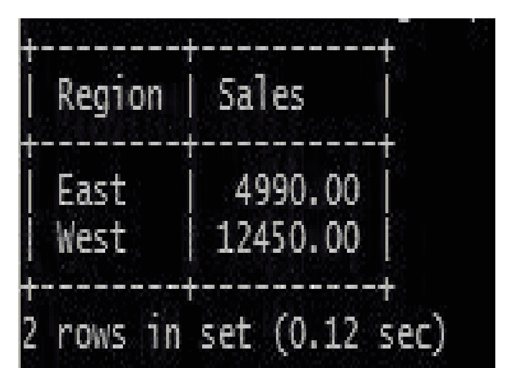

在前两行中，该语句告诉 SQL 从 Location 表中选择 'Region' 字段，从 Branch_Sales 表中选择 'Sales' 字段的总和。该语句使用了表别名。'Region' 字段被别名为 Region，而 SALES 字段的总和被别名为 SALES。

表别名是为表或表列使用临时名称的做法。使用别名有助于使语句更易读且更简洁。例如，如果你选择不为第一行使用表别名，你将需要使用以下语句来达到相同的结果：

```
SELECT Location.Region Region,
SUM(Branch_Sales.Sales) SALES
```

或者，你可以使用 JOIN 和 ON 关键字指定两个表之间的连接。例如，使用这些关键字，查询将是：

```
SELECT A1.Region REGION, SUM(A2.Sales) SALES
FROM Location A1
JOIN Branch_Sales A2
ON A1.Branch = A2.Branch
GROUP BY A1.Region;
```

该查询将产生相同的结果：^[20]^

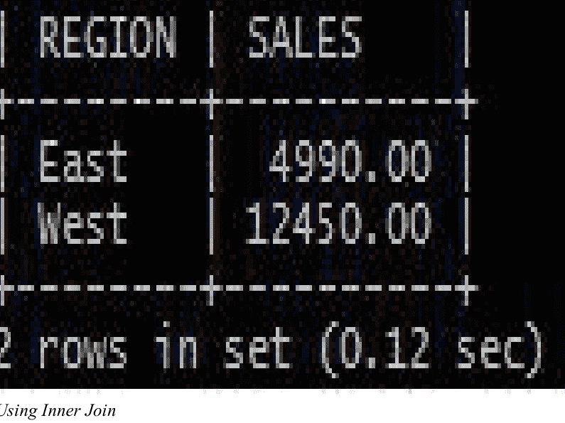

### 使用 Inner Join

当两个表有一个或多个匹配项时，内连接会显示相应的行。为了演示这一点，请使用以下表：

Branch_Sales 表

| 分支 | 产品_ID | 销售额 |
|--------|-----------|-------|
| New York | 101 | 7500.00 |
| Philadelphia | 101 | 1980.00 |
| Denver | 102 | 3500.00 |
| Seattle | 101 | 2500.00 |
| Detroit | 102 | 1450.00 |

| 地区 | 分支 |
|--------|--------|
| East | New York |
| East | Chicago |
| East | Philadelphia |
| East | Detroit |
| West | Los Angeles |
| West | Denver |
| West | Seattle |

你可以通过使用 INNER JOIN 语句来实现这一点。

你可以输入以下内容：

```
SELECT A1.Branch BRANCH, SUM(A2.Sales) SALES
FROM Location A1
INNER JOIN Branch_Sales A2
ON A1.Branch = A2.Branch
GROUP BY A1.Branch;
```

结果如下：

| BRANCH | SALES |
|--------|-------|
| Denver | 3500.00 |
| Detroit | 1450.00 |
| New York | 7500.00 |
| Philadelphia | 1980.00 |
| Seattle | 2500.00 |

请注意，通过使用 INNER JOIN，即使实际上是在 Location 表上应用 SELECT 语句，也只有 Branch_Sales 报表中有记录的分支被包含在结果中。'Chicago' 和 'Los Angeles' 分支被排除在外，因为 Branch_Sales 表中没有这些分支的记录。

### 使用 Outer Join

在前面的示例中，你使用了 Inner Join 来合并具有共同行的表。OUTER JOIN 命令就是用于此目的。

OUTER JOIN 的示例将使用与 INNER JOIN 相同的表：Branch_Sales 表和 Location 表。

这次，你想要所有商店的销售数据列表。常规连接会将 Chicago 和 Los Angeles 排除在外，因为这些分支不属于 Branch_Sales 表。因此，你想要进行 OUTER JOIN。

语句如下：

```
SELECT A1.Branch, SUM(A2.Sales) SALES
FROM Location A1, Branch_Sales A2
WHERE A1.Branch = A2.Branch (+)
GROUP BY A1.Branch;
```

请注意，外连接语法因数据库而异。上述语句使用的是 Oracle 语法。

### 结果如下：

| 分支 | 销售额 |
|--------|-------|
| Chicago | NULL |
| Denver | 3500.00 |
| Detroit | 1450.00 |
| Los Angeles | NULL |
| New York | 7500.00 |
| Philadelphia | 1980.00 |
| Seattle | 2500.00 |

在合并表时，请注意某些 JOIN 语法在不同的数据库系统中会产生不同的结果。为了最大化这一强大的数据库功能，阅读 RDBMS 文档非常重要。

### LIMIT、TOP 和 ROWNUM 子句


**TOP** 命令帮助我们仅从表中检索指定的 **TOP** 数量的记录。但是，你必须注意并非所有数据库都支持 **TOP** 命令。有些数据库支持 **LIMIT** 子句，而另一些则支持 **ROWNUM** 子句。

以下是在 `SELECT` 语句中使用 **TOP** 命令的语法：

```sql
SELECT TOP number|percent columnName(s)
FROM tableName
WHERE [condition]
```

我们希望使用 `EMPLOYEES` 表来演示如何使用此子句。该表包含以下数据：

| ID | NAME | ADDRESS | AGE | SALARY |
|---|---|---|---|---|
| 2 | Mercy | Mercy32 | 25 | 3500.00 |
| 3 | Joel | Joel142 | 30 | 4000.00 |
| 4 | Alice | Alice442 | 31 | 2500.00 |
| 5 | Nicholas | nicoh442 | 45 | 5000.00 |
| 6 | Milly | mil342 | 32 | 2000.00 |
| 7 | Grace | gra361 | 35 | 4000.00 |

以下查询将帮助我们从表中获取前 2 行数据：

```sql
SELECT TOP 2 * FROM EMPLOYEES;
```

请注意，上述命令仅在 SQL Server 中有效。如果你使用的是 MySQL Server，请使用 **LIMIT** 子句，如下所示：

```sql
SELECT * FROM EMPLOYEES
LIMIT 2;
```

```
mysql> SELECT * FROM EMPLOYEES
 -> LIMIT 2;
+----+------+----------+------+----------+
| ID | NAME | ADDRESS  | AGE  | SALARY   |
+----+------+----------+------+----------+
| 2  | Mercy| Mercy32  | 25   | 3500.00  |
| 3  | Joel | Joel142  | 30   | 4000.00  |
+----+------+----------+------+----------+
2 rows in set (0.37 sec)

mysql>
```

这仅返回了表中的前两条记录。

如果你使用的是 Oracle Server，请在 `SELECT` 子句中使用 **ROWNUM**，如下所示：

```sql
SELECT * FROM EMPLOYEES
WHERE ROWNUM <= 2;
```

### ORDER BY 子句

此子句帮助我们对数据进行排序，可以是升序或降序。排序可以基于一列或多列进行。在大多数数据库中，结果默认按升序排序。

**ORDER BY** 子句使用以下语法：

```sql
SELECT columns_list
FROM tableName
[WHERE condition]
```

在 **ORDER BY** 子句中，你可以使用一列或多列。但是，你必须确保你选择用于排序的列包含在列列表中。同样，我们将使用 `EMPLOYEES` 表，其数据如下所示：

| ID | NAME | ADDRESS | AGE | SALARY |
|----|------|---------|-----|--------|
| 2 | Mercy | Mercy32 | 25 | 3500.00 |
| 3 | Joel | Joel42 | 30 | 4000.00 |
| 4 | Alice | Alice442 | 31 | 2500.00 |
| 5 | Nicholas | nicoh442 | 45 | 5000.00 |
| 6 | Milly | mil342 | 32 | 2000.00 |
| 7 | Grace | gra361 | 35 | 4000.00 |

现在，我们需要使用 `NAME` 和 `SALARY` 列对数据进行升序排序。以下命令将帮助我们实现这一点：

```sql
SELECT * FROM EMPLOYEES
  ORDER BY NAME, SALARY;
```

该查询将返回以下结果：

```
mysql> SELECT * FROM EMPLOYEES
    -> ORDER BY NAME, SALARY;
+----+----------+-----------+-----+--------+
| ID | NAME     | ADDRESS   | AGE | SALARY |
+----+----------+-----------+-----+--------+
|  4 | Alice    | Alice442  |  31 | 2500.00|
|  7 | Grace    | gra361    |  35 | 4000.00|
|  3 | Joel     | Joel42    |  30 | 4000.00|
|  2 | Mercy    | Mercy32   |  25 | 3500.00|
|  6 | Milly    | mil342    |  32 | 2000.00|
|  5 | Nicholas | nicoh442  |  45 | 5000.00|
+----+----------+-----------+-----+--------+
6 rows in set (0.32 sec)

mysql>
```

我们也可以使用 `SALARY` 列对数据进行降序排序：

```sql
SELECT * FROM EMPLOYEES
ORDER BY SALARY DESC;
```

结果如下：

```
mysql> SELECT * FROM EMPLOYEES
    -> ORDER BY SALARY DESC;

+----+------+-----------+-----+--------+
| ID | NAME | ADDRESS   | AGE | SALARY |
+----+------+-----------+-----+--------+
| 5  | Nicholas | nicoh442 | 45  | 5000.00 |
| 3  | Joel     | Joel142  | 30  | 4000.00 |
| 7  | Grace    | gra361   | 35  | 4000.00 |
| 2  | Mercy    | Mercy32  | 25  | 3500.00 |
| 4  | Alice    | Alice442 | 31  | 2500.00 |
| 6  | Milly    | mil342   | 32  | 2000.00 |
+----+------+-----------+-----+--------+
6 rows in set (0.05 sec)

mysql>
```

https://www.tutorialspoint.com/sql/sql-top-clause.htm

### GROUP BY 子句

此子句与 `SELECT` 语句一起使用，用于将相关数据分组，形成组。在 `SELECT` 语句中，**GROUP BY** 子句应位于 **WHERE** 子句之后，并在 **ORDER BY** 子句之前。

以下语法：

```sql
SELECT column_1, column_2
FROM tableName
WHERE [ conditions ]
GROUP BY column_1, column_2
ORDER BY column_1, column_2
```

让我们使用 `EMPLOYEES` 表，其数据如下：

| ID | NAME | ADDRESS | AGE | SALARY |
|----|------|---------|-----|--------|
| 2 | Mercy | Mercy32 | 25 | 3500.00 |
| 3 | Joel | Joel42 | 30 | 4000.00 |
| 4 | Alice | Alice442 | 31 | 2500.00 |
| 5 | Nicholas | nicoh442 | 45 | 5000.00 |
| 6 | Milly | mil342 | 32 | 2000.00 |
| 7 | Grace | gra361 | 35 | 4000.00 |

如果你需要获取每位客户的总工资 (`SALARY`)，只需运行以下命令：

```sql
SELECT NAME, SALARY, SUM(SALARY) FROM EMPLOYEES
  GROUP BY NAME;
```

### DISTINCT 关键字

此关键字与 `SELECT` 语句一起使用，用于消除重复项并允许选择唯一记录。

这是因为有时表中存在多个重复记录，而你的目标是仅选择唯一的记录。**DISTINCT** 关键字可以帮助你实现这一点。此关键字可以与以下语法一起使用：

```sql
SELECT DISTINCT column_1, column_2,.....column_N
FROM tableName
WHERE [condition]
```

| ID | NAME | ADDRESS | AGE | SALARY |
|---|---|---|---|---|
| 2 | Mercy | Mercy32 | 25 | 3500.00 |
| 3 | Joel | Joel142 | 30 | 4000.00 |
| 4 | Alice | Alice442 | 31 | 2500.00 |
| 5 | Nicholas | nicoh442 | 45 | 5000.00 |
| 6 | Milly | mil342 | 32 | 2000.00 |
| 7 | Grace | gra361 | 35 | 4000.00 |

在上表中，`SALARY` 列有一个重复的条目 4000。我们运行以下查询后可以看到这一点：

```sql
SELECT DISTINCT SALARY FROM EMPLOYEES
ORDER BY SALARY;
```

```
mysql> SELECT SALARY FROM EMPLOYEES
    -> ORDER BY SALARY;
+----------+
| SALARY   |
+----------+
|  2000.00 |
|  2500.00 |
|  3500.00 |
|  4000.00 |
|  4000.00 |
|  5000.00 |
+----------+
6 rows in set (0.09 sec)

mysql>
```

现在我们可以将查询与 **DISTINCT** 关键字结合使用，看看查询返回什么：

```
mysql> SELECT DISTINCT SALARY FROM EMPLOYEES
    -> ORDER BY SALARY;
+----------+
| SALARY   |
+----------+
|  2000.00 |
|  2500.00 |
|  3500.00 |
|  4000.00 |
|  5000.00 |
+----------+
5 rows in set (0.07 sec)

mysql>
```

### SQL 子查询

到目前为止，我们一直在执行单个 SQL 查询来执行插入、选择、更新和删除功能。但是，有一种方法可以在其他 SQL 查询中执行 SQL 查询。例如，你可以选择数据库中年龄大于某个特定学生的所有学生的记录。在本章中，我们将演示如何在 SQL 中执行子查询或查询中的查询。

你应该有一个名为“Student”和“Department”的表，并带有一些记录。首先，我们可以检索 Stacy 的年龄，将其存储在某个变量中，然后使用 `WHERE` 子句在我们的 `SELECT` 查询中比较年龄。第二种方法是将检索 Stacy 年龄的查询嵌入到检索所有学生年龄的查询中。第二种方法采用了子查询技术。让我们看看查询 1，以了解子查询的实际应用。

查询 1

```sql
Select * From Student
where StudentAge >
(Select StudentAge from Student
where StudName = 'Stacy'
)
```

请注意，在查询 1 中，我们使用了圆括号在 `WHERE` 子句中附加了一个子查询。上述查询将从“Student”表中检索所有学生年龄大于“Stacy”年龄的记录。“Stacy”的年龄是 20；因此，在输出中，你将看到所有年龄大于 20 的学生记录。输出如下：

| StudID | StudName | StudentAge | StudentGender | DepID |
|---|---|---|---|---|
| 1 | Alice | 21 | Male | 2 |
| 4 | Jacobs | 22 | Male | 5 |
| 6 | Shane | 22 | Male | 4 |
| 7 | Linda | 24 | Female | 4 |
| 9 | Wolfred | 21 | Male | 2 |
| 10 | Sandy | 25 | Female | 1 |
| 14 | Mark | 23 | Male | 5 |
| 15 | Fred | 25 | Male | 2 |
| 16 | Vic | 25 | Male | NULL |
| 17 | Nick | 25 | Male | NULL |

同样，如果你想更新所有属于“English”部门的学生的名字，你可以使用以下子查询来实现：

查询 2

```sql
Update Student
Set StudName = StudName + ' Eng'
where Student.StudID in (
Select StudID
from Student
Join
```


**系部**
在 `Student.DepID = Department.DepID` 的连接条件下
其中 `DepName = 'English'`
)

在上述查询中，通过子查询中的 JOIN 语句检索了英语系所有学生的学号。然后，使用 UPDATE 语句，在所有这些学生的名字末尾附加字符串 "Eng" 来更新他们的姓名。WHERE 语句用于匹配通过子查询检索到的学号。

`IFNULL` 函数检查特定表列中是否存在空值。如果存在 NULL 值，则将其替换为作为第二个参数传递给 `IFNULL` 函数的值。例如，以下查询将显示 50 作为那些部门 ID 为空的学生的部门 ID。

现在，如果你同时显示学生的姓名和他们系部的名称，你会看到英语系学生的姓名后面附加了 "Eng"。

### 练习 9

任务：
从 "Student" 表中删除所有学号小于 "Linda" 学号的学生记录。

### 解决方案

```
Delete From Student
where StudID <
(Select StudID from Student
where StudName = 'Linda'
)
```

### SQL 字符函数

SQL 字符函数用于修改检索数据的外观。字符函数不修改实际数据，而是对数据的表示方式进行某些修改。SQL 字符函数操作字符串类型的数据。在本章中，我们将介绍一些最常用的 SQL 字符函数。

### 注意

- 连接 (+)

连接函数用于连接两个或多个字符串。在 SQL 中连接两个字符串，使用 '+' 运算符。例如，我们可以将学生表中的学生姓名和学生性别连接起来，并在一列中显示，如下所示：

```
Select StudName +' '+StudentGender as NameAndGender
from Student
```

- 替换

替换函数用于替换输出字符串中的字符。例如，以下查询在所有学生姓名中将 "ac" 替换为 "rs"。

```
Select StudName, REPLACE(StudName, 'ac', 'rs') as ModifiedColumn
From Student
```

替换函数中的第一个参数是要替换其值的列；第二个参数是要替换的字符序列，后面是第三个参数，表示要插入以替代旧序列的字符序列。

- 子字符串

子字符串函数返回从指定位置开始的指定数量的字符。以下查询显示学生姓名的前三个字符。

```
Select StudName, substring(StudName, 1, 3) as SubstringColumn
From Student
```

- 长度

长度函数用于获取特定列值的长度。例如，要获取 "Student" 表中学生姓名的长度，可以执行以下查询：

```
Select StudName, Len(StudName) as NameLength
from Student
```

请注意，在上面的查询中，我们使用了 `Len()` 函数来获取名称的长度；这是因为在 SQL Server 中，`Len()` 函数用于计算任何字符串的长度。

- `IFNULL`

`IFNULL` 函数检查特定表列中是否存在空值。如果存在 NULL 值，则将其替换为作为第二个参数传递给 `IFNULL` 函数的值。例如，以下查询将显示 50 作为那些部门 ID 为空的学生的部门 ID。

```
Select Student.DepID, IFNULL(Student.DepID, 50)
from Student
```

- `LTRIM`

`LTRIM` 函数会修剪指定为 `LTRIM` 函数参数的列值中的所有前导空格。例如，如果你想删除 "Student" 表中学生姓名前的所有空格，可以使用 `LTRIM` 查询，如下所示：

```
Select Student.StudName, LTRIM(Student.StudName)
from Student
```

- `RTRIM`

`RTRIM` 函数会修剪指定为 `RTRIM` 函数参数的列值中的所有后续空格。例如，如果你想删除 "Student" 表中学生姓名后的所有空格，可以使用 `RTRIM` 查询，如下所示：

通过这种方式，我们可以确保数据库中数据的可靠性和准确性。

约束可以在列级别或表级别施加。列约束只能施加在单个列上，而表级约束则应用于整个表。

### NOT NULL 约束

SQL 中的默认设置是列可以包含空值。如果你不希望某列没有值，可以指定这一点。

请注意，NULL 表示未知数据，而非无数据。此约束可以在创建表时定义。让我们通过创建一个示例表来演示这一点：

```
CREATE TABLE MANAGERS(
  ID  INT NOT NULL,
  NAME VARCHAR (15) NOT NULL,
  DEPT VARCHAR(20) NOT NULL,
  SALARY  DECIMAL (20, 2),
  PRIMARY KEY (ID)
);
```

上面，我们创建了一个名为 MANAGERS 的表，包含 4 列，并在其中三列上施加了 NOT NULL 约束。这意味着你必须为每个受约束的列指定一个值；否则，将引发错误。

请注意，我们没有对表的 SALARY 列施加 NOT NULL 约束。即使在表已创建后，我们也可以对列施加该约束。

```
ALTER TABLE MANAGERS
  MODIFY SALARY DECIMAL (20, 2) NOT NULL;
```

现在，该列不能接受空值。

### 默认约束

如果 `INSERT INTO` 语句中未指定列的值，此约束将为该列提供一个默认值。

考虑下面的例子：

```
CREATE TABLE SUPPLIERS(
    ID INT NOT NULL,
    NAME VARCHAR (15) NOT NULL,
    ADDRESS CHAR (20),
    ARREARS DECIMAL (16, 2) DEFAULT 6000.00,
    PRIMARY KEY (ID)
);
```

假设你已经创建了表，但需要对 ARREARS 列添加默认约束。你可以这样做：

```
ALTER TABLE SUPPLIERS
MODIFY ARREARS DECIMAL (16, 2) DEFAULT 6000.00;
```

这将更新表，并为该列创建默认约束。如果你不再需要此默认约束，可以通过运行以下命令来删除它：

```
ALTER TABLE SUPPLIERS
ALTER COLUMN ARREARS DROP DEFAULT;
```

### 唯一约束

此约束有助于避免在某一列中出现两条或更多条记录具有相似值的可能性。例如，在 "employees" 表中，我们可能需要防止两个或更多员工共享相同的 ID。

以下 SQL 查询展示了如何创建一个名为 "STUDENTS" 的表。我们将在 "ADMISSION" 列上施加 UNIQUE 约束：

```
CREATE TABLE STUDENTS(
    ADMISSION INT NOT NULL UNIQUE,
    NAME VARCHAR (15) NOT NULL,
    AGE INT NOT NULL,
    COURSE CHAR (20),
    PRIMARY KEY (ADMISSION)
);
```

```
mysql> CREATE TABLE STUDENTS(
    ->     ADMISSION INT NOT NULL UNIQUE,
    ->     NAME VARCHAR(15) NOT NULL,
    ->     AGE INT NOT NULL,
    ->     COURSE CHAR(20),
    ->     PRIMARY KEY(ADMISSION)
    -> );
Query OK, 0 rows affected (0.11 sec)

mysql>
```

正确创建的索引可以提高大型数据库的效率。选择在哪些字段上创建索引取决于你经常使用的 SQL 查询。

也许你之前已经创建了 STUDENTS 表但没有 UNIQUE 约束。可以通过运行以下命令在 ADMISSION 列上添加此约束：

```
ALTER TABLE STUDENTS
MODIFY ADMISSION INT NOT NULL UNIQUE;
```

下面进行了演示：

```
ALTER TABLE STUDENTS
ADD CONSTRAINT uniqueConstraint UNIQUE(ADMISSION, AGE);
```

该约束被命名为 "uniqueConstraint" 并指派了两个列：ADMISSION 和 AGE。

任何时候你需要删除该约束，请运行以下命令...


ALTER 和 DROP 命令：

```
ALTER TABLE STUDENTS
	DROP CONSTRAINT uniqueConstraint;
```

该约束将从两列中删除。对于 MySQL 用户，上述命令将无法运行。请运行下面给出的命令：

```
ALTER TABLE STUDENTS
	DROP INDEX uniqueConstraint;
```

### 主键

主键约束帮助我们唯一标识每一行。被指定为主键的列必须具有唯一的值。同时，该列不允许包含 NULL 值。

每个表只允许有一个主键，这个主键可以由单个字段或多个字段组成。当我们使用多个字段作为主键时，它们被称为复合键。如果一个表的某个列被定义为主键，那么任何两条记录在该字段中的值都不会相同。

主键是唯一的标识符。在 STUDENTS 表中，我们可以将 ADMISSION 定义为主键，因为它唯一标识了每个学生。不应该有两个学生的 ADMISSION 号码相同。以下是创建该属性的方法：

```
CREATE TABLE STUDENTS(
	ADMISSION INT NOT NULL,
	NAME VARCHAR (15) NOT NULL,
	AGE INT NOT NULL,
	PRIMARY KEY (ADMISSION)
);
```

ADMISSION 已被设置为该表的主键。如果我们描述该表，你会发现该字段就是主键，如下所示：

在上图的 "Key" 字段中，"PRI" 表示 ADMISSION 字段是主键。

你可能希望在已经存在的表上施加主键约束。这可以通过运行下面给出的命令来完成：

```
ALTER TABLE STUDENTS
    ADD CONSTRAINT PK_STUDADM PRIMARY KEY (ADMISSION, NAME);
```

在上面的命令中，主键约束被命名为 "PK_STUDADM" 并分配给了两个列，即 ADMISSION 和 NAME。这意味着任何两行数据在这些列中的值都不会相同。

可以通过执行以下命令从表中删除主键约束：

```
ALTER TABLE STUDENTS DROP PRIMARY KEY;
```

运行上述命令后，你可以描述 STUDENTS 表以查看它是否还有任何主键：

```
mysql> DESC STUDENTS;
+-----------+--------------+------+-----+---------+-------+
| Field     | Type         | Null | Key | Default | Extra |
+-----------+--------------+------+-----+---------+-------+
| ADMISSION | int(11)      | NO   |     | NULL    |       |
| NAME      | varchar(15)  | NO   |     | NULL    |       |
| AGE       | int(11)      | NO   |     | NULL    |       |
+-----------+--------------+------+-----+---------+-------+
3 rows in set (0.00 sec)

mysql>
```

这表明主键已成功删除。

### 外键

此约束用于将两个表链接在一起。有时，它也被称为引用键。外键只是与另一个表中的主键相匹配的一个列或一组列。

考虑具有以下结构的表：

STUDENTS 表：

```
CREATE TABLE STUDENTS(
    ADMISSION INT NOT NULL,
    NAME VARCHAR (15) NOT NULL,
    AGE INT NOT NULL,
    PRIMARY KEY (ADMISSION)
);
```

FEE 表：

```
CREATE TABLE FEE (
    ID INT NOT NULL,
    DATE DATETIME,
    STUDENT_ADM INT references STUDENTS (ADMISSION),
    AMOUNT float,
    PRIMARY KEY (ID)
);
```

在 FEE 表中，STUDENT_ADM 字段引用了 STUDENTS 表中的 ADMISSION 字段。这使得 FEE 表的 STUDENT_ADM 列成为一个外键。

即使我们创建 FEE 表时没有添加外键，我们也可以使用以下命令来添加它：

```
ALTER TABLE FEES
ADD FOREIGN KEY (STUDENT_ADM) REFERENCES STUDENTS (ADMISSION);
```

外键将被添加到表中。如果你需要删除外键，请运行以下命令：

```
ALTER TABLE FEE
DROP FOREIGN KEY;
```

然后外键将从表中被移除。

## CHECK 约束

此约束用于创建一个条件，该条件将验证输入到记录中的值。如果条件为假，则该记录违反了约束，因此它将不会被输入到表中。

我们想创建一个名为 STUDENTS 的表，并且不希望有任何年龄低于 12 岁的学生。如果学生不符合此约束，他们将不会被添加到表中。该表可以按如下方式创建：

```
CREATE TABLE STUDENTS (
    ADMISSION INT NOT NULL,
    NAME VARCHAR (15) NOT NULL,
    AGE INT NOT NULL CHECK (AGE >= 12),
    PRIMARY KEY (ADMISSION)
);
```

```
mysql> CREATE TABLE STUDENTS (
    ->     ADMISSION INT NOT NULL,
    ->     NAME VARCHAR(15) NOT NULL,
    ->     AGE INT NOT NULL CHECK (AGE >= 12),
    ->     PRIMARY KEY (ADMISSION)
    -> );
Query OK, 0 rows affected (0.57 sec)

mysql>
```

该表已成功创建。

如果你已经创建了没有约束的 STUDENTS 表，但后来需要添加它，请运行下面给出的命令：

```
ALTER TABLE STUDENTS
    MODIFY AGE INT NOT NULL CHECK (AGE >= 12);
```

该约束将被成功添加到 AGE 列。你也可以为约束指定一个名称。这可以使用以下语法完成：

```
ALTER TABLE STUDENTS
    ADD CONSTRAINT checkAgeConstraint CHECK(AGE >= 12);
```

### INDEX 约束

INDEX 帮助我们快速从数据库中检索数据。要创建索引，我们可以依赖于数据库表中的一列或一组列。一旦创建了索引，它会为每一行分配一个 ROWID，然后才能对数据进行排序。

适当创建的索引可以提高大型数据库的效率。选择在哪些字段上创建索引取决于你经常使用的 SQL 查询。

假设我们创建了以下包含三列的表：

```
CREATE TABLE STUDENTS (
    ADMISSION INT NOT NULL,
    NAME VARCHAR (15) NOT NULL,
    AGE INT NOT NULL CHECK (AGE >= 12),
    PRIMARY KEY (ADMISSION)
);
```

然后我们可以使用以下语法在一个或多个列上实现索引：

```
CREATE INDEX indexName
ON tableName (column_1, column_2.....);
```

现在，我们需要在名为 AGE 的列上实现一个索引，以便更容易地使用特定年龄进行搜索。索引可以按如下方式创建：

```
CREATE INDEX age_idx
ON STUDENTS (AGE);
```

如果不再需要该索引，可以通过运行以下命令来删除它：

```
ALTER TABLE STUDENTS
DROP INDEX age_idx;
```

## ALTER TABLE 命令

SQL 为我们提供了 ALTER TABLE 命令，该命令可用于添加、删除和修改表列。该命令还有助于我们向表添加和移除约束。

假设你有一个包含以下数据的 STUDENTS 表：

```
ALTER TABLE STUDENTS ADD COURSE VARCHAR(10);
```

```
mysql> ALTER TABLE STUDENTS ADD COURSE VARCHAR(10);
Query OK, 3 rows affected (0.15 sec)
Records: 3 Duplicates: 0 Warnings: 0

mysql>
```

当我们查询表的内容时，得到如下结果：

| ADMISSION | NAME    | AGE | COURSE |
|-----------|---------|-----|--------|
| 3420      | NICHOLAS| 10  | NULL   |
| 1234      | john    | 32  | NULL   |
| 3456      | mercy   | 23  | NULL   |

这表明该列已被添加，并且每条记录在该列中都被分配了 NULL 值。

要将 COURSE 列的数据类型从 VarChar 更改为 Char，请执行以下命令：

```
ALTER TABLE STUDENTS MODIFY COLUMN COURSE Char(1);
```

```
mysql> ALTER TABLE STUDENTS MODIFY COLUMN COURSE Char(1);
Query OK, 3 rows affected (0.13 sec)
Records: 3 Duplicates: 0 Warnings: 0

mysql>
```

我们可以将 ALTER TABLE 命令与 DROP TABLE 命令结合使用，从表中删除一列。要从 STUDENTS 表中删除 COURSE 列，我们运行以下命令：

```
ALTER TABLE STUDENTS DROP COLUMN COURSE;
```

然后我们可以通过 describe 命令查看表的详细信息，以确认该列是否已成功删除。

上图显示该列已被成功删除。


## 总结与后续步骤

希望您喜欢这本书，并尽可能地从中获取了所需的信息。如果您愿意，可以随时返回本书的其他章节，自由浏览以提升您的技能。

### *产品评价与反馈*

我不想只给您一个标准的结论，而是想就您后续可以采取哪些步骤来继续学习SQL提一些建议。但首先，如果您有任何反馈，请前往本书的亚马逊产品页面留下真诚的评论，或者直接发邮件至 jaschulz0705@gmail.com 联系我。

### *更多数据库示例*

如果您有兴趣使用更多数据库，那么有几个链接您可能会感兴趣。您可以通过以下链接下载 Chinook 和 Northwind 数据库，并开始使用它们。

请 [点击此链接下载 Chinook 数据库](#)。到达页面后，点击右上角的箭头下载一个zip文件。完成后，将zip文件解压到计算机上易于访问的位置。现在，打开文件夹，将 `Chinook_SqlServer.sql` 或 `Chinook_SqlServer_AutoIncrementPKs.sql` 文件拖放到 SSMS 中，然后点击“执行”按钮。您将获得一个完整的 Chinook 数据库。

除了 Chinook 数据库，您还可以 [点击此链接下载 Northwind 数据库](#)。到达页面后，同样点击右上角的箭头下载另一个zip文件。然后，解压此zip文件并将其与其他SQL备份文件放在一起。由于这是一个 `Northwind.bak` 文件（数据库备份文件），您需要还原数据库。您也可以参考前面关于数据库还原和 SSMS 基础知识的章节来帮助完成这些任务！

### *继续学习*

通过运行查询和理解数据，深入探索 AdventureWorks、Company_Db、Chinook 和 Northwind 数据库。学习SQL的一部分也在于理解数据库中的数据。

为了保护数据库，SQL拥有一种安全方案，可以指定哪些数据库用户可以查看特定信息。该方案还允许您设置每个用户可以执行的操作。这种安全方案（或模型）依赖于授权标识符。正如您在第二章所学，授权标识符是代表一个或多个可以访问/修改数据库内部信息的用户的对象。

### 更多参考资料

MTA 98-364 认证

您可以在以下位置找到有关该认证的信息：[https://www.microsoft.com/en-us/learning/exam-98-364.aspx](https://www.microsoft.com/en-us/learning/exam-98-364.aspx)。到达页面后，请务必展开“技能衡量”部分的主题，因为您在这些领域的数据库知识将受到测试。

到此为止。

## 参考文献

1keydata.com. (2019). *SQL - CREATE VIEW Statement | 1Keydata*. [在线] 可访问：https://www.1keydata.com/sql/sql-create-view.html [访问于 2019年2月3日]。

Chartio. (2019). *How to Alter a Column from Null to Not Null in SQL Server*. [在线] 可访问：https://chartio.com/resources/tutorials/how-to-alter-a-column-from-null-to-not-null-in-sql-server/ [访问于 2019年2月3日]。

Docs.microsoft.com. (2019). *Primary and Foreign Key Constraints - SQL Server*. [在线] 可访问：https://docs.microsoft.com/en-us/sql/relational-databases/tables/primary-and-foreign-key-constraints?view=sql-server-2017 [访问于 2019年2月3日]。

Sites.google.com. (2019). *DDL Commands - Create - Drop - Alter - Rename - Truncate - Programming Languages*. [在线] 可访问：https://sites.google.com/site/prgimr/sql/ddl-commands---create---drop---alter [访问于 2019年2月3日]。

Techonthenet.com. (2019). *SQL: UNION ALL Operator*. [在线] 可访问：https://www.techonthenet.com/sql/union_all.php [访问于 2019年2月3日]。

1keydata.com. (2019). *SQL - RENAME COLUMN | 1Keydata*. [在线] 可访问：https://www.1keydata.com/sql/alter-table-rename-column.html [访问于 2019年2月3日]。

Docs.microsoft.com. (2019). *Create Check Constraints - SQL Server*. [在线] 可访问：https://docs.microsoft.com/en-us/sql/relational-databases/tables/create-check-constraints?view=sql-server-2017 [访问于 2019年2月3日]。

Docs.microsoft.com. (2019). *Create Primary Keys - SQL Server*. [在线] 可访问：https://docs.microsoft.com/en-us/sql/relational-databases/tables/create-primary-keys?view=sql-server-2017 [访问于 2019年2月3日]。

Docs.microsoft.com. (2019). *Delete Tables (Database Engine) - SQL Server*. [在线] 可访问：https://docs.microsoft.com/en-us/sql/relational-databases/tables/delete-tables-database-engine?view=sql-server-2017 [访问于 2019年2月3日]。

Docs.microsoft.com. (2019). *Modify Columns (Database Engine) - SQL Server*. [在线] 可访问：https://docs.microsoft.com/en-us/sql/relational-databases/tables/modify-columns-database-engine?view=sql-server-2017 [访问于 2019年2月3日]。

query?, H., M, D., K., R., Singraul, D., Singh, A. and kor, p. (2019). *How to change a table name using an SQL query?*. [在线] Stack Overflow. 可访问：https://stackoverflow.com/questions/886786/how-to-change-a-table-name-using-an-sql-query [访问于 2019年2月3日]。

SQL Joins Explained. (2019). *SQL Join Types — SQL Joins Explained*. [在线] 可访问：http://www.sql-join.com/sql-join-types/ [访问于 2019年2月3日]。

Techonthenet.com. (2019). *SQL: ALTER TABLE Statement*. [在线] 可访问：https://www.techonthenet.com/sql/tables/alter_table.php [访问于 2019年2月3日]。

Techonthenet.com. (2019). *SQL: GROUP BY Clause*. [在线] 可访问：https://www.techonthenet.com/sql/group_by.php [访问于 2019年2月3日]。

www.tutorialspoint.com. (2019). *SQL DEFAULT Constraint*. [在线] 可访问：https://www.tutorialspoint.com/sql/sql-default.htm [访问于 2019年2月3日]。

www.tutorialspoint.com. (2019). *SQL INDEX Constraint*. [在线] 可访问：https://www.tutorialspoint.com/sql/sql-index.htm [访问于 2019年2月3日]。

www.tutorialspoint.com. (2019). *SQL INNER JOINS*. [在线] 可访问：https://www.tutorialspoint.com/sql/sql-inner-joins.htm [访问于 2019年2月3日]。

www.tutorialspoint.com. (2019). *SQL LIKE Clause*. [在线] 可访问：https://www.tutorialspoint.com/sql/sql-like-clause.htm [访问于 2019年2月3日]。

www.tutorialspoint.com. (2019). *SQL NOT NULL Constraint*. [在线] 可访问：https://www.tutorialspoint.com/sql/sql-not-null.htm [访问于 2019年2月3日]。

www.tutorialspoint.com. (2019). *SQL TOP, LIMIT or ROWNUM Clause*. [在线] 可访问：https://www.tutorialspoint.com/sql/sql-top-clause.htm [访问于 2019年2月3日]。

W3schools.com. (2019). *SQL INNER JOIN Keyword*. [在线] 可访问：https://www.w3schools.com/sql/sql_join_inner.asp [访问于 2019年2月3日]。

W3schools.com. (2019). *SQL LEFT JOIN Keyword*. [在线] 可访问：https://www.w3schools.com/sql/sql_join_left.asp [访问于 2019年2月3日]。

W3schools.com. (2019). *SQL NOT NULL Constraint*. [在线] 可访问：https://www.w3schools.com/sql/sql_notnull.asp [访问于 2019年2月3日]。

W3schools.com. (2019). *SQL NOT NULL Constraint*. [在线] 可访问：https://www.w3schools.com/sql/sql_notnull.asp [访问于 2019年2月3日]。

W3schools.com. (2019). *SQL PRIMARY KEY Constraint*. [在线] 可访问：https://www.w3schools.com/sql/sql_primarykey.asp [访问于 2019年2月3日]。

W3schools.com. (2019). *SQL RIGHT JOIN Keyword*. [在线] 可访问：https://www.w3schools.com/sql/sql_join_right.asp [访问于 2019年2月3日]。

W3schools.com. (2019). *SQL UNION Operator*. [在线] 可访问：https://www.w3schools.com/sql/sql_union.asp [访问于 2019年2月3日]。

W3schools.com. (2019). *SQL UNION Operator*. [在线] 可访问：https://www.w3schools.com/sql/sql_union.asp [访问于 2019年2月3日]。

W3schools.com. (2019). *SQL UNIQUE Constraint*. [在线] 可访问：https://www.w3schools.com/sql/sql_unique.asp [访问于 2019年2月3日]。

www.tutorialspoint.com. (2019). *SQL Primary Key*. [在线] 可访问：https://www.tutorialspoint.com/sql/sql-primary-key.htm [访问于 2019年2月3日]。


## ARDUINO 编程

零基础初学者逐步学习 Arduino 编程终极指南

Ryan Turner

© 版权所有 2019 - Ryan Turner - 保留所有权利。

本书中的内容未经作者或出版商直接书面许可，不得复制、转载或传播。

在任何情况下，对于因本书中的信息而直接或间接导致的任何损害、赔偿或经济损失，出版商或作者均不承担任何责任或法律责任。

**法律声明：**
本书受版权保护。本书仅供个人使用。未经作者或出版商同意，不得修改、分发、出售、使用、引用或转述本书的任何部分或内容。

**免责声明：**
请注意，本文件中的信息仅供教育和娱乐目的。已尽一切努力呈现准确、最新、可靠和完整的信息。任何类型的担保均不予声明或暗示。读者承认，作者不参与提供法律、财务、医疗或专业建议。本书内容来源于各种来源。在尝试本书中概述的任何技术之前，请咨询持牌专业人士。

阅读本文件即表示读者同意，在任何情况下，作者均不对因使用本文件中的信息而导致的任何直接或间接损失负责，包括但不限于错误、遗漏或不准确之处。

## 目录

- [Arduino 简介](#)
- [什么是 Arduino？](#)
  - [Arduino 的历史](#)
  - [但什么是 Arduino？](#)
  - [谁使用 Arduino？](#)
- [Arduino 的 6 大优势](#)
- [理解 Arduino 的关键术语](#)
  - Arduino 板 anatomy
  - 关于 Arduino 工作的其他术语

## 了解选择

- Uno
- Leonardo
- 101
- Esplora
- Mega 2560
- Zero
- Due
- Mega ADK
- Arduino Pro (8 MHz)
- Arduino Pro (16 MHz)
- Arduino M0
- Arduino M0 Pro
- Arduino YÚN（基于 ATmega32U4）
- Arduino Ethernet
- Arduino Tian
- Industrial 101
- Arduino Leonardo ETH
- Gemma
- Lilypad Arduino USB
- Lilypad Arduino 主板
- Lilypad Arduino Simple
- Lilypad Arduino Simple Snap
- 其他板型

## 选择并设置 Arduino

- 选择板型
  - 我需要多少数字和模拟引脚才能实现我想要的功能？
  - 我想让它成为可穿戴设备吗？
  - 我想连接到物联网吗？如果是，如何连接？
- Arduino IDE 入门
- 为 Arduino 编写程序
- 连接到 Arduino 板
- 上传到 Arduino 板
- 使用程序运行 Arduino

## Arduino 编程

- 结构
- 控制结构
- 语法
- 算术运算符
- 比较运算符
- 数据类型
  - Void
  - Boolean
  - Char
  - Unsigned Char
  - Byte
  - Int
  - Unsigned Int
  - Word
  - Long
  - Unsigned Long
  - Short
  - Float
  - Double
- 将你的 Arduino 变成机器
  - 有用的常量
  - 串口初始化
  - 初始化数字引脚并将其关闭
  - 读取传感器温度
  - 将传感器值传输到电脑
  - 将传感器读数转换为电压
  - 上传到电脑前将电压转换为温度
  - 低温时关闭 LED
  - 打开 LED 以显示低温
  - 要显示中等温度，打开两个 LED
- C 语言基础与函数
  - 内存映射
- 逻辑语句
- For 循环
- 数组
- 运算符
  - 算术运算符
  - 布尔运算符
- 决策
  - If 语句
- 输入、输出和传感器
  - 步骤
- 电脑与 Arduino 的接口
- 回顾（复习）
  - Arduino
  - Arduino 的结构
  - C 编程基础
  - 使用变量和值
  - 赋值与数学运算
  - 数组
- 更深入的计算机科学主题
- Arduino API 函数
- 使用 Stream 类（以及处理字符串）
- 结论
- 参考文献

## Arduino 简介

如果你从未听说过 Arduino，它是一个开源电子接口，由两部分组成：第一部分是可编程电路板，另一部分是你选择的编码程序，在电脑上运行。Arduino 有多种形式，包括 Arduino Uno、LilyPad Arduino、Redboard、Arduino Mega、Arduino Leonardo 等，我们将在后面介绍。

如果你不熟悉编程，这是一个很好的起点。Arduino 可以用多种 kind 编程语言进行编程，其丰富的 Arduino 选项可以让你获得更多的编程经验。Arduino 附带额外的附件，有些是传感器形式，其他的可以在任何地方获得，并可以连接到 Arduino 的各种端口。Arduino 是理解编程和传感器交互的绝佳踏脚石。

在编程语言中，总有一个著名的程序 "Hello World" 在屏幕上展示。在我们所处的微控制器世界中，这个阶段或第一个程序通过灯光的闪烁来表示 "开" 和 "关"，以表明你设置的一切都能正确工作。

我们将完整地查看这些草图，并在解释代码后解释细节。如果你遇到无法理解的内容，继续阅读，一切都会变得清晰。

让我们看看这个程序，向你展示我们将如何分解代码。

```cpp
const int PinkL = 13;

void setup() {
  pinMode(PinkL, OUTPUT);
}

void loop() {
  digitalWrite(PinkL, HIGH);
  delay(600);
  digitalWrite(PinkL, LOW);
  delay(600);
}
```

第一部分

```cpp
const int PinkL = 13;
```

这一行用于定义一个在程序中使用的常量，以指定特定的值。建议所有引脚都有这个，因为如果电路保持不变，这样可以轻松进行软件更改。在 Arduino 编程中，常量通常以字母 "k" 开头命名。

第二部分

```cpp
void setup() {
  pinMode(PinkL, OUTPUT);
}
```

OUTPUT 是引脚 13。这使得 Arduino 控制到引脚的代码，而不是从中读取。

第三部分

```cpp
void loop() {
  digitalWrite(PinkL, HIGH);
  delay(600);
  digitalWrite(PinkL, LOW);
  delay(600);
}
```

这是代码的核心部分。向引脚写入 HIGH 会导致 LED 亮起。当你设置为 HIGH 时，意味着引脚输出 5V。另一个选项是 LOW，意味着你输出 0V。

调用 delay() 来延迟发送给它的毫秒数。由于我们发送了 600，将会有 0.6 秒的延迟。LED 熄灭，这是由于引脚上作为输写入的 LOW。

将激活 600 毫秒的延迟。

这将是 Arduino 关闭或电源断开之前的序列。

在开始消化更多内容之前，尝试运行这个程序并确保它工作正常。要测试你是否将 LED 接反了，可能会发生以下情况。在 UNO 板上，引脚 13 连接了一个发光二极管。当它闪烁而面包板 LED 不闪烁时，你可能将 LED 接反了。如果你看到它每秒闪烁一次，那么程序没有成功发送到 Arduino。

完成编程后，在代码行中放置注释来指导 Arduino。这些注释可以指导你的 Arduino 间歇性闪烁 LED 或通过各种序列闪烁。

我们通常编写的程序通常是为计算机而不是为人设计的，一旦打开就不容易理解。有一个很好的机制允许我们人类轻松阅读程序，而计算机对此一无所知。这个程序中有两种可能的注释：

1. 块注释样式以两个字符 `/*` 开始，直到看到 `*/` 为止。然后跨越多行，以下是一些示例。

```cpp
/* 这是第一行 */

/* 程序运行成功 */

/*
* 我们
* 正在
* 前进
* 很远
*/
```


2. 注释可以在包含反斜杠运算符 // 的行上进行。这是给人类而非机器阅读的部分。这是插入注释的另一种方式。

当你在程序中添加注释时，你的代码看起来会像上面的语句一样。

在接下来的页面中，你会发现如果代码行旁边没有编号，则表示这是从顶部行延续下来的注释。我们可能无法完美地展示这一点，因为本书的篇幅有限。你会在延续行的末尾发现一个连字符，并在延续行上也有一个连字符。这只是我们处理的方式，但在 IDE 中你不会看到它们，也不需要输入它们。

```
/*
* Program Name: Blink123
* Author: James Aden
* Date written: 24 July 2017
* Description:
* Turns an LED on for a sixth-hundred of a second, then for another sixth-hundred of a second on a continuous repetitive session
*/
```

```
/* Pin Definitions */
```

```
const int PinkL = 13;
```

```
/*
* Functions Name: setup
* Purpose: Run once after system power up
*/
```

```
void setup() {pinMode(PinkL, OUTPUT);}
```

```
void loop()
{
  digitalWrite(PinkL, HIGH);
  delay(600);
  digitalWrite(PinkL, LOW);
  delay(600);
}
```

### 注意事项

如果你发现你的程序无法编译，或者给出的结果与你所需的不同，以下是一些人们容易混淆的问题：
- 编程语言通常对字母的大小写敏感。例如，myVar 被视为与 MyVar 不同。
- 制表符、空行和空白字符都等同于一个空格，这让代码更易于阅读。
- 代码块通常使用大括号进行分组，即"{"和"}"
- 所有开括号都有对应的闭括号，即"("和")"
- 数字中不要包含逗号。所以不要写 1,000，而要确保写 1000。
- 所有程序语句**必须**以分号结尾。这意味着每条语句都必须如此，除了以下两种情况：
    - 注释中
    - 在大括号"}"之后

1. 在 LED 重新亮起之前，将延时时间改为 1.5 秒。保持 LED 的点亮时间限制为 600 毫秒。
2. 从引脚 13 改为引脚 2，使其成为连接 LED 的新引脚。请记住，电路和程序都会有所不同。

这只是 Arduino 基础编程的基础。在本书的其余部分，我们将探讨如何针对不同功能对 Arduino 进行编程。如果你是编程新手，不要让上面的代码吓到你。编程需要练习，但相对来说很容易学习，就像学习一门新语言一样。

## 什么是 Arduino？

随着技术时代的全面到来，普通人的技术素养正在提高。越来越多的人开始熟悉现代时代的硬件和软件，无论是作为业余爱好者还是专业工程师。

无论出于什么原因，你和许多其他人被 Arduino 所吸引。也许你在线上或线下看到过基于 Arduino 技术构建的各种项目，或者你听说过使用 Arduino 制作小工具的灵活性和便捷性。无论情况如何，你都有兴趣了解更多关于 Arduino 的知识，以及如何在自己的生活中利用这项技术。首先，让我们看看什么是 Arduino 及其历史。

### Arduino 的历史

Arduino 技术始于 2003 年 Hernando Barragán 的一个想法，旨在简化 BASIC stamp 微控制器，并降低意大利伊夫雷亚互动设计学院的非工程学生购买此类技术的成本。微控制器是一种可以编程执行特定功能的小型计算机板。当时，BASIC stamp 微控制器的成本为 100 美元甚至更高，而正如我们稍后将看到的，Arduino 确实在降低成本的同时保持了执行各种功能的能力以及编程这些功能的便捷性。

在 Massimo Banzi 和 Casey Reas 的指导下，Barragán 使用名为 Processing 的计算机语言来创建环境，即 IDE（Arduino 的官方编码环境和程序）。他摆弄 Wiring 平台技术，最终开发出了名为 ATmega168 的硬件，即第一款 Arduino 微控制器。

2003 年晚些时候，Massimo Banzi、David Mellis 和 David Cuartielles 为他们的 ATmega8 微控制器板添加了对 Wiring 的支持，并重新编写了 Wiring 源代码，将其命名为 Arduino。三人连同 Tom Igoe 和 Gianluca Martino 一起继续开发 Arduino 技术，到 2013 年仅纽约供应商 Adafruit Industries 就售出了 700,000 块微控制器板。

在 Arduino 商标确立过程中出现一些问题并导致公司分裂几年后，Arduino 现在已成为一家单一公司，致力于开发普通人和业余爱好者都能使用的硬件和软件，同时也具有足够的灵活性以吸引专业工程师。

### 但 Arduino *究竟*是什么？

这段 Arduino 的历史听起来可能和这项技术本身一样令人困惑。充满了许多令人费解和困惑的元素，你可能会被"微控制器"、"环境"和"语言"等术语所淹没。然而，本书旨在揭开 Arduino 的神秘面纱。我们将从这里开始，从 Arduino 的定义入手。

其工作原理如下：首先购买适合其用途的硬件，然后在功能更强大的 Windows、Macintosh OSX 或 Linux 计算机上，为电路板编写或编写指令，并通过线缆上传指令。代码随后存储在微控制器上，并根据指令运行功能，例如当光线透过敞开的门时激活蜂鸣声。光线激活连接到微控制器的传感器，类似一个警报器。

### 谁在使用 Arduino？

各种各样的人使用 Arduino 进行各种项目和爱好，以及专业用途。它以简单直接、适合初学者而著称，同时又足够深入丰富以适应初学者的成长，并为更高级的用户提供足够的发挥空间。

教师和学生使用 Arduino，实际上他们也是产品的目标消费群体，因为 Arduino 提供了一种低成本的科学仪器构建方式。这使教师和学生能够练习和演示化学和物理原理，并入门编程和机器人构建。

设计师和建筑师可能会使用 Arduino 技术来构建交互式模型和原型，以便在他们希望全面开发的项目中使用。音乐家和艺术家也使用 Arduino 微控制器来尝试新的乐器或艺术创作技巧。

几乎任何人都可以使用 Arduino，包括想要开始 tinkering 编程和计算机硬件的儿童，以及仅仅想学习一些软件和微控制器知识的业余爱好者。

## Arduino 的 6 大优势

- 创建 Arduino 微控制器的驱动力是成本效益。与其他一些售价 100 美元的电路板相比，预组装的 Arduino 电路板售价不到 50 美元，而可以手动组装的电路板成本更低。

- Arduino 环境 IDE 可以跨不同平台工作。这意味着你可以像使用任何其他微控制器板一样使用 Windows 计算机，但你也可以使用 Macintosh OSX 计算机，或者运行 Linux 的计算机，同样能轻松地使用 Arduino 软件。这使 Apple 用户和开源 Linux 用户也能使用微控制器。

- Arduino 的软件是开源的。你用来指令微控制器完成特定功能的工具或代码字符串对任何人都是可访问的。你无需购买许可证即可使用这些工具，因此教师可以向学生讲授，学生也可以免费学习。

- 开源工具还可以通过 C++ 库和 AVR-C 编码语言进行扩展，这意味着具有更深入代码知识的人也能够从这些技术中受益。软件和编程功能具有一定的深度，允许更专业的人士深入探索，同时其直观的编码语言也允许业余爱好者进行 tinkering。

- 人们为微控制器编写代码的环境简单明了。这意味着你用于为微控制器编写指令的计算机程序 IDE 直观易懂。这使使用该软件成为流畅的体验。


## 理解 Arduino 的关键术语

在使用 Arduino 技术时，了解 Arduino 的专业术语会非常有帮助。你需要理解这些术语才能选择合适的开发板、编写代码指令、设置微控制器以供使用，并最终使用 Arduino 开发板。在本章中，你将找到一些关键术语，它们将极大地帮助你成为一名 Arduino 用户。

如前所述，Arduino 是开源的，这意味着你可以使用它并向他人传授，而不会违反任何版权法。它基于易于使用的硬件——即你将实际使用的物理计算机板，以及简单易懂的软件——即你将用来指导硬件执行所选任务的编码指令。该软件也被称为代码，而单个指令片段则称为工具。

开源硬件 Arduino 开发板技术在知识共享许可协议下发布。任何有意愿且具备相关知识的人都可以找到并创建自己的硬件，以在 IDE 环境中与 Arduino 软件编程配合使用。即使是缺乏经验的电路设计师，也可以使用面包板来创建自己的 Arduino 电路板。

### Arduino 开发板的结构

开发板本身包含相当多的部件。数字引脚沿着大多数 Arduino 微控制器的边缘排列，用于输入（感知某种状态）和输出（控制器对输入做出的响应）。例如，输入可能是光传感器检测到黑暗，即缺乏光线。随后它会闭合电路点亮灯泡作为输出：为你的孩子准备的小夜灯。

在大多数开发板上，会有一个引脚 LED，与特定引脚相关联，例如 Arduino Uno 上的引脚 13。该引脚 LED 是开发板上唯一的内置输出选项，它将帮助你完成第一个项目——"闪烁程序"，这将在后面解释。引脚 LED 还用于调试或修复你编写的代码，使其没有错误。电源 LED 如其名所示：当开发板接收电源或"开启"时会亮起。这也有助于调试你的代码。

每块开发板上都有微控制器本身，称为 ATmega 微控制器，它是整个开发板的大脑。它接收你的指令并相应执行。没有这个，整个开发板将没有任何功能。

模拟输入引脚位于 Arduino Uno 上与数字引脚相对的另一侧边缘。它是进入 Arduino 系统的输入。模拟意味着输入的信号不是恒定的，而是随时间变化，例如音频输入。以音频输入为例，房间中的听觉输入会随着房间内人员交谈以及从房间外传入的噪音而变化。

GND 和 5V 引脚用于向电路和微控制器提供额外的 5V 电源。电源连接器通常位于 Arduino 开发板的边缘，当未连接 USB 时，它用于为微控制器供电。USB 端口也可以作为电源使用，但其主要功能是从你的计算机向 Arduino 上传或传输你的程序（即你编写的一组指令）。

TX 和 RX LED 用于指示正在发生信息传输。这种通信指示会在你将程序从计算机上传到 Arduino 时出现，在传输过程中它们会快速闪烁。

复位按钮正如其名：它将微控制器重置为出厂设置，并清除你上传到 Arduino 中的任何信息。

### 使用 Arduino 的其他术语

Arduino 系统中有三种类型的存储器。存储器是信息存储的空间。

闪存是存储你编写的程序代码的地方。它也被称为"程序空间"，因为当你将程序上传到 Arduino 时会自动使用该空间。这种存储器在断电或 Arduino 关闭后仍然保持完整。

SRAM（静态随机存取存储器）是你创建的程序用于创建、存储和处理来自输入源的信息以产生输出的空间。这种存储在断电后会消失。

EEPROM 就像一个小型硬盘，允许程序员在 Arduino 关闭时存储除程序本身以外的信息。EEPROM 有独立的指令用于读取、写入和擦除，以及其他功能。

某些数字引脚将被指定为 PWM 引脚，意味着它们可以用数字方式产生模拟信号。我们记得，模拟意味着输入（或输出）是变化的，不是恒定的。通常，数字引脚只能产生恒定的能量流。然而，PWM 引脚可以在 0 到 5 伏特之间调节能量的"脉冲"。你编写的某些任务只能由 PWM 引脚执行。

此外，在比较微控制器开发板时，你需要关注时钟速度，即微控制器运行的速度。速度越快，开发板的响应性就越好，但同时也会消耗更多的电池或能量。

UART 衡量设备可以处理的串行通信线路数量。串行通信线路是按顺序传输数据的线路，即排成一列而不是并行或同时传输。串行处理比并行处理所需的硬件少得多。

某些项目会让你将设备连接到物联网，这本质上描述的是设备（台式机和笔记本电脑除外）与各种网络的互联，以便共享信息。从智能冰箱到智能手机，再到智能电视，都连接到了物联网。

## 了解选择

既然我们已经了解了一些理解 Arduino 微控制器开发板的基础知识，让我们来看看购买 Arduino 开发板时的各种选择。我们将从价格、功能、存储容量等方面进行分析，让你的决策尽可能简单明了。

### Uno

这是大多数人开始 Arduino 之旅所使用的开发板。它在存储容量方面相对较小，但功能非常灵活，是初学者和想要尝试 Arduino 的人们的绝佳工具。该型号配备了迷你 USB 端口，允许你直接向开发板上传程序，无需使用扩展板或其他额外硬件。

- 价格：$24.95
- 闪存：32kB
- SRAM：2kB
- EEPROM：1kB
- 处理速度：16MHz
- 数字引脚：14 个
- PWM 引脚：6 个
- 模拟输入：6 个
- 工作电压：5V
- 输入电压：7-12V

### Leonardo

Leonardo 微控制器开发板开箱即用：你只需要一根 micro-USB 数据线和一台电脑即可开始。此外，由于其 ATmega32U4 处理器，电脑可以将 Leonardo 识别为鼠标或键盘。

- 价格：$19.80
- 闪存：32kB
- SRAM：2.5kB
- EEPROM：1kB
- 处理速度：16MHz
- 数字引脚：20 个
- PWM 引脚：7 个
- 模拟输入：12 个
- 工作电压：5V
- 输入电压：7-12V

### 101

这款微控制器包含许多其他入门级型号所不具备的功能。例如，你可以通过手机以低功耗蓝牙连接到该开发板。此外，它内置了加速计和陀螺仪，通过其六轴灵敏度可以识别各个方向的运动。它还可以识别手势。

综合这些功能，你可以让设备自身或周围的运动成为输入，从而使微控制器做出相应的输出响应。

- 价格：$30.00
- 闪存：196kB
- SRAM：24kB
- EEPROM：0kB
- 处理速度：32MHz
- 数字引脚：14 个
- PWM 引脚：4 个
- 模拟输入：6 个
- 工作电压：3.3V
- 输入电压：7-12V

### Esplora

这款开发板基于 Leonardo，但内置了更多技术，因此你无需学习太多电子知识就能上手使用。相反，你可以在观察程序自行运行的过程中学习。

内置的输入传感器包括操纵杆、滑块、温度传感器、麦克风、加速计和光传感器。它还包括一些声音和光输出。它可以通过两个 Tinker kit 输入/输出接口连接到称为 TFT LCD 屏幕的其他技术，以扩展其功能。

- 价格：$43.89
- 闪存：32kB
- SRAM：2.5kB
- EEPROM：1kB
- 处理速度：16MHz
- 数字引脚：不适用
- PWM 引脚：不适用


## Mega 2560

这款微控制器专为机器人、3D打印机等大型项目而设计。它的数字引脚和模拟输入引脚数量是普通板的多倍，PWM引脚数量也几乎是其三倍。再加上数倍增加的闪存、SRAM和EEPROM，使其能够支持需要更多指令的项目。这款Arduino板有空间实现更高的复杂性和特异性。

- 价格：$45.95
- 闪存：256kB
- SRAM：8kB
- EEPROM：4kB
- 处理速度：16MHz
- 数字引脚：54个
- PWM引脚：15个
- 模拟输入：16个
- 工作电压：5V
- 输入电压：7-12V
- UART：4路

## Zero

这是Arduino Uno技术的延伸产品。它是Uno的32位扩展版， vastly提升了处理速度，SRAM容量增加了16倍，闪存也数倍增加。你需要为这些扩展功能付出代价，价格几乎是Uno的两倍，但使用这款硬件，你的能力远不止翻倍。

Zero的另一个优势是它内置了名为Atmel嵌入式调试器（简称EDBG）的功能，可以帮助你在不使用额外硬件的情况下调试代码，从而提高软件编码的效率。

- 价格：$42.90
- 闪存：256kB
- SRAM：32kB
- EEPROM：不适用
- 处理速度：48MHz
- 数字引脚：14个
- PWM引脚：10个
- 模拟输入：6个
- 模拟输出：1个
- 工作电压：3.3V
- 输入电压：7-12V
的话来说，UART：2路
- USB端口：2个micro-USB端口

### Due

这在微控制器板领域是一款创新产品，因为它基于32位ARM内核微控制器构建，赋予了它强大的功率和功能。它拥有极快的处理器和4个UART，使其具有很高的灵活性和可用性，能够执行多种功能。它用于大型Arduino项目，虽然这可能不是你的第一块板，但对于你未来的任何大型项目，都值得考虑。

- 价格：$37.40
- 闪存：512kB
- SRAM：96kB
- EEPROM：不适用
- 处理速度：84MHz
- 数字引脚：54个
- PWM引脚：12个
- 模拟输入：12个
- 模拟输出：2个
- 工作电压：3.3V
- 输入电压：7-12V
- UART：4路
- USB端口：2个micro-USB端口

### Mega ADK

这款板基于Mega 2560 Arduino板，拥有 incredible的内存容量和大量的输入输出可用性。Mega 2560与Mega ADK的区别在于，Mega ADK专门兼容Android技术，如三星手机和平板、华硕技术，以及其他使用Android的非iOS、非Windows移动设备。它的价格接近50美元，相当 hefty，但如果你想将Android融入你的项目，这就是你想要使用的板。

- 价格：$47.30
- 闪存：256kB
- SRAM：8kB
- EEPROM：4kB
- 处理速度：16MHz
- 数字引脚：54个
- PWM引脚：15个
- 模拟输入：16个
- 工作电压：5V
- 输入电压：7-12V
- UART：4路

### Arduino Pro (8 MHz)

这是SparkFun公司对ATmega328板的产品。它基本上是为专业人士打造的Uno，旨在半永久性地安装于某个物体或技术中。8MHz版本的性能比Uno低一半，但价格也便宜很多。使用这款板需要更多的硬件知识，因为它没有USB端口，也无法通过USB供电，因此必须通过FTDI电缆或breakout板连接才能与板通信并上传程序。然而，一旦解决了将这款板连接到你的电脑的技术细节，它的功能就相当于半功率的Uno。与16MHz Arduino Pro不同，这款8MHz Pro可以使用锂电池供电。

- 价格：$14.95
- 闪存：16kB
- SRAM：1kB
- EEPROM：0.512kB
- 处理速度：8MHz
- 数字引脚：14个
- PWM引脚：6个
- 模拟输入：6个
- 工作电压：3.3V
- 输入电压：3.35-12V
- UART：1路

### Arduino Pro (16 MHz)

这是SparkFun的Arduino Pro的16MHz版本。它的功率与Uno相同，但有与8MHz Pro相同的缺点：你需要找到FTDI电缆或从SparkFun购买breakout板，才能使板与你的电脑兼容以上传程序。这意味着你需要比从Uno起步*多*了解一些技术知识，但在设置完成后，它的功能将与Uno相同。

- 价格：$14.95
- 闪存：32kB
- SRAM：2kB
- EEPROM：1kB
- 处理速度：16MHz
- 数字引脚：14个
- PWM引脚：6个
- 模拟输入：6个
- 工作电压：5V
- 输入电压：5-12V
- UART：1路

### Arduino M0

这款板是Arduino Uno的延伸产品，为Uno赋予了ARM Cortex M0内核的32位强大性能。这可能不是你的第一块板，但可能是你最激动人心的项目。它将让富有创意的头脑得以开发可穿戴技术、打造高科技自动化物体、创造前所未有的机器人、提出物联网的新想法，或许多其他奇妙的项目。这是对Uno简洁技术的强大延伸，因此它具有灵活性，几乎可以变成你能想象到的任何东西。

- 价格：$22.00
- 闪存：256 kB
- SRAM：32kB
- 处理速度：48MHz
- 数字引脚：20个
- PWM引脚：12个
- 模拟输入：6个
- 工作电压：3.3V
- 输入电压：5-15V

### Arduino M0 Pro

这款板采用了与Arduino M0相同的Uno扩展技术，但增加了Atmel嵌入式调试器（EDBG）的功能和能力，该调试器集成在板本身中。这创建了与板的接口，您可以在其中进行调试，换句话说，这是一种与板交互的方式，您可以在其中找到提供的代码中的问题并修复问题。

- 价格：$42.90
- 闪存：256 kB
- SRAM：32kB
- 处理速度：48MHz
- 数字引脚：20个
- PWM引脚：12个
- 模拟输入：6个
- 工作电压：3.3V
- 输入电压：5-15V

### Arduino YÚN（基于ATmega32U4）

Arduino YÚN是连接物联网时使用的理想开发板。如果你想设计连接到网络的设备，如互联网或数据网络，它是理想的选择。它内置以太网支持，可以提供有线网络连接，还具有Wi-Fi功能，允许你无线连接到互联网。YÚN的处理器支持Linino OS中的Linux代码，这赋予了它额外的性能和能力，但保留了Arduino的易用性。

- 价格：$68.20
- 闪存：32kB
- SRAM：2.5kB
- EEPROM：1kB
- 处理速度：16MHz
- 数字引脚：20个
- PWM引脚：7个
- 模拟输入：12个
- 工作电压：5V
- UART：1路

### Arduino Ethernet

这款Arduino板基于ATmega328，与Arduino Uno相同的微控制器。引脚10到13保留用于与以太网交互，因此该板的输入/输出能力比Uno和其他Arduino微控制器板少。它不通过USB连接，而是通过以太网线连接，也可以选择为微控制器供电。与其他板不同的是，该板提供了通过microSD读卡器扩展存储的选项。上传程序到该板的方法与Arduino Pro类似，即通过FTDI USB电缆或FTDI breakout板。这款Arduino型号比许多我们之前看过的板更复杂，但它也具有其他板无法实现的功能。

- 价格：$43.89
- 闪存：32kB
- SRAM：2kB
- EEPROM：1kB
- 处理速度：16MHz
- 数字引脚：14个
- PWM引脚：4个


模拟输入：6 个引脚

工作电压：5V

输入电压：7-12V

### Arduino Tian

Tian 是一款微型计算机，在微控制器的基础上内置了微处理器。它具有与 Arduino YÚN 相同的 Wi-Fi 功能，以及 YÚN 和 Ethernet 型号的以太网功能。你为增强的功能和性能付出了高昂的代价，但这是非常物有所值的。这是一款高速处理器，时钟速度为 560 MHz，而且最重要的是，它还具备蓝牙功能。该开发板还使用基于 Linux 操作系统和 OpenWRT 的 Linino OS。

价格：$95.70

闪存：256kB（+ 微处理器自带 16MB 闪存 + 微处理器自带 4GB eMMC）

SRAM：32kB（+ 微处理器自带 64MB DDR2 RAM）

处理速度：48MHz（微处理器为 560 MHz）

数字引脚：20 个引脚

模拟输入：6 个引脚

工作电压：3.3V

输入电压：5V

### Industrial 101

Industrial 101 本质上是一款功能稍弱的小型 YÚN，价格略高于其一半。它面向"产品集成"，换句话说，旨在用于长期项目中。它被设计为在你构建的系统中扮演半永久性的角色。该开发板内置 Wi-Fi 功能、一个 USB 连接端口和一个以太网端口，可以通过以太网线连接网络。该开发板可以通过 micro-USB 连接到计算机，以便上传你的程序草图进行编程。

价格：$38.50

闪存：处理器上 16MB

SRAM：2.5KB（处理器上 RAM 为 64 MB DDR2）

EEPROM：1kB

处理速度：16MHz（处理器为 400MHz）

数字引脚：20 个引脚

PWM 引脚：7 个引脚

模拟输入：12 个引脚

工作电压：3.3V

输入电压：5V

### Arduino Leonardo ETH

这是带有以太网端口的 Arduino Leonardo 微控制器板，使项目能够扩展到物联网。你可以通过互联网来控制传感器，将你自己的设备用作服务器或信号提供者，或者作为客户端，与微控制器通信以接收指令。该开发板还包含一个 micro-USB 接口，用于将程序草图上传到 Leonardo ETH 的闪存中。这消除了对分线板或 TKDI 线缆的需求。与 Arduino 的 Ethernet 型号一样，它也可以通过以太网线供电。此外，板载还有一个 microSD 卡读卡器用于额外存储。本质上，这是一款增强版的 Leonardo，具有更广泛的项目适用灵活性，并且能够连接到物联网。

价格：$43.89

闪存：32kB（其中 4kB 被引导加载程序占用，因此只有 28K 可供使用）

SRAM：2.5kB

处理速度：16MHz

数字引脚：20 个引脚

PWM 引脚：7 个引脚

模拟输入：12 个引脚

工作电压：5V

输入电压：7-12V

### Gemma

这款 Arduino 由美国 Adafruit Technologies 制造。Arduino Gemma 是一款专为穿戴设计的微型微控制器板。与非穿戴式开发板相比，它的空间和功能确实较少，但对于许多可穿戴项目来说，你并不需要其他某些 Arduino 微控制器板那样强大的功能。该开发板上有一个 micro-USB 接口，因此你不需要分线板或 TKDI 线缆。你只需通过 micro-USB 接口上传程序草图，然后通过 micro-USB 或电池连接为微控制器供电即可。

价格：$9.95

闪存：8kB

SRAM：0.5kB

EEPROM：0.5kB

处理速度：8MHz

数字引脚：3 个引脚

PWM 引脚：2 个引脚

模拟输入：1 个引脚

工作电压：3.3V

输入电压：4-16V

### Lilypad Arduino USB

这款开发板为圆形，基于 ATmega32u4 Arduino 微控制器。它包含一个 micro-USB 接口，方便上传程序草图和为开发板供电。板上还内置了一个 JST 连接口，这样如果你决定使用电池供电，可以通过连接 3.7V 锂聚合物电池来实现。Lilypad Arduino USB 与其余 Lilypad Arduino 型号的区别在于，USB 型号标配 micro-USB 端口，无需分线板或 TKDI 适配器。此外，该开发板可以被计算机识别为鼠标或键盘等设备。

该开发板与 Gemma 一样，专为穿戴设计。它可以缝入衣物中或以其他方式附着在身体上，执行你所编程的任何功能。

价格：$24.95（可在 SparkFun 购买）

闪存：32kB

SRAM：2.5kB

EEPROM：1kB

处理速度：8MHz

数字引脚：9 个引脚

PWM 引脚：4 个引脚

模拟输入：4 个引脚

工作电压：3.3V

输入电压：3.8-5V

### Lilypad Arduino Main Board

这是另一款可穿戴 Arduino 微控制器板。它可以缝入织物中，也可以与其他传感器、执行器和电源组合，成为一个你随身携带的、具有你自己编程功能的设备。它需要分线板和 TKDI 线缆才能将程序草图上传到微控制器的闪存中，但一旦你完成了这一步，你就拥有了一款自己制作的、价格低廉的可穿戴设备。

价格：$19.95（可在 SparkFun 购买）

闪存：26kB（其中 2kB 被引导加载程序占用，因此只有 14kB 可供编程者使用）

SRAM：1kB

EEPROM：0.512kB

处理速度：8MHz

数字引脚：14 个引脚

PWM 引脚：6 个引脚

模拟输入：6 个引脚

工作电压：2.7-5.5V

输入电压：2.7-5.5V

### Lilypad Arduino Simple

这款 Arduino 微控制器板型号与 Lilypad Arduino Main Board 的区别在于，它只有 9 个数字输入/输出引脚，大约是 Main Board 引脚数量的 2/3。这是一款适用于不需要太多输入输出的简单项目的好开发板。它也比 Main Board 性能更强，闪存、SRAM 和 EEPROM 都是其两倍。这是 Lilypad Arduino Main Board 的一个功能较少但性能更强的版本，旨在作为可穿戴的便携设备使用。

价格：$19.95（可在 SparkFun 购买）

闪存：32kB

SRAM：2kB

EEPROM：1kB

处理速度：8MHz

数字引脚：9 个引脚

PWM 引脚：5 个引脚

模拟输入：4 个引脚

工作电压：2.7-5.5V

输入电压：2.7-5.5V

### Lilypad Arduino Simple Snap

这是 Lilypad Arduino Simple 的一个更昂贵的版本，同样用于创建可穿戴设备和电子纺织品。它解决了一个前代版本的关键问题：清洗嵌入纺织品中的开发板。使用其他型号的 Lilypad Arduino 和 Gemma 时，你需要取下电源，然后手洗嵌入或缝有微控制器的材料。之后，你必须等待整个电路完全干燥才能重新通电，否则可能会发生短路并损坏设备。

Lilypad Arduino Simple Snap 还内置了锂聚合物电池（LiPo 电池），可以通过连接充电电路进行充电。该开发板的设计优势在于可以拆卸下来并安装到新项目中。

价格：$29.95（可在 SparkFun 购买）

闪存：32kB

SRAM：2kB

EEPROM：1kB

处理速度：8MHz

数字引脚：9 个引脚

PWM 引脚：5 个引脚

模拟输入：4 个引脚

工作电压：2.7-5.5V

输入电压：2.7-5.5V

### 其他开发板

还有其他开发板，如 Arduino Mini、Pro Mini、Arduino Robot Control、Arduino Robot Motor、Arduino BT 等，选择越来越多。

如果你是初者，建议你从 UNO 等基础开发板开始。一旦你准备好进行一些更高级的项目，这些其他型号可能值得你进一步研究！选择你的 Arduino 开发板取决于每块板的功能和便利性。如上所述，UNO 通常被认为是适合初学者的开发板，但请考虑电压、电流和电阻在你的选择中所起的作用。每个项目的输入功率取决于你将如何使用该开发板。


## 选择与设置 Arduino

设置 Arduino 微控制器的第一步是选择一块你想要使用的 Arduino 开发板。

### 选择开发板

在查看 Arduino 开发板选项时，做出选择前有几个因素需要考虑。在决定使用哪款开发板之前，请先问自己以下问题：

*运行我构思的应用程序需要多少电力？*

你可能不确定你的项目究竟需要多少闪存和处理能力，但一个能变色的简单小夜灯和一个拥有众多活动部件的机械手，其功能需求是截然不同的。后者将需要一块更强大的 Arduino 微控制器开发板，其处理速度更快、闪存和 SRAM 更多，远胜于更简单的小夜灯方案。

*实现我期望的功能需要多少数字和模拟引脚？*

同样，你不需要有极其精确的概念，但了解你需要更多还是更少的引脚，会对你选择哪款开发板产生很大影响。如果你只是想做一个简单的入门项目，那么较少的数字、PWM 和模拟引脚可能就够了；但如果你打算做一些更复杂的事情，你可能需要考虑那些拥有大量引脚的开发板。

*我希望这是一个可穿戴设备吗？*

可穿戴设备有几款选择，所以这个问题当然不会完全替你做决定。然而，它有助于缩小选择范围并指引你一个方向，其中 Lilypads、Gemma 或其他类似技术将是你的最佳选择。

*我想连接物联网吗？如果想，该如何连接？*

如果你希望连接物联网，那么 YUN、Tian、Ethernet、Leonardo ETH 或 Industrial 101 这些开发板将使你的工作变得简单得多。它们具备以太网连接能力以及 Wi-Fi 功能，因此你将能够连接到像互联网这样的网络，共享数据或与物联网上的其他设备进行交互和控制。

### Arduino IDE 入门

Arduino 软件在一个名为 IDE 的环境中运行。这意味着你需要下载桌面 IDE 进行编程，或者使用在线 IDE 进行在线编程。

你访问 IDE 的第一种方式是下载桌面应用程序，其中有几个选项可以适应你可能使用的各种设备。首先，有 Windows 桌面应用程序。你也可以通过 Windows 应用程序从 Windows 平板电脑或 Windows 手机访问它。接下来是 Macintosh OSX 版本，它允许 IDE 在苹果笔记本电脑和台式机上运行，但不能在 iPhone 和 iPad 等苹果移动设备上运行。最后，有三个选项可以在 Linux 上运行 Arduino IDE：32 位、64 位和 Linux ARM 版本。如果你更喜欢这个选项而不是网页浏览器选项，你只需访问 Arduino IDE 网站：https://www.arduino.cc/en/Main/Software

在那里，你可以下载合适版本的桌面 IDE。接下来，你将运行安装应用程序，点击出现的选项，几分钟内就应该拥有一个正在运行的 Arduino IDE 环境。

这也允许你从 Android 设备和苹果移动设备访问 IDE 软件，因为它基于在自己平台上运行的网页浏览器，而不是在 Android 或 iOS 平台上。你也可以在各种计算机类型上运行网页浏览器，包括 Linux、Microsoft Windows 和 Apple Macintosh。这将允许你将草图上传到云端，即，将你编码的信息存储在一个安全的位置，然后你可以通过连接互联网从另一个设备重新访问。

### 为你的 Arduino 编写程序

接下来，你将为希望 Arduino 开发板运行的程序编写代码。我们将在下一章介绍如何为 Arduino 开发板编写代码，但现在让我们确保理解，代码是在计算机、平板电脑或手机上的 IDE 中编写的，无论是桌面应用程序还是 Web 应用程序。这使你可以一次性查看整个代码，便于调试或排除错误。

编写完代码后，你需要运行它并排查或调试发现的任何错误。最好的方法是将编码后的程序应用到 Arduino 开发板上，看看它是否能运行。为此，你需要进行下一步：上传你的草图。

### *连接到 Arduino 开发板*

一些开发板内置了 USB、mini-USB 或 micro-USB 端口。例如，对于 Arduino 生涯更初级阶段的 Uno 和 Leonardo。只需将 USB 线的合适一端插入你的计算机，另一端插入你所拥有开发板上的特定 USB 端口，Arduino IDE 软件应该会识别它是哪种类型的开发板。如果没有，你可以随时从下拉菜单中选择正确的开发板。

有时你需要使用 TKDI 线缆或分线板来使 Arduino 与你的计算机兼容。这意味着你需要将 TKDI 插入 Arduino 微控制器板上的 TKDI 端口，然后将其连接到你的计算机或另一块开发板。如果你将 TKDI 线缆连接到分线板，你需要像处理兼容 USB 的开发板那样：将线缆的合适一端插入分线板，另一端插入计算机。同样，计算机的 Arduino IDE 软件程序应该能识别你的 Arduino 开发板，但如果未能识别，你总可以从下拉菜单中进行选择。

### *上传到 Arduino 开发板*

要上传你的草图（你刚刚用代码创建的程序），你需要选择正确的开发板和端口。选择正确的开发板应该很简单，你只需找到与你使用的开发板类型名称匹配的开发板标题即可。

要选择正确的串口，你可能选择的选项如下：

**Mac**

对于 Uno、Mega256O 或 Leonardo，使用 `/dev/tty.usbmodem241`。

对于 Duemilanove 或更早的 Arduino 开发板，使用 `/dev/tty.usbserial-1B1`。

对于通过 USB 转串口适配器连接的任何其他设备，使用 `/dev/tty.USA19QW1b1P1.1`。

**Windows**

对于串口板，使用 `COM1` 或 `COM2`。

对于 USB 连接的板，使用 `COM4`、`COM5` 或 `COM7` 或更高编号。

在 Windows 设备管理器中查看以确定你使用的设备正在使用哪个端口。

**Linux**

对于串口，使用 `/dev/ttyACMx`。

对于 USB 端口，使用 `/dev/ttyUSBx` 或类似名称。

一旦你选择了正确的开发板和端口，点击 *上传* 并从出现的菜单中选择要上传的草图。如果你有较新的 Arduino 开发板，你将能够轻松上传新草图，但对于旧版开发板，你必须在上传新草图之前重置开发板，否则板子内存中会存在两个可能冲突的草图，导致其崩溃。

### 用你的程序运行 Arduino

将编码的程序上传到 Arduino 后，有几种方法为其供电。首先，你可以通过 USB 连接到另一个通电设备（如你的计算机）来供电。其次，在具备该功能的开发板上，你可以通过以太网供电。这意味着通过连接到网络，你将通过以太网连接到电源。最后，你可以通过锂电池为大多数 Arduino 供电。

一旦连接电源，并将指定的输入输入到微控制器，它将执行其预定的功能。

## 为 Arduino 编码

为 Arduino 编写程序意味着学习一门新语言，但它并不像你想象的那么难。就像数学有自己的符号来表示加法、减法、乘法等不同功能一样，为 Arduino 编码时也使用不同的符号和术语。如果你以前有过编码经验，学习一门新语言很容易。对于那些从未学过编码的人来说，将一种形式的代码转换成另一种就像将一种语言翻译成另一种。尽管这可能看起来困难，但编码的目的是为了让将来为其他程序编码变得更容易。以下是 Arduino IDE 编码中使用的术语和词汇列表以及如何使用它们。

### 结构

**setup()**

这是在草图启动时调用的函数，仅在启动或复位后运行一次。你可以用它来初始化变量、设置引脚模式或使用库（你可以下载的具有特定功能的术语）。

**loop()**

循环函数要求 Arduino 微控制器板多次重复一个函数，持续进行或直到满足某个变量或条件。你将设置其停止循环的条件，或者让它持续循环，直到你将 Arduino 从电源断开或将其关闭。

### 控制结构

控制结构显示输入将如何被接收。顾名思义，关于控制的各种输入决定了你的数据将如何被读取。在数据分析中也会考虑条件语言。下面提到了一些流行和常用的控制结构。

**If**

这是将条件或输入链接到输出的方式。它意味着*如果*一个特定的


满足特定条件时，微控制器会产生特定的输出或响应。例如，*如果*与微控制器相连的温度计测量到的温度超过华氏75度，你可以编写代码让Arduino向空调发送信号，将其打开以将温度降低回75度。

## If...Else（如果...否则）

这类似于*If*条件语句，但它指定了当第一个操作的条件未满足时微控制器将执行的另一个操作。这让你可以用一段代码在两种不同情况下执行两种不同的操作。

## While（当...循环）

这是一种循环，将持续无限期执行，直到其关联的表达式变为假。也就是说，它会执行某个功能，直到满足某个参数条件，且被设置为条件的语句变为假。

## Do... While（执行...当循环）

这类似于*while*语句，但它总是至少执行一次，因为它在函数末尾而不是开头测试变量。

## Break（中断）

这是微控制器函数的一种紧急退出方式。用于在不满足必须满足的退出条件的情况下退出*do*、*for*或*while*循环。

## Continue（继续）

## Return（返回）

这是停止函数的方式，它将函数终止时的值返回给调用函数或请求该信息的函数。

## Goto（跳转）

这段代码告诉微控制器移动到编码程序中非连续的另一个位置。它将流程转移到程序中的另一个位置。C语言程序员通常不鼓励使用它，但它确实可以简化程序。

## 语法

;（分号）

它相当于英语中的句号：用于结束一条语句。但请确保由分号结束的语句是完整的，否则你的代码将无法正常运行。

{}（花括号）

花括号有许多复杂的功能，但你必须知道的是，当你插入一个开始花括号时，你*必须*在后面跟一个结束花括号。这被称为保持花括号平衡，对于程序的正常运行至关重要。

//（单行注释）

如果你想提醒自己或告诉其他人关于代码功能的信息，请使用此代码开始注释，并确保它只占用一行。这不会传输到微处理器，而是留在代码中，作为你和任何手动阅读代码的人的参考。

/* */（多行注释）

这种类型的注释以`/*`开头，跨越多行。它本身可以包含单行注释，但不能包含另一个多行注释。请务必用`*/`关闭注释，否则代码的其余部分将被视为注释而不会被执行。

#define

这将某个变量定义为常量值。它为该值提供一个名称，作为该值的简写。这些不占用芯片上的任何内存空间，因此可用于节省空间。一旦代码被编译或组合成程序，编译器将用定义该常量的值替换该常量的所有实例。

注意：此语句末尾**不**使用分号。

```
#include
```

这用于在你的程序中包含其他库，即包含其他词汇和编程语言到你的程序中，否则这些内容不会被包含。例如，你可以包含AVR C库或来自各种C库的许多工具或代码片段。

注意：**不要**在此语句末尾添加分号，就像你会在#define语句中省略它一样。如果你确实添加了分号来结束语句，你将收到错误消息，程序将无法运行。

## 算术运算符

顾名思义，算术运算符通过使用数学符号来完成代码。每个符号将一行代码与另一行代码连接起来。当寻找产生测量值的输出时，请务必检查你的Arduino设置。以错误的电压接收器连接Arduino可能会导致负值或不相关的值。

=（赋值运算符）

这将一个值赋给一个变量，并在该变量出现的操作中用赋值替换该变量。这与==不同，==用于评估两个变量或一个变量与一个固定值是否相等。双等号的功能更像数学和代数中的单个等号，而不是Arduino IDE中的单个等号。

+（加法）

它执行你可能期望的操作：将两个值相加，将值加到变量上，或将二加到固定常量上。你必须考虑的一点是，C编程语言中变量值有最大值。这意味着，如果你的变量最大值为32,767，那么将1加到该变量上将给你一个负结果，-32,768。如果你预期值将超过允许的绝对最大值，你仍然可以执行操作，但你必须指示微控制器在出现负结果时如何处理。此外，在减法、乘法和除法中，将结果变量放在左边，操作放在=或==的右边。

另外，需要记住的另一点是，你输入到操作中的数据类型将决定操作输出的数据类型。我们稍后会介绍数据类型，但例如，如果你输入整数（即整数），你将收到四舍五入到最接近整数的答案。

-（减法）

此操作与加法符号一样，执行你所期望的操作：将两个值相减，无论它们都是变量还是一个是常量值。同样，你必须注意超过最大整数值的值。记住将结果变量放在等号或双等号的左边，操作放在右边。

*（乘法）

特别是乘法，你需要注意定义如果从操作中获得的值大于数据允许的最大值时会发生什么。这是因为乘法尤其会将数字增长到很大的值。

/（除法）

记住将结果变量放在操作的左边，将要相除的值放在操作的右边。

%（取模）

此操作给出一个整数除以另一个整数时的余数。例如，如果你执行`y = 7 % 5`，y的结果将是2，因为五除以七一次余二。记住，你必须为此类操作使用整数值。

## 比较运算符

比较运算符将方程式左侧的值与右侧的值进行比较。如果左侧运算符与右侧不具有相同的单位，仍然可以使用这些运算符，但结果可能不可预测（Arduino.cc）。

==（等于）

此运算符检查双等号左侧的数据是否与右侧的数据匹配，即它们是否相等。例如，你可以询问连接到温度计的引脚*t == 75*，如果温度恰好为75度，则微控制器将执行某个任务，无论是关闭加热或冷却，还是关闭风扇。

!=（不等于）

这是前一个操作的镜像。你同样可以编写程序来测试*t != 75*，并在该语句为真时设置微控器打开加热灯、打开风扇或点燃壁炉中的木材。通过==和!=，你可以覆盖输入可能给微控制器的所有可能条件。

<（小于）

如果此语句为真，那么你可以为微控制器编程特定的响应，换句话说，为此类输入编程输出。

>（大于）

## 输入

在输入状态下，数字引脚几乎不需要微控制器和电池的处理能力和能量。相反，它只是测量并向微控制器指示其测量值。

## 输出


无论何种机制，都能执行预期的任务。

## INPUT_PULLUP

这是连接按钮或开关时需要使用的模式。INPUT_PULLUP 状态下存在较大的电阻。这意味着它最适合用于布尔类型的场景，例如开关的开或关。当只有两种状态且中间状态不多时，使用 INPUT_PULLUP。

## LED_BUILTIN

## true

在布尔意义上，任何非零整数都为真。1 为真，200 为真，-3 为真，以此类推。当一个语句与事实相符时就是这种情况。你的某个引脚可能正在测试一个值，而该语句试图匹配 *y != 35*，因此如果引脚接收到的 *y* 值为 25，则语句 *25 != 35* 为真。

## false

这是布尔常量的一部分，表示语句为假，或者其逻辑与事实不符。例如，你可能有一个语句 *x > 7*，而微控制器接收到的 *x* 值为 3。这将使该语句为 *false*。它随后被定义为 0（零）。

## 整数常量

这些是草图直接使用的常量，采用十进制形式或整数形式。你可以通过在整数前加上特殊符号来改变整数常量的书写形式，例如表示二进制（2 进制）、八进制（8 进制）或十六进制（16 进制）记法。

## 数据类型

数据类型是指你所应用的每种编程设置中接收到的数据类型。Arduino 接收到的数据会发送到你选择的程序中以确定各种结果。以下列举了一些示例。

### Void

这用于函数声明中，告诉微控制器该函数不会返回任何信息。例如，你会在 `setup()` 或 `loop()` 函数中使用它。

### Boolean

布尔数据保存两个值之一：true 或 false。这对于任何算术运算符函数或其他函数都可能成立。如果你希望两个条件同时为真才能使布尔值为 true，使用 `&&`；如果你希望两个条件之一满足即可触发输出响应，使用 `||`；而 `!` 表示非真，即如果操作数*不*为真，则布尔值为 true。

### Char

这是一个字符，例如一个字母。它也有一个数值，因此你可以对字母和字符执行算术运算。如果你想按字面使用字符，单个字符使用单引号，如 'A'，多个字符使用双引号，如 "ABC"，即所有字符都包含在引号中。这意味着如果给定条件满足，微控制器将按原样输出这些字符。数字 -128 到 127 用于表示各种有符号字符。

### Unsigned Char

这与字符相同，但使用数字 0 到 255 来表示字符，而不是包含负数的"有符号"字符。这与 byte 数据类型相同。

### Byte

这种数据类型在一个 8 位二进制系统中存储从 0 到 255 的数字。例如，B10010 是数字 18，因为这使用的是 2 进制系统。

### Int

整数是你存储数字的主要方式。由于大多数 Arduino 采用 16 位系统，最小值为 -32,768，整数的最大值为 32,767。Arduino Due 和其他一些开发板使用 32 位系统，因此可以存储范围从 -2,147,483,648 到 2,147,483,647 的整数。在程序中进行算术运算时请记住这些数字，因为超出这些值范围的数字会导致代码出错。

### Unsigned Int

这使得你可以在将要使用的 8 位开发板上存储从 0 到 65,535 的数字。如果你需要存储超出有符号整数允许范围的值，可以切换到无符号整数，获得相同的范围但全部为正值，从而拥有更大的绝对值范围。

### Word

Word 在 Uno 以及其他你将要使用的开发板上存储 16 位无符号数。在使用 Due 和 Zero 时，你将使用 word 存储 32 位数字。Word 本质上是整数和数字的存储方式。

### Long

如果你需要存储更长的数字，可以使用 long 变量访问 4 字节（即 32 位）的存储空间。你只需在代码数学运算中的整数后面加上大写字母 L。这将实现从 -2,147,483,648 到 2,147,483,647 的数字范围。

### Unsigned Long

要实现尽可能大的数字并存储尽可能大的整数，可以使用无符号 long 变量来指示微控制器。这同样提供 32 位或 4 字节的工作空间，但由于是无符号的，第 32 位无需用于表示正负号，从而可以访问从 0 到 4,294,967,295 的数字。

### Short

这仅仅是表示 16 位数据类型的另一种方式。在每种类型的 Arduino 上，你可以使用 short 来表示你期望或使用从 -32,768 到 32,767 的整数。这有助于节省 Due 或 Zero 上的空间，避免为较小的数字浪费 0 的存储空间，并将存储该数字所使用的位数减半。

### Float

浮点数是一个数字后跟 6 到 7 位小数，乘以 10 的最高 38 次幂。这可用于存储更精确的数字或更大的数字。浮点数需要更多的处理能力来计算和操作，而且只有 6 到 7 位小数的精度，因此并非在所有情况下都有用。许多程序员实际上会尽可能将浮点数学运算转换为整数数学运算以加快处理速度。此外，这些需要 32 位存储空间，而普通整数只需 16 位，因此如果存储空间不足，可以尝试将浮点数转换为整数。

### Double

这只对 Due 真正有意义，在 Due 上 double 允许浮点数的精度翻倍。对于所有其他 Arduino 开发板，浮点数始终占用 32 位，因此 double 并不能提高精度或准确度。

### 将你的 Arduino 变成一台机器

虽然开关和按钮非常好用，但能做的远不止打开和关闭。尽管 Arduino 是一个数字设备，但它可以从模拟传感器接收信息，从而测量光线、温度等等。不同的输入和编程语言会产生不同的结果，因此输出取决于编码和你选择的传感器。要查找更多传感器，请访问 Arduino 网站。要实现这一点，你需要使用 Arduino 内置的模数转换器（Analog-to-Digital Converter）。

你将使用温度传感器来检测皮肤的温度。该设备会根据检测到的温度释放变化的电压。它有三个引脚：第一个引脚连接到地线，另一个连接到电源。第三个引脚将可变电压传输到 Arduino 中。

该项目包含一个草图，帮助你解读传感器并通过显示温度级别来控制 LED 的开关。温度传感器有不同类型。TMP36 是一个合适的型号，因为它可以显示与摄氏温度不同的电压值。

Arduino IDE 具有串行监视器功能，允许你记录微控制器的结果。使用串行监视器可以帮助你发现与传感器状态相关的信息，并对电路及其运行的代码有所了解。

### 创建电路

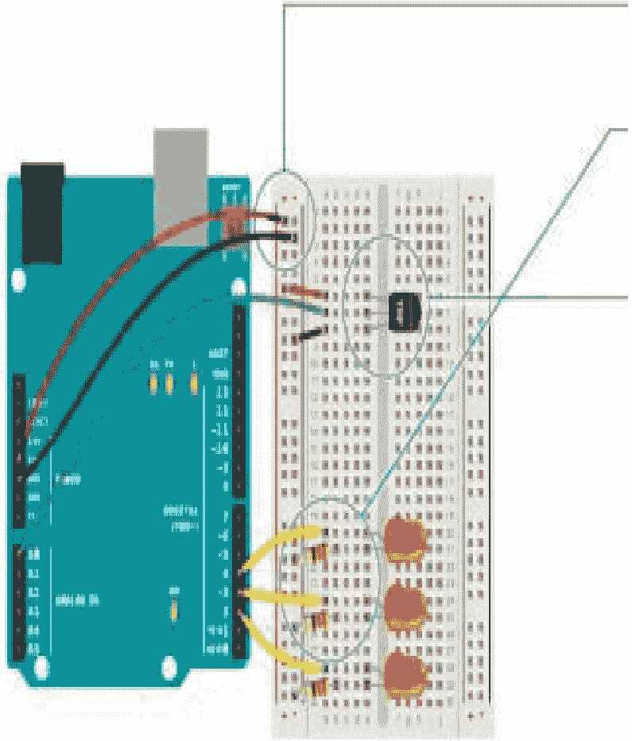

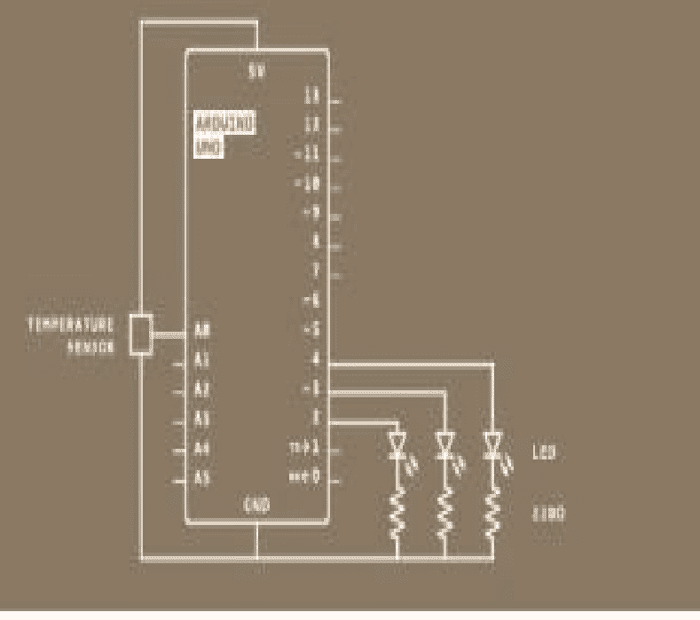

现在你是手动操作，但你可以通过校准来实现。你可以使用按钮来定义参考温度，或者让 Arduino 在 loop() 开始之前采集一个样本作为参考点。

1. 首先，将你的面包板连接到地线。

2. 使用电阻将每个 LED 的阴极连接到地线。将 LED 的阳极通过 2 到 4 号引脚连接。这些是项目的指示器。

将 TMP36 放置在面包板上，让圆弧部分朝外


Arduino。接下来，将左侧引脚的平面对齐侧连接到电源，右侧引脚连接到地。将中间引脚连接到Arduino的AO。

为传感器构建一个界面，以帮助人们使用它。你可以使用一个类似手形指示器的剪纸。如果你做得对，可以为一个人制作一对嘴唇来亲吻，并注意它的样子。你可能还希望标记LED，以便它能显示一些含义。


- 1. 在第一幅图中，拿一张纸并将其裁剪成适合面包板顶部的尺寸。在传感器将要放置的位置创建一对嘴唇，并创建几个圆圈以便LED穿过。

- 2. 将裁剪好的纸片覆盖在面包板上，使嘴唇围绕传感器，LED插入孔中。按压嘴唇，感受效果如何。

让我们 examine the Code。

### 有用的常量

常量允许某人为程序中的事物赋予唯一的名称。这类似于变量，但它们不能更改。为模拟输入分配名称以便于引用，并创建一个唯一的常量来存储参考温度。每超过参考温度2度，LED就会点亮。温度以浮点数的形式写入和存储。浮点数是指带有小数点的数。

### 串口的初始化

在setup中，你将与一个名为Serial.begin()的新命令进行交互。该命令将启动Arduino和计算机之间的连接。该连接将帮助你在计算机屏幕上读取模拟输入的值。

参数9600代表Arduino的通信速度。你将使用Arduino IDE的串口监视器来观察你选择从微控制器发送的信息。

### 初始化数字引脚并将其关闭

接下来的for()循环将几个引脚设置为输出。这些引脚之前已连接到LED。与其为每个引脚分配一个唯一的名称并使用pinMode()函数，不如选择使用for()循环，这样效率更高。这是一个很巧妙的技巧，适用于程序中有许多你想重复执行的操作时。

### 读取传感器温度

在loop()中，使用名为sensorVal的变量来保存传感器读数。如果你想读取传感器，调用analogRead()，它接受一个参数。

在串口监视器中检查此信息。如果你给Serial.print()一个带引号的参数，它会显示输入的文本。此外，如果你使用变量作为参数，它会显示该特定变量的值。以下是程序的代码：

```
1 const int sensorPin = A0;
2 const float baselineTemp = 20.0;
```

```
3 void setup() {
4   Serial.begin(9600); // open a serial port
```

```
5   for(int pinNumber = 2; pinNumber<5; pinNumber++) {
6     pinMode(pinNumber, OUTPUT);
7     digitalWrite(pinNumber, LOW);
8   }
9 }
```

for() loop tutorial
arduino.cc/for

```
10 void loop() {
11   int sensorVal = analogRead(sensorPin);
```

```
12 Serial.print("Sensor Value: ");
13 Serial.print(sensorVal);
```

### 将传感器读数转换为电压

借助一些数学知识，你可以确定正确的引脚电压。电压范围可以从0到5伏，并且包含一些分数。你需要声明一个float变量来存储它。

### 在上传到PC之前将电压转换为温度

传感器的数据表包含与输出电压类似的信息。数据表就像电子手册。它们由工程师创建，供其他工程师使用。根据传感器数据表，每十毫伏等于约1摄氏度的温度变化。此外，传感器可以读取低于0度的温度。因此，你需要为冰点以下的值定义一个偏移量。如果从电压中减去0.5再乘以100，就得到了实际的摄氏度温度。创建一个浮点变量并存储这个新数值。

### 为低温关闭LED

当你处理原始温度时，可以定义一个if...else语句来点亮LED。以参考温度为基准点，温度每超过2度就点亮LED。你会扫描一系列数值，同时在温度范围内进行查看。以下是程序的下一部分：

```
14  // convert the ADC reading to voltage
15  float voltage = (sensorVal/1024.0) * 5.0;
```

```
16  Serial.print(" Volts: ");
17  Serial.print(voltage);
```

```
18  Serial.print(", degrees C: ");
19  // convert the voltage to temperature in degrees
20  float temperature = (voltage - .5) * 100;
21  Serial.println(temperature);
```

Starter Kit datasheets
arduino.cc/kitdatasheets

```
22  if(temperature < baselineTemp){
23    digitalWrite(2, LOW);
24    digitalWrite(3, LOW);
25    digitalWrite(4, LOW);
```

### 点亮LED以表示低温

&&运算符在逻辑上代表"与"。它允许你检查多个条件。

### 要创建中等温度，点亮两个LED

当温度落在比基准高2到4度之间时，代码块将点亮引脚3上的LED。

### C语言基础与函数

当你创建Arduino程序时，即使C编程语言是接近机器的语言，了解一些关于计算机系统工作原理的知识也是必不可少的，程序运行时某些事情是如何完成的将变得清晰。那些与Arduino一起工作和使用的设备，如传感器和LED，依赖于特定的输入和输出。许多编程语言都具备这种能力，但C是我们的选择。

一个基本系统包括被称为CPU或微控制器的控制设备。其中一些存在一些差异。我们稍后会深入探讨这一点。顺便提一下，微控制器可能不如标准微处理器那么强大。然而，它仍然包含输入、输出端口以及硬件功能。

微处理器连接外部内存。通常，微控制器包含足够数量的板载内存。但需要注意的是，我们指的不是大容量；对于简单应用，微控制器可能只有几百字节左右的内存。不要忘记一个字节有8位，每一位可以是真或假，高或低，即I/O。

寄存器是我们可以进行逻辑数学运算的唯一地方。例如，如果你想执行两个变量的加法，变量的值必须移到寄存器中。

### 内存映射

计算机系统中的每个字节都有一个关联的地址。现在，如果*没有*地址，处理器将无法识别特定的内存。通常，内存地址从0开始递增。即使我们有特定于私有或独特系统的地址，特定地址也可能不指向外部通信的输入和输出端口。

大多数情况下，你会发现有必要映射内存。这仅仅是一个巨大的内存槽数组。有些人开发内存地图时，将最小值的地址放在顶部，而其他人绘制内存地图时，将最小地址放在底部。每个地址指向可以存储字节的位置。

C包含不同的位运算符。其中一些包括AND、XOR、左移、补码和右移。

### 逻辑语句

我们的第一个电路非常简单，它只有一个输出，用户没有任何改变条件的可能性。当输入影响输出时，我们开始进入逻辑语句的世界。逻辑语句是检查变量值与某个其他值的有效方法。那个其他值可以是已知量或变量量。使用逻辑语句是你控制草图中接下来发生什么的 *方式*。接下来，让我们看一个类似的草图，它处理影响输出的输入。

要在Arduino IDE中跟随操作，路径是：

文件 → 示例 → 02.Digital → Button

注意到这段代码与上一个多么相似了吗？我相信到现在，凭借人类可读的代码，你已经对正在发生的事情有了相当好的理解，但让我们分解一下你以前没见过的新元素。

其中一个变量与按钮的引脚有关，另一个变量的值表示按钮的状态（开或关）。在setup中，我们看到再次使用pinMode来初始化引脚，但这次我们的按钮引脚方向为INPUT，以告诉芯片这将有电流"流入"而不是"流出"。

现在在loop中，我们进入真正的程序，第一行引入了另一个函数digitalRead()，它是我们在上一个草图中提到的digitalWrite()的对应函数。然而，这个函数只有一个参数：要读取的引脚编号。

好的，接下来我们遇到第一段布尔代码，意思是逻辑语句。这种花哨的说法意味着逻辑表达式的结果将根据是否满足某些条件而变化。注释已经完美地告诉了我们条件。检查按钮状态是否被按下。当按下时，它应该显示HIGH。该表达式是一个'if'语句，只有当括号中的条件为真时，它才会执行其大括号内的代码。在我们的例子中，if (buttonState == HIGH) { 我们是在告诉编译器，当变量buttonState被按下时，它执行下一大括号{ }之间的操作。双等号表示，

'等于它的值。'当你连续使用两个等号时，你是在要求编译器检查某个变量是否记录了某个特定值。在我们的例子中，*buttonState*是否为高电平，或者换句话说，按钮是否被按下？当这个条件为真时，使用我们熟悉的*digitalWrite()*函数来点亮LED。

接下来，我们会看到一个带有自己花括号的'else'语句。Else的意思是，如果上一个语句不成立，那么它将执行花括号内的代码。在我们当前的例子中，这里再次使用*digitalWrite()*来告诉芯片关闭LED，与我们上一段代码相同。注意，虽然这个草图有else语句，但if语句并不一定要提供else语句。相反，如果条件不满足，它不会运行那段代码，而是跳过它，继续执行下一条指令。

就是这样！这就是让LED在按下按钮时闪烁所需的全部内容。好了，我们已经完成了一些相当简单的电路。

要跟随操作，请打开：

文件 → 示例 → 05.控制 → WhileStatementConditional

这个草图的第一部分对你来说会非常熟悉。我们声明需要的变量，初始化它们，并将引脚设置为正确的设置，即输入或输出。一旦进入程序的主循环，我们就会看到第一个while语句。让我们现在来看看它：

```
while (digitalRead(buttonPin) == HIGH) {

  calibrate();
```

这个语句相当复杂，让我们逐段分解。首先，while语句的意思是，只要我的条件为真，就执行花括号内的内容。那么，我们的条件是什么呢？按钮是否被按下。所以我们检查与按钮关联的引脚，看它是高电平还是被按下。如果为真，它将执行calibrate()；这是一个用户稍后会定义的函数。这意味着当程序看到calibrate()时，它会跳转到该函数的指令，执行它们，然后返回到代码中的那个点。

我们现在来看看那个函数，因为它正在被调用：

```
void calibrate() {
```

好的，这对你来说可能看起来很熟悉。它与我们已经使用的*setup()*和*loop()*函数非常相似。这行代码是在告诉编译器，你想定义一个名为calibrate的函数，它将返回'void'，并且不接受任何'参数'。所有这些术语到底是什么意思呢？首先，定义calibrate意味着如果我们在代码的其他地方输入这个词，编译器会搜索同名的函数，然后运行它的代码，就像我们现在做的这样。那返回void又是什么意思呢？

我们还没有真正涉及这一点，而且我们只是把for循环视为理所当然，而setup前面也有'void'这个词。这个函数确实也能工作，但情况并非总是如此。当函数完成其花括号内的指令后，它会向最初调用该函数的地方返回一个值。这可能是void形式，即没有返回值，但它同样可以是一个整数或来自计算的数值。假设这个函数是计算公司员工的周薪。它很可能会返回一个'float'（浮点数/小数），包含那些收入的值，以便在程序的其他地方使用。那个函数会是什么样子呢？这里有一个虚构的例子，展示一个可能实现此功能的函数。

```
float weeklyPay(name, hours, rate) {}
```

好的，它会返回一个float，那个数值去哪里，我们如何获取它的数据？这与调用函数有关。我们现在来看看这个问题。

```
employeeEarnings = weeklyPay(employeeName, hoursWorked, payRate)
```

这就是我们调用员工薪酬的任意示例的方式。注意我们是如何将*weeklyPay()*函数赋值给变量employeeEarnings的？函数运行后，那个浮点数将存储在该变量中。然后我们可以在之前的*weeklyPay*函数中计算完成后，使用该变量作为存储的值。我们将在后面的草图中更多地讨论函数，所以如果这对你来说不太直观。别担心；我们会看到更多的例子。

回到我们的*WhileStatementConditional*示例，现在我们来分解calibrate正在做什么。它打开*indicatorLED*，告诉用户校准正在进行。然后我们将位于*sensorPin*上的传感器值存储到变量*sensorValue*中。接下来，我们想看看这个新值是比我们之前记录的任何结果都高还是都低。我们用if语句来做这个。注意这些if语句没有对应的else语句吗？我们的许多读数可能落在已经记录的范围内，所以我们只需要在它们更高或更低时记录最大值或最小值。这些语句只是在检查该条件是否为真。一旦所有这些完成，函数calibrate返回void，或者说没有返回值。

好的，在那个calibrate函数完成后，我们跳回代码中之前的位置，就在我们的while语句之后。我们使用*digitalWrite*关闭*indicatorLED*，因为校准已经停止。接下来，我们用*analogRead*读取传感器并将其值赋给*sensorValue*，检查连接到我们传感器的引脚。现在，下一行引入了一个我们之前没见过的新函数。

在Arduino IDE中打开：*帮助* → *参考*

一个网页将会打开，其中包含Arduino使用的所有关键词、布尔逻辑符号、函数和重要信息，方便你快速查阅。使用这个资源找到'map'并点击它。当然，这不是世界上最容易理解的函数，但让我们看看它做什么。描述说它把一个数值从一个范围映射到另一个范围。它接受五个参数：一个值、当前低值、当前高值、目标低值和目标高值。有了这些信息，它将使用数学方法将值缩放到目标范围内的不同值，使其适合我们的理想比例。

实际上，这有什么作用？对于我们的传感器，我们不知道它会返回什么值，也不确定我们的数据集将在什么范围内。但我们知道的是，我们的Arduino芯片可以增量改变其某个引脚的输出。该增量范围是一个比特位，即数字范围0-255。这意味着我们的传感器读数需要是0-255，我们的芯片才能按照我们希望的方式响应。所以，我们进行这个校准程序来查看数据集的高值和低值以及当前值，然后将这些值缩放到0和255之间。

现在map函数说它不会改变指定范围之外的值，因为这可能有预期的用途。为此，你还必须在此前或此后使用'constrain'函数来对可能的值施加限制。

让我们在下一行代码中看一下constrain函数。这个更容易理解。它接受一个值、一个最小值和一个最大值。如果该值落在范围内，则保持不变；如果超出该范围，则根据它最接近哪个值，将其设为最小值或最大值。再次强调，Arduino芯片处理0-255的引脚输出强度，所以我们将数据集限制在0-255之间。

```
do {

// 一些要执行的代码放在花括号之间

}

while (conditional statement);
```

这里的区别是，这个语句直到'do'块已经运行后才会检查其条件。这些'do while'语句适用于你想要一个while语句，但需要其中的代码至少运行一次的情况。

### For循环

这对于诸如计算通过序列的次数，甚至初始化芯片上的一堆引脚等事情非常有用，正如你在这里将看到的。现在，for循环有一个独特的特性，那就是它们在创建时会创建自己的变量。它们还会修改该变量，以便每次通过循环时改变条件。让我们看一下空的for循环。

```
for (variable; condition; increment/decrement) {}
```

变量通常是整数，你应该根据它的作用来命名。如果它正在遍历芯片上的引脚，'thisPin'是一个很好的名字，因为它说明了用途。如果你正在遍历一个数组，这似地，我们稍后会讨论，这个名字就没有意义了。在这种情况下，变量名index可能更合适。这里的要点是根据for循环迭代（通过循环的次数）正在做什么或改变什么来命名变量。接下来是条件语句。它采用布尔比较的形式。所谓布尔，我们指的是>、<、>=、<=、==。你将要求循环将你创建的变量与某个值进行比较。在我们的例子中，它是8。

最后，我们来到for循环的递增或递减部分。在Arduino编程语言（基于C++）中，你可以用符号++将变量的值增加1，用符号--将变量的值减少1。现在让我们在单独的例子中看看这个。

```
int pizzaSlices = 1// 我们只有一片披萨
```

```
pizzaSlices--// 我们吃了一片，现在pizzaSlices将是0
```

```
pizzaSlices++// 朋友给了我们他们的那一片；现在我们有1片
```

希望这能阐明递增和递减是如何工作的。关于++和--这种表示法，唯一要提的是它们可以放在变量名之前或之后，而且它们的位置对for循环的结果有重要影响。如果符号在变量名之前，例如++thisPin，它将在执行花括号内的代码之前改变变量。当符号放在变量之后时，例如thisPin++，它将在*执行花括号内的代码之后*改变变量。说到这个，对于for


确保你编写的循环会终止，或者根据你设定的条件结束。否则，你的程序就会一直卡在那里，反复运行相同的代码行，直到被断电为止。

例如，如果你写了这样一个 `for` 循环：

```cpp
for (int index = 2; index > 1; index ++) {
```

这个 `for` 循环的条件将永远为真，因此它永远不会终止。如果你对如何让某个 `for` 循环终止感到困惑，可以尝试使用相反的变量变化方式，例如将递增改为递减，或反之。通常，从计数过程的反方向入手，就能解决你遇到的任何关于 `for` 循环的计数问题。

关于在 `for` 循环中创建的变量，另一个需要了解的关键点是：它们只在 `for` 循环运行期间存在。它们在 `for` 循环中被创建，并在循环完成后被释放。这有什么影响呢？通常，你不能有两个同名的变量。但在这里，你看到我们在代码中将 'thisPin' 初始化了三次，每个独立的 `for` 循环一次。这是因为这些名称在逻辑上仍然合理，但在每个循环运行结束后它们就不存在了。

要跟着操作，请打开：

文件 → 示例 → 05.控制 → ForLoopIteration

在这个程序的开头，我们为定时器初始化了一个变量，这我们现在应该已经很熟悉了。然后我们进入 `setup()`，看到了我们的第一个 `for` 循环。

我们声明了一个整数变量 'thisPin'，我们将在条件语句中使用它。我们检查其条件是否仍然为真，然后在完成一次循环后，它会将 'thisPin' 递增 1。

好的，在我们的示例代码中，接下来遇到了与 `setup()` 中相同的 `for` 循环，但这次不是设置引脚为输出模式，而是在 'timer' 时间内（本例中为 100 毫秒）将引脚打开。

这里我们遇到了一个不同的 `for` 循环，现在让我们仔细看看：

```cpp
for (int thisPin = 7; thisPin >= 2; thisPin--) {
```

同样，我们的变量是 'thisPin'，并初始化为 7。这次的条件是当 'thisPin' 大于或等于 2 时。另外，我们这次使用的是递减，所以我们将从 7 开始倒数，直到这个引脚的值减到 2。现在当你运行这个电路时，LED 灯会按相反的顺序点亮，因为我们的 'for' 循环是反向运行的。同时，请注意这个 `for` 循环有一个*会*终止的条件语句；我无论如何强调其重要性都不过分。其余部分与我们之前见过的代码相同，用于将 LED 灯点亮 'timer' 时间。

接下来，让我们谈谈数组，看看它们如何与 `for` 循环相关联。

### 数组

在我们查看 Arduino IDE 中的任何代码之前，让我们先谈谈什么是数组。如果你熟悉数学，你可能以前见过它，但可能被称为“矩阵”。如你所知，矩阵和数组通过一个共同的变量来组合和处理一组信息。假设我们有一组东西，比如名字，我们想要跟踪它们。确定哪个名字属于哪个类别——例如，给定两个班级的学生，我们可能假设 A 班的所有名字都属于 A 类别，B 班的所有名字都属于 B 类别——决定了每个名字应该放在哪个数组中。但是，为了简单起见，我们假设每个名字都是一个变量，取决于它所在的矩阵或数组。我们可以为每个名字创建单独的变量，但这会使检索这些信息变得繁琐且难以追踪。

```cpp
datatype variableName[] = {}
```

这里，数据类型可以是任何我们见过的变量类型，如 *int*、*float*、*char* 等。变量名应该遵循我们之前见过的其他变量的命名规则。现在我们看到了一对新的符号：方括号。

方括号用于标识这是一个数据数组。在这些方括号内，你可以分配一些不同的变量，数量等于你放入那个方括号中的数字。这意味着你可以拥有那么多独立的数据块。

假设我们有 5 个 LED 灯分别连接到引脚：2、7、4、6、5 和 3，我们想按*那个*顺序引用它们。我们可以将其写成一个数组。

```cpp
int ledPins[5] = {2, 7, 4, 6, 5};
```

这里，我们告诉编译器分配五个整数变量，并通过立即提供那些值来初始化数组。那么，我们如何访问数组中的引脚 2 呢？Arduino 使用所谓的“零索引”，这意味着当你访问数组的元素（数据）时，总是从零开始。所以，由于这个原因，我们将这样访问引脚 2：

`ledPins[0]`

尽管这可能看起来违反直觉，但编程使用零索引有一些有用的原由。所以，如果引脚 2 是索引零（方括号中的数字称为索引），那么引脚 7 是一，引脚 4 是二，引脚 6 是三，引脚 5 是四。你需要一些时间来熟悉这一点，当你无法访问到正确的元素时，可能需要回过头来记住零索引。

所以，一个使用数组中数据的基本示例是：

```cpp
digitalWrite(ledPins[0], HIGH); // 点亮引脚 2
```

我们也可以先声明一个数组而不立即放入数据，而是决定稍后初始化它。让我们使用同一个例子，看看一种可能的实现方式：

```cpp
int ledPins[6];
ledPins[0] = 2;
ledPins[1] = 7;
ledPins[2] = 4;
ledPins[3] = 6;
ledPins[4] = 5;
ledPins[5] = 3;
```

也可以在不指定索引大小的情况下声明数组，而是简单地填充数据集。但是，以这种方式声明数组时，你必须立即初始化数组。

接下来，让我们在一个实际的程序中查看数组，看看它们在实际例子中如何有用。

要跟着操作，请打开：

文件 → 示例 → 05.控制 → Arrays

在这个代码的开头，我们看到一个定时器变量和我们刚才看过的同一个数组。在这个例子中，这个数组是连接我们 LED 灯的引脚。然后我们有一个名为 *pinCount* 的变量，表示所使用的 LED 引脚数量，它也是数组的长度。你马上就会明白为什么使用这个变量。

让我们继续看 *setup()*。我们有一个 'for' 循环来初始化引脚。我们创建一个计数器变量来访问我们想要的引脚，和之前一样，是 *thisPin*，并将其初始化为零。然后，只要 *thisPin* 小于 *pinCount*（我们的数组大小），我们就逐步执行 `for` 循环。然后递增以结束我们的 'for' 循环，一旦它达到六，即 *pinCount* 的值。

看看我们如何使用 *ledPins* 数组和我们的 *thisPin* 计数器来遍历数组的索引，并在 *pinMode* 函数中将每个引脚设置为 OUTPUT。数组和 'for' 循环可以完美地协同工作，你会在编程中经常看到它们一起使用。

事实上，在同一个程序中你会再次看到它。在一个循环中，我们使用另一个带有 *ledPin* 数组的 `for` 循环，按从左到右读取的顺序（2, 7, 4, 6, 5, 3）在 'timer' 时间内点亮 LED 灯。然后在第二段代码中，我们将使用递减计数器按相反的顺序点亮引脚，从右到左点亮引脚：3, 5, 6, 4, 7, 2。

### 运算符

运算符是用于执行操作的符号。操作可以是算术、逻辑、位运算等。让我们探索一些 Arduino 运算符：

## 算术运算符

如上所述，它们用于执行数学运算。示例：

```cpp
void loop () {
    int k = 8, l = 2, m;
    m = k + l;
    m = k - l;
    m = k * l;
    m = k / l;
    m = k % l;
}
```

### 布尔运算符

Arduino 支持的各种布尔运算符包括 &&（与）、||（或）和 !（非）。示例：

```cpp
void loop () {
    int k = 8, l = 2;
    bool m = false;
    if((k > l) && (l < k))
```

m = true;
else
m = false;

if((k == 1) || (1 < k))
m = true;
else
m = false;

if( !(k == 1) && (1 < k))
m = true;
else
m = false;

### 决策制定 (Decision making)

在决策制定中，程序员指定需要通过程序进行评估和测试的条件。程序员指定如果条件为真（true）时要运行的语句。他或她也可以指定如果条件为假（false）时要运行的语句。让我们来探讨各种决策制定语句。

### If 语句

表达式被添加在圆括号内，后面跟着一个或多个语句。如果表达式为真，则执行该语句；否则，不执行任何操作。

语法：
if(your_expression)
statement;

对于多个语句，语法如下：

```
if(your_expression) {
    statement(s);
}
```

示例：

```
int K = 4;

int L = 8;

void setup () {

}

void loop () {

    if (K > L)

        A++;

    if ( ( K < L ) && ( L != 0 )) {

        K += L;

        L--;

    }
}
```

我们定义了两个全局变量 K 和 L。在第一个 “if” 条件中，如果条件为真，我们只需要运行单个语句，因此我们没有使用花括号来表示函数体。在第二个 "if" 条件中，如果条件为真，我们需要运行多个语句，因此我们将它们包含在花括号 ({}) 中。

**J***************

将传感器值转换为一定的频率

声明一个名为 pitch 的变量；存储在 pitch 变量中的值由 sensorValue 映射而来。定义 sensorLow 和 sensorHigh 为接收值的边界，而起始输出可以设定为 50 到 4000。

播放频率

接下来的操作是调用 `tone()` 函数以便播放声音。`tone()` 函数接受三个参数：代表声音的引脚、要播放的频率以及播放该音符的时长。最后，你可以调用 `delay()` 函数创建 10 毫秒的延迟，为声音的播放留出时间。

当你开启 Arduino 时，会有 5 秒的间隔来调整传感器。为了实现这一点，请确保通过改变照射在光敏电阻上的光强，用手在光敏电阻周围挥动。让手的动作靠近设备，这将提高校准精度。

5 秒后，校准结束，Arduino LED 灯熄灭。接下来你应该听到来自压电陶瓷的噪音。当照射在传感器上的光强发生变化时，压电陶瓷的频率也会随之变化。

```
19 void loop() {
20   sensorValue = analogRead(A0);
21 
22     int pitch =
23        map(sensorValue,sensorLow,sensorHigh, 50, 4000);
24 
25     tone(8,pitch,20);
26 
27     delay(10);
28 }
```

`map()` 函数将 pitch 定义为宽范围，你可以尝试更改频率，以确定最适合你音乐风格的那个。

`tone()` 函数的工作方式与 `analogWrite()` 函数中的 PWM 类似，但有一个主要区别：`analogWrite()` 具有固定频率。而使用 `tone()`，你可以在更改速率的同时持续发送脉冲。

`tone()` 函数允许在向压电陶瓷或扬声器发送脉冲时定义频率。如果你将传感器应用于分压电路，你将无法接收到完整的数值范围。然而，通过校准传感器，你可以将输入映射到特定的字段中。

### 输入、输出与传感器

正如上面提到的，Arduino 的传感器在用途和功能上多种多样。

Arduino 的设计旨在兼容多种类型的传感器，而这些传感器反过来可以应用于 C 编程语言。Arduino 能够与这些传感器协作，它们可以相对便宜地从 Arduino 官方或其他网站购买。一些 Arduino 传感器的例子包括：

- 超声波模块
- IR 红外避障传感器模块
- 土壤湿度检测模块/土壤水分传感器
- 麦克风传感器
- 数字气压传感器板
- 光敏电阻传感器模块/光检测
- 数字热传感器模块/温度传感器模块
- 旋转编码器模块/砖块传感器开发板
- MQ-2 气体传感器模块/烟雾甲烷丁烷检测
- 运动传感器模块/振动开关报警
- 湿度和雨滴检测传感器模块
- 速度传感器模块
- IR 红外火焰检测传感器模块
- 加速度计模块
- Wi-Fi 模块

虽然还有很多其他传感器，但这只是其中一部分。某些传感器比其他传感器更容易与不同的 Arduino 单元连接，因此请留意哪种最适合你的 Arduino。

### 你在本章将学习到：

- 信号简介
- 使用传感器
- 理解 PWM

### 本章所需材料：

- Arduino UNO 开发板
- 传感器
- 万用表
- 电阻器

信号分为两种类型：

为什么模拟信号很重要？

像某些传感器的电压这样的模拟输入是某些因素变化的结果。例如：

光敏电阻：一种随光量变化而改变阻值的电子电阻。

我们可以使用万用表测量这个电阻上的电压。

- 我们可以利用这一现象，使用合适的传感器将环境因素（如光照、温度、湿度、功率等）转换为模拟信号，从而测量任何其他环境因素。
- 在 Arduino UNO (ATMega 328p) 上，有六个模拟信号输入引脚，从 A0 到 A5，它可以测量 4.8 毫伏的电压，这意味着它在许多应用测量中非常精确。

### 传感器是如何产生模拟信号的？

让我们以温度传感器为例：温度传感器包含一个由硅制成的非常敏感的晶体管。正如我们所知，硅受温度影响很大。

温度传感器具有以下引脚：

1. 输入 $Vin$ (2.2v 至 5.5v)。
2. 信号脚 $Vout$ 用于获取测量值。
3. 接地脚 $GND$ 用于连接到任何接地端。

本示例所需的组件：

- 万用表
- AAA 1.5v 电池 (2 节)
- 温度传感器 (TMP35 或 TMP35 或 LM35)

### 步骤

- 取两节 AAA 电池，将它们放入电池盒中，以获得 3 伏电压。
- 将电池盒的红线连接到温度传感器的 Vin 脚。
- 将电池盒的黑线连接到温度传感器的 GND 脚。
- 将万用表调至电压模式，如下图所示：

- 将 GND 脚连接到黑表笔，将红表笔连接到 Vin 脚，如图所示。
- 记录万用表上的电压读数。它应该是 0.76 伏。
- 现在将手放在传感器上（此动作会升高温度），并记录万用表的读数。万用表上的读数将会上升并变得更高。

- 与温度传感器工作方式相同的任何传感器，其行为都取决于环境因素并改变其内部电阻，从而改变输出电压，而该电压可以通过模拟传感器进行测量。

# 示例 4：使用电位计控制光量（接线）

## 示例组件

- Arduino UNO 开发板
- 面包板
- LED
- 560 欧姆电阻
- 10 k 欧姆电位计
- 导线

按如图所示连接组件：


## 示例 4：使用电位器控制光照量（编程）

// 从 Arduino IDE 创建新文件，并写入以下代码：

```
const int sensorPin = A0;

const int LedPin = 13;

int sensorValue;

void setup ()

{

  PinMode (LedPin, OUTPUT);

}

void loop()

{

  sensorValue = analogRead(sensorPin);

  digitalWrite(LedPin, HIGH);

  delay(sensorValue);

  digitalWrite(LedPin, LOW);

  delay(sensorValue);

}
```

analogRead（引脚编号）。此函数将电压作为模拟信号读取（微控制器可以测量 4.8 毫伏到 5 伏的电压），并将这些值转换为 0 到 1,024 的数字值。这种转换称为模数转换（ADC）。

例如：

如果 A0 的输入电压等于以下值：

- 4.8 毫伏 = 数字值 1
- 49 毫伏 = 数字值 10
- 480 毫伏 = 数字值 100
- 1 伏 = 数字值 208.33
- 2 伏 = 数字值 416.66
- 5 伏 = 数字值 1024

```
sensorValue = analogRead(sensorPin);
```

- 在此语句中，微控制器会将传感器读取的值存储在 sensorValue 变量中，然后微控制器会将 LED 开启/关闭一段与该变量（sensorValue）相等的时间。
- 在此示例中，我们使用了可变电阻，因此可以改变电阻的值。

## 示例 5：光敏电阻作为光线传感器（组件）

- Arduino UNO 开发板
- 面包板
- LED
- 560 欧姆电阻
- 光敏电阻
- 导线

## 示例 5：光敏电阻作为光线传感器（接线）

- 按照图示连接组件：

## 示例 5：光敏电阻作为光线传感器（编程）

```
// 从 Arduino IDE 中选择新文件

const int lightPin = A0;

const int ledPin = 9;

int lightLevel;

void setup ()

{

  pinMode(ledPin, OUTPUT);

}

void loop ()

{

  lightLevel = analogRead(lightPin);

  lightLevel = map(lightLevel, 0, 900, 0, 255);

  lightLevel = constrain(lightLevel, 0, 255);

  analogWrite(ledPin, lightLevel);

}
```

- *现在你可以将此代码上传到 Arduino 开发板上，观察将光线照射到光敏电阻上时 LED 会发生什么变化。然后用手遮住光敏电阻，观察 LED 会发生什么变化。*
- `analogWrite(引脚编号, 值);`

此函数生成模拟输出，可应用于所有支持脉冲宽度调制（PWM）的引脚。

它们是引脚 3、引脚 5、引脚 6、引脚 9、引脚 10 和引脚 11（任何带有 ~ *符号* 的引脚）。

## 我们如何使用它？

许多电子元件都涉及不同的电压值。

例如，当你给 LED 施加 3 伏电压时，它会发出很微弱的光；如果将电压提高到 4 伏，你会发现光线会变得更亮，以此类推。

再比如，当你使用电机时，增加电压会使电机的转速更快。

## 示例 6：LED 与 PWM（接线）

按照图示连接组件：

## 示例 6：LED 与 PWM（编程）

// 打开 Arduino IDE，选择新文件，然后写入以下代码：

```
const int ledPin = 11;

int i = 0;

void setup( )
{
  pinMode(ledPin, OUTPUT);
}

void loop()
{
  for (i = 0; i < 255; i++) // LED will be lighter
  {
    analogWrite(ledPin, i);
    delay(10);
  }
  for (i = 255; i > 0; i--) //LED will be darker
  {
    analogWrite(ledPin, i);
    delay(10);
  }
}
```

- i = 0 $\rightarrow$ 初始值
- i < 255 $\rightarrow$ 设置循环条件
- i++ $\rightarrow$ 在此示例中是迭代器，将每次增加 1
- i++ $\rightarrow$ i = i +1

## 问题

请回答以下问题以检验理解程度。

1. 描述数字信号和模拟信号的区别。
2. 什么是脉冲宽度调制？
3. 设计一个电路，按顺序依次点亮/熄灭五个 LED。
4. 编写示例 3 的代码。

### 计算机与 Arduino 的接口连接

选择何种方式与计算机连接取决于你可用的线缆类型。请注意，每块 Arduino 都可以通过 USB 端口直接连接到计算机。将 Arduino 与计算机连接取决于你使用的编程语言以及需要集成的附加组件，以便让 Arduino 与计算机顺畅通信。

本章你将学到：

- 如何将 Arduino 与计算机连接

本章所需材料：

- 一块 Arduino UNO 开发板
- 面包板
- 传感器
- 导线

### FTDI 芯片

所有 Arduino 开发板都具有通过 USB 端口直接与计算机收发数据的能力，但 Mini 和 Lilypad Arduino 开发板除外。不过你也可以使用 FTDI 接口将这些开发板与计算机连接，FTDI 是一种用于在 Arduino 或任何微控制器与计算机之间交换数据的小型芯片。

- *在之前的示例*中，我们使用 Arduino 读取了一些传感器值，如光线和温度，并在 LED 上显示结果。
- *在本章中*，串行接口会将传感器值发送到计算机，我们可以轻松获取计算结果。

### 示例 7：带串行接口的温度传感器（组件）

- 一块 Arduino UNO 开发板
- 面包板
- 温度传感器（TMP 36 或 LM35）
- A – B USB 数据线

### 示例 7：带串行接口的温度传感器（接线）

### 示例 7：带串行接口的温度传感器（编程）

```
const int sensorPin = A0;

int reading;

float voltage;

float temperatureC;

void setup( )

{ Serial.begin(9600); }

void loop ( )

{

  reading = analogRead(sensorPin);

  voltage = reading * 5.0/1024;

  Serial.print (voltage);

  Serial.println(" volts");

  temperatureC = (voltage - 0.5) * 100 ;

  Serial.println("Temperature is: ");

  Serial.print(temperatureC);

  Serial.println(" degrees C");

  delay(1000);

}
```

- 验证并上传代码后，点击串行监视器，如图所示：

### sketch_jun18a9

```
int sensorPin = A0;
int reading;
float voltage;
float temperatureC;

void setup( )
{ Serial.begin(9600); }

void loop ( )
{
  reading = analogRead(sensorPin);
  voltage = reading * 5.0;
  voltage /= 1024.0;
  Serial.print(voltage);
  Serial.println(" volts");
  temperatureC = (voltage - 0.5) * 100 ;
  Serial.print(temperatureC); Serial.println(" degrees C");
  delay(1000);
}
```

- 你将看到显示温度传感器读数的菜单。
- 现在尝试使用任何热源来升高温度。
- 你应该注意，此传感器可以承受 150 摄氏度。
- (-) 此符号不表示负数，而是一个临时的编程错误。

### 示例 7：带串行接口的温度传感器（说明）

```
Serial.begin (9600);
```

- 我们写入此语句来启动 Arduino 与计算机之间通过 USB 端口的通信，以便我们可以在计算机上接收和发送数据。

- 代码中有两个变量（voltage、TemperatureC）被定义为 float 而不是 int，因为温度传感器是一个非常精确的传感器，结果将以浮点数而非整数表示。

```
reading = analogRead(sensorPin);
```

- 此指令用于记录 A0 引脚上的模拟输入。

如前所述，微控制器将模拟信号转换为 0 到 1024 的数字值，我们使用了以下指令：

```
voltage = reading * 5/1024;
```

- 将数字值转换为电压后，我们使用 *Serial.print (voltage);*

将该值发送到计算机并在 Arduino IDE 上显示。

- *Serial.print ("voltage");* 此指令用于在其值之后打印"voltage"这个单词。

- *TemperatureC = (voltage – 0.5) *100;* 此指令用于将电压值转换为摄氏温度度数，然后打印该值以及"Temperature"和"degree C"这些单词。

```
Serial.print(TemperatureC);

Serial.println("degree C");
```

- 代码的最后一行是 *delay (1000);*，使微控制器在将电压和温度值发送到计算机之前等待一秒。


 再次。

### 示例 8：在串口监视器上显示 LED 光照强度（接线）

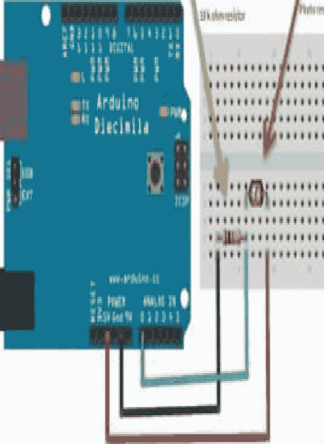

### 示例 8：在串口监视器上显示 LED 光照强度（编程）

```
const int photocellPin = A0;
int photocellReading;
void setup(void)
{ Serial.begin(9600); }
void loop(void)
{
photocellReading = analogRead(photocellPin);
Serial.print("Analog reading = ");
Serial.print(photocellReading);
if (photocellReading < 10) { Serial.println(" - Dark");}
else if (photocellReading < 200) { Serial.println(" - Dim");}
else if (photocellReading < 500) {Serial.println(" - Light"); }
else if (photocellReading < 800) { Serial.println(" - Bright"); }
else {Serial.println(" - Very bright"); }
delay(1000);
}
```

将代码上传到 Arduino 后，点击串口监视器。

### sketch_jun10a

```
int photocellPin = A0;
int photocellReading;
void setup(void)
{ Serial.begin(9600); }

void loop(void)
{
    photocellReading = analogRead(photocellPin);
    Serial.print("analog reading = ");
    Serial.print(photocellReading);

if (photocellReading < 10) { Serial.println(" - Dark");}
else if (photocellReading < 200) { Serial.println(" - Dim");}
else if (photocellReading < 500) {Serial.println(" - Light"); }
else if (photocellReading < 800) { Serial.println(" - Bright"); }
else {Serial.println(" - Very bright"); }
    delay(1000);
}
```

- *现在尝试以下操作：*
- 将光线聚焦到光敏电阻上
- 用任何透明布料盖住光敏电阻
- 用手盖住光敏电阻，确保没有光线照射到它
- 这就是你会看到的：

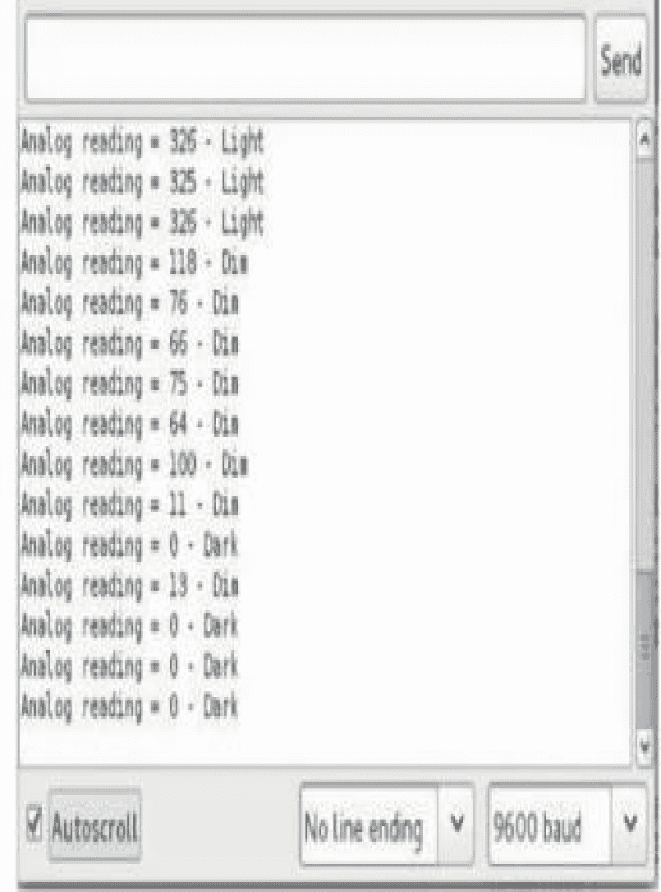

```
Analog reading = 325 - Light
Analog reading = 325 - Light
Analog reading = 325 - Light
Analog reading = 118 - Dim
Analog reading = 76 - Dim
Analog reading = 66 - Dim
Analog reading = 75 - Dim
Analog reading = 64 - Dim
Analog reading = 100 - Dim
Analog reading = 11 - Dim
Analog reading = 0 - Dark
Analog reading = 13 - Dim
Analog reading = 0 - Dark
Analog reading = 0 - Dark
Analog reading = 0 - Dark
```

- *Dim* → 光线量很小
- *Dark* → 没有光线
- *Light* → 光线量适中
- *Bright light* → 光线的亮度非常高

### 示例 9：使用电脑控制 LED 的开关（元件）

- 一块 Arduino UNO 开发板
- 面包板
- LEDEdition#ada9
- 560 欧姆电阻
- 导线

*在本示例中*，我们将使用电脑来控制 LED，而不是使用开关，Arduino 将通过 USB 端口使用串口监视器接收命令。

### 示例 9：使用电脑控制 LED 的开关（接线）

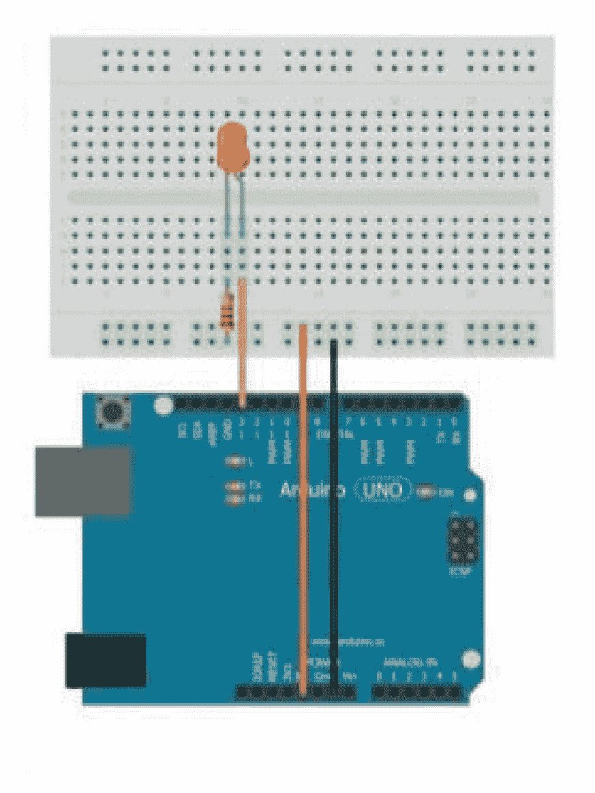

### 示例 9：使用电脑控制 LED 的开关（编程）

```
int ledPin=13;

int value;

void setup ()
{
Serial.begin(9600);
pinMode(ledPin,OUTPUT);
}

void loop ()
{
value = Serial.read();
if(value == '1') {digitalWrite(ledPin,HIGH);}
else if(value == '0') {digitalWrite(ledPin,LOW);}
}
```

将代码上传到 Arduino 后，点击串口监视器图标，你会看到一个搜索栏。在其中输入 "1"，然后点击发送。接着输入 "0"，观察 LED 会发生什么变化。

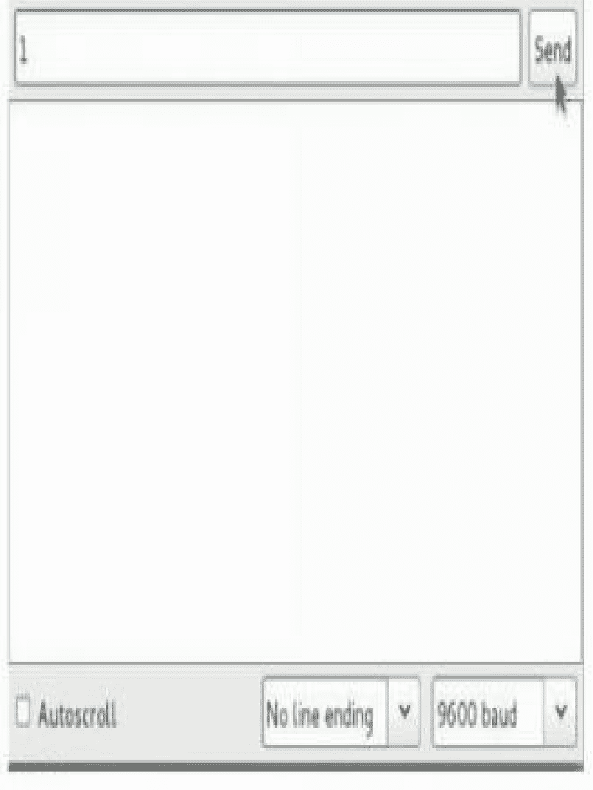

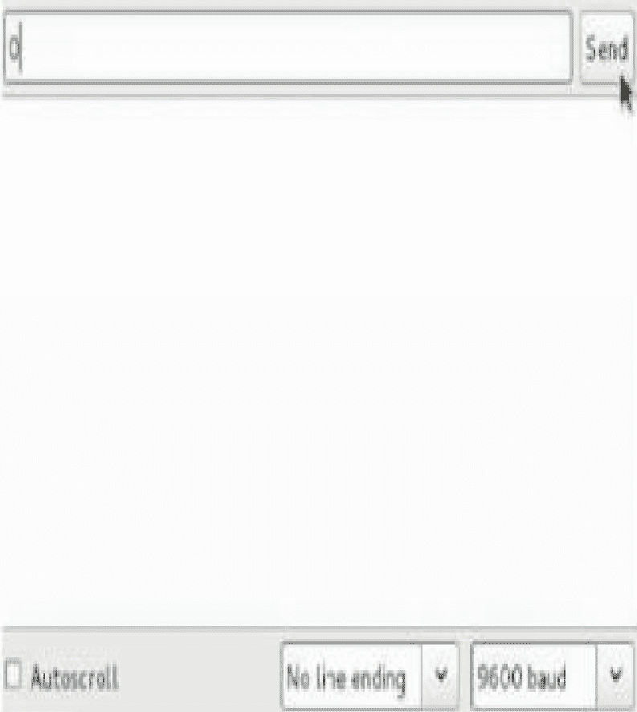

- 在本示例中，我们使用了 *Serial.Read()* 指令来读取从电脑通过 USB 发送到 Arduino 的数据，同时我们添加了变量 "value" 来存储数据。

然后我们使用了 if else 语句。

- 如果 value == 1，微控制器将点亮 LED
- 如果 value == 0，微控制器将熄灭 LED

## 问题

1. 如何让 Arduino 与电脑通信？
2. FTDI 芯片是什么，如何使用它？
3. 设计一个电路，将 Arduino 与温度传感器和 LED 连接。
4. 为示例 3 编写代码，根据温度传感器的读数控制 LED。

### 回顾复习

在 Arduino 系列的前一部分中，我们涵盖了很多内容，这些内容将帮助你作为程序员入门 Arduino。虽然我们不会花费太长时间，但我们会花一分钟左右回顾很多这些概念，以防这是你读到的该系列的第一本书。到本章结束时，如果你之前还没有掌握，你会感觉自己已经 firmly grasped 所有与 Arduino 及其相关的基础概念。如果你已经掌握了，可以直接跳到第二章，我们在那里会开始深入讲解更多关于 Arduino 微处理器的信息。

### Arduino

我们要说的第一件事是 Arduino 是什么。Arduino 是一种最初在意大利开发的微处理器板。Arduino 的硬件都是开源的，并且围绕它已经形成了一个庞大的开发者社区。因此，它已经成为一种极其流行的电路板，在全球大量的 tinkering 项目中使用。这些 tinkering 项目遍布各种不同的行业和领域。

Arduino 的目标是让人们能够轻松理解和探索计算和基于计算机的硬件的基础知识，而无需支付普通计算机所带来的昂贵成本。

### Arduino 的结构

Arduino 具有极强的可扩展性，有许多不同的硬件模块可以与你的 Arduino 板一起使用。这些外设连接到 Arduino，并通过称为引脚的接口与 Arduino 收发数据。引脚有两种类型：数字引脚和模拟引脚。

这些引脚通过运行在 Arduino 上的程序进行控制。这些程序称为*草图*（sketch）。虽然 Arduino 程序可以用许多不同的语言编写，但这本书特别关注编写 Arduino 代码最常用的语言——C 语言。

C 是一种历史上非常流行的编程语言，它也非常适合满足 Arduino 提出的特定硬件需求。Arduino 本身并没有太多的处理能力，因此需要一种足够接近硬件级别的语言，能够轻松地在 Arduino 所需的非常低级别上处理数据，因为 Arduino 需要几乎不使用处理能力或内存的程序。

通过可以连接到 Arduino 的模块和配件，人们能够做许多不同的事情。这就是为什么 Arduino 是*创客的梦想*；你可以用非常低的成本做很多事情。

### C 编程基础

为了正确地使用 Arduino，你需要对 C 语言编程有一定的了解。正如我所说，我们不会在本章花费太长时间来涵盖所有内容，但有一些 essentials 出于保险起见我们需要介绍。我们将讨论构建 C 编程的基本概念，这样你就可以轻松地使用它，并且在 Arduino 编程中找到自己的方式时感觉相当自然。

### 使用变量和值

值对计算机来说，是可以进行数学运算的任何事物。如果你对计算机有任何了解，那么你会意识到这指的是计算机上的几乎所有东西。计算机上的所有东西都归结为使用变量和值。

值指的是最终被计算机以数学方式解析或可以被计算机以数学方式解析的任何事物。这些是文本字符、数字或计算机原生理解的事物，如二进制。所有这些都是值，因为它们最终代表了计算机的数学值。

这些值具有类型，指的是数据在被处理为计算机硬件可以使用的原始数据之前的值。某些类型在 Arduino 编程中会比其他类型使用得更多，因为 Arduino 编程完全关乎效率。尽管如此，我们还是


## 数据类型

**Byte（字节）** - 表示一个从 0 到 255 的整数值。它只占用 1 字节的数据，在 Arduino 编程中尤其有用，因为 Arduino 编程中很多事物的取值范围本来就是 0 到 255 的序列。

**Int（整型）** - 表示一个一般大小的整数值，大约占用四个字节。它可以保存相对较大的数值，但要注意，如果数值达到两百万左右，你就会超过整型变量的缓冲区限制，这意味着它们会从整型能保存的最小数值重新开始。

**Float（浮点型）** - 表示一个浮点数或小数。这些在 Arduino 编程中并不十分常见，但比双精度浮点数更常见一些。这些数值大约可以保留 5 位小数，最大可达约 32,000。

**Double（双精度浮点型）** - 表示一个双精度浮点数。就系统内存而言，这些是浮点数大小的两倍，但它们比普通浮点数精确得多，并且可以保存比浮点数更大的非小数。

**无符号数值** - 它们与对应的普通数值大小相同，比如无符号整型和无符号浮点型，但它们不具备表示负数的能力。这意味着它们从 0 开始，可以存储比普通整型和浮点型大两倍的正数，但代价是无法存储任何负数。当你处理非负数时，这些是很好的起点。

**Short（短整型）** - 这些整数值的大小是整型的一半，但字节的两倍。它们可以保存到 30,000 多的数值，但不能再大。如果你处理的数值较小，你可能更倾向于使用短整型而不是整型，只是因为它们占用的内存更少。

**Long（长整型）** - 这些整数值的大小是普通整型的两倍，这意味着它们可以保存到二十亿多的数值，但没有默认的数值类型能够容纳比这更大的数，除了无符号长整型，它大约可以保存到四十二亿。

**Char（字符型）** - 这些表示 ASCII 字符值。这些本质上是任何可以被计算机解析的符号，通常用于存储和打印字符。字符可以是数字的符号表示，比如 '7'，或者是字母字符如 'a'，或者是符号如 '?'。基本上，如果你的计算机能打印它，那它很可能就是一个字符。

至此，我们已经介绍了你在 C 语言和 Arduino 中可以使用的所有主要数据类型。还有更多，别误会，但这些是你目前需要理解的主要类型。

### 赋值与运算

给变量赋值非常简单。你使用赋值运算符来完成：=。像这样：

```
int myVariable = 6;
```

你也可以用同样的方式修改变量。

```
myVariable = 7;
```

你可以执行数学运算来创建新值。这是通过使用数学运算符，也称为算术运算符来实现的。C 语言中的算术运算符如下：

```
b + c
```

这表示加法，当然。

```
b - c
```

这表示减法。

```
b * c
```

这表示乘法。

```
b / c
```

这表示除法。

```
b % c
```

这表示取模。取模是给定除法问题的余数。例如，5 % 2 等于 1，因为 5 / 2 = 2 余 1。

还有一些简写的赋值运算符。你可以通过在上述任何运算符后面加上等号来改变单个变量的值，像这样：

```
a += 1
```

这与 "a = a + 1" 相同。这个含义在所有其他符号中是一致的。

a += 1 和 a -= 1 本身还有更简化的形式，即 a++ 或 a--。++ 和 -- 分别表示将变量增加一或减少一。

至此，我们已经介绍了 C 语言的数学运算符，可以准备继续学习其他概念了。

### 数组

有时，你需要同时存储多个值。当我们开始讨论字符串时，我们会更多地讨论数组，但现在，我们可以先了解数组的基本要素。我们在本书前面已经顺便提到过它们，所以我们现在并不打算建立关于它们的百科全书式知识。无论如何，我们将会涵盖足够的内容，让你对它们有个复习。

那么，什么是数组？数组提供了一种让你本质上按照一个共同的概念将数值分组的方式。正如我们所确定的，数值存储在计算机内存中的随机位置。它们在需要时从内存中被访问。那么，数组在这个领域有两个作用。

首先，它们告诉计算机"嘿，这些东西是相似的，而且它们通常会在大约同一时间被引用，所以我们应该把它们放在一起，这样从一个到另一个的总时间就会更少。"

然后，作为结果，它们告诉计算机这些值应该在计算机内存中彼此靠近。这确保了从一个值到下一个值在计算机内存中的存取和检索时间最小化。它还使我们能够执行一些通常无法进行的操作，比如以程序化的方式处理内存中的数据片段，我们稍后会讨论到这一点。

数组本质上建立了一个连续的或相连的内存区域，其大小为数组元素个数 *n* 乘以数据类型的大小 *s*。所以，如果一种数据类型占用 4 字节内存，而数组有四个元素，它就会清理并分配 16 字节的内存，这些内存彼此相邻。

然后，这些可以根据数组的数据类型单独赋值。所以，如果你创建了一个整型数组，你就可以将整数赋值给该数组中的元素。

你可以像这样声明数组：

```
dataType arrayName[size];
```

你也可以通过在数组声明后用括号包含数值来填充它（或至少部分填充它）。

```
int my roArray[3] = {0, 2, 7};
```

数组的索引从 0 开始计数。你通过引用数组的索引来引用给定元素。所以，如果你想引用数组的第二个元素，你可以这样做：

```
myArray[1];
```

```
// 这将是 2，因为 2 是索引 1 处的元素，也就是数组中的第 2 个位置。
```

你可以看到数组实际上是相对容易理解的，但如果你想成为一名优秀的 Arduino 程序员，它们仍然是一个你需要努力掌握和牢记的基本概念。在编写 Arduino 草图的过程中，你不可避免地会经常遇到这个概念，所以你需要了解它。

### 真值与逻辑

现在是时候重新回顾一个我们在本书前面可能没有详细讨论的概念了：真值与逻辑。这些概念对于编程来说绝对是*内在的*，更不用说对于 Arduino 编程了，所以理解它们很重要。

那么，让我们从一个简单的问题开始——什么是逻辑？逻辑最终是使用比较来达到某个特定结果。

然而，它还有另一个定义：在追求某种*真理*的过程中，前提与结论的结合。请注意，逻辑和真值并不是互斥的。逻辑的概念可以作为无稽之谈的基础。例如，如果我的论点是这样的：

所有的狗都是蓝色的

我有一条狗

我的狗是蓝色的

这些陈述仅基于论点的基本结构而言是逻辑上成立的。然而，这并不是*真的*，因为"所有的狗都是蓝色的"这个前提是错误的。但是，这确实意味着通过延伸，许多事情可以用逻辑的方式来解决，并且我们可以基于真实的前提使用逻辑来得出真实的结论。

这些逻辑前提，在编程的语境中，被称为*比较*。比较本质上就是拿一个东西和另一个东西，然后将它们与别的东西进行比较，以确定某事是否为真。

例如，取 3 和 7；如果我说"3 大于 7"，这是这两个值之间的逻辑比较。整个陈述将是假的，因为 3 并不大于 7。

在编程中，我们可以对任何给定的变量和值进行这样的操作，只要它们是可比较的。当你开始学习 C++ 和类似语言时，你甚至可以重载这些运算符，以定义新的比较方式。

不过现在，让我们专注于那些允许我们比较值的东西。


这些被称为*比较运算符*。C语言中的比较运算符，以及扩展而来的Arduino中的比较运算符，如下所示：

```
s == t
```

此运算符检查 s 和 t 是否相等。

```
s < t
```

此运算符检查 s 是否小于 t。

```
s <= t
```

此运算符检查 s 是否小于或等于 t。

```
s > t
```

此运算符检查 s 是否大于 t。

```
s >= t
```

此运算符检查 s 是否大于或等于 t。

```
s != t
```

此运算符检查 s 是否*不等于* t。

这些比较中有一个具有双重名称：*语句*和*表达式*。在编程中，它们通常被称为*表达式*，以避免与计算机科学中的语句概念混淆，但实际上你可以同时计算多个这样的表达式。这被称为*语句演算*，它通过使用所谓的*逻辑运算符*来实现。

逻辑运算符有很多，但C语言中最需要了解的是以下几个：

```
A && B
```

检查表达式 A 和表达式 B 是否都为真。

```
A || B
```

检查表达式 A 或表达式 B 中是否至少有一个为真。

```
!A
```

检查语句 A 是否*不*为真。如果它*不*为真，那么我们将返回真，因为语句“非 A”*是*真的。

如果你熟悉离散数学或符号逻辑，你会很容易看到许多概念是如何从中借鉴的。然而，即使你不常接触，它们仍然非常容易掌握。

## 条件语句

既然我们已经讨论了一些关于逻辑和真值的知识，我们可以在此基础上讨论所谓的*条件语句*。条件语句是控制流的一个主要部分。控制流在计算机科学中极为重要，几乎你用过的每个应用程序都会包含某种程度的控制流。毕竟，控制流是你可以赋予程序某种“智能”的基本方式，如果我们把智能定义为根据给定数据做出决策的能力的话。

条件语句有两种形式：被动条件和主动条件。被动条件是最基本的形式，所以我们首先介绍它。

被动条件之所以这样称呼，是因为程序没有义务执行条件中的代码。例如，如果程序到达条件处而条件未满足，则代码将被完全跳过，程序继续执行程序的下一部分。

被动条件通过 *if 语句*建立。if 语句只计算给定条件是否为真，如果为真，则执行 if 语句代码块内的代码。否则，代码块将被完全跳过。if 语句的语法如下：

```
if(条件) {

// 代码写在这里

}
```

被动条件由*主动条件*补充。主动条件与被动条件并行，因为它迫使程序即使在语句不为真时也执行*某些*代码。所以本质上，如果语句为真，则*该*代码块内的代码将运行。否则，将执行一个已经编写的备用代码块。这是通过 *else* 语句完成的。

```
if(条件) {

// 代码写在这里

} else {

// 备用代码写在这里

}
```

然而，你可能意识到有时你想测试不止一个条件。你可以通过 *else if* 语句来实现这一点，它应该被放置在你的 if 和 else 语句之间。如果最初测试的条件不为真，你可以提供要测试的附加条件。它将按顺序测试条件，如果它们都不为真，则 else 语句将执行。if 语句的语法如下：

```
if (条件) {

} else if (条件) {

} else if (条件) {

} else {

}
```

根据你的需要，可以有任意多个或任意少个 else if 语句。它没有上限或下限，所以不要太担心这个。

### 循环

循环是编程的基本组成部分。在第一本书中，我们只涵盖了 for 循环，但在这本书中，我们将同时涵盖 for 循环和 while 循环。循环逻辑是我们日常生活的重要组成部分，但很多时候我们没有考虑到它对我们每天所做的事情有多么重要。

例如，考虑从1数到5的行为。你从数字一开始；你通过将嘴形成合适的形状并呼气来大声说出这个数字，然后你将数字加1；这个过程重复，直到你达到数字6。当达到数字6时，你看到我们现在大于数字5，所以你不再大声说出数字。

这是一个相对简单的例子，但它仍然很重要，因为它真正揭示了循环逻辑是多么巧妙而重要。

在C语言中，有两种你需要了解的主要循环形式：for 循环和 while 循环。我们将首先介绍 while 循环，因为它们在概念上简单得多。

while 循环相对容易理解，但更难知道何时准确使用。很多时候，你会使用 for 循环，因为它们似乎比 while 循环有更明显和直接的用途。

使用 for 循环时，你有非常明显的边界，但使用 while 循环时，你没有。因此，while 循环最适合那些你没有实际有限循环次数的情况。

while 循环只是检查一个条件，然后只要该条件满足，就运行循环主体内的代码。如果该条件不再满足，循环将退出。很简单吧！

while 循环的语法如下：

```
while (条件) {

    // 循环内部的代码

}
```

while 循环最适合“游戏循环”的概念。当然，这些循环并非游戏独有；它们只是表达了一个游戏的概念，因为游戏会一遍又一遍地做同样的事情，直到满足胜利或失败条件。当这些条件满足时，游戏就被认为结束了。

游戏循环基于这样一个思想：拥有一个真或假的变量，当满足某个条件时将其更改为相反的值。例如，代码可能是：

```
#define TRUE 1

#define FALSE 0

int bHasWon = FALSE;

while (bHasWon == FALSE) {

// 代码写在这里

}
```

然后，当玩家获胜时，某些东西会将 bHasWon 更改为 TRUE。这表明循环应该终止，因为胜利条件已经满足。当然，这种逻辑——再次——可以用于游戏之外的许多事情。任何具有中央主菜单的东西实际上都可能使用这种循环逻辑。

另一种循环是 *for* 循环。for 循环的主要目的是让你能够轻松地遍历给定的数据集。for 循环以创建迭代器变量开始，你可以随意命名。迭代步骤可以是多种多样的，但通常是加1（每次分别使用 *iterator++* 或 *iterator--* 进行+1或-1操作）。

for 循环的语法如下：

```
for (迭代器声明; 条件; 迭代步骤) {

// 代码写在这里

}
```

所以，要打印数组中的每个数字，我们可以这样做：

```
for (int i = 0; i < (sizeof(myArray)/sizeof(myArray[0])); i++)
{
    printf("%s\n", myArray[i]);
}
```

其中 sizeof(myArray)/sizeof(myArray[0]) 获取数组中所有元素的数量。

### 函数

在进入下一章之前，我们需要讨论和复习的最后一个概念是*函数*。函数是C语言编程以及扩展的Arduino编程的基础概念。你会经常遇到它们，因此理解它们的工作原理非常重要。幸运的是，它们并不是一个非常难以理解的概念！函数本质上是基于将某些东西分解成可以重复使用的代码的思想。

你可能通过过去的一些数学课程对函数有所了解，比如 f(x) = y。x 是参数，函数操作 x 以给你值 y。计算机科学中的函数相对相似（并且与数学中的高阶函数非常相似，但我不太愿意假设每个读这本书的人都已经接触过那些，所以我在这个问题上会有所保留。）

函数有几个基本部分。首先，它们有声明。在C语言中，你必须在文件开头声明一个新函数，这称为函数原型，或者你必须将它放在 main 函数之前。为了简单起见，我们将在文件开头进行函数原型声明，并将它们放在草图（sketch）的主要函数之后。

函数还有一个返回类型。这是函数在末尾*返回*的值的类型。所以，例如，一个名为 *convertTemp* 的函数可能会返回一个小数。因此，函数的类型将是 *float* 或 *double*。


函数也可以写成*不*带有返回类型的。这些函数称为*void*函数。它们是合法的，尤其适用于执行某些需要反复进行但并非特别数学化的操作，比如将文本打印到串口、旋转电机或类似的操作。

函数还可以有*参数*。函数不*一定*要有参数，但你可以*给*函数一个参数。函数的参数在其声明中定义。你可以看出参数的类型以及占位符名称。然后你可以在函数体内将参数当作变量来处理，稍后在程序中调用函数时再传入实际值。

不过，再次强调，函数不一定*要*有参数。这不是一个有效函数的必要条件。记住这一点，继续往下学习！

函数原型的语法如下：

```
functionType functionName(arguments, if any);
```

而实际编写函数的语法如下：

```
functionType functionName(arguments, if any) {

// code within the function

// return valueName if necessary;

}
```

那么，让我们来创建一个函数，它将返回一个圆锥体的体积，类型为浮点数。这需要两个参数：半径和高。它将使用双精度类型，因为我们要用到圆周率并且希望尽可能精确。我们传入的参数也将使用双精度类型。

我们可以在程序开头附近这样声明该函数：

```
double volumeOfCone(double radius, double height);
```

并且可以像这样包含函数的实际主体：

```
double volumeOfCone(double radius, double height) {

return 0.33333333 * 3.141569 * (radius * radius) * height;

}
```

然后我们可以将这个函数的返回值当作一个独立的值来使用。所以，我们可以创建一个双精度变量并将该函数的返回值赋给它：

```
double volumeOfConeRThreeHfive = volumeOfCone(3. passphrase.00, 5.00);
```

这将返回一个半径为三、高为五的圆锥体的体积，并保存到我们创建的变量中。我们还可以将它插入到任何接受该值的地方，比如在`printf`语句中、格式化的字符串中或类似的地方。

至此，我们已经回顾了进入本书中一些深奥核心概念之前需要重温的最后内容。在接下来的章节中，我们将探讨更深入的编程概念，试图比以往更深入地理解Arduino编程世界。

### 更深入的计算机科学主题

要知道，与计算机打交道——尤其是像Arduino这样精确且硬件受限的平台——可能会带来巨大的回报，但如果你想做好它，就必须对许多底层概念有非常扎实的理解。

例如，理解变量*是什么*完全没问题，但如果你不理解它们*如何工作*，可能会在无意中浪费大量计算能力。而且，当你在使用像Arduino这样的平台时，这恰恰是你最不想发生的事情。

因此，在本章中，我们将在已经讨论过的一些主题基础上进行拓展，让你成为一名更全面的Arduino程序员，进而成为更优秀的C/C++程序员。本章结束时，你会感觉对许多不同概念有了更牢固的掌握。

### 内存管理与指针

本章我们要讨论的第一个概念是内存管理和指针。这是一个极其重要的主题，尤其是在讨论Arduino时。你的板载内存并不多，因此需要最大限度地利用现有资源。

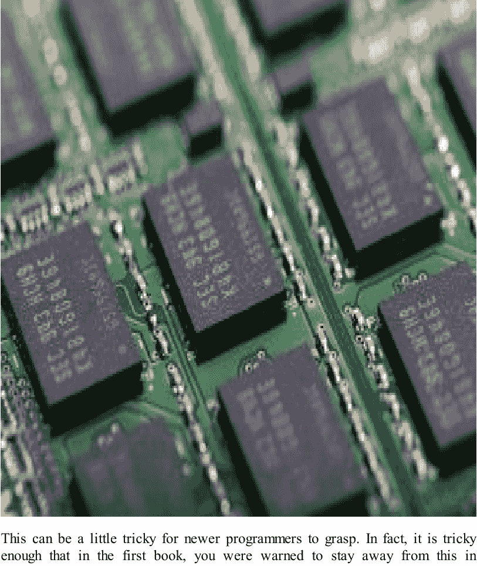

这对新程序员来说可能有些难以理解。事实上，它复杂到在第一本书中特别警告你要远离这个主题。这是因为这是一个相对高阶的主题。毕竟，指针的概念本身涉及一些相当低层的编程，而这很可能是你之前没有任何经验的。

让我们回顾一下之前关于数据和数据类型的讨论。我们谈到了如何创建变量以及可以对它们进行的各种操作。然而，有一件事我们并没有 enlistedEn 真正讨论过，那就是这些变量在计算机内存中的工作机制。

计算机将变量存储在一个名为*随机存取存储器*的进程中。你可以将随机存取存储器理解为可以根据程序当前需求动态分配和使用的空间。程序员和程序所处理的所有值都在一定程度上存储在随机 access 存储器中。变量可以被定义，这会分配一块大小与定义变量相当的随机存取存储器空间。

此外，变量就其本质而言，基本上是计算机内存中某个值所在位置的引用。当你引用一个变量时，你实际上并不一定是在处理该*值*本身。例如，当你将一个变量传递给函数时，你发送的并不是变量*本身*。相反，你发送的是该变量值的*副本*，供新函数操作。这个副本在函数执行完毕后被丢弃。

在计算机的早期，这在一定程度上是合理的。毕竟，你不一定希望在每次将变量发送给函数时都*改变*某些变量的值。对于这种情况，不作为默认行为是合理的。此外，函数本身也以特定方式存储在计算机内存中，这使得直接发送值比发送内存中其他位置值的引用更有意义。可以说，这让它们运行得更高效。

然而，确实存在某些情况，你希望引用变量本身的值，而不仅仅是变量所*引用*的值。对于这些情况，你需要使用指针。同时要注意，大多数Arduino草图完全可以在不使用指针的情况下完成。但是，有时你会处理数据结构或需要*创建*数据结构，在这些情况下，对指针的扎实了解非常有用。

更不用说，无论我们是在讨论一般编程还是 specificallyArduino编程，指针都是你*需要*了解的，因为它们是*内存管理*的一个重要概念。你必须理解内存管理才能编写高效的程序，而且你至少需要理解这个概念——如果不是为了Arduino，也是为了你想编程的其他任何东西。

那么，从这一切中需要掌握的关键点是什么呢？首先，**指针**是什么？指针提供了一种方法，让你可以通过值在内存中的位置来引用健康知识它，而不仅仅是通过其值的副本。这为什么重要？因为它允许你传递和处理直接值，而不只是通过变量获得的那些值的副本。这是C语言编程的基础，在Arduino程序中也可能偶尔出现。虽然通常情况下，你可以编写完整的草图而从不使用指针，但当你查看他人的草图并学习他们编写的代码时，这仍然是有用的知识。

那么，指针究竟是如何*工作*的呢？指针通过一组称为*引用*和*解引用*操作符的组合来工作。你可以使用这些操作符来创建新的指针变量，并将它们指向已存在的变量。

你要做的第一件事是创建一个指向你想要指向的值类型的指针。你通过使用引用操作符\*来实现。例如，假设我们有：

```
int apples = 3;
```

而我们想创建一个指向该变量的指针。我们首先要做的是创建一个新指针：

```
int *ptr;
```

你可以将引用操作符放在任何位置。大多数人喜欢把它放在变量名上，但也有人喜欢把它和类型放在一起。还有人把它放在两者之间，两边都留空格。这取决于你正使用的编码规范，但通常来说，把它和变量名放在一起是比较稳妥的选择。

之后，你要做的是定义它指向的地址。你通过*解引用*操作符**&**来实现这一点。你要将指针变量*本身*设置为此值，而不是带引用操作符的指针变量。像这样：


`int *ptr;`

`ptr = &apples;`

然后，每当我们通过引用运算符修改 `ptr` 变量时，它就会改变我们指向的地址中存储的值。像这样：

```
*ptr = 4;
```

```
printf("%d", apples);
```

// 这将会打印出四，因为我们把变量 `apples` 所引用地址的值改成了4，而不是3。

你可以非常清楚地看到，当你试图在函数之间传递变量并以复杂的方式处理变量时，这对于作为程序员的你来说会有多么大的用处。能够像这样直接操作指针也有很多实用的好处。当你在一个像 Arduino 这样内存既有限又至关重要的平台上工作时，你至少会希望能够直接操作内存。还有一些更基础的东西你可能需要购买，但它们是高级话题，不在本书的范围之内。它们对 Arduino 编程本身也不是特别有用，比如通过 `malloc` 函数直接分配内存。

无论如何，知道如何操作指针将推动你作为一名 Arduino 程序员前进，因为当你真的在实际中遇到指针，或者必须创建需要传递并直接修改变量的函数时，你可以轻松地完成，而不会因为困惑而抓狂。

### 栈

栈是另一个极其重要的计算机科学概念。它们之所以重要，主要是因为它们与指针和数组等东西以一种非常关键和紧密的方式协同工作。那么，它们是什么？

这比 Arduino 的内容稍微深入一些，但你在讨论 Arduino 编程时仍会不可避免地遇到基本的栈术语，因此你对栈是什么以及如何使用它有一个扎实的概念是很重要的。

"栈"实际上是一个相当通用的术语。"栈"这个概念简单地指的就是它听起来的样子——一堆值。你可以向这个栈中添加变量。想象一个积木塔。这本质上就是栈的工作原理。

你可以把东西放在栈顶，而这些东西也是从栈中*移除*的第一个东西。这在算法编程中特别有用，但在 Arduino 编程中也确实有一些用处。为什么？因为当你处理复杂且有限的内存结构时，你不可避免地会遇到很多情况，其中最好的前进路径是使用栈。这是因为栈对内存非常友好。除了栈中最后一个东西的位置和栈中当前的东西的位置之外，它不要求任何其他东西，而这些东西很容易使用。

它还为你提供了一种极其简单的方法来引用你已经使用过的数据，所以这本身就很巧妙了。栈本质上是任何程序员都极其有用的工具，而且 Arduino IDE 中确实有一些函数引用了栈的概念并在此基础上进行了扩展。

栈由两个基本函数构成：压栈和出栈。两者都极其容易理解，所以我们应该不需要花太多时间来解释它们到底是什么。

压栈指的是将某物*添加到*栈中。这是一个相当直接的概念。你可以将一个值压入栈中，以便将其保存供以后使用，并且可以即时调用它，而不必担心诸如栈顶变量的*名称*或其值之类的事情。

出栈指的是将某物从栈中*取出*。当你从栈中弹出一个值时，你会移除最近添加到栈中的东西并获取它的值。然后你可以按你喜欢的方式使用它的值。如果你想将这个值返回到栈中，只需要记住你必须再次*压入*它。当你从栈中弹出并移除一个东西时，倒数第二个被压入的东西现在就成了第一个要弹出的东西。

再次强调，栈是一个相对简单的概念，但它对于计算机科学的整体概念以及构建和扩展你的视野以成为更好的程序员来说，仍然是极其重要的。

### 结构体

很多人在作为新手程序员时没有花时间去学习 Arduino 编程和通用 C 语言中的一些微妙之处，其中之一就是结构体的概念。结构体是一个相对保守的秘密，但它们可能极其有用。

也许你听说过面向对象编程这个术语。C 语言中的结构体在很多方面是面向对象编程思想的前身。虽然它们无法像面向对象概念那样进行极其广泛的编程，但它们确实为程序员提供了一种绝妙的方式，可以将某些想法组合成一个单一的结构。

那么，结构体到底是什么？给它下一些定义将帮助你更好地了解如何使用它。很多时候，编程中的概念如果你通过将它们捆绑在一起会更容易理解。一个很好的例子是思考一只猫。你可能需要在程序中处理几个关于猫的不同想法，为此，即使它们都有一大堆共同特征，你也需要定义各种不同的变量。所以，与其这样做：

```
cat1Legs = 4;

cat2Legs = 4;

cat3Legs = 4;

cat1Color = 'brown';

cat2Color = 'black';

cat3Color = 'white with black spots';

cat1Breed = 'tabby';

cat2Breed = 'persian';

cat3Breed = 'american shorthair';
```

你可以只用一种方式定义所有这些东西，然后在以后通过访问它们的*成员数据*来使用它们。你通过使用一个点号来做到这一点。在 C 语言中定义结构体的语法如下所示：

```
struct NameOfStruct {
    // struct 中的数据
};
```

所以，使用猫的例子：

```
struct MyCat {
    int numberOfLegs;
    String color;
    String breed;
};
```

然后你可以这样定义猫：

```
MyCat cat1 = {4, 'brown', 'tabby'};
MyCat cat2 = {4, 'black', 'persian'};
MyCat cat3 = {4, 'white with black spots', 'american shorthair'};
```

你可以看到，这为程序员提供了一种将重要数据分组在一起的更简单的方法。很可能你不会*超级*频繁地使用这些数据，但它确实允许你有这样一种方法来*做*这件事。重要的是你要知道它是什么，因为你最终会看到它。

所有这些概念对 Arduino 都很重要，因为 Arduino 在内存和处理能力方面比你的家用电脑受限得多。重要的是你要知道如何使用这些概念，以便最大限度地利用 Arduino 的处理能力，并编写出比其他方式更简单、更优雅的程序。例如，你可以创建一个结构体，其中包含三个名为 `r`、`g` 和 `b` 的字节变量，以便以简单的方式编程你的 RGB 颜色。你可以通过这种方式定义新的颜色，以便在以后的程序中轻松访问它们，就像这样：

```
struct color {

    byte r, g, b;

};

color blue = {0, 0, 255};
```

看到这有多简单了吗？但这样做这种事情的效用是相当明显的！

在本章中，我们涵盖了三个主要的编程概念，当你在处理他人的 Arduino 代码并向他们学习时，你将不可避免地遇到这些概念，因此我培养你解析和运用这些想法的能力是很重要的。

### Arduino API 函数

在本章中，我们将开始详细介绍 Arduino API 提供的函数。第一本书主要涉及编程的基础知识。这很好，但我们并没有太多地接触 Arduino API 本身。我们现在的目标是获得一些关于 Arduino 界面为程序员提供的众多函数的经验。

Arduino API 是提供给有志于 Arduino 编程的人的一整套丰富的东西，为他们在编程中提供了更多的选择。Arduino 团队在提供一个功能齐全的 API 方面做得非常出色，该 API 为程序员提供了各种各样的功能，让他们可以在 Arduino 创作的背景下做很多事情。

我们将按部分对这些函数进行划分，并对每个函数进行更详细的介绍，所以请坐好。你从本章获得的是关于 Arduino 编程的完整参考，你可以在需要时随时查阅。


### 数字输入与输出

Arduino API 定义了一系列函数，以便你能够操作数字引脚。本节专门介绍这些函数，重点讲解其中三个。

```
pinMode(pin, INPUT - OUTPUT - or INPUT_PULLUP)
```

通过此函数，你可以指定一个引脚，并将其设置为*输入*或*输出*模式。较新的 Arduino 型号还可以通过 `INPUT_PULLUP` 模式启用引脚的上拉电阻。

### 模拟输入与输出

除了数字引脚，你还有模拟引脚。这些函数用于读取指定引脚的电压，电压范围始终在 0 到 5 伏之间。上限值接近 *1023*，下限值接近 *0*。

```
analogRead(pin)
```

此函数读取指定引脚的电压，并将其作为 0 到 1023 之间的整数返回。

```
analogReference(type)
```

此函数根据 Arduino 的类型配置参考电压。

大多数情况下，你可以将 "type" 指定为 `DEFAULT` 或 `INTERNAL`。只有在少数情况下，你才需要指定不同的参考电压。

```
analogWrite(pin, value)
```

此函数写入一个指定电压值，范围从 0 到 1023，其中 1023 对应 4.99999 伏，0 对应 0 伏。

### 高级输入与输出

这些函数并不严格属于数字或模拟类别，而是更高级的输入输出功能，能让你更全面地操作 Arduino 开发板。

```
tone(pin, frequency, OPTIONAL duration)
```

此函数允许你指定一个频率，然后在指定引脚上生成该频率的方波。

```
noTone(pin)
```

此函数将停止 `tone` 函数生成的音频。

```
pulseIn(pin, value)
```

此函数允许你读取指定引脚的脉冲。如果引脚在高电平和低电平之间变化，它将返回高电平和低电平之间的时间（以微秒为单位）。由于脉冲可能不完全均匀，你实际上可以指定读取 HIGH 脉冲（HIGH 值变为 LOW 的时间）还是 LOW 脉冲（LOW 值变为 HIGH 的时间）。

```
pulseInLong(pin, value)
```

此函数与前一个函数类似，但返回的不是整数微秒数，而是长整型微秒数，本质上提供了更大的时间范围来接收数据。

```
shiftIn(dataPin, clockPin, bitOrder)
```

此函数将逐位向指定引脚发送一个字节的数据。数据引脚是用于发送每一位数据的引脚，时钟引脚用于指示 `dataPin` 已读取数据，`bitOrder` 可以是 `MSBFIRST` 或 `LSBFIRST`（分别表示最高有效位优先或最低有效位优先）。

```
shiftOut(dataPin, clockPin, bitOrder, value)
```

此函数与前一个函数类似，但它允许你逐位向引脚发送数据。其余部分相同，但你可以通过 `value` 参数发送数据。`value` 参数必须是 `byte` 类型。

### 时间

这些函数旨在帮助你在 Arduino 中处理与时间相关的操作。

```
delay(value)
```

此函数使你的程序暂停指定的时间，时间以毫秒为单位，由整数 `value` 指定。

```
delayMicroseconds(value)
```

此函数在功能上与 `delay()` 函数相同，不同之处在于它使用微秒而非毫秒。

### 数学运算

信不信由你，编程有时涉及大量数学运算。Arduino API 中的数学函数在很多方面与 C 语言数学库中定义的数学函数类似，但它们省去了你导入额外数学库的麻烦。即使你在程序中不怎么使用数学运算，了解这些函数的存在仍然会对你有所帮助，因为你永远不知道什么时候会用到它们。

```
abs(value)
```

此函数返回给定数字的绝对值，即数轴上零与给定数字之间的距离。

```
constrain(variant, lowerBound, upperBound)
```

此函数允许你创建一个约束，使一个数字始终处于下限和上限之间。

```
map(number, fromMin, fromMax, toMin, toMax)
```

此函数将一个数字从一个范围映射到另一个范围。

```
max(number1, number2)
```

返回 `number1` 和 `number2` 中较大的那个数。非常简单！

```
min(number1, number2)
```

与 `max` 函数功能完全相反。返回两个数中较小的那个。

```
pow(base, exponent)
```

此函数允许你将一个给定数字提升到指定的指数。C 语言没有内置的指数运算符，因此这个函数非常实用。

```
sq(number)
```

此函数返回给定数字的平方。是 `pow(number, 2)` 的简写。

```
sqrt(number)
```

此函数计算给定数字的平方根。

```
cos(angle)
```

此函数计算给定角度的余弦值，角度需以弧度为单位指定。

```
sin(angle)
```

此函数计算给定角度的正弦值，角度需以弧度为单位指定。

```
tan(angle)
```

此函数计算给定角度的正切值，角度需以弧度为单位指定。

### 字符

虽然使用频率不高，但拥有一套处理字符集的函数在你进行字符操作时非常重要。

```
isAlpha(character)
```

此函数返回该字符是否为字母字符。

```
isAlphaNumeric(character)
```

此函数返回该字符是否为字母或数字字符。

```
isAscii()
```

此函数返回该字符是否为 ASCII 字符。

```
isControl()
```

此函数返回该字符是否为控制字符。

```
isDigit()
```

此函数返回该字符是否为数字。

```
isGraph()
```

此函数返回该字符是否包含可视数据。例如，空格不包含可视数据。

```
isHexadecimalDigit()
```

此函数返回该字符是否为十六进制数字。

```
isLowerCase()
```

此函数返回该字符是否为小写字母。

```
isPrintable()
```

此函数返回该字符是否可以打印到控制台。

```
isPunct()
```

此函数返回该字符是否为标点符号。

```
isSpace()
```

此函数返回该字符是否为空格字符。

```
isUpperCase()
```

此函数返回该字符是否为大写字母。

```
isWhiteSpace()
```

此函数返回该字符是否为空白字符，如制表符、空格或换行符。

### 随机数

这些函数允许你在程序中生成随机数。请注意，计算机永远无法做到真正的随机和自发；一切都基于输入，计算机中没有任何东西能脱离这些输入。因此，随机函数*必须*进行初始化。

```
randomSeed(number)
```

此函数启动随机数生成器。你输入一个数字，它就会从伪随机数生成器数值序列中的某个随机位置开始。

```
random(OPTIONAL minimum, maximum)
```

此函数设定随机数生成的范围。`maximum` 值是你允许的最高随机数，`minimum` 输入是你允许的最低值。如果未指定最小值，则默认为 0。

### 位运算函数

这些函数允许你对位和字节进行操作，它们是计算机处理的最小数据单位。理论上你可以处理更小的值（就所需的整体计算能力而言），但在 Arduino 编程中，这些是你实际会用到的最小数据单位。

```
bit(bitNum)
```

此函数返回指定位的值。

```
bitClear(variable, bit)
```

此函数将指定数字*变量*的特定位设置为 0。

```
bitRead(variable, bit)
```


这将返回指定数值*变量*的*位*。

```
bitSet(variable, bit)
```

这会将给定*变量*中由*位*指定位置的位设置为1。

```
bitWrite(variable, bit, 0 or 1)
```

这会将*变量*中给定位置的*位*设置为0或1，具体取决于你指定的值。

```
highByte(value)
```

这将返回给定值的最高字节。

```
lowByte(value)
```

这将返回给定值的*最低*字节。

### 使用 Stream 类（以及处理字符串）

这值得单独一章来讲述。虽然这也与有效使用 Arduino API 密切相关，但这个主题涵盖范围很广，我们确实需要将其拆分为独立的章节，以便能够充分地讨论它。

流类是一个相对容易理解的概念。流类本身基于从某个源读取信息并在你的草图中使用这些信息。因为流涉及数据读取，所以我们也有必要在本章中讨论键盘和鼠标的使用，即使它们与流类没有*内在的*关联。

当你处理数据时，尤其是读取数据时，你不可避免地会遇到需要处理字符集合的情况，比如单词、句子或类似的内容。*字符串*的概念为你提供了实现这一点的途径。

字符串本质上只是链接在一起作为数组的字符值集合。因此，它们在内存中是连续的，计算机将它们视为一个庞大且相互关联的单元。处理字符串意味着学习如何以最佳方式操作这些单元。

这本身非常简单。字符串本质上只是*字符数组*。这意味着我们在技术上是与所谓的*C风格字符串*打交道，它们基本上是抽象程度非常低的字符串。例如，在许多更现代、更高级的语言中，字符串不会以其字符数组的形式展现；它们反而被当作更抽象的对象处理，即使它们在核心上*确实*是字符数组。

一个字符串由*n+1*个字符组成，其中*n*是字符串中字母的一般数量。所以，例如，单词"hello"的字符串大小是*六*个字符。原因是n+1是因为字符串以空终止字符\0结尾，该字符表明已到达数组末尾并正确终止它。

你可以用定义数组的相同方式来定义字符串。你也可以使它们比将要包含的字符串更大。当你定义数组时，你可以立即给它一个值，但你也可以只定义它们的大小并在以后扩展。这也使得字符串以一种或另一种方式变得动态，能够在程序中稍后的时间点通过重写字符串内的数据来更改。

作为程序员，这些信息对你非常有用，因为字符串是任何处理信息的程序的基本组成部分，尤其是那些处理文件输入和输出的程序。

我们已经花了一些时间回顾书中的先前信息，但为了清晰起见，我们将继续定义一个字符串：

```
char myString[6] = "hello";
```

你可以在稍后通过字符的名称来引用整个字符串。Arduino处理的大多数数据都将以字节为单位进行处理，大多数实际的文本数据将以C字符串的形式进行处理，因为字符非常易于解析。

涵盖所有这些内容很重要，这样我们才能在Arduino编程的背景下，以及通过本书将要进行的所有工作中，真正发展出如何处理字符串的概念。

### Serial

虽然你不能直接实现流类本身，但你可以实现它的*派生类*，这就是你开始发现大量实用价值的地方。串行类是流类的扩展，它允许Arduino板与其他正业对象（如计算机）进行通信。

串行通过Arduino上的串行端口以及与计算机的USB链路来启用。在本节中，我们将概述组成串行类的所有不同功能，以便你能够充分利用这一宝贵的资源。

```
if (Serial)
```

```
Serial.begin(rate)
```

你已经熟悉这个功能了。它允许你启动数据的串行传输。你可以指定数据传输的具体速率，单位为每秒比特数。

```
Serial.end()
```

这允许你结束串行通信。如果你愿意，你可以稍后通过调用Serial.begin()函数来重新启动串行通信。在串行通信禁用时，你可以将串行引脚用于通用的数据输入和输出。

### Serial.find(string)

这将在串行提供的数据中搜索给定的字符串。如果找到该字符串，方法将返回true。如果未找到该字符串，方法将返回false。

### Serial.findUntil(string, OPTIONAL endString)

这将在串行缓冲区中查找字符串，直到找到该字符串或找到指定的终止字符串为止。如果找到目标字符串，则方法将返回true。如果找到终止字符串或方法超时，则将返回false。

### Serial.flush()

这将允许你暂停进程，直到所有要发送到串行的数据都已发送完毕。简单明了！

### Serial.parseFloat()

这将返回串行流提供的第一个浮点数。它将被任何非浮点字符终止。

### Serial.parseInt()

这将返回串行流提供的第一个整数。它将被第一个非数字字符终止。

### Serial.peek()

这将返回串行缓冲区将要导入的下一个字符。但是，它不会从缓冲区中移除该字符。这使其与我们即将讨论的Serial.read()方法有根本的不同。这意味着你只能查看下一个字符是什么。

### Serial.print(value, OPTIONAL format)

你可以选在地指定格式。否则，整数默认以十进制打印；浮点数默认打印两位小数，等等。

你可以将字符或字符串原样发送给打印语句，它会毫无问题地打印它们。

```
Serial.println(value, OPTIONAL format)
```

这将允许你像使用普通打印方法一样输出值。

```
Serial.read()
```

这会读取通过串行端口传入的数据。非常简单！它被添加到一个称为串行缓冲区的传入串行数据流中。当你从这个缓冲区读取时，信息会被销毁，所以如果你需要在某个时刻重用数据，请务必将其保存到变量中。

```
Serial.readBytes(serialBuffer, numberOfBytes)
```

这将从串行端口读取字符到缓冲区。你可以确定要读取的字节数。你的缓冲区必须是字符数组或字节数组。

```
Serial.readBytesUntil(terminatorCharacter, serialBuffer, numberOfBytes)
```

这将从串行中读取字符，直到读取了给定数量的字节或读取了给定的终止字符。在任何一种情况下，该方法都将终止。

```
Serial.write()
```

这将把数据写入串行端口；但是，这个方法只向串行端口发送二进制数据。如果你需要发送ASCII数据，你应该改用print方法。

```
Serial.serialEvent()
```

当数据可供串行端口使用时，该函数将被调用。然后你可以使用Serial.read()函数从串行端口读取数据。


至此，我们已经讲解了与 `Serial` 类相关的许多特定功能，以及它如何与 Arduino API 协同工作。接下来我们需要了解的是 `Ethernet` 类。

### 用户自定义函数

保持代码整洁、有条理且模块化（可重用）的方法之一，就是在代码中使用函数。此外，函数通过使特定代码段可重用，帮助缩小代码规模。顾名思义，函数就像为特定功能而创建的工具。

虽然我们已经遇到过一些用户自定义函数，但现在我们将更详细地讲解它们，并解释上次遇到时可能略过的一些特性。现在让我们看一下一个函数的声明：

```
float employeeEarnings (float hoursWorked, float payRate) {

float result; // 这将是函数被调用时返回的值。它应与函数名前的数据类型匹配。

result = hoursWorked * payRate;

return result; // return 告诉函数将一个值发送回调用它的地方

}
```

这个函数显然接受两个参数：`hoursWorked` 和 `payRate`，两者都是 `float` 类型。它对它们进行一些简单的数学运算，然后返回一个 `float` 作为值。`return` 意味着终止函数，并将放在 `return` 关键字后的任何值（通常是某个计算结果的变量）发送回去。

现在让我们看看如何调用这个函数来计算员工的收入：

```
void loop () {

float hoursWorked = 37.5;

float payRate = 18.50;

float result = employeeEarnings (hoursWorked, payRate);

// result 将是 693.75
```

首先，函数必须在任何其他函数之外声明。这意味着你需要在 `setup()` 或 `loop()`，或者任何其他用户自定义函数之外编写你所创建函数的代码。

让我们看另一个示例，一个可用于平滑传感器读数的简单程序：

```
int sensorSmoothing (analogPin) {

int sensorValue = 0;

for (int index = 0; index < 5; index++)

digitalWrite(LED_BUILTIN, HIGH);    // 为平滑处理打开 LED

sensorValue = sensorValue + analogRead(analogPin);

delay(100); // 采样间延迟 100 毫秒

}

digitalWrite(LED_BUILTIN, LOW); // 关闭 LED

sensorValue = sensorValue / 5; // 计算五次采样的平均值

return sensorValue;

}
```
这种函数可以用于平滑许多传感器的数据输入（如果它们容易出现抖动输入）。这将计算采样的平均值，提供更稳定的数据流。你可以看到这段代码与上一个示例非常相似：

```
void loop () {

int sensorPin = 0; // 模拟引脚 0

int sensorValue = sensorSmoothing (sensorPin);
```

这里，当我们尝试初始化 `sensorValue` 变量时，它将对模拟引脚 0 调用 `sensorSmoothing()` 函数，并返回五次采样的平均结果。

函数并不总是需要参数或返回变量。有时函数可以不返回值也没有参数。它们所做的只是执行几行代码，然后终止，将编译器带回调用它们的地方。

### 结论

下一步就是走出去，开始创建你自己的草图！去当地的爱好商店获取一些灵感，或者去社区看看有哪些新项目你想尝试。在你想好下一步方向后（机器人很有趣！），加入社区吧！说真的，和朋友们一起构建项目并相互比较是非常有趣的。如果你觉得不知道从哪里开始，别担心！有许多在线资源分享编码技巧和技术，可以帮助你提升。许多在线网站还有专门的论坛，帮助像你这样的人学习并展示他们的成果。这也是作为爱好者学习和成长的绝佳方式。

如果你想开始但资金紧张，也有选择。就像我们上面提到的，在 Arduino 网站和其他地方可以买到相当便宜的模块。此外，也有更便宜的编程语言可用，有些甚至是免费的。学习这些语言实际上比你想象的要容易。如果你懂一种编程语言，其他的就更容易理解和编写。你当地的图书馆也有书籍可以帮助你学习如何编程。许多图书馆提供馆际互借，这意味着你可以从四面八方的书籍中学习编程知识！最棒的是，从图书馆借书学习是完全免费的！如果你有任何问题，请记住你可以上网找到其他使用过 Arduino 并且知道如何帮助你起步的人。

Arduino 板可以被编程来控制 LED 等设备。Arduino 编程中使用的语法类似于 C++。如果你擅长 C++，那么 Arduino 编程对你来说会很容易。Arduino 中的变量在 `setup()` 函数内初始化。`loop()` 部分包含要重复运行的代码块。使用 Arduino 引脚时，你必须指定要使用的引脚。引脚通常用数字标识，每个引脚都有一个唯一的编号。获得板子后，你必须在计算机上设置 Arduino IDE。这是你编写 Arduino 代码然后将其上传到板子的地方。Arduino 代码通常被称为草图。你必须有电源。但是，有些板型必须进行配置才能允许从计算机获取电力。草图对板子的影响将在将其上传到板子后显现，这需要点击“上传”按钮。

Arduino 有许多传感器和扩展模块，所以一定要查看你想使用哪些。拥有 Arduino 的妙处在于你将有机会尝试许多实验。你也不仅仅局限于传感器能读取的东西。自己想一些方法让机器为你服务。先尝试编写简单的指令——比如设置闪烁灯光或弄清楚 Arduino 如何监控输入——看看你能从那里做到什么。我为你包含了许多 Arduino 代码供使用，但请随意寻找你自己的！有许多指南可供帮助。

你还可以查看一些更高级的概念，这些是我们在这里没有机会涉及的，比如头文件、类、更改芯片时钟速度、添加核心、添加库等等，这个芯片可以做的事情太多了，真的很不可思议。选择一个你感兴趣的方向，看看它能带你走向何方。我希望本指南能给你一些小小的启发，去尝试新事物，看看你的草图设计能力如何。

最后，感谢你读完这本书！Arduino 是开启你编程之旅的有趣方式。既然你购买了这本书，我们希望你有所成长，如果你觉得这本书在任何方面都有帮助，在亚马逊上留下评论总是令人感激的！

### 参考资料

Arduino Reference. (2019). 检索自 https://www.arduino.cc/reference/en/language/structure/comparison-operators/lessthan/

什么是 Arduino? - learn.sparkfun.com. (2019). 检索自 https://learn.sparkfun.com/tutorials/what-is-an-arduino/all#the-arduino-family

### C#

*《C# 编程初学者终极指南：循序渐进学习》*

**Ryan Turner**

### © 版权所有 2019 – Ryan Turner
保留所有权利。

未经作者或出版商直接书面许可，不得复制、转载或传播本书所含内容。

在任何情况下，出版商或作者均不对因本书所含信息造成的任何损害、赔偿或金钱损失承担任何责任或法律责任，无论直接或间接。

### 法律声明：

本书受版权保护。本书仅供个人使用。未经作者或出版商同意，不得修改、分发、销售、使用、引用或转述本书的任何部分或内容。

### 免责声明：

请注意，本文档中的信息仅供教育和娱乐目的。已尽力提供准确、最新、可靠、完整的信息。不声明或暗示任何类型的保证。读者确认作者不提供法律、金融、医疗或专业建议。本书中的内容源自各种来源。在尝试本书中概述的任何技术之前，请咨询有执照的专业人士。

通过阅读本文档，读者同意在任何情况下，作者不对因使用本文档中包含的信息而造成的任何损失（直接或间接）负责，包括但不限于错误、遗漏或不准确之处。

## 目录

- 引言
- 第 1 章：什么是 C#
- 第 2 章：详细概述
  - 环境


- [程序结构与基本语法](Program Structure and Basic Syntax)
- [第3章：揭秘数据类型](Chapter 3: Demystifying Data Types)
- [第4章：使用变量](Chapter 4: Working with Variables)
- [第5章：什么是类型转换？](Chapter 5: What is Type Conversion?)
- [第6章：运算符的必要性](Chapter 6: The Need for Operators)
- [第7章：条件语句](Chapter 7: The Conditional Statements)
- [第8章：循环](Chapter 8: Loops)
- [第9章：C# 方法](Chapter 9: C# Methods)
- [第10章：数组世界](Chapter 10: The Array World)
- [第11章：类](Chapter 11: Classes)
- [第12章：结构体](Chapter 12: Structure)
- [第13章：封装](Chapter 13: Encapsulation)
- [第14章：继承](Chapter 14: Inheritance)
- [第15章：多态](Chapter 15: Polymorphism)
- [第16章：正则表达式](Chapter 16: Regular Expressions)
- [第17章：异常处理流程](Chapter 17: The Process of Handling Exceptions)
- [第18章：文件 I/O](Chapter 18: File I/O)
- [第19章：委托](Chapter 19: Delegates)
- [第20章：C# 中的多线程](Chapter 20: Multithreading in C#)
- [第21章：事件](Chapter 21: Event)
- [第22章：提示与重要资源](Chapter 22: Hints and Important Resources)
- [结论](Conclusion)
- [参考文献](Bibliography)

### 引言

尽管学习任何一门新语言都绝非易事，但本书旨在让你尽可能快速、轻松地掌握和理解它。目标是为你提供完整且全面的技能，帮助你记住重要知识，并指导你在 C# 中的编程和编码实践。为了让你以最高效的方式学习，我希望你也能完成练习，这些练习将巩固我们在本书中探讨的课程内容。

本书将涵盖 C# 是什么的简要描述，最后为你提供一些有用的提示和资源，以加强你在任何可能需要更多帮助的主题或技能方面的学习。

这门语言将反映其他一些计算机编程语言的特性——如果你熟悉其他语言本身，这几乎是宝贵的经验。尽管本书不仅仅是一本向你介绍编程艺术的初学者手册，但它将重申并确认许多此类技能，帮助你在尽可能短的时间内实现最佳的编程效果。请记住，这门语言为程序员提供了许多能力，本书可能会以游戏编程相关的术语来指代某些内容，希望你对此也有所了解。

尽管我为你提供了信息和一些基本的实践技能，但将这些技能付诸实践则取决于你自己。我强烈建议你制定一个严格的日常安排，包括研究、学习材料以及在你自己的虚拟环境中进行实践，以使你熟悉这些技能。众所周知，你可以把马牵到水边，但不能强迫它喝水！

我可以给你知识和资源，但迎接挑战、综合运用它们来创建你自己的编程和代码，则取决于你自己。

使用像 C# 这样面向对象且结构化的语言，你会发现它易于学习且用户友好。这种高级语言建立在 C、C++ 甚至 Java 语言的基础之上，并在某种程度上对其进行了补充。然而，即使你是这些语言的大师，这项新任务的学习曲线也会像其他编程语言一样陡峭！在整个过程中，我鼓励你运用自己的知识和直觉来应用本书中的概念和策略。记住，在成为大师之前，每个人都是初学者！

### 第1章：什么是 C#

你接触并购买本书是为了学习如何成为一名 C# 程序员。

在本书中，你将学习如何在你自己的编程项目中应用 C# 的基本规则。C#（读作“see sharp”）是一种由微软设计和开发的面向对象的计算机编程语言。

这是一种相当新的语言，被认为在本质上非常实用且面向对象。虽然 C# 肯定不同于 C 或 C++，但这些语言之间确实存在一些相似之处，甚至可以说，了解或拥有其中一种或两种语言的经验会有所帮助。

与所有编程语言一样，了解它们在基本和功能层面的工作原理是有帮助的。所有语言都有一个共同点，那就是它们都在努力告诉计算机要做什么以及如何设置系统、数据库，或者如何以及何时运行和执行程序。

这门特定的语言起源于一位程序员 Anders Hejlsberg，他是微软 .Net Framework 开发团队的一员。尽管有些人倾向于批评 C# 在某种程度上是 Java 的“翻版”，但你将在本学习手册的学习过程中看到（如果你了解 Java 的话），该语言在内容和结构上有着明显的不同，使其与众不同。

它的设计旨在适应一个能够使用高级语言并包含可执行代码（也称为公共语言基础设施或 CLI）的环境，这吸引了许多对这门易于学习的语言感兴趣的人。

它以高效为目标之一，因此使用它有许多优势。在本书中，我将向你介绍这门面向对象和组件的语言如何能轻松地成为你使用的一门新语言。

除了是一门结构化的语言，你还可以期待使用 C# 语言进行编程和编码时获得高效的结果。我将协助你优化性能，以从你在该语言中投入的编程和编码工作中获得所需的输出。

尽管 C# 是使用 Microsoft 平台开发的，但该语言本身并不局限于该平台。C# 的另一个重要概念是，这种多功能性允许你将这门面向对象的语言带到不同的平台，以创建多维度且可用的程序和软件。

我相信你熟悉其他语言，语言的某些方面有益于某些期望的结果。在本 C# 学习指南中，将涵盖许多好处，这些好处有助于用户实现可移植性、类型化、元编程、属性、内存访问以及方法和功能——除此之外，我们将在接下来的章节中讨论和展示许多其他积极属性。

这门语言自 2002 年才有官方版本，因此可以被认为是一门较新的编程语言。然而，不要让它误导你认为它无法与存在时间更长的其他语言（如 Java）竞争。

该语言的开发者确实旨在改进并添加不同的特性，最初是专门为 .Net 框架设计的，但现在已扩展，并且成功地实现了许多特性——其中一个许多人往往喜欢的是它使用的语法。

这门语言有可能被用于专注于游戏。对于游戏玩家来说，重要的是游戏不仅要有趣且引人入胜，他们还希望体验本身是愉快的。

你自己可能已经是一个程序员了（或者至少欣赏计算机的能力），在阅读完本书后，我相信你会深刻理解游戏程序员为了创造你最终获得的体验付出了多么艰辛的努力。

虽然我不认为仅仅阅读本书就能让你创作出一款大师级的游戏（你还需要大量的练习！）——但我确实相信，当你处理游戏相关的内容时，你将更深入地理解那些至关重要的概念。


在图形编程与设计的诸多组件中，请记住，在整个学习过程中，你正在通过这门语言的编码和编程技能，创造并不断完善一个可能无限延伸的世界。面向对象组件确实有助于强化这一理念。

在接下来的章节中，你将了解到C#为何以及如何对你非常有用，以及你如何在不到一个月的时间内轻松掌握并熟练运用所有基础知识。

凭借可与其他任何语言相媲美的标准库，在本书结束时，你将知道如何找到可能需要的源代码，并执行它来产生相当一致且精美的结果。这门语言的另一个优点是布尔条件，它受到许多人的青睐，再加上Windows集成，让你可以轻松访问最受欢迎的操作系统之一。

关于本章对C#是什么的非常简化说明，最后我想提几点在编程和编码过程中值得牢记的通用概念。

首先，记住计算机没有直觉。这意味着它们会完全按照你的指示执行任务。计算机不会像人类那样从你的代码中推断信息。在你遇到任何困难时，请始终牢记这一点。

还要记住，一个简单的空格错误或一个错误的字母都可能导致一大堆麻烦。如果你陷入看似不可能的困境——也许你需要短暂休息一下，然后回来再看看你的代码。

有时，当我们长时间盯着屏幕时，我们可能看不到自己的错误。

最后，请记住，你并不是第一个在这门语言上遇到困难的人，也肯定不会是最后一个。本书的最后一章将是一个指南，提供进一步有用的资源和提示，以解决你在开始学习这门语言时可能遇到的任何困难。

本书为你学习C#设定了合理的期望。我鼓励你尝试以完全相同的方式学习。重要的是不要在短时间内用过多的内容让自己不堪重负。

相反，不要在回来继续工作之前间隔太长时间。你可能会忘记一些细微之处，这些细微之处可能会让你抓狂。让自己保持合理的期望，本书正是为此设计的。

最后，享受学习的乐趣！为自己正在学习的新技能感到自豪，并准备好参加C#基础精通速成课程！

### 第2章：详细概述

既然你是初学者，我们希望专注于建立一个坚实的基础，让你全面了解C#的基础知识。

本质上，在第一周结束时，你将牢固掌握C#环境、程序结构、基本语法和数据类型、类型转换、变量、常量和运算符。如果你不熟悉所使用的术语或方法，我将尝试对这些术语进行快速、基础的回顾。如果这不能帮助你回忆起来，你可能需要从Google或其他资源中查找快速复习资料。我还想推荐一个免费的交互式shell程序供你试用代码 - https://www.tutorialspoint.com/compile_csharp_online.php，这应该能帮助你完成书中包含的任何训练练习。

### 环境

如所见，C#被设计为与微软和.NET框架集成。正如人们所猜测的，这对C#环境有重大影响。理解C#的一个重要部分来自于理解两者如何相互作用。首先，这里简要概述一下.NET框架，以帮助你更好地理解两者如何交互。

正如“框架”一词的后半部分所示，.NET框架是一个可以运行应用程序的平台。.NET框架是微软开发的一个软件开发平台。该框架是为开发可在Windows平台上运行的应用程序而创建的。第一个版本于2002年发布，命名为.NET框架1.0。此后，该框架进行了许多更新。

我们可以使用.NET框架创建基于Web和基于窗体的应用程序。我们也可以用它来开发Web服务。除了C#，.NET框架还支持Visual Basic编程语言。这意味着程序员可以选择开发应用程序所使用的语言。

框架可以帮助你编写三种不同类型的应用程序——Web服务、Web应用程序和Windows应用程序。当使用框架应用程序时，它实际上可以被多种编程语言使用，因为它是一个多平台应用程序。从Visual Basic、Jscript、C++到COBOL的多种语言也能够在框架内相互通信。这个框架的另一个重要特性是可用的广泛代码库，就我们的目的而言，我们将讨论C#。

任何语言或框架的一大优点在于其潜在的可用代码库。对于.NET框架和C#，有一个巨大的库可供你访问并用于编码项目。我总是给人们的一个建议是，尽管这些库是优秀的资源，但一定要理解代码本身的方式和原因，以确保在出现问题时能够修复。

微软本身也为用户提供了一个很好的工具，以协助其在C#编程项目中的开发。

该公司甚至免费提供两个优秀的工具，是从简单到复杂编写任何类型应用程序的绝佳资源。我推荐的两个（因为它们免费！）名称是Visual C# 2010 Express和Visual Web Developer。

如果这些选项不是你觉得舒适或喜欢使用的，你总是可以使用文本编辑器来编写可能需要的源代码。我推荐其他选项，因为我发现它们比简单的代码编辑器更有帮助。然而，许多人更喜欢那种方式——这真的取决于你和程序的舒适度。测试一下，看看哪种方法更适合你。

你可以从一个名为Microsoft Visual Studio的网站下载我提到的两个微软程序。

最后，你也可以在Linux或Mac OS上运行C#，这是跨不同平台编码的绝佳能力。然而，为了做到这一点，你显然需要一个非微软的框架。我推荐“mono”——这是一个可以在Linux和Mac上使用的开源选项。

了解了环境的基础知识，去下载或打开你将熟悉的程序，开始你的编码过程。玩玩软件——或者你可以休息一下，消化新知识，然后进入下一阶段！

### IDE（集成开发环境）

IDE是允许你编写程序的程序。大多数.NET开发人员更喜欢使用Visual Studio Community作为IDE。它允许你创建、调试和运行应用程序。此IDE可用于开发基于Web和基于窗体的应用程序。要使用此IDE，你必须将其下载并安装到计算机上。你可以在下面给出的URL中找到它：

https://www.visualstudio.com/downloads/

你可以选择免费的Visual Studio Community版本，或者提供30天试用期的Visual Studio Professional版本，试用期过后，你必须付费。

下载完成后，双击安装文件开始安装Visual Studio。按照屏幕上的说明操作，直到安装完成。

之后，你就可以开始创建自己的C#应用程序了。

### 程序结构和基本语法

现在我们已经了解了C#环境是如何创建的，让我们看看实际的结构以及你将如何通过C#语法与程序交互。

当我们观察C#的结构时，我们看到的是构成程序的7个基本组件。这些是类方法和属性、命名空间声明、类、主方法、注释和语句和表达式。现在，对于你的编程和编码，这些看起来是什么样子？我们不妨以这个“Hello World”示例为例，将其分解成部分，看看实际效果。

```
using System;
```

```
namespace HelloWorldApplication
```


```
{
    class HelloWorld
    {
        static void Main(string[] args)
        {
            /* my first program working with the wonderful C# */
            Console.WriteLine("Hello World");
            Console.ReadKey();
        }
    }
}
```


所以，希望这看起来对你有些熟悉，尽管你可能不太理解其含义，但你知道所有的符号和空格都很重要。

当我们使用 C# 时，第一行通常包含 `using System`，尽管大多数时候你会看到不止一条语句，并且第一个关键字是 `using`。

C# 中的下一行将用作命名空间的声明。如果你不熟悉，我们应该将“命名空间”这个术语理解为特定类组或类集合的描述符。

在我们的 Hello World 示例中，我们将其视为类（HelloWorld）。在命名空间行之后，你将看到类声明。类会向你说明该类的方法。

方法的一个典型特征是一个类中包含多个方法。熟悉给定类的方法很重要，因为这样你就能更清楚地了解你正在处理的类的行为。在 Hello World 示例中，我们只关注一个术语，即 `Main` 方法。

每个类都有一个 `Main` 方法，你可以在类声明后的行中找到。本质上，当你查看这一行时，你可以预期 `Main` 方法会告诉你代码执行时将发生什么。这一点在 C# 程序中通常也被称为入口点。当你在接下来的行中看到 `/* ... */` 时，你看到的是实际编译器会忽略的代码，它们被添加在程序中作为注释。

在本示例中，我们关注的最后两个语句是 `Console.WriteLine("Hello World")` 和 `Console.ReadKey()`。这些行告诉系统既要显示你的消息，又要控制程序的运行和关闭方式及时机。这些显然是程序如何以及为何能够工作和运行的重要部分，你需要确保了解几个关键组件，以免它们影响你的代码，因为你可能会发现类似英语中语法类型的错误。

要运行代码，只需点击“运行/执行”按钮或按 `F5` 键，项目就会被执行。代码应该返回：


代码以 `using` 语句开始。这条语句的作用是将 `System` 命名空间添加到程序中。C# 程序通常有多个 `using` 语句。

在下一行，我们有一个 `namespace` 声明。命名空间就是许多类的集合。在上面，我们有 `HelloWorld` 命名空间，其中包含了 `Hello` 类。

在下一行，我们有类声明。`Hello` 类包含了程序将要使用的方法和数据定义。一个类通常有多个方法。方法的目的是陈述一个类的行为。然而，我们上面的 `Hello` 类只有一个方法，即 `Main` 方法。

在下一行代码中，我们有 `Main` 方法的定义，它标记了所有 C# 程序的入口点。正是 `Main` 方法陈述了类执行后会发生什么。

接下来，我们有 `/* ... */` 行。这是一个注释，C# 编译器会忽略这一行。这一行只是为了增加代码对人类读者的可读性。

再接下来，我们有 `Console.WriteLine(...)` 行。`WriteLine` 是一个属于 `System` 命名空间中定义的 `Console` 类的方法。这一行将在屏幕上打印 *Hello World!* 消息。

最后，我们有 `Console.ReadKey();` 语句。这一行是为 *VS.NET* 用户准备的。这一行会让程序等待按键，并防止程序从 Visual Studio .NET 启动后屏幕快速运行然后关闭。

除了从 Visual Studio 运行程序外，你也可以从操作系统的命令提示符运行 C# 程序。要执行此操作，请遵循以下步骤：

-   打开你的文本编辑器，然后将上面给定的代码添加到其中。文本编辑器的例子是记事本。
-   将文件保存为 `helloworld.cs`。
-   启动操作系统的命令提示符，然后导航到你保存文件的目录。
-   在提示符下键入命令 `csc helloworld.cs`，然后按回车键编译代码。
-   如果代码没有错误，命令提示符将进入下一行，然后生成文件 `helloworld.exe`。这个文件包含可执行代码。
-   在提示符下键入 `hello world` 来执行程序。
-   输出 `Hello World!` 将会打印在屏幕上。

你需要确保注意到一个细微的差别（如果你熟悉 Java 的话），即类名和程序文件名可以不同。此外，C# 是区分大小写的，并且语句不是以句号或其他符号结束，而是使用分号结束。另外，永远记住，`Main` 方法是程序执行开始的点。

这四个组件值得记下，以便在你的编码出现错误时避免恼人和繁琐的问题解决。

在虚拟环境中试用上面的例子。现在我们将稍微讨论一下 C# 的语法，以及我们讨论过的一些关于结构的概念是如何真正发展并体现语法的。首先，`/*...*/` 允许你在程序上添加注释，这是一个需要记住的重要特性。

除此之外，最好记住，当命名一个类时，名称中的第一个字符只能是字母，不能是数字。虽然你可以在初始字符后使用字母和数字来构成类本身，但永远记住这一点，并且符号在类命名中总是不允许的。最后，名称不能包含 C# 关键字。关键字分为两类：上下文关键字和保留关键字，下面我将按各自类别列出它们。

**上下文关键字** — get、partial、from、orderby、let、dynamic、set、join、descending、ascending、into、select、alias、group、remove、global 和 add。

**保留关键字** — case、decimal、event、for、int、new、continue、enum、in、float、byte、namespace、in、long、else、fixed、const、break、finally、lock、implicit、double、class、is、if、bool、do、false、checked、base、goto、internal、extern、delegate、as、char、foreach、explicit、interface、default、abstract、catch、try、internal、is、interface、sealed、null、switch、object、short、protected、this、operator、sizeof、is、public、throw、out、readonly、lock、true、long、ref、out、static、override、namespace、string、return、typeof、params、new、struct、uint、sbyte、volatile、unchecked、throw、stackalloc、ref、private、while、void、virtual 和 sealed。

重要提示：确保你所有的程序都有格式正确的代码。这样，你才能保证代码的可读性。

### C# 中不同关键字的分类

关键字是特殊的预定义保留字，每个都被赋予了独特的含义。为了更好地理解，可以将这些关键字组织成类别。下面是一个按不同类型分类的关键字列表。

### 1) 类、方法、字段和属性相关的关键字

- abstract
- extern
- internal
- new
- const
- override
- protected
- private
- public
- sealed
- readonly
- static
- virtual
- void

### 2) 类型转换相关的关键字

- explicit
- implicit
- as
- is
- operator
- sizeof
- typeof

### 3) 用于程序流程控制的关键字

- if
- else
- for
- foreach
- in
- case
- break
- continue
- return
- while
- goto
- default
- do
- switch

### 4) 用于内置类型和枚举的关键字

- bool
- char
- class
- byte
- decimal
- enum
- double
- float
- interface
- long
- int
- object
- sbyte
- short
- string
- uint
```


- struct
- ulong
- ushort

### 5) 用于异常处理的关键字

- try
- catch
- throw
- finally
- checked
- unchecked

### 6) 用作字面量、方法传递参数的关键字

- true
- false
- null
- this
- value
- out
- params
- ref

### 7) 在函数指针、对象分配、非托管代码中有用的关键字

- delegate
- event
- new
- stackalloc
- unsafe

### 如何正确格式化代码

格式化代码时需要遵循的一些规则包括：

-   你可以对类定义中的方法进行缩进。C# 允许你在格式化源代码时使用任意数量的制表符（即按下键盘上的 Tab 键后获得的字符）。
-   你应该将方法的内容缩进在其自身定义之内。
-   将左花括号（即 {）放在其所属的类或方法的正下方。此外，最好让它独占一行。
-   确保右花括号（即 }）与左花括号垂直对齐。
-   类名应以**大写字母**开头。
-   变量名应以**小写字母**开头。
-   方法名应以**大写字母**开头。
-   对嵌套在另一或非代码内部的代码进行缩进。

### 类名

在 C# 中，每个程序都有一个或多个类定义。程序员通常将每个类定义存储在与类名对应的单独文件中。此外，这些文件的扩展名应为 ".cs"。你可以将不同的类编译到单个文件中，而不会遇到任何技术问题。但是，你将难以浏览你的代码。

### 关于 C# 的更多信息

C# 编程语言是一种高级、现代、多用途且面向对象的语言。它与 C、C++ 和 Java 等其他语言有一些相似之处。主要区别在于 C# 提供了更简单的编程和简化的语法。

C# 程序有一个或多个 .cs 文件，其中包含数据类型和类定义。你需要编译这些 .cs 文件以获取可执行代码（即扩展名为 .dll 或 .exe 的文件）。例如，如果你编译 HelloCSharp 程序，你将获得一个名为 "HelloCSharp.exe" 的可执行文件。

### 创建 C# 程序你需要什么

在使用 C# 编写程序之前，你需要两样重要的东西——一个文本编辑器（例如记事本）和 .NET 框架。文本编辑器将帮助你编写和编辑代码。.NET 框架则将帮助你编译和执行程序。

### 什么是 .NET？

基本上，.NET 是一个为开发和执行计算机程序而设计的框架。大多数现代 Windows 系统都将 .NET 作为内置框架。因此，如果你使用的是微软的现代操作系统，则无需在计算机上安装任何软件。

如果你使用的是旧版 Windows 操作系统，则需要先下载 .NET 框架。你可以访问此 [site101](site101) 获取最新版本的 .NET。

重要提示：在继续阅读本书的其余部分之前，请确保你的计算机已安装 .NET。否则，你在编译和执行稍后将会看到的示例程序时会遇到问题。

### 文本编辑器

你应该使用文本编辑器来编写、编辑和保存源代码。你可以使用计算机上安装的任何文本编辑器。如果你不想下载额外的程序，可以简单地使用"记事本"（即 Windows 计算机预装的文本编辑器）。

### 编译和执行程序

你需要执行的操作包括：

1.  生成一个 ".cs" 文件并将其命名为 "HelloCSharp"。
2.  在该 .cs 文件中编写源代码。
3.  编译代码以获取 .exe 文件。
4.  运行生成的程序。

打开你的计算机，让我们开始编写一些代码吧。

重要提示：本电子书假设你使用的是 Windows 计算机。

### 第 3 章：揭秘数据类型

现在我们来谈谈数据以及你在 C# 中会看到的不同类型，我们将其分为三个基本类别。这些类别是值类型、指针类型和引用类型。如果你熟悉编程，你肯定会熟悉可以与数据类型相关联的不同类型的值。

# 属性

数据类型具有以下属性：

-   名称（例如 int、char、bool 等）
-   大小（例如 1 字节）
-   默认值（例如 1、2、3 等）

### C# 中的不同数据类型

C# 支持以下数据类型<sup>103</sup>：

-   布尔型
-   字符型
-   对象
-   浮点型
-   小数型
-   整数型
-   字符串型

由于这些数据类型是预安装到 C# 语言中的，程序员将它们称为"基元类型"。

值类型数据，正如其名称所暗示的，是由值本身组成的数据类型。这些术语包括布尔数据、byte 或 int。在你的虚拟环境中运行的一个好测试是使用 `sizeof(type)` 术语获取给定数据类型的大小，只需将 type 替换为你希望知道大小的数据类型。值数据类型的完整列表包括 decimal、double、bool、float、char、byte、long、sbyte、short、uint、int、ushort 和 ulong。

在引用类型数据中，我们来看（你可能猜到了！）对某种数据类型的引用。这些数据类型能够告诉你内存所在的位置。甚至可以对多个变量有多个引用。这种数据类型，我们来看 string、dynamic 和 object，作为描述引用数据类型的关键词。

最后一种数据类型，指针，指向不同的变量以引导你到达适当的位置。为了加强你确实知道什么是指针，这里有一个通用示例，说明指针变量声明应该是什么样的——

```
type *var-name;
```

继续在你自己的字典中玩转变量，看看你能为这些得到什么样的输出。我认为在你的编程和编码中，还有另一个你应该了解的重要短语。这就是当你使用 /unsafe 命令时——

```
csc /unsafe darkprog.cs
```

在上面的示例中，我们指定为不安全的程序是 "darkprog.cs"。

C# 是一种强类型语言；因此它期望你在声明变量时随时说明数据类型。让我们探索一些常见的数据类型及其工作方式：

1.  bool——这是一种简单的数据类型。它只接受 2 个值，True 或 False。你需要使用 "bool"（即 C# 关键字）来声明此数据类型。布尔值只产生 "true" 或 "false"。在 C# 编程语言中，布尔值自动设置为 "false"。程序员使用此数据类型来存储逻辑语句的结果。它在使用 *if* 语句等逻辑运算符时非常适用。

2.  int——这代表 *整数*。它是一种用于存储没有小数值的数字的数据类型。它是最受欢迎的数字数据类型。整数在 C# 中也有几种数据类型，基于要存储的数字的大小。

3.  string——这用于存储文本，即字符序列。C# 字符串是不可变的，这意味着一旦创建字符串就无法更改它。如果你使用改变字符串的方法，字符串不会被更改，而是会返回一个新的字符串。

4.  char——这用于存储单个字符。你需要使用 "char"（即另一个 C# 关键字）来声明此类型。在一对引号内写你的 "char" 值（例如 "I"）。

5.  float——这是一种用于存储带有小数值的数字的数据类型。

# 对象

程序员将对象视为 C# 语言中最特殊的数据类型。基本上，对象在 .NET 中充当其他数据类型的父级。这种数据类型在声明时需要 "object" 关键字，可以接受来自其他数据类型的任何值。你可以将对象视为指向计算机内存某些部分的地址。

### 实型——浮点型

在 C# 语言中，"实型"指的是你在数学中学到的实际数字。浮点实数据类型可以是 "float" 或 "double"。

1.  Float——程序员将这种子类型称为"单精度实整数"。浮点数的默认值是 0.0F（末尾的 "f" 不区分大小写）。字母 "F" 表示该值是 "float"。

2.  Double——程序员在提及这种子类型时使用"双精度实整数"一词。其默认值是 0.0D（即末尾的字母 "d" 不区分大小写。）。C# 自动将实数标记为 "double"，因此你真正不需要在值末尾添加 "d"。

### 实型——小数

这种编程语言支持"小数算术"，这是一种使用小数值来表示数字的数学方法。这种方法保留了


### 整数

这种数据类型包含 8 种子类型，分别是：

- SBYTE — 有符号字节（sbyte）是一个长度为 8 位的有符号整数。这意味着它可以包含多达 256 个值（即 2⁸）。此外，sbytes 可以为负数或正数。
- BYTE — 这种子类型包含长度为 8 位的无符号整数。它与 sbyte 几乎完全相同，唯一的区别是 byte 永远不能为负数。
- SHORT — 这些是有符号整数，长度为 16 位。
- USHORT — 这些是无符号整数，长度为 16 位。
- INT — 这可能是 C# 中最流行的数据类型。程序员使用这种数据类型是因为它完美兼容 32 位处理器，并且对于 typical 计算来说足够大。它是一个长度为 32 位的有符号整数。
- UINT — 这个 32 位整数是无符号的。因此，它只能为正数。
- LONG — 这个整数长度为 64 位。它可以为正数或负数。
- ULONG — 这类似于 "long" 整数。唯一的区别是 "ulong" 只能取正值。

C# 使用 "decimal" 数据类型来表示这种实数。这种数据类型长度为 128 位，精确度高达小数点后第 29 位。由于其出色的精度，程序员将其用于财务计算（例如付款、税收、利息等）。

### 字符串

字符串是一组或一串字符。C# 要求你在声明属于这种数据类型的值时使用 "string"（即关键字）。你必须将每个字符串写在引号对之间。这种语言允许你对字符串执行各种操作（例如连接、字符替换、字符搜索等）。

*typeof()* 方法允许我们了解变量或数据类型的大小。大小以字节形式返回。考虑以下示例¹⁰³：

```
using System;
namespace TypeApp {
    class IntType {
        static void Main(string[] args) {
            Console.WriteLine("Size of int: {0}", sizeof(int));
            Console.ReadLine();
        }
    }
}
```

代码应返回：


这意味着一个整数占用 4 字节的存储空间。

### 第 4 章：使用变量

你可以使用变量来存储、检索和修改可变的数据。作为程序员，你需要使用变量¹⁰⁴ 来存储和处理信息。

### 变量的特性

变量具有以下特性：

- 名称（也称为"标识符"）
- 数据类型
- 值（即你要存储的信息）

变量是具有名称的计算机内存段。它们存储值并允许计算机程序访问其内容。你可以将变量放在栈中（即计算机程序的工作内存）或放在程序的动态内存中。

字符、布尔值和整数被称为值类型，因为它们将数据保存在程序的栈中。另一方面，字符串、数组和对象被称为"引用类型"，因为它们内部不保存值。相反，它们用作标记，指向数据存储在计算机内存中的部分。

### 如何命名变量

在使用变量之前，你需要为其命名。变量的名称用作标识符：它帮助程序定位和指定变量。C# 允许你自由选择的变量名称。然而，就像任何其他语言一样，C# 对于变量名称有一些规则。这些规则如下：

- 你可以使用下划线（即 "_"）、字母和数字来创建变量名称。
- 你不能用数字开头命名。因此，FirstSample 是有效的，而 1stSample 则不是。
- 局部变量使用 camelCase，例如 cost、orderDetail、dateOfBirth 和 firstName。
- 你不能使用 C# 关键字来命名变量。这条简单的规则可以防止程序中出现编译和运行时错误。如果你真的想将关键字用于变量，你可以使用 "@" 符号开头的名称（例如 @bool、@int、@char 等）。
- 一个有意义或描述性的名称，既不太长也不太短，仅通过查看就能识别变量中存储的信息。
- 可以包含字母 a–z 和 A–Z、数字 0–9 以及下划线 (_) 字符——不允许使用其他符号。
- 不能包含空格，不能以数字开头。

### 有效的名称

- cost、name、order、order1、_order1、income
- order_Detail、orderDetail、dateOfBirth、hourlyRate、firstName、first_Name、isValid

### 无效的名称

- 1（数字）
- class、while、if、protected（关键字）
- 1order、1name（以数字开头）

### 如何声明变量

你应该在使用之前声明变量。声明变量时：

1. 指定变量的数据类型（例如 char）
2. 指定变量的名称（例如 sample）
3. 设置变量的初始值。此步骤完全可选。

变量声明的格式为：

```
data_type name = initial_value;
```

以下是一些有效的变量声明示例：

```
int year = 2000;
string yourname = "";
char test = 'x';
```

**重要提示**：你需要使用分号结束每个 C# 语句。如果你忘记添加哪怕一个分号字符，你的程序将产生不良和/或意外的结果。

### 如何赋值

就像任何其他计算机语言一样，C# 允许你给变量赋值。这个过程被称为"值赋值"，要求你使用等号。程序员将这个符号称为"赋值运算符"。在运算符的左侧写上变量的名称。然后，在另一侧指定要赋的值。查看以下示例：

```
test = x;
yourname = "John Doe";
```

### 如何初始化变量

在编程中，"初始化"是给新变量赋值的过程。因此，你将在声明变量时设置这个"初始值"。

### 变量的默认值¹⁰⁵

如果你不给我的变量赋值，C# 将执行自动初始化（即为空变量分配一个默认值）。下表将向你展示每种数据类型的默认值：

| 数据类型 | 默认值 |
|-----------|---------------|
| sbyte | 0 |
| byte | 0 |
| short | 0 |
| ushort | 0 |
| int | 0 |
| uint | 0u |
| long | 0L |
| ulong | 0u |
| float | 0.0f |
| double | 0.0d |
| decimal | 0.0m |
| bool | false |
| char | '\u0000' |
| string | null |
| object | null |

下面给出的代码将向展示如何声明变量​​和赋值。

```
// 这是一个示例
byte years = 10;
short days = 31;
decimal pi = 3.14;
bool isittasty = true;
char sample = 'x';
string animal = "dog";
```

**重要提示**：以两个正斜杠（即 //）开头的行是"注释"。在编程中，注释是为提高可读性而添加到代码中的描述性文本。语言编译器会忽略这些行。因此，注释不会影响计算机程序的功能。

### 创建标识符

如果你查看 Microsoft 的一些建议，你会发现他们建议你在处理变量时使用驼峰命名法（Camel notation），并且建议你在处理方法时使用帕斯卡命名法（Pascal notation）。使用驼峰命名法意味着你将名称的首字母保持小写。如果你正在创建包含复合词的标识符，那么你需要确保第二个词的首字母大写：

```
payment      completePayment
mathematics  firstClass
```

帕斯卡命名法则会有所不同。这种命名风格要求你使用大写字母开头第一个词。序列中所有其他词的首字母也应大写。使用帕斯卡命名法的一些示例包括：

```
WriteLine()    ReadLine()
Start()        Main()
```

在命名这些标识符时，你也可以使用数字和下划线。但是，如果由于某种原因你不能以数字开头标识符的名称，你可以写成 seven books，但不能写成 '7books'。

现在，这些命名规范不是强制性的，你可以随意更改它们。但如果你使用 C# 编程，这被认为是适当的编码实践，所以最好遵循这些规则，这样代码就能按照你想要的方式工作。

正如你所看到的，C# 是一种相当容易学习的语言。你不需要担心像其他编程语言那样有太多难以记住的复杂规则，但你仍然拥有大量的功能和灵活性来充分利用编程。

### 明确赋值

C# 强制执行明确赋值策略。这意味着在使用本地变量之前，你需要先为其初始化赋值。假设写出了以下代码：

`Console.WriteLine(name);`

**错误：** 使用了未赋值的本地变量 'name'

如果你尝试使用一个尚未声明的变量，你的代码将无法编译。在这种情况下，编译器会告诉你出了问题。试图使用一个尚未赋值的变量也会导致错误。

要为变量初始化赋值，你只需使用赋值运算符"="。变量名位于运算符的左侧，右侧是值，如下所示。

`name = "Pirzada"; age = 35; weight = 70; isMarried = true;`

声明变量时指定了类型后，不能再用新类型重新声明，也不能赋与其声明类型不兼容的值。例如，你不能声明一个 **int** 类型，然后给它赋一个布尔值 True/False。

`age = true;`

**错误：** 无法将类型 'bool' 隐式转换为 'int'

如果我尝试给 **age** 变量赋一个 **string** 值，而该变量已声明为 **int** 数据类型。

`age = "Pirzada";`
或
`age = name;`

上述语句会产生编译时错误，因为 **string** 值不能赋给 **int** 类型的变量。

你可以在同一行的同一语句中结合声明和初始化，如下所示，这样更为方便。

`string name = "Pirzada"; int age = 35; int weight = 70; bool isMarried = true;`

你也可以使用数学表达式。

```csharp
int wowExp = (3 + 2) * 4; 
Console.WriteLine(wowExp);
```

输出：
20

右侧被求值后赋给左侧的变量。意思是 3+2 等于 5，5 * 4 等于 20，这个值将被赋给 **wowExp** 变量。

你还可以同时将相同的值赋给多个不同的变量。

```csharp
int a, b, c; 
a = b = c = 786; 
Console.WriteLine(a); 
Console.WriteLine(b);
Console.WriteLine(c);
```

输出：
786
786
786

### 使用类型推断

C# 3.0 通过 `var` 关键字引入了隐式类型变量。现在你可以在不给出显式或实际类型的情况下声明本地变量。该变量在编译时仍然获得一个类型，但这个类型由编译器提供。实际上，`var` 关键字指示编译器从初始化语句右侧的表达式推断变量的类型。编译器负责确定并分配合适的类型。

```csharp
var variableName = variableValue; // 语法
```

**var** 是可选的，只是为了方便。让我们使用与上面相同的变量。

```csharp
var name = "Pirzada"; 
var age = 35; 
var weight = 70; 
var isMarried = true;
```

现在这些变量是**隐式类型本地**变量，意味着你不必显式指定类型。编译器负责确定并分配合适的类型。**string** 变量由双引号表示，**char** 变量由单引号表示，**bool** 类型由 true 和 false 值表示。

**建议：** 使用 **var** 很方便，但只在赋值右侧的类型显而易见时使用。

**Double** 用于表示带小数点的字面数字，除非你添加 **M/m** 后缀表示 **decimal** 变量，或添加 **F/f** 后缀表示 **float** 变量。

`var value = 24899.45m; var number = 20.8f;`

要初始化 **number**，你需要在 20.8 后面添加 **f** 作为后缀，明确告诉编译器将 20.8 转换为 **float**。同样，要初始化 **value**，你需要添加 **m** 作为后缀，将 24899.45 转换为 **decimal** 类型。

你需要遵守一些规则：

- **var** 只能在一条语句中声明和初始化。否则，编译器没有可从中推断类型的依据。
- **var** 不应用于类作用域的字段。
- 初始化器不能为 null，且必须是一个表达式。
- 多条隐式类型变量不能在同一个语句中初始化。
- 除非在初始化器中创建了新对象，否则不能初始化对象。

### 默认值表达式

默认值表达式在与泛型类型结合使用时特别有用，当你事先不知道给定类型的默认值时。

### default(T) 表达式：旧方式

默认值表达式 **default(T)** 返回类型 T 的默认值，其中 T 是引用类型或值类型。

`T variableName = default(T); // 语法`

**_Con调整返回值类型?_

**示例：**

```csharp
var name = default(string); 
var age = default(int); 
var weight = default(int); 
var isMarried = default(bool);
```

### default 字面量：新方式

**default 字面量** 是 C# 7.1 中的新特性，用于在语句执行时获取指定数据类型的默认值。此特性适用于值类型以及引用类型。

**注意：** **default 字面量** 等价于 default(T)，其中 T 是推断类型。

```csharp
string name = default; 
int age = default; 
int weight = default; 
bool isMarried = default; 
Console.WriteLine(name); 
Console.WriteLine(age);
Console.WriteLine(weight); 
Console.WriteLine(isMarried);
```

在下面的输出中，null 值显示为空行。

default 字面量和 default(T) 的输出：
```
0 
0 
False
```

### new 运算符

使用 **new** 运算符会调用值类型的默认构造函数。这允许你使用 **new** 关键字创建变量，该关键字会自动将变量设置为其默认值。

**注意：** C# 中的所有值都是特定类型的实例。

```csharp
var age = new int(); 
var isMarried = new bool(); 
Console.WriteLine(age);
Console.WriteLine(isMarried);
```

输出：
```
0
False
```

### 第五章：什么是类型转换？

通常，运算符作用于属于同一类型的参数。然而，C# 语言提供了广泛的数据类型，可用于特定情况。要对属于不同类型的变量执行任何操作，你应该先转换其中一个变量。在 C# 中，数据类型转换可以是隐式或显式的。

每个 C# 表达式都有一个数据类型。这个数据类型由表达式中使用的字面量、变量、值和结构产生。基本上，你可能会使用类型不适合当前情况的表达式。当这种情况发生时，你会得到以下结果之一：

- 程序会给你编译时错误。
- 程序将执行自动转换。这意味着程序将获得正确的表达式类型。

将"s"类型转换为"t"类型允许你在程序运行时将"s"当作"t"处理。有时，这个过程需要程序员验证类型转换。检查以下示例：

- 将"objects"转换为"strings"需要在程序运行时进行验证。此验证确保你确实想将这些值作为字符串使用。
- 将"strings"值转换为"object"值不需要任何验证。这是因为"string"类型是"object"类型的分支。你可以将字符串转换为其"父"类而不会丢失数据或产生任何错误。
- 将 int 值转换为 long 值时，你不必执行验证。"long"数据类型涵盖了"int"类型的所有可能值。这意味着数据可以无任何错误地转换。
- 将"double"值转换为"long"值涉及验证。根据你处理的值，你可能会经历数据丢失。

重要提示：C# 在更改数据类型方面有一定的限制。以下是该语言支持的可能类型转换：

### 显式转换

如果存在信息丢失的可能性，请使用此转换。例如，将浮点值转换为整数值时你会经历信息丢失（即小数部分将消失）。将宽范围类型转换为窄范围类型时（例如 long 转 int 转换、double 转 float 转换等），你也可能丢失一些数据。要完成此过程，你需要使用"type"运算符。检查以下示例：

```csharp
class Example
{
    static void Main()
    {
        double yourDouble = 2.1d;
        System.Console.WriteLine(yourDouble);

        long yourLong = (long)yourDouble;
        System.Console.WriteLine(yourLong);

        yourDouble = 2e9d;
        System.Console.WriteLine(yourDouble);

        int yourInt = (int)yourDouble;
    }
}
```


```
System.Console.WriteLine(yourInt);

}
}
```

如果正确编译和执行，该程序将给出以下结果：


### 隐式转换¹⁰⁷

只有当数据丢失不可能发生时，才能执行此转换。这种转换被称为隐式转换，因为它不需要任何运算符。当您将窄范围值赋给宽范围变量时，C# 编译器将执行隐式转换。

### 字符串转换

C# 允许您将任何数据类型转换为“字符串”。如果您使用“+”且至少有一个非字符串参数，编译器将自动执行此转换过程。此处，非字符串参数将变为字符串，“+”运算符将产生一个新值。

执行隐式类型转换是为了完成从基类到派生类的转换等操作。这些转换以所谓的“类型安全”方式执行。另一种转换类型，即显式转换，需要强制转换运算符才能完成其功能。C# 中有 16 个不同的函数可用作内置类型转换方法。以下是一些您应该在 C# 环境中练习熟悉的示例：

- ToChar - 允许您获取一个类型并将其转换为单个 Unicode 字符
- ToByte - giftedType 允许您通过从某个类型转换来获取字节
- ToDateTime - 允许您通过转换类型（字符串或整数）来获取日期时间结构
- ToBoolean - 允许您通过转换类型来获取布尔值
- ToDouble - 允许您通过转换类型来获取双精度类型
- ToDecimal - 允许您从浮点数转换来获取整数或小数类型
- ToInt64 - 允许从某个类型转换得到 64 位整数
- ToInt32 - 允许从某个类型转换得到 32 位整数
- ToInt16 - 允许从某个类型转换得到 16 位整数
- ToSbyte - 允许从某个类型转换得到有符号字节类型
- ToString - 允许从某个类型转换得到字符串
- ToSingle - 允许从某个类型转换得到小的浮点数
- ToUInt64 - 允许从某个类型转换得到无符号位整数
- ToUInt32 - 允许从某个类型转换得到无符号长整型
- ToUInt16 - 允许从某个类型转换得到无符号整型
- ToType - 允许从某个类型转换得到指定类型

对于今天的练习，我建议您去查找实现这些功能中每一个功能/转换的编程内容，以便更熟悉它们涉及的内容以及它们如何在自己的编程中为您提供帮助。

请记住，虽然您的代码可能很长，但您的输出会很短——但应该始终产生您试图从所编写的代码中实现的答案。

### 第 6 章：运算符的必要性

在本章中，我们将花一些时间讨论您在 C# 语言中可以使用的运算符¹⁰⁸。

通过阅读本材料，您将了解这些运算符的工作原理以及如何在源代码中使用它们。这些运算符非常容易理解和使用，但这并不意味着它们没用，事实上，它们可以帮助确保您的代码能够执行您要求它完成的任务。如果不使用其中一些运算符，您的程序将缺乏功能，并且无法很好地工作。这些运算符可能很容易理解，但它们确实为您的代码增强整体能力提供了巨大的帮助。

无论您使用哪种类型的编程语言，运算符都很重要。我们将详细介绍不同的运算符，以便您可以了解每个运算符应该如何工作，以及如何使用每个运算符来实现各种目的并 accomplish different tasks。

### 运算符基础
运算符帮助您处理对象和数据类型。它们接受输入和操作数以产生结果。C# 语言使用特殊字符（例如“.”、“+”、“^”等）作为运算符。此外，C# 代码最多可以包含三个不同的操作数。

### 运算符的不同类型
C# 程序员将运算符分为以下几类：

**赋值运算符**

虽然在使用赋值运算符时还有其他选项可供选择，但这是您使用这些运算符的最常见方式。此外，有几种不同类型的赋值运算符可以使用，但最常见的是等号。您可以在 C# 代码中使用的一些运算符包括：

- `=`
此运算符的功能是让您执行简单的赋值操作。它可以将值赋给您当时正在处理的变量。例如，编写 `int sample = 100` 将告诉程序您要将 100 赋给名为'sample'的变量。它不会对此变量或相关值执行任何额外的任务。

- `+=`
这是加法赋值运算符。其功能是将两个操作数的值相加，然后将和赋给左侧操作数。

- `-=`
程序员通常将其称为"减法"赋值运算符。其功能是从左侧操作数的值中减去右侧操作数的值，然后将差赋给左侧操作数。

- `*=`
此运算符的功能是将每个操作数的值相乘，然后将乘积赋给左侧操作数。

- `/=`
此运算符的功能是将两个变量相除，然后将结果赋给左侧的变量。

在使用赋值运算符时，请确保两个操作数属于相同的数据类型。如果您发现使用的各种操作数不兼容，可能会出现一些问题，导致程序执行时出错，需要额外的时间和精力来修复。

在 C# 中，您需要使用等号（即 =）来赋值。以下是赋值时需要使用的语法：

```
name_of_operand = expression, literal, or second_operand
```

以下是一些示例：

```
int y = 99;
```

```
string hello = "Good morning.";
```

```
char sample = 'z';
```

重要提示：C# 允许您级联（即在单个表达式中多次使用）赋值运算符。这意味着如果您正在创建相同数据类型的变量，则不必输入多个等号。下面给出的示例将说明此规则：

```
int d = 1, e = 2, f = 3;
```

```
string hi = "Good Morning.", bye = "Farewell.", thanks = "Thank you.";
```

### 逻辑运算符

逻辑（也称为"布尔"）运算符接受并返回布尔值（即 true 或 false）。以下是 C# 的四个逻辑运算符：

- "&&" – 程序员将此运算符称为"逻辑与"。如果两个操作数均为 true，则返回"true"。
- "^" – 这被称为"异或"运算符。如果其中一个操作数为 true，则返回 true。
- "||" – 这是"逻辑或"运算符。如果至少有一个运算符为 true，则返回 true。
- "!" – 此运算符被称为"逻辑非"运算符，它反转操作数的值。

研究代码以理解这些 Powders 的使用[109]：

```
class Test
{
	static void Main()
	{
		bool x = true, y = false;

		System.Console.WriteLine(x && y);
		System.Console.WriteLine(x || y);
		System.Console.WriteLine(!x);
		System.Console.WriteLine(x ^ y);

		// This is an example.
	}
}
```

编译并运行此代码后，您将看到以下结果：


## 算术运算符

这些运算符帮助您执行数学运算。此类别包括以下运算符：

- "+" – 使用此运算符将两个操作数或值相加（例如 *int x = 1 + 1*）
- "-" – 此运算符允许您在代码中执行减法。它从左侧操作数的值中减去右侧操作数的值（例如 *int x = 2 - 1*）
- "*" – 使用此运算符，您可以乘以两个操作数的值
```


（例如 *int r = 6 * 6*）

+   • "/" – 在 C# 代码中使用此运算符来除数值。基本上，"/" 将左操作数的值除以右操作数的值。

+   • "++" – 这被称为“自增运算符”。它将操作数的值增加一。与上面讨论的运算符不同，此运算符作用于单个操作数。此外，你可以将其写在操作数之前或之后。（例如 99++, 1++, ++5, 等）

+   • "++" – 这个运算符与自增运算符完全相反。你可以用它来将操作数的值减一。你可以将其写在要修改的操作数之前或之后。

+   • "%" - 这通常被称为余数或众所周知的“取模”运算符。它的功能是将左操作数除以右操作数，然后返回余数。

下面的代码将向你展示这些运算符的工作原理：

```
class Test
{

    static void Main()
    {
        double d = 100, e = 3;

        System.Console.WriteLine(d + e);

        System.Console.WriteLine(d - e);

        System.Console.WriteLine(d / e);
```

```
System.Console.WriteLine(d * e);

System.Console.WriteLine(++d);

System.Console.WriteLine(--e);
```

// 这是一个示例。

```
    }

}
```

一旦你编译并执行该代码，你将在命令提示符上看到：

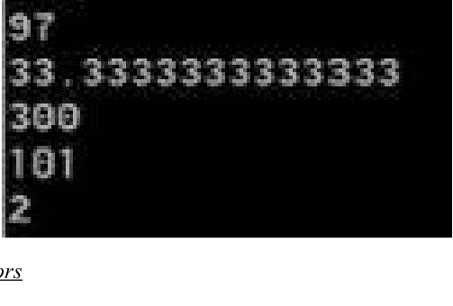

### 二元运算符

这些运算符作用于二进制数。在 IT 领域，所有信息都表示为零和一的序列。这意味着如果你想成为一名成功的程序员，你需要掌握二进制运算符。

二元运算符的工作原理与逻辑运算符完全相同。实际上，你可以认为二元和逻辑运算符使用不同的输入但执行相同的过程。

逻辑运算符使用布尔值来产生结果。另一方面，二元运算符作用于以二进制数字表示的数。以下是你在使用 C# 时会遇到的二元运算符：

+   - "&" – 这被称为“二进制与”。它指示两个操作数都为“1”的位置。

+   - "^" – 程序员将此运算符称为“二进制异或”。它将在值不同的每个位置放置“1”。

+   - "|" – 这是“二进制或”运算符。它指示任何操作数为“1”的位置。

+   - "~" – 这用作二进制值的取反运算符。就像“!”一样，它反转变量的当前值。

+   - "<<" – 这是“二进制左移”运算符。它将二进制数的位向左移动。此移动取决于你将分配的值（例如 4 << 1, 4 << 3, 4 << 2, 等）。

### *关系/比较运算符*

你可以使用的下一种运算符称为关系运算符。这些运算符非常有用，因为它们允许你比较两个操作数的值。每个运算符都以布尔值作为最终输出。由于此功能，这些运算符是创建条件语句的最佳选择。我们将看一些你可以用来编写 C# 代码的关系运算符，但对于这些示例，假设“e = 150”且“d = 100”。

+   - "==" – 这是等于运算符。它检查两个操作数是否相等（例如 *x == y*）。此运算符的功能是允许你检查两个值的相等性。如果两个值最终相等，操作数将告诉你它是 true。否则，操作数将告诉你它是 false。例如，说 d == e 将显示为 false。

将告诉你它是 true。例如，说 e > d 将为 true。

+   • "<" – 这实际上是小于运算符，它允许你检查左侧操作数是否小于右侧操作数。如果左侧操作数的值小于右侧操作数的值，它将给你“true”（例如 y < x）。

+   • ">=" – 使用此运算符，你可以确定左侧操作数的值是否大于或等于右侧操作数的值。此操作符的功能是，如果左侧操作数的值确实大于或等于右侧操作数的值，它将说为 true。否则，它将告诉你该语句为 false。例如，说 e >= d 计算结果为 true。

+   • "<=" – 如果左侧操作数的值小于或等于右侧操作数的值，此运算符将给你 true。

+   • "!=" – 此运算符的功能是允许你测试两个值/操作数的不等性。如果值最终不相等，它将告诉你这是 true。例如，e != d 将导致运算符说它是 true。

当你使用这些关系运算符时，请始终记住你每次都会得到一个布尔结果。这意味着你得到的答案要么是 true，要么是 false。你还需要在使用等于运算符时检查是否使用了两个等号。如果你最终将这些运算符与赋值运算符混淆，你可能会收到错误消息，并且程序将无法按你想要的方式运行。

### 条件运算符

C# 用户将“?”称为条件运算符。基本上，此运算符使用布尔表达式的结果来确定应处理哪个语句。这被称为“三元运算符”，因为它作用于三个操作数。这里，第一个值应该是布尔值，而其余值需要属于相同的数据类型（例如字符、字符串、数字等）。

此运算符的语法是：

```
first_operand ? second_operand : third_operand;
```

以下是它的工作方式：如果“first_operand”为 true，程序将处理“second_operand”。但是，如果“first_operand”为 false，程序将处理“third_operand”。

### 第 7 章：条件语句

C# 具有条件语句，主要用于控制执行流程。条件语句要求程序员指定一个条件或一组条件，以及在发现条件为 true 时执行的相应语句集。程序员还可以指定在条件不为 true 时要执行的语句集。

让我们讨论 C# 支持的各种条件语句。

### if 语句

此语句用于在执行一组语句之前计算布尔表达式。如果条件成立，则执行一组语句，否则执行另一组语句。此语句的语法如下：

```
if(boolean_expression) {
   /* statement(s) to execute if above boolean expression is true */
}
```

以下是一个示例：

```
using System;
namespace DecisionMaking {
   class IfStatement {
      static void Main(string[] args) {
         /* defining a local variable */
         int x = 5;
         /* check a boolean condition via if statement */
         if (x < 10) {
            /* to be printed of the condition is true */
            Console.WriteLine("x is less than 10");
         }
         Console.WriteLine("The value of x is : {0}", x);
         Console.ReadLine();
      }
   }
}
```

代码返回以下输出：

### x is less than 10

The value of x is : 5

条件被发现为 true，即变量 x 的值小于 10，因此，执行了条件正下方的语句。如果条件为 false 呢？

```
using System;
namespace DecisionMaking {
  class IfStatement {
    static void Main(string[] args) {
      /* defining a local variable */
      int x = 15;
      /* check a boolean condition via if statement */
      if (x < 10) {
        /* to be printed of the condition is true */
        Console.WriteLine("x is less than 10");
      }
      Console.WriteLine("The value of x is : {0}", x);
      Console.ReadLine();
    }
  }
}
```

代码返回以下内容：


### if-else 语句

这仅仅是一个 *if* 语句与 *else* 部分的组合。当条件为真时执行 *if* 部分，当条件为假时执行 *else* 部分。这两部分不能同时执行。该语句的语法如下：

```
if(boolean_expression)
{
    // code executes if the condition is true.
}
else
{
    // code executed if the condition is false
}
```

请看下面的示例：

```
using System;

namespace DecisionMaking {
    class IfElseStatement {
        static void Main(string[] args) {
            /* defining a local variable */
            int x = 5;

            /* a check of the boolean condition */
            if (x < 10) {
                /* if the condition is true, the following will be printed */
                Console.WriteLine("x is less than 10");
            } else {
                /* if the condition is false, the following will be printed */
                Console.WriteLine("x greater than 10");
            }
            Console.WriteLine("The value of x is : {0}", x);
            Console.ReadLine();
        }
    }
}
```

该代码返回以下结果：

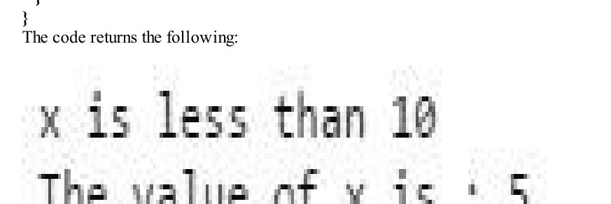

*if* 条件的计算结果为真，因此其块内的语句已被执行。如果条件为假会怎样呢？

```
using System;

namespace DecisionMaking {
    class IfElseStatement {
        static void Main(string[] args) {
            /* defining a local variable */
            int x = 15;
            /* a check of the boolean condition */
            if (x < 10) {
                /* if the condition is true, the following will be printed */
                Console.WriteLine("x is less than 10");
            } else {
                /* if the condition is false, the following will be printed */
                Console.WriteLine("x greater than 10");
            }
            Console.WriteLine("The value of x is : {0}", x);
            Console.ReadLine();
        }
    }
}
```

该代码给出以下输出：

> x greater than 10
> The value of x is : 15

if 条件的计算结果为假，因此 else 块内的语句已被执行。你一定已经注意到，在这两种情况下，两部分之外的代码都被执行了。这就是它的工作方式。

### else...if 语句

在某些情况下，我们可能需要检查多个条件。在这种情况下，我们可以使用 else if 语句。它采用以下语法：

```
if(boolean_expression a) {
  /* Runs if the boolean expression a is true */
}
else if( boolean_expression b) {
  /* Runs if the boolean expression b is true */
}
else if( boolean_expression c) {
  /* Runs if the boolean expression c is true */
} else {
 /* to run if none of above conditions is true */
}
```

下面是一个示例：

```
using System;

namespace DecisionMaking {
  class ElseIfStatement {
    static void Main(string[] args) {
      /* defining a local variable */
      int x = 5;

      /* checking the boolean condition */
      if (x == 1) {
        /* print this statement if the condition is true */
        Console.WriteLine("Value of x is 1");
      }
      else if (x == 2) {
        /* print this statement if the if else if condition is true*/
        Console.WriteLine("Value of x is 2");
      }
      else if (x == 3) {
        /* print this statement if the if else if condition is true */
        Console.WriteLine("Value of x is 3");
      } else {
        /* print this statement if none of the above conditions is true */
        Console.WriteLine("All conditions are false");
      }
      Console.WriteLine("Exact value of x is: {0}", x);
      Console.ReadLine();
    }
  }
}
```

该代码打印以下结果：

> All conditions are false
> Exact value of x is: 5

所有条件都被发现为假；因此条件之外的代码块已被执行。让我们将变量 x 的值设置为 2，看看代码会发生什么：

```
using System;

namespace DecisionMaking {
  class ElseIfStatement {
    static void Main(string[] args) {
      /* defining a local variable */
      int x = 2;
      /* checking the boolean condition */
      if (x == 1) {
        /* print this statement if the condition is true */
        Console.WriteLine("Value of x is 1");
      }
      else if (x == 2) {
        /* print this statement if the if else if condition is true*/
        Console.WriteLine("Value of x is 2");
      }
      else if (x == 3) {
        /* print this statement if the if else if condition is true */
        Console.WriteLine("Value of x is 3");
      } else {
        /* print this statement if none of the above conditions is true */
        Console.WriteLine("All conditions are false");
      }
      Console.WriteLine("Exact value of x is: {0}", x);
      Console.ReadLine();
    }
  }
}
```

输出如下所示：

> Value of x is 2
> Exact value of x is: 2

一个 *else if* 条件的计算结果为真，因此其块内的语句被执行。所有条件之外的代码块也被执行了。你可以通过将 x 的值修改为各种不同的值来尝试这段代码，看看会发生什么。

### 嵌套 if 语句

C# 允许我们嵌套条件语句。我们可以嵌套 *if* 和 *else if* 语句，这意味着我们在另一个 *if* 或 *else if* 语句内部使用它们。以下语法演示了如何在 C# 中嵌套 *if* 语句：

```
if( boolean_expression a) {
  /* to execute if the boolean expression a is true */
  if( boolean_expression b) {
   /* to execute if the boolean expression b is true */
  }
}
```

*else if* 语句可以使用上述语法进行嵌套。

请看下面的示例：

```
using System;

namespace DecisionMaking {
    class NestedIf {
        static void Main(string[] args) {
            ///* defining local variables */
            int x = 1;
            int y = 2;

            /* checking the boolean condition */
            if (x == 1) {
                /* if the condition is true, check the if condition below */
                if (y == 2) {
                    /* if the condition is true, print the following */
                    Console.WriteLine("Value of x is 1 and b is 2");
                }
            }
            Console.WriteLine("Exact value of x is : {0}", x);
            Console.WriteLine("Exact value of y is : {0}", y);
            Console.ReadLine();
        }
    }
}
```

该代码返回：

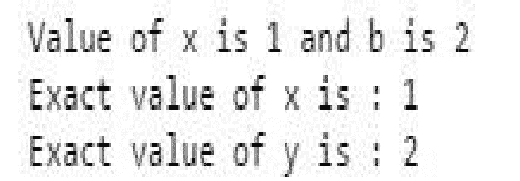

两个 *if* 条件的计算结果都为真，因此嵌套 *if* 内的语句被执行。如果任一或两个条件的计算结果为假，则该语句将不会被执行。下面是一个示例：

```
using System;

namespace DecisionMaking {
  class NestedIf {
    static void Main(string[] args) {
      //* defining local variables */
      int x = 1;
      int y = 2;
      /* checking the boolean condition */
      if (x == 1) {
        /* if the condition is true, check the if condition below */
        if (y == 3) {
          /* if the condition is true, print the following */
          Console.WriteLine("Value of x is 1 and b is 2");
        }
      }
      Console.WriteLine("Exact value of x is : {0}", x);
      Console.WriteLine("Exact value of y is : {0}", y);
      Console.ReadLine();
    }
  }
}
```

在上面的代码中，嵌套的 if 条件检查变量 y 的值是否为 3，这是假的。该块内的语句将不会被执行。C# 编译器将跳过这一部分，继续执行条件之外的代码。它返回以下结果：

> Exact value of x is : 1
> Exact value of y is : 2

### switch 语句

该语句等同于使用多个 *if* 语句。它由一个可能性列表、每个可能性对应的操作以及一个默认部分组成，当所有选项都不为真时执行默认部分。该语句的语法如下：

```
switch(expression)
{
    case <value_1>
        // code
        break;
    case <value_2>
        // code
        break;
    case <value_N>
        // code
        break;
    default
        // code
        break;
}
```

下面是一个示例：

```
using System;

public class SwitchStatement
{
    public static void Main()
```


### 第 8 章：循环

作为一名程序员，你会使用循环语句来重复运行某些代码块。循环在 C# 编程中扮演着重要的角色。因此，如果你想在短时间内掌握这门语言，就应该仔细学习这部分内容。

### 循环——基础知识

在编写程序时，你经常需要多次执行代码序列。多次输入相同的代码块可能会极其无聊。因此，你需要找到一种快速且简单的方法来重复代码。幸运的是，C# 语言支持循环语句。

循环是一种重复运行代码片段的工具。你可以用它来运行代码特定次数，或者在给定条件满足时持续运行。C# 提供了不同类型的循环语句。让我们详细分析每种类型：

### While 循环

这是 C# 中最简单的循环语句 dispenses 句。其语法如下：

```
while (the_assigned_condition)
{
    the_loop's_body;
}
```

在此语法中，"the_assigned_condition" 是一个产生布尔值的表达式。该条件决定了 "body" 将运行多少次。另一方面，"body" 是你想要执行的语句（或语句组）。

下面的图表将说明 while 循环的工作原理：

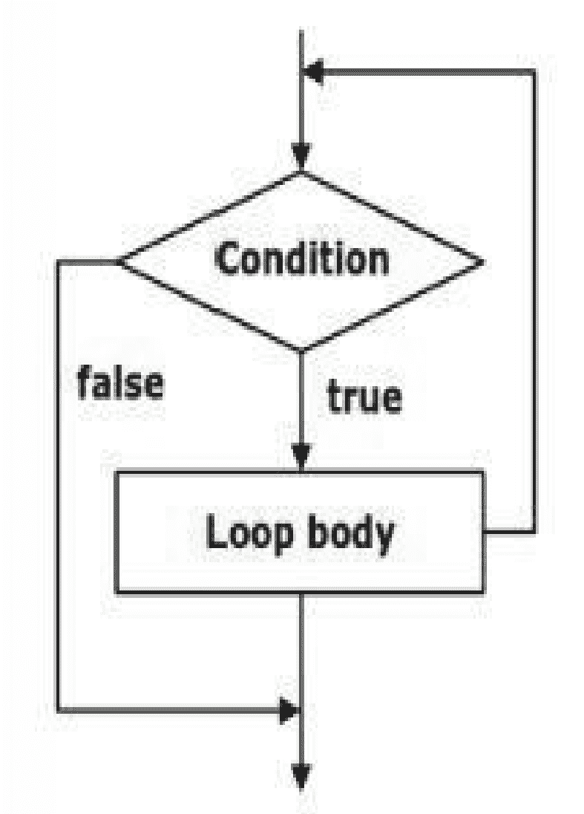

在处理 "while" 循环时，C# 程序会检查布尔表达式的值。如果值为 "true"，程序将运行循环体中的所有语句。然后，程序会检查布尔表达式以查看其值。如果值仍然为 true，程序将重新运行循环体并返回第一步（即检查表达式的值）。这个过程将持续进行，直到布尔表达式计算结果为 false。一旦发生这种情况，程序将处理循环之后的代码块。

**重要提示**：如果你的 C# 程序中布尔表达式为 false，程序将不会运行 while 循环的体。因此，如果在启动程序时布尔值为 false，你的循环内语句将永远不会被执行。

以下示例将说明 while 循环的工作原理：

```
int timer = 10;

while (timer >= 0)

{

System.Console.WriteLine("Time remaining: " + timer);

timer--;

}
```

如果你编译并执行此代码，你的命令提示符将打印以下数据：

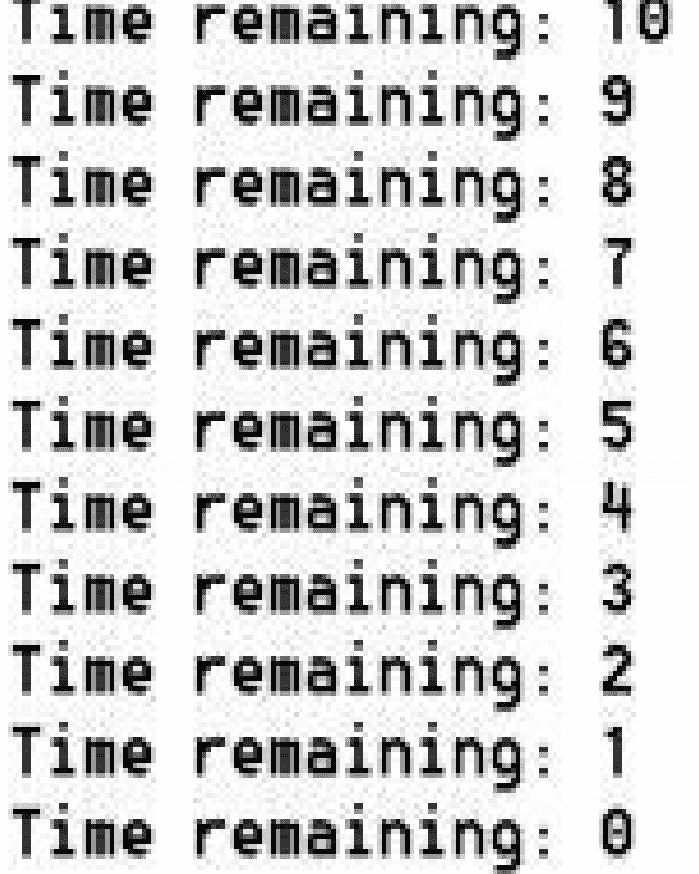

### Break 运算符

你可以使用 "break"（一个 C# 运算符）来提前退出循环。程序员使用此运算符如果他们不想等待循环的自然终止。基本上，循环一旦遇到 break Kv符就会结束。这种情况会强制程序跳转到循环之后的代码片段。

在 C# 中，你只能此运算符在循环体内部使用。这意味着 "break" 只有在循环运行时才会起作用。

### Do-While 循环

do-while 循环与 while 循环几乎相同。这两种循环之间的唯一区别是前者在运行循环体之后分析布尔值。因此，你可以放心，即使布尔表达式为 false，你的代码也会至少运行一次。以下是 do-while 循环的语法：

```
do
{
    statements;
} while (Boolean expression)
```

Do-while 循环按照以下模式工作：

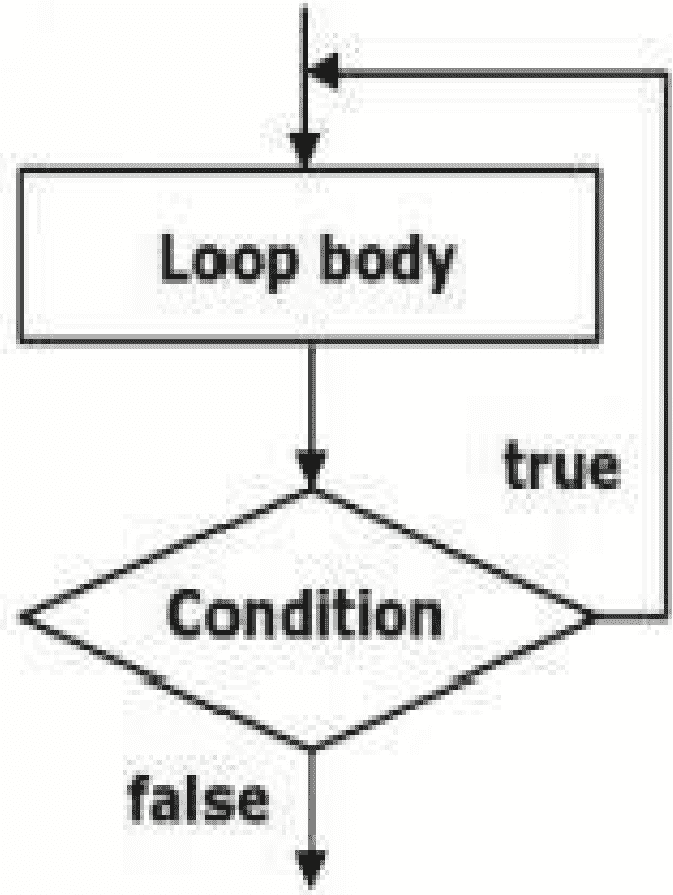

程序将执行循环体中的所有语句。然后，它将检查条件（即布尔表达式）。如果条件计算结果为 true，程序将再次执行循环体并执行 "值检查"。这个过程将持续进行，直到条件变为 false。因此，如果你的条件始终计算结果为 true，你的代码可能会永远运行。

### For 循环

一般来说，"for" 循环比 do-while 和 while 循环更复杂。然而，for 循环可以帮助你使用更少的 C# 代码来执行困难的任务。"for" 循环的语法是：

```
for (initializer; Boolean_expression; update)
{
    the_loop's_body;
}
```

"for" 循环有一个初始化器（即计数器的初始值）、一个布尔表达式、一个更新计数器的 C# 语句，以及循环体。

"计数器"（即分配给循环的初始值）是 "for" 循环最显著的特征。在大多数情况下，计数器的值会增加，直到达到最终值（例如 1 到 10）。此外，程序员通常知道 "for" 循环将迭代多少次。

你可以在 "for" 循环中包含一个或多个变量。这些变量可以按降序或升序移动。在编写程序时，你可以在单个 "for" 循环中结合升序和降序变量。此外，升序变量可以从 1 到 1024，因为 "for" 循环支持算术运算（例如加法、乘法等）。

**重要提示**："for" 循环的所有部分都是可选的。你可以通过在语法中留白来创建无限 "for" 循环。以下是一个示例：

```csharp
{
    int a = 3;
    switch (a)
    {
        case 1:
            Console.WriteLine("The value of x is 1");
            break;
        case 2:
            Console.WriteLine("The value of x is 2");
            break;
        case 3:
            Console.WriteLine("The value of x is 3");
            break;
        default:
            Console.WriteLine("Unknown value of x");
            break;
    }
}
```

代码返回以下结果：


变量的值被初始化为 3。执行代码后，将匹配 3 的 case 代码，因此其块内的语句将被执行。如果没有任何 case 条件为真，则将执行 default 部分。如下所示：

```csharp
using System;
public class SwitchStatement
{
    public static void Main()
    {
        int a = 5;

        switch (a)
        {
            case 1:
                Console.WriteLine("The value of x is 1");
                break;
            case 2:
                Console.WriteLine("The value of x is 2");
                break;
            case 3:
                Console.WriteLine("The value of x is鱼儿 3");
                break;
            default:
                Console.WriteLine("Unknown value of x");
                break;
        }
    }
}
```

此代码返回以下输出：


switch 语句中的 case 标签必须是唯一的。switch 语句可用于任何类型的表达式，包括字符串、整数、bool、char、enum 等。以下是如何将其与字符串一起使用：

```csharp
using System;
public class SwitchStatement
{
    public static void Main()
    {
        string firstName = "Nicholas";
        switch (firstName)
        {
            case "Samuel":
                Console.WriteLine("Your first name is Samuel");
                break;
            case "Nicholas":
                Console.WriteLine("Your first name is Nicholas");
                break;
            case "Bismack8:
                Console.WriteLine("Your first name is Bismack");
                break;
        }
    }
}
```

代码返回以下输出：

> Your first name is Nicholas

### Switch 中的 Goto

在某些情况下使用 switch 语句时，我们可能需要跳转到某个特定 case。这可以使用跳转或 goto 语句来完成。考虑以下示例：

```csharp
using System;
public class SwitchStatement
{
    public static void Main()
    {
        string firstName = "Nicholas";
        switch (firstName)
        {
            case "text":
                Console.WriteLine("is your first name");
                break;
            case "Samuel":
                Console.WriteLine("Samuel");
                break;
            case "Nicholas":
                Console.WriteLine("Nicholas");
                goto case "text";
                break;
            case "Bismack":
                Console.WriteLine("Bismack");
                break;
        }
    }
}
```

代码返回以下输出：


### 嵌套 Switch

switch 语句可以在另一个 switch 语句中创建。这给我们提供了嵌套 switch。以下是一个示例：

```csharp
using System;
public class NestedSwitch
{
    public static void Main()
    {
        int x = 10;
        switch (x)
        {
            case 10:
                Console.WriteLine(10);
                switch (x - 1)
                {
                    case 9:
                        Console.WriteLine(9);
                        switch (x - 2)
                        {
                            case 8:
                                Console.WriteLine(8);
                                break;
                        }
                        break;
                }
                break;
            case 20:
                Console.WriteLine(20);
                break;
            case 125:
                Console.WriteLine(25);
                break;
            default:
                Console.WriteLine(30 ASCII);
                break;
        }
    }
}
```

输出如下：

此时，你已准备好进一步了解 "for" 循环的不同组成部分。

### 初始化部分

"for" 循环可以包含一个初始化片段：

```
for (double sample = 1; ...; ...)
{
    // 你可以在这里使用 "sample" 变量。
}
// 你不能在这里使用该变量。
```

C# 程序在执行 "for" 循环之前，会先执行一次该片段。通常，程序员使用初始化片段来创建一个计数器（也称为"循环变量"）并为其赋初始值。该计数器在循环体内可用且可使用。C# 允许你使用单个初始化片段声明多个变量。

### 条件部分

显然，"for" 循环需要一个条件表达式。以下是一个示例：

```
for (double sample = 1; sample < 5; ...)
{
	// 这是循环体。
}
```

计算机程序在运行循环体之前会评估该条件表达式。如果结果为 "true"，则循环体将执行；否则，相关程序将跳转到当前循环之后编写的语句。

### 更新语句

这是 "for" 循环的最后一部分。基本上，更新语句用于更新循环的计数器。让我们使用上面给出的代码片段：

```
for (double sample = 10; sample > 1; sample--)
{
	// 这是循环体。
}
```

程序在执行完循环体后执行这一部分。请记住，该语句会更新计数器的值。

### 循环体

这部分由 C# 语句组成。它可以使用你在循环初始化片段中声明的变量。查看下面的示例：

```
for (double sample = 10; sample > 1; sample--)
{
    System.Console.WriteLine(sample);
}
```

### Continue 运算符

在某些情况下，你需要停止当前迭代而不终止循环本身。你可以使用 C# 中称为 "continue" 的运算符来完成此任务。下面给出的示例将说明该运算符的工作原理：

```
int n = int.Parse(Console.ReadLine());
int sum = 0;
for (int i = 1; i <= n; i += 2)
{
    if (i % 7 == 0)
    {
        continue;
    }
    sum += i;
}
Console.WriteLine("sum = " + sum);
```

此代码计算范围（1 到 n）内所有奇数的总和，这些奇数除以 7 时会产生余数。

### "Foreach" 循环

最近，C# 引入了 "foreach" 循环（即扩展的 "for" 循环）的概念。这种循环概念在其他编程语言中也有提供，如 C、VB、C++、PHP 等。借助这个编程工具，你可以遍历列表、数组或其他值组中的所有元素。"foreach" 循环可以取到所有现有元素，即使在非索引数据组中也是如此。

编写这种循环时，请使用以下语法：

```
foreach (type name_of_variable in name_of_group)
{
    the_statements;
}
```

如你所见，这种循环比典型的 "for" 循环简单得多。"foreach" 循环可以帮助你快速扫描集合内的所有对象。无数程序员在编写代码时使用这种循环，这毫不奇怪。

### 嵌套 For 循环

C# 允许你将一个 "for" 循环放在另一个 "for" 循环内部。代码中最内层的循环执行次数最多。另一方面，最外层的部分得到最少的重复次数。在"嵌套" for 循环时，你应该使用以下语法：

```
for (initializing_fragment, condition, update_statement)
{
    for (initializing_fragment, condition, update_statement)
    {
        statements
    }
}
```

在这里，程序运行初始的 "for" 循环，执行其主体，并触发嵌套循环。程序将检查第二个循环的条件并执行其中的代码，直到评估结果为 false。然后，程序将对循环的计数器进行必要的调整。程序将重复整个过程，直到所有条件的评估结果都为 false。

### 第 9 章：C# 方法

本章将重点介绍 C# 方法。在这里，你将学习如何在自己的程序中声明和使用方法。你需要牢记本章包含的课程，才能成为一名高效的 C# 程序员。

### 方法——基础知识

对于大多数程序员来说，方法是任何程序的核心方面。方法可以解决问题、接受用户输入（称为参数）并产生结果。

方法只是将一组语句组合在一起以执行共同任务。每个 C# 类至少有一个方法，即 Main 方法。为了能够使用一个方法，你必须先定义它，然后调用它来执行其预期的操作。方法通过表示程序执行的数据转换来完成其任务。此外，方法是实际流程完成的区域。这就是 C# 程序员将方法视为任何计算机程序基本单元的主要原因。

### 方法提供的好处

在本节中，你将发现 C# 方法提供的主要好处。阅读完本材料后，你将了解为什么应该在编写程序时使用这些工具。

### 更好的结构和代码可读性

编程专家认为，在编写计算机程序时应该使用方法。方法，即使是最简单的，也能改善 C# 代码的结构和可读性。

你需要知道的一个重要事实：程序员花费 **20%** 的时间来编写和检查他们的计算机程序。剩余的 **80%** 用于维护和改进软件。显然，如果你的代码可读且结构良好，你将能够轻松地处理你的程序。

### 防止冗余代码

方法可以帮助你避免程序中的冗余代码。冗余或重复的代码通常在计算机应用程序中产生不良结果。

### 更好的代码复用

如果你的程序需要多次使用某个代码片段，那么将该片段转移到 C# 方法中是一个极好的主意。你可以多次调用方法，这意味着你可以重复重要的代码而无需重新输入它们。

### 声明、实现和调用 C# 方法

*方法定义* - 方法定义仅仅是声明构成方法结构的元素。以下是 C# 中方法定义的语法：

```
<Access_Specifier><The_Return_Type><Your_Method_Name>
(Parameter_List) {
    Method Body
}
```

此时，你需要了解可以对现有方法执行的操作。这些操作包括：

- *声明* – 在此过程中，你将方法链接到程序。此过程允许你在程序的任何部分调用该方法。
- *实现* – 此过程涉及输入代码以完成特定任务。此处涉及的代码存在于你使用的方法内部。
- *调用* – 这是调用已声明方法的过程。在这里，你将使用方法来解决问题或执行操作。

### 方法声明

在 C# 中，你需要在类内部声明方法。此外，你不允许"嵌套"方法（即在另一个方法的主体内部编写方法）。对此的完美示例是 Main()，你已多次使用的方法。下面给出的代码将说明这一点：

```
class DeclaringMethods
{
    static void Main()
    {
        System.Console.WriteLine("Hi C#!");
    }
}
```

## 语法

声明方法时使用以下语法：

`static data_type_of_the_result name_of_method (list_of_parameters)`

让我们使用 Main() 方法（即 `static void Main()`）来分析此语法。Main() 使用 "void" 作为其返回类型，因为它不产生任何结果。"Main" 一词作为其名称。另一方面，括号充当程序员将提供的参数的容器。

重要提示：在 writing a C# program 时，你必须遵循此语法。不要更改方法各部分的放置位置。

C# 不要求你在声明中包含参数。这意味着你可以将括号留空（例如 Main()）。

### 方法的名称

你需要在声明、调用或实现时指明方法的名称。以下是在命名方法时需要记住的规则：

- 确保首字母大写。
- 每个单词的首字母大写（例如 SampleMethod、NewMethod、MainLine 等）。


-   使用动词和名词作为方法的名称。

重要提示：上述讨论的规则完全是可选的。如果你想让你的 C# 代码拥有出色的结构和可读性，请遵循这些规则。

### 方法实现

仅仅声明一个方法是不够的。如果你想让它们在你的程序中运行，你还需要实现这些方法。程序员在指代方法的实现时使用“主体”这个术语。

### 主体

你会在一对花括号内找到方法的主体。这个主体由你想要执行的命令、表达式和语句组成。因此，主体是任何方法的重要组成部分。

重要提示：请记住，在 C# 中你不能嵌套方法。不要在其他方法内部编写方法。

### 方法调用

基本上，这是运行方法主体内语句的过程。调用方法既简单又容易：你只需指明其名称，添加一对花括号，并使用分号终止该行。以下是你应该使用的语法：

name_of_method();

下面的示例代码将向你展示如何调用一个方法：

```
class Animals
{
    static void Main()
    {
        Console.WriteLine("I love dogs.");
    }
}
```

如果你编译并执行该代码，你的命令提示符将打印以下消息：

*I love dogs.*

### 可以调用方法的区域

C# 允许你在以下区域调用方法：

-   在程序的主方法（即 `Main()`）内部。
-   在另一个方法内部。
-   在方法自身的主体内部。这种技术称为“递归”。

### 递归方法调用

一个方法可以调用自身。这个过程被称为*递归*。请看下面的阶乘示例：

```
using System;
namespace MethodApplication {
  class NumberChecker {
    public int factorial(int x) {
      /* declaring a local variable */
      int answer;
      if (x == 1) {
        return 1;
      } else {
        answer = factorial(x - 1) * x;
        return answer;
      }
    }
    static void Main(string[] args) {
      NumberChecker n = new NumberChecker();
      //let's now call the factorial method
      Console.WriteLine("The factorial of 8 is : {0}", n.factorial(8));
```

```
Console.WriteLine("The factorial of 9 is : {0}", n.factorial(9));
Console.ReadLine();
}
}
}
```

我们创建了阶乘函数和名为 *n* 的类实例。该代码将返回以下结果：

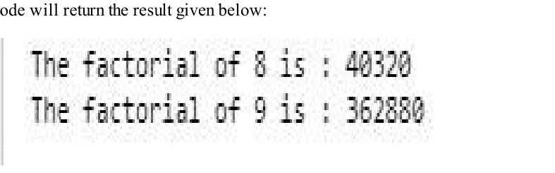

该代码能够给出 8 和 9 的阶乘。请注意，一个数字的阶乘是其下方所有数字的乘积（0 除外）。例如，8 的阶乘是 1 * 2 * 3 * 4 * 5 * 6 * 7 * 8，得出 40320，如上所示。

### 向方法传递参数[^1]

如果一个方法是用参数定义的，那么在调用时应该向其传递参数。有三种方法可用于向方法传递参数。让我们来讨论这些方法。

### 按值传递

这种方法涉及将参数的实际值复制到形式函数参数中。这是向方法传递参数的默认机制。使用此机制时，调用函数时会为每个值参数在内存中创建一个新的位置。然后将实际参数的值复制到其中。这意味着在方法内部对参数所做的更改将不会对参数产生影响。

让我们通过一个例子来演示这一点：

```
using System;
namespace MethodApplication {
    class NumberChecker {
```

```
public void swap(int a, int b) {
  int temp;
  temp = a; /* saving the value of a */
  a = b;    /* putting b into a */
  b = temp; /* putting temp into b */
}
static void Main(string[] args) {
  NumberChecker n = new NumberChecker();

  /* defining a local variable */
  int x = 10;
  int y = 20;

  Console.WriteLine("Before swapping, value of x is : {0}", x);
  Console.WriteLine("Before swapping, value of y is : {0}", y);

  /* let's swap the values by calling the function */
  n.swap(x, y);

  Console.WriteLine("After swapping, value of x is : {0}", x);
  Console.WriteLine("After swapping, value of y is : {0}", y);

  Console.ReadLine();
}
  }
}
```

该代码产生以下输出：

```
Before swapping, value of x is : 10
```

```
Before swapping, value of y is : 20
```

```
After swapping, value of x is : 10
```

```
After swapping, value of y is : 20
```

我们所做的就是在函数内部更改了值。但是，上述输出表明此更改没有生效；因此，它没有在上述结果中体现出来。

这就是我们在 C# 中按值传递参数的方式。

### 按引用传递

引用参数引用变量的内存位置。当参数按引用传递时，不会像按值传递那样创建新的内存位置。引用参数实际上引用与传递给方法的实际参数相同的内存位置。

要声明引用参数，我们使用 `ref` 关键字。让我们通过一个例子来演示这一点：

```
using System;
namespace MethodApplication {
    class NumberChecker {
        public void swap(ref int a, ref int b) {
            int temp;

            temp = a; /* saving the value of a */
            a = b;    /* putting b into a */
            b = temp; /* putting temp into b */
        }
```

```
static void Main(string[] args) {
    NumberChecker n = new NumberChecker();

    /* defining a local variable */
    int x = 10;
    int y = 20;

    Console.WriteLine("Before swapping, value of x is : {0}", x);
    Console.WriteLine("Before swapping, value of y is : {0}", y);

    /* let's swap the values by calling the function */
    n.swap(ref x, ref y);

    Console.WriteLine("After swapping, value of x is : {0}", x);
    Console.WriteLine("After swapping, value of y is : {0}", y);

    Console.ReadLine();
}
}
}
```

该代码返回以下内容：

```
Before swapping, value of x is : 10
Before swapping, value of y is : 20
After swapping, value of x is : 20
After swapping, value of y is : 10
```

在按值传递中，值没有被交换。然而，在这种情况下，值已被交换，如上所示。上述更改反映在 *Main* 函数中。

### 按输出传递 [122]

`return` 语句可以帮助我们仅从函数返回一个值。但是，通过使用*输出参数*，可以从函数返回两个值。输出参数与引用参数相同，区别在于它们将数据从方法中传出，而不是传入。

以下是一个演示此内容的示例：

```
using System;
namespace MethodApplication {
  class NumberChecker {
    public void getValue(out int a ) {
      int temp = 20;
      a = temp;
    }
    static void Main(string[] args) {
      NumberChecker n = new NumberChecker();

      /* defining a local variable */
      int x = 10;

      Console.WriteLine("Before calling the method, value of x : {0}", x);
      /* call the function to get value */
      n.getValue(out x);

      Console.WriteLine("After calling the method, the value of x is : {0}", x);
      Console.ReadLine();
    }
  }
}
```

它返回以下内容：

```
Before calling the method, value of x : 10
After calling the method, the value of x is : 20
```

为输出参数提供的变量应分配一个值。当一个人希望在不为参数分配初始值的情况下通过参数从方法返回值时，输出参数非常有用。以下示例将帮助你更好地理解这一点：

```
using System;
namespace MethodApplication {
  class NumberChecker {
    public void getValues(out int a, out int b ) {
        Console.WriteLine("Enter in your first value: ");
        a = Convert.ToInt32(Console.ReadLine());

        Console.WriteLine("Enter in your second value: ");
        b = Convert.ToInt32(Console.ReadLine());
    }
    static void Main(string[] args) {
        NumberChecker n = new NumberChecker();

        /* defining a local variable */
        int x , y;

        /* call a function to obtain the values */
        n.getValues(out x, out y);

        Console.WriteLine("After calling the method, the value of x is : {0}", x);
        Console.WriteLine("After calling the method, the value of y is : {0}", y);
        Console.ReadLine();
    }
  }
}
```


### 第十章：数组世界

我们可以将数组定义为一种特殊的数据类型，它以**顺序**方式使用特定语法存储固定数量的值。所有数组元素必须属于相同的数据类型，如字符串、整数、双精度浮点数等。你可以将数组视为存储在连续内存位置中的**相同类型**变量的集合。你使用索引来访问数组中的给定元素。

在内存中，最低地址标识数组的第一个元素，而最高地址标识数组的最后一个元素。

### 声明数组

在C#中，数组的声明使用以下语法：

```
datatype[] arrayName;
```

*数据类型*帮助我们指定存储在数组中的元素的数据类型，别忘了所有数组元素必须属于相同的数据类型。方括号 [] 用于声明数组的**秩**，其中秩表示数组的大小或要存储的元素数量。*数组名称*表示数组的名称。以下是有效的数组声明示例：

```
int[] intArray; // 可能用于存储整数值
```

```
bool[] boolArray; // 可能用于存储布尔值
```

```
string[] stringArray; // 可能用于存储字符串值
```

```
double[] doubleArray; // 可能用于存储双精度浮点数值
```

```
byte[] byteArray; // 可能用于存储字节值
```

```
Employee[] customDepartmentArray; // 可能用于存储Employee类的实例
```

### 数组初始化

声明数组并不意味着它已经在内存中初始化。初始化数组后，才能向其赋值。

数组初始化可以在声明时使用`new`关键字完成。当使用此关键字时，会创建一个数组实例。下面进行了演示：

```
public class MyArray
public static void Main()
{
int[] intArray_1 = new int[4];

int[] intArray_2 = new int[4]{10, 20, 30, 40};

int[] intArray_3 = {10, 20, 30, 40};
}
}
```

首先，我们声明了一个数组来存储4个整数。注意，数组大小的指定是在方括号内完成的。在我们的第二条语句中，我们做了同样的事情，但也在花括号 {} 内为索引赋了值。在第三条语句中，我们声明了一个数组并为其赋值，但没有指定其大小。

### 延迟初始化

我们可以在数组声明之后对其进行初始化。这意味着我们不必同时进行数组的声明和初始化。这是一个例子：

```
using System;
public class MyArray
{
public static void Main()
{
string[] array1, array2;

array1 = new string[4]{ "Nicholas",
  "Michelle",
  "John",
  "Claire",
  };
array2 = new string[]{"Nicholas",
    "Michelle",
    "John",
    "Claire",
};
Console.WriteLine(array1.Length);
Console.WriteLine(array2.Length);
}
}
```

上述机制被称为*延迟初始化*。在这种情况下，初始化必须使用`new`关键字完成。我们不能通过简单赋值来初始化数组。以下示例展示了数组的无效初始化：

```
string[] myarray;

myarray = {"Nicholas", "Michelle", "John", "Claire"};
```

### 访问数组元素

数组元素是在初始化时赋值的。然而，我们也可以使用单独的索引为数组赋值。下面进行了演示：

```
using System;
public class MyProgram
{
    public static void Main()
    {
        int[] array1 = new int[5];
        array1[0] = 1;
        array1[1] = 2;
        array1[2] = 3;
        array1[3] = 4;
        array1[4] = 5;
        Console.WriteLine(array1[0]);
        Console.WriteLine(array1[1]);
        Console.WriteLine(array1[2]);
        Console.WriteLine(array1[3]);
        Console.WriteLine(array1[4]);
    }
}
```

代码将返回以下结果：


检索或访问数组值也使用索引完成。元素的索引在方括号内传递。考虑下面的例子：

```
array1[0];
array1[1];
array1[2];
array1[3];
array1[4];
```

这就是我们访问名为*array1*的上述数组所有元素的方式。

### 使用for循环

我们可以使用`for`循环来访问数组元素。该循环将遍历数组元素，同时通过它们的索引访问所需的元素。例如：

```
using System;
namespace ArrayApp {
  class MyArray {
    static void Main(string[] args) {
      int [] n = new int[10]; /* n是一个包含10个整数的数组 */
      int x, y;
      /* 初始化数组n的元素 */
      for ( x = 0; x < 10; x++ ) {
        n[ x ] = x + 50;
      }
      /* 输出每个数组元素的值 */
      for (y = 0; y < 10; y++) {
        Console.WriteLine("索引[{0}]处的元素 = {1}", y, n[y]);
      }
      Console.ReadKey();
    }
  }
}
```

变量*x*的`for`循环帮助我们向数组中填充了10个值，第一个元素是50，最后一个元素是59。变量*y*的`for`循环帮助我们从索引0到最后一个索引访问数组的所有元素。程序的输出如下：

```
索引[0]处的元素 = 50
索引[1]处的元素 = 51
索引[2]处的元素 = 52
索引[3]处的元素 = 53
索引[4]处的元素 = 54
索引[5]处的元素 = 55
索引[6]处的元素 = 56
索引[7]处的元素 = 57
索引[8]处的元素 = 58
索引[9]处的元素 = 59
```

### 使用foreach循环

你已经知道如何使用`for`循环访问数组的所有元素。`foreach`循环也可以帮助你遍历数组元素。以下示例演示了如何使用`foreach`循环遍历数组元素：

```
using System;
namespace ArrayApp {
    class MyArray {
        static void Main(string[] args) {
            int [] n = new int[10]; /* n是一个包含10个整数的数组 */
            //int x, y;
            /* 初始化数组n的元素 */
            for (int x = 0; x < 10; x++ ) {
              n[ x ] = x + 100;
            }
            /* 输出所有数组元素的值 */
            foreach (int y in n ) {
              int x = y-100;
              Console.WriteLine("元素[{0}] = {1}", x, y);
            }
            Console.ReadKey();
        }
    }
}
```

代码给出以下结果：

`for`循环帮助我们向数组中填充了10个值，第一个元素是100，最后一个元素是109。`foreach`循环帮助我们从索引0到最后一个索引访问数组的所有元素。请注意，变量*x*用于填充数组值，而变量*y*用于遍历数组元素。代码返回以下输出：

```
元素[0] = 100
元素[1] = 101
元素[2] = 102
元素[3] = 103
元素[4] = 104
元素[5] = 105
元素[6] = 106
元素[7] = 107
元素[8] = 108
元素[9] = 109
```

### 多维数组

C#支持多维数组的概念。这类数组也被称为矩形数组。多维数组是以行和列形式组织的二维系列。以下是多维数组的一个示例：

```
int[,] array1 = new int[3,2]{
    {1, 5},
    {2, 5},
    {5, 7}
};
```

如上例所示，要初始化多维数组，必须根据行数和列数来定义它。[3,2]表示该数组将有3行2列。

要访问多维数组的元素，我们使用两个索引。第一个索引标识行，第二个索引标识列。注意，两个索引都从0开始。让我们用一个例子来演示：

```
using System;
public class MyArray
{
    public static void Main()
    {
        int[,] array1 = new int[3,2]{
            {1, 5},
            {2, 5},
            {5, 7}
        };

        Console.WriteLine(array1[0, 0]);
        Console.WriteLine(array1[0, 1]);
        Console.WriteLine(array1[1, 0]);
        Console.WriteLine(array1[1, 1]);
        Console.WriteLine(array1[2, 0]);
        Console.WriteLine(array1[2, 1]);
    }
}
```

代码给我们以下输出：


这就是访问元素的方式。*array1[2,1]* Milk返回数组中位于第2行第1列的元素。

### 交错数组

交错数组本质上就是数组的数组。这些数组存储的是数组，而不是直接存储数据类型的值。要初始化交错数组，我们使用两个方括号 `[][]`。在第一个括号中，我们指定数组的大小；而在第二个括号中，我们指定要作为值存储的数组的维度。下面是一个展示交错数组声明和初始化的示例：

```
using System;
public class MyArray
{
    public static void Main()
    {
        int[][] jaggedArray = new int[2][];
        
        jaggedArray[0] = new int[4]{1, 2, 3, 4};
        jaggedArray[1] = new int[3]{5, 6, 7};


        Console.WriteLine(jaggedArray[0][0]);


        Console.WriteLine(jaggedArray[0][2]);


        Console.WriteLine(jaggedArray[1][1]);
```

我们在上面的代码中声明并初始化了交错数组。该代码将产生以下结果：

交错数组也可以将多维数组作为值存储。我们可以在第二个括号中使用 `[,]` 来表示多维。示例如下：

```
using System;
public class MyArray
{
    public static void Main()
    {
        int[][,] jaggedArray = new int[3][,];

        jaggedArray[0] = new int[3, 2] { { 1, 5 }, { 2, 6 }, { 4, 8 } };
        jaggedArray[1] = new int[2, 2] { { 3, 5 }, { 4, 6 } };
        jaggedArray[2] = new int[2, 2];

        Console.WriteLine(jaggedArray[0][1,1]);
        Console.WriteLine(jaggedArray[1][1,0]);

        Console.WriteLine(jaggedArray[1][1,1]);
    }
}
```

该代码将返回以下内容：

如果再添加一个括号，那么这就变成了数组的数组的数组。以下示例对此进行了说明：

```
using System;
public class MyArray
{
    public static void Main()
    {
        int[][][] jaggedArray = new int[2][][]
        {
            new int[2][]
            {
                new int[3] { 2, 3, 5 },
                new int[2] { 1, 5 }
            },
            new int[1][]
            {
                new int[3] { 7, 6, 8 }
            }
        };

        Console.WriteLine(jaggedArray[0][0][0]);

        Console.WriteLine(jaggedArray[0][1][1]);

        Console.WriteLine(jaggedArray[1][0][2]);
    }
}
```

该代码返回以下结果：

请注意，我们使用了三个方括号 `[][][]`，这意味着数组的数组的数组。*jaggedArray* 将有2个元素，而这2个元素都是数组。这些数组中的每一个也都将包含一个单维数组。

### 第11章：类

类可以看作是对象的蓝图。现实世界中的对象具有形状、颜色和功能等特征。例如，X6 是汽车类型的一个对象。汽车具有颜色、速度、内饰、形状等特征。这意味着任何创建了具有上述特征的对象的公司，其产品类型都将是汽车。也就是说，Car 是一个类，而每个对象，即每一辆实体汽车，都将是 Car 类型的对象。

在面向对象编程中（别忘了 C# 是一种面向对象编程语言），类具有字段、属性、方法、事件等。类应当定义对象应拥有的数据类型和功能。

通过类，你可以将其他类型的变量以及方法和事件组合在一起，创建你自己的自定义类型。

在 C# 中，我们使用 *class* 关键字来定义类。下面是一个简单的例子：

```
public class TestClass
{
    public string field1 = string.Empty;

    public TestClass()
    {
    }
    public void TestMethod(int param1, string param2)
    {
        Console.WriteLine("The first parameter is {0}, and second parameter is {1}",
                          param1, param2);
    }
    public int AutoImplementedPropertyTest { get; set; }
    private int propertyVar;
    public int PropertyTest
    {
        get { return propertyVar; }
        set { propertyVar = value; }
    }
}
```

关键字 *public* 位于 class 之前，它是一个访问修饰符，用于指定该类将如何被访问。由于是 public（公共的），这意味着同一项目中的所有其他类都可以访问它。我们给这个类起名为 *TestClass*。

我们还在类中定义了一个名为 *field1* 的字段。在此之下，我们为该类创建了一个构造函数。请注意，构造函数的名称与类本身的名称相同，因此构造函数的名称是 *TestClass()*。在这个类中，我们还定义了一个名为 *TestMethod()* 的方法，该方法接受两个参数，*param1* 和 *param2*，前者是整数，后者是字符串。

下面是另一个演示如何声明和使用类的示例：

```
using System;
namespace CubeApplication {
  class Cube {
    public double length;  // Length of the cube
    public double breadth; // Breadth of the cube
    public double height;  // Height of the cube
  }
  class Cubetester {
    static void Main(string[] args) {
      Cube Cube1 = new Cube();  // Declare Cube1 of type Cube
      Cube Cube2 = new Cube();  // Declare Cube2 of type Cube
      double volume = 0.0;  // Store the cube volume here
      // cube 1 specification
      Cube1.height = 4.0;
      Cube1.length = 5.0;
      Cube1.breadth = 8.0;
      // cube 2 specification
      Cube2.height = 8.0;
      Cube2.length = 12.0;
      Cube2.breadth = 14.0;
      // volume of cube 1
      volume = Cube1.height * Cube1.length * Cube1.breadth;
      Console.WriteLine("Volume of Cube1 : {0}", volume);
      // volume of cube 2
      volume = Cube2.height * Cube2.length * Cube2.breadth;
      Console.WriteLine("Volume of Cube2 : {0}", volume);
      Console.ReadKey();
    }
  }
}
```

该代码将返回以下结果：

### 封装和成员函数

类的成员函数本质上就是在类定义内部具有定义或原型的函数，与其他任何函数一样。这样的函数可以对其所属类中的任何对象进行操作，并且可以访问该对象的所有类成员。

成员函数本质上是对象的属性（从设计的角度来看），它们被定义为 private（私有的），以实现封装的概念。我们只能使用公共成员函数来访问这类变量。让我们演示一下如何在 C# 中设置和访问类的各种成员：

```
using System;
namespace CubeApplication {
    class Cube {
        private double length;  // Length of a cube
        private double breadth; // Breadth of a cube
        private double height;  // Height of a cube
        public void setLength( double len ) {
            length = len;
        }
        public void setBreadth( double brea ) {
详情
            breadth = brea;
        }
        public void setHeight( double heig ) {
            height = heig;
        }
        public double getVolume() {
            return length * breadth * height;
        }
    }
    class Cubetester {
        static void Main(string[] args) {
            Cube Cube1 = new Cube();  // Declare Cube1 of type Cube
            Cube Cube2 = new Cube();
            double volume;

            // Declare Cube2 of type Cube
            // cube 1 specification
            Cube1.setLength(Blength.0);
            Cube1.setBreadth(6.0);
            Cube1.setHeight(8.0);

            // cube 2 specification
            Cube2.setLength(10.0);
            Cube2.setBreadth(14.0);
            Cube2.setHeight(12.0);
            // volume of cube 1
            volume = Cube1.getVolume();
            Console.WriteLine("Volume of Cube1 is: {0}" ,volume);
            // volume of cube 2
            volume = Cube2.getVolume();
            Console.WriteLine("Volume of Cube2 is: {0}", volume);
            Console.ReadKey();
        }
    }
}
```

以下是代码的输出：

我们使用 *setter* 方法来设置我们有相关电饭煲的两个立方体的各种属性值。调用 *getVolume()* 函数来计算两个立方体的体积。

### 构造函数

构造函数本质上是一个特殊的类成员函数，每当我们创建该类的新对象时，它就会运行。构造函数采用类名作为名称，并且不应该有返回类型。以下示例演示了如何在 C# 中使用构造函数：

```
using System;
namespace ConstructorApplication {
    class Person {
        private double height; // height of the person

        public Person() {
```


### 析构函数

析构函数是指在类对象离开作用域时运行的特殊成员函数。析构函数的名称与类名相同，但应在前面加上波浪号（~）。析构函数不能接受参数，也不能返回值。

析构函数是在退出程序前释放内存资源的有用工具。你可以重载或继承析构函数。以下示例演示了如何使用析构函数：

```csharp
using System;
namespace ConstructorApplication {
  class Person {
    private double height;  // Height of a person

    public Person() {  // A constructor
      Console.WriteLine("We are creating an object");
    }
    ~Person() {  //A destructor
      Console.WriteLine("We are deleting an object");
    }
    public void setHeight( double heig ) {
      height = heig;
    }
    public double getHeight() {
      return height;
    }
    static void Main(string[] args) {
      Person p = new Person();
      // set the height of the person
      p.setHeight(7.0);
      Console.WriteLine("The height of the person is : {0}", p.getHeight());
    }
  }
}
```

以下是该函数的输出：

We are creating an object
The height of the person is : 7
We are deleting an object

### 静态成员

要将类成员定义为静态，我们使用 *static* 关键字。当类成员被声明为静态时，这意味着无论创建了多少个该类的实例，静态成员都只有一个副本。

使用 *static* 关键字意味着类中只有一个成员实例存在。当我们需要声明常量时会使用此关键字，因为可以通过调用类来获取它们的值，而无需创建类的实例。我们可以在类定义或成员函数外部初始化静态变量。静态变量也可以在类定义内部初始化。

让我们用一个例子来演示静态变量的使用：

```csharp
using System;
namespace StaticApp {
   class StaticVariables {
      public static int x;

      public void count() {
         x++;
      }
      public int getX() {
         return x;
      }
   }
   class StaticTester {
      static void Main(string[] args) {
         StaticVariables var1 = new StaticVariables();
         StaticVariables var2 = new StaticVariables();
         var1.count();
         var1.count();
         var1.count();
         var2.count();
         var2.count();
         var2.count();
         Console.WriteLine("Variable x for var1 is: {0}", var1.getX());
         Console.WriteLine("Variable x for var2 is: {0}", var2.getX());
         Console.ReadKey();
      }
   }
}
```

该代码返回以下结果：

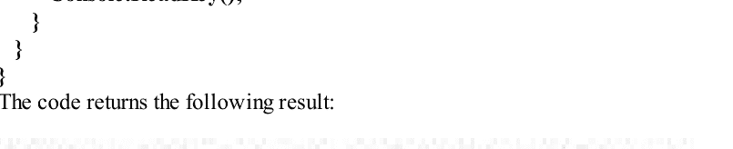

成员函数也可以声明为静态。这样的函数将只能访问静态变量。静态函数甚至在对象创建之前就存在。静态函数可以像以下示例中演示的那样使用：

```csharp
using System;
namespace StaticAppli {
  class StaticVariable {
    public static int x;
    public void count() {
      x++;
    }
    public static int getX() {
      return x;
    }
  }
  class StaticTester {
    static void Main(string[] args) {
      StaticVariable var = new StaticVariable();
      var.count();
      var.count();
      var.count();
      Console.WriteLine("Variable x is: {0}", StaticVariable.getX());
      Console.ReadKey();
    }
  }
}
```

该代码将返回以下内容：

Variable x is: 3

### 第12章：结构

C#中的结构是一种值类型数据类型。通过结构，你可以使用单个变量来保存属于不同数据类型的相关数据。在C#中，我们使用 *struct* 关键字来创建结构。

结构用于跟踪记录。一个很好的例子是，当你需要保存所有班级学生或所有公司员工的记录时。对于存储学生记录的情况，你可能需要跟踪的一些细节包括姓名、年龄、课程、入学日期、完成日期、已付费用金额、费用余额、监护人地址和手机号码等。所有这些细节都属于不同的数据类型，这意味着你需要为它们每一个都创建一个变量。然而，通过使用结构，你可以定义一个单独的变量，将这些细节作为一个整体保存。

以下是声明结构的示例：

```csharp
struct Employee{
  public string name;
  public string department;
  public string title;
  public int age;
  public double salary;
};
```

要初始化结构体，我们可以选择使用 *new* 关键字，也可以不使用。结构体的成员可以按如下所示赋值：

```csharp
using System;

public class MyStruct
{
  public static void Main()
  {
    Employee emp = new Employee();
    emp.name = "Nicholas Samuel";
    emp.department = "Computing";
    emp.age = 26;
    emp.salary = 5000;
    Console.WriteLine(emp.name);
    Console.WriteLine(emp.department);
    Console.WriteLine(emp.age);
    Console.WriteLine(emp.salary);
  }
}

public struct Employee
{
    public string name { get; set; }
    public string department { get; set; }
    public string title { get; set; }
    public int age { get; set; }
    public double salary { get; set; }
}
```

该代码给出以下结果：

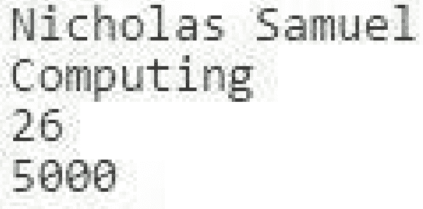

名为 *Employee* 的结构体是使用 *struct* 关键字定义的。该结构体的各种细节已在其中声明。在类的顶部，我们创建了该结构体的一个实例，并将其命名为 *emp*。这个实例被用来访问结构体的各种属性，以便在屏幕上显示。

请注意，结构体是值类型，与类对象相比，这使得它更快。这使得它们非常适合用于游戏编程。然而，传递类对象比传递结构体更容易。这意味着，当需要将数据传输到其他类时，不应使用结构体。

以下是C#中结构体的另一个示例：

```csharp
using System;
struct Cars {
   public string model;
   public int cc;
   public int passengers;
   public int year;
};
public class carStructure {
   public static void Main(string[] args) {
      Cars Premio;  /* Declare Premio of type Cars */
      Cars X6;  /* Declare X6 of type Cars */
      /* Premio specification */
      Premio.model = "Saloon";
      Premio.cc = 1800;
      Premio.passengers = 5;
      Premio.year = 2010;
      /* X6 specification */
      X6.model = "Saloon";
      X6.cc = 3500;
      X6.passengers = 5;
      X6.year = 2012;
      /* print Premio info */
      Console.WriteLine( "Premio model: {0}", Premio.model);
      Console.WriteLine("Premio CC : {0}", Premio.cc);
      Console.WriteLine("Premio passengers : {0}", Premio.passengers);
      Console.WriteLine("Premio year :{0}", Premio.year);
      /* print X6 info */
      Console.WriteLine( "X6 model: {0}", X6.model);
      Console.WriteLine("X6 CC : {0}", X6.cc);
      Console.WriteLine("X6 passengers : {0}", X6.passengers);
   }
}
```


```csharp
Console.WriteLine("X6 年份 :{0}", X6.year);
Console.ReadKey();
}
```

代码将返回以下详细信息：

```
Premio 型号：轿车
Premio 排量：1800
Premio 乘客数：5
Premio 年份：2010
X6 型号：轿车
X6 排量：3500
X6 乘客数：5
X6 年份：2012
```

我们创建了一个名为 *Cars* 的结构体。在这个结构体中，我们存储了两个成员：Premio 和 X6。这两个实例是该结构体的实例。它们的属性已定义在结构体内部。这两个实例共享属性，但这些属性将取不同的值。我们随后打印了这些属性的值，如上文输出所示。

### 结构体的特性

到目前为止，你已经了解了如何使用结构体及其一些特性。C# 中的结构体与 C 和 C++ 支持的结构体有很大不同。C# 结构体具有以下特性：

- 结构体可以有字段、索引器、方法、属性、运算符和事件。
- 结构体可以有定义的构造函数，但没有析构函数。但是，在结构体中，我们不允许定义默认构造函数。原因是它是自动定义的，无法更改。
- 结构体不能继承另一个结构体或类。
- 使用结构体，我们可以实现一个或多个接口。
- 结构体的成员不能被指定为 virtual、abstract 或 protected。
- 通过 New 关键字创建结构体对象后，将创建结构体对象并调用必要的构造函数。与类不同，我们可以在不使用 New 关键字的情况下实例化结构体。
- 如果我们不使用 New 运算符，则不会为字段赋值，并且在完成所有字段的赋值之前将无法使用该对象。

### 结构体与类

以下是结构体和类之间的区别：

- 结构体被描述为值类型。另一方面，类被定义为引用类型。
- 结构体不支持继承。类支持。
- 结构体不能有默认构造函数。类可以。

让我们根据上述差异创建一个示例：

```csharp
using System;
struct Cars {
    private string model;
    private int cc;
    private int passengers;
    private int year;
    public void getValues(string m, int c, int p, int yr) {
        model = m;
        cc = c;
        passengers = p;
        year = yr;
    }

    public void show() {
        Console.WriteLine("汽车型号 : {0}", model);
        Console.WriteLine("排量 : {0}", cc);
        Console.WriteLine("乘客数 : {0}", passengers);
        Console.WriteLine("年份 :{0}", year);
    }
};

public class myStructure {
    public static void Main(string[] args) {
        Cars Premio = new Cars();  /* 声明 Cars 类型的 Premio */
        Cars X6 = new Cars();  /* 声明 Cars 类型的 X6 */
        /* Premio 规格 */
        Premio.getValues("轿车", 1800, 5, 2012);
        /* X6 规格 */
        X6.getValues("轿车", 3500, 5, 2012);
        /* 打印 Premio 信息 */
        Premio.show();
        /* 打印 X6 信息 */
        X6.show();
        Console.ReadKey();
    }
}
```

代码执行后将给出以下输出：

```
汽车型号 : 轿车
排量 : 1800
乘客数 : 5
年份 : 2012

汽车型号 : 轿车
排量 : 3500
乘客数 : 5
年份 : 2012
```

### 第 13 章：封装

封装是将项目封装在逻辑或物理包中的过程。在面向对象编程中，封装用于防止访问实现细节。

封装和抽象是面向对象编程中密切相关的特性。抽象的目的是使相关细节对用户可见，而封装的目的是使程序员能够实现所需级别的抽象。

为了实现封装，我们使用 *访问修饰符*。访问修饰符的作用是声明类成员的可见性和范围。C# 中支持不同类型的访问修饰符。它们包括以下几种：

- Public（公共）
- Protected（受保护）
- Private（私有）
- Protected internal（受保护内部）
- Internal（内部）

### Private（私有）访问修饰符

通过私有访问修饰符，一个类能够将其成员函数和成员变量隐藏在其他对象和函数之外。只有同类的函数才能访问其私有成员。该类的实例无法访问该类的私有成员。考虑下面给出的示例：

```csharp
using System;
namespace AccessApplication {
   class Figure {
      // 类成员变量
      private double width;
      private double length;
      public void GetDetails() {
          Console.WriteLine("请输入长度：");
          length = Convert.ToDouble(Console.ReadLine());
          Console.WriteLine("请输入宽度：");
          width = Convert.ToDouble(Console.ReadLine());
      }
      public double CalculateArea() {
          return length * width;
      }
      public void Show() {
          Console.WriteLine("图形的长度是：{0}", length);
          Console.WriteLine("图形的宽度是：{0}", width);
          Console.WriteLine("图形的面积是：{0}", CalculateArea());
      }
   }//end the class Figure

   class RunFigure {
       static void Main(string[] args) {
           Figure f = new Figure();
           f.GetDetails();
           f.Show();
           Console.ReadLine();
       }
   }
}
```

运行代码并输入图形的尺寸，包括宽度和长度。你将得到图形的面积。

成员变量，即宽度和长度，已被定义为 private（私有）。这意味着我们无法从 Main() 函数中访问它们。GetDetails() 和 Show() 成员函数已被声明为 public（公共），因此它们能够访问这些变量。在创建 Figure 类的实例后，我们也可以从 Main() 函数中访问它们。该实例已被赋予名称 f。

### Public（公共）访问修饰符

通过公共访问修饰符，一个类能够将其成员函数和成员变量暴露给其他对象和函数。任何声明为 public 的类成员都可以从该类外部访问。考虑以下示例：

```csharp
using System;
namespace FigureApplication {
  class Figure {
    // 类成员变量
    public double width;
    public double length;
    public double CalculateArea() {
      return length * width;
    }
    public void Show() {
      Console.WriteLine("图形的长度是：{0}", length);
      Console.WriteLine("图形的宽度是：{0}", width);
      Console.WriteLine("图形的面积是：{0}", CalculateArea());
    }
  }//end the Figure class

  class RunFigure {
    static void Main(string[] args) {
      Figure f = new Figure();
      f.length = 5.4;
      f.width = 3.2;
      f.Show();
      Console.ReadLine();
    }
  }
}
```

以下是代码的输出：

```
图形的长度是：5.4
图形的宽度是：3.2
图形的面积是：17.28
```

类成员变量 *width* 和 *length* 已被声明为 *public*（公共），这意味着在创建类的实例后，我们能够从 *Main()* 函数中访问它们。我们创建了一个 *Figure* 类的实例并赋予其名称 *f*。

*CalculateArea()* 和 *Show()* 成员函数也能够在不使用类实例的情况下访问这些成员变量。*Show()* 成员函数也被声明为 public（公共），意味着我们可以使用类的实例从 *Main()* 函数中访问它。

### Protected（受保护）访问修饰符

这种访问修饰符使得子类能够访问在基类中定义的成员函数和成员变量。这种方式使得实现继承更容易。这将在继承部分讨论。

### Internal（内部）访问修饰符

这种访问修饰符允许一个类将其成员函数和成员变量暴露给当前程序集中的其他对象和函数。这意味着任何使用 internal 访问修饰符创建的成员都可以从定义该成员的应用程序内的任何类或方法中访问。以下示例演示了这一点：

```csharp
using System;
namespace AccesserApplication {
```


// 成员变量
internal double width;
internal double length;
double CalculateArea() {
  return length * width;
}
public void Show() {
  Console.WriteLine("图形的长度是: {0}", length);
  Console.WriteLine("图形的宽度是: {0}", width);
  Console.WriteLine("图形的面积是: {0}", CalculateArea());
}
}//end the class Figure

class RunFigure {
  static void Main(string[] args) {
    Figure f = new Figure();
    f.length = 6.5;
    f.width = 4.8;
    f.Show();
    Console.ReadLine();
  }
}

该代码应返回以下结果：

```
The Length of the figure is: 6.5
The Width of the figure is: 4.8
The Area of the figure is: 31.2
```

### 第14章：继承

通过继承，程序员能够根据一个类来定义另一个类。这同样使我们能够重用代码，从而缩短实现应用程序所需的时间。

在创建一个类时，程序员不必创建全新的成员函数和数据成员，而是可以指定新类继承已有类的成员。已有的类称为*基类*，而新类则称为*派生类*。

继承仅仅是IS-A关系<sup>123</sup>的一种实现。例如，Cow（牛）是Mammal（哺乳动物）。

一个类可以从多个类或接口继承，这意味着它可以从多个基类或接口中继承数据和函数。以下示例演示了基类和派生类的概念：

```
using System;
namespace InheritanceApp {
    class Figure {
        public void setWidth(int wid) {
            width = wid;
        }
        public void setHeight(int heig) {
            height = heig;
        }
        protected int width;
        protected int height;
    }
    // A Derived class
    class Rectangle: Figure {
        public int calculateArea() {
            return (width * height);
        }
    }
    class TestInheritance {
    }
}
```

```
static void Main(string[] args) {
    Rectangle R = new Rectangle();
    R.setWidth(6);
    R.setHeight(8);
    // Print the rectangle's area.
    Console.WriteLine("The area is: {0}", R.calculateArea());
    Console.ReadKey();
  }
}
```

该代码应返回以下输出：


我们定义了*Figure*类，它有两个属性，即*width*和*height*。该类还有两个方法，*setWidth()*和*SetHeight()*。然后我们定义了一个名为*Rectangle*的类。注意我们用于创建此类的语法：

```
class Rectangle: Figure {
```

使用冒号表示Rectangle类正在继承Figure类。Rectangle类只有一个方法，即*calculateArea()*方法。然而，由于它继承了Figure类，这意味着它拥有Figure类的所有属性，如宽度和高度。

然后我们创建了*TestInheritance*类。在*Main()*方法内部，我们创建了一个Rectangle类的实例并将其命名为R。我们使用此实例访问了在Rectangle和Figure类中定义的属性。这就是继承的强大之处！

### 基类初始化

派生类继承了在基类中定义的成员方法和成员变量。这意味着我们应该在创建子类之前创建超类对象。可以在成员列表的初始化中给出超类初始化的指令。

下面的程序演示了这一点：

```
using System;
namespace InheritanceApp {
  class Object {
    // The member variables
    protected double width;
    protected double length;
    public Object(double len, double wid) {
      width = wid;
      length = len;
    }
    public double CalculateArea() {
      return length * width;
    }
    public void Show() {
      Console.WriteLine("The Width of the figure is: {0}", width);
      Console.WriteLine("The Length of the figure is: {0}", length);
      Console.WriteLine("The Area of the figure is: {0}", CalculateArea());
    }
  }//end class Figure
  class Carpet : Object {
    private double cost;
    public Carpet(double len, double wid) : base(len, wid) { }
    public double CalculateCost() {
      double cost;
      cost = CalculateArea() * 120;
      return cost;
    }
    public void Show() {
      base.Show();
      Console.WriteLine("The toatl cost for the caprpet is: {0}",
CalculateCost());
    }
  }
```

```
class RunObject {
  static void Main(string[] args) {
    Carpet c = new Carpet(7.5, 9.5);
    c.Show();
    Console.ReadLine();
  }
}
```

该代码将返回以下输出：

> The Width of the figure is: 9.5
> The Length of the figure is: 7.5
> The Area of the figure is: 71.25
> The toatl cost for the caprpet is: 8550

### 多重继承

C#不支持多重继承。但是，通过接口，我们可以实现多重继承。考虑以下示例：

```
using System;
namespace InheritanceApp {
  class Object {
    public void setWidth(int wid) {
      width = wid;
    }
    public void setHeight(int heig) {
      height = heig;
    }
    protected int width;
    protected int height;
}

// PaintCost for the Base class
public interface PaintCost {
  int calculateCost(int area);
}
// The derived class
class Board : Object, PaintCost {
  public int calculateArea() {
    return (width * height);
  }
  public int calculateCost(int area) {
    return area * 120;
  }
}
class InheritanceTester {
  static void Main(string[] args) {
    Board B = new Board();
    int area;
    B.setWidth(5);
    B.setHeight(7);
    area = B.calculateArea();
    // Show the area of the object
    Console.WriteLine("The area of the object is: {0}",
B.calculateArea());
    Console.WriteLine("The toal printing cost is: ${0}" ,
B.calculateCost(area));
    Console.ReadKey();
  }
}
```

该代码给出以下输出：

The area of the object is: 35

The toal printing cost is: $4200

### 第15章：多态性

多态^13是一个术语，意指具有多种形式。在编程中，它表现为**“一个接口，多种功能”**。多态性可以采取两种形式：静态多态或动态多态。

对于静态多态的情况，对函数的响应在编译时确定。在动态多态中，对函数的响应在运行时确定。

### 静态多态性

如上所述，在这种多态性类型中，对函数的响应在编译时确定。在编译时将函数与对象链接的过程称为*早期绑定*。它也称为*静态绑定*。在C#中，静态多态性可以通过两种方式实现：

- 函数重载
- 运算符重载

### 函数重载

我们可以在一个作用域内为同一函数名定义多个不同的函数。这些函数之间的区别在于函数接受的参数类型或数量。不能仅通过改变返回类型来重载函数声明。

**以下示例演示了如何在C#中重载函数：**

```
using System;

namespace PolymorphismApp {
  class DisplayData {
    void display(int x) {
      Console.WriteLine("Printing an int value: {0}", x );
    }
    void display(double y) {
      Console.WriteLine("Printing a float value: {0}", y);
    }
    void display(string z) {
      Console.WriteLine("Printing a string value: {0}", z);
    }
    static void Main(string[] args) {
        DisplayData dd = new DisplayData();

        // Call display function to return an integer value
        dd.display(10);
        // Call display function to return a float value
        dd.display(11.385);
        // Call display function to return a string value
        dd.display("Hello Sir/Madam");
        Console.ReadKey();
    }
  }
}
```

该代码执行后将返回以下结果：

```
Printing an int value: 10
Printing a float value: 11.385
Printing a string value: Hello Sir/Madam
```

我们为*display*函数定义了三种版本。在这个例子中，通过改变函数所接受的参数类型实现了重载。在一种情况下，函数接受整数值，在另一种情况下接受浮点数，在最后一种情况下接受字符串。

### 运算符重载

运算符重载指的是使用单个运算符来执行各种操作。通过运算符重载，可以在将C#运算符应用于用户定义类型时为其添加额外的功能。这适用于一个或两个操作数都属于用户定义类的情况。

以下示例演示了这一点：


```csharp
using System;
namespace PolymorphismApp {
  class Object {
    private double breadth; // 盒子的宽度
    private double length;  // 盒子的长度
    private double height;  // 盒子的高度

    public double calculateVolume() {
      return breadth * length * height;
    }

    public void setLength( double l ) {
      length = l;
    }

    public void setBreadth( double b ) {
      breadth = b;
    }

    public void setHeight( double h ) {
      height = h;
    }

    // 重载 + 运算符以相加两个对象。
    public static Object operator+ (Object obj1, Object obj2) {
      Object ob = new Object();
      ob.length = obj1.length + obj2.length;
      ob.breadth = obj1.breadth + obj2.breadth;
      ob.height = obj1.height + obj2.height;
      return ob;
    }
  }

  class BoxTester {
    static void Main(string[] args) {
      Object Object1 = new Object();  // 声明一个 Object 类型的对象 Object1
      Object Object2 = new Object();  // 声明一个 Object 类型的对象 Object2
      Object Object3 = new Object();  // 声明一个 Object 类型的对象 Object3
      double volume = 0.0;  // 在此存储对象的体积

      // 对象 1 的尺寸
      Object1.setLength(7.0);
      Object1.setBreadth(8.0);
      Object1.setHeight(10.0);

      // 对象 2 的尺寸
      Object2.setLength(6.0);
      Object2.setBreadth(9.0);
      Object2.setHeight(11.0);

      // 计算对象 1 的体积
      volume = Object1.calculateVolume();
      Console.WriteLine("Object1 的体积: {0}", volume);

      // 计算对象 2 的体积
      volume = Object2.calculateVolume();
      Console.WriteLine("Object2 的体积: {0}", volume);

      // 相加两个对象
      Object3 = Object1 + Object2;

      // 计算对象 3 的体积
      volume = Object3.calculateVolume();
      Console.WriteLine("Object3 的体积: {0}", volume);
      Console.ReadKey();
    }
  }
}
```

该代码返回以下输出：

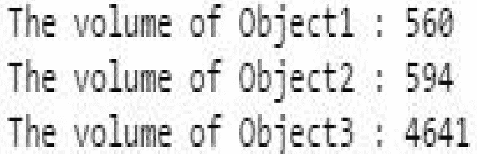

我们重载了 + 运算符。该运算符被用于两个数值类型的相加。然而，在上述示例中，我们使用该运算符将两个对象相加，即 Object1 和 Object2。这为我们得到了 Object3。Object1 和 Object2 是用户定义的类型，这意味着我们使用了 + 运算符来相加用户定义的类型。

请注意，虽然可以在 C# 中重载运算符，但并非所有运算符都可以重载。例如，你不能重载像 ==、<、>、!=、>= 和 <= 这样的比较运算符。对于像 && 和 || 这样的条件逻辑运算符，我们可以重载它们，但不能直接重载。

### 动态多态性

使用 C#，我们可以创建抽象类，这些类非常适合接口的部分实现。其完成部分在派生类继承自它之后实现。抽象类具有抽象方法，派生类需要实现这些方法。然而，派生类具有更专门的功能。

请注意，你无法创建任何抽象类的实例。抽象方法也不能在抽象类之外声明。如果一个 C# 类被声明为 *sealed*，则意味着该类不能被继承。但是，不允许将抽象类声明为 *sealed*。这里是一个抽象类的示例：

```csharp
using System;
namespace PolymorphismApp {
  abstract class Object {
    public abstract int area();
  }
  class Object1: Object {
    private int width;
    private int length;
    public Object1( int x = 0, int y = 0) {
      length = x;
      width = y;
    }
    public override int area () {
      Console.WriteLine("Object1 的面积为:");
      return (width * length);
    }
  }
  class Object1Tester {
    static void Main(string[] args) {
        Object1 obj = new Object1(8, 6);
        double x = obj.area();
        Console.WriteLine("面积为: {0}",x);
        Console.ReadKey();
    }
  }
}
```

该代码将打印以下结果：

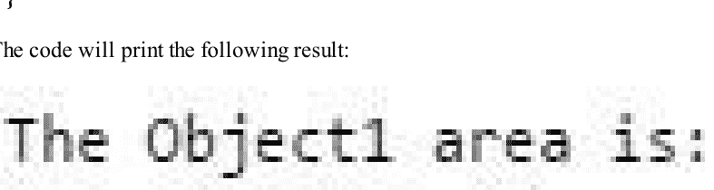

在定义了一个要在继承类中实现的函数后，你应该使用 *virtual* 函数。

为了实现动态多态性，我们使用 *抽象类* 和 *虚函数*。让我们通过一个示例来演示这一点：

```csharp
using System;
namespace PolymorphismApp {
    class Object {
        protected int width, height;
        public Object( int x = 0, int y = 0) {
            width = x;
            height = y;
        }
        public virtual int area() {
            Console.WriteLine("父类的面积为:");
            return 0;
        }
    }
    class Object1: Object {
      public Object1( int x = 0, int y = 0): base(x, y) {
      }
      public override int area () {
        Console.WriteLine("Object1 类的面积为:");
        return (width * height);
      }
    }
    class Object2: Object {
      public Object2(int x = 0, int y = 0): base(x, y) {
      }
      public override int area() {
        Console.WriteLine("Object2 类的面积为:");
        return (width * height / 2);
      }
    }
    class Caller {
      public void CallArea(Object obj) {
        int x;
        x = obj.area();
        Console.WriteLine("面积为: {0}", x);
      }
    }
    class TesterClass {
      static void Main(string[] args) {
        Caller c = new Caller();
        Object1 ob1 = new Object1(10, 7);
        Object2 ob2 = new Object2(10, 5);
        c.CallArea(ob1);
        c.CallArea(ob2);
        Console.ReadKey();
      }
    }
}
```

该代码返回以下输出：

```
Object1 类的面积为:
面积为: 70
Object2 类的面积为:
面积为: 25
```

### 第 16 章：正则表达式

正则表达式被解释为一个可以与输入文本匹配的模式。在 .Net 框架中，有一个正则表达式引擎，我们可以用它来执行匹配。一个模式由一个或多个运算符、字符字面量或构造组成。

### Regex 类

这是一个用于表示正则表达式的类。该类内置了许多函数，例如：

- 1. `public bool IsMatch(string input)` - 该方法指定 Regex 构造函数中指定的正则表达式是否在指定的输入字符串中找到匹配项。
- 2. `public bool IsMatch(string input, int startPoint)` - 该方法指定 Regex 构造函数中指定的正则表达式是否从输入字符串中的指定位置开始，在指定的输入字符串中找到匹配项。
- 3. `public static bool IsMatch(string input, string pattern)` - 该方法指定指定的正则表达式是否在指定的输入字符串中找到匹配项。
- 4. `public MatchCollection Matches(string input, string replacement)` - 这将输入字符串中的匹配项替换为指定的替换字符串。
- 5. `public string[] Split(string input)` - 此函数有助于将输入字符串在 Regex 构造函数中指定的正则表达式模式定义的位置分割成子字符串数组。

考虑下面给出的示例：

```csharp
using System.Text.RegularExpressions;
using System;

namespace RegularExpApp {
    class MyProgram {
        private static void findMatch(string input, string expre) {
            Console.WriteLine("表达式为: " + expre);
            MatchCollection mc = Regex.Matches(input, expre);
            foreach (Match x in mc) {
                Console.WriteLine(x);
            }
        }
        static void Main(string[] args) {
            string s = "Splitting an Input String into Substrings";

            Console.WriteLine("匹配以 'S' 开头的单词: ");
            findMatch(s, @"\bS\S*");
            Console.ReadKey();
        }
    }
}
```

匹配后，代码将返回以下内容：

```
匹配以 'S' 开头的单词:
表达式为: \bS\S*
Splitting
String
Substrings
```

输出显示从输入字符串中匹配了三个单词。我们匹配了任何以 S 开头的单词，并找到了三个。

考虑下面给出的下一个示例：

```csharp
using System.Text.RegularExpressions;
using System;
namespace RegularExpApp {
  class MyProgram {
    private static void findMatch(string input, string expre) {
      Console.WriteLine("输入的表达式为: " + expre);
      MatchCollection mc = Regex.Matches(input, expre);
      foreach (Match x in mc) {
        Console.WriteLine(x);
      }
    }
    static void Main(string[] args) {
      string s = "so she was the same";

      Console.WriteLine("匹配以 's' 开头并以 'e' 结尾的单词:");
      findMatch(s, @"\bs\S*e\b");
      Console.ReadKey();
    }
  }
}
```

该代码将给出以下结果：

```
匹配以 's' 开头并以 'e' 结尾的单词:
输入的表达式为: \bs\S*e\b
she
same
```

在上面的示例中，我们匹配以 s 开头并以 e 结尾的单词。我们成功匹配了输入字符串中的两个单词。这里是另一个示例：


```csharp
using System;
using System.Text.RegularExpressions;
namespace RegularExpApp {
  class MyProgram {
    static void Main(string[] args) {
      string text = "Hi  learner  ";
      string pattern = "\\s+";
      string substitute = " ";
      Regex r = new Regex(pattern);
      string output = r.Replace(text, substitute);
      Console.WriteLine("The input string is: {0}", text);
      Console.WriteLine("The string after replacement is: {0}", output);
      Console.ReadKey();
    }
  }
}
```

代码返回以下结果：

```
The input string is: Hi   learner
The string after replacement is: Hi learner
```

我们在这段代码中所做的是替换多余的空格。"Hi" 和 "learner" 之间有一个很大的空格，多余的空格已被替换或移除。

### 第 17 章：处理异常的过程

应用程序在执行过程中通常会遇到错误。错误发生后，程序会抛出一个包含有关该错误更多信息的异常。应该处理异常以防止程序崩溃。

在 C# 中，异常使用 4 个主要关键字来处理：

1. try- 此关键字标识激活了特定异常的代码块。其后跟一个或多个 *catch* 块。
2. catch- 程序应该在需要处理问题的位置使用异常处理程序来捕获异常。*catch* 是一个关键字，表示将捕获异常的位置。
3. finally- finally 块用于执行一组语句，无论是否抛出异常都会执行。例如，文件在打开后必须关闭，无论是否抛出异常。
4. throw- 通常在问题发生后抛出异常。这是通过 *throw* 关键字完成的。

*try* 和 *catch* 的组合用于捕获异常。try/catch 块必须放置在可能引发异常的代码周围。这样的代码被称为*受保护的*，以下是使用这些关键字的语法：

```csharp
try {
  // statements raising the exception
} catch( ExceptionName exception1 ) {
  // The error handling code
} catch( ExceptionName exception2 ) {
  // The error handling code
} catch( ExceptionName exceptionN ) {
  // The error handling code
} finally {
  // statements to execute
}
```

可以使用多个 catch 语句，以便在 *try* 块引发多个异常时捕获不同的异常。

在 C# 中，异常使用类来表示。*System.Exception* 是 C# 中所有异常类的基类，因为所有其他类都直接或间接地派生自它。

### 处理异常

在 C# 中，异常可以使用 *try* 和 *catch* 块来处理。通过这些块，我们可以将核心程序语句与处理错误的语句分离。我们可以使用 *try*、*catch* 和 *finally* 关键字来处理错误。

例如，除以零应该引发异常，因为它在数学上是不支持的。让我们创建一些代码来处理这个问题：

```csharp
using System;
namespace ExceptionHandlingApp {
  class DivisionClass {
    int answer;
    DivisionClass() {
      answer = 0;
    }
    public void division(int x, int y) {
      try {
        answer = x / y;
      } catch (DivideByZeroException exception) {
        Console.WriteLine("Exception caught: {0}", exception);
      } finally {
        Console.WriteLine("Answer: {0}", answer);
      }
    }
    static void Main(string[] args) {
      DivisionClass dc = new DivisionClass();
      dc.division(12, 0);
      Console.ReadKey();
    }
  }
}
```

代码应返回以下异常：

```
Exception caught: System.DivideByZeroException: Attempted to divide by zero.
   at ExceptionHandlingApp.DivisionClass.division (System.Int32 x, System.Int32 y) [0x00000
Answer: 0
```

我们创建了 *division()* 函数，该函数接受两个整数类型的参数 x 和 y。然后我们向函数传递了 12 和 0，这意味着我们将 12 除以 0。然而，这产生了异常，因为不允许除以零。

### 用户自定义异常

C# 允许程序员定义自己的异常。我们将此类用户自定义异常类派生自 *Exception* 类。请看下面的示例：

```csharp
using System;
namespace ExceptionHandlingApp {
    class TemperatureTest {
        static void Main(string[] args) {
            TemperatureClass tc = new TemperatureClass();
            try {
                tc.displayTemperature();
            } catch(TempIsZeroException exception) {
                Console.WriteLine("TempIsZeroException: {0}", exception.Message);
            }
            Console.ReadKey();
        }
    }
}
public class TempIsZeroException: Exception {
    public TempIsZeroException(string msg): base(msg) {
    }
}
```

```csharp
public class TemperatureClass {
  int temp = 0;

  public void displayTemperature() {

    if(temp == 0) {
      throw (new TempIsZeroException("We found Zero Temperature"));
    } else {
      Console.WriteLine("Temperature is: {0}", temp);
    }
  }
}
```

代码将返回以下结果：

> TempIsZeroException: We found Zero Temperature

### 嵌套 try-catch

C# 允许我们创建嵌套的 try-catch 块。在这种情况下，异常将被捕获在异常发生的 try 块之后的 catch 块中。请看以下示例：

```csharp
using System;
public class NestedtryCatch
{
    public static void Main()
    {
        Employee emp = null;

        try
        {
            try
            {
                emp.EmployeeName = "";
            }
            catch
            {
                Console.WriteLine("The inner catch");
            }
        }
        catch
        {
            Console.WriteLine("The outer catch");
        }
    }
}

public class Employee {

    public string EmployeeName { get; set; }
}
```

代码打印以下内容：

```
The inner catch
```

如果没有具有必要异常类型的内部 catch 块，异常将流向外部 catch 块，直到找到合适的异常过滤器。以下是一个示例：

```csharp
using System;
public class NestedtryCatch
{
    public static void Main()
    {
        Employee emp = null;

        try
        {
            try
            {
                // This will throw a NullReferenceException
                emp.EmployeeName = "";
            }
            catch (InvalidOperationException innerException)
            {
                Console.WriteLine("The inner catch");
            }
        }
        catch
        {
            Console.WriteLine("The outer catch");
        }
    }
}

public class Employee{

    public string EmployeeName { get; set; }
}
```

在上面的示例中，语句 *emp.EmployeeName* 将生成一个 NullReferenceException，但我们没有处理 NullReferenceException 或 Exception 类型的 catch 块。外部块将处理此异常。代码返回以下结果：

```
The outer catch
```

### 第 18 章：文件 I/O

文件以名称和目录路径为特征。一旦打开文件，它就成为一个*流*。文件通常是为了读取或写入目的而打开的。

流就是通过通信路径传递的字节序列。流有两种类型：

- 输入流
- 输出流

输入流帮助我们从文件中读取数据，即读取操作，而输出流帮助我们将数据写入文件，即写入操作。

### 输入/输出类

C# 提供了许多可用于处理文件的类。这些类可用于访问目录、文件、创建新文件、打开现有文件以及将文件从一个目录移动到另一个目录。这些类在 System.IO 类中定义。让我们讨论其中一些类：

- BinaryReader- 此类帮助我们从二进制流中读取原始数据。
- BinaryWriter- 此类帮助我们以二进制格式写入原始数据。
- BufferedStream- 这充当流字节的临时存储。
- Directory- 此类帮助我们操作目录结构。
- DriveInfo- 此类为我们提供有关驱动器的信息。
- File- 此类用于操作文件。
- FileInfo- 帮助对文件执行操作。

```
FileStream- 用于从文件的任意位置进行读写。
MemoryStream- 有助于随机访问存储在内存中的数据。
Path- 用于对路径信息执行操作。
StreamReader- 从字节流中读取字符。
StreamWriter- 向流中写入字符。
StringReader- 从字符串缓冲区中读取。
StringWriter- 向字符串缓冲区中写入。

### FileStream 类

此类在 `System.IO` 命名空间中定义，帮助我们对文件进行读写操作，也可以用来关闭文件。

要使用此类，必须创建其实例。该实例可用于创建新文件或打开现有文件。以下是创建 `FileStream` 类实例的方法：

```
FileStream <object> = new FileStream( <file>, <FileMode Enumerator>, <FileAccess Enumerator>, <FileShare Enumerator>);
```

例如，假设我们需要读取一个名为 *names.txt* 的文件。我们可以创建一个名为 *FS* 的 `FileStream` 对象来实现此目的。示例如下：

```
FileStream FS = new FileStream("names.txt", FileMode.Open, FileAccess.Read, FileShare.Read);
```

`FileMode` 是一个枚举器，定义了多种打开文件的方法。这些方法包括：

- Append – 此方法打开一个现有文件，并将光标置于文件末尾；如果指定的文件不存在，则创建一个新文件。
- Create – 用于创建新文件。
- CreateNew – 指示操作系统创建一个新文件。
- Open – 用于打开一个现有文件。
- OpenOrCreate – 指示操作系统打开一个现有文件，如果文件不存在则创建一个新文件。
- Truncate – 用于打开一个现有文件并将其大小截断为零字节。

`FileAccess` 是一个枚举器，提供了 Read、Write 和 ReadWrite 等方法。

`FileShare` 枚举器包含以下成员：

- Inheritable – 帮助将文件句柄的继承权传递给子进程。
- None – 禁止共享当前文件。
- Read – 打开文件用于读取。
- ReadWrite – 打开文件用于读写。
- Write – 打开文件用于写入。

`FileStream` 类的使用示例如下：

```
using System.IO;
using System;
namespace FileApp {
  class MyProgram {
    static void Main(string[] args) {
      FileStream FS = new FileStream("names.dat",
FileMode.OpenOrCreate,
      FileAccess.ReadWrite);
      for (int x = 1; x <= 10; x++) {
        FS.WriteByte((byte)x);
      }
      FS.Position = 0;
      for (int x = 0; x <= 10; x++) {
          Console.Write(FS.ReadByte() + " ");
      }
      FS.Close();
      Console.ReadKey();
    }
  }
}
```

代码执行后将输出以下内容：

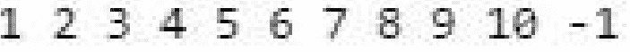

### 追加文本行

有时你可能需要向文件追加多行文本。可以通过调用 `AppendAllLines()` 方法来实现。示例如下：

```
string multipleLines = "The first line." + Environment.NewLine +
"The second line." + Environment.NewLine +
"The third line.";
```

```
// 打开名为 Myfile.txt 的文件，然后追加上述行。如果文件不存在，将创建一个新文件。
File.AppendAllLines(@"C:\MyFile.txt",
multipleLines.Split(Environment.NewLine.ToCharArray()).ToList<string>() );
```

文件将被打开，指定的行将被追加到文件中。

### 追加字符串

`File.AppendAllText()` 方法允许你仅用一行代码将字符串追加到文件中。示例如下：

```
// 打开名为 Myfile.txt 的文件，然后向其追加文本。如果文件不存在，将创建一个新文件并打开以供写入。
File.AppendAllText(@"C:\ MyFile.txt", "This string will be written into the file");
```

### 覆盖文本

如果需要覆盖文件，请使用 *File.WriteAllText()* 方法。该方法会删除文件中的文本并替换为你指定的内容。使用方法如下：

```
// 打开文件 MyFile.txt 并将文本写入其中。如果文件不存在，将创建一个新文件并打开以供写入。
File.WriteAllText(@"C:\MyFile.txt", "This text will be used for replacing the current text in the file.");
```

使用静态 `File` 类可以执行各种操作。示例如下：

```
// 检查指定位置是否存在该文件
bool isFileExists = File.Exists(@"C:\ MyFile.txt"); // 将返回 false
```

```
// 将 MyFile.txt 复制为新文件 MyNewFile.txt
File.Copy(@"C:\MyFile.txt", @"D:\MyNewFile.txt");
```

```
// 检查文件最后一次被访问的时间
DateTime lastAccessTime = File.GetLastAccessTime(@"C:\MyFile.txt");
```

```
// 获取文件最后一次被写入的时间
DateTime lastWriteTime = File.GetLastWriteTime(@"C:\MyFile.txt");
```

```
// 将文件移动到新位置
File.Move(@"C:\MyFile.txt", @"D:\MyFile.txt");
```

```
// 打开文件并返回 FileStream 以从文件中读取字节
FileStream fs = File.Open(@"D:\MyFile.txt", FileMode.OpenOrCreate);
```

用于操作物理文件。但为了获得更大的灵活性，可以使用 *FileInfo* 类。

### StreamReader 类

此类帮助我们从文本文件中读取数据。此类继承自 `Stream` 基类，同时也继承了 `TextReader` 类（一个用于读取字符序列的抽象基类）。以下是此类提供的常用方法：

- public override void Close() – 此方法关闭 `StreamReader` 对象和流，然后释放读取器使用的所有系统资源。
- public override int Peek() – 此方法返回下一个可用的字符，但不消耗它。
- public override int Read() – 此方法读取输入流中的下一个字符，并将字符位置向前推进 1。

让我们演示如何使用此类读取名为 *names.txt* 的文件：

```
using System.IO;
using;

namespace IOApplication {
    class MyProgram {
        static void Main(string[] args) {
            try {
                // 创建 StreamReader 实例以从文件中读取。
                // using 语句将关闭 StreamReader。
                using (StreamReader sr = new StreamReader("c:/names.txt")) {
                    string line;

                    // 从文件中逐行读取，
                    // 直到到达文件末尾。
                    while ((line = sr.ReadLine()) != null) {
                        Console.WriteLine(line);
                    }
                }
            } catch (Exception exception) {
                // 告知用户出错信息
                Console.WriteLine("File couldn't be read:");
                Console.WriteLine(exception.Message);
            }
            Console.ReadKey();
        }
    }
}
```

该代码将读取 *names.txt* 文件中写入的文本并打印出来。

### StreamWriter 类

此类继承自 `TextWriter` 抽象类，该类表示一个能够写入字符序列的写入器。以下是此类的常用方法：

- public override void Close() – 此方法关闭当前的 `StreamWriter` 对象及其底层流。
- public override void Flush() – 此方法清除当前写入器的缓冲区，并将所有缓冲数据写入流中。
- public virtual void Write(bool value) – 此方法将布尔值的文本表示形式写入文本流或字符串。
- public override void Write(char value) – 用于将字符写入流。
- public virtual void Write(decimal value) – 此方法将十进制值的文本表示形式写入文本流或字符串。
- public virtual void Write(double value) – 将 8 字节浮点值的文本表示形式写入文本流或字符串。
- public virtual void Write(int value) – 将 4 字节有符号整数的文本表示形式写入文本流或字符串。
```


 - public virtual void WriteLine()- 用于向文本流或字符串写入行尾符。

下面演示如何使用 StreamWriter 类来写入文本数据：

```csharp
using System.IO;
using System;
namespace IOApp {
    class MyProgram {
        static void Main(string[] args) {
            string[] students = new string[] {"Nicholas Samuel", "Michelle Boss"};
            using (StreamWriter sw = new StreamWriter("students.txt")) {
                foreach (string x in students) {
                    sw.WriteLine(x);
                }
            }
            // Read and display every line from the file.
            string text = "";
            using (StreamReader sr = new StreamReader("students.txt")) {
                while ((text = sr.ReadLine()) != null) {
                    Console.WriteLine(text);
                }
            }
            Console.ReadKey();
        }
    }
}
```

代码执行后将打印以下结果：

### Nicholas Samuel

### Michelle Boss

### BinaryReader 类

该类可用于从文件读取二进制数据。我们应首先创建一个 BinaryReader 对象，方法是将 FileStream 对象传递给其构造函数。该类包含许多方法，包括：

- public override void Close()- 用于关闭 BinaryReader 对象以及底层流。

- public virtual int Read()- 用于从底层流读取字符，并推进流的当前位置。

- public virtual bool ReadBoolean()- 用于从当前流读取一个布尔值，并将当前位置推进一个字节。

- public virtual byte ReadByte()- 用于从当前流读取下一个字节到字节数组，并将当前位置推进相应字节数。

### BinaryWriter 类

该类用于向流写入二进制数据。要创建 BinaryWriter 对象，我们将 FileStream 对象传递给构造函数。该类包含许多方法，包括：

- public override void Close()- 用于关闭 BinaryWriter 对象以及底层流。

- public virtual void Flush()- 该方法将清除当前写入器的缓冲区，并使任何缓冲数据写入设备。

- public virtual void Write(bool value)- 用于将一字节的布尔值写入当前流。1 表示 true，0 表示 false。

下面创建一个示例来演示如何读写二进制数据：

```csharp
using System;
using System.IO;
namespace BinaryFileApplication {
  class MyProgram {
    static void Main(string[] args) {
      BinaryWriter bw;
      BinaryReader br;

      int x = 12;
      double db = 1.24658;
      bool bl = false;
      string st = "Hello world";

      //create a file
      try {
          bw = new BinaryWriter(new FileStream("testdata",
FileMode.Create));
      } catch (IOException exception) {
          Console.WriteLine(exception.Message + "\n Unable to create the file.");
          return;
      }
      //write to the file
      try {
        bw.Write(x);
        bw.Write(db);
        bw.Write(bl);
        bw.Write(st);
      } catch (IOException exception) {
          Console.WriteLine(exception.Message + "\n Unable to write to the file.");
          returnvo mogl wrócić.
          return;
      }
      bw.Close();

      //read from the file
      try {
          br = new BinaryReader(new FileStream上使用述 FileStream("testdata",
FileMode.Open));
      } catch (IOException exception) {
          Console.WriteLine(exception.Message + "\n Unable to open the file.");
          return;
      }
      try {
          x = br.ReadInt32();
          Console.WriteLine("Integer data: {0}", x);
          db = br.ReadDouble();
          Console.WriteLine("Double data: {0}", db);
          bl = br.ReadBoolean();
          Console.WriteLine("Boolean data: {0}", bl);
          st = br.ReadString();
          Console.WriteLine("String data: {0}", st);
      } catch (IOException exception) {
          Console.WriteLine(exception.Message + "\n Unable to read from the file.");
          return;
      }
      br.Close();
      Console.ReadKey();
    }
  }
}
```

代码执行后将输出以下结果：

Integer data: 12

Double data: 1.24658

Boolean data: False

String data: Hello world

### 第 19 章：委托

我们可以拥有包含多个不同数据类型参数的函数。然而，有时我们需要将某个函数作为参数传递。C# 如何处理事件处理程序或回调函数呢？这是通过*委托*来实现的。

委托被视为指向函数的指针。它是一种引用数据类型，保存对方法的引用。所有委托都会隐式地从 *System.Delegate* 类派生。我们使用委托来实现事件和回调方法。

### 声明委托

我们声明委托的方式决定了该委托可以引用哪些方法。委托可以引用与委托具有相同签名的方法。我们使用 *delegate* 关键字来声明委托。以下是声明时使用的语法：

**<访问修饰符> delegate <返回类型><委托名称>(<参数>)**

**示例如下：**

**public delegate void Display(int value);**

在上面，我们声明了一个 *Display* 委托。我们可以使用这个委托来指向一个具有相同返回类型和参数的方法，该参数已使用 *Display* 委托声明。

请看下面的例子：

```csharp
using System;
public class MyProgram
{
    public delegate void Display(int num);


    public static void Main()
    {
        // Display delegate points to the DisplayNumber
        Display displayDel = DisplayNumber;

        displayDel(100000);
        displayDel(200);

        // Display delegate points to DisplayMoney
        displayDel = DisplayMoney;

        displayDel(50000);
        displayDel(20);
    }

    public static void DisplayNumber(int x)
    {
        Console.WriteLine("Number: {0,-12:N0}",x);
    }
    public static void DisplayMoney(int amount)
    {
        Console.WriteLine("Money: {0:C}", amount);
    }
}
```

代码将输出以下结果：

我们创建了一个名为 *Display* 的委托，它接受一个整数类型的参数并返回 void。在 Main() 方法中，我们创建了一个 Display 类型的变量，并将名为 *DisplayNumber* 的方法分配给它。调用 Display 委托后，DisplayNumber 方法也会被调用；如果 Display 委托变量被分配给 DisplayMoney 方法，则将调用 DisplayMoney 方法。

此外，我们还可以使用 *new* 关键字创建委托对象。在这种情况下，我们必须指定方法的名称，如下所示：

```csharp
Display displayDel = new Display (DisplayNumber);
```

### 调用委托

委托是对方法的引用，因此我们可以像调用方法一样简单地调用它。当委托被调用时，它所引用的方法也会被调用。

我们有两种方法可以调用委托：使用 () 运算符或使用委托的 *Invoke()* 方法。下面通过示例演示：

```csharp
Display displayDel = DisplayNumber;
displayDel.Invoke(5000);
//或者
printDel(10000);
```

上面展示了我们可以用来调用委托的两种方式。

### 将委托作为参数传递

方法可以具有委托类型的参数，并可以调用该委托参数。以下是委托参数的示例：

```csharp
public static void DisplayHelper(Display delegateFunc, int numToDisplay)
{
    delegateFunc(numToDisplay);
}
```

在上面的示例中，DisplayHelper 函数有一个 Display 类型的委托参数，并使用以下语句作为函数调用：

```csharp
delegateFunc(numToDisplay);
```

下面给出另一个示例，演示如何使用 *DisplayHelper* 方法和委托类型参数：

```csharp
using System;

public class MyProgram
{
    public delegate void Display(int num);

    public static void Main()
    {
        DisplayHelper(DisplayNumber, 500);
        DisplayHelper(DisplayMoney, 200);
    }

    public static void DisplayHelper(Display delegateFunc, int numToDisplay)
    {
        delegateFunc(numToDisplay);
    }

    public static void DisplayNumber(int val)
    {
        Console.WriteLine("Number: {0,-12:N0}", val);
    }

    public static void DisplayMoney(int amount)
    {
        Console.WriteLine("Money: {0:C}", amount);
    }
}
```

代码将返回以下输出：


 ## 多播委托

一个委托可以指向多个函数。任何指向多个函数的委托称为*多播委托*。使用 `+` 运算符将函数添加到委托对象，使用 `-` 运算符从委托对象中移除现有函数。

请看下面的示例：

```
using System;
public class MyProgram
{
    public delegate void Display(int value);

    public static void Main()
    {
        Display displayDel = DisplayNumber;
        displayDel += DisplayHexadecimal;
        displayDel += DisplayMoney;

        displayDel(1000);
        displayDel -= DisplayHexadecimal;
        displayDel(2000);
    }
    public static void DisplayNumber(int x)
    {
        Console.WriteLine("Number: {0,-12:N0}",x);
    }

    public static void DisplayMoney(int amount)
    {
        Console.WriteLine("Money: {0:C}", amount);
    }

    public static void DisplayHexadecimal(int dec)
    {
        Console.WriteLine("Hexadecimal: {0:X}", dec);
    }
}
```

代码将输出以下结果：

在上面的示例中，`Display` 指向三个方法，即 `DisplayNumber`、`DisplayMoney` 和 `DisplayHexadecimal`。这使它成为一个多播委托。这意味着当 `displayDel` 被调用时，它将依次调用这三个方法。

### 第20章：C# 中的多线程

线程定义了一个控制流。线程是操作系统分配线程的基本单位。线程在程序内部独立执行。

单个进程使用一个线程执行。这样的进程称为单线程进程。一次只能执行一个任务。用户必须等待任务完成后才能执行新任务。

为了同时执行多个线程，需要创建多个线程。创建两个或更多线程的过程称为多线程$^{145}$。

### 线程的生命周期

线程的生命周期从创建 `System.Threading.Thread` 类的对象开始。生命周期在现有任务完成时结束。线程的生命周期中有多种状态。

- **未启动状态**：创建 `Thread` 类的实例时，线程进入未启动状态。
- **就绪状态**：线程处于此状态，直到程序调用 `Start()` 方法。
- **不可运行状态**：使线程不可运行的一些因素包括：
  - **等待**：调用 `Wait()` 方法使线程等待指定条件
  - **阻塞**：线程被 I/O 操作阻塞
  - **休眠**：调用 `Sleep()` 方法使线程进入休眠模式
- **死亡状态**：线程完成执行或被中止后，进入死亡状态

### 主线程

使用线程时，我们使用 `System.Threading.Thread` 类。程序开始执行时创建主线程。`Thread` 类用于创建线程。它们称为子线程。用户可以通过 `Thread` 类的 `CurrentThread` 属性访问主线程。

**示例：**

```
using System;
namespace thread
{
    class MainThread
    {
        static void Main(string[] args)
        {
            Thread t1 = new Thread();
            t1.Name="Thread1";
            Console.WriteLine("Thread is: {0}",t1.Name);
            Console.Read();
        }
    }
}
```

编译并执行代码后，输出为：

Thread is: Thread1

### Thread 类的属性和方法

### 属性$^{146}$：

- **IsAlive**：显示当前线程执行状态的值
- **CurrentThread**：获取当前运行的线程
- **CurrentContext**：获取线程正在其中执行的当前上下文
- **ExecutionContext**：ExecutionContext 对象包含有关不同上下文的信息
- **Name**：获取或设置线程的名称
- **ThreadState**：包含当前线程状态的值
- **Priority**：获取或设置显示线程调度优先级的值

### 方法：

- **public static void BeginThreadAffinity()**：主机即将执行依赖于当前物理操作系统线程的指令。
- **public void Abort()**：在调用它的线程上引发 ThreadAbortException。
- **public void Interrupt()**：中断处于 WaitSleepJoin 状态的线程
- **public static AppDomain GetDomain()**：返回唯一的域标识符
- **public static void MemoryBarrier()**：处理器执行当前线程。指令不能重新排序。
- **public void Start()**：启动线程
- **public static bool Yield()**：使调用线程将执行权让给另一个准备在处理器上运行的线程

### 创建和管理线程

扩展的线程类创建线程。扩展的线程类调用 **Start()** 方法启动子线程执行。

**示例：**

```
using System;
using System.Threading;

namespace MultipleThread
{
    class ThreadProgram
    {
        public static void CallChild()
        {
            Console.WriteLine("Start child thread");
        }
        static void Main(string[] args)
        {
            ThreadStart child1 = new ThreadStart(CallChild);
            Console.WriteLine("Creating child thread");
            Thread child2 = new Thread(child1);
            child2.Start();
            Console.Read();
        }
    }
}
```

**编译并执行代码后，输出为：**

Start child thread

Creating child thread

### 管理线程

当需要暂停线程一段时间以便另一个线程可以执行时，使用 **Thread.Sleep()** 方法。该方法接受一个参数，表示以毫秒为单位的时间。

*示例：*

```
using System;
using System.Threading;

namespace Multithreaded
{
  class Program
  {
    public static void ChildThread()
    {
      Console.WriteLine("Start child thread");
      int sleeptime = 4000;
      Console.WriteLine("Thread sleeping for {0} seconds",sleeptime / 1000);
      Thread.Sleep(sleeptime);
      Console.WriteLine("Resume child thread");
    }
    public static void Main()
    {
      ThreadStart t1 = new ThreadStart(ChildThread);
      Console.WriteLine("child thread created");
      Thread child1 = new Thread(t1);
      child1.Start();
      Console.Read();
    }
  }
}
```

编译并执行代码后，输出为：

Start child thread

Thread sleeping for 4 seconds

Resume child thread

child thread created

### 销毁线程

使用 **Thread.Abort()** 方法销毁线程。线程被销毁时引发 **ThreadAbortException**。捕获该异常并将其发送到 **finally** 块。

### 示例：

```
using System;
using System.Threading;

namespace ThreadDemo
{
    class Program
    {
        public static void ChildThread()
        {
            try
            {
                Console.WriteLine("Child Thread started");
                for(int j = 0; j <= 10; j++)
                {
                    Thread.Sleep(1000);
                    Console.WriteLine("Child thread finished");
                }
            }
            catch(ThreadAbortException e)
            {
                Console.WriteLine("Exception caught");
            }
            finally
            {
                Console.WriteLine("Exception is not handled");
            }
        }

        public static void Main()
        {
            ThreadStart t1 = new ThreadStart(ChildThread);
            Console.WriteLine("Creating child thread");
            Thread t2 = new Thread(t1);
            t1.Start();

            //main thread is stopped
            Thread.Sleep(2000);

            //child thread aborted
            Console.WriteLine("Aborting child thread");
            t2.Abort();
            Console.Read();
        }
    }
}
```

编译并执行代码后，输出为：

Creating child thread

Child Thread started

0

1

Aborting child thread

Exception caught

Exception is not handled


### 第21章：事件

事件是预期会发生的事情。在C#中，事件是用户操作，如点击、按键、鼠标移动，或者是系统生成的通知等事件。应用程序应该在事件发生时做出响应。一个典型的例子就是中断的发生。事件用于促进进程间通信。

事件在类中声明，并通过同一类或另一个类中的委托与事件处理程序相关联。拥有事件的类用于发布事件，这样的类被称为*发布者*类。接受事件的类被称为*订阅者*类。这意味着事件依赖于发布者-订阅者模型。

发布者是定义事件和委托的对象。事件与委托之间的关联是在这个对象中定义的。发布者类的对象触发事件，然后通知其他对象。

订阅者是接受事件并提供事件处理程序的对象。发布者类有一个委托，该委托调用订阅者类的方法（事件处理程序）。

### 事件声明

要在类中声明事件，首先应该为事件声明一个委托类型。之后，你才能使用*event*关键字声明事件。这是一个例子：

```
public delegate void myEvent();
public event myEvent myEvent;
```

因此，我们使用了*event*关键字使其成为一个事件。这是一个完整的例子：

```
using System;
public class DisplayHelper
{
    // 声明委托
    public delegate void BeforeDisplay();

    // 声明一个委托类型的事件
    public event BeforeDisplay beforeDisplayEvent;

    public DisplayHelper()
    {

    }
    public void DisplayNumber(int x)
    {
        // 在显示之前调用委托方法
        if (beforeDisplayEvent != null)
            beforeDisplayEvent();

        Console.WriteLine("Number: {0,-12:N0}", x);
    }

    public void PrintDecimal(int dec)
    {
        if (beforeDisplayEvent != null)
            beforeDisplayEvent();

        Console.WriteLine("Decimal: {0:G}", dec);
    }
    public void DisplayMoney(int amount)
    {
        if (beforeDisplayEvent != null)
            beforeDisplayEvent();

        Console.WriteLine("Money: {0:C}", amount);
    }

    public void DisplayTemperature(int x)
    {
        if (beforeDisplayEvent != null)
            beforeDisplayEvent();

        Console.WriteLine("Temperature: {0,4:N1} F", x);
    }
    public void DisplayHexadecimal(int dec)
    {
        if (beforeDisplayEvent != null)
            beforeDisplayEvent();

        Console.WriteLine("Hexadecimal: {0:X}", dec);
    }
}
```

*DisplayHelper*是一个发布者类，负责发布*beforeDisplay*事件。在每个*display*方法之后，它首先检查*beforeDisplayEvent*是否不为空，然后调用*beforeDisplayEvent()*方法。

我们现在需要创建一个订阅者。请看下面的类：

```
using System;

public class MyProgram
{

    public static void Main()
    {
        NumberClass nc = new NumberClass(200);
        nc.DisplayMoney();
        nc.DisplayNumber();
    }
}

class NumberClass
{
    private DisplayHelper _displayHelper;

    public NumberClass(int x)
    {
        _value = x;

    
        _displayHelper = new DisplayHelper();
        // 订阅beforeDisplayEvent事件
        _displayHelper.beforeDisplayEvent += displayHelper_beforeDisplayEvent;
    }
    // beforeDisplayevent处理程序
    void displayHelper_beforeDisplayEvent()
    {
        Console.WriteLine("BeforeDisplayEventHandler: DisplayHelper will print a value");
    }

    private int _value;

    public int Value
    {
        get { return _value; }
        set { _value = value; }
    }

    public void DisplayMoney()
    {
        _displayHelper.DisplayMoney(_value);
    }

    public void DisplayNumber()
    {
        _displayHelper.DisplayNumber(_value);
    }
}

public class DisplayHelper
{
    // 声明一个委托
    public delegate void BeforeDisplay();

    // 声明一个委托类型的事件
    public event BeforeDisplay beforeDisplayEvent;

    public DisplayHelper()
    {

    }

    public void DisplayNumber(int y)
    {
        // 在打印之前调用一个委托方法
        if (beforeDisplayEvent != null)
            beforeDisplayEvent();

        Console.WriteLine("Number: {0,-12:N0}", y);
    }

    public void DisplayDecimal(int dec)
    {
        if (beforeDisplayEvent != null)
            beforeDisplayEvent();

        Console.WriteLine("Decimal: {0:G}", dec);
    }

    public void DisplayMoney(int amount)
    {
        if (beforeDisplayEvent != null)
            beforeDisplayEvent();

        Console.WriteLine("Money: {0:C}", amount);
    }

    public void DisplayTemperature(int y)
    {
        if (beforeDisplayEvent != null)
            beforeDisplayEvent();

        Console.WriteLine("Temperature: {0,4:N1} F", y);
    }
    public void DisplayHexadecimal(int dc)
    {
        if (beforeDisplayEvent != null)
            beforeDisplayEvent();

        Console.WriteLine("Hexadecimal: {0:X}", dc);
    }
}
```

代码返回以下结果：

```
BeforeDisplayEventHandler: DisplayHelper will print a value
Money: $200.00
BeforeDisplayEventHandler: DisplayHelper will print a value
Number: 200
```

所有订阅者都必须有一个处理函数，该函数将在发布者触发事件后被调用。

### 第22章：提示与重要资源

尽管我相信，如果你遵循本书的步骤，你将在很短的时间内非常透彻和牢固地掌握C#，但无疑你可能还有一些尚未解决的问题。

我们生活在一个精通技术的美妙世界，这本书不是你学习和掌握C#编程和编码的唯一资源。

我相信你现在感觉已经准备好并且能够应对许多你希望用C#编码解决的挑战，你可能在一个十字路口，不确定下一步解决问题的潜在步骤是什么。本章应作为你的指南，帮助你找到本书中未涉及问题的答案。

首先，我鼓励你仔细检查你的代码，寻找空格或大写方面的简单错误。

有时，如果你习惯了用另一种语言编码，你可能无意中在应该放分号的地方放了句点，甚至在不应该放括号的地方放了括号。

这些类型的错误是我发现最令人沮丧的，通常也是我犯过的错误。本质上，当你遇到一个似乎总是给你错误消息的令人沮丧的点时，一定要仔细检查你的工作。

此外，如果你尝试了这个策略但没有效果，并且你准备好放弃了——休息一下！在你让自己放松并从项目上转移注意力之后再回到你的项目。当你以焕然一新的眼光回来查看时，你可能会发现错误所在。

我使用的另一个资源是专门的C#在线论坛。虽然一些编程论坛提供了很好的通用建议，但我鼓励你谷歌搜索诸如“C#帮助论坛”之类的内容，以找到其他可能对如何解决问题有明智建议的人。

很可能你并不是唯一遇到某个障碍的人，这个障碍可能阻止你完成项目的一部分。这些可以是通过利用互联网的力量快速找到答案的好方法。

尽管我已经提到了接下来的这些资源，但我想重申代码编辑器和库可能有多么重要。

就像在任何编程语言中一样，你可以在库中找到看似无尽的答案，这些库将允许你为许多不同的情况编码。然而，正如我之前建议的，在你涉足使用代码的世界之前，请牢固掌握编码和编程的过程。

如果代码中的某些内容发生变化而你找不到错误，你的程序或项目可能会受到无法修复的损坏。代码编辑器可以帮助你在代码上线之前找到这些错误，所以我强烈建议你持续使用这个资源，直到你成为C#大师——即使在那之后，以防你成为人为错误的受害者。

如果你发现你需要对本书中或超出范围的任何内容有更好的视觉化理解，我鼓励你访问我最喜欢的视频网站——YouTube！

只需搜索你在编码和编程过程中试图弄清楚的关键短语或单词，我保证你会找到一个有用的视频。有时，它可能不是你遇到的第一个视频，但它肯定在那里。

你可能已经有一个你喜欢的YouTuber，他/她提供其他语言的示例——也许去看看他/她订阅的其他用户，看看他们的内容是否对你有帮助。

永远不要认为仅仅因为你遇到了困难，你的整个项目就完了。

根据我的个人经验，我可以告诉你，当出现这类问题时，让自己充分探索和解决问题，可以为你创造新的思维路径，这些路径将在你未来的挣扎中对你有所帮助。

回想一下你解决生活中其他问题或编程经验的方法，让自己思考如何以及为什么可以将其应用于当前的情况。


 在了解自己的思维方式以及想要实现什么目标方面，你是自己最好的盟友。尽你所能利用你的资源，尽可能多地掌握知识——知识和学习的力量确实是一项非凡的技能。

编程和编码可以被视为一种解决问题的手段，你用它来创建执行特定目的的程序，从而使你和他人的生活变得更加轻松。始终朝着适合你技能范围的可实现目标努力，同时继续鞭策自己学习更多，提升自己的水平。

你可以从以下参考链接获取有关 C# 语言的更多详细信息。

- [Visual Studio Application](https://visualstudio.microsoft.com/) – 用于创建 C# 应用程序的 IDE。
- [C# (Programming guide)](https://docs.microsoft.com/en-us/dotnet/csharp/programming-guide/) – C# 编程语言概述
- [C# Programming](https://docs.microsoft.com/en-us/dotnet/csharp/) – 解释了使用 .NET 框架的 C# 功能相关信息
- [Mono](https://www.mono-project.com/) – 使用该软件可以轻松创建跨平台应用程序。

### 结论

现在这本书已经接近尾声，你掌握了成为优秀 C# 程序员和编码员所需的全部信息、知识和技能。对我来说，重要的是你将这本书作为技能的基础。我努力提供了我认为全面且易于理解的指南。如果没有 C# 这样的语言，我们就不可能在个人生活和商业生活中拥有如此惊人的技术。

当你思考编程等技术技能为你的人生创造的机遇时，我相信这是一项宝贵的技能。了解计算机系统设置的基本知识，可以在职业层面为你打开大门，获得更复杂、薪酬更高的工作。

然而，在你的个人生活中，你可以运用批判性思维和问题解决能力来提升自己在电脑上的游戏体验，或是技术之外的其他领域。以如此快的速度学会了 C#，你应该对自己的成就感到非常自信和满足！

并非每个人都能在一个月的时间内学会一门全新的语言，而你却通过探索新的虚拟世界轻松做到了。这是一项值得高兴的成就，现在真的应该开始创建你渴望的项目了。作为一门面向对象的语言，我相信你已经有了一些为软件社区做出贡献的绝佳新想法。或者，也许你只是想能够操作你现有的 Windows 电脑！

我在本书中分解的描述和章节应该能让你以一种融会贯通的方式掌握 C# 的各个部分，当你读到这个最终结论时，你应该感到自己能够将知识传递给他人。

我希望这门语言向你展示了它鼓励游戏编程，通过这门语言中许多不同的途径来定义和区分可能有关联（例如类和语句）但不可互换的不同方面。

当你习惯其中的细微差别时，它可能会让人感到不知所措——但你越是测试自己的技能，越是将代码示例付诸实践，你就越能体会到它们带给你的全面影响和优势。

感谢你拿起我的书，给了它教你新东西的机会！我希望让每一门主题的基础知识都能让任何人快速轻松地学会。我希望你将此作为未来项目的参考指南，希望你能够通过书中的例子吸收材料和概念。在书的结尾，我想根据自己的经验再重申几颗我认为重要的智慧明珠。

在将项目投入实际使用前，务必在测试区域先进行测试，尤其是可能造成不可挽回损害的情况下！记住，编程和编码时你应该享受其中，因为你是通过自己的双手将各个部分组合起来创造出复杂的东西。最后，享受其中的乐趣，乐在其中！

## 参考文献

AG, A. (n.d.). *Delegates and Events in C# / .NET*. [online] Akadia.com. Available at: https://www.akadia.com/services/dotnet_delegates_and_events.html [Accessed 15 Feb. 2019].

Bodnar, J. (2019). *Methods in C# - working with CSharp methods*. [online] Zetcode.com. Available at: http://zetcode.com/lang/csharp/methods/ [Accessed 15 Feb. 2019].

Bodnar, J. (2019). *Operators in C# - describing CSharp operators and expressions*. [online] Zetcode.com. Available at: http://zetcode.com/lang/csharp/operators/ [Accessed 15 Feb. 2019].

Codescracker.com. (n.d.). *C# Program Structure*. [online] Available at: https://codescracker.com/c-sharp/c-sharp-program-structure.htm [Accessed 15 Feb. 2019].

Csharp.net-informations.com. (n.d.). *C# File Operations Tutorial*. [online] Available at: http://csharp.net-informations.com/file/csharp-file-tutorial.htm [Accessed 15 Feb. 2019].

Csharp.net-tutorials.com. (n.d.). *Variables - The complete C# tutorial*. [online] Available at: https://csharp.net-tutorials.com/basics/variables/ [Accessed 15 Feb. 2019].

Docs.microsoft.com. (2015). *Arrays - C# Programming Guide*. [online] Available at: https://docs.microsoft.com/en-us/dotnet/csharp/programming-guide/arrays/ [Accessed 15 Feb. 2019].

Docs.microsoft.com. (2015). *Casting and type conversions - C# Programming Guide*. [online] Available at: https://docs.microsoft.com/en-us/dotnet/csharp/programming-guide/types/casting-and-type-conversions [Accessed 15 Feb. 2019].

Docs.microsoft.com. (2015). *goto statement - C# Reference*. [online] Available at: https://docs.microsoft.com/en-us/dotnet/csharp/language-reference/keywords/goto [Accessed 15 Feb. 2019].

Docs.microsoft.com. (2015). *Passing Parameters - C# Programming Guide*. [online] Available at: https://docs.microsoft.com/en-us/dotnet/csharp/programming-guide/classes-and-structs/passing-parameters [Accessed 15 Feb. 2019].

Docs.microsoft.com. (2018). *Classes - C# Programming Guide*. [online] Available at: https://docs.microsoft.com/en-us/dotnet/csharp/programming-guide/classes-and-structs/classes [Accessed 15 Feb. 2019].

Docs.microsoft.com. (2018). *Default values table - C# Reference*. [online] Available at: https://docs.microsoft.com/en-us/dotnet/csharp/language-reference/keywords/default-values-table [Accessed 15 Feb. 2019].

Docs.microsoft.com. (2018). *Using threads and threading*. [online] Available at: https://docs.microsoft.com/en-us/dotnet/standard/threading/using-threads-and-threading [Accessed 15 Feb. 2019].

Docs.microsoft.com. (n.d.). *BinaryReader Class (System.IO)*. [online] Available at: https://docs.microsoft.com/en-us/dotnet/api/system.io.binaryreader?view=netframework-4.7.2 [Accessed 15 Feb. 2019].

Docs.microsoft.com. (n.d.). *BinaryWriter Class (System.IO)*. [online] Available at: https://docs.microsoft.com/en-us/dotnet/api/system.io.binarywriter?view=netframework-4.7.2 [Accessed 15 Feb. 2019].

Docs.microsoft.com. (n.d.). *File.AppendText(String) Method (System.IO)*. [online] Available at: https://docs.microsoft.com/en-us/dotnet/api/system.io.file.appendtext?view=netframework-4.7.2 [Accessed 15 Feb. 2019].

Download.microsoft.com. (n.d.). *Microsoft Download Center: Windows, Office, Xbox & More*. [online] Available at: http://download.microsoft.com/ [Accessed 15 Feb. 2019].

En.wikipedia.org. (2019). *C Sharp (programming language)*. [online] Available at: https://en.wikipedia.org/wiki/C_Sharp_(programming_language) [Accessed 15 Feb. 2019].

GeeksforGeeks. (n.d.). *C# | Arrays - GeeksforGeeks*. [online] Available at: https://www.geeksforGeeks.org/c-sharp-arrays/ [Accessed 15 Feb. 2019].

GeeksforGeeks. (n.d.). *C# | Methods - GeeksforGeeks*. [online] Available at: https://www.geeksforGeeks.org/c-sharp-methods/ [Accessed 15 Feb. 2019].

Guru99.com. (n.d.). [online] Available at: https://www.guru99.com/c-sharp-datatypes.html [Accessed 15 Feb. 2019].

Heydrick, C. (2014). *C# Struct Sizes*. [online] Chris Heydrick: Serial Hobbyist. Available at: https://chrisheydrick.com/2014/12/17/c-struct-sizes/ [Accessed 15 Feb. 2019].

Jonskeet.uk. (n.d.). *Parameter passing in C#*. [online] Available at: https://jonskeet.uk/csharp/parameters.html [Accessed 15 Feb. 2019].

Khorshidnia, S. (2013). *Recursive methods using C#*. [online] Codeproject.com. Available at: https://www.codeproject.com/Articles/142292/Recursive-methods-in-CSharp [Accessed 15 Feb. 2019].

Mayo, J. (n.d.). *Lesson 5: Methods - C# Station*. [online] C# Station. Available at: https://csharp-station.com/Tutorial/CSharp/Lesson05 [Accessed 15 Feb. 2019].

Mkhitaryan, A. (2017). *Why Is C# Among The Most Popular Programming Languages in The World?*. [online] Medium. Available at: https://medium.com/sololearn/why-is-c-among-the-most-popular-programming-languages-in-the-world-ccf26824ffcb [Accessed 15 Feb. 2019].

Mono-project.com. (2019). *Home | Mono*. [online] Available at: http://www.mono-project.com/ [Accessed 15 Feb. 2019].

Msdn.microsoft.com. (2017). *C# Programming Guide*. [online] Available at: https://msdn.microsoft.com/en-us/library/67ef8sbd.aspx [Accessed 15 Feb. 2019].


o7planning.org.（无日期）。*C# 多线程编程教程*。[在线] 可查阅：https://o7planning.org/en/10553/csharp-multithreading-programming-tutorial [访问于 2019 年 2 月 15 日]。

Programiz.com.（无日期）。*C# foreach 循环（含示例）*。[在线] 可查阅：https://www.programiz.com/csharp-programming/foreach-loop [访问于 2019 年 2 月 15 日]。

Programiz.com.（无日期）。*C# if、if...else、if...else if 和嵌套 if 语句（含示例）*。[在线] 可查阅：https://www.programiz.com/csharp-programming/if-else-statement [访问于 2019 年 2 月 15 日]。

Programiz.com.（无日期）。*C# 运算符：算术、比较、逻辑等*。[在线] 可查阅：https://www.programiz.com/csharp-programming/operators [访问于 2019 年 2 月 15 日]。

Programiz.com.（无日期）。*C# switch 语句（含示例）*。[在线] 可查阅：https://www.programiz.com/csharp-programming/switch-statement [访问于 2019 年 2 月 15 日]。

Spasojevic, M.（2018）。*C# 基础 - C# 类型转换（隐式和显式转换）*。[在线] Code Maze。可查阅：https://code-maze.com/csharp-basics-type-conversion/ [访问于 2019 年 2 月 15 日]。

Tutorialspoint.com.（无日期）。*在线 Csharp 编译器 - 在线 Csharp 编辑器 - 在线 Csharp IDE - Csharp 在线编码 - 在线练习 Csharp - 在线执行 Csharp - 在线编译 Csharp - 在线运行 Csharp*。[在线] 可查阅：https://www.tutorialspoint.com/compile_csharp_online.php [访问于 2019 年 2 月 15 日]。

Tutorialsteacher.com.（无日期）。*C# 文件与目录*。[在线] 可查阅：https://www.tutorialsteacher.com/csharp/csharp-file [访问于 2019 年 2 月 15 日]。

Tutorialsteacher.com.（无日期）。*C# for 循环*。[在线] 可查阅：https://www.tutorialsteacher.com/csharp/csharp-for-loop [访问于 2019 年 2 月 15 日]。

Tutorialsteacher.com.（无日期）。*C# 关键字*。[在线] 可查阅：https://www.tutorialsteacher.com/csharp/csharp-keywords [访问于 2019 年 2 月 15 日]。

Tutorialsteacher.com.（无日期）。*C# while 循环*。[在线] 可查阅：https://www.tutorialsteacher.com/csharp/csharp-while-loop [访问于 2019 年 2 月 15 日]。

Tutorialsteacher.com.（无日期）。*Do-While 循环*。[在线] 可查阅：https://www.tutorialsteacher.com/csharp/csharp-do-while-loop [访问于 2019 年 2 月 15 日]。

Tutorialsteacher.com.（无日期）。*C# 中的事件*。[在线] 可查阅：https://www.tutorialsteacher.com/csharp/csharp-event [访问于 2019 年 2 月 15 日]。

Tutorialsteacher.com.（无日期）。*C# 中的结构体*。[在线] 可查阅：https://www.tutorialsteacher.com/csharp/csharp-struct [访问于 2019 年 2 月 15 日]。

Visual Studio.（无日期）。*下载 | IDE、代码和团队基础服务器 | Visual Studio*。[在线] 可查阅：https://www.visualstudio.com/downloads/download-visual-studio-vs [访问于 2019 年 2 月 15 日]。

www.tutorialspoint.com.（无日期）。*C# 数组*。[在线] 可查阅：https://www.tutorialspoint.com/csharp/csharp_arrays.htm [访问于 2019 年 2 月 15 日]。

www.tutorialspoint.com.（无日期）。*C# 类*。[在线] 可查阅：https://www.tutorialspoint.com/csharp/csharp_classes.htm [访问于 2019 年 2 月 15 日]。

www.tutorialspoint.com.（无日期）。*C# 委托*。[在线] 可查阅：https://www.tutorialspoint.com/csharp/csharp_delegates.htm [访问于 2019 年 2 月 15 日]。

www.tutorialspoint.com.（无日期）。*C# 封装*。[在线] 可查阅：https://www.tutorialspoint.com/csharp/csharp_encapsulation.htm [访问于 2019 年 2 月 15 日]。

www.tutorialspoint.com.（无日期）。*C# 事件*。[在线] 可查阅：https://www.tutorialspoint.com/csharp/csharp_events.htm [访问于 2019 年 2 月 15 日]。

www.tutorialspoint.com.（无日期）。*C# 异常处理*。[在线] 可查阅：https://www.tutorialspoint.com/csharp/csharp_exception_handling.htm [访问于 2019 年 2 月 15 日]。

www.tutorialspoint.com.（无日期）。*C# 文件 I/O*。[在线] 可查阅：https://www.tutorialspoint.com/csharp/csharp_file_io.htm [访问于 2019 年 2 月 15 日]。

www.tutorialspoint.com.（无日期）。*C# 继承*。[在线] 可查阅：https://www.tutorialspoint.com/csharp/csharp_inheritance.htm [访问于 2019 年 2 月 15 日]。

www.tutorialspoint.com.（无日期）。*C# 多线程*。[在线] 可查阅：https://www.tutorialspoint.com/csharp/csharp_multithreading.htm [访问于 2019 年 2 月 15 日]。

www.tutorialspoint.com.（无日期）。*C# 多态*。[在线] 可查阅：https://www.tutorialspoint.com/csharp/csharp_polymorphism.htm [访问于 2019 年 2 月 15 日]。

www.tutorialspoint.com.（无日期）。*C# 正则表达式*。[在线] 可查阅：https://www.tutorialspoint.com/csharp/csharp_regular_expressions.htm [访问于 2019 年 2 月 15 日]。

www.tutorialspoint.com.（无日期）。*C# 结构体*。[在线] 可查阅：https://www.tutorialspoint.com/csharp/csharp_struct.htm [访问于 2019 年 2 月 15 日]。

### JAVASCRIPT

终极初学者指南
一步步学习 JavaScript 编程

**Ryan Turner**

### © 版权所有 2019 – Ryan Turner

保留所有权利。

未经作者或出版商的直接书面许可，不得复制、转载或传播本书中包含的内容。

在任何情况下，出版商或作者均不对因本书中包含的信息（无论是直接或间接）造成的任何损害、赔偿或金钱损失承担任何责任或法律责任。

### 法律声明：

本书受版权保护。仅供个人使用。未经作者或出版商同意，不得修改、分发、销售、使用、引用或转述本书的任何部分或内容。

### 免责声明：

请注意，本文档中包含的信息仅供教育和娱乐目的。已尽一切努力提供准确、最新、可靠、完整的信息。不声明或暗示任何类型的保证。读者承认作者不提供法律、财务、医疗或专业建议。本书中的内容来源于各种来源。在尝试本书中概述的任何技术之前，请咨询持有执照的专业人士。

阅读本文档即表示读者同意，在任何情况下，作者均不对因使用本文档中包含的信息（包括但不限于错误、遗漏或不准确之处）而产生的任何直接或间接损失负责。

## 目录

- 引言
- 第 1 章：什么是 JavaScript
  - 客户端 JavaScript
  - JavaScript 的优点
  - JavaScript 的局限性
  - JavaScript 的位置
  - 外部文件中的 JavaScript
- 第 2 章：值、类型和运算符
  - 字符串
  - 一元运算符
- 第 3 章：程序结构
  - 绑定
  - 函数
  - for 循环
- 第 4 章：函数
  - 绑定与作用域
  - 函数的成长
- 第 5 章：数据结构：对象和数组
  - 方法
  - 数组循环
- 第 6 章：高阶函数
  - 使用 map 进行转换
  - 字符串和字符码
- 第 7 章：对象的秘密生活
  - 原型
  - 多态
- 第 8 章：机器人
  - 任务
  - 模拟
- 第 9 章：缺陷和错误
  - 测试
  - 调试
- 第 10 章：正则表达式
  - 字符集
  - 字符串和单词边界
- 第 11 章：模块
  - 包
  - 将数据作为代码执行
- 第 12 章：异步编程
  - 回调
  - Promise 集合
- 第 13 章：解析
  - 特殊形式
  - 函数
- 结论
- 参考文献

### 引言

JavaScript 是一种遵循 ECMAScript 规范的、优秀的解释型编程语言。该编程语言包含强类型、花括号语法、一流函数和基于原型的对象导向。与 HTML 和 CSS 一起，JavaScript 是万维网的重要技术之一。JavaScript 促进了可互换的网页，是网络应用程序的重要组成部分。几乎所有网站都使用 JavaScript，所有主要的网络浏览器都包含 JavaScript 引擎以正常运行。Brendan Eich 在 1995 年任职于 Netscape Communications 时开发了 JavaScript。JavaScript 支持函数式、事件驱动、基于原型和面向对象的编程风格。JavaScript 通过确认用户在客户端执行的操作来增强网络用户界面。你可以将 JavaScript 引擎嵌入到不同类型的宿主软件中，包括数据库和网络服务器，以及与网络无关的程序，如文字处理器。

本书进一步解释了 JavaScript 的概念，旨在帮助你轻松学习和理解 JavaScript 语言。学习 JavaScript 所需的知识仅包括 HTML、文本编辑器、网页浏览器和 CSS。为了开始学习过程，一个基本工具是文本编辑器，用于编写代码。你还需要一个浏览器来查看你开发的网页。文本编辑器有不同类型，如 Sublime Text、Notepad++，浏览器有 Firefox、Google Chrome 等。


### 第1章：什么是JavaScript

JavaScript，缩写为JS，是一种高级编程语言，用于向网页添加特定程序，已被所有主流网页浏览器采用。JavaScript可用于构建交互式网页应用，无需每次操作都重新加载页面即可正常运行。JavaScript用于在网页内创建不同形式的活动，是万维网（www）的核心组件之一，其他两个是HTML（超文本标记语言）和CSS（层叠样式表）。JavaScript和HTML用于开发网页。JavaScript通过添加滑块、弹出窗口、表单验证等特效赋予页面生命力。CSS则决定了颜色强度、图片尺寸、背景色、字体、字号等。

### 客户端JavaScript

客户端JavaScript是JavaScript语言的常规形式。脚本必须通过HTML文档插入或引用，以便浏览器能够解释代码。它使网页能够包含与用户交互的程序，动态开发HTML内容，并控制浏览器。用户在提交表单时使用JavaScript代码，并在将数据传输到服务器之前确定所有输入是否有效。

### JavaScript的优势

- 通过JavaScript，用户可以在页面发送到服务器之前组织输入，这自动减轻了服务器的负载。
- JavaScript能够快速响应页面访问者。访问者无需等待页面重新加载即可查看是否存在输入错误。
- JavaScript用于构建响应式界面，当鼠标悬停在其上时能够给出反应。

### JavaScript的局限性

JavaScript编程语言缺少以下基本特性：

- 出于安全原因，客户端JavaScript无法读取或写入文件。
- JavaScript在网络应用程序中的应用。
- JavaScript不包含多处理器能力。

### JavaScript开发工具

编写JavaScript代码不需要昂贵的开发工具。你可以使用简单的文本编辑器，如Microsoft FrontPage、Macromedia Dreamweaver MX、Macromedia HomeSite 5等。

### JavaScript放置位置

JavaScript代码可以插入到HTML文档中的任何位置。然而，你可能希望将JavaScript代码像这样插入到HTML文件中：
在`<head> </head>`部分内的脚本。
在`<body> </body>`部分内的脚本。
在`<body> </body>`和`<head> </head>`部分内的脚本。
在`<head>...</head>`部分包含外部文件脚本。

### 在`<head>...</head>`部分中的JavaScript
在某些情况下，当你希望脚本在特定事件上运行，例如按钮被点击时的操作，可以将脚本放在head部分，如下所示：

```
<html>
<head>
<script type="text/JavaScript">
<!--
function sayHi() {
alert("Hello World")
}
//-->
</script>
</head>
<body>
Tap here for result
<input type="button" onclick="sayHi()" value="Say Hi" />
</body>
</html>
```

### 在`<body>...</body>`部分中的JavaScript
有时你希望脚本立即运行并在内容页上创建脚本，可以将脚本插入到`<body>`部分内。代码应该如下所示：

```
<html>
<head>
</head>
<body>
<script type="text/JavaScript">
<!--
document.write("Hello World")
//-->
</script>
<p>This is web page body </p>
</body>
</html>
```

### 在`<body>`和`<head>`部分中的JavaScript
像这样将你的JavaScript代码插入到`<head>`和`<body>`部分：

```
<html>
<head>
<script type="text/JavaScript">
<!--
function sayHi() {
alert("Hello World")
}
// -->
</script>
</head>
<body>
<script type="text/JavaScript">
<!--
document.write("Hello World")
// -->
</script>
<input type="button" onclick="sayHi()" value="Say Hi" />
</body>
</html>
```

### 外部文件中的JavaScript

为避免重复使用相同的JavaScript代码，该语言允许你创建一个外部文件来存储JavaScript代码，然后将该外部文件集成到HTML文件中。下面的示例展示了如何利用script标签和src属性在HTML代码中集成外部JavaScript文件。

```
<html>
<head>
<script type="text/javascript" src="filename.js" ></script>
</head>
<body>
.......
</body>
</html>
```

外部源文件应保存为.js扩展名。

## 总结

在本章中，我们解释了JavaScript的起源及其内部和外部文件的放置方式。我们讨论了使用JavaScript构建交互式网页应用，使其无需每次操作都重新加载页面即可正常执行。

## 练习

如何将JavaScript代码插入到HTML文档的head、body部分，并包含外部文件脚本？

## 解答

head部分的脚本位于`<head> </head>`。

body部分的脚本位于`<body> </body>`。

body内的脚本位于`<body> </body>`和`<head> </head>`。

包含外部文件脚本的脚本位于`<head>...</head>`部分。

### 第2章：值、类型和运算符

在计算机世界中，存在数据。你可以创建新数据、读取数据和更改数据，所有这些都以一长串看似连续的位（bits）形式存储。位定义为零和一，它们代表计算机内部的强或弱信号、高或低的电荷。所有数据和信息都描述为零和一的连续序列，并以位表示。

### 值

深呼吸，想象一下位的海洋。最新的个人电脑在其数据存储中包含超过300亿个位。我们用位来创建值。计算机能够正确运行是因为每一点信息都被分成了值。每个值都包含一个影响其作用的类型，值可以是数字、文本或函数等。要生成值，你需要调用它的名称，它就会从存储的地方出现。

### 算术

算术是与数字相关的主要操作。多个数字的乘法、加法和减法以产生另一个数字是一种算术运算。这是它们在JavaScript中的样子示例：

```
100 + 4 * 11
```

+和*符号称为运算符，前者表示加法，后者表示乘法。两个值之间插入的运算符将产生另一个值。-运算符用于减法，/运算符用于除法。如果运算符一起出现而没有括号，运算符的优先级决定了它们的应用方式。如果多个具有相同优先级的运算符紧挨着出现，如1 - 2 + 1，则从左到右应用它们：(1 - 2) + 1。

### 特殊数字

JavaScript包含三个独特值，它们的行为不像数字，但被视为数字。Infinity和-Infinity是前两个，分别表示正无穷和负无穷，最后一个值是NaN。NaN表示"非数字"，尽管它是数字类型的值。

### 字符串

字符串是数字的连续序列。字符串是下一种数据类型，它们表示文本。字符串用引号括起它们的内容。

```
`Down the walkway path.`
"On top of the roof."
'I am at home.'
```

引号用于不同类型，如双引号、单引号或反引号来标记字符串。字符串必须匹配。引号内的元素通过JavaScript创建字符串值。JavaScript使用Unicode标准为每个需要的字符分配一个数字，包括阿拉伯语、亚美尼亚语、日语等。你不能对字符串进行减法、乘法或除法，但可以使用+运算符，它不会相加而是将两个字符串连接在一起。连接意味着将字符串粘合在一起。

### 一元运算符

并非所有运算符都用符号表示。你可以用单词编写一些运算符。一个明显的例子是一种运算符，这种运算符创建一个包含其附加值的typeof名称的字符串值。

```
console.log(typeof 4.5)
// → number
console.log(typeof "x")
// → string
```

第二个显示的运算符称为二元运算符，因为它们使用两个值，而使用一个值的运算符是一元运算符。

```
console.log(- (10 - 2))
// → -8
```

布尔值是一个只区分两种可能性的值，例如"开"和"关"等。布尔值只包含true和false。

### 比较

比较是创建布尔值的一种方式：

```
console.log(3 > 2)
// → true
console.log(3 < 2)
// → false
```

>和<字符分别代表"大于"和"小于"的符号。你可以在布尔值中使用二元运算符来确定包含的值是否为真或假。

你可以用相同的方式比较字符串。

```
console.log("Aardvark" < "Zoroaster")
// → true
```

你可以按字母顺序对字符串进行排序，大写字母通常"小于"小写字母，所以"Z" < "a"，非字母字符（! -等）也存在于排序中。当JavaScript需要比较字符串时，它会从左到右识别字符，区分Unicode代码。


分别地。
这里有其他相关的运算符：`<=`（小于或等于）、`>=`（大于或等于）、`==`（等于）以及 `!=`（不等于）。

```
console.log("Itchy" != "Scratchy")
// → true
console.log("Apple" == "Orange")
// → false
```

在 JavaScript 中，只有一个值不等于它自身，那就是 `NaN`（“not a number”，非数字）。

```
console.log(NaN == NaN)
// → false
```

### 逻辑运算符

JavaScript 仅支持三种应用于布尔值的运算符，它们是：and（与）、or（或）和 not（非）。`&&` 运算符表示逻辑与，其结果取决于输入的值是 true 还是 false。

```
console.log(true && false)
// → false
console.log(true && true)
// → true
```

`||` 运算符表示逻辑或。如果给定的值中有一个为 true，则该运算符输出 true。

```
console.log(false || true)
// → true
console.log(false || false)
// → false
```

感叹号 (`!`) 表示非。它是一个反转设定值的运算符，将 true 变为 false，将 false 变为 true。

在所有运算符中，`||` 的优先级最低，其次是 `&&`，然后是比较运算符（`>`、`==` 等），依此类推。下面的示例说明了括号的必要性：

```
1 + 1 == 2 && 10 * 10 > 50
```

### 空值

`null` 和 `undefined` 是仅有的两种用于表示重要值缺失的特殊值类型。它们不包含任何数据。

### 自动类型转换

早些时候我提到，JavaScript 几乎接受所有给定的程序，包括行为奇怪的程序。以下表达式演示了自动类型转换：

```
console.log(8 * null)
// → 0
console.log("5" - 1)
// → 4
console.log("5" + 1)
// → 51
console.log("five" * 2)
// → NaN
console.log(false == 0)
// → true
```

当你给运算符分配错误的值时，JavaScript 会根据类型强制转换规则，静默地将该值返回为其所需的精确类型。在第一个表达式中，`null` 变为 0；在第二个表达式中，`"5"` 保持为 5（从字符串转换为数字）。在第三个表达式中，在进行数字加法之前发生了字符串拼接，将 1 转换为 `"1"`（从数字转换为字符串）。当像 `"five"` 或 `undefined` 这样的异常值转换为数字时，它会获得 `NaN` 值。如果你想使用 `==` 区分相同类型的值，除了 `NaN` 以外，如果值相似，输出应为 true。如果你想测试一个值是否包含真实值，请使用 `==`（或 `!=`）运算符进行比较。为了避免意外的类型转换，请使用三字符的比较运算符（严格相等/不等）。

### 逻辑运算符的短路机制

`&&` 和 `||` 被称为逻辑运算符。它们用于以特定方式持有多种类型的值。它们将左侧包含的值转换为布尔类型进行判断，虽然这取决于运算符和生成结果的类型，但总是会还原左侧或右侧的值。`||` 运算符在左侧值可以被转换为 true 时返回左侧值，否则还原右侧的值。

```
console.log(null || "user")
// → user
console.log("Kate" || "user")
// → Kate
```

此功能用于将值恢复为其默认值，并将其置于空值中作为替换。字符串和数字到布尔值的转换规则表明：`0`、`NaN` 和空字符串 (`''`) 被计为 false，而其他值均为 true。因此 `0 || -1` 输出 -1，`"" || "!?"` 产生 `"!?"`。`&&` 运算符的操作方式相同但方向相反。当左侧值可以被转换为 false 时，返回该值，否则发送右侧的值。两个运算符仅在需要时才评估右侧的值。例如，如果我们有 `true || X`，则 X 的值将是 true 且不会被考虑（直接返回左侧）。同样的规则适用于 `false && X`，此时 X 是 false 且会被忽略。你可以将这个过程称为**短路求值**。

## 总结

本章探讨了 JavaScript 的四种值类型：字符串、数字、`undefined` 值和布尔值。这些值是通过将其名称插入为 true、null 或具体值（如 13, "ABC"）来开发的。运算符可以整合并改变值。我们学习了用于算术 (`+`, `-`, `*`, `/` 和 `%`)、字符串拼接 (`+`)、比较 (`==`, `!=`, `===`, `!==`, `>`, `<`, `>=`, `<=`) 和逻辑 (`&&`, `||`) 的二元运算符，以及各种一元运算符（`-` 用于使数字取反，`!` 用于逻辑取反，以及 `typeof` 用于搜索值的类型）和一个三元运算符 (`?:`) 根据第三个值来选择两个值中的一个。你现在已经获得了将 JavaScript 像小型计算器一样使用的充分信息，并在接下来的章节中进一步提高。

## 练习

编写一个 JavaScript 实践，通过用户定义的名字来创建变量。

### 解决方案

### HTML 代码：

```
<!DOCTYPE html>
<html>
<head>
  <meta charset="utf-8">
  <meta name="viewport" content="width=device-width">
  <title>Create a variable using a user-defined name</title>
</head>
<body>

</body>
</html>
```

### JavaScript 代码：

```
var var_name = 'abcd';
var n = 120;
this[var_name] = n;
console.log(this[var_name])
```

## 第三章：程序结构

我们将开始将 JavaScript 编程语言的命令从句子片段和名词扩展到更广泛的领域。

## 表达式与语句

一个产生值的代码块称为**表达式**。一个单独的值，精确地写成 `22`，或者像心理分析（此处原文疑似笔误，意指具体值）这样被定义的内容被称为表达式。一个由二元运算符连接的两个表达式，或括号内的表达式，也是一个表达式。表达式可以像人类语言翻译那样容纳其他表达式。这使我们能够开发出描述任意复杂计算的表达式。当一个表达式类似于句子片段时，JavaScript 语句将完成这个句子。一系列语句被称为一个**程序**，而最常见的语句类型是以分号结尾的一行代码。

例如：

```
1;
!false;
```

通过这种功能，一条语句可以独立存在，它可以为屏幕添加偶尔改变颜色的功能，或者修改机器的内部状态，从而影响其后的语句。

### 绑定 (Bindings)

JavaScript 使用变量绑定来持有值，例如：

```
let money = 5 * 5;
```

`let` 是该语句中的关键字，它意味着该句子将指定一个绑定，绑定名称和值可以使用 `=` 运算符和一个表达式连接起来。将定义的绑定用作表达式，即包含该绑定值的表达式。下面是一个示例：

```
let ten = 10;
console.log(ten * ten);
// → 100
```

`=` 运算符用于现有绑定，以解除绑定与设定值的关系，并将其指向一个新值。

```
let mood = "light";
console.log(mood);
// → light
mood = "dark";
console.log(mood);
// → dark
```

定义绑定而不分配值将导致没有内容可持有。因此，请求一个绑定的值会产生 `undefined` 值。你可以在单个语句中使用逗号分隔来定义多个绑定。

```
let one = 1, two = 2;
console.log(one + two);
// → 3
```

使用 `var` 和 `const` 词来开发熟悉的绑定：

```
var name = "Ayad";
const greeting = "Hello ";
console.log(greeting + name);
// → Hello Ayad
```

`const` 一词意味着常量。它描述一个坚决的绑定，在其生命周期内始终指向其设定的值。这些词经常用于将名称声明为某个值，以便以后轻松引用。

### 绑定名称

虽然有一些保留字（如 `const`, `class`, `default`, `break`, `continue`, `delete`, `do`, `else`），但任何词都可以被用作绑定名称。它可以包含数字，但不能以数字开头。绑定名称还可以包含美元符号 (`$`) 或下划线 (`_`)，但不能包含任何其他特殊字符或标点符号。

### 环境 (The environment)

在规定时间内存在的绑定和值的集合被称为**环境**。当你启动一个程序时，环境持有语言标准绑定，并且通常包含与系统环境产生交互的绑定。例如，浏览器携带了与启动的网站通信以及读取键盘和鼠标输入的函数。

### 函数

被包裹在值中的一小段程序被称为**函数**，这些值被添加用于启动被包裹的程序。例如，一个显示用户输入小对话框的函数：

```
prompt("Enter passcode");
```

执行函数的过程被描述为**调用 (calling)**、**调用 (invoking)** 或**应用 (applying)**。通过在提供函数值的表达式后插入括号来调用函数。将括号中的值设定为函数内部的程序。设定给函数的这些值称为**参数 (arguments)**。

### console.log 函数


### 返回值

函数用于产生副作用。它们也可以提供不需要副作用的值。例如，`Calculate.max` 函数将接收一组数字参数并返回其中最大的那个。

```javascript
console.log(Calculate.max(2, 4));
// → 4
```

JavaScript 将任何提供值的内容都视为表达式，这使得函数调用可以附加到实质性的表达式中。让我们调用 `Calculate.min`，它与 `Calculate.max` 正好相反：

```javascript
console.log(Math.min(2, 4) + 100);
// → 102
```

## 控制流

当程序中包含多个语句时，它们会按照从代码开头到结尾的故事形式依次执行。这类程序由两种语句组成：第一种要求用户输入数字，而第二种在第一种执行后立即执行，并显示该数字的平方。

```javascript
let theNumber = Number(prompt("Select a digit "));
console.log("Your digit is the square root of " + theNumber * theNumber);
```

一个值通过 `number` 函数转换为数字并输出一个字符串值。

### 条件执行

在 JavaScript 中，关键字被用于开发条件执行。你可能希望某些代码在且仅在特定条件为真（positive）时执行。让我们在输入内容是数字的情况下，显示其平方。

```javascript
let theNumber = Number(prompt("Select a digit "));
if (!Number.isNaN(theNumber)) {
  console.log("Your digit is the square root of " + theNumber * theNumber);
}
```

如果语句被声明为 `NaN` 则为真。当分配的字符串不是有效数字时，`number` 函数返回 `NaN`。`if` 语句之后的语句被包含在花括号（`{` 和 `}`）中。花括号用于在单个语句中对不同数量的语句进行分类。

```javascript
if (1 + 1 === 2) console.log("It's true");
// → It's true
```

`else` 关键字可以与 `if` 语句结合使用，以提供两条不同的执行路径。

```javascript
let theNumber = Number(prompt("Select a digit"));
if (!Number.isNaN(theNumber)) {
  console.log("Your digit is the square root of " + theNumber * theNumber);
} else {
  console.log("Hey. Why didn't you give me a number?");
}
```

如果要从中选择两条以上的路径，你可以将多个 `if/else` 对“链”在一起。下面是一个示例：

```javascript
let num = Number(prompt("Pick a number"));
if (num < 10) {
  console.log("Small");
} else if (num < 100) {
  console.log("Medium");
} else {
  console.log("Large");
}
```

程序确认 `num` 是否小于 10，如果是，则选择该分支并显示 "Small"。但如果 `num` 大于 10，它将选择 `else` 分支，该分支本身包含第二个 `if` 语句。

### while 和 do 循环

这是编写一个显示从 0 到 12 所有偶数的程序的方法。

```javascript
console.log(0);
console.log(2);
console.log(4);
console.log(6);
console.log(8);
console.log(10);
console.log(12);
```

多次运行一段代码的方式被称为循环。循环控制流允许用户返回到编写程序中的某些点，并在程序的当前状态下重新执行。将其与如下枚举的绑定结合起来：

```javascript
let number = 0;
while (number <= 12) {
  console.log(number);
  number = number + 2;
}
// → 0
// → 2
// ... etcetera
```

一个以该关键字开始且同时产生循环的语句。`while` 关键字后跟括号中的表达式，然后是一个像 `if` 语句那样的语句。循环将持续进行，直到表达式在转换为布尔值时提供一个为真（true）的值。每次循环重复时，数字将采用其前一个值的两倍。让我们编写一个程序来计算并显示 2^10（2 的 10 次方）的值。我们将利用两个绑定：一个用于监视结果，另一个用于计算 2 乘以结果的次数。它会一直相乘，直到第二个绑定达到 10：

```javascript
let result = 1;
let counter = 0;
while (counter < 10) {
  result = result * 2;
  counter = counter + 1;
}
console.log(result);
// → 1024
```

`do` 循环是一种与 `while` 循环相关的命令结构。`do` 循环在语句中至少执行一次，然后它才开始检查在第一次执行后是否结束。请参考以下步骤：

```javascript
let yourName;
do {
  yourName = prompt("Who are you?");
} while (!yourName);
console.log(yourName);
```

### for 循环

许多循环遵循 `while` 循环模式，创建一个计数器绑定来跟踪循环进度。然后使用一个带有测试表达式的 `while` 循环来查看计数器是否达到了设定值。

```javascript
for (let number = 0; number <= 10; number = number + 4) {
  console.log(number);
}
// → 0
// → 4
// etc
```

在关键字之后的括号中必须包含两个分号，第一个分号之前的部分通过描述一个绑定来分离循环。另一部分是决定循环是否应继续的语句。这里是使用 `for` 而不是 `while` 来计算 2^10 的代码：

```javascript
let result = 1;
for (let counter = 0; counter < 10; counter = counter + 1) {
  result = result * 2;
}
console.log(result);
// → 1024
```

### 跳出循环

除了使循环条件为假之外，还有其他方法可以结束循环。`break` 可以影响跳出封闭的循环。如果第一个数字既大于或等于 20 且能被 7 整除，`break` 语句将评估此程序。

```javascript
for (let current = 20; current = current + 1) {
  if (current % 7 === 0) {
    console.log(current);
    break;
  }
}
// → 21
```

` (%)` 运算符用于检查一个数字是否能被另一个数字整除。如果能被整除，那么除余数为零。示例中的 `for` 循环在末尾没有检查，这意味着直到内部的 `break` 语句被执行，否则循环将变成无限循环且永不停止。

### 简洁地更新绑定

当你在循环中时，程序将定期更新绑定，以基于其之前的值存储一个值。

```javascript
counter = counter + 1;
```

JavaScript 提供了一个快捷方式。

```javascript
counter += 1;
```

相关的快捷方式适用于其他几个运算符，例如 `result *= 2` 用于将 result 乘 2，或者 `counter -= 1` 用于递减计数。这使我们能够简化计数示例。

```javascript
for (let number = 0; number <= 12; number += 2) {
  console.log(number);
}
```

对于 `counter += 1` 和 `counter -= 1`，这里有更短的等价形式：`counter++` 和 `counter--`。

### 使用 switch 进行值分发

代码看起来可能像这样：

```javascript
if (x == "value1") action1();
else if (x == "value2") action2();
else if (x == "value3") action3();
else defaultAction();
```

`switch` 用于直接表达上述形式的分发。下面是一个很好的例子：

```javascript
switch (prompt("What is the atmosphere like?")) {
  case "rainy":
    console.log("Do not forget to come with an umbrella.");
    break;
  case "sunny":
    console.log("Be light with your dressing.");
  case "cloudy":
    console.log("Move out.");
    break;
  default:
    console.log("Weather type Unknown!");
    break;
}
```

### 大小写

绑定名称不允许出现空格，但它支持使用多个单词来定义绑定值。在用不同单词绑定名称时，可以使用以下几种类型：

- fuzzylittleturtle
- fuzzy_little_turtle
- FuzzyLittleTurtle
- fuzzyLittleTurtle

## 注释

有时，原始代码无法传递你想发送给读者的每一条信息，或者传递信息的方式让人们难以破译。其他时候，你觉得应该在程序中附加一些类似的想法，注释就起到了这个作用。注释是程序中包含的一小块文本，但计算机将其忽略。要编写单行注释，请使用两个斜杠字符 (`//`)，后跟注释文本。

```javascript
let accountBalance = calculateBalance(account);
// It's a yellow-orange on the mango tree
accountBalance.adjust();
// Catching green tatters in our home.
let report = new Report();
// Where the sun and the moon meets:
addToReport(accountBalance, report);
// It's a large hallway, and the lights are quite amazing.
```

`//` 注释仅出现在行尾。在 `/*` 和 `*/` 之间的任何文本都会被忽略，无论它是否包含换行符。它用于附加关于程序或文件的块状信息。

## 总结

现在你明白了，你可以通过使用语句来开发程序，而语句本身可以包含多个语句。语句由表达式组成，你可以通过较小的表达式创建表达式。将语句一个接一个地设置，可以提供一个从上到下执行的程序。通过条件（`if`、`else` 和 `switch`）和循环（`while`、`do` 和 `for`）语句，也可以在影响流中引入干扰。我们还接触了绑定，它们将数据片段分类在一个名称下，并且可以在程序中跟踪状态。定义的绑定能更好地适应环境。我们还提到函数部分是总结一段程序的唯一值。你可以通过输入 `functionName(argument1, argument2)` 来调用它们。这种函数调用是一种表达式并可以提供值。

## 练习

编写一个 JavaScript 程序，接收两个整数并显示其中较大的那个。


### 解决方案

HTML 代码：

```html
<!DOCTYPE html>
<html>
<head>
<meta charset=utf-8 />
<title>编写一个JavaScript程序，接受两个整数并显示较大的那个</title>
</head>
<body>

</body>
</html>
```

### JavaScript 代码：

```javascript
var num1, num2;
num1 = window.prompt("输入第一个整数", "0");
num2 = window.prompt("输入第二个整数", "0");

if(parseInt(num1, 10) > parseInt(num2, 10))
{
    console.log(num1 + " 和 " + num2 + " 中较大的是 " + num1 + "。");
}
else
    if(parseInt(num2, 10) > parseInt(num1, 10))
    {
        console.log(num1 + " 和 " + num2 + " 中较大的是 " + num2 + "。");
    }
    else
    {
        console.log("数值 " + num1 + " 和 " + num2 + " 相等。");
    }
```

重要的是要知道，你可以在字符串末尾加上`.length`来获取其长度。

```javascript
let abc = "abc";
console.log(abc.length);
// → 3
```

## 第四章：函数

函数是 JavaScript 编程语言的起点和终点。将一小段程序封装在值中的概念有许多优点。它提供了一种组织更庞大程序、最小化重复、将名称与子程序关联以及将程序彼此分离的方式。函数用于描述新的词汇。

### 定义函数

函数是一种系统的绑定，通过它，函数定义了绑定值。下面的代码展示了一个提供给定数字平方的函数：

```javascript
const square = function(x) {
  return x * x;
};
console.log(square(12));
// → 144
```

使用以关键字 `function` 开头的表达式来创建函数。函数由一组参数和一个函数体组成，参数用于容纳调用函数时待执行的语句。函数体应该始终包含在花括号中，即使它只是一条语句。函数可以包含多个参数或零个参数。在下面的例子中，`makeNoise` 没有参数名，而 `power` 有两个：

```javascript
const makeNoise = function() {
  console.log("Pling!");
};
makeNoise();
// → Pling!
```

```javascript
const power = function(base, exponent) {
  let result = 1;
  for (let count = 0; count < exponent; count++) {
    result *= base;
  }
  return result;
};
console.log(power(2, 10));
// → 1024
```

有些函数可以创建值，比如 `square` 和 `power`，而有些函数的结果只是产生副作用。不包含表达式的 `return` 关键字在末尾将返回 `undefined`。

### 绑定与作用域

每个绑定都包含一个作用域，它决定了绑定的可见性。每当你调用一个函数时，就会创建绑定的新实例。这实现了函数之间的分离，每个函数调用都在自己的世界中运行，易于理解。在2015年之前的JavaScript中，使用 `var` 关键字声明的函数可以在整个全局作用域中可见。它们在函数内部是不存在的。

```javascript
let x = 10;
if (true) {
  let y = 20;
  var z = 30;
  console.log(x + y + z);
  // → 60
}
// y 在这里不可见
console.log(x + z);
// → 40
```

### 嵌套作用域

JavaScript 区分全局绑定和局部绑定。你可以在其他函数和块中创建块和函数，从而产生多级局部性。例如，这个函数（用于制作鹰嘴豆泥）包含另一个函数在内：

```javascript
const hummus = function(factor) {
  const ingredient = function(amount, unit, name) {
    let ingredientAmount = amount * factor;
    if (ingredientAmount > 1) {
      unit += "s";
    }
    console.log(`${ingredientAmount} ${unit} ${name}`);
  };
  ingredient(1, "can", "chickpeas");
  ingredient(0.25, "cup", "tahini");
  ingredient(0.25, "cup", "lemon juice");
  ingredient(1, "clove", "garlic");
  ingredient(2, "tablespoon", "olive oil");
  ingredient(0.5, "teaspoon", "cumin");
};
```

`ingredient` 函数内部的代码可以访问外部函数的 `factor` 绑定。一个块内可访问的绑定集由该块在程序文本中的位置决定。每个局部作用域都可以访问其包含的内部作用域，每个作用域也可以访问全局作用域。这个概念被称为词法作用域。

### 函数作为值

函数绑定通常作为特定程序块的名称。这种绑定不会因为其定义而改变。函数可以在任意表达式中使用，也可以用于将函数值保存到一个新的绑定中。存储函数的绑定是一个系统绑定，可以像这样赋一个新值：

```javascript
let launchMissiles = function() {
  missileSystem.launch("now");
};
if (safeMode) {
  launchMissiles = function() { /* 什么都不做 */ };
}
```

### 声明表示法

生成函数绑定还有一种更简便的方法。当你在语句开头使用 `function` 关键字时，它的行为会有所不同。

```javascript
function square(x) {
  return x * x;
}
```

这个语句描述了 `square` 绑定，并将其指向一个特定的函数。这种函数定义方式有一个特点。

```javascript
console.log("My mind tells me every time:", future());
function future() {
  return "Ill surpass Bill Gates";
}
```

### 箭头函数

函数有第三种表示法，看起来与其他两种不同。你可以使用箭头 (`=>`) 作为 `function` 关键字的替代。箭头 (`=>`) 包含一个等号和一个大于号字符。

```javascript
const power = (base, exponent) => {
  let result = 1;
  for (let count = 0; count < exponent; count++) {
    result *= base;
  }
  return result;
}
```

如果只有一个参数名，可以省略围绕参数列表的括号。有时函数体是一个单独的表达式，而不是一个用花括号括起来的块，可以直接返回该表达式。因此，下面两种 `square` 的定义执行相同的任务。

```javascript
const square1 = (x) => {return x * x;};
const square2 = x => x * x;
```

当箭头函数没有参数时，其参数列表变成一对空的、无实际意义的括号。

```javascript
const horn = () => {
console.log("Toot");
};
```

在语言中，你不必同时使用函数表达式和箭头函数，它们提供和执行相同的操作。

### 调用栈

让我们花点时间看看控制流是如何在函数间传递的。下面是一个进行几次函数调用的简单程序：

```javascript
function greet(who) {
console.log("Hello " + who);
}
greet("Harry");
console.log("Bye");
```

`greet` 调用导致控制流跳转到函数的开头。函数调用 `console.log` 完成其工作并获取控制权，然后将控制权返回给 `greet` 函数。`greet` 函数的执行在此结束，并将控制权返回给调用它的位置。控制流如下所示：

```
不在函数中
进入 greet
进入 console.log
返回 greet
不在函数中
进入 console.log
不在函数中
```

计算机必须记住调用序列发生的上下文，因为函数会返回到调用它的位置。当 `console.log` 完成时，它必须返回到程序的末尾。调用栈是计算机存储此上下文的地方。每当你调用一个函数时，当前的上下文就会保存在这个栈的顶部。当一个函数返回时，它会弹出栈顶的上下文，并利用该内容继续执行。栈需要在计算机内存中保存空间。下面的代码通过让计算机在两个函数间无限循环来回调用来说明这一点。

```javascript
function chicken() {
  return egg();
}
function egg() {
  return chicken();
}
console.log(chicken() + " came first.");
// → ??
```

### 可选参数

下面的代码无需干扰即可正常运行：

```javascript
function square(x) {return x * x;}
console.log(square(4, true, "hedgehog"));
// → 16
```

`square` 被定义为只有一个参数，但我们调用了它三次。这是可能的，因为编程语言忽略了多余的参数，并计算了第一个参数的平方。JavaScript 对传递给函数的参数数量非常宽容。这种特性的一个好处是，它允许用不同数量的参数调用函数：

```javascript
function minus(a, b) {
  if (b === undefined) return -a;
  else return a - b;
}
console.log(minus(10));
// → -10
console.log(minus(10, 5));
// → 5
```

当在参数后写入 `=` 运算符和一个表达式时，该表达式的值将用于未指定的参数。如果你想传递但省略第二个参数，默认值将是2，函数表现得像平方一样。

```javascript
function power(base, exponent = 2) {
  let result = 1;
  for (let count = 0; count < exponent; count++) {
    result *= base;
  }
  return result;
}
```


 ```javascript
return result;
}
console.log(power(4));
// → 16
console.log(power(2, 6));
// → 64
```

## 闭包

将函数用作值的能力，与每次调用函数时都会重新创建局部绑定这一事实密切相关。下面的代码展示了这一示例；它描述了一个包裹值（wrap value），即一个创建局部绑定然后返回一个访问并返回该局部绑定的函数。

```javascript
function wrapValue(n) {
  let local = n;
  return () => local;
}
let wrap1 = wrapValue(1);
let wrap2 = wrapValue(2);
console.log(wrap1());
// → 1
console.log(wrap2());
// → 2
```

这个概念称为**闭包**。它使用户能够在封闭作用域内引用特定实例的局部绑定。稍作修改，我们之前的示例就可以变成创建按任意数量累加的函数。

```javascript
function multiplier(factor) {
  return number => number * factor;
}
let twice = multiplier(2);
console.log(twice(5));
// → 10
```

## 递归

函数可以调用自身，但不应常规性地调用自身，以避免栈溢出。**递归函数**是指调用自身的函数。递归使少数函数能够以不同风格编写。例如，下面的代码是`power`的实现。

```javascript
function power(base, exponent) {
  if (exponent == 0) {
    return 1;
  } else {
    return base * power(base, exponent - 1);
  }
}
console.log(power(2, 3));
// → 8
```

这种实现存在一个问题。与其他循环版本相比，它更慢。使用单个循环被认为比多次调用函数成本更低。尽管这并不意味着递归是一种无效的循环替代方案，但有些问题用递归解决比用循环更容易。那些需要检查或处理多个分支的问题。看看这个：我们从数字1开始，不断加5或乘以3。例如，数字13可以通过乘以3再加5两次得到，因此我们无法得到15。下面是递归解决方案：

```javascript
function findSolution(target) {
  function find(current, history) {
    if (current == target) {
      return history;
    } else if (current > target) {
      return null;
    } else {
      return find(current + 5, `(${history} + 5)`) ||
             find(current * 3, `(${history} * 3)`);
    }
  }
  return find(1, "1");
}
console.log(findSolution(24));
// → (((1 * 3) + 5) * 3)
```

内部函数`find`接受两个参数，当前数字和一个记录获取该数字过程的字符串。如果找到解决方案，则返回显示到达目标路径的字符串；如果未找到解决方案，则返回值为`null`。为实现这一点，函数执行三种操作之一。如果目标就是当前数字，则可以通过当前历史达到该目标，因此将其返回。有时数字大于目标，但不需要探索此选项，因为加法和乘法只会增大数字，因此返回`null`。如果仍低于目标数字，则通过两次调用自身来尝试从当前数字出发的两条路径，一次加法，一次乘法。如果第一次调用返回有效内容，那就好；如果没有，则返回第二次调用的结果，无论返回的是字符串还是`null`都无所谓。下面是函数如何产生效果的说明。此示例搜索数字13的解决方案。

```
find(1, "1")
find(6, "(1 + 5)")
find(11, "((1 + 5) + 5)")
find(16, "(((1 + 5) + 5) + 5)")
too big
find(33, "(((1 + 5) + 5) * 3)") 
too big
find(18, "((1 + 5) * 3)")
too big
find(3, "(1 * 3)")
find(8, "((1 * 3) + 5)")
find(13, "(((1 * 3) + 5) + 5)")
found!
```

缩进表示调用栈的深度。

## 函数的成长

函数可以通过两种方式引入程序。第一种是多次编写相似的代码，这会导致更多错误；第二种是寻找一些尚未编写、值得独立成函的功能。你可以先命名函数，然后编写函数体。下面是一个示例。我们将编写一个程序来显示两个数字——农场上鸡和牛的数量。

```javascript
007 Cows
011 Chickens
```

```javascript
function printFarmInventory(cows, chickens) {
    let cowString = String(cows);
    while (cowString.length < 3) {
        cowString = "0" + cowString;
    }
    console.log(`${cowString} Cows`);
    let chickenString = String(chickens);
    while (chickenString.length < 3) {
        chickenString = "0" + chickenString;
    }
    console.log(`${chickenString} Chickens`);
}
printFarmInventory(7, 11);
```

在字符串表达式后写`length`可以确定该字符串的长度。循环不断在数字字符串的开头添加零，直到它们包含三个字符。

这是一个更好的尝试：

```javascript
function printZeroPaddedWithLabel(number, label) {
  let numberString = String(number);
  while (numberString.length < 3) {
    numberString = "0" + numberString;
  }
  console.log(`${numberString} ${label}`);
}

function printFarmInventory(cows, chickens, pigs) {
  printZeroPaddedWithLabel(cows, "Cows");
  printZeroPaddedWithLabel(chickens, "Chickens");
  printZeroPaddedWithLabel(pigs, "Pigs");
}
printFarmInventory(7, 11, 3);
```

不要仅仅提取程序中重复的部分，而是尝试用以下步骤提炼单个概念：

```javascript
function zeroPad(number, width) {
  let string = String(number);
  while (string.length < width) {
    string = "0" + string;
  }
  return string;
}

function printFarmInventory(cows, chickens, pigs) {
  console.log(`${zeroPad(cows, 3)} Cows`);
  console.log(`${zeroPad(chickens, 3)} Chickens`);
  console.log(`${zeroPad(pigs, 3)} Pigs`);
}
printFarmInventory(7, 16, 3);
```

函数也可以用于打印对齐的数字表格。

## 函数与副作用

函数可以包含副作用并返回值。与产生副作用的函数相比，它们产生的值更容易以新的方式组合使用。

**纯函数**是一种特殊的值制造函数，它不依赖代码副作用。例如，它不会读取值为可变的全局绑定。它还具有可调用属性，连同相同的参数，产生相等的值。

## 小结

在本章中，你现在了解了如何编写自己的函数。知道如何写`function`关键字以及何时使用表达式后，你现在可以构建函数值。当将函数用作语句时，它可以设置绑定并将函数命名为其值。你也可以使用箭头函数来构建函数。

```javascript
// 定义 f 来保存一个函数值
const f = function(a) {
  console.log(a + 2);
};
```

```javascript
// 声明 g 为一个函数
function g(a, b) {
  return a * b * 3.5;
}
```

```javascript
// 一个更简洁的函数值
let h = a => a % 3;
```

理解函数的主要视角是了解作用域。每个块都构建一个新的作用域。在特定作用域中设置的参数和绑定是局部的，从外部不可见。使用`var`设置的绑定表现不同，它们会导致全局作用域。将程序执行的任务划分为不同的函数很重要。你不需要经常重复自己，而且函数可以通过将代码分类为执行特定操作的部分来组织程序。

## 练习

编写一个 JavaScript 程序来判断一个数字是否为偶数。

## 解答

```javascript
21 console.log(is_even_recursion(234)); //true
22 console.log(is_even_recursion(-45)); // false
23 console.log(is_even_recursion(-45)); // false
```

输出：

```
true
false
false
```

### JavaScript 代码：

```javascript
function is_even_recursion(number)
{
    if (number < 0)
    {
        number = Math.abs(number);
    }
    if (number===0)
    {
        return true;
    }
    if (number===1)
    {
        return false;
    }
    else
    {
        number = number - 2;
        return is_even_recursion(number);
    }
}
```

### HTML 代码：

```html
<!DOCTYPE html>
<html>
<head>
<meta charset="utf-8">
<title>Use recursion to determine if a number is or not.</title>
</head>
<body>
</body>
</html>
```

# 第五章：数据结构：对象和数组

数据布局从布尔值、字符串和数字片段发展而来。多种类型的信息使用多个块。对象允许用户将值与其他对象组合在一起，以构建更复杂的布局。在本章中，你将理解解决当前实际问题的概念。

# 数据集

如果你想处理大量数字数据，必须在机器内存中表示这些数字数据。例如，你需要表示一组数字，如 2、3、5、7 和 11。现在让我们充分发挥字符串的使用，因为字符串可以包含相当多的数据。我们将使用 2 3 5 7 11 作为表示。JavaScript 编程语言提供了一种用于保存值序列的独特数据类型，称为数组。数组写作方括号内的值列表，以逗号分隔。

```javascript
let listOfNumbers = [2, 3, 5, 7, 11];
console.log(listOfNumbers[2]);
// → 5
console.log(listOfNumbers[0]);
// → 2
console.log(listOfNumbers[2 - 1]);
// → 3
```

用于获取数组中元素的表示法也使用方括号。一对完整的方括号跟在包含另一个表达式的表达式后面。当你开始计算数组中的元素时，从零开始而不是一。因此第一个元素通过 listOfNumbers[0] 来获取。

# 属性

前面的章节包含类似 myString.length（计算字符串长度）和 Math.max（最大值函数）这样的表达式。这些是用于访问属性值的属性。实际上所有的 JavaScript 值都包含属性。少数不包含属性的值是 null 和 undefined。如果你通过空值访问属性，结果将是错误的。

```javascript
null.length;
// → TypeError: null has no properties
```

在 JavaScript 中，评估属性的两种主要方式是使用点号和方括号。value.x 和 value[x] 都可以评估 value 上的属性，但不一定是同一个属性。你使用 x 的方式与使用点号的方式不同。

如果你想使用点号，输入点号后面的文本就是属性的名称。如果你想使用方括号，方括号内的表达式被称为"用于获取属性名称"。value.x 返回 value 上名为 "x" 的属性，而 value[x] 访问表达式 x 并使用其结果，转换为字符串作为属性名称。如果你想要的属性名为 color，你应该输入 value.color。如果你想获取绑定 i 中调用的值的属性，输入 value[i]。属性的名称是字符串，但点号表示法仅适用于有效的绑定名称。因此如果你想评估名为 2 或 John Doe 的属性，请使用方括号：value[2] 或 value["John Doe"]。

数组中的元素保存为使用数字作为属性名称的数组属性。数组的 length 属性决定它包含多少个项目。该属性的名称是一个有效的绑定名称。输入 array.length 来确定数组的长度，这比输入 array["length"] 容易得多。

# 方法

字符串和数组对象包含多个存储函数值的属性。

```javascript
let doh = "Doh";
console.log(typeof doh.toUpperCase);
// → function
console.log(doh.toUpperCase());
// → DOH
```

每个字符串都包含一个 toUpperCase 属性。当你调用这个属性时，它返回一个字符串的副本，其中所有包含的字母都转换为大写。虽然 toUpperCase 不接收参数，但该函数可以评估字符串 "Doh"，这是我们上面调用的值的属性。包含函数的属性被称为方法。下面的示例说明了两种可用于操作数组的方法。

```javascript
let sequence = [1, 2, 3];
sequence.push(4);
sequence.push(5);
console.log(sequence);
// → [1, 2, 3, 4, 5]
console.log(sequence.pop());
// → 5
console.log(sequence);
// → [1, 2, 3, 4]
```

push 方法用于将值附加到数组的末尾，而 pop 方法则做相反的操作。它删除数组中的最后一个值并返回它。这些是栈上操作的典型术语。栈是一种数据结构，允许用户将值推入其中，并以相反的方向弹出，这样最先添加的值会被首先移除。

# 对象

你可以将一组日志条目表示为数组，尽管每个字符串条目需要保存一系列活动以及一个指定 Jacques 是否变成了松鼠的布尔值。我们将把这些组合成一个值，并将组合的值放在日志条目的数组中。任意属性集合就是对象类型的值。我们将使用花括号作为表达式来创建一个对象。

```javascript
let day1 = {
  squirrel: false,
  events: ["work", "touched tree", "pizza", "running"]
};
console.log(day1.squirrel);
// → false
console.log(day1.wolf);
// → undefined
day1.wolf = false;
console.log(day1.wolf);
// → false
```

花括号包含一个用逗号分隔的属性列表。每个属性包含一个名称、一个值和一个冒号。当你在多行中编写对象时，确保缩进正确，因为它可以提高可读性。属性名称为无效绑定名称或有效数字时应使用引号。

```javascript
let descriptions = {
  work: "Went to work,",
  "touched tree": "Touched a tree."
};
```

你可以在 JavaScript 中以两种不同方式使用花括号。它可以在语句的开头使用，也可以用于开始一个语句块。你可以使用 = 运算符将值指定给属性表达式。它替换属性的值，如果属性已存在，则创建一个新的。delete 运算符是一个一元运算符，用于删除对象的属性名称。下面是说明：

```javascript
let anObject = {left: 1, right: 2};
console.log(anObject.left);
// → 1

delete anObject.left;
console.log(anObject.left);
// → undefined

console.log("left" in anObject);
// → false

console.log("right" in anObject);
// → true
```

二元 in 运算用于确定对象或字符串是否包含命名属性。将属性指定为 undefined 与删除它的主要区别在于，前者对象仍然包含该属性，而后者对象不拥有该属性，因此值返回 false。要确定对象包含哪些属性，返回一个包含对象属性名称的字符串数组。

```javascript
console.log(Object.key({x: 0, y: 0, c: 2}));
// → ["x", "y", "c"]
```

Object.assign 函数用于将属性从一个对象复制到另一个对象。

```javascript
let objectA = {a: 1, b: 2};
Object.assign(objectA, {b: 3, c: 4});
console.log(objectA);
// → {a: 1, b: 3, c: 4}
```

数组是一种独特的对象，用于保存一系列事物。当你访问 typeof [] 时，它返回 "object"。下面的示例代表 Jacques 以对象数组形式存储的日志。

```javascript
let journal = [
  {events: ["work", "touched tree", "pizza", "running", "television"],
squirrel: false},
  {events: ["work", "ice cream", "cauliflower", "lasagna", "touched tree", "brushed teeth"],
squirrel: false},
  {events: ["weekend", "cycling", "break", "peanuts", "beer"],
squirrel: true},
  /* 以此类推... */
];
```

# 可变性

我们已经讨论了不同的值，如布尔值、字符串和数字，它们的值难以更改，尽管可以将它们组合以从中获取新值。对象与值不同，它允许更改属性；它们可以在不同时间为同一个对象值创建不同的内容。当有两个数字 120 和 120 时，它们被认为是相同的，将两个引用设置为同一个对象与拥有两个具有相同属性的独立对象之间存在相似之处。查看下面的代码：

```javascript
let object1 = {value: 10};
let object2 = object1;
let object3 = {value: 10};

console.log(object1 === object2);
// → true
console.log(object1 === object3);
// → false
object1.value = 15;
console.log(object2.value);
// → 15
console.log(object3.value);
// → 10
```

object1 和 object2 绑定持有同一个对象，这就是为什么更改 object1 会影响 object2 的值。它们本质上是相同的。绑定 object3 指向一个单独的对象，该对象包含与 object1 相同的属性，但有着不同的生命周期。绑定可以是常量或可变的，但这不影响它们的值。一个持有对象的 const 绑定不能被重新赋值，而是持续指向同一个对象。可以更改的是对象的内容。

```javascript
const score = {visitors: 0, home: 0};
// 这是可以的
score.visitors = 1;
// 这是不允许的
score = {visitors: 1, home: 1};
```

当使用 JavaScript 的 == 运算符来比较对象时，它使用标识性来执行该任务。如果对象包含相同的值，它将返回 true。比较不同的对象将返回 false，即使它们的属性是相同的。

狼人的日志


### 计算相关性

那么，你启动你的 JavaScript 解释器，创建记录日记所需的环境。

```javascript
let journal = [];
function addEntry(events, squirrel) {
  journal.push({events, squirrel});
}
```

它不是直接声明诸如 `events` 这样的属性，而是设置一个属性名。因此，在每天晚上 10 点或偶尔第二天早上，从你的书架顶层取下后，记录你的日常记录。

```javascript
addEntry(["work", "touched tree", "pizza", "running",
  "television"], false);
addEntry(["work", "ice cream", "cauliflower", "lasagna",
  "touched tree", "brushed teeth"], false);
addEntry(["weekend", "cycling", "break", "peanuts",
  "beer"], true);
```

相关性是对分析变量之间脆弱性的评估。它们的值范围从 -1 到 1。无关变量称为零相关。1 的相关性意味着两者相关。负数意味着变量完全相关但彼此相反；一个为真，另一个为假。为了计算两个布尔值之间的相关性评估，使用 phi 系数（φ）。该公式的输入是一个频率表，其中包含观察到的变量组合的次数。公式的输出将是介于 -1 和 1 之间的数字。这是相关性的最佳定义。

让我们以吃披萨的事件为例，将其插入频率表，其中每个数字表示在我们的测量中使用该组合的总次数。我们将该表命名为 n，并使用以下公式计算 φ：

φ = (n₁₁n₀₀ − n₁₀n₀₁) / √(n₁•n₀•n•₁n•₀)

符号 n₀₁ 表示第一个变量为假（0）且第二个变量为真（1）的测量次数。在披萨表中，n₀₁ 为 9。

值 n₁• 表示第一个变量为真的所有测量次数的总和，在表例中为 5。同样，n•₀ 表示第二个变量为假的测量数量。

在披萨表中，分子将是 1×76−4×9 = 40，分母将是 5×85×10×80 的平方根，或 √340000。结果将是 φ ≈ 0.069，这很小。因此，吃披萨对转变没有影响。

### 计算相关性

JavaScript 允许用四个元素的数组（[76, 9, 4, 1]）表示一个二乘二的表格。其他表示形式，例如保存两个两元素数组的数组（[[76, 9], [4, 1]]）或包含属性名如 "11" 和 "01" 的对象，以及扁平数组，它们产生了访问短索引的表达。我们将数组的索引解释为两位二进制数，其中最高有效位指松鼠变量，最低有效位指事件表。例如，二进制数 10 指的是“雅克变成了松鼠”但事件未发生的情况。它发生了四次，二进制 2 是十进制 2，该数字存储为数组的索引 2。此函数从数组计算 φ 系数：

```javascript
function phi(chair) {
  return (chair[3] * chair[0] - chair[2] * chair[1]) /
    Math.sqrt((chair[2] + chair[3]) *
      (chair[0] + chair[1]) *
      (chair[1] + chair[3]) *
      (chair[0] + chair[2]));
}
console.log(phi([76, 9, 4, 1]));
// → 0.068599434
```

该表需要两个字段来获取像 n₁• 这样的字段，因为行和列的总数间接存储在我们的数据布局中。如果你想提取特定事件的二乘二表格，你必须遍历所有条目并计算该事件发生在松鼠转变中的次数。

```javascript
function tableFor(event, journal) {
  let table = [0, 0, 0, 0];
  for (let i = 0; i < journal.length; i++) {
    let entry = journal[i], index = 0;
    if (entry.events.includes(event)) index += 1;
    if (entry.squirrel) index += 2;
    table[index] += 1;
  }
  return table;
}
```

```javascript
console.log(tableFor("pizza", JOURNAL));
// → [76, 9, 4, 1]
```

数组包含一个 `include` 方法，用于检查数组中是否存在特定值。此方法被函数用来判断给定日期的事件名称是否在指定的事件列表中。

### 数组循环

`tableFor` 函数包含一个这样的循环：

```javascript
for (let i = 0; i < JOURNAL.length; i++) {
  let entry = JOURNAL[i];
  // 对 entry 做些操作
}
```

这种循环在高级 JavaScript 中使用。在现代 JavaScript 中，这样写这种循环。

```javascript
for (let entrance of JOURNAL) {
  console.log(`${entrance.events.length} events.`);
}
```

使用这样的循环，循环会遍历 `of` 后面指定的值的元素。这种循环用于字符串和其他数据结构。

### 最终分析

为数据集中发生的每种事件类型计算一个相关性。如果你想要做到这一点，搜索每种事件类型。

```javascript
function journalEvents(journal) {
  let events = [];
  for (let entry of journal) {
    for (let event of entry.events) {
      if (!events.includes(event)) {
        events.push(event);
      }
    }
  }
  return events;
}
console.log(journalEvents(JOURNAL));
// → ["carrot", "exercise", "weekend", "bread", ...]
```

通过遍历每个事件并将不在 `events` 数组中的事件添加进去，此函数收集所有类型的事件。许多相关性似乎接近于零。吃面包、胡萝卜或布丁不会引发松狼人症。它经常发生在周末。

使用它，以下是所有相关性。

```javascript
for (let event of journalEvents(JOURNAL)) {
  console.log(event + ": ", phi(tableFor(event, JOURNAL)));
}
// → carrot: 0.0140970969
// → exercise: 0.0685994341
// → weekend: 0.1371988681
// → bread: -0.0757554019
// → pudding: -0.0648203724
// ...等等
```

让我们过滤结果，只显示大于 0.1 或小于 -0.1 的相关性。

```javascript
for (let event of journalEvents(JOURNAL)) {
  let correlation = phi(tableFor(event, JOURNAL));
  if (correlation > 0.1 || correlation < -0.1) {
    console.log(event + ": ", correlation);
  }
}
// → weekend: 0.1371988681
// → brushed teeth: -0.3805211953
// → candy: 0.1296407447
// → work: -0.1371988681
// → spaghetti: 0.2425356250
// → reading: 0.1106828054
// → peanuts: 0.5902679812
```

在相关性因素中，一个比另一个更强。吃花生有很强的几率变成松鼠，而刷牙则有显著的负面效果。这里有：

```javascript
for (let entry of JOURNAL) {
  if (entry.events.includes("peanuts") &&
      !entry.events.includes("brushed teeth")) {
    entry.events.push("peanut teeth");
  }
}
console.log(phi(tableFor("peanut teeth", JOURNAL)));
// → 1
```

### 进一步的数组知识

这里有一些你应该知道的与数组相关的更多概念。我们从数组的一些有用方法开始。在数组开头添加和移除元素的方法称为 `unshift` 和 `shift`。

```javascript
let todoList = [];
function remember(task) {
  todoList.push(task);
}
function getTask() {
  return todoList.shift();
}
function rememberUrgently(task) {
  todoList.unshift(task);
}
```

上面的程序组织了一系列任务。你可以通过调用 `remember("groceries")` 将任务添加到队列末尾，当你想要完成某件事时，调用 `getTask()` 从队列中获取（并移除）项目。如果你想搜索特定值，数组提供了一个 `indexOf` 方法。该方法从头到尾遍历数组，如果找到该值则返回其索引，否则返回 -1。要从头到尾搜索，使用 `lastIndexOf` 方法。

```javascript
console.log([1, 2, 3, 2, 4].indexOf(3));
// → 1
console.log([1, 2, 3, 2, 4].lastIndexOf(3));
// → 3
```

`indexOf` 和 `lastIndexOf` 接受一个可选参数，指定搜索从哪里开始。另一个很好的方法是 `slice`，这个方法开始和结束索引，并返回一个包含三个元素的数组。开始是包含的，而结束是不包含的。

```javascript
console.log([0, 1, 2, 3, 5].slice(2, 4));
// → [2, 3]
console.log([0, 1, 2, 3, 5].slice(2));
// → [2, 3, 5]
```

如果未指定结束索引，`slice` 会获取开始索引后的所有元素。你可以使用 `concat` 方法将数组粘合在一起以产生一个新数组。下面的例子展示了 `concat` 和 `slice` 的实际应用。

```javascript
function remove(arr, index) {
  return arr.slice(0, index)
    .concat(arr.slice(index + 1));
}
```


### 字符串及其属性

在字符串值的章节中，我们讨论了 length 和 toUpperCase，但如果你想添加一个新属性，它是无法保留的。

```
let kim = "kim";
kim.age = 88;
console.log(kim.age);
// → undefined
```

所有字符串值都包含一些方法。其中有 slice 和 indexOf，它们的外观与数组方法相似，名称也一样。

```
console.log("coconuts".slice(4, 7));
// → nut
console.log("coconut".indexOf("u"));
// → 5
```

字符串的 indexOf 可以查找包含多个字符的字符串，而相应的数组方法则是搜索单个元素。

```
console.log("one two three".indexOf("ee"));
// → 11
```

trim 方法可以去除字符串开头和结尾的空白字符。

```
console.log(" okay \n ".trim());
// → okay
```

zeroPad 函数也可以称为 padStart，它接收期望的填充长度和填充字符作为参数。

```
console.log(String(6).padStart(3, "0"));
// → 006
```

你可以用 split 在另一个字符串每次出现时拆分字符串，然后用 join 将它们重新组合。

```
let sentence = "Secretarybirds specialize in stomping";
let words = sentence.split(" ");
console.log(words);
// → ["Secretarybirds", "specialize", "in", "stomping"]
console.log(words.join(". "));
// → Secretarybirds. specialize. in. stomping
```

你可以使用 repeat 方法来重复一个字符串，它会生成一个新字符串，其中包含原字符串的多个副本连接在一起。

```
console.log("LA".repeat(3));
// → LALALA
```

如果你想访问字符串中的单个字符，请看下面：

```
let string = "ABC";
console.log(string.length);
// → 3
console.log(string[1]);
// → b
```

### 剩余参数

函数能够接收任意数量的参数是很重要的。如果你想编写这样的函数，请在函数的最后一个参数前加上三个点。

```
function max (...numbers) {
  let result = -Infinity;
  for (let number of numbers) {
    if(number > result) result = number;
  }
  return result;
}
console.log(max(4, 1, 9, -2));
// → 9
```

当你调用函数时，剩余的参数属于一个数组，该数组持有其余的参数。你也可以使用三点表示法来调用函数，传入一个参数数组。

```
let numbers = [5, 1, 7];
console.log(max(...numbers));
// → 7
```

将数组展开到函数调用中，将元素作为不同的参数传递，例如 max(9, ..., numbers, 2)。方括号数组表示法允许三点运算符将另一个数组带入新数组。

```
let words = ["never", "fully"];
console.log(["will", ...words, "understand"]);
// → ["will", "never", "fully", "understand"]
```

### Math 对象

Math 对象被用作容器，来收集大量类似的功能。它创建了一个命名空间，使得值和函数不必有全局绑定。这是以前将所有常量值名称全部大写的写法。

```
function randomPointOnCircle(radius) {
  let angle = Math.random() * 2 * Math.PI;
  return {x: radius * Math.cos(angle),
          y: radius * Math.sin(angle)};
}
console.log(randomPointOnCircle(2));
// → {x: 0.3667, y: 1.966}
```

每次调用时，math 函数都会返回一个介于零和一之间的新的伪随机数。

```
console.log(Math.random());
// → 0.36993729369714856
console.log(Math.random());
// → 0.727367032552138
console.log(Math.random());
// → 0.40180766698904335
```

当你需要一个整数随机数而不是小数时，你可以对 Math.random 的结果使用 Math.floor。

```
console.log(Math.floor(Math.random() * 10));
// → 2
```

随机数乘以 10，输出一个大于或等于 0 且小于 10 的数。记住 Math.floor 是向下取整，所以输出将是 0 到 9 之间的任意数字。Math 对象包含多个函数，如 Math.ceil，它向上取整到整数；Math.round，它四舍五入到最近的整数；以及 Math.abs 函数，该函数取一个数的绝对值。

### 解构

让我们稍微用一下 phi  Horizon 函数。

```
function phi(chair) {
  return (table[3] * chair[0] - table[2] * chair[1]) /
    Math.sqrt((table[2] + table[3]) *
    (chair[0] + chair[1]) *
    (chair[1] + chair[3]) *
    (table[2] + chair[0]));
}
```

这个函数的问题在于难以阅读，因为它有一个绑定指向数组，但我们想要的是数组元素的绑定，也就是说，let n00 = table[0] 等等。不过，在 JavaScript 中有更好的方法来实现这一点。

```
function phi([n00, n01, n10, n11]) {
  return (n11 * n00 - n10 * n01) /
    Math.sqrt((n10 + n11) * (n00 + n01) *
    (n01 + n11) * (n00 + n10));
}
```

这个函数也能与 left、var 或 const 创建的绑定很好地配合。如果你想要的绑定值是一个数组，请使用方括号来指定其绑定内容。对对象使用相同的概念，使用大括号而不是方括号。

```
let {name} = {name: "Faraji", age: 23};
console.log(name);
// → Faraji
```

### JSON

JSON 代表 JavaScript 对象表示法，它被用作 Web 的通信格式和数据存储。JSON 在数组和对象的书写风格上与 JavaScript 非常相似，但存在一些限制。其属性名称必须用双引号括起来，只允许简单的数据表达式、绑定等。JSON 不允许注释。

以下是用 JSON 数据表示的日记条目示例：

```
{
  "squirrel": false,
  "events": ["work", "touched tree", "pizza", "running"]
}
```

JavaScript 包含函数 JSON.stringify 和 JSON.parse 来将数据转换到这种格式以及从这种格式转换。JSON.stringify 接收一个 JavaScript 值并返回一个 JSON 编码的字符串，而 JSON.parse 接收一个字符串并将其转换为其编码值。

```
let string = JSON.stringify({squirrel: false,
  events: ["weekend"]});
console.log(string);
// → {"squirrel":false,"events":["weekend"]}
console.log(JSON.parse(string).events);
// → ["weekend"]
```

### 反转数组

数组包含 reverse 方法，用于通过反转其元素的显示顺序来修改数组。

## 小结

我们在本章中介绍了对象和数组，它们创建了将各种值组织到单一值中的方法。形象地说，这使你能够把多个相关项目放进一个袋子里，带着袋子走，而不是用双臂抱住每一件东西，试图分别保持它们。JavaScript 中的许多值都具有属性，例外的是 undefined 和 null。你可以使用 value.prop 或 value["prop"] 来访问属性。你可以为对象属性命名，并保存一组确定的属性。数组同样包含不同数量的相似值，并将数字（从 0 开始）作为属性名称。数组包含一组确定的属性，即 length 和几个方法。方法是驻留在属性中并对其所属的值执行操作的函数。你可以通过一种特殊的 for 循环——for (let element of array) 来遍历数组。

## 练习

编写一个 JavaScript 函数来获取数组中的第一项。设置参数 'n' 将返回数组的前 'n' 个元素。

数据：

```
console.log(first([1, 2, 4, 0]));
console.log(first([1, 2, [4, 0]]));
```

输出：

```
[1, 2, 4, 0]
[1, 2, [4, 0]]
```

## 解答

```
var first = function(array, n) {
    if (array == null)
        return void 0;
    if (n == null)
        return array[0];
    if (n < 0)
        return [];
    return array.slice(0, n);
};

console.log(first([7, 9, 0, -2]));
console.log(first([],3));
console.log(first([7, 9, 0, -2],3));
console.log(first([7, 9, 0, -2],6));
console.log(first([7, 9, 0, -2],-3));
```

### HTML 代码：

```
<!DOCTYPE html>
<html>
<head>
  <meta charset="utf-8">
  <title>获取数组的第一个元素</title>
</head>
<body>
</body>
</html>
```

### JavaScript 代码：

```
var first = function(array, n) {
    if (array == null)
        return void 0;
    if (n == null)
        return array[0];
    if (n < 0)
        return [];
    return array.slice(0, n);
};
```


### 第六章：高阶函数

大型程序开发耗时，且为错误提供了大量藏身之处，这反过来又使它们难以发现。以下是两个大型程序的例子：

第一个是独立自足的，语句长达六行。

```
let total = 0, count = 1;
while (count <= 10) {
    total += count;
    count += 1;
}
console.log(total);
```

第二个依赖两个外部函数，语句只有一行长。

```
console.log(sum(range(1, 10)));
```

### 抽象

当涉及到JavaScript编程语言时，术语**抽象**被广泛使用。抽象用于隐藏细节，并赋予用户在更高层次上讨论问题的能力。让我们来区分两个豌豆汤的食谱。第一个：

每人一杯干豌豆，放入容器。加入足以覆盖豌豆的水，浸泡约12小时。将其从水中取出，放入烹饪锅中，加入四杯水（4杯）。煮沸约两小时，每人拿半个洋葱，用刀切片，倒入豌豆中，再煮10分钟。

然后是第二个食谱：

每人：半个洋葱，一根芹菜，一杯干裂豌豆，和四根胡萝卜。将豌豆浸入水中约12小时。在水（4杯）中煮沸约2小时，加入并切碎蔬菜。煮10分钟。

计算机逐个执行任务，从盲目的底层到高层的概念。

### 抽象重复

普通函数用于创建抽象。程序习惯性地将特定函数重复执行指定次数。你可以通过这样的循环实现：

```
for (let i = 0; i < 10; i++) {
    console.log(i);
}
```

这里我们编写一个函数，调用console.log N次。

```
function repeatLog(n) {
    for (let i = 0; i < n; i++) {
        console.log(i);
    }
}
```

如果你想执行不同于记录数字的任务，可以将操作作为函数值传递。

```
function repeat(n, action) {
    for (let i = 0; i < n; i++) {
        action(i);
    }
}

repeat(3, console.log);
// → 0
// → 1
// → 2
```

有时你不需要传入一个预定义的函数来在循环中重复，可以创建一个函数值作为替代：

```
let labels = [];
repeat(5, i => {
    labels.push(`Unit ${i + 1}`);
});
console.log(labels);
// → ["Unit 1", "Unit 2", "Unit 3", "Unit 4", "Unit 5"]
```

这种方法布局看起来类似于循环；它定义了循环的类型，然后产生一个循环体。虽然循环体是写在作为repeat调用的括号内的函数中。

### 高阶函数

高阶函数是作用于其他函数的函数，无论是通过参数传递还是将它们返回。这类函数使用户能够抽象出操作。例如，你有一个可以产生函数的函数：

```
function greaterThan(n) {
    return m => m > n;
}

let greaterThan10 = greaterThan(10);
console.log(greaterThan10(11));
// → true
```

你也可以拥有能够转换其他函数的函数。

```
function noisy(f) {
  return (...args) => {
    console.log("calling with", args);
    let result = f(...args);
    console.log("called with", args, ", returned", result);
    return result;
  };
}

noisy(Math.min)(3, 2, 1);
// → calling with [3, 2, 1]
// → called with [3, 2, 1], returned 1
```

你也可以编写产生新控制流的函数。

```
function unless(test, then) {
  if (!test) then();
}

repeat(3, n => {
  unless(n % 2 == 1, () => {
    console.log(n, "is even");
  });
});
// → 0 is even
// → 2 is even
```

这种方法是一个内置的数组方法`forEach`，它产生一个类似于`for/of`循环的循环，作为一个高阶函数。

```
["A", "B"].forEach(l => console.log(l));
// → A
// → B
```

### 过滤数组

要在数据集中搜索脚本，请使用以下函数。此函数有助于过滤掉数组中未通过测试的元素。

```
function filter(array, test) {
  let passed = [];
  for (let element of array) {
    if (test(element)) {
      passed.push(element);
    }
  }
  return passed;
}

console.log(filter(SCRIPTS, script => script.living));
// → [{name: "Adlam", ...}, ...]
```

这个函数利用了名为`test`的参数（一个函数值）来填补计算过程中的空白。它决定了接收哪些元素。

### 使用map进行转换

`map`方法通过对其每个元素应用一个函数，并根据返回值创建一个新数组来改变数组。新数组与输入数组长度相同，但通过函数将其内容映射为新的形式。

```
function map(array, transform) {
    let mapped = [];
    for (let element of array) {
        mapped.push(transform(element));
    }
    return mapped;
}

let rtlScripts = SCRIPTS.filter(s => s.direction == "rtl");
console.log(map(rtlScripts, s => s.name));
// → ["Adlam", "Arabic", "Imperial Aramaic", ...]
```

类似于`forEach`和`filter`。

### 使用reduce进行汇总

当你将数字相加时，从零开始，将每个元素加到总和中。`reduce`的参数是一个组合函数和一个起始值。这个函数比`filter`和`map`更容易理解。如下所示：

```
function reduce(array, combine, start) {
    let current = start;
    for (let element of array) {
        current = combine(current, element);
    }
    return current;
}

console.log(reduce([0, 1, 2, 3, 4], (a, b) => a + b, 0));
// → 10
```

这个函数类似于标准的数组方法`reduce`，并且更加便捷。

```
console.log([1, 2, 3, 4].reduce((a, b) => a + b));
// → 10
```

如果你想利用`reduce`来查找字符最多的脚本，可以这样写：

```
function characterCount(script) {
  return script.ranges.reduce((count, [from, to]) => {
    return count + (to - from);
  }, 0);
}

console.log(SCRIPTS.reduce((a, b) => {
  return characterCount(a) < characterCount(b) ? b : a;
}));
// → {name: "Han", ...}
```

### 可组合性

花点时间想想，如果没有高阶函数，我们的代码列表会有多长。

```
let biggest = null;
for (let script of SCRIPTS) {
  if (biggest == null ||
      characterCount(biggest) < characterCount(script)) {
    biggest = script;
  }
}
console.log(biggest);
// → {name: "Han", ...}
```

当你想要组合操作时，可以使用高阶函数。例如，这里有一行代码，用于查找数据集中人类脚本中存活和死亡脚本的平均年份。

```
function average(array) {
  return array.reduce((a, b) => a + b) / array.length;
}

console.log(Math.round(average(
  SCRIPTS.filter(s => s.living).map(s => s.year))));
// → 1165

console.log(Math.round(average(
  SCRIPTS.filter(s => !s.living).map(s => s.year))));
// → 204
```

这段代码块显示，死亡的脚本比存活的脚本更古老。

我们从整个脚本开始，过滤出死亡的（或存活的），提取它们的年份，计算平均值，然后得到结果。你也可以将这些计算写成一个大的循环：

```
let total = 0, count = 0;
for (let script of SCRIPTS) {
  if (script.living) {
    total += script.year;
    count += 1;
  }
}
console.log(Math.round(total / count));
// → 1165
```

我们的两个示例并不相同，第一个在应用`map`和`filter`时创建新数组，而第二个只计算数字。

### 字符串和字符码

数据集的一个重要用途是找出一段文本使用的是什么脚本。下面是一个执行该任务的程序。

每个脚本都包含一个与之相关的字符码范围数组。因此，如果你有一个字符码，可以使用此函数来查找对应的脚本（如果有的话）：

```
function characterScript(code) {
  for (let script of SCRIPTS) {
    if (script.ranges.some(([from, to]) => {
      return code >= from && code < to;
    })) {
      return script;
    }
  }
  return null;
}

console.log(characterScript(121));
// → {name: "Latin", ...}
```

另一个高阶函数是`some`方法。此方法接受一个测试函数，并确定该函数是否对数组中的任何组件返回true。

JavaScript字符串有一些操作，例如使用`length`属性获取其长度，以及通过方括号评估其内容。

```
// 两个表情符号字符，马和鞋子
let horseShoe = "🐴👟";
```


console.log(horseSho.length);
// → 4
console.log(horseShoe[0]);
// → (Invalid half-character)
console.log(horseShoe.charCodeAt(0));
// → 55357 (Code of the half-character)
console.log(horseShoe.codePointAt(0));
// → 128052 (Actual code for horse emoji)

JavaScript 的 `charCodeAt` 方法提供完整的 Unicode 字符。该方法用于从字符串中获取字符。然而，传给 `codePointAt` 的参数仍然是 code unit 序列中的一个索引。如果你使用 `codePointAt` 来遍历字符串，它会返回真正的字符，而不是 code unit。

```javascript
let roseDragon = "🐉";
for (let char of roseDragon) {
  console.log(char);
}
// → 🐉
// → 🐉
```

### 识别文本

你已经拥有了 `characterScript` 函数以及正确遍历字符的方法，现在来计算每种文字体系拥有的字符数。下面使用的计数抽象如下：

```javascript
function countBy(items, groupName) {
  let counts = [];
  for (let item of items) {
    let name = groupName(item);
    let known = counts.findIndex(c => c.number === name);
    if (known == -1) {
      counts.push({number, count: 0});
    } else {
      counts[known].count++;
    }
  }
  return counts;
}
console.log(countBy([0, 1, 2, 3, 4, 5], n => n > 2));
// → [{number: false, count: 2}, {number: true, count: 3}]
```

`countBy` 函数接收一个集合（一组数字、元素或任何可以用 `for/of` 遍历的内容）和一个为指定元素计算分组名称的函数。它返回一个对象列表，每个对象命名一个分组，并确定该分组中包含的元素数量。

`findIndex` 方法与 `indexOf` 类似。该方法用于搜索第一个使给定函数返回 `true` 的值，当找不到任何元素时返回 -1。你可以使用 `countBy` 来确定一段文本中使用了哪些文字体系。

```javascript
function textScripts(text) {
  let scripts = countBy(text, char => {
    let script = characterScript(char.codePointAt(0));
    return script ? script.name : "none";
  }).filter(({name}) => name != "none");
  let total = scripts.reduce((n, {count}) => n + count, 0);
  if (total == 0) return "No scripts found";
  return scripts.map(({name, count}) => {
    return `${Math.round(count * 100 / total)}% ${name}`;
  }).join(", ");
}
console.log(textScripts('英国的狗说"woof", 俄罗斯的狗说"тяв"'));
// → 61% Han, 22% Latin, 17% Cyrillic
```

该函数通过 `characterScript` 按名称计算字符，为没有文字体系的字符返回字符串 "none"。如果你想计算百分比，需要使用 `reduce` 方法来确定属于某一文字体系的字符总数。如果找到的字符数为零，则函数返回 "none" 字符串。

## 小结

能够将函数值传递给其他函数是 JavaScript 的一个重要特性。它使得我们可以编写带有"空白"的函数来模拟计算。声明这些函数的代码可以通过提供函数值来填补这些空白。数组提供了几个重要的高阶方法。使用 `forEach` 来遍历数组中的元素。使用 `filter` 方法返回一个包含满足断言函数元素的新数组。 Serialize 每个元素通过函数使用 `map`。使用 `reduce` 将数组的每个元素合并为一个单独的值。

## 练习

编写一个 JavaScript 函数，接收一个保存数字的数组，并查找第二小和第二大的数字。

## 解答

### JavaScript 代码：

```javascript
function Second_Greatest_Lowest(arr_num) {
    arr_num.sort(function(x, y) {
        return x - y;
    });
    var uniqa = [arr_num[0]];
    var result = [];

    for (var j = 1; j < arr_num.length; j++) {
        if (arr_num[j - 1] !== arr_num[j]) {
            uniqa.push(arr_num[j]);
        }
    }
    result.push(uniqa[1], uniqa[uniqa.length - 2]);
    return result.join(',');
}

console.log(Second_Greatest_Lowest([1, 2, 3, 4, 5]));
```

### HTML 代码：

```html
<!DOCTYPE html>
<html>
<head>
    <meta charset=utf-8 />
    <title>Find the second lowest and second greatest numbers from an array</title>
</head>
<body>
</body>
```

### 第 7 章：对象的秘密生活

在编程语言中，有一种将对象作为程序组织基本概念的技术，称为面向对象编程。其概念将在本章中进一步解释。

### 封装

面向对象编程的主要重要性与作用，是将程序分解成小片段，并确保每个片段管理自己的部分。程序中多个相似的片段通过接口相互通信，接口是一组受限的函数或绑定，在更高层次上提供必要的功能，同时隐藏具体的执行细节。将这类程序片段表示为对象，它们的布局包含一组特定的属性和方法。布局内的属性是公共的，而外部代码是私有的。在注释或文档中定义可访问的布局。通常使用下划线（_）字符作为属性名开头来表示私有属性。而将布局与执行分开称为封装。

# 方法

方法是包含函数值的属性。

```javascript
let rabbit = {};
rabbit.speak = function(line) {
  console.log(`The rabbit says '${line}'`);
};
rabbit.speak("I'm alive.");
// → The rabbit says 'I'm alive.'
```

当你将函数作为方法调用时，绑定在其主体中调用它，并指向调用它的对象。

```javascript
function speak(line) {
  console.log(`The ${this.type} rabbit says '${line}'`);
}
let whiteRabbit = {type: "white", speak};
let hungryRabbit = {type: "hungry", speak};
whiteRabbit.speak("Oh my whiskers, " + "how late it's getting!");
// → The white rabbit says 'Oh my whiskers, how
//   late it's getting!'
hungryRabbit.speak("I could use a carrot right now.");
// → The hungry rabbit says 'I could use a carrot right now.'
```

箭头函数不会绑定自己的 `this`。你可以编写以下代码：

```javascript
function normal() {
  console.log(this.coords.map(n => n / this.length));
}
normal.call({coords: [0, 2, 3], length: 5});
// → [0, 0.4, 0.6]
```

### 原型

请注意这一点。

```javascript
let empty = {};
console.log(empty.toString);
// → function toString()…{}
console.log(empty.toString());
// → [object Object]
```

属性从一个空对象中被取出。许多 JavaScript 对象都有一个原型，这是一个用作属性替代来源的对象。因此，那个空对象的原型是继承的原型，即 `Object.prototype`。

```javascript
console.log(Object.getPrototypeOf({}) === Object.prototype);
// → true
console.log(Object.getPrototypeOf(Object.prototype));
// → null
```

`Object.getPrototypeOf` 返回一个对象的原型。该原型提供一些出现在每个对象中的方法，比如 `toString`，它将对象转换为字符串表示。许多对象不以 `Object.prototype` 作为其原型，而是使用另一个提供独立默认属性集的对象；函数继承自 `Function.prototype`，数组继承自 `Array.prototype`。

```javascript
console.log(Object.getPrototypeOf(Math.max) === Function.prototype);
// → true
console.log(Object.getPrototypeOf([]) === Array.prototype);
// → true
```

这类原型对象也有一个原型，即 `Object.prototype`，因此它们可以间接地创建像 `toString` 这样的方法。使用 `Object.create` 来构建具有特定原型的对象。

```javascript
let protoRabbit = {
  speak(line) {
    console.log(`The ${this.type} rabbit says '${line}'`);
  }
};
let killerRabbit = Object.create(protoRabbit);
killerRabbit.type = "killer";
killerRabbit.speak("SKREEEE!");
// → The killer rabbit says 'SKREEEE!'
```

对象表达式中的 `speak(line)` 属性创建了一个名为 `speak` 的属性，并将函数设为其值。这是定义方法的一种简写方式。"proto" 兔子是所有属性的容器。

### 类

JavaScript 的原型系统可以描述为对一种称为类的面向对象方法的补充。类描述了一种对象类型的形状、属性和方法。原型用于描述每个实例共享相同值的属性，比如方法。如果你想创建某个特定类的实例，需要创建一个从标准原型继承的对象，并确保它包含属于该类的实例应有的属性。下面是构造函数。

```javascript
function makeRabbit(type) {
  let rabbit = Object.create(protoRabbit);
  rabbit.type = type;
  return rabbit;
}
```

JavaScript 提供了一种轻松定义这种函数的方式。在函数调用前设置关键字。构建对象时使用的原型对象是通过获取构造函数函数的 `prototype` 属性获得的。

```javascript
function Rabbit(type) {
  this.type = type;
}
Rabbit.prototype.speak = function(line) {
  console.log(`The ${this.type} rabbit says '${line}'`);
};
let weirdRabbit = new Rabbit("weird");
```

`Function.prototype` 是构造函数的原型。其 `prototype` 属性保存着通过它构建实例时使用的原型。


```javascript
console.log(Object.getPrototypeOf(Rabbit) == Function.prototype);
// → true
console.log(Object.getPrototypeOf(weirdRabbit) == Rabbit.prototype);
// → true
```

### 类表示法

JavaScript 的类是带有 prototype 属性的构造函数。以下是一个示例：

```javascript
class Rabbit {
    constructor(type) {
        this.type = type;
    }
    speak(line) {
        console.log(`The ${this.type} rabbit says '${line}'`);
    }
}
let killerRabbit = new Rabbit("killer");
let blackRabbit = new Rabbit("black");
```

`class` 关键字以类声明开始，它使你能够在特定位置描述一个构造函数和一组方法。类声明使得方法和包含函数的属性能够被包含在原型中。当你使用表达式时，它不描述一个绑定，而是将构造函数作为值提供。你可以在表达式中省略类名。

```javascript
let object = new class {getWord() { return "hello"; } };
console.log(object.getWord());
// → hello
```

### 覆盖派生属性

当一个属性被添加到对象上时，无论该属性是否在原型中存在，该属性都会被添加到对象上。如果原型中存在同名的已赋值属性，它不会影响该对象。

```javascript
Rabbit.prototype.teeth = "small";
console.log(killerRabbit.teeth);
// → small
killerRabbit.teeth = "long, sharp, and bloody";
console.log(killerRabbit.teeth);
// → long, sharp, and bloody
console.log(blackRabbit.teeth);
// → small
console.log(Rabbit.prototype.teeth);
// → small
```

覆盖属性被用于为标准的函数和数组原型赋予单独的 `toString` 方法。

```javascript
console.log(Array.prototype.toString ===
Object.prototype.toString);
// → false
console.log([1, 3].toString());
// → 1,3
```

对数组调用 `toString` 所产生的结果类似于对其调用 `.join(",")`。它在数组中包含的值之间放置逗号。如果你对数组调用 `Object.prototype.toString`，它会提供一个不同的字符串。

```javascript
console.log(Object.prototype.toString.call([1, 3]));
// → [object Array]
```

### 映射

映射是一种将值与其他值关联的数据结构。如果你想将名字映射到年龄，可以这样编写代码：

```javascript
let ages = {
Boris: 39,
Liang: 22,
Júlia: 62
};
console.log(`Julia is ${ages["Julia"]}`);
// → Julia is 62
console.log("Is Jack's age known?", "Jack" in ages);
// → Is Jack's age known? false
console.log("Is toString's age known?", "toString" in ages);
// → Is toString's age known? true
```

对象的属性名应该是字符串。如果你需要一个键无法被转换为字符串的映射，不要使用对象作为映射。JavaScript 包含一个名为 `Map` 的类。它保存映射关系并支持不同类型的键。

```javascript
let ages = new Map();
ages.set("Boris", 39);
ages.set("Liang", 22);
ages.set("Júlia", 62);
console.log(`Júlia is ${ages.get("Júlia")}`);
// → Júlia is 62
console.log("Is Jack's age known?", ages.has("Jack"));
// → Is Jack's age known? false
console.log(ages.has("toString"));
// → false
```

`get`、`set` 和 `has` 方法是 Map 对象结构的核心。`Object.keys` 只返回对象自身的键。你也可以使用 `hasOwnProperty` 方法作为替代。

```javascript
console.log({x: 1}.hasOwnProperty("x"));
// → true
console.log({x: 1}.hasOwnProperty("toString"));
// → false
```

### 多态

当对一个对象调用字符串函数时，会调用该对象的 `toString` 方法以从中构建一个有意义的字符串。你可以定义自己的 `toString` 版本，使它们能够构建包含比 `"[object Object]"` 更多重要数据的字符串。以下是一个示例：

```javascript
Rabbit.prototype.toString = function() {
  return `a ${this.type} rabbit`;
};

console.log(String(blackRabbit));
// → a black rabbit
```

当一段代码被编写为可以与具有特定结构的对象一起工作时，这被称为多态。多态代码可以正确处理多种形态的值。

### Symbol（符号）

Symbol 是使用 `Symbol` 函数创建的唯一值，无法被再次获取。

```javascript
let sym = Symbol("name");
console.log(sym === Symbol("name"));
// → false

Rabbit.prototype[sym] = 55;
console.log(blackRabbit[sym]);
// → 55
```

传递给 Symbol 的字符串会在将其转换为字符串时被附加。它们是独特的，并作为属性名使用。

```javascript
const toStringSymbol = Symbol("toString");
Array.prototype[toStringSymbol] = function() {
  return `${this.length} cm of blue yarn`;
};
console.log([1, 2].toString());
// → 1,2
console.log([1, 2][toStringSymbol]());
// → 2 cm of blue yarn
```

你可以通过在对象字面量和表达式中使用方括号括住属性名来添加 Symbol 属性。下面我们引用一个保存 Symbol 的变量。

```javascript
let stringObject = {
  [toStringSymbol]() { return "a jute rope"; }
};
console.log(stringObject[toStringSymbol]());
// → a jute rope
```

### 迭代器接口

传递给 `for/of` 循环的对象必须是可迭代的。这意味着它包含一个名为 `Symbol.iterator` 的方法，当该属性被调用时会返回一个对象。该对象产生一个遵循特定结构的结果。它包含一个 `next` 方法，返回下一个结果。结果是一个包含 `value` 属性的对象，用于产生下一个值，`Symbol.iterator` 可以被添加到多个对象上。请查看以下结构：

```javascript
let okIterator = "OK"[Symbol.iterator]();
console.log(okIterator.next());
// → {value: "O", done: false}
console.log(okIterator.next());
// → {value: "K", done: false}
console.log(okIterator.next());
// → {value: undefined, done: true}
```

让我们实现一个可迭代的数据结构。我们将创建一个 Matrix 类，作为二维数组类：

```javascript
class Matrix {
  constructor(width, height, element = (x, y) => undefined) {
    this.width = width;
    this.height = height;
    this.content = [];
    for (let y = 0; y < height; y++) {
      for (let x = 0; x < width; x++) {
        this.content[y * width + x] = element(x, y);
      }
    }
  }
  get(x, y) {
    return this.content[y * this.width + x];
  }
  set(x, y, value) {
    this.content[y * this.width + x] = value;
  }
}
```

类的内容保存在一个包含 width × height 个元素的单独数组中。这些元素按行依次存储。构造函数接收宽度、高度以及一个可选的元素函数，用于设置初始值。使用 `get` 方法和 `set` 方法来获取和更新矩阵中的元素。以下是包含 `x`、`y` 和 `value` 属性的对象结构。

```javascript
class MatrixIterator {
  constructor(matrix) {
    this.x = 0;
    this.y = 0;
    this.matrix = matrix;
  }
  next() {
    if (this.y == this.matrix.height) return {done: true};
    let value = {
      x: this.x,
      y: this.y,
      value: this.matrix.get(this.x, this.y)
    };
    this.x++;
    if (this.x == this.matrix.width) {
      this.x = 0;
      this.y++;
    }
    return {value, done: false};
  }
}
```

以下是可迭代 Matrix 类的示例：

```javascript
Matrix.prototype[Symbol.iterator] = function() {
  return new MatrixIterator(this);
};
```

现在我们可以使用 `for/of` 来遍历矩阵。

```javascript
let matrix = new Matrix(2, 2, (x, y) => `value ${x},${y}`);
for (let {x, y, value} of matrix) {
  console.log(x, y, value);
}
// → 0 0 value 0,0
// → 1 0 value 1,0
// → 0 1 value 0,1
// → 1 1 value 1,1
```

### 静态方法、getter 和 setter

对象结构包含方法，但你也可以添加不包含函数的属性来存储值，就像 `Map` 对象有一个 `size` 属性来确定其中保存了多少个键。一个被评估的属性可以隐藏一个方法调用。这些方法被称为 getter，你可以在类声明或对象表达式中通过在方法名前加上 `get` 来定义它们。

```javascript
let varyingSize = {
  get size() {
    return Math.floor(Math.random() * 100);
  }
};
console.log(varyingSize.size);
// → 73
console.log(varyingSize.size);
// → 49
```

当你想使用对象的 `size` 属性时，它实际上调用了关联的方法。你可以使用 setter 来通过属性执行类似的任务。

```javascript
class Temperature {
  constructor(celsius) {
    this.celsius = celsius;
  }
  get fahrenheit() {
    return this.celsius * 1.8 + 32;
  }
  set fahrenheit(value) {
    this.celsius = (value - 32) / 1.8;
  }
  static fromFahrenheit(value) {
    return new Temperature((value - 32) / 1.8);
  }
}
```


```javascript
let temp = new Temperature(22);
console.log(temp.fahrenheit);
// → 71.6
temp.fahrenheit = 86;
console.log(temp.celsius);
// → 30
```

`Temperature` 类允许您以摄氏度或华氏度读取和写入温度，但它仅保存摄氏度，并在华氏度的 getter 和 setter 中进行摄氏度与华氏度之间的转换。在类声明中，名字前带有 `static` 的方法被保存在构造函数上。因此，您可以通过编写 `Temperature.fromFahrenheit(100)` 来通过华氏度构建一个温度对象。

### 继承

某些矩阵是对称的。当你沿着对称矩阵的左上到右下对角线进行镜像反射时，它不会改变。在 x,y 处设置的值与 y,x 处的值相同。使用 JavaScript 的原型系统来构建一个新类，新类的原型从旧原型获取，但为该方法设置了新的定义。在面向对象编程术语中，这被称为**继承**。下面是一个示例：

```javascript
class SymmetricMatrix extends Matrix {
  constructor(size, element = (x, y) => undefined) {
    super(size, size, (x, y) => {
      if (x < y) return element(y, x);
      else return element(x, y);
    });
  }
  set(x, y, value) {
    super.set(x, y, value);
    if (x != y) {
      super.set(y, x, value);
    }
  }
}

let matrix = new SymmetricMatrix(5, (x, y) => `${x},${y}`);
console.log(matrix.get(2, 3));
// → 3,2
```

### instanceof 运算符

了解一个对象是否由特定的实例创建是非常重要的。

```javascript
console.log(
new SymmetricMatrix(2) instanceof SymmetricMatrix);
// → true
console.log(new SymmetricMatrix(2) instanceof Matrix);
// → true
console.log(new Matrix(2, 2) instanceof SymmetricMatrix);
// → false
console.log([1] instanceof Array);
// → true
```

该运算符会扫描所有继承的类型。因此，`SymmetricMatrix` 是 `Matrix` 的一个实例。您也可以将此方法应用于像 `Array`Array` 这样的标准构造函数。

## 总结

在本章中，我们意识到对象不仅仅能持有其属性。它们由同样是对象的原型组成。只要原型拥有某个属性，对象表现得就像它包含该属性一样。简单对象使用 `Object.prototype` 来表示其原型。我们还讨论了构造函数，它们是名字通常以大写字母开头的函数，并与 `new` 运算符一起使用以构建新对象。新对象的原型将是构造函数的 `prototype` 属性中的对象。类符号提供了一种描述构造函数及其原型的方法。我们还接触了 Getter、setter、静态方法以及 `instanceof` 运算符。

## 练习

编写一个 JavaScript 程序，通过一个迭代器函数和一个初始种子值来创建一个数组。

### 解决方案

### HTML 代码：

```html
1 <!DOCTYPE html>
2 <html>
3 <head>
4 <meta charset="utf-8">
5 <title>Build an array, using an iterator function and an initial seed value</title>
6 </head>
7 <body>
8
9 </body>
10 </html>
```

### JavaScript 代码：

```javascript
1 //Source https://bit.ly/3JawFD
2 const unfold = (fn, seed) => {
3   let result = [],
4     val = [null, seed];
5   while ((val = fn(val[1]))) result.push(val[0]);
6   return result;
7 };
8 var f = n => (n > 50 ? false : [n, n = 10]);
9 console.log(unfold(f, 10));
```

### 第 8 章：机器人

在本章中，我们将编写一个机器人程序，这是一个在虚拟世界中执行任务的短程序。我们将使用一个接收并递送包裹的邮件递送机器人。

### 草地村 (Meadow field)

草地村是一个由 14 条道路和 11 个地点组成的小村庄。下面是一个包含道路数组的示例：

```javascript
const roads = [
"Alice's House-Bob's House", "Alice's House-Cabin",
"Alice's House-Post Office", "Bob's House-Town Hall",
"Daria's House-Ernie's House", "Daria's House-Town Hall",
"Ernie's House-Grete's House", "Grete's House-Farm",
"Grete's House-Shop", "Marketplace-Farm",
"Marketplace-Post Office", "Marketplace-Shop",
"Marketplace-Town Hall", "Shop-Town Hall"
]
```

村庄的道路构成了一个图。图是一组点（村庄地点）以及将它们连接的线（道路）。图就是我们的机器人行走的世界。现在让我们将列表转换为一种数据布局，使得每个地点都能决定你可以去哪里。

```javascript
function buildGraph(borders) {
  let graph = Object.create(null);
  function addEdge(from, to) {
    if (graph[from] === undefined) {
      graph[from] = [to];
    } else {
      graph[from].push(to);
    }
  }
  for (let [from, to] of borders.map(r => r.split("-"))) {
    addEdge(from, to);
    addEdge(to, from);
  }
  return graph;
}
```

`const roadGraph = buildGraph(roads);`

给定一个边数组，`buildGraph` 创建一个映射对象，为每个节点保存一个连接节点的数组。它利用 `split` 方法遍历形式为 "起点-终点" 的道路字符串，将其转换为包含起点和终点两个不同字符串的数组。

### 任务

我们的机器人将在村庄中行走。在几个不同的地点有不同的包裹。机器人到达时接收包裹，到达目的地时递送包裹。当所有任务都执行完毕时，所有包裹必须被递送。如果你想复制这个过程，请描述一个可以定义它的虚拟世界。这种方法揭示了机器人的位置以及包裹的情况。让我们将村庄的状态简化为一组描述它的特定值。

```javascript
class VillageState {
  constructor(place, parcels) {
    this.place = place;
    this.parcels = parcels;
  }

  move(destination) {
    if (!roadGraph[this.place].includes(destination)) {
      return this;
    } else {
      let parcels = this.parcels.map(p => {
        if (p.place != this.place) return p;
        return {place: destination, address: p.address};
      }).filter(p => p.place != p.address);
      return new VillageState(destination, parcels);
    }
  }
}
```

`move` 方法是动作中心。它检查是否存在从一个地点到另一个地点的路径，如果没有，则返回旧状态，因为移动无效。然后，它构建一个新状态，将目的地设为机器人的新位置，并构建一组新的包裹。对 `map` 的调用处理移动，对 `filter` 的调用处理递送。

```javascript
let first = new VillageState(
  "Post Office",
  [{place: "Post Office", address: "Alice's House"}]
);
let next = first.move("Alice's House");

console.log(next.place);
// → Alice's House
console.log(next.parcels);
// → []
console.log(first.place);
// → Post Office
```

### 持久化数据

不可改变的数据布局被称为*不可变的 (immutable)* 或*持久的 (persistent)*。它们的行为像字符串和数字。在 JavaScript 中，你几乎可以改变所有内容。有一个名为 `Object.freeze` 的函数，它可以转换一个对象，使其忽略对其属性的写入。

```javascript
let object = Object.freeze({value: 5});
object.value = 10;
console.log(object.value);
// → 5
```

### 模拟

递送机器人会仔细观察世界并决定向哪个方向移动。因此，机器人是一个函数，它接收一个 `VillageState` 对象并返回一个附近地点的名称。机器人返回一个包含其预期方向和在下次调用时返回的内存值的对象。

```javascript
function runRobot(state, robot, memory) {
  for (let turn = 0;; turn++) {
    if (state.parcels.length == 0) {
      console.log(`Done in ${turn} turns`);
      break;
    }
    let action = robot(state, memory);
    state = state.move(action.direction);
    memory = action.memory;
    console.log(`Moved to ${action.direction}`);
  }
}
```

机器人在每一步都可以向不同的方向行走。它可以跑遍所有包裹，然后到达其递送点。下面是一个示例：

```javascript
function randomPick(array) {
  let choice = Math.floor(Math.random() * array.length);
  return array[choice];
}
```


```markdown
function randomRobot(state) {
  return {direction: randomPick(roadGraph[state.place])};
}
```

如果你想测试这个独特的机器人，请创建一个包裹较少的全新状态。

```
VillageState.random = function(parcelCount = 5) {
  let parcels = [];
  for (let i = 0; i < parcelCount; i++) {
    let address = randomPick(Object.keys(roadGraph));
    let place;
    do {
      place = randomPick(Object.keys(roadGraph));
    } while (place == address);
    parcels.push({place, address});
  }
  return new VillageState("Post Office", parcels);
};
```

当获得正确地址时，do 循环会继续选择新的地点。让我们模拟一个虚拟世界。

```
runRobot(VillageState.random(), randomRobot);
// → Advances to Marketplace
// → Advances to Town Hall
// → ...
// → Run in 63 turns
```

机器人运送包裹花费了太多回合，因为它没有提前规划。

### 邮车的路线

如果搜索一条经过村庄所有地点的路线，机器人可以跑两遍，但能保证完成任务。以下是一个示例（从邮局出发）：

```
const mailRoute = [
  "Alice's House", "Cabin", "Alice's House", "Bob's House",
  "Town Hall", "Daria's House", "Ernie's House",
  "Grete's House", "Shop", "Grete's House", "Farm",
  "Marketplace", "Post Office"
];
```

要使用这条路线，你需要利用机器人的记忆。机器人路线的剩余部分存储在它的记忆中，并在每一回合调度第一个元素。

```
function routeRobot(state, memory) {
  if (memory.length == 0) {
    memory = mailRoute;
  }
  return {direction: memory[0], memory: memory.slice(1)};
}
```

现在机器人更快了。最多需要 26 个回合（13 步路线的两倍），但通常会更少。

### 寻路

一个有趣的方法是从起点开发路线，检查每个尚未访问的可用地点，直到达到目标。下图解释了这一点：

```
function findRoute(graph, from, to) {
  let work = [{at: from, route: []}];
  for (let i = 0; i < work.length; i++) {
    let {at, route} = work[i];
    for (let location of graph[at]) {
      if (location == to) return route.concat(location);
      if (!work.some(w => w.at == location)) {
        work.push({at: location, route: route.concat(location)});
      }
    }
  }
}
```

该函数保存了一个工作列表。这是一个将被检查的地点数组，附带路线。它以空路线和起始位置开始。每个地点都可以从每个地点到达，因此两点之间总能找到路线，路线不会失败。

```
function goalOrientedRobot({location, parcels}, route) {
  if (route.length == 0) {
    let parcel = parcels[0];
    if (parcel.location != location) {
      route = findRoute(roadGraph, location, parcel.location);
    } else {
      route = findRoute(roadGraph, location, parcel.address);
    }
  }
  return {direction: route[0], memory: route.slice(1)};
}
```

## 总结

在本章中，我们接触了使用 JavaScript 的机器人。我们来到了梅多菲尔德村，那里有一个包含 11 个地点和 14 条道路的村庄，然后我们讨论了**持久化数据**，即数据结构表现得像字符串且不会改变。模拟使你能够向机器人传递记忆，并让它们返回新的记忆。

## 练习

编写一个简单的 JavaScript 程序，将下面数组中的每个元素连接成一个字符串。

"Red, Green, White, Black"

"Red, Green, White, Black"

"Red+Green+White+Black"

### 解决方案

```html
<!DOCTYPE html>
<html>
<head>
<meta charset=utf-8 />
<title>JavaScript Array Join</title>
</head>
<body>
</body>
</html>
```

### JavaScript 代码：

```
let myColor = ["Red", "Green", "White", "Black"];
console.log(myColor.toString());
console.log(myColor.join());
console.log(myColor.join('+'));
```

### 示例输出：

```
Red,Green,White,Black
Red,Green,White,Black
Red+Green+White+Black
```

### 第九章：Bug 与错误

计算机程序中的缺陷被称为 **bug**，即程序所犯的错误。

### 严格模式

你可以在**严格模式**下使用 JavaScript。这可以通过在文件顶部添加字符串 `"use strict"` 来实现。下面是一个示例：

```
function canYouSpotTheProblem() {
  "use strict";
  for (counter = 0; counter < 10; counter++) {
    console.log("Happy happy");
  }
}
canYouSpotTheProblem();
// → ReferenceError: counter is not defined
```

当你想省略 `new` 关键字调用构造函数，以避免引入新创建的对象时，使用以下代码：

```
function Person(name) { this.name = name; }
let Ferdinand = Person("Ferdinand"); // oops
console.log(name);
// → Ferdinand
```

对 `Person` 的错误调用成功执行，但返回一个 `undefined` 值，并创建了全局绑定 `name`。在严格模式下，使用 `"use strict"`：

```
"use strict";
function Person(name) { this.name = name; }
let Ferdinand = Person("Ferdinand"); // forgot new
// → TypeError: Cannot set property 'name' of undefined
```

这迅速表明我们有问题。这很好。使用 `class` 语法创建的构造函数在调用时省略 `new` 通常会报错。严格模式不允许设置多个相同名称的函数参数，并消除了一些语言问题。

### 测试

你可以使用此功能来搜索程序中的错误。这是通过反复运行实现的。计算机非常擅长重复性任务。这个过程称为**自动化测试**。它涉及编写一个程序来测试另一个程序。测试通常由小的、带标签的程序组成，用于检查代码的某个部分。例如，让我们为 `toUpperCase` 方法创建一组测试。下面是一个示例：

```
function test(label, body) {
  if (!body()) console.log(`Failed: ${label}`);
}
test("convert Latin text to uppercase", () => {
  return "hello".toUpperCase() == "HELLO";
});
test("convert Greek text to uppercase", () => {
  return "Χαίρετε".toUpperCase() == "ΧΑΙΡΕΤΕ";
});
test("don't convert case-less characters", () => {
  return "■■ɪɪɛʕʩʬ".toUpperCase() == "■■ɪɪɛʕʩʬ";
});
```

### 调试

当程序显示错误时，接下来要确定问题并加以修复。错误消息会直接指向代码块中的某一行。查看错误描述，你就会找到有问题的行。这个示例程序试图通过不断提取最后一个数字并除以该数字来消除它，从而将一个整数转换为指定进制（十进制、二进制等）的字符串。

```
function numberToString(n, base = 10) {
  let result = "", sign = "";
  if (n < 0) {
    sign = "-";
    n = -n;
  }
  do {
    result = String(n % base) + result;
    n /= base;
  } while (n > 0);
  return sign + result;
}
console.log(numberToString(13, 10));
// → 1.5e-3231.3e-3221.3e-3211.3e-3201.3e-3191.3e...-3181.3
```

如果你想获取有关执行的更多信息，在程序中添加一些 `console.log` 调用是一个很好的方法。我们希望 `n` 得到 13、1，然后是 0 的值。我们应该在循环开始时声明该值。

0.13
0.013…
1.5e-323

将 13 除以基数不会得到整数。与其使用 `n /= base`，我们想要的是 `n = Math.floor(n / base)`，这样数字就可以向右"移位"。

另一种设置断点的好方法是在程序中插入 `debugger` 语句（关键字）。如果浏览器处于活动状态，开发者工具会捕捉到它，并在程序到达该语句时暂停。

### 异常

当函数无**法**继续执行时，异常处理是理解如何修复该问题的地方。异常是一种工具，使遇到困难的代码块能够**抛出**异常，而异常可以是任何值。你可以在代码行中故意创建问题，以便在异常_zooming down the process_（沿流程飞速传播）时捕获它，从而利用它解决问题并继续工作。

这里有一个例子：

```
function promptDirection(question) {
  let result = prompt(question);
  if (result.toLowerCase() == "left") return "L";
  if (result.toLowerCase() == "right") return "R";
  throw new Error("Invalid direction: " + result);
}

function look() {
  if (promptDirection("Which way?") == "L") {
    return "a house";
  } else {
    return "two angry bears";
  }
}

try {
  console.log("You see", look());
} catch (error) {
  console.log("Something went wrong: " + error);
}
```

使用 `throw` 关键字引发异常。
异常后的清理
```


异常的作用是提供了一种不同类型的控制流。这意味着你的代码可以产生不同的副作用，但异常可能会阻止这些副作用发生。下面是一些糟糕的银行代码：

```
const accounts = {
  a: 100张氏长短98,
  b: 0,
  c: 20
};
function getAccount() {
  let accountName = prompt("Enter an account name");
  if (!accounts.hasOwnProperty(accountName)) {
    throw new Error(`No such account: ${accountName}`);
  }
  return accountName;
}
function transfer(from, amount) {
  if (accounts[from] < amount) return;
  accounts[from] -= amount;
  accounts[getAccount()] += amount;
}
```

**transfer** 函数用于从指定账户向另一账户转移特定金额的资金，同时需要输入另一个账户的名称。如果你输入了错误的账户名称，**getAccount** 会抛出异常。如果资金已从第一个账户转出，而程序在向另一账户转入资金之前抛出了异常，那么这笔钱就会消失。要解决这个问题，可以使用 **finally** 代码块。如下所示：

```
function transfer(from, amount) {
  if (accounts[from] < amount) return;
  let progress = 0;
  try {
    accounts[from] -= amount;
    progress = 1;
    accounts[getAccount()] += amount;
    progress = 2;
  } finally {
    if (progress == 1) {
      accounts[from] += amount;
    }
  }
}
```

### 选择性捕获

当异常到达代码块的底部而没有被错误处理时，它将由环境来处理。诸如在 **null** 上查找属性、引用不存在的绑定、调用非函数等无效操作都会导致异常抛出。这些异常是可以被捕获的。JavaScript 不支持选择性捕获异常。下面是一个示例，尝试持续调用 **promptDirection** 直到它提供有效的答案：

```
for (;;) {
  try {
    let dir = promptDirection("Where?"); // ← typo!
    console.log("You select ", dir);
    break;
  } catch (e) {
    console.log("Invalid direction. Try again.");
  }
}
```

**for (;;)** 结构用于构建一个无法自行终止的循环。当获得有效方向时你可以跳出循环，但拼写错误的 **promptDirection** 会产生未定义变量错误。如果你想捕获特定类型的异常，可以在 **catch** 块中检查捕获的异常是否是你想要的那种，如果不是则重新抛出。让我们定义一种新的错误类型，并使用 **instanceof** 来识别它。

```
class InputError extends Error {}
function promptDirection(question) {
  let result = prompt(question);
  if (result.toLowerCase() == "left") return "L";
  if (result.toLowerCase() == "right") return "R";
  throw new InputError("Invalid direction: " + result);
}
```

这个新的错误类继承自 **Error**。它不会定义自己的构造函数，而是继承 **Error** 的构造函数，该构造函数需要一个字符串消息，我们可以用它来识别错误。现在循环可以更谨慎地捕获这些异常了。

```
for (;;) {
  try {
    let dir = promptDirection("Where?");
    console.log("You chose ", dir);
    break;
  } catch (e) {
    if (e instanceof InputError) {
      console.log("Invalid direction. Try again.");
    } else {
      throw e;
    }
  }
}
```

## 小结

本章讨论了调试。识别和修复错误是编程的重要组成部分。有时，你可以在本地解决问题。你可以通过特殊的返回值或异常的使用来追踪它们。

## 练习

修复下面有问题的代码并指出问题所在：

```
for (var I = 0; I > 5; I++) {
  console.log(i)
}
```

## 解答

```
for (var i = 0; i < 5; i++) {
  console.log(i)
}
```

问题——循环中的条件不正确。

### 第 10 章：正则表达式

编程概念和工具的发展方式虽然杂乱无章，但其成功表明这是一项优秀的技术。在本章中，我们将讨论正则表达式。它们用于在字符串数据中定义模式。它们创建了一种小型的、独特的语言，这种语言包含于 JavaScript 以及其他语言之中。

### 创建正则表达式

正则表达式可以使用 **RegExp** 构造函数构建，或者通过将模式用正斜杠（**/**）字符包围写成字面量。

```
let re1 = new RegExp("ABC");
let re2 = /ABC/;
```

这两个正则表达式对象代表相同的模式。使用 **RegExp** 构造函数时，将模式写成普通字符串，这样反斜杠的规则就会适用。

第二种表示法对反斜杠的处理方式不同，首先需要在任何正斜杠前放置反斜杠，因为模式显示在斜杠字符之间。

### 测试匹配

正则表达式对象包含多个方法，其中之一是 **test**。当你传入一个字符串时，它返回一个布尔值，判断该字符串是否包含表达式中模式的匹配。

```
console.log(/abc/.test("abcde"));
// → true
console.log(/abc/.test("abxde"));
// → false
```

只包含非特殊字符的正则表达式代表字符的序列。如果 **ABC** 出现在字符串的任何位置，我们正在进行测试，测试将返回 true。

### 字符集合

正则表达式使我们能够表示复杂的模式。如果你想在正则表达式中匹配任意数字，将字符集合放在方括号之间。以下表达式匹配包含数字的任意字符串：

```
console.log(/[0123456789]/.test("in 1992"));
// → true
console.log(/[0-9]/.test("in 1992"));
// → true
```

方括号内两个字符之间的连字符（**-**）用于指定字符范围，范围的顺序由字符的 Unicode 编号决定。0 到 9 的字符在这个顺序中相邻（编码 48 到 57），所以 **[0-9]** 包含它们所有并匹配任意数字。常见字符组具有内置的快捷方式。

数字是其中之一：**`\d`** 与 **[0-9]** 含义完全相同。

-   **`\d`** 任意数字字符
-   **`\w`** 字母数字字符（"单词字符"）
-   **`\s`** 任意空白字符（空格、制表符、换行符等）
-   **`\D`** 非数字字符
-   **`\W`** 非字母数字字符
-   **`\S`** 非空白字符
-   **`.`** 除换行符外的任意字符

所以，用以下表达式匹配 **01-30-2003 15:20** 这样的日期和时间格式：

```
let dateTime = /\d\d-\d\d-\d\d\d\d \d\d:\d\d/;
console.log(dateTime.test("01-30-2003 15:20"));
// → true
console.log(dateTime.test("30-jan-2003 15:20"));
// → false
```

这些反斜杠代码也可以在方括号内使用。例如，`[\d.]` 表示任意数字或句点字符，但句点没有特殊含义，其他特殊字符如 **+** 也是如此。

```
let notBinary = /[^01]/;
console.log(notBinary.test("110010010100110"));
// → false
console.log(notBinary.test("1100100010200110"));
// → true
```

### 重复模式的部分

现在你已经完全理解了如何匹配单个数字。如果你想匹配整个数字或更多数字的序列，在正则表达式的元素后立即放置加号（**+**）。这表示该元素可以重复多次，**`/\d+/`** 匹配一个或多个数字字符。

```
console.log(/\d+/.test("123"));
// → true
console.log(/\d+/.test(""));
// → false
console.log(/\d*/.test("123"));
// → true
console.log(/\d*/.test(""));
// → true
```

星号（**`*`**）允许模式匹配零次。在下面的示例中，u 字符允许出现，但即使找不到它，模式也能匹配。

```
let neighbor = /neighbou?r/;
console.log(neighbor.test("neighbour"));
// → true
console.log(neighbor.test("neighbor"));
// → true
```

要确定模式应该执行特定次数，可以使用花括号，在元素后插入 **{4}**。如果想让它精确执行四次，可以定义一个范围，如：**{2,4}** 表示该元素必须执行两次到四次。

如果想同时对多个元素使用 **\*** 或 **+** 这样的运算符，可以使用括号。 concurrently，使用括号。正则表达式中引用括号内的部分，在涉及运算符时算作单个元素。

```
let cartoonCrying = /boo+(hoo+)+/i;
console.log(cartoonCrying.test("Boohoooohoohooo"));
// → true
```

第一个和第二个 **+** 只分别应用于 **boo** 和 **hoo** 中的第二个 o。第三个 **+** 应用于整个组 **(hoo+)**，匹配一个或多个这样的序列。示例中第一个表达式末尾的 **i** 用于*不区分大小写*，使其能匹配输入字符串中的大写 **B**，尽管模式本身全是小写。

### 匹配与分组

**test** 方法是测试正则表达式是否匹配的最佳方式，它只判断是否匹配。正则表达式包含一个 **exec**（execute）方法，如果找不到匹配则返回 **null**，并返回包含匹配数据的对象。

```
let match = /\d+/.exec("one two 100");
console.log(match);
// → ["100"]
console.log(match.index);
```


 ```
// → 8
```

`exec` 返回的对象包含一个 `index` 属性，用于确定成功匹配开始的位置。下面是连续的数字：

字符串值包含一个 `match` 方法，其行为类似。

```
console.log("one two 100".match(/\d+/));
// → ["100"]
```

当正则表达式包含用括号分组（collated）的子表达式时，匹配的文本将显示在数组中。第一个元素是整个匹配，接下来是第一个分组匹配的部分，然后是后续的分组，以此类推。

```
let quotedText = /'([^']*)'/;
console.log(quotedText.exec("she said 'hello'"));
// → ["'hello'", "hello"]
```

当某个分组尚未完成匹配时（如果它包含问号），其输出为 `undefined`。当你多次匹配一个分组时，只有最后一次匹配会出现在数组中。

```
console.log(/bad(ly)?/.exec("bad"));
// → ["bad", undefined]
console.log(/(\d)+/.exec("123"));
// → ["123", "3"]
```

### Date 类

JavaScript 包含一个表示日期的标准类，称为 **Date**。如果你想使用 `new` 构建日期对象，首先获取当前时间和日期。

```
console.log(new Date());
// → Mon Nov 11 2018 16:19:11 GMT+0100 (CET)
```

你也可以构建一个特定时间的对象。

```
console.log(new Date(2008, 11, 8));
// → Wed Dec 08 2008 00:00:00 GMT+0100 (CET)
console.log(new Date(2008, 11, 9, 12, 59, 59, 999));
// → Wed Dec 08 2009 12:59:59 GMT+0100 (CET)
```

你应该遵循 JavaScript 的日期命名约定，其中月份编号从**零**开始（因此，十二月是 11），日期编号从 1 开始。小时、分钟、秒和毫秒参数是可选的，未指定时默认为零。时间戳以 UTC 时区的毫秒数保存。遵循由 "Unix 时间" 设定的约定。

```
console.log(new Date(2016, 11, 14).getTime());
// → 1445677600000
console.log(new Date(1445677600000));
// → Mon Dec 11 2008 00:01:00 GMT+0100 (CET)
```

当 Date 构造函数传入单个参数时，该参数被解释为毫秒计数。通过构建一个新的 Date 对象并对其调用 `getTime`，或使用 `Date.now` 函数，可以确定当前的毫秒计数。Date 对象提供诸如 `getDate`、`getHours`、`getFullYear`、`getMonth`、`getMinutes` 和 `getSeconds` 之类的方法来获取其各个组成部分。

```
function getDate(strings) {
  let [_, month, day, year] =
  (/(\d{1,2})-(\d{1,2})-(\d{4})/).exec(strings);
  return new Date(year, month - 1, day);
}

console.log(getDate("13-30-2003"));
// → Thursday Jan 30 2003 00:00:00 GMT+0100 (CET)
```

### 字符串和单词边界

你可以通过添加标记符 `^` 和 `$` 来确保匹配覆盖整个字符串。插入号（caret）表示输入字符串的开头，而美元符号表示结尾。因此，`/^\d+$/` 匹配包含一个或多个数字的字符串，`/^!/` 匹配任何以感叹号开头的字符串，而 `/x^/` 则不匹配任何字符串。如果你想让日期在单词边界处开始和结束，可使用标记符 `\b`。单词边界可以开始或结束包含单词字符（`\w`）在一侧、非单词字符在另一侧的字符串。

```
console.log(/cat/.test("concatenate"));
// → true
console.log(/\bcat\b/.test("concatenate"));
// → false
```

### 选择模式

如果你知道一段文本包含一个数字，后面跟着诸如 **chicken**、**pig** 或 **cow** 之类的词，让我们编写三个正则表达式并测试它们。我们使用管道字符（`|`）来标记左侧和右侧模式之间的选择：

```
let animalCount = /\b\d+ (pig|cow|chicken)s?\b/;
console.log(animalCount.test("15 pigs"));
// → true
console.log(animalCount.test("15 pigchickens"));
// → false
```

### replace 方法

字符串值包含一个 `replace` 方法，用于将字符串的一部分替换为另一部分。

```
console.log("papa".replace("p", "m"));
// → mapa
```

第一个参数也可以是正则表达式。它会替换正则表达式的第一个匹配项。如果在表达式中添加 `g` 选项（表示全局），字符串中的每个匹配项都会被替换，而不仅仅是第一个。

```
console.log("Borobudur".replace(/[ou]/, "a"));
// → Barobudur
console.log("Borobudur".replace(/[ou]/g, "a"));
// → Barabadar
```

使用正则表达式与 `replace` 的主要重要之处在于，它可以在替换字符串中引用匹配的组。例如，你有一个包含人名的大字符串，每行一个名字，格式为 *Lastname, Firstname*。你也可以更改和删除这些名字，去掉逗号以得到 *Firstname Lastname* 格式，并使用以下代码：

```
console.log(
"Liskov, Barbara\nMcCarthy, John\nWadler, Philip"
.replace(/(\w+), (\w+)/g, "$2 $1"));
// → Barbara Liskov
// John McCarthy
// Philip Wadler
```

替换字符串中包含的 `$1` 和 `$2` 指代模式中的括号分组。`$1` 被替换为与第一组匹配的文本，`$2` 则替换到 `$9`。每个匹配都可以用 `$&` 来引用。你可以传递一个函数而不是字符串作为第二个参数来进行替换。对于每次替换，该函数以匹配的组作为参数被调用，并将其返回值包含到新字符串中。下面是一个例子：

```
let s = "the cia and fbi";
console.log(s.replace(/\b(fbi|cia)\b/g,
str => str.toUpperCase()));
// → the CIA and FBI
```

这里有一个更有趣的例子：

```
let stock = "1 lemon, 2 cabbages, and 101 eggs";
function minusOne(match, amount, units) {
  amount = Number(amount) - 1;
  if (amount == 1) {// Just one left, remove the 's'
    units = units.slice(0, units.length - 1);
  } else if (amount == 0) {
    amount = "no";
  }
  return amount + " " + units的文字  + " " + units;
}
console.log(stock.replace(/(\d+) (\w+)/g, minusOne));
// → no lemon, 1 cabbage, and 100 eggs
```

### 贪婪

你可以使用 `replace` 编写一个函数，来删除 JavaScript 代码块中的所有注释。请看下面：

```
function stripComments(code) {
  return code.replace(/\/\/.*|\/\*[^]*\*\//g, "");
}
console.log(stripComments("1 + /* 2 */3"));
// → 1 + 3
```

```
console.log(stripComments("x = 10;// ten!"));
// → x = 10;
```

```
console.log(stripComments("1 /* a */+/* b */ 1"));
// → 1  1
```

or 运算符前面的部分匹配两个斜杠字符后跟任意数量的非换行符字符。使用 `[^]` 来匹配任意字符。重复运算符（`+`、`*` 和 `{}`）被称为**贪婪**的，这意味着它们会尽可能多地匹配，同时也可以在需要时回溯。如果在它们后面放置问号（`+?`、`*?`、`??`、`{}?`），贪婪性就会消失，开始尽可能少地匹配。`[^]*?` 是星号的最小匹配。它会吸收一个块注释。

```
function stripComments(code) {
  return code.replace(/\/\/.*|\/\*[^]*?\*\//g, "");
}
console.log(stripComments("1 /* a */+/* b */ 1"));
// → 1 + 1
```

### 动态创建 RegExp 对象

在某些情况下，你在编写代码时可能不知道应该匹配什么具体模式。如果你想在一段文本中搜索用户名，并用下划线字符将其包裹使其突出显示。你可以创建一个字符串并使用 `RegExp` 构造函数。下面是一个例子：

```
let name = "harry";
let text = "Harry is a suspicious character.";
let regexp = new RegExp("\\b(" + name + ")\\b", "gi");
console.log(text.replace(regexp, "_$1_"));
// → _Harry_ is a suspicious character.
```

如果你想构建 `\b` 边界标记，需要使用两个反斜杠，因为你在普通字符串中就是这样写的。`RegExp` 构造函数的第二个参数包含正则表达式所需的选项。"gi" 代表全局（**g**lobal）和不区分大小写（case **i**nsensitive）。下面是一个例子：

```
let name = "dea+hl[]rd";
let text = "This dea+hl[]rd guy is super annoying.";
let escaped = name.replace(/[\\[.+*?(){}^$]/g, "\\$&");
let regexp = new RegExp("\\b" + escaped + "\\b", "gi");
console.log(text.replace(regexp, "_$&_"));
// → This _dea+hl[]rd_ guy is very annoying.
```

### search 方法

你不能对字符串调用 `indexOf` 方法并传入正则表达式。但你可以使用另一个方法 `search`，它允许你以正则表达式调用 `indexOf` 方法，返回第一次看到该表达式的第一个索引，如果没有找到则返回 -1。

```
console.log(" word".search(/\S/));
// → 2
console.log(" ".search(/\S/));
// → -1
```

### lastIndex 属性

`exec` 方法并没有提供从字符串中指定位置开始搜索的更好方式。正则表达式对象包含属性。其中一个属性称为 `source`，它包含构建该表达式的字符串。`lastIndex` 是另一个属性，它在某些特定情况下影响下一个匹配将从哪里开始。正则表达式必须包含全局（`g`）或粘性（`y`）选项，并且匹配必须使用 `exec` 方法进行。示例如下：

```
let pattern = /y/g;
pattern.lastIndex = 3;
let match = pattern.exec("xyzzy");
console.log(match.index);
// → 4
console.log(pattern.lastIndex);
```

 → 5

全局匹配与粘性匹配的区别在于，当启用粘性匹配时，匹配必须从 `lastIndex` 位置开始才算成功；而全局匹配则会自动寻找匹配可以开始的位置。

```
let global = /ABC/g;
console.log(global.exec("XYZ ABC"));
// → ["ABC"]
let sticky = /ABC/y;
console.log(sticky.exec("XYZ ABC"));
// → null
```

如果在多次 `exec` 调用之间共享同一个正则表达式对象，`lastIndex` 属性的自动更新可能会引发问题。

```
let digit = /\d/g;
console.log(digit.exec("it is here : 1"));
// → ["1"]
console.log(digit.exec("and now: 1"));
// → null
```

全局匹配选项也改变了字符串上 `match` 方法的工作概念。遍历匹配项

最佳做法是遍历字符串中某个模式的所有出现位置，并在循环体内访问匹配对象。这可以通过结合使用 `lastIndex` 和 `exec` 方法来实现。

```
let input = "A string with three numbers in it... 42 and 88.";
let number = /\b\d+\b/g;
let match;
while (match = number.exec(input)) {
    console.log("Found", match[0], "at", match.index);
}
// → Found 3 at 14
// Found 42 at 33
// Found 88 at 40
```

赋值表达式的值（`=`）就是被赋予的值。因此，使用 `match = number.exec(input)` 作为条件，就像在 `while` 语句中放置条件一样。我们在每次迭代开始时执行匹配，将结果存储在一个绑定变量中，当无法再找到匹配时停止循环。

### 解析 INI 文件

```
Searchengine=https://duckduckgo.com/?q=$1
spitefulness=9.7

; 以分号开头的行是注释
; 每个部分对应一个敌人
[larry]
fullname=Larry Doe
type=kindergarten bully
website=http://www.google.com/google/
[davaeorn]
fullname=Davaeorn
type=evil witch
outputdir=/home/margin/enemy/davaeorn
```

这种格式（一种常用格式，通常称为 INI 文件）的规则如下：

- 忽略空行和以分号开头的行。
- 以 `[` 和 `]` 包围的行开始一个新的部分。
- 由字母数字标识符后跟 `=` 字符组成的行，将设置附加到当前部分。
- 其他所有内容均无效。

我们的任务是将这样的字符串转换为一个对象。顶层属性直接存储在对象中，而子对象则存储各部分的设置，这些部分位于第一个部分标题之前。子对象保存该部分的设置。使用回车符后跟换行符（"\r\n"）而不是单独的换行符来区分各行。这将使 `split` 方法能够接受正则表达式作为参数，你可以使用类似 `/\r?\n/` 的正则表达式来分割，从而同时支持 "\n" 和 "\r\n"。

```
function parseINI(string) {
  // 从一个对象开始，用于保存顶层字段
  let result = {};
  let section = result;
  string.split(/\r?\n/).forEach(line => {
    let match;
    if (match = line.match(/^(\w+)=(.*)$/)) {
      section[match[1]] = match[2];
    } else if (match = line.match(/^\[(.*)\]$/)) {
      section = result[match[1]] = {};
    } else if (!/^\s*(;.*)?$/.test(line)) {
      throw new Error("Line '" + line + "' Invalid.");
    }
  });
```

```
  return result;
}
console.log(parseINI(`
name=Vasilis
[address]
city=Tessaloniki`));
// → {name: "Vasilis", address: {city: "Tessaloniki"}}
```

代码逐行处理文件并构建对象。顶层属性直接保存在该对象中，而位于部分内的属性则保存在不同的部分对象中。`section` 绑定指向当前部分的对象。有两种重要的行类型——部分标题行或属性行。如果一行是属性，它会被保存在当前部分中。如果是部分标题，则创建一个新的部分对象，并将 `section` 设置为它。模式 `if (match = string.match())` 与在 `while` 中使用赋值作为条件的技巧相同。

### 国际字符

由于 JavaScript 最初的简化实现以及该行为被固化为标准行为，JavaScript 的正则表达式对于非英语字符有些“笨拙”。例如，在 JavaScript 的正则表达式中，“单词字符”仅指拉丁字母表（小写或大写）中的 26 个字符、十进制数字和下划线字符。像 é 或 ß 这样的字符不是单词字符，它们不会匹配 `\w`，而是会匹配大写的 `\W`，即非单词类别。这表示字符由两个代码单元组成。

```
console.log(/\D{3}/.test("🀄🀅🀆"));
// → false
console.log(/./.test("🀄🀅🀆"));
// → false
console.log(/./u.test("🀄🀅🀆"));
// → true
```

这里识别出的问题是，第一行中的 🀄 被视为两个代码单元，而 `{3}` 部分只应用于第二个代码单元。点号也只匹配单个代码单元。在正则表达式中添加 `u` 选项（用于 Unicode），以便正确处理这些字符。不幸的是，错误的行为仍然是默认设置，因为更改它可能会对依赖它的现有代码造成问题。

你可以在正则表达式中使用 `\p` 来匹配 Unicode 标准赋予特定属性的每个字符。

```
console.log(/\p{Script=Greek}/u.test("α"));
// → true
```

```
console.log(/\p{Script=Arabic}/u.test("α"));
// → false
```

```
console.log(/\p{Alphabetic}/u.test("α"));
// → true
```

```
console.log(/\p{Alphabetic}/u.test("!"));
// → false
```

Unicode 定义了许多重要属性，但找到你需要的那个属性可能并不总是那么简单。

## 总结

本章我们重点介绍了正则表达式。正则表达式是一种表示字符串模式的对象。它们由自己的语言构成，并利用该语言来展示这些模式。

-   /ABC/ 一串字符
-   /[abc/] 来自字符范围的一个字符
-   /[^abc]/ 字符范围中缺失的任何字符
-   /[0-9]/ 字符集中的任何字符
-   /x+/ 模式 x 的一次或多次出现
-   /x+?/ 一次或多次出现，非贪婪
-   /x*/ 零次或多次出现
-   /x?/ 零次或一次出现
-   /x{2,4}/ 两到四次出现
-   /(ABC)/ 一个分组
-   /a|b|c/ 多个模式中的任意一个
-   /\d/ 任何数字字符
-   /\w/ 一个单词字符
-   /\s/ 任何空白字符
-   /. / 除换行符外的任何字符

## 练习

编写一个 JavaScript 程序，作为 trim 函数（字符串）并利用正则表达式实现。

解决方案

### HTML 代码：

```
1  <!DOCTYPE html>
2  <html>
3  <head>
4  <meta charset=utf-8 />
5  <title>Trim function using regular expression</title>
6  </head>
7  <body>
8  </body>
9  </html>
```

### JavaScript 代码：

```
1 function Trim(str)
2 {
3   var result;
4   if (typeof str === 'string')
5   {
6     result = str.replace(/^\s+|\s+$/g, '');
7     return result;
8   }
9   else
10  {
11    return false;
12  }
13 }
14 console.log(Trim(' w3resource '));
```

### 第 11 章：模块

这个特定程序具有简单的布局。它很容易解释其概念，并且每个部分都扮演着精确的角色。布局的组织和维护可能需要更多的工作，但最终在将来有人再次使用程序时会得到回报。因此，你可能会倾向于忽略它，并允许程序各部分混杂在一起，这会产生两个实际问题。首先，当所有内容都相互关联时，很难单独查看任何独立部分。你必须对整个程序有全面的了解。其次，在不同的场景中使用程序的任何功能时，你可能需要重写它，而不是将其从上下文中分离出来。

### 模块

模块是一种程序类型，它决定了它应该依赖哪些部分，以及应该为其他部分提供哪些功能以供使用。通过限制模块之间相互通信的方式，该系统类似于乐高积木，其中积木使用简单的连接器通信，而不是像泥巴那样所有部分都混合在一起。依赖关系是模块之间的关系。当一个模块需要另一个模块的一部分时，它就依赖于那个模块。模块本身阐明了这一事实，并用于确定哪些其他模块应该可供使用特定模块以及自动加载依赖项。每个模块都需要自己的作用域来将自己与其他模块隔离开来。

### 包

从不同部分构建程序并能够单独启动这些部分的一个显著好处是，你可以在不同的程序中应用相同的部分。当代码开始重复时，包就派上用场了。包是可以共享的代码块。它可以由一个或多个模块组成，并保存关于其他依赖包的信息。包还包含描述其功能的文档，以便没有编写它的人也可以使用它。当包中出现问题，或者你添加了新功能时，包会自动更新。现在，依赖于它的程序会升级到最新版本。像这样工作，你需要基础设施。一个保存和搜索包的地方，以及一个简单的方式来升级和安装它们。当涉及 JavaScript 时，NPM 提供了支持。

将 NPM 分为两件事：一个你可以上传和下载包的在线服务，以及一个处理安装和管理的程序。NPM 上几乎所有的代码都是授权的。

### 即兴模块


### 将数据作为代码执行

在2015年之前，JavaScript 语言没有任何内置的模块系统，但人们使用 JavaScript 构建大型系统已有十余年，他们需要模块。于是他们开发了自己的模块系统并将其集成到语言中。你可以利用 JavaScript 函数来创建局部作用域，用对象来表示模块的结构。使用这个模块可以在星期名称和数字之间进行切换。它的结构包含 `weekDay.name` 和 `weekDay.number`，并将局部绑定名称隐藏在函数作用域内。该表达式会被立即调用。

```javascript
const weekDay = function() {
  const names = ["Sunday", "Monday", "Tuesday", "Wednesday",
  "Thursday", "Friday", "Saturday"];
  return {
    name(number) {return names[number];},
    number(name) {return names.indexOf(name);}
  };
}();
console.log(weekDay.name(weekDay.number("Sunday")));
// → Sunday
```

这种风格的模块不声明依赖关系。它们将接口放入全局作用域。这种风格的模块提供了一定程度的隔离，但它不声明依赖关系。它只是将自己的接口放入全局作用域，并等待其依赖项（如果有的话）做同样的事情。

### 将数据作为代码执行

将数据作为程序的一部分执行有多种不同的方式。最好的方式是使用独特的 `eval` 运算符，它会在现有作用域中执行一个字符串。

```javascript
const x = 1;
function evalAndReturnX(code) {
  eval(code);
  return x;
}
console.log(evalAndReturnX("var x = 2"));
// → 2
console.log(x);
// → 1
```

一种更简单的方式是使用 `Function` 构造函数来将数据作为代码执行。它接受两种参数：一个包含逗号分隔的参数名列表的字符串，以及一个包含函数体的字符串。它将代码封装在一个函数值中，使其拥有自己的作用域。

```javascript
let plusOne = Function("n", "return n + 1;");
console.log(plusOne(4));
// → 5
```

你可以将模块的代码封装在函数中，并利用该函数作用域作为模块作用域。

### CommonJS

处理 JavaScript 模块的常用方式是 CommonJS 模块。Node.js 以及 NPM 上的大量包都使用这种方式。CommonJS 模块的核心思想是一个名为 `require` 的函数。当你调用它并传入依赖模块的名称时，它会加载该模块并返回其接口。加载器将模块代码封装在一个函数中，这样模块就自动拥有自己的局部作用域。你可以调用 `require` 来查看其依赖项，并将其接口放入导出对象中。这个示例模块提供了一个日期格式化函数。它使用了 NPM 上的两个包：`ordinal` 用于将数字转换为类似"1st"和"2nd"的字符串，`date-names` 用于获取月份和星期的英文名称。它导出一个名为 `formatDate` 的函数，该函数接受一个模板字符串和一个 `Date` 对象。模板字符串可以包含控制格式的代码，例如 `YYYY`（完整年份）和 `Do` 表示月份的序数日期。你可以将其设置为"MMMM Do YYYY"这样的字符串，以获得类似"December 2nd, 2013"的输出。

```javascript
const ordinal = require("ordinal");
const {days, months} = require("date-names");
exports.formatDate = function(date, format) {
  return format.replace(/YYYY|M(MMM)?|Do?|dddd/g, tag => {
    if (tag == "YYYY") return date.getFullYear();
    if (tag == "M") return date.getMonth();
    if (tag == "MMMM") return months[date.getMonth()];
    if (tag == "D") return date.getDate();
    if (tag == "Do") return ordinal(date.getDate());
    if (tag == "dddd") return days[date.getDay()];
  });
};
```

`ordinal` 的接口是一个单一的函数，而 `date-names` 导出一个包含多个成员的对象；`months` 和 `days` 是名称数组。当为导入的接口创建绑定时，解构非常简单。该模块将其接口函数附加到 `exports` 上，这样依赖它的模块就可以使用

```javascript
const {formatDate} = require("./format-date");
console.log(formatDate(new Date(2017, 9, 13),
"dddd the Do"));
// → Friday the 13th
```

我们可以用最简形式来定义 `require`，如下所示：

```javascript
require.cache = Object.create(null);
function require(name) {
  if (!(name in require.cache)) {
    let code = readFile(name);
    let module = {exports: {}};
    require.cache[name] = module;
    let wrapper = Function("require, exports, module", code);
    wrapper(require, module.exports, module);
  }
  return require.cache[name].exports;
}
```

在这段代码中，`readFile` 是一个强大的函数，用于读取文件并将其内容作为字符串返回。标准 JavaScript 不提供此功能，但其他一些 JavaScript 环境（如 Node.js 和浏览器）提供了各自独特的文件访问方式。上述示例假定 `readFile` 存在。为了避免重复加载同一模块，你需要一个已加载模块的存储（缓存）。当被调用时，它会检查请求的模块是否已加载，如果没有，则加载它。这需要读取模块的代码，将其封装在函数中并调用它。前面的 `ordinal` 包的接口是一个函数而非对象。CommonJS 模块通过模块系统为你创建一个空的接口对象用于导出，然后通过覆写 `module.exports` 将其替换为实际值。模块这样做是为了导出单一值而非接口对象。通过将 `exports`、`require` 和 `module` 描述为创建的封装函数的参数（并在调用时设置正确的值），加载器确保这些绑定在模块的作用域内可访问。传递给 `require` 的字符串在不同的系统中被解释为不同的文件名或网址。当它以"./"或"../"开头时，通常被解析为相对于当前模块文件名的路径。因此"./format-date"将被解析为同目录下的 `format-date.js` 文件。

如果名称不是相对路径，Node.js 会搜索以该名称安装的包。

现在，你不必自己编写 INI 文件解析器，可以直接使用 NPM 上的包。

```javascript
const {parse} = require("ini");
console.log(parse("x = 10\ny = 20"));
// → {x: "10", y: "20"}
```

### ECMAScript 模块

CommonJS 模块在与 NPM 配合使用时表现出色，它们使 JavaScript 社区能够在大规模上开始代码共享。但该语法相当奇怪。添加到 `exports` 的内容在局部作用域中不可访问。在不运行模块代码的情况下，很难在获取任何信息之前确定其依赖关系。这就是为什么 JavaScript 标准建立了自己的、独立的模块系统。它被称为 ES 模块，其中 ES 代表 ECMAScript。依赖关系和接口的基本概念保持不变，但其细节有所不同。该语法集成到了语言本身中。你现在可以使用独特的 `import` 关键字来访问依赖项，而不是调用函数。

```javascript
import ordinal from "ordinal";
import {days, months} from "date-names";
export function formatDate(date, format) { /* ... */ }
```

使用 `export` 关键字来导出内容。它可以出现在类、函数或绑定定义（`let`、`const` 或 `var`）的前面。ES 模块的接口不代表单一值，而是一组命名的绑定。前面的模块将 `formatDate` 附加到一个函数上。如果你从另一个模块导入，绑定会随之而来，而不是值本身，这意味着导出模块的值可以随时更改，而导入模块会识别其新值。如果一个绑定的名称是 `default`，它会被视为模块的主要导出值。如果像示例中那样导入 `ordinal` 这样的模块，省略绑定名称周围的花括号，你将获得其默认绑定。要创建默认导出，请在表达式、类或函数声明前写上 `export default`。

```javascript
export default ["Winter", "Spring", "Summer", "Autumn"];
```

你可以使用 `as` 关键字重命名导入的绑定，如下所示。

```javascript
import {days as dayNames} from "date-names";
console.log(dayNames.length);
// → 7
```

另一个主要区别是，ES 模块的导入发生在模块脚本开始运行之前。导入声明不能出现在函数或块中，依赖项的名称必须是带引号的字符串，而不能是任意表达式。许多项目使用 ES 模块编写，然后转换为

 some other format when it is published. During a transitional period, use two separate module systems side by side.

### 模块设计

程序结构组织是编程中一项非常出色的特性。任何未知的功能都可以用不同的方式建模。优秀的程序设计是个性化的，其中涉及个人偏好和风格。要理解良好组织设计的价值，你需要阅读和操作多个程序，并关注其执行和不执行的功能。模块设计简单易用。ini 包模块借鉴标准 JSON 对象，提供 stringify 和 parse 函数（用于写入 INI 文件），并且与 JSON 类似，在纯对象和字符串之间相互转换。NPM 上的许多 INI 文件解析模块提供一个函数，用于从硬盘读取该类型文件并进行解析。专注计算值的模块比执行复杂操作且带有副作用的大型模块，适用于更广泛的程序。一个想要从磁盘读取文件的 INI 文件读取器，在文件内容来自其他来源的情况下并不实用。同样，有状态对象有时是必要的、有用的，但如果你能使用函数，请使用函数。NPM 上的各种 INI 文件读取器提供一种布局风格，要求你先创建一个对象，然后将文件加载到该对象中，并使用特定方法来获取所需结果。这是面向对象的风格和传统。在 JavaScript 中，表示图（graph）没有特定的方式。NPM 上有各种路径查找包，但没有使用图格式的。它们通常让图边包含权重，即与之相关的距离或成本。例如，我们有 dijkstrajs 包。一种公认的路径查找方法，与 findRoute 函数相关，是 Dijkstra 算法，以该包的最初作者 Edsger Dijkstra 命名。js 后缀通常附加在包名上，以表明你可以使用 JavaScript 编写。因此，如果你想使用该包，请确保图以预期的格式保存。

```
const {find_path} = require("dijkstrajs");
let graph = {};
for (let node of Object.keys(roadGraph)) {
  let edges = graph[node] = {};
  for (let dest of roadGraph[node]) {
    edges[dest] = 1;
  }
}
console.log(find_path(graph, "Post Office", "Cabin"));
// → ["Post Office", "Alice's House", "Cabin"]
```

当多个包使用不同的数据结构来定义相关事物时，这可能会成为组合（composition）的障碍，而且很难将它们组合起来。因此，当你为可组合性而设计时，要确切了解其他人正在使用的数据结构，并可以遵循他们的范例。

## 小结

在本章中，我们介绍了模块。模块通过将代码 managing into bits with understandable dependencies and interfaces 为更大的程序提供结构。接口是你可以从其他模块看到的部分，而依赖项是它使用的不同模块。

## 练习

编写一个 JavaScript 程序，以如下格式显示当前日期和时间。

Today is Tuesday.

Current time is: 10 PM: 30: 38

## 解答

```
<!DOCTYPE html>
<html>
<head>
<meta charset='utf-8'>
<title>JavaScript current day and time</title>
</head>
<body></body>
</html>
```

### JavaScript 代码：

```
var today = new Date();
var day = today.getDay();
var dayList = ["Sunday", "Monday", "Tuesday", "Wednesday", "Thursday", "Friday", "Saturday"];
console.log("Today is: " + dayList[day] + ".");
var tit's hour = today.getHours();
var minute = today.getMinutes();
var second = today.getSeconds();
var prepand = (hour >= 12) ? " PM " : " AM ";
hour = (hour >= 12) ? hour - 12 : hour;
if (hour === 0 && prepand === ' PM ')
{
if (minute === 0 && second === 0)
```

```
if (minute==0 && second==0)
{
    hour=12;
    prepand=' Noon';
}
else
{
    hour=12;
    prepand=' PM';
}
if (hour==0 && prepand==' AM')
{
    if (minute==0 && second==0)
    {
        hour=12;
        prepand=' Midnight';
    }
    else
    {
        hour=12;
        prepand=' AM';
    }
}
console.log("Current Time : "+hour + prepand + " : " + minute + " : " + second);
```

### 第 12 章：异步编程

处理器是计算机的重要组成部分，执行平衡我们程序的各个步骤。类似影响数字完成的循环的速度水平取决于处理器的速度。许多程序与处理器外部的事物进行通信。例如，它们可能通过计算机网络进行交互，或从硬盘请求数据，这比普通从内存获取数据要慢得多。这部分在一定程度上由操作系统处理，它将在不同运行程序之间切换处理器。

### 异步性

在异步编程模型中，一切按顺序发生。如果你调用执行长时间操作的函数，结果只会在操作完成时返回。在执行期间，没有其他操作能够进行。异步模型允许多件事情同时发生。当动作开始时，程序不会停止运行。当任务完成时，它会通知程序，并可以访问结果（例如，从磁盘读取的信息）。你可以通过一个小例子来区分同步和异步编程：一个程序从网络获取两个资源，然后合并结果。

在异步环境中，请求函数在工作完成时返回。执行此任务的最简单方式是依次调用请求。这包含了仅在第一个任务完成后才开始第二个请求的弊端。总耗时将是两个响应时间的总和。要在同步系统中解决这个问题，开始添加控制线程。线程是一个正在运行的程序，其执行可以与其他程序一起被操作系统调度，因为现代计算机有多个处理器，所以各种线程可以在不同处理器上同时运行。第二个线程可以开始第二个请求，然后两个线程都等待它们的结果返回，之后它们重新同步以合并两个结果。在异步模型中，网络时间是所述控制线程时间线的一部分。在异步模型中，启动网络操作在概念上会在时间线上产生一个分叉。启动该操作的程序不会停止运行，然后操作随之进行，并在完成时通知程序。

另一种确定相似性的方式是，等待任务完成在同步模型中间接进行，而在异步模型中，它直接处于我们的控制之下。

### 回调

异步编程的一种方法是为执行慢操作的函数增加一个额外的参数，该参数称为回调函数。当操作开始和结束时，你应该用回调函数调用结果。例如，setTimeout 函数在浏览器和 Node.js 中均可使用，它等待指定的毫秒数，然后调用一个函数。

`setTimeout(() => console.log("Tick"), 500);`

等待并非一种理想的工作类型，但在运行动画更新或检查函数是否超过指定时间等程序时，可能是适用的。通过回调连续运行多个异步任务意味着你必须不断设置新函数来控制操作之后计算的继续。

许多乌鸦巢计算机包含一个长期数据存储球泡，数据存储在枝条中，以便以后可以访问和恢复。存储或搜索一段数据需要一点时间，因此长期存储的布局是异步的，并使用回调函数。存储球泡在伪代码下保存 JSON 可编码的数据位。乌鸦可以在名为 "food caches"（食物缓存）的名称下保存关于藏匿食物地点的数据，该名称包含指向其他数据段的名称数组，用于定义缓存。要在 Big Oak 巢的存储球泡中搜索食物缓存，乌鸦可以这样运行代码：

```
import {bigOak} from "./crow-tech";
bigOak.readStorage("food caches", caches => {
  let firstCache = caches[0];
  bigOak.readStorage(firstCache, info => {
    console.log(info);
  });
});
```

这种编程风格是可行的，但每次异步操作都会导致缩进级别增加，因为它会引入另一个函数。执行一些复杂任务（例如并发运行多个操作）可能会变得怪异。乌鸦巢计算机设计为通过请求-响应对进行交互。这意味着一个巢向另一个巢发送消息，后者立即返回消息，确认收到并附加对消息问题的回复。每条消息都标有类型，这决定了它的处理方式。你的代码可以为某些请求类型描述处理程序，当请求到达时，调用该处理程序以提供回复。由 "./crow-tech" 模块导出的布局生成基于回调的交互函数。巢包含一个 send 方法，用于发送请求。它期望前三个参数分别是请求类型、目标巢名称和请求内容，并且它期望一个函数在

当回复传入时作为其第四个也是最后一个参数。
bigOak.send("Cow Pasture", "note", "Let's caw loudly at 7PM",
() => console.log("Note delivered."));

但要确保巢穴能够接收该请求，你必须声明一个名为"note"的请求类型。控制请求运行的代码，并且所有巢穴都能接收这种类型的消息。我们假设一只乌鸦飞过并在所有巢穴上安装了我们的处理程序代码。

```javascript
import {defineRequestType} from "./crow-tech";
defineRequestType("note", (nest, content, source, done) => {
  console.log(`${nest.name} received note: ${content}`);
  done();
});
```

`defineRequestType`函数描述了一种新的请求类型。该示例附加了对"note"请求的支持，将消息发送到指定的巢穴。我们的实现调用`console.log`以便我们可以检查请求是否已到达。巢穴包含一个`name`属性，保存其名称。传递给处理程序的第四个参数`done`是一个回调函数，在任务完成时调用。如果使用处理程序的返回值作为响应值，这意味着请求处理程序本身无法执行异步操作。执行异步操作的函数在任务完成前返回，准备好一个回调函数在完成后被调用。在某种程度上，异步性是会造成传染的。调用异步执行函数的函数本身必须是异步的，利用回调来传递其结果。调用回调容易出错，而且比简单地返回一个值更为复杂。

### Promises

使用抽象方法更简单，当值代表这些方法时。对于异步操作，与其为将来某个时刻被调用的函数做准备，不如返回一个代表未来事件的对象。**Promise**是一种异步操作，可以在某个时刻完成并提供值。当它的值可用时，它可以通知任何感兴趣的人。构建Promise最简单的方法是调用`Promise.resolve`。这个函数保证将你设置的值封装在Promise中。如果它已经是Promise，则直接返回。否则，将立即创建一个新的Promise，以你的值作为结果。

```javascript
let fifteen = Promise.resolve(15);
fifteen.then(value => console.log(`Got ${value}`));
// → Got 15
```

要获取Promise的结果，使用其`then`方法。它指定一个回调函数，当Promise解决并提供值时调用。你可以将多个回调附加到单个Promise上，即使它们在Promise完成后才被附加，也会被调用。`then`方法还返回另一个Promise，解决处理函数返回的值。重要的是将Promise视为一种将值转换为异步现实的设备。Promise值是一个可能存在或可能显示在未来某个时刻的值。以Promise描述的计算作用于封装值，并在值可用时异步执行。要构建Promise，使用`Promise`作为构造函数。它有一种特殊的布局，构造函数期望一个函数作为参数，该函数会立即被调用，并传递一个可用于解决Promise的函数。下面是如何为`readStorage`函数构建基于Promise的布局：

```javascript
function storage(nest, name) {
  return new Promise(resolve => {
    nest.readStorage(name, result => resolve(result));
  });
}
storage(bigOak, "enemies")
.then(value => console.log("Got", value));
```

这个异步函数返回一个有意义的值。

### Failure

JavaScript计算可能通过输出异常而失败。网络请求可能失败，或者某些异步代码计算可能产生异常。异步编程回调风格最一致的问题是，它很难确保失败正确上报给回调。一种常用的方法是，回调的第一个参数用于指定失败的操作，第二个参数在动作完成时提供其值。这类回调函数总是检查它们是否获得异常，并确保任何出现的问题，包括被它们调用的函数输出的异常，都被传递给正确的函数。它们可以在成功完成时*resolve*，或在失败时*reject*。仅当任务成功完成时才调用resolve处理器，并自动将拒绝传递到返回的新Promise。当处理程序输出异常时，这会立即触发其最近一次调用提供的Promise拒绝。当异步操作链中的某个元素失败时，整个链的输出被拒绝，故障点之后不再调用成功处理器。就像解决Promise会产生一个值一样，拒绝它也会提供一个值，通常称为**拒绝原因**。如果处理函数中的异常导致拒绝，则使用异常值作为原因。类似地，当处理程序返回一个被拒绝的Promise时，该拒绝会传递到下一个Promise。有一个`Promise.reject`函数可以创建一个新的、立即被拒绝的Promise。

如果`catch`处理程序输出错误，新的Promise同样会被拒绝。简而言之，`then`也接受一个拒绝处理器作为第二个参数，所以你应该在单个方法调用中安装这两种类型的处理器。传递给`Promise`构造函数的函数接受第二个参数，与`resolve`函数一起，它可以用来拒绝新的Promise。由`then`和`catch`调用创建的Promise值链被识别为**管道**，异步值或失败通过它移动。因为这些链是通过注册处理器构建的，每个链接都包含成功处理器或拒绝处理器，或两者都有。与不匹配输出类型的处理器会被拒绝。但匹配的处理器会被调用，它们的输出决定接下来出现什么类型的值：返回非Promise值时为成功，输出异常时为拒绝，返回Promise时则为该Promise的结果。

```javascript
new Promise((_, reject) => reject(new Error("Fail")))
.then(value => console.log("Handler 1"))
.catch(reason => {
  console.log("Caught failure " + reason);
  return "nothing";
})
.then(value => console.log("Handler 2", value));
// → Caught failure Error: Fail
// → Handler 2 nothing
```

### Networks are hard

有时，光线非常微弱，乌鸦的镜子系统无法传递信号，或者有什么东西阻挡了信号的路径。信号可能已发送但被拒绝。通常，传输故障是意外事故，比如汽车前灯挡住了光信号，重新发送请求可能使其成功。因此，我们创建自己的请求函数，并在放弃之前多次重试发送请求。而且，既然我们已经确定了Promise的优势，我们还要确保请求函数返回一个Promise。就它们能表示的内容而言，Promise和回调是等同的。基于回调的函数被封装以暴露基于Promise的布局，反之亦然。即使请求及其回复成功传输，回复也可能指示失败，例如，如果请求试图使用尚未定义的请求类型，或者处理程序输出错误。为便于处理，send和defineRequestType遵循前面声明的约定，其中传递给回调的第一个参数是失败的原因（如果有），第二个参数是确定的结果。它们被包装器解释为Promise的解决和拒绝。

```javascript
class Timeout extends Error {}
function request(nest, target, type, content) {
  return new Promise((resolve, reject) => {
    let done = values:false;
    function attempt(n) {
      nest.send(target, type, content, (failed, value) => {
        done = true;
        if (failed) reject(failed);
        else resolve(value);
      });
      setTimeout(() => {
        if (done) return;
        else if (n < 3) attempt(n + 1);
        else reject(new Timeout("Timed out"));
      }, 250);
    }
    attempt(1);
  });
}
```

因为Promise只能被接受或拒绝一次，所以这能起作用。第一次调用`resolve`或`reject`决定Promise的结果，任何其他调用都被忽略。要创建异步循环以进行重试，使用递归函数；常规循环不允许我们停止并等待异步操作。`attempt`函数创建单次尝试来传输请求。它还设置了一个超时，如果在250毫秒内没有返回响应，则开始下一次尝试，或者如果是第四次尝试，则以`Timeout`实例作为原因拒绝Promise。每四分之一秒重试一次，当一秒钟后没有响应时停止，这当然是任意的——如果请求显示但处理程序需要更长时间，请求可能会传输多次。创建处理程序时要牢记这个问题，而且耦合的消息是无害的。为了完全从回调中分离出来，定义一个`defineRequestType`的包装器，允许处理函数返回Promise或简单值，并为我们完成回调的衔接。

```javascript
function requestType(name, handler) {
```


```
defineRequestType(name, (nest, content, source,
callback) => {
  try {
    Promise.resolve(handler(nest, content, source))
      .then(response => callback(null, response),
            failure => callback(failure));
  } catch (exception) {
    callback(exception);
  }
});
```

`Promise.resolve` 用于将处理程序返回的值转换为 Promise（如果它尚未准备好）。

### Promise 的集合

每个巢穴计算机在其 `neighbors` 属性中存储一个位于传输距离内的其他巢穴数组。为了检查哪些巢穴是可达的，你需要编写一个函数，尝试向所有巢穴发送一个 "ping" 请求（一种要求响应的请求），并检查哪些巢穴有回应。如果你在处理一组同时运行的 Promise，那么 `Promise.all` 函数就非常重要。它返回一个新的 Promise，这个 Promise 会等待数组中的所有 Promise 都完成（达成一致），然后解析为一个包含这些 Promise 提供的值的数组。如果任何一个 Promise 被拒绝，`Promise.all` 的结果也会被拒绝。

```
requestType("ping", () => "pong");
function availableNeighbors(nest) {
  let requests = nest.neighbors.map(neighbor => {
    return request(nest, neighbor, "ping")
      .then(() => true, () => false);
  });
  return Promise.all(requests).then(result => {
    return nest.neighbors.filter((_, i) => result[i]);
  });
}
```

### 网络泛洪

巢穴只能与其邻居通信，这极大地影响了该网络的意义。为了向整个网络广播信息，一种解决方案是创建一种请求类型，该请求会自动发送给邻居。这些邻居随后会将其发送给它们的邻居，直到整个网络都收集到这条消息。

```
import {everywhere} from "./crow-tech";
everywhere(nest => {
  nest.state.gossip = [];
});
function sendGossip(nest, message, exceptFor = null) {
  nest.state.gossip.push(message);
  for (let neighbor of nest.neighbors) {
    if (neighbor == exceptFor) continue;
    request(nest, neighbor, "gossip", message);
  }
}
requestType("gossip", (nest, message, source) => {
  if (nest.state.gossip.includes(message)) return;
  console.log(`${nest.name} received gossip '${message}' from ${source}`);
  sendGossip(nest, message, source);
});
```

为了避免在网络中永远传递相同的消息，每个巢穴都会保存一个它已见过的八卦字符串数组。为了描述这个数组，使用 `everywhere` 函数在每个巢穴上运行代码，为巢穴的 `state` 对象附加一个属性。

### 消息路由

如果一个指定的节点想与另一个特定的节点通信，最好的方法是为消息构建一条路径，使其从一个节点跳转到另一个节点，直到到达目的地。你需要理解网络的接口。要向远处的巢穴发送请求，了解哪个邻居巢穴能完成这项工作很重要。每个巢穴只知道它的直接邻居，它无法计算路由，因为它缺乏信息。你必须理解如何将这些连接的信息传播到每个巢穴，并且这种方式需要能够在时间推移中（当新巢穴创建时）进行更新。现在你可以使用泛洪，但这次不是检查消息是否已被收集，而是检查给定巢穴的新邻居集是否与当前集相似。

```
requestType("connections", (nest, {name, neighbors},
source) => {
  let connections = nest.state.connections;
  if (JSON.stringify(connections.get(name)) ==
      JSON.stringify(neighbors)) return;
  connections.set(name, neighbors);
  broadcastConnections(nest, name, source);
});
function broadcastConnections(nest, name, exceptFor = null) {
  for (let neighbor of nest.neighbors) {
    if (neighbor == exceptFor) continue;
    request(nest, neighbor, "connections", {
      name,
      neighbors: nest.state.connections.get(name)
    });
  }
}
everywhere(nest => {
  nest.state.connections = new Map;
  nest.state.connections.set(nest.name, nest.neighbors);
  broadcastConnections(nest, nest.name);
});
```

比较操作使用 `JSON.stringify`，因为在对象或数组上使用 `==` 只有在它们的值完全相同时才会返回 `true`。通过比较 JSON 字符串来区分其内容是一种非常有效的方法。节点会立即开始传输它们的连接信息（除了那些不可达的巢穴），这为它们提供了一张现有网络图的地图。`findRoute` 函数找到一条在网络内到达指定节点的路径。但它不是返回整条路径，而只是返回下一步。下一个巢穴会利用其现有的网络信息，决定将消息转发到哪里。

```
function findRoute(from, to, connections) {
  let work = [{at: from, via: null}];
  for (let i = 0; i < work.length; i++) {
```

你现在可以创建一个能够发送长距离消息的函数。如果消息是发送给一个直接邻居的，就按常规方式传递。如果不是，它会被包装在一个对象中，并通过 "route" 请求类型传递给一个离目标更近的邻居，这个邻居将重复同样的操作。

```
function routeRequest(nest, target, type, content) {
  if (nest.neighbors.includes(target)) {
    return request(nest, target, type, content);
  } else {
    let via = findRoute(nest.name, target,
                        nest.state.connections);
    if (!via) throw new Error(`No route to ${target}`);
    return request(nest, via, "route",
                   {target, type, content});
  }
}
requestType("route", (nest, {target, type, content}) => {
  return routeRequest(nest, target, type, content);
});
```

我们已经在一个基础通信系统之上创建了不同层次的功能，以便于使用。这是一个简化的计算机网络工作模型。

### 异步函数

为了保存重要信息，乌鸦使用了复制方法，它们将信息复制到多个巢穴中。这样，当一只鸟拆掉一个巢穴时，信息也不会丢失。为了恢复一条特定的、没有本地存储的信息，一个巢穴计算机会与网络中随机的其他巢穴通信，直到找到存储该信息的那一个。

```
requestType("storage", (nest, name) => storage(nest, name));

function findInStorage(nest, name) {
  return storage(nest, name).then(found => {
    if (found != null) return found;
    else return findInRemoteStorage(nest, name);
  });
}

function network(nest) {
  return Array.from(nest.state.connections.keys());
}

function findInRemoteStorage(nest, name) {
  let sources = network(nest).filter(n => n != nest.name);
  function next() {
    if (sources.length == 0) {
      return Promise.reject(new Error("Not found"));
    } else {
      let source = sources[Math.floor(Math.random() *
                                      sources.length)];
      sources = sources.filter(n => n != source);
      return routeRequest(nest, source, "storage", name)
             .then(value => value != null ? value : next(),
                   next);
    }
  }
  return next();
}
```

`Object.keys` 不能用于 `connections`，因为它是一个 `Map`。它包含一个 `keys` 方法，但返回的是一个迭代器而不是数组。可以使用 `Array.from` 函数将迭代器转换为数组。各种异步操作以复杂的方式交织在一起。现在你需要一个递归函数来模拟在巢穴之间循环。在同步编程模型中，这很容易表达。JavaScript 也允许你编写伪同步代码来定义异步计算。异步函数（async function）是一个完全返回 Promise 的函数，并且它可以以同步的方式等待其他 Promise。这样重写 `findInStorage`：

```
async function findInStorage(nest, name) {
  let local = await storage(nest, name);
  if (local != null) return local;
  let sources = network(nest).filter(n => n != nest.name);
  while (sources.length > 0) {
    let source = sources[Math.floor(Math.random() *
                                      sources.length)];
    sources = sources.filter(n => n != source);
    try {
      let found = await routeRequest(nest, source, "storage",
                                      name);
      if (found != null) return found;
    } catch (_) {}
  }
  throw new Error("Not found");
}
```


异步函数用关键字 `async` 标记，然后是 `function` 关键字。方法也可以在名称前加上 `async` 变为异步函数。当调用该函数或方法时，它会返回一个 promise。当函数体返回某个值时，该 promise 会完成；如果抛出异常，该 promise 会被拒绝。在异步函数内部，`await` 一词放在表达式前面，用于等待 promise 完成，然后才继续执行函数。此类函数无法一次性从头运行到尾，但它可以在某些点暂停，稍后再恢复。对于非平凡的异步代码，这种写法比直接使用 promise 更加简便。

### 生成器

异步函数并非需要暂停然后再恢复。JavaScript 包含一个称为生成器函数的特性。它们类似但不含 promise。当你调用带有 `function*` 的函数（在 `function` 后加星号）时，它就变成了生成器。当你调用生成器时，它会返回一个迭代器。

```
function* powers(n) {
  for (let current = n; current *= n) {
    yield currently;
  }
}
```

```
for (let power of powers(3)) {
  if (power > 50) break;
  console.log(power);
}
// → 3
// → 9
// → 27
```

通常情况下，如果你调用 `powers`，函数会在开头冻结。每次在迭代器上调用 `next` 时，函数将运行直到遇到 `yield` 表达式，这会暂停它，并将生成的值作为迭代器提供的下一个值。当函数返回时，迭代器完成。使用生成器函数编写迭代器非常简单。用这个生成器为 `Group` 类编写迭代器：

```
Group.prototype[Symbol.iterator] = function*() {
  for (let i = 0; i < this.members.length; I++) {
    yield this.members[i];
  }
}
```

无需构建对象来保存迭代状态，生成器会立即保存它们的局部状态，并且每次产生一个值。这个 `yield` 表达式只能直接出现在生成器函数内部，而不能出现在其中设置的内部函数中。生成器在产生值时会保存状态，包括其局部环境和产生值的位置。异步函数是一种独特的生成器。它在调用时创建一个 promise，完成时解决，抛出异常时拒绝。每当它产生一个 promise 时，该 promise 的结果将成为 `await` 表达式的结果。

### 事件循环

异步程序*逐个*执行。每个部分可能启动一些操作，并安排代码在操作完成或失败时执行。在这些部分之间，程序不做任何事，等待下一个操作。因此，你无法通过安排回调的代码来调用回调。如果你从函数内部调用 `setTimeout`，该函数将在回调函数被调用之前就已经返回。异步特性发生在其自身的空调用栈上。由于每个回调都以空栈开始，当异常运行时，你的 catch 处理程序不会出现在栈上。

```
try {
  setTimeout(() => {
    throw new Error("Woosh");
  }, 20);
} catch (_) {
  // 这不会运行
  console.log("Caught!");
}
```

无论超时或传入请求等事件如何发生，JavaScript 环境一次只运行一个程序。当无事可做时，循环停止。但随着事件到来，它们被附加到队列中，其代码*逐个*执行。因为两件事不会同时运行，运行缓慢的代码可能会阻碍其他事件的处理。下面的示例设置了一个超时，但也会拖延到超过超时的固定时间点，导致超时延迟。

```
let start = Date.now();
setTimeout(() => {
  console.log("Timeout ran at", Date.now() - start);
}, 20);
while (Date.now() < start + 50) { }
```

```
console.log("Wasted time until", Date.now() - start);
// → Wasted time until 50
// → Timeout ran at 55
```

Promise 的解决或拒绝作为一个新事件。即使某个 promise 已经解决，等待它也会让你的回调在现有脚本完成后运行，而不是立即执行。

```
Promise.resolve("Done").then(console.log);
console.log("Me first!");
// → Me first!
// → Done
```

### 异步错误

当你同步运行程序时，除了程序自身进行的转换外，不会发生其他转换。但当你运行异步程序时，情况就不同了。在执行过程中可能存在间隙，其他代码可以利用这些间隙。下面是一个示例。我们的乌鸦最喜欢做的事之一就是统计每年村庄里孵出的小鸡数量。巢穴将这个数量保存在它们的存储灯泡中。下面的代码试图统计特定年份每个巢穴的数量：

```
function anyStorage(nest, source, name) {
  if (source == nest.names) return storage(nest, name);
  else return routeRequest(nest, source, "storage", name);
}

async function chicks(nest, year) {
  let list = "";
  await Promise.all(network(nest).map(async name => {
    list += `${name}: ${
      await anyStorage(nest, names, `chicks in ${year}`)
    }\n`;
  }));
  return list;
}
```

`async name =>` 展示了箭头函数也可以通过在它们前面放置 `async` 一词来变为异步函数。这段代码将异步箭头函数映射到巢穴集合上，构建了一个 promise 数组，并使用 `Promise.all` 等待后再返回它们构建的列表。但它是有问题的。它将返回单行输出，列出响应最慢的巢。你知道为什么吗？

问题在于 `+=` 运算符，它在语句开始执行时获取 `list` 的当前值，在 await 结束后，将 `list` 绑定设置为该值加上追加的字符串。但在语句的开始和结束之间，存在异步间隙。`map` 表达式在你向列表添加任何内容之前最先运行，因此每个 `+=` 运算符都从一个空字符串开始，并在其检索存储完成时结束。像往常一样，计算新值是无错误的过程，而不是转换现有值。

```
async function chicks(nest, year) {
  let lines = network(nest).map(async name => {
    return name + ": " +
           await anyStorage(nest, names, `chicks in ${year}`);
  });
  return (await Promise.all(lines)).join("\n");
}
```

错误很容易犯，尤其是在使用 `await` 时，你应该了解代码中存在的间隙在哪里。

## 小结

我们在本章学习了关于异步编程的一切。异步编程使得表达长时间运行的操作的等待成为可能，而不会在整个操作过程中给程序带来问题。JavaScript 环境通常通过回调函数来使用这种编程风格，即操作结束时调用的函数。我们还接触了事件循环。事件循环制定计划，在适当的时候依次调用这些回调，以避免重叠。

## 练习

编写一个 JavaScript 程序，将异步函数转换为返回 promise。

### 解决方案

HTML 代码：

```html
<!DOCTYPE html>
<html>
<head>
  <meta charset="utf-8">
  <title>Convert an asynchronous function to return a promise</title>
</head>
<body>

</body>
</html>
```

JavaScript 代码：

```javascript
//Source https://bit.ly/2neWfJ2
const promisify = func => (...args) =>
  new Promise((resolve, reject) =>
    func(...args, (err, result) => (err ? reject(err) : resolve(result)))
  );
const delay = promisify((d, cb) => setTimeout(cb, d));
delay(2000).then(() => console.log('Hi!')); // Promise resolves after 2s
```

### 第 13 章：解析

开发自己的编程语言相对简单且非常令人兴奋。本章将教你如何构建你的语言。我们将创建一种名为 Egg 的编程语言。一种小型、简单的语言，但足够强大以表达任何可想到的计算。它支持纯抽象的确定函数。

### 解析

编程语言最显眼的部分是其符号或语法。解析器是一个读取文本并提供反映程序在该文本中布局的数据结构的程序。如果文本无法构成有效的程序，解析器将报错。我们的语言将包含精确且统一的语法。Egg 中的一切都是表达式。表达式可以是绑定名称、数字、字符串或应用。应用用于函数调用，以及 `if` 或 `while` 等构造。

为了保持解析器的简单性，Egg 中的字符串不支持反斜杠转义。字符串是由不在双引号内的字符序列组成，并用双引号括起来。名称绑定可以包含任何非空白字符，且不包含语法中具有特殊含义的字符。在 JavaScript 中编写应用，通过在表达式后放置括号，并在括号内放入任意数量的参数，用逗号分隔。

```
do(define(x, 10),
if(>(x, 5),
print("large"),
print("small")))
```

Egg 语言的一致性意味着 JavaScript 中的运算符（如 `>`）在该语言中称为绑定，与其他函数的使用方式类似。而且语法没有块的概念，因此需要一个构造来表示按顺序运行多个内容。解析器用来定义程序的数据结构包含表达式对象。每个对象包含一个 `type` 属性，表示其表达式的类型，以及其他几个属性来描述其内容。"value" 类型的表达式表示字符串或数字。它们的 `value` 属性包含它们所代表的字符串或数字值。使用 "word" 类型的表达式表示标识符（名称）。这类对象包含一个 `name` 属性，保存标识符的名称字符串。然后 "apply" 类型的表达式表示应用。它们包含一个 `operator` 属性，引用被应用的表达式，以及一个 `args` 属性，保存参数表达式数组。

新程序中 `>(x, 5)` 部分将如下所示：


### 特殊形式

`specialForms` 对象描述了 Egg 中的独特语法。它将单词与访问这些形式的函数关联起来。目前它是空的。让我们插入 `if`。

```
specialForms.if = (args, scope) => {
  if (args.length != 3) {
    throw new SyntaxError("Wrong number of args to if");
  } else if (evaluate(args[0], scope) !== false) {
    return evaluate(args[1], scope);
  } else {
    return evaluate(args[2], scope);
  }
};
```

Egg 的 `if` 结构期望三个参数。它会访问第一个参数，如果值不是 `false`，就转而访问第二个参数。如果条件为假，则访问第三个参数。这种 `if` 形式看起来更像是 JavaScript 的三元运算符 `?:`，而不是 JavaScript 的 `if`。它是一个表达式而非语句，并且会返回一个值，这个值是第二个或第三个参数的执行结果。Egg 在处理条件值方面也与 JavaScript 不同。它不像 JavaScript 那样将零或空字符串等视为 `false`，只有精确的值 `false` 才会被视为假。在调用函数之前，所有参数都会被求值。

```
specialForms.while = (args, scope) => {
  if (args.length != 2) {
    throw new SyntaxError("Wrong number of args to while");
  }
  while (evaluate(args[0], scope) !== false) {
    evaluate(args[1], scope);
  }
  // 由于 Egg 中没有 undefined，我们返回 false，
  // 因为缺乏一个有意义的结果。
  return false;
};
```

另一个构建块是 `do`，它从上到下执行其参数。它的值由最后一个参数提供。

```
specialForms.do = (args, scope) => {
  let value = false;
  for (let arg of args) {
    value = evaluate(arg, scope);
  }
  return value;
};
```

为了创建绑定和设置新值，你需要构建一个名为 `define` 的形式。它接受一个单词作为第一个参数，以及一个提供要设置给该单词的值的表达式作为第二个参数。由于 `define` 是一个表达式，它必须返回一个值。我们将返回被设置的值（类似于 JavaScript 的 `=` 运算符）。

```
specialForms.define = (args, scope) => {
  if (args.length != 2 || args[0].type != "word") {
    throw new SyntaxError("Incorrect use of define");
  }
  let value = evaluate(args[1], scope);
  scope[args[0].name] = value;
  return value;
};
```

### 环境

`evaluate` 所允许的作用域是一个对象，它包含少量属性，这些属性的名称与绑定名称一致。它们的值与这些绑定所绑定的值相对应。下图展示了一个代表全局作用域的对象。为了能够使用前面描述的 `if` 结构，布尔值必须是可访问的。因此，只需要两个布尔值，你需要做的就是将两个名称绑定到值 `true` 和 `false`，并使用它们。

```
const topScope = Object.create(null);
topScope.true = true;
topScope.false = false;
```

我们现在可以检查一个简单的表达式，它将一个布尔值取反。

```
let prog = parse(`if(true, false, true)`);
console.log(evaluate(prog, topScope));
// → false
```

为了提供基本的算术以及比较运算符，让我们将函数值添加到作用域中。我们将在一个循环中使用几个运算符函数，而不是逐一列出，并将其称为 `print`。

```
topScope.print = value => {
  console.log(value);
  return value;
};
```

这提供了足够的基本工具来编写简单的程序、分析并在一个新的作用域中运行它：

```
function run(program) {
  return evaluate(parse(program), Object.create(topScope));
}
```

对象原型链将代表嵌套作用域，从而允许在不改变高级作用域的情况下添加绑定。

```
run(
  do(define(total, 0),
     define(count, 1),
     while(<(count, 11),
           do(define(total, +(total, count)),
              define(count, +(count, 1)))),
     print(total))
);
// → 55
```

这个概念解释了从 1 到 10 的总和，如 Egg 中所示。

### 函数

一个没有函数的编程语言是非常糟糕的，尽管很容易插入一个函数，该函数使用其最后一个参数作为函数体，并将之前的所有参数作为函数的参数名。

```
specialForms.fun = (args, scope) => {
  if (!args.length) {
    throw new SyntaxError("Functions need a body");
  }
  let body = args[args.length - 1];
  let params = args.slice(0, args.length - 1).map(expr => {
    if (expr.type !== "word") {
      throw new SyntaxError("Parameter names must be words");
    }
    return expr.name;
  });
  return function() {
    if (arguments.length != params.length) {
      throw new TypeError("Wrong number of arguments");
    }
    let localScope = Object.create(scope);
    for (let i = 0; i < arguments.length; i++) {
      localScope[params[i]] = arguments[i];
    }
    return evaluate(body, localScope);
  };
};
```

Egg 函数拥有自己的局部作用域。`fun` 形式提供的函数会创建这个局部作用域，并将参数绑定附加到它上面。然后，它在这个作用域中访问函数体并返回结果。

```
run(`
  do(define(plusOne, fun(a, +(a, 1))),
     print(plusOne(10)))
`);
// → 11
```

```
run(`
  do(define(pow, fun(base, exp,
     if(==(exp, 0),
        1,
        *(base, pow(base, -(exp, 1)))))),
     print(pow(2, 10)))
`);
// → 1024
```

## 总结

本章涵盖了解析、函数、特殊形式和求值器。符号或语法是编程的一个非常重要的方面。解析器读取文本并提供一个数据布局，该布局显示了文本中的程序结构。如果文本创建了一个无效的程序，解析器会指示一个错误。

## 练习

编写一个 JavaScript 函数来计算一个正整数的因数。

## 解答


```markdown
### HTML 代码：

```html
<!DOCTYPE html>
<html>
<head>
<meta charset=utf-8 />
<title>Compute the factors of a positive integer</title>
</head>
<body>

</body>
</html>
```

### JavaScript 代码：

```javascript
function factors(n)
{
  var num_factors = [], i;

  for (i = 1; i <= Math.floor(Math.sqrt(n)); i += 1)
   if (n % i === 0)
   {
     num_factors.push(i);
     if (n / i !== i)
      num_factors.push(n / i);
   }
  num_factors.sort(function(x, y)
    {
      return x - y;});  // numeric sort
      return num_factors;
    }
console.log(factors(15));  // [1,3,5,15]
console.log(factors(16));  // [1,2,4,8,16]
console.log(factors(17));  // [1,17]
```

### 结论

本书包含与 JavaScript 编程语言相关**，**并涵盖多种 JavaScript 运算符、循环和条件语句、函数、变量作用域、数据类型等。随着课程接近尾声，你将对 JavaScript 语言有深入的理解，因为你已经学习了 JavaScript 和表单，掌握了 jQuery、框架和调试脚本的基础知识。给程序员的**最佳建议是坚持练习**，因为这是掌握所学知识的唯一途径。

## 参考文献

Javascript.info (2019). The Modern JavaScript Tutorial. Retrieved from https://javascript.info/

Eloquent JavaScript 3rd edition. Retrieved from https://eloquentjavascript.net/Eloquent_JavaScript.pdf

JavaScript basic - Exercises, Practice, Solution. Retrieved from https://www.w3resource.com/javascript-exercises/javascript-basic-exercises.php.

## 注释

[←1] https://sites.google.com/site/prgimr/sql/ddl-commands---create---drop---alter

[←2] https://www.w3schools.com/sql/sql_primarykey.asp

[←3] https://www.1keydata.com/sql/sql-create-view.html

[←4] https://www.1keydata.com/sql/sql-create-view.html

[←5] https://www.w3schools.com/sql/sql_join_inner.asp

[←6] https://www.w3schools.com/sql/sql_join_right.asp

[←7] https://www.w3schools.com/sql/sql_join_left.asp

[←8] https://www.w3schools.com/sql/sql_union.asp

[←9] https://www.w3schools.com/sql/sql_union.asp

[←10] https://www.techonthenet.com/sql/union_all.php

[←11] https://www.w3schools.com/sql/sql_notnull.asp

[←12] https://www.w3schools.com/sql/sql_unique.asp

[←13] https://www.w3schools.com/sql/sql_unique.asp

[←14] https://chartio.com/resources/tutorials/how-to-alter-a-column-from-null-to-not-null-in-sql-server/

[←15] https://www.tutorialspoint.com/sql/sql-primary-key.htm

[←16] https://www.tutorialspoint.com/sql/sql-primary-key.htm

[←17] https://docs.microsoft.com/en-us/sql/relational-databases/tables/primary-and-foreign-key-constraints?view=sql-server-2017

[←18] https://docs.faircom.com/doc/esql/32218.htm

[←19] https://stackoverflow.com/questions/7573590/can-a-foreign-key-be-null-and-or-duplicate

[←20] https://stackoverflow.com/questions/7573590/can-a-foreign-key-be-null-and-or-duplicate

[←21] https://www.w3schools.com/sql/sql_check.asp

[←22] https://stackoverflow.com/questions/11981868/limit-sql-server-column-to-a-list-of-possible-values

[←23] https://www.tutorialspoint.com/sql/sql-primary-key.htm

[←24] https://www.tutorialspoint.com/sql/sql-primary-key.htm

[←25] https://stackoverflow.com/questions/11981868/limit-sql-server-column-to-a-list-of-possible-values

[←26] https://stackoverflow.com/questions/11981868/limit-sql-server-column-to-a-list-of-possible-values

[←27] https://docs.microsoft.com/en-us/biztalk/core/step-2-create-the-inventory-request-schema

[←28] https://www.techonthenet.com/oracle/schemas/create_schema.php

[←29] https://docs.microsoft.com/en-us/sql/t-sql/statements/create-schema-transact-sql?view=sql-server-2017

[←30] https://www.postgresql.org/docs/9.3/sql-createschema.html

[←31] https://www.techonthenet.com/sql/tables/create_table2.php

[←32] https://www.w3schools.com/sql/sql_wildcards.asp

[←33] https://www.w3schools.com/sql/sql_like.asp

[←34] https://www.w3schools.com/sql/sql_like.asp

[←35] https://www.w3schools.com/sql/sql_where.asp

[←36] https://www.w3schools.com/sql/sql_orderby.asp

[←37] https://docs.oracle.com/cd/B19306_01/server.102/b14200/statements_dabala

[←38] https://docs.oracle.com/cd/B19306_01/server.102/b14200/statements_6014.

[←39] https://stackoverflow.com/questions/2578194/what-is-ddl-and-dml

[←40] https://docs.oracle.com/cd/B19306_01/server.102/b14200/statements_6014.

[←41] https://docs.microsoft.com/en-us/sql/relational-databases/databases/database-detach-and-attach-sql-server?view=sql-server-2017

[←42] https://www.tutorialspoint.com/sql/sql-like-clause.htm

[←43] https://www.tutorialspoint.com/sql/sql-like-clause.htm

[←44] https://docs.microsoft.com/en-us/sql/t-sql/statements/create-function-transact-sql?view=sql-server-2017

[←45] https://docs.microsoft.com/en-us/sql/t-sql/statements/create-function-transact-sql?view=sql-server-2017

[←46] https://docs.microsoft.com/en-us/sql/t-sql/statements/create-function-transact-sql?view=sql-server-2017

[←47]

[←48] https://docs.microsoft.com/en-us/sql/t-sql/functions/round-transact-sql?view=sql-server-2017

[←49] https://docs.microsoft.com/en-us/sql/t-sql/functions/round-transact-sql?view=sql-server-2017

[←50] https://docs.microsoft.com/en-us/sql/t-sql/functions/round-transact-sql?view=sql-server-2017

[←51] https://docs.microsoft.com/en-us/sql/t-sql/functions/round-transact-sql?view=sql-server-2017

[←52] https://docs.microsoft.com/en-us/sql/t-sql/functions/round-transact-sql?view=sql-server-2017

[←53]

[←54] https://stackoverflow.com/questions/1475589/sql-server-how-to-use-an-aggregate-function-like-max-in-a-where-clause

[←55] https://stackoverflow.com/questions/1475589/sql-server-how-to-use-an-aggregate-function-like-max-in-a-where-clause

[←56] https://stackoverflow.com/questions/1475589/sql-server-how-to-use-an-aggregate-function-like-max-in-a-where-clause

[←57] https://stackoverflow.com/questions/1475589/sql-server-how-to-use-an-aggregate-function-like-max-in-a-where-clause

[←58] https://stackoverflow.com/questions/1475589/sql-server-how-to-use-an-aggregate-function-like-max-in-a-where-clause

[←59] https://stackoverflow.com/questions/1475589/sql-server-how-to-use-an-aggregate-function-like-max-in-a-where-clause

[←60] https://stackoverflow.com/questions/886786/how-to-change-a-table-name-using-an-sql-query

[←61] https://www.1keydata.com/sql/alter-table-rename-column.html

[←62] https://www.1keydata.com/sql/alter_blal-rename-column.html

[←63] https://www.1keydata.com/sql/alter-blabla-rename-column.html

[←64] https://docs.microsoft.com/en-us/sql/relational-databases/tables/modify-columns-database-engine?view=sql-server-2017
```


https://www.tutorialspoint.com/sql/sql-inner-joins.htm

http://www.sql-join.com/sql-join-types/

https://www.tutorialspoint.com/sql/sql-top-clause.htm

| ID | 姓名 | 地址 | 年龄 | 薪水 |
|---|---|---|---|---|
| 2 | Mercy | Mercy32 | 25 | 3500.00 |
| 3 | Joel | Joe142 | 30 | 4000.00 |
| 4 | Alice | Alice442 | 31 | 2500.00 |
| 5 | Nicholas | nicoh442 | 45 | 5000.00 |
| 6 | Milly | mil342 | 32 | 2000.00 |
| 7 | Grace | gra361 | 35 | 4000.00 |

https://www.tutorialspoint.com/sql/sql-top-clause.htm

https://www.techonthenet.com/sql/group_by.php

https://www.tutorialspoint.com/sql/sql-not-null.htm

https://www.tutorialspoint.com/sql/sql-default.htm

https://docs.microsoft.com/en-us/sql/relational-databases/tables/create-primary-keys?view=sql-server-2017

https://docs.microsoft.com/en-us/sql/relational-databases/tables/create-check-constraints?view=sql-server-2017

https://www.tutorialspoint.com/sql/sql-index.htm

https://www.techonthenet.com/sql/tables/alter_table.php

https://medium.com/sololearn/why-is-c-among-the-most-popular-programming-languages-in-the-world-ccf26824ffcb

https://codescracker.com/c-sharp/c-sharp-program-structure.htm

https://www.tutorialspoint.com/compile_csharp_online.php

https://www.tutorialsteacher.com/csharp/csharp-keywords

http://download.microsoft.com/

https://www.guru99.com/c-sharp-data-types.html

https://chrisheydrick.com/2014/12/17/c-struct-sizes/

https://csharp.net-tutorials.com/basics/variables/

https://docs.microsoft.com/en-us/dotnet/csharp/language-reference/keywords/default-values-table

https://code-maze.com/csharp-basics-type-conversion/

https://docs.microsoft.com/en-us/dotnet/csharp/programming-guide/types/casting-and-type-conversions

https://www.programiz.com/csharp-programming/operators

http://zetcode.com/lang/csharp/operators/

https://www.programiz.com/csharp-programming/if-else-statement

https://www.programiz.com/csharp-programming/switch-statement

https://docs.microsoft.com/en-us/dotnet/csharp/language-reference/keywords/goto

https://www.tutorialsteacher.com/csharp/csharp-while-loop

https://www.tutorialsteacher.com/csharp/csharp-do-while-loop

https://www.tutorialsteacher.com/csharp/csharp-for-loop

https://www.programiz.com/csharp-programming/foreach-loop

https://csharp-station.com/Tutorial/CSharp/Lesson05

https://www.geeksforgeeks.org/c-sharp-methods/

http://zetcode.com/lang/csharp/methods/

https://www.codeproject.com/Articles/142292/Recursive-methods-in-Csharp

https://docs.microsoft.com/en-us/dotnet/csharp/programming-guide/classes-and-structs/passing-parameters

http://jonskeet.uk/csharp/parameters.html

https://docs.microsoft.com/en-us/dotnet/csharp/programming-guide/arrays/

https://www.tutorialspoint.com/csharp/csharp_arrays.htm

https://www.geeksforgeeks.org/c-sharp-arrays/

https://www.tutorialspoint.com/csharp/csharp_classes.htm

https://docs.microsoft.com/en-us/dotnet/csharp/programming-guide/classes-and-structs/classes

https://www.tutorialspoint.com/csharp/csharp_struct.htm

https://www.tutorialsteacher.com/csharp/csharp-struct

https://www.tutorialspoint.com/compile_csharp_online.php

https://www.tutorialspoint.com/csharp/csharp_encapsulation.htm

https://www.tutorialspoint.com/csharp/csharp_inheritance.htm

https://www.tutorialspoint.com/csharp/csharp_polymorphism.htm

https://www.tutorialspoint.com/csharp/csharp_regular_expressions.htm

https://www.tutorialspoint.com/csharp/csharp_exception_handling.htm

https://www.tutorialspoint.com/csharp/csharp_file_io.htm

http://csharp.net-informations.com/file/csharp-file-tutorial.htm

https://www.tutorialsteacher.com/csharp/csharp-file

https://docs.microsoft.com/en-us/dotnet/api/system.io.file.appendtext?view=netframework-4.7.2

https://docs.microsoft.com/en-us/dotnet/api/system.io.binaryreader?view=netframework-4.7.2

https://docs.microsoft.com/en-us/dotnet/api/system.io.binarywriter?view=netframework-4.7.2

https://www.tutorialspoint.com/csharp/csharp_delegates.htm

https://docs.microsoft.com/en-us/dotnet/csharp/programming-guide/delegates/

https://www.akadia.com/services/dotnet_delegates_and_events.html

https://www.tutorialspoint.com/csharp/csharp_multithreading.htm
CachingHttpClientGenerator.toString()

https://docs.microsoft.com/en-us/dotnet/standard/threading/using-threads-and-threading

https://o7planning.org/en/10553/csharp-multithreading-programming-tutorial

https://www.tutorialspoint.com/csharp/csharp_events.htm

https://www.tutorialsteacher.com/csharp/csharp-event

## 目录

- 简介
- 第1章：入门
    - 为什么选择Python？
    - 安装Python
    - 总结
- 第2章：软件设计周期
    - 解决问题
    - 总结
- 第3章：变量与数据类型
    - Python标识符
    - 变量简介
    - Python与动态类型
    - 基本文本操作
    - 数字
    - 总结
- 第4章：Python中的决策
    - 条件语句
    - “While”循环
    - “For”循环
    - 总结
- 第5章：Python数据结构
    - 序列
    - 创建一个基础游戏
    - 总结
- 第6章：函数
    - 创建函数
    - 全局变量
    - 处理全局变量
    - 编写井字棋游戏
    - 总结
- 第7章：面向对象编程简介
    - 类
    - Python继承
    - 多态
    - 创建模块


## Summary

## Chapter 8: Exceptions

## When Things Go Haywire

## Summary

## Bibliography
