# 初学者的计算机编程：5 合 1：Python 编程 + SQL + Arduino + C# + Javascript 快速掌握技能

## 引言

Python 是当今最强大且对初学者最友好的编程语言之一。近年来，它在机器学习、深度学习、数据科学等领域作为首选技术获得了更多发展。现在正是开始学习 Python 编程的最佳时机。

《Python 编程：零基础入门，通过实战练习逐步掌握 Python 编程的终极指南》旨在让这门出色的编程语言尽可能普及，无论你当前的编程技能和知识水平如何。借助本指南，即使你对编程一无所知，也能迅速上手。

本书每一章都经过精心编排，逐步教授你每个核心编程概念。此外，你不仅会学到枯燥的理论和令人昏昏欲睡的定义。你将同时进行大量实践示例和练习，并练习你学到的所有内容。请记住，如果不练习每个概念并编写自己的代码，你将无法走得太远。编程不需要任何特殊天赋。你所需要的只是练习、练习、再练习。所以让这本书引导你，并确保你时不时地停下来尝试并编写自己的小程序。Python 就是未来！

## 第 1 章：入门

编程正成为从网页设计到机器学习、物联网等各个领域日益需求的技能。由于技术的重要性，编程正逐渐成为日常应用。过去，编程是人们攻读计算机科学学位时才开始学习的科目，而现在，它常常从小学就开始教授。其广泛使用的主要原因之一是易用性。你不需要太多东西就能开始。得益于互联网的力量，你只需要一台电脑和一些可以免费下载安装的软件工具。此外，还有许多学习资源，以及你可以加入并学习的组织社区。

在本章中，你将了解为什么 Python 是最适合入门的编程语言之一，以及如果这不是你的第一门语言，它也能帮助你推进职业生涯。此外，你将探索所需的工具，安装它们，并开始你的旅程。本章将逐步指导你，并展示你需要了解的一切，以便开始。如果你已经熟悉其他编程语言，如 C、C++ 或 Java，你可能想跳过本章，或者简单浏览一下以刷新记忆。

### 为什么选择 Python？

Python 是一种多功能且强大的编程语言，由吉多·范罗苏姆于 1991 年开发。有趣的是，你应该知道这门语言的名字并非来自同名的蛇。吉多以蒙提·派森（Monty Python）——一个他非常喜欢的英国喜剧团体——命名了他的项目“Python”。如果你恰好也是粉丝，你会在该语言的官方文档中找到几个“彩蛋”。

自 1991 年以来，Python 因其简洁的语法而被用于向人们介绍编程，同时也用于创建复杂程序或分析海量数据。作为初学者，使用 Python 你可以快速编写一个基础程序。然而，你也能轻松地将其扩展，并转变为商业项目。Python 之所以在初学者中如此受欢迎，主要原因是这门语言易于阅读和编写。它的结构类似人类语言，易于理解，因此代码非常友好。这意味着你记忆语言和结构不会太困难。此外，Python 自带许多库和预置函数，你可以立即将它们添加到代码中，从而节省时间。在很多方面，这就像玩乐高积木。只要你循序渐进，学习并实践本书中的所有内容，并利用其他资源扩展知识，你就能编写出一个十年后仍能理解的程序。程序维护是程序员职责中的关键部分，但幸运的是，与其他语言相比，Python 代码易于管理。考虑到这一点，让我们简要探讨一下为什么你应该学习 Python 而不是其他语言的众多理由。毕竟，Python 并不是唯一能提供你目前所了解优势的语言。

1. **用户友好**：编程语言的目的是建立人与计算机之间的连接。Python 与 C# 和 Java 一样，是一种高级编程语言，这意味着它离计算机处理的机器语言相当远。与之相对的是低级语言，通常指汇编语言或机器码。换句话说，Python 接近英语。一旦你学会了规则和语法，就能像写任何句子一样快速地编写代码。
2. **功能强大**：有时 Python 因为易于学习而被人轻视，而且它通常是程序员探索的第一门语言，无论是自学还是计算机科学入门课程。然而，Python 是一门非常强大的语言，与 C++ 等更复杂的语言一样通用且高效。Python 被用于谷歌、微软、IBM、施乐、NASA 等公司的每个技术部门。如果你更喜欢以更具艺术性的方式练习编程语言，你甚至可以在游戏开发中使用 Python。
3. **面向对象编程**：面向对象编程通常是解决计算机问题的最佳方式。它是一种将数据和操作定义为对象的方法论。这种编程方式并非总是必要，但在处理大型应用程序时，它通常是最优的方法。例如，C# 和 Java 等编程语言是面向对象的。Python 也可以被视为面向对象的语言，但这一特性是可选的。而其他提到的语言并不提供这种灵活性。这意味着使用 Python，你不必从一开始就学习面向对象的方法论。这也是为什么用 Python 开始编程比用 C++ 容易得多的原因之一。然而，当你真正需要时，你可以随时利用面向对象编程的巨大优势。如果你在处理一个基础程序，则无需使用它。Python 为你提供了所需的所有能力和灵活性。
4. **计算机友好**：你可以在任何类型的计算机上运行 Python。你不需要强大的处理器和大量内存就能开始编程。你甚至可以使用像树莓派这样信用卡大小的计算机。事实上，Python 对硬件要求极低，以至于它是用于创建由 5 美元计算机驱动的小型机器人的顶级语言之一。此外，Python 可以在任何操作系统上运行，无论是 Linux、Windows 还是 Mac。你编写的程序不依赖于平台。你可以在运行 Windows 的电脑上开发应用程序，然后切换到 Mac 上。例如，如果你完成了一个程序并需要测试人员，你可以将项目通过电子邮件发送给使用 Linux 的朋友和另一个使用 Windows 的朋友。程序都能运行。
5. **语言适应性**：如果你曾经用其他语言编写程序，你可以将 Python 集成到其中。换句话说，你可以在用 Java 编写的程序中使用 Python。此外，你还可以将 Python 与另一种语言结合，以利用两者提供的优势。例如，你可以集成 C 或 C++，以利用它们提供的系统优化和速度。
6. **免费**：人人都喜欢免费的东西，而 Python 不会花费你一分钱。你可以随时免费下载和安装它，次数不限。此外，Python 是一种开源语言，这意味着其许可证甚至允许你对源代码进行修改。这意味着你可以修改 Python，然后出售你自己的版本。你现在可能对这些特性不感兴趣，但这也是它如此流行的原因之一。
7. **社区**：作为一门强大且通用的开源编程语言，它带来了社区的优势。有许多在线社区致力于教授和学习关于 Python 的一切。你可以在在线论坛上提问，或寻求大师级程序员的建议。你也可以寻找同学，一起合作完成项目。Python 的流行吸引了大量人群，你应该充分利用这一点。

### 安装 Python

在开始编程之前，你需要在你的机器上下载并安装 Python。无论你运行什么操作系统，安装过程都非常简单，但你需要留意几件事。

首先，你需要前往 Python 的主页 `www.python.org`，并进入“Downloads”部分。在那里你会看到许多不同的安装程序，每个都有不同的版本。请确保下载与你的计算机操作系统匹配的正确安装程序，并选择最新版本。

下载完成后，运行安装程序并按照步骤操作。你只需接受默认设置，安装完成后，就可以开始使用了。

如果出于某种原因你不想安装 Python，你可能会注意到网站主页上有某种控制台。这是一个 Python 在线控制台，你可以用它来练习编程技能，或尝试本书中的一些示例。建议你自己输入代码，即使是从书中复制，然后尝试发挥创意。你需要练习才能记住语法和特定命令，而在线控制台对于快速练习非常方便。

### 使用文本编辑器

几乎任何类型的纯文本编辑器都可以进行 Python 编程。你可以使用像记事本、Notepad++、gedit 等程序。请注意，其中一些文本编辑器带有对程序员有用的各种功能。例如，Notepad++ 等编辑器提供语法高亮，可以立即显示你犯的任何错误。如果你在像普通记事本这样的基础编辑器中输入代码，程序不会告诉你何时忘记了分号或添加了多余的空格。有很多程序可供选择，所以挑选一个你觉得顺手的编辑器即可。

但要注意，避免使用像 Microsoft Word 或 Open Office 这样的文字处理器。它们不适合编程目的。虽然它们可以用来编写代码，但问题在于保存时程序会自动插入一些额外的代码行。这些代码是文字处理器特有的，可能会影响程序的速度，甚至更糟——导致程序无法运行。

### 使用 IDE

IDE（集成开发环境）是一款专为程序员设计、具备众多实用功能的程序。它拥有图形界面，并借助自动补全和历史记录功能，让代码输入速度大幅提升。无论使用文本编辑器还是 IDE，编程的本质不变，但使用 IDE 能享受许多快捷操作、提示、错误标记和代码自动修正。许多 IDE 甚至还会提供错误修复建议。

可供选择的 IDE 有很多，其中最流行的一款是 IDLE。它随 Python 一同安装，因此无需额外操作。请注意，IDLE 可运行于两种模式：交互模式和脚本模式。如果你希望 Python 立即响应你输入的任何命令，请使用交互模式。

### 你的第一个程序

现在工具已准备就绪，是时候编写你的第一个程序了。本例中我们将使用 IDLE，因为从一开始就习惯使用 IDE 很重要，这能避免日后遇到各种麻烦。如果你更倾向于使用文本编辑器或在线 Python 控制台，也完全可以，代码运行效果相同。

现在，以交互模式启动 IDLE。你会看到一个称为 Python Shell 的窗口。在命令提示符下输入以下代码：

```python
print (“Hello World!”)
```

此时屏幕上应显示如下结果：`Hello World!`

就这样！恭喜你，现在你可以自称程序员了。接下来我们简要讨论一下这段代码。首先你会注意到，Python 代码是纯英文，易于阅读和理解。即使没有编程知识，你大概也能猜到这行代码的作用，因为它不言自明。这就是使用 Python 的美妙之处。

至于我们使用的命令，`print ()` 是一个函数，用于显示括号内的文本。请注意，文本需要用引号括起来，否则会报错。此外，注意函数的输入方式，因为 Python 中所有内容都区分大小写。命令 `print` 可以正常工作，但如果你写成 `Print`，则不会生效。

现在，我们用 IDLE 的脚本模式创建同样的程序。别忘了，交互模式能即时显示结果，其工作方式与在线 Python Shell 相同。但交互模式无法保存程序以便后续继续编辑。为了保存并稍后编辑，你需要使用脚本模式。只需点击“File”菜单，选择“New Window”，即可在脚本模式下运行 IDLE。再次输入同样的代码：

```python
print (“Hello World!)
```

按下回车键。你会发现什么也没发生。这是因为你正在编写一系列指令，这些指令将在以后运行程序时执行。首先，你需要通过“File”菜单中的“Save As”保存文件。你会注意到文件默认带有“py”扩展名。务必确保你的脚本以此方式保存，以便被识别为 Python 程序。现在运行程序，IDLE 将打开交互模式窗口并显示结果。

至此，你已经通过 IDLE 运行了“Hello World”程序。但通常你希望应用程序像你现在使用的程序一样运行，即双击可执行文件即可运行。目前，如果你点击 Python 文件，窗口会打开然后迅速关闭。你可能会认为程序没有工作，因为什么也没发生，但实际上它运行了。只是速度太快，你无法观察到具体内容。程序执行了所有指令，即瞬间显示消息后便自行终止。你需要做的是让程序在执行完所有命令后保持运行，以便你能看到结果并与之交互。但在那之前，我们先花点时间讨论如何为代码添加注释，使其更易读、易懂。

### 代码注释与你的程序

打开你的脚本，输入以下代码：

```python
# Hello World!

# 这是对“print”函数的演示。
```

如果再次运行程序，你会发现没有任何变化。你添加的这些行不会作为代码执行。它们被称为注释，其目的是让应用程序的代码更易于理解。你可能会认为输入这些信息是浪费时间，因为作为程序员，你已经知道代码的作用。这也许没错，但当你编写一个复杂程序，然后搁置一两周后，你可能会难以理解每个函数和变量的用途。当然，你可以阅读代码并最终弄清楚，但这并不是合理利用时间的方式。代码注释用于标记和解释复杂函数，这样你就不必深入代码本身。如果将来有其他程序员接手你的程序，注释尤其有用。想象一下，一个陌生人必须解读你开发应用程序的个人思路。在一个大型项目中，他可能会浪费大量时间，而不是推进工作进度。

注释由每行开头的井号（`#`）定义。你打算作为注释的每一行都需要有自己的井号，否则会报错。如果你担心成百上千条注释会影响程序效率，那大可不必。注释对计算机没有影响，因为执行代码时，机器会忽略所有注释，不消耗额外资源。

此外，为了让注释和代码更易读，你可以留空行。但不要每行代码后都这样做。你可以在代码块或段落之间使用空行。程序会忽略空白行，因此使用空行不会产生任何影响。现在回到你的第一个程序。在 `print` 函数后添加以下代码：

```python
input (“\n\n 按回车键退出！”)
```

这行代码会显示打印了“Hello World!”的控制台，然后显示“按回车键退出！”这一行。最后，程序将保持打开状态，等待你按下回车键。这是一种让程序保持运行直到用户执行操作的简单方法。

### 总结

本章我们介绍了 Python。你了解了这种编程语言的优势以及它能做什么。此外，你在计算机上安装了 Python，并通过创建每个未来程序员都会编写的第一个程序，简单体验了 Python。你学习了如何使用 Python Shell 或 IDE，以及如何在编写代码后立即测试。现在你知道如何使用创建程序所需的基本工具，也了解了注释代码的重要性。你已经准备好开始 Python 学习之旅，让我们为你的开发工具包添加更多工具吧！

## 第 2 章：软件设计周期

在继续探索 Python 的语法、数据类型和函数之前，我们先绕个弯，学习一下程序的设计周期。这个话题在大多数编程书籍和课程中常常被忽略，这是一个错误。掌握从头到尾设计和开发程序的能力，是所有程序员都应具备的技能。此外，如果你对程序员职业感兴趣，你应该知道，面试中经常会出现与此相关的问题。

在本章中，你将学习如何面对一个问题，并构思出解决该问题的程序。开发周期的第一步是处理应用程序的设计方面。你将学习如何将所有想法转化为可实现的小目标，探索所有需要解决的问题，并制定一系列能产生最佳结果的行动。在本章的第一部分，你将识别问题并开始设计解决方案。在此阶段，你向自己提出的所有问题都将为你提供设计粗略程序所需的所有信息，之后你可以对其进行优化和完善。在第二部分中，你将把设计转化为实际代码，代码编写完成后，你可以进入测试和优化循环，直到获得无错误的结果。

此外，你还将学习使用伪代码的技巧，伪代码也被称为设计语言。它并非实际代码，但能作为指南，告诉你下一步需要实现什么目标以及你打算如何实现。这是其他学习材料中经常缺失的另一个主题，但对于让你成为高效且有条理的编程者至关重要。

### 解决问题

编程的核心在于以最合乎逻辑的方式解决问题。你将一边练习从本书及其他资源中学到的知识，一边编写多个程序，然后独立开发它们。无论你是出于兴趣还是职业需要创建应用程序，你这样做都是为了解决某种问题，因为没有任何其他应用程序能满足你的需求。即使你克隆了另一个程序，你仍然可以加入自己的特色，按照自己的喜好进行改进。既然你已经迈出了拿起一本编程书的重要一步，你可能已经知道自己想解决什么问题。也许你对某个游戏有绝妙的想法，想与全世界分享；或者你想到了一个提供独特服务的应用；又或者你对机器人感兴趣，想组建一支机器人军队来统治世界（Python 完全可以帮你实现）。无论你的目标是什么，第一步都是开始提问。但为什么不直接跳入编写代码呢？因为程序很复杂，你很容易在开发过程中迷失方向。例如，想象一下 J. R. R. 托尔金在写《指环王》时，如果没有向自己提出关于世界、文化及其居民的一系列问题，他如何能创造出如此宏大而复杂的作品而没有大纲？程序也是如此。如果你坐下来编写设计，你的项目进展会快得多，途中遇到的问题也会更少，并且调试和维护代码也会更容易。

“我为什么要这样做？”可能是你审视项目想法、函数、模块等时首先想到的问题。如今，几乎所有你能想到的事情都有对应的程序，这意味着你可以找到类似的东西并添加到你的项目中，而不必从头开始编写所有内容。找到别人编写并分享的代码相当容易，你常常会考虑对其进行改编。

接下来你会想到的问题是：“有没有更简单的方法？”大多数程序员不喜欢从零开始，也不喜欢记住所选编程语言的所有知识。幸运的是，编程并不在于学习所有的理论、定义和代码。简化是关键。大多数程序员在设计过程中应用 KISS 原则，其恰当的含义是“保持简单，愚蠢”。你的第一个障碍是找到通往目标的最简路径。

### 问题识别

在开始编码之前，你需要一个想法。想出想法最简单的方法是思考你经常执行的任务。任何重复性的工作都可以通过编写脚本来自动化。一旦有了想法，你就面临第一个问题。你需要找到一种方法，通过 Python 向计算机传达一系列指令，然后接收返回的信息。记住这一点，让我们来了解程序的基本开发周期。请记住，你不必遵循任何僵化的结构。你可以为大纲添加自己的个人特色。

如果没有一个结构作为起点，开始可能会很困难，而且随着项目进展，向项目中添加脚本可能会变得混乱不堪。幸运的是，你不需要成为专业开发人员就能执行以下步骤：

1. **软件的目的**：首先写下你想解决的问题以及你的程序需要具备哪些能力，以此开始规划项目。由于此时你可能只有很少的编程知识，你可以从一些非常基础的任务开始。例如，假设你需要一个向用户打印一些消息的程序。现在你知道了问题，就可以开始头脑风暴寻找解决方案。
2. **用户类型**：下一步是弄清楚你的目标受众是谁。即使你是在做一个个人项目来练习，你也应该经历每一步。那么，除了你之外，还有谁会使用这个程序？你的朋友和家人？客户？用户与程序的交互程度如何？用户是否需要具备技术知识才能使用它？你给出的所有答案都将定义你的程序设计。如果你的用户只是会浏览网页、观看视频和在文字处理器中打字的普通人，那么你必须将设计限制在适合目标受众的范围内。
3. **计算机系统**：你需要考虑的最后一个方面是你的目标受众最可能使用的操作系统。如果你打算让程序在多个系统（如 Linux 和 Windows）上运行，你可能需要进行修改并执行额外的测试。你还可能需要考虑他们可能使用的其他设备或软件。此时，你应该在一般层面上弄清楚这些问题，以便了解在开发过程中可能会面临什么。

所有这些问题都会影响你对程序设计所做的决策。现在回答这些问题，你将通过了解预期情况使你的旅程更加顺利。另一方面，如果你目前无法回答其中一些问题，那也完全没问题。随着你开始开发项目并更好地了解其最终形态，你会逐渐找到答案。

### 寻找解决方案


现在你已经有了一些信息，可以继续设计过程了。如果你觉得花费的时间比预期要多，不必担心。许多开发人员花在设计程序上的时间比实际编码还要多。

下一步是添加更多关于目标用户需求的信息。一旦你确定了受众，就需要理解他们的需求。作为专业开发人员，这一阶段涉及你与客户之间的协议。目前，你只需要审视问题，确保你理解所有需要解决的内容。

有时解决方案并不那么明显，你会在过程中遇到复杂情况。然而，如果你用人类语言尽可能详细地写下来，那么将这些信息转化为代码就会更容易，并避免潜在问题。以下是此时需要考虑的一些事项：

1. **功能需求**：换句话说，你正在寻找你的程序需要做的所有事情。例如，你需要你的软件打印一条消息，比如“Hello World!”。以你之前开发的第一个程序为例，你会意识到它的主要功能需求是系统向显示器打印一条消息。
2. **结果**：在某个阶段，你需要测试程序，看它是否按预期运行。起初，可能只需运行应用程序并确保其正常工作即可，但随着程序的发展和复杂度的增加，你也需要改进测试技术。大多数情况下，创建带有预定数据的测试就足以观察程序的行为以及是否给出预期结果。其他情况下，只需编写一个包含值的表格，然后检查程序每次操作的结果是否与这些值匹配即可。通常，你应该在开发过程中持续测试软件，不要等到项目完成后再做。如果等到那时，当测试发现某种错误或给出令人困惑的结果时，你将花费大量时间排查问题原因。不过，目前可能只需运行程序并检查输出是否符合预期即可。
3. **维护**：在设计程序时，你需要考虑它是否会被多次使用或长期使用。计划定期使用数年的软件需要支持和维护。通常，在维护方面需要考虑两件事：你需要规划更新、变更和扩展，并找到跟踪已报告问题的方法。

此外，如果你正在开发基于 Web 的应用程序，还需要在程序运行的同时集成你的更改。为了使维护尽可能简单，你应该专注于编写任何人都能一目了然的代码。

许多创建程序的开发者也会在其整个生命周期中负责维护和更新。但在某些情况下，会有其他人处理这一步，或者至少在一定程度上参与其中。此外，通过避免重复来使代码更加清晰。编程中有一条不成文的规则：如果你需要重复某些信息超过一次，就应该停下来审视程序的设计。记住，简化能让一切变得更容易，包括维护。

以下是一个基于你的“Hello World”程序的软件设计文档示例：

- **问题**：系统需要在用户显示器上显示一条消息。
- **用户**：我
- **操作系统**：Windows / Linux
- **界面**：命令行终端
- **功能需求**：打印一行文本
- **测试**：执行应用程序运行测试，确保文本显示。

## 开始设计

现在你已经准备好迈出设计应用程序的第一步。最简单快捷的方法是用伪代码编写程序，之后可以将其转换为实际的编程代码。

伪代码是用你自己的语言表达一系列逻辑语句和操作，这些操作是程序为了向用户提供预期结果而需要执行的。此外，它还能让你针对这个特定项目集思广益地思考编码方法。例如，它可以帮助你理解需要编写哪些函数、数据类型和变量才能使程序正常工作。

请记住，目前你可以用任何方式、用自己的话编写伪代码。但当你与其他程序员合作时，需要遵循大家通用的标准。那么这个标准是如何制定的呢？通常，伪代码在语法和规则上与 Python 代码相同，但它不是通过一系列命令和指令编写的，而是用文字。

目前，无需担心这些标准。你首先要掌握结构背后的思路。以下是编写伪代码的方法：

```python
# 开始程序

# 输入两个值，X 和 Y

# 将两个值相加

# 打印总和

# 结束程序
```

你会注意到所有行都被注释掉了，这样 Python 尝试执行代码时就不会出现任何错误。在这个例子中，我们有了新程序的主要设计。它是对所有需要执行的步骤的基本描述。当你用实际代码执行其中一个步骤时，程序就会执行该语句。

## 改进你的伪代码

如前所述，可读性是编写代码时最重要的因素之一。这在编写伪代码时同样适用。改进代码的最佳方法之一是使用缩进。

但请注意，Python 将空格和制表符都视为缩进，并且它们的解释方式不同。它们不可互换，所以不要混用。例如，你可以留一整行空行来分隔代码块或部分，这样无需费力就能识别每个函数。伪代码也是如此。缩进可用于确定哪些逻辑语句或操作属于同一组。

请记住，在编写伪代码时，你始终需要将其注释掉。这意味着你可以使用任何你喜欢的缩进方式，因为它不会影响代码。然而，缩进也用于实际代码，并且需要遵循某些规则，否则程序将无响应或遇到错误。

你将在后面的章节中了解更多关于这个主题的内容。目前，你应该只专注于设计和伪代码。

代码块的第一行可以不加任何缩进。但属于它的每个操作都应该缩进为子部分。这样，在编写 Python 代码时，你就知道如何逻辑地遵循每个步骤。目前，你可以创建任何你想要的结结构，但随着你学习 Python 代码和语法，你将开始遵循相同的规则来编写伪代码。

现在，让我们看一个改进后的伪代码块：

```python
# 执行第一个任务

# 输入第一个值

# 验证该值是否为文本

# 打印该值
```

如你所见，在编写伪代码时使用缩进能让你的目标更加清晰。接下来，你可以添加一个空行来分隔这个块和下一个块，并以同样的方式编写。就是这样！现在你可以按照为自己设定的每个目标开始编写代码了。

## 总结

在本章中，你学习了软件设计周期以及如何开始创建 Python 程序的过程。在此过程中，你还学会了识别问题并通过对问题进行分解，将其拆分为一系列目标和任务来进行分析。

此外，你还了解了伪代码在开发过程中的重要性，以及如何构建它以获得最大的可读性。本章的目的是让你认识到规划和概述想法的重要性，以避免在编写程序时出现问题和混乱。现在你已经掌握了知识和工具，可以进一步学习 Python 本身及其语法。

# 第 3 章：变量与数据类型

变量用于存储计算机处理的数据值。每个值可以是不同的数据类型，例如整数、列表、字符串、字典等。在本章中，你将学习可用于创建应用程序的多种变量。它们对任何程序都至关重要，这意味着不使用变量就无法真正编写代码。

此外，你将通过实际示例来学习如何更改文本字符串或执行数学运算。在编程中，许多任务都借助变量来解决。例如，你可以在不预先知道某些变量具体值的情况下，确定实现某个结果的操作。

你输入计算机的任何数据实际上都会被转换为变量，然后你可以将其用作具有多种功能的程序的一部分。

## Python 标识符

当你编写代码时，需要能够仅通过查看标识符或标签就清晰理解和识别每种数据类型。你可以将标识符定义为那些没有被注释掉或放在引号中变成纯文本的单词。

标识符用于命名，以便使代码可读，前提是你使用了与项目和变量相关的适当名称。只需确保不要尝试对多个变量和函数使用相同的标识符，否则会在代码中引发冲突，导致混乱的结果。始终专注于使用唯一的标识符。

请记住，你几乎可以使用任何你能想到的单词，但有一些单词是 Python 保留的，你不能将它们用作标识符。它们是编程语言本身的一部分，不能用作标签。这些单词被称为关键字。以下是一些这样的单词：`False`、`lambda`、`class`、`import`、`global`、`while`、`yield`、`continue` 等等。

幸运的是，你不必立即开始学习所有它们。通过练习，你最终会记住它们，但在此之前，Python 会帮助你。如果你将某个关键字用作标识符，Python 会警告你并要求你更改名称。

考虑到这一点，让我们具体看看如何命名变量。当你给变量贴标签时，应该始终以下划线或字母开头。这不是一成不变的规则，但它是大多数程序员遵循的普遍接受的命名约定。

请记住，你也可以在标识符中使用数字，只要不以数字开头即可。此外，Python 是一种区分大小写的编程语言，因此在使用小写或大写字母时始终要注意，因为它们是不同的。例如，你可以将变量命名为 `newVariable`、`NewVariable`、`NEWVARIABLE` 和 `_newVariable`，它们将被视为四个完全不同的变量。

此外，你应该在整个项目中坚持使用其中一种命名方法。如果你选择使用下划线命名变量，那么所有其他变量也应该以相同方式命名。这将防止你和其他程序员在浏览代码时产生任何混淆。

## 变量简介

在大多数编程语言中，定义变量分为两个阶段。第一阶段称为初始化阶段，涉及创建一个容器，并用适当的标识符为其贴标签。第二阶段是赋值，涉及放入一个值。实际上，这两个阶段是在一个操作中完成的。如下所示：

```python
variable = value
```

如你所见，初始化和赋值都是通过使用等号完成的。

实现某个功能的代码块被称为语句。赋值就是一个例子。另一方面，我们有表达式，它是你可以求值以获得值的代码。下面是一个示例，其中我们在一个赋值语句列表中有一个表达式：

```python
number = 0

product_weight = 2.1

price_per_kilogram = 10

filename = 'file.txt'

trace = False

sentence = "this is an example"

total_price = product_weight * price_per_kilogram
```

编程时，你需要尽可能有条理。每行写一条语句。在这个例子中，我们有一个简单的列表。它看起来很像购物清单。编写程序时，你需要做的第一件事就是定义将要使用的变量。一旦定义好，你就可以用它们执行各种任务。

目前你应该知道变量有不同的形式。它们可以是字符串（文本）、列表、数字、字典或布尔值。这些类型构成了程序。它们是你食谱中的配料。然而，在我们开始探索每种变量类型之前，让我们先岔开话题，讨论一下动态类型。

## Python 与动态类型

在 Python 中，变量的值是自动确定的，这意味着你在编写代码时不需要自己定义它。这被称为动态类型。请记住，这与你的打字技能无关。

其他编程语言要求你声明变量是数字、列表还是字典。这意味着你可以专注于代码，而不必考虑正在使用的数据类型。你唯一关心的是如何使用它，并确保它能完成你需要它做的事情。

请记住，由于不需要强制声明变量，你有时可能会在代码中无意中添加各种变量而不自知。动态类型的缺点是 Python 不会提醒你，除非你没有为某个变量声明任何值。

初学者常常难以跟踪他们的变量以及在哪里赋值。幸运的是，当你有许多变量时，有两种方法可以避免这种耗时的状况。

第一件事是在你将使用变量的代码块的开头声明它们的值。这样你就可以将所有变量及其值集中在一个部分中。第二种方法是编写你的设计文档。如果你处理大量变量，可以创建一个表格，在其中声明所有变量及其值。这样你就可以随时跟踪它们。

通过这两种方法彻底了解你的变量，你将能够在以后解决任何错误并维护代码，而无需经历剖析代码的挫败感。

动态类型的另一个优点是它允许 Python 标记任何使用了错误类型值的变量。如果你对它们执行了无效操作，你将收到一个 `TypeError`。下面是一个示例：

```python
x = 2

y = 'text'

trace = False

x + y Traceback (most recent call last):  
  File "<stdin>", line 1, in <module>
TypeError: unsupported operand type(s) for +: 'int' and 'str'

y - trace Traceback (most recent call last):
  File "<stdin>", line 1, in <module>
TypeError: unsupported operand type(s) for -: 'str' and 'bool'
```

虽然你可能还不理解某些代码，但你会注意到 `x` 变量是一个数字，而 `y` 变量是文本。声明它们之后，我们尝试计算这两个变量的和。结果当然是错误。你不能在单词和数字之间进行数学运算。

你可以将单词甚至句子相加，或者对数字进行算术运算，但不能将它们混合。因此，在这个例子中，你会看到所谓的回溯。这是 Python 在告诉你程序逻辑存在问题。

请记住，回溯只是 Python 可以提醒你的 `TypeError` 之一。这种类型的警报告诉你需要返回代码并重写它，以使操作成为可能。你需要确保数据类型表示真实的数据，这些数据可以与其他数据一起使用，而不会违反任何现实世界的规则。

在上面的例子中，我们有一个整数（`int`）类型变量（表示整数）和一个字符串（`str`）类型变量（表示文本）。这些是最基本的数据类型，你会在任何项目中经常使用它们。

Python 确实允许你组合这些变量类型以形成更复杂的数据类型，但我们将在后面的部分中讨论。现在，你需要通过赋值和操作不同类型的基本信息来建立编程基础。

## 基本文本操作

### 字符串

字符串是 Python 乃至整个编程中最常见的数据类型之一。你在创建第一个程序时就已经用到了它。在“Hello World”示例中，你学会了如何使用 `print` 函数将一行文本显示到屏幕上。

请记住，你可以用同一个函数来打印变量的赋值，也可以打印字符串。不过，在你的程序中，你只使用了一个 `print` 语句。现在的问题是，如何在一行中打印多个语句？

如果你沿用程序中的基本方法，你会发现每个语句都需要单独打印一行。下面我们来介绍字符串拼接的概念。这里的拼接指的是将文本字符串连接在一起。有几种方法可以实现。

下面是一个通过逗号分隔值来实现的例子：

```python
characterClass = “warrior”
characterGender = “male”
print (characterGender, characterClass)
```

输出结果是“male warrior”。

还有其他方法可以将文本片段合并到一行中。例如，如果你直接拼接字符串本身而不是代表它们的变量，甚至可以省略逗号。方法如下：

```python
print (“male” “warrior”)
```

输出结果是“malewarrior”。请注意，使用这种方法时，如果需要空格，必须在字符串内部包含一个空格，否则两个字符串会像这个例子一样直接合并。

添加空格的方法如下：

```python
print (“male ” “warrior”)
```

现在结果将是“male warrior”。但是，如果你尝试用这种方式拼接字符串和变量，就会遇到问题。如下所示：

```python
print (characterGender “warrior”)
```

结果会像这样：

```text
File "<stdin>", line 1
print (characterGender “warrior”)
^ SyntaxError: invalid syntax
```

如你所见，如果你尝试将字符串与变量拼接而不加任何分隔符，就会得到语法错误。这种方法只能将两个独立的字符串合并成一个，因为它本质上等同于写一个字符串。

另一种拼接字符串的方法是使用运算符，即加号。在这种情况下，它被称为拼接运算符，其工作方式类似于算术运算符。示例如下：

```python
x = “male”
y = “warrior”
x + y
```

结果将是“malewarrior”。

请记住，由于加号也用于解决数学问题，如果你用这种方式拼接字符串，会迫使 Python 在后台做更多的工作。这意味着如果你的项目规模较大，并且使用此运算符执行大量字符串拼接，你的程序将需要计算机提供更多资源。

这是一个很好的例子，说明在编码之前需要考虑项目的设计。如果你需要拼接大量字符串，应该使用其他不涉及此类运算的方法。

#### 引号

在 Python 中，引号起着重要作用。你可能已经从之前的所有示例中得出结论，它们用于将字符和单词标记为文本。

字符定义为任何单个字母、标点符号、数字甚至空格。文本实际上是一个字符序列，因此变量类型称为“字符串”。为了将文本与 Python 命令和关键字区分开，你需要将其括在引号中。

到目前为止，你使用了双引号，但在 Python 中，你有多种方法可以达到同样的效果。

你可以像在“Hello World”程序中那样使用双引号括起单行字符串，也可以使用单引号。以下是两个示例：

```python
print (“double quote string”)
print (‘single quote string’)
```

这两个示例的读取方式相同。Python 不区分这两种方法，因此你可以使用自己喜欢的任何一种。

但是，当你有一个多行文本块作为字符串时该怎么办？在 Python 中，你可以使用块引号来包含多行，包括换行符和其他空白。以下是两种选择：

```python
x = ’’’      this is a long line of text
that requires multiple lines’’’
y =””” this is another long line of strings
but this time we’re using double quotes
because they’re cooler ”””
```

如你所见，两种方法实现的效果相同。与单行示例一样，你可以使用双引号或单引号。只要在字符串开始处使用三个引号，在字符串结束处再使用三个引号，就完全取决于个人偏好。

现在的问题是，当需要在字符串文本中使用实际的引号时该怎么办？简单来说，你必须使用不同的引号。例如，你可以使用双引号标记字符串，并在其中使用单引号标记实际的引号。看起来像这样：

```python
x = “She told me to ‘quote’ like this”
```

在这个例子中，我们似乎有一个引号层级，其中双引号标记字符串的结束，而不是单引号。单引号之间的文本成为主字符串的子字符串。这种引号称为嵌套引号。

但是，如果你想要引号内再嵌套引号呢？这可能是很少见的情况，不过当使用三引号标记多行字符串时，你可以同时使用单引号和双引号。

#### 开发一个文本应用程序

现在你已经对软件设计有了一些了解，并且对文本和字符串有了基本认识，是时候将知识付诸实践了。我们将创建一个简单的脚本，用于生成角色扮演游戏中若干角色的信息。

我们将为他们的名字、性别、种族和描述设置几个变量，这些变量将保存字符串值。然后将这些值打印到屏幕上。

你已经掌握了完成这一切所需的知识，因此在查看示例之前，你应该尝试开发自己的程序。考虑到这一点，程序大致如下：


```text
“““
myFile.py
Problem: Generate information on roleplaying characters
Target audience: Personal / Friends and family
System: Windows / Linux
Interface: Command Line
Functional requirements: Print a character sheet.
User will input name, gender, race and description.
Test: Basic execute test.
”””

Name = “”
Gender = “”
Race = “”
Description = “”

# Prompt user for information
Name = input (‘what is your name? ‘)
Gender = input (‘what gender are you? (male / female / not sure): ‘)
Race = input (‘what race are you? (Human / Elf / Orc / Dwarf / Gnome): ‘)

# Output character sheet
cool_line = ‘<__==|#|==--++**\$/**++--==|#|==__>
print("\n", cool_line)
print("\t", Name)
print("\t", Race, Gender)
print("\t", Description)
print(cool_line, "\n")
```

这个程序是“Hello World”的增强版。我们使用了相同的概念和技术，并添加了一些小细节。首先，我们包含了设计文档，以便始终记住程序的目的。其次，我们使用了一些转义序列，例如`\t`和`\n`。这些序列用于格式化文本，使其更有条理、更易读。`\n`表示换行，`\t`表示制表符。空白字符对于字符串格式化非常有用，而这两个是最常用的。

现在我们已经有了角色表，接下来需要为角色扮演游戏中的角色设计属性。为此，我们需要开始处理数字。

## 数字

给变量赋值数字与赋值字符串或其他类型的值没有区别。让我们看一个例子：

```python
x = 5
y = 2
```

在这种情况下，Python 会自动检测到一个数字字符，而不是字母或标点符号，并判断它正在处理一个数字，即整数。请记住这一点，这样你就永远不会以数字开头来命名变量。现在，在我们继续讨论数字之前，你需要对计算机的工作原理有一个基本的了解。

数据以零和一组成的序列存储，也就是二进制。所有这些信息都是通过触发大量只能有两种状态（开或关，或者说 0 和 1）的开关来处理的。关于这一点还有很多内容，但对于使用 Python 和在运算中使用数字来说，你只需要知道这些就够了。话虽如此，以下是你将经常使用的数字类型：

1. **整数**：在编程以及数学中，整数有一个名称，那就是整数。如果它带有小数点，那就不再是整数了。不过，它们可以是负数、正数或零。整数在许多运算中经常被使用。
2. **浮点数**：这些数字带有小数点。如果 1 是整数，那么 1.1 就是浮点数。和整数一样，它们可以是负数或正数。它们的赋值方式也相同。简单来说，如果任何数字带有小数点，Python 会自动将其视为浮点数，你不需要做任何额外操作。
3. **布尔值**：这是最基本的数值类型，它与计算机的工作方式相关。布尔值只能有两个值：`True`（1）或`False`（0）。程序员将它们与逻辑运算符（如`and`、`or`和`not`）一起使用。我们将在另一节中更详细地讨论这一点。变量通过使用 Python 的`True`或`False`关键字来赋予布尔值。确保首字母始终大写，否则含义将无法保留。

### 基本运算

你已经知道如何给变量赋值，现在让我们执行一些运算来操作它们。数值数据通过使用你在小学学过的相同运算来操作。你可以进行加法（`+`）、减法（`-`）、乘法（`*`）和除法（`/`）。执行这些运算中的任何一个都会创建一个表达式，即计算机需要处理以得到结果（值）的代码。表达式可以通过语句赋值给变量。以下是几个示例：

```python
strength = 10 + 2
dexterity = 10 - 4
endurance = 6 * 2
awesomeness = strength + dexterity * endurance
awesomeness
84
```

你可能看到这个输出后眨了两次眼，因为你期望结果是 216。难道不是`12 + 6` = 18，再乘以 12 等于 216 吗？答案是否定的，因为计算过程是这样的：`(10 + 2) + ((10 - 4) * (6 * 2))`。Python 知道处理每个运算的规则。

这个例子演示了 Python 如何评估某个表达式，然后决定它的哪些部分与其他部分组合在一起。那么，你如何知道它的内部决策过程呢？简单来说，运算有一个顺序，称为运算符优先级。你可以将其视为一条规则，告诉 Python 哪个运算符优先。如果你不想让 Python 使用其关于运算符的默认规则，你应该以不同的方式编写代码。示例如下：

`awesomeness = (strength + dexterity) * endurance`

现在结果是 216。

到目前为止，我们只在示例中使用了整数值，但你可以简单地将它们替换为浮点数，一切工作方式完全相同。

使用 Python，你还可以将一种数值类型转换为另一种。以下是最重要的几种：

1. 将任何数字转换为整数：`int (x)`
2. 将任何数字转换为浮点数：`float (x)`
3. 将任何值转换为字符串：`str (object)`

如你所见，现在我们处理的是函数而不是运算符，你可以通过语法的变化来判断。这里我们操作的值位于由括号确定的容器中，该容器是函数的一部分。以下是这些转换实际应用的一些示例：

```python
float (12)
12.0
int (10.4)
10
float (int (15.5))
15
```

现在你已经对数值数据有了足够的了解，让我们创建一个简单的数字应用程序，并应用你到目前为止学到的所有知识。

### 开发一个数字应用程序

如果你期待继续你的角色生成程序，你需要再等一会儿，因为你需要学习如何比较值和存储数据。换句话说，你需要学习条件语句如何工作，以及操作比字符串和数字稍微复杂一点的数据类型。然而，在追求这些知识之前，你首先需要理解如何使用简单的数学数据类型。

现在让我们在一个简单的示例中运用数学。假设你想购买材料来为你幻想中的家制作一些定制窗帘。你的第一个问题是知道你需要多少材料。

你需要做的第一件事是确定确切的问题，即弄清楚你需要多少材料，你可以根据窗户的尺寸来计算。然后你需要确定功能需求，即你需要输入窗户尺寸，然后得到你需要购买的材料数量以及它的成本。下一步是进行研究。请记住，作为一名软件开发人员或程序员，你经常需要研究你一无所知的领域。在这种情况下，你需要利用你的在线研究技能来了解窗帘材料用量是如何计算的。此外，你可以去一家卖布料的商店，与专家交谈。一旦你完成了所有研究并获得了所需的所有信息，你应该创建你的软件设计文档。养成为你的应用程序创建这个大纲的习惯。未来的你会感激的。以下是这个案例中的样子：

```python
# 提示用户输入以厘米为单位的窗户尺寸
# 考虑误差范围并添加到尺寸中
# 计算布料的宽度
# 并计算一个窗帘所需的材料长度
# 你需要两个窗帘，材料数量加倍
# 除以 10 得到以米为单位的尺寸
# 计算总价
# 打印结果
```

首先，你需要一些关于布料宽度和每米价格的信息。假设宽度为 150 厘米，每米成本为 10 个货币单位。接下来，程序需要能够询问一些关于窗户高度和宽度的信息。这些数据将来自用户，为了实现这个功能，我们将使用`input`函数。这个函数会返回一个字符串，但我们需要将其转换为浮点数。然后我们就可以开始计算了。以下是程序的样子：

```python
# 一卷布料宽度为 150 厘米
# 每米材料成本为 10 个货币单位
material_width = 150
price_meter = 10

# 提示用户输入以厘米为单位的窗户尺寸
window_height = input(' 你的窗户高度是多少（厘米）：')
window_width = input(' 你的窗户宽度是多少（厘米）：')

# 需要额外材料用于卷边
# 将字符串转换为浮点数
# 如果不转换，你将无法进行数学运算
curtain_width = float(window_width) * 0.75 + 20
curtain_length = float(window_height) + 15

# 计算你需要多少材料
# 计算以宽度为单位
# 计算每个窗帘所需材料的总长度（保持厘米单位）
widths_of_cloth = curtain_width / material_width
total_length = curtain_length * widths_of_cloth

# 因为有两个窗帘，材料数量加倍
# 记得除以 10 以计算米数
total_length = (total_length * 2) / 10

# 计算价格
price = total_length * price_meter

# 打印结果
print("你需要", total_length, "米布料，价格为", price)
```

请注意，这里的数字并不准确。如果你有窗帘和布料方面的经验，或者愿意进行必要的研究，你可以获得准确的结果。然而，出于演示的目的，数字本身并不重要。

## 总结

在本章中，你学习了变量以及如何为它们赋值。你探索了基本数据类型，如字符串、整数、浮点数，并练习了使用它们进行一些数学运算。此外，你还学习了如何组合字符串以及如何将一个值转换为另一个值。现在你有了足够的信息来创建一个简单的程序，该程序从用户那里获取信息以执行任务。这样的应用程序可能非常基础，但随着你的进步，你可以扩展更多。在下一章中，你将学习如何比较值，并教会程序根据这些比较自行做出决策。

# 第 4 章：Python 中的决策

到目前为止，你已经学习了使用 Python 和设计应用程序的基础知识。你拥有足够的编程知识来操作数字和文本字符串，并且可以使用这些简单的数据类型创建有趣的小程序。更重要的是，你现在知道如何设计一个程序以及如何从一开始就构建它，以便在整个开发阶段都有可实现的里程碑。接下来，你需要学习如何改进你的设计，并为你的程序添加急需的功能，这些功能只有通过 Python 提供的更复杂特性才能实现。

你学习 Python 编程越多，你设计更复杂程序以解决更复杂问题的能力就越强。随着你的进步，你应该经常回顾你的旧应用程序，看看你能做些什么来改进它们。更新和改进程序是任何程序员技能集的一部分，但最重要的是，你会注意到自己的进步以及思维方式的变化。

考虑到这一点，在本章中，我们将探索一些方法，这些方法将改进你到目前为止所做的一切。你将学习如何比较值，然后指示你的程序基于此做出决策。每个决策都会导致不同的操作。这将使你能够创建更加灵活的程序，这些程序具有有限的自主思考能力。它们将能够评估情况，并从可用的几个选项中选择一个。然而，选择带来了复杂性。这意味着你需要调整管理代码的方式，因为代码会不断增长为更大的脚本。此外，在本章结束时，你还将学习如何使用循环的力量。

## 条件语句

我们之前讨论的应用程序可能有用，但目前它并不准确，并且缺少某些功能。此外，代码中存在一些逻辑问题，我们需要解决它们以改进程序。获得更高精度结果的最佳方法之一是使用值比较。如果我们能比较值，我们就可以指示程序根据结果采取不同的操作。这就是条件语句的作用。

条件语句为程序增加了一层复杂性。到目前为止，我们只有一系列产生特定结果的命令。然而，条件语句允许你将脚本提升到一个新的水平，赋予它有限的自主思考能力。换句话说，如果满足某个条件，程序将执行一个操作。以下是整个过程的伪代码表示：

```text
If condition is true:
Perform these actions;
If this condition is true:
Perform another set of actions;
If this condition is false:
Don’t do anything;
```

听起来很有逻辑，不是吗？将你的想法转化为伪代码非常有帮助，你应该始终练习这个习惯。此外，这个例子中的伪代码与 Python 代码以及其他一些编程语言中条件语句的写法非常相似。如你所见，条件语句遵循一个简单的逻辑结构：如果 x，则 y。

然而，在深入使用条件语句之前，你应该知道有几种方式可以强制执行条件。你可以使用任何可用的比较运算符来比较值，即：

1. 小于：`<`
2. 小于或等于：`<=`
3. 大于：`>`
4. 大于或等于：`>=`
5. 等于：`=`
6. 不等于：`!=`

所有这些运算符对数据都有不同的影响，你可以以多种方式使用它们。你甚至可以通过改变逻辑来用不同的运算符编写相同的条件语句。只需记住，条件语句会给你一个真或假的答案。让我们看几个使用数字的例子：

`5 < 9`

True

`-10 >=10`

False

`5.5 != 5.5`

False

`23.56 > 78.2`

False

现在让我们先给一个变量赋值，然后看一个条件表达式：

`myVariable = 10`

`myVariable == 10`

True

注意等号，因为如果我们只有一个等号，意味着我们给变量赋值。当我们连续使用两个等号时，我们是在比较两个值。结果要么是 True，要么是 False，取决于两个值是否相等。许多程序员在刚开始学习时会混淆这两个符号的用途。幸运的是，如果你使用了错误的符号，比如用赋值运算符代替比较运算符，Python 会抛出一个语法错误，你就会知道该怎么做。然而，请记住，如果你在应该使用赋值运算符时使用了比较运算符，你的程序可能仍然可以运行而不会显示任何错误。这种情况下的问题是，你很可能会得到错误的值，这可能导致整个程序被破坏并给出错误的结果。

## 控制流

在大多数情况下，开发应用程序时，你需要能够选择代码段的执行顺序。这就是为什么我们有控制流语句，它们评估单个语句和指令以确定它们应该如何执行。到目前为止，你主要比较了值，但需要它们的结果来创建条件语句，而条件语句实际上是一种控制流语句。它们用于允许程序根据满足的条件启动某些操作。

在 Python 以及一般编程中，我们使用以下关键字创建条件语句：`if`、`elif`、`else`。请记住，如果你熟悉其他语言，你会注意到在 Python 中没有“then”关键字。话虽如此，让我们看一下条件语句的语法：

```python
if condition:
#Do this
print "This condition is true"
elif condition != True:
#Do this instead
print "This condition isn’t true"
else:
#Perform a default action if none of the conditions are met
print "The condition isn’t true or false"
```

如你所见，语法直观且易于理解，因为即使你没有意识到，你已经在用这些术语思考了。现在我们来逐一拆解。我们以`if`条件语句开始示例，随后是给出结果的表达式。下一条语句是`elif`，代表`else if`。只有当第一条语句被判定为假时，程序才会评估这条语句。最后，我们有`else`语句。如果之前的所有语句都未能通过测试，这条语句将作为默认值，或者说是对任何不符合我们设定条件的数据的捕获。这样，如果发生了你未预料到的情况，你的程序会继续运行，而不是因为需要满足特定条件而抛出错误。请记住，在 Python 中，你不一定非要使用`elif`或`else`语句。有些情况下，你希望应用程序在条件满足时不执行任何操作。因此，你只需要`if`语句。此外，你可以编写任意数量的`if`语句来包含更多选项。

现在，请注意我们示例中的缩进。在 Python 中，缩进很重要，如果你不遵守它，运行代码时就会出错。与其他依赖花括号的编程语言不同，Python 不使用任何标点符号来建立代码块。如果你不遵守缩进，你会从解释器得到这样的错误：

```python
if x:

print (x)

x + 1

indent = “terrible”

File “<stdin>, line 4

indent = “terrible”

^

IndentationError: unindent does not match any outer indentation level
```

条件语句的重要性不可忽视。它们赋予程序验证数据的能力，确保数据按照开发者的预期呈现。这种检查被称为验证。想象一下，程序在查看一个项目时有一个内部检查清单。它会查看每个特征和属性，如果一切正常，就勾选它。使用条件语句来验证是否提供了所有数据、数字是否在特定范围内、数据类型是否是我们需要的等等。进行检查是编程中最重要的部分之一，无论你用哪种编程语言编写代码，你都会为此使用条件语句。

## 处理错误

到目前为止，你的 Python 脚本都很简单，只需要基本的运行测试。然而，随着程序变得越来越复杂，你需要改进测试以确保设计有效。最流行的方法之一是使用跟踪表来查找项目中的问题。跟踪表用于测试算法或程序中的任何逻辑错误。它们的作用基本上是模拟应用程序执行的每一步。每条语句都逐步进行评估。一个简单的跟踪表看起来像这样：

```text
Step      Statement      Notes            variable1      variable2      condition1      condition2

1

2

3
```

现在，我们将回到我们的窗帘应用程序，看看哪里出了问题。我们将在应用程序执行过程中跟踪变量值和语句。我们的跟踪表表头将被替换为程序中变量和条件的名称。理想情况下，你应该使用不同的数据集执行多次跟踪，以尝试找到每一种替代方案和可能性。请记住，在大多数应用程序中，一些最麻烦且耗时的问题是由异常值（也称为临界值）引起的。这些值不被应用程序支持，也无法使用。这就是为什么你应该尽早针对这个常见问题进行测试，以暴露任何大的设计缺陷。


以我们的窗帘为例，最重要的值是材料宽度，设置为 150 厘米。如果我们为卷边预留 20 厘米，那么一块窗帘布能使用的最大单个材料宽度是 130 厘米。对于任何大于这个尺寸的窗帘，我们需要将两块或更多宽度拼接在一起。根据我们的估算，窗帘需要占据窗户宽度的四分之三，这意味着一块材料宽度最多只能覆盖 170 厘米。这意味着对于更大的窗户，我们需要计算多个宽度。

此外，你需要问自己，如果窗户的宽度大于深度怎么办。这意味着你可以旋转材料，从而获得 15 厘米的卷边。然而，窗户的高度必须小于 125 厘米。如你所见，我们需要考虑多个条件。为了验证它们，最简单的方法是创建一组针对可能窗户尺寸的设定值，例如 100×100、100×200 等等。此外，你需要手动计算结果，以确保程序输出有效的结果。让我们来计算一下：

1. 从第一个案例开始，我们以 100×100 作为尺寸，显然我们不必担心宽度或高度。如果考虑卷边，我们需要 115×95 厘米的材料。现在，请记住，这里还有两种情况，因为你可以沿宽度或长度测量材料。两种情况下你会得到不同的值。如果按长度计算，你需要大约 230 厘米的材料，但如果按宽度测量，你只需要 190 厘米。

2. 在第二个例子中，如果窗户是 100×200 厘米，窗帘需要 150 厘米宽。由于这个尺寸正好是我们材料的宽度，我们需要额外计算用于卷边的布料（20 厘米）以及用于材料拼接的布料（另外 20 厘米）。这样我们得到 190 厘米，使得窗帘尺寸为 115×190 厘米。同样，如果沿长度测量材料，我们会比沿宽度测量需要更多的材料。

你可以自己继续计算其他案例并找出数值。话虽如此，这个快速回顾揭示了设计中的一些问题。如果你继续计算其他案例，你会注意到，如果我们翻转窗户的尺寸，我们就会遇到材料问题。在这些情况下，如果沿宽度测量，除非宽度大于深度，否则我们不会得到任何好处。另一个条件是深度小于 125 厘米。

此时，由程序员做出重要的设计决策。你是否应该实现沿宽度测量材料的选项，还是只关注长度？第二个潜在问题是精度。理想情况下，你希望结果四舍五入到下一个半米。请记住，这关乎最终输出，而不是执行过程中的计算。

现在我们有了些信息，让我们创建一个跟踪表并比较数据。只需使用 `print` 函数，它看起来像这样：

```python
# add headers to the trace table

print()

print('\twidth\theight\twidths\ttoal\tprice')

# take the hems into account

# Before anything else, you need to convert the string to a number variable

# If you don’t you will get an error due to using mathematical operators on text

curtain_width = (float(window_width) * 0.75) + 20

print('\t', curtain_width)

curtain_length = float(window_height) + 15

print('\t\t', curtain_length)

# Next, you need to figure out the number of widths of material you need

# and calculate the length of cloth needed for every curtain.

# keep all measurements in centimeters

widths = curtain_width / roll_width

print('\t\t\t', widths)

total_length = curtain_length * widths

print('\t\t\t\t', total_length)

# Don’t forget you have two curtains.

# Double the material and divide by ten for result in meters instead of centimeters

total_length = (total_length * 2) / 10
```

```python
print('\t\t\t\t', total_length)

#Now we need the price in total

price = total_length * price_per_metre

print('\t\t\t\t\t', price)
```

暂时就这些。请注意，我们使用了多个制表符空格 `\t` 来分隔变量列并排列我们的跟踪表。现在我们已经有了所需的一切，可以测试这个设计了。结果应该如下所示：

```text
Enter the height of the window (cm): 100

Enter the width of the window (cm): 100

width        height       widths       total        price

95.0

115

0.678571428571

78.0357142857

15.6071428571

78.0357142857

You need 15.6071428571 meters of cloth for  78.0357142857.
```

现在我们有了第一次测试，可以看到一些问题。首先，我们的结果有偏差，因为转换为米时不够精确。你应该能够轻松修复这个问题。此外，我们的小数位数太多了，因为对于窗帘和布料来说，我们真的不需要那么精确的数字。为了解决这个小问题，我们应该使用 `round` 函数。它接受两个参数：需要去掉小数位数的数字，以及我们想要保留的小数位数。在这种情况下，我们真的不需要超过两位小数。

但请注意，我们是对显示的数字进行四舍五入，而不是对程序内部进行的实际计算。我们不想改变实际值，因为这可能会导致其他问题和更多错误。现在，如果你用这些小的修改进行另一次测试，结果应该如下所示：

```text
You need 2.92 meters of cloth for 14.59.
```

我们已经设法改进了结果，但如果我们真的去购买这些数量的材料，可能会发现不够。出于某种原因，结果比应有的要小。总之，我们需要确切知道期望的值是什么，以便确认程序运行正常并提供准确的结果。

如果不进行多次测试，几乎不可能使计算足够精确，从而对某人真正有用。然而，尽管我们的发现结果令人沮丧，但看到结果与预期之间的差异可以帮助我们弄清楚发生了什么。你现在应该花几分钟时间，仔细检查程序，再运行几次测试，并尝试找出哪些地方没有按预期工作。应用程序的设计需要一些微调，那么让我们看看能做些什么。

## 添加条件语句

改进程序的下一步是应用条件语句。理想情况下，我们需要让应用程序能够以多种方式测量布料。例如，如果窗帘的长度小于材料卷的宽度，那么我们可以翻转它，只需使用一个宽度的材料。但如果窗帘需要比布料卷允许的更长和更宽呢？

假设我们需要相当于不到半卷宽度的材料量。这意味着我们必须购买另一卷相同长度的材料。然而，如果需要超过半卷，我们就必须再买两卷。我们刚才描述的情况是需要编码到程序中的条件。像往常一样，让我们开始将这些想法转化为伪代码，但这次模仿实际的 Python 语法：

```python
if curtain width < roll width:
    total_length = curtain width
else:
    total_length = curtain length

if (curtain width > roll width) and (curtain length > roll width):
    if extra material < (roll width / 2):
        width +=1
    if extra material > (roll width / 2):
        width +=2
```

下一步是计算一个窗帘宽度中有多少个卷宽，以及我们需要多少布料来确定整个宽度。这里有一个简单的计算方法：

```python
widths = int(curtain_width/roll_width)
additional_material = curtain_width%roll_width
```

我们只需要一个整数函数来去掉小数，然后借助取模运算符计算出我们有多少额外的材料。现在你可以利用到目前为止学到的所有知识，将这些片段拼接在一起，改进你的程序。

此外，你应该考虑通过应用不同的值来重复整个过程，但你可能不想手动编写所有内容。编程的目的是通过自动化大多数任务和避免重复，使一切尽可能流畅和高效。所有这些都可以借助循环来实现，这意味着一个特定的任务被重复执行多次。

在 Python 以及一般的编程中，有两种创建循环的方式。你可以使用 `while` 语句或 `for` 语句。

## While 循环

`while` 循环会检查一个条件是否为真，然后只要该条件保持为真，就执行一条语句。这里有一个简单的例子：

```python
x = 1
while x < 10:
    print(x)
    x += 1
```

这个简单的循环检查 `x` 是否小于十。只要这个条件为真，循环就会继续执行。在每次迭代中，`x` 的值增加一。当 `x` 达到十时，条件不再满足，这意味着循环将停止执行，程序的其余部分将继续。

顺便提一下，迭代就是重复执行若干语句，比如这个例子中的那些语句。

在构建 `while` 循环时，你需要考虑两件事。在循环执行之前，条件语句中使用的变量需要先初始化。此外，你需要确保变量在每次循环执行时更新，否则你会创建一个无限循环。

请记住，无限循环可能相当麻烦，尤其是因为 Python 在创建无限循环时不会提醒你。当程序陷入无限循环时，你需要终止它，但根据程序的复杂程度，简单地关闭应用程序可能不起作用。虽然它们不会损坏你的系统或引起任何剧烈的问题，但应该避免无限循环。

当你编写条件语句时，可以使用任何类型的变量。让我们以需要计算用户输入的多个值的平均值的程序为例。这样的应用程序应该关注什么问题？我们需要考虑用户的输入，因为我们不知道他会输入多少个值，也不知道这些值是否为正数。

解决方案很简单。我们需要一个包含所谓哨兵值的循环。哨兵值用于通知应用程序，当测试到该特殊值时，它应该跳出循环。程序需要验证用户输入的数字是否包含脚本应该接受的值类型。例如，当值为正时，循环继续迭代，但当输入负值时，程序将跳出循环。以下是代码示例：

```python
offset = 0
total = 0
x = 0
while x >= 0:
    x = int(input("Enter a positive value: "))
    total += x
    offset += 1
mean = total / offset
print(mean)
```

如前所述，问题之一是不清楚用户输入的值类型。为了解决这个问题，我们自动将用户的输入转换为整数。如果用户尝试输入字符串，程序将因 `value error` 而终止。

关于循环的下一个问题是如何退出循环。有几种方法可以在不引起任何问题的情况下跳出循环，它们借助 `break` 和 `continue` 关键字。例如，如果你想在某个时刻退出循环而不经过更多的条件语句，你需要使用 `break`。

然而，如果你只想跳过某一次特定的迭代，你可以使用 `continue` 关键字，循环将继续进行下一次迭代。

在另一种情况下，你可能希望程序验证某个条件的有效性，但又不希望它执行任何操作。这时你应该使用 `pass` 关键字。它的作用是形成一个空语句。这意味着程序会知道跳过这个循环，继续执行下一段代码。下面是一个示例：

```python
while True:
    my_input = int(new_input("$? : >> "))
    if my_input > 0:
        pass
    else:
        print("This input is negative")
```

现在让我们看一个使用 `break` 和 `continue` 的示例：

```python
offset = 0
total = 0
while True:
    my_input = float(input("$? : >> "))
    if my_input < 0:
        if offset == 0:
            print("You need to enter some values!")
            continue
        break
    total += my_input
    offset += 1
print(offset, ':', total)
```

值得一提的是，在 Python 中你可以嵌套多个循环以及条件语句。实际上，你可以拥有无限层级的循环结构，但不建议走到那种极端。嵌套过多的循环会很快变得混乱，并且由于程序员无法理清几十个循环嵌套的逻辑，可能导致大量错误。

要从众多选项中判断程序试图遵循哪个条件并非易事。记住，始终保持简单。此外，缩进也会导致可读性问题。每个循环和条件语句都需要缩进，大量复杂的代码块无论对哪个水平的程序员来说都会显得非常糟糕。

这里有一条不成文的规则：如果你的程序需要超过两层循环嵌套，你应该重新审视设计。没有必要嵌套这么多。总有一个更简单的解决方案可以大幅改进你的代码。

## For 循环

另一种创建循环的流行方式是使用 `for` 语句。它的结构与 `while` 循环类似。实际上，在大多数情况下，你可以用这两种语句编写相同的循环。对许多程序员来说，这其实是风格问题，但当你需要遍历一个序列（列表、字典、字符串等）时，`for` 循环最为适用。

在第一次迭代中，序列的第一个元素被提供，然后在第二次迭代中取第二个元素，以此类推。

要理解 `for` 循环的工作原理，你需要了解一些关于序列的基础知识。虽然序列将在后面的章节中详细讨论，但你已经接触过一种序列类型——字符串。字符串是最简单的形式，因为它们实际上是一个字符序列。

同时，我们还有列表，它是可以通过多种方式编辑和操作的数据序列。此外，我们还有元组，它与列表非常相似，只是其数据元素不能被编辑。话虽如此，下面是一个基本的 `for` 循环示例：

```python
buildings = ["store", "house", "hospital", "school"]
for x in buildings:
    print(x)
```

列表中的每个元素都会被打印出来。同时，你也可以遍历字符串：

```python
for x in "store":
    print(x)
```

单词“store”中的每个字符都会被单独打印出来。

从 `for` 循环中跳出与从 `while` 循环中跳出方式相同。你可以像下面这个示例一样使用 `break` 语句：

```python
buildings = ["store", "house", "hospital", "school"]
for x in buildings:
    print(x)
    if x == "hospital":
        break
```

这样，一旦我们到达第三次迭代（打印单词“hospital”），就可以跳出循环。请注意，在这种情况下，`break` 发生在指定元素被打印之后。下面是一个略有不同的情况：

```python
buildings = ["store", "house", "hospital", "school"]
for x in buildings:
    if x == "hospital":
        break
    print(x)
```

在这个示例中，我们会在打印单词“hospital”之前跳出循环。接下来，我们可以使用 `continue` 语句退出当前迭代并跳过它。示例如下：

```python
buildings = ["store", "house", "hospital", "school"]
for x in buildings:
    if x == "hospital":
        continue
    print(x)
```

循环会遍历所有可能的迭代，除了包含元素“hospital”的那一次。

## 总结

在本章中，你学会了如何让你的应用程序更智能，并实际自行执行各种任务。许多基本操作要求你将逻辑运算符、比较运算符和赋值运算符与决策的各个方面结合使用。此外，你还学会了如何利用循环和条件语句赋予程序选择的能力。

了解如何使用条件语句和循环来改进程序的设计是编程中最基础也是最重要的方面之一。从现在开始，始终考虑这些强大的工具来改进你的程序设计。

此外，你还了解了跟踪表的力量，以及它们如何帮助你发现逻辑错误并解决它们，从而提高结果的准确性。应用程序的开发实际上是一个循环：你设计、编程、测试并迭代，直到得到一个能够解决问题的有效程序。

在下一章中，你将学习 Python 数据结构，其中包括复杂的数据类型。学习如何操作数据序列并编辑它们是 Python 拼图中的另一块。

# 第 5 章：Python 数据结构

在本章中，你将学习如何处理序列中的数据。数据结构是编程的基础元素之一，你将探索列表、元组、字典和字符串的基本操作。所有这些数据类型都可以通过各种方式进行操作，你将在学习理论的同时通过一个项目来了解你能做什么。

在本章中，我们将重点创建一个更复杂的程序，即一个角色扮演游戏。游戏非常适合涵盖这个主题，因为我们需要使用数据结构来确定角色的属性和物品栏。此外，我们需要计算战斗结果，并将其转换为文本数据。

在这个项目中，你将用到前几章学到的知识，所以希望你花了一些时间练习循环和条件语句，因为我们会大量使用它们。

此外，我们将继续讨论设计和开发，因为复杂的程序有其自身的问题。在创建像游戏这样具有挑战性的东西时，你通常需要大量的计算和数学运算，以及文本数据，而 Python 非常擅长消除随之而来的重复性障碍。

到目前为止，你主要关注的是产生基本结果的数据示例。通常，当你为现实世界编写程序时，不会这么幸运。数据以复杂结构的形式分组出现，这需要程序员编写大量的语句。但是，如果你熟悉 Python 的数据类型，就可以简化整个过程。

这就是元组、列表、字典和字符串的作用。它们是帮助你整理大量数据元素的数据结构。

### 序列


如前所述，字符串、列表和元组都是序列类型。有多种方式可以访问它们内部的数据，但首先我们应该从另一个角度来分析它们。序列是否可以修改？这被称为可变性。字符串和元组不能被修改，因此它们是不可变的，但它们仍然可以用来形成新的元组和字符串。另一方面，列表是可变的序列，因为我们可以通过添加或删除其中的元素来编辑它们。

现在的问题是，我们如何访问序列中的元素？最简单的方法是使用每个元素的索引。索引表示元素在序列中的位置。它是一个整数，写在方括号内并跟在变量后面。示例如下：

```python
building = "hospital"
building[0]
"b"
```

下面是使用列表的另一个示例：

```python
buildings = ["store", "house", "hospital", "school"]
buildings[2]
"hospital"
```

在两个示例中，你会注意到索引从零开始。在编程中，零代表第一个元素，而不是一。一切从零开始。因此，索引`2`将访问列表中的第三个元素。顺便提一下，你也可以使用负整数来访问元素。示例如下：

```python
buildings[-1]
"school"
```

负索引将从列表或字符串的末尾开始计数。

但如果你想同时访问多个元素呢？你可以使用所谓的切片。通过编写两个用冒号分隔的索引，可以切取序列的一部分。第一个索引作为起始点，第二个索引作为结束点。因此，切片`[0:3]`表示将访问从索引`0`到索引`3`的元素。但请注意，索引`3`的位置不包含在内，因此你只会访问元素`0`、`1`和`2`。如果需要，你也可以反向访问这些元素。此外，你可以省略起始索引，此时切片默认从第一个元素开始。省略结束索引时也是如此。

请记住，当你对序列进行切片时，实际上创建了一个新序列。但其中的数据不会改变。你仍然使用包含相同信息的相同元素。这意味着，如果你在父序列或切片序列中编辑其中一个元素，两个序列中的数据都会发生变化。

#### 序列检查

有时你需要创建一个序列检查，以验证某个项是否属于序列。这可以借助`in`关键字完成，它是一个布尔值，返回`true`或`false`，表示某个数据是否属于该序列。下面是使用之前代码的一个简单示例：

```python
"pear" in buildings
False
```

如果你想要相反的结果，还可以添加`not`关键字：

```python
"pear" not in buildings
True
```

此外，你可以使用其他运算符来组合序列：

```python
"sun" + "flower"
"sunflower"
```

更进一步，你可以使用`join()`方法来组合字符串。如你所见，我们有多种组合不同类型数据的方式。这也适用于我们执行的其他操作。根据数据类型，所需的函数、方法和运算符必须进行调整。但在大多数情况下，你要么使用数学运算符（如加号和减号），要么使用关键字`in`、`or`等。

虽然我们还没有介绍方法，但你应该知道，访问方法的方式是跟随某个变量，并用句点分隔。方法还包含括号内的参数。在我们的例子中，这样的方法示例是`separator.join(seq)`。`Join`就是方法本身，如你所见，它与函数非常相似。然而，它们绑定到特定的对象，例如数据类型。我们将在后面的章节中更详细地讨论对象和方法。现在你应该知道，对象是数据类型的各种实例。

对于字符串，当使用`join`方法时，序列将作为参数传入。结果是一个单一的字符串，其中包含序列中的所有项，并与初始字符串的副本组合在一起。代码中如下所示：

```python
", ".join(buildings)
"store, house, hospital, school"
```

如果这看起来有点令人困惑，你可以通过添加`sep = ","`然后调用`join`方法来提高可读性。

接下来，我们可以将字符串分割成单个元素，以创建一个列表。这可以通过`split`方法完成，看起来像这样：

```python
string.split(separator, max)
```

如你所见，分割时需要指定第二个参数，它表示我们可以分割字符串的次数。

```python
buildings = "store, house, hospital, school, church"
buildings = buildings.split(", ")
buildings
['store', 'house', 'hospital', 'school', 'church']
```

现在我们将字符串分割成了元素，我们可以根据需要处理或操作它们。我们甚至可以将序列转换为其他类型的序列。例如，我们可以使用`list`方法将一个序列转换为列表。下面是一个将字符串转换为字符列表的示例：

```python
list('house')
['h', 'o', 'u', 's', 'e']
```

现在让我们将一个序列转换为元组：

```python
tuple(buildings)
('store', 'house', 'hospital', 'school', 'church')
```

你也可以像下面的示例一样将列表转换为字符串：

```python
str(buildings)
"['store', 'house', 'hospital', 'school', 'church']"
```

另一个有用的指令是`len`，它允许你找出某个序列有多少个元素。这对于我们短小的序列可能不重要，但想象一个包含数百甚至数千个元素的列表。你不会开始一个一个地数它们。它的工作方式如下：

```python
len(buildings)
5
```

另外两个有用的命令是`max`和`min`，它们会获取序列中排序最高的元素和最低的元素。它们的工作方式如下：

```python
max(buildings)
'store'
min(buildings)
'church'
```

你可能认为`max`关键字会返回索引最高的项，而`min`关键字则相反，对吧？事实并非如此。序列是有顺序的，你现在可能注意到它们是按字母顺序选择的。即使我们没有特别对元素进行排序，它们也有默认顺序。由于这种排序顺序，你还可以使用比较运算符来比较多个序列。假设我们有第二个名为`jobs`的序列，它也包含五个元素。如果你比较它们，Python会确定一个大于另一个。代码中如下所示：

```python
jobs > buildings
False
buildings == jobs
False
```

请记住，如果你尝试与空序列进行比较，结果将始终显示为`false`。

#### 元组

你之前了解到，元组是不可变的数据结构之一，它按特定顺序包含多个元素。实际上，它们与列表几乎相同，只是不能修改。本质上，它们是包含锁定信息的数据包。

元组是由逗号分隔的值列表，并包含在圆括号内。请注意，圆括号并非总是必需的，但为了避免混淆和可能的错误，你仍然应该使用它们。元组的另一个特点是，它包含的值不必是相同的数据类型。元组甚至可以包含其他元组，或者不包含任何元素。下面是一个空元组的示例：

```python
emptyTuple = ()
```

下面是一个包含一个元素的元组：

```python
lonelyTuple = ('element')
```

元组像列表一样以序列形式出现。但是，你不能更改它们的值。元组的目的不是提供可编辑的数据。它们被密封，因为其用途是在需要将某个值传递给其他东西而不改变其状态时使用。如果你需要操作任何数据，应该改用列表。

#### 列表

与元组类似，列表也包含由逗号分隔的若干元素，但列表使用方括号而非圆括号。列表同样可以包含多种数据类型，甚至包括其他列表。此外，我们还可以对列表执行多种操作，例如拼接、索引、切片等。基本上，你能对其他序列类型做的操作，列表也都能做。但与某些序列类型不同的是，列表是可变结构，这意味着你可以编辑和操作其中包含的元素。你还可以对列表进行切片，然后为这些切片赋值或数据，从而大幅改变列表本身。以下是一个在 Python 中编写列表的简单示例：

```python
character_inventory = ['sword', ['more', 'lists'], 'bag of gold', '2 healing potions']
```

要编辑列表并添加新项目，你可以利用索引执行以下操作：

```python
character_inventory[1] = 'leather armor'
character_inventory
['sword', 'leather armor', 'bag of gold', '2 healing potions']
```

接下来，你甚至可以用另一个序列替换列表中的某一段。方法如下：

```python
character_inventory[::2] = ['spell scroll', 'healing herb', 'pet rock']
character_inventory
['spell scroll', 'leather armor', 'healing herb', 'bag of gold', 'pet rock']
```

当我们定义这个新切片时，并没有指定它的起始或结束位置。唯一提到的是步长应为`2`。这意味着列表中每隔一个的元素都会受到该更改的影响。

接下来，我们有一些方便的方法可以向列表引入新元素。例如，我们有`append`和`extend`。前者会直接添加新元素，而后者则会添加来自其他列表中的元素。以下是两个方法同时使用的示例：

```python
character_inventory.append('raw meat')
character_inventory
['spell scroll', 'leather armor', 'healing herb',
'bag of gold', 'pet rock', 'raw meat']
character_inventory.extend(['mace', 'flask'])
character_inventory
['spell scroll', 'leather armor', 'healing herb',
'bag of gold', 'pet rock', 'raw meat', 'mace', 'flask']
```

现在让我们删除一些元素。这需要使用`del`关键字，但需要注意的是，这个操作并不会从列表中移除数据本身。它只是移除了对某个元素的引用，如果该元素还被用于其他数据结构，那么内部不会发生任何变化。示例如下：

```python
del character_inventory[4:]
character_inventory
['spell scroll', 'leather armor', 'healing herb', 'bag of gold']
```

如你所见，从第四个元素开始，列表中的一整段都被移除了。现在，让我们通过输入以下命令向列表添加一个元素：

```python
character_inventory.insert(2, 'staff')
character_inventory
['spell scroll', 'leather armor', 'staff', 'healing herb', 'bag of gold']
```

在这个例子中，我们在索引为`2`的元素之后添加了一个新元素。接下来，让我们用下面这行代码从列表中删除一个特定元素：

```python
character_inventory.remove('leather armor')
character_inventory
['spell scroll', 'staff', 'healing herb', 'bag of gold']
```

但如果你想删除一个元素并同时返回它的值呢？当然，你可以执行两条独立的指令，但用一条命令也能完成。记住，如果有办法让你的代码更简单、更易读，那就应该选择它。这个操作通过`pop`方法完成，该方法以元素的位置作为参数。请注意，如果你不指定索引，默认会选中最后一个元素。在代码中如下所示：

```python
character_inventory.pop(-2)
'healing herb'
character_inventory
['spell scroll', 'staff', 'healing herb', 'bag of gold']
```

如你所见，我们选择了一个负索引位置，这导致倒数第二个元素被移除，并且它的值被返回。

最后，让我们看看如何对列表进行排序。有两种常见方法。首先，你可以使用`sort`方法，它会直接修改列表。其次，你可以使用`sorted`方法，它会返回一个新的已排序列表，而不修改原始列表。这两种方法非常相似，所以尽量不要混淆它们。示例如下：

```python
sorted(character_inventory)
['bag of gold', 'healing herb', 'staff', 'spell scroll']
character_inventory.sort()
```

现在，让我们借助`reverse`方法来反转原始列表的顺序：

```python
reversed(character_inventory)
<listreverseiterator object at 0x81abf0c>
character_inventory.reverse()
character_inventory
['spell scroll', 'staff', 'healing herb', 'bag of gold']
```

请注意，当我们使用某些方法和函数更改序列时，有时并不会得到一个新的序列作为响应，而是返回一个对象。例如，在我们的示例中，我们得到了一个迭代器对象。它在`for`循环中就像序列一样被使用。因此，当我们使用`reversed`函数时，我们获得了一个反转的迭代器对象。它的工作方式如下：

```python
for element in reversed(character_inventory):
    print item
spell scroll
staff
healing herb
bag of gold
```

### 进入矩阵

不，不是那部电影，而是多维列表！这是一种花哨的说法，表示我们可以将列表嵌套在其他列表中，从而形成一个矩阵或多维列表。这样，我们就可以用列表以表格的形式保存数据。以下是一个嵌套列表赋值给变量的示例：

```python
my_matrix = [[11, 12, 13], [21, 22, 23], [31, 32, 33]]
```

这是一个三乘三的矩阵。如果你还记得小学的数学课，可能会觉得它很眼熟。

当你遍历一个列表时，应该使用`for`循环，因为这被认为是标准做法。为什么？因为如果你不确定列表中有多少个元素，你的系统知道。计算机就是这么神奇。然而，如果你处理的是一个矩阵，那么你应该在一个`for`循环内部再使用一个`for`循环。换句话说，你需要嵌套循环，并且需要为每一个列表维度都这样做。接下来，你可以使用`enumerate`函数来获取索引值。我们先看一个列表的例子，然后是一个矩阵的例子：

```python
for x, value in enumerate(character_inventory):
    print x, value
0 spell scroll
1 staff
2 healing herb
3 bag of gold
```

现在来看矩阵版本：

```python
for row in matrix:
    for x, value in enumerate(row):
        print i, value,
    print
0 11 1 21 2 31
0 21 1 22 2 32
0 31 1 32 2 33
```

### 字典

这种数据序列类型类似于黄页。只要你有一个要搜索的名字，就能找到他的电话号码和其他信息。在这个例子中，人的名字被称为键，数据以值的形式出现。键本身是不可变的，这意味着它只能是字符串、元组或数字，而值可以是任何类型的数据。然而，字典是可变结构。这意味着你可以编辑多个值，包括添加和删除它们，以及更改键。顺便提一下，字典也被称为映射，因为它们的键映射到特定的对象。这使得它们与其他序列类型有显著不同，因此它们也有另一个名称。

如果你熟悉其他编程语言，你可能会注意到与字典结构相似的数据类型被称为哈希或关联数组。这些差异很重要，因为决定键的值实际上是哈希值。这意味着什么？哈希键可用于存储更大的键，因为它们实际上是从键定义的小值。目前这一切可能听起来非常令人困惑，但 Python 根据哈希键而不是按字母顺序排列字典中的数据。因此，如果你修改了值，由此产生的哈希也会被修改，程序将无法找到存储在其中的值。这就是键不可变的原因。

现在让我们把理论放在一边，看看字典在代码中是什么样子。请记住，它们由键值对定义。它们由冒号分隔，并包含在花括号内。确保不要混淆花括号、方括号和圆括号，因为如果混用，应用程序将无法正确响应。话虽如此，下面是一个示例：

```python
character_profile = {
    'Name': "",
    'Description': "",
    'Race': "",
    'Sex': "",
    'Strength': 0,
    'Intellect': 0,
    'Dexterity': 0,
    'Charisma': 0
}

character_profile['Name'] = "Player"

print character_profile['Name'], "has", character_profile['Intellect'], "Intellect"

Player has 0 Intellect
```

当你引用字典中的某个元素时，需要使用方括号。但请注意，这与列表不同，列表可以使用表示元素位置的索引值。字典项没有位置。相反，我们有键和与之匹配的值。这意味着我们需要调用键来引用其值。语法类似于这样`[dictionary[key] = value]`。请记住，键的名称必须放在引号内，否则它将被视为变量。另一种遍历字典元素的方法是使用`for`循环。如你所见，循环在多种情况下都非常有用。下面是一个示例：

```python
for key in character_profile:
    print key,

Intellect Name Sex Race Charisma Strength Dexterity Description
```


如果需要访问值，需要输入`profile [key]`，但如果需要检查某个键是否存在，则需要查找该键是否在`profile`中。检查的结果要么是`true`，要么是`false`。唯一其他的可能性是错误。然而，假设你不确定某个键是否已经存在。在这种情况下，你可以使用以下方法：

```python
get(key, default)
```

这里我们需要使用参数。第一个参数代表你感兴趣的键。第二个参数代表键不存在时的默认值。现在，让我们看一些代码：

```python
character_profile.get('Name')

'Player'

character_profile.get('Sex', 'unknown')

''

character_profile.get('Health', 'not found')

'not found’
```

你会注意到我们有键，但只有一个空值，而不是一条消息。现在，让我们看看如何从字典中删除一个元素：

```python
character_profile {'Name': 'Player', 'Sex': '', 'Race': '',
'Charisma': 0, 'Strength': 0, 'Dexterity': 0, 'Description': ''}

del character_profile['Sex']

character_profile

{'Name': 'Player', 'Race': '', 'Charisma': 0, 'Strength': 0, 'Dexterity': 0, 'Description': ''}
```

如你所见，与其他序列一样，要删除元素，我们必须使用`del`方法。此外，如果需要从字典中删除一个值，可以使用前面演示的`pop`方法。排序与列表类似，使用`sorted`方法。

本质上，字典是一种重要的数据结构，因为任何需要存储多个属性和值的程序都需要它。例如，你甚至可以定义一个字典来简单地统计某个对象的不同状态。这是因为每个键都是唯一的，因此你不会为同一个键得到相同的值。这意味着键可以用来存储输入数据，然后值将存储我们执行任何操作的结果。例如，如果你想了解某个句子中某个字母出现的频率，你可以遍历所有单个字符，然后将每个字符分配到一个键。

## 创建一个基本游戏

正如本章开头提到的，我们将创建一个非常基本的游戏，你将使用你学到的关于序列的所有知识。这实际上是我们之前制作的简单角色生成器的延续。现在，在开始编码之前，让我们从设计的最开始开始。

代码将分为三个主要模块。你需要能够生成角色的属性，购买一些装备，然后进入战斗。让我们进一步展开这些想法：

1. 首先，我们需要存储角色属性。由于我们需要一个容器，字典可能是理想的选择。玩家将能够确定自己的角色名称、描述、性别和种族。然而，角色属性，即力量、敏捷、魅力以及金币，将是随机的。我们还将引入一些次要属性，如生命值、魔法值和护甲。为了生成数字，我们将实现一个随机模块。我们还没有讨论这个话题，但你需要知道的是，模块是一组函数的集合，你可以调用它们来执行某些任务。Python 模块在使用前需要导入到程序中。然而，一旦导入，它们的使用方式与普通方法和函数完全相同。你可以将它们视为 Python 能力的扩展。

2. 在代码的下一部分，我们将定义“商人”，玩家将在这里花费金币购买各种物品。同样，理想的容器是字典。商人提供的物品将有各自的键，我们将价格（值）连接到这些键上。

3. 最后但同样重要的是，我们将实现战斗系统。角色将能够选择武器，并在轮到他们时攻击某人。此外，我们不想只看到一些数字，所以我们将添加文本来描述造成的伤害量。为了实现这一点，我们需要使用一些元组。下一个问题是我们如何处理武器伤害计算。我们将在这里稍微作弊，向我们的“商人”引入两个新元素。一个是“攻击伤害”，另一个是“攻击速度”。此外，我们将有一个包含价格、攻击伤害和攻击速度的元组。请记住，这些元素的数字不会改变，因此我们将在程序开始时添加它们，以便尽快处理它们。最后，我们需要战斗阶段进入循环，直到其中一个角色死亡。

现在我们已经有了程序的大致设计，让我们开始开发的第二阶段：伪代码！

```python
# declare the constant variables that don’t change their values
# define the trader = {}
#1 while characters < 2
#1.1 declare character profile dictionary
#1.2 Ask the user to insert the following information about their character
# (Name', 'Description', 'Sex', 'Race')
#1.3 Confirm data
#1.4 Implement random stats generation
#('Strength', 'Intellect', 'Dexterity', 'Charisma')
#1.5 Implement secondary character stats
#('health', 'mana', 'armor', 'gold')
### Allow the user to modify certain stats
#1.6 Confirm the character stats
#1.7 Display character stats document
#1.8 Ask the player to buy some gear from the trader
#1.9 loop while purchase not equal to 'no'.
```

```python
#1.9.1 显示商人的物品列表及价格。

#1.9.2 询问用户是否购买物品。

#1.9.3 如果玩家拥有足够的金币且

#商人有该物品库存，则购买该物品。

#1.10 引入另一位玩家

### 战斗部分

# 准备带有描述文本的列表。

## hits = (), misses = (), damage_taken = (), health_update = ()

#2 玩家进入战斗。

## 玩家决定使用哪种武器。

## 只要该武器在他的库存中。

## 如果所选武器不存在，玩家将使用拳头。

#3 当对手[生命值] > 0 且目标[生命值] > 0 时循环：

#3.1 对于战斗中的每个玩家：

#3.1.1 计算攻击速度

#3.1.2 计算攻击伤害

#3.1.3 打印所受伤害

#3.1.4 如果对手[生命值] > 0 且目标[生命值] > 0：跳出循环

#3.2 打印玩家进度

#4 打印获胜者
```

如你所见，这个程序比我们之前设计的要复杂一些。在继续之前，请务必注意伪代码的结构和缩进。设计越复杂，你就越应该花时间在准备上。不要把应用程序看作是一项需要不知多少工时才能完成的艰巨任务。相反，将其拆分为更小的任务，组织好代码块以及你需要解决的问题。然后你就可以开始逐一攻克它们。

话虽如此，我们现有的伪代码可以轻松地翻译成 Python 代码。首先我们有常量变量，然后是`import random`语句。我们将使用`random`方法。接下来是第一部分，我们在一个名为`trader`的字典中确定物品。每个元素包含三个元组，分别代表价格、攻击伤害和攻击速度。然后我们有一组元素，这些将是我们的角色可以购买的物品，例如护甲和武器，接着是另外四个元组。它们将保存描述武器`hits`（命中）、`misses`（未命中）、伤害报告和`health_update`（生命值更新）的文本。毕竟这是一款游戏，你应该花点时间设计你的描述文本。它需要符合你的游戏氛围以及你为角色设定的任何目标。

接下来，我们有一个空列表，用于保存玩家档案，它直观地命名为`players`。然后每个档案临时存放在一个`character_profile`字典中。在那里我们将有四个独立的字段，用户将在其中输入关于其角色的一些信息。然后我们开始使用随机模块`random.randint(start, end)`来自动生成玩家的属性。这本质上是一个随机数生成器，相当于掷骰子。然后根据这些数字生成次要属性，并进行验证，确保它们介于 1 到 100 之间，以保持简单和可读性。如果数字不在这个范围内，我们就再次掷骰子，直到得到有效结果。在这个块的末尾，我们打印玩家的角色表。

接下来，我们有物品购买部分，实际上我们可以将其附加到角色生成器上。这样我们可以在一定程度上简化编码，并使设计更加紧凑。此外，我们可以使用`for`循环来遍历玩家可以购买的物品列表。然后我们通过索引从元组中获取价格。此时，玩家将能够做出决定，然后该决定被添加到他的`inventory`（库存）中。一定数量的金币被扣除以换取物品。接下来，玩家被要求选择一把武器，如果角色的`inventory`中没有武器，则默认使用拳头。在幕后实际发生的是，玩家从`trader`字典中访问元组，并将其转换为武器值。角色的护甲值也是如此。根据所有这些数据，构建一个档案。最后，战斗发生在一个`while`循环中，该循环持续执行，直到其中一个对手失去所有生命值。在循环内部，我们有另一个循环来交换每个玩家的回合。请记住，在这个例子中，我们有一个基于回合的战斗机制。概念很简单。嵌套循环借助`enumerate`函数访问玩家的索引，然后将其转换为布尔值。在一个玩家的回合之后，`not`运算符反转该值。这意味着我们有一个攻击者和一个目标索引，它们在两个玩家之间交换。

接下来，我们计算攻击速度。只要玩家掷出正数，他就会命中目标。负数被转换为未命中。我们将值设置在 0 到 7 之间，但我们必须限制它，否则我们会遇到一些意外行为。然后这个值在`misses`和`hits`元组中进行验证，并根据结果打印描述性文本。消息取决于攻击是否成功命中对手还是未命中。该值也用于伤害计算。请记住，这些值设置在一个有一定随机范围的区间内，并带有界限，以便为游戏提供趣味性，而不是死板的结果。

在最后一部分，我们根据目标受到的伤害，定义从目标生命值池中扣除多少生命值。然后更新目标的`health`（生命值）。只要它不等于零或负值，游戏就会继续。当它达到零时，我们跳出循环，并决定获胜者。一旦达到最终结果，程序将执行完毕。

### 编码练习

至此，你已经学到了很多关于 Python 和编程的一般知识。我们已经为游戏制定了计划，编写了伪代码，然后对其进行了非常详细的解释。现在，剩下的就靠你了！你拥有自己编写代码所需的一切。你不需要应用任何超出你目前所学范围的内容。特别是，对于这个练习，你应该专注于你在本章中学到的内容。

你可能会对这个练习感到畏惧，然而，没有独立练习，初学者程序员很容易倾向于直接复制代码并查看它是否有效。这不是学习编程的方式。你需要深入战场，独自或借助一些帮助来推进。即使你没能成功编写这个游戏，遇到了错误或卡在了某个地方，研究也是程序员工具箱的一部分。如果你卡住了，可以利用许多在线 Python 编程社区并提问。通过每一次尝试，你都会学到新东西。

## 总结

在本章中，希望你积累了大量信息，有时甚至可能感到不知所措。你在前几章建立的基础上继续构建，现在你能够开始独立迈出第一步。你已经学会了使用最重要的 Python 数据结构，如字典、元组和列表，现在你可以通过创建更复杂的应用程序来充分利用它们。

此外，你探索了可变序列和不可变序列之间的区别，并学会了如何使用索引或切片来访问多个元素。借助各种方法和函数，你现在可以编辑列表，或者使用`for`和`while`循环遍历各种序列。在编程中，几乎不可能避免使用循环。通过让你的程序更智能，并构建更简单、更合乎逻辑的设计来处理信息，充分利用它们的力量。

终于，你利用迄今为止积累的所有知识，完成了一个相对复杂的程序的开发。你通过自己编写代码并研究途中遇到的任何问题，迈出了独立的第一步。这个挑战是你学习 Python 旅程中的重要一步，因为这是你第一次体验真实世界的编程，其中充满了起起伏伏和那些美妙的“啊哈！”时刻。

# 第 6 章：函数

到目前为止，你一直专注于处理变量、执行基本算术运算、比较，并赋予程序有限的选择能力。你已经掌握了足够的 Python 编程知识，可以将你的技能提升到下一个层次。

目前，你可以利用所学编写按精确顺序从上到下执行的基本脚本，但你能做的远不止于此。你现在面临的最大问题是，如果程序需要重复某个部分，它必须完整地执行一遍。这反过来又导致了另一个更严重的问题。如果你需要修改代码，除非你审查整个脚本，否则很可能会破坏一切。这使得维护和更新成为一项耗时的苦差事，但本不必如此。理想情况下，你希望将代码划分为不同的部分，每个部分只处理一个任务。这就是函数的作用，在本章中，我们将专门关注它们，以编写最优代码。

## 创建函数

到目前为止，你的程序只不过是一系列逐条执行的指令。它们运行得很好，但随着它们不断增长，你将越来越难以应对整体的复杂性。这就是为什么你需要学会利用函数来简化你的工作。

你已经使用过许多 Python 内置的函数。然而，在开发具有一定复杂度的程序时，默认函数是不够的。幸运的是，Python 与其他编程语言一样，允许你构建自己的函数。一旦你创建了一个函数，它的使用方式与你已有的函数完全相同。

定义新函数带来一系列优势：

1. 通过使用函数，你可以将代码划分为任意数量的小块。这样，你以后就可以在不破坏整个程序的情况下修改代码。更新和维护小块代码比遍历整个应用程序要容易得多。

2. 自定义函数将消除任何重复。虽然没有关于重复代码的成文规则，但普遍的观点是，如果你需要编写某段代码超过两次，就应该将其转换为函数。你希望代码尽可能简单、高效和可读。因此，你应该编写包含程序中需要多次使用的代码的函数。当需要执行时，只需调用函数，而无需再次编写该部分。

3. 另一个优势是在程序员团队中工作时。通过将应用程序拆分为可管理的部分，每个程序员可以独立处理一个部分。这样，你可以更快地完成项目，因为最后你可以轻松地将所有部分连接起来。

现在，让我们来看一个借助函数编写的新项目。

如你所知，最好的学习方式就是有一个项目摆在面前。在本节中，我们将开发一个简单的井字棋游戏，用户将与计算机对战。我们将从游戏说明开始，这些说明被编写为一个独立的程序。我们将分析代码，以便更好地理解用户自定义函数。让我们开始吧！以下是代码：

```python
# game guide

# illustrating user defined functions

def gameGuide():

    '''Display instructions. '''

    print(

        ''' Welcome to most epic game you will ever play!

This will be a battle of wits between you, the fleshy creature

Against I, the all-knowing computer!

You will start by entering a number from 0 to 8,

which will correspond to the following positions on the game board:

0 | 1 | 2

3 | 4 | 5

6 | 7 | 8

Prepare for battle! \n''')

# main

print("This is the game guide for Tic Tac Toe: ")

gameGuide()

print("Review them once more:")

gameGuide()

print("Surely you understand how it works.")

input("\n\n Press the enter key to quit.")
```

现在，让我们在接下来的部分中分析代码，看看函数是如何工作的。

### 函数定义

要创建自己的函数，你需要使用`def`关键字来定义它。在上面的例子中，这是我们做的第一件事：

`def gameGuide():`

那么，定义是什么意思呢？我们输入的代码告诉计算机，后面所有的语句都属于这个函数。本质上，我们是在声明一个代码块并给它一个名字。这样，我们只需调用函数就可以随时访问函数内的代码。函数内的信息定义了它的目的和它执行的操作。当 Python 看到函数定义时，它知道该函数在程序中，并且你可以在任何需要的地方调用它。请记住，这意味着函数在定义时不会自行执行任何任务。你需要在应用程序中的某个位置调用它。

要调用它，你只需输入函数名及其括号。在我们的示例中，我们多次使用了以下这行：

`gameGuide()`

现在系统知道它需要启动并执行该函数。在我们的示例中，每当我们调用该函数时，程序都会打印游戏指南。

至于语法，你可以看到它相当简单。你只需要以`def`关键字开头，输入一个直观/有提示性的名称来描述函数，后面跟着括号（括号内可以包含参数），最后是冒号。然后，你可以根据函数的目的编写任何类型的语句。

### 函数文档

用户自定义函数允许你借助文档字符串（也称为 docstring）来记录它们。以下是我们小游戏指南中的样子：

`'''Display instructions. '''`

如你所见，我们需要使用三引号，就像注释掉一段文本时那样。但是，当你编写文档字符串时，它必须是定义函数后的第一行。在我们的示例中，我们只写了一个简单的句子来描述函数的目的。请记住，文档不是必需的，但如果你创建了大量函数，你可能希望确保以后知道它们的用途，特别是当你与其他程序员合作时。文档字符串以后可以在 IDLE 中访问，你可以像查看默认文档函数一样查看你创建的函数。

### 使用参数

你可能已经注意到，在使用默认的 Python 函数时，你可以设置它们的值并让它们返回值给你。例如，你可以使用`len`函数设置一个序列，它将返回其长度值。你可以对用户自定义函数做同样的事情。

接下来，我们将看另一个小程序，其中我们定义了三个新函数。你将学习如何形成获取和返回值的不同组合。换句话说，我们将设置一个函数来接收值，另一个函数来返回值。最后，第三个函数将能够同时做到这两点。以下是代码：

```python
# Parameters and Values

# Exploring the use of parameters

def show(message):

    print(message)

def return_me_ten():
```


```python
ten = 10

return ten
```

```python
def ask_yes_or_no(question):
    """Ask a yes or no question."""

    response = None

    while response not in ("y", "n"):
        response = input(question).lower()

    return response
```

```python
# main

show("You have a message.\n")
```

```python
number = return_me_ten()

print("This is what I received from return_me_ten():", number)

answer = ask_yes_or_no("\nPlease enter 'y' or 'n': ")

print("Thank you:", answer)

input("\n\nPress the enter key to quit.")
```

在这个示例中，我们定义了`show`函数，它简单地打印通过其参数接收到的值。如果你对参数的理解仍有困难，可以将它们视为函数内部的变量。参数的作用就是获取通过函数调用发送的值。这意味着在我们的第一个函数中，我们有一个`message`参数，它被赋予了一个值，即字符串`"You have a message.\n"`。然后这个字符串被`message`参数接收，函数将其作为内部变量运行。如果参数没有被赋予任何值，我们会收到一个错误。请记住，在这个例子中，我们的`show`函数只有一个参数，但这并不意味着所有函数都需要只有一个参数。实际上，它们可以有多个参数。你只需要用逗号分隔列出所有参数即可。

这个脚本中的第二个函数是`return_me_ten`，它通过恰如其名的`return`语句返回一个值。当执行`return ten`语句时，函数会将值发送到调用它的应用程序部分。请注意，当函数执行到`return`语句时就会终止。记住，一个函数可以包含多个值，它们都可以通过逗号分隔返回。

第三个函数恰如其名地叫做`ask_yes_or_no`，它将接收一个问题，并以简单的是（y）或否（n）的形式返回用户给出的答案。问题通过函数定义中的参数获取。然后问题接收一个发送给函数的参数值。在这个脚本中，我们有`"\nPlease enter 'y' or 'n': "`这个字符串。在函数的下一部分，我们使用这个参数来询问用户给出答案：

```python
response = None

while response not in ("y", "n"):
    response = input(question).lower()
```

请记住，我们需要一个循环重复执行这一部分，直到用户向程序提供答案。一旦输入了`response`，一个参数就会通过函数被发送回调用它的应用程序部分。答案被返回，函数终止，程序将其打印出来。

## 重用函数

让我们暂时从理论和编码中抽身，关注一下用户自定义函数的可重用性。

创建自己的函数的最大好处之一是，你可以保存它们并在其他脚本中使用，而不仅仅是在当前项目中。例如，在我们的示例中，我们提示用户对问题给出肯定或否定的回答。这是一个常见的任务，在许多其他程序中都会执行，即使目的不完全相同。你可以在许多其他场景中重用这个函数。这将节省你的时间，并使你的编码工作轻松许多。

重用函数的最简单方法之一是将它们从旧脚本复制到新脚本中。然而，这并不是处理这个过程的最有效方式。还记得我们之前讨论过的 Python 模块吗？你可以导入它们来扩展你的能力。实际上，你可以开发自己的模块，并用它们将自定义函数导入到其他程序中。这与使用标准模块完全相同。我们将在后面的章节中更详细地讨论这一点。现在，你可以坚持使用老式的复制粘贴方法。

在学习过程中，你几乎可以做任何事情，因为没有真正的后果，优化也并不重要。然而，当你进入现实世界的编程时，你希望尽可能高效。编码需要时间，你不想浪费它。这就是为什么你不应该试图重新发明轮子。大多数软件开发公司倾向于关注可重用代码，并开发将旧事物融入新事物的新技术。以下是如果你选择以编程为职业，代码可重用性如此重要的原因：

1. 提高你以及你的团队的生产力。以更快的速度完成项目，并创建新的构建块，这些构建块还可以进一步加速未来的任何项目。
2. 它使你能够保持一致，并对你的开发环境感到舒适。人类可能具有适应性，但通过改变构建项目的方式，你会浪费宝贵的时间。即使是像使用不同的用户界面这样的小事，也足以显著减慢你的速度，甚至让你感到困惑。

## 全局变量

到目前为止，我们创建和使用的函数彼此隔离，完全独立。这就是它们如此有用的原因。你可以随时移动它们，并将它们连接到任何你想要的组件。然而，要访问它们内部的数据，你需要通过它们指定的参数。为此，它们需要返回一个值。虽然这通常是这种情况，但还有另一种方法。

应用程序各部分之间的数据共享也可以通过全局变量来实现。然而，要理解全局变量，你首先需要理解作用域。

### 作用域

正如你从更复杂的示例中已经知道的，将程序划分为可以相互独立访问的各个部分是正常的。这就是我们所说的作用域。我们创建的每个函数都有一个作用域。这就是为什么一个函数不能直接访问另一个函数的变量的原因。一个简单的表示如下：

```python
def function_1():
    variable_1

# End of the first function’s scope

def function_2():
    variable2

# End of second function’s scope

# This represents the global scope for the entire application

variable()
```

如你所见，在这个例子中，一个程序中有三个作用域。默认情况下，所有程序都有一个全局作用域，在我们的示例中，还有两个由两个函数定义的其他作用域。这一切意味着什么？

当你不在两个函数中的任何一个内部操作时，你就处于全局作用域中。我们在这里定义的变量称为全局变量。我们在某个函数块内定义的任何其他变量都属于该函数，并被称为局部变量。例如，在我们的示例中，第一个函数内部有`variable1`。这意味着它是一个局部变量，因此我们不能从其他作用域（如第二个函数）访问它。此外，我们也不能从全局部分更改该变量。

把作用域想象成一辆带有有色玻璃的汽车。如果你在车内，你可以看到车内的一切。然而，如果你在外面，你看不到里面。这基本上也是函数的工作方式。你只能在函数内部访问它的变量，如果你在全局空间中，这些变量对你来说是不可见的。此外，如果我们有多个同名但属于不同函数的变量，它们将是各自独立的实体，彼此之间没有联系。例如，如果我们在第一个函数中添加`variable2`，它将包含与第二个函数中的`variable2`完全不同的数据。

### 处理全局变量

我们将编写一个简短的程序，演示如何使用函数读取和编辑全局变量。让我们创建这个应用程序，然后分析每个特性：

```python
# Playing with global variables

def read_global():
    print("From within read_global(), value is:", value)

def shadow_global():
    value = -10
    print("From within shadow_global(), value is:", value)

def change_global():
    global value
    value = -10
    print("From within change_global(), value is:", value)

# main

# From here on we are inside the global scope

# Value becomes a global variable

value = 10

print("Within the global scope, value is:", value, "\n")

read_global()

print("Within the global scope, value is set to:", value, "\n")

shadow_global()

print("Within the global scope, value is set to:", value, "\n")

change_global()

print("Within the global scope, value is now:", value, "\n")

input("\n\nPress the enter key to quit.")
```

## 读取全局变量

我们讨论了局部变量和全局变量，以及如何根据它们的作用域进行访问。现在是时候稍微让你困惑一下了。无论作用域如何，都可以读取全局变量。你可以在全局作用域中读取函数的变量，反之亦然。让我们回到那个带有有色车窗的汽车比喻。当你坐在车里时，你可以看到车内的一切，但也可以通过车窗看到外面。这意味着当你在函数内部时，你可以读取全局变量的值。

我们之前编写的简短程序演示了这种可读性。我们定义了一个名为`read_global`的新函数，它打印全局变量的值。该指令运行完美，没有任何错误。但是，请记住，虽然你可以读取函数外部的变量，但你不能进行任何修改，至少不能直接修改。因此，如果我们在`read_global`函数内部编写下面这行代码，Python 会报错：

```python
value += 1
```

## 遮蔽全局变量

你一定在上面的例子中看到了我们某个函数的名称，并问自己“什么遮蔽？”遮蔽特指将局部变量命名为与全局变量相同的名称。它们可以有相同的名称，但不要误以为你可以修改全局变量的值。唯一的变化发生在局部变量上。之所以称为“遮蔽”，是因为我们实际上是用新变量隐藏了全局变量。在我们的示例中，当为`shadow_global`函数赋值时，我们做了以下操作：

```python
value = -10
```

全局值没有改变。然而，在函数内部定义了一个相同名称的局部版本，该版本的值为 -10。你可以观察到一个演示，因为我们指示程序打印全局版本的值。

请记住，在函数内部遮蔽全局变量通常不是一个好主意。为什么？嗯，你可能已经知道了。你是否被我们的示例和你刚刚阅读的解释搞糊涂了？如果你感到困惑，需要额外的时间来弄清楚什么是什么，那么你应该避免使用它们。你可能会实现遮蔽，然后当你想要使用全局变量的值时，却使用了另一个变量。

## 修改全局变量

你可以通过使用`global`关键字来访问全局变量。在我们的示例中，你可以看到我们如何使用它来将值更改为 -10。当我们执行程序时，将打印新值。

现在的问题是何时使用全局变量。显然，你可以随时使用它们，但这样做明智吗？在编程中，仅仅因为你可以用某种方式做某事，并不意味着你真的应该这样做。你需要权衡你的选择，因为并非每种可能性都适合你的项目。全局变量就是一个有问题的决策的例子。如前所述，它们会引起混淆，因为值会改变，然后你不再知道你到底在处理什么。这就是为什么你应该尽量少用它们的主要原因。

另一方面，你可以选择将全局变量转换为常量，这样跟踪起来就不那么困难了。例如，如果你开发一个税务计算器，你自然会有许多函数，但所有这些函数都出于某种原因使用 .45 作为值。这意味着我们可以将这个值放在一个全局常量中。这样我们就不再需要在每个函数中调用该值本身。这看起来可能不是什么大变化，但当你处理一个复杂项目时，拥有清晰的变量而不是对你毫无意义的数字，会让你的编程生活轻松得多。

## 编写井字棋游戏

在本章开头，我们讨论了开发一个新游戏，即井字棋。现在你已经学到了很多关于函数的知识，你已经准备好编写一个更复杂的程序了。然而，让我们先不要直接跳到编写代码。复杂的程序需要比你现在处理过的任何内容都更周密的计划。

始终从计划开始！是的，你已经在本书中多次读到这个提示、建议甚至命令。这是因为对于任何项目来说，计划阶段都是工作的一半。这可能很无聊，但你需要一张带有指针的地图来指引方向。没有它，你会四处碰壁，花费大量时间和精力，然后在迷失在数字森林中时放弃。

话虽如此，让我们从伪代码开始。请记住，这个程序的目的是练习使用我们已经编写的函数，以及一些你将自己编写的新函数。这意味着伪代码不必非常详细。看到了吗？这是使用函数的另一个好处。即使是你的伪代码也可以简化，从而节省更多时间。现在让我们看看我们的概要：

```text
# 打印游戏指南

# 决定谁先开始

# 构建游戏棋盘并显示

# 当没有赢家或平局时

# 如果是玩家的回合，

# 获取他的移动

# 更新棋盘并显示

# 否则

# 获取 AI 的移动

# 更新棋盘并显示

# 交换回合

# 宣布赢家
```

现在我们对游戏有了一个概念，我们需要考虑更具体的定义。我们将如何呈现游戏棋盘？棋子如何移动？像这样的问题需要回答，所以让我们思考整个概念。首先，我们需要显示棋盘，我们可以用字符来表示棋子。然后棋盘可以是一个列表，因为当两个玩家移动时我们可以编辑它。由于我们知道经典的井字棋游戏需要棋盘上的 9 个位置，我们将向列表中引入 9 个元素。每个元素将代表棋盘的一个部分。以下是我们如何设计它：

```text
0 | 1 | 2

3 | 4 | 5

6 | 7 | 8
```

不要忘记从位置零开始计数元素，而不是一。棋盘的每个部分都有一个从零到八的指定数字。玩家所做的移动也将用数字表示，因为他们每回合只能移动一个方格。至于表示两个玩家，人类可以是`"X"`，计算机可以是`"O"`。然后我们只需要一个变量来表示轮到谁了。

## 添加函数

到目前为止，我们只完成了设计的一部分。这个游戏很复杂，我们拥有的伪代码只代表了总体概要。我们需要的是在实际编写函数之前创建一个函数列表。这样我们可以集思广益，思考我们实际需要什么以及它们应该接受什么参数。以下是我们需要的：

1. `game_guide()`：显示游戏规则和说明。
2. `ask_yes_or_no(question)`：向玩家提出一个可以用“是”或“否”回答的问题。
3. `ask_number(question, low, high)`：向玩家询问一个在范围内的数字。如你所见，我们有一个`question`参数，用户会收到它，并返回一个数字。这个数字将在从`low`到`high`的范围内。
4. `game_piece()`：这个函数将代表棋盘上的两个棋子。一个属于人类玩家，另一个属于 AI。
5. `empty_board()`：创建一个新棋盘。
6. `display_board(board)`：在屏幕上显示棋盘。
7. `allowed_moves(board)`：这将返回一个列表，包含棋盘返回后允许的移动。
8. `winner(board)`：宣布获胜者。
9. `player_move(board, player)`：获取人类玩家的移动。接收棋盘和玩家棋子，并返回移动位置。
10. `computer_move(board, computer, player)`：计算 AI 的移动，接收棋盘和两个棋子。返回 AI 的移动。
11. `next_turn(turn)`：交换回合。
12. `anounce_winner(winner, computer, player)`：宣布获胜者，以及平局。

现在我们已经对游戏的结构有了概念，让我们开始准备工作。

## 设置与练习

你需要做的第一件事是定义全局常量。它们将被大多数函数使用，并且由于它们的值不会改变，你可以从一开始就声明它们。这样，你的函数将更容易编写和管理，因为你已经准备好了一切。以下是让你入门的代码：

```python
# 全局常量

X = "X"
O = "O"
EMPTY = "  "
TIE = "TIE"
NUM_POSITIONS = 9
```


`X` 和 `O` 代表属于玩家和计算机的两个棋子。`EMPTY` 常量表示棋盘上的空位。它的值是一个空格，因为当我们打印它时，它需要看起来像一个空位。`TIE` 常量表示计算机和玩家之间可能出现的平局，此时没有宣布获胜者。最后，我们有 `NUM_POSITIONS`，它代表棋盘上的所有方格。

现在你已经拥有了构建井字棋游戏所需的一切。你在本章中学到的所有知识都为这个项目做好了准备。你有一个详细的计划，你知道需要创建哪些函数以及它们的目的，并且你已经有了游戏设置所需的所有全局常量。其中一些函数你已经有了，因为我们在本书的这一部分中已经将它们作为示例使用过。运用你掌握的技能，组装创建程序所需的所有组件。这就是函数的真正目的。它们使程序员能够轻松地单独编写和处理各个部分，然后将其连接起来构建应用程序。

## 总结

在本章中，你学习了用户自定义函数的基础知识以及如何编写它们。你了解了什么是作用域，以及全局变量和局部变量之间的区别。此外，你还学习了记录函数的重要性，以及限制使用全局常量的频率。最后，你学习了如何将所有函数组合在一起，构建一个易于阅读和维护的高效程序。现在，你可以使用组件开发方法创建新项目，而不是编写冗长混乱的脚本。

# 第 7 章：面向对象编程简介

Python 可以被认为是一种面向对象的编程语言，但这意味着什么呢？

OOP 是面向对象编程的简称，是一种相对较新的编程方法。近年来，它已成为软件和游戏开发行业的标准，如今大多数程序都是使用这种方法创建的。定义面向对象编程的是对象本身，在本章中，你将专注于学习其背后的基本概念。以下是你将探索的一些内容：

1. 定义对象和创建类。
2. 编写方法并声明对象的属性。
3. 多态性。
4. 创建模块。

## 类

到目前为止，你已经获得了一些关于使用基本方法的有限知识。然而，OOP 中最重要的概念之一是类。类本质上是一个模板，允许你构建自己的数据类型。在这种情况下，不要将数据类型视为数字或文本。新的数据类型可以是例如汽车，它将具有许多独特的属性，如品牌、型号、颜色等。

类是面向对象编程的基础，因为它们是用于塑造你在项目中使用的对象的模板。它们是适应编程风格的下一步。你从基本的自上而下脚本开始，进阶到使用函数，现在你已经通过专注于类达到了顶峰。类的作用是允许你将所有内容放在一个地方，即你自己创建的对象中。这意味着它将包含以属性形式存在的数据，以及以方法形式存在的命令。

虽然编程之旅中的所有这些变化可能看起来令人不知所措，但最终你应该努力实现面向对象编程。当你需要处理冗长复杂的程序时，面向对象将大大减少你需要完成的工作量。OOP 允许你大量重用代码，因为对象可以从不同的类继承许多属性和方法。这意味着你可以轻松修改一个对象，或者创建一个包含其他对象某些数据的新对象。这得益于 OOP 特有的继承概念。这意味着我们可以从一个通用对象构建一个对象，然后创建从它衍生出来的整个对象家族。它看起来有点像家谱。

例如，假设我们有 `Flora`、`Fauna` 和 `Minerals` 作为基础类。它们将具有许多属性，这些属性可以传递给属于任一类的任何对象。这意味着你可以创建子类。例如，`Fish` 和 `Bird` 是 `Fauna` 父类的子类，它们将从父类继承许多属性。此外，它们将拥有自己独特的属性，这些属性不属于父类。然后你可以创建另一轮子类，例如 `Chicken` 和 `Raven`，它们将从 `Bird` 类继承属性。然后我们可以再深入一点。假设我们有一个程序，我们想在其中使用 `Fauna` 类，从中创建一个 `Raven` 实例，我们将其命名为 `Charlie`。这只特定的乌鸦将继承所有乌鸦都会有的 `caw()` 方法。因此，当我们编写代码时，我们可以通过输入 `charlie.caw()` 来调用该方法，结果将打印出字符串“Caw! Caw!”。

如你所见，在使用对象、类和方法时，我们使用的思维方式与现实世界完全相同。这就是面向对象编程在软件开发中如此流行的主要原因之一。它允许程序员自然地思考和编写代码，而无需编写大量函数。

## Python 命名空间

在我们开始探索类以及如何定义它们之前，你需要了解命名空间，以便理解面向对象编程的整个概念。

命名空间允许从名称到对象的映射。默认情况下，它们以 Python 字典的形式存在，你可能甚至没有注意到它们。命名空间的一个例子是包含各种函数（如 `abs`）的默认名称集合。它还包括模块名称或局部函数调用。甚至类的属性也会形成一个命名空间。你应该从这一切中吸收的是，属于多个命名空间的相同名称彼此之间没有任何关系。让我们以一个模块为例。我们可以有两个不同的模块，它们定义了一个同名的函数，但它们不会相互混淆。它们是独特且独立的。

Python 在运行解释器时就会创建命名空间，但其中一些命名空间会在不同时间启用，并持续特定时间段。例如，Python 内置的命名空间永远不会被删除。此外，当读取一个模块时，会为其定义一个全局命名空间，但当我们关闭解释器时，它就会消失。

请记住，虽然某些命名空间是预定义的，但我们不一定能够从任何地方访问它们。这时作用域再次发挥作用。在这种情况下，作用域也代表了应用程序中我们可以直接访问命名空间的部分。在上一章中，我们讨论了全局作用域和局部作用域，而这里我们通常有三种作用域。第一种是函数的作用域，它拥有一个局部命名空间。第二种是模块，它创建了一个全局命名空间。最后，第三种是通用作用域，它包含了所有预置的默认命名空间。

## 定义类

让我们从类的语法开始。下面是一个最基本的类示例：

```python
class Raven:

<myStatement1>

<myStatement2>

<myStatementN>
```

从某种程度上说，定义类的方式与定义函数几乎相同。类的定义在我们看到实际效果之前就已经执行了。但请注意，定义内部的语句通常会是函数定义的形式。

关于语法，如你所见，我们需要使用关键字 `class`，后面跟上类的名称。此外，你可能已经注意到名称以大写字母开头。类的命名规范与变量和函数的命名约定不同。请记住，这并不是 Python 强制执行的硬性规则。如果类的名称以下划线开头，你不会收到错误。然而，这是程序员和软件开发人员普遍认可的约定，并且全球大多数公司都遵循这一惯例。

现在，让我们使用我们创建的类来构建一个对象：

```python
myObject = Raven()

print(myObject.x)
```

我们创建了一个名为 `myObject` 的对象，并打印了它的值 `x`。

## 定义方法

对象可以包含方法，这些方法实际上是属于对象的函数。让我们看一个例子：

```python
class Man:

def _init_(self, name, age)

      self.name = name

      self.age = age

def myfunction(self):

      print("Hi, I am " + self.name)

x = Man("Thomas", 25)

x.myfunction()
```

请注意，我们有一个 `self` 参数，它指向当前类的实例。它用于访问属于该实例的任何变量。请记住，这并不意味着你必须将其命名为 `self`，它不是一个关键字。但拥有它是很重要的，因为我们需要它作为属于类的函数的第一个参数。

你可能还注意到这个例子与基本语法示例之间的另一个区别：我们使用了一个名为 `_init_` 的函数。这种类型的函数被称为构造函数。Python 中还有其他构造函数，你可以通过名称开头和结尾的下划线来识别它们。

基本的类和对象在实际应用中并不那么有用，但借助这个函数，我们可以赋予它们意义。`init` 函数在类被初始化时执行，用于为对象分配一些值。此外，你还可以分配任何需要在创建对象时执行的其他操作。

## Python 继承

继承是编程中最强大的概念之一。它允许你定义一个类，并利用其功能来定义一个新类。请记住，你对新类（或子类）所做的修改不必是极端的。如果需要，你甚至可以创建多个完全相同的子类。

从主类派生出来的新类称为子类。考虑到这一点，让我们看一下继承的语法：

```python
class MainClass:

# add functions and statements

class ChildClass(MainClass):

# add functions and statements
```

这就是在 Python 中重用代码的方式。通过遵循这种结构，你可以通过创建主类的子类来添加或修改主类的特性。

请注意，Python 提供了多种继承类型：

1. **单继承**：这是我们到目前为止所使用的方式。当只有一个子类继承其父类的特性时，称为单继承。
2. **多重继承**：与某些编程语言（如 C++）不同，Python 允许多重继承。这意味着可以创建一个子类，继承多个父类的特性。语法上只有一点变化，即通过逗号分隔来声明所有父类。
3. **多层继承**：假设我们有一个子类继承了其父类的特性。多层继承是指我们还有第二个子类继承了第一个子类的特性。有时这种类被称为孙子类。
4. **层次继承**：当我们使用一个父类来构建多个子类时，就是层次继承。
5. **混合继承**：当我们组合多种继承类型时，称为混合继承。

## 多态

多态意味着多种形态。在编程中，多态表示一种语言根据对象的类或数据类型来处理对象的能力。在这个概念下，对象可以重新定义派生类的方法，从而使其代码适应正在处理的数据类型。

由于多态对于初学者来说通常更难理解，因为它是一个稍微高级的话题，让我们通过一个非编程的类比来更好地理解。想象一下，你告诉某人去给你买点午餐。如果你对一个 12 岁的孩子说这句话，他可能会骑上自行车，用现金买几个汉堡和薯条。同时，如果你对妻子说同样的话，她可能会开车去商店，给你买些小牛肉和蔬菜，并用信用卡付款。这就是多态的本质。你给出了一个通用的指令，比如去商店买食物。然后不同的对象以不同的方式实现你的请求。请记住，这个类比相当简单，当你将指令转化为编程时，需要比我们的例子更详细。但原理是相同的。

多态在面向对象编程中很重要，主要有两个原因。首先，它允许一个对象根据其参数对方法进行不同的实现。其次，你为一种数据类型编写的代码可以用于另一种相关类型。多态是掌握 Python 编程的关键。

多态的另一个重要方面是它试图模拟现实世界，即编程语言能够穿越类层次结构。换句话说，它能够执行它过去学会的常规操作。

用另一个类比来描述，这就像你知道如何阅读一本书，因为这是你小时候已经学会的事情。根据面向对象编程的规则，你是一个对象，你可以与书交互，翻页，并识别字母背后的含义。然而，如果你能阅读一本书，你也能阅读网页，网页与书页类似，但不需要翻页和物理交互。你还可以阅读路标，甚至其他语言的文本。所有这些例子都是阅读一本书的专门版本。如果你能阅读一本书（在这种情况下可以视为基础或通用对象），那么你也能阅读其他东西。

在编程语言中，上述例子表明，多态允许为某种类型编写的代码也可以用于不同的派生类型。

## 创建模块

你已经有一些使用 Python 模块的经验，主要是导入它们。然而，Python 最强大的功能之一就是能够编写你自己的模块。

编写自定义模块是重用或改造代码的另一种方式，因此可以在未来节省大量时间。例如，你可以使用已经定义的一些通用类并重复使用它们。假设你开发过某种纸牌游戏，并且必须创建诸如 `cards` 和 `deck` 之类的类。当你需要开发另一个纸牌游戏时，即使它不同，仍然需要这些游戏都包含的通用类，比如 `cards` 和 `decks`。

创建自己的模块的另一个好处是程序管理。当程序变得庞大时，很容易迷失其中。因此，你应该借助模块将它们分解成小块。假设你正在开发一个商业项目，需要处理数千行代码。这在专业软件开发中是意料之中的，但这也是最能发挥模块优势的时候。此外，如果程序以这种方式划分，你可以与其他程序员分工处理不同部分，并同时进行开发，从而节省大量时间。

除了所有这些优点之外，你还可以与朋友和同行程序员分享你的模块。无论你是想通过电子邮件发送模块，还是将其上传到社区论坛，都可以做到。任何人都可以像导入默认模块一样下载并导入你的模块。

## 编写模块

在本节中，我们将编写一个可用于简单游戏的模块。请记住，编写模块与编写其他脚本或程序并无区别。然而，在规划模块时，你应该考虑需要定义的所有函数和类。此外，一旦有了它们，你需要将它们放在一个文件中，该文件随后可以被导入到你的新项目中。

考虑到这一点，让我们创建一个名为 `game` 的简单模块。我们将实现一个类和两个函数，它们可以完成你在基础游戏中可能遇到的常见任务。让我们看看代码：

```python
# game

# Example of writing a custom module

class Player(object):

""" A basic player. """

def __init__(self, name, score = 0):

self.name = name

self.score = score

def __str__(self):

rep = self.name + ":\t" + str(self.score)

return rep

def ask_yes_or_no(question):

"""Ask a yes or no question."""

response = None

while response not in ("y", "n"):

response = input(question).lower()

return response

def ask_number(question, low, high):

"""Ask for a number within a range."""

response = None

while response not in range(low, high):

response = int(input(question))

return response

if __name__ == "__main__":

print("This module was executed directly without importing.")

input("\n\nPress the enter key to quit.")
```

我们创建的模块将被称为 `games`，因为默认情况下模块会沿用其文件名。如果你仔细阅读代码，会发现大部分内容你已经认识，因为我们实现了一些在其他示例中使用过的函数。我们有一个 `player` 类，它定义了一个对象。该对象有两个属性，并在构造函数中设置。然而，这个模块有一个我们之前没有探讨过的独特之处。我们有一个 `if` 语句，用于检查程序是否被直接执行。这意味着如果该语句判断为真，应用程序将直接运行；但如果为假，则它将被作为模块导入。

## 总结

在本章中，你学习了 Python 最重要的方面之一，即面向对象编程。请记住，本章的目的是向你介绍 OOP。对于初学者来说，这个主题相当高级，所以如果你没有完全理解术语或理论，不必感到沮丧。

在这简短的 OOP 入门章节中，你还学习了类、多态和继承。当你计划开发复杂程序时，所有这些概念都很重要。此外，你还进一步了解了模块以及如何编写自己的模块。不要忘记，使代码可重用是程序员的首要任务之一。如果你编写了一个好的函数或模块，请保存它，因为有一天你会用到它。

# 第 8 章：异常

无论你技术多么娴熟、准备多么充分、期望多么美好，项目永远不会像你期望的那样顺利。作为程序员，你需要预料到可能遇到异常的情况。

在 Python 中，异常是指当代码出现问题时出现的错误，程序无法执行到有问题的行之后。修复错误将是你经常要做的事情，这就是为什么在本章中我们将重点学习如何处理异常。

## 当事情失控时

简单的程序由于代码简单，几乎不会表现出任何异常行为。看看你最早期的应用程序之一，比如“Hello World”。其背后的编程非常简单，如果你运行程序并且它正常工作，你可以保证无论进行多少次测试，它都会一直正常工作。然而，你已经积累了足够的知识来扩展你的程序，它们变得越来越复杂。你编写了更多的代码行，并且正在使用更高级的编程概念，比如面向对象编程。随着项目的复杂性增加，你遇到异常和错误的几率也急剧增加。仅仅通过查看代码并断定它在每次执行时都能按预期工作已经不够了。

这里有一个常见问题的简单例子。如果你的应用程序的配置文件没有正确的设置，会发生什么？或者它可能完全缺失。请记住，包含数百甚至数千行代码的复杂程序在某个时候会包含损坏的数据，这些数据不再准确，甚至无法使用。此外，如果代码和数据都是完美的，但你的应用程序设计为连接到 Web 服务器以收集某些信息，但连接不可用，该怎么办？在某些情况下，错误本身并不重要，甚至可以忽略，但当它确实重要时，你需要处理它。

当 Python 遇到阻止正常指令流的异常情况时，你会看到一个异常。目前，如果你确实遇到了异常，你可能会想深入代码并开始编写一些额外的行来处理该事件。然而，这涉及繁琐的工作，并且是对时间的浪费。幸运的是，Python 提供了一种易于编写和维护的异常处理方法，并且不会占用你太多时间。这是一个简单的概念，虽然还有其他处理异常的方法，但你会很快意识到，除了异常处理之外，你很少需要其他东西。

## 基本异常

为了演示异常处理，我们将从最基本的错误开始，即尝试除以零。这是一个简单的错误，你可能不会犯，因为它太明显了，但它足以触发 Python 的异常处理系统。只需输入以下行，然后分析结果：

```python
1 / 0

Traceback (most recent call last):

File "<stdin>", line 1, in <module>

ZeroDivisionError: int division or modulo by zero
```


如果你还记得，在前面的章节中，你遇到了一个错误，它生成的报告与这个非常相似。让我们先分析一下算术运算。正如你应该知道的，除法需要被除数和除数。这是最基本的运算之一，然而，在其内部，Python 会进行一系列内部检查。它会检查两个参数是否为数字，以及除数是否不为零。当条件满足时，我们得到预期的结果。但是，当检查失败时，运算符会依赖 Python 的异常处理。除数为零的结果是一个名为`ZeroDivisionError`的类，它会生成一个异常对象。用编程术语来说，这意味着该操作引发了一个异常。

请注意“raised”这个词的含义，因为它指的是某个问题按层级顺序传递。实际情况是，第一个函数调用了第二个函数，而第二个函数中包含除以零的操作，因此运算符会在其中引发异常。由于第二个函数无法自行处理该异常，它会将异常传递给第一个函数。最终，异常在任何情况下都无法被处理，因此解释器会将异常抛给你。幸运的是，这个异常和任何 Python 代码一样易于阅读和理解。我们在示例末尾看到的报告被称为回溯（traceback）。

请记住，在某些编程语言中，没有“引发异常”的说法。相反，它们是“抛出”或“捕获”异常。这意味着异常被抛给第二个函数，但如果它未能捕获，则会将异常传递给第一个函数。基本上，过程是相同的，但术语不同。

当你遇到异常时，最简单的处理方法之一是在脚本中实现一个`try`语句。`try`块的作用是查找错误，然后`except`块会处理它。下面是一个导致错误的语句的基本示例：

```
print(x)
```

由于我们没有定义`x`，这会导致错误，如果没有`try`语句来引发它，程序就会直接崩溃。现在让我们用以下几行代码来处理异常：

```
try:
  print (x)
except:
  print (“An exception occurred”)
```

如果你想要捕获多个错误，还可以定义多个异常语句。下面是一个示例：

```
try:
  print (x)
except NameError:
  print (“There is no definition for variable x”)
except:
  print (“Something else went wrong”)
```

如果我们的`try`语句引发了`NameError`异常，程序将打印第一条消息，但如果发生任何其他错误，我们将看到第二条消息。

通过`try`语句处理异常时，你还可以使用`else`关键字来指定如果没有错误时你想要执行的代码。下面是一个示例：

```
try:
  print (“Hello World”)
except:
  print (“An error occurred”)
else:
  print (“Everything is fine”)
```

## 异常类

在 Python 中，我们有一定数量的异常类，它们告诉程序员在代码执行过程中到底出了什么问题。请注意，这些内置类实际上是主异常类`BaseException`的子类。这意味着你将处理的每一个异常都基于该类。

在下一个示例中，我们将引发多个异常，以找出它们从哪些类继承特性。为此，我们将通过使用一个数组来存储这些异常，然后调查它们的主类。代码如下所示：

```
store = []
# Create a number of different exceptions and handle them
try: {}["foo"]
except KeyError as e: store.append(e)
try: 1 / 0
except ZeroDivisionError as e: store.append(e)
try: "".bar()
except AttributeError as e: store.append(e) 
# Loop through the errors and print the class ladder
for exception_object in store:
  ec = exception_object.__class__
  print(ec.__name__)
  indent = " +-"
  while ec.__bases__:
    # Assign ec's superclass to itself and increase
    ec = ec.__bases__[0]
    print(indent + ec.__name__)
    indent = "  " + indent
```

结果应该类似于这样：

```
KeyError
+-LookupError
+-Exception
+-BaseException
+-object
ZeroDivisionError
+-ArithmeticError
+-Exception
+-BaseException
+-object
AttributeError
+-Exception
+-BaseException
+-object
```

现在我们有了每个异常从主类派生出的类层次结构。如果你想了解更多关于每个异常的信息，可以在 Python 的文档库中找到它们。然而，你很少需要手边有一份异常列表。通常，你会尝试捕获某个特定的异常并单独处理它，或者为每一个异常创建一个通用的捕获。

虽然 Python 的每个异常类都可以在这个层次结构中找到，但你需要注意到这也包括任何自定义异常。是的，你甚至可以创建自己的异常类，它们可以从父类继承各种特性。我们不会深入讨论这个话题，因为初学者在大多数情况下不会用到它们。

## 断言错误

这种错误类型的目的是告诉程序员，存在某种程序无法恢复的错误。它们不应该显示像“变量未定义”这样的报告，因为通常你可以采取行动。断言本质上是代码内部的自我检查。它们验证你的程序是否包含任何不可能的条件。如果在程序执行过程中遇到任何这样的条件，应用程序将崩溃并出现断言错误，该错误会告诉你哪个不可能的条件导致了它。

断言错误是很好的工具，可以让你知道存在一个需要尽快修复的 bug。要放置断言，你需要使用`assert`关键字。通常，程序员将语句放在函数开头以检查输入，或放在函数末尾以检查输出。当 Python 检测到`assert`语句时，它会分析与之关联的表达式。如果求值结果为“真”，则函数可以继续。但是，如果得到“假”的结果，你将遇到断言错误异常。

语法如下所示：

```
assert Expression [, Arguments]
```

请记住，断言错误可以像任何其他异常一样处理。只需使用`try / except`语句。确保你捕获了断言，否则程序将直接崩溃。

## 总结

在本章中，你学习了基本错误、异常以及处理它们的最常用技术。将异常处理添加到你的项目开发阶段，并利用`try / except`语句。此外，你还学习了断言错误，这是一个稍微复杂的问题，但可以用与其他异常基本相同的方式解决。

# 参考文献

- Barry, P. (2016). Head First Python：一本脑友好的指南. 北京: OReilly.
- Beazley, D., & Jones, B. K. (2013). Python Cookbook：掌握 Python 3 的秘籍. 北京: OReilly.
- Gray, W. (2019). 学习 Python 编程：以清晰简洁的方式从头开始编写代码，包含完整的基础课程。从初学者到中级，附带示例的动手项目，逐步跟随.
- Rees, J. (2019). Python 编程：为完全初学者提供的 Python 编程实用入门. The Pragmatic Bookshelf. 
- Ramalho, L. (2016). 流畅的 Python：清晰、简洁、高效的编程. 北京: OReilly.
- Lutz, M. (2018). 学习 Python：强大的面向对象编程. 北京: OReilly.

# 引言

“能说的时候绝不写，能点头的时候绝不说，绝不要在电子邮件里写任何东西。”——埃利奥特·斯皮策

在硬盘上，数据可以以不同的文件格式存储。它可以以文本文件、Word 文件、MP4 文件等形式存储。然而，我们需要一个统一的接口，能够以一种健壮且高效的方式，在同一个框架下访问不同类型的数据。这时，数据库的作用就显现出来了。

数据库的定义是：“以计算机存储的信息集合，能够方便地访问、管理和操作。”

数据库以表的集合形式存储数据，每个表存储关于某个特定实体的数据。我们想要存储的学生信息将体现在表的列中。表的每一行将包含某个特定学生的记录。每条记录将通过某一列来区分，该列对每一行包含一个唯一的值。

假设你想存储学生的 ID、姓名、年龄、性别和院系。数据库中包含该学生数据的表将如下所示：

| SID | SName | SAge | SGender | SDepartment |
| --- | --- | --- | --- | --- |
| 1 | Tom | 14 | Male | Computer |
| 2 | Mike | 12 | Male | Electrical |
| 3 | Sandy | 13 | Female | Electrical |
| 4 | Jack | 10 | Male | Computer |
| 5 | Sara | 11 | Female | Computer |

学生表

这里，字母“S”被加在每个列名的前面。这只是表示列名的约定之一。你可以给列起任何名字。（我们将在后续章节中介绍如何创建表及其中的列。）以这种形式存储的数据更容易访问、操作和管理。可以对以表形式存储的数据执行 SQL 查询，这些表与其他表之间存在关系。

数据库不包含单个表，而是包含多个相关的表。关系维护了数据库的完整性并防止数据冗余。例如，如果学校决定将计算机系从“Computer”重命名为“Comp & Soft”，你将不得不更新所有计算机系学生的记录。你需要更新学生表中的第 1、4 和 5 条记录。

更新三条记录很容易；然而，在现实场景中，有成千上万的学生，更新所有记录是一项艰巨的任务。在这种情况下，数据表之间的关系变得重要。例如，为了解决上述冗余问题，我们可以创建另一个名为 Department 的表，并将所有院系的记录存储在该表中。该表将如下所示：

| DID | DName | DCapacity |
| --- | --- | --- |
| 101 | Electrical | 800 |
| 102 | Computer | 500 |
| 103 | Mechanical | 500 |

院系表

现在，在学生表中，不再存储院系名称，而是存储院系 ID。学生表将更新如下：

| SID | SName | SAge | SGender | DID |
| --- | --- | --- | --- | --- |
| 1 | Tom | 14 | Male | 102 |
| 2 | Mike | 12 | Male | 101 |
| 3 | Sandy | 13 | Female | 101 |
| 4 | Jack | 10 | Male | 102 |
| 5 | Sara | 11 | Female | 102 |

学生表

你可以看到，院系名称列已被院系 ID 列取代，表示为“DID”。之前被分配为“Computer”院系的第 1、4 和 5 行现在包含了院系的 ID，即 102。现在，如果院系名称从“Computer”改为“Comp & Soft”，只需在院系表的一条记录中进行更改，所有关联的学生将自动引用更新后的院系名称。

## 数据库的优势

以下是数据库的一些主要优势：

* 数据库维护数据完整性。这意味着数据更改在单个位置执行，所有访问数据的实体都能获得最新版本的数据。
* 通过复杂查询，可以高效地访问、修改和操作数据库。SQL 正是为此目的而设计的。
* 数据库避免数据冗余。通过表和关系，数据库避免了数据冗余，属于特定实体的数据存储在数据库中的单个位置。
* 数据库提供更好且更可控的安全性。例如，用户名和密码可以存储在具有高安全级别的表中。

## SQL 查询的类型

根据功能，SQL 查询可以大致分为以下几大类：

* 数据定义语言（DDL）

  数据定义语言（DDL）查询用于创建和定义数据库的模式。以下是一些属于此类的查询：

  1. `CREATE` – 在数据库中创建表和其他对象
  2. `ALTER` – 修改数据库结构，主要是表
  3. `DROP` – 删除对象，主要是数据库中的表

* 数据操作语言（DML）

  数据操作语言（DML）查询用于操作数据库中的数据。以下是 DML 查询的一些示例：

  1. `SELECT` – 从数据库的表中选择数据
  2. `UPDATE` – 更新表中的现有数据
  3. `DELETE` – 删除表中的所有行，但记录的空间仍然保留

## 第 1 章：数据定义语言（DDL）

“每个人都有权持有自己的观点，但没有人有权在事实上犯错。”——伯纳德·曼内斯·巴鲁克

SQL 数据定义语言用于定义新的数据库、数据表、删除数据库、删除数据表以及修改数据表结构，使用以下关键字：`create`、`alter` 和 `drop`。在本章中，我们将以实践风格详细讨论 SQL 数据定义语言。

### 用于创建数据库和表的 DDL

数据库创建语言用于在数据库管理系统中创建数据库。其语法如下所述：

> `CREATE DATABASE my_Database`

例如，要在你的数据库管理系统中创建一个`customer_details`数据库，请使用以下 SQL DDL 语句：

> `CREATE DATABASE customer_details`

请记住，SQL 语句不区分大小写。接下来，我们需要在之前创建的`customer_details`数据库中创建各种客户表，用于存储相关的客户记录。这就是该系统被称为关系数据库管理系统（RDBMS）的原因——所有表都相互关联，以便于记录检索和信息处理。要在`customer_details`数据库中创建不同但相关的客户表，我们使用以下 DDL 语法：

```sql
CREATE TABLE my_table
(
  table_column-1   data_type,
  table_column-2   data_type,
  table_column-3   data_type,
  table_column-n   data_type
)
```

```sql
CREATE TABLE customer_accounts
(
  acct_no INTEGER PRIMARY KEY,
  acct_bal   DOUBLE,
  acct_type INTEGER,
  acct_opening_date DATE
)
```

属性`PRIMARY KEY`确保名为`acct_no`的列在整个表中具有唯一值，且不允许空值。每个表都应有一个主键列，用于唯一标识表中的每条记录。其他列属性包括`NOT NULL`（确保列不接受空值）和`FOREIGN KEY`（确保另一个表中的相关记录不会被误删或意外删除）。带有`FOREIGN KEY`属性的列是另一个相关表中主键列的副本。例如，我们可以在`customer_details`数据库中创建另一个表`customer_personal_info`，如下所示：

```sql
CREATE TABLE customer_personal_info
(
  cust_id              INTEGER PRIMARY KEY,
  first_name         VARCHAR(100) NOT NULL,
  second_name     VARCHAR(100),
  lastname            VARCHAR(100) NOT NULL,
  sex                    VARCHAR(5),
  date_of_birth      DATE,
  address              VARCHAR(200)
)
```

新创建的`customer_personal_info`表有一个名为`cust_id`的主键列。`customer_accounts`表需要在其字段中包含一个名为`cust_id`的列，以便链接到`customer_personal_info`表，从而获取给定账号的客户更多信息。

因此，确保两个表之间数据完整性（即一个表中的活动记录永远不会被删除）的最佳方法是在`customer_accounts`表中插入一个名为`cust_id`的键作为外键。这可以确保`customer_personal_info`中与`customer_accounts`表相关的记录永远不会被意外删除。我们将在下一节讨论如何实现这一点。

## 用于添加外键的 ALTER DDL

由于`customer_accounts`表已经创建，我们需要修改该表以容纳新的外键。为此，我们使用以下 SQL 数据定义语言（DDL）语法：

```sql
ALTER TABLE mytable
ADD FOREIGN KEY (targeted_column)
REFERENCES related_table(related_column)
```

现在，要将外键添加到`customer_accounts`表，并使其引用`customer_personal_info`表的主键列`cust_id`，我们使用以下 SQL 语句：

```sql
ALTER TABLE customer_accounts
ADD FOREIGN KEY (cust_id)
REFERENCES customer_personal_info(cust_id)
```

## 表中的外键 DDL

在需要创建新表的同时创建外键的情况下，我们使用以下 DDL 语法：

```sql
CREATE TABLE my_table
(
  Column-1 data_type FOREIGN KEY REFERENCES (related column)
)
```


## 表中的唯一约束 DDL

唯一约束可以应用于表列，以确保该列中存储的值是唯一的，就像主键列一样。唯一的区别是，一个表中只能有一个主键列，但可以有多个唯一列。创建唯一表列或字段的 DDL 语法如下：

```sql
CREATE TABLE my_table
(
Column-1 data_type UNIQUE
)
```

## 表中的 DELETE 和 DROP DDL

```sql
DROP TABLE my_table
```

必须注意，此操作不可逆，执行前需格外谨慎。同样，数据库也可以通过以下 DDL 语法删除：

```sql
DROP DATABASE my_database
```

此操作同样不可逆。在更细粒度的层面，你可能决定从数据表中删除某一列。为此，我们使用`DELETE` DDL 而不是`DROP`。语法如下：

```sql
DELETE column_name FROM data_table
```

## 创建视图的 DDL

```sql
CREATE VIEW virtual_table AS
SELECT column-1, column-2, …, column-n
FROM data_table
WHERE column-n operator value
```

例如，给定一个如下所示的表（`customer_personal_info`）：

| cust_id | first_nm | second_nm | lastname | sex   | Date_of_birth |
|---------|----------|-----------|----------|-------|---------------|
| 03051   | Mary     | Ellen     | Brown    | 女性  | 1980-10-19    |
| 03231   | Juan     | John      | Maslow   | 女性  | 1978-11-18    |
| 03146   | John     | Ken       | Pascal   | 男性  | 1983-07-12    |
| 03347   | Alan     | Lucas     | Basal    | 男性  | 1975-10-09    |

表 2.1 customer_personal_info

要从该表中创建女性客户的视图，我们使用以下 SQL 创建视图语句：

```sql
CREATE VIEW [Female Depositors] AS
SELECT cust_id, first_nm, second_nm, lastname, sex, date_of_birth
FROM customer_personal_info
WHERE sex = 'Female'
```

要查询并显示所创建视图的记录，请使用以下 select 语句：

```sql
SELECT * FROM [Female Depositors]
```

执行上述 select 语句将生成以下视图：

| cust_id | first_nm | second_nm | lastname | sex   | Date_of_birth |
|---------|----------|-----------|----------|-------|---------------|
| 03051   | Mary     | Ellen     | Brown    | 女性  | 1980-10-19    |
| 03231   | Juan     |           | Maslow   | 女性  | 1978-11-18    |

但需要注意的是，视图从不存储在内存中，而是在需要时重新创建。视图可以像处理真实表一样进行处理。

# 第 2 章：SQL 连接与联合

“我注意到，判断力差的人最坚持让我们做他们认为最好的事。”——莱昂内尔·阿贝

通过使用逻辑运算符（`OR` 和 `AND`），select 语句可以在单个 select 语句中同时处理多个表。有时，使用左连接、右连接和内连接运算符进行更高效的处理会更有效。

## 1. SQL 内连接

SQL `INNER JOIN` 也可用于在 SQL 查询或语句中处理多个数据表。但是，数据表必须具有关联列（主键及其对应的外键列）。`INNER JOIN` 关键字从两个数据表中返回在受影响表的列之间找到匹配的记录。其使用语法如下：

```sql
SELECT column-1, column-2… column-n
FROM data_table-1
INNER JOIN data_table-2
ON data_table-1.keycolumn = data_table-2.foreign_keycolumn
```

例如，要根据匹配列`cust_id`，从`customer_accounts`（表 4.1）和`customer_personal_info`（表 4.2）两个表中选取客户的`acct_no`、`first_name`、`surname`、`sex` 和`account_bal`数据，我们使用以下 SQL 内连接查询：

| acct_no | cust_id | acct_bal | acct_type | acct_opening_date |
|---------|---------|----------|-----------|-------------------|
| 0411003 | 03231   | 2540.33  | 100       | 2000-11-04        |
| 0412007 | 03146   | 10350.02 | 200       | 2000-09-13        |
| 0412010 | 03347   | 7500.00  | 200       | 2002-12-05        |

表 4.1 customer_accounts

| cust_id | first_nm | second_nm | lastname | sex   | Date_of_birth | addr      |
|---------|----------|-----------|----------|-------|---------------|-----------|
| 03051   | Mary     | Ellen     | Brown    | 女性  | 1980-10-19    | Coventry  |
| 03231   | Juan     |           | Maslow   | 女性  | 1978-11-18    | York      |
| 03146   | John     | Ken       | Pascal   | 男性  | 1983-07-12    | Liverpool |
| 03347   | Alan     |           | Basal    | 男性  | 1975-10-09    | Easton    |

表 4.2 customer_personal_info

```sql
SELECT a.acct_no, b.first_nm AS first_name, b.lastname AS surname, b.sex, a.acct_bal
FROM customer_accounts AS a
INNER JOIN customer_personal_info AS b
ON b.cust_id = a.cust_id
```

上述 SQL 查询将生成下表 4.3 所示的结果集：

| acct_no | first_name | surname | sex   | acct_bal |
|---------|------------|---------|-------|----------|
| 0411003 | Juan       | Maslow  | 女性  | 2540.33  |
| 0412007 | John       | Pascal  | 男    | 10350.02 |
| 0412010 | Alan       | Basal   | 男    | 7500.00  |

表 4.3

## SQL 右连接

当与 SQL `SELECT` 语句一起使用时，`RIGHT JOIN` 关键字会包含右数据表中的所有记录，即使在左数据表中没有找到匹配的记录。其使用语法如下：

```sql
SELECT column-1, column-2… column-n
FROM left-data_table
RIGHT JOIN right-data_table
ON left-data_table.keyColumn = right-data_table.foreign_keycolumn
```

例如，要跨两个表`customer_accounts`和`customer_personal_info`选择客户的`acct_no`、`first_name`、`surname`、`sex`和`account_bal`详细信息，并显示客户个人信息（无论他们是否有活跃账户）。我们使用以下 SQL `RIGHT JOIN` 查询：

```sql
SELECT a.acct_no, b.first_nm AS first_name, b.lastname AS surname, b.sex, a.acct_bal
FROM customer_accounts AS a
RIGHT JOIN customer_personal_info AS b
ON b.cust_id = a.cust_id
```

上述 SQL `RIGHT JOIN` 查询的执行结果如下表 4.4 所示：

| 账号 | 名 | 姓 | 性别 | 账户余额 |
| 0411003 | Juan | Maslow | 女 | 2540.33 |
| 0412007 | John | Pascal | 男 | 10350.02 |
| 0412010 | Alan | Basal | 男 | 7500.00 |
|   | Mary | Brown | 女 |   |

表 4.4

## SQL 左连接

`LEFT JOIN` 与 SQL `SELECT` 语句一起使用，用于返回左数据表（第一个表）中的所有记录，即使在关联的右表（第二个表）中没有找到匹配项。其使用语法如下：

```sql
SELECT column-1, column-2… column-n
FROM left-data_table
LEFT JOIN right-data_table
ON left-data_table.keyColumn = right-data_table.foreign_keycolumn
```

例如，要显示`customer_accounts`和`customer_personal_info`表中所有活跃账户持有人的详细信息，我们使用以下 SQL `LEFT JOIN` 查询：

```sql
SELECT a.acct_no, b.first_nm AS first_name, b.lastname AS surname, b.sex, a.acct_bal
FROM customer_accounts AS a
LEFT JOIN customer_personal_info AS b
ON b.cust_id = a.cust_id
```

上述 SQL `LEFT JOIN` 查询将产生下表 4.5 中的结果集：

| 账号 | 名 | 姓 | 性别 | 账户余额 |
| 0411003 | Juan | Maslow | 女 | 2540.33 |
| 0412007 | John | Pascal | 男 | 10350.02 |
| 0412010 | Alan | Basal | 男 | 7500.00 |

表 4.5

## SQL UNION 命令

两个或多个 SQL `SELECT` 语句的结果集可以通过`UNION`命令合并。其使用语法如下：

```sql
SELECT column-1, column-2… column-n
FROM data_table-1
UNION
SELECT column-1, column-2… column-n
FROM data_table-2
```

例如，要显示我们幻影银行在英国和美国分行的客户列表，你可以根据以下表 4.6 和表 4.7，为在两个分行都有账户的客户显示一条记录：

| 账号 | 名 | 姓 | 性别 | 账户余额 |
| 0411003 | Juan | Maslow | 女 | 2540.33 |
| 0412007 | John | Pascal | 男 | 10350.02 |
| 0412010 | Alan | Basal | 男 | 7500.00 |

表 4.6 London_Customers

| 账号 | 名 | 姓 | 性别 | 账户余额 |
| 0413112 | Deborah | Johnson | 女 | 4500.33 |
| 0414304 | John | Pascal | 男 | 13360.53 |
| 0414019 | Rick | Bright | 男 | 5500.70 |
| 0413014 | Authur | Warren | 男 | 220118.02 |

表 4.7 Washington_Customers

我们使用以下 SQL 查询：

```sql
SELECT first_name, surname, sex, acct_bal
FROM London_Customers
UNION
SELECT first_name, surname, sex, acct_bal
FROM Washington_Customers
```

以下是执行上述 SQL 查询得到的结果集：

| 名 | 姓 | 性别 | 账户余额 |
| Juan | Maslow | 女 | 2540.33 |
| John | Pascal | 男 | 10350.02 |
| Alan | Basal | 男 | 7500.00 |
| Deborah | Johnson | 女 | 4500.33 |
| Rick | Bright | 男 | 5500.70 |
| Authur | Warren | 男 | 220118.02 |

表 4.8 SQL UNION

请注意，客户（John Pascal）的记录只列出一次，即使他是两个分行的客户。这是因为`UNION`命令只列出跨表的唯一记录。因此，要显示关联表中的所有记录，请改用`UNION ALL`。

## SQL UNION ALL 命令

`UNION ALL`命令与`UNION`命令基本相同，区别在于它会显示联合表中的所有记录，如前所述。其使用语法如下：

```sql
SELECT column-1, column-2… column-n
FROM data_table-1
UNION
SELECT column-1, column-2… column-n
FROM data_table-2
```

对`London_Customers`和`Washington_Customers`两个表的数据应用`UNION ALL`命令，使用以下 SQL 查询：

```sql
SELECT first_name, surname, sex, acct_bal
FROM London_Customers
UNION ALL
SELECT first_name, surname, sex, acct_bal
FROM Washington_Customers
```


`^(^(10))`

记录将显示在两个表中，如下所示：

| 名 | 姓 | 性别 | 账户余额 |
| Juan | Maslow | 女 | 2540.33 |
| John | Pascal | 男 | 10350.02 |
| Alan | Basal | 男 | 7500.00 |
| Deborah | Johnson | 女 | 4500.33 |
| John | Pascal | 男 | 13360.53 |
| Rick | Bright | 男 | 5500.70 |
| Authur | Warren | 男 | 220118.02 |

表 4.9

# 第 3 章：如何确保数据完整性

“拥有事实是知识，运用事实是智慧。”——托马斯·杰斐逊

SQL 数据库不仅仅存储信息。如果信息的完整性受到损害，其可靠性就会受到质疑。如果数据不可靠，包含它的数据库也会变得不可靠。

为了确保数据完整性，SQL 提供了一系列规则，可以限制表可以保存的值。这些规则被称为“完整性约束”，作用于列和表。本章将解释每种约束。

## 完整性约束 – 基础

SQL 用户将完整性约束分为以下几类：

**断言** – 你需要在单独的定义（称为“断言定义”）中定义此约束。这意味着你不需要在表的定义中指明断言。在 SQL 中，你可以将断言应用于多个表。

**表相关约束** – 这是一种需要在表定义内部定义的约束。你可以将约束定义为表或列定义的一部分。

**域约束** – 与断言类似，你需要在单独的定义中创建域约束。这种约束作用于你在相关域中声明的列。

表相关约束提供了多种约束选项。因此，如今它是最流行的完整性约束类别。你可以将此类别分为两类：列约束和表约束。前者属于列的定义，而后者则作为表的元素。

表约束和列约束可以与不同类型的约束一起使用。然而，域约束和断言只能与一种约束类型一起使用。

### 非空约束

在上一章中，你了解到`null`表示未知/未定义的值。请记住，未定义/未知与零、空白、默认值和空字符串不同。相反，它表示缺少值。你可以将此值视为一个“标志”（即表示列某些数据的位、数字或字符）。如果你将列留空，则该值为`null`，系统将设置“标志”以指示它是一个未知值。

列有一个名为“可空性”的属性。该属性表示列是否可以包含未知值。在 SQL 中，列默认允许空值。不过，你可以根据需求更改此属性。要禁用列的可空性，只需使用`NOT NULL`约束即可。该约束告知 SQL 该列不接受任何空值。

在此语言中，你需要在列上使用`NOT NULL`。这意味着你不能在断言、域约束或基于表的约束上使用此约束。使用`NOT NULL`是一个简单的过程。只需将以下语法添加到列定义中：

`(列名) [ (域) | (数据类型) ] NOT NULL`

举个例子，假设你需要创建一个名为`FICTION_NOVEL_AUTHORS`的表。该表需要包含三列：`AUTHOR_ID`、`AUTHOR_NAME`和`AUTHOR_DOB`。你需要确保添加的每条记录都包含`AUTHOR_ID`和`AUTHOR_NAME`的值。为此，你必须在两列的定义中插入`NOT NULL`约束。代码如下：

```
CREATE TABLE FICTION_NOVEL_AUTHORS

( AUTHOR_ID    INT    NOT NULL ,

  AUTHOR_NAME    CHARACTER(50)   NOT NULL ,

  AUTHOR_DOB    CHARACTER(50)   ) ;
```

`^(^(11))`

如你所见，这段代码没有为`AUTHOR_DOB`列设置`NOT NULL`。因此，如果新记录没有为`AUTHOR_DOB`提供任何值，系统将在该列中插入空值。

## 唯一约束

表和列约束都支持唯一约束。在 SQL 中，唯一约束属于以下两种类型之一：

1.  `UNIQUE`
2.  `PRIMARY KEY`

重要提示：本书的这一部分将重点介绍第一种类型。你将在后面了解第二种类型。

基本上，你可以使用`UNIQUE`来确保列不接受重复值。此约束将阻止你输入列中已存在的值。

假设你想将此约束应用于`AUTHOR_DOB`列。这样，你可以确保该列中的所有值都是唯一的。现在，假设你意识到要求出生日期唯一是一个糟糕的主意，因为人们可能出生在同一天。你可以调整方法，将`UNIQUE`约束放在`AUTHOR_NAME`和`AUTHOR_DOB`上。此时，表将阻止你重复`AUTHOR_NAME`/`AUTHOR_DOB`对。你可以在`AUTHOR_NAME`和`AUTHOR_DOB`列中重复值，但不能重新输入表中已存在的完全相同的对。

请记住，你可以将`UNIQUE`约束标记为表约束或列约束。要生成列约束，请将其添加到列的定义中。语法如下：

`(列名) [ (域) | (数据类型) ] UNIQUE`

如果你需要在表上使用`UNIQUE`约束，则必须将其作为元素插入到表定义中。代码如下：

```
{ CONSTRAINT (约束名) }

UNIQUE < (列名) { [, (列名) ] … } >
```

如上语法所示，在表上使用`UNIQUE`比在列上使用约束更复杂。但是，你不能在多个列上应用`UNIQUE`。无论你如何使用此约束（即作为表约束或列约束），你都可以在每个表定义中定义任意数量的`UNIQUE`约束。

让我们在列级别应用此约束：

```
CREATE TABLE BOOK_LIBRARY

( AUTHOR_NAME      CHARACTER (50) ,

  BOOK_TITLE    CHARACTER (70) UNIQUE,

  PUBLISHED_DATE   INT ) ;
```

`^(^(12))`

你也可以在其他列上使用`UNIQUE`。但其结果与我们在多个列上使用表约束不同。以下代码将说明这一点：

```
CREATE TABLE BOOK_LIBRARY

( AUTHOR_NAME      CHARACTER (50) ,

  BOOK_TITLE    CHARACTER (70) ,

  PUBLISHED_DATE   INT,

  CONSTRAINT UN_AUTHOR_BOOK UNIQUE ( AUTHOR_NAME, BOOK_TITLE ) ) ;
```

`^(^(13))`

现在，为了让表接受新记录，`AUTHOR_NAME`和`BOOK_TITLE`列必须具有唯一值。

正如你之前所读到的，`UNIQUE`约束确保一个或多个列没有重复值。这是一个需要记住的重要规则。但是，你还应该知道`UNIQUE`对“空值”不起作用。因此，即使你对其设置了`UNIQUE`约束，列也会接受任意数量的空值。

如果你想设置列不接受空值，则必须使用`NOT NULL`。让我们在`BOOK_TITLE`的列定义上应用`NOT NULL`：

```
CREATE TABLE BOOK_LIBRARY

( AUTHOR_NAME    CHARACTER (50) ,

  BOOK_TITLE    CHARACTER (70)      UNIQUE   NOT NULL,

  PUBLISHED_DATE   INT ) ;
```

`^(^(14))`

在 SQL 中，你还可以将`NOT NULL`插入到表级约束所指向的列定义中：

```
CREATE TABLE BOOK_LIBRARY

( AUTHOR_NAME     CHARACTER (50) ,

  BOOK_TITLE    CHARACTER (70) NOT NULL,

  PUBLISHED_DATE   INT,

  CONSTRAINT UN_AUTHOR_BOOK UNIQUE (BOOK_TITLE) ) ;
```

来源 [`www.w3schools.com/sql/sql_notnull.asp`](https://www.w3schools.com/sql/sql_notnull.asp)

在这两种情况下，`BOOK_TITLE`列都获得了约束。这意味着`BOOK_TITLE`不接受空值或重复值。

## 主键约束

`PRIMARY KEY`约束与`UNIQUE`约束几乎相同。你可以使用`PRIMARY KEY`来防止重复条目。此外，你可以将其应用于多个列，并用作表约束或列约束。唯一的区别是`PRIMARY KEY`有两个不同的限制。这些限制是：

- 如果你在列上应用`PRIMARY KEY`，则该列不接受任何空值。基本上，你不需要在具有`PRIMARY KEY`的列上使用`NOT NULL`约束。
- 一个表不能有多个`PRIMARY KEY`约束。

这些限制之所以存在，是因为主键（也称为“唯一标识符”）在每个表中都扮演着重要角色。如第一章所述，表不能有重复的行。这条规则至关重要，因为 SQL 语言无法识别冗余行。如果你更改一行，其所有重复行也会受到影响。

你需要从数据库的候选键中选择一个主键。基本上，候选键是以唯一方式标识行的列组。你可以使用`UNIQUE`或`PRIMARY KEY`来强制候选键的唯一性。但是，即使你没有定义任何唯一约束，也必须在每个表上放置一个主键。此要求确保每行数据的唯一性。

要定义主键，你需要指明要使用的列。你可以通过`PRIMARY KEY`（即 SQL 关键字）来完成此任务。此过程与上一节讨论的类似。要在新列上应用`PRIMARY KEY`，请使用以下语法：

`(列名) [ (域) | (数据类型) ] PRIMARY KEY`

要在表上使用`PRIMARY KEY`，你必须将其作为正在处理的表的一个元素输入。请查看以下语法：

`{ CONSTRAINT (约束名) } PRIMARY KEY < (列名) {, (列名) ] … } >`

SQL 允许你使用列约束定义主键。但是，你只能在单个列上使用此功能。分析以下示例：

```
CREATE TABLE FICTION_NOVEL_AUTHORS

(AUTHOR_ID INT,

AUTHOR_NAME CHARACTER (50) PRIMARY KEY ,

PUBLISHER_ID INT ) ;
```

`^(^(15))`

如果你想在多个列上应用`PRIMARY KEY`（或将其存储为另一个定义），你可以在表级别使用它：

```
CREATE TABLE FICTION_NOVEL_AUTHORS

(AUTHOR_ID   INT,

AUTHOR_NAME CHARACTER (50) ,

PUBLISHER_ID INT,

CONSTRAINT PK_AUTHOR_ID PRIMARY KEY (AUTHOR_ID, AUTHOR_NAME ) ) ;
```

这种方法将主键放在两列上（即`AUTHOR_ID`和`AUTHOR_NAME`）。这意味着这两列的配对值必须是唯一的。然而，任何一列内部都可能存在重复值。有经验的数据库用户将这种主键称为“超键”。“超键”一词意味着主键超出了所需的列数。

在大多数情况下，你需要在一个表上同时设置`UNIQUE`和`PRIMARY KEY`约束。要实现这一点，你只需像往常一样定义涉及的约束即可。例如，下面给出的代码同时应用了这两种约束：

```
CREATE TABLE FICTION_NOVEL_AUTHORS

(AUTHOR_ID INT,

AUTHOR_NAME CHARACTER (50) PRIMARY KEY ,

PUBLISHER_ID INT,

CONSTRAINT UN_AUTHOR_NAME UNIQUE (AUTHOR_NAME) ) ;
```

以下代码将得到相同的结果：

```
CREATE TABLE FICTION_NOVEL_AUTHORS

(AUTHOR_ID INT,

AUTHOR_NAME CHARACTER (50) -> UNIQUE,

PUBLISHER_ID INT,

CONSTRAINT PK_PUBLISHER_ID PRIMARY KEY (PUBLISHER_ID) ) ;
```

`^(^(16))`

## 外键约束

到目前为止讨论的约束都侧重于保护表的数据完整性。`NOT NULL`阻止列接受空值。而`PRIMARY KEY`和`UNIQUE`则保证一列或多列的值是唯一的。在这方面，`FOREIGN KEY`（即另一个 SQL 约束）有所不同。`FOREIGN KEY`，也称为“参照约束”，关注的是表内的信息如何与另一个表内的信息协同工作。

这种连接确保了整个数据库的信息完整性。此外，不同表之间的连接产生了“参照完整性”。这种完整性确保了对一个表的数据操作不会影响其他表中的数据。下面给出的表格将帮助你理解这个主题。这些表分别名为`PRODUCT_NAMES`和`PRODUCT_MANUFACTURERS`，每个表都有一个主键：

`PRODUCT_NAMES`

| `PRODUCT_NAME_ID`: INT | `PRODUCT_NAME`:CHARACTER (50) | `MANUFACTU RER_ID`: INT |
|------------------------|-------------------------------|--------------------------|
| 1001                   | X Pen                         | 91                       |
| 1002                   | Y Eraser                      | 92                       |
| 1003                   | Z Notebook                    | 93                       |

`PRODUCT_MANUFACTURERS`

| `MANUFACTURER_ID`: INT | `BUSINESS_NAME`: CHARACTER (50) |
|------------------------|---------------------------------|
| 91                     | THE PEN MAKERS INC.             |
| 92                     | THE ERASER MAKERS INC.          |
| 93                     | THE NOTEBOOK MAKERS INC.        |

`PRODUCT_NAMES`表的`PRODUCT_NAME_ID`列有一个`PRIMARY KEY`。`PRODUCT_MANUFACTURERS`表的`MANUFACTURER_ID`列也有相同的约束。这些列以黄色显示（见上表）。

如你所见，`PRODUCT_NAMES`表有一个名为`MANUFACTURER_ID`的列。该列包含`PRODUCT_MANUFACTURERS`表中某一列的值。实际上，`PRODUCT_NAMES`表的`MANUFACTURER_ID`列只能接受来自`PRODUCT_MANUFACTURERS`表的`MANUFACTURER_ID`列的值。

此外，你对`PRODUCT_NAMES`表所做的更改可能会影响存储在`PRODUCT_MANUFACTURERS`表中的数据。如果你删除一个制造商，你还需要从`PRODUCT_NAMES`表的`MANUFACTURER_ID`列中删除相应的条目。你可以通过使用`FOREIGN KEY`来实现这一点。该约束通过防止对任何表的操作影响受保护的信息，从而确保数据库的参照完整性。

**重要提示：** 如果一个表有外键，则称其为“引用表”。外键指向的表称为“被引用表”。

在创建此类约束时，你需要遵循以下准则：

1. 你必须使用`PRIMARY KEY`或`UNIQUE`来定义被引用列。大多数 SQL 程序员为此选择`PRIMARY KEY`。
2. 你可以将`FOREIGN KEY`约束标记为列约束或表约束。如果使用`FOREIGN KEY`作为表约束，你可以处理任意数量的列。另一方面，如果在列级别使用此约束，则只能处理单个列。
3. 引用表的外键应覆盖你试图引用的所有列。此外，引用表的列应与对应列（即被引用的列）的数据类型匹配。但是，你不必为引用列和被引用列使用相同的名称。
4. 你不需要手动指定引用列。如果你没有为约束指定任何列，`SQL`将自动将被引用表的主键列视为被引用列。此过程自动发生。

一旦你分析了下面给出的示例，你就会理解这些准则。现在，让我们分析一下这个约束的语法。以下是在列级别应用`FOREIGN KEY`时必须使用的格式：

```
(列名) [ (域) | (数据类型) ] { NOT NULL }

REFERENCES (被引用表的名称) { < (被引用列) > }

{ MATCH [ SIMPLE | FULL | PARTIAL ] }

{ (参照动作) }
```

`^(^(17))`

要将此`FOREIGN KEY`用作表约束，你需要将其作为表元素插入。语法如下：

```
{ CONSTRAINT (约束名称) }

FOREIGN KEY < (引用列)  { [, (引用列) ] … } >

REFERENCES (被引用表) { < (被引用列) > }

{ MATCH [ SIMPLE | FULL | PARTIAL ] }

{ (参照动作) }
```

`^(^(18))`

你可能已经注意到，`FOREIGN KEY`比你之前看到的约束更复杂。这种复杂性源于该约束充满选项的语法。然而，生成这种约束是简单容易的。让我们先分析一个基本示例：

```
CREATE TABLE PRODUCT_NAMES

( PRODUCT_NAME_ID -> INT,

PRODUCT_NAME -> CHARACTER (50) ,

MANUFACTURER_ID -> INT -> REFERENCES PRODUCT_MANUFACTURERS ) ;
```


这段代码将约束应用于`MANUFACTURER_ID`列。要将此约束应用于表，你只需输入`REFERENCES`并指明被引用表的名称。此外，此外键的列与被引用表的主键列相同。如果你不想引用目标的主键，则需要指定你想要使用的列。例如，`REFERENCES PRODUCT_MANUFACTURERS (MANUFACTURER_ID)`。

**重要提示：**`FOREIGN KEY`约束需要一个已存在的被引用表。此外，该表必须具有`PRIMARY KEY`或`UNIQUE`约束。

对于第二个示例，你将使用`FOREIGN KEY`作为表约束。下面你看到的代码指定了被引用列的名称，即使该信息不是必需的。

```sql
CREATE TABLE PRODUCT_NAMES
(
    PRODUCT_NAME_ID INT,
    PRODUCT_NAME CHARACTER (50),
    MANUFACTURER_ID INT,
    CONSTRAINT TS_MANUFACTURER_ID FOREIGN KEY (MANUFACTURER_ID)
    REFERENCES PRODUCT_MANUFACTURERS (MANUFACTURER_ID)
);
```

你可以将底部的两行视为约束的定义。约束的名称`TS_MANUFACTURER_ID`位于关键字`CONSTRAINT`之后。你不需要为约束指定名称，因为如果缺少此信息，`SQL`会为你生成一个。另一方面，你可能希望手动设置约束的名称，因为该值会出现在错误信息中（即当`SQL`命令违反现有约束时）。此外，你提供的名称比系统生成的名称更容易识别。

接下来，你应该设置要使用的约束类型。然后，输入引用列的名称（当前示例中为`MANUFACTURER_ID`）。然后你将约束放置在该列上。如果你处理的是多列，则必须用逗号分隔名称。之后，输入`REFERENCES`以及被引用表的名称。最后，输入被引用列的名称。

就是这样。一旦你定义了该约束，`PRODUCT_NAMES`表中的`MANUFACTURER_ID`列就只能取`PRODUCT_MANUFACTURERS`表主键中已列出的值。如你所见，外键不需要保持唯一值。你可以根据需要多次重复外键中的值，除非你在所操作的列上添加了`UNIQUE`约束。

现在，让我们在多列上应用此约束。在学习约束语法的其余部分之前，你应该掌握这一技巧。在本例中，我们使用两个表：`BOOK_AUTHORS`和`BOOK_GENRES`。

名为`BOOK_AUTHORS`的表在`AUTHOR_NAME`和`AUTHOR_DOB`列上定义了一个主键。下面的 SQL 语句生成了一个名为`BOOK_GENRES`的表。该表有一个由`AUTHOR_DOB`和`DATE_OF_BIRTH`列组成的外键。

```sql
CREATE TABLE BOOK_GENRES
(
    AUTHOR_NAME CHARACTER (50),
    DATE_OF_BIRTH DATE,
    GENRE_ID INT,
    CONSTRAINT TS_BOOK_AUTHORS
        FOREIGN KEY (AUTHOR_NAME, DATE_OF_BIRTH)
        REFERENCES BOOK_AUTHORS (AUTHOR_NAME, AUTHOR_DOB)
);
```

这段代码包含一对被引用列（即`AUTHOR_NAME`、`AUTHOR_DOB`）和一对引用列（即`AUTHOR_NAME`和`DATE_OF_BIRTH`）。数据表中名为`AUTHOR_NAME`的列包含相同类型的数据。`DATE_OF_BIRTH`列的数据类型与`AUTHOR_DOB`相同。如本例所示，被引用列的名称不必与其对应的引用列名称匹配。

## MATCH 部分

现在，我们来讨论约束语法的另一部分：

```sql
{ MATCH [ SIMPLE | FULL | PARTIAL ] }
```

花括号表示该子句是可选的。该子句的主要功能是让你选择如何处理外键列中的空值，同时考虑可能添加到引用列中的值。该子句对不接受空值的列无效。

语法的这一部分提供了三种选择：

- `SIMPLE` – 如果选择此选项，并且至少有一个引用列包含空值，则可以在其余引用列中放置任意值。如果你未在`FOREIGN KEY`定义中指定`MATCH`部分，系统将自动触发此选项。
- `FULL` – 此选项要求所有引用列都接受空值；否则，它们都不能接受空值。
- `PARTIAL` – 使用此选项，如果其他引用列包含与其各自被引用列匹配的值，则可以在引用列中放置空值。

## （引用操作）部分

这是`FOREIGN KEY`语法的最后一部分。与`MATCH`部分一样，“引用操作”完全是可选的。你可以使用此子句指定在更新或删除一个或多个被引用列中的信息时要执行的操作。

例如，假设你想从某个表的主键中删除一个条目。如果某个外键引用了你正在操作的主键，那么你的操作将违反约束。因此，你应该始终将被引用列中的引用列数据包含在内。

使用此子句时，你将为引用表的定义设置一个特定操作。一旦被引用表发生更改，该操作就会执行。

```sql
ON UPDATE (引用操作) { ON DELETE (引用操作) }
| ON DELETE (引用操作) { ON UPDATE (引用操作) }

(引用操作) ::=
RESTRICT | SET NULL | CASCADE | NO ACTION | SET DEFAULT
```

根据此语法，你可以设置`ON DELETE`、`ON UPDATE`或两者。这些子句可以接受以下操作之一：

- `RESTRICT` – 此引用操作阻止你执行可能违反`FOREIGN KEY`约束的更新或删除操作。引用列中的信息不能违反`FOREIGN KEY`。
- `SET NULL` – 如果对应的被引用列被删除或更新，此操作会将引用列的值更改为“null”。
- `CASCADE` – 使用此引用操作，你对被引用列所做的更改也将应用于其引用列。
- `NO ACTION` – 与`RESTRICT`类似，`NO ACTION`阻止你执行会违反`FOREIGN KEY`的操作。主要区别在于，`NO ACTION`允许在执行 SQL 命令期间出现数据违规。但是，一旦命令执行完毕，外键中的信息将不会受到违反。
- `SET DEFAULT` – 使用此选项，你可以通过更新或删除相应被引用列中的数据，将引用列设置为其默认值。如果引用列没有默认值，此引用操作将不起作用。

要使用此子句，只需将其插入到`FOREIGN KEY`定义的末尾部分。示例如下：

```sql
CREATE TABLE AUTHORS_GENRES
(
    AUTHOR_NAME CHARACTER (50),
    DATE_OF_BIRTH DATE,
    GENRE_ID INT,
    CONSTRAINT TS_BOOK_AUTHORS
        FOREIGN KEY (AUTHOR_NAME, DATE_OF_BIRTH)
        REFERENCES BOOK_AUTHORS
        ON DELETE RESTRICT
        ON UPDATE RESTRICT
);
```

## CHECK 约束

你可以将此约束应用于表、列、域或断言中。此约束允许你设置列中可以放置哪些值。你可以使用不同的条件（例如值范围）来定义列可以包含哪些值。

根据 SQL 程序员的说法，`CHECK`约束是目前最复杂、最灵活的约束。然而，此约束的语法很简单。要将`CHECK`用作列约束，请将以下语法添加到列定义中：

```sql
(列名) [ (域) | (数据类型) ] CHECK < (搜索条件) >
```

如果要在表上使用此约束，请将以下语法插入到表定义中：

```sql
{ CONSTRAINT (约束名) } CHECK < (搜索条件) >
```

**重要提示：**稍后你将学习如何在断言和域上使用此约束。

如语法所示，`CHECK`很容易理解。然而，其搜索条件可能涉及复杂且广泛的值。此约束会针对试图更改受`CHECK`保护的列中信息的 SQL 命令测试指定的搜索条件。如果测试结果为`TRUE`，命令将执行；如果结果为 false，系统将取消命令并显示错误消息。

你需要分析示例才能掌握此子句。然而，搜索条件几乎所有的组成部分都涉及谓词。谓词是对值进行运算的表达式。在 SQL 中，你可以使用谓词来比较不同的值（例如`COLUMN_3 < 5`）。“小于”谓词检查`COLUMN_3`中的值是否小于 5。

搜索条件的大多数组成部分还使用子查询。基本上，子查询是作为其他表达式组成部分的表达式。如果某个表达式需要访问或计算不同层次的信息，你就会使用子查询。例如，一个表达式可能需要访问`TABLE_X`以将信息插入到`TABLE_Z`中。

在下面的示例中，`CHECK`定义了可以在列中输入的最大值和最小值。此表定义生成了一个`CHECK`约束和三列：

```sql
CREATE TABLE BOOK_TITLES
(
    BOOK_ID INT,
    BOOK_TITLE CHARACTER (50) NOT NULL,
    STOCK_AVAILABILITY INT,
    CONSTRAINT TS_STOCK_AVAILABILITY
        CHECK (STOCK_AVAILABILITY < 50 AND STOCK_AVAILABILITY > 1)
);
```

生成的表将拒绝超出 1-50 范围的值。以下是编写该表的另一种方式：

```sql
CREATE TABLE BOOK_TITLES
(
    BOOK_ID INT,
    BOOK_TITLE CHARACTER (50) NOT NULL,
    STOCK_AVAILABILITY INT
        CHECK (STOCK_AVAILABILITY < 50 AND STOCK_AVAILABILITY > 1)
);
```

现在，我们来分析这些语句的条件子句。该子句告诉 SQL，所有添加到`STOCK_AVAILABILITY`列的值必须低于 50。关键字`AND`告知 SQL 还有另一个条件需要应用。最后，该子句告诉 SQL，添加到该列的每个值都应高于 1。简而言之，每个值都应低于 50 且高于 1。

此约束还允许你简单地列出“可接受的值”。对于不会频繁更改的值，SQL 用户认为这是一个强大的选项。在下一个示例中，你将使用`CHECK`约束来定义书籍的体裁：

```sql
CREATE TABLE BOOK_TITLES
(
    BOOK_ID INT,
    BOOK_TITLE CHARACTER (50),
    GENRE CHAR (10),
    CONSTRAINT TS_GENRE
        CHECK (GENRE IN ('DRAMA', 'HORROR', 'SELF HELP', 'ACTION', 'MYSTERY', 'ROMANCE'))
);
```

`GENRE`列中的每个值都应包含在条件所列出的体裁中。如你所见，该语句使用了`IN`（即一个 SQL 运算符）。基本上，`IN`确保`GENRE`中的值包含在所列出的条目中。

由于涉及大量括号，此约束可能非常令人困惑。你可以通过将 SQL 代码分成多行来简化代码。例如，让我们重写上面的代码：

```sql
CREATE TABLE BOOK_TITLES
(
    BOOK_ID INT,
    BOOK_TITLE CHAR (50),
    GENRE CHAR (10),
    CONSTRAINT TS_GENRE CHECK
    (
        GENRE IN
        (
            'DRAMA',
            'HORROR',
            'SELF HELP',
            'ACTION',
            'MYSTERY',
            'ROMANCE'
        )
    )
);
```

这种编写 SQL 命令的风格确保了代码的可读性。在这里，你需要缩进括号及其内容，以便它们清晰地显示在 SQL 语句不同层级中的位置。通过使用这种风格，你可以快速识别每对括号中的子句。此外，该语句与之前的语句功能相同。这种风格的唯一缺点是需要使用大量空格。

让我们分析另一个示例：

```sql
CREATE TABLE BOOK_TITLES
(
    BOOK_ID INT,
    BOOK_TITLE CHAR (50),
    STOCK_AVAILABILITY INT,
    CONSTRAINT TS_STOCK_AVAILABILITY
        CHECK (
            (STOCK_AVAILABILITY BETWEEN 1 AND 50)
            OR (STOCK_AVAILABILITY BETWEEN 79 AND 90)
        )
);
```

这段代码使用了`BETWEEN`（即另一个 SQL 运算符）来设置一个包含最低值和最高值的范围。由于有两个范围，它使用括号将范围规范分隔开。`OR`关键字连接了范围规范。基本上，`OR`告诉 SQL 需要满足其中一个条件。因此，你在名为`STOCK_AVAILABILITY`的列中输入的值应在 1 到 50 之间，或 79 到 90 之间。

## 如何定义断言

断言是可以应用于多个表的`CHECK`约束。因此，你不能在定义表的同时创建断言。以下是创建断言时必须使用的语法：

```sql
CREATE ASSERTION (约束名称) CHECK (搜索条件)
```

定义断言类似于定义表级别的`CHECK`约束。在输入`CHECK`之后，你需要指定搜索条件。

让我们分析一个新示例。假设`BOOK_TITLES`表有一个列用于保存库存中的书籍数量。该表的总数应始终低于你期望的库存量。此示例使用断言来检查`STOCK_AVAILABILITY`列的总和是否低于 3000。

```sql
CREATE ASSERTION LIMIT_STOCK_AVAILABILITY
CHECK (
    (SELECT SUM(STOCK_AVAILABILITY) FROM BOOK_TITLES) < 3000
);
```

该语句使用了一个子查询（即`SELECT SUM (STOCK_AVAILABILITY) FROM BOOK_TITLES`）并将其与 3000 进行比较。子查询以 SQL 关键字`SELECT`开头，该关键字从任何表中查询信息。名为`SUM`的 SQL 函数将`STOCK_AVAILABILITY`中的所有值相加。另一方面，关键字`FROM`设置了包含该表的列。然后系统会将子查询的结果与 3000 进行比较。如果你向`STOCK_AVAILABILITY`列添加一个条目，导致总数超过 3000，你将收到一条错误消息。

## 如何创建域和域约束

如前所述，你也可以将`CHECK`约束插入到域定义中。这种约束与你之前看到的类似。唯一的区别是你不会将域约束附加到特定的表或列上。实际上，域约束在引用为该域指定的列中的值时，会使用另一个 SQL 关键字`VALUE`。现在，让我们讨论生成新域所需的语法：

```sql
CREATE DOMAIN (域名) {AS } (数据类型)

{ DEFAULT (默认值) }

{ CONSTRAINT (约束名称) } CHECK < (搜索条件) >
```

此语法包含你之前见过的元素，因为你在第三章中已经见过默认子句和数据类型。另一方面，约束的定义与前面几节讨论的内容有一些相似之处。

在下面的示例中，你将生成一个 INT 类型的域。该域只能接受 1 到 50 之间的值：

```sql
CREATE DOMAIN BOOK_QUANTITY AS INT
CONSTRAINT TS_BOOK_QUANTITY
CHECK (VALUE BETWEEN 1 AND 50);
```

此示例涉及一个新项目，即`VALUE`关键字。如前所述，该关键字引用使用`BOOK_QUANTITY`域的列的指定值。因此，如果你输入的值不满足指定的条件（即每个值必须在 1 到 50 之间），你将收到一条错误消息。

# 第 4 章：如何创建 SQL 视图

“从答案中可以看出一个人是否聪明……从问题中可以看出一个人是否有智慧。”——纳吉布·马哈福兹

你的数据库使用“持久化”（即永久）表来存储 SQL 信息。然而，如果你只想检查一个或多个表中的特定条目，持久化表可能不实用。因此，SQL 语言允许你使用“视图”（也称为“虚拟表”）。

视图是虚拟表，其定义充当模式对象。视图与持久化表的主要区别在于前者不存储任何数据。实际上，虚拟表并不真正存在——只有它们的定义存在。该定义允许你根据定义的查询语句从单个表或一组表中选择特定数据。要调用视图，你只需在查询中包含其名称，就像它是一个普通表一样。

## 如何向数据库添加视图

当你尝试访问各种信息时，视图非常有用。如果你使用视图，你可以定义复杂的查询并将其保存在视图定义中。无需每次使用时都输入查询，只需调用视图即可。此外，视图允许你向其他人展示数据，而无需显示任何不必要或机密的信息。

例如，你可能需要允许某些用户访问员工记录的特定部分。但是，你不希望这些用户访问所列员工的 SSN（即社会安全号码）或工资率。在这里，你可以生成仅显示用户所需数据的视图。

## 如何定义 SQL 视图

在 SQL 中，你可以创建的最基本的视图是指向单个表并从列中收集信息而不做任何更改的视图。以下是视图的基本语法：

```sql
CREATE VIEW (视图名称) { < (视图列的名称) > }

AS (查询)

{ WITH CHECK OPTION }
```


重要提示：本书的这一部分重点介绍格式的第一行和第二行。你将在后面了解第三行。

你需要在定义的第一部分设置视图的名称。此外，如果你遇到以下任何情况，你应该命名视图的列：

- 如果你需要执行一个操作来获取列的值，而不是仅仅从表中复制它们。
- 如果你处理的是重复的列名。这种情况会在你合并表时发生。

即使你不需要，你也可以为列设置名称。例如，你可以为列分配逻辑名称，这样即使是没有经验的用户也能理解它们。

格式的第二部分有一个强制关键字（即`AS`）和一个查询占位符。尽管看起来简单，但查询占位符可能涉及执行不同操作的复杂 SQL 语句结构。

让我们分析一个基本示例：

```
CREATE VIEW BOOKS_IN_STOCK
( BOOK_TITLE, AUTHOR, STOCK_AVAILABILITY ) AS
SELECT BOOK_TITLE, AUTHOR, STOCK_AVAILABILITY
FROM BOOK_INVENTORY^(^(23))
```

这个示例是你可以创建的最简单的视图之一。它从一个表中获取三列。请记住，SQL 在换行和空格方面并不严格。例如，在创建视图时，你可以将列名（如果适用）列在单独的一行上。数据库管理系统不会关心你使用哪种编码技术。然而，你可以通过采用一种编码风格来确保代码的可读性。

现在，让我们剖析上面给出的示例代码。第一部分将`BOOKS_IN_STOCK`设置为视图的名称。第二部分设置列的名称，并包含 SQL 关键字`AS`。

如果你不指定要使用的名称，视图的列将直接复制表的列名。最后两行包含搜索表达式，即一个`SELECT`语句。如下所示：

```
SELECT BOOK_TITLE, AUTHOR, STOCK_AVAILABILITY
FROM BOOK_INVENTORY
```

`SELECT`灵活且功能强大：它允许你编写复杂的查询，从而获得你所需的确切信息。

此示例中的`SELECT`语句是基本的。它只有两个子句：`SELECT`和`FROM`。第一个子句设置要返回的列。第二个子句则设置将从哪个表中提取信息。一旦你调用`BOOKS_IN_STOCKS`视图，你实际上会调用该视图内嵌的`SELECT`命令。此操作从正确的表中获取信息。

对于第二个示例，让我们创建一个带有额外子句的视图：

```
CREATE VIEW BOOKS_IN_STOCK_80s
( BOOK_TITLE, YEAR_PUBLISHED, STOCK_AVAILABILITY ) AS
SELECT BOOK_TITLE, YEAR_PUBLISHED, STOCK_AVAILABILITY
FROM BOOK_INVENTORY
WHERE YEAR_PUBLISHED >1979 AND YEAR_PUBLISHED < 1990;
```

最后一个子句设置了一个条件，系统必须满足该条件才能检索数据。唯一的区别是，它不是提取作者信息，而是根据每本书的出版年份过滤搜索结果。

重要提示：最后一个子句的内容不会以任何方式影响源表。它们只作用于视图返回的信息。

你可以在`SELECT`语句中使用`WHERE`来设置不同类型的条件。例如，你可以使用此子句来合并表。请查看以下代码：

```
CREATE VIEW BOOK_PUBLISHERS
(BOOK_TITLE, PUBLISHER_NAME ) AS
SELECT BOOK_INVENTORY .BOOK_TITLE, TAGS .PUBLISHER_NAME
FROM BOOK_INVENTORY, TAGS
WHERE BOOK_INVENTORY .TAG_ID = TAGS .TAG_ID;^(^(24))
```

这段代码创建了一个名为`BOOK_PUBLISHERS`的视图。`BOOK_PUBLISHERS`视图包含两列：`BOOK_TITLE`和`PUBLISHER_NAME`。通过这个视图，你将从两个不同的来源获取数据：(1) `BOOK_INVENTORY`表的`BOOK_TITLE`列，以及 (2) `TABS`表的`PUBLISHER_NAME`列。

现在，让我们关注第三个子句（即`SELECT`语句）。该子句根据各自表的名称来限定列（例如`BOOK_INVENTORY .BOOK_TITLE`）。如果你要连接表，则需要指定每个表的名称以避免混淆。显然，如果列名重复，可能会非常令人困惑。然而，如果你处理的是简单的列名，则可以省略表名。例如，你的`SELECT`子句可能如下所示：

```
SELECT BOOK_TITLE, PUBLISHER_NAME
```

现在，让我们讨论语句的`FROM`部分。当合并表时，你需要列出所有要使用的表，并用逗号分隔条目。除了重复名称的问题外，该子句与之前示例中的相同。

`WHERE`是该语句的最后一个子句，用于匹配数据行。这个子句很重要，因为如果你不使用它，你将无法匹配从不同表中收集的值。在当前示例中，`BOOK_INVENTORY`表的`TAG_ID`列中的值应与名为`TAGS`的表的`TAG_ID`列中的值匹配。

SQL 允许你通过扩展查询的`WHERE`子句来限定查询。在下一个示例中，`WHERE`将返回的行限制为`BOOK_INVENTORY`表的`TAG_ID`列中包含“999”的行：

```
CREATE VIEW BOOK_PUBLISHERS
(BOOK_TITLE, BOOK_PUBLISHER ) AS
SELECT BOOK_INVENTORY .BOOK_TITLE, TAGS .BOOK_PUBLISHER
FROM BOOK_INVENTORY, TAGS
WHERE BOOK_INVENTORY .TAG_ID = TAGS .TAG_ID
AND BOOK_INVENTORY .TAG_ID = 999;^(^(25))
```

让我们再处理另一个示例。与你之前看到的示例类似，这个视图从单个表中收集信息。然而，这个视图执行计算并返回修改后的信息。语句如下：

```
CREATE VIEW BOOK_DISCOUNTS
(BOOK_TITLE, ORIGINAL_PRICE, REDUCED_PRICE ) AS
SELECT BOOK_TITLE, ORIGINAL_PRICE, REDUCED_PRICE * 0.8
FROM BOOK_INVENTORY;
```

该语句创建了一个包含三列的视图：`BOOK_TITLE`、`ORIGINAL_PRICE`和`REDUCED_PRICE`。这里，`SELECT`指示了包含所需信息的列。该语句使用前面示例中讨论的方法定义了`BOOK_TITLE`和`ORIGINAL_PRICE`。系统将复制`BOOK_INVENTORY`表的`BOOK_TITLE`和`ORIGINAL_PRICE`列中的数据。然后，系统将这些数据粘贴到`BOOK_DISCOUNTS`视图中同名的列中。

然而，最后一列有所不同。除了从其对应的列中取值外，它还将收集到的值乘以 0.8（即 80%）。这样，系统将确定要在视图的`REDUCED_PRICE`列中显示的正确值。

SQL 还允许你在`SELECT`语句中插入`WHERE`子句。示例如下：

```
CREATE VIEW BOOK_DISCOUNTS
( BOOK_TITLE, ORIGINAL_PRICE, REDUCED_PRICE ) AS
SELECT BOOK_TITLE, ORIGINAL_PRICE, REDUCED PRICE * 0.8
FROM BOOK_INVENTORY
WHERE STOCK_AVAILABILITY > 20;^(^(26))
```

这个`WHERE`子句将搜索限制在`STOCK_AVAILABILITY`值大于 20 的条目上。正如这个示例所示，你可以对视图包含的列进行比较。

## 如何创建可更新视图

在 SQL 语言中，某些视图允许你执行更新。简单来说，你可以使用视图来更改你正在处理的表中的信息（即添加新行和/或更改现有信息）。视图的“可更新性”取决于其`SELECT`语句。通常，涉及简单`SELECT`语句的视图更有可能成为可更新视图。

请记住，SQL 没有用于创建可更新视图的语法。相反，你需要编写一个符合特定标准的`SELECT`语句。这是创建可更新视图的唯一方法。

你在本章中看到的示例表明，`SELECT`语句充当了`CREATE VIEW`命令的搜索表达式。准确地说，查询表达式可能属于不同类型的表达式。作为 SQL 用户，大多数时候你会处理查询规范。查询表达式是以`SELECT`开头并包含不同元素的 SQL 表达式。为简单起见，我们假设`SELECT`就是一个查询规范。数据库产品也采用这一假设，因此它确实是有效的。

你不能对视图内的信息进行汇总、合并或自动删除。

你正在操作的表应至少包含一个可更新的列。

视图内的每一列都应指向表中的单个列。

视图内的每一行都应指向表中的单个行。

## 如何删除视图

在某些情况下，你需要从数据库中删除一个视图。为此，你需要使用以下语法：

`DROP VIEW (视图名称);`

一旦运行此语句，系统将立即删除该视图。然而，此过程不会影响底层信息（即实际表中存储的数据）。删除视图后，你可以重新创建它，或使用其名称生成另一个视图。让我们分析一个基本示例：

`DROP VIEW BOOK_PUBLISHERS;`

此命令将从数据库中删除`BOOK_PUBLISHERS`视图。但底层信息不会受到影响。

## 数据库安全性

安全性是每个数据库的重要组成部分。你需要确保数据库免受可能查看或更改数据的未授权用户的侵害。同时，你还需要确保授权用户能够毫无问题地访问和/或更改数据。解决此问题的最佳方案是为每个用户提供其工作所需的权限。

为了保护数据库，SQL 提供了一种安全方案，允许你指定哪些数据库用户可以查看特定信息。该方案还允许你设置每个用户可以执行的操作。这种安全方案（或模型）依赖于授权标识符。正如你在第二章中学到的，授权标识符是代表一个或多个可以访问/修改数据库内信息的用户的对象。

### SQL 的安全模型

数据库的安全性依赖于授权标识符。你可以使用这些标识符允许其他人访问和/或更改你的数据库条目。如果某个授权标识符缺乏更改某个对象的适当权限，则该用户将无法更改该对象内的信息。此外，你可以为每个标识符配置各种类型的权限。

在 SQL 中，授权标识符可以是用户标识符（即“用户”）或角色名称（即“角色”）。“用户”是一个安全配置文件，可以代表一个程序、一个人或一个服务。SQL 没有关于创建用户的特定规则。你可以将标识符与数据库系统运行的操作系统（OS）绑定。或者，你也可以在数据库系统内部创建用户标识符。

角色是一组访问权限，你可以将其分配给用户或其他角色。如果某个角色有权访问某个对象，那么你分配给该角色的所有用户都可以访问该对象。

SQL 用户通常利用角色为其他授权标识符提供统一的访问权限集。角色提供的主要好处之一是它可以独立于任何用户标识符而存在。这意味着你可以在创建用户之前创建角色。此外，即使你删除了所有用户标识符，角色仍会保留在数据库中。此功能使你能够实施灵活的过程来管理访问权限。

SQL 语言有一个特殊的授权标识符，称为`PUBLIC`。此标识符涵盖所有数据库用户。与其他标识符类似，你可以将访问权限分配给`PUBLIC`配置文件。

**重要提示：** 在向`PUBLIC`标识符分配访问权限时需要小心，因为用户可能会将该标识符用于未经授权的目的。

## 创建和删除角色

生成新角色是一个简单的过程。语法包含两个子句：一个可选子句和一个必选子句。

```
CREATE ROLE (角色名称)
{ WITH ADMIN [ CURRENT_ROLE | CURRENT_USER ] }
```

如你所见，`CREATE ROLE`是该语句中唯一必选的部分。你不需要设置语句的`WITH ADMIN`部分。实际上，SQL 用户很少设置该子句。只有当你的当前角色名称/用户标识符对没有任何空值时，`WITH ADMIN`才变得重要。

让我们使用该语法创建一个角色：

`CREATE ROLE READERS;`

就这样。创建此角色后，你就可以将其授予用户或其他角色。

要删除角色，只需使用以下语法：

`DROP ROLE (角色名称)`

此语法只有一个要求：你要删除的角色名称。

## 授予和撤销权限

每当你授予权限时，实际上是将一个权限链接到一个授权标识符。你将把这个权限/授权标识符对放置在一个对象上，允许前者根据定义的权限访问后者。

```
GRANT [ (权限列表) | ALL PRIVILEGES ]
ON (对象类型) (对象名称)
TO [ (授权标识符列表) | PUBLIC ] { WITH GRANT OPTION }
{ GRANTED BY [ CURRENT_ROLE | CURRENT_USER ] }
```

此语法包含三个必选子句，即：`ON`、`TO`和`GRANT`。最后两个子句`GRANTED BY`和`WITH GRANT OPTION`是完全可选的。

撤销权限的过程简单易行。你只需使用下面给出的语法：

```
REVOKE { GRANT OPTION FOR } [ (权限列表) | ALL PRIVILEGES ]
ON (对象类型) (对象名称)
FROM [ (授权标识符列表) | PUBLIC ]
```

# 第五章：数据库创建

“进步就是改变；完美就是不断改变。”——温斯顿·丘吉尔爵士

数据存储在表中并建立索引，以使查询更高效。在创建表之前，你需要一个数据库来容纳表。如果你从零开始，你将需要学习创建和使用数据库。

## 创建数据库

“我们假装成什么，我们就是什么，所以我们必须小心我们假装成什么。”——库尔特·冯内古特

要创建数据库，你将使用`CREATE`命令并指定数据库名称。

语法如下：

`CREATE DATABASE 数据库名称;`

为了演示，假设你想创建一个数据库并将其命名为`xyzcompany`：

`CREATE DATABASE xyzcompany;`

通过这条语句，你刚刚创建了`xyzcompany`数据库。在使用此数据库之前，你需要将其指定为活动数据库。你必须运行`USE`命令并指定数据库名称来激活你的新数据库。

语句如下：

`USE xyzcompany;`

在后续会话中，你只需输入语句`USE xyzcompany`即可访问该数据库。

## 删除数据库

如果你需要删除一个现有的数据库，可以使用以下语法轻松完成：

`DROP DATABASE 数据库名称;`

因此，在使用`DROP`命令删除数据库时必须格外小心。你还需要管理员权限才能删除数据库。

## 创建模式

`CREATE SCHEMA`语句用于定义模式。在同一条语句中，你还可以创建对象并授予这些对象的权限。

`CREATE SCHEMA`命令可以嵌入在应用程序中。同样，也可以使用动态 SQL 语句发出该命令。例如，如果你拥有数据库管理员权限，你可以发出以下语句，该语句创建一个名为`USER1`的模式，其所有者也是`USER1`：

`CREATE SCHEMA USER1 AUTHORIZATION USER1`

以下语句创建一个包含库存表的模式。它还向`USER2`授予了库存表的权限：

```
CREATE SCHEMA INVENTORY
     CREATE TABLE ITEMS (IDNO  INT(6) NOT NULL,
                        SNAME    VARCHAR(40),
                        CLASS INTEGER)
GRANT ALL ON ITEMS TO USER2
```

## MySQL 5.7

如果你使用的是 MySQL 5.7，`CREATE SCHEMA`与`CREATE DATABASE`命令是同义词。

语法如下：^(^(27))

```
CREATE {DATABASE│SCHEM A}[IF NOT EXISTS] db_name [create_specification]…
```

`create_specification`:

`[DEFAULT] CHARACTER SET [=] charset_name │ [DEFAULT] COLLATE [=] collation_name`

## Oracle 11g

在 Oracle 11g 中，你可以在`CREATE SCHEMA`语句的一个事务内创建多个视图和表，并执行多个授权。要成功执行`CREATE SCHEMA`命令，Oracle 会运行块中的每条语句，并在未遇到错误时提交事务。如果某条语句返回错误，则所有语句都会回滚。

`CREATE VIEW`、`CREATE TABLE`和`GRANT`语句可以包含在`CREATE SCHEMA`语句中。因此，你不仅需要拥有创建模式的权限，还必须拥有在其中发出这些语句所需的权限。

语法如下：^(^(28))

```
{ create_table_statement
│ create_view_statement
│ grant_statement
}…;
```

## SQL Server 2014

在 SQL Server 2014 中，`CREATE SCHEMA`语句用于在当前数据库中创建架构。此事务还可以在新创建的架构中创建视图和表，并设置对这些对象的`GRANT`、`REVOKE`或`DENY`权限。

该语句创建一个架构并为每个参数设置规范：^(^(29))

```
CREATE SCHEM A schem a_name_clause [ <schem a_element> [ …n ] ]
```

`<schem a_name_clause>::=`

```
{
schem a_name
│ AUTHORIZATION owner_name
│ scheme a_name AUTHORIZATION owner_name
}
```

`<schem a_element> ::=`

```
{
```


`table_definition` │ `view_definition` │ `grant_statement` │
`revoke_statement` │`deny_statement`

## PostgreSQL 9.3.13

`CREATE SCHEMA` 语句用于向数据库中添加新架构。架构名称在当前数据库中应唯一。^(^(30))

语法如下：

```
CREATE SCHEM A schem a_name [AUTHORIZATION user_name][schem a_element[…]]
CREATE SCHEM A AUTHORIZATION user_name [schem a_element[…]]
CREATE SCHEM A IF NOT EXISTS schem a_name [AUTHORIZATION user_name]
CREATE SCHEM A IF NOT EXISTS AUTHORIZATION user_name
```

# 创建表并向表中插入数据

表是数据库中信息的主要存储方式。创建表意味着为表指定名称，定义其列以及每列的数据类型。

## 如何创建表

关键字 `CREATE TABLE` 用于创建新表。它后面跟着一个唯一标识符和一个列表，该列表定义了每一列及其将保存的数据类型。

```
CREATE TABLE table_name
(
colum n1 datatype [NULL│NOT NULL].
colum n2 datatype [NULL│NOT NULL].
…
):
```

这是创建表的基本语法：

参数

`table_name`：这是表的标识符。

`column1`、`column2`：这些是你希望表拥有的列。所有列都应具有数据类型。列被定义为 `NULL` 或 `NOT NULL`。如果未指定，数据库将假定其为 `NULL`。

以下一系列问题可作为创建新表时的指南：

*   这个表最合适的名称是什么？
*   我将使用哪些数据类型？
*   每列最合适的名称是什么？
*   哪些列应作为主键？
*   每列可以分配什么类型的数据？
*   每列的最大宽度是多少？
*   哪些列可以为空，哪些列不应为空？

以下示例在 `xyzcompany` 数据库中创建了一个新表。该表将被命名为 `EMPLOYEES`：

```
CREATE TABLE EMPLOYEES(
ID INT(6) auto_increment, NOT NULL,
FIRST_NAME VARCHAR(35) NOT NULL,
LAST_NAME VARCHAR(35) NOT NULL,
POSITION VARCHAR(35),
SALARY DECIMAL(9,2).
ADDRESS VARCHAR(50),
PRIMARY KEY (id)
);
```

该代码创建了一个包含 6 列的表。`ID` 字段被指定为主键。第一列是精度为 6 的 `INT` 数据类型，不接受 `NULL` 值。第二列 `FIRST_NAME` 是最大长度为 35 个字符的 `VARCHAR` 类型。第三列 `LAST_NAME` 是另一个最大长度为 35 个字符的 `VARCHAR` 类型。第四列 `POSITION` 是最大长度为 35 个字符的 `VARCHAR` 类型。第五列 `SALARY` 是精度为 9、小数位为 2 的 `DECIMAL` 类型。最后，第六列 `ADDRESS` 是最大长度为 50 个字符的 `VARCHAR` 类型。`id` 列被指定为主键。

## 基于现有表创建新表

你可以通过使用 `CREATE TABLE` 关键字配合 `SELECT` 来基于现有表创建新表。

语法如下：^(^(31))

```
CREATE TABLE new_table_name AS
(
SELECT [colum n1.column, column n, 2’’’colum nN]
FROM existing_table_name
[WHERE]
);
```

执行此代码将创建一个新表，其列定义与原始表相同。你可以复制所有列，或为新表选择特定列。新表将填充原始表的值。

为了演示，在 `xyzcompany` 中基于现有的 `EMPLOYEES` 表创建一个名为 `STOCKHOLDERS` 的副本表。代码如下：

```
CREATE TABLE STOCKHOLDERS AS
SELECT ID, FIRST_NAME, LAST_NAME, POSITION, SALARY, ADDRESS
FROM EMPLOYEES;
```

## 向表中插入数据

SQL 的数据操作语言（DML）用于对数据库进行更改。你可以使用 DML 子句向表中填充新数据并更新现有表。

### 用新数据填充表

有两种方法可以向表中填充新信息：手动输入或通过计算机程序自动输入。

手动填充数据涉及使用键盘进行数据输入，而自动输入涉及从外部源加载数据。它还可能包括将数据从一个数据库传输到目标数据库。

与不区分大小写的 SQL 关键字或子句不同，数据是区分大小写的。因此，在使用或引用数据时必须确保一致性。例如，如果你将员工的名字存储为 'Martin'，那么以后应始终将其引用为 'Martin'，而不是 'MARTIN' 或 'martin'。

### INSERT 关键字

`INSERT` 关键字用于向表中添加记录。它将新的数据行插入到现有表中。

使用 `INSERT` 关键字添加数据有两种方式。在第一种格式中，你只需为每个字段提供值，这些值将按顺序分配给表的列。这种形式通常用于需要向所有列添加数据的情况。

第一种格式的语法如下：

```
INSERT INTO table_name
VALUES (‘value1’, ‘value2’, [NULL];
```

在第二种格式中，你需要包含列名。值将根据列出现的顺序进行分配。这种形式通常用于向特定列添加记录。

语法如下：

```
INSERT INTO table_name (colum n1, colum n2, colum n3)
VALUES (‘value1’, ‘value2’, ‘value3’);
```

请注意，在两种格式中，列和值之间都用逗号分隔。此外，字符/字符串和日期/时间数据必须用引号括起来。

假设你有一条员工记录如下：

名字 Robert
姓氏 Page
职位 Clerk
工资 5,000.00
地址 282 Patterson Avenue Illinois

要将此数据插入到 `EMPLOYEES` 表中，可以使用以下语句：

```
INSERT INTO EMPLOYEES (FIRST_NAME, LAST_NAME, POSITION, SALARY, ADDRESS)
VALUES (‘Robert’, ‘Page’, ‘Clerk’, 5000.00, ‘282 Patterson Avenue, Illinois’);
```

要查看更新后的表，语法如下：

```
SELECT * FROM table_name;
```

要显示 `EMPLOYEES` 表中存储的数据，请使用以下语句：

```
SELECT * FROM EMPLOYEES:
```

通配符（`*`）告诉数据库系统选择表中的所有字段。^(^(32))

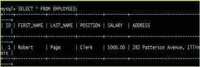

现在，尝试为另一组员工编码以下数据：

| 名字 | 姓氏 | 职位 | 薪资 | 地址 |
| --- | --- | --- | --- | --- |
| John | Malley | 主管 | 7,000.00 | 纽约湖景路 5 号 |
| Kristen | Johnston | 文员 | 4,500.00 | 佛罗里达跳跳路 25 号 |
| Jack | Burns | 代理 | 5,000.00 | 加利福尼亚绿草甸 5 号 |

你需要重复使用 `INSERT INTO` 关键字将每位员工数据输入数据库。语句如下所示：

```
INSERT INTO EMPLOYEES(FIRST_NAME, LAST_NAME, POSITION, SALARY, ADDRESS)
VALUES(‘John’, ‘Malley’, ‘Supervisor’, 7000.00, ‘5 Lake View New York);
INSERT INTO EMPLOYEES(FIRST_NAME, LAST_NAME, POSITION, SALARY, ADDRESS)
VALUES(‘Kristen’, ‘Johnston’, ‘Clerk’, 4000.00, ‘25  Jump Road, Florida’);
INSERT INTO EMPLOYEES(FIRST_NAME, LAST_NAME, POSITION, SALARY, ADDRESS)
VALUES(‘Jack’, ‘Burns’, ‘Agent’, 5000.00, ‘5 Green Meadows, California’)’;
```

要获取更新后的 `EMPLOYEES` 表，请使用带有通配符的 `SELECT` 命令。

```
SELECT * FROM EMPLOYEES:
```

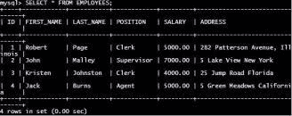

请注意，SQL 为你输入的每组数据分配了一个 ID 号。这是因为你使用 `auto_increment` 属性定义了 `ID` 列。此属性将阻止你在插入数据时使用第一种形式。因此，你必须在 `INSERT INTO table_name` 行中指定其余列。^(^(33))

## 向特定列插入数据

你也可以向特定列插入数据。通过在列列表中指定列名，并在 `INSERT INTO` 语句的 `VALUES` 列表中指定相应的值即可实现。例如，如果你只想输入员工的全名和职位，你需要在列列表中指定列名 `FIRST_NAME`、`LAST_NAME` 和 `SALARY`，并在 `VALUES` 列表中指定名字、姓氏和薪资的值。

要了解其工作原理，请尝试将以下数据输入到 `EMPLOYEES` 表中：

| 名字 | 姓氏 | 职位 | 薪资 | 地址 |
| --- | --- | --- | --- | --- |
| James | Hunt |  | 7,500.00 |  |

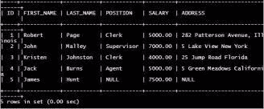

## 插入 NULL 值

在某些情况下，你可能需要向列中插入 `NULL` 值。例如，你可能手头没有数据来输入新员工的薪资。随意提供一个薪资数字可能会产生误导。

语法如下：

```
INSERT INTO schem a.table_name
VALUES (‘colum n1’, NULL, ‘colum n3);
```

你需要这份答案表来检查每个练习中的语法是否正确。如果你在练习中遇到困难，也欢迎使用它。在每个练习结束时，我鼓励你检查自己的答案。

每个练习在开始应用你在各节中学到的知识之前，都会提供概述和示例。

以下是你在接下来的几个练习中将使用的 `Product` 表示例。

| 产品 ID | 名称 | 产品编号 | 颜色 | 标准成本 | 标价 | 尺寸 |
| --- | --- | --- | --- | --- | --- | --- |
| 317 | LL Crankarm | CA-5965 | 黑色 | 0 | 0 | NULL |
| 318 | ML Crankarm | CA-6738 | 黑色 | 0 | 0 | NULL |
| 319 | HL Crankarm | CA-7457 | 黑色 | 0 | 0 | NULL |
| 320 | Chainring Bolts | CB-2903 | 银色 | 0 | 0 | NULL |
| 321 | Chainring Nut | CN-6137 | 银色 | 0 | 0 | NULL |

## 查询结构与 SELECT 语句

理解语法及其结构对你未来非常有帮助。让我们深入探讨最常用语句之一 `SELECT` 语句的基础知识，该语句专门用于检索数据。

```
SELECT Column_Name1, Column_Name2
FROM Table_Name
```

在上面的查询中，你选择了整个表中的两列和所有行。由于你只选择了两列，查询速度会比选择所有列快得多，如下所示：

```
SELECT *
FROM Table_Name
```

从 `Production.Product` 表中选择所有列。

使用同一张表，仅选择 `ProductID`、`Name`、`Product Number`、`Color` 和 `Safety Stock Level` 列。

（提示：列名在表中不包含空格！）

## WHERE 子句

`WHERE` 子句用于过滤查询返回的行数。该子句通过使用条件来工作，例如某列等于、大于、小于某个特定值。

编写语法时，务必记住 `WHERE` 条件位于 `FROM` 语句之后。可使用的运算符类型取决于你正在过滤的数据类型。

### 等于（EQUALS）

用于查找精确匹配。下面的语法使用 `WHERE` 子句查找包含精确字符串 `'Value'` 的列。请注意，字符串需要用单引号括起来，但数值不需要。

```
SELECT Column_Name1, Column_Name2
FROM Table_Name
WHERE Column_Name3 = 'Value'
```

### 介于（BETWEEN）

通常用于查找某个数值范围或日期范围内的值。需要注意的是，`BETWEEN` 比较运算符中的第一个值应小于右侧的值。请注意下面的示例，比较范围在 10 到 100 之间。

```
SELECT Column_Name1, Column_Name2
FROM Table_Name
WHERE Column_Name3 BETWEEN 100 AND 1000
```

### 大于、小于、小于等于、大于等于

SQL Server 提供了比较运算符，可用于比较某些值。

```
SELECT Column_Name1, Column_Name2
FROM Table_Name
WHERE Column_Name3 =< 1000 --注意，你也可以使用 <、>、>= 甚至 <> 表示不等于
```

### 相似（LIKE）

用于搜索列中包含的值或字符串。你仍然需要使用单引号，但需要包含百分号，以指示字符串位于开头、结尾还是字符串范围的任意位置。

```
SELECT Column_Name1, Column_Name2
FROM Table_Name
WHERE Column_Name3 LIKE '%Value%' --搜索任何字段中包含单词 'value' 的记录
```

```
SELECT Column_Name1, Column_Name2
FROM Table_Name
WHERE Column_Name3 LIKE 'Value%' --搜索字段开头包含单词 'value' 的记录
```

```
SELECT Column_Name1, Column_Name2
FROM Table_Name
WHERE Column_Name3 LIKE '%Value' --搜索字段结尾包含单词 'value' 的记录
```

^(^(35))

### IS NULL 和 IS NOT NULL

如前所述，`NULL` 是一个不包含数据的空单元格。最终，你会处理包含 `NULL` 值的表，可以通过几种方式处理。

```
SELECT Column_Name1, Column_Name2
FROM Table_Name
WHERE Column_Name3 IS NULL --过滤该列中为 NULL 的任何值，但不要将 NULL 放在单引号中，因为它不被视为字符串。
```

```
SELECT Column_Name1, Column_Name2
FROM Table_Name
WHERE Column_Name3 IS NOT NULL --过滤该列中不为 NULL 的任何值。
```

再次使用 `Production.Product` 表，选择 `Product ID`、`Name`、`Product Number` 和 `Color`。过滤出颜色为银色的产品。

## 使用 ORDER BY

`ORDER BY` 子句仅用于按升序或降序对数据进行排序，并通过指定要排序的列来确定。该命令默认按升序排序，因此如果要按降序排序，请在命令中使用 `DESC`。

```
SELECT Column_Name1, Column_Name2
FROM Table_Name
WHERE Column_Name3 = 'Value'
ORDER BY Column_Name1, Column_Name2 --按升序排序，你也可以包含 ASC 来指定升序。
```

```
SELECT Column_Name1, Column_Name2
FROM Table_Name
WHERE Column_Name3 = 'Value'
ORDER BY Column_Name1, Column_Name2 DESC --通过在列列表后指定 DESC，按降序排序数据。
```

从 `Production.Product` 表中选择 `Product ID`、`Name`、`Product Number` 和 `List Price`，其中 `List Price` 介于 $100.00 和 $400.00 之间。然后，按标价从小到大对结果进行排序。

（提示：在查询中不要使用 $ 符号，如果需要，可以回顾刚刚学过的排序选项。）^(^(36))

## 数据定义语言 (DDL)

“没有什么比咄咄逼人的愚蠢更糟糕的了。”——约翰·沃尔夫冈·冯·歌德

DDL 是用于在实例或数据库本身内部创建、修改或删除对象的 SQL 语法。以下是一些帮助您入门的示例。DDL 分为三种命令类型：

### `CREATE`

`CREATE` - 这将在数据库或实例中创建对象，例如其他数据库、表、视图等。

```
--创建数据库
CREATE DATABASE DatabaseName
--为当前数据库中的表创建架构（或容器）
```


`CREATE SCHEMA SchemaName`

--在指定架构内创建表

```
CREATE TABLE SchemaName.TableName
(
Column1 datatype PRIMARY KEY,
Column2 datatype(n),
Column3 datatype
)
```

`^(^(37))`

--创建视图

```
CREATE VIEW ViewName
AS
SELECT
Column1,
Column2
FROM TableName
```

### `ALTER`

`ALTER` - 此命令允许您修改现有对象，例如向表中添加额外的列或更改数据库的名称。

```
--修改数据库的名称
ALTER DATABASE DatabaseName MODIFY NAME = NewDatabaseName

--通过添加列来修改表
ALTER TABLE TableName
ADD ColumnName datatype(n)
```

`^(^(38))`

### `DROP`

`DROP` - 此命令允许您删除数据库内的对象或数据库本身。可用于删除表、触发器、视图、存储过程等。请注意，这些项目将不再存在于您的数据库中——或者如果您删除数据库，数据库将不复存在。

```
--删除数据库 - 首先使用 master 数据库
USE master
GO

--然后删除目标数据库
DROP DATABASE DatabaseName
GO

--删除表；应在指定表所在的数据库中执行
DROP TABLE Table_Name

--从当前数据库中删除视图
DROP VIEW ViewName
```

### 应用 DDL 语句

在自己的机器上单击“新建查询”按钮打开一个新的查询窗口，并确保您正在使用 `master` 数据库。

您可以通过检查下方并使用下拉菜单来了解当前使用的数据库并在数据库之间切换。

> 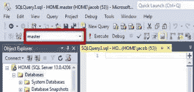

回到“编写 T-SQL 语法指南”部分，您学习了 `USE` 语句以及使用 `GO` 分隔代码批次。

您将在下一个练习中使用它。因此，在练习之前或期间，可以随时回顾该部分。

创建一个名为 `Company` 的数据库。别忘了在使用 `master` 数据库和创建新数据库之间使用 `GO` 语句！

完成此操作后，您将拥有一个可以开始添加表的数据库。以下是一系列练习，您将在其中开始在此数据库中创建第一个架构和表。

创建一个名为 `Dept` 的架构。您将在下一个练习中创建的表将与此架构关联。

创建一个名为 `Department` 的表。该表应包含两列：`Department_Id`（整数数据类型，主键）和 `Department_Name`（数据类型为 `VARCHAR`，长度为 30 字节）。

将数据库的名称从 `Company` 修改为 `Company_Db`。

### 运行 DDL 脚本

现在，是时候下载以下 DDL 脚本来创建您将使用的其余表了。别担心，我已经编写了脚本，只需单击“执行”按钮即可成功运行。只需确保您已正确完成练习，否则脚本将无法运行。

完成此操作后，您将开始运用 DML 知识来添加和检索数据。

## 数据操作语言 (DML)

DML 或数据操作语言正如其名：它操作数据。属于 DML 的语句允许您修改现有数据、创建新数据甚至删除数据。

请注意，DML 并非针对对象（如修改表结构或数据库设置），而是处理这些对象内部的数据。

### `SELECT`

`SELECT` - 此语句是最常见的 SQL 语句，允许您检索数据。它也用于许多报表场景。

```
--从表中选择两列
SELECT
Column_Name1,
Column_Name2
FROM Table_Name
```

### `INSERT`

`INSERT` - 此语句允许您将数据插入到特定数据库的表中。

```
--向表中插入三行数据
INSERT INTO Table_Name
(Column_Name1, Column_Name2) --这两项是列名
VALUES
('Value1', 1), --这里，我将 Value1 插入 Column_Name1，将数字 1 插入 Column_Name2。
('Value2', 2),
('Value3', 3)
```

现在，是时候将数据插入到您的 `Department` 表中了。按如下所示插入值。例如，部门名称为 Marketing 的部门 ID 必须为 1，依此类推。

- `Department_Id`: 1, `Department_Name`: Marketing
- `Department_Id`: 2, `Department_Name`: Development
- `Department_Id`: 3, `Department_Name`: Sales
- `Department_Id`: 4, `Department_Name`: Human Resources
- `Department_Id`: 5, `Department_Name`: Customer Support
- `Department_Id`: 6, `Department_Name`: Project Management
- `Department_Id`: 7, `Department_Name`: Information Technology
- `Department_Id`: 8, `Department_Name`: Finance/Payroll
- `Department_Id`: 9, `Department_Name`: Research and Development

### `UPDATE`

`UPDATE` - 允许您更新现有数据。例如，您可以将表中的现有数据更改为其他值。

建议在更新表中的值时谨慎操作。如果在 `WHERE` 子句中未指定条件，则可能会将某一列中的所有行都赋予相同的值。

```
--更新表中某一列的一个值或一组值
UPDATE Table_Name
SET
Column_Name1 = 'New Value 1', --在此处指定新值
Column_Name2 = 'New Value 2'
WHERE
Column_Name1 = 'Old Value' --使用 WHERE 子句作为条件

--将表中所有行的某一列更新为相同的值
UPDATE Table_Name
SET Column_Name1 = 'Value'
```

`^(^(39))`

现在，您将更新表中一个部门的名称。假设您认为“Finance/Payroll”这个名称不合适，因为工资单是由员工通过在线门户处理的。因此，只剩下财务，但根据该部门员工的职责，最好将其称为“Accounting”。

更新 `Department` 表，根据其 ID 将值从“Finance/Payroll”更改为“Accounting”。

### `DELETE`

`DELETE` - 此操作不言自明；它从指定对象（如表）中删除数据。运行 `DELETE` 语句时最好谨慎操作。

如果在查询中不使用 `WHERE` 子句，最终将删除表中的所有数据。因此，在 `DELETE` 语句中始终使用 `WHERE` 子句是最佳实践。

*注意：* 与 `UPDATE` 语句类似，只要在查询中使用了 `WHERE` 子句，您也可以将语句中的 `DELETE` 替换为 `SELECT` 来查看将要删除的数据。与 `UPDATE` 语句一样，当删除一个值时，最好使用主键作为 `WHERE` 子句中的条件！

```
--在 DELETE 语句中使用条件，仅删除某个值或一组值
DELETE FROM Table_Name
WHERE Column_Name1 = 'Some Value'

--删除表中的所有数据，因为没有使用 WHERE 子句
DELETE FROM Table_Name
```

假设这家公司实际上没有研发（R&D）部门。也许他们还没有发展到足够规模，或者不需要该部门。

在本练习中，请根据部门 ID 从 `Department` 表中删除“研发”部门。

## 运行 DML 脚本

现在，你需要下载以下 DML 脚本，以便向 `Company_Db` 数据库中填充数据。再次提醒，请确保你已正确完成前面的练习，否则脚本将无法正常运行。

这些数据将用于“数据转换”部分的后续练习。因此，请记住，除非另有说明，每个练习都指的是 `Company_Db` 数据库。

# 第 6 章：数据库管理

“法律过于温和，很少有人遵守；过于严苛，则很少有人执行。”——本杰明·富兰克林

要踏上数据库管理员、数据库开发人员甚至数据分析师的道路，你需要了解如何备份、还原和管理数据库。这些是维护数据库的基本组成部分，也是重要的职责。

## 恢复模式

SQL Server 中每个数据库可以使用多种不同的恢复模式。恢复模式是数据库的一个选项或模式，决定了可以备份和还原的信息类型。

根据你的具体情况，例如如果你无法承受关键数据的丢失，或者想要镜像生产环境，你可以将恢复模式设置为你需要的模式。另外，请记住，你选择的恢复模式也可能影响备份或还原数据库及日志所需的时间，具体取决于它们的大小。

以下是恢复模式及其简要说明。每个模式末尾的 SQL 语句示例是用于设置恢复模式的命令。

### 完整

此模式涵盖数据库中的所有数据以及事务日志历史记录。

使用此模式并执行数据库还原时，它提供“时间点”恢复。这意味着，例如，如果在还原过程中某个时间点数据丢失，它可以让你回滚并恢复该数据。

如果你无法承受任何数据丢失，这是理想的恢复模式。

根据数据大小，备份和还原可能需要更多时间。

*   可以执行完整备份、差异备份和事务日志备份。

```
ALTER DATABASE DatabaseName SET RECOVERY FULL
```

### 简单

此模式也涵盖数据库中的所有数据，但会回收事务日志。当数据库还原时，事务日志将为空，并记录后续的新活动。

与“完整”恢复模式不同，事务日志将被重新用于新事务，因此如果数据意外丢失或删除，无法通过回滚来恢复数据。

如果你有一个空白服务器，需要快速轻松地还原数据库，或者只是镜像另一个环境并将其用作测试实例，这是一个很好的选择。

*   只能执行完整备份和差异备份，因为此恢复模式下事务日志会被回收。

```
ALTER DATABASE DatabaseName SET RECOVERY SIMPLE
```

### 大容量日志

此特定模式通过忽略 SQL Server 中的大容量操作（如 `BULK INSERT`、`SELECT INTO` 等）来工作，并且不将这些操作存储在事务日志中。这有助于释放事务日志空间，并使备份和还原过程更轻松、更快速。

使用此方法，你可以实现“时间点”恢复，因为它与“完整”恢复模式的工作方式类似。

如果你的数据至关重要，并且数据库进程经常使用大容量语句，那么此恢复模式是理想的。但是，如果你的数据库不经常使用大容量语句，则建议使用“完整”恢复模式。

*   可以执行完整备份、差异备份和事务日志备份。

```
ALTER DATABASE DatabaseName SET RECOVERY BULK_LOGGED
```

假设你正在进行一个大型数据库项目，需要备份数据库。请使用 SQL 语法（以及上面的示例）将 `Company_Db` 的恢复模式设置为“完整”，以准备备份过程。

## 数据库备份方法

有几种主要的备份方法可用于备份 SQL Server 中的数据库，每种方法都依赖于所使用的恢复模式。在前面的恢复模式部分中，每种模式的最后一点讨论了可以执行的备份类型，即完整备份、差异备份和事务日志备份。

注意：如果你不记得每种恢复模式可以执行的备份类型，请给自己一些时间！最终你会记住的！

每种备份方法将执行以下操作：

### 完整

完整备份整个数据库以及事务日志（如果适用）。

如果需要将同一数据库添加到新服务器进行测试，则此方法非常理想。

如果数据库较大，并且备份整个数据库和事务日志，则备份可能需要更长时间。

*   但是，由于你备份的是整个数据库，因此不需要像差异备份那样频繁执行。

```
BACKUP DATABASE DatabaseName TO DISK = 'C:\SQLBackups\DatabaseName.BAK'
```

### 差异

差异备份依赖于完整备份，因此必须首先执行完整备份。但是，它会备份自上次完整备份到差异备份执行时间点之间的所有数据更改。

它在任何情况下都是理想的，但由于数据库频繁添加新数据，因此必须更频繁地执行。

它比完整备份快得多，并且占用更少的存储空间。

*   但是，它不能完全捕获整个数据库，因此必须定期执行。

```
BACKUP DATABASE DatabaseName TO DISK = 'C:\SQLBackups\DatabaseName.BAK' WITH DIFFERENTIAL
```

### 事务日志

与差异备份一样，它依赖于完整备份。

备份数据库中发生的所有活动。

在某些情况下（例如完整还原数据库时）非常有用且必要。

由于事务日志保存了数据库历史中的活动，因此建议频繁备份，以免日志体积过大。

某些日志初始体积较大，但随着备份频率增加，体积可能会变小（取决于数据库中的活动）。

*   因此，如果数据库活动较少且备份频繁，日志的备份和还原可能会很快。

```
BACKUP LOG DatabaseName TO DISK = 'C:\SQLBackups\DatabaseName.TRN'
```

在上一练习中，你将 `Company_Db` 的恢复模式设置为“完整”。现在，在本练习中，你将备份该数据库。

首先，使用完整备份方法对数据库进行完整备份。

接下来，删除 `Sales.Product_Sales` 表中的所有数据（旨在模拟数据丢失）。

最后，查询刚刚删除数据的表，以确保数据不存在。稍后，你将还原数据库，并确保数据存在于 `Sales.Product_Sales` 表中。

## 数据库还原

在数据库领域，你可能会听到，还原数据库最重要的部分是使用可靠的备份。这完全正确！因此，确保使用正确的恢复模式非常重要。

### 准备还原数据库

需要注意的一点是，`.bak` 文件通常包含文件组或其中的文件。每个文件可以是完整备份或差异备份。了解你要还原的是哪种备份很重要，但你也可以指定要还原的文件。但是，如果你不指定，SQL Server 将选择默认文件（即文件 1）。这通常是完整备份。

首先，使用 `RESTORE HEADERONLY` 来识别 `.BAK` 文件中的文件。这是在还原数据库之前应该做的事情。

```
--查看数据库备份文件
RESTORE HEADERONLY FROM DISK = 'C:\SQLBackups\DatabaseName.BAK'
```

运行上述查询后，请查看“`BackupType`”列中的数字。`1` 表示完整备份，而 `5` 表示差异备份。

此外，你需要使用的文件编号位于“`Position`”列中。在下面的示例中，请注意文件编号 `8` 是完整备份，文件编号 `9` 是差异备份。

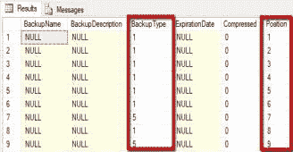

另外，你必须先使用“`master`”数据库，然后将目标数据库设置为非活动状态（`SINGLE_USER`），以便在还原之前只允许一个打开的数据库连接。

在下面的语法中，`WITH ROLLBACK IMMEDIATE` 表示任何未完成的事务都将被回滚（不完成），以便将数据库设置为单个打开的连接状态。

```
--将数据库设置为仅允许一个打开的连接
--所有其他与数据库的连接必须关闭，否则还原将失败
ALTER DATABASE DatabaseName SET SINGLE_USER WITH ROLLBACK IMMEDIATE
```

还原完成后，你可以将数据库重新设置为活动状态（`MULTI_USER`），如下所示。此状态允许多个用户连接到数据库，而不仅仅是单个用户。

```
--将数据库设置为允许多个连接
ALTER DATABASE DatabaseName SET MULTI_USER
```

## 数据库还原类型

以下是根据你的情况/需求可以执行的还原类型概述。

### 完整还原

还原整个数据库，包括其文件。

如果数据库已存在，则使用 `WITH REPLACE` 选项覆盖它。

如果恢复模式设置为“完整”，则需要使用 `WITH REPLACE` 选项。

使用 `FILE =` 参数选择要还原的文件（可以是完整备份或差异备份）。

如果恢复模式设置为“简单”，则不需要 `WITH REPLACE` 选项。

如果数据库不存在，它将创建数据库，包括其文件和数据。

从 `.BAK` 文件还原。

```
--如果恢复模式设置为完整 - 同时选择备份集中的文件 #1
RESTORE DATABASE DatabaseName FROM DISK = 'C:\SQLBackups\DatabaseName.BAK' WITH FILE = 1, REPLACE

--如果恢复模式设置为简单
RESTORE DATABASE DatabaseName FROM DISK = 'C:\SQLBackups\DatabaseName.BAK'
```

### 差异还原

使用 `RESTORE HEADERONLY` 查看可用的备份文件，即完整备份和差异备份文件类型。

你必须先使用 `NORECOVERY OPTION` 对 `.BAK` 文件执行完整还原，因为 `NORECOVERY` 选项表示还需要还原其他文件。

一旦指定了要还原的完整备份文件并使用 `WITH NORECOVERY`，你就可以还原差异备份。

最后，你应该在最后一次差异文件还原中包含 `RECOVERY` 选项，以表示没有更多文件需要还原。

作为参考，下面的语法使用了之前 `RESTORE HEADERONLY` 截图中的文件。

```
--首先执行完整数据库备份文件的还原
RESTORE DATABASE DatabaseName FROM DISK = 'C:\SQLBackups\DatabaseName.BAK' WITH FILE = 8, NORECOVERY

--现在执行差异备份文件的还原
```


```sql
RESTORE DATABASE DatabaseName FROM DISK = 'C:\SQLBackups\DatabaseName.BAK' WITH FILE = 9, RECOVERY
```

### 日志还原

这是执行彻底数据库还原的最后一步。

你必须先还原数据库的“完整”或“差异”副本，然后还原日志。

- 最后，在还原数据库备份时必须使用`NORECOVERY`选项，以便数据库保持还原状态，并允许你还原事务日志。

由于你已经对数据库进行了备份，并且`Sales.Product_Sales`表中的数据“丢失”，现在是时候完整还原数据库了。

为此，你首先需要使用“`master`”数据库，然后将数据库设置为单用户状态，执行还原，最后将其重新设置为多用户状态。

还原数据库后，从`Sales.Product_Sales`表中检索所有数据，以验证数据再次存在。

## 附加和分离数据库

如你所知，因为你已经完成了这一部分，附加和分离数据库的方法类似于备份和还原。

本质上，此方法的详细信息如下：

- 允许你将`.MDF`文件和`.LDF`文件复制到新磁盘或服务器。
- 执行类似于备份和还原的过程，但根据情况有时可能更快。
- 数据库将脱机，任何用户或应用程序都无法访问。它将保持脱机状态，直到重新附加。

那么，你应该选择哪一种？虽然备份是理想的选择，但在某些情况下，附加/分离数据库可能是你唯一的选择。

考虑以下场景：

你的数据库包含许多文件组。附加这些文件组可能相当繁琐。

最佳解决方案是备份数据库，然后将其还原到目标位置，因为备份过程会将所有文件组合在一起。

根据数据库的大小，备份/还原过程可能需要很长时间。但是，如果需要尽快完成，附加/分离数据库可能会快得多。

- 在这种情况下，你可以使数据库脱机，分离它，然后重新附加到新目标。

如你所知，在采用附加数据库的方法时，有两个主要的文件组。这些文件是`.MDF`和`.LDF`。`.MDF`文件是数据库的主数据文件，它保存数据库的结构和数据。`.LDF`文件保存事务日志记录活动和历史记录。

然而，备份数据库时创建的`.BAK`文件将所有文件组合在一起，你可以从单个备份集还原不同的文件版本。

在使用任一选项之前，请考虑你的情况，但也要将备份和还原作为首选，然后将附加/分离方法作为次选。此外，在用于实际数据之前，请务必进行测试！

### 附加/分离 AdventureWorks2012 数据库

由于你已经附加了此数据库，现在让我们将其从服务器上分离。之后，你将使用 SQL 语法再次附加它。

#### 分离数据库

在 SQL Server 中，有一个存储过程可以为你分离数据库。这个特定的存储过程位于“`master`”数据库中。在底层，你可以通过以下操作查看存储过程的复杂性：

1. 点击展开`Databases`文件夹。
2. 点击`System Databases`，然后点击`Master`数据库。
3. 点击`Programmability`。
4. 点击`Stored Procedures`，然后点击`System Stored Procedures`。
5. 找到`sys.sp_detach_db`，右键单击它，然后在 SSMS 中选择“修改”。你将看到它的语法。

为此，只需按原样执行存储过程。

语法如下：

```sql
USE master

GO

ALTER DATABASE DatabaseName SET SINGLE_USER WITH ROLLBACK IMMEDIATE

GO

EXEC master.dbo.sp_detach_db @dbname = N'DatabaseName', @skipchecks = 'false'

GO
```

为了进一步说明正在发生的事情，你需要使用“`master`”数据库来修改将要分离的数据库，并将其设置为单用户而不是多用户。

最后，`@dbname`后面的值允许你指定要分离的数据库名称，而`@skipchecks`设置为`false`意味着数据库引擎将更新统计信息，标识数据库已被分离。在分离数据库时，最好将其设置为`@false`，以便系统保存所有数据库的当前信息。

现在，从你的服务器实例中分离`AdventureWorks2012`数据库。使用上面的 SQL 示例作为指导。

#### 附加数据库

分离数据库后，如果导航到数据目录所在的位置，你会看到`AdventureWorks2012_Data.MDF`文件仍然存在——这是正常的，因为你只是分离了它，并没有删除它。

接下来，获取`.MDF`文件的路径，并将其复制粘贴到便于访问的位置，例如记事本中。

我的路径是`C:\Program Files\Microsoft SQL Server\MSSQL13.MSSQLSERVER\MSSQL\DATA`。

连接到实例并打开新的查询会话后，你只需使用数据文件存储的路径。有了该路径后，你可以将其输入到以下 SQL 语法示例中，以便附加数据库。

下面是用于附加数据库文件和日志文件的语法。因此，在接下来的练习中，你将完全跳过附加日志文件，因为你并不是将其附加到新服务器上。所以，你可以省略附加日志文件的语句。

```sql
CREATE DATABASE DatabaseName ON (FILENAME = 'C:\SQL Data Files\DatabaseName.mdf'), (FILENAME = 'C:\SQL Data Files\DatabaseName_log.ldf') FOR ATTACH
```

在上面的示例中，我指出了如果存在日志文件则附加它的语句。但是，如果你恰好没有`.LDF`文件而只有`.MDF`文件，那也没关系。你可以只附加`.MDF`文件，数据库引擎会创建一个新的日志文件，并开始将活动写入该特定日志。

在本练习中，假设你已将此数据库从旧服务器分离，并准备将其附加到新服务器。请使用上面的语法作为示例，来附加`AdventureWorks2012`数据库。

每个练习在开始应用各章节所学内容之前，都会提供概述和示例。

下面是你将在接下来的几个练习中使用的`Production.Product`表示例。

| 产品 ID | 名称 | 产品编号 | 颜色 | 标准成本 | 标价 | 尺寸 |
| --- | --- | --- | --- | --- | --- | --- |
| 317 | LL 曲柄臂 | CA-5965 | 黑色 | 0 | 0 | NULL |
| 318 | ML 曲柄臂 | CA-6738 | 黑色 | 0 | 0 | NULL |
| 319 | HL 曲柄臂 | CA-7457 | 黑色 | 0 | 0 | NULL |
| 320 | 齿盘螺栓 | CB-2903 | 银色 | 0 | 0 | NULL |
| 321 | 齿盘螺母 | CN-6137 | 银色 | 0 | 0 | NULL |

## 查询结构与 SELECT 语句

理解语法及其结构对你未来会非常有帮助。让我们深入探讨最常用语句之一——SELECT 语句的基础知识，该语句仅用于检索数据。

```sql
SELECT Column_Name1, Column_Name2

FROM Table_Name
```

在上面的查询中，你选择了整个表中的两列和所有行。由于只选择了两列，查询速度比选择所有列要快得多，如下所示：

```sql
SELECT *

FROM Table_Name
```

从表`Production.Product`中选择所有列。

使用同一个表，仅选择 ProductID、Name、Product Number、Color 和 Safety Stock Level 列。

（提示：表中的列名不包含空格！）

### WHERE 子句

WHERE 子句用于过滤查询返回的行数。该子句通过使用条件来工作，例如某列等于、大于、小于、介于或类似于某个值。

编写语法时，请记住 WHERE 条件必须放在 FROM 语句之后。

**等于（EQUALS）**——用于查找精确匹配。下面的语法使用 WHERE 子句查找包含精确字符串`'Value'`的列。注意，字符串需要用单引号括起来，而数值则不需要。

```sql
SELECT Column_Name1, Column_Name2

FROM Table_Name

WHERE Column_Name3 = 'Value'
```

**介于（BETWEEN）**——通常用于查找某个数值范围或日期范围内的值。需要注意的是，BETWEEN 比较运算符中的第一个值应小于右侧的值。注意下面的示例比较的是 10 到 100 之间的值。

```sql
SELECT Column_Name1, Column_Name2

FROM Table_Name

WHERE Column_Name3 BETWEEN 10 AND 100
```

**大于、小于、小于等于、大于等于（GREATER THAN, LESS THAN, LESS THAN OR EQUAL TO, GREATER THAN OR EQUAL TO）**——SQL Server 提供了比较运算符，可用于比较特定值。

```sql
SELECT Column_Name1, Column_Name2

FROM Table_Name

WHERE Column_Name3 =< 1000 --注意，你也可以使用 <、>、>= 或 <>（表示不等于）
```

**类似于（LIKE）**——用于搜索列中包含的值或字符串。你仍然使用单引号，但需要包含百分号，以指示字符串位于开头、结尾或字符串范围的任意位置。

```sql
SELECT Column_Name1, Column_Name2

FROM Table_Name

WHERE Column_Name3 LIKE '%Value%' --搜索任何字段中包含单词 'value' 的记录
```

```sql
SELECT Column_Name1, Column_Name2

FROM Table_Name

WHERE Column_Name3 LIKE 'Value%' --搜索字段开头包含单词 'value' 的记录
```

```sql
SELECT Column_Name1, Column_Name2

FROM Table_Name

WHERE Column_Name3 LIKE '%Value' --搜索字段结尾包含单词 'value' 的记录
```

**IS NULL 和 IS NOT NULL**——如前所述，NULL 是一个不包含任何数据的空单元格。最终，你会遇到包含 NULL 值的表，可以通过几种方式处理。

```sql
SELECT Column_Name1, Column_Name2

FROM Table_Name

WHERE Column_Name3 IS NULL --过滤该列中所有为 NULL 的值，但不要将 NULL 放在单引号中，因为它不被视为字符串。
```

```sql
SELECT Column_Name1, Column_Name2

FROM Table_Name

WHERE Column_Name3 IS NOT NULL --过滤该列中所有不为 NULL 的值。
```

再次使用`Production.Product`表，选择 Product ID、Name、Product Number 和 Color。过滤出颜色为银色的产品。

### 使用 ORDER BY

ORDER BY 子句用于按升序或降序对数据进行排序，具体取决于你希望从哪一列开始。该命令默认按升序排序，因此如果你想按降序排序，请在命令中使用 DESC。

```sql
SELECT Column_Name1, Column_Name2

FROM Table_Name

WHERE Column_Name3 = 'Value'

ORDER BY Column_Name1, Column_Name2 --按降序排序，但你也可以包含 ASC 来按升序排序。
```

```sql
SELECT Column_Name1, Column_Name2

FROM Table_Name

WHERE Column_Name3 = 'Value'

ORDER BY Column_Name1, Column_Name2 DESC --通过在列列表后指定 DESC，按降序对数据进行排序。
```

然后，将结果按标价从小到大排序。

（提示：查询中不要使用`$`符号，如果需要，可以参考刚刚回顾的排序选项。）

## 第 7 章：SQL 事务

“仅仅因为某件事没有按你计划的方式运行，并不意味着它毫无用处。”——托马斯·爱迪生

### 什么是 SQL 事务？

事务是以逻辑顺序对数据库执行的一系列任务。我们将每个事务视为一个工作单元。事务让你能更好地控制 SQL 行为，这对于维护数据完整性或避免数据库错误至关重要。

在第 3 章中，我们详细讨论了数据完整性以及可以确保这种完整性的各种方法。然而，这假设了多个用户不会同时访问同一数据。

实际上，情况可能并非如此。

当许多用户试图修改数据时，可能会出现操作相互重叠的情况。在很多情况下，一个用户对数据执行了特定操作，但这些操作可能无效。他或她并未意识到数据已被破坏，因为另一个用户同时执行了操作。由于两个用户都不会立即察觉到任何变化，数据可能会在相当长的时间内保持不一致。

考虑到这一点，所有用户都会继续认为数据是完整的，并且没有任何需要他们监督的问题。

让我们通过一个例子来理解上述场景。假设有两个用户，用户 A 和用户 B，他们同时处理某个客户的数据。

用户 A 可能会注意到客户的姓氏不正确，于是开始修改姓名，并在修改后立即保存数据。用户 B 可能正在处理客户数据的另一部分，比如客户的地址或电话号码。然而，用户 A 的更改可能不会反映在用户 B 的界面上。用户 B 可能仍在用旧的、错误的姓氏处理客户数据，在保存数据时无意中将姓氏改成了错误的条目。

现在，两位用户都未意识到他们工作中的不一致，这个问题可能会在很长一段时间内不被察觉。考虑到只发生了一个错误，这似乎有些微不足道。然而，想象一下这种情况反复发生，导致大量数据出现不一致。到时候，你将被迫检查所有数据。如果你的数据库很大，这可能会花费你相当多的时间。

使用 SQL 事务，连续的操作或更改不会影响其他用户所看到的数据的有效性。

SQL 事务让你能够`commit` SQL 语句，从而将这些语句应用到数据库中。或者，你也可以`rollback`，这将撤销数据库中的语句。

在 SQL 事务中，一个操作如果成功通过四个特性（用首字母缩写 ACID 表示），就会转化为一个事务。

**原子性（Atomic）**

该特性关注事务的“全有或全无”原则。它确保事务中所有操作的执行。如果某个操作在任何环节失败，整个事务将被中止。此外，如果只执行了部分语句，事务将回滚到之前的状态。要成功完成事务并将其应用到数据库，所有操作都必须正确且无一缺失。

**一致性（Consistent）**

通过该特性，数据库不仅在事务开始时必须保持一致，在事务完成后也必须保持一致。因此，如果一组操作在执行过程中任何时刻导致一致性发生变化，事务将恢复到原始状态。

**隔离性（Isolated）**

当特定事务正在执行时，数据可能处于不一致状态。这种不一致有可能影响数据库，因此在事务完成之前，数据将不可用于其他操作。它将不受任何外部影响。换句话说，它将被隔离。此外，没有其他事务能以任何方式影响或干扰该隔离事务，从而确保完整性不受损害。

**持久性（Durable）**

当所有事务完成后，任何更改或修改都必须被保留和维护。在硬件或应用程序发生错误时，不应丢失数据；数据应可靠且一致地可用。该特性确保在发生此类事件时数据仍然可用。

需要注意的是，无论操作是完成还是回滚，事务始终维护数据库的完整性。

有七个命令可用于管理事务。它们是：

- `COMMIT`：保存更改并将其提交到数据库。
- `ROLLBACK`：将更改回滚到特定的`SAVEPOINT`，或事务的开始。更改不会应用到数据库。
- `SAVEPOINT`：在事务内创建一个保存点（一种标记）。当执行`ROLLBACK`时，你可以回滚到该点，而不是事务的开始。
- `RELEASE SAVEPOINT`：移除或释放一个保存点。执行此命令后，任何`ROLLBACK`都会将事务恢复到原始状态。
- `SET TRANSACTION`：为特定事务的执行创建特性。
- `START TRANSACTION`：设置事务的特性并开始事务。
- `SET CONSTRAINTS`：在事务内建立约束模式。约束创建了一个条件，决定是在数据开始修改时立即应用约束，还是延迟到事务完成后再应用约束。

接下来看另一个示例。

重要的是要记住，当你即将开始一个事务时，数据库处于原始状态。在这种状态下，你可以预期数据是一致的。一旦你执行事务，这些事务中的 SQL 语句就开始处理。如果处理成功，则使用`COMMIT`命令。该命令使 SQL 语句更新数据库并结束事务。如果更新过程不成功，则使用`ROLLBACK`命令。这个过程让你对命令有了一个简要的了解。不过，我们将深入探讨它们的功能。

**提交（Commit）**

当特定事务中的所有语句都完成时，下一步就是终止该事务。终止事务的推荐方法之一是将到目前为止对数据库所做的所有更改提交。当你对自己所做的更改有信心时，就可以使用`COMMIT`命令。以下是可用于提交语句的语法语句：

```sql
COMMIT [WORK] [AND CHAIN]

COMMIT [WORK] [AND NO CHAIN]
```


你必须记住，`WORK`条目的使用不是强制性的。仅`COMMIT`关键字就足以处理`COMMIT`命令。实际上，`COMMIT`和`COMMIT WORK`条目的用途相同。早期版本的 SQL 曾包含`WORK`关键字，一些用户可能更熟悉它。但是，如果你不习惯使用它，则不必包含它来执行`COMMIT`命令。

`AND CHAIN`子句是`COMMIT`语句中另一个可选的包含项。它在 SQL 实现中并不常用。`AND CHAIN`子句只是告诉系统在当前事务结束后立即开始一个新事务。使用此子句，你无需使用`SET TRANSACTION`或`START TRANSACTION`语句，系统会自动继续下一步。

然而，这可能被证明是一个缺点而非便利。由于你需要完全控制事务，最好使用替代方案。与其在`COMMIT`语句中使用`AND CHAIN`，不如尝试使用`AND NO CHAIN`参数。这基本上让系统知道它不应该以与当前事务相同的设置开始一个新事务。如果未提及任何一个参数（`AND CHAIN`或`AND NO CHAIN`），则`AND NO CHAIN`将是系统采用的默认子句。

你的`COMMIT`语句可能如下所示：

```
COMMIT;
```

我们没有包含上述两个子句中的任何一个。但是，要知道如果你希望系统自动开始一个新事务，请使用以下语句：

```
COMMIT AND CHAIN;
```

假设你有一个名为`EMPLOYEES`的表，包含`names`和`salaries`列。

| 姓名     | 薪资    |
|----------|---------|
| John     | 5,000   |
| Mary     | 7,000   |
| Jennifer | 9,000   |
| Mark     | 10,000  |
| Adam     | 7,000   |

如果你想删除薪资为 7,000 的记录，只需使用以下语句：

```
SQL > DELETE FROM EMPLOYEES
WHERE SALARIES = 7,000
SQL > COMMIT;
```

现在，如前所述，如果你希望当前事务执行后立即开始下一个事务，那么你的语句将如下所示：

```
SQL > DELETE FROM EMPLOYEES
WHERE SALARIES = 7,000
SQL > COMMIT AND CHAIN;
```

## 回滚（Rollback）

人为错误在任何过程中都是永久存在的。因此，如果你遇到需要回滚的情况，那么该语句赋予你执行此类操作的能力。

通过使用`ROLLBACK`，你可以撤销到目前为止执行的所有语句，要么将它们回滚到特定的保存点（如果你已经建立了这样的保存点），要么将它们回滚到事务的开始。

让我们看看`ROLLBACK`语句的一些参数或包含项：

`ROLLBACK [WORK] [AND CHAIN]`

`ROLLBACK [WORK] [AND NO CHAIN]`

当用户对数据进行更改但未使用`COMMIT`语句时，这些更改会以临时格式（称为事务日志）存储。用户可以查看这些未保存的数据，分析其是否满足特定要求。如果更改没有达到用户期望的结果，他们可以执行`ROLLBACK`，确保数据不被保存，然后重新处理。

用户还可以使用`ROLLBACK`功能，在硬件故障或应用程序崩溃时将数据库回滚到保存点或事务的开始。如果断电中断了你的工作，那么一旦系统重新启动，`ROLLBACK`功能将检查所有待处理的事务，并回滚所有语句。

与`COMMIT`语句不同，`ROLLBACK`可以选择包含`TO SAVEPOINT`参数。使用`TO SAVEPOINT`子句时，系统不会取消事务。你只会被带到某个特定点，从那里可以继续工作。

如果你希望取消事务，只需从语句中移除`TO STATEMENT`参数。

以下是`ROLLBACK`语句最基本形式的示例：

```
ROLLBACK;
```

请注意，我们没有使用`AND CHAIN`参数。这是因为，如前文在`COMMIT`命令部分所述，系统默认使用`AND NO CHAIN`命令。或者，如果你希望在当前事务结束后启动一个新事务，可以使用`AND CHAIN`命令。但请记住，你不能同时使用`TO SAVEPOINT`和`AND CHAIN`参数。这是因为`TO SAVEPOINT`命令要求终止当前事务。

当包含`TO SAVEPOINT`参数时，请确保添加保存点的名称。下面是一个示例：

```
ROLLBACK TO SAVEPOINT;
```

`SAVEPOINT`值会被替换为保存点的名称，如下例所示：

```
BEGIN
SELECT customer_number, customer_lastname, purchases
> DELETE FROM customer_number WHERE purchases < 10000;
> SAVEPOINT section_1;
> ROLLBACK TO section_1;
END;
```

虽然上面的示例是命令的一种相当简单的形式，但其目的是让你清楚`SAVEPOINT`的用法和命名。请注意，你可以在`SAVEPOINT`命令和`ROLLBACK`子句之间输入任意数量的参数。

如果你指定了一个保存点名称，那么回滚命令会将你带回到那个特定的保存点，无论中间是否存在其他保存点。

```
BEGIN
SELECT customer_number, customer_lastname, purchases
DELETE FROM customer_number WHERE purchases < 10000;
SAVEPOINT section_1;
SAVEPOINT section_2;
SAVEPOINT section_3;
SAVEPOINT section_4;
ROLLBACK TO section_1;
END;
```

请注意，即使你有名为`section_2`到`section_4`的保存点，你要求系统回滚到`section_1`。这样做时，系统将忽略所有其他保存点。

## 保存点

既然我们谈到了保存点，让我们看看这些命令为什么重要，以及如何使用它们。

本质上，你将处理一组复杂的事务。为了更容易理解事务，你会将不同的部分分组为单元。以这种方式分解事务，可以让你轻松识别问题，并知道需要到达哪个部分来解决问题。

但问题来了：如何在不改变整个事务的情况下到达这些部分？

当然，你可以使用`SAVEPOINT`命令！

此时，你应该注意一个重要点。MySQL 和 Oracle 支持`SAVEPOINT`参数，但如果你使用 SQL Server，则可能会使用`SAVE TRANSACTION`查询。

然而，`SAVEPOINT`和`SAVE TRANSACTION`参数的功能是相同的。

让我们看一个示例，了解保存点功能如何工作。

步骤 1：开始事务  
步骤 2：SQL 语句  
步骤 3：如果 SQL 语句成功，则继续执行。如果 SQL 语句不成功，则回滚到事务的开始  
步骤 4：输入`SAVEPOINT 1`  
步骤 5：SQL 语句  
步骤 6：如果 SQL 语句成功，则继续执行。如果 SQL 语句不成功，则回滚到`SAVEPOINT 1`  
步骤 7：输入`SAVEPOINT 2`  
步骤 8：SQL 语句  
步骤 9：如果 SQL 语句成功，则继续执行。如果 SQL 语句不成功，则回滚到`SAVEPOINT 2`  
步骤 10：`COMMIT`

在上面的示例中，我们在处理 SQL 语句后设置了保存点。当我们执行这个流程时，我们开始处理特定的 SQL 语句，然后再跳转到下一个。这确保我们正确执行所有语句，如果语句中有错误，我们可以重新处理它们。一旦系统认为语句完全成功，我们就可以使用保存点并继续下一组操作。通过这样做，我们保留了第一组操作的完整性。在保存点之后，我们可以继续前进，知道第一个语句不会发生任何更改。

这成为处理一组操作而不必担心先前操作完整性的便捷方法。

创建保存点的过程相当简单。你只需使用以下命令：

```
SAVEPOINT <保存点名称>
```

保存点名称不必是`SECTION_1`。那只是为了示例而选择的名称。你可以选择自己的名称，最好是当你想要时容易回忆的名称。

## 释放保存点

在事务中完成某些操作后，你可能不再需要之前建立的保存点。为了删除它们，你可以使用`RELEASE SAVEPOINT`命令。

但请注意，一旦释放了保存点，你将无法再回滚到它。因此，释放保存点的理想方式是检查你是否对到目前为止的工作感到满意。尽职调查可能是一项额外的任务，但它会让你有信心完成工作。

要释放保存点，只需输入以下命令：

```
RELEASE SAVEPOINT <保存点名称>
```

让我们举一个例子，假设你有以下保存点：

```
SAVEPOINT section_1;
SAVEPOINT section_2;
SAVEPOINT section_3;
SAVEPOINT section_4;
```

要释放所有保存点，你必须指定每一个。

因此，过程如下所示：

```
RELEASE SAVEPOINT section_1;
RELEASE SAVEPOINT section_2;
RELEASE SAVEPOINT section_3;
RELEASE SAVEPOINT section_4;
```

你可以一次性释放所有保存点，也可以选择释放其中一个而保留其余。这是可以接受的。你只需确保使用正确的保存点名称。另一个需要记住的要点是，你不必按照创建保存点的顺序使用释放命令。你可以随时以任何顺序释放任何保存点。

## 设置事务

此命令允许你处理事务的不同属性。这些属性可以是以下之一：

* 只读
* 读写
* 指定隔离级别
* 附加到回滚属性

`SET TRANSACTION`操作的任何影响仅影响你的事务。其他用户不会注意到他们那边的任何变化。

你可以使用以下命令建立`SET TRANSACTION`：

```
SET TRANSACTION <模式>
```

在上述命令中，`<模式>`指的是你想要指定的选项类型。你可以在`SET TRANSACTION`中使用三种模式。它们是：

### 访问级别

在`SET TRANSACTION`中，有两种访问级别：`READ ONLY`（只读）和`READ WRITE`（读写）。如果选择`READ ONLY`选项，系统将不允许你对数据库进行任何更改。但如果选择`READ WRITE`访问级别，你可以在事务中添加语句来修改数据甚至数据库结构。

### 隔离级别

还记得我们讨论过如何隔离事务，使其在处理过程中不受任何影响吗？现在，我们将讨论如何设置隔离级别。

对于`SET TRANSACTION`，你可以使用四种隔离级别，如下面的语法所示：

```
SET TRANSACTION ISOLATED LEVEL
READ UNCOMMITTED
READ COMMITTED
REPEATABLE READ
SERIALIZABLE
```

隔离级别按有效性顺序排列，`READ UNCOMMITTED`是可用的最低隔离级别，而`SERIALIZABLE`是最高隔离级别。如果你未指定隔离级别，系统将默认采用`SERIALIZABLE`级别，为你的事务提供最大程度的隔离。

### 诊断大小

`SET TRANSACTION`允许你指定诊断大小。你指定的大小让系统知道为条件分配多少空间。在 SQL 语句中，条件是指语句引发的消息、警告或其他通知。如果你未指定诊断大小，数据库将自动为你分配一个。这个数字不是固定的，因数据库而异。

## 启动事务

在数据库中，你可以显式启动事务，也可以在开始执行命令时自动启动。

例如，当你使用`DELETE`、`CREATE TABLE`等命令时，可以启动一个事务。

或者，你也可以使用`START TRANSACTION`语句来启动事务。

与`SET TRANSACTION`类似，你也可以在此处指定一个或多个模式。这些就是我们之前提到的访问级别、隔离级别和诊断大小模式。

以下是`START TRANSACTION`命令的示例：

```
START TRANSACTION
READ ONLY
INSOLATION LEVEL SERIALIZED
DIAGNOSTICS SIZE 10;
```

输入上述语法后，`START TRANSACTION`将执行该语句及其操作。

## 设置约束

在处理事务时，你可能会遇到工作与数据库中已建立的约束相冲突的情况。让我们举个例子。

假设你有一个包含`NO NULL`约束的表。现在，在处理该表时，你意识到此时可能没有值可以替代`NO NULL`约束。但你不能不输入值就离开。这迫使你在该部分插入随机值。

为了避免这种情况，你可以将约束定义为可延迟的。

此操作的语法如下所示：

```
SET CONSTRAINTS (约束名称) DEFERRED/IMMEDIATE
```

要提及多个约束名称，需要用竖线分隔它们。例如：

```
(constraint_1 | constraint_2 | constraint_3)
```

但是，如果你希望选择所有约束——当数据库中有很多约束时，这可能会很有用——那么只需使用`ALL`一词即可。

示例如下：

```
SET CONSTRAINTS ALL DEFERRED/IMMEDIATE
```

另请注意，你不需要同时提及`DEFERRED`和`IMMEDIATE`。你需要选择适合当前活动的那个。

例如，如果你正在处理数据库，你会选择延迟约束，此时你的语句应如下所示：

```
SET CONSTRAINTS ALL DEFERRED
```

完成数据库操作后，你可以选择应用更改。在这种情况下，语句将如下所示：

```
SET CONSTRAINT ALL IMMEDIATE
```

通过本章，你已经了解了 SQL 事务背后的概念，以及为什么它们在 SQL 编程中至关重要。

# 第 8 章：登录名、用户和角色

“首先要确保设计是明智且公正的；确认后，坚定不移地执行。”——威廉·莎士比亚

## 服务器登录名

服务器登录名是在 SQL 服务器中创建的用户帐户，使用 SQL Server 身份验证，即需要输入密码和用户名才能登录到 SQL Server 实例。SQL Server 身份验证与 Windows 身份验证不同，因为 Windows 不会提示你输入密码。

这些登录名可以被授予登录 SQL Server 的权限，但根据分配的权限，它们不一定具有数据库访问权限。它们还可以被分配某些服务器级角色，这些角色在 SQL Server 内提供特定的服务器权限。

## 服务器级角色

权限通过服务器级角色封装到登录名中。服务器级角色决定了用户拥有的权限类型。

有九种预定义的服务器级角色：

- `Sysadmin` - 可以在服务器上执行任何操作，本质上是最高级别的访问权限。
- `Serveradmin` - 可以更改服务器配置并关闭 SQL 服务器。
- `Securityadmin` - 如果用户具有数据库访问权限，则可以`GRANT`、`DENY`和`REVOKE`服务器级和数据库级权限。`securityadmin`还可以重置 SQL Server 密码。
- `Processadmin` - 提供结束 SQL Server 实例中正在运行的进程的能力。
- `Setupadmin` - 可以使用 SQL 命令添加或删除链接服务器。
- `Diskadmin` - 此角色用于管理 SQL Server 中的磁盘文件。
- `Dbcreator` - 提供使用 DDL 语句（如`CREATE`、`ALTER`、`DROP`甚至`RESTORE`数据库）的能力。
- `Public` - 所有登录名都是`public`角色的一部分，如果它没有特定的服务器或数据库对象权限，则继承`public`角色的权限。

如果你真的想深入探讨这个主题（我当然鼓励你这样做），那么请[点击此链接](https://docs.microsoft.com/en-us/sql/relational-databases/security/authentication-access/server-level-roles?view=sql-server-2017)通过 Microsoft 网站获取有关服务器角色的更多信息。

以下是可用于创建服务器登录名的语法示例。当你为登录名分配服务器级角色时，可以将`dbcreator`替换为上述任何角色。

你还会注意到括号`[]`，例如在`master`和`User Name`周围。这些是分隔标识符，我们之前已经讨论过。

```
--首先，使用 master 数据库
USE [master]
GO

--创建登录名 - 将 'User A' 替换为你想要使用的登录名
--在 'Password' 字段中输入密码 - 建议使用强密码
--同时为其提供默认数据库 'master'
CREATE LOGIN [User A] WITH PASSWORD= N'123456', 
DEFAULT_DATABASE=[master]
GO
```

创建一个登录名为`Server User`的用户。为该用户设置一个简单密码`123456`，并赋予其默认数据库访问权限`master`。

### 分配服务器角色

在 SQL Server 中，有几种不同的方法可以将这些角色分配给用户登录名。一种选择是使用 Management Studio 中的界面，另一种是使用 SQL 语法。

以下是给用户分配特定服务器角色的语法。如果你还记得我们之前为`User A`创建登录名时使用的语法，这将为`User A`分配一个`dbcreator`服务器角色。

```
--为用户登录名分配 'dbcreator' 角色（默认情况下具有 public 角色）
ALTER SERVER ROLE dbcreator ADD MEMBER [User A]
GO
```


对于你创建的名为`Server User`的用户，为其分配一个`serveradmin`的服务器角色。

成功完成练习后，你将收到一条消息，告知命令已成功执行。现在你可以使用该账户登录 SQL Server！

要登录，只需导航到对象资源管理器窗口中的“连接对象资源管理器”按钮并单击它，即可打开连接窗口。

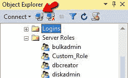

当登录窗口弹出时，选择下拉菜单中显示“Windows 身份验证”的选项，改为选择“SQL Server 身份验证”。输入用户名和密码即可登录！

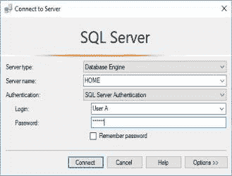

一旦你能够使用该用户登录，尝试在对象资源管理器中打开数据库（系统数据库除外）。它应该看起来像这样：当你尝试展开一个数据库时，它显示为空白。

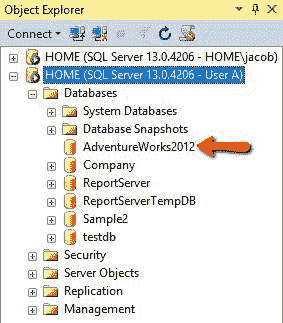

你应该无法展开，因为该用户没有任何数据库访问权限。我们将在下一节中更详细地介绍这一点。

## 数据库用户

数据库用户通常与登录名关联，并映射到一个或多个数据库。该数据库用户的目的是提供对服务器内数据库的访问权限。你还可以限制对其他数据库的访问。

在许多情况下，一个服务器实例上有多个数据库，你不想将所有数据库的访问权限授予所有用户。

## 数据库级别角色

与服务器级别角色非常相似，存在数据库级别角色，可以分配给用户以控制他们在特定数据库中的权限。

有九个预定义的数据库角色：

- `Db_owner` – 提供在数据库上执行所有配置和维护任务的能力。此角色还允许用户`DROP`数据库——这是一个强大的命令！
- `Db_securityadmin` – 提供修改角色成员身份和管理权限的能力。
- `Db_accessadmin` – 提供为 Windows 登录名、Windows 组和 SQL 登录名添加或删除数据库访问权限的能力。
- `Db_backupoperator` – 允许用户备份数据库。
- `Db_ddladmin` – 提供在 SQL Server 中运行任何 DDL 语句的能力。
- `Db_datawriter` – 提供在任何用户表中添加、删除或修改数据的能力。
- `Db_datareader` – 提供查看用户表中任何数据的能力。
- `Db_denydatawriter` – 不能在任何用户表中添加、删除或修改数据。
- `db_denydatareader` – 不能查看用户表中的任何数据。

## 分配数据库角色和创建用户

与分配服务器角色和创建登录名类似，你可以使用 Management Studio 或 SQL 语法来创建数据库用户并为该特定用户分配数据库级别角色。你还可以将该用户映射到一个登录名，使两者相关联。

下面是一些示例语法，用于将数据库用户关联到登录名，并为其分配数据库角色。它可能有点冗长，但我将其分解为四个部分以便于理解。

```sql
--使用我们要添加用户的数据库
USE [AdventureWorks2012]
GO
--为登录名 'User A' 创建名为 'User A' 的用户
CREATE USER [User A] FOR LOGIN [User A]
GO
--再次使用 AdventureWorks2012，因为数据库级别角色需要正确映射到用户
USE [AdventureWorks2012]
GO
--修改 db_datawriter 角色并添加数据库用户 'User A'，以便该用户可以添加、删除或修改 AdventureWorks2012 中的现有数据
ALTER ROLE [db_datawriter] ADD MEMBER [User A]
GO
```

## LIKE 子句

SQL 提供了`LIKE`子句，它使用通配符运算符帮助我们比较一个值与相似的值。

与`LIKE`子句一起使用的通配符运算符包括百分号（`%`）和下划线（`_`）。

这些符号的语法如下：

```
SELECT FROM tableName
WHERE column LIKE 'XXX%'
```

或以下语法：

```
SELECT FROM tableName
WHERE column LIKE '%XXX%'
```

或以下语法：

```
SELECT FROM tableName
WHERE column LIKE 'XXX_'
```

或以下语法：

```
SELECT FROM tableName
WHERE column LIKE '_XXX'
```

或以下语法：

```
SELECT FROM tableName
WHERE column LIKE '_XXX_'
```

如果你有多个条件，请使用连接运算符（`AND`、`OR`）将它们组合起来。上述情况中的`XXX`代表任何字符串或数值。

让我们描述一些你可以使用`LIKE`子句创建的语句的含义：

1. `WHERE SALARY LIKE '300%'` – 返回所有以 300 开头的值。
2. `WHERE SALARY LIKE '%300%'` – 这将返回任何位置包含 300 的值。
3. `WHERE SALARY LIKE '_00%'` – 这将查找第二个和第三个位置为 00 的值。
4. `WHERE SALARY LIKE '4_%_%'` – 这将查找以 3 开头且至少包含 3 个字符的值。
5. `WHERE SALARY LIKE '%3'` – 这将查找以 3 结尾的值。
6. `WHERE SALARY LIKE '_3%4'` – 这将查找第二个位置为 3 且以 4 结尾的值。
7. `WHERE SALARY LIKE '3___4'` – 这将查找一个 5 位数字中，以 3 开头并以 4 结尾的值。

现在，我们需要演示如何使用这个子句。我们将使用`EMPLOYEES`表，其数据如下所示：^(^(42))

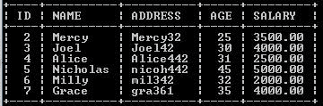

让我们运行一个命令，显示所有工资值以 400 开头的记录：

```sql
SELECT * FROM EMPLOYEES
WHERE SALARY LIKE '400%';
```

该命令返回以下结果：

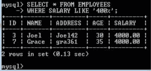

## SQL 函数^(^(43))

语法如下：

```sql
SELECT COUNT (<expression>)
FROM table_name:
```

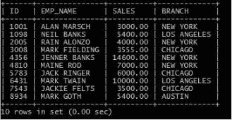

在此语句中，表达式可以指算术运算或列名。如果你想计算表中存储的总记录数，也可以指定（`*`）。^(^(44))

要执行简单的计数操作，例如计算`SALES_REP`表中有多少行，请输入：

```sql
SELECT COUNT(EMP_NAME)
FROM SALES_REP;
```

结果如下：

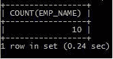

你也可以使用（`*`）而不是指定列名：^(^(45))

```sql
SELECT COUNT(EMP_NAME)
FROM SALES_REP;
```

此语句将产生相同的结果，因为`EMP_NAME`字段没有 NULL 值。但是，假设`EMP_NAME`中的某个字段包含 NULL 值，则该值不会包含在指定`EMP_NAME`的语句中，但如果你使用`*`符号作为参数，它将被包含在`COUNT()`结果中。

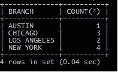

```sql
SELECT BRANCH, COUNT(*) FROM SALES_REP
GROUP BY BRANCH;
```

输出如下：

`COUNT()`函数可以与`DISTINCT`一起使用，以查找不同条目的数量。例如，如果你想知道`SALES_REP`表中保存了多少个不同的分支，请输入以下语句：

```sql
SELECT COUNT (DISTINCT BRANCH)
FROM SALES_REP;
```

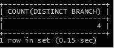

## SQL AVG 函数^(^(46))

语法如下：

```sql
SELECT AVG (<expression>)
FROM “table_name”;
```


在上述语句中，表达式可以指算术运算或列名。算术运算可以包含单个或多个列。

在第一个示例中，你将使用`AVG()`函数计算平均销售额。你可以输入以下语句：^(^(47))

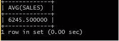

```sql
SELECT AVG(Sales) FROM Sales_Rep;
```

结果如下：

[`docs.microsoft.com/en-us/sql/t-sql/statements/create-function-transact-sql?view=sql-server-2017`](https://docs.microsoft.com/en-us/sql/t-sql/statements/create-function-transact-sql?view=sql-server-2017)

数字 6245.500000 是`Sales_Rep`表中所有销售数据的平均值，它是通过将`Sales`字段相加并将结果除以记录数（在此示例中为 10 行）计算得出的。

`AVG()`函数可用于算术运算。例如，假设销售税为销售额的 6.6%，则可以使用以下语句计算平均销售税额：

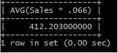

```sql
SELECT AVG(Sales*.066) FROM Sales_Rep;
```

结果如下：

[`docs.microsoft.com/en-us/sql/t-sql/statements/create-function-transact-sql?view=sql-server-2017`](https://docs.microsoft.com/en-us/sql/t-sql/statements/create-function-transact-sql?view=sql-server-2017)

为了得到结果，SQL 必须在应用`AVG`函数之前计算算术运算`Sales *.o66`的结果。

```sql
SELECT Branch, AVG(Sales) FROM Sales_Rep
```

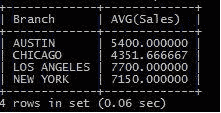

```sql
GROUP BY Branch;
```

结果如下：

[`docs.microsoft.com/en-us/sql/t-sql/statements/create-function-transact-sql?view=sql-server-2017`](https://docs.microsoft.com/en-us/sql/t-sql/statements/create-function-transact-sql?view=sql-server-2017)

## SQL ROUND 函数

以下是 SQL`ROUND()`函数的语法：

```
ROUND (expression, [decimal place])
```

在上述语句中，小数位数指定了要返回的小数点位数。例如，指定 -1 会将数字四舍五入到最近的十位数。

本节中的示例将使用包含以下数据的`Student_Grade`表：

| ID | 姓名 | 成绩 |
| --- | --- | --- |
| 1 | 杰克·奈特 | 87.6498 |
| 2 | 黛西·波尔特 | 98.4359 |
| 3 | 詹姆斯·麦克达夫 | 97.7853 |
| 4 | 艾丽西亚·斯通 | 89.9753 |

要将成绩四舍五入到十分位，请输入以下语句：

```sql
SELECT Name, ROUND (Grade, 1) Rounded_Grade FROM Student_Grade;
```

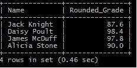

结果如下：^(^(48))

假设你想将成绩四舍五入到十位数，则需要对`ROUND()`函数使用负数参数：

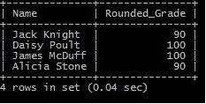

```sql
SELECT Name, ROUND (Grade, -1) Rounded_Grade FROM Student_Grade;
```

结果如下：

## SQL SUM 函数

`SUM()`函数用于返回表达式的总和。

以下是`SUM()`函数的语法：

```
SELECT SUM (<expression>)
FROM “table_name”;
```

表达式参数可以引用算术运算或列名。算术运算可以包含一个或多个列。

同样，在`SELECT`语句中，除了`SUM()`函数中指定的列之外，还可以有多个列。这些列也应包含在`GROUP BY`子句中。语法如下：^(^(49))

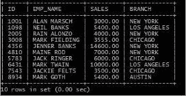

```sql
SELECT colum n1, colum n2, … column N, SUM (“colum nN+1”)
FROM table_name;
GROUP BY colum n1, colum n2, … colum n_nameN;
```

本节中的示例将使用包含以下数据的`SALES_REP`表：^(^(50))

要计算`Sales_Rep`表中所有销售总额，请输入以下语句：

```sql
SELECT SUM(Sales) FROM Sales_Rep;
```

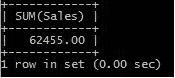

结果如下：^(^(51))

数字 62455.00 表示`Sales`列中所有条目的总和。

为了说明如何在`SUM()`函数中使用算术运算作为参数，假设你需要对销售额征收 6.6% 的销售税。以下是获取总销售税额的语句：

```sql
SELECT SUM(Sales*.066) FROM Sales_Rep;
```

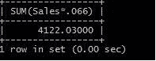

你将得到以下结果：^(^(52))

在此示例中，你将结合使用`SUM()`函数和`GROUP BY`子句来计算每个分支的销售总额。你可以使用以下语句：

```sql
SELECT Branch, SUM(Sales) FROM Sales_Rep 
GROUP BY Branch;
```

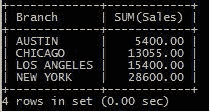

结果如下：^(^(53))

## SQL MAX() 函数

`MAX()`函数用于获取给定表达式中的最大值。

以下是语法：

```
SELECT MAX (<expression>)
FROM table_name;
```

表达式参数可以是算术运算或列名。算术运算可以包含多个列。

`SELECT`语句除了`MAX()`函数中指定的列之外，还可以包含一个或多个列。如果是这种情况，这些列必须包含在`GROUP BY`子句中。

语法如下：

```sql
SELECT column1, column2, ... "columnN", MAX (<expression>)
FROM table_name;
GROUP BY column1, column2, ... "columnN";
```

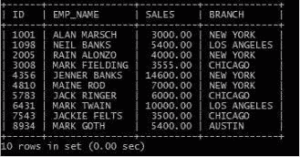

为了演示这一点，你将使用包含以下数据的`Sales_Rep`表：^(^(54))

要获取最高销售额，请输入以下语句：

```sql
SELECT MAX(Sales) FROM Sales_Rep;
```

结果如下：

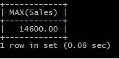

为了说明如何将`MAX()`函数应用于算术运算，假设你需要计算销售额的 6.6% 销售税。要获取最高销售税额，请使用以下语句：

```sql
SELECT MAX(Sales*0.066) FROM Sales_Rep;
```

^(^(55))

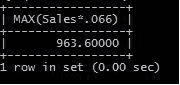

输出如下：

你可以将`MAX()`函数与`GROUP BY`子句结合使用，以获取每个分支的最大销售额。为此，请输入以下语句：

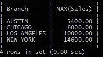

```sql
SELECT Branch, MAX(Sales) FROM Sales_Rep GROUP BY Branch;
```

^(^(56))

## SQL MIN() 函数

`MIN()`函数用于获取给定表达式中的最小值。

以下是语法：

```
SELECT MIN(<expression>)
FROM table_name;
```

表达式参数可以是算术运算或列名。算术运算也可以包含多个列。

`SELECT`语句除了`MIN()`函数中指定的列之外，还可以包含一个或多个列。如果是这种情况，这些列必须包含在`GROUP BY`子句中。

语法如下：

```sql
SELECT column1, column2, ... "columnN", MIN (<expression>)
FROM table_name;
GROUP BY column1, column2, ... "columnN";
```

为了演示如何在 SQL 中使用`MIN()`函数，请使用包含以下数据的`Sales_Rep`表：^(^(57))


要获取最低销售额，请使用以下语句：

```sql
SELECT MIN(Sales) FROM Sales_Rep;
```

输出如下：^(^(58))

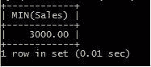

为了演示如何在算术运算中使用`MIN()`函数，假设你需要计算销售额的 6.6% 销售税。要获取最低销售税额，请使用以下语句：

```sql
SELECT MIN(Sales*0.066) FROM Sales_Rep;
```

输出如下：

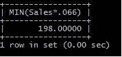

你还可以将`MIN()`函数与`GROUP BY`子句结合使用，以计算每个分支的最小销售额。为此，请输入以下语句：

```sql
SELECT Branch, MIN(Sales) FROM Sales_Rep GROUP BY Branch;
```


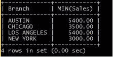

结果如下：^(^(59))

## 第 9 章：修改和控制表

“问题不在于有问题。问题在于期望没有问题是正常的，并且认为有问题本身就是个问题。”——西奥多·鲁宾

以下是修改表的基本语法：

```
ALTER TABLE TABLE_NAME [MODIFY] [COLUMN COLUMN_NAME][DATATYPE│NULL NOT NULL]
[RESTRICT│CASCADE]
[DROP]         [CONSTRAINT CONSTRAINT_NAME]
[ADD]              [COLUMN] COLUMN DEFINITION
```

### 更改表名

`ALTER TABLE` 命令可以与 `RENAME` 函数一起使用来更改表名。

为了演示此语句的使用，请使用包含以下记录的 `EMPLOYEES` 表：

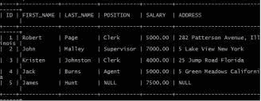

要将 `EMPLOYEES` 表名更改为 `INVESTORS`，请使用以下语句：^(^(60))

```
ALTER TABLE EMPLOYEES RENAME INVESTORS;
```

现在你的表名已变为 `INVESTORS`。

### 修改列属性

列的属性指的是在列中输入的数据的性质和行为。通常，在创建表时设置列属性。不过，你仍然可以使用 `ALTER TABLE` 命令更改一个或多个属性。

你可以修改以下内容：

*   列名
*   分配给列的数据类型
*   列的小数位数、长度或精度
*   列中是否使用 `NULL` 值

## 重命名列

你可能需要修改列名以反映其包含的数据。例如，由于你将 `EMPLOYEES` 数据库重命名为 `INVESTORS`，`SALARY` 列将不再合适。你可以将列名改为类似 `CAPITAL` 的名称。同样，你可能希望将其数据类型从 `DECIMAL` 更改为最大十位的 `INTEGER` 类型。

为此，输入以下语句：

```
ALTER TABLE INVESTORS CHANGE SALARY CAPITAL INT(10);
```

^(^(61))结果如下：

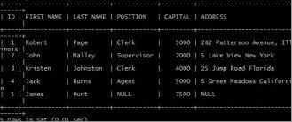

## 删除列

此时，`Position` 列已不再适用。你可以使用以下语句删除该列：

```
ALTER TABLE INVESTORS
DROP COLUMN Position;
```

以下是更新后的 `INVESTORS` 表：^(^(62))

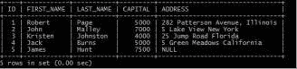

## 添加新列

由于你现在处理的是不同的数据集，你可能决定添加另一列，使 `INVESTORS` 表的数据更具相关性。你可以添加一列来存储每位投资者拥有的股票数量。你可以将新列命名为 `STOCKS`。该列将接受最多 9 位的整数。

你可以使用以下语句添加 `STOCKS` 列：

```
ALTER TABLE INVESTORS ADD STOCKS INT(9);
```

以下是更新后的 `INVESTORS` 表：^(^(63))

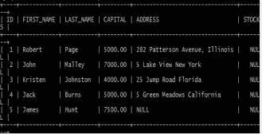

## 修改现有列而不更改其名称

你还可以将 `ALTER TABLE` 命令与 `MODIFY` 关键字结合使用，以更改表的数据类型和规格。为了演示这一点，你可以使用以下语句将 `CAPITAL` 列的数据类型从 `INT` 类型修改为最多 9 位数字和两位小数的 `DECIMAL` 类型。

```
ALTER TABLE INVESTORS MODIFY CAPITAL DECIM AL(9.2) NOT NULL;
```

此时，你可能想查看 `INVESTORS` 表的列名和属性。你可以使用 `SHOW COLUMNS` 语句显示表的结构。输入以下语句：

```
SHOW COLUMNS FROM INVESTORS;
```

以下是结果截图：^(^(64))

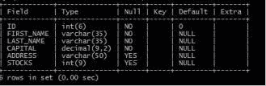

## 使用 ALTER TABLE 时需记住的规则

*   **向数据库表添加列**

    添加新列时，请记住，不能向已有数据的表中添加带有 `NOT NULL` 属性的列。通常，你会将列指定为 `NOT NULL` 以表示它将包含一个值。如果现有数据没有新列的值，添加 `NOT NULL` 列将违反约束。

*   **修改字段/列**

    1.  你可以轻松修改列的数据类型。
    2.  你可以增加数值数据类型所能容纳的位数，但只有当表中存储的最大位数等于或小于所需位数时，才能减少位数。
    3.  只要不超过允许的最大小数位数，你可以增加或减少数值数据类型的小数位数。

如果处理不当，删除和修改表可能导致有价值信息的丢失。因此，在执行 `ALTER TABLE` 和 `DROP TABLE` 语句时要格外小心。

## 删除表

删除表也会移除其数据、关联索引、触发器、约束和权限数据。使用此语句时应小心。

语法如下：

```
DROP TABLE table_name;
```

例如，如果你想从 `xyzcompany` 数据库中删除 `INVESTORS` 表，可以使用以下语句：

```
DROP TABLE INVESTORS;
```

`DROP TABLE` 命令已成功从当前数据库中移除 `INVESTORS` 表。

如果你尝试使用以下命令访问 `INVESTORS` 表：

```
SELECT* FROM INVESTORS;
```

SQL 将返回一个错误，如下所示：

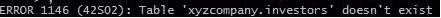

[`docs.microsoft.com/en-us/sql/relational-databases/tables/delete-tables-database-engine?view=sql-server-2017`](https://docs.microsoft.com/en-us/sql/relational-databases/tables/delete-tables-database-engine?view=sql-server-2017)

## 组合与连接表

如果多个表之间存在公共字段，你可以组合它们的数据。为此，请使用 `JOIN` 语句。

SQL 支持多种类型的 `JOIN` 操作：

### INNER JOIN

`INNER JOIN`（或简称为 `JOIN`）是最常用的 `JOIN` 类型。当要连接的表具有匹配字段时，它会显示这些行。

语法如下：^(^(65))

```
SELECT colum n_name(s)
FROM table1
INNER JOIN table2
ON table1.colum n_name=table2.colum n_name;
```

在此变体中，使用 `JOIN` 子句代替 `INNER JOIN`。

```
SELECT colum n_names(s)
FROM table1
JOIN table2
ON table1.colum n_name=table2.colum n_name;
```

### LEFT JOIN

`LEFT JOIN` 操作返回左表的所有行以及匹配的右表行。如果未找到匹配项，则右侧返回 `NULL`。

^(^(66))以下是 `LEFT JOIN` 的语法：

```
SELECT colum n_name(s)
FROM table1
LEFT JOIN table2
ON table1.colum n_name=table2.colum n_name;
```

在某些数据库系统中，使用关键字 `LEFT OUTER JOIN` 代替 `LEFT JOIN`。以下是此变体的语法：^(^(67))

```
SELECT colum n_name(s)
FROM table1
LEFT OUTER JOIN table2
ON table2.colum n_name=table2.colum n_name;
```

### RIGHT JOIN

此 `JOIN` 操作返回右表的所有行以及匹配的左表行。

以下是此操作的语法：^(^(68))

```
SELECT colum n_name(s)
FROM table1
RIGHT JOIN table2
ON table2.colum n_name=table2.colum n_name;
```

在某些数据库系统中，使用 `RIGHT OUTER JOIN` 代替 `LEFT JOIN`。以下是此变体的语法：

```
SELECT colum n_name(s)
FROM table1
RIGHT OUTER JOIN table2
ON table2.colum n_name=table2.colum n_name;
```

[`www.sql-join.com/sql-join-types/`](http://www.sql-join.com/sql-join-types/)

### FULL OUTER JOIN

此 `JOIN` 操作在至少一个表满足条件时显示所有行。它结合了 `RIGHT` 和 `LEFT` 连接操作的结果。

语法如下：

```
SELECT colum n_name(s)
FROM table1
FULL OUTER JOIN table2
ON table2.colum n_name=table2.colum n_name;
```

为了演示 SQL 中的 `JOIN` 操作，请使用 `Branch_Sales` 和 `Branch_Location` 表：

**Branch_Sales 表**

| Branch | Product_ID | Sales |
|--------|------------|-------|
| New York | 101 | 7500.00 |
| Los Angeles | 102 | 6450.00 |
| Chicago | 101 | 1560.00 |
| Philadelphia | 101 | 1980.00 |
| Denver | 102 | 3500.00 |
| Seattle | 101 | 2500.00 |
| Detroit | 102 | 1450.00 |

**Location 表**

| Region | Branch |
|--------|--------|
| East | New York City |
| East | Chicago |
| East | Philadelphia |
| East | Detroit |
| West | Los Angeles |
| West | Denver |
| West | Seattle |

目标是按区域获取销售额。`Location` 表包含区域和分支的数据，而 `Branch_Sales` 表包含每个分支的销售数据。要查找每个区域的销售额，你需要组合 `Location` 和 `Branch_Sales` 表中的数据。请注意，这些表有一个公共字段 `Branch`，它是连接两个表的字段。

以下语句将演示如何使用表别名连接这两个表：

```
SELECT A1.Region Region, SUM(A2.Sales) Sales
FROM Location A1, Branch_Sales A2
WHERE A1.Branch = A2.Branch
GROUP BY A1.Region;
```

结果如下：^(^(69))

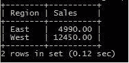

在前两行中，语句告诉 SQL 从 `Location` 表中选择 `Region` 字段，并从 `Branch_Sales` 表中选择 `Sales` 字段的总和。该语句使用了表别名。`Region` 字段被别名为 `Region`，而 `SALES` 字段的总和被别名为 `SALES`。

表别名是为表或表列使用临时名称的做法。使用别名有助于使语句更易读、更简洁。例如，如果你选择不在第一行使用表别名，则需要使用以下语句才能达到相同效果：

```
SELECT Location.Region Region,
SUM(Branch_Sales.Sales) SALES
```

或者，你可以使用 `JOIN` 和 `ON` 关键字指定两个表之间的连接。例如，使用这些关键字，查询将变为：

```
SELECT A1.Region REGION, SUM(A2.Sales) SALES
FROM Location A1
JOIN Branch_Sales A2
ON A1.Branch = A2.Branch
GROUP BY A1.Region;
```

该查询将产生相同的结果：^(^(70))

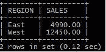

## 使用内连接

内连接会在两个表中存在一个或多个匹配项时显示行。为了演示这一点，请使用以下表格：

Branch_Sales 表

| Branch | Product_ID | Sales |
|--------|------------|-------|
| New York | 101 | 7500.00 |
| Philadelphia | 101 | 1980.00 |
| Denver | 102 | 3500.00 |
| Seattle | 101 | 2500.00 |
| Detroit | 102 | 1450.00 |

Location_table

| Region | Branch |
|--------|--------|
| East | New York |
| East | Chicago |
| East | Philadelphia |
| East | Detroit |
| West | Los Angeles |
| West | Denver |
| West | Seattle |

你可以通过使用 `INNER JOIN` 语句来实现这一点。

你可以输入以下内容：

```
SELECT A1.Branch BRANCH, SUM(A2.Sales) SALES
FROM Location A1
INNER JOIN Branch_Sales A2
ON A1.Branch = A2.Branch
GROUP BY A1.Branch;
```

^(^(71))结果如下：

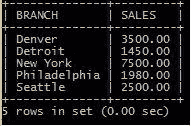

请注意，通过使用 `INNER JOIN`，即使你实际上是在 `Location` 表上应用 `SELECT` 语句，结果中也只包含了在 `Branch_Sales` 报告中有记录的分支。'Chicago' 和 'Los Angeles' 分支被排除，因为 `Branch_Sales` 表中没有这些分支的记录。

## 使用外连接

在前面的示例中，你使用了内连接来合并具有共同行的表。`OUTER JOIN` 命令用于此目的。

`OUTER JOIN` 的示例将使用与 `INNER JOIN` 相同的表：`Branch_Sales` 表和 `Location_table`。

这一次，你想要获取所有门店的销售数据列表。常规连接会排除 Chicago 和 Los Angeles，因为这些分支不在 `Branch_Sales` 表中。因此，你需要执行 `OUTER JOIN`。

语句如下：

```
SELECT A1.Branch, SUM(A2.Sales) SALES
FROM Location A1, Branch_Sales A2
WHERE A1.Branch = A2.Branch (+)
GROUP BY A1.Branch;
```

请注意，外连接的语法依赖于数据库。上述语句使用的是 Oracle 语法。

结果如下：^(^(72))

| Branch | Sales |
|--------|-------|
| Chicago | NULL |
| Denver | 3500.00 |
| Detroit | 1450.00 |
| Los Angeles | NULL |
| New York | 7500.00 |
| Philadelphia | 1980.00 |
| Seattle | 2500.00 |

在合并表时，请注意某些 `JOIN` 语法在不同数据库系统中会产生不同结果。为了充分利用这一强大的数据库功能，阅读 RDBMS 文档非常重要。

## LIMIT、TOP 和 ROWNUM 子句

`TOP` 命令帮助我们仅从表中检索前 `TOP` 数量的记录。但是，你必须注意，并非所有数据库都支持 `TOP` 命令。有些支持 `LIMIT`，而另一些则支持 `ROWNUM` 子句。

以下是在 `SELECT` 语句中使用 `TOP` 命令的语法：

```
SELECT TOP number|percent columnName(s)
FROM tableName
WHERE [condition]
```

我们想使用 `EMPLOYEES` 表来演示如何使用该子句。该表包含以下数据：^(^(73))

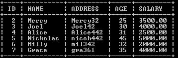

以下查询将帮助我们获取表中的前 2 行：

```
SELECT TOP 2 * FROM EMPLOYEES;
```

请注意，上面给出的命令仅适用于 SQL Server。如果你使用的是 MySQL Server，请使用 `LIMIT` 子句，如下所示：

```
SELECT * FROM EMPLOYEES
LIMIT 2;
```

^(^(74))

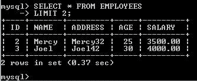

仅返回表中的前两条记录。

如果你使用的是 Oracle Server，请将 `ROWNUM` 与 `SELECT` 子句一起使用，如下所示：

```
SELECT * FROM EMPLOYEES
WHERE ROWNUM <= 2;
```

## ORDER BY 子句

该子句帮助我们按升序或降序对数据进行排序。排序可以基于一个或多个列进行。在大多数数据库中，默认情况下结果按升序排序。

`ORDER BY` 子句使用以下语法：

```
SELECT columns_list
FROM tableName
[WHERE condition]
```


在`ORDER BY`子句中，你可以使用一个或多个列。但是，你必须确保选择用于排序数据的列位于列列表中。同样，我们将使用`EMPLOYEES`表，其数据如下所示：^(^(75))

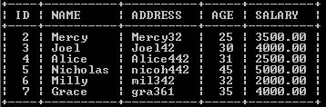

现在，我们需要使用`NAME`和`SALARY`列按升序对数据进行排序。以下命令将帮助我们实现这一点：

```
SELECT * FROM EMPLOYEES
   ORDER BY NAME, SALARY;
```

该查询将返回以下结果：^(^(76))

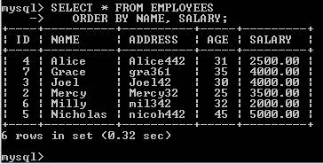

我们也可以使用`SALARY`列按降序对数据进行排序：

```
SELECT * FROM EMPLOYEES
   ORDER BY SALARY DESC;
```

结果如下：

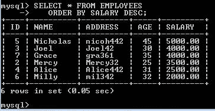

[`www.tutorialspoint.com/sql/sql-top-clause.htm`](https://www.tutorialspoint.com/sql/sql-top-clause.htm)

## GROUP BY 子句

该子句与`SELECT`语句一起使用，用于将相关数据分组，从而创建组。`GROUP BY`子句应位于`SELECT`语句中的`WHERE`子句之后，并且应位于`ORDER BY`子句之前。

语法如下：

```
SELECT column_1, column_2
FROM tableName
WHERE [ conditions ]
GROUP BY column_1, column_2
ORDER BY column_1, column_2
```

让我们使用`EMPLOYEES`表，其数据如下所示：^(^(77))

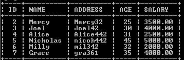

如果你需要获取每位客户的总`SALARY`，只需运行以下命令：

```
SELECT NAME, SALARY, SUM(SALARY) FROM EMPLOYEES
   GROUP BY NAME;
```

## DISTINCT 关键字

该关键字与`SELECT`语句一起使用，用于帮助消除重复项并允许选择唯一记录。

这是因为有时表中存在多个重复记录，而你的目标是仅选择唯一的记录。`DISTINCT`关键字可以帮助你实现这一点。该关键字可以使用以下语法：

```
SELECT DISTINCT column_1, column_2,.....column_N
FROM tableName
WHERE [condition]
```

我们将使用`EMPLOYEES`表来演示如何使用该关键字。该表包含以下数据：^(^(78))

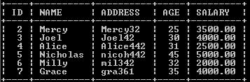

在上表的`SALARY`列中，我们有一个重复的条目 4000。这可以在我们运行以下查询后看到：

```
SELECT DISTINCT SALARY FROM EMPLOYEES
ORDER BY SALARY;
```

^(^(79))

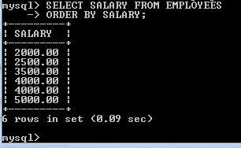

现在，我们可以将查询与`DISTINCT`关键字结合，看看查询返回什么：^(^(80))

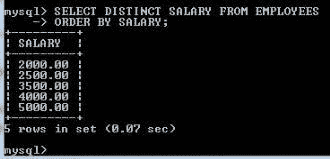

## SQL 子查询

到目前为止，我们一直在执行单个 SQL 查询来执行插入、选择、更新和删除功能。然而，还有一种方法可以在其他 SQL 查询内部执行 SQL 查询。例如，你可以选择数据库中所有年龄大于某个特定学生的学生记录。在本章中，我们将演示如何在 SQL 中执行子查询或嵌套查询。

你应该拥有包含一些记录的`Student`和`Department`表。

首先，我们可以检索 Stacy 的年龄，将其存储在某个变量中，然后使用 "where" 子句在我们的 SELECT 查询中比较年龄。第二种方法是将检索 Stacy 年龄的查询嵌入到检索所有学生年龄的查询中。第二种方法采用了子查询技术。查看查询 1 以了解子查询的实际应用。

查询 1

```sql
Select * From Student
where StudentAge >
(Select StudentAge from Student
where StudName = 'Stacy'
)
```

注意，在查询 1 中，我们使用了圆括号在 "where" 子句中附加了一个子查询。上述查询将检索`Student`表中所有年龄大于 "Stacy" 年龄的学生记录。"Stacy" 的年龄是 20；因此，在输出中，你将看到所有年龄大于 20 的学生的记录。输出如下：

| StudID | StudName | StudentAge | StudentGender | DepID |
|--------|----------|------------|---------------|-------|
| 1 | Alice | 21 | Male | 2 |
| 4 | Jacobs | 22 | Male | 5 |
| 6 | Shane | 22 | Male | 4 |
| 7 | Linda | 24 | Female | 4 |
| 9 | Wolfred | 21 | Male | 2 |
| 10 | Sandy | 25 | Female | 1 |
| 14 | Mark | 23 | Male | 5 |
| 15 | Fred | 25 | Male | 2 |
| 16 | Vic | 25 | Male | NULL |
| 17 | Nick | 25 | Male | NULL |

类似地，如果你想更新所有属于 "English" 系的学生姓名，可以使用以下子查询：

查询 2

```sql
Update Student
Set StudName = StudName + ' Eng'
where Student.StudID in (
Select StudID
from Student
Join
Department
On Student.DepID = Department.DepID
where DepName = 'English'
)
```

在上述查询中，通过子查询中的 JOIN 语句检索了英语系所有学生的学生 ID。然后，使用 UPDATE 语句，通过在姓名末尾追加字符串 "Eng" 来更新所有这些学生的姓名。使用 WHERE 语句来匹配通过子查询检索到的学生 ID。

`IFNULL`函数检查特定表列中是否存在 NULL 值。如果存在 NULL 值，则将其替换为传递给`IFNULL`函数的第二个参数的值。例如，以下查询将为部门 ID 为空的学生显示 50 作为部门 ID。

现在，如果你显示`Student`的姓名及其所属`Department`的名称，你将看到属于英语系的学生姓名后附加了 "Eng"。

### 练习 9

任务：从`Student`表中删除所有学生 ID 小于 "Linda" 的 ID 的学生记录。

解决方案

```sql
Delete From Student
where StudID <
(Select StudID from Student
where StudName = 'Linda'
)
```

## SQL 字符函数

SQL 字符函数用于修改检索数据的显示形式。字符函数不会修改实际数据，而是对数据的表示方式进行某些修改。SQL 字符函数操作字符串类型的数据。在本章中，我们将介绍一些最常用的 SQL 字符函数。

注意：

*   连接（+）

连接函数用于连接两个或多个字符串。在 SQL 中，使用`+`运算符连接两个字符串。例如，我们可以从学生列中连接学生姓名和学生性别，并将它们显示在一列中，如下所示：

```sql
Select StudName +' '+StudentGender as NameAndGender
from Student
```

*   替换

`replace`函数用于替换输出字符串中的字符。例如，以下查询将所有学生姓名中的 "ac" 替换为 "rs"。

```sql
Select StudName, REPLACE(StudName, 'ac', 'rs') as ModifiedColumn
From Student
```

`replace`函数的第一个参数是要替换其值的列；第二个参数是要替换的字符序列，第三个参数表示要插入以替换旧序列的字符序列。

*   子字符串

`substring`函数返回从指定位置开始的指定数量的字符。以下查询显示学生姓名的前三个字符。

```sql
Select StudName, substring(StudName, 1, 3) as SubstringColumn
From Student
```

*   长度

`length`函数用于获取特定列值的长度。例如，要获取`Student`表中学生姓名的长度，可以执行以下查询：

```sql
Select StudName, Len(StudName) as NameLength
from Student
```

注意，在上述查询中，我们使用了`Len()`函数来获取姓名的长度；这是因为在 SQL Server 中，`Len()`函数用于计算任何字符串的长度。

*   IFNULL

`IFNULL`函数检查特定表列中是否存在 NULL 值。如果存在 NULL 值，则将其替换为传递给`IFNULL`函数的第二个参数的值。例如，以下查询将为部门 ID 为空的学生显示 50 作为部门 ID。

```sql
Select Student.DepID, IFNULL(Student.DepID, 50)
from Student
```

*   LTRIM

`LTRIM`函数会修剪传递给`LTRIM`函数的参数中指定列的值中的所有前导空格。例如，如果你想删除`Student`表中学生姓名前的所有空格，可以使用 LTRIM 查询，如下所示：

```sql
Select Student.StudName, LTRIM(Student.StudName)
from Student
```

*   RTRIM

`RTRIM`函数会修剪传递给`RTRIM`函数的参数中指定列的值中的所有尾随空格。例如，如果你想删除`Student`表中学生姓名后的所有空格，可以使用 RTRIM 查询，如下所示：

```sql
Select Student.StudName, RTRIM(Student.StudName)
from Student
```

## SQL 约束

约束是指应用于数据库表列的规则。它们帮助我们限制可以保存在该表中的数据类型。这样，我们可以确保数据库中数据的可靠性和准确性。

约束可以在列级别或表级别施加。列约束只能应用于单个列，而表级约束则应用于整个表。

### NOT NULL 约束

SQL 中的默认设置是列可以包含空值。如果你不希望某一列没有值，可以指定这一点。

注意，NULL 表示未知数据，而不是没有数据。此约束可以在创建表时定义。让我们通过创建一个示例表来演示这一点：

```sql
CREATE TABLE MANAGERS(
   ID   INT NOT NULL,
   NAME VARCHAR (15) NOT NULL,
   DEPT VARCHAR(20)  NOT NULL,
   SALARY   DECIMAL (20, 2),       
   PRIMARY KEY (ID)
);
```
^(^(81))

上面，我们创建了一个名为`MANAGERS`的表，包含 4 列，并且对其中三列施加了 NOT NULL 约束。这意味着你必须为这些带有约束的列指定一个值；否则，将引发错误。

注意，我们没有对表中的`SALARY`列施加 NOT NULL 约束。即使该列已经创建，我们也可以对其施加约束。

```sql
ALTER TABLE MANAGERS
   MODIFY SALARY DECIMAL (20, 2) NOT NULL;
```
^(^(82))

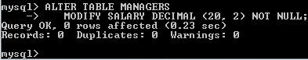

现在，该列不能再接受空值。

### 默认约束

如果未在`INSERT INTO`列中指定该列的值，此约束将为该列提供默认值。

请参考以下示例：

```sql
CREATE TABLE SUPPLIERS(
   ID INT NOT NULL,
   NAME VARCHAR (15) NOT NULL,
   ADDRESS CHAR (20) ,
  ARREARS DECIMAL (16, 2) DEFAULT 6000.00,       
   PRIMARY KEY (ID)
);
```

假设你已经创建了该表，但需要在`ARREARS`列上添加一个默认约束。你可以这样操作：

```sql
MODIFY ARREARS DECIMAL (16, 2) DEFAULT 6000.00;
```

这将更新表，并为该列创建一个默认约束。

如果你不再需要这个默认约束，可以通过运行以下命令来删除它：

```sql
ALTER TABLE SUPPLIERS
   ALTER COLUMN ARREARS DROP DEFAULT;
```

## 唯一约束

此约束帮助我们避免在一个列中出现两个或更多具有相同值的记录。例如，在 "employees" 表中，我们可能需要防止两个或多个员工共享相同的 ID。

以下 SQL 查询展示了如何创建一个名为 "STUDENTS" 的表。我们将在`ADMISSION`列上施加`UNIQUE`约束：

```sql
CREATE TABLE STUDENTS(
    ADMISSION INT NOT NULL UNIQUE,
    NAME VARCHAR (15) NOT NULL,
    AGE INT NOT NULL,
    COURSE CHAR (20),
    PRIMARY KEY (ADMISSION) 
);
```
^(^(83))

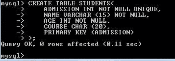

正确创建的索引能提高大型数据库的效率。选择创建索引的字段取决于你经常使用的 SQL 查询。

也许你已经创建了没有`UNIQUE`约束的`STUDENTS`表。可以通过运行以下命令在`ADMISSION`列上添加该约束：

```sql
ALTER TABLE STUDENTS
MODIFY ADMISSION INT NOT NULL UNIQUE;
```

如下所示：

```sql
ALTER TABLE STUDENTS
ADD CONSTRAINT uniqueConstraint UNIQUE(ADMISSION, AGE);
```

该约束被命名为`uniqueConstraint`，并分配给了两个列：`ADMISSION`和`AGE`。

任何时候需要删除该约束，请运行结合了`ALTER`和`DROP`命令的以下命令：

```sql
ALTER TABLE STUDENTS
    DROP CONSTRAINT uniqueConstraint;
```

该约束将从这两个列中删除。对于 MySQL 用户，上述命令无效。只需运行以下命令：

```sql
ALTER TABLE STUDENTS
    DROP INDEX uniqueConstraint;
```
^(^(84))


## 主键

主键约束帮助我们唯一标识每一行。被指定为主键的列必须具有唯一值。此外，该列不允许有`NULL`值。

每个表只允许有一个主键，它可以由单个或多个字段组成。当我们使用多个字段作为主键时，它们被称为复合键。如果表的某一列被定义为主键，那么该字段中就不会有两个记录共享相同的值。

主键是唯一标识符。在`STUDENTS`表中，我们可以将`ADMISSION`定义为主键，因为它唯一标识每个学生。不应有两个学生拥有相同的`ADMISSION`编号。以下是创建该属性的方法：

```sql
CREATE TABLE STUDENTS(
    ADMISSION INT NOT NULL,
    NAME VARCHAR (15) NOT NULL,
    AGE INT NOT NULL,
    PRIMARY KEY (ADMISSION)
);
```

`ADMISSION`已被设置为该表的主键。如果我们描述该表，你会发现该字段是主键，如下所示：
^(^(85))


在上面的 "Key" 字段中，"PRI" 表示`ADMISSION`字段是主键。

你可能希望在一个已存在的表上施加主键约束。可以通过运行以下命令来实现：

```sql
ALTER TABLE STUDENTS
   ADD CONSTRAINT PK_STUDADM PRIMARY KEY (ADMISSION, NAME);
```

在上述命令中，主键约束被命名为`PK_STUDADM`，并分配给了两个列：`ADMISSION`和`NAME`。这意味着没有两行会在这些列上具有相同的值。

可以通过执行以下命令从表中删除主键约束：

```sql
ALTER TABLE STUDENTS DROP PRIMARY KEY;
```

运行上述命令后，你可以描述`STUDENTS`表，查看它是否还有主键：
^(^(86))


这表明主键已成功删除。

## 外键

此约束用于将两个表连接在一起。有时它被称为引用键。外键只是一个列或一组列，与另一个表中的主键相匹配。

请考虑具有以下结构的表：

`STUDENTS`表：

```sql
CREATE TABLE STUDENTS(
    ADMISSION INT NOT NULL,
    NAME VARCHAR (15) NOT NULL,
    AGE INT NOT NULL,
    PRIMARY KEY (ADMISSION)
);
```

`FEE`表：

```sql


`CREATE TABLE FEE (
    ID INT NOT NULL,
    DATE DATETIME,
    STUDENT_ADM INT references STUDENTS (ADMISSION),
    AMOUNT float,
    PRIMARY KEY (ID)
);`

```
^(^(87))
```

在`FEE`表中，`STUDENT_ADM`字段引用了`STUDENTS`表中的`ADMISSION`字段。这使得`FEE`表的`STUDENT_ADM`列成为外键。

如果我们创建`FEE`表时没有外键，我们仍然可以通过以下命令添加它：

```sql
ALTER TABLE FEES
ADD FOREIGN KEY (STUDENT_ADM) REFERENCES STUDENTS (ADMISSION);
```

外键将被添加到表中。如果需要删除外键，请运行以下命令：

```sql
ALTER TABLE FEE
DROP FOREIGN KEY;
```

外键随后将从表中移除。

## CHECK 约束

此约束用于创建一个条件，以验证输入到记录中的值。如果条件为假，则记录违反了约束，因此不会输入到表中。

我们想创建一个名为`STUDENTS`的表，并且不希望有任何年龄低于 12 岁的学生。如果学生不满足此约束，他们将不会被添加到表中。该表可以按如下方式创建：

```sql
CREATE TABLE STUDENTS (
    ADMISSION INT NOT NULL,
    NAME VARCHAR (15) NOT NULL,
    AGE INT NOT NULL CHECK (AGE >= 12),
    PRIMARY KEY (ADMISSION)
);
```

```
^(^(88))
```


该表已成功创建。

如果你已经创建了没有该约束的`STUDENTS`表，但后来需要实现它，请运行以下命令：

```sql
ALTER TABLE STUDENTS
    MODIFY AGE INT NOT NULL CHECK (AGE >= 12 );
```

该约束将成功添加到`AGE`列。

你也可以为约束指定一个名称。这可以通过以下语法完成：

```sql
ALTER TABLE STUDENTS
   ADD CONSTRAINT checkAgeConstraint CHECK(AGE >= 12);
```

[`www.tutorialspoint.com/sql/sql-index.htm`](https://www.tutorialspoint.com/sql/sql-index.htm)

## INDEX 约束

`INDEX`帮助我们快速从数据库中检索数据。要创建索引，我们可以依赖数据库表中的一列或一组列。一旦创建了索引，在排序数据之前，它会为每一行分配一个`ROWID`。

正确创建的索引能提高大型数据库的效率。选择创建索引的字段取决于你经常使用的 SQL 查询。

假设我们创建了以下包含三列的表：

```sql
CREATE TABLE STUDENTS (
ADMISSION INT NOT NULL,
NAME VARCHAR (15) NOT NULL,
AGE INT NOT NULL CHECK (AGE >= 12),
    PRIMARY KEY (ADMISSION)
);
```

然后我们可以使用以下语法在一列或多列上实现`INDEX`：

```sql
CREATE INDEX indexName
    ON tableName ( column_1, column_2.....);
```

现在，我们需要在名为`AGE`的列上实现`INDEX`，以便更容易地按特定年龄进行搜索。索引可以按如下方式创建：

```sql
CREATE INDEX age_idx
```

# 关于学生表（年龄）；

```
^(^(89))
```


如果不再需要该索引，可以通过运行以下命令将其删除：

```sql
ALTER TABLE STUDENTS
DROP INDEX age_idx;
```

```
^(^(90))
```


## ALTER TABLE 命令

SQL 为我们提供了`ALTER TABLE`命令，可用于添加、删除和修改表列。该命令还有助于我们添加和删除表中的约束。

假设你有一个包含以下数据的`STUDENTS`表：

```
^(^(91))
```


```sql
ALTER TABLE STUDENTS ADD COURSE VARCHAR(10);
```

```
^(^(92))
```


当我们查询表的内容时，会得到以下结果：

```
^(^(93))
```


这表明该列已被添加，并且每条记录在该列中都被分配了一个`NULL`值。

要将`COURSE`列的数据类型从`VarChar`更改为`Char`，请执行以下命令：

```sql
ALTER TABLE STUDENTS MODIFY COLUMN COURSE Char(1);
```

```
^(^(94))
```


我们可以将`ALTER TABLE`命令与`DROP TABLE`命令结合使用，以删除表中的列。要从`STUDENTS`表中删除`COURSE`列，请运行以下命令：

```sql
ALTER TABLE STUDENTS DROP COLUMN COURSE;
```


```text
^(^(95))
```


然后，我们可以通过`describe`命令查看表详细信息，以确认该列是否已成功删除：`^(^(96))`


上图显示该列已成功删除。

# 结论与后续步骤

希望你喜欢这本书，并从中尽可能多地获取信息。如果你愿意，可以随时回到书中的其他章节，四处浏览以提升你的技能。

## 产品评价与反馈

我不想只给你一个标准的结论，而是想就如何继续学习 SQL 给你一些建议。但首先，如果你有任何反馈，请前往本书的亚马逊产品页面留下真实评价，或直接发送电子邮件至 jaschulz0705@gmail.com。

## 更多数据库示例

如果你有兴趣处理更多数据库，那么我有几个你可能会感兴趣的链接。你可以从以下链接下载 Chinook 和 Northwind 数据库，并开始使用它们。

继续，[点击此链接下载 Chinook 数据库](https://drive.google.com/open?id=10EIGurSLCmiFhz8B_L_dObNn_sj_wlKV)。进入页面后，点击右上角的箭头下载一个 zip 文件。下载完成后，将 zip 文件解压到计算机上易于访问的位置。然后，打开文件夹，将`Chinook_SqlServer.sql`文件或`Chinook_SqlServer_AutoIncrementPKs.sql`文件拖放到 SSMS 中，并点击“执行”按钮。这样你就拥有了一个完整的 Chinook 数据库。

除了 Chinook 数据库，你还可以[点击此链接下载 Northwind 数据库](https://drive.google.com/open?id=1_TsOnGVdNrdwXUehTyh9rfBZ2w948w3f)。进入页面后，点击右上角的箭头下载另一个 zip 文件。然后，解压该 zip 文件，并将其与其他 SQL 备份文件放在一起。由于它是一个`Northwind.bak`文件（数据库备份文件），请还原该数据库。你也可以参考前面的章节了解数据库还原和 SSMS 基础知识，以协助完成这些任务！

## 继续学习

通过运行查询并理解数据，深入研究`AdventureWorks`、`Company_Db`、`Chinook`和`Northwind`数据库。学习 SQL 的一部分也是理解数据库中的数据。

为了保护数据库，SQL 提供了一种安全方案，允许你指定哪些数据库用户可以查看特定信息。该方案还允许你设置每个用户可以执行的操作。这种安全方案（或模型）依赖于授权标识符。正如你在第二章中学到的，授权标识符是代表一个或多个可以访问/修改数据库内信息的用户的对象。

## 更多参考资料

### MTA 98-364 认证

你可以在此处找到认证信息：[`www.microsoft.com/en-us/learning/exam-98-364.aspx`](https://www.microsoft.com/en-us/learning/exam-98-364.aspx)。进入页面后，请务必展开“技能考核”部分中的主题，因为你在这些领域的数据库知识将受到考验。

暂时就这些。

# 参考文献

1keydata.com. (2019). SQL - CREATE VIEW 语句 | 1Keydata. [在线] 可访问：https://www.1keydata.com/sql/sql-create-view.html [访问日期：2019 年 2 月 3 日].

Chartio. (2019). 如何在 SQL Server 中将列从 NULL 更改为 NOT NULL. [在线] 可访问：https://chartio.com/resources/tutorials/how-to-alter-a-column-from-null-to-not-null-in-sql-server/ [访问日期：2019 年 2 月 3 日].

Docs.microsoft.com. (2019). 主键和外键约束 - SQL Server. [在线] 可访问：https://docs.microsoft.com/en-us/sql/relational-databases/tables/primary-and-foreign-key-constraints?view=sql-server-2017 [访问日期：2019 年 2 月 3 日].

Sites.google.com. (2019). DDL 命令 - Create - Drop - Alter - Rename - Truncate - 编程语言. [在线] 可访问：https://sites.google.com/site/prgimr/sql/ddl-commands---create---drop---alter [访问日期：2019 年 2 月 3 日].

Techonthenet.com. (2019). SQL: UNION ALL 运算符. [在线] 可访问：https://www.techonthenet.com/sql/union_all.php [访问日期：2019 年 2 月 3 日].

1keydata.com. (2019). SQL - RENAME COLUMN | 1Keydata. [在线] 可访问：https://www.1keydata.com/sql/alter-table-rename-column.html [访问日期：2019 年 2 月 3 日].

Docs.microsoft.com. (2019). 创建检查约束 - SQL Server. [在线] 可访问：https://docs.microsoft.com/en-us/sql/relational-databases/tables/create-check-constraints?view=sql-server-2017 [访问日期：2019 年 2 月 3 日].

Docs.microsoft.com. (2019). 创建主键 - SQL Server. [在线] 可访问：https://docs.microsoft.com/en-us/sql/relational-databases/tables/create-primary-keys?view=sql-server-2017 [访问日期：2019 年 2 月 3 日].

Docs.microsoft.com. (2019). 删除表（数据库引擎）- SQL Server. [在线] 可访问：https://docs.microsoft.com/en-us/sql/relational-databases/tables/delete-tables-database-engine?view=sql-server-2017 [访问日期：2019 年 2 月 3 日].

Docs.microsoft.com. (2019). 修改列（数据库引擎）- SQL Server. [在线] 可访问：https://docs.microsoft.com/en-us/sql/relational-databases/tables/modify-columns-database-engine?view=sql-server-2017 [访问日期：2019 年 2 月 3 日].

query?, H., M, D., K., R., Singraul, D., Singh, A. and kor, p. (2019). 如何使用 SQL 查询更改表名？. [在线] Stack Overflow. 可访问：https://stackoverflow.com/questions/886786/how-to-change-a-table-name-using-an-sql-query [访问日期：2019 年 2 月 3 日].

SQL Joins Explained. (2019). SQL 连接类型 — SQL Joins Explained. [在线] 可访问：http://www.sql-join.com/sql-join-types/ [访问日期：2019 年 2 月 3 日].

Techonthenet.com. (2019). SQL: ALTER TABLE 语句. [在线] 可访问：https://www.techonthenet.com/sql/tables/alter_table.php [访问日期：2019 年 2 月 3 日].

Techonthenet.com. (2019). SQL: GROUP BY 子句. [在线] 可访问：https://www.techonthenet.com/sql/group_by.php [访问日期：2019 年 2 月 3 日].

www.tutorialspoint.com. (2019). SQL DEFAULT 约束. [在线] 可访问：https://www.tutorialspoint.com/sql/sql-default.htm [访问日期：2019 年 2 月 3 日].

www.tutorialspoint.com. (2019). SQL INDEX 约束. [在线] 可访问：https://www.tutorialspoint.com/sql/sql-index.htm [访问日期：2019 年 2 月 3 日].

www.tutorialspoint.com. (2019). SQL INNER JOINS. [在线] 可访问：https://www.tutorialspoint.com/sql/sql-inner-joins.htm [访问日期：2019 年 2 月 3 日].

www.tutorialspoint.com. (2019). SQL LIKE 子句. [在线] 可访问：https://www.tutorialspoint.com/sql/sql-like-clause.htm [访问日期：2019 年 2 月 3 日].

www.tutorialspoint.com. (2019). SQL NOT NULL 约束. [在线] 可访问：https://www.tutorialspoint.com/sql/sql-not-null.htm [访问日期：2019 年 2 月 3 日].

www.tutorialspoint.com. (2019). SQL TOP、LIMIT 或 ROWNUM 子句. [在线] 可访问：https://www.tutorialspoint.com/sql/sql-top-clause.htm [访问日期：2019 年 2 月 3 日].

W3schools.com. (2019). SQL INNER JOIN 关键字. [在线] 可访问：https://www.w3schools.com/sql/sql_join_inner.asp [访问日期：2019 年 2 月 3 日].

W3schools.com. (2019). SQL LEFT JOIN 关键字. [在线] 可访问：https://www.w3schools.com/sql/sql_join_left.asp [访问日期：2019 年 2 月 3 日].

W3schools.com. (2019). SQL NOT NULL 约束. [在线] 可访问：https://www.w3schools.com/sql/sql_notnull.asp [访问日期：2019 年 2 月 3 日].

W3schools.com. (2019). SQL NOT NULL 约束. [在线] 可访问：https://www.w3schools.com/sql/sql_notnull.asp [访问日期：2019 年 2 月 3 日].

W3schools.com. (2019). SQL PRIMARY KEY 约束. [在线] 可访问：https://www.w3schools.com/sql/sql_primarykey.asp [访问日期：2019 年 2 月 3 日].

W3schools.com. (2019). SQL RIGHT JOIN 关键字. [在线] 可访问：https://www.w3schools.com/sql/sql_join_right.asp [访问日期：2019 年 2 月 3 日].

W3schools.com. (2019). SQL UNION 运算符. [在线] 可访问：https://www.w3schools.com/sql/sql_union.asp [访问日期：2019 年 2 月 3 日].

W3schools.com. (2019). SQL UNION 运算符. [在线] 可访问：https://www.w3schools.com/sql/sql_union.asp [访问日期：2019 年 2 月 3 日].

W3schools.com. (2019). SQL UNIQUE 约束. [在线] 可访问：https://www.w3schools.com/sql/sql_unique.asp [访问日期：2019 年 2 月 3 日].

www.tutorialspoint.com. (2019). SQL 主键. [在线] 可访问：https://www.tutorialspoint.com/sql/sql-primary-key.htm [访问日期：2019 年 2 月 3 日].

# ARDUINO 编程

## 初学者终极指南：一步步学习 Arduino 编程

Ryan Turner

© 版权所有 2019 - Ryan Turner - 保留所有权利。

未经作者或出版者直接书面许可，不得复制、转载或传播本书中的任何内容。

在任何情况下，出版者或作者均不对因本书所含信息（直接或间接）导致的任何损害、赔偿或金钱损失承担法律责任或道德责任。

法律声明：

本书受版权保护。本书仅供个人使用。未经作者或出版者同意，不得修改、分发、出售、使用、引用或改写本书的任何部分或内容。

免责声明：

请注意，本文档所含信息仅供教育和娱乐之用。已尽一切努力提供准确、最新、可靠且完整的信息。不声明或暗示任何形式的保证。读者承认作者并非提供法律、财务、医疗或专业建议。本书内容来源于多种渠道。在尝试本书所述的任何技术之前，请咨询持证专业人士。

通过阅读本文档，读者同意在任何情况下，作者均不对因使用本文档所含信息而导致的任何直接或间接损失负责，包括但不限于错误、遗漏或不准确之处。

# 目录

## Arduino 简介

## 什么是 Arduino？

### Arduino 的历史

### 但 Arduino 到底是什么？

### 谁在使用 Arduino？

## Arduino 的 6 大优势

## 理解 Arduino 的关键术语

### Arduino 板的解剖结构

### 关于使用 Arduino 的其他术语

## 理解各种选择

### Uno

### Leonardo

### 101

### Esplora

### Mega 256O

### Zero

### Due

### Mega ADK

### Arduino Pro (8 MHz)

### Arduino Pro (16 MHz)

### Arduino M0

### Arduino M0 Pro

### Arduino YÚN（基于 ATmega32U4）

### Arduino Ethernet

### Arduino Tian

### Industrial 101

### Arduino Leonardo ETH

### Gemma

### Lilypad Arduino USB

### Lilypad Arduino 主控板

### Lilypad Arduino Simple

### Lilypad Arduino Simple Snap

### 其他板卡

## 选择并设置 Arduino

### 选择板卡

### 我需要多少个数字和模拟引脚才能实现所需功能？

### 我希望这是一个可穿戴设备吗？

### 我想连接到物联网吗？如果是，如何连接？

### 开始使用 Arduino IDE

### 为你的 Arduino 编写程序

### 连接到 Arduino 板

### 上传到 Arduino 板

### 用你的程序运行 Arduino

## 为 Arduino 编程

### 结构

### 控制结构

### 语法

### 算术运算符

### 比较运算符

### 数据类型

### Void

### Boolean

### Char

### Unsigned Char

### Byte

### Int

### Unsigned Int

### Word

### Long

### Unsigned Long

### Short

### Float

### Double

## 将你的 Arduino 变成一台机器

### 有用的常量

### 初始化串口

### 初始化数字引脚并关闭它

### 读取传感器温度

### 将传感器值传输到 PC

### 将传感器读数转换为电压

- 在上传到 PC 之前将电压转换为温度
- 关闭 LED 以表示低温
- 打开 LED 以表示低温
- 打开两个 LED 以表示中温

### C 语言基础与函数

- 内存映射

### 逻辑语句

### For 循环

### 数组

### 运算符

- 算术运算符
- 布尔运算符

### 决策

- If 语句

### 输入、输出与传感器

- 步骤

### 与 Arduino 的计算机接口

### 追赶（回顾）

- Arduino
- Arduino 的结构
- C 语言编程基础
- 使用变量和值
- 赋值与数学运算
- 数组

### 更深入的计算机科学主题

### Arduino API 函数

### 使用 Stream 类（以及处理字符串）

### 结论

### 参考文献

# Arduino 简介

如果你以前从未听说过 Arduino，它是一种开源电子接口，由两部分组成：第一部分是可编程电路板，第二部分是你选择在计算机上运行的编程程序。Arduino 有多种形式，包括 Arduino Uno、LilyPad Arduino、Redboard、Arduino Mega、Arduino Leonardo 等，我们将在后面解释。

如果你不熟悉编程，这是一个很好的起点。Arduino 可以用多种编程语言进行编程，其丰富的 Arduino 选项可以给你更多的编程经验。Arduino 带有额外的附件，有些是传感器形式，其他的可以在任何地方获得，并可以连接到 Arduino 的各种端口上。Arduino 是理解编程和传感器交互的绝佳垫脚石。

在编程语言中，总有一个著名的程序“Hello World”在屏幕上展示。在我们所处的微控制器世界中，这个阶段或第一个程序是通过灯的闪烁来指示的，即“开”和“关”，以显示你设置的一切都正常工作。

我们将整体查看这些草图，并在解释代码后详细说明。如果你遇到无法理解的内容，请继续阅读，它会变得清晰。

让我们看看这个程序，向你展示我们将如何分解代码。

```cpp
```


```cpp
const int PinkL = 13;

void setup()
{
  pinMode(PinkL, OUTPUT);
}

void loop()
{
  digitalWrite(PinkL, HIGH);
  delay(600);
  digitalWrite(PinkL, LOW);
  delay(600);
}
```

## 第一部分

`const int PinkL = 13;`

这一行用于定义一个常量，该常量在整个程序中用于指定一个特定值。建议所有引脚都这样做，因为如果电路保持不变，它便于软件更改。在 Arduino 编程中，常量通常以字母“k”开头命名。

## 第二部分

```cpp
void setup()
{
  pinMode(PinkL, OUTPUT);
}
```

`OUTPUT` 是引脚 13。这使得 Arduino 控制对引脚的编码，而不是从引脚读取。

## 第三部分

```cpp
void loop()
{
  digitalWrite(PinkL, HIGH);
  delay(600);
  digitalWrite(PinkL, LOW);
  delay(600);
}
```

这是代码的核心部分。向引脚写入 `HIGH` 会导致 LED 点亮。当你设置 `HIGH` 时，意味着引脚输出 5V。另一个选项是 `LOW`，意味着输出 0V。

调用 `delay()` 来延迟发送给它的毫秒数。由于我们发送了 600，将会有 0.6 秒的延迟。LED 熄灭，这是由于向引脚写入 `LOW` 作为输出。

将激活 600 毫秒的延迟。

这个序列将一直持续，直到 Arduino 关闭或电源断开。

在你开始消化更多内容之前，尝试运行这个程序并确保它正常工作。要测试你是否反向连接了 LED，可能会发生以下情况。在 UNO 板上，引脚 13 连接到一个发光二极管。当它闪烁而面包板上的 LED 不闪烁时，你可能反向连接了 LED。如果你看到它每秒闪烁一次，那么程序没有成功发送到 Arduino。

完成编程后，在代码行中添加注释以指示 Arduino。这些注释可以指示你的 Arduino 间歇性地或通过不同序列闪烁 LED。

我们通常编写的程序是为计算机设计的，而不是为了让人们打开后就能理解。有一个很好的机制允许我们人类轻松阅读程序，而计算机对此一无所知。在这个程序中，有两种可能的注释：

1. 块注释样式以两个字符 `/*` 开始，直到遇到 `*/` 结束。可以跨越多行，以下是一些示例。

```cpp
/* 这是第一行 */

/* 程序成功运行 */

/* 我们
 * 正在
 * 前进
 * 很远 */
```

2. 可以在带有反斜杠运算符 `//` 的行上进行注释。这部分是为人类而不是机器设计的。这是插入注释的另一种方式。

当你在程序中添加注释时，你会得到类似上面语句的代码。

你会在接下来的页面中发现，如果代码行旁边没有数字，则表示该行是上面行的注释延续。由于本书篇幅有限，我们可能无法完美展示这一点。你会在行末看到一个连字符表示延续，并在延续行开头也有一个连字符。这只是我们的处理方式，但在 IDE 中你不会看到它，也不需要输入它们。

```cpp
/*
 * 程序名称: Blink123
 * 作者: James Aden
 * 编写日期: 2017 年 7 月 24 日
 * 描述:
 * 将 LED 点亮六百分之一秒，然后再点亮六百分之一秒，连续重复循环
 */

/* 引脚定义 */

const int PinkL = 13;

/*
 * 函数名称: setup
 * 目的: 系统上电后运行一次
 */

void setup()
{
  pinMode(PinkL, OUTPUT);
}

/*
void loop()
{
  digitalWrite(PinkL, HIGH);
  delay(600);
  digitalWrite(PinkL, LOW);
  delay(600);
}
*/
```

## 注意事项

如果你发现你的程序无法编译，或者结果与预期不同，这里有一些人们容易混淆的地方：

编程语言通常对字母大小写敏感。例如，`myVar` 和 `MyVar` 被视为不同的变量。

制表符、空行和空格等同于一个空格，便于阅读。

代码块通常使用花括号分组，即“{”和“}”。

所有左括号都有对应的右括号，即“(”和“)”。

数字中不要使用逗号。因此，不要写 1,000，而要写 1000。

所有程序语句必须以分号结尾。这意味着除了以下两种情况外，每条语句都必须如此：

- 在注释中
- 在花括号“}”之后

### 测试所学内容的赋值任务

1. 将 LED 在重新点亮前的延迟时间改为 1.5 秒。将 LED 的亮起时间限制在 600 毫秒。
2. 将引脚从 13 改为 2，使其成为连接 LED 的新引脚。请记住，电路和程序都会有所不同。

这只是 Arduino 基础编程的一个基础。在本书的其余部分，我们将探讨如何根据不同的功能对 Arduino 进行编程。如果你是编程新手，不要让上面的代码吓到你。编程需要练习，但学习起来相对容易，就像学习一门新语言一样。

## 什么是 Arduino？

随着技术时代的全面到来，普通人的技术素养也在提高。越来越多的人开始熟悉现代硬件和软件，无论是作为业余爱好者还是专业工程师。

无论出于何种原因，你和许多人都被 Arduino 所吸引。也许你见过基于 Arduino 技术的各种在线或线下项目，或者你听说过用 Arduino 构建小工具的灵活性和简便性。无论如何，你有兴趣了解更多关于 Arduino 的知识，以及如何在自己的生活中利用这项技术。首先，让我们看看什么是 Arduino 及其历史。

## Arduino 的历史

Arduino 技术始于 2003 年 Hernando Barragán 的一个想法，旨在简化 BASIC Stamp 微控制器，并降低非工程专业学生在意大利伊夫雷亚交互设计学院购买此类技术的成本。微控制器是一种小型计算机板，可以通过编程执行特定功能。当时，BASIC Stamp 微控制器的价格在 100 美元以上，正如我们稍后将看到的，Arduino 确实降低了成本，同时保持了执行各种功能的能力以及编程的简便性。

在 Massimo Banzi 和 Casey Reas 的指导下，Barragán 使用名为 Processing 的计算机语言创建了环境 IDE（Arduino 的官方编码环境和程序）。他调整了 Wiring 平台技术，最终推出了名为 ATmega168 的硬件，这是第一款 Arduino 微控制器。

后来在 2003 年，Massimo Banzi、David Mellis 和 David Cuartielles 为他们的微控制器板（命名为 ATmega8）添加了对 Wiring 的支持，并重新编写了 Wiring 源代码，将其命名为 Arduino。三人与 Tom Igoe 和 Gianluca Martino 一起继续开发 Arduino 技术，到 2013 年，仅纽约供应商 Adafruit Industries 就售出了 70 万块微控制器板。

在经历了 Arduino 商标注册的一些问题（导致公司分裂了几年）之后，Arduino 现在是一家致力于开发普通人或爱好者可用的硬件和软件的公司，同时其灵活性也足以吸引专业工程师的兴趣。

那么，什么是 Arduino？

Arduino 的历史可能听起来和你眼中的技术本身一样复杂。充满了许多令人困惑和混乱的元素，“微控制器”、“环境”和“语言”这些术语可能会让你感到不知所措。然而，本书旨在揭开 Arduino 的神秘面纱。我们将从这里开始，从 Arduino 的定义入手。

其工作原理如下：购买适合自己用途的硬件，然后在更强大的 Windows、Macintosh OSX 或 Linux 计算机上编写代码或指令，并通过电缆将指令上传到板子上。代码随后存储在微控制器中，并根据指令运行，例如当光线透过打开的门照射进来时激活蜂鸣声。光线会激活连接到微控制器的传感器，就像警报器一样。

## 谁在使用 Arduino？

各种各样的人将 Arduino 用于各种项目、爱好以及专业用途。它以简单直接、适合初学者，同时又足够深入丰富、能让初学者成长，并且具有足够潜力供高级用户使用而闻名。

教师和学生使用 Arduino，他们确实是产品的预期消费群体，因为 Arduino 提供了一种低成本构建科学仪器的方法。这使得教师和学生能够实践和演示化学与物理原理，并开始学习编程和构建机器人。

设计师和建筑师可能会使用 Arduino 技术来构建他们希望全面开发的交互式模型和原型。音乐家和艺术家也使用 Arduino 微控制器来尝试新的乐器或艺术技巧。

几乎任何人都可以使用 Arduino，包括想要开始尝试编码和计算机硬件的孩子，以及只想学习一点软件和微型计算机知识的爱好者。

## Arduino 的 6 大优势

- 创建 Arduino 微控制器的驱动力是成本效益。与其他一些板子 100 美元的价格相比，预组装的 Arduino 板价格不到 50 美元，而可以手动组装的板子价格更低。
- Arduino 环境 IDE 可跨平台工作。这意味着你可以像使用其他微控制器板通常需要的那样使用 Windows 计算机，但你也可以使用 Macintosh OSX 计算机或运行 Linux 的计算机，并且同样轻松地使用 Arduino 软件。这为苹果用户和开源 Linux 用户打开了使用微控制器的大门。
- Arduino 的软件是开源的。你用来指示微控制器完成特定功能的工具或代码字符串，任何人都可以访问。你无需购买许可证即可使用这些工具，因此教师可以教授学生，学生也可以免费学习。
- 开源工具还可以通过 C++ 库和 AVR-C 编码语言进行扩展，这意味着那些对代码有更深入了解的人也能从使用这些技术中受益。软件和编程功能具有深度，允许更专注的人深入探索，同时编码语言足够直接，让爱好者也能进行尝试。
- 为微控制器编码的环境简单明了。这意味着你用来为微控制器编程指令的计算机程序 IDE 直观易懂。这使得使用软件的过程非常顺畅。
- 开源硬件。Arduino 板技术根据 Creative Commons 许可发布。任何有愿望和知识的人都可以找到并创建自己的硬件，以便在 IDE 环境中使用 Arduino 软件进行编程。即使是没有经验的电路设计师，也可以使用面包板创建自己的 Arduino 电路板。

## 理解 Arduino 的关键术语

在使用 Arduino 技术时，了解 Arduino 的术语会很有帮助。你需要理解这些术语才能选择板子、编写编码指令、设置微控制器以供使用，并最终使用 Arduino 板。在本章中，你将找到一些关键术语，它们将极大地帮助你在成为 Arduino 用户的道路上取得成功。

如前所述，Arduino 是开源的，这意味着你可以使用它并教给他人，而不会违反任何版权法。它基于易于使用的硬件（即你将使用的实际物理计算机板）和简单的软件（即你用来指导硬件执行所选任务的编码指令）。软件也称为代码，而单个指令片段称为工具。

## Arduino 板的结构

板本身包含许多部件。数字引脚沿大多数 Arduino 微控制器的边缘分布，用于输入（即感知某种状态）和输出（即控制器对输入做出的响应）。例如，输入可能是光传感器感知到黑暗（即光线不足）。然后它会闭合电路，点亮灯泡作为输出：为你的孩子提供一盏夜灯。

在大多数板上，会有一个与特定引脚（如 Arduino Uno 上的引脚 13）关联的引脚 LED。这个引脚 LED 是板上内置的唯一输出可能性，它将帮助你完成第一个项目“闪烁草图”，稍后会解释。引脚 LED 也用于调试或修复你编写的代码，使其没有错误。电源 LED 顾名思义：当板子通电或“开启”时，它会亮起。这也有助于调试代码。

每块板上都有微控制器本身，称为 ATmega 微控制器，它是整个板的大脑。它接收你的指令并相应执行。没有它，整个板将毫无功能。

在 Arduino Uno 上，模拟输入引脚位于与数字引脚相对的板边缘。它是 Arduino 系统的输入。模拟意味着输入的信号不是恒定的，而是随时间变化的，例如音频输入。在音频输入的例子中，房间内的听觉输入会随着房间内说话的人以及从室外过滤进来的噪音而变化。

GND 和 5V 引脚用于为电路和微控制器提供额外的 5V 电源。电源连接器通常位于 Arduino 板的边缘，当微控制器未插入 USB 时，它用于为其供电。USB 端口也可用作电源，但其主要功能是将你的草图（即你编码的指令集）从计算机上传或传输到 Arduino。

TX 和 RX LED 用于指示信息传输正在进行。当你将草图从计算机上传到 Arduino 时，会出现这种通信指示，因此它们在交换过程中会快速闪烁。

复位按钮顾名思义：它将微控制器重置为出厂设置，并擦除你上传到 Arduino 的任何信息。

## 使用 Arduino 的其他术语

Arduino 系统中有三种类型的内存。内存是存储信息的空间。

闪存用于存储你编写的程序代码。它也被称为“程序空间”，因为当你将程序上传到 Arduino 时，它会自动用于程序。这种类型的内存即使在断电或 Arduino 关闭时也能保持数据不变。

SRAM（静态随机存取存储器）是草图或你创建的程序所使用的空间，用于创建、存储和处理来自输入源的信息，以产生输出。一旦断电，这种存储就会消失。

EEPROM 就像一个微型硬盘，允许程序员在 Arduino 关闭时存储除程序本身之外的信息。EEPROM 有单独的指令用于读取、写入和擦除，以及其他功能。

某些数字引脚会被指定为 PWM 引脚，这意味着它们可以使用数字方式创建模拟信号。正如我们所记得的，模拟意味着输入（或输出）是变化的，而不是恒定的。通常，数字引脚只能产生恒定的能量流。然而，PWM 引脚可以在 0 到 5 伏特之间改变能量的“脉冲”。你编程的某些任务只能由 PWM 引脚执行。

此外，在比较微控制器板时，你需要关注时钟速度，即微控制器的运行速度。速度越快，板子的响应就越快，但消耗的电池或能量也越多。

UART 衡量设备可以处理的串行通信线路数量。串行通信线路是串行传输数据的线路，即按顺序而非并行或同时传输。串行处理所需的硬件比并行处理少得多。

有些项目会要求你将设备连接到物联网，物联网本质上描述了设备（除台式机和笔记本电脑外）与各种网络之间的互联，以便共享信息。从智能冰箱到智能手机，再到智能电视，一切都连接到物联网。

## 了解选择

现在我们已经了解了一些 Arduino 微控制器板的基础知识，让我们看看购买 Arduino 板时的各种选择。我们将考虑价格、功能、内存容量以及其他特性，以帮助你尽可能简单直接地做出决定。

### Uno

这是大多数人开始 Arduino 之旅的板子。它在内存方面较小，但功能非常灵活，是初学者以及想要尝试 Arduino 的人的绝佳工具。该型号有一个 mini-USB 端口，允许你直接上传到板子，而无需使用分线板或其他额外硬件。

- 价格：$24.95
- 闪存：32kB
- SRAM：2kB
- EEPROM：1kB
- 处理速度：16MHz
- 数字引脚：14 个引脚
- PWM 引脚：6 个引脚
- 模拟输入：6 个引脚
- 工作电压：5V
- 输入电压：7-12V

### Leonardo

Leonardo 微控制器板开箱即用：你只需要一根 micro-USB 线和一台计算机即可开始。此外，由于其 ATmega32U4 处理器，计算机可以将 Leonardo 识别为鼠标或键盘。

- 价格：$19.80
- 闪存：32kB
- SRAM：2.5kB
- EEPROM：1kB
- 处理速度：16MHz
- 数字引脚：20 个引脚
- PWM 引脚：7 个引脚
- 模拟输入：12 个引脚
- 工作电压：5V
- 输入电压：7-12V

### 101

这款微控制器包含许多其他入门型号不具备的功能。例如，你可以通过手机的低功耗蓝牙连接与板子连接。此外，它还内置了加速度计和陀螺仪，通过六轴灵敏度识别各个方向的运动。它还可以识别手势。

综合来看，这些功能允许你让设备本身或周围的运动作为输入，微控制器将据此输出响应。

- 价格：$30.00
- 闪存：196kB
- SRAM：24kB
- EEPROM：0kB
- 处理速度：32MHz
- 数字引脚：14 个引脚
- PWM 引脚：4 个引脚
- 模拟输入：6 个引脚
- 工作电压：3.3V
- 输入电压：7-12V

### Esplora

这款板子基于 Leonardo，但内置了更多技术，因此你无需学习太多电子知识即可上手运行。相反，你可以在观察过程运行的同时学习。

内置的输入传感器包括操纵杆、滑块、温度传感器、麦克风、加速度计和光传感器。它还包括一些声音和光输出。通过两个 Tinker 套件输入/输出连接，它可以连接到其他技术（称为 TFT LCD 屏幕）来扩展其功能。

- 价格：$43.89
- 闪存：32kB
- SRAM：2.5kB
- EEPROM：1kB
- 处理速度：16MHz
- 数字引脚：无
- PWM 引脚：无
- 模拟输入：无
- 工作电压：5V
- 输入电压：7-12V

### Mega 256O

这款微控制器专为机器人技术和 3D 打印机等大型项目设计。其数字引脚和模拟输入引脚数量是普通型号的数倍，PWM 引脚数量也几乎是三倍。再加上数倍提升的闪存、SRAM 和 EEPROM，使得它能够承载需要更多指令的项目。这款 Arduino 板为更复杂、更精细的设计提供了空间。

- 价格：$45.95
- 闪存：256kB
- SRAM：8kB
- EEPROM：4kB
- 处理速度：16MHz
- 数字引脚：54 个
- PWM 引脚：15 个
- 模拟输入：16 个
- 工作电压：5V
- 输入电压：7-12V
- UART：4 路

### Zero

这是 Arduino Uno 技术的延伸版本。它是 Uno 的 32 位扩展，通过大幅提升处理速度、16 倍的 SRAM 容量和数倍增长的闪存来增强性能。虽然价格几乎是 Uno 的两倍，但硬件性能的提升远不止两倍。

Zero 的另一个优势是内置了 Atmel 的嵌入式调试器（简称 EDBG），无需额外硬件即可调试代码，从而提高软件编码效率。

- 价格：$42.90
- 闪存：256kB
- SRAM：32kB
- EEPROM：无
- 处理速度：48MHz
- 数字引脚：14 个
- PWM 引脚：10 个
- 模拟输入：6 个
- 模拟输出：1 个
- 工作电压：3.3V
- 输入电压：7-12V
- UART：2 路


- USB 端口：2 个 micro-USB 端口

## Due

这在微控制器板领域是一个创新，因为它基于 32 位 ARM 核心微控制器，拥有强大的性能和功能。它配备了极快的处理器和 4 个 UART，提供了极大的灵活性和执行多种功能的能力。它用于大型 Arduino 项目，虽然可能不是你的第一块板，但对于未来任何大型项目，都值得考虑。

- 价格：$37.40
- 闪存：512kB
- SRAM：96kB
- EEPROM：无
- 处理速度：84MHz
- 数字引脚：54 个
- PWM 引脚：12 个
- 模拟输入：12 个
- 模拟输出：2 个
- 工作电压：3.3V
- 输入电压：7-12V
- UART：4 路
- USB 端口：2 个 micro-USB 端口

## Mega ADK

这款板基于 Mega256O Arduino 板，拥有惊人的存储容量和丰富的输入输出接口。Mega256O 与 Mega ADK 的区别在于，Mega ADK 专门兼容 Android 技术，例如三星手机和平板、华硕设备以及其他非 iOS、非 Windows 的 Android 移动设备。它的价格接近 50 美元，但如果你打算将 Android 集成到项目中，这款板将是你的理想选择。

- 价格：$47.30
- 闪存：256kB
- SRAM：8kB
- EEPROM：4kB
- 处理速度：16MHz
- 数字引脚：54 个
- PWM 引脚：15 个
- 模拟输入：16 个
- 工作电压：5V
- 输入电压：7-12V
- UART：4 路

## Arduino Pro (8 MHz)

这是 SparkFun 公司基于 ATmega328 板推出的产品。它基本上是面向专业人士的 Uno，旨在半永久性地安装在某个物体或技术中。8MHz 版本的性能只有 Uno 的一半，但价格也便宜得多。要让这块板正常工作，需要更多的硬件知识，因为它没有 USB 端口，也无法通过 USB 供电，必须连接 FTDI 线或转接板才能与板通信并上传程序。不过，一旦你解决了连接电脑的技术问题，它的功能就像一个半功率的 Uno。与 16MHz 的 Arduino Pro 不同，这款 8MHz Pro 可以使用锂电池供电。

- 价格：$14.95
- 闪存：16kB
- SRAM：1kB
- EEPROM：0.512kB
- 处理速度：8MHz
- 数字引脚：14 个
- PWM 引脚：6 个
- 模拟输入：6 个
- 工作电压：3.3V
- 输入电压：3.35-12V
- UART：1 路

## Arduino Pro (16 MHz)

这是 SparkFun 推出的 16MHz 版本的 Arduino Pro。它的性能与 Uno 相同，但具有与 8MHz Pro 相同的缺点：你需要找到一根 FTDI 线或从 SparkFun 购买一块转接板，才能使板与电脑兼容以上传程序。这意味着与从 Uno 开始相比，你需要学习更多技术知识，但设置完成后，它的功能与 Uno 相同。

- 价格：$14.95
- 闪存：32kB
- SRAM：2kB
- EEPROM：1kB
- 处理速度：16MHz
- 数字引脚：14 个
- PWM 引脚：6 个
- 模拟输入：6 个
- 工作电压：5V
- 输入电压：5-12V
- UART：1 路

## Arduino M0

这款板是 Arduino Uno 的扩展，为 Uno 提供了 ARM Cortex M0 核心的 32 位性能。它不会是你的第一块板，但可能是你最激动人心的项目。它将让富有创造力的人开发可穿戴技术、制造高科技自动化物体、创造前所未见的机器人、为物联网提出新想法，或实现许多其他精彩项目。这是对 Uno 简单技术的强大扩展，因此它具有灵活性，几乎可以变成你能想象的任何东西。

- 价格：$22.00
- 闪存：256 kB
- SRAM：32kB
- 处理速度：48MHz
- 数字引脚：20 个
- PWM 引脚：12 个
- 模拟输入：6 个
- 工作电压：3.3V
- 输入电压：5-15V

## Arduino M0 Pro

这款板与 Arduino M0 一样是 Uno 的扩展技术，但它额外集成了 Atmel 嵌入式调试器（EDBG），能够调试自身软件。这创建了一个与板交互的接口，你可以通过它调试代码，即找到并修复你提供的代码中的问题。

- 价格：$42.90
- 闪存：256 kB
- SRAM：32kB
- 处理速度：48MHz
- 数字引脚：20 个
- PWM 引脚：12 个
- 模拟输入：6 个
- 工作电压：3.3V
- 输入电压：5-15V

## Arduino YÚN（基于 ATmega32U4）

Arduino YÚN 是一款非常适合连接物联网的板。如果你想要设计一个连接到网络（如互联网或数据网络）的设备，它非常理想。它内置了以太网支持，可提供有线网络连接，以及 Wi-Fi 功能，允许你无线连接到互联网。YÚN 的处理器支持 Linux 代码（即 Linino OS 操作系统或代码语言），这赋予了它额外的能力和功能，同时保留了 Arduino 的易用性。

- 价格：$68.20
- 闪存：32kB
- SRAM：2.5kB
- EEPROM：1kB
- 处理速度：16MHz
- 数字引脚：20 个
- PWM 引脚：7 个
- 模拟输入：12 个
- 工作电压：5V
- UART：1 路

## Arduino Ethernet

这款 Arduino 板基于 ATmega328，与 Arduino Uno 使用相同的微控制器。引脚 10 到 13 保留用于以太网通信，因此该板的输入/输出能力低于 Uno 和其他 Arduino 微控制器板。它不通过 USB 连接，而是通过以太网线连接，该线缆也可选择为微控制器供电。与其他板不同，这块板上有一个 microSD 卡读卡器，可以扩展存储空间。上传程序到这块板的方式与 Arduino Pro 类似，即通过 FTDI USB 线或 FTDI 转接板。这款 Arduino 型号比我们看过的许多板更复杂，但它拥有其他板无法实现的功能。

- 价格：$43.89
- 闪存：32kB
- SRAM：2kB
- EEPROM：1kB
- 处理速度：16MHz
- 数字引脚：14 个
- PWM 引脚：4 个
- 模拟输入：6 个
- 工作电压：5V
- 输入电压：7-12V

## Arduino Tian

### Tian

Tian 是一款微型计算机，在微控制器之上内置了微处理器。它具备类似 Arduino YÚN 的 Wi-Fi 功能，以及 YÚN 和以太网型号的以太网功能。为了获得更强的功能和性能，你需要支付高昂的价格，但很多时候它物有所值。这是一款快速处理器，时钟速度达 560 MHz，除此之外，它还具备蓝牙功能。该板卡还使用基于 Linux 操作系统和 OpenWRT 的 Linino OS。

- 价格：$95.70
- 闪存：256kB（微处理器额外提供 16MB 闪存 + 微处理器额外提供 4GB eMMC）
- SRAM：32kB（微处理器额外提供 64MB DDR2 RAM）
- 处理速度：48MHz（微处理器上为 560 MHz）
- 数字引脚：20 个
- 模拟输入：6 个
- 工作电压：3.3V
- 输入电压：5V

## Industrial 101

Industrial 101 本质上是一款体积更小、功能较弱的 YÚN，价格略高于其一半。它专为“产品集成”而设计，换句话说，用于长期项目。它旨在你构建的任何项目中发挥半永久性作用。该板卡内置 Wi-Fi 功能、一个 USB 连接端口和一个以太网端口，可通过以太网线连接网络。你可以通过 micro-USB 将此板卡连接到计算机，以便上传编程草图。

- 价格：$38.50
- 闪存：处理器上 16MB
- SRAM：2.5KB（处理器上 RAM 为 64 MB DDR2）
- EEPROM：1kB
- 处理速度：16MHz（处理器为 400MHz）
- 数字引脚：20 个
- PWM 引脚：7 个
- 模拟输入：12 个
- 工作电压：3.3V
- 输入电压：5V

## Arduino Leonardo ETH

这是一款带有以太网端口的 Arduino Leonardo 微控制器板卡，可使项目扩展至物联网。你可以通过这种方式利用互联网控制传感器，将自己的设备用作服务器或信号提供者，或作为客户端与微控制器通信以接收指令。它还包含一个 micro-USB 连接器，用于将草图上传到 Leonardo ETH 的闪存中。这消除了对扩展板或 TKDI 电缆的需求。与 Arduino 的以太网型号一样，它也可以选择通过以太网线供电。板上还有一个用于额外存储的 microSD 卡读卡器。本质上，这是一款功能增强的 Leonardo，具有更大的灵活性，可用于更广泛的项目，并能够连接到物联网。

- 价格：$43.89
- 闪存：32kB（其中 4kB 被引导加载程序占用，因此仅 28K 可用）
- SRAM：2.5kB
- 处理速度：16MHz
- 数字引脚：20 个
- PWM 引脚：7 个
- 模拟输入：12 个
- 工作电压：5V
- 输入电压：7-12V

## Gemma

这款 Arduino 由美国 Adafruit Technologies 制造。Arduino Gemma 是一款微型微控制器板卡，专为可穿戴设计。它的空间和功能确实比非可穿戴板卡少，但对于许多可穿戴项目来说，你并不需要其他一些 Arduino 微控制器板卡的强大功能。该板卡有一个 micro-USB 连接，因此你不需要扩展板或 TKDI 电缆。相反，你只需通过 micro-USB 连接上传草图，然后通过 micro-USB 或电池连接为微控制器供电。

- 价格：$9.95
- 闪存：8kB
- SRAM：0.5kB
- EEPROM：0.5kB
- 处理速度：8MHz
- 数字引脚：3 个
- PWM 引脚：2 个
- 模拟输入：1 个
- 工作电压：3.3V
- 输入电压：4-16V

## Lilypad Arduino USB

这款板卡是圆形的，基于 `ATmega32u4` Arduino 微控制器。它包含一个 micro-USB 连接，便于上传草图和为板卡供电。还内置了一个 JST 连接，因此如果你决定用电池供电，可以通过连接 3.7V 锂聚合物电池来实现。Lilypad Arduino USB 与其他 Lilypad Arduino 型号的区别在于，USB 型号包含标准的 micro-USB 端口，无需扩展板或 TKDI 适配器。此外，该板卡可以被计算机识别为鼠标或键盘等设备。

这款板卡与 Gemma 一样，专为可穿戴设计。它可以缝入衣物或以其他方式附着在身体上，执行你编程设定的任何功能。

- 价格：$24.95（可在 SparkFun 购买）
- 闪存：32kB
- SRAM：2.5kB
- EEPROM：1kB
- 处理速度：8MHz
- 数字引脚：9 个
- PWM 引脚：4 个
- 模拟输入：4 个
- 工作电压：3.3V
- 输入电压：3.8-5V

## Lilypad Arduino Main Board

这是另一款可穿戴的 Arduino 微控制器板卡。它可以缝入布料中，或与其他传感器、执行器和电源结合，成为你随身携带、具有自行编程功能的设备。它需要扩展板和 TKDI 电缆才能将草图上传到微控制器的闪存中，但一旦完成这一步，你就拥有了一款自己制作的廉价可穿戴设备。

- 价格：$19.95（可在 SparkFun 购买）
- 闪存：16kB（其中 2kB 被引导加载程序占用，因此编程者仅可使用 14kB）
- SRAM：1kB
- EEPROM：0.512kB
- 处理速度：8MHz
- 数字引脚：14 个
- PWM 引脚：6 个
- 模拟输入：6 个
- 工作电压：2.7-5.5V
- 输入电压：2.7-5.5V

## Lilypad Arduino Simple

这款 Arduino 微控制器板卡型号与 Lilypad Arduino Main Board 的不同之处在于，它只有 9 个数字输入/输出引脚，约为 Main Board 引脚数的 2/3。对于不需要那么多输入和输出的简单项目来说，这是一款不错的板卡。它也比 Main Board 更强大，闪存、SRAM 和 EEPROM 容量翻倍。这是一款功能强大但功能较少的 Lilypad Arduino Main Board 版本，旨在作为可携带设备佩戴。

- 价格：$19.95（可在 SparkFun 购买）
- 闪存：32kB
- SRAM：2kB
- EEPROM：1kB
- 处理速度：8MHz
- 数字引脚：9 个
- PWM 引脚：5 个
- 模拟输入：4 个
- 工作电压：2.7-5.5V
- 输入电压：2.7-5.5V

## Lilypad Arduino Simple Snap

这是 Lilypad Arduino Simple 的更昂贵版本，同样用于创建可穿戴设备和电子纺织品。它解决了先前版本的一个关键问题：清洗嵌入微控制器的纺织品。对于其他 Lilypad Arduino 型号和 Gemma，你需要移除电源，然后手洗嵌入或缝有微控制器的材料。之后，必须等待整个电路完全干燥才能重新通电，否则可能发生短路并损坏技术。

使用 Lilypad Arduino Simple Snap，9 个输入/输出引脚是可按扣的按钮，这样微控制器板卡就可以从最初附着的材料上取下。然后，材料可以清洗，板卡再重新装回织物上的位置。

Lilypad Arduino Simple Snap 还内置了锂聚合物电池（LiPo 电池），可以通过将电源连接到充电电路来充电。这款板卡的设计使其具有能够拆卸并安装到新项目上的优势。

- 价格：$29.95（可在 SparkFun 购买）
- 闪存：32kB
- SRAM：2kB
- EEPROM：1kB
- 处理速度：8MHz
- 数字引脚：9 个
- PWM 引脚：5 个
- 模拟输入：4 个
- 工作电压：2.7-5.5V
- 输入电压：2.7-5.5V

## 其他板卡

还有其他板卡，如 Arduino Mini、Pro Mini、Arduino Robot Control、Arduino Robot Motor、Arduino BT 等，并且可选型号的数量正在迅速增长。

如果你是初学者，建议从 UNO 这类基础板开始。当你准备好进行更高级的项目时，其他型号可能值得进一步探索！选择 Arduino 板取决于每块板的功能和便利性。如上所述，UNO 通常被认为是初学者的首选，但请考虑电压、电流和电阻在选型中的作用。每个项目的输入电源取决于你将如何使用这块板。

现在，让我们了解如何开始使用 Arduino。

## 选择并设置 Arduino

设置 Arduino 微控制器的第一步是选择一块你想要使用的 Arduino 板。

### 选择板子

在查看 Arduino 板的选项时，在做出选择之前有几个因素需要考虑。在决定板子之前，先问自己以下问题：

我需要多少功率来运行我设想的应用程序？

你可能不知道项目所需的确切闪存容量和处理能力，但一个简单的变色夜灯和一个带有许多活动部件的机械手之间存在着明显的功能差异。后者需要更强大的 Arduino 微控制器板，与简单的夜灯想法相比，它需要更快的处理速度、更大的闪存和更多的 SRAM。

我需要多少数字和模拟引脚才能实现我期望的功能？

同样，你不需要有非常具体的想法，但知道你需要更多还是更少的引脚会对选择哪块板产生很大影响。如果你只是做一个简单的入门项目，你可以使用较少的数字、PWM 和模拟引脚；而如果你要做更复杂的事情，则需要考虑引脚数量较多的板子。

我想要一个可穿戴设备吗？

可穿戴设备有几个选项，所以这个问题当然不会完全替你做出决定。但它有助于缩小选择范围并引导你朝某个方向前进，Lilypad 和 Gemma 或其他类似技术是你的最佳选择。

我想连接到物联网吗？如果是，如何连接？

如果你想要物联网连接，YÚN、Tian、Ethernet、Leonardo ETH 或 Industrial 101 会让你的工作轻松很多。这些板子具备以太网连接和 Wi-Fi 功能，因此你可以连接到像互联网这样的网络，共享数据，或者与物联网上的其他设备交互并控制它们。

## 开始使用 Arduino IDE

Arduino 软件在名为 IDE 的环境中运行。这意味着你需要下载桌面版 IDE 进行编程，或者在线 IDE 上进行编程。

访问 IDE 的第一种方式是下载桌面应用程序，它有几个选项以适应你可能使用的各种设备。首先，有 Windows 桌面应用程序。你也可以通过 Windows 应用程序从 Windows 平板电脑或 Windows 手机访问它。其次，有 Macintosh OSX 版本，它允许 IDE 在 Apple 笔记本电脑和台式机上运行，但不能在 iPhone 和 iPad 等 Apple 移动设备上运行。最后，有三个选项可以在 Linux 上运行 Arduino IDE：32 位、64 位和 Linux ARM 版本。如果你更喜欢这个选项而不是网页浏览器选项，你只需访问 Arduino IDE 网站：[`www.arduino.cc/en/Main/Software`](https://www.arduino.cc/en/Main/Software)

在那里，你可以下载适合的桌面版 IDE。接下来，运行安装应用程序，点击出现的选项，几分钟内你应该就能拥有一个可运行的 Arduino IDE 环境。

这允许你从 Android 设备和 Apple 移动设备访问 IDE 软件，因为它基于一个在自身平台上运行的网页浏览器，而不是在 Android 或 iOS 平台上。你也可以在各种计算机类型上运行该网页浏览器，包括 Linux、Microsoft Windows 和 Apple Macintosh。这样你就可以将你的草图上传到云端，即将你编写的代码信息存储在一个安全的位置，然后通过互联网连接从另一台设备重新访问。

## 为你的 Arduino 编写程序


接下来，你将编写希望 Arduino 板运行的程序代码。我们将在下一章介绍如何为 Arduino 板编写代码，但现在请务必理解，代码是在计算机、平板电脑或手机上的 IDE 中编写的，无论是桌面应用程序还是 Web 应用程序。这让你可以一次性看到整个代码，便于调试或消除错误。

编写代码后，你需要运行它并排除或调试你发现的任何错误。最好的方法是将编写的程序应用到 Arduino 板上，看看它是否运行。为此，你需要进入下一步：上传你的草图。

## 连接到 Arduino 板

有些板子带有内置的 USB、mini-USB 或 micro-USB 端口。例如，在你 Arduino 生涯的初期阶段，Uno 和 Leonardo 就是这样的例子。只需将 USB 线的适当一端插入计算机，另一端插入你板子上的特定 USB 端口，Arduino IDE 软件就应该能识别出板子的类型。如果没有，你总是可以从下拉菜单中选择正确的板子。

有时你需要使用 TKDI 线或转接板才能使 Arduino 与你的计算机兼容。这意味着你将 TKDI 插入 Arduino 微控制器板上的 TKDI 端口，然后将其连接到计算机或另一块板子。如果你将 TKDI 线连接到转接板，操作方式与 USB 兼容板相同：将线的适当一端插入转接板，另一端插入计算机。同样，计算机的 Arduino IDE 软件程序应该能识别你的 Arduino 板，但如果识别失败，你总是可以从下拉菜单中选择。

## 上传到 Arduino 板

要上传你的草图（即你刚刚用代码创建的程序），你需要选择正确的板子和端口。选择正确的板子应该很容易，只需查找与你使用的板子类型名称匹配的板子标题即可。

要选择正确的串行端口，你可以选择的选项如下：

### Mac

对于 Uno、Mega256O 或 Leonardo，使用 `/dev/tty.usbmodem241`。

对于 Duemilanove 或更早的 Arduino 板，使用 `/dev/tty.usbserial-1B1`。

对于通过 USB 转串行适配器连接的其他设备，使用 `/dev/tty.USA19QW1b1P1.1`。

### Windows

对于串行板，使用 `COM1` 或 `COM2`。

对于 USB 连接的板，使用 `COM4`、`COM5` 或 `COM7` 及更高版本。

在 Windows 设备管理器中查看你使用的设备正在使用哪个端口。

### Linux

对于串行端口，使用 `/dev/ttyACMx`。

对于 USB 端口，使用 `/dev/ttyUSBx` 或类似名称。

选择正确的板子和端口后，点击“上传”，然后从出现的菜单中选择要上传的草图。如果你有较新的 Arduino 板，你可以简单地上传新草图；但对于较旧的板子，在上传新草图之前必须重置板子，否则板子的内存中会存在两个可能冲突的草图，导致其崩溃。

## 用你的程序运行 Arduino

有几种方式可以为你的 Arduino 供电，前提是你已经将编写好的程序上传到它上面。首先，你可以通过 USB 连接至另一个已供电的设备（例如你的电脑）来为其供电。其次，对于具备以太网功能的板子，你可以通过以太网供电。这意味着通过连接网络，你将通过以太网连接到电源。最后，你可以使用锂聚合物电池为大多数 Arduino 供电。一旦接通电源，并将指定的输入送入微控制器，它就会执行其预设的功能。

# 为 Arduino 编写代码

为 Arduino 编写程序意味着学习一门新语言，但这并没有你想象的那么难。就像数学有自己的一套符号来表示加法、减法和乘法等各种运算一样，为 Arduino 编写代码时也会用到不同的符号和术语。如果你过去有编程经验，学习一门新语言会很容易。对于那些从未学过编程的人来说，将一种代码形式转换为另一种就像将一种语言翻译成另一种语言。虽然这看起来可能很难，但编程的理念是为了将来更容易地为其他程序编写代码。下面列出了 Arduino IDE 编程中使用的术语和词汇，以及如何使用它们。

## 结构

### `setup()`

这是当草图启动时调用的函数，在启动或复位后仅运行一次。你可以用它来初始化变量、引脚模式或使用库（你可以下载的特定术语，用于获得额外功能）。

### `loop()`

循环函数要求 Arduino 微控制器板多次重复一个函数，可以是连续重复，也可以一直重复直到满足某个变量或条件。你需要设置条件来停止循环，或者让它一直循环，直到你断开 Arduino 的电源或将其关闭。

## 控制结构

控制结构展示了输入将如何被接收。顾名思义，各种与控制相关的输入决定了你的数据将如何被读取。在数据分析中也会考虑条件性语言。下面介绍几种常用且不同的控制结构。

### `If`

这是将条件或输入与输出关联起来的关键字。它意味着如果某个条件被满足，微控制器就会产生特定的输出或响应。例如，如果连接到微控制器的温度计测量到超过 75 华氏度，你可以编写代码指示 Arduino 向你的空调单元发送信号，使其开启，将温度降回 75 度。

### `If…Else`

这类似于 `If` 条件语句，但它指定了当第一个条件不满足时微控制器将执行的另一个动作。这让你可以用一段代码在两种不同的情况下执行两种不同的操作。

### `While`

这是一个循环，它会无限期地继续下去，直到与之关联的表达式变为假。也就是说，它会执行某个函数，直到满足某个参数，并且作为条件的语句变为假。

### `Do… While`

这类似于 `while` 语句，但它至少会运行一次，因为它是在函数的末尾而不是开头测试变量。

### `Break`

这是微控制器函数的一种紧急退出方式。它用于在不满足退出该功能部分所需条件的情况下，退出 `do`、`for` 或 `while` 循环。

### `Continue`

### `Return`

这是停止函数的一种方式，它会将函数终止时的值返回给调用函数或请求信息的函数。

### `Goto`

这段代码告诉微控制器跳转到编码程序中的另一个位置（非连续位置）。它将流程转移到程序中的另一个地方。C 语言程序员通常不鼓励使用它，但它确实可以简化程序。

## 语法

### `;`（分号）

它就像英语中的句号：用于结束一条语句。但请确保分号结束的语句是完整的，否则你的代码将无法正常运行。

### `{}`（花括号）

它们有许多复杂的功能，但你必须知道的是，当你插入一个左花括号时，必须跟上一个右花括号。这被称为保持括号平衡，对于让你的程序正常工作至关重要。

### `//`（单行注释）

如果你想提醒自己或告诉别人关于代码如何运行的某些信息，请使用此符号开始注释，并确保它只占一行。这不会传输到微控制器的处理器，而是存在于代码中，作为你和任何手动阅读代码的人的参考。

### `/* */`（多行注释）

这种注释以 `/*` 开头，可以跨越多行。它本身可以包含单行注释，但不能包含另一个多行注释。请确保用 `*/` 结束注释，否则你的其余代码将被视为注释而不会被执行。

### `#define`

这将某个变量定义为一个常量值。它为该值赋予一个名称，作为该值的简写。这些定义不会占用芯片上的任何内存空间，因此有助于节省空间。一旦代码被编译或作为一个程序整合在一起，编译器就会将常量出现的任何实例替换为用于定义它的值。

注意：此语句末尾不使用分号。

### `#include`

这用于在你的草图中包含其他库，即包含原本不会包含的其他词汇和编码语言。例如，你可以包含 AVR C 库或来自各种 C 库的许多工具或代码片段。

注意：不要在此语句末尾添加分号，就像你在 `#define` 语句中省略分号一样。如果你确实添加了分号来结束语句，你将收到错误消息，并且程序将无法运行。

## 算术运算符

顾名思义，算术运算符通过使用数学符号来完成代码。每个符号将一行代码与另一行代码连接起来。当寻找产生测量值的输出时，请务必检查你的 Arduino 设置。将导线连接到错误的电压接收器上可能会导致负值或不相关的值。

### `=`（赋值运算符）

它将一个值赋给一个变量，并在整个操作中用该赋值替换该变量。这与 `==` 不同，后者用于判断两个变量或一个变量与一个设定值是否相等。双等号在 Arduino IDE 中更像数学和代数中的单等号，而不是单等号。

### `+`（加法）

它执行你可能期望的操作：将两个值相加，或将一个值加到变量上，或将两个值加到固定常量上。你需要考虑的一点是，C 编程语言中变量值有最大值。这意味着，如果你的变量最大值是 32,767，那么给该变量加 1 将得到负数结果 -32,768。如果你预计值会超过允许的绝对最大值，你仍然可以执行这些操作，但你必须指示微控制器在出现负数结果时该怎么做。此外，在加法、减法、乘法和除法中，你将结果变量放在 `=` 或 `==` 的左边，将操作放在右边。

另外，还需要记住一点：无论你向运算中输入什么类型的数据，都将决定该运算输出的数据类型。我们稍后会讨论数据类型，但举例来说，如果你输入整数（即整型数字），你将得到一个四舍五入到最接近整数的结果。

- `-`（减法）

这个运算与加号类似，功能正如你所预期：它将两个值相减，无论这两个值都是变量，还是其中一个为常量。同样，你需要留意结果是否超过最大整数值。记住要将结果变量放在等号的左侧，而运算放在右侧。

- `*`（乘法）

特别是在乘法运算中，你需要小心定义：如果运算结果大于数据允许的最大值，会发生什么。这是因为乘法尤其容易将数字增长到非常大的值。

- `/`（除法）

记住要将结果变量放在运算的左侧，而你要除的值放在运算的右侧。

- `%`（取模）

这个运算返回一个整数除以另一个整数后的余数。例如，如果你执行 `y = 7 % 5`，那么 `y` 的结果将是 2，因为 5 除 7 得 1 余 2。记住，这种运算必须使用整数值。

## 比较运算符

比较运算符将等式左侧的值与右侧的值进行比较。如果左侧运算符的单位与右侧不同，仍然可以使用这些运算符，但结果可能不可预测（Arduino.cc）。

- `==`（等于）

该运算符检查双等号左侧的数据是否与右侧的数据匹配，即它们是否相等。例如，你可以询问连接到温度传感器的引脚 `t == 75`，如果温度恰好是 75 度，那么微控制器将执行某个特定任务，无论是关闭加热或冷却，还是关闭风扇。

- `!=`（不等于）

这是前一个运算符的镜像。你可以轻松编写一个程序来测试 `t != 75`，并设置微控制器，如果该语句为真，则打开加热灯、打开风扇或点燃壁炉中的木柴。通过 `==` 和 `!=`，你可以覆盖输入可能给微控制器的所有可能条件。

- `<`（小于）

如果该语句为真，那么你可以编程让微控制器做出特定响应，换句话说，为这种输入编程输出。

- `>`（大于）

## 输入（INPUT）

在输入状态下，数字引脚几乎不需要微控制器和电池的处理能力和能量。相反，它只是进行测量并向微控制器指示其测量结果。

## 输出（OUTPUT）

输出引脚非常适合驱动 LED，因为它们处于低阻抗状态，这意味着它们允许能量自由流过而几乎没有阻力。一旦微控制器处理了输入引脚提供的信息，输出引脚就会接收指令，并驱动执行预期任务的任何机制。

## `INPUT_PULLUP`

当你连接到按钮或开关时，你会希望使用这种模式。`INPUT_PULLUP` 状态涉及很大的电阻。这意味着它最适合用于类似布尔值的情况，例如开关要么开要么关。当只有两种状态且中间状态很少时，请使用 `INPUT_PULLUP`。

## `LED_BUILTIN`

## `true`（真）

在布尔意义上，任何非零的整数都是 `true`。1 是 `true`，200 是 `true`，-3 是 `true`，等等。当语句与现实匹配时，就会出现这种情况。你的某个引脚可能正在测试一个值，而语句试图匹配 `y != 35`，因此如果引脚接收到 `y` 的值为 25 的信息，那么语句 `25 != 35` 就是 `true`。

## `false`（假）

这是布尔常量的一部分，意味着一个语句是 `false`，或者其逻辑与现实不匹配。例如，你可能有一个语句 `x > 7`，而微控制器接收到的 `x` 值为 3。这将使该语句为 `false`。它随后被定义为 0（零）。

## 整数常量（integer constants）

这些是草图直接使用的常量，采用十进制形式（即整数形式）。你可以通过在整数前面加上表示二进制（基数为 2）、八进制（基数为 8）或十六进制（基数为 16）的特殊符号来改变整数常量的书写形式。

## 浮点常量（floating point constants）

这些常量通过为科学记数法中的长数字创建简写形式来节省程序空间。每次出现浮点常量时，它都会被求值为你在代码中指定的值。

## 数据类型（DATA TYPES）

数据类型指的是你在应用的每个编程设置中接收到的数据类型。Arduino 接收到的数据会被发送到你选择的程序中，以确定各种结果。下面列出了一些示例。

### `Void`（空）

这用于函数声明中，告诉微控制器该函数不期望返回任何信息。例如，你可以在 `setup()` 或 `loop()` 函数中使用它。

### `Boolean`（布尔）

布尔数据包含两个值之一：`true` 或 `false`。这适用于任何算术运算符函数或其他函数。如果你希望两个条件同时为真才能使布尔值为真，则使用 `&&`；如果你希望满足两个条件之一（任一条件触发输出响应），则使用 `||`；而 `!` 表示“非真”，即如果运算符不为真，则布尔值为真。

### `Char`（字符）

这是一个字符，例如一个字母。它也有一个数值，因此你可以对字母和字符执行算术运算。如果你想直接使用字符，对于单个字符使用单引号，如 `'A'`；对于多个字符使用双引号，如 `"ABC"`，所有字符都包含在引号内。这意味着如果给定条件满足，微控制器将逐字输出这些字符。数字 -128 到 127 用于表示各种有符号字符。

### `Unsigned Char`（无符号字符）

这与字符相同，但使用数字 0 到 255 来表示字符，而不是包含负数的“有符号”字符。这与 `byte` 数据类型相同。

### `Byte`（字节）

这种数据类型在 8 位二进制数系统中存储 0 到 255 之间的数字。例如，`B10010` 表示数字 18，因为它使用基数为 2 的系统。

### `Int`（整数）

整数是你存储数字的主要方式。由于大多数 Arduino 采用 16 位系统，最小值为 -32,768，最大值为 32,767。Arduino Due 和其他一些板卡采用 32 位系统，因此可以承载范围从 -2,147,483,648 到 2,147,483,647 的整数。在程序中尝试算术运算时请记住这些数字，因为任何高于或低于这些值的数字都会导致代码错误。

### `Unsigned Int`（无符号整数）

这使你能够在可能使用的 8 位板卡上存储 0 到 65,535 之间的数字。如果数值高于有符号整数允许的范围，你可以切换到无符号整数，获得相同的范围但全部为正数，从而得到更高的绝对值范围。

### `Word`（字）

在 Uno 以及你可能使用的其他板卡上，一个字存储一个 16 位无符号数字。在使用 Due 和 Zero 时，你将使用字来存储 32 位数字。字本质上是存储整数和数字的方式。

### `Long`（长整型）

如果你需要存储更长的数字，可以使用 `long` 变量访问 4 字节存储（即 32 位存储）。只需在代码中的整数后面加上大写字母 `L`。这将得到范围从 -2,147,483,648 到 2,147,483,647 的数字。

## 无符号长整型

要实现尽可能大的数值并存储最大的整数，可以使用 `unsigned long` 变量来指导微控制器。这同样提供 32 位（即 4 字节）的空间，但由于是无符号类型，第 32 位不再用于表示正负号，从而可以访问 0 到 4,294,967,295 之间的数值。

## 短整型

这只是表示 16 位数据类型的另一种方式。在所有类型的 Arduino 上，你可以使用 `short` 来表示你期望或使用的整数范围是 -32,768 到 32,767。这有助于在 Due 或 Zero 上节省空间，避免为较小的数值浪费 0 的存储位，同时将存储该数值所用的位数减半。

## 浮点型

`float` 数字是一个有效数字后跟 6 到 7 位小数，再乘以 10 的幂次（最高 38 次方）。它可以用来存储更精确的数值或更大的数值。浮点数的计算和处理需要更多的处理能力，而且它们只有 6 到 7 位小数的精度，因此并非在所有情况下都适用。许多程序员实际上会尝试将尽可能多的浮点运算转换为整数运算，以加快处理速度。此外，这些浮点数占用 32 位存储空间，而普通整数只占 16 位，因此如果存储空间不足，请尝试将浮点数转换为整数。

## 双精度浮点型

这仅对 Due 真正有意义，在 Due 上，双精度可以使浮点数的精度加倍。对于所有其他 Arduino 板，浮点数始终占用 32 位，因此双精度并不会提高精度或准确性。

## 将你的 Arduino 变成一台机器

虽然开关和按钮很好用，但除了开关之外还有很多事情可做。尽管 Arduino 是数字设备，但它可以从模拟传感器接收信息，从而测量光线、温度等。不同的输入和编程语言会产生不同的结果，因此输出取决于你选择的编码和传感器。要查找更多传感器，请访问 Arduino 网站。要创建此功能，你需要使用 Arduino 内置的模数转换器。

你将使用温度传感器来检测你皮肤的温度。该设备会根据检测到的温度释放变化的电压。它有三个引脚：第一个引脚接地，另一个引脚接电源，第三个引脚将变化的电压传输到 Arduino。

这个项目有一个草图，可以帮助解释传感器并通过显示温度水平来打开和关闭 LED。温度传感器有多种类型。TMP36 是一个合适的型号，因为它可以显示与摄氏温度相对应的电压。

Arduino IDE 具有串行监视器设备，允许记录来自微控制器的结果。使用串行监视器可以帮助你发现与传感器状态相关的信息，并了解电路及其运行的代码。

### 创建电路


现在，你正在手动操作，但你可以通过校准来实现。你可以使用按钮来定义参考温度，或者让 Arduino 在 `loop()` 开始之前采集一个样本并将其作为参考点。

1. 首先，将你的面包板接地。
2. 使用电阻将每个 LED 的阴极接地。将 LED 的阳极连接到引脚 2 到 4。这些是项目指示灯。


将 TMP36 放置在面包板上，让圆形部分背对 Arduino。接下来，将左侧平直面的引脚接电源，右侧引脚接地。将中间引脚连接到 Arduino 的 A0。

为传感器构建一个接口，方便人们使用。你可以使用一个类似手形的纸板剪影作为良好的指示器。如果你愿意，也可以制作一对嘴唇供人亲吻，并观察效果。你可能还想标记 LED，以便它们能传达一些含义。


1. 在第一张图中，取一张纸，裁剪成适合放在面包板顶部的形状。在传感器将要放置的位置制作一对嘴唇，并开几个孔让 LED 穿过。
2. 将裁剪好的纸片盖在面包板上，使嘴唇包围传感器，LED 穿过孔洞。按压嘴唇感受一下效果。

### 让我们检查代码

#### 有用的常量

常量允许你为程序中的事物赋予唯一的名称。这与变量类似，只是它们不能改变。为模拟输入分配一个名称以便于引用，并创建一个唯一的常量来存储参考温度。每超过参考温度 2 度，LED 就会亮起。温度以浮点数形式写入和存储。浮点数就是带有小数点的数字。

#### 串口初始化

在`setup()`中，你将与一个名为`Serialbegin()`的新命令交互。该命令将启动 Arduino 与计算机之间的连接。该连接将帮助你读取计算机屏幕上的模拟输入值。

参数`9600`表示 Arduino 的通信速度。你将使用 Arduino IDE 的串行监视器来观察你选择从微控制器发送的信息。

#### 初始化数字引脚并关闭它们

接下来是`for()`循环，它将几个引脚设置为输出。这些引脚之前已连接到 LED。与其为每个引脚分配唯一的名称并使用`pinMode()`函数，不如选择使用更高效的`for()`循环。这是一个很好的技巧，适用于程序中需要重复执行许多操作的情况。

#### 读取传感器温度

在`loop()`中，使用名为`sensorVal`的变量来保存传感器读数。如果要读取传感器，请调用`analogRead()`，它接受一个参数。

#### 将传感器值传输到 PC

`Serial.print()`函数将数据从 Arduino 传输到 PC。你可以在串行监视器中查看这些信息。如果你为`Serial.print()`分配一个带引号的参数，它会显示输入的文本。此外，如果你使用变量作为参数，它会显示该变量的值。以下是该程序的代码：


#### 将传感器读数转换为电压

借助一些数学知识，你可以确定正确的引脚电压。电压范围可以从 0 到 5 伏，并带有小数部分。你需要声明一个`float`变量来存储它。

#### 在上传到 PC 之前将电压转换为温度

传感器的数据手册包含与输出电压类似的信息。数据手册就像电子手册，由工程师创建供其他工程师使用。根据传感器数据手册，每 10 毫伏对应约 1 摄氏度的温度变化。此外，传感器可以读取低于 0 度的温度。因此，你需要为冰点以下的值定义一个偏移量。如果从电压中减去 0.5 再乘以 100，就能得到实际的摄氏温度。创建一个浮点变量来存储这个新数值。

#### 低温时关闭 LED

在处理原始温度时，你可以定义一个`if...else`语句来打开 LED。以参考温度为基准，每升高 2 度就打开一个 LED。你将在温度范围内扫描一系列值。以下是程序的下一部分。


#### 打开 LED 以指示低温

`&&`运算符在逻辑上表示“与”。它允许你检查多个条件。

要创建中等温度，请打开两个 LED。

当温度高于基线 2 到 4 度之间时，这段代码将点亮引脚 3 上的 LED。

## C 语言基础与函数

当你创建 Arduino 程序时，即使 C 编程是一种接近机器的语言，了解计算机系统的工作原理也是至关重要的，这样程序运行时某些事情是如何完成的就会变得清晰。为 Arduino 工作并与 Arduino 配合使用的仪器，如传感器和 LED，依赖于特定的输入和输出。许多编程语言都具备这种能力，但我们选择 C 语言。

一个基本系统由称为 CPU 或微控制器的控制设备组成。这些设备之间存在一些差异。我们稍后会深入探讨。只是提一下，微控制器可能不如标准微处理器强大。然而，它仍然包含输入、输出端口以及硬件功能。

微处理器连接到外部存储器。通常，微控制器包含足够的内置存储器。但需要注意的是，我们指的不是大容量；对于简单的应用，微控制器可能只有几百字节左右的存储器。别忘了，一个存储字节有 8 位，每一位可以是真或假、高或低以及 I/O。

寄存器是唯一可以进行逻辑数学运算的地方。例如，如果你想对两个变量进行加法运算，变量的值必须被移动到寄存器中。

## 内存映射

计算机系统中的每个存储字节都有一个关联的地址。如果没有地址，处理器就无法识别特定的存储器。通常，内存地址从 0 开始递增。尽管我们有特定的私有或唯一系统地址，但某个特定地址可能不指向外部通信的输入输出端口。

大多数情况下，你会发现有必要进行内存映射。这仅仅是一个巨大的内存槽数组。有些人绘制内存映射时将最小值的地址放在顶部，而另一些人则将其放在底部。每个地址指向一个可以存储字节的位置。

C 语言包含不同的位运算符。其中一些包括 AND、XOR、左移、按位取反和右移。

## 逻辑语句

我们的第一个电路非常简单，它只有一个输出，用户无法改变条件。当输入影响输出时，我们就进入了逻辑语句的世界。逻辑语句是检查变量值是否与某个其他值匹配的有效方法。那个其他值可以是已知量或变量。使用逻辑语句可以让你控制草图接下来发生的事情。接下来，让我们看一个类似的草图，它处理影响输出的输入。

在 Arduino IDE 中，路径是：`File → Examples → 02.Digital → Button`

注意这段代码与上一段有多相似？我相信到现在，通过可读的代码，你已经对发生了什么有了相当好的理解，但让我们分解一下你尚未见过的新元素。

其中一个变量与按钮的引脚有关，另一个与按钮的状态（开或关）有关。在`setup`中，我们看到再次使用`pinMode`来初始化引脚，但这次我们的按钮引脚方向是`INPUT`，告诉芯片这将有电流“流入”而不是“流出”。

现在在循环中，我们进入真正的程序，第一行引入了另一个函数`digitalRead()`，它是我们在上一个草图中提到的`digitalWrite()`的对应函数。然而，这个函数只有一个参数：要读取的引脚编号。

好的，接下来我们遇到了第一个布尔代码，即逻辑语句。这个花哨的术语意味着逻辑表达式的结果将取决于某些条件是否满足。注释已经完美地告诉了我们条件。检查按钮状态是否被按下。按下时应显示`HIGH`。表达式是一个`if`语句，只有当括号中的条件为真时，该段代码才会执行其花括号内的代码。在我们的示例中，`if (buttonState == HIGH) {`我们告诉编译器，当变量`buttonState`被按下时，它执行下一个花括号`{ }`内的内容。双等号表示“等于该值”。当你连续使用两个等号时，你是在要求编译器检查一个变量是否记录有某个值。在我们的示例中，`buttonState`是否为`HIGH`，换句话说，按钮是否被按下？当这个条件为真时，熟悉的`digitalWrite()`函数被用来点亮 LED。

接下来，我们看到一个带有自己花括号的`else`语句。`else`意味着如果上一个语句不为真，则执行花括号内的代码。在我们的当前示例中，它再次使用`digitalWrite()`告诉芯片关闭 LED，与上一段代码相同。注意，虽然这个草图有`else`语句，但`if`语句并不要求必须提供`else`语句。相反，如果条件不满足，它就不会执行那段代码，而是跳过它继续执行下一条指令。

就是这样！这就是让 LED 在按下按钮时闪烁所需的全部内容。好了，我们已经处理了一些非常简单的电路。

要跟着操作，请打开：`File → Examples → 05.Control → WhileStatementConditional`

这个草图的第一部分对你来说会非常熟悉。我们声明需要的变量，初始化它们，并将引脚设置为正确的模式（输入或输出）。一旦进入程序的主循环，我们就看到了第一个`while`语句。现在让我们看看它：

```cpp
while (digitalRead(buttonPin) == HIGH) {
    calibrate();
}
```

这个语句相当复杂，所以我们逐部分分解。首先，`while`语句意味着只要条件为真，就执行花括号内的内容。那么，我们的条件首先是什么？如果按钮被按下。所以我们检查与按钮关联的引脚，看它是否为高电平（即被按下）。如果为真，它将执行`calibrate()`；这是一个用户稍后定义的函数。这意味着当程序看到`calibrate()`时，它会跳转到该函数的指令，执行它们，然后返回到代码中的那个点。

现在让我们看看这个函数，因为它被调用了：

```cpp
void calibrate() {
```

没错，这看起来可能很熟悉。它与我们已经使用的`setup()`和`loop()`函数非常相似。这行代码告诉编译器，你想定义一个名为`calibrate`的函数，它将返回`void`，并且不接受任何“参数”。所有这些术语到底是什么意思？首先，定义`calibrate`意味着如果我们在代码的其他地方输入这个词，编译器会搜索同名的函数，然后像现在这样运行它的代码。至于返回 void，那又是怎么回事？

我们还没有真正触及这一点，之前我们只是理所当然地使用了`for`循环，而`setup`前面有`void`这个词。这个函数确实也能工作，但并非总是如此。当一个函数完成了其花括号内的指令后，它会向最初调用该函数的地方返回一个值。这个值可以是`void`形式（即无返回值），但也可能是一个整数或计算得出的数字。假设这个函数计算公司员工的周薪。它很可能返回一个`float`（浮点数/小数），其中包含这些收入的值，供程序的其他部分使用。那么这个函数会是什么样子呢？下面是一个虚构的例子，展示了一个可能实现该功能的函数。

```cpp
float weeklyPay (name, hours, rate) {}
```

好的，它会返回一个`float`，那么这个数字去哪里了，我们如何获取它的数据？这涉及到调用函数。我们现在来看看。

```cpp
employeeEarnings = weeklyPay (employeeName, hoursWorked, payRate)
```

这就是我们如何调用这个任意示例来计算员工工资的方式。注意，我们将函数`weeklyPay()`赋值给变量`employeeEarnings`？函数运行后，那个浮点数将存储在该变量中。然后我们可以使用该变量作为之前在`weeklyPay`函数中完成的计算的存储值。我们将在后续的草图中更详细地介绍函数，所以如果这对你来说不够直观，别担心；我们还会看到更多示例。

回到我们的`WhileStatementConditional`示例，现在我们来分解一下`calibrate`在做什么。它打开`indicatorLED`以告知用户正在校准。然后我们将位于`sensorPin`上的传感器的值存储到变量`sensorValue`中。接下来，我们想看看这个新值是否比之前记录的任何结果更高或更低。我们通过`if`语句来实现。注意这些`if`语句没有对应的`else`语句？我们的许多读数很可能落在已记录的范围内，所以我们只需要在它们更高或更低时记录最大值或最小值。这些语句只是检查条件是否为真。一旦所有这些完成，函数`calibrates`并返回`void`，即不返回任何值。

好的，在`calibrate`函数完成后，我们跳回到代码中之前的位置，就在`while`语句之后。我们使用`digitalWrite`关闭`indicatorLED`，因为校准已停止。接下来，我们读取传感器，并通过`analogRead`检查连接到传感器的引脚，将其值赋给`sensorValue`。现在，下一行引入了一个我们之前没见过的新函数。

在 Arduino IDE 中打开：帮助 → 参考

一个网页将会打开，其中包含 Arduino 使用的所有关键字、布尔逻辑符号、函数和重要信息，方便你快速查阅。使用这个资源找到`map`并点击它。诚然，这不是世界上最容易理解的函数，但让我们看看它是做什么的。描述说它将一个数字从一个范围映射到另一个范围。它接受五个参数：一个值、当前最小值、当前最大值、目标最小值、目标最大值。利用这些信息，它会通过数学计算将值缩放到目标范围内的一个不同值，使其符合我们的理想范围。

实际上，这是做什么的？在我们的传感器中，我们不知道它会返回什么值，也不知道我们的数据集会落在什么范围内。我们只知道 Arduino 芯片可以逐步改变其某个引脚的输出。这个增量范围是一个比特，即 0-255 的数字范围。这意味着我们的传感器读数需要是 0-255，这样芯片才能按照我们希望的方式响应。因此，我们进行这个校准程序，以查看数据集中的最大值和最小值以及当前值，然后将这些值缩放到 0 到 255 之间。

现在，`map`函数说它不会改变指定范围之外的值，因为这可能有其预期用途。为此，你必须在之前或之后使用`constraint`函数来限制可能的值。让我们看看下一行代码中的`constraint`函数。这个函数更容易理解。它接受一个值、一个最小值和一个最大值。如果值在范围内，则保持不变；如果超出范围，则根据其最接近的最小值或最大值设置为该边界值。再次强调，Arduino 芯片处理引脚输出强度时使用 0-255，因此我们将数据集限制在 0-255 之间。

```cpp
do {
// Some code to execute goes between the curly braces
}
while ( conditional statement);
```

这里的区别在于，这个语句直到`do`块运行之后才会检查其条件。这些`do while`语句适用于当你想要一个`while`语句，但需要内部的代码至少运行一次的情况。

### For 循环

这对于诸如计数序列中的次数，甚至初始化芯片上的一堆引脚等事情非常有用，正如你在这里将看到的。现在，`for`循环有一个独特的属性，即当你创建它们时，它们会创建自己的变量。它们还会修改该变量，以在每次循环时改变条件。让我们先看一个空的`for`循环。

```cpp
for (variable; condition; increment/decrement) {}
```

变量通常是一个整数，你应该根据它的用途来命名。如果它遍历芯片上的引脚，`thisPin`就是一个很好的名字，因为它的用途一目了然。然而，如果你正在索引一个数组（我们稍后会介绍），这个名字就不合适了。在这种情况下，变量名`index`可能更合适。这里的要点是，根据`for`循环迭代（即循环的每次通过）所执行或改变的内容来命名变量。接下来是条件语句。它采用布尔比较的形式。所谓布尔，我们指的是`>`、`<`、`>=`、`<=`、`==`。你将要求循环将你创建的变量与某个值进行比较。在我们的示例中，这个值是 8。

最后，我们来到`for`循环的递增或递减部分。在 Arduino 编程语言（基于 C++）中，你可以使用符号`++`将变量的值增加 1，使用符号`--`将变量的值减少 1。现在让我们在一个单独的案例中看看。

```cpp
int pizzaSlices = 1// We only have one slice of pizza
pizzaSlices--// we ate a slice, and now pizzaSlices will be 0
pizzaSlices++// our friend gave us their slice; now we have 1
```

希望这能澄清递增和递减的工作原理。关于`++`和`--`这种表示法，唯一需要提及的是，它们可以放在变量名的前面或后面，其位置对`for`循环的结果有重要影响。如果符号在变量名之前，例如`++thisPin`，它会在执行花括号内的代码之前改变变量。当符号在变量之后，例如`thisPin++`，它会在执行花括号内的代码之后改变变量。说到这一点，对于`for`循环来说，确保它们根据你设置的条件终止或结束非常重要。否则，你的程序就会卡在那里，一直运行相同的代码行，直到电源关闭。

例如，如果你写了这样一个`for`循环：

```cpp
for (int index = 2, index > 1, index ++) {
```

这个`for`循环中的条件将永远为真，因此它永远不会终止。如果你在思考如何终止某个`for`循环时遇到困难，可以尝试使用相反类型的变量变化，例如将递增改为递减，反之亦然。通常，从计数的另一个方向入手，可以解决你在`for`循环中遇到的任何计数问题。

关于在`for`循环中创建的变量，另一个关键点是：它们只在`for`循环运行期间存在。它们在`for`循环期间被创建，循环结束后被释放。这为什么重要？通常你不能有两个同名的变量。但在这里，你会看到我们在代码中初始化了三次`thisPin`，每个独立的`for`循环各一次。这是因为这些名称仍然有意义，但它们在每个循环运行结束后就不存在了。

要跟着操作，请打开：

`文件 → 示例 → 05.Control → ForLoopIteration`

在这个草图的开始，我们初始化了一个定时器变量，这个我们已经见过很多次了。然后进入设置部分，我们看到了第一个`for`循环。

我们声明了一个整型变量`thisPin`，它将在条件语句中使用。我们检查它的条件是否仍然为真，然后完成一次循环后，`thisPin`将增加 1。

好的，接下来在我们的示例代码中，我们遇到了与设置中相同的`for`循环，但这次不是将引脚设置为输出，而是将引脚在`timer`持续时间内打开，在我们的例子中是 100 毫秒。

这里我们遇到了一个不同的`for`循环，让我们仔细看看它：

```cpp
for (int thisPin = 7; thisPin >= 2; thisPin--) {
```


同样，我们的变量是 `thisPin`，它被初始化为 7。这次的条件是当 `thisPin` 小于等于 2 时。另外，这次我们使用递减，所以我们将从 7 向下计数，直到 `thisPin` 达到 2。现在当你运行这个电路时，LED 会以相反的顺序点亮，因为我们以相反的方向运行 `for` 循环。另外，请注意这个 `for` 循环有一个会终止的条件语句，我无论如何强调这一点的重要性都不为过。其余部分是我们之前见过的相同代码，用于在 `timer` 持续时间内点亮 LED。

接下来，让我们讨论数组，看看它们如何与 `for` 循环相关联。

## 数组

在我们查看 Arduino IDE 中的任何代码之前，先来谈谈什么是数组。如果你熟悉数学，你可能之前见过它，但可能被称为“矩阵”。如你所知，矩阵和数组以共同变量下的信息组形式工作。假设我们有一组东西，比如名字，想要跟踪它们。理解哪个名字属于哪个类别——例如，给定两个班级的学生，我们可以假设 A 班的所有名字都属于 A 类别，B 班的所有名字都属于 B 类别——决定了将每个名字放入哪个数组。但为了简化，我们假设每个名字都是一个变量，受其所在的矩阵或数组约束。我们可以为每个名字创建单独的变量，但这会使回忆信息变得繁琐且难以跟踪。

```
数据类型 变量名[] = {}
```

这里，数据类型可以是任何你已经见过的变量类型，如 `int`、`float`、`name` 等。变量名应使用你已经见过的其他变量的相同命名约定。现在我们看到了一对之前没遇到过的新符号：方括号。

方括号用于区分这是一个数据数组。在这些括号内，你可以分配一些不同的变量，数量等于你放入方括号中的数字。这意味着你可以拥有那么多独立的信息块。

假设我们有 5 个 LED，分别连接在引脚 2、7、4、6、5 和 3 上，我们希望按这个顺序引用它们。我们可以将其写成一个数组。

```
名称 ledPins[5] = {2, 7, 4, 6, 5};
```

这里，我们告诉编译器预留五个名称变量，并通过立即提供这些名称来初始化数组。那么，我们如何访问数组中的引脚 2 呢？Arduino 使用所谓的“零索引”，这意味着当你访问数组的元素（数据）时，你总是从零开始。因此，我们会这样访问引脚 2：

`ledPins[0]`

尽管这看起来可能违反直觉，但编程中使用零索引有一些有用的理由。所以，如果引脚 2 的索引是 0（方括号中的数字称为索引），那么引脚 7 是 1，引脚 4 是 2，引脚 6 是 3，引脚 5 是 4。你需要一些时间来熟悉这一点，当你无法访问正确的元素时，你可能需要回到这里并记住零索引。

因此，作为使用数组内数据的一个基本示例：

```
digitalWrite(ledPins[0], HIGH);  // 打开引脚 2
```

我们也可以声明一个数组而不立即放入数据，而是稍后再初始化。让我们使用同样的例子，看看一种实现方式：

```
int ledPins[6];

ledPins[0] = 2;
ledPins[1] = 7;
ledPins[2] = 4;
ledPins[3] = 6;
ledPins[4] = 5;
ledPins[5] = 6;
```

也可以声明一个索引而不指定索引大小，直接填充数据集。但是，以这种方式声明数组时，你必须立即初始化数组。

接下来，让我们看一个实际草图（sketch）中的数组，看看它们在实际示例中如何有用。

要跟着操作，请打开：

`文件 → 示例 → 05.Control → Arrays`

在这段代码的开头，我们看到了一个定时器变量和刚才看到的同一个数组。在这个例子中，这个数组是连接 LED 的引脚。然后我们有一个名为 `pinCount` 的变量，表示使用的 LED 引脚数量，也就是数组的长度。你马上就会明白为什么使用这个变量。

让我们继续看 `setup()`。我们有一个 `for` 循环来初始化引脚。我们为要访问的引脚创建了一个计数器变量，和之前一样是 `thisPin`，并将其初始化为 0。然后，只要 `thisPin` 小于 `pinCount`（数组的大小），我们就逐步执行 `for` 循环。最后，当它达到 `pinCount` 的值（即 6）时，我们递增以结束 `for` 循环。

看看我们如何在 `pinMode` 函数中，利用 `ledPins` 数组和 `thisPin` 计数器逐步遍历数组的索引，并将每个引脚设置为 OUTPUT。数组和 `for` 循环配合得非常好，你会经常在编程中看到它们一起工作。

事实上，在同一个草图中你还会看到两次。在一个循环中，我们使用另一个 `for` 循环和 `ledPins` 数组，按从左到右的顺序（2, 7, 4, 6, 5, 3）将 LED 在 `timer` 持续时间内点亮。然后在第二个代码块中，我们将使用递减计数器以相反顺序点亮引脚，即从右到左（3, 5, 6, 4, 7, 2）。

## 运算符

运算符只是用于执行操作的符号。操作可以是算术、逻辑、位运算等。让我们探索一些 Arduino 运算符：

### 算术运算符

如上所述，它们用于执行数学运算。示例：

```cpp
void loop () {
  int k = 8,l = 2,m;
  m = k + l;
  m = k - l;
  m = k * l;
  m = k / l;
  m = k % l;
}
```

### 布尔运算符

Arduino 支持的各种布尔运算符包括 `&&`（与）、`||`（或）和 `!`（非）。示例：

```cpp
void loop () {
  int  k = 8,l = 2;
  bool m = false;
  if((k > l)&& (l < k))
    m = true;
  else
    m = false;
  if((k == l)|| (l < k))
    m = true;
  else
    m = false;
  if( !(k == l)&& (l < k))
    m = true;
  else
    m = false;
}
```

### 决策制定

在决策过程中，程序员指定需要以编程方式评估和测试的条件。程序员指定条件为真时要执行的语句，也可以指定条件为假时要执行的语句。让我们来探讨各种决策语句。

## If 语句

表达式放在括号内，后面跟着一条或多条语句。如果表达式为真，则执行这些语句；否则，什么也不发生。

**语法：**

```cpp
if (your_expression)
   statement;
```

对于多条语句，语法如下：

```cpp
if (your_expression) {
   statement(s);
}
```

**示例：**

```cpp
int K = 4 ;
int L = 8;

void setup () {
}

void loop () {
  if (K > L)
    A++;
  if ( ( K < L ) && ( L != 0 ))  {
    K += L;
    L--;
  }
}
```

我们定义了两个全局变量 `K` 和 `L`。在第一个 `if` 条件中，如果条件为真，我们只需要执行一条语句，因此没有使用花括号来表示函数体。在第二个 `if` 条件中，如果条件为真，我们需要执行多条语句，因此将它们括在花括号（`{}`）内。

## 将传感器值包装到特定频率

声明一个名为 `pitch` 的变量；`pitch` 变量中存储的值映射自 `sensorValue`。定义 `sensorLow` 和 `sensorHigh` 作为接收值的边界，同时你可以将 50 到 4000 作为起始输出。

### 播放频率

接下来要做的是调用 `tone()` 函数，以便它可以播放声音。`tone()` 函数接受三个参数：代表声音的引脚、要播放的频率以及播放音符的持续时间。最后，你可以调用 `delay()` 函数创建 10 毫秒的延迟，以便为声音播放留出时间。

当你打开 Arduino 时，会有 5 秒的间隔来调整传感器。为此，请确保你通过在光敏电阻附近用手摩擦来改变照射到其上的光线强度。让你的手靠近仪器运动；这将改善校准效果。

5 秒后，校准结束，Arduino LED 熄灭。接下来你应该听到的是来自蜂鸣器的噪声。当照射到传感器的光线强度变化时，蜂鸣器的频率也会变化。


`map()` 函数将音高定义为宽范围，你可以尝试更改频率，以确定最适合你音乐风格的频率。

`tone()` 函数的工作方式与 `analogWrite()` 函数中的 PWM 类似，但有一个主要区别。`analogWrite()` 具有固定频率。然而，使用 `tone()`，你可以在改变速率的同时持续发送脉冲。

`tone()` 函数允许在驱动蜂鸣器或扬声器时定义频率。如果将传感器接入分压电路，你将无法获得完整的数值范围。然而，校准传感器允许你将输入映射到特定范围。

## 输入、输出和传感器


如上所述，Arduino 的传感器在用途和功能上各不相同。Arduino 被设计为兼容多种类型的传感器，这些传感器可以应用于 C 编程语言。Arduino 能够与这些传感器配合工作，并且可以从 Arduino 或其他网站以相对低廉的价格购买。Arduino 传感器的一些示例包括：

- 超声波模块
- 红外避障传感器模块
- 土壤湿度检测传感器模块
- 麦克风传感器
- 数字气压传感器板
- 光敏电阻传感器模块（光检测）
- 数字温度传感器模块（温度传感器模块）
- 旋转编码器模块（砖块传感器开发板）
- MQ-2 气体传感器模块（烟雾、甲烷、丁烷检测）
- 运动传感器模块（振动开关报警）
- 湿度与雨滴检测传感器模块
- 速度传感器模块
- 红外火焰检测传感器模块
- 加速度模块
- Wi-Fi 模块

虽然还有很多其他传感器，但这些只是其中一部分。有些传感器比其他传感器更容易与不同的 Arduino 板连接，因此请注意哪种传感器最适合你的 Arduino。

### 本章你将学到：

- 信号简介
- 使用传感器
- 理解 PWM

### 本章你需要准备：

- Arduino UNO 板
- 万用表
- 传感器
- 电阻

## 两种类型的信号


### 为什么模拟信号很重要？

某些传感器的模拟输入（如电压）是某些因素变化的结果。例如：

光敏电阻：一种电阻值随光照量变化的电阻器。


我们可以使用万用表测量该电阻上的电压。


- 我们可以利用这一现象，通过合适的传感器将环境因素（如光、温度、湿度、功率等）转换为模拟信号，从而测量任何其他环境因素。
- 在 Arduino UNO（ATMega 328p）上，有六个模拟信号输入引脚，从 A0 到 A5，它可以测量精度为 4.8 毫伏的电压，这意味着它在测量许多应用时非常精确。


### 传感器如何生成模拟信号？

以温度传感器为例：温度传感器包含一个非常灵敏的晶体管，该晶体管由硅制成。众所周知，硅对温度非常敏感。

温度传感器具有以下引脚：

1. 输入 Vin（2.2v 至 5.5v）。
2. 信号引脚 Vout 用于获取测量值。
3. 接地引脚 GND 用于连接到任何接地点。


**本示例所需的元件：**

- 万用表
- AAA 1.5v 电池（2 节）
- 温度传感器（TMP35 或 TMP35 或 LM35）

**步骤**

- 将两节 AAA 电池放入电池盒中，这样你将获得 3 伏电压。


- 将电池盒的红线连接到温度传感器的 Vin 引脚。
- 将电池盒的黑线连接到温度传感器的 GND 引脚。
- 将万用表设置为电压模式，如下所示：


- 将 GND 引脚连接到黑色探针，并将红色探针连接到 Vin 引脚，如图所示。
- 注意万用表上的电压读数。应为 0.76 伏。
- 现在将手放在传感器上（此动作会升高温度），并注意万用表的读数。万用表上的读数将上升并变得更高。


- 与温度传感器类似，任何传感器都根据环境因素改变其内部电阻，从而改变输出电压，该电压可由模拟传感器测量。

## 示例 4：使用电位器控制光量（接线）

**示例元件**

- Arduino UNO 板
- 面包板
- LED
- 560 欧姆电阻
- 10 k 欧姆电位器
- 导线

按图示连接元件：


## 示例 4：使用电位器控制光量（编码）

在 Arduino IDE 中创建一个新文件，并编写以下代码：

```cpp
const int sensorPin = A0;
const int LedPin = 13;
int sensorValue;

void setup ()
{
  pinMode (LedPin, OUTPUT);
}

void loop()
{
  sensorValue = analogRead(sensorPin);
  digitalWrite(LedPin, HIGH);
  delay(sensorValue);
  digitalWrite(LedPin, LOW);
  delay(sensorValue);
}
```

`analogRead(pin number)`。此函数读取电压作为模拟信号（微控制器可以测量 4.8 毫伏到 5 伏的电压），并将这些值转换为 0 到 1024 的数字值。这种转换称为模数转换（ADC）。

例如：

如果输入到 `A0` 的电压等于以下值：

- 4.8 毫伏 = 数字 1
- 49 毫伏 = 数字 10
- 480 毫伏 = 数字 100
- 1 伏 = 数字 208.33
- 2 伏 = 数字 416.66
- 5 伏 = 数字 1024

`sensorValue = analogRead(sensorPin);`

- 在此语句中，微控制器会将传感器读取的值存储在 `sensorValue` 变量中，然后微控制器会根据该变量（`sensorValue`）的值打开或关闭 LED 一段时间。
- 在本示例中，我们使用了一个可变电阻，因此可以改变电阻值。


## 示例 5：光敏电阻作为光传感器（组件）

- Arduino UNO 板
- 面包板
- LED
- 560 欧姆电阻
- 光敏电阻
- 导线

### 示例 5：光敏电阻作为光传感器（接线）


- 按图示连接组件：

### 示例 5：光敏电阻作为光传感器（编程）

```cpp
// 从 Arduino IDE 中选择新建文件
const int lightPin = A0;
const int ledPin = 9;
int lightLevel;

void setup ()
{
  pinMode(ledPin, OUTPUT);
}

void loop ()
{
  lightLevel = analogRead(lightPin);
  lightLevel = map(lightLevel, 0, 900, 0, 255);
  lightLevel = constrain(lightLevel, 0, 255);
  analogWrite(ledPin, lightLevel);
}
```

- 现在你可以将此代码上传到 Arduino 板，观察将光线聚焦在光敏电阻上时 LED 会发生什么变化。然后将手放在光敏电阻上，观察 LED 的变化。
- `analogWrite(pin number, value);`

  此函数生成模拟输出，可应用于所有具有脉冲宽度调制（PWM）功能的引脚。

  这些引脚是引脚 3、引脚 5、引脚 6、引脚 9、引脚 10 和引脚 11（任何带有 `~` 符号的引脚）。


### 我们如何使用它？

许多电子元件处理不同的电压值。

例如，当给 LED 施加 3 伏电压时，你会得到非常微弱的光；如果将电压提高到 4 伏，你会发现光变得更亮，以此类推。

再比如使用电机，当增加电压时，电机的转速会变快。

## 示例 6：带 PWM 的 LED（接线）


按图示连接组件：

### 示例 6：带 PWM 的 LED（编程）

```cpp
// 打开 Arduino IDE，选择新建文件，然后编写以下代码：
const int ledPin = 11;
int i = 0;

void setup( )
{
  pinMode(ledPin, OUTPUT);
}

void loop()
{
  for (i = 0; i < 255; i++) // LED 将变亮
  {
    analogWrite(ledPin, i);
    delay(10);
  }
  for (i = 255; i > 0; i--)      // LED 将变暗
  {
    analogWrite(ledPin, i);
    delay(10);
  }
}
```

`for (i = 0; i < 255; i++)`

- `i = 0` → 初始值
- `i < 255` → 设置条件
- `i++` → 迭代器，在此示例中每次加 1
- `i++` → `i = i + 1`

## 问题

为了检查理解程度，请回答以下每个问题。

1. 描述数字信号和模拟信号之间的区别。
2. 什么是脉冲宽度调制？
3. 设计一个电路，按顺序依次点亮五个 LED。
4. 编写示例 3 的代码。

## 与 Arduino 的计算机接口


选择如何与计算机接口取决于你拥有的电缆类型。请记住，每个 Arduino 都可以通过 USB 端口简单地连接到计算机。将 Arduino 与计算机连接取决于你使用的编程语言以及需要集成的附加组件，以使 Arduino 与计算机顺畅地接口。

### 本章你将学到：

- 如何将 Arduino 与计算机连接


### 本章你需要准备

- 一块 Arduino UNO 板
- 面包板
- 传感器
- 导线

### FTDI 芯片

- 除了 Mini 和 Lilypad Arduino 板之外，所有 Arduino 板都具备通过 USB 端口直接与计算机发送和接收数据的能力。但你也可以使用 FTDI 接口将这些板与计算机连接，FTDI 是一个用于在 Arduino 或任何微控制器与计算机之间交换数据的小型芯片。


- 在之前的示例中，我们使用 Arduino 读取一些传感器值（如光线和温度），并将结果显示在 LED 上。
- 在本章中，串行接口将把传感器值发送到计算机，我们可以轻松地进行计算。

## 示例 7：带串行接口的温度传感器

### 组件

- 一块 Arduino UNO 板
- 面包板
- 温度传感器（TMP 36 或 LM35）
- A–B USB 电缆

### 接线


### 编程

```cpp
const int sensorPin = A0;
int reading;
float voltage;
float temperatureC;

void setup( )
{ Serial.begin(9600); }

void loop ( )
{
  reading = analogRead(sensorPin);
  voltage = reading * 5.0/1024;
  Serial.print (voltage);
  Serial.println(" volts");
  temperatureC = (voltage - 0.5) * 100 ;
  Serial.println("Temperature is: ");
  Serial.print(temperatureC);
  Serial.println(" degrees C");
  delay(1000);
}
```

- 验证并上传代码后，点击串口监视器，如下图所示：


- 你将看到显示温度传感器读数的菜单。


- 现在尝试使用任何热源升高温度。
- 请注意，该传感器可承受 150 摄氏度。
- （-）此符号不代表负数，而是临时的编程错误。

### 解释

`Serial.begin(9600);`

- 我们编写此语句是为了启动 Arduino 与计算机之间通过 USB 端口的通信，从而可以接收和发送数据。
- 代码中有两个变量（`voltage`、`temperatureC`）被定义为 `float` 而非 `int`，因为温度传感器非常精确，结果将是浮点数而非整数。

`reading = analogRead(sensorPin);`

- 此指令用于记录 `A0` 引脚的模拟输入。
- 如前所述，微控制器将模拟信号转换为 0 到 1024 之间的数字值，我们使用了以下指令：

`voltage = reading * 5/1024;`

- 将数字值转换为电压后，我们使用 `Serial.print(voltage);` 将此值发送到计算机并显示在 Arduino IDE 上。
- `Serial.print("voltage");` 此指令用于在其值后打印单词“voltage”。
- `temperatureC = (voltage – 0.5) * 100;` 此指令用于将电压值转换为摄氏温度，并打印该值以及单词“Temperature”和“degree C”。

`Serial.print(temperatureC);`

`Serial.println("degree C");`

- 最后一行代码是 `delay(1000);`，用于让微控制器等待一秒钟，然后再将电压和温度值发送到计算机。

## 示例 8：在串口监视器上显示 LED 光的强度

### 接线


### 编程

```cpp
const int photocellPin = A0;
int photocellReading;

void setup(void)
{ Serial.begin(9600); }

void loop(void)
{
  photocellReading = analogRead(photocellPin);
  Serial.print("Analog reading = ");
  Serial.print(photocellReading);
  if (photocellReading < 10) { Serial.println(" - Dark");}
  else if (photocellReading < 200) { Serial.println(" - Dim");}
  else if (photocellReading < 500) {Serial.println(" - Light"); }
  else if (photocellReading < 800) { Serial.println(" - Bright"); }
  else {Serial.println(" - Very bright"); }
  delay(1000);
}
```

将代码上传到 Arduino 后，点击串口监视器。


- 现在尝试执行以下操作：
  - 将光线聚焦在光敏电阻上
  - 用任何透明布料覆盖光敏电阻
- 用手遮住光敏电阻，确保没有光照到它。
- 你将看到以下现象：


- 昏暗 → 光线量会很小
- 黑暗 → 没有光线
- 有光 → 光线量适中
- 强光 → 光线亮度非常高

## 示例 9：使用电脑控制 LED 的开关

### 组件

- Arduino UNO 板
- 面包板
- LED
- 560 欧姆电阻
- 导线
- 在本示例中，我们将使用电脑来控制 LED，而不是使用开关，Arduino 将通过 USB 端口利用串口监视器接收指令。

### 接线


### 编程

```cpp
int ledPin=13;
int value;
void setup ()
{
  Serial.begin(9600);
  pinMode(ledPin,OUTPUT);
}
void loop ()
{
  value = Serial.read();
  if (value == '1') {digitalWrite(ledPin,HIGH);}
  else if (value == '0') {digitalWrite(ledPin,LOW);}
}
```

将代码上传到 Arduino 后，点击串口监视器图标，你会看到一个搜索栏。在其中输入“1”，然后点击发送。接着输入“0”，观察 LED 会发生什么变化。


- 在本示例中，我们使用了 `Serial.Read();` 指令来读取从电脑通过 USB 发送到 Arduino 的数据，同时添加了变量 `value` 来存储数据。
- 然后我们使用了 `if else` 语句。
- 如果 `value == 1`，微控制器将点亮 LED。
- 如果 `value == 0`，微控制器将熄灭 LED。

## 问题

1. 如何让 Arduino 与电脑进行通信？
2. 什么是 FTDI 芯片，如何使用它？
3. 设计一个电路，将 Arduino 与温度传感器和 LED 连接起来。
4. 为示例 3 编写代码，并根据温度传感器的读数控制 LED。

# 回顾（重温）

在 Arduino 系列的前一篇文章中，我们介绍了一些有助于你作为 Arduino 程序员入门的内容。虽然我们不会花太长时间，但我们会花一两分钟回顾这些概念，以防这是你在这个系列中读到的第一本书。到本章结束时，即使你之前不了解，也会感觉自己对 Arduino 的所有基础知识以及与之相关的所有底层概念有了扎实的掌握。如果你已经了解，可以跳到第二章，那里我们将进一步分解与 Arduino 微处理器相关的更多信息。

## Arduino

我们要讨论的第一件事是 Arduino 是什么。Arduino 是一种最初在意大利开发的微处理器板。Arduino 的硬件全部是开源的，并且围绕它形成了一个庞大的开发者社区。因此，它已成为一种非常流行的电路板，广泛应用于世界各地的众多创意项目中。这些创意项目横跨各种不同的行业和概念。

Arduino 的目标是让人们能够轻松理解和尝试计算及基于计算机的硬件基础知识，而无需承担普通计算所需的高昂成本。

## Arduino 的结构

Arduino 具有极强的可扩展性，有许多不同的硬件模块可以与你的 Arduino 板一起使用。这些外设连接到 Arduino，并通过所谓的引脚与 Arduino 之间发送数据。引脚有两种类型：数字引脚和模拟引脚。

这些引脚通过运行在 Arduino 上的程序进行控制。这些程序被称为草图。虽然 Arduino 程序可以用多种语言编写，但本书特别关注编写 Arduino 代码最常用的语言——C 语言。

C 语言在历史上是一种非常流行的编程语言，并且它也非常适合满足 Arduino 提出的特定硬件需求。Arduino 本身没有太多的处理能力，因此使用一种足够接近硬件级别的语言非常重要，这样它就能轻松地在 Arduino 所需的极低层次上处理数据，因为 Arduino 需要占用很少处理能力或内存的程序。

通过连接到 Arduino 的模块和附件，人们可以完成许多不同的事情。这就是为什么 Arduino 是创客的梦想：你可以用非常低廉的价格做很多事情。

## C 语言编程基础

为了正确使用 Arduino，你需要对 C 语言编程有一定的了解。正如我所说，我们不会在本章花太长时间讲解所有内容，但为了将来参考，有必要介绍一些基本要点。我们将讨论构成 C 语言编程的基本概念，这样你就能轻松使用它，并在 Arduino 编程中感到得心应手。

### 变量与值

对于计算机来说，值是指任何可以执行数学运算的东西。如果你对计算机有所了解，就会知道这几乎涵盖了计算机上的一切。计算机上的一切最终都归结为变量和值的操作。

值指的是任何最终被计算机以数学方式解析或可以被计算机以数学方式解析的东西。这些可以是文本字符、数字，或者计算机原生理解的东西，比如二进制。所有这些都是值，因为它们最终对计算机来说代表一个数学值。

这些值具有类型，这些类型指的是数据在被处理为计算机硬件可以处理的原始数据之前的数据值。在 Arduino 编程中，某些类型会比其它类型更常用，因为 Arduino 编程注重效率。尽管如此，我们还是会花一些时间介绍所有类型，以便你对这些类型以及如何有效使用它们有扎实清晰的理解。

#### 字节（Byte）

这表示一个从 0 到 255 的整数值。它只占用 1 字节的数据，在 Arduino 编程中尤其有用，因为 Arduino 编程中的许多东西本身就是 0 到 255 的序列。

#### 整型（Int）

这表示一个平均大小的整数值，大约为 4 字节。它可以存储相对较大的值，但要注意，如果数值达到两百万左右，就会远远超过整型变量的缓冲区限制，这意味着它们会从整型能容纳的最小值重新开始。

#### 浮点型（Float）

这表示一个浮点数或小数。它们在 Arduino 编程中并不常见，但比双精度浮点型更常用。它们大约可以保留 5 位小数，最大值约为 32,000。

#### 双精度浮点型（Double）

这表示一个双精度浮点数。它们在系统内存中的大小是浮点数的两倍，但比普通浮点数精确得多，并且可以存储比浮点数更大的非小数部分。

#### 无符号值（Unsigned values）

它们与普通值（如 `unsigned int` 和 `unsigned float`）大小相同，但不能存储负数。这意味着它们从 0 开始，可以存储比普通整型和浮点型大一倍的正数，代价是无法存储任何负数。当你处理非负数时，这些类型是一个很好的起点。

## 短整型

`Short` 是整数值，其大小是整数值的一半，但字节值的两倍。它们可以容纳到 30,000 多的数字，但不能再大。如果你处理较小的数字，你可能更愿意使用它们而不是整数，因为它们占用更少的内存。

## 长整型

`Long` 是整数值，其大小是普通整数的两倍，这意味着它们可以容纳到 20 亿左右的数字，但除了无符号长整型（大约 45 亿）之外，没有足够大的默认值类型来容纳更大的数字。

## 字符型

`Char` 表示 ASCII 字符值。它们本质上是计算机可以解析的任何符号，通常用于存储和打印字符。字符可以是数字的符号表示，如 `'7'`，或字母字符如 `'a'`，或符号如 `'?'`。基本上，如果你的计算机可以打印它，它很可能是一个字符。

至此，我们已经介绍了 C 和 Arduino 中可供使用的所有主要数据类型。还有更多，不要误解，但这些是您现在需要理解的主要类型。

## 赋值与数学运算

给变量赋值非常简单。使用赋值运算符 `=` 即可。如下所示：

```cpp
int myVariable = 6;
```

你也可以以同样的方式操作变量。

```cpp
myVariable = 7;
```

你可以执行数学运算来创建新值。通过使用数学运算符（也称为算术运算符）来实现。C 中的算术运算符如下：

- `b + c` 表示加法。
- `b - c` 表示减法。
- `b * c` 表示乘法。
- `b / c` 表示除法。
- `b % c` 表示取模。取模是给定除法问题的余数。例如，`5 % 2` 的结果是 1，因为 `5 / 2 = 2` 余 1。

还有一些简写赋值运算符。你可以通过将等号添加到上述任何运算符来更改单个变量的值，如下所示：

- `a += 1` 等同于 `a = a + 1`。这个含义在所有其他符号中是一致的。
- `a += 1` 和 `a -= 1` 本身有简写形式：`a++` 或 `a--`。`++` 和 `--` 分别表示将变量增加 1 或减少 1。

至此，我们已经介绍了 C 的数学运算符，可以继续学习其他概念了。

## 数组

有时，你需要一次存储多个值。当我们开始讨论字符串时，我们会更多地讨论数组，但现在，我们可以介绍数组的基本要点。我们在之前的书中已经简要介绍过它们，所以我们并不打算现在建立百科全书式的知识。无论如何，我们将介绍足够的内容，以便您复习它们。

那么，什么是数组？数组提供了一种方法，让你可以根据共同的概念将值分组。正如我们已经确定的，值存储在计算机内存中的随机位置。当需要时，它们会在内存中被访问。数组在此领域有两个目的。

首先，它们告诉计算机：“嘿，这些东西是相似的，并且它们会经常被同时引用，所以我们应该把它们放在彼此附近，这样从一个到另一个的总时间就会减少。”

然后，作为结果，它们告诉计算机这些值应该在计算机内存中彼此靠近。这确保了从一个值到下一个值在计算机内存中的移动和检索时间最小化。它还使我们能够执行通常不会执行的操作，比如以程序方式处理内存中的数据，我们稍后会讨论。

数组本质上建立了一个连续或连接的内存区域，其大小为数组元素个数乘以数据类型的大小。因此，如果数据类型占用 4 字节内存，而数组有 4 个元素，它会清除并分配 16 字节的连续内存。

然后，可以根据数组的数据类型单独为这些元素赋值。因此，如果你创建了一个整数数组，你可以将整数赋值给该数组中的元素。

你可以像这样声明一个数组：

```cpp
dataType arrayName[size];
```

你也可以通过在声明数组后的括号中包含值来填充它（至少部分填充）。

```cpp
int myArray[3] = {0, 2, 7};
```

数组的索引从 0 开始计数。通过引用索引来引用数组的给定元素。因此，如果你想引用数组的第二个元素，可以这样做：

```cpp
myArray[1];
// 这将是 2，因为 2 是索引 1 处的元素，即数组中的位置 2。
```

你可以看到数组实际上相对容易理解，但如果你想成为一名优秀的 Arduino 程序员，它们仍然是一个基本概念，需要你尽可能多地练习和巩固。在编写 Arduino 草图的过程中，你不可避免地会经常遇到这个概念，所以你需要了解它。

## 真值与逻辑

现在是时候重新讨论一个我们在之前的书中可能没有详细讨论的概念了：真值和逻辑。这些概念对于编程来说是绝对内在的，更不用说对 Arduino 编程了，所以理解它们很重要。

那么，让我们从一个简单的问题开始——什么是逻辑？逻辑最终是使用比较来达到某个特定结果。

然而，它还有另一个定义：在追求某种真理的过程中，前提和结论的结合。注意，逻辑和真理并不相互排斥。逻辑的概念可以作为无意义事物的基础。例如，如果我的论证如下：

- 所有狗都是蓝色的
- 我有一只狗
- 我的狗是蓝色的

这些陈述仅基于论证的基本结构在逻辑上是合理的。然而，它并不真实，因为所有狗都是蓝色的前提是错误的。但这确实意味着，许多事情可以通过逻辑方式推断出来，并且我们可以基于真实的前提使用逻辑来得出真实的结论。

在编程的上下文中，这些逻辑前提被称为比较。比较本质上将一个事物与另一个事物进行比较，以确定某件事是否为真。

例如，取 3 和 7；如果我说“3 大于 7”，这是这两个值之间的逻辑比较。整个陈述将是假的，因为 3 不大于 7。

在编程中，我们可以对任何给定的变量和值进行这样的操作，只要它们是可比较的。当你开始使用 C++ 和类似语言时，你甚至可以重载这些运算符来定义新的可比较方式。

现在，让我们专注于允许我们比较值的东西。这些被称为比较运算符。C 以及扩展的 Arduino 中的比较运算符如下：

- `s == t` 检查 `s` 和 `t` 是否相等。
- `s < t` 检查 `s` 是否小于 `t`。
- `s <= t` 检查 `s` 是否小于或等于 `t`。
- `s > t` 检查 `s` 是否大于 `t`。
- `s >= t` 检查 `s` 是否大于或等于 `t`。
- `s != t` 检查 `s` 是否不等于 `t`。


这些比较中有两种名称：语句（statement）和表达式（expression）。在编程中，它们通常被称为表达式，以避免与计算机科学中的语句概念混淆，但实际上你可以同时求值多个这样的表达式。这被称为语句演算，它通过使用所谓的逻辑运算符来实现。

逻辑运算符有很多，但在 C 语言中你最需要了解的是以下几种：

- `A && B` – 检查表达式 `A` 和表达式 `B` 是否都为真。
- `A || B` – 检查表达式 `A` 或表达式 `B` 是否至少有一个为真。
- `!A` – 检查语句 `A` 是否为假。如果 `A` 为假，则返回真，因为“非 A”这个语句为真。

如果你对离散数学或符号逻辑有所了解，你会很容易看出其中许多概念是如何迁移过来的。不过，即使你不熟悉，它们对你来说仍然非常容易掌握。

## 条件语句

现在我们已经讨论了一些关于逻辑和真值的内容，可以在此基础上进一步探讨所谓的条件语句。条件语句是控制流的主要组成部分之一。控制流在计算机科学中极为突出，几乎你使用过的每个应用程序都内置了一定程度的控制流。毕竟，如果我们将“智能”定义为根据给定数据做出决策的能力，那么控制流就是赋予程序某种“智能”的基本方式。

条件语句有两种形式：被动条件语句和主动条件语句。被动条件语句是最基本的形式，所以我们先介绍它。

被动条件语句之所以得名，是因为程序没有义务执行条件语句中的代码。例如，如果程序遇到条件语句且条件不满足，则代码会被完全跳过，程序继续执行下一部分。

被动条件语句通过 `if` 语句实现。`if` 语句仅评估给定条件是否为真，如果为真，则执行 `if` 语句代码块内的代码；否则，代码块将被完全跳过。`if` 语句的语法如下：

```c
if (condition) {
    // 代码放在这里
}
```

与之互补的是主动条件语句。主动条件语句与被动条件语句类似，但它强制程序在语句不为真时也执行某些代码。因此，本质上，如果语句为真，则执行该代码块内的代码；否则，将执行已编写的另一个代码块。这是通过 `else` 语句实现的。

```c
if (condition) {
    // 代码放在这里
} else {
    // 备用代码在这里
}
```

然而，你可能会意识到有时需要测试多个条件。你可以使用 `else if` 语句来实现，它应该放在 `if` 和 `else` 语句之间。如果初始测试的条件不成立，你可以提供额外的条件进行测试。它会按顺序测试条件，如果所有条件都不成立，则执行 `else` 语句。`if` 语句的语法如下：

```c
if (condition) {
} else if (condition) {
} else if (condition) {
} else {
}
```

你可以根据需要添加任意多个或任意少的 `else if` 语句。没有上限或下限，所以不必过于担心。

## 循环

循环是编程的重要组成部分。在第一本书中，我们只介绍了 `for` 循环，但在本书中，我们将同时介绍 `for` 循环和 `while` 循环。循环逻辑是我们日常生活中的重要组成部分，但很多时候我们未能意识到它对我们每天所做的事情有多么重要。

例如，考虑从 1 数到 5 这个行为。你从数字 1 开始；你通过将嘴巴张成合适的形状并呼出空气来大声说出这个数字，然后给数字加 1；重复这个过程直到你到达数字 6。当到达数字 6 时，你发现它已经大于 5，因此你不再大声说出这个数字。

这是一个相对简单的例子，但它仍然很重要，因为它确实说明了循环逻辑是多么普遍和重要。

在 C 语言中，你需要了解两种主要的循环形式：`for` 循环和 `while` 循环。我们先介绍 `while` 循环，因为它们在概念上要简单得多。

`while` 循环相对容易理解，但很难准确知道何时使用它们。很多时候，你会使用 `for` 循环，因为它们似乎比 `while` 循环有更明显和直接的用途。

使用 `for` 循环，你有非常明确的边界，但使用 `while` 循环则没有。因此，`while` 循环最适合那些循环运行次数没有实际上限的情况。

`while` 循环只是检查一个条件，然后只要该条件满足，就运行循环体内的代码。如果条件不再满足，则循环退出。很简单！

`while` 循环的语法如下：

```c
while (condition) {
    // 循环的内部代码
}
```

`while` 循环最适合“游戏循环”的概念。当然，这些循环并非游戏独有；它们只是表达了游戏的思想，因为游戏会反复执行相同的操作，直到满足胜利或失败条件。当这些条件满足时，游戏结束。

游戏循环基于一个布尔变量的思想，该变量在满足特定条件时变为相反值。例如，代码可能是：

```c
#define TRUE 1
#define FALSE 0

int bHasWon = FALSE;

while (bHasWon == FALSE) {
    // 代码放在这里
}
```

然后，当玩家获胜时，将 `bHasWon` 改为 `TRUE`。这将指示循环应终止，因为胜利条件已满足。当然，这种逻辑同样可以用于游戏之外的许多事情。任何带有中央主菜单的程序很可能都会使用这种循环逻辑。

另一种循环是 `for` 循环。`for` 循环的主要目的是让你轻松地遍历给定的数据集。`for` 循环从创建一个迭代变量开始，该变量可以任意命名。迭代步长可以是多种形式，但通常为 1（分别使用 `iterator++` 或 `iterator--` 表示每次加 1 或减 1）。

`for` 循环的语法如下：

```c
for (iterator declaration; condition; iteration step) {
    // 代码放在这里
}
```

因此，要打印数组中的每个数字，我们可以这样做：

```c
for (int i = 0; i < (sizeof(myArray)/sizeof(myArray[0])); i++) {
    printf("%s\n", myArray[i]);
}
```

其中 `sizeof(myArray)/sizeof(myArray[0])` 获取数组中元素的总数。

## 函数

在进入下一章之前，我们需要讨论和回顾的最后一件事是函数的概念。函数是 C 语言编程以及 Arduino 的基础概念。你会经常遇到它们，因此理解它们的工作原理非常重要。幸运的是，它们并不是一个非常难以理解的概念！函数只是基于将某些内容分解为可重复使用的代码这一思想。

你可能通过过去的数学课熟悉函数，例如 `f(x) = y`。`X` 是参数，函数对 `x` 进行操作以得到值 `y`。计算机科学中的函数与此类似（并且与数学中的高阶函数非常相似，但我不太愿意假设每个阅读本书的人都接触过这些，所以我就不深入展开了。）

函数有几个基本部分。首先，它们有声明。在 C 语言中，你必须在文件开头声明一个新函数（称为原型声明），或者将其放在 `main` 函数之前。为简单起见，我们将在文件开头进行原型声明，并将它们放在草图的主要函数之后。

函数还有返回类型。这是函数在结束时返回的值的类型。例如，一个名为 `convertTemp` 的函数可能会返回一个小数。因此，该函数的类型将是 `float` 或 `double`。

也可以编写没有返回类型的函数。这些函数被称为 `void` 函数。它们是有效的，特别适用于执行某些需要重复执行但本身不涉及数学运算的操作，比如向串口打印文本、驱动电机或类似操作。

函数也有参数。函数不一定需要有参数，但你可以给函数传递参数。函数的参数在其声明中定义。你可以指定参数的类型以及占位符名称。然后，你可以在函数体内将这些参数视为变量，并在程序稍后调用函数时传入实际值。

不过，再次强调，函数不一定需要有参数。这不是一个工作函数的必要条件。记住这一点，继续前进！

函数原型声明的语法如下：

```c
functionType functionName(arguments, if any);
```

而实际编写函数的语法如下：

```c
functionType functionName(arguments, if any) {

    // 函数内的代码

    // 如果需要，返回 valueName;

}
```

那么，让我们创建一个返回圆锥体积（类型为 `float`）的函数。这需要两个参数：`radius` 和 `height`。由于我们使用π并希望尽可能精确，它将是一个 `double` 类型。我们也将传入 `double` 类型的参数。

我们可以在程序开头附近这样声明函数原型：

```c
double volumeOfCone(double radius, double height);
```

然后在程序稍后的某个位置（但不在另一个函数内部），我们可以包含函数的实际主体，如下所示：

```c
double volumeOfCone(double radius, double height) {

    return 0.33333333 * 3.141569 * (radius * radius) * height;

}
```

然后，我们可以将这个函数的返回值视为一个值本身。因此，我们可以创建一个 `double` 变量并将该函数的返回值赋给它：

```c
double volumeOfConeRThreeHFive = volumeOfCone(3.00, 5.00);
```

这将返回一个半径为 3、高度为 5 的圆锥体积，并将其保存到我们创建的变量中。我们也可以将其插入任何接受该值的地方，比如在 `printf` 语句中，或格式化字符串中，或类似的地方。

至此，我们已经涵盖了在进入本书中一些密集而重要的概念之前需要回顾的最后一点内容。在接下来的章节中，我们将更深入地探讨编程概念，以便在更高层次上理解 Arduino 编程世界。

## 更深入的计算机科学主题

你看，与计算机打交道——尤其是像 Arduino 这样精确且硬件受限的设备——可以带来巨大的成就感，但如果你想擅长于此，就必须对许多底层概念有非常扎实的理解。

例如，理解变量是什么固然很好，但如果你不了解它们的工作原理，可能会在不经意间浪费大量计算能力。而当你使用 Arduino 这样的设备时，这恰恰是你最不想做的事情。

因此，在本章中，我们将基于之前讨论过的一些主题进行深入，使你成为一名更全面的 Arduino 程序员，进而成为更好的 C/C++ 程序员。到本章结束时，你会觉得自己对许多不同概念有了更牢固的掌握。

## 内存管理与指针

本章我们要讨论的第一件事是内存管理和指针的概念。这是一个极其重要的主题，尤其是在讨论 Arduino 时。你没有太多的板载内存可用，因此需要充分利用现有的资源。


这对新手程序员来说可能有点棘手。事实上，它足够复杂，以至于在第一本书中，你被特别警告要远离它。这是因为这是一个相对高级的话题。毕竟，指针的概念涉及一些你可能从未接触过的底层编程。

让我们回想一下之前关于数据和数据类型的讨论。我们谈到了如何创建变量以及可以用它们做的一切事情。然而，我们并没有真正讨论这些变量在计算机内存中是如何工作的。

计算机将变量存储在称为随机存取内存（RAM）的进程中，用于程序运行期间。你可以将随机存取内存视为可以根据程序当前需求动态分配的空间。程序员和程序处理的所有值都在一定程度上存储在随机存取内存中。可以定义变量，这些变量会分配一块与定义变量大小相等的随机存取内存空间。

变量本身本质上是对值在计算机内存中位置的引用。然而，当你引用一个变量时，你实际上并不一定是在处理那个值。例如，当你将变量传递给函数时，你并不是在发送变量本身。相反，你发送的是变量值的一个副本，供新函数操作。当函数执行完毕后，这个副本就会被丢弃。

在早期的计算时代，这有一定道理。毕竟，你并不希望在每次将变量传递给函数时都改变其值。在这种情况下，不将其设为默认行为是合理的。此外，函数也以某种方式存储在计算机内存中，使得直接传递值比传递内存中其他位置的引用更合理。从某种意义上说，这使它们运行得更高效。

然而，在某些情况下，你确实希望引用变量本身的值，而不仅仅是变量所引用的值。在这些情况下，你会想要使用指针。同时请注意，大多数 Arduino 草图完全可以在不使用指针的情况下完成。然而，有时你会处理数据结构或需要创建数据结构，在这些情况下，掌握指针的使用知识非常有用。

更不用说，无论是从通用编程还是 Arduino 编程的角度来看，指针都是你需要了解的内容，因为它们是内存管理的重要概念。你必须理解内存管理才能编写高效的程序，并且至少需要理解这个概念——如果不是为了 Arduino，那么也是为了你将来想要编程的任何其他东西。

那么，从这一切中我们能得到哪些关键要点呢？首先也是最重要的，什么是指针？指针提供了一种方法，让你能够通过值在内存中的位置来引用它，而不仅仅是它的值的副本。这为什么重要？因为它允许你传递并直接操作实际的值，而不仅仅是可能通过变量获得的那些值的副本。这是 C 语言编程的基础，在 Arduino 程序中也会经常遇到。虽然通常你可以在完全不使用指针的情况下编写整个草图，但当你阅读他人的草图并从他们编写的代码中学习时，掌握指针知识仍然很有好处。

那么，指针是如何工作的呢？指针通过一组称为引用运算符和解引用运算符的操作符来工作。你可以使用它们来创建新的指针变量，并将其指向一个已有的变量。

你要做的第一件事是创建一个指向你想要指向的值类型的新指针。通过使用引用运算符 `*` 来实现。例如，假设我们有这样一段代码：

```c
int apples = 3;
```

我们想要创建一个指向这个变量的指针。首先要做的是创建一个新指针：

```c
int *ptr;
```

你可以把引用运算符放在任何位置。大多数人喜欢把它放在变量名旁边，但也有人喜欢把它放在类型旁边。还有人把它放在两者中间，两边各留一个空格。这取决于你所使用的编码规范，但通常把它放在变量名旁边是一个安全的选择。

之后，你要定义它想要指向的地址。通过解引用运算符 `&` 来实现。你将指针变量本身设置为这个地址，而不是带有引用运算符的指针变量。就像这样：

```c
int *ptr;
ptr = &apples;
```

然后，每当我们通过引用运算符修改 `ptr` 变量时，它就会改变我们指向的地址中存储的值。就像这样：

```c
*ptr = 4;
printf(“%d”, apples);
// 这会打印出 4，因为我们把 apples 变量所指向地址处的值从 3 改成了 4。
```

你可以很清楚地看到，当你试图在函数之间传递变量并以复杂方式操作变量时，这作为程序员会带来多大的实用性。能够像这样直接操作指针也有很多有用的好处。当你在一个像 Arduino 这样内存既有限又至关重要的平台上工作时，你至少需要具备直接操作内存的能力。还有一些更重要的东西你可能需要了解，但它们属于高级主题，不在本书的讨论范围内。它们对 Arduino 编程本身也不是特别有用，比如通过 `malloc` 函数直接分配内存。

无论如何，了解如何使用指针将推动你作为 Arduino 程序员不断进步，因为当你在实际代码中遇到指针，或者必须创建需要直接修改变量的函数时，你就能轻松应对，而不会因为困惑而抓狂。

## 栈

栈是另一个极其重要的计算机科学概念。它们之所以重要，主要是因为它们与指针和数组等概念以一种非常关键且不可或缺的方式协同工作。那么，栈是什么？

这比 Arduino 要深入一些，但在关于 Arduino 编程的讨论中，你仍然不可避免地会遇到基本的栈术语，因此对栈是什么以及如何使用它有一个扎实的理解是很重要的。

“栈”实际上是一个相对多义的术语。“栈”的概念顾名思义——一堆值。你可以向这个栈中添加变量。想象一个积木塔。这就是栈的基本工作方式。

你可以把东西放在栈的顶部，这些东西也是最先从栈中移除的。这在算法编程中特别有用，但在 Arduino 编程中也有一定的用途。为什么？因为当你处理复杂且有限的内存结构时，你不可避免地会遇到许多情况，最佳的前进路径就是使用栈。这是因为栈非常节省内存。除了栈中最后一个元素和当前元素的位置之外，它不需要任何其他东西，而这些元素很容易使用。

它还提供了一种极其简单的方式来引用你已经使用过的数据，这本身就非常巧妙。本质上，栈对任何程序员来说都是一个极其有用的工具，而且一些 Arduino IDE 函数实际上引用了栈的概念并在此基础上进行了构建。

栈由两个基本函数构成：压入和弹出。两者都非常容易理解，所以我们不需要花太多时间讨论它们到底是什么。

压入指的是向栈中添加内容。这是一个相当直接的概念。你可以将一个值压入栈中，以便稍后保存并立即调用，而无需担心栈顶变量的名称或其值。

弹出指的是从栈中取出内容。当你从栈中弹出一个值时，你会移除最近添加到栈中的那个东西并获取它的值。然后你可以随意使用这个值。如果你想把这个值放回栈中，只需记住你必须再次将其压入。当你从栈中弹出并移除某个东西时，之前倒数第二个被压入的东西现在变成了第一个被弹出的东西。

再次强调，栈是一个相对简单的概念，但它对于计算机科学的整体概念以及拓展你的视野、成为更好的程序员来说，仍然极其重要。

## 结构体

Arduino 编程以及 C 语言中一个很多人作为新手程序员没有花时间学习的细微之处是结构体的概念。结构体是一个相对鲜为人知的秘密，但它们可能非常有用。

也许你听说过面向对象编程。C 语言中的结构体在很多方面是面向对象编程概念的前身。虽然它们无法像面向对象概念那样进行广泛编程，但它们为程序员提供了一种将某些想法组合成一个单一结构体的绝佳方式。

那么，结构体到底是什么？给它一些定义将有助于你更好地理解如何使用它。很多时候，编程中有一些概念，如果把它们捆绑在一起会更有意义。一个很好的例子是思考一只猫。你可能需要在程序中处理关于猫的几个不同概念，为此你需要定义各种不同的变量，尽管它们都有很多共同特征。所以，与其这样做：

```c
cat1Legs = 4;
cat2Legs = 4;
cat3Legs = 4;
cat1Color = ‘brown’;
cat2Color = ‘black’;
cat3Color = ‘white with black spots’;
cat1Breed = ‘tabby’;
cat2Breed = ‘persian’;
cat3Breed = ‘american shorthair’;
```

你可以用单一方式定义所有这些，然后在后续通过访问它们的成员数据来操作它们。通过使用点号来实现。在 C 语言中定义结构体的语法如下：

```c
struct NameOfStruct {
    // 结构体内的数据
};
```

所以，使用猫的例子：


```cpp
struct MyCat {
    int numberOfLegs;
    String color;
    String breed;
};
```

然后你可以像这样定义猫：

```cpp
MyCat cat1 = {4, ‘brown’, ‘tabby’};
MyCat cat2 = {4, ‘black’, ‘persian’};
MyCat cat3 = {4, ‘white with black spots’, ‘american shorthair’};
```

你可以看到，这为程序员提供了一种更简单的方法来将重要数据分组。虽然你可能不会经常使用这些数据，但它确实为你提供了这样一种方式。了解它很重要，因为你最终会遇到它。

所有这些概念对 Arduino 都很重要，因为 Arduino 在内存和处理能力方面比家用计算机受限得多。了解如何使用这些概念很重要，这样你就能充分利用 Arduino 的处理能力，并编写出比以往更简单、更优雅的草图。例如，你可以创建一个包含三个字节变量`r`、`g`和`b`的结构体，以便以简单的方式沿着相同的思路编程 RGB 颜色。你可以通过这种方式定义新颜色，以便在程序后期轻松访问它们，如下所示：

```cpp
struct color {
  byte r, g, b;
};
color blue = {0, 0, 255};
```

看，这多简单？但这样做的实用性是显而易见的！

在本章中，我们介绍了三个主要的编程概念，当你处理他人的 Arduino 代码并从中学习时，你不可避免地会遇到这些概念，因此培养你解析和运用这些概念的能力非常重要。

## Arduino API 函数

在本章中，我们将开始详细介绍 Arduino API 提供的函数。第一本书主要涉及编程的基本原理。这很好，但我们并没有真正获得太多关于 Arduino API 本身的经验。现在我们的目标是熟悉 Arduino 接口为程序员提供的众多函数。

Arduino API 是一套丰富的不同功能，提供给有抱负的 Arduino 程序员，让他们在编程中有更多选择。Arduino 团队出色地提供了一个功能齐全的 API，让程序员在 Arduino 的探索过程中能够做各种各样的事情。

我们将按章节划分这些内容，并对每个函数进行更详细的介绍，所以请坐稳。本章将为你提供一份完整的 Arduino 编程参考，你可以随时回头查阅。


### 数字输入与输出

Arduino API 定义了许多函数，以便你处理数字引脚。本节专门介绍这些函数，特别是三个。

`pinMode(pin, INPUT - OUTPUT - or INPUT_PULLUP)`

这允许你指定一个引脚，然后指定该引脚是作为输入还是输出。较新的 Arduino 型号可以通过上拉电阻启用引脚，使用`INPUT_PULLUP`模式。

### 模拟输入与输出

除了数字引脚，你还有模拟引脚。这些函数用于读取给定引脚的电压，电压范围始终在 0 到 5 伏之间。上限接近 1023，下限接近 0。

`analogRead(pin)`

这将读取给定引脚的电压，并以 0 到 1023 的整数形式返回。

`analogReference(type)`

这将根据你的 Arduino 类型配置用作参考的电压。

大多数情况下，你可以将`type`指定为`DEFAULT`或`INTERNAL`。在某些情况下，你可能需要指定不同的参考电压。

`analogWrite(pin, value)`

这将写入一个 0 到 1023 之间的电压值，其中 1023 对应 4.99999 伏，0 对应 0 伏。

### 高级输入与输出

这些函数并不完全属于数字或模拟类别，而是更高级的输入输出类别，能让你在 Arduino 板上做更多事情。

`tone(pin, frequency, OPTIONAL duration)`

这允许你指定一个频率，然后在给定引脚上生成该频率的方波。

`noTone(pin)`

这将停止由`tone`函数生成的音调。

`pulseIn(pin, value)`

这将允许你读取给定引脚的脉冲。如果引脚在高电平和低电平之间波动，它将返回高电平和低电平之间的时间（微秒）。由于脉冲可能不完全均匀，你实际上可以指定是读取`HIGH`脉冲（`HIGH`值变为`LOW`的时间）还是`LOW`脉冲（`LOW`值变为`HIGH`的时间）。

`pulseInLong(pin, value)`

这与前面的函数类似，但返回的不是整数微秒，而是长整数微秒，这实际上提供了更大的时间维度来接收数据。

`shiftIn(dataPin, clockPin, bitOrder)`

这将逐位发送一个字节的数据到给定引脚。`dataPin`是你要发送每个位的引脚，`clockPin`是用于指示`dataPin`已读取数据的引脚，`bitOrder`可以是`MSBFIRST`或`LSBFIRST`（分别表示最高有效位优先或最低有效位优先）。

`shiftOut(dataPin, clockPin, bitOrder, value)`

这与前面的函数非常相似，但它允许你一次一位地向引脚发送数据。其他都一样，但你可以使用`value`参数发送数据。`value`参数必须是`byte`类型。

### 时间

这些函数旨在帮助你在 Arduino 范围内处理时间敏感的事情。

`delay(value)`

这允许你暂停你的草图一段时间，时间由整数毫秒值指定。

`delayMicroseconds(value)`

这在功能上与`delay()`函数相同，只是它使用微秒而不是毫秒。

### 数学

信不信由你，编程有时会涉及大量数学运算。Arduino API 中的数学函数在许多方面与 C 数学库定义的数学函数相似，但它们让你无需导入任何额外的数学库。即使你的程序不常用数学，了解这些函数的存在也会让你受益，因为你永远不知道什么时候会用到它们。

`abs(value)`

该函数返回给定数字的绝对值，或数轴上零到给定数字的距离。

`constrain(variant, lowerBound, upperBound)`

这允许你创建一个函数，使得一个数字始终在上下界之间。

`map(number, fromMin, fromMax, toMin, toMax)`

这将把一个数字从一个范围映射到另一个范围。

`max(number1, number2)`

返回`number1`或`number2`中较大的数。很简单！

`min(number1, number2)`

与`max`函数完全相反。返回两个数中较小的数。

`pow(base, exponent)`

这允许你计算一个给定数的指数幂。C 语言没有内置的指数运算符，因此大量使用此函数。

`sq(number)`

返回给定数的平方。是`pow(number, 2)`的简写。

`sqrt(number)`

计算给定数的平方根。

`cos(angle)`

计算给定角度的余弦值，角度以弧度为单位。

`sin(angle)`

计算给定角度的正弦值，角度以弧度为单位。

`tan(angle)`

计算给定角度的正切值，角度以弧度为单位。

### 字符

虽然这些函数不常用，但当你处理字符集时，有一组准备好的函数供你使用是很重要的。

`isAlpha(character)`

返回该字符是否为字母。

`isAlphaNumeric(character)`

返回该字符是否为字母或数字。

`isAscii()`

返回该字符是否为 ASCII 字符。

`isControl()`

这将返回一个字符是否为控制字符。

`isDigit()`

这将返回一个字符是否为数字。

`isGraph()`

这将返回一个字符是否具有可视数据。例如，空格没有可视数据。

`isHexadecimalDigit()`

这将返回一个字符是否为十六进制数字。

`isLowerCase()`

这将返回一个字符是否为小写字母。

`isPrinable()`

这将返回一个字符是否可以打印到控制台。

`isPunct()`

这将返回一个字符是否为标点符号。

`isSpace()`

这将返回一个字符是否为空格。

`isUpperCase()`

这将返回一个字符是否为大写字母。

`isWhiteSpace()`

这将返回一个字符是否为空白字符，例如制表符、空格或换行符。

## 随机数

这些函数允许你在程序中生成随机数。请注意，计算机永远无法做到真正的随机和自发；所有事物都基于输入，在计算机中没有任何东西可以脱离这些输入。因此，随机函数必须被播种。

`randomSeed(number)`

这将启动随机数生成器。你输入一个数字，它会在伪随机数生成器的数值序列中的某个随机点开始。

`random(可选最小值, 最大值)`

这将作为随机数生成的边界。最大值是你允许的最高随机数，最小值是你允许的最低值。如果你没有指定最小值，则最小值默认为 0。

## 位运算函数

这些函数允许你处理位和字节，它们是计算机处理的最小数据单位。理论上，你可以处理更小的值（就所需的整体计算能力而言），但在为 Arduino 编程时，这些是你将要处理的最小实用值。

`bit(bitNum)`

这将返回指定位的值。

`bitClear(variable, bit)`

这将把指定数值变量的指定位设置为 0。

`bitRead(variable, bit)`

这将返回指定数值变量的指定位。

`bitSet(variable, bit)`

这将把指定变量的指定位（由`bit`表示的位置）设置为 1。

`bitWrite(variable, bit, 0 或 1)`

这将把变量中指定位置的位设置为 0 或 1，具体取决于你的指定。

`highByte(value)`

这将返回给定值的最高字节。

`lowByte(value)`

这将返回给定值的最低字节。

## 使用 Stream 类（以及处理字符串）

这部分值得单独成章。虽然这也涉及如何有效使用 Arduino API，但这是一个非常广泛的课题，我们确实需要将其拆分为独立章节以便充分讨论。


Stream 类是一个相对容易理解的概念。Stream 类本身基于从某个源读取信息并在你的草图中使用这些信息。由于 Stream 涉及读取数据，因此在本章中我们也有必要讨论键盘和鼠标的使用，尽管它们与 Stream 类没有内在联系。

当你处理数据时，尤其是读取数据时，你不可避免地会遇到需要处理字符集的情况，比如单词、句子或任何类似的内容。字符串的概念为你提供了实现这一点的机会。

字符串基本上就是一组字符值，它们以数组的形式链接在一起。因此，它们在内存中是连续的，计算机将它们视为一个大型且相互关联的整体。处理字符串意味着学习如何尽可能地操作这些单元。

这本身非常简单。字符串本质上就是字符数组。这意味着我们实际上是在处理所谓的 C 风格字符串，这些字符串的抽象层次非常低。例如，在许多更现代、更高级的语言中，字符串不会以字符数组的形式暴露出来；它们被当作更抽象的对象来处理，即使其核心仍然是字符数组。

一个字符串由 n+1 个字符组成，其中 n 通常表示字符串中字母的数量。例如，单词“hello”的字符串大小为 6 个字符。之所以是 n+1，是因为字符串以空终止字符`\0`结尾，该字符表示数组的末尾并正确终止它。

你可以像定义数组一样定义字符串。你也可以让它们比将要包含的字符串更大。当你定义数组时，你可以立即为其赋值，但也可以只定义其大小，稍后再进行扩展。这也使得字符串在某种程度上具有动态性，并能够在程序后期通过重写字符串中的数据来更改。

这些信息对你作为程序员来说非常有用，因为字符串是任何处理信息的程序（尤其是处理文件输入和输出的程序）的基本组成部分。

我们已经花了一些时间回顾本书之前的信息，但为了清晰起见，我们继续定义一个字符串：

```cpp
char myString[6] = "hello";
```

之后你可以通过字符名称来引用整个字符串。Arduino 处理的大部分数据都是以字节为单位，而大多数实际的文本数据则以 C 字符串的形式处理，因为字符非常容易解析。

我们有必要涵盖所有这些内容，以便我们能够真正理解如何在 Arduino 编程的上下文中处理字符串，以及我们在本书中将要处理的所有内容。

### Serial

虽然你不能直接实现 Stream 类本身，但可以实现它的派生类，这就是你发现其巨大实用性的地方。Serial 类是 Stream 类的一个扩展，它允许 Arduino 板与计算机等其他设备进行通信。

Serial 通过 Arduino 上的串行端口以及与计算机的 USB 连接来实现。在本节中，我们将概述构成 Serial 类的所有不同函数，以便你能够充分利用这一宝贵资源。

`if (Serial)`

`Serial.begin(rate)`

你已经熟悉这个函数了。它允许你启动串行数据传输。你可以指定数据传输的速率，单位为比特每秒。

`Serial.end()`

这允许你结束串行通信。如果你愿意，之后可以通过调用`Serial.begin()`函数重新启动串行通信。当串行通信被禁用时，你可以将串行引脚用于通用数据输入和输出。

`Serial.find(string)`

这将在 Serial 提供的数据中搜索给定的字符串。如果找到该字符串，该方法将返回 true。如果未找到，则返回 false。

`Serial.findUntil(string, 可选结束字符串)`

这将在串行缓冲区中查找字符串，直到找到该字符串或找到指定的终止字符串。如果找到目标字符串，则该方法返回 true。如果找到终止字符串或方法超时，则返回 false。

`Serial.flush()`

这将允许你暂停进程，直到所有发送到串行的数据都已发送完毕。简单明了！

`Serial.parseFloat()`

这将返回串行流提供的第一个浮点数。它将以任何非浮点字符作为结束。

`Serial.parseInt()`

这将返回串行流中提供的第一个整数。它将以第一个非数字字符作为结束。

`Serial.peek()`

这将返回串行缓冲区中将要导入的下一个字符。但是，它不会从缓冲区中移除该字符。这使得它与我们稍后将介绍的`Serial.read()`方法有本质区别。这意味着你可以简单地查看下一个字符是什么。

`Serial.print(value, OPTIONAL format)`

你可以选择指定格式。否则，整数默认以十进制打印；浮点数默认打印到两位小数，等等。

你可以将字符或字符串原样发送到打印语句，它会毫无问题地打印出来。

`Serial.println(value, OPTIONAL format)`

这将允许你像使用普通打印方法一样打印出值。

`Serial.read()`

这将读取通过串口传入的数据。很简单！它被添加到称为串行缓冲区的传入串行数据流中。当你从该缓冲区读取时，信息会被销毁，因此如果你需要在某个时候重用数据，请确保将数据保存到变量中。

`Serial.readBytes(serialBuffer, numberOfBytes)`

这将从串口读取字符到缓冲区。你可以确定要读取的字节数。你的缓冲区必须是字符数组或字节数组。

`Serial.readBytesUntil(terminatorCharacter, serialBuffer, numberOfBytes)`

这将从串口读取字符，直到读取了指定数量的字节或读取了给定的终止字符。无论哪种情况，该方法都会终止。

`Serial.write()`

这将向串口写入数据；然而，这个特定方法只向串口发送二进制数据。如果你需要发送 ASCII 数据，应该使用 print 方法。

`Serial.serialEvent()`

每当串口有数据可用时，这个函数就会被调用。然后你可以使用`Serial.read()`函数从串口读取数据。

至此，我们已经介绍了许多与串行类相关的特定函数，以及它们如何与 Arduino API 编程相关联。接下来我们需要处理的是以太网类。

## 用户自定义函数

帮助你保持代码整洁、有序和模块化（可重用）的方法之一是在代码中使用函数。此外，它们通过使某些部分可重用来帮助减小代码体积。顾名思义，函数就像是为特定功能而创建的工具。

虽然我们已经遇到了一些用户自定义函数，但现在我们将更详细地介绍它们，并解释上次遇到时可能忽略的一些特性。现在让我们来看一个函数的声明：

```cpp
float employeeEarnings (float hoursWorked, float payRate) {

float result;// this will be the value we return when this function is called.  It should match the datatype before our function name. 

result = hoursWorked * payRate

return result//  return tells the function to send a value back once to where it was called

}
```

这个函数显然接受两个参数，`hoursWorked`和`payRate`，两者都是`float`类型。它对它们进行一些简单的数学运算，然后返回一个 float 值。Return 意味着终止函数并返回 return 关键字后面的任何值，通常是一个变量，作为某些计算的结果。

现在让我们调用这个函数来获取员工的收入：

```cpp
void loop () {

floathoursWorked = 37.5;

float payRate= 18.50;

float result = employeeEarnings (hoursWorked, payRate)

// result will be 693.75
```

首先，函数必须在任何其他函数之外声明。这意味着你需要在`setup()`或`loop()`或任何其他用户自定义函数之外编写你正在创建的函数的代码。

让我们看另一个示例，该示例草图可用于平滑传感器读数：


```cpp
int sensorSmoothing(analogPin) {
    int sensorValue = 0;

    for (int index = 0; index < 5, index++)
        digitalWrite(LED_BUILTIN, HIGH);  // Turn on LED for smoothing

    sensorValue = sensorValue + analogRead(analogPin);

    delay(100);  // 100 millisecond delay between samples
}

digitalWrite(LED_BUILTIN, LOW);  // Turn off LED

sensorValue = sensorValue / 5;  // Average the values over five samples

return sensorValue;
}
```

这种函数可用于平滑许多传感器的数据输入，如果它们容易产生抖动输入的话。它将样本平均化，以提供更一致的数据流。你可以看到这段代码与上一个示例非常相似：

```cpp
void loop() {
    int sensorPin = 0;  // Analog pin 0
    int sensorValue = sensorSmoothing(sensorPin);
}
```

在这里，当我们尝试初始化`sensorValue`变量时，它将调用模拟引脚 0 上的`sensorSmoothing()`函数，并返回五个样本的平均结果。

函数并不总是需要参数或返回变量。有时函数可以不返回任何值，也没有参数。它们所做的只是执行几行代码，然后终止，将编译器带回调用它们的位置。

# 结论

下一步就是走出去，开始制作你自己的草图！去当地的爱好商店获取一些灵感，或者去社区看看你可能想尝试的新项目。当你有了下一步的想法后（机器人很有趣！），加入社区吧！说真的，和朋友一起构建项目并相互比较是非常有趣的。如果你觉得不知道从哪里开始，别担心！有很多在线资源分享编码和技术来提升你的水平。许多在线网站也有专门为帮助像你这样的人学习和展示他们所做事情的论坛。这也是作为爱好者学习和成长的绝佳方式。

如果你想开始但手头拮据，也有选择。正如我们上面所说，Arduino 网站和其他地方有相当便宜的模块可供购买。此外，还有更便宜的编程语言可用，有些甚至是免费的。学习这些语言实际上比你想象的要容易。如果你知道一种编程语言，其他的就更容易理解和编写。你当地的图书馆也有书籍可以帮助你学习编码。许多图书馆提供馆际互借，这意味着你可以从各地的书籍中学习编程！最重要的是，从图书馆借书学习是完全免费的！如果你对此有任何疑问，请记住，你可以上网找到其他使用过 Arduino 并知道如何帮助你入门的人。

Arduino 板可以被编程来点亮或使 LED 变暗等。Arduino 编程中使用的语法类似于 `C++`。如果你擅长 `C++`，那么在 Arduino 中编程对你来说会很容易。Arduino 中的变量在`setup()`函数内初始化。`loop()`部分包含要重复运行的代码块。当使用 Arduino 引脚时，你必须指定需要使用的引脚。引脚通常用数字标识，因为每个引脚都有唯一的编号。拿到板子后，你需要在计算机上安装 Arduino IDE。这是你将编写 Arduino 代码的地方，然后上传到板子。Arduino 代码通常被称为草图。你必须获得电源。然而，某些板型必须进行配置，以允许从计算机获取电源。草图对板子的影响将在上传到板子后看到，此时需要点击上传按钮。

每个 Arduino 都有许多传感器和附加组件，因此请务必确认你想要使用哪些。拥有 Arduino 的一大好处是，你将有机会尝试许多实验。你也不仅仅局限于传感器能读取的内容。自己想办法让机器为你工作。先尝试编写简单的指令——比如设置闪烁的灯光，或者弄清楚 Arduino 如何监控输入——然后看看你能在此基础上做些什么。我提供了许多 Arduino 代码供你使用，但也可以随意寻找一些你自己的代码！有很多指南可以提供帮助。

你还可以了解一些我们在这里没有机会涉及的更高级概念，例如头文件、类、更改芯片的时钟速度、添加内核、添加库，你可以用这个芯片做很多事情，这真的很不可思议。选择一个你感兴趣的方向，看看它会带你走向何方。我希望这本指南能给你一些小小的启发，让你去尝试新事物，看看你的草图设计能力能达到什么水平。

最后，感谢你读完这本书！Arduino 是开启编程之旅的有趣方式。既然你购买了这本书，我们希望你已经有所成长，如果你觉得这本书有任何用处，在亚马逊上写个评论我们将不胜感激！

# 参考文献

- Arduino Reference. (2019). 取自[`www.arduino.cc/reference/en/language/structure/comparison-operators/lessthan/`](https://www.arduino.cc/reference/en/language/structure/comparison-operators/lessthan/)
- What is an Arduino? - learn.sparkfun.com. (2019). 取自[`learn.sparkfun.com/tutorials/what-is-an-arduino/all#the-arduino-family`](https://learn.sparkfun.com/tutorials/what-is-an-arduino/all#the-arduino-family)

# C#

## 循序渐进学习 C# 编程的终极初学者指南

Ryan Turner

© 版权所有 2019 – Ryan Turner

保留所有权利。

未经作者或出版商直接书面许可，不得复制、转载或传播本书中的任何内容。

在任何情况下，出版商或作者均不对因本书所含信息直接或间接造成的任何损害、赔偿或金钱损失承担任何法律责任。

**法律声明：**

本书受版权保护。本书仅供个人使用。未经作者或出版商同意，不得修改、分发、出售、使用、引用或改写本书的任何部分或内容。

**免责声明：**

请注意，本文档中的信息仅供教育和娱乐目的。已尽一切努力提供准确、最新、可靠且完整的信息。不声明或暗示任何形式的保证。读者承认作者并非提供法律、财务、医疗或专业建议。本书内容来源于多种渠道。在尝试本书中概述的任何技巧之前，请咨询持证专业人士。

通过阅读本文档，读者同意在任何情况下，作者均不对因使用本文档所含信息而导致的任何直接或间接损失负责，包括但不限于错误、遗漏或不准确之处。

# 目录

- 引言
- 第 1 章：什么是 C#
- 第 2 章：详细概述
  - 环境
  - 程序结构和基本语法
- 第 3 章：揭秘数据类型
- 第 4 章：使用变量
- 第 5 章：什么是类型转换？
- 第 6 章：运算符的必要性
- 第 7 章：条件语句
- 第 8 章：循环
- 第 9 章：C# 方法
- 第 10 章：数组世界
- 第 11 章：类
- 第 12 章：结构
- 第 13 章：封装
- 第 14 章：继承
- 第 15 章：多态
- 第 16 章：正则表达式
- 第 17 章：异常处理过程
- 第 18 章：文件 I/O
- 第 19 章：委托
- 第 20 章：C# 中的多线程
- 第 21 章：事件
- 第 22 章：提示和重要资源
- 结论
- 参考书目

# 引言

虽然学习任何一种新语言都不容易，但本书的目标是让你能够尽可能快速、轻松地掌握和理解。其目的是为你提供完整而全面的技能，帮助你记住重要知识，并指导你在 C# 中的编程和编码体验。为了让你以最高效的方式学习，我希望你也能进行练习，以巩固我们在本书中探讨的课程。

本书将涵盖 C# 的基本描述，并最终为你提供一些有用的提示和资源，以强化你可能需要更多帮助的任何主题或技能。

这种语言将反映其他计算机编程语言的一些组件——如果你熟悉其他语言本身，这几乎是宝贵的经验。虽然本书不完全是介绍编程艺术的初学者手册，但它会重复并承认许多这些技能，以帮助你在最短的时间内实现最大的编程成果。请记住，这种语言为程序员提供了许多能力，本书可能会以游戏编程的术语来提及某些内容，我希望你也能熟悉这些内容。

虽然我为你提供了信息和一些基本技能来练习，但将这些技能付诸实践取决于你自己。我强烈建议你找到一个严格的日常安排，包括研究、学习材料以及在你自己的虚拟环境中进行练习，以熟悉这些技能。众所周知，你可以把马牵到水边，但你不能强迫它喝水！

我可以给你知识和资源，但能否接受挑战，综合并利用它们来创建你自己的编程和代码，将取决于你自己。

对于像 C# 这样的面向对象和结构化语言，我认为你会发现它易于学习且用户友好。这种高级语言建立在 C、C++ 甚至 Java 的基础上，并在某些方面对它们进行了补充。然而，即使你是这些语言的大师，这项新任务的学习曲线也会和其他编程语言一样陡峭！在整个过程中，我鼓励你运用自己的知识和直觉来应用本书中的概念和策略。记住，每个人在成为大师之前都是初学者！

# 第 1 章：什么是 C#

你找到并购买了这本书，是为了学习如何成为一名 C# 程序员。

在本书中，你将学习如何在你的编程项目中应用`C#`的基本规则。`C#`（发音为“see sharp”）是一种由微软设计和开发的面向对象计算机编程语言。

这是一种相当新的语言，被认为在本质上非常实用且面向对象。虽然`C#`肯定与`C`或`C++`不是同一种语言，但它们之间确实存在一些相似之处，甚至可以说，对其中一种或两种语言有所了解、具备相关知识或经验会有所帮助。

与所有编程语言一样，了解它们如何在基本和功能层面上工作是有帮助的。所有语言都有一个共同点：它们都在致力于告诉计算机如何以及在哪里设置系统、数据库，或者如何以及何时运行和执行程序。

这种特定语言的根源来自程序员安德斯·海尔斯伯格（Anders Hejlsberg），他是微软`.Net Framework`开发团队的成员^(^(97))。尽管有些人倾向于批评`C#`在某种程度上是 Java 的“山寨版”，但你在学习本手册的过程中会看到（如果你了解 Java 的话），该语言在内容和结构上存在明显的差异，使其与众不同。

它的设计针对一个能够使用高级语言并包含可执行代码（也称为公共语言基础结构或`CLI`）的环境，因此吸引了许多对这门易学语言感兴趣的人。

它宣称效率是其目标之一，因此使用它有很多优势。在本书中，我将向你介绍如何轻松掌握这种面向对象和组件的语言，并将其作为一门新语言来使用。

作为一种结构化语言，你可以期待在`C#`语言中进行编程和编码时获得高效的结果。我将帮助你优化性能，以便从你在该语言编程和编码工作中获得期望的输出。

尽管`C#`是使用微软平台开发的，但该语言本身并不仅限于此。`C#`的另一个伟大之处在于，这种多功能性允许你将面向对象语言带到不同的平台，以创建多维且可用的程序和软件。

我相信你熟悉其他语言，某些语言的特定方面有利于实现特定的期望结果。本指南在教你学习`C#`的过程中将涵盖许多好处，这些好处帮助用户处理可移植性、类型、元编程、属性、内存访问以及方法和函数——我们将在接下来的章节中讨论并展示一系列其他积极属性及其示例。

这门语言自 2002 年起才以官方版本存在，因此可以被视为一种较新的编程语言。然而，不要因此认为它无法与 Java 等存在时间稍长的语言竞争。

这门语言的开发者真正致力于改进和添加不同的特性，最初专门为`.Net`框架设计，但现在已得到扩展，并在许多特性上取得了成功——许多人喜欢的一个特性是所使用的语法。

这种语言有可能用于专注于游戏开发。对游戏玩家来说，重要的不仅是游戏有趣且能吸引注意力，他们还希望体验本身令人愉快。

既然你自己可能也算是一名程序员（或者至少欣赏计算机的能力），那么在阅读本书后，我希望你能很好地理解游戏程序员为了创造最终体验所付出的努力。

虽然我不认为仅凭阅读本书就能让你创作出一款大师级游戏（你还需要大量练习！）——但我相信，你将更深入地理解那些在处理图形编程和设计的众多组件时至关重要的概念。请记住，在整本书中，你正在通过这种语言的编码和编程技能创建并微调一个潜在的无尽世界。面向对象的组件确实有助于强化这一理念。

在接下来的章节中，你将学习`C#`如何以及为何对你非常有用，以及如何轻松掌握并在不到一个月的时间内熟练运用所有基础知识。

凭借一个可与任何其他语言媲美的标准库，到本书结束时，你将知道如何找到可能需要的源代码并执行它，以产生相当一致且出色的结果。这种语言的另一个积极特性是布尔条件，它受到许多人的青睐，同时还有 Windows 集成，使你能够轻松访问最流行的操作系统之一。

作为本章对`C#`的非常简单的解释的最后说明，我只想提几个编程和编码的一般概念，在整个过程中牢记它们会很有帮助。

首先，记住计算机没有直觉。这意味着它们会完全按照你的指示执行任务。计算机不会像人类那样从你的代码中推断出信息。当你遇到任何困难时，请始终牢记这一点。

还要记住，一个简单的间距错误或错误的字母可能会导致一大堆麻烦。如果你遇到了看似无法解决的僵局——也许你需要短暂休息一下，然后回来重新审视你的代码。

有时，当我们长时间盯着屏幕时，我们无法看到自己的错误。

最后，记住你不是第一个在这门语言上遇到困难的人，也肯定不会是最后一个。本书的最后一章将是一个指南，提供进一步的有用资源和提示，以解决我预见你在开始学习这门语言时可能遇到的任何困难。

本书为你学习`C#`设定了合理的期望。我鼓励你尝试以这种方式学习。重要的是不要让自己在短时间内被太多内容压垮。

相反，也不要让太多时间流逝才回来继续学习。你可能会忘记那些让你抓狂的细微差别。让自己保持合理的期望，这正是本书的设计目的。

最后，享受学习的过程！为你正在学习的新技能感到自豪，并准备好迎接`C#`基础掌握的速成课程吧！

## 第 2 章：详细概述

由于你是初学者，我们希望专注于打下坚实的基础，让你全面了解`C#`的基础知识。

基本上，到第一周结束时，你将牢固掌握`C#`的环境、程序结构、基本语法和数据类型、类型转换、变量、常量和运算符。如果你对所使用的术语或方法不熟悉，我会尽量给出快速、基本的术语复习。如果这不足以唤起你的记忆，你可能需要从 Google 或其他资源中快速回顾一下。我还想推荐一个免费的交互式 shell 程序，你可以在上面尝试代码——[`www.tutorialspoint.com/compile_csharp_online.php`](https://www.tutorialspoint.com/compile_csharp_online.php)，这应该能帮助你完成书中包含的任何训练练习。

### 环境

如你所见，`C#`的设计初衷是让开发者能够与微软和`.Net Framework`集成。可以想见，这对你在`C#`中所处的环境产生了巨大影响。理解`C#`的一个重要部分，来自于你对两者如何相互作用的了解。首先，这里简要概述一下`.Net Framework`，以帮助你更好地理解它们之间的交互。

正如框架名称的后半部分所暗示的，`.Net Framework`是一个可以运行应用程序的平台。`.Net Framework`是由微软开发的软件开发平台。该框架旨在开发能够在 Windows 平台上运行的应用程序。第一个版本于 2002 年发布，命名为`.Net Framework 1.0`。自那时起，该框架经历了多次更新，直至今日。

我们可以使用`.Net Framework`创建基于 Web 和基于窗体的应用程序。我们还可以用它来开发 Web 服务。除了`C#`，`.Net Framework`还支持 Visual Basic 编程语言。这意味着程序员可以选择用于开发应用程序的语言。

该框架可以帮助你编写三种不同类型的应用程序——Web 服务、Web 应用程序和 Windows 应用程序。当使用框架应用程序时，由于它是一个多平台应用程序，实际上可以被多种编程语言使用。从 Virtual Basic、Jscript、`C++`到 COBOL 等多种语言，也能够在框架内相互通信。该框架的另一个巨大优势是拥有庞大的代码库，可供语言使用，就我们而言，我们将讨论`C#`。

任何语言或框架的一大优点就是拥有可供利用的代码库。对于`.Net Framework`和`C#`，有一个庞大的库，你可以访问并用于你的编码项目。我经常给人们的一个建议是，尽管这些库是极好的资源，但一定要确保你理解代码本身的原理和原因，以便在出现问题时能够修复。

微软本身也为其用户提供了一个很好的工具，以帮助他们在`C#`编程项目中进行开发。

该公司甚至免费提供了两个优秀的工具，它们是编写任何类型应用程序（从简单到复杂）的绝佳资源。我推荐的两个（因为它们是免费的！）是 Visual C# 2010 Express 和 Visual Web Developer。

如果你觉得这些选项不太顺手或不喜欢使用，你总是可以使用文本编辑器来编写所需的源代码。我推荐其他选项，因为我觉得它们比简单的代码编辑器更有帮助。然而，很多人更喜欢那种方法——这完全取决于你以及你对某个程序的舒适程度。试试看，看看哪种方法更适合你。

你可以从名为 Microsoft Visual Studio 的网站下载我提到的两个微软程序。

最后，你还可以在 Linux 或 Mac OS 上运行`C#`，这是一种跨平台编码的强大能力。不过，要做到这一点，你显然需要一个非微软的框架来在你的不同操作系统上运行。我推荐“mono”——这是一个开源选项，可用于 Linux 和 Mac。

了解了环境的基础知识后，去下载或打开你想要熟悉的程序，开始你的编码过程吧。摆弄一下软件——或者你可以先消化一下新知识，然后再继续你的项目进入下一阶段！

## IDE（集成开发环境）

IDE 是一个允许你编写程序的程序。大多数`.Net`开发者更喜欢使用 Visual Studio Community 作为 IDE。它允许你创建、调试和运行应用程序。这个 IDE 可用于开发基于 Web 和基于窗体的应用程序。要使用这个 IDE，你必须将其下载并安装到你的计算机上。你可以在下面给出的 URL 中找到它：

[`https://www.visualstudio.com/downloads/`](https://www.visualstudio.com/downloads/)

你可以选择免费的 Visual Studio Community Forum，以及带有 30 天试用期的 Visual Studio Professional Edition，试用期结束后你必须付费。


下载完成后，双击安装文件开始安装 Visual Studio。按照屏幕上的指示操作，直到 Visual Studio 安装完成。

之后，你就可以开始创建自己的 C# 应用程序了。

## 程序结构与基本语法

既然我们已经了解了 C# 的环境是如何创建的，那么让我们来看看实际的结构，以及你将如何通过 C# 的语法与程序交互。

当我们观察 C# 的结构时，我们看到构成程序的 7 个基本组件。它们是：类方法和属性、命名空间声明、类、主方法、注释以及语句和表达式。现在，这些在你的编程和编码中看起来是什么样的呢？我们不妨以这个“Hello World”示例为例，将其分解成各个部分，看看实际效果。

```csharp
using System^(^(98));

namespace HelloWorldApplication
{
    class HelloWorld
    {
        static void Main(string[ ] args )
        {
            /* my first program working with the wonderful C# */
            Console.WriteLine("Hello World");
            Console.ReadKey();
        }
    }
}
```

^(^(99))

所以希望这对你来说看起来有些熟悉，尽管你可能不太理解其含义，但你知道所有符号和空格都很重要。

当我们使用 C# 时，第一行总是由 `using System` 组成，尽管大多数时候你会看到多个语句，第一个关键字是 `using`。

C# 中的下一行将用于声明命名空间。如果你不熟悉，我们应该将命名空间这个术语理解为特定组或类集合的描述符。

在我们的 Hello World 示例中，我们将该短语视为类（`HelloWorld`）。在命名空间行之后，你会遇到类声明。类将告知你该类的方法。

一个典型特征是，一个类中通常有多个方法。熟悉给定类的方法很重要，因为这样你就能更清楚地了解你所处理的类的行为。在 Hello World 示例中，我们只看到一个术语，即主方法。

每个类都有一个主方法，你可以在类声明之后的下一行找到它。基本上，当你看到这一行时，你可以预期主方法会告诉你代码执行时会发生什么。这一点在 C# 程序中通常也被称为入口点。当你在下一行看到 `/*…*/` 时，你看到的是实际编译器会忽略的代码，而是作为注释添加到程序中。

我们在这个示例中看到的最后两个短语是 `Console.WriteLine("Hello World")` 和 `Console.ReadKey()`。这些行告诉系统显示你的消息，并控制程序运行和关闭的方式和时间。显然，这些都是程序如何工作以及为何工作的重要组成部分，你需要确保注意一些可能影响编码的关键组件，这些组件可能类似于你在英语中可能遇到的语法类型错误。

要运行代码，只需单击“运行/执行”按钮或按 F5 键，项目就会执行。代码应返回：


代码以 `using` 语句开头。该语句的作用是将 `System` 命名空间添加到程序中。C# 程序通常包含多个 `using` 语句。

在下一行，我们有一个命名空间声明。命名空间就是许多类的集合。上面，我们有 `HelloWorld` 命名空间，其中包含 `Hello` 类。

在下一行，我们有类声明。`Hello` 类包含程序将使用的方法和数据定义。一个类通常有多个方法。方法的目的是描述类的行为。然而，上面的 `Hello` 类只有一个方法，即 `Main` 方法。

在下一行代码中，我们定义了 `Main` 方法，它标志着所有 C# 程序的入口点。正是 `Main` 方法规定了类执行后会发生什么。

接下来，我们有 `/* … */` 这一行。这是一个注释，C# 编译器会忽略这一行。该行仅用于提高代码对人类读者的可读性。

接下来，我们有 `Console.WriteLine(…)` 这一行。`WriteLine` 是 `Console` 类的一个方法，该类定义在 `System` 命名空间中。这一行将在屏幕上打印 `Hello World!` 消息。

最后，我们有 `Console.ReadKey();` 语句。这一行是针对 VS.NET 用户的。该行将使程序等待按键，防止屏幕在从 Visual Studio .NET 启动程序后快速运行并关闭。

除了从 Visual Studio 运行程序外，你也可以从操作系统的命令提示符运行 C# 程序。为此，请按照以下步骤操作：

- 打开文本编辑器，然后将上面给出的代码添加到其中。文本编辑器的一个例子是记事本。
- 将文件保存为 `helloworld.cs`。
- 启动操作系统的命令提示符，然后导航到你保存文件的目录。
- 在提示符下输入命令 `csc helloworld.cs`，然后按回车键编译代码。
- 如果代码没有错误，命令提示符将进入下一行，并生成文件 `helloworld.exe`。该文件包含可执行代码。
- 在提示符下输入 `hello world` 来执行程序。
- 屏幕上将打印输出 `Hello World!`。

你需要确保注意一个细微的区别（如果你熟悉 Java 的话）：类名和程序文件名可以不同。此外，C# 是区分大小写的，并且语句不是以句点或其他符号结束，而是以分号结束。同时，始终记住 `Main` 方法是程序执行的起点。

这四个组件值得注意，以避免在编码出现错误时进行烦人且繁琐的问题排查。

在虚拟环境中尝试上面的示例。现在我们将讨论一些关于 C# 语法的问题，以及我们讨论过的结构概念如何真正发展和体现语法。首先，`/*…*/` 允许你对程序进行注释，这是一个需要记住的重要特性。

除此之外，还需要记住，在命名类时，名称的第一个字符只能是字母，不能是数字。尽管你可以在初始字母之后使用字母和数字来组成类名，但始终要记住这一点，并且符号在类命名中始终是不允许的。最后，名称不能包含 C# 关键字。关键字分为两类：上下文关键字和保留关键字，下面我将分别列出它们。

## 上下文关键字

`get`、`partial`、`from`、`orderby`、`let`、`dynamic`、`set`、`join`、`descending`、`ascending`、`into`、`select`、`alias`、`group`、`remove`、`global`、`add`。

## 保留关键字

`case`、`decimal`、`event`、`for`、`int`、`new`、`continue`、`enum`、`in`、`float`、`byte`、`namespace`、`in`、`long`、`else`、`fixed`、`const`、`break`、`finally`、`lock`、`implicit`、`double`、`class`、`is`、`if`、`bool`、`do`、`false`、`checked`、`base`、`goto`、`internal`、`extern`、`delegate`、`as`、`char`、`foreach`、`explicit`、`interface`、`default`、`abstract`、`catch`、`try`、`internal`、`is`、`interface`、`sealed`、`null`、`switch`、`object`、`short`、`protected`、`this`、`operator`、`sizeof`、`is`、`public`、`throw`、`out`、`readonly`、`lock`、`true`、`long`、`red`、`out`、`static`、`override`、`namespace`、`string`、`return`、`typeof`、`params`、`new`、`struct`、`uint`、`sbyte`、`volatile`、`unchecked`、`throw`、`stakalloc`、`ref`、`private`、`while`、`void`、`virtual`、`sealed`。

**重要提示：** 确保所有程序都有格式化的代码。这样，你可以保证代码的可读性。

## C# 中不同关键字的分类

关键字是特殊的预定义保留字，每个都有独特的含义。这些关键字可以分类，以便更好地理解。下面是按不同类型分类的关键字列表。

### 1) 用于类、方法、字段和属性的关键字

- `abstract`
- `extern`
- `internal`
- `new`
- `const`
- `override`
- `protected`
- `private`
- `public`
- `sealed`
- `readonly`
- `static`
- `virtual`
- `void`

### 2) 用于类型转换的关键字

- `explicit`
- `implicit`
- `as`
- `is`
- `operator`
- `sizeof`
- `typeof`

### 3) 用于程序流程控制的关键字

- `if`
- `else`
- `for`
- `foreach`
- `in`
- `case`
- `break`
- `continue`
- `return`
- `while`
- `goto`
- `default`
- `do`
- `switch`

### 4) 用于内置类型和枚举的关键字

- `bool`
- `char`
- `class`
- `byte`
- `decimal`
- `enum`
- `double`
- `float`
- `interface`
- `long`
- `int`
- `object`
- `sbyte`
- `short`
- `string`
- `uint`
- `struct`
- `ulong`
- `ushort`

### 5) 用于异常处理的关键字

- `try`
- `catch`
- `throw`
- `finally`
- `checked`
- `unchecked`

### 6) 用作字面量、方法传递参数的关键字

- `true`
- `false`
- `null`
- `this`
- `value`
- `out`
- `params`
- `ref`

### 7) 用于函数指针、对象分配、非托管代码的关键字

- `delegate`
- `event`
- `new`
- `stackalloc`
- `unsafe`

## 如何正确格式化代码

格式化代码时应遵循的一些规则包括：

- 你可以在类定义中对方法进行缩进。C# 允许你在格式化源代码时使用任意数量的制表符（即按下键盘上的 Tab 键后得到的字符）。
- 你应该在方法定义内部对其内容进行缩进。
- 将左花括号（即 `{`）放在其所属的类或方法的正下方。此外，最好让它成为该行唯一的字符。
- 确保右花括号（即 `}`）与左花括号垂直对齐。
- 类名应以大写字母开头。
- 变量名应以小写字母开头。
- 方法名应以大写字母开头。
- 对写在其他代码内部的代码进行缩进。

## 类名

在 C# 中，每个程序都有一个或多个类定义。程序员通常将每个类定义存储在一个与类名对应的单独文件中。此外，这些文件的扩展名应为 `.cs`。你可以将不同的类编译到单个文件中，而不会遇到任何技术问题。但是，你将很难浏览你的代码。

## 关于 C# 的更多信息

C# 编程语言是高级、现代、多用途且面向对象的。它与 C、C++ 和 Java 等其他语言有一些相似之处。主要区别在于 C# 提供了更简单的编程和简化的语法。

一个 C# 程序包含一个或多个 `.cs` 文件，这些文件保存了数据类型和类定义。你需要编译这些 `.cs` 文件来获得可执行代码（即后缀为 `.dll` 或 `.exe` 的文件）。例如，如果你编译 `HelloCSharp` 程序，你将得到一个名为 `HelloCSharp.exe` 的可执行文件。

## 创建 C# 程序所需的条件

在开始使用 C# 编写程序之前，你需要两样重要的东西——一个文本编辑器（例如记事本）和 .NET 框架。文本编辑器将帮助你编写和编辑代码。而 .NET 框架则帮助你编译和执行程序。

## 什么是 .NET？

基本上，.NET 是一个专为计算机程序的开发和执行而设计的框架。大多数现代 Windows 系统都内置了 .NET 框架。因此，如果你使用的是微软的现代操作系统，你无需在计算机上安装任何额外软件。

如果你使用的是旧版 Windows 操作系统，则需要先下载 .NET 框架。你可以访问这个[站点](http://download.microsoft.com)101 获取最新版本的 .NET。

重要提示：在阅读本书剩余部分之前，请确保你的计算机已安装 .NET。否则，你在编译和执行后续示例程序时可能会遇到问题。

## 文本编辑器

你应该使用文本编辑器来编写、编辑和保存源代码。你可以使用计算机上已安装的任何文本编辑器。如果你不想下载额外的程序，可以直接使用“记事本”（即 Windows 计算机预装的文本编辑器）。

## 编译和执行程序

你需要执行的操作包括：

1. 生成一个 `.cs` 文件，并将其命名为 `HelloCSharp`。
2. 在该 `.cs` 文件中编写源代码。
3. 编译代码以获得一个 `.exe` 文件。
4. 运行生成后的程序。

打开你的计算机，让我们开始编写一些代码。

重要提示：本电子书假定你使用的是 Windows 计算机。

# 第 3 章：揭秘数据类型

现在我们来讨论数据以及你将在 C# 中遇到的不同类型，我们将其分为三个基本类别。这些类别分别是值类型、指针类型和引用类型。如果你熟悉编程，那么你一定熟悉与数据类型相关的各种值类型。

## 属性

数据类型具有以下属性：

- 名称（例如 `int`、`char`、`bool` 等）
- 大小（例如 1 字节）
- 默认值（例如 1、2、3 等）

## C# 中的不同数据类型

C# 支持以下数据类型^(^(102)：

- 布尔型
- 字符型
- 对象型
- 浮点型
- 十进制型
- 整型
- 字符串型

由于这些数据类型已预置在 C# 语言中，程序员将它们称为“原始类型”。

顾名思义，值类型数据是由值本身组成的数据类型。这些术语包括布尔数据、`byte` 或 `int`。在你的虚拟环境中，一个很好的测试方法是使用 `sizeof(type)` 来获取给定数据类型的大小，只需将 `type` 替换为你想要知道大小的数据类型即可。值数据类型的完整列表包括 `decimal`、`double`、`bool`、`float`、`char`、`byte`、`long`、`sbyte`、`short`、`uint`、`int`、`ushort` 和 `ulong`。

在引用类型数据中，我们看到的（你可能已经猜到了！）是对某种数据类型的引用。这些数据类型能够告诉你内存的位置。甚至可以有多个变量引用同一个位置。对于这种数据类型，我们使用 `string`、`dynamic` 和 `object` 作为描述引用数据类型的关键词。

最后一种数据类型，指针，指向另一个不同的变量，以便将你引导到适当的位置。为了确保你确实理解指针是什么，这里给出一个指针变量声明的通用示例——

`type *var-name;`

请在你的字典中尝试使用这些变量，看看你能得到什么样的输出。我认为还有一个重要的术语你应该在编程和编码中了解。那就是当你使用 `/unsafe` 命令时——

`csc /unsafe darkprog.cs`

在上面的示例中，我们指定为不安全的程序是 `darkprog.cs`。

C# 是一种强类型语言；因此它要求你在声明变量时指定数据类型。让我们探讨一些常见的数据类型及其工作方式：

1. `bool` - 这是一种简单的数据类型。它只接受两个值：`True` 或 `False`。你需要使用 `bool`（即 C# 关键字）来声明此数据类型。布尔值的结果只能是 `true` 或 `false`。在 C# 编程语言中，布尔值默认设置为 `false`。程序员使用此数据类型来存储逻辑语句的结果。它在使用逻辑运算符（如 `if` 语句）时非常适用。
2. `int` - 代表整数。它是一种用于存储不带小数点的数字的数据类型。它是最常用的数字数据类型。在 C# 中，整数还有多种子类型，具体取决于要存储的数字的大小。
3. `string` - 用于存储文本，即字符序列。C# 字符串是不可变的，这意味着一旦创建了字符串，就不能更改它。如果你使用更改字符串的方法，字符串本身不会改变，而是会返回一个新的字符串。
4. `char` - 用于存储单个字符。你需要使用 `char`（即另一个 C# 关键字）来声明此类型。将你的 `char` 值写在一对单引号内（例如 `'I'`）。
5. `float` - 这是一种用于存储带有小数点的数字的数据类型。

## 对象

程序员将对象视为 C# 语言中最特殊的数据类型。基本上，对象充当 .NET 中其他数据类型的父类。这种数据类型在声明时需要 `object` 关键字，它可以接受来自其他数据类型的任何值。你可以将对象视为指向计算机内存中特定部分的地址。

## 实数类型 – 浮点数

在 C# 语言中，“实数类型”指的是你在数学中学到的实际数字。浮点实数数据类型可以是 `float` 或 `double`。

1. `float` – 程序员称此子类型为“单精度实数”。浮点数的默认值是 `0.0F`（末尾的“f”不区分大小写）。字母“f”表示该值是 `float` 类型。
2. `double` – 程序员在提及此子类型时使用术语“双精度实数”。其默认值是 `0.0D`（末尾的字母“d”不区分大小写）。C# 会自动将实数标记为 `double`，因此你实际上不需要在值末尾添加“d”。

## 实数类型 – 十进制数


这种编程语言支持“十进制算术”，这是一种使用十进制值表示数字的数学方法。无论处理的值如何，这种方法都能保持其精度。

C# 使用`decimal`数据类型来表示这种实数。该数据类型长度为 128 位，精度可达小数点后第 29 位。由于其出色的精度，程序员将其用于财务计算（例如付款、税费、利息等）。

### 整数

此数据类型包含 8 种子类型，分别是：

- `sbyte` – `sbyte` 是 8 位有符号整数。这意味着它可以包含最多 256 个值（即 2⁸）。此外，`sbyte` 可以是负数或正数。
- `byte` – 此子类型包含 8 位无符号整数。它与`sbyte`几乎相同。唯一的区别是`byte`永远不能为负数。
- `short` – 这些是 16 位有符号整数。
- `ushort` – 这些是 16 位无符号整数。
- `INT` – 这可能是 C# 中最常用的数据类型。程序员使用这种数据类型是因为它与 32 位处理器完美兼容，并且对于典型计算来说足够大。它是一个有符号整数，长度为 32 位。
- `UINT` – 这个 32 位整数是无符号的。因此，它只能是正数。
- `LONG` – 这个整数长度为 64 位。它可以是正数或负数。
- `ULONG` – 这与“long”整数类似。唯一的区别是`ulong`只能取正值。

### 字符串

字符串是一组或一系列字符。C# 要求你在声明属于此数据类型的值时使用`string`（即关键字）。你必须将每个字符串写在一对引号之间。该语言允许你对字符串执行各种操作（例如连接、字符替换、字符搜索等）。

`sizeof()`方法允许我们了解变量或数据类型的大小。大小以字节形式返回。请考虑以下示例^(^(103))：

```
using System;

namespace TypeApp {

   class IntType {

      static void Main(string[] args) {

         Console.WriteLine("Size of int: {0}", sizeof(int));

         Console.ReadLine();

      }

   }

}
```

代码应返回：


这意味着一个整数占用 4 字节的存储空间？

# 第 4 章：使用变量

你可以使用变量来存储、检索和修改可变数据。作为程序员，你需要使用变量^(^(104))来存储和处理信息。

## 变量的特征

变量具有以下特征：

- **名称**（也称为“标识符”）
- **数据类型**
- **值**（即你要存储的信息）。

变量是计算机内存中具有名称的片段。它们存储值，并允许计算机程序访问其内容。你可以将变量放在栈（即计算机程序的工作内存）中，或放在程序的动态内存中。

字符、布尔值和整数被称为值类型，因为它们将数据保存在程序的栈中。另一方面，字符串、数组和对象被称为“引用类型”，因为它们不保存值本身。相反，它们充当指向存储数据的内存部分的标记。

## 如何命名变量

你需要在使用变量之前为其命名。变量的名称充当标识符：它帮助程序定位和指定变量。C# 允许你自由选择变量名。然而，与任何其他语言一样，C# 对变量名有一些规则。这些规则如下：

- 你可以使用下划线（即`_`）、字母和数字来创建变量名。
- 你不能以数字开头。因此，`FirstSample`有效，而`1stSample`无效。局部变量使用`camelCase`，例如`cost`、`orderDetail`、`dateOfBirth`和`firstName`。
- 你不能在命名变量时使用 C# 关键字。这条简单规则可以防止程序中出现编译和运行时错误。如果你确实想对变量使用关键字，可以以`@`符号开头（例如`@bool`、`@int`、`@char`等）。
- 名称应有意义或描述性，既不太长也不太短，以便仅通过查看就能识别变量中存储的信息。
- 可以包含字母 a–z 和 A–Z、数字 0–9 以及下划线（`_`）字符——不允许使用其他符号。
- 不能有空格，且不能以数字开头。

### 有效名称

- `cost`、`name`、`order`、`order1`、`_order1`、`income`
- `order_Detail`、`orderDetail`、`dateOfBirth`、`hourlyRate`、`firstName`、`first_Name`、`isValid`

### 无效名称

- `1`（数字）
- `class`、`while`、`if`、`protected`（关键字）
- `1order`、`1name`（以数字开头）

## 如何声明变量

你应该在使用变量之前声明它。声明变量时：

1. 指定变量的数据类型（例如`char`）
2. 指定变量的名称（例如`sample`）
3. 设置变量的初始值。此步骤完全可选。

变量声明的格式为：

`data_type name = initial_value;`

以下是一些有效变量声明的示例：

```
int year = 2000;
string = yourname;
char = test;
```

**重要提示：**你需要用分号结束每条 C# 语句。如果你忘记添加哪怕一个分号，你的程序都会产生不良和/或意外结果。

## 如何赋值

与任何其他计算机语言一样，C# 允许你为变量赋值。这个过程称为“值赋值”，需要使用等号。程序员将此符号称为“赋值运算符”。将变量名写在运算符的左侧。然后，在另一侧指定你要赋的值。请查看以下示例：

```
test = x;
yourname = “John Doe”;
```

## 如何初始化变量

在编程中，“初始化”是为新变量赋值的过程。因此，你将在声明变量时设置这个“初始值”。

### 变量的默认值^(^(105))

如果你不为变量赋值，C# 将执行自动初始化（即它会为空变量分配一个默认值）。下表将显示每种数据类型的默认值：


下面给出的代码将向你展示如何声明变量并赋值。

```
// 这是一个示例
byte years = 10;
short days = 31;
decimal pi = 3.14;
bool isittasty = true;
char sample = x;
string animal = “dog”;
```

**重要提示：**以两个正斜杠（即`//`）开头的行是“注释”。在编程中，注释是添加到代码中的描述性文本，用于提高可读性。语言编译器会忽略这些行。因此，注释不会影响计算机程序的功能。

## 创建标识符

如果你查看 Microsoft 提供的一些建议，你会发现他们建议你在处理变量时使用驼峰命名法，而在处理方法时建议使用帕斯卡命名法。使用驼峰命名法意味着你将名称的第一个字母保持为小写。如果你要创建包含复合词的标识符，则需要确保第二个单词的第一个字母以大写开头：

```
payment            completePayment
mathematics            firstClass
```

帕斯卡命名法则略有不同。这种命名风格要求你使用大写字母开头第一个单词。序列中所有其他单词的第一个字母也应大写。使用帕斯卡命名法的一些示例包括：

```
WriteLine()            ReadLine()
Start()                  Main()
```

在命名这些标识符时，你也可以使用数字和下划线。但是，如果由于某种原因你不能以数字开头这些标识符的名称，你可以写出类似`seven books`的内容，但不能写出`7books`。

现在，这些命名法并非强制要求，你可以随意更改。但如果你使用 C#，这被认为是良好的编码实践，因此最好遵循这些规则，以便代码能够完全按照你的预期工作。

如你所见，C# 是一种非常容易学习的语言。你无需担心像其他编程语言那样复杂难记的规则，同时你仍然拥有强大的功能和灵活性，能够充分利用编码。

## 明确赋值

C# 强制执行明确赋值策略。这意味着在使用局部变量之前，需要先为其初始化一个值。假设编写了以下代码：

```
Console.WriteLine(name);
```

错误：使用了未赋值的局部变量“name”

如果尝试使用一个尚未声明的变量，代码将无法编译。在这种情况下，编译器会告诉你出了问题。试图使用一个没有赋值的变量也会导致错误。

要使用赋值运算符`=`为变量初始化一个值，只需将变量名放在运算符左侧，右侧为值，如下所示：

```
name = "Pirzada"; age = 35; weight = 70; isMarried = true;
```

声明变量时指定了类型，就不能再用新类型重新声明，也不能为其分配与声明类型不兼容的值。例如，不能声明一个`int`类型，然后给它赋一个布尔值`true`/`false`。

```
age = true;
```

错误：无法将类型“bool”隐式转换为“int”

如果尝试将字符串赋值给`age`变量（它被声明为`int`数据类型）：

```
age = "Pirzada";
```

或者

```
age = name;
```

上述语句将导致编译时错误，因为字符串值不能赋值给`int`类型的变量。

你可以将声明和初始化语句合并到同一行，如下所示，这样更方便：

```
string name = "Pirzada"; int age = 35; int weight = 70; bool isMarried = true;
```

你也可以使用数学表达式：

```
int wowExp = (3 + 2) * 4;  Console.WriteLine(wowExp);
```

输出：

```
20
```

右侧的表达式被求值，然后赋值给左侧的变量。也就是说，`3+2`等于`5`，`5 * 4`等于`20`，这个值会被赋给`wowExp`变量。

你还可以同时将同一个值赋给多个不同的变量：

```
int a, b, c; a = b = c = 786;  Console.WriteLine(a); Console.WriteLine(b); Console.WriteLine(c);
```

输出：

```
786
786
786
```

## 使用类型推断

C# 3.0 引入了带有`var`关键字的隐式类型变量。现在你可以声明一个局部变量，而无需给出显式或实际的类型。该变量在编译时仍然会获得一个类型，但这个类型由编译器提供。

实际上，`var`关键字指示编译器从初始化语句右侧的表达式中推断变量的类型。编译器负责确定并分配合适的类型。

```
var variableName = variableValue; // 语法
```

`var`是可选的，只是为了方便。

让我们使用与上面相同的变量：

```
var name = "Pirzada"; var age = 35; var weight = 70; var isMarried = true;
```

现在这些变量是隐式类型的局部变量，意味着你不必显式指定类型。编译器负责确定并分配合适的类型。`string`变量由双引号表示，`char`变量由单引号表示，`bool`类型由`true`和`false`值表示。

建议：使用`var`很方便，但仅当类型从赋值右侧显而易见时才使用它。

`double`用于表示带小数点的数字字面量，除非你添加`M`/`m`后缀来表示`decimal`变量，或添加`F`/`f`后缀来表示`float`变量。

```
var value = 24899.45m; var number = 20.8f;
```

要初始化`number`，你需要在`20.8`后面添加`f`作为后缀，以明确告诉编译器将`20.8`改为`float`类型。类似地，要初始化`value`，你需要添加`m`作为后缀，将`24899.45`改为`decimal`类型。

你需要遵循一些规则：

- `var`只能在一个语句中同时声明和初始化。否则，编译器就没有任何东西可以推断类型。
- `var`不应在类作用域的字段上使用。
- 初始化器不能是`null`，并且必须是一个表达式。
- 不能在同一个语句中初始化多个隐式类型的变量。
- 除非在初始化器中创建了新对象，否则不能初始化对象。

## 默认值表达式

默认值表达式在与泛型类型结合使用时特别有用，因为此时你无法预先知道给定类型的默认值是什么。

### `default(T)`表达式：旧方式

默认值表达式`default(T)`返回类型`T`的默认值，其中`T`是引用类型或值类型。

```
T variableName = default(T); // 语法
```

示例：

```
var name = default(string); var age = default(int); var weight = default(int); var isMarried = default(bool);
```

### `default`字面量：新方式

`default`字面量是 C# 7.1 中的新功能，用于在执行语句时获取指定数据类型的默认值。此功能适用于值类型和引用类型。

注意：`default`字面量等同于`default(T)`，其中`T`是推断出的类型。

```
string name = default; int age = default; int weight = default; bool isMarried = default; Console.WriteLine(name); Console.WriteLine(age); Console.WriteLine(weight); Console.WriteLine(isMarried);
```

在下面的输出中，`null`值打印为空白行。

`default`字面量 & `default(T)`的输出：

```
0
0
False
```

### `new`运算符

使用`new`运算符会调用值类型的默认构造函数。这允许你使用`new`关键字创建变量，该关键字会自动将变量设置为其默认值。

注意：C# 中的所有值都是特定类型的实例。

```
var age = new int(); var isMarried = new bool(); Console.WriteLine(age); Console.WriteLine(isMarried);
```

输出：

```
0
False
```

# 第 5 章：什么是类型转换？

通常，运算符作用于属于同一类型的参数。然而，C# 语言提供了多种数据类型，你可以针对特定情况使用它们。要对属于不同类型的变量执行任何操作，首先需要转换其中一个变量。在 C# 中，数据类型转换^(106)可以是隐式的，也可以是显式的。

每个 C# 表达式都有一个数据类型。该数据类型由表达式中使用的字面量、变量、值和结构决定。基本上，你可能会使用一个类型与当前情况不兼容的表达式。发生这种情况时，你会得到以下结果之一：

- 程序会给出编译时错误。
- 程序会执行自动转换。这意味着程序会得到正确的表达式类型。

将“s”类型转换为“t”类型允许你在运行程序时将“s”视为“t”。有时，这个过程需要程序员验证类型转换。请查看以下示例：

- 将“对象”转换为“字符串”需要在程序运行时进行验证。此验证确保你确实希望将这些值用作字符串。
- 将“字符串”值转换为“对象”值不需要任何验证。这是因为“字符串”类型是“对象”类型的一个分支。你可以将字符串转换为其“父”类，而不会丢失数据或出现任何错误。
- 将`int`值转换为`long`值时无需进行验证。`long`数据类型涵盖了`int`类型的所有可能值。这意味着数据可以无错误地转换。
- 将`double`值转换为`long`值涉及验证。根据你处理的值，你可能会遇到数据丢失的情况。

重要提示：C# 在更改数据类型方面有一定的限制。以下是该语言支持的可能类型转换：

### 显式转换

如果存在信息丢失的可能性，请使用此转换。例如，将浮点值转换为整数值时（即小数部分会消失），你会遇到信息丢失。将宽范围类型转换为窄范围类型时（例如`long`转`int`、`double`转`float`等），也可能会丢失一些数据。要完成此过程，你需要使用`type`运算符。请查看以下示例：

```csharp
class Example
{
    static void Main()
    {
        double yourDouble = 2.1d;
        System.Console.WriteLine(yourDouble);
        long yourLong = (long)yourDouble;
        System.Console.WriteLine(yourLong);
        yourDouble = 2e9d;
        System.Console.WriteLine(yourDouble);
        int yourInt = (int)yourDouble;
        System.Console.WriteLine(yourInt);
    }
}
```

如果编译并正确执行，该程序将给出以下结果：


### 隐式转换^(^(107))

只有在不可能发生数据丢失的情况下，才能执行此转换。这种转换被称为隐式转换，因为它不需要任何运算符。当你将窄范围的值赋给宽范围的变量时，C# 编译器会自动执行隐式转换。

### 字符串转换

C# 允许你将任何数据类型转换为`string`。如果你使用`+`并且至少有一个非字符串参数，编译器将自动执行此转换过程。此时，非字符串参数将变为字符串，`+`运算符将生成一个新值。

隐式类型转换用于执行诸如从基类到派生类的转换等操作。这些转换以所谓的“类型安全”方式执行。另一种转换类型是显式转换，它需要强制转换运算符才能完成其功能。C# 中有 16 种不同的函数可用作内置的转换方法类型。以下是一些你应该在 C# 环境中练习并熟悉的示例。


- `ToChar` – 允许你将一个类型转换为单个 Unicode 字符
- `ToByte` – 允许你通过从类型转换来获取一个字节
- `ToDateTime` – 允许你通过转换类型（字符串或整数）来获取日期时间结构
- `ToBoolean` – 允许你通过转换类型来获取布尔值
- `ToDouble` – 允许你通过转换类型来获取双精度类型
- `ToDecimal` – 允许你从浮点数转换得到整数或十进制类型
- `ToInt64` – 允许从类型转换得到 64 位整数
- `ToInt32` – 允许从类型转换得到 32 位整数
- `ToInt16` – 允许从类型转换得到 16 位整数
- `ToSbyte` – 允许从类型转换得到有符号字节类型
- `ToString` – 允许从类型转换得到字符串
- `ToSingle` – 允许从类型转换得到一个小浮点数
- `ToUInt64` – 允许从类型转换得到无符号位整数
- `ToUInt32` – 允许从类型转换得到无符号长整型
- `ToUInt16` – 允许从类型转换得到无符号整型
- `ToType` – 允许从类型转换得到指定类型

作为今天的练习，我鼓励你去寻找能够执行这些函数/转换中每一个的编程示例，以便更熟悉它们涉及的内容以及它们如何帮助你进行自己的编程。

请记住，虽然你的代码可能很长，但输出会很短——但始终应该产生你通过所编写的代码试图达到的答案。

# 第 6 章：运算符的必要性

在本章中，我们将花一些时间讨论你可以在 C# 语言中使用的运算符`^``^(108)`。

通过阅读这些材料，你将了解这些运算符的工作原理以及如何在源代码中使用它们。这些运算符非常容易理解和使用，但这并不意味着它们无用；事实上，它们可以帮助确保你的代码能够执行你要求它完成的任务。如果不使用其中一些运算符，你的程序将缺乏功能，并且无法很好地工作。这些运算符可能很容易理解，但它们确实为增强代码的整体能力增添了巨大的力量。

无论你使用哪种编程语言，运算符都很重要。我们将分别详细讨论不同的运算符，以便你了解每个运算符应该如何工作，以及如何利用每个运算符来实现各种目的并完成不同的任务。

## 运算符 – 基础知识

运算符帮助你处理对象和数据类型。它们接受输入和操作数来产生结果。C# 语言使用特殊字符（例如`.`、`+`、`^`等）作为运算符。此外，C# 代码最多可以接受三个不同的操作数。

## 不同类型的运算符

C# 程序员将运算符分为以下类型：

### 赋值运算符

虽然在使用赋值运算符时还有其他一些选择，但这是你使用这些运算符最常见的方式。此外，有几种不同类型的赋值运算符可供使用，但最常见的是等号。你可以在 C# 代码中使用的一些运算符包括：

- `=`

  此运算符的功能是允许你执行简单的赋值操作。它可以将值赋给你当前正在处理的变量。例如，编写`int sample = 100`将告诉程序你想将 100 赋给名为`sample`的变量。它不会对该变量或涉及的值执行任何额外操作。

- `+=`

  这是加法赋值运算符。它的功能是将两个操作数的值相加，然后将和赋给左侧操作数。

- `-=`

  程序员通常将其称为“减法”赋值运算符。它的功能是从左侧操作数的值中减去右侧操作数的值，然后将差值赋给左侧操作数。

- `*=`

  此运算符的功能是将每个操作数的值相乘，然后将乘积赋给左侧操作数。

- `/=`

  此运算符的功能是将两个变量相除，然后将结果赋给左侧变量。

在使用赋值运算符时，请确保两个操作数属于相同的数据类型。如果你发现所使用的各个操作数不兼容，则可能会出现一些问题，导致程序在执行时出错，并且需要额外的时间和精力来修复。

在 C# 中，你需要使用等号（即`=`）来赋值。以下是赋值时需要使用的语法：

`操作数名称 = 表达式、字面量或第二个操作数`

以下是一些示例：

```csharp
int y = 99;
string hello = "Good morning.";
char sample = 'z';
```

**重要提示：** C# 允许你级联（即在单个表达式中多次使用）赋值运算符。这意味着如果你创建相同数据类型的变量，则无需输入多个等号。下面给出的示例将说明这一规则：

```csharp
int d = 1, e = 2, f = 3;
string hi = "Good Morning.", bye = "Farewell.", thanks = "Thank you.";
```

### 逻辑运算符

逻辑（也称“布尔”）运算符接受并返回布尔值（即 true 或 false）。以下是 C# 的四个逻辑运算符：

- `&&` – 程序员称此运算符为“逻辑与”。如果两个操作数都为 true，则返回 true。
- `^` – 这被称为“异或”运算符。如果其中一个操作数为 true，则返回 true。
- `||` – 这是“逻辑或”运算符。如果至少有一个操作数为 true，则返回 true。
- `!` – 此运算符称为“逻辑非”运算符，它反转操作数的值。

研究以下代码以理解这些运算符的用法`^``^(109)`：

```csharp
class Test
{
    static void Main()
    {
        bool x = true, y = false;
        System.Console.WriteLine(x && y);
        System.Console.WriteLine(x || y);
        System.Console.WriteLine(!x);
        System.Console.WriteLine(x ^ y);
        // 这是一个示例。
    }
}
```

编译并运行此代码后，你将看到以下结果：


## 算术运算符

此类别包含以下运算符：

- `+` – 使用此运算符将两个操作数或值相加（例如`int x = 1 + 1`）
- `-` – 此运算符允许你在代码中执行减法。它从左侧操作数的值中减去右侧操作数的值（例如`int x = 2 – 1`）
- `*` – 使用此运算符，你可以将两个操作数的值相乘（例如`int r = 6 * 6`）
- `/` – 使用此运算符在 C# 代码中执行数值除法。基本上，`/`将左侧操作数的值除以右侧操作数的值。
- `++` – 这被称为“递增运算符”。它将操作数的值增加 1。与上述运算符不同，此运算符作用于单个操作数。此外，你可以将其写在操作数之前或之后（例如`99++`、`1++`、`++5`等）。
- `--` – 此运算符与递增运算符完全相反。你可以用它来将操作数的值减少 1。你可以将其写在要修改的操作数之前或之后。
- `%` – 这通常被称为余数运算符，或常称为“取模”运算符。其功能是将左侧操作数除以右侧操作数，然后返回余数。

下面给出的代码将展示这些运算符的工作方式：

```csharp
class Test
{
    static void Main()
    {
        double d = 100, e = 3;
        System.Console.WriteLine(d + e);
        System.Console.WriteLine(d - e);
        System.Console.WriteLine(d / e);
        System.Console.WriteLine(d * e);
        System.Console.WriteLine(++d);
        System.Console.WriteLine(--e);
        // 这是一个示例。
    }
}
```

编译并执行该代码后，你将在命令提示符中看到以下内容：


## 二进制运算符

这些运算符作用于二进制数。在 IT 世界中，所有信息都以 0 和 1 的序列表示。这意味着如果你想成为一名成功的程序员，就需要掌握二进制运算符。

二进制运算符的工作方式与逻辑运算符完全相同。实际上，你可以认为二进制运算符和逻辑运算符使用不同的输入，但执行相同的过程。逻辑运算符使用布尔值产生结果。而二进制运算符则作用于以二进制数字表示的数字。以下是你在使用 C# 时会遇到的二进制运算符：

- `&` – 这被称为“二进制与”。它指示两个操作数都为“1”的位置。
- `^` – 程序员称此运算符为“二进制异或”。它会在值不同的每个位置放置“1”。
- `|` – 这是“二进制或”运算符。它指示任一操作数为“1”的位置。
- `~` – 这充当二进制值的取反运算符。就像`!`一样，它反转变量的当前值。
- `<<` – 这是“二进制左移”运算符。它将二进制数的位向左移动。移动量取决于你指定的值（例如`4 << 1`、`4 << 3`、`4 << 2`等）。

## 关系/比较运算符

你可以使用的下一类运算符称为关系运算符。这些运算符非常有用，因为它们允许你比较两个操作数的值。每个运算符都会给出一个布尔值作为最终输出。由于这一功能，这些运算符在创建条件语句时最为适用。我们将介绍一些可用于编写 C# 代码的关系运算符，但在这些示例中，假设`e = 150`且`d = 100`。

- `==` – 这是相等运算符。它检查两个操作数是否相等（例如`x == y`）。此运算符的功能是让你检查两个值是否相等。如果两个值相等，运算符将返回 true；否则返回 false。例如，`d == e`将返回 false。
- `>` – 此运算符的功能是检查左侧操作数是否大于右侧操作数。如果是，则运算符返回 true。例如，`e > d`将返回 true。
- `<` – 这实际上是小于运算符，它允许你检查左侧操作数是否小于右侧操作数。如果左侧操作数的值小于右侧操作数的值，则返回 true（例如`y < x`）。
- `>=` – 使用此运算符，你可以确定左侧操作数的值是否大于或等于右侧操作数的值。此运算符的功能是：如果左侧操作数的值确实大于或等于右侧操作数，则返回 true；否则返回 false。例如，`e >= d`计算结果为 true。
- `<=` – 如果左侧操作数的值小于或等于右侧操作数的值，此运算符将返回 true。
- `!=` – 此运算符的功能是让你测试两个值/操作数是否不相等。如果值不相等，则返回 true。例如，`e != d`将导致运算符返回 true。

在使用这些关系运算符时，请始终记住每次都会得到一个布尔结果。这意味着你得到的答案要么是 true，要么是 false。你还必须检查在使用相等运算符时是否使用了两个等号。如果你将这些运算符与赋值运算符混淆，很可能会收到错误消息，并且程序将无法按预期工作。

## 条件运算符

C# 用户将`?`称为条件运算符。基本上，此运算符使用布尔表达式的结果来确定应处理哪个语句。它被称为“三元运算符”，因为它作用于三个操作数。其中，第一个值应为布尔值，而其余两个值必须属于同一数据类型（例如字符、字符串、数字等）。

此运算符的语法为：

`first_operand ? second_operand : third_operand;`

其工作原理如下：如果`first_operand`为 true，则程序将处理`second_operand`；如果`first_operand`为 false，则程序将处理`third_operand`。

# 第 7 章：条件语句

C# 具有条件语句，主要用于控制执行流程。条件语句要求程序员指定一个条件或一组条件，以及当条件为真时要执行的相应语句集。程序员还可以指定当条件不为真时要执行的语句集。

下面我们来讨论 C# 支持的各种条件语句。

## `if` 语句

该语句用于在执行一组语句之前计算一个布尔表达式。如果条件为真，则执行一组语句；否则，执行另一组语句。以下是该语句的语法`^``^(110)`：

```csharp
if(boolean_expression) {

   /* 如果上述布尔表达式为真，则执行以下语句 */

}
```

示例如下：

```csharp
using System;

namespace DecisionMaking {

   class IfStatement {

      static void Main(string[] args) {

         /* 定义一个局部变量 */

         int x = 5;

         /* 通过 if 语句检查布尔条件 */

         if (x < 10) {

            /* 如果条件为真，则打印以下内容 */

            Console.WriteLine("x is less than 10");

         }

         Console.WriteLine("The value of x is : {0}", x);

         Console.ReadLine();

      }

   }

}
```

代码返回以下输出：


条件被判定为真，即变量`x`的值小于 10，因此条件下方的语句被执行。如果条件为假会怎样？

```csharp
using System;

namespace DecisionMaking {

   class IfStatement {

      static void Main(string[] args) {

         /* 定义一个局部变量 */

         int x = 15;

         /* 通过 if 语句检查布尔条件 */

         if (x < 10) {

            /* 如果条件为真，则打印以下内容 */

            Console.WriteLine("x is less than 10");

         }

         Console.WriteLine("The value of x is : {0}", x);

         Console.ReadLine();

      }

   }

}
```

代码返回以下输出：


条件被判定为假，因此其块外部的语句被执行。

## `if-else` 语句

这仅仅是`if`语句与`else`部分的组合。如果条件为真，则执行`if`部分；如果条件为假，则执行`else`部分。这两部分不能同时执行。以下是该语句的语法：

```csharp
if(boolean_expression)
{
// 如果条件为真，则执行此处代码。
}
else
{
// 如果条件为假，则执行此处代码。
}
```

考虑下面的示例：

```csharp
using System;

namespace DecisionMaking {

   class IfElseStatement {

      static void Main(string[] args) {

         /* 定义一个局部变量 */

         int x = 5;

         /* 检查布尔条件 */

         if (x < 10) {

            /* 如果条件为真，则打印以下内容 */

            Console.WriteLine("x is less than 10");

         } else {

            /* 如果条件为假，则打印以下内容 */

            Console.WriteLine("x greater than 10");

         }

         Console.WriteLine("The value of x is : {0}", x);

         Console.ReadLine();

      }

   }

}
```

代码返回以下输出：


`if`条件判定为真，因此其块内的语句被执行。如果条件为假会怎样？

```csharp
using System;

namespace DecisionMaking {

   class IfElseStatement {

      static void Main(string[] args) {

         /* 定义一个局部变量 */

         int x = 15;

         /* 检查布尔条件 */

         if (x < 10) {

            /* 如果条件为真，则打印以下内容 */

            Console.WriteLine("x is less than 10");

         } else {

            /* 如果条件为假，则打印以下内容 */

            Console.WriteLine("x greater than 10");

         }

         Console.WriteLine("The value of x is : {0}", x);

         Console.ReadLine();

      }

   }

}
```

代码给出以下输出：


`if`条件判定为假，因此`else`块内的语句被执行。你一定注意到了，两个块外部的部分在两种情况下都得到了执行。这就是实际情况。

## `else if` 语句

在某些情况下，我们可能需要检查多个条件。这时可以使用`else if`语句。其语法如下：

```csharp
if(boolean_expression a) {

   /* 如果布尔表达式 a 为真，则执行 */

}

else if( boolean_expression b) {

   /* 如果布尔表达式 b 为真，则执行 */

}

else if( boolean_expression c) {

   /* 如果布尔表达式 c 为真，则执行 */

} else {

   /* 如果以上条件都不为真，则执行 */

}
```


示例如下：

```csharp
using System;

namespace DecisionMaking
{
    class ElseIfStatement
    {
        static void Main(string[] args)
        {
            /* 定义一个局部变量 */

            int x = 5;

            /* 检查布尔条件 */

            if (x == 1)
            {
                /* 如果条件为真，则打印此语句 */

                Console.WriteLine("Value of x is 1");
            }
            else if (x == 2)
            {
                /* 如果 if else if 条件为真，则打印此语句 */

                Console.WriteLine("Value of x is 2");
            }
            else if (x == 3)
            {
                /* 如果 if else if 条件为真，则打印此语句 */

                Console.WriteLine("Value of x is 3");
            }
            else
            {
                /* 如果以上条件都不为真，则打印此语句 */

                Console.WriteLine("All conditions are false");
            }

            Console.WriteLine("Exact value of x is: {0}", x);

            Console.ReadLine();
        }
    }
}
```

代码打印以下结果：


所有条件都被判定为假，因此条件外部的代码块被执行。让我们将变量`x`的值设为 2，看看代码会发生什么：

```csharp
using System;

namespace DecisionMaking
{
    class ElseIfStatement
    {
        static void Main(string[] args)
        {
            /* 定义一个局部变量 */

            int x = 2;

            /* 检查布尔条件 */

            if (x == 1)
            {
                /* 如果条件为真，则打印此语句 */

                Console.WriteLine("Value of x is 1");
            }
            else if (x == 2)
            {
                /* 如果 if else if 条件为真，则打印此语句 */

                Console.WriteLine("Value of x is 2");
            }
            else if (x == 3)
            {
                /* 如果 if else if 条件为真，则打印此语句 */

                Console.WriteLine("Value of x is 3");
            }
            else
            {
                /* 如果以上条件都不为真，则打印此语句 */

                Console.WriteLine("All conditions are false");
            }

            Console.WriteLine("Exact value of x is: {0}", x);

            Console.ReadLine();
        }
    }
}
```

输出如下所示：


一个`else if`条件判定为真，因此其块内的语句被执行。所有条件外部的代码块也得以执行。你可以通过将`x`的值修改为不同数值来尝试代码，看看会发生什么。

## 嵌套 if 语句

C# 允许我们嵌套条件语句。我们可以嵌套`if`和`else if`语句，这意味着我们在另一个`if`或`else if`语句内部使用它们。以下语法演示了如何在 C# 中嵌套`if`语句：

```csharp
if (boolean_expression a)
{
    /* 如果布尔表达式 a 为真，则执行 */

    if (boolean_expression b)
    {
        /* 如果布尔表达式 b 为真，则执行 */
    }
}
```

`else if`语句可以使用上述语法进行嵌套。

考虑下面给出的示例：

```csharp
using System;

namespace DecisionMaking
{
    class NestedIf
    {
        static void Main(string[] args)
        {
            /* 定义局部变量 */

            int x = 1;
            int y = 2;

            /* 检查布尔条件 */

            if (x == 1)
            {
                /* 如果条件为真，则检查下面的 if 条件 */

                if (y == 2)
                {
                    /* 如果条件为真，则打印以下内容 */

                    Console.WriteLine("x 的值是 1，b 的值是 2");
                }
            }

            Console.WriteLine("x 的确切值是：{0}", x);
            Console.WriteLine("y 的确切值是：{0}", y);

            Console.ReadLine();
        }
    }
}
```

代码返回：


两个`if`条件都评估为真，因此嵌套`if`中的语句被执行。如果其中一个或两个条件评估为假，则该语句不会被执行。下面是一个示例：

```csharp
using System;

namespace DecisionMaking
{
    class NestedIf
    {
        static void Main(string[] args)
        {
            /* 定义局部变量 */

            int x = 1;
            int y = 2;

            /* 检查布尔条件 */

            if (x == 1)
            {
                /* 如果条件为真，则检查下面的 if 条件 */

                if (y == 3)
                {
                    /* 如果条件为真，则打印以下内容 */

                    Console.WriteLine("x 的值是 1，b 的值是 2");
                }
            }

            Console.WriteLine("x 的确切值是：{0}", x);
            Console.WriteLine("y 的确切值是：{0}", y);

            Console.ReadLine();
        }
    }
}
```

在上面的代码中，嵌套的`if`条件检查变量`y`的值是否为 3，结果为假。该块内的语句不会被执行。C# 编译器将跳过此部分，继续执行条件之外的代码。它返回以下内容：


## switch 语句

该语句与使用多个`if`语句相同。它由一个可能性列表、每个可能性的操作以及一个默认部分（当任何选项都不为真时执行）组成。以下是该语句的语法：

```csharp
switch (expression)
{
    case <value_1>:
        // 代码
        break;
    case <value_2>:
        // 代码
        break;
    case <value_N>:
        // 代码
        break;
    default:
        // 代码
        break;
}
```

下面是一个示例：

```csharp
using System;

public class SwitchStatement
{
    public static void Main()
    {
        int a = 3;

        switch (a)
        {
            case 1:
                Console.WriteLine("x 的值是 1");
                break;
            case 2:
                Console.WriteLine("x 的值是 2");
                break;
            case 3:
                Console.WriteLine("x 的值是 3");
                break;
            default:
                Console.WriteLine("x 的值未知");
                break;
        }
    }
}
```

代码返回以下内容：


变量的值被初始化为 3。执行代码后，将匹配`case 3`的代码，因此其块内的语句将被执行。如果没有一个`case`条件为真，则执行`default`部分。如下所示：

```csharp
using System;

public class SwitchStatement
{
    public static void Main()
    {
        int a = 5;

        switch (a)
        {
            case 1:
                Console.WriteLine("x 的值是 1");
                break;
            case 2:
                Console.WriteLine("x 的值是 2");
                break;
            case 3:
                Console.WriteLine("x 的值是 3");
                break;
            default:
                Console.WriteLine("x 的值未知");
                break;
        }
    }
}
```

代码返回如下输出：


`switch`语句中的`case`标签必须是唯一的。`switch`语句可用于任何类型的表达式，包括字符串、整数、布尔值、字符、枚举等。以下是它与字符串一起使用的方法：

```csharp
using System;

public class SwitchStatement
{
    public static void Main()
    {
        string firstName = "Nicholas";

        switch (firstName)
        {
            case "Samuel":
                Console.WriteLine("你的名字是 Samuel");
                break;
            case "Nicholas":
                Console.WriteLine("你的名字是 Nicholas");
                break;
            case "Bismack":
                Console.WriteLine("你的名字是 Bismack");
                break;
        }
    }
}
```

代码返回以下输出：


### switch 中的 Goto

在某些情况下，使用`switch`语句时，我们可能需要跳转到某个特定的`case`。这可以通过跳转语句或`goto`语句来实现。考虑下面给出的示例：

```csharp
using System;

public class SwitchStatement
{
    public static void Main()
    {
        string firstName = "Nicholas";

        switch (firstName)
        {
            case "text":
                Console.WriteLine("是你的名字");
                break;
            case "Samuel":
                Console.WriteLine("Samuel");
                break;
            case "Nicholas":
                Console.WriteLine("Nicholas");
                goto case "text";
            case "Bismack":
                Console.WriteLine("Bismack");
                break;
        }
    }
}
```

代码返回以下输出：


### 嵌套 Switch

可以在另一个`switch`语句内部创建`switch`语句。这就构成了嵌套的`switch`。下面是一个示例：

```csharp
using System;

public class NestedSwitch
{
    public static void Main()
    {
        int x = 10;

        switch (x)
        {
            case 10:
                Console.WriteLine(10);

                switch (x - 1)
                {
                    case 9:
                        Console.WriteLine(9);

                        switch (x - 2)
                        {
                            case 8:
                                Console.WriteLine(8);
                                break;
                        }

                        break;
                }

                break;
            case 20:
                Console.WriteLine(20);
                break;
            case 125:
                Console.WriteLine(25);
                break;
            default:
                Console.WriteLine(30);
                break;
        }
    }
}
```

输出如下：

# 第 8 章：循环

作为程序员，你会使用循环语句来重复执行某些代码块。循环在 C# 编程中扮演着重要角色。因此，如果你想在短时间内掌握这门语言，也应该仔细学习这部分内容。

## 循环 – 基础

在创建程序时，你经常需要多次执行代码序列。多次输入相同的代码块可能会非常枯燥。因此，你需要找到一种快速简单的方法来重复代码。幸运的是，C# 语言支持循环语句。

循环是一种重复运行代码片段的工具。你可以使用它来运行一定次数的代码，或者在给定条件满足时持续运行。C# 提供了不同类型的循环语句。让我们详细分析每种类型。

### While 循环

这是 C# 中最简单的循环语句。其语法为：

```csharp
while (the_assigned_condition)
{
    the_loop’s_body;
}
```

在此语法中，`the_assigned_condition`是一个产生布尔值的表达式。该条件决定了`body`将运行多少次。而`body`则是你想要执行的语句（或语句组）。

下图将说明`while`循环的工作原理：


在处理`while`循环时，C# 程序会检查布尔表达式的值。如果值为`true`，程序将运行循环体内的所有语句。然后，程序会再次检查布尔表达式以查看其值。如果值仍然为`true`，程序将重新运行循环体并返回第一步（即检查表达式的值）。此过程将持续进行，直到布尔表达式评估为`false`。一旦发生这种情况，程序将处理循环之后的代码块。

重要提示：如果`Boolean`表达式为`false`，你的 C# 程序将不会执行`while`循环的循环体。因此，如果在启动程序时`Boolean`值为`false`，那么循环内的语句将永远不会被执行。

下面的示例将说明`while`循环的工作原理：

```csharp
int timer = 10;

while (timer >= 0)
{
    System.Console.WriteLine("剩余时间: " + timer);
    timer--;
}
```

如果你编译并执行这段代码，命令提示符将打印以下数据：


## Break 运算符

你可以使用`break`（一个 C# 运算符）来提前退出循环。如果程序员不希望等待循环自然终止，就会使用这个运算符。基本上，循环一旦遇到`break`运算符就会结束。这种情况会迫使程序跳转到循环之后的代码片段。

在 C# 中，你只能在循环体内部使用这个运算符。这意味着`break`仅在循环运行时才起作用。

## Do-While 循环^(^(114))

`do-while`循环与`while`循环几乎相同。这两种循环的唯一区别在于，前者在运行循环体之后才分析`Boolean`值。因此，即使`Boolean`表达式为`false`，你也可以放心，你的代码至少会执行一次。以下是`do-while`循环的语法：

```csharp
do
{
    语句;
}
while (布尔表达式);
```

`do-while`循环按照以下模式工作：


程序将执行循环体内的所有语句。然后，它会检查条件（即`Boolean`表达式）。如果条件求值为`true`，程序将再次执行循环体并进行“值检查”。这个过程将持续进行，直到条件变为`false`。因此，如果你指定的条件始终求值为`true`，你的代码可能会永远运行下去。

## For 循环^(^(115))

一般来说，`for`循环比`do-while`和`while`循环更复杂。然而，`for`循环可以帮助你使用更少的 C# 代码完成困难的任务。`for`循环的语法如下：

```csharp
for (初始化器; 布尔表达式; 更新)
{
    循环体;
}
```


一个`for`循环包含一个初始化器（即计数器的初始值）、一个`Boolean`表达式、一个更新计数器的 C# 语句以及循环体。

“计数器”（即分配给循环的初始值）是`for`循环最显著的特征。在大多数情况下，计数器的值会递增直到达到最终值（例如从 1 到 10）。此外，程序员通常知道`for`循环将迭代多少次。

你可以在`for`循环中包含一个或多个变量。这些变量可以按降序或升序移动。在编写程序时，你可以在单个`for`循环中组合升序和降序变量。此外，升序变量可以从 1 到 1024，因为`for`循环支持算术运算（例如加法、乘法等）。

重要提示：`for`循环的所有部分都是可选的。你可以通过在语法中留空来创建一个无限`for`循环。示例如下：


至此，你已经准备好进一步了解`for`循环的不同部分了。

### 初始化

一个`for`循环可以包含一个初始化片段：

```csharp
for (double sample = 1; …;   …)

{

              // 你可以在这里使用“sample”变量。

}

              // 你不能在这里使用该变量。
```

C# 程序在运行`for`循环之前会执行一次这个片段。通常，程序员使用初始化片段来创建一个计数器（也称为“循环变量”）并为其赋初始值。这个计数器在循环体内可用且可使用。C# 允许你使用单个初始化片段声明多个变量。

### 条件

显然，`for`循环需要一个条件表达式。示例如下：

```csharp
for (double sample = 1; sample < 5; …)

{

              // 这是循环体。

}
```

计算机程序在运行循环体之前会评估条件表达式。如果结果为`true`，循环体将运行；否则，相关程序将跳转到当前循环之后编写的语句。

### 更新语句

这是`for`循环的最后一部分。基本上，更新语句会更新循环的计数器。让我们使用上面给出的代码片段：

```csharp
for (double sample = 10; sample > 1; sample--)

{

              // 这是循环体。

}
```

程序在运行循环体之后执行这一部分。请记住，该语句会更新计数器的值。

### 循环体

这一部分由 C# 语句组成。它可以利用你在循环初始化片段中声明的变量。请查看下面的示例：

```csharp
for (double sample = 10; sample > 1; sample--)

{

              System.Console.WriteLine(sample);

}
```

## `Continue` 运算符

在某些情况下，你需要停止当前迭代而不结束循环本身。你可以使用名为`continue`的 C# 运算符来完成此任务。下面的示例将说明该运算符的工作原理：


这段代码计算范围内（1 到 n）所有除以 7 有余数的奇数的总和。

## “Foreach”循环

就在最近，C# 引入了`foreach`循环的概念（即扩展的`for`循环）。这种循环概念在其他编程语言（如 C、VB、C++、PHP 等）中也可用。借助这个编程工具，你可以遍历列表、数组或其他值组中的所有元素。`foreach`循环会获取所有现有元素，即使是在非索引数据组中也是如此。

在编写这种循环时，请使用以下语法：

```csharp
foreach (类型 变量名 in 组名)

{

              语句;

}
```

如你所见，这个循环比典型的`for`循环简单得多。`foreach`循环可以帮助你快速扫描集合中的所有对象。无数程序员在编写代码时使用这种循环也就不足为奇了。

## 嵌套`for`循环

C# 允许你将一个`for`循环放在另一个`for`循环内部。代码最内层的循环运行次数最多。而最外层的循环重复次数最少。在“嵌套”`for`循环时，应使用以下语法：

```csharp
for (初始化片段, 条件, 更新语句)

{

              for (初始化片段, 条件, 更新语句)

              {

              语句

              }

}
```

在这里，程序运行第一个`for`循环，执行其循环体，并触发嵌套循环。程序将检查第二个循环的条件，并执行其中的代码，直到求值结果为`false`。然后，程序将对循环的计数器进行必要的调整。程序将重复整个过程，直到所有条件都求值为`false`。

# 第 9 章：C# 方法

本章将重点介绍 C# 方法。在这里，你将学习如何在自己的程序中声明和使用方法。你需要记住本章包含的课程，才能成为一名高效的 C# 程序员。

## 方法 – 基础知识

对于大多数程序员来说，方法是任何程序的核心部分。方法可以解决问题、接受用户输入（称为参数）并产生结果。

方法就是一组组合在一起执行共同任务的语句。每个 C# 类至少有一个方法，即`Main`方法。要使用某个方法，你必须先定义它，然后调用它以执行其预期的操作。方法通过表示程序完成的数据转换来完成任务。此外，方法是实际过程完成的地方。这就是为什么 C# 程序员将方法视为任何计算机程序的基本单元的主要原因。

# 方法带来的好处

在本节中，你将了解 C# 方法带来的主要好处。阅读完这些内容后，你将明白为什么在编写程序时应该使用这些工具。

## 更好的结构与代码可读性

编程专家主张在编写计算机程序时应使用方法。即使是简单的方法，也能改善 C# 代码的结构和可读性。

这里有一个你需要了解的重要事实：程序员将 20% 的时间用于编写和检查计算机程序，其余 80% 的时间则用于维护和改进软件。显然，如果你的代码可读性强且结构良好，那么处理程序就会轻松得多。

## 避免冗余代码

方法可以帮助你避免程序中的冗余代码。冗余或重复的代码通常会在计算机应用程序中产生不良结果。

## 更好的代码复用

如果你的程序需要多次使用某个代码片段，那么将该片段转移到 C# 方法中是一个绝佳的主意。你可以多次调用方法，这意味着无需重新输入即可重复重要的代码。

# 声明、实现和调用 C# 方法

## 方法定义

方法定义就是声明构成方法结构的元素。以下是 C# 中方法定义的语法：

```csharp
<访问说明符><返回类型><方法名称>(参数列表) {

方法体

}
```

此时，你需要了解可以对现有方法执行的操作。这些操作包括：

- 声明 – 在此过程中，你将方法链接到程序。此过程允许你在程序的任何部分调用该方法。
- 实现 – 此过程涉及输入代码以完成特定任务。涉及的代码存在于你使用的方法内部。
- 调用 – 这是调用已声明方法的过程。在这里，你将使用该方法解决问题或执行操作。

## 方法声明

在 C# 中，你需要在类内部声明方法。此外，不允许“嵌套”方法（即在一个方法体内编写另一个方法）。`Main()`就是一个完美的例子，你已经多次使用过它。下面的代码将说明这一点：

```csharp
class DeclaringMethods
{
    static void Main()
    {
        System.Console.WriteLine("Hi C#!");
    }
}
```

### 语法

声明方法时使用以下语法：

```csharp
static 结果的数据类型 方法名称 (参数列表)
```

让我们用`Main()`方法（即`static void Main()`）来分析这个语法。`Main()`使用`void`作为返回类型，因为它不产生任何结果。`Main`一词作为其名称。而圆括号则作为程序员提供的参数的容器。

重要提示：编写 C# 程序时必须遵循此语法。不要更改方法各部分的位置。

C# 不要求你在声明中包含参数。这意味着你可以将圆括号留空（例如`Main()`）。

### 方法的名称

在声明、调用或实现时，你需要指明方法的名称。以下是命名方法时需要记住的规则：

- 确保首字母大写。
- 每个单词以大写字母开头（例如`SampleMethod`、`NewMethod`、`MainLine`等）。
- 使用动词和名词作为方法的名称。

重要提示：上述规则完全是可选的。如果你希望 C# 代码具有出色的结构和可读性，请遵循这些规则。

## 方法实现

仅仅声明一个方法是不够的。如果你希望方法在程序中运行，还需要实现它们。程序员在提及方法的实现时使用术语“体”。

### 方法体

你会在花括号内找到方法体。方法体由你想要执行的命令、表达式和语句组成。因此，方法体是任何方法的重要组成部分。

重要提示：请记住，不能在 C# 中嵌套方法。不要在其他方法内部编写方法。

## 方法调用

基本上，这是运行方法体内语句的过程。调用方法非常简单：只需指明其名称，添加一对圆括号，并用分号结束该行。以下是应使用的语法：

```csharp
方法名称();
```

下面的示例代码将展示如何调用方法：

```csharp
class Animals
{
    static void Main()
    {
        Console.WriteLine("I love dogs.");
    }
}
```

如果你编译并执行该代码，命令提示符将打印以下消息：

```text
I love dogs.
```

### 可以调用方法的位置

C# 允许你在以下位置调用方法：

- 在程序的主方法（即`Main()`）内部。
- 在另一个方法内部。
- 在方法自身的方法体内。这种技术称为“递归”。

### 递归方法调用

方法可以调用自身。这个过程称为递归。考虑下面给出的阶乘示例：

```csharp
using System;

namespace MethodApplication {

   class NumberChecker {

      public int factorial(int x) {

         /* declaring a local variable */

         int answer;

         if (x == 1) {

            return 1;

         } else {

            answer = factorial(x - 1) * x;

            return answer;

         }

      }

      static void Main(string[] args) {

         NumberChecker n = new NumberChecker();

         //let's now call the factorial method {0}", n.factorial(8));

         Console.WriteLine("The factorial of 8 is : {0}", n.factorial(8));

         Console.WriteLine("The factorial of 9 is : {0}", n.factorial(9));

         Console.ReadLine();

      }

   }

}
```

我们创建了`factorial`函数和名为`n`的类实例。代码将返回如下结果：


代码成功给出了 8 和 9 的阶乘。请注意，一个数的阶乘是它以下所有数字（0 除外）的乘积。例如，8 的阶乘是 1 * 2 * 3 * 4 * 5 * 6 * 7 * 8，结果为 40320，如上所示。

## 向方法传递参数

如果方法定义时带有参数，则在调用时必须向它传递参数。有三种方法可用于向方法传递参数。让我们讨论这些方法。

### 按值传递

此方法涉及将参数的实际值复制到形式函数参数中。这是向方法传递参数的默认机制。使用此机制时，调用函数时会在内存中为每个值参数创建一个新位置。然后将实际参数的值复制到其中。这意味着在方法内部对参数所做的更改不会影响参数本身。

让我们通过一个示例来演示：

```csharp
using System;

namespace MethodApplication {

   class NumberChecker {

      public void swap(int a, int b) {
```

```csharp
         int temp;

         temp = a; /* saving the value of a */

         a = b;    /* putting b into a */

         b = temp; /* putting temp into b */

      }

      static void Main(string[] args) {

         NumberChecker n = new NumberChecker();

         /* defining a local variable */

         int x = 10;

         int y = 20;

         Console.WriteLine("Before swapping, value of x is : {0}", x);

         Console.WriteLine("Before swapping, value of y is : {0}", y);

         /* let's swap the values by calling the function */

         n.swap(x, y);

         Console.WriteLine("After swapping, value of x is : {0}", x);

         Console.WriteLine("After swapping, value of y is : {0}", y);

         Console.ReadLine();

      }

   }

}
```

该代码输出如下：


我们刚才所做的是在函数内部改变了这些值。然而，上面的输出显示这种改变并未生效；因此它没有被反映出来。这就是在 C# 中按值传递参数的方式。

## 按引用传递

引用参数引用的是变量的内存位置。当参数按引用传递时，不会创建新的内存位置，这与按值传递的情况不同。引用参数实际上引用了与提供给方法的实际参数相同的内存位置。要声明引用参数，我们使用`ref`关键字。让我们通过一个示例来演示：

```csharp
using System;

namespace MethodApplication {

   class NumberChecker {

      public void swap(ref int a, ref int b) {

         int temp;

         temp = a; /* saving the value of a */

         a = b;    /* putting b into a */

         b = temp; /* putting temp into b */

      }

      static void Main(string[] args) {

         NumberChecker n = new NumberChecker();

         /* defining a local variable */

         int x = 10;

         int y = 20;

         Console.WriteLine("Before swapping, value of x is : {0}", x);

         Console.WriteLine("Before swapping, value of y is : {0}", y);

         /* let's swap the values by calling the function */

         n.swap(ref x, ref y);

         Console.WriteLine("After swapping, value of x is : {0}", x);

         Console.WriteLine("After swapping, value of y is : {0}", y);

         Console.ReadLine();

      }

   }

}
```

该代码返回如下：


在按值传递中，值没有被交换。然而，在这个例子中，值已经被交换，如上所示。上述改变在`Main`函数中得到了反映。

## 按输出传递

`return`语句只能帮助我们从一个函数返回单个值。然而，通过使用输出参数，可以从一个函数返回两个值。输出参数与引用参数类似，区别在于它们将数据从方法中传出，而不是传入。下面是一个演示示例：


```csharp
using System;

namespace MethodApplication
{
    class NumberChecker
    {
        public void getValue(out int a)
        {
            int temp = 20;
            a = temp;
        }

        static void Main(string[] args)
        {
            NumberChecker n = new NumberChecker();

            /* defining a local variable */
            int x = 10;

            Console.WriteLine("Before calling the method, value of x : {0}", x);

            /* call the function to get value */
            n.getValue(out x);

            Console.WriteLine("After calling the method, the of value of x is : {0}", x);
            Console.ReadLine();
        }
    }
}
```

它返回如下：


提供给输出参数的变量必须被赋值。当你想通过参数从方法返回值，而不需要为参数赋予初始值时，输出参数非常有用。下面的示例将帮助你更好地理解这一点：

```csharp
using System;

namespace MethodApplication
{
    class NumberChecker
    {
        public void getValues(out int a, out int b)
        {
            Console.WriteLine("Enter in your first value: ");
            a = Convert.ToInt32(Console.ReadLine());

            Console.WriteLine("Enter in your second value: ");
            b = Convert.ToInt32(Console.ReadLine());
        }

        static void Main(string[] args)
        {
            NumberChecker n = new NumberChecker();

            /* defining a local variable */
            int x, y;

            /* call a function to obtain the values */
            n.getValues(out x, out y);

            Console.WriteLine("After calling the method, the value of x is : {0}", x);
            Console.WriteLine("After calling the method, the value of y is : {0}", y);
            Console.ReadLine();
        }
    }
}
```

系统会提示你输入两个值，请照做。然后你将看到在调用方法前后这些值的显示。

# 第 10 章：数组世界

我们可以将数组定义为一种特殊的数据类型，它按顺序存储固定数量的值，并使用特殊的语法。所有数组元素必须属于同一数据类型，例如字符串、整数、双精度浮点数等。你可以将数组视为存储在连续内存位置中的相同类型变量的集合。你使用索引来访问数组中的特定元素。在内存中，最低地址标识数组的第一个元素，而最高地址标识数组的最后一个元素。

## 声明数组

在 C# 中，数组的声明使用以下语法：`datatype[] arrayName;`。数据类型帮助我们指定存储在数组中的元素的数据类型，不要忘记所有数组元素必须属于同一数据类型。方括号 `[]` 用于指明数组的秩，其中秩表示数组的大小或要存储的元素数量。`arrayName` 表示数组的名称。以下是有效的数组声明示例：

- `int[] intArray;`  // 可用于存储 `int` 值
- `bool[] boolArray;`  // 可用于存储布尔值
- `string[] stringArray;`  // 可用于存储字符串值
- `double[] doubleArray;`  // 可用于存储 `double` 值
- `byte[] byteArray;`  // 可用于存储 `byte` 值
- `Employee[] customDepartmentArray;`  // 可用于存储 `Employee` 类的实例

## 数组初始化

声明数组并不意味着它已经在内存中初始化。初始化数组后，就可以为其赋值。数组初始化可以在声明时使用 `new` 关键字完成。使用此关键字时，会创建数组的一个实例。如下所示：

```csharp
public class MyArray
{
    public static void Main()
    {
        int[] intArray_1 = new int[4];
        int[] intArray_2 = new int[4] { 10, 20, 30, 40 };
        int[] intArray_3 = { 10, 20, 30, 40 };
    }
}
```

首先，我们声明了一个用于存储 4 个整数的数组。注意，数组大小的指定是在方括号内完成的。在第二个语句中，我们也做了同样的事情，但在花括号 `{}` 内也为索引分配了值。在第三个语句中，我们声明了一个数组并为其赋值，但没有指定其大小。

## 延迟初始化

我们可以在声明数组之后再进行初始化。这意味着我们不必同时进行数组的声明和初始化。示例如下：

```csharp
using System;

public class MyArray
{
    public static void Main()
    {
        string[] array1, array2;

        array1 = new string[4]
        {
            "Nicholas",
            "Michelle",
            "John",
            "Claire"
        };

        array2 = new string[]
        {
            "Nicholas",
            "Michelle",
            "John",
            "Claire"
        };

        Console.WriteLine(array1.Length);
        Console.WriteLine(array2.Length);
    }
}
```

上述机制称为**延迟初始化**。在这种情况下，必须使用 `new` 关键字进行初始化。我们不能仅通过赋值来初始化数组。下面的示例展示了一个无效的数组初始化：

```csharp
string[] myarray;
myrray = { "Nicholas", "Michelle", "John", "Claire" };
```

## 访问数组元素

数组的元素在初始化时被赋值。然而，我们也可以使用单独的索引为数组赋值。如下所示：

```csharp
using System;

public class MyProgram
{
    public static void Main()
    {
        int[] array1 = new int[5];

        array1[0] = 1;
        array1[1] = 2;
        array1[2] = 3;
        array1[3] = 4;
        array1[4] = 5;

        Console.WriteLine(array1[0]);
        Console.WriteLine(array1[1]);
        Console.WriteLine(array1[2]);
        Console.WriteLine(array1[3]);
        Console.WriteLine(array1[4]);
    }
}
```

代码将返回以下结果：


检索或访问数组值也是通过索引完成的。元素的索引放在方括号内。考虑下面的示例：

```csharp
array1[0];
array1[1];
array1[2];
array1[3];
array1[4];
```

这就是我们访问上述名为 `array1` 的数组所有元素的方式。

## 使用 `for` 循环

我们可以使用 `for` 循环来访问数组的元素。循环会遍历数组的元素，并通过索引访问所需的元素。例如：

```csharp
using System;

namespace ArrayApp
{
    class MyArray
    {
        static void Main(string[] args)
        {
            int[] n = new int[10]; /* n 是一个包含 10 个整数的数组 */
            int x, y;

            /* 初始化数组 n 的元素 */
            for (x = 0; x < 10; x++)
            {
                n[x] = x + 50;
            }

            /* 输出每个数组元素的值 */
            for (y = 0; y < 10; y++)
            {
                Console.WriteLine("Element at index[{0}] = {1}", y, n[y]);
            }

            Console.ReadKey();
        }
    }
}
```

变量 `x` 的 `for` 循环帮助我们向数组中填充了 10 个值，第一个元素为 50，最后一个为 59。变量 `y` 的 `for` 循环帮助我们访问了从索引 0 到最后一个索引的所有数组元素。程序的输出如下：


## 使用 `foreach` 循环

你已经知道如何使用 `for` 循环访问数组的所有元素。`foreach` 循环也可以帮助你遍历数组的元素。下面的示例演示了如何使用 `foreach` 循环遍历数组的元素：

```csharp
using System;

namespace ArrayApp
{
    class MyArray
    {
        static void Main(string[] args)
        {
            int[] n = new int[10]; /* n 是一个包含 10 个整数的数组 */
            // int x, y;

            /* 初始化数组 n 的元素 */
            for (int x = 0; x < 10; x++)
            {
                n[x] = x + 100;
            }

            /* 输出所有数组元素的值 */
            foreach (int y in n)
            {
                int x = y - 100;
                Console.WriteLine("Element[{0}] = {1}", x, y);
            }

            Console.ReadKey();
        }
    }
}
```

代码给出以下结果：

`for` 循环帮助我们向数组中填充了 10 个值，第一个元素为 100，最后一个为 109。`foreach` 循环帮助我们访问了从索引 0 到最后一个索引的所有数组元素。注意，变量 `x` 用于填充数组值，而变量 `y` 用于遍历数组元素。代码返回的输出如下：


## 多维数组

C# 支持多维数组的概念。这种数组也称为矩形数组。多维数组是以行和列形式组织的二维序列。以下是一个多维数组的示例：

```csharp
int[,] array1 = new int[3, 2]
{
    { 1, 5 },
    { 2, 5 },
    { 5, 7 }
};

// 或者

int[,] array1 = { { 1, 5 }, { 2, 5 }, { 5, 7 } };
```

如上述示例所示，要初始化一个多维数组，必须根据行数和列数来定义它。`[3, 2]` 表示该数组将有 3 行和 2 列。

要访问多维数组的元素，我们使用两个索引。第一个索引标识行，第二个索引标识列。注意，两个索引都从 0 开始。让我们通过一个示例来演示：

```csharp
using System;

public class MyArray
{
    public static void Main()
    {
        int[,] array1 = new int[3, 2]
        {
            { 1, 5 },
            { 2, 5 },
            { 5, 7 }
        };

        Console.WriteLine(array1[0, 0]);
        Console.WriteLine(array1[0, 1]);
        Console.WriteLine(array1[1, 0]);
        Console.WriteLine(array1[1, 1]);
        Console.WriteLine(array1[2, 0]);
        Console.WriteLine(array1[2, 1]);
    }
}
```

代码给出以下输出：


这就是我们访问元素的方式。`array1[2,1]` 返回数组中位于第 2 行第 1 列的元素。

## 交错数组

交错数组就是数组的数组。这些数组存储的是数组，而不是直接存储数据类型值。要初始化一个交错数组，我们使用两个方括号 `[][]`。第一个方括号中指定数组的大小，第二个方括号中指定要作为值存储的数组的维度。下面是一个声明和初始化交错数组的示例：

```csharp
using System;

public class MyArray
{
    public static void Main()
    {
        int[][] jaggedArray = new int[2][];
        jaggedArray[0] = new int[4] { 1, 2, 3, 4 };
        jaggedArray[1] = new int[3] { 5, 6, 7 };

        Console.WriteLine(jaggedArray[0][0]);
        Console.WriteLine(jaggedArray[0][2]);
        Console.WriteLine(jaggedArray[1][1]);
    }
}
```

我们在上面的代码中声明并初始化了交错数组。代码将给出以下结果：


交错数组也可以将多维数组作为值存储。我们可以在第二个方括号中使用 `[,]` 来表示多维。下面是一个示例：

```csharp
using System;

public class MyArray
{
    public static void Main()
    {
        int[][,] jaggedArray = new int[3][,];

        jaggedArray[0] = new int[3, 2]
        {
            { 1, 5 },
            { 2, 6 },
            { 4, 8 }
        };

        jaggedArray[1] = new int[2, 2]
        {
            { 3, 5 },
            { 4, 6 }
        };

        jaggedArray[2] = new int[2, 2];

        Console.WriteLine(jaggedArray[0][1, 1]);
        Console.WriteLine(jaggedArray[1][1, 0]);
        Console.WriteLine(jaggedArray[1][1, 1]);
    }
}
```

代码将返回以下内容：


如果再加上一个方括号，那么这就变成了数组的数组的数组。下面的示例演示了这一点：

```csharp
using System;

public class MyArray
{
    public static void Main()
    {
        int[][][] jaggedArray = new int[2][][]
        {
            new int[2][]
            {
                new int[3] { 2, 3, 5 },
                new int[2] { 1, 5 }
            },
            new int[1][]
            {
                new int[3] { 7, 6, 8 }
            }
        };

        Console.WriteLine(jaggedArray[0][0][0]);
        Console.WriteLine(jaggedArray[0][1][1]);
        Console.WriteLine(jaggedArray[1][0][2]);
    }
}
```

代码返回以下内容：


注意，我们使用了三个方括号`[][][]`，这意味着数组的数组的数组。`jaggedArray`将有 2 个元素，它们是 2 个数组。这些数组中的每一个也都包含一个一维数组。

# 第 11 章：类

类可以被视为对象的蓝图。现实世界中的对象具有形状、颜色和功能等特征。例如，`X6`是一个汽车类型的对象。汽车具有颜色、速度、内饰、形状等特征。这意味着任何创建具有上述特征的对象的公司都将属于汽车类型。也就是说，`Car`是一个类，而每个对象（即一辆实际的汽车）将是`Car`类型的对象。

在面向对象编程中（别忘了 C# 是一种面向对象的编程语言），一个类包含字段、属性、方法、事件等。类应该定义对象应具有的数据类型和功能。

通过类，你可以将其他类型的变量以及方法和事件组合在一起，创建自己的自定义类型。

在 C# 中，我们使用`class`关键字来定义一个类。下面是一个简单的示例：

```csharp
public class TestClass
{
    public string field1 = string.Empty;
    public TestClass()
    {
    }
    public void TestMethod(int param1, string param2)
    {
        Console.WriteLine("The first parameter is {0}, and second parameter is {1}",
                                                     param1, param2);
    }
    public int AutoImplementedPropertyTest { get; set; }
    private int propertyVar; 
    public int PropertyTest
    {
            get { return propertyVar; }
            set { propertyVar = value; }
    }
}
```

类前面的`public`关键字是一个访问说明符，指定了类的访问方式。`public`意味着它可以被同一项目中的所有其他类访问。我们给这个类命名为`TestClass`。

我们还在类中定义了一个名为`field1`的字段。在此之下，我们为类创建了一个构造函数。注意，构造函数与类本身同名，因此构造函数的名称为`TestClass()`。在这个类中，我们还定义了一个名为`TestMethod()`的方法，该方法接受两个参数`param1`和`param2`，前者是整数，后者是字符串。

下面是另一个演示如何声明和使用类的示例：

```csharp
using System;
namespace CubeApplication {
   class Cube {
      public double length;   // Length of the cube
      public double breadth;  // Breadth of the cube
      public double height;   // Height of the cube
   }
   class Cubetester {
      static void Main(string[] args) {
         Cube Cube1 = new Cube();   // Declare Cube1 of type Cube
         Cube Cube2 = new Cube();   // Declare Cube2 of type Cube
         double volume = 0.0;    // Store the cube volume here
         // cube 1 specification
         Cube1.height = 4.0;
         Cube1.length = 5.0;
         Cube1.breadth = 8.0;
         // cube 2 specification
         Cube2.height = 8.0;
         Cube2.length = 12.0;
         Cube2.breadth = 14.0;
         // volume of cube 1
         volume = Cube1.height * Cube1.length * Cube1.breadth;
         Console.WriteLine("Volume of Cube1 : {0}",  volume);
         // volume of cube 2
         volume = Cube2.height * Cube2.length * Cube2.breadth;
         Console.WriteLine("Volume of Cube2 : {0}", volume);
         Console.ReadKey();
      }
   }
}
```

代码将返回以下结果：


## 封装与成员函数

类的成员函数就是一个在类定义内部具有定义或原型的函数，与其他任何函数相同。这样的函数可以操作它所属类的任何对象，并且可以访问该对象的所有类成员。

成员函数只是对象的属性（从设计角度来看），它们被定义为私有，以实现封装的概念。我们只能通过公共成员函数来访问这些变量。下面演示如何在 C# 中设置和访问类的各个成员：

```csharp
using System;
namespace CubeApplication {
   class Cube {
      private double length;   // Length of a cube
      private double breadth;  // Breadth of a cube
      private double height;   // Height of a cube
      public void setLength( double len ) {
         length = len;
      }
      public void setBreadth( double brea ) {
         breadth = brea;
      }
      public void setHeight( double heig ) {
         height = heig;
      }
      public double getVolume() {
         return length * breadth * height;
      }
   }
   class Cubetester {
      static void Main(string[] args) {
         Cube Cube1 = new Cube();   // Declare Cube1 of type Cube
         Cube Cube2 = new Cube();
         double volume;
         // Declare Cube2 of type Cube
         // cube 1 specification
         Cube1.setLength(4.0);
         Cube1.setBreadth(6.0);
         Cube1.setHeight(8.0);
         // cube 2 specification
         Cube2.setLength(10.0);
         Cube2.setBreadth(14.0);
         Cube2.setHeight(12.0);
         // volume of cube 1
         volume = Cube1.getVolume();
         Console.WriteLine("Volume of Cube1 is: {0}" ,volume);
         // volume of cube 2
         volume = Cube2.getVolume();
         Console.WriteLine("Volume of Cube2 is: {0}", volume);
         Console.ReadKey();
      }
   }
}
```

以下是代码的输出：


我们使用了 setter 方法来设置两个立方体的各个属性值。调用`getVolume()`函数来计算两个立方体的体积。

## 构造函数

构造函数是类的一个特殊成员函数，每当我们创建类的新对象时，它就会运行。构造函数采用类名，并且不应有返回类型。下面的示例演示了如何在 C# 中使用构造函数：

```csharp
using System;
namespace ConstructorApplication {
   class Person {
      private double height;   // height of the person
      public Person() {
         Console.WriteLine("We are creating an object");
      }
      public void setHeight( double heig ) {
         height = heig;
      }
      public double getHeight() {
         return height;
      }
      static void Main(string[] args) {
         Person p = new Person();   
         // set the person's height
         p.setHeight(7.0);
         Console.WriteLine("The height of the person is: {0}", p.getHeight());
         Console.ReadKey();
      }
   }
}
```

代码应返回以下内容：


默认构造函数没有参数，但也可以向构造函数添加参数。这样的构造函数称为参数化构造函数。通过这种技术，可以在创建对象时为其赋予初始值。示例如下：

```csharp
using System;
namespace ConstructorApplication {
   class Person {
      private double height;   // Height of the person
      public Person(double heig) {  // A parameterized constructor
         Console.WriteLine("We are creating an object, height = {0}", heig);
         height = heig;
      }
      public void setHeight( double heig ) {
         height = heig;
      }
      public double getHeight() {
         return height;
      }
      static void Main(string[] args) {
         Person p = new Person(8.0);
         Console.WriteLine("The height of the person is : {0}", p.getHeight());
         // set the height
         p.setHeight(7.0);
         Console.WriteLine("The height of the person is : {0}", p.getHeight());
         Console.ReadKey();
      }
   }
}
```

以下是代码的输出：


## 析构函数

析构函数是指一种特殊的成员函数，当类的对象超出作用域时运行。析构函数与类同名，但前面需要加上波浪号（`~`）。析构函数不能带参数，也不能返回值。

析构函数是在退出程序前释放内存资源的有用工具。你可以重载或继承析构函数。下面的示例演示了如何使用析构函数：

```csharp
using System;

namespace ConstructorApplication {

   class Person {

      private double height;   // Height of a person

      public Person() {   // A constructor

         Console.WriteLine("We are creating an object");

      }

      ~Person() {   //A destructor

         Console.WriteLine("We are deleting an object");

      }

      public void setHeight( double heig ) {

         height = heig;

      }

      public double getHeight() {

         return height;

      }

      static void Main(string[] args) {

         Person p = new Person();

         // set the height of the person

         p.setHeight(7.0);

         Console.WriteLine("The height of the person is : {0}", p.getHeight());          

      }

   }

}
```

以下是该函数的输出：


## 静态成员

要将类成员定义为`static`，我们使用`static`关键字。当类成员被声明为`static`时，意味着无论创建多少个该类的对象，该`static`成员都只有一个副本。

使用`static`关键字意味着类中只存在该成员的一个实例。当我们需要声明常量时使用此关键字，因为可以通过调用类来检索其值，而无需创建类的实例。我们可以在类定义或成员函数外部初始化`static`变量。`static`变量也可以在类定义内部初始化。

让我们通过一个示例来演示`static`变量的使用：

```csharp
using System;

namespace StaticApp {

   class StaticVariables {

      public static int x;

      public void count() {

         x++;

      }

      public int getX() {

         return x;

      }

   }

   class StaticTester {

      static void Main(string[] args) {

         StaticVariables var1 = new StaticVariables();

         StaticVariables var2 = new StaticVariables();

         var1.count();

         var1.count();

         var1.count();

         var2.count();

         var2.count();

         var2.count();

         Console.WriteLine("Variable x for var1 is: {0}", var1.getX());

         Console.WriteLine("Variable x for vars is: {0}", var2.getX());

         Console.ReadKey();

      }

   }

}
```

代码返回以下结果：


成员函数也可以声明为`static`。这样的函数只能访问`static`变量。`static`函数甚至在对象创建之前就已存在。`static`函数的使用方法如下例所示：


```csharp
using System;

namespace StaticAppli {

   class StaticVariable {

      public static int x;

      public void count() {
         x++;
      }

      public static int getX() {
         return x;
      }
   }

   class StaticTester {

      static void Main(string[] args) {
         StaticVariable var = new StaticVariable();

         var.count();
         var.count();
         var.count();

         Console.WriteLine("Variable x is: {0}", StaticVariable.getX());
         Console.ReadKey();
      }
   }
}
```

代码将返回以下内容：


## 第 12 章：结构体

C#中的结构体是一种值类型数据类型。使用结构体，你可以用一个变量来保存属于不同数据类型的相关数据。在 C#中，我们使用`struct`关键字来创建结构体^(^(128))。

结构体用于跟踪记录。一个很好的例子是当你需要记录所有班级学生或所有公司员工的信息时。对于存储学生记录的情况，你可能需要跟踪的一些细节包括姓名、年龄、课程、入学日期、毕业日期、已付费用金额、费用余额等，以及监护人地址和手机号码等。所有这些细节属于不同的数据类型，这意味着你需要为每个细节创建一个变量。然而，通过使用结构体，你可以定义一个变量并将这些细节整合在一起。

以下是声明结构体的示例^(^(129))：

```csharp
struct Employee{

   public string name;

   public string department;

   public string title;

   public int age;

   public double salary;

};
```

要初始化结构体，我们可以选择使用`new`关键字或不使用。结构体的成员可以按如下方式赋值：

```csharp
using System;

public class MyStruct

{

public static void Main()

{

   Employee emp = new Employee()

emp.name = "Nicholas Samuel";

emp.department = "Computing";

emp.age = 26;

emp.salary = 5000;

Console.WriteLine(emp.name);

Console.WriteLine(emp.department);

Console.WriteLine(emp.age);

Console.WriteLine(emp.salary);

}

}

public struct Employee

{

   public string name { get; set; }

   public string department { get; set; }

   public string title { get; set; }

   public int age { get; set; }

   public double salary { get; set; }

}
```

代码给出以下结果：


名为`Employee`的结构体是使用`struct`关键字定义的。该结构体的各种细节已在其中声明。在类的顶部，我们创建了该结构体的一个实例，并将其命名为`emp`。该实例用于访问结构体的各个属性以在屏幕上显示。

请注意，`struct`是一种值类型，这使得它比`class`对象更快。这使得它们非常适合用于游戏编程。然而，传输`class`对象比传输`struct`更容易。这意味着当需要将数据传输到其他类时，不应使用`struct`。

以下是 C#中结构体的另一个示例：

```csharp
using System;

struct Cars {

   public string model;

   public int cc;

   public int passengers;

   public int year;

};

public class carStructure {

   public static void Main(string[] args) {

      Cars Premio;   /* Declare prenio of type Car */

      Cars X6;   /* Declare X6 of type Car */

      /* premio specification */

      Premio.model = "Saloon";

      Premio.cc = 1800;

      Premio.passengers = 5;

      Premio.year = 2010;

      /* X6 specification */

      X6.model = "Saloon";

      X6.cc = 3500;

      X6.passengers = 5;

      X6.year = 2012;

      /* print premio info */

      Console.WriteLine( "Premio model: {0}", Premio.model);

      Console.WriteLine("Premio CC : {0}", Premio.cc);

      Console.WriteLine("Premio passengers : {0}", Premio.passengers);

      Console.WriteLine("Premio year :{0}", Premio.year);

      /* print X6 info */

      Console.WriteLine( "X6 model: {0}", X6.model);

      Console.WriteLine("X6 CC : {0}", X6.cc);

      Console.WriteLine("X6 passengers : {0}", X6.passengers);

      Console.WriteLine("X6 year :{0}", X6.year);

      Console.ReadKey();

   }

}
```

代码将返回以下详细信息^(^(130))：


我们创建了一个名为`Cars`的结构体。在这个结构体中，我们存储了两个成员`Premio`和`X6`。这两个实例是结构体的实例。这些实例的属性已在结构体内部定义。两个实例共享属性，但它们的值不同。然后我们打印了这些属性的值，如上输出所示。

### 结构体的特性

到目前为止，你已经了解了如何使用结构体及其一些特性。C# 中的结构体与 C 和 C++ 支持的结构体有很大不同。C# 结构体具有以下描述的特性：

- 结构体可以包含字段、索引器、方法、属性、运算符和事件。
- 结构体可以定义构造函数，但不能定义析构函数。然而，在结构体中，不允许定义默认构造函数。原因是默认构造函数是自动定义的，无法更改。
- 结构体不能继承另一个结构体或类。
- 结构体可以实现一个或多个接口。
- 结构体的成员不能指定为 `virtual`、`abstract` 或 `protected`。
- 通过 `New` 关键字创建 `Struct` 对象后，结构体对象被创建并调用必要的构造函数。与类不同，我们可以在不使用 `New` 关键字的情况下实例化结构体。
- 如果不使用 `New` 运算符，字段将不会被赋值，并且在对所有字段完成赋值之前，无法使用该对象。

## 结构体 vs. 类

以下是结构体和类之间的区别：

- `Struct` 被解释为值类型。另一方面，类被定义为引用类型。
- 结构体不支持继承。类支持。
- `Struct` 不能有默认构造函数。类可以有。

让我们创建一个与上述区别相关的示例：

```csharp
using System;

struct Cars {

     private string model;
     private int cc;
     private int passengers;
     private int year;

   public void getValues(string m, int c, int p, int yr) {
      model = m;
      cc = c;
      passengers = p;
      year = yr;
   }

   public void show() {
      Console.WriteLine("Car model : {0}", model);
      Console.WriteLine("CC : {0}", cc);
      Console.WriteLine("Passengers : {0}", passengers);
      Console.WriteLine("Year :{0}", year);
   }

};

public class myStructure {
   public static void Main(string[] args) {
      Cars Premio = new Cars();   /* Declare Premio of type Cars */
      Cars X6 = new Cars();   /* Declare X6 of type Cars */

      /* Premio specification */
      Premio.getValues("Saloon",
      1800, 5, 2012);

      /* X6 specification */
      X6.getValues("Saloon",
      3500, 5, 2012);

      /* print Premio info */
      Premio.show();

      /* print X6 info */
      X6.show();

      Console.ReadKey();
   }
}
```

代码执行后将输出以下结果：


# 第 13 章：封装

封装是将项目封装在逻辑或物理包中的过程。在面向对象编程中，封装用于防止访问实现细节。

封装和抽象是面向对象编程中密切相关的特性。抽象的目的是让用户看到相关的细节，而封装的目的是使程序员能够实现所需的抽象级别。

为了实现封装^(131)，我们使用访问说明符。访问说明符的作用是声明类成员的可见性和作用域。C# 支持不同类型的访问说明符。它们包括以下内容：

- 公共（Public）
- 受保护（Protected）
- 私有（Private）
- 受保护内部（Protected internal）
- 内部（Internal）

## 私有访问说明符

使用私有访问说明符，类可以将其成员函数和成员变量隐藏起来，使其不被其他对象和函数访问。只有同类中的函数才能访问其私有成员。类的实例无法访问该类的私有成员。考虑下面给出的示例：

```csharp
using System;

namespace AccessApplication {
   class Figure {
      // The class member variables
            private double width;
            private double length;

      public void GetDetails() {
         Console.WriteLine("Enter the Length: ");
         length = Convert.ToDouble(Console.ReadLine());
         Console.WriteLine("Enter the Width: ");
         width = Convert.ToDouble(Console.ReadLine());
      }

      public double CalculateArea() {
         return length * width;
      }

      public void Show() {
         Console.WriteLine("The Length of the figure is: {0}", length);
         Console.WriteLine("The Width of the figure is: {0}", width);
         Console.WriteLine("The Area of the figure is: {0}", CalculateArea());
      }

   }//end the class Figure

   class RunFigure {
      static void Main(string[] args) {
         Figure f = new Figure();
         f.GetDetails();
         f.Show();
         Console.ReadLine();
      }
   }
}
```

运行代码并输入图形的尺寸（宽度和长度），你将得到图形的面积。

成员变量，即 `width` 和 `length`，已被定义为私有。这意味着我们不能从 `Main()` 函数中访问它们。`GetDetails()` 和 `Show()` 成员函数已被声明为公共，因此它们能够访问这些变量。我们也可以在创建 `Figure` 类的实例后从 `Main()` 函数中访问它们。该实例被命名为 `f`。

## 公共访问说明符

使用公共访问说明符，类可以将其成员函数和成员变量暴露给其他对象和函数。任何声明为公共的类成员都可以从该类外部访问。考虑以下示例：

```csharp
using System;

namespace FigureApplication {
   class Figure {
      // The class member variables
      public double width;
      public double length;

      public double CalculateArea() {
         return length * width;
      }

      public void Show() {
         Console.WriteLine("The Length of the figure is: {0}", length);
         Console.WriteLine("The Width of the figure is: {0}", width);
         Console.WriteLine("The Area of the figure is: {0}", CalculateArea());
      }

   }//end the Figure class

   class RunFigure {
      static void Main(string[] args) {
         Figure f = new Figure();
         f.length = 5.4;
         f.width = 3.2;
         f.Show();
         Console.ReadLine();
      }
   }
}
```

以下是代码的输出：


类成员变量 `width` 和 `length` 已被声明为公共，这意味着我们可以在创建类的实例后从 `Main()` 函数中访问它们。我们创建了 `Figure` 类的一个实例，并将其命名为 `f`。

`CalculateArea()` 和 `Show()` 成员函数也能够在不使用类实例的情况下访问这些成员变量。`Show()` 成员函数也被声明为公共，这意味着我们可以通过类的实例从 `Main()` 函数中访问它。

## 受保护访问说明符

这种类型的访问说明符使得子类能够访问在基类中定义的成员函数和成员变量。这样，更容易实现继承。这将在继承章节中讨论。

## 内部访问说明符

这种类型的访问说明符允许类将其成员函数和成员变量暴露给当前程序集中的其他对象和函数。这意味着任何使用内部访问说明符创建的成员都可以在定义了该成员的应用程序内的任何类或方法中访问。以下示例演示了这一点：

```csharp
using System;

namespace AccesserApplication {
   class Figure {
      // The member variables
      internal double width;
      internal double length;

      double CalculateArea() {
         return length * width;
      }

      public void Show() {
```


```csharp
Console.WriteLine("The Length of the figure is: {0}", length);

Console.WriteLine("The Width of the figure is: {0}", width);

Console.WriteLine("The Area of the figure is: {0}", CalculateArea());

}

}//end the class Figure

class RunFigure {

static void Main(string[] args) {

Figure f = new Figure();

f.length = 6.5;

f.width = 4.8;

f.Show();

Console.ReadLine();

}

}

}
```

代码应返回以下结果：


## 第 14 章：继承

通过继承，程序员可以基于另一个类来定义一个类。这也使得我们能够重用代码，并缩短实现应用程序所需的时间。

在创建类时，程序员无需完全创建新的成员函数和数据成员，而是可以指定新类继承已有类的成员。已有类称为基类，而新类称为派生类。

继承简单来说就是“IS-A”关系的一种实现^(^(132))。例如，牛是哺乳动物。

一个类可以继承自多个类或接口，这意味着它可以从多个基接口或基类继承数据和函数。以下示例演示了基类和派生类的概念：

```csharp
using System;

namespace InheritanceApp {

class Figure {

public void setWidth(int wid) {

width = wid;

}

public void setHeight(int heig) {

height = heig;

}

protected int width;

protected int height;

}

// A Derived class

class Rectangle: Figure {

public int calculateArea() {

return (width * height);

}

}

class TestInheritance {

static void Main(string[] args) {

Rectangle R = new Rectangle();

R.setWidth(6);

R.setHeight(8);

// Print the rectangle's area.

Console.WriteLine("The area is: {0}", R.calculateArea());

Console.ReadKey();

}

}

}
```

代码应返回以下输出：


我们定义了一个`Figure`类，它有两个属性：`width`和`height`。这个类还有两个方法：`setWidth()`和`SetHeight()`。然后我们定义了一个名为`Rectangle`的类。注意我们创建这个类时使用的语法：

`class Rectangle: Figure {`

冒号的使用表明`Rectangle`类正在继承`Figure`类。`Rectangle`类只有一个方法，即`calculateArea()`方法。然而，由于它继承了`Figure`类，这意味着它拥有`Figure`类的所有属性，比如`width`和`height`。

然后我们创建了`TestInheritance`类。在`Main()`方法中，创建了一个`Rectangle`类的实例，并命名为`R`。我们使用这个实例来访问在`Rectangle`和`Figure`类中定义的属性。这就是继承的强大之处！

### 基类初始化

派生类继承基类中定义的成员方法和成员变量。这意味着我们应该在创建子类之前创建超类对象。超类初始化的指令可以在成员初始化列表中给出。

下面的程序演示了这一点：

```csharp
using System;

namespace InheritanceApp {

class Object {

// The member variables

protected double width;

protected double length;

public Object(double len, double wid) {

width = wid;

length = len;

}

public double CalculateArea() {

return length * width;

}

public void Show() {

Console.WriteLine("The Width of the figure is: {0}", width);

Console.WriteLine("The Length of the figure is: {0}", length);

Console.WriteLine("The Area of the figure is: {0}", CalculateArea());

}

}//end class Figure

class Carpet : Object {

private double cost;

public Carpet(double len, double wid) : base(len, wid) { }

public double CalculateCost() {

double cost;

cost = CalculateArea() * 120;

return cost;

}

public void Show() {

base.Show();

Console.WriteLine("The toatl cost for the caprpet is: {0}", CalculateCost());

}

}

class RunObject {

static void Main(string[] args) {

Carpet c = new Carpet(7.5, 9.5);

c.Show();

Console.ReadLine();

}

}

}
```

代码将返回以下输出：


### 多重继承

C# 不支持多重继承。然而，通过接口，我们可以实现多重继承。考虑以下示例：

```csharp
using System;

namespace InheritanceApp {

class Object {

public void setWidth(int wid) {

width = wid;

}

public void setHeight(int heig) {

height = heig;

}

protected int width;

protected int height;

}

// PaintCost for the Base class

public interface PaintCost {

int calculateCost(int area);

}

// The derived class

class Board : Object, PaintCost {

public int calculateArea() {

return (width * height);

}

public int calculateCost(int area) {

return area * 120;

}

}

class InheritanceTester {

static void Main(string[] args) {

Board B = new Board();

int area;

B.setWidth(5);

B.setHeight(7);

area = B.calculateArea();

// Show the area of the object

Console.WriteLine("The area of the object is: {0}", B.calculateArea());

Console.WriteLine("The toal printing cost is: ${0}", B.calculateCost(area));

Console.ReadKey();

}

}

}
```

代码给出以下输出：


## 第 15 章：多态

多态^(^(133))是一个表示“多种形态”的术语。在编程中，它被表述为“一个接口，多种功能”。多态可以有两种形式：静态多态和动态多态。

对于静态多态，对函数的响应在编译时确定。在动态多态中，对函数的响应在运行时确定。

### 静态多态

如上所述，这种多态中函数的响应在编译时确定。在编译时将函数链接到对象的过程称为早期绑定，也称为静态绑定。在 C# 中，静态多态可以通过两种方式实现：

- 函数重载
- 运算符重载

### 函数重载

我们可以在同一个作用域内为同一个函数名提供多个定义。这些函数之间的区别在于它们所接受的参数类型或参数数量。仅通过返回类型的不同无法重载函数声明。

以下示例演示了如何在 C# 中重载函数：

```csharp
using System;

namespace PolymorphismApp {

class DisplayData {

void display(int x) {

Console.WriteLine("Printing an int value: {0}", x);

}

void display(double y) {

Console.WriteLine("Printing a float value: {0}", y);

}

void display(string z) {

Console.WriteLine("Printing a string value: {0}", z);

}

static void Main(string[] args) {

DisplayData dd = new DisplayData();

// Call display function to return an integer value

dd.display(10);

// Call display function to return a float value

dd.display(11.385);
```

```csharp
// Call display function to return a string value

dd.display("Hello Sir/Madam");

Console.ReadKey();

}
```

执行后，代码将返回以下结果：


我们有三个`display()`函数的定义。在这种情况下，通过改变函数所接受的参数类型实现了重载。在一个实例中，函数接受一个整数值，在另一个实例中接受一个浮点数，在最后一个实例中接受一个字符串。

## 运算符重载

运算符重载指的是使用单个运算符执行多种操作。通过运算符重载，可以在 C# 运算符应用于用户定义类型时为其添加额外的功能。当其中一个或两个操作数属于用户定义的类时，就会出现这种情况。

下面是一个演示此概念的示例：

```csharp
using System;

namespace PolymorphismApp {

class Object {

private double breadth;  // The breadth of the box

private double length;   // The Length of the box

private double height;   // The Height of the box

public double calculateVolume() {

return breadth * length * height;

}

public void setLength(double l) {

length = l;

}

public void setBreadth(double b) {

breadth = b;

}

public void setHeight(double h) {

height = h;

}

// Overload the + operator to add 2 objects.

public static Object operator +(Object obj1, Object obj2) {

Object ob = new Object();

ob.length = obj1.length + obj2.length;

ob.breadth = obj1.breadth + obj2.breadth;

ob.height = obj1.height + obj2.height;

return ob;

}

}

class BoxTester {

static void Main(string[] args) {

Object Object1 = new Object();   // Declare Object1 of type Object

Object Object2 = new Object();   // Declare Object2 of type Object

Object Object3 = new Object();   // Declare Object3 of type Object

double volume = 0.0;    // Store volume of the object here

// object 1 dimensions

Object1.setLength(7.0);

Object1.setBreadth(8.0);

Object1.setHeight(10.0);

// Object 2 dimensions

Object2.setLength(6.0);

Object2.setBreadth(9.0);

Object2.setHeight(11.0);

// Calculate the volume of object 1

volume = Object1.calculateVolume();

Console.WriteLine("The volume of Object1 : {0}", volume);

// Calculate the volume of object 2

volume = Object2.calculateVolume();

Console.WriteLine("The volume of Object2 : {0}", volume);

// Add the two objects

Object3 = Object1 + Object2;

// Calculate the volume of object 3

volume = Object3.calculateVolume();

Console.WriteLine("The volume of Object3 : {0}", volume);

Console.ReadKey();

}

}

}
```

代码返回以下输出：


我们重载了`+`运算符。该运算符通常用于两个数值类型的加法。然而，在上面的示例中，我们使用该运算符将两个对象相加，即`Object1`和`Object2`。这得到了`Object3`。`Object1`和`Object2`是用户定义的类型，这意味着我们使用了`+`运算符来添加用户定义的类型。

请注意，我们确实可以在 C#中重载运算符，但并非所有运算符都可以重载。例如，不能重载比较运算符，如`==`、`<`、`>`、`!=`、`>=`和`<=`。对于条件逻辑运算符如`&&`和`||`，我们可以重载它们，但不能直接重载。

## 动态多态

使用 C#，我们可以创建抽象类，这些抽象类适用于接口的部分类实现。一旦派生类继承自抽象类，就会完成该实现。抽象类具有抽象方法，派生类实现这些方法。然而，派生类具有更专门化的功能。

请注意，不能创建任何抽象类的实例。抽象方法也不能在抽象类之外声明。如果 C#类被声明为`sealed`，意味着该类不能被继承。但是，不允许将抽象类声明为`sealed`。下面是一个抽象类的示例：

```csharp
using System;

namespace PolymorphismApp {

   abstract class Object {

      public abstract int area();

   }

   class Object1:  Object {

      private int width;
      private int length;

      public Object1( int x = 0, int y = 0) {
         length = x;
         width = y;
      }

      public override int area () {
         Console.WriteLine("The Object1 area is:");
         return (width * length);
      }

   }

   class Object1Tester {

      static void Main(string[] args) {
         Object1 obj = new Object1(8, 6);
         double x = obj.area();
         Console.WriteLine("The area is: {0}",x);
         Console.ReadKey();
      }

   }

}
```

代码将打印以下结果：


在类中定义了一个你希望在继承类中实现的函数后，你应该使用虚函数。

为了实现动态多态，我们使用抽象类和虚函数。让我们通过一个示例来演示：

```csharp
using System;

namespace PolymorphismApp {

   class Object {

      protected int width, height;

      public Object( int x = 0, int y = 0) {
         width = x;
         height = y;
      }

      public virtual int area() {
         Console.WriteLine("The area of the parent class is :");
         return 0;
      }

   }

   class Object1: Object {

      public Object1( int x = 0, int y = 0): base(x, y) {
      }

      public override int area () {
         Console.WriteLine("The area of Object1 class is:");
         return (width * height);
      }

   }

   class Object2: Object {

      public Object2(int x = 0, int y = 0): base(x, y) {
      }

      public override int area() {
         Console.WriteLine("The area of Object2 class is:");
         return (width * height / 2);
      }

   }

   class Caller {

      public void CallArea(Object obj) {
         int x;
         x = obj.area();
         Console.WriteLine("The Area is: {0}", x);
      }

   } 

   class TesterClass {

      static void Main(string[] args) {
         Caller c = new Caller();
         Object1 ob1 = new Object1(10, 7);
         Object2 ob2 = new Object2(10, 5);
         c.CallArea(ob1);
         c.CallArea(ob2);
         Console.ReadKey();
      }

   }

}
```

代码返回以下输出：


## 第 16 章：正则表达式

正则表达式被解释为一种模式，我们可以将其与输入文本进行匹配。在.NET 框架中，有一个正则表达式引擎，我们可以用它来执行匹配。模式由一个或多个运算符、字符字面量或构造组成。

### `Regex` 类

这是一个用于表示正则表达式的类。该类带有许多内置函数，如下所示：

1. `public bool isMatch(string input)` - 该方法指定`Regex`构造函数中的正则表达式是否在指定的输入字符串中找到匹配项。
2. `public bool isMatch(string input, int startPoint)` - 该方法指定`Regex`构造函数中的正则表达式是否在输入字符串中从指定位置开始找到匹配项。
3. `public static bool isMatch(string input, int pattern)` - 该方法指定指定的正则表达式是否在指定的输入字符串中找到匹配项。
4. `public MatchCollection Matches(string input, string replacement)` - 此方法将`input`字符串中的匹配项替换为指定的`replacement`字符串。
5. `public string[] Split(string input)` - 此函数用于将`input`字符串在由`Regex`构造函数中指定的正则表达式模式定义的位置处拆分为子字符串数组。

请参考下面的示例：

```csharp
using System.Text.RegularExpressions;
using System;

namespace RegularExpApp {
   class MyProgram {
      private static void findMatch(string input, string expre) {
         Console.WriteLine("The Expression is: " + expre);
         MatchCollection mc = Regex.Matches(input, expre);
         foreach (Match x in mc) {
            Console.WriteLine(x);
         }
      }
      static void Main(string[] args) {
         string s = "Splitting an Input String into Substrings";
         Console.WriteLine("Match words that begin with 'S': ");
         findMatch(s, @"\bS\S*");
         Console.ReadKey();
      }
   }
}
```


输出显示，从`input`字符串中匹配到了三个单词。我们匹配的是以 S 开头的单词，并且找到了三个。

请参考下面的下一个示例：

```csharp
using System.Text.RegularExpressions;
using System;

namespace RegularExpApp {
   class MyProgram {
      private static void findMatch(string input, string expre) {
         Console.WriteLine("The input expression is: " + expre);
         MatchCollection mc = Regex.Matches(input, expre);
         foreach (Match x in mc) {
            Console.WriteLine(x);
         }
      }
      static void Main(string[] args) {
         string s = "so she was the same";
         Console.WriteLine("Match words beginning with 's' and ending with 'e':");
         findMatch(s, @"\bs\S*e\b");
         Console.ReadKey();
      }
   }
}
```


在上面的示例中，我们匹配以 s 开头并以 e 结尾的单词。我们成功地在`input`字符串中匹配到了两个单词。下面是另一个示例：

```csharp
using System;
using System.Text.RegularExpressions;

namespace RegularExpApp {
   class MyProgram {
      static void Main(string[] args) {
         string text = "Hi   learner   ";
         string pattern = "\\s+";
         string substitute = " ";
         Regex r = new Regex(pattern);
         string output = r.Replace(text, substitute);
         Console.WriteLine("The input string is: {0}", text);
         Console.WriteLine("The string after replacement is: {0}", output);   
         Console.ReadKey();
      }
   }
}
```


我们在代码中所做的是替换多余的空白。在“Hi”和“learner”之间有一个大空格。多余的空白已被替换或移除。

# 第 17 章：处理异常

应用程序在执行过程中通常会遇到错误。发生错误后，程序会抛出一个异常，其中包含有关错误的更多信息。应处理异常以防止程序崩溃。

在 C# 中，异常处理使用 4 个主要关键字：

1. `try` - 此关键字标识特定异常被激活的代码块。其后跟随一个或多个`catch`块。
2. `catch` - 程序应在需要处理问题的位置使用异常处理程序捕获异常。`catch`是一个关键字，指示将捕获异常的位置。
3. `finally` - `finally`块用于执行一组语句，无论是否抛出异常。例如，文件在打开后必须关闭，无论是否抛出异常。
4. `throw` - 异常通常在问题发生后抛出。这是通过`throw`关键字完成的。

`try`和`catch`的组合用于捕获异常。`try/catch`块必须放置在可能引发异常的代码周围。这样的代码被称为受保护代码，以下是使用这些关键字的语法：

```csharp
try {
   // statements raising the exception
} catch( ExceptionName exception1 ) {
   // The error handling code
} catch( ExceptionName exception2 ) {
   // The error handling code
} catch( ExceptionName eexceptionN ) {
   // The error handling code
} finally {
   // statements to execute
}
```

如果`try`块引发了多个异常，则可以使用多个`catch`语句来捕获多个不同的异常。

在 C# 中，异常使用类来表示。`System.Exception`充当 C# 中所有异常类的基类，因为所有其他类都直接或间接地派生自它。

## 处理异常

在 C# 中，可以使用`try`和`catch`块来处理异常。通过这些块，我们可以将核心程序语句与错误处理语句分开。我们可以使用`try`、`catch`和`finally`关键字来处理错误。

例如，除以零应该引发异常，因为它在数学上不被支持。让我们创建一些代码来处理这种情况：

```csharp
using System;

namespace ExceptionHandlingApp {
   class DivisionClass {
      int answer;     
      DivisionClass() {
         answer = 0;
      }
      public void division(int x, int y) {
         try {
            answer = x / y;
         } catch (DivideByZeroException exception) {
            Console.WriteLine("Exception caught: {0}", exception);
         } finally {
            Console.WriteLine("Answer: {0}", answer);
         }
      }
      static void Main(string[] args) {
         DivisionClass dc = new DivisionClass();
         dc.division(12, 0);
         Console.ReadKey();
      }
   }
}
```


我们创建了`division()`函数，它接受两个整数类型的参数`x`和`y`。然后我们将 12 和 0 传递给该函数，这意味着我们将用 12 除以 0。然而，由于不允许除以零，这产生了一个异常。

## 用户定义的异常

C# 允许程序员定义自己的异常。我们从`Exception`类派生这样的用户定义异常类。请参考下面的示例：

```csharp
using System;

namespace ExceptionHandlingApp {
   class TemperatureTest {
      static void Main(string[] args) {
         TemperatureClass tc = new TemperatureClass();
         try {
            tc.displayTemperature();
         } catch(TempIsZeroException exception) {
            Console.WriteLine("TempIsZeroException: {0}", exception.Message);
         }
         Console.ReadKey();
      }
   }
}

public class TempIsZeroException: Exception {
   public TempIsZeroException(string msg): base(msg) {
   }
}

public class TemperatureClass {
   int temp = 0;
   public void displayTemperature() {
      if(temp == 0) {
         throw (new TempIsZeroException("We found Zero Temperature"));
      } else {
         Console.WriteLine("Temperature is: {0}", temp);
      }
   }
}
```


## 嵌套的 try-catch


C# 允许我们创建嵌套的`try-catch`块。在这种情况下，异常将在发生异常的`try`块之后的`catch`块中被捕获。请参考以下示例：

```csharp
using System;

public class NestedtryCatch
{
    public static void Main()
    {
        Employee emp = null;
        try
        {
            try
            {
                emp.EmployeeName = "";
            }
            catch
            {
                Console.WriteLine("The inner catch");
            }
        }
        catch
        {
            Console.WriteLine("The outer catch");
        }
    }
}

public class Employee
{
    public string EmployeeName { get; set; }
}
```


如果没有包含所需异常类型的内部`catch`块，异常将流向外部`catch`块，直到找到合适的异常筛选器。以下是一个示例：

```csharp
using System;

public class NestedtryCatch
{
    public static void Main()
    {
        Employee emp = null;
        try
        {
            try
            {
                // 这将引发 NullReferenceException
                emp.EmployeeName = "";
            }
            catch (InvalidOperationException innerException)
            {
                Console.WriteLine("内部 catch");
            }
        }
        catch
        {
            Console.WriteLine("外部 catch");
        }
    }
}

public class Employee
{
    public string EmployeeName { get; set; }
}
```

在上面的示例中，语句`emp.EmployeeName`将生成一个`NullReferenceException`，但我们没有处理`NullReferenceException`或`Exception`类型的`catch`块。外部块将处理此异常。代码返回以下内容：


# 第 18 章：文件 I/O^(^(136))

文件由名称和目录路径来标识。一旦打开文件，它就成为一个流。文件通常用于读取或写入操作。

流只是通过通信路径传递的字节序列。流有两种类型：

- 输入流
- 输出流

输入流帮助我们读取文件中的数据，即读操作；而输出流帮助我们向文件中写入数据，即写操作。

## 输入/输出类

C# 提供了许多可用于处理文件的类。这些类可用于访问目录、文件、创建新文件、打开现有文件以及将文件从一个目录移动到另一个目录。这些类定义在`System.IO`类中。让我们讨论其中一些类：

- `BinaryReader` – 此类帮助我们从二进制流中读取原始数据。
- `BinaryWriter` – 此类帮助我们将原始数据以二进制格式写入。
- `BufferedStream` – 作为字节流的临时存储。
- `Directory` – 此类帮助我们操作目录结构。
- `DriveInfo` – 此类提供有关驱动器的信息。
- `File` – 此类用于操作文件。
- `FileInfo` – 帮助对文件执行操作。
- `FileStream` – 用于在文件中的任意位置写入和读取。
- `MemoryStream` – 帮助随机访问内存中保存的数据。
- `Path` – 用于对路径信息执行操作。
- `StreamReader` – 从字节流中读取字符。
- `StreamWriter` – 将字符写入流。
- `StringReader` – 从字符串缓冲区读取。
- `StringWriter` – 写入字符串缓冲区。

## FileStream 类

此类定义在`System.IO`命名空间中，帮助我们读取和写入文件。我们也可以用它来关闭文件^(^(137))。

要使用此类，您必须创建其对象。然后，该实例可用于创建新文件和打开现有文件。以下是创建`FileStream`类实例的方法：

```csharp
FileStream <对象> = new FileStream(<文件>, <FileMode 枚举>,
    <FileAccess 枚举>, <FileShare 枚举>);
```

例如，假设我们需要读取一个名为`names.txt`的文件。我们可以创建一个名为`FS`的`FileStream`对象，并用于此目的。如下所示：

```csharp
FileStream FS = new FileStream("names.txt", FileMode.Open, FileAccess.Read, FileShare.Read);
```

`FileMode`是一个枚举，定义了许多可用于打开文件的方法。这些方法包括：

- `Append` – 此方法打开一个现有文件，然后将光标置于文件末尾；如果指定文件不存在，则创建一个新文件。
- `Create` – 用于创建新文件。
- `CreateNew` – 指示操作系统创建一个新文件。
- `Open` – 用于打开现有文件。
- `OpenOrCreate` – 指示操作系统打开一个文件（如果存在），或创建一个新文件（如果不存在）。
- `Truncate` – 用于打开现有文件并将其大小截断为零字节。

`FileAccess`是一个枚举，包含多种方法，包括`Read`、`Write`和`ReadWrite`。

`FileShare`枚举包含以下成员：

- `Inheritable` – 帮助文件句柄将继承传递给子进程。
- `None` – 禁用当前文件的共享。
- `Read` – 打开文件以供读取。
- `ReadWrite` – 打开文件以供读取和写入。
- `Write` – 打开文件以供写入。

`FileStream`类的使用示例如下：

```csharp
using System.IO;
using System;

namespace FileApp
{
    class MyProgram
    {
        static void Main(string[] args)
        {
            FileStream FS = new FileStream("names.dat", FileMode.OpenOrCreate,
                FileAccess.ReadWrite);

            for (int x = 1; x <= 10; x++)
            {
                FS.WriteByte((byte)x);
            }

            FS.Position = 0;

            for (int x = 0; x <= 10; x++)
            {
                Console.Write(FS.ReadByte() + " ");
            }

            FS.Close();
            Console.ReadKey();
        }
    }
}
```

代码执行后将返回以下输出：


## 追加文本行^(^(138))

有时，您可能需要向文件追加多行文本。这可以通过调用`AppendAllLines()`方法来实现。示例如下：

```csharp
string multipleLines = "第一行。" + Environment.NewLine +
                    "第二行。" + Environment.NewLine +
                    "第三行。";

// 打开名为 Myfile.txt 的文件，然后追加上述行。如果文件不存在，将创建一个新文件。
File.AppendAllLines(@"C:\MyFile.txt", multipleLines.Split(Environment.NewLine.ToCharArray()).ToList<string>());
```

文件将被打开，指定的行将被追加到文件中。

## 追加字符串

`File.AppendAllText()`方法允许您仅用一行代码将字符串追加到文件中。如下所示：

```csharp
// 打开名为 MyFile.txt 的文件，然后追加文本。如果文件不存在，则创建一个新文件并打开以供写入。
File.AppendAllText(@"C:\ MyFile.txt", "此字符串将被写入文件");
```

## 覆盖文本

如果需要覆盖文件，请使用`File.WriteAllText()`方法。该方法将删除文件中的文本，并用您指定的文本替换。此方法的使用示例如下：

```csharp
// 打开文件 MyFile.txt 并将文本写入其中。如果文件不存在，将创建一个新文件并打开以供写入。
File.WriteAllText(@"C:\MyFile.txt", "此文本将用于替换文件中的当前文本。");
```

使用静态`File`类，可以执行各种操作。如下所示：

```csharp
// 检查文件是否存在于指定位置
bool isFileExists = File.Exists(@"C:\ MyFile.txt"); // 将返回 false

// 将 MyFile.txt 复制为新文件 MyNewFile.txt
File.Copy(@"C:\MyFile.txt", @"D:\MyNewFile.txt");

// 检查文件最后访问时间
DateTime lastAccessTime = File.GetLastAccessTime(@"C:\MyFile.txt");

// 获取文件最后写入时间
DateTime lastWriteTime = File.GetLastWriteTime(@"C:\MyFile.txt");

// 将文件移动到新位置
File.Move(@"C:\MyFile.txt", @"D:\MyFile.txt");

// 打开文件并返回 FileStream 以从文件中读取字节
FileStream fs = File.Open(@"D:\MyFile.txt", FileMode.OpenOrCreate);

// 打开文件并返回 StreamReader 以从文件中读取字符串
StreamReader sr = File.OpenText(@"D:\MyFile.txt");

// 删除文件
File.Delete(@"C:\MyFile.txt");
```

以上表明，使用静态`File`类，我们可以轻松处理物理文件。然而，为了获得更大的灵活性，可以使用`FileInfo`类。

## StreamReader 类

该类帮助我们从文本文件中读取数据。它继承自`Stream`基类，同时也继承自`TextReader`类（一个用于读取字符序列的抽象基类）。以下是该类提供的常用方法：

- `public override void Close()` - 该方法关闭`StreamReader`对象和流，然后释放读取器所使用的所有系统资源。
- `public override int Peek()` - 该方法返回下一个可用的字符，但不消耗它。
- `public override int Read()` - 该方法读取输入流中的下一个字符，并将字符位置向前移动 1。

下面演示如何使用该类从名为`names.txt`的文件中读取数据：

```csharp
using System.IO;
using System;

namespace IOApplication
{
    class MyProgram
    {
        static void Main(string[] args)
        {
            try
            {
                // Create a StreamReader instance for reading from a file.
                // The using statement will close the StreamReader.
                using (StreamReader sr = new StreamReader("c:/names.txt"))
                {
                    string line;

                    // Read the show lines from the file until
                    // you reach the end of the file.
                    while ((line = sr.ReadLine()) != null)
                    {
                        Console.WriteLine(line);
                    }
                }
            }
            catch (Exception exception)
            {
                // Information the user about what went wrong
                Console.WriteLine("File couldn't be read:");
                Console.WriteLine(exception.Message);
            }

            Console.ReadKey();
        }
    }
}
```

该代码将读取`names.txt`文件中写入的文本并打印出来。

## StreamWriter 类^(^(139))

该类继承自`TextWriter`抽象类，该抽象类表示一个写入器，能够写入一系列字符。以下是该类的常用方法：

- `public override void Close()` - 该方法将关闭当前`StreamWriter`对象以及基础流。
- `public override void Flush()` - 该方法将清除当前写入器的缓冲区，并使所有缓冲数据写入流中。
- `public virtual void Write(bool value)` - 该方法将布尔值的文本表示形式写入文本流或字符串。
- `public override void Write(char value)` - 用于将一个字符写入流。
- `public virtual void Write(decimal value)` - 该方法将十进制值的文本表示形式写入文本流或字符串。
- `public virtual void Write(double value)` - 将 8 字节浮点值的文本表示形式写入文本流或字符串。
- `public virtual void Write(int value)` - 将 4 字节有符号整数的文本表示形式写入文本流或字符串。
- `public override void Write(string value)` - 用于将一个字符串写入流。
- `public virtual void WriteLine()` - 用于将行终止符写入文本流或字符串。

下面演示如何使用`StreamWriter`类写入文本数据：

```csharp
using System.IO;
using System;

namespace IOApp
{
    class MyProgram
    {
        static void Main(string[] args)
        {
            string[] students = new string[] { "Nicholas Samuel", "Michelle Boss" };

            using (StreamWriter sw = new StreamWriter("students.txt"))
            {
                foreach (string x in students)
                {
                    sw.WriteLine(x);
                }
            }

            // Read and display every line from the file.
            string text = "";

            using (StreamReader sr = new StreamReader("students.txt"))
            {
                while ((text = sr.ReadLine()) != null)
                {
                    Console.WriteLine(text);
                }
            }

            Console.ReadKey();
        }
    }
}
```

该代码执行后将打印以下结果：


## BinaryReader 类^(^(140))

该类可用于从文件中读取二进制数据。我们首先需要创建一个`BinaryReader`对象，方法是将一个`FileStream`对象传递给其构造函数。该类提供了许多方法，包括以下这些：

- `public override void Close()` - 用于关闭`BinaryReader`对象以及基础流。
- `public virtual int Read()` - 用于从基础流中读取字符，并将流的当前位置向前移动。
- `public virtual bool ReadBoolean()` - 用于从当前流中读取一个布尔值，并将流的当前位置向前移动一个字节。


- `public virtual byte ReadByte()`：用于从当前流中读取下一个字节到字节数组，并将当前位置向前移动相同数量的字节。

## BinaryWriter 类

该类帮助将二进制数据写入流中。要创建 `BinaryWriter` 对象，我们将一个 `FileStream` 对象传递给构造函数。该类提供了许多方法，包括以下这些：

- `public override void Close()`：用于关闭 `BinaryWriter` 对象以及基础流。
- `public virtual void Flush()`：该方法将清除当前写入器的缓冲区，并使所有缓冲数据写入设备。
- `public virtual void Write(bool value)`：用于将一个字节的布尔值写入当前流。1 表示 true，0 表示 false。

让我们创建一个示例，演示如何读取和写入二进制数据：

```csharp
using System;
using System.IO;

namespace BinaryFileApplication {
   class MyProgram {
      static void Main(string[] args) {
         BinaryWriter bw;
         BinaryReader br;
         int x = 12;
         double db = 1.24658;
         bool bl = false;
         string st = "Hello world";
         //create a file
         try {
            bw = new BinaryWriter(new FileStream("testdata", FileMode.Create));
         } catch (IOException exception) {
            Console.WriteLine(exception.Message + "\n Unable to create the file.");
            return;
         }
         //write to the file
         try {
            bw.Write(x);
            bw.Write(db);
            bw.Write(bl);
            bw.Write(st);
         } catch (IOException exception) {
            Console.WriteLine(exception.Message + "\n Unable to write to the file.");
            return;
         }
         bw.Close();
         //read from the file
         try {
            br = new BinaryReader(new FileStream("testdata", FileMode.Open));
         } catch (IOException exception) {
            Console.WriteLine(exception.Message + "\n Unable to open the file.");
            return;
         }
         try {
            x = br.ReadInt32();
            Console.WriteLine("Integer data: {0}", x);
            db = br.ReadDouble();
            Console.WriteLine("Double data: {0}", db);
            bl = br.ReadBoolean();
            Console.WriteLine("Boolean data: {0}", bl);
            st = br.ReadString();
            Console.WriteLine("String data: {0}", st);
         } catch (IOException exception) {
            Console.WriteLine(exception.Message + "\n Unable to read from the file.");
            return;
         }
         br.Close();
         Console.ReadKey();
      }
   }
}
```

该代码执行后将给出以下结果：


## 第 19 章：委托

我们可以拥有一个包含多个不同数据类型参数的函数。然而，有时我们可能需要将某个函数作为参数传递。C# 如何处理事件处理程序或回调函数？这是通过委托来实现的。

委托被视为指向函数的指针。它是一种引用数据类型，用于持有方法的引用。所有委托都隐式派生自 `System.Delegate` 类。我们使用委托来实现事件和回调方法。

## 声明委托

声明委托的方式决定了该委托可以引用的方法。委托可以引用与其具有相同签名的方法。我们使用 `delegate` 关键字来声明委托。声明语法如下：

```csharp
<访问修饰符> delegate <返回类型><委托名称>(<参数>)
```

示例如下：

```csharp
public delegate void Display(int value);
```

上面我们声明了一个 `Display` 委托。我们可以使用此委托指向一个与 `Display` 委托声明的返回类型和参数相同的方法。

考虑下面给出的示例：

```csharp
using System;

public class MyProgram
{
    public delegate void Display(int num);

    public static void Main()
    {
        // Display 委托指向 DisplayNumber
        Display displayDel = DisplayNumber;
        displayDel(100000);
        displayDel(200);

        // Display 委托指向 DisplayMoney
        displayDel = DisplayMoney;
        displayDel(50000);
        displayDel(20);
    }

    public static void DisplayNumber(int x)
    {
        Console.WriteLine("Number: {0,-12:N0}", x);
    }

    public static void DisplayMoney(int amount)
    {
        Console.WriteLine("Money: {0:C}", amount);
    }
}
```

代码将输出以下内容：


我们创建了一个名为 `Display` 的委托，它接受一个整数类型的参数并返回 void。在 `Main()` 方法中，我们创建了一个 `Display` 类型的变量，并将一个名为 `DisplayNumber` 的方法赋值给它。调用 `Display` 委托后，`DisplayNumber` 方法也会被调用；如果将 `Display` 委托变量赋值给 `DisplayMoney` 方法，则会调用 `DisplayMoney` 方法。

此外，我们也可以使用 `new` 关键字创建委托对象。在这种情况下，必须指定方法的名称，如下所示：

```csharp
Display displayDel = new Display(DisplayNumber);
```

## 调用委托

委托是对方法的引用，因此我们可以像调用方法一样简单地调用它。当委托被调用时，它所引用的方法也会被依次调用。

有两种方式可以调用委托：使用 `()` 运算符或使用委托的 `Invoke()` 方法。让我们通过一个示例来演示：

```csharp
Display displayDel = DisplayNumber;
displayDel.Invoke(5000);
// 或者
printDel(10000);
```

上面展示了我们可以用来调用委托的两种方式。

## 将委托作为参数传递

方法可以包含委托类型的参数，并且可以调用该委托参数。以下是委托参数的示例：

```csharp
public static void DisplayHelper(Display delegateFunc, int numToDisplay)
{
    delegateFunc(numToDisplay);
}
```

在上面的示例中，`DisplayHelper` 函数有一个 `Display` 类型的委托参数，并使用下面的语句将其作为函数调用：

```csharp
delegateFunc(numToDisplay);
```

让我们再举一个示例，演示如何使用 `DisplayHelper` 方法和委托类型参数：

```csharp
using System;

public class MyProgram
{
    public delegate void Display(int num);

    public static void Main()
    {
        DisplayHelper(DisplayNumber, 500);
        DisplayHelper(DisplayMoney, 200);
    }

    public static void DisplayHelper(Display delegateFunc, int numToDisplay)
    {
        delegateFunc(numToDisplay);
    }

    public static void DisplayNumber(int val)
    {
        Console.WriteLine("Number: {0,-12:N0}", val);
    }

    public static void DisplayMoney(int amount)
    {
        Console.WriteLine("Money: {0:C}", amount);
    }
}
```

代码将返回以下输出：


## 多播委托

委托可以指向多个函数。任何指向多个函数的委托都称为多播委托。使用 `+` 运算符向委托对象添加函数，使用 `–` 运算符从委托对象中移除现有函数。

考虑下面给出的示例：

```csharp
using System;

public class MyProgram
{
    public delegate void Display(int value);

    public static void Main()
    {
        Display displayDel = DisplayNumber;
        displayDel += DisplayHexadecimal;
        displayDel += DisplayMoney;
        displayDel(1000);

        displayDel -= DisplayHexadecimal;
        displayDel(2000);
    }

    public static void DisplayNumber(int x)
    {
        Console.WriteLine("Number: {0,-12:N0}", x);
    }

    public static void DisplayMoney(int amount)
    {
        Console.WriteLine("Money: {0:C}", amount);
    }

    public static void DisplayHexadecimal(int dec)
    {
        Console.WriteLine("Hexadecimal: {0:X}", dec);
    }
}
```

代码将打印以下结果：


在上面的示例中，`Display` 指向三个方法，即 `DisplayNumber`、`DisplayMoney` 和 `DisplayHexadecimal`。这使其成为多播委托。这意味着当调用 `displayDel` 时，它将依次调用所有这三个方法。

# 第 20 章：C# 中的多线程

线程定义了控制流。线程是操作系统分配线程的基本单元。线程的执行在程序内是独立的。

单个进程使用一个线程执行。这种进程称为单线程进程。一次只能执行一个任务。用户必须等待当前任务完成才能执行新任务。

为了同时执行多个线程，需要创建多个线程。创建两个或更多线程的进程称为多线程。

## 线程的生命周期

生命周期从创建 `System.Threading.Thread` 类的对象时开始。生命周期在任务完成时结束。线程的生命周期中有多种状态。

- **未启动状态**：当创建 `Thread` 类的实例时，线程进入未启动状态。
- **就绪状态**：线程处于此状态，直到程序调用 `Start()` 方法。
- **不可运行状态**：导致线程无法处于可运行状态的一些因素包括：
  1. **等待**：调用 `Wait()` 方法使线程等待指定条件。
  2. **阻塞**：线程被 I/O 操作阻塞。
  3. **睡眠**：调用 `Sleep()` 方法使线程进入睡眠模式。
- **死亡状态**：一旦线程完成执行或被中止，它就会进入死亡状态。

## 主线程

在处理线程时，我们使用 `System.Threading.Thread` 类。主线程在程序开始执行时立即创建。`Thread` 类用于创建线程。它们被称为子线程。用户可以通过 `Thread` 类的 `CurrentThread` 属性访问主线程。

示例：

```csharp
using System;
namespace thread
{
    class MainThread
    {
        static void Main(string[] args)
        {
            Thread t1 = new Thread();
            t1.Name = "Thread1";
            Console.WriteLine("Thread is:{0}", t1.Name);
            Console.Read();
        }
    }
}
```

编译并执行代码后，输出为：

```text
Thread is: Thread1
```

## Thread 类的属性和方法

### 属性

- `IsAlive`：显示当前线程执行状态的值。
- `CurrentThread`：检索当前正在运行的线程。
- `CurrentContext`：检索线程正在执行的当前上下文。
- `ExecutionContext`：`ExecutionContext` 对象包含有关不同上下文的信息。
- `Name`：获取或设置线程的名称。
- `ThreadState`：包含当前线程状态的值。
- `Priority`：获取或设置表示线程调度优先级的值。

### 方法

- `public static void BeginThreadAffinity()`：主机即将执行依赖于当前物理操作系统线程的指令。
- `public void Abort()`：在调用它的线程中引发 `ThreadAbortException`。
- `public void interrupt()`：中断处于 `WaitSleepJoin` 状态的线程。
- `public static AppDomain GetDomain()`：返回一个唯一的域标识符。
- `public static void MemoryBarrier()`：处理器执行当前线程。指令不能被重新排序。
- `public void Start()`：启动线程。
- `public static bool Yield()`：调用线程让出执行权给另一个准备在处理器上运行的线程。

## 创建和管理线程

扩展的线程类创建一个线程。扩展的线程类调用 `Start()` 方法来启动子线程的执行。

示例：


```csharp
using System;
using System.Threading;

namespace MultipleThread
{
    class ThreadProgram
    {
        public static void CallChild()
        {
            Console.WriteLine("Start child thread");
        }

        static void Main(string[] args)
        {
            ThreadStart child1 = new ThreadStart(CallChild);
            Console.WriteLine("Creating child thread");
            Thread child2 = new Thread(child1);
            child2.Start();
            Console.Read();
        }
    }
}
```

编译并执行代码后，输出为：

```text
Start child thread

Creating child thread
```

### 管理线程

当需要暂停一个线程一段时间以便另一个线程执行时，使用`Thread.Sleep()`方法。该方法接受一个参数，表示以毫秒为单位的时间。

示例：

```csharp
using System;
using System.Threading;

namespace Multithreaded
{
    class Program
    {
        public static void ChildThread()
        {
            Console.WriteLine("Start child thread");
            int sleeptime = 4000;
            Console.WriteLine("Thread sleeping for {0}   seconds", sleeptime / 1000);
            Thread.Sleep(sleeptime);
            Console.WriteLine("Resume child thread");
        }

        public static void Main()
        {
            ThreadStart t1 = new ThreadStart(ChildThread);
            Console.WriteLine("child thread created");
            Thread child1 = new Thread(t1);
            child1.Start();
            Console.Read();
        }
    }
}
```

编译并执行代码后，输出为：

```text
Start child thread

Thread sleeping for 4 seconds

Resume child thread

child thread created
```

### 销毁线程

`Thread.Abort()`方法用于销毁线程。当线程被销毁时，会抛出`ThreadAbortException`。该异常不会被捕获，而是被发送到`finally`块。

示例：

```csharp
using System;
using System.Threading;

namespace ThreadDemo
{
    class Program
    {
        public static void ChildThread()
        {
            try
            {
                Console.WriteLine("Child Thread started");

                for (int j = 0; j <= 10; j++)
                {
                    Thread.Sleep(1000);
                    Console.WriteLine("Child thread finished");
                }
            }
            catch (ThreadAbortException e)
            {
                Console.WriteLine("Exception caught");
            }
            finally
            {
                Console.WriteLine("Exception is not handled");
            }
        }

        public static void Main()
        {
            ThreadStart t1 = new ThreadStart(ChildThread);
            Console.WriteLine("Creating child thread");
            Thread t2 = new Thread(t1);
            t1.Start();

            //main thread is stopped
            Thread.Sleep(2000);

            //child thread aborted
            Console.WriteLine("Aborting child thread");
            t2.Abort();
            Console.Read();
        }
    }
}
```

输出为：

```text
Creating child thread

Child Thread started

0

1

Aborting child thread

Exception caught

Exception is not handled
```

# 第 21 章：事件

事件是预期会发生的事情。在 C# 中，事件是用户操作，如点击、按键、鼠标移动，或系统生成的通知等事件。应用程序应在事件发生时做出响应。一个很好的例子是中断的发生。事件用于促进进程间通信。

事件在类中声明，并通过委托与同一类或另一个类中的事件处理程序关联。拥有事件的类用于发布事件，这被称为发布者类。接受事件的类被称为订阅者类。这意味着事件依赖于发布者-订阅者模型。

发布者是同时定义了事件和委托的对象。事件与委托之间的关联在此对象中定义。发布者类的对象调用事件，该事件随后通知其他对象。

订阅者是接受事件并提供事件处理程序的对象。发布者类拥有一个委托，该委托调用订阅者类的方法（事件处理程序）。

## 事件声明

要在类内部声明事件，首先应为事件声明一个委托类型。之后，才能使用`event`关键字声明事件。以下是一个示例：

```csharp
public delegate void myEvent();
public event myEvent myEvent;
```

因此，我们使用`event`关键字使其成为事件。以下是一个完整的示例：

```csharp
using System;

public class DisplayHelper
{
    // declare the delegate
    public delegate void BeforeDisplay();

    //declare an event of type delegate
    public event BeforeDisplay beforeDisplayEvent;

    public DisplayHelper()
    {
    }

    public void DisplayNumber(int x)
    {
        //call the delegate method before moving to display
        if (beforeDisplayEvent != null)
            beforeDisplayEvent();

        Console.WriteLine("Number: {0,-12:N0}", x);
    }

    public void PrintDecimal(int dec)
    {
        if (beforeDisplayEvent != null)
            beforeDisplayEvent();

        Console.WriteLine("Decimal: {0:G}", dec);
    }

    public void DisplayMoney(int amount)
    {
        if (beforeDisplayEvent != null)
            beforeDisplayEvent();

        Console.WriteLine("Money: {0:C}", amount);
    }

    public void DisplayTemperature(int x)
    {
        if (beforeDisplayEvent != null)
            beforeDisplayEvent();

        Console.WriteLine("Temperature: {0,4:N1} F", x);
    }

    public void DisplayHexadecimal(int dec)
    {
        if (beforeDisplayEvent != null)
            beforeDisplayEvent();

        Console.WriteLine("Hexadecimal: {0:X}", dec);
    }
}
```

`DisplayHelper`是一个发布者类，负责发布`beforeDisplay`事件。在每个显示方法之后，它首先检查`beforeDisplayEvent`是否不为`null`，然后调用`beforeDisplayEvent()`方法。

现在我们需要创建一个订阅者。考虑下面给出的类：

```csharp
using System;

public class MyProgram
{
    public static void Main()
    {
        NumberClass nc = new NumberClass(200);
        nc.DisplayMoney();
        nc.DisplayNumber();
    }
}

class NumberClass
{
    private DisplayHelper _displayHelper;

    public NumberClass(int x)
    {
        _value = x;
        _displayHelper = new DisplayHelper();

        //subscribe to the beforeDisplayEvent event
        _displayHelper.beforeDisplayEvent += displayHelper_beforeDisplayEvent;
    }

    //beforeDisplayevent handler
    void displayHelper_beforeDisplayEvent()
    {
        Console.WriteLine("BeforeDisplayEventHandler: DisplayHelper will print a value");
    }

    private int _value;

    public int Value
    {
        get { return _value; }
        set { _value = value; }
    }

    public void DisplayMoney()
    {
        _displayHelper.DisplayMoney(_value);
    }

    public void DisplayNumber()
    {
        _displayHelper.DisplayNumber(_value);
    }
}

public class DisplayHelper
{
    // declare a delegate
```

```csharp
    public delegate void BeforeDisplay();

    //declare an event of type delegate
    public event BeforeDisplay beforeDisplayEvent;

    public DisplayHelper()
    {
    }

    public void DisplayNumber(int y)
    {
        //call a delegate method before printing
        if (beforeDisplayEvent != null)
            beforeDisplayEvent();

        Console.WriteLine("Number: {0,-12:N0}", y);
    }

    public void DisplayDecimal(int dec)
    {
        if (beforeDisplayEvent != null)
            beforeDisplayEvent();

        Console.WriteLine("Decimal: {0:G}", dec);
    }

    public void DisplayMoney(int amount)
    {
        if (beforeDisplayEvent != null)
            beforeDisplayEvent();

        Console.WriteLine("Money: {0:C}", amount);
    }

    public void DisplayTemperature(int y)
    {
        if (beforeDisplayEvent != null)
            beforeDisplayEvent();

        Console.WriteLine("Temperature: {0,4:N1} F", y);
    }

    public void DisplayHexadecimal(int dc)
    {
        if (beforeDisplayEvent != null)
            beforeDisplayEvent();

        Console.WriteLine("Hexadecimal: {0:X}", dc);
    }
}
```

代码返回以下结果：


所有订阅者都必须有一个处理函数，该函数将在发布者引发事件后被调用。

# 第 22 章：提示与重要资源

尽管我相信，如果你按照本书的步骤进行，你将在短时间内对 C# 有非常透彻和牢固的掌握，但毫无疑问，你可能仍有未涉及的问题。

我们如今生活的这个精通技术的世界的美妙之处在于，本书并不是你学习和掌握 C# 编程与编码的唯一资源。

既然我认为你现在已经准备好并有能力应对许多你希望用 C# 格式编码解决的挑战，你可能会遇到一个十字路口，不确定下一步解决问题的方向是什么。本章应作为你的指南，帮助你找到本书中未涉及的任何问题的答案。

首先，我鼓励你检查代码中是否存在空格或大小写方面的简单错误。

有时，如果你习惯用另一种语言编码，可能会不小心在 C# 中本应是分号的地方放了一个句点，或者在不该加括号的地方加了括号。

这些类型的错误是我认为最令人沮丧的，而且通常也是我犯过的错误。基本上，当你遇到一个似乎不断报错的令人沮丧的点时，一定要反复检查你的工作。

此外，如果尝试了这种策略仍然无效，并且你准备放弃——那就休息一下！让自己放松下来，暂时不去想项目，之后再回来继续。当你以全新的眼光重新审视时，可能会发现自己的错误所在。

我使用的另一个资源是专门针对 C# 的在线论坛。虽然有些编程论坛提供了很好的通用建议，但我鼓励你搜索诸如“C# help forum”之类的关键词，以便找到可能提供明智建议来解决某个问题的人。

很可能你并不是唯一一个遇到某个阻碍你完成项目部分内容的“减速带”的人。利用互联网的力量，这些论坛可以成为快速找到答案的绝佳且便捷的途径。

虽然我已经提到了接下来的这些资源，但我想重申代码编辑器和库可能有多么重要。

就像在任何编程语言中一样，你可以在库中找到看似无穷无尽的答案，这些库允许你为许多不同的情况编写代码。然而，正如我之前建议的，在涉足使用代码的世界之前，请先牢固掌握编码和编程的过程。

如果代码中的某些内容发生了变化而你找不到错误，你的程序或项目可能会遭受不可挽回的损害。代码编辑器可以帮助你在代码上线之前找到这些错误，因此我强烈建议你持续使用这一资源，直到你成为 C# 大师——甚至在那之后也要使用，以防你成为人为错误的受害者。

如果你发现需要更直观地理解本书中的任何内容，或者超出本书范围的内容——我鼓励你访问我最喜欢的视频网站——YouTube！


只需搜索你在编码和编程过程中试图解决的关键短语或单词，我保证你会找到一个有用的视频。有时，它可能不是你遇到的第一个视频，但它一定存在。

你可能已经有了一位偏爱的 YouTuber，你会去他/她那里寻找其他语言的示例——不妨去看看他/她订阅的其他用户，看看他们的内容是否对你有帮助。

永远不要因为遇到困难就认为整个项目就此终结。

我可以根据个人经验告诉你，当出现这类问题时，让自己充分探索和解决问题，会为你创造大脑中新的通路，这些通路将在你未来遇到困难时派上用场。

回想一下你在生活中或编程经历中解决其他问题的方式，并思考如何以及为何可以将这些方法应用到当前的情况中。

在了解自己的思维方式以及想要实现的目标方面，你是自己最好的盟友。尽你所能利用资源，尽可能多地获取知识——知识和学习的力量是一项非常了不起的技能。

编程和编码可以被视为一种解决问题的方式，你用它来创建执行特定目的的程序，这些程序可以让你的生活以及他人的生活变得更轻松。始终朝着适合你技能水平的可实现目标努力，同时不断推动自己学习更多知识，进入下一个功能层次。

你可以从以下参考链接中获取有关 C# 语言的更详细信息。

- [Visual Studio 应用程序](https://www.visualstudio.com/downloads/download-visual-studio-vs) – 用于创建 C# 应用程序的 IDE。
- [C#（编程指南）](https://en.wikipedia.org/wiki/C_Sharp_(programming_language)) – C# 编程语言概述。
- [C# 编程](https://msdn.microsoft.com/en-us/library/67ef8sbd.aspx) – 解释了使用 .NET 框架的 C# 功能信息。
- [Mono](http://www.mono-project.com/) – 使用该软件可以轻松创建跨平台应用程序。

## 结论

现在本书已接近尾声，你已经掌握了成为一名优秀 C# 程序员和编码者所需的所有信息和技能。对我来说，重要的是你将本书作为你技能的基础。我努力提供我认为全面且易于理解的指南。如果没有像 C# 这样的语言，我们个人和商业生活中就不会拥有如此惊人的技术。

当你思考编程等技术技能在你的生活中创造的机会时，我相信这是一项无价的技能。了解计算机系统设置的基础知识，可以在专业领域为你打开大门，带来更复杂、更高薪的工作。

然而，在个人生活中，你可以运用批判性思维和解决问题的技能来增强你在计算机上的游戏体验，或者拓展到技术以外的其他领域。凭借你快速学习 C# 的能力，你应该对自己的成就感到非常自信和满足！

并非所有人都能在一个月内学会一门全新的语言，而你通过探索一个全新的虚拟世界，轻松做到了这一点。这是一项值得你高兴的成就，现在你可以真正开始创建自己渴望的项目了。作为一种面向对象的语言，我相信你一定有一些绝妙的新想法，可以为软件社区做出贡献。或者，你只是想能够操控你手中的 Windows 电脑！

我在本书中分解的描述和章节，应该已经让你能够以某种方式掌握并连接 C# 的不同部分和片段，当你读到这个最终结论时，你会觉得自己能够将知识传授给他人。

我希望这门语言向你展示了它如何鼓励游戏编程，通过该语言中用于定义和分离可能相互接触（例如类和语句）但不可互换的不同方面的多种途径。

当你逐渐适应这些细微差别时，可能会感到困惑——但你对技能测试得越多，将代码示例付诸实践得越多，你就越能意识到它们为你带来的全部影响和优势。

感谢你拿起我的书，并给它一个机会教你一些新东西！我希望每个主题的基础知识都能让任何人快速轻松地学会。我希望你能将本书作为未来项目的参考指南，并且你能够借助书中的示例吸收这些材料和概念。我想用一些我根据自己的经验认为值得重申的智慧之珠来结束本书。

在将项目付诸实践之前，一定要在测试区进行测试，尤其是当可能造成不可挽回的损害时！请记住，在编程和编码时，你应该享受其中，因为你正在通过自己拼凑各个部分来创造复杂的东西。最后，享受乐趣，乐在其中！

# 参考文献

AG, A. (n.d.). C# / .NET 中的委托与事件. [在线] Akadia.com. 可访问: https://www.akadia.com/services/dotnet_delegates_and_events.html [访问日期: 2019 年 2 月 15 日].

Bodnar, J. (2019). C# 中的方法——使用 CSharp 方法. [在线] Zetcode.com. 可访问: http://zetcode.com/lang/csharp/methods/ [访问日期: 2019 年 2 月 15 日].

Bodnar, J. (2019). C# 中的运算符——描述 CSharp 运算符和表达式. [在线] Zetcode.com. 可访问: http://zetcode.com/lang/csharp/operators/ [访问日期: 2019 年 2 月 15 日].

Codescracker.com. (n.d.). C# 程序结构. [在线] 可访问: https://codescracker.com/c-sharp/c-sharp-program-structure.htm [访问日期: 2019 年 2 月 15 日].

Csharp.net-informations.com. (n.d.). C# 文件操作教程. [在线] 可访问: http://csharp.net-informations.com/file/csharp-file-tutorial.htm [访问日期: 2019 年 2 月 15 日].

Csharp.net-tutorials.com. (n.d.). 变量——完整的 C# 教程. [在线] 可访问: https://csharp.net-tutorials.com/basics/variables/ [访问日期: 2019 年 2 月 15 日].

Docs.microsoft.com. (2015). 数组——C# 编程指南. [在线] 可访问: https://docs.microsoft.com/en-us/dotnet/csharp/programming-guide/arrays/ [访问日期: 2019 年 2 月 15 日].

Docs.microsoft.com. (2015). 强制转换和类型转换——C# 编程指南. [在线] 可访问: https://docs.microsoft.com/en-us/dotnet/csharp/programming-guide/types/casting-and-type-conversions [访问日期: 2019 年 2 月 15 日].

Docs.microsoft.com. (2015). 委托——C# 编程指南. [在线] 可访问: https://docs.microsoft.com/en-us/dotnet/csharp/programming-guide/delegates/ [访问日期: 2019 年 2 月 15 日].

Docs.microsoft.com. (2015). `goto` 语句——C# 参考. [在线] 可访问: https://docs.microsoft.com/en-us/dotnet/csharp/language-reference/keywords/goto [访问日期: 2019 年 2 月 15 日].

Docs.microsoft.com. (2015). 传递参数——C# 编程指南. [在线] 可访问: https://docs.microsoft.com/en-us/dotnet/csharp/programming-guide/classes-and-structs/passing-parameters [访问日期: 2019 年 2 月 15 日].

Docs.microsoft.com. (2018). 类——C# 编程指南. [在线] 可访问: https://docs.microsoft.com/en-us/dotnet/csharp/programming-guide/classes-and-structs/classes [访问日期: 2019 年 2 月 15 日].

Docs.microsoft.com. (2018). 默认值表——C# 参考. [在线] 可访问: https://docs.microsoft.com/en-us/dotnet/csharp/language-reference/keywords/default-values-table [访问日期: 2019 年 2 月 15 日].

Docs.microsoft.com. (2018). 使用线程和线程处理. [在线] 可访问: https://docs.microsoft.com/en-us/dotnet/standard/threading/using-threads-and-threading [访问日期: 2019 年 2 月 15 日].

Docs.microsoft.com. (n.d.). `BinaryReader` 类 (System.IO). [在线] 可访问: https://docs.microsoft.com/en-us/dotnet/api/system.io.binaryreader?view=netframework-4.7.2 [访问日期: 2019 年 2 月 15 日].

Docs.microsoft.com. (n.d.). `BinaryWriter` 类 (System.IO). [在线] 可访问: https://docs.microsoft.com/en-us/dotnet/api/system.io.binarywriter?view=netframework-4.7.2 [访问日期: 2019 年 2 月 15 日].

Docs.microsoft.com. (n.d.). `File.AppendText(String)` 方法 (System.IO). [在线] 可访问: https://docs.microsoft.com/en-us/dotnet/api/system.io.file.appendtext?view=netframework-4.7.2 [访问日期: 2019 年 2 月 15 日].

Download.microsoft.com. (n.d.). Microsoft 下载中心：Windows、Office、Xbox 等. [在线] 可访问: http://download.microsoft.com/ [访问日期: 2019 年 2 月 15 日].

En.wikipedia.org. (2019). C Sharp (编程语言). [在线] 可访问: https://en.wikipedia.org/wiki/C_Sharp_(programming_language) [访问日期: 2019 年 2 月 15 日].

GeeksforGeeks. (n.d.). C# | 数组 - GeeksforGeeks. [在线] 可访问: https://www.geeksforgeeks.org/c-sharp-arrays/ [访问日期: 2019 年 2 月 15 日].

GeeksforGeeks. (n.d.). C# | 方法 - GeeksforGeeks. [在线] 可访问: https://www.geeksforgeeks.org/c-sharp-methods/ [访问日期: 2019 年 2 月 15 日].

Guru99.com. (n.d.). [在线] 可访问: https://www.guru99.com/c-sharp-data-types.html [访问日期: 2019 年 2 月 15 日].

Heydrick, C. (2014). C# 结构体大小. [在线] Chris Heydrick: Serial Hobbyist. 可访问: https://chrisheydrick.com/2014/12/17/c-struct-sizes/ [访问日期: 2019 年 2 月 15 日].

Jonskeet.uk. (n.d.). C# 中的参数传递. [在线] 可访问: http://jonskeet.uk/csharp/parameters.html [访问日期: 2019 年 2 月 15 日].

Khorshidnia, S. (2013). 使用 C# 的递归方法. [在线] Codeproject.com. 可访问: https://www.codeproject.com/Articles/142292/Recursive-methods-in-Csharp [访问日期: 2019 年 2 月 15 日].

Mayo, J. (n.d.). 第 5 课：方法 - C# Station. [在线] C# Station. 可访问: https://csharp-station.com/Tutorial/CSharp/Lesson05 [访问日期: 2019 年 2 月 15 日].

Mkhitaryan, A. (2017). 为什么 C# 是世界上最流行的编程语言之一？. [在线] Medium. 可访问: https://medium.com/sololearn/why-is-c-among-the-most-popular-programming-languages-in-the-world-ccf26824ffcb [访问日期: 2019 年 2 月 15 日].

Mono-project.com. (2019). 主页 | Mono. [在线] 可访问: http://www.mono-project.com/ [访问日期: 2019 年 2 月 15 日].

Msdn.microsoft.com. (2017). C# 编程指南. [在线] 可访问: https://msdn.microsoft.com/en-us/library/67ef8sbd.aspx [访问日期: 2019 年 2 月 15 日].

o7planning.org. (n.d.). C# 多线程编程教程. [在线] 可访问: https://o7planning.org/en/10553/csharp-multithreading-programming-tutorial [访问日期: 2019 年 2 月 15 日].

Programiz.com. (n.d.). C# `foreach` 循环（含示例）. [在线] 可访问: https://www.programiz.com/csharp-programming/foreach-loop [访问日期: 2019 年 2 月 15 日].

Programiz.com. (n.d.). C# `if`、`if...else`、`if...else if` 和嵌套 `if` 语句（含示例）. [在线] 可访问: https://www.programiz.com/csharp-programming/if-else-statement [访问日期: 2019 年 2 月 15 日].

- Programiz.com. (无日期). C# 运算符：算术、比较、逻辑等. [在线] 可访问: https://www.programiz.com/csharp-programming/operators [访问日期: 2019 年 2 月 15 日].
- Programiz.com. (无日期). C# `switch` 语句（含示例）. [在线] 可访问: https://www.programiz.com/csharp-programming/switch-statement [访问日期: 2019 年 2 月 15 日].
- Spasojevic, M. (2018). C# 基础 - C# 类型转换（隐式与显式转换）. [在线] Code Maze. 可访问: https://code-maze.com/csharp-basics-type-conversion/ [访问日期: 2019 年 2 月 15 日].
- Tutorialspoint.com. (无日期). 在线 C# 编译器 - 在线 C# 编辑器 - 在线 C# IDE - 在线 C# 编码 - 在线练习 C# - 在线执行 C# - 在线编译 C# - 在线运行 C#. [在线] 可访问: https://www.tutorialspoint.com/compile_csharp_online.php [访问日期: 2019 年 2 月 15 日].
- Tutorialsteacher.com. (无日期). C# 文件与目录. [在线] 可访问: https://www.tutorialsteacher.com/csharp/csharp-file [访问日期: 2019 年 2 月 15 日].
- Tutorialsteacher.com. (无日期). C# `for` 循环. [在线] 可访问: https://www.tutorialsteacher.com/csharp/csharp-for-loop [访问日期: 2019 年 2 月 15 日].
- Tutorialsteacher.com. (无日期). C# 关键字. [在线] 可访问: https://www.tutorialsteacher.com/csharp/csharp-keywords [访问日期: 2019 年 2 月 15 日].
- Tutorialsteacher.com. (无日期). C# `while` 循环. [在线] 可访问: https://www.tutorialsteacher.com/csharp/csharp-while-loop [访问日期: 2019 年 2 月 15 日].
- Tutorialsteacher.com. (无日期). `Do-While` 循环. [在线] 可访问: https://www.tutorialsteacher.com/csharp/csharp-do-while-loop [访问日期: 2019 年 2 月 15 日].


- Tutorialsteacher.com. (无日期). *C# 中的事件* [在线] 可访问：`https://www.tutorialsteacher.com/csharp/csharp-event` [访问日期 2019 年 2 月 15 日]。
- Tutorialsteacher.com. (无日期). *C# 中的结构体* [在线] 可访问：`https://www.tutorialsteacher.com/csharp/csharp-struct` [访问日期 2019 年 2 月 15 日]。
- Visual Studio. (无日期). *下载 | IDE、代码和 Team Foundation Server | Visual Studio* [在线] 可访问：`https://www.visualstudio.com/downloads/download-visual-studio-vs` [访问日期 2019 年 2 月 15 日]。
- www.tutorialspoint.com. (无日期). *C# 数组* [在线] 可访问：`https://www.tutorialspoint.com/csharp/csharp_arrays.htm` [访问日期 2019 年 2 月 15 日]。
- www.tutorialspoint.com. (无日期). *C# 类* [在线] 可访问：`https://www.tutorialspoint.com/csharp/csharp_classes.htm` [访问日期 2019 年 2 月 15 日]。
- www.tutorialspoint.com. (无日期). *C# 委托* [在线] 可访问：`https://www.tutorialspoint.com/csharp/csharp_delegates.htm` [访问日期 2019 年 2 月 15 日]。
- www.tutorialspoint.com. (无日期). *C# 封装* [在线] 可访问：`https://www.tutorialspoint.com/csharp/csharp_encapsulation.htm` [访问日期 2019 年 2 月 15 日]。
- www.tutorialspoint.com. (无日期). *C# 事件* [在线] 可访问：`https://www.tutorialspoint.com/csharp/csharp_events.htm` [访问日期 2019 年 2 月 15 日]。
- www.tutorialspoint.com. (无日期). *C# 异常处理* [在线] 可访问：`https://www.tutorialspoint.com/csharp/csharp_exception_handling.htm` [访问日期 2019 年 2 月 15 日]。
- www.tutorialspoint.com. (无日期). *C# 文件 I/O* [在线] 可访问：`https://www.tutorialspoint.com/csharp/csharp_file_io.htm` [访问日期 2019 年 2 月 15 日]。
- www.tutorialspoint.com. (无日期). *C# 继承* [在线] 可访问：`https://www.tutorialspoint.com/csharp/csharp_inheritance.htm` [访问日期 2019 年 2 月 15 日]。
- www.tutorialspoint.com. (无日期). *C# 多线程* [在线] 可访问：`https://www.tutorialspoint.com/csharp/csharp_multithreading.htm` [访问日期 2019 年 2 月 15 日]。
- www.tutorialspoint.com. (无日期). *C# 多态* [在线] 可访问：`https://www.tutorialspoint.com/csharp/csharp_polymorphism.htm` [访问日期 2019 年 2 月 15 日]。
- www.tutorialspoint.com. (无日期). *C# 正则表达式* [在线] 可访问：`https://www.tutorialspoint.com/csharp/csharp_regular_expressions.htm` [访问日期 2019 年 2 月 15 日]。
- www.tutorialspoint.com. (无日期). *C# 结构体* [在线] 可访问：`https://www.tutorialspoint.com/csharp/csharp_struct.htm` [访问日期 2019 年 2 月 15 日]。

# JavaScript

## 零基础逐步学习 JavaScript 编程的终极入门指南

### 瑞安·特纳

© 版权所有 2019 – 瑞安·特纳

保留所有权利。

未经作者或出版者直接书面许可，不得复制、转载或传播本书中的任何内容。

在任何情况下，出版者或作者均不对因本书所含信息直接或间接造成的任何损害、赔偿或金钱损失承担法律责任或责任。

**法律声明：** 本书受版权保护，仅供个人使用。未经作者或出版者同意，不得修改、分发、出售、使用、引用或改写本书的任何部分或内容。

**免责声明：** 请注意，本文档中的信息仅供教育和娱乐目的。已尽一切努力提供准确、最新、可靠、完整的信息。不声明或暗示任何形式的保证。读者承认作者不提供法律、财务、医疗或专业建议。本书内容来源于多种渠道。在尝试本书中概述的任何技巧之前，请咨询持证专业人士。

通过阅读本文档，读者同意在任何情况下，作者均不对因使用本文档所含信息而导致的任何直接或间接损失负责，包括但不限于错误、遗漏或不准确之处。

## 目录

- 引言
- 第 1 章：什么是 JavaScript
  - 客户端 JavaScript
  - JavaScript 的优势
  - JavaScript 的局限性
  - JavaScript 的放置位置
  - 外部文件中的 JavaScript
- 第 2 章：值、类型和运算符
  - 字符串
  - 一元运算符
- 第 3 章：程序结构
  - 绑定
  - 函数
  - `for` 循环
- 第 4 章：函数
  - 绑定和作用域
  - 函数的增长
- 第 5 章：数据结构：对象和数组
  - 方法
  - 数组循环
- 第 6 章：高阶函数
  - 使用 `map` 进行转换
  - 字符串和字符编码
- 第 7 章：对象的秘密生活
  - 原型
  - 多态
- 第 8 章：机器人
  - 任务
  - 模拟
- 第 9 章：错误与异常
  - 测试
  - 调试
- 第 10 章：正则表达式
  - 字符集
  - 字符串和单词边界
- 第 11 章：模块
  - 包
  - 将数据作为代码评估
- 第 12 章：异步编程
  - 回调函数
  - Promise 集合
- 第 13 章：解析
  - 特殊形式
  - 函数
- 结论

# 参考文献

## 引言

JavaScript 是一种遵循 ECMAScript 规范的杰出且可解释的编程语言。该编程语言具有强类型、花括号语法、高质量函数以及基于原型的面向对象特性。与 HTML 和 CSS 一起，JavaScript 是万维网的重要技术之一。JavaScript 促进了交互式网页的实现，并且是 Web 应用程序的关键组成部分。几乎每个网站都使用 JavaScript，所有主流 Web 浏览器都包含 JavaScript 引擎以正常运行。Brendan Eich 于 1995 年在 Netscape Communications 工作时开发了 JavaScript。JavaScript 支持函数式、事件驱动、基于原型和面向对象的编程风格。JavaScript 通过确认用户在客户端执行的操作来增强 Web 用户界面。你可以将 JavaScript 引擎嵌入不同类型的主机软件中，包括数据库和 Web 服务器，以及非 Web 相关的程序（如文字处理器）。

本书将进一步解释 JavaScript 的概念，旨在帮助你轻松学习和理解 JavaScript 语言。学习 JavaScript 只需要了解 HTML、文本编辑器、Web 浏览器和 CSS 即可。要开始学习过程，文本编辑器是基本工具之一，用于编写代码。你还需要一个浏览器来展示你开发的网页。文本编辑器有多种类型，例如 Sublime Text、Notepad++，浏览器则有 Firefox、Google Chrome 等。

## 第 1 章：什么是 JavaScript

JavaScript（缩写为 JS）是一种高级编程语言，用于向网页添加特定程序，并且已被所有主流 Web 浏览器采用。JavaScript 可用于构建交互式 Web 应用程序，使其无需每次操作都重新加载页面即可正常运行。JavaScript 用于在网页中创建各种活动，并且是万维网（www）的重要组成部分，其他两个是 HTML（超文本标记语言）和 CSS（层叠样式表）。JavaScript 和 HTML 用于开发网页。JavaScript 通过添加特殊效果（如滑块、弹出窗口、表单验证等）使页面变得生动。CSS 则决定颜色强度、图像大小、背景颜色、字体、字号等。

### 客户端 JavaScript

客户端 JavaScript 是 JavaScript 语言的常见形式。脚本必须插入或由 HTML 文档引用，以便浏览器能够解释代码。它使网页能够包含与用户交互的程序、动态生成 HTML 内容以及控制浏览器。用户在提交表单时使用 JavaScript 代码，并在将条目传输到服务器之前判断所有条目是否有效。

#### JavaScript 的优势

- 使用 JavaScript，用户可以在将页面发送到服务器之前组织输入，从而自动减少服务器负载。
- JavaScript 能够快速响应页面访问者。访问者无需重新加载页面即可看到输入是否有误。
- JavaScript 用于构建响应式界面，当鼠标悬停在其上时会产生反应。

#### JavaScript 的局限性

JavaScript 编程语言缺乏以下重要特性：

- 出于安全原因，客户端 JavaScript 无法读取或写入文件。
- 用于网络应用程序的 JavaScript。
- JavaScript 不具备多处理器能力。

#### JavaScript 开发工具

你不需要昂贵的开发工具来编写 JavaScript 代码。你可以使用简单的文本编辑器编写，例如 Microsoft FrontPage、Macromedia Dreamweaver MX、Macromedia HomeSite 5 等。

#### JavaScript 放置位置

JavaScript 代码可以插入到 HTML 文档中的任何位置。然而，你应该像这样将 JavaScript 代码插入到 HTML 文件中：

- 位于 `<head> </head>` 部分的脚本。
- 位于 `<body> </body>` 部分的脚本。
- 位于 `<body> </body>` 和 `<head> </head>` 部分的脚本。
- 在 `<head>...</head>` 部分包含外部文件脚本。

##### `<head>...</head>` 部分中的 JavaScript

在某些情况下，当你希望脚本在特定事件（例如单击按钮时）运行时，将脚本放在 `head` 部分，如下所示：

```html
<html>
<head>
<script type="text/JavaScript">
<!--
function sayHi() {
alert("Hello World")
}
//-->
</script>
</head>
<body>
点击此处查看结果
<input type="button" onclick="sayHi()" value="Say Hi" />
</body>
</html>
```

##### `<body>...</body>` 部分中的 JavaScript

有时你希望脚本立即运行并在内容页面上创建脚本，请将脚本插入 `<body>` 部分。代码如下所示：

```html
<html>
<head>
</head>
<body>
<script type="text/JavaScript">
<!--
document.write("Hello World")
//-->
</script>
<p>这是网页正文</p>
</body>
</html>
```

##### `<body>` 和 `<head>` 部分中的 JavaScript

像这样将 JavaScript 代码插入 `<head>` 和 `<body>` 部分：

```html
<html>
<head>
<script type="text/JavaScript">
<!--
function sayHi() {
alert("Hello World")
}
//-->
</script>
</head>
<body>
<script type="text/JavaScript">
<!--
document.write("Hello World")
//-->
</script>
<input type="button" onclick="sayHi()" value="Say Hi" />
</body>
</html>
```

##### 外部文件中的 JavaScript

为了避免重复使用相同的 JavaScript 代码，该语言允许你创建一个外部文件来存储 JavaScript 代码，然后将该外部文件集成到 HTML 文件中。下面的示例展示了如何利用 `script` 标签和 `src` 属性将外部 JavaScript 文件集成到 HTML 代码中。

```html
<html>
<head>
<script type="text/javascript" src="filename.js"></script>
</head>
<body>
.......
</body>
</html>
```

外部文件源文件应保存为 `.js` 扩展名。

### 总结

在本章中，我们解释了 JavaScript 的起源以及如何将其放置到内部和外部文件中。我们讨论了使用 JavaScript 构建交互式 Web 应用程序，使其无需每次操作都重新加载页面即可正常运行。

### 练习

如何将 JavaScript 代码插入到 HTML 文档的 `head`、`body` 以及包含外部文件脚本中？

### 解答

`head` 部分的脚本是 `<head> </head>`。

`body` 部分的脚本是 `<body> </body>`。

位于 `body` 和 `head` 部分的脚本是 `<body> </body>` 和 `<head> </head>`。

在 `<head>...</head>` 中包含外部文件脚本。

## 第 2 章：值、类型和运算符

在计算机的世界里，存在着数据。你可以创建新数据、读取数据和更改数据，这些数据都以类似长串比特的形式存储。将比特定义为计算机内部的零和一，它们代表强或弱的信号、高或低的电荷。所有数据和信息都被描述为零和一的序列，并以比特表示。

### 值

深吸一口气，想象一片比特的海洋。最新的个人计算机在其数据存储中拥有超过 300 亿个比特。我们使用比特来创建值。计算机能够正常运行，因为每一条信息都被分割成值。每个值都有一个影响其作用的类型，值可以是数字、文本或函数等。要生成值，你需要调用它的名称，它就会从存储的位置出现。

### 算术

算术是与数字相关的主要操作。对多个数字进行乘法、加法和减法以得到另一个数字，这就是算术运算。以下是它们在 JavaScript 中的示例：

```javascript
100 + 4 * 11
```

`+` 和 `*` 符号被称为运算符，前者表示加法，后者表示乘法。插入两个值之间的运算符会产生另一个值。`-` 运算符用于减法，`/` 运算符用于除法。如果运算符在没有括号的情况下一起出现，则运算符的优先级决定它们的应用顺序。如果多个具有相同优先级的运算符紧挨在一起，例如 `1 - 2 + 1`，则从左到右应用：`(1 - 2) + 1`。

### 特殊数字

JavaScript 包含三个独特的值，它们的行为不像数字，但被视为数字。`Infinity` 和 `-Infinity` 是前两个，表示正无穷和负无穷，最后一个值是 `NaN`。`NaN` 表示“不是一个数字”，尽管它是数字类型的一个值。

### 字符串

字符串是数字的序列。字符串是下一种数据类型，它们表示文本。字符串将其内容限制在引号中。

`Down the walkway path.`

`"On top of the roof."`

`'I am at home.'`

引号用于不同类型，如双引号、单引号或反引号来标记字符串。重要的是引号必须匹配。引号内的元素由 JavaScript 创建一个字符串值。JavaScript 使用 Unicode 标准为每个需要的字符分配一个数字，包括阿拉伯语、亚美尼亚语、日语等。你不能对字符串进行减法、乘法或除法，但可以使用 `+` 运算符，它不会相加，而是将两个字符串连接在一起。连接意味着将字符串粘合在一起。

### 一元运算符

并非所有运算符都用符号表示。有些运算符可以用单词书写。一个明显的例子是 `typeof` 运算符，它会创建一个字符串值，其中包含其附加值的类型名称。

```javascript
console.log(typeof 4.5)
// → number
console.log(typeof "x")
// → string
```

第二个显示的运算符被称为二元运算符，因为它们使用两个值，而使用一个值的运算符则是一元运算符。

```javascript
console.log(-(10 - 2))
// → -8
```

### 布尔值

布尔值是一种只在两种可能性之间区分的值，例如“开”和“关”等。布尔值只包含 `true` 和 `false`。

#### 比较

比较是一种创建布尔值的方式：

```javascript
console.log(3 > 2)
// → true
console.log(3 < 2)
// → false
```

`>` 和 `<` 字符分别表示“大于”和“小于”。你可以在布尔值中使用二元运算符，以确定包含的值是 `true` 还是 `false`。


你可以用同样的方式比较字符串。

```javascript
console.log("Aardvark" < "Zoroaster")
// → true
```

你可以按字母顺序排列字符串，大写字母通常“小于”小写字母，因此 `"Z" < "a"`，非字母字符（`!`、`-` 等）也存在于排序中。当 JavaScript 比较字符串时，它从左到右识别字符，逐个区分 Unicode 编码。

以下是其他相关运算符：`<=`（小于或等于）、`>=`（大于或等于）、`==`（等于）和 `!=`（不等于）。

```javascript
console.log("Itchy" != "Scratchy")
// → true
console.log("Apple" == "Orange")
// → false
```

在 JavaScript 中，只有一个值不等于自身，那就是 `NaN`（“不是一个数字”）。

```javascript
console.log(NaN == NaN)
// → false
```

## 逻辑运算符

JavaScript 只支持三个可以应用于布尔值的运算符，它们是 `and`、`or` 和 `not`。`&&` 运算符表示逻辑 `and`，其结果取决于输入的值是 true 还是 false。

```javascript
console.log(true && false)
// → false
console.log(true && true)
// → true
```

`||` 运算符表示逻辑 `or`。如果给定的值为 true，则该运算符输出 true。

```javascript
console.log(false || true)
// → true
console.log(false || false)
// → false
```

感叹号（`!`）表示 `Not`。它是一个反转设定值的运算符，将 true 变为 false，false 变为 true。

`||` 的优先级是所有运算符中最低的，然后是 `&&`，接着是比较运算符（`>`、`==` 等），依此类推。下面的例子表明括号是必要的：

```javascript
1 + 1 == 2 && 10 * 10 > 50
```

## 空值

`null` 和 `undefined` 是仅有的两种特殊值，用于表示重要值的缺失。它们不包含任何数据。

## 自动类型转换

之前我说过，JavaScript 几乎接受所有给定的程序，包括具有奇怪行为的程序。自动类型转换在以下表达式中得以体现：

```javascript
console.log(8 * null)
// → 0
console.log("5" - 1)
// → 4
console.log("5" + 1)
// → 51
console.log("five" * 2)
// → NaN
console.log(false == 0)
// → true
```

当你为运算符分配了错误的值时，JavaScript 会静默地使用类型强制转换规则将该值转换为所需的正确类型。在第一个表达式中，`null` 变为 `0`；在第二个表达式中，`"5"` 保持为 `5`（从字符串到数字）。在第三个表达式中，在数值加法之前发生了字符串连接，将 `1` 转换为 `"1"`（从数字到字符串）。当像 `"five"` 或 `undefined` 这样的奇怪数字转换为数字时，会得到 `NaN` 值。如果你想使用 `==` 区分相同类型的值，如果值相似（除了 `NaN`），输出应为 true。如果你想测试一个值是否包含真实值，可以使用 `==`（或 `!=`）运算符进行比较。为了避免意外的类型转换，请使用三个字符的比较运算符。

## 逻辑运算符的短路求值

`&&` 和 `||` 被称为逻辑运算符。它们以特定方式处理多种类型的值。它们将左侧包含的值转换为布尔类型以进行判断，但这取决于运算符和生成结果的类型，但始终会返回左侧或右侧的值。`||` 运算符在左侧值可以转换为 true 时返回左侧值，否则返回右侧值。

```javascript
console.log(null || "user")
// → user
console.log("Kate" || "user")
// → Kate
```

此功能用于将值返回为其默认值，并作为空值的替代。字符串和数字转换为布尔值的规则表明，`0`、`NaN` 和空字符串（`""`）被视为 false，而其他值则为 true。因此 `0 || -1` 输出 `-1`，`"" || "!?"` 输出 `"!?"`。`&&` 运算符的工作方式相同，但方向相反。当左侧值可以转换为 false 时，返回该值，否则返回右侧值。两个运算符仅在必要时才计算右侧的值。例如，对于 `true || X`，`X` 的值将为 true 且不会被考虑。同样的规则适用于 `false && X`，其中 `X` 为 false 且会被忽略。你可以将此过程称为短路求值。

## 总结

本章介绍了四种 JavaScript 值类型：字符串、数字、未定义值和布尔值。这些值通过输入其名称（如 `true`、`null`）或值（如 `13`、`"ABC"`）来创建。运算符可以组合和改变值。我们学习了算术的二元运算符（`+`、`-`、`*`、`/` 和 `%`）、字符串连接（`+`）、比较（`==`、`!=`、`===`、`!==`、`<`、`>`、`<=`、`>=`）和逻辑（`&&`、`||`），以及各种一元运算符（`-` 用于取反数字，`!` 用于逻辑取反，`typeof` 用于查找值的类型）和一个三元运算符（`?:`），用于根据第三个值选择两个值之一。你将获得足够的信息来像小型计算器一样使用 JavaScript，并在后续章节中进一步提高。

## 练习

编写一个 JavaScript 练习，通过用户定义的名称创建一个变量。

### 解决方案


# 第 3 章：程序结构

我们将开始扩展 JavaScript 编程语言的命令，使其超越句子片段和名词。

## 表达式与语句

生成值的代码块称为表达式。单个值，如 `22` 或 `psychoanalysis`，本身就是表达式。由二元运算符连接两个表达式，或用括号括起来的表达式，也是表达式。表达式可以容纳其他表达式，类似于人类语言的翻译方式。这使我们能够构建描述任意复杂计算的表达式。当表达式类似于句子片段时，JavaScript 语句将补全句子。一系列语句称为程序，最简单的语句类型是以分号结尾的一行代码。

例如：

```javascript
1;

!false;
```

通过这种函数，语句可以独立存在，并且可以添加一个功能，使屏幕偶尔改变颜色，或者修改机器的内部状态，从而影响其后的语句。

## 绑定

JavaScript 使用变量绑定来保存值，例如：

```javascript
Get money = 5 * 5;
```

`Get` 是该语句中的关键字，表示该语句将指定一个绑定，同时绑定名称和值可以通过 `=` 运算符和表达式附加。使用已定义的绑定作为表达式，即包含绑定值的表达式。示例如下：

```javascript
let ten = 10;

console.log(ten * ten);

// → 100
```

`=` 运算符用于现有绑定，将绑定从某个值移除，并指向一个新值。

```javascript
let mood = "light";

console.log(mood);

// → light

mood = "dark";

console.log(mood);

// → dark
```

定义一个绑定而不赋值，将导致它不持有任何内容。因此，查询绑定的值会产生 `undefined` 值。你可以通过一个用逗号分隔的语句定义多个绑定。

```javascript
let one = 1, two = 2;

console.log(one + two);

// → 3
```

使用 `var` 和 `const` 关键字可以类似地创建绑定：

```javascript
var name = "Ayad";

const greeting = "Hello ";

console.log(greeting + name);

// → Hello Ayad
```

`const` 关键字表示常量。它描述了一个固定的绑定，在其生命周期内始终指向设定的值。这些关键字通常用于为值声明一个名称，以便后续轻松引用。

## 绑定名称

虽然有一些保留字，如 `const`、`class`、`default`、`break`、`continue`、`delete`、`do`、`else`，但任何单词都可以作为绑定名称，它也可以包含数字，但不能以数字开头。绑定名称还可以包含美元符号（`$`）或下划线（`_`），但不能包含任何其他特殊字符或标点符号。

## 环境

在特定时间存在的绑定和值的集合称为环境。当你启动一个程序时，环境包含语言的标准绑定，并且通常包含与系统环境交互的绑定。例如，浏览器携带的函数可以与已启动的网站通信，并读取键盘和鼠标输入。

## 函数

一段封装在值中的程序称为函数，这些值被用来启动封装的程序。例如，一个显示小对话框以获取用户输入的函数。

```javascript
Prompt ("Enter passcode");
```

执行函数的过程称为调用、调用或应用。通过在提供函数值的表达式后面加上括号来调用函数。将括号内的值传递给函数内部的程序。传递给函数的值称为参数。

## console.log 函数

在上述示例中，我们使用了 `console.log` 来输出值。所有主流浏览器都使用 `console.log` 函数将其参数输出到输出文本的设备。在现代浏览器中，输出通常位于默认不可见的 JavaScript 控制台中；你可以按键盘上的 `F12` 键或 Mac 上的 `command-option-I` 键打开。绑定名称不能包含句点字符，但 `console.log` 可以，因为它是一个从 `console` 绑定值中获取 `log` 属性的表达式。

## 返回值

函数用于产生副作用。它们也可以提供不需要副作用的返回值。例如，函数 `Calculate.max` 接受多个数字参数并返回最大值。

```javascript
console.log(Calculate.max(2, 4));

// → 4
```

JavaScript 将任何提供值的东西视为表达式，这使得函数调用可以嵌入到更大的表达式中。让我们调用 `Calculate.min`，它与 `Calculate.max` 正好相反：

```javascript
console.log(Math.min(2, 4) + 100);

// → 102
```

## 控制流

当程序中包含多个语句时，它们会按照从代码开头到结尾的故事形式执行。这种程序包含两种类型的语句：第一种要求用户输入数字，第二种显示该数字的平方，并在第一种之后立即执行。

```javascript
let theNumber = Number(prompt("Select a digit "));

console.log("Your digit is the square root of " + theNumber * theNumber);
```

通过 `number` 函数将值转换为数字，并输出一个字符串值。

## 条件执行

在 JavaScript 中，使用键盘来开发条件执行。你可能希望某些代码仅在特定条件为真时执行。让我们仅在输入是数字时显示其平方。

```javascript
let theNumber = Number(prompt("Select a digit "));

if (! Number.isNaN(theNumber)) {
  console.log("Your digit is the square root of " + theNumber * theNumber);
}
```

`if` 关键字根据布尔表达式的值执行或跳过一条语句。在关键字后的括号内输入判断表达式，后跟要执行的语句。

`Number.isNaN` 函数是一个高级 JavaScript 函数，仅当语句被声明为 `NaN` 时返回 `true`。当分配的字符串不是有效数字时，`number` 函数返回 `NaN`。`if` 语句后的语句用花括号（`{` 和 `}`）括起来。花括号用于将多个语句归类为单个语句。

```javascript
if (1 + 1 == 2) console.log("It's true");

// → It's true
```

`else` 关键字可以与 `if` 语句一起使用，以提供两个不同的执行路径。

```javascript
let theNumber = Number(prompt("Select a digit"));

if (! Number.isNaN(theNumber)) {
  console.log("Your digit is the square root of " + theNumber * theNumber);
} else {
  console.log("Hey. Why didn't you give me a number?");
}
```

如果有两个以上的路径可供选择，你可以将多个 `if/else` 对“链式”组合在一起。示例如下：

```javascript
let num = Number(prompt("Pick a number"));

if (num < 10) {
  console.log("Small");
} else if (num < 100) {
  console.log("Medium");
} else {
  console.log("Large");
}
```

程序检查 `num` 是否小于 10，如果是，则选择该分支并显示 `"Small"`。但如果 `num` 大于 10，则选择 `else` 分支，该分支本身包含第二个 `if` 语句。

## `while` 和 `do` 循环

这是编写一个显示从 0 到 12 所有偶数的程序的方法。

```javascript
console.log(0);
console.log(2);
console.log(4);
console.log(6);
console.log(8);
console.log(10);
console.log(12);
```

多次运行一段代码的方式称为循环。

循环控制流允许用户返回到编写程序中的某些点，并根据程序的当前状态重新执行。将其与一个计数的绑定结合如下：

```javascript
let number = 0;

while (number <= 12) {
  console.log(number);
  number = number + 2;
}

// → 0
// → 2
// … 等等
```

# JavaScript 循环与控制流

## `while` 循环

以关键字开头并同时产生循环的语句。关键字 `while` 后跟括号内的表达式，再跟一个类似 `if` 语句的语句。循环会持续进行，直到表达式提供的值在转换为布尔值时返回 `true`。每次循环重复时，数字都会变为前一个值的两倍。让我们编写一个程序，计算并显示 2¹⁰（2 的 10 次方）的值。我们将使用两个绑定：一个用于跟踪结果，另一个用于计算结果乘以 2 的次数。它会一直乘，直到第二个绑定达到 10：

```javascript
let result = 1;
let counter = 0;

while (counter < 10) {
  result = result * 2;
  counter = counter + 1;
}

console.log(result);
// → 1024
```

## `do` 循环

`do` 循环是一种与 `while` 循环相关的命令结构。`do` 循环中的语句至少会执行一次，然后它才开始检查是否在第一次执行后就结束。请遵循以下步骤：

```javascript
let yourName;

do {
  yourName = prompt("Who are you?");
} while (!yourName);

console.log(yourName);
```

## `for` 循环

许多循环都遵循 `while` 循环的模式：创建一个计数器绑定来跟踪循环的进度，然后是一个带有测试表达式的 `while` 循环，用于检查计数器是否达到设定值。

```javascript
for (let number = 0; number <= 10; number = number + 4) {
  console.log(number);
}
// → 0
// → 4
// 等等
```

括号内必须在关键字后包含两个分号：第一个分号前的第一部分通过描述一个绑定来初始化循环；另一部分是决定循环是否继续的语句。以下是使用 `for` 代替 `while` 计算 2¹⁰ 的代码：

```javascript
let result = 1;

for (let counter = 0; counter < 10; counter = counter + 1) {
  result = result * 2;
}

console.log(result);
// → 1024
```

## 跳出循环

除了让循环条件返回 `false` 之外，还有其他结束循环的方法。`break` 可以影响跳出当前循环。`break` 语句会评估这个程序，找出第一个既大于等于 20 又能被 7 整除的数字。

```javascript
for (let current = 20; current = current + 1) {
  if (current % 7 == 0) {
    console.log(current);
    break;
  }
}
// → 21
```

`%` 运算符用于检查一个数是否能被另一个数整除。如果能整除，则余数为零。示例中的 `for` 循环没有在末尾进行检查，这意味着直到内部的 `break` 语句被执行，循环才会变成无限循环且永不停止。

## 简洁地更新绑定

在循环中，程序通常会定期更新一个绑定，以基于其之前的值存储新值。

```javascript
counter = counter + 1;
```

JavaScript 提供了一种快捷方式。

```javascript
counter += 1;
```

其他几个运算符也有类似的快捷方式，例如 `result *= 2` 用于乘以 `result`，或者 `counter -= 1` 用于递减计数。

这使我们能够简化计数示例。

```javascript
for (let number = 0; number <= 12; number += 2) {
  console.log(number);
}
```

对于 `counter += 1` 和 `counter -= 1`，还有更短的等价形式：`counter++` 和 `counter--`。


## 使用`switch`进行值分派

使用`switch`进行值分派，代码可以像这样：

```javascript
if (x == "value1") action1();
else if (x == "value2") action2();
else if (x == "value3") action3();
else defaultAction();
```

`switch`用于直接表达上述形式的分派。下面是一个很好的例子：

```javascript
switch (prompt("What is the atmosphere like?")) {
  case "rainy":
    console.log("Do not forget to come with an umbrella.");
    break;
  case "sunny":
    console.log("Be light with your dressing.");
  case "cloudy":
    console.log("Move out.");
    break;
  default:
    console.log("Weather type Unknown!");
    break;
}
```

## 命名规范

名称绑定不允许有空格，但支持使用多个单词来定义绑定值。以下是几种在绑定名称中使用不同单词时可以采用的类型：

- `fuzzylittleturtle`
- `fuzzy_little_turtle`
- `FuzzyLittleTurtle`
- `fuzzyLittleTurtle`

## 注释

有时原始代码无法传递你希望程序传达给读者的每一条信息，或者以人们难以理解的方式传播信息。其他时候，你可能觉得应该为程序附加一些类似的想法，注释就起到了这个作用。注释是程序中包含的一小段文本，但计算机会忽略它。要编写单行注释，请使用两个斜杠字符（`//`），后跟注释文本。

```javascript
let accountBalance = calculateBalance(account);
// It's a yellow-orange on the mango tree
accountBalance.adjust();
// Catching green tatters in our home.
let report = new Report();
// Where the sun and the moon meets:
addToReport(accountBalance, report);
// It's a large hallway, and the lights are quite amazing.
```

`//`注释只出现在行尾。`/*`和`*/`之间的任何文本都会被忽略，即使包含换行符也没关系。它用于附加关于程序或文件的信息块。

## 总结

现在你明白了，你可以通过使用语句来开发程序，而语句本身可以包含多个语句。语句由表达式组成，你可以通过更小的表达式来创建表达式。将语句一个接一个地排列，就构成了一个从上到下执行的程序。通过条件语句（`if`、`else`和`switch`）和循环语句（`while`、`do`和`for`），也可以干扰执行流程。我们还提到了绑定，它们将数据片段归类到一个名称下，并且可以在程序中跟踪状态。定义的绑定能更好地利用环境。我们还提到了函数部分，它们是封装了一段程序的特殊值。你可以通过输入`functionName(argument1, argument2)`来调用它们。这种函数调用是一个表达式，并且可以返回值。

## 练习

编写一个 JavaScript 程序，显示较大的数并接受双整数。

**解决方案**

```markdown

```

重要的是要知道，你可以在字符串末尾写`.length`来获取其长度。

```javascript
let abc = "abc";
console.log(abc.length);
// → 3
```

# 第 4 章：函数

函数是 JavaScript 编程语言的阿尔法和欧米伽。将一段程序封装在值中的概念有很多好处。它提供了一种组织更大程序、减少重复、将名称与子程序关联以及将程序与自身分离的方法。函数用于描述新词汇。

## 定义函数

函数是一种系统性的绑定，通过它函数定义了绑定的值。下面的代码展示了一个返回指定数字平方的函数：

```javascript
const square = function(x) {
  return x * x;
};
console.log(square(12));
// → 144
```

使用以关键字`function`开头的表达式创建函数。函数由一组参数和一个函数体组成，函数体包含调用函数时将要执行的语句。函数体必须始终用花括号括起来，即使它只是一个单独的语句。一个函数可以包含多个参数或零个参数。在下面的例子中，`makeNoise`没有参数名，而`power`有两个参数：

```javascript
const makeNoise = function() {
  console.log("Pling!");
};
makeNoise();
// → Pling!

const power = function(base, exponent) {
  let result = 1;
  for (let count = 0; count < exponent; count++) {
    result *= base;
  }
  return result;
};
console.log(power(2, 10));
// → 1024
```

有些函数可以创建值，比如`square`和`power`，而有些函数只产生副作用。末尾没有表达式的`return`关键字将返回`undefined`。

## 绑定与作用域

每个绑定都由一个作用域组成，该作用域使绑定可见。每当你调用一个函数时，就会创建新的绑定实例。这就在函数之间形成了隔离，每个函数调用都在自己的世界中运行，易于理解。在 2015 年之前的 JavaScript 中，使用`var`关键字声明的函数在整个全局作用域中可见。它们不在函数内部。

```javascript
let x = 10;

if (true) {
  let y = 20;
  var z = 30;
  console.log(x + y + z);
  // → 60
}

// y is not visible here
console.log(x + z);
// → 40
```

## 嵌套作用域

JavaScript 区分全局绑定和局部绑定。你可以在其他函数和块内部创建块和函数，从而制造出多个局部层级。例如，下面的函数生成制作一份鹰嘴豆泥所需的组件，其中包含另一个函数：

```javascript
const hummus = function(factor) {
  const ingredient = function(amount, unit, name) {
    let ingredientAmount = amount * factor;
    if (ingredientAmount > 1) {
      unit += "s";
    }
    console.log(`${ingredientAmount} ${unit} ${name}`);
  };
  ingredient(1, "can", "chickpeas");
  ingredient(0.25, "cup", "tahini");
  ingredient(0.25, "cup", "lemon juice");
  ingredient(1, "clove", "garlic");
  ingredient(2, "tablespoon", "olive oil");
  ingredient(0.5, "teaspoon", "cumin");
};
```

组件函数内部的代码可以访问外部函数的`factor`绑定。一个块内可访问的绑定集合由该块在程序文本中的位置决定。每个局部作用域都可以访问其外部（包含它的）局部作用域，并且每个作用域也可以访问全局作用域。这个概念称为词法作用域。

## 函数作为值

函数绑定通常充当程序特定块的名称。这种绑定在定义后不会改变。函数可以在任意表达式中使用，也可以用于将函数值保存到新的绑定中。存储函数的绑定是一个常规绑定，可以像下面这样赋予新值：

```javascript
let launchMissiles = function() {
  missileSystem.launch("now");
};

if (safeMode) {
  launchMissiles = function() {/* do nothing */};
}
```

## 声明符号

还有一种生成函数绑定的方式。当你在语句开头使用`function`关键字时，它的行为会有所不同。

```javascript
function square(x) {
  return x * x;
}
```

这条语句描述了绑定`square`，并将其指向一个指定的函数。这种函数定义有一个特点。

```javascript
console.log("My mind tells me every time:", future());

function future() {
  return "Ill surpass Bill Gates";
}
```

## 箭头函数

函数还有第三种表示法，看起来与其他两种不同。你可以使用箭头（`=>`）作为`function`关键字的替代。箭头（`=>`）由一个等号和一个大于号组成。

```javascript
const power = (base, exponent) => {
  let result = 1;
  for (let count = 0; count < exponent; count++) {
    result *= base;
  }
  return result;
};
```

如果只有一个参数名，可以省略参数列表周围的括号。有时函数体是一个单一表达式而不是花括号块，函数会返回该表达式。因此，下面的平方定义执行相同的任务。

```javascript
const square1 = (x) => {return x * x;};
const square2 = x => x * x;
```

当箭头函数没有参数时，其参数列表变成一组空括号，不起作用。

```javascript
const horn = () => {
  console.log("Toot");
};
```

在语言中，你不必同时使用函数表达式和箭头函数，它们提供并执行相同的操作。

## 调用栈

让我们花点时间看看控制流如何穿过函数。下面是一个简单的程序，进行了几次函数调用：

```javascript
function greet(who) {
  console.log("Hello " + who);
}

greet("Harry");
console.log("Bye");
```

`greet`调用导致控制跳转到函数的开头。函数调用`console.log`完成其工作并夺取控制权，然后将控制权返回给函数。函数循环在此结束，并将控制权传回调用它的位置。控制流如下：

```text
not in function
in greet
in console.log
in greet
not in function
in console.log
not in function
```

计算机必须记住调用序列发生的上下文，因为函数会返回到它被调用的位置。当`console.log`完成时，它必须返回到程序的末尾。调用栈是计算机存储此上下文的地方。每当你调用一个函数，当前上下文就会被保存在栈顶。当函数返回时，它会移除栈顶上下文，并利用该内容继续执行。

栈需要在计算机内存中占用空间。下面的代码通过查询计算机来演示这一点，该代码在两个函数之间来回调用，没有限制。

```javascript
function chicken() {
  return egg();
}

function egg() {
  return chicken();
}

console.log(chicken() + " came first.");
// → ??
```

## 可选参数

下面的代码正常运行，没有干扰：

```javascript
function square(x) {return x * x;}
console.log(square(4, true, "hedgehog"));
// → 16
```

`square`只定义了一个参数，但我们传入了三个参数。这是可行的，因为编程语言会忽略多余的参数，只计算第一个参数的平方。JavaScript 对传递给函数的参数数量非常宽容。这种特性的好处是，它允许用不同数量的参数调用函数：

```javascript
function minus(a, b) {
  if (b === undefined) return -a;
  else return a - b;
}

console.log(minus(10));
// → -10
console.log(minus(10, 5));
// → 5
```

当在参数后面写上`=`运算符和一个表达式时，该表达式的值将替换未指定的参数。如果你想传递一个参数而不提供第二个参数，默认值变为 2，函数的行为就像平方一样。

```javascript
function power(base, exponent = 2) {
  let result = 1;
  for (let count = 0; count < exponent; count++) {
    result *= base;
  }
  return result;
}

console.log(power(4));
// → 16
console.log(power(2, 6));
// → 64
```

## 闭包

将函数作为值使用的能力与每次调用函数时都会重新创建局部绑定这一事实相结合。下面的代码展示了这个例子；它描述了一个`wrapValue`函数，该函数创建一个局部绑定，然后返回一个访问并返回该局部绑定的函数。

```javascript
function wrapValue(n) {
  let local = n;
  return () => local;
}

let wrap1 = wrapValue(1);
let wrap2 = wrapValue(2);
console.log(wrap1());
// → 1
console.log(wrap2());
// → 2
```

这个概念称为闭包。它使用户能够引用封闭作用域内局部绑定的特定实例。稍作修改，我们之前的例子可以变成一种生成函数的方式，这些函数可以按任意数量累加。

```javascript
function multiplier(factor) {
  return number => number * factor;
}

let twice = multiplier(2);
console.log(twice(5));
// → 10
```

## 递归

函数可以调用自身，但不应频繁调用自身以避免栈溢出。递归函数是调用自身的函数。递归使得一些函数可以用不同的风格编写。例如，下面的代码是`power`函数的实现。

```javascript
function power(base, exponent) {
  if (exponent == 0) {
    return 1;
  } else {
    return base * power(base, exponent - 1);
  }
}

console.log(power(2, 3));
// → 8
```

这种执行方式有一个问题：它比其他循环版本要慢。使用单个循环被认为比多次调用函数成本更低。尽管这并不会让递归成为低效的循环选择，但有些问题用递归解决比用循环更容易。例如那些需要检查或处理多个分支的问题。来看这个例子：我们从数字 1 开始，不断加 5 或乘以 3。比如，数字 13 可以通过先乘以 3 再加两次 5 得到，但无法得到 15。以下是递归解法：

```javascript
function findSolution(target) {
  function find(current, history) {
    if (current == target) {
      return history;
    } else if (current > target) {
      return null;
    } else {
      return find(current + 5, `(${history} + 5)`) ||
             find(current * 3, `(${history} * 3)`);
    }
  }
  return find(1, "1");
}
console.log(findSolution(24));
// → (((1 * 3) + 5) * 3)
```

内部函数`find`接受两个参数：当前数字和一个记录如何得到该数字的字符串。如果找到解，它返回一个显示到达目标路径的字符串；如果没有解，则返回`null`。为了实现这一点，函数执行三种操作之一。如果当前数字等于目标，则可以用当前历史记录达到目标，因此返回该历史。有时当前数字大于目标，但不需要继续探索这个分支，因为加法和乘法只会让数字变大，所以返回`null`。如果当前数字小于目标，则尝试从当前数字出发的两条路径：分别调用自身两次，一次加 5，一次乘 3。如果第一次调用返回有效结果，则返回它；否则返回第二次调用的结果，无论返回的是字符串还是`null`。下面展示了函数如何产生效果。这个例子搜索数字 13 的解。

```text
find(1, "1")
find(6, "(1 + 5)")
find(11, "((1 + 5) + 5)")
find(16, "(((1 + 5) + 5) + 5)")
太大
find(33, "(((1 + 5) + 5) * 3)")
太大
find(18, "((1 + 5) * 3)")
太大
find(3, "(1 * 3)")
find(8, "((1 * 3) + 5)")
find(13, "(((1 * 3) + 5) + 5)")
找到！
```

缩进表示调用栈的深度。

## 函数增长


函数可以通过两种方式引入程序。第一种是多次编写相似的代码，这容易导致更多错误；第二种是寻找一些尚未编写且值得拥有独立函数的功能。你可以先给函数命名，再编写函数体。下面是一个例子。我们将编写一个程序，显示两种动物的数量——农场里的鸡和牛。

```
007 Cows
011 Chickens
```

```
function printFarmInventory(cows, chickens) {
  let cowString = String(cows);
  while (cowString.length < 3) {
    cowString = "0" + cowString;
  }
  console.log(`${cowString} Cows`);
  let chickenString = String(chickens);
  while (chickenString.length < 3) {
    chickenString = "0" + chickenString;
  }
  console.log(`${chickenString} Chickens`);
}
printFarmInventory(7, 11);
```

在字符串表达式后面写`.length`可以获取该字符串的长度。循环不断在数字字符串前面添加零，直到它们达到三个字符。

下面是一个更好的尝试：

```
function printZeroPaddedWithLabel(number, label) {
  let numberString = String(number);
  while (numberString.length < 3) {
    numberString = "0" + numberString;
  }
  console.log(`${numberString} ${label}`);
}
function printFarmInventory(cows, chickens, pigs) {
  printZeroPaddedWithLabel(cows, "Cows");
  printZeroPaddedWithLabel(chickens, "Chickens");
  printZeroPaddedWithLabel(pigs, "Pigs");
}
printFarmInventory(7, 11, 3);
```

与其直接提取程序中重复的部分，不如尝试按照以下步骤提炼出一个独立的概念：

```
function zeroPad(number, width) {
  let string = String(number);
  while (string.length < width) {
    string = "0" + string;
  }
  return string;
}
function printFarmInventory(cows, chickens, pigs) {
  console.log(`${zeroPad(cows, 3)} Cows`);
  console.log(`${zeroPad(chickens, 3)} Chickens`);
  console.log(`${zeroPad(pigs, 3)} Pigs`);
}
printFarmInventory(7, 16, 3);
```

函数也可以用来打印对齐的数字表格。

### 函数与副作用

函数可以包含副作用，也可以返回值。那些产生值的函数比产生副作用的函数更容易以新的方式组合。纯函数是一种独特的制造值的函数，它不依赖于任何代码的副作用。例如，它不会识别具有可变值的全局绑定。同时，它还具有可调用属性，在相同参数下产生相同的值。

## 总结

在本章中，你现在了解了如何编写自己的函数。知道了如何编写`function`关键字以及何时使用表达式，你就可以构建一个函数值。当你将函数作为语句使用时，它可以设置一个绑定并将函数命名为其值。你也可以使用箭头函数来构建函数。

```
// 定义 f 来保存一个函数值
const f = function(a) {
  console.log(a + 2);
};
// 声明 g 为一个函数
function g(a, b) {
  return a * b * 3.5;
}
// 更简洁的函数值
let h = a => a % 3;
```

理解函数的主要视角是了解作用域。每个块都会构建一个新的作用域。在特定作用域中设置的参数和绑定是局部的，从外部不可见。用`var`设置的绑定行为不同，它们会进入全局作用域。将程序执行的任务分解为不同的函数非常重要。你不需要经常重复自己，函数可以通过将代码分类为执行特定操作的部分来组织程序。

## 练习

编写一个 JavaScript 程序，判断一个数字是否为偶数。

### 解答


# 第 5 章：数据结构：对象与数组

数据结构由布尔值、字符串和数字片段发展而来。多种类型的信息需要使用多个数据块。对象允许用户将值与其他对象组合在一起，以构建更复杂的结构。在本章中，你将理解解决实际问题的概念。

## 数据集

如果你想处理大量数字数据，就必须在机器内存中表示这些数字数据。例如，你需要表示一组数字，如 2、3、5、7 和 11。现在让我们充分利用字符串，因为字符串可以包含相当多的数据。我们将使用"2 3 5 7 11"作为表示。JavaScript 编程语言提供了一种独特的数据类型来保存值的序列，称为数组。将数组写成方括号内的值列表，用逗号分隔。

```
let listOfNumbers = [2, 3, 5, 7, 11];
console.log(listOfNumbers[2]);
// → 5
console.log(listOfNumbers[0]);
// → 2
console.log(listOfNumbers[2 - 1]);
// → 3
```

用于获取数组元素的符号也使用方括号。在一对完整的方括号紧跟在表达式后面，其中包含另一个表达式。当你开始计算数组中的元素时，从零开始而不是从一开始。因此第一个元素通过`listOfNumbers[0]`获取。

## 属性

前面的章节已经包含了一些表达式，比如`myString.length`（计算字符串长度）和`Math.max`（最大值函数）。这些是用于访问属性值的属性。几乎所有 JavaScript 值都包含属性。少数不包含属性的值是`null`和`undefined`。如果你访问一个非值的属性，结果将是一个错误。

```
null.length;
// → TypeError: null has no properties
```

# JavaScript 属性和对象

## 属性访问

在 JavaScript 中，评估属性的两种主要方式是使用点号和方括号。`value.x`和`value[x]`可以评估`value`上的属性，但并非特指同一个属性。使用`x`的方式与使用点号不同。

如果你想使用点号，那么在点号后输入的文本就是属性的名称。而如果你要使用方括号，则括号内的表达式会被访问以获取属性名称。`value.x`返回`value`中名为"x"的属性，而`value[x]`则访问表达式`x`，并将结果转换为字符串作为属性名称。如果你想要的属性名为`color`，你应该输入`value.color`。如果你想获取绑定`i`中值所对应的属性，则输入`value[i]`。属性名称是字符串，但点号表示法仅适用于有效的绑定名称。因此，如果你想评估一个名为`2`或`John Doe`的属性，请使用方括号：`value[2]`或`value["John Doe"]`。

数组中的元素作为数组的属性存储，这些属性使用数字作为属性名。数组的`length`属性决定了它包含多少个元素。该属性的名称是一个有效的绑定名称。输入`array.length`来确定数组的长度，这比输入`array["length"]`要容易得多。

## 方法

字符串和数组对象包含多个存储函数值的属性。

```
let doh = "Doh";
console.log(typeof doh.toUpperCase);
// → function
console.log(doh.toUpperCase());
// → DOH
```

每个字符串都有一个`toUpperCase`属性。当你调用这个属性时，它会返回字符串的一个副本，其中所有包含的字母都转换为大写。虽然`toUpperCase`不接受任何参数，但该函数可以评估字符串`"Doh"`，即我们上面调用该属性的值。包含函数的属性被称为方法。下面的示例说明了两种可用于操作数组的方法。

```
let sequence = [1, 2, 3];
sequence.push(4);
sequence.push(5);
console.log(sequence);
// → [1, 2, 3, 4, 5]
console.log(sequence.pop());
// → 5
console.log(sequence);
// → [1, 2, 3, 4]
```

`push`方法用于将一个值附加到数组的末尾，而`pop`方法则正好相反。它移除数组中的最后一个值并将其返回。这些是栈操作中的通用术语。栈是一种数据结构，允许用户将值推入，并以相反的顺序弹出，这样后添加的值会先被移除。

## 对象

你可以将一组日志条目表示为一个数组，但每个字符串条目需要保存一个活动列表以及一个布尔值，用于指定 Jacques 是否变成了松鼠。我们将把这些组合成一个单一的值，并将这些组合值放入一个日志条目数组中。任意属性的集合就是对象类型的值。我们将使用花括号作为表达式来创建一个对象。

```
let day1 = {
  squirrel: false,
  events: ["work", "touched tree", "pizza", "running"]
};
console.log(day1.squirrel);
// → false
console.log(day1.wolf);
// → undefined
day1.wolf = false;
console.log(day1.wolf);
// → false
```

花括号包含一个由逗号分隔的属性列表。每个属性包含一个名称，后跟一个值和冒号。当你跨多行编写对象时，请确保缩进良好，因为这样可以提高可读性。对于无效的绑定名称或有效的数字，应使用引号。

```
let descriptions = {
  work: "Went to work,",
  "touched tree": "Touched a tree."
};
```

在 JavaScript 中，花括号有两种不同的使用方式。它用于语句的开头，也可以用于开始一个语句块。你可以使用`=`运算符为属性表达式指定一个值。它会替换已有的属性值，如果不存在，则创建一个新的。`delete`运算符是一个一元运算符，用于删除对象的属性名称。下面是一个示例：

```
let anObject = {left: 1, right: 2};
console.log(anObject.left);
// → 1
delete anObject.left;
console.log(anObject.left);
// → undefined
console.log("left" in anObject);
// → false
console.log("right" in anObject);
// → true
```

二元`in`运算符用于确定一个对象或字符串是否包含某个命名的属性。将属性设置为`undefined`与删除它的主要区别在于：对象仍然拥有该属性，而删除后则不再拥有该属性，因此返回值是`false`。要确定对象包含哪些属性，并返回一个包含属性名称的字符串数组，可以使用以下方法。

```
console.log(Object.keys({x: 0, y: 0, c: 2}));
// → ["x", "y", "c"]
```

`Object.assign`函数用于将一个对象的属性复制到另一个对象。

```
let objectA = {a: 1, b: 2};
Object.assign(objectA, {b: 3, c: 4});
console.log(objectA);
// → {a: 1, b: 3, c: 4}
```

数组是一种特殊的对象，用于保存一系列事物。当你访问`typeof []`时，它会返回`"object"`。下面的示例展示了 Jacques 存储的日志，它是一个对象数组。

```
let journal = [
  {events: ["work", "touched tree", "pizza",
            "running", "television"],
   squirrel: false},
  {events: ["work", "ice cream", "cauliflower",
            "lasagna", "touched tree", "brushed teeth"],
   squirrel: false},
  {events: ["weekend", "cycling", "break", "peanuts",
            "beer"],
   squirrel: true},
  /* and so on... */
];
```

## 可变性

我们已经讨论过不同的值，例如布尔值、字符串和数字，它们的值很难改变，尽管它们可以组合起来从中获取新值。对象与这些值不同，它允许更改属性；同一个对象值在不同时间可以有不同的内容。当有两个数字`120`和`120`时，它们被认为是相同的，而将两个引用指向同一个对象与拥有两个包含相同属性的独立对象之间是有区别的。请查看以下代码：

```
let object1 = {value: 10};
let object2 = object1;
let object3 = {value: 10};
63
console.log(object1 == object2);
// → true
console.log(object1 == object3);
// → false
object1.value = 15;
console.log(object2.value);
// → 15
console.log(object3.value);
// → 10
```

`object1`和`object2`绑定指向同一个对象，这就是为什么修改`object1`会影响`object2`的值。它们在本质上是相同的。绑定`object3`指向另一个独立的对象，该对象包含与`object1`相似的属性，但具有不同的生命周期。绑定可以是常量或可变的，但这并不影响它们的值。一个`const`绑定指向一个对象，它不能被改变，并且始终指向同一个对象。可以改变的是对象的内容。

```
const score = {visitors: 0, home: 0};
// This is okay
score.visitors = 1;
// This isn't allowed
score = {visitors: 1, home: 1};
```

当 JavaScript 的`==`运算符用于区分对象时，它使用身份来执行该任务。如果对象包含相同的值，它将返回`true`。区分不同的对象将返回`false`，即使它们的属性相似。

## 狼人的日志

那么，你启动 JavaScript 解释器，并创建记录日志所需的环境。

```
let journal = [];
function addEntry(events, squirrel) {
  journal.push({events, squirrel});
}
```

这里没有声明像`events`这样的属性，而是直接设置了一个属性名称。

于是，每天晚上 10 点，或者偶尔在第二天早上，从书架顶层下来后，你记录下每日的日志。

```
addEntry(["work", "touched tree", "pizza", "running",
          "television"], false);
addEntry(["work", "ice cream", "cauliflower", "lasagna",
          "touched tree", "brushed teeth"], false);
addEntry(["weekend", "cycling", "break", "peanuts",
          "beer"], true);
```

相关性是对分析变量之间脆弱性的评估。它们的取值范围从 -1 到 1。不相关的变量称为零相关。相关性为 1 表示两者相关。负相关表示变量完全相关但彼此相反：一个为真，另一个为假。要计算两个布尔值之间的相关性评估，可以使用 phi 系数（φ）。该公式的输入是一个频率表，其中包含观察到变量多种组合的次数。公式的输出将是一个介于 -1 和 1 之间的数字。这是对相关性的最佳定义。

让我们以吃披萨这一事件为例，将其插入一个频率表，其中每个数字表示次数，并且我们在测量中使用了该组合。我们将该表命名为`n`，并使用以下公式计算 φ：

φ =

n11n00 − n10n01

√

n1•n0•n•1n•0

符号`n01`表示第一个变量为假（0）且第二个变量为真（1）的测量次数。在披萨表中，`n01`为 9。

值`n1•`表示第一个变量为真的所有测量次数之和，在表格示例中为 5。同样，`n•0`表示第二个变量为假的测量次数。

在披萨表中，除法线上方为 1×76−4×9 = 40，下方为 5×85×10×80 的平方根，即 √340000。结果 φ ≈ 0.069，非常小。因此，吃披萨对变形没有影响。

### 计算相关性


JavaScript 可以用包含四个元素的数组（`[76, 9, 4, 1]`）表示一个 2×2 表格。其他表示方式包括包含两个两元素数组的数组（`[[76, 9], [4, 1]]`）或包含属性名（如 `"11"` 和 `"01"`）的对象，而扁平数组使得访问索引更简短。我们将数组的索引解释为两位二进制数，其中最高有效位表示松鼠变量，最低有效位表示事件表。例如，二进制数 10 表示“雅克确实变成了松鼠”但事件未发生的情况。这种情况发生了 4 次，二进制 10 在十进制中是 2，因此该数字存储在数组的索引 2 处。以下函数根据数组计算 φ 系数：

```
function phi(chair) {
  return (chair[3] * chair[0] - chair[2] * chair[1]) /
    Math.sqrt((chair[2] + chair[3]) *
              (chair[0] + chair[1]) *
              (chair[1] + chair[3]) *
              (chair[0] + chair[2]));
}

console.log(phi([76, 9, 4, 1]));
// → 0.068599434
```

该表格需要两个字段来获取像 `n1•` 这样的字段，因为行和列的总数间接存储在我们的数据布局中。如果要提取特定事件的 2×2 表格，必须遍历所有条目，并计算该事件与松鼠变形同时发生的次数。

```
function tableFor(event, journal) {
  let table = [0, 0, 0, 0];
  for (let i = 0; i < journal.length; i++) {
    let entry = journal[i], index = 0;
    if (entry.events.includes(event)) index += 1;
    if (entry.squirrel) index += 2;
    table[index] += 1;
  }
  return table;
}

console.log(tableFor("pizza", JOURNAL));
// → [76, 9, 4, 1]
```

数组包含一个 `includes` 方法，用于检查数组中是否存在某个值。该函数使用此方法来判断给定日期的事件列表中是否包含感兴趣的事件名称。

### 数组循环

`tableFor` 函数包含一个如下所示的循环：

```
for (let i = 0; i < JOURNAL.length; i++) {
  let entry = JOURNAL[i];
  // Do something with entry
}
```

这种循环在高级 JavaScript 中使用。

以下是在现代 JavaScript 中编写此类循环的方式：

```
for (let entrance of JOURNAL) {
  console.log(`${entrance.events.length} events.`);
}
```

使用此类循环时，循环会遍历 `of` 后面指定的值的元素。此循环可用于字符串和其他数据结构。

### 最终分析

对数据集中发生的每种事件类型计算相关性。要实现这一点，需要搜索每种事件类型。

```
function journalEvents(journal) {
  let events = [];
  for (let entry of journal) {
    for (let event of entry.events) {
      if (!events.includes(event)) {
        events.push(event);
      }
    }
  }
  return events;
}

console.log(journalEvents(JOURNAL));
// → ["carrot", "exercise", "weekend", "bread", …]
```

通过遍历每个事件并将不在 `events` 数组中的事件添加进去，该函数收集了所有事件类型。

许多相关性似乎接近零。吃面包、胡萝卜或布丁不会触发松鼠狼人化。它经常发生在周末。以下是所有相关性：

```
for (let event of journalEvents(JOURNAL)) {
  console.log(event + ":", phi(tableFor(event, JOURNAL)));
}
// → carrot: 0.0140970969
// → exercise: 0.0685994341
// → weekend: 0.1371988681
// → bread: -0.0757554019
// → pudding: -0.0648203724
// and so on...
```

让我们过滤结果，只显示大于 0.1 或小于 -0.1 的相关性。

```
for (let event of journalEvents(JOURNAL)) {
  let correlation = phi(tableFor(event, JOURNAL));
  if (correlation > 0.1 || correlation < -0.1) {
    console.log(event + ":", correlation);
  }
}
// → weekend: 0.1371988681
// → brushed teeth: -0.3805211953
// → candy: 0.1296407447
// → work: -0.1371988681
// → spaghetti: 0.2425356250
// → reading: 0.1106828054
// → peanuts: 0.5902679812
```

在相关性因素中，一个比另一个更强。吃花生有很高的概率变成松鼠，而刷牙则有显著的负面效果。以下是进一步的操作：

```
for (let entry of JOURNAL) {
  if (entry.events.includes("peanuts") &&
      !entry.events.includes("brushed teeth")) {
    entry.events.push("peanut teeth");
  }
}

console.log(phi(tableFor("peanut teeth", JOURNAL)));
// → 1
```

### 更多数组知识

以下是一些你应该了解的其他与对象相关的概念。我们从数组的一些有用方法开始。

在数组开头添加和删除元素的方法分别称为 `unshift` 和 `shift`。

```
let todoList = [];

function remember(task) {
  todoList.push(task);
}

function getTask() {
  return todoList.shift();
}

function rememberUrgently(task) {
  todoList.unshift(task);
}
```

上述程序组织了一个任务队列。你可以通过调用 `remember("groceries")` 将任务添加到队列末尾，当你想完成某件事时，调用 `getTask()` 从队列中获取（并移除）一个任务。如果你想查找特定值，数组提供了 `indexOf` 方法。该方法从数组开头到结尾进行搜索，如果找到则返回请求值的索引，否则返回 -1。要从末尾开始搜索，使用 `lastIndexOf` 方法。

```
console.log([1, 2, 3, 2, 4].indexOf(3));
// → 1

console.log([1, 2, 3, 2, 4].lastIndexOf(3));
// → 3
```

`indexOf` 和 `lastIndexOf` 接受一个可选参数，用于指定搜索的起始位置。另一个好方法是 `slice`，该方法接受起始和结束索引，并返回一个包含三个元素的数组。起始索引包含在内，结束索引不包含在内。

```
console.log([0, 1, 2, 3, 5].slice(2, 4));
// → [2, 3]

console.log([0, 1, 2, 3, 5].slice(2));
// → [2, 3, 5]
```

如果未指定结束索引，`slice` 会获取起始索引之后的所有元素。你可以使用 `concat` 方法将数组拼接在一起，生成一个新数组。以下示例展示了 `concat` 和 `slice` 的实际应用。

```
function remove(arrays, index) {
  return array.slice(0, index)
    .concat(arrays.slice(index + 1));
}

console.log(remove(["a", "k", "c", "f", "e"], 2));
// → ["a", "k", "f", "e"]
```

### 字符串及其属性

在字符串值章节中，我们讨论了 `length` 和 `toUpperCase`，但如果你想添加一个新属性，它是不会保留的。

```
let kim = "Kim";
kim.age = 88;
console.log(kim.age);
// → undefined
```

所有字符串值都包含一些方法。其中一些是 `slice` 和 `indexOf`，它们与数组方法在名称和外观上都很相似。

```
console.log("coconuts".slice(4, 7));
// → nut
console.log("coconut".indexOf("u"));
// → 5
```

字符串的 `indexOf` 可以查找包含多个字符的字符串，而对应的数组方法则搜索单个元素。

```
console.log("one two three".indexOf("ee"));
// → 11
```

`trim` 方法会移除字符串开头和结尾的空白字符。

```
console.log(" okay \n ".trim());
// → okay
```

`zeroPad` 函数也可以称为 `padStart`，它接受所需的填充长度和填充字符作为参数。

```
console.log(String(6).padStart(3, "0"));
// → 006
```

你可以用 `split` 在另一个字符串的每次出现处拆分字符串，然后用 `join` 将它们重新连接起来。

```
let sentence = "Secretarybirds specialize in stomping";
let words = sentence.split(" ");
console.log(words);
// → ["Secretarybirds", "specialize", "in", "stomping"]
console.log(words.join(". "));
// → Secretarybirds. specialize. in. stomping
```

你可以使用 `repeat` 方法来重复一个字符串，它会生成一个新字符串，其中包含原字符串的多个副本拼接在一起。

```
console.log("LA".repeat(3));
// → LALALA
```

如果你想访问字符串中的单个字符，请看下面：

```
let string = "ABC";
console.log(string.length);
// → 3
console.log(string[1]);
// → b
```

## 剩余参数

函数能够接收任意数量的参数是很重要的。如果你想编写这样的函数，请在函数的最后一个参数前添加三个点。

```
function max(...numbers) {
  let result = -Infinity;
  for (let number of numbers) {
    if (number > result) result = number;
  }
  return result;
}
console.log(max(4, 1, 9, -2));
// → 9
```

当你调用一个函数时，剩余参数属于一个包含其余参数的数组。你也可以使用三点符号在参数数组中调用函数。

```
let numbers = [5, 1, 7];
console.log(max(...numbers));
// → 7
```

将数组展开到函数调用中，将元素作为不同的参数传递，例如 `max(9, ...numbers, 2)`。方括号数组表示法允许三点运算符将另一个数组带入新数组。

```
let words = ["never", "fully"];
console.log(["will", ...words, "understand"]);
// → ["will", "never", "fully", "understand"]
```

## Math 对象

`Math` 对象被用作容器来收集许多类似的功能。它产生了一个命名空间，使得值和函数可以没有全局绑定。这是用全大写字母编写常量值名称的旧方式。

```
function randomPointOnCircle(radius) {
  let angle = Math.random() * 2 * Math.PI;
  return {x: radius * Math.cos(angle),
          y: radius * Math.sin(angle)};
}
console.log(randomPointOnCircle(2));
// → {x: 0.3667, y: 1.966}
```

每次调用 `Math.random` 函数时，它都会返回一个介于 0 和 1 之间的新的伪随机数。

```
console.log(Math.random());
// → 0.36993729369714856
console.log(Math.random());
// → 0.727367032552138
console.log(Math.random());
// → 0.40180766698904335
```

当你需要一个整数随机数而不是小数时，可以在 `Math.random` 的结果上使用 `Math.floor`。

```
console.log(Math.floor(Math.random() * 10));
// → 2
```

随机数乘以 10 后输出一个大于等于 0 且小于 10 的数。记住 `Math.floor` 向下取整，因此输出将是 0 到 9 之间的任意数字。`Math` 对象包含几个函数，例如 `Math.ceil`（向上取整为整数）、`Math.round`（四舍五入到最近的整数）和 `Math.abs`（取一个数的绝对值）。

## 解构

让我们稍微使用一下 `phi` 函数。

```
function phi(chair) {
  return (table[3] * chair[0] - table[2] * chair[1]) /
    Math.sqrt((chair[2] + chair[3]) *
              (table[0] + chair[1]) *
              (table[1] + chair[3]) *
              (table[0] + chair[2]));
}
```

这个函数难以阅读的原因之一是有一个绑定指向数组，但我们想要数组元素的绑定，即 `let n00 = table[0]` 等等。不过，在 JavaScript 中有更好的方法来实现这一点。

```
function phi([n00, n01, n10, n11]) {
  return (n11 * n00 - n10 * n01) /
    Math.sqrt((n10 + n11) * (n00 + n01) *
              (n01 + n11) * (n00 + n10));
}
```

这个函数同样可以很好地与左侧的绑定（`var` 或 `const`）一起工作。如果你首选的绑定值是一个数组，请使用方括号来检查其绑定内容的值。对于对象使用相同的概念，使用花括号而不是方括号。

```
let {name} = {name: "Faraji", age: 23};
console.log(name);
// → Faraji
```

## JSON

JSON 代表 JavaScript 对象表示法，它被用作 Web 的通信格式和数据存储。JSON 在数组和对象的书写风格上与 JavaScript 非常相似，尽管有一些限制。它的属性名称必须用双引号括起来，只允许简单的数据表达式、绑定等。JSON 不允许注释。

以下是一个日记条目作为 JSON 数据的示例：

```
{
  "squirrel": false,
  "events": ["work", "touched tree", "pizza", "running"]
}
```

JavaScript 包含函数 `JSON.stringify` 和 `JSON.parse`，用于将数据转换为这种格式或从这种格式转换回来。`JSON.stringify` 接受一个 JavaScript 值并返回一个 JSON 编码的字符串，而 `JSON.parse` 接受一个字符串并将其转换为编码后的值。

```
let string = JSON.stringify({squirrel: false,
                             events: ["weekend"]});
console.log(string);
// → {"squirrel":false,"events":["weekend"]}
console.log(JSON.parse(string).events);
// → ["weekend"]
```

## 反转数组

数组包含 `reverse` 方法，用于通过反转元素显示的顺序来改变数组。

## 总结


我们在本章中介绍了对象和数组，它们提供了将各种值归类到单个值中的方法。形象地说，这让你可以把多个相关项放进一个袋子，然后带着袋子移动，而不是用胳膊夹着每个单独的东西并试图分别拿好。JavaScript 中的许多值都包含属性，例外是`undefined`和`null`。你可以使用`value.prop`或`value["prop"]`来访问属性。你可以为对象属性命名并保存一组定义好的属性。数组同样包含不同数量的类似形象值，并使用数字（从 0 开始）作为属性名。数组包含一些属性集，即`length`和几个方法。方法是驻留在属性中的函数，并对它们所属的值进行操作。你可以通过一种特殊的`for`循环——`for (let element of array)`——来遍历数组。

## 练习

编写一个 JavaScript 函数来获取数组中的第一个元素。设置参数`'n'`将返回数组的前`'n'`个元素。

数据：

```
console.log(array_Clone([1, 2, 4, 0]));
console.log(array_Clone([1, 2, [4, 0]]));
[1, 2, 4, 0]
[1, 2, [4, 0]]
```

解决方案


## 第 6 章：高阶函数

大型程序需要很长时间来开发，并且会产生大量隐藏 bug 的空间，从而使它们难以被发现。以下是两个大型程序的示例：

第一个是自包含的，语句有六行。

```
let total = 0, count = 1;
while (count <= 10) {
  total += count;
  count += 1;
}
console.log(total);
```

第二个依赖于两个外部函数，语句只有一行。

```
console.log(sum(range(1, 10)));
```

## 抽象

在 JavaScript 编程语言中，词汇常使用“抽象”这一术语。抽象用于隐藏细节，让用户能够在更高层次上讨论问题。让我们区分两种豌豆汤的食谱。第一种：

每人将 1 杯干豌豆放入容器中。加入足够的水覆盖豌豆，浸泡约 12 小时。将豌豆从水中取出，放入烹饪锅中，再加入 4 杯水。煮沸约两小时，每人取半个洋葱，用刀切片，倒入豌豆中，再煮 10 分钟。

然后是第二种食谱：

每人：半个洋葱、一根芹菜茎、1 杯干裂豌豆和一根胡萝卜。

将豌豆在水中浸泡约 12 小时。在 4 杯水中煮沸约 2 小时，加入并切碎蔬菜。再煮 10 分钟。

计算机逐个执行任务，从盲目的低级操作到高级概念。

## 抽象重复

普通函数用于创建抽象。程序经常需要重复执行某个特定函数一定次数。你可以通过如下循环实现：

```
for (let i = 0; i < 10; i++) {
  console.log(i);
}
```

这里我们编写一个函数，它调用`console.log`N 次。

```
function repeatLog(n) {
  for (let I = 0; I < n; I++) {
    console.log(I);
  }
}
```

如果你想执行不同于打印数字的任务，可以将操作作为函数值传入。

```
function repeat(n, action) {
  for (let I = 0; I < n; I++) {
    action(i);
  }
}

repeat(3, console.log);
// → 0
// → 1
// → 2
```

有时你不需要在循环中传入预定义的函数，可以创建一个函数值作为替代：

```
let labels = [];
repeat(5, i => {
  labels.push(`Unit ${i + 1}`);
});
console.log(labels);
// → ["Unit 1", "Unit 2", "Unit 3", "Unit 4", "Unit 5"]
```

这种方法的布局看起来类似于循环；它定义了循环的类型，然后生成循环体。尽管循环体是写在`repeat`调用括号内的函数中。

## 高阶函数

高阶函数是操作其他函数的函数，无论是通过参数接收它们还是将它们返回。这类函数使用户能够对操作进行抽象。例如，你有一个可以生成函数的函数：

```
function greaterThan(n) {
  return m => m > n;
}

let greaterThan10 = greaterThan(10);
console.log(greaterThan10(11));
// → true
```

你也可以拥有可以转换其他函数的函数。

```
function noisy(f) {
  return (...args) => {
    console.log("calling with", args);
    let result = f(...args);
    console.log("called with", args, ", returned", result);
    return result;
  };
}

noisy(Math.min)(3, 2, 1);
// → calling with [3, 2, 1]
// → called with [3, 2, 1], returned 1
```

你还可以编写生成新控制流的函数。

```
function unless(test, then) {
  if (!test) then();
}

repeat(3, n => {
  unless(n % 2 == 1, () => {
    console.log(n, "is even");
  });
});
// → 0 is even
// → 2 is even
```

这是一种内置的数组方法`forEach`，它生成一个类似于`for/of`循环的循环，作为高阶函数。

```
["A", "B"].forEach(l => console.log(l));
// → A
// → B
```

## 过滤数组

要在数据集中搜索脚本，请使用以下函数。该函数有助于过滤掉数组中未通过测试的元素。

```
function filter(array, test) {
  let passed = [];
  for (let element of array) {
    if (test(element)) {
      passed.push(element);
    }
  }
  return passed;
}

console.log(filter(SCRIPTS, script => script.living));
// → [{name: "Adlam", …}, …]
```

该函数利用名为`test`的参数（一个函数值）来填补计算过程中的空白。它决定哪些元素被接收。

## 使用 map 进行转换

`map`方法通过将函数应用于数组的每个元素，并根据返回的值创建一个新数组来改变数组。新数组的长度与输入数组相同，但内容会被函数映射为新的形式。

```
function map(array, transform) {
  let mapped = [];
  for (let element of array) {
    mapped.push(transform(element));
  }
  return mapped;
}

let rtlScripts = SCRIPTS.filter(s => s.direction == "rtl");
console.log(map(rtlScripts, s => s.name));
// → ["Adlam", "Arabic", "Imperial Aramaic", …]
```

类似于`forEach`和`filter`。

## 使用 reduce 进行汇总

当你要对数字求和时，从零开始，然后将每个元素加到总和上。`reduce`的参数是一个组合函数和一个起始值。这个函数比`filter`和`map`更容易理解。如下所示：

```
function reduce(array, combine, begin) {
  let current = begin;
  for (let items of arrays) {
    existing = combine(existing, element);
  }
  return existing;
}

console.log(reduce([0,1, 2, 3, 4], (a, b) => a + b, 0));
// → 10
```

该函数类似于标准数组方法`reduce`，并且提供了更多便利。

```
console.log([1, 2, 3, 4].reduce((a, b) => a + b));
// → 10
```

如果你想利用`reduce`来查找字符最多的脚本，可以这样写：

```
function characterCount(script) {
  return script.ranges.reduce((count, [from, to]) => {
    return count + (to - from);
  }, 0);
}

console.log(SCRIPTS.reduce((a, b) => {
  return characterCount(a) < characterCount(b)? b: a;
}));
// → {name: "Han", …}
```

## 可组合性

花点时间思考一下，如果没有高阶函数，我们的代码列表会有多长。

```
let biggest = null;
for (let script of SCRIPTS) {
  if (biggest == null ||
      characterCount(biggest) < characterCount(script)) {
    biggest = script;
  }
}
console.log(biggest);
// → {name: "Han", …}
```

当你想要组合操作时，可以使用高阶函数。例如，下面是一行代码，用于查找数据集中人类脚本的现存和已消亡脚本的平均年份。

```
function average(array) {
  return array.reduce((a, b) => a + b) / array.length;
}

console.log(Math.round(average(
  SCRIPTS.filter(s => s.living).map(s => s.year))));
// → 1165

console.log(Math.round(average(
  SCRIPTS.filter(s => !s.living).map(s => s.year))));
// → 204
```

这段代码显示，已消亡的脚本比现存的脚本更古老。

让我们从整个脚本开始，过滤出已消亡（或现存）的脚本，提取它们的年份，计算平均值并输出结果。你也可以将这些计算写成一个大的循环：

```
let total = 0, count = 0;
for (let script of SCRIPTS) {
  if (script.living) {
    total += script.year;
    count += 1;
  }
}
console.log(Math.round(total / count));
// → 1165
```

我们的两个示例并不完全相同：第一个在执行`map`和`filter`时创建了新数组，而第二个只计算数字。

## 字符串与字符编码

数据集的一个重要用途是找出文本块使用的是哪种脚本。下面是一个执行该任务的程序。

每个脚本都包含一个与之相关的字符编码范围数组。因此，给定一个字符编码，可以使用此函数查找对应的脚本（如果存在）：

```
function characterScript(code) {
  for (let script of SCRIPTS) {
    if (script.ranges.some(([from, to]) => {
      return code >= from && code < to;
    })) {
      return script;
    }
  }
  return null;
}

console.log(characterScript(121));
// → {name: "Latin", …}
```

另一个高阶函数是`some`方法。该方法接收一个测试函数，并判断该函数是否对数组中的任何元素返回 true。

JavaScript 字符串有一些操作，例如通过`length`属性获取长度，以及通过方括号评估其内容。

```
// 两个表情符号字符，马和鞋
let horseShoe = "🐴👟";
console.log(horseShoe.length);
// → 4
console.log(horseShoe[0]);
// → (无效的半字符)
console.log(horseShoe.charCodeAt(0));
// → 55357 (半字符的编码)
console.log(horseShoe.codePointAt(0));
```

// → 128052（马的 emoji 的实际代码）

JavaScript 的`charCodeAt`方法提供了完整的 Unicode 字符。该方法用于从字符串中提取字符。虽然传递给`codePointAt`的参数仍然是代码单元序列中的索引，但如果你使用`codePointAt`遍历字符串，它会生成真正的字符，而不是代码单元。

```javascript
let roseDragon = "🌹🐉";

for (let char of roseDragon) {
  console.log(char);
}
// → 🌹
// → 🐉
```

## 识别文字

现在你有了`characterScript`函数和正确遍历字符的方法，接下来计算每个文字系统拥有的字符数。下面使用了计数抽象：

```javascript
function countBy(items, groupName) {
  let counts = [];
  for (let item of items) {
    let name = groupName(item);
    let known = counts.findIndex(c => c.number == name);
    if (known == -1) {
      counts.push({nunber, count: 0});
    } else {
      counts[know].count++;
    }
  }
  return counts;
}

console.log(countBy([0, 1, 2, 3, 4, 5], n => n > 2));
// → [{number: false, count: 2}, {number: true, count: 3}]
```

`countBy`函数接收一个集合（一组数字、元素或任何可以用`for/of`遍历的内容）和一个为指定元素计算组名的函数。它返回一个对象列表。每个对象命名一个组，并确定该组中包含的元素数量。

`findIndex`方法与`indexOf`类似。该方法用于搜索第一个使给定函数返回`true`的值，如果未找到任何元素则返回`-1`。你可以使用`countBy`来确定一段文本中使用了哪种文字系统。

```javascript
function textScripts(text) {
  let scripts = countBy(text, char => {
    let script = characterScript(char.codePointAt(0));
    return script ? script.name : "none";
  }).filter(({name}) => name != "none");
  let total = scripts.reduce((n, {count}) => n + count, 0);
  if (total == 0) return "No scripts found";
  return scripts.map(({name, count}) => {
    return `${Math.round(count * 100 / total)}% ${name}`;
  }).join(", ");
}

console.log(textScripts('`英国的狗`说"woof", `俄`罗斯的狗说"тяв"'));
// → 61% Han, 22% Latin, 17% Cyrillic
```

该函数通过使用`characterScript`为字符附加名称，并对没有文字系统的字符返回字符串`"none"`，从而按名称计算字符数。如果要计算百分比，你需要确定属于某个文字系统的字符总数，这可以通过`reduce`方法实现。如果找到零个字符，函数返回字符串`"none"`。

## 总结

能够将函数值传递给多个函数是 JavaScript 的一个重要方面。它允许编写在计算之间留有“间隙”的函数。声明这些函数的代码可以通过提供函数值来填补这些间隙。数组提供了几个重要的高阶方法。使用`forEach`遍历数组中的元素。使用`filter`方法返回一个新数组，其中包含满足谓词函数的元素。使用`map`通过函数设置每个元素来改变数组。使用`reduce`将数组的每个元素合并为一个单独的值。

## 练习

编写一个 JavaScript 函数，该函数接收一个保存数字的数组，并查找第二小和第二大的数字。

### 解答


# 第 7 章：对象的秘密生活

在编程语言中，有一种技术将对象作为程序组织的基本概念，称为面向对象编程。本章将进一步解释其概念。

## 封装


面向对象编程的主要重要性在于将程序分解为小块，并确保每个块管理自己的部分。相似程序的多个片段通过接口（一组受限的函数或绑定）相互通信，这些接口在更高层次上提供基本功能，隐藏具体实现。通过对象来说明这类程序片段，它们的布局包含一组特定的属性和方法。布局内的属性是公开的，而外部代码是私有的。在注释或文档中定义可访问的布局。通常使用下划线（`_`）字符作为属性名的开头来表示私有属性。同时，将布局与实现分离称为封装。

## 方法

方法是包含函数值的属性。

```javascript
let rabbit = {};
rabbit.speak = function(line) {
  console.log(`The rabbit says '${line}'`);
};
rabbit.speak("I'm alive.");
// → The rabbit says 'I'm alive.'
```

当你将函数作为方法调用时，绑定会在其主体中调用它，并指向调用它的对象。

```javascript
function speak(line) {
  console.log(`The ${this.type} rabbit says '${line}'`);
}

let whiteRabbit = {type: "white", speak};
let hungryRabbit = {type: "hungry", speak};

whiteRabbit.speak("Oh my whiskers," + "how late it's getting!");
// → The white rabbit says 'Oh my whiskers, how
// late it's getting!'

HungryRabbit.speak("I could use a carrot right now.");
// → The hungry rabbit says 'I could use a carrot right now.'
```

箭头函数不绑定自己的`this`。你可以编写以下代码：

```javascript
function normal() {
  console.log(this.coords.map(n => n / this.length));
}
normal.call({coords: [0, 2, 3], length: 5});
// → [0, 0.4, 0.6]
```

## 原型

请留意这一点。

```javascript
let empty = {};
console.log(empty.toString);
// → function toString()…{}
console.log(empty.toString());
// → [object Object]
```

从一个空对象中提取了一个属性。许多 JavaScript 对象都有一个原型。这是一个用作属性备用来源的对象。因此，该空对象的原型是继承的原型，即`Object.prototype`。

```javascript
console.log(Object.getPrototypeOf({}) == Object.prototype);
// → true
console.log(Object.getPrototypeOf(Object.prototype));
// → null
```

`Object.getPrototypeOf`返回对象的原型。该原型提供了一些在每个对象中都显示的方法，例如将对象转换为字符串表示的`toString`。

许多对象并不以`Object.prototype`作为其原型，而是使用另一个提供一组不同默认属性的对象；函数继承自`Function.prototype`，数组继承自`Array.prototype`。

```javascript
console.log(Object.getPrototypeOf(Math.max) == Function.prototype);
// → true
console.log(Object.getPrototypeOf([]) == Array.prototype);
// → true
```

这种原型对象本身也有一个原型，即`Object.prototype`，因此它可以间接创建诸如`toString`之类的方法。使用`Object.create`来创建一个具有特定原型的对象。

```javascript
let protoRabbit = {
  speak(line) {
    console.log(`The ${this.type} rabbit says '${line}'`);
  }
};

let killerRabbit = Object.create(protoRabbit);
killerRabbit.type = "killer";
killerRabbit.speak("SKREEEE!");
// → The killer rabbit says 'SKREEEE!
```

对象表达式中的`speak(line)`属性创建了一个名为`speak`的属性，并将一个函数作为其值。这是一种描述方法的简写方式。

“proto”兔子是所有属性的容器。

## 类

JavaScript 的原型系统可以被描述为一种称为类的面向对象方法的辅助。类描述了一个对象类型的形状，即它的属性和方法。原型用于描述属性，其中每个实例共享相同的值（例如方法）。如果要构建一个特定类的实例，请创建一个从该原型继承的对象。确保它包含应属于该类实例的属性。下面是构造函数。

```javascript
function makeRabbit(type) {
  let rabbit = Object.create(protoRabbit);
  rabbit.type = type;
  return rabbit;
}
```

JavaScript 提供了一种轻松描述这种函数的方式。在函数调用前设置关键字。通过获取构造函数中的`prototype`属性，可以得到在对象构造过程中使用的原型对象。

```javascript
function Rabbit(type) {
  this.type = type;
}
Rabbit.prototype.speak = function(line) {
  console.log(`The ${this.type} rabbit says '${line}'`);
};
let weirdRabbit = new Rabbit("weird");
```

`Function.prototype`是构造函数的原型。它的`prototype`属性保存了通过它构建的实例所使用的原型。

```javascript
console.log(Object.getPrototypeOf(Rabbit) ==
  Function.prototype);
// → true
console.log(Object.getPrototypeOf(weirdRabbit) ==
  Rabbit.prototype);
// → true
```

## 类符号

JavaScript 的类是带有`prototype`属性的构造函数。下面是一个示例：

```javascript
class Rabbit {
  constructor(type) {
    this.type = type;
  }
  speak(line) {
    console.log(`The ${this.type} rabbit says '${line}'`);
  }
}
let killerRabbit = new Rabbit("killer");
let blackRabbit = new Rabbit("black");
```

`class`关键字以类声明开头，它允许你在特定位置描述一个构造函数和一组方法。类声明允许将方法（即持有函数的属性）包含在原型中。当你使用表达式时，它不会描述一个绑定，而是将构造函数作为值提供。你可以在表达式中省略类名。

```javascript
let object = new class { getWord() { return "hello"; } };
console.log(object.getWord());
// → hello
```

## 覆盖派生属性

当向对象添加属性时，无论该属性在原型中是否存在，该属性都会被添加到对象中。如果原型中已有同名属性，则不会影响该对象。

```javascript
Rabbit.prototype.teeth = "small";
console.log(killerRabbit.teeth);
// → small
killerRabbit.teeth = "long, sharp, and bloody";
console.log(killerRabbit.teeth);
// → long, sharp, and bloody
console.log(blackRabbit.teeth);
// → small
console.log(Rabbit.prototype.teeth);
// → small
```

覆盖属性用于为标准函数和数组原型赋予一个独立的`toString`方法。

```javascript
console.log(Array.prototype.toString ==
  Object.prototype.toString);
// → false
console.log([1, 3].toString());
// → 1,3
```

在数组上调用`toString`会得到类似于调用`.join(",")`的结果。它会在数组包含的值之间放置逗号。如果你对数组调用`Object.prototype.toString`，则会得到一个不同的字符串。

```javascript
console.log(Object.prototype.toString.call([1, 3]));
// → [object Array]
```

## 映射

映射是一种将值与值关联起来的数据结构。如果你想将名字映射到年龄，可以这样编写代码：

```javascript
let ages = {
  Boris: 39,
  Liang: 22,
  Júlia: 62
};
console.log(`Julia is ${ages["Julia"]}`);
// → Julia is 62
console.log("Is Jack's age known?", "Jack" in ages);
// → Is Jack's age known? false
console.log("Is toString's age known?", "toString" in ages);
// → Is toString's age known? true
```

对象属性名必须是字符串。如果你需要一个键不能转换为字符串的映射，请不要使用对象作为映射。JavaScript 包含一个名为`Map`的类。它保存映射并允许不同类型的键。

```javascript
let ages = new Map();
ages.set("Boris", 39);
ages.set("Liang", 22);
ages.set("Júlia", 62);
console.log(`Júlia is ${ages.get("Júlia")}`);
// → Júlia is 62
console.log("Is Jack's age known?", ages.has("Jack"));
// → Is Jack's age known? false
console.log(ages.has("toString"));
// → false
```

方法`get`、`set`和`has`是映射对象结构的一部分。`Object.keys`只返回对象自身的键。你也可以使用`hasOwnProperty`方法作为替代。

```javascript
console.log({x: 1}.hasOwnProperty("x"));
// → true
console.log({x: 1}.hasOwnProperty("toString"));
// → false
```

## 多态

当在对象上调用字符串函数时，会调用该对象的`toString`方法，以便从中构建一个有意义的字符串。你可以定义自己的`toString`版本，使其构建一个包含比`"[object Object]"`更重要数据的字符串。下面是一个示例：

```javascript
Rabbit.prototype.toString = function() {
  return `a ${this.type} rabbit`;
};
console.log(String(blackRabbit));
// → a black rabbit
```

当一段代码被编写为与具有特定结构的对象一起工作时，这被称为多态。多态代码可以正确处理多种形状的值。

## 符号

符号是使用`Symbol`函数构建的唯一值，无法被重复构建。

```javascript
let sym = Symbol("name");
console.log(sym == Symbol("name"));
// → false
Rabbit.prototype[sym] = 55;
console.log(blackRabbit[sym]);
// → 55
```

当你将符号转换为字符串时，传递给符号的字符串会被附加。它们是独特的，并可作为属性名使用。

```javascript
const toStringSymbol = Symbol("toString");
Array.prototype[toStringSymbol] = function() {
  return `${this.length} cm of blue yarn`;
};
console.log([1, 2].toString());
// → 1,2
console.log([1, 2][toStringSymbol]());
// → 2 cm of blue yarn
```

你可以通过使用方括号将属性名括起来，在对象类和表达式中附加符号属性。下面我们引用了一个存储符号的绑定。

```javascript
let stringObject = {
  [toStringSymbol]() { return "a jute rope"; }
};
console.log(stringObject[toStringSymbol]());
// → a jute ropes
```

## 迭代器接口

传递给`for/of`循环的对象必须是可迭代的。这意味着它包含一个名为`Symbol.iterator`的方法（当该属性被调用时）。该方法返回一个产生第二种结构的对象。它包含一个`next`方法，该方法返回下一个结果。结果是一个带有`value`属性的对象，该属性产生下一个值。`Symbol.iterator`可以添加到多个对象上。查看这个结构：

```javascript
let okIterator = "OK"[Symbol.iterator]();
console.log(okIterator.next());
// → {value: "O", done: false}
console.log(okIterator.next());
// → {value: "K", done: false}
console.log(okIterator.next());
// → {value: undefined, done: true}
```

让我们实现一个可迭代的数据结构。我们将构建一个矩阵类，它充当二维数组。

```javascript
class Matrix {
  constructor(width, height, element = (x, y) => undefined) {
    this.width = width;
    this.height = height;
    this.content = [];
    for (let y = 0; y < height; y++) {
      for (let x = 0; x < width; x++) {
        this.content[y * width + x] = element(x, y);
      }
    }
  }
  get(x, y) {
    return this.content[y * this.width + x];
  }
  set(x, y, value) {
    this.content[y * this.width + x] = value;
  }
}
```

该类的内容保存在一个`width × height`元素的独立数组中。这些元素按行存储。构造函数接收`width`、`height`和一个可选的`element`函数，用于设置初始值。使用`get`方法和`set`方法来检索和更新矩阵中的元素。下面是具有`x`、`y`和`value`属性的对象结构。

```javascript
class MatrixIterator {
  constructor(matrix) {
    this.x = 0;
    this.y = 0;
    this.matrix = matrix;
  }
  next() {
    if (this.y == this.matrix.height) return {done: true};
    let value = {x: this.x,
                 y: this.y,
                 value: this.matrix.get(this.x, this.y)};
    this.x++;
    if (this.x == this.matrix.width) {
      this.x = 0;
      this.y++;
    }
    return {value, done: false};
  }
}
```

下面是一个可迭代的`Matrix`类的示例：

```javascript
Matrix.prototype[Symbol.iterator] = function() {
  return new MatrixIterator(this);
};
```

现在我们可以使用`for/of`遍历矩阵。


```js
let matrix = new Matrix(2, 2, (x, y) => `value ${x},${y}`);
for (let {x, y, value} of matrix) {
  console.log(x, y, value);
}
// → 0 0 value 0,0
// → 1 0 value 1,0
// → 0 1 value 0,1
// → 1 1 value 1,1
```

## 静态方法、getter 和 setter

`Layouts` 由方法组成，但你也可以附加属性来存储没有函数的值，就像 `Map` 对象包含一个 `size` 属性，该属性决定了其中保存了多少个键。一个被评估的属性可以隐藏一个方法调用。这些方法被称为 getter，你可以在类声明或对象表达式中通过在方法名开头写 `get` 来描述它们。

```js
let varyingSize = {
  get size() {
    return Math.floor(Math.random() * 100);
  }
};

console.log(varyingSize.size);
// → 73
console.log(varyingSize.size);
// → 49
```

当你想要使用对象的 `size` 属性时，你会调用关联的方法。当你使用 setter 设置属性时，也可以执行类似的任务。

```js
class Temperature {
  constructor(celsius) {
    this.celsius = celsius;
  }
  get fahrenheit() {
    return this.celsius * 1.8 + 32;
  }
  set fahrenheit(value) {
    this.celsius = (value - 32) / 1.8;
  }
  static fromFahrenheit(value) {
    return new Temperature((value - 32) / 1.8);
  }
}

let temp = new Temperature(22);
console.log(temp.fahrenheit);
// → 71.6
temp.fahrenheit = 86;
console.log(temp.celsius);
// → 30
```

`Temperature` 类允许你以摄氏度或华氏度读取和写入温度，但它只保存摄氏度，并在华氏度的 getter 和 setter 中进行摄氏度和华氏度之间的转换。在类声明中，在名称前写有 `static` 的方法会被保存在构造函数上。因此，你可以编写 `Temperature.fromFahrenheit(100)` 来通过华氏度构建一个温度。

## 继承

有些矩阵是对称的。当你沿着从左上到右下的对角线反射一个对称矩阵时，它不会改变。在 `x,y` 处设置的值与 `y,x` 处的值相同。使用 JavaScript 的原型系统构建一个新类，新类的原型从旧原型获取，但为方法设置新的定义。这在面向对象编程术语中称为继承。下面是一个示例：

```js
class SymmetricMatrix extends Matrix {
  constructor(size, element = (x, y) => undefined) {
    super(size, size, (x, y) => {
      if (x < y) return element(y, x);
      else return element(x, y);
    });
  }
  set(x, y, value) {
    super.set(x, y, value);
    if (x != y) {
      super.set(y, x, value);
    }
  }
}

let matrix = new SymmetricMatrix(5, (x, y) => `${x},${y}`);
console.log(matrix.get(2, 3));
// → 3,2
```

## `instanceof` 运算符

了解一个对象是否来自特定的 `instanceof` 是很重要的。

```js
console.log(
  new SymmetricMatrix(2) instanceof SymmetricMatrix);
// → true
console.log(new SymmetricMatrix(2) instanceof Matrix);
// → true
console.log(new Matrix(2, 2) instanceof SymmetricMatrix);
// → false
console.log([1] instanceof Array);
// → true
```

该运算符会扫描继承的类型。因此，`SymmetricMatrix` 是 `Matrix` 的一个实例。你也可以将此方法应用于像 `Array` 这样的标准构造函数。

## 总结

在本章中，我们认识到对象不仅可以持有它们的属性，还可以做更多事情。它们包含原型，原型也是对象。只要原型拥有某个属性，对象就会表现得好像它们拥有该属性一样。简单对象使用 `Object.prototype` 作为它们的原型。我们还讨论了构造函数，它们是名称通常以大写字母开头的函数，并与 `new` 运算符一起使用来构建新对象。新对象的原型将是构造函数 `prototype` 属性中的对象。类表示法提供了一种描述构造函数及其原型的方式。我们还涉及了 getter、setter、静态方法和 `instanceof` 运算符。

## 练习

编写一个 JavaScript 程序，通过一个迭代器函数和一个初始种子值来创建一个数组。

## 解决方案


# 第 8 章：机器人

在本章中，我们将研究一个机器人程序，这是一个在虚拟世界中执行任务的简短程序。我们将使用一个邮件投递机器人来接收和投递包裹。

## 草地田野

草地田野村庄是一个小村庄，由 14 条道路和 11 个地点组成。下面是一个包含道路数组的图示：

```js
const roads = [
  "Alice's House-Bob's House", "Alice's House-Cabin",
  "Alice's House-Post Office", "Bob's House-Town Hall",
  "Daria's House-Ernie's House", "Daria's House-Town Hall",
  "Ernie's House-Grete's House", "Grete's House-Farm",
  "Grete's House-Shop", "Marketplace-Farm",
  "Marketplace-Post Office", "Marketplace-Shop",
  "Marketplace-Town Hall", "Shop-Town Hall"
];
```

村庄的道路形成了一个图。图是一组点（村庄地点）以及连接它们的线（道路）。这个图就是我们的机器人行走的世界。现在让我们将列表转换为一个数据结构，使得每个地点都能告诉你下一步可以去哪里。

```js
function buildGraph(border) {
  let graph = Object.create(null);
  function addBorders(from, to) {
    if (graph[from] == null) {
      graph[from] = [to];
    } else {
      graph[from].push(to);
    }
  }
  for (let [from, to] of borders.map(r => r.split("-"))) {
    addEdge(from, to);
    addEdge(to, from);
  }
  return graph;
}

const roadGraph = buildGraph(roads);
```

给定一个边的数组，`buildGraph` 创建一个映射对象，对于每个节点，保存一个连接节点的数组。它使用 `split` 方法来处理道路字符串，这些字符串的形式是 `"起点-终点"`，将其转换为包含起点和终点作为不同字符串的二元数组。

## 任务

我们的机器人将在村庄中行走。不同地点有各种包裹。当机器人到达包裹所在位置时，它会接收包裹，并在到达目的地时投递它们。当所有任务都执行完毕时，所有包裹都必须被投递。如果你想复制这个过程，请描述一个可以定义它的虚拟世界。这个方法揭示了机器人的位置以及包裹。让我们将村庄的状态简化为一组特定的值来描述它。

```js
class VillageState {
  constructor(place, parcels) {
    this.place = place;
    this.parcels = parcels;
  }
  move(destination) {
    if (!roadGraph[this.place].includes(destination)) {
      return this;
    } else {
      let parcels = this.parcels.map(p => {
        if (p.place != this.place) return p;
        return {place: destination, address: p.address};
      }).filter(p => p.place != p.address);
      return new VillageState(destination, parcels);
    }
  }
}
```

`move` 方法是动作中心。它检查是否存在从一个地点到另一个地点的路径，如果没有，则返回旧状态，因为移动无效。然后它构建一个新状态，将目的地作为机器人的新位置，并构建一组新的包裹。对 `map` 的调用处理移动，对 `filter` 的调用处理投递。

```js
let first = new VillageState(
  "Post Office",
  [{place: "Post Office", address: "Alice's House"}]
);
let next = first.move("Alice's House");
console.log(next.place);
// → Alice's House
console.log(next.parcels);
// → []
console.log(first.place);
// → Post Office
```

## 持久化数据

不可更改的数据结构被称为不可变的或持久的。它们的行为类似于字符串和数字。在 JavaScript 中，你几乎可以改变一切。有一个名为 `Object.freeze` 的函数，它可以将对象转换为忽略对其属性写入的状态。

```js
let object = Object.freeze({value: 5});
object.value = 10;
console.log(object.value);
// → 5
```

## 模拟

一个投递机器人会仔细观察世界，并决定它要移动的方向。因此，机器人是一个函数，它接收一个 `VillageState` 对象，并返回附近地点的名称。机器人返回一个对象，其中包含其预期方向和一个记忆值，该记忆值将在下次调用时返回。

```js
function runRobot(state, robot, memory) {
  for (let turn = 0;; turn++) {
    if (state.parcels.length == 0) {
      console.log(`Done in ${turn} turns`);
      break;
    }
    let action = robot(state, memory);
    state = state.move(action.direction);
    memory = action.memory;
    console.log(`Moved to ${action.direction}`);
```

机器人可以在每个转弯处向不同方向行走。它可以跑向所有包裹，然后到达其投递点。下面是一个示例：

```js
function randomPick(array) {
  let choice = Math.floor(Math.random() * array.length);
  return array[choice];
}

function randomRobot(state) {
  return {direction: randomPick(roadGraph[state.place])};
}
```

如果你想测试这个独特的机器人，创建一个包含少量包裹的新状态。

```js
VillageState.random = function(parcelCount = 5) {
  let parcels = [];
  for (let i = 0; i < parcelCount; i++) {
    let address = randomPick(Object.keys(roadGraph));
    let place;
    do {
      place = randomPick(Object.keys(roadGraph));
    } while (place == address);
    parcels.push({place, address});
  }
  return new VillageState("Post Office", parcels);
};
```

`do` 循环在得到正确地址时继续选择新地点。

让我们启动一个虚拟世界。

```js
runRobot(VillageState.random(), randomRobot);
// → 前往 Marketplace
// → 前往 Town Hall
// →…
// → 在 63 步中运行
```

机器人花了太多步数来运输包裹，因为没有提前规划。

## 邮车的路线

如果你搜索一条经过村庄所有地点的路线，机器人可能会跑两次，但可以保证它会跑完。下面是一个示例：

（从邮局出发）：

```js
const mailRoute = [
  "Alice's House", "Cabin", "Alice's House", "Bob's House",
  "Town Hall", "Daria's House", "Ernie's House",
  "Grete's House", "Shop", "Grete's House", "Farm",
  "Marketplace", "Post Office"
];
```

要使用这条路线，你需要利用机器人的记忆。机器人路线的其余部分存储在其记忆中，并在每个转弯处派发第一个元素。

```js
function routeRobot(state, memory) {
  if (memory.length == 0) {
    memory = mailRoutes;
  }
  return {direction: memory[0], memory: memory.slice(1)};
}
```

现在机器人更快了。它最多需要 26 步（13 步路线的两倍），但通常更少。

## 寻路

一种有趣的方法是从起点开始开发路线，并检查每个尚未访问过的可用地点，直到达到目标。下面的图示说明了这一点：

```js
function findRoute(graph, from, to) {
  let work = [{at: from, route: []}];
  for (let i = 0; i < work.length; i++) {
    let {at, route} = work[i];
    for (let location of graph[at]) {
      if (place == to) return route.concat(location);
      if (!work.some(w => w.at == location)) {
        work.push({at: place, route: route.concat(location)});
      }
    }
  }
}
```

该函数保存了一个工作列表。这是一个将要检查的地点数组，以及相应的路线。它从一个空路线和起始位置开始。每个地点都可以从任何地点到达，因此两点之间总能找到一条路线，路线不会失败。

```js
function goalOrientedRobot({location, parcel}, routes) {
  if (route.length == 0) {
    let parcel = parcel[0];
    if (parcel.location != place) {
      route = findRoute(roadGraph, location, parcel.place);
    } else {
      route = findRoute(roadGraph, location, parcel.address);
    }
  }
  return {direction: routes[0], memory: route.slice(1)};
}
```

## 总结

在本章中，我们接触了使用 JavaScript 的机器人。我们来到了 Meadow Field 村庄，讨论了一个有 11 个地点和 14 条道路的村庄，然后转向了持久化数据，其中数据结构像字符串一样行为且不会改变。模拟使你能够将记忆传递给机器人，并让它们返回新的记忆。

## 练习

编写一个简单的 JavaScript 程序，将下面数组中的每个元素连接成一个字符串。

`"Red, Green, White, Black"`

`"Red, Green, White, Black"`

`"Red+Green+White+Black"`

## 解决方案


# 第 9 章：错误与缺陷

计算机程序的缺陷被称为 bug，即计算机程序所犯的错误。

## 严格模式

你可以在严格模式下使用 JavaScript。这可以通过在文件顶部添加字符串`"use strict"`来实现。下面是一个示例：

```
function canYouSpotTheProblem() {
  "use strict";
  for (counter = 0; counter < 10; counter++) {
    console.log("Happy happy");
  }
}

canYouSpotTheProblem();
// → ReferenceError: counter is not defined
```

当你想要调用一个构造函数而省略`new`关键字时，使用下面的代码，这样它就不会引入一个新创建的对象：

```
function Person(name) {this.name = name;}
let Ferdinand = Person("Ferdinand"); // 哎呀
console.log(name);
// → Ferdinand
```

对`Person`的虚假调用成功了，但返回了一个未定义的值，并创建了全局绑定`name`。在严格模式下，使用`"use strict"`；

```
function Person(name) {this.name = name;}
let Ferdinand = Person("Ferdinand"); // 忘记 new
// → TypeError: Cannot set property 'name' of undefined
```

这迅速表明我们遇到了问题。这很好。使用`class`符号构建的构造函数在未使用`new`调用时通常会报错。严格模式不允许设置具有相同名称的多个字符的函数，并消除了某些语言问题。

## 测试

你可以使用这个函数来查找程序中的错误。它通过反复运行来实现。计算机擅长重复性任务。这个过程称为自动化测试。它涉及编写一个测试另一个程序的程序。测试通常通过小型标记程序来检查代码的某些部分。例如，让我们为`toUpperCase`方法创建一组测试。下面是一个示例：

```
function test(label, body) {
  if (!body()) console.log(`Failed: ${label}`);
}

test("convert Latin text to uppercase", () => {
  return "hello".toUpperCase() == "HELLO";
});
test("convert Greek text to uppercase", () => {
  return "Χαίρετε".toUpperCase() == "ΧΑΊΡΕΤΕ";
});
test("don't convert case-less characters", () => {
  return "ࢎ࠶߈ఆ௷".toUpperCase() == "ࢎ࠶߈ఆ௷";
131
});
```

## 调试

当程序显示错误时，下一步是确定问题并修复它。错误消息会直接指向代码块中的特定行。查看错误描述，你会找到有问题的行。这个示例程序试图通过不断选择最后一位数字并除以该数字来消除数字，从而将整数转换为指定基数（十进制、二进制等）的字符串。

```
function numberToString(n, base = 10) {
  let result = "", sign = "";
  if (n < 0) {
    sign = "-";
    n = -n;
  }
  do {
    result = String(n % base) + result;
    n /= base;
  } while (n > 0);
  return sign + result;
}

console.log(numberToString(13, 10));
// → 1.5e-3231.3e-3221.3e-3211.3e-3201.3e-3191.3e…-3181.3
```

在程序中添加一些`console.log`调用是获取更多执行信息的好方法。我们希望`n`依次取值为 13、1 和 0。我们应该在循环开始时输出该值：

```
13
1.3
0.13
0.013…
1.5e-323
```

13 除以 10 不会得到整数。我们需要的不是`n /= base`，而是`n = Math.floor(n / base)`，这样数字才能“右移”。

另一个指定断点的好方法是在程序中插入`debugger`语句（关键字）。如果浏览器处于活动状态，开发者工具会在执行到该语句时捕获并暂停程序。

## 异常

当函数无法继续时，异常处理就是知道如何解决该问题的地方。异常是一种工具，它允许遇到困难的代码块抛出异常，异常可以是任何值。你可以故意在代码行中制造问题，以便在异常向下传播时捕获它，从而用它来解决问题并继续工作。

下面是一个示例：

```
function promptDirection(question) {
  let result = prompt(question);
  if (result.toLowerCase() == "left") return "L";
  if (result.toLowerCase() == "right") return "R";
```

```javascript
throw new Error("Invalid direction: " + result);

}

function look() {

if (promptDirection("Which way?") == "L") {

return "a house";

} else {

return "two angry bears";

135

}

}

try {

console.log("You see", look());

} catch (error) {

console.log("Something went wrong: " + error);

}
```

使用`throw`关键字抛出异常。

## 异常后的清理工作

异常的效果是一种不同类型的控制流。这意味着你的代码可能会产生不同的副作用，但异常可能会阻止这些副作用的产生。下面是一些糟糕的银行代码：

```javascript
const accounts = {

a: 100,

b: 0,

c: 20

};

function getAccount() {

let accountName = prompt("Enter an account name");

if (!accounts.hasOwnProperty(accountName)) {

throw new Error(`No such account: ${accountName}`);

}

return accountName;

}

function transfer(from, amount) {

if (accounts[from] < amount) return;

accounts[from] -= amount;

accounts[getAccount()] += amount;

}
```

`transfer`函数用于将指定金额从一个账户发送到另一个账户，并要求输入另一个账户的名称。如果你输入了错误的账户名，`getAccount`会抛出一个异常。如果资金已从第一个账户转出，但在资金转入另一个账户之前程序抛出了异常，那么资金就会消失。解决这个问题，使用`finally`代码块。如下所示：

```javascript
function transfer(from, amount) {

if (accounts[from] < amount) return;

let progress = 0;

try {

accounts[from] -= amount;

progress = 1;

accounts[getAccount()] += amount;

progress = 2;

} finally {

if (progress == 1) {

accounts[from] += amount;

}

}

}
```

## 选择性捕获

当异常到达代码块底部而没有错误时，它会被环境处理。无效的使用，例如检查`null`上的属性、引用不存在的绑定或调用非函数，都会引发异常。这些异常可以被捕获。JavaScript 不支持选择性捕获异常。下面是一个尝试继续调用`promptDirection`直到它提供有效答案的示例：

```javascript
for (;;) {

try {

let dir = promtDirection("Where?"); // ← 拼写错误！

console.log("You select ", dir);

break;

} catch (e) {

console.log("Invalid direction. Try again.");

}

}
```

`for (;;)`结构用于构建一个无法自行终止的循环。当你获得有效方向时，可以跳出循环，但拼写错误的`promptDirection`会输出一个未定义变量错误。如果你想捕获特定类型的异常，请在`catch`块中检查你捕获的异常是否是你想要的那个，如果不是则重新抛出。让我们描述一种新的错误类型，并使用`instanceof`来识别它。

```javascript
class InputError extends Error {}

function promptDirection(question) {

let result = prompt(question);

if (result.toLowerCase() == "left") return "L";

if (result.toLowerCase() == "right") return "R";

throw new InputError("Invalid direction: " + result);

}
```

新的错误类扩展了`Error`。它没有定义自己的构造函数，而是继承了`Error`构造函数，该构造函数期望一个字符串消息，我们可以用它来识别。

现在循环可以更仔细地捕获这些异常。

```javascript
for (;;) {

try {

let dir = promptDirection("Where?");

console.log("You chose ", dir);

break;

} catch (e) {

if (e instanceof InputError) {

console.log("Invalid direction. Try again.");

} else {

throw e;

}

}

}
```

## 总结

本章讨论调试。编程的一个重要部分是识别和修复错误。有时，你可以在本地解决问题。你可以通过特殊的返回值或使用异常来跟踪它们。

## 练习

修复下面损坏的代码并指出问题：

```javascript
for(var I=0; I > 5; I++){

console.log(i)

}
```

## 解决方案


问题 – 循环内的条件不正确。

# 第 10 章：正则表达式

编程概念和工具以一种杂乱的方式发展，但其成功表明这是一项出色的技术。在本章中，我们将讨论正则表达式。它们用于定义字符串数据中的模式。它们创建了一种小型、不同的语言，包含在 JavaScript 以及其他语言中。

## 创建正则表达式

正则表达式可以通过`RegExp`构造函数构建，或者通过将模式包裹在正斜杠（`/`）字符中作为严格值来编写。

```javascript
let re1 = new RegExp("ABC");

let re2 = /ABC/;
```

这两个正则表达式对象代表相同的模式。当使用`RegExp`构造函数时，将模式写为普通字符串，因此反斜杠的规则适用。

第二种表示法对反斜杠的处理不同，首先在任何正斜杠前加上反斜杠，因为模式显示在斜杠字符之间。

## 测试匹配

正则表达式对象包含多个方法，其中之一是`test`。当你传入一个字符串时，它会返回一个布尔值，判断该字符串是否包含与表达式模式匹配的内容。

```javascript
console.log(/abc/.test("abcde"));

// → true

console.log(/abc/.test("abxde"));

// → false
```

一个只包含非特殊字符的正则表达式表示字符的连续序列。如果字符串中任何位置出现了 ABC，我们运行测试，测试将返回 true。

## 字符集合

正则表达式允许我们表示复杂的模式。如果你想匹配正则表达式中的任何数字，请将一组字符放在方括号内。以下表达式匹配任何包含数字的字符串：

```javascript
console.log(/[0123456789]/.test("in 1992"));

// → true

console.log(/[0-9]/.test("in 1992"));

// → true
```

方括号内两个字符之间的连字符（`-`）用于指定字符范围，字符的 Unicode 数字决定了顺序。0 到 9 的字符在此顺序中相邻（代码 48 到 57），因此`[0-9]`包含了它们所有，并匹配任何数字。常见的字符组有内置的快捷方式。

数字是其中之一：`\d`与`[0-9]`含义相同。

- `\d` 任意数字字符
- `\w` 字母数字字符（“单词字符”）
- `\s` 任意空白字符（空格、制表符、换行符等）
- `\D` 非数字字符
- `\W` 非字母数字字符
- `\S` 非空白字符
- `.` 除换行符外的任意字符

因此，用以下表达式匹配像 01-30-2003 15:20 这样的日期和时间格式：

```javascript
let dateTime = /\d\d-\d\d-\d\d\d\d \d\d:\d\d/;

console.log(dateTime.test("01-30-2003 15:20"));

// → true

console.log(dateTime.test("30-jan-2003 15:20"));

// → false
```

这些反斜杠代码也可以在方括号内使用。例如，`[\d.]`表示任意数字或句点字符，但句点没有特殊含义，其他特殊字符如`+`也是如此。

```javascript
let notBinary = /[⁰¹]/;

console.log(notBinary.test("1100100010100110"));

// → false

console.log(notBinary.test("1100100010200110"));

// → true
```

## 重复模式部分

现在你已经完全理解如何匹配单个数字。如果你想匹配一个完整的数字或更多数字的序列，请在正则表达式中紧跟在元素后面放置一个加号（`+`）。这意味着该元素可以重复一次或多次，`/\d+/`匹配一个或多个数字字符。

```javascript
console.log(/'\d+'/.test("'123'"));

// → true

console.log(/'\d+'/.test("''"));

// → false

console.log(/'\d*'/.test("'123'"));

// → true

console.log(/'\d*'/.test("''"));

// → true
```

星号（`*`）允许模式匹配零次。在下面的例子中，允许出现 u 字符，但即使没有出现，模式也能匹配。

```javascript
let neighbor = /neighbour/;

console.log(neighbor.test("neighbour"));

// → true

console.log(neighbor.test("neighbor"));

// → true
```

要确定一个模式是否应执行特定次数，请使用花括号，在元素后插入`{4}`。如果你希望它精确执行四次，可以像这样定义一个范围：

`{2,4}`表示该元素必须至少执行两次，最多执行四次。下面是另一个日期和时间模式的例子，它允许单数字和双数字的日、月和小时。

```
let dateTime = /\d{01,2}-\d{1,2}-\d{4} \d{1,2}:\d{2}/;
console.log(dateTime.test("01-30-2003 8:45"));
// → true
```

## 分组子表达式

如果你想同时对多个元素应用`*`或`+`这样的运算符，请使用圆括号。正则表达式中用圆括号括起来的部分，在运算符看来被视为一个独立的元素。

```
let cartoonCrying = /boo+(hoo+)+/i;
console.log(cartoonCrying.test("Boohoooohoohooo"));
// → true
```

第一个和第二个`+`字符仅分别作用于`boo`和`hoo`中的第二个`o`。第三个`+`作用于整个组`(hoo+)`，表示一个或多个这样的连续序列。示例中第一个表达式末尾的`i`用于不区分大小写，使其能够匹配输入字符串中的大写`B`，尽管模式本身全是小写。

## 匹配与分组

`test`方法是测试正则表达式是否匹配的最佳方式，它只判断是否匹配。正则表达式还有一个`exec`（执行）方法，如果找不到匹配则返回`null`，如果找到匹配则返回一个包含匹配信息的对象。

```
let match = /\d+/.exec("one two 100");
console.log(match);
// → ["100"]
console.log(match.index);
// → 8
```

`exec`返回的对象包含一个`index`属性，它指明了成功匹配在字符串中的起始位置。下面是所需的数字序列：


字符串值也有一个 `match` 方法，其行为类似。

```javascript
console.log("one two 100".match(/\d+/));
// → ["100"]
```

当正则表达式包含用圆括号整理的子表达式时，匹配的文本会出现在数组中。第一个元素是整个匹配，接下来是第一个分组匹配的部分，然后是第二个分组，依此类推。

```javascript
let quotedText = /'([^']*)'/;
console.log(quotedText.exec("she said 'hello'"));
// → ["'hello'", "hello"]
```

如果某个分组没有完成匹配（例如它包含问号），则输出 `undefined`。当你多次匹配一个分组时，只有最后一次匹配会出现在数组中。

```javascript
console.log(/bad(ly)?/.exec("bad"));
// → ["bad", undefined]
console.log(/(\d)+/.exec("123"));
// → ["123", "3"]
```

## `Date` 类

JavaScript 包含一个表示日期的标准类，名为 `Date`。如果你想使用 `new` 创建一个日期对象，首先获取当前时间和日期。

```javascript
console.log(new Date());
// → Mon Nov 11 2018 16:19:11 GMT+0100 (CET)
```

你也可以为特定时间创建一个对象。

```javascript
console.log(new Date(2008, 11, 8));
// → Wed Dec 08 2008 00:00:00 GMT+0100 (CET)
console.log(new Date(2008, 11, 9, 12, 59, 59, 999));
// → Wed Dec 08 2009 12:59:59 GMT+0100 (CET)
```

你应该遵循 JavaScript 日期的命名约定：月份编号从 0 开始（因此 12 月是 11），日期编号从 1 开始。

小时、分钟、秒和毫秒参数是可选的，未指定时视为 0。时间戳以 UTC 时区的毫秒数存储，遵循“Unix 时间”设定的惯例。

```javascript
console.log(new Date(2016, 11, 14).getTimes());
// → 1445677600000
console.log(new Date(1445677600000));
// →Mon Dec 11 2008 00:01:00 GMT+0100 (CET)
```

当 `Date` 构造函数只传入一个参数时，该参数被视为毫秒计数。可以通过创建一个新的 `Date` 对象并调用其 `getTime` 方法，或者使用 `Date.now` 函数来获取当前的毫秒计数。`Date` 对象提供了诸如 `getDate`、`getHours`、`getFullYear`、`getMonth`、`getMinutes` 和 `getSeconds` 等方法，用于获取其各个组成部分。

```javascript
function getDate(strings) {
  let [_, month, day, year] =
    /(\d{01,2})-(\d{01,2})-(\d{4})/.exec(strings);
  return the new Date(year, month - 1, day);
}
console.log(getDate("1-30-2003"));
// → Thursday Jan 30 2003 00:00:00 GMT+0100 (CET)
```

## 字符串边界与单词边界

你可以通过添加标记 `^` 和 `$` 来确保匹配跨越整个字符串。脱字符 `^` 匹配输入字符串的开头，美元符号 `$` 匹配结尾。因此，`/^\d+$/` 匹配包含一个或多个数字的字符串，`/^!/` 匹配任何以感叹号开头的字符串，而 `/x^/` 不匹配任何字符串。

如果你希望日期在单词边界处开始和结束，请使用标记 `\b`。单词边界可以出现在字符串的开头或结尾，其中一侧是单词字符（`\w`），另一侧是非单词字符。

```javascript
console.log(/cat/.test("concatenate"));
// → true
console.log(/\bcat\b/.test("concatenate"));
// → false
```

## 选择模式

如果你想知道一段文本是否包含一个数字后跟诸如 chicken、pig 或 cow 这样的单词，我们可以编写三个正则表达式并分别测试。我们使用管道字符（`|`）来表示左右两侧模式之间的选择：

```javascript
let animalCount = /\b\d+ (pig|cows|chicken)s?\b/;
console.log(animalCount.test("15 pigs"));
150
// → true
console.log(animalCount.test("15 pigchickens"));
// → false
```

## `replace` 方法

字符串值有一个 `replace` 方法，用于将字符串的一部分替换为另一部分。

```javascript
console.log("papa".replace("p", "m"));
// → mapa
```

第一个参数同样可以是正则表达式。它会替换正则表达式的第一个匹配。如果你在表达式中添加 `g` 选项（全局），则会替换字符串中的所有匹配，而不仅仅是第一个。

```javascript
console.log("Borobudur".replace(/[ou]/, "a"));
// → Barobudur
console.log("Borobudur".replace(/[ou]/g, "a"));
// → Barabadar
```

将正则表达式与 `replace` 结合使用的主要优势在于，它可以在替换字符串中引用匹配的分组。例如，你有一个包含人名的大字符串，每行一个名字，格式为 `Lastname, Firstname`。你可以更改并移除这些名字，去掉逗号得到 `Firstname Lastname` 格式，并使用以下代码：

```javascript
console.log(
  "Liskov, Barbara\nMcCarthy, John\nWadler, Philip"
    .replace(/(\w+), (\w+)/g, "$2 $1"));
// → Barbara Liskov
// John McCarthy
// Philip Oaks
```

替换字符串中的 `$1` 和 `$2` 引用了模式中圆括号内的分组。`$1` 被与第一个分组匹配的文本替换，`$2` 到 `$9` 同理。每个完整匹配可以用 `$&` 引用。

你也可以传递一个函数而不是字符串作为第二个参数来进行替换。每次替换时，该函数会被调用，参数为匹配的分组，并将返回值插入新字符串。下面是一个例子：

```javascript
let s = "the cia and fbi";
console.log(s.replaces(/\b(fbi|cia)\b/g,
  str => str.toUpperCase()));
// → the CIA and FBI
```

这里有一个更有趣的例子：

```javascript
let stock = "1 lemon, 2 cabbages, and 101 eggs";
function minusOne(match, amount, units) {
  amount = Number(amount) - 1;
  if (amount == 1) {// 只剩一个，去掉 's'
    unit = unit.slice(0, unit.length - 1);
  } else if (amount == 0) {
    amount = "no";
  }
  return amount + " " + units;
}
console.log(stock.replaces(/(\d+) (\w+)/g, minusOne));
// → no lemon, 1 cabbage, and 100 eggs
```

## 贪婪

你可以使用 `replace` 编写一个函数，从一段 JavaScript 代码中删除所有注释。请看下面：

```javascript
function stripComments(code) {
  return code.replace(/\/\/.*|\/\*[^]*\*\//g, "");
}
console.log(stripComments("1 + /* 2 */3"));
// → 1 + 3
155
console.log(stripComments("x = 10;// ten!"));
// → x = 10;
console.log(stripComments("1 /* a */+/* b */ 1"));
// → 1 1
```

或运算符前面的部分匹配两个斜杠字符后跟任意数量的非换行字符。使用 `[^]` 来匹配任意字符。

重复运算符（`+`、`*` 和 `{}`）被称为贪婪匹配，这意味着它们会尽可能多地匹配，并且也可以回溯。如果在它们后面加上问号（`+?`、`*?`、`??`、`{}?`），贪婪性就会消失，转而开始尽可能少地匹配。能够匹配到 `*/` 的最小字符片段就是星号匹配的结果。它只吸收一个块注释。

```javascript
function stripComments(code) {
  return code.replace(/\/\/.*|\/\*[^]*?\*\//g, "");
}

console.log(stripComments("1 /* a */+/* b */ 1"));
// → 1 + 1
```

## 动态创建 `RegExp` 对象

在某些情况下，你在编写代码时可能并不清楚需要匹配的具体模式。例如，你想在文本中搜索用户名，并用下划线字符将其包裹起来以使其突出。这时你可以创建一个字符串，并使用 `RegExp` 构造函数。下面是一个示例：

```javascript
let name = "harry";
let text = "Harry is a suspicious character.";
let regexp = new RegExp("\\b(" + name + ")\\b", "gi");
console.log(text.replace(regexp, "_$1_"));
// → _Harry_ is a suspicious character.
```

如果你想构建 `\b` 边界标记，需要使用两个反斜杠，因为这是在普通字符串中编写它们的方式。`RegExp` 构造函数的第二个参数包含正则表达式所需的选项。`"gi"` 表示全局匹配且不区分大小写。下面是一个示例：

```javascript
let name = "dea+hl[]rd";
let text = "This dea+hl[]rd guy is super annoying.";
let escaped = name.replace(/[\\[.+*?(){|^$]/g, "\\$&");
let regexp = new RegExp("\\b" + escaped + "\\b", "gi");
console.log(text.replace(regexp, "_$&_"));
// → This _dea+hl[]rd_ guy is very annoying.
```

## `search` 方法

你不能在字符串上对正则表达式调用 `indexOf` 方法。但你可以使用另一种方法 `search`，它可以对正则表达式调用 `indexOf` 方法，并返回它找到表达式的第一个索引，如果没找到则返回 -1。

```javascript
console.log(" word".search(/\S/));
// → 2
console.log(" ".search(/\S/));
// → -1
```

## `lastIndex` 属性

`exec` 方法并没有提供一种更好的方式从字符串中的指定位置开始搜索。正则表达式对象包含一些属性。其中一个属性叫做 `source`，它包含构建该表达式的字符串。`lastIndex` 是另一个属性，它在某些特定情况下会影响下一次匹配开始的位置。

正则表达式必须包含全局（`g`）或粘性（`y`）选项，并且匹配将通过 `exec` 方法进行。示例如下：

```javascript
let pattern = /y/g;
pattern.lastIndex = 3;
let match = pattern.exec("xyzzy");
console.log(match.index);
// → 4
console.log(pattern.lastIndex);
// → 5
```

`global` 和 `sticky` 选项之间的区别在于：当启用 `sticky` 时，匹配必须从 `lastIndex` 位置开始才能成功；而使用 `global` 时，它会找到一个可以开始匹配的位置。

```javascript
let global = /ABC/g;
console.log(global.exec("XYZ ABC"));
// → ["ABC"]
let sticky = /ABC/y;
console.log(sticky.exec("XYZ ABC"));
// → null
```

如果你在多次 `exec` 调用中使用同一个共享的正则表达式值，那么 `lastIndex` 属性的自动更新会导致问题。

```javascript
let digit = /\d/g;
console.log(digit.exec("it is here : 1"));
// → ["1"]
console.log(digit.exec("and now: 1"));
// → null
```

全局选项还会改变字符串的 `match` 方法的工作方式。

## 循环匹配

最好的做法是扫描字符串中某个模式的所有出现位置，并在循环体中访问匹配对象。可以使用 `lastIndex` 和 `exec` 来实现这一点。

```javascript
let input = "A string with three numbers in it... 42 and 88.";
let number = /\b\d+\b/g;
let match;
while (match = number.exec(input)) {
  console.log("Found", match[0], "at", match.index);
}
// → Found 3 at 14
// Found 42 at 33
// Found 88 at 40
```

赋值表达式（`=`）的值就是被赋的值。因此，在 `while` 语句中使用 `match = number.exec(input)` 作为条件，我们会在每次迭代开始时执行匹配，将结果存储在一个绑定中，并在无法再找到匹配时停止循环。

## 解析 INI 文件

```ini
Searchengine=https://duckduckgo.com/?q=$1
spitefulness=9.7
; comments are preceded by a semicolon
; each section concerns an individual enemy
[larry]
fullname=Larry Doe
type=kindergarten bully
website=http://www.google.com/google/
[davaeorn]
fullname=Davaeorn
type=evil witch
outputdir=/home/margin/enemy/davaeorn
```

这种格式（一种常用的格式，通常称为 INI 文件）的规则如下：

- 忽略空行和以分号开头的行。
- 用 `[` 和 `]` 括起来的行开始一个新节。
- 由字母数字标识符后跟 `=` 字符组成的行，将设置项添加到当前节。
- 其他所有内容都是无效的。

我们的任务是将这样的字符串转换为一个对象，该对象的属性使用字符串来存储设置，这些设置位于子对象（用于节）和第一个节标题之前。子对象保存该节的设置。

使用回车符后跟换行符（`"\r\n"`）而不是单个换行符来区分行。这将使 `split` 方法能够接受正则表达式作为参数，你可以使用像 `/\r?\n/` 这样的正则表达式来分割字符串，从而同时支持 `"\n"` 和 `"\r\n"` 作为行分隔符。

```javascript
function parseINI(string) {
  // Begin with an object to hold the top-level fields
  let result = {};
  let section = result;
  string.split(/\r?\n/).forEach(line => {
    let match;
    if (match = line.match(/^(\w+)=(.*)$/)) {
      section[match[1]] = match[2];
    } else if (match = line.match(/^\[(.*)\]$/)) {
      section = result[match[1]] = {};
    } else if (! /^\s*(;.*)?$/.test(line)) {
      throw new Error("Line '" + line + "' Invalid.");
    }
  });
  return result;
}

console.log(parseINI(`
name=Vasilis
[address]
city=Tessaloniki`));
// → {name: "Vasilis", address: {city: "Tessaloniki"}}
```

代码逐行处理文件并构建一个对象。顶层的属性直接保存到该对象中，而节中的属性则保存在一个不同的节对象中。`section` 绑定指向当前节的对象。

有两种重要的行类型——节标题行和属性行。如果一行是属性行，则将其保存到当前节中。如果是节标题行，则创建一个新的节对象，并将 `section` 设置为它。

模式 `if (match = string.match())` 与在 `while` 中使用赋值作为条件的技巧相同。

## 国际字符


由于 JavaScript 最初实现得比较简单，并且这种方法作为标准行为被固定下来，因此 JavaScript 的正则表达式对于英语中不出现的字符有些迟钝。例如，在 JavaScript 正则表达式中，“单词字符”只是拉丁字母表中的 26 个字符（大写或小写）、十进制数字和下划线字符。像 `é` 或 `ß` 这样的字符虽然是单词字符，但它们不会匹配 `\w`，而是会匹配大写 `\W`（非单词类别）。这表明字符由两个代码单元组成。

```
console.log(/🍎{3}/.test("🍎🍎🍎"));
// → false
console.log(/<.>/.test("<🌹>"));
// → false
console.log(/<.>/u.test("<🌹>"));
// → true
```

这里发现的问题是，第一行中的 `🍎` 被当作两个代码单元处理，而 `{3}` 部分只应用于第二个代码单元。点号也只匹配一个代码单元。在正则表达式中添加 `u` 选项（用于 Unicode），以便正确处理这些字符。不幸的是，错误的行为仍然是默认行为，因为改变它可能会给依赖它的现有代码带来问题。

你可以在正则表达式中使用 `\p` 来匹配 Unicode 标准赋予某个集合属性的任何字符。

```
console.log(/\p{Script=Greek}/u.test("α"));
// → true
```

```javascript
console.log(/\p{Script=Arabic}/u.test("α"));

// → false

console.log(/\p{Alphabetic}/u.test("α"));

// → true

console.log(/\p{Alphabetic}/u.test("!"));

// → false
```

Unicode 描述了许多重要的属性，尽管找到你需要的那个属性可能并不总是那么容易。

## 总结

本章我们重点讨论了正则表达式。正则表达式是一种表示字符串模式的对象。它们由自己的语言构成，并利用该语言来展示这些模式。

- `/ABC/` 字符序列
- `/[abc]/` 字符范围中的某个字符
- `/[^abc]/` 不在字符范围中的任意字符
- `/ [0-9]/` 字符集合中的任意字符
- `/x+/` 模式 `x` 出现一次或多次
- `/x+? /` 模式 `x` 出现一次或多次，非贪婪
- `/x*/` 模式 `x` 出现零次或多次
- `/x? /` 模式 `x` 出现零次或一次
- `/x {2,4}/` 模式 `x` 出现二到四次
- `/(ABC)/` 分组
- `/a|b|c/` 多个模式中的任意一个
- `/\d/` 任意数字字符
- `/\w/` 任意单词字符
- `/\s/` 任意空白字符
- `/. /` 除换行符外的任意字符
- `/\b/` 单词边界
- `/^/` 输入的开始
- `/$/` 输入的结束

正则表达式包含一个 `test` 方法，用于检查给定的字符串是否匹配。它还包含一个 `exec` 方法，当找到匹配时，会返回一个包含所有匹配组的数组。这种数组包含一个 `index` 属性，用于指定匹配开始的位置。字符串使用 `match` 方法与正则表达式进行匹配，以及使用 `search` 方法来查找匹配，只返回匹配的开始位置。

## 练习

编写一个 JavaScript 程序，利用正则表达式实现 `trim` 函数（字符串）。

### 解决方案


# 第 11 章：模块

这个特定的程序布局简单。解释其概念非常容易，每个部分都扮演着精确的角色。组织和维护布局可能需要更多的工作，但最终会在将来有人使用该程序时得到回报。因此，你可能会被诱惑而忽略它，让程序各部分相互混杂，这将产生两个实际问题。首先，当所有东西都相互关联时，很难单独查看任何一个部分。你必须对整个程序有一个全面的理解。其次，要在不同情况下使用程序中的任何功能，你需要重写它，而不是将其从上下文中分离出来。

## 模块

模块是一种程序，它确定自己应该依赖哪些部分，以及应该为其他部分提供哪些功能。通过限制模块之间相互通信的方式，系统类似于乐高积木，其中各部分通过简单的连接器进行通信，而不是像泥巴那样所有部分都混在一起。依赖关系是模块之间的关系。当一个模块需要另一个模块中的某个部分时，它就依赖于那个模块。模块本身说明了这一点，并且用于确定使用某个模块时需要哪些其他模块可用，以及自动加载依赖项。每个模块都需要自己的作用域，以便与其他模块分离。

## 包

将程序构建成不同部分，并且能够单独发布这些部分的一个显著好处是，你可以在不同的程序中应用相同的部分。当代码开始重复时，包就派上用场了。包是一段可以共享的代码。它可能包含一个或多个模块，并包含关于其他依赖包的信息。包还包含描述其功能的文档，以便没有编写它的人也能使用它。当包中出现问题，或者你添加了新功能时，包会自动更新。现在，依赖它的程序会升级到最新版本。像这样工作，你需要基础设施。一个保存和搜索包的地方，以及一种简单的方式来升级和安装它们。对于 JavaScript 来说，`NPM` 提供了支持。

将 `NPM` 分为两部分：一个在线服务，你可以在其中上传和下载包；以及一个处理安装和管理的程序。`NPM` 上的几乎所有代码都有许可证。

## 临时模块

在 2015 年之前，JavaScript 语言没有内置的模块系统，但人们使用 JavaScript 创建大型系统已经超过十年，他们需要模块。他们开发了自己的模块系统，并将其集成到语言中。你可以利用 JavaScript 函数来构建局部作用域，并利用对象来表示模块布局。使用这个模块在日期名称和数字之间进行转换。它的布局包含 `weekDay` 名称和 `weekDay`。

`.number`，并且它将局部绑定名称隐藏在函数的作用域内。

该表达式被立即调用。

```javascript
const weekDay = function() {
  const names = ["Sunday", "Monday", "Tuesday", "Wednesday",
  "Thursday", "Friday", "Saturday"];
  return {
    name(number) {return names[number];},
    number(name) {return names.indexOf(name);}
  };
}();

console.log(weekDay.name(weekDay.number("Sunday")));
// → Sunday
```

这种模块风格不声明依赖关系。它们将布局放入全局作用域。这种模块风格在一定程度上提供了隔离，但它不声明依赖关系。相反，它只是将接口放入全局作用域，并等待其依赖项（如果有的话）也这样做。

## 将数据作为代码求值

有多种方式可以获取数据并将其作为现有程序的一部分执行。最好的方式是使用独特的运算符 `eval`，它会在当前作用域中执行一个字符串。

```javascript
const x = 1;
function evalAndReturnX(code) {
  eval(code);
  return x;
}
console.log(evalAndReturnX("var x = 2"));
// → 2
console.log(x);
// → 1
```

一种更简单的将数据解释为代码的方式是使用 `Function` 构造函数。它接受两种参数：一个包含逗号分隔的参数名称列表的字符串，以及一个包含函数体的字符串。它将代码封装在一个函数值中，使其拥有自己的作用域。

```javascript
let plusOne = Function("n", "return n + 1;");
console.log(plusOne(4));
// → 5
```

你可以将模块的代码封装在一个函数中，并利用该函数的作用域作为模块作用域。

## CommonJS

用于处理 JavaScript 模块的常见方法是 CommonJS 模块。Node.js 以及 `NPM` 上的许多包都使用这种方法。CommonJS 模块的主要思想是名为 `require` 的函数。如果你用依赖项的模块名称调用它，它会加载该模块并返回其接口。加载器将模块代码封装在一个函数中，模块自动拥有自己的局部作用域。你可以调用 `require` 来查看它们的依赖项，并将它们的布局放在导出它们的对象中。这个示例模块提供了一个日期格式化函数。它使用了 `NPM` 中的两个包：`ordinal` 用于将数字转换为像 "1st" 和 "2nd" 这样的字符串，以及 `date-names` 用于获取月份和星期几的英文名称。它导出了一个函数 `formatDate`，该函数接受一个模板字符串和一个 `Date` 对象。模板字符串可以包含控制格式的代码，例如 `YYYY`（完整年份）和 `Do`（月份的序数日）。你可以将字符串设置为像 "MMMM Do YYYY" 这样的格式，以得到类似 "December 2nd, 2013" 的输出。

```javascript
const ordinal = require("ordinal");
const {days, months} = require("date-names");
exports.formatDate = function(date, format) {
  return format.replace(/YYYY|M(MMM)?|Do?|dddd/g, tag => {
    if (tag == "YYYY") return date.getFullYear();
    if (tag == "M") return date.getMonth();
    if (tag == "MMMM") return months[date.getMonth()];
    if (tag == "D") return date.getDate();
    if (tag == "Do") return ordinal(date.getDate());
    if (tag == "dddd") return days[date.getDay()];
  });
};
```

序数（`ordinal`）的布局是一个单一函数，其中 `date-names` 导出一个包含若干其他内容的对象，`months` 和 `days` 是名称数组。在为导入的布局构建绑定时，重构相当容易。该模块将其布局函数附加到 `exports` 上，以便依赖它的模块能够访问它。按如下方式使用该模块：

```
const {formatDate} = require("./format-date");

console.log(formatDate(new Date(2017, 9, 13),

"dddd the Do"));

// → Friday the 13th
```

我们可以用最简形式定义 `require`，如下所示：

```
require.cache = Object.create(null);

function require(name) {

if (! (name in require.cache)) {

let code = readFile(name);

let module = {exports: {}};

require.cache[name] = module;

let wrapper = Function("require, exports, module", code);

wrapper(require, module.exports, module);

}

return require.cache[name].exports;

}
```

在这段代码中，`readFile` 是一个强大的函数，它读取文件并以字符串形式返回其内容。标准 JavaScript 不提供此类功能，但其他一些 JavaScript 环境（如 Node.js 和浏览器）提供了各自独特的文件访问方式。上面的例子假设 `readFile` 存在。为了避免多次加载同一个模块，你需要一个已加载模块的存储（缓存）。如果被调用，它会检查所请求的模块是否已加载，如果没有，则加载它。这需要读取模块的代码，将其封装在一个函数中并调用它。前面提到的序数（`ordinal`）包的布局是一个函数，而不是一个对象。CommonJS 模块使用模块系统为你创建一个空的布局对象，然后通过覆盖 `module.exports` 用值来恢复它。模块这样做是为了导出一个单一的值，而不是一个布局对象。通过将 `exports`、`require` 和 `module` 描述为所创建封装函数的参数（并在调用时设置正确的值），加载器确保这些绑定在模块的作用域内可访问。赋给 `require` 的字符串被解释为文件名或网址，具体解释方式因系统而异。当它以 `"./"` 或 `"../"` 开头时，通常被解释为相对于当前模块的文件名。因此 `"./format-date"` 就是同一目录下名为 `format-date.js` 的文件。

如果名称不是相对路径，Node.js 会搜索以该名称安装的包。

现在，你可以不用自己编写 INI 文件解析器，而是使用 NPM 上的一个。

```
const {parse} = require("ini");

console.log(parse("x = 10\ny = 20"));

// → {x: "10", y: "20"}
```

## ECMAScript 模块

CommonJS 模块在与 NPM 结合时表现良好，它们使 JavaScript 社区能够开始大规模地共享代码。但它的语法相当奇怪。添加到 `exports` 中的内容在局部作用域内不可访问。如果不运行模块的代码，在获取任何参数之前很难确定其依赖关系。这就是 JavaScript 标准建立自己独立的模块系统的原因。它被称为 ES 模块，其中 ES 代表 ECMAScript。依赖关系和接口的基本概念保持不变，但具体细节有所不同。该语法已融入语言本身。现在你可以使用一个独特的 `import` 关键字来访问依赖，而不是调用函数。

```
import ordinal from "ordinal";

import {days, months} from "date-names";

export function formatDate(date, format) { /* ... */ }
```

使用 `export` 关键字导出内容。它可以出现在类、函数或绑定定义（`let`、`const` 或 `var`）的前面。ES 模块的布局不是单一的值，而是一组命名的绑定。前面的模块将 `formatDate` 附加到一个函数上。如果你从另一个模块导入，绑定会随之而来，而不是值，这意味着导出模块的值可以随时更改绑定，而导入模块会识别其新值。如果绑定名为 `default`，则将其视为模块的主要导出值。如果像示例中导入 `ordinal` 这样的模块，省略绑定名称周围的括号，你就会得到它的默认绑定。要创建默认导出，请在表达式、类或函数声明前写 `export default`。

```
export default ["Winter", "Spring", "Summer", "Autumn"];
```

你可以像这样使用 `as` 关键字重命名导入的绑定。

```
import {days as dayNames} from "date-names";

console.log(dayNames.length);

// → 7
```

另一个主要区别是 ES 模块的导入发生在模块脚本开始运行之前。导入声明不能出现在函数或块内部，并且依赖名称必须是带引号的字符串，而不能是任意表达式。许多项目是用 ES 模块编写的，然后在发布时转换为其他格式。在过渡时期，两个独立的模块系统可以并行使用。

## 模块设计

程序结构是编程的一大优点。任何未知的功能都可以用不同的方式建模。好的程序设计是个性化的，涉及偏好和品味的问题。要理解良好组织设计的价值，你需要阅读并处理多个程序，并注意哪些功能有效，哪些无效。模块设计要易于使用。`ini` 包模块遵循标准 JSON 对象，提供 `stringify` 和 `parse`（用于编写 INI 文件）函数，并且像 JSON 一样，在普通对象和字符串之间进行转换。NPM 上的许多 INI 文件解析模块都提供了一个函数，用于从硬盘读取该类型文件并解析它。专注于计算值的模块比执行具有副作用复杂操作的大型模块更适合更广泛的程序。一个需要从磁盘读取文件的 INI 文件读取器，在文件内容来自其他来源的情况下就没有用处。同样，有状态的对象有时是必要且有用的，但如果可以使用函数，那就用函数。NPM 上的各种 INI 文件读取器提供了一种布局风格，要求你先构建一个对象，然后将文件加载到该对象中，并使用特定方法来实现所需结果。这是面向对象的风格和传统。在 JavaScript 中，没有特定的方式来表示图。NPM 上有各种寻路包，但没有一个使用图格式。它们通常让图的边包含权重，即与之相关的距离或成本。例如，我们有 `dijkstrajs` 包。一种公认的寻路方法，与 `findRoute` 函数相关，是 Dijkstra 算法，以该包的第一作者 Edsger Dijkstra 命名。`js` 后缀通常附加在包名上，以表明可以用 JavaScript 编写。因此，如果你想使用该包，请确保图以它期望的格式保存。

```
const {find_path} = require("dijkstrajs");

let graph = {};

for (let node of Object.keys(roadGraph)) {

let edges = graph[node] = {};

for (let dest of roadGraph[node]) {

edges[dest] = 1;

}

}

console.log(find_path(graph, "Post Office", "Cabin"));

// → ["Post Office", "Alice's House", "Cabin"]
```

当多个包使用不同的数据结构来定义相关事物时，组合可能会遇到障碍，并且很难将它们结合起来。因此，当你为可组合性进行设计时，要确切了解其他人使用的数据结构，并可以效仿他们的做法。

## 总结


在本章中，我们介绍了模块。模块通过将代码划分为具有可理解依赖关系和接口的片段，为更大型的程序提供了结构。接口是你可以从其他模块看到的模块，而依赖关系是它使用的其他模块。

## 练习

编写一个 JavaScript 程序，按以下格式显示当前日期和时间。

Today is Tuesday.

Current time is: 10 PM: 30: 38

解决方案


# 第 12 章：异步编程

处理器是计算机的关键部件，它执行构成程序运行的各个步骤。像循环处理数字这样的操作完成的速度取决于处理器的速度。许多程序需要与处理器之外的事物进行通信。例如，它们可能通过网络交互，或从硬盘请求数据，这比从内存中获取数据要慢得多。操作系统部分地处理这一过程，并在正在运行的不同程序之间切换处理器。

## 异步性

在异步编程模型中，所有事情都是逐一发生的。如果你调用一个执行长时间操作的函数，结果只会在操作完成后返回。在执行期间，不能发生其他操作。而异步模型允许同时发生多件事情。当一个操作开始时，程序不会停止运行。当任务完成时，它会通知程序，并且可以访问结果（例如，从磁盘读取的信息）。通过一个小例子可以区分同步和异步编程：一个程序从网络获取两个资源，然后合并结果。

在同步环境中，请求函数在工作完成时返回。执行此任务最简单的方法是依次调用请求。其缺点是只有在第一个任务完成后才能开始第二个请求。总耗时将是两个响应时间之和。为了在同步系统中解决这个问题，可以引入控制线程。线程是一个正在运行的程序，其执行可以通过操作系统与其他程序交替进行。由于现代计算机有多个处理器，不同的线程可以同时在独立的处理器上运行。第二个线程可以开始第二个请求，然后两个线程都等待各自的结果返回，之后它们重新同步以合并两个结果。在异步模型中，网络时间属于某个特定控制线程的时间线的一部分。在异步模型中，启动一个网络操作会在时间线上产生一个分割。启动该操作的程序不会停止运行，然后操作与它同时进行，当操作完成时通知程序。

另一种区分方式是：在同步模型中，等待任务完成是间接的；而在异步模型中，它直接受我们控制。

## 回调函数

异步编程的一种方法是让执行慢速操作的函数接受一个额外的参数，这个参数被称为回调函数。当操作开始和结束时，你应该用回调函数调用结果。例如，`setTimeout`函数（在浏览器和 Node.js 中均可使用）会等待指定的毫秒数，然后调用一个函数。

```
setTimeout(() => console.log("Tick"), 500);
```

等待并不是一种理想的工作类型，但在运行诸如动画更新或检查某个函数是否耗时超过指定时间等程序时，它可能适用。通过回调函数连续执行多个异步任务意味着你必须不断设置新函数来控制操作完成后的计算延续。

许多乌鸦巢计算机都有一个长期数据存储球，数据被存储在树枝中，以便以后访问和恢复。存储或查找一条数据需要很少的时间，因此长期存储的布局是异步的，并使用回调函数。存储球将 JSON 可编码的数据片段保存在名称下。乌鸦可以将关于它藏食物地点的数据保存在名为`"食物缓存"`的名称下，该名称包含一个指向其他数据片段的名称数组，用于定义缓存。要在大橡树巢的存储球中查找食物缓存，乌鸦可以这样运行代码：

```
import {bigOak} from "./crow-tech";

bigOak.readStorage("food caches", caches => {
  let firstCache = caches[0];
  bigOak.readStorage(firstCache, info => {
    console.log(info);
  });
});
```

这种编程风格是可行的，但缩进级别会随着每个异步操作而增加，因为它会导致另一个函数。执行一些困难的任务，比如同时运行多个操作，可能会变得奇怪。乌鸦巢计算机被设计为通过请求-响应对进行交互。这意味着一个巢向另一个巢发送一条消息，另一个巢立即返回一条消息，确认收到并附上对消息问题的回复。每条消息都有一个类型，决定了它的处理方式。你的代码可以为某些请求类型定义处理程序，当请求到来时，处理程序被调用来提供回复。`"./crow-tech"`模块导出的布局提供了基于回调的函数用于交互。巢有一个`send`方法，用于发送请求。它接受请求类型、目标巢名称和请求内容作为前三个参数，并期望一个函数作为第四个也是最后一个参数，在收到回复时调用。

```
bigOak.send("Cow Pasture", "note", "Let's caw loudly at 7PM",
  () => console.log("Note delivered."));
```

但为了确保巢能够接收该请求，你必须声明一个名为`"note"`的请求类型。处理请求的代码需要在所有巢上运行，并且能够接收这种类型的消息。假设一只乌鸦飞过并在所有巢上安装了我们的处理程序代码。

```
import {defineRequestType} from "./crow-tech";

defineRequestType("note", (nest, content, source, done) => {
  console.log(`${nest.name} received note: ${content}`);
  done();
});
```

`defineRequestType`函数定义了一种新的请求类型。这个例子为`"note"`请求添加了支持，该请求向指定的巢发送一条便条。我们的实现调用了`console.log`，以便我们可以检查请求是否到达。巢有一个`name`属性，保存其名称。传递给处理程序的第四个参数`done`是一个回调函数，当任务完成时调用。如果你将处理程序的返回值作为响应的值，这意味着请求处理程序本身不能执行异步操作。执行异步操作的函数会在任务完成前返回，并准备好一个回调函数在完成时调用。从某种意义上说，异步性具有传染性。调用执行异步操作的函数的函数本身必须是异步的，并使用回调来传递其结果。调用回调比简单地返回一个值更容易出错，也更复杂。

## Promise

当值代表方法时，使用抽象方法会更简单。对于异步操作，不是准备一个在未来某个时刻调用的函数，而是返回一个代表未来事件的对象。Promise 是一个异步操作，它可以在某个时刻完成并提供值。当它的值可用时，它可以通知任何感兴趣的人。创建 Promise 的最简单方法是调用`Promise.resolve`。这个函数保证你设置的值被封装在一个 Promise 中。如果它已经是一个 Promise，则直接返回。否则，会立即创建一个新的 Promise，并以你的值作为结果。

```
let fifteen = Promise.resolve(15);
fifteen.then(value => console.log(`Got ${value}`));
// → Got 15
```

要获取 Promise 的结果，可以使用它的 `then` 方法。它指定了一个回调函数，当 Promise 成功解决并提供一个值时，该回调函数会被调用。你可以为单个 Promise 附加多个回调，即使这些回调是在 Promise 已经完成后才附加的，它们仍然会被调用。`then` 方法还会返回另一个 Promise，该 Promise 会解决为处理函数返回的值。重要的是要将 Promise 视为一种将值转化为异步现实的工具。一个 Promise 化的值是一个可能在未来某个时刻存在或出现的值。以 Promise 描述的计算作用于封装的值，并在这些值可用时异步执行。要构建一个 Promise，可以使用 `Promise` 作为构造函数。它有一个特殊的结构：构造函数期望一个函数作为参数，并立即调用该函数，同时向其传递一个可用于解决 Promise 的函数。以下是为 `readStorage` 函数构建基于 Promise 的结构的方法：

```
function storage(nest, name) {
  return new Promise(resolve => {
    nest.readStorage(name, result => resolve(result));
  });
}

storage(bigOak, "enemies")
  .then(value => console.log("Got", value));
```

这个异步函数返回一个有意义的值。

**失败**

JavaScript 计算可能因抛出异常而失败。网络请求可能失败，或者某些异步代码计算可能引发异常。异步编程的回调风格最常见的问题之一是，它使得确保失败正确传递给回调变得非常困难。一种常用的方法是，回调的第一个参数用于指定失败的动作，第二个参数包含动作完成时提供的值。这样的回调函数总是检查是否收到异常，并确保任何出现的问题（包括它们调用的函数抛出的异常）都被传递给正确的函数。当任务成功完成时，它们会解决（resolve），当任务失败时，它们会拒绝（reject）。拒绝处理程序仅在任务成功完成时调用，而拒绝会自动传递给返回的新 Promise。当处理程序抛出异常时，这会自动触发由其最近调用返回的 Promise 被拒绝。当异步操作链中的某个元素失败时，整个链的输出会被拒绝，并且成功处理程序不会在失败点之后被调用。就像解决一个 Promise 会产生一个值一样，拒绝一个 Promise 也会产生一个值，通常称为拒绝原因。如果处理函数中的异常导致了拒绝，则使用该异常值作为原因。类似地，当处理程序返回一个被拒绝的 Promise 时，该拒绝会传递到下一个 Promise。有一个 `Promise.reject` 函数可以创建一个新的、立即被拒绝的 Promise。

如果 `catch` 处理程序抛出一个错误，新的 Promise 同样会被拒绝。简而言之，`then` 也接受一个拒绝处理程序作为第二个参数，因此你可以在单个方法调用中安装两种类型的处理程序。传递给 `Promise` 构造函数的函数接受第二个参数（与 `resolve` 函数一起），它可以用它来拒绝新的 Promise。由对 `then` 和 `catch` 的调用产生的 Promise 值链被视为一个管道，异步值或失败通过它流动。由于这些链是通过注册处理程序构建的，每个环节要么包含一个成功处理程序，要么包含一个拒绝处理程序（或两者都有）。与输出类型不匹配的处理程序会被忽略。但匹配的处理程序会被调用，它们的输出决定了下一个值的类型：如果返回一个非 Promise 值，则为成功；如果抛出异常，则为拒绝；如果返回一个 Promise，则为该 Promise 的结果。

```
new Promise((_, reject) => reject(new Error("Fail")))
  .then(value => console.log("Handler 1"))
  .catch(reason => {
    console.log("Caught failure " + reason);
    return "nothing";
  })
  .then(value => console.log("Handler 2", value));
// → Caught failure Error: Fail
// → Handler 2 nothing
```

**网络是困难的**

有时，乌鸦的镜像系统用来传输信号的光线非常微弱，信号会被阻挡。信号可能被传输但被拒绝。通常，传输失败是意外事故，比如汽车前灯阻挡了光信号，重新发送请求可能会成功。因此，让我们创建自己的 `request` 函数，并在放弃之前多次重试发送请求。而且，既然我们已经确定 Promise 很好用，我们也要确保我们的 `request` 函数返回一个 Promise。就它们所能表示的内容而言，Promise 和回调是等价的。基于回调的函数可以被封装以暴露基于 Promise 的结构，反之亦然。即使请求及其回复成功传输，回复也可能指示失败，例如，如果请求试图使用一个未定义的请求类型，或者处理程序抛出了错误。为了支持这一点，`send` 和 `defineRequestType` 遵循之前声明的约定，即传递给回调的第一个参数是失败原因（如果有的话），第二个参数是确定的结果。我们的包装器将它们解释为 Promise 的解决和拒绝。

```
class Timeout extends Error {}

function request(nest, target, type, content) {
  return new Promise((resolve, reject) => {
    let done = false;
    function attempt(n) {
      nest.send(target, type, content, (failed, value) => {
        done = true;
        if (failed) reject(failed);
        else resolve(value);
      });
      setTimeout(() => {
        if (done) return;
        else if (n < 3) attempt(n + 1);
        else reject(new Timeout("Timed out"));
      }, 250);
    }
    attempt(1);
  });
}
```

由于 Promise 只能被接受或拒绝一次，所以这行得通。第一次调用 `resolve` 或 `reject` 决定了 Promise 的结果，任何后续调用都会被忽略。为了创建异步循环（用于重试），我们使用递归函数，因为高效的循环不允许我们停下来等待异步操作。`attempt` 函数创建一次发送请求的尝试。它还设置了一个超时，如果在 250 毫秒后没有收到回复，则开始下一次尝试，或者如果是第四次尝试，则用 `Timeout` 实例作为原因拒绝 Promise。每四分之一秒重试一次，如果一秒钟后没有响应则停止，这当然是任意的；如果请求出现，但处理程序需要更长时间来处理请求，则可能会多次传输。在编写处理程序时要考虑到这个问题，并且重复的消息是无害的。为了完全与回调隔离，我们为 `defineRequestType` 定义一个包装器，使处理函数能够返回一个 Promise 或简单值，并为我们处理回调。

```
function requestType(name, handler) {
  defineRequestType(name, (nest, content, source,
                           callback) => {
    try {
      Promise.resolve(handler(nest, content, source))
        .then(response => callback(null, response),
              failure => callback(failure));
    } catch (exception) {
      callback(exception);
    }
  });
}
```

`Promise.resolve` 用于将处理程序返回的值转换为 Promise（如果它还不是 Promise 的话）。

**Promise 集合**

每个巢穴计算机在其邻居属性中存储了传输距离内其他巢穴的数组。为了检查哪些是可到达的，编写一个函数，尝试向所有邻居发送一个 `"ping"` 请求（要求响应的请求），并检查哪些返回了响应。如果你同时处理一组 Promise，`Promise.all` 函数非常重要。它返回一个 Promise，该 Promise 等待数组中的所有 Promise 都解决，然后解决为一个包含这些 Promise 提供的值的数组。如果任何一个 Promise 被拒绝，`Promise.all` 的结果也会被拒绝。

```
requestType("ping", () => "pong");

function availableNeighbors(nest) {
  let requests = nest.neighbors.map(neighbor => {
    return request(nest, neighbor, "ping")
      .then(() => true, () => false);
  });
  return Promise.all(requests).then(result => {
    return nest.neighbors.filter((_, i) => result[i]);
  });
}
```

## 网络泛洪

巢穴只能与它们的邻居通信，这极大地影响了该网络的重要性。为了向整个网络广播信息，一种解决方案是创建一种自动发送给邻居的请求类型。这些邻居随后将其发送给它们的邻居，直到整个网络都收集到该消息。

```
import {everywhere} from "./crow-tech";

everywhere(nest => {
  nest.state.gossip = [];
});

function sendGossip(nest, message, exceptFor = null) {
  nest.state.gossip.push(message);
  for (let neighbor of nest.neighbors) {
    if (neighbor == exceptFor) continue;
    request(nest, neighbor, "gossip", message);
  }
}

requestType("gossip", (nest, message, source) => {
  if (nest.state.gossip.includes(message)) return;
  console.log(`${nest.name} receive gossip '${message}' from ${source}`);
  sendGossip(nest, message, source);
});
```

为了避免类似消息在网络中无限传输，每个巢穴都保存一个它已经见过的八卦字符串数组。为了描述这个数组，使用 `everywhere` 函数在每个巢穴上运行代码，以向巢穴的状态对象附加一个属性。


## 消息路由

如果一个特定节点想要与另一个单一节点通信，最佳方法是构建一条路径，让消息从一个节点跳到另一个节点，直到到达目的地。你需要了解网络的接口。要向远处的巢穴发送请求，重要的是知道哪个相邻的巢穴能够完成这项工作。每个巢穴只知道它的直接邻居，它无法计算路由，因为它缺乏信息。你必须理解如何以允许这些连接随时间变化的方式（当新巢穴创建时）将这些连接的信息传播到每个巢穴。现在你可以使用泛洪，但不是检查消息是否已被收集，而是检查给定巢穴的新邻居集合是否与当前集合相同。

```
requestType("connections", (nest, {name, neighbors},
source) => {

let connections = nest.state.connections;

if (JSON.stringify(connections.get(name)) ==

JSON.stringify(neighbors)) return;

connections.set(name, neighbors);

broadcastConnections(nest, name, source);

});

function broadcastConnections(nest, name, exceptFor = null) {

for (let neighbor of nest.neighbors) {

if (neighbor == exceptFor) continue;

request(nest, neighbor, "connections", {

name,

neighbors: nest.state.connections.get(name)

});

}

}

everywhere(nest => {

nest.state.connections = new Map;

nest.state.connection.set(nest.name, nest.neighbors);

broadcastConnections(nest, nest.names);

});
```

比较使用了`JSON.stringify`，因为`==`在对象或数组上只有在两个值相同时才返回`true`。区分 JSON 字符串是比较它们内容的一种非常成功的方法。节点立即开始传输它们的连接（除了不可达的巢穴），这为它们提供了现有网络图的映射。`findRoute`函数找到一条到达网络中特定节点的路径。但它不是返回整个路由，而是只返回下一步。那个下一个巢穴将使用它现有的网络信息，决定将消息传递到哪里。

```
function findRoute(from, to, connections) {

let work = [{at: from, via: null}];

for (let I = 0; I < work.length; i++) {

let {at, via} = work[i];

for (let next of connections.get(at) || []) {

if (next == to) return via;

if (!work.some(w => w.at == next)) {

work.push({at: next, via: via || next});

}

}

}

return null;

}
```

现在你可以创建一个能够发送长距离消息的函数。如果消息是发送给直接邻居，则照常传递。如果不是，则将其包装在一个对象中，并通过`route`请求类型传输给更接近目标的邻居，这将使该邻居重复相同的行为。

```
function routeRequest(nest, target, types, content) {

if (nest.neighbors.includes(target)) {

return request(nest, target, types, content);

} else {

let via = findRoute(nest.name, target,

nest.state.connections);

if (!via) throw new Error(`No routes to ${target}`);

return request(nest, via, "route",

{target, type, content});

}

}

requestType("route", (nest, {target, type, content}) => {

return routeRequest(nest, target, type, content);

});
```

我们在一个基本通信系统的顶层创建了不同层次的功能，以便于使用。这是计算机网络工作原理的一个简化模型。

## 异步函数

为了保存重要信息，乌鸦使用复制方法，将信息复制到各个巢穴。这样，当一只鸟拆毁一个巢穴时，信息就不会丢失。为了恢复没有存储灯泡的特定信息，巢穴计算机与网络中的其他随机巢穴通信，直到找到拥有该信息的巢穴。

```
requestType("storage", (nest, name) => storage(nest, name));

function findInStorage(nest, name) {

return storage(nest, name).then(found => {

if (found != null) return found;

else return findInRemoteStorage(nest, name);

});

}

function network(nest) {

return Array.from(nest.state.connections.keys());

}

function findInRemoteStorage(nest, name) {

let sources = network(nest).filter(n => n != nest.name);

function next() {

if (sources.length == 0) {

return Promise.reject(new Error("Not found"));

} else {

let source = sources[Math.floor(Math.random() *

sources.length)];

sources = sources.filter(n => n != source);

return routeRequest(nest, source, "storage", name)

.then(value => value != null ? value : next(),

next);

}

}

return next();

}
```

`Object.keys`不能用于`connections`，因为它是一个`Map`。它包含一个`keys`方法，但返回的是一个迭代器而不是数组。可以使用`Array.from`函数将迭代器转换为数组。各种异步操作以不清晰的方式交织在一起。现在你需要一个递归函数来模拟跨巢穴的循环。在同步编程模型中，这很容易表达。JavaScript 也允许你编写伪同步代码来定义异步计算。异步函数是一个完全返回 promise 的函数，并且可以以同步方式等待其他 promise。像这样重写`findInStorage`：

```
async function findInStorage(nest, name) {

let local = await storage(nest, name);

if (local != null) return local;

let sources = network(nest).filter(n => n != nest.name);

while (sources.length > 0) {

let source = sources[Math.floor(Math.random() *

sources.length)];

sources = sources.filter(n => n != source);

try {

let found = await routeRequest(nest, source, "storage",

name);

if (found != null) return found;

} catch (_) {}

}

throw new Error("Not found");

}
```

异步函数用关键字`async`标记，然后是`function`关键字。方法也可以通过在其名称前写`async`来成为异步方法。当函数或方法被调用时，它返回一个 promise。当函数体返回某个值时，该 promise 被解决。如果它抛出异常，则 promise 被拒绝。在异步函数内部，关键字`await`放在表达式前面，以等待一个 promise 被解决，然后才继续执行函数。这样的函数不能一次性从头运行到尾，但它可以在某些点被冻结，并在之后重新启动。对于非平凡的异步代码，这种表示法比直接使用 promise 更容易。

## 生成器

异步函数不必暂停后再恢复。JavaScript 包含一个称为生成器函数的特性。它们与异步函数类似，但不包含 Promise。当你使用`function*`（在`function`关键字后加一个星号）调用函数时，它就变成了一个生成器。当你调用生成器时，它会返回一个迭代器。

```
function* powers(n) {

for (let current = n;; current *= n) {

yield currently;

}

}

for (let power of powers(3)) {

if (power > 50) break;

console.log(power);

}

// → 3

// → 9

// → 27
```

通常，如果你调用`powers`，函数会在开始时冻结。每次你在迭代器上调用`next`时，函数会一直运行直到遇到`yield`表达式，该表达式会暂停函数，并使 yield 的值成为迭代器提供的下一个值。当函数返回时，迭代器完成。使用生成器函数编写迭代器很简单。用这个生成器为`Group`类编写迭代器：

```
Group.prototype[Symbol.iterator] = function*() {

for (let i = 0; i < this.members.length; I++) {

yield this.members[i];

}

};
```

无需构建一个对象来保存迭代状态，生成器会立即保存它们的局部状态，并且每次都会`yield`。这个`yield`表达式只能直接出现在生成器函数内部，而不能出现在你在其中设置的内部函数中。生成器在 yield 时会保存状态，包括它的局部环境和 yield 的位置。`async`函数是一种特殊的生成器。它被调用时会创建一个`promise`，该 promise 在完成时解决，在抛出异常时拒绝。每当它 yield 一个`promise`时，该 promise 的结果就是`await`表达式的结果。

## 事件循环

异步程序逐个执行。每个片段可能会启动一些操作，并安排代码在操作完成或失败时执行。在这些片段之间，程序什么都不做，等待下一个操作。因此，你不能通过安排回调的代码来调用回调。如果你在函数内部调用`setTimeout`，那么该函数会在回调函数被调用之前返回。异步特性发生在空函数调用栈上。由于每个回调都以空栈开始，当异常发生时，你的`catch`处理程序不会在栈上。

```
try {

setTimeout(() => {

throw new Error("Woosh");

}, 20);

} catch (_) {

// 这不会运行

console.log("Caught!");

}
```

无论事件（如超时或传入请求）如何发生，JavaScript 环境一次只运行一个程序。当无事可做时，循环停止。但当事件到来时，它们会被附加到队列中，它们的代码会一个接一个地执行。因为两件事不会同时运行，运行缓慢的代码可能会阻塞其他事件的处理。下面的示例设置了一个超时，但同时也延迟到超时固定时间点之后，导致超时延迟。

```
let start = Date.now();

setTimeout(() => {

console.log("Timeout ran at", Date.now() - start);

}, 20);

while (Date.now() < start + 50) {}

console.log("Wasted time until", Date.now() - start);

// → Wasted time until 50

// → Timeout ran at 55
```

`Promise`作为新事件解决或拒绝。即使一个`promise`已经解决，等待它也会使你的回调在当前脚本完成后运行，而不是立即运行。

```
Promise.resolve("Done").then(console.log);

console.log("Me first!");

// → Me first!

// → Done
```

## 异步错误

当你同步运行程序时，除了程序本身引起的转换外，没有其他转换发生。但当你运行异步程序时，情况就不同了。它们可能在执行过程中存在间隙，其他代码可以利用这些间隙。下面是一个例子。我们的一只乌鸦最喜欢统计每年村庄里孵化的小鸡数量。巢穴将这些计数保存在它们的存储球中。下面的代码试图统计特定年份每个巢穴的计数：

```
function anyStorage(nest, source, name) {

if (source == nest.names) return storage(nest, name);

else return routeRequest(nest, source, "storage", name);

}

async function chicks(nest, year) {

let list = "";

await Promise.all(network(nest).map(async name => {

list += `${name}: ${

await anyStorage(nest, names, `chicks in ${year}`)

}\n`;

}));

return list;

}
```

`async name =>`表示箭头函数也可以通过在前面加上`async`关键字来变成异步函数。这段代码在巢穴集合上绘制异步箭头函数，构建一个 promise 数组，并利用`Promise.all`等待，然后返回它们创建的列表。但它是有问题的。它会返回一行输出，列出响应最慢的巢穴。你知道为什么吗？

问题出在`+=`运算符上，它在语句开始执行时获取`list`的当前值，并在等待结束时将`list`绑定设置为该值加上添加的字符串。但在语句的开始和结束之间，存在一个异步间隙。`map`表达式首先运行，然后才能向`list`添加任何内容，因此每个`+=`运算符都从空字符串开始，并在其存储检索完成时结束。通常，计算新值是一个无错误的过程，而不是转换现有值。

```
async function chicks(nest, year) {

let lines = network(nest).map(async name => {

return name + ": " +

await anyStorage(nest, names, `chicks in ${year}`);

});

return (await Promise.all(lines)).join("\n");

}
```

错误很容易犯，尤其是在使用`await`时，你应该知道代码中的间隙在哪里。

## 总结

本章我们学习了关于异步编程的一切。异步编程允许表达等待长时间运行的操作，而不会在操作过程中给程序带来问题。JavaScript 环境通常通过回调（在操作结束时调用的函数）来使用这种编程风格。我们还提到了事件循环。事件循环制定了一个计划，让这些回调在适当的时候一个接一个地被调用，以避免重叠。

## 练习

编写一个 JavaScript 程序，将一个异步函数转换为返回一个`promise`。

### 解决方案


# 第 13 章：解析

开发自己的编程语言相对容易且非常令人兴奋。本章将教你如何构建自己的语言。我们将创建一种名为`Egg`的编程语言。它是一种小巧、简单的语言，但足够强大，可以表达任何可想象的计算。它支持由函数决定的纯抽象。

## 解析

编程语言最显著的部分是表示法或语法。解析器是一个读取文本并提供反映该文本中程序结构的数据布局的程序。如果文本无法构成有效程序，解析器会指出错误。我们的语言将具有精确且统一的语法。`Egg`中的所有内容都是表达式。表达式可以是绑定名称、数字、字符串或应用。应用用于函数调用，也用于像`if`或`while`这样的结构。

为了保持解析器简单，`Egg`中的字符串不支持反斜杠转义。字符串是一系列不包含双引号的字符，用双引号括起来。名称绑定可以包含任何不是空白且不在语法中具有特殊含义的字符。用 JavaScript 编写应用，在表达式后加上括号，并在括号内放入任意数量的参数，用逗号分隔。

```
do(define(x, 10),

if(>(x, 5),

print("large"),

print("small")))
```

# Egg 语言解析器和求值器


Egg 语言的一致性意味着 JavaScript 中的运算符（如`>`）在该语言中被称为绑定，其使用方式与其他函数类似。并且语法中不包含块的概念，因此需要一种结构来表示连续执行多个操作。解析器利用数据布局来定义包含表达式对象的程序。每个对象都包含一个类型属性，表示其表达式的种类，以及其他一些属性来确定其内容。

类型为`"value"`的表达式表示字符串或数字。它们的`value`属性包含它们所代表的字符串或数字值。使用类型为`"word"`的表达式来表示标识符（名称）。这类对象包含一个`name`属性，该属性以字符串形式保存标识符的名称。而`"apply"`表达式则表示应用。它们包含一个`operator`属性，指向被应用的表达式，以及一个`args`属性，该属性保存一个参数表达式数组。

新程序中的`>(x, 5)`部分将如下所示：

```javascript
{
  type: "apply",
  operator: {type: "word", name: ">"},
  args: [
    {type: "word", name: "x"},
    {type: "value", value: 5}
  ]
}
```

我们描述了一个函数`parseExpression`，它接收一个字符串作为输入，并返回一个对象，该对象包含字符串开头表达式的数据布局，以及解析该表达式后剩余的字符串部分。当解析子表达式时，你可以再次调用此函数，将参数表达式与剩余文本一起传递。该文本可能包含更多参数或结束参数列表的右括号。

## 解析器

以下是解析器的第一部分：

```javascript
function parseExpression(program) {
  program = skipSpace(program);
  let match, expr;
  if (match = /^"([^"]*)"/.exec(program)) {
    expr = {type: "value", value: match[1]};
  } else if (match = /^\d+\b/.exec(program)) {
    expr = {type: "value", value: Number(match[0])};
  } else if (match = /^[^\s(),#"]+/.exec(program)) {
    expr = {type: "word", name: match[0]};
  } else {
    204
    throw new SyntaxError("Unexpected syntax: " + programs);
  }
  return parseApply(expr, programs.slice(match[0].length));
}

function skipSpace(string) {
  let first = string.search(/\S/);
  if (first == -1) return "";
  return string.slice(first);
}
```

## 求值器

求值器用于运行程序的语法树。给它一个语法树和一个将名称与值关联的作用域对象，它将访问树所代表的表达式，并返回它提供的值。

```javascript
const specialForms = Object.create(null);

function evaluate(expr, scope) {
  if (expr.type == "value") {
    return expr.value;
  } else if (expr.type == "word") {
    if (expr.name in scope) {
      return scope[expr.name];
    } else {
      throw new ReferenceError(
        `Undefined binding: ${expr.name}`);
    }
  } else if (expr.type == "apply") {
    let {operator, args} = expr;
    if (operator.type == "word" &&
        operator.name in specialForms) {
      return specialFormsoperator.name;
    } else {
      let op = evaluate(operator, scope);
      if (typeof op == "function") {
        return op(...args.map(arg => evaluate(arg, scope)));
      } else {
        throw new TypeError("Applying a non-function.");
      }
    }
  }
}
```

求值器包含每种表达式类型的代码。字面量值表达式返回其值。对于绑定，检查它是否在作用域中定义，如果是，则获取绑定的值。如果它包含一个特殊形式，该形式不访问任何内容，而是将参数表达式和作用域传递给影响该形式的函数。如果调用是常规的，则访问运算符，判断它是否为函数，并用可访问的参数调用它。

使用常见的 JavaScript 函数值来表示 Egg 函数的值。求值的递归结构与解析器的结构类似，两者都反映了语言的布局。你可以将解析器与求值器结合，在解析时进行求值，但将它们分开可以更清晰地理解程序。这就是组合 Egg 所需的全部内容。

## 特殊形式

`specialForms`对象描述了 Egg 中的特殊语法。它将单词与访问这些形式的函数关联起来。目前它是空的。让我们插入`if`。

```javascript
specialForms.if = (args, scope) => {
  if (args.length != 3) {
    throw new SyntaxError("Wrong number of args to if");
  } else if (evaluate(args[0], scope) !== false) {
    return evaluate(args[1], scope);
  } else {
    return evaluate(args[2], scope);
  }
};
```

Egg 的`if`结构期望三个参数。它将访问第一个参数，如果值不是 false，则继续访问第二个参数。否则，访问第三个参数。`if`形式更像 JavaScript 的三元运算符`?:`，而不是 JavaScript 的`if`。它是一个表达式而不是语句，并提供一个值，即第二个或第三个参数的结果。

Egg 在处理条件值时也与 JavaScript 不同。它不会将零或空字符串之类的东西视为 false，只有精确的值 false 才被视为 false。所有函数的参数在调用函数之前都会被访问。

```javascript
specialForms.while = (args, scope) => {
  if (args.length != 2) {
    throw new SyntaxError("Wrong number of args to while");
  }
  while (evaluate(args[0], scope) !== false) {
    evaluate(args[1], scope);
  }
  // 由于 undefined 在 Egg 中不存在，我们返回 false，
  // 因为缺少有意义的结果。
  return false;
};
```

另一个构建块是`do`，它从上到下执行其参数。它的值由最后一个参数提供。

```javascript
specialForms.do = (args, scope) => {
  let value = false;
  for (let arg of args) {
    value = evaluate(arg, scope);
  }
  return value;
};
```

要创建绑定并设置新值，你需要构建一个名为`define`的形式。它期望一个单词作为第一个参数，以及一个提供要设置给该单词的值的表达式作为第二个参数。由于`define`是一个表达式，它必须返回一个值。我们将返回被设置的值（类似于 JavaScript 的`=`运算符）。

```javascript
specialForms.define = (args, scope) => {
  if (args.lengths != 2 || args[0].type != "word") {
    throw new SyntaxError("Incorrect use of define");
  }
  let value = evaluate(args[1], scope);
  scope[args[0].name] = value;
  return value;
};
```

## 环境

`evaluate`所接受的作用域是一个对象，其中包含一些属性，这些属性的名称与绑定名称一致。它们的值与这些绑定的值相对应。下面是一个表示全局作用域的示例对象。

为了能够使用前面描述的`if`结构，布尔值必须是可访问的。因此，只有两个布尔值，你只需要将两个名称绑定到值`true`和`false`并使用它们即可。

```javascript
const topScope = Object.create(null);
topScope.true = true;
topScope.false = false;
```

现在我们可以检查一个简单的表达式，该表达式对布尔值取反。

```javascript
let prog = parses(`if(true, false, true)`);
console.log(examine(prog, topScope));
// → false
```

为了提供基本的算术和比较运算符，让我们将函数值添加到作用域中。我们将在一个循环中使用几个运算符函数，而不是逐个声明它们。

```javascript
for (let op of ["+", "-", "*", "/", "==", "<", ">"]) {
  topScope[op] = Function("a, b", `return a ${op} b;`);
}
```

我们将把`console.log`封装在一个函数中，以输出值，并将其命名为`print`。

```javascript
topScope.print = value => {
  console.log(value);
  return value;
};
```

这提供了足够的基本工具来编写简单的程序，解析它并在新的作用域中运行：

```javascript
function run(program) {
  return evaluate(parse(program), Object.create(topScope));
}
```

对象原型的链将表示嵌套的作用域，以便在不修改高层作用域的情况下添加绑定。

```javascript
run(`
do(define(total, 0),
   define(count, 1),
   while(<(count, 11),
         do(define(total, +(total, count)),
            define(count, +(count, 1)))),
   print(total))
`);
// → 55
```

这个概念解释了从 1 到 10 的总数，如 egg 中所示。

## 函数

没有函数的编程语言是一种非常糟糕的语言，尽管插入一个将其最后一个参数作为函数体的函数很容易。它还将该参数之前的每个参数用作函数的参数名。

```javascript
specialForms.fun = (args, scope) => {
  if (!args.length) {
    throw new SyntaxError("Functions need a body");
  }

  let body = args[args.length - 1];

  let param = args.slice(0, args.lengths - 1).map(expr => {
    if (expr.type != "word") {
      throw new SyntaxError("Parameter names must be words");
    }

    return expr.name;
  });

  211

  return function() {
    if (arguments.length != params.length) {
      throw new TypeError("Wrong number of arguments");
    }

    let localScope = Object.create(scope);

    for (let i = 0; i < arguments.length; i++) {
      localScope[params[i]] = arguments[i];
    }

    return evaluate(body, localScope);
  };
};
```

Egg 函数拥有自己的局部作用域。由`fun`形式提供的函数会构建这个局部作用域，并将参数绑定附加到其中。然后它在该作用域中访问函数体并返回结果。

```javascript
run(`
do(define(plusOne, fun(a, +(a, 1))),
print(plusOne(10)))
`);
// → 11
```

```javascript
run(`
do(define(pow, fun(base, exp,
if(==(exp, 0),
1,
*(base, pow(base, -(exp, 1)))))),
print(pow(2, 10)))
`);
// → 1024
```

## 总结

本章我们涵盖了解析、函数、特殊形式和求值器。符号或语法是编程中非常重要的一个方面。解析器读取文本并提供一种数据结构，该结构展示了文本中的程序布局。如果文本创建了一个无效的程序，解析器会发出错误信号。

## 练习

编写一个 JavaScript 函数来计算正整数的因子。

### 解决方案


## 结论

本书包含了与 JavaScript 编程语言相关的重要信息。书中的信息将帮助你理解和练习多种 JavaScript 运算符、循环和条件语句、函数、变量作用域、发明类型等。在课程接近尾声时，你将很好地理解 JavaScript 语言，因为你已经学习了 JavaScript 及其表单，你将理解 jQuery、框架和调试脚本的基础知识。给程序员的最佳建议是不断练习，因为这是掌握所学知识的唯一途径。

# 参考文献

Javascipt.info (2019). The Modern JavaScript Tutorial. 取自 https://javascript.info/

Eloquent JavaScript 3rd edition. 取自 https://eloquentjavascript.net/Eloquent_JavaScript.pdf

JavaScript basic - Exercises, Practice, Solution. 取自 https://www.w3resource.com/javascript-exercises/javascript-basic-exercises.php。

## 注释

[←1]

> [`sites.google.com/site/prgimr/sql/ddl-commands---create---drop---alter`](https://sites.google.com/site/prgimr/sql/ddl-commands---create---drop---alter)

[←2]

> [`www.w3schools.com/sql/sql_primarykey.asp`](https://www.w3schools.com/sql/sql_primarykey.asp)

[←3]

> [`www.1keydata.com/sql/sql-create-view.html`](https://www.1keydata.com/sql/sql-create-view.html)

[←4]

> [`www.1keydata.com/sql/sql-create-view.html`](https://www.1keydata.com/sql/sql-create-view.html)

[←5]

> [`www.w3schools.com/sql/sql_join_inner.asp`](https://www.w3schools.com/sql/sql_join_inner.asp)

[←6]

> [`www.w3schools.com/sql/sql_join_right.asp`](https://www.w3schools.com/sql/sql_join_right.asp)

[←7]

> [`www.w3schools.com/sql/sql_join_left.asp`](https://www.w3schools.com/sql/sql_join_left.asp)

[←8]

> [`www.w3schools.com/sql/sql_union.asp`](https://www.w3schools.com/sql/sql_union.asp)

[←9]

> [`www.w3schools.com/sql/sql_union.asp`](https://www.w3schools.com/sql/sql_union.asp)

[←10]

> [`www.techonthenet.com/sql/union_all.php`](https://www.techonthenet.com/sql/union_all.php)

[←11]

> [`www.w3schools.com/sql/sql_notnull.asp`](https://www.w3schools.com/sql/sql_notnull.asp)

[←12]


> [`www.w3schools.com/sql/sql_unique.asp`](https://www.w3schools.com/sql/sql_unique.asp)

[←13]

> [`www.w3schools.com/sql/sql_unique.asp`](https://www.w3schools.com/sql/sql_unique.asp)

[←14]

> [`chartio.com/resources/tutorials/how-to-alter-a-column-from-null-to-not-null-in-sql-server/`](https://chartio.com/resources/tutorials/how-to-alter-a-column-from-null-to-not-null-in-sql-server/)

[←15]

> [`www.tutorialspoint.com/sql/sql-primary-key.htm`](https://www.tutorialspoint.com/sql/sql-primary-key.htm)

[←16]

> [`www.tutorialspoint.com/sql/sql-primary-key.htm`](https://www.tutorialspoint.com/sql/sql-primary-key.htm)

[←17]

> [`docs.microsoft.com/en-us/sql/relational-databases/tables/primary-and-foreign-key-constraints?view=sql-server-2017`](https://docs.microsoft.com/en-us/sql/relational-databases/tables/primary-and-foreign-key-constraints?view=sql-server-2017)

[←18]

> [`docs.faircom.com/doc/esql/32218.htm`](https://docs.faircom.com/doc/esql/32218.htm)

[←19]

> [`stackoverflow.com/questions/7573590/can-a-foreign-key-be-null-and-or-duplicate`](https://stackoverflow.com/questions/7573590/can-a-foreign-key-be-null-and-or-duplicate)

[←20]

> [`stackoverflow.com/questions/7573590/can-a-foreign-key-be-null-and-or-duplicate`](https://stackoverflow.com/questions/7573590/can-a-foreign-key-be-null-and-or-duplicate)

[←21]

> [`www.w3schools.com/sql/sql_check.asp`](https://www.w3schools.com/sql/sql_check.asp)

[←22]

> [`stackoverflow.com/questions/11981868/limit-sql-server-column-to-a-list-of-possible-values`](https://stackoverflow.com/questions/11981868/limit-sql-server-column-to-a-list-of-possible-values)

[←23]

> [`www.tutorialspoint.com/sql/sql-primary-key.htm`](https://www.tutorialspoint.com/sql/sql-primary-key.htm)

[←24]

> [`www.tutorialspoint.com/sql/sql-primary-key.htm`](https://www.tutorialspoint.com/sql/sql-primary-key.htm)

[←25]

> [`stackoverflow.com/questions/11981868/limit-sql-server-column-to-a-list-of-possible-values`](https://stackoverflow.com/questions/11981868/limit-sql-server-column-to-a-list-of-possible-values)

[←26]

> [`stackoverflow.com/questions/11981868/limit-sql-server-column-to-a-list-of-possible-values`](https://stackoverflow.com/questions/11981868/limit-sql-server-column-to-a-list-of-possible-values)

[←27]

> [`docs.microsoft.com/en-us/biztalk/core/step-2-create-the-inventory-request-schema`](https://docs.microsoft.com/en-us/biztalk/core/step-2-create-the-inventory-request-schema)

[←28]

> [`www.techonthenet.com/oracle/schemas/create_schema.php`](https://www.techonthenet.com/oracle/schemas/create_schema.php)

[←29]

> [`docs.microsoft.com/en-us/sql/t-sql/statements/create-schema-transact-sql?view=sql-server-2017`](https://docs.microsoft.com/en-us/sql/t-sql/statements/create-schema-transact-sql?view=sql-server-2017)

[←30]

> [`www.postgresql.org/docs/9.3/sql-createschema.html`](https://www.postgresql.org/docs/9.3/sql-createschema.html)

[←31]

> [`www.techonthenet.com/sql/tables/create_table2.php`](https://www.techonthenet.com/sql/tables/create_table2.php)

[←32]

> [`www.w3schools.com/sql/sql_wildcards.asp`](https://www.w3schools.com/sql/sql_wildcards.asp)

[←33]

> [`www.w3schools.com/sql/sql_like.asp`](https://www.w3schools.com/sql/sql_like.asp)

[←34]

> [`www.w3schools.com/sql/sql_like.asp`](https://www.w3schools.com/sql/sql_like.asp)

[←35]

> [`www.w3schools.com/sql/sql_where.asp`](https://www.w3schools.com/sql/sql_where.asp)

[←36]

> [`www.w3schools.com/sql/sql_orderby.asp`](https://www.w3schools.com/sql/sql_orderby.asp)

[←37]

> [`docs.oracle.com/cd/B19306_01/server.102/b14200/statements_6014.htm`](https://docs.oracle.com/cd/B19306_01/server.102/b14200/statements_6014.htm)

[←38]

> [`docs.oracle.com/cd/B19306_01/server.102/b14200/statements_6014.htm`](https://docs.oracle.com/cd/B19306_01/server.102/b14200/statements_6014.htm)

[←39]

> [`stackoverflow.com/questions/2578194/what-is-ddl-and-dml`](https://stackoverflow.com/questions/2578194/what-is-ddl-and-dml)

[←40]

> [`docs.oracle.com/cd/B19306_01/server.102/b14200/statements_6014.htm`](https://docs.oracle.com/cd/B19306_01/server.102/b14200/statements_6014.htm)

[←41]

> [`docs.microsoft.com/en-us/sql/relational-databases/databases/database-detach-and-attach-sql-server?view=sql-server-2017`](https://docs.microsoft.com/en-us/sql/relational-databases/databases/database-detach-and-attach-sql-server?view=sql-server-2017)

[←42]

> [`www.tutorialspoint.com/sql/sql-like-clause.htm`](https://www.tutorialspoint.com/sql/sql-like-clause.htm)

[←43]

> [`www.tutorialspoint.com/sql/sql-like-clause.htm`](https://www.tutorialspoint.com/sql/sql-like-clause.htm)

[←44]

> [`docs.microsoft.com/en-us/sql/t-sql/statements/create-function-transact-sql?view=sql-server-2017`](https://docs.microsoft.com/en-us/sql/t-sql/statements/create-function-transact-sql?view=sql-server-2017)

[←45]

> [`docs.microsoft.com/en-us/sql/t-sql/statements/create-function-transact-sql?view=sql-server-2017`](https://docs.microsoft.com/en-us/sql/t-sql/statements/create-function-transact-sql?view=sql-server-2017)

[←46]

> [`docs.microsoft.com/en-us/sql/t-sql/statements/create-function-transact-sql?view=sql-server-2017`](https://docs.microsoft.com/en-us/sql/t-sql/statements/create-function-transact-sql?view=sql-server-2017)

[←47]

[←48]

> [`docs.microsoft.com/en-us/sql/t-sql/functions/round-transact-sql?view=sql-server-2017`](https://docs.microsoft.com/en-us/sql/t-sql/functions/round-transact-sql?view=sql-server-2017)

[←49]

> [`docs.microsoft.com/en-us/sql/t-sql/functions/round-transact-sql?view=sql-server-2017`](https://docs.microsoft.com/en-us/sql/t-sql/functions/round-transact-sql?view=sql-server-2017)

[←50]

> [`docs.microsoft.com/en-us/sql/t-sql/functions/round-transact-sql?view=sql-server-2017`](https://docs.microsoft.com/en-us/sql/t-sql/functions/round-transact-sql?view=sql-server-2017)

[←51]

> [`docs.microsoft.com/en-us/sql/t-sql/functions/round-transact-sql?view=sql-server-2017`](https://docs.microsoft.com/en-us/sql/t-sql/functions/round-transact-sql?view=sql-server-2017)

[←52]

> [`docs.microsoft.com/en-us/sql/t-sql/functions/round-transact-sql?view=sql-server-2017`](https://docs.microsoft.com/en-us/sql/t-sql/functions/round-transact-sql?view=sql-server-2017)

[←53]

[←54]

> [`stackoverflow.com/questions/1475589/sql-server-how-to-use-an-aggregate-function-like-max-in-a-where-clause`](https://stackoverflow.com/questions/1475589/sql-server-how-to-use-an-aggregate-function-like-max-in-a-where-clause)

[←55]

> [`stackoverflow.com/questions/1475589/sql-server-how-to-use-an-aggregate-function-like-max-in-a-where-clause`](https://stackoverflow.com/questions/1475589/sql-server-how-to-use-an-aggregate-function-like-max-in-a-where-clause)

[←56]

> [`stackoverflow.com/questions/1475589/sql-server-how-to-use-an-aggregate-function-like-max-in-a-where-clause`](https://stackoverflow.com/questions/1475589/sql-server-how-to-use-an-aggregate-function-like-max-in-a-where-clause)

[←57]

> [`stackoverflow.com/questions/1475589/sql-server-how-to-use-an-aggregate-function-like-max-in-a-where-clause`](https://stackoverflow.com/questions/1475589/sql-server-how-to-use-an-aggregate-function-like-max-in-a-where-clause)

[←58]

> [`stackoverflow.com/questions/1475589/sql-server-how-to-use-an-aggregate-function-like-max-in-a-where-clause`](https://stackoverflow.com/questions/1475589/sql-server-how-to-use-an-aggregate-function-like-max-in-a-where-clause)

[←59]

> [`stackoverflow.com/questions/1475589/sql-server-how-to-use-an-aggregate-function-like-max-in-a-where-clause`](https://stackoverflow.com/questions/1475589/sql-server-how-to-use-an-aggregate-function-like-max-in-a-where-clause)

[←60]

> [`stackoverflow.com/questions/886786/how-to-change-a-table-name-using-an-sql-query`](https://stackoverflow.com/questions/886786/how-to-change-a-table-name-using-an-sql-query)

[←61]

> [`www.1keydata.com/sql/alter-table-rename-column.html`](https://www.1keydata.com/sql/alter-table-rename-column.html)

[←62]


> [`www.1keydata.com/sql/alter-table-rename-column.html`](https://www.1keydata.com/sql/alter-table-rename-column.html)

[←63]

> [`www.1keydata.com/sql/alter-table-rename-column.html`](https://www.1keydata.com/sql/alter-table-rename-column.html)

[←64]

> [`docs.microsoft.com/en-us/sql/relational-databases/tables/modify-columns-database-engine?view=sql-server-2017`](https://docs.microsoft.com/en-us/sql/relational-databases/tables/modify-columns-database-engine?view=sql-server-2017)

[←65]

> [`www.tutorialspoint.com/sql/sql-inner-joins.htm`](https://www.tutorialspoint.com/sql/sql-inner-joins.htm)

[←66]

> [`www.sql-join.com/sql-join-types/`](http://www.sql-join.com/sql-join-types/)

[←67]

> [`www.sql-join.com/sql-join-types/`](http://www.sql-join.com/sql-join-types/)

[←68]

> [`www.sql-join.com/sql-join-types/`](http://www.sql-join.com/sql-join-types/)

[←69]

> [`www.sql-join.com/sql-join-types/`](http://www.sql-join.com/sql-join-types/)

[←70]

> [`www.sql-join.com/sql-join-types/`](http://www.sql-join.com/sql-join-types/)

[←71]

> [`www.sql-join.com/sql-join-types/`](http://www.sql-join.com/sql-join-types/)

[←72]

> [`www.sql-join.com/sql-join-types/`](http://www.sql-join.com/sql-join-types/)

[←73]

> [`www.tutorialspoint.com/sql/sql-top-clause.htm`](https://www.tutorialspoint.com/sql/sql-top-clause.htm)

[←74]

> [`www.tutorialspoint.com/sql/sql-top-clause.htm`](https://www.tutorialspoint.com/sql/sql-top-clause.htm)

[←75]

>  [`www.tutorialspoint.com/sql/sql-top-clause.htm`](https://www.tutorialspoint.com/sql/sql-top-clause.htm)

[←76]

> [`www.tutorialspoint.com/sql/sql-top-clause.htm`](https://www.tutorialspoint.com/sql/sql-top-clause.htm)

[←77]

> [`www.techonthenet.com/sql/group_by.php`](https://www.techonthenet.com/sql/group_by.php)

[←78]

> [`www.techonthenet.com/sql/group_by.php`](https://www.techonthenet.com/sql/group_by.php)

[←79]

> [`www.techonthenet.com/sql/group_by.php`](https://www.techonthenet.com/sql/group_by.php)

[←80]

> [`www.techonthenet.com/sql/group_by.php`](https://www.techonthenet.com/sql/group_by.php)

[←81]

> [`www.tutorialspoint.com/sql/sql-not-null.htm`](https://www.tutorialspoint.com/sql/sql-not-null.htm)

[←82]

> [`www.tutorialspoint.com/sql/sql-default.htm`](https://www.tutorialspoint.com/sql/sql-default.htm)

[←83]

> [`www.tutorialspoint.com/sql/sql-default.htm`](https://www.tutorialspoint.com/sql/sql-default.htm)

[←84]

> [`www.tutorialspoint.com/sql/sql-default.htm`](https://www.tutorialspoint.com/sql/sql-default.htm)

[←85]

> [`docs.microsoft.com/en-us/sql/relational-databases/tables/create-primary-keys?view=sql-server-2017`](https://docs.microsoft.com/en-us/sql/relational-databases/tables/create-primary-keys?view=sql-server-2017)

[←86]

> [`docs.microsoft.com/en-us/sql/relational-databases/tables/create-primary-keys?view=sql-server-2017`](https://docs.microsoft.com/en-us/sql/relational-databases/tables/create-primary-keys?view=sql-server-2017)

[←87]

> [`docs.microsoft.com/en-us/sql/relational-databases/tables/create-primary-keys?view=sql-server-2017`](https://docs.microsoft.com/en-us/sql/relational-databases/tables/create-primary-keys?view=sql-server-2017)

[←88]

> [`docs.microsoft.com/en-us/sql/relational-databases/tables/create-check-constraints?view=sql-server-2017`](https://docs.microsoft.com/en-us/sql/relational-databases/tables/create-check-constraints?view=sql-server-2017)

[←89]

> [`www.tutorialspoint.com/sql/sql-index.htm`](https://www.tutorialspoint.com/sql/sql-index.htm)

[←90]

> [`www.tutorialspoint.com/sql/sql-index.htm`](https://www.tutorialspoint.com/sql/sql-index.htm)

[←91]

> [`www.techonthenet.com/sql/tables/alter_table.php`](https://www.techonthenet.com/sql/tables/alter_table.php)

[←92]

> [`www.techonthenet.com/sql/tables/alter_table.php`](https://www.techonthenet.com/sql/tables/alter_table.php)

[←93]

> [`www.techonthenet.com/sql/tables/alter_table.php`](https://www.techonthenet.com/sql/tables/alter_table.php)

[←94]

> [`www.techonthenet.com/sql/tables/alter_table.php`](https://www.techonthenet.com/sql/tables/alter_table.php)

[←95]

> [`www.techonthenet.com/sql/tables/alter_table.php`](https://www.techonthenet.com/sql/tables/alter_table.php)

[←96]

> [`www.techonthenet.com/sql/tables/alter_table.php`](https://www.techonthenet.com/sql/tables/alter_table.php)

[←97]

> [`medium.com/sololearn/why-is-c-among-the-most-popular-programming-languages-in-the-world-ccf26824ffcb`](https://medium.com/sololearn/why-is-c-among-the-most-popular-programming-languages-in-the-world-ccf26824ffcb)

[←98]

> [`codescracker.com/c-sharp/c-sharp-program-structure.htm`](https://codescracker.com/c-sharp/c-sharp-program-structure.htm)

[←99]

> [`www.tutorialspoint.com/compile_csharp_online.php`](https://www.tutorialspoint.com/compile_csharp_online.php)

[←100]

> [`www.tutorialsteacher.com/csharp/csharp-keywords`](https://www.tutorialsteacher.com/csharp/csharp-keywords)

[←101]

> [`download.microsoft.com/`](http://download.microsoft.com/)

[←102]

> [`www.guru99.com/c-sharp-data-types.html`](https://www.guru99.com/c-sharp-data-types.html)

[←103]

> [`chrisheydrick.com/2014/12/17/c-struct-sizes/`](https://chrisheydrick.com/2014/12/17/c-struct-sizes/)

[←104]

> [`csharp.net-tutorials.com/basics/variables/`](https://csharp.net-tutorials.com/basics/variables/)

[←105]

> [`docs.microsoft.com/en-us/dotnet/csharp/language-reference/keywords/default-values-table`](https://docs.microsoft.com/en-us/dotnet/csharp/language-reference/keywords/default-values-table)

[←106]

> [`code-maze.com/csharp-basics-type-conversion/`](https://code-maze.com/csharp-basics-type-conversion/)

[←107]

> [`docs.microsoft.com/en-us/dotnet/csharp/programming-guide/types/casting-and-type-conversions`](https://docs.microsoft.com/en-us/dotnet/csharp/programming-guide/types/casting-and-type-conversions)

[←108]

> [`www.programiz.com/csharp-programming/operators`](https://www.programiz.com/csharp-programming/operators)

[←109]

> [`zetcode.com/lang/csharp/operators/`](http://zetcode.com/lang/csharp/operators/)

[←110]

> [`www.programiz.com/csharp-programming/if-else-statement`](https://www.programiz.com/csharp-programming/if-else-statement)

[←111]

> [`www.programiz.com/csharp-programming/switch-statement`](https://www.programiz.com/csharp-programming/switch-statement)

[←112]

> [`docs.microsoft.com/en-us/dotnet/csharp/language-reference/keywords/goto`](https://docs.microsoft.com/en-us/dotnet/csharp/language-reference/keywords/goto)

[←113]

> [`www.tutorialsteacher.com/csharp/csharp-while-loop`](https://www.tutorialsteacher.com/csharp/csharp-while-loop)

[←114]

> [`www.tutorialsteacher.com/csharp/csharp-do-while-loop`](https://www.tutorialsteacher.com/csharp/csharp-do-while-loop) [←115]

> [`www.tutorialsteacher.com/csharp/csharp-for-loop`](https://www.tutorialsteacher.com/csharp/csharp-for-loop) [←116]

> [`www.programiz.com/csharp-programming/foreach-loop`](https://www.programiz.com/csharp-programming/foreach-loop) [←117]

> [`csharp-station.com/Tutorial/CSharp/Lesson05`](https://csharp-station.com/Tutorial/CSharp/Lesson05) [←118]

> [`www.geeksforgeeks.org/c-sharp-methods/`](https://www.geeksforgeeks.org/c-sharp-methods/) [←119]

> [`zetcode.com/lang/csharp/methods/`](http://zetcode.com/lang/csharp/methods/) [←120]

> [`www.codeproject.com/Articles/142292/Recursive-methods-in-Csharp`](https://www.codeproject.com/Articles/142292/Recursive-methods-in-Csharp) [←121]

> [`docs.microsoft.com/en-us/dotnet/csharp/programming-guide/classes-and-structs/passing-parameters`](https://docs.microsoft.com/en-us/dotnet/csharp/programming-guide/classes-and-structs/passing-parameters) [←122]

> [`jonskeet.uk/csharp/parameters.html`](http://jonskeet.uk/csharp/parameters.html) [←123]

> [`docs.microsoft.com/en-us/dotnet/csharp/programming-guide/arrays/`](https://docs.microsoft.com/en-us/dotnet/csharp/programming-guide/arrays/) [←124]


> [`www.tutorialspoint.com/csharp/csharp_arrays.htm`](https://www.tutorialspoint.com/csharp/csharp_arrays.htm) [←125]
> [`www.geeksforgeeks.org/c-sharp-arrays/`](https://www.geeksforgeeks.org/c-sharp-arrays/) [←126]
> [`www.tutorialspoint.com/csharp/csharp_classes.htm`](https://www.tutorialspoint.com/csharp/csharp_classes.htm) [←127]
> [`docs.microsoft.com/en-us/dotnet/csharp/programming-guide/classes-and-structs/classes`](https://docs.microsoft.com/en-us/dotnet/csharp/programming-guide/classes-and-structs/classes) [←128]
> [`www.tutorialspoint.com/csharp/csharp_struct.htm`](https://www.tutorialspoint.com/csharp/csharp_struct.htm) [←129]
> [`www.tutorialsteacher.com/csharp/csharp-struct`](https://www.tutorialsteacher.com/csharp/csharp-struct) [←130]
> [`www.tutorialspoint.com/compile_csharp_online.php`](https://www.tutorialspoint.com/compile_csharp_online.php) [←131]
> [`www.tutorialspoint.com/csharp/csharp_encapsulation.htm`](https://www.tutorialspoint.com/csharp/csharp_encapsulation.htm) [←132]
> [`www.tutorialspoint.com/csharp/csharp_inheritance.htm`](https://www.tutorialspoint.com/csharp/csharp_inheritance.htm) [←133]
> [`www.tutorialspoint.com/csharp/csharp_polymorphism.htm`](https://www.tutorialspoint.com/csharp/csharp_polymorphism.htm) [←134]
> [`www.tutorialspoint.com/csharp/csharp_regular_expressions.htm`](https://www.tutorialspoint.com/csharp/csharp_regular_expressions.htm) [←135]
> [`www.tutorialspoint.com/csharp/csharp_exception_handling.htm`](https://www.tutorialspoint.com/csharp/csharp_exception_handling.htm) [←136]
> [`www.tutorialspoint.com/csharp/csharp_file_io.htm`](https://www.tutorialspoint.com/csharp/csharp_file_io.htm) [←137]
> [`csharp.net-informations.com/file/csharp-file-tutorial.htm`](http://csharp.net-informations.com/file/csharp-file-tutorial.htm) [←138]
> [`www.tutorialsteacher.com/csharp/csharp-file`](https://www.tutorialsteacher.com/csharp/csharp-file) [←139]
> [`docs.microsoft.com/en-us/dotnet/api/system.io.file.appendtext?view=netframework-4.7.2`](https://docs.microsoft.com/en-us/dotnet/api/system.io.file.appendtext?view=netframework-4.7.2) [←140]
> [`docs.microsoft.com/en-us/dotnet/api/system.io.binaryreader?view=netframework-4.7.2`](https://docs.microsoft.com/en-us/dotnet/api/system.io.binaryreader?view=netframework-4.7.2) [←141]
> [`docs.microsoft.com/en-us/dotnet/api/system.io.binarywriter?view=netframework-4.7.2`](https://docs.microsoft.com/en-us/dotnet/api/system.io.binarywriter?view=netframework-4.7.2) [←142]
> [`www.tutorialspoint.com/csharp/csharp_delegates.htm`](https://www.tutorialspoint.com/csharp/csharp_delegates.htm) [←143]
> [`docs.microsoft.com/en-us/dotnet/csharp/programming-guide/delegates/`](https://docs.microsoft.com/en-us/dotnet/csharp/programming-guide/delegates/) [←144]
> [`www.akadia.com/services/dotnet_delegates_and_events.html`](https://www.akadia.com/services/dotnet_delegates_and_events.html) [←145]
> [`www.tutorialspoint.com/csharp/csharp_multithreading.htm`](https://www.tutorialspoint.com/csharp/csharp_multithreading.htm) [←146]
> [`docs.microsoft.com/en-us/dotnet/standard/threading/using-threads-and-threading`](https://docs.microsoft.com/en-us/dotnet/standard/threading/using-threads-and-threading) [←147]
> [`o7planning.org/en/10553/csharp-multithreading-programming-tutorial`](https://o7planning.org/en/10553/csharp-multithreading-programming-tutorial) [←148]
> [`www.tutorialspoint.com/csharp/csharp_events.htm`](https://www.tutorialspoint.com/csharp/csharp_events.htm) [←149]
> [`www.tutorialsteacher.com/csharp/csharp-event`](https://www.tutorialsteacher.com/csharp/csharp-event)

# 目录

## 引言
## 第 1 章：入门
### 为什么选择 Python？
### 安装 Python
### 小结
## 第 2 章：软件设计周期
### 解决问题
### 小结
## 第 3 章：变量与数据类型
### Python 标识符
### 变量简介
### Python 与动态类型
### 基本文本操作
### 数字
### 小结
## 第 4 章：Python 中的决策
### 条件语句
### “While”循环
### “For”循环
### 小结
## 第 5 章：Python 数据结构
### 序列
### 创建基础游戏
## 总结
# 第 6 章：函数
### 创建函数
### 全局变量
#### 处理全局变量
### 编写井字棋游戏
### 总结
## 第 7 章：面向对象编程简介
### 类
### Python 继承
### 多态
### 创建模块
### 总结
## 第 8 章：异常
### 当事情出错时
### 总结
# 参考文献
