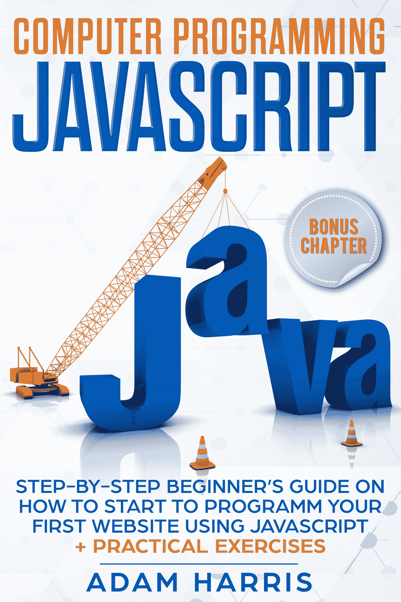
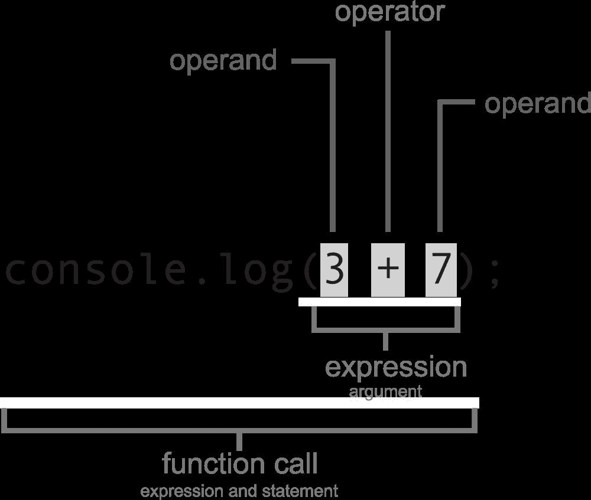
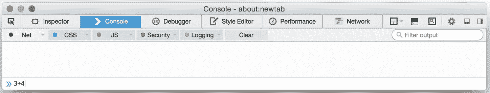
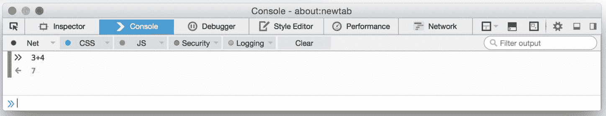
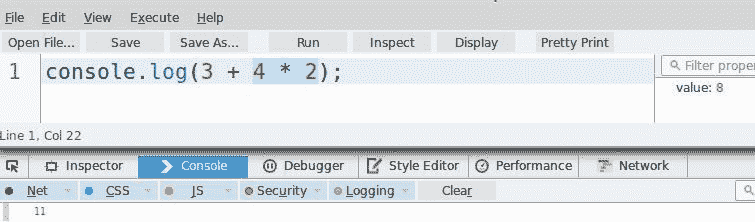
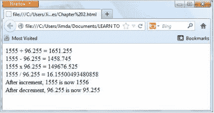

# Javascript 编程：分步初学者指南：使用Javascript创建第一个网站 + 实用练习


## 引言

如果有什么是我希望你在读完这本 JavaScript 编程指南后牢记于心的，那就是：

- JavaScript 是 HTML 和 Web 的语言
- 它易于学习

如果你能做到这一点，那么最终你将微笑着踏上 Web 编程之路。然而，你学习 JavaScript 及其他编程语言的速度完全取决于你自己。如果你发现自己遇到了困难，不要气馁，不妨休息一下，等心情平复后再重新阅读材料。请记住，本章将为你提供 JavaScript 的基础知识，帮助你作为初学者熟悉这门语言。

### JavaScript 中的变量

```
var exam = 50;
var test = 12;
var score = exam * test;
```

在上面的例子中，`exam`、`test` 和 `score` 是变量，它们被赋予了存储的值。我们可以在 JavaScript 中执行各种操作，包括乘法、减法、加法、减法和除法。变量和值可以声明为数字、字符串或字母。

```
var name = "insert your name";
var number = '45';
```

从示例中可以看出，你可以用单引号或双引号括起字符串，因为它们的作用完全相同。

### JavaScript 标识符

JavaScript 中的每个变量都必须有一个唯一的名称，用于标识它。这些唯一的名称称为标识符。标识符有一定的规则，包括：

- 每个标识符必须以字母开头
- 可以包含数字（0-9）、字母（a-z）、美元符号（$）和下划线（_）
- 不能使用保留字
- 变量名区分大小写
- 标识符可以以美元符号或下划线开头

### JavaScript 变量的作用域

JavaScript 允许两种变量作用域，包括全局作用域和局部作用域。如果变量在函数体外声明，则称为全局变量。这样，同一文档中的每条语句都可以访问该变量。然而，局部变量的作用域仅限于函数内部。这样，该变量仅在同一函数内的语句可用。

### 浏览器端的 JavaScript 基础

当你听到浏览器端的 JavaScript 时，它指的是客户端，即代码在客户端（浏览器）的机器上运行。浏览器端组件包括 JavaScript、JavaScript 库、CSS、图像、HTML 以及下载到浏览器的任何文件。

#### 浏览器端 JavaScript 特性

JavaScript 对 Web 非常重要，因为你很可能用它来编写执行任意计算的程序。你可以编写简单的脚本，例如搜索素数或斐波那契数。然而，在 Web 浏览器和 Web 的上下文中，JavaScript 使程序员能够根据用户通过 HTML 表单提供的信息，计算销售税等。

JavaScript 语言的实质在于它所兼容的基于文档的对象和浏览器。这听起来可能很复杂，不过我将解释 JavaScript 在浏览器端的重要功能以及它所支持的对象。

- **控制浏览器** – 有各种 JavaScript 对象允许控制浏览器行为。此外，`Window` 对象支持弹出对话框以向用户显示消息。用户也可以输入消息。除此之外，JavaScript 没有提供直接创建和操作浏览器窗口内框架的方法。不过，你可以利用动态生成 HTML 的能力来创建你想要的特定框架布局。

- **与 HTML 表单交互** – 浏览器端 JavaScript 的另一个重要部分是它与 HTML 表单协同工作的能力。这种能力源于表单元素及其对象，包括 `Text`、`submit`、`select`、`reset`、`radio`、`hidden`、`password` 和 `text area` 对象。利用这些元素，你可以读写表单中元素的值。

- **与用户交互** – JavaScript 还有另一个特性，即定义事件处理程序的能力。大多数情况下，这些事件由用户触发。例如，当有人将鼠标移过超链接、点击提交按钮或输入值时。处理此类事件的能力非常重要，因为使用图形界面编程需要事件驱动模型。

除了上述特性外，浏览器端的 JavaScript 还具有其他能力，例如：

- 通过使用 `` 标签更改显示的图像，以生成动画效果和图像翻转
- 它有一个 `window.setTimeout()` 方法，允许在未来的某一瞬间执行一段随机源代码
- 它简化了处理时间和日期的工作与计算过程




# JavaScript 框架

花点时间思考一下，创建 Web 应用和网站就像建造一所房子。在建造房子时，你可以决定从零开始制作建造房子所需的所有材料，而不做任何计划。这会非常耗时，而且意义不大。你更可能做的是购买预制材料，如砖块、木材、台面等，然后根据你拥有的蓝图进行组装。

编码就像自己动手建造房子。当你开始编写一个网站时，你可以从零开始编写网站的所有部分。然而，有些网站特性通过应用模板能让你的网站更有意义。假设你想买一个轮子，那么寻找一个可以重新发明的轮子会更有意义。这就是 JavaScript 框架登场的地方。

`JavaScript 框架` 是一组 JavaScript 代码库，为网站开发者提供预编写的 JavaScript 代码，用于日常编程任务和功能。你也可以将其称为应用框架，它用 JavaScript 编写，开发者可以操作这些代码的功能，并为了方便而重用它们。它们更适合网站设计，这就是为什么许多开发者使用它们来构建网站。

## 顶级 JavaScript 框架

### Vue.js

这是 JavaScript 框架之一，旨在让用户界面开发更有条理。由 Evan You 创建，它是初学者的理想 JavaScript 框架，因为相当容易理解。此外，它专注于视图层。使用 `Vue.js`，你不需要 `Babel`。`Babel` 是一个转译器，负责将 JavaScript 代码转换为能在所有浏览器中运行的旧版本 ES5。`Vue.js` 框架中的所有模板都是有效的 HTML，这使得它们的集成更容易。如果你想作为初学者开发轻量级应用，最好从 `Vue.js` 开始。

### Next.js

另一个重要的 JavaScript 框架是 `Next.js` 框架，它是用于服务器端渲染的附加工具。该框架允许开发者简化开发过程，类似于 `Vue.js` 框架。这个 JavaScript 框架的特性包括基于页面的客户端路由和代码自动拆分。该框架还带有完整的 CSS 支持，这使得初学者和专业人士都能更轻松地设计用户界面样式。

### Ember.js

这个框架诞生于几年前，是 Web 行业中最受欢迎的 JavaScript 框架之一。像 LinkedIn、Heroku 和 Kickstarter 这样的知名公司都在其网站设计中使用 `Ember.js` 框架。它还定期更新，并为用户提供完整的功能。与 `Vue.js` 框架不同，它对于想要开发复杂 Web 应用的开发者来说非常有效。该框架的重点是可扩展性，允许开发者将其用于 Web 和移动项目。

### Angular

Google 于 2010 年发布了这个 JavaScript 框架，并定期进行更新和改进。它是许多开发者最追捧的框架之一，因为它简化了网站和应用的开发。对于其他开发者来说，则是因为它能够创建动态 Web 应用。

# 第 1 章 使用全局变量作为缓存

在需要创建小型应用，并且尝试将应用与第三方机制集成会产生开销的情况下，这些可以很容易地在 `Node.js` 应用内部处理，并且应在单线程模式下执行。

在这种模式下，即单线程模式，一次只执行一个应用，该应用负责处理发送给它的所有请求。这与桌面应用的情况类似。其他使用其他 Web 开发编程语言（如 PHP、Ruby 和 Python）开发的 Web 应用并非以这种方式运行。在这种情况下，可以定义一个全局变量，该变量将对我们所做的所有请求可访问。这需要非常谨慎地考虑。

为了实现这种机制，可以创建所需类型的全局变量，然后在此函数内部添加一个操作机制。这将使其在我们所有的请求中持久存在。

考虑下面给出的代码，它展示了如何有效地实现这一点：

```
'use strict';
//this should be the cache for the js file
var cache = {};
exports.someMethod = function(data){
/*The business logic should be added here*/
//setting the cache
cache[key] = val;
//retrieving the cache
cVal = cache[key];
//deleting the cache
delete cache[key];
/*The business logic should be added here*/
```

## 不使用第三方库进行日志记录

每当我们需要打印临时信息时，我们使用 `console.log` 来记录到系统。在部署阶段，有一些很好的库可以用于此目的。有些人讨厌使用第三方库来记录他们的 `node.js` 应用。然而，通过提供替代方案，这个问题已经得到解决。借助原生支持，我们可以获得一种非常合适的机制来记录他们的 `node.js` 应用。

`Node.js` 的 `console` 对象为我们提供了不同级别的日志记录。这些需要按照它们设计的方式使用，否则你会在使用中遇到麻烦。当你想要执行 node 应用时，你应该指定一个日志文件，你需要将所有内容写入其中。这可以像下面给出的命令那样完成：

```
$node app.js > mylogfile.log
```

执行上述命令后，你就准备好了。日志信息将保存在上述文件中，稍后当你想要获取一些有用或关键信息时，你就可以查看它。这也适用于安全目的。

每当我们想要在控制台终端上打印某些内容时，我们应该使用下面给出的格式：

```
console.log("The value of my variable should be:"+xyz);
```

这仅适用于单值项。如果是一个 json 对象，那么我们可以使用 `console.log(xyz)`。这表明 `+` 运算符在这种情况下不起作用。

## 关于使用“*”

建议不要在生产依赖中使用它。大多数人在他们的 `package.json` 文件中使用它来指定版本，或者使用 `*` 以便他们始终拥有最新的包。一个人应该将所有包更新到最新版本，因为它可能包含一些错误修复、若干改进，甚至添加了新功能。然而，这仅适用于产品处于开发阶段但尚未进入生产阶段的情况。

如果出现兼容性错误，修复起来会很容易。如下面的代码所示：

```
//other of this:
"dependencies": {
"clustered-node": "*"
//use the following
"dependencies": {
"clustered-node": "~0.0.10"
```

对于那些在生产环境中使用此类符号的人来说，这是非常危险的。因为你不知道何时以及哪个包可能会崩溃并导致应用崩溃，这是可能的。这就是为什么它只应在开发阶段使用，但一旦产品进入生产环境，你应该切换到基于特定版本的依赖项。这应在产品的部署阶段完成。

## 异步循环

每当我们使用 `AsyncJS`/`underscoreJS` 进行异步流循环/控制时，我们会得到非常有用且必要的支持。对于那些更了解回调概念的人，他们可以以非常原生地方式使用它。如果你不想在简单任务中使用这个库，那么使用下面代码中给出的机制。代码如下：

```
var iterate = function(items, it){
console.log("Now handling: "+it);
//async methods
someAsyncMethod(parameterss, function callback(){
if(items.length <= it)
return;
return iterate(items, ++it);
})
};
var items = [5, 6, 7, 8];
iterate(items, 0);
```

# 第 2 章 JavaScript 函数与作用域基础

现在让我们看看，通常当我们谈论“函数”时，你首先想到的是什么？显然是一个活动，对吧？JavaScript 中的函数也以类似的方式工作。函数是需要被程序反复执行的代码块。函数用于执行特定任务。一个函数可以包含任意数量的参数和语句；它们甚至可以没有。根据结构编码方式，它可能向用户返回值，也可能不返回值。

函数按以下方式声明：

```
Function name(                 ) { /*code blocks to be executed*/}
```

要开始函数，我们从 `function` 关键字开始，然后添加名称和括号。要结束函数，我们将要执行的代码块放在花括号中。你也可以将函数放在一个命名变量中：

```
var jam = function() {/* code blocks to be executed*/}
```

下面是一些如何执行函数的示例：

i) 这是最基本的函数示例

```
var sayHello = function(person, greeting) {
var text = greeting + ' , '+ person;
console.log(text);
};
Say Hello (' Jessica' , ' Hello');
```

ii) 这是一个返回值的函数示例

```
var greet = function (person, greeting) {
var writing = greeting + ' , ' + person ;
return function () {
console.log(text);
};
};
console.log(greet('Richard' ,' Hello"));
```

iii) 有时，你可能想使用嵌套函数。（注意：嵌套函数是另一个函数内部的函数。）

```
var sayHi = function( person, greeting) {
var text = greeting + ',' + person;
return function() {
console.log (text);
};
};
var greeting = greet( ' Richard' , 'Hello');
greeting();
```

## 自执行匿名函数

程序员一直在寻找最先进、最巧妙的方法来改善他们的编程体验，并使其更易于访问和更简单。这导致了自执行匿名函数的创建。自执行匿名函数的核心目的是创建一个 JavaScript 函数，并在其创建后立即执行。这使得处理大型程序的程序员更容易。同样，它将帮助你编码而不会创建混乱的全局命名空间。

一个基本的自执行匿名函数如下：

```
(function() {
// code here
})();
```

如果你计划用 JavaScript 编写复杂代码，理解如何使用这种类型的函数非常重要。使用自执行匿名函数可以生成一些易于使用的优秀代码。例如，JQuery 库旨在使在网站上使用 JavaScript 更加容易。它通过将整个库包装在一个大型自执行函数中来实现这一点。

## typeof 运算符

你可能会遇到需要确定你在 JavaScript 中使用的变量类型的情况。你不需要请夏洛克·福尔摩斯来找出答案！相反，你可以简单地使用 `typeof` 运算符来确定任何特定值的类型。换句话说，`typeof` 运算符用于评估操作数的类型。

示例：

```
var myvar = 0
alert(typeof myvar)  //alerts "number"
```

Number 并不是唯一可以检测的操作数类型。它还可以是：string、Boolean、object、null 和 undefined。

## 作用域

作用域是变量的可访问性。在调试时，对作用域的良好理解是必要的，因为它允许你了解哪个代码块中的变量导致了问题。

这里简单的规则是：每当你在一个作用域内声明一个变量时，只有该作用域内的语句才能识别它；作用域外的语句不会承认它的存在，因此该变量将不起作用。

另一种看待这个问题的方式是将你的整个代码想象成一个酒店，特定的功能和代码部分就像酒店房间。酒店房间代表代码的私有作用域，而公共区域代表全局作用域。一个酒店房间里的人不能看到或使用另一个酒店房间里的东西。在酒店工作的人员（以及全局作用域）也无法访问私人酒店房间，除非他们有特定权限。同时，客人可以穿过公共区域并使用那里的任何物品。

因此，你可以看到作用域如何影响代码的运行。如果你需要两个不同的函数访问同一个变量，你需要确保它们都能访问它。确保必要变量可访问的一个关键方法是使你的变量全局可访问。

如果你想让变量全局可访问，有两种可能的替代方案。第一件事是在给定代码片段的作用域之外声明变量，这将允许程序中的任何函数调用并识别它。另一件事是在你的作用域内声明变量而不使用 `var` 关键字。如果同一个变量在代码开头没有在相关代码片段的作用域之外定义，那么该变量的行为将类似于全局变量。

示例：

```
var foo = 'hello';
var talkHello = function() {
console.log(foo);
};
talkHello(); // logs 'hello'
console.log(foo); // also logs 'hello'
```

如你所见，变量 `foo` 在函数 `talkHello` 外部声明。这意味着 `foo` 是一个全局变量，任何函数都能访问它，所以当函数 `talkHello` 调用它时，它是可访问的。

下面的示例与第一个示例相反。这表明在作用域之外编写的代码块无法识别该变量。

```
var talkHello = function() {
var doo = 'hello';
console.log(doo);
};
talkHello(); // logs 'hello'
console.log(doo); // gives an empty log.
```

在这个示例中，变量 `doo` 在函数 `talkHello` 内部被调用。这创建了一个私有变量，只有该函数才能访问，因此当命令 `console.log(doo)` 尝试访问它时，它返回一个空值。

## 一些需要避免的常见错误

✓ 始终记住，变量只能被特定作用域内的函数访问，在该作用域之外，变量是无效的。

## 练习

➢ 解释什么是作用域以及变量如何受其影响。

➢ 编写一个简单的程序来说明以下功能：

a) 简单函数

b) 具有返回值的函数

c) 作为参数传递的函数

➢ 解释自执行匿名函数的概念并给出一个示例。

# 第 3 章 循环结构

循环是大多数编程语言支持的另一个基本编程结构。从根本上说，循环用于迭代执行同一组语句，直到条件保持为真。JavaScript 支持四种类型的循环结构。

## While 循环

最基本的循环结构是 `while` 循环。这种类型的循环执行 `while` 内部的语句集，直到 `while` 的表达式为真。一旦表达式变为假，`while` 循环执行终止。`while` 的实现语法如下：

```
while (expression){
     //Statements of the while block
}
```

`while` 循环的示例实现如下：

```
<html>
     <body>
               <script type="text/javascript">
           <!--
              var c = 0;
              document.write("Loop begins…");
                        while (c < 5){
                 document.write("Value of c: " + c + "<br />");
                 c++;
              }
                        document.write("Loop Terminates!");
          //-->
        </script>
               <p>Change the values of the looping variable to see how things change</p>
     </body>
</html>
```

代码执行后的输出如下图所示。

## Do…While 循环

另一种循环结构是 `do...while` 循环。条件的有效性在循环结束时检查。因此，这个循环至少执行一次。这种类型的循环执行 `do…while` 内部的语句集，直到 `while` 的表达式为真。一旦表达式变为假，`while` 循环执行终止。`while` 的实现语法如下：

```
do{
     //Statements of the while block
}while (expression)
```

`do…while` 循环的示例实现如下：

```
<html>
     <body>
               <script type="text/javascript">
           <!--
              var c = 0;
              document.write("Loop begins…");
                        do{
                 document.write("Value of c: " + c + "<br />");
                 c++;
              } while (c < 5)
                      document.write("Loop Terminates!");
          //-->
        </script>
               <p>Change the values of the looping variable to see how things change</p>
     </body>
</html>
```

代码执行后的输出如下图所示。

## For 循环

最常用的循环结构是 `for` 循环。`for` 循环将循环变量初始化、条件检查和循环变量更新集成在 `for` 语句中。`while` 的实现语法如下：

```
for(init; expression; update){
     //Statements of the for block
}
```

这里，`init` 是初始化语句，`expression` 是要测试的条件。最后，`update` 是更新循环变量的表达式。`while` 循环的示例实现如下：

```
<html>
     <body>
               <script type="text/javascript">
           <!--
              var c;
              document.write("Loop begins…");
                        for(c=0; c<5; c++){
                 document.write("Value of c: " + c + "<br />");
                 }
document.write("Loop Terminates!");
          //-->
        </script>
               <p>Change the values of the looping variable to see how things change</p>
     </body>
</html>
```

代码执行后的输出如下图所示。

## For…In 循环

这个循环通常用于对象。循环使用对象的一个变量，并循环直到与对象变量关联的属性值耗尽。换句话说，这个循环围绕对象属性工作。`for…in` 循环的实现语法如下：

```
for (variable in object){
     //Statements inside the for…in loop block
}
```

下面给出了演示 `for…in` 循环工作的示例实现。

```
<html>
     <body>
               <script type="text/javascript">
           <!--
              var demoObject;
              document.write("Properties of the Object: <br /> ");
                        for (demoObject in navigation) {
                 document.write(demoObject);
                 document.write("<br />");
              }
              document.write ("Loop Terminated!");
           //-->
        </script>
               <p>Change the object to see how the result changes</p>
     </body>
</html>
```

## 控制循环

尽管循环一旦开始，只有在条件表达式为假时才终止，但开发者可以通过某些方式控制循环。可能会出现这样的情况：如果发生特殊情况，你可能想在执行过程中终止循环，或者当某个场景发生时，你可能想开始一个新的迭代。为了控制和实现所有这些条件，JavaScript 提供了 `continue` 和 `break` 语句。

### Break 语句

每当在 JavaScript 代码中遇到这个关键字时，循环立即终止，执行转移到循环结束括号之后的语句。为了理解 `break` 语句的工作方式，让我们看一个例子：

```
<html>
     <body>
              <script type="text/javascript">
           <!--
           var a = 5;
          document.write("Loop Begins…<br /> ");
                     while (a < 30)
          {
              if (a == 5){
                 break;}
              a = a + 1;
              document.write( a + "<br />");
           }
                     document.write("Loop terminates!<br /> ");
           //-->
        </script>
               <p>Change the value of a to see how the loop execution is modified</p>
     </body>
</html>
```

代码的输出如下图所示。

### Continue 语句

当在循环中遇到这个语句时，循环的其余语句被忽略，控制转移到循环的下一次迭代。话虽如此，重要的是要理解，只有在循环条件为真时才会执行下一次迭代。如果循环表达式为假，则循环执行终止。

下面给出的示例代码演示了 `continue` 语句的使用。

```
<html>
     <body>
              <script type="text/javascript">
           <!--
              var a = 0;
              document.write("Loop begins<br /> ");
                        while (a < 9){
                 a = a + 1;
                                 if (a == 4){
                    continue; // skip rest of the loop body
                 }
                 document.write( a + "<br />");
              }
                        document.write("Loop terminates!<br /> ");
           //-->
        </script>
               <p>Change the value of a to see how the result changes!</p>
     </body>
</html>
```

执行此代码后生成的输出如下图所示。

### 用于控制循环流的标签

虽然 `break` 和 `continue` 语句可以重定向循环结构边界内的控制流，但它们不能用于将控制转移到精确的语句。在 JavaScript 中，通过使用标签可以实现这一点。标签只是一个标识符后跟冒号，放在语句或代码块之前。以下代码演示了标签的使用。

```
<html>
     <body>
               <script type="text/javascript">
           <!--
              document.write("Loop begins!<br /> ");
              loop1: for (var i = 0; i < 3; i++) {
                 document.write("Loop1: " + i + "<br />");
                 loop2: for (var j = 0; j < 3; j++) {
                    if (j > 3 ) break ; // Quit the innermost loop
                    if (i == 2) break loop1; // Do the same thing
                    if (i == 4) break loop2; // Quit the outer loop
                    document.write("Loop2: " + j + " <br />");
                 }
              }
                        document.write("Loop terminates!<br /> ");
           //-->
        </script>
            </body>
</html>
```

代码的输出如下图所示。

# 第 4 章 ES6 简介

ES6 的一些关键特性包括：

- **箭头函数** - 箭头函数是使用 `=>` 语法的函数简写。它在语法上与 C#、Java 8 和 CoffeeScript 中的相关特性类似。
- **类** - 支持类、继承、super 调用、实例和静态方法。
- **模板字符串** - 模板字符串用于构建字符串。
- **模块** - 语言级别支持组件定义模块。
- **数据结构** - 支持 Maps、Sets、WeakMaps 和 WeakSets。

大多数现代浏览器都支持 ES6。如果你想尝试 ES6 代码，有几个在线编辑器可以帮助你。下面是我最喜欢的两个。它们都提供了下一代 JavaScript 编译器。

[`jsbin.com`](https://jsbin.com)

[`babeljs.io/`](https://babeljs.io/)

现在让我们看一些 ES6 JavaScript 代码的简单示例。在这些示例中，我们将使用 JS Bin 来输入和运行代码。

### 示例 55

以下程序是 ES6 脚本的一个简单示例。

```
// ES6 code example
const greeting = (name) => `Hello, ${name}!`;
console.log(greeting('World'));
```


```
let num1=5;console.log(num1);
```

关于上述程序，需要注意以下几点：`let` 命令用于给变量赋值。然后我们使用 `console.log` 命令输出变量的值。该程序的输出结果如下：5。我们还可以使用 `const` 关键字声明常量。下面来看一个示例。

### 示例 56：下一个程序是使用常量的 ES6 脚本示例。

```
const num=6;let num1=5;console.log(num);console.log(num1);
```

该程序的输出结果如下：65。我们还可以在 ES6 中定义函数。下面来看一个简单示例。

### 示例 57：以下程序是使用函数的 ES6 脚本示例。

```
var start=function(){const num=6;let num1=5;console.log(num);console.log(num1);}start();
```

该程序的输出结果如下：65。

## 决策与循环

ES6 支持以下决策与循环命令。

- `If` 语句——用于计算表达式，然后相应地执行语句。
- `If…else` 语句——用于计算表达式，然后相应地执行语句。如果布尔表达式计算结果为 false，则执行另一组语句。
- `Nested if` 语句——用于测试多个条件。
- `Switch…case` 语句——计算表达式，将表达式的值与 case 子句匹配，并执行与该 case 关联的语句。
- `For` 循环——一组语句执行 `n` 次。
- `While` 循环——一组语句在条件保持为 true 时持续执行。
- `Do…while` 循环——一组语句在条件保持为 true 时持续执行。与 while 循环的区别在于，语句至少会执行一次。

下面来看这些语句的一些示例。

### 示例 58：以下程序是 ES6 中循环（if else）的示例。

```
var start=function(){const num=6;let num1=5;if(num<7){console.log("The value is less than 7");}else{console.log("The value is greater than 7");}}start();
```

该程序的输出结果如下：“The value is less than 7”

### 示例 59：下一个程序是 ES6 中循环（for 循环）的示例。

```
var start=function(){for(x=0;x<5;x++){console.log(x);}}start();
```

该程序的输出结果如下：01234

### 示例 60：此程序是 ES6 中循环（while 循环）的示例。

```
var start=function(){let x=0;while(x<5){console.log(x);x++;}}start();
```

该程序的输出结果如下：01234

## 类

ES6 也支持类。类的定义方式如下：

```
class classname{constructor(parameters){//Assign values to the properties}// More methods}
```

其中：`classname` 是分配给类的名称。我们有一个构造函数，在创建对象时调用。构造函数可以接受参数。这些参数可用于为类的属性赋值。然后我们可以在类中定义更多方法。下面来看一个 ES6 中简单类的示例。

### 示例 61：以下程序展示了如何在 ES6 中使用类。

```
var start=function(){class Rectangle{constructor(height, width) {this.height = height;this.width = width;}Display(){console.log(this.height);console.log(this.width);}}var newrect=new Rectangle(3,4);newrect.Display();}start();
```

关于上述程序，需要注意以下几点：首先我们定义了一个名为 `Rectangle` 的类。它接受两个参数，即 `height` 和 `width`。这可用于定义类的 `height` 和 `width` 属性。然后我们创建了一个 `Display` 方法，用于显示类的属性。该程序的输出结果如下：34。

## 集合

ES6 也支持集合，例如 map 集合。例如，如果我们想设置 map 集合的值，可以使用 `set` 方法，如下所示：

```
mapname.set(key,value);
```

其中：

- `mapname` 是 map 的名称。
- `key` 是分配给元素的键。
- `value` 是与该键关联的值。

### 示例 62：以下程序展示了如何在 ES6 中使用 map。

```
var start=function(){var map = new Map();map.set('keyA','valueA');map.set('keyB','valueB');map.set('keyC','valueC');console.log(map.get("keyB"));}start();
```


使用此程序，输出结果如下：`valueB`

# 第 5 章 表单

表单从网页访问者那里获取信息，并将其发送到后端应用程序，例如 PHP 脚本、CGI 或 ASP 脚本。HTML 表单用于收集网站访问者的数据。表单对于网站上的会员注册、在线购物或求职申请非常重要。例如，在用户注册过程中，会收集电子邮件地址、姓名、信用卡等信息。然后，根据后端应用程序中包含的特定逻辑，对发送的数据进行必要的处理。可用的表单元素有多种，例如文本区域字段、单选按钮、下拉菜单、复选框等。

## 表单结构

`<form>`

HTML 表单通过 `<form>` 元素创建。此标签必须始终携带 `action` 属性，有时也会带有 `id` 和 `method` 属性。

## Action

每个 `<form>` 元素都需要一个 `action` 属性。`action` 属性的值是服务器上用于检索提交表单中所含信息的页面的 URL。

## Method

表单通过两种方式发送到后端应用程序：它们使用“get”或“post”方法。

### Get

GET 方法允许表单中的值返回到 `action` 属性中指定的 URL 末尾。GET 方法非常适合从 Web 服务器收集数据。该技术确保参数存储在浏览器缓存中。此方法可发送的信息量有限。处理敏感信息（如密码或信用卡号）时，请勿使用 GET 方法，因为该过程会显示在浏览器的地址栏中，对所有人可见。

### Post

POST 方法通过 HTTP 标头发送值。当表单包含敏感信息（如密码）以及访问者需要上传文件时，POST 方法非常理想。参数不会保存在 Web 服务器缓存或浏览器历史记录中。POST 方法比 GET 方法更安全。

## Id

此值为 HTML 表单指定一个相对于页面上其他元素的唯一标识。

## 文本输入

`<input>` 标签允许创建不同的表单控件。属性值的类型决定了所创建的输入类型。

### `type="text"`

当 `type` 属性值为 text 时，它会创建一个单行文本输入框。

### Name

当用户向表单中输入信息时，服务器需要知道控件数据所对应的值。例如，在登录表单中，服务器需要知道哪个是用户名，哪个是密码。每个表单控件都需要 `name` 属性，该属性的值用于标识表单控件，并与输入的信息一起发送到服务器。

### Max length

`maxlength` 属性可用于限制文本字段中可输入的字符数。`maxlength` 属性的值即为允许输入的字符数。

## 密码输入

### `type="password"`

类型为 `"password"` 的 `<input>` 标签为用户提供了一种安全输入密码的方式。该元素呈现一个单行纯文本编辑器控件，将字符替换为符号（如 `"*"`）或点（`" • "`），使其不可读，从而保证文本安全。

### Name

此属性指定密码输入的名称，该名称会与访问者输入的密码一起传输到服务器。

```
<body>
<form action="http://www.alabiansolutions.com/login.php">
<p>用户名：<input type="text" name="username" size="15" maxlength="30" /></p>
<p>密码：<input type="password" name="password" size="15" maxlength="30" /></p>
</form>
</body>
```

## 文本区域

多行输入通过 `<textarea>` 元素创建。与其他输入元素不同，`<textarea>` 不是一个空元素，因此它应包含开始和结束标签。位于开始 `<textarea>` 和结束 `</textarea>` 元素之间的文本将在页面加载时显示在文本框中。

```
<form action="process.php">
<p>你对这场演出有什么看法？</p>
<textarea name="comment"></textarea>
</form>
```

## 单选按钮

`<input type="radio">` 元素表示一个单选按钮。它用于创建多个可选项。

### Name

为了被视为一个组，`name` 属性的值必须与单选组对应，因为选择同一组中的任何其他单选按钮都会取消选择第一个选中的按钮。只要每个组都有自己的名称，就可以在页面上创建多个单选组。

### Value

`value` 属性指示与每个选中选项关联的唯一值。组中每个按钮的值应不同，以便服务器能够识别选中的选项。

### Checked

`checked` 属性指定页面加载时默认选中的值。此属性应在组中的一个单选按钮上使用。

```
<body>
披萨尺寸：
<label><input type="radio" name="size" value="small"/>小份</label>
<label><input type="radio" name="size" value="medium"/>中份</label>
<label><input type="radio" name="size" value="large"/>大份</label>
</body>
```

## 复选框

复选框用于选择一个或多个选项，或取消选择。

### `type="checkbox"`

允许用户针对一个问题选择一个或多个选项，或取消选择。

### Name

此属性会与用户选择的选项值一起传输到服务器。当用户需要以复选框形式回答带有选项的问题时，所有按钮的 `name` 属性值必须保持一致。

### Value

当复选框被选中时，此属性指定发送到服务器的值。

### Checked

`checked` 属性指定页面加载时应被选中的复选框。

```
<body>
披萨配料：
<label><input type="checkbox" value="bacon" />培根</label>
<label><input type="checkbox" value="extra cheese" />额外芝士</label>
<label><input type="checkbox" value="extra cheese" />洋葱</label>
</body>
```

## 下拉列表

选择框，也称为下拉列表，允许用户从下拉列表中选择一个选项。下拉列表通过 `<select>` 标签创建，并包含两个或更多 `<option>` 标签。

### Name

`name` 属性表示表单控件的名称，该名称会与用户选择的值一起发送到服务器。

### `<option>`

此元素用于向访问者显示选项。位于开始 `<option>` 和结束 `</option>` 元素之间的文本将显示在下拉框中。

### Value

`<option>` 标签使用 `value` 属性指定当该选项被选中时，与控件名称一起发送到服务器的值。

### Selected

此属性用于指定页面加载时应自动选中的选项。

```
<body>
<label>手机：
<select name="devices">
<option value="techno">索尼</option>
<option value="infinix">Infinix</option>
<option value="samsung">三星</option>
<option value="sony" selected>选择设备</option>
</select>
</label>
</body>
```

## 文件输入框

文件输入框用于允许用户在网页上上传文件。文件可以是图片、音频、PDF 或视频。

### `type="file"`

此输入产生一个框，类似于文本输入，并带有一个浏览按钮。当选择浏览按钮时，会弹出一个窗口，允许用户从计算机中选择文件以上传到网站。

```
<form action=” process.php” method="post">
<p>请以 MP3 格式上传您的歌曲：</p>
<input type="file" name="user-song" /><br />
<input type="submit" value="上传" />
</form>
```

### `type="submit"`

当用户需要提交表单时使用此属性。

```
<body>
<form action="process.php" method="post">
<p>订阅我们的邮件列表：</p>
<input type="text" name="email" value="email" />
<input type="submit" value="订阅" />
</form>
</body>
```

### Name

它可以使用 `name` 属性，但并非必需。

### Value

`value` 属性用于影响按钮上显示的文本。建议指定按钮上显示的文字，因为某些浏览器上按钮的默认值为“提交查询”，这可能不适用于所有表单。

## 重置按钮

### `type="reset"`

此按钮用于清除用户的所有输入。

```
<input type="reset" value="重置" />
```

## 图片按钮

可以使用图片作为提交按钮。`type` 属性必须设置为 image。还可以提供 `src` 属性。

```
<form action="http://www.websitename.com/subscribe.php">
<p>订阅我们的邮件列表：</p>
<input type="text" name="email" />
<input type="image" src="subscribe.png" width="100" height="20" alt="订阅" />
</form>
```

## 按钮标签

`<button>` 标签指定一个可点击的按钮。可以在 `<button>` 元素中插入文本、内容或图片。使用 `<input>` 元素创建的按钮与使用 `<button>` 标签创建的按钮不同。应始终指定 `<button>` 元素的 `type` 属性。

```
<button type="submit">点击我！</button>
```

## Fieldset 元素

较长的表单从 `<fieldset>` 元素中获益良多。它用于将相关的表单控件分组。

```
<form method="post">
<fieldset>
<legend>联系方式</legend>
<label>地址：<br><input type="text" name="text"><br></label>
<label>电话号码：<br><input type="number" name="number"><br></label>
<label>电子邮件：<br><input type="email" name="email"><br></label>
</fieldset>
</form>
```

## Legend 元素

`<legend>` 元素紧跟在开始 `<fieldset>` 标签之后，包含一个标题，用于标识该表单控件组的用途。

```
<form method="post">
<fieldset>
<legend>联系方式</legend>
<label>地址：<br><input type="text" name="text"><br></label>
<label>电话号码：<br><input type="number" name="number"><br></label>
<label>电子邮件：<br><input type="email" name="email"><br></label>
</fieldset>
</form>
```

## Label 元素

label 标签可用于为表单控件添加说明，以便用户知道应在该区域输入什么内容。

```
<form >
<label for="male">男</label>
<input type="radio" name="gender" id="male" value="male"><br>
<label for="female">女</label>
<input type="radio" name="gender" id="female" value="female"><br>
<label for="other">其他</label>
<input type="radio" name="gender" id="other" value="other"><br><br>
<input type="submit" value="提交">
</form>
```

# 第 6 章 Iframe 与多媒体

## Iframe

`<iframe>` 元素可用于将网页嵌入到您的网页中。

### Iframe 嵌入：谷歌地图

可以使用 iframe 标签将谷歌地图嵌入到您的网页中。

```
<iframe src="https://www.google.com/maps/embed?pb=!1m18!1m12!1m3!1d3963.341775346873!2d3.3422253148425853!3d6.604381995223933!2m3!1f0!2f0!3f0!3m2!1i1024!2i768!4f13.1!3m3!1m2!1s0x103b8d7c33eb87b3%3A0xfc23c9556f669273!2sWebsite+Name!5e0!3m2!1sen!2sng!4v1516009132030" width="600" height="450" frameborder="0" style="border:0" allowfullscreen></iframe>
```

### Iframe 嵌入：YouTube

```
<body>
<iframe width="450" height="400" src="https://www.youtube.com/embed/MhPGaOTiK0A" frameborder="0" allowfullscreen></iframe>
</body>
```

## HTML5 中的多媒体

HTML5 允许用户使用原生 HTML 标签嵌入视频或音频。如果浏览器支持该文件格式，它将为用户提供播放控制。音频和视频标签都是新特性，可在最新版本的浏览器中使用。常见的视频格式有 `.mp4`、`.m4v`、Flash 视频（`.flv`）、音频视频交错（`.avi`）等。

### 视频元素：

可以使用 video 元素为特定视频文件嵌入视频播放器。以下属性用于自定义播放器：`preload`、`loop`、`autoplay`、`poster`、`auto` 和 `controls`。

#### Preload

`preload` 属性指示浏览器在页面加载时应采取什么操作。可以取以下三个值之一：

- `None`：页面加载时视频不会自动加载，直到用户点击播放。
- `Auto`：页面加载时浏览器应下载视频。
- `Metadata`：表示浏览器应获取诸如第一帧、大小、轨道列表和时长等信息。

#### Src

此属性指定视频的路径。

#### Poster

此属性允许用户指定一个图像，在视频下载期间或用户决定播放视频之前显示。

#### Width, height

这些属性指定播放器的大小。

#### Controls

此属性指定浏览器应提供自己的播放控件。

#### Autoplay

此属性表示文件应在使用时自动播放。

#### Loop

此属性指定视频在播放结束后应立即从头开始重新播放。

### 多种视频格式

HTML5 允许用户为音频和视频元素指定多个来源，以便浏览器可以使用其中任何一个可用的格式。

```
<video poster="images/calvin.jpg" controls preload="none" width="450" height="420">
<source src="calvin.mp4" type="video/mp4" />
<source src="calvin.webm" type="video/webm" />
<source src="calvin.ogv" type="video/ogv" />
<p>Calvin Harris 音乐视频</p>
</video>
```

### 音频元素

使用 audio 元素可以将音频播放器嵌入到页面中，用于播放特定的音频文件。可以使用不同的属性来自定义播放器，例如 `autoplay`、`controls`、`loop` 和 `preload`。

#### Autoplay

这是一个布尔属性。如果使用，音频将自动播放并持续播放，不会停止。

#### Loop

`loop` 属性也是一个布尔属性，它表示音频每次播放结束后将重新开始，循环播放。

```
<body>
<audio src="avicii.mp3" controls="true" autobuffer="true"></audio>
</body>
```

### Control

使用 `control` 属性插入音频控件，包括暂停、播放和音量等控件。`<source>` 元素允许用户指定浏览器可以选择的替代音频文件。浏览器将识别第一个支持的格式。位于 `<audio>` 和 `</audio>` 元素之间的文本将在不支持 `<audio>` 元素的浏览器中显示。

```
<audio src="audio/test-audio.ogg" controls autoplay>
<p>此浏览器不支持我们的音频格式。</p>
</audio>
```

### 多种音频格式

```
<audio controls autoplay>
<source src="audio/test-audio.ogg" />
<source src="audio/test-audio.mp3" />
<p>此浏览器不支持我们的音频格式。</p>
</audio>
```

# 第 7 章 文档对象模型

文档对象指的是您的整个 HTML 页面。当您将对象加载到 Web 浏览器中后，它立即成为一个文档对象，它是表示 HTML 文档的根元素。它同时具有属性和方法。文档对象帮助我们向网页添加内容。它是 window 的一个对象，这意味着：

`window.document`

等同于：

`document`

## DOM 方法

DOM 方法是您可以对 HTML 元素执行的操作。DOM 属性是 HTML 元素的值，您可以设置或更改这些值。以下是文档对象的方法：


1.  `write("string")` - 它将字符串写入文档。
2.  `writeln("string")` - 它将字符串写入文档并添加换行符。
3.  `getElementById()` - 返回具有指定 id 的元素。
4.  `getElementsByName()` - 返回所有具有指定 name 的元素。
5.  `getElementsByTagName()` - 返回所有具有指定标签名的元素。
6.  `getElementsByClassName()` - 返回所有具有指定类名的元素。

访问字段值  
DOM 是获取输入字段值的好方法。很多时候你需要从用户那里获取输入。这可以通过以下属性实现：  
`document.form_name.field_name.value`  

其中：
*   `document` - 是表示根元素的 HTML 文档。
*   `form_name` - 是包含字段的表单的名称。
*   `field_name` - 是输入文本的名称。
*   `value` - 是一个属性，返回输入文本的值。


请考虑以下示例：

```
<html><body><script type="text/javascript">
  function readValue(){
  var name=document. memberform. memberName. value;
  alert( "Hi: " + name);
  }
  </script>
  <form name="memberform">
  Enter Name:<input type="text" name="memberName" />
  <input type="button" onclick="readValue()" value="Click Here" />
  </form>
  </body></html>
```

运行代码后，会得到如下简单表单：
只需在输入框中输入你的名字，然后点击“Click Here”按钮，看看会发生什么。
你会看到一个弹出框，其中包含你的名字以及附加的一些文本：
我们只是创建了一个带有输入文本字段的简单表单。方法 `readValue()` 帮助我们获取输入到字段中的值。请看下面这一行：
`var name=document. memberform. memberName. value;`
其中 `memberName` 是表单中文本字段的名称，这些名称必须匹配，否则你将无法得到正确的结果。

### getElementById()

除了名称，我们还可以通过元素的 id 来获取它。这可以通过 `document.getElementById()` 方法实现。不过，输入文本字段需要指定一个 id。
例如：

```
<html><body><script type="text/javascript">
  function computeSquare(){
  var x=document. getElementById( "integer" ). value;
  alert( x * x);
  }
  </script>
  <form>
  Enter an Integer:<input type="text" id="integer" name="myNumber" /><br/>
  <input type="button" value="Compute Square" onclick="computeSquare()" />
  </form>
  </body></html>
```

执行代码后，会得到如下简单表单：
在输入框中输入一个数字，然后点击“Compute Square”按钮。
这会在弹出框中返回该数字的平方，如下所示：
在示例中，我们定义了 `computeSquare()` 方法，它帮助我们获取输入文本字段中数字的平方。请看下面这一行：
`var x=document. getElementById( "integer" ). value;`
在这一行中，我们使用了 `getElementById()` 方法，该方法将输入文本字段的 id 作为参数。它帮助我们通过 id 获取输入文本字段中键入的值。

### getElementsByName()

`document.getElementsByName()` 方法可以帮助我们通过名称获取元素。该方法的语法如下：
`document. getElementsByName( "name" )`
名称是必需的。
示例：

```
<html><body><script type="text/javascript">
  function getNumber()
  {
  var options=document. getElementsByName( "option" );
  alert( "Total Options:" + options . length );
  }
  </script>
  <form>
  Yes:<input type="radio" name="option" value="yes" >
  No:<input type="radio" name="option" value="no" >
  <input type="button" onclick="getNumber()" value="Available Options" >
  </form></body></html>
```

执行后，代码返回如下：
点击“Available Options”按钮，看看会发生什么。会弹出一个窗口，如下所示：
我们创建了两个单选按钮，选项分别为 Yes 和 No。注意，这两个输入类型被赋予了相同的名称，即 `option`。
请看下面这一行：
`var options=document. getElementsByName( "option" );`
这一行帮助我们统计名称为 `option` 的元素数量。根据输出，结果应为 2。

### getElementsByTagName()

`document.getElementsByTagName()` 属性返回具有指定标签名称的元素。其语法如下：
`document. getElementsByTagName( "name" )`
例如：

```
<html><body><script type="text/javascript">
  function allparagraphs(){
  var pgs=document. getElementsByTagName( "p" );
  alert( "Total paragraphs are: "+ pgs . length );
  }
  </script>
  <p> This is a paragraph</p>
  <p> This is a paragraph</p>
  <p> This is a paragraph</p><p> This is a paragraph</p><button onclick="allparagraphs()"> Total Paragraphs</button>
  </body></html>
```

执行后，代码返回如下：
点击“Total Paragraphs”按钮，看看会发生什么。
你会看到如下弹出框：
这意味着代码能够统计出我们拥有的段落数量。
主要逻辑在于下面这一行：
`var pgs=document. getElementsByTagName( "p" );`
我们将标签“p”作为参数传递给方法，该标签代表一个段落。共有三个带有标签“p”的元素，因此输出应为 4 个段落。

下面是另一个示例：

```
<html><body><script type="text/javascript">
  function countheader2(){
  var h2count=document. getElementsByTagName( "h2" );
  alert( "Total count for h2 tags: "+ h2count . length );
  }
  function countheader3(){
  var h3count=document. getElementsByTagName( "h3" );
  alert( "Total count for h3 tags: "+ h3count . length );
  }
  </script>
  <h2> A h2 tag</h2>
  <h2> A h2 tag</h2><h2> A h2 tag</h2><h2> A h2 tag</h2><h3> A h3 tag</h3>
  <h3> A h3 tag</h3>
  <h3> A h3 tag</h3><h3> A h3 tag</h3><h3> A h3 tag</h3><button onclick="countheader2()"> Total h2</button>
  <button onclick="countheader3()"> Total h3</button>
  </body></html>
```

执行后，代码返回如下输出：
我们总共有 4 个 h2 标签和 5 个 h3 标签。点击“Total h2”按钮，看看会发生什么。
你应该会得到如下弹出框：
点击“Total h3”按钮，看看会发生什么。
你应该会得到如下弹出框：

### innerHTML

该属性可用于向 HTML 页面添加动态内容。当需要生成动态内容（如评论表单、注册表单等）时，会在 HTML 页面上使用它。
请看以下示例：

```
<html><body><script type="text/javascript">
  function displayform() {
  var data = "Username:<br><input type='text' name='name'><br>Comment:<br><textarea rows='6' cols='45'></textarea><br><input type='submit' value='Contact us'>";
    document. getElementById( 'area' ). innerHTML= data;
  }
  </script>
  <form name="form1">
  <input type="button" value="Contact us" onclick="displayform()" >
  <div id="area"></div>
  </form>
  </body></html>
```

执行后，代码返回如下按钮：
点击按钮，看看会发生什么。你会得到如下结果：
我们所做的是在用户点击按钮后创建一个“联系我们”表单。注意，HTML 表单是在我们创建并命名为 `area` 的 div 内部生成的。为了定位位置，我们调用了 `document.getElementById()` 方法。

### innerText

我们可以使用该属性向 HTML 页面添加动态文本。注意，使用该属性时，你的文本会被解释为普通文本，而不是 HTML 内容。一个很好的应用场景是，当你需要根据密码长度写出密码强度、写出验证消息等时。
例如：

```
<html><body><script type="text/javascript">
  function validatePass() {
  var message;
  if(document. form1. userPass. value. length> 5 ){
  message= "good" ;
  }
  else{
  message= "poor" ;
  }
  document. getElementById( 'area' ). innerText= message;
  }
  </script>
  <form name="form1">
  <input type="password" value="" name="userPass" onkeyup="validatePass()" >
  Strength:<span id="area"> Pasword strength </span>
  </form>
  </body></html>
```

执行后，代码返回如下：
开始输入密码，看看输入时输入字段右侧的文本会发生什么变化。如果你输入的密码少于 5 个字符，消息将变为“poor”，如下所示：
继续输入密码，直到超过 5 个字符。你会看到消息变为“good”，如下所示：
这就是该属性的强大之处。

## 动画

使用 JavaScript，我们可以对元素进行动画处理。我们可以使用 JavaScript 根据某个方程在页面上移动诸如 ``、`<div>` 等元素。以下是 JavaScript 中用于动画的常用方法：

1.  `setTimeout(method, time)` - 该方法将在指定的毫秒数后调用指定的方法。


2. `setInterval (method, time)` - 该方法会在 `time` 毫秒后调用指定的方法。

使用 JavaScript，可以设置 DOM 对象的某些属性，例如其在屏幕上的位置。对象的位置可以通过 `top` 和 `left` 属性来设置。示例如下：

```
// 设置距离屏幕左边缘的距离。object.style.left = 以点或像素为单位的距离；    或// 设置距离屏幕顶部边缘的距离。object.style.top = 以点或像素为单位的距离；
```

### 手动动画

在以下示例中，我们将让图像向右移动：

```html
<html>
<body>
<script type="text/javascript">
var image = null;
function init () {
    image = document.getElementById('myImage');
    image.style.position = 'relative';
    image.style.left = '0px';
}
function moveImage () {
    image.style.left = parseInt(image.style.left) + 10 + 'px';
}
window.onload = init;
</script>
</head>
<body>
<form>

<p> 点击按钮移动图像</p>
<input type="button" value="移动图像" onclick="moveImage();" />
</form>
</body>
</html>
```

在以下行中，你应该使用自己图像的正确名称：``。在我的例子中，我有一张名为 house 的 .jpg 图像。运行代码后，会得到如下结果：

点击“移动图像”按钮。每次点击，图像都会向右移动。效果如下所示：

考虑脚本中的这一行：`image = document.getElementById('myImage');`。我们通过图像的 ID 获取它，然后将其赋值给 `image` 变量。`init()` 方法帮助我们设置图像在窗口中的初始位置。该方法会在窗口加载时被调用。`moveImage()` 函数会在每次点击后将图像向右移动 10 像素。如果要让图像向左移动，应将值设为负数。在这种情况下，动画是手动的，因为我们需要点击按钮。

### 自动动画

要实现元素的自动动画，我们可以使用 JavaScript 提供的 `setTimeout()` 函数。

示例：

```html
<script type="text/javascript">
var image = null;
var animate;
function init () {
    image = document.getElementById('myImage');
    image.style.position = 'relative';
    image.style.left = '0px';
}
function animateImage () {
    image.style.left = parseInt(image.style.left) + 10 + 'px';
    animate = setTimeout(animateImage, 20);
}
function stopAnimation () {
    clearTimeout(animate);
    image.style.left = '0px';
}
window.onload = init;
</script>
</head>
<body>
<form>

<p> 点击“动画”按钮启动动画</p>
<input type="button" value="动画" onclick="animateImage();" />
<input type="button" value="停止" onclick="stopAnimation();" />
</form>
```

执行代码后返回如下结果：

点击“动画”按钮，动画开始。当点击“停止”按钮时，动画停止。

`animateImage()` 方法调用了 `setTimeout` 方法，该方法每隔 20 毫秒设置一次图像的位置。这将导致图像产生动画效果。`stopAnimation()` 方法用于清除由 `setTimeout()` 方法设置的计时器。对象（即图像）被重置回其初始位置。

### 鼠标悬停效果

我们可以使用鼠标图像在 JavaScript 中实现图像悬停效果。当鼠标移动到图像上时，它会变成另一张图像。

示例：

```html
<html>
<body>
<script type="text/javascript">
if(document.images) {
    var img1 = new Image();
    img1.src = "ps.jpg";
    var img2 = new Image();
    img2.src = "house.jpg";
}
</script>
</head>
<body>
<p> 将鼠标移上来实现悬停效果</p>
<a href="#" onMouseOver="document.img.src=img2.src;" onMouseOut="document.img.src=img1.src;">

</a>
</body>
</html>
```

我们使用了 `if` 语句来检查图像是否存在。我们使用了 `Image()` 构造函数来预加载一个名为 `img1` 的新对象。同样地，也预加载了第二张图像 `img2`。`src` 被赋予外部存储的图像名称。`#` 用于禁用链接，这样点击后不会打开 URL。当鼠标光标移动到图像上时，会调用 `onMouseOver` 方法。当鼠标光标移出图像时，会调用 `onMouseOut` 方法。

# 第 8 章 子句

## GROUP BY 子句

`GROUP BY` 子句将指定列中具有数据的所有行收集在一起。它还会允许我们之前讨论的聚合函数在这些列上执行。最好通过一个例子来解释：

GROUP BY 子句语法：

```
SELECT column1,
SUM(column2)
FROM "list-of-tables"
GROUP BY "column-list";
```

假设你想检索每个独立部门支付的最高薪资数据。你的语句如下：

```
SELECT max(salary), dept
FROM employee
GROUP BY dept;
```

该语句将按名称显示每个唯一部门中的最高薪资。简而言之，每个部门中薪资最高的人员姓名将与其薪资和所在部门一起显示。

## HAVING 子句

`HAVING` 子句允许你为每个特定组指定行的条件，换句话说，根据你输入的具体条件选择某些行。如果使用 `HAVING` 子句，它应始终跟在 `GROUP BY` 子句之后：

HAVING 子句语法：

```
SELECT column1,
SUM(column2)
FROM "list-of-tables"
GROUP BY "column-list"
HAVING "condition";
```

最好通过一个例子来展示 `HAVING` 子句。假设你有一个表，其中包含员工姓名、所在部门、薪资和年龄。假设你想找出每个独立部门中每位员工的平均薪资，你可以输入：

```
SELECT dept, avg(salary)
FROM employee
GROUP BY dept;
```

但现在假设你只想计算平均薪资，并且仅当薪资超过 20,000 美元时才显示。你的语句如下：

```
SELECT dept, avg(salary)
FROM employee
GROUP BY dept
HAVING avg(salary) > 20000;
```

## ORDER BY 子句

`ORDER BY` 子句是可选的，它允许你按排序顺序（升序或降序）显示查询结果，排序依据是你选择用于排序数据的列。

ORDER BY 子句语法：

```
SELECT column1, SUM(column2) FROM "list-of-tables" ORDER BY "column-list" [ASC | DESC];
```

* `[ ]` = 可选

该语句将显示你指定的表（本例中为 `employee_info` 表）中的员工 ID、部门、姓名、年龄和薪资，其中部门等于 SALES。结果将按薪资升序排列：

* `ASC` = 升序 - 默认
* `DESC` = 降序

例如：

```
SELECT employee_id, dept, name, age, salary FROM employee_info WHERE dept = 'Sales' ORDER BY salary;
```

如果要从多个列排序数据，每个列名必须用逗号分隔：

```
SELECT employee_id, dept, name, age, salary
FROM employee_info
WHERE dept = 'Sales'
ORDER BY salary, age DESC;
```


# 第 9 章 运算符、数据类型及其他优先级

## JavaScript 计算

所有编程语言都允许你进行计算。从某种意义上说，你可以把 JS 当作袖珍计算器来使用。例如，输入以下内容：

```
"use strict";console.log(3 + 4);
```

清单 5 `accompanying_files/03/examples/calc.js`

不出所料，你会得到结果 7。

仅从这个非常简短简单的例子中，你就能看到几个关键的 JS 概念。`3 + 4` 是一个表达式。表达式是 JS 中最重要的概念之一。表达式的特点是具有返回值——在本例中，返回值是数字 7。反过来，你可以在代码的不同位置使用返回值，例如作为函数调用的参数。或者换句话说，JavaScript 会用表达式的（返回）值来替换表达式本身。



### 表达式

#### Firefox Web 控制台中的表达式

你也可以直接在 Firefox Web 控制台中输入表达式。尝试在输入行（双箭头 "）旁边输入 `3 + 4`。



直接在控制台中输入表达式——输入

按回车确认输入后，控制台会立即显示返回值。



直接在控制台中输入表达式——输出

顺便提一下，你也可以使用 Shift+回车来输入多行语句，即跨越多行的单条语句。整个语句只有在按回车后才会执行。

或者，你也可以在 Scratchpad 中选择部分表达式，并使用“检查”（Ctrl-I / Cmd-I）来查看。如  所示，Scratchpad 会在右侧边栏中将 `4 * 2` 的结果显示为 `value: 8`。



在 Scratchpad 中检查选中的（部分）表达式

### 表示法

从现在开始，我们会经常指出某个表达式返回的值，或者控制台中显示的值。为此，我们会在代码中插入注释，并在 `=>`（即所谓的胖箭头）前面显示该值。

示例

```
3 + 4 // => 7
console.log(3 + 4 * 2); //=> 11
```

### JavaScript 作为袖珍计算器：算术运算符

除了乘法和加法运算符，JS 还有用于减法、除法和取模等算术运算的相应运算符。所有这些运算符都属于所谓的算术运算符组：

| 符号 | 运算 |
|------|------|
| + | 加法 |
| - | 减法 |
| * | 乘法 |
| / | 除法 |
| % | 取模——整数除法的余数 |
| ** | 乘方（ECMAScript 2016+） |

表 算术运算符

示例

* `5 + 4` 返回 9
* `5 - 4` 返回 1
* `5 * 4` 返回 20
* `5 / 4` 返回 1.25
* `10 % 3` 返回 1，因为 `10 - 3 * 3 = 1`。
* `5 ** 4` 返回 625，因为 `5 * 5 * 5 * 5 = 625`。

#### 练习 3：2000 秒

2000 秒等于多少分钟和余数秒？使用 `console.log` 打印出答案。

提示：解决这个练习最简单的方法是使用取模运算符。目前我们还没有教你如何去除小数位，我们稍后会再回到这个问题。

## 字符与字符串

你有没有注意到数字和文本的编码方式有所不同？上一课开头的 "Hello world" 是用引号写出来的，而数字则没有。文本元素写在引号内，实际上是将单个字符串接或链接在一起——这给了我们编程术语 **字符串** 来表示这样的文本。

### 两种引号

你可以使用单引号或双引号来界定字符串，但字符串开头和结尾的引号必须相同。

示例

* `"Some text string"` 是允许的
* `'Some text string'` 也是允许的
* `"Some text string'` 是无效的

大多数 JS 开发者一致使用双引号，仅在特殊情况下使用单引号，例如当需要在字符串内使用双引号来表示字面文字时。

### 编码指南

通常你应该使用双引号来界定字符串。

### 确定长度

有时你需要知道字符串的长度——即其中包含多少个字符。随着你进行越来越多的开发，你会遇到许多长度很重要的场景。

例如，博客、产品列表以及类似项目有时会提供文本预览，只显示整个文本的一部分。在生成此预览之前，必须先测量整个文本项的长度，以确定文本是否真的需要缩短。

因此，在这一点上，我们想向你介绍字符串属性 `length`。你可以通过在字符串后面输入 `.length` 来让字符串返回此属性。

```
"length matters - sometimes".length // => 26
```

然后将你的语句包装到 `console.log` 中，这样你就可以在控制台上看到所需的响应：

```
"use strict";
console.log("length matters - sometimes".length);
```

清单 6 `accompanying_files/03/examples/length.js`

#### 练习 4：幸运数字与名字代码

你知道幸运数字和代码名称吗？这里有一种有趣的方法来生成名字代码：

将你名字（如果你愿意，可以包括中间名）的长度乘以你姓氏的长度，并在控制台中打印出结果。（顺便告诉你，我们得到的结果是 40 和 30。）

## 字面量：名副其实

既然你已经了解了字符串和数字，我们还需要告诉你另一个重要概念：基本上，任何在代码中直接指定的值——无论是字符串还是数字——都被称为（你猜对了）**字面量**。字面量总是具有固定的值。

示例

* `42`
* `"house"`
* `"green"`
* `5.47`
* `1998`
* `"Please enter your name"`

## 数字与字符串数据类型

JavaScript 字面量具有所谓的**数据类型**。顾名思义，数据类型指定了字面量所代表的数据种类，进而指定了其可能的取值。

到目前为止，我们使用了以下数据类型：

| 数据类型 | 允许的值/含义 | 字面量示例 |
|----------|---------------|------------|
| 字符串 | 任何文本 | `"Hello"` |
| 数字 | 任何正数或负数 | `246.5` |


## 字符串与数值数据类型

JavaScript 以所谓的 UTF-16 字符格式 [ECMA-262] 对字符串进行编码。编码格式决定了字符在数字上的表示方式。UTF-16 让你能够使用各种特殊字符以及不同语言中的特定字母（例如德语变音符号、带重音的法语字符等）。

数值的取值范围也是有限的。不过，只要你不进行天文级别的计算，应该就没问题。

要找出字面量的数据类型很简单——只需使用 JavaScript 运算符 `typeof`。`typeof` 返回一个字符串，告诉你该字面量的数据类型。

### 示例

```
"use strict";
console.log(typeof 3764);           // => number
console.log(typeof "beautiful JS"); // => string
console.log(typeof 27.31);          // => number
```

`清单 7` `accompanying_files/03/examples/type.js`

### 练习 5：嗯……那你到底是什么？

以下字面量的数据类型是什么？

`"42"`

# 第 10 章 文档对象模型（DOM）

`document` 对象是浏览器为每个新 HTML 页面创建的对象。创建后，JavaScript 允许我们访问该对象的许多属性和方法，这些属性和方法可以以各种方式影响文档，例如管理或更改信息。事实上，我们一直在使用该对象的一个方法 `document.write()` 来在网页中显示内容。不过，在探索属性和方法之前，我们首先来看一下文档对象模型（DOM）。

## DOM 基本概念

我们知道，当 Web 浏览器接收到 HTML 文件时，它会将其连同所有附带文件（如图像和 CSS 样式）一起显示为屏幕上的网页。然而，浏览器还会根据其 HTML 结构创建该 Web 文档的一个模型。这意味着所有标签、它们的属性以及它们出现的顺序都会被浏览器记住。这种表示称为文档对象模型（DOM），它用于向 JavaScript 提供如何与网页元素通信的信息。此外，DOM 还提供了可用于导航或修改 HTML 代码的工具。

文档对象模型是由万维网联盟（W3C）定义的标准，大多数浏览器开发者都使用该标准。为了更好地理解 DOM，我们先来看一个非常简单的网页：

```
<!doctype html>
<html>
<head>
<meta charset="utf-8">
<title>Party Schedule</title>
<style type="text/css">
.current {color:red;}
.finished {color:green;}
</style>
</head>
<body>
<h1 id="partytitle">Party Plan</h1>
<ul id="partyplan">
<li id="phase1">20:00 - Home warm-up</li>
<li id="phase2">22:00 - Joe's Bar</li>
<li id="phase3">00:00 - Nightclub 54</li>
</ul>
</body>
</html>
```

在网页中，标签会包裹其他标签。`<html>` 标签包裹 `<head>` 和 `<body>` 标签。`<head>` 标签包裹诸如 `<title>`、`<meta>` 和 `<script>` 等标签。`<body>` 包裹所有内容标签，如 `<p>`、`<h1>` 到 `<h6>`、`<ul>`、`<table>` 等。

标签之间的这种关系可以用树形结构来表示，其中 `<html>` 标签充当树的根，而其他标签则根据文档中的标签层级表示不同的树分支结构。除了标签之外，Web 浏览器还会记住标签的属性以及标签内的文本内容。在 DOM 中，这些项目（标签、属性和文本）都被视为独立的单元，称为节点。

**图 26.** HTML 文档的树形结构

在我们这个基本 HTML 页面的树形结构中，`<html>` 元素充当根元素，而 `<head>` 和 `<body>` 元素是节点。在定义这种关系时，我们也可以将 `<html>` 称为父节点，将 `<head>` 和 `<body>` 元素称为子节点。反过来，`<head>` 和 `<body>` 元素也包含子节点，依此类推。当我们到达一个不包含其他子节点的项目时，我们就在该节点处终止树形结构，该节点也称为叶节点。

## 选择文档元素

有了 DOM 结构，JavaScript 可以通过几种不同的方式访问文档中的元素，具体取决于我们是选择单个元素还是多个元素。在所有方法中，我们首先必须定位代表我们需要访问的元素的节点，然后使用该节点的内容、子元素和属性。

### 选择单个元素

要选择单个元素，我们最常使用 `getElementById()` 方法。该方法允许我们选择其 HTML 标签上应用了特定 ID 属性的元素。如果我们遵循页面中每个元素的 ID 属性都是唯一的这一假设，那么该方法是访问元素最有效的方式。在以下示例中，我们将访问 ID 属性值为 `'phase1'` 的元素：

```
var firststop = document.getElementById("phase1");
```

在 `document` 对象上使用 `getElementById()` 方法意味着我们在页面上的任何位置搜索具有此 ID 的元素。一旦访问到 `'phase1'` 元素（在我们的例子中是第一个 `<h1>` 元素），对该节点的引用就会存储在 `firststop` 变量中，我们就可以使用 JavaScript 进行更改。例如，我们将为此元素分配一个值为 `'current'` 的 class 属性。我们将此代码包含在文档 `<head>` 部分的 `<script>` 标签中。

```
var firststop = document.getElementById("phase1");
firststop.className = "current";
```

**图 27.** 更改页面元素的样式

**注意：** 在某些浏览器中，我们必须将 `<script>` 标签放在结束的 `</body>` 标签之前，或者放在外部的 `.js` 文件中，才能使本章中的代码正常工作。

如果我们想从节点中获取文本，可以使用 `textContent` 属性。更重要的是，我们还可以使用 `textContent` 属性来更改节点的内容。在以下示例中，我们首先选择 `id` 属性值为 `'partytitle'` 的元素，并将其赋值给 `title` 变量。然后，通过更改 `title` 变量的 `textContent` 属性，我们实际上更改了该元素的文本。让我们将以下行添加到我们的 JavaScript 代码中：

```
var title = document.getElementById("partytitle");
title.textContent = "Party Schedule";
```

**图 28.** 更改页面元素的内容

### 选择组元素

虽然有时选择单个元素就足够了，但其他时候我们可能需要选择一组元素。例如，我们可能需要选择页面上的所有 `<li>` 标签，或者所有共享某个 class 属性的元素。在这些情况下，JavaScript 提供了以下两种方法：

*   `getElementsByTagName()` —— 该方法允许我们选择特定标签的每个实例。
*   `getElementsByClassName()` —— 该方法检索所有共享特定类名的元素。


选择一组元素意味着该方法将返回多个节点。这些节点的集合被称为 `NodeList`，并以类数组的形式存储。每个节点会被赋予一个索引编号，从 0 开始，而节点的顺序与它们在页面上的出现顺序相同。尽管 `NodeLists` 看起来像数组，行为也像数组，但从语义上讲，它们是一种称为集合的对象类型。作为对象，集合拥有自己的属性和方法，这些在处理 `NodeList` 时非常有用。

以下示例将选择所有 `<li>` 元素，并将其节点引用赋值给 `schedule` 变量。

```
var schedule = document.getElementsByTagName("li");
```

如果我们想分别访问每个元素，可以使用数组语法。例如：

```
var item1 = schedule[0];var item2 = schedule[1];var item3 = schedule[2];
```

然而，当我们选择一组元素时，通常希望与整个组进行交互。例如，让我们为所有 `<li>` 元素分配值为 `"finished"` 的 class 属性。为此，我们可以使用循环遍历 `NodeList` 中的每个元素。

```
var schedule = document.getElementsByTagName("li");for (var i = 0; i < schedule.length; i++) {schedule[i].className = "finished";}
```

图 29. 更改所有 `<li>` 元素的 class 属性

与处理数组类似，在处理集合时，我们可以使用 `length` 属性来确定集合的大小。然后，我们可以在 `for` 循环中使用此信息，以便有效地遍历每个 `NodeList` 项并分配 `"finished"` 类属性。

对于 `getElementsByClassName()` 方法，我们可以使用完全相同的逻辑。我们将获得一个存储在集合中的 `NodeList`，每个节点都有一个索引编号。与 `getElementByTagName()` 方法一样，我们可以访问单个项，并通过其对象属性和方法管理集合。

## 遍历 DOM

当我们使用前面讨论的任何方法选择一个元素节点时，我们还可以选择与该元素相关的其他元素。这种相对选择被视为元素属性。

### previousSibling 和 nextSibling

`previousSibling` 和 `nextSibling` 属性指的是同一 DOM 层级上的相邻元素。例如，如果我们选择 id 值为 `"phase2"` 的第二个 `<li>` 元素，那么 `"phase1"` 的 `<li>` 元素将被视为 `previousSibling`，而 `"phase3"` 的 `<li>` 元素则是 `nextSibling`。如果没有兄弟元素（例如，`"phase1"` 元素没有 `previousSibling`），则该属性的值保持为 `null`。

在以下示例中，我们选择 id 属性值为 `"phase2"` 的 `<li>` 元素，并更改所选元素及其前一个兄弟元素的 class 属性。

```
var secondstop = document.getElementById("phase2");var prevstop=secondstop.previousSibling;secondstop.className = "current";prevstop.className = "finished";
```

### 父元素与子元素

我们还可以以所选元素为起点，遍历 DOM 层级的不同级别。如果想向上移动一级，可以使用 `parentNode` 属性。例如，如果我们选择了第二个 `<li>` 元素，可以通过以下语法引用其父元素（`<ul>` 元素）：

```
var secondstop = document.getElementById("phase2");var upperelement = secondstop.parentNode;
```

或者，如果想向下移动一级，可以使用 `firstChild` 或 `lastChild` 属性。在以下示例中，我们选择了 id 属性值为 `"partyplan"` 的 `<ul>` 元素。使用 `firstChild` 属性引用该列表的第一个 `<li>` 元素，而使用 `lastChild` 属性引用该列表的最后一个 `<li>` 元素。

```
var plan = document.getElementById("partyplan");var child1 = plan.firstChild;var child2 = plan.lastChild;
```

## 添加和管理内容

到目前为止，我们讨论了如何在 DOM 中查找元素。更有趣的方面是在 DOM 中管理内容的方法。

### 更改 HTML

我们已经讨论过 `textContent` 属性，但该属性仅检索文本值，并忽略后续的 HTML 结构。如果我们想编辑页面 HTML，必须使用 `innerHTML` 属性。该属性可用于任何元素节点，并且既能检索内容也能编辑内容。

```
var liContent = document.getElementById("phase1").innerHTML;
```

当从 id 属性值为 `"phase1"` 的 `<li>` 元素中检索 HTML 时，`innerHTML` 会将元素的全部内容（文本和标记）作为字符串变量捕获。如果对 `<ul>` 元素应用相同的语法，`innerHTML` 属性将捕获所有 `<li>` 项。

我们还可以使用 `innerHTML` 属性更改元素的内容。如果此内容包含额外的标记，这些新元素将被处理并添加到 DOM 树中。例如，让我们在派对列表的第一个 `<li>` 项中添加 `<em>` 标签：

```
var firstStop = document.getElementById("phase1");firstStop.innerHTML = "<em>20:00 - Home warm-up</em>";
```

图 30. 向第一个列表项添加包含内容的 `<em>` 元素

### DOM 操作

管理文档内容的一种更直接的技术是使用 DOM 操作。这是一个三步过程，使用以下方法：

1. `createElement()` - 该过程首先使用 `createElement()` 方法创建一个新的元素节点。此元素节点存储在一个变量中，尚未成为 DOM 的一部分。

2. `createTextNode()` - 该过程继续使用 `createTextNode()` 方法创建一个新的文本节点。与上一步类似，此文本节点存储在一个变量中，尚未成为文档的一部分。

3. `appendChild()` - 最后一步是使用 `appendChild()` 方法将创建的元素添加到 DOM 树中。该元素将作为子元素添加到现有元素中。同样的方法可用于将文本节点添加到元素节点。


作为示例，让我们创建一个新元素，并将其添加到现有的聚会列表中。我们将使用 `createElement()` 方法，并将该元素添加到 `newPlan` 变量中。

```
var newPlan = document.createElement("li");
```

接下来，我们将创建一个新的文本节点，并将其内容作为值赋给 `newPlanText` 变量。

```
var newPlanText = document.createTextNode("04:00 - 回家");
```

现在，我们可以通过使用 `appendChild()` 方法将文本节点的内容分配给 `newPlan` 元素。

```
newPlan.appendChild(newPlanText);
```

最后，我们希望将这个元素添加到列表中。我们将使用 `getElementById()` 方法通过其 `"partyplan"` id 选择列表，并应用 `appendChild()` 方法将 `newPlan` 元素附加到列表中。

```
document.getElementById("partyplan").appendChild(newPlan);
```

完整的语法如下：

```
var newPlan = document.createElement("li");
var newPlanText = document.createTextNode("04:00 - 回家");
newPlan.appendChild(newPlanText);
document.getElementById("partyplan").appendChild(newPlan);
```

图 31. 添加一个新的 `<li>` 元素

使用类似的过程，我们也可以利用 DOM 操作从页面中移除一个元素。作为示例，让我们移除作为页面主标题的 `<h1>` 元素。我们首先通过其 `id` 属性（值为 `"partytitle"`）选择该元素，并将该元素节点存储在一个变量中。

```
var removeHeading = document.getElementById("partytitle");
```

接下来，我们需要找到作为 `<h1>` 元素容器的父元素，在本例中是 `<body>` 元素。我们可以直接选择这个元素，或者使用之前所选元素的 `parentNode` 属性。无论哪种方式，我们都需要将父元素存储在另一个变量中。

```
var containerForHeading = removeHeading.parentNode;
```

最后，我们将在父元素上使用 `removeChild()` 方法，以丢弃我们希望从页面中移除的元素。

```
containerForHeading.removeChild(removeHeading);
```

完整的语法如下：

```
var removeHeading = document.getElementById("partytitle");
var containerForHeading = removeHeading.parentNode;
containerForHeading.removeChild(removeHeading);
```

图 32. 移除标题

# 第 11 章 事件（不是你想庆祝的那种）

如果你能在今晚之前完成新的聊天功能，我们就举办一次办公室派对庆祝它的发布。不用太隆重，只需一些饮料、好听的音乐和一点吃的……

聊天代码现在存储在一个单独的 JavaScript 文件中，并且也稍微整洁了一些。但 Marty 并不完全满意，仍然缺少一些东西……

当然，网站访问者不应该需要编写 JS 来高亮聊天成员——高亮应该根据搜索框中的输入自动变化。

为了实现这一点，代码需要对用户输入做出反应。你的浏览器正是为此提供了所谓的事件（不，我们指的不是像婚礼或派对那样的事件——很遗憾）。

## 浏览器事件

用户施加的任何影响，无论多么微小，都会被浏览器视为一个事件。事件几乎可以是任何东西，包括：

*   点击按钮
*   将鼠标悬停在图片上
*   松开输入键
*   通过鼠标或 Tab 键离开输入字段
*   触摸屏上的手指手势，例如缩放


还有一些事件并非由用户直接触发，而是通过网络请求或文件加载完成等事件触发。但首先，我们只关注那些与用户行为直接相关的事件。

## 处理事件：事件处理器

### 初步措施

首先，在控制台中尝试一个小实验。你感兴趣的事件是用户在输入字段中键入时释放按键。查看聊天 HTML 文档，你会发现输入字段（`input`元素）位于一个`id`为`member_search`的`div`元素内：

`<dividmember_search<inputtypetextplaceholder...Find a member.../></div>`

首先，使用`$('#member_search input')`选择该字段。你会在控制台中返回`input`元素作为返回值。将鼠标悬停在控制台中的元素上，你会看到它正是正确的字段。

现在，我们将一个事件绑定到该字段。为此，我们将使用`addEventListener`方法。该方法几乎适用于所有 HTML 元素对象。

`$('#member_search input').addEventListener( … );`

`addEventListener`需要两个参数。第一个参数是事件类型，以字符串形式提供。在这种情况下，我们应该使用的事件类型是`'keyup'`，即释放按键。

`$('#member_search input').addEventListener('keyup', …);`

`addEventListener`的第二个参数必须是一个函数——当指定事件发生时，浏览器将执行该函数。在这种情况下，我们只需使用一个简单的函数来确保过程正常工作：

`() => alert(1)`

顺便提一下，你在事件上注册的函数称为事件监听器或事件处理器，它负责处理你指定的事件。

现在我们的语句完成了——让我们在控制台中测试一下：

`$('#member_search input').addEventListener('keyup', () => alert(1));`

如果你进入成员搜索输入框并键入一个字符，一旦你释放按键，就会弹出一个显示`1`的警告框。当然，这个函数目前还不太有用。而且，不断点击关闭警告框可能让你有点烦躁——但至少你现在知道事件处理器是如何工作的了。任务完成！

## 整合所有内容

现在进入难点——你需要将现有的高亮代码和事件注册代码整合成一个完整的程序。

从你的 JS 文件中删除调用`hightlightChatMembers('ert');`。相反，你的`keyup`事件现在应该触发函数调用：

`$('#member_search input').addEventListener('keyup', () => hightlightChatMembers('ert'));`

实际上，一旦你在搜索框中键入一个键，高亮就会改变。然而，我们不想永久高亮字符串`'ert'`，而是想使用实际的输入。但我们该怎么做呢？

再次，我们需要使用`input`元素对象。我们可以通过选择器`$('#member_search input')`获取它，然后查询用户输入的值。我们会在`value`属性中找到该值，即`$('#member_search input').value`。你将在第 6 课中了解更多关于`value`和其他属性的内容。

综合起来，我们得到以下语句：

`$('#member_search input').addEventListener('keyup', () => hightlightChatMembers($('#member_search input').value));`

这便得到了以下整体代码：

```javascript
"use strict";

const highlightChatMembersBy = partOfMemberName => {
  chatMembers()
    .filter(member =>
      doesMemberMatch(partOfMemberName, member))
    .forEach(highlight);
};

const doesMemberMatch = (partOfMemberName, memberElement) =>
  memberElement.innerHTML.toLowerCase()
    .includes(partOfMemberName.toLowerCase());

const chatMembers = () => $$("#chat_members li");
const highlight = el => el.classList.add("highlighted");

const $ = document.querySelector.bind(document);
const $$ = document.querySelectorAll.bind(document);
NodeList.prototype.__proto__ = Array.prototype;

$("#member_search input")
  .addEventListener("keyup", () =>
    highlightChatMembersBy($("#member_search input").value));
```

输入不同的字符串，并尝试一下你当前的实现。你注意到了什么？

## 保护子句：函数的保护措施

哎呀——我刚刚发现了一个 bug。如果我搜索一个聊天成员，突然所有成员都被高亮了。

你能修复这个问题吗？目前这样，我们不可能把高亮功能上线。

好吧，问题在这里——虽然程序高亮了匹配的成员，但当搜索字符串更新时，它并没有移除之前的高亮。

与其费劲找出需要移除哪些高亮，更简单的方法是先移除所有高亮，然后只高亮与搜索匹配的聊天成员。为此，我们需要一些额外的代码，从所有成员中移除相应的 CSS 类：

```javascript
const removeHighlightsFromAllChatMembers = () =>
  chatMembers().forEach(removeHighlight);

const removeHighlight = el => el.classList.remove('highlighted');
```

顺便提一下，有些包含聊天成员的`li`元素根本没有`highlighted`类，这没问题——在这种情况下，什么都不会被移除。

根据详细程度对这两个函数进行排序。此外，我们还需要添加对新函数`removeHighlightsFromAllChatMembers`的调用。为此，我们建议创建一个更高级别的函数`updateHighlightingOfChatMembers`，它首先移除所有高亮（`removeHighlightsFromAllChatMembers`），然后标记匹配的聊天成员（`hightlightChatMembersBy`）：

```javascript
const updateHighlightingOfChatMembers = partOfMemberName => {
  removeHighlightsFromAllChatMembers();
  hightlightChatMembersBy(partOfMemberName);
};
```

现在，我们只需将新函数`updateHighlightingOfChatMembers`添加到事件处理器中，替换掉仅负责高亮的函数`hightlightChatMembersBy`。然后我们得到以下代码：

```javascript
"use strict";

const updateHighlightingOfChatMembers = partOfMemberName => {
  removeHighlightsFromAllChatMembers();
  highlightChatMembersBy(partOfMemberName);
};

const removeHighlightsFromAllChatMembers = () =>
  chatMembers().forEach(removeHighlight);

const highlightChatMembersBy = partOfMemberName => {
  chatMembers()
    .filter(member =>
      doesMemberMatch(partOfMemberName, member))
    .forEach(highlight);
};

const doesMemberMatch = (partOfMemberName, memberElement) =>
  memberElement.innerHTML.toLowerCase()
    .includes(partOfMemberName.toLowerCase());

const chatMembers = () => $$("#chat_members li");
const highlight = el => el.classList.add("highlighted");
const removeHighlight = el => el.classList.remove("highlighted");

const $ = document.querySelector.bind(document);
const $$ = document.querySelectorAll.bind(document);
NodeList.prototype.__proto__ = Array.prototype;

$("#member_search input")
  .addEventListener("keyup", () =>
    updateHighlightingOfChatMembers($("#member_search input").value));
```

清单 17 中的代码几乎可以工作……除了一个小问题：当输入为空时，所有成员都会被选中。但空字符串出现在每个字符串中！

我们可以通过在函数`hightlightChatMembersBy`的开头添加代码来抑制这种行为，检查`partOfMemberName`是否为空。如果为空字符串，函数只需拒绝执行。添加一个`return`使函数提前退出。

`if (partOfMemberName === "") return;`

像这样在实际执行函数主体之前运行的代码，用于确保传递给函数的参数值有意义，被称为[保护子句](http://c2.com/cgi/wiki?GuardClause)或简称守卫。它们保护函数免受无效输入值的影响。

```javascript
const hightlightChatMembersBy = partOfMemberName => {
  if (partOfMemberName === "") return;
  chatMembers()
    .filter(member =>
      doesMemberMatch(partOfMemberName, member))
    .forEach(highlight);
};
```

清单 18 中的代码终于按预期工作了。但在你跑去告诉 Marty 这个好消息之前，让我们花点时间做一些改进。你的维护程序员将来会感谢你的！

## 使用 init 惊艳登场

事件注册代码仍然只是随意地放在那里，没有动机——最好将其放入自己的函数中。这将带来许多好处——代码将可重用，并且有自己的名称，更容易识别。此外，将代码放入单独的函数中，还能在课程尚未涉及的其他方面带来优势——例如，代码将更易于测试。

一个好的函数名可能是`registerEvents`，或者干脆就是`init`。如果我们愿意，还可以更具体地命名为`registerEventsForChatMemberHighlighting`。然而，考虑到上下文（即整个文件都针对特定任务），通用的`init`完全可接受。

`init`代表初始化。它是一个调用所有其他函数的函数，充当程序中其余代码的入口点。我们基本上可以随意命名这个函数，但`init`已经成为此类函数的既定名称。其他程序员看到这个函数名就能立即理解我们的意图。

根据我们的报纸比喻，`init`的函数定义应放在代码的开头。然而，对`init()`的调用只能在所有其他函数定义之后进行。

```javascript
"use strict";

const init = () => $("#member_search input")
  .addEventListener("keyup", () =>
    updateHighlightingOfChatMembers($("#member_search input").value));

const updateHighlightingOfChatMembers = partOfMemberName => {
  removeHighlightsFromAllChatMembers();
  hightlightChatMembersBy(partOfMemberName);
};

const removeHighlightsFromAllChatMembers = () =>
  chatMembers().forEach(removeHighlight);

const hightlightChatMembersBy = partOfMemberName => {
  if (partOfMemberName === "") return;
  chatMembers()
    .filter(member =>
      doesMemberMatch(partOfMemberName, member))
    .forEach(highlight);
};

const doesMemberMatch = (partOfMemberName, memberElement) =>
  memberElement.innerHTML.toLowerCase()
    .includes(partOfMemberName.toLowerCase());

const chatMembers = () => $$("#chat_members li");
const highlight = el => el.classList.add("highlighted");
const removeHighlight = el => el.classList.remove("highlighted");

const $ = document.querySelector.bind(document);
const $$ = document.querySelectorAll.bind(document);
NodeList.prototype.__proto__ = Array.prototype;

init();
```

## 透过事件对象看幕后

我们当前代码可以改进的地方，在仔细审视事件注册时会变得清晰。

`$('#member_search input').addEventListener('keyup', () => hightlightChatMembers($('#member_search input').value));`

我们在这里注册为事件处理器的函数是：

`() => hightlightChatMembers($('#member_search input').value);`

有趣的是，当事件调用该函数时，它会自动将事件作为参数传递。所以我们只需要实现一个参数来捕获事件：

`event => hightlightChatMembers($('#member_search input').value);`

我们可以用`event`做什么？一件事是将其打印到控制台，看看它包含什么：

```javascript
event => {
  console.log(event);
  hightlightChatMembers($('#member_search input').value);
}
```

如果你键入字母`a`，控制台将显示：

`keyup { target: <input>, key: "a", charCode: 0, keyCode: 65 }`

如果你点击`keyup`，你会看到`event`是一个“类型”为 KeyboardEvent 的 JS 对象。键盘事件有许多非常有趣的属性——下表仅展示其中几个：

> 实际上，JS 没有特定的对象类型。更准确地说，`keyup`是一个 JS 对象，其原型链中包含`KeyboardEvent`对象。我们在这里使用“类型”一词是为了简化。这只是为了表明所有相同“类型”的对象也具有相同的属性。


| 属性 | 内容 |
| --- | --- |
| `type` | keyup |
| `code` | KeyA |
| `key` | a |
| `timeStamp` | [时间戳，即事件发生的时间] |
| `target` | [触发事件的元素] |
| `ctrlKey` | false [是否按下了 Ctrl 键？] |
| `altKey` | false [是否按下了 Alt 键？] |

事件还有许多其他属性，但仅上面列出的几个就足以说明事件对象包含了事件发生时涉及的所有信息，例如：

- 事件类型是什么？`keyup`
- 释放了哪个键？`a`
- 事件何时触发？
- 事件从何处触发？


您的事件处理程序随后可以利用这些信息。`target` 是我们当前程序中主要关注的属性。`target` 包含我们打算使用的输入字段，否则我们会通过 `$('#member_search input')` 来选择它。因此，我们也可以将事件处理程序注册为：`event => hightlightChatMembers(event.target.value);` 这样做带来了若干具体优势。在所有情况下，它都更高效，因为浏览器无需再次查找元素对象——它已经存在于 `target` 中。但更重要的优势在于更好的可维护性。如果用于查找输入字段的选择器发生变化（例如由于 HTML 结构变更），我们无需担心同时修改事件处理程序。无论我们如何找到元素并在其上注册事件，它始终引用当前的 `target`。

```
"use strict";

const init = () => $("#member_search input")
  .addEventListener("keyup", event =>
    updateHighlightingOfChatMembers(event.target.value));

const updateHighlightingOfChatMembers = partOfMemberName => {
  removeHighlightsFromAllChatMembers();
  hightlightChatMembersBy(partOfMemberName);
};

const removeHighlightsFromAllChatMembers = () =>
  chatMembers().forEach(removeHighlight);

const hightlightChatMembersBy = partOfMemberName => {
  if (partOfMemberName === "") return;
  chatMembers()
    .filter(member =>
      doesMemberMatch(partOfMemberName, member))
    .forEach(highlight);
};

const doesMemberMatch = (partOfMemberName, memberElement) =>
  memberElement.innerHTML.toLowerCase()
    .includes(partOfMemberName.toLowerCase());

const chatMembers = () => $$("#chat_members li");
const highlight = el => el.classList.add("highlighted");
const removeHighlight = el => el.classList.remove("highlighted");

const $ = document.querySelector.bind(document);
const $$ = document.querySelectorAll.bind(document);
NodeList.prototype.__proto__ = Array.prototype;

init();
```

顺便提一下，我们可以将 `event` 缩写为 `e`。通常缩写被认为是“不好的”并应避免，但在这种情况下是可以的。单个字母 `e` 是 `event` 的常见缩写，只要其作用域（变量存在的范围）限制在一个非常小的函数内，就是可以接受的。

现在我们准备好了！你终于可以向 Marty 展示改进后的功能了，他高兴得又举办了一场派对——希望这将是一场难忘的活动！

# 第 12 章 在变量中存储信息

## 学习使用变量

在本章中，我们将讨论变量。变量是任何编程语言中的重要元素，JavaScript 也不例外。

变量是用于保存值的内存分配。它们被称为变量，是因为在程序执行过程中，它们的值可能会随时间变化。

你可以使用变量来保存文本值（也称为字母值或字符串值），例如人名、公司名或程序中的任何其他文本内容。变量也可以保存数值。

为了展示变量是如何使用的，让我们从一个 HTML 文档页面开始。在这个例子中，我们将使用一个 HTML 4.01 文档。要插入 JavaScript，需要使用带有如下属性的 script 标签：

`<script language="javascript" type="text/javascript">`

所有 JavaScript 命令都必须放在 script 元素内。首先要标识的 JavaScript 元素是要使用的变量。我们需要命名变量并声明它。

在 JavaScript 中声明变量时，使用 `var` 语句后跟变量名。理想情况下，变量名应能描述该变量所代表的内容。变量名可以是任何字母数字字符集，并且应区分大小写。不允许使用标点符号或特殊字符，下划线除外。

变量声明的示例如下：

```
var userName;
```

在 JavaScript 中声明变量时，并不强制要求使用 `var` 语句，但始终这样做是一个好习惯。始终使用 `var` 声明变量可以避免变量作用域带来的问题。

我们将在课程后面讨论变量作用域，简单来说，有些变量仅在程序的某个特定部分（如函数）中使用。可以声明变量，使其值仅在该作用域内可检索。

现在我们已经声明了变量，可以为其赋值了。这称为变量赋值。当我们设置变量的初始值时，称为初始化。一旦声明了变量，就不再需要使用 `var` 语句。只需要变量名后跟等号和变量值即可。在这个例子中，我们的变量初始化是：

```
userName="Mark Lassoff";
```

上面例子中赋的值是一个字符串（也称为文本），因此用引号括起来。如果给变量赋数值，则不需要用引号括起来。例如：

```
age = 39;
```

同时声明和初始化变量的快捷方法是将声明和初始化放在同一行。这是一种更高效的初始化和声明变量的方式。同时声明和初始化变量如下所示：

```
var userName="Mark Lassoff";
```

现在我们可以显示变量的值。要显示变量的值，可以使用 `document.write()` 命令，后跟括号中的变量名。命令语法为：

```
document.write(userName);
```

当你想显示变量的值时，不需要在变量名周围加引号（就像输出文本时那样）。只需在括号中写入变量名即可。如果要打印的是实际的字符串值，则必须用引号将字符串值括起来。例如：

```
document.write ("Austin, Texas");
```

这将显示 `Austin, Texas`。

我们还可以在程序执行过程中更改变量的值。假设你已经显示了分配给变量的第一个值。然后你给同一个变量名分配另一个值，并再次显示它。分配给 `userName` 的第二个值会替换初始值。

到目前为止，我们一直使用等号给变量赋值。然而，在 JavaScript 的上下文中，等号并不表示“等于”。在 JavaScript 中，等号被称为赋值运算符。赋值运算符只是将值赋给变量。

我们将在后面更详细地讨论更多运算符及其功能。在前面的例子中，我们这样理解变量初始化：变量 `userName` 被赋值为 `Mark Lassoff`。值用引号括起来表示它是一个字符串值。

当数字被赋值为变量的值时，它被称为数值变量。以下是声明和赋值数值变量的示例：

```
var userAge= 37;
```

在下一节中，我们将使用数值变量执行一些算术运算。

上述讨论的完整示例代码清单如下，后面是在浏览器中查看时的预期输出截图。

代码清单：声明和赋值变量

```
<!DOCTYPE HTML PUBLIC "-//W3C//DTD HTML 4.01//EN"
"http://www.w3.org/TR/html4/strict.dtd" >
<html lang="en">
<head></head>
<body>
<script language="javascript"
type="text/javascript">
//var userName="Mark Lassoff";
var userName;               //变量声明
userName="Mark Lassoff";    //变量初始化
document.write(userName);    //无引号：输出变量的值
userName="Brett Lassoff"; // = 称为赋值运算符
document.write("<br/>");
document.write(userName);
document.write("<br/>");
var userAge = 37;          //合并初始化/声明
document.write(userAge);
</script>
</body>
</html>
```

这是浏览器中的输出效果。注意名字和年龄是如何显示在不同行上的。这是通过使用换行 `<br/>` 标签以及 `document.write()` 命令实现的。

## 复习题

1. 在 JavaScript 中，使用什么语句来声明变量？
   a. variable
   b. declare
   c. var
   d. dar

2. 如果不在变量赋值的字符串值周围加引号，会发生什么？
   a. 脚本输出变量的值。
   b. 你会得到一个 HTML 错误。
   c. 脚本将无法正确赋值变量。
   d. 什么也不会发生。

3. 以下哪个是 JavaScript 中的赋值运算符？
   a. + 号
   b. = 号
   c. – 号
   d. @ 号

4. 以下哪个是合并初始化/声明的示例？
   a. var Size
   b. Size = 0
   c. var Size; Size = 0;
   d. var Size = 0;

5. 为什么每次声明变量时使用 var 语句很重要？
   a. 如果不这样做，你会遇到变量作用域问题。
   b. 变量不声明就无法工作。
   c. 没有它会造成混淆。
   d. 你不应该使用它。

## 实验活动

1) 创建一个 JavaScript 代码，显示以下输出：

2) 程序必须有两个变量。第一个变量保存成年动物的值 `adultAnimalName`，第二个变量保存幼年动物的值 `youngAnimalName`。

3) 为每个变量分配一个值。使用 `document.write()` 显示这两个变量的值。

4) 为你的程序使用以下值：


| `adultAnimalName` |
|-------------------|
| 马 |
| 山羊 |
| 狗 |

## 实验室活动解决方案：代码清单

```
<!DOCTYPE HTML PUBLIC "-//W3C//DTD HTML 4.01//EN" "http://www.w3.org/TR/html4/strict.dtd">
<html lang="en">
<head></head>
<body>
<script language="javascript" type="text/javascript">
var adultAnimalName;
var youngAnimalName;
adultAnimalName = "Horse";
youngAnimalName = "Pony";
document.write(adultAnimalName);
document.write(":");
document.write(youngAnimalName);
document.write("<br/>");
adultAnimalName = "Goat";
youngAnimalName = "Kid";
document.write(adultAnimalName);
document.write(":");
document.write(youngAnimalName);
document.write("<br/>");
adultAnimalName = "Dog";
youngAnimalName = "Puppy";
document.write(adultAnimalName);
document.write(":");
document.write(youngAnimalName);
document.write("<br/>");
</script>
</body>
</html>
```

### 变量运算符

在本节中，我们将讨论变量运算符。再次强调，从一个 HTML 4.01 文件开始，并确保包含一个`<script>`标签，以向浏览器表明我们正在使用 JavaScript。

首先，我们需要声明两个变量`operandOne`和`operandTwo`。这两个变量将分别被赋值为 125 和 15.371。

注意，它们是两种不同的值类型。变量`operandOne`保存整数 125，而变量`operandTwo`包含浮点数 15.371。浮点数能够保存带有小数点的数字。

```
operandOne = 125;
operandTwo = 15.371;
```

在其他编程语言中，通常需要声明具体的变量类型——你必须告诉程序你使用的是整数还是浮点数。然而，JavaScript 在你赋值的那一刻会自动理解你创建的变量类型。无需显式指定你正在使用的变量类型。

定义并初始化变量后，我们可以使用`document.write()`命令将它们显示为输出。由于你指示程序的输出是变量包含的内容，因此不需要引号。让我们在两行上显示这两个值。代码应编写如下：

```
document.write (operandOne);
document.write ("<br/>");
document.write (operandTwo);
```

我们还可以对变量执行算术运算。要将两个数相加，我们使用加法运算符`+`。如果我们希望显示两个变量的和，那么代码应为：

```
document.write("The sum is " + (operandOne + operandTwo));
```

在这个例子中，加法运算符被使用了两次。加号（`+`）在 JavaScript 中有两个用途——它可以用作字符串连接运算符，也可以用作加法运算符。当我们写`operandOne + operandTwo`时，我们用它来将两个变量相加。

另一方面，连接在任何编程语言中也是一项重要操作。在 JavaScript 中，连接将两个字符串或值连接在一起。在这个例子中，我们将字符串值“总和是”与两个变量的和连接（放在彼此旁边）。加法运算放在它自己的括号内，以便程序理解它是与连接分开的操作。

以下是你可以使用的变量运算符及其功能列表：

| 运算符 | 符号 | 功能 |
|----------|--------|----------|
| 加法 | `+` | 将变量相加，并连接字符串和其他值。 |
| 减法 | `-` | 从一个变量中减去另一个变量的值。 |
| 乘法 | `*` | 将变量相乘。 |
| 除法 | `/` | 将一个变量除以另一个变量。 |
| 取模 | `%` | 输出除法运算的余数。 |
| 递增 | `++` | 将变量的值加一。 |
| 递减 | `--` | 将变量的值减一。 |


递增和递减运算符分别通过增加和减少变量的值来工作。使用递增和递减运算符有两种方式。当运算符放在变量之后时，称为后缀运算符。这意味着先计算数学表达式，然后执行递增。以下代码清单展示了每个变量运算符的使用方式。代码清单：变量运算符

```html
<!DOCTYPE HTML PUBLIC "-//W3C//DTD HTML 4.01//EN""http://www.w3.org/TR/html4/strict.dtd">
<html lang="en">
<head></head>
<body>
<script language="javascript" type="text/javascript">
var operandOne;
var operandTwo;
operandOne = 125;       //Integer
operandTwo = 15.371;    //Floating Point Number
document.write(operandOne);
document.write("<br/>");
document.write(operandTwo);
document.write("<br/>");
document.write("Addition " + (operandOne + operandTwo));
document.write("<br/>");
document.write("Subtraction " + (operandOne - operandTwo));
document.write("<br/>");
document.write("Multiplication " + (operandOne * operandTwo));
document.write("<br/>");
document.write("Division " + (operandOne/operandTwo));
document.write("<br/>");
document.write("10 % 3 " + (10 % 3));
document.write("<br/>");
document.write("11 % 3 " + (11 % 3));
operandOne++;      //Increment Operator Add One to the variable;
operandTwo--;      //Decrementing One from the variable
document.write("<br/>");
document.write(operandOne);
document.write("<br/>");
document.write(operandTwo);
/*variable++   <--- PostFix Increment Operator
++variable   <--- PreFix Increment Operator
PostFix- The rest of the mathematical expression is evaluated and then
the increment takes place
PreFix-  The increment takes place and then the rest of the expression
is evaluated*/
var teamCity;
var teamName;
teamCity ="New York";
teamName= "Yankees";
var fullTeamInfo = teamCity + " " + teamName;
document.write("<br/>");
document.write(fullTeamInfo);
</script>
</body>
</html>
```

为了更好地理解拼接的工作原理，前面的代码中演示了一个拼接两个字符串变量并输出它们的示例。我们创建了一个名为 `fullTeamInfo` 的新变量，并将两个变量 `teamCity` 和 `teamName` 拼接起来。我们还在引号内拼接了一个空格，以便两个字符串变量之间正确留出间距。输出结果为“New York Yankees”。

这是浏览器中显示输出的截图。这里展示了所有可能的拼接用法；还演示了所有四种数学运算，包括取模运算符。

### 复习问题

1. 当“`+`”符号放在数值变量旁边时，它表示什么？
   - a. 将值相加。
   - b. 将值相减。
   - c. 将值拼接。
   - d. 将值相除。
2. 当“`+`”符号放在两个字符串值之间时，它表示什么？
   - a. 将值相加。
   - b. 将值相减。
   - c. 将值拼接。
   - d. 将值相除。
3. `%` 运算符的作用是什么？
   - a. 给出除法的和。
   - b. 给出除法后的余数。
   - c. 给出乘法的积。
   - d. 给出减法的差。
4. 哪个是递增运算符？
   - a. `–`
   - b. `*`
   - c. `++`
   - d. `#`
5. 前缀递增运算符如何工作？
   - a. 给变量加一。
   - b. 先计算数学表达式的其余部分，然后执行递增。
   - c. 给变量减一。
   - d. 先执行递增，然后计算表达式的其余部分。

1) 创建一个 HTML 4.01 文档。在文档主体中，添加带有适当属性的 script 标签以包含 JavaScript 代码。
2) 声明以下变量（但不要初始化）：firstNamelastNameagecityfavoriteFood
3) 用关于你自己的信息初始化这些变量。（你的名字、姓氏、年龄等）
4) 创建一个名为 `operand1` 的变量，并使用组合初始化和赋值将其初始值设为 1555。
5) 创建一个名为 `operand2` 的变量，并使用组合初始化和赋值将其初始值设为 96.255。
6) 通过对 `operand1` 和 `operand2` 进行加、减、乘、除运算，展示你对数学运算符的掌握。按以下格式输出：
   `1555 + 96.255 = 1651.255`
   产生此输出的代码行是：
   `document.write(operand1 + " + " + operand2 + " = " + (operand1 + operand2));`
7) 演示对 `operand1` 使用递增运算符，对 `operand2` 使用递减运算符。显示结果。



```html
<!DOCTYPE HTML PUBLIC "-//W3C//DTD HTML 4.01//EN""http://www.w3.org/TR/html4/strict.dtd">
<html lang="en">
<head></head>
<body>
<script language="javascript" type="text/javascript">
var firstName;
var lastName;
var age;
var city;
var favoriteFood;
firstName = "Bob";
lastName = "Smith";
age = 45;
city = "Boston";
favoriteFood = "Continental";
var operand1 = 1555;
var operand2 = 96.255;
document.write(operand1 +" + "+operand2 + "=" + (operand1 + operand2));
document.write("<br/>");
document.write(operand1 +" - "+operand2 + "=" + (operand1 - operand2));
document.write("<br/>");
document.write(operand1 +" x "+operand2 + "=" + (operand1 * operand2));
document.write("<br/>");
document.write(operand1 +" / "+operand2 + "=" + (operand1 / operand2));
document.write("<br/>");
document.write("After increment, " + operand1 + " is now ");
operand1++;
document.write(operand1);
document.write("<br/>");
document.write("After decrement, " + operand2 + " is now ");
operand2--;
document.write(operand2);
document.write("<br/>");
/* Since there were no instructions to display the values of the first five variables that were asked to be declared and assigned, they will not be seen in the output */
</script>
</body>
</html>
```

在本章中，我们学习了变量、变量的声明、初始化以及组合初始化/声明。你还学习了如何输出变量。我们还讨论了运算符，包括赋值运算符和算术运算符。你了解到加号（`+`）可以用作加法运算符或拼接运算符，并学习了如何拼接字符串和变量。

# 第 13 章 JavaScript 基础

由于本章内容相当丰富，以下是你可以期待学习的内容概述：

1. 数据类型——JavaScript 如何对信息进行分类。这很重要，因为了解你拥有的信息类型也会告诉你可以用这些信息做什么（例如，你不能用 5 乘以苹果）。
2. 比较运算符——让你比较某些类型的信息（例如，5 是否小于 10？）。当你希望计算机根据特定条件是否满足来执行指令时（例如，仅当 `age` 大于或等于 18 时才允许用户注册），这非常有用。
3. `console.log()`——让你显示单行代码的输出——当你希望查看程序中每行代码的信息流动方式时非常有用。
4. 流程控制——`if-else` 语句根据满足的条件为计算机提供不同的执行指令（例如，如果 `age` 大于 18，则允许用户进入网站，否则显示错误消息）。
5. 调试——当你的程序行为异常时（例如，拼错用户名或完全忘记用户名），你需要找出代码中哪个部分破坏了程序的行为——这个过程称为调试。当代码超过一千行时，这可能会变得相当棘手——知道从哪里查找会很有帮助。

到目前为止，你已经使用 JavaScript 处理过字符串和数字。在编程世界中，这些信息类别被称为数据类型。

## 数据类型

数据类型只是告诉计算机你的信息应该如何被读取。例如，如果你在控制台中输入以下内容：

```
"5" + "5"
```


你会得到 `"55"`。这是因为用引号将 `5` 括起来后，你告诉解释器要将 `5` 视为字符串，而不是数字。于是加法运算符不再将两个数字相加，而是将两个字符串拼接在一起。现在试着去掉引号，观察输出如何变为 `10`。不同的数据类型可以执行不同的操作，因此了解该使用哪种类型至关重要：

1. **字符串** – 任何用引号括起来的内容都会成为字符串。它可以包含字母、空格、数字、标点符号以及其他符号的组合。没有字符串，你将无法获取用户的姓名、地址、电子邮件以及其他重要信息。

2. **数字** – 不言自明；数字是可以进行加、减、乘、除等数学运算的数据。记住不要加引号，否则它们会变成字符串！

到目前为止，我们已经掌握了字符串和数字，但还记得你尝试确认对话框时控制台的输出吗？每当你按下“确定”，控制台返回 `true`，而按下“取消”时，控制台返回 `false`。这些输出没有被引号包围，但它们显然不是数字，那么它们到底是什么呢？

3. **布尔值** – 布尔值是只能为 `true` 或 `false` 的数据类型。它与字符串或数字不同，因为它能帮助计算机根据是否满足某些条件来做出决策。例如，如果你想阻止未成年人注册你的网站，你需要编写某种代码来区分未成年人和成年人，比如：

```
var age = 17
age >= 18
```

然后控制台返回 `false`，因为年龄小于 18。现在尝试以下数学表达式，看看你会得到什么：

```
5 > 10
```

```
6 < 12
```

第一行应返回 `false`，而第二行应返回 `true`。

## 比较运算符

到目前为止，我们已经讨论了三种数据类型（数字、字符串和布尔值），以及一些基本的数学运算符（`+`、`-`、`*`、`/`）。然而，你刚才用来测试布尔值的是比较运算符（`<`、`>`、`=`），它们在控制程序流程中极其重要。以下是完整的列表及其功能：

- `>` 大于
- `<` 小于
- `>=` 大于或等于
- `<=` 小于或等于
- `==` 等于
- `!=` 不等于

为了测试这些运算符，请在以下语句中将 `@` 符号替换为正确的运算符，以使控制台输出 `true`：

```
console.log(5 @ 1);
console.log(1 @ 5);
console.log(5 @ 2);
console.log(1 @ 6);
console.log(5 @ 5);
console.log(10 @ 5);
```

## 了解解释器的思维

注意 JavaScript 解释器只给出你输入命令的最新输出，因此如果你输入了三行代码，它们本应产生不同的输出：

```
5 > 10
6 < 12
7 > 14
```

在控制台中同时执行它们，你只会得到最后一行的结果（`false`）。你可以改为逐行输入代码，以便查看每个命令的输出，但在处理较大代码块时会变得特别繁琐。当你处理更复杂的内容时，最终会遇到更多的错误和 bug。这时，你需要了解你给出的特定命令发生了什么，以便精确定位问题所在。

`console.log()` 会获取你放在其中的任何代码，并将其执行结果记录到控制台。既然如此，让我们看看 `console.log()` 的实际应用：

```
console.log(5 > 10)
console.log(6 < 12)
console.log(7 > 14)
```

现在你可以看到每一行代码的输出！

## 流程控制

你现在已经了解了最基本的数据类型、数学运算符、比较运算符以及一些巧妙的控制台技巧。然而，为了让它们发挥作用，我们需要能够控制命令的执行流程。例如，如果你想创建一个用户注册表单，要求用户输入姓名、电子邮件地址、年龄和密码，你首先需要声明变量：

```
var name;
var email;
var age;
var password;
```

现在我们需要存储用户的输入。目前，我们使用 `prompt` 函数：

```
name = prompt('What’s your name?');
email = prompt('What’s your email?');
age = prompt('What’s your age?');
password = prompt('Please enter your desired password: ');
```

假设你在数据字段中输入了正确类型的信息，那么 `name`、`email`、`age` 和 `password` 变量现在拥有了可以处理和存储的正确数据类型。然而，如果用户将电子邮件字段留空，或者在年龄字段中输入了字母，该怎么办？我们不能在关键信息字段没有正确数据类型的情况下让程序继续运行，因此我们使用流程控制语句。我们将讨论的第一个语句是 `if` 语句。

### If 语句

如果你之前已经编程过，JavaScript 中 `if` 语句的结构应该与你熟悉的几乎相同：

```
if (<condition>){
  <action>
}
```

如果你之前没有编程过，`if` 语句基本上告诉计算机：如果 `if` 条件为 `true`，则执行花括号（`{}`）内的内容。例如，如果我们想阻止用户输入空白字段，可以这样做：

```
name = prompt('What’s your name?');
if (name.length == 0){
  name = prompt('You cannot leave this empty. What’s your name?');
}
email = prompt('What’s your email?');
if (email.length == 0){
  email = prompt('You cannot leave this empty. What’s your email address?');
}
age = prompt('What’s your age?');
if (age.length == 0){
  age = prompt('You cannot leave this empty. What’s your age?');
}
password = prompt('Please enter your desired password: ');
if (password.length == 0){
  password = prompt('You cannot leave this empty. Please enter your desired password:');
}
```

对于初次编程的人来说，这段代码可能看起来令人不知所措，但当你仔细阅读每一行时，你会发现它们遵循着相当清晰且合乎逻辑的结构：

1. 首先，由于 `prompt()` 函数会返回用户输入的任何内容，你将字符串存储在一个变量中，以便稍后在程序中使用。
2. `if` 语句通过检查长度是否等于零来判断变量是否为空。
   a. 如果长度等于零，则再次请求输入。
   b. 如果长度不等于零，则不再请求输入。

请注意，此示例代码仅用于说明 `if` 语句的工作原理。在任何情况下都不应持续使用 `prompt()` 函数来向用户询问信息。

现在，如果你希望在第一个条件不满足时执行其他操作，该怎么办？例如，如果用户输入了有效的姓名，你想说 `"Your name is <name>. Got it!"` 怎么办？那么我们可以添加一个 `else` 条件，后面跟着第二对花括号，其中包含第二组命令：

```
name = prompt('What’s your name?');
if (name.length == 0){
  name = prompt('You cannot leave this empty. What’s your name?');
} else {
  alert('Your name is ' + name + '. Got it!');
}
email = prompt('What’s your email?');
if (email.length == 0){
  email = prompt('You cannot leave this empty. What’s your email address?');
} else {
  alert('Your email is ' + email + '. Got it!');
}
age = prompt('What’s your age?');
if (age.length == 0){
  age = prompt('You cannot leave this empty. What’s your age?');
} else {
  alert('Your age is ' + age + '. Got it!');
}
password = prompt('Please enter your desired password: ');
if (password.length == 0){
  password = prompt('You cannot leave this empty. Please enter your desired password:');
} else {
  alert('Your password is ' + password + '. Got it!');
}
```


现在你的代码听起来更人性化了，因为它能更好地响应用户输入。试着摆弄一下代码，看看解释器如何根据 `if-else` 语句满足的条件来改变输出。

## 调试

到目前为止，你已经尝试了变量、数据类型、数学运算符、比较运算符、用户提示、确认对话框和警告框，以及最后的 `if-else` 语句。如果你犯了一些错误，不用担心；计算机本质上是字面理解的，不会容忍最微小的语法错误。话虽如此，这里有一些代码似乎无法按预期工作。修改以下代码片段，以便你能产生正确的输出！

```
var name = "Chris";
alert('Hi ' + 'name' + '! It’s nice to meet you.');
```

在这个代码片段中，输出应该是 "Hi Chris! It’s nice to meet you."。当前的输出是什么？你认为代码有什么问题？注意，当你执行这段代码时，控制台并没有报错或抛出错误信息。这种问题被称为“bug”，因为虽然 JavaScript 解释器认为这段代码没有问题，但它并没有按创建者的意图工作。

现在尝试纠正这个包含 bug 和错误的代码片段：

```
var name;
var age;
name = prompt('What’s your name?');
if (name.length = 0);
{
name = prompt('You cannot leave this empty. What’s your name?');
}
else (name.length != 0)
{
alert('Your name is ' + name + '. Got it!');
}
age = prompt('What’s your age?');
if (age.length = 0)
{
age = prompt('You cannot leave this empty. What’s your age?');
}
else (name.length != 0)
{
alert('Your age is ' + age + '. Got it!');
}
```

这段代码是之前示例代码的扭曲版本，所以你可以尝试比较代码，看看为什么这段代码不起作用。如果你感到困惑，可以查看一个叫做“linter”的程序，它是一个方便的工具，可以检查代码中的错误并告诉你哪些行有错误。现在练习调试技巧是很好的锻炼，因为当你创建更复杂的程序时，调试几乎会成为日常。

### 调试时要注意什么：

如果你不知道从哪里开始，寻找 bug 和错误可能会让人不知所措。以下是程序员在编码时最常犯的一些错误：

1.  使用 `=` 而不是 `==` 来比较两个值——在编程中，`=` 符号用作赋值运算符，这意味着如果你使用它而不是 `==` 符号，你最终会用等式右边的值替换等式左边变量的值。

2.  放错分号——就像句号在英语中结束句子一样，分号在 JavaScript 以及其他编程语言（如 C、Java 等）中结束语句。例如，如果你不小心在语句中间放了一个分号，JavaScript 会认为该语句不完整并产生错误。

3.  误用引号——引号告诉解释器你在使用字符串，所以如果你将变量或数字括在引号中，你实际上是将它们变成了字符串。当你尝试对不小心括在引号中的数字进行数值运算时，这会导致异常。

到目前为止，这些只是新手最容易犯的错误，但随着你练习编写更复杂的代码，你应该能够很容易地发现 bug 和错误。

## 回顾

到目前为止，我们已经涵盖了很多概念，所以让我们回顾一下我们学到的内容：

1.  变量和数据类型

    *   数字——可以是整数或包含小数的数字（例如，`3.14`、`5`、`100`）
    *   字符串——你用引号括起来的任何内容（例如，`"5"`、`"I am a JavaScript master"`、`"I love the number 7"`）
    *   布尔值——`true` 或 `false`

    要声明一个变量，只需输入：

    ```
    var <变量名> = <值>;
    ```

    如果你还没有值，也可以只声明变量名而不赋值：

    ```
    var <变量名>;
    ```

    JavaScript 不关心你放入什么类型的数据。如果你用 C 或 Java 编程过，你可能习惯于声明变量的数据类型（`int`、`float`、`char` 等），但在 JavaScript 中，你可以将任何内容放入变量而不会出现问题。

2.  弹出框

    *   `alert("Hi There!")`——你可以向用户弹出警告。
    *   `confirm("Are you sure?")`——你可以向用户请求确认。
    *   `prompt("Type anything here.")`——你可以向用户请求输入。

3.  流程控制

    *   `if-else` 语句——简而言之，如果第一个条件满足，则执行第一个大括号内的内容并跳过 `else` 部分。否则，转到 `else` 条件的大括号并执行其中的内容。

# 第 14 章 正则表达式

## 什么是正则表达式？

正则表达式表示一种模式。在 JavaScript 中，正则表达式可用于执行诸如搜索模式、替换模式、检查字符串是否匹配给定模式或根据特定模式将字符串拆分为更小的字符串等操作。在 JavaScript 中，正则表达式是对象。

## 创建正则表达式

在 JavaScript 中，有两种方法可以创建正则表达式，分别是：

### 使用正则表达式字面量

在这种方法中，模式在两个斜杠 `//` 内指定，后面跟着称为修饰符的字符。你将在本章后面了解什么是修饰符；修饰符是可选的。

语法：`/pattern/modifiers/`

如果使用此方法，则正则表达式在脚本加载时编译，因此如果正则表达式是常量，此方法会提高程序的性能。

### 使用 `RegExp` 对象的构造函数

在这种方法中，我们使用 `new` 关键字来初始化一个新的 `RegExp` 对象，`RegExp` 代表正则表达式。模式作为第一个参数传递给 `RegExp` 构造函数，修饰符作为第二个参数，注意这里的修饰符参数也是可选的。

语法：`new RegExp("pattern", "modifiers");` 或 `new RegExp("pattern");`

如果使用此方法，则正则表达式在运行时编译，此方法通常用于正则表达式不是常量的情况。

## 修饰符

修饰符用于改变基于正则表达式的模式匹配方式。下面列出了修饰符及其对操作影响的详细信息。

*   `i`——使匹配不区分大小写，默认情况下正则表达式匹配是区分大小写的。
*   `m`——使模式匹配扩展到多行，如果正在执行匹配的字符串中有多行的话。
*   `g`——默认情况下，操作在找到模式的第一个匹配后停止，但如果使用此修饰符，操作不会在第一个匹配处停止，从而执行全局匹配。

## 简单模式

如果你想直接匹配一个字符序列，你可以将其写在模式的位置。例如，正则表达式 `/test/` 将匹配任何包含 'test' 的字符串，因此像 'this is a test' 这样的字符串会匹配，但像 'this is a est' 这样的字符串不会匹配，因为序列中缺少字符 't'。

某些字符在正则表达式中表示特殊含义，例如 `*` 或 `.`，如果你想直接匹配这些字符，则需要转义它们，即在它们前面加一个反斜杠。因此，要匹配确切的字符串 'te*st'，正则表达式将是 `/te\*st/`。你将在下一节中了解所有在正则表达式中具有特殊意义的字符。

## 特殊字符

以下是可用于正则表达式的特殊字符列表及其作用：

*   `^`


如果出现在正则表达式的开头，此字符表示应从输入的开头匹配后续模式。如果使用了`'m'`修饰符，则还会测试每一行的开头是否匹配。例如，正则表达式`/^test/`不会匹配字符串‘this is a test’中的任何内容，因为‘test’不在字符串的开头，但同样的正则表达式会匹配字符串‘test is going on’。

*   `$`

如果出现在正则表达式的末尾，此字符表示模式应与行的末尾匹配。如果使用了`'m'`修饰符，则还会测试每一行的末尾是否匹配。例如，正则表达式`/test$/`不会匹配字符串‘test is going on’中的任何内容，因为‘test’不在字符串的末尾，但同样的正则表达式会匹配字符串‘this is a test’。

*   `*`

此字符用于匹配其前面的表达式零次或多次。例如，正则表达式`/te*st/`将匹配‘t’后跟零个或多个‘e’，再后跟‘st’，因此字符串‘this is a teeeeeest’以及字符串‘this is a tst’都会被匹配，但字符串‘this is teees’不会被匹配，因为要匹配的序列中缺少‘t’。

*   `+`

此字符用于匹配其前面的表达式一次或多次，即前面的表达式至少出现一次。例如，正则表达式`/te+st/`将匹配字符串‘this is a teeeeeest’，但不会匹配字符串‘this is a tst’或字符串‘this is a tees’。

*   `?`

此字符用于匹配其前面的表达式零次或一次。例如，正则表达式`/te?st/`将匹配字符串‘this is a test’和‘this is a tst’，但不会匹配字符串‘this is a teest’或字符串‘this is a tes’。

*   `{x}`

这种形式的表达式用于精确匹配前面表达式的 x 次出现，其中 x 是正整数。例如，正则表达式`/te{3}st/`将匹配字符串‘this is a teeest’，但不会匹配字符串‘this is a test’或字符串‘this is a teeeeest’。

*   `{x, y}`

这种形式的表达式用于匹配前面表达式出现次数在 x 到 y 之间的任意数量，其中 x 和 y 都是正整数，且 x 小于等于 y。例如，正则表达式`/te{3, 6}st/`将匹配字符串‘this is a teeest’和‘this is a teeeeest’，但不会匹配字符串‘this is a test’或字符串‘this is a teeeeeeest’。

*   `{x, }`

这种形式的表达式用于匹配前面表达式至少出现 x 次，其中 x 是正整数。例如，正则表达式`/te{3,}st/`将匹配字符串‘this is a teeest’，但不会匹配字符串‘this is a test’或字符串‘this is a teest’。

*   `.`

此字符用于匹配除换行符之外的任何字符。例如，正则表达式`/te.st/`将匹配字符串‘this is a tOst’和‘this is a tZst’，但不会匹配字符串‘this is a tst’。

*   `[abc]`

这种形式的表达式用于匹配方括号内出现的任何字符或表达式。例如，正则表达式`/t[eyz]st/`将匹配字符串‘this is a test’和‘this is a tzst’，但不会匹配字符串‘this is a tpst’或字符串‘this is a trst’。你可以使用范围，如 a-z 和 0-9，它们分别匹配从‘a’到‘z’和从‘0’到‘9’的所有字符。例如，正则表达式`/t[a-z]st/`将匹配字符串‘this is a test’和‘this is a tkst’，但不会匹配字符串‘this is a t9st’或字符串‘this is a t2st’，而正则表达式`/t[a-z0-9]st/`将匹配此特定示例中提到的所有字符串。

*   `[^abc]`

这种形式的表达式用于匹配除 [^ 和 ] 之间的字符或表达式之外的任何内容。例如，正则表达式`/t[^eyz]st/`将匹配字符串‘this is a tpst’和‘this is a trst’，但不会匹配字符串‘this is a test’或字符串‘this is a tyst’。你也可以像上述表达式一样使用范围。例如，正则表达式`/t[^a-z]st/`将匹配字符串‘this is a t9st’和‘this is a t8st’，但不会匹配字符串‘this is a test’或字符串‘this is a tast’。

*   `(abc)`

这种形式的表达式称为捕获组。() 之间的模式会被正常匹配，但会存储在内存中供以后使用；你将在本章后面学习如何在诸如 `.exec()` 等方法中使用此表达式。元字符 这些是用于匹配特定字符或字符范围的特殊字符序列。一些最常用的元字符包括：

*   `\w`

匹配任何单词字符，即任何字母数字字符（包括下划线）。

*   `\W`

匹配任何非单词字符。所有不被 `\w` 匹配的字符都会被此匹配。

*   `\d`

匹配任何数字，即从 0 到 9 的任何字符。

*   `\D`

匹配任何非数字，即除 0 到 9 之外的任何字符。

*   `\w`

匹配任何空白字符，例如制表符、空格、行尾等。

*   `\W`

匹配任何非空白字符，即除制表符、空格、行尾等空白字符之外的任何字符。

使用正则表达式 现在你已经学习了如何构建正则表达式，我们可以继续学习如何将它们付诸实践。下面列出的是可以与正则表达式一起使用的方法。

*   `regexObject.test(string)`

此方法尝试将正则表达式与作为参数传递的字符串进行匹配，如果匹配，则返回 true，否则返回 false。

示例：
```
var result1 = /example/.test(‘this is an example’);
var result2 = /example/.test(‘what is this’);
console.log( result1 ); //prints ‘true’ on the console screen
cosnole.log( result2 );//prints ‘false’ on the console screen
```

*   `regexObject.exec(string)`

此方法尝试将正则表达式与作为参数传递的字符串进行匹配，如果匹配，则返回一个包含信息的数组，否则返回 null。返回的数组第一项是匹配的字符串，第二项是第一个捕获组（如果有），第三项是第二个捕获组（如果有），以此类推。

示例：
```
var result1 = /exam(pl)e/.test(‘this is an example’);
var result2 = /example/.test(‘what is this’);
console.log( result1[0] ); //prints ‘example’ on the console screen
console.log( result[1] ); //prints ‘pl’ on the console screen
cosnole.log( result2 ); //prints ‘null’ on the console screen
```

*   `string.search(regex)`

此方法尝试查找作为参数传递的正则表达式的匹配项。如果找到，则返回匹配项的索引（位置），否则返回 -1。请注意，索引从 0 开始，而不是从 1 开始。因此字符串中第一个字符的索引是 0，第二个字符的索引是 1。

示例：
```
var result1 = ‘an example’.search(/a.p/);
var result2 = ‘an example’.search(/55/);
console.log( result ); //prints ‘5’ on the console screen
cosnole.log( result2 ); //prints ‘-1’ on the console screen
```

*   `string.replace(regex, replacer)`


该方法尝试匹配作为第一个参数传入的正则表达式；如果找到匹配项，则将其替换为第二个参数（`replacer`）。示例：

```
var original = "this is an example";
// 将第一个 s 和 a 替换为 9
var new = original.replace(/[sa]/, '9');
// 由于使用了 'g' 修饰符，将每个 s 和 a 替换为 9
var new2 = original.replace(/[sa]/g, '9');
console.log(new); // 在控制台输出 'thi9 is an example'
console.log(new2); // 在控制台输出 'thi9 i9 9n ex9mple'
```

我们还可以在此函数中使用正则表达式中的捕获组，然后在替换字符串中使用它们。如果在替换字符串中使用 `$` 符号后跟一个数字，那么该 `$` 符号和数字将被替换为对应索引的捕获组。例如，`$1` 被替换为正则表达式中的第一个捕获组，`$2` 被替换为第二个，以此类推。示例：

```
var original = "this is an example";
// 在每个 s 和 a 的两侧添加下划线
var new = original.replace(/([sa])/g, '_$1_');
console.log(new); // 在控制台输出 'thi_s_ i_s_ _a_n ex_a_mple'
```

在本章中，你已经学习了正则表达式。希望阅读本章后，你对 JavaScript 中的正则表达式有了基本了解。

# 提升（Hoisting）

## 什么是提升？

“提升”一词的意思是借助某种机械装置（如滑轮）将物体举起或抬高，但在 JavaScript 中，提升是指函数和变量声明被移动到它们所声明的作用域或上下文的顶部，即像被吊起一样，因此称为“提升”。实际上，声明并非真的被移动到顶部，它们只是在编译代码时被优先处理。

## 变量提升

例如以下代码：

```
x = 21;
console.log( x );
var x;
```

实际编译为：

```
var x;
x = 21;
console.log(x);
```

如你所见，声明已移动到当前上下文的顶部，这就是提升。

让我们通过一个更合适的例子来理解：

```
console.log( x ); // 在控制台输出 'undefined'
console.log( y ); // 抛出 ReferenceError，提示 'y is not defined'
var x;
```

发生这种情况是因为 `x` 在当前上下文中被声明，尽管它位于 `console.log` 行下方，但它被移到了上下文的顶部，并且由于没有对 `x` 进行赋值，它默认被设置为 `undefined`；而 `y` 在当前上下文中不存在，因此抛出 `ReferenceError`。

请注意，赋值操作不会被提升，只有声明会被提升。示例：

```
console.log(x); // 在控制台输出 'undefined'
var x; // 只有这条语句被提升
x = 21; // 这条语句不会被提升
```

你可能会想，如果在声明变量时同时赋值，比如 `var x = 21;`，虽然看起来是在声明时赋值，但实际上内部是先声明变量，然后再赋值，因此它等价于 `var x; x = 21;`。所以，如果你在变量被使用之后但在同一上下文中以这种方式声明变量，那么只有声明部分会被提升。示例：

```
console.log(x); // 在控制台输出 'undefined'
var x = 21;
```

上述代码的编译方式如下：

```
var x;
console.log(x); // 在控制台输出 'undefined'
x = 21;
```

## 函数提升

与变量提升类似，函数也会被提升。因此，只要函数在当前上下文或作用域中声明，就可以在声明之前调用它。示例：

```
test();
function test() {
    console.log('This is a test');
}
// 在控制台输出 'This is a test'
```

需要注意的是，函数表达式（即通过赋值运算符 `=` 赋值给变量的函数）不会被提升。函数表达式的提升情况与变量赋值相同，这一点已在上面讨论过。示例：

```
test(); // 抛出 TypeError，提示 'test is not a function'
testRandom(); // 抛出 ReferenceError，提示 'testRandom is not defined'
var test = function {
    console.log('This is a test');
};
```

在上面的例子中，错误类型的差异是由提升引起的。可见，变量 `test` 在当前作用域中被声明，因此它的声明被移到了顶部，所以它已被声明，但在使用时其值为 `undefined`，因此抛出 `TypeError`，表明 `test` 已定义但不是一个函数；而函数 `testRandom` 在任何地方都未声明，因此抛出 `ReferenceError`。

## 提升的优先级顺序

函数总是优先于变量声明被提升。示例：

```
function test() {
    // 函数代码
}
var test;
console.log( typeof test ); // 在控制台输出 'function'
```

即使在上面的例子中交换变量行和函数行的位置，输出结果仍然相同。

但是，如果赋值操作发生在变量被使用的位置之上，则函数不会优先于变量声明被提升。示例：

```
function test() {
    // 函数代码
}
var test = 21; // 现在也进行了赋值
console.log( typeof test ); // 在控制台输出 'number'
```

即使在上面的例子中交换变量行和函数行的位置，输出结果仍然相同。

如前所述，只要赋值操作发生在变量被使用的位置之上，这种情况就成立；当赋值操作发生在下方时，函数会优先于赋值被提升。示例：

```
function test() {
    // 函数代码
}
var test;
console.log(typeof test); // 在控制台输出 'function'
test = 21;
console.log(typeof test); // 在控制台输出 'number'
```

## 结论

最佳实践始终是将变量或函数声明在使用它们的作用域顶部，以避免任何混淆，尽管由于提升，变量声明会自动被移动到作用域或上下文的顶部。

# 第 15 章 变量的基本数据类型

变量有四种基本数据类型：数字、字符串、布尔值和对象。我们将简要介绍这些类型，因为深入讨论它们会占用学习 JavaScript 基础代码的时间。

## 1. 数字

在 JavaScript 中，通常所有数字都被视为 64 位浮点数。当小数点后没有数值时，数字以整数形式呈现。示例：

* `9.000` 呈现为 `9`
* `6.000` 呈现为 `6`
* `2.00` 呈现为 `2`

JavaScript 和其他计算机编程语言基于 IEEE 754 标准，即浮点运算标准。数字字面量可以是浮点数、整数或十六进制数。浮点数示例：

* `4.516`
* `9.134`
* `6.01`
* `4.121`

整数示例：

* `34`
* `45`
* `21`
* `30`

十六进制数示例：

* `OxFF`
* `-OxCCFF`

### 特殊数字值

* `NaN` 和 `Infinity` – 是 JavaScript 的两个“错误值”

当浏览器无法解析数字或操作失败时，会出现 `NaN`（非数字）错误。另一方面，`Infinity` 是一个错误，当数字因其大小而无法表示时出现。当你用零（`0`）除一个数字时，也会出现该错误。

* `-0` 和 `+0` – `-0` 很少出现，所以不要对这些特殊数字值感到困惑。目前可以忽略它们。

* `Null` – 当浏览器无法返回值时获得。

## 2. 字符串

字符串是通常用匹配的单引号或双引号括起来的数据类型。元素可以是数字或文本。

## 3. 布尔值


这些数据类型表示`true`或`false`。通过使用`Boolean`，你可以判断一个 JavaScript 表达式是`true`还是`false`。`true`返回值通常来自具有真值的表达式，例如数字等式和类似的表达式。相反，`false`返回值来自没有真值的表达式。示例 1：`(3 > 9)` 当然，这是 false，因为 9 肯定大于 3。示例 2：`(2 < 3)` 显然，该语句是`true`。这个无需解释。示例 3：`(4 = 9)` 第三个示例会出现`ReferenceError`。这是因为在 JavaScript 语言以及大多数计算机编程语言中，等号（`=`）不是相等符号。等号用于给变量赋值或指定元素。请看下图：当使用正确的 JavaScript 语法时，表达式返回`false`值，因为即使使用了正确的符号，4 仍然不等于 9。

## 4. 对象

对象涵盖了所有数据类型，即数字、布尔值和字符串都可以是对象。数据，如数组、正则表达式、日期和数学，都是对象，同样，对象包含许多值，并具有属性（名称:值对）和方法（过程或操作）。因此，它们是命名值的容器。这种名称:值对称为属性（名称）和属性值（值）。它们可以是各种不同数据的集合。示例：

*   student:  “Johnson”
*   country:  “Sweden”
*   street:  “Reed Avenue”


示例：

```
var students = {firstName: "Lena", lastName: "Dean"};
```

参见下图：

它们通常以“name:value”成对出现。注意每对之间的冒号以及每对之后的逗号。属性值用引号括起来，整个语句用花括号括起来。

# 第 16 章 window 对象

## 什么是 `window` 对象？

顾名思义，该对象代表当前窗口。BOM 的所有主要部分都是该对象的直接子对象。例如，`window.document`（DOM）、`window.history` 等。请注意，浏览器中的每个标签页都有一个唯一的 `window` 对象，它们不共享同一个对象！某些属性（如窗口大小）在所有标签页中相同，因此具有相同的值，从技术上讲这些属性是共享的。`window` 对象包含对有用属性和函数的引用，这些属性和函数可能并不严格与窗口相关。

尽管 `window` 对象没有严格的标准，但它受到所有浏览器的支持。

## 对 `window` 对象的默认引用

由于 `window` 对象位于层次结构的顶部，且没有其他对象与其同级，因此所有对 `window` 对象方法和属性的引用都可以省略点号表示法的起始部分，即 `window.` 部分。例如：

```
window.alert()
alert() // 同上
var x = window.length;
var y = length;
// x 等于 y，因为它们引用同一个属性
```

## 所有声明的变量实际上都是 `window` 对象的属性

如上所述，程序中声明的变量也是 `window` 对象的直接子对象，即其属性。例如：

```
var x = 21;
console.log(window.x); // 在控制台输出 '21'
```

## `window` 对象的方法引用

以下是 `window` 对象的主要方法及其描述：

- **`.alert("message")**  
  该方法用于在屏幕上显示一个对话框（一种弹出窗口），其中包含作为参数传递的消息。打开的对话框只有一个按钮，即“确定”。  
  示例：  
  ```
  window.alert("Hello from JavaScript!")
  ```
  或  
  ```
  alert("Hello from JavaScript!")
  ```
  以上两条语句等效。

- **`.confirm("message")**  
  该方法用于在屏幕上显示一个对话框，其中包含作为参数传递的消息，以及“确定”和“取消”两个按钮。该方法返回一个布尔值：如果单击“确定”按钮则返回 `true`，如果单击“取消”按钮则返回 `false`。  
  示例：  
  ```
  var val = confirm("Do you accept our terms and agreement?");
  if (val == true) console.log("User pressed OK");
  else console.log("User pressed Cancel");
  ```

- **`.prompt("message", "default text")**  
  该方法用于在屏幕上显示一个对话框，其中包含一条消息、一个输入框（用户可输入值）以及“确定”和“取消”按钮。该方法用于获取用户输入。`default text` 参数是输入框的默认值。如果用户按下“确定”按钮，该方法返回用户在输入框中输入的值；如果按下“取消”按钮，则返回 `null`。  
  示例：  
  ```
  var val = prompt("What is your name?", "Enter your name here");
  if (val === null) console.log("User pressed the cancel button");
  else console.log("User's name is " + val);
  ```

- **`.open([URL,] [name,] [specs,] [replace])`**  
  该方法用于打开一个新窗口。所有参数都是可选的。该方法返回新创建窗口的 `window` 对象。参数说明如下：  
  - **URL**：指定要在新窗口中打开的页面的 URL。默认值为 `'about:blank'`，即打开一个空白页面。  
  - **name**：指定 URL 在窗口中的打开方式或窗口的名称。可用的值如下：  
    - `'_blank'`：默认值，URL 在新窗口中加载。  
    - `'_parent'`：URL 在父框架中加载。  
    - `'_top'`：URL 替换之前加载的任何框架集。  
    - `'_self'`：URL 替换当前页面并在当前页面中加载。  
    - 其他任意值：作为窗口的名称。注意，窗口名称与窗口标题不同。  
  - **specs**：一个字符串，包含新窗口的一些属性（用逗号分隔），例如宽度、高度等。  
  - **replace**：指定新 URL 是否替换历史对象列表中的当前 URL。接受布尔值 `true` 或 `false`。如果为 `true`，新 URL 替换当前 URL；如果为 `false`，则不替换。  
  示例：  
  ```
  var newWindow = window.open("http://mySite.com", "", "height=210,width=700");
  // 创建一个高度 210px、宽度 700px 的新窗口
  ```

- **`.close()`**  
  该方法用于关闭一个窗口。  
  示例：  
  ```
  var newWindow = window.open("http://mySite.com");
  newWindow.close(); // 窗口打开后立即关闭
  ```

- **`.scrollTo(xCoords, yCoords)`**  
  该方法用于将窗口滚动到文档中指定的坐标。

- **`.resizeTo(height, width)`**  
  该方法用于将窗口调整为指定的高度和宽度。参数的单位为像素（px）。

## `window` 对象的属性

以下是 `window` 对象的主要属性及其描述：

- **`.pageXOffset`**  
  返回当前水平滚动距离（像素）。即页面实际左角与当前窗口左角之间的水平距离。

- **`.scrollX`**  
  与 `window.pageXOffset` 相同。

- **`.pageYOffset`**  
  返回当前垂直滚动距离（像素）。即页面实际顶部与当前窗口顶部之间的垂直距离。

- **`.scrollY`**  
  与 `window.pageYOffset` 相同。

- **`.outerHeight`**  
  返回窗口的完整高度，包括文档、工具栏和滚动条。

- **`.outerWidth`**  
  返回窗口的完整宽度，包括文档、工具栏和滚动条。

- **`.innerHeight`**  
  返回窗口内容区域的高度（即显示 HTML 文档的区域），不包括滚动条或工具栏的高度。

- **`.innerWidth`**  
  返回窗口内容区域的宽度（即显示 HTML 文档的区域），不包括滚动条或工具栏的高度。

- **`.frames`**  
  返回一个数组，包含当前窗口中所有 `<iframe>` 元素（如果有）。  
  示例：  
  ```
  <body>
    <iframe src="https://mySite1.com"></iframe>
    <iframe src="https://mySite2.com"></iframe>
    <script>
      console.log(window.frames.length); // 在控制台输出 '2'
    </script>
  </body>
  ```

- **`.closed`**  
  返回一个布尔值，指示窗口是否已关闭。如果返回 `true`，则窗口已关闭；如果返回 `false`，则窗口未关闭。  
  示例：  
  ```
  var newWindow = window.open("http://mySite.com");
  function isNewWindowOpen() {
    if (newWindow.closed == true) return "NO";
    else return "YES";
  }
  ```

# 第 17 章 Map 和 Set

`Map` 类用于保存一组键值对。值可以是原始类型（如数字或字符串）或对象类型。声明 `Map` 对象的语法如下：

```
var mapname = new Map();
```


其中 `mapname` 是新映射对象的名称。要向 `Map` 中添加键值对，可以使用 `set()` 方法，如下所示。

```
mapname.set(key,value)
```

其中 `key` 是键值对的键，`value` 是该键对应的值。要从映射中获取值，可以使用 `get()` 方法获取对应键的值。下面通过一个示例来了解映射的使用方式。

示例 64：以下程序用于演示如何在 JavaScript 中使用 map 类。关于上述程序，需要注意以下几点：

*   首先，我们使用 `new` 关键字和 `Map` 类声明一个映射对象。
*   接着，我们使用 `set()` 方法设置一个键/值对。
*   最后，我们使用 `get()` 方法显示键对应的值。

该程序的输出如下：

JavaScript 程序
key1 对应的值是 value1

我们再来看一个使用映射的示例，这次使用多个键和值。

示例 65：以下程序演示了如何使用包含多个键值对的 map 类。

```
<!DOCTYPE html>
<html>
<body>
<h2>JavaScript Program</h2>
<p id="demo1"></p>
<p id="demo2"></p>
<p id="demo3"></p>
<script>
var map=new Map();
map.set("key1","value1");
map.set("key2","value2");
map.set("key3","value3");
document.getElementById("demo1").innerHTML = "The value for key1 is "+map.get("key1");
document.getElementById("demo2").innerHTML = "The value for key2 is "+map.get("key2");
document.getElementById("demo3").innerHTML = "The value for key3 is "+map.get("key3");
</script>
</body>
</html>
```

该程序的输出如下：

JavaScript 程序
key1 对应的值是 value1
key2 对应的值是 value2
key3 对应的值是 value3

map 类提供了多种方法。下面我们来详细了解它们。

表 3：Map 属性和方法

| 属性 | 描述 |
| --- | --- |
| `size` | 用于显示映射中的元素数量 |
| `clear` | 用于清除映射中的所有元素 |
| `delete` | 用于删除映射中的一个元素 |
| `has` | 用于检查映射中是否包含某个特定元素 |
| `keys` | 用于获取映射集合的所有键 |
| `values` | 用于获取映射集合的所有值 |

`size` 属性

`size` 属性用于显示映射中的元素数量。下面来看一个该属性的示例。

示例 66：以下程序用于演示如何使用 `size` 属性。

```
<!DOCTYPE html>
<html>
<body>
<h2>JavaScript Program</h2>
<p id="demo1"></p>
<script>
var map=new Map();
map.set("key1","value1");
map.set("key2","value2");
map.set("key3","value3");
document.getElementById("demo1").innerHTML = "The number of elements in the map "+map.size;
</script>
</body>
</html>
```

该程序的输出如下：

JavaScript 程序
映射中的元素数量为 3

`clear` 方法

`clear` 方法用于清除映射中的所有元素。下面来看一个该方法的示例。

示例 67：以下程序用于演示如何使用 `clear` 方法。

```
<!DOCTYPE html>
<html>
<body>
<h2>JavaScript Program</h2>
<p id="demo1"></p>
<p id="demo2"></p>
<script>
var map=new Map();
map.set("key1","value1");
map.set("key2","value2");
map.set("key3","value3");
document.getElementById("demo1").innerHTML = "The number of elements in the map "+map.size;
map.clear();
document.getElementById("demo2").innerHTML = "The number of elements in the map "+map.size;
</script>
</body>
</html>
```

该程序的输出如下：

JavaScript 程序
映射中的元素数量为 3
映射中的元素数量为 0

`delete` 方法

`delete` 方法用于删除映射中的一个元素。下面来看一个该方法的示例。

示例 68：以下程序用于演示如何使用 `delete` 方法。

```
<!DOCTYPE html>
<html>
<body>
<h2>JavaScript Program</h2>
<p id="demo1"></p>
<p id="demo2"></p>
<script>
var map=new Map();
map.set("key1","value1");
map.set("key2","value2");
map.set("key3","value3");
document.getElementById("demo1").innerHTML = "The number of elements in the map "+map.size;
map.delete("key2");
document.getElementById("demo2").innerHTML = "The number of elements in the map "+map.size;
</script>
</body>
</html>
```

该程序的输出如下：

JavaScript 程序
映射中的元素数量为 3
映射中的元素数量为 2

`has` 方法

`has` 方法用于检查映射中是否包含某个特定元素。下面来看一个该方法的示例。

示例 69：以下程序用于演示如何使用 `has` 方法。

```
<!DOCTYPE html>
<html>
<body>
<h2>JavaScript Program</h2>
<p id="demo1"></p>
<p id="demo2"></p>
<script>
var map=new Map();
map.set("key1","value1");
map.set("key2","value2");
map.set("key3","value3");
document.getElementById("demo1").innerHTML = "The number of elements in the map "+map.size;
document.getElementById("demo2").innerHTML = "Does the map have the element key2 " +map.has("key2");
</script>
</body>
</html>
```

该程序的输出如下：

JavaScript 程序
映射中的元素数量为 3
映射中是否包含元素 key2 true

`keys` 方法

`keys` 方法用于获取映射集合的所有键。下面来看一个该方法的示例。

示例 70：以下程序用于演示如何使用 `keys` 方法。

```
<!DOCTYPE html>
<html>
<body>
<h2>JavaScript Program</h2>
<p id="demo1"></p>
<script>
var map=new Map();
map.set("key1","value1");
map.set("key2","value2");
map.set("key3","value3");
var text="";
for (var key of map.keys()){
text+=key;
text+="</br>";
}
document.getElementById("demo1").innerHTML = text;
</script>
</body>
</html>
```

该程序的输出如下：

JavaScript 程序
key1
key2
key3

`values` 方法

`values` 方法用于获取映射集合的所有值。下面来看一个该方法的示例。

示例 71：以下程序用于演示如何使用 `values` 方法。

```
<!DOCTYPE html>
<html>
<body>
<h2>JavaScript Program</h2>
<p id="demo1"></p>
<script>
var map=new Map();
map.set("key1","value1");
map.set("key2","value2");
map.set("key3","value3");
var text="";
for (var value of map.values()){
text+= value;
text+="</br>";
}
document.getElementById("demo1").innerHTML = text;
</script>
</body>
</html>
```

该程序的输出如下：

JavaScript 程序
value1
value2
value3

`Set` 类

`Set` 类允许你存储任意类型的唯一值。这些值可以是原始类型（如数字和字符串），也可以是对象类型。声明 `Set` 对象的语法如下所示。

```
var setname=new Set();
```

其中 `setname` 是新集合对象的名称。要向集合中添加值，可以使用 `add()` 方法，如下所示。

```
setname.add(value)
```

要检查集合中是否包含某个值，可以使用 `has()` 方法。下面通过一个示例来了解集合的使用方式。

示例 72：以下程序用于演示如何在 JavaScript 中使用 set 类。

```
<!DOCTYPE html>
<html>
<body>
<h2>JavaScript Program</h2>
<p id="demo1"></p>
<script>
var set=new Set();
set.add("value1");
set.add("value2");
set.add("value3");
var text="";
document.getElementById("demo1").innerHTML = "Does the set contain value2 "+set.has("value2");
</script>
</body>
</html>
```

该程序的输出如下：

JavaScript 程序
集合中是否包含 value2 true

表 4：Set 属性和方法

| 属性 | 描述 |
| --- | --- |
| `size` | 用于显示集合中的元素数量 |
| `clear` | 用于清除映射中的所有元素 |
| `delete` | 用于删除映射中的一个元素 |
| `values` | 用于获取映射集合的所有值 |

`size` 属性

`size` 属性用于显示集合中的元素数量。下面来看一个该属性的示例。

示例 73：以下程序用于演示如何使用 `size` 属性。


```html
<!DOCTYPE html><html><body><h2>JavaScript Program</h2><p id="demo1"></p><script>var set=new Set();set.add("value1");set.add("value2");set.add("value3");var text="";document.getElementById("demo1").innerHTML = "The number of elements is "+ set.size;</script></body></html>
```

使用该程序，输出如下：JavaScript Program The number of elements is 3

## `clear` 方法

`clear` 方法用于清除集合中的所有元素。现在我们来看一个该方法的示例。

示例 74：以下程序用于演示如何使用 `clear` 方法。

```html
<!DOCTYPE html><html><body><h2>JavaScript Program</h2><p id="demo1"></p><p id="demo2"></p><script>var set=new Set();set.add("value1");set.add("value2");set.add("value3");document.getElementById("demo1").innerHTML = "The number of elements is "+ set.size;set.clear();document.getElementById("demo2").innerHTML = "The number of elements is "+ set.size;</script></body></html>
```

使用该程序，输出如下：JavaScript Program The number of elements is 3 The number of elements is 0

## 9.10 `delete` 方法

`delete` 方法用于删除集合中的一个元素。现在我们来看一个该方法的示例。

示例 75：以下程序用于演示如何使用 `delete` 方法。

```html
<!DOCTYPE html><html><body><h2>JavaScript Program</h2><p id="demo1"></p><p id="demo2"></p><script>var set=new Set();set.add("value1");set.add("value2");set.add("value3");document.getElementById("demo1").innerHTML = "The number of elements is "+ set.size;set.delete("value2");document.getElementById("demo2").innerHTML = "The number of elements is "+ set.size;</script></body></html>
```

使用该程序，输出如下：JavaScript Program The number of elements is 3 The number of elements is 2

## 9.11 `values` 方法

`values` 方法用于获取集合中的值。我们快速来看一个该方法的示例。

示例 76：以下程序用于演示如何使用 `values` 方法。

```html
<!DOCTYPE html><html><body><h2>JavaScript Program</h2><p id="demo1"></p><script>var set=new Set();set.add("value1");set.add("value2");set.add("value3");var text="";for (var value of set.values()){text+=value;text+="</br>";}document.getElementById("demo1").innerHTML = text;</script></body></html>
```

使用该程序，输出如下：JavaScript Program value1value2value3

## 结论

在本书中，我为你提供了开始使用 JavaScript 进行编程所需的基础知识。这里讲授的不同概念，如函数、循环、分支和对象，将为你创建第一个 JavaScript 项目提供必要的技能。

此外，请继续练习并着手一些小项目，以开始提升你的技能。通过本书传授的知识，结合实践，你将能够着手构建自己的网站或编写自己的项目代码。

在进一步的学习中，我建议你学习并掌握高级主题，例如 JavaScript 中的故障排除，探索不同的框架和库，并扩展你在正则表达式方面的知识。

我还强烈建议你学习其他编程语言，这样你就能将知识提升到新的水平，成为一名顶级程序员。因为你已经学完了这门课程，你会惊讶地发现学习其他语言比预想的要容易，因为 JavaScript 已经为你铺平了道路。我推荐 Python 或 Java 作为接下来学习的最佳语言。

