# Confident Coding：掌握代码基础，提升你的职业竞争力（Confident 系列）

## 引言

2016年6月，《快公司》发表了一篇解释“为什么编程仍然是未来最重要的职业技能”的文章。研究机构Burning Glass发现，需要编程技能的工作平均薪资高出22,000美元，且年薪超过58,000美元的工作中，有一半需要一定的编程技能。此外，一半的编程机会存在于科技以外的行业，包括金融、制造业和医疗保健领域。

过去，获取能够提升薪资和促进职业发展的专业技能至少需要学士学位，甚至需要攻读博士或MBA进行多年学习。但如今，在线课程和编程训练营的蓬勃兴起，使任何拥有电脑和互联网连接的人都能高度可行地获取编程技能。

随着计算机变得更加智能，能够自主驾驶汽车、撰写新闻故事和独立完成企业账务，将越来越需要懂得编写指挥机器代码的人。

学习编程还有一个额外的好处：不仅能让求职者更具就业竞争力，还能让他们拥有自主创业或从制作网站和应用程序中创造副业收入的自由。

在本书中，我们将详细探讨学习编程的“为什么”和“如何”：在了解了编程知识带来的益处后，我们将直接深入学习HTML——所有网站的语言。然后我们将研究一系列其他编程语言，甚至了解如何为iPhone和Android设备构建原生应用。最后，我们将在分步指南中应用所学技能，涵盖创业、构建自己的网站和应用、提高日常效率，甚至探讨如何成为一名全职软件开发人员。

即使你无意转行，我们也将了解如何运用编程技能让自己和同事更高效，创建快捷方式以更快完成任务、提供更快速的反馈，并更好地服务客户。

我对阅读本书的你的期望是，你将成为一个完全具备数字素养的人。一些读者可能会去创业，一些可能会构建应用来协助当前的工作，还有一些可能会与办公室的技术人员更有效地沟通。但所有人都会对编程有更深入的理解，并能够运用这些技能来实现自己的目标。

## 引言

理解代码如何支撑我们与电脑、手机和智能设备的每一次交互。你所编写的代码将使你更好地驾驭日常使用的技术。

## 我是谁？

我想花一点时间告诉你学习编程如何改变了我的人生。我在大学学习数学，后来成为一名伦敦中学的教师。我非常享受教学工作，但我怀疑这可能不是我愿意从事一辈子的事业，因此在晚上和周末，我开始着手构建网站。

我小时候写过一些代码，试图在BBC Micro电脑上复制我最喜欢的计算机游戏，但我当然不是马克·扎克伯格或比尔·盖茨。我只会对某个网站产生一个想法，然后利用Google搜索如何将它搭建起来。这种学习方式是免费的，也相当有效，但这确实意味着我经常走很多漫长而不必要的弯路，直到发现还有更好的方法。

我的第一个网站是`HomesExchange.org`，一个允许人们在几周内互换住所以节省住宿费用的网站。不幸的是，我没有意识到域名`HomesExchange.org`也可能被解读为`HomeSexChange.org`。在收到几次令人不快的支持请求后，我认为这项业务不太可能发展下去！

我又搭建了几个网站，其中大多数无疾而终，直到有一天我想到了一个环保网络托管服务的点子，让人们能够以环保的方式托管他们的网站和电子邮件。这是一个解决自身痛点的例子，因为我自己也曾在寻找这类服务来托管自己的网站，而当时已有的选择通常非常昂贵，功能也不及`GoDaddy`和`123-reg`等大型网络托管商。

这项服务，`ecowebhosting.co.uk`，结果成为了许多人想要的产品，它开始自然而然地增长，人们通过Google和口碑发现了这个网站。随着网站越来越受欢迎，我添加了各种功能，并将一些我每天不得不重复多次的流程实现了自动化，在这个过程中学习所需的编程知识。

2012年，我辞去了教师工作，以便全身心投入Eco Web Hosting和其他一些项目。我很快发现，自由职业并不像我想象的那样“自由”，因为我总是同时进行多项活动。我喜欢拥有多种可靠的收入来源（通过网络托管）、新项目（主要通过本地人脉承接的自由网站和应用开发），以及在有了最新的“好”点子时创办新企业。但我也在努力应对这么多相互竞争的事务对我的注意力的拉扯。

2014年1月，我开始构建一门在线课程，教人们如何搭建网站。我注意到在线视频课程正变得流行，我想凭借我的编程知识、教学技能和创业经验，或许能够提供一种有趣、实用且基于项目的学习编程的方法。这门课程——《完整Web开发者课程》——后来成为有史以来最畅销的课程之一，之后我又推出了针对iPhone应用的《完整iOS开发者课程》和针对Android应用的《完整Android开发者课程》。

通过我的课程，我目前已经教会了超过五十万人编程，我每天都感慨互联网所提供的规模效应，一个人能够帮助如此多的人。这些课程也为我带来了经济自由，以及继续帮助他人找到编程带给我的乐趣和学习编程所带来的众多机会的强烈愿望。

史蒂夫·乔布斯有句名言：“我认为这个国家的每个人都应该学习如何编程，因为它教你如何思考。”这是最后一个也是至关重要的好处——学习编程迫使你以逻辑和分析的方式处理问题，提出正确的问题并测试你的解决方案是否有效。这是一项将使你终身受益的技能。

## 在线资源

在本书中，我会不时指引你参考我放在网上的辅助材料。以下是获取方式。

1. 书中每个在线资源都以字母CC加数字作为标识——例如：`CC 21`
2. 访问`koganpage.com/cc`
3. 你会看到一个“View resources”按钮。
4. 该按钮会将你带到一个PDF文件，“Online material”。
5. 该PDF为你提供了每个CC编号对应的URL。

## 如何使用本书

本书旨在尽可能地实用和注重动手操作。你将通过积极参与并按照我们在学习过程中给出的每条指令和在线活动来获得最大的收获。本书中有三种不同的学习功能帮助你学习编程：问题、练习和挑战。快速问题旨在帮助你记忆关键信息，练习确保你的新技能得到磨练和发展，而挑战则促使你进行更深入的学习。随着本书的推进，你会发现快速问题越来越少，但挑战越来越多。祝你学习愉快！

# 第一部分：为什么要编程？

## 编程为什么重要以及它能为你做什么

我们已经看到了学习编程重要的几个原因：它可以提高你的薪资、拓宽你未来的职业选择，并且是通往自主创业的跳板。它还将帮助你驾驭越来越自动化的未来——智能助手、自动驾驶汽车和虚拟现实。

在本章中，我们将看看你现在就可以用编程做的更多具体事情，其中许多我们将在本书中进一步展开。

### 提高效率

如今几乎所有的工作都需要花费大量时间与电脑打交道。你每天可能需要完成一系列类似的任务，包括处理电子邮件、创建和管理文档以及搜索网络。几乎所有这些任务都可以通过深入掌握你所使用的软件和操作系统的工作方式而变得更加高效。

首先，仅仅使用键盘快捷键就可能每天为你节省几分钟时间，更重要的是，它会让你开始思考你所使用的软件是如何工作的，以及如何改进你的工作流程。文本扩展和If This Then That等服务（我们将在后面详细介绍）可以为你节省大量时间，同时帮助你把工作做得更好。想象一下，能够自动给同事发送一封关于你每周简报效果的总结邮件，或者完全自动化地将你的每周销售报告转换为同事随时可以查看的实时网页。

学习编程将使你能够做到所有这些以及更多，用更少的时间把工作做得更好。

### 与技术人员沟通

无论你目前的技术熟练程度如何，你很可能需要定期与技术人员沟通一些你不完全了解的事情。无论是尝试在公司网站上添加一些内容、在你的电脑上安装某些软件，还是删除你不小心在公司账号上发布的推文，更丰富的技术知识都能让这些对话的每个环节变得更加顺畅。

除了更熟悉技术人员使用的术语（这些术语实际上并不像看起来那么复杂或神秘），你还将了解计算机系统如何运作和协同工作的基本原理。这意味着每次你遇到一个新系统或新软件时，你都能迅速锁定关键功能和特性，从而掌握其工作原理并自信地进行讨论。

在与公司技术人员合作时，能够从容应对电脑和软件将极大地提高你的工作效率和完成任务的速度。

### 理解软件的工作原理

编程被教授给幼儿的主要原因之一是软件世界发展的速度之快。我们当前的主要计算设备——智能手机——以目前的形式出现不过才10年。谁知道我们5年、10年或20年后会使用什么设备？教孩子们编程教会了他们软件工作原理的基础知识，而这些知识不太可能很快发生改变。这将使他们能够快速适应新的操作系统、不同的程序或应用以及全新的设备。

对成年人来说也是如此——了解计算机的工作原理使你能够将新的软件和硬件融入你的工作流程，使你更具适应性，本质上为你的职业生涯提供了未来保障。

## 了解其所需

除了理解软件如何工作，学习编程还能让你意识到构建一个网络表单或为应用添加一个功能需要涉及哪些工作。在你的职业生涯中，很可能会在某个时刻需要直接与程序员合作，为公司网站添加功能、定制你每天使用的软件，甚至是从零开始创建一个新应用。

如果你不了解构建一个网站、应用或单个功能需要什么，你就可能为所获得的服务支付过高费用，或者得不到你真正想要的东西。了解编写一些代码需要什么，能让你在谈判和项目管理中掌握主动权，并有能力快速、按预算完成工作。

## 构建你自己的网站或应用

在互联网出现之前，如果你想与世界分享一个想法、产品或服务，需要克服巨大的障碍。你不得不在报纸或书籍上发布信息，或者通过商店直接销售。网络改变了一切，现在你可以在几小时内构建一个网站，立即被当前在线的30亿人访问。唯一的障碍就是学习编程。

对我来说，这是一个极其令人兴奋的概念——编程让你只需一台笔记本电脑和一个（免费的）文本编辑器，就能构建一个相当于全球性的店面。不再需要实体砖瓦。

在本书中，我们将探讨几种不同的方式来构建你自己的网站和应用（以及你可能想这样做的原因）。

## 建立你的网络形象

百分之八十的雇主会在邀请求职者面试前在谷歌上搜索他们的名字。花点时间搜索你自己的名字，看看会出现什么。这是你希望潜在雇主看到的吗？创建一个博客、作品集网站，或者一个用于你承担的项目或撰写的电子书的简单网站，能让你控制未来老板看到的内容，并帮助你作为求职者脱颖而出。

网络形象很重要，学会掌控它将让你领先于95%的人。我们将在本书后面介绍创建博客和作品集网站的原因和方法。

## 开创你自己的事业

“技术联合创始人”，即那些想创业并拥有编程技能的人，需求量如此之大，以至于有专门的网站致力于此任务，谷歌上搜索“寻找技术联合创始人”有320万条结果。

编程技能使你能够开创任何你喜欢的事业，也让你能够与他人合作，并提供所有新公司所需的技术专长。无论你今天是否想创业，知道机会始终存在都令人无比兴奋，我们将在本书后面详细探讨这个过程。学习编程能为你带来哪些创业机会？

## 在你当前的角色中承担额外职责

在许多工作中，没有明显的晋升流程。或者也许有流程但进展缓慢，而你正在寻找机会加快下一次晋升。仅仅“更好地完成你的工作”或找到其他方法从人群中脱颖而出可能很困难。

学习编程赋予你能力，例如，构建一个应用程序，让你和同事经常做的事情变得更容易或更有效。你可以创建一个网页来帮助人们安排拼车，或者如果你是一名律师，你可以构建一个应用程序，让客户即时查看他们的案件状态，并自动收到任何更新的提醒。或者你可以简单地负责公司网站的你的部分，确保它是最新的，并可能引入一些受客户欢迎的工具和功能。

做这样的事情听起来可能多余或不必要，但它们会让你被注意到，并可能成为大事的开端。即使不是，你也会在构建你的想法中学到很多东西，犯很多错误，运气好的话，下次不会再犯。

### 目标：停止“出售你的时间”

通过就业，这是一个完全合理的安排，但对我们许多人来说，“扩展”我们所做事情的机会将是受欢迎的。学习编程可以提供这种机会。

如果你是一名教师，创建一个网站教授你的科目，并出售广告位。如果你是一名艺术家，创建一个展示你作品并销售印刷品的应用。如果你是一名会计师，创建一个简化你工作流程的工具，并提供给他人收取小额费用。在本书后面，我将带你一步步完成创建人们想要的东西的过程，但现在就开始思考，并随时记下想法。

### 将编程与你的专业知识相结合

大多数全职程序员只担任过开发人员。如果你有不同的专业背景，将之与编程相结合可以创造出近乎神奇的东西。

对我来说，编程与教学的结合效果如此之好，但对你来说，可能是编程与法律、编程与会计，或编程与瑜伽（我们稍后会看到一个例子）。作为另一个领域的专家，让你知道像你这样的人想要什么，他们有什么问题，并让你洞察这些问题可能如何解决。学习编程给你提供了实际解决这些问题的工具。

### 编程很有趣

编程可以非常有趣，当你克服问题并完成挑战时，会非常有满足感。你可能觉得在日常角色中没有学到任何新东西，而学习编程给你带来掌握新技能和理解的兴奋感，这种感觉你可能自上学以来就没有感受过。

如果你喜欢解决问题和创造事物，你可能会在完成项目、修复错误以及创建网站和应用程序中找到极大的乐趣。精心编写代码让计算机按照你的意愿行事本身就很令人着迷，也是摆脱日常生活压力的美妙方式。

## 编程与特定行业

希望以上内容让你对如何在当前角色中运用编程技能有了想法，但如果没有，这里有一些具体的例子，说明编程如何能改善你在特定行业的前景。

### 法律

科技正日益成为每个行业的核心。作为一名律师或会计师，懂得如何编程能让你在技术客户面前占据优势，使你能够说他们的语言，并更清楚地理解他们的立场。不仅如此，技术常常推动法律向前发展，迫使其适应新的可能性和不可预见的情况。在快速变化的法律环境中，对技术本身的扎实掌握是一个巨大的优势。

律师事务所也越来越依赖技术，如应用程序和网站来处理日常办公任务，而能够简化这些流程可以让你更加高效。你或许还能更好地取悦你的客户：法律程序对个人和公司来说常常显得缓慢而令人沮丧。为他们创建工具，让他们实时了解正在发生什么以及需要做什么，可以让你的事务所与众不同。

### 销售与市场营销

销售和市场营销已经彻底被技术改变了。营销人员衡量其活动效果的能力完全改变了格局，熟悉最新技术能让个体营销人员和销售人员脱颖而出。无论是能够编写、编辑和调试电子邮件营销活动的HTML，还是自动化重复性任务以释放你和队友的时间来开发创新的新想法。

即使是与“旧媒体”合作，结合技术也能使其效率和效果大大提高，如果管理你最新活动的工具还不存在，编程技能给你提供了创建它的能力。

## 银行业

不言而喻，技术如今处于银行业务的核心。机器进行交易的速度远超人类，消费者也越来越多地通过网络和应用程序与银行互动。无论你在银行业担任什么职位，了解你和同事每天使用的工具，能让你更有效地利用它们。

如果你整天在Excel中创建财务模型，学习编程不仅能帮助你发现公式中的错误并检查结果，还能为你提供更强大的技术来自动化目前手动完成的工作流程。

## 贸易行业

尽管建造房屋和修理锅炉的实际工作仍然需要人来完成，但掌握技术仍然能给从事贸易行业的人带来优势。客户服务是任何贸易从业者角色中的重要一环，能够快速回应咨询、自动安排预约以及高效管理发票和支付，不仅能节省时间，还能带来更满意的客户群体和更多的回头客。

与其他行业一样，如果你开发了一个能解决自身问题的工具，其他人很可能也会有兴趣使用它，而你将非常适合向行业内的同行推销你的产品或服务。

## 创意产业

作为摄影师、平面设计师或其他创意专业人士，你很可能已经专注于技术，并且是各种复杂软件的高级用户。但你也可能发现自己在重复同样的操作：导出为各种文件类型和大小、应用滤镜、调整颜色数值等等。能够自动化其中一些流程，不仅能提高你的效率，还能让你的输出风格更加一致。

与开发者合作也是不可避免的，也许是创建你自己的作品集网站，或者共同完成某个项目。能够与他们进行有效沟通对于工作的顺利完成至关重要。一旦你能够构建自己的网站或应用程序，你就能为客户提供更全面的服务。

## 零售与服务业

零售和服务业的核心是为客户提供出色的体验。这通常意味着提供优秀的数字化体验，这对组织和终端用户来说都更高效。掌握这项技术并能够为用户创建和定制功能，对雇主来说极具吸引力，也能让你在日常工作中做得更好。

## 总结

这些只是学习编程能够改善你职业前景、提升你作为员工的价值、并为你带来更大自由度和发展机会的一些非常实际的方式。正如Mahalo的CEO、创业展示大会LAUNCH的创始人Jason Calacanis所说：“一个懂编程的员工，在总收购价格中大约价值50万到100万美元。”通过学习一项新技能创造这么多价值，真是非常可观。

在本书后续内容中，我们将详细探讨所有这些机会，首先会学习所需的编程语言。在此之前，我们将花一些时间来揭开编程的神秘面纱。我们将了解编程究竟是什么，为什么有这么多编程语言，以及你应该学习哪些。我们还将了解互联网和离线应用程序是如何运作的，并让你熟悉本书（以及你即将与技术人员的所有对话中）会遇到的基本术语。

最后，从更广泛的角度来说，我发现学习编程能给人带来一种强大的赋能感。能够创建数字产品，如应用程序和网站，是极少数人才能做的事情，它能为你的生活带来巨大的潜力。它完全改变了我的生活，它也能为你带来同样的改变。

# 编程是什么 02

对于没有编程经验的人来说，编程可能像一门神秘的艺术。传说中的“程序员”通常是戴着耳机、听着电子音乐，就能让计算机按其意愿行事的人。但实际上，整个过程要直接得多。

在本章中，我们将了解什么是编程，并编写几行简单的代码作为入门。我们还将看看我们可以用代码创建的不同类型的软件，包括网站、移动应用和桌面计算机程序。最后，在下一节我们学习第一种编程语言HTML之前，我们将学习一些通用的编程流程，这将为你打下良好基础。

## 什么是编程？

简而言之，编程是编写一系列指令，让计算机（或平板电脑、手机、手表）执行某项操作的过程。但这比那要稍微复杂一点，所以我们先来了解一下背景知识。

计算机能够运作的基本电子元件是晶体管——一种微小的电子器件，它可以处于开启（即允许电流通过）或关闭（电流无法通过）的状态。目前的计算机处理器大约有20亿个晶体管，它们每秒可以开关大约30亿次。（顺便提一下，智人有1000亿个神经元，每秒可以开关大约1000次，所以我们已经非常接近能够模拟人脑的能力了。）

这意味着计算机通过一系列的1和0来“思考”，其中1表示“开启”或真，0表示“关闭”或假。在计算机发展的非常早期，与计算机交流的唯一方式就是输入一连串的1和0，但这显然不太实用。因此，人们逐渐开发了计算机“语言”，允许人们以更便捷的方式向计算机发出指令。

计算机语言与人类语言（如英语或西班牙语）非常相似，每种语言都有特定的命令（单词）和语法（标点符号），这样人类和计算机都能理解。然而，计算机语言与人类语言的一个关键区别是，计算机语言是绝对精确且无歧义的。如果你拼写错了命令，或者忘记了分号，你的整个代码很可能就会失败。与人类对话不同，计算机对拼写和标点符号极其挑剔。

## 为什么要编程？


这种无歧义性的巨大优势在于，你可以确信，如果你写对了代码，计算机就会完全按照你的意愿执行。不像人类对话常常会导致意想不到的结果，计算机总是会精确地执行它被命令的操作，无论你喜欢与否。

## 但我可以在不编程的情况下控制计算机

你可能会想：“但是我不需要编程就能用我的电脑和手机完成我需要做的一切。”在过去 30 年左右的时间里，高度用户友好的操作系统，如 Windows 和 MacOS（以及移动设备上的 Android 和 iOS），意味着我们不再需要编写代码来控制计算机。高级图形用户界面（GUI）已经发展起来，以至于任何人接触电脑或手机都能立即开始使用。这是可用性上的巨大飞跃，但这也意味着许多人并没有意识到，如果他们超越 Word 和 Chrome 等日常软件，他们指尖所拥有的力量。

你使用的每一段软件都是由某个人或更可能是一群人用代码编写的。每次你向 Siri 发出指令，或在浏览器中输入网址，都有几行（或几千行）代码被执行以回答你的问题或加载一个网站。这背后没有什么魔法，这只是成千上万的开发者和数十亿晶体管在执行它们被赋予的任务。

学习编程让你能够完全掌控这些晶体管——你可以通过创建自己的软件，或自动化流程每天为你节省数小时，来让它们为你所用。编程就像一种超能力，它让你能够以全新的方式使用你已经拥有的设备。

## 让我们写点代码

理论说够了。我们来实践一下。在你的浏览器中，访问网址 `https://repl.it/languages/python3`。这个网站允许我们用一种叫做 Python 的计算机语言编写代码（以蒙提·派森命名——我们稍后会看到关于具体编程语言的更多内容将在本章后面介绍）。然后，它会为我们编译代码（本质上是将代码转换为 0 和 1，以便计算机能够理解），然后显示输出结果供我们查看。

在主窗口中，输入以下代码：

```python
print("Hello World")
```

现在按下“run”按钮来编译并运行你的代码。

你应该会看到屏幕右侧的黑色方框中出现了“Hello World”这句话。成功了！现在试着把 `print` 写错，或者删除其中一个括号。如果你现在运行代码，你会得到一个错误，类似于：

```text
NameError: name 'prin' is not defined
```

这应该能让你意识到需要多么精准——计算机不会对你的意图进行“最佳猜测”；如果你的代码哪怕只有一点点错误，什么都不会发生。让这成为你的第一课！

让我们尝试一些稍微复杂一点的东西。看看以下代码，试着预测它会做什么：

```python
for x in range(1, 11):
    print(x)
```

现在删除你的 `print` 语句，并用上面的代码替换。如果你遇到错误，请非常仔细地检查你输入的内容——你需要完全一致地复制该代码。

> 注意：`print` 命令使用 Tab 键进行了缩进。如果你正确输入了第一行并按下回车键，网站应该知道你想缩进第二行，因此会自动为你完成。如果它没有自动缩进，请按下计算机上的 Tab 键进行缩进。

它是否符合你的预期？“for”命令启动了一个被称为“循环”的东西，它会多次执行一段代码。`x` 是一个变量，代表一个值，在本例中是一个数字。`range(1, 11)` 部分运行循环，`x` 分别为 1, 2, 3, ... 直到 10（也许令人惊讶的是，此命令不包括 11）。最后，`print(x)` 部分打印变量 `x` 的值。因此，输出结果就是数字 1 到 10。

### 挑战 1

你能修改上面的代码，使其打印 10 到 20 的数字吗？

**解决方案：** 你应该将代码修改为：

```python
for x in range(10, 21):
    print(x)
```

如果你做到了，恭喜你！

打印 1 到 10 的数字看起来离构建下一个 Uber 或 Snapchat 还很遥远，但这是所有程序员的起点，即使在构建复杂的软件或语音识别系统时，同样的原理也适用。

## 为什么有这么多编程语言？

新程序员经常会问应该学习哪种编程语言，进而产生为什么有这么多语言的疑问。对于人类语言，我们在数千年的时间里在不同的地理社区中发展出了多种语言。而计算机语言的发展则更为刻意，这意味着不同的语言是为不同的目的而设计的。你不需要成为每种语言的专家，有些优秀的程序员实际上只精通一种语言，但你应该意识到语言运行的不同上下文环境。

我们稍后会详细介绍，但目前，你使用代码创建的软件大致分为三类。第一类我们称之为应用（Apps）。应用的代码存储在设备上（通常是计算机、手机或平板电脑），并主要在该设备上运行。应用可能是 Excel，或者是邮件客户端，或者是像 Firefox 这样的浏览器。它也可以是像《愤怒的小鸟》这样的游戏，或者是像手机上的备忘录应用这样的实用工具。当人们谈论软件时，大多数人指的是应用，它们也是最容易理解的。

接下来是我们用来显示网站的代码。这通常不存储在你的机器上，而是在每次加载网站时重新下载。浏览器（它本身就是一个应用，如 Chrome、Safari 或 Firefox）下载并处理代码以向你展示网站。这被称为客户端代码，因为它在客户端计算机或手机（即你的设备）上处理。

最后，我们有运行在服务器上的代码，即服务端代码。服务器就像一台始终连接到互联网的强大计算机。你的电子邮件存储在服务器上，你的 Twitter 动态以及《Words With Friends》游戏的当前状态也是如此。当你登录一个网站时，你会将用户名和密码发送到服务器，然后服务器运行一些服务端代码来检查登录详情是否正确，如果正确，则返回相应的页面。如果不正确，它会向你显示一条错误消息。

对于这三种类型的软件，我们都可以使用一系列语言。请不要觉得必须记住所有这些语言的名字；在阅读本书的过程中，你会逐渐熟悉其中的大多数，但了解每个类别中最流行的语言是有益的。

## 用于构建应用的语言

应用通常是为某个特定平台设计的。该平台可能是 Windows、MacOS 或 Linux（针对桌面和笔记本电脑），或者是 iOS（针对 iPhone 和 iPad）和 Android（针对 Android 手机和平板电脑）。虽然还有其他平台，但这些是目前最流行的。

移动平台各有其设计对应的语言。iOS 开发传统上使用一种名为 Objective-C 的语言，但在 2014 年，苹果推出了一种名为 Swift 的新语言，它正变得越来越流行，也是我们在本书中使用的语言。对于 Android，默认使用一种名为 Java 的语言（注意 Java 与 JavaScript 无关）。虽然可以使用其他语言，但不推荐初学者使用。

在 Windows 上，大多数程序是用 C++ 编写的，它与 Objective-C 相关（两者都衍生自一种简单的早期编程语言 C）。一些应用使用名为 .NET 的平台编写，该平台主要使用一种名为 C# 的语言，这也是 C 的另一种变体。Windows 拥有的开发工具和语言范围比移动平台更广。你可以使用 Java、Python 等多种语言来构建 Windows 程序。

在 MacOS 上，与 iOS 一样，默认语言是 Objective-C 和 Swift。由于 Linux 的开放特性，你可以使用几乎任何语言，包括 Java、Python 以及另外两种流行语言 Perl 和 Ruby 来构建 Linux 应用程序。

因为大多数新开发者都渴望制作移动应用，所以我们在本书中将重点关注 Android 和 iOS 开发（即 Java 和 Swift），但如果你愿意，从这些语言迁移到其他语言相对容易。

### 客户端语言

如果你在构建网站，你需要三门核心语言来控制网站的外观和行为。第一门是 HTML（超文本标记语言），它控制网站的内容。第二门是 CSS（层叠样式表），它决定样式，例如字体、颜色和布局。第三门是 JavaScript，它允许你的网站具有动态性，并根据用户交互更改内容和样式。这三种语言在客户端（或称“前端”）开发中是不可或缺的，也是我们在本书中首先开始学习的三门语言。

### 服务端语言

目前最流行的网站服务端（也称为“后端”）代码语言是 PHP（Hypertext Preprocessor 的缩写）。它目前驱动了大约 80% 的网站，但还有其他选择。Python 也被使用，还有一种名为 Ruby 的语言。你甚至可以使用 Perl、Java 甚至 Swift 来编写服务器软件。

呼！这么多语言，正如我所说，你不需要记住所有这些名字。如果你仍在纠结学习哪种语言，这取决于你想做什么。如果你想构建网站，HTML、CSS 和 JavaScript 至关重要。对于后端，我推荐首先学习 Python（因为它是一种非常容易学习的语言），如果你发现有必要，再学习 PHP。如果你想学习移动开发，iOS 的 Swift 和 Android 的 Java 是你的最佳选择。

如果你现在还不清楚想用代码做什么，只需跟随本书学习即可，我会教授你多种语言，这样当你学完时，就可以选择将注意力集中在哪个方向。

## 总结

现在你对编程的用途以及可用的各种语言和平台有了全面的了解，是时候开始了。

在接下来的部分中，我们将学习前端 Web 开发的三门主要语言（HTML、CSS 和 JavaScript）以及一门后端语言（Python）。这将为你提供各种不同编程风格和技术的良好基础，并赋予你创建和管理自己网站的能力。

# 第二部分：语言

## HTML 03

在本章中，我们将通过学习 Web 的语言——HTML 来开启我们的编程之旅。在本章结束时，你将了解：

- HTML 是什么以及它的用途；
- 如何更新和维护简单的网站；
- 如何在文本编辑器中编辑 HTML，并在浏览器中即时查看效果；以及
- 如何使用基本的 HTML 元素，包括：
  - 段落和标题；
  - 列表和图片；
  - 表单和表格。

## 什么是 HTML？

HTML 是 Hypertext Markup Language（超文本标记语言）的缩写，它是所有网站的编写语言。超文本指的是一个 HTML 页面可以包含指向其他 HTML 页面的链接，这是 Web 最初的核心原则之一。

HTML 由蒂姆·伯纳斯-李（Tim Berners-Lee）在 20 世纪 80 年代末创建，当时他正在开发如今被称为互联网的东西。他最初创建它是为了整理自己的笔记，但很快就想与他人分享他的文档。随着 Web 的发展，伯纳斯-李的语言运作得非常好，其他人纷纷采用它来为文本、表单、图片以及当然还有链接添加格式。

HTML 成功的一个方面（与本书中所有语言一样）是伯纳斯-李将其免费提供给任何人使用。正是这种自由使得 Web 得以如此快速地发展，并且今天任何人都可以零成本使用与专业人士相同的工具。感谢蒂姆！

## 为什么要学习 HTML？

严格来说，HTML 不是一种编程语言，而是一种标记语言。这意味着使用 HTML 你可以更改网站的内容和布局，但在与用户的交互性方面是有限的（所以你无法仅用 HTML 构建 Twitter）。

这使得 HTML 成为你开启编程之旅的绝佳起点，因为它相当容易理解，而且你可以通过构建简单的网站或修改你拥有或管理的网站来立即应用你学到的技能。如果你在公司网站上发现了一个错误，你可以直接自己修复，而不用去麻烦 IT 部门。

在本书后面，我们将了解如何将 HTML 与 JavaScript 结合使用，开始为你的页面添加交互功能。

## 我需要什么软件？

整本书只需要你下载一款软件，那就是文本编辑器。它允许你用任何编程语言创建和编辑代码。

你可以使用任何你喜欢的文本编辑器，但我推荐你从 `www.brackets.io` 下载 Brackets。它是免费且开源的，可在 Windows、Mac 和 Linux 上下载。它会自动高亮显示并缩进你的代码，使编写 HTML 的体验更加愉快。

> 注意：你可能不需要 Brackets 捆绑的 Extract 软件，所以请点击“Download Brackets Without Extract”链接。

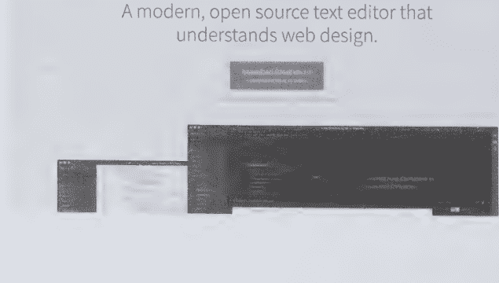

## 我已经下载了 Brackets——然后呢？

安装 Brackets 后，你将看到如下界面（3.2）：

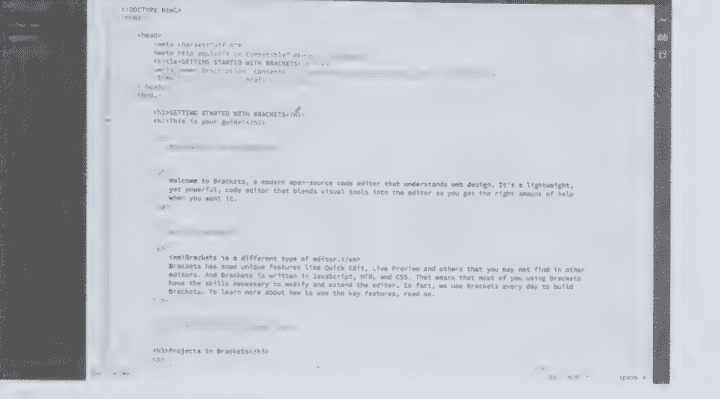

Brackets 会创建一个名为 `index.html` 的 HTML 文件，我们将用它来熟悉 HTML 的基础知识，然后再开始编写自己的代码。

你可以通过点击 `File → Live Preview` 在浏览器中查看这个 HTML 文件的样子。这将在你的默认浏览器中打开该 HTML 文件，效果大致如下（3.3）：

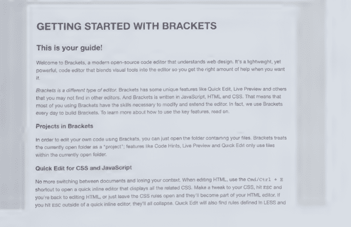

在编码时，我始终建议同时打开文本编辑器（Brackets）和浏览器，各占屏幕的一半，因此请调整你的窗口大小使其如下所示（3.4）：

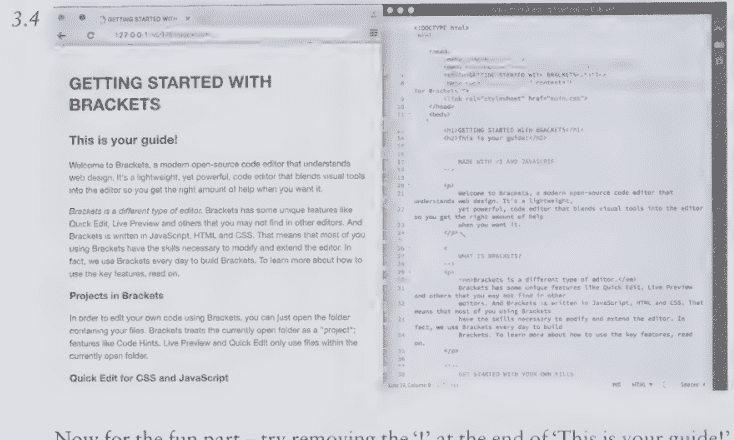

现在进入有趣的环节——试着在右侧 Brackets 窗口中删除“This is your guide!”末尾的“!”。你应该会看到左侧的页面立即更新，如下所示（3.5）：

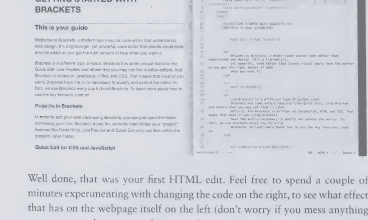

做得好，这是你的第一次 HTML 编辑。你可以花几分钟尝试修改右侧的代码，看看对左侧的网页本身有什么影响（不用担心搞砸了——你可以随时使用 `ctrl-z`（Mac 上使用 `cmd-z`）来撤销更改）。

这很有趣——但 HTML 到底是什么？

现在是时候更详细地了解 HTML 代码及其作用了。所有的 HTML 命令都包含在尖括号（`<` 和 `>`）内，它们告诉浏览器如何格式化和显示 HTML 文档。尖括号内的所有内容被称为标签。让我们更详细地看看 Brackets 为我们创建的默认 HTML 文档（3.6）：

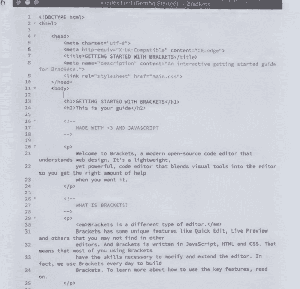

代码以如下行开头：

```html
<!DOCTYPE html>
```

这是一个标准命令，告诉浏览器这是一个 HTML 文档，并按相应方式处理。我们在创建的每个 HTML 文档开头都放上这个。

然后是 `<html>` 标签。这表示 HTML 代码的开始。如果你滚动到文档底部，你会看到一个匹配的 `</html>` 标签。这里的 `/` 表示“结束”，所以 `</html>` 表示我们的代码的 HTML 部分已经结束。

接下来是 `<head>`。这是 HTML 文档的“头部”，包含有关文档的信息，如标题、描述和字符集（我们正在使用的字母、数字符号集合的名称，在本例中为 UTF-8）。它还包含一个样式表的链接，我们将在下一章中介绍。

> 快速提问：`<head>` 部分在哪里结束？

> 答案：在 `</head>` 处。

头部之后，我们有 `<body>` 标签，表示 HTML 主体部分的开始。这就是我们放置网页所有内容的地方。在这个部分内有多个不同的标签，我们稍后将更详细地介绍。两个关键标签是：

- `<h1>` – 这是一个主标题。你可以在浏览器窗口中看到这段文字又大又粗。有多种不同的标题大小，你可以通过将 `h1` 改为 `h2`、`h3` 等来使用。

  > 快速提问：尝试将 `<h1>` 标签改为其他标题大小。一共有多少种不同的标题大小？

  > 答案：6 种（`h7`、`h8` 等会显示为普通文本）

- `<p>` – 这是一个段落标签，用于包含普通文本。网页上连续的段落之间会有一个小间隔。

就是这样。除了学习新标签之外，这些就是你需要了解的关于 HTML 页面如何工作的全部内容。我们首先用 `<!DOCTYPE html>` 将文档定义为 HTML 文件，然后将 HTML 内容包裹在 `<html>` 和 `</html>` 标签内。在这些标签内，我们有两个部分：`<head>` 包含有关网页的信息，如标题和描述；`<body>` 包含页面的内容。

现在我们知道了 HTML 页面是如何工作的，我们将从零开始构建自己的页面。

### 挑战 1：你的第一个网页

学习编程的最佳方式是实践，所以你现在将从零开始创建自己的网页。最后浏览一下 Brackets 中的代码，记住关键细节，然后按 `ctrl-A`（Mac 上使用 `cmd-A`）全选，再按 delete 清除文件。

现在开始挑战。尽可能凭记忆创建一个 HTML 文档，标题为“My first webpage”（你不需要添加描述或定义字符集），内容为段落标签内的“Hello World!”。祝你好运！

完成后，你可以将代码复制到 [ ] 中查看是否正确！

你最终的网页应该看起来像这样（3.7）：

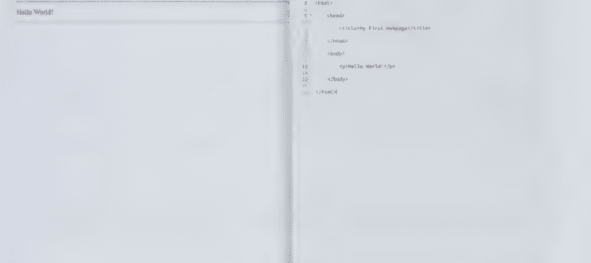

```html
<!DOCTYPE html>
<html>
    <head>
        <title>My First Webpage</title>
    </head>
    <body>
        <p>Hello World!</p>
    </body>
</html>
```

### 练习

1. 添加缺失的开始和结束标签来修正此处的 HTML：`CC 2`
2. 在此处创建标题和段落标签：`CC 3`
3. 在此处创建三种不同类型的标题标签：`CC 4`

### 格式化文本

现在你已经了解了基本的 HTML 页面是如何工作的，我们将介绍一些可以用来自定义页面外观的特定标签。让我们从文本格式化开始。

试着在 Brackets 中“Hello World”段落下方输入以下代码：

```html
<p><strong>This text will be bold</strong></p>
```

`strong` 标签使文本显示为粗体。

**问题：** 移动 `strong` 标签的位置，使只有“text”这个词显示为粗体。

**答案：** `<p>This <strong>text</strong> will be bold</p>`

现在使用以下代码添加一个新段落：

```html
<p><em>This text will be italic</em></p>
```

`em` 标签是“强调”（emphasis）的缩写，使文本显示为斜体。这可以作为基本 HTML 格式化标签的便捷参考。


注意——你可能想将这段代码保存为电脑上的一个单独文件，命名为`formatting.html`，以便日后参考。

**问题：**尝试添加包含`<sup>`、`<sub>`和`<del>`标签的段落。这些标签对你的文本有什么效果？

**答案：**`<sup>`使文本显示为上标（即显示在正常文本上方），`<sub>`是下标（即显示在正常文本下方），`<del>`具有删除线效果。

你最终应该会得到一个看起来像这样的网页（3.8）：

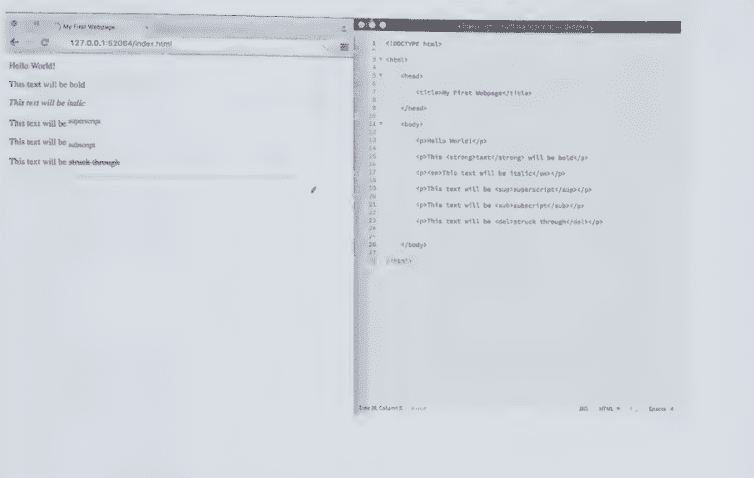

## 练习题

1. 为这里的文本添加格式：`CC 5`

## HTML 列表

我们现在将 살펴 看一下一些更高级的 HTML 标签，从列表开始。清空 HTML 文档中`<body>`标签的内容，并输入以下代码：

```html
<ul>
    <li>Red</li>
    <li>Yellow</li>
    <li>Blue</li>
</ul>
```

`<ul>`标签是“unordered list”（无序列表）的缩写，而`<li>`标签是“list items”（列表项）。这会创建一个像这样的项目符号列表：

- Red
- Yellow
- Blue

**问题：**尝试将上述代码中的“ul”改为“ol”。这会产生什么效果？你认为“ol”代表什么？

**答案：**`ol`代表“ordered list”（有序列表），它使列表显示为数字编号，如下所示：

1. Red
2. Yellow
3. Blue

`<ul>`和`<ol>`标签是显示信息列表的有用方式。你可以访问 Wikipedia 上精彩的 [List of lists of lists](https://en.wikipedia.org/wiki/List_of_lists_of_lists) 页面来查看它们的实际效果。

## 侧边笔记——查看任何网站的 HTML

在浏览器中，尝试访问`https://en.wikipedia.org/wiki/List_of_lists_of_lists`。然后右键点击网站并选择“查看页面源代码”或类似选项。你可能会看到类似这样的内容（3.9）：

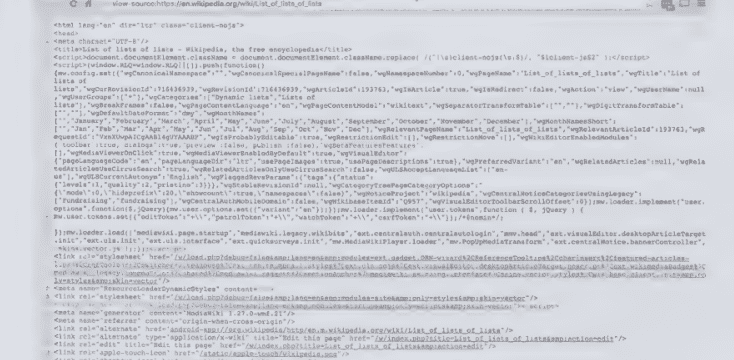

这看起来可能大部分像乱码，但如果你仔细观察，你会看到一些我们讨论过的 HTML 元素：`<html>`、`<head>`、`<title>`等。

如果你向下滚动，你会看到一组带有`<li>`的`<ul>`元素。尝试将这些元素与页面本身的内容对应起来。将它们并排查看会得到如下结果（3.10）：

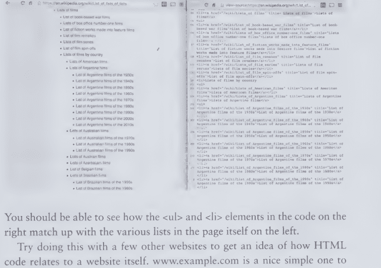

你应该能够看到右侧代码中的`<ul>`和`<li>`元素是如何与左侧页面本身中的各种列表相对应的。

尝试对其他几个网站执行此操作，以了解 HTML 代码与网站本身的关系。`www.example.com`是一个很好的简单起点，但你可以尝试任何你喜欢的网站。（警告：目前不建议查看`www.google.com`的代码——查看一下你就知道为什么了！）

## 图像

向网页添加图像非常简单，它向我们介绍了一个新的 HTML 概念——属性（attributes）。这些是添加到标签中的信息片段，为浏览器提供关于如何显示该元素的更多信息。例如，要显示一张图像，我们会使用类似这样的代码：

```html

```

``标签是 image（图像）的缩写，内部的“src”部分是 source（源）的缩写。本质上，我们是在告诉浏览器从哪里获取图像文件以便显示。另外请注意，``是一个*自闭合标签*——我们不需要`</img>`标签来结束它——它会自动结束。

> **问题：**尝试将代码``放入你的 HTML 文件中。会发生什么，为什么？
>
> **答案：**你可能会看到一个损坏的图像符号。这是因为“image.jpg”文件不存在，所以浏览器无法显示它。

尝试将上述代码替换为：

```html

```

只要你有网络连接且代码中没有拼写错误，你现在应该能看到这个（3.11）：


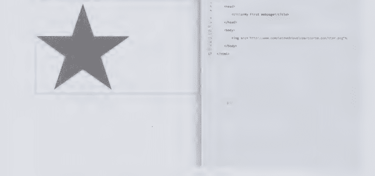

恭喜你，你刚刚在网页中添加了一张图像。链接开头的`http://`意味着我们是从互联网获取图像的，因此我们甚至不需要将其保存到计算机中。

我们可以通过添加高度（height）和宽度（width）属性进一步自定义图像。尝试将此代码放入 Brackets：

```html

```

这将给你一个类似这样的结果（3.12）：

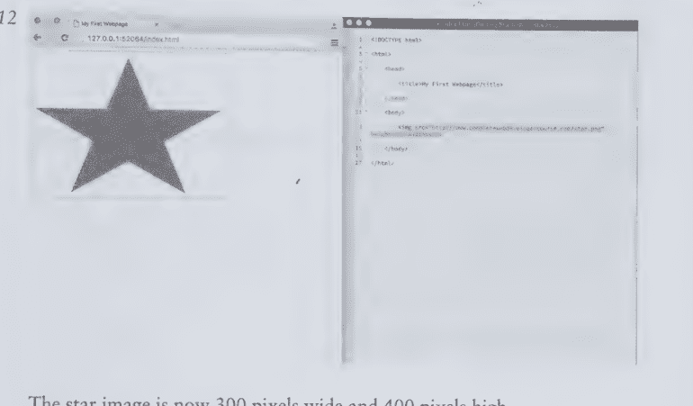

星星图像现在的宽度为 300 像素，高度为 400 像素。

**问题：**什么样的代码可以显示高度和宽度均为 200 像素的图像“sun.png”？

**答案：**``

## 练习题

1. 在此处添加并调整图像大小：`CC 6`

既然你已经熟悉了属性和自闭合标签，我们将进入 HTML 一个更复杂且更强大的方面——表单。

## 表单

表单遍布整个网络，它们是一种简单而有效的方式，可以让你的网站具有交互性并允许用户输入信息。

### 文本框

文本框允许用户输入一些文本，例如用户名或密码。

首先输入以下代码，看看你会得到什么：

```html
<input type="text">
```

尝试在框中输入一些文本。它应该看起来像这样（3.13）：

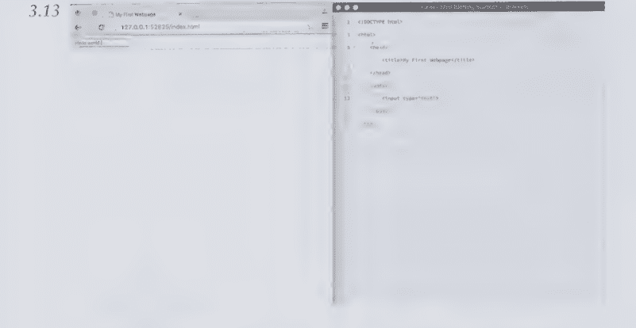

> **问题：**这个`input`标签中属性的名称和值是什么？
>
> **答案：**属性的名称是`'type'`，其值为`'text'`。

这为你提供了一个简单的文本输入框，用户可以点击并输入文本。例如，你可以将其用于允许用户在注册页面输入其电子邮件地址。

> **问题：**当你将`input`类型更改为`'password'`时会发生什么？
>
> **答案：**尝试代码`<input type="password">`。它看起来一样，但当用户在框中输入时，他们的输入会被隐藏。非常适合密码！

### 复选框

我们可以使用`input`标签添加其他几种表单元素类型。尝试添加此代码：

```html
<input type="checkbox">Tick this checkbox
```

这将为你提供一个可以勾选的小方框，以便用户选择某个选项。

## 练习题

添加代码以显示三个复选框，让用户从“red”、“blue”和“green”中选择他们最喜欢的颜色。

你的代码应该看起来像这样：

```html
<p><input type="checkbox">Red</p>
<p><input type="checkbox">Blue</p>
<p><input type="checkbox">Green</p>
```

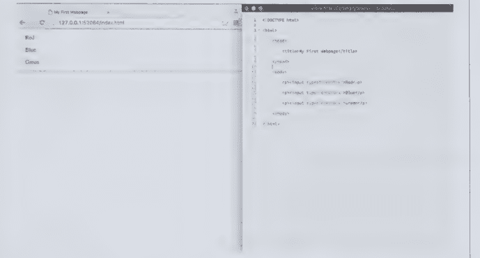

### 单选按钮

请注意，使用复选框时，如果你愿意，可以选择多个。相反，如果你只希望用户选择一个选项（例如，他们正在选择衣服尺寸），可以使用 radio 输入类型：

```html
<p><input type="radio" name="size">Small</p>
<p><input type="radio" name="size">Medium</p>
<p><input type="radio" name="size">Large</p>
```

如果你尝试这段代码，你会发现你只能选择其中一个选项。此外，一旦选择了某个选项，你就不能取消选择它——因此你*必须*且只能选择其中一个选项。

## 练习题

对于以下每项，请说明你会使用复选框还是单选按钮：

1. 询问用户是否想要订阅时事通讯。
2. 询问用户更喜欢茶还是咖啡。
3. 从列表中询问用户他们去过哪些国家。

### 答案

1. 复选框——他们可以根据意愿选择或取消选择该框。
2. 单选按钮——他们应该只能选择一个选项。
3. 复选框——然后他们可以选择任意多个（或一个也不选）。

### 下拉菜单

如果你想创建一个用户可以从一系列选项中选择的下拉列表，可以使用`select`元素。它看起来像这样：

```html
<select>
    <option>1</option>
    <option>2</option>
    <option>3</option>
</select>
```

在你的文本编辑器中尝试这个——你应该会看到类似这样的结果（3.15）：

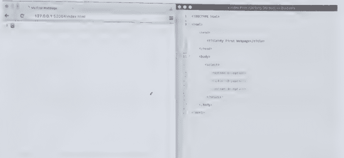

这段代码比 input 元素稍微复杂一点，但仍然相当直接。`<select>`标签引入了下拉菜单，然后我们为下拉菜单中的每个选项添加一个`<option>`标签。

> **问题：**`</option>`标签的作用是什么？
>
> **答案：**它标志着该选项的结束，以便我们添加另一个选项，或者使用`</select>`来结束下拉菜单。

## 文本区域

如果你想允许用户输入一些文本，但需要他们拥有比小方框更大的空间怎么办？这就是文本区域（text areas）派上用场的地方。你可以这样添加它们：

```html
<textarea></textarea>
```

试一下，你会看到一个可以添加多行文本的较大方框。与 input 不同，text area 标签不是自闭合的，因此你需要在后面添加`</textarea>`来结束该元素。

### 练习

使用 cols 和 rows 属性更改文本区域的宽度和高度。创建一个大约为浏览器窗口一半高度和宽度的文本区域。

经过一些尝试后，你的代码应该看起来像这样：

```html
<textarea cols=50 rows=25></textarea>
```

这会给你一个看起来像这样的文本区域（3.16）：

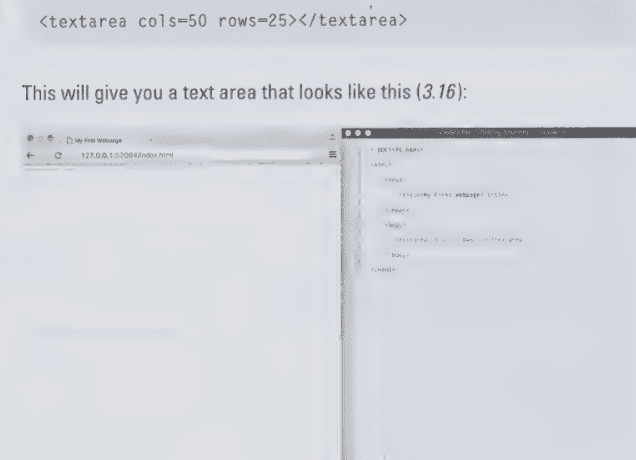

## 按钮

每个表单都需要一个提交按钮。你可以通过使用 input 类型`'submit'`来添加一个，就像这样：

```html
<input type="submit">
```

这给你一个带有“Submit”字样的简单提交按钮。如果你想更改按钮上的文字，可以添加一个 value 属性，就像这样：

```html
<input type="submit" value="Click Me!">
```

这是我们目前在表单方面要讲的全部内容（但我们将在第6章再次看到它们）。它们是一种让用户与你的网站互动的非常简单的方式，如果你正在创建或编辑网站，你可能很快就会遇到它们。

### 挑战 2

你现在已经了解了所有基本的表单元素，所以尝试创建一个简单的注册表单，允许用户输入电子邮件地址、密码，以及可能的性别（或最喜欢的冰淇淋口味）。别忘了提交按钮。

> **练习**
>
> 这个表单的 HTML 有错误——你能修复它吗？
>
> `CC 7`

## 表格

表格是向用户展示信息的一种绝佳方式——本质上它们看起来像电子表格，每个单元格中有不同的内容。要创建一个表格，请使用以下代码：

```html
<table>
    <tr>
        <th>Name</th>
        <th>Age</th>
        <th>Gender</th>
    </tr>
    <tr>
        <td>Rob</td>
        <td>35</td>
        <td>Male</td>
    </tr>
</table>
```

`<table>`标签非常直观——它表明我们想要显示一个表格。`<tr>`是“table row”（表格行）的缩写，定义了我们表格中新行的开始。`<th>`是“table header”（表格表头）的缩写，所以每个都是一个单列的表头。

在表格表头之后，我们使用`</tr>`来表示第一行的结束，并用另一个`<tr>`来开始新一行。`<td>`是“table data”（表格数据）的缩写，这是我们用来指表格中单元格内容的方式。每行应该有相同数量的列（在这个例子中是3列）。

尝试在文本编辑器中输入这些内容，看看它看起来如何。你应该会看到类似这样的内容（3.17）：


你可以看到表格单元格彼此整齐对齐，表格表头显示为粗体。瞧——我们的第一个表格！

**问题：**在你的表格中添加三行，代表你的三位家人或朋友。

**答案：**你的 HTML 应该看起来像这样：

```html
<table>
    <tr>
        <th>Name</th>
        <th>Age</th>
        <th>Gender</th>
    </tr>
    <tr>
        <td>Rob</td>
        <td>35</td>
        <td>Male</td>
    </tr>
    <tr>
        <td>Kirsten</td>
        <td>36</td>
        <td>Female</td>
    </tr>
    <tr>
        <td>Tommy</td>
        <td>5</td>
        <td>Male</td>
    </tr>
    <tr>
        <td>Ralphie</td>
        <td>1</td>
        <td>Male</td>
    </tr>
</table>
```

我们可以通过多种方式自定义我们的表格。首先，我们可以像之前处理图片那样更改列的宽度：

```html
<table>
    <tr>
        <th width=200>Name</th>
        <th width=100>Age</th>
        <th width=150>Gender</th>
    </tr>
    <tr>
        <td>Rob</td>
        <td>35</td>
        <td>Male</td>
    </tr>
    <tr>
        <td>Kirsten</td>
        <td>36</td>
        <td>Female</td>
    </tr>
    <tr>
        <td>Tommy</td>
        <td>5</td>
        <td>Male</td>
    </tr>
    <tr>
        <td>Ralphie</td>
        <td>1</td>
        <td>Male</td>
    </tr>
</table>
```

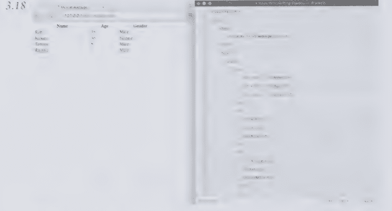

注意当我们这样做时，表格表头是居中对齐的，但表格数据是左对齐的。

我们还可以通过在`table`元素中添加属性`border=1`来为表格单元格添加边框（3.19）：

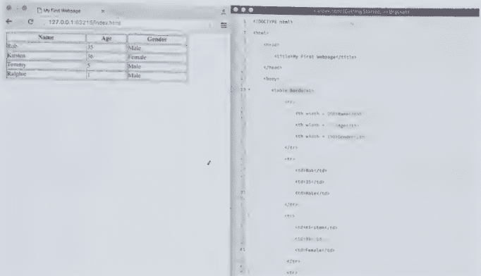

### 挑战 3

创建一个表格，将“名字”和“姓氏”作为两个独立的表头标签，并将你的真实名字和姓氏分别放在表格主体中独立的表格数据单元格中：`CC 8`

## 链接

正如我在本章开头提到的，HTML 中的“H”代表*超文本*，指的是 HTML 链接到其他网页的能力。我们在 HTML 文档中使用链接的方式如下：

```html
<a href="http://www.google.com">Search The Web</a>
```

`a`元素实际上是“anchor”（锚点）的缩写，因为链接最初是用来从页面的一部分链接到页面的另一部分，该位置由“锚点”定义（我们很快会看到如何做到这一点）。`href`是 hypertext reference（超文本引用）的缩写，本质上就是我们想要链接到的页面。出现在`a`元素内部的“Search The Web”文本是用户将点击以跳转到新页面的文本。

尝试一下，你会看到你的文本是带下划线的蓝色，点击它后你会被带到`www.google.com`（3.20）：

### 3.20

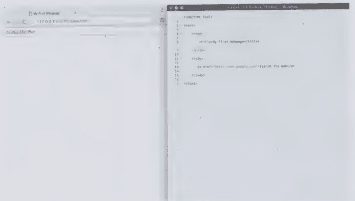

（你可以点击浏览器中的返回按钮返回到你的网页。）

**问题：**当你将`target=_blank`作为属性添加到`<a>`元素时会发生什么？

**答案：**你的代码应该看起来像这样：

```html
<a href江湖="http://www.google.com" target=_blank>Search The Web</a>
```

当你点击链接时，你会发现它在新的标签页或浏览器窗口中打开链接。

锚点链接（即网页内的链接）的工作方式略有不同。首先，在你的页面中添加几段文本，使页面高于你的浏览器窗口，你必须滚动才能到达底部。我使用`www.lipsum.com/feed/html`来生成拉丁文文本用于此目的（3.21）：

### 3.21

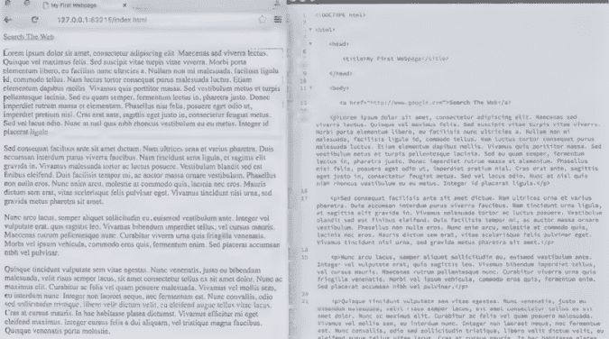

现在，给页面上的最后一段文本一个`id`属性，就像这样：


```html
<p id="last">
```

（我们将在 CSS 章节中更多地看到 `id` 属性。）

最后，将顶部链接的代码更改为如下所示：

```html
<a href="#last">Go to last paragraph</a>
```

`#`（井号）符号告诉浏览器，不是跳转到另一个页面，而是应该在当前页面中查找 `id` 为 `"last"` 的标签并跳转到那里。试试看。你会发现，当你点击链接时，它会跳转到页面底部。

### 练习

- 在 `CC 9` 的练习中练习创建链接。

## HTML 实体

有时你可能想在网页中使用一些符号，比如版权符号 ©、欧元符号 €，甚至是笑脸 ☺。这可以通过使用 *HTML 实体* 来实现，即浏览器显示为所需符号的特殊代码。所以要显示一个笑脸，我们使用：

```html
&#9786;
```

在 Brackets 中尝试一下（3.22）：

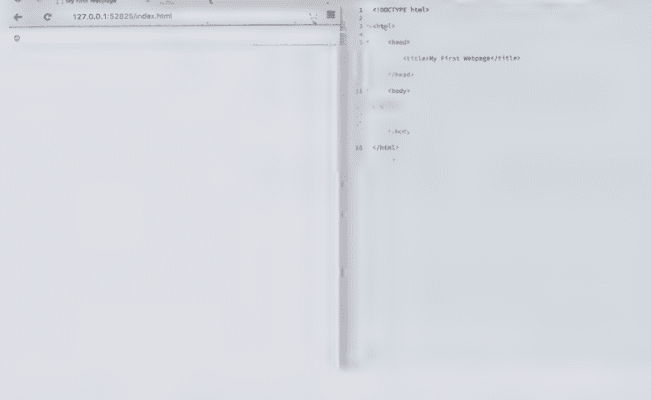

`&` 告诉浏览器我们即将输入一个 HTML 实体，`#` 表示我们将通过其代码编号来描述该实体。笑脸的代码编号是 `9786`，然后我们使用分号来完成 HTML 实体。

某些符号可以使用代码编号和代码名称来显示，所以：

```html
&copy; and &#169;
```

都会显示版权符号 ©。

你可以在 `www.w3schools.com/html/html_entities.asp` 查看一些最常见 HTML 实体的列表。

### 挑战 4

尝试使用 HTML 实体在这里添加货币符号：`CC 10`。

## iFrames

这是我们在本章中要学习的最后一部分 HTML，所以恭喜你坚持到了这里。很快我们将会看到如何使用 CSS 为我们的网页添加一些样式。

iFrame 允许我们在自己的网页中包含另一个网页的内容。所以例如，我们可以使用以下代码将 Google 首页包含在我们的网页中：

```html
<iframe src="http://www.example.com"></iframe>
```

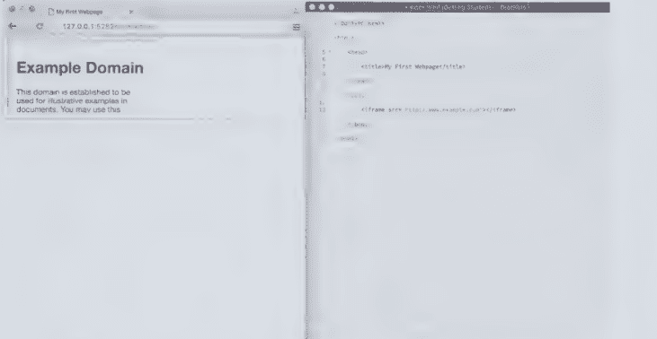

尝试将 `www.example.com` 更改为你访问的其他网站，比如 `bbc.co.uk`。注意一些热门网站，如 `google.com` 和 `facebook.com`，不允许它们的网站在 iFrame 中显示。

**问题：** 你能给 `<iframe>` 元素添加一些属性，使 iFrame 框和你的浏览器窗口一样宽和高吗？

**答案：** 只需像我们处理图片那样添加 `width` 和 `height` 属性：

```html
<iframe width=550 height=660 src="http://wikipedia.org"></iframe>
```

这将为你提供类似这样的效果（3.24）：

### 3.24

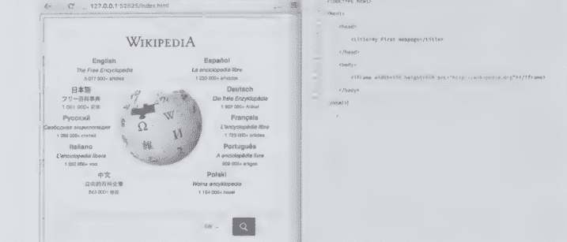

iFrame 一个特别方便的用途是在网页中嵌入媒体，例如 YouTube 视频。操作步骤如下：

- 前往 `youtube.com` 并点击任意你喜欢的视频。
- 向下滚动，点击分享按钮（在红色的订阅按钮下方）。
- 点击“嵌入”。
- 将代码复制到剪贴板（在 Mac 上使用 `ctrl-c` 或 `cmd-c`），然后粘贴到你的网页中。最终你应该会得到类似这样的效果（3.25）：

### 3.25

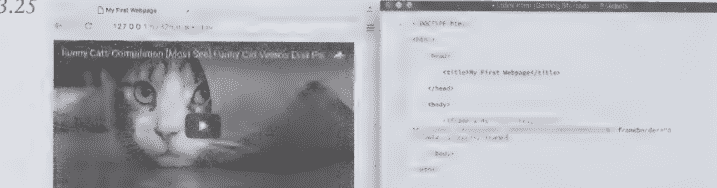

这段代码是一个简单的 iFrame，带有宽度和高度，但也包含了属性 `frameborder="0"`（用于关闭 iFrame 边框）和 `allow-fullscreen`。后者是一个 YouTube 特定的属性，正如你可能猜到的，它允许用户将视频全屏播放。

### 练习

尝试在此处添加一个 iFrame 来嵌入你喜欢的任何网站：`CC 11`。

## HTML 项目：综合运用

恭喜！你现在已经学习了 HTML 的基础知识。是时候将你新学到的知识付诸实践了：创建一个单独的网页，尽可能多地包含本章中的各种元素。选择一个主题——任何你感兴趣的内容，然后通过添加标题、标题标签、图片、列表、表单、iFrame 以及我们涵盖的所有其他元素来创建你的页面。

完成后，请访问 `http://codepen.io/pen/?editors=1000` 并将你的代码粘贴进去。你应该能在屏幕底部看到你的网页，并且可以点击“保存”以获得一个可以在社交媒体上分享的 URL。将它发送到 `@techedrob`，我会给你一些反馈！

作为示例，我围绕我最喜欢的话题之一——太空，创建了一个网页。你可以在 `www.completewebdeveloper.com/content/1-html/1.17.html` 查看。

## 总结

正如我们所了解的，HTML 构成了每个网页的基础。你现在已经学会了如何创建和编辑所有基础的 HTML 元素，因此你应该能够创建一个基本网页，或编辑现有网页。

我们编码之旅的下一步是学习如何为我们的 HTML 页面添加样式——添加颜色、更改大小、调整文本格式等等。我们将使用 CSS，即层叠样式表来完成这些操作，这也是我们下一章将要探讨的内容。

## 进一步学习

在本书的这个阶段，我建议你继续学习 CSS 和 JavaScript，然后再进一步研究 HTML。但是，如果你已经对 HTML 产生了兴趣，可以随意查阅以下资源，深入了解这门语言的工作原理以及你能用它做什么：

- `www.codecademy.com/courses/web-beginner-en-HZA3b/0/1` – HTML 的互动式编码练习。
- `www.w3schools.com/html/` – 免费的 HTML 教程。
- `http://learn.shayhowe.com/html-css/` – 学习 HTML 和 CSS 的优秀网站。
- `https://play.google.com/store/apps/details?id=com.sololearn.htmltrial&hl=en` – 用于学习 HTML 的免费 Android 应用。
- `https://itunes.apple.com/gb/app/learn-html-fundamentals/id933957050?mt=8` – 用于学习 HTML 的免费 iPhone 和 iPad 应用。

---

# CSS 04

既然你已经学习了 HTML（它允许你在网页上创建不同类型的元素），在本章中，你将学习如何使用 CSS 为这些元素添加样式。然后，在下一章，我们将使用 JavaScript 让这些元素具有交互性。

在本章中，我们将涵盖：

- CSS 是什么以及如何使用它；
- 如何使用类和 ID 来引用元素；
- 使用 `DIV` 来分割我们的网页；以及
- 如何使用 CSS 调整以下方面：
  - 边框和定位；
  - 颜色和字体；
  - 文本和链接格式。

## 什么是 CSS？

HTML 允许我们向网页添加元素，但它并不便于调整这些元素的位置、颜色、字体或整体样式。

CSS 由伯纳斯-李的同事哈孔·维姆·莱于 1994 年提出。其主要思想是将样式信息与页面内容分开，这样就可以在不影响内容的情况下轻松调整样式。事实上，你只需更改 CSS，而无需编辑 HTML，就能完全改变网页的外观和布局。

CSS 代表层叠样式表（Cascading Style Sheets）——“层叠”部分指的是当存在多个冲突的样式规则时，浏览器决定将哪个样式规则应用于某个元素的方式。例如，如果一个样式表说 `<p>` 元素应该是蓝色，而另一个说它应该是红色，我们需要一种一致的方法来确定 `<p>` 元素实际应该是什么颜色。我们稍后会看到几个这方面的例子。

## 为什么要学习 CSS？

只学 HTML 不学 CSS 有点像学习黑白绘画：你可以画任何你喜欢的东西，但你会错过一个丰富多彩的世界。CSS 允许我们将网站设计得独特、友好且美观。它将允许你自定义你想要构建或维护的任何网站的外观。

从编码的角度来看，CSS 对类和 ID 的使用（我们很快就会了解它们是什么）是 JavaScript 的基础，并将教会我们如何使用单行代码来影响多个不同元素的外观。CSS 仍然相当简单，但理解起来比 HTML 稍微复杂一些，因此它是你发展编码技能时学习的完美第二门语言。

## CSS 长什么样？

介绍得够多了！让我们看看一些实际的 CSS。首先，在一个空白网页上添加一个段落，内容为：`'I love HTML.'`

> 注意：如果你需要回顾如何设置文本编辑器、浏览器和基本网页，请返回到 HTML 章节的开头。

你的代码应该像这样：

```html
<p>I love HTML.</p>
```

现在添加一个 `style` 属性，其值为 `color:blue`，使其看起来像这样：

```html
<p style="color:blue">I love HTML.</p>
```

通过 CSS 的神奇力量，你会看到文本变成了蓝色。尝试用其他颜色实验一下。

> 提醒我的英国读者：恐怕你必须使用美式拼写，`colour:blue` 不会起作用。

`color:blue` 部分就是 CSS，它是一条应用于该特定 `<p>` 元素的 CSS 规则。

使用 `style` 属性添加 CSS 被称为*内联* CSS，因为它与 HTML 在同一行。

CSS 55

### 练习

尝试使用内联 CSS 将此段落中的文本变为红色：`[CC 12]`。

不过，内联 CSS 有一个问题——如果我们想让每个段落的文本都变成红色，就必须给每个段落都添加一个样式属性。这很混乱，而且如果我们突然想把所有段落的颜色改成绿色，就必须逐个更新。

幸运的是，有一个解决方案，它被称为*内部* CSS。

## 什么是内部 CSS？

内部 CSS 是指我们在 HTML 文档的开头将所有 CSS 包含在一起（我们将在本章末尾遇到第三种也是最后一种 CSS 类型，外部 CSS）。它看起来像这样（4.1）：

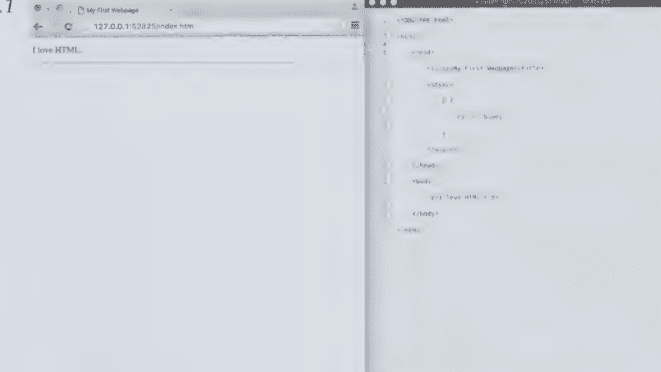

仔细观察我们网页的 `<head>` 部分——它包含一个新元素 `<style>`，其中包含了我们的 CSS。`<style>` 部分的内容是：

```css
p {
    color: blue;
}
```

这基本上意味着“找到所有 `<p>` 元素并将文本颜色更改为蓝色”。花括号 `{` 和 `}` 包含了我们想要应用于 `p` 元素的所有规则（分号表示一条规则的结束）。现在，如果我们想把所有段落从蓝色改为绿色，我们只需更改 CSS 就可以做到——完全不需要去动 HTML。

### 练习

1. 尝试添加第二个段落，内容为 `'I love CSS!'`。你应该会看到两个段落都是蓝色的。然后更改 CSS 让它们都变成绿色。

   你的代码应该类似这样（4.2）：

   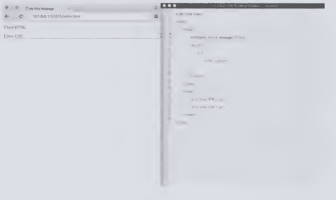

2. 将此网页中的样式从内联 CSS 更改为内部 CSS：`CC 13`。
3. CSS 不仅限于 `p` 标签。在你的网页中添加一个 `<h1>` 元素，并使用内部 CSS 将文本颜色设为黄色。

   你的代码应该看起来像这样（4.3）：

   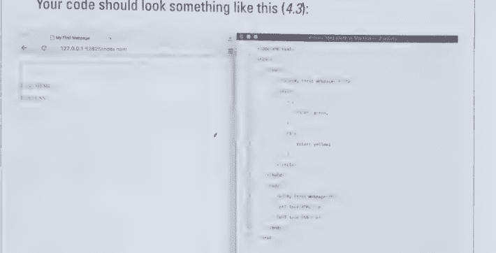

## 类（Classes）和 ID

如果我们想让某些段落标签显示为蓝色，而其他段落显示为红色该怎么办？我们需要一种比仅通过类型更精确地选择元素的方法。我们可以通过使用类（classes）和 ID 来实现。

### 类（Classes）

给元素添加类属性很简单——将第一个段落的代码修改为：

```html
<p class="blue">I love HTML.</p>
```

我们现在为该段落应用了名为 `'blue'` 的类。现在，将以下代码添加到网页的样式（style）部分：

```css
.blue {
    color: blue;
}
```

> 注意：`'blue'` 之前的 `.` 告诉浏览器我们要寻找的是一个类。在 CSS 中，点号（句点）是类的简写。

你现在应该会发现，第一个段落是蓝色的，而第二个段落是绿色的。

尝试将 `class="blue"` 属性添加到 `h1` 元素中。你会发现 “My first webpage” 也变成了蓝色。类允许我们为任意数量的元素以及任何类型的元素提供特定的 CSS 规则。

> 请注意，具有类 `'blue'` 的段落实际上应用了两条样式规则。`p` 规则告诉它显示为绿色，而 `.blue` 规则告诉它显示为蓝色。由于 CSS 规定最“具体”的规则应优先生效，因此由类或 ID 定义的规则将总是覆盖应用于元素类型的规则。所以，该段落最终显示为蓝色而非绿色。这就是层叠样式表（Cascading Style Sheets）中“层叠（cascading）”部分的实际作用。

### ID

ID 与类非常相似，但它们在网页上只能应用于一个元素。它们是为仅出现一次的元素设计的，例如页眉（header）、页脚（footer）或标题（title）。

我们添加 ID 的方式与添加类完全相同，因此请尝试将 “I love CSS?” 段落的 ID 修改为 `'pink'`：

```html
<p id="pink">I love CSS!</p>
```

现在在样式部分添加以下 CSS：

```css
#pink {
    color: pink;
}
```

> 注意：这里我们使用井号 `#` 来代表 ID。因此在 CSS 中，`.` 是类的简写，`#` 是 ID 的简写。

你会注意到 `'pink'` 规则和 `p` 规则都适用于 “I love CSS!” 段落，但 ID 规则胜出。与 ID 和类相关的规则将总是覆盖与元素类型相关的规则。

## 练习题

- 为网页添加内部 CSS，使用类和 ID 使第一个段落为红色，第二个段落为蓝色：`CC 14`。

我们现在可以通过元素的类型、类或 ID 来选择元素。不过，我们目前只学习了一条 CSS 规则，即如何更改文本颜色。在查看其他规则之前，我们将快速了解如何使用 `<div>` 元素将代码分成不同的部分。

## Div（分区）

Div 是 `division`（分区）的缩写，它允许我们将代码分为不同的部分。这意味着如果我们愿意，可以为每个部分定义不同的样式。删除页面主体（body）中的所有代码，并将其替换为以下内容：

```html
<div class="divA">
    <p>I'm in div A</p>
</div>

<div class="divB">
    <p>I'm in div B</p>
</div>
```

结果应该看起来像这样（4.4）：


> **问题：** 为什么现在两个段落的文本都是绿色的？

**答案：** 我们从段落中移除了类和 ID，所以现在适用于它们的唯一规则是 `color: green` 规则。因此，它们都是绿色的。

虽然目前看起来 `div` 没起太大作用，但当我们开始对它们应用样式时，它们实际上能让我们对设计有极强的控制力。让我们先从给它们设置背景颜色开始。

## 背景颜色

我们现在来看看一系列可以使用的不同 CSS 样式。删除 `style` 标签中的所有 CSS 代码，并将其替换为以下内容：

```css
div {
    background-color: grey;
}
```

这会给两个 `div` 都设置灰色的背景颜色（4.5）：

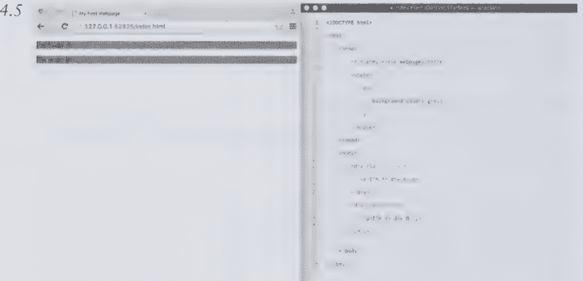

> 注意：默认情况下，`div` 会延伸到整个浏览器窗口的宽度。

## 练习题

1. 使用类（classes）为第一个 `div` 设置红色背景，为第二个 `div` 设置蓝色背景。

不要忘记类名之前的 `.` 符号！

## 颜色代码

到目前为止，我们仅使用名称来描述颜色。你可以想象，我们通常希望比这更精确，这时我们就使用颜色代码。颜色代码就像颜色的 HTML 实体，每个代码代表一种特定的颜色。尝试这些规则：

```css
.divA {
    background-color: #765481;
}
.divB {
    background-color: #F7E1A2;
}
```

井号 `#` 告诉浏览器我们将使用数字来表示颜色，然后我们使用一个六位字母数字代码（包含字母和数字的代码）来表示我们想要的颜色，在本例中分别是紫色和橙色。

你不需要记住所有代码——你可以使用类似 `http://html-color-codes.info/` 的网站来确定你想要使用的颜色代码。

### 练习题

1. 使用 HTML 颜色代码，将段落的样式更新为相应的颜色：`CC 15`。

## 更改尺寸

我们可以使用 `width`（宽度）和 `height`（高度）规则来更改 `div` 的宽度和高度。尝试将页面上的 CSS 代码替换为：

```css
.divA {
    background-color: red;
    width: 200px;
    height: 200px;
}
```

```css
.divB {
    background-color: blue;
    width: 50%;
}
```

你的页面应该看起来像这样（4.6）：

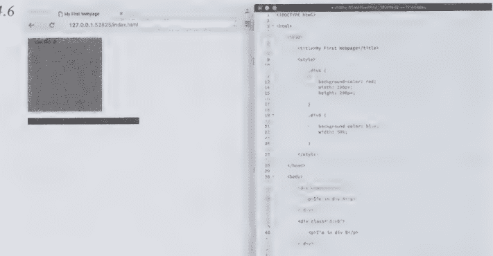

请注意，我们可以为每个元素应用任意数量的 CSS 规则。在 CSS 中，我们必须为宽度和高度添加单位，因此 `200px` 表示 “200 像素”，而 `50%` 表示 “包含元素的 50%”，在本例中是指 `<body>` 元素。

## 使用浮动（floats）进行定位

到目前为止，我们已经看到了如何使用 CSS 调整颜色和尺寸，但我们还可以使用 CSS 来影响布局。直到现在，我们所有的元素都依次排列在彼此下方，但我们可以使用 *floats*（浮动）来改变这一点。尝试将以下 CSS 规则添加到 `.divA` 的规则中：


```css
float:right;
```

你的页面现在应该看起来像这样（4.7）：

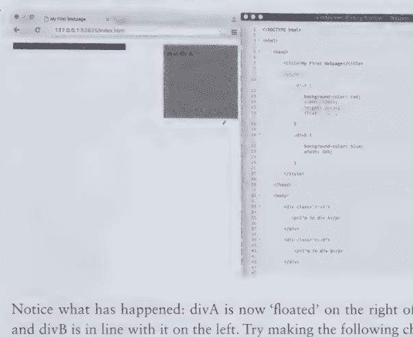

注意发生了什么：`divA` 现在“浮动”在页面的右侧，而`divB`在其左侧与之对齐。尝试进行以下更改：

1. 在`.divB`规则中添加`float: left`。
2. 将`divB`的宽度更改为 20%。
3. 在`divB`之后添加一个内容为`'This is some text'`的段落。

你能解释最终的布局吗？它应该看起来像这样（4.8）：


我们现在得到了一个三栏布局，红色`div`在右侧，蓝色`div`在左侧，其他所有内容在中间。浮动是一种极其有效的将`div`或其他元素排列在彼此左右两侧的方法。

> **练习题**
>
> 1. 更新此网页的内部 CSS，使`#left`向左浮动，`#right`向右浮动：`CC 16`

## 使用定位（positions）进行布局

有时我们希望布局比浮动允许的更加精确，这时我们就使用 *positioning*（定位）。如果我们想移动某个元素（例如`div A`）相对于其原本位置的位置，可以添加以下 CSS 规则：

```css
position: relative;
top: 50px;
left: 100px;
```

这将使其向下移动 50 像素，向右移动 100 像素（4.9）：

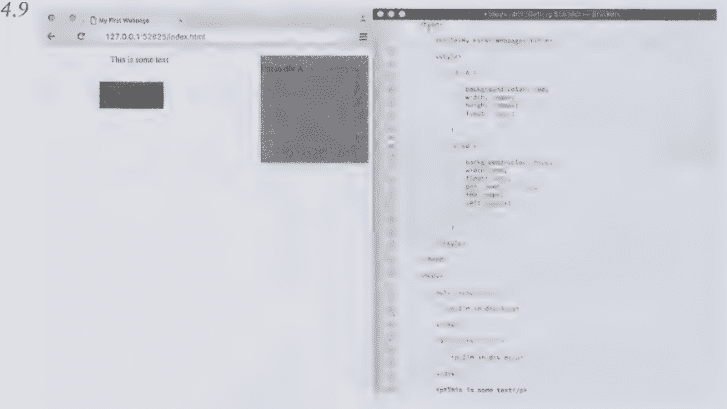

尝试实验不同的`top`和`left`值。

**问题：**`top`和`left`的负值（例如`-50px`）如何影响`div`的位置？

**答案：**它们会将元素向上和向左移动。

因此，使用`position: relative`将使元素相对于其原本所在的位置移动。尝试在`divA`规则中添加：

```css
position: absolute;
```

这会产生什么效果？它实际上将该`div`从页面的文档流中移除了，因此其他元素会忽略它的存在。如果你想将元素相对于页面而不是相对于其他元素进行定位，这会非常有用。你仍然可以使用`top`和`left`来移动绝对定位的对象（4.10）：

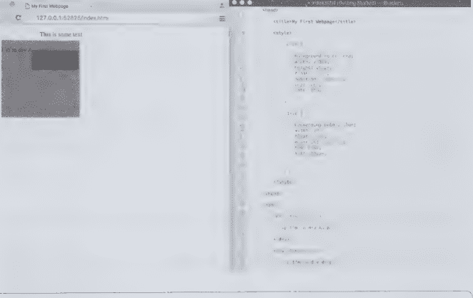

### 练习题

1. 更新内部 CSS，使`#home` div 处于绝对定位且向右 10 像素、向下 10 像素，使`#next` div 处于相对定位且向右 50 像素、向上 10 像素：`CC 17`

## 外边距（Margins）

外边距提供了一种替代的、在某些方面更简单的方式来定位元素。为了观察其实际效果，请删除`divA`和`divB`的所有浮动和定位规则，并为`divA`添加以下规则：

```css
margin: 20px;
```

### 语言

这将为红色`div`设置一个 20 像素的外边距，效果如下（4.11）：

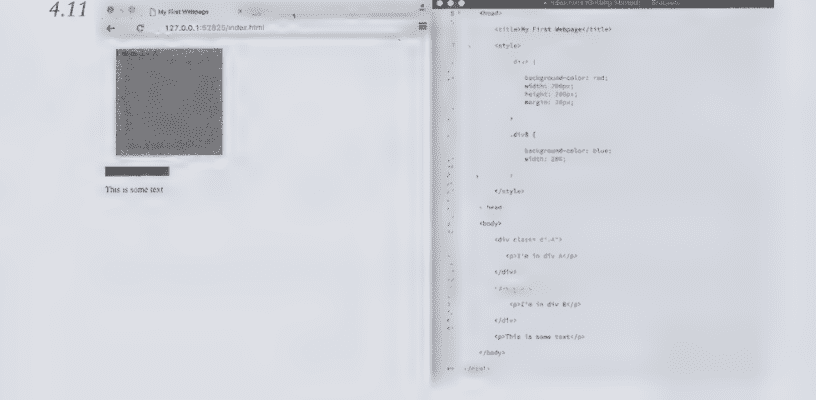

我们还可以分别设置上、下、左、右的外边距——尝试将以下规则添加到`divB`中：

```css
margin-top: 50px;
margin-left: 100px;
```

这实际上将蓝色`div`向下移动 50px，向右移动 100px（4.12）。

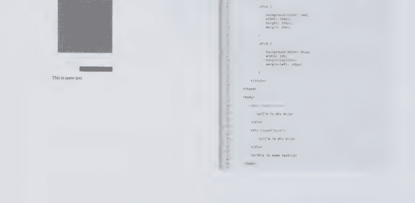

### 练习

- 为 ID 为`box`的`div`分别设置各个方向的外边距：顶部 10 像素、左右各 15 像素、底部 20 像素（例如`margin-top`）`CC 18`

外边距是一种移动对象并为其原始位置留出间隙的好方法。类似地，我们可以使用内边距在元素*内部*添加间距。

## 内边距

在红色和蓝色`div`中，`div`内部的文本周围都没有内边距。通常在文本和`div`边缘之间留出间距会更美观，我们使用内边距来实现这一点。尝试将以下规则添加到`divA`中：

```css
padding: 10px;
```

这将在红色方块内部添加 10 像素的内边距（4.13）：

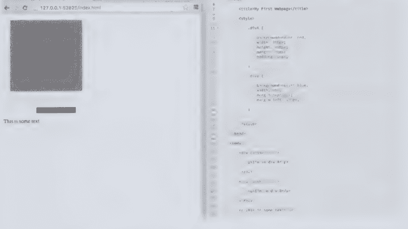

奇怪的是，文本向下移动的距离比向右移动的更多。这是因为`<p>`元素内置了默认外边距。

### 挑战 1

通过添加 CSS 规则`margin:0`来移除`p`元素的外边距。答案：你的代码应该如下所示（4.14）：

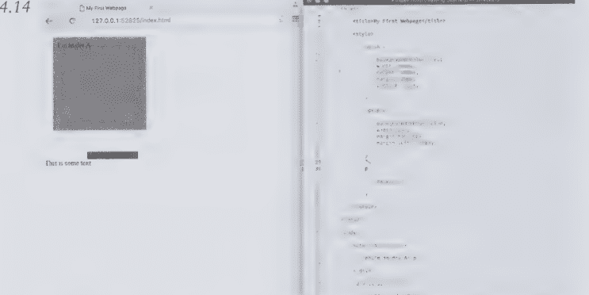

添加将所有`<p>`元素的外边距设为 0 的代码即可解决问题，现在内边距在红色方块四周都是 10 像素。尝试对`divB`使用`padding-top`、`padding-bottom`等，看看它们的效果。内边距是为元素添加一点空间、让内容有更多呼吸空间的好方法。

### 练习

- 用尽可能少的命令为`#box` div 设置上下左右各 15px 的内边距：`CC 19`

## 边框

为元素添加边框是分隔网页不同部分的简单方法。边框可以使复杂的页面更易读，也是在不使用图片的情况下添加一点图形效果的好方法。

让我们移除网页上除红色`div`及其内容之外的所有内容（4.15）：

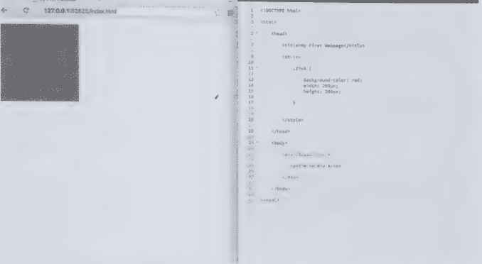

要为红色`div`添加边框，只需添加以下样式：

```css
border: 5px solid grey;
```

效果如下（4.16）：

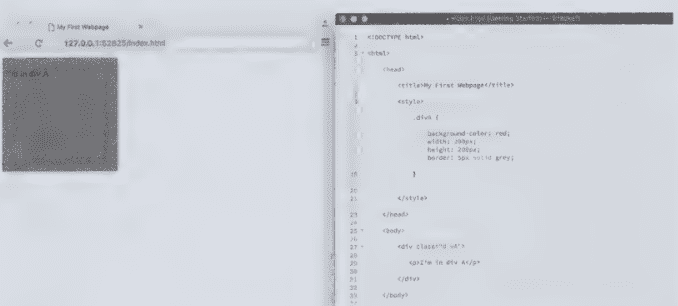

请注意，这个样式与我们之前看到的有些不同，因为它包含三个值：

### 语言

- `5px`：这是边框的宽度。
- `solid`：这是边框类型。你可以尝试不同的边框类型，例如`dotted`、`dashed`、`groove`和`ridge`。不过大多数情况下你可能会使用`solid`。
- `grey`：这是边框颜色。你可以使用任何你喜欢的颜色，或 HTML 颜色代码如`#47D812`。

### 挑战 2

为`divA`创建一个 10 像素的粉色虚线边框。你的代码应该如下所示：

```css
border: 10px dashed pink;
```

实际效果（4.17）：


边框可能会变得相当花哨，所以保持简洁。

## 圆角

与边框相关的是圆角。圆角是在 CSS 3（CSS 语言的最新版本）中添加的。要使用它们，我们使用 *border-radius* 属性。尝试将`divA`的 *border* 样式替换为：

```css
border-radius: 10px;
```

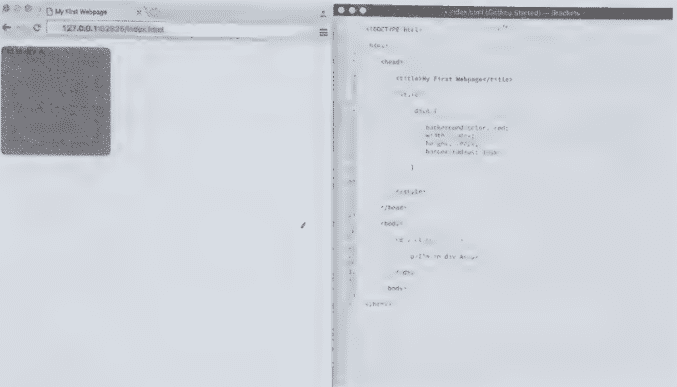

现在我们有了一个漂亮的圆角矩形（4.18）。你可以调整`border-radius`的值来增加圆滑程度，但 5–10 像素在大多数情况下通常刚好合适。

**问题：**当你将`border-radius`设为 50% 时会发生什么？为什么？

**答案：**我们会得到一个圆。

我们得到一个圆是因为弯曲边缘的半径等于`div`宽度的一半（即本例中的 100 像素）。这意味着没有空间留给任何直边——整个边框都是圆的，因此我们得到的是一个圆。

请注意，圆角仅应用于背景，而不是内容——你需要为`div`添加一些内边距才能将文本完全定位在圆内。

### 练习

在这里练习为两个`div`添加简单的边框和圆角：

|GC 20|

## 字体

就像在标准的 Word 文档中一样，我们可以更改网页上使用的字体。到目前为止，我们一直使用浏览器的默认字体显示所有文本（在 Chrome 中是 Times New Roman 的一个版本）。

为了保持网页简洁，移除红色`div`及其样式，然后添加一个段落，内容为"This is some text."（或者如果你想更有创意的话写点别的。）你的页面现在应该看起来像这样（4.19）：

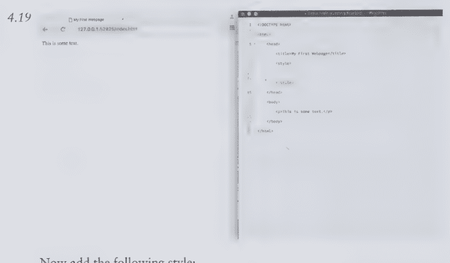

现在添加以下样式：

```css
body {
  font-family: sans-serif;
}
```

这会将文本更改为浏览器的默认无衬线字体。

Sans serif 的意思是无衬线，即每个字母末端没有装饰线或“勾”。无衬线字体通常比衬线字体看起来更现代、更简洁。

> 注意：我们将`font-family`属性应用于`body`，而不是段落元素。这意味着页面上的所有文本都会受到影响，这通常正是我们想要的，因为大多数网页只使用一种字体。

### 更高级的字体

我们不必局限于默认的衬线和无衬线字体，可以使用任何我们喜欢的字体。然而，如果我们的网站很受欢迎，它将被各种不同的设备访问，这些设备可能没有安装我们想要使用的字体。在这种情况下，我们可以设置一个字体列表，网页将使用第一个可用的字体。

例如，尝试这个样式：

```css
font-family: "Comic Sans MS", cursive, sans-serif;
```

如果你在电脑上访问该网站，你可能会看到文本以 Comic Sans 字体显示。

但是，如果该字体在用户的设备上不可用，它将回退到设备的默认“手写体”字体，如果那也不可用，则使用默认的无衬线字体。

https://css-tricks.com/snippets/css/better-helvetica/ 上的“Better Helvetica” CSS 技巧就是一个很好的例子：

```css
body {
  font-family: "HelveticaNeue-Light", "Helvetica Neue Light",
    "Helvetica Neue", Helvetica, Arial, "Lucida Grande",
    sans-serif;
}
```

Helvetica Neue 是一种以现代、简约和时尚著称的字体，但只有 Apple 设备将其作为默认字体。这个 CSS 样式会选择该字体（如果可用），但也提供了一系列备选方案来选择可用的“最美观”版本的字体，正如你在右侧看到的（4.20）：

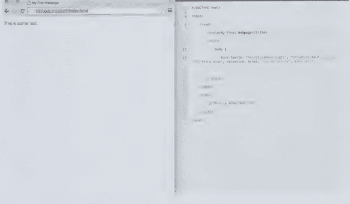

如果你想确保所有用户都能看到你想要的字体，通常建议坚持使用“网页安全字体”。要获取这些字体的列表，只需在你喜欢的搜索引擎中输入“web safe fonts”即可。

### 练习

使用 Georgia 网页安全字体创建一些文本，并以 serif 作为备选字体：

`CC 21`

## 文本样式

我们可以对文本做的远不止设置字体——我们可以将文本设为粗体、斜体、下划线等等。要使段落文本变为粗体，只需使用：

```css
p {
  font-weight: bold;
}
```

实际效果（4.21）：

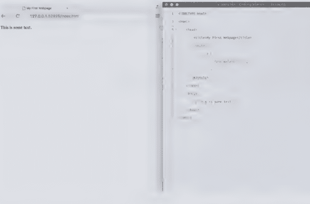

如果我们想让句子中的一两个单词加粗呢？为此，我们需要引入一个称为 *span* 的新元素。这个元素本身没有任何效果，但它允许我们对元素的各个部分单独设置样式。尝试将段落 HTML 替换为：

```html
<p>This text is <span id="bold">bold</span>.</p>
```

`span`元素本身完全不影响文本的样式（4.22）：

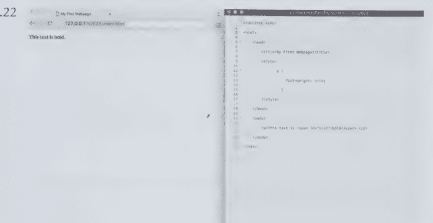

但是，它确实允许我们仅对`span`的内容应用样式：

```css
#bold {
  font-weight: bold;
}
```

> 记住`#bold`的意思是“将这些 CSS 规则应用于 ID 为`bold`的元素”。

现在只有 bold 这个词是粗体的（4.23）：

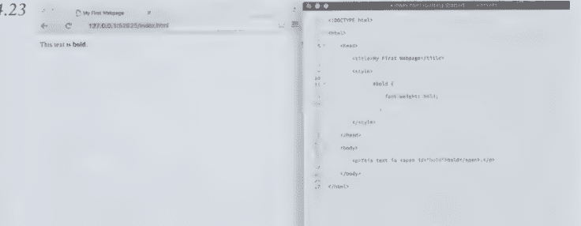

同样地，我们可以使用第二个`span`来添加一些斜体文本。将 HTML 修改为：

```html
<p>This text is <span id="bold">bold</span> and this is <span id="italic">italic</span>.</p>
```

然后将此 CSS 规则应用于 *italic* span：

```css
font-style: italic;
```

你的代码输出应该像这样（4.24）：

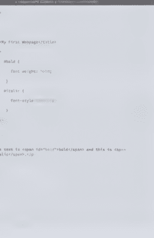

### 挑战 3

为文本添加下划线的 CSS 规则是`text-decoration: underline`。在段落中添加文字“and this is underlined”，并设置一个`span`和 CSS 样式来为最后一个单词添加下划线。

你的 HTML 应该像这样：

```html
<p>This text is <span id="bold">bold</span> and this is <span id="italic">italic</span> and this is <span id="underlined">underlined</span>.</p>
```

你的 CSS 应该包含此规则：

```css
#underlined {
  text-decoration: underline;
}
```

最终结果应该像这样（4.25）：

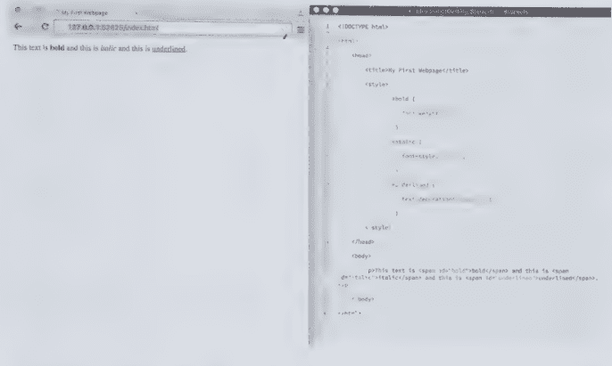

当然，你可以组合这些样式来实现既加粗又带下划线的文本，此外还有其他文本样式选项——你可以在 www.w3schools.com/css/css_text.asp 查看更多内容。

## 练习题

1. 使用 CSS 使部分文本同时加粗并倾斜：`CC 22`

## 文本对齐

就像在文字处理器中一样，你可以使用 CSS 将文本左对齐、右对齐或两端对齐（使单词分散以填满可用空间）。为此，只需添加以下样式：

```css
text-align: right;
```

将其应用于一个简单的段落效果如下（4.26）：

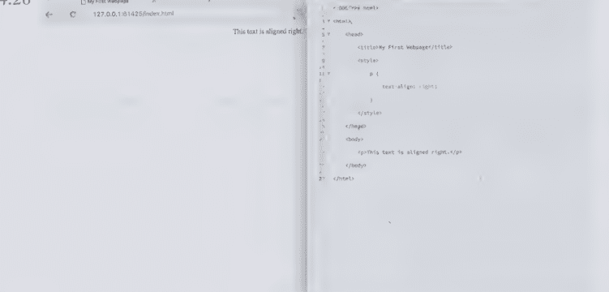

要将文本设置为左对齐，请使用：

```css
text-align: left;
```

这是默认设置，所以通常不需要使用它。对于两端对齐，只需使用：

```css
text-align: justify;
```

请注意，你需要有足够的文本以超出行末才能看到此效果。使用我们之前在 ipsum.com 采用的一些拉丁文文本，结果如下（4.27）：


你可以看到每行单词之间的间距各不相同，这使得行末能够整齐地对齐。这在博客文章等长篇文本中效果很好，但在一般的网站内容中效果不佳，因此请谨慎使用。

> **练习题**
>
> 在这里练习将文本设置为两端对齐：`CC 23`

## 链接样式

链接可以像任何其他 HTML 元素一样设置样式，但有几个设置是你可能想专门用于链接的。

第一个是移除链接的下划线——近年来这已不再流行，链接通常通过颜色来识别。要移除链接的下划线，只需使用以下样式：

```css
text-decoration: none;
```

更有趣的是，我们还可以使用所谓的 *伪类（pseudo classes）* 来定义用户将鼠标悬停在链接上时的样式。为此，请使用：

```css
a:hover {
  color: green;
}
```

结合这两个命令，我们可以得到一个没有下划线且在悬停时变为绿色的链接（4.28）：

## Languages

4.28

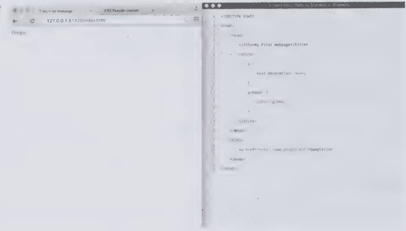

伪类之所以如此命名，是因为它不是一个“真实”的类，因为它不直接引用一个元素，而是引用该元素的一个特定状态，在本例中是悬停（hover）状态。因此，它不是我们定义的普通类，而是一个特定的“状态”，例如当链接被悬停时，或者当元素是列表中的第一个时。如果你想了解更多关于伪类的信息，可以访问 www.w3schools.com/css/css_pseudo_classes.asp。

### 在新标签页中打开

这严格来说不是一个 CSS 命令，但在我们为链接设置样式时，能够选择在新标签页或浏览器窗口中打开链接会非常方便。我们可以通过在链接中添加`target="_blank"`来实现，如下所示：

```html
<a href="http://www.google.com" target="_blank">Click me to open Google.com in a new tab.</a>
```

## 练习题

练习为链接设置样式并使其在新标签页中打开。

## CSS 项目：克隆一个网站

练习 CSS 的一个绝佳方法是克隆一个你喜欢外观的网站。你可以从比较简单的网站开始，比如 www.google.com，然后尝试稍微复杂一点的，比如 bbc.co.uk/news。选择任何你喜欢的网站，并尝试创建它的精确副本。这不是一项简单的任务（可能涉及大量的谷歌搜索），但在这个过程中你会学到很多。

完成后，将你的代码粘贴到 codepen.com 之类的网站上，并在 Twitter（@techedrob）上与我分享链接。我期待看到你的创作。

## 总结

恭喜，你现在已经掌握了 CSS 的基础知识。你已经知道如何为网站添加各种样式、布局和格式，结合你在前一章学到的 HTML 技能，你应该能够设计出几乎任何你想要的网站。


在涵盖了 HTML（用于内容）和 CSS（用于样式和布局）之后，我们现在将开始学习用于交互的 JavaScript。JavaScript 将允许你为网页增加强大的功能，让用户能够像操作应用程序或软件一样与网页进行交互。

JavaScript 是一个全新的编程世界，那么让我们开始吧。

## 进一步学习

和之前一样，我建议现在先转向学习 JavaScript，但如果你对 CSS 产生了浓厚兴趣，以下进一步学习的链接将帮助你了解更多关于级联样式表的内容。

- `www.codecademy.com/courses/css-coding-with-style/0/1` - 交互式 CSS 编程课程。
- `www.w3schools.com/css/` - W3Schools 的 CSS 教程。
- `http://learnlayout.com` - 使用 CSS 创建出色的灵活布局。
- `https://play.google.com/store/apps/details?id=com.sololearn.csstrial&hl=en` - 教授 CSS 的 Android 应用。
- `https://itunes.apple.com/gb/app/learn-css/id953955717?mt=8` - 教授 CSS 的 iPhone 和 iPad 应用。

# JavaScript 05

我们现在已经学习了用于内容的 HTML 和用于样式与布局的 CSS。现在是时候引入拼图的第三块——JavaScript，它实现了与用户的交互。与 HTML 和 CSS 不同，JavaScript 是一种“完整”的编程语言，这意味着我们可以用它来运行计算机程序：即能够完成编码员想要实现的几乎任何功能的软件片段。

在本章中，我们将涵盖：

- 什么是 JavaScript 以及它是如何使用的；
- 如何使用 JavaScript 创建一个交互式网页；
- 响应用户操作（如点击）来运行 JavaScript；以及
- 如何使用 JavaScript 来：
  - 更改网页的内容和样式；
  - 使用编程基础知识，如循环和 `if` 语句；
  - 生成随机数；
  - 创建一个“高或低”猜数游戏。

## 什么是 JavaScript？

JavaScript 是我们的第一个“正规”编程语言。它允许我们使用编程工具，如循环、变量和 `if` 语句（我们很快就会了解到这些是什么）。它可以用于各种任务，从点击时让一段文本消失，到创建完整的应用程序（如 Google Docs 办公套件）。

任何在不重新加载页面的情况下提供交互功能的网站都使用了 JavaScript。

JavaScript 由 Netscape（最早的浏览器之一）的 Brendan Eich 在 1995 年 5 月用 10 天时间创建。它最初叫 Mocha，后来叫 Livescript。有趣的是，除了名字之外，它与 Java 编程语言没有任何关系。Netscape 获得了 Sun 公司（Java 语言的所有者）的许可使用 JavaScript 这个名字，这主要是出于营销手段，因为 Java 在当时是一种非常受欢迎的语言。

JavaScript 经历了多次迭代和发展，但最新的标准版本（我们将在此学习的版本）在所有桌面和移动平台的浏览器中都得到了支持。

JavaScript 的一个重要方面是它运行在用户的计算机上，而不是服务器上。这使得它成为所谓的客户端语言（client-side language）。因此，要执行任何需要服务器的操作，例如发送电子邮件或在你的新社交网络中注册用户，你需要使用服务端语言（server-side language），例如我们将在下一章学习的 Python。

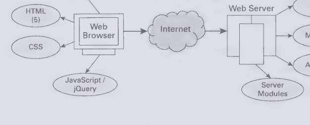

## 为什么学习 JavaScript？

如果你还没有被说服，学习 JavaScript 的好处有很多。首先，它是我们的第一个“正规”编程语言，允许我们开发完整的交互式应用和网站，而不仅仅是创建布局和静态网页。

它还与许多其他语言非常相似，因此一旦你学会了 JavaScript，你将能更快地入门任何其他语言。

由于 JavaScript 在所有浏览器中都能运行，你不需要下载任何额外的软件即可开始学习。而且它像 CSS 一样使用类（classes）和 ID，因此与你已经学到的知识紧密相关。

它是一门入门简单的语言，但与 CSS 一样功能极其强大，因此是学习编程的绝佳第一门语言。

## JavaScript 长什么样？

JavaScript 入门非常简单。首先，在你的文本编辑器中回到一个基础的 HTML 页面，并使用以下代码添加一个按钮：

```html
<button>Click Me!</button>
```

看起来应该是这样的（我放大了按钮以便看得更清楚）（5.2）：

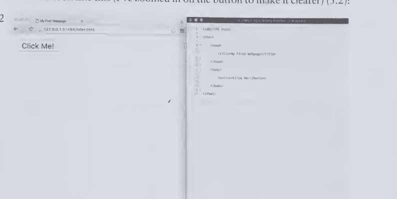

当然，当你点击按钮时，什么也不会发生。让我们用一些 JavaScript 魔法来改变这一点。将按钮代码修改为如下内容：

```html
<button onclick='alert("Hello there!")'>Click Me!</button>
```

（确保你使用了正确的引号类型——外面需要用单引号 `'`，里面需要用双引号 `"`。）

现在当你点击按钮时，应该会看到如下效果（5.3）：


太棒了，你运行了你的第一段 JavaScript！`onclick` 属性允许我们编写一些 JavaScript 代码，这些代码会在按钮被点击时执行。我们实际运行的 JavaScript 代码是：

```javascript
alert('Hello there!')
```

`alert` 命令的意思是“创建一个弹出窗口，向用户显示一条消息”，该消息包含在单引号中，即 Hello there!。在 JavaScript 中，命令后面通常跟着括号（圆括号），其中包含传给命令的信息。在本例中，信息就是要在弹出窗口中显示的文本。

### 练习

1. 修改代码，使弹出窗口显示的不是 Hello there! 而是 Hello 加上你的名字。

你的代码应该类似于这样：

`<button onclick='alert("Hello Rob!")'>Click Me!</button>`

像这样运行 JavaScript 被称为内联 JavaScript，就像我们在上一章开头看到的内联 CSS 一样。

## 内部 JavaScript

像这样运行 JavaScript 很像使用 `style` 属性来运行 CSS——它能工作，但很杂乱，如果你想编写比简单的 `alert` 命令更复杂的内容，体验会很糟糕。

就像 CSS 一样，我们可以使用内部 JavaScript 将 JavaScript 与 HTML 分离。CSS 中我们使用 `<style>` 标签，JavaScript 中我们使用 `<script>` 标签。这些标签可以放在 HTML 页面的头部，但我们会把它们放在页面末尾。这通常是一种好的做法，因为它可以确保在我们尝试对页面元素运行 JavaScript 之前，浏览器已经创建了所有页面元素。

要创建一段在页面加载时弹出 Hello there! 的 JavaScript 代码，请将以下代码添加到你的 HTML 页面中，紧接在 `</body>` 标签之前：

```html
<script>
    alert("Hello there!")
</script>
```

现在你会在页面加载时看到弹出窗口（你可能需要刷新页面才能看到这个效果），如下所示（5.4）：


### 内部 JavaScript——响应点击

当我们使用内联 JavaScript 时，哪个元素会触发 JavaScript 一目了然，因为 `onclick` 属性就在该元素内部。那么我们如何将内部 JavaScript 与按钮关联起来呢？答案与 CSS 相同——我们使用 ID。

### 挑战 1

从按钮中移除 `onclick` 属性，并给它一个 ID `'click-me'`。你的按钮代码现在应该如下所示：

```html
<button id="click-me">Click Me!</button>
```

现在，要让按钮被点击时发生某些事情，请将以下代码放在 `<script>` 标签之间：

```javascript
document.getElementById("click-me").onclick = function() {
    alert("Hello there!")
}
```

这可能是我们目前见过的最复杂的代码，但当你把它拆解开来后，其实相当简单明了。

首先，`document` 指的是 HTML 页面本身，告诉浏览器我们将在页面中查找某些内容。

接下来，`getElementById("click-me")` 正如其名——它通过 ID 获取一个元素，在本例中 ID 是 `'click-me'`。

`onclick = function()` 部分意味着我们将元素的 `onclick` 属性设置为一个函数（函数就是一段执行特定操作的代码）。空括号表示我们没有向该函数传递任何值。

`{` 和 `}`（花括号）包含函数的代码。花括号是 JavaScript 和许多其他语言中包含函数代码的标准方式。

最后，在花括号中我们看到了熟悉的 `alert("Hello there!")`，它用来显示弹出窗口。

用通俗的英文来说，这段代码的含义是：

获取 HTML 页面，在其中找到一个 ID 为 `'click-me'` 的元素。然后修改该元素，使得当用户点击它时，会显示一个内容为 `'Hello there!'` 的弹出窗口。很简单吧！

你可能需要重新阅读上面几段内容一两遍，把所有内容理清楚，然后再尝试这个挑战。

### 挑战 2

从页面中移除按钮和 `script` 标签（这样你就从一个空白的 HTML 文档开始）。然后添加一个链接（不是按钮），文本为“Who am I?”，并添加 JavaScript 使得当链接被点击时弹出你的名字。（你需要为链接选择一个 ID。）

你的代码应该如下所示：

```html
<a id="my-link">Who Am I?</a>
<script>
    document.getElementById("my-link").onclick = function() {
        alert("Rob")
    }
</script>
```

实际效果如下（5.5）：


> **练习**
>
> 添加 JavaScript，使得当页面上的按钮被点击时弹出 Button Clicked!：`CC 25`

## 使用 JavaScript 更改样式

除了显示弹出窗口，我们还可以使用 JavaScript 更改样式。让我们在页面中添加一个 ID 为 `'text'` 的段落，并将链接文本更改为 Turn red text：

```html
<p id="text">This is some text.</p>
<a id="my-link">Turn text red</a>
```

现在，将 `alert("Rob")` 那行代码改为以下内容：

```javascript
document.getElementById("text").style.color = "red"
```

这里，我们获取 ID 为 `'text'` 的元素，然后获取它的颜色，并将其设置为红色。试一试，你应该会发现点击 Turn text red 链接后文本变成了红色。

我们可以通过这种方式调整任何样式，所以试着让链接被点击时实现以下效果：

### 练习

1. 使文本变为蓝色。
2. 给文本添加下划线（你需要使用 `textDecoration` 而不是 `text-decoration`）。
3. 使文本大小为 20px **并且**右对齐。

### 答案

1. `document.getElementById("text").style.color = "blue"`
2. `document.getElementById("text").style.textDecoration = "underline"`
3. 这里你需要两行代码：

   `document.getElementById("text").style.fontSize ="20px"`

   `document.getElementById("text").style.textAlign = "right"`

## 从用户获取一些信息

现在我们已经知道如何用弹出窗口和样式更改来响应点击了，让我们通过文本框从用户那里获取更多信息。

### 挑战 3

移除你的链接和 JavaScript，添加一个文本输入框（input），以及一个显示“Submit”的按钮。设置按钮使得当它被点击时页面弹出“Clicked!”。你的代码应该类似于这样：

```html
<input type="text">
<button id="my-button">Submit</button>
<script>
    document.getElementById("my-button").onclick = function(){
        alert("Clicked!")
    }
</script>
```

实际效果如下（5.6）：


提示：当你编写新的 JavaScript 代码时，最好先设置一个这样简单的页面，确保一切“接线”正确并能正常工作。否则你可能会花很多时间调试代码，最后才发现你忘了将 `getElementById` 中的 `I` 大写！

现在让我们修改代码，使其弹出的不是“Clicked!”，而是用户在输入框中输入的内容。首先，给文本输入框添加一个 ID，如下所示：

```html
<input type="text" id="my-input">
```

接下来，将 JavaScript 中的 `alert("Clicked!")` 那行改为：

```javascript
alert(document.getElementById("my-input").value)
```

你能看出这里发生了什么吗？我们现在弹出的是文档（即 HTML 页面）中 ID 为 `'my-input'` 的元素的值。

试一试。你会发现无论你在输入框中输入什么都会被弹出（5.7）：


现在我们实现了真正的交互，是时候学习一些基本的编程概念了。第一个是“if 语句”。

## If 语句

If 语句对于编程来说是绝对基础的。它们指示程序仅在满足某个条件时才执行操作。这可能是登录你最喜欢的网站——“如果用户名和密码与数据库中的某条记录匹配，就让用户登录”。也可能是游戏中的某条规则——“如果马里奥碰到炸弹，就杀死马里奥”。

在这里，我们将设置一个简单的密码系统来检验用户是否知道密码。首先，在输入框前添加文本“What is the password?”（5.8）：


现在我们需要测试用户输入的内容，看它是否与预定义的密码匹配。让我们将密码设置为 `coding`。然后，我们可以用这段代码替换 JavaScript 中的 `alert...` 行：

```javascript
if (document.getElementById("my-input").value == "coding") {
    alert("You got it!")
}
```

如果你仔细看这段代码，应该能明白发生了什么。我们以 `if` 关键字开始，然后在括号中放置条件。这里的条件是文本框中的值必须等于单词 coding。如果满足这个条件，系统将弹出 `You got it!`。如果不满足，则什么也不做。

注意这里的双等号 `==`。在 JavaScript（以及几乎所有的编程语言）中，我们使用单个等号来**设置**某个值等于另一个值，比如我们在上面截图中将 `onclick` 属性设置为某个函数时那样。我们使用**双等号**来测试某个值是否等于另一个值。这是一个你需要习惯的区别，如果你搞反了（当！），你的代码将表现得非常奇怪。

试一试！它是否按预期工作？（5.9）


如果用户输错了密码怎么办？什么也不做不是一个好功能——最好告诉用户他们错了。我们可以使用 `else` 关键字来实现。在上面代码的最后一个 `}` 之后添加以下内容：

```javascript
else {
    alert("That's not right, try again")
}
```

现在，如果你输错了密码，你会看到这个（5.10）：


### 挑战 4

从你的网页中移除所有代码后，创建一个游戏，让用户猜你最喜欢的数字。添加一个 `if` 语句来告诉他们是否猜对了。

代码应该和我们的密码示例非常相似：


```html
What is my favourite number?
<input type="text" id="my-input">
<button id="my-button">Submit</button>
<script>
    document.getElementById("my-button").onclick =
    function() {
        if (document.getElementById("my-input").value ===
        "7") {
            alert("You got it!")
        } else {
            alert("That's not right, try again")
        }
    }
</script>
```

运行效果如下（5.11）：


### 练习

1. 更新`x`的值，使`if`语句输出`"x is less than five"`：[CC 26]

## 更新网站内容

在我们学习第二个基本编程概念（循环）之前，让我们看看如何用 JavaScript 更新网站内容。到目前为止，我们只使用了`alert`向用户显示信息。`Alert`很有用，但它们相当分散注意力；通常直接在页面本身显示答案会更好。让我们看看如何做到这一点。

### 挑战 5

从你的网页中移除所有代码。然后添加一个 ID 为`'my-paragraph'`的空段落，以及一个按钮，点击它时会弹出`'That was easy'`。现在这应该很简单了。这证明了重复的力量！

```html
<p id="my-paragraph"></p>
<button id="my-button">Submit</button>
<script>
document.getElementById("my-button").onclick =
    function() {
        alert("That was easy")
    }
</script>
```

运行效果如下（5.12）：


现在我们要更改代码，以便在点击按钮时向空段落添加一些内容。用这段代码替换`alert("That was easy")`：

```javascript
document.getElementById("my-paragraph").innerHTML = "This text appeared by magic!"
```

现在，当你点击按钮时，应该会看到文本出现（5.13）：


我们现在可以以更自然的方式与用户互动，所以让我们尝试一个涉及`if`语句的挑战。

### 挑战 6

设置一个网页，包含文本`'What is your name?'`、一个文本输入框和一个提交按钮。然后，当用户输入他们的名字时，将文本`'Hello [name]!'`添加到页面上的一个空白元素中。

注意：对于这个挑战，你需要将他们的名字与你自己的文本结合起来。你可以这样做：

```javascript
"Hello" + document.getElementById("name").value + "!"
```

`+`符号*连接*（或连接在一起）`Hello`、文本框的值和`!`。

你的代码应该如下所示：

```html
What is your name?
<input id="name">
<button id="my-button">Submit</button>
<p id="my-paragraph"></p>
```

代码部分：

```html
<script>
	document.getElementById("my-button").onclick =
	function() {
		document.getElementById("my-paragraph").innerHTML =
		"Hello " + document.getElementById("name").value + "!"
	}
</script>
```

运行效果如下（5.14）：


## 循环

循环是一种重复执行相同操作的方式。Twitter 使用循环来显示推文时间线，Google 使用它们来显示搜索结果。可以公正地说，没有循环，我们所知的软件将不复存在。

在开始之前，从页面中移除所有代码，并将其替换为一个 ID 为`'numbers'`的空`div`。

我们将创建一个简单的循环，在页面上显示数字 1 到 50。为此，我们需要一个*变量*来跟踪我们在循环过程中所在的数字。变量只是一个数字或一些文本的容器，我们使用关键字`var`来创建一个。

```javascript
var number = 1
```

这创建了一个名为`'number'`的变量，并将其值设置为 1。然后循环的工作方式如下：

```javascript
while (number <= 50) {
    document.getElementById("numbers").innerHTML += "<p>" +
    number + "</p>"
    number = number + 1
}
```

这里的`while`关键字意味着“只要这个条件为真，就继续执行这段代码”。条件是变量`number`必须小于或等于 50。然后，在花括号（“循环”）内，我们将当前数字（包裹在`<p>`标签中）添加到`numbers` div 的内容中（这就是`+=`的作用）。最后，我们给`number`加 1，并重复循环，直到`number`大于 50。

你可能需要读几遍，当然也可以自己尝试一下。当你这样做时，你应该会看到这个（5.15）：


左边的列表一直延伸到 50。

### 练习

更改上面的代码，使其显示：

1. 所有不超过 100 的偶数。
2. 三的乘法表，直到 30。
3. 从 10 到 0 的倒计时。

答案：

1. 只需将循环中的第一行更改为：

```javascript
var number = 2
```

将`while`语句更改为：

```javascript
while (number <= 100)
```

将最后一行更改为：

```javascript
number = number + 2
```

这将生成从 2 到 100 的所有偶数。

2. 现在将第一行更改为：

```javascript
var number = 3
```

将`while`语句更改为：

```javascript
while (number <= 30)
```

并将最后一行更改为：

```javascript
number = number + 3
```

瞧，三的乘法表！

3. 对于这个挑战，将第一行更改为：

```javascript
var number = 10
```

将`while`语句更改为：

```javascript
while (number >= 0)
```

将最后一行更改为：

```javascript
number = number - 1
```

然后你就有了从 10 到 0 的倒计时。

## For 循环

还有第二种你应该了解的循环类型。到目前为止，我们主要关注的是`while`循环，但也有`for`循环，它们做同样的事情，但结构略有不同。`for`循环看起来像这样：

```javascript
for (var i = 1; i <= 50; i=i+1) {
    document.getElementById("numbers").innerHTML += "<p>" +
    i + "</p>"
}
```

与`while`循环不同，在`for`循环中，所有关于`for`循环的信息都包含在一行中。在这个例子中，计数器变量叫做`i`（`for`循环中常用的一个字母），它从 1 开始，每次增加 1，直到`i`不再小于或等于 50。其效果与`while`循环完全相同——你使用哪种循环取决于上下文和个人偏好。就个人而言，我通常更喜欢`while`循环，因为我觉得它们更灵活。

### 生成随机数

我们快要能够用 JavaScript 制作一个简单的猜数字游戏了，但要做到这一点，我们需要能够生成一个随机数。我们可以使用这个函数来实现：

```javascript
Math.random()
```

如果你尝试使用类似这样的代码：

```javascript
document.getElementById("my-div").innerHTML = Math.random()
```

你会看到它生成一个 0 到 1 之间的随机小数（5.16）：


对于我们的猜数字游戏，我们需要一个 1 到 10 之间的随机整数。为此，我们使用这个函数：

```javascript
Math.floor((Math.random() * 10)) + 1
```

这并不像看上去那么难懂！`* 10`的意思是“乘以 10”，所以我们现在会得到一个 0 到 10 之间的随机数。`Math.floor`部分会把数字“向下取整”，即去掉小数点后的所有内容（所以 6.746287848 会变成 6）。这样就得到了一个 0 到 9 之间的随机数，因此我们再加 1，得到一个 1 到 10 之间的数字。

试着把上面页面中的代码改成：

```javascript
document.getElementById("my-div").innerHTML = Math.floor((Math.random() * 10)) + 1
```

### 练习

生成一个介于以下范围之间的随机整数：

1. 1 到 5
2. 11 到 20
3. 0 到 100

*答案：*

1. `Math.floor((Math.random() * 5)) + 1`
2. `Math.floor((Math.random() * 10)) + 10`
3. `Math.floor((Math.random() * 100))`

## JavaScript 项目：猜数字游戏

利用变量、循环和`if`语句，你有能力制作各种各样的应用、网站和游戏。我们要来做一个简单的猜数字游戏，你需要猜出电脑选中的数字。

概念非常简单——页面加载时，用户会被要求猜一个 1 到 10 之间的随机数。如果猜错了，会被告知猜高了还是猜低了。如果猜对了，会被告知猜对了，并有机会再玩一次。

这个挑战几乎会用到我们目前为止学过的所有内容——与元素交互、改变样式、变量和`if`语句。你现在可以随时停下来尝试这个挑战，但我建议分阶段来完成，我们会通过一些小挑战来逐步实现。

这个过程类似于设计任何网站或应用——先构建用户界面，然后逐步添加交互功能，并随时检查一切是否正常运行。

### 第一部分：创建用户界面

创建一个标题（使用`h1`元素）、说明文字、一个文本输入框和一个提交按钮。

布局方式有很多种，但我的比较简单。

```html
<h1>What's My Number?</h1>
<p>I'm thinking of a number between 1 and 10 - what do
  you think it is?</p>
<input type="text">
<button>Guess</button>
```

.onclick = function() {
  document.getElementById("message").innerHTML = document.getElementById("number").value
}
</script>
```


### 第三部分：添加随机数生成器，并将用户的猜测与该数字进行比较，显示适当的提示信息

现在我们完全不需要修改 HTML 了——一切都在 JavaScript 中：

```javascript
if (document.getElementById("number").value > randomNumber) {
    document.getElementById("message").innerHTML = "Too High!"
} else if (document.getElementById("number").value < randomNumber) {
    document.getElementById("message").innerHTML = "Too Low!"
} else {
    document.getElementById("message").innerHTML = "That's it!"
}
```

这里有一个稍微新一点的结构：`else if`。这允许你在第一个`if`语句为假时，测试另一个`if`语句。然后我们在最后有一个最终的`else`，如果前两个语句都为假，就会执行这个`else`。如果猜测既不高也不低，那一定就是正确答案了！

试试看（5.19）：


### 第四部分：根据答案是否正确改变文字颜色，并提供再玩一次的机会

正确用绿色，错误用红色。

我们用以下方式改变文字颜色：

```javascript
document.getElementById("text").style.color = "red"
```

要“再玩一次”，我们可以直接重新加载页面。我们可以用一个空链接（`<a href="">`）来实现，所以让我们把这个加到成功信息中。

开始了（5.20）：


就这样。你已经用 HTML、CSS 和 JavaScript 制作了一个功能完整的交互式游戏——恭喜你！

## 总结

这当然只是 JavaScript 能力的起点，如果你想进一步探索，还有很多选择。试着想想你可以在 JavaScript 中重现的简单游戏，比如模拟抛硬币、猜单词游戏，甚至是老诺基亚手机上的贪吃蛇。网上有大量的教程和指南——只需在 Google 上搜索你想做的事情，后面加上`"JavaScript tutorial"`，你很可能会找到相关的内容！

现在我们已经涵盖了用于网站内容的 HTML、用于样式和布局的 CSS，以及用于交互的 JavaScript，接下来我们将学习第一种服务器端语言——Python。

Python 是一种简洁干净的语言，在许多方面与 JavaScript 类似。我们将看到如何用它构建更复杂的结构，制作更复杂的程序。

有很多东西要学，也有很多乐趣。话不多说，让我们跳进去看看能用 Python 实现什么。

## 深入学习

如果你想更深入地涉足 JavaScript 的世界，可以使用以下链接进一步尝试和学习：

- `www.codecademy.com/learn/javascript` – 交互式 JavaScript 课程。
- `www.w3schools.com/JS/` – 免费 JavaScript 教程。
- `www.learn-js.org` – 免费交互式 JavaScript 教程。
- `https://play.google.com/store/apps/details?id=com.sololearn.javascript&chl=en_GB` – 在 Android 上学习 JavaScript。
- `https://itunes.apple.com/gb/app/learn-javascript/id952738987?mt=8` – 在 iPhone 或 iPad 上学习 JavaScript。

# Python 06

冒着让你无聊死的危险，让我们快速回顾一下到目前为止学过的内容。我们先从 HTML 开始，它让我们能够向网页添加内容。然后我们学习了 CSS，我们可以用它来配合 HTML 添加样式和自定义网页布局。接下来，我们看到了如何使用 JavaScript——我们的第一种“真正的”编程语言，来让我们的页面具有交互性，让用户能够在我们的页面上操作并获得响应。

那么我们的编程技能库中还缺什么？嗯，到目前为止，我们所做的一切都完全发生在用户的浏览器中。要构建允许用户相互交流的软件，我们需要一种叫做*服务器*的东西。服务器本质上是一台始终开机并始终连接到互联网的计算机。然后我们的计算机可以联系该服务器来下载信息、在服务器上保存一些内容（比如我们最新的推文），或者向另一台计算机发送数据（比如电子邮件）。


因此，要构建真正强大的网站和应用，我们需要编写能够在服务器上运行的代码。虽然也可以在服务器上使用 JavaScript，但更常见的是使用其他语言，比如 PHP 或 Python。这里我们将使用 Python，原因有以下几点：

- Python 是一种简单直接的语言，甚至比 JavaScript 更简单；
- Python 可以用于在几乎任何平台上构建软件，从服务器到树莓派，让你能够构建从网站到机器人的任何东西；而且
- Python 可以用来完成日常任务的自动化，比如从网站上获取信息或自动重命名你的文件（我们将在本章后面看到如何做）。

## 什么是 Python？

Python 于 1980 年代末由荷兰的 Guido Van Rossum 开发。Van Rossum 以蒙提·派森（Monty Python）的名字命名了这门语言，因为他是他们飞行马戏团的忠实粉丝。

Van Rossum 仍然积极参与该语言的开发，因此被 Python 社区授予了**终身仁慈独裁者**（BDFL）的称号。


自诞生以来，它已经经历了多个版本，目前处于第 3 版。它被广泛用于构建基于 Web 的和桌面应用程序，以及物联网设备（如 Arduino）。这使它成为一种极其强大和灵活的语言，`plur ans` 的学习价值。

## 为什么要学 Python？

我又不想造机器人，真的需要学另一门语言吗？

如果你不打算从事编程职业，你可能会想，在学完 JavaScript 之后是否值得再学一门语言。答案当然是肯定的，但为什么呢？

学习两门语言让你能够看到它们的共同点（以及不同之处）。一旦你知道如何在两种语言中创建循环，你就会更清楚循环的关键部分是什么。`if` 语句和变量也是如此。每种语言都有自己的怪癖，如果你只学一门语言，就不会有太多洞察。

所以跟我来吧——即使你不相信学两门语言有用，如果你需要从网页中提取所有电子邮件地址之类的，Python 可以帮你做到（我们将在本章结束时看到如何做）。

## 本章将涵盖什么？

像往常一样，我们将经历运行一些 Python 代码的全过程，逐步建立技能，然后通过一些项目和练习来实践。

我们还将致力于一个大项目，尝试一些“网页抓取”——从网页上收集姓名和电子邮件地址等数据。这将是你迄今为止最大的挑战。

具体来说，我们将涵盖：

- Python 是什么以及如何使用它；
- 在 Python 中使用变量、循环和 `if` 语句；
- 更高级的特性，如列表（Lists）和正则表达式（Regular Expressions）；以及
- 从网页中提取数据。

## 如何开始学习 Python？

遗憾的是，Python 的上手难度比 HTML、CSS 或 JavaScript 要高一些，因为它不在浏览器中运行。要尝试运行它，你有两种选择——简单的方法或困难的方法。

### 简单的方法

网络上有许多 Python 解释器可以为你处理 Python 代码。在本章中，我将使用 `https://repl.it/languages/python3`，我也建议你这样做。它不需要安装或设置，你可以立即开始。还有许多其他可以尝试的类似网站，例如 `www.tutorialspoint.com/execute_python_online.php` 和 `www.skulpt.org`。

### 困难的方法

另一种选择是在你的计算机上安装 Python 并直接运行。这种方法的优点是不需要互联网连接，并且允许你尝试完整的 Python 安装，但它需要一些较为复杂的设置。除非你是一名相当资深的计算机用户，否则我不推荐这种方法。

如果你想尝试这种方法，可以在 `www.python.org/downloads/` 下载 Python（选择最新的可用 3 版本）。你只需要在 Windows 上这样做——大多数 OSX 和 Linux 机器都内置了 Python。

安装 Python 后，你需要创建一个文本文件，例如 `mypython.py`。你可以在文本编辑器中使用“文件” → “另存为”来创建。

然后你需要打开一个命令行窗口，在 Windows 上可以通过在搜索框中输入 `cmd` 来实现，或者在 OSX 中打开“终端”应用。

接着你可以使用以下命令运行 Python 脚本：

```bash
python mypython.py
```

这将显示脚本的输出。你也可以直接输入：

```bash
python
```

以便能够运行单个 Python 命令。

如果你在尝试这种方法时遇到问题，网上有许多指南可以帮助你开始学习 Python，或者你也可以直接使用上面推荐的简单方法。

## 用 Python 实现 “Hello World”

既然我们已经准备好运行 Python 了，让我们运行一个基础脚本。如果你使用简单方法，当你访问 `https://repl.it/languages/python3` 时，你应该看到这个界面（6.2）：


在这里，你可以在左侧输入 Python 代码，然后点击 “run” 按钮在右侧的方框中查看输出。如果你创作了令你特别自豪的作品，你还可以分享或保存你的工作。

我们的第一个 Python 脚本将简单地输出 “Hello World” 这几个词。为此，请在左侧输入以下代码并点击 “run” 按钮。

```python
print("Hello World")
```

这将给你这样的输出（6.3）：


那么 `print` 是做什么的呢？与 JavaScript 不同，在 Python 中我们没有可以交互的网页，也不能通过 “alert” 将信息弹窗给用户。相反，我们有一个被称为控制台（console）的东西。这在大多数编程语言中都会用到（JavaScript 中实际上也有一个），它是供开发人员查看代码输出的空间。

控制台经常用于调试，例如允许我们检查变量的值，我们在这里将使用它来观察程序的运行情况。

所以 `print("Hello World")` 将 “Hello World” 这些词打印到控制台，即右侧的黑色方框。就这么简单！

## Python 中的变量

在 JavaScript 中，我们使用 `var` 来创建变量。在 Python 中，我们只需像这样定义变量：

```python
name = "Rob"
```

这将创建一个名为 `name` 且值为 `"Rob"` 的变量。

### 挑战 1

创建一个值为你名字的变量，然后将其打印到控制台。

**解决方案：** 你的代码应该是这样的：

注意我们使用的是 `print(name)` 而不是 `print("name")`，因为 `name` 是变量名，而不是一个值。

```python
name = "Rob"
print(name)
```

```text
1 name = "Rob"
2 print(name)
```


我们可以使用 `+` 来拼接字符串，就像在 JavaScript 中一样。尝试修改你的代码，使其输出 “Hello ” 加上你的名字（6.5）：

```python
1 name = "Rob"
2 print("Hello " + name)
```


## 布尔变量

与许多其他语言一样，JavaScript 包含布尔变量（Boolean Variables）。它们是以英国逻辑学家乔治·布尔（George Boole）的名字命名的，只能取 `True` 或 `False` 两个值。

例如，你可能想使用它们来检查用户是否已登录。你可以用通常的方式创建变量：

```python
isLoggedIn = True
```

然后你可以使用 `if` 语句（将在本章后面介绍）来测试用户是否已登录。

## 列表（Lists）

列表与变量类似，但它们允许我们在一个对象中存储多个值。例如，当你查看收件箱时，你的邮件应用无法为每封邮件的内容创建一个不同名称的变量。相反，程序员使用列表。列表在其他语言中也被称为数组（arrays）。

要创建一个包含你家人姓名的列表，你会使用如下代码：

```python
names = ["Rob", "Kirsten", "Tommy", "Ralphie"]
```

方括号（`[` 和 `]`）定义了一个列表，然后我们用逗号分隔列表中的不同成员或元素。

然后我们可以使用以下代码打印整个列表：

```python
print(names)
```

如果我们想访问列表中的特定元素，再次使用方括号：

```python
print(names[0]) - 这将打印 'Rob'。
```

请注意，列表元素的编号从 0 开始，因此 `names[2]` 将返回 `'Tommy'`。新程序员很容易忘记这一点，常见的错误是认为 `names[3]` 返回列表中的第三个元素，而实际上它是第四个。

元素的编号被称为它的索引（index）。

### 语言

查看所有这些实际运行的效果（6.6）：

```text
6.6
show ☰
codetmp
run ▶
1 Names = ["Bob", "Baldwin", "Harry", "Hugo"]
2 print(Names)
3 print(Names[3])
4 print(Names[3])
```


## 练习题

如果我使用以下代码创建列表：

```python
flavours = ["Strawberry", "Chocolate", "Vanilla", "Mint Choc Chip"]
```

以下代码将返回什么：

- `flavours[3]`
- `flavours[4]`
- `flavours[0]`
- `flavours[1] + "and" + flavours[2]`

答案：

- Mint Choc Chip
- 无（这会在代码中导致错误）
- Strawberry
- Chocolate and Vanilla

## 操作列表

在处理列表时，我们经常需要更改元素的值、在末尾添加元素或删除元素。在 Python 中我们可以轻松完成所有这些操作。要更改元素的值，只需按常规方式调整即可，例如：

```python
flavours[2] = "Rum and Raisin"
```

要通过值从列表中删除元素，使用 `.remove`：

```python
flavours.remove("Strawberry")
```

或者通过索引删除元素，使用 `.pop`：

```python
flavours.pop(0)
```

要在列表的特定位置插入值，我们可以使用 `.insert`，如下所示：

```python
flavours.insert(1, "Lemon Sorbet") - 这将在位置 1 处添加 'Lemon Sorbet'。
```

## 练习题

需要什么命令（或命令组合）将列表：

```python
myList = [1, 2, 3, 4]
```

变为：

```text
[1, 2, 3]
[2, 3, 4]
[1, 2, 3, 4, 5]
[2, 2, 3, 3, 4]
```

答案：

```python
myList.remove(4) 或 myList.pop(3)
myList.remove(1) 或 myList.pop(0)
myList.insert(4, 5)
myList[0] = 2 且 myList.insert(2, 3) - 注意还有其他方法可以解决这个问题。
```

## For 循环

在 JavaScript 章节中，我们使用循环来重复执行一段代码多次。在 Python 中我们可以做同样的事情，但看起来有点不同：

```python
for x in range(0, 3):
    print(x)
```

让我们看看实际运行效果（6.7）：


希望这能让你理解——`range(0, 3)` 意味着遍历从 0 到 3（但不包括 3）的所有整数。`:` 定义了循环内容的开始，然后每次循环运行时都会打印 `x`。

在 JavaScript 中，我们使用 `{` 和 `}` 来定义循环内容。而这里只有一个 `:` —— 依靠缩进来设定循环内容的范围。

尝试自己写一些循环：

> ### 练习题
>
> 使用循环来显示：
>
> 1. 3 乘法表，直到 30。
> 2. 5 乘法表，直到 100。
> 3. 数字序列 5, 4, 3, 2, 1。

答案：

1.

```python
for x in range(0, 11):
    print(3*x)
```

2.

```python
for x in range(0, 21):
    print(5*x)
```

3.

```python
for x in range(0, 5):
    print(5 - x)
```

## For 循环和列表

Python 中的 for 循环实际上是为遍历列表而设计的。比如说，假设我们定义了这样一个列表：

```python
ages = [36, 35, 5, 1]
```

我们可以这样显示 ages 列表中的所有元素：

```python
for age in ages:
    print(age)
```


一年后，我们可能需要将所有这些年龄加一。我们可以手动完成，但使用循环来处理会整洁得多。为此，我们需要知道数组中每个项目的索引（记住数组中第一个项目的索引是 0，第二个是 1，依此类推）。

我们无法用当前的 for 循环获得这个，所以我们需要不同的方法。我们不是遍历数组，而是遍历索引，从 0 开始，直到比列表中的项目数少一个。我们可以使用 `len` 命令获取列表中的项目数量或列表的长度：

```python
print(len(ages))
```

在我们的例子中，这返回 4（6.9）：


所以我们可以使用 `range` 来遍历列表索引。记住 `range(0, 10)` 遍历数字 0 到 9，所以 `range(0, len(ages))` 将遍历列表的每个索引。

最后，我们可以解决为列表中每个值加 1 的问题：

```python
ages = [36, 35, 5, 1]
for i in range(0, len(ages)):
    ages[i] = ages[i] + 1
print(ages)
```

这段代码遍历数字 0、1、2 和 3，然后将每个列表值加 1。你可以在下面右侧看到结果，每个值都增加了 1（6.10）。

```python
ages = [34, 37, 5, 17]
for i in range(0, len(ages)):
    ages[i] = ages[i] + 1
print(ages)
```


### 练习

创建一个包含任意五个数字的列表，然后遍历数组，将每个数字加倍。最后将输出打印到控制台。

答案：

```python
numbers = [10, 20, 30, 40, 50]
for i in range(0, len(numbers)):
    numbers[i] = numbers[i] * 2

print(numbers)
```

```text
1 numbers = [10, 20, 30, 40, 50]
2 for i in range(0, len(numbers)):
3     numbers[i] = numbers[i] * 2
4 print(numbers)
```


## While 循环

就像在 JavaScript 中一样，在 Python 中我们也可以使用 while 循环和 for 循环。它们的工作原理如下：

```python
i = 0
while (i < 10):
    print(i)
    i = i + 1
```

我们首先将变量 `i` 设置为 0，然后像 JavaScript 一样，只要 `i` 小于 10 就继续，每次处理循环时将 `i` 加一。输出是数字 0 到 9，如下所示（6.13）：

### 练习

创建一个包含四个名字的列表。遍历列表，每次将 `Hello [name]` 打印到控制台。

答案：

```python
names = ["John", "Paul", "Ringo", "George"]
for name in names:
    print("Hello " + name)
```


```python
i = 0
while (i < 10):
    print(i)
    i = i + 1
```


### 挑战 1

使用 while 循环显示从 10 到 0 的“倒计时”。

这只需要对上面的示例进行一点调整——首先将 `i` 设置为 10，然后更改 while 条件和最后的指令，使 `i` 每次减少一个，直到 `i` 为 0。

```python
i = 10
while (i >= 0):
    print(i)
    i = i - 1
```

实际运行效果如下（6.14）：

```python
i = 10
while (i >= 0):
    print(i)
    i = i - 1
```


与练习类似，创建一个包含四个名字的列表。我们现在将使用 while 循环来完成挑战。遍历列表，每次将 `Hello [name]` 打印到控制台。

这次我们使用 while 循环来遍历列表的内容。这个过程相当简单，最初将 `i` 设置为 0，然后只要 `i` 小于数组的长度就继续。代码如下：

```python
names = ["John", "Paul", "Ringo", "George"]
i = 0

while (i < len(names)):
    print("Hello " + names[i])
    i = i + 1
```


## If 语句

If 语句的工作方式与 JavaScript 中基本相同。假设一个用户正在玩你的游戏，你想测试他们的分数是否大于 100，那么你会使用这段代码：

```python
score = 120

if score > 100:
    print("You have got over 100 points!")
```


尝试更改`score`的值，看看这如何影响输出。我们也可以添加一个`else`选项，以便在语句不为真时运行一些代码：

```python
score = 80
if score > 100:
    print("You have got over 100 points!")
else:
    print("Keep going!")
```

### 6.17


在某些情况下，我们可能希望同时检查两个条件是否为真，例如分数超过 100 并且游戏时间超过，比如说，60 秒。我们可以使用`and`运算符来做到这一点，它允许我们检查两个条件是否都为真：

```python
score = 110
timePlayed = 80
if score > 100 and timePlayed > 60:
    print("You have completed the level!")
else:
    print("Keep going!")
```

### 6.18

```python
1 score = 110
2 timePlayed = 30

3
4 if score == 100 and timePlayed < 60:
5     print("You have completed the level!")
6 else:
7     print("Keep going!")
```


注意：你可以以同样的方式使用`or`运算符来检查两个（或多个）条件中的一个是否为真。

我们还可以使用`==`（与 JavaScript 一样）测试一个变量是否等于另一个变量：

```python
username = "rob"
if username == "rob":
    print("Hi Rob!")
else:
    print("I don't know you")
```

### 6.19

```python
1 username = "rob"
2 if username == "rob":
3     print("Hi Rob!")
4 else:
5     print("I don't know you")
```


我们也可以使用`!=`（一个感叹号后跟一个等号）来测试两个变量是否不同。

最后，我们可以使用`elif`命令来寻找其他条件。`Elif`是`else if`的缩写，它允许我们组合多个`if`语句。这段代码查找`rob`然后是`kirsten`作为用户名：

```python
username = "dave"

if username == "rob":
    print("Hi Rob!")
elif username == "kirsten":
    print("Hi Kirsten!")
else:
    print("I don't know you")
```

### 6.20


### 练习

1. 创建名为`username`和`password`的变量，并检查四种不同的情况：
   - 用户名和密码正确。
   - 用户名正确，密码错误。
   - 用户名错误，密码正确。
   - 用户名和密码都错误。

在每种情况下给用户一个合适的错误消息。我们通过一组嵌套的`if`语句来完成这个挑战。

```python
username = "rob"
password = "myPassword"
if username == "rob" and password == "myPassword":
    print("Correct, you are logged in!")
```

### 6.21

```python
elif username == "rob" and password != "myPassword":
    print("Your password is wrong")
elif username != "rob" and password == "myPassword":
    print("Your username is wrong")
else:
    print("Both your username and password is wrong")
```

```python
1  :
2  username = "rob"
3  password = "myPassword"
4  if username == "rob" and password == "myPassword":
5      print("Correct!")
6  elif username == "rob" and password != "myPassword":
7      print("Your password is wrong")
8  elif username != "rob" and password == "myPassword":
9      print("Your username is wrong")
10 else:
11     print("Both your username and password is wrong")
```


2. 使用`for`循环和`if`语句的组合，遍历数组`[8, 3, 5, 7, 0, 13, 20]`并打印所有大于 7 的值。

这次我们在`for`循环中有一个`if`语句——这是一个相当简单的设置：

```python
numbers = [8, 3, 5, 7, 0, 13, 20]
for number in numbers:
    if number > 7:
        print(number)
```

### 6.22

```python
1  :
2  numbers = [8, 3, 5, 7, 0, 13, 20]
3  for number in numbers:
4      if number > 7:
5          print(number)
```


### 挑战 2

这是一个难题。遍历数组`[7, 3, 4, 3, 8, 2, 1, 1, 2, 7, 8]`，且每个唯一的数字仅打印一次。这比看起来要难，需要你创建一个包含已打印数字的数组。如果需要灵感，请随意浏览下面的解决方案。祝你好运！

解决方案：

这绝对是我们目前为止编写过最复杂的代码。对于列表中的每个数字，代码都会遍历一个名为`alreadyPrintedNumbers`的列表，以检查该数字是否已被打印。如果没有，代码将打印该数字并将其添加到`alreadyPrintedNumbers`列表中。

```python
numbers = [7, 3, 4, 3, 8, 2, 1, 1, 2, 7, 8]
alreadyPrintedNumbers = []
for number in numbers:
    alreadyPrinted = False
    for alreadyPrintedNumber in alreadyPrintedNumbers:
        if number == alreadyPrintedNumber:
            alreadyPrinted = True
    if alreadyPrinted == False:
        print(number)
        alreadyPrintedNumbers.append(number)
```

如果你解决了这个问题，干得漂亮。这并不容易。

### 6.23

## 正则表达式

正则表达式初学者可能觉得有点难以掌握，但它们是处理文本的一种极其强大的方式。在本章末尾，我们将使用它们从网页中获取一些数据，然后对其进行处理以收集所有的电子邮件地址。

正则表达式允许你在字符串中进行搜索并提取特定的一块信息，即*子字符串*。

正则表达式是我们第一个需要 Python*模块*的代码示例——也就是说，一套用于扩展 Python 标准功能的额外函数集。

要导入正则表达式 Python 模块，请使用以下代码：

```python
import re
```

很简单！

现在让我们看看它是如何运行的。假设你想从字符串`'My Name is Rob.'`中提取名字 Rob。使用正则表达式，你可以这样操作：

```python
import re
string = 'My Name is Rob.'
result = re.search('is (.*).', string)
print(result.group(1))
```

我们首先导入`re`模块，然后创建我们的字符串。下一行就是见证奇迹的地方——我们使用`re.search`函数在字符串中搜索，然后使用正则表达式`‘is (.*).’`来查找我们需要的内容。这个表达式基本上意味着“返回`‘is’`之后和`‘.’`之前的文本”。

最后，`result.group(1)`给了我们需要的文本。让我们看看它的实际运行效果（6.24）。

### 挑战 3

使用正则表达式从字符串`'The quick brown fox'`中提取单词`'quick'`。

**解决方案：**

以下代码可以实现：

```python
import re
string = 'The quick brown fox'
result = re.search('The (.*) brown', string)
print(result.group(1))
```

请注意，你可以在正则表达式中使用几种不同的字符串。例如，在`(.*)`之后使用`'b'`和`' brown fox'`都可以奏效。试一试吧！（6.25.）

### 将字符串拆分为列表

我们已经接近能够完成本节的网页抓取挑战了。如果我们想从一个字符串中提取多段文本怎么办？例如，假设我们有字符串`'Rob,Kirsten,Tommy,Ralphie'`，并想提取其中的每个名字。

使用正则表达式也可以实现，但我们将使用另一种方法——将字符串拆分为一个列表（List）。

我们使用命令`string.split(",")`来实现，其中`","`是我们希望用来拆分字符串的字符。

因此，要拆分我们的字符串，我们会这样做：

```python
string = "Rob,Kirsten,Tommy,Ralphie"
print(string.split(","))
```

注意：这次我们不需要`import re`，因为我们没有使用正则表达式。

结果是一个包含四个名字的列表（6.26）：

```python
string = "Bob,Kirsten,Tommy,Ralphie"
print(string.split(","))
```

### 挑战 4

获取 HTML`<li>John</li> <li>Paul</li> <li>George</li> <li>Ringo</li>`，并将其拆分为单个列表项。

**解决方案：**

这里我们可以利用每个列表项之间的空格来拆分字符串，因此这段代码可以奏效：

```python
string = "<li>John</li> <li>Paul</li> <li>George</li> <li>Ringo</li>"
print(string.split(" "))
```

查看运行效果（6.27）：

```python
string = "<li>John</li> <li>Paul</li> <li>George</li> <li>Ringo</li>"
print(string.split(" "))
```

注意：我们也可以直接使用`string.split()`来通过空格字符拆分字符串。

### 挑战 5

使用正则表达式从第一章的 HTML 代码中提取并打印姓名。

一旦我们获得了列表，就可以遍历其中的项，并使用`re.search`仅提取姓名：

```python
import re
string = "<li>John</li> <li>Paul</li> <li>George</li> <li>Ringo</li>"
namesList = string.split(" ")
for name in namesList:
    result = re.search('<li>(.*)</li>', name)
    print(result.group(1))
```

这给了我们四个名字（6.28）。

## 获取网页内容

我们现在非常接近完成网页抓取项目了。我们需要的另一个技能是能够获取网页的内容。这将允许我们获得一些数据，从而提取我们需要的信息，比如一组电子邮件地址。

为此，我们需要使用一个新的 Python 处理器，因为 repl.it 不支持获取网页内容。我们将使用 trinket.io，因为它支持我们所需的所有功能。

访问`https://trinket.io`，向下滚动一点，你会看到类似这个方框的内容（6.29）：

### 语言

```python
# You can edit this code and run it right here in the browser!
# First we'll import some turtles and shapes:
from turtle import *
from shapes import *

# Create a turtle named tommy.
tommy = Turtle()
tommy.shape('turtle')
tommy.speed(7)

# Draw three circles:
draw_circle(tommy, "green", 50, 25, 0)
draw_circle(tommy, "blue", 50, 0, 0)
draw_circle(tommy, "yellow", 50, 25, 0)

# Write a little message:
tommy.penup()
tommy.goto(0,-50)
tommy.color('black')
```

这就是我们（希望你已经很熟悉了的）Python 编辑器。如果你点击“运行（play）”按钮，你会看到一些圆圈和文本——这就是这段代码的输出。

不过我们不需要那个，所以请删除编辑器中的所有文本，并输入下面的代码：

```python
import urllib.request
page = urllib.request.urlopen('http://www.example.com')
print(page.read())
```

这段代码导入了`urllib.request`模块，它允许我们获取一个 URL（网址）的内容。然后我们“请求”`www.example.com`的内容，最后将输出打印到控制台。

如果一切顺利，你应该在 trinket.io 窗口中看到`www.example.com`的 HTML 代码（6.30）：

```python
import urllib.request

page = urllib.request.urlopen('http://www.example.com')
print(page.read())
```

就这样。现在你只需更改上述代码中的 URL，就可以获取任何网址的内容。尝试任何你喜欢的网址（`www.google.com`的源代码可能会让你头晕目眩）。

## Python 项目：从网页提取数据

太棒了！我们终于能够完成最终项目了，即获取网页内容并提取我们需要的数据。你可以用这个来提取 tripadvisor.com 上某个地点的所有评论，收集某个网站的所有电子邮件地址，或者汇总某个美食网站的所有食谱。

为了简单起见，我们将使用`robpercival.co.uk/sampledata.html`上的数据。这是一个包含一些姓名、地址、电子邮件地址和电话号码的简单表格。

挑战在于（这是一个大挑战），使用你在本章中学到的技能从表格中提取数据。你应该创建四个列表，每个数据列（姓名、地址、电子邮件和电话号码）各一个。

你需要查看网站的代码（你可以通过右键点击页面并选择“查看网页源代码”或类似选项来实现）。我不会给你更多提示，但如果你卡住了，只需浏览下面的解决方案。

祝你好运！

## 解决方案

你成功了吗？我希望如此。在这里，我将逐步演示解决方案，向你展示我会如何解决这个问题。

首先，我们需要获取 URL 的内容。我们可以使用与刚才学习的 URL 读取过程类似的代码：

```python
import urllib.request
page = urllib.request.urlopen('http://www.robpercival.co.uk/sampledata.html')
print(page.read())
```

这给我们带来了网页的 HTML（6.31）：

```python
import urllib.request
page = urllib.request.urlopen('http://www.robpercival.co.uk/sampledata.html')
print(page.read())
```

你可以看到数据包含在 HTML 中（如果不熟悉，你可能需要回顾一下 HTML 章节中关于表格的部分）。每一行对应的 HTML 片段看起来像这样：


```html
<tr>
    <td>Moses York</td>
    <td>P.O. Box 998, 3708 Est Rd.</td>
    <td>et.magnis.dis@quamPellentesquehabitant.ca</td>
    <td>(728) 694-5147</td>
</tr>
```

为了获取我们需要的数据，我们需要拆分每一行。我们可以使用`string.split`来实现，如下所示：

```python
import urllib.request
page = urllib.request.urlopen('http://www.robpercival.co.uk/sampledata.html')
string = page.read()
rowList = string.split("<tr>")
print(rowList)
```

```python
import urllib.request
page = urllib.request.urlopen('http://www.robpercival.co.uk/sampledata.html')
string = page.read()
rowList = string.split("<tr>")
for row in rowList:
    rowContentList = row.split("\n")
    print(rowContentList)
```

我们现在得到了一个包含每一行HTML的列表。如果你仔细观察HTML代码，你会看到换行符已被替换为`\n`——这是在Python和其他编程语言中表示字符串中换行的标准方式。

接下来，我们需要拆分每一行。为此，我们将遍历`rowList`，并使用`\n`符号进行拆分：

现在每一行都成为了自己的列表（6.33）：

```python
import urllib.request
page = urllib.request.urlopen('http://www.robpercival.co.uk/sampledata.html')
string = page.read()
rowList = string.split("<tr>")
for row in rowList:
    rowContentList = row.split("\n")
    print(rowContentList)
```

我们的最后一步是提取所需的数据。我们将使用`re.search`来完成：

```python
import urllib.request
import re

page = urllib.request.urlopen('http://www.robpercival.co.uk/sampledata.html')
string = page.read()
rowList = string.split("<tr>")
for row in rowList:
    rowContentList = row.split("\n")
    for lineOfHTML in rowContentList:
        if "<td>" in lineOfHTML:
            s = re.search("<td>(.*)</td>", lineOfHTML)
            print(s.group(1))
```

（别忘了`import re`！）

在最后三行中，我们检查HTML行中是否包含`<td>`（因为我们只对包含`<td>`的数据项感兴趣），如果有的话，就使用`re.search`提取数据。

这将产生以下输出（6.34）：


所有数据现在都呈现出来了，但我们希望将它们组织到不同的列表中，因此我们需要创建列表并在适当的时候添加到每个列表中：

```python
import urllib.request
import re
names = []
addresses = []
emailAddresses = []
phoneNumbers = []
page = urllib.request.urlopen('http://www.robpercival.co.uk/sampledata.html')
string = page.read()
rowList = string.split("<tr>")
for row in rowList:
    rowContentList = row.split("\n")
    i = 0
    for lineOfHTML in rowContentList:
        if "<td>" in lineOfHTML:
            s = re.search("<td>(.*)</td>", lineOfHTML)
            if i == 0:
                names.append(s.group(1))
            elif i == 1:
                addresses.append(s.group(1))
            elif i == 2:
                emailAddresses.append(s.group(1))
            else:
                phoneNumbers.append(s.group(1))
            i = i + 1
print(names)
print(addresses)
print(emailAddresses)
print(phoneNumbers)
```

这段新代码使用了一个计数变量`i`，根据`i`的值将数据添加到相应的列表中。如果你现在浏览输出，你会看到所有数据都收集在一起了（6.35）：


我们做到了。恭喜你完成了所有这些——这可不是一个简单的问题。在这个挑战中，我们需要使用一系列编程技术，例如循环和`if`语句，以及列表和变量。我们还导入了两个Python模块，并使用正则表达式从网站中提取数据。很不错！

## 总结

现在我们将把所学的技能应用到Web和应用开发领域。但是，如果你想花更多时间学习Python，有许多免费资源可供使用，下面列出了一部分。

## 进一步学习

- `www.codecademy.com/courses/introduction-to-python-6WeG3/` – 交互式Python课程。
- `www.tutorialspoint.com/python/` – 免费Python教程。
- `https://play.google.com/store/apps/details?id=com.sololearn.python&chl=en_GB` – 学习Python的Android应用。
- `https://itunes.apple.com/gb/app/learn-python-pro/id953972812?mt=8` – 学习Python的iPhone和iPad应用。

# 第三部分

## 实践篇

# 07 网站开发

我们对编码实践的首次接触将是学习如何构建网站并与全世界分享。网站可能是你能用代码构建的最简单的东西，然而它的功能却非常强大。在几分钟内创造出世界上任何人都能访问的东西，这种可能性相当令人着迷——但如果你已经阅读了本书前面的章节，你已经知道该如何做到这一点了。

我们将首先了解编程世界是如何从在“本地”计算机上运行的软件（即放在你桌上或膝盖上的机器）过渡到主要在“远程”计算机上运行、通过互联网连接到你的PC或手机的网站的。

接下来，我们将考虑非Web开发者可能想要构建网站的原因，无论是为了职业发展、乐趣还是创建在线形象。

然后我们将介绍创建网站的三种选择：使用Weebly或Squarespace等服务、使用WordPress等内容管理系统自行托管，以及最终自己从零开始编写代码。你将了解这三种方式的优缺点，并根据你想构建的网站类型选择合适的方案。

最后，我们将介绍最流行的优秀网站构建框架之一——Bootstrap，并在本节的结业项目中制作一个你选择的简单网站。

在本节结束时，你将熟悉创建和托管网站的不同方式，并准备好为任何你想启动的项目或业务构建网站。

## 为什么要建网站？

一百年前，如果你想创业，你可能需要大量的资金。至少你需要一个销售商品的场所、生产产品的员工或原材料的资金。

所有这些在过去20年里都发生了变化，世界上一些最有价值的企业完全在线存在，而且几乎是以零初始成本由个人创建的。学会编程赋予你将任何想法付诸行动的能力，而投入的不过是你的时间和几杯咖啡的费用。你甚至不需要征求任何人的许可！

但即使你不想创业，也有很多其他原因可能让你想要建立自己的网站。

博客是在网上建立个人品牌的好方法。你可以分享对狗狗的热爱、你的园艺知识，甚至记录学习编程的过程。写得好，你就能创建一个志同道合的社区，你永远不知道会从中产生什么机会。

如果你有经常做的在线任务，你很可能可以用一个网站来自动化它，如果其他人也做类似的任务，你可以与他们分享你的工具。例如，我们在Python章节中学到的网络爬虫代码可以用来检查亚马逊上的价格何时更新。然后你可以让用户检查特定产品的价格，并在价格低于特定阈值时通过邮件通知他们。

我们将在本书后面介绍构建特定类型网站的方法，但现在值得在脑海中构思一个你想构建的特定网站。它不必是一个改变世界的想法，只要是一个能帮助你应用本章所学知识的具体想法就好。

现在花一点时间记下这个想法。然后，在阅读本章的过程中，思考不同的方法如何应用于这个想法，以及你会选择哪一种。如果你真的想巩固所学知识，读到本章末尾时就去创建那个网站吧。

## 网站是如何工作的？

我在90年代初使用的BBC Micro计算机是一台独立的机器。你可以通过磁带和光盘向它添加程序（软件），但所有代码完全在设备本身上运行。

随着互联网的发展和速度的提高，程序代码（现在称为网站）存储在称为服务器的强大计算机上，然后传输到用户的计算机并在称为浏览器的特殊软件中显示，这开始变得可行。最初，大多数网站都是静态的，使用HTML和CSS编码显示信息。

网站逐渐变得更具交互性，它们不再只是显示静态内容，而是允许用户发布更新、发送电子邮件甚至观看视频。这类网站最初被称为“网络应用”，尽管这个词如今大多已不再使用，已经成为与网站本身一起。

Web应用的大部分实际运行是在服务器上完成的，浏览器仅负责显示输出结果（例如，用户的电子邮件列表或用户猫的照片）。

这种工作方式的最大优势在于开发速度。在我的BBC微型计算机上，如果我想更新一段软件，我必须去获取相应的磁盘并将其放入机器中。相反，现在如果Google想要更新Gmail界面，或者你想编辑你的博客，只需在服务器上快速更改，全球所有用户看到的网站都会立即更新。

甚至像文字处理器和图像编辑器这样的传统桌面软件也开始在Web上寻找家园，而一些计算机（如Chromebook）几乎就是一个浏览器加上一个互联网连接。

那么我们如何利用这一现象呢？我们已经知道如何编写HTML代码，现在我们需要知道如何将代码与世界分享。这其实非常简单，需要两样东西：一个域名和一些Web托管。

## 什么是域名，我该如何获得一个？

域名简单来说就是一个Web地址，比如`facebook.com`或`bbc.co.uk`。每个国家的域名由一个中央“注册局”管理，域名可以从许多不同的提供商处购买。

当你购买一个域名时，实际上你只是在租用它，平均成本大约每年10英镑。一旦购买，你就有权每年续费，但如果你不续费，它最终会回到公共“资金池”中，其他人就可以购买它。

快速搜索`buy domain name`会弹出许多结果，所以请做一些研究并选择一个适合你的提供商。理想情况下，请查看评论，不要完全根据价格决定——便宜的域名可能会带有令人讨厌的费用，例如将其转移到其他地方的费用。

选择域名可能很困难，因为大多数好的域名已经被抢占了。域名很大程度上取决于个人喜好，但我建议如下：

- 如果可能，尽量选择`.com`或国家特定域名（如`.co.uk`）。即使它不是最理想的域名，它也可能比`.boats`或`.black`等较为冷门的后缀更令人记忆且更值得信赖。
- 使其易于输入。避免拼写错误，如`Xpress`（当然，除非它们是你品牌的一部分！）。
- 使用关键词。如果你想在搜索引擎中获得高排名，将搜索词放入域名中是一个很好的开始。例如，如果你要开一个关于可卡丁犬的博客，`cockerspanielsblog.com`就不错（在写这本书的时候，这个域名还是可用的！）。

### 实际操作

如果你在寻找灵感方面感到困难，这些网站可能会有帮助：

- `www.domainsbot.com/` – 会搜索一系列域名并告诉你哪些可用。
- `www.namemesh.com/` – 会将两三个单词组合起来并向你展示一系列可用的域名。
- `www.panabee.com/` – 会根据你的关键词建议公司名称和域名。

一旦你决定了域名，就可以在选择的提供商处购买它（除非你很有信心，否则我建议先只买一年！），然后进入第二个要求：Web托管。

## 什么是Web托管，我该如何获得它？

当用户访问你的网站时，文件会从服务器下载并在用户的浏览器中显示。如果你有一个允许与用户交互的更高级网站（例如登录或搜索框），服务器还将运行代码以向用户提供所需的数据。你还可以使用与域名相关的其他功能，例如个性化电子邮件地址。Web托管就是为你管理所有这些内容的服务器空间和计算能力。

根据你的预算、易用性以及你希望对网站内容和布局拥有多少控制权，Web托管有几种不同的选择。我们将探讨初学者的两个主要选项：网站生成器（Website builders）和共享托管（Shared hosting）。

### 网站生成器

网站生成器是让网站快速运行最简单、最快捷的方式。一旦你在某家公司注册，就可以从一系列模板和样式中进行选择，并在拖拽式界面中编辑你的网站。

网站生成器的费用根据功能不同，每月在7到20美元之间，有些甚至让你只需点击几次即可创建在线商店、博客或作品集网站。

然而，使用这些网站有几个主要缺点。首先，你不拥有你的内容。如果你决定转移到另一个提供商（也许是因为你需要某个所选网站生成器不支持的功能），你将不得不从头开始重新创建你的网站。此外，你自定义网站的能力通常被限制在网站生成器提供的内容中——你没有自由编写自己的代码来让你的网站完全按照你的意愿运行。作为一名程序员，你肯定会想要这种自由。

出于这些原因，网站生成器非常适合快速搭建并运行一个网站，但对于一个你想要拥有并随心所欲自定义的严肃网站，我不推荐使用它们。这种方法是我们本节剩余部分将重点讨论的内容。

尽管如此，如果你想尝试网站生成器，一些最受欢迎的提供商有：

- `www.weebly.com/`
- `www.wix.com/`
- `www.squarespace.com/`
- `www.shopify.com/`

### 共享托管

如果你刚刚开始搭建一个小网站，并且想要比网站生成器提供更多的自由度和所有权，共享托管可能是对你最好的解决方案。要拥有一个网站，你需要一个提供商的托管账户来存放你的网站文件、电子邮件和数据库。共享托管是指将多个不同的托管账户存储在单台服务器上。这是一种非常高效的网站托管方式，因此价格极其低廉。预计托管套餐每月费用在4到10美元左右。

共享托管相对于网站生成器的巨大优势在于你完全拥有你的内容——如果你愿意，可以将网站从服务器下载并切换到另一个提供商。你还拥有对网站代码的完全控制权，因此你的网站能做什么仅限于你的想象力。

与域名一样，快速搜索`web hosting`会弹出大量的网站，选择可能会让人困惑。这里有几个技巧帮助你选择合适的提供商：

- 测试他们的支持服务。在注册之前给他们发几个简单的问题，比如“入门套餐包含多少个电子邮件地址”，看看他们回复的速度有多快。
- 在`trustpilot.com`等网站上查看评论。
- 了解你的需求——如果你计划构建一个小型网站，你可能需要类似以下的内容：
  - 500MB网页空间（这是用于存储网站文件的硬盘空间）
  - 1GB带宽（这是从服务器传输到用户计算机的内容量）
  - 1-5个电子邮件地址
  - 一个数据库
  - 常用软件（如WordPress）的一键安装（我们稍后将学习WordPress）。

避免仅凭价格决定——你几乎肯定需要一些支持，并且你会想要快速、可靠的硬件。在最便宜的提供商那里，你不太可能获得这些。

最后一点想法——你可能可以从同一家提供商那里购买域名和Web托管。这会非常方便，因为所有东西都在一个地方。然而，有些人喜欢使用不同的提供商，这样如果Web托管出现问题，例如，也不会影响他们的域名。这是一个个人决定，但我建议使用不同的提供商，以避免“把所有鸡蛋放在一个篮子里”。

## 我已经有了Web托管，现在该做什么？

希望到目前为止，你已经清楚自己需要什么，甚至可能已经购买了域名并设置了Web托管。现在怎么做？

首先，值得检查你的Web托管提供商是否有任何入门指南。这些指南将向你介绍他们的控制面板，并向你展示如何进行基础操作，如设置电子邮件地址和上传文件。由于不同提供商的说明有所不同，我在这里不再详细介绍。

然而，一旦你有了Web托管，你就有了两种让网站运行起来的主要选择：手动编码或使用内容管理系统。

### 内容管理系统

内容管理系统（CMS）是一段安装在Web托管上的软件，允许你自定义和管理你的网站。这有点像拥有一个网站生成器，但你仍然拥有所有内容。

到目前为止，最受欢迎的内容管理系统是WordPress。它在2003年作为博客平台被开发，但现在已成为超过25%网站的CMS——这是一个巨大的数字。

由于被广泛使用，WordPress拥有海量的可用主题和插件，其中许多是免费的。它完全免费且开源，你可以根据需要尽可能多地编辑站点的代码。我自己构建过许多WordPress站点，并且非常推荐用它来构建几乎任何类型的网站。

## WordPress入门

本书没有空间提供一个完整的WordPress教程，但以下步骤应该足以让你入门。

### 1. 一键安装


你的虚拟主机提供商在控制面板中应该有一个图标，允许你非常轻松地安装 WordPress。如果你找不到，请联系他们并寻求指导。

WordPress 安装完成后，你将被引导至 WordPress 控制面板（Dashboard）。在这里你可以为站点创建和编辑页面，如果你将站点用作博客，还可以撰写博文。你也可以在这里管理站点的所有其他方面。试着点击左侧菜单，你很快就会发现如何进行更改以及如何添加和管理网站内容。

如果你将鼠标悬停在屏幕左上角的“主页”图标上并点击“访问站点”，你将看到你创建的默认网站。它看起来大概像这样（7.1）：


现在没什么好看的。所以你可能想做的第一个更改就是安装一个主题，以改善站点的外观。

### 2. 选择主题

WordPress 提供了大量可用的免费主题。你可以在控制面板中通过点击“外观（Appearance）” → “主题（Themes）” → “安装新主题（Add New）”来浏览和搜索。当你找到喜欢的主题时，只需点击“安装（Install）”然后点击“启用（Activate）”，接着重新加载你的站点即可看到主题的效果。请注意，你的站点可能看起来并不完全像主题预览图——你需要添加内容，并且可能需要在自定义（Customiser）菜单（外观 → 自定义）中更改一些设置。

然而，有时免费主题无法提供你追求的质量感。在这种情况下，非常值得考虑购买高级（Premium）主题。通常，高级主题提供更好、更灵活的设计，以及在遇到问题时直接提供的支持。花费 30-60 美元可能是一项非常明智的投资。一些寻找高级主题的最受欢迎网站包括：

- <https://themeforest.net/category/wordpress>
- <https://www.themecircle.net/>
- <https://www.templatemonster.com/wordpress-themes.php>
- <https://www.elegantthemes.com/>

一旦你安装好主题并对其感到满意，请查看“自定义”选项以使其在你的站点上看起来完美，然后开始添加内容。

### 3. 使用插件

使用 WordPress 的另一个巨大优势是，如果你想要为站点添加任何额外功能，几乎肯定有可用的插件可以实现，而且大多数插件是完全免费的。

你可以通过点击“插件（Plugins）” → “安装插件（Add New）”来添加新插件，并搜索能实现你需求功能的插件。插件搜索并不总是能返回最佳结果，所以我通常会在 Google 上搜索“WordPress plugin [我希望插件实现的功能]”，一旦选定插件，我再在控制面板中按名称搜索。

插件允许你向站点添加简单的内容（如联系表单和 Google 地图），也可以将你的站点转换为社交网络或电子商务平台，因此非常值得研究。

## 自行编写代码构建站点

你可能会好奇为什么我把从零开始构建网站的选项放在最后，尤其是在这样一本书中。简单来说，如果你想快速让一个网站上线运行，通常最好的方法是使用某种 CMS，例如 WordPress。

话虽如此，如果你想避免 CMS 带来的安装过程和复杂性，你可能很想从零开始构建站点。这将让你对站点内容拥有完全的控制权，同时教你从底层了解网站是如何运作的。

所以这里我们将从上传一个非常简单的站点开始，为其添加一些 HTML，最后我们将学习如何使用 Bootstrap 这样的框架，使我们的网站在各种屏幕尺寸上都看起来很棒（这被称为构建响应式网站）。

### 编辑站点的 `index.html` 文件

你的虚拟主机控制面板应该包含一个文件管理器（File Manager），允许你访问和编辑文件。进入文件管理器，找到一个名为 `public_html` 的文件夹。这是存储网站文件的地方（如果你在寻找文件夹时遇到问题，请联系你的虚拟主机提供商）。

找到公共网站文件夹后，寻找一个名为 `index.html` 的文件。如果不存在，请在文件管理器中创建它。然后编辑它（同样，你应该可以在文件管理器中完成此操作）。

添加以下代码：

```
<h1>Hello World</h1>
```

然后保存文件并在浏览器中打开你的域名。你应该看到类似这样的内容（7.2）：


太棒了！你的 HTML 页面现在可以被全世界看到了。当然，你现在可以使用所学的所有 HTML、CSS 和 JavaScript，并将它们放入该文件中来定制你的网页。

### 使用 FTP 管理网站文件

你可能认为通过在文件管理器中输入代码来构建复杂站点会有点麻烦，你是对的。每次想要编辑站点时，你都必须登录控制面板，打开文件管理器，找到文件，打开编辑窗口，然后开始工作。

一种更好的与文件交互的方式是通过 FTP（文件传输协议）。FTP 允许你连接到网站文件，并直接上传、下载和编辑文件。它比使用文件管理器方便得多。

你应该能从虚拟主机提供商那里获得 FTP 设置，一旦获得，你只需要一个 FTP 程序。有几个免费选项，包括：

- <https://filezilla-project.org/> – Windows、Mac 和 Linux。
- <https://www.smartftp.com/> – 仅限 Windows。
- <https://www.coreftp.com/> – 仅限 Windows。
- <https://cyberduck.io/> – 仅限 Mac。

不过，我首选的 FTP 程序是 FireFTP，它是 Mozilla Firefox 浏览器的一个插件。它可以在任何平台上运行，且非常易于使用。要获取它，你需要先在 <www.firefox.com> 下载 Firefox，然后从 <http://fireftp.net/> 下载 FireFTP。

安装完成后，你需要输入 FTP 登录详情，点击 OK，然后点击 Connect。如果一切顺利（如果不顺利，你可以联系你的虚拟主机提供商），你将看到服务器上的文件列表，并且可以导航到 `public_html` 文件夹以查看你的网站文件。

看到 `index.html` 文件后，你可以右键点击它并选择“打开（Open）”，直接在你的文本编辑器中编辑它。

或者，你可以将其下载到电脑上，在本地编辑，完成后再次上传。

### 使用 Web 框架

你可能已经注意到，我们目前构建的网站并不美观。我们主要关注内容，让浏览器决定如何显示。这导致我们的网页虽然功能完备，但看起来像是在 90 年代构建的。

如果你是一位出色的设计师，你可以随心所欲地自定义站点的外观。然而，对于我们大多数人来说，一个快速的解决方案是使用 Web 框架，它本质上是一组 CSS 和 JavaScript，旨在让我们的网站看起来更美观。

框架还允许我们的网站具有响应式能力，即根据不同的屏幕尺寸和设备自动调整显示方式。这非常重要，因为现在超过一半的网页浏览是通过移动设备完成的。我们马上将看到它是如何运作的。

有许多可用的框架，包括：

- <http://foundation.zurb.com/>
- <http://firezenk.github.io/zimit/>
- <http://ink.sapo.pt/>
- <www.99lime.com/elements/>

欢迎查看这些站点以了解它们提供的功能，但我们将重点关注最流行的 Web 框架——Bootstrap。

Bootstrap 由两名 Twitter 员工构建，但此后独立发展，目前前一百万个网站中超过 15% 正在使用它。你可以在 <http://getbootstrap.com> 看到它的实际效果。

Bootstrap 的安装指南位于 <http://getbootstrap.com/getting-started//>，但最快速的入门方法是将 <http://robpervival.co.uk/bootstrap.html> 上的代码复制到你的 `index.html` 文件中，并查看效果。

演示页面看起来像这样（7.3）：


比我们简单的 HTML 页面要漂亮得多。所有标准 HTML 特性（如表单、按钮甚至纯文本）看起来都更吸引人，而且比以前更容易操作。

如果你查看该页面的 HTML，你会发现页眉（header）中包含指向 Bootstrap CSS 的链接，而在代码底部有一些 JavaScript，这就是创建页面外观和布局的关键。

## 网站开发项目：构建一个网站

响应式效果如何？尝试更改浏览器的窗口宽度，你会发现内容会自动调整，就像这样（7.4）：


这是通过断点（breakpoints）实现的：网站会检测用户屏幕的宽度并相应地显示内容。

使用 Bootstrap 可以实现极其丰富的功能，这里空间有限无法全部涵盖，但 Bootstrap 的主站 <http://getbootstrap.com> 提供了大量的示例和指南来帮助你入门。

如果你想学习 Bootstrap，我的建议就是直接开始用它构建一个网站，在实践过程中查阅文档来解决问题。

至此，本节内容就结束了，现在为你提供一个显而易见的挑战——构建一个网站。无论是一个记录你对“我的小马驹”热爱的 Wordpress 博客，一个销售手工小饰品的 Weebly 店铺，还是一个自写代码的 Facebook 挑战者，去构建一些东西并与世界分享吧。

你的网站是否成功并不重要——这个挑战的目的在于将目标转化为现实，并在实践中学习网站的工作原理。

祝你好运，请在 Twitter 上通过 @techedrob 将你的劳动成果发送给我。我期待看到你的作品！

## 总结

在本章中，我们的目标是从掌握一定的 HTML、CSS 和 JavaScript 知识开始，看看如何以此为基础创建并向世界分享一个真正的网站。我们探讨了构建网站的几个原因，以及网站与软件的不同之处。接着，我们学习了域名和网络托管，以及让网站上线（live）的不同方式。最后，我们了解了如何使用 Wordpress 等 CMS（内容管理系统）和 Bootstrap 等框架来快速搭建美观且响应式的网站。

现在我们将离开网站领域，看看如何利用编码技能为移动设备构建应用，从 iPhone 和 iPad 开始。这个过程与开发网站截然不同，但许多原理是相同的。App 代表了一种将内容传递到用户手中的全新方式，而且入门相当简单，那么我们开始吧！

## 进一步学习

除了前几章中关于学习 HTML、CSS、JavaScript 和 Python 的建议外，还有一些综合课程可以教你 Web 开发的方方面面。

- <www.udemy.com/the-complete-web-developer-course-2/> – 《全栈 Web 开发课程》（由我本人编写），通过项目和实战练习教授 Web 开发的每个环节。
- <www.open.ac.uk/courses/modules/rt284> – Open University 课程，涵盖 Web 技术基础和应用开发。
- <www.theodinproject.com/courses/web-development-101> – 一个免费且开源的 Web 开发在线课程。

## 为 iPhone 或 iPad 构建 App

现在你已经了解了如何构建和托管完整的网站，我们将学习如何构建能原生运行在 iPhone 和 iPad 上的 App。几乎每周都会有关于席卷全国的最新 App 热潮的新闻（在撰写本文时是 Pokemon Go），对于程序员来说，令人兴奋的是，成功的 App 往往是由个人或小团队而非大公司构建的。

此外，最好的 App 通常只专注做好一件事——它们不需要极其复杂。例如，Nate Weiner 在 2007 年自学编程后开发的 Pocket，允许用户保存网页文章以便稍后阅读。它现在拥有超过 2200 万用户，并获得了超过 750 万美元的投资。

在本节中，我们将学习如何制作一个基础的货币转换 iPhone App，并在计算机的模拟器中运行。我们将添加标签（labels）和按钮（buttons）等用户界面元素，并使用 Swift 编写代码，这是 Apple 设计的用于 iPhone App 开发的语言。

提醒一点——创建 iPhone App 所需的软件只能在 Mac 上运行，因此如果你没有 Mac，则需要准备一台才能开始构建 iPhone App。如果可能，我建议向朋友借一台 Macbook 用一周左右，如果你喜欢制作 App 的过程，可以考虑自己投资买一台 Apple 笔记本。或者，你可以直接跳转到下一节“Android App 开发”，这可以在任何平台（Windows、Mac 或 Linux）上完成。

## 什么是 App？

这似乎是一个相当愚蠢的问题，但明确 App 与网站的区别非常有价值。正如我们所见，网站存储在服务器上，然后由你的计算机或手机下载并在浏览器中显示。App 则不同，App 的代码存储在你的设备上，这意味着它可以完全离线运行。

话虽如此，App 通常拥有在线组件，使其能够提供消息传递或获取天气更新等信息服务。

所以，虽然网站存储在服务器上并下载到用户设备，但 App 直接存储在设备本身。这接近于原始的软件模型，即所有软件都本地存储在计算机上。

在本节中，我们将为 iOS 制作 App，iOS 是运行在 iPhone 和 iPad 上的操作系统。

## 入门：下载 Xcode

制作 App 经常被视为只有专家级程序员才能完成的神秘过程，但实际上它非常简单。构建 iPhone（或 iPad）App 所需要的仅仅是一台 Mac 和一份 Xcode（由 Apple 提供的免费软件）。

要下载 Xcode，请访问 <https://developer.apple.com/download/>。如果你还没有 Apple 开发者账号，需要创建一个，这是完全免费的，只需要输入你的电子邮件地址和一些其他详细信息。

登录后，下载最新版本的 Xcode。这是一个大文件（约 4GB），因此根据你的网络连接情况，你可能想在等待时去喝杯茶。

下载完成后，只需点击下载的文件即可开始安装过程。这通常需要几分钟，完成后你应该会看到一个启动界面（如果你没看到要求选择 App 模板的界面，请打开 Xcode 应用程序，点击屏幕左上角菜单中的 File → New → Project）。

## App 设置流程

现在会出现四个屏幕，允许我们为 App 选择各种选项。在第一个屏幕（如上图）中，我们可以从几个模板中为 App 进行选择。确保在“Choose a template for your new project”下方选择了 iOS，然后选择“Single View Application”。这将为我们创建一个带有单个空白页面的 App（在 App 开发中称为“view”）供我们编辑。

你可以看到其他几个 App 模板，例如 Game 和 Master-Detail Application。你可以随意尝试运行它们以查看其功能，但我们这里将坚持使用 Single View Application。

点击 Next，你将看到选项屏幕：

- 首先，填写 Product Name（产品名称）——这里可以填任何你喜欢的内容，但我建议填写类似 “Demo App” 的名称。
- 在 Organization Name（组织名称）下，你可以填写你的公司名称或个人姓名。
- Organization Identifier（组织标识符）类似于反向的域名——选择类似 com.yourname 的内容。
- 名称和标识符仅在你将 App 提交到 App Store 时才会用到，所以目前你可以随意选择。

所有其他设置都可以保持默认。我们使用的是 Swift 语言，并为 iPhone 进行开发。

点击 Next，系统会询问你将项目保存在哪里，请选择一个合适的位置（如你的 Documents 文件夹），然后点击 Create。

片刻之后，你将看到 Xcode 界面，你的 App 就创建完成了——恭喜！

## Xcode 界面

这是我们的基础 Xcode 屏幕，花点时间熟悉一下它是很有必要的。

在常规的 File, Edit... 菜单下方，我们有顶栏，左上角有一个“Play”按钮，允许我们运行 App。试一下吧。大约 30 秒后，你应该会看到一个小的空白屏幕弹出。这不是世界上最令人兴奋的 App —— 它只是个空白屏幕 —— 但这是一个开始。这就是模拟器，它使我们能够在没有真实 iPhone 的情况下尝试我们的 App。

你实际上可以像使用 iPhone 一样使用它 —— 尝试点击 Hardware → Home，你会看到熟悉的 iPhone 主屏幕，并且可以像操作普通手机一样与之交互。随便玩玩，然后回到教程中。

在顶栏右侧有几个按钮，我们可以用它们来自定义界面：

- 互联圆圈按钮显示 Assistant Editor（辅助编辑器），它为我们提供两个编辑窗口（这在以后会非常有用）。
- 右侧的三个蓝色矩形允许我们切换左侧、底部和右侧面板。试试看！
- 双箭头显示 Version editor（版本编辑器），我们这里不会用到。

接下来进入屏幕的主要部分：

- 左侧面板显示了构成我们应用的的文件列表。我们稍后将详细讨论这些文件。
- 中央窗口是我们进行大部分工作的地方。目前它显示的是应用的一些设置，但我们也将用它来编辑文件，以及将按钮和标签拖放到应用中。
- 右侧面板是上下文敏感的：它根据我们选择的内容显示不同的信息。目前我们没有选择任何内容，所以它不显示任何东西，但在创建用户界面时，我们会经常使用它。

最后，如果你在模拟器中运行应用，你会看到屏幕底部有一个控制台，其中可能包含关于应用的一些信息。

这里是我们查看错误消息和调试信息的地方——它非常有用。

就这样。你现在已经熟悉了 Xcode 界面，我们可以开始构建应用了。

## 向应用添加标签

Xcode 有一个极其简单的拖放系统，可以将用户界面元素添加到应用中。我们首先尝试添加一些文本，即以标签（label）的形式。

在左侧面板中，选择 Main Storyboard。你可能需要使用捏合缩放或点击 -/+ 按钮才能看到右侧的整个矩形。

View Controller 矩形代表我们的 iPhone 应用屏幕，目前是空白的。点击它，你会看到屏幕发生变化，包含更多设置和控制选项。


现在，在屏幕右下角，你会看到对象库（Object Library），它列出了你可以拖入应用的对象。在“Filter”框中输入“label”，然后将标签拖到中央面板的 iPhone 屏幕中。

当你拖动它时，会看到蓝色虚线指南出现，这有助于你定位标签。尝试将其放置在屏幕中央，如图所示。

现在完成了这一步，让我们运行应用（点击左上角的 Play 按钮，或按 `cmd-R`）看看效果。你应该能看到类似这样的内容（8.1）：

### 8.1


你的第一个非空白 iPhone 应用，恭喜！

（请注意，尽管使用了蓝色虚线，标签并没有居中。这是因为模拟器中运行的 iPhone 与中央面板中的 iPhone 不同。在我的例子中，模拟器运行的是 iPhone SE，而中央面板显示的是较大的 iPhone 6S。你可以随意点击“iPhone SE”按钮来更改模拟器设备，或者点击“View as: iPhone 6s”按钮来更改中央面板中显示的设备。为了简单起见，从现在起我将两者都统一使用 iPhone 6S。）

## 自定义标签

现在你已经添加了标签，请确保它被选中，然后查看上下文敏感的右侧面板。它提供了一系列下拉菜单，包括文本、颜色和字体。大多数选项都非常直观，所以试着点击它们并玩一玩，看看它们的作用。

### 练习

看看你是否能让你的标签显示为粉色且带有绿色阴影的“Hello World”。

## 添加文本字段

按钮非常适合向用户显示文本，但交互性不高。为了从用户那里获取信息，我们需要类似文本字段（Text Field）的东西。按照添加标签的同样方式添加一个。

这将创建一个具有默认 iOS 样式的灰色文本字段。运行应用并点击文本框，你应该能够输入一些文本（8.2）：


与标签一样，你可以通过调整大小和使用右侧的上下文面板来自定义文本字段。

### 挑战 1

尝试创建这个应用布局（8.3）：


解决方案：标签仅使用默认大小和字体，两个文本框对齐在它下方。你可以使用“Placeholder”设置在文本字段中输入 Username（用户名）和 Password（密码）文本。

## 添加按钮

我们将添加的最后一个用户界面元素是按钮。到现在你应该已经能猜到怎么做了！

### 挑战 2

添加一个按钮，将文本改为“Sign In”，并将其放置在密码文本字段下方。

## 运行代码

这就是我们在用户界面元素方面要涵盖的所有内容。现在我们将编写一些 Swift 代码，这些代码将在应用运行时被执行。

为此，点击左侧面板中的 `ViewController.swift` 文件。你现在会看到一个包含 `ViewController.swift` 文件标准代码的页面。

你看到的以 `//` 开头的行是注释——这些是给编程人员阅读的笔记，不属于应用代码的一部分。它们对于跟踪代码某些部分的功能（以及在构建应用时给自己留下消息和提醒）非常有用。

`import UIKit` 命令导入了 UIKit 模块，使我们能够与用户界面（UI）进行交互。

接下来的行定义了 `ViewController` 类，它本质上是一块我们可以用来控制视图的代码，换句话说，就是用来自定义应用屏幕的代码。

`override func viewDidLoad()` 行定义了一个函数（也称为方法），该函数将在应用加载时被调用。我们将把任何希望在应用加载时运行的代码放在这里。

`super.viewDidLoad()` 运行一些默认命令来设置视图，而 `didReceiveMemoryWarning` 是在出现内存问题时使用的方法。因为我们在这里构建的是相对简单的应用，所以不会用到那个方法。

要编写你的第一段 Swift 代码，将光标移至 `super.viewDidLoad()` 代码下方，写下以下内容：

```swift
print("Hello World")
```

运行应用，看看能否发现发生了什么。你可能会发现应用本身没有任何变化，但在 Xcode 的底部面板中出现了“Hello World”字样（8.4）：


这就是 `print` 命令的作用——它在控制台中显示输出，这样我们就能看到程序在做什么。

这相当有用，但实际上我们想使用应用向用户展示某些内容，因此我们需要与用户界面进行交互。

## 与用户界面交互

现在我们将使用代码来编辑用户界面（UI）。具体来说，我们将把主标签更新为显示“Hello Rob”而不是“Hello World”。

要使用代码更改用户界面（UI），我们需要创建所谓的 Outlet（出口）。这本质上是一个我们可以用来引用（例如）标签或按钮的变量。为此，首先点击屏幕右上角的互联圆圈按钮以调出助理编辑器（assistant editor）。

然后，在助理编辑器窗口中，点击带有四个互联方块的图标，选择 Recent Files $\rightarrow$ Main Storyboard 以查看 Storyboard（故事板）或屏幕布局。

最后，你可能想点击助理编辑器窗口底部的带右侧线框的按钮来隐藏 View Controller Scene 列表。你的 Xcode 屏幕现在应该像这样（8.5）：

### 8.5


现在到了关键部分。将鼠标移至“Please sign in”标签，按住键盘上的 `ctrl` 键不放，然后将鼠标拖到 `ViewController.swift` 文件中，就在 `class ViewController` 字样的正下方。如果一切顺利，你应该会看到一个弹出窗口，其中包含“connection”、“object”、“name”、“type”和“storage”选项。

这允许你为标签创建一个 outlet。在 Name 字段中输入 `label`（如果你愿意，可以使用其他名称）并点击 Connect。这将向你的 `ViewController.swift` 文件中添加一行：

```swift
@IBOutlet var label: UILabel!
```

这将允许你使用 `label` 变量来引用该标签。

现在我们只需要添加更新标签文本的代码。在你的 `print` 语句下方，添加这段 Swift 代码：

### 实践中

```swift
label.text = "Hello Rob"
```

正如你可能猜到的，这将把标签文本更新为字符串“Hello Rob”。运行应用并检查效果。你应该能看到这个（8.6）：


**8.6 Hello Rob**

## 使按钮具有交互性

现在我们将修改应用，使得当用户点击“Sign in”按钮时，控制台会打印出“sign in”字样。

这个过程与更新标签类似，但这次我们将创建一个 Action（动作）而不是 Outlet。在 Xcode 中，像之前一样，`ctrl-drag`（ctrl 键拖拽）按钮到 `class ViewController` 代码的正下方。你应该会再次看到“connection”、“object”、“name”、“type”和“storage”弹出窗口。

这一次，点击“Outlet”并将选项更改为“Action”。然后在 Name 框中输入 `buttonClicked`。点击 Connect，将创建以下代码：

```swift
@IBAction func buttonClicked(_ sender: AnyObject) {
}
```

这是一个函数或方法，将在按钮被点击时被调用。

### 挑战 3

在你的应用中添加一些代码，使得在点击按钮时，控制台会打印出“sign in”字样。

**解决方案：** 在 `buttonClicked` 方法内部，只需添加代码：

```swift
print("sign in")
```

所以整个函数看起来是这样的：

```swift
@IBAction func buttonClicked(_ sender: AnyObject) {
    print("sign in")
}
```

现在运行该应用并点击按钮，你应该会发现它按预期工作。

### 挑战 4

创建一个新应用，其中包含一个初始为空的标签（label）和一个显示为“Click Me”的按钮。然后，当按钮被点击时，将标签文本更改为“Hi there!”。

**解决方案：** 首先点击 File $\rightarrow$ New $\rightarrow$ Project 来创建一个新项目，并使用与之前相同的设置。然后添加一个标签，双击它并按退格键删除文本。接着添加按钮。通过像之前那样使用 `ctrl`-拖拽，为标签创建一个 Outlet，为按钮创建一个 Action。最后，在 `buttonClicked()` 方法中添加以下代码：

```swift
label.text = "Hi there!"
```

这应该会得到如下结果（8.7）：


在模拟器上运行它，当按钮被点击时，应用应该会显示“Hi there!”。

### 挑战 5

在你的应用中添加一个文本字段（text field），占位文本为“What is your name?”。然后修改代码，使得当用户点击按钮时，标签文本变为“Hello [用户名]!”。

提示：你需要为文本字段创建一个 Outlet，并获取文本字段的值。你还需要将其附加到“Hello”后面以创建所需的字符串。获取文本字段值的过程与标签相同，而字符串拼接的方式与 JavaScript 相同。Xcode 在某个时间点会给你一个错误提示——使用自动的“fix it”命令来修复该错误。

**解决方案：** 添加文本字段并通过 `ctrl`-拖拽为其创建 Outlet。我将其命名为 `textField`，但你可以使用任何变量名。然后只需将这一行：

```swift
label.text = "Hi there!"
```

改为：

```swift
label.text = "Hello " + textField.text! + "!"
```

这将把标签文本设置为一个新字符串，等于“Hello [用户名]!”。整个应用应该看起来像这样（8.8）：


你可能在想为什么我们在 `textField.text` 后面需要一个 `!`。Swift 有一种被称为“可选值”（optional）的变量类型，这种变量可能包含一个空值（null）。例如，如果我像这样创建一个变量：

```swift
var number:Int
```

这将创建一个名为 `number` 的整数变量，但因为我还没有为它设置值，所以它具有“空值”且是一个可选值。如果我在它为空时尝试使用它，会导致应用崩溃。

如果你想在代码中使用可选值，必须在它后面加上一个感叹号，这实际上是在告诉设备，你确定它确实有一个值，可以使用它。这就是我们在这里所做的事情——在 `textField.text` 后面加上 `!` 表示我们知道它有一个值（即使该值是一个空字符串），且应用不会崩溃。

可选值相当复杂，目前不必过于担心完全理解它们，但如果你想了解更多，可以阅读 `www.gyanaranjan.com/2015/10/what-are-optionals-in-swift.html` 的一篇优秀博客文章。

## Swift 中的变量类型

我们几乎准备好构建货币转换应用了，但我们需要了解一些关于 Swift 变量类型的知识。在 JavaScript 和 Python 章节中，我们学习了多种变量类型，包括字符串、数字和布尔（true 或 false）变量。Swift 是一种所谓的“强类型”语言，这意味着当一个变量在函数中使用时，该变量必须是正确的类型，否则应用将会崩溃。

例如，在这段代码中：

```swift
var number = "2"
var newNumber = number * 5
```

我们会得到一个错误，因为 `number` 被定义为字符串，而我们不能将字符串与整数（whole numbers）相乘。为了修复这个问题，我们可以使用 `Int` 命令将 `number` 转换为整数：

```swift
var number = "2"
var newNumber = Int(number)! * 5
```

这段代码现在可以运行了。请注意，我们需要在 `Int(number)` 后面加上 `!`，因为转换有可能失败。例如，在这段代码中：

```swift
var number = "rob"
var newNumber = Int(number)! * 5
```

我们会导致崩溃，因为 Swift 无法将字符串 "rob" 转换为数字。

最后，如果我们想将一个数字乘以小数，我们需要将其转换为“float”（即“浮点数”或小数）。我们可以使用以下代码来实现：

```swift
var number = "8.4"
var newNumber = Float(number)! * 5.3
```

欢迎尝试这些命令以熟悉它们。事实上，Xcode 有一个非常棒的模式叫作“Playgrounds”，你可以在其中输入代码并立即看到输出，非常适合此类实验。要创建新的 playground，在 Xcode 中点击 File $\rightarrow$ New $\rightarrow$ Playground 并开始输入代码。

注意：如果你在 Xcode playground 中测试这些代码行，可能会收到一个警告：“The variable was never mutated: consider changing var to let”。这是因为在 Swift 中，除了使用 `var` 创建变量外，我们还可以使用 `let` 来创建常量（即不会改变的变量）。Xcode 更倾向于使用常量，因此如果你有一个值不会改变的变量（如上述示例中的 `number`），你应该使用 `let` 而不是 `var` 来定义它。

## 构建 iPhone 或 iPad 项目应用：货币转换应用

我们现在已经完整浏览了 Xcode，并了解了如何向应用中添加标签、按钮和文本字段。我们还编写了一些 Swift 代码，并创建了 Outlet 和 Action 来使我们的应用具有交互性。最后，我们看到了 Swift 语言的一些复杂之处，包括可选值及其强类型特性。

现在我们将把所有这些知识结合起来，构建一个货币转换应用，当然，我将把它作为一个挑战交给你们。基本上，该应用应该要求用户输入一种货币的金额，然后将其转换为另一种货币，并在屏幕上显示结果。很简单。我将使用英镑转换为美元，在撰写本文时，其转换率为 1.31，但你可以使用任何你喜欢的货币。祝好运！

## 货币转换应用：解决方案

首先在 Xcode 中创建一个新项目（File $\rightarrow$ New $\rightarrow$ Project）并输入默认设置。

然后创建用户界面：拖入一个用于应用标题的标签、一个文本字段、一个按钮，以及第二个用于显示结果的标签。结果应该看起来像这样（8.9）：


## 实践操作

请注意，结果标签目前是空白的——我们将在用户点击按钮时通过代码添加数值。

下一步是为标签和文本字段创建 Outlet，并为按钮创建一个 Action。按照通常的方式通过 `ctrl`-拖拽来操作，直到你的代码看起来像这样：

```swift
@IBAction func buttonClicked(_ sender: AnyObject) {

    
}

@IBOutlet var textField: UITextField!
@IBOutlet var label: UILabel!
```

最后，我们将向 `buttonClicked()` 方法中添加代码以进行计算并将结果显示给用户。首先，获取文本字段的内容（注意我使用了 `let` 而不是 `var`，因为这个值不会改变）：

```swift
let valueUserEntered = textField.text!
```

然后将其转换为 `Float`，以便我们可以进行乘法运算（别忘了加上 `!`，因为结果将是一个可选值）：

```swift
let amountInPounds = Float(valueUserEntered)!
```

接下来进行乘法运算：

```swift
let amountInDollars = amountInPounds * 1.31
```

最后，更新标签以给出我们需要的结果（注意这里我们需要将 `amountInDollars` 转换回字符串）：

```swift
label.text = "Result = $" + String(amountInDollars)
```

将所有内容整合在一起，你的应用应该看起来像这样（8.10）：


现在运行应用并检查它是否正常工作。如果你设置正确，你应该能够输入一个金额，应用将其转换为新货币（8.11）：


## 实践操作

太棒了！一切似乎都运行良好，但还有一个小问题——如果用户没有在应用中输入数字，程序就会崩溃。尝试输入 'two' 或任何字符串，你就会看到错误。这是因为 Swift 无法将 'two' 转换为数字，导致 `Float` 命令失败。为了解决这个问题，我们可以使用 `if` 语句：


```swift
if let amountInPounds = Float(valueUserEntered) {

    let amountInDollars = amountInPounds * 1.31

    label.text = "Result = $" + String(amountInDollars)

} else {

    label.text = "Please enter a number"
}
```

这是一个相当巧妙的解决方案——第一行现在会测试转换是否可行，如果可行，则继续显示结果。如果不可行，它会显示一条友好的错误消息。

## 总结

在本节中，我们涵盖了大量内容。希望你现在对`Xcode`感到比较熟悉，并理解了应用制作的基本原理。你已经看到了用户界面如何与应用的代码进行交互，从而创建一个能够向用户提供信息的可用应用。

## 进一步学习

在下一章中，我们将看看如何为另一个主要移动平台`Android`构建应用。不过，如果你想加倍投入学习`iOS`应用开发，可以尝试以下链接：

- [www.udemy.com/complete-ios-10-developer-course/](http://www.udemy.com/complete-ios-10-developer-course/) – 我的`iOS`应用开发在线课程。
- [www.appcoda.com/ios-programming-course/](http://www.appcoda.com/ios-programming-course/) – 免费的`iOS`开发教程。
- [https://itunes.apple.com/us/course/developing-ios-8-apps-swift/id961180099](https://itunes.apple.com/us/course/developing-ios-8-apps-swift/id961180099) – 热门的斯坦福`iOS`编程课程——虽然有点过时，但质量很高且免费。
- [www.coursera.org/specializations/app-development](http://www.coursera.org/specializations/app-development) – 基于`Swift`的`iOS`开发课程。
- [www.udacity.com/course/ios-developer-nanodegree--nd003?v=ios1](http://www.udacity.com/course/ios-developer-nanodegree--nd003?v=ios1) – 由 AT&T、Lyft 和 Google 创建的`iOS`开发者课程。

# 为 Android 构建应用 09

截至 2016 年，`Android`占据了超过 85% 的智能手机市场，是迄今为止最大的移动平台。它也是投入成本最低的平台，因为可以使用`Windows`、`Mac`或`Linux`来构建应用。在本章中，我们将回顾创建简单`Android`应用的过程，其方式与我们在前一章中创建`iPhone`应用的方式非常相似。

虽然`iOS`开发使用 Apple 自己的语言`Swift`，但`Android`开发使用`Java`（一种与主要用于 Web 开发的`JavaScript`完全不同的语言）。`Java`是一门非常值得学习的语言，因为它被广泛应用于各种平台，包括 Web 应用、`Windows`和`Mac`程序、科学应用以及物联网设备。

我们将从下载`Android Studio`开始，它是`Android`开发中相当于`Xcode`的工具。它由 Google 构建，完全免费，是制作`Android`应用唯一需要的软件。它不像`Xcode`那样用户友好，运行速度可能较慢，但它更灵活，并且具有诸如`Instant Run`等功能，允许你在不重新编译的情况下在模拟器上测试运行应用。

下载`Android Studio`后，我们将巡视其界面并运行一个`Hello World`应用。然后我们将添加标签和按钮，构建一些交互功能，最后制作一个名为`Cat Years`的简单应用。

话不多说，让我们开始吧。

## 下载并设置 Android Studio

`Android`开发者的主站点是`developer.android.com`——非常值得点击浏览并阅读一些入门指南，以了解`Android`的特性和开发人员风格指南。完成之后，你可以在`developer.android.com/studio`下载`Android Studio`。

在该页面上点击巨大的绿色下载按钮，同意条款和条件，就可以开始了。它的安装过程与其他软件一样，而且从`Android Studio 2.2`开始，你不再需要单独下载`Java`（这让生活变得轻松多了！）。

安装`Android Studio`后，运行它，系统可能会提示你安装各种更新。我的建议是选择所有默认选项，一直点击`Next`（下一步），让软件自动完成操作。几分钟后，你应该能看到“welcome to Android Studio”屏幕。

点击“Start a new Android Studio project”，你将看到“Configure Your New Project”屏幕：

- “Application name”可以是任何你喜欢的名称——试着输入像“My First App”这样的名称。
- “Company Domain”类似于普通的域名，例如`google.com`，但你不需要实际拥有该域名。因此你可以使用`rob.percivil.com`或`yourcompanyname.com`。现在使用什么并不重要，但如果你将应用提交到 Google Play，“Company Domain”将成为应用的唯一`Package ID`的一部分，因此你可能想使用代表你个人或公司名称的名称。
- 如果愿意，你可以更改 Project location（项目位置），或者保持默认——这里是存储项目文件的地方。

点击`Next`，你将看到“Form Factors”屏幕，在这里你可以选择应用将支持哪些设备，包括手机、平板电脑、`Android Wear`、电视等。

在本次介绍中，我们仅涵盖`Phone`（手机）和`Tablet`（平板电脑），所以目前请确保仅选中这两个选项。你会注意到你可以选择想要支持的`Android`最低版本。选择的版本越旧，能够支持的设备就越多，但你将无法使用一些最新的特性。

我的建议是选择默认版本（在我的案例中是`Ice Cream Sandwich`）——这通常能在现代特性和广泛的设备支持之间提供良好的平衡。

接下来，你将看到一个带有各种`activity`图标的屏幕，允许你选择一个“default activity”（默认活动）。`Android`开发中的“activity”是应用中的单个屏幕。它就像网站上的一个页面，因此在单个应用中，我们可能会有一个登录`activity`，一个显示用户列表的`activity`，以及一个设置`activity`。

这里有几个我们可以选择的`activity`模板，在很多情况下都很有用，但我们将从最简单（也是默认）的开始——`Empty Activity`。选择它并点击`Next`。

这将带我们进入最后一个设置屏幕。在这里我们只需选择初始`activity`的名称，默认值为`Main Activity`。我建议保持默认并点击`Finish`。

这样就完成了。在花几秒钟创建应用后，你应该能看到`Android Studio`的主界面。

它看起来并不特别友好，但我们可以将其分为三个主要部分：

- 顶部栏具有常见的保存、打开、复制、粘贴菜单选项，以及用于运行应用的绿色“播放”三角形。
- 左侧窗格显示应用内的文件结构。
- 主窗口显示我们当前编辑的文件内容，在本例中是`MainActivity.java`文件。

其他按钮和菜单目前可以忽略——我们稍后会用到其中一些，但大多数只有在你进行高级`Android`应用开发时才需要。

设置已完成——在开始自定义应用之前，我们将快速回顾在`Android Virtual Device (AVD)`上运行应用的过程。

## 运行你的第一个 Android 应用

运行应用很简单——只需按下顶部菜单栏中的绿色“播放”按钮。

系统会提示你创建虚拟设备，你可以从一系列不同的手机和平板电脑中进行选择。你可以选择任何一个——我将坚持使用默认的`Nexus 5`。

接下来，你可以选择在虚拟设备上安装任何版本的`Android`。

除非你特别想要某个特定版本，否则我建议使用默认版本，在我的案例中是`Lollipop`。

最后，你可以给设备起个名字，并选择一些高级选项，例如设备是以纵向还是横向方向启动。我建议目前保持默认选项。

## 添加文本和按钮

我们很快将编写一些`Java`代码，但首先让我们看看如何向应用中添加文本和按钮。在主编辑窗口的正上方，你应该能看到两个标签页：`activity_main.xml`和`MainActivity.java`。点击`activity_main.xml`标签页，你应该能看到一个显示应用布局的屏幕。点击 Hello World 文本，你会看到类似这样的内容 (9.1)：


此窗口分为四个主要区域：

- 左上角的 Palette（调色板）有一个长列表，包含你可以添加到应用中的元素，如`Buttons`（按钮）、`CheckBoxes`（复选框）和`Switches`（开关）。
- 左下角的 Component Tree（组件树）显示所有已添加到应用的元素，以及它们如何相互关联（在我们的案例中，有一个唯一的`TextView`，它在`activity_main`布局内部）。
- 主编辑窗口显示应用的预览，并允许你在屏幕上拖动元素。
- Properties（属性）窗口显示当前选中元素的属性（在本例中为 Hello World 文本）。

花几分钟时间尝试在屏幕上添加不同的组件，更改它们的属性并移动它们的位置。

### 挑战 1

尝试重新创建这个布局 (9.2)：


我的精彩应用


**解决方案：**

首先，将`Hello World` `textView`拖到屏幕中心——你应该会看到一条蓝色布局参考线出现，表明它已正确居中。在“属性”窗口中，将`text`字段从`Hello World`改为`我的精彩应用`。然后，在`textAppearance`下拉菜单中，选择`AppCompat.Large`。你的文本标签现在应该如上图所示显示。

要添加按钮，在“组件面板”中找到`Button`，将其拖放到屏幕上，居中并稍微位于`textView`下方。在按钮属性的`text`字段中，将文本更改为`Click Me!`。

## 让应用具备交互性

就这样。你可以随意进一步尝试更改颜色、尝试不同的布局等。如果某个选项在“属性”窗口中不可见，请点击“查看所有属性”链接以查看所有可用选项。你几乎可以在那里自定义任何内容。

如果你再次运行应用（这次应该会快得多！），你会看到布局出现在虚拟设备屏幕上，但如果你点击按钮，你会注意到什么也没发生。就像`iOS`开发一样，我们需要编写一些代码来让按钮执行某些操作，但这个过程有点不同。

在编写任何代码之前，对于`Android`开发，我们需要为按钮设置`onClick`属性，以告诉应用我们希望在按钮被点击时运行的`method`的名称。方法本质上与函数相同——我们可以通过引用其名称来运行的一段代码。

为此，点击按钮，然后在`onClick`字段中输入`buttonClicked`。现在我们需要编写`buttonClicked`方法。

我们在`MainActivity.java`文件中完成此操作，因此点击编辑窗口上方的`MainActivity.java`选项卡。在该文件中，你将看到以下代码：

```java
package com.example.robpercival.myfirstapp;

import android.support.v7.app.AppCompatActivity;
import android.os.Bundle;

public class MainActivity extends AppCompatActivity {

    @Override
    protected void onCreate(Bundle savedInstanceState) {
        super.onCreate(savedInstanceState);
        setContentView(R.layout.activity_main);
    }
}
```

这是`Java`语言，我们将逐行讲解。此时不要追求完全理解代码的每个方面——那将在以后。现在，只需确保你对代码的每个部分在做什么有一个大致的了解。如果你需要更多信息，随时可以谷歌特定的关键词。

第一行定义了包名，或应用名——以我的为例：

```text
com.example.robpercival.myfirstapp.
```

`import`行引入了各种“库”，这些库允许你使用特定功能，例如`textView`、按钮、日志文件甚至`GPS`。这两条默认行提供了我们运行`Activity`和使用`Android`操作系统所需的默认代码。

接下来，我们创建一个名为`MainActivity`的“类”。类是方法（执行特定功能的代码块）和变量的集合。这个特定的类将控制主`Activity`。由于我们的应用只有一个`Activity`，该类本质上控制着整个应用。

这个类是`public`（公共的），这意味着它可以从应用中的任何地方访问，并且可能由其他应用访问。它`extends`（继承）自`AppCompatActivity`类，后者是一个默认类，包含我们可以与`Activity`一起使用的一系列方法。

接下来，我们构建一个名为`onCreate`的方法。这个方法是一个默认方法，在`Activity`被“创建”时运行，即当应用运行时。这是一个`protected`（受保护的）方法，意味着它可以从应用中的任何地方访问，但不能由其他应用访问。

这行中的`void`表示该方法不返回任何内容。要理解这意味着什么，想象一个名为`plus`的方法，它将两个数字相加。为了让该方法工作，你需要将两个数字传递给该方法，然后它将返回这两个数字的总和。`onCreate`方法运行一些代码，但不返回任何内容，这由方法定义中的`void`确认。

`super.onCreate(savedInstanceState);`行运行应用运行时所需的所有默认代码。`savedInstanceState`包含应用的先前状态，在某些情况下可用于将应用返回到该状态（例如，将用户返回到他们之前在应用中正在撰写的电子邮件）。

最后，`setContentView(R.layout.activity_main);`确立我们希望使用`activity_main`来定义我们的布局，或“内容视图”。这将显示我们创建的用户界面布局。

呼！这里有大量的理论，如果此时不是所有内容都完全清楚，也不要担心——随着你开始构建更多应用，它会变得更有意义。目前，一个广泛的理解就足够了。

## 为按钮编写代码

在`public class MainActivity...`行正下方，编写以下代码：

```java
public void buttonClicked(View view) {

}
```

这创建了一个公共方法（`public`），它不返回任何内容（`void`），名为`buttonClicked`。当我们的按钮被点击时，这个方法将被运行。花括号（`{`和`}`）包含我们方法的代码。

`View view`部分更复杂一些，请仔细阅读。首先，`view`（视图）是出现在屏幕上的任何东西（所以按钮、`textView`等都是`view`）。

其次，在`Java`中创建变量，我们以变量类型开始，然后使用我们希望变量被调用的名称。所以如果我们想创建一个名为`name`的字符串，我们会输入：

```java
String name;
```

如果我们想创建一个名为`number`的整数，我们会输入：

```java
int number;
```

在这里，我们创建了一个名为`view`的变量，其类型为`View`。我们需要这个是因为当按钮被点击时，它会运行`buttonClicked`方法，并向该方法发送一些关于它自身的信息。该信息存储在这个类型为`View`的变量`view`中。

你可能需要多读几遍上一段。希望这说得通，如果还不明白，别担心，随着我们继续，它会变得更清楚。

当你完成编写代码时，你会看到一个蓝色提示指向单词`View` (9.3)：


```java
public class MainActivity extends AppCompatActivity {

    public void buttonClicked(View view) {

    }
}
```

这是因为要使用变量类型`View`，我们需要将`View`类添加到我们的应用中。为此，在显示蓝色提示时按`Alt-Enter`。提示随后会消失，并且`View`会变成黑色 (9.4)：


```java
public void buttonClicked(View view) {

}
```

如果你点击代码窗口顶部附近`import …`旁边的小`+`，你会看到我们现在已经将`View`类添加到项目中：

```java
import android.support.v7.app.AppCompatActivity;
import android.os.Bundle;
import android.view.View;
```

## 创建提示消息


好的。我们现在创建了按钮被点击时将运行的方法。别担心——我们快完成了。我们只需要在该方法内部编写一些代码。我们将创建所谓的“toast”（提示消息）——一段将在手机屏幕底部显示一小段时间的小文本。（它被称为“toast”是因为它像烤面包机里的吐司一样弹出。）

为此，将以下代码添加到`buttonClicked`方法中：

```java
Toast.makeText(this, "Hi there!", Toast.LENGTH_SHORT).show();
```

提示：当你开始输入`Toast`时，你会看到一个这样的下拉菜单 (9.5)：


当`Create a new Toast`被选中时按 Enter，它将自动为你填写大部分代码。很好！

此代码创建了一个显示文本`Hi there!`的新提示消息。`LENGTH_SHORT`指的是提示消息在屏幕上停留的时间（如果你想让它停留更长时间，可以将其更改为`LENGTH_LONG`）。

注意：什么是`this`？提示消息命令中的`this`指的是我们当前所在的 Activity，即`MainActivity`。这是提示消息将出现的上下文。

我们终于完成了。你完成的代码应该如下所示：

```java
package com.example.robpercival.myfirstapp;

import android.support.v7.app.AppCompatActivity;
import android.os.Bundle;
import android.view.View;
import android.widget.Toast;

public class MainActivity extends AppCompatActivity {

    @Override
    protected void onCreate(Bundle savedInstanceState) {
        super.onCreate(savedInstanceState);
        setContentView(R.layout.activity_main);
    }

    public void buttonClicked(View view) {
        Toast.makeText(this, "Hi there!", Toast.LENGTH_SHORT).show();
    }
}
```

## 实战练习

```java
public void buttonClicked(View view) {
    Toast.makeText(this, "Hi there!", Toast.LENGTH_SHORT).show();
}

@Override
protected void onCreate(Bundle savedInstanceState) {
    super.onCreate(savedInstanceState);
    setContentView(R.layout.activity_main);
}
```

现在运行该应用并点击按钮。如果你操作正确，你会看到屏幕底部出现`Hi there!`消息，如下图 (9.6) 所示：


恭喜！这并不简单，但我们所做的事情相当先进——我们创建了一个名为`buttonClicked`的方法，并将该方法链接到了添加到用户界面的按钮上。然后，我们在该方法中添加了代码，以便在用户的屏幕上以 Toast 的形式显示`Hi there`文本。不错！

## 允许用户输入文本

到目前为止，我们所有的交互都是单向的。我们还没有任何方法从用户那里获取信息，所以让我们为应用添加这个功能。

在 Android Studio 中，回到`activity_main.xml`标签页，在 Palette（调色板）中向下滚动直到看到`Text Fields`。这里有多种不同类型的文本字段可以添加，它们用于特定的数据类型。例如，如果你使用`Phone`类型，将会出现一个特定的键盘，以便用户更容易地输入电话号码。目前，我们只使用`Plain Text`（纯文本）字段。

注意：在 Android 开发中，文本字段被称为`EditText`。我们稍后会在 Java 代码中使用它。

将手机屏幕布局中的按钮向下拖动，为文本字段腾出空间，然后拖入一个 Plain Text 文本字段，使你的布局看起来像这样 (9.7)：


点击该文本字段，你会看到一组属性和下拉菜单：

- `ID`
- `Layout_width`
- `Layout_height`
- `inputType`
- `hint`
- `style`
- `singleline`
- `selectAllOnFocus`
- `text`
- `text`
- `contentDescription`
- `textAppearance`

这里有两个特别有用的字段：`hint`和`text`。`text`给文本字段提供一个默认显示值，而`hint`给用户提供一条指令，例如`请输入您的电子邮件地址`。

我们将使用这个文本字段来获取用户的姓名，因此请删除`text`字段中的`Name`，并在`hint`字段中输入`What is your name?`。

当你运行应用时，你会看到这个布局 (9.8)：


如果你点击`What is your name?`文本视图，你就可以输入你的姓名（当你开始输入时，提示词会消失）。

注意：你可能想要更改文本视图的宽度。我通常将文本视图设置为全宽，你可以通过将`layout_width`属性更改为`match_parent`来实现。

我们几乎准备好编写代码了。我们需要在代码中能够引用这个文本视图，所以我们需要知道它的 ID。在属性中，你会看到它的默认 ID 是`editText`。你可以将其更改为任何你喜欢的名称——在这种情况下，我会使用类似`nameEditText`的名称。

## 访问输入的文本

现在剩下的工作就是地在代码中获取用户输入的文本值。我们的目标是更改 Toast 的内容，使其不再显示`Hi there!`，而是显示`Hi Rob`（当然，前提是用户输入的姓名是 Rob）。

因此，点击`MainActivity.java`标签页，在 Toast 命令正上方输入以下代码：

```java
EditText nameEditText = (EditText) findViewById(R.id.nameEditText);
```

这里发生了很多事情。首先，我们创建了一个类型为`EditText`的变量，名为`nameEditText`。我们将使用它来引用我们的文本视图。

暂时忽略`(EditText)`，`findViewById`方法通过 ID 查找视图，我们向它传递文本视图的 ID，该 ID 存储在资源文件（`R`）中。

那个奇怪的`(EditText)`是怎么回事？记住，出现在屏幕上的所有内容都是一个“view”（视图）。这也适用于文本视图（`EditTexts`）。`findViewById`方法返回一个通用的“view”，但我们知道它实际上是一个`EditText`，所以我们使用`(EditText)`来进行“cast”（强制类型转换），将该视图转换为`EditText`。明白了吗？为了确保万一，你可能需要重新阅读这段话。

现在我们有一个可以用来引用文本视图的变量了。下一步是获取文本视图的值，并将其存储在名为`name`的字符串中：

```java
String name = nameEditText.getText().toString();
```

`String name`部分创建了一个名为`name`的字符串变量，然后我们使用`getText()`获取用户输入到文本字段中的文本，最后使用`toString()`将其转换为字符串。到目前为止一切顺利！

最后，我们需要修改 Toast 的代码，向我们的用户问好：

```java
Toast.makeText(this, "Hi " + name, Toast.LENGTH_SHORT).show();
```

这里我们将`Hi there`更改为了`Hi` +`name`。`+`号将两个字符串组合在一起，所以如果用户输入的姓名是`Helen`，`Hi` +`name`将等于`Hi Helen`。

就这么简单。你的代码现在应该看起来像这样：

```java
package com.example.ropercival.myfirstapp;

import android.support.v7.app.AppCompatActivity;
import android.os.Bundle;
import android.view.View;
import android.widget.EditText;
import android.widget.Toast;

public class MainActivity extends AppCompatActivity {
    public void buttonClicked(View view) {
        EditText nameEditText = (EditText) findViewById(R.id.nameEditText);
        String name = nameEditText.getText().toString();
        Toast.makeText(this, "Hi " + name, Toast.LENGTH_SHORT).show();
    }

    @Override
    protected void onCreate(Bundle savedInstanceState) {
        super.onCreate(savedInstanceState);
        setContentView(R.layout.activity_main);
    }
}
```

运行应用，输入你的姓名并点击按钮。如果一切顺利，你应该看到类似这样的结果 (9.9)：


做得好！你现在拥有一个能够从用户那里收集数据、处理数据并通过 Toast 将其反馈给用户的应用。这是应用内所有用户交互的基础。给自己鼓个掌吧！

## Android 项目实战：猫年计算器应用

现在是你将所学知识付诸实践的时候了。人们说猫的一年大约相当于人类的七年，我们将利用这个事实构建一个简单的应用，允许用户输入他们猫的年龄，然后我们在 Toast 中显示相应的人类年龄。很简单，对吧？

就像 iOS 章节中的货币转换器应用一样，你需要将用户输入的数据从字符串转换为整数，然后将其乘以 7，最后再将其转换回字符串，以便向用户显示新值。我将把这部分留给你自己去研究（非常允许且积极鼓励使用 Google）。

就到这里——从零开始创建一个新项目。祝你好运！

## 解决方案

该应用的设置过程与之前的应用非常相似——选择所有相同的选项，除了应用标题，你可以随意命名。我将我的应用命名为`Cat Years`。

应用准备就绪后，首先创建用户界面。我使用了与之前应用非常相似的布局。

我将`TextView`的文本更改为`Cat Years`，并将`EditText`的`hint`更改为`How old is your cat?`。我还将`EditText`的类型更改为`number`——如果你这么做了，可以获得加分。我将`EditText`的 ID 更改为`catAgeEditText`。

接下来，我将按钮文本更改为`Show Age In Cat Years`，并使用了`showCatAge`作为`onClick`方法名，这比我们之前使用的`buttonClicked`更具描述性。

现在进入代码部分。在`MainActivity.java`中，我首先创建了在按钮被点击时运行的`showCatAge`方法：

```java
public void showCatAge(View view) {

}
```

接下来，我添加了一行代码，创建名为`ageEditText`的变量来引用我们的文本字段：

```java
EditText ageEditText = (EditText) findViewById(R.id.ageEditText);
```

接着，我需要获取该字段的值，将其转换为整数，乘以 7，然后将其转换回字符串。你可能需要通过 Google 搜索来研究如何完成这一部分——如果你成功了，恭喜你！

```java
String age = ageEditText.getText().toString();

int ageInt = Integer.parseInt(age);

int catAgeInt = ageInt * 7;

String catAgeString = Integer.toString(catAgeInt);
```

希望目前发生的事情相当清晰。第一行获取输入到`ageEditText`中的值，下一行使用`Integer.parseInt`方法将其转换为整数。接下来的行创建了一个新的整数`catAgeInt`，这等于将之前的值乘以 7。最后一行使用`Integer.toString`方法将其转换回字符串。

最后，我使用了一个 Toast 命令来向用户显示年龄：

```java
Toast.makeText(this, "Your cat is " + catAgeString + " in cat years", Toast.LENGTH_SHORT).show();
```

这次我们使用两个`+`，因为我们在`catAgeString`前后都有一些文本。

就这样。你最终完整的代码应该看起来像这样：

```java
package com.example.robpercival.catyears;

import android.support.v7.app.AppCompatActivity;
import android.os.Bundle;
import android.view.View;
import android.widget.EditText;
import android.widget.Toast;

public class MainActivity extends AppCompatActivity {
    public void showCatAge(View view) {
        EditText ageEditText = (EditText) findViewById(R.id.ageEditText);
        String age = ageEditText.getText().toString();
        int ageInt = Integer.parseInt(age);
        int catAgeInt = ageInt * 7;
        String catAgeString = Integer.toString(catAgeInt);
        Toast.makeText(this, "Your cat is " + catAgeString + " in cat years", Toast.LENGTH_SHORT).show();
    }

    @Override
    protected void onCreate(Bundle savedInstanceState) {
        super.onCreate(savedInstanceState);
        setContentView(R.layout.activity_main);
    }
}
```

当你运行应用并输入年龄时，你应该会看到结果弹出！

## 总结

恭喜！你已经构建了你的第一个完整的 Android 应用，并且正在顺利构建任何你想要的应用的道路上。与大多数应用开发一样，最困难的障碍是开始，而你已经克服了这一点。干得好！

如果你想进一步深入应用开发，你能做的最好的事情就是选择一个应用想法并把它做出来。它不一定要是一个轰动世界的创意，一个简单的应用，比如待办事项列表应用或蛋计时器，作为你的第一个应用就可以了。每当你需要做以前没做过的事情时，只需在网上搜索你试图做的事情，你很可能会找到以前遇到过困难的人，以及另一个人给了他们答案（通常在`stackoverflow.com`上）。

如果你想要一门更有结构的课程来掌握 Android 开发，搜索“Rob Percival Android”来查看我的 Android 开发者课程。

现在你已经学习了 Web、iOS 和 Android 开发的基础知识，我们将要深入探讨一个非常重要的话题：调试。当你构建网站或应用时（通常在你“完成”它之后也会），错误会不断出现。我们将看看一些消灭错误的方法，找出问题所在，在网上搜索答案，如果你找不到解决方案，就在网上提问。

不过现在，给自己拍拍肩膀，喝杯茶休息一下，花点时间憧憬一下你可以构建的那些很棒的 Android 应用。

## 进一步学习

如果你想更详细地学习 Android 应用开发，这里有一些更大的课程：

- `www.udemy.com/complete-android-n-developer-course/` – 我的在线 Android 课程，涵盖 Android 开发的各个方面。
- `https://developer.android.com/training/basics/firstapp/index.html` – Google 官方的 Android 开发培训材料。


- `www.coursera.org/specializations/android-app-development` – 一系列初学者和高级 Android 课程。
- `www.udacity.com/course/developing-android-apps--ud853` – 由 Google 创建的免费 Android 课程。

## 调试

如果你读到这里，你应该已经在多种不同平台和语言中有一些编码经验了。在 Web 开发中，你使用文本编辑器和浏览器用 HTML、CSS 和 JavaScript 编写代码。你使用`https://repl.it/languages/python`上的在线编译器用 Python 编写代码。你还使用 Swift 和 Xcode（如果你有一台 Mac）构建了 iPhone 应用，以及使用 Java 和 Android Studio 构建了 Android 应用。

在这些平台和所有语言中，你可能都遇到过的一件事是错误。当任何一段代码没有按预期运行时，就会发生错误。它们的严重程度差异很大，从完全阻止代码运行的错误（比如在 Java 中忘记在行尾加分号），到导致网站标志显示得比你想要的位置低一点的 CSS 问题。

在本节中，我们将首先考虑为什么即使你不打算进一步发展编程事业，你也可能想要学习调试。接下来，我们将看看一些标准的调试流程（以及如何将其中的部分应用到工作或生活中非编程相关的问题上）。最后，我们将看看一些针对我们目前涵盖的平台的特定调试工具和技术：Web（HTML、CSS 和 JavaScript）、iOS（Swift 和 Xcode）以及 Android（Java 和 Android Studio）。

## 为什么要学习调试？

调试不仅仅是修复错误，而是让你的代码更好。这适用于生活的方方面面。如果你的工作涉及教学，了解知识接收者如何看待你的风格对于改进至关重要。如果你经常进行数字运算，Excel 公式中的一个小调整可能会显著加快整个过程（或让你更不容易犯错）。

我发现调试特别有用的是，完全相同的技术几乎可以应用到你生活中做的任何事情上，让你更有效率和效率。一旦你开始查看你的代码，找出哪里出了问题并修复它，你就会不由自主地对你整个生活应用类似的技术。这就像一个基于代码的自我提升计划！

## 为什么我要花这么多时间调试？

困扰新程序员的一个问题是，为什么他们要花费这么多时间来修复代码中的问题。大多数人希望因为他们头脑中对代码应该如何工作有清晰的想法，这就会自动转移到电脑屏幕上，一切都会按预期运行。

现实却大不相同。当你编写越来越多的代码时，你会意识到调试实际上是应用或网站构建过程中的主要部分，这没问题。计算机是反复无常的野兽，而我们这些凡人并不习惯与需要绝对精确的机器交互，它们会通过完全按照你写的方式运行代码来无情地惩罚你。

所以调试是过程中的（一大）部分。但这并不意味着它不令人沮丧，我们不应该尽量避免。所以让我们从看看如何编写需要最少调试的代码开始。

## 如何编写需要最少调试的代码

### 第 0 步：写好代码

良好、整洁的代码从长远来看可以节省大量时间。当你想构建应用或给网站添加新功能时，诱惑往往是尽可能快地编写代码，并持有一种态度，即只要能用，就足够了。这种方法在学习时或对于小型个人项目来说是完全合理的，但根据我的经验，它几乎总是让你花费比节省更多的时间。一开始多花五分钟正确编写代码，可以为你节省后续数小时的调试时间。

比较这两个 JavaScript 函数，它们判断一个数字是否为质数。（质数恰好有 2 个因数，1 和它本身。例如，2、3、5、Phar 7、11 等。）

```javascript
function isPrime(x) {
    for (var i = 2; i < num; i++) {
        if (x % i == 0) {
            return false;
        }
    }
    return true;
}
```

```javascript
function isPrime(numberToCheck) {
    // Loop through all numbers less than numberToCheck
    for (var divisor = 2; divisor < numberToCheck; divisor++) {
        if (numberToCheck % divisor == 0) {
            // If divisor divides numberToCheck exactly,
            // numberToCheck is not prime, so return false
            return false;
        }
    }

    // If we get here, we have checked all numbers from 2 up to
    // numberToCheck, and none of them divide into it, so numberToCheck
    // must be prime
    return true;
}
```

两个函数都完全正常工作（两者的逻辑完全相同），但第二个函数比第一个有诸多优势：

- 它排版良好。大多数编程语言不需要换行，但包含它们会让代码更易读。
- 它有意义的变量名。尽量避免使用诸如`x`或`number`这样的变量名，而应该给你的变量容易识别的名称。
- 它有注释。所有编程语言都有添加人类可读注释的方法，你应该尽可能使用它们来解释你的代码在做什么。

你可能会觉得在这样的例子中，是否使用注释、空格和有意义的变量名并没有太大区别，但当你的代码开始扩展到数百行（如果你正在构建很酷的东西，它就会！），你会感激在所有编写的代码中养成的这个习惯。

### 实践

采用这种编码方式的另一个好处是它强迫你慢下来，从而大大降低了遗漏关键分号或写错拼函数名称的可能性。

在编写代码时的另一个技巧是尽可能频繁地检查。这意味着运行你的应用程序，或者加载你的网站，确保它到目前为止的表现符合预期。作为一个通用指南，如果我编写代码超过 10 分钟还没有检查，我就会开始感到有点紧张，并寻找一个合适的时机停下来，检查一切是否正常。

具体的检查时间取决于项目和你的性格，但我的建议是，尤其在早期阶段，尽可能频繁地运行你的代码。如果你在运行时遇到错误，由于距离上次检查以来所做的更改较少，调试过程会简单得多。如果没有错误，你会感到备受鼓舞，并自信地认为一切进展顺利。

太棒了！既然我们现在能写出高质量的代码，让我们来思考一下在调试时必须问自己的几个标准问题。这些是本章中，甚至可能是整个编程过程中最重要的几个问题——如果你能回答它们，你就能解决任何问题。

## 第 1 步：三个问题

当一个编程新手发现自己写的某些代码无法工作时，他们经常会感到沮丧，不确定该在哪里寻找解决方案，结果他们经常责怪自己（“我永远也学不会这个”）或者责怪机器本身（“愚蠢的电脑”）。这完全正常，所有程序员都多次经历过这种情绪。

然而，经验丰富的程序员与新手之间的区别在于，经验丰富的程序员知道这种情况以前发生过很多次，这并不意味着他或她是白痴，而且很可能可以使用他们每次都采用的同一套流程来解决。

那么这个流程是什么呢？第一个要问的问题极其显而易见：是什么让你确定你的代码没有工作？

这个问题的答案可能令人沮丧地简单：“我的代码无法编译！”；“我的网站显示不正常”；“我按下按钮时没有任何反应！”

但强迫自己回答这个问题比你想象的要难。如果你有错误消息，请仔细关注它——它在说什么？错误消息往往晦涩难懂，但你应该能从中提取出一些含义。它通常还会告诉你错误发生的具体行数，这是一个极佳的切入点。而且，“在 Google 上搜索错误消息”是程序员的一种非常合理（且常见）的做法！

如果没有错误消息，情况会更复杂，但你至少应该明确问题到底是什么。将你的思考从“我的网站显示不正常”进化到“我的 Logo 出现在屏幕底部，但我希望它在顶部”，这是一个巨大的进步。特别是处理布局问题时，一次解决一个问题至关重要——人很容易感到不知所措，但将问题分解为单个错误并在脑海中理清，会使修复工作变得简单得多。

现在你（希望）已经清楚地理解了具体是什么表现不符合预期，是时候进入第二个问题了：你的代码原本应该如何工作？

同样，回答这个问题可能会令人沮丧——你才写了这段代码五分钟，你当然知道它应该如何工作。——但很多时候，只要梳理一遍看似导致问题的代码片段，就足以解决问题。

以 Logo 问题为例，你可能会查看控制 Logo 位置的 CSS。思考你编写的 CSS 命令，Logo 应该如何显示？是否有任何冲突的 CSS 行可能会意外地改变它的位置？

如果按钮没有响应，请在心中模拟按钮被点击时应该发生的流程。按钮是否正确地连接到了你为其编写的函数？该函数中是否存在错误？该函数是否真的显示了结果，还是仅仅进行了一些计算而完全没有改变 UI？

如果你仔细问自己这两个问题，百分之九十的代码错误现在应该已经解决了。但如果你还没有完成，那么该问第三个问题了：你可以做出哪些微调来明确你的代码在做什么？

如果你编写的代码良好且注释清晰，那么在任何时间点，你的代码在做什么应该是相当明显的。然而，即使是优秀的代码也可能包含错误，我们的最后一个技巧是尝试修改一些变量，或添加少量的代码行，看看这对应用程序的运行或网站的显示有什么影响。

回到 Logo 的例子，你可以尝试实验一些值——改变`margin-top`的值是否会像你预期那样将 Logo 向下移动？如果没移动，为什么？如果你真的找不到错误，你可以删除除了控制 Logo 位置之外的所有 CSS 代码。如果此时显示正确，则逐渐将它们添加回来，直到问题再次出现。Bingo —— 你找到了问题所在。

### 实践

对于那个有问题的按钮，尝试使用`print`命令（稍后会详细介绍）来显示变量的值，以确保它就是你认为的那个值。你甚至可以只使用类似这样的代码：

```python
print("hello");
```

来确保某个代码块确实被执行了。代码删除法在这里同样有用——尝试删除除 print 语句之外的所有按钮执行代码。如果 print 没有执行，那么按钮和代码之间的连接就存在问题。如果执行了，则逐渐添加代码，直到它不再按预期运行。这样你就知道错误在哪里了。

百分之九十五的情况下，你的错误现在应该已经修复了——定义问题、向自己解释代码如何工作、微调数值/使用 print 语句，这就是你每次都应该经历的标准流程。

顺便说一句，这正是你经常可以应用于现实生活困难的程序。定义问题通常是提高某个流程效率、甚至弄清楚为什么你在爱情中运气不佳的最难部分。然后，向自己解释你目前在做什么以及为什么这么做，可能就足以让你看到哪里出错了。如果不行，尝试改变一些小细节，看看是否能改善情况。

但如果还是有 Bug 怎么办？有时我们确实无法独立解决问题，需要寻求外部帮助。幸运的是，因为我们已经清晰地定义了问题，并且对代码应该做什么有深刻的理解，我们应该能够有效地搜索并寻求帮助。

## 第 2 步：寻求帮助

如果你读到这本书的这一页，你几乎肯定已经亲自进行过一些调试，并在 Google 寻找答案的过程中，可能接触过`stackoverflow.com`。Stack Overflow 的理念很简单——人们发布问题，其他人回答——但它被证明极其受欢迎，再加上强大的搜索引擎，大量常见编程问题的答案触手可及。

但应该搜索什么？正如我提到的，如果你有一个具体的错误消息，直接 Google 它是很好的第一步。如果没有，你需要更仔细地思考搜索关键词。

作为一个起点，我建议在搜索中始终包含编程语言和/或平台的名称。搜索“如何改变文字颜色”可能会适用于大量不同的软件，因此在末尾加上“HTML”、“CSS”、“JavaScript”或“Swift”，可以让你更快地找到答案。

在 Android 开发中，我发现同时在搜索词中加入“Java”和“Android”通常是有价值的，因为 Java 被用于各种不同的设备，而不仅仅是 Android 应用。

如果你使用的是特定的开发环境，例如 Xcode 或 Android Studio，将此添加到搜索中也会很有帮助。至少，在“Swift”搜索中加入“Xcode”，可以降低搜索结果中出现泰勒·斯威夫特（Taylor Swift）相关文章的可能性！

除此之外，就像任何网络搜索一样，尽量做到简洁且无歧义（在问完那三个问题后，这应该是自然而然的）。

以下是一些糟糕的搜索查询。尝试想出更好的替代方案：

- “我怎么让文字变大？”
- “Swift app launch blank screen” (Swift 应用启动黑屏)
- “No sound in android app” (安卓应用没声音)
- “Image won’t display in website” (图片在网站上不显示)

一些更好的替代方案可能是：

- “CSS how to change text size” (CSS 如何改变文字大小)
- “Xcode Swift [在此处填写错误消息]”
- “Java Android how to play sound” (Java Android 如何播放声音)
- “HTML how to display image” (HTML 如何显示图片)

请注意，在最后两个例子中，我没有搜索错误，而是在寻找关于如何实现我想要的功能的指令或代码。然后我可以将找到的代码复制粘贴到我的应用或网站中，看看是否有效。如果有效，我可以将其与我的代码进行对比，看看哪里出了问题。如果无效，我可以相当确定代码本身不是问题，问题出在其他地方。

关于从互联网上复制粘贴代码的一个快速警告——这是一个冒险的行为。你至少应该确保自己理解代码是如何工作的，同时还要记住，它可能是为旧版本的编程环境编写的（特别是 Swift 更新非常频繁），或者可能是为你所使用的不同配置编写的。简而言之，只复制粘贴你能够理解且在必要时能独立调试的短代码块。

好的，我们已经问了自己问题，也在线搜索过了，但一无所获。现在是时候使用程序员的终极手段了：寻求帮助。

## 第三步：寻求帮助

程序员群体通常很乐于助人，他们比大多数人更愿意通过分享知识来换取一些网络声望，哪怕只是一句公开的感谢。然而，他们不喜欢被问到模糊不清的问题，或者那些已经在其他地方被回答过的问题。

如果你正在参加某种编程课程并且可以提问，那显然是个不错的起点。在那里提问时，请确保提供所有解决问题可能需要的信息。但是，避免直接粘贴全部代码、给出错误信息然后问“哪里出错了”。这种调试方式非常耗时！

相反，你应该回答上面提到的三个问题，告诉潜在的帮助者你试图做什么、得到了什么结果、你做了哪些调试工作，以及你定位到的、导致问题的几行关键代码。

如果你无法访问这类论坛，`stackoverflow.com`可能是最好的提问场所。`http://stackoverflow.com/help/how-to-ask`上有一份非常有用的指南，教你如何提出好问题。如果你把问题描述得当，通常在一小时内就能得到一些有用的回复。还不错吧！

不用说，当你得到问题的答案后，应该总是快速表示“感谢”（或者在 Stack Overflow 上“接受”正确答案）。而当你以后更进一步时，可以考虑自己回答一些问题来帮助其他新手入门。

我们现在已经了解了整个调试过程（顺便说一句，这个过程的后半部分，与“我如何……”这个过程几乎完全相同，如果你是想学习如何做某件没做过的新事的话……）。接下来，我们将探讨我们已涵盖的不同语言的具体调试工具。这些工具可以为你节省大量时间，并让整个过程更加顺畅。

## 调试 HTML 和 CSS

对大多数 Web 开发者来说，最有用的单一工具就是开发者工具，大多数浏览器都自带了这个功能。这里我们将介绍 Chrome 开发者工具，我个人认为它是功能最全面的。在 Chrome 中，点击“查看” → “开发者” → “开发者工具”即可访问。


屏幕底部会出现一个窗口——点击“元素”标签页，你就能看到当前页面的 HTML 结构以及右侧的 CSS 样式摘要。

HTML 的不同部分通常隐藏在‘...’后面——只需点击那个...即可查看。你还可以点击窗口左上角的按钮来选择页面上的任何元素，并查看与之相关的 HTML 和 CSS。试试看——这功能相当酷。

你甚至可以通过双击来编辑页面的 HTML，这对于调试单个元素（或者修改 cnn.com 的标题来给你的同事留下深刻印象！）非常有用。请注意，这只编辑存储在你计算机上的版本，而不是 CNN 服务器上的实时版本。

一个特别有用的 CSS 技巧是启用和禁用单个样式（10.2）：


只需将鼠标悬停在样式上，然后点击蓝色的勾号即可禁用它。你还可以更改样式的值，就像处理 HTML 一样。

在玩够“元素”标签页后，点击“控制台”。我们将在 JavaScript 调试部分更多地使用它，但在这里它对于查看页面中的任何错误也很有用。

你也会在这里看到其他主要的 HTML 错误，但如果你想更详细地检查你的 HTML，可以使用 HTML 验证器，例如`https://validator.w3.org/`。它会告诉你页面是否存在未闭合的 HTML 标签，或者使用了不再支持的元素选项等问题。这非常有用，但不必期望你的代码完全没有错误。在撰写本文时，`www.bbc.co.uk/`有超过 100 个错误！

至于 CSS，`http://csslint.net/`是一个功能极其强大的工具。它不仅会显示 CSS 错误，还会指出样式冲突（即两个不同的样式相互冲突的情况），并就如何改进你的 CSS 给出建议。

## 调试 JavaScript

与 HTML 和 CSS 一样，调试 JavaScript 的主要工具也是浏览器开发者工具，特别是控制台。它不仅能显示任何 JavaScript 错误，你还可以用它来查找变量的值，或者判断某段代码是否被执行。尝试在一个网页上运行这段 JavaScript，并在控制台中查看结果：

```javascript
for (i = 0; i < 10; i++) {
    console.log(i)
}
```

你应该会看到类似这样的内容（10.3）：


`console.log`命令允许我们在控制台中打印内容，这是一个极其强大的调试工具。除了控制台，`www.jslint.com/`类似于CSS Lint，会显示一系列错误和警告信息。

## 在Xcode中调试Swift

Xcode与大多数集成开发环境（IDE）一样，拥有一系列调试功能。首先是内联错误消息。当存在语法错误时，这一点相当明显，尽管错误信息本身可能具有一定的挑战性需要解读。

如果你运行某些代码导致应用崩溃，你经常会看到一个非常不友好（且不太有用）的“由于未捕获的`NSException`类型异常而终止”消息（10.4）：


然而，在控制台中向上滚动，你通常会发现一些有用的信息；在这个例子中，我尝试打印一个不存在的数组值（10.5）：

```
10.5
```

Xcode中相当于JavaScript `console.log`的是`print`函数，其工作方式如下：

```swift
print("Hello World")
```

与`console.log`一样，它允许你显示变量值，或验证某段特定代码是否被执行。如果控制台不可见，你可以通过点击Xcode窗口右上角使其出现。

## 在Android Studio中调试Java

Android Studio的调试工具与Xcode的类似。有自动错误检查功能，会为你显示语法错误和警告（10.6）：

```java
10.6  int ageInt = Integer.parseInt(age);
```

你需要非常仔细地观察，因为红色的波浪下划线通常不是立即可见的。编辑窗口右侧还会出现一条红线，如果你将鼠标悬停在下划线或红线上，就会看到错误信息（10.7）：


如果你运行包含错误的代码，你会看到错误出现在日志中，就像在Xcode中一样。还有一个功能可以向日志中写入信息，类似于`console.log`和`print`。要执行此操作，请使用`Log`命令，如下所示：

```java
Log.i("Message", "The log command was run");
```

每个日志命令都有一个标题（本例中为“Message”）和内容（“The log command was run”）。`Log.i`中的`i`是`information`的缩写，该命令允许你使用不同的字母表示不同的日志类型，最常见的有：

- D - 调试（Debug）。
- I - 信息（Info）。
- W - 警告（Warning）。
- E - 错误（Error）。

## 总结

我们现在已经了解了所有主要的调试技术，并看到了在各种平台上调试代码的一系列工具。我们还了解了如何编写良好的代码，以最小化我们花费在调试上的时间。

调试是任何程序员的必要过程，但如果做得正确，它本身也可以成为一种学习经历。最重要的是要冷静且有条理地进行调试，并尽量避免让错误让你感到压力！

我们还初步探讨了如何将这些调试方法应用于一般生活，尤其是工作任务。现在请花一点时间，用这些方法来审视你工作中或生活中目前存在的问题或效率低下的方面。问自己那三个问题，看看会带来什么不同。我认为你会感到惊喜的！

这标志着“实践”部分的结束，我们在其中了解了如何将上一部分学到的编码技能应用于构建真实的网站和应用程序。现在，我们将探讨如何进一步运用你的编码技能，为你的职业未来提供保障，首先从利用编码提升职业前景开始。

# 第四部分

用编程让你的职业生涯不过时

## 利用编程提升你的职业竞争力

# 11

到目前为止，本书的大部分内容都在学习如何构建网站和应用程序。我希望你喜欢学习这些技能，但你很可能依然有一份全职工作，并且可能会好奇掌握编程知识将如何使你在当前的角色中获益。这就是我们在本章中将要探讨的内容，在结束本章时，你应当至少能找到一种利用新习得的才华来让你的职业生涯“不过时”的方法。

许多雇主都渴望提高员工的数字化素养。我们生活在一个由软件主导的世界，但只有少数人理解它的运作方式。这造成了技能缺口，使得各行各业的公司都越来越渴望聘用高技术背景的候选人。这意味着，即使你并不打算更换职业，完成与编程相关的项目和活动也能极大地提升你的就业竞争力，并给潜在雇主提供聘用你的理由。你应当始终在简历中列出你的编程技能，说明你掌握哪些语言、如何将它们付诸实践、处于什么水平，并列出你参与过的任何网站、应用或项目。如果你在寻找一份全新的工作，讨论你的编程成就也是在面试中给人留下深刻印象的绝佳方式。如果你想在当前岗位上脱颖而出，在与主管沟通时提及你的能力，或者在项目中贡献你的编程技能，将有助于你成功地建立个人影响力。

本章中的所有建议都将通过开发和展示你的技术能力来提升你的职业前景。并非所有建议都必然适用于你的角色或行业，但你会惊讶地发现，一点点创造性思维（结合你目前学到的编程技能）能带你走多远。

我们将首先考虑你是否可以为就职的公司创建一款应用，以及这款应用可能是什么样子。接下来我们将探讨

## 为你的业务创建应用

无论你在什么样的公司工作，很可能都存在某个流程，如果能为其量身定制一款应用，那么该流程可以运行得更好。作为一名教师，我创建了一个简单的应用来管理“学院积分”（house points）。工作人员可以立即给学生增加积分，而学生可以马上看到哪个学院的积分最高。你能构建什么样的应用来改善你或你同事的工作生活？（注意——你可能可以用一个网站来实现同样的功能，但我发现人们对应用的兴奋程度远高于网站！）

为你的公司构建应用是学习完整应用开发周期的绝佳方式，而无需去苦思一个开创性的点子。你可以确信至少会有人使用你的应用，而且运气好的话，你还会因为创建它而获得赞誉。你甚至可能会发现自己成了办公室里的“数字化大神”！

简单的应用创意可能包括：

- 一个“入职引导”应用，告诉新员工关于办公室运作方式的基本信息。
- 一个“重要信息”应用，包含所有员工都会觉得方便的有用电话号码、电子邮件地址和其他信息。
- 一个展示业务信息的应用，例如销售数据、发行量或特定目标的进度。

关于你的第一个业务导向型应用最重要的一点（与任何应用一样）就是保持简单。确保它能把一件事做好，而不是试图一次性解决公司的所有问题。

举一个现实生活中的例子，John Williams是一位在英国工作的消防员。他意识到在同事的培训中需要完成各种测试，但没有一个集中系统来跟踪谁成功完成了每项测试。此外，不同地区的消防站使用不同的流程。于是他为自己的地区创建了一个系统，人们不仅可以在线参加测试，主管还可以跟踪每位消防员通过了哪些测试，从而知道何时让他们参加官方考试。

自创建该应用以来，已有多个邻近地区接触John，希望他们也能使用这款应用。虽然现在还处于早期阶段，但它可能会成为一个非常有用的教学和学习工具，被整个英国的消防站所采用。

为你自己或同事创建应用让你能够“解决自己的痛点”（scratch your own itch），即解决一个你深知存在于至少少数人身上的问题，因为你自己也面临这个问题。你还能从同事那里获得快速的反馈（无论好坏！），而且你的应用总有可能成长为超出你想象的规模。

## 开启个人博客

在Facebook和Twitter的世界里，写博客可能感觉有点过时。你当然可以在社交媒体上积累粉丝（我们将在本章稍后讨论如何更有效地实现这一点），但运行自己的博客有几个独特的优势。首先，仅仅是搭建一个博客比创建Facebook或Twitter账号更困难这一事实，就表明你是认真的。这是一种向世界宣告你有话要说，并且你足够专注，能够定期创作人们喜爱的内容的方式。

其次，因为这是你的博客，你对内容拥有完全的控制权。你不受社交网络在内容显示方式或查看权限方面的限制。

第三，也是最重要的一点，就是“谷歌效应”。越来越多地，无论你在哪个行业，潜在雇主都会使用搜索引擎来了解求职者。如果你运行并更新一个博客，当人们搜索你时，它几乎肯定会成为顶部的搜索结果。这对潜在雇主来说是非常令人印象深刻的。

第四，拥有自己的域名越来越有用。正如我们所见，域名是一个网址，比如`google.com`。拥有`robber-civil.co.uk`对我非常有帮助，我强烈建议你现在就停止阅读，尝试购买一个以你名字命名的域名。如果你有个常见名字，可能需要尝试替代的域名后缀，如`.me`、`.blog`，或者像博主John Gruber在搭建`daringfireball.com`时那样发挥创意（关于这一点，你将在本章稍后听到更多细节）。

第五，你可以利用博客建立社区并将自己定位为权威人士。如果你撰写有用且具有挑战性的内容，你将开始吸引一群志同道合的、对你所做之事感兴趣的追随者。通过鼓励他们在你的文章下发表评论，你可以结识这些人，并形成一个以你为中心的社区。这是一个非常强大的工具，可能会由此衍生出一系列机会。

最后，一旦你积累了受众，如果你愿意，可以通过提供特殊内容的订阅、推荐产品，或者仅仅将该平台作为启动下一个重大商业点子的跳板，从而使博客本身实现货币化。

写博客还有无数其他好处。它会迫使你清晰、连贯地写作，以优雅且有趣的方式表达你的想法。这在所有行业中都是一种稀有且宝贵的技能。它会理清你的思维和想法。随着你写得越多、受众增加，它会增强你的自信。它可以帮助引起人们对你关心的事业的关注，甚至改变公共政策。它会为你带来与新人的新体验，并开发你的技术和营销技能。当然，通过分享你的知识、经验或仅仅是通过娱乐他人，你也会在帮助他人。

### 选择主题

此时，你可能会想：“我没有什么可写的。” 这不对。你可能觉得自己的特质并不突出，但你是世界上唯一拥有你这套经验、技能和爱好的个体。如果没有任何一件事情是你关心的、比大多数人了解更多并愿意与世界分享的，我会感到非常惊讶。

如果你不确定写什么，拿一支笔和一张白纸。写下20个你感兴趣的主题。这些可以是爱好、音乐或艺术风格、世界地区、运动、与你工作相关的问题、慈善或政治事业、技术，或任何其他事情。思考哪些主题是你热衷于写作的，哪些主题你可能处于一个特别适合讨论的位置。最好的博客写作是博学且充满激情的，但那些建立成功博客的人很少是该领域的顶级权威。他们只是承诺定期创作高质量内容的普通人。

如果你还是不确定写什么，你也可以选择对你的工作非常坦诚，分享成为一名会计师、教师或航空公司飞行员的日常是什么样的。或者你可以尝试一个全新的爱好或学习新事物，并将过程写成博客。你甚至可以写关于学习编程的博客！

就像创业一样，开博客也让人有点紧张，需要鼓起勇气迈出第一步，但回报是巨大的，你永远不知道它会把你带到哪里。

## 博客成功案例

### 起因

通过写博客取得巨大成就的人数不胜数。一个特别令人印象深刻的故事是关于玛莎·佩恩的，她是一个来自苏格兰的九岁女孩，在`http://neverseconds.blogspot.co.uk/`创建了"Never Seconds"博客，记录她学校午餐质量差的情况。三个月内，该博客引起了全国媒体的关注，地方当局迅速开始改善学校的伙食。玛莎为马拉维的学童筹集了超过10万英镑，获得了《观察家报》年度美食博客奖，并出版了一本关于她经历的书。（出版书籍是写热门博客的常见结果，所以如果这在你的愿望清单上，那你又多了一个尝试的理由。）

### 从爱好变成全职工作

John Gruber是来自费城的软件开发者，他于2002年推出了Daring Fireball博客。他写自己感兴趣的内容，主要是与苹果相关的话题、软件开发和用户界面。他以充满激情和清晰的写作以及鲜明的观点而闻名。该博客的受欢迎程度逐渐增长，直到2010年，一篇关于第三方iPhone应用开发工具的帖子被Steve Jobs在给用户的邮件中提及。这个有争议的话题被媒体报道，将Daring Fireball推向了一个全新的高度。

该博客在2006年成为Gruber的全职工作，收入来自赞助、广告和联盟链接。联盟链接是指指向特定产品的链接，当用户点击链接后购买这些或类似产品时，发布者（即Gruber）会获得固定金额或购买金额的一定比例。我们将在本节后面更多地讨论联盟链接。

Gruber现在还运营The Talk Show播客，并在全球各地参加演讲活动。就像出版书籍一样，如果你一直想成为职业演说家，开博客是一个很好的第一步。

Gruber的故事表明，虽然写博客进展可能很慢（他花了四年时间才获得全职收入），但你不需要任何特殊的资质、经验或内部知识就能成功。他只是"众多"软件开发者中的一员，以一种完全改变自己生活的方式分享自己的观点。

### Muddy stilettos

博客不必提供深刻的见解或令人震惊的真相——它们也可以只是有趣的。Hero Brown于2011年推出了`http://muddystilettos.co.uk/`，帮助英国白金汉郡的人们找到最好的餐饮和购物场所。到2012年11月，该博客已成为Brown的全职工作，此后扩展到为九个郡提供关于餐厅、酒店和乡村生活的有趣第一手信息。

这只是三个成功博客的例子，还有很多更多。Cassidy先生在`http://mscassidysclass.edublogs.org/`分享他六岁孩子们在课堂上的活动。J. Brown先生在`www.jbrownyoga.com/`上写关于瑜伽的博客，并基于写作的成功建立了在线工作坊。Mark Lee在`http://marksaccjokes.blogspot.co.uk/`上写关于会计的博客，他的博客构成了其咨询和公开演讲业务的基础。

无论你想在职业生涯中实现什么，开博客都是一个很好的起点。

## 如何开博客

创建博客与建立任何其他网站非常相似，因此关于购买域名、获取网站托管和其他一般性话题，我将引导你回到第7章。你需要为博客做出的主要决定是使用哪个平台。与网站开发一样，有多种博客平台可供选择，包括`wordpress.com`、`tumblr.com`和`blogger.com`。这些平台都能让你快速搭建博客，但最大的缺点是你不能完全拥有自己的内容。如果你想迁移到其他服务提供者，这可能会非常困难。你还可能受到功能限制，或者无法使用某些样式、布局和网站结构。

我的建议是使用自托管平台，而目前博客作者最常用的平台是Wordpress。（注意`Wordpress.com`本质上是WordPress的托管版本——它们提供的功能大致相同，但自托管方式让你对网站有更大的控制权。）关于如何为你的Wordpress网站设置托管，请参阅第7章。

一旦你设置好托管，托管服务提供商会指导你如何安装Wordpress，整个过程——从购买域名到看到网站上线——不应该超过几个小时（大部分时间是在等待网站上线）。

虽然没有编程技能也能创建博客，但你可以利用你的HTML和CSS经验来自定义网站的外观和感觉，而不是依赖可用主题的默认样式。你还可以使用JavaScript和其他语言来自定义网站的行为并添加特定功能，例如注册表单或日历。

我希望你现在正在认真考虑开博客，但如果你还没准备好，还有很多其他方法可以利用编程来提升你的职业前景，或者只是更高效地完成当前的工作。我们将首先看看如何使用代码来自动化或加速任务。

## 发现可以自动化的任务

几乎每项工作都有一些工作流程可以更高效地完成。如果你的工作是营销，你很可能最终要在Twitter、Facebook以及可能的其他社交网络上发布相同的内容。如果你写很多邮件，你可能会发现自己一遍又一遍地输入相同的短语、句子或段落。在研究一本书时，你可能想从多个网站收集电子邮件地址。你可能需要重命名大量文件。或者你可能有一份文件列表，需要在其中搜索特定的词语。我们将看看如何自动化每项任务，并了解我们所创建的工具的更多通用用例。

### If This Then That

If This Then That（`https://ifttt.com/`）是一个网络服务，允许你连接大量其他应用并自动化各种流程。每个流程被称为一个"applet"，从"将我在Facebook上被标记的所有照片保存到Dropbox"到"下雨时给我发邮件"应有尽有。但还有一系列更有用的applet，特别是"当你使用特定标签时将推文发布到Facebook"（`https://ifttt.com/applets/112202p-post-your-tweets-to-facebook-when-you-use-a-specific-hashtag`）。这解决了我们的第一个问题，如果管理社交媒体账户是你工作的一部分，这可以节省大量时间。

### 文本扩展

很多工作需要你频繁地写类似的短语和句子，通常一天要写很多次。至少你可能需要经常输入你的电子邮件地址、电话号码或家庭住址。文本扩展允许你为任何文本分配短代码，例如你可以将`'wyt'`分配给`'What do you think?'`。

在某些文本扩展应用中，你甚至可以使用短代码来插入图片，或者按Tab或Enter等按键。你可以用它仅通过一个短代码就登录网站，让短代码插入你的电子邮件地址，然后"按"Tab键跳转到密码字段，插入你的密码，再按Tab跳转到登录按钮，然后按Enter登录。

这能节省多少时间取决于你的角色，但几乎没有人不会从设置几个基本短语中受益。

#### MacOS上的文本扩展

文本扩展实际上是MacOS的内置功能，所以你不需要下载任何额外的软件，除非你想要高级功能。要访问它，点击屏幕左上角的Apple图标，然后选择系统偏好设置和键盘。选择"文本"选项卡，你将看到键盘快捷键窗口。

只需使用`+`按钮添加新的短代码就可以了！

#### Windows上的文本扩展

Windows没有内置的文本扩展工具，但Phrase Express (`www.phraseexpress.com`) 为个人用户提供免费版本，而Word Expander (`www.wordexpander.net/`) 则是完全免费的。

如果你想探索更高级的功能，Phrase Express的完整版以及跨平台的Text Expander (`https://text-expander.com/`) 都是极佳的起点。与IFTTT类似，虽然文本扩展本身不算编程，但它仍然需要你仔细思考希望应用程序如何运行；如果你使用一些高级功能，情况可能会变得相当复杂。现在就尝试一下，看看你能节省多少时间。

## 使用Python从网站提取电子邮件地址


自动从网站提取信息的过程被称为“抓取”（scraping），在 Python 中被广泛使用。如果你想在进行网络研究时收集一组电子邮件地址，或者一系列书籍或博客文章的标题，这可以节省大量时间。Python 非常适合处理这类事情，我在下面提供了一个简单的网页抓取程序，它从某个特定页面开始在网上进行“爬行”（crawls）。爬行是通过在原页面上寻找链接来下载大量不同网页的过程。在这个案例中，我们从`www.ecowebhosting.co.uk`开始；寻找该页面上的所有链接，下载这些页面的内容，然后在页面中搜索电子邮件地址。

它使用了 Beautiful Soup (`www.crummy.sourceforge/software/BeautifulSoup/`)，这是一个旨在让网站抓取变得更简单的 Python 库。

这段代码是`http://scraping.pro/simple-email-crawler-python/`的微调版本。代码包含详细的注释，且使用了比我们目前所见更高级的 Python 语法，因此我不会逐行讲解，但如果你对如何在工作中应用网页抓取有了一些想法，你应该能够通过注释弄清楚它的工作原理。然后你可以根据自己的精确需求对其进行定制。

## 用编程让你的职业生涯不过时

```python
from bs4 import BeautifulSoup
import requests
import requests.exceptions
from urllib.parse import urlsplit
from collections import deque
import re

# a queue of urls to be crawled
new_urls = deque(['http://www.ecowebhosting.co.uk'])

# a set of urls that we have already crawled
processed_urls = set()

# a set of crawled emails
emails = set()

# process urls one by one until we exhaust the queue
while len(new_urls):
    # move next url from the queue to the set of processed urls
    url = new_urls.popleft()
    processed_urls.add(url)

    # extract base url to resolve relative links
    parts = urlsplit(url)
    base_url = "{0.scheme}://{0.netloc}".format(parts)
    path = url[:url.rfind('/')+1] if '/' in parts.path else url

    # get url's content
    print("Processing %s" % url)
    try:
        response = requests.get(url)
    except (requests.exceptions.MissingSchema, requests.exceptions.ConnectionError):
        # ignore pages with errors
        continue

    # extract all email addresses and add them into the resulting set
    new_emails = set(re.findall(r"[a-z0-9\.\-+_]+@[a-z0-9\.\-+_]+\.[a-z]+", response.text, re.I))
    emails.update(new_emails)
```

```python
# create a beautiful soup for the html document
soup = BeautifulSoup(response.text)

# find and process all the anchors in the document
for anchor in soup.find_all("a"):
    # extract link url from the anchor
    link = anchor.attrs["href"] if "href" in anchor.attrs
    else ""
    # resolve relative links
    if link.startswith('/'):
        link = base_url + link
    elif not link.startswith('http'):
        link = path + link
    # add the new url to the queue if it was not enqueued
    # nor processed yet
    if not link in new_urls and not link in processed_urls:
        new_urls.append(link)
```

## MacOS 上的自动化

如果你在电脑上经常执行某项任务，例如导出视频文件或以特定分辨率保存 Photoshop 文件，那么你很可能可以将其自动化。接下来我们将在 MacOS 和 Windows 上分别实现这一点。

所有 Mac 电脑都内置了 AppleScript。这是一种特殊的编程语言，你可以用它来打开应用程序、点击菜单项、输入文本等。要开始使用 AppleScript，请使用`cmd-space`打开 Spotlight 并输入“脚本编辑器”（Script Editor）。这将打开 MacOS 的 AppleScript 编辑器。

这是一个简单的程序，允许你创建和编辑 AppleScript。为了举例说明 AppleScript 如何工作，这里有一个批量重命名一组文件的脚本。

代码来自`https://gist.github.com/oliveratgithub/b9030365c9ae483984ea`，同样带有详细注释（AppleScript 的注释以`--`开始），请阅读代码以了解其工作原理：

## 用编程让你的职业生涯不过时

```
set text item delimiters to "."

tell application "Finder"

set all_files to every item of (choose file with prompt "Choose the Files you'd like to rename:" with multiple selections allowed) as list

display dialog "New file name:" default answer ""

set new_name to text returned of result

--now we start looping through all selected files. 'index' is our counter that we initially set to 1 and then count up with every file.

--the 'index' number is of course required for the sequential renaming of our files!

repeat with index from 1 to the count of all_files

--using our index, we select the appropriate file from our list

set this_file to item index of all_files

set file_name_count to text items of (get name of this_file)

--if the index number is lower than 10, we will add a preceding "0" for a proper filename sorting later

if index is less than 10 then

set index_prefix to "0"

else

set index_prefix to ""

end if

--let's check if the current file from our list (based on index-number) has any file-extension

if number of file_name_count is 1 then

--file_name_count = 1 means, we extracted only 1 text-string from the full file name. So there is no file-extension present.
```

```
set file_extension to ""

else

--yup, we are currently processing a file that has a file-extension

--we have to re-add the original file-extension after changing the name of the file!

set file_extension to "." & item -1 of file_name_count

end if

--let's rename our file, add the sequential number from 'index' and add the file-extension to it

set the name of this_file to new_name & index_prefix & index & file_extension as string

end repeat

--congratulations for successfully accomplishing the batch renaming task:)

display alert "All done! Renamed " & index & " files with " & new_name & "" for you. Have a great day!:)"

end tell
```

要试用该脚本，请将其复制并粘贴到脚本编辑器中，然后点击“文件”$\rightarrow$“导出”。将文件格式更改为“应用程序”，并将该应用命名为“批量重命名器”（Bulk Renamer）。

运行该应用即可执行重命名。如果你的日常工作流程中有任何重复性任务，请看看是否可以编写一个 AppleScript 应用来自动化该过程。

## Windows 上的自动化

Windows 上等同于 AppleScript 的工具是 PowerShell。Windows 10 包含了 PowerShell 5.0，让我们用它来看看如何在一组文件中搜索特定的文本片段。

要打开 PowerShell，只需在屏幕左下角的搜索栏中输入“Powershell”。

下面的代码来自`http://www.adminarsenal.com/admin-arsenal-blog/powershell-searching-through-files-for-matching-strings/`，同样应该是相当直观的（PowerShell 的注释以`#`开始）。

```
##################################################
$Path = "C:\temp"
$Text = "This is the data that I am looking for"
$PathArray = @()
$Results = "C:\temp\test txt"

# This code snippet gets all the files in $Path that end in
".txt".
Get-ChildItem $Path -Filter "*.txt" |
Where-Object { $_.Attributes -ne "Directory"} |
ForEach-Object {
If (Get-Content $_.FullName | Select-String -Pattern $Text) {
$PathArray += $_.FullName
$PathArray += $_.FullName
}
}

Write-Host "Contents of ArrayPath:"
$PathArray | ForEach-Object {$_}

##################################################
```

与 MacOS 一样，如果你在 Windows 机器上经常完成重复性任务，请花点时间考虑编写 PowerShell 脚本是否能提高你的效率。

## 总结

在本章中，我们看到了多种利用编程来增强职业前景的方法。你考虑过为公司构建应用程序、创办博客，以及使用各种工具使你的工作流程更加自动化和高效。我希望你至少采用了其中一个想法，并用它来改善你的工作生活。

现在我们将迈出下一步——思考你如何利用编程技能来推出产品或创办企业。这可以简单到创建并销售电子书或视频课程等数字产品，也可以是构建下一个大型社交网络。我将引导你完成从创意产生到营销和业务增长的全过程。

## 编程与创业

学习编程最令人兴奋的事情之一，就是它能让你创建自己的商业公司、产品或服务，并允许全球各地的人立即访问。这在过去 20 年左右才成为可能，并且将创业成本降低到了接近于零。

我们已经学习了如何创建和托管网站，以及如何为 Android 和 iOS 构建应用程序。在本节中，我将引导你利用新习得的技能开始一项在线业务。一如既往，本节侧重于实践，因此在阅读本章时，请准备好纸笔，以便记录灵感和商业计划。

你的目标是在本节结束前，想出并测试至少一个商业想法。你可能不会成为下一个马克·扎克伯格或比尔·盖茨，但至少你应该能够建立第二收入流，而且在此过程中，你肯定会收获很多乐趣并学到很多知识。

我们将首先探讨如何产生商业想法，以及最棒的想法来自哪里。然后我们将讨论如何验证和磨练你的想法，确保你选择的想法最有可能获得成功。最后，我们将研究如何创建初始产品、将其交付给客户以及定价。

## 编程与创业有什么关系？

下面的许多示例和建议与编程关系不大，所以你可能会好奇，为什么创业还需要学习编程。答案当然是，你不学编程也可以创业，但能够编程会让整个过程*变得简单得多*。

你不仅能更好地理解你所使用的网站和服务是如何运作的，从而更有效地使用它们；而且如果你不会编程，你将不断遇到令人沮丧的挑战。如果你的业务需要一个网站，你可以直接创建它，而不是支付给别人或为托管服务付费。如果你的业务需要一个应用程序、一个邮件列表或一个自动化流程，你可以直接构建它，这会让你感到极其自由。

即使你决定不构建自己的网站或应用程序，掌握编程基础也意味着你能够与执行这些工作的人进行高效沟通，从而获得更好且可能更便宜的结果。

## 获取灵感

每一个伟大的企业都始于一个想法。灵感可以来自任何地方，但根据我的经验，选择想法最可靠且成功的方式是选择一个你已经熟悉的细分市场。*解决自己的痛点*（Scratch your own itch）是我们之前见过的一个短语，如果某件事对你来说是一个痛点，那么对许多其他的人来说可能也是如此。

例如，如果你是一名瑜伽教练，发现很难获得客户，因为没有一个中心门户让人们搜索并评价不同的瑜伽教练，那么创建这样一个门户可能是一个好主意。

或者你可能是一名水管工，发现给客户开发票和安排付款的过程很麻烦。一个专门为水管工设计的自动化服务对你有用吗？如果有用，那么它可能对许多其他人同样有用。

不要担心细分市场看起来太小——一旦你获得了“牵引力”（即有一定数量的人在积极使用你的服务），几乎总是存在扩展到相关领域的可能性。瑜伽门户可以扩展到支持任何体育活动，而水管维修开票服务可以应用于一系列领域。

希望你的脑海中已经浮现出一些想法，那么让我们花点时间更有效地选择想法。虽然在商业细分领域拥有某些专业知识或经验很重要（尽管不是决定性的），但还有另外两个因素会显著影响你的成功机会。

第一个因素是你是否拥有某些特殊技能，能让你在他人无法成功的地方凭借某个特定想法获得成功。你应该问自己：*我拥有什么样的特殊技能，能让我比任何人都更好地构建这项业务？* 我指的不是你必须拥有精湛的商业本能，而是你的能力与该特定业务所需的能力相匹配。如果你的想法需要大量的公开演讲，而想到这件事就让你恐惧，那么你可能不是经营该业务的最佳人选。如果你非常有创意，请寻找能让你发挥创造力的商业想法。如果你喜欢处理数字，请寻找数字对其成功至关重要的想法。

第二个因素是你喜欢做什么。通常人们喜欢自己擅长的事情，所以这两者经常重叠，但并非总是如此。我热爱唱歌和弹吉他，但我还没有以此为业。但如果你真正喜欢创建和成长该特定想法所要求的任务，你成功的可能性会大得多。因此，对于每个想法，想象一下自己推进它并实际从事日常活动。它们对你来说有趣吗？如果是，你更有可能经营好这项业务。

我经常将这三个因素看作一个文氏图，而最适合你的完美商业想法就位于中心，即你的技能、经验和热爱之事的交集（12.1）。


现在花几分钟时间，根据你个人的经验思考商业想法——它们可以与你的工作、爱好或生活的任何方面相关。尽可能多地进行头脑风暴——目标是至少 20 个。大多数想法起初看起来可能很疯狂、荒谬或不可能，但无论如何请把它们记录下来，因为疯狂的想法往往能成为一个非常理智的企业的种子。

## 创业故事


Alice Hall 在 2012 年时 27 岁，当时正为支付账单而苦恼。她心血来潮，买了 90 英镑的裙子并在网上转售。裙子很快就卖掉了，她用利润买了 180 英镑的裙子。再次，它们卖得很好，她继续买卖裙子，直到她准备创建自己的网站 `pinkboutique.co.uk`。截至 2016 年 6 月，该业务的营业额已达 700 万英镑，每天向全世界销售 2,000 条裙子。你不需要广泛的商业经验或巨额的预先投资来建立一个成功的企业，你只需要开始。

## 产品 vs 服务

区分基于产品和基于服务的业务非常重要，因为两者都有非常具体的优缺点。

基于服务的业务可能是一家网站托管公司，或者一个寻找优秀清洁工的平台。`Google`、`Facebook` 和 `Vodafone` 都是基于服务的业务。服务的巨大优势在于*循环收入*（recurring revenue）的潜力。这就是客户为持续的服务支付定期费用。拥有循环收入极其强大，因为你可以依赖每月有一定数量的资金进账。随着用户群的增长，它自然会增加你的长期收入。当然，只要用户在向你付费，你就需要为他们提供价值，但如果你能做到这一点，循环收入流将是任何企业的福音。

基于产品的业务可能是一本电子书、一个视频课程或转售裙子。`Apple`、`John Lewis` 和 `L'Oréal` 主要是基于产品的业务。它们可能更容易搭建，因为你不需要为用户创建复杂的服务。此外，让自己在竞争对手中脱颖而出可能也更容易，特别是如果你是唯一销售该特定产品的企业。然而，基于产品的业务获得循环收入的可能性较低，你需要不断创建新产品以带来新收入。

两种类型的业务都可以获得成功，但明确你的想法属于哪种类型是值得的。花几分钟时间将你写下的想法分为产品业务和服务业务，并思考循环收入的可能性，或者你将如何通过创建新产品来发展业务。

## 一些示例想法

如果你仍然缺乏灵感，请记住，你的第一个业务不太可能是最成功的。在早期阶段，重要的事情是尝试*某些东西*。你*一定会*犯错，而且从书中能学到的东西有限，因此最好的办法就是现在就投身其中，开始犯那些错误。即使你的业务没有成功，你也将学到大量关于编程、营销以及如何制作人们热爱之物的知识。

所以，这里有一些简单的想法，适合几乎任何人尝试的第一个业务。其中每一个都要求你测试市场、创建产品或服务，然后积极推广——这是启动任何业务的三项核心技能。

### 电子书

我并不是建议你写一部伟大的小说，但创作电子书的过程与创业非常相似。在选择主题时，你应该寻找一个你能够自信且胜任地书写的领域，并且理想情况下能提供一个独特的视角。它不必是一部杰作，但应当提供人们在积极寻找的有用信息。你可以在 `Amazon` 上免费发布电子书。

### 视频课程

现在有许多网站允许你上传并销售视频课程，包括 `udemy.com`、`stackskills.com` 和 `videodirect.amazon.com`。与电子书一样，选择一个有市场需求且你能够很好地教授的主题。

### Wordpress 插件或主题

我们已经看到 `Wordpress` 驱动了 25% 的网页。因此，插件和附加组件拥有巨大的潜在市场。目前已有成熟的平台可以将你的产品直接提供给 `Wordpress` 用户。主题可以在 `wordpress.org/themes/` 获取，如果你有良好的审美，可以轻松创建一款受欢迎的主题。虽然该页面上的所有主题都是免费的，但你可以为额外功能收费，或者直接在像 `themeforest.com` 这样的网站上销售你的主题。

`Wordpress` 插件（`wordpress.org/plugins/`）为 `Wordpress` 增加额外功能，你可以找到几乎能实现任何功能的插件，从加速网站到创建新的社交网络。与主题一样，创建一个提供新功能，或者比现有选项具有更好集成度或更流畅用户界面的插件。

### 你的独特销售主张

为你的商业创意确立*独特销售主张*（unique selling point，简称 USP）至关重要。这是人们选择你的产品或服务而非他人产品的唯一理由。这可能是因为产品本身质量更高、速度更快或外观更美观。或者你的服务具有其他地方没有的独特功能。甚至可能是与主业务相关的边缘环节，例如客户服务。

为你目前记录的每个商业创意写下它的 USP 是什么。如果你想不出一个，那么这个创意很可能无法走远。

## 你应该何时开始创业？

在我的创业生涯初期，我采用了我称之为“散弹枪”的方法。我会产生一个我认为极其棒的创意（或者至少说服自己我可以构建一个比现有公司更好的网站或更好的业务）。我会说：“如果我的公司能达到 [在此插入大公司名称] 规模的 1%，我就成功了。”然后我就会冲出去构建网站，结果发现获取客户比我想象的要难，或者服务不像我希望的那样受欢迎。接着我又会产生另一个绝妙的创意，然后转向那个创意。

这种方法的缺点是，你不可避免地会在最终失败的业务上花费大量时间。尽管如此，我在这些业务中学到了很多（也犯了很多错误），当最终我撞见一个成功的创意时，我能够应用学到的教训，不再犯同样的错误。

简而言之，直接动手创建你正在思考的网站或产品并观察结果并没有错。然而，有一种更聪明的方法可以帮你确定你的创意是否优秀，而无需在实际构建之前就投入大量精力。

## 验证你的创意

你怎么知道你的创意是否优秀？这通常是一个很难回答的问题，但你可以使用几种通用技巧。

首先，不要听信你的朋友和家人，除非他们在你的细分领域拥有专业技能或经验。朋友和家人通常希望你快乐，并热衷于鼓励你的新使命，因此他们无法在创意是否可行方面提供可靠的指导。你完全可以与他们讨论，但“我所有的朋友都说这是一个很棒的创意”不足以成为开始的理由。

一个很好的起点是寻找潜在竞争对手。去 `Google` 搜索你认为未来的客户在寻找你的产品或服务时会输入的关键词。在上面的例子中，“寻找瑜伽教练”或“水管工开票”会是不错的开始。看看已经有哪些产品，花时间分析这些产品或服务的质量如何。

如果你发现那个绝妙的创意已经存在，不要气馁。这恰恰意味着它有市场。你几乎不可能想到一个完全全新的创意——真正的挑战在于比任何人都更好地执行你的创意。当你分析现有企业时，尝试在脑海中明确你可以做得更好的地方。你的创意的核心竞争力是什么，使其优于竞争对手？也许他们的网站很糟糕，或者客户服务差，或者定价奇怪。

同时，你能从竞争对手那里学到什么？他们哪些做得好是可以融入到你的业务中的？不要害怕借鉴伟大的创意！

如果没有发现竞争对手怎么办？这当然可能意味着你提出了一个真正新颖的创意，但未必。这也可能意味着你的创意根本没有市场，或者其他人尝试过但失败了（或者你使用了错误的关键词进行搜索）。

完成竞争对手研究后，你应该对你的业务为何独特以及为何优于竞争对手有一个相当清晰的认识。那么现在可以开始构建了，对吧？还没有。首先，你需要接触一些潜在客户，与他们探讨是否需要你的产品或服务。

在这一点上，你大概能看到拥有博客或某种在线影响力带来的另一个好处。如果这些人是你的目标市场，你可以单独或集体联系他们以获取反馈。

如果你无法轻松接触潜在客户或用户，过程会困难一些，但并非不可能。如果你针对的是特定细分市场，找出这些人聚集在哪里（无论是在现实生活中还是在虚拟空间）。在当地找几个潜在用户，提议请他们喝杯咖啡或吃顿午餐，以换取他们对你创意的反馈。如果有专门针对该细分市场的论坛或 `Facebook` 群组，就在那里发布。

面对面的反馈尤为宝贵，因为互联网上的评论往往倾向于轻率和批判。当你与客户交谈时，如果可能，尽量获得一个坚定的承诺。如果你问“你会用这个吗”，出于和朋友家人支持你一样的原因，他们几乎肯定会说“会”。询问“你愿意为此支付多少钱”往往更能揭示真相。你甚至可以要求他们当场支付（如果对产品不满意则退款），以确定他们到底有多渴望。

如果你没有特定的细分市场，或者没有办法联系潜在客户怎么办？一个绝佳的解决方案是创建一个简单的“即将推出（Coming Soon）”网站，并邀请感兴趣的人订阅你的时事通讯。列出产品的核心功能和计划推出的大致日期，如果有截图也可以放上去。你可以使用 `Wordpress` 主题来实现，并使用如 `mailchimp.com` 这样的服务来管理电子邮件订阅。

网站建好后，告诉你的朋友和家人并请他们分享。你甚至可以运行一个小规模的广告活动来为网站引流——如果花 100 英镑在 `Google` 或 `Facebook` 广告上能让你免于花费数小时去构建一个没人想要的网站，那么这笔钱就花得值。

在每个阶段，关键是要客观地评估你的创意。不要因为一个人告诉你这永远行不通而气馁，但与此同时，在面对压倒性的证据证明你的产品没有市场，或者该市场目前已被现有企业服务得非常好时，盲目地“保持信念”可能是不明智的。

## 创建最小可行产品

好了，现在你确信你的产品或服务有目标市场，并且你能够创造出比现有任何产品都更好的东西？太棒了。是时候开始工作了！

“最小可行产品”（Minimum Viable Product，简称 MVP）这个词简洁地表达了这样一个观点：你应该构建能让客户满意且规模最小的产品。初创企业家很容易觉得他们的网站或应用必须实现*所有功能*——它必须拥有更多功能，外观更美，且比现有的任何产品都更容易使用。有时确实如此，但在大多数情况下，极好地完成一件事，比完成客户需要的所有事情更重要。

`Google` 就是一个经典的例子。他们的首页当时（而且在很大程度上现在依然）只有一个简单的搜索框和两个按钮。他们做得非常好的一件事就是帮助人们找到他们正在寻找的信息。并非所有业务都能如此精简，但在设计产品时，你应该尝试确定你的业务比任何人都做得更好的那件事，并专注于此。

MVP 方法的最大优势在于你可以尽早将产品交给用户。正如硅谷的人所说，如果你在发布产品时没有感到尴尬，那么你发布得太晚了。这并不是说你应该发布一个半成品，而是你应该专注于尽早发布，而不是增加额外功能。这样一来，你从一开始就能获得真实用户的反馈，这意味着你将添加他们真正想要的功能，而不是你认为他们想要的功能。

### 该收取多少费用？

定价对于创业者来说通常是一个非常困难的课题，当然，最佳的做法会根据你提供什么以及提供给谁而截然不同。

关于收取多少费用，我听过最好的建议就是 *不要在价格上竞争*。这并不是意味着你的定价不应该具有竞争力，但如果你的唯一销售主张（USP）是“我们更便宜”，那么这本身可能不足以让你的业务腾飞。

选择定价最简单的方法是收取与竞争对手相近的金额。降低价格并不一定会像你想象的那样帮助你增长。首先，如果人们将你的业务视为廉价选项，那么很难说服他们你同样更优秀。其次，如果你收费较低，必然会吸引那些对价格相对敏感的客户。一旦出现更便宜（甚至是免费）的服务，他们更有可能离开。理想情况下，你希望人们使用你的业务是因为你提供了比其他地方更好的东西——这样你才能建立一个热爱你产品的忠实用户群。

## 做那些无法规模化的事情

在如今相对成熟的商业环境中，很难看到如何与大公司竞争，因为他们可以投入更多的时间和资金来打造优秀的产品。第一个答案是专注于一个对大公司而言太小而缺乏兴趣的利基市场。第二个答案是“做那些无法规模化的事情”；也就是说，花时间用一种在大公司中不可能实现的方式让你的客户感到满意。

在我的公司 `Eco Web Hosting` 中，显而易见的 USP 是托管服务环保。但当我询问人们最喜欢公司的什么时，他们通常说的是服务。因为公司是我自己在经营并提供所有支持，他们接触的始终是那个准确知道网站如何运行、负责解决所有问题，并且能就特殊折扣或额外服务做出决定的人。这是那些拥有第一线、第二线和第三线支持部门的大型托管公司无法比拟的。

## 创业故事

2008 年夏天，`Joe Gebbia` 和 `Brian Chesky` 无法支付他们在旧金山高昂的房租。他们决定在房间地板上出租三张空气床并提供早餐。有三个人来了，每人支付 80 美元。他们认为这可能是一个大主意，于是建立了一个允许人们分享空余房间的网站。在最初的“盛大发布”后，该公司获得了两笔预订，并在接下来的几个月里每月赚大约 800 美元。

创始人意识到，大多数人是通过照片来判断房产的，而网站上的大多数照片质量并不好。于是他们买了一台高级相机，走访在网站上挂牌的每一户人家，提出为他们免费拍照。这花费了大量的时间和精力，但他们开始缓慢增长，最终成为了如今价值数十亿美元的 `Airbnb`。

为用户的房间拍照显然是他们无法规模化执行的事情，但在短期内，这起到了决定性的作用。是否有某些事情是你可以通过执行来让你的业务或服务脱颖而出的，即使它无法规模化？

## 总结

我希望到目前为止，你已经从本章开头列出的清单中确定了最佳创意，并且期待着去测试它并创建你的 MVP（最小可行性产品）。创业是你所能做的最令人兴奋的事情之一，它将教会你很多关于这个世界以及关于你自己的知识。

我们现在将进入下一个部分，看看如果你想进一步钻研编码并真正成为一名 Web 或 App 开发人员，应该如何操作。即使你没有计划更换职业，我也建议阅读最后一章，因为我们还将涵盖如何通过自由职业通过编码赚取副业收入。这是任何人都可以尝试的事情，无论你目前的角色是什么，而且就像创业一样，这是提高你的编码和商业技能的绝佳方式。

# 进一步钻研编码以成为开发人员

在考虑了如何利用新学到的编码技能来推进职业生涯和创办自己的公司之后，我们现在来看看如何成为一名专业开发人员。全职编码员非常抢手，薪酬丰厚，并且可以在不同的行业工作，解决各种问题，具有很高的灵活性。这也是一个你可以通过自由职业或在主业之余完成小型项目来“试水”的职业。

我们将首先确定编码职业是否适合你，然后探讨如何进入该领域。我们将研究学习哪些语言和平台，如何构建作品集，以及你的简历中应该包含什么。最后，我们将研究如何申请自由职业和全职工作。

本章的总结很简单，就是尽可能多地获取经验。申请一些自由职业工作，学习多种语言，并通过构建真实的 App 和网站进行实践。你不仅能通过这种方式学习得最快，还能迅速建立作品集，并发现工作的哪些方面是你喜欢的，哪些不是。

## 你应该成为一名全职编码员吗？

正如我所提到的，对于许多人来说，成为一名开发人员是一个极佳的职业选择。编码员薪水高，在岗位上通常拥有相当大的自由度，并且每天都在解决问题。如果这听起来是你感兴趣的事情，请继续阅读！

## 用编码让你的职业生涯不过时

当然，与任何职业一样，编码也有其不利之处。你会从底层开始，虽然你的收入绝不会微薄，但需要几年时间才能拿到顶薪。工作也可能压力很大，因为经理可能并不完全掌握他们要求你解决的问题的难度。根据你所在公司的不同，截止日期可能很紧，工作时间可能很长。

广义上讲，编码员有两条主要的职业路径。你可以单纯地在工艺上变得越来越精湛，在更高水平上解决更困难的问题。如果在阅读本书期间，你发现自己正在研究我们涵盖的某些语言的细微之处，并试图弄清楚它们是如何工作的，那么这条路线可能非常适合你。顶尖的编码员可以获得极高的薪水，并且经常被猎头挖到新的初创公司，并获得潜在的高额股票期权。

另一个选择是走更偏向管理的方向。在经过几年的编码后，你可能会发现你的时间更好地用于培训或管理他人，渐渐地你会减少编程工作，增加与人的协作。这条路径或许更适合那些既喜欢编码，又欣赏与人合作并希望对项目方向有更多控制权的人。

当然，只有你能决定开发人员的职业是否适合你，但幸运的是，通过做小型项目和自由职业工作，非常容易地尝试将编码作为一种职业。在我们研究如何获得自由职业机会之前，让我们花点时间思考你应该专注于哪些语言和平台。

## 你应该学习哪些语言？

如果你完成了本书中的所有练习，你已经熟悉了一系列语言。对于前端 Web 开发（即用于创建和操作网页的代码），我们学习了 `HTML`、`CSS` 和 `JavaScript`。我们学习了用于后端或服务器端开发的 `Python`。对于 App，我们涵盖了用于 iOS 应用的 `Swift` 和用于 Android 的 `Java`。我们甚至简要研究了用于自动化的 `AppleScript` 和 `Powershell`。这是一个很不错的组合！

我涵盖所有这些内容的希望是，你应该能意识到自己更倾向于哪种类型的开发。你可能想成为一个“杂家”，同时构建 App 和网站，在这种情况下，你只需要学习构建下一个项目所需的知识即可。

### Web 开发

如果你想专注于 Web 开发，这可能是就业机会和可接项目数量最广泛的领域，那么还有几种语言我建议你去了解。首先是 **PHP**，它是目前使用最广泛的服务端语言（截至撰写本文时，80% 的网站使用 PHP）。`Wordpress` 就是用 PHP 编写的，而且它是快速搭建简单网站的绝佳方式。

第二种是 **MySQL**，这是一种数据库语言。我们在本书中尚未讨论数据库，但它们是大多数网站和应用的关键组成部分，用于存储数据，例如用户名、密码和用户内容。最典型的简单网站会在前端使用 `HTML`、`CSS` 和 `JavaScript`，在后端使用 `PHP` 和 `MySQL`。因此，对于任何 Web 开发者来说，具备 `PHP` 和 `MySQL` 的基础知识都是必不可少的。

当然，Web 开发还有大量其他语言和框架可供学习。**jQuery** 是一个常用的 `JavaScript` 库，它让 `JavaScript` 的开发变得更加轻松。如果你喜欢本书中的 `Python` 部分，可以了解一下 **Django**，这是一个使用 `Python` 构建网站的流行框架。**Ruby** 是另一种越来越受欢迎的服务端语言。

除了这些基础知识之外，我的建议是根据需要学习语言和平台——为自己和他人搭建网站，当你需要新功能或新架构时，上网搜索一下，看看能发现什么。让工具来适应项目，而不是相反。

### 应用开发

如果你想开发应用，你的选择会相对有限一些，而且尽管还有其他选项可用，但除非你有充分的理由，否则我建议你坚持使用本书介绍的语言和 IDE（集成开发环境）。即 iOS 开发使用 **Swift** 和 **Xcode**，Android 开发使用 **Java** 和 **Android Studio**。

这些是构建 iOS 和 Android 应用最简便、文档最完善的方式，因此如果你想开发应用，强烈建议精通这些语言和 IDE。

如果你不确定自己想往哪个方向发展，那就保持开放的心态，持续地做东西。你很可能会对某个特定平台和语言组合产生偏好，或者获得某个特定岗位的工作机会，但如果这还没有发生，也不必担心——继续学习就好。

## 获取自由职业工作

将编程作为职业选择的一大优势是，你可以立即以自由职业者的身份从中赚钱。即使你相对缺乏编程经验，也应该能找到适合自己水平的工作。当然，永远不要声称自己能完成实际上做不到的工作，但同时也不要低估自己。寻找自由职业工作时保持自信，并承诺为客户提供优质的服务。


当你刚刚踏上自由职业之路时，有一点很重要：在早期阶段，你的首要任务*不是*赚钱。这听起来可能很奇怪，但事实如此：你的主要目标应该是磨练技艺和积累作品集。这两样东西远比任何零工带来的收入更有价值，所以把赚到的任何钱都当作额外收获。

把获取自由职职工作看作一次**免费的编程 MBA**。与其花费数万英镑去听商业技巧讲座和写论文，不如免费学习一门手艺并获得实际的商业经验。最初几个月收到的任何钱都是锦上添花。

记住这一点很重要，因为没有丰富的作品集和大量经验，你可能无法为自己的工作收取很高的费用。所以要准备好现在就投入时间，要知道丰厚的回报将在后面到来。

对于你做的任何工作，一定要让客户留下评价，最好是在 **LinkedIn.com** 这样的中央平台上，因为推荐信对于日后获取自由职业和全职工作都非常有用。一个不太为人所知但非常有效的放评价的地方是 **Google 地图**——如果你将自己的业务设为本地业务（使用家庭地址即可，但如果你愿意，也可以使用本地共享办公空间的地址，只要征得他们同意），你就可以让客户在那里发布评价。

这样做的开发者并不多，所以当人们在本地搜索 Web 和应用开发者时，很可能只需少数几个五星好评，你就能排在搜索结果首位。

获取自由职业工作主要有两种方式：本地或线下方式，以及使用自由职业网站。

## 获取本地自由职业工作

寻找本地工作的最显而易见的地方就是你的现有社交圈。想想同事、朋友和家人——他们中是否有人需要更新网站，或者有想实现的应用创意？此时你可以提供免费劳动，或者换取网站或应用的共同所有权，但如果是为营利性企业做工作，不要害怕收取合理的价格。

另一个找到工作的好地方是本地聚会——去`meetup.com`看看你们当地有什么活动。大多数城镇和城市都有许多每周的社交活动——如果你的所在地没有，也许你完全可以自己组织一个。参加活动时，要友好、乐于助人（并且不要害怕介绍自己是一名开发者！）。很可能会有工作机会找上门来，这些工作你当然应该收费。以合理的价格做好工作，当其他人开始主动找你时，不要感到惊讶。

## 在线获取自由职业工作

本地自由职业工作是很好的起点，但市场可能有限且竞争激烈。幸运的是，有许多网站如`upwork.com`或`freelancer.com`，你可以在其中竞标全球范围内的自由职业工作。

竞争很激烈，可能需要尝试几次才能获得第一份有偿工作，但请记住，与那些网站上更有经验的开发者相比，你有几个关键优势：

- 你主要是为了学习。你的第一份工作可能花三个小时只赚 10 美元，但这没关系，因为你会学到很多关于与客户沟通、修复网站代码和项目竞标的经验。不仅如此，你还将获得第一个五星好评（我可以告诉你，那是一个值得骄傲的时刻！）

- 你可以慢慢来。那些网站上的大多数开发者都会给大量项目发通用标书。你还在学习，所以可以慢慢来，发一份经过深思熟虑、有针对性的标书，表明你确实阅读了项目详情。相信我，这样的标书*寥寥无几*。

- 你可以利用地理优势。如果你住在美国或欧洲，充分利用这一点，主动提出与客户电话沟通，投标和回复消息时使用流利的英语。这样做会让你从竞争中脱颖而出。

- 你可以加倍努力。既然你是为了学习，就可以不在乎额外花费的时间，做超出客户要求的工作。如果你在给客户搭建`Wordpress`，帮他们安装一个缓存插件来加速网站。如果你在制作网页表单，用一些自定义 CSS 让它变得美观。快速、详尽地回复他们的所有问题，赢得他们的感激。

我再说一遍——你会在这里赚到钱，但那是你的次要目标。你的首要目标是学习如何做自由职业 Web 开发，并积累你的在线作品集和好评。

## 选一个自由职业网站，并坚持使用

获得第一份零工最难的部分是克服你缺乏好评的问题。因此，我建议你选择一个自由职业网站并坚持使用，至少目前如此。你可以稍后加入另一个，但一旦你在`freelancer.com`上有了三个五星好评，你会发现比在一个空白的`elance.com`个人资料找工作要容易得多。

我们不会深入探讨每个自由职业网站的优缺点，因为这些可能随时间大幅变化。我所说的是，你去查看几个网站，然后挑一个你喜欢的。确认一下你可以在自己的国家收到资金，并且对他们的付款条款感到满意，然后注册——不要把大量时间花在浏览所有网站上。我在`freelancer.com`上的经验最多，所以我会以该网站为例，但其他网站的工作方式都类似。

以下是你应该查看的网站列表：

- `upwork.com`
- `freelancer.com`
- `peopleperhour.com`
- `guru.com`
- `craigslist.com`

网上有一个非常实用的对比文章，在`www.freshbooks.com/blog/2013/01/16/freelance-jobs`。它主要面向写作而非 Web 开发，但原理是相同的。

## 创建你的个人资料

选定要和哪个网站合作后，你需要注册并创建个人资料。创建个人资料时，请遵循以下建议：

### 使用真实身份

你希望线上各平台形象保持一致，因此请使用真名，上传照片并介绍自己。

### 保持诚实

不要声称拥有你并不具备的技能。现阶段，“精通`HTML`、`CSS`和`JavaScript`”就足够了，之后你可以根据需要添加更多技能。

### 关联你的Twitter动态

如果自由职业平台允许，请添加你的`Twitter`动态链接——这能增强你个人资料的可信度，让潜在客户相信你是真正的开发者。如果你没有`Twitter`账户，现在就注册一个——初期这能增加客户对你的信任，随着你的社交圈和关注者增长，它本身也能成为工作来源。

### 完成测试

大多数自由职业平台提供语言测试（英语最有用）和各类编程语言测试。费用通常在 50 美元左右，但在你没有任何评价时，这是起步的好投资。

## 投标项目

初期，寻找小型、相对简单的项目，预算不超过 50 美元。更新网站、修复布局错误、添加小功能都是常见需求。尽可能多地投标，同时注意以下几点：

- **保持低价**。记住你来这里是为了学习和建立声誉。保持低价，尤其是在没有评价时。这能让你更快获得项目，之后可以逐步提价。

- **解释低价原因**。你无需告诉客户你在学习，但可以说你为了获得该网站上的首个评价而低价投标。客户会看到你没有评价，主动提及这一点表明你理解他们的顾虑，并因此给出了低价。

- **不要承接大型项目**。你仍在学习阶段，避免大型或技术复杂的项目。可以尝试略高于当前技能水平的项目，只要你有信心能学会所需知识，但最糟糕的情况是得到差评和不满的客户。

- **明确工作内容**。务必清楚了解需求，并在平台消息系统中客观记录。这样如有争议，可参照最初的工作描述。模糊的语言或笼统的目标（如“给我建个网站”）是灾难的根源。

- **约定付款结构**。即使是小型项目，明确付款时间也很重要。我建议在创建里程碑（即买家支付定金，由平台托管至工作完成）后再开始工作。这样如有争议，由平台判断工作是否完成并支付款项。

- **警惕无评价的买家**。买家也有评价，如果买家没有评价，请谨慎对待。他们可能可靠，也可能不——此时确保工作需求清晰、并在开工前支付里程碑款项尤为重要。

何不现在就开始？花几个小时在你选择的自由职业平台创建个人资料。开始投标简单项目，保持低价并确保沟通快速清晰。如果你当天就获得第一个项目，我一点也不会惊讶。祝你好运！

## 建立作品集

作为开发者，你的作品集网站可能比简历更重要。你的网站应清晰展示你的开发优势，并陈列一些最佳作品。它应让潜在客户和雇主对与你合作感到兴奋。

你的网站应体现你的风格和个性，如果可能，请从头创建。不过，如果你愿意，也可以使用一系列`WordPress`主题快速创建一个外观出色的作品集。作品集网站外观很重要，我建议在`templatemonster.com`或`themeforest.com`上花 50 美元左右购买主题。它们都有`WordPress`作品集专区，链接如下：`https://themeforest.net/category/wordpress/creative/portfolio` 和 `www.templatemonster.com/portfolio-wordpress-themes`。

花时间浏览一些优秀开发者的作品集网站，并借鉴他们的亮点。项目故事对潜在客户和雇主尤其有用。在项目故事中，你阐述客户需求、如何满足这些需求，以及使用的技术来实现目标。结合项目截图或链接，以及客户推荐信，这是展示你经验水平、能力以及清晰阐述工作能力的有力方式。

在作品集网站上花时间，确保有空间随着学习新技能和完成新项目而扩展。它有望在未来多年作为你的标杆，因此值得把它做好。

## 扩大线上影响力

潜在雇主很可能在`Google`上搜索你的名字，因此确保你的线上形象协调且令人印象深刻非常重要。我们详细讨论了拥有博客、经营`Twitter`动态和作品集的重要性。但还有其他方法可以提升你的线上形象。

### 保持LinkedIn个人资料更新

`LinkedIn.com`是目前最大的专业社交网络。你应该有一个`LinkedIn`页面，并且它应反映你正在申请的工作。因此，以上所有建议都适用：简洁表达你的经验和角色，并保持一切更新。包含你参与项目的链接和推荐信。

### 创建Github页面

`Github`是一个非常流行的代码托管网站，通常用于开源应用。如果你开发工具，如`JavaScript`图片轮播器，或简单应用如`iPhone`计算器，请将它们放在`Github`页面上。这不仅有助于他人，也能为你提供另一个展示才华和经验的平台。

你可能还需要考虑为开源项目做贡献。这样做的人很多，这是回馈社区的好方法，因为社区可能为你提供了许多用于构建网站和应用的免费工具。然而，如果你为项目做贡献，需要确保你知道自己在做什么——贡献质量差或充满漏洞的代码不会让你在社区中赢得朋友。

## 撰写软件开发者简历

为软件开发者撰写简历的过程与其他行业基本相同：保持简洁、诚实、相关，并且不要贬低自己的成就。如果你正考虑转行从事编程，你可能想知道要包含多少之前的工作，以及如何“突出”相对缺乏的开发经验。

我的建议是包括你的每个角色（理想情况下时间线无空白），但不要详细描述工作内容。如果你想获得开发工作，应专注于你为发展新技能所做的努力，以及你开发的作品集。与你的作品集一样，明确说明你熟悉哪些特定语言和环境，并以参与的项目为证。

阅读你简历的一些人可能不具备技术背景，他们会寻找`JavaScript`或`PHP`等关键词，因此确保明确包含所有相关技能领域。“相关”这个词很重要——注意你申请的工作，并相应调整你的技能列表。不需要列出你曾经使用过的所有语言！

一个很好的技巧是陈述你喜欢和不喜欢你使用过的工具的原因——这表明你对其足够了解，熟悉其特性。你可以在“摘要”部分做到这一点，该部分还包括关于你整体经验水平的陈述，以及一些你参与的个人项目。这将表明你对编程有真正的兴趣，也为面试提供了有趣的谈资。

一如既往，保持诚实——不要声称拥有多年的编程经验（如果你没有的话），但要明确表示你学得很快，并且在短暂的编程时间内已经取得了很大成就。如果你申请合适的工作（即入门级编程职位），你的雇主不会期望你有大量经验或计算机科学学位，但他们希望看到你拥有他们所需的基本技术技能，并且你对自己的工作真正感兴趣。

## 通过编程确保职业生涯的未来

（注：此标题在原文中出现，但其下文内容与前后章节不直接连贯，根据语义判断，其具体论述内容可能在后续页面。此处按原始文档结构保留标题。）

## 面试

与简历一样，所有标准面试建议都适用：表现得友善且对面试官感兴趣，并对公司和申请职位有深入了解。此外，仔细阅读你的简历，写下至少 20 个可能被问到的问题（如果想不出 20 个，请朋友或家人帮忙）。为这些问题写下精彩的答案，并大声朗读几次。这将帮助你在面对必然出现的问题时，给出自信、流畅的回答。

你的面试官面试官很可能是技术经理（你未来的老板）、同行程序员（你未来的同事），以及可能的一位非技术 HR 代表。尝试从他们的角度来想象面试——他们可能更希望在做其他事情，因此请尽量保持乐观和热情，并自信地谈论你在简历中提到的那些有趣的侧边项目。

紧跟行业新闻也是一个绝佳的方式，可以证明你对编程有着真正的兴趣，并为你提供一些有实质内容的谈资，而不是简单的闲聊。

## 总结

本章描述的流程——从构建作品集、承接自由职业工作、撰写简历、参加面试，到最终获得一份编程工作——并不是一个快速的过程。我认为至少需要一年的时间。但请记住，在这个过程中你会学到大量知识，并获得无论你是否成为全职开发人员都大有裨益的技术和个人技能。

## 结语

如果你已经读到了本书的结尾，恭喜你！你已经学习了至少六种编程语言，并思考了在当前岗位上利用这些技能、提升就业竞争力以及创造副业收入的广泛途径。

更重要的是，我希望你现在能够自在地使用每天接触的技术：通过理解你所使用的应用和网站是如何运作的，你将能够以更高级的方式使用它们以提高工作效率，甚至开始创建你自己的产品。

那么，接下来该做什么？在本书的后几章中，我概述了学习代码带来的几种机会。我希望你已经开始尝试其中一些，但为了保险起见，我想概括一下接下来的几个主要步骤。你应该从中选择两到五个目标，以确保你的进步能够持续，并从阅读本书中获得最大收益。

### 更高效地工作

列出一份清单，写下你可以利用我们涵盖的一些技术来更高效或更有效地工作的方法。思考一下你经常执行的、可以自动化的重复性任务，或者你可以更定期地（甚至是实时地）生成的报告，亦或是加速研究任务的方法。考虑使用像`If This Then That`、文本扩展（text expansion）以及`AppleScript`或`PowerShell`这样的服务来加速你的工作流。

或者，考虑如何为你和你的同事改善办公室或工作环境。也许是一个自动请求对近期变更提供反馈的电子邮件，或者只是询问员工对岗位的满意度。技术能否让你公司或部门的沟通更高效，或者是否有你可以创建的 App 或网站来更好地服务客户？

利用编程技能来优化工作，是为雇主和客户提供更多价值的绝佳方式，而随着同事们注意到你的成就，这必然会让你从中受益。

### 构建网站或应用

创建小型工具来优化工作是利用新技能获益的良好开端，但如果你在寻找一个更大的项目，可以尝试创建一个完整的网站或应用。这个网站可以是一个博客，正如我们所见，它可以建立你的在线影响力，产生社区，并挑战你定期写作。

或者，你可能会发现你所在的某个特定社区需要一个在线空间，或者你有一个工具或服务的想法，能帮助你在工作或爱好中地解决问题，且其他人可能对此感兴趣。无论是什么，把它构建出来并看看会发生什么——你永远不知道创造新事物会带来什么样的机遇。

### 成为一名创业者

无论你的想法是什么，编程技能在让你启动自己业务的能力方面是无与伦比的。如果你对此感兴趣，请重新阅读第 12 章，因为它将引导你如何构思想法、验证是否有人需要以及将其构建出来。

记住，你不需要觉得必须构建下一个`Facebook`——只需找到一个利基市场，提供一个比目前现有产品更好的简单产品或服务即可。长期计划以后再说。在线构建业务是我所知道的教授自己创业精神的最佳方式，在这个过程中，你会进一步了解自己，当然还会升级你的编程技能。

### 成为一名开发人员

如果你在考虑全面的职业转型，请回到第 13 章，看看成为全职开发人员是否适合你。记住，你可以通过寻找自由职业工作来“试水”，特别是通过参加当地的社交活动，寻找需要构建 App 或网站的人。

与此同时，构建一个作品集网站并增强你的在线影响力，无论你是否成为全职开发人员，都会非常有用。

## 学习更多

对于大多数人来说，一旦掌握了基础知识，学习编程的最佳方式就是构建东西，并在过程中边做边学。然而，如果你更喜欢结构化的方法，目前有许多在线课程，价格从免费到几百美元不等，几乎涵盖了编程的所有方面。

我推荐的课程可以在 Web、iOS 和 Android 开发章节的末尾找到。对于更通用的课程或不同主题的课程，你可以尝试以下平台：

- `udemy.com` – 涵盖所有主题的海量课程，有评分且经常有大幅折扣。
- `codecademy.com` – 交互式编程课程，许多关于 Web 开发及相关主题的课程是免费的。
- `codeschool.com` – 每月 29 美元可获得 65 门高质量视频课程。

如果你更倾向于面对面培训，也可以在当地搜索编程训练营（bootcamps），尽管这些通常要昂贵得多。

无论你选择做什么，我希望本书能激励你充分利用新获得的技术技能。在所有职业中，编程经验依然稀缺且备受追捧，它赋予了你构建自己的数字化产品、创造新收入流，甚至启动自己业务的自由。

学习编程以我从未预料到的方式改变了我的生活，我毫不怀疑它也会为你带来同样的影响。

## 索引

会计博客 218

`Airbnb` 236

`Amazon`，出版与销售 231 ✓

`Android` 16, 19

`Android` 应用 见 app building (for Android)

`Android` 开发课程 3

`Android Studio` 177–79, 239

`Apache` 84

app，定义 18, 157–58

应用构建

- 构建自己的应用 9
- 为你的业务创建应用 214–15
- 开发语言 19, 238, 239–40
- 机会 250
- 为自己和同事解决问题 214–15
- 文本扩展应用 220–21

应用构建 (针对 Coding) 177–95, 239

- 访问输入的文本 190–92
- 添加文本和按钮 180–82
- 允许用户输入文本 187–89
- 在 `Android Studio` 中调试 `Java` 208
- 下载并安装 `Android Studio` 177–79
- 进一步学习 3, 195
- 制作 `Toast` 提示 182–95
- 使应用具备交互性 182–85
- 在线课程 3
- 项目：猫龄计算应用 192–95
- 运行你的第一个 `Android` 应用 179
- 编写 `Java` 代码 182–87
- 编写按钮代码 184–85

应用构建 (针对 `iPhone` 或 `iPad`) 157–75, 239

- 添加文本字段 162–63
- 添加按钮 163
- 添加标签 160–62
- 应用设置流程 158–59
- 自定义标签 161–62
- 在 `Xcode` 中调试 `Swift` 206–07
- 下载 `Xcode` 158
- 入门 158–60
- 与用户界面 (UI) 交互 164–66
- 使按钮具备交互性 166–69
- 在线学习资源 3, 174–75
- 项目：货币转换应用 170–74
- 要求 157, 158


运行代码 163–64

`Swift` 代码 163–66

用户界面元素 160–63

`Swift` 中的变量类型 169–70

`Xcode` 界面 159–60

`AppleScript` 223–25

小程序 (`applets`) 219–20

`Arduino` 110

数组 见 Lists

自动化任务 219–20

在 `macOS` 上 223–25

在 `Windows` 上 225–26

后端语言 20 见 server-side languages

背景颜色 (`CSS`) 60–61

银行，编程技能的相关性 13

`Beautiful Soup` 221–23

伯纳斯-李, 蒂姆 23

博客写作

联盟链接 217

博客平台 218–19

由此产生的书籍出版 217

建立追随者 216

选择主题 216–17

如何开始一个博客 218–19

博客变现 216, 217

机会 144, 145

拥有域名 215

公共演讲与博客 217, 218

创建博客 215

成功案例 217–18

见 `Wordpress`

书籍出版，由博客写作产生 217

布尔, 乔治 114

布尔变量 114–15

`Bootstrap` Web 框架 153–54

边框 (`CSS`) 68–71

`Brackets` 文本编辑器 24–30

`Brown, Hero` 218

浏览器 18, 144–45

`Bug` 见 debugging

业务

`Web` 存在感的重要性 143–44

启动自己的业务 见 entrepreneurship

面向业务的应用 214–15

# 索引

- `C#` 语言 19
- `C++` 语言 19
- `Calacanis, Jason`（卡拉卡尼斯，贾森） 14
- 职业发展
  - 与编程技能 1–2
  - 自动化任务 219–20
  - `MacOS` 上的自动化 223–25
  - `Windows` 上的自动化 225–26
- 学习编程的好处 10
- 博客 215–19
  - 为你的业务创建应用 214–15
- 对编程技能的需求 1, 10, 14, 213
- 让你的职业面向未来 8, 213
  - 文本扩展 220–21
- 使用编程技能 213–26
- 使用 `Python` 进行网络爬虫 221–23
- 层叠样式表，参见 `CSS`
- 安卓猫咪应用 192–95
- 复选框（`HTML`） 36–38
- `Chesky, Brian`（切斯基，布莱恩） 236
- 儿童，教他们编程 8
- `Chrome` 开发者工具 204–06
- `Chromebook` 145
- 课堂博客 218
- 客户端代码 18
- 客户端语言 20, 84
  - 编程
    - 什么是编程 15–16
    - 用户友好软件背后的编程 16
    - `Python` 练习示例 16–18
- 编程技能
  - 与职业发展 1–2
  - 变得更高效 7–8
  - 好处与机遇 7–14
  - 建立网络影响力 9–10
  - 建立自己的网站或应用 9
  - 与你的专业知识结合 11
  - 与技术人员沟通 8
  - 需求 1, 10, 14, 213
  - 在银行业 13
  - 在创意产业 13
  - 在销售与营销领域 12
  - 在法律行业 12
  - 在零售行业 14
  - 在服务行业 14
  - 在贸易行业 13
  - 了解编写代码需要什么 9
  - 进一步学习 3, 251
  - 由此产生的机遇 249–51
  - 在特定行业的相关性 12–14
  - 满足感与乐趣
  - 使用 11–12
  - 理解软件工作原理 8
  - 价值 14
  - 为什么学习编程很重要 5–14
- 颜色代码（`CSS`） 61
- 计算机语言的命令（词汇） 15–16
- 《完整的 `Android` 开发者课程》 3
- 《完整的 `iOS` 开发者课程》 3
- 《完整的 `Web` 开发者课程》 3
- 计算机语言
  - 发展 15–16
  - 参见编程语言
- 控制台 113
- 内容管理系统（`CMS`） 148–50, 151
- 创意产业，编程技能的相关性 13
- `CSS`（层叠样式表） 20, 53–81, 84
  - 背景颜色 60–61
  - 边框 68–71
  - 改变大小 61–62
  - 元素的类属性 57–58
  - 颜色代码 61
  - 调试 204–06
  - `Div` 元素 59–71
  - 浮动 62–64
  - 字体 71–74
  - 链接悬停效果 79–80
  - `ID` 58–59
  - 内联 `CSS` 54–55
  - 内部 `CSS` 55–57
  - 使用浮动布局 62–64
  - 使用定位布局 64–65
  - 外边距 65–67
  - 在新标签页打开 80
  - 内容内边距 67–68
  - 定位 64–65
  - 项目：克隆一个网站 81
  - 伪类 79–80
  - 学习原因 54
  - 边框圆角 70–71
  - 链接样式 79–80
  - 文本对齐 77–80
  - 文本样式 74–77
  - 什么是 `CSS` 53
  - 用途 53–54
  - 外观 54–55
- 货币转换器应用（`iPhone` 或 `iPad`） 170–74
- 软件开发者简历 245–46
- `Daring Fireball` 博客 217
- 数据库语言，`MySQL` 84, 239
- 调试 197–209
  - 寻求帮助 204
  - `CSS` 调试 204–06
  - `bug` 的定义 197
  - 开发者工具 204–06
  - 错误信息 200–01
  - `HTML` 调试 204–06
  - `Android Studio` 中的 `Java` 调试 208
  - `JavaScript` 调试 206
  - 让事物更好地运行 197–98
  - 代码不工作时要问的问题 200–02
  - 学习原因 197–98
  - 搜索帮助 202–03
  - `Xcode` 中的 `Swift` 调试 206–07
  - 花费的时间 198
  - 编写需要最少调试的代码 198–204
  - 编写优质代码 198–200
  - `Xcode` 206–07
- 开发者，参见软件开发者
- 开发者工具 204–06
- `Django` 239
- 域名，拥有 145–46, 148, 215
- 下拉菜单（`HTML`） 38–39
- 电子书，创作与出版 231
- `Eco Web Hosting`（生态网络托管） 2–3, 235
- `Eich, Brendan`（艾克，布兰登） 83
- `else` 关键字 93–95
- 电子邮件 19
- 就业
  - 目标是停止与以往不同的发展方向赌气对抗' 11
  - 的机会'扩展您的工作' 11
  - 参见软件开发者
- 创业
  - 目标是停止与以往不同的发展方向赌气对抗' 11
  - 与编程 227–36
  - 创业方法 232
  - 创建最小可行产品（`MVP`） 234
  - 做无法规模扩展的事 235, 236
  - 电子书创作与出版 231
  - 创业想法示例 230–31
  - 寻找利基市场 235
  - 获取商业创意 228–29
  - 编程如何帮助创业 227–28
  - 如何定价 234
  - 发布你的产品 234
  - 学习编程带来的机遇 250
  - 的机会'扩展您的工作' 11
  - 产品定价 233
  - 产品与服务 230–31
  - 开创自己的事业 10
  - 创业故事，`Airbnb` 236
  - 创业故事，`Alice Hall`（爱丽丝·霍尔） 229
  - 独特卖点（`USP`） 231, 235
  - 验证你的想法 232–34
  - 视频课程创作与销售 231
  - 何时创业 232
  - `WordPress` 插件或主题创建 231, 234
- `Excel` 13
- 专业知识，与编程结合 11
- `Firefox` 浏览器 152
- `FireFTP` 152
- 浮动（`CSS`） 62–64
- 字体（`CSS`） 71–74
  - 网络安全字体 73–74
- 表单（`HTML`） 35–41
- 自由职业 2–3
  - 竞标项目 243–44
  - 建立作品集 240, 244–45
  - 客户评价 240
  - 创建在线个人资料 242–43
  - 扩展在线影响力 245
  - 获取自由职业工作 240–45
  - 在线获取自由职业工作 241–45
  - 获取本地自由职业工作 241
  - 钻研技艺 240
  - 社交活动 241
  - 作品集网站 244–45
  - 自由职业者网站 241–45
- 前端开发 20
  - 参见客户端开发
- `FTP`（文件传输协议） 152
- `FTP` 程序 152
- 让你的职业面向未来 8, 213
- `Gebbia, Joe`（杰比亚，乔） 236
- `Github` 245
- `Google`（谷歌） 234
- `Google Android Studio`（谷歌 `Android Studio`） 177–79
- `Google Docs`（谷歌文档） 83
- `Google` 效应 215
- `Google Gmail`（谷歌 `Gmail`） 145
- `Google Maps`（谷歌地图）上的评价 240
- `Google Play`（谷歌 `Play`） 178
- 在 `Google` 上搜索自己的名字 9–10
- 图形用户界面（`GUI`） 16
- `Gruber, John`（格鲁伯，约翰） 217–18
- `Hall, Alice`（霍尔，爱丽丝） 229
- 链接悬停效果（`CSS`） 79–80
- `HTML`（超文本标记语言） 20, 23–52, 84
  - 作为标记语言 24
  - 属性 33–35
  - `Brackets` 文本编辑器 24–30
  - 复选框 36–38
  - 创建网页 28–30
  - 创建与发展 23
  - 调试 204–06
  - 下拉菜单 38–39
  - 格式化文本 30–31
  - 表单 35–41
  - 进一步学习 52
  - 基本 `HTML` 页面如何工作 24–30
  - `HTML` 实体 47–48
  - `iFrames` 49–51
  - 图片 33–35
  - 链接 45–47
  - 列表 31–33
  - 媒体，嵌入 49–51
  - 项目：创建网页 51
  - 单选按钮 37–38
  - 学习原因 24–30
  - 所需软件 24–30
  - 提交按钮 40–41
  - 符号 47–48
  - 表格 41–45
  - 标签 27–28
  - 表单中的文本区域 39–40
  - 文本框 35–36
  - 文本编辑软件 24
  - 视频，嵌入 49–51
  - 查看任何网站的 `HTML` 32–33
  - 什么是 `HTML` 23, 24
  - 用途 24
- `IDE`（集成开发环境） 206, 239
- `if` 语句（`JavaScript`） 92–95
- `if` 语句（`Python`） 115, 124–29
- `If This Then That`（`IFTTT`） 7, 219–20
- `iFrames`（`HTML`） 49–51
- 图片（`HTML`） 33–35
- 互联网，发展 23
- 物联网 110
- 软件开发者工作面试 246–47
- `iOS` 16, 19
- `iOS` 应用开发，参见 app 开发（`iPhone` 或 `iPad`）
- `iOS` 开发者课程 3
- `iPhone` 或 `iPad` 应用，参见 app 开发（`iPhone` 或 `iPad`）
- `Java` 19, 20, 178
  - `Android Studio` 中的调试 208
  - 用途 177, 239
  - 参见 app 开发（`Android`）
- `JavaScript` 20, 83–107
  - 学习好处 84
  - 使用 `JavaScript` 更改样式 89–90
  - 调试 206
  - 发展 83–84
  - `else` 关键字 93–95
  - `for` 循环 100–01
  - 进一步学习 106–07
  - 从用户那里获取信息 90–92
  - `ID` 87–89
  - `if` 语句 92–95
  - 内联 `JavaScript` 86
  - 内部 `JavaScript` 86–89
  - `jQuery` 84, 239
  - 循环 98–101
  - 项目：猜数字游戏 102–06
  - 随机数生成 101–02
  - 更新网站内容 95–98
  - 什么是 `JavaScript` 83–84
  - 用途 83–84
  - 外观 84–86
  - `while` 循环 98–100
  - 编写代码 198–200
- 工作申请，雇主使用 `Google` 9–10
- 职业发展，学习编程的好处 10
- `Jobs, Steve`（乔布斯，史蒂夫） 3, 217
- `jQuery` 84, 239
- 语言，参见编程语言
- 法律行业，编程技能的相关性 12
- `Lie, Håkon Wium`（李，哈肯·维姆） 53
- `LinkedIn.com`（领英网） 240
  - 保持个人资料更新 245
- 链接（`HTML`） 45–47
- `Linux` 平台 19
- 列表（`HTML`） 31–33
- 列表（`Python`） 115–17, 119–22
- `Livescript` 83
- 循环（`JavaScript`） 98–101
- 循环（`Python`） 118–24
- `MacOS` 16, 19
  - 自动化 223–25
  - 文本扩展 220
- `Mahalo` 14
- `Mailchimp` 220
- 外边距（`CSS`） 65–67
- 营销与销售，编程技能的相关性 12
- 最小可行产品（`MVP`） 234
- 移动平台，开发语言 19
- `Mocha` 83
- 模块（`Python`） 130–31
- `Muddy Stilettos` 博客 218
- `MySQL` 数据库语言 84, 239

# 索引

- `.NET` 平台 19
- `Netscape` 83
- 社交活动 241
- `Never Seconds` 博客 217
- 新闻通讯，稀土（解释：`newsletters` 可指电子通讯、邮件列表） 220
- `Objective-C` 19
- 开源项目，贡献于 245
- 操作系统，用户友好性 16
- 学习编程带来的机遇 249–51
- 内容内边距（`CSS`） 67–68
- 佩恩，玛莎 217
- `Perl` 语言 19, 20
- `PHP`（超文本预处理器）服务器端语言 20, 84, 109, 239
- `Phrase Express` 221
- 平台，类型 19
- `Pocket` 157
- 作品集网站 244–45
- 定位（`CSS`） 64–65
- `Powershell` 225–26
- 专业知识，与编程结合 11
- 职业社交网络，`LinkedIn.com` 240, 245
- 编程语言
  - 发展 15–16
  - 用于创建不同类型软件的代码 18–19
  - 学习哪些语言 18–20, 238–40
  - 为何种类繁多 18–20
  - *另见* 具体语言
- 作品集网站上的项目故事 244
- 公开演讲，博客与 217, 218
- `Python` 19, 20, 84, 109–40
  - 与 `Django` 239
  - 布尔变量 114–15
  - 控制台 113
  - 从网站提取电子邮件地址 221–23
  - `for` 循环 118–22
  - 进一步学习 140
  - 入门（简单方式） 111
  - 入门（困难方式） 111–12
  - 获取网页内容 133–35
  - `if` 语句 115, 124–29
  - 列表 115–17, 119–22
    - 将字符串分割为列表 131–33
  - 模块 130–31
  - 在计算机上安装的选择 111–12
  - 练习示例 16–18
  - 项目：从网站提取数据 135–40
  - `Python` 解释器 111, 133–35
  - 学习理由 110
  - 正则表达式 130–31
  - 运行基础脚本 112–13
  - 将字符串分割为列表 131–33
  - 子字符串 130
  - `trinket.io` 133–35
  - 变量 113–15
  - 网络抓取 110, 133–40, 144, 221–23
  - 它是什么 110
  - 它的用途 109–10
  - `while` 循环 122–24
- 单选按钮（`HTML`） 37–38
- 随机数生成（`JavaScript`） 101–02
- 正则表达式（`Python`） 130–31
- 零售业，编程技能的相关性 14
- `Ruby` 服务器端语言 19, 20, 239
- 销售与营销，编程技能的相关性 12
- 服务器端语言 19, 20, 84, 239
- 服务器 144–45
  - 编写运行于其上的代码 109
- 服务业，编程技能的相关性 14
- 共享主机 147–48
- `Shopify` 147
- 技能差距 213
- 社交媒体
  - 自动化任务 219–20


- LinkedIn.com 240, 245

- 软件
  - 不同类型使用的语言 18–19
  - 类型 18–19
  - 理解其工作原理 8

- 软件开发人员
  - 作为职业 250
  - 作为全职工作 237–47
  - 职业路径 238
  - 贡献开源项目 245
  - 决定是否适合你 237–38
  - 决定学习哪些语言 238–40
  - 扩展你的在线影响力 245
  - 自由职业 240–45
  - 拥有 GitHub 页面 245
  - 求职面试 246–47
  - 保持 LinkedIn 资料更新 245
  - 撰写软件开发人员简历 245–46

- Squarespace 147

- Stack Overflow 202, 204

- 字符串，分割为列表（Python） 131–33

- 提交按钮（HTML） 40–41

- Swift 19, 20, 163–66, 239
  - 在 Xcode 中调试 206–07
  - 变量类型 169–70
  - 另见应用构建（iPhone 或 iPad）

- 符号（HTML） 47–48

- 计算机语言的语法（标点） 15–16

- 表格（HTML） 41–45

- 技术干扰因素，需求 10

- 技术人员，沟通 8

- 文本对齐（CSS） 77–80

- 文本框（HTML） 35–36

- 文本编辑器软件 24

- Text Expander 22

- 文本扩展 7
  - 应用 220
  - 在 MacOS 上 220
  - 在 Windows 上 221

- 文本样式（CSS） 74–77

- 文本样式（JavaScript） 89–90

- The Talk Show 播客 217

- toast（Android） 185–92

- 贸易行业，编程技能的相关性 13

- 晶体管 15, 16

- trinket.io（Python 处理器） 133–35

- Twitter 账号 19, 243

- 独特卖点（USP），为你的业务 231, 235

- 用户友好的操作系统 16

- 用户，获取信息（JavaScript） 90–92

- 范·罗萨姆，吉多 110

- 视频课程，创作与销售 231

- 视频，嵌入网页 49–51

- 网络爬取 221–23

- Web Developer Course 3

- Web 开发语言 238–39

- Web 框架 152–54

- Web 托管 146–48

- 网页
  - 获取内容（Python） 133–35
  - 嵌入视频和其他媒体 49–51

- Web 影响力
  - 构建 9–10
  - Google 搜索自己的名字 9–10
  - 网络抓取（Python） 110, 133–40, 144, 221–23
  - Web 应用 144–45

- WebGL 84

- 网站构建器 146–47

- 网站开发 143–55
  - 构建自己的网站 9, 154
  - 客户端代码 18
  - 内容见 HTML
  - 内容管理系统
    - CMS 148–50, 151
    - 域名 145–46, 148
    - 编辑网站的 `index.html` 文件 151–52
  - 进一步学习 155
  - 网站工作原理 144–45
  - Web 影响力对企业的重要性 143–44
  - 交互性见 JavaScript
  - 在线课程 155
  - 机遇 250
  - 项目：构建网站 154
  - 构建网站的理由 143–44
  - 自行编写网站代码 151–55
  - 共享主机 147
  - 样式和布局见 CSS（层叠样式表）
  - 更新内容（JavaScript） 95–98
  - 使用 Web 框架 152–54
  - 使用 FTP 管理网站文件 152

- Web 托管 146–48

- 网站构建器 146–47

- Wordpress 148, 149–50, 151

- 网站，提取数据见网络抓取

- Weebly 147

- 韦纳，内特 157

- 威廉姆斯，约翰 214–15

- Windows 16, 19
  - 自动化 225–26
  - 开发工具和语言 19
  - 文本扩展 221

- Wix.com 147

- Wordpress 148, 151, 218, 242
  - 入门 149–50

- Wordpress 插件 150
  - 创建 231, 234

- Wordpress 主题 150, 244
  - 创建 231, 234

- 利用编程技能更好地工作 249

- Xcode 239
  - 调试 206–07
  - 另见应用构建（iPhone 或 iPad）

- 瑜伽博客 218

- YouTube 视频，嵌入网页 49–51

| GLOUCE indemnitySHIRE COUNTY COUNCIL（格洛斯特郡议会） | 9935418839 |
| :--- | :--- |
| Bertrams | 09/05/2017 |
| AN | £14.99 |
| GWNN | |

珀西瓦尔·罗布

Confident coding: master the

23817/00004 - 1 of 1

> “如果你想自学未来最重要的技能之一，请阅读本书。它让理解编程变得简单，是任何人开启更激动人心、更可持续职业生涯的绝佳起点。”
>
> **特里西娅·凯莱赫，斯蒂芬·珀斯基金会主任**

**《自信编程》**正是你，如果你想掌握编程基础并开启职业生涯。编程是就业市场上最受追捧的技能之一，掌握基础能提升你的创造潜力，让你脱颖而出。

罗布·珀西瓦尔为你提供 HTML、CSS、JavaScript、Python、构建 iPhone 应用、构建 Android 应用和调试的循序渐进学习指南。阅读本书并通过在线练习磨练技能后，你将能够用这些语言编写代码，构建自己的网站，开发自己的应用，并充满信心地提升就业能力。

如果你想给雇主留下深刻印象，编程能力能让你比竞争对手更具优势，证明你已准备好迎接数字世界的挑战。如果你是自雇企业家，能够创建自己的网站或应用能为你带来宝贵的自由，彻底改变你的业务。学习编程不必可怕或令人望而生畏。**《自信编程》**向你展示如何掌握要点，将职业生涯推向新高度。

**罗布·珀西瓦尔**是一名 Web 开发人员和企业家，通过 Udemy 在线课程已教过超过 50 万名学生编程。他的课程已被翻译成五种语言，教会了全世界各地的人成为熟练自信的 Web 开发人员。

Kogan Page

London

New York

New Delhi

www.koganpage.com

ISBN: 978-0-7494-7963-3

9 780749 479633

Business skills
