# JavaScript 攻克指南：实用手册

## 征服 JavaScript

《征服 JavaScript：实用手册》帮助读者掌握 JavaScript（JS）编程语言，以实现更快速、更稳健的开发。JS 是一种极受欢迎的语言，通常被称为“Web 语言”。除了互联网之外，JS 还广泛应用于游戏开发、移动应用、渐进式应用，如今甚至用于桌面应用。因此，可以毫不夸张地说，JS 可能是目前最具跨平台性的语言，其受欢迎程度与日俱增。

本书涵盖基础知识，并通过实践课程和教程，以动手实践的方式进阶到高级概念。书中详细讨论了 JS 编程、JS 框架以及各种用例场景。本书填补了入门级与中级 JS 文献之间的空白，是构建扎实知识体系的宝贵资源。

# 关于本系列

《征服 JavaScript》系列涵盖了与 JavaScript 编程生态系统相关的广泛主题，如框架和库。该系列的每一本书都聚焦于一个特定主题，并对该主题进行深入探讨，尤其注重实际应用和面向代码的方法，遵循行业标准的编码范式，以帮助学习者获得对实际项目有用的实践专业知识。

本系列书籍的一些关键特点包括：

- 清晰明了的文字，涵盖按相关性排序的各种 JavaScript 相关主题。
- 特别注重实践练习，包含大量代码示例和程序。
- 通过分步教程和 walkthrough 指导 JS 编码。
- 强调技能的实用价值，剔除冗余和很少使用的概念及臃肿内容。
- 广泛的参考文献和资源，帮助读者从书中获得最大收益。

《征服 JavaScript》系列书籍假定读者具备基本的编程基础理解。

《征服 JavaScript》系列由 Sufyan bin Uzayr 主编，他是一位在计算机领域拥有十多年经验的作家和教育工作者。Sufyan 拥有多个学位，曾在全球各大学和机构任教。迄今为止，他已编写和编辑了超过 50 本书籍，为该系列带来了丰富的经验。如需了解他的作品，请访问`sufyanism.com`。

[https://www.routledge.com/Conquering-JavaScript/book-series/CRCCONJAV](https://www.routledge.com/Conquering-JavaScript/book-series/CRCCONJAV)

献给父亲


# Taylor & Francis

Taylor & Francis Group

[http://taylorandfrancis.com](http://taylorandfrancis.com)

## 关于编辑

**Sufyan bin Uzayr** 是一位作家、编码员和企业家，在行业内拥有十多年的经验。他此前撰写过数本书籍，涵盖从历史到计算机/IT 的广泛主题。

他是 Parakozm 的总监，这是一家专注于教育科技（EdTech）解决方案的跨国 IT 公司。他还运营 Zeba Academy，这是一个专注于 STEM 领域的在线学习和教学平台。

他精通多种技术，如 JavaScript、Dart、WordPress、Drupal、Linux 和 Python。他拥有多个学位，包括管理学、IT、文学和政治学。

他是一名数字游民，在四个国家之间分配他的时间。他曾在全球多家大学和教育机构生活和任教。他对技术、政治、文学、历史和体育有浓厚兴趣，在业余时间，他喜欢教年轻学生编程和英语。

欲了解更多信息，请访问`sufyanism.com`。

Taylor & Francis Group

[http://taylorandfrancis.com](http://taylorandfrancis.com)

## 致谢

有许多人值得在本页被提及，因为如果没有他们的支持，这本书就不会问世。尽管如此，有些名字值得特别提及，我真心感谢：

- 我的父母，为他们为我所做的一切。
- Parakozm 团队，特别是 Divya Sachdeva、Jaskiran Kaur 和 Simran Rao，在书籍写作过程中提供了大量帮助和支持。
- CRC 团队，特别是 Sean Connelly 和 Danielle Zarfati，确保了书籍的内容、布局、格式等所有方面在整个过程中保持完美。
- 本书的审阅者，他们审阅了书稿并提供了他们的见解和反馈。
- 排版设计师、封面设计师、印刷厂以及所有其他参与本书开发的人。
- 所有与 Zeba Academy 直接或间接相关的人，感谢他们的帮助和支持。
- 整个编程社区，特别是 Web 开发社区，感谢他们所有的辛勤工作和努力。

– Sufyan bin Uzayr

## Zeba Academy – 掌握 JavaScript

“掌握 JavaScript”系列丛书由 Zeba Academy 团队成员撰写，由 Sufyan bin Uzayr 领导，团队成员包括：

- Divya Sachdeva
- Jaskiran Kaur
- Simran Rao
- Aruqqa Khateib
- Suleymen Fez
- Ibbi Yasmin
- Alexander Izbassar

Zeba Academy 是一家教育科技公司，主要为 STEM 领域的学习者开发课程和内容，并为全球的学习者和教育工作者提供教育咨询和导师服务。

此外，Zeba Academy 积极参与在独联体国家开展 IT 学校项目，目前正与众多大学和机构合作。

欲了解更多信息，请访问[https://zeba.academy](https://zeba.academy)。

Taylor & Francis Group

[http://taylorandfrancis.com](http://taylorandfrancis.com)

# 第一章：JavaScript 简介

## 本章内容

- 什么是 JS？
- 优点和缺点
- JS 的发展历程
- 什么是框架？
- 与原生 JavaScript 的比较

JavaScript 是一种为计算机设计的动态编程语言。其执行环境允许客户端脚本与用户交互并构建动态网站，它最常作为网页的组成部分使用。它是一种可以被解释执行的面向对象的计算机程序。

JavaScript 最初的名字是 LiveScript，但由于 Java 当时引起的热潮，Netscape 将其改名为 JavaScript。¹ JavaScript 于 1995 年在 Netscape 2.0 中首次发布；然而，当时它被称为 LiveScript。该语言的通用核心已集成到 Netscape、Internet Explorer 和其他 Web 浏览器中。

DOI: 10.1201/9781003356578-1

ECMA-262 规范建立了 JavaScript 核心语言的标准版本。

- JavaScript 是一种轻量级的解释型编程语言。
- 旨在开发以网络为中心的应用程序。
- Java 补充并集成了它。
- 它是对 HTML 的补充，并与 HTML 集成。
- 开放且与平台无关。

JavaScript 速度很快，非常快。它轻松超越了 PHP 等早期语言。

例如，如果我们的公司向消费者发送电子邮件通讯，`node.js`（一个 JavaScript 平台）无疑是我们最好的选择。我们可以在大约 3 秒内发送 600 封电子邮件，而 PHP 则需要大约半分钟。

`Node.js` 是一个基于 JS 的框架，已迅速成为开发者的最爱。我们位于多伦多的网络开发公司的开发者们对其推崇备至。`Node.js` 于 2012 年 1 月首次亮相，此后使用量增长了 180%。它也是开源代码仓库 `GitHub` 上最受欢迎的语言。`GitHub` 上 21% 的所有代码都以某种方式使用了 JavaScript。第二大受欢迎的编程语言 Ruby，在该网站的项目中仅占 13%。

免费代码随处可见。由于 JavaScript 如此普及，JavaScript 代码库随处可见。`jQuery` 是最著名的库之一。因为它包含大量预先编写的事件和对象，这个库使开发者能够在更短的时间内编写更多的代码。谷歌的搜索引擎、戴尔的主页和美国银行都使用了`jQuery`（仅举几例）。

如果我们的现有网站没有使用 JavaScript，我们就错失了机会。它是未来的语言，并且正日益普及。为了提供良好的用户体验，现在必须使用 JavaScript。多伦多的 Web 开发公司每天都在从 PHP 和其他旧语言迁移到 JavaScript。由于我们长期以来一直使用 JS 来开发我们的网页，我们在这里始终保持领先。从 JS 网站的快速加载时间，到其简洁性以及它们提供的出色体验，现在联系我们，为我们的网站开创一个新时代，实在没有任何借口。

## 客户端 JavaScript

该语言最常见的版本是客户端 JavaScript。为了让浏览器理解 HTML 代码，脚本必须集成到 HTML 页面中或作为其引用被使用。这意味着网页不必是静态的 HTML，而是可以包含与用户交互、管理浏览器并动态创建 HTML 内容的程序。

JavaScript 客户端技术在许多方面优于传统的 CGI 服务器端脚本。JavaScript 可用于验证表单字段中的用户输入，例如电子邮件地址。当用户提交表单时，会调用 JavaScript 代码，只有在所有输入都准确无误的情况下，它们才会被发送到 Web 服务器。

JavaScript 可用于记录用户明确或隐式执行的操作，例如按钮点击、链接导航和其他操作。

## JavaScript 的用途是什么？

该脚本语言的早期版本仅限于内部使用。

当 Netscape 将 JavaScript 提交给 ECMA International 作为互联网浏览器的标准规范时，为 ECMAScript 的发布打开了道路。它是一种通用的高级编程语言，用于确保不同浏览器和设备之间网页的互操作性。²

从那时起，JavaScript 随着 Mozilla Firefox 和 Google Chrome 等新浏览器一起发展。后者甚至开始创建 V8，这是第一个将字节码转换为本机机器代码的现代 JavaScript 引擎。

如今，JavaScript 拥有众多框架和工具，例如 AngularJS、jQuery 和 ReactJS。JavaScript 最初在客户端执行，但随着基于 Google Chrome JavaScript V8 引擎的跨平台服务器环境 `Node.js` 的推出，其执行范围已扩展到服务器端。

虽然它主要服务于基于 Web 的应用程序，但 JavaScript 编程能力在许多领域都有广泛的应用。以下是一些简单的 JavaScript 应用示例：

### 1. Web 和移动应用程序

JavaScript 框架（包括 JavaScript 代码库）的创建使开发者能够在他们的应用程序中利用预先编写的 JavaScript 代码。这为他们节省了从头开始编写编程功能的精力和时间。每个 JavaScript 框架都包含旨在简化创建和测试过程的功能。例如，像 `jQuery` 和 `ReactJS` 这样的前端 JavaScript 框架提高了设计效率。它们让开发者可以重用和修改代码组件，而不会在功能或值上相互影响。然而，像 Cordova 和 Titanium 这样的移动应用程序开发框架使得构建原生或混合应用程序成为可能。

JavaScript 代码在 `Node.js` 中的执行也在 Web 开发中扮演着重要角色。由于其单线程特性和非阻塞设计，`Node.js` 可以减少服务器响应时间并消除延迟。`Node.js` 也足够轻量级，可以作为微服务的可扩展工具，使我们能够构建一个结合了具有独立进程的小型服务的单一程序。

### 2. Web 服务器和服务器应用程序开发

JavaScript 允许开发者使用 `Node.js` 构建 Web 服务器和后端基础设施，从而节省了 Web 服务器开发的时间和精力。当访问者浏览网页时，内置的 HTTP 模块允许我们创建一个显示纯文本的简单 HTTP 服务器。为了处理 HTTP 请求，我们可以使用 `Node.js` 的原生 Web 服务器 `Node-OS`，或第三方服务器，如 Microsoft Internet Information Services（IIS）和 Apache。请记住，`Node-OS` 在基于 Linux 的操作系统上运行效果最佳，因为它构建在 Linux 内核之上。

### 3. 交互式网站行为

为网页添加动态性是 JavaScript 的主要作用之一。

这包括展示动画、改变文本的可见性以及构建下拉菜单。虽然我们仅使用 HTML 和 CSS 代码就能创建网站，但它只能呈现静态外观。通过使用 JavaScript，用户可以与网页进行交互，获得更好的浏览体验。

此外，JavaScript 允许我们在无需刷新网页的情况下更新 HTML 内容和属性值。其原因在于 JavaScript 具有以下数据类型：

- `String`（字符串）：包含在引号中的文本数据。例如“Hello Everyone,”和“Display ‘Hello Everyone’ text”。
- `Number`（数字）：包括从`(2^53 – 1)`到`(-2^53 – 1)`的整数和浮点数值。
- `Boolean`（布尔值）：布尔数据类型具有`true`和`false`值。
- `BigInt`（大整数）：表示任意长度的整数数据。
- `Null`（空值）：表示不存在的值。
- `Undefined`（未定义）：未定义变量是指已声明但尚未赋值的变量。
- `Symbol`（符号）：提供唯一标识符。
- `Object`（对象）：使用花括号编写复杂的数据结构。例如，`{item:“Book,” information:“biography”}`。

除对象外的所有数据类型均属于原始数据类型，它们只能保存单个数据片段。而对象数据类型可以保存一组值。

JavaScript 还可以与 Cookie 结合使用，以改善用户的在线浏览体验。在 JavaScript 中创建、读取和删除 Cookie 需要使用`document`对象及其`cookie`属性，该属性充当 Cookie 值的读取器（getter）和设置器（setter）。

## 4. 游戏开发

当与 HTML5 以及 WebGL 等应用程序编程接口（API）结合使用时，JavaScript 可以协助我们创建游戏。目前有多种基于 JavaScript 的游戏引擎可用，包括 Phaser、GDevelop 和 Kiwi。JavaScript 可用于视觉渲染、代码复用和跨平台应用。

《愤怒的小鸟》（Angry Birds）、《巫师》（The Wizard）和《2048》都是利用 JavaScript 游戏引擎创建的游戏示例。

## 为什么 JavaScript 如此特别？

JavaScript 具有一些使其在竞争对手中脱颖而出的优势。使用 JavaScript 的部分好处包括：

- JavaScript 的基础结构使其易于理解和实现，且运行速度比某些其他语言更快。错误也易于识别和修复。
- 用 JavaScript 编写的脚本可以在无需服务器或编译器的 Web 浏览器中运行。此外，大多数主流浏览器允许在应用程序运行时构建代码。
- JavaScript 可以与其他语言（如 PHP、Perl 和 Java）互操作。它还为开发人员开启了数据科学和机器学习的大门。
- 有许多工具和论坛可帮助技术能力和 JavaScript 认知有限的新手。
- 在客户端运行的另一个优势是 JavaScript 减少了发送到服务器的查询数量。可以通过 Web 浏览器进行数据验证，且更新仅应用于网页的特定区域。
- 更新：JavaScript 开发团队和 ECMA International 持续更新并创建新的框架和库，以确保行业相关性。

## JavaScript 有哪些缺陷？

与任何其他编程语言一样，JavaScript 也有必须考虑的局限性。使用 JavaScript 的一些缺点如下：

- 不同的 Web 浏览器对 JavaScript 代码的解析方式不同，从而导致不一致性。为了避免降低用户体验，我们应该在所有主流 Web 浏览器（包括旧版本）中测试我们的 JavaScript 脚本。
- 在客户端运行的 JavaScript 代码容易受到粗心用户滥用的影响。
- 许多 HTML 编辑器支持调试，但其效率低于其他专业编辑器。由于浏览器不显示详细的错误消息，定位问题可能会很困难。

## JavaScript 在我们的网站上如何工作？

JavaScript 要么直接嵌入在网页中，要么通过一个单独的`.js`文件进行引用。

当用户查看该网页时，其浏览器将执行脚本以及 HTML 和 CSS 代码，从而在浏览器标签页中显示一个可运行的页面。

脚本是在访问者的工作站（本地终端）上下载并执行的。

这与服务端语言不同，在服务端语言中，脚本在发送到浏览器之前由服务器处理。

当 Web 浏览器遇到一段 JavaScript 代码块时，它将从上到下进行分析。

由于 JavaScript 对顺序敏感，请记得在修改对象或变量之前先在代码块中引用它们。

没有赋值的变量将产生`undefined`错误。

## 在编程语言中，JavaScript 的独特之处在哪里？

JavaScript 因其灵活性而被广泛使用，使其成为顶级的编程语言。许多开发人员将其视为首选，直到他们需要 JavaScript 无法提供的功能。

让我们来看看几种最受欢迎的编程语言：

**C#：** C# 是一种面向对象的编程语言，用于创建在`.NET`框架内运行的程序。它是静态类型的，这意味着其变量可以在构建时被识别。与 JavaScript 不同，C# 提供运算符和转换重载，使我们能够操纵数据类型。

**Java：** Java 作为一种面向对象的编程语言，能够运行复杂的、多部分的应用程序。与 JavaScript 不同，Java 是强类型的，这意味着其变量必须绑定到特定的数据类型。Java 需要即时（JIT）编译器来执行其脚本。

**PHP：** PHP 是一种服务端语言，通常用于基于 PHP 的内容管理系统（如 WordPress）。其主要目的是在数据库之间传输数据、构建 HTML 页面并监控会话。与 JavaScript 不同，PHP 可以显式访问数据库，并同时支持小写和大写变量。

**Ruby：** Ruby 是一种通用编程语言，支持元编程，这意味着它可以检查并修改其他程序以及自身。

其最受欢迎的框架 Ruby on Rails 允许我们低成本、高效地构建大规模 Web 应用程序。JavaScript 在 `Node.js` 上的实现就受到了 Ruby on Rails 框架的影响。

## JavaScript 开发工具


JavaScript 的主要优势之一是不需要使用昂贵的开发工具。我们可以从简单的文本编辑器（如记事本）开始。由于它在 Web 浏览器的上下文中是一种解释型语言，我们甚至不需要获取编译器。

各厂商开发了极其优秀的 JavaScript 编辑工具来简化我们的工作。其中几个如下所述：

- **Microsoft FrontPage：** Microsoft FrontPage 是由微软创建的一款流行的 HTML 编辑器。FrontPage 还包含多种 JavaScript 功能，以帮助 Web 开发人员创建动态网页。
- **Macromedia Dreamweaver MX：** Macromedia Dreamweaver MX 是专业 Web 开发人员中流行的一款 HTML 和 JavaScript 编辑器。它自带许多有用的预置 JavaScript 组件，能高效连接数据库，并遵循 XHTML 和 XML 等新兴标准。
- **Macromedia HomeSite 5：** Macromedia 的 HomeSite 5 是一款广受欢迎的 HTML 和 JavaScript 编辑器，可用于高效管理个人网页。

## JavaScript 的现状如何？

ECMAScript 第 5 版标准将作为 4 年多以来的首次升级发布。

JavaScript 2.0 与 ECMAScript 标准第 5 版之间的差异非常小。JavaScript 2.0 的规范可以在`www.ecmascript.org/`找到。

如今，Netscape 的 JavaScript 和微软的 JScript 都遵循 ECMAScript 标准；但两种语言仍然提供标准中未包含的功能。

## JavaScript 的演进

JavaScript 继续统治最受欢迎编程语言的地位，2019 年有 67.8% 的开发人员使用它。

它成为全球最受欢迎编程语言的崛起与互联网本身的兴起密不可分。它是出于需求而开发的，现在被用于构建 95.2%（15.2 亿个）的网站，包括 Facebook 和 YouTube 等一些全球最大的网站。没有它，我们就不会有像 Google Maps 和 eBay 这样流行且实用的 Web 应用。

### 什么是现代 JavaScript 及其如何使用？

JavaScript 用于赋予网页生命力并使其具有交互性。脚本是用 JavaScript 编写的程序。由于脚本与 HTML 直接相关，因此在页面加载到浏览器中时就会立即执行。

坦白说，脚本就是简单的文本。也就是说，它们不需要任何进一步的或准备性的开发。正是这一特性将 JavaScript 与 Java 编程语言区分开来。我们可能会好奇为什么它被叫作 JavaScript。它在刚开始时有另一个名字：LiveScript。

然而，在当时，Java 是一种流行的编程语言，市场营销人员选择采用一个类似的名字以吸引更多用户。

## JavaScript

JS 最初旨在成为 Java 的一部分，但它迅速成长，最终成为了一种拥有自己 ECMAScript 定义的独立编程语言。

在前端开发方面，GBKSOFT 采用了 JavaScript 编程语言、Node.js 环境和 AngularJS 框架。后两者是用 JavaScript 编程语言创建的框架。

## JavaScript 能为我们做什么？

现代 JavaScript 是一种无风险的编程语言。因为它缺乏底层工具，因此无法访问内存或 CPU 等底层资源。实际上，JS 最初仅专注于浏览器及其交互。由于浏览器区域独立于操作系统，因此 JavaScript 运行非常安全。然而，随着时间的推移，开发人员开始将 JavaScript 应用于浏览器区域之外。因此，JavaScript 的能力现在完全取决于它运行的环境。JavaScript 可以完成所有与网页操作、用户交互以及服务器交互（在一定程度上）相关的工作。

- 创建新的 HTML 标签，删除现有标签，修改元素样式，显示或隐藏组件等。
- 对用户的活动做出响应，例如鼠标移动和点击、键盘输入等。
- 向服务器发送请求并获取结果，而无需重新加载页面（AJAX 技术）。
- 接收和配置 cookie、请求数据、显示消息等。

此外还有许多其他功能和选项。由于 JavaScript 无法访问操作系统，因此它不能读取、记录或复制任意文件，也无法运行应用程序。

现代浏览器可以处理文件，但仅限受限访问，且仅在用户主动将文件拖入浏览器窗口或使用`<input>`元素选择文件时才可行。

当在某个标签页中运行时，除非用户明确允许，否则 JavaScript 不能与其他标签页通信。即便如此，这也仅在它们共享同一个域名、协议和端口的情况下才可行。

## JavaScript 的独特之处是什么？

JavaScript 至少有三个主要优势，如下所示：

- JavaScript 与 HTML 和 CSS 完全兼容。
- JavaScript 使完成简单任务变得简单。
- 所有当前的浏览器都支持这种语言并默认包含它。
- 顺便说一下，JavaScript 是唯一能同时支持这三种功能的语言，使其成为开发浏览器界面最广泛使用的技术。

## JavaScript 趋势

**HTML5：** HTML5 是 HTML 的一个新版本，支持新标签和浏览器能力，例如：

- 将文件读写到磁盘。
- 内置浏览器数据库，允许将数据直接存储在用户机器上。
- 多任务处理并同时利用多个 CPU 核心。
- 无需使用 Flash 即可播放视频和音频。
- 在硬件支持下进行 2D 和 3D 绘制（例如在现代游戏中）。

虽然许多 HTML5 功能仍在开发中，但目前的浏览器已开始支持它们。换句话说，JavaScript 变得越来越强大，一切都在向桌面应用转移。

**ECMAScript 5：** 为了保持创意和前沿，JavaScript 和 ECMAScript 始终通过引入新特性和功能来不断改进。例如，即将推出的 ECMAScript 6 将把语言语法推向一个新高度。

## 12 征服 JavaScript

然而，在采用新标准的同时，保持与早期版本的最大兼容性至关重要，以避免与当前版本产生问题。

以下是 2020 年一些更显著的 JavaScript 趋势：

- 通过 GraphQL，一切都更加聚焦于方案驱动的 API。
- Web 组件应该是框架无关的。
- 倾向于使用模块化和可重用的组件。
- 凭借其迷人的特性，Angular 7 变得越来越受欢迎。
- React 在被 Vue.JS 超越之后正在“重回正轨”。
- TypeScript 的普及程度达到了前所未有的高度。

## JavaScript 标准化

JavaScript 遵循两个标准：

- ECMA 国际组织托管 ECMA-262。它是基础标准。
- 国际标准化组织 (ISO) 和国际电工委员会 (IEC) 托管 ISO/IEC 16262 (IEC)。这是一个补充需求。

这些标准定义的是一种名为 ECMAScript 的语言，而不是 JavaScript。Sun（现为 Oracle）拥有后者的商标，因此采用了不同的名称。

前缀“ECMA”是指托管主要标准的组织。该组织的最初名称是 ECMA，代表欧洲计算机制造商协会。⁴ 由于该组织的业务已扩展到欧洲以外，其名称最终改为 ECMA International（其中“Ecma”是一个专有名词，而非缩写）。全大写的首字母缩写则显示了 ECMAScript 的拼写方式。

理论上，JavaScript 和 ECMAScript 是可以互换的。有时会做出以下区分：

- JavaScript 指的是语言及其实现。
- 语言标准和语言版本被称为 ECMAScript。

因此，ECMAScript 6 是一个语言版本（其第六版）。

## ECMAScript 版本历史

这是 ECMAScript 版本的摘要：

- ECMAScript 1 (1997年6月)：标准的首个版本。
- ECMAScript 2 (1998年6月)：小幅升级，使 ECMA-262 与 ISO 标准保持一致。
- ECMAScript 3 (1999年12月)：增加了“[...] 正则表达式，改进的字符串处理，新的控制语句 [do-while, switch]，try/catch 异常处理 [...]”。
- ECMAScript 4 (2008年7月弃用)：本将是一次巨大飞跃（包括静态类型、模块、命名空间等功能），但被证明过于雄心勃勃，导致语言管理者之间产生了分歧。
- ECMAScript 5 (2009年12月)：增加了一些标准库功能以及严格模式。
- ECMAScript 5.1 (2011年6月)：另一次小幅升级，以对齐 Ecma 和 ISO 标准。
- ECMAScript 6 (2015年6月)：一次重大升级，实现了 ECMAScript 4 的许多承诺。这是第一个根据发布年份正式命名版本，即 ECMAScript 2015。
- ECMAScript 2016：首次年度发布 (2016年6月)。与巨大的 ES6 相比，较短的发布周期导致新特性较少。
- ECMAScript 2017 (2017年6月)：第二次年度发布。
- 后续的 ECMAScript 版本（例如 ES2018）始终在 6 月确认。

## JavaScript vs. Java

尽管存在一些重叠，但 JavaScript 和 Java（除 Python 之外，数据科学家使用的另一种强大的计算机语言）基本上没有任何共同点。

JavaScript 的名称源于 Netscape 浏览器对其 Java applets 的支持。许多人认为这还是一种营销策略，旨在从当时讨论度最高的语言 Java 那里吸引注意力。⁵

Java 应用程序必须先编译成可执行代码才能运行。然而，JavaScript 要动态得多，因为它旨在运行时被解释。

委婉地说，JavaScript 的开端并不太好。Java 开发人员将 JavaScript 视为一种“UI 胶水”，认为它是设计师和非工程师会使用的一种性能低下的工具。然而，拥有这种“胶水”语言使互联网真正地繁荣起来。

程序员可以更快速地响应输入并构建交互组件。结果，JavaScript 像野火一样迅速传播，迅速成为了 Web 的通用语言。

## 谁控制 JavaScript？

JavaScript 是一种通用编程语言，但要归属并找到 JavaScript 的所有者可能很困难。

初始版本有两个所有者，Oracle 和 Netscape，但更新版本需要第三个所有者。Brendan Eich 在 Netscape 工作期间创建了 JavaScript 编程语言。⁶ Brendan Eich 还创立了 Mozilla 基金会。Oracle 拥有“JavaScript”商标。

这与 JavaScript 编程语言本身无关，但与其相关。因此，断言 Brendan Eich、Mozilla、Netscape、Oracle 或 Sun Microsystems 拥有 JavaScript 并不算错。JavaScript 至少被两个人拥有。简而言之：

- 因为法律名称，归 Oracle 所有。
- 取决于我们使用的 JavaScript 引擎，可能涉及 Google、Microsoft、Mozilla 等某些公司。
- JavaScript 的第一个版本由 Netscape 创建。

### Oracle 拥有 JavaScript 的商标

Oracle 拥有“JavaScript”的商标。这与 JavaScript 编程语言本身没有直接关系，但又与之相关。创建 Java 的公司 Sun Microsystems 最早为“JavaScript”这个词申请了商标。

Oracle 后来收购了 Sun Microsystems，其所有商标均转移给了 Oracle。

因此，Oracle 目前持有 JavaScript 的商标。有人认为，Sun Microsystems 对“JavaScript”的商标化是基于以下逻辑：

> Java 之于 JavaScript
>
> 正如汽车之于地毯（car 之于 carpet）。

## 各种变体

原始的 JavaScript 已经过修改，以符合 ECMA-262 第 5 版及后续版本。许多引擎支持 JavaScript 计算机语言，包括以下内容：

- SpiderMonkey（原始引擎）
- Rhino（由 Norris Boyd 制作，他同样是 Netscape 的员工）
- SquirrelFish 或 Nitro（Apple 为 Safari 开发）
- V8（Google 作为 Chrome 浏览器的一部分开发）
- Carakan（Opera 开发）
- Chakra（Microsoft 为 Internet Explorer 开发）

## JavaScript 框架

将构建网站和 Web 应用想象成盖房子——我们可以从零开始生产所有建筑材料，并在没有任何计划的情况下开始建造，但这种方法会极其耗时且低效。⁷

更可能的情况是我们购买预制建筑组件（木材、砖块、台面等），然后根据计划按照我们的规格将它们组装起来。

编程也非常相似。虽然可以从零开始创建网站，但通常使用一个已有的设计作为起点，然后对其进行修改以满足我们的需求会更高效。这就是 JavaScript 框架发挥作用的地方。

从最基础的层面来说，JS 框架是一组 JavaScript 代码库，为程序员提供预先编写的 JS 代码，用于执行常规的编程功能和任务——字面上来说，它就是创建网站或 Web 应用的一个“框架”。

例如，如果我们需要在网站上实现一个标准的 JavaScript 图片轮播图，我们可以利用框架中的代码来提供该功能（而我们将更多时间花在创建网站的独特功能上，因为这些功能没有简单的插件解决方案）。

如果我们听说过独特的 JavaScript 库 jQuery，这可能看起来很熟悉，但在单个 JavaScript 库和 JavaScript 框架之间存在一个微妙（但重要）的区别。

## jQuery 和 JavaScript 库

在必要时，通过将库代码插入到网站的其余代码中来使用像 jQuery 这样的 JS 库。例如，如果我们想使用 jQuery 模板来实现自动完成功能，我们将放入相关的 jQuery 代码，然后该代码从 jQuery 库中获取该功能并在用户的 Web 浏览器中显示。换句话说，当前端开发人员使用像 jQuery 这样的库时，开发人员使用 jQuery 代码来“调用” jQuery 库，随后库提供所需的内容。

## JavaScript 框架与库的区别是什么？

在将库与框架进行对比时，在尝试定义“框架”这个词时应记住以下几点：使用 JS 框架是一个更整体的过程，因为它提供了一个结构（就像骨架或脚手架……或者一个框架），用于组织安装该框架的网站区域。页面模板通过为来自框架库的代码片段（由 JavaScript 框架自行“调用”）留出空间来提供这种结构。

采用 JavaScript 框架的优势在于它们为项目提供的通用效率和组织能力——我们的代码将具有整洁的格式，且框架将为常见的编码挑战提供现成的解决方案。另一方面，所有这些结构可能是使用框架的一个劣势——在 JS 框架之上创建的任何 JavaScript 代码都必须遵守框架的规则和约定，从而限制了我们完全手动编写时的灵活性。

## 前端框架

前端框架有多种类型，我们将在下面讨论：

### React

Facebook 构建了 React.js，这是一个高效且多功能的 JavaScript 工具包，用于设计用户界面。⁸ 从所有目的来看，React 是一个 JS 库；然而，它经常被 referred 为 Web 框架，并与其他开源 JavaScript 框架进行比较。由于 React 使用易于调试的可预测 JavaScript 代码，因此它使得构建交互式用户界面变得简单。它还拥有一个 React 组件系统，允许 JavaScript 代码块创建一次并在程序的其他部分甚至其他应用中重复使用。

### Angular

AngularJS 是一个著名的企业级 JavaScript 框架，用于构建大型且复杂的企业级应用。它是由 Google 设计并由 Google 和 Microsoft 共同支持的开源 Web 框架。

### Vue

Vue.js 是一个用于设计用户界面的现代框架。它是一个新兴的框架，旨在帮助开发人员与其他库和当前应用程序进行交互。它包含一个库生态系统，使开发人员能够构建复杂且稳健的单页应用（SPA）。

### 后端框架

后端框架有多种类型，我们将在下面讨论：

### Express

Express.js 是一个灵活、简单、轻量级且非常优秀的 Node.js 应用平台。它毫无疑问是服务器端 Node.js 应用中使用最广泛的框架。Express 提供了大量的 HTTP 功能以及极高的速度。它非常适合构建一个能够同时处理多个请求的基础单页应用。

### Next.js

Next.js 是一个基础框架，它允许 JavaScript 开发人员使用 React.js 来构建服务器端渲染和静态 Web 应用。它是最新且最受欢迎的框架之一，并以其简洁性而著称。Next.js 解决了开发人员在使用 React.js 设计应用时遇到的许多问题。它“开箱即用”地包含了几项关键功能，使 JavaScript 编程变得轻而易举。React.js 是目前就业市场上最受欢迎的 JavaScript 框架/库。由于 JavaScript 有这么多框架，确定先学习哪一个可能会很困难。我们可以从任何框架开始，但如果我们的目标是获得工作，先学习 React 将给我们带来更高的机会。

同样的情况也适用于上述最常用且最受欢迎的后端框架 Express。JavaScript 框架使创建在线应用和处理 JavaScript 变得简单。这就是为什么它们在程序员中如此受欢迎的原因。之所以有这么多框架，是因为它们可以被用来解决不同的挑战。在决定采用任何特定的 JavaScript 框架之前，请彻底分析我们的项目需求。除了 JavaScript 框架截然不同的技术能力外，每个框架都有自己的学习曲线、社区参与/支持、文档和兼容性。

## JavaScript 框架的优点和缺点是什么？

JavaScript 框架：框架为开发人员构建 JavaScript 程序提供了基础。这为开发人员节省了从零开始搭建基础的时间和精力。这个基础由一组 JavaScript 代码库组成。⁹


这些库是针对我们可能从事的特定应用类型的编译代码。框架将有效地自行定义程序的结构。每个 JavaScript 框架使用不同的功能。JavaScript 是 Web 开发的一个稳健选择，许多结构都是围绕它构建的。

以下是目前最流行的 JavaScript 框架：

- Vue JS
- Angular
- React Native
- Ember JS
- Mithril
- Meteor
- Node JS
- Polymer
- Next JS
- Aurelia

让我们比较一下最好的 JavaScript 框架，看看每个框架的独特之处。

## AngularJS

`AngularJS`是一个用于开发动态网站的客户端 JavaScript MVC 框架。`AngularJS`起源于一个 Google 项目，但现在已演变为一个开源框架。因为`AngularJS`完全基于 HTML 和 JavaScript，所以无需学习另一种语法或语言。

**优点：**

- 模型（Model）与视图（Display）之间的数据同步。
- 模型的更新立即在视图中可见。
- 指令（Guidelines/Directives）的应用：这使开发人员能够利用功能并创建更改指令。

**依赖注入**

- 一种依赖于软件组件的方法。它使管理和使用变得容易。它基于 MVVM 架构：这种模型-视图-视图模型架构使我们能够将数据与视图分离。
- 有助于应用程序管理。

**缺点：**

- 它在许多选择中不支持 JavaScript。
- 开发者必须熟悉 MVC 才能使用 Angular。

## React Native

借助他们已经熟悉的 JavaScript 框架，Web 开发者现在可以构建外观和感觉完全“原生”的移动应用程序。

由于我们编写的大部分代码可以在平台之间共享，`React`使我们能够同时轻松地为 Android 和 iOS 进行开发。

**优点：**

- 它将物理 DOM 转换为虚拟 DOM。
- 它帮助开发者编写更好的代码并生成更好的用户界面。
- 它包含单向数据流。
- 子元素不会影响父组件。
- 使用 JSX 提高代码可重用性。

**缺点：**

- 它难以学习和理解。
- 它是一个文档不完善的框架。

## Vue.js

由于它是一个渐进式 JavaScript 框架，我们可以用它来构建 UI（用户界面）和 SPA（单页应用程序）。

它是一个简单的框架，使我们能够以最少 HTML、CSS 和 JavaScript 知识创建 Web 应用程序。

**优点：**

- `Vue JS`使用 HTML 模板。
- DOM 用于收集数据。
- 数据双向传输。
- `Vue JS`比以前的框架更具响应性。
- 与不同框架集成非常简单。

**缺点：**

- 它的灵活性给开发者带来负担。
- 它是最新的库，开发者较少。

## Ember JS

`Ember JS`是一个 JavaScript 开发平台。

它是一个用于构建单个 Web 应用程序的单一框架。

它将使用习语、最佳实践和模式构建一个出色的单页 Web 应用程序，并与其他框架结合。

它还具可扩展性，使用框架提供的生态系统模式。

**优点：**

- 强大的附加组件
- `Ember CLI`
- 约定优于配置
- 社区
- 稳定而不停滞
- `Ember Octane`

**缺点：**

- 难以学习
- 由于强烈的主张而受欢迎程度缓慢

## Mithril

`Mithril`是另一个快速且用于高效完成任务的 JS 框架。

该框架的另一个优势是其体积小，不到 10 KB。

它还具有路由和 XHR 功能。

**优点：**

- 轻量级
- 比 React 更快
- 与 ES6 兼容
- 非常活跃的开发
- 与 Flux 兼容的智能自动重绘系统
- 学习曲线短

**缺点：**

- 虚拟 DOM

## Meteor

`Meteor`是另一个主要用于网站开发的同构 JavaScript 框架。通过使用 `NODE JS`进行原型设计，我们可以快速完成项目。

`Node JS`还有助于开发适用于 Android、iOS 和 Web 的跨平台应用程序。另一个很棒的特性是，当我们连接到 MongoDB 时，数据会立即更新。

**优点：**

- 易于上手并快速向最终用户分发原型
- 热代码部署
- 全栈响应性
- 这对实时应用程序很有用
- 允许我们创建 MVP

**缺点：**

- 自动打包
- 自我优化的构建系统
- 存在速度问题
- 开发不可预测

## Node JS

`Node JS`是一个著名的 Java 框架。通过使用事件驱动、非阻塞 I/O 机制，它将使 `Node JS`轻量且实用。生态系统包 `npm`是世界上最大、最全面的开源生态系统库。

**优点：**

- 异步事件驱动 IO 便于并发请求处理
- 易于学习
- 相同的代码段应在服务器端和客户端使用
- `NPM`，即 Node 打包模块，庞大且仍在增长
- 活跃且繁忙的社区
- 流式传输大文件

**缺点：**

- 没有可扩展性
- 关系数据库是必不可少的
- 嵌套的回调
- 不支持 CPU 密集型活动

## Polymer

`Polymer`是一个开源 JavaScript 工具包，用于使用 Web 组件创建 Web 应用程序。该语言由 Google 工程师和 GitHub 贡献者创建。此外，Google 正在通过其材料设计框架整合现代设计理念。

**优点：**

- Web 组件
- 材料设计
- Google 支持
- 数据绑定
- 开源
- 对设计师友好。HTML 概念

**缺点：**

- 我们需要更加努力地构建在所有浏览器中都能正常工作的组件。
- 多个浏览器使用 Shadow DOM。
- 移动性能较慢。

## Next JS

`Next JS`是一个旨在开发非常快速且用户友好的静态网页的 JavaScript 框架。

然后，借助 React，我们创建 Web 应用程序。由于自动静态优化，静态和动态现在已经结合。

其主要目的是构建混合应用程序。

**优点：**

- 自动服务器渲染和代码分离
- 设置简单
- 静态网站生成器
- 易于设置
- 无摩擦开发
- 增量静态再生
- 文件系统即 API
- 同构 React 应用程序
- 测试
- 文档非常完善
- 内置基于文件的路由和钩子

**缺点：**

- 灵活性的代价
- 管理和开发
- 它有自己固执己见的做法
- 没有内置状态管理器
- 插件不够多

## Aurelia

`Aurelia`使用 JavaScript 组件库创建复杂的浏览器、Web 应用程序和桌面应用程序。它也是开源的，并融合了 Web 标准。

**优点：**

- 简化的约定
- 可扩展的现代架构
- 与其他组件很好地结合
- 易于使用
- 依赖注入
- 出色的模块化路由器
- 自适应数据绑定
- 全栈、IoC、模块化、简洁
- 基于 ES7 标准
- 快速开发
- 出色的文档
- 符合不断变化的标准
- 平缓的学习曲线
- 出色的支持（付费）

**缺点：**

- 文档有限
- 社区较小

## 库与框架

框架和库之间的区别是软件世界中一个常见的争论话题。

事实上，专家们建议它们之间的界限可能是模糊的，但区分它们是有必要的。JS 框架是一个全面的工具集，帮助塑造和组织我们的 Web 应用程序，而 JS 库是一组预编写的代码片段，不太关心塑造我们的应用程序，更关注提供按需使用的功能库。

## 模型-视图-控制器（MVC）

模型-视图-控制器是现代 JavaScript 框架使用的软件设计范式。它经常用于创建用户界面，将相关计算机逻辑分离为三个相互关联的部分。模型是模式的基本 Web 组件，因为它是应用程序的动态数据结构。它负责应用程序的数据。视图包含与表达应用程序数据相关的所有代码，即用户界面代码。控制器是解释器。它接收输入并将其转换为模型或视图指令。为了给软件开发提供结构和灵活性，框架围绕 MVC 设计模式构建。

## Vanilla JS 与 React JS：我们应该在开发中使用哪个？

`Vanilla JS`与`React JS`长期以来一直是争论的焦点，因为两者都可以用来创建 JavaScript 应用程序。本节将对 Vanilla 与 React JS 进行全面比较，包括性能、UI 和其他因素。

Web 应用程序的使用每天都在增长，应用程序变得越来越复杂和动态。

人们经常希望找到可以比较 vanilla 与 react 的网站，在这里我们可以找到所有要点，包括 react 与 Vanilla JS 的性能比较。

因此，开发者在设计 Web 应用程序时选择使用各种库，以提高开发速度。

Web 应用程序可能很复杂，需要大量的动态功能，这就是为什么开发者选择使用 `React JS`、`Angular`、`Vanilla JS`等框架的原因。

我们可以轻松找到提供各种 React JS 开发服务的 React JS 专家。

## Vanilla JS 与 React JS 功能

在我们开始 React JS 与 Vanilla JS 的完整比较之前，我们想澄清这两种 JavaScript 之间的主要区别，以及 React JS 和 Vanilla JS 的工作原理。

如果我们想了解更多关于使用 React 相对于 vanilla JS 的优势，这篇文章将为我们提供所需的所有信息。

两者都用于创建 JavaScript 应用程序。

## React JS：它在应用程序视图层中的作用是什么？

为了构建使用 UI 组件的界面，许多开发者已经转向 React JS，一个免费且开源的 JavaScript 框架。React JS 是一个前端 JavaScript 库，将使我们能够构建用户友好的应用程序。

我们将了解如何使用 React JS 创建针对单页应用程序定制的各种用户界面。开发者有时可以使用 React JS 来管理各种移动和在线应用程序的视图层。

## 为什么使用 Vanilla JS？

`Vanilla JS`被称为纯 JavaScript，开发人员使用它来构建不需要使用任何库的 JavaScript 代码。

`Vanilla JS`是一种脚本语言，它不对开发人员在应用程序中构建数据的方式施加任何限制。

`Vanilla JS`应用并不总是能为应用程序提供最佳的结果。

`Vanilla JS`在开发人员中享有盛誉，因为它是最简单的框架之一，任何人都可以快速学习。

## React JS 与 Vanilla JS 的栈数据结构比较

我们将看到，JavaScript 组件之间的通信需要通过大量的桥接交互，以便我们能与双方进行通信。

众所周知，React JS 和 Vanilla JS 都是用于创建各种在线应用程序的 JavaScript 框架。

如果我们好奇的话，React JS 和 Vanilla JS 的栈数据结构会有所不同。

但这是错误的，因为这两个 JavaScript 框架中的概念是一样的。

我们将看到，栈可以被定义为一个遵循后进先出（LIFO）原则的有序元素集合。

如果我们从栈中移除任何项目，最顶端的一个会被首先消除。

因此，React JS 和 Vanilla JS 的栈数据结构极其相似。

## Vanilla JS 与 React JS 的性能对比

在比较 Vanilla JS 与 React 的性能时，我们会注意到几个不同的领域。请考虑 React JS 与 Vanilla JS 不同，它是一个免费且开源的前端 JavaScript 框架，用于使用可复用的 UI 组件构建用户界面。

`Vanilla JS`是一个用于开发复杂 JavaScript 应用程序的跨平台框架。Vanilla JS 与 React 的基于性能的比较可能会很困难，但我们已经准备好了。由于虚拟 DOM 能力，React JS 在处理各种 UI 修改方面非常高效。

React JS 将每次 UI 更改转换为 DOM，然后定期将其与常规 DOM 进行比较。因此，这种方法有助于确定常规 DOM 所需的调整。整个过程可能非常迅速，以至于开发人员可能会认为 UI 渲染会出现性能问题。

然而，React JS 提供了一套解决方案来克服任何性能问题。我们可能会惊讶地发现，Vanilla JS 比其他 JavaScript 框架快得多。因此，我们可以说它优于领先的前端框架。

我们将看到，Vanilla JS 最初产生 UI 的速度比 React JS 快 30 倍以上，这是 Vanilla JS 优于 React JS 的关键原因之一。

在 Vanilla JS 中处理 UI 状态更改比在 React JS 中更简单、更快捷。

在性能方面，Vanilla JS 优于 React JS。

## 未来前景

React 与 Vanilla JS 的未来比较至关重要，因为这将向我们展示哪种 JavaScript 最好。

`ReactJs`是一个重要的库，开发人员可以用它来创建 JavaScript 应用。

我们将看到，`ReactJs`是一个用于开发快速且可扩展的在线应用的框架。

该框架中一直在开发针对未来元素的新插件。

由于这项技术被应用于各种行业，提供多样化 React js 开发服务的 ReactJs 开发人员和 ReactJs 开发公司拥有光明的未来。

ReactJs 社区也将随时间扩大，框架也将不断更新。

`Vanilla Js`也被称为纯 JavaScript，因为它不包含任何其他库（如 jQuery）。

一些开发人员可能会将其作为一种幽默方式，用来教育年轻的开发人员：许多事情在不使用额外 JavaScript 库的情况下也能完成。

使用 JavaScript 构建 Web 应用程序是可能的。

这就是为什么我们必须掌握 JavaScript 的基本概念并学习 Vanilla Js。

未来将推出新的 JavaScript 框架。

然而，在利用这些框架之前，我们必须熟悉 Vanilla Js。

获胜者：ReactJs 和 Vanilla js 都有前景，因为所有 JavaScript 框架都需要它们，尽管 ReactJs 的未来稍微更好一些。

## 测试

在测试方面，很难确定 Vanilla JS 与 React JS 比较的胜者。

我们可以像测试任何其他简单 JavaScript 代码一样测试 ReactJs 代码。

ReactJs 拥有许多可用于测试的测试库。

ReactJs 测试库是一组辅助库，允许我们在不依赖于实现细节的情况下测试 ReactJs 组件。

我们可以声称，这种评估 ReactJs 的方式确保了它是保证代码可访问性的最佳实践。

在测试 ReactJs 代码时，我们还必须为所有 ReactJs 组件设置理想的测试环境。

许多人不知道 Vanilla js 代码也可以很容易地进行测试。

开发人员必须安装 Jest，这是一个专注于简单性的 JavaScript 测试框架。

这个 Jest JavaScript 测试框架也与 AngularJS 和 ReactJS 兼容。

在 Jest 的帮助下，使用 Vanilla js 进行测试变得轻而易举。

想要在 Jest 中测试 Vanilla js 代码的开发人员需要在设备上安装 npm 或 yarn。

获胜者：因为 ReactJs 和 Vanilla JS 的测试都很简单，所以两者都是获胜者。

## 安全性

我们将看到，ReactJs 是一个用于创建 Web 应用的 JavaScript 框架。

与其他用于构建各种 Web 应用的框架相比，ReactJs 的攻击点较少。由于披露的安全问题较少，ReactJs 并非完全安全。

因为 ReactJs 兼容各种开源组件，它缺乏强大的默认安全设置。因此，ReactJs 容易受到多种安全漏洞的影响。由于安全机制的缺陷，ReactJs 在线应用并非完全安全。Vanilla js 有时可能需要多个 API 凭据；然而，该框架不提供短期令牌。

如果开发人员希望确保在线应用的安全性，他们可以采用中间 API 的方法。

`Vanilla JS`是一个用于创建出色且强大的 JavaScript 应用的简单框架。我们可能会惊讶地发现，Vanilla js 在开发人员中也很受欢迎，因为到目前为止还没有已知的安全漏洞。

获胜者：如果在安全性方面比较 Vanilla 与 React js，Vanilla js 是显而易见的获胜者。

## ReactJs 和 Vanilla js 的 UI/UX 性能

ReactJs 是一个免费且开源的 JavaScript 工具包，用于创建各种 UI 组件。

可以在这里找到适用于我们项目的顶尖 React UI 框架。

Ant Design 是全球第二大最常用的 UI 框架，它被应用于 Reactjs。

我们将看到，它将企业级的 UI 设计语言与一组高质量的 ReactJs UI 组件相结合。Ant Design 的文档非常详尽，并且得益于大量的示例和框架，Ant Design 始终保持最新。

Material UI 是一个使用 ReactJs 构建的用户界面组件，可以简化网站的创建。许多开发人员使用这个 UI，因为它是最受欢迎的 ReactJs UI 框架，提供了 Google 提供的各种 Material Design 概念。

Vanilla js 中有几个可用的 UI 库可以用来改进在线应用。

Vanilla js 的 JavaScript 3D 库 Three 因其详尽的文档而受到程序员的欢迎。

这个 3D 库简单易用且性能卓越。Cheerio 是一个 Vanilla js 的 UI 框架，可以被认为是 core jQuery 一个更快、更灵活且更好的服务端版本。

获胜者：在 UI/UX 速度方面，ReactJs 优于 Vanilla JS，因为开发人员不需要手动输入 DOM，在 ReactJs 中这是自动完成的。

## 开发者的便捷性

在开发者便捷性方面，Vanilla js 与 React js 的比较将非常接近。

正如我们所见，ReactJs 是目前最广泛使用的 JavaScript 库之一。

ReactJs 发布于 2013 年；然而，它仍然被 Web 开发人员广泛使用，因为它极其用户友好。

它是创建视图页面最出色的 JavaScript UI 框架之一。


ReactJs 对开发人员来说更方便，因为它不仅仅是一个库，还包括 JSX 和多个虚拟 DOM。

开发人员使用 ReactJs 是因为它赋予了他们构建任何应用高质量界面的完整灵活性。一些开发人员可能会好奇 Vanilla js 是否仍在被使用，我们可以肯定它在被使用。如果开发人员只是在创建简单的代码以修改浏览器中的 DOM，那么当 Vanilla js 就能满足需求时，为什么需要一个庞大的框架呢？

开发人员可以使用 ReactJs 或其他框架来构建复杂的前端 Web 应用。ReactJs 和 Vanilla 对开发人员来说都很方便，但 ReactJs 具有更多功能，因此许多开发人员选择它。

## 维护

ReactJs 的维护会对在线应用进行定期分析和监控。它将确保 Web 应用的安全、速度、产出和整体性能令人满意。如果开发人员希望保持其应用最新、最快且最清新，他们应该记住 ReactJs 提供了一个强大的维护解决方案。

ReactJs 提供三种类型的维护服务：ReactJs 初创维护、ReactJs 专业维护和 ReactJs 企业维护。

我们会注意到，开发人员不喜欢使用 Vanilla js 框架是因为维护成本高。如果开发人员使用 Vanilla js 编写电子商务网站，其维护和开发时间将会更高。

我们会注意到，这是开发人员选择利用市场上现有多种 JavaScript 框架（如 AngularJS、ReactJS、Vue.js 等）的主要原因之一。

获胜者：在维护方面，ReactJs 远优于 Vanilla js，因为开发人员可以轻松维护 Web 应用。

## 开发成本

两者都是创建 Web 应用程序的高效 JavaScript 框架。

我们会看到，ReactJs 开发者创建 ReactJs 网络应用的收费可能在每小时 20 到 40 美元之间。而 Vanilla JS 开发者创建 Vanilla JS 网络应用的收费可能超过 1000 美元。

然而，由于 ReactJs 网络应用的流行，市场上许多人选择聘请 ReactJs 开发者进行网络应用开发。

胜出者：虽然开发 Vanilla JS 应用可能更便宜，但许多人更倾向于雇佣 ReactJs 开发者，尽管有时这可能更昂贵。

## 我们的网站需要 JavaScript 的 5 个原因

本网站是用 JavaScript 编写的，JavaScript 是互联网的语言。JavaScript，简称“Js”，在互联网上被广泛使用。

HTML（超文本标记语言）、CSS（层叠样式表）和 JavaScript 是所有多伦多网络开发公司都希望其程序员掌握的“三大”语言。<sup>11</sup>

HTML 是用来指示网络浏览器在网站上显示什么内容的语言。

层叠样式表（CSS）语言指示浏览器如何安排和设置内容的样式，以实现最佳的视觉呈现。

页面的功能由 JavaScript 决定。JavaScript 用于创建当代网站上看到的所有花哨效果，例如弹出窗口、过渡效果和滚动动画。十年前，大多数消费者在搜索信息时，寻找的是简单的文本。在当今时代，如果一个页面除了文本之外没有任何其他视觉元素，我们很可能会直接离开。如今的开发规范随着不断变化的网络环境而演进。

### 解释使用 JavaScript 将如何增强我们的网站

- **为终端用户开发应用程序：** 这很不寻常，因为它不是在网络服务器本身上执行的。作为网络设计师，我们深知让读者拥有快速的网站加载时间是多么重要。加载时间越长，用户体验就越差。当 JavaScript 动画加载时，它是在观看者设备的 CPU 上后台执行的。这大大减少了对网络服务器的需求，并缩短了页面加载所需的时间。

- **学习曲线平缓：** JavaScript 并非唯一的网络编程语言，学习它也并非特别困难。其他一些语言包括 Python、C++ 等。这使其成为使用最广泛的语言，同时也使其成为最易于掌握的语言。JavaScript 的语法与英语非常接近。由于开发者不必花时间去弄清楚每一行代码的用途，因此创建一个新网站不需要花费数周时间。在多伦多网络开发的前端世界中，一秒钟就可能决定一个项目的成败。如果开发者使用 JavaScript，我们的网站就能更快地向公众上线。

- **兼容其他语言：** 网络服务器使用多种多样的语言，重要的是它们都能顺畅协作。流行的编程语言列表包括 Python、PHP、Ruby、Rails、ASP.NET 和 Java 等，仅举几例。JavaScript 与各种服务器语言的兼容性确保了我们的用户将始终享受到动态且引人入胜的体验。

- **使用 DOM 模型：** DOM 模型是一种组织网站结构的方式，使其组件可以作为具有自身属性的“对象”进行样式设置。这使得 JavaScript 可以轻松地为任何元素应用动画和过渡效果。没有特定的编程语言用于处理 DOM（文档对象模型）。开发者可以使用 JavaScript 为网站创建一个 DOM。

- **无编译器编程：** 传统编程使用编译器；无编译器编程则避免了这一步骤。浏览器要工作，必须将原始代码编译成可理解的语法。这导致页面加载时间更长。因此，我们的网站准备启动需要更长时间。另一方面，浏览器内置支持 JavaScript。它们处理 JavaScript 的方式与处理 HTML 类似。换句话说，我们可以直接读取它，无需编译器。

## AJAX 用于独立加载页面部分

自 1995 年首次发布以来，JavaScript 变得越来越受欢迎。如今，互联网上高达 92% 的网站使用 JavaScript 来改善用户体验。通过 AJAX，我们可以更新网站的某些部分，而无需刷新整个页面。这是通过 JavaScript 实现的。我们可能在许多社交媒体和视频分享网站以及 Google.com 和 YouTube 等网站上见过这种效果。想想我们在 YouTube 上播放视频时会发生什么。网站加载后，我们就可以开始播放视频。如果在视频播放时发表评论，一旦我们滚动页面并发布，评论就会出现在评论框中。

在本章中，我们介绍了什么是 JS，其优缺点，以及 JS 的演变。此外，我们还讨论了什么是框架，以及它们与 Vanilla JS 有何不同。

## 注释

- 1 JavaScript 概述：www.tutorialspoint.com/javascript/javascript_overview.htm 访问日期：2022 年 9 月 20 日。
- 2 什么是 JavaScript？初学者 JS 基础介绍：www.hostinger.in/tutorials/whats-is-javascript 访问日期：2022 年 9 月 20 日。
- 3 什么是现代 JavaScript 以及如何使用它？：www.altamira.ai/blog/what-is-modern-javascript-and-how-to-use-it/#-text=since%20JavaScript%20does%20not%20have%20have,via%20an%20tag. 访问日期：2022 年 9 月 21 日。
- 4 JavaScript 的历史与演变：https://exploringjs.com/impatient-js/ch_history.html 访问日期：2022 年 9 月 22 日。
- 5 JavaScript 的历史：你需要知道的一切：www.springboard.com/blog/data-science/history-of-javascript/ 访问日期：2022 年 9 月 20 日。
- 6 谁拥有 JavaScript？：https://iq.opengenus.org/who-owns-javascript/ 访问日期：2022 年 9 月 20 日。
- 7 科技 101：什么是 JavaScript 框架？你需要知道的一切：https://skillcrush.com/blog/what-is-a-javascript-framework/ 访问日期：2022 年 9 月 20 日。
- 8 什么是 JavaScript 框架？：https://generalassemb.ly/blog/what-is-a-javascript-framework/ 访问日期：2022 年 9 月 20 日。
- 9 JavaScript 框架有哪些优缺点？：www.geeksforgeeks.org/what-are-the-pros-and-cons-of-javascript-frameworks/ 访问日期：2022 年 9 月 21 日。
- 10 Vanilla JS 对比 React JS：为你的开发选择什么？：https://taglineinfotech.com/react-js-vs-vanilla-js/ 访问日期：2022 年 9 月 21 日。
- 11 你的网站需要 JavaScript 的 5 个原因：https://vestrainet.com/5-reasons-why-you-need-javascript-in-your-website.html 访问日期：2022 年 9 月 22 日。

**泰勒与弗朗西斯集团**

http://taylorandfrancis.com

# 第二章：JavaScript 入门 I

**本章内容**

- 数据类型和运算符
- 函数
- 对象和数组
- 错误处理
- 事件

在上一章中，我们介绍了 JavaScript，本章将讨论 JavaScript 入门以及一些核心概念。

## 从七个选项中选择最佳 JavaScript 编辑器

没有 JavaScript，我们的页面只是一个死板的静态文档。我们可以使用 JavaScript 开发用户界面。我们可以使用 JavaScript 设计响应用户活动的用户界面，为用户体验增添动态和交互性。

因此，我们可以认为 JavaScript 是网站的核心。如果 JavaScript 如此重要，我们就应该考虑用来处理它的工具。

虽然没有什么能阻止我们仅在 Notepad 中工作，但使用一个好的 JavaScript 编辑器无疑将增强我们的体验并提高生产力。

我们将介绍我们精选的七个 JavaScript 编辑器。我们将提供每个项目的简要概述，并讨论其优点和缺点。

### JavaScript 编辑器和 IDE 有什么区别？

但是，在进入编辑器之前，让我们退一步，讨论一下编辑器与类似工具 IDE 的不同之处。¹

### 什么是编辑器？

让我们从编辑器开始。顾名思义，文本编辑器是允许你创建和编辑纯文本文件的工具。仅此而已。从传统意义上讲，编辑器并不总是一个编程工具；它可用于编辑任何用途的文本文件。当然，其中之一就是编写代码。

### IDE 定义

IDE 是集成开发环境的缩写。IDE 只是一个带有各种便捷编程工具的编辑器。与简单的文本编辑器相比，IDE 是一种专门用于软件开发的工具。

IDE 附带的软件包到底包含什么？这可能有所不同，但一些常见的附加功能如下：

- 包含调试器、编译器和源代码分析器。
- 语法高亮显示。
- 基于预定义模板的项目脚手架功能。
- 连接到编译器和构建工具。
- 高级自动完成功能。
- 数据库连接向导和辅助。
- 图形用户界面开发功能 / 快速应用程序开发。

## 当冲突产生时

但问题在于：编辑器与成熟 IDE 之间曾经的巨大差距正在逐年缩小。

这两种工具之间的区别已不像从前那样明显。

几十年来，程序员们一直使用编辑器进行编码，并通过插件来增强其功能。另见 Vim 和 Emacs。

另一方面，现代编辑器采用了不同的方法。例如，Visual Studio Code 通常被视为文本编辑器，但许多人认为，由于其众多的集成，它也可以被视为 IDE。与可用于编辑任何类型文本文件（无论是否与编程相关）的编辑器相比，IDE 通常针对特定的编程语言或框架进行定制。

不过，我们相信这一规则存在不少例外。归根结底，只要了解工具的优势和短板并能做出明智的选择，将其归入哪个类别并不重要。

## 七大 JavaScript 编辑器

之后从一个代码编辑器迁移到另一个是非常困难的。毕竟，你能期望找到多少种加速开发流程的新方法呢？因此，最好提前花些时间从最优秀的 JavaScript（JS）编辑器中做出选择。让我们来探索一下。

### 1. Atom

在深入了解 Atom 的功能之前，首先需要理解 Electron 是什么。Electron 是一个基于 JavaScript 的框架，用于创建跨平台桌面应用程序。简而言之，Electron 是 Atom 的基石。

Atom 是最流行的 JavaScript 源代码编辑器之一。Atom 完全免费。该编辑器支持多种操作系统，包括 Mac、Windows 和 Linux。这款开源编辑器也非常易于设置。其他功能包括智能代码补全和直观的文件系统查看器。

Atom 可以轻松集成 GitHub 和 Git 控制。该编辑器还支持使用 Node.js 编写的插件。界面支持 HTML、CSS 和 JS 等多种语言。

Atom 还有一个名为模糊查找器（fuzzy finder）的功能。模糊查找器通过支持快速文件切换来加速你的工作。还想要更多？Atom 的能力可以通过安装扩展包来增强，例如 Minimap、自动关闭 HTML 标签和 linter。

### 优点

- Git 集成。
- 跨平台兼容性。
- 支持多光标。

### 缺点

- 有时不稳定。
- 代码执行失败。
- 比其他顶级编辑器慢。

### 2. Visual Studio Code

许多人在想到最适合 JS 编程的集成开发环境（IDE）时会考虑 Visual Studio（VS）Code。这款免费开源编辑器兼容 Linux、Windows 和 macOS。IntelliSense 支持在编写 HTML、CSS、JS 或 PHP 时提供自动补全。

该编辑器的另一个功能是代码重构。此外，该编辑器生成原生代码和托管代码。这款代码编辑器内置了对 JS 的支持。还包括针对 TypeScript、Node.js 和 JavaScript 的调试工具。

VS Code 还有一个查看（peek）功能。该功能允许我们内联展开函数并检查代码，而无需直接跳转到函数声明的行。

VS Code 提供的另一个实用工具是任务运行器（Task Runner）。它支持使用 Gulp、Grunt 或 MSBuild 进行设置任务。

我们可以使用内置的 Git 功能执行发布、提交、推送、拉取和变基等操作。我们还可以通过添加新功能和插件来定制和增强 Visual Studio Code。

### 优点

- 内存占用低。
- 与控制台集成。
- 任务组织。
- 市场提供了大量扩展，可用于扩展功能。
- WSL 集成（适用于 Linux 的 Windows 子系统）。

### 缺点

- 有时会出现延迟。
- 不支持一些广泛使用的编程语言。
- 源代码控制不足。

### 3. Eclipse

Eclipse 是一款知名的 Java IDE。然而，全栈工程师经常使用 Eclipse 进行 JavaScript 开发。不过，对于 JS，我们需要安装一些额外的插件。当然，灵活的插件系统简化了使用。统一的开发环境有助于实现最佳性能。除了速度，开发者还可以期待稳定性和健壮性。当我们设置 Oomph Project 时，还可以自动化和复制类似的工作空间。

Eclipse 的亮点是 JavaScript 开发工具（JavaScript Development Tools）的精确性能。

新的 Docker UI 有助于使用 Docker CLI 创建 Docker 镜像和容器。

几乎所有包都与 Git 集成。另一个显著特点是自动错误报告。IDE 可以使用此功能将 IDE 中发现的问题发送给 eclipse.org。

### 优点

- 高效的项目管理。
- 高级故障排除。
- 出色的自动补全。

### 缺点

- 大多数修改需要重启才能生效。
- 对初学者来说较难。
- 客户支持较差。

### 4. Sublime Text

Sublime Text 是另一款免费开源的 JS 编辑器。它是跨平台的，这意味着有充足的定制空间。用户界面没有杂乱元素。

因此，该编辑器更加用户友好。它的一些突出功能包括显著的性能提升和改进的多窗格管理。其他功能包括转到符号（Go to Symbol）和转到定义（Go to Definition）。我们还可以获取 SideBar Enhancements 等扩展包，用于复制、粘贴、移动和重命名。起初设置可能需要一些时间。但一旦安装完成，Sublime Text 将提供流畅的体验。此外，如果我们想使用 Sublime Text，以下是一些需要安装的插件：DocBlockr、SideBar Enhancements、JsFormat 和 SublimeLinter，这些都可以找到。

最棒的是，你可以免费试用所有功能。

这款 JS 编辑器还提供试用版，让开发者可以了解其工作方式。

试用期结束后，我们需要支付 80 美元购买三年的使用许可，以访问所有功能。

### 优点

- 无干扰的编辑模式。
- 轻松处理多个项目。
- 自动化帮助。

### 缺点

- 库管理较差。
- 缺乏调试功能。
- 没有默认的打印功能。

### 5. Brackets

Brackets 是 Adobe 开发的开源代码编辑器。这款轻量快速的 JS 编辑器内置了 JavaScript 功能。Brackets 兼容 Mac、Windows 和 Linux。一些重要功能包括函数查找和快速项目切换。用户可以利用这些工具在实时输入时搜索各种项目文件。

提取（Extract）功能将 PSD 数据转换为 CSS。实时预览（Live Preview）是 Brackets 最出色的功能之一。我们可以实时观察代码的任何更改如何影响代码显示。该功能类似于 Adobe Dreamweaver。我们还可以通过添加插件来增强编辑器的功能。其中一些功能包括自动添加前缀、代码折叠、Markdown 预览、智能高亮和代码片段。

### 优点

- 简洁的用户界面。
- 代码最小化。
- 实时浏览器预览。

### 缺点

- 启动时间长。
- 项目管理困难。
- 处理大文件时性能下降。

### 6. NetBeans

NetBeans 是一款用于开发 JavaScript 应用程序的多平台 IDE。


最棒的是，从安装 `NetBeans` 到使用它的时间比其他编辑器更短。`NetBeans` 具有语法和语义代码高亮、智能代码补全和 `Subversion` 等功能。还支持 `Mercurial` 和内置的 `Git` 支持。这对我们来说又是一个实用的功能！

`NetBeans` 的工作空间可以轻松定制。

除此之外，我们可以轻松地在应用程序框架中拖动和重新排列标签页。

而且，众所周知，每位开发者都有独特的开发风格。我们可以编辑 `NetBeans` 中的工具栏按钮，以满足我们的需求和偏好。

那你知道还有什么有用的吗？

用户可以创建自己的键盘快捷键！

### 优点

- 对自动化有效。
- 出色的重构功能。
- 出色的服务管理。

### 缺点

- 占用更多系统资源。
- 集成支持不足。
- 弹窗令人烦恼。

## 7. Vim

我们不得不说再见之前，不能不提及传奇的 `Vim`。`Vim` 代表 `VI Improved`（升级版 `VI`），它是 `vi` 这款较早的免费文本编辑器的改进版本，`vi` 最初是为 `Unix` 系统设计的。尽管 `Vim` 长期以来与 `Linux` 和 `Unix` 社区相关联，但现在也可以在 `Windows` 上使用。

`Vim` 可能是我们列表中最基础的编辑器。虽然 `Vim` 提供了图形界面，但它通常是一个基于文本的编辑器。这款编辑器的学习曲线 somewhat 较高。然而，如果

一旦我们克服了最初的学习曲线并熟练使用它，`Vim` 可能会帮助我们达到极高的生产力水平，尤其是考虑到它庞大的插件生态系统。

### 优点

- 轻量且高效。
- 跨平台。
- 适应性极强。
- 插件生态系统可扩展功能。

### 缺点

- 学习曲线陡峭。

## 选择最佳 JavaScript 编辑器

在前一部分，我们考察了七款最出色的 `JavaScript` 编辑器。现在到了艰难的部分——选择最佳编辑器。这就像挑选最好的操作系统一样简单。使用 `Windows` 的人无疑会为其辩护，说它更优越，并且他们永远不会切换到任何其他操作系统。相反，使用 `Linux` 或 `Mac` 的人可能会认为他们的系统比市面上所有其他系统都好。当涉及 `JavaScript` 编辑器时，我们必须评估几个标准才能做出选择：

- 灵活性。
- 集成支持。
- 出色的项目管理。
- 性能。
- 高级故障排除。

然而，当谈到 `JS` 编辑器时，无论我们的个人偏好如何，`Visual Studio Code` 都是明确的赢家。

像我们这样经验丰富的程序员别无选择，只能使用 `Visual Studio Code`。该编辑器允许快速简便地进行代码和文件管理与搜索。此外，我们有快捷键可以快速访问任何图标或操作。我们可以在不放下键盘的情况下输入代码和在文件夹间导航。

如果我们刚刚开始计算机编程的世界，`VS Code` 的功能将大有帮助。我们很容易就掌握了键盘快捷键和其他所有功能。此外，集成的命令行界面对于使用 `Angular` 或 `Node` 的人来说非常有帮助。如果安装了 `Node.js`，你也可以使用 `VS Code` 调试我们的代码。另外，我们无需担心获取 `VS Code` 的帮助，因为它由 `Microsoft` 开发。所有功能和使用方法都有完善的文档记录，并在大量的书面和视频材料中进行了展示。

## 使用 JavaScript 编辑器，你可以提升工作环境的效率

构建网站可以使用多种技术，但有三项总是不可或缺：`HTML`、`CSS` 和 `JavaScript`。每项技术都关注一个单一的问题。`HTML` 组织和定义我们的页面。

`CSS` 帮助它看起来很棒。`JavaScript` 让它活了起来。如果我们是开发者，我们可能会对让工作环境更愉快、更高效感到兴奋。在这种情况下，一个出色的 `JavaScript` 就是解决之道。

就个人而言，我们无法总是绝对地评估和比较文本编辑器以确定哪个是最好的。意见因每个用户的需求而异。花一些时间在每个顶级选项上，是确定哪个是最好的 `JavaScript` 编辑器的绝佳方法。这将帮助我们理解不同的特性，并最终做出最佳决定。

## 如何在 Visual Studio Code 中安装 JavaScript

`JavaScript` 是一种基于网页对象的计算机程序，用于网页浏览器，通过让我们的网站表现出行为和思考来创建交互效果。`IDE`，即集成开发环境，帮助程序员将创建计算机程序的多个组件整合到一个便捷的区域中。它包括调试器、源代码编辑器和本地构建自动化。`Visual Studio Code` 是一个出色的 `IDE`，几乎每个 `JavaScript` 开发者都在使用。²

## JavaScript 入门 | 47

`Visual Studio Code` 是一个免费的跨平台文本编辑器，支持超过 40 种编程语言，主要用于前端开发。

它是一款 `Microsoft` 产品，可在几乎所有主要操作系统上使用，包括 `Linux`、`Windows` 和 `macOS`。`Visual Studio Code` 经常用于 `JavaScript` 开发，因为它既轻量级，又具有复杂的内置功能，如 `IntelliSense`（通过显示智能代码补全让我们编码更快）、格式化、重构、代码导航、调试等等。

在本节中，我们将探讨如何为 `JavaScript` 配置 `Visual Studio Code`。

让我们首先在我们的 `Windows` 系统上安装 `Visual Studio Code`。

## 在 Windows 中安装 Visual Studio Code

要开始安装 `Visual Studio Code`，我们必须首先从以下链接下载它：

`https://code.visualstudio.com/`

当我们访问上述 URL 时，会看到一个标有“Download for Windows”的蓝色按钮。选择此按钮。

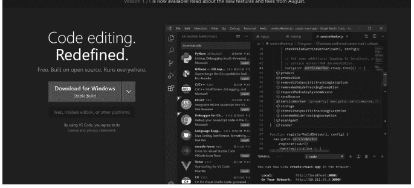

## 安装 VScode

## 48 ■ 征服 JavaScript

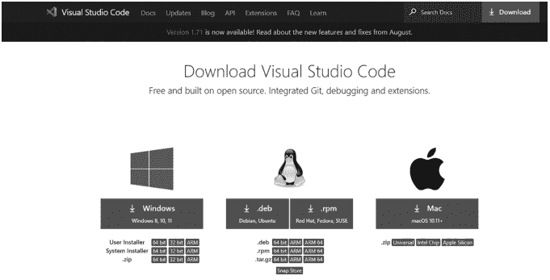

VScode 的下载页面

当我们按下蓝色按钮时，将会发生以下情况：


VScode 的安装开始

下载完成后，双击下图中所示的已下载文件。

完成后，将出现一个带有 `Visual Studio Code` 许可协议的窗口。

选择“我接受协议”，然后点击下一步按钮：

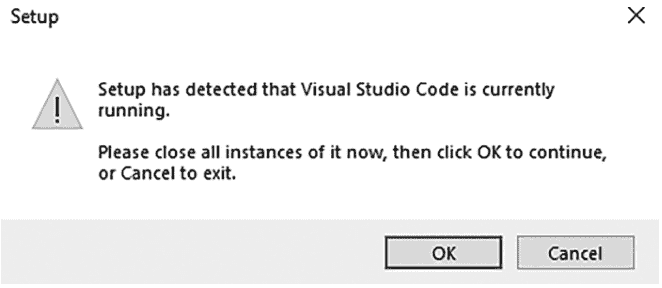

安装过程开始


## 接受协议

出现的下一个框将允许我们选择更多任务。选择我们需要的所有设置，然后按下一步按钮：


## 任务选择

当我们点击下一步按钮时，“准备安装”框出现，我们必须点击安装按钮：

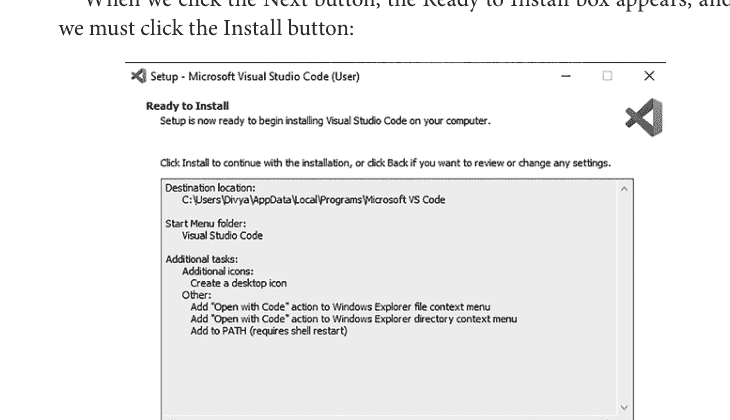

安装过程现在将开始：

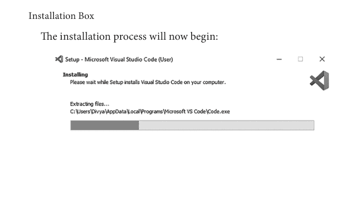

安装开始

安装完成后，点击完成按钮启动 `Visual Studio Code`。


## 安装完成

## 设置 Visual Studio Code

现在我们已经完成了 `Visual Studio Code` 的下载和安装，让我们来配置我们的 `JavaScript` 编辑器。配置 `Visual Studio Code` 的第一步是安装必要的扩展，这些扩展将使我们能够更有效、更快速地编码。扩展符号在左侧可见，如下图所示：

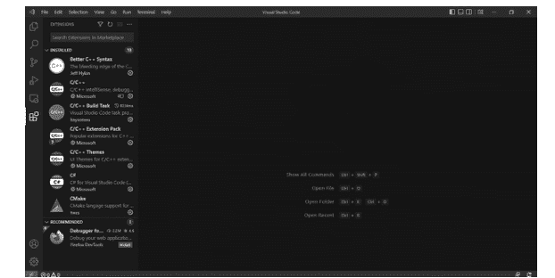

## 编辑器设置

52 ■ 征服 JavaScript

点击扩展图标后，搜索我们想要安装的扩展。

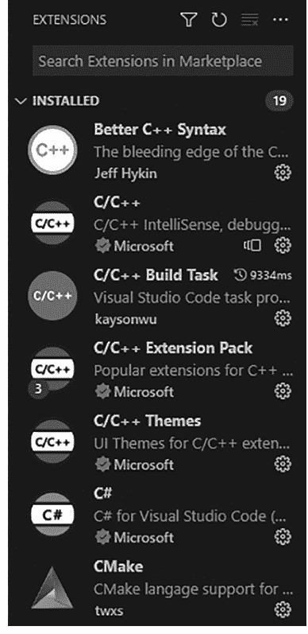

扩展搜索

安装 `LiveServer` 附加组件，它非常方便，因为具有自动实时重载功能。我们不需要保存文件，因为每次我们更改代码时，它都会保存并在浏览器中显示结果。

在扩展标签页中搜索 `Live Server`，并点击下图所示的按钮：

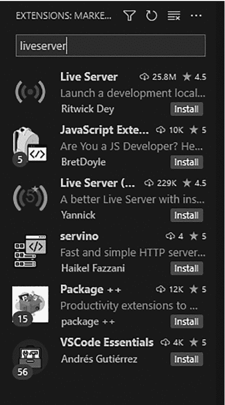

`LiveServer` 扩展

当我们点击 `Live Server` 时，安装选项将出现在右侧。

要安装 `Live Server`，请点击安装按钮。

我们点击安装按钮后，`Live Server` 将会安装完成：

`LiveServer` 扩展已安装

另一个我们可以在 `Visual Studio Code` 中安装的有用项目是 `JavaScript (ES6)` 代码片段，它包含大量内置代码片段。安装 `ES6` 代码片段与安装 `Live Server` 扩展类似。

## 在 Linux 上安装 Visual Studio Code

`Microsoft` 开发了 `Visual Studio Code`，这是一个免费、开源、跨平台的集成开发环境（`IDE`）或代码编辑器，允许程序员使用多种语言（包括 `C`、`C++`、`Python`、`Go`、`Java` 等）创建应用程序和编写代码。本指南将引导我们在 `Linux` 上安装 `Visual Studio Code`。更具体地说，我们将学习如何在基于 `Debian` 和 `RedHat` 的 `Linux` 变体上安装 `Visual Studio Code`。

### 在 Debian、Ubuntu 或 Linux Mint 上安装 Visual Studio Code

在基于 `Debian` 的计算机上，安装 `Visual Studio Code` 最流行的方法是启用 `VS Code` 仓库，并使用 `apt` 包管理器安装 `Visual Studio Code` 软件包。

```bash
$ sudo apt update
```

更新后，执行以安装任何所需的依赖项。

```bash
$ sudo apt install software-properties-common apt-transport-https
```


接下来，使用 `wget` 命令导入 `Microsoft` 的 `GPG` 密钥以获取存储库：

```bash
$ wget -qO- https://packages.microsoft.com/keys/microsoft.asc | gpg --dearmor > packages.microsoft.gpg
$ sudo install -o root -g root -m 644 packages.microsoft.gpg /etc/apt/trusted.gpg.d
$ sudo sh -c 'echo "[deb [arch=amd64 signed-by=/etc/apt/trusted.gpg.d/packages.microsoft.gpg] https://packages.microsoft.com/repos/vscode stable main" > /etc/apt/sources.list.d/vscode.list'
```

在启用存储库后，使用以下命令安装 `Visual Studio Code` 并更新系统：

```bash
$ sudo apt update
$ sudo apt install code
```

由于安装包较大，安装大约需要 5 分钟。安装完成后，可以使用项目协调器（项目管理器）来查找并打开 `Visual Code Studio`。

## 在 Windows 上安装 Node.js

我们将按照以下步骤安装 `Node.js`：

### 配置 Node 开发环境

`Node` 可以通过多种方法安装在计算机上。我们的方法取决于系统的当前开发环境。针对不同场景有许多包安装程序。`Node` 可以通过下载源代码并构建程序来安装。另一种方法是在所有三种环境中克隆 `GIT` 存储库，然后在机器上安装 `Node`。⁴

在 Windows（`WINDOWS 10`）上安装 `Node`：

要在 Windows 上安装 `Node.js`，我们必须首先执行以下步骤：

**第 1 步：** 获取 `Node.js` 的 `.msi` 安装程序。

下载安装程序是 在 Windows 上安装 `Node.js` 的第一步。

访问 `Node.js` 官方网站 `https://nodejs.org/en/download/`，下载与我们系统环境（32 位和 64 位）相对应的 `.msi` 文件。

在我们的机器上，将下载一个 `MSI` 安装程序。

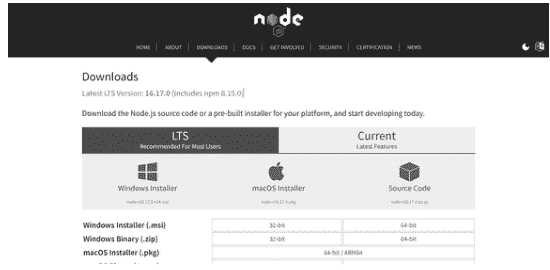

下载 `NodeJs`

**第 2 步：开始 `Node.js` 安装。**

现在我们必须在计算机上运行 `node.js` 安装程序。要安装 `Node.js`，我们必须首先完成以下步骤：

- 双击 `.msi` 安装程序将其启动。
- `Node.js` 安装向导将启动。
- 欢迎使用 `Node.js` 安装向导。
- 应选择“Next”（下一步）。

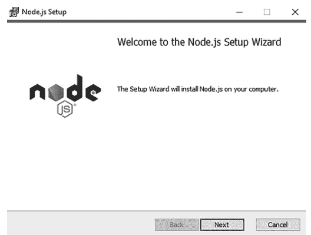

图注：`Node.js` 向导界面

- 选择“Next”后将显示最终用户许可协议（`EULA`）。
- 勾选旁边的复选框，选择“I accept the terms of the License Agreement”（我接受许可协议条款）。
- 应选择“Next”（下一步）。

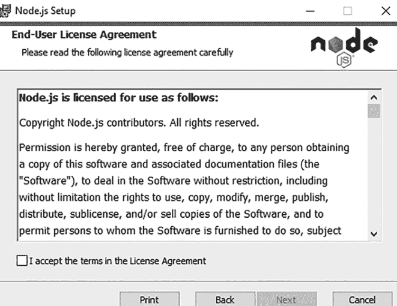

`Node.js` 同意界面

- 选择目标文件夹。

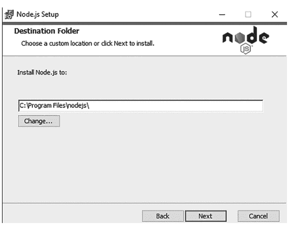

`Node.js` 选择文件夹

- 自定义配置。
- 应选择“Next”（下一步）。

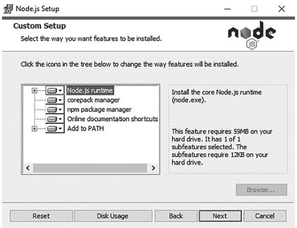

`Node.js` 自定义设置

- `Node.js` 现在准备安装。
- 选择“Install”（安装）。

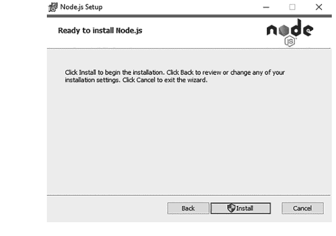

`Node.js` 安装开始

> **注意：**
>
> 此时会出现“This step needs administrator rights”（此步骤需要管理员权限）的提示。
>
> 在提示框中通过“Administrator”（管理员）身份进行验证。

- `Node.js` 安装中。

在安装完成之前，请勿关闭或取消安装程序。

- 完成 `Node.js` 安装向导。

点击“Finish”（完成）按钮。

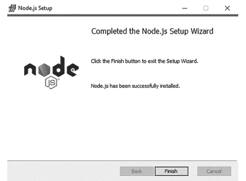

`Node.js` 安装完成

**第 3 步：** 检查 `Node.js` 是否正确安装。

为了验证 `node.js` 是否已完全安装在我们的机器上，请在命令提示符或 Windows Powershell 中使用以下行：

```powershell
C:\Users\Admin> node -v
```

如果 `node.js` 已完全安装在我们的机器上，命令提示符将显示所安装的 `node.js` 版本。

**第 4 步：** 更新本地 `npm` 版本。

安装 `Node.js` 的最后一步是更新我们的本地 `npm` 版本（如果必要）——`npm` 是随 `Node.js` 一起提供的包管理器。

要快速更新 `npm`，请使用以下命令：

```bash
npm install npm -global // 更新 `CLI` 客户端
```

> **注意：**
>
> 我们不需要修改系统变量，因为使用 `.msi` 安装程序安装时，Windows 安装程序会自动处理它们。
>
> 如果我们使用另一种格式在 PC 上安装 `node.js`，`node.js` 的系统变量路径应如下所示：
>
> `PATH : C:\Users\[用户名]\AppData\Roaming\npm`
>
> `C:\Program Files\nodejs`（`nodejs` 文件夹路径）

## 在 Linux 上安装 Node.js

`Node.js` 是一个基于 Chrome 中 `V8` JavaScript 引擎的 JavaScript 运行时。`Node.js` 可以通过多种方法安装在您的 Ubuntu Linux 笔记本电脑上。⁵ 我们可以使用 Ubuntu 的官方存储库或 `NodeSource` 存储库来安装 `Node.js`。`NodeSource` 存储库允许我们安装最新版本的 `Node.js`。

**在 Ubuntu 18.04 和 16.04 上安装 `Node`：** Ubuntu 有两个存储库，官方存储库和 `NodeSource` 存储库，您可以从中下载并安装 `Node.js`。

**从 Ubuntu 官方存储库安装 `Node.js`：** 只需几次按键，您就可以从 Ubuntu 存储库安装 `Node.js`。要在我们的 Ubuntu 操作系统上安装 `Node.js`，请按照以下说明操作。

- 第 1 步：启动终端或按下 `Ctrl+Alt+T`。
- 第 2 步：运行以下命令安装 `node.js`：

```bash
sudo apt install nodejs
```

- 第 3 步：安装完成后，使用以下命令检查安装的版本：

```bash
node -v or node -version
```

强烈建议在安装 `Node.js` 的同时安装 `Node` 包管理器（`NPM`）。`NPM` 是一个开源的 `Node.js` 包库。

使用以下代码安装 `NPM`：

```bash
sudo apt install npm
npm -v or npm -version
```

`Node` 和 `NPM` 将成功安装在我们的 Ubuntu 计算机上。

### 使用 NodeSource 存储库安装 Node.js

最新版本的 `Node.js` 可以从 `NodeSource` 存储库下载。


要在 Ubuntu 上安装 Node.js，请按照以下说明操作。

- 第 1 步：为了更新和升级包管理，请打开终端或按下 `Ctrl+Alt+T` 并输入以下命令：

```
sudo apt-get update
sudo apt-get upgrade
```

- 第 2 步：运行以下命令安装 Python 软件库：

```
sudo apt-get install python-software-properties
```

- 第 3 步：在机器上安装 Node.js PPA。

```
curl -sL https://deb.nodesource.com/setup_10.x | sudo -E bash -
```

注意：我们正在安装 Node.js 的 10 版本；如果我们想安装 11 版本，请将 `setup_10.x` 替换为 `setup_11.x`。

- 第 4 步：运行以下命令在我们的 Ubuntu 机器上安装 Node.js 和 NPM：

```
sudo apt-get install nodejs
```

- 第 5 步：安装完成后，使用以下命令检查安装的版本：

```
node -v or node -version
npm -v or npm -version
```

最后，在我们的 Ubuntu 系统上，我们成功安装了 Node.js 和 NPM。

## 如何在 Visual Studio Code 中启动并执行 Node.js 项目？

以下说明将引导我们完成创建基础 NodeJS 项目并在 VS Code 编辑器中执行的过程。

第 1 步：在我们的 VS Code 编辑器中，创建一个空文件夹并使用以下命令将其转移至该处。

```
mkdir demo
cd demo
code .
```

```
npm install express
npm install nodemon
```

第 4 步：在 `package.json` 文件中，添加这两条指令，以便在 Node.js 应用进行更改后启动并动态执行代码。

```
"start": "node app.js",
"dev": "nodemon app.js"
```

`package.json` 文件配置：

```json
{
    "name": "demo",
    "version": "1.0.0",
    "description": "",
    "main": "app.js",
    "scripts": {
        "test": "echo \"Error: no test specified\" && exit 1",
        "start": "node app.js",
        "dev": "nodemon app.js"
    },
    "author": "",
    "license": "ISC",
    "dependencies": {
        "express": "^4.17.1",
        "nodemon": "^2.0.12"
    }
}
```

第 5 步：以下是我们项目的结构：

- `app.js`
- `package-lock.json`
- `package.json`

第 6 步：将以下代码添加到 `app.js` 文件中。

```javascript
// Require module
const express = require('express');
```

```javascript
// Create express object
const app = express();

// Handling the GET request
app.get('/', (req, res) => {
  res.send('Simple Node App is '
  + 'running on this server')
  res.end()
})

// Port-Number
const PORT = process.env.PORT || 5000;

// Server-Setup
app.listen(PORT, console.log(
`Server started on the port ${PORT}`));
```

步骤 7：使用以下命令启动应用程序：

```
npm run dev
```

步骤 8：在浏览器中，访问 `http://localhost:5000/`，我们将得到以下输出：

## 面向 JavaScript 开发者的顶级 Visual Studio Code 扩展

今天，我们将介绍那些为 JavaScript 开发者带来革命性变化的插件，它们将 VS Code 提升至全新高度。

## JavaScript (ES6) 代码片段

使用预设的代码片段集合有助于我们提高效率。

我们可以通过添加更多包或创建自己的片段来根据需求定制代码片段。

创建自定义片段的定制可能性正是其价值所在；我们自己动手做得不多，但我们安装了其他插件来获取 React、React Native、Redux 及其他框架的工具。

只需搜索"VS Code 代码片段"+我们的框架，即可找到适合我们的集合。

下载地址：`https://marketplace.visualstudio.com/items?itemName=xabikos.JavaScriptSnippets`

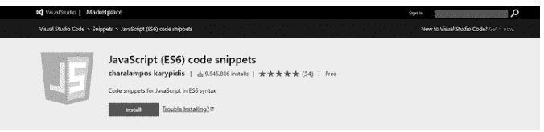

JavaScript (ES6) 代码片段的下载页面

## ESLint

毫无疑问，ESLint 是 JS 社区中最广泛使用和最受欢迎的插件之一。该扩展将 ESLint 规则应用于我们的代码，并在编辑器中显示结果。它使我们能够快速发现并纠正规则不一致的问题。对于所有 JS 开发者来说，这是必备工具，因为它能提升生产力和代码质量。

下载地址：`https://marketplace.visualstudio.com/items?itemName=dbaeumer.vscode-eslint`

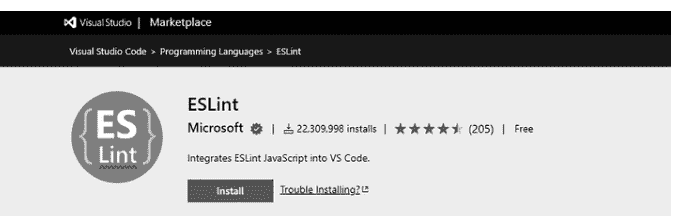

ESLint 的下载页面

## Prettier

Prettier 是一个具有明确立场的代码格式化工具，支持 VS Code、Visual Studio、Atom、Vim、Sublime Text 及其他多种程序。

这个实用的小插件确保我们的脚本具有统一的结构和缩进，并显示彩色关键字以使代码更具可读性。

它减少了格式化时间，从而提高了生产力。它极大地提升了代码可读性。

下载地址：`https://marketplace.visualstudio.com/items?itemName=esbenp.prettier-vscode`


Prettier 的下载页面

## Quokka.js

Quokka.js 让我们能够在 VS Code 编辑器中快速进行 JavaScript 原型设计。它是一个实时的 JavaScript 和 TypeScript 演练场。

它常被称为现代 JS 开发者的草稿本。我们是否曾想要快速测试某些东西，然后发现自己正在浏览器的控制台中运行一些 JS？或者启动 node 进程在那里测试？这个插件的主要目标是快速、轻松地在 VS Code 编辑器中直接执行代码。

下载地址：`https://marketplace.visualstudio.com/items?itemName=WallabyJs.quokka-vscode`

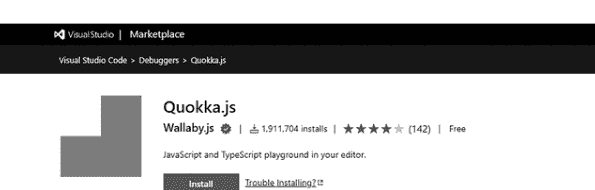

Quokka 的下载页面

## REST Client

REST Client 是一个 Visual Studio Code 插件，让我们可以提交 HTTP 请求并在编辑器中直接查看结果。它就是 VS Code 版的 Postman，额外的好处是它集成在代码编辑器内部。

REST Client 兼容 REST 和 GraphQL API。就生产力而言，它是 API 开发者最佳的 VS Code 扩展之一。

下载地址：`https://marketplace.visualstudio.com/items?itemName=humao.rest-client`

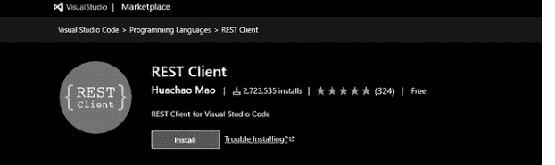

REST Client 的下载页面

## Debugger for Chrome

JavaScript 调试可能是一件麻烦事。Chrome 和其他浏览器提供了强大的功能来协助我们的工作。然而，它们有时难以使用或无法提供良好的整体体验，特别是在处理框架和多个库时。

Microsoft Debugger for Chrome 是一个 Chrome 扩展，让我们可以对任何微小更改进行代码调试。Chrome 控制台调试器在确定哪些行和函数导致问题以及查看其数据处理方面非常强大。通过 Chrome 运行我们的代码，并在代码编辑器中进行调试。

下载地址：`https://marketplace.visualstudio.com/items?itemName=msjsdiag.debugger-for-chrome`


Debugger for Chrome 的下载页面

## Live Server

我们可以使用 Live Server 启动一个本地开发服务器，为静态和动态站点提供实时重新加载功能。对于使用已启用实时重新加载的框架（如 React）的人来说，这可能不是很有用，但如果我们正在处理其他网页或静态内容，它就是一个救星。

下载地址：`https://marketplace.visualstudio.com/items?itemName=ritwickdey.LiveServer`

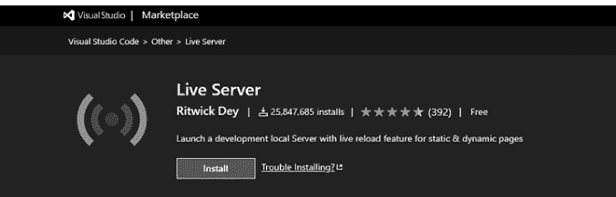

Live Server 的下载页面

## Live Share

这个插件非常棒，我们不确定 WebStorm 是否有类似的功能，但它让我们可以与他人共享我们的代码编辑器。

它非常适合结对编程，特别是在远程办公日益流行的当下。

下载地址：`https://marketplace.visualstudio.com/items?itemName=MS-vsliveshare.vsliveshare`

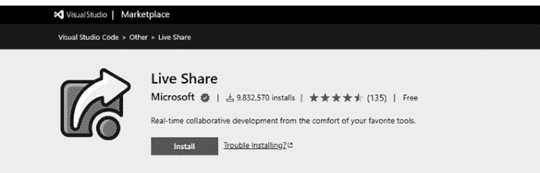

Live Share 的下载页面

## Babel JavaScript VSCode

近年来，JavaScript 发展迅速，随着 React、Flow 和 GraphQL 等框架和库的发展，现在可以实现许多新的 `syntaxes` 形式。Babel JavaScript 为新的 JavaScript 语法和这些特定的 `languages` 提供语法高亮，使我们的 JavaScript 编辑器保持更新并呈现良好的外观。

下载地址：`https://marketplace.visualstudio.com/items?itemName=mgmcdermott.vscode-language-babel`

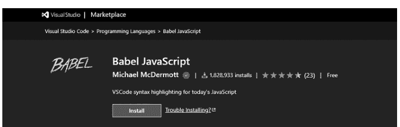

Babel JavaScript 的下载页面

## JavaScript Booster

我们最喜爱的 WebStorm 功能之一现在也可以在 VS Code 中使用。JavaScript Booster 通过分析我们的代码及其上下文，自动建议重构或改进代码的快捷方式。它支持广泛的代码操作，包括重构条件、声明、函数、TypeScript、Promises、JSX 等。

下载地址：`https://marketplace.visualstudio.com/items?itemName=sburg.vscode-javascript-booster`

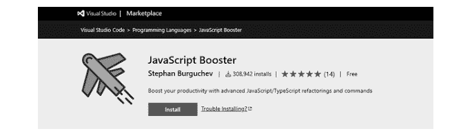

JavaScript Booster 的下载页面

## Tabnine

从 WebStorm 切换到 VS Code 时出现的另一个问题是自动补全的质量。

VS Code 的代码补全功能运行良好，但远不及 WebStorm 或 PyCharm 所能提供的。

然而，多亏 Tabnine，VS Code 获得了显著提升。

Tabnine 使用人工智能提供顶尖的建议，它远远超出了我的预期。

它是一个如此出色的工具，以至于我们在 VS Code 以及整个 JetBrains 产品套件中都使用它。

让我们来看看它的一些特性：

- 代码补全令人惊叹。
- 能够从自己及团队的项目中学习。
- 用户可以选择在本地运行模型或接收云端补全，在后一种情况下，开发者的代码会被加密并立即删除。
- 模型使用开源编程构建。
- 没有许可问题。
- 有免费版和付费版。

下载地址：`https://tabnine.com/`


Tabnine 的下载页面

## "Vanilla JavaScript" 究竟是什么？

`vanilla script` 这个短语指的是纯 JavaScript（或简单 JavaScript），不包含任何其他库。

它过去常被用作一个玩笑，意思是"如今各种事情也可以在不使用任何额外 JavaScript 库的情况下完成"。

`vanilla script` 是有史以来最轻量的框架之一。它非常容易使用和理解，而且非常直接。

使用 `vanilla script`，你可以构建大型且有影响力的应用程序以及网站。开发 `vanilla JavaScript` 的人们始终致力于改进它，使其对 Web 开发者更有帮助。

让我们来看看目前一些使用简单 JavaScript 的最著名网站：

以下网站目前正在使用 `vanilla JavaScript`，它们也在 `vanilla JavaScript` 主页上被提及。

- Google
- Facebook
- Yahoo
- Wikipedia
- YouTube
- Twitter
- Apple
- Amazon
- LinkedIn
- MSN
- Windows Live
- eBay
- Microsoft
- Tumblr
- Pinterest
- Netflix
- PayPal
- Reddit
- Stack Overflow

大多数人可能也很难接受这样一个事实：使用原生 JavaScript (`vanilla JavaScript`) 的网站数量远多于使用 JQuery 的网站数量。

## 为什么我们要学习纯 JS？

这是初学者中一个典型的问题：既然已经有了这么多其他复杂先进的框架和软件包，为什么还要学习并使用原生 JS？

我们打算在项目中研究并使用原生 JS，原因有很多。

其中最重要且最核心的三个原因讨论如下。

### 网站性能

由于它是前端技术栈中成本最高且最关键的部分，因此在 Web 性能方面，它比许多其他框架和工具要好得多。与 HTML 和 CSS 文件（仅在下载后即可访问）不同，原生 JS 代码必须经过构建和处理。一个 50KB 的 JS 文件对网页速度的影响远大于相同大小的 HTML 和 CSS 文件。

### 用户界面

它提供了简单且用户友好的开发体验。开发人员只需打开一个文本编辑器，即可开始使用 JavaScript 构建应用程序或网站。开发人员无需执行诸如 `npm install`、编译过程以及构建等耗时任务。

### 它还能让使用框架变得更简单

如果开发人员仍然想利用其他框架，掌握原生 JS 会让使用过程更加愉悦。众所周知，上手一个框架是很困难的。文档中包含大量假设的既有知识，而了解所有可用工具如何运作会让学习变得简单得多。

许多基础薄弱的新手尝试直接学习框架；不出所料，他们会在某些地方卡住，并最终停止关注 Vanilla JS 的基础知识。

当他们掌握基础后再次开始学习框架时，这次学习速度会快得多。原生脚本的其他显著优势包括：

- **互操作性：** 我们可以将 JavaScript 注入到任何网页中，但不能注入另一种编程语言。以 PHP 为例，由于它支持 PHP 和 Perl 等其他语言，我们也可以将其应用于各种应用程序。
- **服务器负载：** 因为众所周知 JavaScript 在客户端执行，它降低了对服务器资源利用的总需求。此外，基础程序不需要服务器的任何交互。
- **丰富的用户界面：** 我们可以使用 JavaScript 构建高质量的功能（如拖放）和组件（如轮播图）。这对网站的用户体验有积极影响。
- **速度：** 由于它在客户端执行且不需要任何外部资源，因此速度极快。对后端服务器的调用不会影响 JavaScript 的性能。

## 原生脚本的缺点

- 原生脚本最根本的缺点之一是客户端安全性，因为众所周知 JavaScript 代码在客户端是可见的。因此，任何有能力修改它的人都可能将其作为恶意目的的武器或工具。
- JavaScript 的另一个显著缺点是缺乏调试设施 (Debugging Facility)。
- 由于缺乏相关支持，我们无法将其用于基于网络的应用程序。
- 原生脚本还缺乏某些特性，例如多处理器和多线程。
- 出于安全原因，它还禁止对数据的读写操作。

## JavaScript 中的 Hello World 程序

在这个示例中，我们将学习在 JavaScript 中打印 "Hello World" 的三种不同方法。

"Hello, World!" 程序是一个简单的程序，用于在屏幕上打印短语 "Hello, World!"。

由于它是一个相当简单的程序，因此经常被用于向新手教授一种新的编程语言。

我们将以三种不同的方式打印 "Hello, World!"：

- `console.log()`
- `alert()`


- `document.write()`

1. **使用`console.log()`**

`console.log()`函数用于调试代码。

代码：

```javascript
// program of hello world
console.log('Hello World!');
```

2. **使用`alert()`**

`alert()`函数在当前窗口上方显示一个带有指定消息的警告框。

代码：

```javascript
// program of hello world
alert("Hello, World!");
```

3. **使用`document.write()`**

当我们希望将信息打印到 HTML 文档中时，我们使用`document.write()`。

```javascript
// program of hello world
document.write('Hello, World!');
```

## JAVASCRIPT 的语法

JavaScript 可以通过将 JavaScript 语句放置在网页的`<script>... </script>`HTML 标签内来应用。

我们可以将包含 JavaScript 的`<script>`标签插入到网页的任何位置，但通常最好将其放在`<head>`标签内。

`<script>`标签指示浏览器将这些标签之间的任何内容作为脚本开始读取。

以下是 JavaScript 的基本语法。

```html
<script ...>
    code
</script>
```

`script`标签需要两个关键属性。

- **Language：** 该元素定义正在使用的脚本语言。其值通常为 JavaScript。尽管随后的 HTML 版本（及其继任者 XHTML）已经逐步淘汰了此功能的使用。

- **Type：** `type`的值现在建议为`"text/javascript"`，以指示所使用的脚本语言。

因此，我们的 JavaScript 部分将如下所示：

```html
<script language = "javascript" type = "text/javascript">
    JavaScript-code
</script>
```

## 我们的第一个 JAVASCRIPT 代码

让我们尝试打印 “Hello Everyone” 作为示例。我们在 JavaScript 代码周围包含了一个可选的 HTML 注释。这样做是为了防止不支持 JavaScript 的浏览器执行代码。

该注释以`//-->`结尾。因为`//`在 JavaScript 中表示注释，我们将它放在这里，以防止浏览器将 HTML 注释的结尾视为 JavaScript 代码。然后我们将调用`document.write()`函数，它会将字符串插入到 HTML 文档中。

该函数可以创建文本、HTML 或两者兼有。请看下面的代码。

```html
<html>
    <body>
        <script language = "javascript" type = "text/javascript">
        <!--
        document.write("Hello Everyone")
        //-->
        </script>
    </body>
</html>
```

## 换行符和空白字符

JavaScript 会忽略脚本中的空格、制表符和换行符。我们可以在程序中自由地使用空格、制表符和换行符，并以整洁且统一的方式进行样式化和缩进，使代码易于阅读和理解。

## 分号不是必须的

在 JavaScript 中，像 C、C++ 和 Java 一样的简单语句通常后面跟着一个分号字符。另一方面，如果我们的每个语句都处在不同的行，JavaScript 允许我们省略这个分号。例如，以下代码可以在没有分号的情况下编写。

```html
<script language = "javascript" type = "text/javascript">
<!--
var1 = 30
var2 = 10
//-->
</script>
```

然而，当像下面这样在单行中进行格式化时，必须使用分号。

```html
<script language = "javascript" type = "text/javascript">
<!--
var1 = 30; var2 = 10;
//-->
</script>
```

## 大小写敏感

JavaScript 是一种大小写敏感的编程语言。这意味着所有语言关键字、变量、函数名和其他标识符必须使用一致的字母大小写输入。

在 JavaScript 中，标识符`Time`和`TIME`将具有不同的含义。

注意：在 JavaScript 中为变量和函数命名时，请务必谨慎。

## JAVASCRIPT 中的注释

JavaScript 注释是一种传递信息的有效技术。它用于包含代码信息、警告或建议，以便最终用户能够轻松阅读代码。浏览器的内置 JavaScript 引擎会忽略 JavaScript 注释。

### JavaScript 注释的优点

JavaScript 注释主要有两个优点。

- 为了使代码更易于理解，可以使用它来开发代码，以便最终用户轻松理解。

- 为了防止不必要的代码执行，它也可以用于阻止代码运行。有时，我们会添加代码来执行某个特定活动。然而，一段时间后该代码可能需要被禁用。在这种情况下，使用注释是更好的选择。

### JavaScript 注释类型

在 JavaScript 中，有两种类型的注释。

- 单行注释

- 多行注释

### JavaScript 中的单行注释

它由两个正斜杠 (`//`) 表示。它可以用于语句之前或之后。

让我们看一个单行注释的示例，它被放在语句之前。

```html
<script>
    // It is the singleline comment
</script>
```

```javascript
document.write("hello everyone");
</script>
```

让我们来看一个单行注释的例子，它被放置在语句之后。

```html
<script>
    var c=30;
    var d=10;
    var e=c+d;//It adds values of c and d variable
    document.write(e);//prints sum of 30 and 10
    </script>
```

## JavaScript 中的多行注释

它可以用来添加单行或多行注释。因此，使用起来更方便。

它的符号是一个斜杠，后跟一个星号，再跟一个斜杠。例如：

```javascript
/* code here  */
```

它可以用在句子之前、之后或中间。

```html
<script>
    /* It is the multiline comment.
    It will not display */
    document.write("instance of javascript multiline comment");
    </script>
```

## JavaScript 中的变量

JavaScript 变量不过是一个存储位置的名称。¹²

JavaScript 中的变量分为两种类型：局部变量和全局变量。

声明 JavaScript 变量（也称为标识符）时需要遵循以下几条准则：

- 名称以字母（a-z 或 A-Z）、下划线（_）或美元符号（$）开头。

- 我们可以在首字母后面放数字（0-9），例如`value1`。

- JavaScript 中的变量区分大小写；因此，`x`和`X`是不同的。

## 正确的 JavaScript 变量

```javascript
var d = 20;
var _value="sonoo";
```

## 不正确的 JavaScript 变量

```javascript
var 321=20;
var *bb=310;
```

## JavaScript 变量示例

让我们看一个基本的 JavaScript 变量示例。

```html
<script>
var c = 30;
var d = 10;
var e=c+d;
document.write(e);
</script>
```

## JavaScript 中的局部变量

JavaScript 中的局部变量在块或函数内声明。它只在函数或块内可用。例如：

```html
<script>
    function cde() {
        var k=10;//local variable
    }
</script>
```

或

```html
<script>
    If (20<15) {
        var y=40;// local variable
    }
</script>
```

## JavaScript 中的全局变量

JavaScript 中的全局变量可以从任何函数访问。全局变量是在函数外部定义或使用`window`对象声明的变量。例如：

```html
<script>
  var data=250;//gloabal variable
  function d(){
    document.writeln(data);
  }
  function e(){
    document.writeln(data);
  }
  d();//call JavaScript function
  e();
</script>
```

## 在 JavaScript 函数内声明全局变量

我们必须使用`window`对象在函数内定义 JavaScript 全局变量。例如：

```javascript
window.value=70;
```

现在，它可以在任何函数内定义，并从任何函数访问。例如

可亲的行为

一些初步思考促使我们如何体现亲切态度

本节旨在提供几个基本思路

如何为照应到情感、身体与文化差异等层面而培养接纳态度

*初谈关怀与共情*

自人类繁衍生息以来关怀就构成生活重要内容。技术发展亦在乡土与眼前的日常与亲人关系间搭建桥梁。尽管健康生活方式倡导平衡饮食、保持身体活跃等原则，但亦需一段时间方能看到良好成效。所以，要理解他人，需具备*耐心*与*理解*。

*……每当我们感到悲伤，仿佛身处深渊无力呼吸，有一种与引力抵抗的力量帮助我们重新飞翔。……正是人类灵魂中留存的这丝希望引人震撼，终会长成大胆突破困境的自由意志。*

---

待更新……
<%COMMENT%>

即可见，该章节讨论以下核心内容：
- 当我打扫起落叶、热好饭菜或给植物浇水时，是在向亲密之人表达关怀。
- 如果要书写友谊，需描述那些看似微不足道但温暖友爱的日常细节：一杯为对方准备好的咖啡，清晨为彼此熨烫衣领。
- 文化上，我们更习惯于用行动而非语言来传递善意，但在听见彼此内心需求的相互感知中也希望得到认可与回应。总归来幸福就是一种互帮互助彼此给予的持续过程。

以上为未现场查证添加的虚构故事，如果需要转换其他类型的文档，请提供内容。我会帮忙做成标准Markdown格式。

如果有具体书稿内容需要修正，欢迎提供文本。

## 流程图：

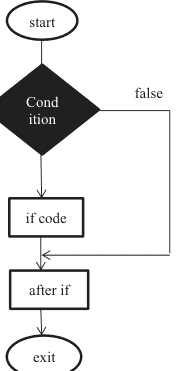

## if 语句

让我们来看一个 JavaScript 中的基础 if 语句。

```html
<script>
var a=40;
if(a>20){
document.write("The value of a is greater than 20");
}
</script>
```

## If...else 语句

它用于确定条件是真还是假。JavaScript 中 if-else 语句的语法如下所示。¹⁷

```javascript
if(expression){
    //content to evaluate if the condition is true
}
else{
    //content to evaluate if the condition is false
}
```

### 流程图：

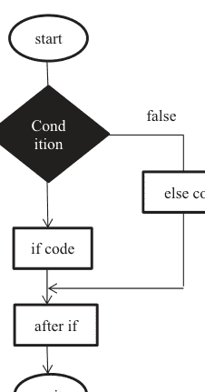

### if-else 语句

让我们来看一个 JavaScript 中 if-else 语句的示例，用于判断一个数字是偶数还是奇数。

```html
<script>
var d=40;
if(d%2==0){
document.write("d is even number");
}
else{
document.write("d is odd number");
}
</script>
```

## If...else if 语句

它仅在多个表达式中有一个为真时才分析内容。JavaScript if else if 语句的签名如下所示。

```javascript
if(expression1){
//content to evaluate if the expression1 is true
}
else if(expression2){
//content to evaluate if the expression2 is true
}
else if(expression3){
//content to evaluate if the expression3 is true
}
else{
//content to evaluate if no expression is true
}
```

流程图：

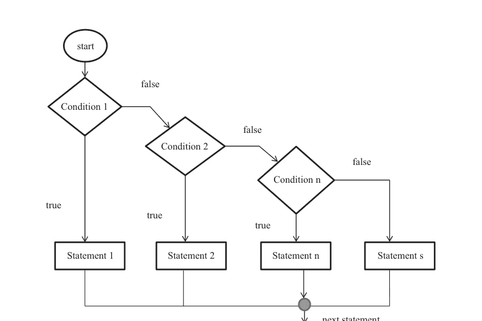

### if-else-if 语句

让我们来看一个 JavaScript 中的基础 if-else-if 表达式。

```html
<script>
var d=40;
if (d==20) {
document.write("d is equal to 10");
}
else if(a==25){
    document.write("d is equal to 15");
}
else if(a==40){
    document.write("d is equal to 20");
}
else{
    document.write("d is not equal to 20, 25 or 40");
}
</script>
```

## JAVASCRIPT 中的 SWITCH

JavaScript 的 switch 语句用于从一组表达式中执行单段代码。它与我们在前一页学习的 else if 语句相同。然而，它比 if...else...if 更方便，因为它可以与整数、字符等一起使用。<sup>18</sup>

JavaScript switch 语句的签名如下所示。

```javascript
switch(expression){
    case value1:
        code to execute;
        break;
    case value2:
        code to execute;
        break;
    .....

    default:
        code to execute if the above values are not
        matched;
}
```

让我们来看一个 JavaScript 中的基础 switch 语句。<sup>19</sup>

```html
<script>
var grade='B';
var result;
switch(grade){
case 'A':
result="Grade A";
break;
case 'B':
result="Grade B";
break;
case 'C':
result="Grade C";
break;
default:
result="No Grade";
}
document.write(result);
</script>
```

让我们来看看 switch 语句在 JavaScript 中是如何工作的。

```html
<script>
var grade='B';
var result;
switch (grade) {
case 'A':
result+="Grade A";
case 'B':
result+="Grade B";
case 'C':
result+="Grade C";
default:
result+=" No Grade";
}
document.write(result);
</script>
```

## JAVASCRIPT 中的 循环（LOOPS）

JavaScript 循环使用 for、while、do-while 和 for-in 循环来重复执行代码。这使得代码更简洁。它最常用于数组。²⁰

在 JavaScript 中，有四种类型的循环：

- for 循环

- while 循环

- do-while 循环

- for-in 循环

### for 循环

JavaScript 的 for 循环会对组件进行特定次数的循环。

如果已知迭代次数，则应使用此循环。for 循环的语法如下所示。

```javascript
for (initialization; condition; increment)
{
    code to execute
}
```

让我们来看一个 JavaScript 中的简单 for 循环。

```html
<script>
for (x=1; x<=5; x++)
{
document.write(6 + "<br/>")
}
</script>
```

### while 循环

JavaScript 的 while 循环会对组件进行无限次迭代（直到条件不满足）。

当预期的迭代次数不确定时，应使用此方法。while 循环的语法如下所示。

```javascript
while (condition)
{
    code to execute
}
```

让我们来看一个 JavaScript 中的简单 while 循环。

```html
<script>
    var x=12;
    while (x<=16)
    {
    document.write(x + "<br/>");
}
x++;
}
</script>
```

### do-while 循环


JavaScript 的 `do-while` 循环与 `while` 循环一样，会对项目进行无限次迭代。无论条件是否为真，代码至少会执行一次。以下代码演示了 `do-while` 循环的语法。

```
do{
    code to execute
}while (condition);
```

让我们来看一个基础的 JavaScript `do-while` 循环示例。

```
<script>
var x=22;
do{
document.write(x + "<br/>");
x++;
}while (x<=26);
</script>
```

## for-in 循环

JavaScript 的 `for-in` 循环用于迭代对象的属性。它由三个关键部分组成：

- 循环初始化，我们在其中将计数器设置为初始值。在循环开始之前，初始化语句将被执行。²¹
- 测试语句用于确定特定条件是否为真。如果满足条件，则执行循环内部的代码；否则，控制权将退出循环。
- 迭代语句，允许我们增加或减少计数器。

所有三个部分都可以呈现在同一行，用分号分隔。

```
for (initialization; test condition; iteration statement) {
    Statement(s) to execute if the test condition is true
}
```

为了了解 `for` 循环在 JavaScript 中是如何工作的，请尝试一个简单的示例。

```
<html>
    <body>
        <script type = "text/javascript">
            <!--
            var count;
            document.write("Start Loop" + "<br />");
            
            for(count = 0; count < 10; count++) {
                document.write("The Current Count : " +
                count );
                document.write("<br />");
            }
            document.write("Loop stop!");
            //-->
        </script>
        <p>Set variable to a different value and then
    try</p>
    </body>
</html>
```

## JavaScript 中的函数（Functions）

JavaScript 函数用于执行任务。为了复用代码，我们可以多次调用 JavaScript 方法。

### JavaScript 函数的优点

JavaScript 函数主要有两个优点：

- 代码可复用性：我们可以多次调用一个函数以节省编码时间。
- 简洁：这减少了软件的体积。我们在每次执行相同操作时无需编写大量代码。

### JavaScript 函数的语法

定义函数的语法如下。

```
function function_Name([arg1, arg2, ...argN]){
    //code to execute
}
```

JavaScript 函数可以接受零个或多个参数。让我们来看一个不接受任何参数的基础 JavaScript 函数。

```
<script>
    function msg(){
        alert("hey this is my message");
    }
</script>
<input type="button" onclick="msg()" value="call function"/>
```

### 函数参数

可以通过传递参数来调用函数。让我们来看一个只有一个参数的函数示例。

```
<script>
    function getcube(numb){
        alert(number*numb*numb);
    }
</script>
<form>
    <input type="button" value="click" onclick="getcube(4)"/>
</form>
```

### 带返回值的函数

我们可以在应用程序中使用返回值的函数。让我们来看一个返回值的函数示例。

```
<script>
function getInfo(){
return "hey everyone How are you?";
}
</script>
<script>
document.write(getInfo());
</script>
```

## 函数对象

JavaScript 中函数构造器的目的是构建一个新的 `Function` 对象。

它在全局范围内运行代码。

然而，如果我们直接使用构造器，函数虽然是动态构建的，但方式是不安全的。

**语法：**

```
new Function ([arg_1[, arg_2[, ....arg_n]],]
functionBody)
```

### 参数

- `arg_1`, `arg_2`,..., `arg_n`: 代表函数参数。
- `functionBody`: 这是函数的定义。

### 函数方法

| 方法 | 描述 |
|------|-------------|
| `apply()` | 用于调用一个函数，该函数接收 `this` 值以及一个参数数组。 |
| `bind()` | 用于实现一个新函数。 |
| `call()` | 用于调用一个函数，该函数接收 `this` 值以及一个参数列表。 |
| `toString()` | 将结果以字符串形式返回给我们。 |

让我们来看看函数方法及其描述。

## JavaScript 函数对象示例

**示例 1**

让我们来看一个显示两个整数之和的示例。

```
<script>
var add=new Function("numb1","numb2","return numb1+numb2");
document.writeln(add(12,7));
</script>
```

**示例 2**

让我们看一个例子来演示所提供值的强大之处。

```
<script>
var pow=new Function("numb1","numb2","return Math.pow(numb1,numb2)");
document.writeln(pow(21,4));
</script>
```

## JavaScript 中的对象

JavaScript 对象是一个具有行为（属性和方法）的有状态实体，例如：车辆、笔、自行车、椅子、玻璃杯、键盘和显示器。

JavaScript 是一种面向对象编程语言。在 JavaScript 中，万物皆对象。JavaScript 是基于模板而非基于类的。²² 我们在这里不需要构建一个类来获取对象，而是引导事物的创建。

### JavaScript 中的对象创建

对象可以通过三种方式创建：

- 通过对象字面量。
- 通过直接生成 `Object` 实例（使用 `new` 关键字）。
- 通过使用 `Object` 构造函数（使用 `new` 关键字）。

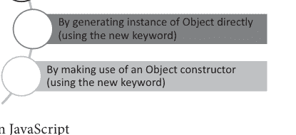

JavaScript 中的对象创建

#### 1. 通过对象字面量创建对象

使用对象字面量构建对象的语法如下：

```
object={property1:value_1,property2:value_2.....
propertyN:value_N}
```

正如我们所看到的，属性和值由 `:`（冒号）区分。

让我们看一个 JavaScript 对象创建的基本示例。

```
<script>
emp={id:113,name:"Shiva Kishan",salary:45000}
document.write(emp.id+" "+emp.name+" "+emp.salary);
</script>
```

#### 2. 通过生成 Object 实例创建

直接生成对象的语法如下：

```
var object_name=new Object();
```

在这种情况下，使用 `new` 关键字来构建对象。

让我们看一个直接构建对象的示例。

```
<script>
var emp=new Object();
emp.id=107;
emp.name bias="Rita Kaur";
emp.salary=52000;
document.write(emp.id+" "+emp.name+" "+emp.salary);
</script>
```

#### 3. 通过使用 Object 构造函数创建

我们必须在此构建一个带有参数的函数。`this` 关键字可用于将每个参数值分配给当前对象。

关键字 `this` 指向当前对象。

以下示例展示了如何使用对象构造函数创建对象。

```
<script>
function emp(id,name,salary){
this.id=id;
this.name=name;
this.salary=salary;
}
e=new emp(105,"Vinay Sharma",33000);

document.write(e.id+" "+e.name+" "+e.salary);
</script>
```

### 在 JavaScript 对象中创建方法

在 JavaScript 对象中，我们可以指定方法。然而，在定义方法之前，我们必须在函数中添加一个与方法同名的属性。以下是在对象中定义方法的示例。

```
<script>
function emp(id,name,salary){
this.id=id;
this.name=name;
this.salary=salary;

this.change_Salary=change_Salary;
function change_Salary(other_Salary){
this.salary=other_Salary;
}
}
e=new emp(102,"Suraj Garewal",39000);
document.write(e.id+" "+e.name+" "+e.salary);
e.changeSalary(41000);
document.write("<br>"+e.id+" "+e.name+" "+e.salary);
</script>
```

### JavaScript 中的对象方法

对象的众多方法如下：

| 序号 | 方法 | 描述 |
|------|---------|-------------|
| 1 | `Object.assign()` | 使用此方法将可枚举的自有属性从源对象转移到目标对象。 |
| 2 | `Object.create()` | 此函数用于使用给定的原型对象和属性生成一个新对象。 |
| 3 | `Object.defineProperty()` | 此方法用于定义某些属性的行为特征。 |
| 4 | `Object.defineProperties()` | 使用此技术可以创建或配置多个对象属性。 |
| 5 | `Object.entries()` | 此函数返回一个包含键值对数组的数组。 |
| 6 | `Object.freeze()` | 此策略可防止删除现有属性。 |
| 7 | `Object.getOwnPropertyDescriptor()` | 此函数返回给定对象属性的属性描述符。 |
| 8 | `Object.getOwnPropertyDescriptors()` | 此函数检索对象的所有自有属性描述符。 |
| 9 | `Object.getOwnPropertyNames()` | 此函数生成一个包含所有发现的属性（无论是否可枚举）的数组。 |
| 10 | `Object.getOwnPropertySymbols()` | 此函数生成一个包含所有自有 Symbol 键属性的数组。 |
| 11 | `Object.getPrototypeOf()` | 此方法返回给定对象的原型。 |
| 12 | `Object.is()` | 此函数比较两个值以查看它们是否相同。 |
| 13 | `Object.isExtensible()` | 此方法检测对象是否可扩展。 |
| 14 | `Object.isFrozen()` | 此方法检测项目是否被冻结。 |
| 15 | `Object.isSealed()` | 此方法检测项目是否被密封。 |
| 16 | `Object.keys()` | 此函数返回一个包含所提供对象属性名称的数组。 |
| 17 | `Object.preventExtensions()` | 此技术用于禁止对象扩展。 |
| 18 | `Object.seal()` | 此方法禁用新属性的添加，并将所有当前属性标记为不可配置。 |
| 19 | `Object.setPrototypeOf()` | 此函数将一个对象的原型分配给另一个对象。 |
| 20 | `Object.values()` | 此方法返回一个值数组。 |

## JavaScript 中的数组

在 JavaScript 中，代表一组相同对象的对象被称为数组。

在 JavaScript 中，有三种创建数组的方法。²³

- 通过数组字面量。
- 通过显式生成 `Array` 实例（使用 `new` 关键字）。
- 通过使用 `Array` 构造函数（使用 `new` 关键字）。

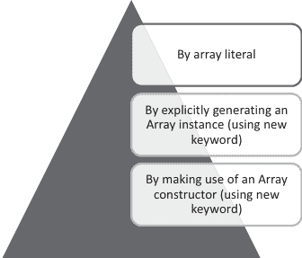

JavaScript 中的数组

#### 1. JavaScript 中的数组字面量

使用数组字面量构建数组的语法如下：

```
var arrayname=[value_1,value_2.....value_N];
```

我们可以看到，值被 `[]` 包围并由 `,`（逗号）分隔。让我们看一个在 JavaScript 中构建和使用数组的基本示例。

```
<script>
var emp=["Simran","Vijay","Rajat"];
for (x=0;x<emp.length;x++){
document.write(emp[x] + "<br/>");
}
</script>
```

`.length` 属性返回数组的长度。

#### 2. JavaScript 中的直接数组（new 关键字）

直接构建数组的语法如下：

```
var array_name=new Array();
```

在这种情况下，使用 `new` 关键字来构建数组对象。让我们看一个直接生成数组的示例。

```
<script>
var x;
var emp = new Array();
emp[0] = "Ajay";
emp[1] = "Vinay";
emp[2] = "Johny";

for (x=0;x<emp.length;x++) {
document.write(emp[x] + "<br>");
}
</script>
```

#### 3. JavaScript 中的数组构造函数（new 关键字）

我们必须通过向构造函数提供参数来构建数组实例，这样我们就无需手动指定值。

以下是使用数组构造函数创建对象的示例。

```
<script>
var emp=new Array("Jaya","Vinay","Simran");
for (x=0;x<emp.length;x++) {
document.write(emp[x] + "<br>");
}
</script>
```

### JavaScript 中的数组方法

让我们浏览一下 JavaScript 数组方法及其描述。

| 方法 | 描述 |
|---|---|
| `concat()` | 它由两个或多个合并的数组创建一个新的数组对象。 |
| `copywithin()` | 它将提供的数组元素替换为其自身的元素，并返回转换后的数组。 |
| `entries()` | 它生成一个迭代器对象，一个循环遍历每个键/值对。 |
| `every()` | 它检查数组的所有项目是否都满足函数标准。 |
| `flat()` | 它生成一个新数组，其中子数组项递归拼接，直到达到所需的深度。 |
| `flatMap()` | 它使用映射函数映射所有数组项，然后将结果扁平化为一个新数组。 |
| `fill()` | 它用静态值填充数组。 |

## JavaScript 数组方法

| 方法 | 描述 |
|---|---|
| `from()` | 生成一个新数组，包含另一个数组元素的完全相同的副本。 |
| `filter()` | 返回一个新数组，包含满足函数要求的条目。 |
| `find()` | 返回满足所提供条件的第一个数组元素的值。 |
| `findIndex()` | 返回所提供数组中满足条件的第一个成员的索引。 |
| `forEach()` | 为每个数组元素调用一次指定的方法。 |
| `includes()` | 判断所提供元素是否存在于所提供的数组中。 |
| `indexOf()` | 在所提供的数组中搜索指定元素，并返回第一个匹配的索引。 |
| `isArray()` | 判断所提供的值是否为数组。 |
| `join()` | 通过连接数组中的成员来创建一个字符串。 |
| `keys()` | 构造一个仅包含数组键的迭代器对象，然后遍历这些键。 |
| `lastIndexOf()` | 返回数组中指定元素最后一次出现的索引。 |
| `map()` | 在每个数组元素上执行所提供的函数，并返回新数组。 |
| `of()` | 从可变数量的参数生成一个新数组，这些参数可以是任何类型。 |
| `pop()` | 移除并返回数组的最后一个元素。 |
| `push()` | 将一个或多个数组元素追加到末尾。 |
| `reverse()` | 翻转所提供数组的项目。 |
| `reduce(function, initial)` | 从左到右为数组中的每个值运行指定的函数，将数组缩减为单个值。 |


| `reduceRight()` | 从右到左为数组中的每个值运行指定的函数，将数组缩减为单个值。 |
| `some()` | 判断数组中是否有任何成员满足所实现函数的测试。 |
| `shift()` | 移除并返回数组的第一个成员。 |
| `slice()` | 返回一个新数组，包含所指定数组部分的副本。 |
| `sort()` | 返回所提供数组的排序元素。 |
| `splice()` | 从所指定数组中添加和移除元素。 |
| `toLocaleString()` | 返回一个包含所提供数组中所有成员的字符串。 |
| `toString()` | 将给定数组的项目转换为字符串形式，同时保留原始数组不变。 |
| `unshift()` | 在所提供数组的开头插入一个或多个元素。 |
| `values()` | 生成一个新的迭代器对象，其中包含每个数组索引的值。 |

## JavaScript 中的字符串

JavaScript 中的字符串是一个表示一系列字符的对象。在 JavaScript 中，有两种创建字符串的方法：

- 使用字符串字面量。
- 使用字符串对象（使用 `new` 关键字）。

### 1. 使用字符串字面量

使用双引号来构造字符串字面量。使用字符串字面量构造字符串的语法如下：

```javascript
var string_name="string_value";
```

```html
<script>
var str="This is the string literal";
document.write(str);
</script>
```

### 2. 使用字符串对象（使用 `new` 关键字）

使用 `new` 关键字创建字符串对象的语法如下：

```javascript
var string_name=new String("string_literal");
```

在这种情况下，使用 `new` 关键字来构造字符串实例。让我们看一下使用 `new` 关键字形成的 JavaScript 字符串。

```html
<script>
var stringname=new String("hey everyone");
document.write(stringname);
</script>
```

## JavaScript 中的字符串方法

让我们回顾一下 JavaScript 字符串方法的示例。

| 方法 | 描述 |
|---|---|
| `charAt()` | 返回位于指定索引处的字符值。 |
| `charCodeAt()` | 提供指定索引处字符的 Unicode 值。 |
| `concat()` | 允许我们组合两个或多个字符串。 |
| `indexOf()` | 返回字符值在给定字符串中的位置作为响应。 |
| `lastIndexOf()` | 通过从最后一个位置开始搜索返回结果，提供字符值在给定字符串中的位置。 |
| `search()` | 搜索所提供的文本以查找指定的正则表达式，如果发现匹配，则返回其位置。 |
| `match()` | 检查给定文本是否存在指定的正则表达式，如果发现匹配，则返回该正则表达式。 |
| `replace()` | 用给定的字符串替换所提供的字符串。 |
| `substr()` | 基于指定的起始位置和长度，用于获取给定字符串的一部分。 |
| `substring()` | 基于指定的索引，用于获取给定文本的一部分。 |
| `slice()` | 我们可以用它来获取给定字符串的一部分。借助它，我们可以提供正索引和负索引。 |
| `toLowerCase()` | 将传递给它的字符串转换为小写。 |
| `toLocaleLowerCase()` | 基于主机的当前区域设置，将所提供的字符串转换为小写字母。 |
| `toUpperCase()` | 将字符串更改为大写字母。 |
| `toLocaleUpperCase()` | 基于主机的当前区域设置，将所提供的文本转换为大写字母。 |
| `toString()` | 返回表示特定对象的字符串。 |
| `valueOf()` | 返回字符串对象的原始值。 |
| `split()` | 从字符串创建子字符串数组，然后返回结果数组。 |
| `trim()` | 移除字符串左右两侧的空白字符。 |

### 1. JavaScript 中的 String `charAt(index)` 方法

JavaScript 字符串的 `charAt()` 函数返回指定索引处的字符。

```html
<script>
var str="heyeveryone";
document.write(str.charAt(2));
</script>
```

### 2. JavaScript 中的 String `concat(str)` 方法

JavaScript 中的 String `concat(str)` 方法连接或合并两个字符串。

```html
<script>
var st1="heyeveryone ";
var st2="concat example";
var st3=st1.concat(st2);
document.write(st3);
</script>
```

### 3. JavaScript 中的 String `indexOf(str)` 方法

JavaScript 字符串 `indexOf(str)` 函数返回字符串的索引位置。

```html
<script>
var st1="hey from evevrone indexof";
var n=st1.indexOf("from");
document.write(n);
</script>
```

### 4. JavaScript 中的 String `lastIndexOf(str)` 方法

JavaScript 字符串 `lastIndexOf(str)` 函数返回字符串的最后索引点。

```html
<script>
var st1="everybody from evevrone indexof";
var n=st1.lastIndexOf("every");
document.write(n);
</script>
```

### 5. JavaScript 中的 `toLowerCase()` 方法

JavaScript 中的 String `toLowerCase()` 函数以 lowercase characters 返回所提供的字符串。

```html
<script>
var st1="JavaScript toLowerCase Instance";
var st2=st1.toLowerCase();
document.write(st2);
</script>
```

### 6. JavaScript 中的 `toUpperCase()` 方法

JavaScript 中的 String `toUpperCase()` 函数以 uppercase characters 返回所提供的字符串。

```html
<script>
var st1="JavaScript toUpperCase Inatnce";
var st2=st1.toUpperCase();
document.write(st2);
</script>
```

### 7. JavaScript 中的 String `slice(beginIndex, endIndex)` 方法

JavaScript 中的 String `slice(beginIndex, endIndex)` 函数从 `beginIndex` 到 `endIndex` 返回字符串的片段。在 `slice()` 函数中，`beginIndex` 是包含的，而 `endIndex` 是不包含的。

```html
<script>
var st1="abcdefgh";
var st2=st1.slice(3,6);
document.write(st2);
</script>
```

### 8. JavaScript 中的 String `trim()` 方法

JavaScript 字符串 `trim()` 函数消除字符串开头和结尾的空白字符。

```html
<script>
var st1="     javascript trim    ";
var st2=st1.trim();
document.write(st2);
</script>
```

### 9. JavaScript 中的 String `split()` 方法

```html
<script>
var str="This is the JavaScript website";
document.write(str.split(" ")); //splits given string.
</script>
```

## JavaScript 中的日期对象

我们可以使用 JavaScript 日期对象来获取年、月和日。JavaScript 日期对象可用于在网站上显示计时器。要生成日期对象，我们可以使用多种 Date 构造函数。它包含用于获取和设置日、月、年、小时、分钟和秒的方法。

### 构造函数

要构建日期对象，我们可以使用四种 Date 构造函数变体之一：

- `Date()`
- `Date(milliseconds)`
- `Date(dateString)`
- `Date(year, month, day, hours, minutes, milliseconds, seconds)`

## JavaScript 中的日期方法

让我们回顾一下 JavaScript 日期方法及其描述。

| 方法 | 描述 |
|---|---|
| `getDate()` | 生成一个介于 1 到 31 之间的整数，表示基于本地时间的指定日期和时间的日。 |
| `getDay()` | 产生一个介于 0 到 6 之间的整数，反映基于本地时间的星期几。 |
| `getFullYear()` | 返回表示基于本地时间的年份的整数。 |
| `getHours()` | 产生一个介于 0 到 23 之间的整数，表示基于本地时间的小时。 |
| `getMilliseconds()` | 返回一个介于 0 到 999 之间的整数，表示基于本地时间的毫秒。 |
| `getMinutes()` | 产生一个介于 0 到 59 之间的整数，表示基于本地时间的分钟。 |
| `getMonth()` | 实际上返回一个介于 0 到 11 之间的整数值，基于本地时间反映月份。 |
| `getSeconds()` | 产生一个介于 0 到 60 之间的整数，表示基于本地时间的秒。 |
| `getUTCDate()` | 产生一个介于 1 到 31 之间的整数，表示基于通用时间的给定日期的日。 |
| `getUTCDay()` | 生成一个介于 0 到 6 之间的整数，对应于基于通用时间的星期几。 |
| `getUTCFullYear()` | 返回一个整数，表示世界时间（UTC）中的年份。 |
| `getUTCHours()` | 返回一个介于 0 到 23 之间的整数，表示基于世界时间的小时。 |
| `getUTCMinutes()` | 返回一个介于 0 到 59 之间的整数，表示世界时间中的分钟。 |
| `getUTCMonth()` | 返回一个介于 0 到 11 之间的整数，表示世界时间中的月份。 |
| `getUTCSeconds()` | 返回一个介于 0 到 60 之间的整数，表示世界时间中的秒数。 |
| `setDate()` | 使用本地时间确定给定日期的日值。 |
| `setDay()` | 基于本地时间确定特定的星期几。 |
| `setFullYear()` | 使用本地时间确定给定日期的年份值。 |
| `setHours()` | 使用本地时间确定给定日期的小时值。 |
| `setMilliseconds()` | 使用本地时间确定给定日期的毫秒值。 |
| `setMinutes()` | 使用本地时间确定给定日期的分钟值。 |
| `setMonth()` | 使用本地时间确定给定日期的月份值。 |
| `setSeconds()` | 基于本地时间确定给定日期的秒值。 |
| `setUTCDate()` | 使用世界时间（UTC）确定给定日期的日值。 |
| `setUTCDay()` | 基于世界时间（UTC）确定特定的星期几。 |
| `setUTCFullYear()` | 使用世界时间（UTC）确定给定日期的年份值。 |
| `setUTCHours()` | 使用世界时间（UTC）确定给定日期的小时值。 |
| `setUTCMilliseconds()` | 使用世界时间（UTC）计算给定日期的毫秒值。 |
| `setUTCMinutes()` | 使用世界时间（UTC）计算给定日期的分钟值。 |
| `setUTCMonth()` | 使用世界时间（UTC）确定给定日期的月份值。 |
| `setUTCSeconds()` | 使用世界时间（UTC）确定给定日期的秒值。 |
| `toDateString()` | 返回一个 Date 对象的日期部分。 |
| `toISOString()` | 以 ISO 标准字符串形式返回日期。 |
| `toJSON()` | 返回一个包含 Date 对象表示的字符串。在 JSON 序列化过程中，它也会序列化 Date 对象。 |
| `toString()` | 返回日期的字符串表示。 |
| `toTimeString()` | 返回一个 Date 对象的时间部分。 |
| `toUTCString()` | 将输入日期转换为表示 UTC 时间的字符串。 |
| `valueOf()` | 返回一个 Date 对象的基本值。 |

### JavaScript 中的日期示例

让我们看一个打印日期对象的简单示例。它同时发布日期和时间。

```html
当前日期和时间：<span id="text"></span>
<script>
var today=new Date();
document.getElementById('text').innerHTML=today;
</script>
```

让我们再看一段打印日期、月份和年份的代码。

```html
<script>
    var date=new Date();
    var day=date.getDate();
    var month=date.getMonth()+1;
    var year=date.getFullYear();
    document.write("<br>日期为：" + day + "/" + month + "/" + year);
</script>
```

### JavaScript 当前时间示例

让我们看一个打印系统当前时间的基本示例。

```html
当前时间：<span id="text"></span>
<script>
var today=new Date();
var h=today.getHours();
var m=today.getMinutes();
var s=today.getSeconds();
document.getElementById('text').innerHTML="h:"+h+":m:"+m+":s";
</script>
```

### JavaScript 数字时钟示例

让我们看一个使用 JavaScript 日期对象显示数字时钟的基本示例。在 JavaScript 中，我们可以使用 `setTimeout()` 或 `setInterval()` 方法来指定时间间隔。

```html
当前时间：<span id="text"></span>
<script>
window.onload=function() {getTime(); }

function getTime() {
    var today=new Date();
    var h=today.getHours();
    var m=today.getMinutes();
    var s=today.getSeconds();
    // 在小于 10 的数字前补零
    m=checkTime(m);
    s=checkTime(s);
    document.getElementById('text').innerHTML=h+":"+m+":"+s;
    setTimeout(function() {getTime()},1000);
}
//setInterval("getTime()",1000);//另一种方式

function checkTime(i) {
    if (i<10) {
        i="0" + i;
    }
    return i;
}
</script>
```

## JavaScript 中的数学运算

JavaScript 的 math 对象拥有许多常量和用于执行数学运算的方法。与 Date 对象不同，它没有构造函数。

### Math 方法

让我们来了解一下 JavaScript 的数学方法及其描述。

| 方法 | 描述 |
|---|---|
| `abs()` | 返回所提供数字的绝对值。 |
| `acos()` | 返回所提供整数的反余弦值（以弧度表示）。 |
| `asin()` | 计算所提供数字的反正弦值（以弧度表示）并返回。 |
| `atan()` | 返回所提供整数的反正切值（以弧度表示）。 |
| `cbrt()` | 返回所提供整数的立方根。 |
| `ceil()` | 返回大于或等于给定参数的最小整数。 |
| `cos()` | 返回所提供数字的余弦值。 |
| `cosh()` | 返回所提供整数的双曲余弦值。 |
| `exp()` | 返回所提供数字的指数形式。 |
| `floor()` | 返回小于或等于给定值的最大整数。 |
| `hypot()` | 返回给定数字平方和的平方根。 |
| `log()` | 计算一个数的自然对数。 |
| `max()` | 返回所提供数字中的最大值。 |
| `min()` | 返回所提供数字中的最小值。 |
| `pow()` | 返回底数的指数幂的值。 |
| `random()` | 返回一个介于 0（包含）和 1（不包含）之间的随机数。 |
| `round()` | 返回最接近指定数字的整数值。 |
| `sign()` | 返回所提供数字的符号。 |
| `sin()` | 返回所提供数字的正弦值。 |
| `sinh()` | 返回所提供整数的双曲正弦值。 |
| `sqrt()` | 计算输入数字的平方根。 |


| `tan()` | 返回所提供整数的正切值。 |
| `tanh()` | 返回所提供整数的双曲正切值。 |
| `trunc()` | 返回所提供数字的整数部分。 |

### `Math.sqrt(n)`

JavaScript 中的 `Math.sqrt(n)` 函数返回所提供整数的平方根。

```html
14 的平方根是：<span id="p1"></span>
<script>
document.getElementById('p1').innerHTML=Math.sqrt(14);
</script>
```

### `Math.random()`

JavaScript 中的 `Math.random()` 函数提供一个介于 0 到 1 之间的随机整数。

```html
随机数是：<span id="p2"></span>
<script>
document.getElementById('p2').innerHTML=Math.random();
</script>
```

### `Math.pow(m, n)`

JavaScript 中的 `Math.pow(m, n)` 函数返回 $m^n$，即 m 的 n 次幂。

```html
5 的 2 次方是：<span id="p3"></span>
<script>
document.getElementById('p3').innerHTML=Math.pow(5,2);
</script>
```

### `Math.floor(n)`

JavaScript 中的 `Math.floor(n)` 函数返回所提供值的最小整数。例如，对于 3.7 返回 3，对于 5.9 返回 5，依此类推。

```html
5.2 的向下取整是：<span id="p4"></span>
<script>
document.getElementById('p4').innerHTML=Math.floor(5.2);
</script>
```

### `Math.ceil(n)`

JavaScript 中的 `Math.ceil(n)` 函数返回所提供数字的最大整数。例如，对于 3.7 返回 4，对于 5.9 返回 6，依此类推。

```html
5.2 的向上取整是：<span id="p5"></span>
<script>
document.getElementById('p5').innerHTML=Math.ceil(5.2);
</script>
```

### `Math.round(n)`

`Math.round(n)` 函数返回四舍五入后最接近所提供数字的整数。如果小数部分等于或大于 0.5，则使用较大的值；否则使用较小的值。例如，对于 3.7 返回 4，对于 3.3 返回 3，对于 5.9 返回 6，依此类推。

```html
5.2 的四舍五入是：<span id="p6"></span><br>
5.6 的四舍五入是：<span id="p7"></span>
<script>
document.getElementById('p6').innerHTML=Math.round(5.2);
document.getElementById('p7').innerHTML=Math.round(5.6);
</script>
```

### `Math.abs(n)`

JavaScript 中的 `Math.abs(n)` 函数返回所提供整数的绝对值。例如，-4 返回 4，-6.6 返回 6.6，依此类推。

```javascript
The Absolute value of -6 is: <span id="p8"></span>
<script>
document.getElementById('p8').innerHTML=Math.abs(-6);
</script>
```

## JAVASCRIPT 中的 NUMBER 对象

我们可以使用 JavaScript 的 number 对象来表示数值。它可以是整数或浮点数。为了表示浮点数，JavaScript number 对象遵循 IEEE 标准。²⁸

在 JavaScript 中，我们可以使用 `Number()` 构造函数来构建一个 number 对象。例如：

```javascript
var nm=new Number(value);
```

如果该值无法转换为数字，它将返回 `NaN`（Not a Number），可以使用 `isNaN()` 函数进行测试。我们也可以直接将数字赋值给变量。例如：

```javascript
var x=110;//整数值
var y=132.7;//浮点数值
var z=1.4e6;//指数值，输出: 1400000
var n=new Number(15);//通过 number 对象的整数值
```

### JavaScript 中的数字常量

查看 JavaScript 中定义的数字常量。

| 常量 | 描述 |
|---|---|
| `MIN_VALUE` | 返回最大的最小值。 |
| `MAX_VALUE` | 返回最大的最大值。 |
| `POSITIVE_INFINITY` | 溢出值，产生正无穷大。 |
| `NEGATIVE_INFINITY` | 溢出值，产生负无穷大。 |
| `NaN` | 反映“非数字”的值。 |

## JavaScript 中的数字方法

让我们来看看 JavaScript 的数字方法及其描述。

| 方法 | 描述 |
|---|---|
| `isFinite()` | 检查提供的值是否为有限数字。 |
| `isInteger()` | 检查提供的数字是否为整数。 |
| `parseFloat()` | 将字符串转换为浮点数。 |
| `parseInt()` | 将提供的字符串转换为整数。 |
| `toExponential()` | 返回一个字符串，以指数记数法表示提供的数字。 |
| `toFixed()` | 返回一个字符串，包含小数点后指定数量的数字。 |
| `toPrecision()` | 返回一个表示数字的字符串，具有请求的精度。 |
| `toString()` | 将指定的数字作为字符串返回。 |

## JAVASCRIPT 布尔值 (BOOLEAN)

JavaScript Boolean 对象表示处于两种状态之一的值：true（真）或 false（假）。²⁹

可以使用 `Boolean()` 构造函数创建 JavaScript Boolean 对象，如下所示。

```javascript
Boolean bn=new Boolean(value);
```

JavaScript Boolean 对象的默认值是 false。

### JavaScript 布尔值示例

```javascript
<script>
 document.write(30<40); //true
 document.write(12<8); //false
</script>
```

### 布尔值属性

| 属性 | 描述 |
|---|---|
| `constructor` | 返回对产生该 Boolean 对象的 Boolean 函数的引用。 |
| `prototype` | 允许我们在 Boolean 原型中包含属性和方法。 |

### 布尔值方法

| 方法 | 描述 |
| --- | --- |
| `toSource()` | 将 Boolean 对象的源代码作为字符串返回。 |
| `toString()` | 将布尔值转换为字符串。 |
| `valueOf()` | 将另一种类型转换为布尔值。 |

## JAVASCRIPT 中的错误与异常

异常表示发生了异常情况，需要使用独特的处理方法。编程中的异常是指偏离代码常规流程的一段代码。此类异常需要使用特定的编程结构才能执行。

### 究竟什么是异常处理？

异常处理是编程中的一种过程或方法，用于处理和执行代码中的异常语句。它还允许你控制代码/程序的流程。利用各种处理异常并执行代码的处理器来管理代码。例如，将一个非零数除以零总是导致无穷大，这是一个异常。因此，可以在异常处理的帮助下对其进行执行和管理。

在异常处理中，使用 `throw` 语句来抛出异常。当出现异常状态时，使用 `throw` 来抛出异常。将函数包装在 `try...catch` 块中可以处理抛出的异常。如果发生错误，则执行 `catch` 块；否则，仅执行 `try` 块指令。

因此，编程语言中可能会出现多种形式的错误，干扰程序的正确执行。在编程中，错误分为三类：

- a. 语法错误 (Syntax errors)。
- b. 运行时错误 (Runtime errors)。
- c. 逻辑错误 (Logical errors)。

## 错误类型

### 语法错误

语法错误（也称为解析错误）发生在传统编程语言的编译过程中，以及 JavaScript 的解释过程中。³⁰

例如，下面这行代码会产生语法错误，因为它缺少右括号。

```javascript
<script type = "text/javascript">
    <!--
        window.print(;
    //-->
</script>
```

当 JavaScript 中发生语法错误时，只有与该语法错误处于同一线程的代码会受到影响，其他线程中的其余代码只要不依赖于包含问题的代码，就会继续运行。

### 运行时错误

运行时错误（也称为异常）发生在执行期间（编译/解释之后）。例如，以下行会导致运行时错误，因为虽然语法有效，但它尝试调用一个不存在的方法。

```javascript
<script type = "text/javascript">
    <!--
        window.printme();
    //-->
</script>
```

异常同样只影响其发生的线程，从而允许其他 JavaScript 线程正常运行。

### 逻辑错误

最难定位的错误形式是逻辑错误。这些问题不是由语法或运行时问题引起的。相反，它们发生在我们在驱动脚本的逻辑中出错，导致无法获得预期结果时。我们无法察觉此类问题，因为软件中需要包含的逻辑是由我们的业务需求决定的。

### `try...catch...finally` 语句

最新的 JavaScript 版本引入了异常处理特性。JavaScript 拥有 `try...catch...finally` 结构和 `throw` 运算符来处理异常。JavaScript 的语法错误可以被捕获，但程序员生成的或运行时异常则不能。`try...catch...finally` 块的语法如下：

```javascript
<script type = "text/javascript">
    <!--
        try {
            // 执行代码
            [break;]
        }

        catch ( e ) {
            // 发生异常时执行的代码
            [break;]
        }

        [ finally {
            // 无论是否发生异常
            // 总是执行的代码
        }]
    //-->
</script>
```

`catch` 块或 `finally` 块必须紧跟在 `try` 块之后（或两者都包含）。如果在 `try` 块中抛出异常，则执行 `catch` 块，并将异常报告在变量 `e` 中。在 `try/catch` 之后，可选的 `finally` 块将无条件运行。

## 示例

这是一个尝试调用不存在的函数的示例，这会导致异常。让我们看看在没有 `try...catch` 的情况下它是如何运行的——

```html
<html>
    <head>
        <script type = "text/javascript">
            <!--
                function myFunc() {
                    var k = 120;
                    alert("The Value of variable k is : " + k );
                }
            //-->
        </script>
    </head>

    <body>
        <p>Click following to see the result:</p>

        <form>
            <input type = "button" value = "Click Here" onclick = "myFunc();" />
        </form>
    </body>
</html>
```

现在让我们利用 `try...catch` 来捕获这个错误并提供一个用户友好的提示信息。如果我们希望向用户隐藏这个问题，也可以抑制这条消息。

```html
<html>
    <head>

        <script type = "text/javascript">
            <!--
                function myFunc() {
                    var k = 120;
                    try {
                        alert("Value of variable k is : " + k );
                    }
                    catch ( e ) {
                        alert("Error: " + e.description );
                    }
                }
            // -->
        </script>

    </head>
    <body>
        <p>Click following to see the result:</p>

        <form>
            <input type = "button" value = "Click Here"
    onclick = "myFunc();" />
        </form>

    </body>
</html>
```

最后，我们还可以使用一个块，它会在 `try/catch` 之后始终无条件地执行。下面是一个演示。

```html
<html>
    <head>

        <script type = "text/javascript">
            <!--
                function myFunc() {
                    var k = 120;
                    try {
    alert("The Value of variable k is : " + k );
}
catch ( e ) {
    alert("Error: " + e.description );
}
finally {
    alert("Finally block will execute always!" );
}
//-->
</script>

</head>
<body>
    <p>Click following to see the result:</p>

    <form>
        <input type = "button" value = "Click Here" onclick = "myFunc();" />
    </form>

</body>
</html>
```

## `throw` 语句

我们可以使用 `throw` 语句来抛出内置异常或自定义异常。这些异常可以随后被记录并采取相应的处理措施。

## 示例

下面的示例展示了如何使用 `throw` 语句。

```html
<html>
    <head>

        <script type = "text/javascript">
            <!--
                function myFunc() {
    var j = 120;
    var k = 0;

    try {
        if ( k == 0 ) {
            throw( "Divide by zero error." );
        } else {
            var m = j / k;
        }
    }
    catch ( e ) {
        alert("Error: " + e );
    }
}
//-->
</script>

</head>
<body>
    <p>Click following to see the result:</p>

    <form>
        <input type = "button" value = "Click Here"
            onclick = "myFunc();" />
    </form>

</body>
</html>
```

如上所示，一个函数中可以使用字符串、整数、布尔值或对象来抛出异常，然后在另一个函数中通过 `try...catch` 块来捕获它。

## `onerror()` 函数

为了开始处理错误，JavaScript 引入了 `onerror` 事件处理器。当页面上发生异常时，会在 `window` 对象上触发 `error` 事件。


```html
<html>
    <head>
        <script type = "text/javascript">
<!--
    window.onerror = function () {
        alert("Error occurred.");
    }
//-->
</script>
</head>
<body>
    <p>Click following to see the result:</p>
    <form>
        <input type = "button" value = "Click Here" onclick = "myFunc();" />
    </form>
</body>
</html>
```

`onerror`事件处理器返回三条信息，可用于确定错误的具体性质。

- **错误消息：** 浏览器针对该问题显示的消息。
- **URL：** 发生问题的文件的 URL。
- **行号：** 导致错误的 URL 中的行号。

下面是一个如何获取这些信息的示例。

## 示例

```html
<html>
    <head>
        <script type = "text/javascript">
            <!--
                window.onerror = function (msg, url, line)
{
    alert("The Message : " + msg );
    alert("The url : " + url );
    alert("The Line number : " + line );
}
//-->
</script>
```

```html
</head>
<body>
<p>Click following to see the result:</p>

<form>
<input type = "button" value = "Click Here"
onclick = "myFunc();" />
</form>

</body>
</html>
```

我们可以以认为最合适的方式展示提取的数据。

如果加载图片时遇到困难，我们可以使用`onerror`方法来显示错误消息，如下所示。

我们可以在各种 HTML 元素上使用`onerror`来显示适当的错误消息。

## JavaScript 中的事件

下面我们将讨论 JavaScript 中的事件：

### 事件到底是什么？

JavaScript 通过事件与 HTML 进行通信，这些事件是为响应用户或浏览器对页面所做的更改而产生的。网站加载后，会有事情发生。当用户触发一个动作时，也称为事件。<sup>31</sup>

任何按键、窗口关闭、窗口调整大小等，也都被视为事件。

开发者可以利用这些事件来执行 JavaScript 编程响应，例如关闭按钮、向用户显示消息、验证数据，以及几乎任何可以想象的其他类型的响应。事件是文档对象模型（DOM）第 3 级的一个组成部分，每个 HTML 元素都有一组事件可用于执行 JavaScript 代码。

### `onclick`事件类型

这是最常见的事件类型，当用户点击鼠标左键时触发。

我们可以对这种事件类型应用验证、警告等。

#### 示例

请看下面的示例。

```html
<html>
    <head>
        <script type = "text/javascript">
            <!--
                function sayHey() {
                    alert("Hey Everyone")
                }
            //-->
        </script>
    </head>

    <body>
        <p>Click following button and see result</p>
        <form>
            <input type = "button" onclick = "sayHey()" value = "Say Hey" />
        </form>
    </body>
</html>
```

### `onsubmit`事件类型

当我们尝试提交表单时，会触发一个名为`onsubmit`的事件。我们可以使用这种事件类型进行表单验证。

#### 示例

下面的代码展示了如何使用`onsubmit`。在将表单数据发送到网站之前，我们使用`validate()`方法。如果`validate()`方法返回`true`，则提交表单；否则，数据不会被提交。

请看下面的示例。

```html
<html>
    <head>
        <script type = "text/javascript">
            <!--
                function validation() {
                    here all validation goes
                    .......... 
                    return either true or false
                }
            //-->
        </script>
    </head>

    <body>
        <form method = "POST" action = "t.cgi" onsubmit = "return validate()">
            .......
            <input type = "submit" value = "Submit" />
        </form>
    </body>
</html>
```

### `onmouseover`和`onmouseout`

这两种事件类型将帮助我们为图片甚至文本创建出色的效果。当我们将鼠标移到某个元素上时，会触发`onmouseover`事件；当我们将鼠标移离该元素时，会触发`onmouseout`事件。

请看下面的示例。

```html
<html>
    <head>
        <script type = "text/javascript">
            <!--
                function over() {
    document.write ("Mouse-Over");
}
function out() {
    document.write ("Mouse-Out");
}
// -->
</script>
</head>

<body>
    <p>Bring our mouse inside division to see the outcome:</p>
    <div onmouseover = "over()" onmouseout = "out()">
        <h2> This is inside division </h2>
    </div>
</body>
</html>
```

## 标准 HTML 5 事件

为了方便起见，下面列出了标准的 HTML 5 事件。`script`表示将针对该事件执行的 JavaScript 函数。

| 属性 | 值 | 描述 |
|---|---|---|
| `offline` | `script` | 当文档离线时，触发此事件。 |
| `onabort` | `script` | 触发`abort`事件。 |
| `onafterprint` | `script` | 当文档打印完成后，触发此事件。 |
| `onbeforeonload` | `script` | 当文档加载之前，触发此事件。 |
| `onbeforeprint` | `script` | 当文档打印之前，触发此事件。 |
| `onblur` | `script` | 当窗口失去焦点时，触发此事件。 |
| `oncanplay` | `script` | 当媒体可以开始播放但需要暂停以进行缓冲时触发。 |
| `oncanplaythrough` | `script` | 当媒体可以完整播放而无需暂停缓冲时，触发此事件。 |
| `onchange` | `script` | 当元素发生改变时触发。 |
| `onclick` | `script` | 当鼠标被点击时触发。 |
| `oncontextmenu` | `script` | 当上下文菜单被调用时，触发此事件。 |
| `ondblclick` | `script` | 当鼠标被双击时触发。 |
| `ondrag` | `script` | 当元素被拖动时，触发此事件。 |
| `ondragend` | `script` | 在拖拽操作结束时触发。 |
| `ondragenter` | `script` | 当元素被拖拽到合适的放置目标时，触发此事件。 |
| `ondragleave` | `script` | 当元素移出有效的放置目标时，触发此事件。 |
| `ondragover` | `script` | 当拖拽操作开始时触发。 |
| `ondragstart` | `script` | 当拖拽操作开始时触发。 |
| `ondrop` | `script` | 当被拖拽的元素被放置时，触发此事件。 |
| `ondurationchange` | `script` | 当媒体长度被修改时，触发此事件。 |
| `onemptied` | `script` | 当媒体资源元素意外变为空时，触发此事件。 |
| `onended` | `script` | 当媒体到达终点时触发。 |
| `onerror` | `script` | 当发生错误时，触发此函数。 |
| `onfocus` | `script` | 当窗口获得焦点时，触发此事件。 |
| `onformchange` | `script` | 当表单发生变化时，触发此事件。 |
| `onforminput` | `script` | 当表单接收到用户输入时，触发此事件。 |
| `onhaschange` | `script` | 当文档发生变化时，触发此事件。 |
| `oninput` | `script` | 当元素接收到用户输入时，触发此事件。 |
| `oninvalid` | `script` | 当元素无效时，触发此事件。 |
| `onkeydown` | `script` | 当按下按键时，触发此事件。 |
| `onkeypress` | `script` | 当按下并释放按键时，触发此事件。 |
| `onkeyup` | `script` | 当释放按键时，触发此事件。 |
| `onload` | `script` | 当文档加载完成时，触发此事件。 |
| `onloadeddata` | `script` | 当媒体数据加载完成时，触发此事件。 |
| `onloadedmetadata` | `script` | 当媒体元素的时长和其他媒体数据加载完成时，触发此事件。 |
| `onloadstart` | `script` | 当浏览器开始加载媒体数据时，触发此事件。 |
| `onmessage` | `script` | 当消息被触发时，调用此函数。 |
| `onmousedown` | `script` | 当鼠标按钮被按下时，触发此事件。 |
| `onmousemove` | `script` | 当鼠标光标移动时，触发此事件。 |
| `onmouseout` | `script` | 当鼠标光标离开元素时，触发此事件。 |
| `onmouseover` | `script` | 当鼠标光标经过元素时，触发此事件。 |
| `onmouseup` | `script` | 当鼠标按钮被释放时，触发此事件。 |
| `onmousewheel` | `script` | 当鼠标滚轮转动时，触发此事件。 |
| `onoffline` | `script` | 当文档离线时，触发此事件。 |
| `ononline` | `script` | 当文档上线时，触发此事件。 |
| `onpagehide` | `script` | 当窗口隐藏时，触发此事件。 |
| `onpageshow` | `script` | 当窗口可见时，触发此事件。 |
| `onpause` | `script` | 当媒体数据暂停时，触发此事件。 |
| `onplay` | `script` | 当媒体数据即将开始播放时触发。 |
| `onplaying` | `script` | 当媒体数据已开始播放时触发。 |
| `onpopstate` | `script` | 当窗口历史记录发生变化时触发。 |
| `onprogress` | `script` | 当浏览器检索媒体数据时，触发此事件。 |
| `onratechange` | `script` | 当媒体数据的播放速率发生变化时触发。 |
| `onreadystatechange` | `script` | 当就绪状态（`ready-state`）发生变化时触发。 |
| `onredo` | `script` | 当文档执行重做操作时，触发此事件。 |
| `onresize` | `script` | 当窗口大小调整时，触发此事件。 |
| `onscroll` | `script` | 当元素的滚动条滚动时，触发此事件。 |
| `onseeked` | `script` | 当媒体元素的`seeking`属性不再为`true`且寻道停止时，触发此事件。 |
| `onseeking` | `script` | 当媒体数据暂停时，触发此事件。 |
| `onselect` | `script` | 当元素被选中时，触发此函数。 |
| `onstalled` | `script` | 当检索媒体数据出错时，触发此事件。 |
| `onstorage` | `script` | 当文档加载时，触发此事件。 |
| `onsubmit` | `script` | 当表单提交时，触发此事件。 |
| `onsuspend` | `script` | 当浏览器一直在下载媒体数据，但在检索完整媒体文件之前停止时，触发此事件。 |
| `ontimeupdate` | `script` | 当媒体的播放位置发生变化时，触发此事件。 |
| `onundo` | `script` | 当文档执行撤销操作时，触发此事件。 |
| `onunload` | `script` | 当用户退出文档时，触发此事件。 |
| `onvolumechange` | `script` | 当媒体音量发生变化或音量被设为“静音”时触发。 |
| `onwaiting` | `script` | 当媒体停止播放但预计将重新启动时，触发此事件。 |

在本章中，我们讨论了 Visual Studio Code 和 Node.js 的安装。我们学习了原生 JavaScript（Vanilla JavaScript）、数据类型与运算符、函数，以及对象与数组。我们还讨论了错误处理和事件。

## 注意事项

1. 从 7 个选项中选择最佳 JavaScript 编辑器：`www.testim.io/blog/best-javascript-editor-6-options/` 访问日期：2022年9月22日。
2. 如何为 JavaScript 配置 Visual Studio Code：`https://linuxhint.com/set-up-visual-studio-code-for-javascript/#:~:text=Select%20all%20the%20options%20you,Visual%20Studio%20Code%20will%20launch` 访问日期：2022年9月22日。
3. 如何在 Linux 上安装 Visual Studio Code：`www.tecmint.com/install-visual-studio-code-on-linux/` 访问日期：2022年9月23日。
4. 在 Windows 上安装 Node.js：`www.geeksforgeeks.org/installation-of-node-js-on-windows/` 访问日期：2022年9月22日。
5. 在 Linux 上安装 Node.js：`www.geeksforgeeks.org/installation-of-node-js-on-linux/?ref=lbp` 访问日期：2022年9月22日。
6. 如何在 VS code 编辑器中创建并运行 Node.js 项目？：`www.geeksforgeeks.org/how-to-create-and-run-node-js-project-in-vs-code-editor/` 访问日期：2022年9月22日。
7. 适合 JavaScript 开发者的最佳 VS Code 扩展：`https://livecodestream.dev/post/best-vscode-extensions-for-javascript/` 访问日期：2022年9月22日。
8. 什么是 “原生 JavaScript” (Vanilla JavaScript)？：`www.javatpoint.com/what-is-vanilla-javascript` 访问日期：2022年9月22日。
9. 打印 Hello World 的 JavaScript 程序：`www.programiz.com/javascript/examples/hello-world` 访问日期：2022年9月24日。
10. JavaScript—语法：`www.tutorialspoint.com/javascript/javascript_syntax.htm` 访问日期：2022年9月24日。
11. JavaScript 注释：`www.javatpoint.com/javascript-comment` 访问日期：2022年9月24日。
12. JavaScript 变量：`www.javatpoint.com/javascript-variable` 访问日期：2022年9月24日。
13. Javascript 数据类型：`www.javatpoint.com/javascript-data-types` 访问日期：2022年9月24日。
14. JavaScript 运算符：`www.javatpoint.com/javascript-operators` 访问日期：2022年9月24日。


- 15. JavaScript 运算符：`www.geeksforgeeks.org/javascript-operators/` 访问日期：2022年9月24日。

- 16. JavaScript If-else：`www.javatpoint.com/javascript-if` 访问日期：2022年9月24日。

- 17. JavaScript—if…else 语句：`www.tutorialspoint.com/javascript/javascript_ifelse.htm` 访问日期：2022年9月24日。

- 18. JavaScript Switch：`www.javatpoint.com/javascript-switch` 访问日期：2022年9月24日。

- 19. JavaScript Switch Case—JS Switch 语句示例：`www.freecodecamp.org/news/javascript-switch-case-js-switch-statement-example/` 访问日期：2022年9月24日。

- 20. JavaScript 循环：`www.javatpoint.com/javascript-loop` 访问日期：2022年9月24日。

- 21. JavaScript—For 循环：`www.tutorialspoint.com/javascript/javascript_for_loop.htm` 访问日期：2022年9月24日。

- 22. JavaScript 对象：`www.javatpoint.com/javascript-objects` 访问日期：2022年9月26日。

- 23. JavaScript 数组：`www.javatpoint.com/javascript-array` 访问日期：2022年9月26日。

- 24. JavaScript 字符串：`www.javatpoint.com/javascript-string` 访问日期：2022年9月26日。

- 25. JavaScript Date 对象：`www.javatpoint.com/javascript-date` 访问日期：2022年9月26日。

- 26. JavaScript Math：`www.javatpoint.com/javascript-math` 访问日期：2022年9月26日。

- 27. JavaScript—Math 对象：`www.tutorialspoint.com/javascript/javascript_math_object.htm` 访问日期：2022年9月27日。

- 28. JavaScript Number 对象：`www.javatpoint.com/javascript-number` 访问日期：2022年9月27日。

- 29. JavaScript Boolean：`www.javatpoint.com/javascript-boolean` 访问日期：2022年9月27日。

- 30. JavaScript —错误与异常处理：`www.tutorialspoint.com/javascript/javascript_error_handling.htm` 访问日期：2022年9月27日。

- 31. JavaScript—事件：`www.tutorialspoint.com/javascript/javascript_events.htm` 访问日期：2022年9月27日。

Taylor & Francis Group

`http://taylorandfrancis.com`

# JavaScript II 入门

## 本章内容

- 异步开发
- DOM 操作
- HTTP 与表单
- 使用 API

在上一章中，我们涵盖了数据类型和运算符、函数、对象和数组、错误处理以及事件。在本章中，我们将讨论 API 和 DOM。

## 如何构建异步 Node.js 函数？

在 Node.js 中，在函数名前加上 `async` 关键字来编写异步函数。因此，异步方法会返回一个隐式的 Promise。

`async` 函数通过事件循环（event-loop）辅助基于 Promise 的代码进行异步执行。`async` 函数总是会返回一个值。若要等待 Promise，请在异步函数内部使用 `await` 函数。该函数将被强制等待，直到 Promise 产生结果。在 Node.js 中使用以下命令从 npm 安装 `async`：

```
npm i async
```

在 Node.js 应用中使用 `require()` 函数来引入 `async`。

### 示例 1

在 Node.js 中编写一个异步函数来计算一个整数的平方。

- 为我们的项目创建一个文件夹。
- 要在项目文件夹中初始化 `package.json` 文件，请运行以下命令：

```
npm init -y
```

- 使用以下命令安装 `async`：

```
npm i async
```

- 创建一个 `server.js` 文件并将以下代码添加到其中。
- 使用 `npm start` 执行代码。

```javascript
var async = require("async");

function square(k) {
    return new Promise((resolve) => {
        setTimeout(() => {
            resolve(Math.pow(k, 2));
        }, 2000);
    });
}

async function output(k) {
    const ans = square(k);
    console.log(ans);
}

output(10);

// 使用 await 的修正版本
var async = require("async");

function square(k) {
    return new Promise((resolve) => {
        setTimeout(() => {
            resolve(Math.pow(k, 2));
        }, 2000);
    });
}

async function output(k) {
    const ans = await square(k);
    console.log(ans);
}

output(10);
```

### 示例 2

使用 `await`，在 Node.js 中编写一个异步函数来计算两个整数之和。启动 Node.js 项目请参考上述步骤。

```javascript
var async = require("async");

function square(j, k) {
    return new Promise((resolve) => {
        setTimeout(() => {
            resolve(j + k);
        }, 2000);
    });
}

async function output(j, k) {
    const ans = await square(j, k);
    console.log(ans);
}

output(10, 20);
```

## 如何在 JavaScript 中编写异步函数？

JavaScript 是一种同步的单线程语言。代码一次运行一个步骤。然而，在某些情况下，JavaScript 看起来可能是异步的。

### 示例

```html
<!DOCTYPE html>
<html lang="en">
<head>
    <meta charset="utf-8" />
    <title></title>
</head>
<body>
    <div id="message"></div>
    <script>
        var msg = document.getElementById("message");

        function fd1() {
            setTimeout(function () {
                msg.innerHTML += "<p>fd1 is start</p>";
                msg.innerHTML += "<p>fd1 is end</p>";
            }, 100);
        }

        function fd2() {
            msg.innerHTML += "<p>fd2 is start</p>";
            fd1();
            msg.innerHTML += "<p>fd2 is end</p>";
        }

        fd2();
    </script>
</body>
</html>
```

现在，我们可以观察到在调用 `setTimeout(fd1, 100)` 之后，我们的程序在继续执行下一行代码之前并不会等待定时器完成。

这是因为如果我们希望执行某个事件，JavaScript 会将该事件添加到事件队列中，并像往常一样继续运行程序。引擎会定期检查事件队列，以确定是否需要调用某个事件。然而，我们可能希望代码在处理更多指令之前，等待某个特定的事件或任务完成。

`async`、`await` 和 `promises` 被用于实现异步函数。

- **async**：“async” 术语用于指定一个异步函数。

语法：

```javascript
async function Function_Name() {
	...
}
```

- **await**：“async” 函数包含 “await”，它会停止 “async” 函数的执行。“await” 只能在 “async” 函数内部使用。

- **Promise**：Promise 是一个充当代理的值。它告知我们异步事件的成功或失败。Promise 必须包含 `resolve()` 或 `reject()` 调用，否则 Promise 的消费者将永远不知道 Promise 是否已完成。如果发生这种情况，程序将继续等待 `await`，而该代码块将永远不会再次运行。关于 Promise 还有很多内容，但即使在不了解细节的情况下，我们也可以让异步工作。

### 示例

让我们使用异步函数重新创建相同的示例。

```html
<!DOCTYPE html>
<html lang="en">
<head>
	<meta charset="utf-8" />
	<title></title>
</head>
<body>
    <div id="message"></div>
    <script>
        var msg = document.getElementById("message");

        function fd1() {
            return new Promise(function (resolve, reject) {
                setTimeout(function () {
                    msg.innerHTML += "<p>fd1 is start</p>";
                    msg.innerHTML += "<p>fd1 is end</p>";
                    resolve();
                }, 100);
            })
        }

        async function fd2() {
            msg.innerHTML += "<p>fd2 is start</p>";

            // 引擎在执行下一行之前
            // 等待 fd1() 完成执行
            await fd1();
            msg.innerHTML += "<p>fd2 is end</p>";
        }

        fd2();
    </script>
</body>
</html>
```

在前面的示例中，程序在继续执行之前会等待 `fd1()` 完成。

在获得 Promise 之前，“await” 命令会暂停该代码段的执行。使用 `resolve` 来履行 Promise ()，它表示 Promise 已经完成。与 `resolve` 类似，我们可以使用 `reject()` 来确定 Promise 是否被拒绝。

我们现在不需要深入讨论 `reject()` 方法，因为它主要用于调试和错误处理目的。

### 示例

如果我们希望 Promise 返回一个值（变量），可以在 `resolve` 中包含该值。

```html
<!DOCTYPE html>
<html>
<head>
    <meta charset="utf-8" />
    <title></title>
</head>
<body>
    <div id="message"></div>
    <script>
        var msg = document.getElementById("message");

        function fd1() {
            return new Promise(function (resolve, reject) {
                setTimeout(function () {
                    msg.innerHTML += " <p>fd1 is start</p> ";
                    msg.innerHTML += " <p>fd1 is end</p> ";
                    resolve(1);
                }, 100);
            })
        }

        async function fd2() {
            msg.innerHTML += "<p>fd2 is start</p>";
            var p = await fd1();
            if (p == 1) msg.innerHTML += "<p>Promise Received</p>";
            msg.innerHTML += "<p>fd2 is ending</p>";
        }

        fd2();
    </script>
</body>
</html>
```

### 等待多个 Promise

如果我们必须在多个进程同时运行时进行等待怎么办？有两种方法可以实现这一点。

**示例**

我们可以连续编写多个 `await` 语句。

```html
<!DOCTYPE html>
<html lang="en">
<head>
    <meta charset="utf-8" />
    <title></title>
</head>
<body>
    <div id="message"></div>
    <script>
        var msg = document.getElementById("message");

        function fd1() {
            return new Promise(function (resolve, reject) {
                setTimeout(function () {
                    msg.innerHTML += "<p>fd1 is start</p>";
                    msg.innerHTML += "<p>fd1 is end</p>";
                    resolve();
                }, 1000);
            })
        }

        function fd3() {
            return new Promise(function (resolve, reject) {
                setTimeout(function () {
                    msg.innerHTML += "<p>fd3 is start</p>";
                    msg.innerHTML += "<p>fd3 is end</p>";
                    resolve();
                }, 1000);
            })
        }

        async function fd2() {
            msg.innerHTML += "<p>fd2 is start</p>";
            await fd1();
            await fd3();
            msg.innerHTML += "<p>fd2 is end</p>";
        }

        fd2();
    </script>
</body>
</html>
```

### 示例

等待多个 Promise 的第二种选择是使用 `Promise.all` 来并行执行 Promise（可迭代对象）。

**语法：**

```
await Promise.all(可迭代对象);
```


```html
<!DOCTYPE html>
<html lang="en">
<head>
    <meta charset="utf-8" />
    <title></title>
</head>
<body>
    <div id="message"></div>
    <script>
        var msg = document.getElementById("message");

        function fd1() {
            return new Promise(function (resolve, reject) {
                setTimeout(function () {
                    msg.innerHTML += "<p>fd1 is start</p>";
                    msg.innerHTML += "<p>fd1 is end</p>";
                    resolve();
                }, 1000);
            })
        }

        function fd3() {
            return new Promise(function (resolve, reject) {
                setTimeout(function () {
                    msg.innerHTML += "<p>fd3 is start</p>";
                    msg.innerHTML += "<p>fd3 is end</p>";
                    resolve();
                }, 1000);
            })
        }

        async function fd2() {
            msg.innerHTML += "<p>fd2 is start</p>";
            await Promise.all([fd1(), fd3()]);
            msg.innerHTML += "<p>fd2 is end</p>";
        }

        fd2();
    </script>
</body>
</html>
```

## JavaScript 中的同步与异步

### 同步 JavaScript

顾名思义，同步意味着按顺序执行，即代码的每条语句逐一执行。

因此，实际上每条语句必须等待前一条语句执行完成后才能继续。

让我们看一个实例来更好地理解这一点。

## 示例

```html
<script>
	document.write("Hey"); // 第一
	document.write("<br>");

	document.write("Mayank") ;// 第二
	document.write("<br>");

	document.write("How are you doing"); // 第三
</script>
```

在前面的代码片段中，第一行代码 `Hey` 会先被记录，接着是第二行 `Mayank`，最后在其完成后是第三行 `How are you doing`。

正如我们所见，代码按顺序运行。每一行代码都等待前一行代码执行完成后才会运行。

### 异步 JavaScript

异步代码使程序能够立即运行，但同步代码会阻止剩余代码的继续执行，直到当前代码完成。这似乎不是什么大问题，但结合上下文来看，它可能会导致用户界面被延迟。

让我们看看异步 JavaScript 是如何工作的示例。

```html
<script>
    document.write("Hey"); // 第一
    document.write("<br>");

    document.write("Mayank") // 第二
    document.write("<br>");

    document.write("How are you doing"); // 第三
</script>
```

在前面的代码片段中，第一行代码 `Hey` 会先被记录，接着是第二行 `Mayank`，最后在其完成后第三行 `How are you doing` 会被记录。正如我们所见，代码按顺序运行。每一行代码都等待前一行代码执行完成后才会运行。

**异步 JavaScript：** 异步代码使程序能够立即运行，但同步代码会阻止剩余代码的继续执行，直到当前代码完成。这似乎不是什么大问题，但结合上下文来看，它可能会导致用户界面被延迟。

让我们看看异步 JavaScript 是如何工作的示例。

```html
<script>
    document.write("Hey");
    document.write("<br>");

    setTimeout(() => {
        document.write("Let's wait and see what occurs");
    }, 1000);

    document.write("<br>");
    document.write("End");
    document.write("<br>");
</script>
```

因此，代码不是先执行 `setTimeout` 函数，而是先记录 `Hey`，然后记录 `End`，最后执行 `setTimeout` 函数。和往常一样，`Hey` 语句首先被记录。

因为我们在浏览器中执行 JavaScript，所以存在一些为用户管理这些事情的 Web API。那么 JavaScript 所做的就是调用此类 Web API 中的 `setTimeout` 方法，然后我们继续正常执行代码。因此，它不会阻塞任何其他代码的执行。相反，它被推入调用栈，并在所有其他代码完成后执行。这就是异步 JavaScript 的工作原理。

## 解释异步与延迟 JavaScript 的区别

通常，当我们使用 `script` 元素加载任何 JavaScript 代码时，浏览器会暂停 HTML 处理，并开始先下载 JavaScript 文件。

直到浏览器完全下载并处理完脚本，HTML 元素的 `script` 标签才会被激活。浏览器等待脚本下载并运行后，再继续分析页面的其余部分。

在当前浏览器中，脚本通常比 HTML 文件更大，导致下载量更大、处理时间更长。这增加了页面的加载时间，并限制了用户浏览网站的能力。`async` 和 `defer` 特性用于解决这个问题。

**语法：** 标准脚本在页面上的提供方式如下。

```html
<script src = "script.js"></script>
```

### 异步

当 HTML 解析器发现此元素时，它会向服务器发送请求以获取脚本。如果需要在页面被解析和显示时下载脚本，`async` 功能将在后台执行此操作。当脚本下载完成后，HTML 解析会暂停，脚本被执行。操作完成后，HTML 解析将重新启动。

页面和其他脚本不会等待异步脚本，异步脚本也不会等待它们。它非常适合独立且外部定位的脚本。

**语法：**

```html
<script async src = "script.js"></script>
```

### 延迟

`defer` 属性指示浏览器不要干扰 HTML 处理，只在 HTML 页面完全处理完成后才运行脚本文件。

当发现具有此属性的脚本时，脚本的下载在后台异步开始，脚本只在 HTML 解析完成后运行。

**语法：**

```html
<script defer src = "script.js"></script>
```

### 异步与延迟的对比

| 异步 | 延迟 |
| --- | --- |
| 异步阻止页面被解析。 | 延迟从不阻塞页面。 |
| 异步脚本不相互依赖。因此，如果较小的脚本在列表中排在第二位，它将在之前较长的脚本之前加载。 | 延迟脚本保持其相对顺序，这意味着第一个脚本将先加载，然后是其他脚本。 |
| 脚本执行开始时暂停解析。 | 然而，脚本执行只在解析完成后开始，但在文档的 `DOMContentLoaded` 事件之前。 |

## 文档对象模型

`document` 对象用于表示整个 HTML 文档。当 HTML 文件加载到浏览器中时，会创建一个 `document` 对象。HTML 文档由根元素表示。它具有特性和方法。我们可以使用 `document` 对象向网页添加动态内容。如前所述，它是 `window` 的对象。所以

```javascript
window.document
```

等同于

```javascript
document
```

在所有平台和语言中，W3C 文档对象模型（DOM）提供了一个接口，用于动态访问和修改文档的内容、结构和样式。

### 文档对象属性

让我们看看可以查看和更新的文档对象属性。

（图片：文档对象属性）

### 文档对象方法

我们可以使用其方法来访问和修改文档的内容。以下是重要的文档对象方法：

| 方法 | 描述 |
| :--- | :--- |
| `write("string")` | 将指定的字符串写入文档。 |
| `writeln("string")` | 将指定的字符串写入文档，末尾带有换行符。 |
| `getElementById()` | 返回具有指定 `id` 值的元素。 |
| `getElementsByName()` | 检索所有具有指定 `name` 值的条目。 |
| `getElementsByTagName()` | 检索所有具有指定标签名的条目。 |
| `getElementsByClassName()` | 检索所有具有指定类名的条目。 |

### 文档对象访问字段值

在此实例中，我们将获取用户提供的文本值。要访问 `name` 字段的值，我们使用 `document.form11.name.value`。这里的根元素是 `document`，它代表 HTML 文档。

- 表单的名称是 `form11`。
- `name` 是输入文本的 `name` 属性。
- `value` 属性返回所提供文本的值。

让我们看一个文档对象的基本示例，它显示用户的姓名以及欢迎消息。

```html
<script type="text/javascript">
	function printvalue() {
		var name=document.form11.name.value;
		alert("Welcome here: "+name);
	}
</script>

<form name="form11">
    Enter Name:<input type="text" name="name" />
    <input type="button" onclick="printvalue()" value="print name" />
</form>
```

## JAVASCRIPT 中的 DOCUMENT.GETELEMENTBYID() 方法

`document.getElementById()` 函数用于检索具有指定 `id` 的元素。

在之前的页面中，我们使用了 `document.form1.name.value` 来获取输入值。为了访问输入文本的值，我们可以改为使用 `document.getElementById()` 函数。不过，我们必须为输入字段指定一个 `id`。

让我们来看一个简单的文档示例。⁶

`getElementById()` 函数返回所提供整数的立方。

```javascript
<script type="text/javascript">
    function getcube(){
        var numb=document.getElementById("numb").value;
        alert(numb*numb*numb);
    }
</script>
<form>
    Enter No:<input type="text" id="numb" name="numb"/><br/>
    <input type="button" value="cube" onclick="getcube()"/>
</form>
```

## GETELEMENTSBYCLASSNAME()

`getElementsByClassName()` 函数用于根据类名（`class name`）的值来选择或获取项。这个 DOM 函数会产生一个类数组对象，其中包含所有属于指定类名的成员。当我们在任何元素上使用 `getElementsByClassName()` 函数时，它会搜索整个文档并仅返回那些与请求或提供的类名相匹配的元素。⁷

**语法：**

`var ele=document.getElementsByClassName('name');`

此处必须提供的参数是 `name`。它是一个字符串，定义了是匹配单个类名还是多个类名。

### getElementsByClassName() 方法示例

让我们看一些实例，以学习并理解该方法的实际用途。

## 示例

这是一个基础的类实现，当变量 `k` 被调用时，它会产生一个类数组对象。

```html
<html>
<head> <h5>The DOM Methods </h5> </head>
<body>
<div class="Class">
This is a basic class implementation
</div>
<script type="text/javascript">
var k=document.getElementsByClassName('Class');
document.write("On calling k, it will return array-like object: <br>"+k);
</script>
</body>
</html>
```

同样地，我们可以使用 `getElementsByClassName()` 函数来获取各种类的元素集合。

## getElementsByClassName()、querySelector() 和 querySelectorAll() 方法的区别

- `getElementsByClassName()`：此方法搜索与提供的类名匹配的项，并提供匹配元素的列表。返回的项是元素的实时（live）HTML 集合。如果文档对象模型（DOM）发生变化，这些实时组件将随之更新。

- `querySelector()`：此函数返回单个匹配所提供类名的元素。如果没有找到匹配的元素，则返回 `null`。

需要记住的关键点是，上述所有方法要么返回一个元素，要么返回一个列表，但 `getElementsByClassName()` 函数处理动态更新，而另外两个处理静态更新。

## JAVASCRIPT 中的 DOCUMENT.GETELEMENTSBYNAME() 方法

`document.getElementsByName()` 函数检索所有具有给定名称的元素。⁸ 以下是 `getElementsByName()` 方法的语法：

```javascript
document.getElementsByName("name")
```

## 示例

在本例中，我们将统计性别的总数。为了检索所有性别选项，我们使用 `getElementsByName()` 函数。

```html
<script type="text/javascript">
    function totalelements()
    {
    var allgenders=document.getElementsByName("gender");
    alert("Total Genders is:"+allgenders.length);
    }
</script>
<form>
Male:<input type="radio" name="gender" value="male">
    Female:<input type="radio" name="gender" value="female">
    <input type="button" onclick="totalelements()" value="The Total Genders">
</form>
```

## JAVASCRIPT 中的 DOCUMENT.GETELEMENTSBYTAGNAME() 方法

`document.getElementsByTagName()` 函数检索所有具有所提供标签名的元素。⁹

以下是 `getElementsByTagName()` 方法的语法：

```javascript
document.getElementsByTagName("name")
```

## 示例

在本例中，我们将统计文档中段落的总数。为此，我们使用了 `document.getElementsByTagName("p")` 函数，它会返回段落的总数。

```html
<script type="text/javascript">
    function countpara(){
    var totalpara=document.getElementsByTagName("p");
    alert("The total p tags are: "+totalpara.length);
    }
</script>
<p>This is the paragraph</p>
<p>We are going to count the total number of paragraphs by getElementByTagName() method.</p>
<p> Let's look at a basic example</p>
<button onclick="countpara()">count paragraph</button>
```

### 另一个示例

在这种情况下，我们将统计文档中 `h2` 和 `h3` 标签的总数。


```html
<script type="text/javascript">
    function counth2(){
    var totalh2=document.getElementsByTagName("h2");
    alert("The total h2 tags are: "+totalh2.length);
    }
    function counth3(){
    var totalh3=document.getElementsByTagName("h3");
    alert("The total h3 tags are: "+totalh3.length);
    }
</script>
<h2>This is the h2 tag</h2>
<h2>This is the h2 tag</h2>
<h3>This is the h3 tag</h3>
<h3>This is the h3 tag</h3>
<h3>This is the h3 tag</h3>
<button onclick="counth2()">count h2</button>
<button onclick="counth3()">count h3</button>
```

## JAVASCRIPT 中的 INNERHTML

`innerHTML` 属性用于在 HTML 文档中写入动态 HTML。它通常用于网站中产生动态 HTML，例如注册表单、评论表单和链接屑[^10]。

### InnerHTML 属性示例

当用户激活按钮时，将生成一个 HTML 表单。在本例中，我们在 id 为 `mylocation` 的 `div` 中动态创建 HTML 表单。这个位置是通过使用 `document.getElementById()` 函数来识别的。

```html
<script type="text/javascript" >
function showcommentform() {
var data="Name:<input type='text' name='name'><br>Comment:<br><textarea rows='5' cols='90'></textarea><br><input type='submit' value='Post Comment'>";
document.getElementById('mylocation').innerHTML=data;
}
</script>
<form name="my_Form">
<input type="button" value="comment" onclick="showcommentform()">
<div id="mylocation"></div>
</form>
```

### 使用 innerHTML 的评论表单示例

```html
<!DOCTYPE html>
<html>
<head>
<title>First JS</title>
<script>
var flag=true;
function commentform(){
var cform="<form action='Comment'>Enter Name is:<br><input type='text' name='name'/><br/>
Enter Email:<br><input type='email' name='email'/><br>Enter Comment is: <br/>
<textarea rows='5' cols='75'></textarea><br><input
type='submit' value='Post Comment'/></form>";

if (flag) {
    document.getElementById("mylocation").innerHTML=cform;
    flag=false;
}else{
    document.getElementById("mylocation").innerHTML="";
    flag=true;
}
}
</script>
</head>
<body>
<button onclick="commentForm()">Comment</button>
<div id="mylocation"></div>
</body>
</html>
```

## JAVASCRIPT 中的 INNERTEXT

`innerText` 属性可用于在 HTML 页面上显示动态文本。在这种情况下，文本将被读取为常规文本而非 HTML 文本。它通常用于网站中产生动态内容，例如写入验证消息、密码强度等。<sup>11</sup>

### JavaScript innerText 示例

在本例中，我们将在按下按键释放时显示密码强度。

```html
<script type="text/javascript" >
    function validate() {
        var msg;
        if (document.my_Form.userPass.value.length>6) {
            msg="good";
        }
        else{
            msg="poor";
        }
        document.getElementById('mylocation').innerText=msg;
    }
</script>
<form name="my_Form">
<input type="password" value="" name="userPass" onkeyup="validate()">
Strength:<span id="mylocation">no strength</span>
</form>
```

## JAVASCRIPT 中发送 HTTP 请求的 5 种方法

现代 Javascript 支持多种向远程服务发送 HTTP 请求的方法。在 Web 应用程序中请求和动态加载信息有如此多的选择——从内置的 `XMLHttpRequest` 对象到像 Axios 这样的第三方库——这使得操作比以往任何时候都更加简单。12

因此，我们将介绍在 Javascript 中发送 HTTP 请求的几种方法。从该语言的原生选项开始，我们将查看以下五个模块并使用它们发送各种形式的 HTTP 请求。

- `XMLHttpRequest`
- `Fetch`
- `Axios`
- `SuperAgent`
- `Ky`

### XMLHttpRequest

`XMLHttpRequest` 是一个 Javascript 原生 API，它包含了无需刷新先前加载的网页即可发送 HTTP 请求的机制（AJAX 请求）。尽管现在开发者很少直接使用 `XMLHttpRequest`，但它仍然是许多流行 HTTP 请求模块背后的构建组件。

例如，了解如何使用 `XMLHttpRequest` 方法提交请求，可以帮助我们在第三方库不支持某些特殊用例时进行处理。

以下是我们如何使用 `XMLHttpRequest` API 发送 GET 查询并从远程 API 异步接收数据的方式：

```javascript
// 创建 XMLHttpRequest 对象
const xhr = new XMLHttpRequest()
// 打开用于 GET 请求的远程服务器 URL
xhr.open("GET", "https://world.openfoodfacts.org/category/pastas/1.json")
// 发送 HTTP 请求
xhr.send()
```

```javascript
// 事件处理器
```

```javascript
// 当响应完成时触发
xhr.onload = function() {
    if (xhr.status === 200) {
        // 解析 JSON 数据
        data = JSON.parse(xhr.responseText)
        console.log(data.count)
        console.log(data.products)
    } else if (xhr.status === 404) {
        console.log("未找到记录")
    }
}
```

```javascript
// 当请求发生网络层错误时触发
xhr.onerror = function() {
    console.log("发生网络错误")
}
```

```javascript
// 当客户端接收到数据时定期触发
// 用于跟踪请求状态
xhr.onprogress = function(e) {
    if (e.lengthComputable) {
        console.log(`已加载 ${e.loaded} B / 共 ${e.total} B!`)
    } else {
        console.log(`已加载 ${e.loaded} B!`)
    }
}
```

如本例所示，使用 `XMLHttpRequest` 发送 GET 请求包含三个步骤：

- 创建一个 `XMLHttpRequest` 对象。
- 打开指定类型的 HTTP 请求。
- 发送请求。

一旦请求发出，我们就可以使用 `XMLHttpRequest` 对象提供的事件处理器来处理其响应。本例中我们使用了三个事件处理器：`onload`、`onerror` 和 `onprogress`。需要记住的是，`onerror` 函数仅处理网络层请求问题。要发现 HTTP 问题，我们必须专门在 `onload` 方法中检查 HTTP 状态码。

我们可以类似地使用 `XMLHttpRequest` 发送 POST 请求。

```javascript
// 创建 XMLHttpRequest 对象
const xhr = new XMLHttpRequest()
// 打开 POST 请求
xhr.open("POST", "/food")
// 将 content-type 头部设置为 JSON
xhr.setRequestHeader("Content-Type", "application/json");
// 将 JSON 数据发送到远程服务器
xhr.send(JSON.stringify(food))
```

```javascript
// 事件处理器
```

```javascript
// 跟踪数据上传进度
xhr.upload.onprogress = function(e) {
    console.log(`已上传 ${e.loaded}B / 共 ${e.total}B!`)
}
```

```javascript
// 当数据上传完成时触发
xhr.upload.onload = function(e) {
    console.log("上传完成")
}
```

```javascript
// 当响应完全接收时触发
xhr.onload = function() {
    console.log(xhr.status)
}
```

```javascript
// 由于网络层错误触发
xhr.onerror = function() {
    console.log("发生网络错误")
}
```

先前的 GET 请求和现在的 POST 请求之间的主要区别在于，提交 JSON 数据时，需要明确指定 `content-type` 头部。此外，与 GET 请求相比，POST 请求可以生成额外的事件类型。它们是可以通过 `xhr.upload` 字段访问的上传事件。当请求主体必须传输大量数据时（例如图片和文件），这些事件处理器有助于我们跟踪数据上传过程。

## XMLHttpRequest 的优点

- 该方法兼容所有最新的浏览器版本，因为它得到原生支持。
- 这消除了对外部依赖的需求。
- 在最基本的层面上，可以查看和操作异步 HTTP 请求。

## XMLHttpRequest 的缺点

- 代码相当冗长和啰嗦。
- 不支持 `async/await` 或基于 promise 的语法。
- 大多数最近的 HTTP 请求包都对复杂的 `XMLHttpRequest` API 提供了简单的抽象。

## Fetch

Fetch 是一个现代且精简的原生 JavaScript API，用于发出 HTTP 请求。它包含 promise 功能，并改进了前述 `XMLHttpRequest` 冗长的语法。Fetch 作为一种为当前应用程序和开发者需求而设计的 API，如今已成为 JavaScript 中发送 HTTP 请求的最常用方式之一。

如本例所示，我们可以使用基于 promise 的语法，通过 Fetch 从客户端发送 HTTP 请求。

```javascript
fetch("https://world.openfoodfacts.org/category/pastas/1.json")
    .then(response => {
        // 指示响应是否成功（状态码 200-299）或失败
        if (!response.ok) {
            throw new Error(`请求失败，状态码为 ${response.status}`)
        }
        return response.json()
    })
    .then(data => {
        console.log(data.count)
        console.log(data.products)
    })
    .catch(error => console.log(error))
```

Fetch 通过使用简化的语法和 promise，大大降低了代码的复杂性和冗长度。由于在 `catch` 函数中捕获的问题属于网络层，而非应用层，我们必须在此实现中使用 `response.ok` 字段来判断响应是否包含 HTTP 错误。

`fetch` 函数接受一个配置对象作为第二个参数，允许轻松自定义 HTTP 数据，例如头部、内容类型、请求方法等。Fetch 支持的所有配置选项可在其官方手册中查看。

使用 Fetch 发送 POST 请求遵循与上一个示例相同的技术。在这种情况下，我们使用配置对象来指定请求方法和要提交的数据。

让我们看看如何使用 `async/await` 实现这一点：

```javascript
async function postData () {
    const food = {
        name: "Rice",
        weight: 410,
        quantity: 4
    }

    const response = await fetch("/food", {
        method: "POST",
        body: JSON.stringify(food),
        headers: {
          "Content-Type": "application/json"
        }
    })

    if (!response.ok) {
      throw new Error(`请求失败，状态码为 ${response.status}`)
    }
    console.log("请求成功！")
}
```

## Fetch 的优点

- 提供了一种精简的、原生的 JavaScript HTTP 请求方法。
- 易于理解，并可应用于任何难度的级别。
- 通过支持基于 promise 的实现，允许我们编写更清晰、更简洁的代码。
- 它在很多方面改进了 `XMLHttpRequest`，包括能够执行 no-cors 请求以及将 `Request` 和 `Response` 对象与内置的 `Cache API` 结合使用。

## Fetch 的缺点

- 缺少一些关键的 `XMLHttpRequest` 功能，例如请求中止和请求进度监控。（但是，可以使用单独的 `AbortController` 对象来控制请求中止和超时。）
- 即使发生 HTTP 错误也会接受响应。我们必须手动检查和处理 HTTP 问题。
- 与 Internet Explorer 不兼容，但希望这不再是问题。

## Axios

Axios 是一个著名的第三方程序，用于在 JavaScript 中执行 HTTP 请求。在底层，它与原生的 `XMLHttpRequest` API 协作，为处理特定问题（如拦截 HTTP 请求和发出并发请求）提供了一套简单而全面的功能集。与 Fetch 类似，它也支持 promise 来处理异步请求。

使用 Axios 执行 GET 请求时，我们可以使用专门的 `axios.get()` 函数来构建请求。这里给出了一个实现示例：

```javascript
axios.get("https://world.openfoodfacts.org/category/pastas/1.json")
  .then(response => {
    // 使用 response.data 字段访问已解析的 JSON 响应数据
    data = response.data
    console.log(data.count)
    console.log(data.products)
  })
  .catch(error => {
    if (error.response) {
      // 获取 HTTP 错误码
      console.log(error.response.status)
    } else {
      console.log(error.message)
    }
  })
```

与 Fetch 相比，Axios 减少了我们执行 HTTP 请求所需的工作量。`response.data` 属性包含已解析的 JSON 数据。使用 Axios 时，无需在处理响应之前显式检查状态码，因为 `catch` 方法也涵盖了 HTTP 错误。`error.response` 检查（它记住特定的 HTTP 错误码）允许我们在 `catch` 函数中对传入的错误进行分类。

我们使用专门的 `axios.post()` 函数通过 Axios 发送 POST 请求，如下例所示，该示例使用 `async/await` 构建：

```javascript
async function postData () {
    const food = {
      name: "Rice",
      weight: 410,
      quantity: 4
    }

    const response = await axios.post("/food", food, {
      headers: {
        "Content-Type": "application/json"
      }
    })

    console.log("请求成功！")
}
```


```javascript
quantity: 4

}

try {

  const response = await axios.post("/food", food)

  console.log("Request is successful!")

} catch (error) {

  if (error.response) {

    console.log(error.response.status)

  } else {

    console.log(error.message)

  }

}

}
```

Axios 通过在无需人工干预的情况下将 Javascript 对象转换为 JSON，再次简化了这一实现。这些 Axios 方法使用最后一个参数来指定 HTTP 设置。

## Axios 的优点

- 具有基础、简洁且易于学习的语法。
- 支持许多其他可用 HTTP 包所不具备的广泛功能。这些包括拦截 HTTP 请求、同时发送多个请求、取消已发送的请求、自动 JSON 数据转换、监控请求进度等等。
- 支持所有主流浏览器版本，包括 Internet Explorer。
- 提供客户端 XSRF 保护。

## Axios 的缺点

- 由于该模块并非原生，它为程序增加了外部依赖。

## SuperAgent

SuperAgent 是 Java Interop 中最早用于执行 HTTP 请求的第三方工具之一。与 Axios 一样，它在底层实现了 XMLHttpRequest API，并包含一套适用于各种请求处理工作的完整功能集。该包同时支持基于 Promise 和基于回调的解决方案。

使用 SuperAgent 发送 HTTP 请求时，我们可以使用其专门的方法来发起某种类型的请求。如本例所示，我们可以利用 `superagent.get()` 函数来发送 GET 查询。

```javascript
superagent
  .get("https://world.openfoodfacts.org/category/pastas/1.json")
  .then(response => {
    // get the parsed JSON response data
    data = response.body
    console.log(data.count)
    console.log(data.products)
  })
  .catch(error => {
    if (error.response) {
      console.log(error.status)
    } else {
      console.log(error.message)
    }
  })
```

在使用基于 Promise 的语法时，SuperAgent 在发送 GET 请求方面采用了与 Axios 类似的方法。它在无需开发者交互的情况下，自动将响应体解析为 JavaScript 对象。它还通过 `catch` 方法收集 HTTP 失败信息，这些信息使用 `error.response` 字段进行标识。如果出现网络问题，`error.response` 和 `error.status` 列将为空。

同样，我们可以使用 SuperAgent 发送 POST 请求。

```javascript
superagent
  .post("/food")
  .send(food)
  .then(response => console.log("Request is successful!"))
  .catch(error => {
    if (error.response) {
      console.log(error.status)
    } else {
      console.log(error.message)
    }
  })
```

SuperAgent 默认认为给定数据为 JSON，并自行处理数据转换和 content-type 请求头。我们利用 SuperAgent 的 `send()` 函数来传递 POST 请求中提供的数据。

## SuperAgent 的优点

RID 保持不变

- 为发送 HTTP 请求提供了一种简单且基于 Promise 的方法。
- 它是一个健壮且支持良好的 Javascript 模块。
- 如果在发起请求时发生网络或其他临时错误，它会重试请求。
- 允许通过使用不断增加的插件列表来扩展包的功能。这些插件为 SuperAgent 提供了模拟伪 HTTP 调用、缓存请求和响应数据、请求队列和节流等功能。
- 支持所有主流浏览器版本。然而，旧版本的 Internet Explorer 需要部署 polyfill 以支持 Promise 等功能。不过在现阶段这还重要吗？

## SuperAgent 的缺点

- 由于模块并非原生，增加了外部依赖。
- 不支持监控请求进度。

## Ky

Ky 是一个新的 Javascript 模块，可用于从 Web 应用程序的前端发起异步 HTTP 请求。它以原生 Fetch API 为基础，但通过更清晰的语法和更多功能进行了增强。

Ky 的专门 HTTP 方法具有简单的请求语法。以下是一个使用 Ky 和 async/await 发送 GET 请求的实例。

```javascript
async function getData () {
  try {
    const data = await ky.get("https://world.openfoodfacts.org/category/pastas/2.json").json()

    console.log(data.count)
    console.log(data.products)
  } catch (error) {
    if (error.response) {
      console.log(error.response.status)
    } else {
      console.log(error.message)
    }
  }
}
```

POST 请求可以用类似的方式发送：

```javascript
async function postData () {
  try {
    const response = await ky.post("/food", { json: food })

    console.log("The Request is successful")
  } catch (error) {
    if (error.response) {
      console.log(error.response.status)
    } else {
      console.log(error.message)
    }
  }
}
```

## Ky 的优点

- 为执行 HTTP 请求提供了一个简单、轻量、基于 Promise 的 API。
- 支持请求超时、重试和进度监控，以解决原生 Fetch API 的若干限制。
- 提供用于在整个生命周期中修改请求的钩子：`beforeRequest`、`afterResponse`、`beforeRetry` 等。
- 支持所有当前浏览器，包括 Chrome、Firefox 和 Safari。Ky 为 Internet Explorer 支持提供了另一个包 Ky-Universal；我不确定他们为什么还要费这个劲。

## Ky 的缺点

- 与本文中涵盖的其他成熟、多样化的解决方案相比，这是一个非常新的包。该功能增加了外部依赖。

## HTTP COOKIES

Web Cookie（也称为 HTTP Cookie）是由服务器发送给网络浏览器的少量数据。浏览器可以存储这些 Cookie，并在随后的请求中将其发送回服务器。Cookie 通常用于检测来自同一站点（浏览器）的重复请求。它能帮助用户保持登录状态并跟踪其数据，如用户名和会话。对于无状态的 HTTP 协议来说，使用它来跟踪有状态信息也是个好主意。

作为开发者，我们无法避开 Cookie，因为它们对于会话管理和监控其他用户信息至关重要。如今，Cookie 与任何其他应用程序功能一样重要。Cookie 为用户和程序员都方便了各种任务。

Cookie 已经存在一段时间了，而且现在仍在演变。Cookie 仅仅是关于 Web 应用的文本数据。当用户访问网站时，某些信息被存储到系统的本地存储中，这样如果用户再次访问，应用程序可以识别该用户并显示适当的结果。

当用户访问网站时，服务器请求应用程序的主页；当用户执行特定操作时，服务器请求应用程序的任何其他页面。因此，如果用户访问 100 次，每次请求都将是唯一的。由于服务器查询压力很大，直接将数据保存到服务器是不可行的；此外，这可能会导致服务器过载。而且，如果用户不返回，收集到的信息将会过时。

因此，为了记住用户的身份，服务器在响应中传输 Cookie，这些 Cookie 被保存到系统的本地存储中。当同一个客户端再次执行相同的请求时，服务器将识别其身份并显示适当的响应。

Cookie 对服务器而言是唯一的，因此即使用户的系统中拥有大量 Cookie，服务器也能识别出自己的 Cookie。

在本节中，我们将涵盖以下与 Cookie 相关的话题：

- Cookie 的用途。
- Cookie 是如何工作的？
- 由 JavaScript 生成的 Cookie。
- Cookie 规范。
- Cookie 的种类。

## Cookie 的利用

Cookie 通常以以下方式使用：

- **会话管理（Session Management）：** Cookie 的主要功能是处理用户登录、购物车数据、游戏得分以及服务器在用户下次进入时需要记住的任何其他内容。总的来说，会话管理允许用户通过应用程序与服务器进行安全交互。由于用户持续与 Web 应用程序交互，每次访问网站都会生成一个新请求。因此，这使得在会话期间跟踪其状态和活动变得简单。
- **跟踪（Tracking）：** 跟踪是指捕捉用户活动并评估其行为，以便为他们量身定制内容。它跟踪并分析其行为和兴趣，以及他们访问的页面。在一次会话中，在单个页面或整个网站上花费的时间可能包含在跟踪信息中。由于用户跟踪包含敏感信息，用户应意识到访问不安全网站的风险，并在可能的情况下避免访问此类网站。
- **个性化（Personalization）：** Cookie 有助于自定义用户偏好、主题和其他设置。大多数情况下，这些设置与中央数据库同步，以便在用户首次登录时实现个性化。当用户登录或重启程序时，用户自定义功能会保存关于用户偏好和设置的信息以供将来使用。

166 ■ 攻克JavaScript

## 身份验证

Cookies 对于用户身份验证也至关重要。当用户登录时，服务器会通过 `Set-Cookie` HTTP 响应头进行回复，其中设置了一个包含唯一“会话标识符”的 cookie。

下次同一用户请求同一网站时，该 cookie 会通过 `Cookie` HTTP 请求头在互联网上传送。

因此，服务器可以确定是谁发起了请求。

## Cookies 是如何工作的？

每当用户与网站交互时，都会向服务器发送一个新请求；每当用户在程序中执行任何操作时，都会向服务器发送一个新请求。服务器会记录每一个独立用户提交的新请求。

为了识别来自同一用户的请求，开发人员必须在服务器的响应中包含 cookie，该 cookie 被保存在系统的本地内存中。如果同一用户向服务器提交请求，服务器会使用 cookie 来识别用户。

Web 浏览器是客户端与服务器之间的通信渠道，负责将请求从客户端发送到服务器。

一旦开发人员添加了 cookie，用户提交的请求就会被检测到，服务器会根据个性化设置提供相应的响应。

无论从用户还是开发人员的角度来看，Cookies 都至关重要。它有助于双方做出适当的响应。

下面让我们看看如何使用 JavaScript 创建 cookies。

## JavaScript 中的 Cookies

下面让我们看看如何使用 JavaScript 创建 cookies：

### 创建 Cookies

当服务器收到请求时，可能会通过一个或多个 `Set-Cookie` 响应头进行回复。这些 cookie 将被保存在系统的本地存储中。因此，下次浏览器向服务器发送请求时，也会随请求一起发送该 cookie。

我们可以选择设置一个过期日期或时间段，超过该时间后 cookie 将失效且不会被传送。我们还可以对指定的域和路径应用一些额外的约束，以限制 cookie 在何时被传送。

JavaScript 提供了 `document.cookie` 属性来创建、读取、更新和删除 cookies。

创建 cookie 的语法如下：

```javascript
document.cookie = "cookiename=value";
```

HTTP cookie 可以通过两种方式生成。可以在客户端使用浏览器接口创建 cookie，也可以在服务器端的文件脚本部分添加 cookie。要从客户端添加，我们可以打开控制台并在浏览器中输入 JavaScript 代码。服务器端可以包含 `Set-Cookie` 响应头来生成一个或多个 cookie。

下面让我们看看如何在客户端和服务器端创建 cookies。

## 客户端

要从客户端访问 cookie，请在浏览器中打开控制台并输入以下代码：

```javascript
document.cookie = "mycookie=1"
```

使用 Web 浏览器的开发者工具，我们也可以检查本地系统上保存的 cookie。要查看 cookie 是否已被添加，请转到开发者工具的 Application（应用程序）选项卡，然后选择 Cookies 选项卡。

## Web 服务器端

要添加服务器端 cookie，我们必须在用户访问页面时的某个活动上创建 cookie。

考虑以下场景：

```html
<!DOCTYPE html>
<html lang="en">
<head>
  <meta charset="UTF-8">
  <meta name="viewport" content="width=device-width, initial-scale=2.0">
  <meta http-equiv="X-UA-compatible" content="ie=edge">
  <title>Document</title>
</head>
<body>
  <button id="setcookie">Set Cookie</button>

  <script>
    const my_Cookie = document.getElementById("setcookie")

    myCookie.addEventListener("click", e => document.cookie = "mycookie=2")
  </script>
</body>
</html>
```

根据前面的示例，它将在我们的网站页面上显示一个按钮组件。当我们按下该按钮时，系统存储中就会创建所需的 cookie。

类似地，我们可以使用任何其他事件监听器来构建 cookie。我们也可以添加一个 `onload` 事件来设置 cookie。

下面让我们看看一些 cookie 的属性：

## Cookies 的属性

Cookie 属性在所有类型的 cookie 中是一致的；以下是一些典型的 cookie 属性：

## Cookies 的作用域

Cookie 的作用域指定了哪些 URL 会随 cookie 一起传送。Cookie 作用域分为两个不同的属性：

- **Path（路径）**：路径是定义 cookie 作用域的属性之一。它在 HTTP 响应头中定义一个特定的 URL 路由来传送 cookie。要将 cookie 设置到不同的路由，请使用以下代码：

```javascript
document.cookie = "cookiefirst=1; path=/path1"

document.cookie = "cookiesecond=2; path=/path2"
```


当我们访问带有给定 URL（例如 `example.com/path1`）的网站时，现在会发送一个值为 `"cookiefirst=1"` 的 Cookie 头。如果我们导航到另一个 URL（例如 `example.com/path2`），则会发送一个值为 `"cookiesecond=2"` 的 Cookie 头。除已定义的 URL 外，其他请求路由不会传送任何 Cookie 头。

- **Domain（域）**：域是 Cookie 的第二个属性。域充当 Cookie 的容器。Cookie 为自身提供一个唯一的域名，这有助于管理员为每个网页 HTTP 请求保持 Cookie 的特定性和组织性。以下是域特定 Cookie 的示例：

  `Domain=google.com` 将为 `google.com` 域及其子域（包括 `pasta.google.com`）启用 Cookie。

- **Expires 和 Max-Age（过期和最大存活时间）**：Cookie 的 `"Expires"` 和 `"Max-Age"` 参数定义了其生命周期或过期日期。它们被归类为持久性 Cookie。除了“永久 Cookie”这个术语外，`"Expires"` 属性可以在特定日期删除 Cookie。此外，`"Max-Age"` 特性可以在给定时间后删除 Cookie。

  另一方面，会话 Cookie（Session Cookies）在当前会话过期时会被销毁。一些浏览器允许我们选择当前会话何时结束，可以是任何时间段，包括无限期。

- **SameSite**：SameSite 属性使我们能够设置当页面中的链接被点击时 Cookie 的行为。我们已经讨论了如何为特定 URL 建立 HTTP Cookie，但如果我们想在该直接 URL 内的链接上设置 Cookie 呢？使用 SameSite，我们可以通过从重定向的新页面点击链接来传送 Cookie。我们可以指示 SameSite 在响应跨站请求时传送 Cookie，或者在用户点击网页上的链接时传送 Cookie。

下面让我们来看一个 SameSite 属性启用跨站 Cookie 的实际场景。下面的流程图说明了在从一个页面跳转到另一个页面时 Cookie 是如何传送和接收的：

- 用户导航到一个 URL（例如 `google.com`）。
- 他们会收到一个第一方 Cookie。
- 用户访问 `google.com` 并点击一个向其他站点（如 `www.googleexample.com`）发起检索请求的链接。
- `Tutorialandexample.com` 将放置一个域名为 `Domain=googleexample.com` 的 Cookie。
- `Google.com` 现在存储了来自 `googleandexample.com` 的第三方 Cookie。

SameSite 属性通过以下三个值来定义第三方 Cookie 是否被发送：

- **Strict**：SameSite 属性的 Strict 值将仅通过第一方 Cookie 上下文传送。第三方 Cookie 不会被考虑。
- **Lax**：当用户点击带有第三方导航的链接时，SameSite 属性的 `"Lax"` 值会被发送。如果第三方链接上未明确指定 SameSite 属性，则默认值为 `lax`。
- **None**：如果 SameSite 属性设置为 `"None"`，则 Cookie 在所有上下文中都会被传送。

我们已经讨论了 Cookies 及其属性；现在让我们看看 Cookies 的多种类型。

## Cookies 的种类

Cookies 根据其用途和行为被分为以下几类。

### 第一方 Cookies

第一方 Cookies 是直接从我们正在访问的网站服务器传送到系统的 Cookie。被访问的网站将这些 Cookie 直接存储在我们的计算机上。大多数网站向访问者发送 Cookie，以收集有用的信息和分析数据，从而改善用户体验。

身份验证是第一方 Cookie 最好的例子。当用户登录应用程序时，服务器会向客户端发送 Cookie，客户端将其保存在用户的本地机器上。下次登录程序时，我们无需再次输入登录凭据。如果没有第一方 Cookie，网站将无法识别用户，也不会自动登录我们或记住我们之前会话中的选择。

### 第三方 Cookie

我们被重定向到的第三方域会创建第三方 Cookie。它不是由我们当前登录的域名创建的。

这些 Cookie 通常用于追踪，并且即使在浏览器关闭后仍可能被保留。网站的广告追踪就是第三方 Cookie 的一个极佳例子。我们可能已经注意到，在浏览了多个电子商务网站的一些产品后，我们会开始看到这些产品的广告。这是因为在浏览产品时，我们可能接触到了来自特定网站以外的其他域名的第三方 Cookie。

当我们关闭浏览器或该特定网站时，第三方 Cookie 可用于追踪我们的浏览详情，例如你看了哪些产品以及我们是否购买了它们。之后，我们将开始收到关于这些产品的电子邮件，并看到来自各广告代理机构的广告。

### 会话 Cookie（Session Cookies）

会话 Cookie 是瞬时 Cookie，当用户关闭浏览器标签页时会被删除。

当用户输入登录凭据并连接到应用程序时，通常会利用会话 Cookie。使用会话 Cookie 时，用户每次尝试登录应用程序都必须提供其凭据。

电子商务网站上的购物车管理是会话 Cookie 的一个很好例子。会话 Cookie 有助于组织用户的购物车。如果网站不采用会话 Cookie，用户在记住所选商品时会更加困难。

### 安全 Cookie（Secure Cookies）

Cookie 包含一个 Secure 特性，以防止对作为 HTTP 响应一部分提供给用户的 Cookie 进行未经授权的访问。当 Cookie 与 Secure 属性结合使用时，只有在通过安全介质传输时，所有 HTTP 请求才会包含该 Cookie。

2002 年，微软 Internet Explorer 引入了 HttpOnly Cookie。带有 HttpOnly 标志的 Cookie 可以包含在 Set-Cookie HTTP 标头中。HttpOnly 属性降低了用户点击利用跨站脚本漏洞的恶意链接的可能性。

通常，攻击者试图将恶意脚本注入到信任的网站中，以获取存储在本地系统上的 Cookie 和其他敏感信息。

### 僵尸 Cookie（Zombie Cookies）

僵尸 Cookie 的名称给了我们一个暗示。这些 Cookie 就像僵尸一样，在被杀死后可以“复活”。当浏览器被关闭或清除时，这些 Cookie 可以被重新激活。僵尸 Cookie 可以存储在除浏览器专用存储之外的任何地方。

通常，僵尸 Cookie 可以创建原始 Cookie 的副本，将其存储在其他地方，然后将其重新附加到用户的 Cookie 存储中。

之前有一些公司利用僵尸 Cookie 来追踪用户活动并获取个人信息。一些国家/地区已经禁止了僵尸 Cookie，这被认为是违法的隐私侵犯行为。

## JavaScript 中的表单（FORM IN JAVASCRIPT）

在本节中，我们将学习、分析并理解 JavaScript 表单。我们还将学习出于各种原因如何实现 JavaScript 表单。<sup>14</sup>

在本节中，我们将学习如何访问表单、获取元素作为 Javascript 表单的值以及提交表单。

### 表单概述

表单是 HTML 的基础。为了生成 JavaScript 表单，我们需要 HTML 表单元素。可以使用以下示例代码来创建表单：

```html
<html>
<head>
<title> Form of Login </title>
</head>
<body>
<h3> LOGIN </h3>
<form name="Loginform" onSubmit="submitForm()">
<h4> USERNAME</h4>
<input type="text" placeholder="Enter email id"/>
<h4> PASSWORD</h4>
<input type="password" placeholder="Enter password"/><br/><br/>
<input type="submit" value="Login"/>
<input type="button" value="SignUp" onClick="create()"/>
</form>
</html>
```

在程序中：

- `form name` 标签用于定义表单的名称。在本例中，表单被称为 `"Loginform"`。这个名称将出现在 JavaScript 表单中。
- `action` 元素指定浏览器在提交表单时将执行的操作。这里我们没有进行任何操作。
- 当表单被发送到服务器时，采取行动的方法可以是 `post` 或 `get`。两种技术都有各自的一套属性和规定。
- `input type` 标签指定表单中可用的输入类型。我们将输入类型设置为 `"text"`，这意味着我们将以文本形式在文本框中输入数据。
- 接下来，我们将输入类型设置为 `"password"`，且输入值为密码。
- 然后，我们选择输入类型 `"button"`，当我们点击它时，会显示表单的值。

除了 `action` 和 `method` 之外，HTML 表单元素还提供了以下实用技术：

- `submit()`：提交表单的技术。
- `reset()`：用于重置表单值的技术。

### 引用表单

现在我们已经用 HTML 建立了表单元素，我们需要将其连接到 JavaScript。为此，我们使用 `getElementById()` 函数，它在 JavaScript 代码中引用 HTML 表单元素。

以下是使用 `getElementById()` 方法的语法：

```javascript
let form = document.getElementById('subscribes');
```

我们可以使用 Id 进行引用。

### 提交表单

随后使用 `onSubmit()` 函数通过发送其值来提交表单。通常，我们使用提交按钮来提交表单中提供的值。

提交按钮的语法为：

```html
<input type="submit" value="Subscribes">
```

当我们提交表单时，在请求交付给服务器之前不久会执行该操作。它允许我们在表单上添加事件监听器，从而能够在其上设置多个验证。

最后，使用 HTML 和 JavaScript 代码的组合来完成表单。让我们收集并使用所有这些内容来开发一个登录表单和一个注册表单，然后同时使用它们。

### 登录表单

```html
<html>
<head>
<title> Form of Login </title>
</head>
<body>
<h3> LOGIN </h3>
<form name="Loginform" onsubmit="submitform()">
<h4> USERNAME</h4>
<input type="text" placeholder="Enter email id"/>
<h4> PASSWORD</h4>
<input type="password" placeholder="Enter password"/><br/><br/>
<input type="submit" value="Login"/>
<input type="button" value="SignUp" onClick="create()"/>
</form>

<script type="text/javascript">
function submitform(){
    alert("Successfully Login ");
}

function create() {
    window.location="signup.html";
}
</script>
</body>
</html>
```

### 注册表单

```html
<html>
<head>
<title> SignUp Page</title>
</head>
<body align="center" >
<h1> CREATE ACCOUNT</h1>
<table cellspacing="2" align="center" cellpadding="9" border="0">
<tr><td> Name</td></tr>
<tr><td><input type="text" placeholder="Enter name" id="n1"></td></tr>
<tr><td>Email</td></tr>
<tr><td><input type="text" placeholder="Enter email id" id="e1"></td></tr>
<tr><td> Set Password</td></tr>
<tr><td><input type="password" placeholder="Set password" id="p1"></td></tr>
<tr><td>Confirm Password</td></tr>
<tr><td><input type="password" placeholder="Confirm password" id="p2"></td></tr>
<tr><td>
<input type="submit" value="Create" onClick="createaccount()"/>
</td></tr>
</table>

<script type="text/javascript">
function create_account() {
    var n=document.getElementById("n1").value;
    var e=document.getElementById("e1").value;
    var p=document.getElementById("p1").value;
    var cp=document.getElementById("p2").value;

    //Code for the password validation
    var letters = /^[A-Za-z]+$/;
    var email_val = /^([a-zA-Z0-9_\.\-]+)@(([a-zA-Z0-9]-+)\.)+[a-zA-Z0-9]{2,4}$/;

    //other validations required code
    if(n==''||e==''||p==''||cp==''){
        alert("Enter details correctly");
    }
    else if(!letters.test(n)) 
    {
        alert('Incorrect Name, must contain alphabets only');
    }
    else if (!email_val.test(e)) 
    {
        alert('Invalid format of email please enter valid email id');
    }
    else if (p!=cp)
    {
        alert("The Passwords not matching");
    }
    else if(document.getElementById("p1").value.length > 13)
    {
        alert("The Password maximum length is 13");
    }
    else if (document.getElementById("p1").value.length < 7)
    {
        alert("The Password minimum length is 7");
    }
    else{
        alert("Our account has create successfully... Redirecting to google.com");
        window.location="https://www.google.com/";
    }
}
</script>
</body>
</html>
```

## JavaScript 表单验证

检查用户提交的表单至关重要，因为它可能包含错误信息。

因此，需要验证来认证用户。由于 JavaScript 允许在客户端进行表单验证，数据处理速度比服务器端验证更快。<sup>15</sup>

大多数 Web 开发人员更倾向于使用 JavaScript 表单验证。

我们可以使用 JavaScript 验证姓名、密码、电子邮件、日期、手机号码和其他数据。

### JavaScript 表单验证示例

在这个例子中，我们将验证姓名和密码。姓名不能为空，密码长度不能少于七个字符。在提交表单时，我们验证表单。

只有输入的值正确，用户才会被发送到下一页。

```javascript
<script>
    function validateform(){
        var name=document.my_form.name.value;
        var password=document.my_form.password.value;

        if (name==null || name==""){
            alert("Name cannot be blank");
            return false;
        }else if(password.length<7){
            alert("Password must be atleast 7 characters long.");
            return false;
        }
    }
</script>

<body>
<form name="my_form" method="post" action="abcd.jsp" onsubmit="return validateform()" >
  Name: <input type="text" name="name"><br/>
  Password: <input type="password" name="password"><br/>
  <input type="submit" value="register">
```


```html
</form>
```

### JavaScript 中的密码重新输入验证

```javascript
<script type="text/javascript">
    function matchpass() {
        var firstpassword = document.frm1.password.value;
        var secondpassword = document.frm1.password2.value;

        if (firstpassword == secondpassword) {
            return true;
        } else {
            alert("password must same!");
            return false;
        }
    }
</script>

<form name="frm1" action="register.jsp" onsubmit="return matchpass()">
    Password: <input type="password" name="password" /><br />
    Re-enter Password: <input type="password" name="password2" /><br />
    <input type="submit" />
</form>
```

### JavaScript 中的数字验证

让我们仅验证文本框是否为数字值。这里我们使用`isNaN()`方法。

```javascript
<script>
    function validate() {
        var num = document.my_form.num.value;

        if (isNaN(num)) {
            document.getElementById("numloc").innerHTML =
                "Enter Numeric value only";
            return false;
        } else {
            return true;
        }
    }
</script>

<form name="my_form" onsubmit="return validate()">
    Number: <input type="text" name="num" /><span id="numloc"></span><br />
    <input type="submit" value="submit" />
</form>
```

### 使用图像的 JavaScript 验证

让我们看一个交互式 JavaScript 表单验证示例，它根据输入是否正确显示正确或错误的图像。

```javascript
<script>
    function validate() {
        var name = document.fml.name.value;
        var password = document.fml.password.value;
        var status = false;

        if (name.length < 1) {
            document.getElementById("nameloc").innerHTML =
                "  Please enter name";
            status = false;
        } else {
            document.getElementById("nameloc").innerHTML =
                " ";
            status = true;
        }

        if (password.length < 7) {
            document.getElementById("passwordloc").innerHTML =
                "  Password must be at least 7 char long";
            status = false;
        } else {
            document.getElementById("passwordloc").innerHTML =
                " ";
        }

        return status;
    }
</script>

<form name="fm1" action="#" onsubmit="return validate()">
    <table>
        <tr>
            <td>Enter the Name:</td>
            <td>
                <input type="text" name="name" />
                <span id="nameloc"></span>
            </td>
        </tr>
        <tr>
            <td>Enter the Password:</td>
            <td>
                <input type="password" name="password" />
                <span id="passwordloc"></span>
            </td>
        </tr>
        <tr>
            <td colspan="2">
                <input type="submit" value="register" />
            </td>
        </tr>
    </table>
</form>
```

### JavaScript 中的电子邮件验证

使用 JavaScript，我们可以验证电子邮件。

要验证电子邮件地址，必须满足几个标准，包括：

- 电子邮件地址中必须出现`@`和`.`字符。
- 在`@`之前和之后，必须至少有一个字符。
- 点（`.`）之后必须至少有两个字符。

让我们看一个简单的电子邮件验证示例。

```javascript
<script>
    function validateemail() {
        var x = document.my_form.email.value;
        var atposition = x.indexOf("@");
        var dotposition = x.lastIndexOf(".");

        if (
            atposition < 1 ||
            dotposition < atposition + 2 ||
            dotposition + 2 >= x.length
        ) {
            alert(
                "Enter the valid email address \n" +
                "atposition:" +
                atposition +
                "\n dotposition:" +
                dotposition
            );
            return false;
        }
    }
</script>

<body>
    <form
        name="my_form"
        method="post"
        action="#"
        onsubmit="return validateemail();"
    >
        Email: <input type="text" name="email" /><br />
        <input type="submit" value="register" />
    </form>
</body>
```

## 使用 JavaScript APIs

API 只是接口之间传输数据的一种方式。假设我们想创建一个应用程序，向用户呈现从服务器检索的实时数据，甚至允许我们向另一个端点添加或修改数据。API（应用程序编程接口）使这成为可能。$^{16}$

我们将使用一个不需要身份验证的基本公共 API，它允许我们通过`GET`请求简单地查询 API 来检索数据。`https://randomuser.me/`是一个为我们提供用于处理的随机用户虚假数据的网站。

请求`https://randomuser.me/api/`将提供结果。我们收到的 JSON 答案格式如下所示。

```json
{
    "results": [
        {
            "gender": "male",
            "name": {
                "title": "Mr",
                "first": "Nitin",
                "last": "Simka"
            },
            "location": {
                "street": {
                    "number": 230,
                    "name": "Erakon Road"
                },
                "city": "Jalandhar",
                "state": "Punjab",
                "country": "India",
                "postcode": 121001,
                "coordinates": {
                    "latitude": "81.1327",
                    "longitude": "104.4160"
                },
                "timezone": {
                    "offset": "+7:00",
                    "description": "Ludhiana, Amritsar, Chandigarh, Moga"
                }
            },
            "email": "nitin.simka@example.com",
            "login": {
                "uuid": "bd0d135f-84df-4102-aa4f-5baaa41baf5c",
                "username": "redfrog722",
                "password": "abc",
                "salt": "q28gdiyN",
                "md5": "291987daea22bb91775226574925b271",
                "sha1": "a0463a26ea5c2ff4f3ad498fd01c5994926e5021",
                "sha256": "6583eb74ca08bfac50b3b29aa52c9f02ea5d9d017fef0e5a5a6fae4f5225f928"
            },
            "dob": {
                "date": "1998-10-01T23:10:09.403Z",
                "age": 40
            },
            "registered": {
                "date": "2015-02-02T02:26:52.904Z",
                "age": 7
            },
            "phone": "(91)-234-7985",
            "cell": "(51)-984-9443",
            "id": {
                "name": "SSN",
                "value": "847-09-2973"
            },
            "picture": {
                "large": "https://randomuser.me/api/portraits/women/61.jpg",
                "medium": "https://randomuser.me/api/portraits/women/61.jpg",
                "thumbnail": "https://randomuser.me/api/portraits/women/61.jpg"
            },
            "nat": "US"
        }
    ],
    "info": {
        "seed": "82a8d8d4a996ba17",
        "results": 1,
        "page": 1,
        "version": "1.3"
    }
}
```

接下来，我们需要一个用于前端的 HTML 文件，你将在其中显示获取的数据。

我们可以使用`div`标签（块级）或`span`标签（行内级）作为数据的占位符。

我们可以通过使用`id`属性来获取需要插入信息的所需`div/span`容器。

```html
<html lang="en">
<head>
    <meta charset="UTF-8" />
    <meta
        name="viewport"
        content="width=device-width, initial-scale=2.0"
    />
    <link id="favicon" rel="icon" href="" sizes="17x17" />

    <!-- 要使网站更具吸引力，请使用 font-awesome 库 -->
    <link
        rel="stylesheet"
        href="https://cdnjs.cloudflare.com/ajax/libs/font-awesome/4.7.0/css/font-awesome.min.css"
    />

    <!-- 内部 CSS 样式 -->
    <style>
        .content {
            text-align: center;
            padding: 32px;
            margin: 0px auto;
        }

        .details {
            margin-left: auto;
            margin-right: auto;
        }

        img {
            border-radius: 6px;
            box-shadow: black;
        }

        table,
        td {
            border-collapse: collapse;
            margin-left: auto;
            margin-right: auto;
            text-align: center;
            padding: 12px;
            border: 2px solid black;
        }
    </style>
</head>

<body>
    <div class="content">
        <div class="head">
            <h1 id="head"></h1>
        </div>

        <div class="email">
            <i
                class="fa fa-envelope"
                style="font-size: 16px; color: red;"
            ></i>
            <a href="" id="email"></a>
        </div>

        <div class="phone">
            <i
                class="fa fa-phone"
                style="font-size: 16px; color: red;"
            ></i>
            <a href="" id="phone"></a>
        </div>

        <br />
    </div>
</body>
</html>
```

```html
<div id="user-img"></div>

<br />

<div class="details">
    <table>
        <tr>
            <td>Age</td>
            <td><span id="age"></span></td>
        </tr>
        <tr>
            <td>Gender</td>
            <td><span id="gender"></span></td>
        </tr>
        <tr>
            <td>Location</td>
            <td><span id="location"></span></td>
        </tr>
        <tr>
            <td>Country</td>
            <td><span id="country"></span></td>
        </tr>
    </table>
</div>
</div>
</body>
</html>
```

`<script>`标签将包含用于发起 API 请求和处理响应的代码。这应该包含在`<body>`标签中，或者作为一个独立的文件。我们利用`async/await`方法来确保即使在页面加载完成后也能呈现数据。我们可以使用`console.log(...)`函数来检查用户是否获取到了正确的信息。要查看输出结果，请打开浏览器的控制台窗口（右键点击 -> 检查 -> 控制台，或者在 Chrome/Edge 中按下`Ctrl+Shift+J`）。

```javascript
<script>
    const api_url = "https://randomuser.me/api/";

    async function getUser() {
        // Make an API call (request)
        // and getting response back
        const response = await fetch(api_url);

        // Parsing it to the JSON format
        const data = await response.json();

        console.log(data.results);

        // Retrieve data from the JSON
        const user = data.results[0];

        let { title, first, last } = user.name;
        let { gender, email, phone } = user;
        let image = user.picture.large;
        let image_icon = user.picture.thumbnail;
        let age = user.dob.age;
        let { city, state, country } = user.location;
        let fullName = title + " . " + first + " " + last;

        document.title = fullName;

        // Accessing the div container and modifying/
        // adding items to it
        document.getElementById("head").innerHTML = fullName;
        document.getElementById("email").href = "mailto:" + email;
```


```javascript
document.getElementById("email").innerHTML = email;

document.getElementById("phone").href = "tel:" + phone;

document.getElementById("phone").innerHTML = phone;

// accessing the span container

document.querySelector("#age").textContent = age;

document.querySelector("#gender").textContent = gender;

document.querySelector("#location").textContent = city + " , " + state;

document.querySelector("#country").textContent = country;

// Making a new element and adding

// it to already made containers

let img = document.createElement("img");

let img_div = document.getElementById("user-img");

img.src = image;

img_div.append(img);

const favicon = document.getElementById("favicon");

favicon.setAttribute("href", image_icon);

}

// Call the function

getUser();

```

最终代码如下：它是将上述代码部分组合在一起的结果。

```html
<html lang="en">
<head>
<meta charset="UTF-8" />
<meta name="viewport" content=
    "width=device-width, initial-scale=2.0" />

<!-- To create the font-awesome library
more attractive website -->

<link rel="stylesheet" href=
    "https://cdnjs.cloudflare.com/ajax/libs/font-
awesome/4.7.0/css/font-awesome.min.css" />

<!--The Internal CSS styling -->

<style>
    .content {
        text-align: center;
        padding: 32px;
        margin: 0px auto;
    }

    .details {
        margin-left: auto;
        margin-right: auto;
    }

    img {
        border-radius: 6px;
        box-shadow: black;
    }

    table,
    td {
        border-collapse: collapse;
        margin-left: auto;
        margin-right: auto;
        text-align: center;
        padding: 12px;
        border: 2px solid black;
    }
</style>
</head>

<body>
<div class="content">
    <div class="head">
    <h1 id="head"></h1>
    </div>

    <div class="email">
    <i class="fa fa-envelope" style=
        "font-size: 16px; color: red;">
    <a href="" id="email"> </a>
    </div>

    <div class="phone">
    <i class="fa fa-phone" style=
        "font-size: 16px; color: red;">
    <a href="" id="phone"> </a>
    </div>

    <br />

    <div id="user-img"></div>

    <br />

    <div class="details">
    <table>
        <tr>
        <td>Age:</td>
        <td><span id="age"></span></td>
        </tr>

        <tr>
        <td>Gender:</td>
        <td><span id="gender"></span></td>
        </tr>

        <tr>
        <td>Location:</td>
        <td><span id="location"></span></td>
        </tr>

        <tr>
        <td>Country:</td>
        <td><span id="country"></span></td>
        </tr>
    </table>
    </div>
</div>
</body>

<script>
const api_url = "https://randomuser.me/api/";

async function getUser() {
    // Make an API call (request)

    // and getting response back

    const response = await fetch(api_url);

    // Parsing it to the JSON format

    const data = await response.json();

    console.log(data.results);

    // Retrieve data from the JSON

    const user = data.results[0];

    let { title, first, last } = user.name;

    let { gender, email, phone } = user;

    let image = user.picture.large;

    let image_icon = user.picture.thumbnail;

    let age = user.dob.age;

    let { city, state, country } = user.location;

    let fullName = title + " " + first + " " + last;

    document.title = fullName;

    // Access the div container and modify/add

    // elements to containers

    document.getElementById("head").innerHTML = fullName;

    document.getElementById("email").href = "mailto:" + email;

    document.getElementById("email").innerHTML = email;

    document.getElementById("phone").href = "tel:" + phone;

    document.getElementById("phone").innerHTML = phone;

    // access span container

    document.querySelector("#age").textContent = age;

    document.querySelector("#gender").textContent = gender;

    document.querySelector("#location").textContent = city + ", " + state;

    document.querySelector("#country").textContent = country;

    // Create the new element and

    // appending it to previously created containers

    let img = document.createElement("img");

    let img_div = document.getElementById("user-img");

    img.src = image;

    img_div.append(img);

    const favicon = document.getElementById("favicon");

    favicon.setAttribute("href", image_icon);
}

// Call the function

getUser();
</script>
</html>
```


如果我们想更多地了解 API 并进一步深入研究，可以访问 [Public APIs](https://public-apis.io)，它提供了大量公开可用的 API，可帮助我们在 API 探索之旅中获得启发。

为了确定 API 发送的答案类型，`Postman` 是一个能满足我们所有需求的极佳应用程序。另一种选择是使用 `Postman APIs` 在浏览器中执行相同的操作。

## 最著名的 JavaScript 库

最受欢迎的 JavaScript 库列举如下。¹⁷

### jQuery

`jQuery` 是一个传统的 JavaScript 库，具有轻量、快速和功能丰富的特点。

`John Resig` 在 2006 年的 `BarCamp NYC` 期间构建了它。`jQuery` 是一款基于 MIT 许可的免费开源软件。它使 HTML 页面的操作与遍历、动画、事件管理和 `Ajax` 变得更加简单。根据 `W3Techs` 的数据，截至 2021 年 2 月 23 日，77.6% 的网站使用了 `jQuery`。

#### 特点

- 它提供了一个简单、极简的 API。
- 它利用 CSS3 选择器来操作样式属性并查找元素。
- `jQuery` 体积很小，经过 gzip 和压缩后仅需 30kb，并且包含一个 AMD 模块。
- 它易于学习，因为其语法与 CSS 相同。
- 插件支持更丰富的自定义。
- 通过一个可适配不同浏览器（包括 Chrome 和 Firefox）的 API 提供了通用性。

#### 使用场景

- 使用 CSS 选择器根据特定条件在 DOM 中选取节点。这些条件包括元素名称及其属性（如 class 和 id）。使用 `Sizzle`（一个开源的、多浏览器选择引擎）进行 DOM 元素选择。
- 创建特效、事件和动画。
- 解析 JSON。
- 开发 `Ajax` 应用程序。
- 特性检测。
- 可以使用 `Promise` 和 `Deferred` 对象控制异步处理。

## React.js

`React.js`（也称为 `ReactJS` 或 `React`）是一个开源的 JavaScript 前端库。

Facebook 的软件开发人员 `Jordan Walke` 在 2013 年创立了该应用。它现在采用 MIT 许可；但最初是根据 Apache License 2.0 分发的。

创建 `React` 的目的是为了尽可能简单地创建交互式用户界面。只需为程序中的每个状态创建一个基础显示。随后，它将在数据发生变化时渲染并更新相应的组件。

### 特点

- `React` 代码由组件或实体组成，必须使用 `React DOM` 库将它们渲染到 DOM 的特定元素中。
- 它通过在数据结构中构建内存缓存来采用虚拟 DOM，计算差异并高效地更新浏览器中的显示 DOM。
- 由于这种选择性渲染，应用程序的效率得到了提高，同时开发人员节省了重新计算页面布局、CSS 样式和全页渲染的时间。

### 特点

- 它采用 `render` 和 `componentDidMount` 等生命周期方法，允许在对象的生命周期中的精确时间点执行代码。
- 它支持 JavaScript XML (JSX)，将 JavaScript 与 HTML 融合。它有助于可视化呈现包含嵌套元素、属性、JS 表达式和条件语句的组件。

### 使用场景

- 作为移动端或单页应用的基石。
- 为 DOM 渲染并管理状态。
- 在创建 Web 应用和交互式网站时创建高效的用户界面。
- 更简单的调试和测试。

## D3.js

另一个被开发者广泛用于数据驱动文档编辑的知名 JS 框架是 Data-Driven Documents (D3) 或 `D3.js`。它于 2011 年在 BSD 许可下发布。

### 特性

- 它强调 Web 标准，并在不强制你使用特定框架的情况下提供现代浏览器的能力。
- `D3.js` 是一个先进的数据可视化工具。
- 支持 HTML、CSS 和 SVG。
- 使用数据驱动的方法来修改 DOM。
- `D3.js` 是一个快速的框架，能够实现多种用于动画和交互的动态行为和数据集。
- 通过减少开销，它允许更复杂的图形，同时保持高帧率。

### 使用场景

- 创建交互式和动态的数据可视化。
- DOM 数据绑定以及对数据的数据驱动转换。例如，可以使用数字数组生成 HTML 表格，然后使用 `D3.js` 生成 SVG 柱状图或 3D 曲面图。
- 由于其函数式代码，它可以与许多模块配合使用。
- `D3` 拥有多种用于修改节点的工具，包括声明式地更改样式或属性、添加、排序或删除节点，以及修改文本或 HTML 内容。
- 制作动画过渡，使用事件、CSS3 过渡等实现复杂的转换。

## Underscore.js

`Underscore` 是一个 JavaScript 工具包，包含许多用于常见编程任务的函数。它由 `Jeremy Askenas` 于 2009 年制作并以 MIT 许可发布。目前 `Lodash` 已将其超越。

### 特性

- 它的能力与 `Prototype.js`（另一个著名的工具包）相当，但 `Underscore` 是为函数式编程而非对象原型扩展而设计的。
- 它包含约 100 个函数，根据它们修改的数据类型分为四类。这些是可以操作的函数：
    - 对象
    - 数组
    - 数组和对象
    - 其他特性
- `Underscore` 支持 Chrome、Firefox、Edge 等浏览器。

### 使用场景

- 它提供了像 `filter` 和 `map` 这样的函数式工具，以及绑定（binding）、快速索引、JavaScript 模板、质量测试等特定函数。

## Lodash

另一个简化对象、数组、字符串和数字处理的 JS 工具包被称为 `Lodash`。与 `Underscore.js` 类似，它于 2013 年推出并采用函数式编程。

### 特性

- 它使编写简洁且可维护的 JavaScript 代码变得更容易。
- 简化了数学运算、绑定、节流（throttling）、装饰（decorating）、限制（constraining）、防抖（debouncing）和其他常规任务。
- 更简单的字符串操作，包括驼峰式命名（camel case）、修剪（trimming）和大写转换。
- 数组的生成、修改、压缩和排序。
- 对集合、对象和序列的额外操作。

### 使用场景

其模块化方法可以帮助我们：

- 遍历数组、字符串和对象。
- 构建复合函数。
- 值的操作和测试。

## Algolia Places

`Algolia Places` 是一个 JavaScript 包，允许我们在网站上以简单且广泛的方式使用地址自动完成功能。它是一个极快且极其精准的工具，可以帮助提升我们网站的用户体验。`Algolia Places` 使用 `OpenStreetMap` 卓越的开源数据库来覆盖全球地点。

### 特性

- 通过一次性填充多个输入项来加快结账速度。
- 我们可以轻松利用国家或城市选择器。
- 通过在地图上呈现实时链接建议，我们可以快速看到结果。
- `Algolia Places` 可以处理错误并适当地呈现结果。
- 通过将所有查询自动路由到最近的服务器，它在毫秒内返回响应。

### 使用场景

- 允许我们包含一张地图来显示特定地点，这非常方便。
- 允许我们更有效地使用表单。

## Anime.js

`Anime.js` 是最优秀的 JavaScript 动画库之一，我们可以用它为网站或应用程序创建动画。它发布于 2019 年，体积紧凑，拥有可靠且简单的 API。

### 特性

- `Anime.js` 支持 DOM 属性、CSS 属性、SVG、CSS 变换和 JS 对象。
- 支持多种浏览器，包括 Chrome、Safari、Firefox 和 Opera。
- 其源代码易于理解和应用。
- 复杂的动画技巧（如重叠和交错后续动作）变得更加简单。

### 使用场景

- 在属性和时间上，我们可以利用 `Anime.js` 的交错（staggering）机制。
- 同时在一个 HTML 元素上创建具有多个持续时间的层级 CSS 修改。
- 使用 `Anime.js` 的回调函数和控制函数以同步的方式播放、停止、触发、反转和控制事件。

## Animate On Scroll (AOS)

对于单页视差网站，`Animate On Scroll` 是理想之选。这个开源 JS 工具包允许你在网站上添加精美的动画，当用户向上或向下滚动时效果极佳。它通过允许我们添加淡入淡出效果、静态锚点定位等功能来增强网站设计，让用户感到愉悦。

### 特性

- 该库可以识别元素位置，并在它们出现在视口（viewport）时应用相应的类。
- 它不仅允许我们简单地构建动画，还允许我们在视口中对其进行调整。
- 在各种设备上运行良好，包括手机、平板电脑和 PC。
- 它没有依赖项，因为它是完全用 JavaScript 开发的。

### 使用场景

- 根据另一个元素的位置来动画化某个元素。
- 根据项目在屏幕上的位置进行动画处理。
- 在移动设备上禁用元素动画。
- 创建各种动画，如淡出、翻转、滑动、缩放、锚点定位等。

## Bideo.js

想要在网站背景中加入全屏视频吗？试试 `Bideo.js`。

### 特性

- 使用这个 JavaScript 包，我们可以轻松添加视频背景。
- 这一特性在各种尺寸和比例的屏幕上都看起来很棒且运行良好。
- 视频可以根据所使用的浏览器进行调整大小。
- 通过 CSS/HTML 使其易于实现。

### 使用场景

- 在网站中集成响应式的全屏背景视频。

## Chart.js

我们的网站或项目是否与数据分析领域相关？是否需要提供大量的统计数据？`Chart.js` 是一个非常出色的 JavaScript 包。对于希望快速在项目中添加精美图表和图形的设计师和开发者来说，`Chart.js` 是一个通用且易于使用的框架。它是开源的并采用 MIT 许可。

### 特性

- 可以以优雅且简单的方式添加基础图表和图形。
- 从而产生响应式的网页。
- 加载轻量，学习和实现简单。
- 拥有八种不同的图表类型。
- 非常适合初学者。
- 页面可以进行动画处理，使其更具交互性。

### 使用场景

- 当采用多种数据集时，混合图表类型可以提供清晰的视觉表示。
- 在对数、日期、时间或用户定义的刻度上绘制稀疏且复杂的数据集。

## Cleave.js

如果我们希望格式化文本内容，`Cleave.js` 提供了一种有趣的方法。它的发明旨在通过格式化输入的数据，使提高输入字段的可读性变得更简单。为了格式化文本，我们不再需要掩码模式或使用正则表达式。

### 特性

- 通过为表单提交提供一致的数据来提升用户体验。
- 我们可以通过多种方式格式化信用卡号、电话号码、日期、时间以及数字。
- 应格式化自定义块、前缀和分隔符。
- 支持 `ReactJS` 组件等。

### 使用场景

- 使用 CSS 选择器，将 `cleave.js` 应用于多个 DOM 组件。
- 对给定的原始值进行更改。
- 获取文本字段的引用。
- 它被用于 `Vue.js`、`jQuery` 以及带有 `redux form` 的 `Playground` 中。

## Choreographer.js

为了高效地动画化复杂的 CSS，请使用 `Choreographer.js`。它甚至可以包含更多用于非 CSS 动画的自定义函数。使用 `npm` 安装其包或添加其脚本文件即可使用此 JavaScript 库。

### 特性

- 它的 `Animation` 类负责管理单个动画数据。
- 每个动画实例通过 `animationConfig` 对象进行配置。
- 具有两个内置动画函数：‘change’ 和 ‘scale’。
- `Scale` 用于将逐步测量的值转换为节点的样式参数。
- ‘Change’ 命令用于删除或添加样式属性。

### 使用场景

- 制作即时滚动动画。
- 创建基于鼠标移动创建动画。

## Glimmer

`Glimmer` 发布于 2017 年，拥有轻量且快速的 UI 组件。

它利用了强大的 `Ember CLI`，并可以作为 `EmberJS` 的一个组件使用。

### 特性

- `Glimmer` 是一个快速的 DOM 渲染引擎，可提供卓越的渲染和更新性能。
- 它具有足够的适应性，可以在无需重写代码的情况下与我们现有的技术栈协同工作。
- 它有助于区分静态内容和动态内容。
- 当我们需要 `Ember` 的功能但需要更轻量级的包时，请使用 `Glimmer`。

### 使用场景

- 它可以作为独立组件使用，或作为 Web 组件集成到现有系统中。
- DOM 的渲染。

## Granim.js

`Granim.js` 是一个 JS 框架，允许我们构建动态且流畅的渐变动画。我们可以通过使用彩色背景让网站脱颖而出。

### 特性

- 渐变可用于覆盖图片、独立工作、在图像遮罩下方滑动等。
- 渐变方向可以使用百分比或像素值进行自定义。
- 可在对角线、顶底、左右、径向和自定义渐变方向中进行选择。
- 通过更改状态，以毫秒 (ms) 为单位设置动画长度。
- 更改渐变的颜色和位置。
- 基于画布位置、源、比例等进行图像修改。
- 其他选项包括设置回调、发布事件、渐变控制方法等。

### 使用场景

- 使用两种颜色的三个渐变制作简单的渐变动画。
- 使用三种颜色的两个渐变制作复杂的渐变动画。
- 使用单张背景图片、两种颜色和一个混合模式的渐变动画。
- 使用单个图片遮罩，在给定形状下方创建渐变动画。
- 开发事件响应式渐变动画。

## fullPage.js

`fullPage.js` 是一个开源 JS 包，使开发全屏滚动网页或单页网站变得简单。它易于使用，并允许我们在网站区块中包含景观滑块。

### 特性

- 提供多种自定义和设置选项。
- 支持 `react-fullpage`、`angular-fullpage` 和 `vue-fullpage` 等 JavaScript 框架。
- 支持垂直和水平滚动。
- 响应式设计，适应不同的屏幕尺寸和浏览器。
- 页面加载时自动滚动。
- 视频/图像懒加载。

### 使用场景

- 通过使用多个扩展来增强默认功能。
- 构建全屏滚动网站。
- 制作单页网站。

## Leaflet

`Leaflet` 是将交互式地图集成到网站中最好的 JavaScript 框架之一。它是开源且移动端友好的，文件大小约为 39kb。

`Leaflet` 为 `MapPress Maps for WordPress` 插件中的交互式地图提供支持。

### 特性

- 性能优化包括移动端硬件加速和 CSS 支持。
- 瓦片层、弹出窗口、标记、矢量层、GeoJSON 和图片覆盖层都是独特层的示例。
- 拖拽平移、捏合缩放、键盘导航、事件和其他交互功能。
- 地图上提供图层切换器、归属标注、比例尺和缩放按钮。
- 支持 Chrome、Safari、Firefox、Edge 等浏览器。
- 自定义选项包括 OOP、基于 HTML 和图像的标记、CSS3 控件和弹出窗口。

### 案例研究

- 在我们的网站上集成一个具有增强缩放和平移、智能多边形/多段线渲染、模块化设计和点击延迟移动动画的地图。

## Multiple.js

`Several.js` 允许通过利用 CSS 或 HTML 在多个项目之间共享背景图像，而不需要 JavaScript 坐标处理。因此，它产生了引人注目的视觉效果，能够鼓励更多的用户参与。

### 特性

- 支持多个背景。
- 支持渐变透明度。
- 支持多种移动端和 Web 浏览器。

### 使用场景

- 分布背景图像。

## Moment.js

`Moment.js` 帮助我们在处理多个时区、API 请求、本地语言等时，有效地管理时间和日期。通过检查、解析、格式化或修改，可以简化日期和时间的操作。

### 特性

- 支持大量的全球语言。
- 对象的可变性。
- 提供多种内部特性，如纪元偏移和访问原生 `Date` 对象。
- 为正确使用其解析器提供了多种建议，如严格模式、日期格式、宽容模式等。

### 使用场景

- 在发布的文章中包含时间戳。
- 用对方的母语与来自世界各地的人沟通。

## Masonry

`Masonry` 是一个出色的 JS 网格布局框架。该库帮助我们根据可用的垂直空间对网格项目进行定位。它甚至被一些最受欢迎的 `WordPress` 图片库插件所采用。想象一下石匠在砌墙时如何放置石头。

### 特性

- `Masonry` 的网格排列基于列，没有定义的行高。
- 通过消除不必要的空间来优化网页空间。
- 在保持布局结构完整的同时对项目进行排序和过滤。
- 动画效果。
- 能够自动更改布局以获得最佳结构的动态组件。

### 使用场景

- 制作具有不同图像尺寸的图像库。
- 在保持一致性的同时，将最新的博客条目列在多个列中，即使摘要长度不同。
- 展示作品集项目，如照片、设计、项目等。

## Omniscient

`Omniscient.js` 是一个 JS 包，为具有不可变数据的即时自顶向下渲染提供 `React` 组件抽象。由于其高效且具有迷人的特性，该库可以帮助我们流畅地构建项目。

### 特性

- 让人联想到无状态的 `React` 组件。
- 用户界面函数式编程。
- 从顶层开始的组件渲染。
- 由 `Immutable.js` 支持不可变数据。
- `Mixins` 提供具有共享功能的小型可组合组件。

### 使用场景

- 提供组件键 (keys)。
- 使用辅助函数或结构与父级代码通信。
- 重写元素。
- 调试和过滤。

## Parsley

我们想在项目中加入表单验证吗？如果是这样，`Parsley` 可能对我们很有帮助。

它是一个简单但有效的表单验证 JS 库。

### 特性

- 其简单的 DOM API 直接接受来自 HTML 标签的输入，无需编写一行 JS。
- 通过动态检测表单变更来实现动态表单验证。
- 拥有 12 个以上的内置验证器、一个 `Ajax` 验证器和各种扩展。
- 我们可以修改 `Parsley` 的默认行为，提供更侧重于 UI 和 UX 的体验。
- 免费、开源且极其可靠，兼容广泛的浏览器。

### 使用场景

- 制作基础表单。
- 执行复杂验证。
- 创建多步骤表单。
- 验证多个输入项。
- 处理 `Promise` 和 `Ajax` 请求。
- 通过为输入项设置样式，创建出色的浮动错误标签。

## Popper.js

`Popper.js` 旨在简化弹出框 (popovers)、下拉菜单 (dropdowns)、工具提示 (tooltips) 以及其他显示在按钮或类似元素附近的上下文组件的定位。`Popper` 使组织这些组件、将它们附加到其他站点组件以及使它们在各种屏幕尺寸上完美运行变得简单。

### 特性

- 一个大小约为 3kb 的小型库。
- 当我们在滚动容器内滚动时，工具提示（tooltip）会随参考元素一起移动。
- 高级的可定制性。
- 使用全面的工具集来开发 UI，例如 Angular 或 React，使集成变得简单直接。

### 使用场景

- 从零开始创建工具提示。
- 整齐地排列这些部件。

## Three.js

`Three.js` 可以增强我们的 3D 设计体验。在现代浏览器上，它使用 `WebGL` 渲染场景。如果我们使用的是 IE 10 或更低版本，请尝试其他 CSS3、CSS2 和 SVG 渲染器。

### 特性

- 支持 Chrome 9+、Opera 15+、Firefox 4+、Internet Explorer 11、Edge 和 Safari 5.1。
- 支持 `Typed arrays`、`Blob`、`Promise`、`URL API`、`Fetch` 以及其他 JS 功能。
- 我们可以创建各种几何体、对象、光照、阴影、加载器、材质、算术组件、纹理等等。

### 使用场景

- 创建几何立方体、球体或其他形状。
- 创建摄像机或场景。

## Screenfull.js

若要在项目中添加全屏元素，请使用 `Screenfull.js`。
由于其出色的跨浏览器性能，我们在利用这个 JavaScript 库时不会遇到任何问题。

### 特性

- 使页面或元素全屏。
- 隐藏手机导航 UI。
- 使用 `jQuery` 和 `Angular` 添加全屏组件。
- 检测全屏更改、错误等。

### 使用场景

- 在网站上加入全屏功能。
- 在文档中使用 `Screenfull.js`。
- 切换全屏模式和退出。
- 事件管理。

## Polymer

`Polymer` 是 Google 开源的一个 JavaScript 工具集，用于创建基于组件的 Web 程序。

### 特性

- 一种创建自定义组件的简便方法。
- 计算属性。
- 支持单向和双向数据绑定。
- 手势事件。

### 使用场景

- 使用 JS、CSS 和 HTTP，你可以利用自定义 Web 组件构建交互式在线应用。
- 它被 YouTube、Google Earth 和 Play 等知名网站和服务所采用。

## Voca

`Voca` 的目的是减轻处理 JavaScript 字符串时的痛苦。它包含了方便的函数用于轻松操纵字符串，如更改大小写、填充、修剪、截断等。

### 特性

- 由于其模块化特性，整个库或单个函数可以快速加载，同时缩短应用构建时间。
- 提供用于切割、格式化、操纵、查询和转义字符串的实用工具。
- 没有依赖项。

### 使用场景

- `Voca` 可用于多种环境，包括 `Node.js`、`Webpack`、`Rollup`、`Browserify` 等。
- 将主题的大小写更改为标题格式（title case）、驼峰式（camel case）、短横线隔开式（kebab case）、下划线隔开式（snake case）、大写和小写。
- 将首字母大写或小写。
- 为了实现隐式/显式的链式调用，构建链式对象以包裹主题。
- 执行各种操作，如字符计数、字符串格式化等。

在本章中，我们涵盖了异步开发、DOM 操作、HTTP 和表单。我们还讨论了如何使用 API 和 JavaScript 库。

## 注释

- 1 如何为 Node.js 编写异步函数？: www.geeksforgeeks.org/how-to-write-asynchronous-function-for-node-js/?ref=lbp 访问日期：2022 年 9 月 28 日。
- 2 如何在 Javascript 中创建异步函数？: www.geeksforgeeks.org/how-to-create-an-asynchronous-function-in-javascript/?ref=lbp 访问日期：2022 年 9 月 28 日。
- 3 JavaScript 中的同步与异步: www.geeksforgeeks.org/synchronous-and-asynchronous-in-javascript/?ref=lbp 访问日期：2022 年 9 月 28 日。
- 4 解释异步（Asynchronous）与延迟（Deferred）JavaScript 的区别: www.geeksforgeeks.org/explain-asynchronous-vs-deferred-javascript/?ref=lbp 访问日期：2022 年 9 月 28 日。
- 5 文档对象模型: www.javatpoint.com/document-object-model 访问日期：2022 年 9 月 28 日。
- 6 Javascript – document.getElementById() 方法: www.javatpoint.com/document-getElementById()-method 访问日期：2022 年 9 月 28 日。
- 7 GetElementsByClassName(): www.javatpoint.com/javascript-getelementsbyclassname 访问日期：2022 年 9 月 28 日。
- 8 Javascript – document.getElementsByName() 方法: www.javatpoint.com/document-getElementsByName()-method 访问日期：2022 年 9 月 28 日。
- 9 Javascript – document.getElementsByTagName() 方法: www.javatpoint.com/document-getElementsByTagName()-method 访问日期：2022 年 9 月 29 日。
- 10 Javascript – innerHTML: www.javatpoint.com/javascript-innerHTML 访问日期：2022 年 9 月 29 日。
- 11 Javascript – innerText: www.javatpoint.com/javascript-innerText 访问日期：2022 年 9 月 29 日。
- 12 在 JavaScript 中发起 HTTP 请求的 5 种方法: https://livecodestream.dev/post/5-ways-to-make-http-requests-in-javascript/ 访问日期：2022 年 9 月 29 日。
- 13 Http Cookies: www.javatpoint.com/http-cookies 访问日期：2022 年 9 月 30 日。
- 14 JavaScript 表单: www.javatpoint.com/javascript-form 访问日期：2022 年 9 月 30 日。
- 15 JavaScript 表单验证: www.javatpoint.com/javascript-form-validation 访问日期：2022 年 9 月 30 日。
- 16 在 JavaScript 中使用 API: www.geeksforgeeks.org/working-with-apis-in-javascript/ 访问日期：2022 年 9 月 30 日。
- 17 2022 年 40 个最佳 JavaScript 库和框架: https://kinsta.com/blog/javascript-libraries/ 访问日期：2022 年 10 月 1 日。

# 更清晰的图景

### 本章内容

- JS 的各种用途
  - 前端
  - 后端
  - 移动端
  - 游戏
  - 桌面端
- 寻找你的生态位
  - 学习哪个框架以及何时学习？
  - 将 JS 技能与其他编程语言相结合

现在让我们花一些时间讨论整个 JavaScript 生态系统。

## 什么是 JAVASCRIPT 框架？

JavaScript 框架是一组预先编写好的程序，旨在使应用程序能够实现纯 JavaScript 自身无法提供的优势。如果框架的概念对我们来说仍然不清晰，可以把它想象成一个帐篷。我们构建一个框架作为帐篷的支撑结构，然后可以根据我们的选择随意自定义帐篷的内部和外部。

当然，JavaScript 框架不像我们的帐篷那样是真实的建筑，但原理是一样的。

在进入最著名的 JavaScript 框架之前，让我们花一点时间讨论两个经常被问到的主题。

## JavaScript 框架与 JavaScript 库有什么区别？

JavaScript 中的库是为特定用例而创建的代码集合。例如，`Day.js` 包专门用于在 JavaScript 中处理日期，这即使对于经验丰富的开发人员来说也可能具有挑战性。`jQuery` 是一个著名的 JavaScript 库，它简化了 DOM 遍历、事件处理、动画和其他典型操作的语法。另一方面，框架旨在执行多种任务，并作为 Web 应用程序的基础。

像 `Angular` 这样的框架会设计整个站点树。换句话说，它们支撑完整的应用程序前端。而像 `Vue.js` 这样的一些框架则允许渐进式使用，使得我们的应用程序可以有限度地使用该框架。

对于框架无法处理的特定用例，我们可能会在应用程序中使用库。还记得 `Day.js` 处理的那些讨厌的日期吗？在不涉及日期的视图中不需要使用这个库。

然而，无论我们使用什么功能，如果我们的应用程序是使用 `Angular` 创建的，页面模板必须用 `Angular` 的语法编写。

相比之下，`Day.js` 可以在需要的地方被调用，在不需要的地方则不调用。

## 为什么要使用 JavaScript 框架？

因为框架构建在 JavaScript 之上，我们可以使用标准 JavaScript 实现框架所能完成的任何功能。

但既然繁重的工作已经有人完成了，为什么还要再次经历那些麻烦呢？

这强调了使用 JavaScript 框架的基本优势：无需我们编写新代码即可获得更多能力。

例如，`React` 和 `Vue.js` 都使用了虚拟文档对象模型（DOM）。

由于它只更新更改的 HTML 组件，虚拟 DOM 在处理 HTML 元素时速度更快。

相反，无论更改量大小，常规 JavaScript 都会重新渲染整个 DOM。

因此，对于具有大量交互元素的网站和程序，`React` 和 `Vue.js` 是更快的选择。

## JavaScript 的库和框架

在编程中，框架和库至关重要。然而，这就引出了一个问题：哪个更优——JavaScript 库还是 JavaScript 框架？

两者不可相互替代，也非一个比另一个更好。尽管如此，开发者可以根据项目的具体情况选择使用哪一个。考虑一下你正在处理的项目目标。例如，我们项目的范围是什么？

这可以帮助我们从选项列表中排除不适合小型应用的库和框架。总的来说，尽管库和框架都需要 JavaScript 的基础知识，但框架通常需要更多的 JS 专业知识和经验，这使得库的学习曲线相对不那么陡峭。我们应该首先使用哪个库呢？由于创建和维护复杂的用户界面是前端网页或应用开发的主要组成部分，而大多数网页开发者都是从这里开始的，因此 `React` 是一个合乎逻辑的首选库。此外，企业非常重视 `React` 专业知识。`React` 团队还提供了详尽的文档，并拥有一个庞大的社区。你从 `React JS` 或 `jQuery` 这样的 JavaScript 库开始学习，这并不妨碍我们后续学习 JavaScript 框架。

相反，如果我们从一个库开始，那么理解和最终转向 `Angular`、`Vue` 或 `Ember JS` 这样的框架将会容易得多。

尽管学习编程是一个过程，我们必须开始。

程序员可以使用被称为 JavaScript 的通用语言。

它的库和框架对从事网页开发行业的程序员非常有益。框架反转程序控制，这是它与库的主要区别。

它为开发者提供必要的信息。然而，库则不是这样。

程序员根据需要随时调用库。总的来说，JavaScript 提供了出色的功能性和美观性，并被大多数现代应用所使用。由于其卓越的功能和易用性，它受到了全球网页开发者的青睐。

## TOP 7 JAVASCRIPT 前端框架

首先将讨论当代网页的最佳 JavaScript 框架。

### 1. React

`React` 是最知名的开源 JavaScript 框架之一，由 Facebook 软件开发者 `Jordan Walke` 于 2013 年开发。

在 GitHub 上，`React` 社区获得了超过 18 万颗星。全球约 40% 的开发者使用并喜爱 `React`。

尽管在 2020 年使用满意度略有下降，但 `React` 仍然是新开发者加入 IT 行业的热门选择。

它易于学习，社区支持更强，且轻量级。

`Simform` 也使用了 `React`，因为它非常轻量，为国际曲棍球联合会 (FIH) 创建了一个用户友好的、基于组件的前端在线应用。

#### 它如何运作

- `React` 使用 JSX，允许开发者将 HTML 片段嵌入 JavaScript 文件。
- `React` 库与状态管理、路由和 API 无缝集成。
- `React` 库使用内存缓存创建虚拟 DOM。虚拟 DOM 比较组件的先前状态和后续状态。基于此，实际 DOM 仅渲染状态已更改的组件。
- 开发者可以使用该框架的单向数据绑定（一种单向数据流）进行嵌套。
- 在执行代码时，它利用像 `componentDidMount` 这样的生命周期方法。

#### 真实案例

像 Facebook、Netflix、Asana、Pinterest、Airbnb、Reddit、UberEats 等热门网站都是使用 `React` 设计的。

#### 流行的 React 组件

- **Material UI**：使用 `material UI` 组件集可以创建美观的 UI 设计。它具有多种功能，包括用于创建小部件（如表单、导航和布局）的样式元素。
- **React Semantic UI**：`React Semantic UI` 使用简单的句子来激活内置功能。此外，该界面拥有多种主题，为开发者提供了完全的创作自由度。
- **React Toolbox**：这是一个用 SASS 创建的 `React` 组件集合，遵循 Google 的 material design 指南。它使用 CSS 模块来导入 SASS 样式表。该库提供了灵活且可定制的解决方案，可轻松与 `React webpack` 集成。

#### 优势

- Facebook 支持社区。
- 可以编写无类组件。
- 以可重用的代码组件而闻名。
- 适合初学者。

#### 劣势

- 文档不足且不够权威。
- 持续的更新迫使开发者跟上新的发展。
- 学习 JSX 语法可能很困难。

### 何时应该使用 React？

由于其虚拟 DOM 特性，`React` 是创建单页应用程序最有效的选择 (SPAs)。此外，`React` 拥有强大的社区，是创建复杂应用程序的绝佳选择。

### 2. Vue.js

`Vue.js` 是由 `Evan` 及其团队创建和维护的开源前端框架，于 7 年前首次发布。如今，`Vue.js` 通常用于必须在 JavaScript 框架上运行的轻量级前端应用。在 2021 年进行的一项 GitHub 调查中，它位列框架第三名。通过使用这个框架，已经创建了近 70 万个网站。在开发代码时，`Vue.js` 是一个提供更高灵活性的完整框架。该框架还以其合适的大小和更快的加载时间而闻名。

#### 它如何运作

- `Vue.js` 使用虚拟 DOM 来提供状态更新和修改。
- `vue.js` 支持单向和双向数据绑定。这项功能被称为响应式双向数据绑定。这意味着 `React` 使得在组件类及其模板之间修改数据变得简单。
- `Vue.js` 的生态系统丰富。即使它没有自己的移动框架，我们仍然可以使用 `Quasar Framework`、`NativeScript` 或 `Ionic` 来创建混合移动应用。
- `Vue.js` 也使用 JSX。通过使用 JSX，`Vue.js` 可以快速导入和维护自定义组件。
- 由于它提供了多种应用过渡效果的方法，`Vue.js` 在 CSS 过渡和动画方面功能丰富。`Vue.js` 的用户可以利用过渡包装器、独特的过渡类、JavaScript 钩子等功能。

#### 真实案例

像阿里巴巴、9gag、小米等知名公司都使用 `Vue.js` 来满足其所有的前端需求。

#### 流行的 Vue.js 组件

- **Element UI**：一个名为 `Element UI` 的 `Vue.js` 组件库，拥有 500 名活跃开发者和强大的社区支持。该组件非常注重细节，帮助开发者和设计师创建美观且引人入胜的用户界面。
- **Vuetify**：非官方的 `Vue.js` material design 框架 `Vuetify`，使您能够创建可重用的、极其干净的组件，并与服务器端渲染 (SSR) 兼容。Github 上现在有 2.3 万颗星，社区和人气都在迅速增长。活跃的 `Vuetify` 社区有超过 400 人贡献，已经制作了超过 20 个插件。
- **Bootstrap Vue.js**：一个基于 `Bootstrap` 库的 UI 套件，名为 `Bootstrap Vue.js`。开发者可以使用此套件与 `Vue.js` 一起，使用 `bootstrap` 版本 4 创建响应式、移动优先的应用程序。该套件包含了网格系统、众多 UI 元素和主题。

#### 优势

- 该框架对新用户来说简单易用。
- `Vue.js` 提供了详尽的文档。
- 支持双向数据绑定。
- 体积非常小，易于集成。

#### 劣势

- 缺乏可供选择的丰富插件。
- 开发者社区规模不大。
- 没有科技巨头支持该框架。
- 不适合扩展。

#### 何时应该使用 Vue.js？

通过 `Vue.js`，我们可以使用一个超越简单库且不会使代码复杂化的框架。如果您正在寻找一种既保持逻辑和视图分离又宽容的设计，那么 `Vue.js` 就是答案。它有助于开发 SPA 或在应用方面启动较小的项目。如果我们想要多种开发者友好的功能，如 tree-shaking、code-splitting 等，`Vue.js` 是市场上最好的选择。

### 3. Angular

`Angular` 是由 Google 创建的基于 TypeScript 的开源 Web 应用程序框架。该框架的第 2 版包含了依赖注入、异步编译、RxJS 等基本组件。

它已在开发者中变得非常流行。根据 `Ideamotive` 的一项调查，近 60% 的工程师有实际使用 `Angular` 框架的经验。`Simform` 专家也使用 `Angular` 创建了 `Poll FoodTruck Spaces` 在线应用程序。

#### 工作原理

- `Angular` 是一个功能完备的 MVC 框架。它有助于构建结构化的应用程序。
- 该架构提供双向数据流。通过控制器，此功能允许 `Angular` 将 DOM 与模型数据链接起来。我们可以使用双向数据流同时监听事件并在父组件和子组件之间更改数据。
- 尽管存在缺陷，`Angular` 的生态环境令人惊叹。我们可以使用它提供的众多开箱即用解决方案来构建快速有效的应用程序。例如，使用 `Angular` 进行服务器端渲染无需安装或配置任何内容。
- 借助 `Angular` 的层级依赖注入功能，所有代码组件都经过充分测试且可重用。
- 由于其快速的错误检测和实用的反馈选项，`Angular` 的调试通常不太困难。

#### 实际案例

许多 Google 服务都是使用 `Angular` 创建的。其他使用 `Angular` 创建的知名网站包括福布斯、乐高、Autodesk、宝马等。

#### 流行的 Angular 组件

- `Angular` 组件库 `Ngbx-bootstrap` 非常适合将 `bootstrap` 组件集成到您的项目中。为了提高效率和响应式用户界面，`bootstrap` 组件是使用 `Angular` 创建的。
- `Angular Material` 是一套可重用的 UI 组件，灵感源自 Google 的 Material Design。该工具包提供了广泛的 UI 设计元素、响应式网格布局和不同的主题。

#### 优势

- `Angular` 的基于组件的设计提供了完美的模型到视图同步。
- 提供可重用、经过充分测试的组件。
- `Angular` 拥有庞大的开发者社区，并得到 Google 的支持。
- 提供依赖注入和指令等高级功能。

#### 劣势

- 该结构不太适合初学者。用户在使用该框架之前必须熟悉 MVC。
- SEO 能力受限。
- 文件大小显著增加。

#### 何时应该使用 Angular？

由于它是一个完整的框架，`Angular` 适合创建大型企业应用程序。它还利用 MVC 架构，能够实现复杂功能的平滑集成。

### 4. jQuery

在现代 JavaScript 库和框架出现之前，`jQuery` 主导着 IT 行业。它是最早的开源 JavaScript 库之一，由 `John Resig` 于 2006 年发布，轻量且功能丰富。专家认为它是最好的 JavaScript 前端框架之一。

根据 `W3Techs` 的一项研究，95.5% 使用 JavaScript 的网站都在使用它。众所周知，`jQuery` 可以最小化 JavaScript 脚本，并且其知识渊博且成熟的社区提供了强大的支持。

#### 工作原理

- `jQuery` 以其事件处理能力而闻名。即使是用户操作（如鼠标点击和键盘按键）也被简化为小段代码，以便更简单地管理。
- `jQuery` 和 CSS 的语法非常相似。因此，初学者可以很快获得该框架的实践经验。
- 该框架的最新版本现在附带 `jQuery Mobile`，用于创建可扩展的移动应用程序。
- 它是一个易于使用的框架，具有简单的 API，可在多个浏览器上运行。
- `jQuery` 是支持 AMD 模块的最轻量级框架之一，空白项目的 zip 大小为 30kb。通过使用 AMD 模块，您可以在不使用 Download Builder 的情况下管理我们的 UI 依赖项。该模块还帮助我们使用 `RequireJS` 等专属 AMD 加载器加载 `jQuery UI` 的源代码。

#### 实际案例

Twitter、Microsoft、Uber、Pandora、SurveyMonkey 等知名公司都在其应用程序中使用了 `jQuery`。

#### 流行的 jQuery 组件

- `jQuery UI` 是一个免费库，为我们的下一个项目提供各种 UI 元素。该库是动态和交互式小部件的扩展，程序员可以使用它们来改进其应用程序的用户界面。值得注意的元素包括树形视图、表单小部件、颜色选择器、图表、RTL 支持等。此外，该库在各种浏览器、平台和设备上提供一致的性能。
- `Wijmo` 是一个基于 `jQuery` 的 `jQuery mobile` 小部件库。该工具由 `jQuery` 提供支持，从而实现更高的性能。它提供 30 多个主题、RTL 支持、视频小部件、动画小部件等。此外，该小部件兼容在线和移动平台。
- `Muuri` 是一个免费插件，允许我们使用 `jQuery` 构建灵活的布局。由于该插件，我们可以完全控制网格容器的位置和尺寸。在使用 `jQuery` 创建直观 UI 时，开发人员可以释放他们的内在设计师，这要归功于这种自由。

#### 优势

- 该框架兼容所有广泛使用的 Web 浏览器。
- 提供卓越的社区支持。
- `jQuery` 的学习曲线并不陡峭。
- 提供大量插件选择。

#### 劣势

- 由于包含所有 DOM 事件、效果和 AJAX 组件，文件大小巨大。
- DOM API 已过时。
- 由于缺乏数据层，DOM 修改是一个费力且手动的过程。

#### 何时应该使用 jQuery？

由于 `jQuery` 具有跨浏览器兼容性，它仍然是交付基于 Web 和桌面 JavaScript 应用程序的最佳选择。

### 5. Svelte

虽然此列表中的大多数框架都是完整的框架或库，但 `Svelte` 是一个开源前端编译器框架。

它于 2016 年首次展示，并迅速受到开发者社区的欢迎。

截至目前，已有超过 25,000 个网站使用它创建。

使用 `Svelte` 创建的应用程序会生成代码来更改 DOM，因为它只是一个编译器。

因此，它是最轻量级的前端框架之一。

#### 工作原理

- `Svelte` 应用程序使用 MVC 架构概念来分离模板、逻辑和视图。它允许多个开发人员同时协作处理同一个项目。

使用 `Svelte`，我们可以将简单的 JavaScript 与 HTML、CSS 和 TypeScript 混合使用。

`Svelte` 使用最少的资源，因为它不需要任何额外的东西来创建虚拟 DOM。它使应用程序的总加载时间大大加快。

#### 实际案例

许多知名公司使用 `Svelte` 创建了他们的网站，并受益于其易用性。一些例子包括《纽约时报》、Absolute Web、Godaddy 和 Razorpay。

#### 流行的 Svelte 组件

`Svelte Material UI` 是一组用 TypeScript 编写的 Material UI 元素。`Svelte Material UI` 使用 SASS 进行样式设置。SMUI（Svelte Material UI）提供了各种小部件和工具，开发人员可以使用它们创建独特的用户界面组件。

`Svelte-flow` 是一个由 Flowbite 驱动的 `Svelte` UI 组件，可以帮助您更快地设计网站。它包含暗模式、按钮、模态框、卡片、导航栏等。

`Carbon Components Svelte`——它是 Carbon Design System，由 IBM 开发的开源设计工具。它拥有约 7,000 个图标、700 个象形图、20 多个图表等。

#### 优势

- 代码转换为原生 JavaScript。
- 结构非常轻量。
- 支持基于组件的架构。

#### 劣势

- 生态系统较小。
- 市场上 `Svelte` 工具不多。
- 难以扩展。

### 何时应该使用 Svelte？

`Svelte` 的独特卖点是简洁性。因此，`Svelte` 最适合用于小规模项目。其简单的编码风格使任何前端开发初学者都能轻松上手。

## 6. Ember

`Ember` 是一个免费的 JavaScript 框架，支持 MVVM 和 MVC 架构。它于 2011 年首次发布。通过使用 `Ember` 提供的功能，已创建了超过 70,000 个网站。

`Ember` 基于 `Glimmer` 构建，`Glimmer` 是市场上最快的渲染引擎之一。`Ember` 主要专注于创建基于 Web 的应用程序。

然而，`Ember` 随着时间的推移不断发展，目前为创建基于移动的应用程序提供全面支持。`Ember` 是最可靠的框架之一，非常适合创建可扩展的单页应用程序。

#### 工作原理

- `Ember` 提供双向数据绑定，可即时同步显示和模型。
- 通过其服务器端 DOM 渲染，`Ember` 使用 `fastboot.js` 来提高复杂用户界面的效率。
- `Ember` 的社区是目前最活跃的社区之一。
- `Ember` 拥有庞大的生态系统。对于您发现难以包含的每个功能，可能都有一个插件可以使其变得简单。`Ember` 提供超过 1,500 个插件，可以帮助任何人的开发工作。

#### 实际案例

几家知名公司出于其业务需求使用了 `Ember`。

包括 Apple Music、Square、LinkedIn、Netflix、Twitch 等公司都使用了 `Ember`。Apple Music 是使用 `Ember` 构建的桌面应用程序的著名实例之一。

#### 热门 Ember 组件

- 将命名约定转换为类、方法和模板的过程是由著名的插件 `Ember Resolve` 执行的。通常，当 `Ember` 需要解析其依赖项时，这将非常有用。
- `Ember` 测试助手（test helpers）是一个插件，它提供了许多实用方法来增强您的测试体验。该插件包含了 DOM 交互助手、路由助手、渲染助手以及其他实用方法。
- `Ember-concurrency` 是一个用于 `Ember.js` 的精简插件，增强了并发/异步功能。我们可以使用它提供的 `task` 原语，它具有多种优势，包括允许取消操作和暴露底层数据。

## 优点

- `Ember` 提供服务端渲染。
- 同时支持 TypeScript 和 JavaScript。
- `Ember` 拥有广泛且深入的文档。
- 它内置了一个强大的数据层。

## 缺点

- 结构对于初学者来说可能有点具有挑战性。
- 没有重用组件的方法。
- 不提供自定义选项。
- 不建议用于小型任务。

#### 我们何时应该使用 Ember？

基于组件的设计以及我们可支配的大量插件，可能是创建复杂移动应用或单页 Web 应用程序的理想选择。

### 7. Backbone.js

`Backbone.js` 是一个 JavaScript 库，由 `Jeremy Ashkenas` 于 2010 年将其作为开源项目发布。它以便携性著称。

但为了实现完整的库兼容性，该框架在很大程度上依赖于 `underscore.js` 和 `jQuery`。`Simform` 利用 `backbone.js` 的能力创建了 `SenTMap`，这是一个情感分析引擎。

#### 它是如何运作的

- `Backbone.js` 的关键方面之一是能够将业务逻辑与用户输入逻辑分离。这有助于开发人员创建结构合理的应用程序。
- `Backbone.js` 鼓励开发人员将数据转换为模型（models），将 DOM 操作转换为视图（views），并通过事件将两者连接起来。
- 该框架为客户端 Web 应用程序提供了具有可枚举方法的强大 API。
- 如果架构的模型发生变化，`Backbone.js` 会自动刷新应用程序的 HTML。

#### 实际应用案例

许多知名公司（包括 Uber、Pinterest、Reddit、Trello 和 Tumblr）已使用 `Backbone.js` 来满足应用程序需求。

## 优点

- 提供超过 100 个扩展。
- 该框架对新用户来说很简单。
- 非常便携。
- 数据存储在模型中而非 DOM 中。

## 缺点

- 没有双向数据绑定功能。
- 有时架构显得复杂且模糊。
- 我们必须编写更多的样板代码。
- 开发社区认为该框架正逐渐过时。

#### 我们何时应该使用 Backbone.js？

`Backbone.js` 可用于较大的项目，并且最适合基础的单页应用。

## 我们如何为下一个项目选择理想的 JavaScript 框架？

跟踪所有框架之间的差异是很困难的。更难的部分是决定在项目中采用哪一个。做出错误的选择可能会在时间成本和项目资金上的一场糟糕赌博。

不幸的是，很难说哪个框架最适合我们。

我们的公司需求将决定使用哪个框架，但以下四个考量因素可能有助于您的选择。

### 团队熟练度

如果存在这种说法，最常见的一种就是框架熟练度。

然而，如果我们的现有团队在使用该框架时感到不自在，开发人员将无法充分利用该框架。

选择一个我们团队最擅长的框架，或者招聘远程员工以利用市场领先的框架。

### 向后兼容性

前端框架有助于编写应用程序，但后端也必须得到处理。

为了使应用程序完全发挥功能，前端和后端必须顺畅地通信。

如果您已经建立了后端，选择一个与您的后端相匹配的前端框架是一个好主意。

否则，我们将不得不处理诸如集成问题、兼容性问题等困难。

### 复杂度

如果您正在创建具有多个子页面和功能的复杂 Web 应用程序，请选择基于 MVC 架构的框架。通过这样做，我们将能够将功能划分为可以并发开发的章节。这将大大缩短我们的开发时间。

然而，使用轻量级框架来创建复杂应用程序可能是灾难性的。不够强大的框架无法管理复杂度，最终会出现几个严重的稳定性问题。

### 规模与功能

理想情况下，一个框架不应该有过多功能。一些框架看起来非常复杂，但部署起来却很困难。如果我们正在创建一个功能较少的简单系统，请专注于实现最高性能。根据经验，在设计框架时，您应该在性能和规模之间寻求一个平衡点。

## 5 个后端 JavaScript 框架

在 Web 开发方面，Web 是由 JavaScript 驱动的。JavaScript 负责网站的编程行为，包括在不完全刷新页面的情况下加载和重新加载新页面内容、对页面组件进行动画处理以及验证在线表单的用户输入。HTML 和 CSS 则管理页面上显示的样式和数据。

JavaScript 的流行导致随着时间的推移出现了一波框架浪潮。对于 JavaScript 开发人员来说，感觉每周都有一个新框架面世，且每个都声称比前一个更优秀。

由于数百万个网站依赖于第三方 JavaScript 库和框架，因此对这些产品的需求是持续的。

那么后端呢？我们之前介绍了一些最受欢迎的前端 JS 框架。尽管一些框架很相似，但最好避免将前端和后端编程混在一起，尤其是在使用 JavaScript 这样重要的工具时。

例如，JavaScript 经常用于服务端和其他非浏览器应用程序，这要求开发人员以根本不同的方式处理工作。

### 1. Next

虽然初听起来有点奇怪，但 `Next` 框架使得在整个项目中共享 JavaScript 代码变得极其简单。这消除了用多种代码语言编写相同任务的需求。显示客户端标记和查询数据存储使用的是几乎相同的组件。

一旦掌握了基础知识，使用 `Next` 进行创作的一切都会变得非常直观。

通过 `Next`，我们不仅能获得维护良好的文档，还能获得与 `create-react-app` 等项目相同的安装便捷性。

它由 `Vercel`（原名 `Zeit`）维护，其中包含一个示例库，涵盖了目前几乎所有正在使用的用例和集成。

我们也非常喜欢他们的部署平台。

由于我们构建的 API 路由和页面被转换为 lambda 函数，`Next` 在本质上就是为了配合 `Now` 部署而构建的。

在我看来，开发人员可以通过更多地关注应用程序问题而非 AWS 控制台问题来节省大量时间。

因为我们得到了一个处理服务端渲染、易于配置 API 路由且通常是更好的 `create-react-app` 的框架，所以我们认为我们会更倾向于选择 `Next` 而不是 `Gatsby` 或其他 Node 后端工具。它们在不同方面都有益处，但因为我在许多项目中倾向于独立工作，通过 `Now` 启动的选择让我最终决定使用 `Next`。

它被宣传为一个适用于所有生产相关事务的绝佳框架，从 TypeScript 和内置 CSS 支持到代码分割和打包。`Next.js` 目前已更新至 9.5 版本。第一个版本于 2016 年 10 月发布。

### 2. Express

`OrangeSoft` 的全栈 Web 开发人员 `Kirill Onishuk` 表示，`Express.js` 是开发在线应用和服务器 API 的绝佳选择。

它的快速、简单和灵活提供了创建简单和复杂程序所需的所有能力。

安装必要的 `npm` 包使其能够轻松扩展，从而解决任何问题。

`Express` 在 `node.js` 之上提供了一个层，它不会限制其功能，同时也允许我们快速使用其特性。

`Onishuk` 表示，由于 `Express` 提供了多种模板引擎（例如 `pug` 和 `handlebars`），“它非常适合创建具有服务端渲染的应用”。

它拥有多种 HTTP 服务方法和中间件处理程序，用于 API 开发。

### 3. Gatsby

`Gatsby` 可以在没有服务器的情况下使用，因为页面可以在本地开发，然后推送到对象存储和 CDN，`Up Hail` 的创始人 `Avi Wilensky` 解释道（即 AWS S3 和 Cloudfront）。这种设计提供了快速的性能，同时降低了成本和复杂性。

`Gatsby` 拥有超过 2,000 个插件的庞大库，因此也是可扩展的。

`Gatsby` 是一个基于 `React` 和 `GraphQL` 的框架，非常适合构建相对静态的网页，并连接服务（当然是通过其插件）。

`Gatsby` 不进行服务器端渲染这一事实使其创建的网页非常快，但也可能具有局限性。

### 4. Node.js

"在 `Riseapps`，`Node.js` 是首选的 JavaScript 后端架构。

我们选择这种架构主要是因为它允许我们进行全栈 JS 开发。

这使得在前端和后端重用代码变得容易，鉴于我们经常使用 `React` 和 `Vue.js`，这是一个主要优势。

在两个端都使用 JavaScript 的 Web 应用程序加载速度极快且流畅。"选择 `Node` 的下一个理由是它适用于实时应用程序，特别是通信类应用。

随着我们开发多个具有通话和消息功能的应用程序，一个能使软件快速响应的框架至关重要。

使用 `Node.js` 创建的应用程序还可以有效管理众多用户请求。

"最后，这种 JS 架构支持可扩展应用程序的开发。该框架的特性使其产生的软件高效且易于适应不断变化的需求。

`Node.js` 为各类开发人员提供了广泛的应用。

在 AWS 环境中，你可以用它启动 EC2 实例，这非常有用。

IBM、微软、Netflix 和沃尔玛等企业将其作为基础设施和 Web 服务器的一部分使用。换句话说，如果你想为一家主要依赖云基础设施的大型组织工作，你应该学习它。

### 5. Meteor

`Meteor` 是另一个更像平台的框架。

其创始人兼首席执行官 `Christian Fritz` 提供了很好的总结："`Meteor` 具有包系统、构建和部署功能以及测试支持。

即使它与 `next.js` 或 `gatsby` 等其他框架有一些共同特点，但在许多重要方面仍然是独特的。

DDP 协议是 `Meteor` 独有的，用于数据同步。

简单来说，DDP 选择性地同步客户端 `minimongo` 数据库和服务器端 `mongo` 数据库中的集合。

这消除了开发人员为客户端和服务器之间的数据传输编写 API 代码的需要，就像我使用 `Express` 时那样，而且它以非常优雅的方式实现：它在客户端使用响应式行为，以便当新数据到来时，页面通过 `React` 或其他响应式框架响应式地更新。

它只传输补丁，避免了重复数据的不必要发送（Vue、Angular、Blaze）。

尽管许多用户现在使用 `GraphQL` 来减少编写 API 代码的需求，但 `Meteor` 因其数据的'就在那里'的实时和响应式特性而仍然突出。

这非常适合任何用户添加或修改内容的在线应用程序，因为它允许用户与其他人实时、顺畅地分享他们的工作。

"我还没有在其他地方见过这种形式的另一个功能是创建同时具有客户端和服务器部分的包的可能性。

账户管理是这一功能重要性的最佳例证。

对于用户管理和认证，开发人员通常需要选择两个库——一个用于前端，一个用于后端——然后想办法将它们集成起来。

这存在许多风险，通常需要开发人员对他们选择的两个库都有比预期更多的了解。

使用 `Meteor` 这很容易做到。

例如，如果你安装 `accounts-password` 包，你将在服务器端获得一个带有（哈希）密码的用户数据库，在客户端获得具有登录/注册/忘记密码等功能的必要 UI，而且所有通信都已处理妥当。

我们可以同样轻松地安装 `accounts-google` 等额外包来实现 Google 单点登录（以及类似的 Facebook 或其他社交登录包）。

由于 `Meteor` 是用 `Node.js` 开发的，并与 `MongoDB`（一个广受欢迎的跨平台数据库引擎）交互，它对创建商业解决方案的开发人员非常有用。

# 八大顶级 JavaScript 游戏引擎

JavaScript 是一种跨平台的解释性脚本语言。它以创建网站而闻名。它也在许多浏览器之外的环境中使用。⁵ JavaScript 可用于客户端和服务器端开发。本节将探讨每个 JS 开发人员都应该熟悉的 8 大 JavaScript 游戏引擎。

- 1. **PixiJS**

`PixiJS` 是一个非常快速且多功能的 2D 渲染库。

我们可以使用 `PixiJS` 创建交互式、视觉美观的图形，它还支持跨平台应用程序。程序员无需事先具备 `WebGL` 经验，即可使用 `Pixi` 渲染器利用硬件加速（它还支持 `Canvas` 回退）。

然而，它没有内置的物理引擎。

它完全是一个免费的开源库，一个非常支持的社区推动着它的发展。

- 2. **Phaser**

使用 `Phaser` 创建跨平台游戏应用程序轻而易举。令人惊奇的是，它在内部同时使用 `WebGL` 和 `Canvas` 渲染器，并可以根据浏览器支持在两者之间切换。对于不支持 `WebGL` 的设备则使用 `Canvas`。

`Phaser` 背后有一个庞大的游戏开发者社区和各种插件。它是目前 GitHub 上最受欢迎的游戏框架和引擎之一。开发时可以使用 JavaScript 或 TypeScript。

- 3. **Babylon.js**

`Babylon JS` 是一个令人惊叹、高效且简单的渲染引擎。

它赋予程序员在你的浏览器中构建几乎任何东西的能力，从动画标志到完全互动的 3D 游戏。由于它是专门为可视化而创建的，它严格来说并不是一个游戏渲染引擎，但你仍然可以用它创建强大的游戏。

由于其活跃和支持性的开发者，它拥有良好的社区支持。

它有一个游乐场，让你在进一步开发之前可以进行实验。

- 4. **PlayCanvas WebGL 游戏引擎**

无需插件，它利用 HTML5 和 `WebGL` 在任何移动或桌面浏览器上运行游戏应用程序和任何其他交互式 3D 内容。

这意味着你将使用他们的平台编写代码、测试代码，并通过快速导出你的游戏来配置场景。与 `Babylon JS` 相比，它更侧重于游戏引擎而非渲染引擎。

3D 刚体物理引擎 `ammo.js` 让你在游戏中添加物理效果变得异常简单。

- 5. **Melon.js**

它是一个高效、轻量且用户友好的 HTML5 游戏引擎，使设计人员和开发人员能够专注于内容，它包含了受欢迎的 `Tiled` 地图格式。其主要目标是提供无插件的用户体验（它只需要一个支持 HTML5 的浏览器即可运行）。为了保证低 CPU 需求，它使用轻量级物理。它是一个免费的开源项目，由一个充满活力的专注开发者社区支持。

### 6. GDevelop

它是一个开源、功能齐全的游戏制作工具，主要侧重于 2D 游戏开发，但也可用于创建任何类型的游戏。

"事件"是一个允许你直观地设计游戏逻辑的工具，无需任何特定编程语言的先验知识，这正是它与其他游戏引擎的区别所在。

`GDevelop` 游戏可以在 Web、Windows、Android、iOS、macOS 和 Linux 等众多平台上发布和游玩。

它可以立即导出到 Android。

### 7. Kiwi.js

对于创建在 HTML5 浏览器中运行的游戏，一个开源游戏框架非常易于使用。

鉴于 `WebGL` 渲染已得到增强，速度是其主要关注点。

为了将游戏分发到移动设备作为原生应用程序，使用了 `Cocoon.js` 框架。

## 8. Three.js**

本项目的主要目标是简化 `WebGL` 的使用。

使用 `three.js`，你可以用更少的代码行数处理 `WebGL`。

除了 `WebGL` 作为默认渲染器外，它还支持 `Canvas 2D`、`CSS3D` 和 `SVG` 渲染器。

# 开发移动应用程序的 10 大 JavaScript 框架

曾是万维网上动态网页创建基础的 JavaScript，现已成为应用程序开发人员的热门选择。

用于设计移动应用程序的 JavaScript 框架为企业和开发人员提供了一个简化的选择，用更少的代码行创建动态 UI。

近年来，使用 JavaScript 创建移动应用程序的开发人员数量有所增加。

## 征服 JavaScript

由于 JavaScript 语言的广泛使用，有数百个 JavaScript 框架可供选择，用于开发在线、桌面、PoR 和移动应用程序。

以下是让程序员能够创建在多个平台上运行的原生和混合移动应用程序的 10 大 JavaScript 框架。

### 1. React Native

2015 年，Facebook 发布了 `React Native`，这是一个用于创建可在多个平台上运行的原生应用程序的开源框架。

使用 `React` 和 JavaScript 开发的移动应用程序与用 Objective-C、Swift 或 Java 编写的应用程序无法区分。

`React` 库是用 JavaScript 编写的，用于构建网站的用户界面组件；`React Native` 是该框架的一个衍生产品。

与数百个其他可用的 JS 框架相比，这个框架因其优质特性而脱颖而出，例如其声明式编程方法、虚拟 DOM 以及用于开发 UI 的可重用组件。

#### React Native 的优势体现在哪些方面？

- 为了创建可扩展的应用程序，开发人员可以将 `React Native` 代码与用 Objective-C、Swift 或 Java 编写的原生代码混合搭配。
- 相比之下，精通 JavaScript 的开发人员会发现学习 `React` 和创建 `React Native` 应用程序将是轻而易举的事。
- 对于开发可在多个平台上运行的便携式程序，请查看这个 JavaScript 框架。由于 `React Native` 应用程序在 Android 和 iOS 平台之间共享 80% 的代码，这为开发人员在构建复杂移动应用程序时节省了大量的时间和精力。

### 2. NativeScript

`NativeScript` 是一个免费开源框架，用于使用 `Angular`、`Vue.js`、TypeScript 或 JavaScript 开发跨平台原生应用程序。

它使 Web 开发人员能够利用他们现有的技能来创建原生移动体验。

`NativeScript` 允许开发人员使用 `Vue CLI`、`Vuex` 和其他 `Vue` 框架功能来创建原生移动应用程序。`NativeScript` 还整合了 `Angular` 全栈的最新功能，包括路由器支持、代码生成、与 `Angular CLI` 的交互等。

#### 为什么使用 NativeScript？

`NativeScript` 允许开发人员使用来自 `npm`、`CocoaPods` (iOS)、`Gradle` (Android) 的现有插件，以及数百个 `NativeScript` 插件。

可以开发单个代码库并分发到不同的平台（Android 和 iOS）。可以使用 `Angular` 或 `Vue.js` 进行代码共享。Web 开发人员可以利用他们当前的 Web 专业知识（JavaScript、CSS、原生 UI 标记）来构建原生移动应用程序。

### 3. Ionic

`Ionic` 是另一个著名的用于创建混合应用程序的 JavaScript 框架。

对于熟悉 Web 技术和 Web 应用程序开发的开发人员来说，理解 `Ionic` 应用程序的框架很简单。用户并不知道混合应用程序是在一个名为 `WebView` 的全屏浏览器中运行的。

通过使用可定制的原生插件，他们可以使用移动设备的原生功能，如摄像头和触控 ID，而无需将核心代码连接到设备。

#### 为什么使用 Ionic？

混合应用程序代码库可以在多个平台（Android 和 iOS）上使用，从而降低开发成本（与原生应用程序相比）和上市时间。

使用 `Ionic` 开发混合应用程序时，开发人员可以使用 `Cordova` 插件来访问移动设备的硬件和软件功能。可以利用现有的 Web 开发技能（HTML、CSS 和 JavaScript）来创建移动应用程序。

### 4. Apache Cordova

`Apache Cordova`（前身为 `PhoneGap`）是一个混合应用程序开发平台，它将 HTML 或 JavaScript 程序封装在原生容器当中。

有大量技术、框架和云服务可用于提高 `Cordova` 的速度。知名品牌包括 Visual Studio、Ionic、Framework7、Monaca、Mobiscroll 等。

鉴于 `Cordova` 的潜力，该框架的贡献者包括 Adobe、Microsoft、Blackberry、IBM、Intel 等科技巨头。

#### 为什么选择 Cordova？

`Cordova` 插件开发人员有一个庞大的社区。

因此，该框架使开发人员能够访问各种各样的插件，使他们能够访问设备功能，从而扩展程序的范围和规模。使用 `Cordova` 可以为多个平台（iOS、Android）交付代码，使应用程序开发更具成本效益。

### 5. OnSen UI

`OnSen UI` 是一个 JS 框架，允许你使用 HTML、CSS 和 JavaScript 创建混合移动应用程序。`Onsen UI` 兼容 `AngularJS` 和 `Angular 2+`、`React`、`Vue` 和 `jQuery`，允许开发人员在创建交互式用户界面时在库和框架之间切换。

#### 为什么使用 OnSen UI？

`OnSen UI` 包含大量专门为移动应用程序构建的复杂 UI 组件。`Monaca` 和 `OnSen UI` 配合得非常默契。

`Monaca` 提供了一个强大的命令行工具和桌面界面来协助处理复杂任务。

### 6. jQuery Mobile

市场上有如此多的智能手机，在构建移动应用程序时谨慎行事至关重要，该应用程序不仅要加载更快，而且还要可定制并在多个平台上可用。

在开发加载更快的应用程序方面，与其他框架相比，`jQuery Mobile` 名列榜首。

- 开发人员可以更快地创建跨平台应用程序。
- 它是一种低成本的混合移动应用程序开发。
- HTML5 和 CSS3 被用于创建更具触摸友好性的用户界面。
- 由于它是一个轻量级框架，软件加载更快。
- 由 `Ajax` 驱动的导航，具有动态页面过渡。
- 在所有平台和设备上保持一致的用户界面。

### 7. Mobile Angular UI

`Mobile Angular UI` 是一个 HTML5 框架，使用 `AngularJS` 和 `Bootstrap 3` 来创建高度交互的移动应用程序。如果我们喜欢 `Angular`，这就是适合我们的框架。

该框架不仅提供开关、侧边栏和覆盖层等关键移动组件，而且还帮助网站以应用程序的形式变得响应式。

- 有助于更快、更轻松地进行数据绑定。
- 修改将立即反映在模型中。
- 通过促进缓存和其他任务来减轻服务器 CPU 的负担。
- 更快速的应用程序原型制作。

### 8. Sencha Touch

`Sencha Touch` 允许你根据用户的偏好，通过添加大量功能来精确定制用户与程序的交互方式。

`Sencha Touch` 是一个流行的基于 HTML 的框架，用于设计在所有平台上快速运行的应用程序，而无需为每个平台更新代码。

- 为应用程序提供高级别的响应性。
- 它适用于最新版本的 Android、iOS 和 BlackBerry。
- 程序加载速度尽可能快。

### 9. Titanium

`Titanium` 是一个古老的混合移动应用程序开发框架，它提供对大多数原生功能的直接透明访问。开发人员可以使用 JavaScript 和 CSS 等 Web 技术来创建原生应用程序以及混合和 Web 应用程序。

- 开发人员可以快速创建与 Android、iOS 和其他平台兼容的应用程序。
- 功能实体支持高性能应用程序的开发。
- 由于它配备了集成环境，我们可以创建快速原型。
- 非常经济高效的开源替代方案。
- 由于支持先进的 Web 技术，代码结构得到了简化。

### 10. Meteor

`Meteor` 是一个免费开源平台。它是一种流行的用于移动应用程序的 JavaScript。这个 JavaScript 框架不仅允许快速原型设计和跨平台编码，而且还为我们提供了对应用程序的控制。

- 无需任何编程知识即可修改 JavaScript 代码。
- `Meteor` 以其速度和易于部署而闻名。
- 消除大多数新程序似乎存在的错误。
- 在平台和设备之间提供很大的灵活性。
- 可以使用外部库和各种插件。

## 桌面应用程序的最佳 JS 框架

跨平台程序是指在多个操作系统上运行的程序。这对客户和开发人员来说都非常方便：开发跨平台解决方案节省时间和金钱，并使程序更易于维护。

桌面应用也可以是跨平台的，但它们需要一套独特的方法论来应对桌面 PC 操作系统的所有特性。

## 跨平台应用可以与桌面程序互换吗？

这个问题的正确回答是“既是”且“都不是”。看起来，跨平台程序是一个可以在多个操作系统上运行的平台。这对客户和开发人员来说都极其方便：开发跨平台解决方案可以节省时间和金钱，并使程序的维护更加简单。

桌面应用也可以是跨平台的（如本文后续讨论），但它们需要一套独特的方法论来应对桌面 PC 操作系统的所有特性。

跨平台桌面应用是一个高质量、快速的系统，能够让用户满意，从而为客户提供巨大的优势。

## 独立级应用与跨平台应用的优缺点

独立应用程序（Standalone application）是在设备本地运行的软件，除了必要的运行级别外，不需要任何其他条件即可工作。

由于所有逻辑都嵌入在程序内部，在大多数情况下，它不需要互联网连接，也不需要安装任何额外的服务或工具。

跨平台应用程序是指能够适应并在多个操作系统上运行的应用，同时它将在线技术与为智能手机和桌面计算机设计操作系统软件的工具相结合。

然而，这一切都取决于你的目标：我们要开发的应用目标是什么？该平台是否需要升级、互联网访问或超链接？它能否作为一个独立的入门平台，从而在没有网络连接的情况下运行？

## React 和 NodeJS 是否支持桌面应用？

简短的回答是：是的。但让我们从头开始。

`ReactJS` 是一个免费且开源的 JavaScript 库，用于构建用户界面。

该方法解决了在创建单页应用（SPA）时遇到的网页内容局部更新的问题。

`React` 是一个用 JavaScript 开发的强大框架。

这个开源框架被用于为 `React` 桌面应用程序创建交互式界面。

`ReactJS` 非常适合处理复杂应用、Web 应用甚至网站的设计层。

`Node.js` 允许我们在服务器上执行 JavaScript 程序并将结果提供给用户。得益于 `Node.js` 平台，JavaScript 已成为一种拥有庞大开发社区的主流语言。

`Node` 是一个由 Google Chrome 的 V8 JavaScript 引擎驱动的服务端框架。

这个开源平台也被用于开发网络和后端应用程序。

`Node JS` 桌面应用易于使用、高质量且速度快。

## 五大顶尖桌面应用 JS 框架 (Desktop Apps)

- **1. Electron**

这是一个开源框架。GitHub 在 7 年前为 JS 桌面应用编辑器 `Atom` 构建了它。

该库能够支持开发高质量的跨平台桌面应用。

`Electron` 利用了 JavaScript、HTML 和 CSS 等 Web 技术。

`Electron` 程序的优势在于，它允许我们创建功能类似于在线应用的桌面应用，同时允许我们读写计算机文件系统中的数据。`Electron` 框架被用于构建 Linux 操作系统上的 `Skype` 桌面平台。

- **2. NodeGUI**

这是另一个用于使用 CSS 和 JavaScript 开发跨平台桌面应用的开源框架。借助该框架可以构建原生应用。

在这里我们将发现一组付费的开发工具和组件，可用于构建内置 UI 平台部件。它还有一个基于 `React` 的变体。

- **3. Proton Native**

这是一个市场上相对“新”的程序。`Proton Native` 允许你在 PC 上创建程序。这类似于 `React Native` 在移动设备上所做的工作。我们可以使用该框架无缝地构建界面并管理跨平台应用的进度。这就是 `Proton Native` 被视为创建多种操作系统应用最佳 JS 框架之一的原因。`Proton Native` 仅使用原生工具开发程序，占用的计算机空间极小，且不消耗过多资源。

该框架采用与 `React Native` 相同的语法，并与 `React` 和 `Redux` 框架兼容。另一个优点是它与 `Node.js` 兼容。

- **4. NW.js**

这也是一个优秀的桌面应用 JavaScript 框架。它是 Intel 开源的，将 `Node.js` 框架与 `Chromium` 引擎（之前称为 `Webkit`）相结合。

凭借这种高质量的结合，我们可以在 `NW.js` 框架上构建一个应用，它不仅能在程序窗口中加载本地网页，还能通过 JavaScript API 连接到操作系统。

该解决方案允许你自定义窗口大小、工具栏和菜单项。

`NW.js` 还允许我们访问本地 PC 上的文件。该框架支持所有浏览器功能，并可以保护我们的 JavaScript 源代码。`NW.js` 可用于 Linux、Mac OS 和 Windows。

- **5. AppJS**

这是一个简单易用但功能强大的跨平台应用开发工具。在开发应用时，你不需要学习新语言。如果我们掌握 HTML、CSS 和 JavaScript 的基础知识，就可以轻松设计智能手机应用。

由于 `AppJS` 构建在 `Chromium` 之上，开发人员可以使用最新的 HTML5 API。`AppJS` 还可以用于构建从文字处理器到 3D 游戏的视觉吸引力应用。在默认模式下，没有 GUI 组件限制；因此，用户界面的创建现在仅受限于我们的创造力。

## 如何为我们的项目选择最佳 JavaScript 框架

许多 JavaScript 框架被定期创建和更新，这使得紧跟时代并选择适合我们项目的框架变得困难。在为我们的 Web 应用选择其中任何一个之前，请评估我们项目的独特需求以及该框架的优势和局限性。乌克兰的 IT 公司可以在项目创建和选择最佳框架方面提供帮助。⁸

在开始项目执行之前，通常需要进行初步研究，以选择最适合我们需求的技术。在开始任何项目之前，必须对其进行彻底的分析和评估。然而，有几个关键因素可以让我们提前评估特定开发技术的选择：

### 开发速度、易用性以及项目支持

开发速度由项目中使用的技术决定。如果你的项目已经使用了 TypeScript 或 JSX 等技术，那么 `Angular` 更合适。然而，如果我们是从零开始启动一个项目，`Vue.js` 是理想选择，因为它遵循标准。

### 趋势

这些框架很受欢迎，并在未来几年将在开发行业中占据主导地位。另一方面，`Vue` 的受欢迎程度正在迅速增长，紧随其后的是 `React` 框架。

### 可扩展性和迁移性

如果我们决定将项目从一个框架迁移到另一个框架，`Vue.js` 是最佳选择。因为如果开发人员希望重写 `Angular` 或 `React` 应用，他们可能需要将 TypeScript 或 JSX 代码转换为标准 JavaScript 和 HTML。

### 更新频率

另一个关键考虑因素是框架更新的频率。`Angular` 每 6 个月进行一次大规模升级。就此而言，`Vue` 尽可能可靠，每隔几年会有重大变更。

本节将讨论三种最流行的 JavaScript 框架：`Angular`、`React` 和 `Vue`。它们是当今最著名的 JavaScript 框架。⁹

## Angular

如果我们是一个喜欢保持一切条理分明、极具条理性的人，那么 `Angular` 适合我们。每个组件和功能都有自己的一套 HTML、CSS 和 TypeScript 文件。

如果我们不想处理安装第三方包的麻烦，那么 `Angular` 的内置包是理想的选择。这些内置包包括用于路由和表单等的包。

如果项目规模相当大，需要创建许多功能，那么 `Angular` 是可行的选择，因为它遵循 MVC 模式，并且管理 `Angular` 项目的代码相当简单。

数据管理是 `Angular` 中的一个关键概念，我们可以完全使用 RXJS 进行原始操作，也可以利用 NGRX 框架和 `Akita`。

## React

如果我们想从表格的一行到按钮的位置都完全掌控一切，并且想要复用组件，那么 `React` 适合我们。

`React` 允许我们出于各种原因安装我们选择的包。例如，有多种用于路由的包可供选择，但我们选择哪个包取决于我们对该包的熟练程度。

如果项目规模从中小型，且许多组件是可复用的，我们应该为这类项目选择 `React`，因为组件复用性和基于组件的思维方式将显著提高生产力。

`React` 中的数据可以通过 `Redux` 框架进行管理。

## Vue

如果我们是一个喜欢整洁、偏好轻松组织且不想在文件间频繁切换的人，那么 `Vue` 及其极其简单的数据绑定非常适合我们。

`Vue` 也包含一些内置包，但我们可以根据自己的喜好轻松添加第三方包。

当应用程序规模从中小型，且速度和性能是项目或应用程序的最重要方面时，我们会使用 `Vue`。

对于 `Vue`，我们可以通过 VUEX 来处理数据。

# 我们应该从哪个 JavaScript 框架开始？

这取决于我们的目标。首先，决定我们是想从事前端开发还是后端开发。我们是否对执行 Web 应用程序的所有功能并在后台编写代码感兴趣？

每个 JavaScript 框架都有其官方网站，我们可以在那里下载并开始使用该产品（例如，`React.js` 或 `Node.js`）。我们的框架课程将引导我们完成以下步骤以及如何使用所有功能。¹⁰

# React.js

如果您最终想专注于前端编程，`React.js` 是使用最广泛的 Web 框架。而且，很容易理解为什么 `React.js` 成为前端的宠儿：它允许我们创建可扩展、动态和交互式的 Web 应用程序。

关于 `React.js` 是“框架”还是“库”存在相当大的讨论，“库”是我们可以用来创建自己代码的已发布代码集合。因为库和框架都包含预编写的代码，使我们能够做任何事情，这个细微的差别可能让我们感到困惑。虽然库和框架都很有用，但框架通常为整个 Web 应用程序提供更多的结构。

# Node.js

对于那些对后端编程感兴趣的人来说，“一路 `Node.js`”。`Node.js` 是一个用于开发桌面应用程序的框架，也是一个 JavaScript 运行时环境（这意味着它使用该语言运行服务器）。`Node.js` 可以支持异步 JavaScript 代码，这意味着它可以在等待长时间运行的任务完成的同时运行程序。

# JAVA 与 JAVASCRIPT

JavaScript 是一种轻量级计算机语言，用于使 Web 页面动态化。它能够将动态文本注入 HTML。浏览器语言是 JavaScript 的另一个名称。JavaScript (JS) 与 Java 无关，也不相似。两种语言都有类似 C 的语法，并广泛用于客户端和服务器端 Web 应用程序，但相似之处仅限于此。^{11}

**JavaScript 具有以下特性：**

- JavaScript 最初是为 DOM 操作而设计的。以前，网站主要是静态的；但随着 JS 的出现，动态网站得以建立。
- 在 JS 中，函数是对象。它们像任何其他对象一样，可以拥有属性和方法。其他函数可以将它们作为参数。
- 可以处理日期和时间。
- 虽然表单是在 HTML 中生成的，但它执行表单验证。
- 不需要编译器。

**示例：** 这是 JavaScript 最基本的示例。

```html


```html
<script>
    console.log("Welcome to Home");
</script>
```

Java 是一种面向对象的编程语言，具有虚拟机平台，使我们能够开发几乎可以在任何平台上运行的编译程序。“一次编写，随处运行”，Java 承诺。

## Java 具有以下特性

- **平台独立性：** 编译器将源代码转换为字节码，然后由 JVM 执行。此字节码是与平台无关的。
- **面向对象的编程语言：** 面向对象编程是一种构建程序的方式，其中每个对象代表一个类的唯一实例。OOP 概念建立在四大支柱之上：
  - 封装
  - 抽象
  - 多态性
  - 继承
- **简洁性：** Java 是一种简单的语言，因为它缺少指针、运算符重载、多重继承和显式内存分配等复杂特性。
- **健壮性：** Java 编程语言是健壮的，这意味着它是可靠的。它的设计方式是尽一切努力尽早发现错误，这就是为什么 Java 编译器可以检测到其他编程语言无法检测到的错误。
- **安全性：** 因为 Java 中没有指针，所以我们不能访问越界数组；如果这样做，我们会得到`ArrayIndexOutOfBoundException`。
- **分布式：** 使用 Java 编程语言，我们可以开发分布式应用程序。远程方法调用和 Enterprise Java Beans 用于开发分布式 Java 应用程序。
- **多线程：** Java 支持多线程。这是 Java 的一个特性，允许程序的两个或多个部分同时执行，以最大限度地提高 CPU 使用率。

## 示例

这里我们有一个基本的 Java 程序作为示例。

```java
// 导入所需的类
import java.io.*;

// 主类
class PFP {
    // 主驱动方法
    public static void main(String[] args) {
        // 打印语句
        System.out.println("Welcome to Home");
    }
}
```


**以下是 Java 和 JavaScript 的区别**

| Java | JavaScript |
| :--- | :--- |
| 因为 Java 是一种强类型语言，变量在程序中使用前必须声明。在 Java 中，变量的类型在构建时进行验证。 | JavaScript 是一种弱类型语言，语法和规则宽松。 |
| Java 是一种面向对象的计算机语言。 | JavaScript 是一种面向对象的脚本语言。 |
| Java 程序可以在任何虚拟机 (JVM) 或浏览器中执行。 | JavaScript 代码过去只能在浏览器中运行，但现在借助 Node.js 可以在服务器上运行。 |
| Java 对象是基于类的，我们不能在不先建立类的情况下用 Java 编写程序。 | JavaScript 对象基于原型。 |
| Java 应用程序具有文件扩展名 `.java`，并将源代码转换为字节码，然后由 JVM（Java 虚拟机）执行。 | JavaScript 文件具有文件扩展名 `.js`，是解释型的而非编译型的；每个浏览器都有一个 JavaScript 解释器来执行 JS 代码。 |
| Java 是一种独立的编程语言。 | 它在构建时嵌入网页中，并与其 HTML 内容结合。 |
| Java 中的并发由线程处理。 | JavaScript 中的并发由基于事件的技术处理。 |
| Java 支持多线程。 | JavaScript 不支持多线程。 |
| Java 主要用于后端应用程序。 | JavaScript 用于前端和后端。 |
| Java 消耗更多 RAM。要运行代码，Java 需要 Java 开发工具包 (JDK)。 | JavaScript 使用较少的内存。JavaScript 可以在任何文本编辑器或浏览器终端中执行。 |

# PYTHON 与 JAVASCRIPT

我们将在下面讨论 Python 和 JavaScript 之间的区别。

### 什么是 JavaScript？

JavaScript 是一种脚本语言，可用于编写交互式网站。根据客户端编程原则，它在用户的 Web 浏览器本地执行，无需服务器端处理。JavaScript 还兼容其他技术，如 REST API、XML 等。^{12} 如今，JavaScript 也使用 Node.js 和其他现代技术。

### 什么是 Python？

Python 是一种高级的、具有高可用性的面向对象语言。由于其内置的数据结构以及动态绑定和动态类型，它非常适合快速创建应用程序。Python 的模块和包支持进一步增强了系统的模块化，并促进了代码复用。由于入门门槛低（代码行数少），它是一种快速编程语言。它优先考虑清晰度和易用性，因此非常适合初学者。Python 和 JavaScript 之间的关键区别概述如下。

### 最显著的区别

- JavaScript 是一种脚本语言，旨在创建交互式网页；而 Python 是一种高级面向对象编程语言，由于其内置的数据结构、动态绑定和类型，适用于快速应用程序开发。
- Python 中存在可变（mutable）和不可变（immutable）数据类型，但 JavaScript 中没有。
- JavaScript 由于缺乏处理原始字节的内置功能，需要 UTF-16 编码，而 Python 源代码除非指定其他编码，否则为 ASCII。
- JavaScript 使用大括号 `{}`，而 Python 使用缩进。
- 在 JavaScript 中，我们可以通过组合其底层属性来构建对象属性；而在 Python 编程语言中，属性是通过 getter 和 setter 方法定义的。
- JavaScript 可用于创建网站或原生应用，但 Python 更适合数学复杂度较高的活动，如数据分析、机器学习和科学计算。

### JavaScript 的特性

JavaScript 的主要能力如下：
- 由于其在平台之间的可移植性，它在客户端和服务器端开发中都很受欢迎。
- 非常适合测试的方法论。
- 能够快速开始编码并学习该语言。
- 为我们提供了更多可依赖的选项。

### Python 的特性

Python 的主要能力如下：
- 极易上手并保持良好状态。
- 具有可移植性，且无论安装在哪个硬件平台上，都使用相同的接口。
- Python 解释器可以使用低级模块进行扩展。
- Python 强大的框架和社区使其成为大规模软件项目的绝佳选择。
- Python 具有自动垃圾回收功能。
- 可以实时进行测试和修复。
- 它允许动态类型验证，并提供对高级动态数据类型的访问。
- Python 代码与 C、C++ 和 Java 编程语言兼容。
- Goroutines 为多个线程同时运行提供了便捷支持。
- 编译速度快。
- 易于部署的静态链接二进制文件。

### Python vs JavaScript 对比

Python 和 JavaScript 之间的主要区别如下：

**Python 与 JavaScript 的区别**

| JavaScript | Python |
|---|---|
| JavaScript 不理解可变（mutable）和不可变（immutable）的概念。 | Python 同时支持可变和不可变数据类型。 |
| 由于 JavaScript 缺乏处理原始字节的内置功能，应编码为 UTF-16。 | 除非你提供编码格式，否则 Python 源代码默认是 ASCII。 |
| JavaScript 仅支持浮点整数。 | Python 有多种数值类型，如 `int` 和定点小数（fixed-point decimal）。 |
| JavaScript 使用大括号。 | Python 采用缩进。 |
| JavaScript 包含较少的模块，如日期、算术、正则和 JSON。 | Python 拥有大量的模块。 |
| JavaScript 对象包含由底层属性组成的属性，允许我们指定属性。 | Python 编程语言使用 getter 和 setter 函数来定义属性。 |
| JavaScript 采用基于原型的继承范式。 | Python 采用基于类的继承范式。 |
| 除了前端和后端编程，JavaScript 还是移动开发的绝佳选择。 | Python 不适合创建移动应用。 |
| JavaScript 可用于创建网站或原生应用程序。 | Python 用于数据分析、机器学习和其他数学密集型活动。 |
| TOBIE 的评分为 7。 | TOBIE 的评分为 3。 |
| 在美国，JavaScript 开发者的平均年薪为 $114,856。 | Python 开发者的年薪为 $120,255。 |

## JQUERY VS. JAVASCRIPT

下面我们将讨论 jQuery 和 JavaScript 之间的区别：

### 究竟什么是 jQuery？

一个免费且开源的 Javascript 库，用于创建、导航和修改 HTML DOM。DOM 是一种用于表示网页元素的树状结构。jQuery 允许网页设计人员在他们的网站上快速使用 JavaScript 代码。先进的 jQuery 技术允许创建强大的动态网站和在线应用。

jQuery 的语法旨在简化以下操作：
- 文档导航
- DOM 元素选择
- 制作动画
- 事件管理
- 创建 Ajax 应用

在所有其他库中，jQuery 是使用最广泛的库之一，具有以下关键特性：
- DOM 元素的选择
- Sizzle 允许进行遍历和操纵（选择器引擎）。
- 开发一种新的编程风格
- 结合了 DOM 数据结构和算法。

另一方面，jQuery 使开发人员能够基于 JavaScript 库构建插件。开发人员还可以创建用于低级交互和动画的抽象。

### jQuery 与 JavaScript 的区别

虽然 jQuery 是 JavaScript 的一个组件，但可能存在以下差异：

**jQuery 与 JavaScript 的区别**

| jQuery | JavaScript |
| :--- | :--- |
| 它是 JavaScript 的一个库。 | 它是一种用于 Web 开发的动态解释型编程语言。 |
| 用户只需编写相关的 jQuery 代码。 | 用户必须编写完整的 js 代码。 |
| 所需时间较少。 | 所需时间较长，因为必须编写整个脚本。 |
| 不需要处理多浏览器兼容性问题。 | 开发人员编写自己的代码来处理跨浏览器兼容性。 |
| 页面页眉必须包含 jQuery 库的 URL。 | 每个浏览器都支持 JavaScript，不需要其他插件。 |
| 因为它是 JavaScript 库，所以依赖于 JavaScript。 | jQuery 存在于 JavaScript 之中。因此，js 代码中可以使用或不使用 jQuery。 |
| 它只有几行代码。它是一种简单、快速且便捷的方法。 | 代码可能会很复杂且冗长。它是一种弱类型的编程方法。 |
| jQuery 是一种经过优化的网页设计方法。 | 引入 jQuery 的 JavaScript 是开发人员最受欢迎的网页设计编程语言之一。 |
| 使用 jQuery 创建 DOM 速度更快。 | JavaScript 创建 DOM 速度较慢。 |

## JAVASCRIPT VS. PHP

下面我们将讨论 PHP 和 JavaScript 之间的区别：

### 究竟什么是 PHP？

增加了对超文本预处理器（Hypertext Preprocessor）的支持。它是最受欢迎的 Web 开发语言，通常被认为是一种开源脚本语言。PHP 代码可以插入到 HTML 文档中。代码写在 `<?php` 和 `?>` 这两个开始和结束处理指令之间。PHP 对初学者来说也是一种简单的语言。

虽然 PHP 和 JavaScript 都用于 Web 开发，但它们的目标完全不同，执行的任务也截然不同。在某些情况下，PHP 和 JavaScript 甚至可以协作完成同一个目标。当两种语言交互时，JavaScript 处理网站的前端，而 PHP 处理后端。然而，当它们独立运行时，每种语言都能为 Web 开发做出重大贡献。大多数流行且趋势的网站，如 Facebook、Yahoo 和 Flickr，都是使用 JavaScript 和 PHP 组合开发的。

### JavaScript 与 PHP 的区别

下表对比了 JavaScript 和 PHP。

**JavaScript 与 PHP 的区别**

| JavaScript | PHP |
| --- | --- |
| 它目前是一种全栈编程语言。因此，它可以同时服务于客户端和服务器端。 | 它是一种服务器端脚本语言。它仅服务于网站的后端。 |
| 它的速度更快，但学习难度更大。 | 它的速度较慢，但更容易学习。 |
| 它是一种异步编程语言，不会等待输入-输出操作完成。 | 它是一种同步编程语言。因此，它会等待输入-输出活动完成。 |
| 所有的 Web 浏览器（包括 Mozilla、Google Chrome 等）都支持它。 | 它与 Windows、Linux 和 Mac 等系统兼容。IIS、Apache 和 Lighttpd Web 服务器均支持它。 |
| 它的代码安全性较低。 | PHP 代码非常安全。 |
| 它需要一个环境才能访问数据库。 | 它提供了快速且便捷的数据库访问方式。 |

| JavaScript | PHP |
|---|---|
| 代码由 `<script>...</script>` 标签包裹。 | 程序编写在 `<?php....?>` 标签内。 |
| 过去，JavaScript 用于为客户端生成交互式网站。但现在，它能创建实时游戏和应用程序，以及移动应用。 | PHP 代码可以构建动态页面、传输和接收 Cookie、收集表单输入等。 |
| 它是一种单线程编程语言。因此，每个输入-输出过程是并发执行的。 | 它是一种多线程编程语言。因此，如果执行大量输入-输出操作，它会被阻塞。 |
| 外部 JavaScript 文件使用 `.js` 后缀存储。 | 文件使用 `.php` 扩展名存储。 |
| js 代码可以嵌入到 HTML、XML 和 AJAX 中。 | 只有 HTML 允许我们嵌入 PHP 代码。 |
| 它的功能较少。 | 与 JavaScript 相比，它提供了更强大的功能。 |
| 流行的 JavaScript 框架包括 Angular、React、Vue.js、Meteor 等。 | 流行的 PHP 框架包括 Laravel、Symfony、FuelPHP、CakePHP 等。 |
| 例如 Twitter、LinkedIn、Amazon 等基于 JavaScript 创建的网站。 | 例如 Wordpress、Tumblr、MailChimp、iStockPhoto 等使用 PHP 创建的网站。 |

## DART 与 JAVASCRIPT 的比较

我们将讨论 Dart 和 JavaScript 之间的区别：JavaScript 和 Dart 是最优秀的跨平台移动应用开发语言。Dart 是比 JavaScript 更新的语言，但它提供了许多非常实用的功能和良好的 Google 支持。在跨平台移动应用和服务器端应用开发方面，JavaScript 曾处于其流行的顶峰。<sup>15</sup>

在本节中，我们将比较和对比 Dart 与 JavaScript。但在深入细节之前，我们将先了解 Dart 和 JavaScript。

### 什么是 Dart？

Dart 是一种由 Google 于 2011 年创建的客户端优化编程语言，旨在为任何平台构建快速的应用程序。它最初由 Google 内部用于构建 Web、服务器和移动应用。Dart 以与其他编程语言（如 C、JavaScript、Java 和 C#）相同的方式编译源代码。它还有一个自己的虚拟机 (VM)，即 Dart VM，用于运行原生应用程序。它还包含自己的包管理器，称为 Pub。随着 Google 推出用于跨平台移动应用开发的 Flutter，它变得流行起来。主要原因是 Flutter 完全专注于 Dart。然而，对于具有面向对象编程语言经验的开发者来说，Dart 可以很快地被掌握。

### Dart 的优缺点

Dart 具有以下优点和缺点：

**优点**
- 它是一个面向客户端的开源计算机程序。
- 它在项目中具有很好的可扩展性。
- 它由 Google 创建，在 Google Cloud Platform 上可以无缝运行。
- 如果我们已经熟悉 JavaScript，它很容易学习，因为它与 JavaScript 相似。
- 它比 JavaScript 更快。
- 它主要用于创建移动应用程序。

**缺点**
- 它只有一个对象类。
- 它是一种非常新的编程语言，在行业中并不常用。
- 在 Dart 中，如果不创建新的赋值语句，就无法重命名函数。
- 由于网络资源很少，很难找到解决问题的答案。

### 什么是 JavaScript？

JavaScript 是一种小型、面向对象的编程语言，程序员用它来创建具有交互效果的动态 HTML 网站。JavaScript 在游戏和移动应用程序的创建中都有广泛应用。顾名思义，它是一种脚本语言，其代码仅在 Web 浏览器中被解释和运行。可以使用 Node.js 在浏览器外部执行代码。这种语言也被称为浏览器语言，可用于客户端和服务器端编程。它由网景公司的 Brendan Eich 创建，并于 1995 年首次发布给消费者。在更名为 JavaScript 之前，该语言名为 LiveScript。作为一种脚本语言，JavaScript 在语法上大量借鉴了 C。JavaScript 代码保存在扩展名为 `.js` 的文件中。

### 使用 JavaScript 的优缺点

以下是 JavaScript 的一些优缺点：

**优点**
- 它是一个轻量级、快速且灵活的开源框架。
- 可以进行交叉编译。
- 它支持类、接口和模块。
- 由于它用于前端和后端工作，因此可能与各种设备兼容。
- 我们可以利用它创建交互式用户界面，这些界面会响应鼠标悬停而变化。
- 由于与其他语言的兼容性，JavaScript 可以用于各种程序。
- 创建复杂的程序可能需要我们增强 JavaScript。

**缺点**
- 它依赖于有限的库。
- 在客户端，无法使用 JavaScript 创建或读取文件。出于安全考虑，这一点被保留了下来。
- 一个错误可能会导致整个网站崩溃。
- 由于语言的动态特性，程序员出现严重错误并不少见。
- 仅支持单继承，不支持多重继承。对于某些应用来说，面向对象语言的这一特性可能是必需的。

### Dart 和 JavaScript 的重要区别

在这里，我们将从它们最显著的特征方面对比 Dart 和 JavaScript：

**易用性**
JavaScript 已经存在一段时间，是一种成熟而强大的语言。JavaScript 易于使用。它包含许多可在线免费访问的框架和库。开发者可以利用这些框架来创建新软件，从而节省时间和精力，减少重复工作。另一方面，对于 Google 之外的大多数开发者来说，Dart 是一门新语言。尽管 Google 试图解释 Dart 编程语言，但开发者仍然难以找到特定问题的解决方案。它具有与 Java 类似的写作风格和语法，因此具有面向对象编程知识的开发者在理解基础知识后应该能够学习和使用 Dart。

**速度**
JavaScript 是一种解释型语言，因此比其他计算机语言更轻便、更快。它优于 Java 和其他编译语言。另一方面，Dart 比 JavaScript 快得多。Dart 可以在 JIT 和 AOT 模式下编译，这以多种方式有助于应用开发。例如，JIT 编译可用于加速开发，而 AOT 编译可用于优化发布过程。

**类型安全**
JavaScript 是一种解释型语言，提供动态类型和鸭子类型。由于它可以对任何代码进行类型化，JavaScript 不是一种类型安全的语言。代码中的错误只能在运行时发现。而 Dart 允许松散和严格的原型设计。由于 Dart 是一种编译语言，大部分编程问题在编译阶段就会被识别。它比 JavaScript 更安全。

**流行度**
JavaScript 几乎无处不在。几乎每台机器都支持 JavaScript。现在，JavaScript 用于构建 Web、移动端和服务器端的代码。Stack Overflow 上有大约 250 万个关于 JavaScript 的问题。由于其无处不在，JavaScript 生态系统已经变得非常庞大，得益于云组件中心的发展，它目前在可重用组件的“市场”上占据主导地位。前端开发者可能会选择其他方案。另一方面，Dart 正在获得关注，但它无法与 JavaScript 竞争。在 Google 宣布 Flutter 之前，Dart 完全不为人知。Dart 吸引了之前不喜欢 JavaScript 的开发者。目前，Stack Overflow 上大约有 4.5 万个标记为 Dart 的问题。

**学习曲线**
JavaScript 对新手来说不是一门容易学习的语言，但理解编程基础会使 JavaScript 变得简单。对于想要学习 JavaScript 的开发者，有许多在线课程和教程可供选择。另一方面，由于 Dart 不是一种常用的编程语言，对于初学者来说可能是一项艰巨的任务。网上关于 Dart 编程的课程或书籍非常少。

**Web 与 移动端**
凭借其多种框架，JavaScript 在 Web 和移动应用开发中都占据主导地位。随着 Facebook 的 React Native 的发布，为小型企业设计移动和 Web 应用程序变得轻而易举。仍然有多种 JavaScript 框架，如 Angular、Vue.js 等，可用于创建网站、PWA（渐进式 Web 应用）和混合移动应用程序。然而，Dart 可以用来构建移动端和基于 Web 的应用程序。Dart 和 Flutter 框架的跨平台移动应用开发能力使它们崭露头角。

**前端 vs. 后端**
JavaScript 与 HTML 和 CSS 结合用于前端开发。然而，随着 Node.js 平台的普及，它现在它被常规地用于后端和服务器端编程。另一方面，Dart 目前正与 Flutter 结合使用，用于创建跨平台移动应用的前端。Dart 也可以用于 Web 开发；但目前尚未提及它被用于后端开发。

**商业用途**
JavaScript 在工业界被广泛利用，尤其是大规模项目。它被用于网络应用和跨平台应用的创建。在 Facebook 的在线和跨平台应用中，利用了 React 和 React Native（基于 JavaScript）。eBay、Airbnb、Slack 等公司同样使用 JavaScript。另一方面，Dart 由 Google 创建。因此，它最初在内部使用。随着 Flutter 的推出，阿里巴巴等大公司开始采用 Flutter 和 Dart 来开发跨平台应用。

以下对比表展示了 Dart 与 JavaScript 的正面交锋对比：

| 特性 | Dart | JavaScript |
|----------|------|------------|
| 使用简单度 | Dart 具有类似 Java 的语法和编写风格，使得具有 OOPS（面向对象编程）经验的开发人员易于使用。 | JavaScript 使用简单，且网络上有多种可用的框架和库，允许开发人员复用现有代码以更快速地开发应用。 |
| 编辑器和 IDE 支持 | Dart 代码可以使用简单的编辑器（如 Sublime 或 VIM）编写。最受欢迎的 Dart 应用开发 IDE 是 IntelliJ IDEA 和 Android Studio，两者均包含 Dart 插件。 | 它拥有数个用于开发应用的优秀编辑器和 IDE。不一定需要功能完备的 IDE；相反，开发人员可以使用轻量级编辑器，如 VIM、Sublime Text、Emacs 或 Atom。一些 IDE（如 WebStorm 和 Visual Studio Code）可以帮助我们创建 JavaScript 应用。 |

| 特性 | Dart | JavaScript |
| --- | --- | --- |
| 普及程度 | 除了各种网络社区外，Dart 和 Flutter 的社区规模较小。尽管有良好的文档，但许多经验丰富的开发人员仍然对 Dart 感到困惑。 | 因为它是一种更简单、轻量、动态的语言，新开发人员更容易学习。通过提供多种 JavaScript 框架和数千个便捷可用的 Web 包，它提高了开发者的生产力。 |
| 类型安全 | 因为它同时支持松散和强类型原型，因此比 JavaScript 更具类型安全性。 | 因为它允许鸭子类型（duck-typing）和动态类型，所以它不是一种类型安全语言。 |
| 学习曲线 | 因为 Dart 不是一种常用的编程语言，对于初学者来说可能会比较困难。网上关于 Dart 编程的课程或书籍极少。 | JavaScript 对初学者来说并不是一种简单的学习语言，但了解编程原理后，JavaScript 就会变得简单。 |
| 商业用途 | Dart 由 Google 支持，并被一些知名公司使用，包括 Blossom、WorkTrails、Whale、Mobile 等。 | JavaScript 经常被用于 Instagram、Slack、Reddit、eBay 和 Airbnb 等大型公司构建在线和跨平台移动应用。 |
| 速度 | Dart 可以在 JIT 和 AOT 模式下编译，允许以多种方式实现应用的形态转换（Morphism）。Dart 显著快于 JavaScript。 | 因为 JavaScript 是一种解释型语言，它比其他计算机语言更轻量、更快。它的表现优于 Java 和其他编译语言。 |
| Web vs. 移动端 | Dart 可用于创建在线和移动应用。 | JavaScript 可以与各种框架结合构建在线和移动应用。 |

客户端的 Web 浏览器执行 JavaScript，这是一种轻量级的面向对象编程语言，用于创建具有交互效果的动态 HTML 页面。它是一种在浏览器中运行的脚本语言，为网站增加交互性和动态性。与之相对的 Angular JS 是一个用 JavaScript 编写的框架，它为 HTML 增加了功能。其主要目的是创建动态的单页 Web 应用（SPAs）。这里将涵盖 JavaScript 和 Angular JS 之间的区别。首先，在深入探讨其差异之前，我们将熟悉 JavaScript 和 Angular JS。

### Angular JS 与 JavaScript 的区别

### 什么是 JavaScript？

JavaScript 是一种轻量级的面向对象编程语言，允许开发人员构建具有交互效果的动态 HTML 页面。使用 JavaScript 对于游戏和移动应用的开发非常有益。顾名思义，它是一种脚本语言，其代码仅在 Web 浏览器中被理解和执行。使用 Node.js，代码可以在浏览器之外执行。它是浏览器使用的语言。它对于开发客户端和服务器应用非常方便。Netscape 的 Brendan Eich 在 1995 年将其设计并首次公开发布。在更名为 JavaScript 之前，该语言被称为 LiveScript。作为一种脚本语言，JavaScript 在语法方面大量借鉴了 C 语言。JavaScript 代码保存在扩展名为 `.js` 的文件中。

### JavaScript 特性

JavaScript 有许多特性，其中包括以下几点：
- 最初，JavaScript 是为 DOM 操作而构建的。此前，大多数网站是静态的；然而，JS 允许创建交互式网页。
- 在 JavaScript 中，函数是对象。
- 它们可以拥有与普通对象相同的属性和方法，并且可以作为参数传递给其他函数。
- JavaScript 不需要编译器。
- JavaScript 可以处理日期和时间。

### 什么是 Angular JS？

它是一个用于前端 Web 开发的开源框架，具有卓越的特性和支持。Google 的 Angular 团队于 2010 年首次推出。它是一个不断演进和扩展的框架，包含了构建在线应用更高效的技术。它通常使用模型-视图-控制器（MVC）范式创建应用，并支持数据绑定和依赖注入。由于 AngularJS 主要源自 HTML 和 JavaScript，因此不需要学习陌生的语言或语法。该功能将静态 HTML 转换为动态 HTML。它通过引入内置属性和组件，以及允许通过 JavaScript 轻松创建额外属性，扩展了 HTML 的能力。

### Angular JS 特性

Angular JS 有许多功能，其中包括以下几点：
- AngularJS 允许我们使用模块，从而方便其复用，节省时间和代码。
- Angular JS 对 JavaScript、HTML 和 CSS 的使用使其用户友好。
- 模板被发送到 DOM，然后发送到 AngularJS 编译器，而 AngularJS 本身主要是纯 HTML。
- 然后它通过模板变得可用。

### JavaScript 和 Angular JS 的主要区别

JavaScript 和 Angular JS 之间存在若干显著区别，其中包括：
- JavaScript 是一种用于在线应用开发的服务器端和客户端脚本语言。而 AngularJS 则让 Web 应用从一开始就快速且简单。
- JavaScript 减少了修复普遍缺陷和错误所需的时间。与 JavaScript 相比，AngularJS 完成相同任务需要更多时间。
- JavaScript 是开发网站和构建在线应用最有效的方法之一。相比之下，AngularJS 主要被用作构建 Web 应用的 JS 框架。
- JavaScript 是一种用于控制文档对象模型（DOM）的编程语言。而 AngularJS 则通过多种技术增强了其能力。
- JavaScript 不允许依赖注入。而 AngularJS 支持数据绑定和依赖注入。
- JavaScript 编码快速且高效。相比之下，Angular JS 应用往往变得缓慢。
- JavaScript 多年来一直使用相同的方法。另一方面，AngularJS 已针对 TypeScript 进行了升级，从而产生了更轻量、更具吸引力的应用。
- JavaScript 的综合用户界面包括滑块和其他功能。而 AngularJS 是一个用于开发在线应用的数据驱动框架。
- JavaScript 是一种强大且复杂的编程语言。相比之下，AngularJS 是一个简单且高效的框架。

### JavaScript 和 Angular JS 的对比分析

在这里，我们将检查 JavaScript vs Angular JS 的正面对比：

| 特性 | JavaScript | Angular JS |
| :--- | :--- | :--- |
| 定义 | 一种用于创建移动和动态 Web 应用的脚本面向对象语言。 | 一个用于创建动态网页和大型单页在线应用的开源框架。 |
| 开发 | 1995 年由 Netscape Communications 创建。 | 2010 年主要由 Google 创建。 |
| 语法 | 其语法比 Angular JS 复杂得多。 | 其语法简单且直接。 |
| 编程语言 | 解释器是用 C 和 C++ 编程语言开发的。 | 它是由 JavaScript 编程语言编写的。 |
| 过滤器 | 不支持过滤器。 | 支持过滤器。 |
| 可学习性 | 不易学习。 | 如果你有 JavaScript 的基础知识，它很简单。 |
| 概念 | 基于动态类型的概念。 | Angular JS 使用模型-视图-控制器（MVC）方法来构建应用。 |
| 依赖注入 | 不允许依赖注入。 | 允许数据绑定以及依赖注入。 |

## JAVASCRIPT VS. NODE.JS

JavaScript 是一种轻量级的面向对象编程语言，用于构建具有交互效果的动态 HTML 网页。¹⁷ 另一方面，Node.js 通常显示一个对象和函数的列表，当 JavaScript 代码在 V8 引擎中或通过 node 解释器执行时，可以访问这些对象和函数。本节将重点讨论 JavaScript 和 Node.js 之间的区别。不过，在探讨差异之前，我们应先熟悉 JavaScript 和 Node.js。

### 什么是 JavaScript？

JavaScript 是一种精简的面向对象编程语言，允许开发人员通过脚本为静态 HTML 页面添加交互性。在制作视频游戏或移动应用程序时，JavaScript 非常方便。简单来说，它是一种脚本语言，其代码只能在 Web 浏览器上读取和执行。Node.js 则允许代码在 Web 浏览器以外的环境中执行。浏览器使用这种语言进行通信。它可以帮助您构建客户端和服务器端应用程序。Netscape 的 Brendan Eich 开发了它，并于 1995 年首次向公众发布。过去，这种语言被称为 LiveScript，但后来被重命名为 JavaScript。JavaScript 编程语言的语法深受 C 语言的启发。JavaScript 代码保存在扩展名为 `.js` 的文件中。

### JavaScript 的优点和缺点讨论

以下是 JavaScript 的一些优点和缺点：

**优点**
- 它是一个轻量级、快速且通用的开源框架，支持交叉编译。
- 它支持类（classes）、接口（interfaces）和模块（modules）。
- 它被用于前端和后端开发，实现了跨设备的互操作性。
- 我们可以使用它来构建能够响应鼠标悬停的交互式用户界面。
- 由于 JavaScript 与其他语言具有互操作性，它可以被应用于广泛的项目中。
- 创建复杂的应用程序可能需要使用 JavaScript 增强功能。

**缺点**
- 它依赖于有限的资源池。
- 在客户端使用 JavaScript 没有创建或读取文件的机制。这是出于安全原因而保留的。
- 有可能一个错误就会导致整个网站崩溃。
- 由于该语言是动态的，开发人员可能会迅速犯下致命错误。
- 仅支持单继承，不支持多继承。
- 某些特定应用程序可能需要面向对象语言的这一特性。

### 什么是 Node.js？

Node.js 是一个免费且开源的服务器端 JavaScript 运行时环境，可用于多个平台。Node.js 使 JavaScript 能够在 Web 浏览器之外的环境中执行。Node.js 主要用于 Web 开发，并带有多种模块。它可以与 Windows、Linux、Mac OS 和其他计算机一起使用。为了开发可扩展的 JavaServer Pages (JSP) 应用程序，它提供了一个具有事件驱动、非阻塞（异步）I/O 特性的跨平台运行时环境。Ryan Dahl 在 2009 年创建并首次发布了 Node.js。Web 应用、实时聊天应用、命令行应用和 REST API 服务器只是可以使用 Node.js 构建的众多应用程序类型中的一部分。然而，它的主要用途是创建像 Web 浏览器（注：此处原文意指服务器端网络应用）这样的服务器端网络应用程序。常见的 Node.js 文件扩展名是 `.js`。

### Node.js 如何工作，以及它的优点和缺点是什么？

Node.js 的优点和缺点体现在多个方面。

**优点**
- Node.js 是一个免费且开源的框架，基于 MIT 许可证分发。
- 它是一个极简主义框架；因此，它只有几个组件。根据具体用例的需求，可能需要更多模块。
- 该框架兼容多种操作系统，包括 Windows、Mac OS X 和 Linux。
- JavaScript 是用于创建后端系统和服务的编程语言。
- 在 Node.js 应用中，数据从未被缓冲。用 Node.js 编写的应用程序只需将数据以小块形式发送。Node.js 库中的所有 API 都以非阻塞、异步的方式运行。这基本上意味着用 Node.js 编写的服务器不会为了等待 API 交付数据而停顿。Node.js 的通知机制帮助服务器在调用 API 并继续处理下一个 API 后，接收来自该 API 的响应。
- Node.js 是一个基于 Google Chrome V8 JavaScript 引擎的快速程序执行库。

**缺点**
- 一致性问题是使用 Node.js 的一个主要缺点。为了保持代码兼容，开发人员必须不断调整 API，这增加了他们的工作量。它未能跟上资源密集型应用的发展，且不支持多线程编程。
- 与许多其他编程语言不同，JavaScript 没有强大的库系统。
- 因此，用户被迫寻找标准库来处理图像、解析 XML、执行对象关系映射 (ORM)、管理数据库等。这使得即使是最基本的 Node.js 编程任务也变得复杂。

### JavaScript 与 Node.js 的对比：关键区别

在这里，我们将通过突出其关键区别来对比 JavaScript 和 Node.js：
- JavaScript 通常用于客户端脚本，是一种小型、可移植、平台无关的解释型计算机语言。Java 和 HTML 默认都包含它。然而，Node.js 是一种构建在与 Google Chrome 相同的 V8 引擎之上的服务器端编程语言。因此，它被用于创建专注于网络的应用程序。它是一个用于实时处理大量数据的去中心化系统。
- JavaScript 是一种脚本语言，可以在安装了 JavaScript 引擎的任何浏览器中执行。另一种选择是 Node.js，它是 JavaScript 编程语言的一种实现。从实用角度来看，它需要那些在编写 JavaScript 时可以毫不费力地访问的库。
- 任何引擎（如 V8、Safari 的 JavaScript Core、Firefox 的 Spider Monkey 或其他任何引擎）都可以执行 JavaScript（Google Chrome）。因此，使用 JavaScript 开发非常简单，任何运行环境都能像浏览器一样有效地工作。然而，Node.js 仅在 Google Chrome（注：此处指 V8 引擎）上运行，因为它依赖于浏览器的专有 V8 引擎。相反，任何开发人员编写的 JavaScript 代码都可以在任何环境中执行，无论 V8 引擎是否可用。
- 进入任何操作系统都需要完成特定的非阻塞任务。JavaScript 有一些标准对象，但它们完全依赖于平台。例如，ActiveX Control 是一款只能在 Windows 计算机上使用的程序。然而，Node.js 允许从任何 JavaScript 代码执行非阻塞的操作系统特定操作。它不包含任何唯一属于某个操作系统的常量。Node.js 擅长与文件系统建立简洁的连接，使开发人员能够访问和修改磁盘上的文件。
- 在开发单个 Web 应用时，JavaScript 通常被用于所有客户端职责。业务验证、动态页面的定期显示，甚至简单的 Ajax 请求都可能是一个单一操作的一部分。这些在每个给定的 Web 应用程序中都有固定的生命周期。然而，Node.js 通常用于以非阻塞方式使任何操作系统可访问或可执行。操作系统上的非阻塞操作包括创建或运行 shell 脚本、通过单次调用接收特定的硬件相关信息、检索机器上已安装证书的数据以及执行大量预定义操作等。
- 使用 JavaScript 的主要优点是它在界面和交互方面提供的灵活性，以及适当的服务器连接和访客直接输入。然而，Node.js 可以同时处理多个请求，并拥有一个包含 500 多个模块的 Node 包管理器。它的独特能力包括对微服务架构和物联网（Internet of Things）的支持。

### JavaScript vs. Node JS 深入分析

在这里，我们将对比两种流行的服务器端脚本语言 JavaScript 和 Node JS：

| 特性 | JavaScript | Node JS |
| --- | --- | --- |
| 定义 | 它是一种跨平台的、可访问的、解释型的、轻量级的脚本计算机语言，用于创建动态和 Web 应用程序。 | 它是一个跨平台的、可访问的 JavaScript 运行时环境，允许我们在服务器上运行 JavaScript。 |
| 类型 | 它是一种计算机语言。它兼容任何具有功能性浏览器引擎的浏览器。 | 它是一个 JavaScript 解释器和环境，带有许多用于 JavaScript 编程的实用库。 |
| 专用服务器 | 通常用于客户端服务器。 | 通常被利用于服务器端。 |

| 特性 | JavaScript | Node JS |
| :--- | :--- | :--- |
| 社区 | Node 社区并不涵盖所有的 JavaScript。 | JavaScript 社区由所有 Node 项目代表。 |
| 运行引擎 | 任何引擎（包括 Spider Monkey、V8 和 JavaScript Core）都可以运行 JavaScript。 | Node JS 仅由 V8 引擎启用，该引擎通常由 Google Chrome 使用。任何使用 Node JS 构建的 Javascript 程序都将在 V8 引擎中执行。 |
| 用途 | 旨在开发以网络为中心的应用程序。 | 旨在开发跨多个平台运行的数据密集型实际应用。 |
| 语言 | 它是 ECMA script 的一个新变体，运行在 Chrome 基于 C++ 的 V8 引擎上。 | 它使用了 C、C++ 和 JavaScript。 |
| 模块 | TypedJS、RamdaJS 和其他 JavaScript 框架是其中的示例。 | Nodejs 模块包括 Lodash 和 Express。所有这些模块必须从 npm 导入。 |
| 公司应用 | Google、Shopify、Udacity、Sendgrid、Groupon、Okta、Instacart 等公司采用 JavaScript。 | Node Js 被各种公司使用，包括 Netflix、Hapi、Walmart、Paypal、Linkedin、Trello、Medium 和 eBay。 |

在本章中，我们讨论了 JS 在前端、后端、移动端、游戏和桌面端的多样化用途及框架。此外，我们还探讨了学习哪个框架以及何时学习，以及如何将 JS 能力与其他编程语言相结合。

## 注释

1. 2022 年 5 个最佳 JavaScript 框架 [+ 如何选择合适的一个]: https://blog.hubspot.com/website/javascript-frameworks 访问日期：2022 年 10 月 3 日。
2. JavaScript 库 vs JavaScript 框架 – 区别：www.microverse.org/blog/javascript-library-vs-javascript-frameworks-the-differences 访问日期：2022 年 10 月 3 日。
3. 2022 年开发者喜爱的前端 JavaScript 框架：www.simform.com/blog/javascript-frontend-frameworks/ 访问日期：2022 年 10 月 3 日。
4. 专家喜爱的 5 个后端 JavaScript 框架：https://insights.dice.com/2020/08/21/5-backend-javascript-frameworks-experts-love/ 访问日期：2022 年 10 月 4 日。
5. 8 个最佳 JavaScript 游戏引擎：www.geeksforgeeks.org/8-best-javascript-game-engines/ 访问日期：2022 年 10 月 4 日。
6. 10 个流行的移动应用开发 Javascript 框架：https://insights.daffodilsw.com/blog/5-popular-javascript-frameworks-for-mobile-app-development 访问日期：2022 年 10 月 4 日。
7. 一个为了所有，所有为了一个：桌面应用程序的 JS 框架及其最佳选择：https://luxnet.io/blog/the-best-of-js-frameworks-for-desktop-applications 访问日期：2022 年 10 月 6 日。
8. 如何选择最佳 Javascript 框架：https://wiredelta.com/how-to-choose-the-best-javascript-framework-2/ 访问日期：2022 年 10 月 6 日。
9. 如何为你的项目选择正确的 Javascript 框架？: https://dev.to/abdurrkhalid333/how-to-choose-a-right-javascript-framework-for-your-project-2501 访问日期：2022 年 10 月 6 日。
10. 初学者如何选择 Javascript 框架：www.codecademy.com/resources/blog/what-javascript-framework-to-learn-beginner/ 访问日期：2022 年 10 月 6 日。
11. Java 和 JavaScript 的区别：www.geeksforgeeks.org/difference-between-java-and-javascript/ 访问日期：2022 年 10 月 6 日。
12. Python vs JavaScript：它们之间的关键区别：https://www.guru99.com/python-vs-javascript.html 访问日期：2022 年 10 月 6 日。
13. jQuery vs. JavaScript：www.javatpoint.com/jquery-vs-javascript 访问日期：2022 年 10 月 7 日。
14. jQuery vs. PHP：www.javatpoint.com/javascript-vs-php 访问日期：2022 年 10 月 7 日。
15. Dart vs. JavaScript：www.javatpoint.com/dart-vs-javascript 访问日期：2022 年 10 月 7 日。
16. JavaScript Vs. Angular Js：www.javatpoint.com/javascript-vs-angularjs 访问日期：2022 年 10 月 7 日。
17. JavaScript vs. Node.js：www.javatpoint.com/javascript-vs-nodejs 访问日期：2022 年 10 月 8 日。

# 第 5 章 前端开发

### 本章内容

- React
- Express
- Vue.js

在上一章中，我们介绍了游戏、桌面、前端、后端和移动端的框架，在本章中，我们将讨论前端开发。

## 前端 VS 后端

前端（Frontend）和后端（Backend）是 Web 开发中最常用的两个术语。尽管它们彼此截然不同，但对于 Web 开发至关重要。为了提高网站的功能性，两端必须作为一个整体协同工作并相互通信。

## 前端开发

用户直接与之交互的网站部分被称为前端。它通常被称为程序的“客户端”。它涵盖了消费者立即看到和使用的所有元素，包括按钮颜色、文本样式、图像、图表和表格。HTML、CSS 和 JavaScript 是用于前端编程的三种语言。当查看网站、在线应用程序或移动应用时，浏览器屏幕上显示的所有内容的结构、设计、行为和内容都由前端开发人员实现。性能和响应式是前端的主要目标。

### 前端语言

以下语言用于构建前端部分：
- **HTML**：HTML 代表“超文本标记语言（Hypertext Markup Language）”。它被用于使用标记语言开发网页的前端。HTML 是 Hypertext Markup Language 的缩写。超文本定义了网页之间的连接。使用标记语言定义标签内部包含的文字文档，从而规定网页的结构。
- **CSS**：级联样式表（Cascading Style Sheets），有时简称为 CSS，是一种编写简单的语言，使网页的显示更加容易。可以使用 CSS 为网页应用样式。更重要的是，CSS 使我们能够在不依赖于构成每个网页的 HTML 的情况下完成此操作。
- **JavaScript**：JavaScript 是一种著名的编程语言，用于在网站上工作，以便用户可以与之交互。它被用来增强网站的功能，从而使其能够运行令人兴奋的游戏和基于 Web 的程序。成为一名优秀的开发人员需要掌握 JavaScript，因为它既可以用在前端也可以用在后端。例如，根据框架的不同，Flutter 使用 Dart，React 使用 JavaScript，Django 使用 Python，这些都是可以用于前端开发的语言。

### 前端框架和库

- **AngularJS**：AngularJs 是一个 JavaScript 开源前端框架，主要用于创建单页 Web 应用程序（SPAs）、前端框架和库。它是一个不断发展和增长的框架，提供了创建 Internet 应用程序的更好技术。它通过将静态 HTML 转换为动态 HTML 来实现。该开源项目有一个免费版本。由于指令扩展了 HTML 属性，因此 HTML 和数据之间建立了联系。
- **React.js**：React 是一个声明式的、高效且灵活的 JavaScript 工具包，用于构建用户界面。ReactJS 是一个具有组件架构的免费前端库，专门负责应用程序的视图层。它由 Facebook 维护。使用 React JS 进行前端开发也极其简单。
- **Bootstrap**：Bootstrap 是一个免费且开源的框架，用于创建响应式网页和在线应用程序。对于构建灵活的、移动优先的网站，该框架是 HTML、CSS 和 JavaScript 最受欢迎的组合。
- **jQuery**：通过名为 jQuery 的开源 Javascript 框架，可以简化 JavaScript 与 HTML/CSS 文档的页面对象模型（DOM）之间的交互。详细来说，jQuery 促进了 DOM 动画、Ajax 交互、HTML 页面的遍历和操作，以及用于跨浏览器使用的 JavaScript 编程。SASS 是一种可靠、高级且强大的 CSS 扩展语言。它可以用来快速地向网站现有的 CSS 样式表添加继承、嵌套和变量。
- **Flutter**：开源的 Flutter UI 开发 SDK 由 Google 管理。它由 Dart 编程语言驱动。它能从单一代码库生成高效且视觉美观的原生开发应用，涵盖桌面、Web 和移动端（iOS, Android）。得益于原生速度和 UI，Flutter 的主要卖点是扁平化开发的简单性、表达力和灵活性。2021 年 3 月，Flutter 将发布 Flutter 2，这一升级将允许开发人员在桌面程序仍在开发的同时创建并共享 Web 应用。
- 少数示例还包括 Semantic-UI、Foundation、Materialize、Backbone.js、Ember.js 以及更多库和框架。

## 后端开发

网站的服务端被称为后端。它在存储和组织数据的同时，还确保网站客户端的一切功能运行正常。它是网站中你无法看到和使用的部分。它是程序中消费者不直接交互的部分。用户通过前端应用程序间接访问由后端设计者创建的组件和功能。后端还包括开发 API、构建库以及与没有用户界面的系统元素甚至科学编程系统进行交互等任务。

### 后端语言

以下语言列表用于构建后端部分：
- **PHP：** PHP 是一种主要用于创建网站的服务器端编程语言。PHP 被称为服务器端脚本语言，因为 PHP 代码在服务器上执行。
- **C++：** 它是一种广泛用于各种编程任务的语言，在专业领域尤为流行。此外，它也作为一种后端语言。
- **Java：** Java 是最受欢迎且最常用的平台和计算机语言之一。它具有良好的可扩展性。
- **Python：** Python 是一种能够实现快速开发和更高效系统集成的人编程语言。它也是后端的关键语言，Python 编程基础——自学课程（Python Programming Foundation—Self-Paced course）可以帮助我们学习它。这门课程适合初学者，将帮助你为 Python 奠定坚实的基础。
- **Node.js：** 使用 Node.js 运行时环境（免费且跨平台），JavaScript 代码可以在浏览器之外执行。我们必须记住，NodeJS 既不是编程语言也不是框架。大多数人对此感到困惑，认为它是一种计算机语言或框架。我们经常使用 Node.js 来创建后端服务，例如 Web 应用或移动应用的 API 便是如此。PayPal、Uber、Netflix、Walmart 等大型公司在生产环境中广泛使用它。

### 后端框架

- **Express**：Express 是一个用于服务端和后端编程的 Node.js 框架。可以使用它创建单页、多页和混合 Web 应用。在它的帮助下，我们可以管理各种不同的 HTTP 请求。
- **Django**：Django 是一个基于模型-模板-视图（model-template-views）的 Python 编写的 Web 框架。它用于创建大规模且复杂的 Web 应用程序。它具有快速、安全和可扩展的特性。
- **Ruby on Rails**：Ruby on Rails 是一个采用模型-视图-控制器（MVC）架构的服务端框架。它提供了预构建的结构，包括数据库、在线服务和网页。
- **Laravel**：Laravel 是一个可靠的 PHP Web 应用程序框架。其最佳特性是在构建 Web 应用程序时能够重复利用许多框架的组件。
- **Spring**：这个名为 Spring 的服务端框架支持 Java 应用程序的基础设施。它支持多种框架，包括 Hibernate、Struts 和 EJB。此外，它还提供了插件，使得创建 Java 应用变得简单快捷。
- C#、Ruby、GO 和其他后端编程及脚本语言也是几个例子。

## 前端开发与后端开发的区别

前端开发和后端开发是同一个问题的两个方面，但它们之间存在显著差异。后端控制所有功能的运作方式，而前端则是用户看到并与之交互的部分。网站的前端是访问者可以看到并与之交互的部分。它包括设计、导航菜单、文本、照片和视频，以及图形用户界面（GUI）和命令行。相反，后端是访问者无法访问或与之交互的网站部分。前端是指访问者可以视觉化查看并与之交互的网站元素。而另一方面，后端负责在后台发生的所有事情。前端使用 HTML、CSS 和 JavaScript 编写，而后端使用 Java、Ruby、Python 和 .Net 编写。

## REACTJS

下面我们将介绍 ReactJS 的定义、安装和语法。

### “REACT”是什么意思？

React 是一个由 Facebook 和使用开源软件的开发者社区管理的用于构建用户界面的 JavaScript 工具包。尽管 React 不是一种语言，但由于其拥有庞大的实用工具库，已在 Web 开发领域被广泛采用。虽然它直到 2013 年 5 月才首次亮相，但这个库迅速成为了 Web 设计师和开发者的标准。在用户界面开发领域之外，React 还提供了一些架构支持扩展，如 Flux 和 React Native。

问题是，“为什么选择 React？”目前，没有其他前端框架能在普及程度上与 React 竞争。原因如下：
- 使用 React 构建动态 Web 应用变得更加简单，因为它比 JavaScript（JavaScript 可能会迅速变得复杂）需要更少的代码且提供更强的能力。
- React 对虚拟 DOM（virtual DOM）的使用使得开发 Web 应用速度更快。当 Web 应用程序中的组件发生变化时，虚拟 DOM 会将其与之前的状态进行比较，并且仅更新真实 DOM 中发生变化的部分。
- 组件是 React 项目的基础，单个应用中可以包含许多不同类型的组件。这些模块拥有各自专用的逻辑和控制，可以在整个程序中重复使用，从而缩短开发时间。
- 在 React 中，数据只有一条流动路径。这意味着开发者在构建 React 应用时，通常会将子组件堆叠在父组件之上。由于数据仅单向移动，因此更容易精准定位应用程序中问题的来源。
- React 的学习曲线较浅，因为它主要构建在熟悉的 HTML 和 JavaScript 原理之上，并加入了一些有用的补充。尽管如此，就像学习任何其他工具或框架一样，我们仍需投入精力来学习 React 库的细节。
- 它适用于创建 Web 应用和移动应用：虽然众所周知 Web 应用是使用 React 构建的，但这远非它的唯一用途。React Native 是一个用于开发高质量移动应用的流行框架，它基于原始的 React 库。因此，值得注意的是，React 在 Web 开发和移动设备开发中同样得心应手。
- Facebook 创建了一个可用于调试 React 应用的 Chrome 插件，提供了简单的专用调试工具。因此，修复 React Web 应用中的 Bug 变得轻而易举。

### React 特性

毫无疑问，ReactJS 正在迅速成为当今最尖端网站的首选 JavaScript 框架。它目前在前端生态系统中发挥着非常重要的作用。以下是 ReactJS 一些最显著的特性：
- JSX
- 组件（Components）
- 单向数据绑定（One-way Data Binding）
- 虚拟 DOM（Virtual DOM）
- 简单性（Simplicity）
- 性能（Performance）

**JSX**
JSX 指的是 JavaScript XML。它是 JavaScript 语法的一个新 addition。ReactJS 采用了一种类似于 XML 或 HTML 的语法。React 框架的 Java API 调用是由该语法生成的。通过增强 ES6，它允许类似 HTML 的文本与 JavaScript react 代码共存。在 ReactJS 中，JSX 不是必须的，但强烈建议使用。

**组件（Components）**
组件是 ReactJS 的骨架。ReactJS 程序中的每个独立“组件”都有自己的一套规则和数据处理能力。由于其模块化的特性，这些部分可以被重复使用，从而使管理大规模项目的代码库变得更加容易。

**单向数据绑定**
由于其架构，ReactJS 仅支持单向数据绑定且数据流仅向一个方向流动。通过使用单向数据绑定，你可以对整个程序进行更强的控制。如果信息需要反向流动，则需要额外的功能。这是因为组件内部包含的数据应该是不可变的。Flux 模式对于确保你的数据仅单向流动非常有用。应用程序新获得的灵活性是提高效率的主要原因。

**虚拟 DOM（Virtual DOM）**
仅存在于计算机内存中的 DOM 对象被称为“虚拟 DOM 对象”。其效果类似于单向数据绑定。如果 Web 应用发生任何更改，整个用户界面将在虚拟 DOM 表示中重新渲染。然后，它将旧的 DOM 表示与新的表示进行比较。之后，只有修改过的元素才会反映在真实 DOM 中。这消除了内存浪费并加快了程序运行速度。

**简单性**
因为 ReactJS 是在 JSX 文件中编写的，所以它易于学习和实现。我们都知道，由于 ReactJS 采用基于组件的方法，代码可以按需重复使用。这使得它易于上手和开始使用。

**性能**
业界普遍认为 ReactJS 是一个速度怪兽。得益于这一改进，它现在成为了可用的最佳框架。这是因为它控制着一个只存在于计算机内存中的文档对象模型（DOM）。DOM 是一个跨平台的编程 API，支持 HTML、XML 和 XHTML。DOM 是纯粹虚拟的。这就是为什么我们在构建新组件时避免显式地修改 DOM。相反，我们专注于开发可以轻松转换为 DOM 的虚拟组件，以提高速度。

### ReactJS 的优缺点

如今最受欢迎的开源 JavaScript 库就是 ReactJS。它适用于在不编写大量自定义代码的情况下快速构建高质量的 Web 应用程序。ReactJS 的主要目标是帮助程序员创建更快的应用程序界面。<sup>4</sup> 以下是使用 ReactJS 的一些主要优点和缺点：

**优点**
- **1. ReactJS 易于学习和使用**
  与其他类似框架相比，ReactJS 学习和使用起来要简单得多。它包含了大量帮助材料，如指南和视频。任何有 JavaScript 经验的开发者都可以快速掌握并开始使用 React 设计 Web 应用程序。它是一个在模型-视图-控制器（MVC）设计模式中表示视图的 JavaScript 框架。它并非功能齐全，但得益于开源的 JavaScript 用户界面（UI）库，有助于任务的执行。
- **2. 现在更容易创建动态 Web 应用程序**
  以前使用 HTML 字符串构建动态 Web 应用程序很困难，因为它需要大量代码，但 React JS 解决了这个问题并使其变得简单。它需要更少的代码，同时提供更多功能。它使用 JSX（JavaScript 扩展）语法，这是一种使用 HTML 标签和 HTML 引用来构建 HTML 元素的表示法。此外，它还简化了编写计算机可读代码的过程。
- **3. 可复用的组件**
  一个 ReactJS Web 应用程序由许多组件组成，每个组件都有自己的逻辑和控件。这些部分负责生成一个小型的、模块化的 HTML 代码块，可以放置在任何需要的地方。借助可复用的代码，你可以轻松地规划和管理你的应用程序。这些组件可以相互叠加，形成复杂的软件系统。ReactJS 使用基于“虚拟 DOM”的方法将元素添加到 HTML DOM 中。为了节省时间，虚拟 DOM 只更新特定更改节点的数据，而不是整个 DOM。
- **4. 提升性能**
  由于虚拟 DOM，ReactJS 更快。DOM 为开发与 HTML、XML 和 XHTML 交互的应用程序提供了一致的 API，无论平台如何。这个缺陷在大多数程序员更新 DOM 时拖慢了开发时间。ReactJS 通过虚拟 DOM 解决了这个问题。React 虚拟 DOM 是浏览器 DOM 的一个完全驻留在内存中的版本。因此，我们在创建 React 组件时没有直接写入 DOM。相反，我们正在创建将响应 DOM 的虚拟组件，从而带来更流畅和更快的性能。
- **5. 使用便捷工具**
  React JS 也因其提供了一系列有用的工具而日益普及。这些工具帮助开发者理解并简化他们的工作。React Developer Tools 是 Chrome 和 Firefox 的开发扩展，使你能够检查虚拟 DOM 中的 React 组件层次结构。我们还可以选择特定的组件，并分析和更新它们的当前属性和状态。
- **6. 以对 SEO 友好而闻名**
  传统的 JavaScript 框架在 SEO 方面存在问题。JavaScript 密集型应用程序通常难以被搜索引擎读取。许多网站开发者经常抱怨这个问题。ReactJS 解决了这个问题，使开发者能够更容易地被搜索引擎发现。这是因为 React.js 应用程序可以在服务器本地运行，并且虚拟 DOM 可以渲染并交付网页给浏览器。
- **7. 拥有 JavaScript 库的优势**
  大多数 Web 开发者现在都使用 ReactJS。这是因为它提供了一个非常全面的 JavaScript 库。JavaScript 库使 Web 开发者有更大的自由来选择他们希望的工作方式。
- **8. 代码的测试范围**
  ReactJS 应用程序非常易于测试。它提供了一个平台，让开发者可以使用原生工具测试和调试他们的程序。

**缺点**
- **1. 快速的开发速度**
  快速的发展速度有利有弊。就缺点而言，由于环境不断变化，一些开发者可能不习惯经常重新学习做事的新方法。随着所有不断的升级，他们可能难以吸收所有这些变化。他们有责任不断提升自己的技能并熟悉前沿实践。
- **2. 文档不足**
  这只是快速发展的技术的另一个缺点。React 技术的发展和扩展速度使得无法提供详尽的文档。为了解决这个问题，当新版本和工具添加到他们当前的项目中时，开发者会创建自己的说明。
- **3. 视图部分**
  ReactJS 只覆盖应用程序的 UI 层，仅此而已。因此，为了在项目中拥有一套完整的开发工具，我们仍然需要选择一些额外的技术。
- **4. JSX 作为障碍**
  ReactJS 使用了 JSX。由于这种语法扩展，HTML 和 JavaScript 可以共存。尽管这种方法有其自身的优点，但一些开发社区成员认为 JSX 是一个障碍，尤其是对于新手开发者。开发者抱怨学习曲线的复杂性。

### React 版本

这里展示了详细的 React 发布历史。我们也可以在 GitHub 上获取最新版本的完整文档。<sup>5</sup>

| SN | 版本 | 发布日期 | 重大变更 |
|---|---|---|---|
| 1. | 0.3.0 | 2013年5月29日 | 首次公开发布。 |
| 2. | 0.4.0 | 2013年7月20日 | `<div>` {/* */}`</div>` 支持注释节点。服务端渲染 API 得到改进。移除了 React.autoBind。支持主键，正式改进，修复了错误。 |
| 3. | 0.5.0 | 2013年10月20日 | 增加内存使用，辅助选择和组合事件，在 mixins 中支持 getInitialState 和 getDefaultProps。新增 React.version 和 React.isValidClass。改进了 Windows 兼容性。 |
| 4. | 0.8.0 | 2013年12月20日 | 新增对 rows 和 cols、defer & async、`<audio>` & `<video>` 的 loop 以及 autoCorrect 属性的支持。新增 onContextMenu 事件。升级了 jstransform 和 esprima-fb 工具。升级了 Browserify。 |
| 5. | 0.9.0 | 2014年2月20日 | 新增对 crossOrigin、download 和 hrefLang、mediaGroup 和 muted、sandbox、seamless 和 srcDoc、scope 属性的支持。向 React.PropTypes 添加了 any、arrayOf、component、oneOfType、renderable、shape。新增对 onMouseOver 和 onMouseOut 事件的支持。新增对 `` 元素的 onLoad 和 onError 的支持。 |
| 6. | 0.10.0 | 2014年3月21日 | 新增对 srcSet 和 textAnchor 属性的支持，为不可变数据添加 update 函数，确保所有 void 元素不插入结束标签。 |
| 7. | 0.11.0 | 2014年7月17日 | 改进 SVG 支持，规范化 e.view 事件，更新 $apply 命令，新增对命名空间的支持，新增 transformWithDetails API，包括 dist/ 下的预构建包，MyComponent() 现在返回描述符，而不是实例。 |
| 8. | 0.12.0 | 2014年11月21日 | 新增了新功能。创建了 spread 运算符 ({...}) 来取代它。现在支持 transferPropsTo、acceptCharset、classID、manifest HTML 属性以及 React.addons.batched。API 更新，不再需要 @jsx React.DOM，解决了 CSS 过渡问题。 |
| 9. | 0.13.0 | 2015年3月10日 | 在 0.12 中警告的已弃用模式不再起作用，ref 解析的顺序已更改，并且移除了 this._pendingState 和 this._rootNodeID。支持 ES6 类。新增 API React.findDOMNode(component)，以及对迭代器和 immutable-js 序列的支持。新增了新功能。弃用了 React.addons.createFragment 方法和 React.addons.classSet。 |
| 10. | 0.14.1 | 2015年10月29日 | 新增对 srcLang、default、sort 和 color 属性的支持。确保了 DOM 节点上的 Legacy.props 访问。修复了 scryRenderedDOMComponentsWithClass。新增了 React-dom.js。 |
| 11. | 15.0.0 | 2016年4月7日 | 首次渲染现在使用 'document.createElement' 而不是生成 HTML。不再有额外的 `<span>`。改进了 SVG 支持，ReactPerf.getLastMeasurements() 现在是不透明的，新增的弃用会附带警告。React DOM 现在支持 citation 和 profile HTML 属性，以及 cssFloat、gridRow 和 gridColumn CSS 属性。 |
| 12. | 15.1.0 | 2016年5月20日 | 修复一个批处理错误，使用最新的 object-assign，解决回归问题，移除 merge 工具的使用。一些模块已被重命名。 |
| 13. | 15.2.0 | 2016年7月1日 | 包含关于组件堆栈的信息，在挂载时停止验证 props，添加 React.PropTypes.symbol，为 `<link>` 和 `<source>` 元素添加 onLoad 和 onError 处理，添加 isRunning() API，修复性能回退问题。 |

| 序号 | 版本 | 发布日期 | 主要变更 |
|---|---|---|---|
| 14. | 15.3.0 | 2016年7月30日 | 包含 `React.PureComponent`，修复嵌套服务端渲染问题，添加 `xmlns` 和 `xmlnsXlink` 以支持 SVG 属性，为 HTML 属性添加 `referrerPolicy`，更新 React Perf 插件，已解决 ref 问题。 |
| 15. | 15.3.1 | 2016年8月19日 | 增强构建部署性能，清理内部钩子，改进 `fbjs`，减少 React 启动时间，修复服务端渲染中的内存泄漏问题及 React Test Renderer，将 `trackedTouchCount` 不变量转换为控制台错误。 |
| 16. | 15.4.0 | 2016年11月16日 | React 包和浏览器构建不再包含 React DOM，提升开发效率，修复偶发测试失败，更新 `batchedUpdates` API、React Perf 和 `ReactTestRenderer.create()`。 |
| 17. | 15.4.1 | 2016年11月23日 | 重组变量赋值，处理固定事件，浏览器构建现与 AMD 设置兼容。 |
| 18. | 15.4.2 | 2017年1月6日 | 解决构建困难，添加缺失的包依赖项，改进错误消息。 |
| 19. | 15.5.0 | 2017年4月7日 | 添加 `react-dom/test-utils`，移除 `peerDependencies`，修复与 Closure Compiler 的问题并添加 React 废弃通知，修复 `React.PropTypes` 和 `createClass` 的 Chrome 问题。 |
| 20. | 15.5.4 | 2017年4月11日 | 通过提供批处理数据改进 Enzyme 兼容性，更新浅渲染器、原型和 `react-addons-create-fragment` 包以支持 `loose-envify` 转换。 |
| 21. | 15.6.0 | 2017年6月13日 | 为 `style` 属性和 Grid 样式属性添加 CSS 变量支持，修复依赖 `react` 的插件的 AMD 支持，移除任何不当依赖，添加 React 废弃警告，`createClass` 和 `React.DOM` 的辅助工具。 |
| 22. | 16.0.0 | 2017年9月26日 | 通过添加“错误边界”改进错误处理，React DOM 现支持提供非标准属性，对 `setState` 行为进行微小更改，移除 `react-addons-with-addons.js` 构建。`React.createClass` 作为 `create-react-class` 添加，`React.PropTypes` 作为 `prop-types` 添加，`React.DOM` 作为 `react-dom-factory` 添加，并更改调度和生命周期方法的行为。 |

| 序号 | 版本 | 发布日期 | 主要变更 |
| :--- | :--- | :--- | :--- |
| 23. | 16.1.0 | 2017年11月9日 | Bower 发布将停止，修复 UMD 构建中意外多余的全局变量，修复 `onMouseEnter` 和 `onMouseLeave` 事件，替换 `<textarea>` 占位符，移除任何不需要的代码，替换缺失的 `package.json` 依赖，添加 React DevTools 支持。 |
| 24. | 16.3.0 | 2018年3月29日 | 添加官方支持的新 Context API，包含一个新包，尝试使用 SSR 创建 portals 时防止无限循环，修复 `this.state` 问题，解决 IE/Edge 问题。 |
| 25. | 16.3.1 | 2018年4月3日 | 为私有 API 添加前缀，在开发模式下修复性能回退和错误处理问题，考虑对等依赖，使用 Fragment 时 IE11 显示误报警告。 |
| 26. | 16.3.2 | 2018年4月16日 | 修复 IE 崩溃，修复用户计时测量中的标签，添加 UMD 构建，并使用嵌套提高 `unstable_observedBits` API 的效率。 |
| 27. | 16.4.0 | 2018年5月24日 | 包含对 Pointer Events 标准的支持，允许指定 `propTypes`，纠正读取上下文，修复 `getDerivedStateFromProps()` 功能，修复 `testInstance.parent` 中的崩溃，添加 `React.unstable_Profiler` 组件以跟踪性能，更改内部事件的名称。 |
| 28. | 16.5.0 | 2018年9月5日 | 包含对 React DevTools Profiler 的支持，优雅处理额外边缘情况的故障，包含 `react-dom/profiling`，浏览器应具有 `onAuxClick` 事件，为鼠标事件添加 `movementX` 和 `movementY` 字段，Pointer 事件现具有 `tangentialPressure` 和 `twist` 字段。 |
| 29. | 16.6.0 | 2018年10月23日 | 添加 `contextType` 支持，支持优先级、延续和包装回调，增强回退方法，移除 iOS Safari 的灰色覆盖层，添加 `React.lazy()` 以分离代码组件。 |
| 30. | 16.7.0 | 2018年12月20日 | 提高 `React.lazy` 懒加载组件的速度，为减少内存泄漏，在卸载后清除字段，修复 SSR 问题，解决性能下降。 |
| 31. | 16.8.0 | 2019年2月6日 | 包含 Hooks，为批处理更新添加 `ReactTestRenderer.act()` 和 `ReactTestUtils.act()`，允许 React 提供同步 thenables，使用 `lazy()` 改进 `useReducer` Hook 的延迟初始化 API。 |
| 32. | 16.8.6 | 2019年3月27日 | 在 `useReducer()` 中纠正不正确的提前返回，解决 Safari DevTools 中的 iframe 问题，并在 `contextType` 设置为 `Context` 时发出警告。使用 `Consumer` 代替 `Context`，并在 `contextType` 设置为不正确的值时发出警告。 |

## REACT 环境设置

在本部分中，我们将了解如何为 ReactJS 应用程序设置开发平台。⁶ ReactJS 的先决条件如下：
- NodeJS 和 NPM
- React 和 React DOM
- Webpack
- Babel

## REACTJS 安装方法

有两种方法为 ReactJS 应用程序准备成功运行的环境。它们的列表如下：
- 使用 npm 命令
- 使用命令 `create-react-app`

### 1. 使用 npm 命令

安装 NPM 和 NodeJS。创建任何 ReactJS 应用程序所需的平台是 NodeJS 和 NPM。通过点击下面提供的链接，我们可以安装 NodeJS 和 NPM 包管理器。我们将在第 6 章讨论 NodeJS 的安装。使用下面代码中的命令确认 NodeJS 和 NPM。

```


```bash
$ node -v
$ npm -v
```

# 获取并安装 React 和 React DOM

在桌面或你选择的任何位置，创建一个名为`reactApp`的根文件夹。

我们在 PC 上创建它。该文件夹可以手动创建，也可以使用下面显示的命令创建。

```bash
$ mkdir reactApp
$ cd reactApp
```

现在创建一个`package.json`文件。为了构建任何模块，必须在项目文件夹中生成并存储`package.json`文件。我们必须执行下面显示的以下命令来完成此操作。

```bash
javatpoint@root:~/Desktop/reactApp> npm init -y
```

生成`package.json`文件后，我们必须在终端窗口中使用下面的 npm 命令安装 react 及其 DOM 包。

```bash
javatpoint@root:~/Desktop/reactApp>npm install react react-dom --save
```

上述命令也可以独立使用，如下例所示。

```bash
javatpoint@root:~/Desktop/reactApp>npm install react --save
javatpoint@root:~/Desktop/reactApp>npm install react-dom --save
```

## 安装 Webpack

Webpack 用于自动化开发和生产流程。

Webpack-dev-server 将用于开发，Webpack 将用于生成构建，Webpack CLI 提供多个命令。Webpack 将它们组合成一个文件（捆绑包）。使用下面描述的命令安装 Webpack。

```bash
javatpoint@root:~/Desktop/reactApp>npm install webpack webpack-dev-server webpack-cli --save
```

以下命令也可以独立使用，如下例所示。

```bash
javatpoint@root:~/Desktop/reactApp>npm install webpack --save
javatpoint@root:~/Desktop/reactApp>npm install webpack-dev-server --save
javatpoint@root:~/Desktop/reactApp>npm install webpack-cli --save
```

## 安装 Babel

Babel 是一个 JavaScript 转译器和编译器，用于转换不同的源代码。

React JSX 和 ES6 被转换为 ES5 JavaScript，可在任何浏览器中使用。

`babel-preset-react`使我们的浏览器在代码发生任何更改时立即更新，而不会丢失应用程序的状态。我们需要`babel-loader`来处理 JSX 文件类型。

ES6 功能需要 Babel 预设`babel-preset-env`。使用下面代码中指定的命令安装 Webpack。

```bash
javatpoint@root:~/Desktop/reactApp>npm install babel-core babel-loader babel-preset-env babel-preset-react babel-webpack-plugin --save-dev
```

以下命令也可以独立使用，如下例所示。

```bash
javatpoint@root:~/Desktop/reactApp>npm install babel-core --save-dev
javatpoint@root:~/Desktop/reactApp>npm install babel-loader --save-dev
javatpoint@root:~/Desktop/reactApp>npm install babel-preset-env --save-dev
javatpoint@root:~/Desktop/reactApp>npm install babel-preset-react --save-dev
javatpoint@root:~/Desktop/reactApp>npm install babel-webpack-plugin --save-dev
```

# 创建文件

要完成安装过程，必须将以下文件添加到我们的项目文件夹中。

这些文件包括`indexs.html`、`App.js`、`main.js`、`webpack.config.js`和`.babelrc`。

我们可以手动生成这些文件，或者使用命令行。

```bash
javatpoint@root:~/Desktop/reactApp>touch indexs.html
javatpoint@root:~/Desktop/reactApp>touch App.js
javatpoint@root:~/Desktop/reactApp>touch main.js
javatpoint@root:~/Desktop/reactApp>touch webpack.config.js
javatpoint@root:~/Desktop/reactApp>touch .babelrc
```

# 2. 设置 React 应用程序编译器、加载器和服务器

## 配置 Webpack

我们可以通过在`webpack.config.js`文件中加入以下代码来配置 webpack。

它指定了我们应用的入口点、构建输出以及自动解析的扩展名。此外，它将开发服务器的端口设置为 8080。它指定了用于处理应用程序所使用的不同文件格式的加载器（loaders），并添加了开发所需的插件。

`webpack.config.js`

```javascript
const path = require(`path`);

const HtmlWebpackPlugin = require(`html-webpack-plugin`);

module.exports = {
    entry: `./main.js`,
    output: {
        path: path.join(__dirname, `/bundle`),
        filename: `indexsbundle.js`
    },
    devServer: {
        inline: true,
        port: 8080
    },
    module: {
        rules: [
            {
                test: /\.jsx?$/,
                exclude: /node_modules/,
                use: {
                    loader: "babel-loader",
                }
            }
        ]
    },
    plugins: [
        new HtmlWebpackPlugin({
            template: "./indexs.html"
        })
    ]
}
```

现在，打开`package.json`文件，从`"scripts"`对象中删除`"test": "echo \"Error: no test specified\" && exit"`，并将其替换为 start 和 build 命令。因为我们不会对该应用程序进行任何测试。

```json
{
    "name": "reactApp",
    "version": "1.0.0",
    "description": "",
    "main": "indexs.js",
    "scripts": {
        "start": "webpack-dev-server --mode development --open --hot",
        "build": "webpack --mode production"
    },
    "keywords": [],
    "author": "",
    "license": "ISC",
    "dependencies": {
        "react": "^16.8.6",
        "react-dom": "^16.8.6",
        "webpack-cli": "^3.3.2",
        "webpack-dev-server": "^3.3.2"
    },
    "devDependencies": {
        "@babel/core": "^7.4.3",
        "@babel/preset-env": "^7.4.3",
        "@babel/preset-react": "^7.0.0",
        "babel-core": "^6.26.3",
        "babel-loader": "^8.0.5",
        "babel-preset-env": "^1.7.0",
        "babel-preset-react": "^6.24.1",
        "html-webpack-plugin": "^3.2.0",
        "webpack": "^4.30.0"
    }
}
```

## 为 index.html 文件创建 HTML Webpack 模板

使用`HtmlWebpackPlugin`插件，我们可以添加一个自定义模板来生成`indexs.html`。

这允许我们添加一个视口（viewport）元素，以便我们的应用在移动设备上能够响应式缩放。此外，它添加了`indexsbundle.js`脚本（即我们打包后的应用文件），并将`div id="app"`设置为应用的根元素。

```html
<!DOCTYPE html>
<html lang="en">
   <head>
      <meta charset="UTF-8">
      <title>React App</title>
   </head>
   <body>
      <div id="app"></div>
      <script src="indexsbundle.js"></script>
   </body>
</html>
```

## App.jsx 和 main.js

这是第一个 React 组件，有时被称为应用的入口点。它将显示 “Hello, Everyone.”。

`App.js`

```javascript
import React, { Component } from 'react';

class App extends Component {
    render() {
        return (
            <div>
                <h1>Hello Everyone</h1>
            </div>
        );
    }
}

export default App;
```

导入此组件并将其显示在应用的根元素中，以便在浏览器中可见。

## Main.js

```javascript
import React from 'react';

import ReactDOM from 'react-dom';

import App from './App.js';

ReactDOM.render(<App />, document.getElementById('app'));
```

## 创建 .babelrc 文件

创建一个名为`.babelrc`的文件，并将以下代码粘贴进去。

`.babelrc`

```json
{
    "presets": [
        "@babel/preset-env", "@babel/preset-react"
    ]
}
```

## 运行服务器

在安装和配置应用程序后，我们可以使用以下命令启动服务器。

```bash
javatpoint@root:~/Desktop/reactApp>npm start
```

它将显示必须在浏览器中打开的端口号。打开后，即可看到输出结果。

## 创建 Bundle 包

现在，生成应用程序的 bundle 包。

Bundling（打包）是将导入的文件整合到单个文件（称为 'bundle'）的过程。然后可以将此 bundle 添加到网站中，以完整地加载应用程序。为了构建此文件，我们必须在命令行中执行下面的 build 命令。

```bash
javatpoint@root:~/Desktop/reactApp> npm run build
```

此命令在当前文件夹（应用程序所属文件夹）中创建 bundle 并将其显示出来。

# 3. 使用 create-react-app 命令

如果我们不想使用 webpack 和 babel 来安装 react，可以使用`create-react-app`来安装。`create-react-app`功能由 Facebook 管理。

这适用于不想手动处理 webpack 和 babel 等转译技术的初学者。本节将演示如何使用 CRA 工具安装 React。

## 安装 NodeJS 和 NPM

NodeJS 和 NPM 是每个 ReactJS 应用程序必需的开发平台。我们可以在下一章中下载 NodeJS 和 NPM 包管理器。

## 安装 React

我们可以使用 npm 包管理器通过以下命令安装 React。不要担心安装 React 可能遇到的困难，因为`create-react-app` npm 包中已经包含了必要的功能。

```bash
javatpoint@root:~/>npm install -g create-react-app
```

## 开发一个新的 React 项目

安装 React 后，可以使用`create-react-app`命令来构建一个新的 React 项目。这里，我们选择项目名称为`jtp-reactapp`。

```bash
javatpoint@root:~/>create-react-app jtp-reactapp
```

上述代码将安装 react 并生成一个名为`jtp-reactapp`的新项目。该应用程序包含默认显示的子文件夹和文件。首先，进入`src`文件夹并对所需文件进行修改。默认情况下，文件存储在`src`文件夹中。例如，我们将打开`App.js`并进行如下代码修改。

```bash
javatpoint@root:~/>npx create-react-app jtp-reactapp
```

`App.js`

```javascript
import React from 'react';

import logo from './logo.svg';

import './App.css';

function App() {
  return (
    <div className="App">
      <header className="App-header">
        
        <p>
          Welcome Everyone.
        </p>
        <p>Get started, edit src/App.js and save to the reload.</p>
        <a
          className="App-link"
          href="https://reactjs.org"
          target="_blank"
          rel="noopener noreferrer"
        >
          Learn React
        </a>
      </header>
    </div>
  );
}

export default App;
```

## 运行服务器

安装完成后，我们可以使用以下代码启动服务器：

```bash
javatpoint@root:~/Desktop>cd jtp-reactapp
javatpoint@root:~/Desktop/jtp-reactapp>npm start
```


# AngularJS 与 ReactJS 的对比

下面我们将讨论 AngularJS 和 ReactJS。

## AngularJS

AngularJS 是一个用于创建动态 Web 应用程序的开源 JavaScript 框架。AngularJS 由 Misko Hevery 和 Adam Abrons 于 2009 年创建，目前由 Google 维护。

截至 2019 年 3 月 11 日，Angular 的最新版本为 1.7.8。它主要用于创建单页应用程序，基于 HTML 和 JavaScript。它可以通过 `<script>` 标签添加到 HTML 文档中。它通过指令添加内置属性来增强 HTML，并通过表达式将数据连接到 HTML。

### AngularJS 的特点

- **数据绑定：** AngularJS 遵循双向数据绑定模式。数据的同步在模型（model）和显示（display）组件之间完成。
- **POJO 范式：** AngularJS 采用了 POJO（Plain Old JavaScript）模型，提供既自发又经过良好规划的对象。POJO 概念使得 AngularJS 独立且易于使用。
- **模型-视图-控制器框架：** MVC 是用于在线应用程序开发的一种软件设计模式。AngularJS 的工作范式建立在 MVC 原则之上。AngularJS 的 MVC 架构简单、灵活且动态。MVC 促进了客户端应用程序的开发。
- **服务：** AngularJS 提供了各种内置服务，例如用于创建 XMLHttpRequest 的 `$http`。在 AngularJS 中，用户界面是这种声明式语言包含的更简短标签，易于解释。它提供了一个结构化、有组织且流畅的界面。
- **依赖注入：** AngularJS 内置的依赖注入子系统有助于创建、理解和测试应用程序。
- **Google 上的社区活动：** AngularJS 提供了巨大的社区支持。由于 Google 维护着 AngularJS，因此情况如此。所以，如果你有维护方面的顾虑，有许多论坛可以让我们获得问题的答案。
- **路由：** 路由是从一个视图转换到另一个视图的过程。路由是单页应用程序最重要的特性，所有内容都显示在一个页面上。当用户点击菜单时，开发者不希望将他们发送到不同的网站。开发者希望无论 URL 如何，内容都加载在同一页上。

## ReactJS

ReactJS 是一个免费的开源 JavaScript 包，用于创建单页应用程序的用户界面。它完全负责应用程序的视图层。

它使开发者能够使用称为“组件”的小型、独立的代码片段来构建复杂的用户界面。ReactJS 由两部分组成：组件（包含 HTML 代码和我们想在用户界面中看到的内容的元素）以及一个展示所有组件的 HTML 页面。

它由前 Facebook 软件开发者 Jordan Walke 开发。最初由 Facebook 创建和管理，最终被纳入 WhatsApp 和 Instagram 等主要产品中。ReactJS 是 Facebook 在 2011 年为新闻源领域创建的，但直到 2013 年 5 月才向公众发布。

### ReactJS 的特性

- **JSX：** JSX 是 JavaScript 的语法扩展。JSX 语法被转换为 React 框架的 JavaScript 调用。它扩展了 ES6，使得类似 HTML 的文本可以与用 JavaScript 编写的 React 代码共存。
- **组件：** 组件是 ReactJS 的基础。一个 ReactJS 应用程序由多个组件组成，每个组件都有自己的逻辑和控制。这些组件是可重用的，这使得在更大的项目中维护代码变得更容易。
- **单向数据绑定：** ReactJS 使用单向数据流或单向数据绑定。单向数据绑定提供了对整个应用程序更多的控制。如果数据流是相反方向的，则需要额外的特性。这是因为组件被设计为不可变的，其数据不能被修改。
- **虚拟 DOM：** 虚拟 DOM 对象是物理 DOM 对象的表示。当对 Web 应用程序进行任何更改时，整个用户界面会以虚拟 DOM 形式重新渲染。然后，检查现有 DOM 表示和新 DOM 之间的差异。一旦完成，实际 DOM 将仅更新修改过的元素。它加快了程序速度并消除了内存浪费。
- **简洁性：** ReactJS 使用 JSX 文件，使得应用程序易于创建和理解。此外，ReactJS 是一个基于组件的框架，允许根据需要重用代码。它易于使用和理解。
- **性能：** ReactJS 以其出色的性能而闻名。这是因为它对虚拟 DOM 有控制权。DOM 完全基于内存。因此，当我们构建组件时，我们不会立即写入 DOM。相反，我们正在开发将转换为 DOM 的虚拟组件，从而提供更高效、流畅的用户体验。

## AngularJS 与 ReactJS

| | AngularJS | ReactJS |
| :--- | :--- | :--- |
| **作者** | Google | Facebook 社区 |
| **开发者** | Misko Hevery | Jordan Walke |
| **初始发布** | 2010 年 10 月 | 2013 年 3 月 |
| **最新版本** | 2019 年 3 月 11 日的 Angular 1.7.8 | 2019 年 3 月 27 日的 React 16.8.6 |
| **语言** | JavaScript, HTML | JSX |
| **类型** | 开源 MVC 客户端框架 | 开源 JS 服务端框架 |
| **渲染** | 弱 | 强 |
| **数据绑定** | 双向 | 单向 |
| **DOM** | 常规 DOM | 虚拟 DOM |
| **测试** | 单元测试和集成测试 | 单元测试 |
| **应用架构** | MVC | Flux |
| **依赖项** | 它自动管理依赖项。 | 需要额外的工具来处理依赖项。 |
| **路由** | 其路由器设置需要一个必须手动维护的模板或控制器。 | 尽管它包含多个路由模块（如 react-router），但它本身不处理路由。 |
| **性能** | 慢 | 得益于虚拟 DOM，速度快。 |
| **最适合** | 适合一次刷新单个视图的单页应用程序。 | 理想的用例是同时更新多个视图的单页应用程序。 |

## ReactJS 与 Svelte 的比较

### Svelte 是什么？

Svelte 是一个免费的开源前端编译器，由 Rich Harris 在 2016 年创建。Svelte 组装 HTML 模板以生成直接修改文档对象模型的原始代码。

与 React 和其他传统 JavaScript 框架不同，Svelte 不会产生虚拟 DOM 的开销。Svelte 的方法导致传输文件更少，客户端性能更高。编译器处理应用程序代码，它还会重绘受数据影响的 UI 组件，并插入调用以自动更新数据。

Svelte 是使用 TypeScript 编程语言（JavaScript 的超集）创建的。

### 何时应该使用 Svelte？

Svelte 的代码以简单著称，因为它与 Vanilla JavaScript 非常相似。Svelte 使开发者能够用更少的代码实现目标。如果网站开发者想创建一个极其精简的包大小，他们应该使用 Svelte。

用 Svelte 编写的程序适用于低容量或低功耗设备。灵活的工具和框架提供了对状态管理、路由和开发专用基础设施的更好控制。Svelte 可以应用于 DOM 操作、响应式框架和不断增长的市场。

### 哪些公司使用 Svelte？

包括 Yahoo、Rakuten、Bloomberg、Facebook、Apple、The New York Times、Square、ByteDance、Spotify、Reuters、Ikea、Brave 等在内的主要公司都依赖 Svelte 来构建他们的网站。企业喜欢 Svelte 是因为它在编码时将应用程序的代码转换为优化的 JavaScript。因此，用 Svelte 创建的应用程序的性能不会受到框架抽象的阻碍。

### React 是什么？

React 是一个前端 JavaScript 库，开发者用它来创建用户界面。

UI 元素由 Meta（Facebook）维护，一个由组织和开发者组成的团体合作创建更新版本。React 是创建网页、移动应用程序和服务器端渲染应用程序的基础。React 有助于管理状态并将其渲染到 DOM 上。

React 应用程序开发需要使用额外的库。要创建 React 组件，你需要熟悉设计模式、客户端代码和路由。

### 何时应该使用 React？

React 是一个多功能的组件库，非常适合状态管理。因此，数据可以在使用 React 组件的应用程序和网站之间发送，而无需刷新页面。对于需要大量用户参与的用户界面，应该使用 React。

React 是模型-视图-‘视图’控制器的组件。React 使得管理底层算法变得简单，只需要编写用户界面的视图模型。React 的虚拟 DOM 加快了加载时间并提升了网站性能。

### 哪些公司使用 React？

包括 Facebook、Instagram、Salesforce、Shopify、Discord、Skype 和 Pinterest 在内的非常受欢迎的公司使用 React 来创建用户界面。

公司倾向于使用 React 来构建其网站的前端部分，因为在国际上很容易找到开发者。React 是开发者和企业的热门选择，因为它快速、易于使用且可扩展。

### React 与 Svelte：哪个更优？

Svelte 是比 React 更新的框架，不需要额外的工具。开发者的决定可能受到多个变量和偏好的影响。

让我们比较一下它们的区别，以便为我们的应用程序选择合适的 JavaScript 框架。

### 性能

传统的文档对象模型（DOM）需要为每次代码更改进行更新，这会降低应用程序的效率。虚拟 DOM 通过作为用户界面修改的临时内存存储来加速该过程。

一个称为“diffing”（差异比较）或“reconciliation”（协调）的过程会延迟更新，直到它们能够成功更新和渲染。

React 在代码运行时利用虚拟 DOM 来分解应用程序的代码。

VDOM 提高了 React 相对于传统 JavaScript 语言的性能。然而，Svelte 通过避免 VDOM 差异比较过程来提高效率。Svelte 是一个使用响应式编程渲染 DOM 文档的编译器。每当赋值导致组件状态发生更改时，DOM 就会更新。因此，作为无服务器优先框架，Svelte 被认为比 React 更具响应性。

#### 包大小

Svelte 的 `.gzip` 版本大小为 1.6 千字节。当与 ReactDOM 配对时，React.gzip 的总大小为 42.2 千字节。Svelte 更小的包大小。

更小的打包体积保证了更快的加载速度、更优的响应性能以及更低的带宽成本。

### 测试

可以对 React 代码进行端到端测试。应用程序的 React 代码在真实的浏览器环境中进行测试。这缩短了上市时间（TTM），并提升了软件价值。Svelte 测试库可用于单元测试。Svelte 测试库比 React 更紧凑，并提供简洁的验证方式。因此，Svelte 可以帮助开发者维护**干净、功能完善且精简**的代码。

### 社区支持

React 拥有庞大的开发者社区，因为它是全球最流行的 JavaScript 平台之一。React 开发者社区贡献教程、指南、更新、组件等内容，以保持该库的实用性。像 Facebook（Meta）这样的巨头公司维护 React，这增加了对 React 工程师的需求。Svelte 相对小众，但使用它的开发者报告了很高的满意度。Svelte 的企业级支持相对较新，因为 SvelteKit 1.0 尚未发布。与超过 287,000 名活跃的 React 开发者相比，Svelte 社区仅有约 11,000 名开发者。

### 谁更胜一筹？

当项目需求明确时，Svelte 与 React 的争论就变得简单了。在我们的应用中使用 Svelte，可以获得更小的打包体积、更易管理的代码以及无 VDOM 的出色性能。由于该框架的简洁性，Svelte 帮助开发者更快地构建网站。

在我们的项目中使用 React 将有助于招聘软件专业人才。

React 有助于保持应用程序的稳定性。活跃的 React 开发者社区协助解决开发相关的问题和疑问。

使用 React 与 Svelte 来构建强大的软件解决方案需要雇佣经验丰富的软件工程师。

## React JSX

正如我们之前所见，所有 React 组件都有一个 `render` 方法。React 组件的 HTML 输出由 `render` 函数定义。JSX（JavaScript Extension）是一个 React 插件，它允许创建类似于 HTML 的 JavaScript 代码。⁹

换句话说，JSX 是 ECMAScript 的扩展，React 使用它来让类 HTML 语法与 JavaScript/React 代码共存。预处理器（也称为 transpiler，如 Babel）利用该语法将类 HTML 语法转换为 JavaScript 引擎可以解释的标准 JavaScript 对象。

JSX 允许我们在编写 JavaScript 代码的同一个文件中编写类 HTML/XML 结构（如 DOM 风格的树状结构）。随后，预处理器会将这些表达式转换为 JavaScript 代码。JSX 标签与 XML/HTML 标签一样，包含标签名、属性和子元素。

## 示例

在本节中，我们将把 JSX 语法放入 JSX 文件中，并查看预处理器（Babel）转换后的相关 JavaScript 代码。

### JSX 文件

```jsx
<div>Hello Everyone</div>
```

### 输出

```javascript
React.createElement("div", null, "Hello Everyone");
```

上面的代码创建了一个 React 元素，包含三个参数：第一个是元素名称 `"div"`，第二个是 div 标签中提供的属性，第三个是我们提供的内容 `"Hello Everyone"`。

### 为什么要使用 JSX？

- 由于在将代码转换为 JavaScript 时进行优化，它比标准 JavaScript 更快。
- React 使用将标记和功能相结合的组件，而不是将技术分割到不同的文件中。组件将在后面的章节中介绍。
- 由于它是类型安全的，大部分错误可以在编译期间被发现。
- 简化了模板的创建。

### JSX 嵌套元素

如果我们想使用多个元素，必须将它们包裹在一个容器元素中。在这种情况下， `div` 元素作为容器，包含三个嵌套项。

#### App.JSX

```jsx
import React, { Component } from 'react';

class App extends Component {
    render() {
        return (
            <div>
                <h1>Everyone</h1>
                <h2>Training Center</h2>
                <p>The greatest CS lessons may be found on this website.</p>
            </div>
        );
    }
}

export default App;
```

### JSX 中的属性

与标准 HTML 类似，JSX 使用带有 HTML 元素的属性。由于 `class` 是 JavaScript 中的保留词，JSX 对属性使用 camelCase 命名规范，而非 HTML 的传统命名规范。例如，HTML 中的 `class` delegate 在 JSX 中变为 `className`。在 JSX 中，我们也可以使用自定义特性。自定义特性必须使用 `data-` 前缀。

在下面的示例中，`<p>` 标签的自定义特性 `data-demoAttribute` 已被用作属性。

## 示例

```jsx
import React, { Component } from 'react';

class App extends Component {
    render() {
        return (
            <div>
                <h1>Everyone</h1>
                <h2>Training Institutes</h2>
                <p data-demoAttribute="demo">
                    The greatest CS lessons may be found on this website.
                </p>
            </div>
        );
    }
}

export default App;
```

#### 在 JSX 中定义属性值有两种方法：

1. **作为字符串字面量：** 可以使用双引号来表示属性值。

```jsx
var element = <h2 className="firstAttribute">Hello Everyone</h2>;
```

## 示例

```jsx
import React, { Component } from 'react';

class App extends Component {
    render() {
        return (
            <div>
                <h1 className="hello">Everyone</h1>
                <p data-demoAttribute="demo">
                    The greatest CS lessons may be found on this website.
                </p>
            </div>
        );
    }
}
```

```jsx
);
        }
    }
}

export default App;
```

2. **作为表达式：** 可以使用花括号 `{}` 将属性值定义为表达式：


`var element = <h2 className = {varName}>Hello Everyone</h2>;`

## 示例

```jsx
import React, { Component } from 'react';

class App extends Component {
  render() {
    return (
      <div>
        <h1 className="hello">{45 + 10}</h1>
      </div>
    );
  }
}

export default App;
```

### JSX 中的注释

与 JSX 表达式的使用方式类似，JSX 允许我们使用以 `/*` 开头、以 `*/` 结尾的注释，并将它们包裹在花括号中。下面的 JSX 示例演示了如何使用注释。

## 示例

```jsx
import React, { Component } from 'react';

class App extends Component {
  render() {
    return (
      <div>
        <h1 className="hello">Hello Everyone</h1>
        {/* This is the comment */}
      </div>
    );
  }
}
```

### JSX 中的样式

React 始终建议使用内联样式。设置内联样式时，我们必须使用 camelCase 语法。对于某些元素，React 会自动允许在数字值后附加 px。在下面示例中可以看到元素样式的使用。

## 示例

```jsx
import React, { Component } from 'react';

class App extends Component {
  render() {
    var myStyle = {
      fontSize: 50,
      fontFamily: 'Courier',
      color: '#004400'
    };

    return (
      <div>
        <h1 style={myStyle}>www.example.com</h1>
      </div>
    );
  }
}

export default App;
```

## 示例

```jsx
import React, { Component } from 'react';

class App extends Component {
  render() {
    var x = 6;

    return (
      <div>
        <h1>{x == 1 ? 'True!' : 'False!'}</h1>
      </div>
    );
  }
}

export default App;
```

# EXPRESS.JS

我们将在下面学习 Express.js，包括其定义、安装和语法。[10]

## 什么是 EXPRESS.JS？

Express 是一个快速、强大、必需且适度的 Node.js Web 框架。我们可以将 Express 想象为添加到 Node.js 上的一层，它帮助管理服务器和路由。它提供了一套完整的工具，用于创建 Web 和移动应用程序。

以下是 Express 框架的一些关键特性：

- 可以用它创建单页、多页和混合式 Web 应用。
- 它支持为 HTTP 请求响应配置中间件。
- 它根据 HTTP 方法和 URL 定义路由表，用于执行各种操作。
- 它支持使用模板参数动态渲染 HTML 页面。

为什么要使用 Express？

- 非常快速的 I/O。
- 单线程且异步。
- MVC 风格组织。
- 路由简单，API 强大。

## Express 是如何出现的？

看一个简单的 Express.js 应用程序。

`basic_express.js`

```javascript
var express = require('express');

var app = express();

app.get('/', function (req, res) {
  res.send(<Welcome to Everyone>);
});

var server = app.listen(8000, function () {
  var host = server.address().address;
  var port = server.address().port;

  console.log(<Instance app listening at http://%s:%s>, host, port);
});
```

## 先决条件

在学习 Express.js 之前，我们必须掌握 JavaScript 和 Node.js 的基础知识。

## 受众

我们的 Express.js 教程对初学者和专家都有帮助。

## 问题

我们保证本 Express.js 教程不会出现任何问题。但是，如果有错误，请通过联系表单报告。

## Express.js 的优势

- 能够快速简单地创建 Node.js Web 应用程序。
- 易于调整和自定义。
- 使我们能够根据 HTTP 方法和 URL 指定应用程序路由。
- 包含多个中间件模块，可用于添加与请求和响应相关的额外功能。¹¹
- 与多个模板引擎简单集成，例如 Jade、Vash 和 EJS。
- 允许我们提供用于处理错误的中间件。
- 提供静态文件和应用程序资源非常简单。
- 支持创建 REST API 服务器。
- 与 MongoDB、Redis 和 MySQL 等数据库简单连接。

## 设置 EXPRESS

使用 npm，我们可以安装它。检查我们的 npm 和 Node.js 安装。¹²

**步骤 1：** 第一步是为我们的项目创建一个目录，并将该目录设为工作目录。

```bash
$ mkdir pfp
$ cd pfp
```

**步骤 2：** 使用 `npm init` 命令创建一个包。为我们的项目生成一个 json 文件。

```bash
$ npm init
```

此命令列出我们项目的所有依赖项。随着更多设置 Express 的进行，文档将被更新。

**步骤 3：** 在我们的 `pfp`（文件夹名称）文件夹中输入以下命令行：

```bash
$ npm install express --save
```

现在让我们通过一个示例来更好地理解 express.js 的工作原理。

## 示例

在 `app.js` 中，输入以下代码。

```javascript
var express = require('express');

var app = express();
```

```javascript
app.get('/', function (req, res) {
  res.send("Welocme to Everyone");
});

app.listen(4000);
```

通过在运行窗口中输入以下代码来运行程序。

```bash
node app.js
```

# 早期阶段

难以置信，Node.js 已经有 12 年历史了。互联网有 32 年历史，而 JavaScript 有 26 年历史。Ryan Dahl 于 2009 年创建了 Node.js。Node.js 最初仅支持 Linux 和 Mac OS X。¹³

Dahl 主导了它的创建和维护，随后 Joyent 提供了赞助。

由于必须同时处理大量连接，Dahl 在 2009 年批评了当时最流行的 Web 服务器 Apache HTTP Server，认为其功能有限（最多 10,000 个及更多连接）。

当整个过程中有任何暂停代码，或在同时连接的情况下存在隐含的多个执行栈时，通过使用顺序编程编写代码来处理该问题。

Dahl 于 2009 年 11 月 8 日在首届欧洲 JSConf 上介绍了 Node.js 项目。

Node.js 的组件包括 V8 JavaScript Chrome 引擎、基本 I/O API 和事件循环。

## 它的演变

随着浏览器竞相为消费者提供最佳性能，JavaScript 引擎得到了很大改进。

主要浏览器投入了大量精力来研究如何使 JavaScript 运行得更快并提供更好的支持。

因此，Node.js 在适当的时间和地点被创建。

建立了多种 JavaScript 服务器端编程方法，以及创造性思维，使许多开发人员受益。

Node.js 在开发人员中受欢迎的主要原因之一是它支持数百个开源库，其中大部分可在 npm 网站上找到。

Node.js 社区举办了许多开发者会议和活动，例如 Node.js Interactive、Node.js Summit 和 NodeConf，以及额外的本地活动。

Node.js 开源社区创建了 Web 框架以加速应用程序的开发。

其中包括 Connect、Sails.js、Koa.js、Express.js、Feathers.js、socket.io、Derby、Hapi.js、Meteor 等多个框架。

# NODE.JS 基础

Node.js 支持 JavaScript。因此，Node.js 中的 JavaScript 语法与浏览器中的 JavaScript 语法相似。¹⁴

## 原始类型

Node.js 中提供以下基本类型：

- `String`
- `Boolean`
- `Number`
- `Undefined`
- `Null`
- `RegExp`

Node.js 中的其他一切都是对象。

## 松散类型

与浏览器中的 JavaScript 一样，Node.js JavaScript 支持松散类型。使用 `var` 关键字定义任何类型的变量。

## 对象字面量

对象字面量语法与浏览器中的 JavaScript 相同。

```javascript
var obj = {
  authorName: 'Shiya Sham',
  language: 'Node.js'
};
```

## 函数

与浏览器中的 JavaScript 类似，Node 的 JavaScript 将函数视为一等公民。

此外，函数可以具有特性和属性。在 JavaScript 中，它类似于一个类。

```javascript
function Display(k) {
  console.log(k);
}

Display(200);
```

## 缓冲区

Buffer 是 Node.js 中额外的一种数据类型，浏览器中的 JavaScript 不提供。

读取文件或通过网络接收数据包时，缓冲区主要用于保存二进制数据。

## 进程对象

每个 Node.js 脚本都使用一个进程来执行。它包含一个 `process` 对象，用于获取有关 Node.js 应用程序当前进程的所有详细信息。以下示例演示如何在 REPL 中使用 `process` 对象获取进程信息。

```text
> process.execPath
'C:\\Program Files\\nodejs\\node.exe'

> process.pid
1234

> process.cwd()
'C:\\'
```

## 默认为局部

在全局作用域方面，Node 的 JavaScript 与浏览器中的 JavaScript 不同。

在浏览器的 JavaScript 中，未使用 `var` 关键字定义的变量变为全局变量。Node.js 默认情况下一切都是局部的。

## 使用全局作用域

浏览器中的全局作用域指的是 `window` 对象。Node.js 中的全局对象表示全局作用域。我们必须使用 `export` 或 `module.export` 导出任何内容，以将其添加到全局作用域。要访问全局作用域中的模块或对象，请使用 `need()` 方法导入它们。

例如，使用 `exports.name=object` 在 Node.js 中导出一个对象。

```javascript
exports.log = {
  console: function(msg) {
    console.log(msg);
  },

  file: function(msg) {
    // here log to file
  }
};
```


我们现在可以使用 `require()` 方法导入 `log` 对象，以便在 Node.js 项目的任何地方使用它。

# VUEJS

我们将在下面介绍 VueJS 的定义、安装和语法。

## 什么是 VUEJS？

VueJS 是一个开源的渐进式 JavaScript 框架，用于创建动态 Web 界面。它是简化 Web 开发的著名框架之一。VueJS 专注于视图层。¹⁵

它可以无缝集成到大型前端开发项目中。VueJS 的安装非常简单，易于上手。任何开发人员都可以轻松理解并快速构建交互式 Web 界面。

VueJS 的创建者是前 Google 员工尤雨溪（Evan You）。VueJS 的第一个版本于 2014 年 2 月发布。目前在 GitHub 上已获得 64,828 个星标，非常受欢迎。

### 特性

VueJS 的特性如下所列。

- **虚拟 DOM**

  虚拟 DOM 是 VueJS 以及其他框架（如 React 和 Ember）使用的技术。它不是直接修改 DOM，而是创建 DOM 的副本并以 JavaScript 数据结构的形式放置。每次需要执行更改时，都会修改 JavaScript 数据结构，然后与原始数据结构进行比较。最终更改随后更新到实际 DOM，用户将看到变化。这对优化有利，因为成本更低，并且允许快速修改。

- **数据绑定**

  借助 VueJS 提供的名为 `v-bind` 的绑定指令，数据绑定功能帮助操作或分配值给 HTML 属性、更改样式和分配类。

- **组件**

  组件是 VueJS 的关键特性之一，支持创建可在整个 HTML 中重复使用的自定义元素。

- **事件处理**

  在 VueJS 中，DOM 元素包含一个名为 `v-on` 的属性，可以监听事件。

- **动画/过渡**

  当 HTML 元素被添加、更改或从 DOM 中删除时，VueJS 提供了多种应用过渡的技术。对于过渡效果，元素必须包裹在 VueJS 内置的 `transition` 组件中。可以使界面更具交互性，并且易于添加第三方动画库。

- **计算属性**

  这是 VueJS 的关键特性之一。关注 UI 元素的变化并执行必要的计算至关重要。这不需要额外的代码。

- **模板**

  VueJS 提供了基于 HTML 的模板，将 DOM 绑定到 Vue 实例数据。Vue 将模板转换为模拟的 DOM 渲染函数。我们可以利用渲染函数模板，但为了实现这一目标，我们必须用渲染函数替换模板。

- **指令**

  VueJS 中的内置指令可用于执行各种前端任务，包括 `v-if`、`v-else`、`v-show`、`v-on`、`v-bind` 和 `v-model`。

- **侦听器**

  变化的数据会被赋予侦听器。例如，表单输入组件。在这种情况下，我们不需要添加任何额外的事件。侦听器负责处理任何数据变化，使代码变得简单快捷。

- **路由**

  在 `vue-router` 的帮助下，可以在页面之间进行导航。

- **轻量级**

  VueJS 脚本的性能和体积都非常快。

- **Vue-CLI**

  使用 `vue-cli` 命令行界面，可以通过命令行安装 VueJS。使用 `vue-cli` 可以轻松构建和编译项目。

# 其他框架的对比评估

现在让我们评估 VueJS 与其他框架（如 React、Angular、Ember、Knockout 和 Polymer）的比较。

## VueJS 与 React

**虚拟 DOM**：虚拟 DOM 以虚拟方式表示 DOM 树。使用虚拟 DOM 创建一个与真实 DOM 相同的 JavaScript 对象。每次需要对 DOM 进行修改时，都会创建一个新的 JavaScript 对象并进行修改。在比较两个 JavaScript 对象后，最终的更改将更新到真实 DOM 中。VueJS 和 React 都使用虚拟 DOM，这加速了处理速度。

## JSX 与模板

VueJS 使用独立的 html、js 和 css。VueJS 的风格对于新手来说相对容易理解和适应。VueJS 基于模板的方法相当简单。React 使用 JSX 方法。对于 ReactJS，一切都是 JavaScript。HTML 和 CSS 都包含在 JavaScript 中。

## 安装工具

VueJS 使用 `vue-cli`、CDN 和 npm，而 React 使用 `create-react-app`。

两者都非常易于使用，项目已设置好以满足所有先决条件。VueJS 的构建不需要 webpack，但 React 需要。使用 CDN 库，我们可以在 `jsfiddle` 或 `codepen` 中的任何地方开始编写 VueJS 代码。

## 流行度

使用 React 的人比 VueJS 多。React 比 VueJS 提供更多的就业机会。

React 更知名，因为它得到了知名公司 Facebook 的支持。React 利用 JavaScript 的核心概念，采用了最佳的 JavaScript 实践。任何使用 React 的人无疑都会对 JavaScript 的所有基础知识非常了解。

VueJS 框架仍在开发中。目前，与 React 相比，VueJS 的职业机会较少。一项调查显示，许多人正在适应 VueJS，这可能会提高其相对于 React 和 Angular 的流行度。一个强大的社区正在开发 VueJS 的众多功能。这个社区定期更新 `vue-router`。VueJS 是一个强大的库，它结合了 Angular 和 React 的最佳元素。由于其轻量级的库，VueJS 比 React/Angular 快得多。

# VueJS 与 Angular

## 相似之处

Angular 和 VueJS 彼此非常相似。`v-if` 和 `v-for` 指令与 Angular 的 `ngIf` 和 `ngFor` 几乎相同。两者都提供用于安装和构建项目的命令行界面。

Angular 和 VueJS 都需要 CLI（如 `angular-cli`）。两者都提供服务器端渲染、双向数据绑定等。

## 复杂性

VueJS 非常简单易用易学。正如前面所说，新手可以使用 VueJS CDN 包在 `codepen` 和 `jsfiddle` 上开始编码。对于 Angular，我们必须遵循一套安装步骤，对于新手来说，开始使用 Angular 可能有点挑战性。它使用 TypeScript 进行编码，对于任何具有 JavaScript 基础知识的人来说都是有挑战性的。然而，具有 Java 和 C# 背景的用户发现它更容易学习。

## 性能

性能将由用户决定。与 Angular 相比，VueJS 的文件大小要小得多。以下 URL：`http://stefankrause.net/js-frameworks-benchmark4/webdriver-ts/table.html` 比较了各框架的性能。

## 流行度

目前，Angular 比 VueJS 使用更广泛。许多企业广泛使用 Angular，使其非常知名。对于具有 Angular 专业知识的人来说，就业机会也更多。另一方面，VueJS 正在取得进展，可以被视为 Angular 和 React 的有力竞争对手。

## 依赖项

Angular 默认包含许多功能。开始时，我们必须导入必要的模块，例如 `@angular/animations` 和 `@angular/form`。VueJS 依赖第三方库来运行，因为它缺少 Angular 的一些内置功能。

## 灵活性

VueJS 可以与任何其他大型项目无缝集成，不会有任何问题。将 Angular 与任何其他现有项目一起使用将不会简单。

## 反向兼容性

AngularJS、Angular 2 和 Angular 4 都已存在。JS 和 v2 这两个 Angular 框架差异很大。

由于根本性的不兼容性，在 AngularJS 中创建的应用程序无法转移到 Angular 2。VueJS 2.0 是最新版本，它具有强大的向后兼容性。它拥有非常好的文档，极其简单易读。

## TypeScript

Angular 使用 TypeScript 进行编码。要使用 Angular，用户需要熟悉 TypeScript。但借助 CDN 库，我们可以在 `jsfiddle` 或 `codepen` 中的任何地方开始编写 VueJS 代码。可以使用标准 JavaScript，这是一个很好的起点。

# VUEJS 的环境设置

VueJS 可以通过多种方式安装。以下部分介绍了几种安装方法。

## 直接在 HTML 文件中使用 `<script>` 标签

```html
<html>
    <head>
        <script type="text/javascript" src="vue.min.js"></script>
    </head>
    <body>
    </body>
</html>
```

访问 VueJS 主页 `https://vuejs.org/v2/guide/installation.html` 并下载所需版本的 `vue.js`。可用的版本有两个：生产版本和开发版本。如附图所示，生产版本是最小化的，而开发版本不是。开发版本将在项目开发过程中支持调试模式和警告。

## 使用 CDN

我们还可以在应用程序中使用来自 CDN 库的 Vue.js 文件。我们可以通过在应用程序中的 `<script>` 元素内使用此 URL：`https://unpkg.com/vue` 来获取最新版本的 Vue.js。

### 示例 1

```html
<!DOCTYPE html>
<html>
<head>
    <title>Our first Vue app</title>
    <script src="https://unpkg.com/vue"></script>
</head>
<body>
    <div id="app">
        {{ message }}
    </div>
    <script>
        var app = new Vue({
            el: '#app',
            data: {
                message: 'Vue.js instance with the CDN'
            }
        })
    </script>
</body>
</html>
```

此外，我们还可以通过 jsDelivr (`https://cdn.jsdelivr.net/npm/vue/dist/vue.js`) 和 cdnjs (`https://cdnjs.cloudflare.com/ajax/libs/vue/2.4.0/vue.js`) 获取 Vue.js。

### 示例 2

```html
<!DOCTYPE html>
<html>
<head>
    <title>Our first Vue app</title>
    <script src="https://cdn.jsdelivr.net/npm/vue/dist/vue.js"></script>
</head>
<body>
    <div id="app">
        {{ message }}
    </div>
    <script>
        var app = new Vue({
            el: '#app',
            data: {
                message: 'Vue.js second instance with the CDN'
            }
        })
    </script>
</body>
</html>
```

## 使用 NPM

如果我们想用 VueJS 创建大型应用程序，建议使用 NPM。如果我们想通过 npm 包安装 Vue.js，请使用以下命令。它包含了 Webpack 和 Browserify 以及其他有助于开发的基本技术。

```bash
npm install vue
```

## 使用 CLI 命令行

此外，我们还可以使用 CLI 来安装 Vue.js 并启动服务器激活过程。使用 CLI，运行以下命令安装 Vue.js：

```bash
npm install --global vue-cli
```

安装 Vue.js CLI 将需要一点时间。完成后，它将显示 Vue.js CLI 版本。

```text
+ vue-cli@2.9.6

added 238 packages from the 205 contributors in 346.282s
```

## 使用 Webpack 创建项目

可以使用以下命令启动一个 Webpack 项目。这里，我们将创建一个名为“myproject”的项目。

```bash
vue init webpack myproject
```

在此过程中，系统会多次提示我们输入 Y/n。输入 Y 继续。

所有需求和模板都将自动下载。

项目成功创建后，我们将看到一条提示消息。

## 启动项目，然后启动服务器

项目现已启动。使用以下命令进入项目目录：

```bash
cd myproject
```

可以使用以下命令启动服务器：

```bash
npm run dev
```

我们可以看到，在执行 `npm run dev` 命令后服务器已启动。打开 Google Chrome 或任何合适的浏览器，访问 `http://localhost:8080/#/` 即可启动我们的项目。

# 理解 VUE.JS

正如我们之前所见，在项目中安装和使用 Vue.js 有多种方式。

本节将涵盖如何验证 Vue.js 版本、在项目中使用 Vue.js 的优缺点、第一个示例以及对所有底层概念的解释。

## 使用 Vue.js 的优势

Vue.js 是创建网站和单页应用程序（SPA）最前沿的软件框架之一。从其名称可以看出，它最常应用于项目的用户界面（UI）或“视图端”。Evan You（前谷歌员工，当时在开发 Angular）创建了这个框架，以便能够使用 JavaScript 构建丰富的客户端应用程序。让我们来看看将 Vue.js 集成到项目中的优势：

利用 Vue.js 的好处包括以下几点：

- **体积极小**：轻量化是 Vue.js 的主要卖点之一。这个有趣的 JavaScript 插件仅有 18–21 KB，因此可以瞬间完成下载并投入使用。

- **易于理解和编码**：Vue.js 框架具有非常简单的结构，易于掌握。这也是该框架受欢迎的原因之一。只要熟悉 HTML 和 JavaScript，我们就可以轻松地进行 Vue.js 开发。由于其结构基础，用户可以快速将 Vue.js 引入 Web 项目并构建应用。

- **易于与现有应用程序集成**：Vue.js 为各种功能提供了许多组件，可以快速与现有应用集成。它可以与任何基于 JavaScript 的应用程序集成。

- **天生具有适应性**：Vue.js 的灵活性使其对于 React.js、Angular.js 以及任何其他现代 JavaScript 框架的开发者来说都易于上手。我们在使用虚拟节点创建 HTML 文件、JavaScript 文件和纯 JavaScript 文件方面拥有很大的灵活性。

- **组件化**：在 Vue.js 应用中，我们可以构建可复用的自定义组件。

- **简单、详尽且细致的文档**：Vue.js 提供了非常简单、全面且清晰的文档，使对 HTML 和 JavaScript 了解较少的开发者也能进行编码。

- **DOM 虚拟化**：Vue.js 采用了虚拟 DOM，就像 ReactJS、Ember 等其他现有框架一样。虚拟 DOM 是实际 HTML DOM 的内存树版本，可以在不影响原始 DOM 的情况下进行修改。

- **双向通信**：Vue.js 的 MVVM 设计允许双向通信，使得 HTML 块的管理相对简单。

## 使用 Vue.js 的公司

随着越来越多的知名公司开始在实时项目中采用 Vue.js，它正变得越来越流行。许多企业在现实世界中有效地利用着 Vue.js。

以下是一些示例：

- **Facebook**：Facebook 是在实际项目中使用 Vue.js 最成功的公司之一。Facebook 将此框架用于其 Newsfeed 的营销端。

- **Adobe**：Adobe 的 Portfolio 产品使用了 Vue.js。该机构已经将其现有软件迁移到 Vue.js 框架，以利用其便捷的集成特性。

- **小米**：小米也在采用 Vue.js 来构建其产品目录，以便为消费者提供动态体验。

- **阿里巴巴**：中国最重要的公众公司之一——阿里巴巴也采用了 Vue.js。

其他在项目中使用 Vue.js 的著名公司还包括：

- Grammarly
- Laracast
- Behance
- Netflix
- Codeship
- Livestorm
- Gitlab
- Euronews
- Wizzair 等。

## 检查我们安装的 Vue.js 版本

如果我们已经熟悉 Node.js 并且在机器上安装了 Vue.js CLI，我们可以使用 Node.js 命令行提示符来验证安装的 Vue.js 版本：

- 在 Node.js 命令行提示符中运行以下命令：

  `vue --version`

- 如果它返回了正面响应，请继续执行创建新项目的下一步。在前面的示例中，Vue.js 2.9.6 版本已成功安装。要创建新项目，请使用以下命令：

### 语法：

```bash
vue create <ourAppName>
```

- 要构建一个名为 `firstapp` 的应用，请使用 `vue create firstapp` 命令。

- 我们遇到了一个错误，提示 `vue create` 命令仅与 Vue CLI 3 兼容，而我们使用的是较早版本。现在，使用以下命令卸载旧版本并安装新版本：

  ```bash
  npm uninstall -g vue-cli
  ```

  ```bash
  npm install -g @vue/cli
  ```

- 过时的 Vue.js 版本已被清除。现在安装最新版本。

- 最新版本的 Vue CLI 现已安装。可以使用 `vue --version` 命令来确定 Vue CLI 版本。

- 我们可以看到最新的 Vue CLI 版本已安装。运行 `vue create firstapp` 命令来创建一个名为 `firstapp` 的新应用。

# VUEJS 中的实例

为了启动 Vue 应用程序，我们必须使用 Vue 方法来创建一个新的 Vue 实例。每当我们启动一个新 Vue 项目时，`main.js` 文件都会默认激活 Vue 实例。它也被称为根 Vue 实例。

## 语法：

```javascript
var vm = new Vue({
    // option
})
```


MVVM 模式影响了 Vue 应用的设计。为了引用我们的 Vue 实例，我们必须使用变量 `vm`（ViewModel 的缩写）。在创建 Vue 实例时，我们必须包含一个选项对象（options object）。让我们看一个示例，看看 Vue 构造函数需要提供什么。

### `Indexs.html` 文件

```html
<html>
    <head>
        <link rel="stylesheet" href="indexs.css">
        <script src="https://cdn.jsdelivr.net/npm/vue/dist/vue.js"></script>
    </head>
    <body>
        <div id="app">
            <h1>Firstname is: {{firstname}}</h1>
            <h1>Lastname is: {{lastname}}</h1>
            <h1>{{mydetails()}}</h1>
        </div>
        <script src="indexs.js"></script>
    </body>
</html>
```

### `Indexs.js` 文件

```javascript
var vm = new Vue({
    el: '#app',
    data: {
        firstname : "Alisha",
        lastname : "Singla",
        address : "delhi"
    },
    methods: {
        mydetails : function() {
            return "I am " + this.firstname + " " + this.lastname + " from " + this.address;
        }
    }
})
```

让我们使用一个简单的 CSS 文件来提升输出的视觉效果。

### `Indexs.css` 文件

```css
html, body {
    margin: 6px;
    padding: 0;
}
```

### 示例详解

我们可以注意到，在上面的示例中我们使用了一个名为 `el` 的参数。这个 `el` 参数承载了 DOM 元素的 ID。在上述示例中，我们使用了 ID `#app`。这正是 `Indexs.html` 文件中显示的 div 元素的 ID：

```html
<div id="app"></div>
```

现在，上述程序的逻辑将仅对该 div 元素产生影响，而不会影响其他部分。

在指定 ID 之后，我们定义了 `data` 对象。我们在 `data` 对象中指定了某些值，包括 `firstname` 和 `lastname`。`<div>` 元素中对此也有定义。例如：

```html
<div id="app">
    <h1>Firstname : {{firstname}}</h1>
    <h1>Lastname : {{lastname}}</h1>
</div>
```

`Firstname : {{firstname}}` 的值定义了 `data` 对象中存储数据的第一名。当我们运行程序时，`data` 对象中分配的值 Alisha 将被替换到插值表达式（即 `{{}}`）中。

同理，`Lastname : {{lastname}}` 的值提供了 `data` 对象中存储数据的姓氏。运行程序时，`data` 对象中分配的值 Singla 将被替换到插值表达式 `{{}}` 中。

在定义 `data` 对象之后，我们定义了包含名为 `mydetails` 的函数及其返回值的 `methods`。它在 `<div>` 元素中也被指定为：

```html
<h1>{{mydetails()}}</h1>
```

因此，我们可以看到在 `{{}}` 中调用了 `mydetails` 函数。如你所见，Vue 实例中返回的值将被打印在 `{{}}` 内部。

## Vue.js 中的模板

在本节中，我们将学习如何以 HTML 模板的形式在屏幕上获取输出。

Vue.js 采用一种基于 HTML 的模板语法，允许 Vue.js 开发者声明式地将显示的 DOM 与底层 Vue 实例的数据连接起来。所有 Vue.js 模板都是标准的 HTML，可以由支持标准的浏览器和 HTML 解析器处理。

如果我们使用简单的插值方法（即双大括号）在浏览器中显示 HTML 文本，输出将会是错误的。为了充分理解这个概念，请考虑一个简单的示例并检查结果。

### `Indexs.html` 文件

```html
<html>
    <head>
```

```html
<title>Vue.js 模板</title>
<link rel="stylesheet" href="indexs.css">
<script src="https://cdn.jsdelivr.net/npm/vue/dist/vue.js"></script>
</head>
<body>
<div id = "app">
<h1>名是: {{firstname}}</h1>
<h1>姓是: {{lastname}}</h1>
<div>{{htmlcontent}}</div>
</div>
<script src="indexs.js"></script>
</body>
</html>
```

### `Indexs.js` 文件

```javascript
var vm = new Vue({
    el: '#app',
    data: {
        firstname : "Alisha",
        lastname : "Singla",
        htmlcontent : "<div><h1>This is the Vue.js Template Instance</h1></div>"
    }
})
```

让我们利用一个简单的 CSS 文件来增强输出的外观。

### `Indexs.css` 文件

```css
html, body {
    margin: 6px;
    padding: 0;
}
```

在上面的实例中，我们可以看到 HTML 内容并没有按照我们期望的方式显示在浏览器中。HTML 内容是以我们在 `htmlcontent` 变量中指定的方式显示的。这并不是我们想要的结果。我们希望它在浏览器中显示为标准的 HTML 文本。

为了解决这个问题，我们需要使用 `v-html` 指令。当我们将 `v-html` 指令应用于 HTML 元素时，Vue.js 就会明白它需要输出 HTML 内容。

现在，将 `v-html` 指令插入到 `.html` 文件中，并在下面的实例中比较结果。

### 语法

```html
<div v-html = "htmlcontent"></div>
```

## 示例 2

### `Indexs.html` 文件

```html
<html>
  <head>
    <title>Vue.js 模板</title>
    <link rel="stylesheet" href="indexs.css">
    <script src="https://cdn.jsdelivr.net/npm/vue/dist/vue.js"></script>
  </head>
  <body>
    <div id = "app">
      <h1>名 : {{firstname}}</h1>
      <h1>姓 : {{lastname}}</h1>
      <div v-html = "htmlcontent"></div>
    </div>
    <script src="indexs.js"></script>
  </body>
</html>
```

### `Indexs.js` 文件

```javascript
var vm = new Vue({
  el: '#app',
  data: {
    firstname : "Alisha",
    lastname : "Singla",
    htmlcontent : "<div><h1>This is the Vue.js Template instance</h1></div>"
  }
})
```

在上面的实例中，我们可以看到 `v-html` 指令正确地将 HTML 模板添加到了 DOM 中。现在我们来看看如何向现有的 HTML 组件添加属性。

### 将属性添加到 HTML 元素

假设我们在 HTML 文件中有一个 image 元素，并且想要分配 `src`，这是一个 Vue.js 组件。请看以下内容：

### `Indexs.html` 文件

```html
<html>
    <head>
        <title>Vue.js 模板</title>
        <link rel="stylesheet" href="indexs.css">
        <script src="https://cdn.jsdelivr.net/npm/vue/dist/vue.js"></script>
    </head>
    <body>
        <div id = "app">
            <h1>名 : {{firstname}}</h1>
            <h1>姓 : {{lastname}}</h1>
            <div v-html = "htmlcontent"></div>
            
        </div>
        <script src="indexs.js"></script>
    </body>
</html>
```

### `Indexs.js` 文件

```javascript
var vm = new Vue({
    el: `#app`,
    data: {
        firstname : "Alisha",
        lastname : "singla",
        htmlcontent : "<div><h1>This is the Vue.js Template instance</h1></div>",
        imgsrc : "https://www.fiordalisa.ch/wp-content/uploads/2017/12/IMG_40.jpg"
    }
})
```

## 示例 3

### `Indexs.html`

```html
<html>
    <head>
        <title>Vue.js 模板</title>
        <link rel="stylesheet" href="indexs.css">
        <script src="https://cdn.jsdelivr.net/npm/vue/dist/vue.js"></script>
    </head>
    <body>
        <div id = "app">
            <h1>名 : {{firstname}}</h1>
            <h1>姓 : {{lastname}}</h1>
            <div v-html = "htmlcontent"></div>
            
        </div>
        <script src="indexs.js"></script>
    </body>
</html>
```

### `Indexs.js`

```javascript
var vm = new Vue({
    el: '#app',
    data: {
        firstname : "Alisha",
        lastname : "singla",
        htmlcontent : "<div><h1>This is the Vue.js Template instance</h1></div>",
        imgsrc : "https://www.fiordalisa.ch/wp-content/uploads/2017/083002112012/IMG_40.jpg"
    }
})
```

在本章中，我们涵盖了安装、优点、缺点，以及 React、Express 和 Vue.js 的基本语法。

## 注释

- 1 前端与后端：www.geeksforgeeks.org/frontend-vs-backend/#:~:text=The%20visual%20aspects%20of%20the,%2C%20Ruby%2C%20Python%20and%20and%20. 访问日期：2022 年 10 月 11 日。
- 2 React 最佳指南：www.simplilearn.com/tutorials/reactjs-tutorial/what-is-reactjs 访问日期：2022 年 10 月 10 日。
- 3 React 特性：www.javatpoint.com/react-features 访问日期：2022 年 10 月 10 日。
- 4 ReactJS 的优缺点：www.javatpoint.com/pros-and-cons-of-react 访问日期：2022 年 10 月 10 日。
- 5 React 版本：www.javatpoint.com/react-version 访问日期：2022 年 10 月 10 日。
- 6 React 环境搭建：www.javatpoint.com/react-installation 访问日期：2022 年 10 月 10 日。
- 7 AngularJS 与 ReactJS 的区别：www.javatpoint.com/reactjs-vs-angularjs 访问日期：2022 年 10 月 11 日。
- 8 Svelte 与 React：哪个 JavaScript 框架更好？：www.turing.com/blog/svelte-vs-react-which-javascript-framework-should-you-choose-in-2022/#:~:text=Svelte%20is%20free%20and,components%20to%20design%20UI%20elements. 访问日期：2022 年 10 月 11 日。
- 9 React JSX：www.javatpoint.com/react-jsx 访问日期：2022 年 10 月 12 日。
- 10 Express.js 教程：www.javatpoint.com/expressjs-tutorial 访问日期：2022 年 10 月 12 日。
- 11 Express.js：www.tutorialsteacher.com/nodejs/expressjs 访问日期：2022 年 10 月 12 日。
- 12 Express.js：www.geeksforgeeks.org/express-js/ 访问日期：2022 年 10 月 12 日。
- 13 Node.js 的历史：www.section.io/engineering-education/history-of-nodejs/ 访问日期：2022 年 10 月 12 日。
- 14 Node.js 基础：www.tutorialsteacher.com/nodejs/nodejs-basics 访问日期：2022 年 10 月 12 日。
- 15 VueJS – 概述：www.tutorialspoint.com/vuejs/vuejs_overview.htm 访问日期：2022 年 10 月 12 日。
- 16 Vue.js 安装：www.javatpoint.com/vue-js-installation 访问日期：2022 年 10 月 13 日。
- 17 Vue.js 入门：www.javatpoint.com/getting-started-with-vue-js 访问日期：2022 年 10 月 13 日。
- 18 Vue.js 实例：www.javatpoint.com/vue-js-instance 访问日期：2022 年 10 月 13 日。
- 19 Vue.js 模板：www.javatpoint.com/vue-js-template 访问日期：2022 年 10 月 13 日。

# 第 6 章：后端开发

### 本章内容

- Node.js
- MongoDB
- 服务端 JS

在上一章中，我们涵盖了前端开发，在本章中，我们将讨论后端开发。

## 什么是后端开发？

服务端开发被称为后端开发。它专注于数据库、编程和网站设计。它描述了当用户在网站上执行任何活动时，在幕后发生的操作。¹

这可能是登录账户或完成在线交易。后端开发人员编写代码，使浏览器能够与数据库信息进行交互。

## Node.js

我们将在下面讨论 Node.js 的介绍及其安装过程。

### 什么是 Node.js，它是如何工作的？

在应用栈的背景下，Node.js 是前端和后端技术的迷人组合。Node.js 基于 JavaScript，后者通常用于 Web 应用的前端、客户端；然而，Node.js 扩展了 JavaScript 的功能，使其可以在后端、服务器端组件的 Web 应用架构中或无服务器架构中运行。²

服务器端处理由 Node.js 的原生运行时环境处理。

Node.js 类似于 Java，因为这两种语言都有自己的运行时环境来执行程序。

Node.js 是一个旨在快速和轻量的运行时环境，具有非阻塞 I/O 和包管理等功能，简化了创建应用程序的过程。


Node.js 的包管理器被称为`npm`。其目的是作为 Node.js 开发者社区创建的库的索引，这些库可以方便地被其他项目共享和导入。这些包为常见功能和代码提供了有用的解决方案，使构建新应用程序和改进现有应用程序变得更加容易。

## 我们为什么要使用 Node.js？

Node.js 是各种用例的合适选择。Node.js 作为一个主要的服务端框架，适用于技术栈后端的应用程序。以下是一些使用 Node.js 有道理的例子。

### 快速、轻量级 applications with 实时通信

了解产品的规模对于选择合适的技术来开发它至关重要。Node.js 的灵活性和效率使其成为开发小型、快速和可扩展应用程序的理想选择。一个例子是即时消息和协作工具等实时应用程序。这一点，加上 Node.js 的快速同步能力，使其适合基于事件的应用程序。`WebSockets`和`WebRTC`应用程序就是这方面的例子。

### 无服务器和微服务设计

Node.js 因其灵活性而非常适合开发无服务器和基于微服务的应用程序。这两种设计选择都非常受欢迎，因为它们可以节省资源并高效地管理应用程序生命周期。无服务器架构因其能够通过仅使用应用程序执行所需的资源来降低计算成本而广受欢迎，没有额外的开销。这些都是无状态和轻量级的程序。

因此，Node.js 与无服务器（serverless）架构的集成是非常完美的匹配。当服务器需求波动较大时，可以使用针对无服务器设计的`npm`包。在`C2C`和`B2C`的用例中，构建无服务器 Node.js 应用程序与整体微服务架构配合良好。

### 物联网 (The Internet of Things)

Node.js 擅长同时处理多个连接。由于物联网基于大量设备产生需要快速处理的微小信号，因此 Node.js 是这类应用的绝佳后端，包括无服务器架构和实时通信能力。

### 音视频处理 (Processing of Audio/Video)

Node.js 在处理异步输入输出方面明显优于其他技术。因此，当与其他媒体工具配合时，Node.js 可用于处理和管理多媒体数据。例如，可以使用 Node.js 轻松配置流媒体设置。

### 快速开发 (Quick Development)

由于 Node.js 构建在标准 Web 语言之上，它极其易于使用，且上手时间非常短。新产品可以迅速开发并及时推向市场。因此，实现这一目标所需的工程资源量得以降低。

这个案例研究展示了 Node.js 如何帮助在紧迫的期限内完成任务。该产品是一个面向冰雹损坏修复公司和客户的在线市场，原计划在旺季前上线。在`PHP`和 Node.js 之间做出选择时，我们选择了 Node.js 以同时满足功能需求和时间表。通过使用同构架构（isomorphic architecture），我们能够缩短开发时间。

### 与 C++ 的代码集成 (Code Integration with C++)

Node.js 可以与现有的 C++ 库协同工作。这是因为 Node.js 运行时基于一个运行在宿主节点上的 C++ 服务器。因此，Node.js 可以在 C++ 和应用程序代码之间快速传输数据。

## Node.js 的缺点 (The Downsides of Node.js)

### 高强度计算活动导致性能受限

即便在今天，Node.js 最显著的局限性仍是无法处理 CPU 密集型任务。³

但为了理解这个问题的根本原因，我们需要一些背景知识。让我们从基础开始：JavaScript。众所周知，Node.js 是一个运行 JavaScript 的服务端运行时环境。JavaScript 作为一种前端编程语言，在单线程上处理工作。由于 JavaScript 任务轻量且 CPU 消耗极低，因此不需要多线程。

回到 Node.js，我们现在明白为什么它被认为是单线程的了：

- 它在单线程中执行 JavaScript。
- 非阻塞输入/输出架构意味着 Node.js 对客户端启动请求的调用做出响应，并在任务就绪、回调触发时立即处理该任务。
- Node 在其单线程上基于事件执行 JS 代码，同时异步处理任务。这被称为事件循环（event loop）。

问题出在 Node.js 遇到 CPU 密集型任务时：如果事件循环中出现一个巨大的请求，Node.js 将占用所有可用 CPU 优先处理它，然后再响应队列中的其他请求。由于事件循环处理缓慢且整体延迟增加，不建议将 Node.js 用于密集计算。

然而，在 2018 年的 10.5.0 升级中，多线程作为一项实验性功能被添加到 Node.js 中。一项名为`worker threads`模块的新功能允许您从线程池中调用额外线程来执行 CPU 密集型活动。不过，这仅在多核机器上可行，因为 Node.js 仍然允许我们为每个线程使用一个核心。

- 这意味着沉重的并行任务可以在单独的线程上运行。
- 此功能在 Node.js 12 版本中仍处于实验阶段；但它已经得到了极大改进。

### 回调地狱 (Callback Hell) 是一个问题

由于其异步特性，Node.js 主要依赖回调（callbacks），即在队列中的每项任务完成后执行的例程。在后台保留大量排队任务，且每个任务都有自己的回调，可能会导致“回调地狱”，这直接影响代码质量。

简单来说，这就是一种“回调函数在其他回调函数中嵌套多层深，可能导致理解和维护代码变得极具挑战性的情况”。然而，这有时被解读为编程标准低下，以及对 JavaScript 尤其是 Node.js 缺乏了解的迹象。

### 工具链的不成熟 (Tooling Immaturity)

虽然 Node.js 的核心模块相对稳定且成熟，但`npm`注册表中的许多工具要么质量较差，要么缺乏完整的文档/测试。此外，注册表的结构不够完善，无法根据排名或质量来提供工具。因此，如果不了解寻找方向，可能很难为我们的需求找到最佳选项。Node.js 生态系统主要是开源的，这一点也产生了影响。

### 对资深专家的需求日益增长

与普遍认知相反，并非所有 JavaScript 开发者都是 Node.js 工程师。精通服务端 JavaScript 编程需要大量工作和后端开发经验。由于学习曲线陡峭，Node.js 工程师的数量远少于 JS 专业人员的总数。随着 Node.js 的热度增加，该行业对技术娴熟人才的需求也随之增长。因此，尽管有数百万 JavaScript 工程师可用，但为我们的项目找到一名资深的 Node.js 专家可能很困难。在这种情况下，我们绝对不想将搜索范围限制在单一国家。在 IT 行业中，从其他国家寻找技术专才早已成为标准做法。

## 我们在哪里可以使用 Node.js？

以下是一些 Node.js 被证明是宝贵技术资产的示例：⁴

- I/O 密集型应用
- 数据流应用
- 数据密集型实时应用
- 基于 JSON API 的应用
- 单页应用 (Single Page Applications)

## 我们不应该在哪里使用 Node.js？

Node.js 不应被用于 CPU 密集型应用。

## Node.js 环境搭建 (SETUP OF THE NODE.JS ENVIRONMENT)

如果我们想要搭建 Node.js 环境，计算机上需要以下两种软件：(a) 文本编辑器和 (b) Node.js 二进制安装包。⁵

### 文本编辑器 (Text Editor)

这是我们将编写程序的地方。一些编辑器包括 Windows 记事本、OS Edit 命令、Brief、Epsilon、EMACS，以及 vim 或 vi。在不同的操作系统上，文本编辑器的名称和版本可能会有所不同。例如，Windows 上将使用记事本，而 vim 或 vi 可以在 Windows 和 Linux 或 UNIX 上使用。

源文件是我们使用编辑器生成的包含程序源代码的文件。Node.js 应用的源文件通常以`.js`结尾。在开始编程之前，请确保我们拥有一个文本编辑器，并具备开发计算机程序、将其存储在文件中然后运行的足够专业知识。

### Node.js 运行时 (Node.js Runtime)

源文件中的源代码仅是 JavaScript。我们的 JavaScript 代码将使用 Node.js 解释器进行解释和执行。Node.js 发行版以二进制安装包的形式提供，支持 SunOS、Linux、Mac OS X 和 Windows 操作系统，以及 32 位 (386) 和 64 位 (amd64) x86 CPU 架构。接下来的部分将向我们展示如何在不同操作系统上安装 Node.js 二进制发行版。

## 获取 Node.js 存档 (Get the Node.js Archive)

访问 https://nodejs.org/download 以获取最新的 Node.js 安装存档文件。在本指南编写时，各操作系统可用的版本如下表所示。

| 操作系统 | 存档名称 |
|---|---|
| Windows | node-v6.3.1-x64.msi |
| Mac | node-v6.3.1-darwin-x86.tar.gz |
| Linux | node-v6.3.1-linux-x86.tar.gz |
| SunOS | node-v6.3.1-sunos-x86.tar.gz |

## 在 SunOS, Mac OS X, Linux 和 UNIX 上安装

根据计算机的操作系统架构，将`node-v6.3.1-osname.tar.gz`存档安装并解压到`/tmp`，然后将解压后的内容移动到`/usr/local/nodejs`目录。例如：

```
$ cd /tmp
$ wget http://nodejs.org/dist/v6.3.1/node-v6.3.1-linux-x64.tar.gz
$ tar xvfz node-v6.3.1-linux-x64.tar.gz
$ mkdir -p /usr/local/nodejs
$ mv node-v6.3.1-linux-x64/* /usr/local/nodejs
```

将 PATH 环境变量添加到路径`/usr/local/nodejs/bin`。

| 操作系统 | 输出 |
|---|---|
| Mac | export PATH=$PATH:/usr/local/nodejs/bin |
| Linux | export PATH=$PATH:/usr/local/nodejs/bin |
| FreeBSD | export PATH=$PATH:/usr/local/nodejs/bin |

## 在 Windows 计算机上安装

要安装 Node.js，请使用 MSI 文件并按照屏幕上的指示操作。安装程序默认使用位于`C:\`的 Node.js 软件包。`C:\Program Files\nodejs\bin`目录在安装过程中应已被添加到 Windows 的 PATH 环境变量设置中。必须重新启动所有已打开的命令窗口，更改才能生效。

## 执行文件以验证安装

在我们的计算机（Windows 或 Linux）上创建一个`main.js`文件，内容如下：

```
/* Hello, Everyone! program in node.js */
console.log("Hello, Everyone!")
```

要查看运行结果，现在使用 Node.js 解释器运行`main.js`文件。

```
$ node main.js
```

## NODE.JS 的第一个应用程序

在构建真正的 "Hello, Everyone!" 应用程序之前，让我们先了解一下 Node.js 应用程序的组成部分。Node.js 应用程序由以下三个关键部分组成：

- 导入所需模块：使用`require`指令加载必要的 Node.js 模块。
- 创建服务器：创建一个以类似 Apache HTTP Server⁶ 的方式响应客户端请求的服务器。
- 读取请求并返回响应：上一阶段构建的服务器将读取客户端（可以是浏览器或控制台）发送的 HTTP 请求，并返回响应。

## 创建 Node.js 应用程序

步骤 1：导入必要的模块。以下是我们使用`require`指令加载`http`模块，并将返回的 HTTP 实例保存到`http`变量中的方式：

```
var http = require("http");
```

## 步骤 2：创建服务器

使用新创建的`http`实例，我们执行`http.createServer()`函数来创建一个服务器实例，然后使用服务器实例的`listen`方法将其绑定到端口 8081。向其发送一个包含`request`和`response`参数的函数。让示例实现每次返回 "Hello Everyone!"。

```
http.createServer(function (request, response) {
    // Send HTTP header
    // HTTP Status: 200 : OK
    // Content Type: text/plain
    response.writeHead(200, {'Content-Type': 'text/plain'});

    // Send response body as "Hello Everyone!"
    response.end('Hello Everyone!\n');
}).listen(8081);

// Console will print message
console.log('Server running at http://127.0.0.1:8081/');
```

上述代码足以构建一个在本地计算机端口 8081 上监听的 HTTP 服务器，即等待请求的服务器。

## 步骤 3：测试请求与响应

让我们将步骤 1 和步骤 2 合并到名为`main.js`的文件中，并按如下方式启动我们的 HTTP 服务器。

```
var http = require("http");

http.createServer(function (request, response) {
    // Send HTTP header
    // HTTP Status: 200 : OK
    // Content Type: text/plain
    response.writeHead(200, {'Content-Type': 'text/plain'});

    // Send response body as "Hello Everyone!"
    response.end('Hello Everyone!\n');
}).listen(8081);

// Console will print message
console.log(`Server running at
http://127.0.0.1:8081/`);
```

现在执行 "main.js" 以按如下方式启动服务器。

```
$ node main.js
```

## MongoDB

下面我们将讨论 MongoDB 的介绍及其安装过程：

### 什么是 MongoDB

MongoDB 是一个免费的面向文档的数据库，可以存储大量数据，同时允许我们极其高效地处理数据。它被归类为 NoSQL（不仅仅是 SQL）数据库，因为 MongoDB 中的数据不是以表格形式存储和检索的。MongoDB 是由 MongoDB, Inc 在 SSPL（服务器端公共许可证）下创建和运营的数据库，于 2009 年 2 月首次发布。

它还为所有主流编程语言提供官方驱动程序支持，例如 C、C++、C# 等⁷。例如 .Net、Go、Java、Node.js、Perl、PHP、Python、Motor、Ruby、Scala、Swift 和 Mongoid 等编程语言。因此，我们可以使用这些语言中的任何一种编写应用程序。如今，众多公司如 Facebook、Nokia、eBay、Adobe 和 Google 都使用 MongoDB 来存储大量数据。

### 它是如何工作的？

现在让我们来看看背后发生了什么。众所周知，MongoDB 是一个将数据存储在数据库中的数据库服务器。换言之，MongoDB 环境为你提供了一台服务器，我们可以在其上启动 MongoDB 并构建多个数据库。由于是 NoSQL 数据库，数据以集合和文档的形式存储。因此，数据库、集合和文档之间的关系如下：

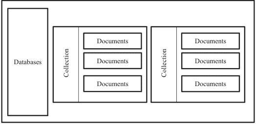

### MongoDB 的工作原理

- 集合存在于 MongoDB 数据库中，就像表存在于 MYSQL 数据库中一样。我们被允许创建多个数据库和集合。
- 集合中包含文档。由于我们是无模式的，文档之间不必相互类似，我们想要存储在 MongoDB 数据库中的数据包含在文档中。
- 字段用于构建文档。文档中的字段是键值对，类似于关系数据库中的列。字段的值可以是任何 BSON 数据类型，例如 double、string 和 Boolean。
- MongoDB 中的数据以 BSON 文档的形式保存。BSON 是 JSON 文档的二进制表示的缩写。换言之，MongoDB 服务器在后端将 JSON 数据转换为称为 BSON 的二进制版本，从而实现更高效的存储和搜索。
- 可以在 MongoDB 文档中存储嵌套数据。由于数据分层，可以在单个文档中构建和存储复杂的数据关联，使得数据管理和检索比使用 SQL 快得多。要从表 1 和表 2 中获取数据，我们必须使用复杂的 SQL 连接。BSON 文档最大可达 16MB。

## MongoDB 数据建模

正如我们在介绍中所看到的，MongoDB 数据具有灵活的结构⁸。与需要在输入数据之前定义表结构的 SQL 数据库不同，MongoDB 的集合不强制要求文档结构。正是这种灵活性使 MongoDB 如此高效。在 MongoDB 中建模数据时，请记住以下几点：

- 应用程序的需求是什么？——分析应用程序的业务需求，以确定它需要什么数据以及数据的类型。因此，确保文档结构被正确确定。
- 数据检索模式是什么？——如果我们预期有大量查询，请考虑在数据模型中添加索引以提高查询性能。


- 数据库中是否频繁进行插入、更新和删除操作？为了提高 MongoDB 系统的整体效率，请重新考虑在数据建模策略中使用索引或在必要时添加分片。

## MongoDB 与 RDBMS 的区别是什么？

以下是 MongoDB 和 RDBMS 之间的一些重要区别：

| MongoDB | RDBMS |
| --- | --- |
| 它是一种面向文档的非关系型数据库。 | 它是一种关系型数据库。 |
| 它适合存储层次数据。 | 它不适合存储层次数据。 |
| 它的模式是动态的。 | 它已有固定的模式。 |
| 它的核心是 CAP 定理（一致性、可用性和分区容错性）。 | 它侧重于 ACID 特性（原子性、一致性、隔离性和持久性）。 |
| 在速度方面它的性能明显优于 RDBMS。 | 在速度方面它的性能不如 MongoDB。 |

## MongoDB 的功能特点

- **无模式数据库：** MongoDB 提供了一个称为无模式数据库的良好特性。无模式数据库允许在一个集合中存储多种类型的文档。也就是说，在 MongoDB 数据库中，具有不同字段数量、内容类型和大小的多个文档可以共存于同一个集合中。一个文档不必与另一个文档类似，不像关系数据库。MongoDB 的这一有趣特性赋予了数据库极大的灵活性。
- **面向文档：** 在 MongoDB 中，所有数据都存储在文档中，而不是像 RDBMS 中那样存储在表中。在这些文档中，数据存储在字段（键值对）中，而不是行和列中，这使得数据比 RDBMS 中灵活得多。并且每个文档都有一个唯一的对象 id。
- **索引：** MongoDB 数据库中每个文档的每个字段都使用主索引和次索引进行索引，使得从数据池中获取或搜索数据更容易且耗时更少。如果数据未建立索引，数据库必须使用提供的查询逐个搜索每个文档，这非常耗时且效率低下。
- **可扩展性：** MongoDB 通过分片提供水平可扩展性。分片是将数据分布在多台服务器上的过程。使用分片键将大量数据分割成数据块，然后将这些数据块均匀分布到多台物理服务器上的分片中。它还可以向已有的活跃数据库中添加额外的机器。
- **复制：** 借助复制，MongoDB 通过创建数据的多个副本并将这些副本发送到单独的服务器来实现高可用性和冗余，这样如果一台服务器发生故障，可以从另一台服务器访问数据。
- **聚合：** 它允许我们对聚合数据执行操作以获得单个或计算结果。它类似于 SQL 的 GROUP BY 子句。它提供三种类型的聚合：聚合管道、map-reduce 函数和单一用途聚合技术。
- **高效率：** 与其他数据库相比，MongoDB 凭借可扩展性、索引和复制等功能，具有卓越的速度和数据持久性。

## MongoDB 具有以下优势

- 它是一个无模式（no schema）的 NoSQL 数据库。
- 使用 MongoDB 时，我们不需要设计数据库模式。
- 不支持连接（join）操作。
- 它为文档中的字段提供了很大的灵活性。
- 它能够包含多种类型的数据。
- 它具有高性能、高可用性和高可扩展性。
- 它有效地支持地理空间（Geospatial）数据。
- 它是一个面向文档的数据库，将数据存储为 BSON 文档。
- 它还支持多文档 ACID 事务（从 MongoDB 4.0 开始）。
- 无需担心 SQL 注入问题。
- 易于与大数据 Hadoop 集成。

## MongoDB 的缺点

- 它在内存中存储大量数据。
- 文档中保存的数据不能超过 16MB。
- BSON 中的数据嵌套同样受限；数据嵌套不能超过 100 层。

## MongoDB 入门

### 术语

MongoDB 数据库可以被认为是所有集合（collections）的容器。⁹

- 在 MongoDB 中，文档存储在集合中。这与关系型数据库管理系统的表非常相似。
- 文档中包含字段。这类似于 RDBMS 的元组，不同之处在于模式可以动态更改。即使在同一个集合中，文档也不需要包含统一的字段集。

## 如何开始

安装 MongoDB 后，我们可以在`C:\Program Files\MongoDB\`（默认位置）下找到所有安装的文件。

`C:\Program Files\MongoDB\Server\3.2\bin`目录下有许多可执行文件，其简要概述如下：

```text
mongo: 用于与数据库交互的命令行工具。
mongod: 这是数据库，mongod 用于配置服务器。
mongodump: 它移除数据库的二进制数据 (BSON)
mongoexport: 使用 mongoexport 以 JSON 和 CSV 格式导出文档。
mongoimport: 向数据库添加数据。
mongorestore: 使用 mongorestore 来恢复所有已导出内容。
mongostat: 数据库统计信息
```

我们现在可以启动 MongoDB 服务器。打开命令提示符并进入 MongoDB 可执行文件的位置（`C:\Program Files\MongoDB\Server\3.2\bin\`，不过此路径将来可能会更改）。直接输入`mongod`将会导致错误，提示路径`\data\db`不存在。

这意味着系统在寻找默认存储路径`C:\data\db`。因此，我们可以手动创建`C:\data\db`目录，或使用`mkdir`程序创建。我们也可以通过在`mongod`命令中使用`-dbpath <path>`参数来更改默认路径。

创建此目录后，重新运行`mongod`命令以在 27017 端口上启动服务器。

现在我们必须启动客户端。为了将目录切换到 MongoDB 路径，请创建一个新终端。一旦我们输入`mongo`，我们的客户端将启动并尝试连接到服务器。

使用此 CLI（命令行界面）与数据库通信并管理数据库。该 shell 与 JS 控制台有些相似。我们可以尝试各种 JS 命令来看看它是如何工作的。现在客户端已经运行，我们可以开始操作数据库了。我们可以看到当前活动的数据库名为`test`。我们可以通过输入`use <dbname>`切换到不同的数据库（例如`local`），并通过输入`show dbs`来查看所有数据库。

目前不存在任何集合。输入命令`show collections`即可查看。

首先，在数据库中输入一些信息。通过使用`db.createCollection(name, { size : ..., capped : ..., max : ... })`方法，我们可以创建集合。

不过，我们已经构建了一个随机生成的 json 文件（包含员工数据），我们可以通过输入以下命令将其导入数据库：

```bash
mongoimport --jsonArray --db test --collection employeedata < C:\mongoJson\employeedata.json
```

这将把路径所指向的 Employee 数据 json 文件导入到名为`test`数据库的`employeedata`集合中。

我们现在可以在 shell 中输入`show collections`来确认集合是否已导入。`Count()`、`find()`和`findOne()`是我们可以在文档中使用的几种非常基本的查询技巧。

我们可以看到，每个文档都包含一个名为`"_id"`的字段，而该字段在导入的数据中是不存在的。原因是 MongoDB 中的每个文档默认都保证有一个唯一的`"_id"`，这是一个 12 字节的十六进制整数。虽然可以更改此`"_id"`字段，但不建议这样做。

**索引（Indexing）：** 如果我们的查询返回多个文档，可以使用索引。

例如，`db.employeedata.find()`会检索集合中的所有文档，但如果我们只需要第 7 个，请使用`db.employeedata.find()[6]`来获取。[注意：此处索引从 0 开始。]

**投影（Projections）：** 假设我们查询时只需要某些指定的特定信息，而不是文档中的全部细节。我们可以使用投影来实现。

只需在查询对象之后将所需的字段设置为 1，其余字段将被默认为 0。但请记住，`"_id"`字段总是隐式预期为 1，如果我们不想看到那个碍眼的`"_id"`字段，必须在投影中指定`_id: 0`。

## 查询

1. 确定公司`"PEEKS FOR PEEKS"`的员工人数。

   ```javascript
   > db.employeedata.find( { company: "PEEKS FOR PEEKS" } ).count()
   ```

2. 详细显示所有名为`"Sanjana Jain"`的员工。

   ```javascript
   > db.employeedata.find( { name: "Sanjana Jain" } )
   所有匹配提供名称的文档将显示在这里。
   ```

3. 显示员工`"Harshit Gupta"`的年龄、性别和电子邮件地址，但不显示其`"_id"`。（假设只有一个名为 Harsh Sharma 的员工。）使用投影：

   ```javascript
   > db.employeedata.find( { name: "Harsh Sharma" }, { _id:0, age:1, gender:1, email:1 } )
   ```

查询结果也可以保存到变量中，然后用于创建有趣的查询。

4. 打印列出每位女性员工的姓名。

   ```javascript
   > var femaleEmp = db.employeedata.find( { gender: "female" } )

   for ( var x = 0 ; x < femaleEmp.count() ; x++){

   print ( femaleEmp[x].name)

   }

   > db.employeedata.find( { gender: "female" }, { _id:0, name:1 } )
   ```

## 如何在 WINDOWS 上安装 MongoDB？

MongoDB 是一个开源的面向文档的数据库，可以存储海量数据，同时允许您极其高效地处理这些数据。

由于 MongoDB 中的数据不是以表的形式存储和检索的，因此它被分类为 NoSQL（Not Only SQL）数据库.¹⁰

以上是对 MongoDB 的广泛介绍；现在我们将学习如何在 Windows 上安装 MongoDB。

MongoDB 可以通过两种方式安装：作为 msi 软件包或作为 zip 存档。

在本节中，我们将介绍如何使用 msi 安装 MongoDB，请注意每个步骤：

步骤 1：从 [https://www.mongodb.com/try/download/community](https://www.mongodb.com/try/download/community)² MongoDB 下载中心下载 MongoDB Community Server。

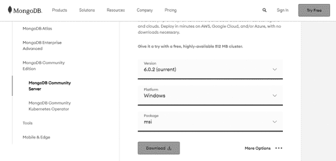

## 下载 MongoDB

我们可以根据自己的需求选择任何版本、Windows 操作系统和软件包。对于 Windows，我们必须选择：

- 版本：4.2.2
- 操作系统：Windows OS
- 软件包：msi

步骤 2：下载完成后，打开 msi 文件，点击 next 按钮进入起始页：


安装步骤 2

步骤 3：在接受最终用户许可协议后，继续点击 next 按钮。


安装步骤 3

步骤 4：要安装应用程序的所有功能，请选择 acomplete 选项。如果我们只想安装特定的软件功能，请使用 Custom 选项，并在此时选择安装位置：


安装步骤 4

步骤 5：选择`"Run service as Network Service user"`并记录目录位置。选择 Next。

步骤 6：按下 Install 按钮开始安装过程：

步骤 7：选择安装选项后，MongoDB 完成安装：

步骤 8：现在点击 Finish 完成安装程序：

步骤 9：前往步骤 5 中 MongoDB 安装在机器上的位置，并复制 bin 路径。

步骤 10：接下来，打开系统属性 << 环境变量 << 系统变量 << path << 编辑环境变量，将复制的 URL 粘贴进去。

安装步骤 5


安装步骤 6


安装步骤 7


安装步骤 8


我们的环境系统，然后点击 OK 以建立环境变量。

步骤 11：在设置完环境变量后，MongoDB 服务器`mongod`将可以启动。在启动命令提示符后，运行以下命令：

```bash
mongod
```

执行此程序时，可能会出现提示`"C:/data/db/ not found"`的错误消息。

步骤 12：接下来，打开 C 盘，创建一个名为`"data"`的文件夹，并在其中创建另一个名为`"db"`的文件夹。创建好这些文件夹后，再次打开命令提示符并运行以下命令：

```bash
mongod
```

现在，MongoDB 服务器（也称为`mongod`）将正常运行。

## 运行 Mongo Shell

步骤 13：此时，我们将把 mongo shell 连接到我们的服务器（`mongod`）。因此，请保持`mongod`窗口开启，并在一个新的命令提示符窗口中输入`mongo`。现在我们的 mongo shell 将成功连接到`mongod`。

> 重要通知：请勿关闭`mongod`窗口；否则可能会导致我们的服务器停止运行，并导致无法连接到 mongo shell。

我们现在可以在 mongo Shell 中开始创建查询了。

## 示例

在我们的 shell 中，现在可以创建新的数据库、集合和文档。创建新数据库的示例见下文。`use Databasename`命令会在系统中不存在该数据库时创建新数据库，如果已存在则使用现有数据库。

```javascript
use pfp
```

名为`pfp`的数据库现在已准备就绪。

使用`db.Collection name`命令在`pfp`数据库中创建`student`集合，并使用`insertOne()`方法添加文档：

```javascript
db.student.insertOne({Ankita:400})
```

## 服务端 JS（SERVER-SIDE JS）

下面我们将讨论服务端 JS 的介绍及其安装过程：

### 服务端网站编程

动态网站——服务端编程主题由一组模块组成，旨在演示如何开发动态网站，即能够响应 HTTP 请求并提供个性化内容的网站。¹¹

大多数重要的网站都采用服务端技术来按需动态显示数据。例如，考虑亚马逊上有多少商品，以及脸书（Facebook）上发布了多少帖子。将所有这些内容显示在独立的静态页面上将极其低效；因此，这些网站显示静态模板（使用 HTML、CSS 和 JavaScript 构建），并在必要时（例如我们在亚马逊上想要查看不同产品时）动态更新模板中显示的数据。

在当今的 Web 开发世界中，强烈建议具备服务端开发知识。

对于新开发者来说，服务端编程通常比客户端开发 mniej 令人畏惧，因为大多数动态网站使用 Web 框架，这些框架简化了常见的 Web 服务器操作，如从数据库检索数据并将其显示在页面上、验证用户输入的数据并将其保存到数据库、检查用户权限并登录用户等。具备编程能力（或熟悉某种编程语言）会有所帮助，但并非必须。

同样地，我们不需要成为编程专家，就能与构建网站前端的团队高效协作。

Web 浏览器运行 JavaScript，这是一种广泛用于网页和 Web 应用程序的 Web 编程语言。但由于 JavaScript 是一种通用语言，它也可以用于其他类型的编程。它可以被用于服务端，在这种语境下，服务端是指除 Web 浏览器之外的所有位置。

## 运行 JavaScript 的引擎

JavaScript 有多个实现它的引擎。JavaScript 代码由 JavaScript 引擎读取并执行。Web 浏览器大量使用这些引擎，但它们也有其他可能的宿主环境，例如 Web 服务器。

JavaScript 引擎提供的公共 API 允许该语言被嵌入到其他应用程序和系统中（如 Web 浏览器、Web 服务器和数据库）。

SpiderMonkey：由 Mozilla 基金会维护，是 JavaScript 之父 Brendan Eich 开发的最初的 JavaScript 引擎。它使用 C/C++ 代码实现。最初设计用于 Netscape Navigator，而 Mozilla Firefox 现在是许多人的首选浏览器。

Mozilla 基金会还维护 Rhino JavaScript 引擎。它是使用 Java 编程语言开发的。得益于 Rhino，JavaScript 可以使用 Java API。JavaScript 能够通过调用 Java 方法、设置 Java 属性以及将 JavaScript 值转换为 Java 值与 Java 进行交互。

Chrome V8 使用由 Chrome 团队维护的 JavaScript 框架。它是一个 C++ 程序。

JScript & Chakra：微软的 Internet Explorer 和 Edge 使用两种引擎——JScript 和 Chakra。

JavaScriptCore (Nitro)：Safari 使用苹果公司自定义构建的 JavaScriptCore (Nitro) 引擎。

## 运行时环境（Runtime Environment）


简单来说，JavaScript 运行时环境是一个容纳 JavaScript 引擎并执行脚本的容器。由于其嵌入性质，JavaScript 通常需要额外的库。¹² 这些进一步的对象和功能由运行时环境提供。Web 浏览器包含许多其他内容，例如`window`和`page`。

## 服务端 JavaScript 的用途

以下是一些服务端 JavaScript 使用的实例：

- 文档导向数据库 MongoDB 使用 SpiderMonkey 引擎。
- NoSQL 数据库 CouchDB 由 SpiderMonkey 驱动。
- Riak 是一个由 SpiderMonkey 驱动的分布式键值数据库。
- SpiderMonkey 是电子邮件客户端 Thunderbird 所使用的引擎。
- Flash、Reader 和 Adobe Acrobat 使用 SpiderMonkey 引擎。
- GNOME 是一个利用 SpiderMonkey 引擎并在类 UNIX 操作系统上运行的桌面环境。

Rhino 使用 Java API 将 JavaScript 脚本转换为 Java 类。我们可以使用 Rhino shell 以批处理模式运行脚本。

我们可以使用 Node.js JavaScript 运行时环境在服务端运行 JavaScript 代码。它围绕 V8 引擎构建。构建可扩展的网络应用程序需要使用 Node.js。它基于异步、事件驱动的通信，使我们能够成功处理重负载。

## MERN 技术栈 (MERN STACK)

使用 MERN Stack（一种 JavaScript 技术栈），可以更快速、更轻松地部署全栈 Web 应用程序。MERN Stack 由四项技术组成：MongoDB, Express, React 和 Node.js。其核心目的是简化和优化开发流程。¹³

这四项强大的技术在 Web 应用的创建中各司其职，为开发人员提供了一个全面的环境。

作为起点，请参考：首先为项目创建一个新文件夹。接下来，打开命令提示符或终端并进入项目文件夹；然后，运行以下命令来创建`package.json`文件（确保已安装 npm）。

```
npm init
```

## 熟悉 MERN Stack 组件

### 1. MongoDB：跨平台文档导向数据库

MongoDB 是一个 NoSQL 数据库，其中每条记录都是一个由键值对组成的文档，类似于 JSON (JavaScript Object Notation) 对象。

MongoDB 具有灵活性，允许用户设计模式 (schema)、数据库和表等。

可以通过主键标识的文档是 MongoDB 的基本单位。

MongoDB 部署后，用户还可以使用 Mongo shell。通过 Mongo shell 提供的 JavaScript 接口，用户可以进行通信并执行操作（例如：查询、更新记录、删除记录）。

## 为什么我们应该使用 MERN Stack 创建移动和 Web 应用程序？

- **成本效益**：MERN Stack 中使用的所有四项技术（MongoDB, Express.js, React.js 和 Node.js）都基于 JavaScript。这使其具有成本效益，用户可以用较低的成本投入获得更好的结果。
- **SEO 友好**：这里的 SEO（搜索引擎优化）友好意味着 Google、Yahoo 等扫描引擎可以高效且简单地搜索网站上的每个页面，理解并将内容与搜索文本相关联，并迅速将其索引到数据库中。因为使用 MERN 技术开发的网站始终针对搜索引擎进行了优化。
- **更好的性能**：更好的性能是指后端、前端和数据库之间更快的响应，最终提高了网站速度并提供更好的性能，从而促进流畅的用户体验。
- **提高安全性**：这主要涉及 MERN 生成应用的安全性；Web 应用程序安全性是指用于保护 Web 服务器和各种在线应用程序（如 API - 应用程序编程接口）免受互联网攻击的技术、方法和工具。一般来说，安全的托管公司可以轻松集成基于 MERN 的应用。为了获得额外或增强的保护，还可以使用 MongoDB 和 Node.js 的安全解决方案。
- **提供最快交付**：使用 MERN Stack 生成的 Web 和移动应用开发速度快得多，使我们能够向客户提供更快速的交付。
- **提供更快速的调整：** MERN 栈技术能够根据客户需求快速修改移动端和 Web 应用。
- **开源：** MERN 的四个组成技术全部开源。这一特性使开发人员能够在开发过程中通过开放门户获取问题的答案。因此，这最终将使开发人员受益。
- **在客户端和服务器之间轻松切换：** 由于使用单一语言开发，MERN 非常简单且快速，使得在客户端和服务器之间移动变得轻而易举。此外，客户端与服务器的切换相当简单。

## 为什么采用 MongoDB？

- 作为一种面向文档的数据库，索引文档非常简单。因此，响应速度更快。
- 可扩展性——通过将大数据集分布在多台计算机上进行管理。
- JavaScript 的利用——MongoDB 最大的优势在于它使用了 JavaScript。
- 任何形式的数据都包含在独立的文档中。
    - JSON 数据由对象（Objects）、对象成员（Object Members）、数组（Arrays）、值（Values）和字符串（Strings）组成。
    - JSON 语法非常易于使用。
    - JSON 具有广泛的浏览器兼容性。
    - 数据共享：简单地交换任何大小或形式（视频、音频）的数据。
- 简单的环境配置——设置 MongoDB 非常轻松。
- 灵活的文档模型——MongoDB 提供了文档模型（而非传统的表、模式、列和 SQL），速度更快且更便捷。
- 创建数据库：使用`use`命令即可轻松实现：

`use databasename;`

- 构建表：如果集合（collection）或表尚不存在，则会创建一个：

`db.createCollection(“collectionname”);`

- 向集合中添加记录：

```javascript
db.collectionname.insert({
  “id” : 101,
  “Name” : “Karan”,
  “Department” : “Tech”,
  “Organization” : “Peeks For Peeks”
});
```

- 查询文档：

`db.collectionname.find({Name : “Karan”}).forEach(printjson);`

### 2. Express: 后端框架

Express 是一个用作后端框架的 Node.js 框架。与直接使用 Node.js 并生产多个 Node 模块相比，Express 让构建后端代码变得更简单、更轻松。Express 支持创建出色的 Web 应用程序和 API。由于 Express 提供了如此多的中间件，编写代码变得更快速且更简单。

#### 为什么使用 Express？

- 单线程且异步。
- 高效、快速且可扩展。
- 'Node.js' 拥有最大的社区。
- Express 的内置路由器鼓励代码复用。
- 强大的 API。

创建一个新文件夹来存放我们的 express 项目，然后在命令提示符中输入以下命令以创建`package.json`文件。接受默认设置并继续。

```
npm init
```

然后，使用下面所示的命令安装 express。最后，在目录下创建一个名为 index.js 的文件。

```
npm install express --save
```

要建立一个示例服务器，立即在 index.js 中输入以下代码。

```javascript
const express = require('express'),
http = require('http');

const hostname = 'localhost';
const port = 8080;
const app = express();

app.use((req, res) => {
  console.log(req.headers);
  res.statusCode = 200;
  res.setHeader('Content-Type', 'text/html');
  res.end('<html><body><h1>This is the test server</h1></body></html>');
});

const sampleserver = http.createServer(app);

sampleserver.listen(port, hostname, () => {
  console.log(`Server running at http://${hostname}:${port}/`);
});
```

- 更新 package.json 文件的 "scripts" 部分。
- 然后执行以下命令启动服务器。

```
npm start
```

- 现在服务器正在运行，我们可以通过打开浏览器来访问输出结果。

### 3. React: 前端库

React 是一个用于创建用户界面的 JavaScript 库。由于 React 能够管理快速变化的数据，它被用于创建单页应用（SPA）和移动应用程序。React 支持 JavaScript 编码，并可以制作 UI 组件。

#### 为什么使用 React？

- 虚拟 DOM（Virtual DOM）——虚拟 DOM 对象是 DOM 对象的表示。虚拟 DOM 是原始 DOM 的精确副本。Web 应用程序的任何更改都会导致虚拟 DOM 的完全重新渲染。然后将原始 DOM 与虚拟 DOM 之间的差异进行比较，并相应地将调整应用于原始 DOM。
- JSX——JavaScript XML 的缩写。它是一种 React 特有的 HTML/XML JavaScript 扩展。它简化并方便了 React 组件的创建。
- 组件（Components）：ReactJS 支持组件。组件是 UI 的构建元素，每个组件具有自己的逻辑并为整体 UI 做出贡献。这些组件还增加了代码复用率，并简化了整个 Web 应用程序的可读性。
- 高性能——虚拟 DOM、JSX 和组件等特性使其比其他现有框架快得多。
- 开发 Android/iOS 应用——凭借 React Native 以及对 JavaScript 和 ReactJS 的理解，我们可以简单地创建基于 Android 或 iOS 的应用。
- 使用 npm 或 yarn 安装 "create-react-app" 以启动你的 React 应用程序。

```
npm install create-react-app --global
OR
yarn global add create-react-app
```

- 之后，我们可以用它来构建一个新的 React 应用。

```
create-react-app appname
```

- 然后，为了启动我们的应用程序，浏览到 “appname” 文件夹并执行`yarn start`或`npm start`。
- 更新 index.js 文件。

```javascript
ReactDOM.render(
  <h1>Hello EVERYONE!</h1>,
  document.getElementById(`root`)
);
```

- 使用下面列出的命令执行我们的程序。

```
npm start
OR
yarn start
```

### 4. Node.js: JS 运行时环境

Node.js 提供的 JavaScript 环境允许用户在服务器上（浏览器之外）运行其代码。用户可以通过 Node 包管理器（即 npm）从数千个免费包（也称为 node 模块）中选择下载。

#### 为什么使用 Node.js？

- 免费提供 JavaScript 运行时环境。
- 遵循单线程模型；单线程。
- 数据流传输快——Node.js 具有快速的代码执行能力，且构建在 Google Chrome 的 JavaScript 引擎之上。
- 高可扩展性。
- 在命令窗口中输入下面所示的命令来启动 Node.js 应用程序。接受默认设置。

```
npm init
```

- 创建一个名为 indexs.js 的文件。

示例：一个用于计算矩形面积和周长的简单 Node.js 示例。

```javascript
var rectangle = {
    perimeter: (l, b) => (2*(l+b)),
    area: (l, b) => (l*b)
};

function Rectangle(l, b) {
    console.log("A rectangle with l = " + l + " and b = " + b);

    if (l <= 0 || b <= 0) {
        console.log("Error! Rectangle's length & breadth should be greater than 0: l = " + l + ", and b = " + b);
    }
    else {
        console.log("The Area of a rectangle: " + rectangle.area(l, b));
        console.log("The Perimeter of a rectangle: " + rectangle.perimeter(l, b));
    }
}

Rectangle(2, 6);
Rectangle(5, 14);
Rectangle(-7, 2);
```

- 在命令窗口中运行下面所示的命令以启动 node 应用程序。

```
npm start
```

## MERN 栈的结构组成是什么，它是如何运行的？

MERN 的三层架构系统主要由三层组成。这些层如下：

- Web 作为前端层
- 服务器作为中间层
- 数据库作为后端层

它的四个组件——MongoDB, Express.js, React 和 Node.js——我们已经了解。

让我们更详细地研究之前讨论的这三个阶段：

### Web 或前端层

React.js 主要负责 MERN 栈的顶层。在构建网站时，它是最常用的开源前端 JavaScript 库之一。它以能够创建动态客户端应用程序而闻名。React 方便地从单个组件构建复杂的界面。它还将这些复杂界面与后端服务器的数据相链接。React 被用于构建 Web 应用和移动应用（React Native）。React 实现了代码的可复用性并能轻松地支持它，这具有诸多优势并节省了大量时间。

它允许用户开发大型 Web 应用程序，无需刷新页面即可快速修改页面数据。

## 服务器或中间层

它是顶层之下的下一个层级，主要由 MERN 栈中的 Express.js 和 Node.js 管理。Express.js 在 Node.js 服务器中运行并维护服务端框架，使得这两个组件能够并发地进行管理。在 JavaScript 后端开发领域，Express.js 是最广泛使用的框架之一。它让开发者能够更轻松、更简单地创建复杂的 API（应用程序编程接口）和 Web 服务器。

它还为 Node.js 中的 HTTP（超文本传输协议）对象提供了有用的功能。相比之下，Node.js 本身也发挥着至关重要的作用。

它是一个开源的服务器环境和跨平台运行时环境，用于在 Web 浏览器之外运行 JavaScript 代码。Node.js 一贯采用 JavaScript；因此，它能够让计算机用户快速开发任何 Web 服务、Web 应用或移动应用程序。

## 数据库作为后端层

作为后端层的数据库是 MERN 栈中最重要的层级之一，主要由 MongoDB 管理；数据库的主要功能是存储与应用程序相关的所有数据，例如内容、统计数据、信息、用户个人资料等。出于安全考虑，它主要负责保存所有数据。它保留准确的记录，以便在必要时向用户提供数据。主要地，它将数据保存在数据库中。它会对文件进行至少两份备份，以确保即使原件丢失，你仍然可以获取所需的数据。

这意味着 MongoDB 的结构不像带有表格的关系型数据库。相反，它提供了一套完全独立的检索和存储数据的系统。MongoDB 是最受欢迎的开源文档导向 NoSQL（NoSQL 或非结构化查询语言）数据库。NoSQL 通常是指不需要固定结构或关系表来持有核心数据的非关系型数据库。MongoDB 以一种不同于由行和列组成的关系表的结构来存储数据。

## MERN 与 MEAN 的对比

| 特性 | MEAN | MERN |
| :--- | :--- | :--- |
| **技术栈组件** | MongoDB, Express.js, Angular.js, Node.js | MongoDB, Express.js, React.js, Node.js |
| **前端框架** | Angular.js | React.js |
| **语言/语法** | TypeScript (Angular.js 使用) | JSX 和 JavaScript |
| **生产力** | 提高生产力 | 生产力不高 |
| **学习曲线** | 精通起来更具挑战性 | 学习起来显著更容易（文档更出色） |
| **渲染** | 有助于代码管理和渲染 | 虚拟 DOM 允许流畅渲染 |
| **数据流** | 双向 | 单向数据传输 |
| **移动端兼容性** | 与移动设备应用不兼容 | 兼容移动应用 |

## MERN 栈开发者的未来如何？

毋庸置疑，未来并非定数。然而，根据我们目前掌握的市场数据，我们确实可以对 MERN 栈开发者未来的增长做出合理的分析。理解 MERN 栈对开发者有哪些好处？

- **1. 开源：** MERN 最好的方面在于构成该技术栈的四项技术都是开源的。这使得开发者能够更简单地从公开的门户网站获取快速解答，并成功解决开发过程中可能出现的任何问题。
- **2. 成本效益：** 由于该技术栈仅使用一种语言（JavaScript），因此 MERN 栈开发者需求量很大。对于企业来说，投资精通 MERN 的人员要有利得多。无论是在资金还是时间方面，这都比为每项技术招聘专家更高效。


- **3. 客户端与服务器之间切换简单：** 在 MERN 栈中，所有内容都用一种语言编写，这使得开发者更容易掌握该语言（通过专注学习，在 4-6 个月内即可掌握）。在客户端和服务器之间切换也很简单，为开发者提供了更多的扩展机会。

- **4. UI 渲染与性能：** 到目前为止，`React JS` 已被证明是 UI 层抽象、渲染和性能的最佳解决方案。原因在于，它允许开发者根据自己的愿景来构建和组织应用程序代码。

在本章中，我们涵盖了后端开发，讨论了 `Node.js`、`MongoDB` 和服务端 `JS`。

## 注释

1. 什么是后端开发者？ Web 开发所需技能：www.guru99.com/what-is-backend-developer.html 访问日期：2022 年 10 月 13 日。
2. 2022 年使用 `Node.js` 进行后端 Web 开发：https://mobidev.biz/blog/node-js-for-backend-development 访问日期：2022 年 10 月 13 日。
3. `Node.js` Web 应用开发的优缺点：www.altexsoft.com/blog/engineering/the-good-and-the-bad-of-node-js-web-app-development/ 访问日期：2022 年 10 月 13 日。
4. `Node.js` – 简介：www.tutorialspoint.com/nodejs/nodejs_introduction.htm 访问日期：2022 年 10 月 14 日。
5. `Node.js` - 环境搭建：www.tutorialspoint.com/nodejs/nodejs_environment_setup.htm 访问日期：2022 年 10 月 14 日。
6. `Node.js` - 第一个应用程序：www.tutorialspoint.com/nodejs/nodejs_first_application.htm 访问日期：2022 年 10 月 14 日。
7. 什么是 `MongoDB` – 工作原理与特性：www.geeksforgeeks.org/what-is-mongodb-working-and-features/ 访问日期：2022 年 10 月 14 日。
8. 什么是 `MongoDB`？简介、架构、特性与示例：www.guru99.com/what-is-mongodb.html 访问日期：2022 年 10 月 14 日。
9. `MongoDB`: 入门指南：www.geeksforgeeks.org/mongodb-getting-started/?ref=lbp 访问日期：2022 年 10 月 14 日。
10. 如何在 Windows 上安装 `MongoDB`？: www.geeksforgeeks.org/how-to-install-mongodb-on-windows/ 访问日期：2022 年 10 月 14 日。
11. 服务端网站编程：https://developer.mozilla.org/en-US/docs/Learn/Server-side 访问日期：2022 年 10 月 15 日。
12. 服务端 `Javascript`：www.javascriptinstitute.org/javascript-tutorial/server-side-javascript/ 访问日期：2022 年 10 月 15 日。
13. `MERN` 栈：www.geeksforgeeks.org/mern-stack/ 访问日期：2022 年 10 月 15 日。
14. `MERN` 栈：www.javatpoint.com/mern-stack 访问日期：2022 年 10 月 15 日。
15. 什么是 `MERN` 栈以及为什么它是 Web 开发的最佳选择：www.groovyweb.co/blog/what-is-the-mern-stack-and-why-it-is-the-best-to-fit-for-web-development/ 访问日期：2022 年 10 月 15 日。
16. 2022 年 `MERN` 栈开发者的未来：风险更少，回报更多：www.cybersuccess.biz/future-of-mern-stack-developers/#:~:text=MERN%20is%20a%20free%20and,end%20or%20server%2Dside%20development. 访问日期：2022 年 10 月 15 日。

# 第 7 章 移动端 `JavaScript` 应用

## 本章内容

- `React Native`
- `NativeScript`

在上一章中，我们涵盖了后端开发，在本章中，我们将讨论用于移动端的 `JS`。

## 为什么 `JavaScript` 被认为是 2022 年移动应用最优秀的编程语言之一？

由于智能手机在日常生活中的普及，移动应用开发将成为 2022 年需求最高最旺盛的行业之一。创建移动应用的过程涉及多种技术和步骤。

编码是其中最重要的环节之一，它使用多种语言来完成这一过程。`JavaScript` 凭借其广泛的优势，长期以来一直受到开发者的青睐。顶级开发者在创建高质量应用时，总是将 `JavaScript` 纳入其技术栈中。

## `JavaScript` 在移动应用开发中的重要性

在创建能够满足客户需求的鲁棒且协作的 UI/UX 时，移动应用开发者可以从 `JavaScript` 编码的广泛优势中获益。事实证明，使用 `JavaScript` 开发移动应用比使用其他语言更快。

### 极强的响应能力

开发领域中一个令人困扰的问题是网络缓慢。当缓慢的网络与发送服务器查询所需的时间相结合时，问题会变得更加严重，从而导致页面加载延迟。

如果应用程序能以更少的服务器字节运行得更好，用户将受益于运行速度更快的应用。`JavaScript` 可以通过推送 `XML` 或 `JSON` 数据而非其他类型的数据来极大地改善这种情况。这样将减少与服务器的交互，实现快速输出，并在浏览器中完成完整的 `HTML` 渲染。

因此，在开发中使用 `JavaScript` 具有额外的优势。无需进一步的服务器连接，即可对不影响数据的 UI 进行任何修改。结果就是，我们的应用将具有极强的用户响应能力，并提供最佳体验。

### 丰富的前端平台

无论使用何种服务器技术，`JavaScript` 都能确保用户拥有一个鲁棒的前端平台。这将提高前端开发的可用性，并使其对服务器变化的特性具有更强的抵抗力。

后端任务可以通过重写服务端代码来适应并成功执行。因此，通过确定服务器的能力，开发者可以选择最适合所有未来任务的平台。

如果 `JavaScript` 拥有精确的前端，我们可以保证获得完成工作所需的理想平台。在 `JSON` 被覆盖之前，前端将是执行所有功能的最佳场所。

### 离线辅助

服务器相关编程中存在一个硬性要求：每次用户交互都必须与服务器通信。一旦服务器宕机，软件就无法使用。但即使在没有网络的情况下，`JavaScript` 开发依然快速且响应及时。与标准的面向服务器的开发方式相比，这是一个显著的优势。

在 `JavaScript` 开发中，前端使用本地缓存的数据来更新应用程序，直到连接恢复。这将促进本地变更跟踪，并在连接恢复后强制将修改同步到一侧。

它与其他应用程序的不同之处在于，无需持续的服务器连接即可执行基本活动。使用 `JavaScript` 构建的用户界面（UI）可以在屏幕上加载和运行，无需网络连接。`JavaScript` 能够提供传统服务器端前端编程无法提供的选项。

### 适用于各类开发者

`JavaScript` 的环境配置并不十分具体。

你只需要一个浏览器，通过开发者工具即可开始编程过程。

因此，它深受各种类型和经验水平的开发者青睐。

即使是该领域的新手也能快速学习和掌握，从而得到广泛采用。

## 用于移动应用的 `JavaScript` 框架

使用 `JavaScript` 框架，你可以完成所有重要的客户端任务。

开发者可以根据需求使用各种框架来创建高质量的 `JavaScript` 应用。

### `PhoneGap`

它使得使用单一 `JavaScript` 代码库构建多种平台变得更加容易，该代码库可以服务于多种目标客户端。

### `Ionic`

程序员可以使用 `Ionic` 框架来创建、测试、监控和发布高性能的移动应用。它是目前所有 `JavaScript` 框架中使用最广泛的框架之一。

### `React Native`

这个著名的开源框架凭借其可导航的设计特性，使开发者更容易创建移动应用。

### `jQuery`

开发者为各类移动设备创建应用从来都不是一件容易的事。由于需要涵盖许多不同的主题，这对应用工程师来说并非易事。然而，`jQuery` 使我们能够创建快速、高响应性的软件，兼容各种移动和桌面平台。

### 原生语言

`NativeScript` 框架是为 `iOS` 和 `Android` 有效创建应用的重要工具。

顾名思义，`NativeScript` 框架代码有助于在成品中获得改进的用户界面功能。

### `Tabris.js`

甚至这个框架也能仅通过单段 `JavaScript` 代码创建原生 `iOS` 或 `Android` 应用。它也被提及为程序员用于创建原生应用的最流行框架之一。

## 开发移动应用时我们应该使用 `JavaScript` 吗？

当我们考虑开发移动应用时，有顾虑是完全合理的，特别是如果我们希望它能在 `iOS` 和 `Android` 上运行，以及我们之后可能遇到技术难题。然而，由于我们不必用一种全新的开发语言来学习如何实现，情况未必那么糟糕。借助像 Kambda 这样经验丰富的开发公司的帮助，我们将能够提前避开那些波折。²

当今最重要的技术进步之一就是移动应用的创建。如今，智能手机和应用市场的普及对技术的每个领域都产生了重大影响。创建各种代码的主要语言是 `HTML`、`CSS` 和 `JavaScript`，同时也使用其他多种语言。这三种编码系统协同工作良好。`HTML` 是标记语言，它指示浏览器如何显示网站的文本和图像。`CSS` 是样式表，这意味着它为整个网站提供统一的外观。`JavaScript` 通过生成交互式和动态界面来改善用户体验，使网页能够响应各种变量，包括事件、变量、用户的浏览器、效果等。

尽管如前所述，`JavaScript` 并不常用于创建应用，因为它是用于创建和维护网站的语言。此外，即使有方法可以仅使用 `JavaScript` 创建应用，也存在其他更有效的方式。

尽管如此，`JavaScript`（`JS`）有一个显著的好处可以帮助我们节省时间：我们可以将代码在前端和后端（`Node.js`）中复用。

`JS` 的另一个好处是它在所有浏览器中都能良好运行，这使开发过程更加简单。

`JS` 框架的流行度与日俱增。即使是苹果和 IBM 这样的大公司也在使用 `JS`。`AngularJS` 团队现在与 Google 和微软合作，延续了这一趋势。`JavaScript` 使创建应用变得简单，因为我们只需开发一次即可在所有平台（`Android`、`iOS` 和 Windows）上发布。

## `JavaScript` 的关键特性

- 最简单的语言之一。
- 快速且高效。
- 由于在客户端运行，它避免使用服务器并节省带宽。
- 用于为原本单调的网站添加动态元素和动效。

虽然 `jQuery` 和其他 `JavaScript` 库可用于为网页添加更复杂的动态功能，但对于基本的客户端操作，纯 `JavaScript` 仍然是常见推荐。可以使用多种框架制作专业的 `JavaScript` 应用，包括 `PhoneGap`、`jQuery Mobile` 和 `Ionic`。

### `React Native`

这个框架是最近创建的，主要由 Facebook 开发。对于那些希望开发一个同时适用于 `Android` 和 `iOS` 设备的应用的人来说，它是一个可行的选择。它提供了出色的性能，甚至可能优于上面讨论的某些其他框架。

### `jQuery`

`jQuery Mobile` 框架将“写得更少，做得更多”的理念提升到了一个新的高度，使我们能够创建一个高度品牌化的响应式网站或应用程序，它将在所有主流智能手机、平板电脑和桌面平台上运行。

### `PhoneGap`

通过使用 `PhoneGap`，我们可以“利用现有的 Web 开发专业知识，轻松创建使用 `HTML`、`CSS` 和 `JavaScript` 构建的混合应用程序。”

从单一代码库创建跨平台体验，以便在任何设备上与我们的受众互动。

### `Ionic`

`Ionic`“帮助我们以前所未有的轻松程度设计、部署、测试和监控应用，从开源到专业服务。”虽然还有更多使用 `JavaScript` 创建移动应用的框架，但 `jQuery` 和 `React Native` 是开发者中最流行的。

## 开发移动应用时使用 `JavaScript` 的优势

由于智能手机与人们的日常生活密切相关，移动应用开发已经开始影响世界。大量不同的语言，主要是 `JavaScript`、`CSS` 和 `HTML`，被用于构建各种类型的代码。得益于 `JavaScript` 编码，移动应用开发已成为当前技术发展最重要的领域之一。尽管 `JavaScript` 未被视为应用开发的关键语言，但它提供了多种创建应用程序的方法。`JavaScript` 框架最近对移动应用的创建产生了重大影响。让我们来看看在移动应用中使用 `JavaScript` 的几个主要优势。³

由于智能手机与人们的日常生活密切相关，移动应用开发已经开始影响世界。大量不同的语言，主要是 `JavaScript`、`CSS` 和 `HTML`，被用于构建各种类型的代码。得益于 `JavaScript` 编码，移动应用开发已成为当前技术发展最重要的领域之一。

尽管 `JavaScript` 未被视为应用开发的关键语言，但它提供了多种创建应用程序的方法。`JavaScript` 框架最近对移动应用的创建产生了重大影响。让我们来看看在移动应用中使用 `JavaScript` 的几个主要优势。

`JavaScript` 是一种编程语言，用于在网页上执行复杂操作。该应用使用 `JavaScript` 来改善 UI/UX，并提供最新的滚动视频点播、最新内容更新、动画 2D/3D 视觉效果、交互式地图和其他功能。`JavaScript` 能够验证、操作和计算数据，以及编辑和修改 `CSS` 和 `HTML`。

`Meteor` 是一个使用 `JavaScript` 代码库开发移动和 Web 应用的平台。`JavaScript` 使得创建新的移动应用变得简单，它可能适用于所有平台，包括 `Android` 和 `iOS`。让我们来看看 `JavaScript` 的一些主要特性，这些特性使其在创建移动应用方面非常有用。

- 被公认为世界上最简单的语言。
- 在执行客户端操作时能够节省带宽。
- 用于构建动态动画。
- 快速且有序的开发。

## `REACT NATIVE`

下面我们将讨论 `React Native` 的安装、范围和优势：

### 搭建 `React Native` 环境

根据我们使用的操作系统，搭建（安装）`React Native` 环境有多种选择。⁴

每个开发和目标操作系统都有一套略有不同的指令。

在本节中，Windows 将作为开发平台，而 `Android` 将作为最终的操作系统。

使用 `React Native` 框架创建应用程序需要 `Node`、`React Native` 命令行界面、`Python 2`、`JDK` 和 `Android Studio`。

这里我们使用流行的 Windows 版本包管理器 `Chocolatey`。

我们可以用它来安装最新版本的 Java SE Development Kit 和 `Python`（`JDK`）。

#### 如何分步骤安装 `React Native` 环境

1. 前往 https://chocolatey.org/ 网站，点击“Install Chocolatey Now”，将打开一个新的网址。

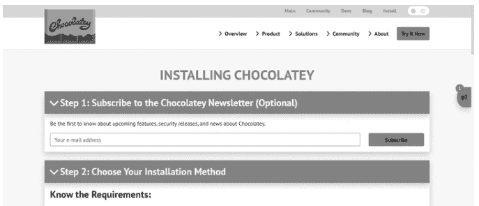

#### `Chocolatey` 的安装

2. 运行 `Chocolatey` 安装程序，然后复制 Install using cmd.exe 部分下的代码。

```
@"%SystemRoot%\System32\WindowsPowerShell\v1.0\powershell.exe" -NoProfile -InputFormat None -ExecutionPolicy Bypass -Command "iex ((New-Object System.Net.WebClient).DownloadString('https://chocolatey.org/install.ps1'))" && SET "PATH=%PATH%;%ALLUSERSPROFILE%\chocolatey\bin"
```

3. 以管理员模式打开命令提示符（右键点击命令提示符并选择“以管理员身份运行”），将此代码输入命令提示符。它将安装 `Chocolatey`。

4. 在命令提示符的管理员模式下粘贴代码并执行（安装 `Node.js`、`Python` 和 `JDK`）。如果我们已经安装了 `JDK`，请确保其版本为 8 或更新版本；如果之前已安装 `Node.js`，请确保其版本高于 8。

```
choco install -y nodejs.install python2 jdk8
```

5. 我们可以使用 `Node` 的 `npm`（`Node` 包管理器）安装 `React Native`。运行提供的代码：

```
npm install -g react-native-cli
```

### 安装 `Android Studio`

1. 从 https://developer.android.com/studio/ 网站下载 `Android Studio`。

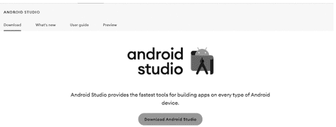

#### `Android Studio` 的安装

2. 运行我们下载的 `Android Studio Set`（`.exe`）文件，并按照说明操作。
3. 选择要安装的功能。
4. 选择设备的安装位置。
5. 点击下一步，让安装继续进行。
6. 点击完成以结束安装。

安装完成后，将显示 `Android Studio` 主屏幕。

## 设置 `Android SDK` 和 `Java JDK`

1. 首先设置 `JDK` 路径。
2. 在系统变量部分，将 `Android SDK` 路径更改为我的电脑 > 属性 > 高级系统设置 > 环境变量。然后，在弹出的“新建...”屏幕中添加 `Android Home` 和 `Android SDK`。


- 3. 通过从 `Tools > Android > SDK Manager > SDK platforms` 中选择必要的组件并安装它们。

- 4. 允许安装继续，完成后点击“完成”。

- 5. 要创建 Android 模拟器（虚拟 Android 设备），在 `Tools > Android > AVD Manager > Create Virtual Device` 下选择设备类型。

- 6. 选择 Android 模拟器的 API 级别。

- 7. 输入设备名称，并通过选择“Show Advanced Settings”来配置其设置。

- 8. 开始使用模拟器。

Facebook 和 Instagram 的工程师们管理着著名的 JavaScript 框架 `ReactJS`，它有一个名为 `React Native` 的原生对应框架。`React Native` 在短短 2 年内在开发者社区中获得了极大的人气。它获得了非常多的星标，目前是 GitHub 有史以来第十四大最受欢迎的项目。

如今，`React Native` 开发公司正在使用这项技术。根据 Google 趋势，搜索“React Native”的人数已经超过了搜索“iOS 开发”或“Android 开发”的人数。⁵

软件开发人员正在努力开发在当前数字环境中快速高效运行的移动应用程序，因为在当今时代，速度、效率和快速工具对每一个移动应用程序都至关重要。

引人入胜的用户体验和直观的开发过程使移动应用开发者纷纷采用 `JavaScript`、`HTML5`、`CSS` 或 `React Native` 来构建应用程序。

领先的移动应用开发公司出于多种原因将 `React Native` 视为应用开发的未来。

这些原因包括：

### 1. 跨平台支持

鉴于 `React Native` 的大部分 API 都是跨平台的，一个组件可以同时在 iOS 和 Android 上运行。

我们无需编写任何特定于平台的代码，就能构建完整的、功能完善的应用程序，使其在外观和体验上都具有原生效果。不过，我们偶尔需要特定于平台的功能。例如，设计效果在 iOS 和 Android 上是不同的。

`React` 通过其 `platform` 模块和特定于平台的文件扩展名为这种情况提供了解决方案。`platform` 模块能够识别应用程序正在使用的操作系统，从而允许定义特定于平台的实现。通过使用特定于平台的文件扩展名，我们可以为不同的平台指定文件。`React` 会根据应用程序运行的操作系统自动选择适当的文件。

### 2. 开源

我们都知道开源项目由大量贡献者组成，他们不知疲倦地改进这些项目。

同样，有一个庞大的开发者社区一直在努力增强功能、修复问题并使 `React Native` 更易于使用。每当我们想要设计移动应用程序的典型功能时，很有可能 `React Native` 的成员已经做到了。

### 3. 缩短开发时间

`React Native` 改变了移动应用开发生命周期。由于它是开源的，社区中有许多人都对其产生认同。它可以与许多不同的机制结合使用。使用了状态管理工具 `Redux`，这也大大提高了开发效率。当 iOS 和 Android 有一个共享的数据层时，开发速度更快，失败率也更低。

### 4. Code Push 和实时更新

使用 `React Native` 开发原生移动应用程序有多个优势，其中包括实时更新。开发者可以直接将更新推送到用户的手机上，而无需通过应用商店的更新流程。由于 `JavaScript` 的广泛使用，这现在已经成为可能。iOS 的实时更新获准速度较慢。

但如果我们同时更新所有用户的应用程序，我们就可以确保您不必处理旧版本的问题。Microsoft `CodePush` 的实时更新功能使我们能够使用 `Code Push SDK` 发布 `React Native` 项目的更改，这得益于与 `React Native` 的集成。缺点是只能更新 `JavaScript` 文件和资源。任何影响原生操作系统端的更新都需要遵循标准的 App Store 或 Play Store 更新流程。

### 5. 界面和性能

使用 `JavaScript`、`HTML` 和 `CSS` 创建混合移动应用程序是一种常见的做法。由于 `React` 独立于用户界面，这些应用程序将在不改变功能的情况下保持其出色的性能。

### 6. 为不同平台创建应用程序时使用相同的代码

移动应用开发者使用 `React Native` 使他们能够使用相同的代码为多个平台创建应用程序。

这种方式弥补了主要缺陷。

对于开发者来说，还有什么比能够仅利用和掌握一套工具来创建跨平台应用程序更有利的呢？

### 7. 减少编写代码的时间

在软件开发领域，能够重用之前创建的代码确实是一件大事。借助 `React Native`，我们可以达到这一能力。我们并不是说 `React Native` 允许您“一次编写，随处使用。”

作为开发者，我们必须编写新的代码来创建符合每个平台标准和最佳实践的用户界面（UI），使其看起来和感觉都自然。

最棒的是，有一些共享的 UI 代码可以在两个平台上使用。

### 8. 快速获取资源

由于 `React Native` 使用 `JavaScript`——最受欢迎和增长最快的计算机语言之一，因此很容易快速找到能够使用 `React Native` 构建移动应用程序的开发者。

### 9. 适用于各种平台的单一框架

`React Native` 允许在 iOS 和 Android 之间完全复制代码库（或仅复制部分代码库）。在实践中，某些更改可能需要完全重写，而其他功能将作为应用内包包含在内。`React Native` 开发者社区通过将新工具作为开源发布来积极支持该框架。

### 10. 快速重载

通过引入 `Hot Reload`（热重载），`React Native` 提高了生产效率并减少了总体开发时间。它允许开发者在应用程序运行的同时继续开发新版本和 UI 更改。

### 11. 更优的开发环境

开发者在 `React Native` 环境中效率更高。通过从迭代周期中移除耗时的重新构建和部署，愉快的开发体验得以产生。`React Native` 在两个平台的移动应用中使用 `Flexbox` 布局引擎。这意味着只需理解一种布局引擎，就能同时为 iOS 和 Android 进行设计。

### 12. 包含两大重要生态系统

iOS 和 Android 有着非常不同的生态系统。这些平台的开发具有挑战性。因此，为它们开发原生应用被认为是开发者最大的噩梦。类似于开发 iOS 应用，`Swift` 或 `Objective C` 的专业知识必不可少。另一方面，开发 Android 应用需要透彻了解 `Java` 和 `Android SDK`。我们还得忍受及时了解这两大重要生态系统所提供最新功能的不便。但有了现代技术，没有问题是永远解决不了的。

## 为什么 React Native 如此受欢迎？

由于其出色的性能、改进的用户体验和广泛的易用性，`React Native` 正在获得业界的高度赞誉。Facebook 支持这一复杂的后端开发语言，确保其在实际开发中的持久性。与 `MeteorJS` 和 `AngularJS` 不同，`React Native` 专注于 UI。`React Native` 应用的用户界面响应极其迅速。得益于 `React Native` 和设备的原生环境，我们的应用加载速度更快，手感也更流畅。

此外，`React Native` 兼容第三方插件。要想将 Google Maps 功能集成到我们的项目中，只需下载第三方插件并将其附加到原生模块即可。Facebook 的 `React Native` 不仅让全球移动应用开发者的工作变得更轻松，还是一个帮助他们为客户创造突破性应用的移动框架。此外，我们的应用还能轻松利用设备的旋转、缩放和指南针等功能。

## 构建 React Native 应用

### 1. 使用 React Native 的 Skype

当 Skype 应用最初出现大量问题时，官方宣布正在推出一个使用 `React Native` 开发的新应用。

Skype 进行了全面的重新设计，包括图标，以便新旧功能都能让用户享受到应用的尖端外观。在认识到 `React Native` 的有效性后，微软宣布 `React Native` 不仅将作为 PC 版 Windows 的平台，还将用于移动应用的开发。此外，微软还从 GitHub 仓库中获得了 `React Native` 的惊人优势。

### 2. React Native Facebook 广告

在 `React Native` 开始支持社交网络网站之前，它始于 Facebook 旗下的 Android 用户移动广告应用。

它能够处理由众多业务逻辑需求引起的问题，包括时区差异、广告格式、日期格式、货币惯例、货币等。其他开发者受到启发，尝试并实现了 Facebook 广告中新发布或新集成的 `React Native` 技术。

### 3. 使用 React Native 的 Facebook

作为一项简单功能，Facebook 希望将其在线版本提供给移动用户，让他们在使用智能手机应用时享受流畅的用户界面。Facebook 希望用一个团队来创建其移动应用产品。因此，`React Native` 被用于为 iOS 和 Android 用户开发 Facebook 的移动应用。

`React Native` 的开发团队验证并考察了新功能的测试性能。这一关键修改决定了用户是会放弃还是继续使用该程序。这只是 `React Native` 如何应用进行修改的一个例子，但许多其他方面也被用户广泛使用。

### 4. 使用 React Native 的特斯拉

特斯拉，全球最知名的电动汽车制造商，已经加入 `React Native` 社区，为其电动汽车和 Powerwall 电池开发应用。他们通过参考 Facebook 的流行趋势架构来实现这一点。

特斯拉应用有一些受限功能，允许基于智能手机进行汽车操作，包括分析车辆和精确定位其位置的能力。

尽管他们的应用开发并不完全为人所知，但客户对这一概念给出了积极的反馈。

### 5. 使用 React Native 的 Instagram

在讨论 `React Native` 应用开发服务时，Instagram 是其中之一。

它从将基础视图转变为出色的 UI 开始，以克服将 `React Native` 集成到现有项目中的障碍。

由于优雅的用户界面，它不需要单独的导航基础设施。

尽管开发团队在将 `React Native` 应用功能集成到 Instagram 时遇到了若干具有挑战性的任务，但他们能够稳步提升应用的速度。

大约 80%-90% 的代码在 iOS 和 Android 之间共享，这对应用开发团队来说是一个巨大的时间节省。

### 6. 使用 React Native 的 Shine

Shine 是 `React Native` 应用中最好的应用之一，适合压力大、缺乏动力或没有动力的用户。它提供轻松的文章、鼓舞人心的引语和格言。

当用户从一天中登录时，应用中的专家和灵性音频帮助他们应对日常压力。该软件最初向 iOS 用户推出，专注于美国市场，因为苹果手机占有相当大的市场份额。他们迅速为 Android 创建了应用，这正是他们使用 `React Native` 的原因，因为该技术使代码从 iOS 转移到 Android 变得简单。

## React Native 应用开发的优势

`React Native` 在创建移动应用方面具有多项优势。

- **1. 更大的灵活性**

感谢每个原生开发服务所使用的接口类型，任何团队成员都可以直接接手之前遗留的工作并继续执行。

有了这样的团队，灵活性正在增强，移动应用的更新和升级流程也大大简化。

- **2. 节省时间和金钱**

`React Native` 让企业能够同时拥有 Android 和 iOS 平台的应用，同时也为开发者节省了时间。

这是因为他们只需开发一个应用，就能在 Android 和 iOS 市场上运行，从而节省时间和精力。

因此，原本用于开发不同应用的资金也得以节省。

- **3. 出色的性能**

这里使用了驱动大多数操作系统操作的中央处理器（CPU），但 `React Native` 应用还利用了图形处理单元（GPU）来帮助提升性能不强设备上的性能。

然而，由于该编程语言专为移动设备优化，`React Native` 应用的运行速度几乎与专门为 Android 或 iOS 平台创建的原生应用一样快。

- **4. 即时更改视图**

`React Native` 的实时或热重载功能使开发者能够在代码中查看更改的同时，在实时预览窗口中实时查看他们的更改。

此外，这对开发者来说也是一个巨大的优势，因为他们在每一步完成时都能获得实时反馈。

- **5. 可迁移性**

据说 `React Native` 为所使用的流程提供了很大的灵活性，这是将其用于移动应用开发的最大优势之一。

这些应用可以从 `React Native` 中正确导出，转移到 `Android Studio` 或 `Xcode`，然后继续开发。

## React Native 的缺点

我们在上面讨论了 `React Native` 的一些优点，但大家都知道，任何有优点的东西也有缺点。因此，以下是 `React Native` 的缺点（不足之处）。

- **1. 框架不够成熟**

众所周知，每次新更新或发布都会带来许多重大变化，这可能最终令开发者难以应对。

`React Native` 在这种情况下是更快速、更新的选择，但为了追求速度，该框架往往会失去对可信度的承诺，结果变得对于任何类型的 iOS 和 Android 应用来说都过于不成熟。

- **2. 难以定义用户界面**

如果你的移动应用需要动画、多种屏幕过渡和交互等功能，那么此时选择 `React Native` 进行应用开发是不值得的。

- **3. 复杂的调试**

调试过程以及如何让 `React Native` 开发的移动应用难以排查故障。这方面大部分功劳归于 `Java`、`JavaScript` 和 `C/C++` 这些编程语言。

## 使用 REACT NATIVE 创建移动应用

由于全球环境的快速变化，企业被迫考虑将其商业模式从传统平台转移到数字平台。企业开始创建在 iOS 和 Android 上运行极其高效的企业应用。

然而，应用开发成本的上升限制了他们对移动应用开发的投资能力。但是，鉴于移动应用已从通信到零售、医疗保健和娱乐等各个行业变得如此普及，企业已经认识到，如果没有强大的在线存在，在未来几十年将难以竞争。虽然几乎有一个应用可以满足所有需求，提供无缝的用户体验并确保轻松的用户导航，但企业仍然不确定应该使用哪种技术来开发成功的解决方案。

## 领先的跨平台框架，React Native

`React Native` 是一个基于 `JavaScript` 构建的跨平台框架，已广泛用于开发在 iOS 和 Android 上外观和感觉都像原生应用的移动应用。

尽管 `React Native` 于 2015 年由 Facebook 推出，但它迅速崛起，成为领先的开源框架。

在为 Skype、Instagram、Facebook 等多个应用程序提供支持后，它最终成为最知名的应用开发选择。

得益于脚本可重用性、快速测试能力以及在 iOS 和 Android 平台上运行应用等优势，它是应用开发的理想平台。

## 为什么在开发移动应用时应该使用 React Native？

毫无疑问，全球有 42% 的开发者喜欢 `React Native`，但当涉及到投资一个应用开发项目时，许多组织仍然困惑于为什么 `React Native` 是首选。

以下是使用 `React Native` 进行应用开发的一些理由。

### 节省时间和金钱

使用 `React Native` 进行应用开发的主要好处是它节省了时间、金钱和精力。为多个平台开发两个原生应用将比使用 `React Native` 和单一代码库来创建一个应用花费更多的钱。

因此，使用 `React Native`，开发者可以轻松地为 iOS 和 Android 平台发布相同的更新，而无需额外使用不同的代码库工作，从而节省了聘请移动应用开发者创建两个原生应用的费用。

### 高质量

企业的首要任务几乎总是与应用的性能相关。

此外，`React Native` 应用与原生 Android 和 iOS 应用一样出色。

与其他使用 CPU 的跨平台框架不同，`React Native` 使用 GPU 进行计算。这是 `React Native` 应用性能更好的一个关键因素。

### 空中下载更新

`React Native` 突破性的 OTA 更新功能允许开发者在用户正在使用应用时修改后端。完成后，更改将立即在应用中显示。换句话说，消费者通常无需访问应用商店即可更新应用。

得益于 `React Native` 的功能，升级应用的整个过程变得简单快捷。

### 主要优势是开源软件

对于那些想要个性化这个可爱应用的人来说，`React Native` 提供了各种免费可用的原生样式的 UI 功能。

由于 `React Native` 允许开发者轻松地将脚本从 `Android Studio` 导出到 `Xcode`，因此开发者可以轻松地将 `React Native` 项目从一个平台移植到另一个平台，没有困难。

## NativeScript

我们将在下面讨论 `NativeScript` 的介绍、设置、范围和优点：

### 什么是 NativeScript？

`NativeScript` 是一个开源框架，用于为 iOS 和 Android 构建原生移动应用。这个框架是 JIT 编译的。`NativeScript` 代码在 JS 虚拟计算机上执行。⁷

Android 和 iOS 平台都使用 V8 引擎运行时。`NativeScript` 在开发时使用 `XML`、`JS` 和 `CSS`。它有一个名为 `PlayGround` 的基于 Web 的 IDE。这个 `PlayGround` 包含一个用户友好的工作界面、简单的项目管理、热重载和设备调试功能。`NativeScript` 使程序员能够快速有效地构建原生、跨平台的应用程序，同时降低测试、开发和培训的费用。因此，Native 应用程序在未来几年将保持强大和丰富，使其更好且更易于使用。

### 为什么在创建 Android 应用程序时首选 NativeScript

如今，开发者可以从各种框架中选择来创建美观且可扩展的移动应用程序。

由于混合应用开发理念在市场上的广泛采用，开发者可以同时利用智能手机的功能和他们的 Web 开发专业知识。

这就是 `NativeScript` 进入人们视野的地方，因为它为寻求 Android 应用开发解决方案的企业提供了所有优势。

顾名思义，`NativeScript` 使 `JavaScript` 开发者能够构建完美的原生应用。⁸

令人惊讶的是，构建整个应用所需的时间在不牺牲质量的情况下被缩短了。此外，程序员可以利用 `TypeScript` 和 `Angular` 等其他框架。使用 `NativeScript` 创建的应用程序运行非常流畅，具有出色的用户体验，并且可以连接到多种设备。

如果我们考虑在我们的项目中使用 `NativeScript`，以下是所有关键的理由。

## 什么是 NativeScript？它的主要优点和缺点是什么？


`NativeScript`是一个知名的开源前端框架，用于创建具有出色性能和用户体验功能的原生和跨平台移动应用程序。当它于2014年推出时，很快就因其出色的易用性和特定于平台的编程能力而获得了声誉。

使用`NativeScript`最重要的好处是为用户提供跨`Android`、`iOS`和`Web`等平台的引人入胜的原生用户体验。`Android`开发者可以通过原生`Android` API轻松访问原生`Android`功能，从而构建以用户为中心的应用程序，无论哪个领域。

### 原生应用的优点

1. **原生应用提供速度**：因为它们是平台原生的，所以原生应用运行得更快。有许多预加载的元素。由于它们利用设备的内置功能，因此速度很快，因为用户数据是从网络获取的，而不是整个应用程序。

2. **原生应用的离线使用**：即使没有互联网连接，原生应用也能工作。因此，当我们被困在连接不良或没有连接的地方，如飞机、地下隧道或地铁时，原生应用仍然可用。

3. **原生应用提供熟悉的界面和感觉**：原生应用已经增强了其设备上的默认应用。由于该程序与智能手机上已安装的其他应用程序相似，当用户执行多个操作时，他们会迅速了解应用程序的自然流程。在这种情况下，原生应用具有优势，因为试图模仿原生应用外观和感觉的移动应用程序常常会屈服于机器人学教授`Masahiro Mori`命名的“恐怖谷效应”现象。

4. **原生应用保持宽高比**：不同屏幕的宽度与高度比称为宽高比。它是影响图像质量的一个重要因素。更改设备的大小和形状会导致许多应用崩溃和运行不正常。原生应用可以更精确地控制应用程序的方向、大小和分辨率。开发者在创建原生应用时可以使用布局功能。原生应用在设置屏幕大小后，无论其运行在哪个屏幕上，都会自动保持宽高比。`iOS`和`Android`都有名为约束布局和自动布局的工具，有助于在其各自的设备上保持宽高比。除了保持宽高比外，这些功能还为每个屏幕提供不同的DPI（每英寸点数）以保持视觉质量。

### 原生应用的局限性

1. **冗长的下载过程**：原生应用程序只有在消费者从应用商店（`Google Play`或`Apple App Store`）下载后才能使用。这需要多个步骤：访问应用商店、选择程序、接受其条款和条件，然后最终安装它。许多人没有时间和耐心去完成所有步骤来下载一个应用。在应用漏斗的每个阶段，我们都会损失20%的消费者。

2. **绝对的僵化**：开发者在选择构建原生应用程序的平台时几乎没有自由。一次只能处理一个平台，需要为`Android`和`iOS`分别开发。如果我们为原生应用想法招募应用开发者，通常需要雇佣两支开发者团队：一支负责`Android`，一支负责`iOS`。

3. **昂贵的开发**：原生应用开发者很难找到，因为他们使用的编码相当困难。因此，原生应用开发需要更长的时间才能完成，并且花费更多。为每个平台构建原生应用也需要不同的代码，这也增加了成本和时间。此外，维护原生应用程序的费用也相对较高。维护费用占应用总开发成本的15%到20%。例如，一个成本为25,000美元的简单原生应用将需要大约5,000美元的维护费用。随着开发成本的增加，原生应用的维护成本也会增加。

4. **耗时的开发**：由于每个平台（如`iOS`和`Android`）都有独特的代码集，因此为每个平台开发需要更长的时间，就像为两个新应用程序开发一样。一个高质量的原生应用需要大约18周的时间来开发。时间会根据项目的复杂程度而增加。

## NativeScript环境设置

本节描述了如何在我们的计算机上安装`NativeScript`。

## 征服 JavaScript

## 前提条件

在开始安装之前，我们需要满足以下要求：

- `Node.js`

- `Android`

- `iOS`

## 验证 Node.js

`Node.js`是一个基于`Google Chrome`内部`JavaScript`引擎`V8`构建的`JavaScript`运行时引擎。

`NativeScript`大量使用`Node.js`来完成各种任务，例如构建初始模板应用、编译应用程序等。

我们的电脑上必须安装`Node.js`。希望我们已经在系统中安装了`Node.js`。

如果没有安装，请访问网站 `https://nodejs.org/` 获取最新的 LTS 软件包并安装。

要测试`Node.js`是否正确安装，请在终端中输入以下命令：

```
node --version
```

版本已显示。`Node`的最新 'LTS' 稳定版本是 `12.14.0`。

## CLI 安装

我们可以使用`NativeScript` CLI（一个终端/命令行程序）来构建和开发`NativeScript`应用程序。

`NativeScript` CLI 通过`Node.js`包管理器`npm`安装在我们的电脑上。

运行以下命令安装`NativeScript` CLI。

```
npm install -g nativescript
```

最新版本的`NativeScript` CLI（`tns`）已安装在我们的系统上。现在在终端中输入以下命令。

```
tns
```

无需任何进一步设置，我们就可以使用`tns`来构建和开发应用程序。

但是，我们无法将程序部署到实际硬件上。相反，我们可以使用`NativeScript Playground` iOS 和 Android 应用来启动程序。

## 设置 NativeScript Playground 应用

在`Google Play Store`或`iOS App Store`中搜索`NativeScript Playground`。

当程序出现在搜索结果中时，点击安装按钮。

`NativeScript Playground`应用将安装在我们的设备上。

使用`NativeScript Playground`应用，我们无需将程序实际发布到真实设备或模拟器上，就可以在`Android`或`iOS`设备上测试我们的应用程序。

这将加快应用程序的开发过程，并提供一种简单的启动方式。

## Android 和 iOS 的安装设置

让我们学习如何设置系统，以便在真实设备或模拟器上创建和启动`iOS`和`Android`应用程序。

**步骤 1：Windows 依赖项**

在`Windows`命令提示符下以管理员身份运行以下命令。

```
@powershell -NoProfile -ExecutionPolicy Bypass
-Command "iex ((new-object net.webclient).DownloadString('https://www.nativescript.org/setup/win'))"
```

执行此命令后，下载的脚本会安装其依赖项并进行配置。

**步骤 2：macOS 依赖项**

在`macOS`上安装之前，我们必须检查是否已安装`Xcode`。

`NativeScript`需要使用`Xcode`。

如果尚未安装`Xcode`，请访问 `https://developer.apple.com/xcode/` 下载并安装。在终端中运行以下命令开始。

```
sudo ruby -e "$(curl -fsSL https://www.nativescript.org/setup/mac)"
```

运行上述命令后，该脚本将安装为`iOS`和`Android`开发所需的必要前提条件。完成后关闭终端并重新启动。

**步骤 3：Android 依赖**

以下要求应该已经设置好：

- `JDK` 8 或更高版本

- `Android SDK Build-tools` 28.0.3 或更高版本

- `Android Support Repository`

- `Google Repository`

- `Android SDK`

- `Android Studio`

如果以下要求尚未设置，请访问 `https://developer.android.com/studio/install` 并安装。最后，添加环境变量`JAVA_HOME`和`ANDROID_HOME`。

**步骤 4：验证依赖项**

此时一切都已完成。可以使用以下命令验证此依赖项。

```
tns doctor
```

## NativeScript 的主要使用场景

多年来，功能丰富且高性能的应用程序一直在所有平台上使用`NativeScript`。

该框架的主要卖点仍然是其惯常的影响原生用户体验的能力。让我们从不同角度快速回顾一些最突出和最知名的`NativeScript`使用案例。

- 包括`Facebook`、`Twitter`、`WhatsApp`在内的多个流行社交网络平台都使用`NativeScript`。

- 多个流行的GPS地图和位置应用使用`NativeScript`，包括`Field Trip`、`Banjo`、`Glimpse`等。

- 许多热门新闻和娱乐应用程序也使用`NativeScript`，如`Buzzfeed`、`Reddit`、`SmartNews`、`Feedly`等。

- 多个知名游戏应用使用`NativeScript`，包括`Drop7`、`Crossy Road`、`Real Racing 3`、`Robot Unicorn Attack 2`等。直播应用（包括`Livestream`、`Broadcast me`、`Periscope`等众多应用）也使用`NativeScript`。

- 流媒体音乐和视频应用（如`Apple Music`、`iHeartRadio`等）使用`NativeScript`。

- 热门聊天和社交消息应用（如`Skype`、`Snapchat`、`Messenger`等）也使用`NativeScript`。

## 使用 NativeScript 开发 Android 应用的主要优势

多年来，`NativeScript`已经确立了自己作为创建强大、引人入胜且高性能的原生`Android`应用的首选框架的地位。开发人员可以利用`NativeScript`提供的众多出色优势来进行`Android`应用项目。

让我们快速回顾一下在开发`Android`应用时使用`NativeScript`的主要优势。

## 原生应用的性能

使用`NativeScript`进行`Android`编程的主要好处是通过特定的`Android` API访问原生UI。与许多其他框架不同，`NativeScript`无需使用`WebView`或中间`JavaScript`桥即可访问原生UI。

一旦开发人员指定了原生功能和能力，`NativeScript`就可能开始在应用程序的各个区域运行原生代码。只要具备这种原生UI构建能力，`Android`开发人员就可以进一步修改用户界面以满足特定设备的需求。

这对于像`Android`这样复杂且多样化的设备生态系统至关重要，因为`NativeScript`与其他原生`Android`编程语言（如`Kotlin`或`Java`）一样，可以在不牺牲代码可复用性的情况下实现快速的应用性能和完全特定于平台的用户体验。当相同的代码在不同平台上复用时，用户界面和用户体验特性保持原生。

## 可复用的程序

使用`NativeScript`时，我们可以轻松地在`iOS`、`Android`、`Web`和其他平台上使用和复用相同的代码库。此外，`NativeScript`包含许多原生`Android`功能，程序员可以立即将其用于应用程序项目。

通过与多种其他顶级`JavaScript`框架（包括`React`、`Angular`、`Vue`等）集成，同时保留特定于平台的用户体验，`NativeScript`可以帮助实现特定于平台的代码复用。

## 极低的学习曲线

通过使用`NativeScript`框架，任何应用程序开发人员都可以快速提升和扩展他们的编程技能。如果我们刚开始接触该平台，`NativeScript`可以让我们在从零开始学习开发`Android`功能时获得先发优势。

借助对`JavaScript`、`CSS`和`Android` UI等流行Web开发语言的基本了解，我们可以创建一个完整的`Android`应用程序。

同时还可以轻松访问`iOS`和`Android`的特定于平台的API。

该框架以其与其他框架和SDK集成的简便性而闻名。

该框架支持`Android`开发人员在其各种应用项目中使用的所有插件、模板引擎和API。它还完全支持`Android` SDK。与各种技术集成的能力保证了开发人员拥有最大的灵活性和创作自由度，以创建独特而有趣的用户体验。

## 丰富的社区支持

创建`NativeScript`背后的团队由拥有多年为各种平台开发原生应用经验的专业人士组成。

它们熟悉开发者在`iOS`和`Android`平台上所面临的困难。

此外，该框架得到了开发者社区的广泛支持。

最后同样重要的是，创建`NativeScript`的公司为包含关键任务应用开发的项目提供企业级支持。

## NATIVESCRIPT 与 REACT NATIVE 的比较

从两个基于`JS`的框架中选出一个并不容易。由于两者都是跨平台的，因此它们提供的好处大致相当。然而，`React Native`在某些行业中确实表现出色。以下简要比较了两个框架的性能、学习曲线、流行度和开发社区，以及其他重要特征。¹⁰

## NATIVESCRIPT 和 REACT NATIVE 的性能

两个框架都提供了原生应用性能作为起点。两者都需要较长的加载时间。但这也正是`React Native`大放异彩的地方。`NativeScript`渲染页面较慢。坦白说，在一个分秒必争的社会中，延迟渲染是不可接受的。而这正是`React Native`发挥作用的时候。`React Native`使用原生SDK来渲染应用，同时渲染动态组件。这一切都归功于虚拟DOM，它使`React Native`成为一个非常快速的框架。

## NATIVESCRIPT 和 REACT NATIVE 的学习曲线

仅有`JS`技能的开发者无法驾驭`NativeScript`和`React Native`。

让我们来思考一下。最初，对于有`Angular`背景的开发者来说，`NativeScript`会更容易。而另一方面，有`React`背景的程序员会发现转向`React Native`更容易。

需要记住的是，两个系统都使用`JavaScript`。对于前端开发者来说，这是一个绝佳的机会。在这些时候，理解这些框架相对更容易一些。选择`React Native`意味着我们只需要`JavaScript`，而`NativeScript`则通过其声明式编码方式提供帮助。

## REACT NATIVE 与 NATIVESCRIPT 的开发社区

`React Native`拥有比`NativeScript`更大的开发者社区，后者被11%的程序员使用，而`React Native`被42%的程序员使用。`React Native`也非常流行，因为像`Instagram`和`Tesla`这样的科技巨头选择了它而不是`PhoneGap`或`NativeScript`来开发他们的应用程序。

在决定最佳框架时，考虑社区支持的重要性至关重要。

尽管这可能看起来很奇怪，但`NativeScript`的存在时间比`React Native`长得多。

`React Native`于2015年3月26日发布，而`NativeScript`最早于2014年推出。

尽管1年的差距可能看起来是一个优势，但`NativeScript`正越来越多地被`React Native`所取代。

截至发布日期，`React Native`在`npm`上每周记录533k次下载，而`NativeScript`每周下载量约为7k次。

说到贡献者，`React Native`以`GitHub`上超过2200名贡献者击败了`NativeScript`。`NativeScript`有208名贡献者。

在`GitHub`上，`React Native`实际上被720k名开发者使用，而`NativeScript`被超过3.5k名开发者使用。

这些差距表明了开发者社区对`React Native`的广泛认可，这也影响了第三方库的数量、`StackOverflow`上的回复和错误解决方案。总的来说，`React Native`在这方面取得了胜利。

## NATIVESCRIPT 与 REACT NATIVE 的流行度

`NativeScript`和`React Native`都是使用`JavaScript`开发的。

这场竞争从未相距甚远。根据2019年`StackOverflow`的研究，`JavaScript`是使用最广泛的技术。

在Web框架方面，`React.js`已经超越了`Angular.js/Angular`和`Vue.js`。

开发者似乎更青睐`React.js`。10.5%的受访者同时使用`React Native`。除了变得比`NativeScript`更受欢迎之外，`React Native`也吸引了更多的关注。

## 在 REACT NATIVE 和 NATIVESCRIPT 之间我们应该使用哪个？

在这两个知名技术之间做出决定可能很困难，因为它们各有优势和劣势。最适合我们的技术主要取决于我们项目的需求。不过，已经确定了使用`NativeScript`和`React Native`的合适时机。

**选择 NativeScript 如果**

- 我们想要创建一个跨平台程序。

- 我们想使用免费和内置的插件及模板来创建可扩展的API。

- 我们不需要`webViews`，而不是创建复杂的、难以访问的和令人分心的用户界面。

- 我们不惜一切代价避免性能问题。

**选择 React Native 如果**

- 我们想要快速开发一个MVP。

- 我们想要创建实时更新的实时应用。

- 我们想要制作具有特定UI的移动应用。

- 我们的平台必须在没有第三方插件的情况下创建。

在本章中，我们涵盖了`React Native`和`NativeScript`的优缺点、范围、流行度和比较。

## 注释

1. 为什么`JavaScript`被认为是2022年移动应用开发的最佳技术之一？：`www.linkedin.com/pulse/why-javascript-considered-one-best-mobile-app-?trk=pulse-article_more-articles-related-content-card` 访问日期：2022年10月17日。

2. 你应该使用`JavaScript`进行移动开发吗？：`www.kambda.com/should-use-javascript-mobile-app-development/` 访问日期：2022年10月17日。


3. 使用 JavaScript 进行移动应用开发的好处：https://medium.com/@rohhelsa/benefits-of-using-javascript-for-mobile-app-development-ele74eaa94e21 访问日期：2022 年 10 月 17 日。

4. React Native 环境搭建：www.javatpoint.point.com/react-native-environment-setup 访问日期：2022 年 10 月 19 日。

5. React Native 移动应用开发的未来前景：https://richestsoft.com/blog/future-scope-of-react-native-for-mobile-app-development/ 访问日期：2022 年 10 月 17 日。

6. 原生应用的优缺点：https://clutch.co/app-developers/resources/pros-cons-native-apps 访问日期：2022 年 10 月 18 日。

7. NativeScript 教程：www.tutorialspoint.com/nativescript/index.htm 访问日期：2022 年 10 月 18 日。

8. 为什么 NativeScript 是 Android 应用开发的首选：www.cisin.com/coffee-break/technology/know-why-nativescript-is-preferred-for-android-app-development.html 访问日期：2022 年 10 月 18 日。

9. NativeScript – 安装：www.tutorialspoint.com/nativescript/nativescript_installation.htm 访问日期：2022 年 10 月 19 日。

10. 2022 年 NativeScript 与 React Native 原生应用开发对比：www.bacancytechnology.com/blog/nativescript-vs-react-native 访问日期：2022 年 10 月 18 日。

# 第 8 章：用于桌面应用的 JavaScript

## 本章内容

- Electron.js

在上一章中，我们介绍了 JS 在移动端的使用，而在本章中，我们将讨论 JS 在桌面应用中的使用。

近年来，桌面程序的设计有了很大改进，越来越多的应用呈现出当今前沿网站的外观和感觉。

Electron 是使桌面程序迈入下一层次的技术。

它使用简单、加载迅速，并简化了生产流程。

此前，JavaScript 是创建网站和在线应用的首选语言，这在很大程度上是因为 React、Vue 和 Angular 等 JavaScript 框架非常受欢迎。然而，随着 2009 年 Node.js 的出现，JavaScript 获得了在浏览器之外运行的能力。

因此，我们现在可以将 JavaScript 用于远不止网站的领域，包括使用 Electron.js 开发桌面应用。

Electron 是一个运行时，提供广泛的原生（操作系统）API，使我们能够用纯 JavaScript 编写桌面应用。

我们可以将其视为专门针对桌面程序而非 Web 服务器的 Node.js 运行时的分支。

## 我们如何使用桌面应用程序？

“桌面应用程序”是指设计为仅在个人电脑上使用的软件。这些程序安装后只服务于单一功能，没有其他用途。

Microsoft Word 是桌面程序的一个例子，我们用它来编写和编辑文档。Web 浏览器、Visual Studio Code 和 Adobe Photoshop 是其他常见的桌面应用示例。

桌面应用与在线程序不同，它们需要在使用前安装，并且在某些情况下甚至可能不需要活动的互联网连接即可运行。

然而，Web 应用程序需要持续的互联网连接，只能通过访问应用所在的 URL 来访问。

以下是在创建桌面应用程序时使用的一些框架示例：

1. **Java**

   Java 是一种面向对象的、基于类的编程语言，其创建目标是尽可能减少对底层实现的依赖。

   因此，生成的 Java 代码可以在任何接受 Java 的系统上运行，无需重新编译，使应用开发者能够“编写一次，到处运行”（WORA）。

2. **JavaFX**

   正如其网站上所述，它是一个基于 Java 的开源、下一代客户端应用平台，适用于桌面、移动和嵌入式设备。

3. **C#**

   C# 是一种通用的、多范式编程语言，支持多种编程范式，包括强类型、词法作用域、命令式、声明式、函数式、泛型、面向对象和面向组件。

## .NET

.NET 是一个免费、开源且跨平台的开发环境，可用于创建各种各样的软件。

使用 .NET 时，开发者可以使用各种工具和框架，为 Web、移动设备、桌面电脑、电子游戏和物联网创建应用程序。

## 什么是 Electron？

Electron 是一个免费且开源的软件环境，用于创建桌面软件。

该项目最初名为“Atom shell”，由 GitHub 构建和提供支持。¹

通过它，我们仅使用 HTML、CSS 和 JavaScript 就能创建在多个平台上运行的桌面应用程序。这意味着同一套代码可以用来为多个平台（包括 Windows、MacOS 等）创建桌面程序。

它使用 Node.js 和 Chromium 构建。许多著名的程序，包括 Atom 文本编辑器、Visual Studio Code、桌面版 WordPress 和 Slack，都是使用 Electron 开发的。

### 安装

使用 NPM 包管理器将 Electron 添加到我们的项目中。

```bash
npm install electron --save-dev
```

如果我们打算广泛使用 Electron 应用程序，可以使用以下命令全局安装它：

```bash
npm install electron -g
```

## 哪些应用程序使用 Electron？

Electron 为众多企业提供了诸多优势。²

### 1. WebTorrent 桌面应用程序

我们面对现实吧：我们都喜欢种子文件，无论是在手机还是电脑上下载。然而，这类软件似乎仍然显得过时且落后，这就是 WebTorrent 团队决定采取行动的原因——采用 Electron JS 作为他们的主要开发工具。

WebTorrent 是第一个在浏览器中工作、完全用 JavaScript 构建并利用 WebRTC 进行点对点传输的种子客户端。WebTorrent 将用户连接到一个去中心化的浏览器到浏览器网络，无需插件、扩展或安装即可实现高效的文件共享。

#### 为什么 WebTorrent 桌面版使用 Electron？

Electron 加入了 WebTorrent 桌面客户端的竞争，使其尽可能轻量、无广告且开源。它还有助于流媒体传输，并作为一个混合客户端，将程序连接到所有主要的 BitTorrent 和 WebTorrent 网络。

### 2. WordPress 桌面应用程序

WordPress 作为内容管理系统的无可争议的王者，需要一个可靠且自动化的桌面版本。借助 Electron JS——一个开源框架，允许用户管理 WordPress 内容——它加入了使用 Electron JS 的桌面应用程序列表。

我们都听说过 WordPress 以及如何在浏览器中使用它。然而，桌面版 WordPress 是一个全新的事物：基于 Electron 框架构建的桌面软件，提供无缝的跨平台体验，使用户能够专注于内容和设计，而不受浏览器标签页的干扰。

#### 为什么 WordPress 桌面应用程序使用 Electron？

桌面版 WordPress 是一个使用 Electron 作为基础，并以 JavaScript 和 React 作为主要语言的新桌面技术程序。

### 3. Ghost Electron 应用程序

如果你从未听说过 Ghost，我们并不孤单。Ghost 本质上是一个开源平台，允许用户创建和管理现代网络出版物。

Ghost 完全可修改，并对网络媒体的未来产生重大影响，从博客到杂志和期刊。这主要归功于更轻松、更专注的写作体验，这显然是 JavaScript 桌面框架以及其他技术的结果。

#### 为什么 Ghost 桌面应用程序使用 Electron？

本着这种精神，桌面版 Ghost 是一个使用 Electron JS 构建的桌面程序，允许作者同时维护多个博客，同时专注于他们的内容。

如果我们是作家，我们肯定知道像键盘快捷键这样的基本功能在浏览器中可能难以实现。然而，Ghost 桌面程序使这变得前所未有的简单。

桌面版 Ghost 是基于 Electron 的应用程序之一，它通过在后端和前端同时使用 JavaScript 和 Node.js 来提供更好的用户体验。

### 4. Electron 应用 Beaker 浏览器

我们正在寻找一个可靠的点对点网络浏览器吗？如果是这样，我们刚刚找到了。Beaker Browser 是一个为黑客设计的协作浏览器。Beaker Browser 最初是作为一个可修改的产品开发的，它将 Web 转换为开源格式，并允许黑客、改装者和创意人士充分利用他们的数字能力。

#### 为什么 Beaker Browser 使用 Electron？

Electron 框架使构建 Beaker 变得简单得多。

作为开发浏览器的工具集，它以最少的迭代次数和最佳的方式协助了 Electron 设计过程。简而言之，Beaker Browser 是一个开源的网络浏览器，也是一个使社交黑客比以往任何时候都更简单、更有效的解决方案。

### 5. Pexels Electron 应用程序

Pexels 是许多作家、设计师和宣传人员的救星。

作为一个拥有数千张免版税库存图片的网站，它显然需要改进。

这就是使用 Electron JS 开发的 Pexels 桌面应用程序诞生的原因。

#### 为什么 Pexels 桌面应用程序使用 Electron？

只需单击一下，此软件就比以往任何时候都更容易将图像复制到剪贴板。然后，可以将图像粘贴到任何软件中，并用作文章、信息图表或社交媒体帖子的库存图像。没有下载，因此没有问题，并且由于 Pexels 桌面软件，查找新照片变得简单。

### 6. Slack 桌面应用程序

Slack macOS 桌面应用程序是另一个使用此 JavaScript 技术的出色程序。

#### 为什么 Slack 桌面应用程序使用 Electron？

它是使用 Electron 框架创建的，与浏览器体验相比，其更快的性能和无边框外观是显而易见的。

桌面版 Slack 是许多寻求更好组织或更专注工作场所的组织的选择。尽管桌面版 Slack 使用混合方法，但他们的大部分资源和代码都是远程加载的，使用 Chromium 渲染引擎以及 Node.js 运行时和模块系统。

### 7. WhatsApp Electron 应用程序

WhatsApp 是下载量最大的聊天软件，是另一个使用 Electron JS 的著名桌面程序。

#### 为什么 WhatsApp 桌面应用程序使用 Electron？

Electron 框架帮助 WhatsApp 开发人员一次性覆盖所有内容，并将 WhatsApp 的桌面体验包装在一个更简洁、更具革命性的框架——Electron 之后。这带来了更少的工作量和更多的贡献。

## 为什么如此多的企业选择 Electron 来创建跨平台桌面应用程序？

企业选择 Electron 创建桌面应用程序有许多重要原因：

- Electron 允许开发人员使用 JavaScript 创建桌面程序——具体来说，开发人员利用 HTML、CSS 和 JavaScript 等 Web 技术。
- Electron 允许开发人员创建在 Mac、Windows 和 Linux 上运行的跨平台程序——它消除了开发人员必须精通原生为这些平台开发所需技术的要求。

### 这有什么意义？

从最高层面来看，我们可以看到 Mac、Windows 和 Linux。这已经相当多了。然而，在更深的层面上，这些系统有多种类型。每个系统都有独特的特点，并且在产品创建过程中应考虑仍在使用的每一个系统。此外，每个平台都有其特殊性。为了应对这一开发挑战，我们必须雇佣专业人员，这可能需要很长时间。此外，开发三个不同的应用程序是一个耗时的过程。从商业角度来看，在许多情况下，这不是一个现实的解决方案。

## Electron 的好处

如今，大多数开发人员选择 Electron 来创建跨平台应用程序，因为其具有以下显著优势³：

### 单一代码库

Electron 为原生操作系统功能提供了灵活的抽象。因此，开发人员可以为他们的跨平台应用程序维护单一代码库，该代码库将在大多数主流平台上运行。

### 快速功能交付

在 Electron 中使用 HTML 和 CSS 创建用户界面很简单；这些 Web 技术使我们能够构建任何自定义 GUI 元素。此外，Node.js 提供了一个庞大的库生态系统，使我们能够轻松添加类似原生的功能。

### 框架成熟

由于 Electron 大约在 8 年前首次推出，它拥有庞大的用户群和社区。还有一些有用的内置功能，例如自动更新。像 Microsoft 这样的知名公司使用 Electron 来开发跨平台应用程序。Visual Studio Code、Teams 和 Skype 等应用程序就是使用 Electron 构建的。

## Electron 存在一些未解决的问题

虽然 Electron 框架总体上非常出色，但它存在许多关键的性能问题。

Electron 在最终的应用程序包中包含了 Chromium 和 Node.js，因此即使我们通过仔细选择前端库和框架来编写一个基础且轻量级的应用，我们的项目仍然会变得臃肿。

Chromium 和 Node.js 都是大型项目，它们的模块在我们的机器上会比通常需要更多的资源。

换句话说，基于 Electron 的应用需要大量的物理内存和磁盘空间。此外，由于它们的高资源占用，Electron 程序会迅速耗尽我们笔记本电脑的电池。由于上述严重的性能问题，基于 Electron 的跨平台应用往往沦为膨胀软件。这一缺点可能被强大的硬件所掩盖，普通用户难以察觉。然而，如果用户开始运行多个 Electron 应用，他们就会很快发现这一隐藏的性能劣势。

## Electron 的替代方案

一段时间以前，诸如 Electrino 和 DeskGap 等替代方案应运而生，作为解决 Electron 性能问题的方案。

这两个项目都试图通过使用操作系统的 webview 而非 Chromium 来减小最终包的大小。

遗憾的是，已成熟的 Electron 框架未能使这两个项目得以完成。

然而，目前有两个热门的轻量级 Electron 替代方案：Tauri 和 Neutralino.js。

这两个项目都试图通过用更好、更轻量的替代方案替换 Chromium 和 Node 来解决 Electron 的性能问题。

两个项目都使用知名的 webview 库来渲染 HTML 和 CSS，而非 Chromium。webview 库利用当前的网络浏览器组件进行渲染。

例如，在 Linux 系统上会使用 gtk-webkit2，在 macOS 上使用 Cocoa Webkit，在 Windows 上使用 Edge/MSHTML。

## Electron.js 框架的缺点

使用 `electron.js` 存在一些缺点，列举如下[^4]：

- **体积过大**

  Electron 程序使用其自有的 Chromium 浏览器版本。这个浏览器非常庞大，包含数百万行代码。事实上，由于 Chrome 浏览器与操作系统大小相当，它会占用计算机大量的硬盘空间。然而，鉴于当前计算机通常为用户提供 2 TB 的存储空间，大量 Electron 应用并不是一个重大问题。

### Electron.js 框架消耗大量资源

Electron.js 框架消耗 ROM 和系统资源，如果在笔记本电脑上使用，还会快速消耗电池电量。

事实上，Electron 应用经过优化以在多个系统上运行，而由于平台各不相同，应用优化需要更多的能源。因为原生应用是特定于平台的，所以它们的资源利用率更高。

### 特定的客户需求

Electron.js 应用通常在所有平台上的运行方式相同，但如果用户希望每个设备有不同的设计，程序员可能会遇到困难。

实际上，开发人员必须投入更多精力为每个平台创建独特的功能，这必然会提高成本。最关键的是，这行不通；因此，应用所有者必须提前规划其产品的识别度。

## 使用 Electron.js 框架的意义

开发人员使用 Electron JS 框架来创建高质量的跨平台应用。

但为什么你认为程序员会选择这个框架而非其他工具呢？

首先，该框架支持所有可用的平台，这对开发人员来说非常友好。此外，开发人员将能够使用 Electron.js 框架和其他 JavaScript 框架创建跨平台应用。

Electron 框架成功的另一个原因是其应用实际上是网络应用。换句话说，Electron.js 是一种网络技术，使我们能够轻松地将桌面程序转换为网络版本。

## 主进程与渲染进程的区别

主进程通过创建 `BrowserWindow` 实例来生成网页。

每个 `BrowserWindow` 实例在其自己的渲染进程中渲染网页。当 `BrowserWindow` 实例被销毁时，相关的渲染进程也随之终止。

主进程负责管理所有网页及其相关的渲染进程。每个渲染进程都是独立的，只关注其中运行的网页。

## Electron 中的 Hello Everyone 代码

对于我们的项目，我们创建了 `package.json` 文件。现在我们将使用 Electron 构建我们的第一个桌面应用。⁵

创建一个名为 `main.js` 的新文件。填入以下代码：


```javascript
const {app, BrowserWindow} = require('electron')
const url = require('url')
const path = require('path')

let win

function createWindow() {
    win = new BrowserWindow({width: 700, height: 500})
    win.loadURL(url.format ({
        pathname: path.join(__dirname, 'index.html'),
        protocol: 'file:',
        slashes: true
    }))
}

app.on('ready', createWindow)
```

这次创建一个名为`index.html`的新文件，使用 HTML。在其中输入以下代码。

```html
<!DOCTYPE html>
<html>
    <head>
        <meta charset = "UTF-8">
        <title>Hello Everyone!</title>
    </head>
    <body>
        <h1>Hello Everyone!</h1>
        We are using the node <script>document.write(process.versions.node)</script>,
        Chrome <script>document.write(process.versions.chrome)</script>,
        and Electron <script>document.write(process.versions.electron)</script>.
    </body>
</html>
```

使用以下命令启动此应用：

```bash
$ electron ./main.js
```

## 此应用如何运作？

我们创建了一个主文件和一个 HTML 文件。

主文件中使用了两个模块：`app`和`BrowserWindow`。`app`模块管理我们应用的事件生命周期，而`BrowserWindow`模块创建并管理浏览器窗口。我们创建了一个`createWindow`函数，它创建一个新的`BrowserWindow`并将其关联到一个 URL。当我们启动程序时，这就是被渲染并展示给我们的 HTML 文件。在我们的 html 文件中，我们使用了一个原生的 Electron 对象`process`。

该对象扩展了 Node.js 的`process`对象，保留了其所有功能，但增加了更多功能。

## 使用 ELECTRON 构建 UI

Electron 应用的用户界面使用 HTML、CSS 和 JS 构建。

因此，我们也可以在这里使用所有现有的前端 Web 开发工具。为了创建应用，我们可以使用 Angular、Backbone、React、Bootstrap 和 Foundation 等技术。⁶

我们可以使用 Bower 来管理这些前端依赖项。通过以下方式安装 Bower：

```bash
$ npm install -g bower
```

Bower 现在提供对所有可用 JS 和 CSS 框架、库、插件等的访问。例如，要获取最新稳定版本的 bootstrap，使用以下命令：

```bash
$ bower install bootstrap
```

这将从 bower 组件中下载 bootstrap 组件。现在我们可以在 HTML 中使用这个库。让我们使用这些库构建一个基础页面。现在让我们使用 npm 命令安装 jquery。

```bash
$ npm install --save jquery
```

在我们的`view.js`文件中也需要这个。我们已经有如下所示的`main.js`文件：

```javascript
const {app, BrowserWindow} = require('electron')
const url = require('url')
const path = require('path')

let win

function createWindow() {
    win = new BrowserWindow({width: 700, height: 500})
    win.loadURL(url.format ({
        pathname: path.join(__dirname, 'index.html'),
        protocol: 'file:',
        slashes: true
    }))
}
app.on('ready', createWindow)
```

打开我们的`index.html`文件并添加以下代码：

```html
<!DOCTYPE html>
<html>
  <head>
    <meta charset = "UTF-8">
    <title>Hello Everyone!</title>
    <link rel = "stylesheet"
          href = "./bower_components/bootstrap/dist/css/bootstrap.min.css" />
  </head>
  <body>
    <div class = "container">
      <h1>This page use Bootstrap and jQuery!</h1>
      <h3 id = "click-counter"></h3>
      <button class = "btn btn-success" id = "countbtn">Click</button>
      <script src = "./view.js" ></script>
    </div>
  </body>
</html>
```

创建一个`view.js`文件，并向其中添加点击计数器逻辑。

```javascript
let $ = require('jquery')  // jQuery loaded and assigned to $
let count = 0
$('#click-counter').text(count.toString())
$('#countbtn').on('click', () => {
  count ++
  $('#click-counter').text(count)
})
```

使用以下命令启动应用：

```bash
$ electron ./main.js
```

我们可以像创建网页一样创建原生应用。如果我们不想让用户受限于特定的窗口大小，我们可以采用响应式设计，让他们能够灵活地使用我们的应用。

在本章中，我们考察了使用`electron.js`构建的桌面应用，以及它们的优缺点，还有如何安装`electron.js`。

## 注释

- 1 使用 Electron 和 Vue 构建桌面应用：www.smashingmagazine.com/2020/07/desktop-apps-electron-vue-javascript/ 访问日期：2022年10月19日。

- 2 著名的 Electron 应用示例（JavaScript 桌面应用）：https://brainhub.eu/library/electron-app-examples 访问日期：2022年10月19日。

- 3 为什么你应该使用 Electron 替代品：https://blog.logrocket.com/why-use-electron-alternative/ 访问日期：2022年10月19日。

- 4 Electron.js 框架简介，其优点和缺点：https://ded9.com/introducing-the-electron-js-framework-its-advantages-and-disadvantages/ 访问日期：2022年10月20日。

- 5 Electron – Hello World：www.tutorialspoint.com/electron/electron_hello_world.htm 访问日期：2022年10月20日。

- 6 Electron – 构建用户界面：www.tutorialspoint.com/electron/electron_building_uis.htm 访问日期：2022年10月20日。

# 第 9 章：评估

## JavaScript 究竟是什么？

JavaScript 最初开发的目的是"让网页活起来"。

用这种语言编写的程序称为脚本。它们可以直接写在网页的 HTML 中，并在页面加载时自动执行。

脚本以纯文本格式发送并运行。它们无需任何额外的准备或编译即可运行。

JavaScript 是一种在客户端执行的编程语言，可以用于创建和编程网页在特定事件发生时如何响应。JavaScript 之所以广受欢迎，是因为它既易于获取又功能强大。它最常用于控制网页的行为。

尽管普遍认为 JavaScript 是"解释型 Java"，但事实并非如此。JavaScript 是一种动态编程语言，支持基于原型的对象构建。这就是 JavaScript 的核心要义。由于学习这种语言需要熟悉大量新概念，其基本语法被设计为在概念上与 Java 和 C++ 相似。该语言的结构，如`if`语句、`for`和`while`循环、`switch`和`try... catch`块，在这些语言中具有相同的功能（或几乎如此）。

JavaScript 编程语言可以以过程式和面向对象两种模式运行。与 C++ 和 Java 等编译语言中常见的语法类声明不同，JavaScript 中的对象是通过编程方式创建的。这是通过在运行时向原本为空的对象添加方法和属性来实现的。在创建一个项目之后，该项目可以作为模型（或原型）用于创建更多同类项目。

## JavaScript 的过去与未来

JavaScript 最初由 Brendan Eich 于 1995 年开发，用于当时最流行的网页浏览器 Netscape Navigator。JavaScript 使网页开发者能够创建更具动态性的网站，允许根据网站访问者的操作实时修改屏幕上的视觉元素。在 JavaScript 诞生的最初半年里，它的名字经历了多次更改。它最初被称为 Mocha，后来改为 LiveScript，最终被命名为 JavaScript。

有趣的是，尽管名字如此，JavaScript 编程语言与 Java 编程语言没有任何关联。这个词的诞生源于 Netscape 与 Sun Microsystems（Java 的开发者）之间的合作。

如今，JavaScript 的用途远不止作为一种网页编程语言。因为它是一种强大而灵活的语言，可以以多种不同的方式使用，你可以用你喜欢的方式编写 JavaScript，无论你是喜欢命令式编程、更具面向对象风格的编程、函数式方法，甚至是事件驱动模型。

## 是什么让 JavaScript 与众不同？

JavaScript 至少具有以下三个出色的特性：

- 与 HTML 和 CSS 的完全整合。

- 简单的事情可以轻松完成。

- 所有主流浏览器都支持它，并且默认开启。

JavaScript 是唯一一种将这三个特性全部集成的浏览器技术。这就是 JavaScript 与其他语言的不同之处。正因如此，它是最常用于创建浏览器界面的工具。

话虽如此，JavaScript 也可以用于创建服务器、移动应用和其他类型的软件。

## "优于" JavaScript 的语言

对于某些人来说，JavaScript 的语法并不适合。不同人的偏好可能差异很大。

鉴于每个人的项目和需求都是独特的，这是可以预料的。

因此，近来涌现了各种新语言；为了让这些语言在浏览器中运行，它们必须首先被转译或转换为 JavaScript。

如今，现代技术使翻译过程变得非常快速和简单，使程序员能够用一种语言编写代码，同时在"底层"自动进行转换。

以下是这些语言的一些例子：

- `CoffeeScript`常被称为 JavaScript 的"语法糖"。它引入了更简洁的语法，从而使我们能够编写更清晰、更精确的代码。Ruby 开发者总体上很喜欢它。

- `TypeScript`专注于实现"严格数据类型"，以促进复杂系统的创建和维护。它由**微软**开发。

- `Flow`同样添加了数据类型，但方式不同。它由**Facebook**开发。

- `Dart`是一种独立的编程语言，在非浏览器环境（如移动应用）中运行，但也可以转译为 JavaScript 用于浏览器。其引擎在 Dart 平台上原生运行。由**谷歌**设计开发。

- `Brython`是一种将 Python 转译为 JavaScript 的转译器，使用户能够仅用 Python 编写应用，而无需使用 JavaScript。

- `Kotlin`是一种现代编程语言，简洁、安全且紧跟时代。它可以用于面向浏览器或 Node。

还有其他语言。即使我们使用这些转译语言之一，要完全理解情况，我们仍然需要精通 JavaScript。

## 与其他语言相比的 JavaScript

JavaScript 最初发布时，不过是添加到 Netscape 浏览器中的另一个图灵完备选项。大多数程序员嘲笑它是一个玩具，是用来验证表单信息准确性或添加烦人弹出窗口的东西。他们错过了抓住其潜力的机会。在它将 lambdas 和函数作为一等对象等前瞻性特性推向主流之前，没有多少人认识到该语言创新特性的重要性。

从那时起已近 20 年，一切都在此期间发生了改变。JavaScript 构成了大多数人通过网页应用与计算机世界互动的基础。程序员越来越多地转向 Node.js 以获得更高的性能，以及能够在服务器上执行与客户端相同的代码。因此，即使服务器应用也越来越频繁地用 JavaScript 构建。

以下是 JavaScript 与其他一些主要编程语言的快速对比，以项目符号列表形式呈现，便于阅读。

### JavaScript 与 C 的对比

- C 的编译是提前进行的。JavaScript 则在运行时使用即时（JIT）编译器进行解释，有时也在此时进行构建。

- C 是静态类型。JavaScript 是动态类型编程语言。

- C 编程语言要求用户分配和释放内存块。JavaScript 自动处理这一点。

- 将 C 代码迁移到新处理器时，需要重新编译代码。JavaScript 则无需如此。

- 通过指针的使用，C 语言能够实现与计算机内存的直接交互。而这种能力在 JavaScript 中是隐藏的。

- C 是一种常用于嵌入式计算机和对性能要求较高的应用程序（如操作系统）的编程语言。最初，JavaScript 仅用于网页中，但现在它被用于 Node.js 服务器应用程序，这对该技术来说是一种相对较新的应用。

- C 为用户提供了对线程的显式控制，而 JavaScript 则鼓励用户将活动拆分为异步函数，在数据可用时执行，以此来同时处理多项任务。C 提供了这种级别的控制，而 JavaScript 则没有。

### Java 与 JavaScript 的对比

- Java 编译后会生成字节码，这是一种中间形式，随后由 JIT 编译器执行。过去，JavaScript 只能通过解释器执行；然而如今，经常使用 JIT 编译器。

- 简单来说，Java 不是动态类型语言，而 JavaScript 是一种动态类型编程语言。

- 与 JavaScript 相比，Java 是一种强类型编程语言。

- Java 旨在服务于大型应用程序，并为这些程序提供了强大的命名空间。JavaScript 并不直接提供此功能，因此程序员们自行合成了它。

- Java 最初既用于浏览器也用于服务器，不过如今它主要用于服务器端。以前，JavaScript 只能在浏览器中执行；然而现在它也经常在服务器端使用。

- Java 和 JavaScript 都支持多种其他语言。交叉编译器能够翻译多种语言，使它们可以在 Java 的 JVM 或 JavaScript 引擎上执行。

- Java 8 包含了一种嵌入 JavaScript 的方法，使该编程语言能够利用 JavaScript 的诸多优势。

- Java 为程序员提供了对线程的直接控制。JavaScript 的请求-响应函数结构有助于隐藏其中的大部分。

### 与 C# 相比，JavaScript 的特点

- C# 编程语言会被缩减为一种称为字节码的形式，这是一种中间形式，随后由 JIT 编译器执行。曾几何时，处理 JavaScript 的唯一方式是通过解释。然而如今，经常使用 JIT 编译器。

- 与 C# 的静态类型不同，JavaScript 是动态类型的。

- 与 C# 的强类型不同，JavaScript 并非强类型。

- JavaScript 有不同的库可以覆盖此功能，其中之一是 Underscore.js。C# 拥有 LINQ——一个强大的 .NET 组件，提供原生数据查询功能，而 JavaScript 则通过独立的库来实现此功能。

- C# 编程语言对线程提供了精确控制。JavaScript 的请求-响应函数结构有助于隐藏其中的大部分。

- C# 支持运算符重载和类型转换。JavaScript 则不支持。

### JavaScript 与 Python 的比较

- JavaScript 最初的目的是为浏览器中的 HTML 站点提供支持。Python 则被设计为通过命令行执行，以支持服务器环境（和桌面环境）。

- 两种语言的社区如今都已大大壮大。在社会研究领域，Python 作为一种数据处理语言得到了广泛采用。如今 JavaScript 也出现在服务器及其他地方。

- JavaScript 用花括号标记代码段。Python 则使用缩进和空白。

- Python 的方法参数块可以像用户希望的那样灵活，但 JavaScript 要求每个参数都必须定义。

- JavaScript 代码的执行通常由鼠标点击或按键等事件触发。Python 则通过函数调用来响应。

- 许多 Python 库的主要侧重点是数据的处理和分析，而许多 JavaScript 工具的主要重点是浏览器中 HTML 的操作。

### 与 PHP 相比，JavaScript 的特点


这两种脚本语言最初都是在运行时解释执行的，但如今经常使用 `JIT` 编译器来进行必要的转换。

两者都支持动态书写变量。

最初，`PHP` 是为在服务器上编译 `HTML` 页面而创建的，而 `JavaScript` 则是为在客户端计算机的浏览器中运行而设计的。如今，`JavaScript` 也能够在服务器上构建 `HTML` 文件。

`PHP` 几乎只用于组装 `HTML`。浏览器中日益复杂的界面以及集成业务逻辑和数据库的服务器端技术栈，都以 `JavaScript` 作为其基础。

`PHP` 是一种从数据库获取数据并使用 `HTML` 进行格式化的编程语言。它是一种非常直观的语言。`JavaScript` 正在演变为一种可用于更广泛领域的语言，包括通用计算和与浏览器的交互。

### JavaScript 与 Ruby 的比较

- 过去，`JavaScript` 的运行仅限于客户端浏览器，而 `Ruby` 则在服务器端与 `Rails` 框架一起执行。

- `Ruby on Rails` 框架为 `JavaScript` 在服务器端通过 `Node.js` 运行时使用的许多原则提供了灵感。

- `Ruby` 和 `JavaScript` 都是动态类型编程语言的例子。

- 在 `Ruby` 中，术语 `end` 用于表示代码块的结束，而在 `JavaScript` 中则使用花括号。

- `Ruby` 的语法更多源自 `Perl` 和 `Smalltalk`，而 `JavaScript` 的语法有很大一部分源自 `Java` 和 `C`。

- `Ruby` 主要局限于使用其 `Rails` 框架的服务器应用；不过，一些管理员喜欢用 `Ruby` 编写服务器端的命令行程序。另一方面，`JavaScript` 正在转变为一种通用编程语言。

如上所述，`JavaScript` 与许多其他常见编程语言有着显著的不同。它的第一个版本仅用了 10 天就创建完成，但它包含了若干具有前瞻性的改进，使其得以延续至今。这些创新让它存活到了当前的年代。

虽然仍存在许多问题，但只要它是所有浏览器唯一理解的语言，它似乎将继续成为前端开发者的主力语言。

## JavaScript 的职业发展机遇

### 前端 Web 开发者

此职位涉及构建网站中面向用户且具有视觉吸引力的部分。该职位主要涉及使用 `HTML`、`CSS`、`JavaScript` 以及基本的后端技术。你可能对超越基础技术的多个概念有良好的理解，例如性能测试或回归测试。

以下是前端开发者的主要职责：

- 从构思到完成开发新的软件应用程序，包括频繁的测试和维护。
- 为未来的应用程序构建通用的程序和库。
- 确保满足 `UI/UX` 设计的技术能力要求。
- 在将任何用户输入发送给后端服务团队之前，必须先对所有输入进行真实性验证。
- 与团队的其他成员以及投资者进行协作。

### Web 应用程序的设计与开发

开发基于 Web 运行的软件应用程序，例如交互式在线表单、购物车、文字处理和电子表格程序、视频和图片编辑器、文件转换工具、扫描程序以及电子邮件软件。

跨平台的桌面程序通常在 `Adobe AIR` 等平台上创建，而 `ELECTRON` 则使用 `JavaScript`。

在开发交互式网页的过程中，最好使用像 `jQuery` 这样的 `JavaScript` 框架来扩展你的 `JavaScript` 能力，从而使 `JavaScript` 开发更为简便。

该角色与前端开发者的区别在于，它更侧重于编程背后的原理，而非设计。

### JavaScript 专业开发者

`JavaScript` 开发者的职责是将新生成的元素与后端已有的服务连接起来。在大多数情况下，开发者会得到后端 Web 设计师的帮助，后者负责整个服务器端的应用逻辑。`JavaScript` 开发者通常还会与专注于应用程序 `HTML` 和视觉效果的其他前端 Web 开发者一起协作完成项目。

同事。编程和应用开发是 `JavaScript` 开发者的职责。除此之外，他还需要负责：

- 为主要前端网站平台创建新功能并进行改进。
- 开发专注于最终用户的新功能。
- 协助其他程序的前端工作（在 `Ruby` 和 `Python` 应用程序中使用 `HTML/CSS/JavaScript`），以及为各种不同平台设计和编程新的前端应用程序。
- 执行代码分析、需求分析、系统风险和软件可靠性分析，并识别代码度量指标。

### UX/UI 设计师

这是分析和研究人们如何使用特定网站的过程。下一步是在实施改进以使其变得更好之后测试系统的结果。通过掌握用户体验设计和 `JavaScript` 知识，可以获得丰富的收入潜力。

他们也非常精通所选的设计工具；然而，他们的技能组合可能只包括 `HTML` 和 `CSS`。除了熟悉 `JavaScript` 之外，员工还应该具有界面设计的专业知识。负责用户界面的人也可能被称为视觉设计师。

### DevOps 工程师

这个职位有助于缩小 IT 和开发人员之间的沟通差距。除此之外，他们还在研究诸如服务器软件、版本控制、部署、构建过程以及测试服务器和流程等事物。

以下是 DevOps 工程师的任务列表：

- 发布更新并解决可能出现的任何技术问题。
- 开发工具以减少用户遇到的错误数量，同时提升他们的整体体验。
- 开发软件，使其与组织内现有的后端系统协同工作。
- 对生产问题的根本原因进行调查。
- 开发脚本以实现可视化过程的自动化。
- 开发系统调试和常规维护流程。

## 全栈开发者

这类似于前端和后端的工作。公司正在寻找具有非常高专业水平的人，因为这是一个非常有声望的职位。

对于 `JavaScript` 全栈开发者的职位，需要以下职责和能力：

- 为整个 Web 应用程序结构创建蓝图。
- 与技术团队合作，通过设计和测试开发新功能。
- 拥有为移动和桌面平台开发的经验是一个优势。
- 保护敏感信息的技能和知识。
- 应具有后端开发语言的先验知识（例如：`JavaScript`、`Ruby`、`PHP`、`Python`、`Java`、`.NET` 等）。
- 具有与平面设计师合作的历史，并具有将概念转化为视觉组件的经验。

## JavaScript 最合适的框架是什么？

抽象而言，Web 开发框架使软件能够提供广泛的功能，并可以通过添加用户编写的代码以特定方式进行定制。这些修改可以通过多种方式进行。`JavaScript` 框架的一个定义是用 `JavaScript` 编写的应用程序框架，开发者可以根据自己的需求进行定制。

由于框架在网页设计中更具可塑性，绝大多数网站开发者选择在其内部工作。框架简化和精简了使用 `JavaScript` 的过程，开启了诸如使应用程序更能响应所用设备的可能性。因此，`Vanilla JS` 被认为是 `JavaScript` 最好的框架之一。

## Vanilla JS

普通 `JavaScript` 被称为 `Vanilla JS`，你会注意到开发者使用 `Vanilla JS` 来生成不需要任何库协助的 `JavaScript` 代码。你会发现 `Vanilla JS` 是一种脚本语言，它不对开发者施加任何限制或指南来规定应用程序中数据的定义方式。使用 `Vanilla JS` 编写的应用程序可能并不总是能为应用程序提供最佳结果。

你会发现 `Vanilla JS` 在开发者中非常受欢迎。这是因为它被广泛认为是最简单的框架之一，使得所有水平的开发者都能使用。

## 为什么我们认为用 JavaScript 编写的框架如此出色？

它们通过简化复杂和错综的代码来减轻你的负担。它们使你能够更快地发布代码并提高工作速度。

它们促使你更多地关注应用程序的价值而不是其实现。

在我们看来，`Collaboration` 是提供最佳投资回报潜力的 `JS` 框架。由于其标准化的用户界面和方法论，来自加拿大、美国和巴西等不同国家的软件工程师能够相互交流并有效协作。

当你准备使用[插入你偏好的框架]构建应用程序时，你将能够找到一位经验丰富的开发者，他可以自信地接手项目代码库。这个人将能够开始开发功能，而你不必花时间向他们解释软件架构的每一个方面。

实践是使用框架的另一个重要原因。它们会让你全天断断续续地练习。这是个好消息！无论你追求的是什么，精通只能通过持续的练习来实现。

# 附录 I

## JavaScript 备忘单

为了在网站上使用 `JavaScript`，我们必须将 `JavaScript` 文件链接到 `HTML` 文件。在编码过程中加入注释将帮助我们生成更好的代码。可以使用单行或多行注释。

- 为了使浏览器能够识别你的代码是用 `JavaScript` 编写的并执行它，你必须将代码包含在 `<script>` 标签中并将其粘贴到 `HTML` 页面中。

```html
<script type="text/javascript">
  // Your js code goes here
</script>
```

- 外部 `JavaScript` 文件也可以逐行编写，并使用 `script` 标签包含在我们的 `HTML` 文件中，如下所示：

```html
<script src="filename.js"></script>
```

- `JavaScript` 注释对于解释 `JavaScript` 代码、理解代码中发生的事情以及使其更易于阅读非常有用。

1. 单行注释：以 `//` 开头。
2. 多行注释：使用 `/*` 和 `*/` 将跨越多行的注释括起来。

## JavaScript 变量示例

`JavaScript` 变量只是数据存储区域的名称。因此，我们可以在 `JavaScript` 程序中将其作为代理值使用，并仍然完成广泛的任务。在 `JavaScript` 中处理变量时，你有三个选项。

- 就 `JavaScript` 而言，`var` 是迄今为止最常用的变量。它只能在函数的作用域内重新声明并传递其值。使用 `var` 声明的变量在 `JavaScript` 代码执行时会升至堆栈顶部。这是一个使用 `JavaScript` 中的 `var` 关键字声明的变量示例：

```javascript
var x = 140; // x may be redeclared and given a new value at any time
```

- 为了避免意外结果，`JavaScript` 中的 `const` 变量必须在代码主体中声明后才能使用。在程序执行过程中，它们不能被重新声明或以任何方式更改其值。以下是使用 `const` 关键字定义的 `JavaScript` 变量示例：

```javascript
const x = 5; // It's not possible to change the value of the variable x
```

- 与常量变量类似，`let` 变量不能被重新声明。然而，它们的值可以被更改。以下是使用 `JavaScript` 中的 `let` 关键字定义的变量示例：

```javascript
let x = 202; // The variable x cannot be redeclared, although its value may be changed, as in let x=202;
```

## JavaScript 中的数据类型

`JavaScript` 变量可以存储各种各样的数据。等于（`=`）号运算符用于在 `JavaScript` 中为变量赋值。`JavaScript` 支持以下数据类型：

- **Variables（变量）：** 变量数据类型可以采取广泛的取值，因为，顾名思义，它被称为“变量”。以下是一个变量数据类型的示例：`var y`

- **Strings（字符串）：** 构成 `JavaScript` 字符串数据类型的不同长度的多字符序列。您可以在以下代码片段中看到字符串数据类型是如何使用的：`var demoString="Hello World."`

- **Numbers（数字）：** 这些仅为数字。所有的整数和实数都被同等接受。这里有一个数字数据类型在实际运行中的示例：`var id= 100`

- **Operations（操作）：** 您还可以在 `JavaScript` 中将操作附加到变量上。

- **Objects（对象）：** `JavaScript` 中的对象是存储一组名为属性的命名值的存储位置。它们负责自己的信息组件和过程。以下是对象数据类型的示例：`var name="name:"Jon Snow", id:"AS123"`

- **Boolean value（布尔值）：** 布尔值是可能为真（`true`）或假（`false`）的值。以下是一个演示布尔数据类型用法的代码片段：`var booleanValue=true.`

- **Constant numbers（常量）：** 具有恒定值的数据类型被称为“常量”。以下是常量数据类型的一个实例：`const g=9.8`

## JavaScript 运算符

您可以使用 `JavaScript` 运算符在变量上执行广泛的操作。以下是在 `JavaScript` 中可以使用的一系列运算符：

**JavaScript 的基础运算符**允许执行简单的算术运算，如加法和乘法。这里是所有 `JavaScript` 原始运算符的索引：

- 要将两个整数相加，请使用加号（`+`）。
- 要执行减法运算，请利用“减法运算符（`-`）”。
- 可以借助乘法运算符（`*`）将多个数字相乘。
- 为了进行除法，我们需要利用除法运算符（`/`）。
- 通过使用（`...`）分组运算符将表达式或子表达式括在括号中，可以改变运算符的计算顺序，使得优先级较低的运算符先被计算。
- 当除以另一个整数时，可以通过取模运算符（`%`）找到余数。
- 要使一个整数加 1，请使用递增运算符（`++`）。
- 使用递减运算符（`--`）时，数值会减少 1。

### 位运算符

使用 `JavaScript` 的位运算符，您可以执行任何涉及数字位的操作。以下是 `JavaScript` 中所有可用位运算符的概览：

- 按位与运算符（`&`）在两个操作数的对应位均为 1 的每个位位置上产生结果 1。
- 只要每个或两个操作数的位为 1，按位或运算符（`|`）就会交付一个 1。
- 按位非运算符（`~`）是一个翻转操作数中位的运算符。与其他位运算符一样，它将操作数转换为有符号的 32 位整数。
- 按位异或运算符（`^`）返回两个操作数的对应位中，仅有一个为 1 而非两者均为 1 的每个位位置。
- 左移运算符（`<<`）将第一个操作数的位向左移动指定的位数。
- 通过提供一个正整数，右移运算符（`>>`）将把第一个操作数向右移动那么多位。

### 比较运算符

`JavaScript` 有许多比较运算符，全部列在下方。

- 每当其两个操作数相等时，相等运算符（`==`）将返回 `true` 或 `false` 结果。
- 当其两个操作数类型相同且值相等时，全等运算符（`===`）返回一个布尔值。
- 如果两个操作数不相等，不等运算符（`!=`）返回一个布尔值。
- 如果两个操作数类型不同，或者它们不相等，非全等运算符（`!==`）将返回一个布尔结果。
- 在 `JavaScript` 中，只有条件（三元）运算符接受三个操作数：一个条件后跟问号（`?`），一个在条件为真时运行的表达式后跟冒号（`:`），以及一个在条件为假时执行的最终表达式。
- 如果左操作数的值小于右操作数，那么小于运算符（`<`）将返回 `true`。
- 当且仅当左操作数大于或等于右操作数时，`>=` 运算符评估为 `true`。
- 小于或等于（`<=`）是一个相等运算符，如果左操作数小于或等于右操作数，则评估为 `true`。

### 逻辑运算符

`JavaScript` 的全套逻辑运算符如下：

- 逻辑与运算符（`&&`）对于一组布尔操作数，当且仅当所有操作数均为真时评估为 `true`。
- 逻辑或（逻辑析取）运算符（`||`）表示一组操作数中只要有任何一个为真，则结果为 `true`。
- 非运算符（逻辑补码、否定）（`!`）将真转为假。

## JavaScript 函数

`JavaScript` 中的函数是一段预定义的代码，可用于实现某个特定目标。一旦在先前的调用或调用它时，它开始运行。为了避免重复输入相同的代码，您可以将其保存为函数并在需要时调用。`JavaScript` 中的 `functions` 关键字用于定义新函数。`JavaScript` 能够实现许多功能，包括：

### 函数及描述

`parseInt()`：这是一个接收字符串并返回代表该字符串的整数值的函数。

`parseFloat()` 是一个接收输入并返回该值的浮点数表示的函数。

`isNaN()`：为了测试一个值是否为“非数字”（Not a Number），程序员可以使用 `isNaN()` 方法。

`Number()`：这个名为 `Number()` 的函数接收一个输入并返回相应的数字。

`eval()`：字符串形式的 `JavaScript` 代码可以使用 `eval()` 方法进行求值。

`prompt()`：使用 `prompt()` 方法生成一个请求用户输入的文本框。

`encodeURI()`：使用此方法，您可以将 URI 转换为 Unicode（UTF-8）格式。

`match()` 是 `JavaScript` 的内置函数，可用于检查字符串是否匹配给定的正则表达式。

## JavaScript 中的数组

在许多语言中，将数据存储在数组中是通用做法。它们可用于对变量和特性等事物进行分类。数组是一个同类项的序列。以下是用 `JavaScript` 编写的汽车集合：

```javascript
var cars=["Tesla", "Toyota", "Honda"];
```

凭借我们新习得的数组构建知识，我们可以对结果数据应用各种转换。查看 `JavaScript` 中用于操作数组的多种 API：

- `push()`：用于在数组末尾添加一个新元素。
- `pop()`：用于删除数组的最后一个元素。
- `concat()`：用于将多个数组合并为一个。
- `splice()`：用于以特定方式和位置添加元素。
- `shift()`：用于删除数组的第一个元素。
- `reverse()`：用于反转数组中元素的顺序。
- `slice()`：用于将数组的一部分副本提取到新数组中。
- `unshift()`：用于在数组开头添加新元素。
- `toString()`：用于将数组元素转换为字符串。
- `valueOf()`：用于返回给定对象的原始值。
- `join()`：用于将数组元素组合成一个单一字符串并返回。
- `lastIndexOf()`：用于返回给定元素在数组中出现的最末索引。
- `sort()`：用于根据某些条件对数组元素进行排序。
- `indexOf()`：用于返回给定元素在数组中被发现的首个索引。

## JavaScript 中的字符串


正如我们已经确立的，字符串只是可以用于各种用途的字符序列。由于字符串在 JavaScript 中如此通用，我们决定在本参考指南中为其设立独立章节。让我们来看看 JavaScript 的字符串函数及其支持的众多转义序列。

在计算机和通信领域，被称为“转义字符”的“特殊字符”是指在字符串中，当其后跟随其他字符时，会改变这些字符含义的字符。转义字符构成了可用元字符的一个子集。字符的上下文环境将决定该字符是否可用作转义字符。为了封装字符串，JavaScript 可以使用单引号或双引号。您需要使用特殊字符才能将引号包含在字符串中。例如，以下是 JavaScript 中可以使用的一些转义序列：

- `\\`—反斜杠
- `\"`—双引号
- `\'`—单引号
- `\t`—水平制表符
- `\n`—换行符
- `\v`—垂直制表符
- `\r`—回车符
- `\b`—退格符
- `\f`—换页符

## DOM，即 JavaScript 文档对象模型

网站的代码是根据文档对象模型（DOM）安排的。JavaScript 提供了广泛的选项来构建和更改 HTML 组件，这些组件可以通过语言进行访问（称为节点）。

### 节点属性

让我们先检查一下 JavaScript DOM 中节点的一些属性：

- `attributes`：获取元素所有属性的实时集合。
- `baseURI` 属性在应用于 HTML 元素时，将返回该元素的主 URI。
- `childNodes`：以列表形式提供对元素子节点的访问。
- `firstChild`：返回元素的第一个子节点。
- `lastChild`：元素的最后一个子节点。
- `nextSibling`：返回树中与当前节点处于同一层级的下一个节点。
- `nodeName`：通过调用 `nodeName` 方法返回节点的名称。
- `nodeType`：获取并返回节点的类型。
- `nodeValue`：使用 `nodeValue` 方法可以设置或检索节点的值。
- `ownerDocument` 是此节点的根文档对象。
- `parentNode`：此函数返回当前元素的父节点。
- `previousSibling`：使用 `previousSibling` 技术，此命令检索树中位于当前节点之前的节点。
- `textContent`：存储或检索一个节点及其子节点的文本内容。

### 节点方法

让我们看看 JavaScript 提供的用于操作这些 DOM 节点的某些节点方法：

- `appendChild()`：使用 `appendChild()` 方法将一个新子节点附加到元素中，作为其最后一个子节点。
- `cloneNode()`：在 HTML 中，这是一个用于创建现有节点副本的函数。
- `compareDocumentPosition()`：该方法用于检查两个元素在文档位置上的相似点和不同点。
- `getFeature()`：由该方法返回的对象实现特性的 API。
- `hasAttributes()`：由返回的值决定元素是否包含特性。
- `hasChildNodes()`：如果元素具有任何子节点，该方法将返回 `true`，否则返回 `false`。
- `insertBefore()`：使用此方法在当前节点的左侧插入一个额外的子节点。
- `isDefaultNamespace()`：如果传入的 `namespaceURI` 是默认的，此方法将返回 `true`；否则，它将返回 `false`。
- `isEqualToNode()`：用于测试两个节点是否等价的函数。
- `isSameNode()`：如果两个元素是同一个节点，此方法返回 `true`。
- `isSupported()`：可以通过在元素上调用此方法来测试某个特性是否受支持。
- `lookupNamespaceURI()`：该方法获取给定节点的命名空间 URI 并将其返回。
- `lookupPrefix()`：对于给定的命名空间 URI，如果前缀存在，此方法将返回一个带有前缀的 DOMString。
- `normalize()`：该方法合并元素中相邻的文本节点并删除任何空节点。
- `removeChild()`：该方法从元素中删除一个子节点。

### 元素方法

此函数将元素的子节点替换为另一个。以下是 JavaScript 中可用元素方法的几个示例：

- `getAttribute()`：该方法从元素的节点中检索属性值。
- `getAttributeNS()`：输入命名空间和属性名称，此方法将以字符串形式返回该属性的值。
- `getAttributeNode()`：调用此方法时，它将向您返回您作为属性传入的节点。
- `getAttributeNodeNS()`：该函数检索与给定命名空间和属性名称关联的属性节点。
- `getElementsByTagName()`：此函数返回所有具有指定标签名称的子元素集合。
- `getElementsByTagNameNS()`：调用此方法并传入标签名称时，它将返回来自给定命名空间的元素的实时 HTMLCollection。
- `hasAttribute()`：如果元素具有属性，则返回 `true`，否则返回 `false`。
- `hasAttributeNS()`：此方法评估给定属性是否在给定命名空间的当前元素上存在，并相应地返回 `true` 或 `false`。
- `removeAttribute()`：该方法用于从元素中删除一个属性。
- `removeAttributeNS()`：在给定命名空间的元素上调用此方法将从该元素中删除该属性。
- `setAttributeNode()`：使用此方法设置或更改属性节点。
- `setAttributeNodeNS()`：调用此方法即可向元素添加一个新的命名空间属性节点。

## 使用 JavaScript 转换数据

通过使用高阶函数，在 JavaScript 中可以实现数据转换。在 JavaScript 中，将其他函数作为参数接收并返回另一个函数的函数被称为高阶函数。`Map()`、`Filter()` 和 `Reduce` 是仅有的接受函数作为输入的高阶函数。现在，让我们检查这些功能的实际应用。所有这些操作都可以在数组上执行，而无需借助任何中间变量或集合，因为它们内置在 JavaScript Array 原型中。

### `map()` 方法

使用 `map()` 方法对每个数组元素应用一个函数。数组的内容被逐一传递给回调方法，然后生成一个维度相同的新数组。此函数可用于对每个数组元素应用统一的操作或转换，并返回一个长度相同且包含结果更新值的新数组。

### `filter()` 方法

`filter()` 方法用于在数据不符合特定条件时将其从数组中删除。数组中的每个项目都被传递给回调函数。当且仅当回调函数在每次迭代后返回 `true` 时，该元素将被添加到新数组中。

### `reduce()` 方法

通过使用 `reduce()` 函数，可以将数组中多个成员的结果合并为一个单一的值。在调用 `reduce` 之前，需要提供累加器的初始值（最终结果）。在每个循环过程中，我们在回调中执行一项操作，该操作的结果被累积在一个变量中。

## Date 对象

在 JavaScript 中，Date 对象是一种内置数据类型。借助它，可以管理和修改日期和时间。使用 `new Date()` 运算符来构建日期对象，它可以通过 4 种可能的方式之一来声明。

### 语法

```javascript
new Date()
new Date(milliseconds)
new Date(dataString)
new Date(year, month, date, hour, minute, second, millisecond)
```

JavaScript 提供了许多用于访问和生成日期时间信息的函数。这些策略包括但不限于：

### 方法与描述

- `getDate()`：此函数返回给定月份内日期的数字表示（1–31）。
- `getTime()`：使用此方法，您可以找出自 1970 年 1 月 1 日以来经过的毫秒数。
- `getMinutes()`：此函数获取当前分钟（0–59）。
- `getFullYear()`：借助此函数可以检索当前的年份，为四位数（yyyy）。
- `getDay()`：此方法向您返回一个 0 到 6 的数字，代表一周中的第几天。
- `parse()`：此方法接收字符串形式的日期，并返回自 1970 年 1 月 1 日以来的毫秒数。
- `setDate()`：此方法以数字形式向您提供今天的日期（1–31）。
- `setTime()`：当需要更改时间时，请使用此函数（自 1970 年 1 月 1 日以来的毫秒数）。

## JavaScript 浏览器对象

除了 HTML 组件外，JavaScript 还可以监控用户的浏览器行为，并将其属性整合到代码中。

下面详细列出了 JavaScript 可以使用的若干 Window 属性。

- `window.history`：返回窗口的 History 对象。
- `innerHeight`：窗口的内部高度（像素）。
- `innerWidth`：内容区域最内层边距的宽度。
- `closed`：如果窗口已关闭，`closed` 将返回 `true`，否则返回 `false`。
- `pageXOffset`：距离页面中心的像素距离。这表示您使用了鼠标在页面上水平滚动。
- `pageYOffset`：距离页面中心的垂直像素距离。表示在文档中进行了垂直滚动。
- `navigator`：返回窗口的 Navigator 对象（`navigator`）。
- `opener`：使用 `opener` 将返回一个指向启动当前窗口创建的父窗口的指针。
- `outerHeight`：窗口的总高度，包括标题栏和任何工具栏。
- `outerWidth`：窗口的总宽度，包括边框和任何其他组件。
- `defaultStatus`：如果您想修改或恢复状态栏的默认文本，请使用 `defaultStatus` 命令。
- `document`：返回与当前窗口关联的文档对象。
- `frames`：此属性将返回当前窗口中的所有 iframe。
- `location`：返回窗口的 location 对象。
- `name`：指定或返回窗口的标签。
- `parent`：指代当前窗口的父窗口。
- `screen`：获取当前窗口的 Screen 对象。
- `screenLeft`：窗口的左侧水平位置（相对于屏幕）。
- `screenTop`：窗口的顶部垂直位置。
- `self`：返回当前活动窗口。
- `status`：要修改或恢复窗口状态栏中的文本，请使用 `status` 命令。
- `top`：返回浏览器中位于屏幕最顶层的窗口。
- `screenX` 等同于标准的 `screenLeft` 属性，但在某些特定浏览器中是必需的。
- `screenY` 等同于 `screenTop`，但某些浏览器需要此属性。

以下是一些可在用户浏览器中使用的 JavaScript 方法示例：

- 要警告用户并提供其关闭警告的选项，`alert()` 方法会显示一个对话框。
- 你经常可以借助 `setInterval()` 方法来测试表达式或运行函数。
- `setTimeout()`：在指定的时间间隔后，执行一个函数或表达式。
- 要停止由 `setInterval()` 设置的定时器，请使用 `clearInterval()`。
- 当调用 `clearTimeout()` 时，它将取消之前使用 `setTimeout()` 创建的所有定时器。
- 使用 `open()`，将在你的浏览器中打开一个新标签页或窗口。
- `print()` 函数用于打印活动窗口的内容。
- `blur()` 函数用于移除活动窗口的焦点。
- 使用 `moveBy()`，你可以相对于窗口当前位置重新定位它。
- 使用 `moveTo()` 方法，你可以将窗口移动到一个新的位置。
- 如果你对窗口使用 `close()`，它将关闭并且程序将退出。
- `confirm()`：调用一个包含消息以及“确定”和“取消”按钮的对话框。
- `focus()` 函数用于使活动窗口获得焦点。
- `scrollBy()` 方法将文档向下移动指定的像素数。
- `scrollTo()` 方法接受一组 `x, y` 坐标，并将文档滚动到该位置。
- `prompt()`：显示一个对话框，请求网站访问者输入信息。
- 输入像素数，`resizeBy()` 将使该数值成为窗口的新宽度和高度。
- `resizeTo()` 将窗口的宽度和高度设置为你提供的参数。
- `stop()` 函数取消当前窗口的加载。

本节列出了可供 JavaScript 使用的 Screen 属性。

- `height`：显示器的完整垂直距离。
- `screen width`：两个相邻显示元素之间的总水平距离。
- `colorDepth`：返回每个调色板颜色的位深度。
- `availableHeight`：调用 `availableHeight` 时返回显示器的可用高度（不包括 Windows 任务栏）。
- `availableWidth`：返回显示器的可用宽度。

## 代数与计算

JavaScript 中提供了多种与数字和数学相关的属性和方法。

数字的一些特性包括其最大值或最小值、正负无穷大，或是 NAN（非数字）。JavaScript 提供了多种处理数值的函数，包括：

- `valueOf()`：返回数字的原始形式。
- `toString()` 方法将整数转换为字符串。
- `toFixed()` 返回具有给定精度的数字的字符串表示。
- `toPrecision()` 方法接受一个整数，并返回给定长度的字符串。
- 使用 `toExponential()` 可获取舍入后数字的指数形式字符串表示。

得益于 JavaScript 编程语言的 math 对象提供的数学函数，数字操作得到了简化。数学对象具有多种数值属性，例如对数、欧拉数、平方根和 PI 的平方根。以下是通过 JavaScript 可使用的一些数学属性操作工具列表：

- `max(x, y, z...n)`：返回一组数中的最大值。
- `min(x, y, z,...)` 函数返回给定一组数中的最小值。
- 要获取 x 的指数值，只需输入 `exp(x)`。
- x 的自然对数（以 E 为底）；`log(x)` 返回此值。
- 要获取输入值的平方根，请使用函数 `sqrt(x)`。
- 调用 `pow(x, y)` 的结果是 x 的 y 次幂。
- `round(x)`：将 x 调整为下一个整数。
- 当你输入 `sin(x)` 时，你会得到 x 的正弦值（x 以弧度表示）。
- `tan(x)` 返回一个角的正切值，在此情况下，即 x。

# 附录二

## TypeScript 简明指南

TypeScript 为 JavaScript 带来的众多特性之一，就是静态类型的引入，这大大简化了我们构建大型应用程序的过程。

JavaScript 的设计初衷是供各类人群使用，包括软件开发者和非开发者。它力求用户友好且足够简单，以便初学者也能理解。这最终促就了一种用于构建中小型规模原型和项目的绝佳语言。然而，在构建大型应用程序时，使用 JavaScript 可能难以扩展。这主要是因为我们的组件无法明确地指定其契约。

## TypeScript 的历史概述

JavaScript（亦称 ECMAScript）最初是一种用于网络浏览器的简单编程语言。在它被创建时，人们认为它将用于嵌入网页的小段代码。在当时，编写超过几百行的代码会被认为相当奇怪。因此，旧版本的网络浏览器执行此类代码的速度相当缓慢。然而，随着时间的推移，JS 积累了更多追随者，网络开发者开始使用它来创建交互式体验。

浏览器开发者通过动态编译来增强其执行引擎的性能，并扩展该语言的使用范围（添加 API），以此回应日益增长的 JS 需求。这反过来又激励了开发者更多地使用它。当你访问现代网站时，你的网络浏览器正在处理包含数万到数十万行代码的程序。这反映了我们今天所称的“网络”的逐步且持续的发展，它最初是一个简单的静态页面网络，如今已发展成为一个可以运行各种复杂应用的平台。

此外，JS 已获得了足够的普及度，被用于浏览器之外的其他场景，例如通过 `node.js` 开发 JS 服务器。这是 JS 扩展其应用范围的一个例子。由于它可以在任何平台上使用，JS 是开发跨平台应用程序的绝佳选择。如今，信息技术行业的大多数从业人员使用 JavaScript 编写其整个技术栈的代码。

## TypeScript 的基础要素

TypeScript 可以被认为建立在三个主要支柱之上：语言、编译器和语言服务。

### TypeScript 语言

- 这包括 TypeScript 的语法、其关键字和类型注解。
- TypeScript 的语法与 JavaScript 相似，但并不完全相同。

### TypeScript 编译器

- TypeScript 代码必须先被编译成 JavaScript，然后编译器才能开始工作。
- 实际上，发生的过程并非完全的编译，而是转译。
- TypeScript 编译器的另一项工作是在程序编译过程中删除所有与类型相关的信息。

在 JavaScript 中，类型并不被视为真正的特性，因为它们不会被使用。由于 TypeScript 必须先被转换为标准 JavaScript，因此所有与类型相关的内容都必须在代码被视为真正的 JavaScript 并提交给浏览器执行之前被移除。这是因为 TypeScript 必须先被转换为普通的 JavaScript。

此外，TypeScript 编译器还负责执行代码分析。如果系统有足够的依据，就会生成错误和警告。

## 语言服务

从源代码中提取类型信息的任务属于语言服务的职责范围。


开发工具在处理完这些信息后，可以利用它来提供 IntelliSense 类型建议和替代重构方案。

## TypeScript 定义的静态类型检查器

前面我们提到过，有些编程语言在任何情况下都绝不允许执行包含缺陷的程序。静态检查是一种在不实际运行程序本身的情况下发现计算机代码中错误的方法。根据所操作的值的种类来识别某些内容是否构成错误的过程被称为“静态类型检查”，简称“检查”。

由于 TypeScript 通过检查各种类型的值来在程序执行之前进行错误检查，因此它被称为静态类型检查器。例如，之前提供的最后一个示例中存在一个错误，原因在于对象的类型。TypeScript 指出的错误如下所示：

```typescript
const obj = { width: 10, height: 15 };
const area = obj.width * obj.heigth;
```

`Property 'height' does not exist on type '{ width: number; height: number; }'. Did you mean 'height'?`

## JavaScript 语言的类型化扩展

那么，TypeScript 和 JavaScript 之间有什么联系呢？

### 语法

我们将文本组合成程序形式的方式被称为语法。由于 TypeScript 是 JavaScript 的超集，它与 JS 的语法兼容。举一个简单的例子，这行代码存在语法错误，因为它缺少一个`)`：

```typescript
let a = (4
```

`')' expected.`

由于该语言的语法特性，TypeScript 不会将任何 JavaScript 代码标记为错误。这意味着你可以将任何有效的 JavaScript 代码放入 TypeScript 文件中，而无需担心代码的编写方式。

### 类型

然而，TypeScript 是一个带类型的超集，它扩展了控制不同类型的值如何被应用的规则。它通过扩展控制值如何应用的规则来实现这一点。之前`obj.height`出现的问题并非语法错误，而是由于某种值（类型）的错误使用而导致的错误。

另一个例子是以下这段 JavaScript 代码，当在 Web 浏览器中运行时，它会记录如下值：

```javascript
console.log(4 / []);
```

这段语法正确的软件会记录无穷大。然而，TypeScript 会在你尝试用一个数除以一个数组时抛出错误，因为它认为这是一个无意义的操作。

```typescript
console.log(4 / []);
```

在算术运算的右侧，你可以使用任何`numeric`、`bigint`或`enum`类型。在算术运算的右侧，你可以使用以`any`、`number`或`bigint`开头的类型，也可以使用枚举类型。

你可能无意中用一个数除以一个数组。也许你是想看看会发生什么，但在绝大多数情况下，这是代码中的错误。TypeScript 内置类型检查器的目标是允许正确的程序执行，同时在合理的情况下识别尽可能多的常见编程错误。

当你将某些代码从 JavaScript 文件移动到 TypeScript 文件时，你可能会发现 TypeScript 文件中的类型问题，这取决于代码在 JavaScript 文件中的编写方式。这些可能是代码中的真实问题，但也可能是 TypeScript 过于谨慎而没有正当理由。在本文中，我们将演示如何包含各种 TypeScript 语法来消除此类错误。

### 运行时行为

当 JavaScript 被执行时，TypeScript 这种编程语言会保持 JavaScript 提供的功能不变。例如，在 JavaScript 中，除以零的操作会产生`infinite`值，而不是在程序执行期间导致错误。一般而言，TypeScript 不会以任何重大方式影响 JavaScript 代码的执行。

因此，当你将代码从 JavaScript 迁移到 TypeScript 时，即使 TypeScript 认为代码存在类型错误，也可以保证代码的运行方式与在 JavaScript 中相同。这是因为 JavaScript 和 TypeScript 使用相同的语法。

TypeScript 最重要的保证之一是它将保持与 JavaScript 相同的运行时行为。这意味着你可以在两种语言之间顺畅地切换，而无需担心任何可能导致应用程序停止正常工作的微小修改。

### 擦除类型

当 TypeScript 编译器完成代码检查并准备构建代码的“编译”版本时，它通常会擦除所有类型。这是为处理过程的下一步做准备。这意味着编译代码时生成的简单 JS 代码不包含任何类型信息。

因此，TypeScript 永远不会根据它从你提供的数据中推导出的类型来改变程序的运行方式，因为它无法访问这些信息。最重要的是要记住，即使你可能在编译过程中看到类型问题，但类型系统本身并不会影响程序运行时的行为。这就是底线。

总之，包含 TypeScript 的包不包含任何额外的运行时库。因为你的应用程序将使用与 JavaScript 程序相同的标准库（或更多库），所以你不需要学习任何额外的 TypeScript 特定框架。这是因为你的应用程序将使用相同的库。

## TypeScript 的主要特性和功能

### TypeScript 对类型注解的支持

将类型分配给变量或函数的过程被称为类型注解。

```typescript
const birthdayGreeter = (name: string, age: number): string => {
  return `Happy birthday ${name}, you are now ${age} years old!`;
};

const birthdayHero = "Jane User";
const age = 22;
console.log(birthdayGreeter(birthdayHero, 22));
```

上面的示例展示了如何构造一个带有两个参数的函数：`name`和`age`。我们将`name`字段赋予`string`类型，将`age`字段赋予`number`类型。

函数返回的值也可以被赋予类型。在本例中，我们的函数将返回一个`string`数据类型的值。

```typescript
const birthdayGreeter = (name: string, age: number): string => { };
```

如果我们传入的参数类型与 TypeScript 预期的类型不同，就会得到一个错误。

## TypeScript 对结构化类型的支持

TypeScript 编程语言是一种结构化类型语言，这意味着为了使两个项被视为相同类型，它们必须具有等价且相似的属性。

## 利用 TypeScript 进行类型推断

在未提供显式类型的情况下，TypeScript 编译器可能会根据自身的逻辑尝试推断类型信息。这意味着 TypeScript 能够根据变量的初始值或函数的具体应用，分别给变量或函数分配一个类型。

当你创建变量、设置默认值或确定函数应返回的结果类型时，你很可能正在进行某种形式的类型推断。

```typescript
const platform = 'freeCodeCamp';
const add = (a: number, b: number) => a + b
```

在刚才展示的示例中，尽管我们没有显式指定，变量`platform`被赋予了`string`类型。此外，函数`add`的返回值被假定为`number`类型。

## TypeScript 中的字符删除

在编译过程中，TypeScript 会消除类型系统中的以下结构：

```text
Input
let x: someType;

Output
let x;
```

## 为什么你应该使用 TYPESCRIPT？

### 检查拼写错误并对代码进行静态分析

因此，你代码中的错误总数将整体减少，因为每当你错误地使用某个特定类型时，TS 都会向你发出警报。

运行时错误也会减少，而且由于 TypeScript 进行静态代码分析，如果在代码中发现任何拼写错误或其他问题，你将收到警告。因此，错误会更少，这可能会导致测试范围的缩小。

### 类型注解可替代代码文档

由于有了类型注解，我们可以理解例如一个函数预期接收什么样的输入以及它将返回什么样的结果。此外，我们能够理解该函数将交付什么样的输出。

这使得代码更易于阅读，进而使我们自己以及他人都能更简单地理解代码的设计意图。

集成开发环境（IDE）的用户在使用 TypeScript 时能够获得更准确、更有洞察力的 IntelliSense 反馈，这是使用该编程语言的另一个优势。这得益于 IDE 能够感知用户当前正在处理的特定数据类型，从而实现了该功能。

## TypeScript 入门：速成课程

我们应该从安装 TypeScript 包开始。在这种情况下，我们有两种选择：我们可以将其全局安装，以便在系统的任何项目中使用；或者我们可以将其本地安装，以便仅在当前正在开发的项目中使用。

通过执行以下命令，你将能够全局安装 TypeScript：

```bash
npm install -g typescript
```

如果你不想进行全局安装，则需要执行此命令：

```bash
npm install --save-dev typescript
```

由于我们在整个开发过程中认为它很有用，因此 TypeScript 在本地安装中被作为开发依赖项（development dependency）包含在内。首先，它必须被编译为 JavaScript 才能在生产环境中使用。TypeScript 语言无法在浏览器中直接执行。

安装 TypeScript 后，入门的第一步是创建新项目。你可以通过使用以下命令来实现：

```bash
tsc --init
```

执行该命令后，项目根目录下将创建一个全新的`tsconfig.json`文件。该配置文件包含了我们在项目中使用 TypeScript 时可用的所有配置设置。

你可以在`tsconfig.json`文件的`compileOptions`键下提供特定项目的所有构建设置。该文件位于项目的根目录下。

文件中已经包含了一些特定的配置设置，但如果需要，你有能力为项目添加额外选项。你可以注释掉或删除不需要的编译器选项。

## 建立你的 TypeScript 开发环境基准

### 设置开发环境

**代码编辑器**：你需要一个支持 TypeScript 的集成开发环境（IDE），以发挥 TypeScript 提供的所有功能。虽然我们推荐 Visual Studio Code（它本身也是用 TypeScript 设计的），但你可以使用任何支持 TypeScript 的集成开发环境（IDE）。

**Node.js 和 npm**：本书中描述的每个项目除了使用 npm 之外，还需要一个可运行的 Node.js 开发环境。

当你安装 Node.js 时，一个名为 npm 的 JavaScript 包管理工具会自动安装到你的计算机上。打开一个新的终端窗口并输入以下命令，以确定 npm 是否与你的开发环境兼容。

```bash
$ npm -v
```

如果显示错误或未写出版本号，请确保下载包含 npm 的 Node.js 安装包。

## 456 ■ 附录 II

### 开始流程

启动终端并进入将作为项目文件存储位置的目录。在接下来的操作中，我们将把新文件放入包含项目的目录中。在以下示例中，我们将把项目的根文件夹称为`FinanceMe`，因为我们将一直使用这个名称。

### 从 package.json 初始化开始

项目的`package.json`文件包含关键信息（例如必须安装的依赖项列表），位于相应的目录中。

执行以下命令将初始化我们的`package.json`：

```bash
$ npm init --yes
```

### 安装 TypeScript 语言

只需在终端中输入以下行即可安装最新版本的 TypeScript：

```bash
$ npm install --save-dev typescript
```

如果安装成功，执行以下命令的输出中将显示`tsc`（TypeScript 编译器）的版本号：

```bash
$ npx tsc -v
```

### 安装 ts-node

`ts-node`是一个允许直接从终端执行 TypeScript 应用程序的工具。这消除了将`.ts`文件编译为`.js`文件然后再执行生成文件的需要，而这通常是必需的步骤。

执行以下命令以安装最新版本的`ts-node`：

```bash
$ npm install --save-dev ts-node
```

如果安装成功，可以使用以下命令显示`ts-node`的版本号：

```bash
$ npx ts-node -v
```

`ts-node`命令的运行方式与`node`命令类似。如果命令获得了文件名，则该文件将被执行，并在文件执行完毕后程序终止。如果我们不向命令提供文件名，我们将进入交互模式。该模式允许我们导入模块并在实时执行过程中执行 TypeScript 命令。交互模式对于测试仅有几行长的代码片段非常有用。

执行以下命令以开始交互模式：

```bash
$ npx ts-node
```

由于我们现在处于交互模式，我们将能够实时执行代码。在接下来的示例中，我们将进行一个简单的计算，并打印结果：

```text
$ 10 + 30 + 2
> 42
$ const today = new Date()
$ today.getFullYear()
> 2019
```

需要注意的是，我们可以在会话期间定义变量并使用它们。此外，我们不需要直接使用`console.log()`函数来报告内容，因为运行语句的结果将自动写出。

你可以进入编辑器模式以复制粘贴一段代码，或修改跨越多行的代码。当你这样做时，执行将暂停，直到你同时按下`CTRL`和`D`键。

```text
$ npx ts-node
$.editor
$ /*
* code can span multiple lines
* will run when you press CTRL+D
*/
```

你可以使用`CTRL+C`退出交互模式，或者只需输入`.exit`然后按下键盘上的回车键。

### 初始化 tsconfig.json

我们的集成开发环境（IDE）和`ts-node`将使用存储在`tsconfig.json`文件中的关键编译器信息。

458 ■ 附录 II

在项目的目录下，创建一个名为`tsconfig.json`的文件，并在其中包含以下设置：

```json
{
  "compilerOptions": {
    "target": "es6",
    "module": "commonjs",
    "typeRoots": ["./node_modules/@types"],
    "esModuleInterop": true,
    "forceConsistentCasingInFileNames": true
  }
}
```

关于每个编译器选项的进一步讨论将在下一章“编译器选项”中提供，但与此同时，这里对上述每个设置的作用做一个快速描述：

- **`target`：** 此选项允许你选择编译器在生成 JavaScript 文件时使用的 ECMAScript 版本。由于将其设置为`es6`，我们能够使用 ES6/ES2015 中添加的所有功能。
- **`module`：** 此选项允许你指定所创建代码中使用的模块系统。通过将其设置为`commonjs`值，我们确认了我们的代码能够在 Node.js 中运行。
- **`typeRoots`**是一个允许你指定 TypeScript 查找全局类型目录的选项。为了避免无意中继承父目录的类型，我们将它配置为指向我们自己的`node_modules/@types`目录（这是默认行为）。
- **`esModuleInterop`：** 此选项确保 CommonJS 和 ES 模块彼此兼容，被称为`esModuleInterop`。
- **`forceConsistentCasingInFileNames`：** 我们可以使用此选项来确保不会因为无意中以错误的大小写导入模块而将缺陷引入系统。

由于 VSCode 和`ts-node`如果检测到`tsconfig.json`会自动识别，因此无需对这些程序进行任何调整。

## 面向 JavaScript 开发者的 TypeScript

TypeScript 与 JavaScript 之间的关系可能并非人们所预期的那样。TypeScript 提供了 JavaScript 具备的所有功能，并在这些功能之上增加了一个额外的层，称为 TypeScript 的类型系统。

例如，JavaScript 提供了字符串和数字等语言原语，但该编程语言不会验证以确保你的一致分配。而 TypeScript 会。

这意味着你已经编写且运行正常的 JavaScript 代码同样也是有效的 TypeScript 代码。使用 TypeScript 的主要优势在于，它通过指出代码中出现异常行为的区域，降低了出错的可能性。

## 通过推断得出的类型

TypeScript 熟悉 JavaScript 编程语言，并且在许多情况下可以为你自动创建类型。例如，在 TypeScript 中创建变量并为其分配特定值时，TypeScript 将利用该值作为变量的类型。

```typescript
let helloWorld = "Hello World";
let helloWorld: string
```

TypeScript 能够构建一个与 JavaScript 代码兼容的类型系统，同时因为它理解 JavaScript 的工作方式而拥有类型。这提供了一个类型系统，而无需你在代码中添加更多字符来使类型显式化。这就是 TypeScript 能够在刚才所示的示例中确定`helloWorld`变量代表一个字符串的原因。

你在编写 JavaScript 时可能使用过 Visual Studio Code 的编辑器自动补全功能。在底层，Visual Studio Code 使用了 TypeScript，从而简化了处理 JavaScript 的过程。

## 定义类型


JavaScript 为你提供了海量的不同设计模式可供选择。然而，设计模式使得类型更难以被自动推断（例如，使用动态编程的模式）。TypeScript 是 JavaScript 编程语言的扩展，它为你提供了可以告知 TypeScript 正确类型的位置。这样做是为了适应上述场景。

例如，以下代码可以编写一个具有推断类型的对象，该对象具有 `name: string` 和 `id: number` 属性：

```
const user = {
  name: "Hayes",
  id: 0,
};
```

你可以通过使用接口（interface）声明来提供该对象形状的详细描述：

```
interface User {
  name: string;
  id: number;
}
```

```
const user: User = {
  username: "Hayes",
  Type '{ username: string; id: number; }' is not assignable to type 'User'.
  Object literal may only specify known properties, and 'username' does not exist in type 'User'.Type '{
  username: string; id: number; }' is not assignable to type 'User'.
  Object literal may only specify known properties, and 'username' does not exist in type 'User'.
  id: 0,
};
```

正因如此，TypeScript 像 JavaScript 一样支持类和面向对象编程。在处理类时，可以使用接口声明：

```
interface User {
  name: string;
  id: number;
}
```

```
class UserAccount {
  name: string;
  id: number;

  constructor(name: string, id: number) {
    this.name = name;
    this.id = id;
  }
}
```

```
const user: User = new UserAccount("Murphy", 1);
```

你可以使用接口来为函数的参数和返回值添加注解：

```
function getAdminUser(): User {
  //...
}
```

```
function deleteUser(user: User) {
  //...
}
```

接口可以使用目前 JavaScript 中可用的基本类型：`Boolean`、`bigint`、`null`、`number`、`string`、`symbol` 和 `undefined`。TypeScript 在此列表中增加了一些，例如 `any`（意味着“允许任何内容”）、`unknown`（意味着“确保使用此类型的人声明该类型是什么”）、`never`（意味着“不可想象这种类型可能存在”）和 `void`（简单意味着“无”）。此外，你还可以选择构建自己的类型。

你会发现构建类型有两种不同的语法：接口（interfaces）和类型（types）。你应该给予接口更多的权重。当你需要非常具体的特性时，请使用 `type`。

## 组合形式

你可以通过使用该语言将 TypeScript 的简单类型混合，从而构建更复杂的类型。实现这一目标有两种常用方法：通过使用联合类型（unions）和泛型（generics）。

### 联合类型

在使用联合类型时，你可以定义一个类型可以是多个其他类型中的任何一个。例如，你可以将布尔类型定义为具有要么是 `true` 要么是 `false` 的属性：

```
type MyBool = true | false;
```

注意：如果你将光标移至上述句子中的“MyBool”一词，你会看到它具有 `boolean` 分类。这就是结构化类型系统（Structural Type System）的特性之一。关于此内容的更多信息请见下文。

联合类型最常见的应用之一是表示一个值被允许成为的字符串字面量或整数字面量的集合：

```
type WindowStates = "open" | "closed" | "minimized";
type LockStates = "locked" | "unlocked";
type PositiveOddNumbersUnderTen = 1 | 3 | 5 | 7 | 9;
```

联合类型为处理多种类型的问题提供了解决方案。你可以拥有一个既能接受数组又能接受字符串的函数，如下所示：

```
function getLength(obj: string | string[]) {
  return obj.length;
}
```

## User 和 Expense 是 TypeScript 的两个类

面向对象的 JavaScript 即被视为 TypeScript。TypeScript 支持类、接口等面向对象编程概念。在面向对象编程（OOP）中，类充当创建对象的模板。对象的数据包含在类内部。这个被称为“类”的概念在 TypeScript 中得到了内置支持。不过，在 ES5 之前的 JavaScript 版本中并不支持类。这一功能是由 ES6 引入 TypeScript 的。

## 开发类

要在 TypeScript 中定义类，你需要使用 `class` 关键字。其语法如下所示：

语法

```
class class_name {
  //class scope
}
```

类的名称紧跟在 `class` 关键字之后。在命名类时，必须考虑标识符的命名规则。

以下是一个类定义中可能包含的内容示例：

- 在类内部定义的**字段（Fields）**可以被称为字段。通过字段来表示与对象相关联的数据。

- **构造函数（Constructors）**负责为该类的对象分配内存。

- **函数（Functions）**是对象能够执行的各种活动的表示。另一个有时用来称呼它们的术语是“方法（Methods）”。

总的来说，这些组件构成了所谓的类的数据成员。

考虑 `Person` 类的 TypeScript 版本。

```
class Person {
}
```

编译后，它将生成以下 JavaScript 代码。

```
//Generated by typescript 1.8.10
var Person = (function () {
  function Person() {
  }
  return Person;
})();
```

464 ■ 附录 II

## 以类声明为例

```
class Car {
//field
engine:string;

//constructor
constructor(engine:string) {
this.engine = engine
}

//function
disp():void {
console.log("Engine is : "+this.engine)
}
}
```

示例中声明了 `Car` 类的实例。该类中字段的名称为 `engine`。在定义字段的过程中，从未利用 `var` 关键字。前述示例中已经声明了该类的构造函数。

类的构造函数是一个专门的函数，负责初始化属于该类的变量。它被称为构造函数。TypeScript 中的 `constructor` 关键字正是用来指定构造函数的。由于构造函数是一个函数，因此可以向其提供参数。

`this` 关键字指的是当前正在操作的类实例。在这种情况下，类中字段的名称和参数的名称相同。因此，为了防止混淆，类字段前加上了 `this` 关键字。

`disp()` 是一个简单的函数定义示例。需要注意的是，在这种情况下没有使用 `function` 关键字。

以下是编译后生成的代码示例。

```
//Generated by typescript 1.8.10
var Car = (function () {
//constructor
function Car(engine) {
this.engine = engine;
}
//function
Car.prototype.disp = function () {
console.log("Engine is : " + this.engine);
};
return Car;
}());
```

## 创建实例对象

使用 `new` 关键字，然后紧跟类名，即可创建该类的新实例。其语法如下：

_语法_

```
var object_name= new class_name([ arguments ])
```

实例化类的一个示例：`var obj= new Car("Engine 1")`

## 类继承

TypeScript 可以实现继承的概念。计算机程序从现有类派生出新类的能力被称为继承。作为后续类创建基础的类被称为父类（parent class）或超类（super class）。新产生的类被称为子类（kid or sub classes）。

`extends` 关键字允许一个类继承另一个类的属性和行为。子类继承其父类的所有属性和方法，但私有成员和构造函数除外。

“继承”一词还可指：

- **单继承（Single）**——每个子类最多只能继承一个父类。

- **多继承（Multiple）**——一个类可以继承多个其他类。目前 TypeScript 不支持多继承。

- **多级继承（Multi-level）**——多层级继承。以下示例演示了继承如何发生在多个层级上。

## 数据隐藏

类能够控制其他类的成员如何查看其成员中存储的数据。这种功能有时被称为数据封装或数据隐藏。

在面向对象编程中，封装的概念是通过使用访问修饰符（access modifiers）和访问限定符（access specifiers）来实现的。访问限定符和修饰符决定了类的数组成员是否对定义该类以外的类可见。

*public*

任何人都可以查看公共数据成员中包含的信息。类数据成员的默认访问级别是 `public`。

*private*

只有定义私有数据成员的类的其他实例才能访问该成员的数据。每当外部类成员尝试访问私有成员时，编译器都会生成一个错误。

*protected*

受保护的数据成员不仅对同一类的成员可见，而且对父类可能拥有的任何子类的成员也可见。

## 接口

### TypeScript 接口概述

TypeScript 中的接口定义了代码不同部分之间的协议。此外，它们为类型验证提供了细粒度的名称。

首先，让我们看一个简单的例子：

```
function getFullName(person: {
firstName: string;
lastName: string
}) {
	return `${person.firstName} ${person.lastName}`;
}
let person = {
	firstName: 'John',
	lastName: 'Wick'
};
console.log(getFullName(person));
Code language: TypeScript (typescript)
```

### 输出

John Wick

Code language: TypeScript (typescript)

在这里，`getFullName()` 方法的参数由 TypeScript 编译器进行验证。

如果参数包含两个 `string` 类型的属性，TypeScript 编译器将允许其通过。否则，它将抛出错误。

代码本身证明了函数参数的类型标注会让代码变得复杂且难以理解。TypeScript 引入接口的概念正是为了解决这个问题。在下面，我们使用一个包含两个字符串属性的 `Person` 接口：

```
interface Person {
	firstName: string;
	lastName: string;
}
```

Format of code: CSS (css)

接口的命名标准是使用小驼峰式命名法（camel case）。在名称中，只有每个单词的首字母大写（此处原文描述与示例不符，应指大驼峰）。例如 `FullName`、`UserProfile` 和 `Person`。

`Person` 接口一旦定义即可用作类型。接口名称也可以标注在函数的参数上。

```
function getFullName(person: Person) {
	return `${person.firstName} ${person.lastName}`;
}
```

```
let john = {
	firstName: 'John',
	lastName: 'Doe'
}
```

```
};

console.log(getFullName(john));
```

Code language: TypeScript (typescript)

现在的代码可读性更高了。

### 函数类型

接口不仅允许你指定对象的特性，还可以指定函数的类型。

要指定函数类型，你可以将接口附加到包含类型参数列表和返回类型的函数签名上。例如：

```
interface StringFormat {
(str: string, isUpper: boolean): string
}
```

TypeScript, a programming language (typescript)

现在可以使用此接口来定义特定类型的函数。

下面展示了将相同类型的值分配给声明为函数的变量。

```
let format: StringFormat;
```

```
format = function (str: string, isUpper: boolean) {
 return isUpper? str.toLocaleUpperCase() : str.
 toLocaleLowerCase();
};
```

```
console.log(format('hi', true));
```

Code language: TypeScript (typescript)

### 输出

HI

## TYPESCRIPT 中的对象

由键值对组成的集合被称为对象实例。值可以是任何内容，从简单的数字到函数或其他事物的数组。语法如下：

```
var object_name = {
key1: "value1", //scalar value
key2: "value",
key3: function() {
//functions
},
key4:["content1", "content2"] //collection
};
```

如上所示，对象不仅可以存储标量值和函数，还可以存储数组、元组和其他结构。

## TYPESCRIPT 的类型模板

假设你编写了以下 JavaScript 对象字面量：

```
var person = {
firstname:"Tom",
lastname: "Hanks"
};
```

如果你需要更改对象的值，JavaScript 提供了所需的功能。假设我们随后发现 `Person` 对象需要一个额外的功能。

```
person.sayHello = function(){ return "hello";}
```

如果你尝试在 TypeScript 中使用相同的代码，编译器将返回编译错误。TypeScript 中的具体对象必须具有相应的类型模板。在 TypeScript 中，所有对象必须是预定义类的具体实例。

### 鸭子类型（Duck-Typing）

在鸭子类型中，如果两个对象具有相同的特性集，那么它们被认为是同一类型的。鸭子类型不检查对象的准确类型，而是确保存在特定的属性 [2-13]。

TypeScript 编译器采用了鸭子类型系统，这允许在不损害类型安全的情况下动态生成对象。在接下来的示例中，我们将看到如何将不直接实现接口但具有所有必要成员的对象发送到方法中。

## TypeScript 中的命名空间

使用命名空间可以以有意义的方式组织代码。TypeScript 在设计时就考虑了这一特性，与 JavaScript 不同，它提供了方法和策略，帮助您系统地构建和扩展项目。

## 命名空间的确定

要定义命名空间，必须首先使用关键字 `namespace`，后跟实际的命名空间名称，如

```
namespace SomeNameSpaceName {
export interface ISomeInterfaceName { }
export class SomeClassName { }
}
```

必须使用 `export` 关键字来指示哪些类或接口应该暴露在命名空间之外。

使用在不同命名空间中定义的类或接口的语法形式为 `namespaceName.className`。

```
SomeNameSpaceName.SomeClassName;
```

如果初始命名空间定义在一个完全不同的 TypeScript 文件中，则必须使用三斜杠引用语法来访问它。

```
/// <reference path = "SomeFileName.ts" />
```

## 嵌套命名空间

嵌套命名空间的定义如下所示：

```
namespace namespace_name1 {
export namespace namespace_name2 {
export class class_name { }
}
}
```

## TypeScript 中的模块

TypeScript 模块的目标是提供一种封装和重用相似代码片段的方式。模块可以分为以下几类：

- 内部模块

- 外部模块

### 内部模块

TypeScript 的内部模块在之前的版本中首次推出。这样做的目的是将类、接口和函数逻辑地组合成一个单元，该单元可以导出到另一个模块。在 TypeScript 的最新版本中，这种逻辑分类被称为命名空间。因此，命名空间优于内部模块。虽然目前仍然允许使用内部模块，但强烈建议使用命名空间来代替。


## 内部模块语法（Veteran）

```typescript
module TutorialPoint {
  export function add(x, y) {
    console.log(x + y);
  }
}
```

## 外部模块

TypeScript 外部模块的目的是允许开发者在多个外部 `js` 文件之间声明和加载依赖项。如果只使用单个 `js` 文件，则不需要外部模块。过去，浏览器的 `<script>` 标签被用于管理 JavaScript 文件之间的依赖关系。但这种方式无法随着需求增长而扩展，因为模块加载速度很慢。这意味着异步加载模块不是一种选择，文件必须按顺序加载。在 Node.js 等服务端 JavaScript 语言中，`<script>` 标签根本不存在。

依赖的 `js` 文件可以通过以下两种方式之一加载，这两种方式都涉及一个主要的 JavaScript 文件：

- 服务端：NodeJs
- 客户端：RequireJs

## TypeScript 中的函数

易于理解、易于维护且功能多样的代码在很大程度上依赖于函数作为其基本构建块。一组旨在执行特定操作的语句被称为函数。

函数将软件的功能划分为逻辑部分。一旦函数被定义，就可以通过调用来访问代码。这使得代码可以在多个地方使用。此外，函数简化了读取和维护程序代码的过程。

函数声明为编译器提供有关函数名称、参数和返回类型的信息。函数规范提供了函数的主体，即函数的核心内容。

- **定义函数：** 函数描述说明了任务的具体细节以及完成任务的方式。
- **调用函数：** 在函数能够执行之前，必须先对其进行调用。
- **返回函数：** 函数可以将控制权和值返回给调用者，这一过程称为“返回函数”。
- **参数化函数：** 参数是将值传递给函数的一种方式。

### 可选参数

在不需要向函数提供参数即可执行的情况下，可以使用可选参数。在参数名称前加上问号是表示其为可选的一种方式。调用函数时，可选参数应作为最后一个参数传入。可选参数的函数声明语法如下所示：

```typescript
function function_name(param1[:type], param2[:type], param3[:type])
```

### 剩余参数

剩余参数类似于 Java 中的可变参数。剩余参数不限制可以传递给函数的不同值的数量。但所有传入的值必须具有相同的类型。换句话说，剩余参数充当同类型多个参数的占位符。

声明为剩余参数时，参数名称前会加上三个点的前缀。任何不参与剩余参数的参数都应出现在剩余参数之前。

### 默认参数

还可以为函数的参数设置默认值。另一方面，也可以直接提供这些参数的值。

### 语法

```typescript
function function_name(param1[:type], param2[:type] = default_value) {
}
```

## TypeScript 中的数字

`Number` 类充当包装器，使数字字面量可以像对象一样进行操作。在 TypeScript 中，数值可以表示为 `Number` 对象，就像 JavaScript 一样。可以通过使用 `Number` 对象将数字字面量转换为 `Number` 类的实例。

### 语法

```typescript
var var_name = new Number(value)
```

如果 `Number` 函数收到的参数不是数字，它将返回 `NaN`（Not-a-Number，非数字）。

## TypeScript 中的数组

使用变量来存储值存在一些问题，如下所示：

- 变量本质上是标量的。换句话说，无论在什么情况下，一个变量声明一次都不能包含多个值。这意味着为了使程序能够存储 n 个值，需要在程序运行之前进行 n 次变量声明。当需要存储较大数据集合时，使用变量是不现实的选择。这意味着不能使用变量。
- 由于程序中变量的内存以看似随机的顺序分配，因此可能难以按声明顺序检索或读取值。

为了解决这个问题，TypeScript 编程语言提供了名为数组的组件。当我们谈论数组时，指的是具有相同数据类型的事物集合。作为数组的项目集合，其所有元素都属于同一类型。这是用户自行选择的一种类型。

### 数组的组成

以下列表更详细地概述了数组的特性：

- 每当进行数组声明时，内存将以顺序方式分配。
- 数组的大小永远不会改变。这意味着一旦数组被创建，其大小就不能以任何方式更改。
- 每个内存块对应数组中的一个元素。
- 数组元素的下标或索引是一个用于在数组中唯一标识该元素的数字。该数字也称为数组元素的索引。
- 与变量一样，数组需要在程序中使用之前先进行定义。这是使用数组的前提条件。声明数组之前必须使用 `var` 关键字。

## 附录 II

## TypeScript 语言中的元组

用数据填充数组元素的操作称为“数组初始化”，它是许多编程语言的一部分。

虽然可以更新或编辑数组项的值，但无法将其删除。数组元素不能被删除。

### 数组中包含的对象

如果需要，也可以借助 `Array` 对象从零开始创建数组。

- 一个数值表示数组的维度或数组的大小。
- 一组用逗号彼此分隔的值。

在某些情况下，可能需要保存属于多个类别的值的集合。在这种特定场景中，使用数组是不可接受的。TypeScript 为我们提供了一种称为元组（tuple）的数据类型，它有助于协助完成此类任务，从而促成其成功。

元组是可以作为参数传入函数的另一种数据类型。它同时代表了多种不同的原则、理念和准则。换句话说，元组使得存储多个不同类型的字段成为可能。这可以通过多种方式实现。

### 语法

```typescript
var tuple_name = [value1, value2, value3, …value n]
```

例如：

```typescript
var mytuple = [10, " Hello"];
```

在 TypeScript 中，你也可以选择声明一个空元组，然后在稍后决定是否填充它。

```typescript
var mytuple = [];
mytuple[0] = 120;
mytuple[1] = 234;
```

## TypeScript 中的联合类型

得益于 TypeScript 1.4，程序现在能够混合一种或两种不同类型的数据。联合类型是描述一个值可以是多种不同类型之一的极其有用的方法。在表示联合类型时，使用管道符号（`|`）来指示两种或更多数据类型的组合。简而言之，联合类型的语法看起来像是一串由竖线分隔的多种类型。

### 语法

`Type1 | Type2 | Type3`

**示例：联合类型变量**

```typescript
var val: string | number;
val = 12;
console.log("numeric value of val " + val);
val = "This is a string";
console.log("string value of val " + val);
```

在上述示例中，变量的类型显示为联合类型。这指定了变量的值可以是数字或字符串。两者都是可接受的。

## TypeScript 中的环境声明

在 TypeScript 中，环境声明是一种用于提醒 TypeScript 编译器实际源代码存储在别处的方法。这些声明可以放置在文件中的任何位置。如果它使用各种第三方 JS 框架，例如 jQuery、AngularJS 或 NodeJS，你将无法在 TypeScript 中重建它。这是因为 TypeScript 与这些框架不兼容。TypeScript 程序员在尝试使用这些包的同时保持类型安全和智能感知可能会遇到挑战。TypeScript 可以通过使用环境声明与其他 JS 库无缝连接，从而扩展其功能。

### 环境声明的定义

按照惯例，环境声明存储在具有以下扩展名的类型声明文件中：`d.ts`。

```text
Sample.d.ts
```

上述文件不会被转编译为 JavaScript。它将用于类型安全和智能感知。

定义环境变量或模块时将使用以下语法：

```typescript
declare module Module_Name {
}
```

客户端 TypeScript 文件应该按照上述 Version 2 中的方式引用环境文件。

```typescript
/// <reference path=" Sample.d.ts" />
```

### 注释

1. A Brief History/A Static Type Checker/ (2022, October 19)/ www.typescriptlang.org/docs/handbook/typescript-from-scratch.html
2. Main Pillars of Typescript/Features/How to Get Started/ (2022, October 19)/ www.freecodecamp.org/news/learn-typescript-basics conservación/
3. Setting Up Your TypeScript Development Environment/ (2022, October 19)/ www.newline.co/books/beginners-guide-to-typescriptino/setting-up-your-typescript-development-environment
4. TypeScript for JavaScript Programmers
5. www.typescriptlang.org/docs/handbook/typescript-in-5-minutes.html
6. Classes in TypeScript: User and Expense
7. www.tutorialspoint.com/typescript/typescript_classes.htm
8. TypeScript - Objects
9. www.tutorialspoint.com/typescript/typescript_objects.htm
10. TypeScript - Namespaces
11. www.tutorialspoint.com/typescript/typescript_namespaces.htm
12. Modules
13. www.tutorialspoint.com/typescript/typescript_modules.htm


Taylor & Francis Group

http://taylorandfrancis.com

# 附录 III

## 常用 JavaScript 工具

### 本章内容

- Gulp
- Grunt
- npm

在上一章中，我们介绍了 TypeScript 简要指南，在本章中，我们将讨论常用的 JS 工具。

由于 JavaScript 是一种非常流行的语言，并且所有前端 Web 应用程序都以某种形式使用它，因此有许多优秀的工具可以帮助我们轻松地开发高质量的 JavaScript 应用程序。

工具生态系统每天都在增长，有更多可用于创建和调试 JavaScript 应用程序的工具。

## Gulp 概述

我们将讨论 Gulp 及其安装、优点和缺点。¹

### Gulp 到底是什么？

Gulp 是一个运行在 Node.js 平台上的任务运行器。Gulp 完全使用 JavaScript 代码运行前端任务和大型 Web 应用程序。它可以自动化系统任务，例如 CSS 和 HTML 压缩、连接库文件以及编译 SASS 文件。这些任务可以通过命令行使用 Shell 或 Bash 脚本执行。

### 我们为什么要使用 Gulp？

它比其他任务运行器更短、更简单、更快。CSS 预处理器有 SASS 和 LESS。编辑源文件后，页面会自动刷新。

`Gulpfile.js` 易于理解和构建，因为它使用纯 JavaScript 代码来构建任务。

## 历史

所有 Gulp 文档均适用 CC0 许可。Gulp v1.0.0 最初于 2015 年 1 月 15 日发布，当前版本为 v3.9.0。

### 特性

- 支持压缩和连接。
- 使用纯 JavaScript 代码。
- 从 LESS 或 SASS 转换 CSS 编译。
- Node.js 平台管理内存中的文件操作并提高速度。

## 优点

- 相比任何其他任务运行器有显著的时间优势。
- 编码和理解简单。
- 测试 Web 应用程序简单。
- 插件易于使用，设计为同时只做一件事。
- 重复执行诸如压缩样式表、压缩图像等重复性任务。

## 缺点

- 它比 Grunt 有更多依赖项，且是新来者。
- 我们无法使用 Gulp 插件执行多个任务。
- Grunt 的配置不如它简洁。

## Gulp 的安装

本节将逐步引导我们完成 Gulp 的安装。²

### Gulp 系统要求

- 跨平台操作系统
- 支持的浏览器包括 IE（Internet Explorer 8+）、Firefox、Google Chrome、Safari 和 Opera。

### Gulp 的安装

步骤 1：要运行 Gulp 示例，我们需要 Node.js。

要下载 Node.js，请前往 <https://nodejs.org/en/>，我们将看到以下屏幕。

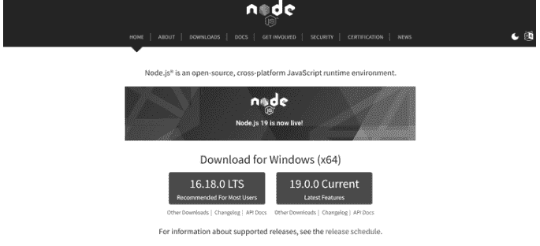

下载包含最新功能的 zip 文件。

步骤 2：运行安装程序以在您的计算机上安装 NodeJs。

步骤 3：配置环境变量。

### 用户变量路径

- 右键单击“我的电脑”并选择“属性”。
- 选择“属性”。
- 选择“高级”选项卡，然后点击“环境变量”。
- 在“环境变量”框中，双击屏幕上显示的 `PATH`。
  - 将出现“编辑用户变量”对话框。在“变量值”字段中，输入 `C:\Program Files\nodejs\node modules\npm` 作为 Node.js 文件夹的路径。如果该路径已为其他文件建立，我们必须在分号（`;`）之后添加 Node.js 路径。
- 最后，点击“确定”按钮。

### 系统变量

- 双击系统变量下的 `Path`。
- 将出现“编辑系统变量”窗口。在“变量值”字段中，输入 `C:\Program Files\nodejs\` 作为 Node.js 文件夹的路径，然后点击“确定”。

步骤 4：打开系统的命令提示符并输入以下命令。将显示已安装的 Node.js 版本。

步骤 5：要显示用于安装模块的 npm（Node.js 包管理器）版本，请在命令提示符中输入以下命令。将显示安装的 Node.js 版本。

```bash
npm -v
```

步骤 6：在命令提示符中输入以下命令以安装 Gulp。`-g` 参数确保 Gulp 在全球任何项目中均可用。

```bash
npm install gulp -g
```

步骤 7：输入以下命令查看 Gulp 版本，以确保其已正确安装。

```bash
gulp -v
```

## Gulp 基础知识

本节将向我们介绍 Gulp 的基础知识。

### 什么是构建系统？

构建系统是一组用于自动化重复工作的任务（统称为任务运行器）。

构建系统能够完成的部分工作列举如下：

- CSS 预处理和 JavaScript 编译。
- 文件压缩以减小文件大小。
- 将多个文件合并为一个文件。
- 激活服务器的自动重新加载。
- 创建部署构建，将生成的产物文件保存在同一位置。

现代前端工作流中的构建系统由三个组件组成：

- 包管理器。
- 预处理器。
- 任务管理器和构建工具。

### 包管理器

它在开发环境中实现了安装升级、依赖项删除、库清理和包清理的自动化。

Bower 和 npm 是包管理器的两个例子。

### 预处理器

预处理器对于高效的现代工作流特别有用，因为它们提供了增强的功能和优化后的语法，这些语法会被编译成目标语言。

一些受欢迎的预处理器包括：

- CSS——SASS、Stylus 和 LESS。
- JS——LiveScript、CoffeeScript、TypeScript 等。
- HTML——Markdown、Slim、HAML、Jade 等。

### 任务执行器

任务运行器可自动化各种开发活动，包括压缩文件、优化图片以及将 SASS 转换为 CSS。在当代前端工作环境中，Gulp 是任务运行器之一，并在 Node 上运行。

484 ■ 附录 III

## 设置我们的项目

在电脑上创建一个文件夹（例如名为“work”）来保存我们的项目。`work` 文件夹包含以下文件和子文件夹：

- `Src`：预处理的 HTML 源文件和目录位于 `Src` 目录中。
  - `Images`：包含未压缩的图像。
  - `Scripts`：包含若干已经处理过的脚本文件。
  - `Styles`：由若干预处理的 CSS 文件组成。
- `Build`：生产文件位于这个自动生成的文件夹中。
  - `Images`：由压缩后的图片组成。
  - `Scripts`：包含已压缩代码的单个脚本文件。
  - `Styles`：包含已压缩代码的单个 CSS 文件。
- `gulpfile.js`：用于指定任务的配置文件名为 `gulpfile.js`。

## 使用 Gulp 开发应用程序

在上一节中，我们学习了 Gulp 的安装和基础知识，涵盖了 Gulp 构建系统、包管理、任务运行器和 Gulp 结构等主题。

在本节中，我们将探讨创建应用程序的一些基础知识：

- 声明必要的依赖项。
- 为依赖项创建任务。
- 执行任务。
- 观察任务。

## 依赖项声明

在为应用程序安装插件时，我们必须指明插件的依赖项。像 Bower 和 npm 这样的包管理器会处理这些依赖项。

让我们在配置文件中为 `gulp-imagemin` 插件定义依赖项。可以使用以下命令行安装此插件，该插件可用于压缩图像文件：

```bash
npm install gulp-imagemin --save-dev
```

如下代码所示，我们可以将依赖项包含在配置文件中。

```javascript
var imagemin = require('gulp-imagemin');
```


任务使得以模块化方式配置 Gulp 成为可能。每个依赖项必须有其对应的任务，当我们发现并设置其他插件时，必须将其添加进去。Gulp 任务的组织方式如下：

```
gulp.task('taskname', function() {
  //here, do stuff
});
```

其中`function()`执行我们的任务，而`taskname`是一个字符串名称。`Gulp.task`定义了对其他任务的依赖，并将该函数注册为具有特定名称的任务。

如下代码所示，我们可以为之前创建的依赖项构建任务。

```
gulp.task('imagemin', function() {
  var imgsrc = 'src/images/**/*', imgdest = 'build/images';
  gulp.src(imgsrc)
  .pipe(changed(imgdest))
  .pipe(imagemin())
  .pipe(gulp.dest(imgdest));
});
```

图像保存在`img src`对象中，可以在`src/images/*/*`目录中找到。`imagemin`构造函数将其管线（pipe）传输到后续函数。通过调用`dest`方法并传入代表目标目录的参数，它将图像从`src`文件夹压缩并传输到`build`文件夹。

## 运行任务

Gulp 文件已配置完毕并准备运行。要执行该任务，请在项目目录中输入以下命令。

```
gulp imagemin
```

## GruntJS 概述

我们将讨论 GruntJS 及其安装以及其优缺点。

GruntJS 是一个 JavaScript 任务管理器。它可以毫不费力地将应用程序的各种操作自动化，从而提高开发者的生产力。

GruntJS 拥有许多不同任务的插件。其中一个例子是`nodemon`插件，每当应用程序中的 JavaScript 文件发生更改时，它会自动重启 Node 服务器。因此，我们不需要在每次修改 JavaScript 后手动停止并重启 Node 服务器。我们可以使用`grunt-contrib-cssmin`插件来压缩 CSS 文件。我们可以使用`grunt-jsfmt`插件对应用程序中的 JavaScript 进行格式化、搜索或重写。

## 为什么我们要使用 Grunt？

Grunt 可以轻松执行重复性操作，如编译、单元测试、文件压缩、测试执行等。Grunt 带有内置任务，允许我们的插件和脚本实现更多功能。Grunt 的生态系统非常庞大；我们只需极少的努力就能实现几乎任何事情的自动化。

## 历史

GruntJS 的第一行源代码是在 2011 年添加的。

+ 2013 年 2 月 18 日，发布了 Grunt v0.4。

- 2014 年 5 月 12 日，发布了 Grunt v0.4.5。

- Grunt 当前的稳定版本是 1.0.0 rc1，于 2016 年 2 月 11 日发布。

## 优点

+ 我们可以使用 Grunt 快速执行文件压缩、编译和测试。

- Grunt 统一了 Web 开发者的工作流。

- 由于其基础设施极简，Grunt 使得处理全新代码库变得简单。

- 它通过加速开发工作流来提高项目性能。

## 缺点

+ 每当 npm 包更新时，我们必须等待 Grunt 的创建者对其进行更改。

- 每个任务旨在执行一个特定功能。

- 如果我们希望扩展某个特定任务，必须采用某些方法来完成工作。

- Grunt 为单个插件提供了过多的配置选项。

- Grunt 的配置文件通常长度较长。

## GRUNT 的特性

Grunt 是一个基于 JavaScript 的任务运行器，可用于自动化工作流中的重复操作，并作为 JavaScript 对象的命令行工具。

以下是 GruntJS 最显著的一些特性：

+ Grunt 使工作流像编写配置文件一样简单。

- 我们可以毫不费力地将重复操作自动化。

- Grunt 是一个著名的 NodeJS 任务运行器，具有很强的适应性且被广泛使用。

- 它采用了基础方法，任务用 JS 编写，配置用 JSON 编写。

## 488 ■ 附录 III

- Grunt 可以压缩 JavaScript、CSS 文件、测试文件、CSS 预处理器文件（SASS、LESS）以及其他文件。

- Grunt 内置任务，让你的插件和脚本能做更多事情。

- 通过加快开发工作流，它提升了项目性能。

- 由于基础设施极简，Grunt 让你可以轻松处理全新的代码库。

- Grunt 的生态系统非常庞大；我们可以用最小的努力自动化几乎任何事情。

- Grunt 降低了执行重复活动时出错的可能性。

- Grunt 目前拥有近 4,000 个插件。

- 它可以用于大型生产环境。

## GRUNT 的安装设置

本节将一步步指导我们在系统上安装 Grunt。

## Grunt 的系统要求

- 跨平台操作系统

- 支持 Internet Explorer（版本 8 及以上）、Firefox、Google Chrome、Safari 和 Opera

## 安装 Grunt

第一步：要运行 Grunt，我们需要 NodeJs。点击链接 https://nodejs.org/en/ 下载 NodeJs 时，会显示如下界面。

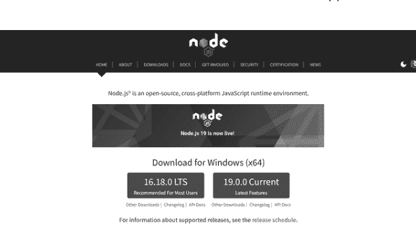

Node.js® 是一个开源、跨平台的 JavaScript 运行时环境。


Download for Windows (x64)


For information about supported releases, see the release schedule.

download grunt

下载包含最新功能的 zip 文件。

第二步：运行安装程序在我们的机器上安装 NodeJs。

第三步：第三步是设置环境变量。

用户变量 Path

- 右键单击"我的电脑"。

- 选择"属性"。

- 然后，在"高级"选项卡下点击"环境变量"。

- 当环境变量窗口出现在屏幕上时，双击 PATH 条目。

- 将会弹出"编辑用户变量"窗口，如下所示。在变量值框中添加 NodeJs 文件夹的路径`C:\Program Files\nodejs\node_modules\npm`。如果已经为其他文件设置了路径，请按照`;格式`在分号（;）后添加 NodeJs 路径。

完成后点击"确定"按钮。

系统变量

- 双击系统变量下的 Path，如屏幕所示。

- 将会出现编辑系统变量的窗口，如下所示。按照下图所示，输入 NodeJs 文件夹的路径`C:\Program Files\nodejs\`，然后点击"确定"。

第四步：要在系统上完成 Grunt 的安装，全局安装其命令行界面（CLI），如下所示。

```
npm install -g grunt-cli
```

运行上述命令后，`grunt`命令将被添加到我们的系统路径中，并可在任何目录下使用。

安装`grunt-cli`时不会安装 Grunt 任务运行器。`grunt-cli`的功能是执行安装在 Gruntfile 旁边的 Grunt 版本。它使系统能够同时安装多个 Grunt 版本。

第五步：要使用 Grunt，我们需要生成配置文件。

## package.json

`package.json`文件位于项目根目录，与 Gruntfile 并列。当我们在与`package.json`相同的文件夹中执行`npm install`命令时，它会使用`package.json`来运行每个适当指定的依赖项。

我们可以通过以下命令在命令提示符处生成基本的`package.json`文件：

```
npm init
```

`package.json`文件的基本结构如下所示：

```
{
    "name": "tutorialsession",
    "version": "0.1.0",
    "devDependencies": {
      "grunt-contrib-jshint": "~0.10.0",
      "grunt-contrib-nodeunit": "~0.4.1",
      "grunt-contrib-uglify": "~0.5.0"
    }
}
```

上述命令中的`module`表示要本地安装的模块。上述命令还会自动将`<module>`添加到`devDependencies`中。

例如，以下命令会将最新版本的 Grunt 添加到我们的`devDependencies`中并进行安装。

```
npm install grunt --save-dev
```

## Gruntfile.js

我们在`Gruntfile.js`文件中定义 Grunt 配置。我们将在这里编写设置。基本的`Gruntfile.js`文件如下所示

```
// (Grunt 及其插件必需的) 我们的包装函数
// 此函数包含所有配置。
module.exports = function(grunt) {
  // 配置 GRUNT
  grunt.initConfig({
    // 从 package.json 文件获取配置信息
    // 这样，我们可以使用名称和版本等（pkg.name）
    pkg: grunt.file.readJSON('package.json'),
    // 这里放置我们所有的配置
    uglify: {
      // uglify 任务配置
      options: {},
      build: {}
    }
  });
  // 记录一些内容
  grunt.log.write('Hello world! Welcome to Tutorialspoint!!\n');
  // 加载提供 "uglify" 任务的插件。
  grunt.loadNpmTasks('grunt-contrib-uglify');
  // 默认任务。
  grunt.registerTask('default', ['uglify']);
};
```

## 开始使用 GRUNT

我们需要 Node.js 来使用 Grunt，因此请确保已设置。使用 Node.js 包管理器，我们可以安装 Grunt 及其插件。

在安装 Grunt 之前，我们可以使用命令行更新 Node 包管理器。

```
npm update -g npm
```

要在 Mac 或 Linux 计算机上提供管理员访问权限，请在命令行开头使用`sudo`词，如下所示。

```
sudo npm update -g npm
```

### CLI 的安装

CLI（命令行界面）用于启动已安装的 Grunt 版本。我们必须全局安装 Grunt 的命令行界面（CLI）才能开始使用。

```
npm install -g grunt-cli
```

运行上述命令后，`grunt`命令将被添加到我们的系统路径中，并可在任何目录下使用。安装`grunt-cli`并不能安装 Grunt 任务运行器。它使系统能够同时安装多个 Grunt 版本。

### CLI 的工作原理

每次执行 Grunt 时，CLI 都会使用`require()`机制检查我们的系统上是否已安装 Grunt。我们可以使用`grunt-cli`从项目中的任何目录启动 Grunt。如果使用的是本地 Grunt，`grunt-cli`会使用本地安装的 Grunt 库并应用来自 Grunt 文件的配置。

### 在新项目和现有项目中的工作

如果我们正在处理一个已经配置好并且包含`package.json`和`Gruntfile`的项目，请按照以下说明操作：

- 找到项目的根目录路径。

- 可以使用`npm install`命令安装依赖项。

- 使用`grunt`命令启动 Grunt。

如果我们正在开始一个新项目，请在项目中包含`package.json`和`Gruntfile`两个文件。

- `package.json`：当我们在同一文件夹中执行`npm install`命令时，位于项目根目录的`package.json`文件用于运行每个指定的依赖项。

- `Gruntfile.js`：项目的配置设置写在`Gruntfile.js`文件中。

## package.json

当我们在同一文件夹中执行`npm install`命令时，`package.json`文件用于运行每个指定的依赖项，它位于项目根目录，与 Gruntfile 并列。

有多种方法可以创建`package.json`，如下所述：

- 使用`grunt-init`生成`package.json`文件。

- 我们也可以使用`npm-init`命令来构建`package.json`文件。

如下所示，我们可以编写规范。

```
{
	"name": "tutorialsession",
	"version": "0.1.0",
	"devDependencies": {
		"grunt-contrib-jshint": "~0.10.0",
		"grunt-contrib-nodeunit": "~0.4.1",
		"grunt-contrib-uglify": "~0.5.0"
	}
}
```

可以使用以下命令将 Grunt 和 gruntplugins 添加到现有的`package.json`文件中。

```
npm install <module> --save-dev
```

此处的`<module>`代表本地安装模块。使用上述命令将安装所请求的模块，并自动将其添加到`devDependencies`部分。

# 附录 III

例如，以下命令将把 Grunt 更新到最新版本并将其添加到我们的开发依赖项中。

```
npm install grunt --save-dev
```

## Gruntfile

默认情况下，我们的 Grunt 配置设置将存储在`Gruntfile.js`文件中。Grunt 文件包含以下组件：

- 包装函数

- 任务和项目设置

- 加载 Grunt 作业和插件

- 特定任务

`Gruntfile.js`的基本文件结构如下所示：

```javascript
// (Required by Grunt and its plugins) our wrapper function
// This function contains all configuration.
module.exports = function(grunt) {
  // configure the grunt
  grunt.initConfig({
    // to obtain configuration information, see the package.json file
    // We may utilize elements like name and version in this way (pkg.name)
    pkg: grunt.file.readJSON('package.json'),
    // Everything we configure goes here
  });
  // Load the plugin that performs the "uglify" function
  grunt.loadNpmTasks('grunt-contrib-uglify');
  // Default task
  grunt.registerTask('default', ['uglify']);
};
```

### 包装函数

在上面的代码中，`module.exports`是一个接收完整配置的包装函数。它是向其他程序用户展示配置的一种方式。

```javascript
module.exports = function(grunt) {
    //here do grunt-related things
}
```

### 任务和项目配置

一旦我们的 Grunt 配置准备就绪，我们就可以配置 Grunt 任务。项目配置可以在`grunt.initConfig()`部分输入。从`package.json`获取配置数据并将其存储在`grunt.initConfig()`内部的`pkg`中。我们可以分别使用`pkg.name`和`pkg.version`来调用我们项目的名称和版本。

### 加载 Grunt 插件和任务

使用`grunt.loadNpmTasks`函数从特定插件加载任务。

> 该插件可以使用 npm 在本地安装；它必须相对于 Gruntfile。可以使用下面描述的简单命令加载该插件。

```javascript
grunt.task.loadNpmTasks(plugin_Name)
```

### 自定义任务

Grunt 在通过命令行执行时会搜索默认任务。上面的代码中使用的`uglify`任务可以通过`grunt`命令执行。这等同于手动使用`grunt uglify`命令，并且我们可以指定数组中的作业数量。

```javascript
grunt.registerTask('default', ['uglify']);
```

## GULP VS GRUNT

在深入探讨 Grunt 与 Gulp 的争论之前，我们可以先问问这两种工具能做什么，以及为什么你会想使用其中任何一个。

如前所述，Grunt 和 Gulp 都是为了帮助自动化操作而存在的，并且是网络开发者和设计师中流行的工具。

有人可能会被指派来执行这些活动，但由于它们相对简单，执行它们的人可能可以做更有生产力的事情。这就是 Grunt 和 Gulp 发挥作用的地方。

我们可以使用一段非常简单的代码、插件以及 Gulp 或 Grunt 中的任何一个来建立一个自动执行任务的流程。这两个程序都允许您检查特定文件夹中的新文件或文件更改，并执行与之相关的操作。


换句话说，在我们配置好所需的流程并将其应用于现有文件后，任何新的或更新的文件都可以自动应用这些流程。假设我们建立了一个流程来压缩`images`目录中的`jpg`文件。当我们执行该流程时，所有照片都会删除`EXIF`数据并被压缩。

一旦我们正确安装和配置了`Gulp`或`Grunt`，每个工具的图像压缩任务代码应该如下所示：

**Gulp**

```javascript
gulp.task('jpgs', function() {
  return gulp.src('src/documents/*.jpg')
    .pipe(imagemin({ progressive: true }))
    .pipe(gulp.dest('optimizedimages'));
});
```

**Grunt**

```javascript
imagemin: {
  jpgs: {
    options: {
      progressive: true
    },
    files: [{
      expand: true,
      cwd: 'src/img',
      src: ['*.jpg'],
      dest: 'documents/'
    }]
  }
}
```

如果我们还配置了`Gulp`或`Grunt`来检查新的或更新的文件，那么保存到目录中的任何更改或新文件都将被压缩，并且`EXIF`数据将立即被擦除。`Gulp`或`Grunt`可以高效地执行此任务，在处理大量文件的情况下，它们所用的时间只是手动执行所需时间的一小部分。

## Gulp 与 Grunt：有什么区别？

既然我们知道`Gulp`和`Grunt`能做什么，让我们来谈谈它们是如何做到的。这两个程序都是任务运行器，使用`Node.js`（一个用于开发工具和应用程序的开源`JavaScript`运行时环境）。`Grunt`和`Gulp`依赖于插件来完成我们希望它们为我们做的任务。

两个工具都使用`.js`文件来构建任务；对于`Grunt`，您使用`gruntfile.js`，对于`Gulp`，我们使用`gulpfile.js`。我们可以使用`grunt.task`和`gulp.task`来定义流，而不是使用函数。

每个工具可以执行和自动化的最常见任务包括以下内容：

- 图像文件压缩
- 脚本调试器和控制台语句的移除
- `CSS`和`JavaScript`的压缩、连接和清理
- 错误检查代码
- `Less`文件编译
- 执行单元测试
- 向实时服务器发送更新
- 数据库更新

## Gulp 与 Grunt：哪个更快？

在速度方面，`Gulp`具有显著优势，尽管这种优势可能并非那么巨大，而且`Grunt`的修改已经大大减少了速度差异。`Gulp`目前的速度优势在于它使用流并在内存中处理作业，从而只写入一个文件。此外，`Gulp`可以同时处理多个作业，而`Grunt`通常一次只处理一个任务。

`TMWtech`进行了一项速度测试，比较了使用`Gulp`和`Grunt`执行`Sass`编译所需的时间。结果显示`Gulp`快得多，仅耗时`1.27`秒，而`Grunt`耗时`2.348`秒。在`Grunt`中，当插件处理文件时会保存一个临时文件。文件通过所有插件后才会写入最终目标文件。

将数据写入磁盘可能会显著增加执行活动所需的时间；然而，“显著”是一个相对的说法。除非我们正在处理一个庞大的项目，否则`Gulp`或`Grunt`的输出时间将以秒或毫秒为单位。

即使`Grunt`需要`500`毫秒来执行一个`Gulp`可以在`50`毫秒内完成的任务（相差十倍），我们谈论的也只是更长的`Grunt`时间范围上的半秒差异。在比较`Gulp`与`Grunt`时，我们正在处理的项目的规模将决定性能是否是一个问题。即使速度对我们来说是一个问题，`Grunt`也在今年早些时候（截至`0.5`版本）获得了管道支持，因此速度差异可能比大多数比较进行时要小。

## Gulp 与 Grunt：配置 vs 编码

`Gulp`和`Grunt`在配置与代码方面的关键区别已被广泛讨论。`Gulp`旨在通过单一用途的插件和脚本帮助我们实现目标。在大多数情况下，这使得为`Gulp`编写插件比为`Grunt`开发插件要容易得多。此外，由于`Gulp`更专注于代码和单任务插件，因此在`Gulp`中设置插件比在`Grunt`插件中设置要标准化得多。

然而，问题可能更多地在于代码，而在于我们（如果适用的话，以及我们的团队）对`node`流的熟悉程度。`Gulp`在很大程度上依赖于`node`流，除非我们以及所有将使用`Gulp`的人都熟悉它们，以及管道、缓冲区和异步`JavaScript`，否则处理`Gulp`将是一项艰巨的任务。

虽然配置`Grunt`比设置`Gulp`花费的时间更长，但`Grunt`因依赖配置而非代码而更用户友好。此外，虽然`Gulp`代码更易于阅读，但许多人认为`Grunt`代码更易于编写。如果我们与一大群技能水平各异的人一起工作，`Grunt`可能是更好的选择。要使用它，只需阅读手册，获取并安装必要的插件，然后编写一些`JavaScript`代码。

## Gulp 与 Grunt：支持、社区与插件

两个项目都拥有庞大且乐于助人的社区，以及数量可观的插件可供选择。

如前所述，`Grunt`官方网站上发布了超过`6,000`个插件，而`Gulp`官方网站上列出了大约`2,700`个插件。

`Gulp`是个新成员，因此`Grunt`可用的插件数量大约是其两倍也就不足为奇了。无论如何，任何一个项目都缺乏插件（的情况）是不存在的，并且存在一个`Gulp`插件，原则上可以允许任何`Grunt`插件在`Gulp`中运行。

截至`2016`年，`Grunt`占据了超过`70%`的市场份额，而`Gulp`占`30%`。然而，在同一时期，两个工具的下载量相当接近。`Grunt`每月下载量约为`185`万次，而`Gulp`在同一时间框架内的下载量约为`160`万次。

## 我们应该选择哪个？

在`Grunt`和`Gulp`之间做选择时，没有绝对的正确或错误答案。这两种自动化技术都提供了很多功能，并且都没有明显的缺陷。

我们的决定将受到我们在设置自动化时更喜欢配置（`Grunt`）还是编码（`Gulp`）的影响，以及我们对`node`流的熟悉程度。这其中涉及大量的个人偏好。

速度、插件的工作方式以及可用插件的数量和类型都可能影响我们的选择。虽然有些人发现他们可以有效地使用任一方法，但其他人可能不会。如果我们在`Gulp`和`Grunt`之间仍然犹豫不决，我们应该两个都尝试一下。两个项目都是免费的，并且都有活跃的社区，可以帮助我们找到合适的插件并开始编写自动化脚本。根据我们有多少个项目，我们可以在不同的任务上使用这两种工具。

## NPM 概述

我们将讨论`npm`及其安装和优缺点。

## npm 究竟是什么？

`npm`是`Node Package Manager`的缩写，是世界上最大的软件注册表。

全球的开源`Web`项目开发者使用它来共享和借用包。

`npm`包管理器还作为`Node.js`项目的命令行实用程序，允许其安装包、管理依赖关系，甚至管理版本。

## npm 的组成部分

`npm`由三个不同的部分组成，如下所示：

- **Website（网站）：** 官方`npm`网站`www.npmjs.com/`用于查找项目的包，以及创建和配置用于管理和访问私有及公共包的配置文件。
- **CLI（命令行界面）：** `CLI`从我们计算机的终端与`npm`包和存储库进行交互。
- **Registry（注册表）：** 注册表是一个庞大且开放的`JavaScript`项目和元数据库。我们可以使用任何受支持的`npm`注册表，包括我们自己的。如果我们遵守他们的服务条款，甚至可以使用其他人的注册表。

## 设置 npm（Node.js 和 npm）

我们必须安装`Node.js`，以便它能自动安装在我们的机器上，因为`npm`已经包含了`Node.js`。在计算机上安装`npm`可以通过以下两种方式之一完成：

- 使用`NVM`（`Node`版本管理器）。
- 安装`Node.js`（使用安装程序）。

强烈建议使用`Node`版本管理器而不是`Node`安装程序来安装`npm`。当你尝试全局执行`npm`包时，`Node`安装过程通过授予本地权限将`npm`安装在目录中，会产生错误消息。

### 1. 使用 nvm 设置 Node.js 和 npm

`npm`开发者强烈建议使用`Node`版本管理器在我们的设备上安装`npm`和`Node.js`。通过使用`nvm`安装方法，我们可以在我们的计算机上安装多个`Node.js`版本，并且可以根据需要在它们之间切换，以使用任何`Node.js`版本进行我们的项目。他们不建议我们使用`node`安装程序来安装`npm`和`Node.js`。

打开`https://github.com/nvm-sh/nvm`下载并使用`nvm`在我们的`Linux`操作系统上安装`npm`。

- 由于我们使用的是`Windows`操作系统设备，我们将从`Git`链接下载适用于`Windows`的`nvm-setup.zip`文件。
- 下载完成后运行安装程序，然后按照屏幕上的安装说明进行操作。
- 双击运行安装程序，或从上下文菜单中选择“以管理员身份运行”。
- 点击“是”选项将允许安装。
- 仔细阅读他们的许可协议后，如果我们同意，点击“下一步”选项接受它。
- 选择`NVM`应该安装的位置后，点击“下一步”按钮。它仍然是默认选择的位置。
- 选择安装程序将创建符号链接的文件夹后，点击“下一步”按钮。
- 现在我们的安装设置已准备就绪，点击“安装”按钮开始该过程。
- `nvm`安装程序现在已开始安装在我们的计算机上，我们需要稍等一会儿才能完成。
- 我们的`nvm`安装程序安装完成；选择“完成”以退出安装程序。

#### 验证 nvm 版本

在`nvm`安装程序完成后，验证我们是否已安装以及安装了哪个`nvm`版本。在我们的终端上运行以下命令来完成此操作：

```
nvm -v
```

#### 查看可通过 nvm 安装的 Node.js 列表

使用以下命令查找`nvm`安装支持的`Node.js`版本。它将显示当前可用的有限`Node.js`版本列表。

```
npm list available
```

#### 安装 npm 和 Node.js

我们可以安装任何版本的`Node.js`；在我们的系统上，我们安装了`LTS 14.15.4`。要安装`Node.js`，只需运行以下命令：

```
nvm install 14.15.4
```

#### 验证 Node.js 和 npm 版本

使用命令`nvm use 14.15.4`启动`Node.js`（确保将`14.15.4`替换为我们的安装版本）。

```
nvm use 14.15.4
```

然后，在终端中使用命令`node -v`和`npm -v`来验证`Node.js`和`npm`版本。

```
node -v
npm -v
```

#### 验证已安装的 Node.js 版本列表

使用以下命令，我们可以查看我们机器上当前安装和活动的`Node.js`版本数量。

```
nvm list
```

在我们的系统上，`Node.js`版本`14.15.4`当前处于活动状态。如有必要，我们也可以在一台机器上安装其他不同的`Node.js`版本（同时基于不同版本构建另一个`Node.js`项目）。从`nvm`提供的列表中选择一个不同的`Node.js`版本，然后执行以下命令进行安装。

```
nvm install 12.20.2
```

现在`Node.js`和`npm`有了两个不同的版本。运行以下命令查看当前安装的`Node.js`版本数量：

```
nvm list
```

### 2. 使用 Node 安装程序安装 npm 和 Node.js

考虑这样一种情况：我们无法在我们的设备上安装`npm`，或者在安装过程中遇到问题。`Node.js`安装程序是在我们的计算机上安装`npm`和`Node.js`的另一种方法。

要同时安装`Node.js`和`npm`，请转到`Node.js`下载区域`https://nodejs.org/en/download/`，我们可以在那里找到适用于不同操作系统的`Node.js`安装程序。

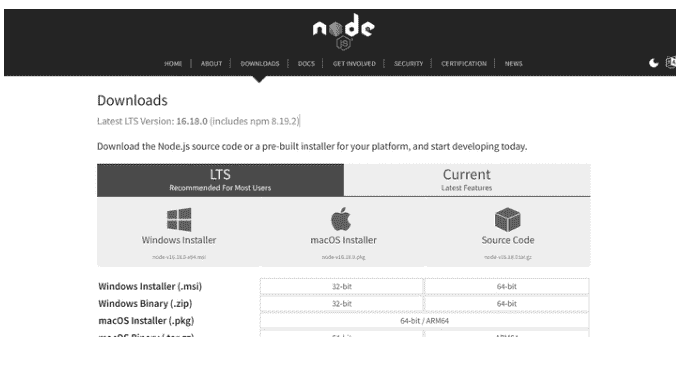

#### 下载 npm

下载与我们的操作系统及其位数兼容的任何`Node.js`安装程序。

1. 我们正在为我们的设备下载`64`位`Node.js`安装程序，因为我们使用的是`64`位操作系统的`Windows`。
2. 下载完成后运行安装程序，然后按照屏幕上的安装说明进行操作。
3. 要开始安装过程，请单击“下一步”按钮。
4. 阅读并接受最终用户许可协议后，单击“下一步”按钮。
5. 为`Node.js`安装选择一个独特的位置，然后单击“下一步”继续。它仍然在其默认位置。
6. 选择我们想要安装的`Node.js`功能后，单击“下一步”。我们将其保持为默认提供的功能。
7. 选中该框并选择“下一步”选项，以将其他所需工具（如`C/C++`和`Chocolatey`）与我们的`node.js`和`npm`安装一起安装。
8. 现在单击“安装”按钮，在我们的设备上安装`Node.js`和`npm`。
9. 要安装`Node.js`，请在弹出框中选择“是”。
10. 要完成安装，请单击“完成”按钮。

额外的工具已准备安装，如上所述的用于自动安装额外工具的复选框所示。按任意键继续。

要在命令行上下载最新版本的`npm`，请发出下面显示的命令。

```
npm install -g npm
```

## npm 的特性

- `package.json`文件，用于定义所有`npm`包。
- `package.json`文件的内容必须以`JSON`格式编写。
- 定义文件中必须包含`name`和`version`字段。

## package.json

当我们使用`npm init`启动一个`JavaScript/Node.js`项目时，将创建一个`package.json`文件，并包含开发者提供的基本元数据信息：

- **Name（名称）：** 这是我们`JavaScript`项目或库的标题。
- **Version（版本）：** 这是项目的版本。
- **description：** 发送关于项目描述的详细信息。
- **license：** 这是项目的许可证。

## 何时使用 npm

- 使用`npm`来修改我们项目的代码包，或者原样使用它们。
- 当我们需要立即下载独立工具时，可以利用`npm`。
- 利用`npx`来运行包而无需下载。
- 如果我们需要与其他任何`npm`用户共享代码，请使用`npm`。
- 当你想将代码限制给特定开发人员时，我们可以使用`npm`。
- 使用`npm`创建团队来组织开发人员、编码和包维护工作。
- 要处理各种代码版本和代码依赖关系，请使用`npm`。
- 当底层代码快速修改时，`npm`可用于更新应用程序。
- 要查找从事相关问题和工作项目的其他开发人员，请使用`npm`。

## 命令行客户端

`npm`软件包附带一个`CLI`（命令行客户端），可用于获取和安装`npm`包：

### Windows 操作系统示例

```
C:\>npm install <package>
C:\>npm uninstall <package>
```

### Mac OS 示例

```
>npm install <package>
>npm uninstall <package>
```

## 发布包

只要目录包含`package.json`，我们就可以从我们的电脑发布它。

**验证 npm 是否已安装：**

```
C:\>npm
```

**验证我们的登录状态：**

```
C:\>npm whoami
```

**如果未登录，请登录：**

```
C:\>npm login
Username: <our username>
Password: <our password>
```

**进入我们项目的页面并发布它：**

```
C:\Users\my_user>cd my_project
C:\Users\my_user\my_project>npm publish
```

## 全局模式包安装

我们已经全局加载了`npm`包，这就是我们现在拥有的全部。因此，让我们更改它并安装`UglifyJS`作为另一个包（一个`JavaScript`压缩工具）。虽然我们可以在本例中使用`--global`标志，但它可以缩写为`-g`：

```
npm install uglify-js -global
C:\Users\JTP\AppData\Roaming\npm\uglifyjs -> C:\Users\
JTP\AppData\Roaming\npm\node_modules\uglify-js\bin\
uglifyjs
+ uglify-js@3.13.9
added 1 package from 1 contributor in the 12.32s
```

## 本地模式包安装

在本地安装任何包时，通常使用`package.json`文件。以下是如何在我们的主目录中创建项目文件夹的示例：

```
mkdir project && cd project
npm init
package name: (project)
version: (1.0.0)
description: Instance of the package.json
entry point: (indexs.js)
test command:
git repository:
keywords:
author:
license: (ISC)
```

按`Enter`键以使用默认设置生成`package.json`。然后，输入`yes`以确认`.json`文件没问题。这样做将在项目根目录中创建一个`package.json`文件。


```json
{
   "name": "project",
   "version": "1.0.0",
   "description": "Instance of the package.json",
   "main": "indexs.js",
   "scripts": {
      "test": "echo \"Error: no test is specified\" && exit 1"
   },
   "author": "",
   "license": "ISC"
}
```

## 移除本地包

由于 `npm` 是一个始终可操控的包管理工具，我们也可以卸载包。假设当前安装的 `packageName` 包存在兼容性问题。因此，我们将卸载此包并安装较早的版本：

```
npm uninstall packageName
```

## 安装特定版本的包

现在我们可以安装所需版本的 `packageName` 包。`@` 符号可用于附加版本号。

```
npm install packageName@1.4.5
```

正如我们所见，有几种执行 `npm` 指令的方法。下面提供了一些最常用的 `npm` 命令列表（或别名）。

- `npm i`：使用 `npm i` 安装本地包
- `npm i -g`：使用 `npm i -g` 安装全局包
- `npm un`：使用 `npm un` 卸载本地包
- `npm up`：通过 `npm` 更新包
- `npm t`：使用 `npm` 运行测试
- `npm ls`：使用 `npm ls` 列出已安装的模块
- `npm ll` 或 `npm la`：使用 `npm ll` 或 `npm la` 在列出模块时打印更多包详细信息

在本章中，我们讨论了 Gulp、Grunt 和 npm 的介绍、安装和功能。

## 注释

1. Gulp – 概述：www.tutorialspoint.com/gulp/gulp_overview.htm 访问日期：2022年10月20日。
2. Gulp – 安装：www.tutorialspoint.com/gulp/gulp_installation.htm 访问日期：2022年10月20日。
3. Gulp – 基础：www.tutorialspoint.com/gulp/gulp_basics.htm 访问日期：2022年10月20日。
4. Gulp – 开发应用程序：www.tutorialspoint.com/gulp/gulp_developing_application.htm 访问日期：2022年10月20日。
5. GruntJS：www.tutorialsteacher.com/nodejs/gruntjs 访问日期：2022年10月20日。
6. Grunt – 概述：www.tutorialspoint.com/grunt/grunt_overview.htm 访问日期：2022年10月20日。
7. Grunt – 特性：www.tutorialspoint.com/grunt/grunt_features.htm 访问日期：2022年10月20日。
8. Grunt – 安装：www.tutorialspoint.com/grunt/grunt_installing.htm 访问日期：2022年10月20日。
9. Grunt – 入门：www.tutorialspoint.com/grunt/grunt_getting_started.htm 访问日期：2022年10月21日。
10. Gulp vs Grunt – 比较两种自动化工具：www.keycdn.com/blog/gulp-vs-grunt#:~:text=Gulp%20vs%20Grunt%3A%20Speed&text=The%20reason%20for%20Gulp%27s%20current,one%20task%20at%20a%20time. 访问日期：2022年10月22日。
11. 什么是 npm：www.javatpoint.com/what-is-npm 访问日期：2022年10月22日。

## 索引

- ActiveX Control 程序 267
- 聚合 345
- AJAX 技术 10, 34–35, 153, 268
- `alert()` 方法 442
- 代数 444–445
- Algolia Places 195–196
- 环境，在 TypeScript 中 476–477
- Android 应用，使用 NativeScript 397–399
- Android SDK 380
- Android Studio 379–380；*另见* Visual Studio (VS) Code
- AngularJS 17, 19–20, 46, 213, 217–219
  - 特性 295–296
  - 前端框架和库 272–273
  - *与* JavaScript 比较 260–263
  - *与* React.js 比较 295–298
  - VueJS *与* 比较 316–318
- Animate On Scroll (AOS) 197
- Anime.js 196–197
- Apache Cordova 235–236
- API *另见* Application Programming Interface (API)
- `App.js` 241, 291–292, 294
- `App.JSX` 303
- Application Programming Interface (API) 181–191, 367, 434；*另见* user interface (UI)
  - GraphQL API 67
  - 原生 Fetch API 162
- 应用程序
  - 跨平台应用程序（*见* 跨平台应用程序）
  - 桌面应用程序（*见* 桌面应用程序）
  - 动态 Web 应用程序 279–280
  - 全栈在线应用程序 358
  - Ghost Electron 应用程序 406–407
  - 混合应用 235
  - 移动应用程序（*见* 移动应用程序）
  - Pexels Electron 应用程序 407
  - Playground 应用 390, 395–396
  - 专业 JavaScript 应用 375
  - 服务器应用 4
  - 单页应用程序 (SPAs) 215
  - Skype 应用 385
  - 独立级别 *与* 跨平台应用比较 239
  - Tesla 应用 386
  - Web 4, 27, 425
- 应用程序用户界面 359
- 算术运算符 82
- 数组
  - 在 JavaScript 中 98–101, 434–435
  - 在 TypeScript 中 473–475
- 赋值运算符 83
- 帮助
  - 社区帮助 301
  - 离线帮助 373
- 异步函数 134–143；*另见* 函数
  - *与* 延迟 JavaScript 比较 143–144
  - Node.js 131–133
- Atom 39–40
- 音频/视频，处理 335
- Aurelia 25–26
- Axios 方法 159–160
- Babel JavaScript VSCode 69, 288
- `.babelrc` 文件 292
- Babylon.js 232
- Backbone.js 224–226
- 后端框架 17–18, 227, 275；*另见* 框架
  - 开发 274, 333
  - Express.js 228, 361–363
  - Gatsby 229
  - 语言 274
  - Meteor 230–231
  - Next.js 227–228
  - Node.js（*见* Node.js）
  - 任务 372
  - Web 设计师 425
- Beaker Browser 407
- Bideos.io 198
- 位运算符 83, 432
- `blur()` 函数 443
- Boolean 对象 113–114
- Bootstrap
  - 前端框架 273
  - 库 217, 273
- Brackets 43
- 浏览器
  - Beaker Browser 407
  - Netscape 浏览器 9, 418, 420
  - 对象 411–444
- Brython 419
- BSON 数据类型 343
- 缓冲区 312
- 构建系统 482–483
- 打包过程 293
- C# 7–8, 255, 275, 317, 342, 404, 422
- C++ 274, 335, 417；*另见* 语言；编程语言
- 回调方法 439
- Carbon Components Svelte 222
- Carbon Design System 222
- 层叠样式表 (CSS) 语言 33, 46, 72, 227, 272, 275, 479–480
- 区分大小写的编程语言 77
- CDN 库 318
- 字符
  - 删除字符 453
  - 转义字符 435
  - 分号字符 76
  - 特殊字符 435
- Chart.js 198–199
- chocolatey 安装程序 378–379
- Choreographer.js 199–200
- 类继承 465–466
- `clearInterval()` 方法 442
- `clearTimeout()` 方法 442
- Cleave.js 199
- CLI 命令行 320
- 客户端优化编程语言 255
- 客户端 JavaScript 3
- 客户端编程 256
- `close()` 函数 443
- Cocoon.js 框架 233
- 代码编辑器 455
- Code Push SDK 382
- 编码 371
  - 配置 *与* 498
  - 与 C++ 集成 335
- CoffeeScript 419
- 命令行客户端 505
- 命令行界面 (CLI) 500
- 注释 77–78
- Google 上的社区活动 296
- 社区帮助 301；*另见* 帮助
- 比较运算符 82–83, 432–433
- TypeScript 编译器 448–449
- 无编译器编程 34；*另见* 编程
- 计算 444–445
- 计算属性 314
- 配置
  - *与* 编码 498
  - 环境配置 373
  - 简单环境配置 360
- `confirm()` 函数 443
- `console.log()` 函数 457
- JavaScript 中的 `const` 关键字 430
- `contact()` 数组 434
- Cookie 5, 164–165
  - 在 JavaScript 中 166–168
  - 属性 168–170
  - 用途 165–166
  - 种类 170–172
- C 编程语言 420–421；*另见* 编程语言
- `create-react-app` 功能 293, 364
- 交叉编译器 421；*另见* 应用程序；桌面应用程序；移动应用程序
- 跨平台应用程序 239
  - 框架 28, 389
  - 程序 238—239, 408—409
  - 运行时环境 367
  - 支持 381
- 跨平台文档型数据库 358—359
- CSS 语言 *参见* 层叠样式表（CSS）语言
- Dart 平台 419
  - *与* JavaScript 对比 254—260
- 数据库
  - 作为后端层 367
  - 跨平台文档型数据库 358—359
  - 文档型数据库 350, 360
  - MongoDB 数据库（*参见* MongoDB 数据库）
  - Not Only SQL 数据库 350
  - Not simply SQL 数据库 342
  - 无模式数据库 345
- 数据绑定模式 295
- 数据驱动文档（D3.js）193—194
- 数据隐藏 466
- 数据建模，MongoDB 344
- 数据类型 5, 430—431
  - BSON 数据类型 343
  - JavaScript 中的非原始类型 81
- 日期对象 106—109, 140
- Day.js 包 212
  - 基于 Debian 的计算机 54
- Debugger for Chrome 67
- 默认参数 473；*另见* 参数
- 延迟 *与* 异步 JavaScript 对比 143—144
- 已删除字符，在 TypeScript 中 453
- 桌面应用程序 238—239, 403—404；*另见* 应用程序；跨平台应用程序；移动应用程序
  - AppJS 241
  - Beaker Browser 407
  - 跨平台应用（*参见* 跨平台应用程序）
  - Electron（*参见* Electron）
  - Ghost 406—407
    - 主进程 *与* 渲染进程对比 411—412
  - NodeGUI 240
  - Node.js 240
  - NW.js 241
  - Pexels 407
  - Proton Native 241
  - React.js 239—240
  - Slack 408
    - 独立应用程序 239
    - 使用方式 404—405
  - WebTorrent 405—406
  - WhatsApp 408
  - WordPress 406
- 开发者
  - 适合的编程语言 373
  - 熟练掌握 JavaScript 的 425—428
  - 软件 381
  - 面向开发者的 TypeScript 459—462
  - 面向 JavaScript 的 VS Code 扩展 64—70
- 开发社区，React Native
  - *与* NativeScript 对比 400
- DevOps 工程师 426—427
- 指令，在 VueJS 中 315
- Django 275
- `document.getElementById()` 函数 147, 151—152
- `document.getElementsByName()` 函数 149
- `document.getElementsByTagName()` 函数 149—151
- 文档对象模型（DOM）31—32, 34, 145, 192, 152, 214, 224, 263, 273, 278, 279, 300, 436—439
- 文档型数据库 360；*另见* 数据库
- DOM *参见* 文档对象模型（DOM）
- 域名属性，cookies 169
- `do-while` 循环 91
- 鸭子类型 469
- 动态 HTML 273
- 动态编程语言 417；*另见* 编程语言
- 动态 Web 应用程序 279–280；*另见* 应用程序
- 动态网站 19, 251, 356, 418
- Eclipse 41–42
- ECMAScript 3, 12–13, 302, 447, 458
- ECMAScript 5 9, 11
- ECMAScript 6 11, 13
- ECMA-262 规范 2, 3, 6, 12
- 生态系统 384
- Eich, Brendan 14, 256, 261, 264, 418
- Electron 39, 403–405, 409–410
  - 替代方案 410
  - 使用 Electron 的应用程序 405–408
  - 优势 409–410
  - 跨平台桌面应用 408–409
  - 缺点 410–411
  - Hello Everyone 代码实现 412–413
  - 程序 240
  - 重要性 411
  - 使用 Electron 构建 UI 413–416
- 元素方法 438–439
- Ember JS 21–22, 213, 223–224
- `encodeURI()` 函数 434
- 端到端测试 301–363
- 环境配置 373；*另见* 配置
- 环境搭建，VueJS 318–321
- 错误 114–122
- 转义字符 435；*另见* 字符
- ESLint 65
- `eval()` 函数 434
- 事件 122–128
  - 异常 114–122
  - `Expires` 和 `Max-Age` 参数，cookies 169
- Express.js 17–18, 275, 307–308, 367
  - 后端框架 361–363
  - 优势 308–309
  - `extends` 关键字 465
  - 外部模块，在 TypeScript 中 471
- Extract 功能 43
- `filter()` 方法 439
- Node.js 的第一个应用程序 340–342
- 第一方 cookies 170；*另见* cookies
- Flexbox 布局引擎，移动应用 384
- 灵活文档模型 360
- Flutter，前端框架和库 255, 258, 259, 272, 273
- flux 模式 278
- `focus()` 函数 443
- `for-in` 循环 91–92
- `for` 循环 90
- 表单
  - 登录表单 174–175
  - 概述 172–173
  - 引用表单 173–174
  - 注册表单 175–176
  - 提交表单 174
- TypeScript 的基础要素 448–449
- 框架 15–16, 211–213


- 后端框架（参见后端框架）
- 优缺点 18–26
- 桌面应用程序框架（参见桌面应用程序）
- 移动应用开发框架（参见移动应用程序）
- 前端框架（参见前端框架）
- `jQuery` 和 `JS` 库 16
- 库和框架 16–17, 213
  - 成熟度 409
  - 项目支持 242–244

- 前端开发 271–272
  - 框架（参见前端框架）
  - 语言 272
  - 层 366–367

- 库 272–273, 363–364
  - 丰富的平台 372

- 前端框架 17
  - `Angular` 217–219
  - `Backbone.js` 224–226
  - 开发 272–273
  - `Ember` 223–224
  - `jQuery` 219–221
  - `React` 214–215
  - `Svelte` 221–223
  - `Vue.js` 215–217

- `Facebook` 广告 385
- `Fetch` 函数 156–158；另见函数
- 前端 `Web` 开发者 424–425
- `fullPage.js` 202
- `JavaScript` 全栈开发者 427
- 全栈在线应用程序 358

- 函数
  - 异步函数（参见异步函数）
  - `Fetch` 函数 156–158
  - `JavaScript` 中的函数 92–95, 433, 434
  - `TypeScript` 中的函数 471–473

- 基本运算符 431
- 模糊查找器 40
- `"-g"` 参数 482；另见参数
- 游戏创建 5–6

- 游戏引擎
  - `Babylon.js` 232
  - `GDevelop` 233
  - `Kiwi.js` 233
  - `Melon.js` 232
  - `Phaser` 231–232
  - `PixiJS` 231
  - `PlayCanvas WebGL` 232
  - `Three.js` 233

- `Gatsby` 228
- `GDevelop` 233
- `getAttribute()` 方法 438
- `getAttributeNode()` 方法 438
- `getAttributeNodeNS()` 方法 438
- `getAttributeNS()` 方法 438
- `getDate()` 方法 440
- `getDay()` 方法 440
- `getElementsByClassName()` 函数 147–148
- `getElementsByName()` 方法 149
- `getElementsByTagName()` 方法 149, 438
- `getElementsByTagNameNS()` 方法 438
- `getFullYear()` 方法 440
- `getMinutes()` 方法 440
- `getTime()` 方法 440
- `Ghost Electron` 应用 406–407
- `Git` 控制 40, 42
- `GitHub` 2, 24, 40, 214, 217, 282, 381, 385, 400, 405
- `Glimmer` 200–201
- 全局模式安装包 506
- 全局作用域 313
- 全局变量 80–81
- `Google Chrome JavaScript V8` 引擎 3
- `Google` 趋势 381
- `Granim.js` 201–202
- `GraphQL API` 67

- `GruntJS` 486–487
  - 功能特性 487–488
  - 入门指南 492–495
  - `Gulp` 对比 495–499
  - 设置安装 488–491

- `Gulp` 479–480
  - 应用 484–486
  - 基础知识 482–484
  - 与 `GruntJS` 对比 495–499
  - 安装 481–482

- `gulpfile.js` 484

- 实用 `JavaScript` 工具
  - `GruntJS`（参见 `GruntJS`）
  - `Gulp`（参见 `Gulp`）
  - `Node` 包管理器（参见 `Node` 包管理器）
  - 使用方式 280

- `hasAttribute()` 方法 438
- `hasAttributeNS()` 方法 439
- `Hello Everyone Electron` 代码实现 412–413
- `'Hello, World!'` 程序 74
- `Hevery, Misko` 295
- `HTML` 参见超文本标记语言（`HTML`）
- `HtmlWeb-packPlugin` 插件 291

- `HTTP`
  - `cookies`（参见 `cookies`）
  - 请求 153–164

- `HttpOnly` 属性 171
- 混合应用 235；另见应用程序
- 超文本标记语言（`HTML`）11, 33, 46, 72, 144, 145, 227, 272, 374–375, 413, 417, 423, 425, 429, 441, 479
- 超文本预处理器 252
- 超文本传输协议（`HTTP`）367
- 理想的 `JavaScript` 框架 226–227
- 标识符 78
- `IDE` 参见集成开发环境（`IDE`）
- `if-else` 语句 84–88
- 深入分析，与 `Node.js` 对比 268–269
- `indexOf()` 数组 435
- `innerHTML` 属性 151–152
- `innerText` 属性 152–153
- `insertOne()` 方法 356

- 实例
  - `JavaScript` 变量实例 430
  - `Vue.js` 中的实例 325–327

- 集成开发环境（`IDE`）38–40, 42, 44, 46, 54, 455, 457
- 交互式网站行为 4–5

- 接口；另见用户界面（`UI`）
  - 应用程序编程接口（`API`）181–191, 367, 434
  - 应用程序用户界面 359
  - `TypeScript` 中的接口 466–468

- 内部模块，`TypeScript` 中 471
- 国际电工委员会（`IEC`）12
- 国际标准化组织（`ISO`）12
- 物联网 268, 335, 405
- `Ionic` 框架 235, 373, 376
- `isNaN()` 函数 434

- `Java` 8, 422
  - 后端语言 274
  - 与 `JavaScript` 对比 14, 244–247, 421–422

- `JavaFX` 404
- `Java JDK` 380

- `JavaScript`（`JS`）417–418；另见 `NativeScript`；`TypeScript`
  - `Angular JS` 与 `JavaScript` 对比 260–263
  - `API`（参见应用程序编程接口（`API`））
  - 应用领域 4–6
  - 数组 98–101, 434–435
  - 异步函数 134–144
  - 优势 6
  - `Boolean` 对象 113–114
  - 浏览器对象 441–444
  - 客户端 `JavaScript` 3
  - 注释 77–78
  - 控制结构 14–15
  - `Dart` 与 `JavaScript` 对比 254–260
  - 数据类型 5, 81, 430–431
  - 日期对象 106–109, 440
  - 定义 1
  - 桌面应用程序（参见桌面应用程序）
  - 熟练开发者 425–428
  - 开发工具 8–9
  - 编辑器（参见 `JavaScript`（`JS`）编辑器）
  - 错误和异常 114–122
  - 事件 122–128
  - 演进历程 9–14
  - 第一段代码 75–77
  - 缺陷 6–7
  - 表单（参见表单）
  - 框架（参见框架）
  - 前端语言 272
  - 函数 92–95, 433, 434
  - 游戏引擎（参见游戏引擎）
  - `'Hello, World!'` 程序 74
  - `HTTP` 请求 153–164
  - `if-else` 语句 84–88
  - `innerHTML` 属性 151–152
  - `innerText` 属性 152–153
  - 在 `Visual Studio Code` 中安装 46–54
  - 与 `Java` 对比 14, 244–247
  - `jQuery` 与 `JavaScript` 对比 251–252
  - 库（参见库）
  - 循环 89–92
  - 数学运算 109–112
  - 移动端使用（参见移动端使用）
  - `Node.js` 与 `JavaScript` 对比 264–269
  - `Number` 对象 112–113
  - 对象 95–98
  - 运算符 82–84, 431–433
  - 职业发展机会 424–425
  - `Oracle` 12, 14, 15
  - 过去与未来 418
  - `PHP` 与 `JavaScript` 对比 252–254
  - 用途 3
  - `Python` 与 `JavaScript` 对比 247–250
  - 特性 418–424
  - 标准 12
  - 字符串 102–105, 435–436
  - `switch` 语句 88–89
  - 语法 74–75
  - 发展趋势 11
  - 数据转换 439–441
  - 在编程语言中的独特地位 7–8

- 表单验证（参见 `JavaScript` 表单验证）
- 变量在 78–81, 430
- `Visual Studio Code` 扩展 64–70
- 网站 33–35

- `JavaScript Booster` 69
- `JavaScript (ES6)` 代码片段 64–65

- `JavaScript (JS)` 编辑器
  - `Atom` 39–40
  - `Brackets` 43
  - `Eclipse` 41–42
  - `NetBeans` 44
  - `Sublime Text` 42–43
  - `Vim` 44–45
  - `Visual Studio (VS) Code` 40–41, 45–46

- `JavaScript/React` 代码。预处理器 302
- `JavaScript XML (JSX)` 193, 278, 280, 297, 363
- `Java SE` 开发工具包（`JDK`）378
- `Jest JavaScript` 测试框架 30
- `join()` 数组 435

- `jQuery` 2, 16, 191–192, 212, 219–221, 236–237, 374, 376
  - 前端框架与库 273
  - 与 `JavaScript` 对比 251–252
  - `UI` 220

- 基于 `jQuery` 的部件库 220
- `JS` 参见 `JavaScript (JS)`
- `JSX` 参见 `JavaScript XML (JSX)`
- 即时（`JIT`）编译器 420–422
- `Kiwi.js` 233
- `Kotlin` 420
- `Ky` 162–164

- 语言；另见编程语言
  - 后端 `JavaScript` 框架 274
  - `C++` 274, 335, 417
  - `CSS` 语言 33, 46, 72, 227, 272, 375, 479–480
  - 前端开发 272
  - `Java`（参见 `Java`）
  - 非结构化查询语言（`NoSQL`）367
  - 面向对象编程（`OOP`）语言 95, 462
  - `PHP`（参见 `PHP`）
  - `Python`（参见 `Python`）
  - `TypeScript` 448

- `Laravel` 275
- `lastIndexOf()` 数组 435
- 后进先出（`LIFO`）原则 28
- 宽松值，`Cookies` 170
- `Leaflet` 202–203
- 学习曲线 258
- 针对 `NativeScript` 和 `React Native` 399

- 库
  - `Algolia Places` 195–196
  - `Animate On Scroll (AOS)` 197
  - `Anime.js` 196–197
  - `Bideo.js` 198
  - `Chart.js` 198–199
  - `Choreographer.js` 199–200
  - `Cleave.js` 199
  - `D3.js` 193–194
  - 与框架对比 26, 213
  - 前端库 272–273
  - `fullPage.js` 202
  - `Glimmer` 200–201
  - `Graním.js` 201–202
  - `JavaScript` 中的库 212
  - `jQuery` 191–192
  - `Leaflet` 202–203
  - `Lodash` 195
  - `Masonry` 204–205
  - `Moment.js` 204
  - `Multiple.js` 203–204
  - `Omniscient.js` 205
  - `Parsley` 206
  - `Polymer` 208
  - `Popper.js` 206–207
  - `React.js` 192–193
  - `Screenfull.js` 207–208
  - `Three.js` 207
  - `Underscore.js` 194–195
  - `Voca` 208–209

- `Linux`
  - 在 `Linux` 上安装 `Visual Studio Code` 54–55
  - 在 `Linux` 上安装 `Node.js` 61–62

- `LiveScript` 256, 261, 264
- `Live Server` 68
- `Live Share` 68
- `IOS` 上的实时更新 382
- 局部变量 79–80
- `Lodash` 195
- 逻辑错误 116
- 逻辑运算符 83, 433
- `JavaScript` 中的循环 89–92
- `Macromedia Dreamweaver MX` 8
- `Macromedia` 的 `HomeSite` 5
- `Main.js` 292
- 主进程与渲染进程 411–412
- `map()` 方法 439
- `Masonry` 204–205
- `match()` 函数 434
- `Material UI` 215
- 数学，在 `JavaScript` 中 109–112
- `MEAN` 与 `MERN` 技术栈对比 368–369
- `Melon.js` 232
- `MERN` 技术栈 358–368
  - 与 `MEAN` 技术栈对比 368–369
  - 结构构成 365
- `Meteor` 22–23, 238, 377
- 微服务设计 335
- `Microsoft Debugger for Chrome` 67
- `Microsoft FrontPage` 8
- `Microsoft Internet Explorer` 171
- `Microsoft` 的 `JScript` 9
- `Microsoft Word` 404
- `Mithril` 22
- `Mobile Angular UI` 237

- 移动应用 4, 233–234, 373–376；另见跨平台应用；桌面应用
  - `Apache Cordova` 235–236
  - 优势 376–377
  - 开发 372
  - `Ionic` 235
  - `jQuery` 236–237
  - `Meteor` 238
  - `Mobile Angular UI` 237
  - `NativeScript` 234–235
  - `OnSen UI` 236
  - `React Native` 234, 380–390
  - `Sencha Touch` 237
  - `Titanium` 238
  - 使用 `JavaScript` 374–376

- 移动使用
- 移动应用开发（参见移动应用）
- `NativeScript`（参见 `NativeScript`）
- 编程语言（参见编程语言）
- `React Native` 377–390
- 可移动性 242
- `Mocha` 418
- 模型视图控制器（`MVC`）26
  - 架构概念 221
  - 设计模式 279
  - 框架 295
  - 范式 262
- 现代 `JavaScript` 9–10
- 模块，在 `TypeScript` 中 470–471
- `Moment.js` 204

- `MongoDB` 数据库 342–346
  - 优点和缺点 346
  - 数据建模 344
  - 特性 345–346
  - 入门 346–349
  - 在 `Windows` 上安装 350–356
  - 与 `RDBMS` 对比 344

- `"mongod"` 命令 347
- `moveBy()` 函数 443
- `moveTo()` 函数 443
- `Mozilla` 基金会 357
- `JavaScript` 中的多行注释 78
- `Multiple.js` 203–204
- `Muuri` 220
- `MVC` 参见模型视图控制器（`MVC`）
- 命名空间，在 `TypeScript` 中 470
- `NAN (not a number)` 444
- 原生应用 397–398；另见应用
- 原生 `Fetch API` 162
- `Native React` 376
- `NativeScript` 234–235；另见 `JavaScript (JS)`；`TypeScript`
  - 优势 391–392
  - `Android` 应用 390–391, 397–399
  - 使用案例 396–397


# 框架

- 框架 374
- 学习曲线 399
- 局限性 392–393
- Playground 应用 390, 395–396
- 结合 React Native 399–401
- 设置 393–395

# 嵌套命名空间 470

# .NET 405

# NetBeans 44

# Netscape 浏览器 9, 418, 420；*另见* 浏览器

# `new Date()` 操作符 440

# 新的 React 项目 293–294

# Next.js 18, 24–25

# Ngx-bootstrap 218

# NodeGUI 240

# Node.js 2–4, 10, 22, 23, 40, 46, 240, 244, 256, 293, 307, 309–311, 333–334, 394, 409, 410, 420, 455, 479, 500

- 异步函数 131–133
- 后端语言 274
- 缓冲区 312
- 默认为本地 312
- 开发环境 55–60
- 缺点 336–337
- 环境，设置 338–340
- 第一个应用 340–342
- 函数 312
- 全局作用域 313
- *与* JavaScript 对比 264–269
- JS 运行时环境 365–367
- Linux，安装 61–62
- 松散类型 311
- 方法 437–438
- 对象字面量 311
- 原始类型 311
- 进程对象 312
- Visual Studio Code 中的项目 62–64
- 属性 436–437
- 用途 334–335, 338
- Windows，安装 55–60

# Node Package Manager (NPM) 293, 365, 499–500

- 命令行客户端 505
- 组件 500
- 下载 503–505
- 特性 504
- 全局模式包安装 506
- `package.json` 506
- `packageName` 包 507–508
- 本地模式下包安装 506–507
- 移除本地包 507
- 设置 500–504

# NodeSource 仓库 61

# Node 版本管理器 500

# 非阻塞输入/输出架构 336

# `None` 值，Cookies 170

# JavaScript 中的非原始数据类型 81

# 非结构化查询语言 (NoSQL) 367

# 非仅 SQL 数据库 350；*另见* 数据库

# 非简单 SQL 数据库 342；*另见* 数据库

# NPM *参见* Node Package Manager (NPM)

# `Number()` 函数 434

# 数字

- JavaScript 中的对象 112–113
- TypeScript 中的数字 473

# NW.js 241

# 对象创建 95–97

# 对象方法 97–98

# 面向对象编程 (OOP) 语言 95, 462

# 对象

- JavaScript 中的对象 95–98
- TypeScript 中的对象 468–469

# 离线辅助 373；*另见* 辅助功能

# Omniscient.js 205

# `onclick` 事件类型 123

# `onerror()` 函数 120–122

# 单向数据绑定 297

# `onmouseout` 事件 124–125

# `onmouseover` 事件 124–125

# OnSen UI 236

# `onsubmit` 事件类型 123–124

# Oomph 项目 41

# `open()` 函数 443

# 开源 Flutter UI 开发 SDK 273

# 开源软件 390

- 面向文档数据库 350
- 框架 240

# 开源软件（*续*）

- Javascript 库 251
- 项目 381–382
- 服务器环境 367

# 运算符 82–84, 431–433

# Oracle 12, 14, 15

# 包

- 管理员 483
- Day.js 包 212
- 全局模式包安装 506
- Node Package Manager（*参见* Node Package Manager (NPM)）
- `package.json` 456, 504–506
- `packageName` 包 507–508
- 本地模式下包安装 506–507

# 参数

- 默认参数 473
- "Expires" 和 "Max-Age" 参数 169
- "-g" 参数 482
- 剩余参数 472–473

# `parseFloat()` 函数 434

# `parseInt()` 函数 434

# `parse()` 方法 440

# Parsley 206

# `path` 属性，Cookies 168

# Pexels Electron 应用 407；*另见* 应用

# Phaser 231–232

# PhoneGap 373, 376

# PHP 8, 423；*另见* 语言；编程语言

- 后端语言 274
- *与* JavaScript 对比 252–254

# PixiJS 231

# 普通旧 JavaScript (POJO) 模型 295

# PlayCanvas WebGL 232

# Playground 应用 390, 395–396；*另见* 应用

# 插件 499

# Polymer 24, 208

# `pop()` 数组 434

# Popper.js 206–207

# 预处理器 483

# Prettier 65–66

# 原始运算符 431–432

# 原始类型

- 数据 5, 81
- Node.js 的原始类型 311

# `print()` 函数 443

# 专业发展

- Web 应用的设计和开发者 425
- 前端 Web 开发者 424–425

# 专业 JavaScript 应用 375

# 编程

- 客户端编程 256
- 无编译器编程 34
- 语言（*参见* 语言；编程语言）
- 服务端 JS 256
- 服务端网站编程 356–358
- 传统编程 34

# 编程语言 342, 371, 377；*另见* 语言；编程

- 大小写敏感编程语言 77
- 面向客户端优化的编程语言 255
- C 编程语言 420–421
- 开发 372
- 动态编程语言 417
- 极其灵敏 372
- 框架 373
- 前端富平台 372
- Ionic 框架 373
- jQuery 374
- 原生脚本框架 374
- 面向对象编程 (OOP) 语言 95, 462
- 离线辅助 373
- PhoneGap 373
- React Native 374
- 适合开发者 373
- Tabris.js 374
- TypeScript 298

# `prompt()` 函数 434, 443

# Proton Native 241

# Prototype.js 194

# `push()` 数组 434

# Python 378, 422–423；*另见* 语言；编程语言

- 后端语言 274

## 索引

# 与 JavaScript 对比 maidu-250

# 库 62

# `querySelector()` 函数 148

# 快速功能交付 409

# Quokka.js 66

# React 开发者工具 218e280

# React.js 17、18、20–21、192–193、213、214–215、239–240、244、276–277、293、296

- 与 AngularJS 对比 295–298
- 优点 279–281
- 特点 297
- 缺点 281–282
- 环境配置 286
- 功能特性 277–279
- 前端框架和库 273、363–364
- 安装方法 286–295
- 与 Svelte 对比 298–301
- 版本 282–285

# React JSX 302；另见 React.js

- 属性 303–305
- 注释 305–306
- 嵌套元素 303
- 样式 306–307
- 使用 302–303

# React Native 234、374、377–380；另见 React.js；React JSX

- 移动应用框架 380–388
- 学习曲线 399
- 与 NativeScript 对比 399–401

# React Semantic UI 215

# React 虚拟 DOM 280

# `reduce()` 方法 440

# 注册表 500

# `removeAttribute()` 方法 439

# `removeAttributeNS()` 方法 439

# 约翰·莱西格（John Resig）219

# `resizeBy()` 函数 443

# `resizeTo()` 函数 443

# REST 客户端 67

# 剩余参数 472–473；另见参数

# 可复用程序 398

# `reverse()` 数组 434

# 健壮框架 227；另见框架

# 路由过程 296

# Ruby on Rails 框架 8、275、423–424；另见框架

# 经验法则 227

# 运行时环境 357

# 运行时错误 115–116

# `SameSite` 属性，cookie 169–170

# 可扩展性 242、345、360

# 无模式数据库 345；另见数据库

# cookie 的作用范围 168–170；另见 cookie

# Screenfull.js 207–208

# `scrollBy()` 函数 443

# `scrollTo()` 函数 443

# 搜索引擎优化（SEO）359

# 安全 cookie 171–172；另见 cookie

# 安全性 30–31

# 分号字符 76；另见字符

# Sencha Touch 237

# 服务器应用开发 4

# 无服务器架构 334–335

# 服务端 JS 357–358

- 开发 333
- 处理 334
- 编程 256
- 服务端网站编程 356–358

# 服务端公共许可证（SSPL）342

# 服务端渲染（SSR）217

# 服务端网站编程 356–358

# 会话 cookie 169、171

# `setAttributeNode()` 方法 439

# `setAttributeNodeNS()` 方法 439

# `setDate()` 方法 441

# `setInterval()` 方法 442

# `setTime()` 方法 441

# `setTimeout()` 方法 442

# 配置 Express 309–311

# 安装程序

- Chocolatey 安装程序 378–379
- NativeScript 安装程序 393–395
- React.js 安装程序 286
- Vue.js 安装程序 318–321

# Several.js 203

# `shift()` 数组 434

# 侧边栏增强 42

# Simform 214

# 简单环境配置 360

# 简单插值方法 327

# 单一代码库 235、409

# JavaScript 单行注释 77–78

# 单页应用（SPA）215

# Skype 应用 385；另见应用

# Slack 桌面应用 407、408；另见应用

# `slice()` 数组 435

# 软件开发人员 381；另见开发人员

# `sort()` 数组 435

# 特殊字符 435；另见字符

# 特殊运算符 84

# SpiderMonkey 357–358

# `splice()` 数组 434

# Spring 275

# 栈数据结构 28

# 独立应用与跨平台应用对比 239

# 标准 HTML 5 事件 125–128

# 标准面向服务器开发方法 373

# 静态类型检查，TypeScript 449–452

# `stop()` 函数 443

# `strict` 值 170；另见 cookie

# 字符串 102–105、435–436

# Sublime Text 42–43

# 庞大的社区支持 398–399

# Sun Microsystems 418

# 超级 JavaScript 编辑器 46

# Svelte 221–223

- React.js 298 与 298–301
- 测试库 301

# Svelte-flow 222

# Svelte Material UI（SMUI）222

# Svelte 编写的程序 299

# `switch` 语句 88–89

# 同步 JavaScript 141–142

# 语法糖 419

# JavaScript 语法 74–75

- 错误 115
- 函数 93

# Tabnine 70

# Tabris.js 374

# 任务执行器 483

# 模板 314–315

- Vue.js 中的模板 327–331

# Tesla 应用 386；另见应用

# 测试 30

- 文本编辑器 44

# 第三方 cookie 171；另见 cookie

# "this" 关键字 464

# Three.js 207、233

# 三层架构系统 366

# `throw` 语句 119–120

# Titanium 238

# `toString()` 数组 435

# 传统文档对象模型 300

# 传统 JavaScript 框架 281；另见框架

# 传统编程 34；另见编程

# JavaScript 数据转换 439–441

# 转译器 302

# `tsconfig.json` 457–458

# 元组，TypeScript 语言 475–476

# 双向通信 322

# TypeScript 318、419、447–448；另见 JavaScript（JS）；NativeScript

- 环境声明 476–477
- 数组 473–475
- 类 462–465
- 类继承 465–466
- 快速入门 454–459
- 面向开发者 459–462
- 基础元素 448–449
- 函数 471–473
- 接口 466–468
- 模块 470–471
- 命名空间 470
- 数字 473
- 对象 468–469
- 主要属性和功能 452–453
- 编程语言 298
- 静态类型检查器 449–452
- 元组 475–476
- 类型模板 469
- 联合类型 476
- 使用 453–454

# TypeScript 编译器（tsc）449、451、453、456–457

# TypeScript 的类型模板 469

# 典型 cookie 属性 168–170；另见 cookie

# Ubuntu 官方仓库 61

# UI 参见用户界面（UI）

# Underscore.js 194–195

# TypeScript 中的联合类型 476

# `unshift()` 数组 435

# 用户界面（UI）72、296、321、373；另见接口

- 设计师 426
- 使用 Electron 413–416
- 工具包 217
- 性能 31

# `validate()` 方法 124

# JavaScript 表单验证 177；另见表单

- 邮箱验证 180–181
- 示例 177–178
- 数字验证 178–179
- 使用图片 179–180

# `valueof()` 数组 435

# Vanilla JS 71–73、428

# Vanilla JS 与 React JS 对比 27

- 应用 27
- 开发者便利性 31–32
- 开发成本 32–33
- 功能 27
- 维护 32
- 性能 28–29
- 安全性 30–31
- 栈数据结构 28
- 测试 30
- UI/UX 性能 31

# 变量 78–81、430

# JavaScript 中的 "var" 关键字 430

# React 版本 282–285

# Vim 44–45

# 虚拟 DOM 278、280、297、300、313、315、322、363

# Visual Studio（VS）Code 39、40–41、45–46、455

- JavaScript 开发者扩展 64–70
- 安装 JavaScript 46–54
- 在 Linux 上安装 54–55
- Node.js 项目 62–64

# V8 JavaScript 引擎 61

# Voca 208–209

# Vue CLI 版本 315、324

# Vue.js 17、213、215–217、313

- 优点 321–322
- 与 AngularJS 对比 316–318
- 采用公司 323–324
- 框架对比评估 315–316
- 环境配置 318–321
- 功能特性 313–315
- 实例 325–327
- 流行度 316
- 基于模板的方法 316
- 模板 327–331
- 版本 324

# 乔丹·沃克（Jordan Walke）192、214、296

# 监听器 315

# Web

- 应用（参见应用）
- cookie（参见 cookie）
- 开发框架 427
- 层 366–367
- 与移动对比 258
- 服务器 4

# 网站 33–35、72

# Webpack 289–291、320–321

# Webpack-dev-server 287

# WebTorrent 桌面应用 405–406；另见移动应用

# `wget` 命令 55

# WhatsApp Electron 应用 408；另见应用

# `while` 循环 89–91、417

# Windows

- 安装 MongoDB 数据库 350–356
- 安装 Node.js 55–60

# WordPress 桌面应用 406；另见应用

# 工作线程模块 336

# Xcode 395

# XMLHttpRequest 153–156

# Zeit 228

# 僵尸 cookie 172；另见 cookie
