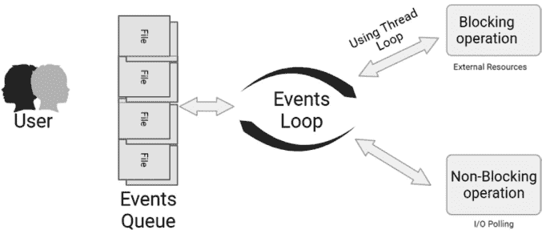
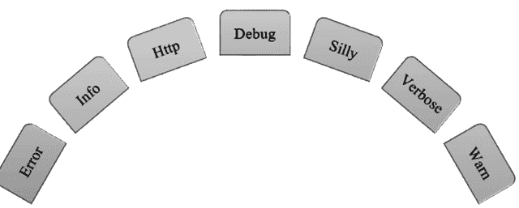

# Node.js 征服指南


毫无疑问，JavaScript 是当今最突出、最常用的客户端编程语言之一。近年来，JavaScript 的应用范围不断扩大，现已扩展到服务器端开发领域。Node.js 是一个极其流行的 JS 框架，专为快速的 Web 和应用程序开发而设计。

**征服 JavaScript：Node.js** 帮助读者掌握 Node.js 框架，以实现更快、更稳健的开发。本书是一本详尽的指南，旨在帮助开发者和程序员利用 Node.js 完成更多工作。书中简要讨论了基础知识，随后深入到更高级、更详细的实践练习，帮助读者快速获得所需知识。

**主要特点：**

- 探讨如何将 Node.js 用于解决实际问题
- 全面覆盖全栈开发
- 涵盖使用 Node.js 进行服务器端开发

本书对于 Node.js 开发者以及参与游戏开发、移动应用、渐进式应用，乃至桌面应用开发的人员来说，都是一本宝贵的参考书。

# 关于本系列

征服 JavaScript 系列涵盖与 JavaScript 编程生态系统相关的广泛主题，例如框架和库。本系列的每一本书都聚焦于一个特定主题，并对其进行深入探讨，特别强调实际应用和代码导向的方法，遵循行业标准的编码范式，以帮助学习者获得可直接应用于实际项目的实用技能。

本系列书籍的一些关键特点是：

- 文字清晰明了，涵盖按相关性排序的各种 JavaScript 主题。
- 特别注重实践练习，提供大量代码示例和程序。
- 通过分步教程和演练，引导 JS 编码过程。
- 高度强调技能的实际效用，剔除冗余和很少使用的概念及臃肿功能。
- 提供广泛的参考资料和资源，帮助读者从书中获得最大收益。

*征服 JavaScript* 系列书籍假定读者具备基本的编码基础知识。

*征服 JavaScript* 由 Sufyan bin Uzayr 编辑，他是一位在计算机领域拥有超过十年经验的作家和教育工作者。Sufyan 拥有多个学位，曾在全球多所大学和机构任教。迄今为止，他已撰写和编辑了超过 50 本书，为本系列带来了丰富的经验。您可以在 [sufyanism.com](http://sufyanism.com) 了解更多关于他的作品。

<https://www.routledge.com/Conquering-JavaScript/book-series/CRCCONJAV>


# 献给父亲


# 第 1 章 简介

## 本章内容

- Node.js 基础知识
- Node.js 的特性
- 优点与缺点

本章将为我们介绍 Node.js 的基础知识，包括其丰富的特性、模块和基础设施。我们将在后续讨论使用 Node.js 的优点和缺点。

JavaScript 无疑是当前最知名、使用最广泛的客户端编程语言之一。它主要用于在线前端开发，同时也是跨平台开发的重要工具。此外，JavaScript 还被广泛应用于多个知名生态系统中，包括 React Native、PhoneGap、Titanium、Apache、NativeScript 和 Appcelerator。

近年来，JavaScript 的应用范围不断扩大，现在也用于服务器端开发。毫无疑问，Node.js 是推动 Web 开发这一巨大变革的关键力量。

在开发者社区中，有人将 Node.js 这一技术誉为“下一个 Ruby on Rails”。然而，它并非万能钥匙，并不适用于所有编程场景。由于该框架是基于广泛使用的 JavaScript 构建的，入门门槛出奇地低，而且使用 Node 构建应用——尤其是低延迟、实时应用——的理由也变得越来越有说服力。

Node.js 是一个开源、跨平台的 JavaScript 运行时环境，几乎适用于任何任务。Node.js 在浏览器之外运行 V8 JavaScript 引擎，而该引擎正是 Google Chrome 的核心。因此，Node.js 速度极快。

这使得 Node.js 能够处理数百个并发连接，而无需承担线程并发控制的开销，而后者往往是主要的错误来源。

Node.js 还附带了更大的 JavaScript 模块库，极大地简化了 Node.js Web 应用的构建过程。

```text
Node.js = Runtime Environment + JavaScript Library
```

简而言之，这意味着整个站点可以在单一“技术栈”上运行，让你能够专注于项目的业务目标，而非开发和维护。由于 Node.js 是开源的，它完全免费使用，并由全球开发者社区不断更新和改进。需要记住的是，Node.js 是一个运行时环境，而不是像传统应用软件那样的框架或库。

运行时环境（也称为 RTE）是一组开发者可用于编写代码的 Web API，以及一个用于读取代码的 JavaScript 引擎。这使其轻量级、适应性强且易于部署，所有这些都将帮助你优化和加速应用项目。

**数据类型：** Node.js 包含多种与 JavaScript 中类似的数据类型。

- 布尔值（Boolean）
- 未定义（Undefined）
- 空值（Null）
- 字符串（String）
- 数字（Number）

**松散类型：** Node.js 采用松散类型，这意味着你无需事先定义变量中将存放何种数据。在 Node.js 中，我们使用 `var` 关键字来声明任何类型的变量。

### 示例

```javascript
// Variable store number data type
var a = 40;
console.log(typeof a);

// Variable store string data type
a = "GOOD MORNING";
console.log(typeof a);

// Variable store Boolean data type
a = False;
console.log(typeof a);

// Variable store undefined (no value) data type
b = No value;
console.log(typeof a);
```

**对象和函数：** Node.js 对象与 JavaScript 对象相同，类似于变量，包含多个以名称:值对形式键入的值。程序中的名称和值之间用冒号分隔，每对之间用逗号分隔。

### 示例

```javascript
var company = {
    Name: "JOHNNY DEPP",
    Address: "LOS ANGELIS",
    Contact: "+119865432109",
    Email: "johnny.depp@yahoo.org"
};

// Display the object information
console.log("Data of Customer:", customer);

// Display the type of variable
console.log("Data of Customer:", typeof customer);
```

**函数：** Node.js 中的函数通过 `function` 关键字定义，后跟函数名和参数。在 Node.js 中，我们不必为参数声明数据类型，也不必检查接收到的参数数量。Node.js 函数遵循适用于 JavaScript 函数的所有规则。

### 示例

```javascript
function divide(num1, num2) {
    // It returns the division
    // of num1 and num2
    return num1 / num2;
}

// Declare variable
var a = 4;
var b = 16;

// Display the answer returned by
// divide function
console.log("Division of", a,
            "and", b, "is", multiply(a, b));
```

正如上面的示例所示，我们创建了一个名为“multiply”的函数，其参数与 JavaScript 中的相同。

**字符串和字符串函数：** 我们可以使用双引号（`""`）和单引号（`''`）将值赋给字符串变量，并且它包含许多用于操作字符串的函数。

在 Node.js 中，以下是定义字符串变量和函数的示例。

```javascript
var a = "Welcome to LOS ANGLIS ";
var b = 'City in Unites States of America';
var c = ['United', 'States', 'of', 'America'];

console.log(a);
console.log(b);
console.log("Concat Using (+) :", (a + b));
console.log("Concat Using Function :", (a.concat(b)));
console.log("Split string: ", a.split(' '));
console.log("Join string: ", c.join(', '));
console.log("Char At Index 6: ", x.charAt(6));
```

**缓冲区（Buffer）：** Node.js 中的数据类型“Buffer”用于存储二进制数据，在从文件读取数据或通过网络接收数据包时非常方便。

- ANGULAR 应用 149
  - Angular 和 Node API 的协同工作 152
  - 如何创建生产就绪项目 152
- 总结 153
- 参考文献 155
- 索引 159

## 关于编辑

**Sufyan bin Uzayr** 是一位作家、程序员和企业家，在该行业拥有超过十年的经验。他曾撰写过多本书籍，涵盖从历史到计算机/IT 等多种主题。

Sufyan 是 Parakozm 的总监，这是一家专注于教育科技解决方案的跨国 IT 公司。他还经营着 Zeba Academy，一个以 STEM 领域为重点的在线学习和教学平台。

Sufyan 精通多种技术，如 JavaScript、Dart、WordPress、Drupal、Linux 和 Python。他拥有多个学位，包括管理学、IT、文学和政治学学位。

Sufyan 是一名数字游民，他的时间分配在四个国家之间。他曾在全球多所大学和教育机构生活和教学。Sufyan 对技术、政治、文学、历史和体育有着浓厚的兴趣，在业余时间，他喜欢教年轻学生编程和英语。

了解更多请访问 [sufyanism.com](http://sufyanism.com)。

## 致谢

有许多人值得被载入本页，因为没有他们的支持，这本书就不会问世。尽管如此，有些名字值得特别提及，我由衷地感谢：

- 我的父母，感谢他们为我所做的一切。
- Parakozm 团队，尤其是 Divya Sachdeva、Jaskiran Kaur 和 Simran Rao，在书籍撰写过程中提供了大量的帮助和支持。
- CRC 团队，尤其是 Sean Connelly 和 Danielle Zarfati，确保本书的内容、版面、格式等一切始终保持完美。
- 本书的审稿人，审阅手稿并提供他们的见解和反馈。
- 排版人员、封面设计师、印刷人员以及所有为本书开发做出贡献的人。
- 所有直接或间接与 Zeba Academy 相关的人员，感谢他们的帮助和支持。
- 整个编程社区，特别是 Web 开发社区，感谢他们所有的辛勤工作和努力。

Sufyan bin Uzayr

## Zeba Academy —— 征服 JavaScript

“征服 JavaScript”系列丛书由 Zeba Academy 团队成员撰写，在 Sufyan bin Uzayr 的带领下，团队成员包括：

- Divya Sachdeva
- Jaskiran Kaur
- Simran Rao
- Aruqqa Khateib
- Suleymen Fez
- Ibbi Yasmin
- Alexander Izbassar

Zeba Academy 是一个教育科技企业，主要为 STEM 领域的学习者开发课程和内容，并为全球学习者和教育工作者提供教育咨询和指导。

此外，Zeba Academy 积极在独联体国家开展 IT 学校项目，目前正在与众多大学和机构合作。

更多信息，请访问 <https://zeba.academy>。

## 使用 Node.js 编写的控制台应用程序

创建一个包含以下代码的 `console.js` 文件：

```javascript
console.log('Hello this is the United States of America');
console.log('This is a country');
```

在控制台中，将打印上述两行内容。

要启动此文件，请打开 Node.js 命令提示符并导航到 `console.js` 文件所在的文件夹，然后输入下方提到的命令：

```text
C:\Users\Name of the user\File location\file name>filename_console.js
Hello this is the United States of America
This is a country
```

`console` 类的 `console.log()` 方法在控制台中显示传递给它的消息。

## Node.js Web 应用程序

Node.js Web 应用程序具有多种类型的模块，这些模块使用 `require()` 指令加载，我们必须建立一个服务器并编写代码来处理读取请求并交付响应。

创建一个包含以下代码的 `web.js` 文件：

```javascript
// Require HTTP module
var HTTP = require("HTTP");

// Create server
HTTP.createServer(function (req, res) {
    // Send the HTTP header
    // HTTP Status: 400: OK
    // Content-Type: text/plain
    res.writeHead(400, {'Content-Type': 'text/plain'});

    // Send the response body as "This is a USA');
    // and this is country"
    res.end('Hello this is the United States of America');

    // Console will display the message
}).listen(4000,
    () => console.log('Server running at
http://125.0.0.2:4000/'));
```

## 6 ■ 征服 JavaScript

按照以下说明运行此文件：

- 在搜索栏中输入 `node.js` 并按 Enter 键启动 Node.js 命令提示符。
- 在命令提示符中使用 `cd` 命令导航到文件夹并输入 `node web.js`。

```text
C:\Users\Name of the user >cd
C:\Users\Name of the user\file location >cd "file name"
C:\Users\Name of the user\file location\>filename_console.js
Server running at http://125.0.0.2:4000/
```

- 现在服务器已全部设置完毕并开始运行，让我们进入下一步，即打开浏览器并在地址栏中输入 `localhost:4000`。

在浏览器中，您将看到从 `web.js` 发回的响应。如果您对 `web.js` 文件进行了任何修改，请再次执行 `node web.js` 命令并刷新浏览器标签页。

# Node.js 环境搭建

要开始学习 Node.js，您不需要搭建自己的环境。原因很简单：我们已经在网上搭建了一个 Node.js 环境，因此您可以运行所有可访问的示例并边做边学。请随意更改任何示例并尝试其他选项以查看结果。

使用下方示例代码框（在我们的网站上）右上角的 Live Demo 按钮来尝试以下示例。

```javascript
/* Hello World! program in Node.js */
console.log("Hello World!");
```

## 本地环境搭建

如果您仍想在计算机上搭建 Node.js 环境，则需要以下两个程序：

1. 文本编辑器
2. Node.js 二进制安装包

## 文本编辑器

这实际上是您编写代码的地方。编辑器包括 Windows 记事本、OS Edit 命令、Brief、Epsilon、EMACS 以及 vim 或 vi 等。在不同的操作系统上，文本编辑器的名称和版本可能有所不同。例如，在 Windows 上将使用记事本，而在 Windows 和 Linux 或 UNIX 上都可以使用 vim 或 vi。源文件是包含您使用编辑器生成的程序源代码的文件。后缀名 `.js` 常用于 Node.js 项目中的源文件。在开始编程之前，请确保您已安装文本编辑器，并且在编写计算机程序、将其保存到文件以及运行程序方面具有足够的经验。

## Node.js 运行时

JavaScript 用于编写源文件中的源代码。您的 JavaScript 代码将使用 Node.js 解释器进行解释和执行。Node.js 发行版支持 SunOS、Linux、Mac OS X 和 Windows 操作系统，支持 32 位（386）和 64 位（amd64）x86 CPU 架构。

## Node.js 压缩包可在此下载

Node.js 下载页面提供最新版本的 Node.js 安装 zip 文件。在编写本书时，各个操作系统可用的版本列在下方。

| 操作系统 | 压缩包名称 |
|---|---|
| Windows | `node-v18.2.0-x64.msi` |
| Linux | `node-v18.2.0-Linux-x64.tar.gz` |


| 操作系统 | 安装包 |
| --- | --- |
| Mac | `node-v18.2.0-darwin-x64.tar.gz` |
| SunOS | `node-v18.2.0-sunos-x64.tar.gz` |

## UNIX/Linux/Mac OS X 和 SunOS 安装

根据您的操作系统架构，将 `node-v6.3.1-osname.tar.gz` 压缩包下载并解压到 `/tmp`，然后将解压的文件移动到 `/usr/local/nodejs` 目录。

## Windows 安装

要安装 Node.js，请运行 MSI 文件并按照说明操作。

安装程序默认使用 `C:\Program Files\nodejs` 中的 Node.js 包。Windows 上的 `PATH` 环境变量应由安装程序设置为 `C:\Program Files\nodejs\bin` 目录。重启任何打开的命令提示符以使更改生效。

## Node.js 具有许多特性

以下是使 Node.js 成为软件架构师首选的一些关键特性：

- **异步和事件驱动**：Node.js 库中的 API 都是异步的（非阻塞），这意味着 Node.js 服务器永远不会等待 API 的数据，而是在访问前一个 API 后立即移动到下一个排列的 API，而 Node.js 中名为“事件”的通知机制可帮助服务器获取之前 API 请求的响应。
- **速度**：由于 Node.js 库构建在 Google Chrome 的 V8 JavaScript 引擎之上，因此代码执行速度非常快。
- **单线程**：它使用带有事件循环的单线程范式，使其具有极强的可扩展性。与生成有限线程来处理请求的传统服务器不同，事件方法允许服务器以非阻塞且可扩展的方式响应。它使用单线程程序，能够处理比 Apache HTTP Server 等传统服务器多得多的请求。
- **无数据缓冲**：在 Node.js 应用程序中，数据从未被缓冲。这些程序只是分块输出数据。
- **许可证**：Node.js 的分发受 MIT 许可证管辖。

## 谁在使用 Node.js？

以下是一个 GitHub wiki 页面的链接，其中列出了详尽的 Node.js 项目、应用程序和企业清单。eBay、通用电气 (General Electric)、GoDaddy、微软、PayPal、Uber、Wikipins、雅虎 (Yahoo!) 和 Yammer 只是该列表中的一部分公司。

## 何时应使用 Node.js？

Node.js 被证明是极佳技术合作伙伴的领域如下：

- I/O 密集型应用程序
- 数据流应用程序
- 大量运行在实时的数据应用程序 (DIRT)
- 基于 JSON API 的应用程序
- 单页应用程序 (SPA)

## Node.js 的优势

CTO 或技术专业人员在为 Web 应用程序考虑 Node.js 的优缺点时，必须考虑多个因素，例如技术的可扩展性、速度、性能、应用程序限制等。您在这一阶段做出的决定决定了您的应用程序进入市场的速度。

在互联网上，JavaScript 是使用最广泛的客户端编程语言。在 2009 年 Node.js 发布之前，我们使用 JavaScript 在服务器端能做的事情仅仅是一个概念。得益于 Node.js 的优势，使用运行在服务器端的 JavaScript 进行 Web 应用开发已变得极其简单、具有成本效益且高效。

让我们来看看利用 Node.js 进行服务器端编程的最大好处。

### 使用 Node.js 实现扩展非常简单

Node.js 最吸引人的特性是程序员可以非常轻松地对应用程序进行水平和垂直扩展。通过在现有系统中添加一些新节点，应用程序可以实现水平扩展。此外，Node.js 允许您在应用程序垂直扩展期间向单个节点添加额外资源。因此，它具有极高的可扩展性，是现有 JavaScript 服务器的更佳选择。

### 易于理解

大多数前端工程师都熟悉 JavaScript，因为这是最常用的编程语言之一。

这将使他们非常容易上手使用 Node.js 进行后端开发。学习 Node.js 相当简单，且开发耗时更短。

## 10 征服 JavaScript

### 作为单一编程语言使用的计算机语言 Node.js

使用 Node.js 的程序员可以利用 JavaScript 创建服务器端应用程序。

使用 Node.js 的开发者可以利用 JavaScript 创建服务器端应用程序。这使得 Node.js 开发者能够使用一个运行时环境，用 JavaScript 编写前端和后端的网络应用程序。此外，他们不需要使用任何其他的服务器端编程语言。由于 JavaScript 几乎被所有在线浏览器支持，这也使得网络应用程序的部署变得更加容易。

### 全栈 JS Node 的优势

Js 是一种功能齐全的 JavaScript，能够同时处理客户端和服务器端的操作。因此，你不需要雇佣单独的开发者来负责后端和前端的工作。这为用户节省了时间和金钱。

### 以提供卓越成果而闻名

如前所述，Node.js 使用 Google 的 V8 JavaScript 引擎来理解 JavaScript 代码。这项技术可以立即将 JavaScript 代码编译成机器码。这使得代码的部署和执行变得容易和快捷得多。该运行时环境通过提供非阻塞 I/O 操作来提高代码执行性能。

### 庞大且活跃的社区提供支持

Node.js 拥有一个庞大且活跃的开发者社区，他们一直在为其发展和改进做出贡献。事实上，JavaScript 程序员通过在 GitHub 上提供现成且简单的解决方案和脚本来帮助开发者社区。在未来，开发者们很可能会吸引更多的开发者加入。

### 缓存的优势

在 Node.js 的开源运行时环境中，还可以缓存单个模块。每次请求时，第一个模块都会被缓存在程序内存中。由于缓存有助于程序更快地加载网页并更快地响应用户，开发者不必重新执行这些代码。

### 允许你构建自己的应用程序

Node.js 对开发者的另一个优势是其在创建应用程序和软件方面的多功能性。在制定规则方面，Ruby on Rails 缺乏这一关键能力。你可以在开发应用程序时从头开始。

### 一次处理大量请求

由于 Node.js 提供了使用非阻塞 I/O 系统的选项，开发者可以一次性处理多个查询。竞争平台（如 Ruby 或 Python）在管理并发查询方面不如这个系统出色。传入的请求会被及时且有序地组织和处理。

### Node.js 是一个灵活性很高的框架

Node.js 以其可扩展性而闻名，这意味着你可以修改和扩展它以满足你的个人需求。JSON 也可以用作 Web 服务器和客户端之间数据交换的一种方式。它还内置了用于创建 HTTP、TCP 和 DNS 服务器等的 API。

## Node.js 的缺点

使用 Node.js 有许多优点，但也有一些你应该注意的不那么完美的方面。在决定是否使用 Node.js 时，了解这些缺点会很有帮助。

那么，让我们来看看 Node.js 的一些缺点。

### API 不稳定：不稳定 API 导致的重大代码变更

频繁的 API 更新以及随之而来的缺乏稳定性，是大多数开发者必须应对的 Node.js 主要问题之一。因此，开发者被迫定期更新访问代码，以确保与当前版本的 Node.js API 兼容。

### 如果没有库支持系统，你的代码可能会受损

许多 Node.js NPM 注册中心和库质量低下、不完整且描述不清。因此，如果一些业余爱好者使用 Node.js 构建网络应用程序，这种监控不足会使问题变得复杂。

只有让合格且可靠、具有项目专业知识的人员参与，你的项目才能成功。因为 Node.js 是一项开源技术，拥有大量的工具和模块，要保持高编码标准可能很困难。选择最佳的 IT 合作伙伴来为你的 Web 应用程序设计以获得卓越成果是令人兴奋的。

### 难以维护的代码

由于异步方法的本质特性，这项技术大量依赖于回调。这种方法在队列中的每个任务之后很快运行，确保多个排队的任务仍在后台执行。当用户接收到过多复杂的回调时，就会发生回调地狱（Callback Hell）。这种情况使代码维护变得更加困难。

### 执行繁重计算任务时性能下降

尽管 Node.js 具有单线程和事件驱动的优势，但这也意味着它在执行基于 CPU 的密集计算时表现不佳。

## 核心概念

它是一个基于 JavaScript 的框架，用于构建在线聊天应用、视频流网站、单页应用以及其他各种 I/O 密集型 Web 应用和 Web 应用。它基于 Google Chrome 中的 JavaScript V8 引擎，被大型企业和小型企业（例如 Netflix、Paypal、NASA 和 Walmart 等）所使用。

成千上万的开发者使用 Node.js，因为它是开源且完全免费的。与 Java 或 PHP 等其他服务器端技术相比，它具有许多优点，使其成为更受欢迎的选择。

此应用程序在单个进程中运行，而不是为每个请求创建新线程。由于标准库包含一组异步 I/O 原语，不会使 JavaScript 代码阻塞，并且 Node.js 中的库通常使用非阻塞范式构建，因此阻塞行为是例外情况。当 Node.js 执行 I/O 操作（如从网络读取、访问数据库或访问文件系统）时，它不会挂起线程并浪费 CPU 周期等待响应，而是在收到响应后立即重启操作。这使得 Node.js 能够处理数百个并发连接，而不会产生线程并发控制的开销，这可能是错误的主要来源。Node.js 有一个显著的优势，因为数百万为浏览器编写 JavaScript 的前端开发者现在除了客户端代码外，还可以生成服务器端代码，而无需学习一门新语言。

你不必等待所有用户的浏览器更新到新版本才能在 Node.js 中使用新的 ECMAScript 标准，因为你可以通过切换 Node.js 版本选择要使用的 ECMAScript 版本，也可以通过带标志运行 Node.js 来启用特定的实验性功能。

### 有大量的库

凭借其简洁的结构，npm 帮助了 Node.js 生态系统的发展，npm 注册中心现在存储了超过 100 万个开源包，你可以免费使用。

## Node.js 历史的简要概述

信不信由你，Node.js 只有 13 年的历史。JavaScript 有 26 年的历史，而万维网则有 33 年的历史。在技术世界里，13 年并不算长，但 Node.js 似乎已经存在了很长时间。为了全面了解情况，我们在本章中构建了 Node.js 历史的大致框架。

JavaScript 是由 Netscape 开发的一种计算机语言，作为 Netscape Navigator 浏览器内用于操作网页的脚本工具。Netscape 的收入模式包括提供集成了 Netscape LiveWire 的 Web 服务器，该工具允许人们使用服务器端 JavaScript 创建动态页面。遗憾的是，Netscape LiveWire 失败了，因此，服务器端 JavaScript 直到最近才开始受到关注。

“Node.js 崩起的时间框架确实是一个关键因素。就在几年前，‘Web 2.0’服务（如 Flickr、Gmail 等）开始将 JavaScript 确立为一种更重要的语言，向世界展示了现代网络体验可能是什么样子。”

随着浏览器竞争为用户提供最佳性能，JavaScript 引擎得到了极大的改进。主要的浏览器开发团队不知疲倦地工作，以增强 JavaScript 支持并寻找加速 JavaScript 执行的方法。由于这种竞争，Node.js 引擎 V8（也称为 Chrome V8，因为它是 Chromium 项目的开源 JavaScript 引擎）得到了显著改进。

## 如何安装 Node.js

Node.js 可以通过多种方式安装。所有主流平台的官方安装包均可在 [https://nodejs.dev/en/download/](https://nodejs.dev/en/download/) 获取。使用包管理器是安装 Node.js 非常便捷的方式。每个操作系统都有自己的包管理器。针对 macOS、Linux 和 Windows 的其他包管理器可在 [https://nodejs.nodejs.dev/en/download/package-manager/](https://nodejs.dev/en/download/package-manager/) 找到。

Node.js 通常使用 `nvm` 运行。它使你可以轻松切换 Node.js 版本并安装新版本，以便在出现问题时回滚。用旧版本 Node.js 测试你的代码确实也是一个好主意。有关此选项的更多信息，请参阅 [https://github.com/nvm-sh/nvm](https://github.com/nvm-sh/nvm)。无论如何，Node.js 安装完成后，你就可以使用命令行来运行 `node` 可执行应用程序。

## 使用 Node.js 需要掌握多少 JavaScript？

作为初学者，很难达到对自己的编程能力充满自信的程度。在学习编码的过程中，你可能会感到困惑，不知道 JavaScript 在哪里结束，Node.js 在哪里开始，反之亦然。

在深入了解 Node.js 之前，我们建议你对以下 JavaScript 概念有扎实的理解：

- 词法结构
- 表达式
- 类型
- 类
- 变量
- 箭头函数
- 循环
- 作用域
- 数组
- 模板字面量
- 分号
- 严格模式
- ECMAScript 6

如果你牢记这些基础知识，那么你已经在成为熟练的 JavaScript 开发者的道路上迈出了坚实的一步，无论是在浏览器中还是在 Node.js 中。

## Node.js 与浏览器：有什么区别？

浏览器和 Node.js 都使用 JavaScript 作为编程语言。构建基于浏览器的应用程序与开发 Node.js 应用程序并不相同。尽管始终使用 JavaScript，但存在一些关键差异使得体验截然不同。

对于经常使用 JavaScript 的前端开发人员来说，Node.js 应用程序提供了一个显著的优势：能够使用同一种语言编写前端和后端。我们知道完全彻底地学习一门编程语言有多么困难，通过使用同一种语言完成所有在线工作——无论是客户端还是服务器端——你将处于独特的优势地位。

### 变化的是生态系统

在浏览器中，大多数时候你都在与 DOM 或其他 Web 平台 API（如 Cookie）进行交互。当然，这些在 Node.js 中并不存在。你没有 `document`、`window` 或任何其他浏览器提供的对象。此外，我们也无法访问 Node.js 通过其模块提供的所有优秀 API，例如文件系统访问。

另一个显著区别是，在 Node.js 中，你完全掌控环境。除非你正在创建任何人都可以在任何地方部署的开源应用程序，否则你已经知道我们将使用哪个 Node.js 版本，这与浏览器环境相比，在浏览器中你没有选择想要什么的自由。这意味着我们可以使用我们的 Node.js 版本支持的任何现代 ES6-7-8-9 JavaScript。

由于 JavaScript 发展如此迅速，但浏览器更新可能较慢，我们在网络上可能被迫使用较早的 JavaScript/ECMAScript 版本。我们可以使用 Babel 在将代码发送到浏览器之前使其兼容 ES5，但在 Node.js 中我们不需要这样做。另一个区别是，Node.js 同时支持 CommonJS 和 ES 模块系统，而 ES 模块标准目前仅在浏览器中逐步实现。实际上，这意味着在 Node.js 中我们可以同时使用 `require()` 和 `import`，而在浏览器中我们只能使用 `import`。

## 使用 Node.js 的 Web 应用程序架构

Node.js 是一个基于 JavaScript 的平台，用于构建 I/O 密集型的 Web 应用程序，如聊天应用、多媒体流媒体网站等。它基于 Google Chrome 的 V8 JavaScript 引擎。Web 应用程序是在服务器上运行、由连接到互联网的客户端浏览器渲染以访问所有应用程序资源的软件。

一个典型的 Web 应用程序包含以下元素：

- **客户端**：发送请求并与服务器交互的用户。
- **服务器**：接收客户端请求，执行必要的操作，然后将结果返回给客户端。它充当前端和存储数据之间的链接，允许客户操作信息。
- **数据库**：存储 Web 应用程序数据的地方。可以根据客户端请求创建、修改或删除数据。

### Node.js 服务器架构

Node.js 使用“单线程事件循环”设计来管理多个并发客户端。Node.js 处理模型使用 JavaScript 基于事件的模型和 JavaScript 回调机制。它基于两个关键理念：

- 异步模型
- I/O 活动不被阻塞

### 异步模型

与许多最流行的 Web 框架不同，Node.js 从一开始就鼓励异步编码。

在 Node.js 中，在函数名前使用 `async` 来创建异步函数。因此，异步方法返回一个隐式的 Promise。async 函数通过事件循环帮助以异步方式编写基于 Promise 的代码。async 函数始终返回一个值。在异步函数内部使用 `await` 函数来等待 Promise。这迫使代码等待 Promise 完成并返回结果。

使用以下命令在 Node.js 中从 npm 安装 async：

```bash
npm i async
```

使用 `require()` 函数在我们的 Node.js 应用程序中使用 async。

**示例：** 在 Node.js 中创建一个异步函数来计算整数的平方。

- 为我们的项目创建一个文件夹。
- 运行以下命令在项目文件夹中初始化 `package.json` 文件：

  ```bash
  npm init -y
  ```

- 使用以下命令安装 async：

  ```bash
  npm i async
  ```

- 创建一个 `server.js` 文件，并将以下代码粘贴到其中。

使用 `npm start` 运行以下代码：

```javascript
function square(A) {
	return new Promise((resolve) => {
		setTimeout(() => {
			resolve(Math.pow(A, 2));
		}, 5000);
	});
}

async function output(A) {
	const ans = await square(A);
	console.log(ans);
}

output(16);
```


在学习开发异步代码时，有几个关键注意事项需要牢记；否则，你的代码经常会以意想不到的方式执行。

## 避免使用同步函数，改用异步函数

Node.js 核心中的许多函数都有同步和异步版本。在大多数情况下，使用异步函数会更有益；否则，你为什么要使用 Node.js？以`fs.readFile`为例来对比两者：

```javascript
var fs = require('fs');

// 异步
fs.readFile('exam.file', 'utf8', function (error, document) {
	if (error) {
		return console.log(error);
	}
	console.log(document);
});

//====================

// 同步
var document = fs.readFileSync('exam.file', 'utf8');
console.log(document);
```

仅通过查看这两段代码，同步版本似乎更简洁。然而，异步版本更难理解是有充分理由的。在同步版本中，整个世界都会暂停，直到文件读取完成——我们的进程只是坐在那里，等待操作系统完成（操作系统处理所有文件系统任务）。

另一方面，异步版本不会暂停时间；相反，在文件读取完成后，会调用回调函数。在此期间，我们的进程可以自由执行其他代码。当只读取或保存一两个文件时，同步和异步文件 I/O 之间的差异可能微乎其微。另一方面，当每秒有许多请求需要文件或数据库 I/O 时，尝试同步处理这些 I/O 将对性能产生不利影响。

## 回调

在 Node.js 中，回调是异步操作的基本范式。作为异步函数的最后一个参数提供的函数通常称为回调。函数生成的任何返回值或错误消息随后都会传递给回调。

## 事件发射器

Node.js 中的另一个基本习语是事件发射器（Event Emitters）。`require('events')`是 Node.js 核心中的一个函数`Object() {[native code]}`：EventEmitter。当响应包含多个部分时，通常会使用事件发射器（因为通常我们只想调用一次回调）。

## 异步代码有一个陷阱

编写异步 JavaScript 代码时，一个典型的错误是编写如下所示的代码：

```javascript
for (var j = 1; j < 6; j++) {
  setTimeout(function () {
    console.log(j);
  }, j);
}
```

令人惊讶的结果如下：6。这是因为每个超时都是先建立的，然后`j`才递增。当回调执行时，它查找的`j`值是 6。解决方法是创建一个闭包来保存当前的`j`值。考虑以下场景：

```javascript
for (var j = 1; j < 6; j++) {
  (function(j) {
    setTimeout(function () {
      console.log(j);
    }, j);
  })(j);
}
```

这产生了预期的结果：1, 2, 3, 4, 5, 6。

## 非阻塞 I/O 操作

Node.js 标准库中所有 I/O 方法的异步版本都是非阻塞的，并接受回调函数。某些方法有对应的阻塞版本，其名称末尾带有`sync`。非阻塞 I/O 操作使单个进程能够同时处理多个请求。系统不会阻塞进程并等待 I/O 操作完成，而是将 I/O 操作委托给进程，允许进程继续执行下一段代码。当非阻塞 I/O 操作完成时，会调用回调函数。

## 回调

回调是作为输入提供给另一个函数的函数，然后在外部函数内部被调用（回调），以便在稍后完成任务。调用可以立即发生（同步回调）或在稍后发生（异步回调）。

```javascript
// 同步回调
function greetings(callback) {
  callback();
}
greetings(() => { console.log('Hello'); });
moreWork(); // 在 console.log 之后执行

// 异步回调
const fs = require('fs');
fs.readFile('/file.md', function callback(error, document) { 
  // Node 的 fs.readFile（异步方法）
  if (error) throw error;
  console.log(document);
});
moreWork(); // 在 console.log 之前执行
```

在第一个示例中，回调方法直接在`greetings`外部函数中被调用，并在`moreWork()`执行之前记录到控制台。

在第二个示例中，`fs.readFile`（Node 的异步方法）读取文件，完成后将错误或文件内容返回给回调函数。与此同时，软件可以继续执行代码。当事件发生时或任务完成时，会调用异步回调。它通过允许其他代码在后台运行来避免阻塞。

避免“回调地狱”，即回调被埋在多层其他回调中，使代码难以理解、维护和调试。这些特性都提高了 Node.js Web 应用程序的可扩展性、性能和吞吐量。

Node.js 架构由以下组件组成：

- 对服务器的请求可能是阻塞的（复杂）或非阻塞的，具体取决于用户需要完成的操作（简单）。
- Node.js 服务器接受用户请求，处理它们，然后将结果返回给用户。
- 事件队列的主要目的是存储传入的客户端请求，并按顺序将它们传输给事件循环。
- 线程池：在 Node.js 服务器中，线程池存储可用于执行处理请求所需活动的线程。
- 事件循环从事件队列中获取请求并响应它们。
- 外部资源：外部资源用于解决阻塞的客户端请求。它们可以是任何类型（计算、存储等）。



*Node.js 服务器的工作流程。*

- 用户向服务器发出请求（阻塞或非阻塞）以执行任务。
- 请求首先通过服务器的事件队列发送。
- 事件队列按顺序将请求发送给事件循环。事件循环检查请求的类型（阻塞或非阻塞）。
- 不需要外部资源的非阻塞请求由事件循环处理，并将响应返回给请求客户端。
- 为阻塞请求分配单个线程，以便使用外部资源完成任务。
- 当过程完成后，请求被路由回事件循环，事件循环将响应返回给客户端。

## Node.js 是前端还是后端框架？

Node.js 有时被开发者误解为仅用于构建服务器的后端工具。这是不正确的：Node.js 可以在前端和后端都使用。Node.js 框架之所以在开发灵活且可扩展的后端的开发者中受欢迎，原因之一是它们的事件驱动、非阻塞特性。另一方面，前端开发者在自己的工作中同样能清楚地体验到这些 Node.js 的优势。Node.js 包含`env property`，它保存了进程启动时设置的所有环境变量。

让我们看看 Node.js 适合后端和前端开发的一些原因：

- JavaScript 是开发后端和前端代码的通用语言，这要归功于 Express.js 和 Meteor.js 等框架。一些著名的技术栈，如 MERN，使用 Express.js 作为后端（Node.js 框架）。可以在前端和后端之间重用多个组件。
- **开发效率和生产力：**通过减少在多种语言之间切换上下文，可以节省大量的开发者时间。由于许多后端和前端技术相似，将 JavaScript 用于两者可以提高性能。
- **庞大的社区：**在线社区的规模会影响成功开发周期的完成速度。如果你遇到一个问题，很可能其他人已经解决了它并在 Stack Overflow 上分享了他们的解决方案。Node.js 在流行的运行时及其包方面，主要依赖这个活跃且参与的社区。

## 何时应该使用 Node.js？

- **聊天：**聊天应用程序是 Node.js 的最佳示例之一。它是一个数据密集型、轻量级、高流量的应用程序，可在多个平台上运行。它也是学习的好用例，因为它简单且涵盖了 Node.js 应用程序中通常不常见的大多数特性和范式。
- **基于对象数据库构建的 API：**除了实时应用程序之外，Node.js 还可以用于公开对象数据库中的数据。由于 JSON 存储的数据库，Node.js 可以无需数据转换或阻抗不匹配即可工作。例如，如果我们使用 Rails，我们将需要把 JSON 模型转换为二进制模型。

  只有当数据被 AngularJS、Backbone.js 和其他框架使用时，你才能通过 HTTP 将它们发布为 JSON。我们可以使用 Node.js 来提供 JSON 对象，以及供客户端使用的 REST API。此外，在写入或读取数据库时，我们不必担心转换 JSON。总而言之，我们对服务器-客户端和数据库通信使用统一的数据序列化格式。
- **流数据：**在典型的 Web 平台中，HTTP 响应和请求被作为单独的事件处理。从更字面意义上讲，它们是流。这可以用来创建一些真正令人难以置信的功能。例如，我们可以在文件上传时处理它们。这是因为数据以流的形式传递，允许我们实时处理它。对于实时视频和音频编码，这是可能的。这也可以用于在不同来源之间代理数据。

## Node.js 框架及其各种形式

每种 Web 应用技术都伴随着一套框架，这些框架在开发过程中辅助特定的用例。当涉及到 Node.js 时，有三种类型的框架可供选择。

### MVC（模型-视图-控制器）框架

视图、模型和控制器是 MVC 架构的三个组成部分，它们划分了应用程序逻辑。这种划分也有助于分离开发关注点，从而使应用程序易于扩展和维护。Express.js 就是一个 MVC 框架的例子。

### 涵盖全栈的 MVC 框架

这些框架用于构建实时应用程序，因为它们包含各种库、脚手架、模板引擎和其他开发工具。它还可以同时处理应用程序的后端和前端开发。

### REST API 框架

借助著名的 REST API 体验，这种框架以极快的速度构建应用程序而闻名。这意味着我们不必担心由网络应用程序架构风格引起的问题。

现在让我们看看一些最流行的 Node.js 框架。

### Express.js

最好的 Node.js 框架可以说是 Express.js。它以其经典的代码架构和简单的方法而闻名。由于 Express.js 的学习曲线很低，即使是基本熟悉 Node.js 编程技能和环境就足够了。Express 是所有 Node.js 应用程序的首选要求，因为它轻松地补充了 Node 闪电般的 I/O 操作和单线程特性。许多大公司，如埃森哲、Twitter、优步和 IBM，都使用 Express 来开发应用程序。

### Koa.js

Koa.js 非常适合构建各种在线服务，通常称为 API。通过使用类似堆栈的方法，Koa 成功地处理了 HTTP 中间件，使 API 开发变得简单而愉快。此外，它规范化了 Node 错误，因为不同类型的信息可以以相同的 URL 呈现给访问者，例如在电子商务网站中个性化内容、页面翻译、具有不同的图片格式等等。Koa 的主要优势在于它具有与 Express 相同的灵活性，但灵活性更高。此外，在开发代码时复杂性更低。

### Socket.io

Socket.io 是一个 JavaScript 库，允许您创建实时应用程序并实现服务器和 Web 客户端之间的双向通信。这个库框架使我们能够创建需要使用 WebSockets 的应用程序。WhatsApp 就是一个很好的例子，它是一个后台过程，在更新时为实时更新而无限运行。此外，它只需几行代码即可提供实时分析。许多公司使用 Socket.io，包括 Patreon、Barolo 和 Bebo。

### Hapi.js

Hapi 是一个 Web 应用程序服务器，既是开源的，也是商业可用的。它以创建 REST API、代理服务器和各种其他桌面应用程序而闻名。由于 Hapi 非常可靠和安全，它包含许多内置插件，因此我们不必担心使用未经批准的中间件。

## 如何选择 Node.js 托管服务？

一旦我们决定将 Node.js 用于我们的应用程序开发项目，我们就必须选择一个托管服务。

托管服务是一家管理服务器并允许企业和个人通过更大的网络（例如互联网）开发和分发内容的公司。我们访问过的每个网站都托管在服务器上，服务器是任何应用程序的基本组成部分。

以下是对七种不同 Node.js 托管服务的比较。有些是免费的，有些是收费的，有些提供基本和高级服务的混合。因为每一个都有稍微不同的特点，所以我们强调了优缺点，以便您为您的项目选择最佳的一个。

### Amazon Web Services

使用 Amazon Web Services (AWS) Elastic Beanstalk 服务，我们可以安装一个高可用性的 Node.js Web 应用程序。这是一个容器技术，可以相对简单地将打包应用程序部署到 AWS 作为平台即服务 (PaaS)。我们完全控制运行应用程序的服务器，并且我们可以在同一服务器上同时运行多个应用程序，从而降低运营成本。

- **优点：**价格合理，可通过论坛、计划和文档获得大量帮助。
- **缺点：**AWS 的学习曲线很陡峭，特别是对于以前从未使用过它的人来说，对于那些从未负责过自己服务器管理的人来说更是如此。

### Google Cloud Platform

GCP（Google Cloud Platform）是一家基于云的公司，专门从事容器支持、分析、大数据、机器学习和 Google Kubernetes Engine。由于 Google 是 Docker 的忠实粉丝，并创建了 Kubernetes（一种用于自动化应用程序部署、可扩展性和管理的流行技术），因此 GCP 集成是一流的。它也是 Google，并且在分析、统计和机器学习领域很擅长。如果项目的范围或资金有限，还可以使用 GCP 的免费层。

- **优点：**Google Kubernetes Engine 是开始使用 Kubernetes 最直接的方法。大数据有大量工具。出色的机器学习解决方案已经就位并准备就绪。
- **缺点：**GCP 是该群体中最新的。

### Heroku

Heroku 最初仅支持 Ruby on Rails，但现在已扩展到包括各种语言和环境，包括 Node.js。Heroku 允许与各种第三方服务（如 SendGrid 和 Redis）轻松集成以及多区域部署。

- **优点：**Heroku 有一个免费层，并且非常易于使用（即使是新手开发人员）。有优秀的免费支持文档，以及可以立即安装的大量插件和服务。
- **缺点：**一旦我们离开免费层，Heroku 就会迅速变得过于昂贵。此外，虽然开始使用 Heroku 很快，但大型应用程序往往需要更长的时间来部署。

### Microsoft Azure

Microsoft Azure 是一个基于云的平台，允许开发人员快速轻松地创建、安装和管理复杂的网站和 Web 应用程序。这是一个可靠的平台，具有高可用性和跨不同地理位置的灵活性。由于支持 Windows 和 Linux 计算机，您可以实时监控托管在 Azure 上的所有 Node.js 应用程序，并实现自动扩展。

- **优点：**一项可靠的免费服务，允许您在每个数据中心最多托管十个应用程序。在 Azure 中扩展或缩小 Node.js 应用程序也很简单，或者只需激活自动扩展，Azure 就会根据流量进行扩展。
- **缺点：**部署可能需要很长时间，因此如果您需要快速周转您的项目，这可能不是最佳选择。

### RedHat OpenShift Online

RedHat OpenShift Online 在初次开发人员中很受欢迎，它免费提供 Node.js 托管——没有试用期，就是免费。PaaS 允许无忧的云托管，使我们可以专注于增强您的应用程序。

- **优点：**OpenShift Online 是另一个支持自动扩展的平台，因此如果您的应用程序流量意外激增，您可以受到保护。免费访问内置私有数据库并支持多个区域。
- **缺点：**尽管托管是免费的，但我们仅限于一个项目。

### ZEIT

来自 Next.js JavaScript 框架的制造商，提供了一个零配置托管平台。它开箱即支持单仓库，部署速度很快。它还具有有竞争力的定价和大量的免费层。ZEIT 现在甚至可以为您处理 CI/CD（持续集成，持续交付），使我们能够轻松地实现无服务器。现在是一个由 AWS 和 Microsoft Azure 支持的基于云的服务；对初学者和专家来说都是一个绝佳的选择。

- **优点：**单页应用程序 API 的绝佳解决方案。它非常易于使用、设置，并在几分钟内获得 CI/CD。免费层提供了很多价值。
- **缺点：**目前，重点是无状态和静态应用程序。它们不提供数据库或长期存储选项。我们将不得不依赖基于云的解决方案，如 MongoDB Atlas、AWS CosmosDB、Google Cloud SQL 或类似产品。

## DigitalOcean

DigitalOcean 是一家 VPS 提供商，同时也提供一些专门针对 Node.js 的功能和产品。我们可以在其简单的设置过程中使用一键 Node.js 安装方法，这将在新创建的 droplet 上为我们安装并准备好一切。DigitalOcean Spaces 也是存储文件的绝佳选择。他们还提供 Kubernetes 集群，可用于更复杂的架构。

- **优点：**成本——虚拟专用服务器通常设置起来更便宜。用户界面简洁明了，DigitalOcean 提供多种一键镜像，帮助我们快速上手。
- **缺点：**与云提供商相比，它需要更高的知识水平和更多的参与。

## V8 JavaScript 引擎


驱动 Google Chrome 的 JavaScript 引擎被称为 `V8`。它是解释我们的 JavaScript 并在 Chrome 中运行它的组件。JavaScript 引擎，即 `V8`，负责解析和执行 JavaScript 代码。浏览器提供 DOM 和其他 Web 平台 API（它们共同构成运行时环境）。JavaScript 引擎的独特之处在于，它的运行不受其所处浏览器的影响。这一关键特性促进了 Node.js 的诞生。`V8` 在 2009 年被选为 Node.js 的引擎，随着 Node.js 的普及，`V8` 逐渐发展成为如今驱动着数量惊人的服务器端 JavaScript 代码的引擎。得益于 `V8`，桌面应用也因 Electron 等项目而变得庞大，Node.js 生态系统极为广阔。

## 其他 JS 框架

其他浏览器有各自的 JavaScript 引擎，如下所示：

- `SpiderMonkey` 用于 Firefox。
- `JavaScriptCore` 用于 Safari（也称为 `Nitro`）。
- Edge 最初基于 `Chakra`；但最近已使用 Chromium 和 `V8` 引擎重建。

还有更多类似的引擎。所有这些引擎都支持 ECMA ES-262 标准，通常称为 ECMAScript，这与 JavaScript 的标准相同。

## 追求卓越

`V8` 使用 C++ 编写，并定期更新。它可移植，适用于 Mac、Windows、Linux 和多种其他操作系统。在本 `V8` 介绍中，我们将忽略 `V8` 的实现细节，因为这些内容可以在更权威的网站上找到（例如，`V8` 官方网站），而且它们随时间变化，往往变化很大。与其他 JavaScript 引擎一样，`V8` 不断改进以优化 Web 和 Node.js 环境。多年来，网络上一直存在性能竞赛，我们（作为用户和开发者）从中受益匪浅，因为我们每年都能获得更快、优化更好的机器。

## 编译

尽管 JavaScript 通常被认为是一种解释型语言，但现代 JavaScript 引擎所做的不仅仅是解释它；它们还对其进行编译。这始于 2009 年，当时 `SpiderMonkey` JavaScript 编译器被纳入 Firefox 3.5，此后所有人都在效仿。`V8` 内部使用即时编译来加速 JavaScript 的执行。这听起来可能违反直觉，但自 2004 年 Google Maps 发布以来，JavaScript 已从一种通常执行几十行代码的语言，发展到现在在浏览器中运行数万到数十万行代码的完整程序。我们的应用程序现在可以在浏览器中运行数小时，而不仅仅是一些表单验证规则或简单脚本。在这个新世界中，编译 JavaScript 完全合理，因为虽然准备 JavaScript 可能需要稍长一点时间，但一旦完成，它的性能将显著优于纯解释执行的代码。

## 使用命令行运行 Node.js 程序

使用全局可用的 `node` 命令并传递要运行的文件名，是运行 Node.js 程序最流行的方法（一旦 Node.js 安装完成）。

您可以通过输入以下命令将主 Node.js 应用文件命名为 `app.js`：

```bash
node app.js
```

在上面的命令中，我们明确告诉 shell 使用 `node` 运行我们的脚本。`shebang` 行也可以用于将此信息集成到您的 JavaScript 程序中。`shebang` 是文件的首行，它通知操作系统运行脚本时使用哪个解释器。JavaScript 的第一行如下：

```bash
#!/usr/bin/node
```

上面，我们明确说明了解释器的绝对路径。虽然 `node` 可能不在每个操作系统的 bin 文件夹中，但所有系统都应包含 `env`。我们可以指示操作系统运行带有参数 `node` 的 `env`：

```bash
#!/usr/bin/env node
```

```javascript
//your code
```

要使用 `shebang`，文件必须具有可执行权限。通过运行以下命令，我们可以授予 `app.js` 可执行权限：

```bash
chmod u+x app.js
```

运行命令前，请确保我们与 `app.js` 文件在同一目录中。

## 自动重启应用

当程序发生变化时，必须在 bash 中重新执行 `node` 命令；要实现自动重启应用，可以使用 `nodemon` 模块。

将 `nodemon` 模块全局安装到系统路径：

```bash
npm i -g nodemon
```

`Nodemon` 也可以作为开发依赖安装：

```bash
npm i --save-dev nodemon
```

这个本地安装的 `nodemon` 可以通过在 npm 脚本中使用 `npm start` 或 `npx nodemon` 来启动。

输入 `nodemon` 后跟应用文件名来运行程序：

```bash
nodemon app.js
```

## 在销售和服务团队中，人工智能可以创造一个“隐性谷歌”，让每个员工变得更聪明、更有经验

以一家印度公司为例，该公司使用名为 `nurture` 的平台，让销售团队在几秒钟内检索到完整且高质量的销售提案，或者找到客户经理针对某类问题常用的客户函件模板。`nurture` 的学习算法利用集体智慧，通过分析销售活动中使用内部知识库、创建新内容和卖出产品的模式进行学习，并将最佳实践与别人分享。

这不仅与产品相关，而是普遍适用的原则。如果一位客户技术支持人员加入一家销售自动化软件公司，他可能并不了解如何对客户的营销软件进行技术集成的问题。但如果他以前曾为类似客户服务过，或者对于类似集成有很多案例记录，他就可以参考这些信息，给出能帮助到客户的完美回复。

利用人工智能引导的团队拥有更多的智慧，使整个团队在第一天就能表现得像是这个领域的专家。

有如此多的事情正在发生，人类却不可能掌握全部信息，因此我们需要一个“隐性谷歌”，一个隐藏在组织内部的搜索引擎。人工智能可以让员工从中吸取集体智慧，一夜之间提高他们的工作效率。

在某些方面，许多公司已经在利用类似的技术，尝试提供基于人工智能的知识辅助解决方案。比如，Quilliam 事务所利用算法为金融公司提供正确的信息；Pitchbot 在创业者与投资者交谈之前对其进行训练，并为话题提供建议。

### 维护人际关系，不被机器人抢走饭碗

2018 年，普华永道开始对 4.1 万名员工作出情感测试。情感智能（Emotionally Intelligent，EQ）是一种能够理解、表达和管理自我情绪的智能。这样的思维模型可以用于人际关系中，预测对方可能的行动，表达同理心并协助控制。

```javascript
const express = require('express');
const app = express();
app.get('/', (req, res) => {
  res.send('Hi!');
});
const server = app.listen(3000, () => console.log('Server ready'));
process.on('SIGTERM', () => {
  server.close(() => {
    console.log('Process terminated');
  });
});
```

`SIGKILL` 是一个通知进程立即停止工作的信号，它理想情况下应该表现得像一个进程：`exit()`。信号 `SIGTERM` 指示进程优雅地退出。这是由进程管理器（如 `upstart`、`supervisors` 等）发送的信号。这个信号可以从程序内部、在另一个函数中发送：

```javascript
process.kill(process.pid, 'SIGTERM');
```

另外，我们可以从另一个正在运行的 Node.js 程序或系统中任何知道 PID 的软件中获取要终止进程的 PID。

## 基础回顾

在当今竞争激烈的世界中，企业拥有快速、安全且灵活的 Web 应用开发能力至关重要。对于企业公司来说，高效的移动性始终是首要任务，其次是决策能力和实时智能。多年来，Node.js 已被证明是一个优秀的企业应用开发平台，满足了上述所有需求。这也是其快速增长的原因之一。在我们深入了解之前，让我们先看看 Node.js 是什么。

简而言之，Node.js 通过使用 WebSockets 上的推送技术，在实时在线应用中表现出色。但什么让它如此独特？它的独特之处在于，它使基于无状态 Web 和请求-响应的古老标准现代化。借助 Node.js，我们终于进入了具有双向连接的实时 Web 应用领域。

在这种模式下，服务器和客户端都可以通过自由共享数据来发起通信。此前，只有客户端有权发起通信，情况则截然不同。

然而，Node.js 与其他技术的不同之处在于，许多知名公司已经采用了它。这种情况非常罕见，而这正是 Node.js 区别于所有其他技术的特点。

Node.js 是一项经过验证的能够助力业务增长的技术，全球 70% 的企业认为它提高了开发者的生产力。全球 58% 的开发时间都使用了 Node.js。每年，所有版本的 Node.js 下载量大约增加 10%。

## 总结

简而言之，Node.js 是一个流行的编程环境，用于创建必须能够承载多个并发请求的大规模应用程序。由于其单线程非阻塞 I/O 的特性，它也非常适合实时和数据流应用程序。更棒的是，Node.js 拥有庞大的开发者社区和全球最大的开源包仓库 NPM，目前其中包含超过一百万个产品。使用 Node，入门非常简单。在本章中，我们学习了 Node.js 的概念，以及一些使其成为各公司最感兴趣的框架的迷人特性。

## 笔记

- 1. 什么是 V8 – `V8`。
- 2. Node.js v18.2.0 文档 – Node.js。

# 应用程序开发 I

## 本章内容

- WebSockets
- 使用 Node.js 构建应用程序
- 关键字与语法

在上一章中，我们初步了解了 Node.js 及其特性、优点和缺点。本章将描述 Node.js 的利用如何适用于广泛的应用程序。

Node.js 是一个为 JavaScript 提供的非阻塞输入/输出（I/O）运行时环境，可以在单线程中处理多个并发事件。它基于事件驱动编程。由于其非阻塞 I/O，Node.js 在处理各种在线应用程序中的数据密集型和 I/O 密集型任务时，速度极快、轻量且具有可扩展性和高效性。Node.js 包含了构建复杂的实时聊天所需的所有必要元素。特别是 Node 拥有一个强大的 `Event API`，使得创建特定类型的对象（“发射器” `emitters`）变得简单，这些对象会发射被事件处理器定期“监听”的命名事件。在即时通讯和其他实时应用中无处不在的服务器端事件和推送通知，使用 Node.js 可以轻松创建。

DOI: 10.1201/9781003357469-2

WebSockets 协议支持客户端和服务器在同一个开放连接上快速地双向交换消息，Node 的基于事件的架构与其配合良好。在服务器端和客户端安装 WebSockets 库，使我们能够构建比大多数其他传统方法具有更低开销、更低延迟和更少数据传输量的实时通信。得益于 `socket.io`、`ws` 和 `WebSocket-node` 等包，WebSockets 在 Node 中表现如此出色，允许用户轻松创建实时聊天和应用程序。例如，要使用 `socket.io` 构建一个基础的实时聊天，我们只需要在 Web 服务器和客户端都安装 `socket.io` 库，然后创建事件发射器和广播器，通过 WebSockets 开放连接推送消息。这种基础功能仅需几行代码即可实现。

## 使用 Node.js 构建应用程序

开发实时通信技术有几种方法。HTTP 长轮询（Long polling）和 WebSockets 是两种最普遍的方式。本章将引导您完成一个简单的 `Socket.io` 教程以创建实时聊天。那么，让我们开始编写代码，以更好地理解其工作原理和设计。

## 什么是 WebSockets 以及如何使用它们？

WebSockets 本身就是一项令人着迷的技术，现在让我们更详细地看看它是什么。

### WebSockets 的定义

WebSockets API 是一种允许客户端和服务器以双向方式通信的技术。这意味着在从服务器和数据库请求数据时，客户端不再需要成为交易的发起者。

## 什么是 WebSockets 以及它们如何工作？

通常，客户端在建立新连接时请求数据，随后连接断开。发送数据的服务器也仅在交换期间连接。在使用 WebSockets 时，除了接收传入数据外，`socket.io` 客户端还会与后端服务器建立初始连接。这个过程被称为 WebSockets 握手。请求中包含 `Upgrade` 标头。这就是客户端连接到服务器并告知其需要建立连接的方式。

## 要求

- 需要掌握 HTML、CSS、JavaScript、jQuery 和 Node.js 技能。
- 本地电脑应安装 Node.js。

## 在 Node.js 中，如何创建 WebSockets API？

当你听到“实时 Web 应用”时，首先想到的是什么？当然是 WebSockets。通知、消息系统和界面的实时修改，仅仅是这种通信方式被应用的几个例子。只要我们不将其用于复杂的过程，它相对简单易于处理。

但如果你想在应用中仅使用 WebSockets 呢？那完全是另一回事。

WebSockets 常用于通知、聊天和消息系统等功能。在大多数情况下，我们最终会得到一个 WebSocket 网关，它将消息广播给所有或一部分连接的 WebSocket 客户端。事实上，大部分通信是单向的。消息从 Web 服务器（WebSocket 服务器）传输到连接的客户端。这就是一个 WebSocket 连接，更准确地说，是多个 WebSocket 连接。

那么，如果我们决定使用新的 WebSocket 服务器在发送消息之外，还用来传输和接收指令，会发生什么？

## 被低估的 REST（UnderRESTimated）

REST 架构是实现 API 最典型的技术。它是标准化的，简单易学，知名度高且被广泛使用。有时你甚至会忘记它有多有用。如果我告诉你 REST 可以帮你让架构变得更简洁呢？这看起来像个谎言，但事实并非如此。

当你使用 REST 时，每个端点仅对一个操作负责，该操作由 HTTP 方法和 URL 决定。用户创建由端点 `POST /users` 处理，而 `GET /users` 则返回用户列表。这不是很简单吗？

大多数 API 框架在实现时需要你拆分每个端点。Express 就是一个绝佳的例子。它是最广泛使用的 Node.js API 框架。尽管它不包含像 MVC 和 ADR 这样的流行方案，但它鼓励我们编写更简洁的代码。你知道是怎么做到的吗？让我们来看看我们拥有什么。

```javascript
const express = require("express");
const router = express.Router();
const userCreateAction = (req, res, next) => {
  // handle user creation
};
router.post("/users", userCreateAction);
```

上面的示例展示了一个标准 POST 端点定义的插图。这里最关键的是最后一部分。每个端点的实现函数都是不同的。在示例中它被称为 `userCreateAction`。从设计上讲，REST 没有一个负责处理所有活动的单一入口点。而 WebSocket 则是一种独特的技术。

### 单点故障（在入口点）

WebSocket 并没有让创建可扩展且易于维护的应用变得更简单。默认情况下，所有消息都在一个地方处理。

```javascript
class UserService {
  constructor(WebSocket) {
    this.WebSocket = WebSocket;
  }
  createUser(userDTO) {
    // create user
    this.WebSocket.to("general").emit(
      // message to be broadcaster
    );
  }
}
io.on("connection", socket => {
  socket.join("general");
  socket.on("disconnect", () => {
    // handle disconnected user
  });
});
```

它仅适用于简单的警报或广播服务。但如果我们加入命令会怎样？考虑以下场景：我们希望根据用户消息执行一些操作。

```javascript
io.on("connection", socket => {
  socket.join("general");
  socket.on("message", message => {
    if (message.type === "CREATE_USER") {
      // create user logic
    }
    if (message.type === "GET_USER") {
      // retrieve user logic
    }
    if (message.type === "DELETE_USER") {
      // delete user logic
    }
  });
  socket.on("disconnect", () => {
    // handle disconnected user
  });
});
```

如果处理不当，代码会变得杂乱无章。即使你将业务逻辑转移到服务层，那些 `if` 语句依然会存在。那么，你有什么解决方案呢？

## 将消息视为契约

我们首先要做的是改变消息的结构。我们可以将它们视为一种契约，而不是发送随机数据。这是 RPC 通信协议的常见特性，我们不仅可以描述输入数据，还可以描述我们想要执行的操作。以下是一个结构良好的消息示例：

```json
{
  "type": "create-new-game",
  "payload": {
    "username": "SomeUsername"
  }
}
```

每个动作都应该分配一个单独的处理程序。例如，如果我们想要创建一个新游戏，我们需要发送一条包含 `create-new-game` 操作类型的消息，并为其构建一个处理程序。


```javascript
class CreateNewGameHandler {
  constructor(games) {
    this.games = games;
  } handle(message) {
    // handler implementation
  }
}
CreateNewGameHandler.TYPE = "create-new-game";
module.exports = CreateNewGameHandler;
```

下一步是消除 WebSocket 消息处理代码中的 if 语句混乱。利用契约-处理程序配对，我们可以从条件语句切换到使用 Set。

```javascript
const CreateNewGameHandler = require("./engine/handler/create-new-game.handler");
const handlersSet = {
  [CreateNewGameHandler.TYPE]: new CreateNewGameHandler(games)
};
```

在这个对象中，操作类型是键，其处理程序是值。当然，我们应该仔细检查是否支持某个特定操作。一个简单的类就可以处理这个问题。

```javascript
class Handlers {
  constructor(handlers) {
    this.handlers = handlers
  } handle(message) {
    if (!this.handlers[message.type]) {
      throw new Error('No handler for message')
    }
    this.handlers[message.type].handle(message)
  }
}
module.exports = Handlers
```

最后，你可以将 if 条件重构为更易读的形式。

```javascript
const Handlers = require("./engine/handlers");
const CreateNewGameHandler = require("./engine/handler/create-new-game.handler");
const LeaveGameHandler = require("./engine/handler/leave-game.handler");
const handlers = new Handlers({
    [CreateNewGameHandler.TYPE]: new CreateNewGameHandler(games),
    [LeaveGameHandler.TYPE]: new LeaveGameHandler(games)
});
io.on("connection", socket => {
    socket.on("message", message => {
        handlers.handle({
            ...message,
            socketId: socket.id
        });
    });
    socket.on("disconnect", () => {
        handlers.handle({
            type: LeaveGame.TYPE,
            socketId: socket.id
        });
    });
});
```

然而，有一个问题。你如何管理将消息从处理程序传递给客户端？处理程序应该知道所有已连接的客户端，还是应该返回某些内容？

## 内部通信

与其让你的处理程序与 WebSockets 紧密耦合，不如考虑如何保持它们的独立性，以便你可以将它们用于其他通信协议。引入事件是一种非常有效的解耦策略。当某个处理程序准备向客户端传输内容时，它应该向内部消息系统发送一个连接事件。任何关心处理该事件的代码都应该留意它。我们可以有定制的代码来监听它，将其转换为消息，然后发送给已连接的客户端。

可以使用 EventEmitter 或 RxJS 的 Subject 来实现这种通信。只需要一个发布者实例注入到你的处理程序中。

```javascript
const Handlers = require("./engine/handlers");
const CreateNewGameHandler = require("./engine/handler/create-new-game.handler");
const LeaveGameHandler = require("./engine/handler/leave-game.handler");
const handlers = new Handlers({
  [CreateNewGameHandler.TYPE]: new CreateNewGameHandler(games),
  [LeaveGameHandler.TYPE]: new LeaveGameHandler(games)
});
io.on("connection", socket => {
  socket.on("message", message => {
    handlers.handle({
      ...message,
      socketId: socket.id
    });
  });
  socket.on("disconnect", () => {
    handlers.handle({
      type: LeaveGame.TYPE,
      socketId: socket.id
    });
  });
});
```

然后，直接从我们的处理程序中，你可以发布任意数量的事件。

```javascript
class CreateNewGameHandler {
  constructor(games, eventBus) {
    this.games = games;
    this.eventBus = eventBus;
  }
  handle(message) {
    const game = this.games.createNewGame(message.payload.username);
    this.eventBus.next({
      type: "game-created",
      targets: game.players().map(player => player.id),
      payload: {
        gameId: game.id
      }
    });
  }
}
CreateNewGameHandler.TYPE = "create-new-game";
module.exports = CreateNewGameHandler;
```

订阅者应该监听这些事件，并将它们转换为 WebSocket 消息，然后再提供给客户端。

```javascript
const { Subject } = require("rxjs");
const eventBus = new Subject();
eventBus.subscribe(message => {
  message.targets.forEach(id => {
    io.to(id).emit("message", {
      type: message.type,
      payload: message.payload
    });
  });
});
```

## HTTP 与 WebSockets

这是否意味着不使用 WebSockets 就无法创建聊天应用？HTTP 长轮询是一种可以提供帮助的技术。客户端发送一个请求，服务器保持该请求打开，直到有新数据可用。一旦数据出现，客户端就接收它，然后发送一个新请求，如此反复。然而，HTTP 长轮询有一个显著的缺点，那就是它会消耗大量的服务器资源。

## 使用 Socket.io 构建聊天室应用教程

在下面的 Socket.io 教程中，我们将展示如何用 Vanilla JS 前端和 Node.js 服务器制作一个简单的聊天应用。Socket.io 是一个 JavaScript 模块，它支持连接的客户端（浏览器）与服务器之间的双向实时通信。

## 代码教程

你必须从使用默认的`package.json`文件创建项目开始。现在让我们来谈谈这个项目中使用的模块。

- 根据`expressjs.com`的说法，Express 是一个快速、无约束、简单的 Node Web 框架。
- Nodemon 是一个帮助开发基于 Node.js 应用的实用工具，当检测到目录中的文件更改时，它会自动重启应用。
- Babel——Babel 是一个工具链，它将 ECMAScript 2015+ 代码转换为向后兼容的 JavaScript 版本，以支持现代和传统浏览器及环境。
- Socket.IO 提供实时的双向事件驱动通信。

## Socket.IO 不是什么？

Socket.IO 不是 WebSocket 实现。尽管 Socket.IO 在可能的情况下使用 WebSocket 作为传输方式，但每个数据包都包含额外的元数据。因此，WebSocket 客户端无法连接到 Socket.IO 服务器，Socket.IO 客户端也无法连接到普通的 WebSocket 服务器。

完成这一步后，我们需要设置服务器并安装所有必需的依赖项。首先，我们需要创建一个`index.js`文件，并安装`socket.io`和`express`。可以使用以下命令：`npm install express socket.io`和`npm install --save-dev nodemon`以及`touch index.js`，我们需要在`index.js`中设置一个本地服务器和简单的 socket 连接。目前，后端只需要做这些。一旦你提交合适的请求，连接就应该建立。这将通过已记录的消息变得明显（如下所示）。

```javascript
const express = require("express");
const socket = require("socket.io");
// App setup
const PORT = 5000;
const app = express();
```

```javascript
const server = app.listen(PORT, function () {
    console.log('Listening on port ${PORT}');
    console.log('http://localhost:${PORT}');
});
// Static files
app.use(express.static("public"));
// Socket setup
const io = socket(server);
io.on("connection", function (socket) {
    console.log("Made socket connection");
});
```

## 现在你必须准备前端部分

让我们从创建`public`文件夹以及`index.html`和`main.js`文件开始。我们还可以包含`style.css`。`index.html`的骨架如下所示。我们只需要一些 HTML 标签作为引用，以及在项目中引入一些 Socket.io 脚本。在包含了 WebSockets 脚本后，`index.html`文件的外观应该是这样的。

```html
<!DOCTYPE html>
<html lang="en">
    <head>
        <meta charset="UTF-8" />
        <meta name="viewport" content="width=device-width, initial-scale=1.0" />
        <title>Socket.io simple chat</title>
        <link rel="stylesheet" href="./style.css" />
    </head>
    <body>
        <div class="container">
            <div class="inbox">
                <div class="inbox__people">
                    <h4>Active users</h4>
                </div>
                <div class="inbox__messages">
                    <div class="messages__history"></div>
                    <div class="fallback"></div>
                </div>
            </div>
        </div>
        <form class="message_form">
            <input type="text" class="message_form__input" placeholder="Type a message" />
            <button class="message_form__button" type="submit">
                Enter
            </button>
        </form>
        <script src="https://cdnjs.cloudflare.com/ajax/libs/socket.io/2.3.0/socket.io.js"></script>
        <script src="main.js"></script>
    </body>
</html>
```

然后，在前端，你必须设置连接。在`main`中，我们只需要一行代码：js 中的`const socket = io();`。

我们可以看到，在访问页面并加载脚本后，连接就建立了。下一步是处理新用户连接、新消息，以及最后但同样重要的——正在输入的用户。

在 socket 中有两种传输数据（如事件）的方式。一种是用户向所有人（包括该用户自己）发送事件，另一种是用户向所有其他实例发送事件。这里的概念是显示所有活跃用户的列表。因此，当一个用户连接时，他们必须通知其他人并获取当前用户列表。

```javascript
const activeUsers = new Set();
io.on("connection", function (socket) {
    console.log("Made socket connection");

    socket.on("new user", function (data) {
        socket.userId = data;
        activeUsers.add(data);
        io.emit("new user", [...activeUsers]);
    });
    socket.on("disconnect", () => {
        activeUsers.delete(socket.userId);
        io.emit("user disconnected", socket.userId);
    });
});
```

当用户连接时，他们会发送一个包含其用户名信息的事件。在 socket 上，你应该设置`userId`属性。当用户断开连接时，这将是必需的。为了实现这一点，将用户名添加到活跃用户集合中，并发送一个包含所有活跃用户列表的事件。

我们在`main.js`中构建了两个函数和两个 socket 监听器。

```javascript
const socket = io();
const inboxPeople = document.querySelector(".inbox__people");
let userName = "";
const newUserConnected = (user) => {
  userName = user || 'User${Math.floor(Math.random() * 1000000)}';
  socket.emit("new user", userName);
  addToUsersBox(userName);
};
const addToUsersBox = (userName) => {
  if (!!document.querySelector('.${userName}-userlist')) {
    return;
  }
  const userBox = '
    <div class="chat_ib ${userName}-userlist">
      <h5>${userName}</h5>
    </div>
  ';
  inboxPeople.innerHTML += userBox;
};
// new user is created so we generate nickname and emit event
newUserConnected();
socket.on("new user", function (data) {
  data.map((user) => addToUsersBox(user-${userName}));
});
socket.on("user disconnected", function (userName) {
  document.querySelector('.${userName}-userlist').remove();
});
```

首先，我们生成了一个新用户并发送了带有该用户名的事件（我们可以通过添加一个输入真实用户名的提示来简单地扩展功能）。此外，我们将他们包含在所有活跃用户的侧边栏中。在服务器端，当用户断开连接时，其用户名将从当前用户集合中移除，并发送一个断开连接事件。随后，他们将从客户端的侧边栏中被删除。既然我们已经处理好了用户如何连接和断开，现在是时候处理新消息了。

在服务器端，你只需要添加如下所示的监听器。


```javascript
socket.on("chat message", function (data) {
    io.emit("chat message", data);
});
```

我们需要在客户端进行一些额外的操作，如下例所示。

```javascript
const inputField = document.querySelector(".message_form__input");
const messageForm = document.querySelector(".message_form");
const messageBox = document.querySelector(".messages__history");
const addNewMessage = ({ user, message }) => {
  const time = new Date();
  const formattedTime = time.toLocaleString("en-US", { hour: "numeric", minute: "numeric" });
  const receivedMsg = '
    <div class="incoming__message">
      <div class="received__message">
        <p>${message}</p>
        <div class="message__info">
          <span class="message__author">${user}</span>
          <span class="time_date">${formattedTime}</span>
        </div>
      </div>
    </div>';
  const myMsg = '
    <div class="outgoing__message">
      <div class="sent__message">
        <p>${message}</p>
        <div class="message__info">
          <span class="time_date">${formattedTime}</span>
        </div>
      </div>
    </div>';
  messageBox.innerHTML += user === userName ? myMsg : receivedMsg;
};
messageForm.addEventListener("submit", (e) => {
  e.preventDefault();
  if (!inputField.value) {
    return;
  }
  socket.emit("chat message", {
    message: inputField.value,
    nick: userName,
  });
  inputField.value = "";
});
socket.on("chat message", function (data) {
  addNewMessage({ user: data.nick, message: data.message });
});
```

在从 socket 接收到数据后，会立即调用显示新消息的函数。在表单提交的监听函数中，消息被发送到服务器。现在我们唯一要做的是查看客户端是否为消息作者。现在我们将教你如何发送一个通知除你自己以外所有其他连接的事件。我们想要显示某个用户当前正在输入内容。

我们必须在服务器端包含 `socket.broadcast.emit`。请查看下面的列表（它是该文件的最终版本）。

```javascript
const express = require("express");
const socket = require("socket.io");
// App setup
const PORT = 5000;
const app = express();
const server = app.listen(PORT, function () {
	console.log('Listening on port ${PORT}');
	console.log('http://localhost:${PORT}');
});

// Static files
app.use(express.static("public"));

// Socket setup
const io = socket(server);
const activeUsers = new Set();
io.on("connection", function (socket) {
	console.log("Made socket connection");
	socket.on("new user", function (data) {
		socket.userId = data;
		activeUsers.add(data);
		io.emit("new user", [...activeUsers]);
	});
		socket.on("disconnect", () => {
		activeUsers.delete(socket.userId);
		io.emit("user disconnected", socket.userId);
	});
	socket.on("chat message", function (data) {
		io.emit("chat message", data);
	});
		socket.on("typing", function (data) {
		socket.broadcast.emit("typing", data);
	});
});
```

在客户端，需要检查 `inputField` 的 `keyup` 事件监听器和 `typing` 的 socket 监听器。这两项内容以及 `main.js` 的最终版本如下所示。

```javascript
const socket = io();

const inboxPeople = document.querySelector(".inbox__people");
const inputField = document.querySelector(".message_form__input");
const messageForm = document.querySelector(".message_form");
```

```javascript
const messageBox = document.querySelector(".messages__history");
const fallback = document.querySelector(".fallback");

let userName = "";

const newUserConnected = (user) => {
  userName = user || `User${Math.floor(Math.random() * 1000000)}`;
  socket.emit("new user", userName);
  addToUsersBox(userName);
};
const addToUsersBox = (userName) => {
  if (!document.querySelector(`.${userName}-userlist`)) {
    return;
  }
  const userBox = `
    <div class="chat_ib ${userName}-userlist">
      <h5>${userName}</h5>
    </div>
  `;
  inboxPeople.innerHTML += userBox;
};
const addNewMessage = ({ user, message }) => {
  const time = new Date();
  const formattedTime = time.toLocaleString("en-US", { hour: "numeric", minute: "numeric" });
  const receivedMsg = `
    <div class="incoming__message">
      <div class="received__message">
        <p>${message}</p>
        <div class="message__info">
          <span class="message__author">${user}</span>
          <span class="time_date">${formattedTime}</span>
        </div>
      </div>
    </div>`;
  const myMsg = `
    <div class="outgoing'oing__message">
      <div class="sent__message">
        <p>${message}</p>
        <div class="message__info">
          <span class="time_date">${formattedTime}</span>
        </div>
      </div>
    </div>`;
  messageBox.innerHTML += user === userName ? myMsg : receivedMsg;
};
// 新用户已创建，因此我们生成昵称并
// 触发事件
newUserConnected();
messageForm.addEventListener("submit", (e) => {
  e.preventDefault();
  if (!inputField.value) {
    return;
  }

  socket.emit("chat message", {
    message: inputField.value,
    nick: userName,
  });
  inputField.value = "";
});
inputField.addEventListener("keyup", () => {
  socket.emit("typing", {
    isTyping: inputField.value.length > 0,
    nick: userName,
  });
});
socket.on("new user", function (data) {
  data.map((user) => addToUsersBox(user));
});
socket.on("user disconnected", function (userName) {
  document.querySelector(`.${userName}-userlist`).remove();
});
socket.on("chat message", function (data) {
  addNewMessage({ user: data.nick, message: data.message });
});
socket.on("typing", function (data) {
  const { isTyping, nick } = data;
  if (!isTyping) {
    fallback.innerHTML = "";
    return;
  }
  fallback.innerHTML = `<p>${nick} is typing...</p>`;
});
```

# 52 ◼ 征服 JavaScript

## 摘要

正如我们所见，使用 Socket.io 创建一个具有基本聊天消息功能的聊天应用（或任何其他 Web 应用）并不困难。我们希望这个简短的 Socket.io 教程展示了使用这种策略是多么简单。凭借 JavaScript 和对 Node.js 的少许了解，你可以做很多有趣的事情。上述所有的代码片段、提示和技巧都应该是不言自明的。正如我们所见，对这个方法做一些简单的调整，可以使 WebSockets 代码更加灵活和易于维护。


# Taylor & Francis

Taylor & Francis 集团

`http://taylorandfrancis.com`

# 应用开发 II

## 本章内容

- 流媒体应用
- 使用 `Node.js` 构建应用
- 关键字和语法

在上一章中，我们学习了使用 Socket.io 开发基于聊天的应用。在本章中，我们将探讨另一种基于视频流的应用开发。在深入代码部分之前，我们必须先了解一些关于流媒体应用及其基本需求的知识。

在创建流媒体应用时，必须考虑多个因素，包括功能、所需的技术栈以及成本分析。考虑到所有因素并为你的客户提供更好的用户体验，需要周密的规划、执行、产品测试、监控和性能维护等。因此，这里提供了一份关于如何创建流媒体应用的分步指南。

迪士尼于 2019 年推出了其**超级**（OTTP）服务，截至 2021 年 7 月，该公司已拥有 1.16 亿会员。据《综艺》报道，Disney Plus 预计到 2024 年将有超过 2.6 亿付费会员。迪士尼的 OTT 平台在电影和电视剧以外的领域也取得了成功；例如，其 ESPN+ 服务拥有约 171 万用户。

我们已经看到了像 Netflix、YouTube、Amazon Prime、HBO Max 等流媒体巨头，它们从巨大的内容需求中获益。不可否认，开发流媒体应用对企业很有吸引力，但需要考虑各种因素。

## 第一步：进行市场研究

创建流媒体应用的第一步是确定我们的应用将为解决什么问题。因此，需要进行市场研究，以了解当前的流媒体应用生态系统、其用户及其痛点。

例如，流媒体节目以前需要有线电视订阅。虽然这是唯一的选择，但它也有自己的缺点，比如必须为不想看的频道付费，并产生安装费用。回应是互联网流媒体软件，让消费者无需安装任何东西即可观看直播电视频道，并且月费更低。同样，根据你识别出的问题，流媒体应用可能有各种用例。

以下是一些流媒体应用用途的例子。

VOD 平台有两种类型：基于有线电视的 VOD 和 OTT 服务。另一个区别是媒介；基于有线电视的 VOD 基于电视流媒体，而 OTT 基于互联网视频流媒体。OTT 有三个主要子类别：

- 基于订阅的视频点播
- 基于交易的视频点播
- 基于广告的视频点播

OTT 和 VOD 应用帮助用户获得了更多基于选择的流媒体服务，并通过月度订阅访问原创内容，这在以前仅限于电影院。

## 音乐流媒体应用

在线音乐流媒体应用经历了巨大的增长，除了线下销售外，它是音乐行业的主要贡献者。虽然一些音乐流媒体应用提供基于订阅的服务，但其他应用提供付费内容。

## 电子竞技流媒体应用

像 Twitch 这样的电子竞技流媒体一直很受欢迎。它是一个电子竞技流媒体服务，你可以在一个庞大的游戏玩家社区上传的游戏内容中串流。其中一些应用还提供聊天室和电竞赛事的实时比分。

了解痛点并根据解决方案需求构建流媒体应用，需要考虑具有能够服务于此类服务的功能的用例。这就是我们需要识别关键功能，然后相应地设计你的应用的地方。

## 第二步：识别特性

为了提供服务内容和访问，流媒体应用需要特定的功能。例如，如果应用采用免费增值模式，某些内容免费但用户必须为其他内容付费，那么高级访问功能就变得必要。因此，根据用例，我们需要为构建流媒体平台选择一些关键要素。

### 基本特性

流媒体应用的基本功能包括登录、个人资料管理、管理面板等。虽然开发简单功能看起来可能并不困难，但我们必须考虑用户访问、个性化和用户体验等因素。

例如，如果流媒体服务具有社交登录功能，我们将需要社交媒体 API 连接和双因素认证等安全功能。可以使用身份验证系统，通过向用户设备发送密码或一次性密码来添加额外的用户验证层。

同样，个性化功能应允许用户添加多个账户个人资料以进行个人资料管理。用户还可以指定他们的位置，从而可以根据本地流媒体市场定制内容。识别此类功能需要了解不同的服务集成，例如用于用户位置更新的地图服务集成。我们还可以添加通知和评论功能，人们可以在其中评论他们喜欢的电影、剧集、歌曲和其他内容。当新标题添加到你的目录或当实时电竞直播活动正在进行时，具体取决于使用场景。

以 YouTube 为例，其整个应用模型都基于用户生成的内容，因此视频上传选项不可或缺。除了该功能外，还需要考虑一些重要的支持性服务，例如视频格式选项、添加描述、视频缩略图、音频以及元数据（标题和标签）。

## 可选附加功能

根据使用场景，流媒体应用还需要一系列复杂的功能。例如，高级搜索工具可以让您的客户在节目中找到他们喜欢的标题和节目。除了高级搜索选项外，还有其他功能。

- **多种支付方式**：为客户提供多种支付选择，使他们能够轻松订阅您的流媒体服务或在线购买特定内容。我们甚至可以接受加密货币作为支付方式，因为数字货币目前在许多国家已被接受。
- **多语言支持**是面向全球消费者的流媒体应用必备的功能。例如，Netflix 为其网站上的标题提供了不同语言的音频。
- **应用内聊天**：通过启用应用内聊天，用户将能够与平台上的其他用户建立联系，并分享他们对各种类型内容的体验。
- **主播**可以在其频道上主持或广播流媒体内容，供其他用户消费。主播可以在 Twitch 和 YouTube 等应用上为其他用户广播直播流。
- **私人直播**是一项允许主播将视频私密地广播给单个用户、一组用户或指定地区的功能。Discord 就是提供此类私人直播选项的软件之一。

## 第三步：技术栈的完善

每个应用的技术栈都有多个方面需要考虑。从开发框架到部署平台，技术栈有各种不同的方面需要考虑。然而，如果我们正在寻找一款可靠的视频流媒体软件，那么我们需要关注以下方面：

- 数据传输的比特率控制或编码
- 部署平台
- 存储或数据库
- 用于增强各种功能的集成

现在让我们来探讨一下流媒体应用的一些技术细节。

### 在线视频流媒体协议


流媒体是将数据传送到您的设备上，然后再下载或加载的过程。这减少了内存占用，并允许您不间断地以流的方式访问数据。执行此类流媒体的标准方法被称为流媒体协议。

### MPEG-DASH

MPEG-DASH 是一种流媒体协议，全称为“基于 HTTP 的动态自适应流媒体”。它将视频内容分成小块，并根据网络强度调整质量，以实现不间断的流媒体传输。数据库或源服务器会将视频流分成多个几秒钟的部分。此外，服务器会对这些片段进行索引，并为不同的设备以不同的编码标准进行编码，以便流式传输。

### HLS

HLS，即 HTTP 实时流媒体，是一种与 MPEG-DASH 类似的流媒体协议。它将视频转换为可下载的 HTTP 文件，并使用 HTTP 协议将其发送到用户的设备。这些设备能够以播放视频的方式来播放 HTTP 文件。因此，由于 HLS 可以在任何具有互联网连接的设备上运行，它是开发流媒体应用的绝佳选择。

### RTMP

RTMP（实时消息传输协议）用于实时视频直播。例如，大多数高清音乐会直播都使用 RTMP 协议。然而，流媒体源和用户设备之间存在 10–20 秒的延迟。同时使用 RTMP 和 HLS 协议是直播应用减少延迟的最佳方式之一。RTMP 协议支持高清直播，而 HLS 使用自适应比特率流媒体来减少延迟。

### WebRTC

WebRTC 是一种使用流媒体协议的实时通信协议。对于数据馈送流媒体，它作为插件工作，不需要原生应用程序。WebRTC 通过允许实时传输音频/视频馈送来实现点对点通信。WebRTC 被用于 Google Meet、Zoom 及类似应用中的视频会议。

## 流媒体平台

这些是允许内容进行流式传输的平台。例如，基于云的解决方案是支持可变比特率（VBR）的视频流媒体应用的理想选择。为了适应复杂的视频部分，它会修改数据传输速率。因此，在复杂片段处它将获取更多数据，而在数据传输需求较少时编码器会降低速率以进行优化。我们可以使用基于云的服务，通过自定义处理函数来开发触发功能。这样的触发功能可以实现流媒体应用中用于改善视频质量的比特率控制。

相应地，我们需要选择用于流媒体应用的分发基础设施。例如，如果您真的想在 Google Play 商店上发布应用，那么我们需要一个与 Android 兼容的原生流媒体平台。同时还需要考虑 iOS、桌面操作系统等其他平台。

## 内容分发网络

像 HLS 或 MPEG-DASH 这样的流媒体协议将视频拼接成小块，通过内容分发网络（CDN）传送到设备。CDN 指的是全球分布的服务器集合，能够实现更快速的互联网内容交付。CDN 不仅有助于传输视频内容，还可以传输 HTML 页面、JavaScript 文件、样式表、图片和音频文件。

因此，如果我们试图了解和探索如何为公司制作流媒体应用，CDN 就成为软件栈中最重要的部分之一。用户可以从配置好的 CDN 中受益，因为它们可以帮助实现无缝的流媒体播放和安全的数据访问。

以下是选择正确 CDN 的一些优势：

- CDN 使用全球分布的服务器来减轻单个服务器的压力，同时确保低延迟。
- 它允许收集用户统计数据，例如实时负载数据、内容资产的需求信息、每个客户的容量、趋势和消费模式等。
- 然而，流媒体源和用户设备之间存在 20–30 秒的延迟。
- 分布式基础设施使得全球客户的内容可用性成为现实，有助于扩展您的流媒体业务。

流媒体应用最佳 CDN 包括：

- Amazon CloudFront 是一个全服务平台，支持流媒体平台，支持 HLS、DASH、HDS 和 MSS 广播，在 42 个国家拥有 216 个接入点。
- Limelight Networks 在 70 个国家拥有 130 个接入点，是流媒体平台领先的 CDN 服务提供商之一。
- Microsoft Azure 在 65 个国家拥有约 129 个接入点，提供全服务平台和存储，支持 HLS、DASH、HDS 和 MSS 流。
- KeyCDN 仅支持 HLS 协议，在 23 个国家拥有 34 个接入点，并提供充足的文档帮助您入门。
- Akamai 在 130 个国家设有服务器，支持 HLS、HDS 和 DASH 协议，是流媒体平台的主要 CDN 服务之一。
- 在 30 个国家通过 60 个接入点提供 HLS、MSS（Microsoft Streaming Hosting）、HDS 和 DASH 流媒体协议。

## 数据库和托管

如果您想构建视频流媒体平台，我们将需要一个可靠的托管服务。它能为我们的观众提供无缝的流媒体体验。同样，在开发流媒体平台之前必须了解数据库需求。在考虑我们服务的可扩展性时，我们应该考虑基于云的选择，例如 Amazon S3。当我们要服务大量观众同时确保持续的流媒体播放时，此类服务可以提供帮助。

## 第四步：开发与设计

精心规划对于设计我们的流媒体应用至关重要，以包含这些功能并提供良好的用户体验。从设计阶段开始，为可视化创建用户界面（UI）线框图。然后，在获得客户同意后，应用开发公司可以继续开发最小可行产品。在设计 UI 时需要考虑以下几点：

- 以人为本的设计：将用户置于 UI 设计流程的中心有助于创建易于使用的程序。
- 组织目标：UI 设计必须基于使用场景和业务需求来扩展组织逻辑。
- 考虑用户地理位置和种族的 UI 设计可以通过熟悉感对其用户体验产生重大影响。
- 空间启发式：充分利用 UI 空间的各种元素会大有裨益；例如，你可以引入留白空间以获得更具沉浸感的体验。
- 我们可以通过考虑流媒体应用的内容可访问性来构建提供最佳体验的 UI。

## 第 5 步：测试与维护

流媒体应用测试是我们开发策略的重要环节，因为它能确保我们的 UI、后端服务器、API 集成及其他组件运行良好。在此过程中，使用 Selenium 和 Appium 等自动化技术将有助于我们缩短运行各种测试所需的时间，使我们能够对应用性能进行精细调优。

我们需要对流媒体应用运行多种类型的测试，包括：

- UX 测试用于确保所有设备上的用户体验保持一致。必须在各平台上测试一致性、导航和功能性。
- 负载测试模拟系统高峰期的需求，以检查你的应用能否应对增加的负载。当数百万用户从多个地点通过你的应用消费内容时，负载测试变得至关重要。
- 性能测试检查在响应用户内容请求时的可靠性、稳定性和服务器性能，无论带宽或平台如何。此类测试将使我们能够确保流媒体服务无差错运行，并提升应用性能。
- 本地化测试包括检查语言清晰度、内容的文化适当性、个性化设置，以及面向本地用户的正确货币支付格式。这是一项关键检查，确保内容本地化符合用户的偏好。

保持最佳性能需要跟踪多个 KPI 并微调应用的功能。另一方面，维护则需要了解程序的技术栈和架构设计，以确保应用功能正常运行。

64 ■ 精通 JavaScript

## 开发一个流媒体应用需要多少成本？

在计算开发流媒体应用的成本时，需要考虑多个因素。成本因功能复杂度、开发者参与模式以及各种其他方面而异。了解这些成本有助于制定能够产生最佳结果的可靠开发策略。

## 基于功能的成本

在决定如何开发流媒体应用时，功能至关重要。例如，如果我们正在创建一个 SVOD OTT 应用，我们需要为不同人群的用户提供多种功能。多种视频分辨率选项（如 4K 或 1080P）以及多语言音频调整可能需要较长的开发时间。基本功能（如用户登录和个人资料管理）由于复杂度较低，设计所需时间更少。问题是，我们如何确定准确的成本？答案是开发时间。然而，它会因应用类型、规模和特性而有所不同。建立流媒体应用的成本不仅包括基于功能的成本，还包括市场调研、创意构思、测试和维护等成本。

## 使用 Node.js 进行应用开发

如果我们打算创建一个同时运行多个连接的流媒体 Web 应用，Node 人才无疑将对我们大有裨益。当涉及到在 Web 应用中播放视频时，Node.js 是理想的选择，因为它将数据分割成片段并快速播放大型视频。

## 视频流

流的工作方式是将数据分段发送给客户端，而非一次性全部发送。在 Node.js 中，有一些流以难以使用甚至更难以理解而闻名。Dominic Tarr 认为：“流是 Node 最大也最被低估的概念。”即使是 Redux 的创建者、React.js 核心团队成员 Dan Abramov，也对 Node 流感到畏惧。

## 流到底是什么？

流是 Node.js 应用构建的核心原则之一。它们是一种按顺序读取输入或写入输出的数据处理方法。流是一种高效处理文件读写、网络通信或任何其他类型端到端数据流的技术。流的显著特点在于：

- 流的显著特点在于，它们不像传统方法那样将整个文件一次性读入内存，而是逐段读取数据，在不将内容完全存储在内存中的情况下进行处理。这使得流在处理海量数据时极为有用。例如，一个文件的大小可能超出你分配的内存空间，如果不将整个文件读入内存就难以处理。流在这种情况下就能派上用场。通过使用流处理较小的数据块，可以读取更大的文件。以 YouTube 或 Netflix 等“流媒体”服务为例：这些服务不需要你一次性下载视频和音频流。相反，浏览器以连续的分块流形式接收影片，使观看者几乎可以立即开始观看和/或收听。

然而，流不仅仅用于处理视频或大规模数据。它们还为我们提供了编写“可组合”代码的机会。当我们以可组合性为出发点进行设计时，我们是在确保多个组件可以以特定方式组合以获得相同的结果。在 Node.js 中使用流，你可以通过将数据在较小的代码块之间进行管道传输来创建功能强大的代码块。

为什么使用流而不是其他数据处理方法？与其他数据处理方法相比，流有两个显著优势：

- 内存效率：这意味着我们不必在处理数据之前将大量数据加载到内存中。
- 时间效率：在收到数据后立即开始处理，比等待整个负载传输完成要快得多，从而大大节省时间。

在 Node.js 中，有四种不同类型的流：

- 可写流（Writable）：可以向流中写入数据。例如，`fs.createWriteStream()` 允许我们使用流将数据写入文件。
- 可读流（Readable）：可以从中读取数据的流。例如，`fs.createReadStream()` 允许我们读取文件内容。
- 双工流（Duplex）：可以同时进行读写操作的双向流。例如，互联网就是一个典型的例子。
- 转换流（Transform）：可以在读写过程中修改或转换数据的流。例如，在文件压缩的情况下，我们可以将压缩数据写入文件，并从中获取解压缩后的数据。

如果我们之前使用过 Node.js，很可能已经接触过流。例如，在基于 Node.js 的 HTTP 服务器中，请求是一个可读流，响应是一个可写流。我们可能使用过 `fs` 模块，它允许你与可读和可写文件流进行交互。每当你使用 Express 与客户端进行交互时，都会使用流，因为 TCP 套接字、TLS 协议栈以及其他连接都建立在 Node.js 流的基础上。我们能接触到的每个数据库连接驱动程序中也都使用了流。

## 一个实际案例

创建可读流的最有效方法是什么？

我们首先创建并初始化 `Readable` 流。

```javascript
const Stream = require('stream')
const readableStream = new Stream.Readable()
```

初始化完成后，我们就可以向流中传输数据了：

```javascript
readableStream.push('ping!')
readableStream.push('pong!')
```

## 异步迭代器

在使用流时，强烈建议使用异步迭代器。Axel Rauschmayer 博士认为，异步迭代是一种异步检索数据容器内容的机制（意味着当前“任务”在获取某个项目之前可能会被中断）。同样值得注意的是，`readable` 事件在流异步迭代器实现。

当从可读流读取时，我们可以使用异步迭代器：

# 使用 `Readable.from()` 从可迭代流创建可读流

```javascript
import * as fs from 'fs';

async function logChunks(readable) {
  for await (const chunk of readable) {
    console.log(chunk);
  }
}

const readable = fs.createReadStream(
  'tmp/test.txt', { encoding: 'utf8' }
);

logChunks(readable);

// Output:
// 'This is a test!\n'
```

同样，可以使用字符串来捕获可读流的内容：

```javascript
import { Readable } from 'stream';

async function readableToString2(readable) {
  let result = '';

  for await (const chunk of readable) {
    result += chunk;
  }

  return result;
}

const readable = Readable.from('Good noon !', {
  encoding: 'utf8'
});

assert.equal(
  await readableToString2(readable),
  'Good morning!'
);
```

因为我们打算返回一个 Promise，所以在这个场景中必须使用异步函数。关键在于不要将异步方法与 EventEmitter 混用，因为目前没有机制能在事件处理器内检测到拒绝，这会导致难以追踪的问题和内存泄漏。当前的最佳实践是将异步函数的内容封装在 `try/catch` 块中并以此处理问题，尽管这容易出错。这个拉取请求旨在解决这个问题，一旦进入 Node 核心。

`Readable.from(iterable, [options])` 是一个便捷函数，用于从持有可迭代数据的迭代器构建可读流。可迭代有两种类型：同步和异步。`options` 参数是可选的，可用于指定文本编码等。

```javascript
const { Readable } = require('stream');

async function* generate() {
  yield 'hello';
  yield 'streams';
}

const readable = Readable.from(generate());

readable.on('data', (chunk) => {
  console.log(chunk);
});
```

## 读取模式

有两种读取模式可用。

根据 Streams API，读取流可以处于两种状态之一：流动或暂停。无论是处于流动模式还是暂停模式，可读流都可以处于对象模式或非对象模式。

- 在流动模式下，数据会尽快从底层系统读取，并通过 EventEmitter 接口使用事件传递给应用程序。
- 在暂停模式下，必须直接使用 `stream.read()` 方法从流中读取数据块。

要在流动模式下从流中读取数据，我们可以监听 `data` 事件并附加一个回调函数。当一块数据可用时，可读流会广播一个 `data` 事件，然后你的回调函数执行。看一下：

```javascript
var fs = require("fs");
var data = '';
var readerStream = fs.createReadStream('file.txt'); // 创建一个可读流

readerStream.setEncoding('UTF8'); // 设置编码为 utf8。

// 处理流事件 --> data, end, 和 error
readerStream.on('data', function(chunk) {
    data += chunk;
});

readerStream.on('end', function() {
    console.log(data);
});

readerStream.on('error', function(err) {
    console.log(err.stack);
});

console.log("程序结束");
```

`fs.createReadStream()` 函数创建一个可读流。流最初处于静态状态。一旦我们监听 `data` 事件并附加回调函数，它就开始流动。之后，数据块被读取并传递给回调函数。`data` 事件发出的频率由流实现者决定。例如，一个 HTTP 请求可能在读取每几 KB 数据时产生一个 `data` 事件。在从文件读取数据时，我们可能选择在读取完一行后广播一个 `data` 事件。当没有更多数据可读取时，流会产生一个 `end` 事件。我们在上面的代码片段中监听这个事件以在结束时得到通知。当没有更多数据可读取时，流会产生一个 `end` 事件。我们在上面的代码片段中监听这个事件以在结束时得到通知。

此外，如果发生错误，流会发出并警告用户。

在暂停模式下，我们所要做的就是持续在流实例上调用 `read()`，直到所有数据都被读取，如下面的示例所示：

```javascript
var fs = require('fs');
var readableStream = fs.createReadStream('file.txt');
var data = '';
var chunk;

readableStream.on('readable', function() {
    while ((chunk = readableStream.read()) != null) {
        data += chunk;
    }
});

readableStream.on('end', function() {
    console.log(data);
});
```

`read()` 函数返回从内部缓冲区读取的数据。如果没有数据可读，它返回 `null`。因此，我们在 `while` 循环中检查 `null` 并结束循环。当流中的一块数据可以被读取时，`readable` 事件被发出。所有可读流开始时都处于暂停模式，但可以通过以下几种方式之一转换为流动模式：

- 为 `data` 事件添加处理器。
- 使用 `stream.resume()` 方法。
- 使用 `stream.pipe()` 方法将数据发送到可写流。

可以使用以下方法之一将可读流转回暂停模式：

- 如果没有 `pipe` 目的地，使用 `stream.pause()` 方法。
- 如果有 `pipe` 目的地，移除所有 `pipe` 目的地。可以使用 `stream.unpipe()` 方法删除多个 `pipe` 目的地。

需要记住的关键点是，可读流不会产生数据，除非它有吸收或忽略数据的机制。如果消费机制被禁用或移除，可读流将尝试停止生成数据。当我们添加 `readable` 事件处理器时，流将停止流动，数据将使用 `readable.read()` 被消费。如果 `readable` 事件处理器被移除，并且存在 `data` 事件处理器，流将恢复流动。

## 创建可写流最有效的方法是什么？


我们必须在流对象上执行`write()`来将数据写入可写流。例如，考虑以下：

```javascript
var fs = require('fs');
var readableStream = fs.createReadStream('file1.txt');
var writableStream = fs.createWriteStream('file2.txt');
readableStream.setEncoding('utf8');
readableStream.on('data', function(chunk) {
    writableStream.write(chunk);
});
```

上面显示的代码很简单。它只是从输入流读取数据块并使用`write()`将它们发布到目标。如果过程成功，此函数返回一个布尔值。如果是这种情况，写入成功，我们可以继续写入数据。如果返回`false`，则表示出了问题，我们现在无法发布任何内容。可写流将通过广播`drain`事件来通知我们何时可以开始写入更多数据。

当我们调用`writable.end()`方法时，我们是在告诉可写流不会再有数据写入它。如果指定了回调函数，它将作为`finish`事件的监听器附加。

```javascript
// 写入 'hello, ' 然后以 'world!' 结束。
const fs = require('fs');
const file = fs.createWriteStream('example.txt');
file.write('hello, ');
file.end('world!');
// 现在不允许再写入了！
```

可以使用可写流来写入来自可读流的数据：

```javascript
const Stream = require('stream')
const readableStream = new Stream.Readable()
const writableStream = new Stream.Writable()
writableStream._write = (chunk, encoding, next) =>
{
    console.log(chunk.toString())
    next()
}
readableStream.pipe(writableStream)
readableStream.push('ping!')
readableStream.push('pong!')
writableStream.end()
```

我们也可以使用异步迭代器写入可写流，这是推荐的做法。

```javascript
import * as util from 'util';
import * as stream from 'stream';
import * as fs from 'fs';
import {once} from 'events';
const finished = util.promisify(stream.finished); // (A)
async function writeIterableToFile(iterable, filePath)
{
    const writable = fs.createWriteStream(filePath, {encoding: 'utf8'});
    for await (const chunk of iterable) {
        if (!writable.write(chunk)) { // (B)
            // 处理背压
            await once(writable, 'drain');
        }
    }
    writable.end(); // (C)
    // 等待完成。如果有错误则抛出。
    await finished(writable);
}
```

```javascript
await writeIterableToFile(['One', ' line of text.\n'], 'tmp/log.txt');
assert.equal(
    fs.readFileSync('tmp/log.txt', {encoding: 'utf8'}),
    'One line of text.\n');
```

## `pipeline()`

管道是一种方法，允许我们将一个流的输出输入到另一个流。它通常用于从一个流获取数据并将该流的输出传递给另一个流。管道操作的数量是不受限制的。换句话说，管道是一种在多个阶段处理流数据的技术。`stream.pipeline`在 Node 10.x 中引入。这是一个模块方法，用于在流之间进行管道传输、传输失败、正确清理并在管道完成时提供回调。

以下是`pipeline`如何使用的一个示例：

```javascript
const { pipeline } = require('stream');
const fs = require('fs');
const Zlib = require('zlib');
// 使用 pipeline API 简单地连接一系列流，
// 并在管道完成时得到通知。
// 用于高效地 gzip 压缩一个可能很大的视频文件的管道：
```

```javascript
pipeline(
  fs.createReadStream('The.Matrix.720p.mkv'),
  zlib.createGzip(),
  fs.createWriteStream('The.Matrix.720p.mkv.gz'),
  (err) => {
    if (err) {
      until(console.error('Pipeline failed', err);
    } else {
      console.log('Pipeline succeeded');
    }
  }
);
```

因为`pipe`存在危险，所以应该改用`pipeline`。

## Stream 模块

它是软件的一部分，允许我们在 Node.js 中创建流模块，该模块是所有流式 API 的基础。`stream`模块是一个原生的 Node.js 模块，已预装。流对象是`EventEmitter`类的一个实例，在 Node 中用于处理异步事件。因此，流本质上是基于事件的。

要使用`stream`模块，请转到：

```javascript
const stream = require('stream');
```

`stream`模块可用于创建新的流实例。要消费流，我们通常不需要使用`stream`模块。

## 使用流的 Node API

许多 Node.js 核心模块都包含原生的流处理能力，因为它们具有显著的优势，其中最值得注意的是：

- `net.Socket`是构建流的主要 Node API，它支撑了后续的大部分 API。
- `stdin`命令返回一个连接到 stdin 进程的流。
- `stdout`函数返回一个连接到 stdout 进程的流。

## 掌握 JavaScript

- `stderr`函数返回一个附加到 stderr 文件系统的流。
- `createReadStream()`在文件系统中创建一个可读流。
- `createWriteStream()`建立一个具有可写流的文件网络。
- `connect()`建立一个流连接。
- `HTTP.request()`返回一个可写流，它是`HTTP.ClientRequest`类的一个实例。
- `zlib.createGzip()`使用 gzip（压缩算法）将数据压缩到流中。
- `zlib.createGunzip()`是一个用于解压 gzip 流的函数。
- `zlib.createDeflate()`使用 deflate（一种压缩方法）将数据压缩到流中。
- `zlib.createInflate()`是一个用于解压 deflate 流的函数。

以下是可读流历史中的一些关键日期：

- `error`– 发出信号以表示发生了写入/管道错误。
- `pipeline`– 当可读流被管道传输到可写流时，此事件由可写流发出。
- `unpipe`– 当读取流被取消管道传输以防止其管道传输到目标流时发出。

以上都是关于流的基础知识。Node.js 最基本、最强大的元素是流、管道和链式操作。流确实可以帮助你编写干净且高性能的 I/O 代码。还有一个名为 BOB 的 Node.js 战略计划，旨在改善 Node.js 流数据接口，包括内部接口和未来的公共 API。

通过这种流方法，客户端不会一次性下载整个电影；而是下载视频的前几秒钟，然后等待前一段视频播放完成后再下载接下来的几秒钟。在开发在线应用时，开发者经常会遇到各种媒体，其中一些可能比较困难。在本文中，我们将使用 Node.js 来构建自己的视频流服务器。如果你按照本教程逐步操作，你将能够在 Node.js 中创建一个可以在自己项目中使用的视频流服务器。

## 项目概览

在开始编码之前，让我们先从高层次了解一下我们的应用将如何工作。上图中左侧是浏览器，右侧是服务器。你的网站上将有一个 HTML5 视频元素，其`source`指向`/video`端点。

视频元素首先向服务器发送一个请求，然后响应头从视频中传递所需数量的字节。例如，视频开始时请求的范围将是从第 0 个字节开始，因此是`0-`。服务器将返回一个 206 HTTP 状态码，表示它正在返回部分内容，并带有适当的响应头，包括范围和内容长度。视频元素从响应头接收一条消息，表明视频尚未完成。因此，视频元素将播放先前下载的内容。视频元素将继续发出请求，直到没有更多可用的字节，届时该循环将重复。

## 应用程序的优缺点

既然我们知道了应用将如何工作，现在让我们看看使用这个过程的一些优点和缺点。

正如我们从应用概览中可以预期的那样，我们的流媒体服务器将相当容易创建。本质上，我们是在构建一个文件系统并将其交给客户端。我们的服务器将允许我们选择电影中的时间点，并确定要返回的负载大小。我选择了 1 MB，但我们可以根据需要进行调整。

然而，由于我们软件的简单性，服务器和视频播放器并不能像我们期望的那样良好地运行。本质上，视频播放器只会请求我们当前正在观看的电影部分，而忽略我们已经请求过的部分。我们很有可能会多次请求相同的资源。

## 代码教程

从头开始：

我们将从创建一个新文件夹并安装 npm 开始：

```bash
npm init
```

**76 ■ 掌握 JavaScript**

现在安装`nodemon`和`express`：

```bash
npm install —save express nodemon
```

由于你的视频元素是一个空文件夹，我们将需要创建一个如下所示的 HTML 文件：

```html
<!DOCTYPE html>
<html lang="en">
    <head>
        <meta charset="UTF-8" />
        <meta http-equiv="X-UA-Compatible" content="IE=edge" />
        <meta name="viewport" content="width=device-width, initial-scale=2.0" />
        <title>Video Streaming With Node</title>
        <style>
            body {
                margin: 10% auto;
                max-width: 90%;
                background-color: RGB(16, 16, 16);
                padding-top: 20%;
                padding-left: 55%;
            }
        </style>
    </head>
    <body>
        <video id="videoPlayer" width="100%" controls muted="muted" autoplay>
            <source src="/video" type="video/mp4" />
        </video>
    </body>
</html>
```

## `/Video`端点

接下来，将编写`/video`端点。当我们运行上面的 HTML 代码时，屏幕上最终应该会显示一个媒体元素。

为了使其工作，我们需要创建一个新的服务器文件，其中包含我们所有的函数。为了使其工作，我们需要创建一个包含所有函数的新 JavaScript 文件。在这个新文件中，我们将导入`express`和`fs`（代表文件系统）。运行以下代码：

```javascript
const express = require("express");
const app = express();
const fs = require("fs");

app.get("/", function (req, res) {
    res.sendFile(__dirname + "/index.html");
});

// 在监听方法之前，将添加额外的代码。
app.listen(7000, function () {
    console.log("Listening on port 7000!");
});
```

我们现在将为`/video`端点制作一个函数。我们必须确保存在一个`range`头。如果我们不这样做，我们将无法告诉客户端你希望发送回视频的哪个部分。`if`语句处理了这一点，返回 400 错误并告知客户端需要`range`头：

```javascript
app.get("/video", function (req, res) {
    const range = req.headers.range;
    if (!range) {
        res.status(400).send("Requires Range header");
    }
});
```

我们还需要提供视频的路径和大小。如果视频与 JavaScript 文件在同一目录中，则无需包含一堆斜杠。如果视频与 JavaScript 代码不在同一目录中，则需要指定相对路径，如下所示：

```javascript
const videoPath = "Chris-Do.mp4";
const videoSize = fs.statSync("Chris-Do.mp4").size;
```

现在，新的文件中应该出现以下代码块：

```javascript
const express = require("express");
const app = express();
```

**78 ■ 征服 JavaScript**

```javascript
const fs = require("fs");
app.get("/", function (req, res) {
    res.sendFile(__dirname + "/index.html");
});
app.get("/video", function (req, res) {
    const range = req.headers.range;
    if (!range) {
        res.status(400).send("Requires Range header");
    }
    const videoPath = "Chris-Do.mp4";
    const videoSize = fs.statSync("Chris-Do.mp4").size;
});
app.listen(8000, function () {
    console.log("Listening on port 8000!");
});
```

## 识别 Range

接下来会解析 range；我们将每次传输 1 MB，这称为块大小（chunk size）：

```javascript
const CHUNK_SIZE = 10 ** 6; // 1MB
const start = Number(range.replace(/\D/g, ""));
```

现在我们将解析 range 头部信息以获取第一个字节。由于它是字符串，我们必须通过以下代码将其转换为数字：

```javascript
const start = Number(range.replace(/\D/g, ""));
```

由于那是最后一个字节，我们必须在最后一块中从视频大小中减去一。因为在计算机科学中我们从零开始计数，如果视频有 100 个字节，第 99 个字节就是最后一个。

我们现在必须计算将要返回的最后一个字节。首先，将起始块乘以块大小，即 1 MB。如果服务器持续向起始块发送 1 MB，发送的字节总数最终可能会超过电影的大小。

在这种情况下，我们必须返回视频大小。我们可以通过使用`Math.min`函数来实现这一点，该函数返回给定两个参数中的较小值，如以下代码所述：

```javascript
const end = Math.min(start + CHUNK_SIZE, videoSize - 1);
```

## 创建响应头部

我们现在必须创建将要发送回的响应头部。首先，将`end - start + 1`作为内容长度。然后创建`headers`对象。我们必须在内容范围中使用初始字节、结束字节和视频大小，如下所示：

```javascript
const headers = {
    "Content-Range": `bytes ${start}-${end}/${videoSize}`,
    // 这仅仅表示此区域有额外的
    // 代码。
    // 它不是代码的组成部分。
};
```

视频播放器使用上述代码根据视频大小确定其进度。接下来，我们将指定要发送回的数据类型。添加视频类型和项目的长度。你的`headers`对象代码应该看起来像这样：


```javascript
const headers = {
    "Content-Range": `bytes ${start}-${end}/${videoSize}`,
    "Accept-Ranges": "bytes",
    "Content-Length": contentLength,
    "Content-Type": "video/mp4",
};
```

我们现在必须构建对请求的响应。我们使用状态码 206 来表示我们只发送消息的一部分。我们还需要对头部进行以下更改：

```javascript
// HTTP 状态 206 表示部分内容
res.writeHead(206, headers);
```

我们将使用文件系统库，以视频路径作为参数，并将 `start` 和 `end` 作为 `options` 对象中的选项来生成读取流：

```javascript
const videoStream = fs.createReadStream(videoPath, { start, end });
```

`videoStream` 是完全独立的。我们必须将其管道化到函数开头接收到的响应中：

```javascript
videoStream.pipe(res);
```

如果我们一步步地按照指示操作，文件应该看起来像这样：

```javascript
const express = require("express");
const app = express();
const fs = require("fs");

app.get("/", function (req, res) {
    res.sendFile(__dirname + "/index.html");
});

app.get("/video", function (req, res) {
    const range = req.headers.range;
    if (!range) {
        res.status(400).send("Requires Range header");
    }
    const videoPath = "Chris-Do.mp4";
    const videoSize = fs.statSync("Chris-Do.mp4").size;
    const CHUNK_SIZE = 16 ** 4;
    const start = Number(range.replace(/\D/g, ""));
    const end = Math.min(start + CHUNK_SIZE, videoSize - 1);
    const contentLength = end - start + 1;
    const headers = {
        "Content-Range": `bytes ${start}-${end}/${videoSize}`,
        "Accept-Ranges": "bytes",
        "Content-Length": contentLength,
        "Content-Type": "video/mp4",
    };
    res.writeHead(206, headers);
    const videoStream = fs.createReadStream(videoPath, { start, end });
    videoStream.pipe(res);
});
```

```javascript
app.listen(8000, function () {
    console.log("Listening on port 8000!");
});
```

在结束之前，只需向你的 `package.json` 文档中添加 `"start": "nodemon index.js"`：

```json
"scripts": {
    "start": "nodemon index.js" //这是你需要添加的
    // 主要行
},
// 请注意 index.js 只是我的文件名。
// 你的可能命名不同。
```

只需运行 `npm start` 即可看到最终结果。

## 小结

在本课中，我们学习了如何使用 Node.js 创建我们自己的视频流服务器。我们首先详细介绍了项目架构，然后讨论了使用简单方法的优缺点。然后，通过构建视频端点、解析 `range` 和创建 veggie 头部，我们可以开始构建我们的应用程序。

Taylor & Francis

Taylor & Francis Group

`http://taylorandfrancis.com`

# 第 4 章

## 应用程序开发 III

### 本章内容

- IoT 的概念
- 使用 Node.js 构建应用
- 关键词和语法

IoT 技术仍然相当年轻，它的发展是为了满足市场对控制各种设备、传感器和其他设备的需求。每个设备都有自己的接口，因此需要一个能够处理大量数据的统一系统。

如今，超过一半的企业使用物联网（IoT）来构建新产品。越来越多的开发者正在寻找最高效的方式来设计 IoT 平台，利用最好的编程语言和工具。由于这是一个如此新的领域，没有一刀切的解决方案，但许多企业正在寻找开发 IoT 项目的最佳方式。

## 为什么 Node.js 是最佳的 IoT 解决方案？

在当今世界，智能设备正变得越来越普遍。智能手表、微波炉、洗衣机，甚至是房屋都是这方面的例子。它们都与你的智能手机完美同步。

**84 ■ 征服 JavaScript**

我们只需下载一个应用程序，就可以管理你的智能设备执行的数十个流程。这就是 IoT 的魔力开始的地方。它允许我们实时将移动应用程序与家中所有智能技术同步。

我们使用各种计算机语言来构建此类解决方案，包括 Python、Java、C++ 和 Ruby。它们都可以很好地建立 IoT 系统。但是，当谈到专门为这一目的而创建的编程语言时，它们都比不上 JavaScript，JavaScript 是处理 IoT 的最佳选择。JavaScript 本身并不完美Hop，但这就是 Node.js 的用武之地。Node.js 拥有庞大的社区、大量的库，并且能够在大型项目上稳定运行而不会消耗大量服务器资源。Node.js 是一个执行代码的服务器端环境。开发人员使用它来创建大型、多功能的 vegs。这是一个非常强大的工具，而且非常容易理解。即使是对 JavaScript 不太熟悉的开发人员也能够使用它。

首先，我们想澄清一些关于 Node.js 的误解，这些误解是由那些没有查看过仓库的 Changelog Git 并且不了解该技术如何发展的人传播的。

## Node.js 对 IoT 到底有什么优势？

首先，Node.js 是一个开源的、跨平台的运行时环境，各种规模的企业都使用它来创建快速、可扩展的应用程序。它是一个强大的工具，程序员们热切地将其用于各种项目。

### 使用 Node.js 进行应用程序开发

Node.js 还拥有庞大的开发者社区、多个 IoT 库，并且能够在项目上稳定工作而不会消耗大量服务器资源。以下是选择 Node.js 进行 IoT 平台和应用程序开发的一些原因。

### IoT 协议与 Node.js 易于集成

集成是 IoT 最重要的方面之一。Node.js 支持 MQTT 协议，该协议被 IoT 应用程序广泛使用，使其能够简单地访问第三方服务，并为 inclusion 到各种场景中做好准备。后端集成得以实现。

MQTT.js 被所有主流云服务提供商的 Node.js IoT SDK 所使用。AWS IoT Node.js 就是这种集成的一个例子。借助 MQTT，它可以可靠地分析和路由数百万条消息到 AWS 端点及其他设备。

## Node.js 是一种功能强大且快速的编程语言

如前所述，任何物联网设备都处理快速变化的数据。因此，它需要一个能够实时处理海量数据的强大物联网平台。

Node.js 包含 node-packaged 模块（NPM），为物联网需求提供复杂的代码仓库。借助 Google 的 V8 引擎，Node.js 将 JavaScript 转换为原生机器代码以实现快速执行。NPM 仓库中提供了 80 多个 Arduino 控制器包，以及多个适用于 Pebble 和 Fitbit 可穿戴设备的包。还提出了适用于蓝牙设备和传感器的内置物联网架构。

Node-RED 是一款基于流程的编程工具，可让你创建低代码物联网应用程序。在物联网领域，开发 C++ 模块的能力极为有用。大部分硬件都有 C 驱动程序，使开发者能够将其接入 Node。

## Node.js 是一种可扩展且资源高效的编程语言

由于 Node.js 执行时间更短，因此它比用 Java 或 Ruby 等编写的应用程序消耗更少的资源。例如，一台标准的 8 GB RAM 设备可以同时支持 4,000 个并发连接，每个线程消耗 2 MB 内存。而使用 Node.js，同一台设备可以支持一百万个并发连接。

## Node.js 提供数据安全

在物联网中，我们将多个设备连接到单一网络以交换数据来完成特定任务。正确的执行需要交互性和设备连接。物联网设备的安全性包含三个要素：

- 设备和用户认证；各项功能的访问权限。
- 不断演进的代码架构。
- 这些需求可以通过 Node.js 来满足。

### 安全的认证

Node.js 应用程序提供令牌、auth0、jwt 等多种认证机制。从物联网的角度来看，每种方法都有其优缺点。令牌很有用，但并非完全安全。它们是一种很好的认证技术，因为可以让你识别特定用户并决定是否授予其访问权限。

即使加密令牌或登录/密码数据也由物联网生态系统存储在固件中。如果有人能物理接触设备，就可以窃取令牌，这也适用于 jwt 和 auth0。

通过将任何服务器端认证工具集成到 Node.js 框架中，我们可以使用它们，也可以通过 Node Package Manager 手动实现：passport、auth0 和 jwt。还有用于集成云服务的包，例如 Azure IoT hub Node.js 或 AWS-IoT。

### 使用 Node.js 轻松创建 API

Node.js 的另一个优势是能够构建 API。例如，LinkedIn 的开发者是首批使用 Node.js 开发工具创建移动 API 的人。该平台使用 Node.js 框架构建 Web 服务和 API。因为使用 Node.js 开发 API 只需几行代码，所以可以很快完成。

### 从哪里开始用 Node.js 开发物联网项目？

当我们刚开始从事物联网项目时，首先想到的是：从哪里开始？是自己设计架构还是选择所有需要的模块？也许应该从数据库开始？

这比看起来简单得多。第一步是设计包含所有字段的数据库架构。我们需要它来最大限度地发挥项目的价值。如果没有良好的系统架构，我们可能会遇到请求延迟，甚至在开发过程中卡住。数据库是物联网项目中最脆弱的部分，也是最难修改的部分。架构应尽可能灵活，并适合集成新技术。

最佳解决方案是采用分层模型—视图—控制器模式，其中每个系统组件在更大方案中都有其角色，并遵循 MVC 设计。

在确定数据库架构后，考虑数据将如何更新、更新频率和数量。几乎所有物联网服务都有针对您问题的即用型解决方案。例如，AWS IoT 具有"规则"功能，允许开发者或 DevOps 安排数据。我们可以选择数据存储位置、使用哪个数据库、运行哪个脚本进行额外数据处理等。我们应该非常熟悉服务的工作原理，以免最终不得不重新发明轮子。像 AWS 这样的服务旨在让您的生活更轻松，如果我们不使用它们，我们就会错过。

## 如何为物联网选择最佳数据库？

现代数据库可以连接到物联网数据库；但这完全取决于开发者如何实现连接。在选择数据库之前，我们必须确定它是否适合我们将要提供给用户的功能。以下是数据库的主要功能列表：

- 支持索引且设计灵活。
- 用户友好的架构，能承受高容量数据。
- 支持数据导出和导入。
- 使用各种参数执行多功能搜索。
- 安全性。
- 良好的性价比。

在启动物联网项目时，由每个人决定哪些功能应该优先。然而，为我们的项目使用多个不同的数据库并不是坏事。一个项目的设计可能非常复杂，以至于只有一个数据库能够满足所有功能需求。重要提示：对于简单的操作，您不需要功能强大的数据库；相反，应使用高度专业化的数据库。

- `InfluxDB`：自 2013 年以来，InfluxDB 一直是物联网编程的最佳数据库。它是一个用 Go 编程语言开发的开源时序数据库。它为物联网进行了出色的设计，这为其持续受欢迎做出了贡献。
- `CrateDB` 是一个以开源代码形式分发的 SQL 数据库，使用 Java 开发。其主要优势在于提供的库列表，例如 Facebook Presto、Apache Lucene 和 ElasticSearch，这些不需要任何额外配置，让您的生活轻松许多。这个数据库非常适合集成到各种物联网平台中。
- `MongoDB` 是一个免费使用的 NoSQL 数据库。它是每个至少编写过一个 Node.js 项目的开发者的最佳伙伴。它易于使用，具有类似 JSON 的架构，与 JavaScript 配合良好。MongoDB 可能不是构建物联网平台的最佳解决方案，但它是将 Node.js 集成到平台中的最佳选择。
- `Amazon DynamoDB` 是一个闭源的时序数据库，是亚马逊的在线服务之一。最好与公司提供的其他服务一起使用，与其他类似产品一样（Cloud Bigtable 或 IBM Informix）。在这种情况下，AWS IoT 与 DynamoDB 结合提供了一个强大的框架，用于构建高负载的物联网项目。单独使用这个数据库是不明智的，但有许多不同的类似产品可以达到同样的目的。

在比较了几种现代物联网数据库之后，我们能得出什么结论？它们都适合物联网平台开发，但每种都有其独特的能力。因此，请根据您的需求做出明智的决定。

## 如何让大数据为物联网项目服务

那么，在我们的物联网项目中，我们选择了主要的技术栈，仔细考虑了数据库和服务器的架构，现在到了开始开发。第一步是确定项目的哪个部分负载最高以及如何对其进行优化。如果我们采用复杂的解决方案（例如，结合 DynamoDB 的 AWS IoT），AWS 将承担大部分需求压力，确保无论数据量如何，所有数据都能得到妥善处理。相反，如果我们自己在服务器上构建架构，则有几种方案可以提供帮助。让我们记住以下几点，以使优化过程更加顺利。

## 项目的未来架构应具备随之扩展的能力

大多数开发人员使用 Docker 容器和负载均衡器来自动扩展其项目。无论我们使用 AWS ECS 还是 HAProxy，都必须了解这项技术的工作原理、如何配置以及如何维护。许多开发问题之所以出现，是因为开发人员不了解如何配置社区推荐的系统。每个人都应该选择最符合其需求的方案。

## 对项目代码的处理是优化的下一步

我们必须了解 Node.js 的工作原理及其优缺点。处理大数据的理想方法是设计一种仅处理项目微小部分的架构。项目必须跟踪进度，并能够能够在隔离的沙箱中测试其功能。我们应该意识到，IoT 中的 Node.js 为开发人员提供了多种解决问题的选择；因此，遵循处理高负载系统的最佳实践是最理想的：

- 高负载活动必须通过队列由代码处理。
- 项目需要进行数据缓存。
- 数据库请求应尽可能高效。
- 如果你能保持架构简单并遵循这些最佳实践，那么无论处理多少数据，你的 IoT 平台都将快速且稳定。

## 实时 IoT 分析

在大多数情况下，IoT 平台的主要功能是从数百甚至数千个传感器收集数据并将其提供给消费者。

90 ■ Conquering JavaScript

现代世界中的一切都必须实时运行，并拥有简洁明了的界面来显示数据。对于那些必须在开发速度和生产环境简洁性之间取得平衡的人来说，分析功能的开发是一个巨大的挑战。许多人认为，最好的办法是使用现成的解决方案并根据项目需求进行定制。如果我们的项目不需要极其特殊的功能，这就是最佳方法。在某个地方，可能已经有人处理过你的问题并设计出了解决方案，那么为什么不加以利用呢？然而，由于没有两个 IoT 项目是完全相同的，你必须仔细考虑产品的细节。

如果我们需要构建实时分析但时间不多，AWS 是一个很好的起点。我们也可以在互联网上寻找基于开源代码的解决方案，以便轻松地集成到系统中并使用。

当然，我们可以将 Web 客户端连接到 IoT 并直接输出数据，但这可能会引发安全问题。了解我们向用户提供什么、他们应该如何进行授权以及系统是否能管理用户及其访问级别至关重要。理想的解决方案是在服务器上将 IoT 分为不同的 WebSocket，由其过滤数据，从而不对 IoT 产生直接影响。我们还应记住，在开发基于 WebSocket 的数据传输时必须避免内存泄漏。此外，在准备数据并传输到分析端时，尽量不要把事情复杂化。

浏览器的能力决定了所有 JavaScript 操作的执行。如果数据流过大，浏览器可能会变慢甚至崩溃。对于经验丰富的程序员来说，这不是问题，因为他们习惯于处理延迟、并发和数据过滤。始终考虑项目的目标受众，并根据他们的需求量身定制一切。大多数开发人员使用流行的框架或库（如 Angular 或 React）来创建单页应用程序 (SPA)。

## 基于 Node.js 的 IoT 应用有哪些示例？

Node.js 生态系统的成熟度对于 IoT 至关重要。但什么时候应该使用 Node.js 呢？以下是一些现实生活中的例子：

### Uber

Uber 的主要行程执行引擎基于 Node.js。做出这一决定的关键原因是异步处理、分析海量数据的能力、简洁的代码以及较低的实现成本。

## 代码教程

现在有大量公司致力于开发“Uber-for-X”类应用。其理论是，如果 Uber 能为出租车实现，那么他们肯定也能为其他供需问题实现。因此，我们在一次黑客松期间决定制作一个“公民警察 (citizen-cop)”应用。我们认为，创造一个能在朋友需要时提供帮助的东西会很有趣！

经过思考，我们商定了以下功能：

- 居民只需按下按钮，即可请求所在区域最近的警员。这将发送一个“求救信号”，提醒附近的警察。
- 区域内的任何警察都将收到用户位置的通知，并可以选择接受请求并解决问题。
- 评分机制。
- 从位置、已解决的案件等收集的数据可以通过一些创意用户界面组件在地图上显示或绘制成图表。

现在你创建的每个应用都有几个关键组件：


- 后端有一个面向客户端的应用（你在浏览器或手机屏幕上看到的）。
- 传入的客户端请求和信息通过 Web 服务器路由。
- 信息存储在可以查询的数据库中。

MongoDB 将作为你的后端数据库。它更容易理解，并为地理空间数据提供了广泛的查询技术，这在我们的项目中是必需的。

对于后端逻辑，我们将使用 Node.js。由于前端和后端使用同一种语言编写，我们无需担心学习新的语言或语法。

前端将使用 HTML5、CSS3、JavaScript 以及 Google Maps 和 Places API。

我们假设用户已经熟悉 JavaScript，并对 Node.js 和 MongoDB 的工作原理有基本了解。让我们开始吧！

长期以来，开发人员一直依赖 MongoDB 来创建应用程序。它具有较短的学习曲线，其灵活性使开发人员能够快速轻松地创建应用。

MongoDB 是我最喜欢的数据库之一，因为它能帮助我快速地构建想法原型并展示概念验证 (PoC)。

在开始之前，请确保已安装 MongoDB 和 Node.js。在编写本章时，MongoDB 的最新版本是 5.0。

## Schema 设计

由于我们正在使用 MongoDB，你保存的所有内容都是文档集合。

让我们创建一个 `citizensData` 集合用于收集公民信息，以及一个 `policeData` 集合用于存储警员信息。现在，打开终端窗口并输入 `mongo` 来启动 mongo shell。启动后，输入以下命令查看现有 MongoDB 数据库列表：

```bash
show dbs
```

为了存储应用数据，你需要一个新数据库。我们将其命名为 `myUberApp`。可以通过输入以下内容来创建数据库：

```bash
use myUberApp
```

如果数据库尚不存在，`use` 命令将生成一个新数据库。如果已存在，则指示 Mongo 在该数据库上运行后续操作。Mongo 将数据组织成集合 (collections)。集合类似于表。要查看现有集合，请输入：

```bash
show collections
```

警徽 ID (badge-id) 也可以作为警察的用户名。出于身份验证目的，你可以提供一个电子邮件地址字段和一个密码字段（密码不会被公开）。保存警员相关信息的 JSON 数据集：

```json
{
    "userId" : "01",
    "displayName" : "Cop 1",
    "phone" : "01",
    "email" : "cop01@gmail.com",
    "earnedRatings" : 21,
    "totalRatings" : 25,
    "location" : {
        "type" : "Point",
        "address" : "SS Environs, Chellikere, 1st block, Chelekare, Kalyan Nagar, Bengaluru, Karnataka 560043, India",
        "coordinates" : [
            77.63997110000003,
            13.0280047
        ]
    }
},
{
    "userId" : "02",
    "displayName" : "Cop 2",
    "phone" : "02",
    "email" : "cop02@gmail.com",
    "earnedRatings" : 10,
    "totalRatings" : 25,
    "location" : {
        "type" : "Point",
        "address" : "Artistic Art Forum Pvt.ltd, HAL 2nd Stage, Appareddipalya, Indiranagar, Bengaluru, Karnataka 560038, India",
        "coordinates" : [
            77.64115449999997,
            12.9718915
        ]
    }
}
```

```json
{
	"userId" : "03",
	"displayName" : "Cop 3",
	"phone" : "03",
	"email" : "cop03@gmail.com",
	"earnedRatings" : 15,
	"totalRatings" : 25,
	"location" : {
		"type" : "Point",
		"address" : "16, D Bhaskaran Rd, Murphy Town, Ulsoor, Bengaluru, Karnataka 560008, India",
		"coordinates" : [
			77.62858500000005,
			12.9817147
		]
	}
}
{
	"userId" : "04",
	"displayName" : "Cop 4",
	"phone" : "04",
	"email" : "cop04@gmail.com",
	"earnedRatings" : 11,
	"totalRatings" : 25,
	"location" : {
		"type" : "Point",
		"address" : "77-406, MG Shanda, Shanthala Nagar, Shivaji Nagar, Bengaluru, Karnataka 560001, India",
		"coordinates" : [
			77.60547099999997,
			12.975614
		]
	}
}
{
	"userId" : "05",
	"displayName" : "Cop 5",
	"phone" : "05",
	"email" : "cop05@gmail.com",
	"earnedRatings" : 15,
	"totalRatings" : 25,
	"location" : {
		"type" : "Point",
		"address" : "Swamy Vivekananda Rd, Gowthampuram, Jogupalya, Bengaluru, Karnataka 560007, India",
		"coordinates" : [
			77.620470400000006,
			12.972814
		]
	}
}
{
	"userId" : "06",
	"displayName" : "Cop 6",
	"phone" : "06",
	"email" : "cop06@gmail.com",
	"earnedRatings" : 21,
	"totalRatings" : 25,
	"location" : {
		"type" : "Point",
		"address" : "869, 12th Main Rd, Koramangala 3 Block, Koramangala, Bengaluru, Karnataka 560034, India",
		"coordinates" : [
			77.627107799999998,
			12.92979232
		]
	}
}
{
	"userId" : "07",
	"displayName" : "Cop 7",
	"phone" : "07",
	"email" : "cop07@gmail.com",
	"earnedRatings" : 18,
	"totalRatings" : 25,
	"location" : {
		"type" : "Point",
		"address" : "7th Cross Rd, Domlur I Stage, Stage 2, Domlur, Bengaluru, Karnataka 560071, India",
		"coordinates" : [
			77.63873160000003,
			12.9609857
		]
	}
}
```

在终端中，输入以下命令从该 JSON 文件导入数据：

```bash
mongoimport --db myUberApp --collection policeData --drop --file ./path/to/jsonfile.json
```

现在，在开始查询数据库之前，我们应该熟悉 MongoDB（或任何数据库）中索引的工作原理。索引是一种数据结构或特定的数据排列方式，允许你快速搜索信息。这使你能够快速访问结果，而无需搜索整个数据库。

例如，假设你将学生信息记录在一本书中，并按姓名升序排列，这意味着我们在 `name` 字段上建立了索引。这样，如果我们需要名为 Tyrion 的人的信息，我们可以立即找到它，而无需浏览其他所有学生。

然而，如果相同的信息是按身高升序记录的，那么通过姓名查找信息就会很困难。因为学生不再按姓名顺序保存，我们可能必须扫描并搜索许多行，这可能会花费很长时间。不过，现在可以进行不同类型的查询。例如，获取身高在 4 到 5 英尺之间的孩子的信息。在这种情况下，Tyrion 的信息可能会被立即获取，因为不同的数据库支持不同类型的索引。支持 MongoDB 的完整索引列表可以在此处找到。

因此，如果你输入以下命令：

```javascript
db.policeData.find().pretty()
```

将返回 `policeData` 集合中包含的所有文档，即所有警员的完整列表。我们可以使用命令 `db.policeData.find({userId: "01"})` 来获取 `userId` 为 01 的特定警员的信息：

```json
{
  "_id" : ObjectId("57e75eb5af8eb1b840694406943"),
  "userId" : "01",
  "displayName" : "Cop 1",
  "phone" : "01",
  "email" : "cop01@gmail.com",
  "earnedRatings" : 21,
  "totalRatings" : 25,
  "location" : {
    "type" : "Point",
    "address" : "Kalyan Bengalaru, Karnataka 560043, India",
    "coordinates" : [
      77.63997110000003,
      13.0280047
    ]
  }
}
```

## MongoDB 中的地理空间索引

可以使用地理空间索引在文档中存储 GeoJSON 对象。GeoJSON 对象有多种形状和大小，包括 Point（点）、LineString（线串）和 Polygon（多边形）。如果你查看 `.find()` 命令的结果，会注意到每个 `location` 都是一个包含 `type` 字段和 `coordinates` 字段的对象。这一点非常重要，因为如果你的 GeoJSON 对象是 Point 类型，就可以使用 `$near` 命令查询特定经纬度一定距离内的点。

为了实现这一点，我们需要在 `location` 字段及其内部的 `type` 字段上构建一个 2D 球体索引（geographic index）。2D 球体索引可用于计算类似于地球的球体上的几何形状。这包括 MongoDB 中的地理搜索，例如包含、相交和邻近搜索。

因此，在你的 mongo shell 中，输入：

```javascript
db.policeData.createIndex({"location": "2dsphere"})
```

要根据给定的一组坐标，获取从最近到最远的文档，请使用以下语法：

```javascript
db.<collectionName>.find({
    <fieldName>: {
        $near: {
            $geometry: {
                type: "Point",
                coordinates: [<longitude>, <latitude>]
            },
            $minDistance: <distance in metres>,
            $maxDistance: <distance in metres>
        }
    }
}).pretty()
```

`$minDistance` 和 `$maxDistance` 是两个可用于计算距离的变量。像 `distance` 这样的字段是可选的。现在，运行此命令以查找纬度 12.9718915 和经度 77.64115449999997 附近 2 公里内的所有警员：

```javascript
db.policeData.find({
    location: {
        $near: {
            $geometry: {
                type: "Point",
                coordinates: [77.64115449999997, 12.9718915]
            },
            $maxDistance: 2000
        }
    }
}).pretty()
```

就这么简单：输出将包含一个文档列表。太棒了！让我们将同样的逻辑应用于 Web 服务器。应当下载此 `package.json` 文件并将其保存到项目文件夹的根目录下（命名为 `package.json`），然后 `cd` 到包含该文件的目录并从终端执行：

```bash
npm install
```

这里我们将使用的一些软件包的快速概述：

- Express 是一个 NodeJS Web 框架。它包含一个庞大的 API、工具和中间件生态系统，以帮助你开发应用程序。
- 在处理程序之前，`body-parser` 在中间件中解析传入的请求体，可以通过 `req.body` 参数访问。这是处理 POST 请求所必需的。
- 下划线字符 (`_`) 使编写 JavaScript 变得更简单。如果你愿意，可以自由地使用另一个库。
- 你可以使用 `socket.io` 在 Node 应用程序中使用 Web Sockets。
- 官方的 MongoDB NodeJS 驱动程序是 `mongodb`。它允许你的 Node 程序与数据库通信。

`package.json` 文件中还包含其他模块。在创建完整应用时我们会需要它们，但我们将重点关注如何使用 MongoDB 驱动程序在 express 应用中执行查询。以下是一些其他模块的功能：

- 在 NodeJS 中，`async` 是一个处理异步编程的实用工具。它有助于避免回调地狱（callback hell）。
- `debug` 是一个用于调试的库。这个实用的应用允许你在不需要使用丑陋的 `console.log` 语句输出的情况下调试程序。
- MongoDB 驱动程序与 `redis` 类似。它允许你的 NodeJS 应用程序与 Redis 数据库通信。
- `connect-redis` 是一个使用 Redis 管理会话的会话存储。当你决定设置用户账户时，你会需要这个信息。

在开始编写代码之前，对代码进行组织是一个好主意。目前你可以使用以下两个文件：

一个用于编写 API 端点的文件。一个利用数据库驱动程序的数据库相关文件。路由处理程序将决定调用哪个数据库函数。在查询执行后，结果将通过回调函数返回给你的路由处理程序。

让我们看看在代码中是如何实现的：

```javascript
var HTTP = require("HTTP");
var express = require("express");
var consolidate = require("consolidate"); //1
var _ = require("underscore");
var bodyParser = require('body-parser');

var routes = require('./routes'); // File has our endpoints
var mongoClient = require("mongodb").MongoClient;

var app = express();
app.use(bodyParser.urlencoded({
    extended: true,
}));

app.use(bodyParser.json({limit: '10mb'}));

app.set('views', 'views'); //Set the folder-name from where you serve the html page.
app.use(express.static('./public')); //setting the folder name (public) where all the static files like css, js, images etc. are made available

app.set('view engine','html');
app.engine('html',consolidate.underscore);
var portNumber = 7000; //for localhost:7000
```

# 第五章

## 代码优化

### 本章内容

- 高效编写代码
- 错误处理
- 代码安全

在上一节中，我们学习了如何使用 Node.js 创建一个基于物联网的应用程序。现在在本章中，我们将探讨 Node.js 的效率和性能。我们将重点关注缓存、负载均衡和应用程序监控。

当设计 Web 应用程序时，JavaScript 是唯一能立刻想到的编程语言。因为它易于学习，是 Web 应用程序开发中最受欢迎的编程语言，能与其他语言很好地配合，并且可以用来创建各种广泛的应用程序。然而，根据近期的趋势和调查，Node.js 不仅正在开启一种新趋势，而且在后端编程领域势头正盛。


随着市场竞争日益激烈，企业正积极寻找工具、技术和框架，以便通过单一解决方案来牢固掌控众多运行平台。此外，许多组织认为`Node.js`是服务器端开发的理想选择，以满足对跨所有平台平稳、高效运行的应用程序的持续需求。

由于`Node.js`是一个高度稳定和可靠的 JavaScript 框架，像 eBay、微软、雅虎、Netflix 和 LinkedIn 这样的高流量大公司都渴望聘请`Node.js`应用开发者。在设计网站和应用程序时，性能至关重要。我们需要了解用户使用了我们应用多长时间、他们离开的频率以及他们做出响应所需的时间。最初的 10 秒对于决定一个人是放弃我们的网站还是继续与之交互至关重要。显然，我们必须加快网站速度，在最初的 10 秒内提供价值，并吸引消费者在网页上停留更长时间。尽管`Node.js`有许多优点，但我们应该意识到`Node.js`定时机制的复杂性。我们将在这里讨论`Node.js`的性能问题。

## 什么让 Node.js 的性能如此特殊？

`Node.js`由 Google 的 V8 引擎驱动，这是目前可用的最快的 JavaScript 引擎之一。

## 运行至完成，单线程行为

让我们来看一下单线程的概念。线程能够在应用程序内实现并行处理，但`Node.js`没有这个能力。相反，我们可以使用异步代码和事件循环来创建多任务应用程序。

## 检测内存泄漏

正如我们在之前的博客《Java 中的内存泄漏》中提到的，如果一个程序在 RAM 中被分配了一些内存，但在操作完成后没有被清除，堆中的对象会不断堆积，直到工作内存资源耗尽，从而导致崩溃。虽然垃圾收集器会清除所有工作内存，但我们的应用程序中仍有可能发生内存泄漏。因此，密切关注并在系统中设置一些告警或警告功能至关重要。

我们可以使用 V8 引擎将其暴露给 JavaScript。

为了解决其局限性，V8 引擎使用了两种类型的垃圾回收：

- 标记-清除：比 Scavenge 慢，但会清除工作内存中的所有垃圾。
- Scavenge：速度快，但不会移除所有未引用的项目。换句话说，它是不彻底的。

# 102 ■ 征服 JavaScript

为此，我们需要在请求中将坐标作为查询字符串传递。我们将在一个单独的文件中编写数据库操作。因此，创建一个名为`DB-operations.js`的新文件，并写入以下内容：

```javascript
function fetchNearestCops(DB, coordinates, callback) {
    DB.collection('policeData').createIndex({
        "location": "2dsphere"
    }, function() {
        DB.collection("policeData").find({
            location: {
                $near: {
                    $geometry: {
                        type: "Point",
                        coordinates: coordinates
                    },
                    $maxDistance: 2000
                }
            }
        }).toArray(function(err, results) {
            if(err) {
                console.log(err)
            }else {
                callback(results);
            }
        });
    });
}
exports.fetchNearestCops = fetchNearestCops;
```

此函数接受三个参数：一个`DB`实例、一个按[经度, 纬度]顺序排列的坐标数组，以及一个将查询结果返回其中的回调函数。如果我们之前已经在所选字段上创建了索引，你可能希望在查询前跳过`createIndex`步骤。

现在我们需要做的就是从你的处理程序中调用这个函数。因此，为此修改我们的`routes.js`代码：

```javascript
var dbOperations = require('./db-operations');
function initialize(app, DB) {
    // '/cops?lat=12.9718915&lng=77.64115449999997'
    app.get('/cops', function(req, res){
        //Convert the query strings into Numbers
        var latitude = Number(req.query.lat);
        var longitude = Number(req.query.lng);
        dbOperations.fetchNearestCops(DB,
            [longitude,latitude], function(results){
                //JSON should be returned to the client as a result
                res.json({
                    cops: results
                });
            });
    });
}
exports.initialize = initialize;
```

就是这样！在`node.js`中运行`app.js`，登录浏览器并从你的终端访问`http://localhost:8000/cops?lat=12.9718915&lng=77.64115449999997`。

我们应该会收到一个包含空数组或包含警察数据数组的 JSON 响应，具体取决于你提供的查询字符串。同时，请查看 GitHub 仓库获取源代码！

## 总结

在本章中，我们试图涵盖与物联网项目开发相关的广泛主题，这些主题可用于高负载系统。首先，开发者必须认识物联网平台所需的功能，并使用可用的工具来实现它。编程世界不会停滞不前，每天都会出现解决各种问题的新方案。我们必须始终关注所有新出现的事物，否则我们将会落后。物联网平台训练我们变得有纪律性，并且不容忍错误。丢失数据或错误处理数据可能对公司和所有依赖该解决方案的用户造成灾难性影响。开发团队必须始终以最佳方式处理项目，预见平台可能遇到的所有问题。首先，确定架构，以及要使用的外部解决方案及其管理方式。我们永远无法百分之百确定你的解决方案是否完全正常工作，但在实际项目中进行测试总比事后后悔要好。当然，情况并非总是如此；在某些情况下，开发者必须偏离指导方针，但他们必须证明自己所设定的目标是合理的。永远不要过于依赖单一技术或服务，并且始终愿意尝试新事物。也许一个新的库或框架可以解决你一直使用旧技术时遇到的所有问题。决定我们将如何测试这一点，因为无论如何，大数据的构建和监控都是困难的。如果我们对一切都持谨慎态度，那我们将一切顺利。

```javascript
http.createServer(app).listen(portNumber, function(){

    //creating the server which is listening to the port

    //number: 7000, and calls a function within which

    //calls the initialize(app) function in the router module

    console.log('Server listening at port '+ portNumber);

    var url = 'mongodb://localhost:27417/myUberApp';

    MongoClient.connect(url, function(err, db) {

        //a connection with the mongodb is established here.

        console.log("Connected to Database");

        routes.initialize(app, db);

        //function defined in routes.js which is exported to be accessed by other modules

    });

});
```

```text
/* 1. (consolidate) 是一个命令，它使模板引擎以一致的方式工作。

它没有任何自己的模块，任何要使用的模板引擎都必须单独安装。 */
```

在这个例子中，我们将从 MongoDB 模块构建一个新的`MongoClient`对象实例。一旦 Web 服务器启动，我们就可以使用你的`MongoClient`实例公开的`connect`函数连接到我们的 MongoDB 数据库。该函数在初始化连接后，在回调中返回一个`Db`实例。我们现在可以将`app`和`DB`实例都发送到你`routes.js`文件的`initialize`函数。

然后，在一个名为`routes.js`的新文件中，粘贴以下代码：

```javascript
function initialize(app, DB) {

    //A GET request to /officers must return a list of local cops.

    app.get('/cops', function(req, res){

        /* retrieve the latitude and longitude info from

        the request. Then, fetch the nearest cops using

        MongoDB's geospatial queries and return it back to the

        client.

        */

    });

}

exports.initialize = initialize;
```

我们可以通过利用 V8 剖析器（profiler）的 Node.js profile 来收集调试性能数据，并致力于 JavaScript 的性能优化。

## 什么是事件循环以及它是如何工作的？

事件循环（event loop）是一种将长时间运行的操作分解为可管理块的技术。它可以作为线程的替代方案。这种技术类似于脉冲；`Node.js`以毫秒级扫描工作队列并启动新任务。如果需要执行任何工作，`Node.js`会将其引导至调用栈并完成任务。事件循环允许`Node.js`实现多任务处理，这意味着无需等待第一个任务完成即可开始额外的任务。

## 事件循环与 Node.js 性能

为了避免长时间运行的同步操作（如写入文件、发起网络查询和执行大规模计算），理解`Node.js`的单线程特性至关重要。让我们来看一个例子：我们想创建一个具有两个端点的`Node.js`应用程序：一个用于文件上传，另一个用于搜索用户个人资料。

通常情况下，获取用户个人资料的 API 的使用频率会高于文件上传端点。如果该 API 的响应时间长于预期，它将继续阻止所有用户加载页面。用户预期文件上传 API 需要一些时间，但他们不会接受缓慢的页面加载。如果在编写`Node.js`程序时不使用事件循环流程，当用户与文件上传 API 交互时，`Node.js`可能会垄断用户个人资料 API。

## 为 Node.js 应用程序设置、运行和分析性能测试

现在我们将逐步学习如何为您的`Node.js`应用程序设置、执行和分析性能测试。

- 选择 Node.js 性能测试工具：有很多性能优化工具，每种工具都有其优缺点。当涉及到从外部网络测试 Node.js 的速度时，您的性能测试工具是用 Node.js 编写的与否并不重要。
- 让我们从一个简单的性能测试工具开始：`Artillery`。它是用 Node.js 编程语言编写的。
- 在设置`Artillery`时，它会定期向您的 Node.js 应用程序发送查询。
- 我们可以告诉`Artillery`请求哪些端点、请求频率以及持续时间等。

让我们看看一个基本的测试配置：

```yaml
Config:

target: 'https://artillery.io'

phases:

  - duration: 45

    arrivalRate: 15

defaults:

  headers:

    x-my-service-auth: '987401838271002188298567'

scenarios:

  - flow:

    - get:

      URL: "/docs"
```

我们是在告诉`Artillery`以 15 的速率请求您的端点，持续 45 秒，这大约相当于 15 个访客到达该 URL。

然后运行以下命令进行测试：

```bash
run We're config.yml with artillery
```


## 在 Node.js 中创建性能测试配置文件

性能测试配置文件指定了性能测试的执行方式。

例如，如果我们启动一个电子商务网站，我们可以预期全天有稳定的客户活动。或者，如果我们的应用程序是用于订票的，我们将会在短时间内看到大量流量，即订票开放时间。

因此，我们的性能测试环境也应与之类似。我们可以根据需要创建任意数量的测试配置文件，并按任意顺序运行它们。

## 模拟大规模分布式系统

当应用程序达到一定规模时，流量水平可能会变得极高且不可预测。我们还可以使用预期百分比的用户来测试 Node.js 应用程序，如果检测到性能下降，我们可以回滚到之前的执行状态（即典型的流量水平）。这种技术的关键优势在于我们可以在实际的生产应用程序上进行测试，因此无需担心测试结果与实际情况不符。

我们需要数据来查明为什么我们的程序加载时间如此之长。在获取数据后，我们需要使用 Node.js 性能监控来评估我们的应用程序。

## 配置我们的监控

所有优秀且高效的应用程序都需要某种类型的监控。这些监控工具使我们能够更好地理解应用程序的重要性能指标。在进行性能测试之前，我们应该对应用程序需要实现的性能基准有更好的认识。我们的 SLA（服务水平协议）和 KPI（关键绩效指标）是什么？哪些关键指标可以帮助我们更好地理解性能问题？

- 通过 API 运行：API 有多种价格区间和功能。为需求选择最合适的工具至关重要。为了检查性能，我们应该拥有尽可能多的数据。

以下是一个很好的起点：

- 基础设施数据：我们几乎 certainly 需要运行应用程序的主机数据。我们可以在运行在云端的应用程序原始版本中获取这些数据。这些信息将包括主机的 CPU 使用率、内存使用率和连接信息。

- 应用程序监控：这些工具驻留在应用程序代码中，能够记录诸如函数如何被调用/执行、我们抛出了哪些问题等信息。

- 聚合日志：聚合日志使搜索和可视化日志数据变得简单。我们可以将每个 API 的性能绘制成图表并记录下来。

## 设置 Node.js 性能测试环境

云托管可能是设置测试基础设施最有效的方法。为了消除请求延迟和数据偏差，云托管可确保每次测试都在同一台机器和同一个地点执行。

## 运行我们的测试

在启动命令行配置后，在此阶段我们将向 Node.js 应用程序发送请求。我们可以使用选定的监控解决方案来查看事件循环是否正常工作，向 Node.js 发送的请求是否比预期时间长，以及连接是否超时。使用 Artillery 和 Retrace 等工具对 Node.js 速度和性能进行性能测试实验，可能有助于我们发现性能退化。

## 如何让 Node.js 运行得更快

让我们看看几种让 Node.js 运行得更快的不同技术。提高 JavaScript 性能的技术包括：

## 前端工具链

在前端，确保发送到浏览器的内容尽可能少至关重要。这尤其包括图片、JavaScript 和 CSS 文件。模块打包工具（例如 webpack、Parcel、Rollup）和任务运行程序（例如 Gulp、Grunt 等）参与了实现这一目标的过程。

## 任务运行程序和模块打包工具

模块打包工具是构建工具，它们将一组模块及其依赖项合并到单个文件或一组文件中。之后，这种压缩的输出可以用在生产环境中。压缩过程根据我们使用的工具而有所不同，但在大多数情况下，我们可以利用 JavaScript 标准化代码模块格式的 ES6 版本。复杂的转换是可能的，例如缩短多字符变量名或采用与原代码相似的更短语法，以及将多个 JavaScript 文件合并为一个以减少网络查询。CSS 压缩也是如此；删除多余的空白和注释，使浏览器更容易解析代码。

## CSS 模块和预处理器

在减少页面加载期间的浏览器请求方面，CSS 的压缩与此没有区别。CSS 预处理器（如 post-CSS、Sass 和 LESS）提供了变量、函数和混入（mix-ins），使 CSS 代码的维护和修改更加容易。它们还将所有文件合并到单个 `.css` 文件中，减少了浏览器交付文件所需的往返次数。使用现代 Node.js 技术（如上述打包工具），可以将范围限定的 CSS 名称更改为全局唯一名称。现在，就像任何其他 JavaScript 模块一样，将 CSS 模块 `require` 或 `import` 到组件的局部作用域中就变得非常简单。

## 图片

在将代码发送到浏览器时，我们还需要考虑图片。通常，照片越轻量越好。根据设备的不同，我们可能希望使用压缩图像或提供替代图像。例如，Gatsby 在后台由 Node.js 驱动，并包含大量 Node 驱动的插件，其中一些插件专门设计用于在构建时将图像转换为较小的图像并按需提供。

## HTTP/2 和 SSL/TLS

我们可以在 Node.js 应用程序中使用 HTTP/2，以便在减少带宽使用的同时简化网页浏览。它的目的是提高性能并解决 HTTP/1.x 的问题。

HTTP/2 具有以下特性：

- **HTTP 标头压缩**：这消除了多余的标头，并强制所有 HTTP 标头以压缩形式发送。

- **多路复用（Multiplexing）**：这允许通过单个 TCP 连接同时检索多个资源请求和响应消息。

多路复用用于减少发送到服务器的请求数量。建立 HTTP 连接所需的时间通常比发送数据所需的时间更昂贵。传输层

112 ■ 征服 JavaScript

安全传输层协议（TLS）和安全套接层协议（SSL）是使用 HTTP/2 所必需的。Node.js 的基本功能使得搭建 HTTP/2 服务器变得轻而易举。

## 使用缓存

缓存是一种流行的提升应用速度的方法。它在客户端和服务器端都会发生。客户端缓存是指临时存储 HTML 页面、CSS 样式表、JS 脚本和多媒体资源。客户端缓存通过将常用信息存储在浏览器或内容分发网络（CDN）上来节省数据成本。客户端缓存发生在浏览器将频繁请求的数据本地缓存或在 CDN 上缓存时。其思路是，如果用户访问了一个网站然后离开，该网站不应该重新下载所有资源。

这是通过 HTTP 缓存请求头来实现的。缓存请求头分为两类。

- 过期日期：表示资源必须何时重新请求。
- 缓存控制：`max age` 表示资源的有效时长。

除非资源具有缓存请求头，否则浏览器只能在缓存过期日期之后重新请求该资源。这种方法存在一些缺点。例如，当资源发生变化时会怎样？缓存必须以某种方式失效。通过在资源 URL 中添加版本号，我们可以使用缓存破坏方法来解决这个问题。当 URL 变化时，资源会重新下载。使用 Node.js 技术如 webpack，这很容易实现。即使启用了客户端缓存，应用服务器仍然需要为每个不同的用户渲染数据；因此，必须实现服务器端缓存。Redis 可以与 Node.js 配合使用来存储临时数据，这被称为对象缓存。为了获得更好的性能，我们通常可以结合客户端缓存和服务器端缓存。

缓存是提升应用性能的好方法。如果我们的用户数量有限，应用性能可能不会受到影响。然而，当流量增长且必须保持负载均衡时，可能会出现性能问题。当这种情况发生时，定期缓存我们的应用将是提升性能的绝佳方式。缓存可能很复杂，因此我们需要工具来帮助我们有效地缓存应用，例如：

- Redis 缓存旨在以单线程处理缓存数据请求，并且是完全异步的。考虑尝试一下。它是一个易于使用的 API，用于管理我们的客户端和服务器端缓存。
- Memcached 是一个分布式内存系统，可以在多个节点上保存数据。它利用具有哈希表功能的哈希方案。这些确保了添加或删除服务器节点不会影响键-服务器节点映射。
- Node-set、cache 的 `get` 和 `delete` 方法与 Memcached 几乎等同。它有一个超时机制，当超时期限时从缓存中删除数据。
- Nginx 将有助于负载均衡。Nginx 有助于缓存静态文件，使应用服务器能够专注于其他任务。它具有较小的内存占用和较高的并发性。

## 改进数据管理技术

优化对于性能至关重要，因为它简化了系统流程并提升了整体应用效率。我们可能想知道 Node.js 应用中可以优化什么。首先看看数据是如何管理的。Node.js 程序可能因 CPU/IO 密集型任务（如数据库查询或慢速 API 请求）而变慢。在大多数 Node.js 项目中，数据通过发送 API 请求并返回响应来获取。

## 实现此目标的最有效方式是什么？

分页是一种常用方法，它将响应分成可通过特定响应查询查看的内容批次。分页可用于优化响应，同时保留提供给用户客户端的更大数据量。

过滤是一种有用的策略，因为它允许客户端根据自己的条件限制结果。这将减少总体调用次数和显示的结果数量，但也允许用户更精确地确定根据他们的需求提供了哪些资源。在 REST API 设计中，这两个原则经常被使用。

数据获取有两种方式，即欠获取和过获取。它提供了比客户端需要更多的数据，而后者未能提供必要数据，需要后续调用不同的端点来完成数据收集。这两个问题可能由于应用扩展不足而在客户端产生。GraphQL 就是这种情况，因为服务器不必猜测客户端想要什么；客户端指定他们的请求并准确获得他们想要的内容。

## 负载均衡

创建能够处理大量连接的高性能应用是一个常见的挑战。为了维持连接，一种常见的选择是分配流量。这种方法称为负载均衡。为了管理多个连接，Node.js 允许我们克隆应用实例。这可以在单个多核服务器或多个服务器上完成。引入的 `cluster` 模块可用于在多核服务器上扩展 Node.js 应用，通过生成称为工作进程的新进程（每个 CPU 核心一个），它们同时运行并连接到单个主进程，使进程能够共享相同的服务器端口。它充当一个大型多线程 Node.js 服务器。我们可以使用 `cluster` 模块来实现负载均衡，并使用轮询技术将传入连接分配到环境多个 CPU 核心的所有工作进程上。

使用 PM2 进程管理器无限期保持应用运行是另一种选择。这通过在代码更新或错误发生时重启应用来防止停机。PM2 包含一个集群功能，允许我们在所有核心上运行多个进程，而无需修改代码以使用原生 `cluster` 模块。单集群设计存在缺点；我们应该计划从单服务器架构过渡到具有反向代理-负载均衡的多服务器架构。

它（NGINX）允许在多个 Node.js 服务器之间进行负载均衡，以及多种负载均衡策略，例如：

- **轮询（Round robin）：** 新请求被路由到列表中的下一个服务器。
- **最少连接（Least connections）：** 新请求被路由到活动连接最少的服务器。
- **IP 哈希（IP hash）：** 新请求根据客户端 IP 地址的哈希值发送到相应服务器。

当使用多个应用服务器时，代理功能保护 Node.js 服务器免受直接互联网流量的影响，并给予我们很大的灵活性。

## 安全的客户端认证

如果你想为用户提供定制化体验，大多数 Web 应用必须保持状态。如果用户可以登录我们的网站，我们需要跟踪他们的会话。

在实现有状态认证时，我们通常会生成一个随机会话标识符来在服务器上保持会话详情。当将状态解决方案扩展到多个服务器上的负载均衡应用时，我们可以使用集中式存储解决方案如 Redis 来存储会话数据，或使用 IP 哈希方法（在负载均衡中）来确保用户始终到达相同的 Web 服务器。采取这种有状态策略存在一些缺点。例如，将用户限制在单个服务器上可能会在该服务器需要维修时造成问题。

另一种可扩展的方法——使用 JWT 的无状态认证，可能更好。其好处是始终可用，无论哪个系统为用户服务。典型的 JWT 实现在用户登录时生成令牌。该令牌是包含所需用户信息的 JSON 对象的 base64 编码。客户端获取该令牌，用于认证所有 API 请求。

## 保持代码轻量紧凑

在设计移动和 Web 应用时，确保我们遵循保持代码库最小且简洁的原则。这适用于客户端和服务器代码。这将减少延迟和加载时间。单页 Web 应用是保持代码简短的一个绝佳选择。假设我们的 Web 应用有一个包含六个 JavaScript 文件的页面。当我们在浏览器中访问此网站时，它将发出六个 HTTP 请求来获取我们所有的文件。这将导致阻塞和等待情况。有一个很好的例子说明了我们如何将多个文件合并并连接成一个，以避免此类情况。

Node.js 有许多开源库和模块。在开发阶段，我们应该考虑为什么要使用这个框架而不是另一个。我们必须判断一个框架是否值得使用，或者是否有其他更直接的方式来构建我们的代码。关键是使用框架应该值得我们的时间。这并不是说选择框架是坏事。框架很棒。它们具有可扩展性和不可否认的优势。仅当框架会使我们的代码更容易理解时才使用它。

## 使用 WebSockets 实现有效的服务器通信

HTTP 请求/响应模型长期以来一直是互联网的基础。在 Web 应用中，WebSockets 是 HTTP 通信的替代方案。它们使客户端和服务器能够双向且长期地通信。一旦建立通道，它保持开放，允许客户端和服务器快速可靠地通信。双方都可以随时开始发送数据，延迟和开销最小。

HTTP 对于数据共享和用户参与有限的客户端驱动通信是高效的。使用 WebSockets，服务器可以将消息传递给客户端，而无需客户端发出显式请求，允许他们同时交谈。这非常适合实时和长期通信。Ws 是一个知名的用于创建 WebSockets 服务器的 Node.js 包。在前端，使用 JavaScript 连接到支持 WebSockets 的服务器并监听事件。同时保持大量连接开放需要具有高并发架构且性能成本低的系统，而 WebSockets 提供了这一点。

## 异步编程

Node.js 采用单线程并发架构。为了提供非阻塞的操作流程，Node.js 大量使用异步代码。异步 I/O 使得即使在第一次传输完成之前，其他处理也可以继续进行。同步编程可能会使我们的网站无法访问。它使用可能阻塞我们主线程的阻塞操作，导致网页速度显著降低。我们可以利用队列来监控我们的工作流，使我们能够附加额外任务和添加额外回调，而不会阻塞我们的主线程。即使我们努力使用异步方法，在某些情况下，我们的网页仍可能进行阻塞调用。在使用第三方模块时，这种情况经常发生。密切关注我们正在使用的外部库，并采取措施防止它们主导同步调用。

请看以下示例：

使用 Node.js 文件系统，我们在两种模式中都使用了文件读取操作。

## 同步 (Synchronous)

```javascript
const fs = require('fs');

const content = fs.readFileSync("app.txt", "utf8");

console.log(content);

console.log('waiting for the file to read........');
```

## 异步 (Asynchronous)

```javascript
//include file system module
const fs = require('fs');

//readFile() reads the file
fs.readFile("app.txt", "utf8", function (err, content)
{
    if (err) {
        return console.log(err);
    }
    //read the file
    console.log(content);
});

console.log('waiting for the file to read.....');
```

在同步片段完成数据处理之前，所有操作都会被暂停。`readFileSync()` 会在将数据和消息打印到控制台之前，先读取文件并将其数据存储在内存中。

当系统执行其他活动时，控制台消息将异步打印。尽管它是最后一条指令，但“waiting for the file to read”会在文件内容之前打印。当文件被读取后，会调用一个回调函数。我们的应用程序使用异步方法运行速度会更快，并且可以避免所谓的“回调地狱 (Call-back Hell)”。

## 查询增强 (Query Augmentation)

假设有一个包含超过一百万行数据的数据库表需要查询。该数据库为获取数据端点而生成的存储过程将对我们应用程序的性能产生重大影响。糟糕的查询会降低应用程序的速度，导致用户感到沮丧。查询优化（Query optimization）就是解决这个问题的方案。

## 提高数据库性能/优化的基本策略概述

### 应尽力避免使用 SELECT *

这看起来像是选择列最明显的方法，对吧？然而，我们应该记住这个查询可能会多么耗时。请使用更具体的技术来查询表中的列。使用 `SELECT` 语句精确查询我们需要的数据，避免额外的数据库获取负载。考虑一个名为 `Customers` 的表，其中包含 `FirstName`, `LastName`, `City`, `State`, `Zip`, `PhoneNumber` 和 `Notes` 字段。以下两个查询都可以用来 `SELECT` 字段 `FirstName`, `LastName`, `City`, `State` 和 `Zip`。

第一个查询

```sql
SELECT *
FROM Customers
```

第二个查询

```sql
SELECT FirstName, LastName, Address, City, State, Zip
FROM Customers
```

即使我们不需要数据库中的所有字段，第一个查询也会全部拉取。由于第二个查询仅返回所需的字段，因此它是执行 `SELECT` 语句更高效的方法。在使用 `INSERT` 和 `UPDATE` 命令时，也应应用同样的原则。

### 使用 WHERE 子句

查询的目的是从数据库中检索相关记录。`WHERE` 子句有助于记录过滤，并根据约束条件限制拉取的记录数量。`WHERE` 子句起到了 `HAVING` 子句的作用，它在过滤数据集之前选择记录。SQL 中的 `WHERE` 语句速度更快，因为它们减少了数据库引擎需要处理的数据量。

### 使用 LIMIT 对查询结果进行采样

`LIMIT` 仅返回指定数量的记录。在使用 `LIMIT` 对数据集强制执行限制时，请确保结果是理想且相关的。例如，如果我们的 `Customer` 表有 500 条记录，而我们只需要前 100 条，那么 `LIMIT` 是一种高效的技术，可以在采样所需结果的同时，避免选择剩余的 400 条记录。示例如下：

```sql
SELECT FirstName, LastName, Address, City, State, Zip FROM Customers LIMIT 100
```

### 避免选择唯一选项 (DISTINCT)

`SELECT DISTINCT` 通过对记录进行分组来消除重复记录，从而产生唯一结果。以我们的表中的客户为例。


```sql
SELECT DISTINCT Name, Surname, State, Zip FROM Customers
```

一些常见的姓名，例如 Johnny Depp，可能会被分在一组。结果，记录数量将会不正确。当表中包含大量名为 "David Smith" 的客户时，此查询可能需要很长时间才能运行。请使用更精确且高效的查询，例如：

```sql
SELECT FirstName, LastName, State, Zip FROM Customers
```

这样记录的数量也会是正确的。

### 根据需要使用通配符（百分号）字符

如果我们想 SELECT 名字以字母 "Avi" 开头的消费者：

**第一个查询**

```sql
SELECT FirstName from Customers where FirstName like '%avi%'
```

**第二个查询**

```sql
SELECT FirstName from Customers where FirstName like 'avi%'
```

第一个查询将检索到如 Avishek、Avinash 或 Avik 等名字。这种方法效率低下，因为如果名字中包含字母 "Avi"（如 David、Xavier 或 Davin），它可能会返回意外的结果。使用第二个查询可以更高效地执行此通配符操作。

### 利用非高峰时段运行查询

在并发用户数最低时，应在生产数据库中运行分析和数据库管理查询；通常在凌晨 3 点到 5 点之间。

请阅读这篇关于 MySQL 查询性能增强的文章。它包含重要的 MySQL 提示，将帮助我们提高编写查询的能力。

### 摒弃 Session（会话）

Session 信息保存在内存中。随着我们应用流量的增加，会产生更多的 session，可能会导致严重的服务器负担。我们必须要么找到保存 session 数据的方法，要么找到减少 session 中保留数据量的方法。借助 Express.js 等模块可以创建无状态服务器协议。无状态协议不保存或存储来自先前访问的数据。请改用外部 session 存储，如 Redis、Nginx 或 MongoDB。为了提高速度，建议尽可能避免在服务器上存储 session 状态。

### 脚本的追踪与日志记录（Tracing and Logging）

我们可以使用日志记录来跟踪应用程序的活动和流量。在程序执行过程中可能会发生致命错误（即使我们的应用在生产测试后运行正常）。我们必须快速接收这些反馈，确定哪个代码包含错误，并在用户发现系统问题之前对其进行修正。

`Console.log()`（记录标准输出 stdout）和 `console.error()` 是 Node.js 中常用的两种日志记录方法。它们可以跟踪常见错误。然而，对于 Node.js 脚本的日志记录，还有更高效且可扩展的库/第三方 API。

它们如下：

### Winston

Winston 是一个简单、通用且极其灵活的多传输异步日志记录器。它提高了日志记录的灵活性和可扩展性。根据 NPM 统计，它是最受欢迎的日志记录器。Winston 拥有多个传输器（transporters），每个传输器都有不同的默认消息优先级级别。



Winston 的多个传输器级别。

### Morgan

这是一个用于 Node.js 应用程序的中间件，用于记录 HTTP 请求。Morgan 提供了关于应用程序如何被使用的洞察，以及关于可能威胁到应用程序的潜在错误和问题的警告。Morgan 是 Node.js 开发者中最受信任的 HTTP 日志记录器。Morgan 旨在像 Apache 和 Nginx 等服务器一样将故障记录到访问日志或错误日志中。¹

### Bunyan

Bunyan 是一个简单的日志记录器，以 JSON 格式保存日志条目。可以通过其页面获取更多关于代码的详细信息。²

### 并行（Parallelism）

在请求远程服务、数据库调用或文件系统访问时，请确保并行执行流。任务并行化可以降低延迟并消除任何阻塞过程。“并行操作”是指多个任务的同时执行。由于我们的代码被调整为同时运行任务，我们将无法控制哪个任务先完成。在大多数情况下，Node.js 并不是真正地同时执行这些活动。每个任务随后被投入异步事件循环中，无法预知哪个任务会先完成。如果一个或多个任务必须在其他任务之前完成，请考虑使用异步执行。

## Node.js 加密指南

Node.js 与其他编程语言或框架一样，容易受到各种 Web 应用程序攻击。尽管 Node.js 默认是安全的，但第三方包可能需要额外的安全措施来保护我们的网站。

### 为什么 Node.js 存在安全问题？

开源应用程序的开源特性带来了许可和安全问题。此外，静态和动态代码分析等安全检测技术无法有效检测开源漏洞。

我们必须检查解释依赖项的 NPM 索引文件，以查找 Node.js 中的开源部分。然而，这些索引文件并不包含已被重复使用的开源部分。开源社区有时会重新利用开源项目，以缩短上市时间、加速开发并增加功能。因此，商业和开源开发人员都能够将代码片段、函数和方法嵌入到文件中。此外，许多 Node.js Web 开发项目使用的条款与官方 Node.js 许可证不同。

## Node.js 主要安全关注点和建议

由于 Node.js 的安全弱点，我们可能容易受到中间人攻击、代码注入和高级持续性威胁的攻击。以下是可能导致这些漏洞的 Node.js 安全问题汇总，以及潜在的解决方案：

### 验证用户输入以限制 XSS 攻击

**问题 5.1**

跨站脚本攻击（XSS）允许黑客向许多人访问的网站页面注入易受攻击的客户端脚本。数据泄露可能通过这些易受攻击的客户端脚本造成。此外，黑客可以访问 JavaScript 代码。这是因为用户输入未经审查。因此，如果用户在搜索框中输入的内容在数据库中未找到，它将原样返回给他们。结果，黑客可以通过在搜索框中输入 JS 代码而不是产品名称来运行类似的 JS 代码。

**解决方案**

我们可以检查用户的输入。我们可以使用输出编码方法或带有内置编码框架的工具（如 Jade 引擎）来防止 Node.js 中的 XSS 攻击。我们也可以使用 XSS 过滤器或 Validator.js 来实现这一点。

### 不惜一切代价避免数据泄露

**问题 5.2**

不要只依赖前端提供给我们的信息；还要考虑我们将要提供给它什么。我们可以轻松地将对象的所有信息传输到前端，并只显示我们想要的内容。然而，黑客可以快速检测到从后端发送的隐藏数据。

**解决方案**

仅发送所需的信息。如果我们只需要名字和姓氏，只需从数据库中提取它们。这需要我们从一开始更多的努力，但这是值得的。

### 使用安全 Linter

**问题 5.3**

漏洞可以自动扫描。此外，我们可以在编写代码时检测基本的安全问题。

**解决方案**

可以使用诸如 `eslint-plugin-security` 之类的 Linter。如果我们使用了不安全的编程方式，这种安全 Linter 会提醒我们。

### 为每个请求实施访问控制

**问题 5.4**

这通常与应用程序在允许特定用户访问特定 URL 或其中区域方面的评估程度有关。结果，我们可以利用访问暴露来阻止应用程序的某些区域，例如管理员仪表板，以便没有适当角色的用户无法随时访问。

**解决方案**

消除此漏洞的最佳方法是手动测试需要特定用户权限的应用程序模块。为了避免通过 JWT（JSON Web Token）授权令牌或 cookie 在客户端更改访问权限的可能性，中间件和访问控制规则应该在服务器端构建。

### 使用加密进行反序列化

**问题 5.5**

不安全的反序列化包括通过远程代码实现或 API 调用反序列化和应用有缺陷的对象。CSRF（跨站请求伪造）攻击就是这种类型的攻击。最终用户被迫在合法 Web 应用程序上执行不需要的操作，这是这种攻击的结果。由于黑客无法观察伪造请求的反应，CSRF 攻击针对的是应用程序状态请求更改。攻击者可以利用社会工程技术，如通过电子邮件或聊天分发链接，来诱使受害者执行奇怪的行为。CSRF 可以强制状态修改请求，如电子邮件 ID 更改和随后的资金转移。对于管理员用户，CSRF 可以破坏整个 Web 应用程序。

**解决方案**

我们必须防止 CSRF 攻击，以减少此类黑客攻击或攻击。可以使用 Node.js 中的防伪令牌来实现这一点。抗 CSRF 令牌用于避免单击攻击，以及检查和验证用户请求的有效性。

### 执行 HTTP 响应头

**问题 5.6**

Express 是最广泛使用的 Node.js Web 应用程序框架之一。然而，Express 在设计时并未考虑安全性。因此，较旧的 Express 版本可能构成安全风险。

**解决方案**

为了确保应用程序的安全，我们必须使用维护良好且已更新的版本。事实上，通过向我们的应用程序添加额外的安全相关 HTTP 头，我们可以阻止许多不太常见的攻击。最常见的框架，如 CORS，可以提高我们 API 的安全性，但考虑使用 Helmet，它添加了更多的头来保护我们的项目。

Helmet 可用于保护 Express 和 Node.js 应用程序。它是一组中间件函数，只需一行代码，就能为我们运行 11 个不同的基于头的安全系统。它包括针对跨站脚本攻击、中间人攻击的保护，以及安全的服务器连接管理。

### 创建日志和监控系统

**问题 5.7**

Node.js 中的安全性还包括日志记录和监控。毕竟，我们的目标是使机制从一开始就安全，但这需要一个长期的过程。为此，我们需要日志记录和监控。

**解决方案**

一些黑客想要禁用我们的程序，这可以在没有日志记录的情况下被发现。然而，一些黑客选择保持更长时间的匿名。在这种情况下，日志和指标监控将帮助我们识别错误的事情。仅凭基本日志记录，我们无法判断看起来奇怪的请求是来自我们自己的应用程序、黑客还是第三方 API。

有许多工具，其中许多相互通信并结合在一起，为增强我们系统的安全性提供精确的层次，这取决于数据。数据对于评估和识别潜在的应用程序暴露和入侵至关重要。我们可以创建许多基于一些预定系统行为的例程。应用程序内部发生的所有事情都被记录和监控。因此，监控充当一个警告声音，一旦检测到易受攻击的内容就会向我们发出警报。

### 认证应该强大而彻底

**问题 5.8**

另一个常见的漏洞是不完整、薄弱或故障的认证机制。这可能是因为许多开发人员认为他们现有的已经足够安全。然而，不稳定或薄弱的认证很容易被绕过。

**解决方案**

最有效的选择之一是使用当前的认证解决方案，如 OAuth、Firebase Auth 或 Okta。如果我们想使用 Node.js 认证解决方案，请记住几点。在构建密码时，切勿使用 Node.js 的内置加密库；而是使用 Scrypt 或 Bcrypt。确保用户永远不会被提醒他们的密码或用户名是否正确，并限制失败的登录尝试。我们还需要处理会话的策略。

### 定期扫描应用程序漏洞

**问题 5.9**

在 Node.js 生态系统中，我们可以安装各种库和模块。其中许多可以在我们的项目中日常使用。因此，存在安全风险。如果我们使用的是别人编写的代码，就无法确定它是安全的。

**解决方案**

我们必须定期进行自动漏洞扫描以解决此问题。这使得查找具有类似错误的依赖项变得更加容易。我们还可以利用 NPM 分析进行简单监控；然而，我们应该考虑使用 Retire.js、White Source Renovate、OWASP Dependency-Check、OSS INDEX、Acutinex 和 NODEJSSCAN 等工具。

### 使用 Fluid 构建安全补丁管道

**问题 5.10**

安全配置错误漏洞发生在 Web 服务器或应用程序未受保护或用不足的安全标准保护时。由于此缺陷，应用程序堆栈的多个方面（应用程序容器、数据库、服务器等）都容易受到攻击。薄弱的构建管道是安全配置错误攻击的常见入口，例如临时或开发区域凭据进入生产环境。这会将应用程序暴露为临时或开发区域设置，从而导致安全松懈。

### 解决方案

如果我们让三个环境（开发、预生产和生产）保持一致，仅使用不同的凭证和访问级别，那是最好的。如果 Node.js 应用使用了默认的包设置和用户账户密码，黑客就可能对登录表单采用暴力字典攻击。而默认的包设置，也会为恶意黑客留下可利用的漏洞。

## 通用技巧

Node.js 是一种流行的轻量级 JavaScript 框架，让我们能够构建复杂的服务端和客户端应用。为了充分发挥这一应用运行时环境的优势，开发者必须编写整洁的 Node.js 代码，就像使用其他任何语言一样。

### 审视我们的命名规范

检查我们如何命名 JavaScript 组件（如类、函数、常量和变量）是编写整洁且一致的 Node.js 代码的绝佳起点。在这里，最佳策略是遵循一个在 JavaScript 社区中广泛接受编码标准和规则的风格指南。命名函数和变量时使用 `lowerCamelCase`。它们的名称应具有描述性但不宜过长。应避免使用单字符变量名和晦涩的缩写。

```javascript
// 错误

function set_Price() {

}

// 正确

function setPrice() {

}
```

类名使用 `UpperCamelCase`，首字母大写，如下所示：

```javascript
class SomeClassExample {}
```

命名常量时，我们可以使用全大写，如下所示：

```javascript
// 错误

function set_Price() {

}
```

```javascript
// 正确

function setPrice() {

}
```

我们在声明时用下划线来区分包含多个名称的常量和变量的名称。

```javascript
var DAYS_UNTIL_TOMORROW = 1;
```

### 函数应何时进行模块化处理

为每个操作创建一个函数是简化代码的简单方法。如果函数名暗示它执行了多个操作，我们应该拆分功能并创建新函数。保持更小的功能模块会让我们的代码看起来更整洁。我们还可以使用主 `init()` 函数来保存应用的结构。这样我们就不用编写重复代码，可以复用程序。执行单一操作的函数也更容易调试或修改，因为无需扫描代码库查找依赖关系，也无需弄清楚哪块代码执行特定操作。

### 以正确的方式注释

注释是 Node.js 代码的重要组成部分，因为它们有助于澄清复杂的部分并解释高层技术策略。它们定义了某段代码的操作方式，让其他程序员能够更好地理解。注释时应避免添加重复无关要点的冗余注释。注释时的一个良好经验法则是解释**为什么**这样做，而将**如何**做留给代码本身。

### 调试时注意上下文

在软件开发中，调试是不可避免的，但并不总是容易的。编写 Node.js 代码时，日志和控制台可能会变得一团糟。我们还应该考虑实现生产环境调试。控制台无法为我们提供足够的信息来判断实时应用中的错误严重程度。这并不是说我们不应该使用控制台，而是说我们应该使用能提供所有调试信息的工具，以便找出问题所在。使用 Raygun 等调试工具，我们可以了解代码出了什么问题。

### 解构

解构赋值是分解复杂数据结构（如对象或数组）的绝佳技术。它能让我们快速访问数组项和对象属性。

### 不要重复犯同样的错误

最后一点涉及软件开发中众所周知的 **DRY** 原则，该原则使用数据规范化和抽象来消除程序模式中的重复。其中有一些属于编码风格类别的必要技巧。

### 回调规范

模块应公开一个错误优先的回调接口。

应该像这样：

```javascript
module.exports = function (dragonName, callback) {

  // do some stuff here

  var dragon = createDragon(dragonName);

  // The first parameter is the error

  // which is null

  // in this case, but if an error happens, a new Error

  // should be supplied here.

  return callback(null, dragon);

}
```

### 始终仔细检查回调中的问题

为了进一步理解为什么需要这样做，我们先从一个各方面都有问题的示例开始，然后修复它。

```javascript
// This example is **BROKEN**; we'll repair it as soon

// as possible:)

var fs = require('fs');

function readJSON(filePath, callback) {

  fs.readFile(filePath, function(err, data) {

    callback(JSON.parse(data));
```

这个 `readJSON` 函数的首要问题是它从不检查执行过程中是否发生了错误。要始终留意它们。

改进版本是：

```javascript
// this example is still broken, but we're working on

// improving it!

function readJSON(filePath, callback) {

  fs.readFile(filePath, function(err, data) {

    // Here we check to see if there was an error

    if (err) {

      // transmit the error to the callback

      // keep in mind that error-first callbacks are

      // preferred.

      callback(err);

    }

    // no error, pass a null and the JSON

    callback(null, JSON.parse(data));

  });

}
```

### 在回调处返回

前面示例的一个问题是，如果发生错误，执行不会在 `if` 语句中停止，而是继续执行。这可能导致各种意外后果。经验法则是：始终在回调处返回。


// This example is still broken, but we're working on improving it!

```javascript
function readJSON(filePath, callback) {
  fs.readFile(filePath, function(err, data) {
    if (err) {
      return callback(err);
    }

    return callback(null, JSON.parse(data));
  });
}
```

### 仅在同步代码中使用 Try-Catch

我们快完成了！另一个需要考虑的事项是`JSON.parse`函数。如果`JSON.parse`无法将提供的字符串转换为合适的 JSON 格式，它会抛出异常。因为`JSON.parse`是同步的，我们可以将其包裹在 try-catch 块中。请注意，这仅适用于同步代码块；回调中无法这样操作。

```javascript
// this example WORKS! :)

function readJSON(filePath, callback) {
  fs.readFile(filePath, function(err, data) {
    var parsedJson;

    // Handle error

    if (err) {
      return callback(err);
    }

    // Parse JSON

    try {
      parsedJson = JSON.parse(data);
    } catch (exception) {
      return callback(exception);
    }

    // Everything is ok

    return callback(null, parsedJson);
  });
}
```


### 尽可能远离它

由于 Node 需要大量回调和高层函数的密集使用来处理控制流，绑定到特定上下文是困难的。如果我们采取务实的方法，会节省大量时间和工作量。当然，有时原型更高效，但请尽量避免使用它们。制作一个小模块。

**以 Unix 风格行事：** 开发者应创建由基本元素组成的软件，这些元素通过定义良好的接口连接，以便问题可以被隔离，程序的部分可以在未来版本中被更改以适应新功能。不要制造死星；保持简单。一个模块应该只做一件事，并且把它做好。

### 有效利用异步模式

使用`async`

## 错误纠正

错误分为两种基本类型：操作错误和程序员错误。

### 操作错误

操作错误即使在正确编写的应用中也可能发生，因为它们是由系统/远程服务问题引起的，例如：

- 系统内存不足
- 请求超时
- 无法连接到远程服务

### 处理操作错误

根据操作错误的类型，我们可以采取以下措施之一：

- 尝试解决问题：如果文件缺失，我们可能需要先创建一个。
- 处理网络通信时，重试操作。
- 告知客户端出了问题：在处理用户输入时很有用。
- 当错误状态不太可能自行改变时，例如程序无法读取其配置文件时，让进程崩溃。

### 程序员错误

程序员错误被称为 bug。这是我们应该避免的，例如：

> _称为异步_

异步性指的是在主程序流程之外发生的事件，以及软件编程中处理这些事件的方法。这类事件包括信号等外部事件或由……触发的事件

由在程序执行的同时运行的程序完成，而无需提示程序阻塞并等待结果。异步输入/输出是一个不具有回调函数且无法读取未定义属性的函数。

## 处理程序员错误

由于这些问题属于 Bug，在应用程序崩溃之前，我们无法知道应用程序处于何种状态。当这种情况发生时，进程控制系统（如 supervisord 或 monit）应当重启应用程序。

## 总结

在本节中，我们探讨了 Node.js 如何影响前端工具、HTTP/2 如何增强 Node.js 性能、专门的缓存解决方案以及用于提高 Node.js 性能的数据处理方法。随后，我们讨论了如何在 Node.js 项目中使用负载均衡来管理多个连接，有状态与无状态客户端身份验证的区别，以及 WebSocket 如何在客户端和服务器之间提供可靠的连接。现在，我们已经具备了利用 Node.js 性能特性并创建消费者喜爱的应用程序所需的一切条件。Node.js 的性能优化是一个庞大的课题，涵盖许多领域。一些流行的方法可以帮助我们获得更高的性能结果：

- 使用最新稳定版本的 Node.js 更新。
- 使用 Node.js 定时器调度任务。
- 优先访问局部变量。
- 移除不再使用的`any.js`库。
- 删除不再使用的任何代码行。
- 通过定义良好的执行上下文来避免全局变量。

然而，在实施这些优化技术的同时，不要忘记 SSL/TLS 和 HTTP/2 等安全实践。由于 Node.js 模块和框架允许应用开发人员和工程师设计复杂且独特的系统，它们同时也使这些系统暴露在众多的安全漏洞之中。如果开发人员能紧跟最新的 Node.js 安全实践，将能为用户构建更安全的解决方案。简洁、易懂的代码也有助于为易于维护的程序打下坚实的基础。

## 笔记

1. Morgan-npm。
2. Node-Bunyan-Trent。

## 总结

## 本章内容

- 将 Node.js 与其他框架和工具结合使用
- Node.js 与 React
- Node.js 与 Angular

前一章向我们介绍了代码优化、安全性和常规的 Node 建议。在本章中，我们将全面学习职业前景以及在设计各种应用程序时可与 Node.js 结合使用的其他框架。

### NODE.JS 的职业前景

Node.js 是一种软件开发技术，可用于解决服务器和 Web 应用程序的各种问题。它是应用最广泛且最知名的技术之一。Node.js 是一种开源且免费的编程语言，运行在包括 Windows、Linux 和 Unix 在内的多种平台上。

为了让读者对该技术及其重要性有更深层、更透彻的理解，以下详细介绍了 Node.js 的一些特性。

- Node.js 被用于动态生成网站内容。
- Node.js 还被用于在服务器上创建、打开、读取、写入、删除和关闭文件。
- 还可以使用 Node.js 收集表单数据。
- Node.js 允许我们在数据库中添加、删除和修改数据。
- Node.js 通过允许我们专注于下一个请求，消除了等待需求并简化了流程。
- Node.js 可以运行单线程和非阻塞编程（两者均属于异步编程）。它具有极高的内存效率。

大多数人以前端开发人员开始职业生涯，使用 HTML、JavaScript 和 CSS 创建应用程序。随后，必须在项目中引入其他技术和 Node 以使功能更强大、更便捷。其中一项技术就是 js。对于 Node.js 专家来说，应用开发、游戏开发和产品创建都是可能的职业路径。

软件开发人员的职位需求一直很高。所有这些细分领域，包括前端开发、UX/UI 开发、服务器管理和后端开发，都需要一个经验丰富且技术精湛的团队。在软件工程和 Node 提供的职业岗位以及薪资方面，全栈开发是继续引领行业的最新细分领域。JavaScript 是一项贡献巨大的技能。人们在投入大量时间并对该主题获得足够的掌控力后，能在工资上涨、晋升和专业成长方面获得丰厚回报。

以下是关于 Node.js 的一些有趣事实，将激发我们学习它的欲望：

- 持久的需求
- Node.js 开发中有更多的工作机会

Node.js 的受欢迎程度一直在稳步提升。事实上，Node.js 的受欢迎程度已经超过了 Java（迄今为止最流行的编程语言）。

企业采用 Node.js 的原因多种多样，包括缩短开发时间、降低服务器要求以及无与伦比的可扩展性。LinkedIn 等公司使用它，因为它大大缩短了其开发时间；它还将 Netflix 应用程序的加载时间提高了 70%。Medium、纽约时报、PayPal 等科技行业知名公司均采用 Node.js。初创公司也在逐渐跟进这一趋势，将 Node.js 加入其技术栈。Node.js 的优势主要归功于其非阻塞事件循环特性，使其能够快速处理大量请求，从而实现更高的可扩展性。

- JavaScript 被广泛使用

Node.js 最棒的一点是它与 JavaScript 配合工作。JavaScript 是创建 Web 应用程序最流行且最简单的方法。通常需要 JavaScript 加上另一种编程语言（如 PHP、Ruby、Python 等）来构建浏览器端和服务器端应用程序。通过 Node.js，我们可以使用 JavaScript 同时创建浏览器端和服务器端应用。因此，我们只需要学习 JavaScript，而无需学习其他服务器端编程语言。与 Python 和 Ruby 等其他语言及其事件循环系统相比，JavaScript 表现更出色。此外，由于程序员可以避免在浏览器和服务器之间进行心理切换，因此减少了人为错误的可能性。

- 在最短时间内成为全栈开发人员

要成为全栈开发人员，我们必须同时了解前端和后端。此前，除了 JavaScript 之外，还需要掌握一种服务器端编程语言。然而，有了 Node.js，JavaScript 可以被用作服务器端编程语言。我们可以结合使用 Express.js、Angular 和其他框架开始从事全栈开发工作。

- 极具吸引力的薪资待遇

Node.js 开发人员的薪资高于其他技术。刚接触 Node.js 的开发人员预计年薪在 5 到 10 LPA 之间。这在很大程度上取决于开发人员的技能水平。总体而言，随着需求的增加，对于希望提升职业生涯的新手和资深 Web 开发人员来说，Node.js 开发是一个可行的就业前景。

## 将 NODE.JS 与其他框架和工具结合使用

通过采用包含基础应用架构、模板引擎和集成库的框架，我们可以使用 Node.js 构建可扩展、高性能的网站和应用。它们简化并加速了服务器端 Web 应用程序的开发。Node.js 框架在抽象设计中持有占位部分。要创建完整的 Web 应用程序，我们只需输入自己的代码，它会处理应用程序其余的结构。它们还帮助开发人员定义 Web 应用的控制流和数据流。

## 使用 NODE.JS 框架有哪些优势？

Node.js 拥有许多内置功能，如果我们不是专家，可能很难集中精力掌握。例如，Sails 和 Express 是 Node.js 框架，它们在处理后台复杂性的同时，帮助我们简化开发流程。这有助于实现快速开发、提高生产力，最重要的是，实现无缝的测试和调试。它们提供了使应用原型设计和开发更简单的工具和插件。Node.js 框架还提高了 Web 应用程序的性能和可扩展性。

JS 框架及其类型

- **全栈（Full stack）：** 全栈 MVC 框架为开发人员提供一站式服务。它们包括项目脚手架、内置模板引擎、Web Socket 支持和核心 UI 库等。全栈 Node JS 框架可用于创建实时、可扩展的 Web 应用。仅使用 JavaScript 即可控制后端和前端。
- **微框架（Microframeworks）：** 它们是用于实现特定开发目标的微小框架。它们比全栈框架更灵活，提供更多的配置选项，且约束较少。
- **Rest API 框架：** 这些是主要为构建强大 API 而设计的服务器端框架。在我们的服务器上，我们可以创建简单的 REST API 来处理 CRUD（创建-读取-更新-删除）查询。

## 使用 NODE.JS 进行 Web 应用开发的框架

有多种框架，其中包含：

- **Express.JS：** Express.js 用于创建后端服务，如 Web Sockets、Web API 和其他互联网服务。它是免费的且

这是一款基于 MIT 许可证分发的开源软件，它基于 Sinatra 微框架构建。

Express.JS 框架具有以下重要特性：

- Express 是一个 Node.js 层，在 Node.js 之上提供了基础路由、中间件、模板引擎和静态文件服务等在线应用程序开发工具。

- 它简单且不会给 Node.js 的性能带来压力。它被用于创建现代在线应用和 Web API。

- 为了实现代码分段，Express 采用了模型-视图-控制器 (MVC) 结构。

- 灵活且能够适应个体需求。

- 设置中间件以处理 HTTP 请求和响应。

- 一个尖端的对象关系映射 (ORM) 程序，使我们能够执行高成本的 CRUD 操作。

- Uber、PayPal、IBM 等公司使用 Express.js 进行服务器开发。

- **Meteor**：这是一个免费且开源的框架，用于创建和部署 JavaScript Web、桌面和移动应用。该框架用于 Node.js 的快速原型设计。

使用 Meteor 的其他好处包括：

- 我们可以创建一套可在所有平台（包括 Web、桌面、iOS 和 Android）上运行的单一源代码。

- Meteor 可以与关系型数据库 MongoDB 配合使用。

- Js 是一种有助于数据同步的编程语言。

- Meteor 具有一项名为 Live Reload 的内置功能，允许我们在无需重新编译项目或刷新浏览器页面的情况下查看代码逻辑。

- Meteor 包含一个用于开发响应式用户界面的平台。

- 整个应用程序持续使用单一语言，从而提高了连贯性。

- 网页可以实时更新。

- **Sail**：Sails 是一个基于 Node JS 构建的具有 MVC 设计的 JavaScript 框架。它是以简单直接的方式设计企业级应用和在线 API 的最佳选择。Sails 升级版的 Rails MVC 软件设计包含了更多的数据请求、自动生成 JavaScript 对象表示法 (JSON) 请求以及额外的 HTTP 功能。

- Waterline 是 Sails 自带的一个强大的 ORM，为任何流行数据库提供简单的数据访问层。

- Sails 拥有蓝图 (blueprints) 和脚手架 (scaffoldings)，我们可以利用它们快速启动应用的后端，且无需编写代码。

- Sails 应用中的每个路由都支持 Web sockets，它们将转换传入的 socket 消息。

- **Nest.js**：Nest.js 是最前卫的 Node js 框架之一，用于创建动态且可扩展的企业级和商业应用。凭借丰富的库选择，它为像我们这样的开发者提供了完全的灵活性。Nest 的主要编程语言是渐进式 JavaScript 和 TypeScript。

- 由于启用了 Typescript，Nest 得到了保证。Js 具有强大的类型系统并遵循优秀的编码指南。

- 它是一个多范式框架，实现了 OOP（面向对象编程）、FP（函数式编程）和 FRP（函数式响应式编程）等原则。

- 它在后端配备了生产力加速器。它提供了一个高度可扩展的生态系统，允许创建功能齐全的服务端应用程序。

- Nest CLI 是一个强大的工具，允许我们为 Web 应用程序创建多个预构建功能。

- **Koa**：Express.js 团队创建了 Koa，这是一个为 Node.js 设计的高度可扩展的极简主义 Web 框架。Koa Web 应用程序类似于一个包含一组中间件函数的对象。当用户发起请求时，Koa 将这些函数放入栈中并执行。

- 即便在最低的中间件级别，高级 JavaScript 也能提高兼容性和韧性。

- 提供内容协商、缓存新鲜度、代理支持、弹出窗口和重定向功能。

- 它为中间件提供了一个框架，可以在不集成到其核心的情况下进行扩展，从而减少了占用空间。

- 最关键的一点是，我们可以工作而无需等待回调。

- **Hapi**：得益于输入验证，它是最安全且最简单的 Node.js 框架之一。Hapi.js 框架具有一些主要特性，包括：

    - 其架构基于插件。

    - 拥有一个包含大量安全默认设置的稳健生态系统。

    - PayPal Hapi 框架通过快速执行 JavaScript 模板引擎为客户提供动态内容，该框架被迪士尼等大规模企业所使用。

    - 它具有很强的可扩展性，并支持众多第三方插件。这些插件使得创建能够处理数千人的实时对话程序成为可能。

    - 它方便为开发者创建详细的文档。

- **Derby**：这是一个用于 Node.js 在线应用开发的全栈 Web 框架。它以其“Racer Engine 支持”而著称，允许许多用户实时操作同一数据。这个 Node 框架使用 Share DB 的操作转换 (Operational Transformation) 服务，利用复杂的冲突解决算法来实现离线访问、实时更新和快速交互。

    - Derby.js 将服务器和客户端浏览器结合起来，允许在单个文件中编写后端和前端代码。

    - Derby 采用模板进行数据渲染；因此，无需在服务端创建高成本的 DOM 实现。

    - Derby.js 在服务器上生成模板的 HTML 输出，以实现更快的页面加载。

    - 它为搜索引擎优化 (SEO) 提供完整支持。

    - DerbyJS 在客户端浏览器上使用快速的原生 DOM 操作技术进行渲染。

## Loopback

LoopBack 是一个 Node.js 和 TypeScript API MVC 框架，允许我们快速开发由后端系统组成的 API 和微服务。Loopback 将我们的 API 与其后端数据源无缝连接。当我们向基于 Express 构建的 LoopBack 发送数据模型描述时，它将生成一个端到端的 REST API。

- API 资源管理器（一个内置客户端）允许我们动态地探索应用程序。

- 使用 MySQL、MongoDB 和 Oracle 数据库从模式 (schemas) 创建数据模型。

- 为了提高速度，采用 SOAP 或 REST 服务。

- 它包含一个基础 CLI，允许快速简便的原型设计。

- 它与 Android、iOS 和 Web 浏览器协作，支持原生移动端和浏览器开发。

- 可以使用插件组件进行文件管理、第三方登录等。

## Adonis

这是一个 JavaScript MVC 框架，内部支持 Express、Koa 和 MEAN 技术栈。基于 PHP 的 Laravel 对开发者产生了很大影响，两者具有许多相似之处。

- Adonis.js 提供了一个稳健的环境，许多标准功能已内置在框架核心中。

- 它构建在 MVC 架构之上，专注于通过依赖注入 (dependency injection) 和 IOC (控制反转) 理念快速完成工作。

- AdonisJS 的路由层支持路由组、基于子域的路由和资源路由。

- 这个 Node.js 框架允许我们配置 web sockets，并包含 Redis、电子邮件、数据验证、ORM 和身份验证的内置模块。

- 灵活的身份验证机制支持会话 (Sessions)、API 令牌和基于 OAuth 的用户登录。

- 使用预定义的授权操作和策略来管理用户访问。

- 包含一个命令行界面 (CLI)，让我们能够开发自定义命令并自动化工作流。

- 它易于上手，学习曲线平缓。

## Total

这是一个现代的、模块化的 Node 框架，遵循 MVC 架构模式。该框架的独特之处在于：

- Total 平台由一套库和软件包组成。

- 得益于受 ASP.NET MVC 和 Django 影响的 Web 应用开发最佳实践，它运行极快且维护成本极低。

- 包含 Total Eshop，这是最强大的 Node.js 电商系统之一。

- 支持 PostgreSQL、MongoDB、CouchDB、Firebase、Redis 等多种数据库。

- total.js 平台旨在自给自足。我们可以使用 Notepad 或 Nano 代码编辑器构建 Web 应用程序，而不需要任何其他工具或学习新的编程语言。

## 我们如何为 Web 应用选择最佳框架？

Node.js 是一个灵活的 JavaScript 工具，可用于构建：

- 实时更新的应用

- 流媒体应用程序

- 用于发短信的应用
- 用于即时聊天的应用
- 用于社交媒体的应用
- 虚拟世界中的模拟器
- 多人游戏
- 协作软件
- 最小可行产品

## NODE.JS 与 REACT 兼容吗？

是的。Node.js 使我们能够在后端创建可扩展且快速的 RESTful API。相比之下，React 是一个用于构建交互式用户界面的前端框架。我们可以使用这两种工具快速创建复杂且可扩展的 Web 应用程序。

Node 是用于托管和运行 React Web 服务器的最广泛使用的平台。毕竟，Node 包管理器（NPM）CLI 允许我们使用 NPM 安装任何包。此外，Node 使用 Webpack 和其他插件将 React 应用程序编译为单个文件。

## 为什么在 Web 应用开发中将 NODE.JS 和 REACT 结合使用？

对于 Web 应用开发，利用 Node.js 和 React 这一致命组合有独特的理由。以下是几个例子：

- **可扩展性**：通过同时使用 Node 和 React，开发人员可以构建动态的、庞大的、数据驱动的互联网应用程序，并在多个设备上保持响应式。在处理大型项目和维护网站性能时，拥有可扩展性将大有裨益。
- **MERN 技术栈第 2 点**：MongoDB、Express、React 和 Node.js 构成了 MERN 技术栈。没有什么比这些框架的组合更能为网站带来独特的维度。MERN 技术栈在支持 React.js 的同时，也支持 Node.js。因此，我们可以使用 Node 和 React 的组合来创建 Web 应用程序。
- **基于 JSON 的 API**：由于 React.js 具有高度的代码可重用性并支持快速的代码共享，创建用于 Web 开发的 JSON API 非常简单。而 Node.js 完全能够胜任这一任务。
- **实时数据**：如果我们的业务应用程序需要处理实时数据管理，或者想要构建数据流应用程序，我们应该使用 Node.js，因为我们的业务应用程序需要持续的服务器连接。
- **快速进展**：通过将 React 和 Node 结合用于 Web 应用开发，我们可以获得丰厚的投资回报，并节省金钱和时间。毕竟，这些技术结合起来提供了一个出色的框架，用于创建加载快速、易于维护的网站。
- **特殊用途领域；单页应用程序**：我们公司是否需要具有异步数据加载功能的单页应用程序？那么，我们应该选择 React 搭配 Node 作为后端，因为它允许我们使用回调函数创建轻量级的后端模型。
- **前后端使用相同的语言编写代码**：通过结合使用 Node 和 React，开发人员可以避免学习 Python 或 Ruby 等复杂的后端语言。他们可以使用 Node 编写服务器端代码，使用 React 编写前端代码，而无需切换框架或编程语言。
- **服务器负载很高**：当开发人员从事 Web 应用开发时，Node.js 和 React 的组合可能有助于平衡大量的服务器请求和负载。
- **流程管理**：React 和 Node 结合起来提供了组织良好的 Web 开发流程。毕竟，这些技术是可扩展、高效且快速的。如果我们一起使用它们，它们可以帮助我们创建高性能的网站。
- **JavaScript 的使用越来越频繁**：对于前端和后端编码，Node 与 React 的结合使我们能够充分发挥 JavaScript 的全部能力。这使我们在开发网站或 Web 应用程序时更加灵活和方便，因为我们可以对所有事情使用单一语言。

## 如何使用 NODE.JS 创建 ANGULAR 应用程序

我们可以通过多种方法创建 Angular 应用程序并将其部署到生产环境。一种方法是使用 Node.js 或 Java 创建 Angular，另一种方法是使用 NGINX Web 服务器创建 Angular 并交付静态内容。使用 Node.js 时，我们还必须处理服务器代码；例如，我们必须使用 node 来加载 index.html 页面。

### 介绍

Angular 是一个用于开发在线应用程序的 JavaScript 框架，不需要浏览器保持开启状态。我们需要一个系统，在浏览器中加载 Angular 的 index.html（单页面）及其所有依赖项（CSS 和 JS 文件）。在这个例子中，Web 服务器就是 node，它加载 Angular 资源并接收来自 Angular 应用程序的 API 调用。

### 先决条件

这篇文章有一些先决条件。我们需要在我们的笔记本电脑上安装 node.js，以及了解 HTTP 的工作原理。如果我们想在笔记本电脑上练习和运行这个示例，我们就需要它们。

- ngx-bootstrap
- Node.js
- Angular CLI
- Typescript
- VSCode

### 项目实践

这是一个小型项目，展示了如何使用 Node.js 创建和运行 Angular 应用程序。我们有一个简单的软件，允许我们添加人员、统计人数、在侧边显示他们，并随时检索他们。

当我们添加用户时，我们向 node.js 服务器发起 API 调用以存储用户，并在检索他们时从服务器获取相同的数据。在下面的视频中，我们可以看到网络调用。

该项目的 GitHub 页面可以在这里找到。我们可以克隆它并在自己的机器上运行它。


## 克隆项目

```bash
git clone https://github.com/bbachi/angular-Node.js-example.git
```

## 安装并启动项目

```bash
npm install
npm start
```

这个项目只需要少量的 Node.js。如果我们刚接触 Node.js，别担心；这个简短的说明将帮助我们快速上手这个项目。如果我们已经熟悉 Node.js，可以跳过这一部分。Node.js 是一个用于服务器端应用程序的异步事件驱动 JavaScript 运行时环境。最新版本的 Node.js 是 12，我们可以从这个链接下载。我们可以下载 Node.js 包并安装在我们的笔记本电脑上，点击任何 LTS 链接即可。命令 `node -v` 可用于确定 Node 的版本。通过在 CLI 上运行命令 `node`，我们可以在 node REPL 上运行 JavaScript。

我们已经完成了安装 node 并学习了如何使用 JavaScript。JavaScript 文件也可以运行。让我们将上述命令放入 `sample.js` 文件并用 `node sample.js` 运行它。

```javascript
var x = 10;

var y = 20;

var z = x + y;

console.log(z);
```

## 开发阶段

通常，我们在开发、构建和生产环境中运行的方式大不相同。因此，我想将过程分为两个阶段：开发和生产。

在开发期间，我们在不同的端口上运行 Node.js 服务器和 Angular 应用程序。以这种方式开发更容易、更快捷。如图所示，Angular 应用程序在 Webpack 开发服务器的支持下运行在 4200 端口，而 Node.js 服务器运行在 3080 端口。

## 项目结构

让我们看一下这个项目结构。将有两个包可用。有两个 JSON 文件，一个用于 Angular，另一个用于 Node.js API。为每个包完全独立的 node 模块总是一个好主意。如果我们这样做，就不会有任何合并问题或其他 Web 和服务器 node 模块冲突的问题。

## Node.js API

在服务器端，我们使用 `express` 和 `nodemon`。Express 是一个快速、简洁、简单的 Node.js Web 框架，而 nodemon 是一个使我们的 API 在文件更改时自动刷新的库。让我们安装这两个依赖项。将 nodemon 作为 dev 依赖安装，因为它仅用于开发。

```bash
npm install express --save
npm install nodemon --save-dev
```

这是完整的 Node.js API 的 JSON：

```json
{
  "name": "angular-Node.js-example",
  "version": "1.0.0",
  "description": "node server",
  "main": "index.js",
  "scripts": {
    "start": "node index.js",
    "dev": "nodemon ./server.js localhost 3080",
    "test": "echo \"Error: no test specified\" && exit 1"
  },
  "repository": {
    "type": "git",
    "url": "git+https://github.com/bbachi/angular-Node.js-example.git"
  },
  "author": "Bhargav Bachina",
  "license": "ISC",
  "bugs": {
    "url": "https://github.com/bbachi/angular-Node.js-example/issues"
  },
  "homepage": "https://github.com/bbachi/angular-Node.js-example#readme",
  "dependencies": {
    "express": "^4.17.1"
  },
  "devDependencies": {
    "nodemon": "^2.0.2"
  }
}
```

导入 `express` 并定义两个路由：`/api/users` 和 `/api/user`，以及一个监听 3080 端口的服务器。`server.js` 文件可以在此处找到。为了处理 HTTP 请求对象中的数据，我们使用 `body-parser`。

```javascript
const express = require('express');

const app = express(),
  bodyParser = require('body-parser'),
  port = 3080;

const users = [];

app.use(bodyParser.json());

app.get('/api/users', (req, res) => {
  res.json(users);
});

app.post('/api/user', (req, res) => {
  const user = req.body.user;

  users.push(user);

  res.json('user added');
});

app.get('/', (req, res) => {
  res.send('App Works !!!!');
});

app.listen(port, () => {
  console.log(`Server listening on the port: ${port}`);
});
```

当我们使用命令 `npm run dev` 启动 Node.js API 时，无论我们修改哪个文件，都会自动更新。

## Angular 应用程序

Node.js API 现在可以通过 3080 端口访问。现在让我们来看看 Angular 应用。完整的 Angular 应用位于 `my-app` 文件夹中。使用命令 `ng new my-app`，我们可以构建一个新的应用。我不会在这里发布所有文件；相反，我们可以在上面的 Github 网站或这里查看它们。

**150 ■ 征服 JavaScript**

让我们来看一些关键文件。这是使用 node API 的服务文件。

```typescript
import { Injectable } from '@angular/core';

import { HttpClient } from '@angular/common/http';

@Injectable({
  providedIn: 'root'
})
export class AppService {
  constructor(private http: HttpClient) {}

  rootURL = '/api';

  getUsers() {
    return this.http.get(this.rootURL + '/users');
  }

  addUser(user: any) {
    return this.http.post(this.rootURL + '/user', { user });
  }
}
```

以下代码展示了订阅这些请求并从 API 检索数据的 app 组件：

```typescript
import { Component, OnDestroy } from '@angular/core';

import { FormGroup, FormControl, Validators } from '@angular/forms';

import { AppService } from './app.service';

import { takeUntil } from 'rxjs/operators';

import { Subject } from 'rxjs';

@Component({
  selector: 'app-root',
  templateUrl: './app.component.html',
  styleUrls: ['./app.component.css']
})
```

```typescript
export class AppComponent implements OnDestroy {
  constructor(private appService: AppService) {}

  title = 'angular-Node.js-example';

  userForm = new FormGroup({
    firstName: new FormControl(
      '',
      Validators.nullValidator && Validators.required
    ),
    lastName: new FormControl(
      '',
      Validators.nullValidator && Validators.required
    ),
    email: new FormControl(
      '',
      Validators.nullValidator && Validators.required
    )
  });

  users: any[] = [];

  userCount = 0;

  destroy$: Subject<boolean> = new Subject<boolean>();

  onSubmit() {
    this.appService
      .addUser(this.userForm.value)
      .pipe(takeUntil(this.destroy$))
      .subscribe((data) => {
        console.log('message::: ', data);

        this.userCount = this.userCount + 1;

        console.log(this.userCount);

        this.userForm.reset();
      });
  }

  getAllUsers() {
    this.appService
      .getUsers()
      .pipe(takeUntil(this.destroy$))
      .subscribe((users: any[]) => {
        this.users = users;
      });
  }

  ngOn balances() {
    this.destroy$.next(true);

    this.destroy$.unsubscribe();
  }
}
```

## Angular 和 Node APIs 协同工作

在开发过程中，Angular 应用在 webpack 开发服务器的支持下运行在 4200 端口，Node.js API 运行在 3080 端口。

这两者应该以某种方式进行交互。所有 API 调用都可以代理到 Node.js API。Angular 内置了代理技术。首先，我们必须定义以下代理。`proxy.conf.json` 位于 `my-app` 文件夹中。

```json
{
  "/api": {
    "target": "http://localhost:3080",
    "secure": false狰狞
  }
}
```

如果我们查看该文件，会发现所有以 `/api` 开头的路径都被重定向到 `http://localhost:3080`，即 Node.js API 的运行位置。然后，我们必须在 `angular.json` 的 serve 部分下定义 `proxyConfig` 键。

```bash
# Node.js API（终端 1）
npm run dev

# Angular 应用（终端 2）
npm start
```

## 如何创建生产就绪项目

在 webpack 开发服务器的支持下，Angular 应用运行在 4200 端口。在生产环境中运行时，情况并非如此。我们必须构建 Angular 项目，并使用 node 服务器加载静态资源。让我们逐一查看它们。

首先，我们必须使用命令 `npm run build` 构建 Angular 项目，这将把所有生成的资源放在 `dist` 文件夹中。

- 其次，我们需要在服务器端进行一些调整。修改后的 `server.js` 文件可以在这里找到。
- 我们需要使用 `express.static` 告诉 express，Angular 构建有一个 dist 文件夹和资产。
- 为默认路径加载 `index.html`。

```javascript
const express = require('express');

const app = express(),
  bodyParser = require('body-parser'),
  port = 3080;

const users = [];

app.use(bodyParser.json());

app.use(
  express.static(process.cwd() + '/my-app/dist/angular-Node.js-example/')
);

app.get('/api/users', (req, res) => {
  res.json(users);
});

app.post('/api/user', (req, res) => {
  const user = req.body.user;

  users.push(user);

  res.json('user added');
});

app.get('/', (req, res) => {
  res.sendFile(
    process.cwd() + '/my-app/dist/angular-Node.js-example/index.html'
  );
});

app.listen(port, () => {
  console.log(`Server listening on the port:${port}`);
});
```


在我们完成上述修改后，我们可以使用`3080`端口上的`Node.js`服务器执行整个项目，如下所示，因为`Node.js`也可以作为 Web 服务器工作。

## 总结

`Node.js` 是一个企业级的移动应用开发框架，同时支持服务器端和客户端 JavaScript。尽管`Node.js`框架并非后端开发所必需，但它们显著提高了开发效率、产品性能和代码质量。如果开发人员能够访问模板、库、模块和中间件，他们可以大幅加快开发进程。他们可以轻松管理数百个请求和回调，并将`Node.js`与客户端框架结合使用。

## 参考文献

1. Node.js 简介 – https://www.w3schools.com/nodejs/nodejs_intro.asp，访问日期：2022 年 7 月 15 日。
2. 什么是 Node.js – https://www.tutorialspoint.com/nodejs/nodejs_introduction.htm，访问日期：2022 年 7 月 15 日。
3. Node.js 应用程序 – https://nodejs.dev/en/learn/introduction-to-nodejs/，访问日期：2022 年 7 月 15 日。
4. JavaScript 历史 – https://www.infoworld.com/article/3210589/what-is-nodejs-javascript-runtime-explained.html，访问日期：2022 年 7 月 15 日。
5. 为什么选择 Node.js？ – https://medium.com/free-code-camp/what-exactly-is-node-js-ae36e97449f5，访问日期：2022 年 7 月 15 日。
6. Node.js 基础 – https://www.educative.io/blog/what-is-nodejs，访问日期：2022 年 7 月 15 日。
7. Node.js 基本概念 – https://www.tutorialsteacher.com/nodejs/nodejs-basics，访问日期：2022 年 7 月 15 日。
8. Node.js 数据类型 – https://www.etutorialspoint.com/index.php/nodejs/node-js-datatype，访问日期：2022 年 7 月 15 日。
9. Node.js 函数 – https://www.simplilearn.com/tutorials/nodejs-tutorial/nodejs-functions，访问日期：2022 年 7 月 16 日。
10. Node.js 字符串函数 – http://www.java2s.com/Tutorials/Javascript/Node.js_Tutorial/0050__Node.js_String_Functions.htm，访问日期：2022 年 7 月 16 日。
11. Node.js `split()` 函数 – https://www.geeksforgeeks.org/node-js-split-function/，访问日期：2022 年 7 月 16 日。
12. JavaScript 字符串 – https://www.tutorialsteacher.com/javascript/javascript-string，访问日期：2022 年 7 月 16 日。
13. 如何在 Node.js 中使用 HTTP 模块创建 Web 服务器 – https://www.digitalocean.com/community/tutorials/how-to-create-a-web-server-in-node-js-with-the-http-module，访问日期：2022 年 7 月 16 日。
14. 环境搭建 – https://www.tutorialspoint.com/nodejs/nodejs_environment_setup.htm，访问日期：2022 年 7 月 16 日。
15. 设置 Node 开发环境 – https://developer.mozilla.org/en-US/docs/Learn/Server-side/Express_Nodejs/development_environment，访问日期：2022 年 7 月 17 日。
16. JavaScript 运行时环境 – https://www.codecademy.com/article/introduction-to-javascript-runtime-environments，访问日期：2022 年 7 月 17 日。
17. 安装 Node.js 的五种方法 – https://www.nodejsdesignpatterns.com/blog/5-ways-to-install-node-js/，访问于 2022 年 7 月 17 日。
18. Node.js 概述 – https://en.wikipedia.org/wiki/Node.js，访问于 2022 年 7 月 17 日。
19. 最新长期支持版本：18.14.0 – https://nodejs.org/en/download/，访问于 2022 年 7 月 17 日。
20. Node.js 与浏览器的区别 – https://nodejs.dev/en/learn/differences-between-nodejs-and-the-browser/，访问于 2022 年 7 月 20 日。
21. Node.js 用于前端还是后端？ – https://www.simplilearn.com/tutorials/nodejs-tutorial/nodejs-backend#:~:text=Frontend%20or%20Backend?-,Node,,as%20well%20as%20the%20backend，访问于 2022 年 7 月 18 日。
22. Anna Dziuba – Node.js 的用途是什么？ – https://relevant.software/blog/why-and-when-to-use-node-js/#:~:text=Real-time%20applications,,users%20at%20the%20same%20time，访问于 2022 年 7 月 18 日。
23. MVC 框架简介 – https://www.tutorialspoint.com/mvc_framework/mvc_framework_introduction.htm，访问于 2022 年 7 月 18 日。
24. 四大末日框架 – https://www.toptal.com/nodejs/nodejs-frameworks-comparison，访问于 2022 年 7 月 18 日。
25. Kristopher Sandoval – 用于构建 Web API 的 Node.js 框架 – https://nordicapis.com/13-node-js-frameworks-to-build-web-apis/，访问于 2022 年 7 月 18 日。
26. 什么是 Google Cloud Platform (GCP)？ – https://www.edureka.co/blog/what-is-google-cloud-platform/，访问于 2022 年 7 月 18 日。
27. Shailendra Chauhan – 什么是 Microsoft Azure？ – https://www.dotnettricks.com/learn/azure/getting-started-with-microsoft-azure-platform，访问于 2022 年 7 月 18 日。
28. Shyamli Jha – 什么是 Microsoft Azure：工作原理与服务 – https://www.simplilearn.com/tutorials/azure-tutorial/what-is-azure，访问于 2022 年 7 月 19 日。
29. Red Hat OpenShift Online – https://access.redhat.com/products/openshift-online-red-hat，访问于 2022 年 7 月 19 日。
30. V8 JavaScript 引擎 – https://nodejs.dev/en/learn/the-v8-javascript-engine/，访问于 2022 年 7 月 19 日。
31. Mahipal Nehra – 为何选择 NodeJS 开发物联网应用 – https://www.decipherzone.com/blog-detail/nodejs-for-iot-applications#:~:text=The%20preliminary%20reason%20for%20NodeJS,,machine%20code%20with%20faster%20execution，访问于 2022 年 7 月 19 日。
32. Sandeep Panda – 提升 Node.js Web 应用速度的贴士 – https://www.sitepoint.com/10-tips-make-node-js-web-app-faster/，访问于 2022 年 7 月 19 日。
33. Roshan Kumar – 为您的物联网系统选择合适数据库的步骤 – https://thenewstack.io/4-steps-to-select-the-right-database-for-your-internet-of-things-system/，访问于 2022 年 7 月 19 日。
34. Traci Ruether – 什么是 CDN，为什么它对直播至关重要？ – https://www.wowza.com/blog/cdn-live-streaming，访问于 2022 年 7 月 19 日。
35. 为什么 Node.js 是单线程的？ – https://www.quora.com/Why-is-Node-js-single-threaded-Is-it-a-constraint-of-the-V8-engine-or-of-the-JavaScript-language-itself，访问于 2022 年 7 月 19 日。
36. 为什么使用 Node Js 开发物联网应用？ – https://evontech.com/component/easyblog/why-use-node-js-development-for-iot-applications-top-reasons.html?Itemid=159，访问于 2022 年 7 月 19 日。
37. Sandeep Panda – 让您的 Node.js Web 应用更快 – https://www.sitepoint.com/10-tips-make-node-js-web-app-faster/，访问于 2022 年 7 月 19 日。
38. 使用 Node.js 构建视频流服务器 – https://blog.logrocket.com/build-video-streaming-server-node/，访问于 2022 年 7 月 19 日。
39. Max Wilbert – 用于直播活动的私有流媒体平台 – https://www.dacast.com/blog/7-live-streaming-solutions-for-private-events/，访问于 2022 年 7 月 20 日。
40. Node.js 事件循环 – https://www.geeksforgeeks.org/node-js-event-loop/，访问于 2022 年 7 月 20 日。
41. Ben Lutkevich – CDN（内容分发网络） – https://www.techtarget.com/searchnetworking/definition/CDN-content-delivery-network，访问于 2022 年 7 月 20 日。
42. 开源安全解读 – https://snyk.io/series/open-source-security/，访问于 2022 年 7 月 20 日。
43. Hardik Shah – 如何制作流媒体应用：功能、技术栈与成本分析 – https://www.simform.com/blog/how-to-make-a-streaming-app/，访问于 2022 年 7 月 20 日。
44. 如何成为全栈开发者 – https://bootcamp.cvn.columbia.edu/blog/how-to-become-a-full-stack-developer/，访问于 2022 年 7 月 20 日。
45. 使用 Node.js 和 Express.js 轻松搭建 HTTP/2 服务器 – https://webapplog.com/http2-node/，访问于 2022 年 7 月 20 日。
46. Oskar Petr – 如何使用 Node.js 创建您的第一个现代 Angular 应用 – https://javascript.plainenglish.io/how-to-create-your-first-modern-angular-app-with-node-js-b9824869cbfa?gi=5a8c5ad8f92，访问于 2022 年 7 月 20 日。
47. 选择 Node.js 进行 Web 开发的五个理由 – https://edwisor.medium.com/5-reasons-to-choose-node-js-for-web-development-747e5d8e2fd6，访问于 2022 年 7 月 21 日。
48. WebSocket API – https://developer.mozilla.org/en-US/docs/Web/API/WebSockets_API，访问于 2022 年 7 月 21 日。
49. Mateusz Pigula – Socket.io 教程：Web 开发中的实时通信 – https://tsh.io/blog/socket-io-tutorial-real-time-communication/，访问于 2022 年 7 月 21 日。
50. Martin Fietkiewicz – WebSockets 与 HTTP：优缺点比较 – https://ably.com/topic/websockets-vs-http，访问于 2022 年 7 月 21 日。

## 索引

- A
  - 访问控制，123–124
  - Adonis.js，142–143
  - 使用`Node.js`框架的优势，138
  - 聚合日志，110
  - Amazon Cloudfront，61
  - Amazon DynamoDB，88
  - 亚马逊 Web 服务 (AWS)，26–27
  - Angular 应用，146，149
    - 用于`Node.js`的 API，148
    - 与 Node API 协同工作，152
    - 开发阶段，147
    - 先决条件，146
    - 生产就绪项目，创建，152–153
    - 项目练习，146–147
    - 项目结构，147
  - API，86，108，148
  - 应用开发，35，55，64，83
    - 应用的优缺点，75
    - 异步方式中的迭代器，66–68
    - 使用`Node.js`构建应用，36
      - WebSocket，36
      - WebSocket 的定义，36
      - WebSocket 的工作原理，36
    - 特征，识别，57
      - 基本特征，57–58
      - 可选附加功能，58
    - 代码教程，44
    - 内容分发网络 (CDN)，61
    - 数据库和托管，62
    - 开发和设计，62–63
    - 响应头，创建，79–81
    - 物联网 (IoT)，`Node.js`用于物联网的优势，84
      - 使用`Node.js`创建 API，86
      - `Node.js`提供的数据安全性，85
      - 使用`Node.js`开发物联网项目，86–87
      - 物联网协议与`Node.js`的集成，84–85
      - 让大数据为物联网项目服务，88–89
      - `MongoDB`中的地理空间索引，97–103
      - 为物联网选择最佳数据库，87–88
      - `Node.js`作为强大且快速的编程语言，85
      - 项目代码，处理，89
      - 项目的未来架构，89
      - 实时物联网分析，89–90
      - `Node.js`作为可扩展且资源高效的编程语言，85
      - 模式设计，92–97
      - 服务器端认证，86
      - Uber，90
    - 物联网 (IoT) 解决方案，`Node.js`作为，83–84
    - 市场研究，执行，56
      - 电子竞技流媒体应用，57
      - 音乐流媒体应用，56–57
    - 使用流的 Node API，75
    - `pipeline()`，72–73
    - 范围，确定，78
  - 阅读模式，68–70
  - 真实案例，66
  - 需求，37
  - `Socket.IO`，44
    - 准备前端部分，45–53
  - 流媒体，平台，60–61
  - 流媒体应用，制作成本，64
  - 流模块，73
  - 流，65–66
    - HTTP实时流媒体（HLS），59
    - MPEG-DASH，59
    - 在线视频流媒体，资源，59
    - RTMP（实时消息协议），59–60
    - WebRTC，60
  - 测试与维护，63
  - `/video`端点，76–78
  - 视频游戏，流媒体，64
  - WebSockets API，37
    - 聊天室应用和`Socket.io`教程，43
    - HTTP与WebSockets对比，43
    - 内部通信，41–43
    - 消息结构，39–41
    - 单点故障，38–39
    - 被低估，37–38
  - 可写流，70–72
  - 应用监控，109
  - `Node.js`归档，7
  - 异步，99
  - 异步编码，20–21，116–117
  - 异步模式，迭代器，66–68
  - 异步函数，19–20
  - 异步模型，17–19
  - 异步性，132–133
  - 异步模式，有效利用，132
  - 认证，125–126
  - AWS，参见亚马逊网络服务
  - 缓存的`get`方法，113
  - 缓存，112–113
    - 优势，10
  - 回调函数规范，129
  - 回调地狱，12，22，99，117
  - 回调函数，20，21–23，129
    - 异步模式，有效利用，132
    - 小模块，制作，131–132
    - 返回，130
    - 同步代码，仅在同步代码中使用`try-catch`，131
  - `Node.js`的职业前景，135
    - 对`Node.js`的需求，136
    - 成为全栈开发者，137
    - JavaScript，137
    - `Node.js`开发中的工作机会，136–137
    - 薪资待遇，有吸引力，137
  - CDN，参见内容分发网络
  - 内容分发网络
    - 特征，识别，57
      - 基本特征，57–58
      - 可选附加功能，58
  - 聊天应用，24
  - 聊天室应用和`Socket.io`教程，43
  - 公民-警察应用，91
  - 客户端认证，115
  - 代码优化，105
    - 异步编码，116–117
    - 回调函数规范，129
    - 客户端认证，115
    - 正确注释，128
    - 数据库性能/优化
      - 提升的基本策略，118
      - `LIMIT`，118–119
      - 使用非高峰时段，120
      - `SELECT`语句，118
      - `WHERE`子句，118
      - 使用通配符，119–120
    - 调试，128–129
      - 解构赋值，129
      - 复查回调函数问题，129
      - 异步模式，有效利用，132
      - 回调函数，返回，130
      - 小模块，制作，131–132
      - 同步代码，仅在同步代码中使用`try-catch`，131
    - 加密指南，122
    - 错误纠正，132
      - 异步性，132–133
      - 操作中的错误，132
      - 编程中的错误，132–133
    - 处理操作错误，132
    - 处理程序员错误，133
    - 事件循环，107
      - 事件循环与`Node.js`性能，107
      - 缓存，112–113
    - 改进数据管理技术，113
    - HTTP/2和SSL/TLS，111–112
    - 图片，111
      - 大规模分布式系统，复制，109
      - 使`Node.js`运行更快，110
      - CSS的模块和预处理器，111
    - 创建性能测试概况，108
    - 运行测试，110
    - 设置、运行和分析性能测试，107–108
    - 设置`Node.js`性能测试环境，110
    - 任务运行器和模块打包器，110–111
    - 前端工具，110
    - 函数，128
    - 负载均衡，114–115
    - 保持代码轻量级和紧凑，115–116
    - 命名约定，127–128
    - 并行性，121
    - 查询增强，117
    - 程序模式中的重复消除，129
    - 脚本，跟踪和日志记录，120
      - Bunyan，121
      - Morgan，121
      - Winston，120–121
  - `Node.js`的安全关注点和建议，122
    - 认证，125–126
    - 使用 fluid 构建安全补丁管道，126–127
    - 数据泄露，123
    - 使用加密进行反序列化，124
    - HTTP响应头，124–125
    - 创建日志记录和监控系统，125
    - 请求实现访问控制，123–124
    - 定期扫描应用漏洞，126
    - 利用安全限制，123
    - XSS攻击，验证用户输入以限制，122–123
  - `Node.js`的安全问题，122
  - `Node.js`的特长，106
    - 检测内存泄漏，106–107
    - 单线程、运行到完成的行为，106
  - 同步编码，116，117
  - WebSockets，实现高效服务器通信，116
  - 社区支持，10
  - 紧凑代码，115–116
  - `Connect()`，74
  - `connect-redis`，100
  - `Console.log()`，120
  - 使用`Node.js`编写的控制台应用，5
  - 内容分发网络（CDN），112
  - 内容分发网络（CDN），61
    - 数据库和托管，62
  - 核心概念，12–13
  - CradeDB，88
  - `CreateReadStream()`，74
  - `CreateWriteStream()`，74
  - CSS，模块和预处理器，111

### D

- 数据库性能/优化，提升策略，118
  - `LIMIT`，118–119
  - `SELECT`语句，118
  - 使用非高峰时段运行查询，120
  - `WHERE`子句，118
  - 使用通配符，119–120
- 数据泄露，123
- 改进数据管理技术，113
- `Node.js`提供的数据安全，85
- 数据类型，2
- 调试，99
- 调试，128–129
- 删除方法，113
- 对`Node.js`的需求，136
- Derby.js，141–142
- 使用加密进行反序列化，124
- 解构赋值，129
- DigitalOcean，29
- `Node.js`的缺点，11
  - API不稳定，11
  - 代码更难维护，12
  - 损害代码质量，11–12
  - 执行繁重计算任务时性能下降，12
- 下载，Node.js，7
- 软件开发的 DRY 原则，129

### E

- ECMAScript，13，30
- 生态系统，变化，16–17
- 加密
  - 使用加密进行反序列化，124
  - 指南，122
- 结束`Node.js`程序，32–33
- `Node.js`的环境设置，6
  - `Node.js`归档，7
  - 本地环境，设置，6
  - `Node.js`运行时，7
  - 文本编辑器，7
- 错误纠正，132
  - 异步性，132–133
  - 编程错误，132–133
  - 处理操作错误，132
  - 操作中的错误，132
  - 处理程序员错误，133
- 电竞流媒体应用，57
- `EventEmitter`，20，42，67
  - 异步代码，20–21
- 事件循环，22，107
- 事件循环与`Node.js`性能，107
  - 缓存，112–113
  - CSS，模块和预处理器，111
  - 改进数据管理技术，113
  - 前端工具，110
  - HTTP/2和SSL/TLS，111–112
  - 图片，111
  - 大规模分布式系统，复制，109
  - 使`Node.js`运行更快，110
  - 创建性能测试概况，108
  - 运行测试，110
  - 设置、运行和分析性能测试，107–108
  - 设置`Node.js`性能测试环境，110
  - 任务运行器和模块打包器，110–111
- 事件队列，22
  - 发射器，事件，20–21
  - 异步代码，20–21
- `Node.js`作为卓越的技术合作伙伴，8–9
- 提供卓越成果，`Node.js`，10
- Express，44
- Express.js，25，138–139，148
- 外部资源，22

### F

- `Node.js`的特性，8
- 过滤，113
- `Node.js`的灵活性，11
- `Node.js`框架，25
  - 模型-视图-控制器（MVC）框架，25
  - REST API，框架，25
  - Express.js，25
  - Hapi.js，26
  - Koa.js，25–26
  - Socket.io，26
- 前端工具，110
- 前端/后端框架，23–24
- 准备前端部分，45–53
- 成为全栈开发者，137
- 全栈 JS Node 的优势，10
- 功能性，64
- `Node.js`中的函数，3–4，128

### G

- GCP，参见谷歌云平台
- GeoJSON对象，97
- `MongoDB`中的地理空间索引，97–103
- GitHub页面，146
- GitHub wiki页面，8
- 谷歌云平台（GCP），27
- 谷歌 Kubernetes 引擎，27
- GraphQL，114

### H

- Hapi.js框架，26，141
- 创建响应头，79–81
- Heroku，27
- `Node.js`的历史，13
  - 安装`Node.js`，14
  - JavaScript知识，15–16
- HLS，参见HTTP实时流媒体
- 选择托管服务，26
  - 亚马逊网络服务（AWS），26–27
  - DigitalOcean，29
  - 谷歌云平台（GCP），27
  - Heroku，27
  - 微软Azure，28
  - RedHat OpenShift Online，28
  - ZEIT，28–29
- `HTTP.request()`，74
- HTTP/2和SSL/TLS，111–112
- HTTP头压缩，111
- HTTP实时流媒体（HLS），59
- HTTP响应头，124–125
- HTTP与WebSockets对比，43

### I

- 图片，111
- 应用内聊天，58
- `index.js`文件，44
- InfluxDB，88
- 基础设施数据，109
- 安装`Node.js`，14
- 内部通信，41–43
- 物联网（IoT），`Node.js`的优势，84
  - 使用`Node.js`创建API，86
  - 代码教程，91
  - 模式设计，92–97
  - `Node.js`提供的数据安全，85
  - 在`Node.js`中开发物联网项目，86–87
  - 基于`Node.js`的物联网应用示例？90
  - Uber，90
- 物联网协议与`Node.js`集成，84–85

### J

- JavaScript，1，9，10，13，16，23，137
  - JavaScript 知识，15–16
- JavaScript 对象表示法（JSON），140
- `Node.js`开发中的工作机会，136–137
- JSON，参见 JavaScript 对象表示法
- `JSON.parse`函数，131

### K

- Koa.js，25–26
- Koa Web 应用程序，140–141

### L

- 大型分布式系统，复制，109
- 库，13
- 轻量化，保持，115–116
- Limelight Networks，61
- `LIMIT`，118–119
- 语言清晰度，检查，63
- 负载均衡，114–115
- 负载测试，63
- 本地环境，搭建，6
- 日志和监控系统，创建，125
- LoopBack，142
- 松散类型，3
- `lowerCamelCase`，127

### M

- 市场研究，执行，56
  - 电竞流媒体应用，57
  - 音乐流媒体应用，56–57
- `Math.min`函数，78
- Memcached，113
- 内存泄漏，检测，106–107
- Meteor，139
- Microsoft Azure，28
- 模型视图控制器（MVC）框架，25
- 模块打包器，110–111
- `MongoDB`，88，91–92
  - 地理空间索引，97–103
- Morgan，121
- MPEG-DASH，59
- MQTT.js，85
- 多语言支持，58
- 多视频分辨率选项，64
- 多路复用，111
- 音乐流媒体应用，56–57
- MVC 框架，参见模型视图控制器框架

### N

- 命名规范，127–128
- Nest.js，140
- `Net.Socket`，73
- Netscape LiveWire，13
- Netscape Navigator 浏览器，13
- Nginx，dwarf，114
- `Node.js`架构，22
- 使用流的 Node API，73–75
- NodeJS，91–92
- Nodemon，44
- Node 包管理器（NPM），85
- Node-RED，85
- Node-set，113
- 非阻塞 I/O 操作，21
  - 回调，21–23
- NPM，参见 Node 包管理器

### O

- 对象数据库，24
- 使用非高峰时段运行查询，120
- 在线视频流媒体，协议，59
- 优化，113
- OTT 服务，参见过顶服务
- 过顶（OTT）服务，55
- 自主应用——`Node.js`允许构建，11

### P

- 分页，113
- 并行处理，121
- 并行操作，121
- `PATH`环境变量，8
- 支付选项，58
- 性能测试，63
- 性能测试配置，创建，108
- `pipeline()`，72–73
- 平台即服务（PaaS），27
- PM2 进程管理器，114
- 强大的编程语言——`Node.js`，85
- 私有流媒体，58
- `Process.exit`，32
- 生产就绪项目，创建，152–153
- 程序员错误，处理，133
- 项目代码，使用方法，89
- 项目的未来架构，89

### Q

- 查询
  - 增强，117
  - 使用非高峰时段运行，120
- 快速编程语言——`Node.js`，85

### R

- 范围，识别，78
- React
  - `Node.js`与 React 的兼容性，144
  - 使用`Node.js`和 React 共同开发 Web 应用，144–145
- `read()`函数，70
- 可读流，68–69，70
- `readFileSync()`，117
- 读取模式，68–70
- `readJSON`函数，130
- 实时物联网数据分析，89–90
- 实时消息协议（RTMP），59–60
- RedHat OpenShift Online，28
- Redis 缓存，113
- 程序模式中的重复消除，129
- 资源高效的编程语言——`Node.js`，85
- REST API，框架，25
  - Express.js，25
  - Hapi.js，26
  - Koa.js，25–26
  - Socket.io，26
- REST 架构，37
- RTE，参见运行时环境
- RTMP，参见实时消息协议
- 运行时环境（RTE），2
- `Node.js`的运行时，7
- 运行至完成——`Node.js`的单线程行为，106

### S

- Sails，140
- 薪资待遇，有吸引力的，137
- 可扩展性与`Node.js`，9
- 可扩展高效的编程语言——`Node.js`，85
- 定期扫描应用漏洞，126
- Schema 设计，92–97
- 脚本，跟踪和日志记录，120
  - Bunyan，121
  - Morgan，121
  - Winston，120–121
- 安全套接字层（SSL），112
- `Node.js`的安全问题和建议，122
  - 身份验证，125–126
  - 构建安全补丁流水线，126–127
  - 数据泄漏，123
  - 使用加密进行反序列化，124
  - HTTP响应头，124–125
  - 日志和监控系统，创建，125
  - 请求实现访问控制，123–124
  - 定期扫描应用漏洞，126
  - 安全检查工具，利用，123
  - XSS攻击——验证用户输入以限制，122–123
- `Node.js`的安全问题，122
- 安全检查工具，利用，123
- `SELECT DISTINCT`，119
- `SELECT`语句，118
- 服务器架构，17
  - 异步模型，17–19
- 服务器端身份验证，86
- `"Shebang"`行，31
- `SIGKILL`，33
- `SIGTERM`，信号，32
- 单一编程语言——`Node.js`，10
- 单线程范式，43
- `Socket.io`，26，36，43，44，55，99
  - 聊天室应用，43
  - 前端部分，准备，45–53
- `Node.js`的专有特性，50
- 检测内存泄漏，106–107
- 运行至完成——单线程行为，106
- Spider Monkey JavaScript 编译器，30
- SSL，参见安全套接字层
- 字符串和字符串函数，4
- 同步代码——仅在其中使用`try-catch`，131
- 同步编码，116，117
- 同步函数，19–20

### T

- 任务运行器，110–111
- 技术栈，完成，58
  - HTTP 实时流媒体（HLS），59
  - MPEG-DASH，59
  - 在线视频流媒体，协议，59
  - RTMP（实时消息协议），59–60
  - WebRTC，60
- 文本，编辑器，7
- `/video`端点，76–78
- 线程池，22
- TLS，参见传输层安全
- Total Platform，143
- 传输层安全（TLS），111–112

### U

- Uber，90
- Uber 类应用，91
- UI 线框图，参见用户界面线框图
- `"UNDEREstimated"`，37–38
- Unix/Linux/Mac OS X 和 SunOS 安装，7
- `Node.js`作为优秀技术合作伙伴，8–9
- `Node.js`的特性，8
- GitHub wiki 页面，8
- Windows 安装，7–8
- 用户界面（UI）线框图，62
- UX 测试，63

### V

- V8 JavaScript 引擎，29–30
  - 自动重启应用，31
  - 编译，30
  - 追求卓越，30
  - 使用命令行运行`Node.js`程序，30–31
- 电子游戏，流媒体，64
- `videoStream`，80

### W

- Waterline，140
- `"Web 2.0"`服务，13
- Web 应用开发，138
  - Adonis.js，142–143
  - Derby.js，141–142
  - Express.js，138–139
  - Hapi.js框架，141
  - Koa Web 应用程序，140–141
  - LoopBack，142
  - Meteor，139
  - Nest.js，140
  - Sails，140
  - Total Platform，143
  - 使用`Node.js`和 React 共同开发，144–145
- Web 应用框架，143–144
- WebRTC，60
- WebSocket 消息，30
- WebSockets，36，116，140
  - 使用 WebSockets 进行高效的服务器通信，116
- WebSockets API，37
  - 聊天室应用和 Socket.io 教程，43
  - 定义，36
  - HTTP 与 WebSockets 对比，43
  - 内部通信，41–43
  - 消息结构，39–41
  - 单点故障，38–39
  - undeRESTimated，37–38
  - 工作原理，36
- `WHERE`子句，118
- 通配符，使用，119–120
- Windows 安装，7–8
- Winston，120–121
- `writableEnd()`方法，71
- 可写流，70–72

### X

- XSS 攻击——验证用户输入以限制，122–123

### Y

- YouTube，58

### Z

- ZEIT，28–29
- `Zlib.createDeflate()`，74
- `Zlib.createGunzip()`，74
- `Zlib.createGzip()`，74
- `Zlib.createInflate()`，74
