# 构建可用的 Web 菜单

# 可用的网页菜单

## 致谢

- **作者**
  - Andy Beaumont
  - Dave Gibbons
  - Jody Kerr
  - Jon Stephens

- **技术评审**
  - Kapil Apshankar
  - Justin Everett-Church
  - Jon Duckett
  - Damien Foggon
  - Martin Honnen
  - Dan Maharry
  - Alex Shiell
  - Imar Spaanjaars
  - Stephen M Williams

- **校对**
  - Dan Walker
  - Agnes Wiggers

- **技术编辑**
  - Chris Mills

- **特约编辑**
  - Chris Mills

- **执行编辑**
  - Liz Toy

- **项目经理**
  - Sophie Edwards

- **制作协调员**
  - Pip Wonson

- **封面设计**
  - Dawn Chellingworth

- **索引编写**
  - Adrian Axinte
  - Alessandro Ansa

## 封面图片

`hunting-island-light-3` – 摘自《卡罗来纳灯塔》系列（完整系列请访问 <http://www.atpm.com/7.08/carolina-lighthouses/>）。照片由 A. Lee Bennett Jr 拍摄并经其友好许可使用（联系方式：lbennett@atpm.com）。

我们选择这张图片，不仅是为了审美愉悦，还因为楼梯象征着网站内的导航，而导航正是本书的核心！

> “历史悠久的亨廷顿岛灯塔最初建于1859年，在内战期间被毁后于1875年重建。这是南卡罗来纳州唯一向公众开放的灯塔。”

> “亨廷顿岛灯塔为船只提供了安全的通道，直到1933年6月退役。这座灯塔的一个独特之处在于，它使用铸铁板建造，设计上可在需要时拆卸搬迁。正如命运安排的那样，由于1889年的海滩侵蚀，灯塔被从原址向内陆移动了 1¼ 英里，到达其现址。”

摘自亨廷顿岛旅游页面，<http://www.huntingisland.com/>。

## 关于作者

### Andy Beaumont

Andy Beaumont 是一位常驻伦敦市中心的自由交互开发者/设计师。作为“知识共享”理念的坚定信奉者，该理念使 Flash 社区如此强大，Andy 为 `pixelsurgeon.com` 和《Computer Arts》杂志撰写 Flash 教程，在伦敦的 Mac Uni 教授 Flash 和 ActionScript，并在 `http://www.eviltwin.co.uk` 运营个人 Flash 帮助站点。作为一位有点像 ActionScript 雇佣兵的人，Andy 曾与许多顶级设计机构合作，包括 magneticNorth、Conkerco 和 Broadsnout。

> 首先，我要感谢我美丽的伴侣 Kelli，她给予了超越职责的信任和支持。在专业上，我需要感谢才华横溢的 Brendan Dawes、Pete Barr-Watson、BD4D 团队和 pixelsurgeons。最后，感谢所有为 were-here.com、ultrashock.com 和 Flashcoders 列表在线 Flash 社区做出贡献的人，没有他们，我今天所知的将不及一半。

### Dave Gibbons

Dave Gibbons 是一位来自美国俄勒冈州比弗顿的作家和网页设计师。最近五年，他曾在英特尔担任作家、Web/内网设计师、程序员和可用性测试员。

当没有因为合理的菜单设计而失眠时，Dave 撰写幽默作品（在其他英语国家称为 `"humour"`）、小说和电影剧本。

### Jon Stephens

一位在亚利桑那州斯科茨代尔生活和工作的网站开发者、作家和顾问。Jon Stephens 使用 JavaScript、PHP，并为当地公司制作技术文档。他是 CNET Builder Buzz 开发者站点的创始成员之一，自1998年起担任社区负责人。Jon 与人合著了两本关于 HTML 和 JavaScript 的 Wrox Press 图书。

致谢：glasshaus 的 Chris Mills 和 Sophie Edwards – 感谢他们鼓励我参与这个项目，并忍受我有些反复无常和古怪的方式！我的评审，包括 Martin Honnen – 他帮助使这本书变得更好；Corporate Architects 及相关公司的 Ed Lonergan 和同事们 – 感谢他们的精神和其他支持；我的朋友和合著者 Jody Kerr – 他害得我最终来到亚利桑那；我的父母；还有 Sionwyn – 从半个地球之外牵住了我的手。

## 引言

### 只有菜单吗？

是的。本书专注于一个每个构建面向用户网站的人都会面临的至关重要的任务：如何使用各种技术来编码和呈现易于理解和使用的菜单，从而向用户传达他们需要了解的、旨在获取所需信息的多种路径。

每个网站都有菜单（相信我们——我们寻找过没有菜单的专业网站，但一无所获）。有些网站在同一页上有两个、三个或更多菜单。菜单为用户提供了一种简单的方法来处理数十个、数百个甚至数千个（或更多）选项，理想情况下将这些选项分类为易于理解的部门，人们可以充满信心地选择，并最终大致到达他们预想的目的地。

在本书中，我们将向您展示专业网站如何组织内容、呈现选项以及使用广泛的技术进行导航。有时这些方法效果很好，可以作为您自己导航系统的绝佳模型。有时呢？好吧——没有人是完美的！

我们将引导您浏览大量不同的菜单代码，这些代码可以轻松地从 <http://www.glasshaus.com/> 下载并根据您的需求进行调整，从而免去菜单编码的麻烦。由于可用于浏览 Web 的浏览器选择众多，我们的代码经过了广泛测试，旨在以下环境中运行：

- PC 端的 IE 4+、Netscape 4+ 和 Opera 5+
- Mac 端的 IE 4+、Netscape 6+ 和 Opera 5+

除非另有说明。我们不能绝对保证它在每个浏览器中都能正常工作，但您应该能够在几乎任何您提到的浏览器中从中获得一些帮助。

在 glasshaus 的书籍中，我们的目标是保持概念清晰，并在过程中增加一点乐趣。不要寻找太多的学术姿态。本书旨在为真实用户在真实世界中完成实际工作。如果本书中为了简洁而快速带过的内容，但您想进一步了解，您可以在本书末尾的**资源**（Resources）部分找到相关信息。

### 本书面向人群？

可以说，本书面向中高级 Web 专业人士——虽然不是必须，但建议具备 HTML、JavaScript、Flash（显然是为了 Flash 章节）以及至少服务端脚本的基本原理（为了后续更高级的动态菜单）的合理基础，以便从本书中获得最大收益。

开发人员将充分利用这些示例来节省时间，无需亲自编码此类平凡的功能。

本书还包括基本的菜单设计章节——在接触代码之前您需要研究的内容，包括菜单设计的可用性和可访问性提示，以及菜单语境下的信息架构建议（包括如何识别您的目标受众以及他们希望从菜单中获得什么）。

### 涵盖内容/章节概要

本书基本上探讨三个相当不同的领域：菜单设计原则、基础菜单编码，以及具有动态服务端功能的更高级菜单编码。不再浪费时间，让我们快速看看每章的内容：

#### 第 1 章：优秀菜单设计的规则

本章提供了一套设计菜单时应遵循的通用规则，为您创建经过周密考虑、可用、可访问、可扩展且易于使用的菜单提供一些参数。它还展示了来自现实世界的示例，包括优秀的菜单和不那么优秀的菜单。

#### 第 2 章：菜单的信息架构

本章深入探讨了在为您的网站设计导航时需要考虑的一些问题，其中一些在*第 1 章*中有所提及。我们研究菜单的信息架构，包括选择正确的信息层级和信息的粒度，并根据网站的目标受众进行观察并做出明智的决定。在这里，我们还进一步研究菜单的可访问性选项。我们还将向您展示如何以及为什么要针对真实用户测试您的假设。

#### 第 3 章：基础 JavaScript 菜单

第一个技术章节，这里我们研究网页中常用的更简单类型的菜单，包括超链接文本菜单、按钮菜单、菜单选项的图像滚动效果、复选框和单选按钮菜单、具有独立对应图像滚动的菜单，以及一级和两级“跳转菜单”。

#### 第 4 章：具有高级脚本和 DHTML 的菜单

这是上一章的延续，我们将探讨使用 CSS 来增强菜单的外观和感觉，以及使用 DHTML 来提供一些高级功能。首先，我们研究如何提供一个具有选择不同样式表功能的菜单，为导航提供不同的外观和感觉，并将用户的偏好保存在 cookie 中。接下来，我们研究在菜单中使用图像映射，包括编码一个随着您滚动和调整浏览器窗口大小而随之移动的浮动菜单设计。最后，我们引导您创建一些可展开/折叠的菜单。

#### 第 5 章：Flash 菜单

本章首先讨论在 Flash 中创建网站导航及其相关的可用性问题。然后，我们展示一个分为 3 个阶段的菜单开发过程。首先，我们看到一个平面的展开菜单。接下来，我们展示如何使用 XML 文件中的选项动态填充此菜单。最后，我们展示如何使用 PHP 将 MySQL 数据库中的选项动态填充到此菜单中（代码下载还包括使用 ASP 和 MS Access 实现此功能的镜像代码）。

#### 第 6 章：动态服务端菜单

这是我们探索 Web 菜单世界的最后一步——本章展示如何将*第 4 章*中的一些菜单提取出来，并为它们添加动态服务端功能。我们将研究如何创建面包屑导航，以及使用 ASP/XML、ASP/SQL Server 和 PHP/MySQL 动态填充菜单。我们还将涉猎使用 ASP.NET 创建菜单。

## 约定

在本书中，您会遇到一些约定，这些约定有助于概述某些类型的信息，以帮助您理解主题内容。具体说明如下。

### 样式

当引入新主题或讨论重要词汇和短语时，我们使用`重要词汇`样式。例如：“在较新的浏览器中，我们还可以使用`层叠样式表 (CSS)`在一定程度上控制它们的外观。”

*这种样式*用于讨论键盘快捷键、URL 以及您将在屏幕上看到的文本：

- 要选择顶部选项，请按 `Ctrl-z`。
- 访问 <http://www.glasshaus.com/> 获取更多信息。
- 网站加载后，点击标记为 `Submit` 的按钮。

在引入新代码块时，我们使用代码前景色样式：

```html
<body bgcolor="#FFFFFF" text="#000000">
    <table width="150" border="0" cellspacing="0" cellpadding="5"
           bgcolor="#CCFFCC">
        <tr>
            <td align="center" valign="middle">
                <a href="contact.html" class="menu">CONTACT</a>
```

## 介绍

```html
</td>
</tr>
</table>
</body>
```

当我们之前已经展示过某段代码，但希望再次展示时——例如，当我们正在为现有的代码添加功能时——我们会使用代码背景样式（见下文）。这可能导致样式的混合，如下所示：

```html
<body bgcolor="#FFFFFF" text="#000000">
<table width="150" border="0" cellspacing="0" cellpadding="5"
       bgcolor="#CCFFCC">
<tr>
  <td align="center" valign="middle">
    <a href="about.html" class="menu">ABOUT US</a>
  </td>
</tr>
<tr>
  <td align="center" valign="middle">
    <a href="contact.html" class="menu">CONTACT</a>
  </td>
</tr>
</table>
</body>
```

当我们想在段落中提及代码中的某些内容时，会以这样的方式呈现：`<body>` 元素的 `bgcolor` 属性设置页面的背景颜色。在本例中，其值为 `#FFFFFF`（白色的十六进制值）。这种样式也用于文件名，例如：`menu.html`。

> 非常重要的、不容错过的要点会用方框标出，就像这样。

> 当前讨论的旁注会以这样的方式呈现。

## 关于代码格式的说明

在本书中，页面上的代码格式经过优化以方便理解。然而，为了实现这一点而添加的一些空白字符，如果代码被直接使用，可能会导致错误。例如，以下这段 JavaScript 代码：

```javascript
output+="<a href=\""+getPageName(pages[i][j])+".html\" class=\"page\"
  title=\""+pages[i][j]+"\">";
```

会被改为：

```javascript
output+="<a href=\""+getPageName(pages[i][j])+".html\" class=\"page\"
  title=\""+pages[i][j]+"\">";
```

代码下载中的所有示例均不包含这些多余的空白字符。

## 支持与反馈

在 glasshaus，我们致力于让我们的书籍尽可能地实用和富有信息量。然而，无论我们对章节进行了多少次编辑，难免会有少量错误溜过。对于到达出版版本的任何错误，我们提前表示歉意。但一切并非无可挽回。如果您在本书中发现了错误，请通过电子邮件发送至 support@glasshaus.com 提交给我们。我们会核实该错误，如果它对其他读者也有帮助，我们会将其发布在 Usable Web Menus 勘误页面上。勘误页面可在 <http://www.glasshaus.com> 找到。

此地址也可用于联系我们的支持网络。我们致力于在您职业生涯的各个阶段提供帮助，而不仅仅是从开始到书籍上架为止。如果您在运行本书中的任何代码时遇到困难，或者有相关问题但觉得书中没有解答，请将您的问题发送至上述地址，同时请注明书名、ISBN 的后 4 位数字，以及您所查询问题对应的章节/页码。

## 网络支持

欢迎访问我们的网站 <http://www.glasshaus.com/>。在这里，您将找到大量有用的资源：

- **代码下载**：本书以及每本 glasshaus 书籍的示例代码均可从我们的网站下载。
- **站点画廊**：您将在我们的网站上找到与本书配套的 Usable Web Menus 站点画廊。在那里，您能找到本书中包含的所有示例，以及更多内容，为您提供灵感和启发。每个示例都以可运行的菜单形式呈现，旁边还有一个滚动框，您可以在其中查看（并复制）代码——以下是效果示意图：

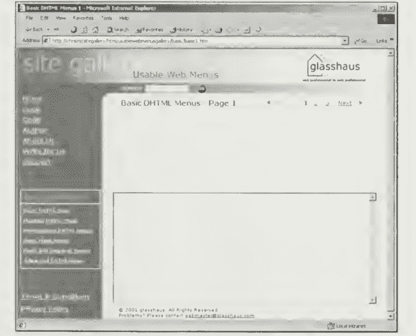

- **在线资源中心：** 作为未来的计划，为了读者的利益，我们决定不再用附录来堆砌安装说明、HTML 标签、CSS 属性、JavaScript 函数等内容。取而代之的是，我们将在网络上建立一个权威的参考资料库，以满足所有此类需求。**此资源库将随时间不断更新，如果您觉得有什么内容应该有但目前没有，尽管告诉我们！**

---

# 1

## 设计可用菜单的 12 条规则

作者：Dave Gibbons


## 良好菜单设计的规则

作为网页设计师/开发者，您始终在与一个极其不可预测的因素打交道：**用户**。用户（浏览者、客户等）依赖您的帮助和判断来引导他们浏览您的网站，而他们经常会走上您无法预料的路径。本章将探讨众多网站在帮助用户找到所需内容这一艰巨任务上所采取的方式——遗憾的是，它们自己也常常迷失方向。

在本章中，您将了解：

- `"可用网页菜单"`的含义。
- 由真实案例说明的十二条关键规则，帮助您设计可用的网页菜单。

我们还将包含许多示例，以进一步阐明本章的要点，不仅关注那些我们能看到改进空间的菜单，也关注设计良好的菜单。本章中的原则无论使用何种技术都成立，从纯 HTML 到 DHTML 再到 Flash。具体技术将在后续章节中详细讨论。

> 在继续之前，我们只想说明，我们绝不希望暗示本书中包含的示例网站设计不佳或毫无价值。恰恰相反——我们的目标是提升网页专业人士的可用性意识，无论您的网站是否在此列出。我们并非自认为最懂；我们只是希望帮助您让网站变得更好。可用性并非以布尔理想（差的可用性 vs. 好的可用性）来衡量，甚至不是以评分制来衡量的。就像餐厅的氛围一样，网站可用性的衡量标准（以及真正的价值）是主观的。它很难用具体的语言来描述，但同时又至关重要。

## 可用网页菜单

本书几乎完全聚焦于导航菜单，即向您展示如何在网站中导航。我们不会过多关注诸如 Internet/intranet/extranet 这样的深奥区分，也不会讨论如何处理多个网站或子网站。我们还将避免讨论其他类型的菜单，例如您有时在表单中看到的选择菜单。

我们需要首先明确几个定义，以确保我们都在相同的理解基础上：

- **菜单：** 一种导航方式，使用户能够直接访问网站中特定的、已知的部分。几乎每个优秀的网站都至少有一个菜单，加上一个搜索功能，用于查找用户无法通过菜单找到的信息。

> 虽然在介绍章节中，我们似乎在贬低“搜索”作为一种退路手段，但我们绝非如此。搜索功能显然有许多有用的应用场景，并不一定意味着您的菜单让用户感到困惑或未能满足用户需求。例如，访问 CD 购物网站的访客如果知道自己想买什么，会直接使用搜索功能，而不是通过菜单系统逐层“钻取”。

- **可用性：** 一个设备可以多容易、多快地被学习并投入使用。如果需要两分钟才能搞清楚一个菜单，那它可能存在可用性不佳的问题。如果其目的和使用方法一目了然，那么该菜单就具有非常好的可用性。

> 如果您想更深入地探讨这些主题的技术性讨论，请参阅有关人机交互（HCI）或人因工程的众多书籍和课程。出于我们的目的，我们将采用比您在博士课程中学到的更不正式的定义。


请注意，我们使用的可用性定义包含了“快速”一词，但不包含“美观”一词。可用性测试中学到的最早的事情之一就是，快速、简单的使用比美观更重要。设计和企业品牌往往与可用性相矛盾。（本章将看到许多这方面的反面案例。）时间节省也往往是衡量某个设计相对于其他方案成功的最可量化指标之一。例如，如果您让用户使用您的菜单完成查找特定信息的任务，您可能会发现，当菜单包含品牌元素或其他开销时会花费额外时间。您也可能会发现这没有任何差别。有关使用用户测试菜单的信息，请参阅`第 2 章`。

我们还在考察用户使用菜单的容易程度。例如，如果您的菜单立即可读且易于理解，但用户必须将鼠标指针精确地定位到微小的方块上才能操作它，那么该菜单仍然不太可用，正如我们在对面的示例中所看到的。这个菜单存在许多问题，包括对比度差和措辞令人费解，但其最大的可用性问题是您必须点击那些微小的深色方块才能导航到任何子部分。（`michaeljrosen.com` 的优秀新版本预计在本书出版时上线。）

## 网页菜单可用性的 12 条规则

当我们为网页菜单的良好可用性制定准则时，我们关注的是让用户——通常是你的客户，但也不尽然——能够如何快速轻松地在你的网站上开展工作。

虽然这并非菜单设计规则的详尽清单，但这些无疑是设计师在设计（或重新设计）网页菜单时需要牢记的所有因素。本列表中的准则将在本章后续部分进行详细说明并配以图示。

1. 菜单必须考虑用户的主要任务。
2. 菜单必须与内容有明确区分。
3. 菜单必须清晰易读（这包括视觉对比度、文本和图标的大小）。
4. 菜单必须便于快速扫描信息。
5. 菜单必须易于操作。
6. 菜单的行为必须符合目标用户的预期。
7. 菜单必须尽可能快速加载。
8. 菜单在整个网站中必须保持一致。
9. 菜单必须将可用性置于比品牌塑造更高的优先级。
10. 菜单必须可本地化。
11. 菜单必须对残障人士无障碍。
12. 菜单必须能在多种浏览器上正常工作。

正如你可能立即察觉的，几乎所有这些准则不仅适用于菜单，也适用于网页。例如，第 7 条告诉你菜单应尽可能快速加载，但在大多数情况下，菜单的加载速度与页面其余部分相同。在这种“网页”和“菜单”概念不可分割的情况下，请假设该准则是指你的菜单系统不应比必要情况更多地对网页的可用性（包括可读性、速度等）产生负面影响。

> 遵守所有这 12 条准则将是一项艰巨的任务，但值得为之努力。几乎所有这些准则不仅适用于菜单，也适用于网页。例如，第 7 条告诉你菜单应尽可能快速加载，但在大多数情况下，菜单的加载速度与页面其余部分相同。在这种“网页”和“菜单”概念不可分割的情况下，请假设该准则是指你的菜单系统不应比必要情况更多地对网页的可用性（包括可读性、速度等）产生负面影响。

### 规则 1：菜单必须考虑用户的主要任务

网页设计师和其他界面设计师常犯的一个错误是忘记了用户真正想要什么。如果你访问亚马逊，你可能是想买一本书、一张 DVD 或他们销售的其他无数商品之一。但你几乎可以肯定不想阅读关于杰夫·贝佐斯是多么伟大的企业家，或者网站是如何工作的，或者一旦你最终有机会购买东西会有多酷。启动画面（或“介绍”屏幕）是违反此原则的典型例子（参见下面的`http://www.artisandesigngroup.com/`），但有些菜单同样没有考虑用户的任务。正如我们将在`第 2 章`中讨论的，你必须知道用户为何访问、他们的主要任务是什么，然后围绕让该任务更轻松来构建他们看到的一切。

## 良好菜单设计的原则

网站应尽可能地不干扰用户，让他们能继续做自己想做的事。用户通常希望快速进入，购买东西或获取信息，然后尽快离开。在理想情况下，他们甚至不会注意到围绕他们活动的网站。回到亚马逊——他们成功的秘诀之一（除了非常好的客户关系管理）是你可以去那里，找到你想要的东西，买下它，然后以最小的中断继续你的生活。

即使是“目的地网站”（而且这样的网站远没有一些人想象的那么多）也有用户想要做的事情。例如，一个在线游戏网站可能会一次吸引用户数小时的注意力。但我们不能忘记，玩游戏，而不是使用网站，才是用户的目标。信息/新闻网站也是如此。用户想要获取信息；他们并不想使用这个网站。如果我们忽视了用户的目标，我们不如直接将他们重定向到其他更易用的网站——反正他们也会去的。

### 规则 2：菜单必须与内容有明确区分

由于菜单对于用户在网站上的导航如此重要，它们必须能立即被识别为菜单。以下是一些将菜单与页面上其他内容区分开来的方法：

- 为菜单使用不同的字体大小。
- 使用不同的行间距（在纯 HTML 中双倍行距效果很好）。
- 使用视觉提示将菜单与其周围环境分开，例如一条线或一个方框。
- 在菜单周围留出“空白”。

> 区分菜单与内容的另一个问题与你的搜索功能有关。菜单元素应尽可能排除在文本搜索之外。例如，如果你的全局菜单包含“厨房用品”一词，你不希望搜索“厨房”匹配到网站上的每一个页面。

右侧的示例（`http://searchwebservices.techtarget.com/`）包含大量非常有用的信息，但不幸的是，其布局使得很难找出应该去哪里查找任何东西。当然，花点时间才能弄清楚菜单在哪里（实际的导航菜单在顶部）——它几乎像装饰性下划线一样融入了主标志。灰底白字加剧了这种效果，无法像高对比度配色方案那样吸引眼球。

## 第 1 章

iBizKit，一个门户网站开发工具，想出了一种创新的方法将菜单与其周围内容分开（参见`http://www.ibizkit.se/`——网站是瑞典语的，所以请点击菜单上的英国国旗获取英文版本）。菜单（见对页）浮动在页面上方，可以定位在浏览器中的任何位置，并且可以展开或收缩以获得更大的灵活性（如对页图所示）。不幸的是，这种创新引入了许多可用性问题。首先，菜单存在于浏览器窗口内，因此如果你调整窗口大小，你可能会完全“丢失”菜单。网页菜单像这样可撕离也是出乎意料的——用户很容易对如何使用它感到困惑。对大多数用户来说，可撕离菜单甚至在桌面应用程序中都不是非常易用，因此将其放在网页上不太可能让你的网站更易用。

关于不会丢失在屏幕外的浮动菜单的工作示例，请参见第 4 章的第三个图像映射示例。

很容易未能区分菜单和内容。在下图中（`http://www.coupdefoudre.com/`），设计师使用了看起来像纯 HTML 的东西，但关闭了链接的下划线。由于网页用户很大程度上期望看到带下划线的链接（如今许多网站也违反了这条规则），这个满是链接的页面看起来就像一堆文本。嗯，更准确地说，“收藏我们！”链接是带下划线的，但其他链接都不是。更令人困惑的是，像“问题”这样的大标题不是超链接，但它们下面的文本是。

## 第 1 章

> 带下划线还是不带下划线？许多网站现在绕过了浏览器默认设置，关闭了链接的下划线，有时甚至使用 HTML 技巧在用户碰巧将鼠标悬停在链接上时突出显示链接。尽管有越来越多的观点认为链接不必带下划线，但只有在你的用户测试证实了替代方法可行时，你才应该随大流。每当偏离人们已学会行走的道路时，可用性就会受损。如有疑问，请查看网络上最成功的网站。例如，`Yahoo.com`、`Amazon.com` 和 `CNN.com` 使用浏览器默认设置（通常是蓝色带下划线的链接，访问后变为紫色）。

对于一些艺术性网站未能做到可用的方式，有一个非常酷且贬义的术语：**神秘肉**（想想那些你在学校晚餐时吃的非常便宜的“肉”馅饼）。这些网站之所以得名，是因为你必须花很长时间摸索才能弄清楚它们是做什么的。在对页图中（`http://www.zcsterling.com/homepage.html`），一个被著名网站设计网站“Web Pages that Suck”（`http://www.webpagesthatsuck.com/`）赞扬的网站，用户不得不戳几个设计精美但神秘的图标才能弄清楚该网站是关于什么的。

## 优秀菜单设计准则

当然，也可能走向另一个极端，将菜单与内容之间的划分做得太过——在下面的汽车制造商斯柯达的例子中就是如此（详见下方网站菜单部分的插图，或访问`http://www.skoda.cz/info_index.htm`）。该网站的这一页面看起来完全没有菜单，除非你恰好瞥了一眼右上角并注意到`menu`一词。点击该词会打开一个过小而难以使用的菜单，不过大多数用户根本走不到这一步。

### 准则 3：菜单必须清晰可读

这条准则不是关于选词或符号的选择（那是准则 4），而是关于让文字和符号对用户可见。这意味着：

- 文字和图形必须与背景形成明显对比。
- 文字和图形必须足够大，即使在高分辨率下也能被理解和操作。
- 切勿隐藏可能可用的文字或图形。

下图（`http://www.bluesky.com/`）展示了一个使用相对清晰图形的有趣设计，但未能为用户提供搜索功能。如图所示，幸运的用户如果将鼠标移到右下角的方框上，会发现搜索功能隐藏在那里，以黑底深蓝文字显示，直到鼠标悬停时才亮起。这种悬停效果没有任何明显意义；它只会让用户体验变得不够合理。

### 准则 4：菜单必须便于快速扫描信息

设计中的首要法则之一是：人们不阅读——他们扫描。长段文字中的粗体词（或者确实，长段文字中的下划线链接）会吸引他们的注意力。菜单正如我们已讨论过的，必须与周围内容分开，但它们仍然受“不阅读”法则的约束。

当用户看到标有“Search”的按钮时，他们会立即识别出来。如果他们看到同一个按钮上写着“This is a good button to press if you want to search for information on this web site because it opens the page that searches for things”，他们就不会那么容易识别出它的用途，而且也不会费心去阅读这段文字，所以这是一个无用的按钮。这显然是一个极度夸张的例子，但这一原则适用于许多用户可能扫描的常见元素：

- `Search`
- `Print`
- `Products`
- `Contacts`
- 打印机图标
- 购物车图标
- 电话号码
- 电子邮件地址
- 邮件图标（通常是一个信封）
- 他们自己的名字

你注意到“Search”出现在列表中，尽管它在前一段已经提到了吗？这是因为许多读者只会看到项目符号列表，而不会看上面的文字。请记住，尽管写作者尽了最大努力，但在这些情况下人们就是不阅读。

“不阅读”的理念回到第一条原则：考虑用户的首要任务。当试图在网站上找到某物时，首要任务不是阅读网站如何运作的说明，甚至不是阅读导航。他们会扫描导航寻找熟悉的线索，但如果不能立即找到所需，他们会直接转向搜索功能。

设计菜单时请牢记以下要点：

- 文字非常重要，即使你也使用图标，因为能被普遍识别的图片实在太少。
- 如果可能，为选项使用一个简单的单词。
- 如果必须使用多个单词，将关键词放在前面。例如，“Articles by me”而非“Some articles”。
- 两三个简单单词比生僻词汇更好。
- 对于图标：工具提示中的解释不能替代图标上或附近的标签。工具提示或`<alt>`标签当然应该使用，哪怕只是为了无障碍访问，但别指望它们能让神秘的图标变得清晰。人们真的没有那么多好奇心。
- 按选项对目标客户的实用性排序。你可以通过测试和/或调查找到这个顺序。随意的列表作为菜单不太有用。除非内容要求，否则不要退而求其次使用字母或字母数字顺序。例如，“权重”相等的选项列表（如人名或零件编号）应按字母数字顺序排列，但功能或产品列表如果按受欢迎程度等其他标准排列则更易用。还要记住，你的列表翻译成其他语言后顺序可能会改变，使你看到的有序列表对外国客户而言变成随意列表。

本章包含来自微软的多个优秀设计示例，因此请看下面的例子（`http://www.microsoft.com/jobs/design/`），一个既糟糕又讽刺的例子。它糟糕是因为难以理解。它讽刺是因为这是一个设计师在微软工作的机会页面。

大众汽车的以下网站（`http://www.vw.com/#/`）不易于扫描。图标标注得很好，但单独来看无法理解——如果你点击左侧几乎看不清的“Icons only”选项，你会知道笑脸是 MyVW 客户和粉丝门户吗？（不过幸运的是，默认设置是“Icons and Text”）。第二个菜单，即彩色条下方的三个按钮，包含了奇怪的选项 VW etc.。那是大众汽车和其他品牌吗？还是标签由按钮大小决定？如果有更多空间，这个按钮可以写成“Merchandise and Events”，这才是那个按钮背后的真正内容。

## 优秀菜单设计准则

下图中的网站（`http://www.digiwis.com/`）有清晰的文字链接菜单，但它还有一个图像映射。如果你碰巧将鼠标悬停在某个神秘图像上，标签会在其下方弹出。

## 第 1 章

布加迪的欧洲网站（`http://www.bugatti-cars.de/`，见下图）看起来像一个介绍页面，好像会有什么自动发生。一旦你意识到什么都没发生，就可以尝试弄清楚这个四项菜单中的哪个选项会带你去有用的信息。另一点奇怪的是，该页面包含强制浏览器窗口最大化的 JavaScript，并禁用了还原浏览器窗口的按钮——因此才有了这张不寻常的截图。

### 准则 5：菜单必须易于操作

必须使用正常的耐心和灵巧程度就能操作菜单。图形用户界面上的菜单将使用鼠标或类似的指针设备来操作（暂时不考虑无障碍访问的特殊情况）。鼠标目标越小，你越可能错过它，而是点击页面上非活动的部分，或者更令人沮丧地，点击了错误的链接。这在动态 HTML 中表现为一个问题：你可以在鼠标悬停时高亮显示菜单中的整行，但如果不是精确指向文字本身，就无法点击高亮的选项。

> 让鼠标目标足够大以便轻松点击。只要可能，即使 Flash、JavaScript 和其他技术能让目标跳动，也要保持目标静止。

此外，如果你组合使用文字和图形，让两者都是热点。假设文字是链接而实际链接是图标时非常令人沮丧（参见本章第一个例子，`http://michaeljrosen.com/`），反之亦然。

## 优秀菜单设计准则

在微软的下一个例子中，链接之间没有太多留白，因此有击中错误链接的风险。不过，展开/折叠功能运行得非常整洁，无论点击标签旁的加号还是标签本身都能操作——如你所见，点击`Product Information`后，子部分优雅地展开，而且即使菜单中的链接没有下划线，菜单使用起来也相当容易——只要你使用 IE。

### 准则 6：菜单行为必须符合目标用户的预期

可用性中众多经验法则之一，除了“人们不阅读，他们浏览”和“图标几乎总是配合文字更好”之外，还有“没有直觉这个词”。（确实，更多学术著作提到了这一说法的技术真理，因为“直觉”意味着无需教导就知道事物。）这对你作为设计师的意义在于，你提出的任何设计都不可能让所有人立即上手。你能追求的最佳目标是让目标受众非常容易学习的设计，而最容易学习的是那些我们熟悉的事物——换句话说，我们已经学会了它们。

打印机图标，虽然看起来像传真机、帆船、气垫船或一百种其他东西，但对我们来说它看起来像打印机，因为我们已经学会了它是打印机图标。网络的预学习惯例较少，但还是有一些。

## 第 1 章

例如，人们期望每一个网页都能给自己一种方位感和目的感：“告诉我我在哪里，以及我能做什么。”如果你的菜单没有指示这些内容，用户将会感到困惑。

在日益盛行的左侧菜单设计中（无论是否使用框架），人们期望在点击左侧时，右侧会随之改变以显示他们点击的内容。TRIO 网站（见下方，`http://www.trioprograms.org/home.htm/`）处理这一点的方式令人困惑：当你第一次点击时，它仅改变左侧（实际上是在左侧框架中加载一个新页面）——在下面的图表中，左侧菜单是点击菜单选项之前的状态，而右侧则显示了点击后的状态。整个过程中，右侧框架保持不变。

![img/8687690beb9cb63d5dcc82f9291aad72_35_0.png]

为了让这种设置不那么令人困惑，你绝对应该使用像箭头这样的视觉提示，告诉用户他们的某种操作将仅影响菜单本身。此外，在可行的情况下使用 DHTML 或类似技术，可以让菜单几乎立即响应用户的输入，而不是像上述方法那样需要与服务器进行往返通信。

有些惯例具有一定的破坏性。例如，用户已经太习惯于在弹出窗口中看到广告，以至于现在几乎不可能将弹出窗口用于任何其他目的——例如网站导航。另一个基于用户对广告的习得性反应的例子出现在`http://www.alistapart.com/`（见对面），右上角的粗体文本菜单很容易被忽略，因为除其他原因外，它很容易被误认为是方形横幅广告。在这种设计中，引导用户视线远离菜单的因素包括像大尺寸、突兀的文本以及词语选择等视觉线索。例如，THIS WEEK 听起来更像是一个广告而非菜单选项。正如一名用户指出的，交换左右两侧可能会缓解这个问题，因为用户已经习惯于在顶部和左侧寻找菜单。

![img/8687690beb9cb63d5dcc82f9291aad72_36_0.png]

根据你的目标受众，你可能会尝试借鉴桌面应用程序的惯例。对于普通 Web 受众来说，这会导致极差的可用性，但如果你的受众是由开发人员组成（例如微软开发者网络`http://msdn.microsoft.com/`的访问者），你可以利用他们使用桌面应用程序的经验来玩一些巧妙的技巧。该菜单中某些选项旁边的箭头与 Windows 下拉菜单中使用的箭头完全相同。这是一个完美的（习得性）视觉提示，告知用户如果点击（在本例中是鼠标悬停）该选项，右侧将打开另一个菜单。在 Netscape 和其他非 IE 浏览器中，微软去除了动态内容及其相关的视觉提示，只留下一个纯链接菜单。

![img/8687690beb9cb63d5dcc82f9291aad72_37_0.png]

## 规则 7：菜单必须加载迅速

不要误以为这条规则仅适用于那些使用缓慢且逐渐消亡的拨号线路的用户——这条规则是普适的，即使你在像内网这样的封闭系统中工作，且明知每个人都拥有高速接入。即便能保证高速接入（如果真有这种事），也不足以支撑那些需要 10 或 15 秒才能加载的繁琐 Flash 或 Java 菜单——甚至是复杂的 DHTML 菜单。用户在等待约 2 秒后会感到沮丧，而在 8-10 秒时，他们很可能会认为浏览器卡死了。这时他们会点击“后退”按钮，或者更糟糕地，尝试通过刷新页面来解决问题，然后最终放弃。


一些聪明的网页设计师，比如游戏设计师 David Brackeen（`http://www.brackeen.com/`），在知道用户必须等待一分钟或更久时，会超越简单的“请稍候”消息，实际创建交互式的“请稍候”界面来分散用户的注意力。（Brackeen 的是一个 Pong 游戏——要查看效果，请尝试加载一个游戏。）不过，这种补救措施仅限紧急使用。作为一项原则，请保持菜单简单实用，用户会为此感谢你。你可以做一个测试：检查你的页面与亚马逊主页的加载时间。亚马逊的页面可能包含比你的页面多得多的信息，但它加载起来可能依然更快，因为它简单且针对速度进行了优化。

当然，简单如果走极端也是有问题的。可用性网站 Alertbox（`http://useit.com/alertbox/`）（可用性大师 Jakob Nielsen 的主页）就以难以使用而著称，除非你静下心来仔细研究——而这正是你不能指望普通 Web 用户去做的事情。Alertbox 的问题不仅在于它过于简单，尽管它确实摒弃了像菜单这样的基础 Web 导航工具，它还违背了一些 Web 用户常见的“习得行为”。例如，首页采用了经典的、居中的文本输入框与按钮组合，我们大家都习惯于将这种组合与“搜索”功能联系在一起（见下方）。然而，在这个页面上，该组合被用于订阅 Nielsen 的电子邮件通讯。当然，如果你阅读文本框周围的资料，就能清楚地知道它是如何运作的，但你知道关于 Web 冲浪者和阅读的那个规律……

![img/8687690beb9cb63d5dcc82f9291aad72_38_0.png]

## 规则 8：菜单在全站必须保持一致

这条规则很难遵守，特别是如果你的网站页面是单独编码的话。随着用户在你的网站中深入，他们正在学习预期应该看到什么。一旦他们的预期没有得到满足，他们就会感到困惑。而“困惑”正是你试图避免的情况。

对面给出的例子（`http://www.mindbird.com/raised_relief_maps.htm`）虽不至于让人极度困惑，但令人恼火。在第一个页面中，由于文本是常规字体，菜单可以适配屏幕。但在第二个页面中，菜单不再适配且显得格格不入，因为文本变成了粗体（且没有任何理由）。

![img/8687690beb9cb63d5dcc82f9291aad72_39_0.png]

## 规则 9：菜单必须将可用性置于品牌化之上

这可能是最难让你的市场部门接受的规则，特别是如果他们已经确定了一种“公司标准字体”并坚持要求你在网站上使用。

你的公司颜色、字体和其他品牌元素完全可能在 Web 上不可用。Web 与包装和印刷广告（品牌化的经典阵地）是完全不同的媒介。那些最吸睛的颜色（大多数事物用亮黄色——尤其是户外；包装上用银色和蓝色）在屏幕上简直丑陋不堪，但它们很可能是你的公司标准。在这种情况下，你可能需要在可用性测试中让糟糕的设计与优秀的设计进行正面对决。

或者，当然，你可能会输掉这场战斗，被迫在公共网站上采用糟糕的设计，正如我们在对面 `http://www.lamborghini.com/` 看到的那样。在这里，兰博基尼试图通过尽可能多地使用深色元素来传递传奇黑牛的深沉强度。不幸的是，这也包括了文本，而且字体太小。这种设计在精美的印刷页上可能效果极佳，但在像计算机显示器这样的发光设备上，它就像一团浆糊。

![img/8687690beb9cb63d5dcc82f9291aad72_40_0.png]

在下面的图表中（`http://www.xara.com/`），Xara 采用了在印刷品中会很出色的设计，并尝试将其应用于 Web。带有标签的圆圈看起来像个菜单，但实际上并非如此——如果你点击 `and more`，它会带你前往与 `buttons, rollover bars` 和 `$69` 相同的页面。

![img/8687690beb9cb63d5dcc82f9291aad72_40_1.png]

## 规则 10：菜单必须可本地化

解释国际化（简称 I18n）和本地化（简称 l10n）涉及的所有内容超出了本书的范围，但关于这个复杂主题已有许多著作。

你至少需要知道的是，将图形或多媒体演示中的一个单词进行本地化的成本，至少是本地化纯文本中相同单词成本的 10 倍。根据项目的不同，这个成本可能是 100 倍。如果你知道你的网站将被翻译，请尽可能坚持使用文本。（注：像“可缩放矢量图形”（`SVG`）这样较新的技术可能会减少设计师对静态 `GIF` 和 `JPEG` 图形的依赖，并且具有更容易本地化的额外好处。）考虑使用带有竖线（`|` 字符）或括号分隔选项的文本菜单，而不是包含相同词汇的图形。像 AltaVista 的 BabelFish（`http://babelfish.altavista.com/`）这样的自动翻译网站也会保留你的图形原封不动，因此如果你的导航是图形化或多媒体的，国际用户将毫无运气。

如果你为其他语言提供了网站的替代版本，有多种方法可以提示国际用户他们可以用自己的语言查看网站。其中一种已成为标准的方法是使用国旗，但这对于法语、英语和西班牙语等广泛使用的语言来说是个问题。难道每个美国人都认同英国国旗（Union Jack）吗？大概就像委内瑞拉人认同西班牙国旗一样，并不认同。一个更简单的方法是用该语言本身的名称来标注（如果可能的话——例如，用 `"français"` 而不是 `"French"`）。必须记住，人们不爱阅读，特别是当他们被外语页面搞糊涂时。他们可能会偶然发现自己语言的名字，仅仅因为那是页面上唯一熟悉的东西，尤其是当它用他们自己的语言书写时。一个用意大利语列出语言的意大利网站会将英语显示为 `"Inglese"` —— 对于一名澳大利亚用户来说，这很难在菜单中视觉化地跳出来。一个更可用的选项是以更醒目的方式标注语言，就像对面图表（`http://www.nasasrbija.com/`）中使用的高对比度配色方案。在这里，其他语言的链接就位于菜单顶部，采用了更高的对比色（如果你去查看实际网站，你会发现它是黑底金字）。

## 规则 11：菜单必须对残障人士可用

这是一个 XML/XSL(T) 和 CSS 能大显身手的地方，而 Flash 和其他多媒体形式往往会让事情变得非常困难。

你可以使用你能想到的最具有视觉冲击力的配色方案（记得保持高对比度），但你必须记住，许多用户永远无法“看到”它。盲人或有其他视觉障碍的用户可能会通过语音系统或电子盲文阅读器来“看到”你的网站。这并不意味着你必须坚持使用纯 HTML，但这意味着你必须有一种方法让你的网站在纯文本模式下也能被理解，可以通过替代地址或通过样式表来实现。这样做带来的额外好处还包括让你的网站能够被爬虫（例如 HotBot）索引，并使其可用于 WAP 和其他非标准互联网设备。

为你的网站准备样式表无论如何都是一个好主意，尤其是在可用性方面。许多依赖特殊设备浏览你网站的用户，在可能的情况下也会依赖于设备特定的样式表（通常是 CSS，但在服务器端 XSL(T) 越来越普遍）。你不需要由你来创建这些样式表，只需在代码中标识你的网站依赖于样式表，然后让用户的设备根据需要替换其自身的样式表即可。

在所有重要的图形上使用有意义的 `<alt>` 标签，特别是那些热点图。例如，对于像“首页”（Home）这样的选项，一个简单写着“首页”的 `<alt>` 标签就是有意义的。与此同时，一个为了好玩或单纯为了装饰网站工具提示而设计的 `<alt>` 标签（如“点击这里！”或“我不知道我想要什么”）则没什么用处。

要了解更多关于 Web 可用性的信息，请访问 W3C Web 可用性倡议（`http://www.w3.org/WAI/`）的主页，以及美国访问委员会的 Section 508 页面（`http://www.access-board.gov/508.htm`）。此外，Bobby（`http://www.cast.org/bobby/`）是一个能让你对可用性问题大开眼界的绝佳工具。Bobby 是一个能够分析你的网站并指出文本、图形、样式等方面潜在困难的工具。

## 规则 12：菜单必须在多种浏览器上运行

现在从 PDA 到缝纫机，所有设备都具备了上网能力，几乎不可能假设你的受众在访问网站时具备一套统一的功能。他们选择的浏览器可能是一个仅限文本的手机浏览器，这将让你花费上千小时开发的 Java 导航项目付诸东流。

处理这种情况的简单方法是在页面开头附近提供一个纯文本链接——只要你记得为什么要提供这个链接。在接下来的图中（见右侧 `http://www.worldsat.ca/`），首页的图形中包含一个“纯文本选项”，但讽刺的是，该链接并没有文本版本。如果你使用纯文本浏览器访问此站点，你将看不到“基于文本的导航”（Text-based Navigation）链接！然而，其他浏览器会显示它，你可以为他们提供一个符合其需求的可用站点。XML/XSL 和 CSS 显然是解决此问题更复杂的方法，但如果你负担得起，它们要优越得多（见 *第 4 章 CSS 的实际应用*）。

即使在桌面端，IE、Netscape 和 Opera 在处理样式表、Java、多媒体以及其他主流问题时也各有千秋。在预期目标用户使用的浏览器上测试你的设计，并至少使用另外两种浏览器进行粗略检查：Lynx（一个纯文本桌面浏览器——见对面）和类似于 `http://www.openwave.com/products/developer_products/index.html` 提供的手机模拟器（见 *第 2 章的实际应用示例*）。

上面的截图显示了在纯文本浏览器 Lynx 中查看的 WorldSat 页面——你能在这个页面上找到“基于文本的导航”（Text-based navigation）的链接吗？请注意，Lynx 可以从 `http://www.trill-home.com/lynx/binaries.html` 获取。

## 本章小结

需要记住的东西很多，但我们在本章中提到的每一个点都曾（且很可能再次）成为现实世界 Web 设计师的头痛之源。将这 12 条规则打印出来贴在便利贴上，每当你构建新站点时就回顾一遍。

关键要记住的是，你在 Web 上发布的所有内容都是面向用户的，而每一个用户都有独特的背景和现实需求。你能做的一切以让他们的网络使用更简单、更快速，对他们以及最终对你来说都是有价值的。

在 *第 2 章* 中，我们将深入研究如何从底层决定网站导航的结构以实现最大可用性，包括信息架构原则以及用真实用户测试你的假设。

# 第 2 章

- 菜单的信息架构
- 确定目标受众
- 为菜单选择正确的层级和粒度
- 菜单的可用性
- 用户测试

作者：Dave Gibbons

## 菜单的信息架构

在本书的这个阶段，你已经看到了几个包含良好和糟糕特性的现实菜单示例，以及一些创建可用菜单的一般指南。我们目前涵盖的规则和指南适用于一个好的菜单如何“运作”，但并不太涉及它“说了什么”。换句话说，你现在知道如何提供良好的、可读的、可用的导航，但我们还没有讨论你将人们导航到哪里。

在本章中，你将看到：

- 为目标用户提供便捷访问信息的挑战。
- 在菜单中组织信息的挑战。
- **信息架构（Information Architecture, IA）** 如何应对这些挑战。
- 如何将 IA 概念应用于你的 Web 内容。
- 如何确保你的设计在上线前和上线后都是可用的。
- 不同方法的示例，与前一章一样，不仅关注失误，还关注做得出色的菜单。

> 信息架构基本上就是研究网站用户的需求以及该网站包含的信息，并组织这些数据以及导航这些数据的手段，以使其尽可能可用。有关 IA 的更详细讨论，请访问 `http://hotwired.lycos.com/webmonkey/design/site_building/tutorials/tutorial1.html` 查看一个关于 IA 基础知识的实用教程。

### 使菜单具有意义的挑战

在前一章中，我们将菜单定义为“一种使引导用户直接进入网站特定且已知部分的导航方法”。

我们将此与另一种流行的导航方法区分开来：**搜索功能**，它允许用户跳过（或放弃）你的菜单方案，直接猜测你可能如何对他们需要的信息进行分类。在非常复杂的环境中，例如索引了 Web 上几乎所有内容的 Google（`http://www.google.com/`，见下文），搜索是主要的导航设备。在这些情况下，导航菜单带来的麻烦可能比它的价值更多。Google 包含这样一个菜单，但它基本上被隐藏在“目录”（Directory）链接后面，显然是搜索的次要辅助。

对比示例请见对面——HotBot（`http://hotbot.lycos.com/`），另一个搜索引擎。它立即提供了一个广泛的菜单，允许用户向下钻取到他们需要的内容，但所需的信息可能距离首页有 2 个、5 个或 10 个菜单之遥。用户在 HotBot 上更倾向于直接使用搜索功能来找到所需内容。（HotBot 通过在你进入站点时自动将文本光标移至“搜索”（Search）字段，含蓄地承认了这一现实。）

但就本书而言，我们假设你并不是在索引 20 亿个页面。在一个简单的 50 页、500 页或 5000 页的站点上，用户应该能够使用你的菜单方案轻松快捷地找到他们想要的内容，并为那些确切知道自己想要什么的人提供搜索功能作为补充。这就是投入在设计和测试上的时间真正产生回报的地方。如果你的菜单系统在技术上很精彩，视觉上（或听觉上，或其他方式）令人惊叹，但对于你的目标用户来说极其难以理解，它仍然是不可用的——换句话说，它是没用的（例如，看看我们在第 1 章中看到的 `http://www.zcsterling.com/homepage.html` 站点）。

因此，除了前一章提出的技术和可用性目标外，你的菜单系统必须努力争取对目标用户具有意义。使菜单系统具有意义的挑战包括：

#### 设置优先级

菜单设计的首要任务，如同几乎所有设计工作一样，都应是最终用户。这一考虑显然需要与预算、时间表和技术问题等其他因素相协调。例如，最用户友好的方案或许是派一位工程师到每位用户家中，帮他们处理一切，但这种荒谬的方案显然不太可能适用于小型电子商务网站的现实。

然而，大多数营利性公司的真正首要任务，其实是用户的钱财。必须理解的是，没有用户的同意，资金便无法流动。反过来说，你的网站对用户越体贴，就越有可能获得他们的收入，因此，最终用户再次成为首要任务。

一些营销部门常犯的错误是，试图诱骗网络用户前往他们不想去的地方。企业的思维过程是这样的：“我们知道所有人来这个网站都是为了汽车电池，但方向盘套的利润更高。我们不妨弱化电池，在菜单中把它藏到后面，用很小的字体，而把方向盘套放在最显眼的位置，用巨大、加粗、闪烁、动画的字母！”举一个更现实的例子，想象一家软件公司推出新产品线。他们可能希望这个新项目在网页上优先于其他所有内容，甚至排在基本导航菜单的最前面。

这种方法显然事与愿违。它很可能会让用户感到困惑或沮丧，这无异于将他们直接推向竞争对手的网站。

为了纯粹的内部目标而随意调整导航菜单，违背了导航的两条重要规则：

1. 导航不等同于广告——营销部门不是目标用户。
2. 用户不阅读，他们只浏览和简化。

认为把某项内容放在菜单首位就意味着所有访问网站的人都会阅读它，这与人们处理导航的实际方式相悖。这就好比假设任何人只要一看非洲地图，就会因为塞内加尔在最左边或摩洛哥在左上角而注意到它们。（对于视障人士使用的屏幕阅读软件来说，这两种情况可能都成立，我们曾在第一章讨论过）。

面对海量信息——即便是包含 10 个项目的菜单也可能构成信息过载——用户会通过浏览来寻找规律，并将其简化为更小、更易于管理的单元。浏览不等于阅读。测试表明，如果一个人对密集文本页面上快速闪现（少于 500 毫秒）的特定项目有特别兴趣或需求，他们可以在潜意识中捕捉到重要的信息片段（例如自己的名字、美元或其他货币符号、“免费”一词或“梅赛德斯”）。

他们可能在潜意识中“阅读”了页面，但就实际目的而言，他们只是浏览了它，尽可能地进行了简化和澄清（例如，检查是否是母语，甚至可能检查是否是按字母顺序排列的列表），并捕捉到了最重要的元素，而全程并未有意识地阅读任何内容。

用户正是以这种方式来处理你的菜单的：他们会扫描、简化，并专注于对他们重要（或感兴趣）的内容。如果这个过程未能找到他们想要的东西，他们就会退出，要么使用你的搜索功能（作为寻找目标的最后尝试），要么点击“后退”按钮返回上一页，或者最糟糕的情况是，完全离开你的网站。

务必始终根据用户需求来确定菜单的优先级。正如你将在本章后续“菜单的信息架构”部分所看到的，你可以根据用户自然的信息处理功能来设计菜单模型，从而快速轻松地满足他们的需求。

#### 了解目标用户

为了给这个目标用户设计菜单，你需要在脑海中对其形象有所了解。有些设计师甚至会创建用户角色（真实或想象的），并将他们的照片和经验简介贴在墙上。经验表明，只要描述足够详细，并且参与设计的每个人都对这些用户有相同的认知和理解，这种方法就非常有效。宽泛的定义，即使带有一些基本的个性化，也可能带来令人困惑且适得其反的预设——务必具体！例如，如果你说目标用户是“一个名叫梅琳达的购物者，通常购买电子元件”，一位设计师可能会为她提供专注于工程电子元件（如电容器、二极管等）的菜单，而另一位则可能提供消费电子元件（例如录像机和 CD 播放机）的菜单。

在思考目标用户时，请考虑以下四点：

- 用户的角色/行为（购物者、研究员、读者等）。
- 你对用户技术水平的假设（桌面浏览器、WAP 手机、Java）。
- 你对用户经验的假设（非常有经验的网络用户、新手、忙碌程度与兴趣程度）。
- 重要的例外情况（无障碍访问和本地化等问题）。

就这些问题进行头脑风暴，并确保整个设计团队在开始技术设计阶段之前，就用户假设达成一致（或同意保留分歧）。如果你们能就用户是谁以及他们想要什么达成共识，团队成员就可以在确信自己与团队中其他人思考的是同一位用户的前提下，各自开发其负责的部分。

##### 用户为何到此？

你决定在菜单中呈现选项的方式，取决于你期望主要用户用这些选项做什么。在讨论的这个阶段，了解主要用户是谁至关重要。其他类型的用户也会有机会，但一开始你确实必须思考那个理想的、典型的网站访客以及他或她想要什么。

例如，如果你正在设计一个购物网站，你知道主要用户的目标是找到他们想要和/或需要的东西，并且希望购买它们。虽然其他用户访问是为了了解退货政策、在公司求职或查看董事会成员，“购物者”才是主要用户。

尽可能具体地刻画这些主要用户。（之前提到的创建图片/简介的练习在这里就很有用。）如果你的网站专注于学术领域，你的主要用户是大学教授还是幼儿园学生？他们想要信息、与同行互动，还是其他资源？


此时，你几乎总会发现“那个理想的、典型的访客”具有不止一种行为画像。一些被贴上“购物者”标签的用户在寻找衣服，而另一些则在寻找音乐、糖果、书籍或木工用品。有些人比其他人更有网络经验。不过，他们都是来你的网站购物的，因此你的主页菜单可以对各类购物者的共同行为做出一些假设：

- 找到我感兴趣的板块。
- 找到我想要的产品。
- 获取关于这些产品的信息。
- 订购产品（包括检查订单状态、取消订单等）。

你生成的画像告诉你如何呈现菜单选项。如果你的目标用户非常有网络经验，你在“打破”可用网页设计规则方面就有更大的自由度。例如，微软在其主页（面向普通受众——见左下方截图，`http://www.microsoft.com/`）使用简单链接，但在其面向开发者的部分（见右下方截图，`http://msdn.microsoft.com/`）则采用了更高级的选项，如弹出菜单。

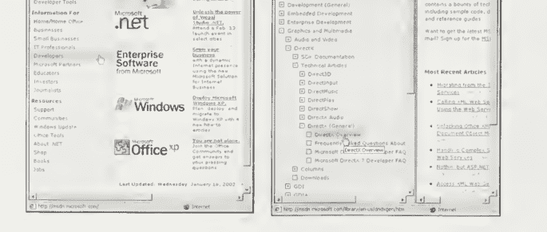

如果你发现目标用户很可能会通过手机等基于文本的手持设备访问你的网站，你可以在菜单呈现方式以及选择设计和呈现页面的技术时将此因素考虑在内。

例如，Amazon.com 的主菜单允许各种类型的购物者直接进入适合其需求的板块，包括“图书”、“电子产品”、“玩具”和“DVD”等项目：

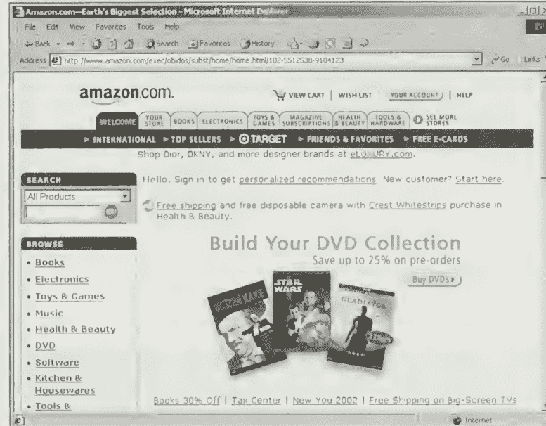

那么，像富士通（Fujitsu）这样的大型综合企业又是如何处理的呢？fujitsu.com 的理想访问者是谁？可能是潜在的企业客户？目前的 SOHO（小型办公室/家庭办公室）客户？还是投资者？该网站地图列出了富士通内部分布在六个大洲的 80 多家独立公司，每家公司又有一到几十个目标用户。在这种情况下，当一个站点被划分为数十个子站（本例中为数百个）时，主页上的菜单必须能够服务于无数的用户。由于“无数”并不是一个很好的用户画像起点，你仍然必须对该主页的理想用户做出一些假设。例如：

- 他们对技术感兴趣。
- 他们很有可能或极有可能使用英语以外的语言。
- 他们访问网站是为了与网站中极小的一部分内容进行交互。

对于具有如此多样化用户的站点，主菜单通常具有非常宽泛的选项，如“产品”、“服务”和“支持”（参见 `http://www.fujitsu.com/`）。随着用户接近他们需要的区域，菜单会开始变得更加具体，以适应他们及其需求。

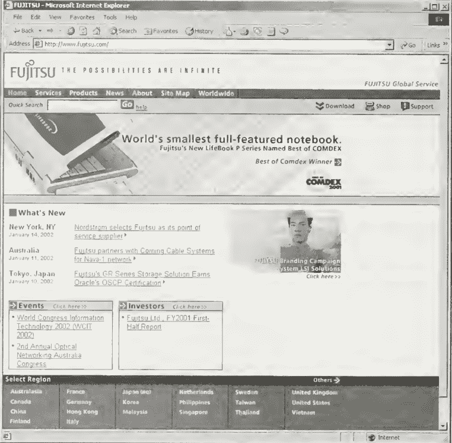

### 用户拥有什么样的技术条件？

大多数网站的基本假设是，典型访问者使用相对较新的图形桌面浏览器，在彩色显示器上运行，并拥有相对高速的连接（例如 56K 拨号或更快的速度）。“较新”的浏览器（如 IE 5+/Netscape 6 等）理应包括对高级标记（框架、字体）和脚本语言（DHTML、JavaScript、CSS、潜在的 XML/XSL）以及 Flash 等多媒体插件的支持。虽然假设每个用户都具备这些能力是一个错误（除非你运行的是专门为该技术用户或开发人员设计的站点），但同样，出于担心某些用户无法使用而避开所有这些技术也是一个错误。这就是所谓的“最低公分母”方法/错误——假设你不能假设任何事情，因此必须针对最基础的能力进行编码（有些人仍然在使用 14 英寸显示器，通过 14.4K 调制解调器运行 Netscape 1.0），但这几乎总是会导致极其枯燥且令人惊讶地难以使用的站点。不支持这些技术并不会让你失去很大一部分潜在的目标受众。这正是本书的核心内容：在导航菜单中尽可能充分地利用这些技术——因此，在后面的章节中，我们的菜单将以跨浏览器兼容的方式进行编码。

这并不是说你应该忽略那些技术条件有限的用户。为需要简单呈现的人提供更简单（通常是基于文本的）替代方案是有重要原因的。例如，帮助残障用户操作 Web 的设备和软件通常依赖于简单的设计。此外，初期的“无线 Web”在很大程度上仍受限于极慢的传输速度和小屏幕。

处理用户带来的各种技术能力的一种更好方法是在服务器上部署浏览器感知智能，并向每个用户呈现适当的内容。

在进行技术假设时，最常见的问题之一是屏幕空间。虽然这不是一条死板的规则，但现在普遍接受桌面/笔记本电脑用户使用 800x600 及以上的分辨率。为纯 VGA 屏幕（640x480）编码已不再是大多数应用程序的要求。当然，这条规则也有例外。许多手持设备提供 320x240 分辨率，也被称为“四分之一 VGA”。如果你的目标用户使用此类设备访问站点（例如为配备 PDA 的销售人员提供的内网），你自然必须考虑这种空间限制。

### 用户已经知道什么？

Web 受众的经验（以及耐心和好奇心）在一定程度上有所不同，但在某些方面却出奇地一致。无论你的 Web 受众是谁，你都可以依赖两种被普遍认可的技能：

1. 他们会点击带有下划线的链接，并且期望链接在点击前是蓝色，点击后是紫色（取决于浏览器设置——无论如何，他们期望看到自己习惯的默认设置）。
2. 如果一个页面没有立即显示出有用之处，他们会点击“后退”按钮。

除此之外，你引入的任何复杂化和潜在混淆都是可用性的敌人。为了可用性，请保持链接带有下划线。即使改变下划线链接的行为（例如将蓝色改为红色）也会降低你站点的可用性。虽然你访问过的许多站点违反了这些简单规则且你觉得仍然可用，但你必须承认，如果你正在阅读这本书，你不太可能是个“典型的 Web 用户”。

Amazon.com 是我们经常举的例子，因为它的可用性极佳，它拥有先进且美观的设计。其左侧导航链接是蓝色下划线（浏览器的默认值），一旦你点击了链接，链接就会变成紫色（同样是浏览器的默认值）。Yahoo.com 另一个非常实用的站点也是如此。这些链接行为可以追溯到最早的 Web 浏览器，并已成为基于文本的 Web 导航的基本规则。Slashdot.org 是一个受欢迎的开发人员站点，其目标受众在 Web 使用方面经验非常丰富，它也给链接加上下划线，尽管它使用了与标准蓝色-新/紫色-已访问格式略有不同的配色方案。尽管在链接处理方式上经常出现许多变化，但一个旨在实现良好可用性并面向大众的站点应该让浏览器决定链接颜色。

图像映射（Image maps）和其他可点击图像则有一套自己的预期。如果用户将鼠标悬停在图像映射的链接上，特别是他们不确定的链接，他们已经习惯于在浏览器的状态栏中看到一些指示。这种“指示”通常是一个 URL（希望是一个有意义的 URL，如 `products.html` 而不是 `file003.html`），或者也可以是关于该链接的简短文本说明。提供 X/Y 坐标而非指示的服务器端图像映射比客户端图像映射的可用性低。这种对指示的相同预期可能会使 Flash 的可用性低于 HTML，尽管可以通过提供即时的上下文帮助和其他协助来克服，我们将在第五章中详细讨论。

总的来说，用户期望菜单位于屏幕顶部或左侧。位于短屏幕底部的菜单也是可以接受的，而且在许多情况下比流行的左侧导航菜单更实用。在框架布局中尤其如此，因为即使页面本身的导航内容随滚动而移出屏幕顶部，屏幕底部的导航依然能留在原位。然而，如果屏幕通常比一个浏览器窗口高，你应该避免在页面末尾设置导航，因为用户在最初尝试理解页面时看不到它。

右侧菜单通常不在预期之内，但可以有有用的应用场景。例如，在文字密集型页面中，右侧导航可以帮助那些可能会被行首不恰当文本分散注意力的读者。尽管如此，正如一位研究人员指出的，无论好坏，期望菜单位于顶部或左侧已成为一种标准。右侧菜单在弹出式菜单（向左而非向右弹出）和窗口调整大小（菜单可能会完全消失）等方面也存在困难。

如果你的目标用户是开发人员、艺术家或任何你认为可能凭直觉接受替代导航方式（如没有下划线的链接、晦涩或巧妙的工具提示等）的人，如果你希望你的站点具有可用性，你仍然应该避免这些替代方案。在所有情况下，都要使你的导航简单明了。如果你需要发挥创意，请在页面正文中进行，而不是在导航中。导航应该尽可能透明——毕竟，你希望人们专注于页面内容，而不是菜单。

### 还有谁会看到这个站点？

对目标用户画像的重要补充通常基于以下一个或多个因素：

- 语言
- 无障碍访问（Accessibility）
- 技术

当你定义目标用户并选择实现技术时，你会意识到你的假设由于其本质而无法覆盖所有意外情况。请考虑那些落在你的假设之外的重要用户。

重要例外（Important exceptions）不同于“极端情况（corner cases）”，后者通常指“可能但极不可能发生”。极端情况的一个例子是有人把奶酪放在打印机的纸盘里。可能吗？是的。合理吗？并不合理。因此，设计一个关于纸盘中放奶酪的警告标签并不是一个好的时间利用方式。

然而，收到一个不懂你语言的用户访问的可能性要大得多。如果你有资源将你的站点翻译成目标受众可能使用的其他流行语言，请务必这样做。如果没有，请参考第一章中关于使导航兼容自动翻译工具的技巧（见规则 10）。

同样，正如我们在这里和第一章中已经讨论过的，盲文屏幕阅读器和文本转语音翻译器等设备依赖于纯文本导航。这不必是你的主要设计，但如果你的站点对残障用户有用，你应该将其作为一个选项提供。假设你没有文本转语音浏览器，尝试在 Lynx 中加载你的页面，看看你的站点在纯文本工具中是如何显示的（关于 Lynx 的更多信息，请参阅第一章中的规则 12）。

目前用于上网的技术正变得越来越多样化，我们希望随着无线设备的开放性增强，这一趋势能有所扭转。就现阶段而言，提供基于文本的替代导航选项是最简单的方案。一个更实用但也更复杂的方案是利用样式表和设备感知服务器来提供合适的内容。

例如，openwave.com 上的这个模拟器展示了谷歌的菜单在无线手机上如何被简化。请将其与之前看到的桌面版本进行比较！

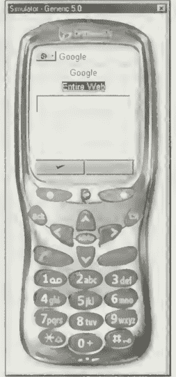

## 处理现有内容

组织现有网页内容面临若干挑战，这些挑战不应影响你的菜单设计：

- 现有的技术结构
- 现有的界面
- 文件/记录组织方式
- 公司内部的命名惯例

用户并不关心幕后运作的机制，不关心公司里哪个部门制作了哪个页面，也不关心最初的网页设计师是如何将这一切整合起来的。关于导航，用户只关心一件事：找到他们想要的内容。

在接下来的“信息架构”章节中，你将学习如何有效地组织内容。关键要记住的是，无论你的内容目前存储或呈现的方式如何，你的目标都是以一种易用的方式呈现它。如果这意味着在整个网站的十五个不同地方都指向同一个页面，那就顺其自然吧。尽可能将呈现方式与内容创建分开，这样你就不会被束缚于一个旨在满足部门或公司便利性，而非用户需求的结构中。

## 菜单的信息架构

信息架构是为便于访问而组织信息的实践。一个常用的例子是图书馆的卡片目录（如果你还记得图书馆曾使用卡片目录的话）。卡片目录中的信息是根据人们查找图书的方式来组织的：

- 按作者
- 按书名
- 按主题

由于作者和书名是固定的，图书馆中信息架构师的工作重点就是处理可变的元素：主题。给一本书确定主题比看起来更具挑战性。例如，一本关于日本的书自然会被归入“日本”这个主题。但信息架构师必须考虑，用户可能会搜索哪些额外的主题来找到这本书中的信息。例如，如果这本书包含关于相对神秘的阿伊努部落（`http://www.dromo.com/fusionanomaly/ainu.html`）的重要信息，那么它也可能被归入“阿伊努”这个主题。人们可能会搜索具体的城市、岛屿或地区，这些都应指回这本关于日本的书。

这个概念以搜索引擎的形式延续到了网络上，包括在线版的卡片目录。就我们的目的而言，它同样适用于菜单。

例如，如果你的网站上有一个页面列出了高管和部门的联系信息，你必须考虑访客如何在你的菜单上识别出这个选项。显然，不同目标的访客对于哪个菜单项能引导他们找到该页面的信息有不同的想法。例如：

- 联系方式
- 公司信息
- 重要号码
- 信息
- 部门
- 关于我们
- 电话号码
- 员工
- 高管
- 在这里工作的人
- 投资者信息

这些标签中的任何一个对某人来说都可能是合理的。构建菜单时，你的挑战之一就是找到对你的目标用户群体中最广泛人群都有意义的标签。

## 将信息架构应用于菜单

广义上的信息架构涉及组织信息、为页面和部分命名、将网站划分为子站点以及许多其他超出可用网络菜单范围的要素。就我们的目的而言，信息架构要简单得多：它意味着选择有效的标签并将它们放入易用的菜单中。

我们已经讨论了菜单在技术上易用的条件。另一个考虑因素是使其在实践中也易用。一个包含指向一千个页面链接的菜单在技术上可能是易用的，但在实践中可能易用也可能不易用。

易用的菜单会考虑到我们关于目标用户及其期望的一切。例如，如果你的菜单是网站地图，用户期望它按部分分组列出网站所有部分中可用的页面。如果你的菜单是主导航菜单，用户可能期望它显示部门（如 Amazon.com 示例）或公司职能（如 Fujitsu.com 示例），并且他们始终期望它能引导他们返回首页。

一些降低菜单可用性的因素包括：

- 随意的组织
- 按字母/数字顺序组织（因内容而异）
- 非正式或俚语标签
- 多余的词语

当用户看到能识别为菜单的东西时，他们期望它提供某种对他们有意义的秩序。例如，餐厅的菜单可能会将菜肴按主要食材（牛肉、鸡肉、蔬菜）或适当的餐次（开胃菜、汤、主菜、甜点）分组。如果餐厅菜单只是随意地甚至按字母顺序列出每一道菜，它的实用性和易用性就会大大降低。

本章前面我们讨论了人们如何扫描信息（记住人们在网络上并不真正阅读）。他们寻找模式并简化信息。在菜单中，人们首先看的是大小，以做出是否需要简化的潜意识决定。这就是备受推崇的神奇数字 7 发挥作用的地方。

至少从 1950 年代起就有一个心理学理论（参见 George A. Miller 的《神奇数字七，加减二：我们信息处理能力的某些限制》，1956 年，网址 `http://www.well.com/user/smain/miller.html`），认为记忆的神奇数字是 7。人们能记住 7 件事，并能快速辨别和重组 7 个项目的分组。用信息架构的术语来说，这演变成了一条简单的规则：

> 一个列表应有 7 个项目，加减 2。

虽然关于“记忆”是否应适用于菜单（你不需要记住它们）存在一些争议，但这条规则已成为网络的事实标准。少于五个项目看起来不像一个列表，而超过九个则过于复杂，具体取决于内容。然而，这个概念有一定的弹性。它可能适用于列表中的列而不是整个列表。雅虎目前在主页上列出了 14 个主题，将它们整齐地分为两列，每列七个。HotBot 做了完全相同的事情。神奇数字也可能适用于列表中的分组。例如：

| 第 1 列 | 第 2 列 | 第 3 列 |
| :--- | :--- | :--- |
| 苹果 | 清汤 | 牛肉 |
| 香蕉 | 杂烩汤 | 鸡肉 |
| 橙子 | 肉汤 | 羊肉 |
| 梨 | 炖菜 | 猪肉 |
| 胡萝卜 | 蔬菜汤 | 大比目鱼 |
| 豌豆 | 凯撒沙拉 | 红鲷鱼 |
| 土豆 | 水果沙拉 | 金枪鱼 |
|  | 沃尔多夫沙拉 |  |
|  | 黑麦面包 |  |
|  | 小麦面包 |  |
|  | 白面包 |  |

这个列表的主题显然是食物或杂货，但它以几种方式说明了“神奇数字 7”的概念。首先，这个列表有七个主要部分（水果、蔬菜、汤、沙拉、面包、肉类、鱼类），因此即使列表中有 25 个项目，它也很容易被简化和理解。左右两列遵循“7 加减 2”的规则，各有七个项目。中间一列似乎违反了规则，有 11 个项目，但它很容易被简化为三个主要部分：汤、沙拉和面包，因此该列很容易被归类为 3 个子类别。对于这样的菜单，一个更易用的方法是给自然的划分加上标签，如下所示：

| 水果 | 汤 | 肉类 |
| :--- | :--- | :--- |
| 苹果 | 清汤 | 牛肉 |
| 香蕉 | 杂烩汤 | 鸡肉 |
| 橙子 | 肉汤 | 羊肉 |
| 梨 | 炖菜 | 猪肉 |
|  | 蔬菜汤 |  |
| **蔬菜** | **沙拉** | **鱼类** |
| 胡萝卜 | 凯撒沙拉 | 大比目鱼 |
| 豌豆 | 水果沙拉 | 红鲷鱼 |
| 土豆 | 沃尔多夫沙拉 | 金枪鱼 |
|  | **面包** |  |
|  | 黑麦面包 |  |
|  | 小麦面包 |  |
|  | 白面包 |  |

即使是看似随意的列表，也常常隐含某种顺序。看看亚马逊的菜单，我们看到以下项目：

- 书籍
- 电子产品
- 玩具与游戏
- 音乐
- 健康与美容
- DVD
- 软件
- ...其他部门

这个列表显然不是按字母顺序排列的，例如音乐排在玩具之后。我们可以认为这是一个随意的部门列表，因为这些项目不符合任何模式。影响此列表顺序的因素可能是受欢迎程度，但也可能包括其他问题，如利润率。尽管如此，对用户来说，这个长列表似乎有一个顺序：受欢迎度。对于可能永远与书籍在用户心目中相关联的亚马逊来说，如果将“书籍”放在菜单底部，那会显得格格不入。将“书籍”放在主要位置，基于上下文为这个菜单提供了一个直观的顺序。

多余的词语会使扫描菜单变得非常困难。看看这个列表：

- 我在假期做的几件事
- 我拍的一些照片
- 我穿过的衣服
- 在礼品店买的好东西
- 我们吃的东西

这个菜单可以简化为：

- 假期活动
- 照片
- 旅行服装
- 纪念品
- 食物/餐厅

在修订后的列表中，项目中的第一个词现在是一个有意义的词，而不是像“一些”或“那个”这样的多余词语。然而，如果列表中的项目非常一致，即使有某些多余的词语，它仍然可以轻松扫描。例如：

- 如何钓鱼
- 如何修复划伤的 CD
- 如何制作班卓琴
- 如何划船
- 如何编辑电影

在这种情况下，大脑会告诉眼睛过滤掉每个项目开头的“如何”，然后跳到下一个词（钓鱼、修复、制作、划船、编辑）或最后一个词（钓鱼、CD、班卓琴、船、电影），哪个看起来更有意义。然而，这里要提到的一点是，处理此类列表的更好方法是提取每个列表项中的公共多余词语（在本例中为“如何”），并将其添加为组的标题，如下所示：

**如何：**

- 钓鱼
- 修复划伤的 CD
- 划船
- 编辑电影


意义对菜单显然非常重要。许多个人网页在导航中使用俚语、故意拼写错误或晦涩的词语。对于个人网页来说，这没问题，假设你唯一的访问者是你的朋友。但对于专业网站，你需要保持语言简单明了。请记住，一些访问者对你的语言了解有限，而且许多词语有多种含义。晦涩的首字母缩写词在菜单中很少有帮助，因为它们限制了菜单对已经了解这些术语的人的效用。

### 导航中的深度

内容的深度在组织中是一个非常重要的考虑因素。在某种程度上，它是信息架构的核心，因为深度取决于你组织内容的好坏或效率。“深度”在此上下文中意味着用户必须遍历多少层才能获得他们想要的信息。例如，如果你的主页没有内容，只有菜单，那么所有信息距离主页至少有一层。

在非常深的网站中，人们寻找的内容可能距离好几层。在“窄”网站中，内容永远不会很远——最少只需一次点击——但页面上的链接数量可能非常庞大。新闻/评论网站（尤其是“博客”网站，它们或多或少专门链接其他网站上的故事）通常采用窄方法，有时在主页上放置数百个链接。

至于哪种方法更有效，可用性测试在焦点和受众方面存在分歧。对于具有超专业内容的网站，如金融网站或前面提到的博客网站，窄方法非常有效。信息的范围已经如此紧密地聚焦，以至于分类内容可能无效或适得其反。这些网站的目标用户通常经验丰富且投入，寻找与其兴趣相关的故事，而不一定是其他人设想的内容类别。这些窄网站通常有更长、更具描述性的链接名称，看起来像标题——例如，看看下面的`http://www.nuzee.com`上的一些标题：

（图片：`img/8687690beb9cb63d5dcc82f9291aad72_62_0.png`）

然而，对于通用的公共网站，适度的深度可能比窄方法更好。在 Jared Spool 等人撰写的优秀书籍《网站可用性》（ISBN：155805650X）中，他们观察到：“总的来说，页面上导致其他页面的链接越多，用户就越难找到它[他们寻求的信息]。”对于更广泛的受众，坚持使用较小的菜单（通常为 5-9 个项目），并尽量不要使内容如此深入，以至于找到它比值得更繁琐。

在实践中，设计师很少为他们的网站设置“目标深度”。例如，“用户应该在三次点击内到达正确的部分”或“永不超过三次点击”。这样的目标对于非常大的网站可能会带来问题：如果你的目标深度是三次点击，最大菜单大小是 9 个项目，简单的数学计算表明你只能有 729 个页面（`9 x 9 x 9 = 729`）。显然，如果你的网站有 5,000 或 50,000 个页面，你将要么提高目标深度，要么提高最大菜单大小。当然，这个公式的乐观观点告诉你，在三次点击内，你可以向你的受众提供超过 700 个页面——足以让用户专注于非常广泛的内容。

### 通过测试验证你的设计决策

对于设计师或开发人员来说，几乎没有比可用性测试更有价值的工具了。观察真实用户与你的设计交互，总会将有问题的决策和错误的假设突出显示。你会很快通过测试隔间的单向玻璃，或简单地通过观察某人的肩膀，了解到在测试之前，没有设计可以被认为是可用的。

测试方法可能很复杂，也可能很简单，而且这个领域非常复杂——你可以在人机交互或人因工程学获得博士学位。然而，最简单的形式是，可用性测试可以快速、低成本且非正式地进行。

关于可用性的一个常见误解是你需要许多不同的意见才能进行有效的测试。在实践中，你会发现五个或六个受试者将提供几乎所有你从 20、40 或 1000 次测试中获得的有用数据。

另一个问题是费用。你需要一个配备齐全的可用性实验室，带有隔音间、单向玻璃、眼球运动监视器和摄像机吗？不需要。这些东西很好，而且非常有用，特别是对于让多个观察员监督测试。然而，根据抽样规则，你可以要求五六个志愿者让你观察他们浏览你的网站，并使用你的菜单找到几个项目。即使是朋友和家人也可以成为很好的非正式可用性测试员，假设他们接近内容的受众。如果负担得起，你可以考虑雇佣可用性测试员（也称为人因工程师或 HFEs）进行短期合同，或转向在线可用性测试员，例如 Vividence（`http://www.vividence.com/`）。然而，这种正式测试通常保留给相对成熟的项目，因为它可能相当昂贵。

如果网站尚未“上线”，你可以通过向用户展示设计的打印件或模型，并让他们假装与之交互来获得良好的数据。例如，向他们展示菜单的打印件，并询问他们会点击哪里来查找特定信息，或者如果他们点击特定选项，他们会期望发生什么。虽然交互显然是网络成功的关键，但你从纸质测试中获得的数据在统计上与从“在线”测试中获得的数据大致相同。

在测试中，让人们（测试受试者）放松很重要。他们应该明白，他们没有被测试；他们只是给你提供关于设计工作效果的宝贵信息。根据你与受试者的关系，你可能还需要指出，他们的自尊心不会因为他们告诉你的任何事情而受到损害。

始终保持测试的一致性。例如，如果你要求一个人执行 10 个任务，请确保要求其他四五个人以相同的提示完成完全相同的任务。在测试过程中，人们有一种诱惑，即随着过程的进行而改进你的演示，但这可能会影响你的数据。如果你给人们太多的指导，他们总会“成功”，但你将无法了解在现实世界中没有指导的人们将如何与你的设计交互。然而，不要太严格，以免挫伤你的受试者。如果受试者“卡住”（盯着屏幕，想知道到底该做什么——在可用性测试中非常常见），请他们告诉你他们在想什么，并随意给出答案。你仍然有一个数据点可以记录：在测试的这一点上，受试者迷路了，需要提示才能继续。

当然，你希望尽可能量化结果。无论你是衡量时间节省、错误数量、点击次数还是任何其他数据，测量都会给你一个良好的标准，告诉你设计在后续测试中的进展。

## 摘要

组织网页内容是一项挑战，但如果做得好，回报是巨大的。始终要关注目标受众，只要有可能，就用真实的受众成员进行测试。

本章中需要记住的一些要点：

- 让你的菜单项有意义但不要冗长。
- 在所有阶段都要牢记目标受众。
- 确保你的开发团队就写下来目标用户想要什么和期望什么达成共识。
- 要区分“边缘情况”（一千次中可能出现一次的不切实际的情况——这些可以忽略）和“重要例外”（与目标用户需求相同但技术、能力等不同的用户——忽略这些将很危险）。
- 不要强迫用户仔细阅读你的导航——对他们来说，快速浏览细节比阅读所有信息更自然。
- 尽可能坚持使用常见功能（如链接颜色）的浏览器默认设置。
- 在不同的桌面浏览器和不同类型的浏览器（如手机模拟器和纯文本浏览器）上测试你的网站。
- 组织应该看起来属于合理的分组，而不是任意的分组——只有当你组织的项目具有同等权重（姓名、零件编号等）时才使用字母数字组织。
- 7 个项目，正负 2 个，是便于理解的好目标。
- 始终用真实的人测试你的假设，即使你必须借用一个同事或家人来试用你的网站导航。

在接下来的章节中，我们将向你展示如何运用所选的技术来构建你的菜单。

## 3

- 使用 JavaScript 的菜单
- 简单的文本链接和按钮菜单
- 悬停效果、复选框和单选按钮菜单、跳转菜单

作者：Jon Stephens

## 基本 JavaScript 菜单

在本章中，我们将使用 JavaScript 和一点 CSS 来创建和使用一些基本菜单。我们将重点使用三种常见的元素，这些元素几乎可以在任何图形网页浏览器中使用：文本、图像和表单元素（如输入按钮和下拉框（HTML `<select>` 和 `<option>` 元素））。本章中使用的示例将与支持 JavaScript 的较新和常见浏览器兼容，因此除非另有说明，它们应该在版本 3+ 的浏览器中工作。

我们假设你至少对这些技术有基本的熟悉。如果你是完全新手，或者两者都是，我们强烈建议你借助书末资源部分列出的资源来快速上手。不过，你应该仍然能够以最少的麻烦将这些示例改编为你自己的用途。

### JavaScript、DHTML 和 CSS 的简要说明

以防你有一段时间没有使用 JavaScript 了，让我们快速回顾一下可能遇到的问题。JavaScript 是一种脚本语言，可以嵌入到许多不同的应用程序中。在网页浏览器中使用它时，我们将其称为客户端技术，它几乎无法访问客户端或服务器上的文件（有极少数例外）。（以这种方式使用它也被称为“将 JavaScript 嵌入到网页中”。）我们也无法访问用户的操作系统或除网页浏览器本身之外的其他应用程序。然而，我们可以：

- 将新的 URL 加载到浏览器中。
- 将脚本函数存储在单独的文件中，并将这些文件加载到多个页面中，以便我们可以在不同的页面中使用相同的函数（但我们无法写入这些文件）。
- 在客户端读取和写入 cookie，从而在会话之间存储和访问非常有限的数据量（4K 的文本）——注意，这是使用跨浏览器、纯客户端 JavaScript 在客户端或服务器上唯一可以写入任何类型文件的方式。关于我们可以使用的 cookie 数量还有额外的限制——详见第 4 章。
- 我们可以访问其他窗口和框架中的页面元素，只要我们最初创建了这些窗口，并且这些窗口中的页面与包含或引用我们脚本的页面来自同一域名。

那么动态 HTML（DHTML）呢，它与 JavaScript 有何不同？JavaScript 本身只是一种脚本语言，如果没有工作环境和工作于之上的应用程序特定对象，它不会做任何特别有趣的事情。“DHTML”或多或少是一个营销术语，用来描述当时版本 4（及更高版本）浏览器的新功能。在此之前，脚本可访问的元素相当有限——随着文档对象模型（DOM）的标准化以及浏览器的发展以匹配，访问几乎任何页面元素及其属性成为可能。事件处理也变得可以做得更多，而在旧浏览器中，哪些事件可以与哪些对象关联是相当有限的。

所以，与其说是为了方便，不如说当我们说“JavaScript”时，我们指的是这种具有有限对象集合和端点的旧范式，而当我们稍后提到“动态 HTML”时，尤其是在第 4 章中，我们指的是访问（几乎）所有页面元素及其属性（包括样式）的能力，以及增强的事件处理功能，甚至能够动态分配事件处理程序。同样，对于更多深入信息，我们建议读者参考上述指示的参考资料。

那么，使用 JavaScript 如何帮助我们为网站创建更有效的菜单呢？简而言之，是因为我们可以与网站用户进行实时交互。特别是，我们可以提供视觉提示，让用户知道界面是活跃的，并且在使用时可以期待某些事情发生。例如，当用户将鼠标指针移到图像链接上时，它的颜色发生了变化，我们就更让这一点变得明显：点击那里会导致某些有趣和/或有用的事情发生。这也是向用户传递一些关于另一页等待他们的信息的一个非常方便的方式，无论是通过这些视觉提示（还是如我们将在本章末尾看到的）通过显示一些额外的文本，而不会破坏菜单或页面布局。

当然，我们也必须考虑到，某些用户可能正在使用不支持 JavaScript 的浏览器访问我们的网站，或者他们可能已禁用客户端脚本，因此我们需要小心，确保我们的菜单对这些用户来说不会“损坏”，或者为他们提供一个替代方案。

除了使用基本 JavaScript 使我们的菜单对用户操作做出响应外，我们还可以使用层叠样式表（CSS）在一定程度上控制它们在更新浏览器中的外观。（有一些限制：IE 3.0 做了一些基本的 CSS 支持，但非常差。`<p>` Netscape 在 Netscape 4.0 中引入了 CSS 支持，但 `:hover` 伪类直到 Netcss 6.0/Mozilla 才被实现。`a:hover` 允许我们在鼠标悬停时改变链接的外观，而无需使用脚本。）

对于 Netscape 4.X 浏览器，我们有两种提供等效功能的选择：我们可以使用 Netscape 4 的图层，或者我们可以使用图像悬停来显示变化的文本。我们将在本章的最后一个示例中包含前者的一个工作示例，在第 4 章中更详细地研究它。后者是一个糟糕的选择，因为对于 Netscape 4，它增加了下载时间，并且每次更新网站时都需要额外的工作来制作所需的图像——如果我们被迫为有限的用户子集这样做，我们不妨直接对所有浏览器使用图像，这意味着我们已经失去了使用 CSS 所获得的经济性。我们还可以选择简单地在 Netscape 4.X 中让 CSS 文本悬停静默失败；幸运的是，不理解 CSS 或某些 CSS 功能的浏览器会这样做，无需我们付出任何特别努力。

## 示例 1：结合 CSS 的文本链接示例

Web 导航菜单中最基本的元素就是经典的文本链接。就其本身而言，它并不太令人兴奋，不过在最新的浏览器中，我们可以使用 CSS 对其进行一定的修饰。对于大多数旧版用户代理，我们可以使用现在已废弃的 `<font>` 标签为链接文本设置字体、颜色和大小，但为了简洁，我们在此不再赘述。让我们来看一个非常简单直接的示例，该示例作为文件 `ch3_ex1.html` 包含在本书的代码下载包中，可通过 `http://www.glasshaus.com` 获取：

```html
<html>
<head>
  <title>Chapter 3, Example 1</title>
  <meta http-equiv="Content-Type" content="text/html; charset=iso-8859-1">
  <style type="text/css">
  <!--
  a.menu {font-family: Arial, Helvetica, sans-serif; font-size: 14px;
          font-weight: bold; color: #FF6600; text-decoration: none;
          background-color: #FFFF99}
  a.menu:hover {color: #336600; background-color: #FFFF00}
  -->
  </style>
</head>

<body bgcolor="#FFFFFF" text="#000000">
  <table width="150" border="0" cellspacing="0" cellpadding="5" bgcolor="#CCFFCC">
    <tr>
      <td align="center" valign="middle">
        <a href="index.html" class="menu">HOME</a>
      </td>
    </tr>
    <tr>
      <td align="center" valign="middle">
        <a href="products.html" class="menu">PRODUCTS</a>
      </td>
    </tr>
    <tr>
      <td align="center" valign="middle">
        <a href="services.html" class="menu">SERVICES</a>
      </td>
    </tr>
    <tr>
      <td align="center" valign="middle">
        <a href="about.html" class="menu">ABOUT US</a>
      </td>
    </tr>
    <tr>
      <td align="center" valign="middle">
        <a href="contact.html" class="menu">CONTACT</a>
      </td>
    </tr>
  </table>
</body>
</html>
```

在这个示例中，我们使用了两种影响菜单链接的样式（两者都通过 `<a class="menu" ... >` 应用），一种用于它们的“常规”状态，另一种用于它们的“悬停”（或鼠标移过）状态。虽然在正文内容中最好不要删除链接的下划线，但在这种情况下，我们仅将样式应用于菜单内的链接，该菜单呈现出一种与页面本身内容截然不同的表格状或列表状布局。这就是为什么我们创建了 `menu` 样式类和伪类，而不是直接将样式应用于 `<a>` 元素本身。HTML 和 CSS 纯粹主义者可能还会注意到，为了确保与不支持最新版本的旧浏览器具有良好的兼容性，我们使用了几个已废弃的属性（最明显的是用于表格和单元格的 `align` 属性以及用于单元格的 `valign` 属性）。无论如何，在 IE 4+、Opera 5+ 和 Netscape 6+ 中，用户在加载页面时会看到类似左图的样子，而当他或她将鼠标悬停在最顶端的链接上时，则会看到右图的样子：

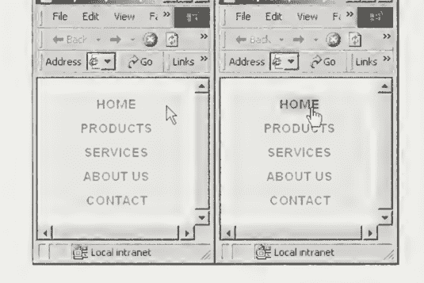

Netscape 4 用户在鼠标悬停时不会看到任何变化，但在使用链接时不会遇到任何问题。更早期的浏览器将直接以默认字体和颜色显示文本链接。通过声明和分配多个样式类，我们可以在同一个页面中区分不同的文本菜单。例如，在一个包含许多部分且每个部分包含多个页面的大型网站上，我们可能会在每个页面的顶部或靠近顶部的位置使用一排文本链接来提供对各部分的访问，并在侧边使用一列文本链接链接到当前部分内的各个页面。

### 示例 2：图像翻转菜单

在本章稍后部分，我们将回到并扩展一个与之非常相似的内容，但现在让我们继续探讨如何使用图像和 JavaScript 使我们的菜单在视觉上更具吸引力。首先，我们应该考虑使用图像代替文本的一些优缺点。当然，缺点之一是图像的下载时间更长。这可以通过使用专门为此设计的应用程序（如 Macromedia Fireworks 或 Adobe ImageReady）尽可能地优化图像来在一定程度上缓解。此外，我们应该考虑到，一旦图像被下载，在随后的页面中重复出现的相同图像将从用户的浏览器缓存中提取（前提是缓存未被禁用）而非从服务器提取，因此对于菜单中使用的每张图像，我们只需要考虑一次额外的传输时间和带宽。

使用图像的另一个缺点是，使用 Lynx 等纯文本客户端的用户将无法查看它们，因此我们必须小心地提供替代方案，例如文本链接，或者利用 HTML 的 `alt` 和 `title` 属性来让这些用户知道在点击图像链接后会看到什么，或者两者兼顾。我们还需要考虑到，可能有些用户使用的浏览器不支持 JavaScript，或者不支持图像切换（Netscape 2 和 IE 3 就是典型的例子），因此我们不想让设计完全依赖于这些技术。相反，我们应该记住，我们是在为那些能够利用这些技术的访问者提供额外的增强用户体验，而不会给那些无法利用这些技术的用户带来脚本错误或信息不足等问题。


当然，使用图像也有一些优点——否则为什么还要费心去做呢？我们可以轻松控制链接的大小和外观，而无需担心 CSS 支持情况、用户系统中的可用字体、浏览器和系统设置等。虽然 CSS 在很短的时间内取得了长足进步，但在表现层方面，仍然有很多事情是它无法完成的。最终，我们将能够使用`可伸缩矢量图形 (SVG)`或类似技术，从而消除目前在网站上经常使用的多种图像类型的需求，但该标准的实现尚不完全，其内置支持距离我们现在的状态至少还隔了一个完整的浏览器世代。好了，闲聊到此为止，让我们回到示例中，看看一个使用 JavaScript 图像翻转的基础菜单：

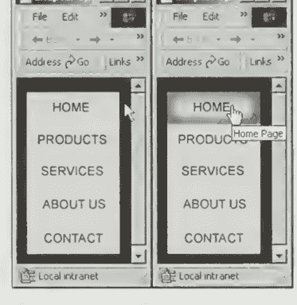

在此图中，我们在浏览器窗口中显示了一个包含一组图像链接的基础表格布局。左侧是“默认”视图；右侧我们可以看到用户将鼠标悬停在“HOME”图像链接上时发生的情况，其 HTML 代码为：

```html
<a href="index.html" onmouseover="rollOn(0);" onmouseout="rollOff(0);">
  
</a>
```

这里我们省略了表格本身的代码，因为它没什么特别的，但好奇的读者可以在`ch3_ex2.html`文件中查看。该文件中还包含用于实现翻转效果的 JavaScript 代码。这部分更有趣，所以我们将在这里完整地审视它：

# 第 3 章

```html
<script type="text/javascript" language="JavaScript">
<!--
  var imgNames,numImgs,imgsOff,imgsOn;
```

在上面，我们声明了一些变量来依次存储：``元素的`name`属性、图像数量、用于“开启”状态的`Image`对象以及用于“关闭”状态的`Image`对象。接下来，我们检查浏览器对`image`对象的支持情况；恰巧所有支持该对象的浏览器也支持 JavaScript 数组，因此我们可以避免在不支持这两种功能的浏览器中引起脚本错误。如果浏览器两者都支持，我们就创建数组。

```javascript
if(document.images)
{
  //  arrays for image names/objects
  imgNames=new Array("home","products","services","about","contact");

  numImgs=imgNames.length;

  imgsOff=new Array(numImgs);
  imgsOn=new Array(numImgs);
```

我们将图像的名称存储在`imgNames`数组中——这些名称同样被用于图像“开启”和“关闭”版本的文件名，以及相应``标签的`name`属性。（为了符合 HTML 4.01 标准，同时为`id`属性使用相同的值也是允许的。）通过将`Image`对象存储在两个数组中，我们可以使代码非常紧凑；我们不需要用好几行代码来分别定义和实例化十个不同的`Image`对象，而可以通过一个循环中的两行脚本实现同样的效果。通过预加载图像，我们可以确保在图像切换函数调用它们之前，所有图像文件都已被浏览器缓存，因为如果用户网络连接缓慢，且我们尝试调用尚未完全创建和加载的对象，某些浏览器可能会产生脚本错误、“挂起”甚至崩溃。

```javascript
//  preload images

  for(var i=0;i<numImgs;i++)
  {
```

在每次循环中，我们将`imgsOff`数组的下一个元素填充为一个`Image`对象的实例，然后将其`src`属性指定为服务器上的一个图像文件。

```javascript
      imgsOff[i]=new Image(100,35);
      imgsOff[i].src="images/"+imgNames[i]+"_off.jpg";
```

然后，我们对`imgsOn`数组的下一个元素执行相同的操作。

```javascript
      imgsOn[i]=new Image(100,35);
      imgsOn[i].src="images/"+imgNames[i]+"_on.jpg";
    }
}
```

## 基础 JavaScript 菜单

```javascript
function rollOn(index)
{
  if(document.images)
  document.images[imgNames[index]].src=imgsOn[index].src;
}

function rollOff(index)
{
  if(document.images)
  document.images[imgNames[index]].src=imgsOff[index].src;
}
//-->
</script>
```

我们在预加载代码以及图像切换函数本身中都检查了对`Image`对象的支持，以确保浏览器理解我们的指令，并在不支持的情况下不会向用户抛出错误或警告。我们始终希望尽最大努力确保菜单保持菜单的可用性，并且不会给那些无法利用我们提供的所有功能的访问者带来问题。因此，除了这里使用的防御性脚本技术外，我们还为图像添加了`alt`属性；在生产环境中，根据具体情况，为每个`<a>`或``元素（或两者都）采用`title`属性也是明智的。

使用数组的另一个优势是使我们的代码更易于维护。假设我们的客户决定开始提供公司新闻稿以及指向公司相关新闻项目的链接，因此要求我们在网站中添加一个新的“新闻 (Press)”页面或板块——以及随之而来的，在菜单中添加一个指向`press.html`页面的新“新闻”链接。我们在菜单中添加以下内容：

- 一个新的表格行/单元格，包含一个位于`images`子目录中、文件名为`press_off.jpg`的图像，该图像链接到相应的页面，且其`name`属性的值为`"press"`。
- 第二张图像，文件名为`press_on.jpg`，位于同一子目录。
- 在`imgNames`数组中添加一个由字符串`"press"`组成的元素。
- 在链接的`onmouseover`和`onmouseout`事件处理程序中添加对这两个图像切换函数的相应调用。

只要我们保持一致，甚至不需要担心调用函数时传递的参数数值；我们可以将“PRESS”链接添加到菜单中间，而将字符串`"press"`添加到图像名称数组的末尾，只要我们记得它是数组中的最后一个元素，并在函数调用中使用相应的索引即可：

```html
<a href="index.html" onmouseover="rollOn(5);" onmouseout="rollOff(5);">
  </a>
```

除了添加新的`Array`元素外，我们不需要对 JavaScript 预加载代码或函数进行任何更改。在这种方式下组织菜单代码的额外优势将在第 6 章中变得明显，届时我们将研究如何使用服务器端技术创建此类菜单，我们将使用几段 ASP 或 PHP 代码循环处理从数据库中获取的值来生成 HTML 和 JavaScript。这是一个使用 PHP 和 MySQL 生成表格、链接和图像代码的快速示例：

```php
<table width="100" border="0" cellspacing="0" cellpadding="0">
<?php
$count=0;
$my_query="SELECT name,alt FROM menu_images ORDER BY id";
$my_result=mysql_query($my_query);
while( $my_row=mysql_fetch_row($my_result) )
{
$my_link=$my_row[0];
$my_alt=$my_row[1];
echo "<tr><td><a href=\"$my_link.html\" onmouseover=\"rollOn($count);\" ";
echo "onmouseout=\"rollOff($count);\">";
echo "</a></td></tr>\n";
$count++;
}
?>
</table>
```

但我们是不是有点操之过急了？让我们看看如何通过在布局和 JavaScript 代码中添加一些微小的补充，来增强我们的翻转（rollover）菜单。

### 示例 3A：使用侧边栏翻转图像

现在我们将在菜单中添加一个侧边栏图像。这张图像会在每个链接被鼠标悬停时发生变化，以便向用户提供额外的信息或视觉提示，如`ch3_ex3.html`所示。

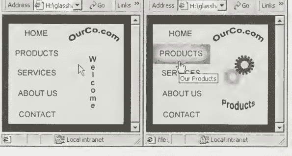

与之前的示例一样，左侧的视图是默认状态，此时鼠标指针没有停在任何菜单图像链接上；右侧我们看到的是用户将鼠标悬停在“PRODUCTS”链接上时发生的情况。

为了实现这一点，我们在表格中添加第二列，将其所有单元格合并，并在生成的单元格中添加一个默认的“占位”图像：

```html
<td rowspan="5">
  
</td>
```

这里不需要链接或事件处理代码，只需要给侧边栏图像一个`name`属性，以便我们在 JavaScript 代码中能迅速识别它。当然，我们可以通过`document.images`集合中的索引来引用这张图像（以及该菜单中使用的每张其他图像），但使用不同的`name`属性可以让我们更容易地识别正在操作哪张图像。此外，如果我们通过在页面中添加或删除其他图像来改变页面布局怎么办？这很可能会改变菜单图像的索引，从而需要更改我们在脚本中引用它们的方式。将注意力转回到脚本代码本身，我们需要完成两个目标：

1. 预加载六张侧边栏图像——菜单中每个链接对应一张，外加一张在没有菜单链接被悬停时显示的“关闭（off）”图像。
2. 更新图像切换函数，以便在菜单链接被悬停时切换到相应的侧边栏图像。

尽管我们现在使用了六张图像，但其中五张符合我们已经建立的模式，因此没有理由不给这些图像起符合模式的文件名（如`home_side.jpg`、`products_side.jpg`等），这样为了代码的简洁性和可维护性，我们可以使用相同的循环。我们定义一个新数组：

```javascript
var sideOn=new Array(numImgs);
```

然后在代码的预加载部分，我们用`Image`对象填充此数组，并以与上面非常相似的方式实例化它们：

```javascript
sideOn[i]=new Image(100,175);
sideOn[i].src="images/" + imgNames[i] + "_side.jpg";
```

当然，我们需要单独预加载默认图像：

```javascript
var sideOff=new Image(100,175);
sideOff.src="images/side_off.jpg";
```

然后我们在`rollOn()`函数中添加一行代码，以便在菜单链接被悬停时切换侧边栏图像的源：

```javascript
document.sidebar.src=sideOn[index].src;
```

我们还需要在`rollOff()`函数中添加一行类似的互补代码，将其切换回默认图像源：

```javascript
document.sidebar.src=sideOff.src;
```

当然，由于侧边栏只有一个“关闭”图像，这里不需要引用任何数组。

在继续之前有几点注意事项：

1. 第一个潜在的问题与 CSS 定位和 Netscape 4.X 系列浏览器有关。这是因为 Netscape 4 将定位元素视为 Layer 对象，并在其 DOM 层级结构中引入了一个额外的复杂点。我们在这里不做完整的示例，但假设我们将菜单放置在一个绝对定位的`<div>`中，其 id 或 name 属性为`"menu"`。因为每个 Netscape Layer 包含自己的 Document 对象，且其中所有元素都派生自该对象，因此我们原始的`rollOn()`函数可能会变成这样：

```javascript
function rollOn(index, layerId)
{
    if(document.images)
    {
        var imgRef=document.images[imgNames[index]];
        if(document.layers&&layerId)
            imgRef=document.layers[layerId].imgRef;
        imgRef.src=imgsOn[index].src;
    }
}
```

如果我们不对图像使用绝对定位，那么第二个参数（Netscape Layer 的 id 属性）可以安全地省略。我们将在下一章再次讨论这个问题，届时我们将探讨使用高级 JavaScript、CSS 和动态 HTML 创建菜单的一些技术。

2. 本示例在 Netscape 2.X 或 IE 3.0 中无法按原样运行，因为它们不支持`Image`对象。而且它在这些浏览器中也不会优雅地失效——这是因为它们不支持用户创建的数组。如果需要与这些浏览器向后兼容（在写作时，作者至少两年没考虑过这个问题了），则需要采取额外的预防措施。一种方法是定义一个自定义的`Array`对象。另一种是使用浏览器检查。我们在示例文件中包含了与之前相同的检查代码。

### 示例 3B：一个“智能”菜单

现在，让我们将刚才讨论的示例通过将其转变为**智能菜单**，使其变得更加实用且信息丰富。我们所谓的“智能”，简单来说就是指一种能检测其所在页面并相应地改变自身外观和行为的菜单或其他导航界面。例如，当这个菜单出现在“首页 (HOME)”时，其实不需要指向`index.html`的链接，对吧，因为我们已经在那里了？然而，我们可以使用这张图像来提醒访问者当前正在查看哪个页面。在这个示例中，我们创建了另一组图像，其中一张将用于指示当前页面（如果该页面在我们的预定义页面集之中）。

我们将这些图片命名为`home_here.jpg`、`products_here.jpg`等。如果这看起来有些令人困惑，让我们看看这个示例如何工作以澄清一切。在下面图的左侧是 HOME 页面首次加载时的外观。请注意，我们使用了一个标题和`home_here.jpg`图像文件来表明用户已进入该页面；此外，默认的侧边栏图像也对应于 HOME 页面。如果你将此页面加载到浏览器中，你会看到左侧的图像是静态的，并且没有链接到任何内容，因为用户已经在`index.html`上，所以不需要一种方式到达那里。然而，正如你在右侧看到的，剩余的图像仍然作为翻转图像链接发挥作用。

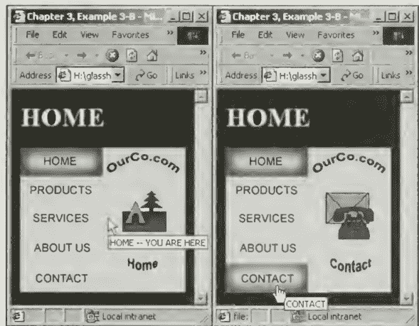

这是我们修订示例`ch3_ex3B.html`的代码：

```html
<html>
<head>
  <title>Chapter 3, Example 3-B</title>
  <meta http-equiv="Content-Type" content="text/html; charset=iso-8859-1">
```

我们应该注意，我们已经将`<script>`标签的`language`属性更改为 JavaScript1.1 – 这是因为我们将使用`String`对象的`split()`方法，该方法在 JavaScript 1.0 中不可用。

```javascript
<script type="text/javascript" language="JavaScript1.1">
<!--
var imgNames,imgAlts,numImgs,imgsOff,imgsOn,sideOn;

if(document.images)
{
//  用于图像名称/对象的数组

imgNames=new Array("home","products","services","about","contact");
imgAlts=new Array("HOME PAGE","OUR PRODUCTS","OUR SERVICES",
"ABOUT OURCO.COM","CONTACT");

numImgs=imgNames.length;

imgsOff=new Array(numImgs);
imgsOn=new Array(numImgs);
sideOn=new Array(numImgs);
}
```

注意新数组`imgAlts`的存在。正如敏锐的读者可能从看到这一点所猜测的那样，我们将使用 JavaScript 生成菜单的 HTML 代码，并且将我们的菜单图像的`alt`属性放在此数组中将使我们更容易使用紧凑的循环而不是单独编写表格的每一行来实现。


这里是我们检测浏览器当前正在加载哪个页面的地方。首先，我们使用斜杠字符作为分隔符将完整的 URL 分成几部分；我们从我们的 URL 构建方式知道，这些部分中的最后一个将是文件名`xxxxxx.html`。由于我们的每个文件名都以`.html`结尾，我们实际上不需要它来唯一标识文件，因此我们再次分割文件名，这次使用句点作为分隔符，以便我们可以丢弃文件扩展名。我们没有任何图像文件名包含字符串 "index"，但确实有几个对应于包含 "home" 的索引页面，因此如果我们要加载索引页面，我们将此值更改为后者。

```javascript
// 当前的URL是什么？
var URLbits=self.location.href.split("/");
```

`split()`方法返回一个数组，其元素是从原始字符串中移除所有分隔符实例后留下的子字符串。例如，让我们定义一个包含字母 a 的一些出现的字符串`myString`，然后使用`a`作为分隔符分割该字符串：

```javascript
var myString="Crusty is a bad cat.";
var pieces=myString.split("a");
// pieces[0] 等于 "Crusty is "
// pieces[1] 等于 " b"
// pieces[2] 等于 "d c"
// pieces[3] 等于 "t."
```

（注意空格也算！）结果数组的子字符串或元素的数量等于数组的`length`属性，因此`pieces`数组中的第一个子字符串是`pieces[0]`，最后一个子字符串是`pieces[pieces.length-1]`。顺便说一句，我们可以通过像这样调用数组的`join()`方法来逆转这个过程：

```javascript
var yourString=pieces.join("a");
```

并且`yourString`将包含与原始`myString`完全相同的值。

```javascript
var currPageName=currPage.split(".")[0];
```

## 基本 JavaScript 菜单

我们需要处理如果菜单不在预定义页面之一时会发生的情况，因此我们将一个`flag`变量初始化为`false`，然后如果当前页面是其中之一，则将其设置为`true`。由于我们稍后已经有一个循环遍历所有页面名称，我们将在同一个循环中测试此条件。

```javascript
var flag=false;
```

此外，如果当前页面是索引页面，我们希望页面标题和 "HOME" 图像的`alt`标签都显示 "HOME"。

```javascript
if(currPageName=="index")
    currPageName="home";
```

```javascript
//  预加载图像
if(document.images)
{
    for(var i=0;i<numImgs;i++)
    {
        imgsOff[i]=new Image(100,35);
        imgsOff[i].src="images/"+imgNames[i]+"_off.jpg";
        imgsOn[i]=new Image(100,35);
        imgsOn[i].src="images/"+imgNames[i]+"_on.jpg";
        sideOn[i]=new Image(100,175);
        sideOn[i].src="images/"+imgNames[i]+"_side.jpg";
    }
```

这里是我们执行测试以确定是否将标志设置为`true`的地方。如果当前页面名称是任何预定义的页面名称之一，我们将这样做；如果我们遍历所有预定义值都没有匹配，那么标志的值将保持`false`。

```javascript
if(currPageName==imgNames[i])
    flag=true;
}
```

这里是我们使用标志的地方。如果标志的值为`true`，我们知道当前页面是我们预定义的页面之一，我们将设置默认或 "off" 侧边栏图像以匹配。否则，我们将使用上一个示例中的通用 "off" 侧边栏图像。

```javascript
var sideOff=new Image(100,175);
if(flag)
    sideOff.src="images/"+currPageName+"_side.jpg";
else
    sideOff.src="images/side_off.jpg";
}
```

我们的图像预加载代码做了一个小的更改。我们希望默认侧边栏图像与我们当前正在查看的页面匹配，因此我们使该图像的源指向它，而不是指向上一个示例中使用的 "Welcome" 图像。

```javascript
var sideOff=new Image(100,175);
sideOff.src="images/"+currPageName+"_side.jpg";
```

请注意，我们的图像交换功能保持不变：

```javascript
function rollOn(index)
{
  if(document.images)
  {
    document.images[imgNames[index]].src=imgsOn[index].src;
    document.sidebar.src=sideOn[index].src;
  }
}

function rollOff(index)
{
  if(document.images)
  {
    document.images[imgNames[index]].src=imgsOff[index].src;
    document.sidebar.src=sideOff.src;
  }
}
//-->
</script>
</head>
```

这里是事情变得更有趣的地方。我们不再使用示例 3 中使用的 HTML 表格，而是有一个`<script>`块，我们将在加载时编写整个表格的代码。我们编写整个表格而不是仅编写包含图像的行或单元格的原因是为了保持与 Netscape 3 的向后兼容性，该版本不喜欢在静态表格中间使用`document.write()`语句。根据情况，尝试这样做会导致动态编写的标记混乱或根本不出现，并可能导致脚本错误。当涉及到旧浏览器时，应该注意，此示例与之前的示例一样，在 Netscape 2 或 IE 3 中使用也不是特别安全，第一个原因与之前相同：没有对 Array 对象的原生支持。这个脚本和早期浏览器还有另一个问题，我们稍后会提到。

```html
<body bgcolor="#000099" text="#FFFFFF">
<script type="text/javascript" language="JavaScript1.1">
<!--
```

这个`document.write()`语句实际上与菜单本身无关，可以很容易地删除或替换为其他内容。然而，它确实有助于演示我们如何基于页面 URL 生成内容，因此我们将其保留在示例中。

```javascript
document.write("<h1>"+currPageName.toUpperCase()+"</h1>");
```

这里是我们开始组装表格代码的地方。将所有标记组装成一个字符串然后一次性写入页面，比使用多个`document.write()`需要更少的空间。它对用户的系统资源消耗也更少。

```javascript
var output="<table width=\"100\" border=\"0\" cellspacing=\"0\"
              cellpadding=\"0\">\n";
```

这个`for`循环将表格行的标记添加到我们的输出字符串中。

```javascript
for(var j=0;j<numImgs;j++)
{
```

我们检查当前行/图像是否与当前页面对应。如果是，我们不会将此单元格中的图像转换为链接。

```javascript
var fileName=imgNames[j];
output+="<tr><td>";
currFileName=(j==0)?"index":fileName;
```

每次循环时，我们会插入链接应指向的正确文件名，以及调用图像切换函数的参数值。对于那些好奇是否可以使用 JavaScript 来编写更多 JavaScript 的人来说，现在很明显答案是肯定的。

```javascript
if(fileName!=currPageName)
{
  output+="<a href=\""+currFileName+".html\"";
  output+=" onmouseover=\"rollOn("+j+");\"
    onmouseout=\"rollOff("+j+");\">";
}
```

接下来，我们为这一行编写``标签：

```javascript
output+="";
```

然后，如果在写入``元素之前启动了`<a>`标签，我们就将其关闭。换句话说，图像要么是链接，要么不是；在前者的情况下，我们需要编写链接的开始和结束标签。

```javascript
if(fileName!=currPageName)
  output+="</a>";
  output+="</td>\n";
```

一旦关闭了单元格，我们会检查当前是否正在组装表格第一行的标记；如果是，我们需要编写第二个包含侧边栏图像的单元格。我们仅一次性编写这个第二个单元格的 HTML 代码，因为正如您可能记得的，它跨越了表格的剩余行。

```javascript
if(j==0)
{
  output+="<td rowspan=\"5\"></td>";
}
```

然后关闭该行。

```javascript
output+="</tr>\n";
}
```

完成所有行后，我们关闭表格：

```javascript
output+="</table>\n";
```

并将结果字符串写入页面。

```javascript
document.write(output);

//-->
</script>
```

对于不支持 JavaScript 的浏览器，我们包含了一个静态版本的表格，并将其包裹在`<noscript>`元素中。这里就出现了 Netscape 2 和 IE 3 的另一个问题。支持 JavaScript 的用户代理理应忽略`<noscript>`块内的任何内容。然而，这两个浏览器忽略的是规则本身，而不是忽略`<noscript>`的内容。换句话说，无论是否启用 JavaScript，这两个浏览器都会显示`<noscript>`块的内容。（这个标签直到 HTML 4.0 发布才正式标准化，而 Netscape 2 和 IE 3 都在那之前发布。）因此，如果这是一个问题，则需要采取适当的措施。在具体案例中，我们可以通过将第二个`<script>`元素中的所有代码放在一个单一的`if(document.images){ ... }`块中来解决。要查看该表格，请检查代码下载包中的`ch3_ex3_B.html`。

在下一章讨论高级客户端脚本技术时，我们将检查并提供一些更复杂的“智能”菜单示例。现在，让我们将注意力转向如何使用由少量 JavaScript 驱动的常用表单元素来创建一些更基础的 Web 菜单。

## 使用表单元素创建菜单

一般来说，在网页设计中使用表单和基础表单元素至少有两个明显的优势，特别是在我们创建如菜单之类的用户界面时。首先，它们是通用地：所有浏览器都以某种方式支持它们，甚至像 Lynx 这样的基于文本的浏览器也是如此。因此，用户很可能很容易地将它们识别为控件。其次，它们的行为在不同的用户代理和平台之间高度一致。虽然有少数情况（但不多）浏览器在此方面存在差异，我们会指出这些差异在何时何地发挥作用。

从设计者的角度来看，也存在一些缺点：表单元素的呈现方式在不同操作系统之间差异很大，甚至同一平台上的不同用户代理对同一元素的显示方式也可能不同。此外，表单元素的外观往往比较实用主义（简陋），尽管某些浏览器允许使用`<font>`标签对表单元素文本的外观进行少量控制。最新的浏览器支持对表单元素进行 CSS 样式设置；然而，它们的呈现效果可能因浏览器及其 CSS 支持程度而异。

出于类似原因，在关键应用设置中（至少在开放的网络环境中），明智的做法是限制自己使用 HTML 3.2 的`<form>`元素，因为对 HTML 4.0 和 4.01 中最新元素（如`<fieldset>`和`<optgroup>`）的支持仍然不够广泛。尽管如此，使用`<form>`元素仍有很大优势，因为网站设计者或开发人员不必担心创建自己的控件，也不必担心用户是否能将侧边控件识别为控件。

很难想象任何使用过计算机的人不认识或不习惯于屏幕上的按钮控件。在 Web 环境中，这些最可能是类型为`button`、`submit`或`reset`的`<input>`元素。（最新的浏览器也支持 HTML 4 的`<button>`元素，但为了向后兼容，我们在这里不使用它。）事实上，要找到一个不使用这些控件的非极其简单的软件应用程序，可能会是一个真正的挑战！由于我们不提供任何需要用户填写的字段，也不打算向 Web 服务器提交任何信息，因此我们在这里不考虑后两者，仅使用`button`。

### 示例 4：基础按钮菜单

这种菜单非常简单、基础，如果为支持它的浏览器加上一点 CSS 装饰，外观也并不完全难看。不符合 CSS 标准的浏览器用户将看到不太美观的内容——例如，按钮的宽度会有所不同，但只要浏览器支持 JavaScript，菜单仍然相当可用。（如果不支持 JavaScript 的浏览器可能会使用此菜单，建议在`<noscript>`标签中提供文本或图像链接。）让我们看看我们的示例在三种不同浏览器中的样子，从 Netscape 4（左）和 IE 5.5（右）开始：

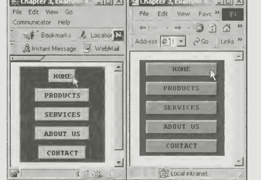

如您所见，Netscape 4 对表单元素 CSS 样式的支持非常有限——它使用我们在稍后看到的样式表中指定的 Courier New 字体渲染按钮文本，仅此而已。Internet Explorer 为这些元素支持更广泛的 CSS 属性，包括颜色、背景颜色和大小。在另一页中，我们展示了 Netscape 6.2 如何像 IE 一样支持这些元素的所有样式，以及`:hover`伪类（不仅适用于链接，也适用于其他元素，包括`<input>`标签）。左侧显示的是初始加载时的菜单；右侧显示的是当用户鼠标悬停在 “HOME” 按钮上时菜单的样子：

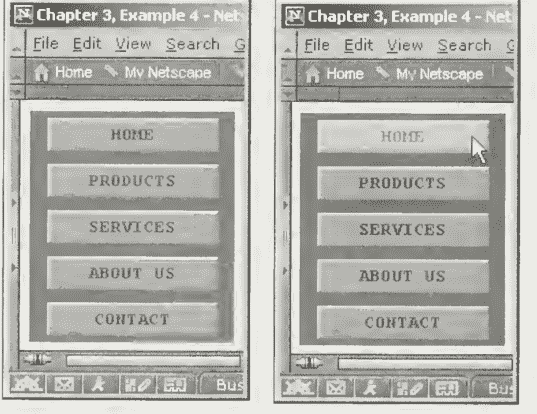

现在是我们的示例`ch3_ex4.html`的源代码：

```html
<html>
<head>
  <title>Chapter 3, Example 4</title>
  <meta http-equiv="Content-Type" content="text/html; charset=iso-8859-1">
```

我们为`<input>`元素定义了一组样式，以增强在支持表单元素 CSS 的浏览器中菜单的外观。

```css
<style type="text/css">
<!--
input {font:normal bold 14px 'Courier New',monospace; color:#990000;
width:125px;
       background-color:#CC9900;}
```

这是我们上面提到的`<input>`元素的`:hover`伪类。与大多数其他 CSS 属性一样，不支持它的浏览器会直接忽略它，因此为了 Netscape 6 用户的利益而包含此内容是安全的，且不会给使用其他浏览器的访问者带来任何问题。

```css
input:hover {color:#669900; background-color:#FFCC00;}
-->
</style>
<script type="text/javascript" language="JavaScript">
<!--
```

这个相对简单的 JavaScript 函数用于驱动菜单按钮。传递给它的参数是一个字符串，随后会附加 ".html"。然后浏览器将重定向到生成的 URL。

```javascript
function goThere(destination)
{
  self.location.href=destination+".html";
}

//-->
</script>
</head>
```

```html
<body bgcolor="#FFFFCC" text="#FFFFCC">
  <form>
    <table align="center" width="150" bgcolor="#666600" border="0" cellspacing="0"
           cellpadding="5">
```

每个按钮输入元素都将其`onclick`事件处理程序连接到上面定义的`goThere()`函数。第一个按钮调用该函数，并以字符串"index"作为参数，因此用户将被重定向到`index.html`页面。请注意，我们将字符串用单引号括起来，因为函数调用本身已经用双引号括起来了。如果我们尝试使用两组双引号，像这样，


```html
onclick="goThere("index");"
```

浏览器只会看到`onclick="goThere("`，这将导致脚本错误。

```html
<tr><td align="center">
    <input type="button" value="HOME" onclick="goThere('index');">
  </td></tr>
  <tr><td align="center">
    <input type="button" value="PRODUCTS" onclick="goThere('products');">
  </td></tr>
  <tr><td align="center">
    <input type="button" value="SERVICES" onclick="goThere('services');">
  </td></tr>
  <tr><td align="center">
    <input type="button" value="ABOUT US" onclick="goThere('about');">
  </td></tr>
  <tr><td align="center">
    <input type="button" value="CONTACT" onclick="goThere('contact');">
  </td></tr>
</table>
</form>
</body>
</html
```

### 示例5：单选按钮菜单

我们也可以使用单选按钮（左侧）或复选框（右侧）实现非常相似的功能：

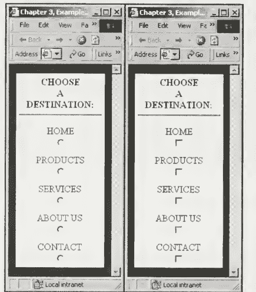

驱动每个菜单的代码非常相似。我们编写了一个函数`goThere()`，它遍历表单元素，找到被选中的那个，并使用该元素的值来组装一个URL。在示例5A（`ch3_ex5A.html`）——单选按钮示例中，函数如下所示：

```javascript
function goThere(form)
{
  var destination="";
  for(var i=0;i<form.elements.menu.length;i++)
    if(form.elements.menu[i].checked)
      destination=form.elements[i].value.toLowerCase();
    if(destination!="")
      self.location.href=destination+".html";
}
```

在示例5B（`ch3_ex5B.html`）中则如下所示：

```javascript
function goThere(form)
{
  var destination="";
  for(var i=0;i<form.elements.length;i++)
    if(form.elements[i].type=="checkbox"&&form.elements[i].checked)
      destination=form.elements[i].value.toLowerCase();
    if(destination!="")
  self.location.href=destination+".html";
}
```

在这两个示例中，`goThere()`都是从单选按钮或复选框的`onclick`事件处理程序中调用的，如下所示：

```html
<input type="checkbox" value="INDEX" onclick="goThere(this.form);">
```

或者，我们也可以向同一个表单添加一个按钮输入元素，并改用其`onclick`处理程序。传递给函数的参数`this.form`代表调用它的`<input>`元素所在的表单，因此函数接收一个JavaScript的`Form`对象，函数内部引用的就是这个表单的属性。

这里需要再次提醒一下使用单选按钮时的注意事项。如右侧的图所示，Netscape 4在表格中显示单选按钮时存在一个小问题：

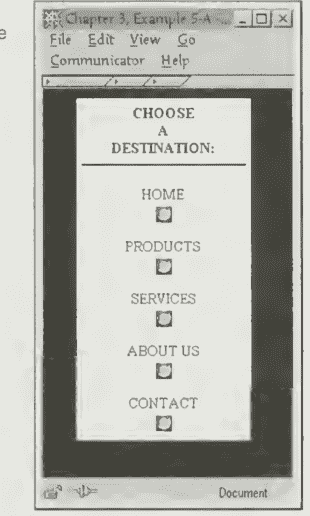

当表格背景色与页面本身的背景色不同时，Netscape 4会将单选按钮显示为页面背景色而不是表格背景色。幸运的是，我们可以通过设置`<input>`元素的`background-color`样式属性来解决这个问题，我们在实际示例文件中就是这样做的。

## 示例6A：一个基本的“跳转菜单”

我们将通过通常被称为“跳转菜单”的内容，来完成对用于导航界面的脚本化表单元素的探讨。这由一个包含一组`<option>`元素的`<select>`组成；用户选择其中一个选项，就会被重定向到相应的页面。对于那些初次尝试实现它的人来说，它似乎也是问题的无尽来源。这既源于对DOM与这些元素相关部分的理解不足，也源于Internet Explorer允许在引用`<option>`元素时使用非标准的、特定于浏览器的快捷方式。对于主要使用IE作为浏览器、在代码中使用这些快捷方式，然后发现在非Microsoft浏览器中遇到脚本错误的开发者来说，这可能会造成困惑。

为了避免这类问题，在接下来的示例中，我们将采用所有浏览器（包括IE）都认可的、对`<form>`元素的标准对象引用。下图是我们的基本跳转菜单（`ch3_ex6A`）：

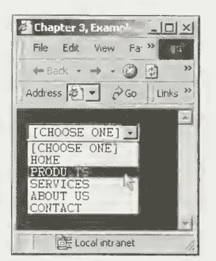

以下是其代码：

```html
<html>
<head>
  <title>Chapter 3, Example 6-A</title>
  <meta http-equiv="Content-Type" content="text/html; charset=iso-8859-1">
  <style type="text/css">
  <!--
    select, option {font:normal normal 14px 'Courier',monospace;
                    text-align:center;}
  -->
  </style>
  <script type="text/javascript" language="JavaScript">
  <!--

  function goThere(select)
  {
```

只要用户使用该菜单在网站内导航，他们就无法选择`"*CHOOSE ONE*"`选项，因为页面加载时它已经是选中状态。然而，如果他们使用浏览器的*后退*或*前进*按钮，他们将返回到一个与其离开时状态相同的页面，此时选中的选项与通常的默认值不同，在这种情况下，他们就有可能选择`"*CHOOSE ONE*"`——这将导致浏览器尝试加载一个名为`".html"`的不存在页面。由于我们希望防止这种情况发生，我们插入以下代码行：

```javascript
if(select.selectedIndex)
  self.location.href=select.options[select.selectedIndex].value+".html";
}
```

这将确保当选择`"*CHOOSE ONE*"`时不会发生任何事情。如果你认为用户可能仍然不理解，你可以通过添加以下内容向他们提供一条提示：

```javascript
else
  alert("Please select a page from the menu.");
```

这应该能向用户清楚地解释为什么他们没有跳转到任何页面！

```html
//-->
</script>
</head>

<body bgcolor="#000099" text="#000033">
  <table border="0" cellpadding="0" cellspacing="0">
    <tr>
      <td>
        <form>
          <select name="menu" size="1" onchange="goThere(this);">
            <option value="" selected>[CHOOSE ONE]</option>
            <option value="index">HOME</option>
            <option value="products">PRODUCTS</option>
            <option value="services">SERVICES</option>
            <option value="about">ABOUT US</option>
            <option value="contact">CONTACT</option>
          </select>
        </form>
      </td>
    </tr>
  </table>
</body>
</html
```

HTML标记没有什么特别之处：只是一个`<form>`包含一个典型的下拉式`<select>`，有六个选项，其中第一个是默认选项，其值为空字符串。其他五个选项的`value`属性分别对应我们在本章示例网站中一直使用的五个页面的文件名（不带`.html`扩展名）。我们使用`<select>`元素的`onchange`事件处理程序来调用`goThere()`函数，该函数将浏览器发送到其目标页面。

这个事件处理程序中单行代码的右侧部分，远没有它看起来那么神秘。让我们从内到外分解它。JavaScript中的`this`关键字代表"当前对象"。传递给函数的参数是调用它的`select`对象——因此在函数内部我们所指的`select`就是名为"menu"的`select`对象。用户选择的选项的索引（从零开始，顺序与`<option>`标签在页面中出现的顺序相同）是`select.selectedIndex`。选项本身是数组`select.options`中的元素——因此被选中的选项是`select.options[select.selectedIndex]`，其值是`select.options[select.selectedIndex].value`。

所以，如果用户选择了第三个选项（标记为`*PRODUCTS*`），脚本会获取该选项的值，即字符串"products"，在末尾附加字符串".html"，然后将浏览器发送到具有该文件名的页面。

在继续之前，我们应该就易用性提出几点：

- 这个菜单对于不支持JavaScript的浏览器来说是无法使用的。如果这是一个问题，那么你应该提供替代的导航方式，例如超链接，可以放在`<noscript>`元素内。

## 示例6B：智能跳转菜单

如果你将前面的示例运行几次，并访问我们示例“小型网站”中的各个页面，你可能会注意到，正如我们在本章前面创建的原始悬停菜单一样，我们访问的每个页面的菜单中都有一个多余的选项，它对应于当前页面。这不仅没有必要，而且使用慢速连接的用户如果意外选择了该选项，可能会在我们的网站上浪费宝贵的时间来重新加载相同的页面。让我们像示例3B那样做，通过确保这种情况永远不会发生来帮助用户！最理想的做法是尽可能不引人注目，即直接不显示该选项。我们可以通过循环生成标记，并使用`document.write()`在页面加载时将结果写入页面来动态编写HTML，就像以前那样。然而，对于表单元素，还有另一种可以利用的技术，涉及JavaScript对象。我们现在将采用这种方法，因为在接下来的示例7中很快就需要用到它。以下是该菜单在我们示例网站两个不同页面上的呈现效果，左侧是`index.html`，右侧是`services.html`：

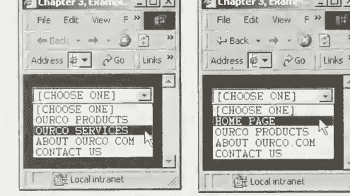

请注意，这个版本的跳转菜单与前一个不同，它省略了与所在页面对应的选项。现在让我们逐步浏览实现这一效果的代码（`ch3_ex6b.html`）；在过程中我们会解释新内容及其工作原理：

```html
<html>
  <head>
    <title>Chapter 3, Example 6-B</title>
    <meta http-equiv="Content-Type" content="text/html; charset=iso-8859-1">
  </head>
  <body>
  <!-- Content omitted -->
  </body>
</html>
```

请注意，我们为`<select>`和`<option>`元素包含了一条样式规则，与前面的示例相同，这会使我们的菜单在支持它的浏览器中看起来更美观，同时不会在不支持它的浏览器中引起问题。

```html
<style type="text/css">
<!--
  select, option {font:normal 14px 'Courier',monospace;
  text-align:center;}
-->
</style>

<script type="text/javascript" language="JavaScript">
<!--
```

`fillSelect()`函数负责完成根据使用页面定制菜单的所有工作。我们定义了两个数组：一个包含我们希望菜单指向的URL的唯一部分，这与本章前面几个示例中的做法相同，它们将用作我们即将创建的`<option>`元素的`value`属性。另一个数组包含我们希望每个选项中显示的文本（与每个选项的`text`属性相对应）。

```javascript
function fillSelect()
{
  var pageNames=new Array("index","products","services",
                          "about","contact");
  var pageTitles=new Array("HOME PAGE","OURCO PRODUCTS", "OURCO SERVICES"
                           ,"ABOUT OURCO.COM","CONTACT US");
  
  var numPages=pageNames.length;
  var j=1;
```

接下来的部分应该看起来很熟悉，因为它与我们之前使用的代码完全相同，用于解析当前页面URL的唯一部分。

```javascript
var URLbits=self.location.href.split("/");
var currPage=URLbits[URLbits.length-1];
var currPageName=currPage.split(".")[0];
```

在支持JavaScript1.1及以上的浏览器中，我们应该能够使用`new Option()`构造函数动态地为现有的`<select>`元素创建新选项。然而，Netscape 4不允许我们像希望的那样整洁地做到这一点；在该浏览器中，我们可以更改现有`<option>`元素的属性，但不能从头创建新的选项。

无论如何，我们遍历上面定义的数组元素。对于`pageNames`数组中的每个元素，我们检查它是否与`currPageName`相同；如果不是，我们调用`new Option()`构造函数，使用`pageTitles`和`pageNames`数组的第`i`个元素作为该选项的`text`和`value`属性的参数，然后将其分配为我们`select`的下个选项。

```javascript
for(var i=0;i<numPages;i++)
{
  if(currPageName!=pageNames[i])
  {
    document.navForm.menu.options[j]=new Option(pageTitles[i],
```

```javascript
pageNames[i]);

        j++;

      }

    }

  }
```

一旦我们的下拉菜单完成，它的行为就精确地如同我们在相应的HTML中硬编码了必要的值和文本一样；我们的用户可以以与任何其他`<select>`元素完全相同的方式与之交互，而且我们可以使用与示例6A完全相同的`goThere()`函数：

```javascript
function goThere(select)

{

  self.location.href=select.options[select.selectedIndex].value+".html";

}

//-->

</script>

</head>
```

我们无法操纵尚不存在的页面元素，因此我们通过使用`<body>`标签的`onload`属性，在页面加载完成后显式调用`fillSelect()`函数来确保它们存在。

```html
<body bgcolor="#000099" text="#000033" onload="fillSelect();">

  <table border="0" cellpadding="0" cellspacing="0">

    <tr>

      <td>

        <form name="navForm">
```

我们在这里使用的HTML标记没有什么特别的，只是我们`<select>`中的所有`<option>`元素都不包含值或描述性文本（第一个除外）——这些是以编程方式创建的。

```html
<select name="menu" size="1" onchange="goThere(this);">

  <option value="" selected>---------[CHOOSE ONE]---------</option>

  <option></option>

  <option></option>

  <option></option>

  <option></option>

</select>

      </form>

    </td>

  </tr>

</table>

</body>

</html>
```


在 IE 4+ 和 Netscape 6 中，没有必要硬编码任何 `<option>` 标签，我们可以通过首先调用其构造函数来处理默认选项，并附带一个额外参数：`document.navForm.menu.options[0]=new Option("","[CHOOSE ONE]",true);`。第三个参数设置相应选项的 `selected` 属性。

如果希望使用列表框样式的菜单而不是下拉菜单，我们示例中只需更改 `select` 的 `size` 属性即可。我们还应指出，对于 Netscape 4，我们需要确保默认选项足够长，以容纳 `<select>` 组中最长选项的文本，否则一个或多个选项的文本可能会被截断。幸运的是，使用下拉样式菜单时不会发生这种情况。我们在示例文件中包含了一个示例，即 `ch3_ex6B_2.html`。

这组中的一个典型页面看起来像这样：

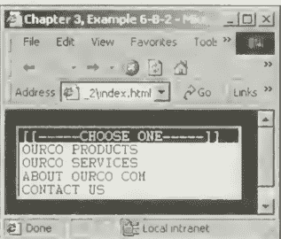

### 示例 7：双级跳转菜单

现在让我们使用相同的技术构建一个更高级的跳转菜单版本。这次我们将使用两个下拉菜单，以适应网站的突然扩展：看来 OurCo 的业务增长了，需要在网上扩展公司信息和服务。不再让用户能够访问当前页面之外的其他四个页面，我们需要让他或她能够首先选择网站的五个不同部分（如果包括一个主要的“主页”则是六个），然后选择每个部分中的多个页面。此外，我们希望使其成为一个智能菜单，不会用访问当前页面的选项来打扰用户。

以下是各部分及每个部分所属页面的图表：

| 部分 | 页面 |
| --- | --- |
| 主页 | 主页（`index.html`） |
|  | Aurora |
|  | Birmingham |
|  | Buenos Aires |
| 办事处 | Cartagena |
|  | Kempsey |
|  | Pune |
|  | Scottsdale |
|  | Stavanger |
|  | Gizmos |
|  | Somesuches |
| 产品 | Thingoes |
|  | Whatsi* |
|  | Widgets |

*表格续见下页*

#### 服务

- 配送
- 估价
- 交换
- 规格

#### 关于我们

- 公司历史
- 公司简介
- 管理层
- 使命宣言

#### 联系我们

- 客户服务
- 销售咨询
- 一般信息
- 电话号码

> [*The* 复数形式当然是 *whatsits*！]

现在让我们来逐步分析这段代码：

```html
<html>
<head>
  <title>第 3 章，示例 7</title>
  <meta http-equiv="Content-Type" content="text/html; charset=iso-8859-1">
  <style type="text/css">
  <!--
    select, option {font:normal normal 14px 'Courier',monospace;
                    text-align:center;}
  -->
  </style>
  <script type="text/javascript" language="JavaScript">
  <!--
```

首先，我们将希望在第一个下拉菜单中显示的名称存储在一个名为 `sectionNames` 的数组中，然后是一个同长度的数组 `pages`。

```javascript
var sectionNames=new Array("HOME PAGE","OFFICES","OURCO PRODUCTS","OURCO
                           SERVICES","ABOUT OURCO.COM","CONTACT US");

var numSections=sectionNames.length;

var pages=new Array(numSections);
```

这个第二个数组的每个元素实际上都是一个独立的数组（除了第一个），包含了属于每个板块名称下的页面名称。

```javascript
pages[0]="";

pages[1]=new Array("Aurora","Birmingham","Buenos Aires","Cartagena",
                   "Kempsey","Pune","Scottsdale","Stavanger");

pages[2]=new Array("Gizmos","Somesuches","Thingoes",
                   "Whatsi","Widgets");

pages[3]=new Array("Deliveries","Estimates","Exchanges","Specifications");

pages[4]=new Array("Company History","Corporate Profile",
                   "Management","Mission Statement");

pages[5]=new Array("Customer Service","Sales Enquiries",
                   "General Information","Telephone Numbers");
```

这是我们一直在使用的同一段代码片段，用于解析当前页面 URL 的独特部分。

```javascript
var URLbits=self.location.href.split("/");

var currPage=URLbits[URLbits.length-1];

var currPageName=currPage.split(".")[0];
```

我们需要确保用户在尝试重定向浏览器之前，确实选择了一个板块进行导航。因此，我们声明一个标志变量来跟踪此选择是否已发生，并将其值初始化为 false。

```javascript
var flag=false;
```

这个函数用于构建第一个下拉菜单。它的工作方式与上一个示例中使用的非常相似，只是它在每个页面上都相同，除了主索引页面——在那里我们不想显示 "HOME" 选项。它由页面的 Load 事件触发。

```javascript
function fillSections()
{
  var j=1;

  for(var i=0;i<numSections;i++)
  {
    if(i!=0||currPageName!="index")
    {
      document.navForm.sectionMenu.options[j]=new Option
      (sectionNames[i],i);

      j++;
    }
  }
}
```

当用户从 *Sections* 下拉菜单中选择一个选项时，我们会检查它是否是包含文本 "HOME" 的选项；如果是，我们立即将用户送回 `index.html`。否则，我们获取所选选项的索引，并在 *Navigate* 下拉菜单中将相应的页面显示为选项。请注意，如果 "HOME" 选项被显示，我们需要将 `selectedIndex` 减去 1，以便从正确的数组中拉取页面标题。

```javascript
function fillPages(form)
{
  var mySelectedIndex=form.sectionMenu.selectedIndex;

  if(form.sectionMenu.options[mySelectedIndex].text=="HOME PAGE")
    self.location.href="index.html";
  else
  {
    var m=1;

    selectedSection=mySelectedIndex;

    if(currPageName!="index")
        selectedSection-=1;

    for(var k=0;k<pages[selectedSection].length;k++)
    {
        var selectedPageName=pages[selectedSection][k];

        var selectedFile=selectedPageName;
```

我们为页面本身使用了一个非常简单的命名方案：我们直接使用标题，如果它包含两个单词而不是一个，我们丢弃第一个单词，例如，包含公司布宜诺斯艾利斯办公室信息的页面文件名是 `aires.html`（我们稍后将值转换为小写）。

```javascript
        if(selectedPageName.indexOf(" ")!=-1)
            selectedPageName=selectedPageName.split(" ")[1];
```

现在我们为每个选项设置适当的 `text` 和 `value` 属性：

```javascript
        form.pageMenu.options[m]=new Option(selectedFile,selectedPageName);

        m++;
    }
```

为了兼容 Netscape 4，我们需要显示最大可能数量的选项空间，并在不需要那么多选项时“清空”那些不需要的。

```javascript
    for(n=pages[selectedSection].length+1;n<9;n++)
        form.pageMenu.options[n]=new Option("","");
```

最后，我们将标志设置为 true，表示第二个下拉菜单已准备就绪：

```javascript
    flag=true;
  }
}
```

这是我们熟悉的 `goThere()` 函数，我们对其进行了轻微修改。

```javascript
function goThere(form)
{
```

如果 `flag` 变量的值为 false，我们知道用户尚未从 Section 下拉菜单中进行选择。在这种情况下，我们通过标准的 JavaScript `alert()` 对话框通知用户，将导航下拉菜单重置为其默认状态，并将焦点置于 Selections 菜单上，以帮助明确这一点。

```javascript
  if(!flag)
  {
    form.pageMenu.options[0].selected=true;

    alert("Please select a section of the site.");

    form.sectionMenu.focus();
  }
```

否则，我们获取所选选项的值，将其转换为小写，在末尾附加字符串 ".html"，并将用户发送到具有该文件名的页面。

```javascript
  else
  {
    var myValue=form.pageMenu.options
    [form.pageMenu.selectedIndex].value;

    if(myValue!="")
      self.location.href=myValue.toLowerCase()+".html";
  }
}
```

```html
<!-->
</script>
</head>
```

以下是菜单两侧在实际选择发生之前展开的分屏视图：

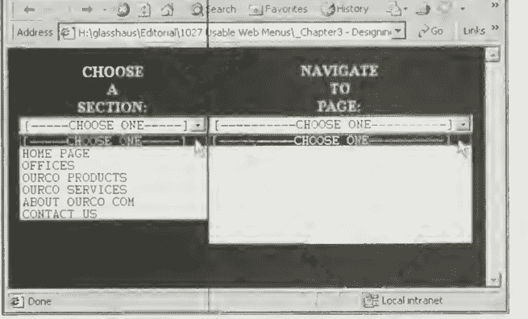

# 第 3 章

这是用户单击 "OFFICES" 选项后菜单的显示方式：

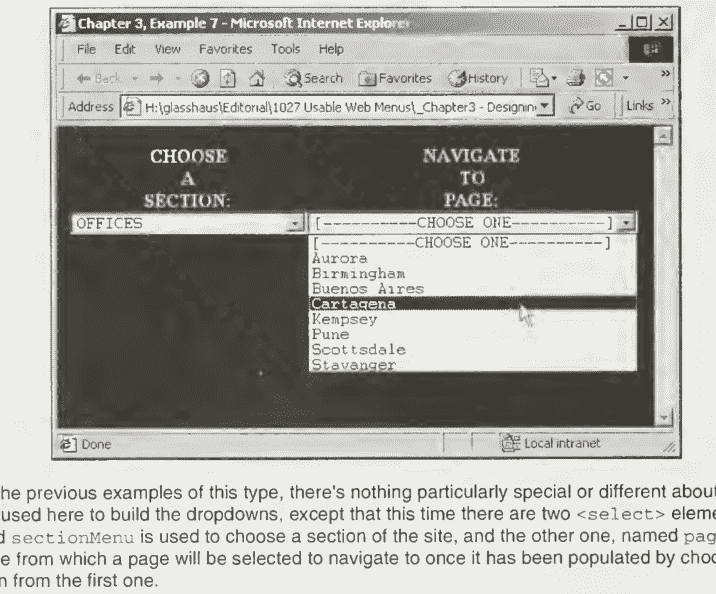

与之前的此类示例一样，我们在此用于构建下拉菜单的 HTML 并没有什么特别或不同之处，只是这次有两个 `<select>` 元素：名为 `sectionMenu` 的用于选择网站的一个板块，另一个名为 `pageMenu` 的是在从第一个菜单选择板块并填充后，用于选择要导航到的页面。

```html
<body bgcolor="#000099" text="#FFFFCC" onload="fillSections();">
  <form name="navForm">
    <table border="0" cellpadding="0" cellspacing="0">
      <tr>
        <th>CHOOSE<br>A<br>SECTION:</th>
        <th>NAVIGATE<br>TO<br>PAGE:</th>
      </tr>
      <tr>
        <td>
          <select name="sectionMenu" size="1"
                  onchange="fillPages(this.form);">
            <option value="" selected>[-----CHOOSE ONE-----]</option>
            <option></option>
            <option></option>
            <option></option>
            <option></option>
            <option></option>
          </select>
        </td>
        <td>
          <select name="pageMenu" size="1" onchange="goThere(this.form);">
            <option value="" selected>[-----------CHOOSE ONE-----------]</option>
            <option></option>
            <option></option>
            <option></option>
            <option></option>
            <option></option>
            <option></option>
            <option></option>
            <option></option>
            <option></option>
          </select>
        </td>
      </tr>
    </table>
  </form>
</body>
</html>
```


至此，我们完成了对使用表单和表单元素构建导航菜单的一些用法的探讨。

## 总结

在本章中，我们研究了在网页中创建菜单最常用的 HTML 元素：文本和图像链接，以及表单和表单元素。我们介绍了如何使用 CSS 以一种增强其在更高级浏览器中的美学吸引力的方式控制它们的外观，同时又不影响在旧版用户代理中的可用性。我们快速讲解了如何创建 JavaScript 图像翻转效果，这有助于吸引用户对重要导航元素的注意，并演示了如何创建一个非常基本的、经常被要求的增强功能——移出图像翻转（off-image rollover）。这是指我们提供一个辅助图像，当鼠标悬停在每个导航链接上时会改变，以便向用户提供额外的视觉提示或其他信息，说明该链接的用途或指向何处。

我们展示了几种不同的方法，说明如何使用各种表单元素（如按钮、单选按钮和复选框，同样由客户端 JavaScript 驱动）为我们的页面创建导航或其他界面。还讨论并演示了使用 `<select>` 和 `<option>` 元素创建的基本以及更高级的“跳转菜单”。

在此过程中，我们穿插讲解了一两课关于“智能”菜单的内容，这些菜单能“感知”它们所在的页面，并相应地显示其选项。我们还暗示了如何使用服务器端编程（如 PHP 和 ASP）来构建和定制这些菜单，使其更加强大和灵活，这是一个我们将在*第 5 和第 6 章*中深入探讨的话题。最后，我们讨论了在需要支持旧浏览器（追溯到 Netscape 和 IE 的第三代）时出现的许多兼容性问题，并提供了一些解决方案和建议来处理这些情况。

## 前瞻内容

在*第4章*中，我们将讨论使用图像映射、CSS样式与定位以及高级客户端脚本技术创建更复杂的菜单，包括使用Cookie保存用户偏好设置。我们将介绍一些常见且流行的DHTML菜单技术，包括可展开/折叠的菜单，并提供一些可适应您自身需求的脚本。在*第5章*中暂时休息一下，探索使用Flash技术创建菜单后，我们将在*第6章*讨论服务器端动态菜单创建与部署技术时，重新使用并扩展*第4章*中的一个示例。

# 第4章

- 高级DHTML菜单
- CSS，包括使用不同样式表选择器的页面
- 使用Cookie保存偏好设置
- 图像映射与浮动菜单
- 可展开/折叠菜单

作者：Jon Stephens

## 使用高级脚本和DHTML的菜单

在上一章中，我们探讨了如何使用文本和图像链接等基本HTML元素创建网页菜单，以及如何利用表单元素结合JavaScript来创建菜单。现在，我们将在此基础上，运用这些概念和技术，使我们的菜单变得更实用、更具吸引力，并能更好地响应用户的需求和偏好。在本章中，我们将：

- 首先简要回顾什么是CSS，以及如何使用CSS来控制菜单和其他内容的外观。我们将通过几个示例来展示CSS结合少量脚本的强大功能。其中一个示例较为基础，能与4.x版本浏览器向后兼容；另一个则稍微复杂一些，使用了基本的CSS和HTML**文档对象模型 (DOM)** 脚本。

- 探讨图像映射，以及一些展示其如何用于创建菜单的示例，包括一个带有标签页界面的示例。

- 探索CSS与高级DOM脚本 (DHTML) 的强大组合，该组合可用于实时更改页面的内容和外观。我们将演示一些额外的方法，利用这种组合来创建既实用又引人注目的动态菜单。在本章所有剩余的示例中，我们将把这些概念与DOM相结合，为网页制作许多非常酷炫且实用的菜单增强功能，包括：

    - 文本悬停效果与工具提示
    - 浮动菜单
    - 可展开与折叠的菜单

在这个过程中，我们将讨论**模块化**的概念，以及将内容、样式和脚本代码分离的优势。当然，我们还将提供示例或建议，说明如何使我们的代码在不同的网络浏览器和浏览器版本之间兼容，或者在无法兼容时提供替代方案。

到本章结束时，您将了解到许多菜单技术，并希望能激发您以多种不同方式调整它们，以满足您自己项目及其用户的需求。让我们从对CSS的简要回顾开始，因为理解它对于后续大部分内容至关重要。

### CSS基础

样式表是控制网页内容外观的一种非常强大且简单的工具。在CSS出现之前的“糟糕旧时光”里，字体、颜色和文本大小的调整是通过使用`<font>`标签来完成的：

```
<b><font face="Helvetica,Arial,sans-serif"
      color="#CC0033" size="+1">Pay attention to this -- it's
important.</font></b>
```

随着页面和网站规模和复杂性的增长，这种处理方式越来越不合适。至少有三个主要原因：

1. **可维护性**：假设在构建一个网站时，我们在不同地方广泛使用了一种自定义样式来添加强调效果。然后有人决定当前使用的背景颜色不是真正想要的，并要求进行修改。设计师或开发人员需要将所有出现`#CC0033`的地方改为`#003366`——总共197处。“哦，顺便一下，把它们的大小也都改大一号。”查找并替换是一个可行的选项，但事实证明，团队中的一个成员始终使用`face`、`color`、`size`的顺序，而另一个更喜欢`face`、`size`、`color`，团队的第三个成员则根本不遵循特定顺序，**粗体**标签和字体标签在很多地方交叉使用，并且使用了`size="3"`，因为在他看来效果一样。如果我们能有一种方法从一个中心点控制所有这些文本的外观，岂不是很好？CSS让我们做到了这一点：我们定义一个样式，

```
<style type="text/css">
.payAttentionToThis {font:normal bold 110% Helvetica,Arial,sans-serif;
                    color:#CC0033;}
</style>
```

然后，无论何时需要使用此样式，我们只需编写：

```
<b class="payAttentionToThis">Pay attention to this -- it's important.</b>
```

以后，如果我们需要更改所有这些重要信息的外观，我们只需在类定义中更改相应的样式规则——一次更改——然后就可以继续了。

2. **经济性**：现在假设我们正在一个包含12列和45行的HTML表格中显示信息，并且我们希望让所有非表头单元格的528个单元格中的文本看起来像我们的自定义样式。这意味着我们为页面大小增加了大约40K。如果我们在`<td>`标签上使用`.payAttentionToThis`类，我们可以节省大约30K。更好的是，通过为标签本身使用CSS选择器（`td {font:normal bold 110% Helvetica,Arial,sans-serif; color:#CD0D03;}`），我们为页面增加的大小不到100字节（或者如果我们使用单独的CSS文件，则HTML文件大小增加0字节），这使得页面臃肿程度进一步降低。虽然宽带连接的可用性正在增加，但远未普及，而且在一段时间内可能仍无法普及——大多数网络用户仍在使用拨号调制解调器，因此应尽可能节省文件大小。

3. **内容与外观分离**：简单来说，这意味着我们可以在不同的设置中重用相同的信息，而无需携带其外观，或者不必停下来解开两者。正如我们稍后将看到的，这使我们能够轻松地以不同的方式将相同的内容呈现给不同的用户，兼具美学和实际效益。反之亦然——我们可以使用同一套样式为不同的文档或其他数据提供统一的呈现方式。

使用CSS的额外好处在于，我们可以为页面元素（而不仅仅是文本元素）设置的样式信息范围大大增强了。在最新版本的浏览器中，我们可以将CSS应用于几乎任何HTML标签，包括表格、表单及其包含的元素。我们可以通过CSS控制的元素显示方面包括：

- 背景图像和颜色
- 边框、外边距和内边距
- 裁剪
- 可见性和显示
- 定位

我们将在本章后面特别大量使用最后两个方面。

#### CSS示例1：选择样式表

在这个示例中，我们将允许用户在四种不同的样式表中选择一种，用于查看整个网站中使用的菜单。为了向后兼容4.x版本浏览器，此示例将使用一个带有表单`<select>`控件的弹出窗口，以显示和选择不同的样式选项。这是因为Netscape 4不支持实时更改样式或样式表。

我们将使用Cookie来跨页面保存该选择，并在加载时检查用户的偏好设置，然后为正确的样式表写入适当的`<link>`标签。我们还将分享两个用于读写Cookie的函数，您可以非常轻松地在自己的脚本中重用它们。

这是其中一个样式表`menul.css`的代码清单：

## 第 4 章

```css
a.menu {font:normal normal 12px Arial,sans-serif; color:#CC0033;}
a.menu:hover {font-weight:bold; color:#CCCC00;}
td.menu {background-color:#000066; text-align:center;}
th.menu {font:normal bold 14px Arial,sans-serif; color:#0000CC; text-align:center;
         background-color:#666666;}
p.menu {font:normal bold 12px Arial,sans-serif; color:#FFFFFF;}
```

我们在静态页面的 `<head>` 中使用 `<link rel="stylesheet" type="text/css" href="styles/menu1.css">` 来应用此样式（请注意，该标签的 `href` 属性指向要链接到页面中的样式表）。我们的示例页面 `ch4_ex1.html` 包含（除其他内容外）以下表格：

```html
<table width="200" border="0" cellpadding="5" cellspacing="0">
  <tr>
    <th class="menu">OURCO.COM<br>SITE<br>NAVIGATION</th>
  </tr>
  <tr>
    <td class="menu">
      <p class="menu">The OurCo.com Main Entry Page:</p>
      <a class="menu" href="index.html">HOME</a>
    </td>
  </tr>
  <tr>
    <td class="menu">
      <p class="menu">Our Fabulous Line of Widgets, Gizmos, Whatsi, and More!:</p>
      <a class="menu" href="products.html">PRODUCTS</a>
    </td>
  </tr>
  <tr>
    <td class="menu">
      <p class="menu">How Can We Help You Today?:</p>
      <a class="menu" href="services.html">SERVICES</a>
    </td>
  </tr>
  <tr>
    <td class="menu">
      <p class="menu">More About OurCo Than You'll Ever Want To Know:</p>
      <a class="menu" href="about.html">ABOUT US</a>
    </td>
  </tr>
  <tr>
    <td class="menu">
      <p class="menu">Questions? Comments? Problems? Fill Out Our Contact Form:</p>
      <a class="menu" href="contact.html">CONTACT</a>
    </td>
  </tr>
  <tr>
```

### 使用高级脚本和 DHTML 的菜单

```html
<td class="menu">
  <p class="menu">
    Don't Like How Our Navigation Menu Looks? Do Something
    About It Here:
  </p>
  <a class="menu" href="javascript:setCustomMenu();">
    CUSTOMIZE
  </a>
</td>
</tr>
</table>
```

这里没有什么特别值得注意的，除了两点：底部的表格单元格包含一个 `javascript` 链接。点击时，它会调用一个 JavaScript 函数，允许用户选择首选的菜单样式；我们稍后将详细介绍该函数。你可能还会注意到，我们为所有应用样式表的元素都使用了 `class="menu"`，这在上面的样式表代码中也有体现。这使得我们更容易理清样式名称，尽管你也可以选择在样式表中为它们命名为不同的名称。

我们将使用 JavaScript 来编写指向四个样式表之一（`menu1.css`、`menu2.css`、`menu3.css` 或 `menu4.css`）的 `<link>`。我们将根据一个名为 `styleCookie` 的 cookie 的值来执行此操作，如果该 cookie 已设置，它将包含值 "1"、"2"、"3" 或 "4" 之一。由于隐私问题，Cookie 受到了很多负面评价。虽然确实有一些不道德的开发人员滥用 Cookie 来存储本应保密的私密信息或跟踪用户的上网习惯，但 Cookie 也可以非常有用。例如，TVGuide.com 使用它们来存储用户的邮政编码以及本地有线系统或卫星服务的代码，这样返回的访客就可以直接进入节目列表页面，而无需在每次想知道有什么节目时重新输入这些信息。另一种方案是为每个用户维护一个账户，并要求他们在每次检查列表时登录，而这正是我们试图避免的，至少在这种情况下是这样。我们希望用户只需选择一次菜单样式偏好，然后透明地实施。我们还可以存储对我们以及对用户都有用的信息——例如，用户访问我们网站或该网站上一个或多个给定页面的次数。

然而，我们**绝不能**在 cookie 中存储敏感的个人信息，如信用卡号或社会保障号、地址、电话等——即使我们使用安全 cookie，访问我们网站的访客仍然有可能从我们的计算机中获取这些信息。另一种令人不快的情况是有人入侵服务器并“窃听”来回发送的信息。至少有一本广泛使用的脚本书籍建议在 cookie 中存储地址是一种可接受的做法，但我们强烈反对——不仅因为我们已经阐述的原因，还因为某些浏览器中存在漏洞，允许一个域的代码访问另一个域的 cookie 集，即使在其他情况下这本是不可能的。有关一些额外的浏览器 cookie 漏洞的信息，请参阅 `http://www.zend.com/manual/function.setcookie.php`。从用户的角度出发，了解更多关于 cookie 和隐私问题的好起点是 `http://www.junkbusters.com/cookies.html`。

#### 通用 Cookie 函数

一个 cookie 至少由一个用于标识 cookie 的名称（name）和一个包含我们要保存在 cookie 中的数据的值（value）组成。可选地，我们可以添加关于 cookie 激活时间、可以从哪个服务器和目录访问，以及我们是否希望通过安全（`https://`）连接来设置和检索它的信息。以下是一些 cookie 实用函数，它们可以独立于本示例或本章中使用的任何其他脚本运行。它们基本上是快捷方式，帮助我们读写如下形式的赋值语句：

```javascript
document.cookie="myCookieName=myCookieValue; expires=Mon, 14 Jan 2003 04:07:32 GMT; path=/; domain=ourco.com;";
```

请注意，这是一个单一的 JavaScript 语句。我们将这些 cookie 实用函数放在一个单独的文件 `cookie_utils.js` 中，以便让网站上的任何页面都能使用——只需在 `<script>` 标签的 `src` 属性中包含对它的引用即可。由于我们将所有独立脚本保存在 HTML 文件下方的 `scripts` 目录中，因此我们在页面中使用以下方式包含该文件（以及该文件中的所有函数和其他脚本代码）：

```html
<script type="text/javascript" language="JavaScript"
    src="scripts/cookie_utils.js">
</script>
```

请注意，这里出现的顺序与文件中的顺序略有不同。

我们的第一个实用函数允许我们设置 cookie。

```javascript
function setCookie(name,value,expires,path,domain,secure)
```

传递给此函数的参数全部是字符串（除了 `expires` 和 `secure`——见下文），且除了前两个之外，其余均可省略。在本章的脚本中，我们将使用 `name`、`value` 和 `expires` 参数。`path` 和 `domain` 的默认值是设置它们的页面的当前路径和域名，即当前目录和域名。要使 cookie 在域的所有目录中可用，请将 `path` 值设置为 "/"。除非我们希望将其设置为 `true`，否则 `secure` 属性会被省略。请注意，为了使用安全 cookie，服务器和客户端之间必须有安全连接；否则，设置此值没有任何作用。有关如何使用最后三个属性的更多信息，请参阅本书末尾“资源”部分引用的参考资料。

```javascript
{
    document.cookie=name
```


`cookie` 的 `name` 可以是任何合法的 JavaScript 变量名字符串，而 `value` 可以包含除分号、逗号或空白字符以外的任何字符。在将 `value` 添加到 `cookie` 字符串之前，使用 JavaScript 的 `escape()` 函数将其转换为十六进制等效字符，这样我们就可以安全地存储包含这些字符的字符串。

```javascript
+=""+escape(value)
```

如果我们不为 `cookie` 设置过期日期，它将在当前浏览器会话结束时过期；浏览器会自动删除它。如果我们希望在会话之间保存数据，那么我们需要指定一个未来的过期日期。为此，我们首先创建一个对应于当前日期和时间的 `Date` 对象，然后使用相应的 `get()` 和 `set()` 方法对其进行修改，然后再将其传递给 `setCookie()` 函数。函数中调用的内置 `toGMTString()` 方法确保它以正确的格式传递给浏览器：

```javascript
+((expires)?"; expires="+expires.toGMTString():"")
```

## 具有高级脚本和 DHTML 的菜单

最后，其余三个参数被添加到 `cookie` 字符串中。

```javascript
+((path)?"; path="+path:"")

+((domain)?"; domain="+domain:"")

+((secure)?"; secure":"");

}
```

请注意，我们可以从单个域存储最多 20 个 `cookie`。`Cookie` 不包含任何可执行代码；每个 `cookie` 最多可包含 4K 的字符数据，其中包括 `cookie` 的名称和值。另一个限制是，浏览器不要求存储超过 300 个 `cookie` 总数 —— 当我们尝试设置一个会导致超出任一限制的 `cookie` 时，该 `cookie` 实际上会被设置，但浏览器可能会删除其最久未使用的 `cookie`，以避免超出限制。不同的浏览器可能能够存储比这些最小值更多的 `cookie`，但由于我们无法保证这一点，最好假设这些限制对所有用户代理（user agents）都有效。为了通过名称检索给定 `cookie` 的值，我们可以使用 `getCookie()` 函数，该函数将 `cookie` 的名称作为其唯一参数：

```javascript
function getCookie(name)

{

    var cookieArg=name+"=";

    var argLength=cookieArg.length;

    var cookieLength=document.cookie.length;

    var i=0;
```

我们在 `cookie` 字符串的长度范围内搜索包含 `name=` 的部分；如果找到了，我们就将其位置传递给 `getCookieVal()` 函数，该函数将实际值返回给 `getCookie()` 函数，然后 `getCookie()` 再将其传递回我们在脚本中调用该函数的任何位置；否则，我们返回一个 `null` 值。

```javascript
while(i<cookieLength)

{

    var j=i+argLength;

    if(document.cookie.substring(i,j)==cookieArg)

        return getCookieVal(j);

    i=document.cookie.indexOf(" ",i)+1;

    if(!i)break;

}

return null;

}
```

`getCookieVal()` 函数查找 `cookie` 字符串中 `name=` 和下一个分号 `;` 之间的部分，对其进行反转义（unescape），并将其返回给 `getCookie()`：

```javascript
function getCookieVal(offset)

{

    var end=document.cookie.indexOf(";",offset);

    if(end==-1)

        end=document.cookie.length;

    return unescape(document.cookie.substring(offset,end));

}
```

## 第 4 章

要删除一个 `cookie`，我们唯一需要做的是将 `cookie` 的过期日期设置为一个过去的时间。

```javascript
function deleteCookie(name)

{
```

如果指定名称的 `cookie` 存在，

```javascript
if(getCookie(name))

{
```

我们创建一个对应于当前日期和时间的 `Date` 对象，

```javascript
var killDate=new Date();
```

将该 `Date` 对象中存储的值更改为对应于过去日期的时间（我们选择了 `10*365*24*60*60 = 548,640,000` 秒，即十年前！）：

```javascript
killDate.setTime(killDate.getTime()-10*365*24*60*60);
```

然后将 `cookie` 的值设置为空字符串，将其 `expires` 值设置为我们刚刚创建的过去日期值：

```javascript
setCookie(name, "", killDate);

}

}
```

既然我们已经解释了 `cookie` 工具函数是如何工作的，那么让我们将它们应用于获取和保存用户的偏好设置。

## 使用 Cookie 设置样式表偏好

当用户第一次访问我们的页面时，他们会看到一个非常简单的导航菜单，具有白色背景（就像页面的其他部分一样），以及默认的文本和链接颜色。这是因为我们用于写入样式表 `<link>` 的 `cookie` 尚未设置，而且我们设置了函数在这种情况下根本不写入。因此，当页面首次加载时，菜单的外观将仅由 `content.css` 文件控制。让我们来看看包含在 `set_menu_style.js` 文件中，并通过适当的 `<script ... src="...">` 标签包含在每个页面中的 `writeStyle()` 函数：

```javascript
function writeStyle()

{
```

首先，我们创建一个初始值为空字符串的输出变量，并设置一个便捷变量等于名为 `styleCookie` 的 `cookie` 的值：

```javascript
var output="";

var myCookie=getCookie("styleCookie");
```

我们通过检查它是否包含非空且非 `null` 的值来测试 `cookie` 是否已被设置。如果没有，我们就直接退出函数而不执行任何其他操作：

```javascript
if(!myCookie||myCookie==null)

    return;
```

否则，我们将 `cookie` 的值（正如我们很快将看到的，它应该是 `"1"`、`"2"`、`"3"` 或 `"4"`）作为我们要包含的 CSS 文件名称的一部分放入输出字符串中，以及 `<link>` 标签的其余部分：

```javascript
output="<link rel="stylesheet" type="text/css" ";

output+="href="styles/menu"+myCookie+".css">\n";
```

然后我们将它写入页面，如下所示：

```javascript
document.writeln(output);
```

这将覆盖 `content.css` 文件中影响菜单元素的任何样式。然后我们实际调用该函数：

```javascript
writeStyle();
```

为了直观了解我们要实现的目标，请看下图。左侧是菜单的默认外观，而右侧则是用户选择其中一个样式选项（本例中为 #2）后菜单显示的样子：

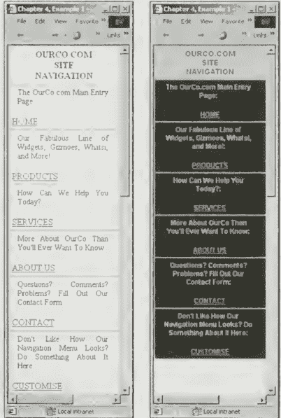

## 第 4 章

同样在 `set_menu_style.js` 文件中，我们定义了 `setCustom()` 函数，该函数由出现在菜单底部的 `"CUSTOMIZE"` 链接调用。这并不是一个特别复杂的函数；它唯一做的就是创建一个小弹出窗口，其中包含一个名为 `chooser.html` 的页面：

```javascript
function setCustomMenu()

{

  var windowParams="width=425,height=200,toolbar=no";

  var myChoiceWin=window.open("chooser.html","myChoiceWin",windowParams);

}
```

弹出窗口如下所示：

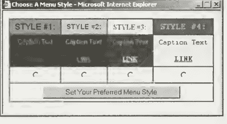

现在让我们来看看弹出窗口的源代码（`chooser.html`）：

```html
<html>

<head>

  <title>Choose A Menu Style (Chapter 4, Example 1)</title>

  <meta http-equiv="Content-Type" content="text/html; charset=iso-8859-1">
```

这是一个指向包含所有四个菜单样式的样式表的链接。如果你查看 `chooserwindow.css`，你会发现我们将 `menu1.css` 的样式复制为 `p.menu1`、`td.menu1` 等，然后对其他三个 CSS 文件的样式也做了同样的操作，以便应用于包含菜单的页面。

```html
<link rel="stylesheet" type="text/css" href="styles/chooserwindow.css">
```

接下来，我们包含我们的 `cookie` 工具脚本，因为我们希望从这个窗口设置菜单偏好 `cookie`。

```html
<script type="text/javascript" language="JavaScript"
        src="scripts/cookie_utils.js">
</script>
```

现在让我们进入实际获取用户选择并相应设置 `cookie` 的脚本函数。我们将其写为内联形式，因为不需要从任何其他页面访问它。

```javascript
<script type="text/javascript" language="JavaScript">

<!--

  function setStyle()

  {
```

我们声明一个变量 `myStyle` 来保存用户的选择，并将其初始值设为 0，然后声明第二个变量 `myChoice` 并将其值设置为名为 `choice` 的单选按钮数组（我们将在下面的表单中看到）。

```javascript
var myStyle=0;

var myChoice=document.myForm.choice;
```

接下来，我们循环遍历每个单选按钮，每个按钮都有一个布尔值 `checked` 属性。在任何共享相同名称的单选按钮组中，最多只能有一个按钮的 `checked` 属性为 `true`；我们将 `myStyle` 变量设置为该单选按钮的值，并在找到它后跳出循环：

```javascript
for(var i=0;i<myChoice.length;i++)

{

    if(myChoice[i].checked)

    {

        myStyle=myChoice[i].value;

        break;

    }

}
```

现在我们测试 `myStyle` 的值，看看它是否等于零 —— 在进行真/假测试时，JavaScript 将零转换为 `false`，并将任何非零值视为 `true`。

```javascript
if(myStyle)

{
```

如果 `myStyle` 包含一个非零值，我们创建一个名为 `expiryDate` 的新 `Date` 对象，并将其设置为未来 30 天：

```javascript
expiryDate=new Date();

expiryDate.setDate(expiryDate.getDate()+30);
```

然后我们设置一个名为 `"styleCookie"` 的 `cookie`，其值与 `myStyle` 相同，并在 `expiryDate` 过期。

```javascript
setCookie("styleCookie",myStyle,expiryDate);
```

最后，我们刷新打开当前窗口的页面，使样式选择立即生效，然后关闭此窗口，因为它已经完成了使命，不再需要。

```javascript
opener.history.go(0);

self.close();

}
```

如果 `myStyle` 仍然等于零，那么我们就知道用户在没有选择任何样式选项的情况下点击了表单按钮；在这种情况下，我们会向她显示一个 `alert()` 对话框，提醒她在操作前选择一个样式。

```javascript
else

    alert("Please select one of the four menu styles before clicking the

          button.");
```

## 第四章

页面的 `<body>` 包含一个表单和一个表格，其中的内容使用了我们前面提到的样式来展示可用的选项。

```html
<form name="myForm">

  <table width="400" border="1" bordercolor="#CC0033" cellpadding="5"

         cellspacing="0" align="center">

    <tr>

      <th class="menu1">样式 #1：</th>

      <th class="menu2">样式 #2：</th>

      <th class="menu3">样式 #3：</th>

      <th class="menu4">样式 #4：</th>

    </tr>

    <tr>

      <td class="menu1">

        <p class="menu1">标题文本</p>

        <a class="menu1" href="#">链接</a></td>

      <td class="menu2">

        <p class="menu2">标题文本</p>

        <a class="menu2" href="#">链接</a></td>

      <td class="menu3">

        <p class="menu3">标题文本</p>

        <a class="menu3" href="#">链接</a></td>

      <td class="menu4">

        <p class="menu4">标题文本</p>

        <a class="menu4" href="#">链接</a></td>

    </tr>

    <tr>

      <td align="center" valign="middle">

        <input type="radio" name="choice" value="1"></td>

      <td align="center" valign="middle">

        <input type="radio" name="choice" value="2"></td>

      <td align="center" valign="middle">

        <input type="radio" name="choice" value="3"></td>

      <td align="center" valign="middle">

        <input type="radio" name="choice" value="4"></td>

    </tr>

    <tr>

      <td colspan="4" align="center" valign="middle">

        <input type="button"

               value="设置您偏好的菜单样式"

               onclick="setStyle();"></td>

    </tr>

  </table>

</form>
```

表格的最后一行包含一个按钮输入，其 `onclick` 事件触发 `setStyle()` 函数。

扩展这个示例以包含额外的样式选择，或者允许用户在文本链接菜单和使用图片的菜单、不同的布局等之间进行选择，相对比较简单。我们也可以省略菜单本身的“自定义”文本和链接，而是直接在页面的 `onload` 事件处理程序中调用 `setCustomMenu()` 函数，这样用户在页面加载后就能立即看到弹出窗口。然而，您必须决定在设置 `cookie` 后是否要禁用该弹出窗口，以及如何让用户日后改变主意。因此，我们选择保留菜单本身的链接，以便自定义和弹出窗口完全由用户控制。设计者和开发者仅受限于网站及其用户的要求以及他们自身的想象力。虽然我们这里没有这样做，但它也可以与我们在前一章使用的一个或多个技术相结合，创建一个其外观也能以此方式更改的“智能”菜单。出于可用性考虑，可能需要一些额外的脚本；例如，您可能希望通过 `document.write()` 写出“自定义”文本和链接，这样在不支持 JavaScript 的浏览器中它就不会显示出来。出于同样的原因，您可能希望为支持 CSS 但不支持 JavaScript 的浏览器使用一个 `.css` 文件，方法是在页面头部的 `<noscript>` 块中写入一个 `<link>` 元素，例如：

```html
<noscript>

  <link rel="stylesheet" type="text/css" href="styles/menu1.css">

</noscript>
```


最后，告知用户您正在使用 cookie、将在其中存储什么信息以及为什么存储，总是一个好主意！

### CSS 示例 2：选择样式表（高级浏览器）

在前面的例子中，我们使用了一点变通方法（在页面加载时将一个指向样式表的`<link>`写入页面），以便与提供部分 CSS 支持但不支持样式脚本的旧版浏览器（Netscape 4、IE 3）保持向后兼容。在这个版本中，我们将利用最新浏览器（NS 6、MSIE 5.5+）的功能，让用户实时（无需刷新页面）更改控制页面外观的样式表。当用户决定他们更喜欢哪个时，他们将能够保存该选择，同样使用 cookie（以及与上面相同的 cookie 实用函数）来完成。我们还将向您展示如何通过在页面加载后适当地更新表格 HTML，将其变成一个“智能”菜单。

让我们首先查看 HTML 文件（`ch4_ex2.html`）的完整源代码：

```html
<html>

<head>

  <title>第四章，示例 2B</title>

  <meta http-equiv="Content-Type" content="text/html; charset=iso-8859-1">

  <link rel="stylesheet" type="text/css" href="styles/content.css">

</head>
```

这里稍作解释：CSS-2 允许我们通过在`<link>`标签中使用`rel="alternative stylesheet"`来指定替代样式表，其思想是用户可以在多个样式表中选择，以满足她的需求或偏好。我们也可以通过将`disabled`属性设置为`true`或`false`来设置其中一个或多个生效。这里我们在页面中写入了四个这样的链接，每个对应一个样式表，我们将让用户从中选择。

```html
<link id="menuStyle1" title="样式 #1" rel="alternative stylesheet"
      type="text/css" href="styles/menu1.css" disabled="true">
<link id="menuStyle2" title="样式 #2" rel="alternative stylesheet"
      type="text/css" href="styles/menu2.css" disabled="true">
<link id="menuStyle3" title="样式 #3" rel="alternative stylesheet"
      type="text/css" href="styles/menu3.css" disabled="true">
<link id="menuStyle4" title="样式 #4" rel="alternative stylesheet"
      type="text/css" href="styles/menu4.css" disabled="true">
```

Netscape 6 有一个内置机制，允许用户从这些样式表中进行选择，即使 JavaScript 被禁用。请注意下图中 Netscape 6 如何使用我们在`<link>`元素中指定的`title`属性来向用户标识链接的样式表：

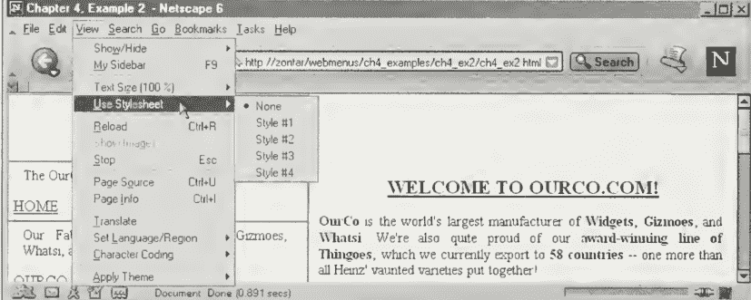

但是，我们仍然可以使用一些客户端脚本，将这种能力直接集成到我们的页面中，供 IE 5.5 和 6 的用户使用，这样他们也可以选择自己喜欢的查看样式。Netscape 6 用户将能够利用这个附加功能，而不会丢失其浏览器已提供的功能。

回到`ch4_ex2.html`代码——这里我们包含了两个 JavaScript 文件，第一个包含我们在前面的例子中使用的 cookie 实用函数（`cookie_utils.js`）。第二个（`set_dyn_style.js`）包含构建菜单本身、设置查看者的样式偏好以及将该偏好保存到（并从）cookie 中检索所需的函数和其他脚本。我们稍后将查看其脚本代码。

```html
<script type="text/javascript" language="JavaScript"
    src="scripts/cookie_utils.js"></script>
<script type="text/javascript" language="JavaScript"
    src="scripts/set_dyn_style.js"></script>
</head>

<body bgcolor="#FFFFFF" text="#000000" leftmargin="0" topmargin="0"
    marginwidth="0" marginheight="0">
<table border="0" cellpadding="0" cellspacing="0">
    <tr>
      <td id="menuCell" align="top"></td>
      <td valign="center">
        <h1>欢迎访问 OurCo.com！</h1>
        <p><b>OurCo</b> 是全球最大的 <b>Widgets</b>、<b>Gizmoes</b> 和 <b>Whatsis</b> 制造商。我们也为我们屡获殊荣的 <b>Thingoes</b> 系列感到非常自豪，目前我们已将其出口到 <b>58 个国家</b>——比亨氏所有引以为豪的品种加起来还要多一个！</p>
        <p>&nbsp;</p>
        <p>在我们的网站上，您将能够查看所有这些产品以及我们的许多其他优质产品，阅读每个产品的<b>规格说明</b>，并了解 <b>OurCo</b> 如何帮助您满足您所有的 <b>Widget 及其他需求</b>。我们将向您介绍我们提供的许多服务，以及您如何签订这些服务来帮助您的<b>家庭</b>、<b>学校</b>或<b>企业</b>。您在此期间，还将有机会阅读 <b>OurCo 的故事</b>，了解我们如何从 1679 年的一个真正的<b>家庭手工业</b>（实际上就是在一间小屋里创立的）发展成为 <b>21 世纪伟大的制造巨头之一</b>。您还可以使用我们便捷的<b>联系表单</b>来提出<b>问题</b>、发表<b>评论</b>或询问<b>下单事宜</b>。只需使用左侧便捷的<b>导航菜单</b>即可浏览我们的网站。</p>
        <p>&nbsp;</p>
        <p>我们非常高兴您能访问我们在万维网上的家园，希望您喜欢这次访问。别忘了很快再来，届时我们将推出全新的 <b>虚拟游览</b>，带您参观真实的 <b>Widget 生产设施</b>。</p>
      </td>
    </tr>
</table>
</body>
</html>
```

## 使用高级脚本和 DHTML 的菜单

您可能首先会问的是，“菜单在哪里？我只看到一个单行两列的表格——其中一列是空的，里面甚至没有任何脚本供我们编写内容。”请注意，空单元格有一个`id`属性，其值为`menuCell`；这将帮助我们确保它不会空置太久。

在进一步深入之前，让我们看看当产品示例页面（`products.html`）在兼容的浏览器（在本例中，是在 Windows PC 上运行的 IE 5.5）中加载后，菜单将如何显示和工作。左侧显示了页面初始加载时的样子。右侧，我们可以看到当用户点击标有“样式 #1”的按钮时会发生什么。不仅菜单本身的外观发生了变化，用于选择样式的按钮的外观也发生了变化；它们反映了菜单的样式。此外，您可以看到按钮 #1 已“灰显”，如果您将页面加载到自己的兼容浏览器中，您会发现它现在已无法操作。这是因为我们已将相应`<input>`元素的`disabled`属性设置为`true`。这作为一种方式，让用户知道他们正在查看使用样式 #1（`menu1.css`已启用）的菜单，同时防止他们浪费时间试图重新选择它。如果我们点击按钮 #2，菜单将使用样式 #2 显示（即`menu2.css`成为启用的样式表），按钮 #2 变为禁用，而按钮 #1 则再次变为活动状态。

## 第 4 章

现在让我们来研究一下`set_dyn_style.js`。乍一看它可能显得很长且令人困惑，所以我们将逐步分析，帮你理清其中发生的一切。

首先，我们声明一个全局变量`selectedStyle`，稍后将用它来保存存储在 cookie 中的值。我们还声明了第二个名为`myChoice`的全局变量，用于在保存到 cookie 之前，保存与用户当前选择的菜单呈现样式相对应的值。我们希望这些变量是全局的，因为我们将在整个脚本的多个不同函数中使用它们；将它们的值设置一次并保存在单个变量中，比多次检索或重新计算这些值要更经济。

```javascript
var selectedStyle;
var myChoice=0;
```

接下来是一个函数，它尝试使用我们在前一个示例中讨论的`getCookie()`工具函数来检索名为`dynStyleCookie`的 cookie 的值，并将其返回给调用`retrieveStyle()`函数的地方。如果未找到该 cookie，它将返回 0。

```javascript
function retrieveStyle()
{
    var myCookie=getCookie("dynStyleCookie");
    return (!myCookie||myCookie==null)?0:myCookie;
}
```

## 使用高级脚本和 DHTML 的菜单

这个函数用于设置浏览器在查看菜单时当前使用的样式。通过点击菜单底部出现的四个编号按钮中的任何一个来调用它。我们使用 JavaScript 生成按钮的 HTML 代码 —— 我们稍后会向你展示具体是如何实现的。

```javascript
function chooseStyle(button)
{
```

我们知道四个按钮输入项的值分别是 "Style #1"、"Style #2" 等。为了识别哪个按钮被点击了，我们将该值传递给函数，并使用`split()`方法获取 "#" 符号后面的数字，然后将其赋值给`buttonValue`。

```javascript
buttonValue=button.value.split("#")[1];
```

现在我们遍历两组元素：四个`id`属性为`menuStyle1`、`menuStyle2`等的样式表链接，以及四个`id`为`choice1`、`choice2`等的按钮。我们将每个样式表的`disabled`属性设置为`true`，将每个按钮的`disabled`属性设置为`false`。这样可以确保无论之前哪个样式表处于激活状态，我们都能禁用它，并启用之前处于非激活状态的按钮输入项。

```javascript
for(var i=1;i<5;i++)
{
  if(document.getElementById("choice"+i))
    document.getElementById("choice"+i).disabled=false;
  document.getElementById("menuStyle"+i).disabled=true;
}
```

现在，我们启用与刚刚点击的按钮相对应的样式表，并禁用该按钮输入项。

```javascript
document.getElementById("menuStyle"+buttonValue).disabled=false;
document.getElementById("choice"+buttonValue).disabled=true;
```

最后，我们将全局变量`myChoice`设置为`buttonValue`的值，以便稍后在此脚本的其他函数中使用该值。

```javascript
myChoice=buttonValue;
}
```

这里有一个你可能熟悉也可能不熟悉的`document`方法，它对于 5.0 及更高版本浏览器的 DOM 脚本至关重要：`document.getElementById()`。它的功能正如其名 —— 它将 HTML 元素的`id`属性（用引号括起来因为它是一个字符串值）作为参数，并返回该元素的对象引用，以便我们可以使用脚本对其进行操作。

> 在编写 HTML 文档时，确保元素的`id`属性是唯一的（没有其他元素共享它）非常重要。否则，尝试使用`document.getElementById()`检索元素的对象引用会导致脚本错误。

## 第 4 章

在这种情况下，我们使用`document.getElementById()`来获取`id`属性为`menuStyle1`、`menuStyle2`等的`<link>`元素的引用。至于`<link>`元素本身，我们可以使用`document.write()`或更高级的 DOM 方法来通过编程方式创建它们。关于后者的更多信息，请参阅本书末尾“资源”部分中的 DOM 参考资料。

`saveChoice()`函数在用户点击“保存我的选择”按钮时被调用，它与前一个示例中使用的函数几乎完全相同，唯一的重大区别是 cookie 的名称：

```javascript
function saveChoice(form)
{
```

如果用户做出了选择，我们会相应地设置`dynStyleCookie`并告知他们该选择已被记录。（我们再次利用了这样一个事实：当 JavaScript 尝试对一个数字进行真值测试时，它会将 0 转换为`false`，将任何其他数字转换为`true`。）

```javascript
if (myChoice)
{
  expiryDate = new Date();
  expiryDate.setDate(expiryDate.getDate() + 30);
  setCookie("dynStyleCookie", myChoice, expiryDate);
  alert("You\'ve chosen Style #" + myChoice + ", \nbut you can change it again at any time.");
}
```

否则，我们在尝试保存之前提醒用户做出选择。

```javascript
else
{
  alert("Please select a menu style before clicking the \"Save\" button.");
  return;
}
}
```

到现在为止，你可能在想我们什么时候才会处理那个“缺失”的菜单，更不用说那个我们一直在访问其元素的“缺失”表单了。接下来的函数将处理这些“遗漏”。

```javascript
function buildMenu()
{
```

首先，我们组装表格第一行的 HTML，其中包含所有页面共用的标题单元格：

```javascript
var tableStart = "<table width=\"200\" border=\"1\" bordercolor=\"#CCCC00\"
                 cellpadding=\"1\" cellspacing=\"0\">";
tableStart += "<tr><th class=\"menu\">OURCO.COM<br>SITE<br>NAVIGATION</th></tr>";
```

接下来，我们编写最后一行的 HTML，其中包含我们为用户提供的控件，以便用户预览并设置其首选的菜单外观样式：

## 使用高级脚本和 DHTML 的菜单

```javascript
var tableEnd="<tr><td class=\"menu\"><p class=\"menu\">Don't Like How Our Navigation Menu Looks?";
tableEnd+=" Do Something About It Here:</p><form name=\"styleForm\">";
tableEnd+="<table border=\"0\" cellpadding=\"1\" cellspacing=\"0\" bgcolor=\"#EEEEEE\">";
tableEnd+="<tr><td colspan=\"4\" align=\"center\"><small>Click one of the 4 smaller buttons to preview a style;<br>";
tableEnd+="click the large pushbutton beneath them in order to save your choice.</small></td></tr><tr>";
```

现在，我们将四个样式选择按钮的 HTML 组合在一起。

```javascript
for(var i=1;i<5;i++)
{
    tableEnd+="<td align=\"center\">";
    tableEnd+="<input class=\"menu\" type=\"button\" id=\"choice"+i+"\"
value=\"Style #";
```

注意我们调用`chooseStyle()`函数时使用了`this`关键字作为参数；实际上，我们将按钮本身的引用传递回了函数。

```javascript
tableEnd+=i+"\" onclick=\"chooseStyle(this);\"";
```

每次循环时，我们将`selectedStyle`的值与循环计数器进行比较；如果相同，我们就向正在构建的字符串中添加`disabled="true"`。换句话说，如果 cookie 已设置，我们会向与 cookie 值相对应的`<button>`元素添加`disabled`属性。

```javascript
if(selectedStyle==i)
    tableEnd+=" disabled=\"true\""
tableEnd+="></td>";
}
```

我们通过附加一个额外的按钮输入项，以及关闭表单及其包含的内部表格，以及包含菜单本身的表格所需的标签，来完成`tableEnd`字符串。


```javascript
tableEnd+="</tr><tr><td colspan=\"4\" align=\"center\">";

tableEnd+="<input type=\"button\" value=\"Save My Choice\"

        onclick=\"saveChoice();\">";

tableEnd+="<p>&nbsp;</p></td></tr></table></form>";

tableEnd+="</td></tr></table>";
```

既然已经将构成菜单表格开头和结尾的 HTML 存储在相应命名的变量中，那么让我们组装位于中间的菜单表格单元格、标题和链接的 HTML。我们在这里不会详细地一步步讲解，因为这在本质上与我们在第 3 章中所做的一样，当时我们为链接文本、标题和所链接文件的文件名创建并填充了数组。

```javascript
var tableRowStart="<tr><td class=\"menu\"><p class=\"menu\">";

var tableRowEnd="</a></td></tr>";

var fileNames=["index","products","services","about","contact"];

var pageTitles=["HOME","OURCO PRODUCTS","OURCO SERVICES","ABOUT OURCO","CONTACT US"];
```

## 第 4 章

```javascript
var captions=["The OurCo.com Main Entry Page:",

    "Our Fabulous Line of Widgets, Gizmoes, Whatsi, and More!",

    "How Can We Help You Today?",

    "More About OurCo Than You\'ll Ever Want To Know:",

    "Questions? Comments? Problems? Fill Out Our Contact Form:"];

var URLbits=self.location.href.split("/");

var currPage=URLbits[URLbits.length-1];

var currPageName=currPage.split(".")[0];

var numPages=fileNames.length;
```

我们声明一个新变量`newHTML`，用于将 HTML 字符串存储在一处，在按顺序遍历数组时跳过与当前页面对应的项，同时添加菜单单元格和链接的标记。一旦这些准备就绪，我们将`tableStart`和`tableEnd`分别连接到这个字符串的开头和结尾。

```javascript
var newHTML="";

for(var j=0;j<numPages;j++)

{

  if(currPageName!=fileNames[j])

  {

    newHTML+=tableRowStart+captions[j]+"</p>";

    newHTML+="<a class=\"menu\" href=\""+fileNames[j]+".html\">";

    newHTML+=pageTitles[j]+tableRowEnd;

  }

}

newHTML=tableStart+newHTML+tableEnd;
```

现在我们将完成后的菜单添加到页面中，将其插入到空表格单元格`menuCell`中。我们再次使用`document.getElementById()`方法获取所需元素的 DOM 引用，并将结果对象的`innerHTML`属性设置为`newHTML`字符串。实际上，这个属性并未包含在 W3C 的 DOM Level 1 或 Level 2 规范中。它是微软最初为 IE 4 实现的一个快捷方式，但由于其实用性很高，被 Mozilla 和 Netscape 6 采纳，因此可以被视为一种事实上的标准。

```javascript
document.getElementById("menuCell").innerHTML=newHTML;

}
```

现在我们编写一个函数来执行设置页面和正确创建菜单所需的所有任务——首先尝试获取`dynStyleCookie`的值；如果已设置，则将样式表链接切换到保存的样式选择；然后构建菜单 HTML 并将其添加到页面中。作为最后一步，我们将其附加到 window 对象的`onload`事件处理程序上，以便页面加载完成后立即执行这些任务。

```javascript
function initialise()

{

  selectedStyle=retrieveStyle();

  if(selectedStyle)

    document.getElementById("menuStyle"+selectedStyle).disabled=false;

  buildMenu();

}

window.onload=initialise;
```

_TUNGSTEN Oxb000000000010110 \n0000020370407043704370427046000000,226170.226170.17576705423205-124\n1757670001733-201100021463049467233-16-11704175046347476-239.7511753\n100211047175676-175676-463206-110272047463 430226-16240.110

## 使用高级脚本和 DHTML 的菜单

在继续之前有一点说明：如果你需要支持不支持 JavaScript 的浏览器，这相对容易做到。只需将菜单的静态版本放在其内容将通过`innerHTML`属性生成的元素内部即可。（例如，我们可以在`menuCell`表格单元格内放置一个静态 HTML 表格。）高级浏览器会简单地用动态内容替换它。对于早期支持 JavaScript 的浏览器（如 Netscape 4 和 IE 3），我们可以使用内联`document.write()`语句代替`innerHTML`来生成菜单表格。对于 Netscape 3，由于已知的在表格单元格内使用这些语句的问题，这很可能无法工作；唯一可靠的解决方法是用 JavaScript 生成整个最外层表格。如果需要支持 IE 4，可以使用其专有 DOM 的解决方法，该 DOM 使用`document.all`集合，后来被`document.getElementById()`方法所取代。以下是我们如何向正确的浏览器发送正确引用。首先我们编写一个函数来测试浏览器是否支持任一必需的 DOM 对象。

```javascript
function getElementReference(elementId)

{

  var value=false;

  if(document.getElementById)

    value=document.getElementById(elementId);

  else

    if(document.all)

      value=document.all[elementId];

  return value;

}
```

然后我们将`document.getElementById()`的引用替换为我们的`getElementReference()`函数的引用，我们还可以用它来阻止其他浏览器尝试执行该代码，例如：

```javascript
var myStyleEl=getElementReference("menuStyle");

if(selectedStyle&&myStyleEl)

  myStyleEl.disabled=false;
```

如果你认为为了兼容不同浏览器而做这么多工作似乎很麻烦，那么你开始理解为什么开发人员非常感谢浏览器正在趋同于单一的 DOM 标准，并且希望在 2 到 3 年内，这种跨浏览器的" hack "将（希望如此！）基本上成为过去。然而，在本章后面，我们将使用一个非常相似的函数，让我们能够在 Netscape 4+、IE 4+ 甚至（在某些情况下）Opera 5 及以上版本中实现一些常见的 DHTML 功能。

在前两个例子中，我们已经涵盖了很多内容，讨论了一些 CSS 基础知识，以及如何利用高级 JavaScript 和 DHTML 来创建菜单，并根据当前条件和用户偏好对其进行定制。我们还展示了如何通过使用 cookie 在访问之间保存这些偏好。

## 图像映射

接下来的几页将从技术角度提供一个短暂的喘息机会，但它们应该仍然有用。我们将从客户端图像映射的简要复习以及如何创建它们开始，并简要讨论使用它们的优缺点。

简而言之，图像映射是在单个图像中放置多个链接（也称为"热点"）的一种方式。它们可以作为一种非常有效的设计技术，因为：

- 这些热点的大小、位置和形状（`circle`表示圆形，`rect`表示矩形，`poly`表示任何其他可以用直线绘制的形状）可以由设计器设置。
- 所有支持图像的浏览器都支持图像映射。

虽然有两种类型的图像映射，客户端和服务器端，但这里我们只使用客户端类型。（服务器端图像映射超出了本书的范围，而且无论如何都变得越来越不常用，因为客户端图像映射自 Netscape 2 和 IE 3 以来就已经被支持。）这些图像是使用一个包含`usemap`属性的``标签构建的，该属性指向一个命名的`<map>`标签。热点的定义放在`<map>`元素内包含的`<area>`标签中。以下是我们将在本章首先使用的示例的 HTML 代码：

```html


<map name="menuMap">

  <area shape="poly" coords="17,22,42,6,66,20,62,47,18,45" href="index.html"

    alt="Home" title="Home" onMouseOver="rollOn(0);" onMouseOut="rollOff();">

  <area shape="circle" coords="290,31,25" href="products.html" alt="Products"

    title="Products" onMouseOver="rollOn(1);" onMouseOut="rollOff();">

  <area shape="poly" coords="208,54,241,30,266,71,227,81" href="services.html"

    alt="Services" title="Services" onMouseOver="rollOn(2);"

    onMouseOut="rollOff();">

  <area shape="rect" coords="81,35,130,79" href="about.html" alt="About Us"

    title="About Us" onMouseOver="rollOn(3);" onMouseOut="rollOff();">

  <area shape="poly" coords="141,6,211,4,200,57,148,57" href="contact.html"

    alt="Contact" title="Contact" onMouseOver="rollOn(4);"

    onMouseOut="rollOff();">

</map>
```

以下是 hotspot 高亮显示后的样子，以便于查看：

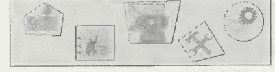

注意，我们可以在`area`标签中同时使用`alt`和`title`属性。这增强了纯文本浏览器（如 Lynx）或残障人士使用的屏幕阅读器的可用性。大多数新浏览器（Netscape 和 IE 4+ 版本）会在鼠标悬停热点时显示包含该文本的工具提示。Opera 以与 Netscape 和 IE 4+ 相同的方式显示`title`工具提示，并且`alt`工具提示也会显示在 Opera 状态栏中。（注意，Netscape 4 是所列浏览器中唯一完全不支持`title`属性的浏览器。）

显而易见，手工编写除最简单之外的任何图像映射都可能是一个复杂而乏味的过程。幸运的是，大多数（如果不是全部）最常见的网页设计套件，包括 Macromedia Dreamweaver、Adobe GoLive、Macromedia HomeSite 和 Microsoft FrontPage，都提供了内置编辑器用于此目的（我们使用 Dreamweaver 创建本章中使用的图像映射）。如果你不使用这些应用程序之一，有许多独立的工具可用于创建图像映射和编辑现有图像映射，其中许多可以从互联网上免费下载（在 Google.com 上单次搜索"image map editors"一词就获得了超过 250,000 个匹配结果）。

这些工具包括 MapIt、LiveImage、GeoHTML、ImageMapper++、MapEdit、iMap 等等。几款流行的图形程序也可以生成图像映射，包括 Corel PhotoPaint、Adobe ImageReady 和 Macromedia FireWorks。

### 图像映射示例 1

我们可以在图像映射的热点上使用事件处理程序来触发脚本，这与我们使用文本或图像链接的方式基本相同。唯一的区别是，当我们使用图像映射时，事件处理程序被添加到适当的`<area>`标签上。下面是一个基本的图像悬停效果示例，带有变化的侧边栏图像，在大多数方面与我们上一章看到的非常相似。与我们的其他图像悬停效果一样，这个示例兼容 Netscape 3 和 IE 4，并且不会在不兼容的用户代理中导致错误。万一我们选择的符号不够明显，或者用户错过了侧边栏图像，我们还在图像映射正下方提供了文本链接。此外，由于这不会对我们造成任何损害，而且稍微增强了菜单的视觉效果，我们还使用文本链接来触发与图像映射中热点相同的图像交换功能。当你查看文件`ch4_ex3.html`时，你会注意到我们可以更改映射图像的源文件，而不会丝毫影响图像映射的功能：

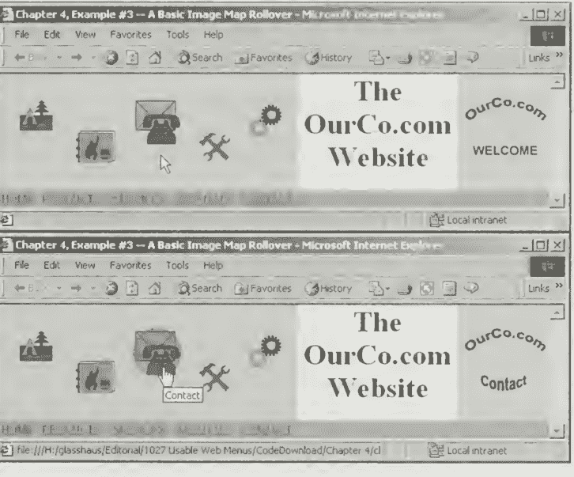

就脚本技术而言，这里确实没有太多真正的新内容；我们创建一些数组，用`Image`对象填充它们，设置它们的`src`属性，并编写几个函数来交换图像。让我们看看在添加了适当的事件处理程序和函数调用之后的图像映射代码：

```html
<map name="menuMap">

	<area shape="poly" coords="3,16,20,8,32,19,32,39,8,39" href="index.html"

		alt="Home" title="Home" onmouseover="rollOn(0);" onmouseout="rollOff(0);">

	<area shape="circle" coords="68,60,20" href="products.html"

		alt="Products" title="Products" onmouseover="rollOn(1);"

		onmouseout="rollOff(1);">

	<area shape="poly" coords="88,10,133,10,158,45,113,45" href="services.html"

		alt="Services" title="Services" onmouseover="rollOn(2);"

		onmouseout="rollOff(2);">

	<area shape="rect" coords="176,17,380,204,73" href="about.html"

		alt="About Us" title="About Us" onmouseover="rollOn(3);"

		onmouseout="rollOff(3);">

	<area shape="poly" coords="271,8,313,8,252,75,210,75" href="contact.html"

		alt="Contact" title="Contact" onmouseover="rollOn(4);"

		onmouseout="rollOff(4);">

</map>
```


如你所见，我们在这里对`<area href>`所做的，与我们在第 3 章中对`<a href>`所做的完全相同。使用我们之前已经确定的相同逻辑，只`document.write()`适当的`<area>`和``标签，从而创建一个"智能"菜单，类似于我们在该部分看到的，或者对于较新的浏览器，使用`innerHTML`属性，正如我们在前面的示例中所做的那样，这相对来说是比较简单的。

现在让我们将其中一些图像映射与额外的 CSS 属性和脚本结合起来。

## 图像映射示例 2：标签页显示菜单

现在我们将看一种非常流行的菜单类型，它被广泛应用于许多网站——一种具有"标签页"界面的菜单。这种菜单的控件类似于一组文件文件夹上的标签，或者有时用于标记活页夹的关键部分，与这里的这些类似：


编程这种界面有许多不同的方法。我们可以只使用表格中的图像和脚本来交换它们，但大量图像意味着大量带宽。这也使得我们在需要更新内容时必须创建新图像。我们可以通过使用`iframe`来解决这个问题，但它们带来了自身的一系列可用性和其他问题。相反，我们将采用 CSS 定位和一些跨浏览器脚本，这些脚本可以在 Netscape 和 IE 4+ 以及 Opera 5+ 中工作，使用一对 JavaScript 函数来帮助弥合这些浏览器在实现 DOM 方面的差异。我们稍后将查看这些代码，但首先让我们谈谈 CSS 定位。这非常名副其实：使用 CSS 来指定内容在网页上的确切位置。这有几种不同的形式，但对于这个示例，我们将只使用**绝对定位**，通过它我们可以告诉浏览器在一个固定坐标系中精确显示元素的位置。（其他 CSS 定位类型包括**相对定位**，即相对于父元素；以及**固定定位**，即相对于浏览器窗口。有关这些的更多信息，请参阅资源部分中引用的适当著作。）让我们看一个非常简单的例子。假设我们在页面的样式部分中编写一个 ID 选择器，如下所示：

```css
#myDiv {position:absolute; left:100px; top:25px;}
```

然后在页面的主体中，我们编写一个`<div>`元素，如下所示：

```html
<div id="myDiv">Hello there!</div>
```

当我们将此页面加载到支持 CSS 的浏览器中时，我们会看到文本 "Hello there!" 显示在距离页面左边缘 100 像素、距离顶部 25 像素的位置，零点或原点始终是文档的左上角。现在将`left`和`top`值更改为其他值，比如 50px 和 200px，重新保存文件，然后在浏览器中重新加载它。你会看到文本更靠近左边缘，并且离页面顶部更远。这真的很简单。CSS 定位还允许我们包含第三维度，使用`z-index`属性，通过它我们可以确定可能重叠的元素的堆叠顺序。此属性指定为整数值，0 是页面本身的默认`z-index`。要将一个元素放置在另一个元素之上，使其看起来重叠甚至完全覆盖它，我们只需赋予它更大的 z-index 值。最新的浏览器支持几乎所有 HTML 元素的 CSS 定位，但出于向后兼容性的原因（特别是针对 Netscape 4），我们将在此示例中限制自己只使用`<div>`标签。

我们将在这里使用的另一个 CSS 属性是`visibility`。它可以取以下三个值之一：

- visible：元素可见，除非被另一个具有更高 z-index 的元素遮挡。
- hidden：元素完全隐藏，用户无法与之交互。
- inherit：元素采用其父元素的 visibility 属性。由于这是所有元素的默认值，你不需要经常指定它，但我们在这里提到它是为了完整性。

元素默认是可见的，如果包含在另一个元素内，则继承其可见性。然而，在这里，我们只直接关心元素是可见的还是隐藏的。

现在让我们再谈谈不同浏览器支持的不同版本的 DOM。在 DOM 被 W3C 标准化之前，Netscape 和 Microsoft 以根本不同的方式将 HTML 元素映射到脚本对象。Netscape 4 将所有定位标签（它"识别"的那些）视为"层"——即`document.layers`集合的元素。要在该浏览器中访问上面定位的`<div>`，我们会写`document.layers["myDiv"]`。IE 4 使用不同的集合`document.all`，因此为了能够在该浏览器中对同一个`<div>`进行脚本操作，我们会写`document.all["myDiv"]`。W3C DOM-1 标准使用的不是集合，而是 Document 对象的方法来访问文档中的元素作为脚本对象。在符合 DOM 的浏览器中，例如 IE 5.5+、Netscape 6 或 Mozilla，我们写`document.getElementById("myDiv")`。幸运的是，有一种方法可以在所有这三种浏览器中从脚本访问 HTML 元素，而无需为每种浏览器编写完全不同的脚本甚至页面。我们创建了一个函数（并将其放在`xblayer.js`文件中，见下文）来实现这一点。此函数接受 HTML 标签的`id`属性，并返回当前浏览器的正确对象引用，或者如果它不支持我们讨论过的三种 DOM 实现中的任何一种，则返回`false`值：

```javascript
function getElementReference(elementId)

{

    var value=false;

    if (document.layers)

```


```javascript
value=document.layers[elementId];

else

{

    if(document.all)

        value=document.all[elementId];

    else

        if(document.getElementById)

            value=document.getElementById(elementId);

}

return value;

}
```

像这样的函数可能会提供巨大帮助，但千万不要以为它能解决所有跨浏览器 DHTML 问题，尤其是在需要兼容第 4 版浏览器的情况下。它们之间的另一个重大差异在于处理样式脚本的方式。IE 4 和标准 DOM 都使用一个`style`对象。这个对象的属性就是元素`style`属性的属性。要在 Netscape 4 和 IE 4 中使用我们刚才展示的函数来隐藏我们的`<div>`，我们可以这样写：

```
getElementReference("myDiv").style.visibility="hidden";
```

然而，Netscape 4 不支持这个对象，并且实际上根本不支持样式脚本；取而代之的是，一些有限的属性被直接附加到了`Layer`对象上。要在该浏览器中使用我们的跨浏览器函数，我们只需这样写：

```
getElementReference("myDiv").visibility="hidden";
```

为了弥合不同浏览器之间的这一额外差距，我们在`xblayer.js`文件中定义了第二个函数：

```
function getStyleReference(elementId)

{

    var value=false;

    if(getElementReference(elementId))

    {

        value=getElementReference(elementId);

        if(!document.layers)

            value=value.style;

    }

    return value;

}
```

基本上，这个函数的作用是："如果当前浏览器知道`getElementReference()`的作用，但不知道`Layer`对象是什么，我们知道它不是 Netscape 4，因此我们会在尝试访问任何样式属性之前，在引用前附加一个对`style`对象的引用。"现在我们可以直接写：

```
getStyleReference("myDiv").visibility="hidden";
```

浏览器会根据其原生对象模型来解释这条语句，并隐藏名为 "myDiv" 的`<div>`。请记住，这并不能解决跨浏览器脚本中遇到的所有问题——但它确实允许我们以最小的麻烦访问在所有三种浏览器中都可访问的那些样式属性。这些包括我们已经提到过的属性（`left`、`top`和`z-index`坐标以及可见性），以及背景色，但也就仅此而已了。已经编写并发布了冗长的脚本库，用于在一个浏览器中模拟其他浏览器的 DOM 和样式功能，我们在此不会试图重现所有这些工作——只重现完成当前任务所必需的部分。

既然我们已经发布了那个*警告*，让我们继续看示例页面`ch4_ex4.html`。让我们来详细查看这个 HTML 文件的完整源代码：

```
<html>

<head>

  <title>Chapter 4, Example 4 -- Tabbed Interface</title>

  <meta http-equiv="Content-Type" content="text/html; charset=iso-8859-1">
```

`<link>`标签中引用的`tabs.css`文件包含了所有必要的样式信息，用于正确定位我们菜单的元素——我们将在下面查看其内容。

```
<link rel="stylesheet" type="text/css" href="styles/tabs.css">
```

这些引用的是包含我们上面讨论的两个跨浏览器函数的脚本文件，以及另一个包含实际驱动菜单的代码的文件，我们稍后也会查看。

```
<script type="text/javascript" language="JavaScript"

        src="scripts/xblayer.js">

</script>

<script type="text/javascript" language="JavaScript"

        src="scripts/tabs.js">

</script>

</head>

<body bgcolor="#FFFFFF" leftmargin="0" topmargin="0" marginwidth="0"

      marginheight="0">
```

这个`<div>`包含了我们标签页的轮廓；如果你单独查看图像`tabs.gif`，你会看到标签页区域本身是透明的。这是因为构成标签页本身的彩色区域位于此图像"下方"。

```
<div id="tabOutline">

  

</div>
```

接下来，按 z-index 降序排列，我们有每个标签页的标题文本：

```
<div id="tabText0" class="tabsText">HOME</div>

<div id="tabText1" class="tabsText">PRODUCTS</div>

<div id="tabText2" class="tabsText">SERVICES</div>

<div id="tabText3" class="tabsText">ABOUT US</div>

<div id="tabText4" class="tabsText">CONTACT</div>
```

所有以下的五个`<div>`共享`tabsText`样式类，因此`z-index`值为 3。接下来，我们有选中的标签页背景，它们位于单独的`<div>`中，这样我们就可以通过逐个显示和隐藏它们来表示选中的标签页。所有这 5 个都属于`tabsClicked`样式类，因此`z-index`为 2。

```
<div id="tabClicked0" class="tabsClicked">

  

</div>

<div id="tabClicked1" class="tabsClicked">

  

</div>

<div id="tabClicked2" class="tabsClicked">

  

</div>

<div id="tabClicked3" class="tabsClicked">

  

</div>

<div id="tabClicked4" class="tabsClicked">

  

</div>
```

此外，这里所有标签页的背景显示的是"关闭"颜色：

```
<div id="defaultTabBg">

  

</div>
```

下面的`<div>`用作我们的信息显示面板。由于篇幅限制，我们省略了这些标签页的内容，但你通过查看此页面的源代码可以看到，我们可以在这些标签页中使用几乎任何我们想要的 HTML，包括图像。

```
<div id="infoPane0" class="info"> <!-- HOME INFO GOES HERE --> </div>

<div id="infoPane1" class="info"> <!-- PRODUCTS INFO GOES HERE --> </div>

<div id="infoPane2" class="info"> <!-- SERVICES INFO GOES HERE --> </div>

<div id="infoPane3" class="info"> <!-- ABOUT US INFO GOES HERE --> </div>

<div id="infoPane4" class="info"> <!-- CONTACT US INFO GOES HERE --> </div>
```

> 警告：在低于 6 版的浏览器中放置受`z-index`定位影响的`<form>`元素存在众多且潜在严重的问题。例如，一个`z-index`为 2 的元素中的`<select>`可能会透过另一个具有更高`z-index`的元素可见，即使我们期望`<select>`被隐藏在另一个元素后面。我们建议尽可能避免这种情况，或者在所有预期用于查看打算使用它们的页面的浏览器和平台上进行非常仔细和彻底的测试！

最后，我们有一个`<div>`用作信息显示区域的背景：

```
<div id="infoBg"></div>
```

以及包含定义图像映射的`<map>`元素，该映射创建了热点，用户点击这些热点以调出不同的信息"面板"：

```
<map name="tabMap">

  <area shape="poly" coords="25.5,75.5,85,15,90,28,10,28,15,15"

       href="javascript:switchTabs(0);" alt="HOME" title="HOME">

  <area shape="poly" coords="125.5,175.5,185,15,190,28,110,28,115,15"

       href="javascript:switchTabs(1);" alt="PRODUCTS" title="PRODUCTS">

  <area shape="poly" coords="225.5,275.5,285,15,290,28,210,28,215,15"

       href="javascript:switchTabs(2);" alt="SERVICES" title="SERVICES">

  <area shape="poly" coords="325.5,375.5,385,15,390,28,310,28,315,15"

       href="javascript:switchTabs(3);" alt="ABOUT US" title="ABOUT US">

  <area shape="poly" coords="425.5,475.5,485,15,490,28,410,28,415,15"

       href="javascript:switchTabs(4);" alt="CONTACT" title="CONTACT">

</map>

</body>

</html>
```

现在让我们看看我们的 CSS 文件，其中我们同时使用了样式 ID 和样式类。我们用它们来按上述顺序堆叠标签页的元素，并且我们已将它们组织得尽可能经济。第一个样式 ID 适用于标签页的轮廓。请注意，样式 ID 名称总是对应于 HTML 标签的唯一 id 属性。接下来是两个样式类，分别对应于包含标签页文本标签的`<div>`和包含"选中"背景的`<div>`；每个类包含五个`<div>`组中每个组共有的样式信息：

```
#tabOutline {position:absolute; left:0px; top:0px; z-index:4;}
```


`.tabsText` {position:absolute; top:15px; width:75px; z-index:3; visibility:visible;
            font-weight: bold 11px Helvetica, Verdana, Arial, sans-serif;}

`.tabsClicked` {position:absolute; top:0px; z-index:2; visibility:hidden;
              width:100px; height:30px;}

以下是个别标签页标签和背景对应的样式 ID；请注意每个只包含其独特的样式信息。你还会注意到每个标识符（以及对应 HTML 标签的 `id`）都以数字结尾——这是有原因的，当我们查看用于“切换”标签页的函数时应该会变得清晰：

```
#tabText0 {left:25px;}
#tabText1 {left:125px;}
#tabText2 {left:225px;}
#tabText3 {left:325px;}
#tabText4 {left:425px;}
#tabClicked0 {left:0px;}
#tabClicked1 {left:100px;}
#tabClicked2 {left:200px;}
#tabClicked3 {left:300px;}
#tabClicked4 {left:400px;}
```

接下来，我们有标签页背景的样式 ID：

```
#defaultTabBg {position:absolute; left:0px; top:0px; z-index:1;
               visibility:visible;
               width:500px; height:30px;}
```

接下来是构成显示面板的 `<div>` 标签的样式定义。同样，我们将所有面板共有的样式信息放入一个单一的样式类中，并使用样式 ID 来定义每个面板特有的样式数据：

```css
.info {position:absolute; left:15px; top:50px; visibility:hidden;
        width:400px; height:175px;
        font: normal normal 10px Helvetica,Arial,sans-serif;}
#infoPane0  {z-index:1;}
#infoPane1  {z-index:2;}
#infoPane2  {z-index:3;}
#infoPane3  {z-index:4;}
#infoPane4  {z-index:5;}
```

构建标签页界面所需的最后一点定位信息是面板背景的样式：

```css
#infoBg  {position:absolute; left:0px; top:29px; z-index:0;
         width:500px; height:250px;}
```

我们还为一些用于格式化面板内容的 HTML 标签定义了样式：

```css
h1 {font:italic bold 18px Verdana,Arial,Helvetica,sans-serif; color:#330000;}
a {font-weight:bold; color:#FF6600; text-decoration:underline;}
a:hover {color:#CCFF00; text-decoration:none;}
p {font:normal normal 12px Helvetica,Arial,sans-serif; color:#330000;}
```

现在我们准备编写在点击标签时用于显示和隐藏相应 `<div>` 的函数，如你所记得的，该函数保存在 `tabs.js` 文件中。我们将标签及其对应的信息显示面板视为 0 到 4 的编号；每次调用该函数时，我们向其传递此范围内的值：

```javascript
function switchTabs(index)
{
```

我们的目标是显示被点击标签的“选中”背景元素以及相应的面板。我们通过循环遍历 0 到 4 的整数来实现这一点：

```javascript
for(var i=0;i<5;i++)
{
```

并在每个点询问：“这是被点击标签的编号吗？”如果是，我们将该标签和相应面板的 `visibility` 属性设置为 `"visible"`，并使用前文讨论的 `getStyleReference()` 函数来确保不同浏览器都能“看到”正确的对象引用。

```javascript
if(i==index)
{
  getStyleReference("tabClicked"+i).visibility="visible";
  getStyleReference("infoPane"+i).visibility="visible";
}
```

否则，我们将两者的可见性都设置为 `"hidden"`：

```javascript
else
{
  getStyleReference("tabClicked"+i).visibility="hidden";
  getStyleReference("infoPane"+i).visibility="hidden";
}
}
```

最后，页面加载时应默认显示“HOME”标签，因此让我们编写一个单行函数来实现此功能，并将其绑定到页面的 `onload` 事件上：

```javascript
function initialise()
{
  switchTabs(0);
}
window.onload=initialise;
```

这是最终产品的效果：

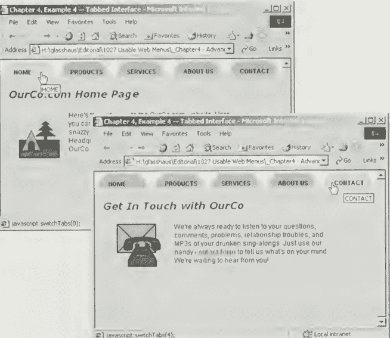

起初，你可能会觉得为了达到这个结果，我们随意堆砌了大量的 HTML、CSS 和脚本代码，可能很难一次性全部消化。请记住，这一切都是有原因的，一旦你理解了它是如何组织的，一切都会变得清晰易懂。

### 图像映射示例 3：浮动菜单

“浮动”菜单在不同用户心中会引起不同的反应。如果你在上网时还没遇到过这种菜单，那么它就是一种在页面滚动时相对于浏览器窗口保持静止的菜单（通常如此——如果我们看第一章中首次提到的 `http://www.ibizkit.se/`，它的菜单是相对于页面而非浏览器窗口静止的，因此如果你滚动或调整窗口大小，它可能会消失）。有些人觉得它们很方便，而另一些人则认为它们是个麻烦。虽然在某些方面这种分歧可能已经消弭，但我们将向你展示一个折衷的解决方案，允许用户根据需要将菜单最小化甚至完全移除。当然，我们会确保他们如果改变主意，有一种方法能把菜单找回来！我们将采用 `<noscript>` 元素为不使用支持 JavaScript 浏览器的访客提供替代的导航手段；我们还将为支持 JavaScript 但不支持 DHTML 的旧浏览器用户提供此替代菜单。事实上，我们将使这个菜单能够兼容到 Netscape 2。

该菜单有两个视觉组件，分别对应其最大化和最小化状态：

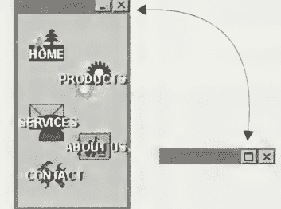

其中每一个都由包含在 `<div>`（为了兼容 Netscape 4）中的图像映射组成。“最大化”视图具有链接到我们站点其他页面的热点。该视图还包含几个额外的热点，与最小化视图共享，这些热点对应于大多数计算机用户应该很熟悉的几个界面功能。左侧的热点根据当前显示的状态来最大化或最小化菜单；右侧的热点则将其关闭（或者至少看起来是这样，我们稍后会看到）。我们的示例页面由几个不同的源文件组成——让我们列出它们并描述其作用：

- `ch4_ex5.html`：加载到浏览器中的文件。
- `xblayer.js`：包含本章之前用过的跨浏览器元素和样式对象引用函数，因此这里不再重复解释。
- `create_menu.js`：在加载时将菜单所需的 HTML 写入页面。
- `menu_driver.js`：包含用于显示三种不同菜单状态（最大化、最小化和关闭）以及使菜单“浮动”的函数。
- `menus.css`：包含菜单的样式定义。
- `content.css`：控制页面内容外观的样式；对于菜单本身的运行并非绝对必要，所以我们这里不看源码——如果你愿意，可以在代码下载包中查看。
- `menu_max.gif` 和 `menu_min.gif`：分别用于菜单最大化和最小化状态的图像（其他图像文件仅为装饰）。

让我们深入研究代码，从 HTML 文件开始：

```html
<html>
<head>
  <title>Chapter 4, Example 5 -- Floating Menu</title>
  <meta http-equiv="Content-Type" content="text/html; charset=iso-8859-1">
```

这里是样式表文件的链接：

```html
<link rel="stylesheet" type="text/css" href="styles/content.css">
<link rel="stylesheet" type="text/css" href="styles/menus.css">
```

接下来是用于跨浏览器对象引用和菜单驱动脚本文件的 JavaScript 引入：

```html
<script type="text/javascript" language="JavaScript" src="scripts/xblayer.js">
</script>
<script type="text/javascript" language="JavaScript"
  src="scripts/menu_driver.js">
</script>
</head>
```

```html
<body bgcolor="#FFFFFF" text="#000000" leftmargin="0" topmargin="0"
marginwidth="0"
  marginheight="0">
```

菜单创建脚本的 JavaScript 引入如下：

```html
<script type="text/javascript" language="JavaScript" src="scripts/create_menu.js">
</script>
```

`<noscript>` 元素内部的内容由不支持 JavaScript 的浏览器渲染，而被支持 JavaScript 的浏览器忽略。（这个规则有一个极少遇到的异常，我们稍后会告诉你如何处理，以防它对你产生影响。）在这种情况下，我们选择向不支持 JavaScript 的用户代理显示一个包含文本链接的水平表格，但你可以使用任何适合你的站点和用户的静态内容。

```html
<noscript>
  <table width="85%" align="center" border="1" bordercolor="#003366">
    <tr>
      <td align="center"><a href="index.html">HOME</a></td>
      <td align="center"><a href="products.html">PRODUCTS</a></td>
      <td align="center"><a href="services.html">SERVICES</a></td>
      <td align="center" nowrap><a href="about.html">ABOUT OURCO</a></td>
      <td align="center" nowrap><a href="contact.html">CONTACT US</a></td>
    </tr>
  </table><br clear="all">
</noscript>
```

在这个示例中，我们将所有页面内容放置在一个相当窄的表格中，以确保页面足够长从而强制产生滚动，这样你就可以观察到菜单的完整功能。我们在这里省略了具体内容，因为除此之外它并不重要。

# 第4章

```javascript
var myMenus=false;
var start=false;
var d=document;
```

现在我们来检查浏览器兼容性：如果浏览器支持三种 DHTML DOM 实现中的任何一种，那么我们就为包含菜单两种可见状态图像的 `<div>` 元素，以及与之配套的图像映射，组装相应的 HTML 代码。同时，我们还会编写一个文本链接，以便用户关闭菜单后能够重新显示它。

```javascript
if(d.layers||d.all||d.getElementById)
{
  myMenus="<div id=\"menuMax\" class=\"menu\">\n";
  myMenus+="\n";
  myMenus+="</div>\n";
  myMenus+="<div id=\"menuMin\" class=\"menu\">\n";
  myMenus+="\n";
  myMenus+="</div>\n";
  myMenus+="<p class=\"small\">Don't see the floating menu?<br>Want it back?<br> <a href=\"javascript:maxiMenu();\">Click here</a>.</p>";
  myMenus+="<map name=\"max\">\n";
```

为了增强易用性和可访问性，我们在 `<area>` 标签中添加了适当的 `alt` 和 `title` 属性：

```javascript
myMenus+="<area shape=\"rect\" coords=\"81,2,99,16\" href=\"javascript:miniMenu();\" alt=\"MINIMISE MENU\" title=\"MINIMISE MENU\">\n";
myMenus+="<area shape=\"rect\" coords=\"101,2,117,16\" href=\"javascript:closeMenu();\" alt=\"CLOSE MENU\" title=\"CLOSE MENU\">\n";
myMenus+="<area shape=\"circle\" coords=\"37,57,27\" href=\"index.html\" alt=\"HOME\" title=\"HOME\">\n";
myMenus+="<area shape=\"circle\" coords=\"84,89,27\" href=\"products.html\" alt=\"PRODUCTS\" title=\"PRODUCTS\">\n";
myMenus+="<area shape=\"circle\" coords=\"41,188,24\" href=\"services.html\" alt=\"SERVICES\" title=\"SERVICES\">\n";
myMenus+="<area shape=\"rect\" coords=\"13,106,57,152\" href=\"contact.html\" alt=\"CONTACT US\" title=\"CONTACT US\">\n";
myMenus+="<area shape=\"rect\" coords=\"61,134,105,174\" href=\"about.html\" alt=\"ABOUT US\" title=\"ABOUT US\">\n";
myMenus+="</map>\n";
myMenus+="<map name=\"min\">\n";
myMenus+="<area shape=\"rect\" coords=\"82,2,100,16\" href=\"javascript:maxiMenu();\" alt=\"MAXIMISE MENU\" title=\"MAXIMISE MENU\">\n";
myMenus+="<area shape=\"rect\" coords=\"100,2,118,16\" href=\"javascript:closeMenu();\" alt=\"CLOSE MENU\" title=\"CLOSE MENU\">\n";
myMenus+="</map>\n";
d.write(myMenus);
}
```

否则，我们将组装上述基于表格的备用菜单的 HTML 代码，然后将其写入页面：

```javascript
else
{
```

虽然这是否真的必要尚有争议，但为了内容的完整性，我们还是将其包含在内——还记得我们上面提到的关于 `<noscript>` 内容的特殊行为吗？Netscape 2 和 IE 3 是在该元素标准化之前发布的，因此无论 JavaScript 是否启用，它们都会渲染其中包含的所有内容。因此，在编写备用菜单之前，我们必须确保浏览器不是这些版本（或更早的版本），因为相同的代码已经包含在一个 `<noscript>` 块中，我们不希望它为 Netscape 2 用户显示两次。如果不关心对这些浏览器的兼容性，可以安全地省略 `if()` 检查：

```javascript
if ( ! (navigator.appName.indexOf("Netscape") != -1 &&
    parseInt(navigator.appVersion) == 2)
 &&
 ! (navigator.appName.indexOf("Microsoft") != -1 &&
```


`parseInt(navigator.appVersion) == 3`)

{

    var altMenu = "<table width=\"85\" align=\"center\" border=\"1\" bordercolor=\"#003366\">\n";

    altMenu += "<tr>\n";

    altMenu += "<td align=\"center\" ><a href=\"index.html\">HOME</a></td>\n";

    altMenu += "<td align=\"center\"><a href=\"products.html\">PRODUCTS</a></td>\n";

    altMenu += "<td align=\"center\"><a href=\"services.html\">SERVICES</a></td>\n";

    altMenu += "<td align=\"center\" nowrap><a href=\"about.html\">ABOUT OUR CO</a></td>\n";

    altMenu += "<td align=\"center\" nowrap><a href=\"contact.html\">CONTACT</a></td>\n";

    altMenu += "</tr>\n";

    altMenu += "</table><br clear=\"all\">\n";

    d.write(altMenu);

}

```

我们将稍微打破顺序，向您展示为两个名为`menuMax`和`menuMin`的`<div>`提供样式信息的CSS，该样式保存在文件`menus.css`中。这个文件并不大。

首先，我们定义一个名为`menu`的样式类，它应用于这两个`<div>`。它为两者都设置了绝对定位，并将它们的默认可见性设为`hidden`。

```
.menu {position:absolute; visibility:hidden;}
```

然后，我们使用单独的样式ID来设置它们的`z-index`属性。这些值设置得很大，是为了（试图）确保它们能保持在页面中任何其他可能被绝对定位的内容之上。

```
#menuMax {z-index:10;}
#menuMin {z-index:11;}
```

最后，我们为任何`small`类的`<p>`元素编写一个选择器——我们将它应用于允许用户在菜单被关闭后重新显示它的链接，以及伴随该链接的文本。

```
p.small {font:italic normal 10px sans-serif;}
```

现在，让我们看看`menu_driver.js`文件，它包含了我们需要执行两组任务的函数：首先，正确定位菜单并使其"浮动"；其次，允许用户最小化、最大化、关闭和重新打开菜单。

首先，我们定义一个新函数，使定位元素更容易。它的参数是元素的`id`属性，以及我们希望放置它的`left`和`top`坐标。

```
function setPos(elementId,newLeft,newTop)
{
```

由于我们在页面中已在此文件之前包含了`xbLayer.js`文件，因此我们可以使用其中定义的函数来获取跨浏览器的元素和样式对象引用。我们将一个变量设置为正确的样式对象引用：

```
var obj=getStyleReference(elementId);
```

然后，我们将此对象的`left`和`top`属性设置为所需的值：

```
obj.left=newLeft;
obj.top=newTop;
}
```

您可能现在注意到，通常在版本4及更新的浏览器中，我们可以通过将属性名称作为元素`style`对象的属性来在脚本中设置CSS属性（Netscape 4除外，但我们的`getStyleReference()`函数会为我们处理这一点）。假设我们想更改一个元素的`z-index`；可以合理地认为我们可以通过编写以下代码来做到这一点：

```
getStyleReference("myElement").z-index=4;
```

对吗？不完全是。`-`字符在JavaScript（以及大多数（如果不是全部）其他编程和脚本语言）中是保留用于减法运算的，因此这条语句会导致错误。要解决此问题，在尝试设置带有连字符的样式属性时，请遵循以下规则：

- 移除连字符
- 将第二个单词（以及任何后续单词）的首字母大写
- 将结果组合成单个属性名称

这也被称为intercap（或小写驼峰式）表示法。因此，使用我们的自定义函数设置`z-index`属性的正确方式是编写：

```
getStyleReference("myElement").zIndex=4;
```

在标准DOM-1语法中，这是：

```
document.getElementById("myElement").style.zIndex=4;
```

让我们回到手头的任务。既然我们有了一个用于定位元素的快捷方法，我们就可以进行下一步了，即将菜单定位为相对于浏览器窗口而不是窗口中的文档保持在同一位置。我们希望菜单保持在页面可见区域下方15像素，距离右边缘15像素。我们将编写另一个函数来为我们完成这个任务：

```
function setMenus()
{
```

Netscape和IE在确定与浏览器窗口相关的度量方面有非常不同的方法。如果浏览器使用layers或W3C DOM，我们将变量`NS`设置为`true`，如果它可以使用`document.all`，则设置为`false`。

```
var NS=document.layers||(document.getElementById&&!document.all);
```

首先，我们需要找出用户滚动页面的距离，即文档顶部与浏览器视区顶部之间的距离。Netscape将此距离提供为`window.pageYOffset`；Microsoft浏览器将其暴露为`document.body.scrollTop`。我们将结果值加上15像素，这个距离是从上往下测量的，因此菜单将被放置在窗口顶部下方一点。

```
var topPos=NS? window.pageYOffset:document.body.scrollTop;
topPos+=15;
```

我们还需要获取浏览器窗口的宽度。IE将其报告为`document.body.clientWidth`。Netscape使用`window.innerWidth`，我们从中减去15像素以考虑滚动条。我们再减去115（菜单的宽度）+ 10像素，这样菜单的右边缘就会在滚动条（如果有的话）的右侧一点。

```
var leftPos=NS?window.innerWidth-15:document.body.clientWidth;
leftPos-=125;
```

## 第 4 章

使用上面定义的`setPos()`函数，我们将两个菜单`<div>`都被定位在计算出的坐标处。这样一来，如果选择了“最大化”或“最小化”，正确的菜单版本就可以立即在正确的位置显示，而无需先对其重新定位。

```javascript
setPos("menuMax",leftPos,topPos);
setPos("menuMin",leftPos,topPos);
```

现在我们检查`start`变量的值，该变量在`create_menu.js`文件的开头被声明并设为`false`。如果它仍为false，我们就显示包含最大化菜单的`<div>`，然后将其值设为`true`。这确保了菜单在第一次被移动到正确位置之前保持隐藏状态。一旦完成此操作，我们就无需重复此步骤。

```javascript
if(!start)
{
  maxiMenu();
  start=true;
}
```

该函数在页面加载完成后被调用。我们通过检查菜单HTML是否已写入页面，来确保只有兼容的浏览器才会尝试执行`setMenus()`函数（否则，`myMenus`将仍保持其原始值`false`）。

```javascript
function makeFloat()
{
  var myTimer;
  if (myMenus)
```

我们使用JavaScript的`setInterval()`方法强制每隔四分之一秒重复执行一次`setMenus()`，这样每当用户滚动窗口时，菜单都能迅速跟上并恢复到正确的位置。此方法会重复执行传递给它的任何脚本代码，直到调用`clearInterval()`停止。如果你预计用户会在使用此菜单的单个页面上花费大量时间，你可能需要考虑使用计数器，并在几分钟后通过`clearInterval(myTimer);`语句停止“悬浮”——这在某些浏览器和平台上尤为重要。允许循环无休止地继续可能会最终导致严重的内存泄漏，甚至导致浏览器或系统崩溃。然而，我们在单台装有166 MHz Pentium处理器和64 MB RAM的Windows 95 PC上，同时在Netscape 4.77、IE 5.5、Netscape 6.2和Opera 6.0 beta中运行此页面6个多小时，没有出现任何明显的不良影响，所以在这种情况下，我们的警告也许是没有必要的。

```javascript
myTimer=setInterval("setMenus()",250);
```

当用户点击“最小化”热点时会调用`miniMenu()`函数——它会隐藏全尺寸菜单并显示最小化菜单。当点击“最大化”热点时，`maxiMenu()`函数执行相反的操作；“恢复”链接也会调用此函数。点击“关闭”热点会调用`closeMenu()`，它实际上并不会销毁菜单，而只是隐藏两个菜单`<div>`。

```javascript
function miniMenu()
{
  getStyleReference("menuMax").visibility="hidden";
  getStyleReference("menuMin").visibility="visible";
}
```

```javascript
function maxiMenu()
{
    getStyleReference("menuMin").visibility="hidden";
    getStyleReference("menuMax").visibility="visible";
}
```

```javascript
function closeMenu()
{
    getStyleReference("menuMax").visibility="hidden";
    getStyleReference("menuMin").visibility="hidden";
}
```

最后，我们设置窗口的`onload`处理程序来触发`makeFloat()`函数：

```javascript
window.onload=makeFloat;
```

你可以通过几种不同的简单方式来自定义这个菜单：

- 通过替换你自己的图像和图像映射（image maps）。别忘了让最大化菜单和最小化菜单的图像宽度保持一致！如果你的菜单比我们这里使用的更宽，你可能需要调整`leftPos`和`topPos`的值。

- 通过调整`leftPos`和`topPos`使菜单“悬浮”在页面的其他位置；例如，如果你希望菜单位于页面的左上角，你可以省去检查`window.innerWidth`和`document.body.clientWidth`，直接将`leftPos`和`topPos`设置为固定值。通过使用其他适当的窗口或文档属性，你可以找到浏览器窗口的底部，使菜单看起来像是悬浮在页面的右下角。

- 对于最大化菜单，你可以不使用大的图像映射，而只需使用文本链接，并在上方放置一张仅包含我们这里使用的图像顶部“切片”的图片，该切片只显示“最小化”和“关闭”按钮。

你唯一的限制就是你的想象力和实验意愿！如果犯了错也不用担心——在必要时，你总是可以回到我们这里提供的原始代码版本重新开始。

## 展开/折叠菜单

这类菜单经常被要求实现，并且非常有用，因为它们可以帮助反映网站的组织结构，而且比列出网站每个页面的长静态链接列表占用空间少得多。对于最后两个示例，我们借用了Windows用户界面范式的另一个部分：打开（或关闭）的文件夹图标。这两个菜单都允许我们将网站中的页面组织成若干部分，其标题将始终可见；每个标题都配有一张代表打开或关闭文件夹的图像。当用户点击标题或其旁边的图标时，该部分（以及图标）将出现打开状态，以显示该部分页面的链接列表；如果已经打开，则将其关闭。以下是我们将使用的文件夹图标：当然，你始终可以用自己的图标替换：


此外，这些将是智能菜单，能够自动为用户提供当前访问页面的提示：当页面加载时，它所属的菜单部分将默认显示为“打开”状态。此外，菜单中显示的当前页面的文本标题将不再是链接（因为用户已经在该页面），并且将以不同的样式显示以示强调。

这两个菜单的运作方式几乎完全相同。主要区别在于，第一个将使用绝对定位，在任何部分打开或关闭时重新绘制菜单，并将兼容4.0及以上版本的all Netscape和Microsoft浏览器，以及Opera 5和6。第二个将仅使用符合DOM标准的CSS脚本，正如我们将看到的，这实际上简单得多，因为我们不需要进行任何位置的跟踪或重新计算；然而，这个版本**仅**可在IE5+或Netscape 6+/Mozilla中使用。

### 展开/折叠菜单示例 1

这个版本的展开/折叠菜单使用CSS绝对定位和`visibility`样式属性，兼容Netscape 4/IE 4及以上版本。我们将再次利用本章中已经开发的跨浏览器函数。下面是菜单首次加载时（通过点击`home.html`）、打开OFFICES文件夹以及选择Kempsey选项时的样子：

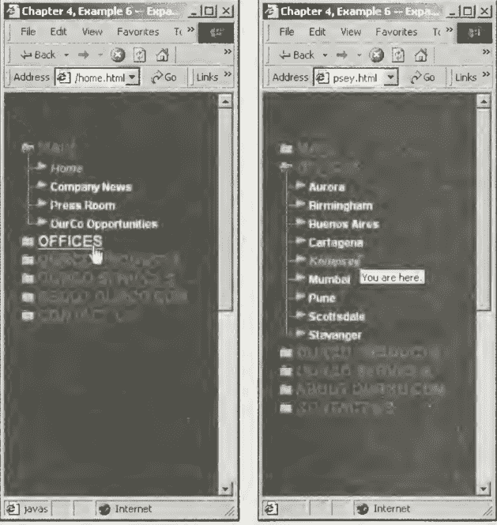

## 具有高级脚本和DHTML的菜单

如果在加载此页面时将鼠标悬停在菜单中的“Kempsey”文本上，你会发现它不是一个链接，但该部分的其他项是链接。通过点击任何部分标题，相应的部分会展开或折叠，文件夹图标在打开或关闭视图之间切换，并且其下方的部分会相应地重新定位。你可以随意尝试点击标题和页面链接，你会发现点击顺序并不影响结果——菜单始终能正确地显示。现在让我们深入研究实现这一功能的代码，首先是所使用的文件列表：

```
ch4_ex6.html
```

这是主页面，也是示例文件夹中所有其他页面的原型，它们与此页面完全相同；我们唯一缺失的是内容，一旦我们制作了此模板的副本并适当命名，就可以轻松地将内容插入到正确的页面中。请注意，这些页面的命名并非随意而为；我们稍后会对此进行解释。以下是HTML：

```html
<html>
<head>
<title>Chapter 4, Example 6 -- Expanding/Collapsing Menu #1</title>
<meta http-equiv="Content-Type" content="text/html; charset=iso-8859-1">
```

指向样式表文件的链接：

```html
<link rel="stylesheet" type="text/css" href="styles/content.css">
<link rel="stylesheet" type="text/css" href="styles/menu.css">
```

以下`<script>`标签包含了跨浏览器脚本和菜单驱动脚本。请注意，`xblayer.js`文件排在前面，因为我们在另一个`.js`文件中使用了它包含的函数。

```html
<script type="text/javascript" language="JavaScript"
        src="scripts/xblayer.js"></script>
<script type="text/javascript" language="JavaScript"
        src="scripts/menu_driver.js"></script>
</head>
<body background="images/bluebg.gif" bgcolor="#000066" text="#000000"
      leftmargin="0" topmargin="0" marginwidth="0" marginheight="0">
```

第三个JavaScript文件在页面加载时动态地将菜单HTML写入页面，因此我们将其紧跟在`<body>`标签之后包含进来：

```html
<script type="text/javascript" language="JavaScript" src="scripts/create_menu.js">
</script>
<table width="100%" cellpadding="0" cellspacing="0" border="0">
  <tr>
    <td width="275" bgcolor="#006699">


图像`list.gif`是一个 1px-by-1px 的垫片（spacer），我们用它来确保在 Netscape 4 中，如果页面内容本身不足以支撑，文档的高度仍足以容纳完全展开的菜单。在将此菜单适配到你自己的网站项目中时——如果 Netscape 4 兼容性是一个问题——你可能需要调整它的高度，或者如果你的所有页面都有足够的内容，你可能会发现可以完全舍弃它。你只需要在 Netscape 4 中进行实验，看看哪种方案效果最好。

## 第四章

### xblayer.js

这是包含我们基本跨浏览器功能的脚本文件。它与我们在本章前面使用的同名文件完全相同。

### create_menus.js

这个脚本文件包含生成菜单 HTML 的脚本。让我们逐行浏览并解释它的每个部分。

首先，我们定义几个变量。第一个变量保存菜单本身顶部的值（以像素为单位）。你可以根据需要调整这个值——例如，如果你希望菜单从页面顶部开始，或者为页眉图片或文字留出空间。第二个变量名为`panelHeight`，包含菜单中每个项目的高度。我们还有其他方法可以控制这个值，例如使用 CSS，但由于这种方法在所有目标浏览器中实现相同效果存在问题，我们将采取简单的方法，使用一个变通方案：这正好与我们的文件夹（及其他）图标的高度相同。

```
var startHeight=50;
var panelHeight=20;
```

用于章节标题的文本存储在名为`sectionNames`的数组元素中。在为自定义用途定制此菜单脚本时，你可以在这里使用任意数量的条目——只需确保使用反斜杠转义任何引号或其他特殊字符，或使用 HTML 实体等效字符。

```
var sectionNames=new Array("MAIN", "OFFICES", "OURCO PRODUCTS", "OURCO
SERVICES", "ABOUT OURCO.COM", "CONTACT US");
```

接下来，我们获取章节标题的数量，并使用该数量定义另一个数组。

```
var numSections=sectionNames.length;
var pages=new Array(numSections);
```

`pages`数组中的每个元素本身也是一个数组，包含相应章节的标题。（高级脚本编写者会注意到，我们通过使用数组字面量而不是`Array()`对象构造函数来节省一些空间。）这些数组中使用的文本与`sectionNames`数组中使用的文本适用相同的规则。但是，除非经过非常仔细的测试，否则你不应尝试在其中使用任何 HTML 标签，原因很快就会明了。

```
pages[0]=["Home", "Company News", "Press Room", "OurCo Opportunities"];
pages[1]=["Aurora", "Birmingham", "Buenos Aires", "Cartagena", "Kempsey", "Mumbai",
"Pune", "Scottsdale", "Stavanger"];
pages[2]=["Gizmoes","Somesuches","Thingoes","Whatsi","Widgets"];
pages[3]=["Deliveries","Estimates","Refunds and Exchanges","Specifications"];
pages[4]=["Company History","Corporate Profile","Management","Mission Statement"];
pages[5]=["Customer Service","Sales Enquiries","General Information","Telephone Numbers"];
```

接下来，我们声明并初始化用于将要写入页面的 HTML 字符串的变量，以及用于保存每个`pages`数组长度的变量。

```
var output="";
var lastItem;
```

我们在上面提到，与此菜单一起使用的页面文件名不是任意的；下面是反映我们用于获取它们规则的函数。规则如下：我们获取链接文本，并检查它是否包含多个单词（即，是否包含任何空白字符）。如果包含，我们只使用最后一个单词。无论哪种情况，我们都将该单词转换为小写。在此脚本的更下方，我们将使用此字符串通过在其末尾连接".html"来创建一个链接。（现在你可以明白为什么我们警告你，尝试在页面标题中使用任何 HTML 标签是个坏主意。）例如，"Birmingham"页面将是`birmingham.html`，"Corporate Profile"页面将是`profile.html`，"Refunds and Exchanges"页面应命名为`exchanges.html`，等等。

```
function getPageName(page)
{
  var value=page;
  var words;
  if(page.indexOf(" "))
  {
    words=page.split(" ");
    value=words[words.length-1].toLowerCase();
  }
  return value;
}
```

现在我们准备组合构成菜单的 HTML。对于每个章节标题，我们组装两个`<div>`标签的 HTML：第一个在写入页面后将如下所示：

```
<div id="closed0" class="menuClosed">
  <a href="javascript:display(0);" class="section" title="Click here to open">
    
    MAIN
  </a>
</div>
```

`<div>`包含一个"关闭"的文件夹图标，以及一个`javascript:`链接中的章节名称，该链接调用名为`display()`的函数。此函数将"打开"或"关闭"菜单的此部分；它在`menu_driver.js`文件中定义，我们将在适当的时候检查该文件。

```
for(var i=0;i<numSections;i++)
{
  output+="<div id=\"closed"+i+"\" class=\"menuClosed\">";
  output+="<a href=\"javascript:display(\"+i+\");\" class=\"section\""
     title=\"Click here to open.\">";
  output+="";
  output+=sectionNames[i]+"</a></div>\n";
```

第二个`<div>`看起来大致相同，只是我们将使用"打开"的文件夹图标以及相应的`alt`和`title`文本。此外，在关闭它之前，我们将插入该章节中页面的链接。

```
output+="<div id=\"open\"+i+"\" class=\"menuOpen\">";
output+="<a href=\"javascript:display(\"+i+\");\" class=\"section\""
title=\"Click here to close.\">";
output+="";
output+=sectionNames[i]+"</a><br>\n";
```

我们将`lastItem`设置为当前章节中的页面数量，然后执行相应次数的以下循环：

```
lastItem=pages[i].length;
for(j=0;j<lastItem;j++)
{
```

我们使用上面定义的`getPageName()`函数来查明当前页面文件名是否与菜单加载到的页面相同，并相应地设置变量`isCurrent`。

```
var isCurrent=self.location.href.indexOf(getPageName(pages[i][j]))!=-1;
```

如果当前项目是此章节中的最后一个项目，我们以图像`item_last.gif`开始当前菜单项，它看起来像这样：


否则，我们以`item.gif`开始它：


这将产生一种类似于 Windows 资源管理器中显示目录的方式——以树状结构。我们还在每行中包含一个额外的图像，一个指向页面标题的箭头。这是可选的，如果你想将此菜单改编为自己的用途，可以根据需要安全地删除或替换它。

```
output+="";
output+=" ";
```

如果当前项目指向正在加载的页面，我们不想写入链接；相反，我们使用`<b>`元素并为其分配样式类`current`，使其从其他项目中脱颖而出。否则，我们将文本设为相应页面的链接：

```
if(isCurrent)
    output+="<b class=\"current\" title=\"You are here.\">";
else
    output+="<a href=\" + getPageName(pages[i][j]) + ".html\" class=\"page\"
    title=\" + pages[i][j] + \">";
output=pages[i][j];
if(isCurrent)
    output+="</b>";
else
    output+="</a>";
```

如果我们已到达此章节中的最后一个项目，我们需要关闭包含当前章节项目的`<div>`；否则，我们写入一个换行符，然后为下一个项目重复循环。

```
if(j==lastItem-1)
    output+="</div>\n";
else
    output+="<br>\n";
}
```

最后，一旦我们组装了包含菜单"打开"和"关闭"部分的所有`<div>`，我们就使用`document.write()`语句将其放入页面中：

```
document.write(output);
```

现在我们已经构建好菜单并将其放入页面中，我们准备让它执行一些操作。

### menu_driver.js

这个脚本文件包含使菜单章节看起来可以打开和关闭的函数。我们编写它来为我们执行三个功能：

- 当章节标题被点击时，隐藏"关闭"或"打开"的章节。
- 显示相应的"打开"或"关闭"的章节。
- 当上方章节打开或关闭时，上下移动这些章节。

## 使用高级脚本与 DHTML 的菜单

因此，在开始其他工作之前，我们将先定义三个函数，以便轻松实现这些功能。从它们的命名方式应能很容易地看出其作用。每个函数都接收要操作的元素的 `id` 属性作为参数。`setTop()` 函数还接受第二个参数——元素的新顶部坐标。请注意，这三个函数都使用了定义在 `xblayer.js` 文件中的 `getStyleReference()` 函数。

```javascript
function setTop(elementId,newTop)
{
    getStyleReference(elementId).top=newTop;
}
function showIt(elementId)
{
    getStyleReference(elementId).visibility="visible";
}
function hideIt(elementId)
{
    getStyleReference(elementId).visibility="hidden";
}
```

稍后我们将看到，我们还需要一种方法来判断元素是可见还是隐藏的，因此我们定义了一个函数来告诉我们这一点。这样做的部分原因是为了解决 Netscape 4 的一个特性：虽然我们可以将元素的可见性设置为 `visible` 或 `hidden`，但它实际上会以 Netscape 4.X 特定的值 `show` 或 `hide` 反馈给我们。

```javascript
function isVisible(elementId)
{
    var vis=getStyleReference(elementId).visibility;
    return vis=="visible"||vis=="show";
}
```

现在我们准备使用一个同名函数来更新菜单显示。它接受一个参数 `index`，该参数告诉我们哪个部分被点击，因此需要更改。我们将分两步完成此操作：首先，我们切换标识符包含相同索引值的两个部分的可见性，例如，如果在我们的示例中点击标题 "MAIN"，链接将调用该函数的值为零。如果它是关闭的，我们需要显示 `id` 属性为 `open0` 的 `<div>`，并隐藏 `id` 属性为 `closed0` 的那个。然后，我们需要将当前部分下方的所有部分向上或向下移动若干像素，该距离等于该部分中的项目数量加一（为标题留出空间）乘以每项的高度，即，我们需要将其移动 **(pages[index].length + 1) * panelHeight** 像素的距离。

```javascript
function display(index)
{
```

我们定义一个变量来保存我们需要依次移动每个部分的 `top` 位置。最小可能的值是菜单的起点。

```javascript
var currTop=startHeight;
```

以下内容可能并不代表完成此任务的最高效算法，因为每次执行时我们都在重新显示整个菜单，但它确实有效，并且我们不需要在函数调用之间存储任何值。（谁知道呢，也许你会提出一个改进方案，我们可以在 glasshaus.com 上发布！）。我们循环遍历菜单中所有部分的索引，

```javascript
for(var i=0;i<sectionNames.length;i++)
{
```

并查看我们将要检查可见性的部分是否与被点击标题的部分相同。

```javascript
if(i!=index)
{
```

如果不是，我们查看该部分的“关闭”版本是否可见。

```javascript
if(isVisible("closed"+i))
{
```

如果“关闭”部分可见，我们将其移动到当前存储在 `currTop` 中的顶部坐标值，并将其高度添加到该变量。

```javascript
setTop("closed"+i,currTop);
currTop+=panelHeight;
}
else
{
```

否则，我们知道需要将“打开”部分移动到该点，并将其高度添加到 `currTop`：

```javascript
setTop("open"+i,currTop);
currTop+=panelHeight*(pages[i].length+1);
}
}
else
{
```

如果该部分是被点击的那个（即其索引值等于 `index` 的值），我们检查它是当前打开还是关闭。

```javascript
if(isVisible("open"+i))
{
```

如果它是打开的，我们将其隐藏，在其位置显示关闭的部分，并将其移动到距离页面顶部 `currTop` 像素的点。然后我们将标题的高度添加到 `currTop`。

```javascript
hideIt("open"+i);
showIt("closed"+i);
setTop("closed"+i,currTop);
currTop+=panelHeight;
}
else
{
```

如果“打开”部分不可见，我们知道“关闭”部分一定是可见的，所以我们将其隐藏，显示“打开”部分来代替，将其移动到存储在 `currTop` 中的 `top` 位置，然后将该变量增加“打开”部分的高度，以便我们知道将下一个部分放在哪里：

```javascript
hideIt("closed"+i);
showIt("open"+i);
setTop("open"+i,currTop);
currTop+=panelHeight*(pages[i].length+1);
}
}
}
```

包含我们菜单各部分的所有 `<div>` 的默认可见性样式是 `hidden`。加载页面时，我们希望在让它们中的任何一个可见之前，确保正确的部分处于正确的位置。这并非绝对必要，但看起来比让访客在页面加载时看到一团糟要好。加载后，我们将“关闭”部分移动到它们各自的位置——每个部分间距为 `panelHeight`，位于前一个部分下方——然后显示它：

```javascript
function initialise()
{
var currTop=startHeight;
```


`for(var i=0;i<sectionNames.length;i++)`

`{`

`setTop("closed"+i,currTop);`

`showIt("closed"+i);`

`currTop+=panelHeight;`

`}`

我们本可以就此打住，此时我们的菜单将完全功能齐全——但我们希望这是一个“智能”菜单，它能“知道”它被使用的页面，并为观众提供适当修改的显示。我们通过循环遍历`pages`数组并确定其文件名（去掉`.html`扩展名）是否属于该组页面（`pages[0]`、`pages[1]`、`pages[2]`等）的页面标题之一，来找出当前页面属于哪个部分（如果有的话）。我们首先获取当前页面的文件名，

```javascript
var URLbits=self.location.href.split("/");
var currPage=URLbits[URLbits.length-1];
var currPageName=currPage.split(".")[0];
```

并声明一个`flag`变量并将其设置为`false`：

```javascript
var flag=false;
for(var i=0;i<sectionNames.length;i++)
{
    for(var j=0;j<pages[i].length;j++)
    {
        if(pages[i][j].toLowerCase().indexOf(currPageName)!=-1)
        {
```

一旦我们找到它属于哪组页面（如果有的话），我们将`flag`设置为"true"，并跳出内层循环（我们在其中遍历数组`pages[i]`的每个元素）：

```javascript
flag=true;
break;
}
}
```

我们使用标志来告诉我们已找到我们所在的站点部分，以便（重新）显示菜单，使该部分处于其“打开”状态，并明确表示也是时候跳出外层循环了：

```javascript
if(flag)
{
    display(i);
    break;
}
}
```

最后，我们告诉浏览器在页面加载完成后立即执行`initialise()`函数：

```javascript
window.onload=initialise;
```

#### menu.css

此文件包含控制菜单定位和外观其他方面的样式表信息。

首先，我们定义菜单标题文本的样式。由于所有标题都将是链接，我们使用一个`section`类，仅应用于这些链接。我们还定义了一个`:hover`伪类，当鼠标悬停时会导致链接变色，这适用于 IE4+ 和 NS6/Mozilla 用户。

> CSS 伪类用于描述处于给定状态的元素。例如，我们还可以为`<a>`元素分配`:link`、`:visited`和`:active`伪类，以控制链接在访问前后以及用户点击时的显示方式。还有一些额外的伪类可用于链接以及其他 HTML 元素——请参阅 W3C CSS-2 规范（在 http://www.w3.org/TR/REC-CSS2/）或查看资源部分以获取有关这些内容的其他资源。

```css
a.section { font:normal bold 16px Arial, Helvetica, sans-serif;
           color: #FF3333; text-decoration: underline }
a.section:hover { color: #FFFF33;}
```

接下来，我们为页面链接定义一个样式类和`:hover`伪类，

```css
a.page { font:normal bold 12px Arial, Helvetica, sans-serif;
        color: #FFFFFF; text-decoration: none;}
a.page:hover { color: #FFFF33;}
```

以及一个用于`<b>`标签的选择器，我们用它来指示当前页面，

# 第4章

```css
b.current {font:italic bold 12px Arial,Helvetica,sans-serif; color:#00FFFF;}
```

以及两个类，分别用于“关闭”和“打开”状态的菜单`<div>`。这并非严格必要，但我们这样做是为了方便您在需要时，可以轻松地为这些元素分别应用额外的样式：

```css
.menuClosed  {position:absolute; left:15px; visibility:hidden;}
.menuOpen  {position:absolute; left:15px; visibility:hidden;}
```

#### content.css

此文件用于设置页面内容的样式。只要您不在这个文件中重复使用`menu.css`文件中的任何类名，您可以随心所欲地进行设计。

### 展开/折叠菜单示例2

这与前一个示例非常相似，但我们为更高级的浏览器进行了重新设计——那些支持 W3C DOM 标准（或其大部分）的浏览器（NS 6 和 MSIE 5.5+）。代码编写起来要短得多，也简单得多，因为我们不必担心定位问题。在前一个示例中，我们通过脚本控制`left`、`top`和`visibility`属性，而在这里，我们只需要处理一个`display`属性，就能改变菜单的外观。这个属性并不像有些人认为的那样，仅仅是`visibility`的同义词。它的功能要强大得多。也许解释其区别的最好方式是举例说明。让我们来构建一个非常基本的 HTML 页面 (`vis_vs_display.html`)，其中包含两个段落元素，每个段落包含一些文本、一个段落内的`<span>`，以及五个链接，每个链接都通过其`onclick`事件处理器触发一条 JavaScript 语句：

```html
<html>
<head>
    <meta http-equiv="Content-Type" content="text/html; charset=iso-8859-1">
    <title>Example -- Visibility vs. Display</title>
    <style type="text/css">
        p {font:normal normal 12px "Times New Roman",serif;}
        span {font:italic bold 12px Arial,sans-serif;}
    </style>
</head>
<body bgcolor="#FFFFFF" text="#000000">
    <a href="#"
       onclick="document.getElementById('mySpan').style.visibility='visible';">
       visibility:visible
    </a><br />
    <a href="#"
       onclick="document.getElementById('mySpan').style.visibility='hidden';">
       visibility:hidden
    </a><br />
    <a href="#"
       onclick="document.getElementById('mySpan').style.display='block';">
       display:block
    </a><br />
    <a href="#"
       onclick="document.getElementById('mySpan').style.display='inline';">
       display:inline
    </a><br />
    <a href="#"
       onclick="document.getElementById('mySpan').style.display='none';">
       display:none
    </a><br />
    <p>
        This is some text in a paragraph. This the first paragraph. Watch the
        next paragraph closely! This is some text in a paragraph. This the first
        paragraph. This is some text in a paragraph. This the first of two
        paragraphs. This is some text in a paragraph. This the first paragraph.
        <span id="mySpan">
            This is some text in a span. This the only span. Watch this span closely!
            This is some text in a span. This the only span. This is some text in a
            span. This the one and only span. This is some text in a span. This the only span.
        </span>
    </p>
    <p>
        This is some text in a paragraph. This the second paragraph. Watch the
        previous paragraph closely! This is some text in a paragraph. This is the
        second of two paragraphs. This is some text in a paragraph. This the second
        paragraph. This is some text in a paragraph. This the second paragraph.
    </p>
</body>
</html>
```

每个链接的文本描述了点击该链接时会发生什么。（例如，点击第一个链接会将`<span>`的可见性设置为'visible'）。您可以在右侧的插图中看到页面首次加载时的样子（左图）。我们包含了设置`<span>`可见性为“visible”和“hidden”，以及其 display 属性为“block”、“inline”和“none”的链接，这样您可以在我们构建页面时随意尝试。但我们真正感兴趣的是，将其可见性更改为“hidden”与将其 display 属性设置为“none”时所发生情况的区别。正如您在接下来的插图中所见，当我们执行前者时，`<span>`元素中的文本从视图中隐藏了（中图），但仅此而已——页面中不在`<span>`内的其他内容没有任何变化。现在重新加载页面并尝试最底部的链接；当我们把`<span>`的 display 属性设置为“none”时（右图），会发生更有趣的事情：剩余的内容会重新排列以占据缺失的空间，就好像`<span>`根本不存在一样。这只是通过脚本控制 CSS 样式所能实现的能力的一个小小示例。

# 第4章

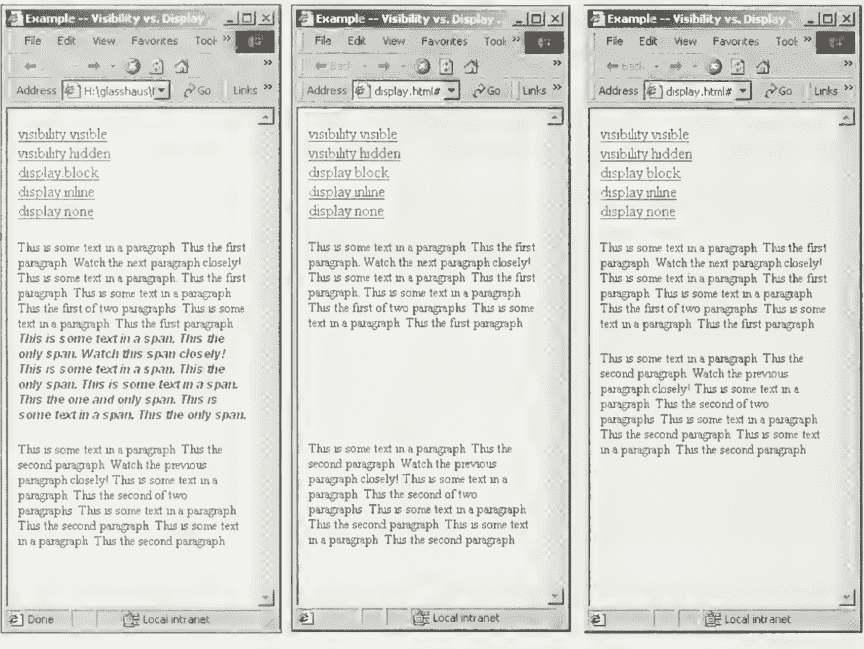

影响页面及其内容外观的唯一其他样式，是我们应用到`<p>`和`<span>`元素以使它们彼此区分的文本样式——不涉及 CSS 定位。我们在这里说明的原则，与我们将在为版本 5 和 6 浏览器重新编写菜单时应用的原则相同。如上所述，这里的脚本代码将比前一版本稍短。一旦我们完成对它的检查，我们将提供一些建议，关于如何部署和自定义这两个菜单。我们将朝着这个方向迈出额外的一步，即生成页面标题并动态更新页面`<title>`标签的内容，同时创建并显示菜单本身。

HTML 页面本身并非特别有趣。它包含：

- 一个用于控制菜单外观的样式表`<link>`。
- 两个包含的 JavaScript 文件，一个用于生成菜单 HTML，另一个用于在菜单创建并插入页面后控制其行为的函数和逻辑。
- 一个 2 x 2 的表格，其左上角单元格包含一个标题图片，其余三个单元格在开始时为空。包含图片的下方单元格的`id="menuCell"`，标题图片右侧的单元格的`id="pageHeading"`，最后一个单元格旨在用于存放页面的（可能是静态的）内容。

## 使用高级脚本和 DHTML 的菜单

让我们先看看`menu.css`文件。我们可以看到，它为一个超链接类和一个`<b>`元素类提供了上下文选择器，这与我们之前使用的非常相似——我们只是稍微改变了配色方案：

```css
a.page {font:normal bold 12px Arial, Helvetica, sans-serif;
    color: #FFFFFF; text-decoration: none;}
a.page:hover {color:#FFCC66;}
b.current {font:italic bold 12px Arial,Helvetica,sans-serif; color:#CC6600;
    background-color:#EADFAE;  text-decoration:none;}
```

接下来，我们有两个样式类，其中一个将应用于我们菜单项的一组`<span>`，另一个应用于章节标题。`panel`类只有一条样式规则：所有包含链接的`<span>`默认都设置为`display:none`。`heading`类看起来有点奇怪，特别是当我们想起之前用链接作为菜单标题时，那么为什么我们要添加下划线和`cursor:pointer`规则呢？正如我们将看到的，我们的标题实际上根本不需要是链接，但因为用户习惯于认为只有链接才能被点击并产生结果，所以我们将让我们的标题看起来像链接，即使它们不是，这一点我们很快就会看到。链接“预期”的出现方式是蓝色带下划线的文本，正如第 1 章和第 2 章所讨论的那样。然而，另一个让链接立即可识别的事物是鼠标指针变为手形。

```css
.heading {font:normal bold 16px Arial, Helvetica, sans-serif; color: #FFCC00;
    text-decoration: underline; cursor:pointer;}
.panel { display:none;}
```

此外，我们为将要为`pageHeading`单元格生成的`<h1>`和`<h2>`元素定义了选择器——请注意，我们为前者设置了上边框，为后者设置了下边框。如果您猜到我们将把`<h1>`内容直接放在`<h2>`内容的上方，那么您猜对了。

```css
h1 {font:normal bold 24px Arial, Helvetica, sans-serif; color:#993300;
    text-align:center; border-top:4px solid #330000;}
h2 {font:italic bold 18px Arial, Helvetica, sans-serif; color:#993300;
    text-align:center; border-bottom:4px solid #330000;}
```

在`create_menu.js`文件中，我们使用与之前相同的数组来保存我们的章节和页面标题，而不是在加载过程中将生成的 HTML 用`document.write()`写入页面，我们将等到加载完成，然后将`menuCell`表格单元格的`innerHTML`属性设置为该字符串值。第一个标题`<span>`的结果将如下所示：

```html
<span class="heading" id="heading0" title="Click here to open."
    onclick="display(0);">
    
    MAIN
</span>
```

请注意，我们直接在`<span>`中编写了`onclick`事件处理器——这是因为在高级浏览器中，我们几乎可以为任何 HTML 标签使用任何事件处理器，所以实际上没有太多理由使用`javascript:`、`#`或`void()`；链接仅仅为了提供一种触发函数的方式。当然，菜单面板中的链接确实会将用户带到某处，所以我们确实希望它们保持为实际的超链接。同样在菜单生成文件中，我们定义了一个数组：

# 第4章

```javascript
var flags=new Array(numSections);
for(var i=0;i<numSections;i++)
    flags[i]=false;
```


这个数组将用于跟踪哪些菜单是“打开”的，哪些是“关闭”的。

既然我们知道了如何构建菜单，现在让我们来看看驱动菜单的代码。文件`menu_driver.js`包含两个函数。第一个名为`display()`，它类似于我们在菜单向后兼容版本中使用的同名函数，但如前所述，它要简单得多。当调用此函数时，它所做的只是检查与被点击标题对应的链接面板是否“打开”。我们不直接检查的原因是，在 IE 5.5+（我们必须使用专有的`currentStyle`属性）或 Netscape 6.x 中无法直接读取样式属性。后者需要一个冗长的解决方法，所以使用一个真/假变量来为我们完成这项工作更容易：

```javascript
function display(index)
{
```

首先，我们设置一些“简写”变量，这样我们就不必重复输入冗长的对象引用，然后检查与被点击标题对应的标志的值。

```javascript
var currHeading=document.getElementById("heading"+index);
var currHeadingImg=currHeading.getElementsByTagName ("IMG")[0];
var currPanel=document.getElementById("panel"+index);
```

上面我们使用了另一个 DOM 方法`getElementsByTagName()`。此方法可用于任何元素，以获取其所有某种类型的子元素的数组。它接受一个带引号的 HTML 标签名作为参数；注意，尽管我们通常用小写字母编写标签，但此方法要求全部使用大写字母。因此，我们所做的就是获取标题 span 的引用，例如`document.getElementById("heading1")`，我们将其分配给变量`currHeading`，然后对其应用`getElementsByTagName("IMG")`，以检索该 span 中包含的所有``元素的数组——文件夹图像是 span 中的第一个（也是唯一的）图像，因此它由数组索引`0`标识。

```javascript
if(flags[index])
{
```

如果它是`true`，我们知道链接面板是打开的，因此我们相应地更新标题的`title`属性和文件夹图像的`source`、`alt`和`title`属性，将面板的`display`属性设置为"none"，并将相应的标志设置为`false`。

```javascript
currHeading.title="Click here to open.";
currHeadingImg.src="images/closed.gif";
currHeadingImg.alt="Click here to open.";
currHeadingImg.title="Click here to open.";
currPanel.style.display="none";
flags[index]=false;
}
else
{
```

否则，我们将`alt`和`title`属性设置为显示“点击此处关闭”，将面板的`display`属性设置为`inline`，并将相应的标志设置为`true`：

```javascript
currHeading.title="Click here to close.";
currHeadingImg.src="images/open.gif";
currHeadingImg.alt="Click here to close.";
currHeadingImg.title="Click here to close.";
currPanel.style.display="inline";
flags[index]=true;
}
```

这里没有定位或设置坐标；我们只需更改适当面板的`display`属性，而所谓的**渐进式重排**会为我们完成工作。渐进式重排是浏览器可以实时更新任何页面元素或元素组显示的另一种说法。如果您已从 glasshaus 网站下载了代码文件并尝试过`ch4_ex2`文件，您可能会注意到，当菜单文本大小更改时，表格和一些按钮的尺寸会随之更改以适应这种变化。这就是渐进式重排工作的一个例子。

从脚本编写者的角度来看，我们在这里所做的其余工作只是点缀。然而，从使我们的菜单可访问、直观和用户友好的角度来看，它相当重要，因此我们希望当您将此脚本调整用于自己的项目时，您会记得同样这样做！

我们使用一个与我们以前使用过的非常相似的初始化函数，将菜单的外观设置为与当前加载的页面相对应。我们这里只讨论一下差异。

```javascript
function initialise()
{
  document.getElementById("menuCell").innerHTML=output;
```

在这个脚本中，我们使用了一个小小的跨浏览器技巧——Netscape 6 遵循 CSS 关于`cursor`属性的标准，当我们设置元素的样式以包含`cursor:pointer`时，将鼠标悬停在该元素上会使鼠标指针变成“手”图标，就好像该元素是一个链接。IE 不喜欢`pointer`，而是更喜欢非标准的`cursor:hand`。所以，如果是 IE 浏览器（即，如果它理解`document.all`的含义），我们循环遍历所有`id`属性为`heading0`、`heading1`、`heading2`等的元素，并将其`cursor`属性动态设置为它偏好的值：

```javascript
if (document.all)
  for(i=0;i<sectionNames.length;i++)
    document.getElementById("heading"+i).style.cursor="hand";
```

我们使用本章中与以前相同的过程来获取与当前页面对应的章节和页面标题：

```javascript
var URLbits=self.location.href.split ("/");
var currPage=URLbits[URLbits.length-1];
var currPageName=currPage.split(".")[0];
var pageTitle;
var flag=false;
```

```javascript
for(var i=0;i<sectionNames.length;i++)
{
    for(var j=0;j<pages[i].length;j++)
    {
        if(pages[i][j].toLowerCase().indexOf(currPageName)!=-1)
        {
            pageTitle=pages[i][j];
            flag=true;
            break;
        }
    }
    if(flag)
    {
```

一旦找到它们，我们就将页面标题添加到文档的`<title>`内容末尾（通过`document.title`属性），然后通过将它们组装到`<h1>`和`<h2>`元素中来为页面创建一个标题，并使用其`innerHTML`属性将其放置在`pageHeading`表格单元格中。这与一些设计师所说的“面包屑导航”没什么不同（有关更多内容，请参见第6章）。

```javascript
document.title+=" ("+pageTitle.toUpperCase()+")";
document.getElementById("pageHeading").innerHTML="<h1>"+sectionNames[i]+"</h1><h2>"+pageTitle+"</h2>";
```

最后，我们调用`display()`函数来为当前页面适当地显示菜单，然后就像我们之前的示例一样跳出外层循环：

```javascript
display(i);
        break;
    }
}
}
window.onload=initialise;
```

让我们看看最终成品。在图片的左侧，我们加载了销售咨询页面，然后点击了 OFFICES 菜单部分标题。在右侧，我们做了大致相反的操作——加载了包含 OurCo 斯科茨代尔办公室信息的页面，然后点击并展开了菜单的 SERVICES 部分：

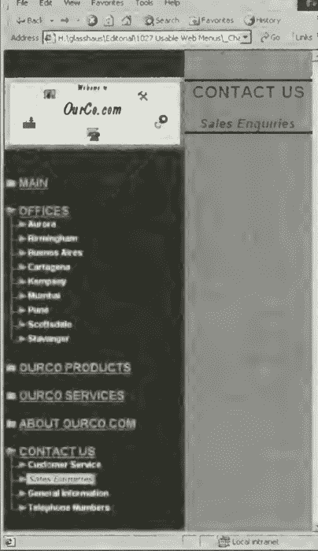

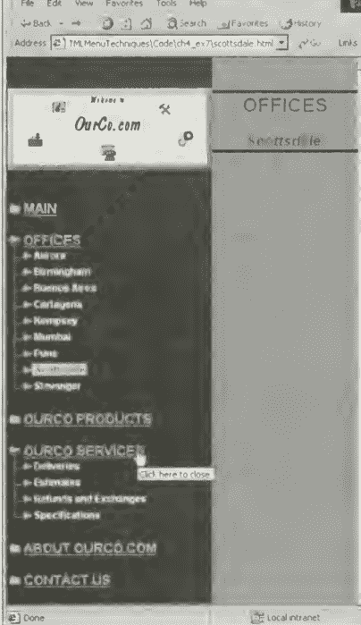

另一种定制此类菜单、使其更具响应性的方法是使用 JavaScript Date 对象查找星期几或月份，并仅显示相关的一组链接或图像映射，或者显示一个展开和折叠的菜单，该菜单打开到适当的部分并链接到关于周一活动的页面（如果恰好是周一）。或者，我们可以让用户在 Cookie 中保存偏好设置，这样每当他们访问网站时，就会看到一个显示指向他们最喜爱网站部分或最感兴趣页面链接的菜单。这也可以调整用于组织结构图。

## 总结

本章涵盖了广泛的材料，并向您展示了如何使用许多不同的客户端技术来构建多种不同类型的菜单。在整个课程中，我们：

- 了解了 CSS 以及它们如何用于增强演示效果，并简化单个页面内和整个网站内的演示控制。
- 看到了 Cookie 如何有助于设置和保留用户偏好设置，从而使我们的网站更有效且更具吸引力；我们还演示了如何使用它们的基础知识。
- 讨论了图像映射，如何创建它们，以及如何单独使用它们以及与本章和前一章中讨论的其他技术结合使用。
- 我们还在第3章涵盖的一些主题的基础上进行了进一步阐述，并演示了一些高级客户端脚本技术的使用。我们还展示了如何将这些技术结合起来创建高度动态的菜单，这些菜单既能响应用户的偏好，也能响应菜单使用的情境。

在此过程中，还讨论了模块化的一些方面，我们研究了一些使用链接的 CSS 和脚本文件来确保外观和感觉一致性，并减轻甚至大型网站维护工作的方法。当然，可用性和可访问性对于良好的网站设计至关重要，我们演示了一些增强演示效果和为可能不支持图像、CSS 或脚本的浏览器用户提供替代内容的方法。

## 具备高级脚本功能与DHTML的菜单

# 第5章

- Flash的易用性问题
- Flash扩展菜单
- 使用XML、PHP和MySQL动态生成Flash菜单

作者：Andy Beaumont

## Flash菜单

现在，我们将注意力转向一个可能稍微不那么显眼，但同样有效的菜单创建工具集——**Flash**。在本章中，我们将首先探讨Flash特有的易用性问题以及如何克服其中一些问题，并简要讨论标准的Flash导航概念，例如基础的Flash按钮。最后，我们将通过一个包含三个级别的庞大菜单系统进行讲解——各级别如下：

- **第1级** – 一个动态的、带动画的Flash菜单，所有内容都包含在一个`.fla`文件中。
- **第2级** – 相同的菜单系统，但菜单条目从一个XML文件中提取，因此你只需更改XML文件即可更新菜单。
- **第3级** – 还是相同的菜单系统——但这次，菜单条目存储在MySQL数据库中，通过PHP动态提取并转换为XML，然后导入到Flash中。

关于Flash的更多详情，以及购买或获取评估副本，请访问 http://www.macromedia.com/software/flash/。关于XML/MySQL/PHP的更多信息，包括设置说明，请参阅第6章，并查阅我们资源部分的相关参考。

### Flash与易用性

自Flash诞生以来，它一直饱受批评（的确，“Web易用性大师”雅各布·尼尔森曾有句名言：99%的Flash都是糟糕的）。许多批评相当中肯，例如Flash开场动画妨碍用户、Flash文件变得臃肿且下载耗时，以及Flash网站为了炫技而过度复杂化。

然而，许多问题源于开发者的经验不足，而非软件本身。值得庆幸的是，随着Flash的成熟，Flash设计师似乎也在同步成长。Flash设计师在控制文件大小方面也做得越来越好，因为越来越明显的是，网络用户实际上并不乐意为了内容看起来很酷而等待十分钟的预加载。我们不应忘记，Flash还是一项相对年轻的技术，几年前，网页上存在优化不佳的图片和臃肿的代码是很常见的事。

不过，Flash仍然存在几个易用性问题，其中最重要的可能是插件问题。每当考虑使用Flash时，你必须考虑你的目标受众是否会拥有Flash插件，即使答案是肯定的，他们可能拥有的插件版本是什么。如果答案是否定的，要求他们下载插件是否合理？

这确实取决于你的目标受众（关于此点，更多内容请参见*第2章*的*理解你的目标用户*部分）。Flash插件可从*http://www.macromedia.com/*下载，只有几百KB，因此即使使用56K调制解调器，加载时间也不会过长，只要用户明白他们不必每次都重复下载。本书选定的浏览器集（IE 4+、Netscape 4+和Opera 5+）都支持该插件，甚至在某些系统上可以自动安装。在撰写本文时，Macromedia表示，“超过98.3%的网络用户拥有Macromedia Flash Player”。

可以检测用户是否安装了Flash，并将其重定向到合适的内容。Macromedia在其网站上提供了一个检测脚本，或者，Colin Moock编写了Flash Player Inspector，你可以从*http://www.moock.org/webdesign/flash/detection/moockfpi/*下载。

Flash 5中还有一个非常有用的发布设置，称为**Ad5Banner**——如果你在发布影片时选择此选项，Flash将输出所有必要的代码，以便在用户没有插件时显示一个替代的图像文件。

Flash也有其优势——它很容易为导航链接或**按钮**编程，使其在释放时（而不是单击时）激活（“二次机会按钮”——在大多数桌面环境中，如Windows，用户仍然可以选择移出按钮然后松开，这样按钮就不会生效）。这是一个非常基本但很重要的易用性问题。

同样，在Flash中让链接按钮像现实生活中的按钮一样工作也很容易，即当用户点击时它似乎向内凹陷（这也可以通过HTML和JavaScript的悬停图像实现）。这不仅仅是一个巧妙的技巧——它为用户提供了一个视觉提示，即使他们从未使用过网站，也能立即联想到现实世界的体验。Apple Lisa上的原始GUI使用了文件夹、桌面和按钮的隐喻，使操作系统感觉不那么陌生，更像用户传统的工作环境。现在人们非常熟悉计算机GUI，因此这些隐喻变得不那么重要了。这给设计师一定的自由去尝试其他方式与用户沟通。

### 第1级：动态Flash菜单

在Flash中创建最简单的动态菜单系统，是将所有代码都保存在`.fla`文件内。我们这里使用“动态”一词，是因为我们不需要为菜单中的每个按钮单独创建。会有一段代码，Flash影片可以根据它确定需要什么，并动态创建每个按钮。这个系统的优势在于，你不需要了解除ActionScript之外的任何技术。

我们将创建的菜单由两级导航组成。第一级，即主导航级别，将包含各个部分的标题，这些标题又将激活子导航：

#### 主导航按钮

我们将以一种能够让我们为菜单中所有按钮使用同一个元件的方式，创建每种按钮类型的一个实例。在Flash中打开一个新的空白文档，并将其保存为`flash_level1.fla`。在舞台上绘制一个基础的顶级导航按钮。选中它，然后按`F8`（或从菜单中选择`Insert`，然后选择`Convert to symbol`）将其转换为元件，类型选择`button`，并为其命名为“Prime Button”。再次选中它并按`F8`，创建一个包含该按钮的影片剪辑——将这个影片剪辑命名为`primeMC`。

接下来，双击`primeMC`进行编辑，并重新定位按钮，使其左上角的坐标为0x和0y。在按钮上方添加一个名为“title layer”的图层，并在按钮上绘制一个动态文本框，为其变量名设为`title`。启用`HTML`，禁用`Selectable`。在创建文本框时，关于字体嵌入有两个选项可选。如果我们选择嵌入字体，那么必须使用最终用户计算机上会有的字体。在此示例中，我不嵌入字体，而是使用Verdana作为字体。Verdana实际上比Flash插件更为普及，因此最终用户拥有它的概率非常高。现在，双击按钮进行编辑，为其设置`弹起`、`按下`和`点击`状态。你的显示现在应该类似于以下内容：

回到`primeMC`剪辑，创建一个名为“dim”的新图层，它将作为该按钮的调暗效果，以表示其处于活动状态。为所有图层创建到第10帧的帧。在按钮图层上，按*F6*创建一个新的关键帧，选中按钮实例，按*Control-B (Mac上为Apple-B)*，直到你的按钮被完全打散，但这只在第10帧进行——你不想丢失第1帧上的按钮实例。复制这个打散的按钮，并将其放置在“dim”图层第10帧的关键帧上。然后，使用混色器面板，将填充的透明度降低到70%左右。最后，将此帧标记为“dimmed”，并在第1帧添加一个`stop()`命令——我们的主导航按钮现在完成了。

##### 完成主导航元素

现在我们需要回到主舞台，并删除其中的`primeMC`实例。打开库，右键单击（Mac上为*control-click*）`primeMC`，然后选择*linkage*——在出现的对话框中，勾选*Export this symbol*选项。在*Identifier*框中输入名称`primeNav`。菜单和对话框对你来说应该大致如下：

##### 生成菜单条目

我们现在已经准备好使用主要导航元素了，接下来让我们设置菜单生成所基于的基础代码。在主时间轴的第一帧添加以下代码：

```javascript
levelOneNav = new Array();
levelOneNav[0] = new Array ("home");
levelOneNav[1] = new Array ("the book", "authors", "chapters", "buy");
levelOneNav[2] = new Array ("downloads", "source files", "screen savers", "desktops");
```


`levelOneNav[3] = new Array ("support", "help by email", "forum", "f.a.q.");`

`levelOneNav[4] = new Array ("contact", "publishers", "authors");`

这里我们创建了一个数组，它包含其他数组。其中每个包含的数组都含有构建菜单所需的信息——这被称为*多维数组*。

> 为了帮助你更好地理解，让我们看看最后一行发生了什么——创建的数组包含三个元素：`"contact"`、`"publishers"` 和 `"authors"`。第一个元素将成为我们的主导航标题，而其他元素将构成该部分的子导航。

## 构建界面

既然我们有了信息结构，就可以开始为其编写界面代码了。就在前面的代码下方，我们要设置一些后续代码需要用到的变量：

```
// zIndex 是设置深度的起始数值
zIndex = 10;

// offsetY 是按钮在 Y 轴上出现的起始位置
offsetY = 5;

// offsetX 是按钮在 X 轴上出现的起始位置
offsetX = 85;
```

### 主导航

现在我们需要遍历 `levelOneNav` 数组，提取相关信息来构建我们的初始界面：

```
// 遍历 levelOneNav 以构建初始界面
for(i=0; i < levelOneNav.length; i++)
{
    // 为每个导航部分附加一个预制的按钮到影片剪辑中
    _root.attachMovie("primeNav", "primeNav" + i, zIndex);

    // 将 myButton 设置为刚刚创建的影片剪辑的引用，以便后续编码
    myButton = _root["primeNav" + i];

    // 将按钮标题设置为子数组的第一个元素
    myButton.title = levelOneNav[i][0];

    // 根据标题字符串的长度设置按钮宽度
    myButton._width = myButton.title.length * 10;

    // 将 x 位置设置为按钮宽度乘以 i，再加上 offsetX
    myButton._x = offsetX;

    // 将 y 位置设置为 offsetY，使所有 primeNav 按钮从左到右对齐
    myButton._y = offsetY;

    // 向按钮发送关于其 menuNo 的信息
    myButton.menuNo = i;

    // 通过加上该按钮的宽度来更新 offsetX
    offsetX += myButton._width + 1;

    // 递增必要的变量
    ++ zIndex;
}
```

这几行代码将创建我们的主导航。如果需要，你可以此时测试影片以检查一切是否出现在你想要的位置。这段代码中你可能不太熟悉的部分是以下这一行：

```
myButton = _root["primeNav" + i];
```

这一行创建了一个指向新创建影片剪辑的引用，我们可以在后续代码中使用它来使事情更容易理解。例如，如果我们没有创建这个引用，这一行：

```
myButton._x = offsetX;
```

就必须写成：

```
_root["primeNav" + i]._x = offsetX;
```

差别不大，但这确实使脚本更易于阅读。

### 次级导航

既然主导航已经就位，我们可以考虑次级导航了。在库中复制 `*primeMC*` 和 `Prime Button`，将复制的版本命名为 `*subMC*` 和 `subButton`。还要确保 `*subMC*` 包含正确的按钮——同样，打开*链接*对话框并将 `*subMC*` 的*标识符名称*设置为 `subNav`。

对于我们的次级导航，我们需要一种方法让我们的动作影响某个菜单中的所有按钮。最简单的方法是创建一个空的影片剪辑，我们可以将所有子按钮附加到上面。

创建一个新的影片剪辑，命名为 `*subClip*`。像之前一样设置其链接，给它标识符名称 `emptyClip`（这作为子菜单的容器）。现在我们准备好开始添加次级导航的代码了，所以回到主时间轴的第一帧并打开动作面板。

在我们之前创建的循环中，我们将添加另一个循环来遍历数组并生成我们的次级导航。你的循环现在应该看起来像这样：

```
for(i=0;i<levelOneNav.length;i++)
{
  _root.attachMovie("primeNav","primeNav" + i, zIndex);
  myButton = _root["primeNav" + i];
  myButton.title = levelOneNav[i][0];
  myButton._width = myButton.title.length * 10;
  myButton._x = offsetX;
  myButton._y = offsetY;
  myButton.menuNo = i;
  offsetX += myButton._width + 1;
  zIndex++;

  // 附加我们制作的 emptyClip 影片剪辑以容纳子菜单按钮
  if(levelOneNav[i].length > 1)
  {
      Button.attachMovie("emptyClip", "submenu", 10);
  }

  subYpos = myButton._height;
  subXpos = 0;

  // 在循环中使用新的索引变量 j，因为我们仍在主循环内部
  for(j=0; j < levelOneNav[i].length; j++)
  {
      // 将按钮附加到 submenu 剪辑
      myButton.submenu.attachMovie("subNav", "subButton" + j, j);

      // 创建引用对象
      mySub = myButton.submenu["subButton"+j];

      // 将 y 位置设置到主导航的下方
      mySub._y = subYpos;

      // 设置标题
      mySub.title = levelOneNav[i][j];

      // 像之前一样设置宽度，如果嵌入字体则应省略
      if(mySub.title.length < 8 )
      {
          widthVal = 12;
      }
      else
      {
          widthVal = 8;
      }
      mySub._width = mySub.title.length * widthVal;

      // 临时设置 x
      mySub._x = subXpos;

      // 通过加上该按钮的宽度来更新 offsetX
      subXpos += mySub._width;

      // 向按钮发送关于其 pageNo 和 menuNo 的信息
      // 这使我们能够读取 `menus` 数组以找出按钮应该执行什么动作
      mySub.menuNo = i;
      mySub.pageNo = j;
  }
}
```

如果你此时测试影片，应该会看到所有子导航元素堆叠在主导航下方（如下图所示）。显然我们接下来的任务是创建一种隐藏和显示这些菜单的方法。


## 第5章

### 行为剪辑

与其简单地切换可见性，我们而是要向用户引入一个关于导航如何工作的视觉提示。通过根据当前是否激活来滑动子导航进出屏幕，我们可以向用户表明他们正在离开网站的一个部分并进入另一个部分。我们现在将创建一个行为剪辑来实现这一点。

行为剪辑是一个只包含代码的 `movieClip`，其唯一目的是对其父级执行操作。例如，你可以创建一个"淡入淡出"行为剪辑，只需在两帧中包含代码 `_parent._alpha -= 5;` 这就会使父级 `movieClip` 持续淡出。显然你不会希望这个脚本在父级 alpha 达到零后继续运行，所以需要一些额外的代码来测试影片剪辑是否已完成其任务。虽然不是官方的 Macromedia 术语，但"行为剪辑"似乎已成为公认的术语。

我们的行为剪辑将接受函数调用中的 x 和 y 坐标参数，并平滑地将其父级移动到新位置。

创建一个新的影片剪辑并命名为 `*moveTo*`。在该剪辑时间轴的第一帧，你需要一个 `stop()` 命令和一个 precision 变量。precision 变量只是一个阈值，用于阻止剪辑进行不必要的代码操作。在第一帧添加以下代码：

```
stop ();
precision = 1;
```

在第二帧添加：

```
// 检查父级是否已到达目的地
// targetX、targetY 和 speed 将从函数调用发送到剪辑
if (Math.abs(_parent._x - targetX) < precision && Math.abs(_parent._y - targetY) < precision)
{
    // 如果已到达，跳到第 1 帧并停止播放
    _parent._x = targetX;
    _parent._y = targetY;
    this.gotoAndStop(1);
}
// 否则，将父级剪辑移向目的地
_parent._x -= (_parent._x - targetX)/speed;
_parent._y -= (_parent._y - targetY)/speed;
```

将第二帧复制到第三帧，并在第三帧底部添加以下行：

```
gotoAndPlay(2);
```

我们现在有了一个能够将任何其他影片剪辑在舞台上移动的行为剪辑。要使用它，只需将其放入你想要移动的影片剪辑中，将新位置作为变量 `targetX` 和 `targetY` 发送给它，然后让它播放。对于我们的菜单系统，这个剪辑将用于移动子菜单。

双击库中的 `*subClip*` 进行编辑，将你的行为剪辑拖入中心，给它实例名称 `motionClip`。

现在我们已经可以向子导航发送移动命令了，可以在原始构建循环中添加最后一行代码，确保所有子导航元素一开始都位于舞台之外：

```
    }
    myButton.submenu._x = 2000;
    }
```

### 激活和停用子菜单

既然我们已经构建了子菜单并包含了一个用于移动它们的行为剪辑，我们需要创建一些函数来激活和停用它们。

回到主时间轴的代码帧，添加以下函数来激活子菜单。

```
function dimButton(menu,page){
    unDim(_root.currentMenu, _root.currentPage);
    _root["primeNav" + menu].submenu.active = true;
    _root["primeNav" + menu].submenu.motionClip.targetX = 0;
    _root["primeNav" + menu].submenu.motionClip.speed = 3;
    _root["primeNav" + menu].submenu.motionClip.gotoAndPlay(2);
    _root["primeNav" + menu].gotoAndStop("dimmed");
    _root.currentMenu = menu;
    _root.currentPage = page;
}
```

如果我们分解这个函数，可以看到执行的第一行是另一个自定义函数——`unDim`——我们稍后会创建它。紧接着这一行之后，首先我们在目标子菜单上设置一个变量，将其标记为活动状态。然后我们向 `motionClip` 发送2个变量并告诉它播放。我们还将主导航按钮发送到其 `dimmed` 标签，使其变为停用状态，最后重置 `currentMenu` 和 `currentPage` 变量，以反映我们刚刚激活了一个新菜单的事实。

目前，这个函数还没有从任何地方被调用执行。我们希望它在用户点击某个主导航按钮时起作用，所以双击库中的 `primeMC` 剪辑进行编辑，并在第1帧的按钮上添加一些动作：

```
on(release){
    _root.dimButton(this.menuNo, 1);
}
```

此时你可以再次测试影片——如果你点击主按钮，应该会看到子菜单从右侧进入屏幕。你可以稍微调整 `speed` 变量，直到找到你喜欢的速度。但是，要确保菜单进入屏幕的速度足够快，让用户知道他们确实激活了某些内容。

目前，子菜单只会相互堆叠在一起，这就是为什么我们需要编写 `unDim` 函数的原因。所以，回到我们的代码帧，将以下函数添加到主时间轴：

```
function unDim(menu,page){
    _root["primeNav" + menu].submenu.active = false;
    _root["primeNav" + menu].submenu.motionClip.targetX = 1000;
}
```

# 第5章

```
_root["primeNav" + menu].submenu.motionClip.targetY = _root["primeNav" +
menu].submenu.motionClip._y;
_root["primeNav" + menu].submenu.motionClip.speed = 8;
_root["primeNav" + menu].submenu.motionClip.gotoAndPlay(2);
_root["primeNav" + menu].gotoAndStop(1);
_root["primeNav" + menu].submenu["subButton" + page].gotoAndStop(1);
```

再次测试影片——当每个新子菜单到达时，之前的子菜单应该会飞出屏幕。现在我们需要能够暗化子菜单按钮，但因为我们不希望这会激活运动剪辑，所以我们将创建上述函数的两个简化版本：

```
function dimSubButton(menu,page)
{
    unDimSub(_root.currentMenu, _root.currentPage);
    _root("primeNav" + menu).gotoAndStop("dimmed");
    _root("primeNav" + menu).submenu["subButton" + page].gotoAndStop("dimmed");
    _root.currentMenu = menu;
    _root.currentPage = page;
}

function unDimSub(menu,page)
{
    _root("primeNav" + menu).gotoAndStop(1);
    _root("primeNav" + menu).submenu["subButton" + page].gotoAndStop(1);
}
```

显然这些函数需要从某个地方调用，所以双击库中的 `subMC` 剪辑，并在按钮上添加以下动作：

```
on(release)
{
    _root.dimSubButton(_parent._parent.menuNo, this.pageNo);
}
```

再次测试影片，你应该会发现点击某个子菜单按钮会将其暗化。

在可用性方面，我们还可以更进一步。如果你有三到四个以上的子菜单项，你会发现它们开始从页面右侧伸出。我们可以通过让子菜单在鼠标经过时移动来避免这种情况。既然我们已经创建了行为剪辑，不妨充分利用它，所以在按钮的动作中添加以下代码：

```
on(rollOver)
{
    if(_parent.active == true)
    {
        pointx = this._x / 2;
        _parent.motionClip.targetX = pointx * -1;
        _parent.motionClip.speed = 20;
        _parent.motionClip.gotoAndPlay(2);
    }
}
```

## Flash菜单

你会注意到这里我们使用了之前设置的 `active`/`inactive` 标志。这确保了 `rollover` 动作只影响活动菜单。如果没有这个设置，用户可能在菜单离开屏幕时经过它，导致该菜单的运动剪辑被设置了新的目标，从而使两个子菜单同时留在屏幕上。`rollover` 中的其余代码只是向运动剪辑发送新变量，使被经过的按钮沿 x 轴平滑移动，朝向主导航中的其父项。这使我们能够在每个子菜单中容纳更多的项目。

我们还要在这里添加另一段可用性代码：让被选中的子菜单项在点击时滑动到与其在主导航中的父项对齐的位置。将 `on(release)` 处理程序中的代码改为：

```
on(release){
  _root.dimSubButton(_parent._parent.menuNo, this.pageNo);
  pointx = this._x;
  _parent.motionClip.targetX = pointx * -1;
  _parent.motionClip.speed = 30;
  _parent.motionClip.gotoAndPlay(2);
}
```


这段代码只有在你要将此菜单用于 Flash 站点或带有单独 Flash 菜单框架的 HTML 站点时才会真正产生区别——如果它是在没有框架的 HTML 页面上，新页面将在动作发生之前开始加载。

现在还有一件事要做，使这个菜单完全功能化——我们需要让按钮真正执行某些操作。在这个示例中，我们将打开新的 HTML 页面。我们需要做的第一件事是创建一个 URL 存储系统。这里最简单和最合理的选择是创建另一个二维数组，其结构模仿原始数组。这样我们就可以使用发送到每个按钮的 `menuNo` 和 `pageNo` 值来引用新数组，并确定要采取什么操作。这通常被称为并行数组。

在原始数组下方添加以下代码（你需要自己构建目标页面！）：

```actionscript
menus = new Array();

menus[0] = new Array("index.html");

menus[1] = new Array(null, "authors.html", "chapters.html", "buy.html");

menus[2] = new Array(
    null,
    "source_files.html",
    "screen_savers.html",
    "desktops.html"
);

menus[3] = new Array(null, "email.html", "forum.html", "faq.html");

menus[4] = new Array(null, "contact_publishers.html", "contact_authors.html");
```

你可能想知道为什么大多数数组的第一个元素是 `null`——如果你回顾一下 `levelOneNav` 数组，你会发现每个子数组的第一个元素是主导航按钮的标题。通常，我们不希望主导航按钮打开新页面，但偶尔，如我们的“home”按钮的情况，我们不会附加子菜单，在这种情况下，主导航按钮应该被链接起来。或者，你可能希望在每个主导航按钮被点击时激活一个章节概述页面，在这种情况下，你只需插入相关页面的路径。

双击库中的 `subMC` 剪辑进行编辑，选择按钮并打开 `actions` 面板。在 `on(release)` 处理程序中添加以下代码（见下文），用于检查数组中的相关 URL，然后打开它：

# 第 5 章

```actionscript
on(release)
{
    _root.dimSubButton(_parent._parent.menuNo, this.pageNo);

    pointx = this._x;

    _parent.motionClip.targetX = pointx * -1;

    _parent.motionClip.speed = 30;

    _parent.motionClip.gotoAndPlay(2);

    theURL = _root.menus[this.menuNo][this.pageNo];

    getURL(theURL);
}
```

就这两行简单的代码，我们的子导航就链接好了。你还可能想在 `getURL` 命令中设置一个框架目标。我们这个版本菜单的最后任务是链接任何没有子菜单的主导航。

打开 `primeMC` 剪辑，选择按钮，并打开 `actions` 面板。因为我们只想在没有子菜单时打开页面，所以可以在 `on(release)` 处理程序中检查一个条件：

```actionscript
on(release)
{
    _root.dimButton(this.menuNo, 1);

    if(_root.menus[this.menuNo][0] != null)
    {
        theURL = _root.menus[this.menuNo][0];

        getURL(theURL);
    }
}
```

> 简单地说，这相当于：“如果该按钮在菜单数组中的值不是 `null`，则将返回的值作为 URL 打开。”

现在一切都能工作了，但还有一个小的改进可以添加。在主时间轴的第 2 帧创建一个关键帧，并输入一个 `stop()` 命令。这样做的原因是与我们在第一帧创建的函数有关。当 Flash 影片停在带有函数声明的帧上时，这些函数将以 Flash 影片运行的帧速率被声明。显然，一个函数只需要声明一次，如果它每秒被声明 30 次，你可能会遇到内存泄漏，导致 Flash 播放器变慢。如果 Flash 影片在浏览器中运行，一段时间后它可能会让浏览器不堪重负。

这个菜单现在完全功能化了。我为本章制作的版本只有 8k，如果你将整个网页的目标控制在 60k 左右，这样访问者就不会等待页面加载太久，你还有 52k 可以用于内容。我们能够保持文件大小如此之低主要有两个原因。

第一个是我们对库项目的复用——如果我们单独创建每个菜单按钮，包括每个按钮的文本，我们可能会达到 20 到 25k 左右。第二个原因是我们的编码运动——如果我们对这个菜单中的所有运动进行补间，那可能会再增加 10k。你可以看到，在整个 Flash 站点中使用这些技术可以为你节省相当可观的文件大小。

要查看这个菜单，请转到代码下载中的 `ch5_ex1` 文件夹。

# 第二级别：XML 简介

我们目前制作的菜单对终端用户来说非常不错，但对于维护代码的人呢？你真的想每次添加新的菜单项或更改网址时都得打开 `.fla` 文件，在一大堆代码中翻找吗？当然不想——这就是 XML 的用武之地。虽然使用 `loadVariables()` 和文本/HTML 文件也能实现类似的功能，但远不及 XML 所带来的灵活性——在本示例结束时，我们将能够通过更新一个简单的 XML 文件来完成所有需要的更新。

Flash 5 刚发布时，相比版本 4 确实有了巨大的飞跃。除了基于新版 ECMA 标准的 ActionScript 之外，还带来了各种强大的功能，其中 XML 可能是最令人兴奋的。虽然包含大量标记标签的文本文件看起来可能不是什么令人激动的技术，但将 XML 用作内容与结构的分离正被广泛采用。对于 Flash 设计师来说，这意味着有大量免费可用的内容，只要稍加练习，就能轻松融入你的 Flash 设计中。当 XML 更新时，你的整个 Flash 网站也会随之更新。

对于那些还没有接触过 XML 的人，这里做一个简要概述。XML 代表可扩展标记语言（Extensible Mark-up Language），外观与 HTML 相似。两者之间最大的区别在于，HTML 描述的是内容的显示方式，而 XML 只描述内容本身。起初这听起来像是比 HTML 倒退了一步，但正是这种内容与结构的分离赋予了 XML 真正的力量。

假设你有一家批发公司，在公司网站上展示了所有产品，而你所有的零售商也在他们的网站上展示你的产品。如果每个网站都是用 HTML 硬编码的，而你想更改某个产品的描述，那就意味着需要有人在所有这些网站上做同样的修改。如果所有这些网站都使用一个 XML 文档来描述内容，它们可以各自设计以适应不同零售商的需求，同时又能够同步更新。

让我们快速看一下 XML 文档的结构。在很多方面，XML 文档非常像数据库；它以结构化和有组织的方式存储数据。如果我们想创建一个通讯录的联系人列表，可以将其结构化如下：

```xml
<contacts>
    <person firstname="Joe" secondname="Bloggs" email="joe@bloggs.com" />
    <person firstname="Andy" email="andy@eviltwin.co.uk" />
</contacts>
```

乍一看，上面的示例可能被误认为是 HTML，直到你注意到标签名称。在 XML 中，你可以自定义标签名称（也称为创建 XML 词汇表）：你不必向一堆标准浏览器描述数据，只需向该特定词汇表的用户以及用于解析数据的自定义应用程序进行描述即可。这意味着你可以使用任何人都能理解的描述性标签名称。

XML 还允许我们自定义属性名称。这意味着我们最终可以得到一个文档，其可读性几乎等同于用纯英文书写。让我们把示例再深入一些，引入一个包含 `name` 和 `phone` 属性的新 `<company>` 元素：

```xml
<contacts>
    <person firstname="Joe" secondname="Bloggs" email="joe@bloggs.com" />
    <person firstname="Andy" email="andy@eviltwin.co.uk" />
    <company name="The Pizza Place" phone="020 7777 8888" />
</contacts>
```

这里我们可以看到，嵌套并不局限于同一种标签。再进一步，如果有某个我们经常打交道的联系人，我们甚至可以将 `person` 嵌套在 `company` 内部：在这个例子中，我们选择 Luigi，因为他做的配料最好：

```xml
<contacts>
    <person firstname="Joe" secondname="Bloggs" email="joe@bloggs.com" />
    <person firstname="Andy" email="andy@eviltwin.co.uk" />
    <company name="The Pizza Place" phone="020 7777 8888">
        <person firstname="Luigi" position="topping meister" />
    </company>
</contacts>
```

这里我将整个 `<company>` 元素标记为新代码，尽管其中一部分在上一个示例中已经存在——如果你仔细观察，会注意到 `<company>` 不再是一个空元素，而是完整地包含了 Luigi 的详细信息。这使得包含 Luigi 的 `<person>` 标签成为 `<company>` 的子元素——Luigi 现在与那家公司关联起来了，因此如果我们像搜索数据库一样遍历 XML 文档，找到 Luigi 后就可以通过检查父元素得知他在哪家公司工作。

在深入将 XML 用于 Flash 项目之前，还有一个领域需要介绍，那就是使用元素还是属性来表示数据。到目前为止，我们一直将所有信息存储在属性中而非元素中——如果可以这样做的话，这是存储数据的最佳方式，尤其是当数据将被 Flash 解读时；这是因为：

- 它使使用 ActionScript 遍历 XML 更加容易。
- 它使 Flash 内置的 `parseXML` 例程明显更快。

但在某些情况下，你不得不使用元素，特别是当你想在 XML 中存储一些 HTML 时：

```xml
<contacts>
    <person firstname="Joe" secondname="Bloggs" email="joe@bloggs.com" />
    <person firstname="Andy" email="andy@eviltwin.co.uk" />
    <company name="The Pizza Place" phone="020 7777 8888">
        <person firstname="Luigi" position="topping meister" />
        <details>The Pizza Place make some <b>very</b> fine pizzas.</details>
    </company>
</contacts>
```

这里你可以看到我们在 `<details>` 中包含了一个 HTML `<b>` 元素。

> 作为一般经验法则，在决定用于 Flash 的 XML 文档结构时，如果数据可以放在属性中，就把它放在属性中。

## XML 的规则

XML 有自己的一套必须遵守的规则，否则你的 XML 就不是有效的，会出错，并在你的 Flash 影片中产生不良效果：

- **关闭所有标签：**文档中的 HTML 标签也必须正确关闭；虽然浏览器通常会原谅你没有关闭几个标签，但在 XML 中你甚至必须关闭 `<br />` 标签！

- **正确嵌套：**你的标签必须正确嵌套。例如，下面展示了一行正确嵌套的代码，紧跟着一行错误嵌套的代码：

```xml
<p> This sentence contains some <b>bold</b> and <i>italics</i> </p>

<p> This <b>sentence <i>contains some bold</b> and italics</i> </p>
```

- **命名规则：**关于标签名称可以和不可以是什么，有一些严格的规则：
  - XML 名称只能以字母或下划线开头，不能使用其他标点符号或数字。
  - XML 名称不能以字母 XML 开头，无论大小写。
  - XML 名称区分大小写，因此 `<lastname>`、`<lastName>` 和 `<LASTNAME>` 标签在 XML 中是完全不同的。
  - 名称中不能包含空格。

标记文档中的所有 HTML 也必须遵循这些规则（成为 XHTML）——Flash 不像许多 Web 浏览器（如 IE 和 Netscape）那样对粗糙的标记宽容。

> 如果你想检查标记是否为有效 XML，只需在支持 XML 的浏览器（如 IE5.5/6）中解析你的 XML 文档，看看是否返回任何错误消息即可。

## 基于 XML 的菜单

好的，现在基本规则已经介绍完毕，我们可以在菜单示例中使用 XML 了。打开你在本章第一部分中制作的文件，将其另存为新文件名。我们需要做的第一件事是删除所有不必要的代码——以下所有来自主时间轴第 1 帧的代码都可以删除：

```actionscript
levelOneNav = new Array();

leveloneNav[0] = new Array("home");

leveloneNav[1] = new Array("the book", "authors", "chapters", "buy");

leveloneNav[2] = new Array("downloads", "source files", "screen savers", "desktops");

leveloneNav[3] = new Array("support", "help by email", "forum", "f.a.q.");

leveloneNav[4] = new Array("contact", "the publishers", "the authors");

menus = new Array();

menus[0] = new Array("index.html");

menus[1] = new Array(null, "authors.html", "chapters.html", "buy.html");

menus[2] = new Array(null, "source_files.html", "screen_savers.html", "desktops.html");

menus[3] = new Array(null, "email.html", "forum.html", "faq.html");

menus[4] = new Array(null, "conatct_publishers.html", "contact_authors.html");

for(i = 0; i < levelOneNav.length; i++)
{
    _root.attachMovie("primeNav", "primeNav" + i, zIndex);

    myButton = _root["primeNav" + i];

    myButton.title = levelOneNav[i][0];

    myButton._width = myButton.title.length * 10;

    myButton._x = offsetX;

    myButton._y = offsetY;

    myButton.menuNo = i;

    offsetX += myButton._width + 1;

    ++zIndex;

    // 附加一个影片剪辑来容纳子菜单按钮
    if(levelOneNav[i].length > 1)
    {
        myButton.attachMovie("emptyClip", "submenu", 10);
    }

    subYpos = myButton._height;

    subXpos = 0;

    for(j = 1; j < levelOneNav[i].length; j++)
    {
        myButton.submenu.attachMovie("subNav", "subButton" + j, j);

        mySub = myButton.submenu["subButton" + j];

        mySub._y = subYpos;

        mySub.title = levelOneNav[i][j];

        if(mySub.title.length < 8)
        {
            widthVal = 12;
        }
        else
        {
            widthVal = 8;
        }

        mySub._width = mySub.title.length * widthVal;

        mySub._x = subXpos;

        subXpos += mySub._width;

        mySub.menuNo = i;

        mySub.pageNo = j;
    }

    myButton.submenu._x = 2000;
}
```

这两个数组将被一个简单的 XML 文档取代，该文档将以一种更易于访问的方式容纳所有信息。这个巨大的循环将被一些更精巧的代码所取代。

### 创建我们的 XML

我们将用于此示例的 XML 文档具有以下结构：

```xml
<menuData>
    <menu name="home" url="index.html" />
    <menu name="the book">


# 第三级：数据库、XML 与 Flash

要打造终极的动态 Flash 菜单，您需要连接到数据库。这是一个许多 Flash 设计师都回避的领域，甚至比 XML 更甚。因此，在本练习中，我们将同时使用两者。我决定选用 MySQL 作为数据库，PHP 作为中间件，不仅因为这两项技术都是免费的。对于 Flash 设计师而言，PHP 也是一个不错的选择，因为其语法与 ActionScript 并非完全不同，这能使其更容易上手。

> 请注意，虽然我使用了 PHP/MySQL 的组合，但这并不限制您必须使用相同的组合。您可以选择任何其他您喜欢的数据库/中间件组合——例如，本章的代码下载包（可在 http://www.glasshaus.com/ 获取）包含了一个用 ASP 编写的替代版本，其数据库使用 MS Access。有关更多信息，请参阅本书末尾的资源部分。

我们的数据库将存储关于菜单的信息，我们的 PHP 将检索这些信息，将其转换为 XML，并发送到 Flash 影片，然后我们的 Flash 影片可以像前一个练习中那样，以非常相似的方式对其进行解释。

## 设置我们的数据库

我们将在 MySQL 数据库中创建一个具有以下结构的表：第一列 `type` 将包含 `"prime"` 或 `"sub"`，表示行数据是指向顶级还是子级导航项。第二列 `menuID` 的存在是为了在我们取回所有数据后，能够将子菜单重新与主菜单关联起来。另外两列 `name` 和 `url` 正如您所预期的那样。因此，我们的表需要如下所示：

| type | menuID | name | url |
|------|--------|------|-----|
| prime | 1 | home | index.html |
| prime | 2 | the book | |
| sub | 2 | authors | authors.html |
| sub | 2 | chapters | chapters.html |
| sub | 2 | buy | buy.html |
| prime | 3 | downloads | |
| sub | 3 | source files | source_files.html |
| sub | 3 | screen savers | screen_savers.html |
| sub | 3 | desktops | desktops.html |
| prime | 4 | support | |
| sub | 4 | help by email | email.html |
| sub | 4 | forum | forum.html |
| sub | 4 | f.a.q. | faq.html |
| prime | 5 | contact | |
| sub | 5 | the publishers | contact_publishers.html |
| sub | 5 | the authors | contact_authors.html |

有许多工具可用于设置数据库；如果您使用的是 PC，可以使用 MySQL Monitor 实用程序，在 Mac 上可能稍微棘手一些，但有许多免费的 MySQL 管理工具可用，最著名的是 phpMyAdmin，可从 http://www.phpwizard.net/projects/phpMyAdmin/ 获取——它不是最容易配置的软件，但一旦配置完成，功能非常强大（有关 phpMyAdmin 的更多信息，请参阅第 6 章）。

出于本练习的目的，我编写了一个 PHP 脚本，它将连接到您的数据库，创建表和必要的列，并在一个快速操作中用数据填充它们（`getMenus.php3`）。唯一需要的配置是在前几行设置用户名、密码和数据库名：

```
<?
$userName = "myUserName";
$pWord = "myPassWord";
$theDB = "myDatabaseName";
// end of user set up.
```

```
<subItem name="authors" url="authors.html" />
<subItem name="chapters" url="chapters.html" />
<!-- 更多的subItem子元素 -->
</menu>
<!-- 这里有更多的menu元素，带有subItem子元素 -->
</menuData>
```

完整的文件 `menus.xml`，连同本示例的所有其他代码文件，可以在本章代码下载的 `ch5_ex2` 目录中找到。

### 将XML加载到Flash中

现在我们已经整理好了XML，要告诉Flash如何处理其中的信息就很简单了。首先，我们需要告诉Flash加载XML文档——在主时间轴的第2帧，在 `stop()` 命令之前添加以下代码：

```
menuXML = new XML();
menuXML.load("menus.xml");
menuXML.onLoad = buildMenu;
```

第1行创建了用于加载数据的XML对象，第2行加载数据，第3行在数据加载完成后执行 `buildMenu` 函数。别太激动——Flash并没有内置的 `buildMenu` 函数——我们接下来就要创建它。

双击你的Flash菜单的第一帧，打开 *帧动作* 面板。在我们之前版本（循环所在之处）初始化的变量下方，我们将创建一个函数，该函数将在XML加载时执行。我们在这个函数中要做的第一件事是创建一个新的数组，用于容纳根标签开始和结束之间的所有内容：

```
function buildMenu()
{
    holder = new Array();
    holder = menuXML.firstChild.childNodes;
    trace("holder = " + holder);
}
```

我已经结束了函数，并在其中添加了一个 `trace` 命令，以便你可以测试影片并在输出窗口中看到结果。当你刚开始学习XML时，`trace` 命令极其有用，因为你可以在创建函数时使用它来查看当前正在处理XML的哪个部分。在我们处理这段代码的过程中，我会不时地添加它们，希望这能帮助你形象化函数如何逐步处理每个部分。

接下来，我们将创建一个循环，遍历 `holder` 数组的元素，寻找名为 `"menu"` 的元素。

```
function buildMenu()
{
    holder = new Array();
    holder = menuXML.firstChild.childNodes;
    for(i=0;i<holder.length;i++)
    {
        if(holder[i].nodeName == "menu")
        {
            trace("found menu: " + holder[i].attributes.name);
        }
    }
}
```

注意这里，我们可以像直接操作我们创建的 `menuXML` XML对象一样，来寻址 `holder` 数组的部分。这是因为 `holder = menuXML.firstChild.childNodes;` 这一行实际上并没有用我们对象中的子节点来填充 `holder`——它只是创建了指向它们的引用。这里的 `trace` 命令引入了从XML中检索属性的系统。如果你此时测试影片，你应该会在输出窗口中看到以下内容：

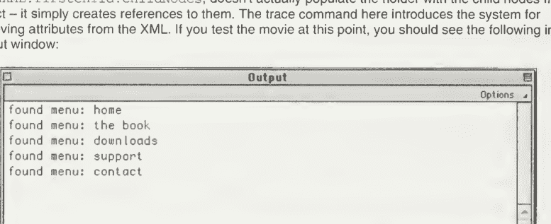

到目前为止，我们的循环按计划工作——每次循环找到一个名为 `menu` 的节点，我们就可以处理该节点中包含的信息。我们想对这个信息做的第一件事是创建主导航按钮：

```
function buildMenu()
{
    holder = new Array();
    holder = menuXML.firstChild.childNodes;
    for(i=0;i<holder.length;i++)
    {
        if(holder[i].nodeName == "menu")
        {
            _root.attachMovie("primeNav","primeNav" + i, zIndex);
            myButton = _root["primeNav" + i];
            myButton.title = holder[i].attributes.name;
            if(holder[i].attributes.url != null)
            {
                trace(holder[i].attributes.name + " url = " + holder[i].attributes.url);
            }
            myButton._width = myButton.title.length * 10;
            myButton._x = offsetX;
            myButton._y = offsetY;
            myButton.menuNo = i;
            offsetX += myButton._width + 1;
        }
    }
}
```

你会注意到这段代码与本菜单原始版本的代码非常相似，但有两点不同：我们现在使用属性来获取菜单标题和URL。此外，我们还检查 `url` 属性是否存在，如果存在，则将该值发送给按钮本身。

现在我们已经找到了一个 `menu` 节点并使用了它的信息，我们可以遍历该节点的子节点来创建子菜单。但首先，让我们检查一下它是否有任何子节点，如果有，就附加我们的 `emptyClip`。

```
function buildMenu()
{
    holder = new Array();
    holder = menuXML.firstChild.childNodes;
    for(i=0;i<holder.length;i++)
    {
        if(holder[i].nodeName == "menu")
        {
            _root.attachMovie("primeNav","primeNav" + i, zIndex);
            myButton = _root["primeNav" + i];
            myButton.title = holder[i].attributes.name;
            if(holder[i].attributes.url != null)
            {
                myButton.url = holder[i].attributes.url;
            }
            myButton._width = myButton.title.length * 10;
            myButton._x = offsetX;
            myButton._y = offsetY;
            myButton.menuNo = i;
            offsetX += myButton._width + 1;
            ++ zIndex;
            subHolder = new Array();
            subHolder = holder[i].childNodes;
            if(subHolder.length > 0)
            {
                trace(holder[i].attributes.name + " has " + subHolder.length + " child nodes");
                myButton.attachMovie("emptyClip", "submenu", 10);
            }
            subYpos = myButton._height;
            subXpos = 0;
        }
    }
}
```

我们在这里所做的是创建一个新数组，并将 `holder[i]` 的子节点赋值给该数组。然后我们可以检查新 `subHolder` 数组的长度，以了解它有多少个子节点。多亏了我们的朋友 `trace` 命令，如果你此时测试影片，你会看到类似下图的内容：

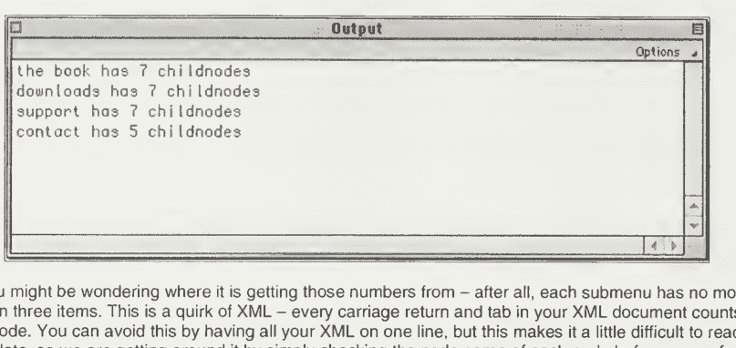

你可能想知道这些数字是从哪里来的——毕竟每个子菜单最多只有三个项目。这是XML的一个怪癖——XML文档中的每个回车符和制表符都算作一个节点。你可以通过将所有XML放在一行上来避免这种情况，但这会使其有点难以阅读和更新，所以我们通过在执行任何操作之前简单地检查每个节点的节点名称来绕过它。每个这些“空白”节点的节点名称将是 `NULL`。

继续我们的函数，我们现在可以遍历 `subHolder` 数组的元素来创建子菜单项。再一次，我们使用属性来获取每个按钮的URL和标题：

```
function buildMenu()
{
    holder = new Array();
    holder =  menuXML.firstChild.childNodes;
    for(i=0;i<holder.length;i++)
    {
        if(holder[i].nodeName == "menu")
        {
            _root.attachMovie("primeNav","primeNav" + i, zIndex);
            myButton = _root["primeNav" + i];
            myButton.title = holder[i].attributes.name;
            if(holder[i].attributes.url != null)
            {
                myButton.url = holder[i].attributes.url;
            }
            myButton._width = myButton.title.length * 10;
            myButton._x = offsetX;
            myButton._y = offsetY;
            myButton.menuNo = i;
            offsetX += myButton._width + 1;
            ++ zIndex;
            subHolder = new Array();
            subHolder = holder[i].childNodes;
            if(subHolder.length > 0)
            {
                myButton.attachMovie("emptyClip","submenu",10);
            }
            subYpos = myButton._height;
            subXpos = 0;
            for (j=0;j<subHolder.length;j++)
            {
                if(subHolder[j].nodeName == "subItem")
                {
                    myButton.submenu.attachMovie("subNav", "subButton" + j, j);
                }
            }
        }
    }
}
```


```
$menuData = array();
$menuData[0] = array("prime","1","home","index.html");
$menuData[1] = array("prime","2","the book");
$menuData[2] = array("sub","2","authors","authors.html");
$menuData[3] = array("sub","2","chapters","chapters.html");
$menuData[4] = array("sub","2","buy","buy.html");
$menuData[5] = array("prime","3","downloads");
$menuData[6] = array("sub","3","source files","source_files.html");
$menuData[7] = array("sub","3","screen savers","screen_savers.html");
$menuData[8] = array("sub","3","desktops","desktops.html");
$menuData[9] = array("prime","4","support");
$menuData[10] = array("sub","4","help by email","email.html");
$menuData[11] = array("sub","4","forum","forum.html");
$menuData[12] = array("sub","4","f.a.q.","faq.html");
$menuData[13] = array("prime","5","contact");
$menuData[14] = array("sub","5","publishers","contact_publishers.html");
$menuData[15] = array("sub","5","authors","contact_authors.html");

$fields = array("type", "menuID", "name", "url");

// connect to database
$link = mysql_connect (localhost, $userName, $pWord);
if($link==1){
    $choose = mysql_select_db($theDB);
    if($choose != true){
        echo('failed to connect<br>');
        exit;
    }
}

echo ("connected<br><br>");

// create table

$query = "CREATE TABLE nav (type VARCHAR(10),menuID INTEGER,name VARCHAR(50),url VARCHAR(255))";
$result = mysql_query ($query);
if ($result == false) {
    echo ("create table failed<br><br>");
    exit;
}

echo("created table<br><br>");

for ($index = 0; $index < count($menuData); $index++){
    // Build query
    $query = "INSERT INTO nav (${$fields[0]},${$fields[1]},${$fields[2]},${$fields[3]}) VALUES ('" . $menuData[$index][0] . "', '" . $menuData[$index][1] . "', '" . $menuData[$index][2] . "', '" . $menuData[$index][3] . "')";
    $result = mysql_query($query);
    if ($result == false) {
        echo ("query failed");
        echo("<br>the query was: $query <br><br>");
        exit;
    }
}

echo ("completed successfully!");

?>
```

### PHP 中间件

现在我们的数据库已充满数据，我们需要一种方法来检索这些数据——这也是 PHP 的工作。如果您不是 PHP 专家，请不要担心——我也不是——我们这里只涵盖所需的知识。如果您是 PHP 专家，请尽量不要嘲笑我的代码！完整代码可在`saveMenuData.php3`中找到。

首先，让我们创建一个到数据库的连接，然后进行测试。

```
<?

// connect to database
$link = mysql_connect(localhost, "username", "password");
if($link==1){
    $choose = mysql_select_db("dbname");
    if($choose != true)
    {
        echo("failed to connect<br>");
        exit;
    }
    else
    {
        echo ("connection success<br>");
    }
}

?>
```

请注意，粗体显示的单词——`username`、`password`和`dbname`——实际上应该替换为您服务器的正确用户名、密码和数据库名。如果您现在将此文件保存为`connectTest.php3`并上传到服务器，您可以通过在浏览器中导航到它来进行测试。

如果您所有的设置都正确，您应该会在浏览器窗口中看到消息 "connection success"。如果您的 ActionScript 水平足够，到目前为止的 PHP 代码应该不难理解。它基本上设置我们的连接，然后根据连接是否成功发回一条消息。这里唯一真正陌生的是变量名前的 "$" 符号，这显然是从 Perl 延续下来的约定，但没什么太值得担心的。

### 将数据库引入中间件

现在让我们尝试访问一些我们保存的数据。首先，我们需要设置一个要对数据库执行的查询。我们将向数据库发送一个非常基本的查询——`SELECT * FROM nav`——其中 * 符号是通配符。用通俗的英文来说，这个查询的意思是给我名为`nav`的表中的所有内容：

```
<?

// connect to database
$link = mysql_connect(localhost, "username", "password");
if($link==1){
    $choose = mysql_select_db("dbname");
    if($choose != true)
    {
        echo("failed to connect<br>");
        exit;
    }
    else
    {
        echo ("connection success<br>");
    }
}
```

# 第5章

```php
$query = "SELECT * FROM nav";
$result = mysql_query($query);
echo ($result);
}
}

?>
```

再次将此脚本保存到服务器进行测试。在此阶段，你可以将`echo`命令视为类似于 ActionScript 中的`trace`命令或 JavaScript 中的`document.write`——它只是将信息从脚本中发送出去。作为一个 ActionScript 开发者，你可能期望此脚本显示从数据库检索到的所有变量，但如果你切换到浏览器并点击 *刷新*，你实际上会看到类似这样的内容：

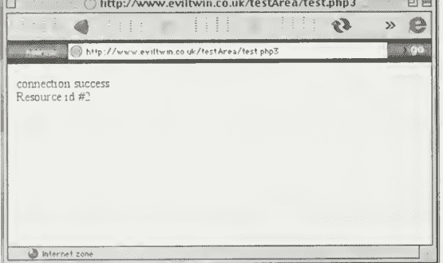

变量`$result`是 PHP 脚本中一个资源，我们可以从中提取变量。为此，我们将创建一个循环来遍历返回的变量，并在使用`echo`命令发送出去之前将值存储在某处。在这样做之前，我将介绍 ActionScript 语法和 PHP 语法之间的另一个小差异——"." 运算符。

在 ActionScript 中，你可以使用`+`或`add`连接两个字符串，如下：

```actionscript
sentence = "hello " add "world";
```

或者

```actionscript
sentence = "hello " + "world";
```

在这两种情况下，变量`sentence`的值都将是 "hello world"。在 PHP 中，你可以使用"."来达到相同的效果，像这样：

```php
$sentence = "hello " . "world";
```

你也可以使用`.=`，而在 ActionScript 中你会使用`+=`。这是一个小的差异，但非常重要。如果你没有意识到这一点，接下来的代码块将显得难以理解：

```php
<?

// connect to database
$link = mysql_connect("localhost", "username", "password");
if($link==1)
{
  $choose = mysql_select_db("dbname");
  if($choose != true)
  {
    echo("failed to connect<br>");
    exit;
  }
  else
  {
    echo ("connection success<br>");
    $query = "SELECT * FROM nav";
    $result = mysql_query($query);
    if ($result == false)
    {
      echo ("query failed");
    }
    else
    {
      $counter = 0;    $output = "";
      while ($row = mysql_fetch_array($result))
      {
        $type = stripslashes($row['type']);
        $menuID = stripslashes($row['menuID']);
        $name = stripslashes($row['name']);
        $url = stripslashes($row['url']);
        $output .= "row " . $counter . ": type=" . $type . " menuID=" .
                   $menuID . " name=" . $name . " url=" . $url . "<br>";
        $counter++;
      }
      echo ($output . "<br>");
    }
  }
}

?>
```

再次将文件保存到服务器，并在浏览器中点击刷新——你应该会看到我们数据库中的所有信息以人类可读的方式呈现出来。如果你想让信息被人类阅读，这没问题，但在我们的情况下，它将被我们的 Flash 影片读取。所以，现在我们需要在 PHP 脚本中将数据格式化为 XML。这并不像听起来那么困难。在上面的示例中，我们将数据格式化为一个句子——这一次，我们只需要包含一些额外的部分使其成为 XML：

```php
<?

// connect to database
$link = mysql_connect("localhost", "username", "password");
if($link==1)
{
    $choose = mysql_select_db("dbname");
    if($choose != true)
    {
        echo("failed to connect<br>");
        exit;
    }
    else
    {
        // start with root element
        $menuXML = "<menudata>";
        $query = "SELECT * FROM nav";
        $result = mysql_query($query);
        $numrows = mysql_num_rows($result);
        if ($result == false)
        {
            echo ("query failed");
        }
        else
        {
            while ($row = mysql_fetch_array($result))
            {
                $type = stripslashes($row['type']);
                $menuID = stripslashes($row['menuID']);
                $name = stripslashes($row['name']);
                $url = stripslashes($row['url']);
                if($type == "prime")
                {
                    $menuXML .= "<menu name=\"" . $name . "\" url=\"" . $url . "\" menuID=\"" . $menuID . "\" />";
                }
                else if ($type == "sub")
                {
                    $menuXML .= "<subItem name=\"" . $name . "\" url=\"" . $url . "\" menuID=\"" . $menuID . "\" />";
                }
            }
        }
        echo ($menuXML . "</menudata>");
        exit;
    }
}
?>
```

你会注意到代码中的一些变化，首先我们以`<menudata>`作为内容初始化了一个名为`$menuXML`的变量。如果你还记得前面的 XML 示例，这是我们 XML 文档中的根元素。然后，我们循环遍历从数据库返回的变量，在每次循环中创建一个新元素，并将其添加到`$menuXML`变量中。最终，当我们完成循环后，我们输出结果，同时添加根元素的闭合标签。如果你再次将此文件保存到服务器并在浏览器中刷新，你应该什么也看不到。别担心，查看源代码，你会看到我们的 XML 数据。保存此 PHP 脚本的最终版本并上传到服务器。

这是 PHP 脚本创建的 XML，为了清晰起见，添加了换行符和制表符：

```xml
<menudata>
  <menu name="home" url="index.html" menuID="1" />
  <menu name="the book" url="" menuID="2" />
  <subItem name="authors" url="authors.html" menuID="2" />
  <subItem name="chapters" url="chapters.html" menuID="2" />
  <subItem name="buy" url="buy.html" menuID="2" />
  <menu name="downloads" url="" menuID="3" />
  <subItem name="source files" url="source_files.html" menuID="3" />
  <subItem name="screen savers" url="screen_savers.html" menuID="3" />
  <subItem name="desktops" url="desktops.html" menuID="3" />
  <menu name="support" url="" menuID="4" />
  <subItem name="help by email" url="email.html" menuID="4" />
  <subItem name="forum" url="forum.html" menuID="4" />
  <subItem name="f.a.q." url="faq.html" menuID="4" />
  <menu name="contact" url="" menuID="5" />
  <subItem name="the publishers" url="contact_publishers.html" menuID="5" />
  <subItem name="the authors" url="contact_authors.html" menuID="5" />
</menudata>
```

此 PHP 脚本返回的 XML 数据格式与我们之前创建的版本不同——这是一种更扁平的格式，其中`<subItem>`节点与`<menu>`节点是同级关系，而不是它们的子节点。因此，我们将需要修改解析 XML 的 ActionScript。


打开我们在上个版本菜单中创建的`.fla`文件，并将其另存为新名称。为了方便起见，值得复制你的脚本输出的 XML，这样你就可以在 Flash 中离线工作。在浏览器中测试`getMenus.php3`脚本，查看源代码并将 XML 复制到你的文本编辑器中。将此文件以`offline.xml`为名保存在与你的 Flash 影片相同的目录中。

进入主时间轴第 2 帧的动作。在这里，你应该看到我们用于加载 XML 文档的代码。将要加载的 XML 文件名称更改为`offline.xml`，这样你的代码现在如下所示：

```actionscript
menuXML = new XML();
menuXML.load("offline.xml");
menuXML.onLoad = buildMenu;
stop();
```

现在，如果你去看我们第 1 帧的`buildMenu()`函数，我们将必须改变它遍历 XML 的方式。首先，我们不能再通过检查菜单节点是否有子节点来判断菜单是否有子菜单。在这种更扁平的结构中，遍历 XML 最简单的方法是多次遍历它。在第一次运行中，我们将创建主导航，同时为该菜单创建一个新的关联数组。修改函数的前半部分以反映这一点，如下所示：

```actionscript
function buildMenu()
{
  holder = new Array();
  holder = menuXML.firstChild.childNodes;
  for(i=0;i<holder.length;i++)
  {
    if(holder[i].nodeName == "menu")
    {
        _root.attachMovie("primeNav","primeNav" + holder[i].attributes.menuID,
                            zIndex);
        myButton = _root["primeNav" + holder[i].attributes.menuID];
        myButton.title = holder[i].attributes.name;
        if(holder[i].attributes.url != "")
        {
            myButton.url = holder[i].attributes.url;
        }
        myButton._width = myButton.title.length * 10;
        myButton._x = offsetX;
        myButton._y = offsetY;
        myButton.menuNo = holder[i].attributes.menuID;
        offsetX += myButton._width + 1;
        _root["subArray" + holder[i].attributes.menuID] = new Array();
        ++ arrayCount;
        ++ zIndex;
    }
  }
}
```

上面高亮的代码部分进行了许多更改：

- 首先，我们更改了`primeNav`影片剪辑的编号方式，现在它的编号来自`menuID`属性。
- 接下来，我们更改了检查 URL 的方式：不再检查`null`值，而是检查我们是否没有空字符串（`""`）。
- 第三块高亮部分是新增的——我们为找到的每个菜单元素创建一个新数组，并将其名称与`menuID`数字一起附加。这允许我们用相关的子菜单填充每个数组，然后在创建子菜单元素之前检查该数组的长度是否不为零。我们还增加了一个名为`arrayCount`的变量，只是为了稍后的生活更轻松一些。
- 最后，我们关闭`if`和`for`循环，因为我们现在已经完成了对主导航的处理。

仍然在这个函数内，我们继续处理我们的`subItem`节点。以下代码块将开始对`holder`数组进行新的循环——每次循环遇到一个`subItem`节点时，它会将其放入相关的`subArray`中：

```actionscript
    for(i=0;i<holder.length;i++)
    {
        if(holder[i].nodeName == "subItem")
        {
            _root["subArray" + holder[i].attributes.menuID].push(holder[i]);
        }
    }
```

我们现在有了几个`subArray`，每个都包含与其特定主导航按钮相关的子菜单数据。由于之前设置的`arrayCount`变量，我们也知道这些`subArray`的数量。因此，现在我们依次遍历每个`subArray`，提取相关数据并构建我们的子菜单。在上一段代码的正下方，我们可以添加函数的其余部分——我在这里包含了完整的函数，以便上下文更容易理解：

```actionscript
function buildMenu()
{
  holder = new Array();
  holder = menuXML.firstChild.childNodes;
  for(i=0;i<holder.length;i++)
  {
    if(holder[i].nodeName == "menu")
    {
      _root.attachMovie("primeNav","primeNav" + holder[i].attributes.menuID,
                        zIndex);
      myButton = _root["primeNav" + holder[i].attributes.menuID];
      myButton.title = holder[i].attributes.name;
      if(holder[i].attributes.url != "")
      {
        myButton.url = holder[i].attributes.url;
      }
      myButton._width = myButton.title.length * 10;
      myButton._x = offsetX;
      myButton._y = offsetY;
      myButton.menuNo = holder[i].attributes.menuID;
      offsetX += myButton._width + 1;
      _root["subArray" + holder[i].attributes.menuID] = new Array();
      ++ arrayCount;
      ++ zIndex;
    }
  }
  for (i=0;i<holder.length;i++)
  {
    if(holder[i].nodeName == "subItem")
    {
      _root["subArray" + holder[i].attributes.menuID].push(holder[i]);
    }
  }
  for(i=1;i <= arrayCount;i++)
  {
    currentArray = _root["subArray" + i];
    if(currentArray.length > 0)
    {
      myMenu = _root["primeNav" + i];
      myMenu.attachMovie("emptyClip","submenu",10);
      subYpos = myMenu._height;
      subXpos = 0;
      for(j=0;j<currentArray.length;j++)
      {
        if(currentArray[j].nodeName == "subItem")
        {
          myMenu.submenu.attachMovie("subNav", "subButton" + j, j);
          mySub = myMenu.submenu["subButton"+j];
          mySub._y = subYpos;
          mySub.title = currentArray[j].attributes.name;
          mySub.url = currentArray[j].attributes.url;
          if (mySub.title.length < 8 )
          {
              widthVal = 12;
          }
          else
          {
              widthVal = 8;
          }
          mySub._width = mySub.title.length * widthVal;
          mySub._x = subXpos;
          subXpos += mySub._width;
          mySub.menuNo = i;
          mySub.pageNo = j;
        }
      }
      myMenu.submenu._x = -1000;
    }
  }
}
```

如果你现在测试影片，它应该与早期版本完全一样地工作，但别忘了，它仍然是从我们的`offline.xml`文件加载数据。回到第 2 帧，将代码改为从我们创建的 PHP 文件加载 XML，如下所示：

```actionscript
menuXML = new XML();
menuXML.load("getMenus.php3");
menuXML.onLoad = buildMenu;
stop();
```

你现在可以按 F12 发布影片，上传它并在浏览器中检查。它仍然会以与早期版本相同的方式运行，但现在是通过 PHP 从数据库中提取所有信息。如果你感到有冒险精神，并且对这种后端开发产生了一些兴趣，你可以尝试用 Flash 编写一个管理应用程序来添加和编辑菜单项。

## 小结

在本章中，我们探讨了使用 Flash 创建导航菜单。首先，我们研究了 Flash 的一些可用性问题和优势。然后，我们查看了我们的 3 级动态 Flash 菜单示例：

- 第 1 级介绍了函数、行为剪辑以及从库中附加对象。
- 第 2 级向你展示了 XML 结构化数据的强大功能和简洁性。
- 第 3 级让你初步了解了中间件和数据库集成。

这种动态 Flash 不仅可以减小文件大小，还能让你的工作更轻松一些。行为剪辑可以在其他项目中使用，而无需再次编写那段运动代码，而使用 XML/数据库意味着你可以让客户自己更新内容，而无需打电话给你！

在下一章中，我们将进一步探讨动态服务器端菜单，基于我们在本章中学到的一些概念，并将它们应用到我们的 DHTML 客户端菜单功能中。

## 6

- 使用中间件、数据库和 XML 动态填充 DHTML 菜单
- 面包屑导航
- 包括 ASP/SQL Server、ASP/XML 和 PHP/MySQL

作者：Jon Stephens 和 Jody Kerr

## 动态服务器端菜单

在前三章中，我们研究了多种创建菜单的方法，以允许用户导航网站。其中许多菜单与用户进行交互，或根据页面使用条件、查看日期等条件发生变化。

这些菜单（第二级和第三级除外，参见*第 5 章*）纯粹涉及客户端的动态性。虽然客户端动态性有一些优势（最显著的是实时响应用户操作），但也有一些缺点。所有这些都基于这样一个事实：不同的用户在不同的硬件和软件平台上使用不同的 Web 浏览器，这些浏览器对脚本、样式表和多媒体插件的支持程度各不相同，从优秀到一般再到没有。此外，对于纯粹的客户端菜单，你必须打开代码来更新它。是的，这听起来相当明显，对任何开发者来说都不是很麻烦。然而，使用动态服务器端菜单，你可以让更新菜单变得像在数据库或 XML 文件中更改一些值一样简单（也许通过 HTML 表单）。

在本章中，你将看到以下内容：

- 首先，我们探讨一个简单的面包屑导航示例，它使用一些中间件从服务器上的数据源获取数据。我们研究的三种场景是：
  - MySQL 和 PHP
  - SQL Server 和 ASP
  - XML 和 ASP
- 接下来，我们来看一个高级示例：我们从*第 4 章（ch4_ex6）*中获取展开/折叠文件夹视图菜单，并使用 MySQL/PHP、SQL Server/ASP 和 XML/ASP 从服务器动态填充它
- 最后，我们简要介绍 ASP.NET 及其对 Web 开发的影响

# 第 6 章

在本章中，重点是服务器端的动态性。虽然我们无法享受与用户直接实时交互的好处，但我们确实从使用服务器端编程中获得了一些好处，其中最主要的是我们控制数据的处理，从而控制发送给用户的内容。我们还可以以非常模块化的方式设计和开发网站，特别是当我们使用数据库来存储和组织内容时，包括关于网站本身如何组织的信息。

## 可用工具

如今 Web 上有许多服务器端编程语言和环境可用，包括 Perl-CGI、Python、Java 和 JSP（Java 服务器页面）、ASP（活动服务器页面）、Cold Fusion 和 ASP.NET，仅举几例。数据存储方法范围从简单的纯文本文件到高端、工业强度的数据库，如 SQL Server 2000 和 Oracle。

正如我们上面讨论的，对于本章，我们坚持使用 PHP/MySQL、ASP/SQL Server 和 ASP/XML，因为首先，我们没有空间涵盖每一种可能性，其次，我们认为我们已经充分展示了示例的架构，让你能够根据自己喜欢的中间件/数据库组合进行调整。我们认为，我们所选择的代表了当今 Web 上使用最普遍的技术组合。

我们知道这不会适合所有人，但想了解更多关于如何调整这些示例以用于其他数据存储或服务器端脚本语言选择的信息，请参阅本书末尾*资源*部分中的相关参考资料。

现在让我们简要介绍一下我们在本章过程中使用的语言和工具。

## XML

正如你可能已经知道的，XML 允许你创建自己的标记词汇表，并提供了一种将数据与表示分离的绝佳方式。有关 XML 的更完整介绍和描述，请查看第 5 章中题为*第 2 级 – 介绍 XML*的部分，那是我们第一次遇到 XML 的地方。

## PHP

PHP 提供了一个用于创建动态网页的服务器环境，并配备了自己的脚本语言。与 Perl 和其他一些语言不同，PHP 代码可以直接插入到普通的 HTML 页面中，因此只有开发者希望动态的部分才需要任何 PHP 编程。其语法与 C、Perl、Java 和 JavaScript 等语言非常相似，所以即使你以前从未编写过任何 PHP 代码，你可能会发现它看起来很熟悉，而且不太难上手。PHP 支持用户定义的函数和类，以及丰富的内置函数库，用于常见的 Web 编程任务，如处理字符串、数学函数、正则表达式、图像、PDF、电子邮件以及几种更常见的数据库。额外的库可用于各种不太常见的用途，而且新的库一直在被编写。可执行二进制文件可用于许多操作系统和硬件平台，而且由于 PHP 是开源的，如果你愿意，你也可以获取源代码并自行编译。

获取 PHP 信息的最佳途径是访问 PHP 官方主页 *http://www.php.net/*。在那里，你可以下载 PHP，获取安装说明，以及一份 PHP 手册副本（也可以搜索在线版本，其中包含用户提交的评论）。该网站还提供在线教程的链接以及书籍和其他资源的列表，不过根据我们的经验，学习它的最佳方式就是将 PHP 和 PHP 手册下载下来，然后开始使用。

PHP 正在不断更新和改进。在撰写本文时，最新的稳定版本是 PHP 4.1.1，我们示例中使用的就是这个版本，这些示例也通过了 4.0.6 版本的测试。如果你使用的是不同版本，并且在运行我们的示例时遇到问题，请务必查阅 PHP 手册，了解自你的版本发布以来的任何更改。

## ASP

Microsoft® Active Server Pages (ASP) 是一种服务器端脚本环境，与 PHP 类似，可用于创建动态生成的网页。ASP 文件通过 IIS 或 UNIX 上的 ChiliAsp 在服务器端执行。ASP 原生支持两种脚本语言：VBScript 和 JScript，后者是 Microsoft 对 JavaScript 的实现。此外，还有可用于为 ASP 添加 Perl、Python 和 Tcl 支持功能的模块——如果你使用其中一种或多种语言编程，可以从 ActiveState 网站 (*http://www.activestate.com/*) 获取这些模块。

## 数据库

在当今的开发世界中，如果没有某种数据库系统来提供内容和功能，几乎不可能建立网络 presence。在开发导航系统时，我们可以利用数据库功能来提供高度模块化的菜单，也就是说，这些菜单能够反映网站的组织结构，并且在组织结构发生更改时做出相应的更新。除了模块化之外，我们还能够创建针对用户、安全级别或内容管理系统进行定制的菜单。利用数据库内容的基本概念是能够提取与网站功能直接同步的菜单信息。

在数据库中，菜单的每个层级都存储在一个表中，该表包含要显示的文本、链接、`title`属性以及作为键的父导航项。通过对这些导航信息表运行跨表查询，我们可以创建一个记录集，用于生成客户端 HTML 和 JavaScript 代码，供菜单使用。在 SQL Server 和 MySQL 数据库中，我们将创建反映以下结构的表：

*"menus" 表：用于面包屑示例*

| 字段名称 | 类型 | 说明 |
|------------|------|-------------|
| id | 正整数，唯一，自动编号，非空 | 提供用于访问菜单项记录的主键 |


| `link_text` | 文本（最多 25 个字符），非空 | 菜单链接的文本 |

| `link_url` | 文本（最多 25 个字符），非空 | 菜单链接指向的 URL |

| `parent_id` | 正整数，允许空值 | 菜单链接所属部分的 id |

# 第 6 章

`sections` 表：用于展开/折叠菜单示例

| 字段名称 | 类型 | 说明 |

|------------|------|-------------|

| `id` | 正整数，唯一，自动编号，非空 | 提供用于访问部分记录的主键 |

| `name` | 文本（最多 20 个字符），非空 | 部分的名称 |

`pages` 表：也用于展开/折叠菜单示例

| 字段名称 | 类型 | 说明 |

|------------|------|-------------|

| `id` | 正整数，唯一，自动编号，非空 | 提供用于访问页面记录的主键 |

| `name` | 文本（最多 25 个字符），非空 | 菜单链接的文本 |

| `url` | 文本（最多 20 个字符），非空 | 菜单链接指向的 URL |

| `title` | 文本（最多 50 个字符），非空 | 菜单链接的标题属性 |

| `section_id` | 正整数，非空 | 菜单链接所属部分的 id |

用于生成数据库和表以及为 SQL Server 和 MySQL 填充表数据的脚本已包含在代码下载中。

## MySQL

MySQL 是另一款开源产品，是由瑞典公司 MySQL AB 开发的数据库服务器，可从其网站 `http://www.mysql.com/` 下载源代码或预编译的即开即用二进制版本，支持多种平台。虽然它缺少一些高级功能，例如视图，而且直到最近才添加了对事务和存储过程的支持，但凭借其速度、稳定性以及易于设置和使用等特点，在许多应用中完全可以弥补这些不足。对于下面的示例，我们使用 3.23.21 和 3.23.39 版本进行测试；撰写本文时最新的稳定版本是 3.23，而 MySQL 4.0.1 正在开发中。

与 PHP 类似，MySQL 的文档也非常完善，其网站上提供了可搜索的手册版本；还可以下载 HTML 版本供离线参考。你还可以在那里找到教程、书籍以及许多与 MySQL 配合使用的应用程序（包括管理工具）的链接。

PHP 和 MySQL 似乎有着天然的亲和力，或者仅仅是因为两者都是免费的开源应用程序，运行速度快，在服务器上占用的资源少，而且相对容易安装和使用。或许这就是为什么如此多的网站将它们组合使用的原因。

## Microsoft SQL Server (MS SQL)

Microsoft® SQL Server 是一款适用于 Microsoft 操作系统的数据库关系管理系统 (RDBMS)。MS SQL 支持 OLE 和 ODBC 连接来检索数据，并通过 ActiveX 数据对象 (ADO) 与 ASP 进行桥接。更多信息请参阅本书末尾 *资源* 部分中的参考资料。

## phpMyAdmin + MySQL 和 phpMyAdmin

虽然完全可以通过命令行管理 MySQL，但这样做可能有些繁琐（而且容易出错）。有一款工具可以极大地简化这项工作，那就是基于浏览器的工具 `phpMyAdmin`。毫不奇怪，它是用 PHP 编写的。`phpMyAdmin` 通过设计精良、基于 DHTML 的可视化界面，提供对 MySQL 数据库的快速且极其便捷的访问，即使没有数据库专家的知识，该界面也很易于理解。（我们认为它还提供了 Web 应用程序中非常实用的可用菜单的绝佳示例，值得为此以及学习使用其既定用途而进行研究。）借助它，你可以通过几次鼠标点击来创建、删除、修改、导入和导出表、行、列甚至整个数据库，还可以在数据库上运行查询，无论是通过输入查询语句，还是使用为此提供的基于表单的界面。另一个非常有用的功能是，它在适当的位置提供了指向相关 MySQL 文档和下载区域的直接链接。

`phpMyAdmin` 最容易从互联网上的两个地方获取：开发者的网站 `http://www.phpwizard.net/`，或者其在 SourceForge 上的项目下载页面 `http://phpmyadmin.sourceforge.net/`。安装过程很简单，只需下载并解压 PHP 文件，在单个配置文件中进行一些更改，然后将文件上传到服务器上你希望部署它的目录即可。

以下是我们其中一台开发服务器上 `phpMyAdmin` 主页的外观：

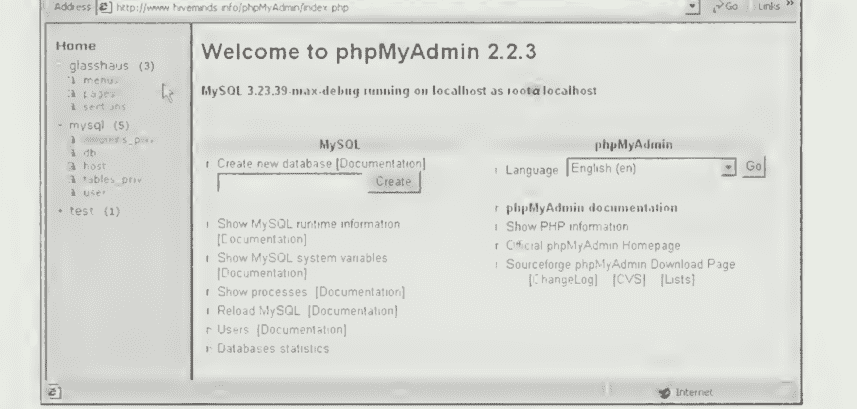

在 PC 上进行这三项应用程序的基本开发安装最快只需一小时，具体取决于你是否已经在该机器上运行了 Web 服务器。你还可以考虑尝试 `phpdev` 软件包，这是一款适用于 Windows 平台的一体化安装包，包含 PHP 4.0.6 / Apache 1.3.20 / ActivePerl 5.6 / MySQL 3.23，可从 FirePages 网站 `http://www.firepages.com.au/phpdev4.htm` 获取。

我们不会详细介绍其中任何一项的安装过程——每项提供的文档应该能够解决大多数可能遇到的情况。请注意，虽然快速设置对于开发目的是可行且完全可以接受的，但这并不一定安全，我们强烈建议你花时间确保其在用于生产环境之前是安全的！同样，你最好的做法是查阅文档。

## 设置数据库表和运行查询

使用 `phpMyAdmin` 设置 MySQL 数据库和表几乎不费吹灰之力。让我们创建一个名为 `glasshouse` 的数据库——在标有 **创建新数据库** 的文本框中输入名称，然后点击 **创建** 按钮。当页面重新加载时，你会注意到左侧导航中出现了一个新项——点击它以调出 `glasshouse` 数据库页面。由于我们尚未创建任何表，你会看到标题 **数据库中未找到表**。接下来，查找标有 **在数据库 glasshouse 上创建新表** 的区域。在 **名称：** 下输入 `menu`，在 **字段：** 下输入 4。现在点击 **执行** 按钮。系统将显示一个表单，你可以在其中输入定义数据库列所需的信息：

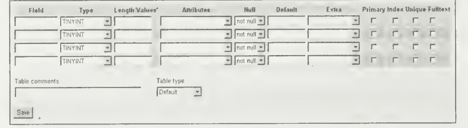

我们需要一个唯一 ID、用于包含我们将要创建的链接的文本和 `href` 属性的文本字段，以及一个用于包含当前项父项 ID 值的父 ID 字段。填写所有内容或选择适当的选项，直到你的字段创建屏幕如下所示：

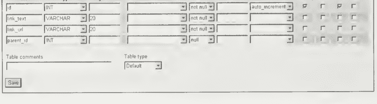

如果你愿意，可以在 **表注释** 字段中输入注释以供参考。点击 **保存** 按钮。接下来你需要进行一些数据录入——点击 **插入** 链接。为了方便起见，我们在本章的代码下载中包含了一个名为 `menus.sql` 的文件，它将按照我们的示例创建表并填充数据——在这种情况下，你可以跳过设置字段的数据类型步骤。通过进入数据库的主屏幕上传它——找到 **运行查询** 区域，选择 **文本文件位置** 文本框旁边的 **浏览** 选项。你还会发现我们在代码包中包含了一个简单的 PHP 实用程序，可用于独立于 `phpMyAdmin` 查看数据库中所有表的转储，名为 `db_dump.php`。

要测试你的 `menus` 表副本，请使用我们上面描述的 *运行查询* 功能。首先，让我们确保只有一条 `parent_id` 值为 `NULL` 的记录。在指定的文本区域输入

```
SELECT * FROM menus WHERE parent_id IS NULL
```

然后单击“Go”提交查询。你应该会看到一条记录（第一条）的列表——否则，请浏览该表并确保只有这条记录的 `parent_id` 值为 `NULL`。我们将使用 `menus` 表作为第一个示例——你需要重复这些步骤来设置并填充上面列出的两个附加表，或者，为了节省打字时间，你也可以使用下载包中包含的 SQL 文件 `sections.sql` 和 `pages.sql`。

### 使用企业管理器访问 SQL Server

虽然存在用于访问 SQL Server 的命令行环境，但大多数人使用与 SQL Server 捆绑销售的*企业管理器*。它也可以作为*客户端工具包*的一部分获得。由于企业管理器和 SQL Server 的文档非常详尽且使用简单，我们将不会像讨论 `phpMyAdmin` 那样详细地讨论它们。

## 面包屑导航

大型复杂网站上的一个常见功能是有时被称为**面包屑导航**的东西。这基本上是反映网站组织结构的一组链接列表。例如，在下面取自 `macromedia.com` 的图中，突出显示的面包屑导航显示当前页面是**新闻室**，它是网站层级结构中**公司**页面的“子”页面，而公司页面本身又是主主页的“子”页面：

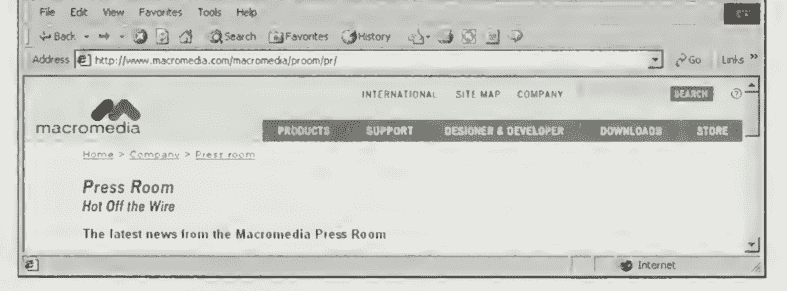

现在让我们让 `menus` 表为我们服务，并为我们的 OurCo 网站构建一个简单的面包屑导航示例。我们将首先查看 PHP/MySQL 场景，然后是 ASP/SQL Server，最后但同样重要的是 ASP/XML。无论你决定使用哪种场景，面包屑导航最终看起来都应类似于这样：


### 示例 1：PHP/MySQL 面包屑导航页头

我们将使用一段可重用的 PHP 代码来实现这一点，这段代码会确定当前加载到哪个页面、找到其父页面，然后是父页面的父页面，依此类推，直到达到网站的主主页。此时，没有更多的父级了，因此我们将构建并输出一个指向这些页面的水平链接列表，如上所示。

如果你查看代码下载中 *ch6_ex1* 文件夹中的任何 PHP 文件，你将只看到一行实际的 PHP 代码：

```
<?php include("includes/breadcrumb.inc"); ?>
```

其余全部是普通的 HTML。由于我们将在每个页面上使用相同的 PHP 代码，我们将把它放在一个**服务器端包含 (SSI)** 中，并告诉 PHP 在页面被请求时将此代码添加到页面并执行它。（这类似于我们在*第 3 章和第 4 章*中对 `.js` 和 `.css` 文件所做的处理，不同之处在于它们是在客户端解析的，而使用 SSI 包含的文件是在服务器端解析的，然后将结果发送给客户端。）还有其他与语言无关的使用 SSI 的方法，但 PHP 有一个方便的 `include()` 函数专门用于此目的，因此这将是我们在这个和下一个示例中使用的方法。

在生产环境中，你应该采取措施确保访客无法查看你的包含文件的源代码，尤其是当你在其中存储了密码等敏感信息时。可以采取以下三种措施：

-   确保服务器设置为将 `.inc` 文件作为 PHP 解析；这可以防止用户在网页浏览器中查看未处理的源代码。

-   为你的包含文件使用 `.php` 文件扩展名。

-   将包含文件放在你的 PHP 页面可以访问但 Web 无法直接访问的目录中。

话虽如此，让我们直接查看 *breadcrumb.inc* 的代码清单：

```
<?php
```

我们使用此标签（而非 `<?` 或在 PHP 配置允许时可以使用的 ASP 风格的 `<%`）标记 PHP 代码的开始，因为它是符合 XML 标准的，并且在当今 XHTML 时代是值得养成的良好习惯。我们连接到 MySQL 服务器并选择数据库；正如你所见，前 4 行告诉脚本要连接的 MySQL 服务器名称（在本例中为 `"localhost"`）、用于登录的用户 ID（`"jon"`）、此用户的密码（`""`——即，我们留空了此用户的密码）以及要登录的数据库（`"glasshaus"`，应保持一致）。你很可能需要编辑前 3 个，因为你自己的服务器上的 MySQL 设置无疑会有所不同。有关如何设置数据库用户账户或如何使用默认登录的信息，请查阅 MySQL 和 `phpMyAdmin` 文档。

```
$server="localhost";
$user="jon";
$password="";
$database="glasshaus";
```

我们建立与 MySQL 服务器的连接，并告诉服务器我们要将查询定向到哪个数据库。注意使用 `or die("....")` 来在这些操作中出现任何致命错误时提醒我们。

```
$mydb=mysql_connect($server,$user,$password)
    or die("<p>User $user has failed to connect to MySQL server $server.</p>");
mysql_select_db($database,$mydb)
    or die("<p>Failed to select database $database.</p>");
```

我们将把链接放在一个单行表格中。我们将表格开头和结尾的 HTML 存储在适当命名的变量中：

```
$table_start="<table border=\"1\" bordercolor=\"#000033\" bgcolor=\"#CCCCCC\"";
$table_start.=" cellpadding=\"2\" cellspacing=\"1\">\n<tr>\n";
$table_end="</tr>\n</table>\n";
```

然后我们设置一个输出变量为空字符串；我们将使用此变量在创建表格单元格时存储构成它们的 HTML。

```
$output="";
```

在这里，我们获取文件名（不包括 `.php` 扩展名）。

```
$curr_url=explode(".",basename($PHP_SELF));
```

如果我们尚未在主页上，那么我们开始构建面包屑导航（如果我们就在主页上，我们也会在示例末尾表明这一点）。

```
if($curr_url[0]!="index")
{
```

如果我们在网站的其他位置，我们使用文件名构建一个查询，我们用它来获取要写入页面的适当文本以及当前页面父级的 `id`。由于我们知道要检索其值的字段名称，我们使用 `mysql_fetch_assoc()` 函数，该函数以关联数组或哈希的形式返回记录。

```
$query="SELECT link_text,link_url,parent_id FROM menus WHERE
        link_url='$curr_url[0]' LIMIT 1";
$result=mysql_query($query)
    or die("<p>Query $query failed to execute.</p>");
if($row=mysql_fetch_assoc($result))
{
    $text=$row["link_text"];
    $parent=$row["parent_id"];
```

我们不需要指向当前页面的链接，只需要一个包含文本的单元格。

```
$output="<td align=\"center\" valign=\"middle\" title=\"YOU ARE
            HERE.\">$text</td>\n";
```

现在我们知道当前页面在网站层级结构中的父级，我们将重复一个循环，依次查询父级页面，并将包含指向它们的链接的表格单元格写入，从当前父级开始，直到我们处理完所有具有父级的页面。

```
$flag=TRUE;
while($flag)
{
    $query="SELECT link_text,link_url,parent_id FROM menus WHERE id=$parent
    LIMIT 1";
    $result=mysql_query($query)
    or die("<p>Query $query failed to execute.</p>");
    if(mysql_num_rows($result)!=0)
    {
        $row=mysql_fetch_assoc($result);
        $text=$row["link_text"];
        $url=$row["link_url"];
    }
}
```

我们在这里更新 `$parent` 的值。我们将在循环顶部的查询中使用它，

```
$parent=$row["parent_id"];
```

当然，除非它是一个 `null` 值，在这种情况下我们无法在层级链中继续向上。当我们达到那一点时，我们将标志变量设置为 `FALSE` 以便跳出循环：

```
if(is_null($parent))
    $flag=FALSE;
```

请注意，我们将最新的父级单元格拼接在前面的单元格之前，因此当我们完成时，页头单元格将从左到右排列，从包含 HOME 链接的单元格开始，到包含当前页面标题的单元格结束：

```
$output="<td align=\"center\" valign=\"middle\"> <a href=\"$url.php\"
    title=\"$text\">$text</a></td>\n". $output;
}
}
}
```

如果我们已经在主页上，我们只需要一个包含适当欢迎语的单元格：

```
else
    $output="<td> = WELCOME TO OURCO.COM = </td>";
    echo $table_start . $output . $table_end;
?>
```

现在我们有了一个简单但有用的组件，可以轻松地部署到整个网站。每当向网站添加新页面时，只需向 `menus` 表添加一条包含相应信息的新记录，页头就准备就绪了。当我们加载 2002 年新闻稿页面（`y2002.php`）时，它看起来像这样：

## 第6章

### 示例2：ASP/SQL Server面包屑导航页头

请注意，页面在服务器上的实际组织方式如何，或者我们要求多少级的组织结构——无论是针对整个网站还是任何给定的部分或子部分——都无关紧要：如果我们只需要*办公室*部分有两级，而*关于我们公司*部分有七级，我们的页头组件都能处理。如果网站特别大，某些页面位于不同的目录、服务器、子域名甚至完全独立的域名中，只要数据库表和字段值反映了我们希望向网站用户展示的组织结构，这也不会影响我们的面包屑导航页头。


我们也不必担心客户端脚本或插件支持。我们使用了一些CSS来美化页头文本；除此之外，它是完全独立的，所需的功能和组织在任何平台的任何浏览器上都可用。因此，我们特意保持了这个示例的简单性，但我们可以通过多种方式修改或扩展它——例如，我们可以对脚本生成的HTML稍作修改，使链接垂直显示而非水平显示。我们也可以使用图片链接而非文本链接，只需修改一两行代码来生成一个指向（例如）`images/y2002.gif`的``标签，并上传相应的图片（或利用PHP自身的图像创建库）；我们还可以为这些图片添加JavaScript悬停效果，或嵌入一组Flash剪辑以提供更复杂的效果。我们所有这些操作都不必更改数据库表的结构——该表告知PHP网站的组织方式——也不会损害其基本效用。当您访问本书配套网站时，您将能够看到并获取使用相同MySQL表和递归方法生成的DHTML“下拉”或“弹出”菜单的客户端和服务器端代码，该代码通过追踪父子关系并相应地构建菜单。

与前面的PHP示例类似，我们现在将使用Microsoft SQL Server作为数据源，在ASP中创建一个简单的面包屑导航页头。虽然这些语言有相似之处，但它们之间存在许多语法差异。

我们的ASP面包屑导航也将包含在一个包含文件中。ASP语法如下所示：

```
<!--#include file="breadcrumb.asp"-->
```

我们的ASP代码文件`breadcrumb.asp`包含了生成面包屑导航所需的全部ASP和VBScript编程。第一步涉及连接到数据库并返回一个包含信息的ADO记录集。我们的示例使用基于DSN的连接方式。请注意，在ASP代码中，`<%`表示一个ASP代码块：

```
<%
Dim dbConn 'As ADODB.Connection
Dim rs 'As ADODB.RecordSet
Dim strSQL 'As String
Dim Flag 'As Boolean

Set dbConn = Server.CreateObject("ADODB.Connection")
dbConn.ConnectionString = "Provider=sqloledb;Data Source=serverName;Initial Catalog=glasshaus;User Id=userName;Password=password;"

dbConn.Open
```

三个`Dim`语句声明并初始化了此代码所需的变量。单引号后面的信息是ASP中的注释。我包含了变量类型作为注释，因为VBScript不支持强类型变量，因此所有变量在声明时都被视为变体。您会注意到上面代码清单中的连接字符串。为了让它在您的机器上运行，您需要添加`serverName`、`userName`和`password`。现在我们有了一个活跃的数据库连接，我们需要生成必要的SQL语句来返回所需的信息。

ASP处理系统信息的方式与PHP不同。要确定我们的页面，我们需要访问`ServerVariables`集合来确定文件路径。然后，只需移除不必要的附加信息即可：

```
sPathInfo = Request.ServerVariables("Path_Info")
arrPathInfo = Split(sPathInfo, "/")
sPathInfo = arrPathInfo(UBound(arrPathInfo))
arrPathInfo = Split(sPathInfo, ".")
sPathInfo = arrPathInfo(LBound(arrPathInfo))
```

这段代码获取当前文件的路径，并返回文件名中句点之前的部分。

接下来我们创建信息将驻留的表：

```
sTableStart = "<table border=\"\" bordercolor=\"\"#000033\"\" bgcolor=\"\"#CCCCCC\"\""
sTableStart = sTableStart & " cellpadding=\"\"2\"\" cellspacing=\"\"1\"\"><tr>"
sTableEnd ="</tr></table>"
```

如果我们位于主页（`index.html`），则不需要生成面包屑导航，因此我们最初会检查以确保我们不在该页面。

```
If LCase(sPathInfo) <> "index" Then
```

现在我们已经获得了正在加载的页面的标题，并确定它不是索引页，我们可以利用这些信息通过一系列连续的递归数据库调用来确定和构建面包屑导航。在此之前，我们需要开始构建将包含输出的HTML表。

```
strSQL = "SELECT link_text,link_url,parent_id FROM menus WHERE link_url='" & sPathInfo & "'"
```

随着数据库信息的查询，ASP被用来动态创建面包屑导航的HTML，同时插入查询返回的信息。

```
Set rs = dbConn.Execute(strSQL)
sPageContent = "<td align=""center"" valign=""middle"" title=""YOU ARE " & "HERE.>" & rs("link_text") & "</td>" & vbcrlf
Flag = True
Do while Flag = True
strSQL = "Select link_text, link_url, parent_id FROM menus WHERE id = " & rs("parent_id")
Set rs = dbConn.Execute(strSQL)
sPageContent = "<td align=""center"" valign=""middle""><b>&gt; &gt;</b></td>" & vbcrlf & sPageContent
sPageContent = "<td align=""center"" valign=""middle""><a href=""" & rs("link_url") & ".asp"">" & rs("link_text") & "</a></td>" & vbcrlf & sPageContent
If rs("parent_id") = "" Then
  Flag = False
Loop
```

这里使用的循环结构通过`Do . . . While`循环从端点回溯导航结构，直到父ID达到零（根导航页面）。

```
Else
  sPageContent="<td> = 欢迎访问我们的公司网站 = </td>"
End If
Response.Write(sTableStart & sPageContent & sTableEnd)
%>
```

此时，我们的ASP已经运行并为我们创建了面包屑导航。虽然这确实运行良好，但这段代码中有大量的数据库查询，特别是在我们的递归函数中。在高负载的生产环境中，这可能会因带宽问题而导致问题，因此建议您在这种情况下使用XML版本。

### 示例3：ASP/XML面包屑导航页头

由于XML基于树结构中的节点和位置，因此在处理数据时需要采取不同的方法。事实证明，XML非常适合基于导航的系统，以及任何需要存储具有明确层次结构信息的系统。

我们将使用与前面ASP示例相同的基本包含结构和文件命名，只是会有一个额外的XML文件来存储我们的数据。XML文件如下所示：

```
<root>
  <menu link_text ="主菜单">
    <menu2 link_text="我们的公司主页" link_url="index"
           title="通往我们公司网站的网关" />
```

```
<menu2 link_text ="公司新闻" url="news" title="我们公司周围的发生事件" />
<menu2 link_text ="新闻室" link_url ="press"
    title="新闻发布，以及我们公司在新闻中" />
<menu2 link_text ="机遇" link_url ="opp"
    title="我们公司的就业和其他机会" />
```

```
</menu>
<menu link_text ="办公室">
```

```
<menu2 link_text ="奥罗拉" link_url ="aurora" title="美国科罗拉多州奥罗拉" />
<menu2 link_text ="伯明翰" link_url ="birm" title="英国伯明翰" />
<menu2 link_text ="布宜诺斯艾利斯" link_url ="buen"
    title="阿根廷布宜诺斯艾利斯" />
<menu2 link_text ="卡塔赫纳" link_url ="carta" title="哥伦比亚卡塔赫纳" />
<menu2 link_text ="肯普西" link_url ="kemps" title="澳大利亚新南威尔士州肯普西" />
<menu2 link_text ="孟买" link_url ="mumb" title="印度孟买" />
<menu2 link_text ="斯科茨代尔" link_url ="scotts"
    title="美国亚利桑那州斯科茨代尔" />
<menu2 link_text ="奥斯陆" link_url ="oslo" title="挪威奥斯陆" />
<menu2 link_text ="基辅" link_url ="kiev" title="乌克兰基辅" />
```

```
</menu>
<menu title="产品">
```

```
<menu2 link_text ="Thingoes" link_url ="thing"
    title="用于家庭和工业的Thingoes" />
<menu2 link_text ="Gizmoes" link_url ="giz"
    title="你能想到的所有小玩意儿！" />
<menu2 link_text ="Widgets" link_url ="widg"
    title="用于所有可想象用途的Widgets" />
<menu2 link_text ="Whatsi" link_url ="what"
    title="在此处找到从微小到巨大的Whatsis" />
```

```
</menu>
<menu link_text ="服务">
```

```
<menu2 link_text ="估价" link_url="estim"
    title="在您花钱之前就知道您将花费多少" />
<menu2 link_text ="配送" link_url="deliver"
    title="直接从我们公司送到您家门口" />
<menu2 link_text ="退货和换货" link_url ="refetch"
    title="尺寸不对？形状不对？别担心！" />
<menu2 link_text ="规格说明" link_url ="specs"
    title="让我们帮助您准确找出您需要什么" />
```

```
</menu>
<menu link_text ="关于我们公司">
```

```
<menu2 link_text ="公司信息" link_url ="corpinfo"
    title="我们公司的简介：我们是谁，我们做什么" />
<menu2 link_text ="使命宣言" link_url ="misstate"
    title="一个有目标的公司" />
<menu2 link_text ="管理层" link_url ="mgt" title="管理层简介" />
<menu2 link_text ="公司历史" link_url ="cohist"
    title="我们公司的故事：我们走过的地方，我们要去的地方" />
```

```
</menu>
<menu title="联系我们">
```

```
<menu2 link_text ="客户服务" link_url ="cust"
    title="随时准备并有能力提供帮助！" />
<menu2 link_text ="销售咨询" link_url ="sales"
    title="准备购买？我们准备好出售了！" />
<menu2 link_text ="电话和传真号码" link_url ="telfax"
```

# 第 6 章

```vb
Sub GetPageNode (ByVal objNodes)
Dim objCurrentNode, objTempNode
Dim sBreadCrumbTrail 'String
iNodeIterator = iNodeIterator + 1
```

接下来，启动一个`for...`循环来遍历传递给子过程的节点集合。

```vb
For Each objCurrentNode In objNodes
```

我们测试当前节点是否为页面对应的节点。如果是，则继续执行后续代码块。如果不是，则跳过该代码块。

```vb
If (sPathInfo = objCurrentNode.getAttribute("url")) Then
```

我们将该节点赋值给一个临时节点，这样就可以对临时节点进行操作而不影响外部循环结构的位置。同时创建一个变量（`sHolder`），因为我们需要反向构建HTML，无法直接使用`Response.Write`进行输出。最后设置节点的深度，以便我们知道在构建面包屑导航时需要回溯多少层。同时创建一个`for...`循环，以反向方式（例如，3、2、1）进行循环，用于从XML树中逐层退出。

```vb
iNodeDepth = iNodeIterator
sHolder = ""
Set objTempNode = objCurrentNode

For iReverseIterator = iNodeDepth to 0 Step -1
```

当循环变量到达1时，我们到达了最后一个循环元素，即最外层的XML节点。因为面包屑导航的主标题与其他部分不同，我们需要对其进行测试并应用相应的格式。

```vb
If iReverseIterator = 0 Then
sHolder = "<td>" & objTempNode.getAttribute("title") & "</td>" & vbcrlf
```

如果不是根元素，则应用上述格式。`getAttribute()`方法允许我们提取属性值（`link_url`或`link_text`）并将其插入到生成的HTML中。

```vb
Else
sHolder = "<td align=""center"" valign=""middle""><b>&gt; &gt;</b></td>"_
& vbsrlf & sPageContent & sBreadCrumbTrail
sHolder = "<td><a href=""" & objTempNode.getAttribute("link_url") & _
".asp"">" & objTempNode.getAttribute("link_text") &
"</a></td>"_ & vbcrlf

End If
sHolder = sHolder & sBreadCrumbTrail
sBreadCrumbTrail = sHolder
```

在这里，我们通过将新生成的信息追加到旧信息前面来保持正确的HTML顺序，然后将该值重新赋给全局变量`sBreadcrumbTrail`，该变量最终将用于页面显示。

由于我们是在反向遍历结构体，因此需要确保在循环重复之前获取新的节点，即当前节点的父节点。

```vb
If iReverseIterator >= 0 Then
    Set objTempNode = objTempNode.parentNode
End If
```

在初始循环中，我们需要忽略不是目标节点的节点。但是，它可能是目标节点的父节点，因此如果它有子节点，我们还需要测试其子节点。

```vb
Next
ElseIf objCurrentNode.hasChildNodes Then
    GetPageNode(objCurrentNode.childNodes)
End If
```

最后，如果它不是我们想要的节点，我们需要确保从深度变量中减去相应的深度，因为接下来我们将测试该节点的兄弟节点。

```vb
Next
iNodeIterator = iNodeIterator -1
End Sub
```

现在只剩最后几个问题需要处理。子过程完成解析和构建后，我们需要在HTML表格格式的前后添加相应内容，最终通过`Response.Write()`将信息输出到页面中：

```vb
sBreadcrumbTrail = "<table border=1 bordercolor=""#000033"" bgcolor=""#CCCCCC"" " & _
    "cellpadding=2 cellspacing=1><tr>" & sBreadcrumbTrail & _
    "</tr></table>"
Response.Write(sBreadcrumbTrail)
```

最终输出与我们之前看到的截图非常相似，因此请参考那些截图来直观了解输出效果。

## 高级示例——填充客户端脚本

接下来，我们将展示如何使用我们已经熟悉的三种数据存储/中间件组合，从服务器端数据存储动态填充高级DHTML菜单。我们将重用*第4章，展开/折叠菜单示例1*中的DHTML展开/折叠"文件夹视图"菜单，但会进行一些修改。当示例网站的"退款与换货"页面加载到浏览器中时，菜单效果如下：

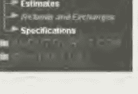

### 示例4：高级PHP/MySQL示例

首先，我们使用PHP从MySQL填充菜单数据。这一次，展开/折叠菜单的部分JavaScript代码已使用存储在两个数据库表中的信息重写。该版本网站的组织方式有所不同——我们没有与章节标题对应的实际页面，也不需要使用递归来追踪父级和父级的父级等关系。


我们将使用`sections`表来存储章节名称，使用`pages`表来存储文本、URL、链接的`title`属性，以及每个页面所属的章节。（**注意：** 如果你尚未创建并填充`sections`和`pages`表，则需要先使用我们在代码下载中提供的SQL脚本来完成此操作，然后才能运行此示例。）由于我们已经有了独立于页面名称的页面存储文件名，因此我们可以利用这些信息并相应地调整客户端脚本。

我们将使用与上一版本示例中相同的许多文件，因此将尽量避免重复内容，专注于本版本的更改之处。如果发现缺少任何内容，请务必查阅*第4章*（`ch4_ex6`），其中详细介绍了此处未涵盖的所有JavaScript代码。

让我们从文件`ch6_ex4.php`开始：

```html
<html>
<head>
  <title>
    Chapter 6, Example 4 -- Expanding/Collapsing Menu #1 Redux (PHP/MySQL Version)
  </title>
  <meta http-equiv="Content-Type" content="text/html; charset=iso-8859-1">
```

如果你想知道闭合的`</head>`和开始的`<body>`标签去了哪里，它们在`header.inc`文件中。如果你之前没有使用过PHP`include`或SSI，这看起来可能有些奇怪，但这样做是完全允许的，而且很常见。关键是要记住，被包含文件的内容会在页面发送给用户之前插入到页面中。换句话说，浏览器并不知道`include`的存在，它只能看到由源文件及其调用的所有`include`组合而成的完整页面。因此，服务器上的一个页面完全可能包含多个`include`文件，但从浏览器的角度来看，这一切是无缝的。

```php
<?php include("includes/header.inc"); ?>
<table width="100%" cellpadding="0" cellspacing="0" border="0">
  <tr>
    <td width="275" bgcolor="#006699">
      </td>
    <td width="70%">
      <p>&nbsp;</p><p>&nbsp;</p><p>&nbsp;</p><p>&nbsp;</p>
      <p>&nbsp;</p><p>&nbsp;</p><p>&nbsp;</p></td>
  </tr>
</table>
</body>
</html>
```

看起来这里缺少了很多内容——但如果你已经猜到`header.inc`文件才是真正发挥作用的地方，那么你的方向完全正确——让我们来看看：

### 纠正后的HTML/PHP/JavaScript代码文档

到目前为止，一切内容与之前完全相同，无需重新审视上面引用的CSS或JavaScript文件，因为它们与第4章中的对应文件也完全一致。接下来才是开始出现变化的地方：对`create_menu.js`的引用被移除了。因为我们需要在页面生成时访问服务器上的数据库，所以我们将那段代码移到了这个服务端包含文件中，以便通过编程方式动态生成需要数据库支持的那部分内容。

正如您所预料的，我们首先连接到MySQL服务器以及要使用的数据库。（与面包屑导航示例的PHP版本一样，您可能需要编辑下面前3行的值，以匹配您的MySQL安装所需的信息。）

```php
<?php
$server="localhost";
$user="jon";
$password="";
$database="glasshaus";

$mydb=mysql_connect($server,$user,$password)
    or die("<p class=\"fatalError\">User $user has failed to connect to MySQL
    server $server.</p>");
mysql_select_db($database,$mydb)
    or die("Failed to select database $database.");
?>
```

由于除了HTML之外我们还要生成JavaScript代码，所以必须打开一个`<script>`块。我们可以用`echo`语句来实现，浏览器对此并不在意。

```javascript
<script type="text/javascript" language="JavaScript">
<!--
var startHeight=50;
var panelHeight=20;
```

现在我们向MySQL发送一个查询，获取`sections`表中的所有记录及其数量。我们本可以使用SQL的`COUNT()`函数来获取记录数量，但接下来我们无论如何都需要这些记录本身，所以直接对结果集使用PHP的等效函数即可。注意闭合的`</script>`标签，它是必需的，以便在查询失败时用户能够看到错误信息。

```php
<?php
$query="SELECT * FROM sections ORDER BY id ASC";
$result=mysql_query($query)
    or die("</script>The query $query has failed.");
$num_sections=mysql_num_rows($result);
```

## 第6章

现在我们用这个值来`echo`一系列JavaScript语句，这些语句声明并初始化一个变量以及若干JavaScript数组：

```php
echo "var numSections=$num_sections;\n";
echo "var sectionNames=new Array(numSections);\n";
echo "var pageNames=new Array(numSections);\n";
echo "var pageURLs=new Array(numSections);\n";
echo "var pageTitles=new Array(numSections);\n\n";
```

作为对照，以下是客户端实际看到的代码：

```javascript
var numSections=6;
var sectionNames=new Array(numSections);
var pageNames=new Array(numSections);
var pageURLs=new Array(numSections);
var pageTitles=new Array(numSections);
```

由于JavaScript没有内置的二维数组支持，我们必须显式地声明每个子数组，可以使用数组字面量，也可以依次调用其`Array()`构造函数。在*第4章*中手工编写这些代码时，使用数组字面量更为方便。然而在这里，我们需要进行大量的调整才能按正确的顺序组装每个子数组的元素，而且所有这些数组及其包含的元素都必须具有正确的索引，脚本才能按预期运行。因此我们选择了后一种方式：

```php
for($i=0;$i<$num_sections;$i++)
{
  echo "pageNames[$i]=new Array();\n";
  echo "pageURLs[$i]=new Array();\n";
  echo "pageTitles[$i]=new Array();\n";
}
```

我们生成的客户端代码如下所示：

```javascript
pageNames[0]=new Array();
pageURLs[0]=new Array();
pageTitles[0]=new Array();
pageNames[1]=new Array();
pageURLs[1]=new Array();
pageTitles[1]=new Array();
pageNames[2]=new Array();
```

以此类推。如果是人工编写，这种方式既不太高效也不太容易维护。但对于浏览器的JavaScript解释器来说这无关紧要，它并不关心声明的顺序，只要索引或标签正确即可。只要我们没有遗漏任何内容，它就会很乐意地帮我们管理这些数据。

接下来我们编写JavaScript用于设置`sections`名称的变量赋值。请注意，我们将从表中获取的`id`值减去了一，因为我们为这些数据定义的自动编号序列从1开始，而PHP中的数组索引从0开始。

```php
echo "\n\n";

while($row=mysql_fetch_assoc($result))
{
```

```php
$section=$row["id"]-1;
$name=$row["name"];
echo "sectionNames[$section]=\"$name\";\n";
}
echo "\n";
```

我们已经处理好了所有`sections`数据。现在是时候检索`pages`数据，并以客户端脚本可用的形式将其写入页面了，这意味着我们需要确保两组索引的顺序正确。正如您在*第4章*中所回忆的，我们使用JavaScript数组来构建构成菜单的`<div>`元素，并写入它们的`id`属性；`id`属性的创建方案包含一个编号约定，而打开和关闭每个section的函数正是利用了这种“索引”机制。

在下一段代码的外层循环中，我们遍历所有section。我们生成并提交一个查询，返回包含该section下所有页面的记录集，并按名称排序。

```php
for ($section_count=0; $section_count < $num_sections; $section_count++)
{
    $curr_section = $section_count+1;
    $query = "SELECT name,url,title FROM pages WHERE section_id = $curr_section ORDER BY name ASC";
```

我们再次在`die()`错误消息前加上了`</script>`标签，以便在查询失败时用户能够实际看到错误消息。

```php
$result=mysql_query($query);
or die("</script>The query $query has failed.");
$page_count=0;
```

内层循环获取`section_id`字段（正如您所记得的，该字段标识菜单项的父级）与外层循环当前值匹配的记录。由于使用了`ORDER BY`子句，我们知道记录会按名称顺序返回。我们将每条记录作为关联数组获取，以便轻松获取每一列的值。

```php
while($row=mysql_fetch_assoc($result))
{
    $name=$row["name"];
    $url=$row["url"];
```

部分`title`属性包含撇号，为了在`document.write()`输出到页面时不会导致JavaScript错误，我们需要转义这些字符，即将每个撇号或单引号替换为`\'`。

```php
$title=str_replace("'", "\'", $row["title"]);
```

现在我们可以写出填充数组的JavaScript赋值语句了。

```php
echo "pageNames[$section_count][$page_count]=\"$name\";\n";
echo "pageURLs[$section_count][$page_count]=\"$url\";\n";
echo "pageTitles[$section_count][$page_count]=\"$title\";\n";
```

## 第6章

这些变量的第一个索引对应一个section；第二个索引用于标识给定section中的每个页面。例如，对于第二个section中的第三个页面，对应链接的文本是`pageNames[1][2]`，该链接指向的URL是`pageURLs[1][2]`，而赋予`<a>`元素的`title`属性是`pageTitles[1][2]`。

最后，我们在从结果集中获取下一行之前递增`$page_count`。请注意，一旦我们从当前结果集中获取了所有记录并返回外层循环，在控制权再次转回内层循环之前，我们会将该变量的值重置为零。

```php
            $page_count++;
        }
    }
?>
```

这并不是完成任务的唯一方式。我们本可以使用以下语句一次性检索所有`pages`记录：

```sql
SELECT * FROM pages ORDER BY section_id ASC, name ASC
```

然后在每次进入`while`循环体时检测`section_id`值是否发生了变化，并在变化时重新开始递增`$page_count`。对于section和页面数量非常大的情况，这种方式可能更可取，以最小化数据库查询次数。然而，考虑到我们这里处理的记录数量相对较少，使用`for...`循环并对每组页面分别进行数据库查询显得更为简单。我们本也可以使用PHP而非JavaScript来编写构成菜单的`<div>`元素，从而大大减少对数组的需求。但是，通过使用已有的代码，我们可以最大限度地减少将其“翻译”为PHP时可能出现的错误。还有一个事实是，如果菜单不是通过JavaScript生成的，那么对于不支持JavaScript的浏览器来说菜单就会可见；而通过保持菜单HTML在客户端生成，我们可以轻松地使用`<noscript>`块为这类用户代理插入替代内容。

其余的JavaScript代码与*第4章*相同，不同之处在于我们从数据库中提取链接的`href`属性，使其不再直接与页面名称关联，另外我们还增加了一个小功能：为每个链接添加一个独特的`title`属性，进一步描述链接指向的页面。以下是该代码的相关部分，直接受影响的部分已标注：

```javascript
for(var i=0;i<numSections;i++)
{
    // ...省略的代码；与之前相同...
    lastItem=pageNames[i].length;

    for(j=0;j<lastItem;j++)
    {
    // ...省略的代码；与之前相同...
        if(isCurrent)
            output+="<b class=\"current\" title=\"You are here.\">";
        else
            output+="<a href=\""+pageURLs[i][j]+".php\" class=\"page\"\n                title=\""+pageTitles[i][j]+"\">";

        output+=pageNames[i][j];

        if(isCurrent)
            output+="</b>";
        else
            output+="</a>";
```

```javascript
if盘后艾特平
if(j==lastItem-1)
	output+="</div>\n";
else
	output+="<br>\n";
}
}

document.write(output);

//-->
</script>
```

最终的结果是一个与访客互动并帮助其了解信息的网站组件，而且无需编辑任何生成它的代码，即可在整个网站上快速轻松地更新。

> 注意：我们在代码下载包中包含了一套“附加”的PHP文件（位于`ch6_ex4b`文件夹中），这是对第4章示例7的重新编写，类似于上文我们对同一章中示例6所做的处理。由于篇幅限制，我们无法在此对其做详细解释。这些文件是在为本章开发材料的过程中创建的，我们已将其包含在下载包中，供您研究和可能的

### 示例5：高级ASP/SQL Server示例

现在我们来看看做同样的事情，只不过这次我们使用ASP从SQL Server中提取数据来填充我们的菜单。方法与PHP类似：确定需要动态生成哪些JavaScript代码来支持菜单，从数据库中提取数据，并进行适当的格式化。为了确保我们的ASP正确运行，所有需要此功能的页面都具有`.asp`扩展名。

首先，我们需要将ASP菜单文件包含到页面中的JavaScript内。

```javascript
<script type="text/javascript" language="JavaScript">
<!--
var startHeight=50;
var panelHeight=20;
<!--#include file="menu.asp"-->
```

这意味着我们用ASP和SQL Server重新创建JavaScript的变量声明，而不是将它们放在JavaScript代码本身中。由于所有信息都在服务器上，我们需要通过声明几个重要变量并创建与数据库的连接来开始我们的包含文件（`menu.asp`）：

```asp
<%
Dim dbConn		'As ADODB.Connection
Dim rs			'As ADODB.Recordset
Dim strSQL		'As String

Set dbConn = Server.CreateObject("ADODB.Connection")
dbConn.ConnectionString = "Provider=sqloledb;Data Source=serverName;
							Initial Catalog=glasshaus;User Id=userName;
							Password=password;"

dbConn.Open
```

创建菜单所需的第一条信息是菜单中的部分数量。SQL语句中的`count()`指令返回`section`表中数据行的数量。

```sql
strSQL="SELECT COUNT (*) FROM sections"
```

在我们的第一段输出中，我们生成部分数量的变量声明和第一组数组。你会注意到每行末尾的`vbCrLf`。`vbCrLf`是VBScript中的回车符。添加它是为了帮助格式化JavaScript以提高可读性。（请注意，我们在PHP版本中使用`\n`做了同样的事情。）


```asp
Set rs = dbConn.Execute(strSQL)
numSections = rs(0)
rs.close
Response.Write("var numSections=" & numSections & ";" & vbCrLf)
Response.Write("var sectionNames=new Array(numSections);" & vbCrLf)
Response.Write("var pageNames=new Array(numSections);" & vbCrLf)
Response.Write("var pageURLs=new Array(numSections);" & vbCrLf)
Response.Write("var pageTitles=new Array(numSections);" & vbCrLf)
```

接下来，我们需要输出每个部分的各种数组声明：

```asp
For i = 0 to numSections
    Response.Write("pageNames[" & i & "]=new Array();" & vbCrLf)
    Response.Write("pageURLs[" & i & "]=new Array();" & vbCrLf)
    Response.Write("pageTitles[" & i & "]=new Array();" & vbCrLf)
Next
```

此时，我们需要从数据库中获取菜单信息本身。我们将从生成部分标题的信息开始。这一部分执行SQL查询，然后使用沧海桑田宽限见肘，恣所不为。

```asp
Response.Write(vbCrLf & vbCrLf)
strSQL="Select id, name From sections order by ID ASC"
Set rs = dbConn.Execute(strSQL)
Do While Not rs.EOF
    Response.Write ("sectionNames[" & (rs("id")-1) & "]=""" & rs("name") & "";" & vbCrLf)
    rs.MoveNext
Loop
rs.Close
```

完成此操作后，我们现在还需要所有子导航的信息：

```asp
Response.Write(vbCrLf & vbCrLf)
For i=0 to (numSections-1)
```

现在我们需要查询数据库并获取所有菜单项的精确值。

```asp
strSQL = "SELECT name,url,title FROM pages WHERE section_id=" & (i+1) & \
         "ORDER BY name ASC"
Set rs = dbConn.Execute(strSQL)
```

之前我们已经从`pages`表中选择了与我们的部分编号匹配的名称、URL和标题。

```asp
pageCount = 0
Do While Not rs.EOF
  Response.Write ("pageNames[" & i & "][" & pageCount & "]=\"" & rs("name") & _
         "\";" & vbcrlf)
  Response.Write ("pageURLs[" & i & "][" & pageCount & "]=\"" & rs("url") & _
         "\";" & vbcrlf)
  Response.Write ("pageTitles[" & i & "][" & pageCount & "]=\"" & rs("title") _
         & "\";" & vbcrlf)
  pageCount = pageCount + 1
  rs.MoveNext
Loop
```

由于一个部分中有多个页面，我们需要循环遍历从数据库返回的信息，为每个子导航项创建变量声明。

最后，我们通过关闭记录集和数据库连接来清理——每次查询数据库时都需要这样做。忘记关闭记录集和数据库连接会导致一些潜在严重的性能问题。

```asp
rs.Close
dbConn.Close
Next
```

一旦这部分代码完成，我们就成功创建了我们的动态菜单。ASP用`%>`关闭，其余的JavaScript继续执行。

```javascript
%>
var output="";
var lastItem;

for(var i=0;i<numSections;i++)
...
```

由于数据库调用的数量，这种特定方法可能会给流量大的网站或过大的菜单系统带来问题。在这种情况下，使用服务器端组件、数据库更改时创建的预生成包含文件，或下面的XML示例会更加有效。

### 示例6：高级ASP/XML示例

与我们之前的基于XML的示例一样，我们将采用稍有不同的编程方法。对于此示例，我们将使用与面包屑示例相同的XML文件——我们XML文件的基于节点树的特性使得开发脚本变量赋值变得简单。首先，我们需要打开并读取XML文件。我们正在创建的文件（`XMLmenu.asp`）将被包含到JavaScript代码中，就像在ASP/SQL Server示例中一样：

```asp
<%
  sSrcFile = Server.MapPath("menu.xml")
  Set objXML = Server.CreateObject("Microsoft.XMLDOM")
  objXML.async = False
  objXML.Load (sSrcFile)
```

如你所见，我们正在做的事情与面包屑轨迹示例相同。接下来，我们将创建一个循环结构来解析整个XML文件。你会注意到一个额外的`For . . . Each`循环包裹着功能——由于我们的XML文件使用一个包含元素来容纳所有其他元素，我们需要考虑它，虽然不一定在上下文中使用它——这就是额外循环的目的。

```asp
iIterator = 0
sContent = ""
For each objRootNode in objXML.childNodes
    For Each objCurrentNode In objRootNode.childNodes
        sContent = sContent & "sectionNames[" & iIterator & "]=""" & _
                   objCurrentNode.getAttribute("title") & """;" & vbcrlf
        Dim objSubCurrentNode, iIterator2
        iIterator2 = 0
        For Each objSubCurrentNode in objCurrentNode.childNodes
            sContent = sContent & "pageNames[" & iIterator & "][" & iIterator2 & "]=""" _
                       & objSubCurrentNode.getAttribute("name") & """;" & vbcrlf
            sContent = sContent & "pageURLs[" & iIterator & "][" & iIterator2 & "]=""" _
                       & objSubCurrentNode.getAttribute("url") & """;" & vbcrlf
            sContent = sContent & "pageTitles[" & iIterator & "][" & iIterator2 & "]=""" _
                       & objSubCurrentNode.getAttribute("title") & """;" & vbcrlf
            iIterator2 = iIterator2 + 1
        Next
        iIterator = iIterator + 1
    Next
Next
```

由于XML文件结构，我们知道解析的第一层`childNodes`是部分标题。在第二个`For . . . Each`循环内部，JavaScript代码被创建，然后，假设该部分有`childNodes`或子导航，则解析其子`childNodes`以创建下一级别的导航变量赋值。最后，当我们遍历XML数据时，我们在累加器`iIterator`中收集部分的数量。使用部分计数，我们可以像前面的ASP示例一样写出初始变量赋值。

```asp
Response.Write("var numSections=" & iIterator & ";" & vbcrlf)
Response.Write("var sectionNames=new Array(numSections);" & vbcrlf)
Response.Write("var pageNames=new Array(numSections);" & vbcrlf)
Response.Write("var pageURLs=new Array(numSections);" & vbcrlf)
Response.Write("var pageTitles=new Array(numSections);" & vbcrlf)
For i = 0 to numSections
    Response.Write("pageNames[" & i & "]=new Array();" & vbcrlf)
    Response.Write("pageURLs[" & i & "]=new Array();" & vbcrlf)
    Response.Write("pageTitles[" & i & "]=new Array();" & vbcrlf)
Next
Response.Write (sContent)
```

这个XML示例与数据库示例相比的有趣之处在于，所有JavaScript生成的顺序不同。在之前的示例中，所有部分名称都在一个块中声明，然后页面名称在另一个块中声明。通过使用XML执行相同的任务，我们将这两个部分合并，这有助于提高代码的可读性。XML的输出如下所示：

```
sectionNames[0]="MAIN";
pageNames[0][0]="OurCo Home Page";
pageURLs[0][0]="index";
pageTitles[0][0]="Gateway to the OurCo Website";
pageNames[0][1]="Company News";
pageURLs[0][1]="news";
pageTitles[0][1]="Happenings Around OurCo";
pageNames[0][2]="Press Room";
pageURLs[0][2]="press";
pageTitles[0][2]="Press Releases, and OurCo in the News";
pageNames[0][3]="Opportunities";
pageURLs[0][3]="opp";
pageTitles[0][3]="Employment and Other Opportunities with OurCo";
sectionNames[1]="OFFICES";
pageNames[1][0]="Aurora";
pageURLs[1][0]="aur";
pageTitles[1][0]="Aurora, Colorado, USA";
```

现在，通过快速浏览输出的JavaScript，我们可以得知哪些导航部分包含哪些链接。

## 未来展望 – ASP.NET

在这个星球上，可能没有哪个开发者能够完全忽略关于微软 .NET Framework 的喧嚣。它将彻底改变微软应用程序的开发方式，并将为ASP Web开发者提供许多强大的新工具，因此我们认为最好在这里提及一下。

ASP.NET 与 ASP 一样，是一个将动态内容交付给Web页面的服务端框架，但它比其前身具有许多优势，例如由于其代码是编译而非解释的特性而带来的更好性能，以及它与其他 .NET 框架部分及其他微软产品的无缝集成。

那么这对我们的菜单意味着什么？嗯，有了 ASP.NET，我们可以构建自定义服务端控件，其中可以包含我们所有的菜单功能，并且可以使用声明式标签中的简单`runat="server"`属性将其包含在页面中。这隐藏了实现菜单的代码，并允许菜单功能被灵活地重复使用。

数据库连接也得到了改进——通过将数据库访问封装在组件中，我们获得了更好性能和简化页面代码的益处。XML处理也获得了类似的好处；特别是转换（transforms）在 .NET 中速度极快。

由于篇幅限制，我们在这里不会详细展开这个庞大的话题——请查看我们*资源（Resources）*部分的参考资料以了解更多信息，并查看代码下载以获取一些示例，包括对本章中看到的一些示例的重新编写。

## 总结

至此，我们不仅结束了本章，也结束了我们对多样且令人兴奋的导航菜单世界的探索。本章涵盖了菜单设计中最复杂的部分——使用中间件从服务端数据存储中动态填充菜单。我们研究的三种中间件/数据存储组合是：

- PHP/MySQL
- ASP/SQL Server
- ASP/XML

我们使用这些组合完成了两项任务：首先我们创建了一个简单的面包屑导航，然后填充了我们在*第 4 章*中首次看到的客户端JavaScript示例之一。这将使您能够创建智能、动态、模块化的菜单，并且更容易维护——因为我们将数据与客户端逻辑和呈现分离，我们只需通过更新数据存储即可修改这些菜单，而无需编辑客户端代码。

我们还简单谈到了 ASP.NET 以及微软Web开发的未来。

# 资源

## ASP

ActiveState（为程序员提供大量开源资源的供应商，包括许多酷炫的ASP工具）：*http://www.activestate.com/*。

ASPToday（包含大量实用ASP文章、教程等的订阅资源网站）：*http://www.ASPToday.com/*。

ASPFree（另一个ASP资源网站，提供示例、教程等）：*http://www.aspfree.com/*。

Beginning Active Server Pages 3.0：*Chris Ullman 等著，Wrox Press 出版，ISBN: 1861003382*。

## ASP.NET

Microsoft ASP.NET Quickstart Tutorial（关于ASP.NET的全面初学者教程）：*http://www.aspfree.com/quickstart/aspplus/*。

The Microsoft ASP.NET Homepage：*http://www.asp.net/*。

Professional ASP.NET Website Programming：*Marco Bellinaso 等著，Wrox Press 出版，ISBN: 1861006934*。

## Cookies

官方Cookie规范：*http://www.netscape.com/newsref/std/cookie_spec.html*。

Cookie Central：*http://www.cookiecentral.com/*。

## CSS

WebReview.com的“样式表参考指南和浏览器兼容性图表”：*http://www.webreview.com/style/index.shtml*。

Glish的CSS布局技术：*http://www.glish.com/css/*。

W3C Schools – CSS。关于CSS的非常基础的入门教程：*http://www.w3schools.com/css/*。

## 文档对象模型/动态 HTML (DOM/DHTML)

Document Object Cross Reference：*http://developer.netscape.com/evangelism/docs/technotes/xref/document-object/*。

DOM CSS 2 Property Cross Reference：*http://developer.netscape.com/evangelism/docs/technotes/xref/dom-css-style-object/*。

The W3C DOM homepage：*http://www.w3.org/DOM/*。

Microsoft DHTML reference（总结了DHTML中的标准内容以及微软的专有扩展）：*http://msdn.microsoft.com/library/default.asp?url=/workshop/author/dhtml/reference/dhtml_reference_entry.asp*。

## Flash/ActionScript

Colin Moock的Flash Player Inspector：*http://www.moock.org/webdesign/flash/detection/moockfpi/*。

Flash开发者网站：

- http://www.ultrashock.com
- http://www.were-here.com
- http://flashguru.co.uk

New Masters of Flash：*Joel Baumann 等著*，Friends of ED 出版，ISBN: 1903450039。

Foundation ActionScript：*Sham Bhangal 著*，Friends of ED 出版，ISBN: 1903450322。

文章 – “如何检测Flash Player的存在”：*http://www.macromedia.com/support/flash/ts/documents/uber_detection.htm*。

## JavaScript


ECMAScript 规范 (ECMA-262)：[http://www.ecma.ch/](http://www.ecma.ch/)。

Beginning JavaScript：*Sing Li 等著*，Wrox Press 出版，ISBN: 1861004060。

Instant JavaScript：*Nigel McFarlane 等著*，Wrox Press 出版，ISBN: 1861001274。

JavaScript 参考、代码片段和新闻：[http://www.javascript.com/](http://www.javascript.com/)。

## PHP

PHP 主页（开发相关新闻、下载、PHP 手册、教程链接）：[http://www.php.net/](http://www.php.net/)。

PHPBuilder（优秀的文章来源，带有可搜索的帮助论坛）：[http://www.phpbuilder.com/](http://www.phpbuilder.com/)。

phpWizard（多个 PHP 应用程序的所在地，包括 phpMyAdmin、phpPolls 和 phpEasyMail；包含多个教程及其他资源链接）：[http://www.phpwizard.net/](http://www.phpwizard.net/)。

在 Windows 上进行开源开发的即时无忧安装（可在您的机器上立即安装 PHP, MySQL, Apache, Perl 等）：[http://www.firepages.com.au/devindex.htm](http://www.firepages.com.au/devindex.htm)。

## 可用性 (Usability)

Don't Make me Think!: A Common Sense Approach to Web Usability：*Steve Krug 著*，New Riders 出版，ISBN: 0789723107。

文章: "Users decide first, move second"（探讨了 Web 用户更倾向于简单的菜单，以便在做出导航选择前看到所有选项，而不是花哨的弹出菜单等）：[http://world.std.com/~uiweb/Articles/whatTheyWantArticle.htm](http://world.std.com/~uiweb/Articles/whatTheyWantArticle.htm)。

Web Sites That Suck（Vincent Flanders 的网站，专注于糟糕的 Web 设计——应避免的做法）：[http://www.webpagesthatsuck.com/](http://www.webpagesthatsuck.com/)。

Information Architecture for the World Wide Web：*Louis Rosenfeld 和 Peter Morville 著*，O'Reilly 出版，ISBN: 1565922824。

## SQL/MySQL/SQL Server

SQL In A Nutshell（对 SQL 在四种最广泛实现中的调研；如果您之前使用过 PostgreSQL, MS SQL Server 或 Oracle，并且需要快速熟悉 MySQL，或需要在它们之间迁移数据库，那么本书非常有用）：*Kevin Kline 著*，O'Reilly 出版，ISBN: 1565927443。

MySQL AB Website（开发 MySQL 的公司）：[http://www.mysql.com/](http://www.mysql.com/)。

Microsoft SQL Server Homepage：[http://msdn.microsoft.com/library/default.asp?url=/nhp/default.asp?contentid=28000409](http://msdn.microsoft.com/library/default.asp?url=/nhp/default.asp?contentid=28000409)。

# 资源

MySQL：*Michael Kofler, APress, ISBN: 1893115577*。

Microsoft ADO 主页：http://www.microsoft.com/data/ado/default.htm。

## XML

Beginning XML 第二版：*Jonathan Pinnock 等, Wrox Press, ISBN: 1861005598*。

XML 开发者资源：

- http://www.xml.com

- http://www.xml101.com

# 索引

## 索引指南

索引按层级排列，以字母顺序排序，符号排在字母 A 之前。大多数二级条目和许多三级条目同时也作为一级条目出现。这是为了确保用户无论选择何种搜索方式，都能找到所需的信息。

## 符号

- 7，见 Magical Number 7。

## A

- `alt` 属性，`<area>`，112

    - 图像映射菜单示例，124

- `<area>` 标签，图像映射，112

    - `alt`/`title` 属性，112

    - 图像滚动示例，113

- `Array()` 函数，204

- 数组 (arrays)

    - 图像存储用途，优点，60, 61

    - 便于代码维护，61

    - 多维数组，155, 161

    - 名称存储用途，82

    - 将数据库记录作为数组返回，193

- ASP，187

    - 面包屑导航 (breadcrumb trails)，195, 197

    - 填充菜单，207

- ASP.NET，211

- 关联数组 (associative arrays)，193

## B

- 行为剪辑 (behavior clips)，Flash，158

    - Flash 菜单示例，158

- 面包屑导航 (breadcrumb trails)，191

    - ASP 与 SQL Server 配合使用，195

    - ASP 与 XML 配合使用，197

    - PHP 与 MySQL 配合使用，192

- 浏览器窗口尺寸，测定

    - Netscape 与 IE，对比，127

- 浏览器，见 Netscape & IE。

- 按钮

    - `<form>` 菜单，71

    - 基础按钮示例，71

    - 单选按钮/复选框示例，74

    - 编程，Flash 的优势，152

## C

- VBScript 中的回车符，208

- `checked` 布尔属性

    - 基于 cookie 的 CSS 简单菜单，101

- `clearInterval()` 方法，JavaScript

    - 图像映射菜单示例，128

- 客户端工具包 (Client Tools Package)，企业管理器 (Enterprise Manager)，191

- 客户端脚本，201

- 折叠菜单，见 展开/折叠菜单。

- cookies，95

    - 概述，95

    - 浏览器存储 cookie 的限制，97

    - cookie 内容，95, 97

    - 使用 cookie 的优缺点，95

    - 工具函数，95

    - `deleteCookie()`，98

    - `getCookie()`/`-CookieVal()`，97

    - `setCookie()`，96

- 基于 cookie 的 CSS 菜单，高级示例，103

    - `buildMenu()` 函数，108

    - 菜单表格末尾，108, 109

    - `innerHTML` 属性，使用，110

    - 菜单表格中间，109

    - 菜单表格开始，108

    - 样式选择按钮，109

    - 主 HTML 文件，103

    - JavaScript 文件，104

    - `<link>` 元素，写入页面，103

    - Netscape 6，样式表选择机制，104

    - 运行，105

    - 样式设置，JavaScript 文件，106

    - `buildMenu()`，108

    - `chooseStyle()`，107

    - `getElementById()`，调用，107

    - `getElementReference()`，用于不支持 JavaScript 的浏览器，111

    - `initialise()`，110

    - `retrieveStyle()`，106

    - `saveChoice()`，108

    - 设置 `disabled` 属性，107

    - 变量声明，106

- 基于 cookie 的 CSS 菜单，简单示例，93, 98

    - JavaScript 使用，链接到样式表，95

    - 主 HTML 页面，94

    - 弹出窗口，HTML 文件，100

    - 使用样式的表单与表格，102

    - `setStyle()`，100

    - 潜在的菜单增强，103

    - `setCustom()` 函数，100

    - 样式表，CSS 文件，93

    - `writeStyle()` 函数，98

- `COUNT()` 函数，203, 208

- CSS (层叠样式表)，56, 92

    - 优点，92

    - 补充，93

    - 内容与呈现分离，93

    - 经济性，93

    - 可维护性，92

    - 基于 cookie 的 CSS 高级菜单，103

    - 基于 cookie 的 CSS 简单菜单，93, 98

    - `<font>`，缺点，92

    - `<form>` 样式，浏览器支持，71

    - 连字符命名的 CSS 属性，设置，127

    - 配合 CSS 的 Javascript 菜单，56

    - 伪类 (pseudoclasses)，139

- CSS 定位，114

    - 绝对/相对/固定，114

    - 展开/折叠菜单示例，130

    - `visibility` 属性，115

    - `z-index` 属性，115

    - Netscape 4 的相关问题，64

- `cursor` 属性

    - 作为跨浏览器 hack，用于展开/折叠菜单，145

## D

- 数据库

    - 关闭连接，209

    - 菜单设计用途，187

    - 使用 PHP 的 MySQL 数据库连接，菜单示例，172

    - 连接到数据库，PHP 脚本，173

    - 将数据库引入中间件，174

    - 设置数据库，172

    - .NET Framework 使用，211

    - 设置，190

- `deleteCookie()` 函数，cookies，98

    - `name` 参数，98

- 内容深度，网站导航，50

    - 深/窄型网站，优缺点，50

    - 目标深度，设置，51

- 设计可用的菜单

    - 实际可用性，设计指南，36

    - 技术可用性，设计指南，10

- DHTML (动态 HTML)

    - 动态填充 DHTML 菜单，201

    - Javascript 与 DHTML，56

- `die()` 错误消息，193, 205

- `Dim` 语句，196

- `disabled` 属性，`<link>`，103

    - 基于 cookie 的 CSS 高级菜单，107

- `display` 属性

    - 展开/折叠菜单示例，142

    - `visibility` 属性，对比示例，140

    - HTML 页面，140

    - 运行，机制与截图，141

- `document.write()` 语句

    - 展开/折叠菜单示例，135

    - 配合 CSS 的 Javascript 菜单，示例，68

    - Netscape 3 兼容性问题，68

- DOM (文档对象模型)

    - 浏览器支持，115

    - `getElementReference()`，通用元素脚本支持，111, 115

    - `getStyleReference()`，通用样式脚本支持，116

- 动态服务端菜单，185

    - 面包屑导航，191

    - 填充客户端脚本，201

    - 使用 ASP 从 SQL Server 填充，207

    - 使用 ASP 从 XML 填充，209

    - 使用 PHP 从 MySQL 填充，202

## E

- `echo` 命令，ActionScript，203

    - `trace` 命令与 `echo`，176

    - 基于 XML 的 Flash 菜单，连接到 MySQL 数据库，176

- 嵌入字体

    - Flash 菜单示例，153

- 企业管理器 (Enterprise Manager)，911

- `escape()` 函数，JavaScript

    - 在 `setCookie()` 中的使用，96

- 展开/折叠菜单，129

    - 概述，129

- 展开/折叠菜单，CSS 定位与可见性示例，130

    - 外观样式表信息，CSS 文件，139

    - 定义样式类与伪类，139

    - 内容样式表信息，CSS 文件，140

    - 跨浏览器函数，JavaScript 文件，132

    - 主 HTML 页面，131

    - `list.gif` 图像，131

    - 菜单创建器，JavaScript 文件，132

    - 关闭菜单，`<div>`，133

    - `getPageName()`，文件名选择规则，133

    - 打开菜单，`<div>`，134

    - `pages` 数组，元素，132

    - 启动当前菜单，GIF 图像，134

    - 变量/数组定义，132

    - 菜单驱动，JavaScript 文件，135

    - `display()`，更新菜单显示，136

    - `initialise()`，138

    - `setTop`/`showIt`/`hideIt`/`isVisible()`，136

- 展开/折叠菜单，`display` 属性示例，140

    - 外观样式表信息，CSS 文件，143

    - 面板/标题样式类，143

    - 选择器，超链接类，143

    - 选择器，页面标题单元格，143

    - 主 HTML 页面，142

    - 菜单创建器，JavaScript 文件，143

    - 数组定义，143

    - 菜单驱动，JavaScript 文件，144

    - `cursor` 属性使用，跨浏览器 hack，145

    - `display()`，更新菜单显示，144

    - `getElementsByTagName()`，调用，144

    - 增量重排 (incremental reflow)，使用，145

    - `initialise()`，145

    - 运行，146

- 多余词汇，49

    - 作为降低可用性的因素，49

    - 作为解决方案的移除，示例，49

## F

**Flash 动态菜单，159**

- 使用 PHP 的 MySQL 连接，示例，172

    - 连接到数据库，PHP 脚本，173

    - 将数据库引入中间件，175

    - 设置数据库，172

- 可用性，152

    - 按钮编程，Flash 优势，152

    - 文件大小考虑，162

    - Flash 插件，下载/检测，152

- 基于 XML 的 Flash 菜单，示例，165

    - 将 XML 加载到 Flash 中，167

    - 移除不必要的 Flash 代码，165

    - XML 文档，创建，166

**Flash 动态菜单，所有代码在 .fla 文件中的示例，152**

- 行为剪辑，创建，158

- 条目，生成，155

    - 多维数组，创建，155

- 界面，构建，155

    - 主导航，155

    - 次级导航，156

- 使用 Flash 打开 HTML 页面，161

    - 为 URL 创建存储系统，161

    - 获取/打开 URL，161

    - 多维数组的空首元素，161

- 主导航按钮，创建，153

    - 创建图层与帧，154

    - 嵌入字体，选项，153

    - 导出符号链接，154

- 子菜单，激活/停用，159

    - 激活子菜单，159

    - 激活/停用子菜单按钮，160

    - 点击时将选中的子菜单项与父项对齐，161

    - 停用子菜单，159

    - 鼠标悬停时滚动显示子菜单，160

    - `stop()` 命令，添加，162

**浮动菜单**

- 图像映射示例，122

- 缺点，14, 122

**`<font>` 标签**

- CSS 与 `<font>`，`<font>` 的缺点，92

**字体嵌入，见 嵌入字体。**

**配合 Javascript & CSS 的 `<form>` 元素菜单，70**

- 基础按钮示例，71

    - `goThere()` 函数，驱动按钮，72

    - `<input>` 样式定义，72

    - Netscape 4 & 6.2 及 IE 5.5 的显示，71

    - `onclick` 事件处理器，HTML 标记，73

    - 源代码，72

- 基础跳转菜单示例，75

    - 选择 “CHOOSE ONE” 选项，76, 77

    - `goThere()`，驱动菜单，76

    - HTML 标记，77

    - 源代码，76

    - 可用性问题，77


# 索引

- CSS 浏览器支持，71
- 双重跳转菜单示例，81
  - `fillPages()`，构建页面，83
  - `fillSections()`，构建区域，83
  - `goThere()`，驱动菜单，84
  - HTML 标记，86
  - 解析当前页面 URL 的唯一区域，83
  - 运行，85
  - 区域与页面，对照表，81
  - 源代码，82
  - 在数组中存储名称，82
- `<form>` 可用性，优缺点，70
- 智能跳转菜单示例，78
  - 消除当前页面选择选项，78
  - `fillSelect()`，定制菜单，79
  - `goThere()`，驱动菜单，80
  - HTML 标记，80
  - 如果是列表框式菜单而非下拉菜单，81
  - `new Option()` 构造函数，79
  - `<select>`/`<option>`，样式规则定义，78
  - 源代码，78
- 单选按钮/复选框示例，74
  - `goThere()`，驱动按钮，74
  - Netscape 4 显示问题，75

## G

- `getAttribute()` 方法，`objTempNode` 对象，200
- `getCookie()`/`getCookieVal()` 函数，cookies，97
  - 基于 cookie 的 CSS 高级菜单，106
  - 基于 cookie 的 CSS 简单菜单，98
  - `name` 参数，97
- `getElementById()` 方法，`Document` 类，107
  - 基于 cookie 的 CSS 高级菜单，107, 110
- `getElementReference()` 函数
  - 通用元素脚本支持，111, 115
- `getElementsByTagName()` 方法，`Document` 类
  - 展开/折叠菜单示例，144
- `getStyleReference()` 函数
  - 展开/折叠菜单示例，136
  - 通用样式脚本支持，116
- `goThere()` 函数，JavaScript
  - `<form>` 菜单示例，72, 74, 76, 80, 84

## H

- 哈希 (hashes)，193
- 连字符命名的 CSS 属性
  - `intercap` 记法，属性设置解决方案，127

## I

- IE (Internet Explorer)
  - 浏览器窗口尺寸，测定，127
  - `cursor` 属性使用，145
  - DOM 支持，115
    - `getElementReference()`，通用元素脚本支持，115
    - `getStyleReference()`，通用样式脚本支持，116
  - `<form>` CSS 支持，71
  - `Image` 对象不被 IE 3.0 支持，64
  - `<noscript>` 内容，由 IE 3 显示，70
- 图像链接
  - 使用数组存储图像，优点，60, 61
  - Javascript 图像滚动菜单示例，59, 62
  - Netscape 2 & IE 3 不支持 `Image`，64
  - 文本 vs 图像可用性，优缺点，58
- 图像映射菜单，111
  - 概述，112
    - 使用 ``/`<map>`/`<area>` 标签构建，112
    - 可用的内置编辑器，112
  - 客户端，112
  - 侧边栏图像滚动示例，113
    - `<area>` 标签，编码，113
    - 主 HTML 页面，112

## 图像映射菜单，浮动菜单示例

**图像映射菜单，浮动菜单示例，122**

- 创建菜单，JavaScript 文件
  - 全局变量声明，124
- 主 HTML 文件，123
  - JavaScript 包含文件，123
  - `<noscript>` 内容，123
  - 表格创建，123
- 菜单创建，JavaScript 文件，124
  - `<area>` 标签的 `alt`/`title` 属性，124
  - 浏览器兼容性检查，124
  - 基于表格的替代菜单，125
- 菜单驱动程序，JavaScript 文件，126
  - `makeFloat()`，128
  - `miniMenu()`/`maxiMenu()`/`close()`，128
  - `setMenus()`，127
  - `setPos()`，定位元素，126
- 潜在的用户自定义设置，129
- 源文件列表，122
- 样式信息，CSS 文件，126
  - `getElementReference()`，用于不支持 JavaScript 的浏览器，111, 115
  - 连字符名称 CSS 属性，设置，127

**图像翻转示例，58**

- 检查浏览器支持，60, 61
- 使用 PHP 创建 MySQL 数据库，61
- 预加载图像，优点，60
- `rollOn()`/`rollOff()` 图像切换函数，60
  - 将图像名称存储在数组中，优点，60, 61
  - 文本与图像的可用性，优缺点，58
- 变量声明，59

**图像映射菜单，标签页显示示例，114**

- 使用 CSS 定位，114
- `initialise()` 函数，121
- 主 HTML 文件，117
  - 图像映射定义，118
  - 信息显示面板，118
  - 选中标签页的背景，118
  - 标签页标题文本，117
  - 标签页轮廓，117
- 运行，截图，121
- 样式信息，CSS 文件，119
  - 显示面板，120
  - 面板背景，120
  - 标签页标签/背景，119
  - 格式化面板内容的标签，120
- `switchTabs()` 函数，120

**"智能"菜单示例**

- 根据页面改变外观和行为，64
- 代码修改，65
- 当前页面是索引页面，67
- 当前页面是/不是预定义页面，67
- 检测当前加载的页面，66
- 使用 `document.write()` 语句，68
- `rollOn()`/`rollOff()` 图像切换函数，68
- `<noscript>` 元素中的静态表格版本，70
- 使用 `String.split()` 方法，66
- 在 `<script>` 块中编码表格，68

**.inc 文件，192**

**增量重排**

- 展开/折叠菜单示例，145

**信息架构（Information Architecture, IA），46**

- 内容深度，50
  - 深而窄的网站，优缺点，50
  - 设置目标深度，51
- 功能概述，46
  - 示例，46
- 菜单项分组，解决方案，47
  - 神奇数字 7，47
  - 自然划分，48
  - 按受欢迎程度，49
- 技术上与实际可用的菜单，47
- 降低可用性的因素，47
  - 移除多余词汇作为解决方案，49

**侧边栏图像翻转示例，62**

- CSS 定位与 Netscape 4.X，问题，64
- 使用不同的 `name` 属性，63
- Netscape 2 和 IE 3 不支持 `Image` 对象，64
- 脚本代码，目标与修改，63

**使用 CSS 的文本链接示例，57**

- 使用正常/鼠标悬停链接样式，58
- 运行，58

**使用 `<form>` 的跳转菜单，75**

- 基本跳转示例，75
- 双重跳转示例，81
- 智能跳转示例，78

**`innerHTML` 属性，IE 4，110**

- 基于 cookie 的 CSS 高级菜单，110

**首字母大写写法**

- 连字符名称 CSS 属性，设置，127

## J

**Javascript，55**

- 优点，56
- 与 CSS，56
- 与 DHTML，56

## L

**`<link>` 元素**

- 基于 cookie 的 CSS 高级菜单，103
- 基于 cookie 的 CSS 简单菜单，94, 98
- `disabled` 属性，设置为 `true`/`false`，103
- `rel` 属性，指定替代样式表，103

**链接**

- 下划线，15

## M

**神奇数字 7，47**

- 实际可用性，列表示例，47

**`<map>` 元素，图像映射**

- 标签页显示菜单，118

**`MapPath` 指令，199**

**菜单，10**

- 数据库使用，菜单设计，187
- 定义，10
- 动态服务器端菜单，185
- Flash 动态菜单，可用性，151
- 搜索功能和，36
  - 示例，36
- 可用性设计指南，实际的，36
- 可用性设计指南，技术性的，10

**Javascript CSS 菜单，55**

- 基于 cookie 的 CSS 简单菜单，95
- `<form>` 菜单，70
  - 基本按钮示例，71
  - 基本跳转菜单示例，75
  - 双重跳转菜单示例，81
  - 智能跳转菜单示例，78
  - 单选按钮/复选框示例，74

**模块化，菜单设计，187**

**影片剪辑，Flash**

- Flash 菜单示例，153, 156, 158

## P

**性能，209, 211**

**PHP 中间件，186**

- 面包屑导航，192
- Javascript CSS 菜单，MySQL 连接，61
- 使用 PHP 连接 MySQL，菜单示例，172
  - 连接数据库，PHP 脚本，173
  - 将数据库引入中间件，175
  - 设置数据库，172
  - 填充菜单，172
- phpdev 包，189
- phpMyAdmin，189

**实用性，可用性**，见可用性设计指南，实际的

**伪类，CSS，139**

- 展开/折叠菜单示例，139

## R

**记录集，195, 209**

**`rel` 属性，`<link>` 元素，103**

**`Request` 对象，`ServerVariables` 集合，199**

**`runat` 属性，表单，211**

## S

**搜索功能，36**

- 菜单和，36
- 示例，36

**服务器端包含（SSI），192**

**服务器端菜单**，见动态服务器端菜单。

**`Server.MapPath` 指令**，见 `MapPath`。

**`ServerVariables` 集合，196**

- `Request` 对象，199

**`setCookie()` 函数，cookie，96**

- 参数，96
- `expires`，96
- `name`/`value`，96
- `path`/`domain`/`secure`，96, 97
- 基于 cookie 的 CSS 简单菜单，101
- 使用 escaping，96
- 相见 `toGMTString()`，使用，96

**`setInterval` 方法，JavaScript**

- 图像映射菜单示例，128

**SourceForge 项目，189**

**`split()` 方法，`String` 类**

- 基于 cookie 的 CSS 高级菜单，107
- Javascript CSS 菜单示例，66

**SQL Server，Microsoft，188**

- 使用企业管理器访问，191
- 面包屑导航，195
- 用其数据填充菜单，207
- SSI，见服务器端包含。

**样式表**，见 CSS。

## 多维数组

- Flash 菜单示例，161
- 生成条目，155
- `null` 第一个元素，161

**MySQL，188**

- 面包屑导航，192
- phpMyAdmin，189
- 用其数据填充菜单，202
- 设置数据库表，172, 190
- 使用 PHP 连接 MySQL，基于 XML 的 Flash 菜单示例，172
  - 连接数据库，PHP 脚本，173
  - 配置用户/数据库名和密码，173
  - 将数据库引入中间件，174
  - 从子数组构建 CSS 菜单，180, 181
  - 更改 ActionScript 解析 XML，179, 180
  - 创建主导航和菜单关联数组，179
  - `echo` 命令测试导航，176
  - 将数据格式化为 XML，177
  - 将子数组节点放入子数组，180
  - 查询设置，175
  - 搜索和存储返回的数据，176
  - PHP 脚本创建的 XML 文档，179
- Javascript CSS 菜单示例，61
- 设置数据库，172
- `mysqli_fetch_assoc()` 函数，193

**mystery meat，示例，16**

## N

**Net Framework，211**

**Netscape**

- 浏览器窗口尺寸，确定，127
- 选择样式表，Netscape 6，104
- CSS 定位与 Netscape 4，问题，64
- 光标几何使用，Netscape 6，145
- `document.write()` 语句与 Netscape 3，68
- DOM 支持，115
- `getReferenceByName()` 通用元素脚本支持，115
- `getReference()` 通用样式字符串支持，116
- `<form>` CSS 支持，71
- Netscape 2 不支持 `Image` 对象，64
- Netscape 2 显示 `<noscript>` 内容，70
- Netscape 4 单选按钮显示问题，75

**`Option()` 构造函数，JavaScript**

- `<form>` 菜单示例，79

**`<noscript>` 元素，HTML**

- 图像映射菜单示例，125
- Netscape 2 和 IE 3，`<noscript>` 内容显示，70

## O

**`objCurrentNode`/`objTempNode` 对象，199**

- `getAttribute()` 方法，`objTempNode`，200

## T

**技术可用性**，见可用性设计指南，技术性的。

**测试设计决策，52**

- 需要保持一致性，52
- 人力和设备费用，52

**文本链接**

- 图像与文本可用性，优缺点，58
- Javascript CSS 菜单示例，57

**`title` 属性，`<area>`，112**

- 图像映射菜单示例，124

**`toGMTString()` 方法**

- `setCookie()` 使用，96

**`trace` 命令，ActionScript**

- 与 `echo` 命令，176
- 基于 XML 的 Flash 动态菜单，167, 169

## U

**链接下划线**

- 优缺点，示例，15

**可用性设计指南，实际的，36**

- 使用 IA 组织现有内容，45, 53
- 使用信息架构（IA），46
  - 内容深度，50
  - 移除多余词汇，49
  - 菜单项分组，解决方案，47
  - 神奇数字 7，47
  - 技术 vs. 实际可用性，47
- 设定公司优先级，38
  - 用户第一，营销第二，38
  - 用户是浏览，不是阅读信息，38
- 测试设计决策，52
  - 需要保持一致性，52
  - 人力和设备费用，52
- 理解目标用户，39
  - 行为和角色，39
  - 已有知识，43
  - 次要用户画像，44
  - 拥有的技术，42

**可用性设计指南，技术性的，10**

- 行为符合预期，23
  - 令人困惑的菜单变化，24
  - 模仿桌面应用程序，25
  - 菜单位置像横幅广告，24
  - 负面示例，24
- 品牌次于可用性，28
  - 负面示例，28
- 考虑用户的主要任务，12
  - 负面示例，12
- 网站内一致性，27
  - 菜单适合/不适合屏幕，示例，27
- 定义，可用性，10
  - 示例，10
- 无障碍访问，31, 44
  - 使用样式表和标签，31
- 列表，11
- 快速加载，26
  - 过度简化，示例，27
- 需要本地化，30
  - 外语网站版本，标识，30, 44
- 多浏览器兼容性，32
  - 在各种浏览器上测试网站设计，32
  - 文本-only 导航选项，可用，32, 43, 45
- 易于操作，22
  - 正面示例，23
- 清晰可读，18
  - 搜索功能隐藏，示例，18

**轻松扫描信息，18**

- 难以理解的图标，20
- 负面示例，19
- 潜在扫描目标，18
- 文本映射和图像映射结合，21
- 不清晰的图像菜单，22
- 扫描信息的方式，19

**将设计与内容分离，13, 93**

- 过度分离，17
- 浮动菜单，14
- 链接无下划线，15
- mystery meat，16
- 负面示例，13
- 设计-内容分离的方式，13
- 缺乏空白和对比度差，13

**用户，理解，38**

- 行为和角色，39
  - 跨国公司网站示例，41
  - 同一用户的多种行为画像，40
  - 呈现菜单选项，示例，40
  - 了解主要用户的目标，39
- 已有知识，43
  - 点击下划线和彩色链接，43
  - 图像映射，要求，43
  - 在页面上定位菜单，44
- 营销需求次于用户需求，38
  - 用户是浏览，不是阅读信息，38
- 次要用户画像，44
- 拥有的技术，42
  - "最低公分母假设"，设计错误，42
  - 提供基于文本的选项，43

## V

**变体，196**

**`vbcrlf`，208**

**`visibility` 属性，CSS 定位，115**

- `display` 属性与，比较示例，140
- 展开/折叠菜单示例，130
- `visible`/`hidden`/`inherit` 值，115

## W


**Web 菜单**，见菜单。

**write() 方法，document**，见`document.write()`语句。

## X

**XML（可扩展标记语言），163**

- 面包屑导航，197

- Flash 5 和，163

- 概述，163

  - 文档结构，示例，163

  - 使用元素而非属性，164

  - 嵌套多种标签类型，164

  - 标签/属性名称，创建自己的，163

  - 有效性规则，165

- 用其数据填充菜单，209

**XML 对象，199**

+ 基于 XML 的 Flash 动态菜单，165

  将 XML 加载到 Flash 中，167

  保存 XML 内容的数组，创建，167

  搜索 URL 的按钮，重新配置，171

  容器子菜单项，创建，170

  加载 XML 文档，167

  搜索 'menu' 元素的循环，创建，167

  菜单节点的子节点，搜索，169

  主导航按钮，创建，168

  `trace`命令，测试影片，167、169

使用 PHP 的 MySQL 连接，示例，172

  连接数据库，PHP 脚本，173

  将数据库引入中间件，175

  设置数据库，172

移除不必要的 Flash 代码，165

创建 XML 文档，166

## Z

+ `z-index`属性，CSS 定位，115

  连字符命名的 CSS 属性，设置，127

  图像映射菜单示例，126

  选项卡式显示菜单，图像映射，117

## p2p.wrox.com

程序员资源中心

## Wrox Press 提供的独特免费服务

旨在帮助程序员互相帮助

Wrox Press 致力于为当今程序员提供及时且实用的信息。P2P 是一个邮件服务器，提供大量有针对性的邮件列表，你可以在其中与其他程序员交流知识并找到问题的解决方案。无论你的编程知识水平如何，无论你使用什么技术，P2P 都能为你提供所需的信息。

- **ASP** 面向初学者和专业人员的支持，包括一个包含数百个链接的资源页面，以及一个流行的 ASP.NET 邮件列表。

- **DATABASES** 面向数据库程序员，提供对 SQL Server、mySQL 和 Oracle 的支持。

- **MOBILE** 面向移动市场的软件开发正在迅速增长。我们为当前的多种标准提供邮件列表，包括 WAP、Windows CE 和 Symbian。

- **JAVA** 一套完整的 Java 邮件列表，涵盖初学者、专业人员和服务器端程序员（包括 JSP、servlets 和 EJBs）。

- **.NET** 微软的新操作系统平台，涵盖 ASP.NET、C# 和一般 .NET 讨论等主题。

- **VISUAL BASIC** 涵盖 VB 编程的各个方面，从编写 Office 宏到为 .NET 平台创建组件。

- **WEB DESIGN** 随着网页需求变得越来越复杂，程序员在创建网站中发挥着越来越重要的作用。对于这些程序员，我们提供涵盖 Flash、Coldfusion 和 JavaScript 等技术的邮件列表。

- **XML** 涵盖 XML 的各个方面，包括 XSLT 和架构。

- **OPEN SOURCE** 涵盖众多开源主题，包括 PHP、Apache、Perl、Linux、Python 等。

- **FOREIGN LANGUAGE** 专门面向西班牙语和德语程序员的邮件列表，类别包括 .NET、Java、XML、PHP 和 XML

## 如何订阅

**只需访问 P2P 网站：http://p2p.wrox.com/**

面向 Web 专业人员，由 Web 专业人员打造

glasshaus 为你编写书籍。关于我们团队如何以你理想中的方式呈现信息的任何建议或想法，都将被研究。你的评论在 glasshaus 始终受到重视。

美国免费电话 800-873 9769

传真 (312) 893 8001

英国电话：(0121) 687 4100       传真：(0121) 687 4101

## 实用网页菜单 – 注册卡

+ 姓名 _________________________________________________

地址 ______________________________________________

______________________________________________________

______________________________________________________

城市 ___________________ 州/地区_________________

国家 ____________________ 邮编 ______________

电子邮件 ________________________________________________

职业 ____________________________________________

+ 是什么影响了你购买这本书？

☐ 封面设计  ☐ 内容  ☐ 其他（请注明）： __________

你如何评价本书的整体内容？

☐ 优秀  ☐ 良好  ☐ 一般  ☐ 较差

你认为本书最有用的是什么？ __________________

你认为本书最没用的是什么？ _________________

请补充任何其他意见 ____________________________

你近期还会购买哪些计算机书籍？ ________

你今年使用过的最佳计算机书籍是哪本？ __________

+ 你是如何了解到这本书的？

☐ 书评（名称：_______________）

☐ 广告（名称） __________________________

☐ 推荐

☐ 目录

☐ 其他

+ 你是在哪里购买这本书的？

☐ 书店（名称） _________________________ 城市 ___________

☐ 电脑商店（名称） _________________________________

☐ 邮购

☐ 其他

注意：此信息仅用于让你了解 glasshaus 的新书信息，不会用于任何其他目的，也不会提供给任何第三方。

如果你不想收到本书的支持服务，请在此处打勾 ☐

## glasshaus

面向 Web 专业人员，由 Web 专业人员打造

注意：如果你在英国邮寄下方的回邮卡，请寄至：

glasshaus, Arden House, 1102 Warwick Road, Acocks Green, Birmingham B27 6HB, UK.

计算机图书出版商

在美国境内邮寄无需贴邮票

## 商业回邮

头等邮件

许可证号 #64

芝加哥，伊利诺伊州

邮资由收件人支付

glasshaus

29 S. LA SALLE ST.

SUITE 520

CHICAGO IL 60603-USA

## 构建实用的网页菜单

**概述**

在开发网站时，最重要的事项之一是导航菜单，以便让你的用户能够在网站中找到方向。它需要易于使用、信息丰富且实现良好，但这可能需要花费时间。

本书将通过提供完整的代码示例，以及讲解其工作原理的分步教程，帮助你轻松根据自身需求进行定制，从而省去实现网页菜单的所有麻烦，无论你希望使用何种风格和技术。

**本书适合谁？**

本书适合中高级 Web 开发人员，他们需要在网站上快速实现导航菜单，且希望尽量减少麻烦。

+ **包含内容：**

- 设计实用网页菜单的指南，包含 12 条实用规则

- 良好信息架构的技巧，包括识别目标用户和用户测试

- 易于跟随的教程，使用 HTML、JavaScript、CSS 和 Flash 构建菜单

- 高级教程，使用 PHP 和 ASP 从 XML 和数据库动态填充菜单

- 广泛的 Web 支持，包括完全可运行的可下载代码，以及可用菜单示例的图库

http://www.glasshaus.com  support@glasshaus.com

**Web 专业人员系列**

| 类别 | 描述 |

|---|---|

| **实用工具：** | 学习 Web 专业人员使用的工具 |

| **构建：** | 面向任务 - 完成 Web 专业人员的工作 |

| **洞察：** | 平衡使用**技术**和**设计**。这些书籍审视了成功实现平衡的网站 |
