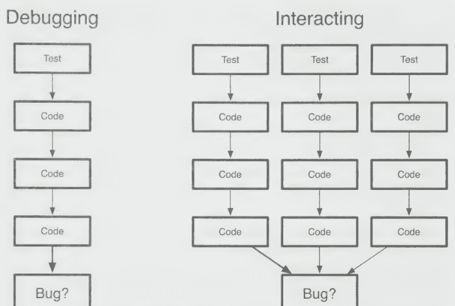
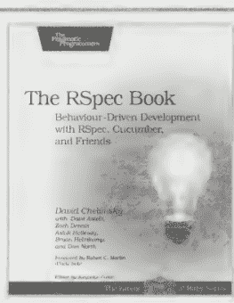
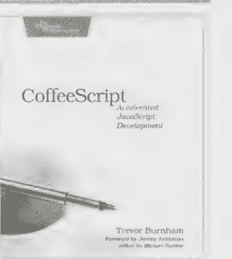
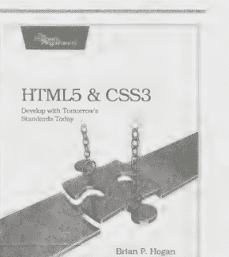

# Ruby, Rails, and JavaScript 持续测试


---

---

---

## 前言

作为专业程序员，几乎没有什么比发现上周运行完美的代码中出现了严重的生产环境bug更让我们绝望的了。唯一更糟糕的是当我们的客户发现了它，并且愤怒地通知我们……自动化测试，特别是测试驱动开发，是我们为消除这个问题所迈出的第一步。在过去十年中，这些实践为我们提供了良好的服务，帮助我们对抗缺陷。它们还为我们打开了通往许多其他技术的大门，其中一些可能更有价值。进化式设计和重构等实践帮助我们更快、更高质量地交付更有价值的软件。

尽管有了这些改进，自动化测试最初并非银弹。在许多方面，它并没有消除我们试图根除的问题，而只是将它们转移到了别处。我们发现大多数错误发生在QA环境中运行回归测试或验收测试时，或者在漫长的持续集成构建过程中。虽然这些失败仍然发生，而且令人沮丧，因为它们意味着我们浪费了时间，创建了明显无法正常工作的代码。

我们很快意识到，这两种情况的问题在于我们获得反馈的及时性。生产环境中出现的bug可能在引入后数周（甚至数月或数年！）才出现，而变更的原因早已成为模糊的记忆。造成问题的程序员甚至可能已经不在项目中了。在构建服务器或QA环境中运行的失败测试，在我们失去问题上下文和快速修复能力很久之后才告诉我们错误。即使在编写测试和将其作为本地构建的一部分运行之间的时间，也足以让我们失去上下文，使修复bug变得更加困难。只有缩小bug产生与解决之间的差距，我们才能保留这种上下文，将修复bug变成快速而简单的事情。

在寻找缩小这些反馈差距的方法时，我们发现了持续测试，并开始在工作中应用它。结果令人信服。持续测试帮助我们更快地消除缺陷，并让我们有信心以更快的速度交付软件。我们写这本书是为了与所有感受过这种痛苦的人分享这些成果。如果你曾在将新软件发布到生产环境时感到恐惧，在阅读告知你又一个验收测试失败的邮件时感到失望，或者在编写软件并让它第一次就完美运行时感到喜悦，那么这本书就是为你而写的。

使用持续测试，我们可以立即检测代码中的问题——在为时已晚、在问题蔓延之前。这不是魔法，而是测试、工具和技术的巧妙组合，它能在问题出现时立即告诉我们，不是几分钟、几小时或几天之后，而是现在，在最容易修复的时候。这意味着我们花更多时间编写有价值的软件，而更少时间逐行翻阅代码和对自己的决定反复犹豫。

## 章节概览

本书分为两部分。第一部分涵盖在纯Ruby环境中的工作，第二部分讨论在Rails环境中持续测试的应用。第二部分有很大篇幅专门讨论使用JavaScript进行持续测试，我们认为这个话题值得特别关注。

在第1章，*为什么要持续测试？*，第1页，我们提供一些背景。这一章对于那些没有太多编写自动化测试经验的人特别有益。它还建立了我们将在整本书中使用的一些术语。

接下来的三章，*第2章，创建你的环境*，第11页，*第3章，扩展你的环境*，第37页，以及*第4章，与你的代码交互*，第53页，展示了如何为典型的Ruby项目创建、增强和使用持续测试环境。我们将讨论有效测试套件的特性，并展示持续测试如何帮助提高我们测试的质量。我们将仔细研究一个持续测试运行器Autotest，看看如何扩展它以提供针对我们项目及其需求的额外行为。最后，我们将讨论持续测试所允许的一些更高级的技术，包括内联断言和并行执行路径的比较。

在本书的第二部分，我们为一个Rails应用创建CT环境。除了解决Rails带来的一些独特问题外，我们还将研究另一个持续测试运行器Watchr。正如我们将看到的，Watchr与其说是一个CT运行器，不如说是一个用于在我们的项目中轻松创建反馈循环的工具。我们将使用Watchr为JavaScript创建一个CT环境，这将允许我们为Rails视图编写测试，这些测试运行得非常快，而且不需要浏览器。

在书的最后，我们还包含了一个小小的" bonus"章节：一个关于像函数式编程语言一样使用JavaScript的附录。如果你对JavaScript的使用仅限于简单的HTML操作，而且从未有机会将其用于更实质性的编程，你可能会发现这一章非常启发性。

在大多数情况下，我们建议你按顺序阅读本书。如果你非常熟悉自动化测试和TDD，你可以快速浏览第一章，但本书中的大多数想法都是相互构建的。特别是，即使你熟悉Autotest，也要注意第2章，*创建你的环境*，第11页中讨论FIRE和良好测试套件特性的部分。这些想法在你阅读后续章节时至关重要。

每章都以一个名为"闭合循环"的章节结束。在这一部分，我们提供本章的简要总结，并建议一些你可以承担的额外任务或练习，以增加你对本章所介绍主题的理解。

## 术语

我们在整本书中交替使用`test`和`spec`这两个术语。在这两种情况下，我们指的是包含单个示例和断言的文件，无论我们碰巧使用什么框架。

我们经常使用`production code`这个术语来指代我们的spec所测试的代码。这是我们部署后将在生产环境中运行的代码。有些人称之为"被测代码"。

## 本书面向的读者

希望此时，持续测试你的代码听起来是一个有吸引力的想法。但你可能想知道这本书是否真的适用于你和你所从事的项目类型。好消息是，我们将呈现的想法适用于广泛的语言、平台和项目。然而，我们对你，亲爱的读者，有一些期望。我们假设以下情况：

- 你能够舒适地阅读和编写代码。
- 你至少对自动化测试的好处有一个粗略的了解。
- 你可以为自己构建工具。

Ruby知识虽然非常有益，但并非严格必需。如果你熟悉任何面向对象语言，Ruby示例很可能足够易读，你会理解其中大部分。所以如果所有这些听起来都像你，那么我们认为你会从阅读本书中获得相当多的收获。我们希望挑战你，让你思考，并质疑你的习惯。

## 实践示例

严格来说，没有必要在本书中实践示例。我们用示例所做的很多事情是为了激发关于你在自己的工作中应该做什么的想法，而不是提供让你复制的书面示例。尽管如此，实践一些示例可能会增加你的理解，如果我们在书中所做的某些事情适用于你正在做的项目，当然逐字复制可能是可行的方法。

要运行本书中的示例，我们建议你使用以下配置：

- 类*nix操作系统（例如Linux或MacOS）
- Ruby 1.9.2
- Rails 3.0.4

此外，你可以在附录2，Gem列表，第133页中找到我们运行示例时使用的gem列表。

示例可能在其他环境（如Windows）和这些工具的其他版本中工作，但这是我们在写书时使用的配置。

## 在线资源

示例的源代码可在 http://pragprog.com/titles/rcctr/source_code 获取。

如果你在安装Ruby时遇到困难，我们建议你尝试使用Ruby版本管理器（或RVM），可在以下网址获取：http://rvm.beginrescueend.com/。


如果书中有什么内容无法使用，或者你有任何疑问，请到论坛中告诉我们：http://forums.pragprog.com/forums/170。

Ben 的博客地址是 http://benrady.com，你也可以在 https://twitter.com/benrady 找到他的 Twitter。

Ben Rady
2011年6月

Rod Coffin
2011年6月

## 第 1 章
## 为什么要持续测试？

打开你最喜欢的编辑器或 IDE。将绑定到"保存"的快捷键重新绑定为"保存并运行所有测试"。恭喜你，你现在正在持续测试。

如果你以开发软件为生，那么你脑中冒出的第一个念头可能是："这行不通。"我们稍后会讨论这个问题，但请先暂时放下你对软件开发的所有既有认知，假装它确实可行，然后和我们一起畅想事情可能变成的样子。

想象一位专家，她既精通领域知识，又了解系统设计，在你工作时与你结对。她会在你犯错时友善、清晰、简洁地指出："抱歉，"她说，"你不能在那里使用单个字符串。我们的第三方支付系统期望信用卡号是以逗号分隔的字符串列表。"她持续不断地给你反馈——每次你对代码做任何更改时——肯定你的成功，并帮你避免错误。

每个项目*最终*都会得到这种反馈。不幸的是，对大多数项目来说，从犯错到发现错误之间的时间间隔以天、周甚至更长时间来衡量。生产问题导致激烈的讨论，最终让开发人员获得他们几周前就想拥有的洞察，这种情况太常见了。

我们信奉*快速*反馈循环的价值。我们在每个项目上都极其注重发现、创建和维护这样的反馈循环。我们的目标是将反馈循环的长度缩短到可以用毫秒轻松衡量的程度。

### 1.1 什么是持续测试？

为了实现这一目标，我们使用一套统称为*持续测试*（简称 CT）的工具和技术组合。持续测试环境在我们做出决策的瞬间就对其进行验证。在这个环境中，每个动作都有一个相应、自动、即时的反应，告诉我们刚刚做的事是不是个坏主意。这意味着犯某些错误变得不可能，而犯其他错误则更加困难。我们引入代码中的大多数 bug 寿命都很短。它们从未进入版本控制。它们从未破坏构建。它们从未溜入生产环境。除了我们，没人见过它们。

CT 环境由多种因素组合而成，从 Autotest 和 Watchr 等工具到行为驱动开发等技术。这些工具持续监视代码的变化并相应运行测试，而技术则帮助我们创建信息丰富的测试。这个环境的确切构成会根据你使用的语言、从事的项目或合作的团队而变化。它无法为你预先创建。你必须在构建系统的同时构建这个环境，因为每个项目、每个团队、每个开发者的情况都不同。你能应用这些原则的程度也会有所不同，但在所有情况下，目标始终如一：对我们做出的每个决策进行即时、自动的验证。

### 1.2 超越自动化测试

我们用于创建持续测试环境的主要工具是程序员在编写生产代码时编写的自动化测试。许多软件开发团队已经认识到创建自动化测试套件在设计和质量方面的好处。因此，自动化测试的实践——以这种或那种形式——正变得司空见惯。在很多情况下，程序员需要能够做好自动化测试，并将其作为日常工作的一部分。测试已经从由专家执行的单独活动转变为整个团队参与的活动。在我们看来，这是一件非常好的事情。

#### 测试类型

我们坚信自动化测试的价值，并在多年的实践中成功运用它。在此期间，我们将多种不同类型的自动化测试纳入我们的工具箱。其中首要且最重要的是*单元测试*。我们编写的测试中，绝大多数（可以说 99.9%）都是单元测试。这些测试检查非常小的行为单元，很少大于单个方法或函数。通常我们会针对一个方法编写多个单独的测试，即使这些方法不超过六七行代码。

我们不喜欢在单个单元测试中跑完完整的用例——调用方法、做出断言、再调用更多方法、再做更多断言。我们发现这样做的测试通常很脆弱，代码某一部分的 bug 可能会掩盖其他 bug 的检测。这可能导致我们在试图修复一个 bug 时引入另一个 bug，从而浪费时间。我们倾向于将这些单独的步骤拆分为单独的测试。我们将在第 2.2 节，第 16 页的"*Creating a Potent Test Suite with FIRE*"中，更仔细地探讨优质测试的特质。

发现自己想在单元测试中逐步走查用例或其他场景，这是一个信号，表明我们可能需要创建一个验收测试。像 Cucumber 这样的工具在制作这类测试时非常有用。虽然这超出了本书的范围，但我们鼓励你了解一下 Cucumber，特别是在行为驱动开发的更大背景下使用它，详见 http://cukes.info/。

除了单元测试和验收测试，我们还采用其他类型的测试来确保系统按预期工作。UI 测试可以检查 GUI 控件在不同浏览器和操作系统中的行为。集成测试则可以在系统中的组件连接不当时无法正常快速失败的情况下使用。系统测试可用于验证我们能否成功部署和启动系统。性能和负载测试可以告诉我们何时需要花时间优化。

#### 明智地使用自动化测试

如本章前面所述，单元测试是我们第一道也是最大的一道防线。我们通常将高级别测试（系统测试、集成测试等）的数量保持在较少水平。我们从不使用高级别测试来验证业务逻辑——这通常会使它们太慢且脆弱，从而失去实用价值。UI 测试尤其如此，将业务逻辑与 UI 控件行为一起测试可能导致令人抓狂的互相依赖的故障。将 UI 与底层系统解耦，以便在测试时可以将业务逻辑模拟出来，是这一策略的重要组成部分。

所有这些测试的首要目的是提供反馈，而测试的价值直接与该反馈的质量和及时性相关。我们始终持续运行单元测试。其他类型的测试通常按需运行——即我们在需要知道它们是否通过时运行，但如果我们设计得当ယ်�可以持续运行这些类型的测试。

我们对于那些运行时间过长、意外失败（或通过）或在失败时产生晦涩错误信息的测试缺乏耐心。这些测试是一种投资，和所有投资一样，必须谨慎选择。正如我们将看到的，持续测试不仅是从自动化测试投资中获取更多价值的方式，也是确保我们的投资能够持续提供良好回报的方式。

### 1.3 增强测试驱动开发

如果你是测试驱动开发（TDD）的资深实践者，你可能实际上已经离能够持续测试非常近了。在 TDD 中，我们通过编写一个非常小的测试，然后编写最精简的生产代码来工作。接着我们重构以消除重复并改进设计。通过持续测试，我们在每一步都能获得即时反馈，不仅来自我们碰巧正在编写的那个测试，还来自所有相关的测试，而且无需我们额外付出努力或思考。这使我们能够专注于问题和代码设计，而不是被运行测试所分心。

TDD 和 CT 都源于对快速反馈的渴望。在很多方面，优质持续测试套件的特质只是有效应用测试驱动开发的自然结果。不同之处在于，在使用持续测试时，你会获得额外的反馈循环。TDD 的一句古老格言说：测试验证代码的正确性，而代码反过来验证测试的正确性。测试也验证代码的设计——设计糟糕的代码通常难以测试。但什么来验证测试的设计呢？

根据我们的经验，持续测试是检验测试设计和整体质量的有效方式。正如我们将在第 2 章，第 11 页的"*Creating Your Environment*"中看到的，持续运行测试会创建一个反馈循环，告诉我们在创建测试时它们是否在表现异常。这意味着我们可以更快地纠正现有问题，并防止不良测试从一开始就 creeping 到我们的系统中。

### 1.4 持续测试与持续集成

你可能熟悉持续集成（CI）的实践，并想知道它如何与持续测试配合。我们将它们视为互补的实践。持续测试是我们的第一道防线。失败是极其


 # 反馈循环：用时间换取信心

这里成本低廉，所以我们希望问题在这里最频繁地出现。运行完整的本地构建可能需要一两分钟，我们希望我们的 CT 环境能给予我们大多数时候提交代码所需的信心。有时，我们对所做的更改存在某些疑虑。也许我们一直在配置文件里捣鼓，或者修改了系统种子数据。在这种情况下，我们可能会运行完整构建，以确保在提交前一切正常。然而，大多数时候，只要我们的测试在 CT 中通过，我们就希望感到放心地提交代码。如果我们没有这种信心，那就该写更多测试了。

然而，信心并非确定性。持续集成的存在是为了发现问题，而非仅仅花费大量 CPU 时间运行那些总是通过的测试。当然，它也有助于我们发现环境问题（通常是忘记提交某个文件）。但它也可以作为一种方式，将运行较慢、很少但偶尔失败的测试的成本转移出去。我们不会提交我们不自信的代码，但同时，我们也是人，有时也会犯错。

每个项目和团队都可以（而且应该）对"自信"的含义有一个共同的定义。一种思考方式是将其视为一系列反馈循环，每个循环都有相关的信心水平和时间成本。参见第 5 页的图 1，*用时间换取信心*。该图比较了我们项目中反馈循环所产生的信心与其相对成本。随着我们在开发流程中推进（从左到右），对代码的总信心呈对数增长，而验证它的总成本则呈指数增长。

## 你破坏了构建！

我们曾与一些似乎害怕破坏构建的团队共事。就好像他们把持续集成构建看作编程能力的考验。破坏它是不可饶恕的罪过，要不惜一切代价避免。有些团队甚至有各种恶作剧仪式，在构建破坏时用来惩罚肇事者，因其粗心大意地玷污了代码。

我们认为那种态度有点傻。如果构建从未被破坏，那还要它作什么？我们认为每个项目都有一个最佳的构建成功率（我们的通常运行在 90% 以上）。我们喜欢将很少失败的测试转移到 CI 服务器上，如果这意味着我们每十次或二十次构建中需要修复一次问题，那也无妨。

对于破坏的构建，重要的不是不惜一切代价避免它们，而是认真对待它们。非常简单：停下你正在做的事，修复它。让所有人知道它坏了，而且你正在处理。毕竟，没有人喜欢与破坏的代码合并。但这并不意味着破坏构建是"坏事"。持续集成之所以值得做，是因为它给你反馈。如果它从未破坏过，它就没有告诉你任何你原本不知道的事情。

例如，在我们的持续测试环境中，我们可能花费几秒钟来 *95% 地确信* 每次更改都能正常工作。一旦有了这种信心，我们愿意让我们的 CI 服务器花费两分钟来运行单元测试、集成测试和系统测试，以便我们 *95% 地确信* 可以成功部署。一旦部署，我们可能会进行探索性测试和验收测试，以便 *95% 地确信* 我们的用户会在这个新版本中找到足够的价值，然后再发布。

在每个阶段，我们都在用部分时间换取系统按预期工作的信心。我们在这时间上的回报与我们维护这些反馈 loop 的好坏成正比。另请注意，我们的大部分信心来自持续测试，这是流程中最早且最快的反馈循环。如果我们有编写良好、表达清晰的测试，在我们更改时自动运行，我们就能非常快速地获得大量信心。因此，我们花更多时间完善这个环境，因为我们在那段时间上获得了最大的回报。

### 1.5 学会持续测试

仔细想想，持续测试只不过是我们如今认为理所当然的敏捷原则的延伸。开发者今天采用的许多实践都是为了产生反馈。我们向客户演示软件以获得关于进度的反馈。我们举行回顾会议以获得关于流程的反馈。频繁发布让我们能从实际用户那里获得关于产品价值的反馈。测试驱动开发是软件开发的一场革命，为广泛采用快速演进式设计打开了大门。通过在编写使它们通过的代码之前编写测试，我们在最早可能的只觉得有最吉林啊的时刻充当自己设计的消费者——就在我们创建它们之前。

有一个原则尤其如此，它来自精益软件开发，[1] 很好地总结了我们对反馈价值的看法。它指出，为了获得高质量的软件，你必须 *将质量内建*。这并不意味着"努力不要犯任何错误"。而是关于在项目的方方面面主动地构建故障安全机制和反馈机制，这样当事情出错时，你能够快速而优雅地恢复。这是关于像对待产品本身一样精心对待这些机制。这是关于将失败视为学习的机会，并坚持不懈地寻找新的学习机会。

本书旨在教你如何运用这一宝贵实践。在书中，我们将向你展示如何使用 Autotest 和 Watchr 等工具创建定制化的持续测试环境。我们将涵盖创建和维护一个快速、信息丰富、可靠且全面的测试套件的基础知识。

除了运行测试的基础知识之外，我们还将介绍持续测试的一些高级应用，例如内联断言——一种调试或控制台打印的强大替代方案——以及代码路径比较。我们将展示如何在其他语言和框架中应用这些技术和工具，包括 Ruby on Rails 和 JavaScript。你将能够创建验证代码之外决策的反馈循环：你可以自动验证 Rails 迁移；即时检查样式表和视图的更改；以及快速验证文档、种子数据和其他重要的配置和设置。

我们还将看到持续测试如何帮助我们提高现有测试的质量，并确保我们编写的新测试能够胜任工作。通过即时向你反馈代码质量和测试质量，持续测试创造了一个你能切实感受到的、发自内心的反馈循环。

> 1. *Lean Software Development: An Agile Toolkit for Software Development Managers* [PP03]

## 第一部分 — Ruby 与 Autotest

## 第 2 章

## 创建你的环境

如果你是典型的 Ruby 开发者，持续测试对你来说可能并不新鲜。你可能没有用这个名字称呼它，但很可能你可以通过 Vim 或 TextMate 的一个按键运行完整构建，而且一天中会这样做很多次很多次。这是件好事。

随着我们的项目变得越来越大、越来越复杂，维持这种快速反馈循环需要我们在工作方式上多加注意。在本章中，我们将讨论健康测试套件的一些众所周知的特性，并说明为什么维护健康的测试套件对于创建快速、可靠的测试反馈循环至关重要。我们将看到持续测试如何鼓励编写良好的测试，以及良好的测试如何使持续测试受益。

### 2.1 开始使用 Autotest

首先，让我们创建一个简单的 Ruby 项目。在本章中，我们将构建一个帮助我们分析 Twitter 关系的库（一个小型社交网络网站，你可能从未听说过）。我们将把我们的库打包为 Ruby gem，为了快速开始，我们将使用名为 Jeweler¹ 的 Ruby gem 来为我们生成项目。通常，我们可能会使用另一个工具 Bundler² 来创建这个 gem，但在这个例子中，我们使用 Jeweler 是因为它的脚手架支持。我们可以用它来生成一个包含使用 RSpec 的示例 spec 的 gem，这帮助我们更快地开始。假设你已经有了 Ruby 和 RubyGems，安装非常容易。

```
$ gem install jeweler --version=1.5.2
$ jeweler --rspec twints
```

- 1. https://github.com/technicalpickles/jeweler
- 2. http://gembundler.com/


### Joe 问：什么是 RSpec？

在本书中，我们选择使用一个名为 RSpec 的框架作为我们的测试框架，因为我们喜欢它强调在给定上下文中指定行为（specifying behavior）的特点，而不是像 test:Unit 那样较为扁平的结构。虽然我们在书中讨论的原则同样可以轻松应用于另一个测试框架，但我们在使用 Ruby 工作时更倾向于使用 RSpec，因为它能非常有效地传达我们的意图。

在 RSpec 中，文件本身被称为 *specs*（规格说明），而这些 specs 内部的单个测试方法通常被称为 *examples*（示例）。我们可以通过 `describe()` 块来指定上下文（Contexts），在其中测试类和模块的行为。`describe()` 块可以嵌套，这为我们描述行为发生的上下文提供了极大的灵活性。

RSpec 还能与 Autotest 以及其他持续测试工具完美集成，因此在本书接下来的内容中我们将一直使用它。我们将在第 17 页的 2.3 节 *编写具有信息量的测试* 中讨论行为驱动开发（BDD）和 RSpec 的优势，但若想深入了解 RSpec，请访问 http://rspec.info 或阅读 David Chelmsky 等人编写的 *The RSpec Book* [CADH09]。

该命令告诉 Jeweler 在一个名为 `twits` 的目录中创建一个 Ruby Gem 项目。因为我们安装了 RSpec 的 gem 并使用了 `-rspec` 选项，Jeweler 将该项目配置为使用 RSpec 进行测试。它在 spec 目录中创建了一个名为 `twits_spec.rb` 的虚拟 spec。它还在该目录中创建了一个名为 `spec_helper.rb` 的文件，我们的 specs 将使用该文件来共享配置代码。

现在 Jeweler 为我们生成了一个带有某些 specs 的项目，但我们要如何运行它们呢？我们可以使用 `rake spec` 命令来运行，为了确保一切运行正常，我们就现在试一下。首先，我们需要通过 `bundle install` 完成项目设置并安装剩余的 gems。然后我们就可以运行测试了。

```
$ cd twits
$ bundle install
$ rake
```

F

Failures:

1) Twits fails

- 3. 如果你在运行此命令时遇到困难，可能需要安装 Git，可以在 http://git-scm.com/ 获取。

```
Failure/Error: specing for real"
RuntimeError:
  Hey buddy, you should rename this file and start specing for real
  # ./code/ruby/twits/spec/revisions/twits2.1_spec_fail.rb:6:in
`block (2 levels) in <top (required)>'

Finished in 0.00031 seconds
1 example, 1 failure
```

太棒了。然而，既然这是一本关于持续运行测试的书，我们应该找一个比运行 rake 命令更快的方法。其中一种方法就是使用 Autotest，一个适用于 Ruby 的持续测试运行器。每当你修改文件时，Autotest 都会为你运行相应的测试。它会根据我们所做的更改智能地选择要运行的测试。在我们开发 gem 的过程中，Autotest 将为我们运行测试，这样我们就可以专注于创造价值（而不是运行测试）。安装 Autotest 非常简单，它包含在 ZenTest gem 中：

```
$ gem install ZenTest --version=4.4.2
```

现在我们安装好了 Autotest，让我们从项目的根目录启动它：

```
$ autotest

F

Failures:

  1) Twits fails
     Failure/Error: specing for real"
     RuntimeError:
       Hey buddy, you should rename this file and start specing for real
       # ./code/ruby/twits/spec/revisions/twits2.1_spec_fail.rb:6:in
     `block (2 levels) in <top (required)>'

Finished in 0.00031 seconds
1 example, 1 failure
```

耶，它失败了！Autotest 现在检测到了 Jeweler 生成的 spec 并运行了它。现在让我们让它通过。打开你最喜欢的编辑器，查看 `spec/twits_spec.rb`。你应该会看到类似这样的内容：

```ruby
#### ruby/twits/spec/revisions/twits2.1_spec_fail.rb
require File.expand_path(File.dirname(__FILE__) + '/../spec_helper')

describe "Twits" do
  it "fails" do
    fail "Hey buddy, you should rename this file and start specing for real"
  end
end
```

### 魔力背后的原理

Autotest 实际上并不了解 RSpec，所以它能开箱即用这一点令人惊讶。实际上，在后台运行着一些相当复杂的插件自动加载机制（我们将在后面的章节中深入讨论）。现在，只需感谢这些“魔力”的存在即可。

然而，如果你有其他使用 RSpec 的项目并且想这样使用 Autotest，你需要确保项目根目录下有一个 `.rspec` 文件。该文件可用于更改 RSpec 的各种设置（例如 `--color`）。对我们更重要的是，它的存在告诉 Autotest 运行 RSpec specs 而不是普通的 tests。

然后我们删除对 `fail` 的调用：

```ruby
#### ruby/twits/spec/revisions/twits2.1_spec.rb
require File.expand_path(File.dirname(__FILE__) + '/../spec_helper')

describe "Twits" do
  it "fails" do
  end
end
```

当我们保存更改时，Autotest 应该会检测到文件已更改并重新运行相应的测试：

```
Finished in 0.00027 seconds
1 example, 0 failures

Success!
```

请注意，我们不需要告诉 Autotest 运行。它检测到了 `twits_spec.rb` 的更改并自动运行了测试。从现在起，我们对文件做的任何更改都会触发一次测试运行。这不仅限于测试文件。对项目中的任何 Ruby 文件所做的任何更改都会触发测试运行。正因为如此，我们在工作时再也不用担心运行测试的问题。

Autotest 根据哪些测试失败以及你更改了什么来运行不同的测试集。通过仅运行某些测试，我们可以在获得所需反馈的同时快速工作。我们将这种运行测试子集的方法称为 *测试选择*（test selection），它可以使持续测试在更大且测试更完善的项目中变得可行。

#### 图 2—Autotest 生命周期

正如我们在第 15 页的图 2 *Autotest 生命周期* 中所看到的，Autotest 这样选择测试：启动时，Autotest 运行它找到的所有测试。如果发现失败的测试，它会记录下来。当做出更改时，它会运行相应的测试以及之前所有失败的测试。它在每次更改时持续这样做，直到没有更多测试失败。然后，它会运行所有测试，以确保在它专注于错误和更改时我们没有破坏任何东西。

就像在输入时突出显示拼写错误的拼写检查器或 IDE 中的语法检查器一样，持续测试在你做出更改时提供即时反馈。通过自动为我们选择并运行测试，Autotest 让我们能够保持对尝试解决的问题的关注，而不是在工作和触发测试运行器之间来回切换上下文。这让我们能够快速且自信地自由修改代码。它将测试从一种每天必须深思熟虑并自觉重复数百次的 *动作* 转化为它真正的样子：一种 *状态*。因此，我们不再思考何时以及如何运行测试，在任何给定时刻，我们只需知道它们是通过还是失败，并据此采取行动。

### 2.2 使用 FIRE 创建强大的测试套件

当然，Autotest 不会为我们完成所有工作。我们仍然需要创建一套让它运行的测试。不仅如此，如果我们希望随着项目的增长，Autotest 能继续给我们提供这种即时反馈，我们就必须遵循一些指南。否则，Autotest 为我们创建的快速反馈循环将慢慢停滞。

为了从像 Autotest 这样的持续测试运行器中获得最有价值的反馈，套件中的测试必须是 *快速的*（Fast），以便我们可以在每次更改后运行它们；必须是 *具有信息量的*（Informative），以便我们在出错时能立即知道哪里坏了；必须是 *可靠的*（Reliable），以便我们对结果高度自信；最后，它们必须是 *详尽的*（Exhaustive），以便我们做的每一次更改都能得到验证。当我们的测试套件具备所有这些属性（总结为方便的首字母缩写 *FIRE*）时，持续运行这些测试就变得简单了。

持续测试创建了多个反馈循环。虽然持续测试（CT）会告诉我们测试是通过还是失败，但通过一直运行它们，它还能告诉我们更多信息。通过将重点从单纯的自动反馈转移到即时反馈⁴，我们可以洞察我们的测试写得有多好。CT 暴露了代码中的薄弱点，并给了我们在问题出现时立即修复的机会。通过这种方式，持续测试将维护测试套件的长期顾虑转化为眼前的问题。

如果没有这个额外的反馈循环，很容易在维护测试方面变得懈怠。自动化测试通常是对未来生产力的一种投资。有时为了实现短期目标，人们很容易在测试上采取捷径。持续测试通过提供正向和负向强化，帮助我们保持自律。一个符合 FIRE 标准的测试套件将

> 4. 对于足够大的“即时”值——不超过几秒钟

> Joe 提问：
> 
> **Autotest 真的会在每次更改时都运行我的所有测试吗？**
> 
> 不，Autotest 会使用一些启发式规则来选择运行哪些测试。如果你是第一次启动 Autotest，它确实会运行所有测试，以查看哪些测试（如果有的话）失败。之后，只有在没有失败的情况下，它才会运行所有测试。一旦 Autotest 检测到失败，它将只运行失败的测试和与你更改的文件`相关联的测试`。
> 
> 那么"相关联"是什么意思呢？这取决于你正在进行什么类型的项目。例如，如果你在一个常规的 Ruby 项目中使用 Test::Unit，Autotest 会将 `test/` 目录中以 test_ 开头的测试映射到 `lib/` 目录中名称相似的项目文件。因此，如果你更改一个名为 `foo.rb` 的文件，Autotest 将会运行 `test_foo.rb`。
> 
> 如果你愿意，你可以自己配置这些映射，而且各种 Autotest 插件可以为你创建映射。我们将在第 42 页的*将测试映射到资源*中更仔细地了解如何配置 Autotest 映射和 Autotest 插件。

为我们提供即时的通过/失败反馈。正如我们稍后将看到的，它还为其他类型的有价值的反馈循环奠定了基础。另一方面，如果我们开始偏离良好的测试之路，CT 通过更快地暴露我们的痛苦来让我们知道我们已经偏离了。简言之，*如果它很痛，说明你做错了*。

然而，如果我们要将痛苦作为一种反馈机制，我们需要知道如何解读我们所感受到的痛苦。仅仅知道出了问题并不能告诉我们如何修复。至关重要的是，你要清楚理解 FIRE 的每一个属性为什么重要，如果你的测试套件缺少其中一个（或多个）属性会发生什么，以及你可以做什么来预防这些问题。

知道所有可能"好"的做法与你需要做的具体事情之间有很大的区别，你需要做具体的事情来实现特定的目标。在本节中，我们将看看测试的一些具体属性，这些属性可以通过持续测试来改进。当我们深入探讨这四个属性时，请思考你过去遇到的测试问题，以及持续测试是否有助于暴露这些问题的根源。我们将从 FIRE 中的 *I* 开始：*informative*（信息丰富）。

## 2. ಪ�写信息丰富的测试

在编写测试时，很容易将注意力集中在类和方法上。许多开发人员认为，你应该为每个生产类配上一个测试用例，并为该类上的每个方法配上其自己的测试方法。有很多关于自动化测试的材料建议你这样写测试。这可能是权宜之计且熟悉的做法，但这真的是最好的方法吗？

我们编写信息丰富的测试的目标是与将维护我们代码的其他开发人员沟通。通常情况下，这些其他开发人员就是几周或几个月后的我们自己，到那时我们当时所做工作的背景已经丢失了。仅仅重复代码结构的测试在试图理解事情为什么是这样的时候，对我们的帮助并不大。它们没有提供任何新的信息，所以当它们失败时，我们只知道出了问题。

想象一下，六个月后，我们正在愉快地编码，突然一个测试失败了。我们希望它告诉我们什么？如果它只说 create_registration_token() 的调用返回了 nil 而期望的是 7，我们就会问自己为什么？为什么现在变成了 nil？nil 对令牌来说是一个有效的状态吗？7 到底是什么意思？我们用这些注册令牌来做什么，以及在什么情况下会创建一个？持续运行这样令人困惑的测试可能比没有帮助更分散注意力。如果你所做的每次更改都会给你带来需要数分钟才能诊断的失败，你很快就会感受到信息不丰富的测试带来的痛苦。

#### 行为驱动开发

行为驱动开发（BDD）源于改进测试驱动开发实践的愿望。从主题到故事再到验收测试，项目管理范围内的 BDD 是一个比这更大的话题，不适合在这里涵盖。但在编写信息丰富的测试这个范围内，我们有必要关注 BDD 的一个特定方面：编写规格说明（或者说单元测试，有时它们也被称为这个）。

顾名思义，行为驱动开发强调行为而非结构。在编写测试时，我们不关注类和方法，而是关注我们系统应该表现出的有价值的行为。当我们构建组成 Ruby 应用程序的类时，这种对行为的关注将确保我们所写的测试能够告知未来的维护者我们软件的用途，一直到代码的最低层次。因此，BDD 风格的测试通常读起来就像规格说明中的句子。

#### 行为与上下文

所以我们已经开始着手 twits 项目了，Autotest 帮助我们快速识别我们的更改何时导致测试通过或失败。现在我们需要添加一点功能——让我们能够获取用户发布的最后五条推文的东西。正如我们在第 2.1 节，第 11 页的*开始使用 Autotest*中所看到的，我们在 twits 中使用 RSpec 来测试我们的代码，因此创建这个新功能的第一步就是做一个新的 spec。

我们创建信息丰富的测试的第一个机会出现在选择测试的外部结构时。通常，spec 中最外层的 describe() 块具体命名了提供我们想要测试的行为的类或模块。但需要注意的是，它同样可以很容易地是描述该行为来源的字符串。

```ruby
#### ruby/twits/spec/revisions/user2.1_spec.rb
require File.expand_path(File.dirname(__FILE__) + '/../spec_helper')

describe "Twitter User" do
end
```

在这种情况下，"Twitter User"似乎比仅仅使用类名 User 更合适。正如我们在本章前面所讨论的，我们不想仅仅依靠代码的结构来指导测试的结构。重点始终是在给定上下文中的行为。

让我们用另一个 describe() 块来更清楚地描述那个上下文：

```ruby
#### ruby/twits/spec/revisions/user2.2_spec.rb
describe "Twitter User" do
  describe "with a username" do
  end
end
```

所以这里我们指定一个用户有与之关联的 Twitter 用户名。注意，我们还没有定义 User 类是如何与该用户名相关联的。在这一点上，我们并不关心。我们只是试图捕捉对我们的上下文的描述。

现在我们有了那个上下文，我们可以开始在我们的 spec 中使用 before() 块来更具体地说明它意味着什么：

```ruby
#### ruby/twits/spec/revisions/user2.3_spec.rb
describe "Twitter User" do
  describe "with a username" do
    before( :each ) do
      @user = User.new
      @user.twitter_username = 'logosity'
    end
  end
end
```

这里的 before() 块作为这个上下文含义的具体定义。它意味着我们有一个 twitter_username 设置为字符串值 'logosity' 的 User 实例。这个实例可通过 @user 变量用于此上下文中的所有示例。当然，User 类还不存在，因此这个测试的失败将驱使我们创建它：

```ruby
#### ruby/twits/lib/revisions/user2.1.rb
class User
  attr_accessor :twitter_username
end
```

既然我们已经描述了我们正在工作的上下文，现在是时候关注行为了了。我们需要该用户提供来自 Twitter 的最后五条推文，所以我们将编写一个示例来捕捉这一点：

```ruby
#### ruby/twits/spec/revisions/user2.4_spec.rb
describe "Twitter User" do
  describe "with a username" do
    before( :each ) do
      @user = User.new
      @user.twitter_username = 'logosity'
    end

    it "provides the last five tweets from Twitter" do
    end

  end
end
```

看起来不错。

再次注意，我们专注于首先描述行为，然后再编写任何代码甚至任何断言。既然我们已经描述了我们想要什么，我们就可以具体说明如何获得它（以及如何测试它）。

#### 不要重复你的设计

基于代码结构来命名我们的测试有一个痛苦的副作用：它会造成重复。如果我们编写名为 test_last_five_tweets() 的测试方法，然后我们重命名了 last_five_tweets() 方法，我们将不得不记得更新测试（或者更有可能的是，我们会忘记更新它，最终得到一个非常混乱且信息不丰富的测试）。基于所有重复是邪恶的原因，这样命名你的测试是个坏主意。

根据定义，重构是在不改变行为的情况下改进代码的设计和结构。通过以我们想要的行为而不是代码的结构来命名我们的测试，我们不仅使它们更具信息性，而且还降低了重构的成本。


```ruby
describe "Twitter 用户" do
  describe "拥有用户名" do
    before( :each ) do
      @user = User.new
      @user.twitter_username = 'logosity'
    end

    it "提供来自 Twitter 的最近五条推文" do
      @user.last_five_tweets.should have(5).tweets
    end
  end
end
```

请注意，RSpec 中的 `have` 匹配器几乎可以接受任何方法调用，并且会忽略它。这里的 `tweets()` 调用纯粹是为了让断言更具表达力。

一旦我们添加了这个断言，Autotest 就开始失败了：

```
F

Failures:

1) Twitter 用户 拥有用户名 提供来自 Twitter 的最近五条推文
Failure/Error: @user.last_five_tweets.should have(5).tweets
NoMethodError: undefined method `last_five_tweets' for #<User:0x000001010f8028 @twitter_username="logosity">
   # ./code/ruby/twits/spec/revisions/user2.4_spec_fail.rb:13:in `block (3 levels) in <top (required)>'

Finished in 0.00057 seconds
1 example, 1 failure
```

此时——且仅在此时——我们才想要开始思考究竟如何从 Twitter 获取这些信息。目前，我们将采用“在成功之前先假装成功”的方式，返回一个包含五个元素的数组：

```ruby
class User
  attr_accessor :twitter_username

  def last_five_tweets
    return [1, 2, 3, 4, 5]
  end
end
```

毕竟，这就是当前这个测试（以其当前状态）所指定的唯一行为。如果我们添加更多内容，那将是未经测试的。

通过这种方式编写我们的规格说明，我们确保失败能够揭示其意图。我们知道这个规格说明为何而写。我们知道它期望什么行为。如果我们无法在阅读失败测试后快速回答这些问题，我们就会陷入困境。我们将知道某些东西坏了，但不知道具体是什么。这可能会非常令人沮丧，并且，在没有信息丰富的测试的情况下，这种情况太常见了。BDD 鼓励我们编写能够自我解释的测试。因此，如果我们通过从“推文”数组中移除一个元素来使这个规格说明失败，我们将在 Autotest 中立即看到如下的失败信息：

```
F

Failures:

  1) Twitter 用户 拥有用户名 提供来自 Twitter 的最近五条推文
     Failure/Error: @user.last_five_tweets.should have(5).tweets
       expected 5 tweets, got 4
     # ./code/ruby/twits/spec/revisions/user2.5_spec_fail.rb:13:in `block (3 levels) in <top (required)>'

Finished in 0.00049 seconds
1 example, 1 failure
```

注意，在这个失败消息中，RSpec 如何将我们的 `describe` 子句内容与示例名称结合起来，以这种方式描述失败：

> 'Twitter 用户 拥有用户名 提供来自 Twitter 的最近五条推文'

以这种方式解释行为也为我们提供了关于我们所定义行为的反馈。如果用户在系统中没有 Twitter 账户名怎么办？我们应该返回 nil 吗？返回一个空数组吗？抛出一个异常吗？就像向他人解释你的问题可以触发洞察（无论他们是否真的在听），非常具体地明确你正在测试什么，可以帮助你发现差距并澄清真正需要做的事情。在我们的例子中，一旦这个示例通过，也许我们需要添加另一个示例，像这样：

`it "should not provide tweets if it does not have a Twitter username"`

无论你是否使用 RSpec，你的测试传达上下文和行为，而不是设置和结构，这一点至关重要。在许多情况下，这既关乎你断言了什么，也关乎你没有断言什么。例如，请注意，这个规格说明中没有任何内容测试 Twitter API 是否正常工作。在选择断言什么时，请设身处地为一个刚刚更改了你的实现并正盯着你失败示例的开发者着想。这个断言会向他们解释为什么需要那个行为吗，还是仅仅在检查一个实际上并不影响行为的实现细节？如果你不确定，可以尝试对你的代码做一个无关紧要的更改，看看是否会有什么东西中断。

### 2.4 编写快速测试

即使你不是持续运行它们，一个好的单元测试套件也应该是快速的。然而，如果你打算持续运行你的测试，它们必须是快速的。如果我们的测试不够快，我们将感受到它，而且会很痛苦。

那么“快速”测试到底有多快？快到每秒可以运行数百次。稍加计算就会知道，一个“快速”测试方法应该在不到十毫秒内运行完成。亚毫秒级的运行时间是一个值得追求的目标。这意味着你应该能够向你的系统添加数千个测试，而无需采取任何特殊措施来加速。我们希望我们的主要 CT（持续测试）反馈循环在一秒或两秒内运行完成（包括进程启动时间），并且我们通常认为一分钟是整个集成构建可容忍的最大时间。超过这个时间，我们就会开始寻找使事情变得更快的方法。

好消息是，在绝大多数情况下，测试缓慢是由一件事造成的：离开当前进程。任何在当前进程之外的 I/O，比如数据库或文件系统调用，几乎可以保证你的测试运行时间会超过十毫秒。更严重的违规行为，如远程网络访问，可能导致测试运行需要数百毫秒。因此，如果我们想对抗缓慢的测试，首要攻击点就是所有形式的 I/O。幸运的是，Ruby 为我们提供了各种工具来处理这个问题。

#### 引入 IO

在上一节中，我们为 `last_five_tweets()` 创建了一个测试，但我们的实现有点不足。现在我们需要专注于通过测试来驱动 User 类中的这种模拟，迫使我们与 Twitter API 交互。为了开始，我们将把 logosity 的最近五条推文编码到一个规格说明中：

```ruby
describe "Twitter 用户" do
  describe "拥有用户名" do
    before( :each ) do
      @user = User.new
      @user.twitter_username = 'logosity'
    end
```

it "提供来自 Twitter 的最近五条推文" do
  tweets = [
    "The only software alliance that matters is the one you forge with your coworkers",
    "The only universal hedge is firepower #zombieoranyotherapocalypse",
    "Thursday is Friday's Friday",
    "Never let the facts get in the way of a good argument",
    "Henceforth always refer to scrum in the past tense"
  ]

  @user.last_five_tweets.should == tweets
end

保存这个会在 Autotest 中给我们一个失败的测试：

```
F

Failures:

1) Twitter 用户 拥有用户名 提供来自 Twitter 的最近五条推文
    Failure/Error: @user.last_five_tweets.should == tweets
      expected: ["The only software alliance that matters is the one you forge with your coworkers", "The only universal hedge is firepower #zombieoranyotherapocalypse", "Thursday is Friday's Friday", "Never let the facts get in the way of a good argument", "Henceforth always refer to scrum in the past tense"]
      got: [1, 2, 3, 4, 5] (using ==)
    Diff:
    @@ -1,6 +1,2 @@
    -["The only software alliance that matters is the one you forge with your coworkers",
    - "The only universal hedge is firepower #zombieoranyotherapocalypse",
    - "Thursday is Friday's Friday",
    - "Never let the facts get in the way of a good argument",
    - "Henceforth always refer to scrum in the past tense"]
    +[1, 2, 3, 4, 5]
    # ./code/ruby/twits/spec/revisions/user2.6_spec_fail.rb:23:in `block (3 levels) in <top (required)>'

Finished in 0.00157 seconds
1 example, 1 failure
```

现在我们去 Gemfile 中添加 Twitter gem（确实有一个用于 Twitter 的 gem，对吧？是的，当然有）。为什么不用 gem 命令直接安装它呢？

嗯，与其他已安装的 gem 不同，这个 gem 实际上将被 twits gem 本身所依赖，因此我们需要确保它包含在 Gemfile 中。这样，当其他人使用我们的 gem 时，它会被自动安装：

```ruby
gem 'twitter', '1.1.1'
```

阅读了一点文档后，我们可以继续使用用户的 Twitter ID 对服务进行调用：

```ruby
require 'twitter'

class User
  attr_accessor :twitter_username

  def last_five_tweets
    return Twitter::Search.new.per_page(5).from(@twitter_username).map do |tweet|
      tweet[:text]
    end.to_a
  end
end
```

快速保存...

```
Finished in 0.854569 seconds.
2 tests, 1 assertion, 0 failures, 0 errors
```

我们的测试通过了。

#### 破坏依赖

测试通过了，但就目前的情况来看，这个测试存在一些问题。如果 Twitter 宕机了怎么办？如果我们想离线工作怎么办？这个测试中的期望是基于当前世界的状况：如果 @logosity 发布了其他内容怎么办？

然而，我们首先要纠正的问题是测试的缓慢。注意 Autotest 为此单个测试报告的时间信息。它几乎花了整整一秒钟才运行完成！任何影响我们反馈循环速度的东西都必须立即处理。如果我们现在不修复它，每次我们为解决任何其他问题而进行更改时，都将付出那个缓慢测试的代价。幸运的是，我们可以使用模拟框架来破坏对 Twitter Web API 调用的依赖，以加快测试速度并使其更加一致。RSpec 自带了一个模拟框架，因此我们将使用它来改进我们的测试：


```ruby
ruby/twits/spec/revisions/user2_7_spec.rb
it "provides the last five tweets from Twitter" do
  tweets = [
    {:text => 'tweet1'},
    {:text => 'tweet2'},
    {:text => 'tweet3'},
    {:text => 'tweet4'},
    {:text => 'tweet5'}
  ]

  mock_client = mock('client')
  mock_client.should_receive(:per_page).with(5).and_return(mock_client)
  mock_client.should_receive(:from).with('logosity').and_return(tweets)
  Twitter::Search.should_receive(:new).and_return(mock_client)

  @user.last_five_tweets.should == %w(tweet1 tweet2 tweet3 tweet4 tweet5)
end
```

在这个测试中，`mock_client` 充当真实 Twitter 客户端的替身。Twitter 有一个流式 API，因此设置搜索选项的调用（如 `max()`）会返回 Twitter 客户端本身的引用。这就是为什么对 `per_page()` 调用的期望返回 `mock_client`，而对 `from()` 的期望返回实际的推文。最后，我们将 `Twitter::Search` 上 `new()` 的默认实现替换为一个返回我们模拟客户端的实现，这样当我们调用 `last_five_tweets()` 时，就会使用这个模拟对象。

在 0.044423 秒内完成。

2 个测试，5 个断言，0 个失败，0 个错误

注意这个新版本的测试运行速度有多快。我们之前看到的一些其他问题也消失了。用户账户可能被删除，但测试仍然会通过。Twitter 可能宕机，测试仍然会通过。整个互联网可能在一场悲惨的飞艇事故中被摧毁，我们仍然可以验证 `last_five_tweets()` 是否正常工作。缓慢是测试存在其他问题的绝佳指标，这也是我们先让测试通过，再让测试变快的另一个原因。

即使我们先编写测试，我们仍然需要意识到测试正在驱使我们做出的设计决策。直接调用这个外部服务可能看起来是最简单可行的方案。确实，首先使用这种方法确保了我们准确理解了真实 Twitter 客户端的行为，并且我们期望了正确类型的数据。但我们必须不能将测试留在这个状态。维护快速的测试套件需要我们提供机制，将外部依赖与代码的其余部分解耦。这不仅使持续测试成为可能，还有助于改进我们的设计。

### 警惕定时器

创建快速测试套件的一个常见障碍是，当你只运行一个测试时，1 毫秒和 150 毫秒之间的差异其实并不明显。除非你非常关注 CT 运行器报告的时间信息，否则你可能不会注意到你正在编写的测试已经变慢了。然而，当你的套件中有数千个测试时，这就*非常*明显了。不幸的是，到了那个时候，修复的代价也非常高昂。

所以我们可能会倾向于添加特殊检查来确保我们的测试快速运行。设置一个截止值——比如说，50 毫秒——并让任何运行慢于这个值的测试失败。看起来合理，对吧？不幸的是，我们使用这种方法来检测慢测试并没有取得很好的效果。我们总是似乎得到很多误报，这非常令人分心。

问题在于，在任何给定程序员的工站上，可能有几十个不同的进程在运行，争夺机器的共享资源。如果其中一个在测试运行过程中突然需要大量 CPU 时间，你可能会遇到一些测试花费的时间比平时长十倍（或更多）。这就是为什么我们认为快速测试意味着每秒可能可以运行数百个测试，而不是每个测试 1 毫秒或 5 毫秒。虽然整个测试套件的每个测试平均时间可能在 1 到 5 毫秒之间，但运行单个测试所需的时间可能会根据测试运行时你的计算机上正在发生什么而有很大差异。

我们发现获得可靠测试运行时间的唯一方法是运行足够多次，以平衡运行环境中的任何不一致。这通常意味着运行数千次。虽然这对于性能测试可能是可接受的，但花费这么多时间来运行单元测试——只是为了测量它有多慢——是相当愚蠢的。

因此，与其使用定时器来尝试检测慢测试，我们倾向于留意缓慢的根本原因。通过编写专注于解耦的单元测试，远离文件系统、网络和其他昂贵的共享资源，我们可以确保我们的测试快速运行，而无需测量每个单独测试的运行速度。

### 2.5 编写可靠的测试

简单地说，可靠的测试只在有东西损坏时失败，只在有东西正常工作时通过。如果我们所有的测试都通过了，我们应该有信心，系统中我们期望拥有的所有有价值的行为都存在。如果我们其中一个测试失败了，我们应该有信心，我们刚刚做的事情改变了系统中我们之前认为有价值的行为。虽然测试应该是可靠的这一点似乎显而易见，但有许多微妙的方式会使它们变得不可靠。

#### 断言点什么

我们有时发现开发人员编写的测试没有任何断言。他们设置一个类，调用一个方法，然后对结果什么都不做。虽然这当然可以重现某些类型的错误，但它并不能真正确保测试在有东西损坏时会失败。我们认为编写没有断言的测试就像试图教猪唱歌：浪费你的时间，还惹恼猪。例如，不看实现，你能说出这个 `zip_code()` 例子应该验证什么吗？

```ruby
ruby/twits/spec/revisions/user2.8_spec.rb

it "should allow addresses with no zip code" do
  user = User.new
  user.address_text = 'P.O. BOX 7122 Chicago, IL'
  user.zip_code
end
```

虽然这确实验证了如果没有邮编地址，`zip_code()` 不会引发错误，但这真的足够吗？它并没有真正告诉我们 User 类应该*做什么*。它应该返回 `nil` 吗？空字符串？

假设 `zip_code()` 方法的实现如下：

```ruby
ruby/twits/lib/revisions/user2.8.rb

def zip_code
  m = /\d\d\d\d\d/.match(address_text)
  return m[0] if m
end
```

事实证明，如果地址没有邮编，这个实现返回 `nil`。当我们构建系统的其他部分时，我们可能会依赖这个行为。例如，空字符串是*真值*（作为布尔值时求值为 true），而 `nil` 是*假值*。如果我们有任何像这样检查邮编的代码：

```ruby
ruby/twits/lib/revisions/user2.8.rb

def nearby_followers(user)
  return [] unless user.zip_code
  # 查找给定用户在同一和周围邮编的关注者
  # ...
end
```

#### 没有断言会扰乱覆盖率报告

没有断言的测试会产生另一个问题：它们会扰乱代码覆盖率指标。虽然代码覆盖率不是衡量系统测试程度的完美指标，但它可以告诉你哪些区域完全没有测试。如果我们的系统中有未测试的代码区域，我们希望覆盖率报告能显示这一点，以便我们可以在必要时采取适当步骤添加测试。如果我们的代码被覆盖但没有被带有断言的示例测试，那么这些问题就被掩盖了。我们只能通过艰难的方式找到那些未测试的区域。

如果我们后来将 `zip_code()` 的实现改为返回空字符串，那个邮编检查将始终通过，在后续造成问题。我们最初针对缺失邮编的测试可能会立即运行，但它不会失败。不会有任何东西告诉我们我们破坏了什么。无论运行多少次，有东西损坏时却不失败的测试并没有那么有价值。

所以让我们尝试为这个测试添加一个断言。假设我们决定最佳方案是返回 nil。既然我们已经决定了行为应该是什么，我们不仅可以添加断言，还可以改进示例的名称：

```ruby
ruby/twits/spec/revisions/user2.8_spec.rb
it "should treat missing zip codes as nil" do
  user = User.new
  user.address_text = 'P.O. BOX 7122 Chicago, IL'
  user.zip_code.should be nil
end
```

所以如果我们后来改变实现改为返回空字符串，我们会立即从 Autotest 得到这个：

```
'Twitter User should treat missing zip codes as nil' FAILED
expected nil, got ""
```

一目了然，我们做了什么，为什么错了，以及如何修复。

#### 远离网络

正如我们在 2.4 节《编写快速测试》第 23 页看到的，连接到像 Twitter 这样的公共网站不仅会导致我们的测试运行缓慢，还会使它们不可靠。虽然这似乎很明显（考虑到 Twitter 的"失败鲸"频率），但连接到看似更稳定的网络资源也会创建不可靠的测试。不仅调用数据库、域控制器、目录服务、电子邮件服务器和其他

本地网络资源会导致你的测试运行得更慢，而且可能会在意外或不恰当的时间导致你的测试失败。

想象一下这样的场景：某个关键的网络服务（比如认证控制器）宕机了。你被叫去创建一个紧急补丁来绕过这个问题。如果你的部分或全部测试都依赖于该控制器，你就会陷入一种自相矛盾的困境——无法修复问题，因为这个问题本身就在妨碍你。你将不得不禁用所有测试才能继续推进工作。然后你将在没有持续测试安全网的情况下顶着压力去修复某些东西，无法确保你在修复过程中不会破坏其他功能——这无疑是一种危险的组合。

### 警惕线程

如果你在多线程系统中工作，可能会有在线程之间共享的状态。如果没有，那算你幸运。如果有，你就必须采取措施确保在访问这些数据时正确地同步线程。当然，如果我们想确保同步正常工作，就必须对它进行测试。这是一个困难的问题，也是测试驱动开发人员面临的最令人望而生畏的挑战之一。编写多线程系统本身就很难。编写一个可以被测试以确保100%时间都能正常工作的系统则更加困难。幸运的是，持续测试可以为我们提供一些帮助。

许多线程问题表现为非常罕见的时序错误（似乎只在生产环境中出现）。这些失败可能每执行一千次或一万次才出现一次，通常没有解释或明显的原因。通常，这些问题是由*竞态条件*引起的，即两个或多个交互线程的特定时序导致了错误的发生。在软件开发中，没有什么比竞态条件只在某些时候出现更令人沮丧的了。

然而，作为运行优化测试集的自然副效应，我们的测试会以许多不同的顺序和组合来运行。根据我们的经验，这种持续的测试重新排列通常能够识别多线程代码中的同步问题。关键是要留心。这类问题从本质上说是短暂的。如果你在对一个看似不相关的更改后，在多线程类中遇到意外的失败，你可能刚刚发现了一个竞态条件。再次进行相同的更改，看看测试是否突然开始通过了。如果确实通过了，那么你确实存在一个问题。

#### Ruby 中的线程

大多数 Ruby 虚拟机（如参考实现 YARV）都有一个全局解释器锁，即 GIL，它阻止同一时间有多个线程执行。因此，Ruby 中的线程在某种程度上不如其他完全多线程的语言中有用。

然而，仅仅因为同一时间只能运行一个线程，并不意味着你可以忽略线程同步的问题。任何在非原子操作中被修改的数据都值得怀疑。该操作可能会在中途被抢占，这意味着另一个访问该数据的线程将获得不完整或不准确的结果。

或者，更准确地说，你得到的是来自编程之神的礼物。知道你有同步问题是纠正它的第一步，而在你仍在开发系统时就发现问题，比在发布后才不得不诊断发生了什么要好上几个数量级。更好的是，知道具体是哪个测试暴露了问题，可以让你深入了解发生了什么。虽然说出来很奇怪，但这类随机的测试失败可以成为你的朋友。它们往往是更严重问题的线索，否则这些问题可能不会被发现。

### 时间依赖性

全局变量——怎么说呢——是有害的。在面向对象的语言中，我们有时会发现全局变量伪装成看似更无害的东西（比如类变量），但危害依然存在。如果这种状态没有在每次测试后被仔细地（或者更好的是自动地）清理干净，就可能产生*时间依赖*。这可能导致测试通过或失败，取决于它们的运行顺序。正如你所想象的，避免这种情况对于创建可靠的测试套件至关重要。

假设我们收到了一个对那种万能软件瑞士军刀——国际化！的请求。现在我们必须根据我们的语言区域处理各种地址格式。为此，我们将创建一个 `Locale` 类来保存当前的语言区域，然后我们可以用它来解析对位置敏感的数据（比如我们的邮政编码）。和往常一样，我们从测试开始：

```
ruby/twits/spec/revisions/user2.9_spec.rb
it "uses the current locale to parse zip codes" do
  Locales.current = Locales::UNITED_KINGDOM
  user = User.new
  user.address_text = '51-55 Gresham Street, 6th Floor London, England EC2V 7HQ'
  user.zip_code.should == 'EC2V 7HQ'
end
```

这驱动了对 `User` 和新的 `Locales` 模块的相应修改：

```
ruby/twits/lib/revisions/user2.9.rb
def zip_code
  Locales.current.parse_postal_code(@address_text)
end
end
```

```
ruby/twits/spec/revisions/locales2.1_spec.rb
describe Locales do
  describe Locales::Locale do
    let(:locale) { Locales::Locale.new(/\d{5}/) }

    it "parses postal codes with a regex" do
      locale.parse_postal_code('10121').should == '10121'
    end

    it "returns nil if a postal code cannot be parsed" do
      locale.parse_postal_code('abcde').should be_nil
    end
  end

  it "Uses US Locale by default" do
    Locales.current.should == Locales::UNITED_STATES
  end

  it "can parse 5 digit zip codes" do
    Locales.current.parse_postal_code('zip is 12345').should == '12345'
  end

  it "allows the locale to be changed" do
    Locales.current = Locales::UNITED_KINGDOM
    Locales.current.should == Locales::UNITED_KINGDOM
  end
end
```

```
ruby/twits/lib/revisions/locales2.1.rb
module Locales
  def self.current
    @current || UNITED_STATES
  end

  def self.current=(new_locale)
    @current = new_locale
  end

  class Locale
    def initialize(postal_code_regex)
      @postal_code_regex = postal_code_regex
    end
```

```
def parse_postal_code(text)
  m = @postal_code_regex.match(text)
  return m[0] if m
end
end

UNITED_STATES = Locale.new(/\d{5}/)
UNITED_KINGDOM = Locale.new(/[A-Z]{1,2}[0-9R][0-9A-Z]? [0-9][ABD-HJLNP-UW-Z]{2}/)
```

Autotest 告诉我们这个测试通过了，但是现在，突然之间，其他测试开始失败——有时会失败。因为我们在该示例中全局性地改变了应用的状态，所以测试现在会根据它们的运行顺序来决定通过还是失败。

一种修复方法是在 `after()` 方法中将语言区域重置回 `UNITED_STATES`。然而，我们发现避免这类时间依赖的最好方法就是避免在测试之间共享状态。在这个例子中，忘记重置 `Locales` 类中的共享状态导致了所有后续测试的问题。一个更好的选择是模拟（mock）对 `Locales.current()` 的调用，返回我们测试所需的值。该模拟会在每次测试后自动重置，因此我们不必担心需要记住清理状态。

```
ruby/twits/spec/revisions/user2_9_spec.rb
it "uses the current locale to parse zip codes" do
  Locales.should_receive(:current).and_return(Locales::UNITED_KINGDOM);
  user = User.new
  user.address_text = '51-55 Gresham Street, 6th Floor London, England EC2V 7HQ'
  user.zip_code.should == 'EC2V 7HQ'
end
```

像这样的时间依赖也可能表明设计不佳。在这个例子中，`Locales` 类表现得像一个可变的单例，在我们看来，这通常是应该避免的。也许我们应该让每个 `User` 拥有自己的 `Locale`？无论如何，不可靠的测试告诉我们，需要重新考虑我们的设计，因为它导致了明显的不一致行为。

### 2.6 创建穷尽测试套件

我们为所有关心的行为编写穷尽的规范。然而，如果它不重要，我们就不对其进行测试。虽然添加太多的规范并不像

> 有关单例模式的定义，请参见《设计模式：可复用面向对象软件的基础》[GHJV95]。


测试过多和测试过少一样都是罪过，当然存在一个最佳的测试量，既能确保正确性，又不会让系统被无关条件过度约束。

例如，假设我们想增强 `zip_code()` 方法来处理九位邮政编码。作为第一步，我们可以编写如下测试：

```
ruby/twits/spec/revisions/user2.10_spec.rb
it "should extract 9 digit zip codes too" do
  user = User.new
  user.address_text = '1521 Fake St.\nFaketown, MO 12345-6789'
  user.zip_code.should == '12345-6789'
end
```

我们可以使用更新后的 UNITED_STATES locale 让新测试和之前编写的测试全部通过，如下所示：

```
ruby/twits/lib/locales.rb
UNITED_STATES = Locale.new(/(\d{5})(-\d{4})?/)
```

现在测试都通过了。完成了吗？我们需要给 Locales spec 添加一些测试吗？应该添加哪些额外测试呢？正如我们在第19页*不要重复你的设计*中所讨论的，我们不必将自己限制为每个生产方法只有一个测试方法。我们要确保该方法提供的所有行为都得到了测试。如果该行为很复杂（正则表达式通常如此），那么我们的 spec 可能需要多个示例才能完全测试它。

在*测试驱动开发：示例*[*Bec02*]中，Kent Beck 建议持续编写测试，直到恐惧转化为厌倦。那么这里有什么可怕的？正则表达式可能是一个不错的起点。`?` 运算符是否正确应用于第二组？如果没有会怎样？也许我们需要一个关于不完整邮政编码的示例。如果地址中有两个邮政编码呢？这可能吗？这常见吗？

所有这些问题的答案都取决于很多因素：你拥有的数据类型和获取方式、你对正则表达式的熟悉程度、谁会调用这个方法以及为什么调用。没有一个标准答案。我们要确保所有有价值的行为都被测试，但重要的是为特定目的编写新的示例，而不是仅仅因为还有更多的东西可以检查。

我们发现，创建详尽的 spec 套件有一个很大的好处：编写易于测试的代码会对我们的整体设计产生积极影响。我们发现可测试的代码通常更加松耦合、更加高内聚、更易于修改，并且更能揭示意图。根据我们的经验，如果一个类设计良好，它可能是可测试的；但如果它是可测试的，那它很可能设计良好。通过为我们在意的所有内容编写测试，我们正在努力创建我们所能做到的最佳设计。

最后，如果我们担心所做的更改可能导致代码未被测试或者根本就是不必要的，我们可以做一些侦探工作来查明。只需删除（或修改）代码，并确保某个测试会失败并给出有意义的提示信息。我们只需要确保这样做不会仅仅产生语法错误。例如，当我们从使用 Test::Unit 测试切换到使用 RSpec spec 来测试我们的 `last_five_tweets()` 方法时，我们可能遗漏了某些内容。我们如何确定呢？让我们回过头来看看有什么可以删除同时保持代码语法正确的内容。

```
ruby/twits/lib/revisions/user2.7.rb
require 'twitter'

class User
  attr_accessor :twitter_username

  def last_five_tweets
    return Twitter::Search.new.per_page(5).from(@twitter_username).map do |tweet|
      tweet[:text]
    end.to_a
  end
end
```

嗯……我想知道如果我们删除对 `to_a()` 的调用，Autotest 会告诉我们什么？

```
Finished in 0.07231 seconds

5 examples, 0 failures
```

删除代码后 spec 仍然通过的事实意味着它没有被测试到，即使代码覆盖率工具会报告这段代码被100%覆盖。也许我们在实现这个方法时步子迈得太大了。无论如何，`map()` 已经返回一个数组了，所以在这里调用 `to_a()` 是多余的，我们会将其去掉。如果测试失败了，我们就知道 `to_a()` 确实影响了这个方法的某种行为（那将会是一个非常有趣的结果）！

### 2.7 闭合循环

因此，我们已经看到了创建 **FIREy** 测试套件如何支持持续测试的主要反馈循环。健康的测试在出现问题时（或开始正常工作时）能给我们即时反馈。持续运行测试能告诉我们它们何时开始变得有点陈旧，并给我们一些该怎么做的小提示。

### 现在做什么？

- 启动 Autotest 然后修改代码中的某些内容。有测试失败吗？如果没有，添加更多测试直到它失败，然后将代码改回原来的样子。现在一切都通过了吗？
- 在示例中尝试使用自定义断言方法和匹配器。看看能否通过提供额外内容让它们更具信息性。尝试捕获你所断言的结果值。
- 如果你还没有尝试过像 RSpec 这样的行为驱动开发框架，试一试吧！几乎每个语言都有 BDD 框架，所以无论你使用什么语言，今天就可以开始编写可执行的 spec。尝试编写一些真正读起来像规格说明的示例。
- 你的 spec 运行慢吗？尝试启用 `--profile` 选项运行 RSpec。这会显示你套件中最慢的十个 spec，并给你一个很好的起点来清理。如果你不使用 RSpec，仍然可以使用 `test_benchmark` gem 来分析你的测试。
- 你的测试在不同顺序下运行会失败吗？检查测试之间的共享设置和/或状态。请记住，失败的测试实际上可能并不是问题的根源。
- 虽然不是必须达到100%的代码覆盖率，但未覆盖的代码代表着风险。运行代码覆盖率工具来了解问题区域，然后深入探索一下。

## CHAPTER 3

## 扩展你的环境

我们的开发环境是连接我们解决问题的能力和我们实现解决方案的数字世界之间的桥梁。无论是使用商业 IDE 还是简单的文本编辑器以及一套用得顺手的 bash 脚本，我们都会花时间为每个项目调整和优化我们的环境。我们不是在寻找"唯一正确的环境"，而是持续调整我们的工具以适应我们试图解决的具体问题。

在上一章中，我们只是 Autotest 的用户。我们只是安装它并让它为我们运行测试，但并没有真正根据我们的具体需求来适配它。在本章中，我们将探讨如何扩展和适配 Autotest，使其向我们提供测试通过或失败之外的反馈。由于 Ruby 的动态特性，Autotest 为这些额外的反馈循环奠定了非常坚实的基础。正如我们将要看到的，它的灵活性使我们能够用几行代码轻松扩展它来满足我们的需求。我们这样做的目标——尽管可能有些远大——是在构建系统时即时验证我们所构建系统的每一个基本行为或属性。

从使用插件到添加事件钩子，使用 CT 的元编程，以及制作你自己的插件，有很多方法可以扩展 Autotest 并创建额外的反馈循环。我们将在本章中介绍几种。

### 3.1 使用 Autotest 插件

Autotest 有一个非常灵活的插件系统，有很多插件可以帮助你更快地运行测试并获得更多反馈。其中一些明显优于默认的 Autotest 行为。有些只是不同的方式。你应该考虑哪些适合你和你的项目类型。正如我们将要看到的，安装它们相当容易。

### 将 Autotest 与 Rails 一起使用

正如我们在第17页*Autotest 真的会在每次更改时运行 ALL 测试吗？*中讨论的，Autotest 维护着一组从生产文件到 spec（或测试）的映射，并在更改发生时使用它们来选择要运行的测试。正如我们将在第42页`将测试映射到资源`中看到的，可以自己配置这些映射。然而，当你使用 Rails 时，我们不需要这样做，因为已经有人为我们做好了。通过安装 autotest-rails gem，Autotest 将自动检测我们是否在一个 Rails 项目中工作，并创建适当的映射。

它创建了哪些映射？截至4.1.0版本，它创建了以下映射：

| 更改的文件 | 运行的测试 |
|:---|:---|
| `lib/*.rb` | test/unit 中匹配的 `_test.rb` |
| `test/*.rb` | 被更改的测试 |
| `app/models/*.rb` | test/unit 中匹配的 `_test.rb` |
| `app/helpers/application_helper.rb` | 所有视图和功能测试 |
| `app/helpers/*.rb` | 匹配的视图和功能测试 |
| `app/views/*` | 匹配的视图和功能测试 |
| `app/controllers/*.rb` | 匹配的控制器和功能测试 |
| `app/views/layouts/*` | `test/views/layouts_view_test.rb` |
| `config/routes.rb` | 所有控制器、视图和功能测试 |
| `test/test_helper.rb` | 所有单元、控制器、视图和功能测试 |
| `config/boot.rb` | 所有单元、控制器、视图和功能测试 |
| `config/environment*.rb` | 所有单元、控制器、视图和功能测试 |
| `config/database.yml` | 所有单元、控制器、视图和功能测试 |

autotest-rails 还添加了 db、doc、log、public、script、tmp 和 vendor 目录的例外，因此这些目录中文件的更改不会触发测试运行。

### 停止轮询

默认情况下，Autotest 通过轮询文件系统来检测文件更改。如果你的项目中有很多文件，这可能会给 CPU 带来沉重负担。Autotest 的 `autotest:fsevent` 插件使用 OS X 的文件系统事件 API 通过事件回调而非轮询来检测更改。这个插件非常容易使用，肯定会为你节省一些时间（并节省你的笔记本电池）。但首先我们需要安装这个 gem：

```
$ gem install autotest-fsevent
```


现在我们只需要告诉 Autotest 加载这个插件。在这种情况下，我们总是希望 Autotest 使用 fsevent 来检测变化，因此我们将在主目录中创建一个名为 `.autotest` 的 Autotest 配置文件，并添加以下内容：

```ruby
require 'autotest/fsevent'
```

现在 Autotest 运行得更快了。还有什么比这更简单的呢？如果你使用 OS X，这个插件绝对是不二之选。

### Spork

另一个加速测试的好方法是使用 Spork gem。¹ Spork 在后台生成的服务器中运行你的测试规范，从而消除了环境启动时间对反馈循环的影响。这对于依赖项很多的项目尤其有价值，因为这些依赖项的额外加载时间会变得明显（且不受欢迎）。有关如何使用 Spork 在 Rails 中加速测试的示例，请参阅第 86 页的第 5.5 节 *快速运行 Rails 规范*。

### Growl 通知

如果你不想一直打开终端窗口来运行 Autotest，也有其他选项可以可视化地报告通过和失败的测试。`autotest-growl` 插件使用 OS X 事件通知应用 Growl 来报告结果。如果你是 OS X 用户，你可能很熟悉 Growl 通知应用（如果不熟悉，你应该立刻去获取它）。² 就像 fsevent 插件一样，我们通过 gem 来安装它：

```bash
$ gem install autotest-growl --version=0.2.9
```

我们通过将 `require 'autotest/growl'` 添加到我们的 `.autotest` 配置文件来启用此插件。如果我们在当前项目中这样做，我们会得到类似下面所示的内容：


还有其他插件可用——这只是一个示例。根据你正在处理的项目类型，你可能会发现自己使用其中的一些或全部。只需在 Google 上快速搜索 "Autotest 插件"，就可以查看什么是新的和可用的。

---

¹. https://github.com/timcharper/spork
². http://growl.info
³. http://autotest.rubyforge.org/

### 3.2 添加事件钩子

你可能在我们示例的 `.autotest` 配置文件中注意到，添加这些插件的语法相当熟悉。如果你还没猜到，Autotest 的“配置”文件只是另一个 Ruby 文件。Autotest 在启动时会自动包含这些文件，除了使用 `require` 启用插件外，你还可以添加 Ruby 代码片段来与 Autotest 的 API 交互。³

Autotest API 中一个特别巧妙的部分是 `Autotest.add_hook` 方法。该方法接受一个代码块，每当 Autotest 生命周期中的特定事件发生时，该代码块就会被调用。以下是当前支持的事件（截至 Autotest 4.1.4）：

| 钩子名称         | 描述                                                                 |
|---------------|-----------------------------------------------------------------------------|
| `:all_good`   | 重置与失败相关的状态。每次 Autotest 更新时调用。          |
| `:died`       | Autotest 即将因异常退出。                                |
| `:green`      | 所有测试通过。                                                             |
| `:initialize` | Autotest 正在启动。*这对于调整 Autotest 的配置非常有用。* |
| `:interrupt`  | 用户中断了 Autotest（请求重新运行所有测试）。         |
| `:quit`       | Autotest 即将应用户请求退出。                            |
| `:ran_command`| Autotest 完成运行一批测试。                                 |
| `:red`        | 测试失败。                                                          |
| `:reset`      | 测试历史已被重置。                                                 |
| `:run_command`| Autotest 即将运行一批测试。                                  |
| `:updated`    | 要测试的文件列表已更新。                                  |
| `:waiting`    | Autotest 正在等待新的更改。                                        |

让我们看看如何利用这些钩子，以获得关于代码更改的更多、更好的反馈。

### 注意失效的钩子

当你研究这些示例时，可能会遇到 Autotest 在处理钩子错误时的一个特性。如果你的钩子处理器抛出任何类型的错误，Autotest 会静默失败。例如，如果你在像 `:green` 或 `:red` 这样的处理器中有语法错误，Autotest 一旦执行就会退出（不报告任何警告或错误）。更糟糕的是，如果你在 `:initialize` 处理器中有错误，Autotest 会在启动后立即退出。

正如我们将在第 45 页的第 3.3 节 *创建插件* 中看到的，这确实是一个很好的理由，可以将任何非平凡的钩子代码移动到一个 Autotest 插件中，该插件可以在 Autotest 本身之外进行单元测试。

### 有选择地忽略文件

正如我们在上一章所讨论的，Autotest 监控我们的项目以进行更改，并根据需要运行测试。但它如何知道我们的项目中有哪些文件呢？它做了一个非常简单的假设，即它从启动开始所在的目录或该目录的任何子目录中的所有文件，如果具有已知的文件扩展名，都应被检查。这通常导致许多文件（例如，在版本控制元数据中）被包含在不必要的搜索中。这可能会减慢 Autotest 的速度，并可能包含实际上并不在我们项目中的测试。值得庆幸的是，我们可以使用 Autotest 的 API 为 Autotest 的标准列表添加我们自己的过滤器或例外：

```ruby
#### ruby/twits/.autotest
Autotest.add_hook :initialize do |autotest|
  %w{.git .DS_Store vendor}.each do |exception|
    autotest.add_exception(exception)
  end
  false
end
```

由于它只在启动时调用，`:initialize` 钩子通常用于配置 Autotest，这就是我们在这里所做的。通过为 `.git` 目录添加一个例外，我们阻止 Autotest 扫描我们的本地 git 仓库。`.DS_Store` 条目让 Autotest 远离 OS X 用于存储目录自定义属性的文件。最后，`vendor` 条目阻止 Autotest 监视我们 Rails 项目中包含的第三方库。我们在此代码块末尾返回 false，因为如果其中一个钩子返回 true，Autotest 将停止处理给定事件的钩子。随着项目的增长，我们将留意新的例外以添加到此列表中。

### 持续的版本控制集成

假设你在一个团队中工作，该团队不断将内容签入版本控制（在我们看来，这是一件非常好的事情）。如此快速的变化率，你可能会发现很难让你的代码完全保持最新。一个解决方案（我们确实听到有人建议过）是不要签入那么多更改。另一个更务实的解决方案是，在每次我们准备好集成新更改时，也就是每次我们的所有测试都通过时，让 Autotest 自动从版本控制中拉取更改。为此，我们将在 `.autotest` 配置文件中的 `:green` 事件添加一个钩子，如下所示：

```ruby
#### ruby/twits/.autotest
Autotest.add_hook :green do
  Kernel.system('svn up')
  false
end
```

虽然自动从版本控制中拉取更改一开始可能看起来有点可怕，但请考虑：如果你的更改不会与主存储库中的内容冲突，那会有什么害处？如果你想了解更改了什么，你总是可以查看运行 Autotest 的终端中的输出。另一方面，如果你的更改*会*冲突，难道你不想尽快知道吗？冲突持续的时间越长，它们往往会变得越糟。

我们这样工作已经有一段时间了。这实际上非常愉快，如果你尝试它，你可能会发现你必须忍受的合并冲突数量迅速降至接近零。此外，正如持续的测试反馈循环鼓励我们以小步工作并在通过和失败状态之间快速循环一样，这个更新钩子将鼓励我们经常集成我们的更改。毕竟，如果你的代码已合并，你的测试通过，并且你没有任何重构工作要做，为什么不直接签入呢？

### 将测试映射到资源

正如我们在第 23 页的第 2.4 节 *编写快速测试* 中所讨论的，维护一个快速的测试套件对于创建快速的反馈循环至关重要。访问文件系统通常是测试速度慢的一个来源，但这本身并不坏。随着固态驱动器变得更快、更普及，我们可能会发现编写访问文件系统的快速测试是可能的。在某些情况下，将示例数据或配置从测试推送到文件可能是有意义的。然而，如果我们创建了这些依赖关系，我们必须确保对这些文件的任何更改都会触发测试运行，否则更改它们可能会悄悄地破坏我们的测试。


假设我们编写了一个名为 `config_spec.rb` 的 spec，用于对 Rails 配置文件进行一些验证。当然，由于没有与之匹配的文件并不存在，因此当我们修改 `config` 目录下的文件时，Autotest 将不知道要运行此测试。Autotest 提供的 `add_mapping()` 方法允许我们像这样将文件映射到测试：

```
ruby/twits/.autotest
Autotest.add_hook :initialize do |autotest|
  autotest.add_mapping %r%^config/.*.rb$% do
    autotest.files_matching(/^config_spec.rb$/)
  end
  false
end
```

在这里，我们将 `config` 目录中所有由正则表达式 `%r%^config/.*.rb$%` 匹配的 Ruby 文件映射到我们的新 spec `config_spec.rb`。然而，仅仅添加这个映射不足以让 Autotest 在我们修改配置文件时运行该 spec。除了文件到测试的映射外，Autotest 还有一个异常列表，正如我们在第 41 页的 *选择性地忽略文件* 中看到的那样。`config` 目录是否包含在异常列表中？对我们的 hook 进行一次快速修改就能确定。让我们在 hook 中添加以下内容：

```
puts autotest.exceptions
```

现在我们可以看到 Autotest 配置的异常列表。由我们安装的插件添加的任何异常（或者像我们在第 50 页 *插件发现* 中将要看到的那样被发现的异常）都会包含在此列表中。我们重启 Autotest 以将此更改应用于配置文件，结果如下：

```
% autospec
(?-mix:config\/|coverage\/|db\/|doc\/|log\/|public\/|script\/|tmp\/|vendor\/|rails|vendor\/plugins|previous_failures\.txt)
```

啊哈！`config` 目录就在那里。幸好，我们也可以在 `:initialize` 中移除这个异常：

```
ruby/twits/.autotest
Autotest.add_hook :initialize do |autotest|
  autotest.remove_exception 'config/'
  autotest.add_mapping %r%^config/.*.rb$% do
    autotest.files_matching(/^config_spec.rb$/)
  end
  false
end
```

现在，对配置文件进行的任何更改都将导致运行我们的 spec。

### 搜索技术债

为了保持紧凑的反馈循环，我们经常将编码任务推迟到所有测试通过为止。例如，在应用测试驱动开发等实践时，为了让测试通过，我们经常会创建非常短期的技术债。我们此时只寻找能工作的代码，不想过多担心设计问题。一旦测试通过且我们的假设得到验证，我们会回头更新设计以反映新的理解。由于我们采取小步快跑的方式并在安全网（我们的测试）的保护下工作，这段代码永远不会存在太久。

即便如此，因为这些临时代码有时设计得非常糟糕，我们希望确保不会遗忘它们。在某些情况下，由单个测试驱动的更改可能会开启两个或更多可能的设计改进方向。如果你和我们一样，那么你的记忆力在处理如此重要的信息时是不可靠的，所以我们会写一个小注释提醒自己回来处理：

```
#### DEBT Remove the duplication between Lead and Opportunity
```

然而，除非你有一种报告机制，否则这种注释是没用的。这就是 Autotest 的用武之地：

```
ruby/twits/.autotest
Autotest.add_hook :green do
  Kernel.system('find . -name "*.rb" | xargs grep -n "# DEBT"')
end
```

这里我们结合了几个 shell 命令来查找代码中的 debt 注释。`find` 命令搜索项目中的 Ruby 文件。然后我们使用 `|` 运算符将该命令的输出重定向到 `xargs` 的输入，`xargs` 是一个非常方便的工具，它会对传递给它的每一行运行一次另一个命令，并将该行内容作为参数。在这种情况下，该命令是 `grep`，我们用它来搜索特定的注释。因此，在 `lead.rb` 中添加一个新的 debt 注释会导致 Autotest 产生以下输出：

```
./app/models/lead.rb:2:# DEBT remove the duplication between Lead and Opportunity
```

在 Autotest 中报告这些注释的存在，为我们提供了一个关于代码状态的单一信息源。我们无需在其他地方（文本文件、便签、法律便笺本等）维护一个单独的待办事项列表，而是可以直接在代码中跟踪并随失败的测试一起报告。这有助于确保我们不会让这种短期、高利息的债务失控，且（天哪）不会意外地将其提交到版本库中。

#### Rails 中的 Debt 注释

如果你正在使用 Rails，请查看 `notes` rake 任务。它会扫描常用的 debt 注释并打印摘要。如果你想使用这些约定来跟踪技术债，只需在 Autotest hook 中调用 `rake notes`，而不是使用 `find` 和 `grep`。

以上是一些关于如何使用 Autotest hooks 创建额外反馈循环的示例。取决于我们正在从事什么样的项目，我们可能会使用它们，也可能不会。关键在于，我们要利用这些设施为我们正在处理的任何项目创建适当的自动化反馈循环。我们希望随时了解代码的运行情况。人总会犯错。或许比任何事情都更重要的是，我们非常擅长犯错。我们不想做的是，基于之前错误决策的结果做出错误的决定，从而使这些错误叠加。

### 创建插件

直接在 Autotest 的配置文件中添加事件 hook 是添加简单扩展的一种绝佳方式。然而，这并不是一个最易于测试的环境，一旦我们超越了简单的系统调用和 Ruby 单行代码，就会发现我们实际上想要为我们的扩展编写一些测试。毕竟，本书是关于测试的。

在本节中，我们将为 Autotest 创建一个插件，用于跟踪和报告关于我们执行各种操作频率的统计数据。这些统计数据可以提供另一种形式的反馈（你知道我们要这么说，对吧？），以判断我们对开发环境所做的更改是产生积极还是消极的影响。通过将其创建为 Autotest 的插件，我们可以获得两点好处：

- 一旦我们与 Autotest 解耦，就可以轻松地测试我们的扩展。
- 我们可以将扩展打包为 Ruby gem，以便与他人共享。

#### 创建骨架

我们需要做的第一件事是创建一个 gem。在 `twits` 项目之外的目录中，运行以下命令：

```
$ jeweler --rspec --gemcutter --create-repo autotest-stats
```

正如我们在第 11 页的 2.1 节 *Autotest 入门* 中看到的，Jeweler 使这一过程变得足够简单。但我们在这里添加了一些选项，因为我们希望能够将此插件作为 gem 分享。使用 `--create-repo` 选项将告诉 Jeweler 为我们的新项目在 GitHub 上创建一个存储库。然而，为了实现这一点，我们必须告诉 Jeweler 关于我们 GitHub 账户的一些信息。它从主目录中的 `.gitconfig` 文件中获取这些信息。如果你还没有这个文件，可以使用你喜欢的文本编辑器创建一个，参考以下模板：

```
[user]
    name = YourUserName
    email = YourEmailAddress
[github]
    user = YourUserName
    token = YourGitHubApiToken
```

当然，如果你没有 GitHub 账户或不想将此项目发布到 GitHub，只需省略 `--create-repo` 选项即可。但既然分享如此简单，为什么不分享呢？

通过这一个命令，Jeweler 已经创建了我们将 gem 构建并发布到 Gemcutter 存储库所需的所有配置文件。有了 Jeweler，真的没有任何理由不向世界分享你的 Autotest 配置技巧。

然而，Jeweler（目前）还没有 `--autotest-plugin` 选项，所以我们将进行一些细微的更改以符合 Autotest 的约定。首先，我们将主插件文件从 `autotest-stats.rb` 重命名为 `stats.rb`。然后，我们将它移动到 `lib` 目录下一个名为 `autotest` 的目录中。我们还将重命名并移动 spec 以匹配此结构，使我们的项目现在看起来像这样：

```
|-autotest-stats
  |-lib
    |--autotest
    |---stats.rb
  |-spec
    |--spec_helper.rb
  |-autotest
    |---stats_spec.rb
.git
.gitignore
.rspec
LICENSE
README.rdoc
Rakefile
```

我们需要更新 `spec_helper.rb` 以反映插件的主文件现在位于 `lib/autotest` 这一事实：

```ruby
ruby/autotest-stats/spec/spec_helper.rb
require 'autotest/stats'
```

最后，我们需要更改 stats_spec.rb 中 spec helper 的路径。启动 autospec 后，我们应该会看到一个起点（即一个失败的 spec）：

```
1)
RuntimeError in 'AutotestStats fails'
Hey buddy, maybe you should rename this file and start spacing for real
./spec/autotest/stats_spec.rb:5:
```

说对了。

### 挂接钩子

现在让我们为新创建的插件添加一个功能。我们将追踪用户在红色和绿色状态之间循环的次数（粗略衡量他们一天内做了多少次 TDD 循环）。首先需要的是监控测试通过/失败的钩子。我们需要添加一个 `:initialize` 钩子来设置插件的初始状态。经过几轮测试/代码迭代后，我们在 spec 中添加了一些新的示例：

```ruby
ruby/autotest-stats/spec/autotest/stats_spec.rb
it "should add hooks to autotest" do
  Autotest.should_receive(:add_hook).with(:initialize)
  Autotest.should_receive(:add_hook).with(:red)
  Autotest.should_receive(:add_hook).with(:green)
  require File.expand_path(File.dirname(__FILE__) + '/../../lib/autotest/stats')
end
describe "after Autotest initializes" do
  include Autotest::Stats

  before( :each ) do
    init_hook
  end

  it "should track the number of red/green cycles" do
    @cycles.should == 0
    red_hook
    green_hook
    @cycles.should == 1
  end

  it "should not treat multiple green events as cycles" do
    red_hook
    2.times {green_hook}
    @cycles.should == 1
  end
end
```

以下是满足这些测试的代码：

```ruby
ruby/autotest-stats/lib/autotest/stats.rb
require 'rubygems'
require 'autotest'

module Autotest::Stats
  attr_reader :cycles

  Autotest.add_hook(:initialize) { init_hook }
  Autotest.add_hook(:red) { red_hook }
  Autotest.add_hook(:green) { green_hook }

  def init_hook
    @cycles = 0
  end

  def green_hook
    @cycles += 1 if @failing
    @failing = false
  end

  def red_hook
    @failing = true
  end
end
```

我们甚至可以使用 autospec 来运行这些 spec：

```
Finished in 0.003103 seconds

3 examples, 0 failures
```

在第一个示例中，`require()` 调用会重新加载文件，重新执行 `Autotest::Stats` 模块中定义的所有语句。虽然从技术上讲这是该模块第二次被加载（第一次是由 `spec_helper.rb` 加载的），但加载两次不会产生不良影响，并且足以满足测试要求。当我们从 `.autotest` 配置文件中 require 这个文件时，同样的过程会发生。当模块被 Autotest 加载时，我们的钩子将被添加。

为这些钩子编写 spec 有些棘手。注意，我们只是从钩子本身调用模块级方法。假设这个连接"简单到不会出错"，那么我们只需要测试这些方法即可。如果你愿意，你可以将这些处理程序创建为 Ruby proc 并直接连接到 Autotest。不过我们认为这样写可读性更好。

### 没有消息就是好消息

此时，我们已经捕获了一些统计数据，但从未向用户报告任何内容。为了闭合这个反馈循环，我们需要某种通知或报告机制来呈现这些数据。

我们可以在每次运行测试时简单地报告循环次数。虽然这实现起来确实很容易，但对用户来说并不是很有用。如果我知道今天已经跑了六十个循环，告诉我达到六十一并没有多大价值。这种持续的大部分无关信息流，往好了说会被忽略，往坏了说会变成干扰。

为了解决这个问题以及类似的问题，我们在创建反馈循环时采用了"没有消息就是好消息"的原则。我们的目标是创造一个环境，让我们能即时获得大量不同类型的反馈。如果信噪比太低，反馈循环可能会变得有问题。

在这种情况下，我们只在前五个循环中报告每次变化。之后，每五个循环报告一次。为此，我们需要在控制台打印一些内容。因此我们在 spec 中添加了一个新的示例：

```ruby
ruby/autotest-stats/spec/autotest/stats_spec.rb

it "should report every cycle up to five" do
  should_receive(:puts).with("1 cycle")
  (2..5).each {|count| should_receive(:puts).with("#{count} cycles")}
  6.times do
    red_hook
    green_hook
  end
end

describe "after five cycles have passed" do
  before( :each ) do
    5.times do
      red_hook
      green_hook
    end
  end

  it "should report every five cycles thereafter" do
    should_not_receive(:puts).with("6 cycles")
    4.times do
      red_hook
      green_hook
    end
    should_receive(:puts).with("10 cycles")
    2.times do
      red_hook
      green_hook
    end
  end
end
```

以下是对应的实现：

```ruby
ruby/autotest-stats/lib/autotest/stats.rb
def green_hook
  @cycles += 1 if @failing
  @failing = false
  puts "1 cycle" if (@cycles == 1)
  if @cycles.between? 2,5 or @cycles % 5 == 0
    puts "#{@cycles} cycles"
  end
end
```

因此，当我们创建反馈循环来增强 CT 环境时，我们遵循以下约定：积极的结果（通过的测试、有效的语法、未改变的状态等）不值得提及。最多，我们可能想报告这些东西确实被检查过了，但我们不想浪费屏幕空间来报告结果正常。我们通常只想报告出错的时候或发生变化的时候。在这种情况下，我们想给自己提供尽可能多的必要信息来诊断问题。

这创造了一种令人愉快且易于消化的信息流速率（而不是一股脑倾泻而下）。它还在积极状态和消极状态之间创造了足够大的对比：大量输出意味着失败，很少或没有输出意味着一切正常。

### 插件发现

还记得之前在第 2.1 节*Autotest 入门*（第 11 页）中，我们设置 Autotest 的时候吗？我们还安装了 autotest-rails 插件，对吧？但我们从未配置过它，那么 Autotest 是如何知道要使用它的呢？

Autotest 有一个插件发现机制，允许它自动启用插件。它会扫描你所有的 gem，通过搜索名为 `autotest/discover.rb` 的文件来查找插件。虽然有时非常方便，但这可能会给不理解其工作原理的插件作者（甚至是插件用户）带来问题。让我们仔细看看这个魔法是如何发生的，以揭开这个过程的神秘面纱。

当 Autotest 启动时，它会在你的 loadpath、`vendor/plugins` 和 rubygems 中搜索 `autotest/discover.rb`。当它找到该文件时，会加载它，允许你使用 `Autotest.add_discovery()` 注册发现块。这些块在 Autotest 初始化过程的非常早期阶段被调用，允许你提供一个 Autotest 的子类来替代标准的 Autotest。该块只需返回一个字符串或字符串列表，对应于定义 Autotest 子类的文件。这些发现文件非常简单。以下是 autotest-rails 中的一个示例：

```ruby
Autotest.add_discovery do
  "rails" if File.exist? 'config/environment.rb'
end
```

定义我们自己的 Autotest 子类允许我们添加比仅通过钩子所能添加的更多的功能。然而，作为插件作者，你需要非常小心在 `discover.rb` 文件中 `require()` 的内容。只要你的 gem 被安装，那里的任何内容都会被 Autotest 加载，不管用户是否在 `.autotest` 配置文件中为你的 gem 添加了 `require()`。

### 打包发布

现在我们已经有了第一个有用的功能，准备进行发布了。Jeweler 使这变得相当简单，但我们首先需要做几个维护任务。

首先我们需要在项目根目录打开 Rakefile，填写一些 Jeweler 无法为我们填写的内容。第一项是新插件 gem 的摘要和描述。请注意，根据你使用的 Jeweler 版本，你可能需要定义 `gem.files` 以确保包含所有文件。

```ruby
ruby/autotest-stats/Rakefile
Jeweler::Tasks.new do |gem|
  gem.name = "autotest-stats"

  # 为新插件填写了摘要和描述
  gem.summary = %Q{Collects and reports statistics about how you write tests}
  gem.description = %Q{An autotest plugin that monitors how you write tests
    and reports interesting statistics as you work}

  # 添加 ZenTest 作为依赖
  gem.add_dependency "ZenTest", ">= 4.1.0"
  gem.files = FileList["[A-Z]*.*", "{lib,spec}/**/*"]
end
```

现在我们准备好安装 gem 并试用了。

```bash
$ rake install
```


现在我们只需在主目录的 `.autotest` 文件中添加 `require 'autotest/stats'` 即可启用我们的新插件。此时，假设你已经创建了账户，将发布版本推送到 Gemcutter 就像这样简单：

```
$ gem push
```

请访问 http://gemcutter.org 查看更多详情。

### 3.4 闭环

在本章中，我们展示了一些将 Autotest 作为平台在开发环境中创建新反馈循环的方法。通过添加自定义的 Autotest 钩子，或者使用/创建插件，你可以自动且立即地验证系统的几乎任何方面。我们仅涵盖了你可能想要测试的少数几个方面，但实际上还有很多。思考一下你的项目需求是什么，以及是否有更快速地验证它们的方法。

### 接下来做什么？

- 尝试使用 *Flog* 检查复杂度、⁴ *Reek* 检查代码异味⁵ 或 *Flay* 检查重复⁶ 来检测糟糕的代码。
- 在所有测试通过后，使用 rcov 自动检查代码覆盖率。⁷
- 制作一个插件来扫描开发日志，寻找意外的问题。相比于在运行应用时简单地通过 `tail` 查看日志文件，这会是一个极佳的替代方案。

4. http://github.com/seattlerb/flog
5. http://github.com/kevinrutherford/reek
6. http://github.com/seattlerb/flay
7. https://github.com/relevance/rcov

## 第 4 章：与代码交互

阅读代码固然好，但没有什么比实验更有效。无论你认为自己对某种语言或库了解得多么透彻，经过测试的真实行为才是最终的真理。

这就是为什么我们非常喜欢通过探索性测试来运行代码并观察其行为，而不是推测它可能或不可能做什么。我们通常更倾向于这种方法，而不是在文档中查找行为，因为文档可能会出错。更棒的是，探索性测试可以确保如果库提供的行为在未来发生变化，我们将有一种自动化的方式来发现它。我们不会一直将这些测试留在代码中——仅在有特定的风险或试图缓解的问题时才使用——但当我们需要它们时，它们真的非常有帮助。

在本章中，我们将讨论如何通过与代码交互（而不仅仅是阅读或执行它）来将其变成一种强大的技术，而持续测试使得这一过程变得更加简单。

### 4.1 通过修改代码来理解代码

在持续运行测试时，了解代码最简单的方法通常就是修改它并观察结果。与运行调试器等外部工具或仅阅读代码不同，当你进行持续测试时，你可以通过修改代码来证明（或反驳）你对运行机制的理论，并让测试运行器对你的更改做出反应。例如，在上一章中，我们探讨了临时删除代码如何帮助我们确定该代码是否是不必要的。让我们看看这项技术如何帮助我们回答关于代码的其他疑问。

#### 我们测试这个了吗？

我们如何检查代码中的特定条件是否经过了测试？例如，我们如何确保在地址为 `nil` 的情况下测试了像 `zip_code()` 这样的方法？因为 RSpec 在运行 specs 时会向 Object 添加 `should()` 和 `should_not()` 方法，我们可以临时在生产代码中添加断言，以检查特定案例是否被测试。因此，我们可以通过对 `zip_code()` 进行微小修改来回答这个问题：

```
ruby/twits/lib/revisions/user3.1.rb
def zip_code
  @address_text.should_not == nil
  Locales.current.parse_postal_code(@address_text)
end
```

如果在添加此类断言后所有测试都通过了，我们就知道该案例没有被测试。保存更改后，Autotest 会立即运行测试并告知我们，事实上，我们从未在 `zip_code()` 中测试过 `nil` 值。为了覆盖此条件，我们可以保留该断言，然后添加一个我们预期会在该点失败的测试：

```
ruby/twits/spec/revisions/user3.1_spec_fail.rb
it "should treat missing addresses like missing zip code" do
  user = User.new
  user.zip_code.should == nil
end
```

快速保存，Autotest 揭示我们现在覆盖了该条件：

```
F

Failures:

  1) Twitter User should treat missing addresses like missing zip code
     Failure/Error: user.zip_code.should be nil
       expected not: == nil
            got:     nil
     # ./code/ruby/twits/lib/revisions/user3.1.rb:8:in `zip_code'
     # ./code/ruby/twits/spec/revisions/user3.1_spec_fail.rb:8:in `block (2 levels) in <top (required)>'

Finished in 0.00105 seconds
1 example, 1 failure
```

现在我们可以移除 User 类中的断言，让示例正常运行：

```
8 examples, 0 failures
```

结果表明，该案例在无需额外修改的情况下即可正常工作。如果测试失败，我们就知道当前的实现无法处理 `nil` 地址，并可以根据需要进行修改。另外请注意，在我们添加这个示例之前，`zip_code()` 方法已经完全被覆盖了。与之前的示例（代码仅被执行而未被测试）不同，在这种情况下，所有现有代码都被测试了。缺失的是对该代码的特定用法（以及预期的行为应该是怎样的）的测试。

我们将这种添加到生产代码而非测试中的断言称为 *内联断言* (*inline assertions*)。通过临时向代码添加此类断言，我们可以立即、可靠地验证该条件是否被测试。虽然阅读 specs 是了解系统行为（以及不具备的行为）的绝佳方式，但让它们失败则更为有效。

#### 我是如何进入这个方法的？

Ruby 的 `Kernel#caller()` 方法返回当前调用栈的轨迹。在试图弄清楚某个特定方法如何被使用时，此信息非常有用。假设你盯着一段代码（例如 user 类中的 `zip_code()` 方法），想知道它被哪些测试覆盖，你只需添加 `puts caller.first` 并保存，Autotest 就会像这样报告调用者：

```
../lib/revisions/user_spec.rb:27
../lib/revisions/user_spec.rb:34
../lib/revisions/user_spec.rb:41
../lib/revisions/user_spec.rb:48
```

这些是指我们在 spec 中调用 `zip_code()` 的四行代码。如果该方法是被间接测试的，那么在这个列表中我们会看到不是 spec 的条目。在这种情况下，我们可能想使用 `puts caller[0..3]` 来查看回溯三层调用。

#### 我可以用这个对象做什么？

在静态类型语言中，行为和类型几乎是不可分割的。如果你知道一个对象的类型，你就知道它能够做的一切。在像 Ruby 这样的动态语言中，情况并非如此。方法可以在运行时被添加、更改或删除，因此仅仅知道对象的类型并不一定能告诉你它具有哪些行为。

问题在于，我们并不总是知道如何调用我们寻找的精确行为。你可能知道需要分割一个字符串，但提供分隔符的选项有哪些？或者你甚至不确定行为是什么，但有一个大致的想法，只想知道有哪些选项。没问题，只需做一个简单的调用：

```
puts user.zip_code.methods
```

这会准确地告诉我们该对象能做什么。就像上一个示例中的调用者信息一样，通过临时将此添加到代码中，我们可以让 Autotest 为每个由特定示例驱动的对象实例打印可用方法列表。这包括使用 Ruby 的 `extend` 方法动态混入的方法。如果我们想更精准地筛选寻找的方法类型，可以用正则表达式过滤结果：

```
puts user.zip_code.methods.grep(/each/)
```

这将告诉我们所有包含 `each` 单词的方法名，例如 `each()`、`each_byte()` 和 `reverse_each()`。

#### 内联断言 vs. 断言关键字

许多语言支持 `assert` 关键字，允许你在代码中检查特定条件，并在检查失败时抛出错误。通常，这类断言在测试期间启用，但在生产环境中关闭。

我们一直不理解这种做法背后的逻辑。一件事情要么坏了，要么没坏。大多数时候，如果出错了，我们希望代码尽快停止执行，以免损坏数据或给用户 erroneous 的结果。而在其余时间里，我们希望能够优雅地恢复。这种优雅的恢复是我们需要验证的预期行为。在“测试模式”下大声且快速地报错，而在生产环境中静默地忽略问题，这看起来简直疯了。

内联断言的意图与这类语言支持的 `assert` 关键字不同。内联断言是临时的，仅用于在测试中挖掘缺失的案例。一旦这些案例得到了测试，我们就移除内联断言。内联断言还可以检查合法甚至预期的案例，而 `assert` 关键字仅用于检查表示错误状态的情况。

#### 添加诊断方法

作为一种具有丰富元编程支持的动态语言，Ruby 允许我们更改环境中的几乎任何内容。我们不仅可以动态创建新方法和类，还可以根据使用系统的特定上下文来更改任何现有方法或类。

我们可以利用这一点，添加在通过 Autotest 运行 specs 时可用的额外诊断工具。这赋予了我们巨大的能力和控制力，使我们能够从代码中获取各类信息，而无需在代码中充斥大量仅在运行测试时才有用的日志语句。


### Joe 问：
什么是元编程？

> 元编程（Metaprogramming）是指编写能够修改代码的代码。在 Ruby 中，可以通过多种不同的方式实现，从调用 `extend()` 或 `include()` 方法向类或对象添加方法，到简单地在源代码中为第三方类定义（或重新定义）一个方法。正如人们所预期的，如果不小心使用，元编程可能会导致一些相当违反直觉的行为，但它是一种在不修改源代码本身的情况下改变现有代码行为的非常有效的方法。

在上一节中，我们利用了 Ruby 的内置方法以及 RSpec 混入的断言方法，要么将信息打印到控制台，要么故意让测试失败以指示代码正在执行的操作。我们选择使用这些方法主要是因为它们已经存在，且可以直接利用。

然而，没有理由将自己限制在现有提供的内容中。在 Ruby 中，我们可以将任何我们想要的方法添加到任何我们想要的类中。让我们回到最初的例子：

```
puts user.zip_code.methods.grep(/each/)
```

这很方便，但比我们希望的要冗长一些，尤其是考虑到一旦找到了我们要找的方法，我们就会立即删除这段代码。如果我们能通过以下方式获得相同的效果会怎样：

```
zip_code.put_methods /each/
```

我们可以通过使用 Ruby 的元编程设施，在运行测试时（且仅在运行时）将此方法添加到每个对象中。首先，让我们打开 `spec` 目录下的 `spec_helper.rb` 文件，并将我们的 `put_methods()` 方法添加到 Ruby 的 `Object` 类中：

```
ruby/twits/spec/spec_helper.rb
class Object
  def put_methods(regex=/.* /)
    puts self.methods.grep(regex)
  end
end
```

我们在这里做的是动态地向 Ruby 的基础对象（`Object`）添加一个方法（`put_methods()`）。这意味着每当这段代码在运行时环境中加载时，系统中的每个对象实例都可以使用 `put_methods()`。现在，如果我们想知道用户的邮政编码上有哪些可用的循环方法，可以这样查找：

```
user.zip_code.put_methods /each/
```

这会导致 Autotest 输出以下内容：

```
each_cons
each_with_object
each_with_index
each_line
each
each_byte
reverse_each
each_char
each_slice
```

我们还可以将此技术应用于许多其他地方。我们可以通过为更复杂的类型创建自定义检查器，利用这种技术来查看领域对象内部的状态。当唯一目的是在运行测试期间进行检查时，这有时比在类中重写 `to_s()` 更好。

### 4.2 比较执行路径

正如我们在第 54 页的 *我们在测试这个吗？* 中所看到的，内联断言是一种强大的方式，可以诊断代码在被测试执行时正在做什么。使用调试器通常能达到同样的效果，尽管速度较慢。然而，大多数调试器*无法*做的一件事是同时比较多条执行路径。

请看第 59 页的图 3，*调试 vs. 与代码交互*。请注意，调试器仅允许我们检查一条执行路径——如示例所示的一条调用栈。而通过灵活的持续测试环境（就像我们创建的那个），我们可以运行测试并快速比较应用程序在不同路径下的行为。这使我们不仅能对代码的“快乐路径”（happy path）进行实验，还能对到目前为止想到的所有可能路径进行实验，从而比仅仅通过单步调试能了解到更多关于代码的信息。

如果你仔细思考，这是一种更自然、更真实地观察代码的方式。除非我们编写的程序没有分支或循环，否则代码中不存在单一的路径。在本节中，我们将尝试以另一种方式观察代码，这种方式试图捕捉代码在生产环境中运行时真实发生的情况。

我们可以利用 CT 环境来帮助我们比较代码中不同的执行路径。



图 3——调试 vs. 与代码交互

### 比较对象

在处理静态类型面向对象语言时，可以传递给方法的对象类型通常由类型系统强制执行。这些对象被要求具备的行为通常是已知的，因为语言本身强制执行了这一点。

而在处理像 Ruby 这样动态类型的语言时，这些限制被取消了。当然，对象依然有类型，但这些类型并不用于检查对象的可用行为。因此，Ruby 开发者不太担心对象的类型，而更担心它能做什么。只要它“走起来像鸭子”，且我们的测试通过，那就没问题。

然而，这有时会让阅读代码变得相当困惑。在尝试向现有方法添加新行为时，这个问题尤为突出。因为传入的对象仅被要求具备其所需的必要行为，我们不知道可能还存在哪些额外的行为。测试至少间接地拥有这些信息，但除非我们想为套件中的每个测试都使用调试器单步执行，否则我们无法确切知道那里有什么。

60 • 第 4 章 与代码交互

假设我们在 `User` 类中有一个名为 `following_me()` 的方法。该方法返回一个数组，包含关注由该实例标识的用户的用户名。它接收 `users` 作为参数，但我们不清楚这是一个用户名集合、用户对象集合还是其他东西。它甚至可能根本不是一个数组；它可能是一个名称到对象的哈希（Hash），或者可能是一个 User 对象的图（Graph）。

如果我们仅仅是为了理解这段代码目前的功能，这并不是一个真正的问题。但假设我们想要增强 `following_me()` 方法，例如根据某种排名对返回的用户列表进行排序。我们非常想知道当前传递给 `following_me()` 的是什么类型的对象，以便知道从传入的用户集合中可以预期什么样的行为。

为了解决这个问题，我们将在 `spec_helper.rb` 文件中创建一个名为 `Compare` 的实用模块。它将承担在执行路径之间比较对象的工作（在本例中，是传递给 `following_me()` 方法的参数）。我们可以向这个模块添加许多不同的比较方法。在本例中，我们将从 `type()` 开始。为了查看比较结果，我们还可以创建一个 `report()` 方法：

```
ruby/twits/spec/spec_helper.rb
module Compare
  def self.type(obj)
    @objects ||= []
    @objects << obj
  end

  def self.report
    puts "Object Types: #{@objects.collect{|o| o.class}.join(', ')}" if @objects
  end
end
```

这看起来不错，但谁来调用 `report()` 函数呢？幸运的是，RSpec 可以配置为在整个测试套件完成之前和之后运行代码块。在我们的案例中，我们想添加一个 `after(:suite)` 块，以便在所有测试运行完毕后报告比较结果：

```
ruby/twits/spec/spec_helper.rb
RSpec.configure do |config|
  config.after(:suite) do
    Compare.report
  end
end
```

现在我们将比较调用添加到 `following_me()` 中：

```
ruby/twits/lib/revisions/user3.3.rb
class User
  attr_accessor :twitter_username, :address_text, :followers

  #...

  def following_me(users={})
    Compare.type(users)
    return @followers if users.empty?
    (@followers || []) & users
  end
end
```

保存更改后立即得出结果：

Finished in 0.04028 seconds

18 examples, 0 failures
Object Types: Array, Array, Hash

看起来我们使用这个方法的方式并不一致。有些调用者传入的是 `Array`；另一个传入的是 `Hash`（或者可能根本没传任何东西！）。然而，这能正常工作，因为这两种对象都提供了必要的行为——这就是动态类型的威力！现在我们知道，为了向此方法添加任何新行为，我们将必须同时处理数组和哈希。既然我们已经写好了比较方法，我们可以在任何地方使用它们来快速比较不同执行路径中的对象。

### 4.3 交互式学习 API

测试驱动开发（TDD）是创建（和修改）API 的一种强大技术。通过在创建接口的同时使用它，可以非常快速地排除细微的可用性和行为问题。持续测试可以帮助我们在演进 API 时保持方向正确，确保我们不会在追求一个无法通过测试的解决方案上浪费时间。在本节中，我们将使用持续测试来帮助我们创建一个用于分析用户推文的类。我们将看到 CT 如何缩短反馈循环并使我们的更改保持细小且稳定。我们还将稍微重构我们的 API，看看 CT 如何使这个过程变得更容易。

### 推文分析

与往常一样，我们的第一步是描述我们想要的行为：

```ruby
ruby/twits/spec/revisions/tweet_analyzer4.1_spec_fail.rb
describe TweetAnalyzer do
  it "计算用户推文中单词的出现频率" do
    analyzer = TweetAnalyzer.new(mock_user = double("user"))
    histogram = analyzer.word_frequency()
  end
end
```

当我们保存文件时，Autotest 告诉我们这个测试正在失败，这足以驱动 `TweetAnalyzer` 类的创建：

```ruby
ruby/twits/lib/revisions/tweet_analyzer4.1.rb
class TweetAnalyzer
  
  def initialize(user)
    @user = user
  end
end
```

现在我们可以跳回规范文件并添加一些期望：

```ruby
ruby/twits/spec/revisions/tweet_analyzer4.2_spec.rb
describe TweetAnalyzer do
  it "计算用户推文中单词的出现频率" do
    analyzer = TweetAnalyzer.new(mock_user = double("user"))
    histogram = analyzer.word_frequency()
    histogram["one"].should == 1
  end
end
```

同样，Autotest 中的一个失败测试告诉我们，在 `TweetAnalyzer` 中还有工作要做，因此我们将只编写足够的实现来让该测试通过：

```ruby
ruby/twits/lib/revisions/tweet_analyzer4.2.rb
class TweetAnalyzer
  def initialize(user)
    @user = user
  end

  def word_frequency
    { "one" => 1 }
  end
end
```

我们希望在这里保持一个快速的反馈循环。这不仅意味着编写运行迅速的测试，还意味着一次处理一个决策并验证它。在这里，我们只是想确认将此信息作为哈希返回能按预期工作，因此我们硬编码了一个具有特定值的哈希，只是为了回到绿色状态。我们将在下一个测试中为这个类指定更真实的行为。

现在，我们将添加一个测试来指定如何从用户那里查询推文：

```ruby
ruby/twits/spec/revisions/tweet_analyzer4.3_spec_fail.rb
describe TweetAnalyzer do
  it "计算用户推文中单词的出现频率" do
    analyzer = TweetAnalyzer.new(mock_user = double("user"))
    histogram = analyzer.word_frequency()
    histogram["one"].should == 1
  end

  it "向用户请求最近的推文" do
    analyzer = TweetAnalyzer.new(mock_user = double("user"))
    expected_tweets = ["one too", "too"]
    mock_user.should_receive(:recent_tweets).and_return expected_tweets

    histogram = analyzer.word_frequency()

    histogram["too"].should == 2
  end
end
```

而失败的测试引导我们添加相应的实现：

```ruby
ruby/twits/lib/revisions/tweet_analyzer4.3.rb
class TweetAnalyzer
  def initialize(user)
    @user = user
  end

  def word_frequency
    frequency = Hash.new { 0 }
    @user.recent_tweets.each do |tweet|
      tweet.split(/\s/).each do |word|
        frequency[word] += 1
      end
    end
    frequency
  end
end
```

失败。

失败信息：

1) TweetAnalyzer 计算用户推文中单词的出现频率
   失败/错误: histogram = analyzer.word_frequency()
     Double "user" 接收到意外消息 :recent_tweets（无参数）
   # ./code/ruby/twits/lib/revisions/tweet_analyzer4.3.rb:8:in `word_frequency'
   #
   ./code/ruby/twits/spec/revisions/tweet_analyzer4.3_spec_fail.rb:8:in `block (2 levels) in <top (required)>'

完成于 0.00077 秒
2 个用例，1 个失败

我们的新测试通过了，但从失败的测试中我们可以看到，这里产生了一些重复。这个测试原本是通过的，但当我们保存这个文件时，Autotest 运行了规范，指出了我们在两个用例中设置用户模拟对象方式之间的不一致。这是我们能获得此信息的最快速度，而这正是我们从 CT 环境中想要的那种快速反馈。

为了让这个测试再次通过，我们可以将其提升到规范中的一个 `before()` 方法中，然后删除重复的代码：

```ruby
ruby/twits/spec/revisions/tweet_analyzer4.4_spec.rb
describe TweetAnalyzer do
  before(:each) do
    @expected_tweets = []
    @mock_user = double('mock user')
    @mock_user.stub(:recent_tweets).and_return @expected_tweets
    @mock_user.stub(:username).and_return('bill')
    @analyzer = TweetAnalyzer.new(@mock_user)
  end

  it "计算用户推文中单词的出现频率" do
    @expected_tweets << "one"
    histogram = @analyzer.word_frequency()
    histogram["one"].should == 1
  end

  it "向用户请求最近的推文" do
    @expected_tweets << "one two" << "two"
    histogram = @analyzer.word_frequency()
    histogram["two"].should == 2
  end
end
```

测试通过了，Autotest 运行了我们所有的规范以确保没有其他东西被破坏：

```
.........

完成于 0.007493 秒
10 个用例，0 个失败
```

### 规模扩大

Twitter 限制单个客户端每小时可以进行的 API 调用次数，并且每次请求只返回二十条推文。此时，我们开始担心达到这些限制。每次我们调用 `word_frequency()` 方法时，它都会向用户请求其推文，而这又会查询 Twitter（正如我们在第 23 页的*IO 介绍*中看到的）。随着我们开始进行大量分析，对 Twitter API 的调用可能会因为调用次数过多而被拒绝。

为了解决这个问题，我们将把之前检索到的推文存储在一个名为 MongoDB¹ 的 NOSQL 数据库中，以存储我们从 Twitter 获取的部分数据。由于这些数据并非真正的关系型数据，将其放入关系型数据库并不合适。但我们需要的不仅仅是键/值存储来组织它，因为我们需要查询特定范围的推文。在我们的案例中，我们可能希望能够搜索特定数量并按时间戳排序的推文。

然而，我们以前从未使用过这种数据库，所以我们不太确定如何模拟交互。因此，在编写这些测试时，我们将采用稍微不同的方法：我们将*交互式地*编写它们。也就是说，我们将编写测试来学习我们想要的行为，同时仍然能够在发现后快速将该行为捕获到测试中。

我们希望能够将要分析的推文数量传递给 `word_frequency()` 方法，以便我们可以控制从缓存获取哪些推文，以及从 Twitter 拉取哪些推文。当然，它从一个测试开始：

```ruby
ruby/twits/spec/revisions/tweet_analyzer4.5_spec_fail.rb
describe TweetAnalyzer do
  before( :each ) do
    @expected_tweets = []
    @mock_user = double('mock user')
    @mock_user.stub(:recent_tweets).and_return @expected_tweets
    @mock_user.stub(:username).and_return("bill")
    @analyzer = TweetAnalyzer.new(@mock_user)
  end

  it "计算用户推文中单词的出现频率" do
    @expected_tweets << "one"
    histogram = @analyzer.word_frequency()
    histogram["one"].should == 1
  end

  it "向用户请求最近的推文" do
    @expected_tweets << "one two" << "two"
    histogram = @analyzer.word_frequency()
    histogram["two"].should == 2
  end

  it "能够计算指定数量推文的单词频率" do
    @expected_tweets << "one" << "two two" << "three three three"
    histogram = @analyzer.word_frequency(3)
    histogram["one"].should == 1
    histogram["two"].should == 2
    histogram["three"].should == 3
  end
end
```

¹ http://www.mongodb.org

如果我们保存这个，Autotest 告诉我们它失败了，因为我们还没有向 `word_frequency()` 添加参数：

..F

失败信息：

1) TweetAnalyzer 能够计算指定数量推文的单词频率
   失败/错误: histogram = @analyzer.word_frequency(3)
   ArgumentError: 参数数量错误（1 个参数，期望 0 个）
   # ./code/ruby/twits/lib/revisions/tweet_analyzer4.3.rb:6:in `word_frequency'
   # ./code/ruby/twits/spec/revisions/tweet_analyzer4.5_spec_fail.rb:28:in `block (2 levels) in <top (required)>'

完成于 0.00243 秒
3 个用例，1 个失败

所以让我们添加那个方法参数：

```ruby
ruby/twits/lib/revisions/tweet_analyzer4.5.rb
class TweetAnalyzer
  def initialize(user)
    @user = user
  end

  def word_frequency(tweet_count)
    frequency = Hash.new { 0 }
    @user.recent_tweets(tweet_count).each do |tweet|
      tweet.split(/\s+/).each do |word|
        frequency[word] += 1
      end
    end
    frequency
  end
end
```


frequency
end
end
```

保存以确认测试通过：

```
FF.
```

错误：

```
1) TweetAnalyzer finds the frequency of words in a user's tweets
   Failure/Error: histogram = @analyzer.word_frequency()
   ArgumentError:
     wrong number of arguments (0 for 1)
     # ./code/ruby/twits/lib/revisions/tweet_analyzer4.5.rb:6:in
`word_frequency'
     #
./code/ruby/twits/spec/revisions/tweet_analyzer4.6_spec_fail.rb:16:in
`block (2 levels) in <top (required)>'

2) TweetAnalyzer asks the users for recent tweets
   Failure/Error: histogram = @analyzer.word_frequency()
   ArgumentError:
     wrong number of arguments (0 for 1)
     # ./code/ruby/twits/lib/revisions/tweet_analyzer4.5.rb:6:in
`word_frequency'
     #
./code/ruby/twits/spec/revisions/tweet_analyzer4.6_spec_fail.rb:22:in
`block (2 levels) in <top (required)>'

Finished in 0.01047 seconds
3 examples, 2 failures
```

嗯……我们的新测试如预期般通过了，但另外两个测试却挂了。它们没料到这个方法需要一个参数，但新行为要求这个方法必须参数化。幸好，我们的 CT 运行器帮我们捕捉到了这个不一致之处，所以修复起来很容易：

```
ruby/twits/lib/revisions/tweet_analyzer4.6.rb
class TweetAnalyzer
  def initialize(user)
    @user = user
  end

  def word_frequency(tweet_count=5)
    frequency = Hash.new { 0 }
    @user.recent_tweets(tweet_count).each do |tweet|
      tweet.split(/\s/).each do |word|
        frequency[word] += 1
      end
    end
        frequency
      end
    end
```

至此，我们已经完成了支持 TweetAnalyzer 缓存的基本 API 更改。我们现在传入可变数量的推文进行分析，而这正是缓存真正发挥作用的地方。在下一节中，我们将看到持续测试如何帮助我们快速了解 Ruby Mongo API 的细节，从而让我们将理解转化为代码和测试。

### 4.4 先实现，再模拟

正如我们在 2.4 节*编写快速测试*（第 23 页）中所见，对外部服务或数据源的依赖会使我们的测试变得缓慢且脆弱。但我们不想在真空中模拟这些交互。我们要确保在打破这些依赖时，是以一种现实的方式进行的。

通过针对真实服务持续运行测试，然后逐步模拟交互（以真实数据为指导），我们可以在打破依赖的同时，确保我们的测试精确模拟生产环境中将发生的事。

### 连接 MongoDB

在 4.3 节*交互式学习 API*（第 61 页）中，我们的目标是对 API 进行增量更改，以便使用 MongoDB 缓存推文。既然这些更改已经完成，让我们来编写一个查询大量推文的测试，以明确我们将如何使用 MongoDB 缓存：

```
ruby/twits/spec/revisions/tweet_analyzer4.7_spec.rb
it "caches tweets in Twitter to prevent multiple requests" do
  cached_tweets = []
  20.times { |i| @queried_tweets << "remote #{i}" }
  20.times { |i| cached_tweets << "cached #{i}" }

  histogram = @analyzer.word_frequency(40)

  histogram["remote"].should == 20
  histogram["cached"].should == 20
end
```

注意，我们将 `expected_tweets` 的名称改为了 `queried_tweets`，以强调这些推文正在被查取。还要注意，`cached_tweets` 变量在此测试中尚未使用。这是因为，尽管我们对缓存的推文以及结果直方图应该是什么样有预期，但我们对 MongoDB 的工作原理还不够了解，不知道如何将那些值注入到我们的模拟中。不过，这足以构成一个失败的测试了。我们可以用这个实现让它通过：

```
ruby/twits/lib/revisions/tweet_analyzer4.7.rb
class TweetAnalyzer
  def initialize(user)
    @user = user
  end

  def word_frequency(tweet_count=5)
    frequency = Hash.new { 0 }
    all_tweets = @user.recent_tweets(tweet_count) + cached_tweets
    all_tweets.each do |tweet|
      tweet.split(/\s/).each do |word|
        frequency[word] += 1
      end
    end
    frequency
  end

  def cached_tweets
    (1..20).collect {|i| "cached #{i}" }
  end
end
```

这个实现很简单，但目前够用了。此时，我们的目标是更多地了解如何从 Mongo 数据库中获取数据以及将数据存入其中。首先，我们必须检查是否已安装 MongoDB Ruby 驱动 gem，方法是将 `require 'mongo'` 添加到 tweet_analyzer.rb：

```
ruby/twits/lib/revisions/tweet_analyzer4.8.rb
require 'mongo'

class TweetAnalyzer
  #...
```

快速保存一下……

```
/Users/brady/workspace/twits/spec/../lib/tweet_analyzer.rb:1:in
    `require': no such file to load -- mongo (LoadError)
        from /Users/brady/workspace/twits/spec/../lib/tweet_analyzer.rb:1
        from /Users/brady/workspace/twits/spec/../lib/twits.rb:2:in `require'
```

Autotest 告诉我们需要安装它。² 这很简单。与之前我们安装的 Twitter gem 一样，我们只需要将这个依赖添加到 Gemfile：

> 2. 如果你还没有在其他地方添加 `require 'rubygems'`，那么这里可能也需要添加。

#### 70 • 第 4 章 与你的代码交互

```
ruby/twits/Gemfile
gem 'mongo', "1.2.0"
gem 'bson_ext', "1.2.0"
```

我们还包含了 `bson_ext` gem，正如 Mongo gem 开发者所建议的那样。现在我们需要启动从 http://mongodb.org 下载的 mongodb 实例：³

```
$ mkdir /tmp/db
$ ./bin/mongod --dbpath=/tmp/db
```

现在我们要在测试中增加一点代码，尝试使用 Autotest 快速将这些数据添加到 MongoDB 集合中，并确认它在那里。我们先从一个断言开始：

```
ruby/twits/spec/revisions/tweet_analyzer4.8_spec_fail.rb
it "caches tweets in Twitter to prevent multiple requests" do
  cached_tweets = []
  20.times { |i| @queried_tweets << "remote #{i}" }
  20.times { |i| @cached_tweets << "cached #{i}" }

  coll = Mongo::Connection.new.db("twitterCache").collection("bill")
  coll.count().should == 20
  histogram = @analyzer.word_frequency(40)

  histogram["remote"].should == 20
  histogram["cached"].should == 20
end
```

我们保存，Autotest 告诉我们对 MongoDB 文档的理解是正确的：

```
...F

Failures:

1) TweetAnalyzer caches tweets in Twitter to prevent multiple requests
   Failure/Error: coll =
   Mongo::Connection.new.db("twitterCache").collection("bill")
      Mongo::ConnectionFailure:
        Failed to connect to as a master node at localhost:27017
        #
   ./code/ruby/twits/spec/revisions/tweet_analyzer4.8_spec_fail.rb:39:in
   `new'
        #
   ./code/ruby/twits/spec/revisions/tweet_analyzer4.8_spec_fail.rb:39:in
   `block (2 levels) in <top (required)>'

Finished in 0.01307 seconds
4 examples, 1 failure
```

³ 更多信息请查看 http://www.mongodb.org/display/DOCS/Quickstart。

现在我们有了一个失败的测试，我们可以添加一点代码将缓存的推文写入数据库。我们希望带上时间戳插入推文以便后续分析。这段代码只是临时的，而且我们只运行一次。但一次就足够了。如果你不小心保存了两次，没关系！只需调用 `coll.remove()` 再试一次。

```
ruby/twits/spec/revisions/tweet_analyzer4.9_spec.rb
it "caches tweets in Twitter to prevent multiple requests" do
  cached_tweets = []
  20.times { |i| @queried_tweets << "remote #{i}" }
  20.times { |i| cached_tweets << "cached #{i}" }

  coll = Mongo::Connection.new.db("twitterCache").collection("bill")
  cached_tweets.each_with_index { |tweet, index|
    coll.insert({:timestamp => index, :tweet => tweet})
  }
  coll.count().should == 20
  histogram = @analyzer.word_frequency(40)

  histogram["remote"].should == 20
  histogram["cached"].should == 20
end
```

测试通过了。我们现在可以删除插入的代码，测试仍然应该通过：

```
ruby/twits/spec/revisions/tweet_analyzer4.10_spec.rb
it "caches tweets in twitter to prevent multiple requests" do
  cached_tweets = []
  20.times { |i| @queried_tweets << "remote #{i}" }
  20.times { |i| cached_tweets << "cached #{i}" }

  coll = Mongo::Connection.new.db("twitterCache").collection("bill")
  coll.count().should == 20
  histogram = @analyzer.word_frequency(40)

  histogram["remote"].should == 20
  histogram["cached"].should == 20
end
```

快速保存，Autotest 告诉我们测试数据现在已经在数据库中了，测试通过。此时，我们可以稍微扩展一下断言，以了解更多关于如何在 MongoDB 中查询文档的知识：

```
ruby/twits/spec/revisions/tweet_analyzer4.11_spec.rb
it "caches tweets in Twitter to prevent multiple requests" do
  cached_tweets = []
  20.times { |i| @queried_tweets << "remote #{i}" }
  20.times { |i| cached_tweets << "cached #{i}" }

  coll = Mongo::Connection.new.db("twitterCache").collection("bill")
  coll.count().should == 20
```

### 让"Fake"回归

所以这个测试通过了，但尽管我们使用缓存的推文来初始化数据库，我们仍然没有在断言或期望中使用它。此外，这个测试依赖正在运行的数据库实例才能通过，而我们早先删除了填充数据库的代码。正如我们在第2.5节“编写可靠的测试”（第27页）中所见，将测试与数据库等外部资源隔离是创建可靠测试的关键。因此，这种对MongoDB的依赖只是暂时的。我们现在的目标是模拟出MongoDB驱动程序当前的行为，确信这段代码按我们预期的方式工作：

```ruby
ruby/twits/spec/revisions/tweet_analyzer4.13_spec_fail.rb
it "caches tweets in Twitter to prevent multiple requests" do
  20.times { |i| @queried_tweets << "remote #{i}" }
  Mongo::Connection.should_receive(:new).
    and_return(mock_connection = double("connection"))
  mock_connection.should_receive(:db).with("twitterCache").
    and_return(mock_db = double("db"))
  mock_db.should_receive(:collection).with("bill").
    and_return(mock_collection = double("collection"))

  tweet_docs = (0..19).map {|i| {'tweet' => "cached #{i}"}}
  mock_collection.should_receive(:find)._and_return tweet_docs

  histogram = @analyzer.word_frequency(40)
  histogram["remote"].should == 20
  histogram["cached"].should == 20
end
```

这个spec中的其他示例可能会间接调用`cached_tweets()`方法。它们现在碰巧能通过是因为我们的Mongo实例仍在运行。如果我们停止它并重新保存`tweet_analyzer_spec.rb`以触发测试运行，我们会看到我们的假设是正确的：

```
FFF.

Failures:

1) TweetAnalyzer finds the frequency of words in a user's tweets
   Failure/Error: histogram = @analyzer.word_frequency(3)
   Mongo::ConnectionFailure:
     Failed to connect to a master node at localhost:27017
   # ./code/ruby/twits/lib/tweet_analyzer.rb:22:in `new'
   # ./code/ruby/twits/lib/tweet_analyzer.rb:22:in `cached_tweets'
   # ./code/ruby/twits/lib/tweet_analyzer.rb:11:in `word_frequency'
   #
   ./code/ruby/twits/spec/revisions/tweet_analyzer4.13_spec_fail.rb:15:in `block (2 levels) in <top (required)>'

2) TweetAnalyzer asks the users for recent tweets
   Failure/Error: histogram = @analyzer.word_frequency()
   Mongo::ConnectionFailure:
     Failed to connect to a master node at localhost:27017
   # ./code/ruby/twits/lib/tweet_analyzer.rb:22:in `new'
   # ./code/ruby/twits/lib/tweet_analyzer.rb:22:in `cached_tweets'
   # ./code/ruby/twits/lib/tweet_analyzer.rb:11:in `word_frequency'
   #
   ./code/ruby/twits/spec/revisions/tweet_analyzer4.13_spec_fail.rb:21:in `block (2 levels) in <top (required)>'

3) TweetAnalyzer can find word frequency for a number of tweets
   Failure/Error: histogram = @analyzer.word_frequency(3)
   Mongo::ConnectionFailure:
     Failed to connect to a master node at localhost:27017
   # ./code/ruby/twits/lib/tweet_analyzer.rb:22:in `new'
   # ./code/ruby/twits/lib/tweet_analyzer.rb:22:in `cached_tweets'
   # ./code/ruby/twits/lib/tweet_analyzer.rb:11:in `word_frequency'
   #
   ./code/ruby/twits/spec/revisions/tweet_analyzer4.13_spec_fail.rb:27:in `block (2 levels) in <top (required)>'

Finished in 0.01098 seconds
4 examples, 3 failures
```

为了解决这个问题，我们需要将部分连接模拟代码提取到spec的一个辅助方法中：

```ruby
ruby/twits/spec/tweet_analyzer_spec.rb
  def mock_collection
    Mongo::Connection.should_receive(:new).
      and_return(mock_connection = double("connection"))
    mock_connection.should_receive(:db).with("twitterCache").
      and_return(mock_db = double("db"))
    mock_db.should_receive(:collection).with("bill").
      and_return(mock_collection = double("collection"))
    mock_collection
  end
  it "caches tweets in Twitter to prevent multiple requests" do
    20.times { |i| @queried_tweets << "remote #{i}" }
    tweet_docs = (0..19).map {|i| {'tweet' => "cached #{i}"}}
    mock_collection.should_receive(:find).and_return tweet_docs

    histogram = @analyzer.word_frequency(40)
    histogram["remote"].should == 20
    histogram["cached"].should == 20
  end
end
```

注意，我们将`mock_collection`变量改成了一个返回模拟集合的方法。这完全抽象了Mongo所需的相当复杂的连接和数据库设置，让测试能够专注于描述与集合的交互。

当然，仅仅提取出这个辅助方法并不能修复我们的测试（Autotest好心地提醒我们注意这一点）。然而，请注意，所有测试都以相同的方式失败。所有当前失败的测试现在都需要一个它们以前不需要的东西——空的缓存推文。

测试在告诉我们一些事情。它们在告诉我们，这里有一个上下文，它过去代表`TweetAnalyzer`唯一的有效上下文，但现在只是两种可能上下文之一。描述那个上下文的一种方式是，*`TweetAnalyzer`没有缓存的推文*。让我们在spec中创建这个上下文，并将我们失败的示例移到其中：

```ruby
ruby/twits/spec/tweet_analyzer_spec.rb
describe "with no cached tweets" do
  before( :each ) do
    mock_collection.should_receive(:find).and_return []
  end

  it "finds the frequency of words in a user's tweets" do
    @queried_tweets << "one"
    histogram = @analyzer.word_frequency(3)
    histogram["one"].should == 1
  end

  it "asks the users for recent tweets" do
    @queried_tweets << "one two" << "two"
    histogram = @analyzer.word_frequency()
    histogram["two"].should == 2
  end

  it "can find word frequency for a number of tweets" do
    @queried_tweets << "one" << "two two" << "three three three"
    histogram = @analyzer.word_frequency(3)
    histogram["one"] = 1
    histogram["two"] = 2
    histogram["three"] = 3
  end
end
```

最后，Autotest告诉我们完成了：

```
....

Finished in 0.01577 seconds

4 examples, 0 failures
```

### 4.5 闭环

一旦我们开始持续运行代码，实验就会变得更加容易。与代码交互和仅仅编辑代码之间的一个关键区别是，当我们与代码交互时，我们会编写打算删除的代码。通常当你只是编辑代码时，你试图编写想要保留下来并成为软件一部分的代码。而当我们与代码交互时，我们可能会编写一些不打算保留的代码。我们甚至可能会编写一些我们*知道*（或认为）是错的的代码，只是为了证明它是错的，或者看看它是如何失败的。正如我们在本章中看到的，我们编写的相当一部分与数据库相关的代码在测试通过后最终被删除或移动。

这里的思路是，我们只是添加代码来获取信息。请记住，软件开发的生产力不是由代码行数决定的，而是由交付给客户*价值*决定的。在编写这些代码时，我们不是在创建软件，而是在进行能让我们洞察和了解所试图解决问题的实验。一旦我们获得了信息，我们可能就不再需要这些代码了。无论是语言、第三方库、开发环境、工具还是其他什么，我们都只是想发现一些东西，更多地了解正在发生的事情。


### 接下来呢？

- 使用内联断言可以帮助你探测系统中未经测试的边缘地带，寻找那些承担的风险超过审慎程度的地方。试着四处看看，找出未经测试的条件（即使代码已经被“覆盖”）需要多长时间。
- 在本章中，我们首先连接到一个真实的数据库来模拟数据库交互。你可以将这种方法应用于几乎任何第三方库，只要你对其还不够熟悉，无法凭记忆进行模拟。例如，尝试通过从测试中操作文件来探索 Ruby 的文件系统 API，然后有选择地模拟那些会导致不一致的部分。
- 向 Autotest 窗口打印信息是诊断方法的一种用途。你能想到其他的吗？在编写代码时，你经常寻找什么？将这些方法与编辑器或 IDE 集成是否能提供额外的价值？
- 对于那些熟悉 REPL（读取-求值-打印循环）环境的人来说，本章中的技术可能看起来非常熟悉。有哪些在 REPL 环境中有效的技术可以转化为 CT？
- 在 4.2 节，*比较执行路径*，第 58 页，我们为类型和行为添加了比较方法。你能想到其他比较收集到的对象的方式吗？

## 第二部分 — Rails、JavaScript 和 Watchr

## 持续测试 Rails 应用

在本书的前半部分，我们探讨了如何为 Ruby 项目创建、扩展和使用持续测试环境。我们看到了如何持续运行测试以获取反馈，也看到了测试并非快速验证我们工作的唯一方式。无论这些工作体现为方法中编码的业务规则，还是配置文件中的默认设置，所有这些都必须以某种方式加以验证，而且没有理由等待获取反馈。

在本书的后半部分，我们将为 Rails 应用程序创建同样的环境。虽然原则相同，但我们使用的工具和技术会有所不同。在 Rails 项目中，我们需要担心的远不止典型的 Ruby 代码。我们有必须正常工作的数据库迁移（包括向上和向下，谢谢）；必须正确的配置和环境文件；以及样式表、种子数据，可能还有半打其他特定于项目的东西。当然，除此之外还有我们的 JavaScript 代码，这也需要进行测试。我们将在第 6 章，*创建 JavaScript CT 环境*，第 91 页，以及第 7 章，*编写有效的 JavaScript 测试*，第 103 页，非常详细地探讨 JavaScript 的测试。

在本章中，我们将探讨为典型 Rails 项目的各个组成部分创建快速反馈循环的一些方法。除了简单地持续运行 spec 之外，我们还会提供一些示例，说明如何验证你可能会对 Rails 项目所做的某些更改——从视图到路由再到迁移——从而在无论更改系统哪个部分时，都能获得持续测试的同样好处。

### 5.1 构建我们的 Rails 应用

有很多工具可供我们使用来获取快速反馈，尤其是在 Rails 中工作时。为了演示其中一些工具，我们将创建一个名为 Groceries 的 Rails 应用程序，它（毫不意外）生成购物清单（图 4，Grocery，第 81 页）。然后我们会通过一些具体示例，说明如何为这类应用程序创建反馈循环。然而，这些示例并不打算穷尽一切，甚至不具有权威性。Rails 社区很快采用新技术，我们希望这些示例主要能激发你的灵感，让你了解如何在自己项目中使用任何你恰好正在使用的工具来创建快速反馈循环。

要创建我们的应用，我们需要运行几个简单的命令。首先，我们初始化项目，告诉 Rails 跳过 Test::Unit 支持：

```
$ rails new groceries --skip-test-unit
$ cd groceries
```

然后我们将 RSpec 添加到我们的 Gemfile 中：

```
ruby/groceries/Gemfile
group :development, :test do
  gem 'rspec-rails', '2.5.0'
end
```

现在我们需要使用 Bundler 来获取 RSpec 并将其安装到我们的 Rails 应用中：

```
$ bundle
$ rails generate rspec:install
```

接下来，我们将创建几个模型和一个脚手架来表示我们的购物清单：

```
$ rails generate model GroceryItem list_id:integer name:string quantity:string \
    bought:boolean
$ rails generate scaffold GroceryList name:string
$ rake db:migrate
$ rake db:test:prepare
```

最后，我们启动服务器并确保455确保一切正常：

```
$ ./script/rails server
$ open http://localhost:3000/grocery_lists/new
```

### 5.2 使用 Watchr 创建 CT 环境

Autotest 是运行测试的非常有效的工具。虽然它可以扩展，但还有很多我们可能想要做的其他任务，并不真正与测试相关。Watchr 是一个允许我们轻松执行任意任务以响应文件系统变化的工具。与 Autotest 不同，它不是专门为运行测试而设计的（尽管可以使其做到这一点）。然而，它比 Autotest 灵活得多，可以轻松配置以执行其他操作。但首先，我们必须将其添加到我们的 Gemfile 中：

```
$ gem install watchr
```

现在我们可以通过给它一小段 Ruby 代码来启动 Watchr，这段代码描述了我们想要监视哪些文件以及当这些文件变化时我们想要发生什么：

```
$ watchr -e "watch('^app/(.*\.rb)') { |m| puts %{你更改了: #{m[1]}} }"
```

在这里，通过向 `watch()` 方法传递一个正则表达式，我们表示希望 Watchr 监视 app 目录下的所有 `.rb` 文件。`watch()` 由 Watchr 定义，并且在我们编写的任何 Watchr 脚本中自动可用。

作为对那些 Ruby 文件任何更改的响应，我们希望 Watchr 打印出文件名称。因此我们向 `watch()` 方法传递了一个将结果匹配作为参数的块。请注意，由于我们添加到正则表达式中的分组，包含文件名的匹配还包含 app 目录下的任何匹配目录。还要注意，由于这个脚本非常简陋，Watchr 只会在启动时寻找更改，而不执行任何其他任务。

然而，如果我们继续更改项目中的一个文件（比如 application_controller.rb），Watchr 将报告它检测到了更改：

```
你更改了: controllers/application_controller.rb
```

太棒了。现在让我们看看在 Rails 项目中使用这种新获得的能力的一些方法。

### 5.3 验证样式表

测试视图是一件棘手的事情。无论是在 Rails 还是任何其他 MVC 框架中，测试我们的表示层需要我们考虑很多不同的因素，其中最重要的是，在能在屏幕上看到之前，通常很难判断是否正确。

然而，这些特殊限制并不意味着我们不能持续测试我们的视图代码。事实上，创建快速反馈循环在处理无法通过自动化手段轻松验证的代码时，可能非常有帮助。

在我们的应用中，我们使用了一个名为 Sass 的 CSS3 扩展。Sass 为 CSS 添加了变量、混入和嵌套规则等功能，并且与 Rails 配合得非常好。Sass 的另一个好处是我们可以使用 `sass --check` 命令快速验证样式表的语法。这意味着我们可以设置一个 Watchr 规则来持续验证我们的样式表。但首先我们需要安装 Sass，它是 haml gem 的一部分：

```
ruby/groceries/Gemfile
gem 'haml', '3.0.25'
```

为此，我们将首先在 Watchr 中创建一个规则来监视 `.sass` 文件的变化。但与其在命令行上使用 `-e` 选项创建这个规则，不如创建一个 Ruby 脚本，让 Watchr 使用它来配置其规则。我们将在项目中创建一个新文件，名为 `rails.watchr`。请注意，你可以为这个脚本使用任何名称，并且可以为不同的环境或工作模式创建不同的脚本。

创建脚本文件后，我们可以添加一个规则来监视 `.sass` 文件的变化并验证它们：

¹ http://sass-lang.com


```ruby
ruby/groceries/rails.watchr
watch('^public/stylesheets/sass/(.*\.sass)') { |m| check_sass(m[1]) }

def check_sass(sass_file)
  system("clear; sass --check public/stylesheets/sass/#{sass_file}")
end
```

现在，我们将尝试应用新规则，并在某个视图上引入一些新的样式。首先，我们用脚本文件启动 Watchr：

```
$ watchr rails.watchr
```

现在，我们可以修改一个样式表，以确保 Watchr 正在监听。首先，我们故意引入一个错误：

```
ruby/groceries/public/stylesheets/sass/application.sass
div#toolbar
  background-color; black
```

Watchr 检测到该文件的变更，然后运行命令来验证该变更，产生如下消息：

```
WARNING on line 3 of
code/ruby/groceries/public/stylesheets/sass/application.sass:
This selector doesn't have any properties and will not be rendered.
Syntax error: Invalid CSS after "background-color": expected
selector, was "; black"
        on line 3 of
code/ruby/groceries/public/stylesheets/sass/application.sass
      Use --trace for backtrace.
```

将分号替换为正确的冒号将修复此问题。操作后得到：

```
    exists stylesheets/ic/stylesheets/sass
    compile public/stylesheets/sass/application.sass
    overwrite stylesheets/ic/stylesheets/sass/application.css
```

现在，当我们修改样式表时，我们将立即知道是否犯了语法错误。虽然这种语法检查对于 CSS 等常见格式在大多数编辑器和 IDE 中很常见，但对于像 Sass 这样的较新格式，很难找到良好的支持。通过使用 Watchr 自己快速创建这个反馈循环，即使使用的是 IDE 支持尚不完善的新格式，我们也能获得 IDE 般的快速反馈。这使我们能够充分利用新技术，而不必等待工具供应商跟上当前趋势。

### 5.4 持续迁移

修改数据库模式可能会非常烦人。通常，开发者会因为进行小改动的成本（以及害怕进行大改动）而避免重构数据库。如果你不熟悉 Rails 迁移，这些文件定义了对模式的增量更改。任何待处理的迁移都可以按顺序应用，以使模式保持最新状态，或将其回滚到之前的状态。迁移使增量的数据库重构变得相对廉价和容易，并使我们不必提前定义“完美”的数据模型。

当然，迁移并非免费午餐。首先，为了检查迁移是否有效，你必须运行它们。然后，一旦运行，你必须运行测试以确保模式更改没有破坏任何东西（或者，至少，没有破坏任何你预期之外的东西）。然而，这是我们项目中创建另一个反馈循环的绝佳机会，这个循环将帮助我们更快地进行模式更改，并在设计数据库时让我们探索不同的选项。

#### 关于迁移

在第 5.1 节*构建我们的 Rails 应用*（第 80 页）中，我们为 Rails 应用创建了两个简单的模型：`GroceryList` 和 `GroceryItem`。生成的脚本为我们创建了两个迁移：`db/migrate/20110301035911_create_grocery_lists.rb` 和 `db/migrate/20100820123037_create_recipes.rb`。我们现在可以通过运行以下命令来应用它们：

```
$ rake db:migrate
```

如果尚未加载，我们的模式现在应该已加载到开发数据库（这是默认环境）。我们可以使用 Rails 中的 `dbconsole` 命令并查询我们的模式来验证这一点：

```
$ ./script/rails dbconsole
sqlite> .schema
```

```
CREATE TABLE "grocery_items" ("id" INTEGER PRIMARY KEY AUTOINCREMENT NOT NULL, "list_id" integer, "name" varchar(255), "quantity" varchar(255), "bought" boolean, "created_at" datetime, "updated_at" datetime);
CREATE TABLE "grocery_lists" ("id" INTEGER PRIMARY KEY AUTOINCREMENT NOT NULL, "name" varchar(255), "author" varchar(255), "created_at" datetime, "updated_at" datetime);
CREATE TABLE "schema_migrations" ("version" varchar(255) NOT NULL);
CREATE UNIQUE INDEX "unique_schema_migrations" ON "schema_migrations" ("version");
```

看起来差不多正确。除了默认的 Rails 列（如 created_at）之外，GroceryItem 有一个 name、一个 quantity 和一个对 GroceryList 的引用，而 GroceryList 只有一个 name。

#### 检查迁移

当我们创建模型时，我们只给了它们最基本的属性，现在是时候添加更多了。查看这个模式，似乎我们遗漏了一些东西。GroceryList 有一个 name，但没有任何其他信息，比如创建者的名字。如果我们已经部署了这个应用程序，我们将需要进行另一次迁移来转换模式，同时不破坏任何现有的 GroceryList 数据。但由于我们仍在开发阶段，我们可以直接修改 create_recipes 迁移。

当然，当我们修改这些迁移时，我们希望获得与持续运行测试相同的快速反馈。为此，我们将在 Watchr 脚本中创建一个新规则，以监视迁移文件的更改：

```
ruby/groceries/rails.watchr
watch('^db/migrate/(.*)\.rb') { |m| check_migration(m[1]) }
def check_migration migration_file
  system("clear; rake db:migrate:reset")
end
```

这将在每次更改时重新应用所有迁移到测试环境。虽然这似乎有些过头，但它运行得相当快，并且确保所有迁移在按顺序应用时都能正常工作。现在我们可以向 GroceryList 添加我们的属性：

```
ruby/groceries/db/migrate/20110301035911_create_grocery_lists.rb
class CreateGroceryLists < ActiveRecord::Migration
  def self.up
    create_table :grocery_lists do |t|
      t.string :name
      t.string :author

      t.timestamps
    end
  end

  def self.down
    drop_table :grocery_lists
  end
end
```

一旦我们保存更改，Watchr 就会告诉我们迁移已成功运行。

```
== CreateGroceryItems: migrating ==================================
-- create_table(:grocery_items)
--> 0.0015s
== CreateGroceryItems: migrated (0.0016s) =============================

== CreateGroceryLists: migrating ====================================
-- create_table(:grocery_lists)
--> 0.0012s
== CreateGroceryLists: migrated (0.0013s) =============================
```

如果我们引入了一个错误（比如在 :name 后面添加了一个多余的逗号），我们会立即得到这样的错误：

```
rake aborted!
./db/migrate/201103011035911_create_grocery_lists.rb:5: syntax error, unexpected `
tSYMBEG, expecting kEND
t.string :author
```

### 5.5 快速运行 Rails Specs

回到我们创建项目时，Rails 生成器为我们创建了一些 specs。我们希望让这些 specs 持续运行，但首先让我们尝试运行测试并确保它们通过：

```
$ rake
***
Pending:
  GroceryListsHelper add some examples to (or delete) /Users/brady/
  workspace/groceries/spec/helpers/grocery_lists_helper_spec.rb
    # Not Yet Implemented
    # ./spec/helpers/grocery_lists_helper_spec.rb:14
  GroceryItem add some examples to (or delete) /Users/brady/workspace/
  groceries/spec/models/grocery_item_spec.rb
    # Not Yet Implemented
    # ./spec/models/grocery_item_spec.rb:4
  GroceryList add some examples to (or delete) /Users/brady/workspace/
  groceries/spec/models/grocery_list_spec.rb
    # Not Yet Implemented
    # ./spec/models/grocery_list_spec.rb:4

Finished in 0.41526 seconds
30 examples, 0 failures, 3 pending
```

嗯...它们通过了（有少数 pending 测试），但运行似乎花了*很长时间*。实际测试很快，不到半秒，但设置时间似乎真的很慢。让我们仔细检查一下：

```
$ time rake
Finished in 0.64437 seconds
30 examples, 0 failures, 3 pending

real     0m11.831s
user     0m7.680s
sys      0m1.504s
```

11.8 秒？！？！哦，我的天哪。这可不行。如果运行三十个测试需要十一秒钟，我们就不能把它作为主要的反馈循环。我们必须找到一种更快的方法来运行这些 specs。谢天谢地，我们可以使用 Watchr 和我们之前提到的 Spork gem（Spork，在第 39 页）来使事情运行得更快。Spork 保持一组已 fork 的进程运行，每个进程都预加载了 Rails 环境。当我们需要运行一些测试时，Spork 会选择一个，加载我们的应用程序代码，并运行我们的测试。

优化这个反馈循环至关重要。虽然我们目前测试不多，但我们的测试套件运行时间已经超过十秒。根据我们的经验，如果测试运行时间超过一两秒，我们就会开始寻找在测试运行时可以做的事情——没有什么比每次保存后都要与检查电子邮件或网页的冲动作斗争更能扼杀生产力的了。

#### 使用 Spork 加速 Specs

我们已经安装了 Watchr，但仍然需要安装 Spork：

```
ruby/groceries/Gemfile
group :development, :test do
  gem 'rspec-rails', '2.5.0'
  gem 'spork', '0.8.4'
end
```

将 Spork 添加到我们的 Gemfile 并运行 bundle install 后，我们就可以设置 Spork 了。我们将通过在 Groceries 应用的根目录运行 Spork bootstrap 来启动这个过程：

```
$ spork --bootstrap
```

这会将一些代码添加到我们的 spec_helper.rb 文件的开头。我们需要将 spec_helper 中的所有初始化代码移动到 prefork() 块中。这将告诉 Spork 如何初始化我们将用于运行测试的环境。在文件更改后运行测试时，目前设置此环境所花费的所有时间都应被消除。移动代码后，我们的 spec_helper 看起来像这样：

```
ruby/groceries/spec/spec_helper.rb
require 'rubygems'
require 'spork'

Spork.prefork do
  # This file is copied to spec/ when you run 'rails generate rspec:install'
  ENV["RAILS_ENV"] ||= 'test'
```


```
 require File.expand_path("../../config/environment", __FILE__)
require 'rspec/rails'

#### Requires supporting ruby files with custom matchers and macros, etc,
#### in spec/support/ and its subdirectories.
Dir[Rails.root.join("spec/support/**/*.rb")].each {|f| require f}

RSpec.configure do |config|
  config.mock_with :rspec
  config.fixture_path = "#{::Rails.root}/spec/fixtures"
  config.use_transactional_fixtures = true
end
```

```
Spork.each_run do
  # This code will be run each time you run your specs.
end
```

现在我们需要实际启动 Spork 服务器：

```
$ spork
```

最后，我们可以测试测试套件的速度。注意我们需要向 RSpec 传递 `--drb` 选项来告知它使用 Spork：

```
$ time env rspec --drb spec
Finished in 0.4296 seconds
30 examples, 0 failures, 3 pending

real	0m0.971s
user	0m0.195s
sys	0m0.078s
```

瞧——这样就*快得多*了。从开始到结束不到一秒钟，加载应用程序环境并运行测试的实际 CPU 时间不到 300 毫秒。现在我们拥有了一个足够快、可以随时运行的测试套件。当然，我们不想手动执行所有这些步骤，所以现在我们将配置 Watchr 来为我们自动完成。

### 使用 Watchr 自动化 Spork

首先，让我们为 RSpec 测试添加一些 `watch()`：

这将监听 app 目录下 .rb 文件的更改以及 spec 目录下 spec 文件的更改，然后运行相应的测试。这里对“相应”的定义非常宽松：spec 文件名或路径的任何部分只要匹配即可。因此，对名为 `user.rb` 文件的更改将触发 `user_spec.rb` 和 `user_session_spec.rb` 同时运行。只要你的测试运行速度快，这就不成问题，有时甚至非常有用。但同样地，我们可以根据喜好随时配置，如果产生了问题，我们可以快速修改。

因此，如果我们重启 Watchr 并修改其中一个测试（例如 `grocery_list_spec.rb`），我们会得到如下输出：

Finished in 0.00239 seconds
1 example, 0 failures, 1 pending

太棒了！而且速度非常快。

### 追踪测试状态

现在我们使用 Watchr 运行测试，但（通常）每次更改只运行一个测试。这带来的一个潜在问题是，如果另一个测试开始失败，你可能直到运行完整构建时才会注意到。正如我们在第 11 页的 2.1 节 *Autotest 入门* 中看到的，Autotest 通过在所有已知失败的测试开始通过之后重新运行所有测试来解决这个问题。虽然我们不需要在 Watchr 中重写 Autotest，但当一个测试通过时运行所有测试可能会很不错，以确保我们没有遗漏任何内容。为此，我们将对 Watchr 脚本进行一些修改：

```
ruby/groceries/rails.watchr
watch('^spec/spec_helper\.rb') { run_all_tests }
def run_all_tests
  @all_tests_passing = run(all_specs.join(' '))
  puts 'All tests pass' if @all_tests_passing
end

def run_test_matching(thing_to_match)
  matches = all_specs.grep(/#{thing_to_match}/i)
  if matches.any?
    @all_tests_passing &= run(matches.join(' '))
    run_all_tests unless @all_tests_passing
  end
end
```

我们在这里首先做的是在 Watchr 脚本中通过名为 `@all_tests_passing` 的变量引入了一点状态。我们还添加了一个 `watch()` 调用，如果在 `spec_helper.rb` 发生更改时运行所有测试。最后，我们添加了一些方法来查找并运行套件中的所有测试，并修改了 `run_test_matching()` 方法，使其在失败后（即 `run()` 返回非零值时）运行所有测试。

这比每次更改仅运行每个相应的测试有了明显的改进。如果我们不做这个检查，很可能在我们努力让一个测试通过时，在不经意间导致另一个测试失败。我们要确保如果任何测试失败，我们是在致力于添加必要的行为使其通过——而不是做其他事情。在已经损坏的功能之上添加新行为通常会导致浪费。

现在环境已经搭建完毕，我们应该可以投入到构建应用程序的其余部分中了。那些待定（pending）的测试可能是个很好的切入点。在我们构建应用程序的过程中，我们的持续测试环境将通过尽可能快地提供反馈来确保我们不偏离轨道。我们可以依赖环境来告知我们何时出现问题，这将给我们带来加快速度的信心。当然，我们仍需要继续寻找创建快速反馈循环的机会。Watchr 的灵活性使得我们一旦发现这些循环，就能轻松地创建它们。

### 5.6 闭环

一个典型的 Rails 应用充满了必须时刻处理的琐碎任务。从更新配置文件到重启开发服务器，即使有 Rails 开箱即用的所有自动化功能，仍然有很多事情会阻碍你专注于编写能让功能实现的代码。之所以没有全部为你自动化，是因为每个人的项目都不同。但这并不意味着你不能（或不应该）自己动手。

### 接下来做什么？

- 尝试使用 `autotest-rails` 和 Watchr 运行 Autotest。哪一个更适合你的应用？
- 作为 Watchr 的替代方案，看看 Guard。与 Watchr 类似，它提供了一种响应文件系统更改的 DSL，但它还支持像 Autotest 那样的插件系统。针对常见设置（如 RSpec）的插件可以作为 gem 获取。
- 查看你正在使用的一些 Rails 插件，思考它们是如何配置的。当配置更改时需要检查什么？你能将其自动化吗？
- 如果你还没有尝试过，研究一下 Factory Girl。它让在测试中创建 mock 变得轻而易举。尝试转换几个测试，看看能做出哪些改进。

## 第 6 章

## 创建 JavaScript CT 环境

大多数 Rails 开发人员能够自如地为模型（models）、视图（views）和控制器（controllers）编写测试。正如我们在第 79 页的第 5 章 *持续测试 Rails 应用* 中看到的，将系统的其他部分自动化测试不仅可行，而且极其有价值。然而，有时人们很容易将视图中的 JavaScript 排除在考虑范围之外。你可能会告诉自己，UI 中的错误可能会导致布局问题或在数据呈现上产生细小异常，但这没什么是大刷新浏览器不能解决的，对吧？

随着我们将 JavaScript 的用途扩展到简单的 HTML 操作之外，并开始使用 Rails 构建更实质性的 Web 应用程序，我们发现关键的业务逻辑正进入浏览器端。这意味着 JavaScript 中的错误可能会导致更严重的问题：计算错误、逻辑不一致，甚至是客户数据的损坏或丢失。如果我们要在浏览器中添加业务逻辑，我们需要像测试中端和后端系统一样严谨地测试这些代码。

当然，我们不仅要自动测试 JavaScript，还要持续测试它。这意味着我们不需要花好几个小时在浏览器中点击，试图弄清楚为什么代码不起作用，而是将大部分时间用于添加新功能——并让用户满意。在本章中，我们将增强在前一章中创建的 CT 环境，以持续测试 Rails Groceries 应用程序中的 JavaScript。我们将查看一些用于创建 JavaScript CT 环境的工具，并向你展示如何使用它们在自己的项目中创建快速反馈循环。

### 6.1 使用 Node.js

正如我们在第 23 页的 2.4 节 *编写快速测试* 中看到的，我们需要测试运行得足够快，快到每秒可以运行数百个。重要的是要注意到，这是指从我们启动测试运行到结果报告给我们的*流逝时间（elapsed time）*。如果我们的测试运行器花费 5 秒初始化，0.0001 秒运行测试，以及 2 秒处理结果然后才报告，那么我们实际上并没有一个快速的测试套件。

V8 是 Google 的开源 JavaScript 引擎。它被用于 Google 的 Chrome 浏览器，速度极快。[^1] V8 也是 `Node.js` 中使用的 JavaScript 引擎，`Node.js` 是一个适用于服务器端开发的 JavaScript 运行时环境。Node 不仅提供了 V8 JavaScript 引擎的封装，还提供了相当广泛的库，用于纯 JavaScript 编写事件驱动的应用程序。通过一点微调，我们可以在 Node 中运行测试，并让它们运行得极快，从而在无需处理浏览器运行测试的情况下获得我们想要的持续反馈。但首先我们要安装它。

Node 以源码 tarball 形式分发，所以如果你从未尝试过使用 `make` 从源码构建包，现在就是机会了（实际上很简单）。我们需要解压 tarball 然后像这样构建：

```
$ wget http://nodejs.org/dist/node-v0.2.3.tar.gz
$ tar -xvf node-v0.2.3.tar.gz
$ cd node-v0.2.3
$ ./configure
$ make
$ make install
```

现在我们可以通过运行 `node` 来确认 Node 是否安装正确：

```
$ node
> console.log("hello world");
hello world
```

Node 是一个非常强大的工作环境。我们将编写旨在在 Web 浏览器中运行的代码，但我们的测试将在 Node 中运行。这意味着在创建测试套件时，我们可以利用 Node 提供的所有功能。

[^1]: 要了解具体有多快，请尝试在 http://v8.googlecode.com/svn/data/benchmarks/v6/run.html 亲自运行 Chrome 的基准测试。


### 6.2 使用 JSLint 检查语法

开发跨浏览器的 Web 应用程序已经足够具有挑战性了，我们不需要通过堆积大量的工作来让它变得更困难。像 JSLint 这样的工具，在对抗由华盛顿州大型软件供应商创建的旧版 Web 浏览器中出现的奇怪行为时，是不可或缺的武器。

然而，大多数人直到遇到问题时才会想到运行 JSLint。当他们运行它并惊恐地发现 JavaScript 代码中有数百个错误报告时，通常会绝望地摊手，然后回到用 `console.log()` 调试代码的状态。我们当然也犯过这个错误。

防止这个问题的一个方案是将 JSLint 集成到持续集成（CI）构建中。这肯定会有所帮助，但如果我们打算花时间将这个工具集成到开发环境中，为什么不尽可能快地从中获取反馈呢？

有一个 JSLint 的 Node.js 软件包可以用作检查 JavaScript 文件语法的工具。使用它相当简单，但就目前印刷的时间来看，安装它可能有点麻烦。首先，你需要 Node 包管理器 npm。一种懒惰且信任的方式是通过运行以下命令来获取：

```
$ curl http://npmjs.org/install.sh | sh
```

请注意，你需要对 `/usr/local/node` 目录具有写权限才能成功运行此脚本。更谨慎的开发者应该访问 https://github.com/isaacs/npm 并遵循那里的指令。不建议以 root 身份安装 npm。一旦安装了 npm，你只需运行以下命令即可安装 `jslint` 包：

```
$ npm install jslint
```

现在 `jslint` 包已经安装好了，我们可以像这样检查 Rails 项目中的一个 JavaScript 文件：

```
$ jslint public/javascripts/shoppingList.js
OK
```

这看起来运行得非常快，使用 `time` 工具，我们可以看到它运行的具体速度：

```
$ time jslint public/javascripts/shoppingList.js
OK

real    0m0.096s
user    0m0.063s
sys     0m0.021s
```

```
ruby/groceries/rails.watchr
watch('^(public/javascripts/(.*)\.js)') do |m|
  jslint_check("#{m[1]}")
end

watch('^(spec/javascripts/(.*)\.js)') do |m|
  jslint_check("#{m[1]}")
end

def jslint_check(files_to_check)
  system('clear')
  puts "Checking #{files_to_check}"
  system("jslint #{files_to_check}")
end
```

不错。速度绝对快到足以在每次更改时运行。

为了将此功能集成到我们的 CI 环境中，我们将添加几个 Watchr 规则：

现在，每当我们更改 JavaScript 文件时，JSLint 都会自动对其进行检查，并在问题出现后（也就是说，在我们制造出错误后）立即向我们报告。例如，遗漏分号会产生如下错误：

```
Checking public/javascripts/shoppingList.js
  1 14,3: Missing semicolon.
    })
```

JSLint 能发现很多你原本必须自己摸索才能找到的问题。通过 Watchr 运行意味着我们能立即发现它，这意味着我们不再需要依赖浏览器来告诉我们所写的代码是否是有效的 JavaScript。既然我们已经实现了自动化语法检查，那么让我们来看看一些用于创建和运行自动化单元测试的工具。

### 6.3 使用 Jasmine 编写 FIREy 测试

编写 JavaScript 单元测试有很多选择，我们无法在这里全部涵盖。不过，由于我们是行为驱动开发（BDD）的忠实拥护者，我们将探讨我们最喜欢的 BDD JavaScript 框架——Jasmine。

Jasmine 是由 Pivotal Labs² 编写的一个 BDD 框架，它在很大程度上借鉴了 RSpec。它支持嵌套的 `describe` 块、`before` 和 `after` 设置方法，并自带一个 Mock 框架。

#### 浏览器内测试？

对于大多数测试，我们倾向于像 Jasmine 这样不依赖 DOM（文档对象模型）的测试框架。脱离浏览器有助于保持测试的快速和可靠。然而，对于某些情况，在浏览器中运行测试是有意义的。显然，任何依赖于浏览器特定功能的代码都需要在浏览器中进行测试。虽然可以通过 Mock DOM API（例如使用 `env.js` 和 `jsdom` 等库）来实现，但有时直接在浏览器中测试依赖于 DOM 的代码会更合理。

Jasmine 的 Mock 框架还提供了一系列优秀的匹配器（matchers）。你还可以通过调用 `this.addMatchers()` 在 `beforeXXX()` 方法中添加自定义匹配器。该 Mock 框架严重依赖于间谍（spies），而非纯粹的 Mock 或存根（stubs），并使用了能很好地适配类或函数的语法。

由于 Jasmine 与 RSpec 非常相似，我们选择将其作为本书的框架。我们希望你发现我们演示的技巧具有足够的通用性，可以应用于你喜欢的（或已经在使用的）任何测试框架。

#### 创建 Spec Helper

就像 RSpec 一样，Jasmine（按惯例）使用一个 spec helper 文件来配置运行测试所需的文件。因此，如果我们想在 CT 环境中开始包含 JavaScript，首先需要一个支持 Jasmine spec 的 spec helper。不过，这个 spec helper 需要比典型的 RSpec spec helper 做更多工作，因为我们需要对 Node 环境进行一些调整，以便能够测试最终运行在浏览器中的 JavaScript。因此，我们的 spec helper 如下所示：

```
ruby/groceries/spec/javascripts/specHelper.js
global.window = global;
global.navigator = {};

require('util/underscore');
require('util/modit');
require('util/moditTest');
require('application');
require('shoppingList');
require('funMenu');

_.extend(exports, global.app);
```

这里我们做了几件事。首先，我们在全局命名空间中定义了一个 `window` 变量。这样做是因为在浏览器环境中，可以通过 `window` 变量访问全局对象，而在 Node 中使用的是 `global` 变量。spec helper 的第一行统一了这种差异。

接下来，我们添加了一个 `navigator` 变量。与 `window` 一样，`navigator` 是由浏览器定义的，而本应用程序中的部分代码依赖于它的存在。

每当我们需要为大量测试提供存根的全局变量（如 `window` 或 `navigator`）时，我们会考虑将存根添加到 `specHelper.js` 中。不过在大多数情况下，我们会使用 Jasmine 的 `beforeEach()` 和 `beforeAll()` 方法，仅在需要时才为特定测试添加 Mock 和存根。

环境配置完成后，我们可以调用 `require()` 来导入应用程序中的 JavaScript 文件。这些调用不需要路径或文件扩展名，因为 Node 是从预定义路径加载它们的（稍后详细介绍）。Node 将这些被 `require` 的文件视为模块。Node 对模块加载有一套特定的规则，我们在 `specHelper`（其本身就是一个 Node.js 模块）中利用了这些规则。

spec helper 的最后一行获取全局对象（此时该对象已填充了我们在 `require` 文件中定义的命名空间），并将 `app` 命名空间复制到该模块的 `exports` 中。如前所述，spec helper 是一个标准的 Node.js 模块。Node 中的模块有一个 `exports` 变量，代表该模块的公共接口。我们应用程序的顶层命名空间是 `app`，因此通过将 `app` 的内容复制到模块的 `exports` 中，我们实际上创建了一个代表整个应用程序的 Node 模块。正如我们将看到的，这使得创建可靠的测试套件成为可能。

#### 编写测试

现在 specHelper 已配置完毕，我们可以编写一个小巧的 Jasmine spec：

```
ruby/groceries/spec/javascripts/applicationSpec.js
describe('Groceries App', function() {
  var app;
  beforeEach(function() {
    app = require('specHelper');
  });

  it('loads on startup', function() {
    expect(app.start).toBeDefined();
  });
});
```

#### JavaScript 命名空间

JavaScript 没有正式的作用域机制。除非另有说明，所有对象都共存于一个单一的全局命名空间中。虽然这几乎是不言而喻的，但将应用程序中的每个对象都放入单一的全局命名空间是一个相当糟糕的主意。

为了规避这一点，大多数开发者会定义一个代表整个应用程序的全局对象，然后在该对象下添加子项，以创建包含其函数和对象的独立命名空间。这意味着，我们不能直接引用像 `currentTime()` 这样的函数，而必须使用命名空间来限定，如 `app.time.currentTime()`。虽然这确实增加了一些输入量，但它允许我们安全地将第三方库混合到应用程序中，而无需担心覆盖掉别人的函数和对象。它还确保我们不会不小心与自己的代码冲突。因此，这种做法在 JavaScript 社区中已变得非常普遍。

不必担心额外的输入。在第 122 页的 1.6 节 *Introducing Modlit* 中，我们将向你展示一个工具，它可以帮助消除这种输入，同时保留一个划分良好命名空间树的优势。

请注意，在此测试的 `beforeEach()` 方法中，我们 `require` 了 `specHelper` Node.js 模块并将其赋值给 `app` 变量。正如我们在上一章提到的，我们将 `app` 用作应用程序的顶层命名空间，因此为了保持名称一致，我们将 `app` 作为 `specHelper` 模块的变量名。但需要注意的是，`app` 并不是一个全局变量。我们是在测试内部明确地将应用程序加载到这个变量中。

如果你读过第 18 页的 *Behavior Driven Development*，这个结构应该看起来非常熟悉。注意 `beforeEach()` 方法中对 `require('specHelper')` 的调用。它正在加载我们的 `specHelper` 模块，并将结果对象赋值给定义在 `describe()` 块内部的变量。我们可以在测试中访问该变量。目前，我们只是断言可以调用一个方法并且它会返回某些内容。此时我们的首要目标不是编写详尽的测试，而是确保我们拥有一个快速、可靠且具有信息量的开发环境（我们将在第 103 页的第 7 章 *Writing Effective JavaScript Tests* 中讨论详尽测试）。

### 6.4 使用 Node.js 和 Watchr 运行测试

既然我们已经有了一个（我们认为是）失败的测试，我们需要运行它。与 JSLint 一样，我们希望 Jasmine 测试运行得很快。因此在本节中，我们将探讨如何使用 Node.js 和 Watchr 运行一些基础的 Jasmine 测试。为了运行这些测试，我们将使用 Misko Hevery 的

针对 Node.js 的 Jasmine 模块³，我们只需进行少量修改即可使其在我们的 Rails 项目中运行。首先需要做的是将其添加到应用程序中。这其中的难点在于 `jasmine-node` 并不是一个 Rails 插件；它是为 Node 项目设计的。因此，我们需要根据自己的需求对其进行适配。我们的第一个任务是决定将其放置在何处。

在我们的项目中，我们将把这个仓库检出到 `vendor/js`。无论如何，这都不是一个标准位置，但没关系，我们正在开辟新路径。接下来的工作是调整 `jasmine-node` 其中一个文件中的路径，使其能够适应 Rails 的目录结构。我们需要将 `vendor/js/jasmine-node/specs.js` 中对 `executeSpecsInFolder()` 的调用修改为如下形式：

```javascript
ruby/groceries/vendor/js/jasmine-node/specs.js
jasmine.executeSpecsInFolder(__dirname + '/../../../spec/javascripts',
  function(runner, log){
    process.exit(runner.results().failedCount);
  }, isVerbose, showColors);
```

现在我们准备好运行一些测试了。

#### 使用 Node.js 运行测试

首先，我们需要确保能从命令行运行测试。由于执行命令相当冗长，让我们将其拆解分析：

```bash
$ env NODE_PATH=vendor/js/jasmine-node/lib:spec/javascripts:\
public/javascripts node vendor/js/jasmine-node/specs.js
```

正如我们在第 95 页的 *创建 Spec Helper* 中提到的，Node 从预定义路径加载模块。我们在这里使用 `NODE_PATH` 环境变量定义该路径。Node 将扫描此路径，寻找与 `require()` 调用中传递的模块名相匹配的文件（不含 `.js` 扩展名）。在这里，我们包含了 `jasmine-node` 库、我们的 specs 以及应用程序的 JavaScript 文件。利用该环境（由 `env` 调用定义），我们使用 `node` 调用 `jasmine-node` 的 spec 运行器。运行器会执行我们所有的测试，且运行速度非常快。

```bash
$ time env NODE_PATH=vendor/js/jasmine-node/lib:spec/javascripts:\
public/javascripts node vendor/js/jasmine-node/specs.js
Started
F
groceries
  it has functions
  Error: Expected undefined to be defined.
```

Finished in 0.01 seconds
1 test, 1 assertion, 1 failure

real  0m0.096s
user  0m0.063s
sys   0m0.021s

速度足够快，但测试失败了（这其实是一件好事——它本就应该失败）。为了让这个测试通过，我们只需要添加足够的代码来创建命名空间和函数 (`app.start()`)：

ruby/groceries/public/javascripts/application.js

```javascript
modit('app', function() {
  function start() {}

  this.exports(start);
});
```

由于我们还没有将其集成到 CT 环境中，我们需要再次运行该命令以查看测试是否通过：

```bash
$ env NODE_PATH=vendor/js/jasmine-node/lib:spec/javascripts:\
public/javascripts node vendor/js/jasmine-node/specs.js
Started
.
Finished in 0.012 seconds
1 tests, 1 assertions, 0 failures
```

完美。既然我们已经能够运行测试，那么让我们实现连续运行。

### 集成 Node 和 Watchr

为了连续运行 Jasmine 测试，我们需要在 Watchr 中添加相应的规则。首先，我们需要一个运行测试的方法：

ruby/groceries/rails.watchr

```ruby
def run_specs
  system('clear')
  load_path = "vendor/js/jasmine-node/lib:spec/javascripts:public/javascripts"
  system("env NODE_PATH=#{load_path} node vendor/js/jasmine-node/specs.js")
end
```

请注意，我们将之前在 shell 中运行的命令进行了拆分，使各部分更具可读性。`load_path` 变量指定了 Node.js 应该从哪里加载文件，而放在方法末尾的 `system` 调用确保了 `run_specs()` 的返回值将与测试运行结果一致（通过为 0，失败为非零）。现在，我们需要在 `watch()` 中添加相应的调用：

```ruby
ruby/groceries/rails.watchr
watch('^(public/javascripts/(.*)\.js)') { |m| run_specs }
watch('^(spec/javascripts/(.*)\.js)') { |m| run_specs }
```

很直观，对吧？但问题是，这行不通。如果我们修改一个 JavaScript 文件，specs 会运行，但我们的 JSLint 检查不会运行。在 Watchr 0.6 版本中，脚本中定义较后的规则优先于较早的规则。这意味着如果我们既想用 JSLint 检查 JavaScript 文件，又想用 Jasmine 运行测试，我们就必须将这两个方法合并为一个：

```ruby
ruby/groceries/rails.watchr
watch('^(public/javascripts/(.*)\.js)') { |m| check_js("#{m[1]}") }
watch('^(spec/javascripts/(.*)\.js)') { |m| check_js("#{m[1]}") }

def check_js(file_to_check)
  run_specs if jslint_check(file_to_check)
end

def jslint_check(files_to_check)
  system('clear')
  puts "Checking #{files_to_check}"
  system("jslint #{files_to_check}")
end

def run_specs
  system('clear')
  load_path = "vendor/js/jasmine-node/lib:spec/javascripts:public/javascripts"
  system("env NODE_PATH=#{load_path} node vendor/js/jasmine-node/specs.js")
end
```

现在，每当 `.js` 文件被更改时，我们会使用 JSLint 检查文件的语法。如果语法正确（即 `system()` 调用返回非零值），我们就继续运行项目中的所有 Jasmine specs。我们或许可以根据更改的文件来过滤运行的 specs，但由于它们运行速度极快，没有必要这样做。通过大约十分钟的配置工作，这能让我们快速获得关于 JavaScript 的大量反馈。

### 6.5 闭环

我们发现自己构建的网站越来越少，而构建的单页 Web 应用程序（例如 Gmail）越来越多。绝大多数标记是动态生成的，越来越多的业务逻辑运行在客户端。随着浏览器技术的不断进步，我们预计这一趋势将继续。当我们进入这个新环境时，我们渴望将那些在服务端行之有效的技术带过来。在许多方面，JavaScript 的解释特性使这变得更加容易。

现在我们已经建立了一个针对 JavaScript 连续运行测试的环境。在下一章中，我们将探讨如何创建一套详尽的 JavaScript 测试套件，包括在 Node 中运行测试时模拟浏览器的具体技巧。但首先，请查看下面列出的一些建议。思考一下将这些工具和技术集成到你的项目中是否合理。

### 接下来做什么？

- 浏览一遍 Node.js 文档。请记住，虽然你的 JavaScript 可能必须在 Web 浏览器中运行，但你的测试是在 Node 中运行的。你可以在测试中充分利用它提供的一切功能。
- 也许你更喜欢老牌的 RSpec 而不是 Jasmine？可以看看 [Ruby Racer](https://github.com/cowboyd/therubyracer)⁴，这是一个将 V8 JavaScript 引擎嵌入 Ruby 的项目。
- 你是否已经有了浏览器内测试？尝试使用 Watchr 启动它们。大多数浏览器可以通过命令行启动，并将 URL 作为参数传递。当你需要在浏览器中运行测试时，这是一个自动运行测试的好方法。
- Node 的 `jslint` 包一次只能检查一个文件。当你拥有几十个 JavaScript 文件时，全部检查可能会变得有点慢。查看 GitHub⁵ 上的这个 fork 版本，它允许你一次检查多个文件（速度非常快）。

³ https://github.com/mhevery/jasmine-node
⁴ https://github.com/cowboyd/therubyracer
⁵ https://github.com/benrady/node-jslint

## 第 7 章：编写高效的 JavaScript 测试

在上一章中，我们主要关注于为运行 JavaScript 测试创建一个连续测试环境。我们学习了如何使用一个名为 Jasmine 的行为驱动开发框架来创建具有信息量的测试套件。我们看到在 Node.js 而非浏览器中运行测试可以使其快速且可靠。在本章中，我们将探讨如何利用创建的环境，为 groceries 应用程序的视图创建一套详尽的 JavaScript 测试套件。

在第 97 页的 6.4 节 *使用 Node.js 和 Watchr 运行测试* 中，我们看到了如何使用 Node.js 在浏览器之外运行测试。虽然我们认为 JavaScript UI 的浏览器内测试有其必要性，但我们更倾向于为 JavaScript 编写小型且集中的测试，就像我们为 Ruby 代码所做的那样。运行大量端到端测试或依赖于服务器、Web 服务等网络资源的测试，总是会导致测试套件运行缓慢且不可靠。我们发现解决这个问题的有效方法是将测试移出浏览器，在像 Node.js 这样受控得多的环境中运行。

### 7.1 模拟浏览器

Node.js 确实很棒，但当我们使用它来测试注定要在浏览器中运行的代码时，很快会遇到一个相当严重的问题：没有 DOM（文档对象模型）API。这意味着依赖于 DOM 的代码无法被直接测试，任何使用依赖 DOM 库（如 JQuery）的代码也同样无法测试。

幸运的是，有一个名为 *jsdom*¹ 的 Node.js DOM 实现，它符合 W3C Level 2 标准。我们可以在 CT 环境中使用它，不仅是为了...

¹ https://github.com/tmpvar/jsdom


 104 • 第7章 编写高效的 JavaScript 测试

### 浏览器内录制/回放

开发人员经常会尝试编写在 Web 浏览器中运行的录制-回放式测试。有许多开源和商业工具可用于此目的，我们也见过很多团队使用它们（成功率各不相同）。这类测试通过 GUI 来运行应用程序，点击各种 UI 控件，并扫描生成的 HTML 以获取结果。

这类测试的问题在于，虽然测试我们的 GUI 控件*至关重要*，但将 GUI 测试与业务逻辑测试混为一谈似乎总是会导致测试变得不可靠。将这两层耦合在一起意味着，其中任何一层的更改都会导致两层的测试都失败。这意味着单个 bug——有时仅仅是一次无害的重构——就可能导致数十个令人困惑的测试失败，所有这些测试都必须针对新代码重新录制。如果你编写测试是为了能够无所畏惧地重构，那么这类测试帮不了你。

---

要真正测试 JavaScript 中的 GUI，我们需要一个工具，它不仅能提供 DOM API，还能模拟完整的浏览器环境，一个可以轻松定制以帮助我们编写更快、更可靠测试的环境。

### 安装 jsdom

我们可以使用 npm（Node.js 包管理器）来安装 jsdom（及其依赖项 htmlparser）。如果你之前错过了，我们在第 6.2 节《*使用 JSLint 检查语法*》第 93 页描述了如何安装 npm。这个命令的格式对于任何 Ruby 程序员来说都应该非常熟悉：

```
$ npm install htmlparser jsdom
```

正如我们之前所见，Node.js 模块可以使用 `require()` 函数加载到 JavaScript 变量中。我们需要在 specHelper.js 中加载 jsdom，以便用它来模拟浏览器环境：

```
ruby/groceries/spec/javascripts/specHelper.js
var jsdom = require("jsdom");
```

我们可以使用 jsdom 对象上的函数来创建一个模拟浏览器环境以运行测试。现在让我们看看如何做到这一点。

### 创建 Window 对象

在上一章中，我们只设置了最基本的类浏览器环境，创建了全局的 `window` 和 `navigator` 变量。使用 jsdom，我们可以在 spec helper 中创建一个模拟浏览器环境，足以支持像 jQuery 这样的 DOM 依赖库。让我们详细看看这个设置：

```
ruby/groceries/spec/javascripts/specHelper.js
window = jsdom.jsdom("<html><head></head><body></body></html>").createWindow();
global.navigator = {
  userAgent: 'jasmine'
};
global.window = window;
global.document = window.document;
global.location = "http://groceries.com";
```

首先，使用 jsdom，我们创建一个 window，其中包含一个非常简单的 HTML 文档，包含 head 和 body。然后我们创建一个 navigator 对象，定义了 userAgent。我们将这个对象作为子对象添加到存储在 global 变量中的对象里。我们这样做是因为在 Node.js 模块中定义的变量不会自动添加到全局命名空间中，就像在浏览器中那样。要将某些内容添加到全局命名空间，Node.js 提供了这个特殊的变量 global，我们可以向其中添加内容。在这种情况下，我们用它来定义浏览器端 JavaScript 期望拥有的变量。最后，我们在 global 对象上设置 window 和 document 变量，以便它们可以在该模块外部访问。

如果我们有额外的全局属性希望在所有测试中保持不变，我们可能会在 global 对象上设置它们。例如，jQuery 1.4.2 要求设置 location 变量，所以我们在这里设置。我们可以在需要它们的特定测试中设置任何上下文特定的值。

现在我们有了一个基本的 HTML 文档，可以在测试中使用。如果我们想尝试使用 jQuery，我们必须从 spec helper 中引入它，如下所示：

```
ruby/groceries/spec/javascripts/specHelper.js
require('util/jquery-1.4.2.js');
```

现在我们将断言 body 元素存在：

```
ruby/groceries/spec/javascripts/applicationSpec.js
it('uses jQuery', function() {
  expect($('body').size()).toEqual(1);
});
```

快速保存然后...

```
groceries
  It uses jQuery
  Error: ReferenceError: $ is not defined
```

嗯...这似乎不起作用。怎么回事？这里的问题在于 jQuery 并不是一个真正的 Node.js 模块。它将自己的属性（即 $ 和 jQuery）添加到 window 变量中。在 Web 浏览器中，添加到 window 的任何内容都是全局可用的，但在 Node.js 中并非如此。我们必须手动将这些变量复制到 Node 的显式 global 变量中，如下所示：

```
ruby/groceries/spec/javascripts/specHelper.js
require('util/jquery-1.4.2.js');
if (window.$) {
  global.$ = window.$;
  global.jQuery = window.jQuery;
}
```

再次快速保存...

```
Started
..
Finished in 0.01 seconds
2 tests, 2 assertions, 0 failures
```

一切通过了。

### 清理文档

至此，我们有了一个基本的模拟浏览器环境。不过，有一个问题是，它全是全局的。如果我们不小心，可能会在测试之间产生一些时间依赖，最终导致不可靠的测试套件。例如，如果我们有一个测试在设置时向文档添加了一些内容，比如在应用程序启动时以编程方式向文档添加标题栏？让我们尝试为此编写一个测试：

```
ruby/groceries/spec/javascripts/applicationSpec.js
it('has a title bar', function() {
  app.start();
  expect($('#titlebar').size()).toEqual(1);
});
```

我们将用一个简单的 start() 函数实现来让这个测试通过：

```
ruby/groceries/public/javascripts/application.js
modit('app', function() {
  function start() {
    $('body').append("<div id='titlebar'/>");
  }

  this.exports(start);
});
```

现在让我们为标题栏添加另一个测试。假设我们想让用户能够通过点击来切换标题栏的可见性：

```
ruby/groceries/spec/javascripts/applicationSpec.js
it('user can hide the title bar by clicking on it', function() {
  app.start();

  // May be inconsistent because starting the app again created two title bars!
  $('#titlebar').click();

  expect($('#titlebar:visible').length).toEqual(0);
});
```

根据哪个测试先运行，这个测试要么通过要么失败。因为标题栏是在启动时添加的，而我们需要启动应用程序来测试标题栏，所以每个测试都需要一个干净的环境才能可靠运行。

为了解决这个问题，我们可以在每个测试之后重新创建这个环境。但与其将代码添加到每个单独的 spec 中，我们可以使用 `beforeEach()` 函数给 Jasmine 一个在每个测试之后运行的单一函数，就像我们在 spec 的 `describe()` 函数中所做的那样：

```
ruby/groceries/spec/javascripts/specHelper.js
beforeEach(function () {
  $('body').empty();
});
```

通过将这个调用直接放在 `specHelper.js` 文件中，我们确保每个测试都获得自己的 HTML 文档的干净副本，并且对该文档的任何修改都不会影响任何下游测试。

### 7.2 测试异步视图行为

既然我们有了合适的持续测试环境，让我们用它来为我们的 groceries 应用程序创建一个新视图。这个新视图将显示一个生成的购物清单，并允许我们勾选已经拥有的物品。我们将纯粹用 JavaScript 来实现，不仅是为了作为更好的示例，还因为我们越来越依赖 JavaScript 来动态构建 HTML，而不是在应用程序中混合静态 HTML 和 JavaScript。像往常一样，我们从测试开始：

```
ruby/groceries/spec/javascripts/shoppingListSpec.js
describe('Shopping List', function() {
  var app;

  beforeEach(function() {
    app = require('specHelper');
  });
});
```

```
it('displays the items collected from the menu', function() {
  window.location = 'menus/6';
  var div = $('<div>');
  spyOn(jQuery, 'getJSON').andReturn([{}, {}]);

  app.view.shoppingList(div);

  expect(div.find('.shopping-list-item').length).toEqual(2);
  expect(jQuery.getJSON).wasCalled();
});
```

为了让这个测试通过，我们将首先创建一个名为 app.view 的 JavaScript 命名空间，然后在其中定义一个名为 shoppingList() 的函数：

```
ruby/groceries/public/javascripts/shoppingList.js

modit('app.view', function() {
  function shoppingList(div) {
    var list = $('<li>');
    var items = $.get('menus/6.json');
    _.each(items, function(item) {
      list.append($('<li>').addClass('shopping-list-item'));
    });
    div.append(list);
  }
  this.exports(shoppingList);
});
```

### 现实检验

我们在这里暂停一下，因为这个小部件的很多行为将取决于我们的 Web 应用程序能够提供什么信息。我们应用程序中的 MenuController 在请求的格式为 JSON 时，会返回菜单的摘要，包括杂货清单。在我们的测试中，我们假设这是一个对象数组（每个配料一个对象）。为了弄清楚这个响应的确切格式，我们可以遍历我们的模型和控制器代码，尝试组装一个示例。相反，我们将通过浏览器手动查询我们的 Rails 控制器，输入我们稍后用来查询杂货清单数据的相同 URL。在我们的例子中，查询是 http://localhost:3000/menus/6.json，你可以在图 5《*获取 JSON*》第 109 页看到生成的 JSON。

现在我们已经知道了从服务器获取的响应格式，我们可以继续构建我们的 GUI 控件了。让我们通过将捕获的响应片段作为 jQuery.get() 的结果返回来增强我们现有的测试：


### 图5—获取JSON数据

```javascript
ruby/groceries/spec/javascripts/shoppingListSpec.js
describe('Shopping List', function() {
  var response, app;

  beforeEach(function() {
    app = require('specHelper');
    response = {
      ingredients: [
        {
          needed: true,
          quantity: "1",
          unit: "loaf",
          name: "Sourdough Bread"
        },
        {
          needed: false,
          quantity: "2/3",
          unit: "cup",
          name: "milk"
        }
      ]
    };
  });

  it('displays the items collected from the menu', function() {
    window.location = 'menus/6';
    var div = $('<div>');
    spyOn(jQuery, 'getJSON').andReturn(response);

    app.view.shoppingList(div);

    items = div.find('.shopping-list-item');
    expect(items.length).toEqual(2);
    expect(items.first().text()).toEqual('1 loaf Sourdough Bread');
    expect(jQuery.getJSON).wasCalledWith('menus/6.json');
  });
});
```

快速保存后，我们来看看测试是否通过：

```
Started
.....F

Shopping List
  It displays the items collected from the menu.
  Error: Expected 1 to equal 2.
```

嗯……看来响应的格式和我们预期的不太一样。我们的应用返回的不是一个简单的食材数组，而是一个对象，食材列表是它的一个属性。幸好我们现在发现了这个问题。我们接下来将修改`shoppingList()`方法，并增强断言来测试列表的内容：

```javascript
ruby/groceries/public/javascripts/shoppingList.js
modit('app.view', function() {
  function shoppingList(div) {
    var list = $('<ul>');
    var menu = $.getJSON('menus/6.json');
    _.each(menu.ingredients, function(item) {
      list
        .append($('<li>')
          .append($('<div>')
            .addClass('shopping-list-item')
            .text(item.quantity + " " + item.unit + " " + item.name)
          )
        );
    });
    div.append(list);
  }

  this.exports(shoppingList);
});
```

快速保存后，我们看到测试通过了：

```
Started
......

Finished in 0.013 seconds
3 tests, 7 assertions, 0 failures
```

### 视图集成

至此，我们有了一个构建购物清单小部件的函数，但还没有一个好办法将其集成到我们的Rails视图中。为了实现这一点，我们将在应用的`start()`函数中查询特定的div，并在其上调用`shoppingList()`函数：

```javascript
ruby/groceries/public/javascripts/application.js
modit('app', function() {
  function createToolbar() {
    $('body')
      .append($("<div id='titlebar'/>")
      .click(function() {
        $(this).toggle();
      })
    );
  }

  function start() {
    createToolbar();
    $('#shopping-list').each(function(i, element) {
      app.view.shoppingList(element);
    });
  }

  this.exports(start);
});

$(window.document).ready(app.start);
```

当然，我们也为这段代码编写了测试：

```javascript
ruby/groceries/spec/javascripts/applicationSpec.js
it('creates the shopping list on startup', function() {
  spyOn(app.view, 'shoppingList').andReturn();
  $('body').append($("<div>").attr('id', 'shopping-list'));
  app.start();
  expect(app.view.shoppingList).wasCalled();
});
```

### 浏览器兼容性降级

> 需要注意的是，这种技术不一定能优雅地降级到旧版浏览器或禁用了JavaScript的浏览器。这是否适用于你的项目，取决于你的项目本身。在我们的案例中，客户使用的是启用了JavaScript的现代浏览器，因此我们不担心优雅降级。

然而，如果你正在构建一个需要支持多种浏览器类型的大型消费者应用，你可能需要考虑首先创建传统的Rails视图。然后，你可以使用jQuery来增强标记，异步应用更改，从而为使用现代网络浏览器的用户提供更好的体验，同时仍然支持使用旧版浏览器的客户。

现在，我们只需要在视图中添加一个简单的div作为购物清单的占位符：

```html
<div id="grocery-list"/>
```

就这样。如果我们需要向客户端传递任何额外信息，可以通过向这个div添加属性或元素来实现。就目前而言，这就是我们所需要的。

### 7.3 测试视图的视觉效果

我们视图中由HTML、CSS和JavaScript创建的UI元素，其外观测试起来可能有点棘手。正如我们在第7.2节“测试异步视图行为”（第107页）中看到的，检查我们的视图是否生成了正确的标记是完全可能的，但这并不能保证我们的界面实际上看起来很好。用户体验和用户界面设计很重要——非常重要。大多数用户会根据他们所看到的来判断你的应用质量，而他们看到最多的就是你的UI。不幸的是，目前还没有任何测试框架实现了`should-BePretty()`断言匹配器。很多时候，你只能亲自去看，才能确切知道一个HTML元素将如何渲染，或者某个特定的CSS样式是否达到了你想要的效果。

在本节中，我们将讨论一些我们用过的技术，这些技术在设计用户界面时可以创建快速的反馈循环。虽然我们无法实现对“美观”的自动验证，但我们希望获得快速反馈来指导我们朝着期望的方向前进，就像系统其他部分一样。在为UI工作创建这些循环时，它们有时的表现形式与系统其他部分有所不同。

### 用户体验与自动化测试

在Ruby社区，这几乎不言而喻，但我们还是要说出来：处理用户界面时，你需要一个快速的反馈周期。从你进行影响应用外观的更改，到能在浏览器中看到结果，这段时间最多应该只有几秒钟——本质上，就是刷新浏览器所需的时间。如果我们使用的部署环境无法如此快速地刷新（例如JRuby on J2EE），我们总会花时间调整容器，使其在每次请求时重新加载文件，或者我们找到一种方式部署到不同的环境进行开发（例如Thin或Webrick）。在处理用户界面时，浪费时间在漫长的构建/重启循环中是愚蠢的。花点时间确保你能快速完成，这项投资很快就会带来回报。

最后，尽管在浏览器中尝试UI更改通常是合理的，但我们仍然想为我们创建的代码编写测试。目前，测试的主要功能是作为一份信息记录，说明事情为什么是这样的。在处理多浏览器用户群时，添加那些看起来奇怪的hack和变通方法往往是必要的，这一点尤其重要。我们倾向于编写测试来演示每个浏览器所期望的确切上下文和行为，而不是用注释来解释这些代码。这不仅使重构更容易，而且当这些怪癖在后续浏览器版本中得到纠正时，我们更有可能识别出可以删除的变通代码。

### 创建测试工具

创建一个临时的测试工具来测试我们UI中的某个特定场景，有时是非常有意义的。我们不必一遍又一遍地点击应用程序来重新创建UI中的特定状态，我们只需模拟控制该状态的系统部分即可。这样，可视化我们的更改就像刷新浏览器一样简单。

我们通常创建简单的测试工具，将它们放在公共目录中，并在完成后删除它们。它们并非为可重用而设计。偶尔，我们发现自己会有点偏离，使用测试工具来测试行为（而不是外观）。然后我们会将工具中的一些代码提取到我们的测试套件中。但通常，测试工具代码活不过当天。这是因为，尽管创建它们的目标是增进理解，但由于测试工具的性质是手动的，它们并非真正具有信息性或可靠性（快速性就更不用说了）。一旦我们实现了那个

理解（即我们需要创建什么标记来获得所需的外观）后，我们希望将其编码到测试套件中，使其持久保留。

另一个我们在创建UI元素时喜欢使用的准则是，尽量减少创建初始布局的代码逻辑中的分支数量。对此的正式定义是，我们试图为创建标记的函数保持圈复杂度为1。这有助于确保基本标记看起来正确，那么它很可能就是正确的。当然，如果有什么疑虑，我们仍然可以使用Jasmine来测试此标记的结构，但将分支排除在代码之外有助于限制我们需要手动验证的、可能不同的视觉呈现的数量。

### 使用JavaScript控制台进行快速反馈

如果你不熟悉Firefox插件Firebug或Google Chrome的JavaScript控制台，你需要尽快熟悉它们。这些是构建Web应用程序不可或缺的工具。它们不仅提供JavaScript调试器和交互式控制台，还提供了用于检查和操作HTML的工具。

在最基本的层面上，我们可以将这些工具用作REPL¹来试验JavaScript代码片段。通常我们使用CT环境来完成此操作，但在某些情况下使用浏览器控制台会更方便（例如，当我们的CT环境未运行时）。

然而，这些工具提供的控制台比一个普通的JavaScript shell强大得多。它不仅可以完全访问当前加载页面的DOM，还可以访问该页面上所有公开可访问的JavaScript函数。这意味着我们可以实时地自行操作页面的HTML和CSS。这也意味着我们可以调用JavaScript代码中的函数，并立即查看其对DOM的影响。这使得试验不同的格式和样式变得非常容易，让我们可以调整CSS和标记，直到它们看起来恰到好处。

然而，就像我们的测试工具一样，这些工具只能帮助我们理解我们的标记在浏览器中渲染时的样子。它们无法像测试那样以一种信息化的方式将这种理解编码起来。因此，当我们决定使用特定的呈现方式时，我们一定要创建测试和/或修改现有测试。这样，我们在进行更改后就不必运行整个应用程序来确保一切看起来都正常。

¹ 读取-求值-打印循环——大多数解释型语言（包括JavaScript）都有交互式控制台，允许你一次执行一条语句。

### 7.4 闭合反馈循环

JavaScript为多种不同的反馈循环提供了机会。也许其最强大的特性是其无处不在——通过在全球绝大多数Web浏览器中可用，JavaScript已经凭借一个庞大的开发者社区确立了其地位。这个社区创建了各种各样的工具，帮助我们创建所需的快速反馈循环。

### 接下来呢？

- 最容易编写的测试就是完全没有测试。与其创建（并测试）你自己的自定义UI小部件，不如尝试使用像YUI (http://developer.yahoo.com/yui)、Scriptaculous (http://script.aculo.us/)、MooTools (http://mootools.net/) 或Google的Closure (http://code.google.com/closure/) 这样的UI库。

- js-test-driver (http://code.google.com/p/js-test-driver/) 是一个旨在集成浏览器和命令行环境的项目。如果使用Node.js运行测试对你的项目不起作用，这个可能可以！

- 我们使用异步查询填充了购物清单，但如何更新它呢？尝试使用jQuery.post()通过JavaScript将数据发布到Rails控制器。你如何快速验证请求应该是什么样子？

## 第三部分 — 附录

## 附录 1

### 为函数式JavaScript辩护

在Rails应用程序中使用JavaScript时，很容易陷入将所有事物视为经典对象的模式。在编写Ruby时，我们习惯于实例化对象、在其上调用方法，然后将这些调用的结果传递给其他对象。当我们转向JavaScript时，很自然地会遵循同样的模式。

然而，简单地将面向对象世界的测试策略和设计技术转化为JavaScript，我们并没有取得太多成功。浏览器是一个不同的环境，充满了事件、回调和无处不在的DOM。尽管你可能曾被误导相信并非如此，但语言本身也是不同的。我们怀疑其他人也遇到了同样的问题，对结果感到灰心，并放弃了。

在这个附录中，我们想向你介绍另一种编写JavaScript的方式，一种我们非常喜欢的方式。它与其说是关于测试，不如说是关于良好的设计。但我们认为，一些在尝试测试JavaScript时遇到困难的读者，可能像我们一样，只是陷入了糟糕设计的陷阱。我们只需要一种不同的方法，就能让用JavaScript编写测试变得流畅而轻松。我们将讨论我们如何构建和组织JavaScript函数，讨论经典类型层次结构的一些替代方案，并向你展示如何使用我们最喜欢的JavaScript库之一——Underscore.js。

#### A1.1 JavaScript是面向对象还是函数式的？

如果经典的面向对象方法没有产生我们想要的结果，那么我们的替代方案是什么？我们认为这门语言实际上非常适合更函数式的编程风格，而且这种风格的设计优势可能非常显著。在大多数情况下，我们只需放弃JavaScript一些更可疑的“特性”即可实现这些优势。因此，让我们简要讨论一下为什么JavaScript会是这个样子，并探讨一些使用函数式（而非面向对象）风格创建高度可测试JavaScript的技术。

#### JavaScript的传奇

JavaScript于1995年12月更名为帮助将其作为Java小应用程序的替代方案进行推广。在此之前，它被称为LiveScript，其创造者Brendan Eich被招募到Netscape工作，承诺是在浏览器中“做Scheme”。¹ Netscape试图创建一种轻量级的脚本语言，以补充其即将发布的浏览器中添加的Java小应用程序支持。除了名称之外，JavaScript有意使用了一些在Java（以及其他面向对象语言）中找到的关键字和约定。它甚至有一个允许通过继承进行重用的类型系统，有点像Java。

虽然这些相似性相当肤浅，但许多熟悉Java的开发者（包括我们）将JavaScript视为Java的精简版，在一种实际上非常不同的语言和环境中使用相同的技术。回想起来，这是一个糟糕的主意。Douglas Crockford，Yahoo的JavaScript架构师，也是JSON数据格式的开发者，感叹道：“我现在认为我早期在JavaScript中支持经典模型是一个错误。”²

这个问题因充斥互联网的大量编写糟糕的JavaScript而加剧。除了博客和技术网站上无数糟糕的“示例”之外，还有Web本身。由于JavaScript是由浏览器解释的，因此从另一个网站“借用”JavaScript源代码并在你自己的网站上使用非常容易。你甚至不需要先反混淆！毕竟，如果IBM是那样做的，那一定是对的。对吧？³

所以，如果我们希望我们的JavaScript测试既可靠又信息丰富，同时保持代码整洁，那么我们需要非常小心地设计系统。我们不能依赖JavaScript的语言特性来引导我们走向正确的方向。我们将不得不以不同的方式使用它。

¹ http://weblogs.mozillazine.org/roadmap/archives/2008/04/popularity.html
² http://www.crockford.com/javascript/inheritance.html
³ 关于JavaScript不堪的过去，更多信息请参见“JavaScript: The World's Most Misunderstood Programming Language.” http://www.crockford.com/javascript/javascript.html.


### 比较 Java 与 JavaScript

Java 是一种面向对象的语言。而 JavaScript 除了与同名语言有些关联外，与像 Scheme 这样的函数式编程语言也有许多共同之处。它有对象和函数，但没有真正的类。其继承模型是基于原型的，而非基于类的。除非采取特殊措施，否则 JavaScript 对象上的所有变量都是公开可访问的。这些对象没有正式的封装机制，除非特别封装，否则它们共存于单个全局命名空间中。许多 JavaScript 应用程序由一组这样的对象组成，而它们之间的依赖关系是不受控制且定义不清的。

这在尝试测试这些应用程序时会造成严重问题。我们发现，为了测试性而围绕一组全局对象进行设计，常常会使我们偏离良好的设计方向，而不是导向它。例如，下面这个 JavaScript “类”是可测试的：

```javascript
ruby/groceries/public/javascripts/ooMenu.js
MenuController = function(items) {

    this.listenTo = function(div) {
      div.onclick(function(e) {
        items.push(e.element.text());
      });
    };
  };
```

但是，这里面有大量不必要的代码。不仅如此，看看这个类的测试代码是什么样子：

```javascript
ruby/groceries/spec/javascripts/ooMenuSpec.js
describe('MenuController', function() {
  it('records which items have been clicked', function() {
    mockDiv = {};
    mockEvent = {
      element: {
        text: function() { return 'textValue'; }
      }
    };
    mockDiv.onclick = function() { };
    spyOn(mockDiv, 'onclick');
    var items = [];

    var controller = new MenuController(items);
    controller.listenTo(mockDiv);
    mockDiv.onclick.argsForCall[0][0](mockEvent);
    expect(items[0]).toBe('textValue');
  });
});
```

哎呀。为了测试 `onclick()` 处理器，我们必须传入一个间谍对象作为 div，从间谍对象中获取传给 `onclick()` 的函数，调用它，然后验证结果。当我们编写这样的测试时，就知道有问题了。

### 在命名空间中使用函数

我们更倾向于使用一组函数的层次结构，而不是一组对象，来构建 JavaScript 的 Web 应用程序。我们在 JavaScript 模块的范围内定义这些函数，该模块可以包含我们可能不想公开的任何特权函数。函数仅依赖于其他命名空间中的函数。虽然可以在模块中存储状态并在该模块的函数间共享该状态，但我们倾向于避免这样做，因为它会使函数耦合度更高，更难测试。

### A1.2 介绍 Modit

正如我们在第 7.2 节“*测试异步视图行为*”（第 107 页）中所讨论的，道格拉斯·克罗克福德在其著作《*JavaScript: The Good Parts*》[Cro08] 中详述的模块模式非常强大。它允许我们以可预测的方式封装功能，并避免 JavaScript 作用域、绑定和继承规则中一些比较深奥的问题。我们喜欢这种模式并经常使用。然而，它确实有其缺点。首先，创建一个模块需要相当多的样板代码，因此人们会倾向于创建较大的模块而不是较小的模块。但较小的模块鼓励解耦（因此也鼓励可测试性）。所以我们最终不得不与代码结构作斗争来实现解耦。

我们使用传统 JavaScript 模块遇到的另一个问题是它们的依赖必须完全限定。正如我们在第 97 页的“*JavaScript 命名空间*”中看到的，使用其他模块中函数的函数必须包含命名空间的全名，例如 `app.time.formatters.short()`。这造成了重复，使模拟更加困难，并且不必要地增加了我们需要编写的代码量。

为了帮助解决这些问题，我们创建了一个小巧（但功能强大！）的 JavaScript 模块框架，名为 *Modit*。Modit 是一个开源框架，使创建 JavaScript 模块变得容易。它自动创建 JavaScript 命名空间并让你在其中定义函数。与传统 JavaScript 模块不同，多个 Modit 模块可以共存于同一个命名空间中，因为 Modit 会自动合并它们。Modit 还提供了其他工具来减少杂乱和样板代码，例如依赖命名空间和函数的别名。我们还使用 Modit，因为它鼓励我们创建许多小型、解耦的模块，而不是仅仅几个大型、复杂的模块。换句话说，Modit 是具有超能力的 JavaScript 模块。

> 4. https://github.com/benrady/modit

### 超能力 #1：更少的代码

让我们比较一下传统 JavaScript 模块和使用 Modit 创建的模块。这个模块使用传统模式：

```javascript
ruby/groceries/public/javascripts/moditExample.js
if (app === undefined) { app = {}; }
if (app.example === undefined) { app.example = {}; }

app.example.mynamespace = (function() {
  function internalFunction() {
    return "internal";
  }

  function exportedFunction() {
    return "exported";
  }

  var exports = {
    exportedFunction: exportedFunction
  };
  return exports;
})();
```

每当我们像这样创建一个模块时，都必须检查命名空间层次结构是否存在，如果不存在就创建它。然后我们可以为模块定义一个函数，确保将其包裹在括号中并调用以创建命名空间对象。我们必须创建并返回该命名空间对象，对于每个我们希望包含的函数，我们必须为其指定一个外部名称，并引用内部函数名。这需要输入大量代码，而且如果我们希望由许多小模块组成系统，这很快就会变得乏味。相比之下，这个模块提供了相同的功能，但是使用 Modit 创建的：

```javascript
ruby/groceries/public/javascripts/moditExample.js
modit('app.example.mynamespace', function() {
  function internalFunction() {
    return "internal";
  }

  function exportedFunction() {
    return "exported";
  }
  this.exports(exportedFunction);
});
```

在这里，我们依赖 Modit（如果需要的话）来为我们创建命名空间层次结构。然后我们给 Modit 一个定义模块的函数，并调用 `this.exports` 来选择我们想要导出到命名空间中的函数。注意我们不必定义函数的外部名称；它只是重用了内部名称。

### 超能力 #2：显式依赖

Modit 让你显式地声明你所依赖的命名空间。最明显的好处是消除了重复。让我们看一个没有显式导入的 JavaScript 模块：

```javascript
ruby/groceries/public/javascripts/imports.js
modit('app.example.view', function() {
  function updatedAt(recipe) {
    return "Last updated at " + app.example.time.format(recipe.updateTime,
      app.example.time.SHORT);
  }
  this.exports(updatedAt);
});
```

这里有相当多的重复，而且这段代码有点难读。让我们将其与使用 Modit 创建的、具有显式导入的模块进行比较：

```javascript
ruby/groceries/public/javascripts/imports.js
modit('app.example.view', ['app.example.time'], function(time) {
  function updatedAt(recipe) {
    return "Last updated at " + time.format(recipe.updateTime, time.SHORT);
  }
  this.exports(updatedAt);
});
```

通过显式声明导入，我们不仅使这些依赖关系一目了然，而且通过提供对命名空间的简短引用消除了重复。这个简短形式是作为函数参数而不是局部变量声明的，这具有其他好处。

这种简短形式的一个主要好处是它可以防止一种常见的、导致测试不可靠的错误。JavaScript 在语言中并没有提供很多构造来防止错误。在某些情况下，它几乎是在与你作对。例如，仅仅忘记在局部变量前添加 `var` 关键字，就很容易无意中创建全局变量。这类问题可能会对你的测试套件造成严重破坏，导致它在测试运行顺序不同时时而通过时而失败。但是，将我们的导入声明为函数参数而不是变量意味着我们永远不会忘记 `var` 关键字，这有助于使我们的测试更可靠。


### 超能力 #3：条件导出 (Conditional Exports)

与传统的 JavaScript 模块一样，Modit 中的导出是显式的。但与传统 JavaScript 模块不同的是，Modit 会处理将导出的函数合并到命名空间中。通过调用 `this.exports()`，可以用最少的样板代码使给定方法在命名空间中可用。该函数可以在模块定义函数的任何位置被调用任意次数。

这种定义导出方式的另一个好处是我们能够进行**条件导出**。如果我们检测到特定类型的浏览器或第三方库（如 jQuery），我们可以选择性地导出函数，或者更改导出的函数。这在许多不同的场景中都非常有用。

假设我们需要应用程序在不同浏览器之间能够**优雅降级**。例如，在支持 HTML5 本地存储（local storage）的新版浏览器中，我们希望使用该存储来保存用户设置。而在旧版浏览器中，我们可能希望回退到使用 cookie。因此，我们为存储创建了一个命名空间 (`app.storage`)，并在该命名空间中定义一个函数，例如 `saveCookie()`。无论运行在什么浏览器上，我们都可以使用此方法将数据保存为 cookie。但我们也可以条件性地定义一个 `saveLocal()` 函数，该函数仅在支持 HTML5 本地存储时才可用：

```javascript
ruby/groceries/public/javascripts/conditional.js
modit('app.storage', function() {
  function saveCookie(item) {
    // save item to a cookie
    //...
  }

  function saveLocal(item) {
    // save item to HTML5 local storage
    //...
  }
  this.exports(saveCookie);

  if (typeof(localStorage) !== 'undefined' ) {
    this.exports(saveLocal);
  }
});
```

现在，对该命名空间的使用既可以依赖 `saveCookie()` 函数使用 cookie 存储，也可以根据偏好从本地存储优雅地降级到 cookie，如下所示：

```javascript
ruby/groceries/public/javascripts/conditional.js
modit('app', ['app.storage'], function(storage) {
    function saveItems(items) {
        _.each(items, storage.saveLocal || storage.saveCookie);
    }
});
```

通过将这些函数视为对象，并使用 `||` 运算符将其中之一作为参数传递，我们可以在选择性地支持两种存储方法的同时，消除重复代码。

### 超能力 #4：多模块命名空间 (Multimodule Namespaces)

正如我们所见，使用传统的模块模式，每个命名空间只能有一个模块。而在 Modit 中，你可以在同一个命名空间内定义多个模块，并为每个模块提供自己的闭包。例如，假设我们想在 `app.storage` 命名空间中添加一些允许我们保存键值对的函数。我们可以将这些函数添加到定义 HTML5 本地存储的其他存储函数的模块中，但这样新函数的内部数据结构就会暴露给现有函数。为了将它们分开，我们可以将这些函数放在该命名空间的不同模块中，如下所示：

```javascript
ruby/groceries/public/javascripts/storage.js
modit('app.storage', function() {
    var keystore = {};
    function saveValue(key, value) {
        keystore[key] = value;
    }

    function getValue(key) {
        return keystore[key];
    }

    this.exports(saveValue, getValue);
});
```

只需将此模块与另一个模块声明在同一个命名空间中，Modit 就会自动将两者的函数合并到该命名空间中。此外，由两个模块函数创建的闭包是相互独立的，因此变量（如我们的 `keystore` 变量）只能在定义它们的模块内部访问。这带来了许多好处，其中最重要的一点是通过减少函数间共享状态而引起的临时依赖的可能性，使我们的测试更加可靠。

Modit 是我们在尝试构建更具函数式风格的 JavaScript 时所使用的库之一。在接下来的章节中，我们将研究如何使用 Modit（以及另一个名为 Underscore.js 的库）来利用 JavaScript 一些更优秀的语言特性。虽然这些技术和库都可以独立使用，但我们认为你会发现，如果将它们结合在一起，最终产生的结果将大于部分之和。

### A1.3 JavaScript 中的函数式编程

现在我们将以一种略有不同的视角来看待 JavaScript。我们不再将其视为一种伪经典的对象面向语言，而是尝试通过使用更少的语言特性来使其变得更强大。我们希望通过采用一种在提供解耦和复用的同时能够传达意图的结构，使我们的测试（以及其余代码）更具信息量。

### 使用 Underscore.js

Underscore.js$^5$ 是一个开源的 JavaScript 库，提供了许多非常实用的函数。随着我们将代码向函数式方向推进，我们越来越依赖它。Underscore 提供的一个尤为强大的优势是处理**高阶函数**的能力。例如，`compose()`、`invoke()` 和 `wrap()` 都是操作函数的高阶函数。我们可以使用它们以极少的代码构建非常复杂的行为组合，并具有极高的可测试性。

在处理 JavaScript 的两种主要数据类型（对象和数组）时，Underscore 为我们提供了巨大的能力和灵活性。一个简单的例子是 `flatten()`，它将嵌套的数组扁平化为单个数组：

```javascript
> _.flatten([1, [2, 3], [[[4]]]])
[1, 2, 3, 4]
```

如你所见，Underscore 之所以得名，是因为它定义了一个全局变量 `_`，用于调用库中的函数。当处理使用数组作为中间结构的其它函数的输出时，`flatten()` 特别有用。例如，如果我们结合 Underscore 武器库中的另外两个函数 `map()` 和 `values()`，我们可以轻松地从对象数组中提取值：

```javascript
> var namesArray = [{name1:'bill', name2: 'steve'}, {name1:'bob'}];
> var names = _.map(namesArray, _.values);
> names
[ Array[2], Array[1] ]
```

5. http://documentcloud.github.com/underscore/

### 高阶函数 (Higher Order Functions)

在大多数面向对象语言（如 Ruby）中，行为是绑定到对象上的。Ruby 中的方法本身并不是对象。例如，它们不能作为参数传递给其他方法。当然，Ruby 中的其他语言结构（如 blocks 和 procs）填补了这一空白，但我们编写的大多数方法都（隐式或显式地）绑定到另一个对象上。

在 JavaScript 中，函数本身就是对象。这意味着你可以创建`高阶函数`，即：将其他函数作为参数接收，或者将函数作为结果返回（或两者兼有）的函数。一个常见的应用就是 Underscore 中的 `_.compose()` 函数。该函数接收一个函数列表，并返回一个新函数，将给定的函数链式连接起来，将前一个函数的执行结果作为下一个函数的参数传递。高阶函数是 JavaScript 非常强大的特性——可以说其最强大的特性——这也是让 Underscore 如此实用的原因之一。

`map()` 函数遍历一个集合（数组、对象或另一个可迭代值），将每个元素传递给迭代器（即第二个参数中提供的函数）。如果上面的例子让你觉得有点奇怪，请记住 JavaScript 拥有第一类函数 (first-order functions)，因此我们可以像传递任何其他值一样传递它们。在这种情况下，因为我们想要对象中的值，所以可以使用 Underscore 函数 `values()` 作为第二个参数。我们通过省略括号来实现这一点，这样传递的是函数本身，而不是调用函数并传递其返回值。剩下的唯一工作就是将组合后的数组扁平化并排序：

```javascript
> _.flatten(names).sort()
["bill", "bob", "steve"]
```

当然，因为 JavaScript 拥有高阶函数，我们可以编写操作函数的函数。Underscore 中的一个此类函数就是 `compose()`，它接收一组函数并将它们组合在一起，返回一个新函数，将每个函数的执行结果作为参数传递给下一个函数。因此，如果我们想创建一个函数来确保从 `namesArray` 对象中不会获得重复的姓名，我们可以通过将 `values()` 与 Underscore 中用于删除数组重复值的函数 `uniq()` 组合，通过编程方式创建这样一个函数。

```javascript
> namesArray = [{name1: 'bill', name2: 'steve'}, {name1: 'bob', name2: 'bob'}];
> var uniqValues = _.compose(_.uniq, _.values);
> _.flatten(_.map(namesArray, uniqValues));
["bill", "steve", "bob"]
```


### 通过函数实现信息隐藏

那么，如果我们像通常处理 JSON 响应那样，将所有内容作为一个大对象在各处传递，我们该如何避免过度依赖该对象的结构？如果我们想在这些对象中引入另一种数据，难道不需要修改大量代码吗？此外，我们最终是否会得到一个巨大的、难以处理的对象（例如：Map 嵌套 Map，再嵌套 Array，接着是 Map，再是 String 到 Array 的映射……）？答案是：既是，也不是。

虽然我们传递的对象可能很大，但我们处理它们的方式不必如此。例如，假设我们在 Rails 应用中有一个控制器，它将特定用户的所有信息作为一个 JSON 文档返回。该文档可能如下所示：

```javascript
// ruby/groceries/spec/javascripts/userSpec.js
response = {
  first_name: 'Bob',
  last_name: 'Dobilina',
  user_name: 'bdob',
  address: {
    street: '123 Fake St.',
    street2: '',
    city: 'Chicago',
    state: 'IL',
    zip: '60613'
  },
  phone_numbers: [
    { home: '773-555-2827' },
    { work: '773-555-2827' },
    { mobile1: '312-555-1212'},
    { mobile2: '773-555-1234'}
  ]
};
```

这是一个相当复杂的响应对象。它包含了我们想要的所有数据，但其中一些数据嵌套了两三层深。我们如何在方便访问这些数据与确保隔离结构变更的影响之间取得平衡？

最简单的方法是在需要的地方直接从该对象中提取数据，如下所示：

```javascript
// ruby/groceries/spec/javascripts/userSpec.js
it('has a first and last name', function() {
  expect(response.first_name + ' ' + response.last_name).toEqual('Bob Dobilina');
});
```

这样做的问题是，它使得我们的客户端代码与响应结构高度耦合。如果我们频繁地与此响应交互，那么响应结构的任何更改都意味着客户端代码需要进行大量修改。如果响应是自动生成的（例如在 Rails 控制器中对 hash 调用 `to_json()`），那么底层映射的任何更改都可能导致响应结构的改变。

另一种方法是将响应封装在一个 JavaScript 类中，如下所示：

```javascript
// ruby/groceries/spec/javascripts/userSpec.js
function User(response) {
  this.fullName = function() {
    return response.first_name + ' ' + response.last_name;
  };
}

// And in the test...
it('has a full name', function() {
  var user = new User(response);
  expect(user.fullName()).toEqual('Bob Dobilina');
});
```

现在我们通过封装实现了想要的变更隔离。然而，这种方法仍然有一个显著的缺点：我们附加到该对象上的函数无法被组合。**可组合性（Composability）**是任何函数式编程语言（包括 JavaScript）的核心优势，我们不希望放弃它。

那么，我们如何才能兼得两者呢？我们发现一种有效的方法是：创建**操作响应的函数**，而不是将函数**附加到响应上**。这样我们既能获得想要的封装，又无需将响应包装在类中，并且能够组合我们创建的函数。以下是我们处理响应的方式：

```javascript
// ruby/groceries/public/javascripts/user.js
modit('app.user', function() {
  function fullName(user) {
    return user.first_name + ' ' + user.last_name;
  }

  function phoneBook(user) {
    return user.phone_numbers;
  }

  function phoneNumbers(phoneBook) {
    return _.flatten(_.map(phoneBook, _.values));
  }

  this.exports(fullName, phoneNumbers, phoneBook);
});
```

这看起来比经典方法有所改进。现在函数之间是隔离的，并且（至少在理论上）可以在具有相同数据结构的其它响应上重复使用。例如，我们的系统中可能有其他 `mailable()` 对象，如果该函数可以重复使用，将其提取到另一个模块中将是有意义的。无论如何，我们可以将写好的几个函数结合起来，提供广泛的不同行为，正如在这个示例测试中看到的那样：

```javascript
// ruby/groceries/spec/javascripts/userSpec.js
describe('a composed user', function() {
  var user;

  beforeEach(function() {
    user = require('specHelper').user;
  });

  it('has a name', function() {
    expect(user.fullName(response)).toEqual('Bob Dobilina');
  });

  it('has a phone book', function() {
    expect(user.phoneBook(response)).toContain(
      {home: '773-555-2827'},
      {mobile1: '312-555-1212'}
    );
  });

  it('makes extracting mobile phone numbers easy', function() {
    function mobile(phoneBook) {
      return _.select(phoneBook, function(entry) {
        return _.first(_.keys(entry)).indexOf('mobile') === 0;
      });
    }

    numbers = _.compose(user.phoneNumbers, mobile, user.phoneBook);

    expect(numbers(response)).toEqual(['312-555-1212', '773-555-1234']);
  });
});
```

请注意，我们是如何将两个共享函数（`phoneNumbers()` 和 `phoneBook()`）与一个自定义函数（`mobile()`）相结合，从而创建出三者结合的行为。这就是可组合性的威力。

这种方法带来的另一个主要好处是**可测试性**。我们不需要为了测试函数而创建完整的请求，而只需创建包含支持该特定被测函数所需属性的 JavaScript 对象即可。例如，在测试设置中，我们不必创建一个“统领一切”的响应，而只需创建包含 `first_name` 和 `last_name` 的独立对象。在尝试测试高度依赖于底层数据的行为时，这会让我们的测试更容易编写，从而提供更多的信息。

## Gem 列表

以下是我们测试示例时安装的所有 gem 列表：

```
### default.gems
abstract -v1.0.0
actionmailer -v3.0.4
actionpack -v3.0.4
activemodel -v3.0.5
activemodel -v3.0.4
activerecord -v3.0.4
activeresource -v3.0.4
activesupport -v3.0.5
activesupport -v3.0.4
addressable -v2.2.4
addressable -v2.2.3
arel -v2.0.9
arel -v2.0.0
autotest-growl -v0.2.9
bson -v1.2.0
bson_ext -v1.2.0
builder -v2.1.2
bundler -v1.0.9
diff-lcs -v1.1.2
erubis -v2.6.6
faraday -v0.5.4
faraday_middleware -v0.3.1
git -v1.2.5
haml -v3.0.25
hashie -v0.4.0
i18n -v0.5.0
jeweler -v1.5.2
mail -v2.2.15
mime-types -v1.16
mongo -v1.2.0
multi_json -v0.0.5
multi_xml -v0.2.0
multipart-post -v1.1.0
polyglot -v0.3.1
rack -v1.2.1
rack-mount -v0.6.13
rack-test -v0.5.7
rails -v3.0.4
railties -v3.0.4
rake -v0.8.7
rcov -v0.9.9
rspec -v2.5.0
rspec -v2.3.0
rspec-core -v2.5.1
rspec-core -v2.3.1
rspec-expectations -v2.5.0
rspec-expectations -v2.3.0
rspec-mocks -v2.5.0
rspec-mocks -v2.3.0
rspec-rails -v2.5.0
simple_oauth -v0.1.3
spork -v0.8.4
sqlite3 -v1.3.3
thor -v0.14.6
treetop -v1.4.9
twitter -v1.1.1
tzinfo -v0.3.24
watchr -v0.7
ZenTest -v4.4.2
```

## 附录 3

## 参考文献

[Bec02] Kent Beck. *Test Driven Development: By Example*. Addison-Wesley, Reading, MA, 2002.

[CADH09] David Chelimsky, Dave Astels, Zach Dennis, Aslak Hellesøy, Bryan Helmkamp, and Dan North. *The RSpec Book*. The Pragmatic Bookshelf, Raleigh, NC and Dallas, TX, 2009.

[Cro08] Douglas Crockford. *JavaScript: The Good Parts*. O’Reilly & Associates, Inc, Sebastopol, CA, 2008.

[GHJV95] Erich Gamma, Richard Helm, Ralph Johnson, and John Vlissides. *Design Patterns: Elements of Reusable Object-Oriented Software*. Addison-Wesley, Reading, MA, 1995.

[PP03] Mary Poppendieck and Tom Poppendieck. *Lean Software Development: An Agile Toolkit for Software Development Managers*. Addison-Wesley, Reading, MA, 2003.


## 索引

**A**

- 验收测试, 3
- `add_exception()` 方法, 41
- `add_hook()` 方法, 40
- `add_mapping()` 方法, 43
- API
    - 创建, 61-68
    - 学习, 68-72
- 自动化测试, 2-4, 11-13, 80-82, 91-97, 103-107
- autospec 命令, 47-48
- Autotest
    - 配置文件, 39-42
    - 技术债务注释报告, 44
    - 事件钩子, 40-45
    - Growl 通知, 39
    - 忽略文件, 41
    - 安装, 13
    - 将测试映射到资源, 38, 42-43
    - 插件创建, 45-52
    - 插件发现, 50-51
    - 插件, 37-40
    - 轮询 vs. 回调, 38-39
    - 与 Rails 一起使用, 38
    - 与 RSpec 一起使用, 13-14
    - 测试通过时更新源码, 42
    - TDD 循环报告, 47-50
- 测试选择, 14, 17

**B**

- 行为驱动开发, 3, 18, 36, 94
- 浏览器录制/回放, 104
- 内建质量, 7

**C**

- 调用堆栈跟踪, 55
- 代码覆盖率指标, 29, 35-36
- `_compose()` 函数, 128
- `compose()` 方法, 127
- 信心, 4-6
    - 信心 vs. 时间, 5
- 持续集成, 4-6
    - 破坏构建, 6
    - 持续更新源码, 42
- 持续测试
    - 定义, 2
    - 目标, 1
    - JavaScript 环境, 91-100
    - Rails 环境, 80-90
    - Ruby 环境, 13-15
    - vs. 测试驱动开发, 4
    - 测试套件属性, 16-17
- Cucumber, 3

**D**

- 数据库调用, 23, 另见 MongoDB
- 技术债务注释, 44-45
- 依赖
    - 外部依赖, 25-26, 72-74
    - 时间依赖, 31-33
- 设计与可测试性, 4, 26, 33-34
- 设计模式, 33
- DOM（文档对象模型）API, 95, 103-104

**E**

- 示例
    - 使用的 Ruby  Gem, 133
    - 使用的软件版本, x
    - 源码, x
- 详尽的测试套件, 33-35
- 探索性测试, 53

**F**

- Factory Girl, 90
- 快速测试, 23-27
- 文件系统调用, 23
- FIREy 测试套件, 16-17
- `flatten()` 方法, 127

**G**

- Gem
    - Autotest 插件创建, 45-46, 51
    - autotest-fswatch, 38
    - autotest-growl, 39
    - autotest-rails, 38
    - bson, 示例 70
    - haml, 82
    - jeweler, 11-12, 45-46
    - mongo, 69
    - 示例所需, 133
    - spork, 87
    - watchr, 81
    - ZenTest, 13
- GitHub, 46
- 全局解释器锁, 31
- 全局变量
    - JavaScript 中的, 124
    - 测试之间的共享状态, 31-33

**H**

- 失败消息, 22
- 在 Rails 应用中安装, 80
- 模拟框架, 25-26

**I**

- 信息丰富的测试, 17-23
- 内联断言, 55-56
- `invoke()` 方法, 127

**J**

- Jasmine 框架, 94-96
- JavaScript
    - 浏览器降级, 112, 125
    - 控制台, 114
    - CT 环境, 91-100
    - 函数式编程, 119, 127-132
    - 高阶函数, 127-128, 131
    - Jasmine 框架, 94-96
    - vs. Java, 121
    - 模拟浏览器, 103-107
    - Modit 模块, 122-127
    - 模块, 122
    - 命名空间, 97, 121-122, 124, 126
    - 起源, 120
    - 语法检查, 93-94
    - 测试异步视图行为, 107-112
    - 单元测试, 94-96
    - V8 引擎, 92
- Jeweler
    - Autotest 插件创建, 45-46, 51
    - Gem 项目创建, 12
    - 安装, 11
- JQuery, 104-106
- JSLint, 93
- JSON 响应, 108-111, 129-132

**M**

- Mac OS X
    - 检测文件变更, 38
    - .DS_Store, 41
    - Growl 通知, 39
- 元编程, 57
- 迁移（Rails）, 84-86
- 模拟依赖, 25-26, 72-74, 103-107
- Modit 框架, 122-127
    - 条件导出, 125
    - 显式命名空间依赖, 124
    - 多模块命名空间, 126
    - 减少模块样板代码, 123
- MongoDB, 65, 68-72

**N**

- 网络访问, 23, 25, 29
- Node.js
    - 构建与安装, 92
    - 与 JQuery, 105-106
    - jsdom 包, 104-105
    - jslint 包, 93
    - NODE_PATH, 98
    - npm 包管理器, 93, 104
    - 运行 Jasmine 测试, 98-99

**P**

- 性能分析, 36
- 生产代码, 定义 ix

**R**

- Rails
    - 持续测试环境, 79-90
    - 安装 RSpec, 80
    - JavaScript 测试, 91-100
    - 持续迁移, 85-86
    - Autotest 插件, 38
    - 项目初始化, 80
    - 测试运行时间, 86-88
    - 测试视图, 82-83, 107-112
    - 与 Spork 一起测试, 87-90
    - 示例使用的版本, x
- rake
    - notes 任务, 45
    - 运行 RSpec 测试, 12
- 快速反馈, 2, 4, 7
- 可靠的测试, 27-33
- RSpec, 12
    - 断言, 20
    - 与 Autotest, 14
    - before 块, 20
    - 行为与上下文, 18-23
    - describe 块, 19
- Ruby
    - CT 环境, 13-15
    - 元编程, 57
    - 对象行为, 55
    - 报告对象类型, 59-61
    - 线程, 31
    - 示例使用的版本, x
- Ruby Version Manager（RVM）, x

**S**

- Sass, 82-83
- Scheme, 120-121
- spec, 定义 ix
ario
- spec helper, 95
- Spork, 39
    - 与 Watchr 自动化, 88
    - 与 Rails 一起使用, 87-88
- 样式表, 82-83

**T**

- 技术债务, 44-45
- 时间依赖, 31-33
- 测试驱动开发, 4
- Test::Unit, 跳过, 80
- 测试
    - 自动化, 2-4, 11-13, 80-82, 91-97, 103-107
    - 调用堆栈跟踪, 55
    - 创建 API, 61-68
    - 诊断方法, 56-58
    - 执行路径, 58-61
    - 浏览器内, 95
    - 学习 API, 68-72
    - 对象行为, 55
    - Rails 迁移, 85-86
    - 浏览器录制/回放, 104
    - 报告对象类型, 59-61
    - 样式表, 82-83
    - 测试选择, 14
    - UI 测试工具, 113
    - 未测试的条件, 54-55
    - 视图美观, 112-114
- 测试
    - 断言, 28-29, 56
    - 定义 ix
    - 详尽的测试套件, 33-35
    - 探索性测试, 53
    - 快速测试, 23-27
    - 测试中的 I/O, 23, 25, 29
    - 信息丰富的测试, 17-23
    - 命名, 19
    - 可靠的测试, 27-33
    - 共享状态问题, 33
    - 时间依赖, 31-33
    - 线程同步, 30-31
    - 计时器, 27
    - 类型, 2-3

**U**

- UI（用户界面）测试, 112-114
- Underscore.js, 127-132
- 单元测试, 定义 3

**V**

- V8 JavaScript 引擎, 92
- 视图, 82-83, 107-114

**W**

- Watchr
    - 安装, 81
    - Jasmine 测试, 99-100
    - JSLint, 94
    - 持续迁移, 85-86
    - 报告文件变更, 81
    - RSpec 测试, 88
    - 配置规则脚本, 82-83
    - 测试状态, 89-90
- `wrap()` 方法, 127

**Z**

- ZenTest, 13

---

## 测试仅是开始

从测试驱动开发、领域驱动设计和验收测试驱动规划入手，使用 Ruby。然后添加 Shoulda、Cucumber、Factory Girl 和 RCov，打造极致的 Ruby 和 Rails 开发体验。

### The RSpec Book

行为驱动开发（BDD）汇聚了测试驱动开发、领域驱动设计和验收测试驱动规划技术的精华，让你能够创建更优质的软件，通过自文档化、可执行的测试，让用户和开发人员使用共同的语言紧密协作。

通过 *The RSpec Book* 充分利用 Ruby 中的 BDD，该书由 RSpec 首席开发者 David Chelminsky 撰写。

David Chelminsky, Dave Astels, Zach Dennis, Aslak Hellesøy, Bryan Helmkamp, Dan North
（448 页）ISBN：9781934356371. $38.95
http://pragmaticprogrammer.com/titles/achbd



### Rails Test Prescriptions

*Rails Test Prescriptions* 是一本全面的 Rails 应用测试指南，从理论视角（为什么要有效测试）和实践视角（如何有效测试）两方面涵盖测试驱动开发。它涵盖了核心的 Rails 测试工具和 Rails 2 与 Rails 3 的测试流程，并介绍了流行的附加组件，包括 RSpec、Shoulda、Cucumber、Factory Girl 和 RCov。

Noel Rappin
（368 页）ISBN：9781934356647. $34.95
http://pragmaticprogrammer.com/titles/nrtest


---

## 欢迎来到新 Web

世界尚未完全准备好迎接新的 Web 标准，但你可以。立即开始使用 HTML5、CSS3 和更优的 JavaScript。

### CoffeeScript

CoffeeScript 是 JavaScript 的正确打开方式。它提供了 JavaScript 的所有功能，并以更简洁、更精简的语法包装。在这本关于这门激动人心新语言的首部著作中，CoffeeScript 专家 Trevor Burnham 向你展示如何在编写更简洁、更清晰、更安全的代码的同时，保留 JavaScript 的全部功能和灵活性。

Trevor Burnham
（136 页）ISBN：9781934356784. $29
http://pragmaticprogrammer.com/titles/tbcoffee



### HTML5 and CSS3

HTML5 和 CSS3 是 Web 开发的未来，但你不必等待开始使用它们。尽管规范仍在制定中，许多现代浏览器和移动设备已经支持 HTML5 和 CSS3。本书让你快速上手现在就能使用的全新 HTML5 元素和 CSS3 特性，并且向后兼容的解决方案确保你不会丢下使用旧版浏览器的用户。

Brian P. Hogan
（280 页）ISBN：9781934356685. $33
http://pragmaticprogrammer.com/titles/bhh5




## 践行敏捷

不要只是“做”敏捷”，你要成为敏捷。我们将向你展示如何实现。

### 敏捷速成 (Agile in a Flash)

最好的敏捷书籍其实不是一本书：*Agile in a Flash* 是一套独特的索引卡片，可以整齐地装在你的口袋里。你可以将它们贴在墙上，铺在项目桌上，甚至在午餐时弄上污渍。这些卡片旨在被使用，而不仅仅是被阅读。

Jeff Langr 和 Tim Ottinger
(110 页) ISBN: 9781934356715. $15
`http://pragmaticprogrammer.com/titles/olag`

### 敏捷武士 (The Agile Samurai)

关于软件开发，有三个简单的真理：

1. 你无法在前期收集所有的需求。
2. 你确实收集到的需求也会发生变化。
3. 要做的事情总是比时间和资金允许的更多。

这些是生活中的事实。但你可以通过成为一名强悍的软件交付专业人士来应对这些事实（以及更多挑战），能够从容且优雅地处理最危急的软件项目和最艰巨的交付时间表。

Jonathan Rasmusson
(280 页) ISBN: 9781934356586. $34.95
`http://pragmaticprogrammer.com/titles/jtrap`

## 高级 Ruby 与 Rails

曾经属于专家的领域正迅速成为日常开发的内容。在 Ruby 和 Rails 领域快人一步，成为班上的佼佼者。

### 构建 Rails 应用 (Crafting Rails Applications)

Rails 3 是一个巨大的飞跃。你现在可以轻松地扩展框架、更改其行为并替换整个组件以使其符合你的意愿，而无需使用杂乱的黑客手段。这本开创性的书籍是首个深入探讨新 Rails 3 API 的资源，它将向你展示如何使用这些 API 来编写更好的 Web 应用程序，并提高你使用 Rails 的日常工作效率。

José Valim
(180 页) ISBN: 9781934356739. $33
`http://pragmaticprogrammer.com/titles/jrails`

### Ruby 元编程 (Metaprogramming Ruby)

作为一名 Ruby 程序员，你已经知道它现在有多有趣。现在来看看如何释放它的力量，挖掘表面之下的潜能并探索该语言最先进的特性：即所谓的元编程技术和技巧。元编程曾是专家级 Ruby 程序员的领域，而现在从初学者到专家的所有级别程序员都可以接触到它。《Ruby 元编程》以接地气的方式解释元编程概念，并为你提供一个实用的工具箱，帮助你编写出卓越的 Ruby 代码。

Paolo Perrotta
(240 页) ISBN: 9781934356470. $32.95
`http://pragmaticprogrammer.com/titles/ppmetr`

## JVM 上的 Ruby 及更多语言

想在企业级 JVM 环境中集成 Ruby 吗？JRuby 就是答案。当你准备好拓展视野时，我们还为你准备了七门值得研究的主要语言。

### 使用 JRuby (Using JRuby)

通过《使用 JRuby》，你现在可以将 Ruby 的精华带入 Java 世界。直接从 JRuby 核心团队的洞察和内部技巧中学习。你将学习如何从 Ruby 无缝调用 Java 对象，以及如何处理 Java 惯用法（如接口和重载函数）。从 Java 运行 Ruby 代码，并使 Java 程序在 Ruby 中可脚本化。了解如何将 Ruby 编译成可从 Java、Scala、Clojure 或任何其他 JVM 语言调用的 .class 文件。

Charles O. Nutter, Thomas Enebo, Nick Sieger, Ola Bini, and Ian Dees
(300 页) ISBN: 9781934356654. $34.95
`http://pragmaticprogrammer.com/titles/jruby`

### 七周学会七门语言 (Seven Languages in Seven Weeks)

正如《程序员修炼之道》所建议的，你每年应该学习一门编程语言。但如果一年一门很好，那么“七周学会七门语言”如何？在这本书中，你将亲身体验 Clojure, Haskell, Io, Prolog, Scala, Erlang 和 Ruby。无论你最喜欢的语言是否在名单上，通过对比研究这些语言，你都会拓宽编程视野。你将从每门语言中学到新东西，最重要的是，你将学会如何快速学习一门语言。

Bruce A. Tate
(300 页) ISBN: 9781934356593. $34.95
`http://pragmaticprogrammer.com/titles/btlang`

## Pragmatic 指南系列 (Pragmatic Guide Series)

如果你想知道前路如何，就问那些回来的人。我们的务实作者们曾经历过，实践过，现在回来指导你走这条路。他们将让你快速入门，无需过多繁琐的步骤或手把手地教导。Pragmatic 指南系列采用了便捷的、面向任务的双页展开设计。你可以快速找到所需内容，然后继续你的工作。

### Git 务实指南 (Pragmatic Guide to Git)

需要学习如何理解 Git，但不需要太多的手把手指导？如果你是 Git 的新手但不是编程世界的新手，请选择这本书。

双页展开的 Git 任务提供了你所需的所有上下文，没有多余的废话。

新品：全新 *Pragmatic Guide* 系列的一部分

Travis Swicegood
(168 页) ISBN: 9781934356722. $25
`http://pragmaticprogrammer.com/titles/pg_git`

### JavaScript 务实指南 (Pragmatic Guide to JavaScript)

JavaScript 无处不在。它是当今 Web 的关键组件——一种强大且动态的语言，拥有专业级开发工具、基础设施、框架和工具包的丰富生态系统。本书将通过你需要掌握的 35 个关键 JavaScript 任务，让你快速且无痛地进入状态。

新品：全新 *Pragmatic Guide* 系列的一部分

Christophe Porteneuve
(150 页) ISBN: 9781934356678. $25
`http://pragmaticprogrammer.com/titles/pg_js`

## 务实实践 (Pragmatic Practices)

务实的程序员会*思考*他们的实践并对其进行改进。从这里开始。

### 务实思考与学习 (Pragmatic Thinking and Learning)

软件开发发生在你的大脑中，而不是在编辑器、IDE 或设计工具中。你接受过良好的软件和硬件协作教育，但“湿件”（wetware）——即我们自己的大脑——如何呢？学习新技能和新技术对你的职业生涯至关重要，而这一切都发生在你的大脑中。

在 Andy Hunt 的这本书中，你将了解到我们的大脑是如何构建的，以及如何利用大脑的架构。你将学习新的技巧和窍门，以便学习更多、学得更快，并更好地记住所学内容。

你需要一种务实的思考和学习方法。你需要*重构你的湿件*。

Andy Hunt
(288 页) ISBN: 9781934356050. $34.95
`http://pragmaticprogrammer.com/titles/ahptl`

### 番茄工作法图解 (Pomodoro Technique Illustrated)

你是否曾看着时钟，纳闷一天时间都去哪了？你在工作中花费了所有时间，却远未完成所有事情。明天，尝试一些新方法。使用由 Francesco Cirillo 创立的番茄工作法，在全天进行专注的冲刺工作。在 *Pomodoro Technique Illustrated* 中，Staffan Nöteborg 将向你展示如何组织工作，以便在更短的时间内完成更多事情。不需要昂贵的软件或花哨的计划本。你只需要一张纸、一支铅笔和一个厨房定时器即可开始。

Staffan Nöteborg
(144 页) ISBN: 9781934356500. $24.95
`http://pragmaticprogrammer.com/titles/snfocus`

## Pragmatic 书架 (The Pragmatic Bookshelf)

Pragmatic Bookshelf 特色在于由开发者为开发者编写的书籍。这些书作延续了著名的 Pragmatic Programmer 风格，并持续获得奖项和好评。随着开发变得越来越困难，Pragmatic Programmers 将提供更多书籍和产品，帮助你保持顶尖状态。

### 在线访问我们

**本书主页**
`http://pragprog.com/titles/recctr`
本书的源代码、勘误表及其他资源。也欢迎向我们提供反馈！

**注册更新**
`http://pragprog.com/updates`
在有更新和新书发布时收到通知。

**加入社区**
`http://pragprog.com/community`
阅读我们的博客，参与在线讨论，加入我们的邮件列表，与我们的 wiki 互动，并从其他务实程序员的经验中获益。

**新品与要闻**
`http://pragprog.com/news`
查看最新的务实进展、新书及其他产品。

### 电子书优惠

购买本书的电子书版本可享受优惠。拥有本书的纸质版可让你以极大的折扣购买电子版。

PDF 非常适合在笔记本电脑上携带——它们带有超链接、有颜色且可全文搜索。大多数书目还支持 iPhone 和 iPod touch, Amazon Kindle 以及其他流行的电子书阅读器。

立即购买：`http://pragprog.com/coupon`

### 联系我们

| | |
|:---|:---|
| 在线订单: | `http://pragprog.com/catalog` |
| 客户服务: | `support@pragprog.com` |
| 国际版权: | `translations@pragprog.com` |
| 学术用途: | `academic@pragprog.com` |
| 为我们写作: | `http://pragprog.com/write-for-us` |
| 或致电: | +1 800-699-7764 |


## 持续测试

你需要从代码中获得反馈，而且需要立刻获得。学习如何结合使用测试、工具和技术，来即时检测代码中的问题——不是几分钟、几小时或几天后，而是现在，就在缺陷最容易修复的时候。将更多时间用于编写有价值的软件，减少逐行审视代码和反复怀疑自身决策的时间。

我们将向你展示如何设置和运行自动化测试，以便在编写代码时持续检查你的工作。你将从 Autotest 和 Watchr 这类工具入手，了解如何在持续环境中有效地使用它们。

你将发现创建和维护一个快速、信息丰富、可靠且全面的测试套件的基本原理。你将运用强大的技术，例如内联断言——这是调试或控制台打印的绝佳替代方案。看看持续测试如何提升你现有测试的质量，并确保你编写的测试能够胜任工作。

你将从 Ruby、Rails 和 JavaScript 的示例开始，但你会学到适用于各种语言和框架的通用技术。

获取这本书，今天就开始进行*持续测试：使用 Ruby、Rails 和 JavaScript* 吧。

**Ben Rady** 曾帮助大型和小型组织采用更有效的技术实践，并交付更好的软件。目前是芝加哥 DRW Trading 的高级软件工程师，他经常在美国各地的会议上演讲。作为 Loyola 大学的副教授，Ben 正在协助培养下一代优秀的软件开发人员。

**Rod Coffin** 是软件会议的常客，并就一系列软件开发主题撰写了大量文章，包括敏捷性、企业软件开发和语义学。

ISBN 978-1-93435-670-8

$33 / $38 CDN

分类：Ruby 和 Rails 编程
