# HTML5 Canvas 核心指南：图形、动画与游戏开发

索引

## 前言

2001年夏天，在开发了15年图形用户界面和图形密集型应用程序之后，我读到了一本关于实现Web应用程序的畅销书，作者是我当时并不认识的**Jason Hunter**——但不久之后，他便成了我在"No Fluff Just Stuff"（NFJS）巡回演讲中的好友。

当我读完Jason的Servlets一书¹后，我把它放在膝上，凝视着窗外。在经历了多年的Smalltalk、C++和Java之后，在为*Graphic Java 2: Swing*²激情撰写了1622页之后，我不禁自问：*我真的要用生成HTML的打印语句来实现用户界面吗？*不幸的是，答案是肯定的。

从那时起，我便在所谓的"软件开发的黑暗时代"中艰难前行。我是Apache Struts的第二位提交者，发明了Struts模板库，它最终演变成了广受欢迎的Tiles项目。我在JavaServer Faces（JSF）专家组工作了六年多，在120多场NFJS研讨会和许多其他会议上发表关于服务端Java的演讲，并与人合著了一本关于JSF的书³。Google Web Toolkit和Ruby on Rails曾让我兴奋过一段时间，但最终，黑暗时代主要关注的还是向客户端用户呈现表单、在服务器端处理表单的枯燥事务，我再也找不回曾经对图形和图形用户界面的那份热情了。

2010年夏天，随着HTML5的 popularity 不可阻挡地攀升，我偶然读到一篇关于Canvas的文章，我知道，救赎即将来临。我立即放下职业生涯中的一切，全身心投入去写一本我能写出的最好的Canvas书。从那时起，直到2012年3月本书定稿，我完全沉浸在Canvas和这本书中。这绝对是我写书以来最快乐的一段经历。

Canvas为你提供了实现从文字处理器到视频游戏等各类应用所需的所有图形能力。而且，虽然在特定平台上性能有所差异，但总体而言，Canvas速度很快，尤其是在iOS5上，它会在移动版Safari中为Canvas提供硬件加速。浏览器厂商在遵循规范方面也做得很出色，因此编写良好的Canvas应用程序可以在任何兼容HTML5的浏览器中未经修改地运行，仅存在少量不兼容问题。

HTML5是软件开发的黑暗时代之后到来的文艺复兴，而Canvas可以说是HTML5中最令人兴奋的方面。在本书中，我将深入探讨Canvas以及HTML5的相关方面，例如动画定时规范，以实现可在桌面浏览器和移动设备上运行的真实世界应用程序。

## 阅读本书

我以禅宗传统写就本书，让你可以不读而读。

我费时数月撰写每一章，在写下任何文字之前不断迭代材料。在此期间，我会完善大纲、代码清单、截图、表格、图表、项目列表、注释、提示和警告。这些我称之为**脚手架**的东西，是本书最重要的方面。而在脚手架完成之后，我才在最后时刻写下文字，目的是为周围的脚手架提供背景并突出其要点。然后我再反复打磨文字，尽可能地删减。

通过专注于脚手架并精简文字，本书可以做到不读而读。你可以浏览材料，将注意力集中在截图、代码清单、图表、表格和其他脚手架上，从而了解到关于任何给定主题的大量必要知识。请随意将文字视为二等公民，如果你愿意，只在必要时查阅它们。

## 本书概览

本书分为两部分。第一部分涵盖前四章，几乎占全书的一半，讲解Canvas API，向你展示如何在Canvas中绘制形状和文本，以及如何绘制和操作图像。本书的最后七章展示如何使用该API来实现动画和动画精灵、创建物理模拟、检测碰撞以及开发视频游戏。本书以两章结尾：一章介绍如何实现自定义控件，如进度条、滑块和图像平移器；另一章展示如何创建基于Canvas的移动应用程序。

第一章——**基础**——介绍canvas元素并展示如何在Web应用程序中使用它。该章包含一小节关于HTML5开发入门的通用内容，简要介绍浏览器、控制台、调试器、性能分析器和时间线。然后该章向你展示如何实现Canvas基础：在Canvas中绘图、保存和恢复Canvas参数及绘图表面本身、打印Canvas，以及对离屏Canvas的简介。该章最后是一个简短的数学入门，涵盖基础代数、三角学、向量数学以及根据度量单位推导公式。

第二章——**绘图**——本书中最长的一章，深入探讨Canvas API的绘图功能，向你展示如何在Canvas中绘制线条、弧线、曲线、圆形、矩形和任意多边形，以及如何用纯色、渐变和图案填充它们。然而，该章不止于绘图的机械操作，还通过展示如何用Canvas API实现有用的真实绘图示例来深化内容，例如绘制临时橡皮筋以动态创建形状、在Canvas中拖动形状、实现一个简单的保留模式图形子系统以跟踪Canvas中的多边形供用户编辑，以及使用裁剪区域来擦除形状而不影响下方的Canvas背景。

第三章——**文本**——展示如何在Canvas中绘制和操作文本。你将看到如何描边和填充文本、设置字体属性以及在Canvas中定位文本。该章还向你展示如何在Canvas中实现你自己的文本控件，包括闪烁的文本光标和可编辑的段落。

第四章——**图像与视频**——聚焦于图像、图像处理和视频处理。你将看到如何在Canvas中绘制和缩放图像，并将学习如何通过访问每个像素的颜色分量来操作图像。你还将看到裁剪区域的更多用途以及如何动画化图像。该章随后讨论安全性和性能考量，最后以视频处理一节收尾。

第五章——**动画**——展示如何使用名为`requestAnimationFrame()`的方法来实现流畅动画，该方法定义于W3C规范*Timing control for script-based animations*（基于脚本的动画的定时控制）中。你将看到如何计算动画的帧率以及如何安排其他活动，例如以交替帧率更新动画的用户界面。该章向你展示用三种不同策略在动画期间恢复背景，并讨论每种策略的性能影响。该章还演示了如何实现基于时间的运动、滚动动画背景、使用视差创造3D错觉，以及在动画期间检测和响应用户手势。该章最后审视定时动画和简单动画计时器的实现，随后讨论动画最佳实践。

---
¹ *Java Servlet Programming*, 2001, Jason Hunter与William Crawford著，O'Reilly出版。
² *Graphic Java 2, Volume 2, Swing*, 1999, David Geary著，Prentice Hall出版。
³ *Core JavaServer™ Faces, Third Edition*, 2010, David Geary与Cay Horstmann著，Prentice Hall出版。


第六章——*精灵*——将向你展示如何在 JavaScript 中实现精灵（动画对象）。精灵具有可视表示形式，通常是图像，你可以在画布中移动它们，并通过循环显示一组图像来使它们产生动画效果。精灵是构建游戏的基础构建块。

第七章——*物理*——将向你展示如何在动画中模拟物理效果，从建模下落物体和抛体轨迹，到摆动的摆锤。本章还展示了如何在动画中扭曲时间和运动，以模拟现实世界中的运动，例如短跑运动员起跑时经历的加速（缓入效果）或制动汽车的减速（缓出效果）。

大多数游戏的另一个基本方面是碰撞检测，因此本书的第八章——*碰撞检测*——专门介绍检测精灵之间碰撞的科学。本章从使用边界框和圆的简单碰撞检测开始，这虽然易于实现，但可靠性不高。由于简单碰撞检测在许多情况下不可靠，本章大部分内容都致力于讲解分离轴定理，这是检测二维和三维中任意多边形之间碰撞的最佳方法之一；然而，这个定理对数学不好的人来说并不友好，因此本章不遗余力地用通俗易懂的语言来阐述该定理。

第九章——*游戏开发*——首先介绍了一个简单但有效的游戏引擎的实现，该引擎提供了从绘制精灵、维护高分、基于时间的运动到多轨声音等各方面的支持。然后讨论了两款游戏。第一款是简单的 Hello World 类型的游戏，演示了如何使用游戏引擎，并提供了一个便捷的游戏起点。它还展示了如何实现大多数游戏的常见方面，例如资产管理、平视显示器（HUD）和高分用户界面。第二款是一款工业级的弹球游戏，借鉴了本书前面的许多内容，并展示了现实游戏中的复杂碰撞检测。

许多基于 Canvas 的应用程序需要自定义控件，因此第十章——*自定义控件*——教你如何实现它们。本章首先讨论了一般性的自定义控件实现，然后通过四个自定义控件（圆角矩形、进度条、滑块和图像平移器）来说明这些技术。

本书的最后一章——*移动设备*——侧重于实现基于 Canvas 的移动应用程序。你将了解如何控制应用程序视口的大小，以便应用程序在移动设备上正确显示，以及如何使用 CSS3 媒体查询来适应不同的屏幕尺寸和方向。

你还将了解如何通过使基于 Canvas 的应用程序全屏运行并为其配置桌面图标和启动屏幕，使其在 iOS5 上与原生应用程序无法区分。本章最后介绍了为不通过文本字段接收文本的 iOS5 应用程序实现键盘的方法。

## 前提条件

要有效利用本书，你必须对 JavaScript、HTML 和 CSS 有超出粗浅了解的熟悉程度。例如，我假设你已经知道如何使用 JavaScript 的原型继承来实现对象，并且你精通 Web 应用程序开发的各个方面。

本书还使用了一些你可能很久以前学过并已忘记的数学知识，例如基本代数和三角学、向量数学，以及从度量单位推导方程。在第一章的末尾，你会找到一个涵盖所有这些主题的简短入门。

## 本书代码

本书中的所有代码版权归作者所有，并可在代码附带的许可下使用。该许可是修改过的 MIT 许可，允许你对代码做任何你想做的事，包括将其用于你销售的软件中；但是，你不得使用代码来创建教育材料，例如书籍、教学视频或演示文稿。有关更多详细信息，请参阅代码附带的许可。

在实现示例时，我有意识地决定将代码清单中的注释保持在最低限度。相反，我使代码本身尽可能可读；方法平均只有大约五行代码，因此易于理解。

我也严格遵守了 Douglas Crawford 在其优秀著作《*JavaScript, The Good Parts*》^4 中的建议。例如，所有函数作用域变量总是在函数顶部声明，变量在单独的行上声明，并且我总是使用 `===` 及其类似方法进行相等性测试。

最后，本书中的所有代码清单都进行了颜色编码。函数调用以 `blue`（蓝色）显示，因此它们在清单的其余部分中很突出。当你浏览清单时，请特别注意 `blue`（蓝色）的函数调用；毕竟，函数调用是 JavaScript 的动词，而这些动词本身就能揭示你了解任何特定示例内部工作原理所需的大部分信息。

> 4. 《JavaScript, The Good Parts》，2008年，Douglas Crawford 著，O'Reilly 出版社出版。

## Canvas 与本书的未来

HTML5 API 不断发展，其中很大一部分演进由新功能组成。Canvas 规范也不例外；事实上，本书距离送印只有几天时间时，WHATWG Canvas 规范就更新了，包含了几项新功能：

- 一个创建椭圆路径的 `ellipse()` 方法。
- 两个用于绘制虚线的方法 `setLineDash()` 和 `lineDashOffset`，以及一个属性 `lineDashOffset`。
- 一个扩展的 `TextMetrics` 对象，让你可以确定文本的确切边界框。
- 一个 `Path` 对象。
- 一个 `CanvasDrawingStyles` 对象。
- 对点击区域（hit regions）的广泛支持。

当时，没有浏览器支持这些新功能，因此无法编写代码来测试它们。

在 2012 年 3 月 26 日的规范更新之前，你可以使用 Canvas 绘制弧形和圆形，但没有明确的规定用于绘制椭圆。现在，除了弧形和圆形，你还可以使用 Canvas 2d 上下文的新 `ellipse()` 方法绘制椭圆。同样，上下文现在明确支持绘制虚线。

`TextMetrics` 对象最初只报告一个指标：字符串的宽度。然而，随着 2012 年 3 月 26 日的规范更新，你现在可以确定字符串在画布中所占矩形的宽度和高度。`TextMetrics` 对象的这一增强将使实现基于 Canvas 的文本控件变得更加容易和高效。

除了椭圆和改进的 `TextMetrics` 对象外，更新后的规范还添加了 `Path` 和 `CanvasDrawingStyles` 方法。在更新规范之前，没有明确的机制来存储路径或绘图样式。现在，不仅存在代表这些抽象的对象，而且许多 Canvas 2d 上下文方法已被复制，以便也接受 `Path` 对象。例如，你通过调用 `context.stroke()` 来描绘上下文的路径，这会描绘*当前*路径；然而，上下文现在有一个方法 `stroke(Path)`，该方法描绘你发送给该方法的路径，而不是上下文的当前路径。当你使用 `addText()` 等 Path 方法修改路径时，你可以指定一个 `CanvasDrawingStyle` 对象，该对象被路径使用，在这种情况下用于向路径添加文本。

更新后的规范对点击区域提供了广泛支持。点击区域由一个路径定义，你可以将可选的鼠标光标和辅助功能参数（如无障碍富互联网应用程序（ARIA）角色和标签）与一个点击区域关联。单个画布可以有多个点击区域。除其他事项外，点击区域将使实现碰撞检测和改善无障碍性变得更加容易和高效。

最后，WHATWG 和 W3C 规范都包含了两个用于无障碍性的 Canvas 上下文方法，以便应用程序可以在当前路径周围绘制焦点环，让用户在画布中使用键盘进行导航。该功能并非 2012 年 3 月 26 日规范更新的一部分，事实上，它已经在规范中存在了一段时间；然而，在本书编写期间，没有浏览器厂商支持该功能，因此本书未涵盖该内容。

随着 Canvas 规范的演进和浏览器厂商实现新功能，本书将定期更新。与此同时，你可以在 corehtml5canvas.com 上阅读有关新 Canvas 功能的信息，并预览本书下一版中对这些功能的介绍。

## 配套网站

本书的配套网站是 http://corehtml5canvas.com，在那里你可以下载本书的代码、运行书中的特色示例，并找到其他 HTML5 和 Canvas 资源。


## 致谢

写书是一项团队运动，我很幸运能有一支出色的团队来完成这本书。

我首先要感谢我的长期编辑兼好友 Greg Doench，他从我提出要写这本书的那一刻起就全心全意地相信这本书，并给了我充分的自由，让我完全按照自己的意愿来写作。Greg 还从头到尾监督了这本书的出版过程以及后续事宜。我无法要求更多了。

我也很幸运，Greg 自己就有一支出色的团队。Julie Nahil 在管理制作、确保一切按计划进行方面做得非常出色，Alina Kirsanova 则将我原始的 docbook XML 文档变成了你现在手中这本精美的彩色图书。Alina 在校对方面也做得非常出色，剔除了细小的错误和不一致之处。

再次感谢 Mary Lou Nohr 为这本书做文字编辑。Mary Lou 是我在 15 年著书生涯中唯一的文字编辑，她不仅让每一本书都变得比我所能做到的更好，而且一直在教我写作的技巧。

技术审校者对于任何技术图书的成功都至关重要，因此我积极招募那些我认为具备相应技能、能够做出重大贡献的审校者。对于这本书，我很幸运地找到了一群出色的审校者，他们帮助我塑造、打磨和完善了书中的内容。首先，我要感谢 Philip Taylor，他是我所遇到过的最博学、最认真的审校者之一。Philip 已经实现了近 800 个 Canvas 测试用例——参见 http://philip.html5.org/tests/canvas/suite/tests——他为每一章都发来了大量富有洞察力的评论，只有深入掌握 Canvas 最细微精妙之处的人才能提供这样的评论。Philip 远远超出了职责要求，单枪匹马地让这本书变得更好。

接下来，我要感谢 thirstyhead.com 的 Scott Davis，他是 HTML5 和移动 Web 应用开发领域最顶尖的专家之一。Scott 曾在许多会议上就 HTML5 和移动开发发表演讲，共同创立了 HTML5 Denver 用户组，并为opers!雅虎的开发者讲授移动开发课程。和 Philip 一样，Scott 也远远超出了职责要求，为本书许多不同领域提供了出色的建议。我深感亏欠 Scott，因为他的严厉审校，我将本书近四分之一的内容彻底重写，导致出版日期整整推迟了三个月。那次重写让这本书提升到了一个新的水平。

Runfield 的创造者 Ilmari Heikkinen（http://fhtr.org/runfield/runfield）为动画、精灵、物理和碰撞检测等章节提供了一些很好的见解。Ted Neward、Dion Almaer、Ben Galbraith、Pratik Pratel、Doris Chen、Nate Schutta 和 Brian Sam-Bodden 也提供了出色的审校意见。

我还要感谢 jsperf.com 的创建者 Mathias Bynens，感谢他允许我使用该网站的截图。

我要感谢 MJKRZAK 在物理章节中使用的精灵表。该精灵表下载自 People's Sprites 网站的公共领域部分。我还要感谢 Ilmari Heikkinen 允许我在动画章节的视差示例中使用他的天空图像。精灵章节中的一些图片来自流行的开源游戏 Replica Island。

最后，我要感谢 Hiroko、Gaspé 和 Tonka，在过去一年半的时间里，当这本书完全占据了我的生活时，他们一直包容着我。

## 关于作者

**David Geary** 是一位知名的作者、演讲者和顾问，他从 20 世纪 80 年代就开始使用 C 和 Smalltalk 实现基于图形的应用和界面。David 曾在波音公司教授 C++ 和面向对象软件开发长达八年时间，并于 1994 年至 1997 年间在 Sun Microsystems 担任软件工程师。他著有多达八本 Java 书籍，包括两本关于 Java 组件框架 Swing 和 JavaServer Faces (JSF) 的畅销书。David 的 *Graphic Java 2: Swing* 是有史以来最畅销的 Swing 图书，而他与人合著的 *Core JavaServer™ Faces*（合著者为 Cay Horstmann）则是关于 JSF 的最畅销图书。

David 是一位充满热情且高产量的公众演讲者，曾在全球数百场会议上发表演讲。他在 No Fluff Just Stuff 巡回演讲了六年，在超过 120 场研讨会上发言，并且三次获得 JavaOne Rock Star 称号。

2011 年，David 与 Scott Davis 共同创立了 HTML5 Denver 聚会小组——www.meetup.com/HTML5-Den美观的 Denver-Users-Group——到 2012 年本书出版时，该小组已发展到超过 500 名成员。

你可以在 Twitter 上找到 David（@davidgeary），也可以访问本书的配套网站 http://corehtml5canvas.com。

# 第1章

## 基础

1939 年，Metro-Goldwyn-Mayer 电影公司发行了一部后来被美国国会图书馆评为史上观看人数最多的电影。*绿野仙踪*讲述了一个名叫多萝西的年轻女孩和她的狗托托的故事，她们被一场猛烈的龙卷风从美国中部的堪萨斯州带到了神奇的奥兹国。

影片在堪萨斯州开始，采用了单调乏味的黑白画面拍摄。然而，当多萝西和托托到达奥兹国时，影片突然迸发出鲜艳的色彩，冒险由此展开。

十多年来，软件开发人员一直在实现单调乏味的 Web 应用，这些应用只不过向厌烦透顶的用户展示一系列似乎永无止境的平庸表单。终于，HTML5 让开发人员能够实现运行在浏览器中的、令人兴奋的桌面级应用。

在这个 HTML5 的奥兹国里，我们将使用神奇的 canvas 元素在浏览器中做出令人惊叹的事情。我们将实现图像平移，如[图 1.1]所示；交互式放大镜；一款在任何体面的浏览器中都能运行的绘图应用，并且也能在 iPad 上运行；多种动画和游戏，包括一款工业级的弹球游戏；图像滤镜；以及许多在其他时代几乎完全属于 Flash 领域的 Web 应用。

让我们开始吧。

## 1.1 canvas 元素

canvas 元素可以说是单个最强大的 HTML5 元素，尽管如你即将看到的，它真正的力量在于 Canvas 上下文，你需要从 canvas 元素本身获取该上下文。**图 1.2** 展示了 canvas 元素及其相关上下文的简单用法。

图 1.2 中所示的应用只是在 canvas 本身中大致居中显示一个字符串。该应用的 HTML 代码如示例 1.1 所示。

示例 1.1 中的 HTML 使用了一个 canvas 元素，并指定了该元素的标识符以及元素的宽度和高度。注意 canvas 元素主体中的文本。该文本称为*后备内容*，仅当浏览器不支持 canvas 元素时才会显示。

除了这两个元素外，示例 1.1 中的 HTML 还使用 CSS 设置了应用的背景颜色以及 canvas 元素本身的一些属性。默认情况下，canvas 元素的背景颜色与其父元素的背景颜色相同，因此 CSS 将 canvas 元素的背景颜色设置为不透明白色，以将其与应用浅灰色背景区分开来。

HTML 部分简单明了，也不怎么有趣。对于基于 Canvas 的应用来说，通常如此，有趣的部分在于其 JavaScript。图 1.2 中所示应用的 JavaScript 代码如示例 1.2 所示。

### 示例 1.1 example.html

```
<!DOCTYPE html>
<html>
  <head>
    <title>A Simple Canvas Example</title>

    <style>
      body {
        background: #dddddd;
      }
      #canvas {
        margin: 10px;
        padding: 10px;
        background: #ffffff;
        border: thin inset #aaaaaa;
      }
    </style>
  </head>

  <body>
    <canvas id='canvas' width='600' height='300'>
      Canvas not supported
    </canvas>

    <script src='example.js'></script>
  </body>
</html>
```


## **示例 1.2** example.js

```javascript
var canvas = document.getElementById('canvas'),
    context = canvas.getContext('2d');

context.font = '38pt Arial';
context.fillStyle = 'cornflowerblue';
context.strokeStyle = 'blue';

context.fillText('Hello Canvas', canvas.width/2 - 150,
                               canvas.height/2 + 15);

context.strokeText('Hello Canvas', canvas.width/2 - 150,
                                   canvas.height/2 + 15 );
```

**示例 1.2** 中的 JavaScript 采用了一种套路，你将在基于 Canvas 的应用程序中使用它：

1.  使用 `document.getElementById()` 获取对 canvas 的引用。
2.  在 canvas 上调用 `getContext('2d')` 以获取图形上下文（注意：'2d' 中的 'd' *必须*为小写）。
3.  使用上下文在 canvas 中进行绘制。

在获得对 canvas 上下文的引用后，JavaScript 设置上下文的 `font`、`fillStyle` 和 `strokeStyle` 属性，并填充和描边你在**图 1.2**中看到的文本。`fillText()` 方法使用 `fillStyle` 填充文本的字符，而 `strokeText()` 使用 `strokeStyle` 描边文本字符的轮廓。`fillStyle` 和 `strokeStyle` 属性可以是 CSS 颜色、渐变或图案。我们在第 1.2.1 节"2d 上下文"（第 9 页）中简要讨论这些属性，并在第 2 章中更深入地了解这些属性和方法。

`fillText()` 和 `strokeText()` 方法都接受三个参数：文本和 canvas 内的一个 (x, y) 位置来显示文本。**示例 1.2** 中显示的 JavaScript 使用常量值大致将文本居中，但这不是在 canvas 中将文本居中的良好通用解决方案。在第 3 章中，我们将探讨一种更好的文本居中方法。

## **注意：px 后缀对 canvas 的 width 和 height 属性无效**

尽管支持 Canvas 的浏览器广泛允许使用，但从技术上说，Canvas 规范不允许对 canvas 的 `width` 和 `height` 属性使用 px 后缀。根据规范，这些属性的值只能是非负整数。

> **注意：默认 canvas 大小为 300 × 150 屏幕像素**
>
> 默认情况下，浏览器创建的 canvas 元素宽度为 300 像素，高度为 150 像素。你可以通过指定 *width* 和 *height* 属性来更改 canvas 元素的大小。你也可以使用 CSS 属性来更改 canvas 元素的大小；然而，正如你将在下一节中看到的，更改 canvas 元素的宽度和高度可能会产生不希望的后果。

#### 1.1.1 Canvas 元素大小与绘图表面大小

上一节中的应用程序通过设置元素的 width 和 height 属性来设置 canvas 元素的大小。你也可以使用 CSS 来设置 canvas 元素的大小，如示例 1.3 所示；然而，使用 CSS 来调整 canvas 元素的大小与设置元素的 width 和 height 属性并不相同。

**示例 1.3** 将元素大小和绘图表面大小设置为不同的值

```html
<!DOCTYPE html>
<head>
    <title>Canvas element size: 600 x 300,
            Canvas drawing surface size: 300×150</title>
    <style>
        body {
            background: #dddddd;
        }
        #canvas {
            margin: 20px;
            padding: 20px;
            background: #ffffff;
            border: thin inset #aaaaaa;
            width: 600px;
            height: 300px;
        }
    </style>
</head>

<body>
    <canvas id='canvas'>
        Canvas not supported
    </canvas>

    <script src='example.js'></script>
</body>
</html>
```

## 第 1 章 基础知识

使用 CSS 与设置 canvas 元素属性之间的区别在于，*canvas 实际上有两个大小*：元素本身的大小和元素绘图表面的大小。

当你设置元素的 `width` 和 `height` 属性时，你同时设置了*元素的大小和元素绘图表面的大小*；然而，当你使用 CSS 来调整 canvas 元素的大小时，你只能设置*元素的大小，而不能设置绘图表面的大小*。

默认情况下，canvas 元素的大小及其绘图表面的大小均为 300 屏幕像素宽和 150 屏幕像素高。在**示例 1.3** 所示的清单中，该示例使用 CSS 设置 canvas 元素的大小，元素的大小为 600 像素宽和 300 像素高，但*绘图表面的大小保持不变*，为默认值 300 像素 × 150 像素。

而这里有趣的地方在于，当 canvas 元素的大小与其绘图表面的大小不匹配时，*浏览器会缩放绘图表面以适应元素*。这种效果在**图 1.3** 中有所说明。

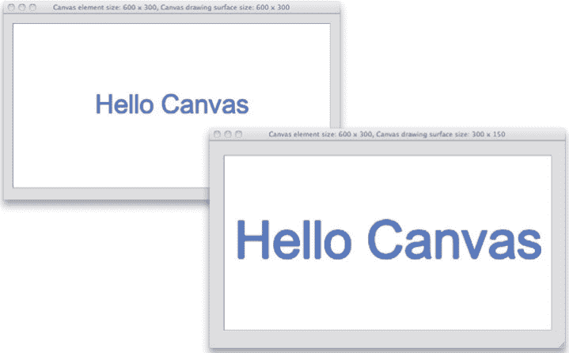

**图 1.3** *上图*：元素和坐标系 = 600 × 300；*下图*：元素 = 600 × 300，坐标系 = 300 × 150

**图 1.3** 顶部显示的应用程序是我们在上一节中讨论的应用程序。它通过元素的 `width` 和 `height` 属性设置 canvas 元素的大小，将元素的大小和绘图表面的大小都设置为 600 像素 × 300 像素。

**图 1.3** 底部显示的应用程序是 HTML 如**示例 1.3** 所示的应用程序。该应用程序与上一节中的应用程序相同，只是它使用 CSS 来调整 canvas 元素的大小（并且窗口标题栏中的标题不同）。

由于**图 1.3** 底部截图中显示的应用程序使用 CSS 来调整 canvas 元素的大小，并且没有设置元素的 `width` 或 `height` 属性，浏览器将绘图表面从 300 像素 × 150 像素缩放到 600 像素 × 300 像素。

> **注意：浏览器可能会自动缩放你的 canvas**
>
> 最好使用 canvas 元素的 `width` 和 `height` 属性来调整元素的大小，而不是使用 CSS。如果你使用 CSS 来调整元素的大小，而没有同时指定 canvas 元素的 `width` 和 `height` 属性，元素大小将不匹配 canvas 的绘图表面大小，浏览器会将后者缩放以适应前者，这很可能会导致令人惊讶和不希望的效果。

## 1.1.2 Canvas API

canvas 元素本身提供的 API 并不多；事实上，该 API 仅提供两个属性和三个方法，总结于**表 1.1** 和**表 1.2** 中。

**表 1.1** *canvas* 属性

| 属性 | 描述 | 类型 | 允许值 | 默认值 |
|-----------|-------------|------|----------------|---------|
| `width` | canvas 的*绘图表面*的宽度。默认情况下，浏览器使 canvas 元素与其绘图表面大小相同；然而，如果你使用 CSS 覆盖元素大小，浏览器将*缩放*绘图表面以适应元素。 | 非负整数 | 任何有效的非负整数。你可以在开头添加加号或空白，但从技术上说，不能添加 px 后缀。 | 300 |
| `height` | canvas 绘图表面的高度。浏览器可能会缩放绘图表面以适应 canvas 元素大小。有关更多信息，请参阅 width 属性。 | 非负整数 | 任何有效的非负整数。你可以在开头添加加号或空白，但从技术上说，不能添加 px 后缀。 | 150 |

**表 1.2** canvas 方法

| 方法 | 描述 |
|--------|-------------|
| `getContext()` | 返回与 canvas 关联的图形上下文。每个 canvas 有一个上下文，每个上下文与一个 canvas 相关联。 |
| `toDataURL(type, quality)` | 返回一个数据 URL，你可以将其分配给 img 元素的 src 属性。第一个参数指定图像类型，如 image/jpeg 或 image/png；如果未指定第一个参数，后者为默认值。第二个参数必须是 0 到 1.0 之间的双精度值，用于指定 JPEG 图像的质量级别。 |
| `toBlob(callback, type, args...)` | 创建一个 Blob，表示包含 canvas 图像的文件。该方法的第一个参数是浏览器用 blob 引用调用的函数。第二个参数指定图像类型，如 image/png，这是默认值。最终参数表示从 0.0 到 1.0（含）的质量级别，用于 JPEG 图像。将来可能会向此方法添加其他参数，以更仔细地控制图像特性。 |

## 1.2 Canvas 上下文

canvas 元素仅仅充当上下文的容器。上下文提供所有图形处理能力。尽管本书仅专注于 2d 上下文，但 Canvas 规范也支持其他类型的上下文；例如，3d 上下文规范已经在顺利进行中。本节将介绍 2d 上下文的属性，并简要提及 3d 上下文。


 ## 1.2.1 二维上下文

在你的 JavaScript 代码中，你几乎不会直接用到 `canvas` 元素本身，除了偶尔使用它来获取画布的宽度或高度或一个数据 URL，正如上一节所讨论的。此外，你将使用 `canvas` 元素来获取对画布上下文的引用，该上下文提供了一个功能强大的 API，用于绘制形状和文本、显示和操作图像等。事实上，在本书的其余部分，我们的重点将主要放在二维上下文中。

**表 1.3** 列出了所有二维上下文属性。除了 `canvas` 属性（它为你提供对画布本身的引用）之外，所有二维上下文属性都与绘图操作相关。

| 属性 | 简要描述 |
|-----------|-------------------|
| `canvas` | 指向上下文所属的画布。`canvas` 属性最常见的用法是访问画布的宽度和高度：分别是 `context.canvas.width` 和 `context.canvas.height`。 |
| `fillStyle` | 指定上下文随后用于填充形状的颜色、渐变或图案。 |
| `font` | 指定当你调用 `fillText()` 或 `strokeText()` 时上下文所使用的字体。 |
| `globalAlpha` | 是全局 Alpha（透明度）设置，它必须是一个介于 0（完全透明）和 1.0（完全不透明）之间的数字。浏览器会将你绘制的每个像素的 Alpha 值乘以 `globalAlpha` 属性，包括你绘制图像时。 |
| `globalCompositeOperation` | 决定浏览器如何在一个图形上绘制另一个图形。有关有效值，请参见第 2.14 节。 |
| `lineCap` | 指定浏览器如何绘制线条的端点。你可以指定以下三个值之一：`butt`、`round` 和 `square`。默认值是 `butt`。 |
| `lineJoin` | 指定当线条端点相交时如何连接。有效值为：`bevel`、`round` 和 `miter`。默认值是 `miter`。 |
| `lineWidth` | 决定你在画布中绘制的线条的宽度（以屏幕像素为单位）。该值必须是一个非负、非无限的 `double` 值。默认值是 1.0。 |
| `miterLimit` | 指定如何绘制斜接的线条连接。有关此属性的详细信息，请参见第 2.8.7 节。 |
| `shadowBlur` | 决定浏览器如何扩散阴影；数字越高，阴影扩散得越开。`shadowBlur` 值不是像素值，而是用于高斯模糊方程中的一个值。该值必须是一个正数、非无限的 `double` 值。默认值是 0。 |
| `shadowColor` | 指定浏览器用于绘制阴影的颜色。此属性的值通常指定为部分透明，以让背景显示出来。 |
| `shadowOffsetX` | 指定阴影的水平偏移量（以屏幕像素为单位）。 |
| `shadowOffsetY` | 指定阴影的垂直偏移量（以屏幕像素为单位）。 |
| `strokeStyle` | 指定用于描边路径的样式。此值可以是颜色、渐变或图案。 |
| `textAlign` | 决定你使用 `fillText()` 或 `strokeText()` 绘制的文本的水平放置方式。 |
| `textBaseline` | 决定你使用 `fillText()` 或 `strokeText()` 绘制的文本的垂直放置方式。 |

该表为你概述了所有二维上下文属性。在第 2 章中，我们将逐一考察这些属性。

> **注意：你可以扩展二维上下文的能力**
>
> 与每个画布相关联的上下文是一个强大的图形引擎，支持渐变、图像合成和动画等功能，但它确实存在局限性；例如，上下文没有提供绘制虚线的方法。然而，由于 JavaScript 是一种动态语言，你可以添加新方法或增强上下文的现有方法。有关更多信息，请参见第 118 页的第 2.8.6 节“通过扩展 `CanvasRenderingContext2D` 来绘制虚线”。

### 1.2.1.1 WebGL 三维上下文

Canvas 二维上下文有一个三维对应物，称为 WebGL，它与 OpenGL ES 2.0 API 高度一致。你可以找到由 Khronos Group 维护的 WebGL 规范，网址是 http://www.khronos.org/registry/webgl/specs/latest/。

在撰写本书时，浏览器厂商才刚刚开始提供对 WebGL 的支持，并且仍然有一些重要的平台（如 iOS4 和 IE10）不提供支持。尽管如此，三维画布上下文是一个令人兴奋的发展，它将为各种尖端应用打开大门。

### 1.2.2 保存和恢复画布状态

在第 1.2.1 节“二维上下文”（第 9 页）中，我们讨论了画布上下文的所有属性。你经常需要为绘图操作设置这些属性。很多时候，你希望临时设置这些属性；例如，你可能先用细线在背景上绘制一个网格，然后在网格上用更粗的线条进行绘制。在这种情况下，你会在绘制网格时临时设置 `lineWidth` 属性。

Canvas API 提供了两个方法，`save()` 和 `restore()`，用于保存和恢复所有画布上下文的属性。你像这样使用这些方法：

```
function drawGrid(strokeStyle, fillStyle) {
    controlContext.save(); // Save the context on a stack

    controlContext.fillStyle = fillStyle;
    controlContext.strokeStyle = strokeStyle;

    // Draw the grid...

    controlContext.restore(); // Restore the context from the stack
}
```

`save()` 和 `restore()` 方法起初看起来可能没什么大不了的，但在使用 Canvas 一段时间后，你会发现它们不可或缺。这两个方法总结在表 1.4 中。

> **注意：你可以嵌套调用 `save()` 和 `restore()`**
>
> 上下文的 `save()` 方法将上下文的当前状态压入一个栈。相应的 `restore()` 调用从栈中弹出状态，并相应地恢复上下文的状态。这意味着你可以嵌套调用 `save()`/`restore()`。

### 表 1.4 CanvasRenderingContext2D 状态方法

| 方法 | 描述 |
|--------|-------------|
| `save()` | 将画布的当前状态压入一个画布状态栈。画布状态包括当前变换、裁剪区域以及画布上下文的所有属性，包括 `strokeStyle`、`fillStyle`、`globalCompositeOperation` 等。画布状态不包括当前路径或位图。你只能通过调用 `beginPath()` 来重置路径，而位图是画布的属性，而不是上下文的属性。请注意，虽然位图是画布的属性，但你是通过上下文（通过上下文的 `getImageData()` 方法）来访问位图的。 |
| `restore()` | 从画布状态栈中弹出顶部条目。在弹出发生后，位于栈顶的状态成为当前状态，浏览器必须相应地设置画布状态。因此，你在 `save()` 和 `restore()` 方法调用之间对画布状态所做的任何更改都只会持续到调用 `restore()` 方法。 |

> **注意：保存和恢复绘图表面**
>
> 本节向你展示了如何保存和恢复上下文状态。能够保存和恢复绘图表面本身也很有益，我们将在第 1.7 节“保存和恢复绘图表面”（第 33 页）中讨论。

## 1.3 本书中的规范示例

本书中的许多示例使用以下规范形式：

```
<!-- example.html -->

<!DOCTYPE html>
<html>
  <head>
    <title>Canonical Canvas used in this book</title>

    <style>
      ...
      #canvas {
        ...
      }
    </style>
  </head>
```

```
<body>
    <canvas id='canvas' width='600' height='300'>
        Canvas not supported
    </canvas>

    <script src='example.js'></script>
</body>
</html>
```

```
// example.js

var canvas = document.getElementById('canvas'),
    context = canvas.getContext('2d');

// Use the context...
```

前面的示例有一个 ID 为 `canvas` 的画布，它使用了一个名为 `example.js` 的 JavaScript 文件。该 JavaScript 文件有两个变量，一个用于画布，另一个用于画布的上下文。前面的示例使用 `document.getElementById()` 来获取对画布的引用，并获取对画布上下文的引用。

本书中大多数遵循上述规范形式的应用程序为了简洁起见，省略了 HTML 清单。同样，对于内联代码清单，即像前面那样没有“示例”标题的清单，你经常会看到变量 `canvas` 和 `context` 而没有显示它们初始化的代码。

最后，还是为了简洁起见，本书并非每个示例都完整列出。本书中的示例经常相互构建，当它们这样做时，你经常会看到最后一个示例的完整清单以及其他相关示例的部分清单。

> **注意：关于用户代理**
>
> Canvas 规范将 `canvas` 元素的实现者称为用户代理，通常缩写为 UA。该规范使用这个术语而不是“浏览器”一词，因为 `canvas` 元素可以由任何软件实现，而不仅仅是浏览器。
>
> 本书将 `canvas` 元素的实现者称为浏览器，因为术语“用户代理”或者更糟的缩写“UA”对读者来说可能陌生且令人困惑。


## 1.4 入门

本节将简要介绍你的开发环境，包括你的应用程序将运行的浏览器，以及你将在开发过程中使用的开发工具，例如性能分析器和时间轴。你可以略读本节，并根据需要将其作为参考。

### 1.4.1 规范

与本书相关的三个规范是：

- HTML5 Canvas
- 脚本动画的时间控制
- HTML5 video 和 audio

由于历史原因，实际上有两个几乎完全相同的 Canvas 规范。其中一个规范由 W3C 维护，可以在 http://dev.w3.org/html5/spec 找到；另一个规范由 WHATWG 维护，可以在 http://bit.ly/qXWjOwL 找到。此外，虽然 Canvas 上下文包含在 WHATWG 的规范中，但 W3C 为其上下文制定了单独的规范，地址是 http://dev.w3.org/html5/2dcontext。

长期以来，人们一直使用 `window.setInterval()` 或 `window.setTimeout()` 来实现基于 Web 的动画；然而，正如你将在第 5 章看到的那样，这些方法不适用于性能要求高的动画。相反，你应该使用 `window.requestAnimationFrame()`，它定义在一个名为 *Timing control for script-based animations*（脚本动画的时间控制）的独立规范中。你可以在 http://www.w3.org/TR/animation-timing 找到该规范。

最后，本书将向你展示如何将 HTML5 video 和 audio 集成到基于 Canvas 的应用程序中。HTML5 video 和 audio 包含在同一个规范中，你可以在 http://www.w3.org/TR/html5/video.html 找到它。

> **注意：本书引用的 URL**
> 在本书中，你偶尔会发现指向进一步阅读的 URL 的引用。有时，如果它们可读且不太长，这些 URL 就是实际的 URL。对于冗长难记的 URL，本书会引用缩短的 URL，这些 URL 可能难以记住，但易于输入。

### 1.4.2 浏览器

在本书于 2012 年初出版时，所有五款主流浏览器——Chrome、Internet Explorer、Firefox、Opera 和 Safari——都对 HTML5 Canvas 提供了广泛的支持。尽管存在一些微小的不兼容性（主要源于对 Canvas 规范的不同解释——例如，参见第 186 页的第 2.14.1 节“合成争议”，其中解释了合成方面的不兼容性），但浏览器厂商在遵守规范和提供高性能实现方面都做得非常出色。

Chrome、Firefox、Opera 和 Safari 对 HTML5 的支持已有一段时间。微软的 Internet Explorer 稍晚一步，在 IE9 之前并未提供广泛的 HTML5 支持。然而，微软在 IE9 和 IE10 中对 Canvas 的实现非常出色；事实上，在本书出版时，这两款浏览器在五款主流浏览器中拥有最快的 Canvas 实现。

如果你正在实现一个基于 Canvas 的应用程序，并且必须支持 IE6、IE7 或 IE8，你有两个选择，如图 1.4 所示：explorercanvas，它

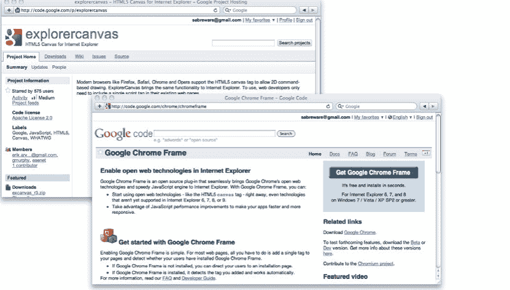

图 1.4 explorercanvas 和 Google Chrome for IE6/7/8，来自 Google

为这些旧版本的 Internet Explorer 添加了 Canvas 支持，以及 Google Chrome Frame，它用 Google Chrome 引擎替换了 IE 引擎。explorercanvas 和 Google Chrome Frame 都来自 Google。

### 1.4.3 控制台和调试器

所有支持 HTML5 的主流浏览器都为你提供了控制台和调试器。事实上，由于浏览器厂商经常相互借鉴，基于 WebKit 的浏览器——Firefox、Opera 和 IE——提供的控制台和调试器都非常相似。

图 1.5 显示了 Safari 的控制台和调试器。

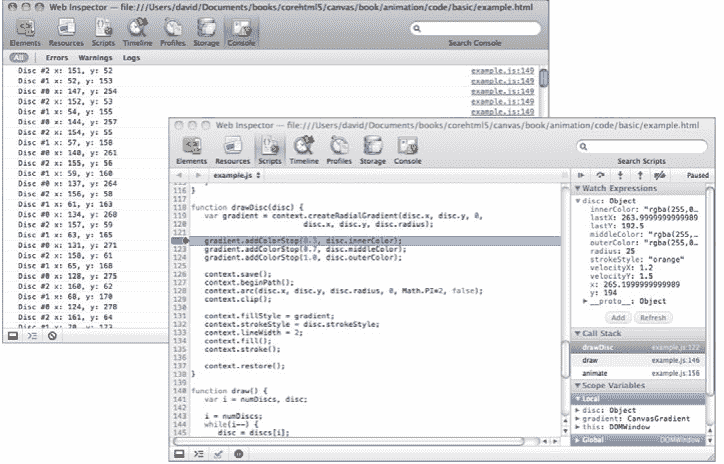

图 1.5 Safari 控制台和调试器

你可以使用 console.log() 方法向控制台写入内容。只需将一个字符串传递给该方法，它就会出现在控制台中。调试器是标准的调试器功能；你可以设置断点、监视表达式、检查变量和调用堆栈等。

全面介绍各种浏览器的开发工具超出了本书的范围。有关 Chrome 开发工具的更多信息，请查看 **图 1.6** 所示的 Chrome 开发者工具文档。其他浏览器也有类似的文档。

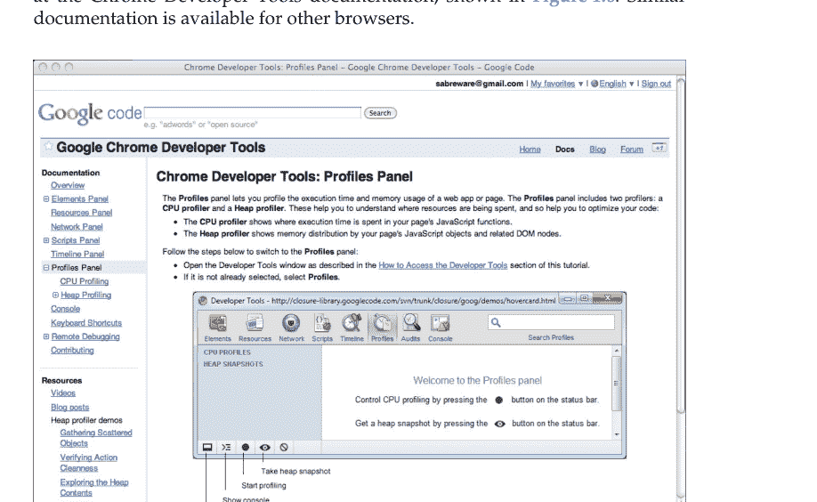

> **提示：以编程方式启动和停止分析器**

正如你从 **图 1.6** 中看到的，你可以通过在基于 WebKit 的浏览器中单击分析器窗口底部的填充圆圈来开始分析。

然而，通过单击按钮来控制分析器通常不够用；例如，你可能希望在特定的代码行启动和停止分析。在基于 WebKit 的浏览器中，你可以使用两个方法来实现：`console.profile()` 和 `console.profileEnd()`。你可以这样使用它们：

```
console.profile('Core HTML5 Animation,
                  erasing the background');
//...

console.profileEnd();
```

### 1.4.4 性能

大多数情况下，你用 Canvas 实现的应用程序性能会非常出色；但是，如果你正在实现动画或游戏，或者正在为移动设备实现基于 Canvas 的应用程序，你可能需要进行性能优化。

在本节中，我们将简要介绍你可以用来发现代码中性能瓶颈的工具。为了说明这些工具的使用，我们参考图 1.7 所示的应用程序。该动画（在第 5 章中讨论）同时动画化三个填充圆圈。

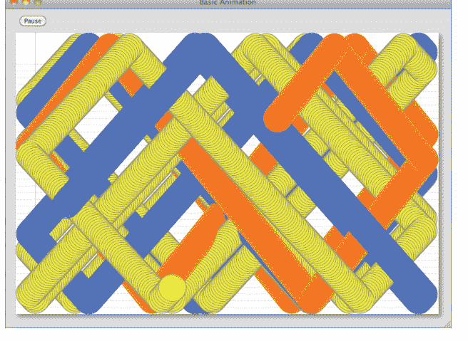

图 1.7 来自第 5 章的动画

我们将讨论三种工具：

- 分析器
- 时间轴
- jsPerf

前面列表中的前两个工具由浏览器直接提供或作为附加组件提供。另一方面，jsPerf 是一个网站，允许你创建性能测试并将其公开。在接下来的章节中，我们将看看 Chrome 和 Safari 中可用的分析工具和时间轴工具，然后我们将看一下 jsPerf。

#### 1.4.4.1 分析器和时间轴

分析器和时间轴对于发现代码中的性能瓶颈至关重要。图 1.8 和图 1.9 分别显示了图 1.7 所示动画的时间轴和分析器。

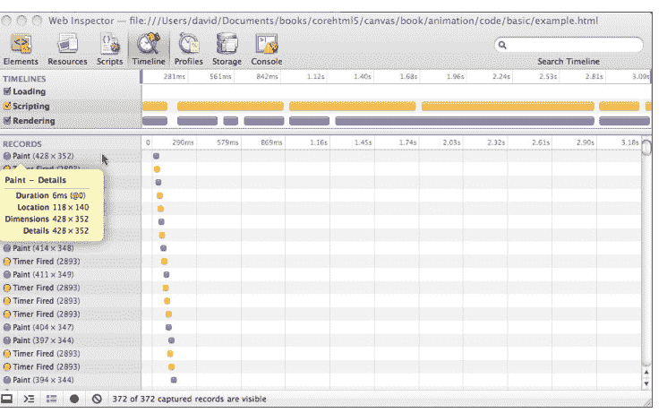

图 1.8 时间轴

时间轴为你记录应用程序中发生的重大事件，以及这些事件的详细信息，例如它们的持续时间以及它们影响的窗口区域。在基于 WebKit 的浏览器（如 Chrome 和 Safari）中，你可以将鼠标悬停在这些事件上以获取其关联的详细信息，如图 1.8 所示。

### 图 1.9 分析器

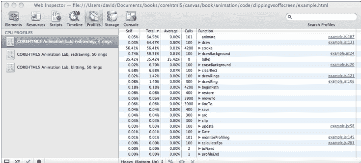

分析器为你提供了更详细的视图，展示了你的代码在函数级别的执行情况。正如你在 [图 1.9](#) 中看到的，分析器显示你的应用程序中每个函数被调用的次数，以及这些函数花费的时间。你可以看到每个函数占用的总执行时间的百分比，你还可以发现每个函数平均执行所需的毫秒数。

### 1.4.2 jsPerf

jsPerf，如 [图 1.10](#) 所示，是一个让你创建和分享 JavaScript 基准测试的网站。

你可能想知道，例如，在处理 Canvas 中的图像像素时，最有效的循环方法是什么。如果你单击 [图 1.10](#) 截图顶部显示的“测试用例”链接，jsPerf 会显示所有公开可用的测试用例，如 [图 1.11](#) 所示。

事实上，jsperf.com 上不仅有许多与 Canvas 相关的测试，还有一个与前面描述相匹配的测试用例，在 [图 1.11](#) 中突出显示。如果你单击该测试用例的链接，jsPerf 会显示该测试用例的代码，如 [图 1.12](#) 所示。你可以自己运行测试用例，你的结果将被添加到测试用例中。你还可以查看所有使用不同浏览器运行该测试用例的用户的结果（未在 [图 1.12](#) 中显示）。


 **图 1.10** jsperf.com 首页

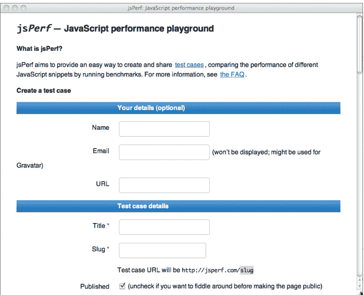

**图 1.11** jsperf.com 上的 Canvas 测试用例代码

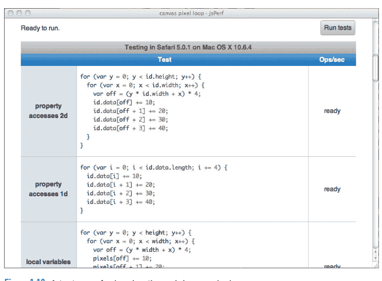

**图 1.12** 用于遍历图像像素的测试用例

至此，准备工作已全部完成，让我们来看看如何在 Canvas 上绘制图形。

## 1.5 基本绘图操作

下一章我们将深入探讨 Canvas 上的绘图。不过现在，为了让你熟悉 Canvas API 提供的绘图方法，让我们从图 1.13 所示的应用程序开始，该程序实现了一个模拟时钟。

示例 1.4 列出的这个时钟应用程序使用了 Canvas API 中的以下绘图方法：

- `arc()`
- `beginPath()`
- `clearRect()`
- `fill()`
- `fillText()`
- `lineTo()`
- `moveTo()`
- `stroke()`

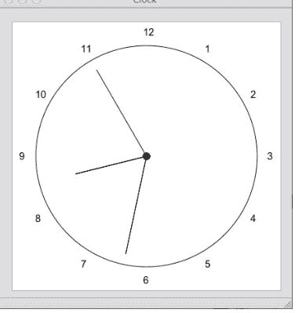

**图 1.13** 一个时钟

与 Adobe Illustrator 和 Apple 的 Cocoa 类似，Canvas 允许你通过创建不可见路径来绘制形状，然后通过调用 `stroke()`（描边路径轮廓）或 `fill()`（填充路径内部）使其可见。你使用 `beginPath()` 方法开始一条路径。

时钟应用程序的 `drawCircle()` 方法通过调用 `beginPath()` 开始一条路径来绘制代表钟面的圆形，随后调用 `arc()` 创建一个圆形路径。在应用程序调用 `stroke()` 之前，该路径是不可见的。同样，应用程序的 `drawCenter()` 方法通过组合使用 `beginPath()`、`arc()` 和 `fill()` 绘制时钟中心的实心小圆点。

应用程序的 `drawNumerals()` 方法使用 `fillText()` 方法在钟面上绘制数字，该方法在 Canvas 中绘制填充文本。与 `arc()` 方法不同，`fillText()` 不会创建路径；相反，`fillText()` 会直接在 Canvas 中渲染文本。

时钟指针由应用程序的 `drawHand()` 方法绘制，该方法使用三个方法来绘制代表时钟指针的线条：`moveTo()`、`lineTo()` 和 `stroke()`。`moveTo()` 方法将图形画笔移动到 Canvas 中的特定位置，`lineTo()` 绘制一条不可见的路径到你指定的位置，而 `stroke()` 使当前路径可见。

应用程序使用 `setInterval()` 来驱动时钟动画，每隔一秒调用一次应用程序的 `drawClock()` 函数。`drawClock()` 函数使用 `clearRect()` 擦除 Canvas，然后重新绘制时钟。

### 示例 1.4 一个基本时钟

```javascript
var canvas = document.getElementById('canvas'),
    context = canvas.getContext('2d'),
    FONT_HEIGHT = 15,
    MARGIN = 35,
    HAND_TRUNCATION = canvas.width/25,
    HOUR_HAND_TRUNCATION = canvas.width/10,
    NUMERAL_SPACING = 20,
    RADIUS = canvas.width/2 - MARGIN,
    HAND_RADIUS = RADIUS + NUMERAL_SPACING;
```

```
// Functions.....................................................
```

```javascript
function drawCircle() {
    context.beginPath();
    context.arc(canvas.width/2, canvas.height/2,
                RADIUS, 0, Math.PI*2, true);
    context.stroke();
}
```

```javascript
function drawNumerals() {
    var numerals = [ 1, 2, 3, 4, 5, 6, 7, 8, 9, 10, 11, 12 ],
        angle = 0,
        numeralWidth = 0;

    numerals.forEach(function(numeral) {
        angle = Math.PI/6 * (numeral-3);
        numeralWidth = context.measureText(numeral).width;
        context.fillText(numeral,
            canvas.width/2 + Math.cos(angle)*(HAND_RADIUS) -
            numeralWidth/2,
            canvas.height/2 + Math.sin(angle)*(HAND_RADIUS) +
            FONT_HEIGHT/3);
    });
}
```

```javascript
function drawCenter() {
    context.beginPath();
    context.arc(canvas.width/2, canvas.height/2, 5, 0, Math.PI*2, true);
    context.fill();
}
```

```javascript
function drawHand(loc, isHour) {
    var angle = (Math.PI * 2) * (loc/60) - Math.PI/2,
        handRadius = isHour ? RADIUS - HAND_TRUNCATION-HOUR_HAND_TRUNCATION
                                : RADIUS - HAND_TRUNCATION;

    context.moveTo(canvas.width/2, canvas.height/2);
    context.lineTo(canvas.width/2 + Math.cos(angle)*handRadius,
                   canvas.height/2 + Math.sin(angle)*handRadius);
    context.stroke();
}
```

```javascript
function drawHands() {
    var date = new Date,
        hour = date.getHours();

    hour = hour > 12 ? hour - 12 : hour;

    drawHand(hour*5 + (date.getMinutes()/60)*5, true, 0.5);
    drawHand(date.getMinutes(), false, 0.5);
    drawHand(date.getSeconds(), false, 0.2);
}
```

```javascript
function drawClock() {
    context.clearRect(0,0,canvas.width,canvas.height);

    drawCircle();
    drawCenter();
    drawHands();
    drawNumerals();
}
```

```
// Initialization..................................................

context.font = FONT_HEIGHT + 'px Arial';
loop = setInterval(drawClock, 1000);
```

> **注意：深入了解路径、描边和填充**
>
> 本节中的时钟示例让你对在 Canvas 上绘图有了一个大致的了解。在第 2 章中，我们将更深入地探讨如何在 Canvas 中绘制和操作形状。

## 1.6 事件处理

HTML5 应用程序是事件驱动的。你通过 HTML 元素注册事件监听器，并实现对这些事件做出响应的代码。几乎所有基于 Canvas 的应用程序都会处理鼠标或触摸事件——或者两者都处理——许多应用程序还会处理各种事件，如按键和拖放。

### 1.6.1 鼠标事件

在 Canvas 中检测鼠标事件非常简单：你只需向 Canvas 添加一个事件监听器，当事件发生时浏览器就会调用该监听器。例如，你可以监听鼠标按下事件，如下所示：

```javascript
canvas.onmousedown = function (e) {
    // React to the mouse down event
};
```

或者，你可以使用更通用的 `addEventListener()` 方法：

```javascript
canvas.addEventListener('mousedown', function (e) {
    // React to the mouse down event
});
```

除了 `onmousedown`，你还可以将函数赋值给 `onmousemove`、`onmouseup`、`onmouseover` 和 `onmouseout`。

将函数赋值给 `onmousedown`、`onmousemove` 等比使用 `addEventListener()` 稍微简单一些；但是，当你需要为单个鼠标事件附加多个监听器时，`addEventListener()` 是必要的。

#### 1.6.1.1 将鼠标坐标转换为 Canvas 坐标

浏览器传递给事件监听器的事件对象中的鼠标坐标是*窗口*坐标，而不是相对于 Canvas 本身的坐标。

大多数时候你需要知道鼠标事件相对于 Canvas（而非窗口）的发生位置，因此你必须转换坐标。例如，[图 1.14](#) 展示了一个显示精灵图（sprite sheet）的 Canvas。精灵图是一张包含动画中多个图像的单张图片。随着动画的推进，你每次从精灵图中显示一张图像，这意味着你必须知道精灵图中每张图像的精确坐标。

[图 1.14](#) 所示的应用程序通过跟踪和显示鼠标坐标，让你能够确定精灵图中每张图像的位置。当用户移动鼠标时，应用程序会持续更新精灵图上方和辅助线上的鼠标坐标。

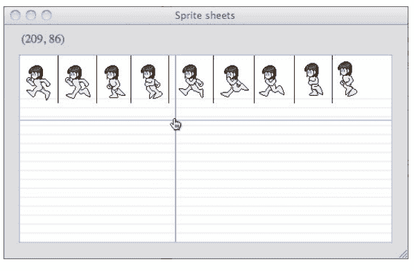

该应用程序向 Canvas 添加了一个 `mousemove` 监听器，随后当浏览器调用该监听器时，应用程序通过 `windowToCanvas()` 方法将鼠标坐标从窗口坐标转换为 Canvas 坐标，如下所示：

```javascript
function windowToCanvas(canvas, x, y) {
    var bbox = canvas.getBoundingClientRect();

    return { x: x - bbox.left * (canvas.width / bbox.width),
             y: y - bbox.top * (canvas.height / bbox.height)
           };
}

canvas.onmousemove = function (e) {
    var loc = windowToCanvas(canvas, e.clientX, e.clientY);

    drawBackground();
    drawSpritesheet();
    drawGuidelines(loc.x, loc.y);
    updateReadout(loc.x, loc.y);
};
...
```

上面展示的 `windowToCanvas()` 方法调用了 Canvas 的 `getBoundingClientRect()` 方法来获取 Canvas 相对于窗口的边界框。然后 `windowToCanvas()` 方法返回一个包含 `x` 和 `y` 属性的对象，这些属性对应于 Canvas 中的鼠标位置。


请注意，`windowToCanvas()` 不仅会从窗口的 x 和 y 坐标中减去画布边界框（bounding box）的左侧和顶部偏移量，而且当画布元素的尺寸与绘图表面的尺寸不同时，它还会对这些坐标进行缩放。关于画布元素尺寸与画布绘图表面尺寸的详细解释，请参阅第 5 页的第 1.1.1 节“画布元素尺寸 vs. 绘图表面尺寸”。

**图 1.14** 中所示应用程序的 HTML 代码列在**示例 1.5** 中，JavaScript 代码列在**示例 1.6** 中。

### 示例 1.5 精灵图检查器：HTML

```html
<!DOCTYPE html>
   <head>
      <title>Sprite sheets</title>
      
      <style>
         body {
            background: #dddddd;
         }

         #canvas {
            position: absolute;
            left: 0px;
            top: 20px;
            margin: 20px;
            background: #ffffff;
            border: thin inset rgba(100,150,230,0.5);
            cursor: pointer;
         }

         #readout {
            margin-top: 10px;
            margin-left: 15px;
            color: blue;
         }
      </style>
   </head>

   <body>
      <div id='readout'></div>

      <canvas id='canvas' width='500' height='250'>
         Canvas not supported
      </canvas>

      <script src='example.js'></script>
   </body>
</html>
```

### 示例 1.6 精灵图检查器：JavaScript

```javascript
var canvas = document.getElementById('canvas'),
    readout = document.getElementById('readout'),
    context = canvas.getContext('2d'),
    spritesheet = new Image();

// Functions.................................................................

function windowToCanvas(canvas, x, y) {
    var bbox = canvas.getBoundingClientRect();
    return { x: x - bbox.left * (canvas.width / bbox.width),
             y: y - bbox.top * (canvas.height / bbox.height)
           };
}

function drawBackground() {
    var VERTICAL_LINE_SPACING = 12,
        i = context.canvas.height;

    context.clearRect(0,0,canvas.width,canvas.height);
    context.strokeStyle = 'lightgray';
    context.lineWidth = 0.5;

    while(i > VERTICAL_LINE_SPACING*4) {
        context.beginPath();
        context.moveTo(0, i);
        context.lineTo(context.canvas.width, i);
        context.stroke();
        i -= VERTICAL_LINE_SPACING;
    }
}

function drawSpritesheet() {
    context.drawImage(spritesheet, 0, 0);
}

function drawGuidelines(x, y) {
    context.strokeStyle = 'rgba(0,0,230,0.8)';
    context.lineWidth = 0.5;
    drawVerticalLine(x);
    drawHorizontalLine(y);
}

function updateReadout(x, y) {
    readout.innerText = '(' + x.toFixed(0) + ', ' + y.toFixed(0) + ')';
}

function drawHorizontalLine (y) {
    context.beginPath();
    context.moveTo(0, y + 0.5);
    context.lineTo(context.canvas.width, y + 0.5);
    context.stroke();
}

function drawVerticalLine (x) {
    context.beginPath();
    context.moveTo(x + 0.5, 0);
    context.lineTo(x + 0.5, context.canvas.height);
    context.stroke();
}

// Event handlers.........................................................

canvas.onmousemove = function (e) {
    var loc = windowToCanvas(canvas, e.clientX, e.clientY);

    drawBackground();
    drawSpritesheet();
    drawGuidelines(loc.x, loc.y);
    updateReadout(loc.x, loc.y);
};

// Initialization.........................................................

spritesheet.src = 'running-sprite-sheet.png';
spritesheet.onload = function(e) {
    drawSpritesheet();
};

drawBackground();
```

> 提示：x 和 y vs. clientX 和 clientY

在 HTML5 时代之前，从浏览器传递给事件监听器的事件对象中获取鼠标事件的窗口坐标是一团糟。有些浏览器将这些坐标存储在 `x` 和 `y` 中，而另一些则存储在 `clientX` 和 `clientY` 中。幸运的是，支持 HTML5 的现代浏览器终于达成了一致，它们全部支持 `clientX` 和 `clientY`。您可以在 http://www.quirksmode.org/js/events_mouse.html 阅读更多关于这些事件属性的内容。

> 提示：告诉浏览器不要干涉 . . .

当您监听鼠标事件时，浏览器会在相关事件发生时调用您的监听器。在您处理完事件后，浏览器也会对该事件做出反应。在画布中处理鼠标事件时，大多数情况下您不希望浏览器在您处理完之后再介入，因为这会导致一些不希望出现的效果，例如浏览器选中其他 HTML 元素或更改光标形状。

幸运的是，事件对象提供了一个 `preventDefault()` 方法，正如其名称所示，它能防止浏览器执行对该事件的默认反应。只需在您的事件处理程序中调用该方法，浏览器将不再干扰您的事件处理。

> 注意：画布上下文的 `drawImage()` 方法

图 1.14 所示的示例使用了 2d 上下文的 `drawImage()` 方法来绘制精灵图。这个单一的方法允许您将存储在某个位置的图像的全部或部分复制到另一个位置，并且如果您愿意，还可以在复制过程中对图像进行缩放。

这个精灵图应用程序以最简单的方式使用了 `drawImage()`：应用程序将存储在 Image 对象中的完整图像（不缩放）绘制到应用程序的画布中。在第 4 章以及本书的其余部分，您将看到 `drawImage()` 的更多高级用法。

### 1.6.2 键盘事件

当您在浏览器窗口中按下键时，浏览器会生成按键事件。这些事件的目标是当前具有焦点的 HTML 元素。如果没有元素具有焦点，按键事件将冒泡传递到 window 和 document 对象。

画布元素不是一个可聚焦元素，因此根据前一段的描述，为画布添加按键监听器是徒劳的。相反，您应该将按键监听器添加到 document 或 window 对象上以检测按键事件。

按键事件有三种类型：

- keydown
- keypress
- keyup

`keydown` 和 `keyup` 事件是低级事件，浏览器在几乎每一次击键时都会触发它们。请注意，某些击键（例如命令序列）可能会被浏览器或操作系统 *拦截（swallowed）*；然而，大多数击键都能传递到您的 `keydown` 和 `keyup` 事件处理程序中，包括 Alt、Esc 等键。

当 `keydown` 事件产生一个可打印字符时，浏览器会在不可避免的 `keyup` 事件之前触发一个 `keypress` 事件。如果您长时间按住一个能产生可打印字符的键，浏览器将在 `keydown` 和 `keyup` 事件之间触发一系列 `keypress` 事件。

实现按键监听器与实现鼠标监听器类似。您可以将函数分配给 document 或 window 对象的 `onkeydown`、`onkeyup` 或 `onkeypress` 变量，或者您可以调用 `addEventListener()`，第一个参数为 `keydown`、`keyup` 或 `keypress`，第二个参数为函数的引用。

确定哪个键被按下可能很复杂，原因有两点。首先，全世界各种语言中的字符种类极其繁多。当您必须考虑拉丁字母、亚洲表意文字以及印度等地的多种语言时，支持所有这些字符简直令人头大。

其次，虽然浏览器和键盘已经存在很长时间，但直到 DOM Level 3 之前，按键代码（key codes）从未被标准化，而目前支持它的浏览器很少。简而言之，准确检测哪个键或哪组键组合被按下是一件麻烦事。

不过，在大多数情况下，您可以通过以下两种简单的策略来解决：

- 对于 `keydown` 和 `keyup` 事件，查看浏览器传递给事件监听器的事件对象的 `keyCode` 属性。通常情况下，对于可打印字符，这些值将是 ASCII 码。但请注意 *通常情况下* 这个限制。这里有一个很好的网站，您可以参考它来解析不同浏览器之间的按键代码：http://bit.ly/o3b1L2。按键事件的事件对象还包含以下布尔属性：
    - altKey
    - ctrlKey
    - metaKey
    - shiftKey

- 对于 `keypress` 事件——浏览器仅对可打印字符触发此类事件——你可以通过以下方式可靠地获取该字符：

  `var key = String.fromCharCode(event.which);`

  通常，除非你在 canvas 中实现文本控件，否则处理鼠标事件的频率会远高于键盘事件。不过，键盘事件的另一个常见用例是处理游戏中的按键操作。我们将在第9章讨论该主题。

### 1.6.3 触摸事件

随着智能手机和平板电脑的普及，HTML规范新增了对触摸事件的支持。有关处理触摸事件的更多信息，请参阅第11章。

## 1.7 保存与恢复绘图表面

在第1.2.2节“保存与恢复Canvas状态”（第11页）中，你已了解如何保存和恢复上下文状态。保存和恢复上下文状态允许你进行临时状态更改，这将是你频繁执行的操作。

Canvas上下文的另一个核心功能是能够保存和恢复绘图表面本身。保存和恢复绘图表面让你可以在绘图表面上进行临时绘制，这对许多场景都非常有用，例如橡皮筋效果、辅助线或标注。例如，图1.15所示的应用程序（在第2.13.1节“平移、缩放与旋转”第171页中讨论）允许用户通过拖动鼠标来交互式地创建多边形。

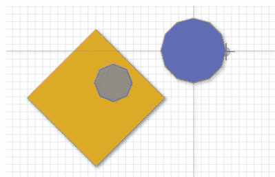
图1.15 绘制辅助线

在鼠标按下事件中，应用程序会保存绘图表面。当用户随后拖动鼠标时，应用程序会持续将绘图表面恢复到鼠标按下的状态，然后绘制多边形和相关的辅助线。当用户释放鼠标时，应用程序会最后一次恢复绘图表面，并绘制多边形的最终表现形式（不包含辅助线）。

图1.15所示应用程序中与绘制辅助线相关的JavaScript代码如示例1.7所示。如需查看该应用程序更完整的代码，请参阅第2.11.1节“多边形对象”（第147页）。

> **注意：使用 `getImageData()` 和 `putImageData()` 进行图像操作**
> 图1.15所示的应用程序使用上下文的 `getImageData()` 和 `putImageData()` 方法来保存和恢复绘图表面。与 `drawImage()` 类似，`getImageData()` 和 `putImageData()` 可以以多种方式使用；一种常见用法是实现图像滤镜，获取图像数据、进行处理，然后将其放回canvas中。你将在第4.5.2.3节“图像滤镜”（第293页）中了解如何实现图像滤镜，以及 `getImageData()` 和 `putImageData()` 的其他用途。

> **注意：即时模式图形**
> Canvas实现了一种称为*即时模式图形*的技术，这意味着它会立即在canvas上绘制你指定的内容。然后它会立即忘记你刚刚绘制的内容，这意味着canvas不会保留要绘制的对象列表。一些图形系统（如SVG）会维护要绘制的对象列表。这些图形系统被称为保留模式图形。
>
> 即时模式图形由于不维护要绘制的对象列表，因此比保留模式图形更底层。即时模式图形也更灵活，因为你直接绘制到屏幕上，而不是调整图形系统为你绘制的对象。
>
> 即时模式图形更适用于不跟踪用户绘制内容的应用程序（如画图应用程序），而保留模式图形更适用于需要操纵所创建图形对象的应用程序（如绘图应用程序）。
>
> 在第2.11.1节“多边形对象”（第147页）中，你将了解如何实现一个简单的保留模式图形系统，该系统在绘图应用程序中维护一个多边形数组，允许用户拖动这些多边形来重新定位它们。

### 示例1.7 通过保存和恢复绘图表面来绘制辅助线

```javascript
var canvas = document.getElementById('canvas'),
    context = canvas.getContext('2d'),
    ...
```

// 保存和恢复绘图表面..................................

```javascript
function saveDrawingSurface() {
   drawingSurfaceImageData = context.getImageData(0, 0,
                               canvas.width,
                               canvas.height);
}
```

```javascript
function restoreDrawingSurface() {
   context.putImageData(drawingSurfaceImageData, 0, 0);
}
```

// 事件处理器...................................................

```javascript
canvas.onmousedown = function (e) {
   ...
   saveDrawingSurface();
   ...
};
```

```javascript
canvas.onmousemove = function (e) {
   var loc = windowToCanvas(e);

   if (dragging) {
      restoreDrawingSurface();
      ...

      if (guidewires) {
         drawGuidewires(mousedown.x, mousedown.y);
      }
   }
};
```

```javascript
canvas.onmouseup = function (e) {
   ...
   restoreDrawingSurface();
};
```

## 1.8 在Canvas中使用HTML元素

Canvas可以说是HTML5最酷的功能，但当你用它来实现Web应用程序时，很少会单独使用它。大多数情况下，你会将一个或多个canvas与其他HTML控件结合起来，以便用户可以提供输入或以其他方式控制应用程序。

要将其他HTML控件与canvas结合使用，你可能首先倾向于将这些控件嵌入到canvas元素内部，但这是行不通的，因为放在canvas元素主体中的任何内容，只有在浏览器不支持canvas元素时才会被浏览器显示。

由于浏览器要么显示canvas元素，要么显示你放在其中的HTML控件，但不会同时显示两者，因此你必须将控件放在canvas元素外部。

为了让HTML控件看起来像是位于canvas内部，你可以使用CSS将控件定位在canvas上方。图1.16所示的应用程序演示了这种效果。

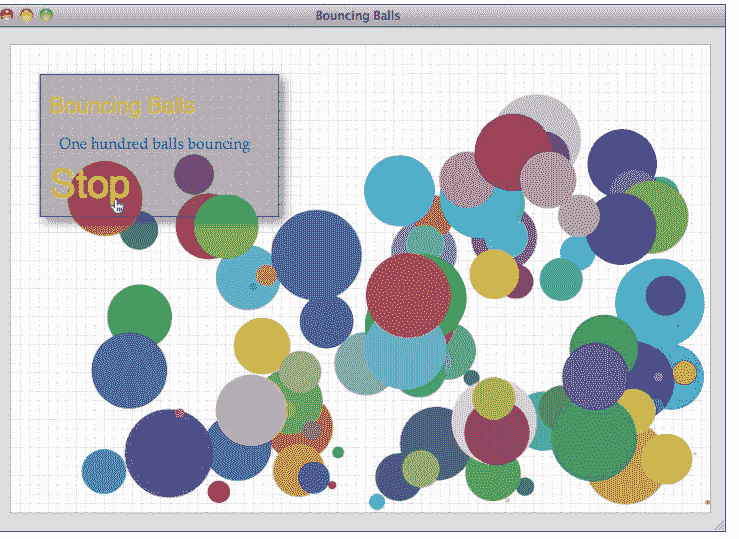
图1.16 位于canvas上方的HTML元素

**图1.16**所示的应用程序动画展示了100个球体，并提供了一个用于开始和停止动画的链接。该链接位于一个半透明的DIV元素中，该元素浮动在canvas上方。我们称这个DIV为*玻璃面板*，因为它看起来像是一块漂浮在canvas上方的玻璃板。

**图1.16**所示应用程序的HTML代码如**示例1.8**所示。

### 示例1.8 Canvas中的HTML控件：HTML

```html
<!DOCTYPE html>
<html>
  <head>
    <title>Bouncing Balls</title>

    <style>
      body {
        background: #dddddd;
      }

      #canvas {
        margin-left: 10px;
        margin-top: 10px;
        background: #ffffff;
        border: thin solid #aaaaaa;
      }

      #glasspane {
        position: absolute;
        left: 50px;
        top: 50px;
        padding: 0px 20px 10px 10px;
        background: rgba(0, 0, 0, 0.3);
        border: thin solid rgba(0, 0, 0, 0.6);
        color: #eeeeee;
        font-family: Droid Sans, Arial, Helvetica, sans-serif;
        font-size: 12px;
        cursor: pointer;
        -webkit-box-shadow: rgba(0,0,0,0.5) 5px 5px 20px;
        -moz-box-shadow: rgba(0,0,0,0.5) 5px 5px 20px;
        box-shadow: rgba(0,0,0,0.5) 5px 5px 20px;
      }

      #glasspane h2 {
        font-weight: normal;
      }

      #glasspane .title {
        font-size: 2em;
        color: rgba(255, 255, 0, 0.8);
      }

      #glasspane a:hover {
        color: yellow;
      }

      #glasspane a {
        text-decoration: none;
        color: #cccccc;
        font-size: 3.5em;
      }

      #glasspane p {
        margin: 10px;
        color: rgba(65, 65, 220, 1.0);
        font-size: 12pt;
        font-family: Palatino, Arial, Helvetica, sans-serif;
      }
    </style>
  </head>

  <body>
    <div id='glasspane'>
        <h2 class='title'>Bouncing Balls</h2>
        <p>One hundred balls bouncing</p>
        <a id='startButton'>Start</a>
    </div>

    <canvas id='canvas' width='750' height='500'>
        Canvas not supported
    </canvas>

    <script src='example.js'></script>
  </body>
</html>
```


示例 1.8 中显示的 HTML 使用了 CSS 绝对定位，使玻璃面板（glass pane）出现在画布之上，如下所示：

```
#canvas {
    margin-left: 10px;
    margin-top: 10px;
    background: #ffffff;
    border: thin solid #aaaaaa;
}

#glasspane {
    position: absolute;
    left: 50px;
    top: 50px;
}

...
```

上述 CSS 对画布使用了*相对*（relative）定位（这是 position CSS 属性的默认值），而对玻璃面板指定了*绝对*（absolute）定位。CSS 规范指出，绝对定位的元素绘制在相对定位的元素之上，这就是为什么在图 1.16 中玻璃面板出现在画布之上的原因。

如果你也将画布的定位改为绝对定位，那么画布将出现在玻璃面板之上，你将看不到玻璃面板，因为画布的背景不是透明的。在这种情况下，玻璃面板位于画布下方，是因为画布元素在玻璃面板的 DIV 元素之后定义。如果你交换这两个元素的顺序，玻璃面板将再次出现在画布之上。

因此，你有两种方案可以将玻璃面板定位在画布之上：对画布使用相对定位，对玻璃面板使用绝对定位；或者对这两个元素都使用相对或绝对定位，并将玻璃面板的 DIV 声明在画布元素之后。

第三种方案是对两个元素都使用相对或绝对定位，并操纵它们的 *z-index* CSS 属性。浏览器将 z-index 较高的元素绘制在 z-index 较低的元素之上。

除了将 HTML 控件放置在你想让它们出现的位置外，你还需要在 JavaScript 中获取这些元素的引用，以便访问和操纵它们的值。

图 1.16 所示的应用程序获取了玻璃面板和控制动画的按钮的引用，并为它们添加了事件处理器，如下所示：

```
var context = document.getElementById('canvas').getContext('2d'),
    startButton = document.getElementById('startButton'),
    glasspane = document.getElementById('glasspane'),
    paused = false,
    ...

startButton.onclick = function(e) {
    e.preventDefault();
    paused = ! paused;
    startButton.innerText = paused ? 'Start' : 'Stop';
};
...

glasspane.onmousedown = function(e) {
    e.preventDefault();
};
```

上述 JavaScript 为按钮添加了一个 `onclick` 处理器，根据应用程序的当前状态启动或暂停动画，并为玻璃面板添加了一个 `onmousedown` 事件处理器，以防止浏览器对该鼠标点击产生默认反应。`onmousedown` 处理器防止浏览器对该事件做出反应，从而避免无意中的选择操作。

### 注意：你可以实现自己的基于 Canvas 的控件

Canvas 规范指出，你应该优先使用内置的 HTML 控件，而不是使用 Canvas API 从零开始实现控件，这通常是一个很好的建议。使用 Canvas API 从零实现控件通常涉及大量工作，而且在有更简单的替代方案时，尽可能减少工作量是明智的。

然而，在某些情况下，实现基于 Canvas 的控件是有意义的。在第 10 章中，我们将看到实现自定义 Canvas 控件的动机以及具体方法。

### 注意：绘制网格

本节讨论的应用程序在弹跳球下方绘制了一个网格，以强调浮动 DIV 确实是浮在画布之上的。

在第 2 章中，我们将讨论如何绘制网格，但目前你可以暂时跳过网格绘制的细节继续前进。

#### 1.8.1 不可见的 HTML 元素

在前一节中，你看到了如何将静态 HTML 控件与画布结合使用。在本节中，我们将探索 HTML 控件的一种更高级用法，即在用户拖动鼠标时动态修改 DIV 的大小。

图 1.17 显示了一个使用名为“橡皮筋”（rubberbanding）技术来选择画布区域的应用程序。该画布最初显示一张图像，当你选择图像的一个区域时，应用程序会对你选择的区域进行缩放。

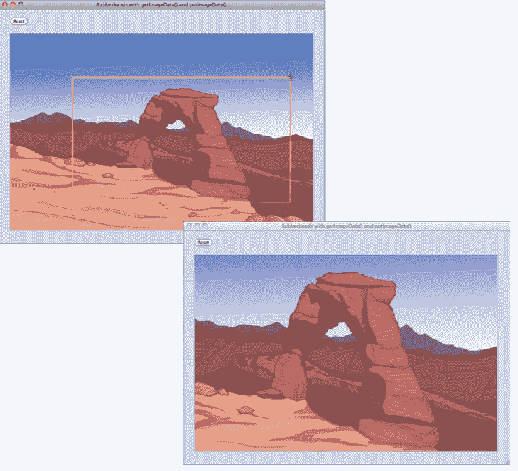

图 1.17 使用 DIV 实现橡皮筋选择

首先，让我们看看该应用程序的 HTML，列在示例 1.9 中。

### 示例 1.9 使用浮动 DIV 实现橡皮筋选择

```
<!DOCTYPE html>
<html>
  <head>
    <title>Rubber bands with layered elements</title>

    <style>
      body {
        background: rgba(100, 145, 250, 0.3);
      }

      #canvas {
        margin-left: 20px;
        margin-right: 0;
        margin-bottom: 20px;
        border: thin solid #aaaaaa;
        cursor: crosshair;
        padding: 0;
      }

      #controls {
        margin: 20px 0px 20px 20px;
      }

      #rubberbandDiv {
        position: absolute;
        border: 3px solid blue;
        cursor: crosshair;
        display: none;
      }
    </style>
  </head>
  <body>
    <div id='controls'>
      <input type='button' id='resetButton' value='Reset'/>
    </div>

    <div id='rubberbandDiv'></div>

    <canvas id='canvas' width='800' height='520'>
      Canvas not supported
    </canvas>

    <script src='example.js'></script>
  </body>
</html>
```

该 HTML 使用了一个包含按钮的 DIV。如果你点击该按钮，应用程序将绘制应用程序启动时显示的全图。

应用程序使用第二个 DIV 作为橡皮筋。该 DIV 为空，且其 CSS `display` 属性被设置为 none，使其最初不可见。当你开始拖动鼠标时，应用程序使该第二个 DIV 可见，从而显示出 DIV 的边框。随着你继续拖动鼠标，应用程序不断调整 DIV 的大小，产生像橡皮筋一样的视觉效果，如图 1.17 所示。

图 1.17 所示应用程序的 JavaScript 列在示例 1.10 中。

### 示例 1.10 使用 DIV 实现橡皮筋选择

```
var canvas = document.getElementById('canvas'),
    context = canvas.getContext('2d'),
    rubberbandDiv = document.getElementById('rubberbandDiv'),
    resetButton = document.getElementById('resetButton'),
    image = new Image(),
    mousedown = {},
    rubberbandRectangle = {},
    dragging = false;

// Functions ...

function rubberbandStart(x, y) {
    mousedown.x = x;
    mousedown.y = y;

    rubberbandRectangle.left = mousedown.x;
    rubberbandRectangle.top = mousedown.y;

    moveRubberbandDiv();
    showRubberbandDiv();

    dragging = true;
}

function rubberbandStretch(x, y) {
    rubberbandRectangle.left = x < mousedown.x ? x : mousedown.x;
    rubberbandRectangle.top = y < mousedown.y ? y : mousedown.y;

    rubberbandRectangle.width = Math.abs(x - mousedown.x),
    rubberbandRectangle.height = Math.abs(y - mousedown.y);

    moveRubberbandDiv();
    resizeRubberbandDiv();
}
```

### 示例 1.10（续）

```
function rubberbandEnd() {
   var bbox = canvas.getBoundingClientRect();

   try {
      context.drawImage(canvas,
                        rubberbandRectangle.left - bbox.left,
                        rubberbandRectangle.top - bbox.top,
                        rubberbandRectangle.width,
                        rubberbandRectangle.height,
                        0, 0, canvas.width, canvas.height);
   }
   catch (e) {
      // Suppress error message when mouse is released
      // outside the canvas
   }

   resetRubberbandRectangle();

   rubberbandDiv.style.width = 0;
   rubberbandDiv.style.height = 0;

   hideRubberbandDiv();

   dragging = false;
}
```

```
function moveRubberbandDiv() {
   rubberbandDiv.style.top  = rubberbandRectangle.top  + 'px';
   rubberbandDiv.style.left = rubberbandRectangle.left + 'px';
}
```

```
function showRubberbandDiv() {
   rubberbandDiv.style.display = 'inline';
}
```

```
function hideRubberbandDiv() {
   rubberbandDiv.style.display = 'none';
}
```

```
function resetRubberbandRectangle() {
   rubberbandRectangle = { top: 0, left: 0, width: 0, height: 0 };
}
```


```javascript
// Event handlers........................................................

canvas.onmousedown = function (e) {
  var x = e.clientX,
      y = e.clientY;

  e.preventDefault();
  rubberbandStart(x, y);
};

window.onmousemove = function (e) {
  var x = e.clientX,
      y = e.clientY;

  e.preventDefault();
  if (dragging) {
    rubberbandStretch(x, y);
  }
};

window.onmouseup = function (e) {
  e.preventDefault();
  rubberbandEnd();
};

image.onload = function () {
  context.drawImage(image, 0, 0, canvas.width, canvas.height);
};

resetButton.onclick = function(e) {
  context.clearRect(0, 0, context.canvas.width,
                    context.canvas.height);
  context.drawImage(image, 0, 0, canvas.width, canvas.height);
};

// Initialization.................................................

image.src = 'curved-road.png';
```

同样，我们在这里稍有点超前地使用了`drawImage()`方法来绘制并放大图像。在4.1节“绘制图像”（第254页）中，我们将详细研究该方法，并且还会看到实现橡皮筋效果的另一种方式，即通过操作图像的像素来直接绘制橡皮筋本身。

不过目前，我们的重点是橡皮筋DIV以及代码如何在用户拖动鼠标时操作该DIV。

Canvas的`onmousedown`事件处理器调用`rubberbandStart()`方法，该方法将DIV的左上角移动到鼠标按下的位置，并使DIV可见。由于橡皮筋DIV的CSS `position`属性为`absolute`，因此DIV左上角的坐标必须用窗口坐标指定，而不能使用相对于Canvas的坐标。

如果用户正在拖动鼠标，`onmousemove`事件处理器会调用`rubberbandStretch()`，该方法移动并调整橡皮筋DIV的大小。

当用户释放鼠标时，`onmouseup`事件处理器调用`rubberbandEnd()`，该方法绘制缩放后的图像，并将橡皮筋DIV缩小并隐藏。

最后，请注意所有三个鼠标事件处理器都在传入的事件对象上调用了`preventDefault()`。如1.6.1.1节“将鼠标坐标转换为Canvas坐标”（第26页）中所讨论的，该调用阻止浏览器对鼠标事件作出反应。如果你移除这些`preventDefault()`调用，浏览器将尝试选择页面上的元素，当用户在Canvas外部拖动鼠标时，这会产生不希望的效果。

## 1.9 打印Canvas

让应用程序的用户能够以图像形式访问Canvas通常是很方便的。例如，如果你实现了一个绘图应用程序（如第2章讨论的那样），用户会希望能够打印他们的画作。

默认情况下，虽然每个Canvas都是位图，但它并不是HTML `img`元素，因此用户无法对Canvas执行右键保存到磁盘的操作，也无法将Canvas拖到桌面以便稍后打印。Canvas不是图像这一事实可以通过图1.18所示的弹出菜单来说明。

幸运的是，Canvas API提供了一个方法——`toDataURL()`——它为给定的Canvas返回一个数据URL的引用。随后，你可以将`img`元素的`src`属性设置为该数据URL，从而创建Canvas的图像。

在1.5节“基本绘图操作”（第22页）中，你了解了如何使用Canvas API实现模拟时钟。图1.19显示了该应用程序的一个修改版本，它允许你对时钟进行快照并将其显示为图像，如上所述。从图1.19中可以看出，当你对生成的图像右键单击时，可以将图像保存到磁盘；而且由于底部截图中显示的时钟图像是`img`元素，你还可以将图像拖到桌面。

**图1.18 Canvas的右键菜单**

图1.19所示的应用程序实现了打印Canvas的一个常见用例：它提供了一个控件——在本例中是“Take snapshot”按钮——让用户对Canvas进行快照。应用程序将该快照显示为图像，因此用户可以右键单击图像并将其保存到磁盘。随后，当用户点击“Return to Canvas”按钮时，应用程序用原始Canvas替换该图像。以下是该用例的实现步骤：

在HTML页面中：
- 向页面添加一个不可见的图像，给图像一个id，但不设置src。
- 使用CSS将图像定位和大小设置为与Canvas完全重叠。
- 向页面添加一个用于拍摄快照的控件。

在JavaScript中：
- 获取对不可见图像的引用。
- 获取对快照控件的引用。
- 当用户激活拍摄快照的控件时：
    1. 调用`toDataURL()`获取数据URL。
    2. 将数据URL赋给不可见图像的`src`属性。
    3. 使图像可见，Canvas不可见。
- 当用户激活返回Canvas的控件时：
    1. 使Canvas可见，图像不可见。
    2. 根据需要重新绘制Canvas。

让我们看看如何将上述步骤转换为代码。示例1.11列出了图1.19所示应用程序的HTML，示例1.12列出了该应用程序的JavaScript。

### 示例1.11 使用toDataURL()打印Canvas：HTML

```html
<!DOCTYPE html>
<html>
<head>
    <title>Clock</title>

    <style>
        body {
            background: #dddddd;
        }

        #canvas {
            position: absolute;
            left: 10px;
            top: 1.5em;
            margin: 20px;
            border: thin solid #aaaaaa;
        }

        #snapshotImageElement {
            position: absolute;
            left: 10px;
            top: 1.5em;
            margin: 20px;
            border: thin solid #aaaaaa;
        }
    </style>
</head>

<body>
    <div id='controls'>
        <input id='snapshotButton' type='button' value='Take snapshot'/>
    </div>

    

    <canvas id='canvas' width='400' height='400'>
        Canvas not supported
    </canvas>

    <script src='example.js'></script>
</body>
</html>
```

### 示例1.12 使用toDataURL()打印Canvas：JavaScript

```javascript
var canvas = document.getElementById('canvas'),
    context = canvas.getContext('2d'),
    snapshotButton = document.getElementById('snapshotButton'),
    snapshotImageElement =
        document.getElementById('snapshotImageElement'),
    loop;

// 为求简洁，此处省略了时钟绘制函数。
// 有关这些方法的完整列表，请参见第24页的示例1.4。

// Event handlers................................................

snapshotButton.onclick = function (e) {
    var dataUrl;

    if (snapshotButton.value === 'Take snapshot') {
        dataUrl = canvas.toDataURL();
        clearInterval(loop);
        snapshotImageElement.src = dataUrl;
        snapshotImageElement.style.display = 'inline';
        canvas.style.display = 'none';
        snapshotButton.value = 'Return to Canvas';
    }
    else {
        canvas.style.display = 'inline';
        snapshotImageElement.style.display = 'none';
        loop = setInterval(drawClock, 1000);
        snapshotButton.value = 'Take snapshot';
    }
};

// Initialization...............................................

context.font = FONT_HEIGHT + 'px Arial';
loop = setInterval(drawClock, 1000);
```

该应用程序访问canvas和img元素，并使用CSS绝对定位使两个元素重叠。当用户点击“Take snapshot”按钮时，应用程序从Canvas获取数据URL，并将其赋给图像的`src`属性。然后它显示图像，隐藏Canvas，并将按钮的文本设置为“Return to Canvas”。

当用户点击“Return to Canvas”按钮时，应用程序隐藏图像，显示Canvas，并将按钮的文本恢复为“Take snapshot”。


 **注意：Canvas blobs**
在本书编写过程中，Canvas 规范新增了 `toBlob()` 方法，因此你可以在众多操作中将 canvas 保存为文件。但在本书付印时，尚无任何浏览器支持该方法。

## 1.10 离屏 Canvas

Canvas 的另一个重要特性是能够创建和操作离屏 canvas。例如，在大多数情况下，你可以通过将背景存储在一个或多个离屏 canvas 中，然后将这些离屏 canvas 的部分内容复制到屏幕上，从而显著提升性能。

离屏 canvas 的另一个应用场景是我们在前面章节讨论的时钟。虽然该应用向你展示了如何实现一个需要用户交互来完成 canvas 到图像切换的通用方案，但时钟更适合在后台自动完成切换，无需用户干预。

图 1.20 展示了时钟应用的更新版本。该应用每秒将时钟绘制到离屏 canvas 中，并将 canvas 的数据 URL 赋值给图像的 src 属性。其结果是一个反映离屏 canvas 内容的动画图像。关于 canvas 数据 URL 的更多信息，请参见第 46 页第 1.9 节"打印 Canvas"。

图 1.20 所示应用的 HTML 代码如示例 1.13 所列。

### 示例 1.13 图像时钟：HTML

```
<!DOCTYPE html>
<head>
    <title>Image Clock</title>

    <style>
        body {
            background: #dddddd;
        }

        #canvas {
            display: none;
        }

        #snapshotImageElement {
            position: absolute;
            left: 10px;
            margin: 20px;
            border: thin solid #aaaaaa;
        }
    </style>
</head>

<body>
    

    <canvas id='canvas' width='400' height='400'>
        Canvas not supported
    </canvas>

    <script src='example.js'></script>
</body>
</html>
```

请注意 HTML 中 canvas 的 CSS 样式——由于 canvas 的 display 属性被设置为 none，因此它是不可见的。这种不可见性使其成为离屏 canvas。你也可以通过编程方式创建离屏 canvas，如下所示：`var offscreen = document.createElement('canvas');`

图 1.20 所示应用中与离屏 canvas 相关的 JavaScript 代码如示例 1.14 所列。

### 示例 1.14 图像时钟：JavaScript（摘录）

```
// Some declarations and functions omitted for brevity.
// See Section 1.9 on p. 46 for a complete listing of
// the clock.

var canvas = document.getElementById('canvas'),
    context = canvas.getContext('2d'),
    ...

// Functions........................................................

function updateClockImage() {
  snapshotImageElement.src = canvas.toDataURL();
}

function drawClock() {
  context.clearRect(0, 0, canvas.width, canvas.height);

  context.save();

  context.fillStyle = 'rgba(255,255,255,0.8)';
  context.fillRect(0, 0, canvas.width, canvas.height);

  drawCircle();
  drawCenter();
  drawHands();

  context.restore();

  drawNumerals();

  updateClockImage();
}
...
```

## 1.11 简要数学入门

要用 Canvas 做任何有趣的事情，你需要扎实的基本数学功底，尤其是代数方程、三角函数和向量运算。对于电子游戏等更复杂的应用，能够根据度量单位推导方程也会很有帮助。

如果你熟悉基本的代数和三角函数，并且能够根据像素/秒和毫秒/帧计算出像素/帧，那么可以随意浏览本节。否则，在本节花些时间将在本书后续内容中证明大有裨益。

让我们从求解代数方程和三角函数开始，然后讨论向量以及如何根据度量单位推导方程。

### 1.11.1 求解代数方程

对于任何代数方程，如 $(10x + 5) \times 2 = 110$，你可以进行以下操作，等式仍然成立：

- 在等式两边加上任意实数
- 在等式两边减去任意实数
- 在等式两边乘以任意实数
- 在等式两边除以任意实数
- 在等式两边乘以或除以 1

例如，对于 $(10x + 5) \times 2 = 110$，你可以将等式两边除以 2，得到：$10x + 5 = 55$；然后将等式两边减去 5，得到：$10x = 50$；最后将等式两边除以 10 来求解 $x$：$x = 5$。

上面最后一条规则可能看起来相当奇怪。为什么你需要将等式的一边或两边乘以或除以 1？在第 62 页的第 1.11.4 节"根据度量单位推导方程"中，我们在从度量单位推导方程时，会发现这条简单规则的妙用。

### 1.11.2 三角函数

即使是 Canvas 最简单的应用也需要对三角函数有基本的了解；例如，在下一章中你将学习如何绘制多边形，这需要理解正弦和余弦。让我们先简要讨论角度，然后探讨直角三角形。

#### 1.11.2.1 角度：度与弧度

Canvas API 中所有涉及角度的函数都要求你以弧度为单位指定角度。JavaScript 的 `Math.sin()`、`Math.cos()` 和 `Math.tan()` 函数也是如此。大多数人习惯用度来思考角度，因此你需要知道如何将度转换为弧度。

180 度等于 $\pi$ 弧度。要将度转换为弧度，你可以为这一关系创建一个代数方程，如等式 1.1 所示。

|  |  |
|:---|:---|
| 180 degrees = $\pi$ radians | 等式 1.1 度与弧度 |

求解等式 1.1 得到弧度和度的转换公式，分别如等式 1.2 和等式 1.3 所示。

|  |  |
|:---|:---|
| radians = (π / 180) × degrees | 等式 1.2 度转弧度 |
| degrees = (180 / π) × radians | 等式 1.3 弧度转度 |

π 大约等于 3.14，因此，例如 45 度等于 (3.14 / 180) × 45 弧度，计算结果为 0.7853。

#### 1.11.2.2 正弦、余弦和正切

要有效地使用 Canvas，你必须对 sin、cos 和 tan 有基本的了解，因此如果你还不熟悉图 1.21，你应该将其牢记于心。

你也可以从圆的 X 和 Y 坐标的角度来理解正弦和余弦，如图 1.22 所示。

给定一个圆的半径和从 0 度开始的逆时针角度，你可以通过将半径乘以角度的余弦值，以及将半径乘以角度的正弦值，分别计算出圆周上对应的 X 和 Y 坐标。

**注意：SOHCAHTOA 助记法！**

从直角三角形中推导正弦、余弦和正切的众多方法之一：SOHCAHTOA。SOH 代表正弦（Sine）、对边（Opposite）、斜边（Hypotenuse）；CAH 代表余弦（Cosine）、邻边（Adjacent）、斜边（Hypotenuse）；TOA 代表正切（Tangent）、对边（Opposite）、邻边（Adjacent）。

### 1.11.3 向量

本书中使用的二维向量封装了两个值：方向和大小；它们用于表达各种物理特性，如力和运动。

在第 8 章"碰撞检测"中，我们将大量使用向量，因此在本节中我们将讨论向量数学的基础知识。如果你对实现碰撞检测不感兴趣，可以放心地跳过本节。

在第 8 章末尾，我们将探讨如何通过让一个多边形从另一个多边形弹开来响应两个多边形之间的碰撞，如图 1.23 所示。

在图 1.23 中，上方的多边形正向下方的多边形移动，两个多边形即将发生碰撞。上方多边形的入射速度和出射速度都用向量来建模。下方多边形的边缘


#### 1.11.3.1 向量大小

尽管二维向量建模了两个量——大小和方向，但给定一个向量时，计算其中一项或另一项通常很有用。你可以使用勾股定理（你可能在数学课上或电影《绿野仙踪》中了解过）来计算向量的大小，如图1.24所示。

勾股定理指出，任何直角三角形的斜边等于另外两条边的平方和的平方根，结合图1.24理解会容易得多。相应的JavaScript代码如下：

```
var vectorMagnitude = Math.sqrt(Math.pow(vector.x, 2) +
                              Math.pow(vector.y, 2));
```

前面的JavaScript代码片段展示了如何计算由变量`vector`引用的向量的大小。

现在你知道了如何计算向量的大小，接下来让我们看看如何计算向量的另一个量——方向。

#### 1.11.3.2 单位向量

向量数学中经常需要用到所谓的单位向量。单位向量仅表示方向，如图1.25所示。

单位向量之所以得名，是因为其大小始终为1个单位。要从一个任意大小的向量计算单位向量，你需要剥离其大小，只留下方向。在JavaScript中你可以这样做：

```
var vectorMagnitude = Math.sqrt(Math.pow(vector.x, 2) +
                            Math.pow(vector.y, 2)),
    unitVector = new Vector();

unitVector.x = vector.x / vectorMagnitude;
unitVector.y = vector.y / vectorMagnitude;
```

前面的代码清单，给定一个名为`vector`的向量，首先如前一节所示计算该向量的大小。然后代码创建一个新的向量（有关Vector对象的列表，请参阅第8章），并将该单位向量的X和Y值设置为原始向量的对应值除以向量的大小。

现在你已经了解了如何计算任何二维向量的两个组成部分，接下来看看如何组合向量。

#### 1.11.3.3 向量的加法和减法

向量的加法或减法通常很有用。例如，如果有两个力作用于一个物体，你可以将代表这两个力的两个向量相加，以计算出一个合力。同样，从一个位置向量减去另一个位置向量，可以得到两个向量之间的边。

**图1.26**展示了给定两个名为A和B的向量，如何进行向量加法。

向量加法很简单：你只需将向量的各个分量相加即可，如下列代码清单所示：

```
var vectorSum = new Vector();

vectorSum.x = vectorOne.x + vectorTwo.x;
vectorSum.y = vectorOne.y + vectorTwo.y;
```

向量减法也很简单：你只需将向量的各个分量相减即可，如下列代码清单所示：

```
var vectorSubtraction = new Vector();
vectorSubtraction.x = vectorOne.x - vectorTwo.x;
vectorSubtraction.y = vectorOne.y - vectorTwo.y;
```

图1.27展示了一个向量减去另一个向量如何得到第三个向量，该向量的方向与两个向量之间的边一致。在图1.27中，向量A-B和向量B-A彼此平行，同时也平行于向量A和B之间的边向量。

现在你知道了如何对向量进行加法和减法，更重要的是知道了这样做的意义，让我们再来看一个向量量：点积。

#### 1.11.3.4 两个向量的点积

要计算两个向量的点积，你需要将每个向量的分量彼此相乘，然后将结果相加。以下是计算两个二维向量点积的方法：

```
var dotProduct = vectorOne.x * vectorTwo.x + vectorOne.y * vectorTwo.y;
```

计算两个向量之间的点积很容易；然而，理解点积的含义则不那么直观。首先，请注意，与两个向量的加法或减法的结果不同，点积不是一个向量——它是工程师所说的标量，也就是说它只是一个数字。要理解这个数字的含义，请研究图1.28。

**图1.28**中两个向量的点积是528。然而，这个数字的意义不在于其大小，而在于它大于零这一事实。这意味着两个向量大致指向相同的方向。

现在看看**图1.29**，其中两个向量的点积是–528。因为该值小于零，我们可以推断这两个向量大致指向不同的方向。

判断两个向量是否大致指向相同方向的能力，对于如何处理物体之间的碰撞可能至关重要。如果一个运动的物体与一个静止的物体发生碰撞，并且你希望运动的物体从静止物体上弹开，你需要确保运动的物体向远离静止物体的方向反弹，而不是朝向静止物体的中心。使用两个向量的点积，你恰好可以做到这一点，这将在第8章中看到。

以上就是你实施碰撞检测所需了解的关于向量的所有内容，所以让我们继续进入这个简短的数学入门部分的最后一节，看看如何从度量单位推导方程。

### 1.11.4 从度量单位推导方程

正如你将在第5章中看到的，动画中的运动应该是基于时间的，因为物体移动的速率不应随动画的帧率而变化。基于时间的运动对于多人游戏尤其重要；毕竟，你不希望游戏对于拥有更强大计算机的玩家进展得更快。

为了实现基于时间的运动，我们在本书中以像素每秒为单位来指定速度。因此，要计算在当前动画帧中移动物体多少像素，我们有两个信息：物体的速度（单位为*像素每秒*），以及动画的当前帧率（单位为*毫秒每帧*）。我们需要计算的是任何给定物体每帧移动的*像素数*。为此，我们必须推导一个方程，其左边是像素每帧，右边是像素每秒（物体的速度）和毫秒每帧（当前帧率），如公式1.4所示。

```
\frac{\text{pixels}}{\text{frame}} \neq \frac{\text{X ms}}{\text{frame}} \times \frac{\text{Y pixels}}{\text{second}}
```

公式1.4 推导基于时间的运动方程，第一部分

在这个*不等式*中，X代表动画的帧率（单位为毫秒/帧），Y是物体的速度（单位为像素/秒）。然而，如该不等式所示，你不能直接将毫秒/帧乘以像素/秒，因为结果会是无意义的毫秒-像素/帧-秒。那么你该怎么做呢？

回想一下我们在第1.11.1节“求解代数方程”（第54页）讨论的最后一个规则：你可以将等式的一边或两边乘以1。根据这个规则，并且由于1秒等于1,000毫秒，我们可以通过将等式的右边乘以1来将该不等式转化为等式，这里的1由分数1,000 ms / 1 s表示。这给我们：

```
\frac{\text{pixels}}{\text{frame}} = \frac{\text{X ms}}{\text{frame}} \times \frac{\text{Y pixels}}{\text{second}} \times \frac{1,000 \text{ ms}}{1 \text{ s}}
```

公式1.5 推导基于时间的运动方程，第二部分

公式1.5是一个有效的等式，因为我们将右边乘以了1。但是请注意，等式右边顶部和底部的毫秒单位相互抵消了，秒单位也一样。这留下了我们所需的方程：

```
\frac{\text{pixels}}{\text{frame}} = \frac{\text{X ms}}{\text{frame}} \times \frac{\text{Y pixels}}{\text{second}} \times \frac{1,000 \text{ ms}}{1 \text{ s}} = \frac{\text{Y pixels}}{1,000 \text{ frames}}
```

公式1.6 推导基于时间的运动方程，第三部分

因此，要将物体在当前帧移动正确的像素数，我们将物体的速度（像素每秒）除以1,000，然后将结果乘以当前的帧率（毫秒）。在JavaScript中，代码如下：

```
var pixelsToMove = (velocity / 1000) * frameRate;
```

这就是实施基本碰撞检测所需的全部数学知识。在下一节中，我们将通过实现一个使用向量和点积的碰撞检测程序来应用你所学到的内容。


到 1000 毫秒，因此 1 秒 / 1000 毫秒等于 1，我们可以将等式右边乘以该分数，如[公式 1.5](#) 所示。

```
$$\frac{\text{pixels}}{\text{frame}} = \frac{\text{X ms}}{\text{frame}} \times \frac{1 \text{ second}}{1000 \text{ ms}} \times \frac{\text{Y pixels}}{\text{second}}$$

**Equation 1.5** Deriving an equation for time-based motion, part 2
```

现在我们可以进行最后的推导了，因为当你将两个分数相乘时，*一个分数分子中的度量单位会与另一个分数分母中相同的度量单位相互抵消*。在我们的例子中，我们按照[公式 1.6](#) 所示来抵消度量单位。

```
$$\frac{\text{pixels}}{\text{frame}} = \frac{\text{X \sout{ms}}}{\text{frame}} \times \frac{1 \text{ sec\sout{ond}}}{1000 \text{ m\sout{s}}} \times \frac{\text{Y pixels}}{\text{sec\sout{ond}}}$$

**Equation 1.6** Deriving an equation for Wallace-based motion, part 3
```

抵消这些度量单位后得到[公式 1.7](#)。

```
$$\frac{\text{pixels}}{\text{frame}} = \frac{\text{X}}{\text{frame}} \times \frac{\text{Y pixels}}{1000}$$

**Equation 1.7** Deriving an equation for time-based motion, part 4
```

执行乘法运算后得到简化后的等式，如[公式 1.8](#) 所示。

```
$$\frac{\text{pixels}}{\text{frame}} = \frac{\text{X} \times \text{Y}}{1000}$$

X = frame rate in ms/frame
Y = velocity in pixels/second

**Equation 1.8** Deriving an equation for time-based motion, part 5
```

每当你推导出一个等式时，你应该将一些简单的数值代入等式中，看看等式是否合理。在这个例子中，如果一个物体以每秒 100 像素的速度移动，而帧率为每帧 500 毫秒，你完全不需要任何公式就能轻松算出，该物体在那 1/2 秒内应该移动 50 像素。

将这些数值代入[公式 1.8](#)，得到 500 × 100 / 1000，等于 50，因此看起来我们得到了一个适用于任意速度和任意帧率的有效等式。

通常，从已知度量单位的变量推导等式时，请遵循以下步骤：

1. 从一个等式开始，结果在左边，其他变量在右边。
2. 根据等式两边的度量单位，将等式右边乘以一个或多个分数，每个分数都等于 1，其度量单位能够抵消等式右边的度量单位，从而得到等式左边的度量单位。
3. 抵消等式右边的度量单位。
4. 将等式右边的分数相乘。
5. 将结果容易验证的简单数值代入等式中，确保等式产生预期的值。

## 1.12 总结

本章向你介绍了 canvas 元素及其关联的 2d 上下文，并阐述了该上下文的一些重要特性，例如 canvas 元素尺寸与 canvas 绘图表面尺寸之间的区别。

接下来我们快速概览了你的开发环境，包括浏览器、控制台和调试器，以及性能工具。

然后我们探讨了使用 canvas 的基础内容，包括基本的绘图操作、事件处理、保存和恢复绘图表面、将 HTML 元素与 canvas 配合使用、打印 canvas 以及使用离屏 canvas。你将在本书后续内容中多次看到这些重要特性的使用，你也会在编写基于 Canvas 的应用程序时亲自使用它们。

最后，我们以一个简短的数学入门作为本章结尾，你可以在阅读本书其余部分时根据需要查阅。

在下一章中，我们将深入探讨在 canvas 中绘图。在那一章中，你将学习 Canvas 绘图 API，并看到如何通过实现一个功能完善的绘图应用程序的大部分功能来充分利用该 API。

# 第 2 章

## 绘图

HTML5 Canvas 2d 上下文提供了一个强大的图形 API，用于实现运行在浏览器中的复杂而精美的图形应用程序。

图 2.1 展示了一个绘图应用程序，它可以让你绘制文本、线条、矩形、圆形、贝塞尔曲线以及通过鼠标描画的任意路径——包括开放路径和封闭路径。你可以通过选择底部图标然后在绘图区域中拖动橡皮擦来擦除内容（参见第 187 页第 2.15.1 节"使用裁剪区域进行擦除"）。你可以通过页面顶部的 HTML 控件更改绘图属性，还可以对应用程序进行截图，以便用户将画作保存为图像。

该绘图应用程序使用橡皮筋进行交互式绘图；当用户拖动鼠标创建新形状（如圆形或矩形）时，应用程序会持续绘制该形状的轮廓。当用户释放鼠标时，应用程序通过绘制并可能填充形状来最终确定该形状。当用户点击了代表该形状图标的右下角时，应用程序会填充形状。

本章向你展示如何使用 Canvas API 来实现绘图应用程序中的所有功能以及更多内容。以下是你将学到的一些内容：

-   描边和填充线条、圆弧、圆形、曲线和多边形
-   使用上下文属性来影响形状的外观
-   绘制圆角矩形
-   绘制和编辑贝塞尔曲线
-   扩展 2d 上下文以绘制虚线
-   使用颜色、渐变和图案来描边和填充形状
-   使用阴影赋予形状立体感

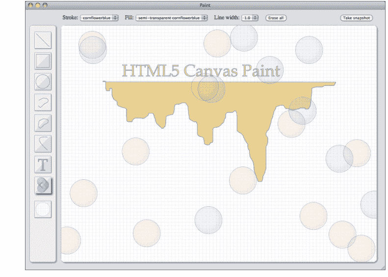

**图 2.1** 一个绘图应用程序

-   使用裁剪区域来擦除形状和文本，同时保留背景
-   实现橡皮筋功能，让用户可以交互式地绘制形状
-   在 canvas 中拖动对象
-   变换坐标系

**注意：绘图应用程序**

图 2.1 所示的绘图应用程序使用大约 1100 行 JavaScript 实现。这使得它在本书中列出过长而不太现实；不过，你可以从 corehtml5canvas.com 下载该应用程序。

虽然本书没有列出绘图应用程序本身，但本章从第 110 页第 2.8.4 节"橡皮筋线条"开始，通过一些较小的应用程序展示了它的大部分功能，该节向你展示如何让用户使用橡皮筋交互式地绘制线条，最终到第 187 页第 2.15.1 节"使用裁剪区域进行擦除"，该节向你展示如何使用裁剪区域让用户擦除他们绘制的内容。

> **注意：移动绘图应用程序**

本章向你展示如何为配备鼠标的设备实现绘图应用程序的功能。在第 11 章中，你将看到如何针对手机和平板电脑等使用触摸事件而非鼠标事件的设备修改绘图应用程序。你还将看到如何对应用程序进行其他修改，使其更适合移动设备。

## 2.1 坐标系

默认情况下，Canvas 坐标系（如图 2.2 所示）将原点放置在 canvas 的左上角，X 坐标向右递增，Y 坐标向 canvas 底部递增。图 2.2 展示了默认大小为 300 × 150 像素的 canvas 坐标系。

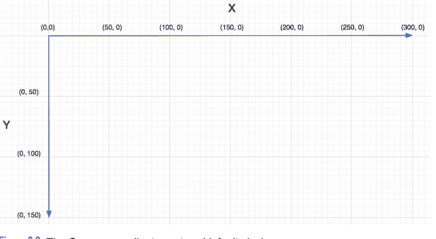

**图 2.2** Canvas 坐标系（默认大小）

然而，Canvas 坐标系并非固定不变的，如图 2.3 所示，该图对坐标系进行了平移和旋转。实际上，你可以通过以下方式变换坐标系：

-   平移
-   旋转
-   缩放
-   创建自定义变换，如倾斜

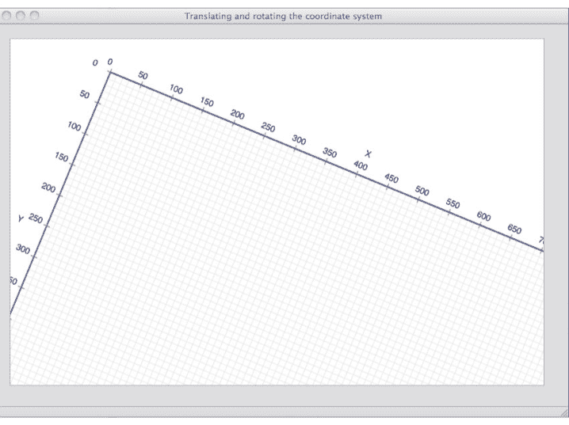

**图 2.3** 平移和旋转坐标系

变换坐标系是 Canvas 的一个重要特性，在许多不同场景下都很有用，你将在本章及本书后续内容中看到这一点。例如，平移坐标系——移动原点——可以显著简化你在绘制和填充形状及文本时经常需要计算的数值。

在第 170 页第 2.13 节"变换"中，我们将详细探讨坐标系的变换。现在，让我们来看看 Canvas 绘图模型以及如何使用它来绘制简单的形状和文本。

## 2.2 绘图模型

在使用 Canvas 的某个时刻，你将需要深入理解 Canvas 如何精确地绘制形状、图像和文本，而这又


## 2.2 绘图模型

需要理解阴影、alpha 通道、裁剪区域和合成；事实上，到本章结束时，你将对所有这些概念有很好的掌握。现在，你不需要理解它们中的任何一个，因此首次阅读时可以随意跳过本节，之后将其作为参考。

当你在画布中绘制形状或图像时，浏览器会执行以下操作：

- 1. 将形状或图像绘制到一个无限的透明位图中，使用当前的填充、描边和线条样式
- 2. 使用当前的上下文阴影设置，将形状或图像的阴影绘制到第二个位图中
- 3. 将每个阴影像素的 alpha 分量乘以上下文的 `globalAlpha` 属性
- 4. 将阴影位图合成到裁剪至裁剪区域的画布中，使用当前的合成方式
- 5. 将形状或图像的每个像素乘以上下文的 `globalAlpha` 属性
- 6. 将形状或图像位图合成到裁剪区域上方的当前画布位图中，使用当前的合成运算符

注意：步骤 2-4 仅在启用阴影时适用。

浏览器最初将形状或图像绘制到一个无限的透明位图中，使用 Canvas 上下文中与填充和描边形状相关的属性。当然，不存在无限位图这种东西，但浏览器表现得就像它拥有无限位图一样。

接下来，浏览器在上述步骤 2 到 4 中处理阴影。如果你启用了阴影（如第 2.6 节"阴影"第 83 页所讨论），浏览器会将阴影渲染到另一个位图中，将阴影中的每个像素乘以 `globalAlpha` 属性（该属性设置阴影的透明度），并使用当前的合成设置将阴影合成到 canvas 元素中，裁剪至当前的裁剪区域。

最后，浏览器根据当前的合成设置和裁剪区域，将形状或图像合成到 canvas 元素中。

如果你是 Canvas 新手，阅读了前面的段落却不太理解，不要绝望。将来某个时候，当你对阴影、alpha 通道、裁剪区域和合成有了很好的理解后，再回到本节，一切都会变得清晰明了。

既然我们已经完成了坐标系和绘图模型的预备知识，让我们开始正式使用 Canvas 来绘制简单的形状和文本。

## 2.3 绘制矩形

Canvas API 提供了三个方法，分别用于清除、绘制和填充矩形：

- `clearRect(double x, double y, double w, double h)`
- `strokeRect(double x, double y, double w, double h)`
- `fillRect(double x, double y, double w, double h)`

图 2.4 展示了一个简单的应用程序，它使用了上述所有三种方法。

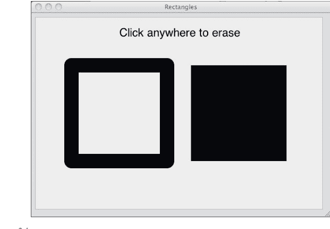
图 2.4 绘制简单矩形

该应用程序使用 `strokeRect()` 绘制左侧的矩形，使用 `fillRect()` 填充右侧的矩形。如果你在画布中的任何位置点击，应用程序会使用 `clearRect()` 清除整个画布。

图 2.4 所示的应用程序列在示例 2.1 中。

通常，正如你在本书中经常看到的，`strokeRect()` 方法使用直角绘制矩形；然而，该应用程序将上下文的 `lineJoin` 属性设置为 `round`，因此，如图 2.4 所示，左侧的矩形具有圆角。有关如何使用 `lineJoin` 属性来控制两条线相交时角的外观，请参阅第 2.8.7 节"线帽和连接"第 121 页。

### 示例 2.1 绘制简单矩形

```javascript
var canvas = document.getElementById('canvas'),
    context = canvas.getContext('2d');

context.lineJoin = 'round';
context.lineWidth = 30;

context.font = '24px Helvetica';
context.fillText('Click anywhere to erase', 175, 40);

context.strokeRect(75, 100, 200, 200);
context.fillRect(325, 100, 200, 200);

context.canvas.onmousedown = function (e) {
    context.clearRect(0, 0, canvas.width, canvas.height);
};
```

除了遵循 `lineJoin` 属性外，`strokeRect()` 还会考虑 `lineWidth` 属性，该属性以像素为单位指定线条宽度。`clearRect()`、`strokeRect()` 和 `fillRect()` 方法的总结见表 2.1。

### 表 2.1 清除、描边和填充矩形

| 方法 | 描述 |
| :--- | :--- |
| `clearRect(double x, double y, double w, double h)` | 清除指定矩形与当前裁剪区域相交的所有像素。默认情况下，裁剪区域是画布的大小，因此如果你不更改裁剪区域，则清除的像素正是由方法参数指定的像素。清除像素意味着将其颜色变为完全透明的黑色。这实际上会擦除或清除像素，允许画布的背景显示出来。 |
| `strokeRect(double x, double y, double w, double h)` | 描边指定的矩形，使用以下属性：`strokeStyle`、`lineWidth`、`lineJoin`、`miterLimit`。如果宽度或高度指定为零，则该方法将分别绘制垂直线或水平线。如果宽度和高度都指定为零，则该方法不执行任何操作。 |
| `fillRect(double x, double y, double w, double h)` | 使用 `fillStyle` 属性填充指定的矩形。如果宽度或高度指定为零，该方法会认为你是个傻瓜，因此不执行任何操作。 |

> **提示：圆角矩形**
>
> 本节中的示例使用 `lineJoin` 属性绘制圆角矩形。Canvas 规范描述了绘制这些圆角的详细过程，没有留下任何即兴发挥的空间。要控制圆角的属性（如圆角的半径），你必须自己绘制这些角。在第 2.9.3 节"`arcTo()` 方法"第 127 页，你将看到如何做到这一点。

## 2.4 颜色和透明度

上一节中的应用程序（见图 2.4）使用默认颜色——不透明的黑色——来描边和填充矩形。实际上，你无疑会想要使用其他颜色，你可以通过设置上下文的 `strokeStyle` 和 `fillStyle` 属性来实现。图 2.5 展示了一个与图 2.4 类似的应用程序，它使用不透明黑色以外的颜色来绘制两个矩形。

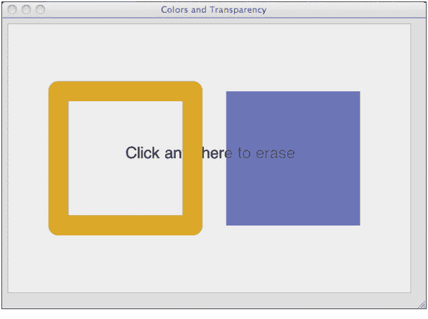
图 2.5 颜色和透明度

图 2.5 所示的应用程序列在示例 2.2 中。

### 示例 2.2 颜色和透明度

```javascript
var canvas = document.getElementById('canvas'),
    context = canvas.getContext('2d');

context.lineJoin = 'round';
context.lineWidth = 30;

context.font = '24px Helvetica';
context.fillText('Click anywhere to erase', 175, 200);

context.strokeStyle = 'goldenrod';
context.fillStyle = 'rgba(0,0,255,0.5)';

context.strokeRect(75, 100, 200, 200);
context.fillRect(325, 100, 200, 200);

context.canvas.onmousedown = function (e) {
    context.clearRect(0, 0, canvas.width, canvas.height);
};
```

该应用程序使用两种颜色：金色（goldenrod）用于描边，半透明的蓝色用于填充。你可以在图 2.5 中看到透明效果，文本透过半透明的蓝色显示出来。请注意，文本不会透过左侧矩形的边框显示，因为该颜色是不透明的。

`strokeStyle` 和 `fillStyle` 的值可以是任何有效的 CSS 颜色字符串。完整的规范可以在 http://der.w3.org/csswg/csswg/css3-color 查阅，其中列举了指定 CSS 颜色字符串的所有不同方式。你可以使用 RGB（红/绿/蓝）、RGBA（红/绿/蓝/透明度）、HSL（色调/饱和度/亮度）、HSLA（色调/饱和度/亮度/透明度）、RGB 的十六进制表示法，或颜色名称如 yellow、silver 或 teal。此外，你还可以指定 SVG 1.0 颜色名称，如 goldenrod、darksalmon 或 chocolate。以下是更多颜色字符串的示例：

- #ffffff
- #642
- rgba(100,100,100,0.8)
- rgb(255,255,0)
- hsl(20,62%,28%)
- hsla(40,82%,33%,0.6)
- antiquewhite
- burlywood
- cadetblue

> **提示：你的浏览器可能不支持所有 SVG 1.0 颜色名称**
>
> CSS3 颜色规范声明：
>
> *工作组不期望 CSS3 的所有实现都会实现所有属性或值。*
>
> 读了这句话后，如果某些浏览器不支持 CSS3 颜色规范中的所有颜色，请不要惊讶。


## 2.4 颜色与透明度

**注意：HSL 颜色值**

CSS3 颜色规范指出，HSL 被添加到 CSS3 是因为 RGB 有两个主要缺陷：它是面向硬件的，基于阴极射线管（CRT）；且不直观。

与 RGB 类似，HSL 值由三个分量组成，但 RGB 代表红、绿、蓝，而 HSL 值代表色相（hue）、饱和度（saturation）和亮度（lightness）。HSL 颜色是从色轮中选择的，其中红色在色轮上的角度为 0 度（以及 360 度），绿色为 120 度，蓝色为 240 度，依此类推。

你为 HSL 颜色指定的第一个值代表色轮上的角度。第二和第三个值代表饱和度和亮度的百分比。对于饱和度，100% 为全饱和，0% 为灰色。对于亮度，100% 为白色，50% 为正常（normal）。（注意：CSS3 颜色规范将 normal 一词放在引号中，并未详细阐述其含义。）

HSL 颜色值可以轻松转换为 RGB，反之亦然。你可以根据自己的直觉决定哪种更方便，以及你更倾向于使用哪一种。

**注意：globalAlpha 属性**

除了使用 `rgba()` 或 `hsla()` 的 alpha 分量来指定半透明颜色外，你还可以使用 `globalAlpha` 属性，浏览器会将该属性应用于你绘制的所有形状和图像。该属性的值必须在 0.0（完全透明）到 1.0（完全不透明）之间。`globalAlpha` 属性的默认值为 1.0。

**注意：为什么是 strokeStyle 和 fillStyle 而不是 strokeColor 和 fillColor？**

你可能会好奇为什么 `strokeStyle` 和 `fillStyle` 属性没有分别命名为 `strokeColor` 和 `fillColor`。虽然你确实可以为 `strokeStyle` 和 `fillStyle` 属性指定 CSS3 颜色字符串，但你也可以为这些属性指定渐变或图案。我们将在下一节探讨渐变和图案。

## 2.5 渐变与图案

除了颜色，你还可以为 `strokeStyle` 和 `fillStyle` 属性指定渐变和图案。接下来让我们看看如何实现。

### 2.5.1 渐变

Canvas 元素支持线性渐变和径向渐变。让我们先从前者开始。

#### 2.5.1.1 线性渐变

**示例 2.3** 展示了创建线性渐变的几种方法。

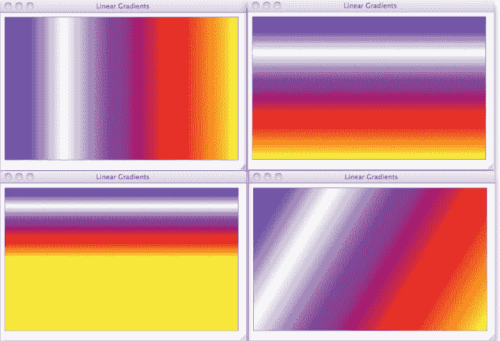

**图 2.6** 线性渐变

**图 2.6** 中显示的应用程序列在**示例 2.3** 中。

代码使用 `createLinearGradient()` 方法创建线性渐变。你向该方法传递两个点的 X 和 Y 坐标，这两个点代表一条线，Canvas 沿着这条线创建颜色渐变，并且 `createLinearGradient()` 返回一个 `CanvasGradient` 实例。最终，应用程序将填充样式（fill style）设置为该渐变，随后对 `fill()` 方法的调用将使用该渐变进行填充，直到你将填充样式设置为其他内容。

创建渐变后，代码通过调用 `CanvasGradient` 唯一的 method：`addColorStop()` 来添加五个颜色停止点。该方法接受两个参数：一个必须在 0 和 1.0 之间的 `double` 值，代表颜色停止点在渐变线上的位置；以及一个 `DOMString` 值，即 CSS3 颜色字符串。

**示例 2.3** 线性渐变

```
var canvas = document.getElementById('canvas'),
    context = canvas.getContext('2d'),
    gradient = context.createLinearGradient(0, 0, canvas.width, 0);

gradient.addColorStop(0,    'blue');
gradient.addColorStop(0.25, 'white');
gradient.addColorStop(0.5,  'purple');
gradient.addColorStop(0.75, 'red');
gradient.addColorStop(1,    'yellow');

context.fillStyle = gradient;
context.rect(0, 0, canvas.width, canvas.height);
```

上述代码创建了**图 2.6** 左上角所示的渐变。**图 2.6** 中的所有截图都是由该应用程序创建的；唯一的区别是应用程序创建渐变的方式。从右上角的截图开始顺时针方向，截图分别是用以下渐变创建的：

```
gradient = context.createLinearGradient(0, 0, 0, canvas.height);
```

前面的渐变是用一条垂直线创建的，产生了**图 2.6** 右上角所示的截图。

```
gradient = context.createLinearGradient(0, 0, canvas.width, canvas.height);
```

**图 2.6** 右下角的截图是由上述渐变创建的，其渐变线呈一定角度倾斜。

```
gradient = context.createLinearGradient(0, 0, 0, canvas.height/2);
```

最后，左下角的截图是用上述渐变创建的。请注意，该渐变的渐变线是从画布顶部到画布中间的一条垂直线。应用程序填充了整个画布，而 Canvas 元素使用渐变中使用的最后一个颜色填充画布的底半部分。

#### 2.5.1.2 径向渐变

正如你在前一节中看到的，你通过指定一条渐变线来创建线性渐变。要创建径向渐变，你需要指定两个圆，它们代表一个圆锥的两端。径向渐变效果如图 2.7 所示。

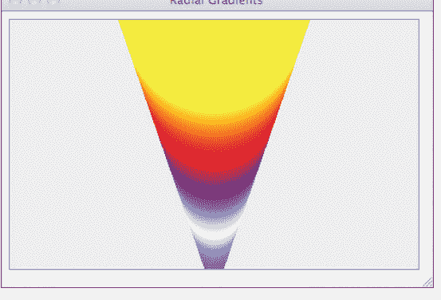

**图 2.7** 径向渐变

图 2.7 中显示的应用程序列在示例 2.4 中。

代码创建了一个径向渐变，在画布底部有一个小圆（半径 10 像素），在画布顶部有一个大圆（半径 100 像素）。两个圆在画布中水平居中。

与 `createLinearGradient()` 类似，`createRadialGradient()` 返回一个 `CanvasGradient` 实例。代码向渐变添加了四个颜色停止点，并将填充样式设置为该渐变。

请注意，代码使用径向渐变填充了整个画布；然而，与线性渐变（用最后一个渐变颜色填充渐变线外的区域）不同，径向渐变被限制在传递给 `createRadialGradient()` 方法的两个圆所描述的圆锥内。

**示例 2.4** 径向渐变

```
var canvas = document.getElementById('canvas'),
    context = canvas.getContext('2d'),
    gradient = context.createRadialGradient(
        canvas.width/2, canvas.height, 10,
        canvas.width/2, 0, 100);

gradient.addColorStop(0, 'blue');
gradient.addColorStop(0.25, 'white');
gradient.addColorStop(0.5, 'purple');
gradient.addColorStop(0.75, 'red');
gradient.addColorStop(1, 'yellow');

context.fillStyle = gradient;
context.rect(0, 0, canvas.width, canvas.height);
context.fill();
```

`createLinearGradient()` 和 `createRadialGradient()` 方法总结在表 2.2 中。

**表 2.2** 渐变

| 方法 | 描述 |
| :--- | :--- |
| `CanvasGradient createLinearGradient(double x0, double y0, double x1, double y1)` | 创建线性渐变。传递给方法参数代表指定渐变线的两个点。该方法返回一个 `CanvasGradient` 实例，你可以使用 `CanvasGradient.addColorStop()` 方法为其添加颜色停止点。 |
| `CanvasGradient createRadialGradient(double x0, double y0, double r0, double x1, double y1, double r1)` | 创建径向渐变。方法的参数代表圆锥两端的两个圆。与 `createLinearGradient()` 类似，此方法返回一个 `CanvasGradient` 实例。 |

### 2.5.2 图案

除了颜色和渐变，Canvas 元素还允许你使用图案来描边和填充形状及文本。该图案可以是三者之一：图像、画布或视频元素。

## 第 2 章 ■ 绘制

你使用 `createPattern()` 方法创建图案，该方法接受两个参数：图案本身以及一个指定浏览器如何重复图案的字符串。你可以为第二个参数指定以下值之一：`repeat`、`repeat-x`、`repeat-y` 或 `no-repeat`。你可以在 [图 2.8]() 所示的应用程序中看到这些值的影响，该程序使用图像创建图案，将填充样式设置为该图案，随后用该图案填充整个画布。

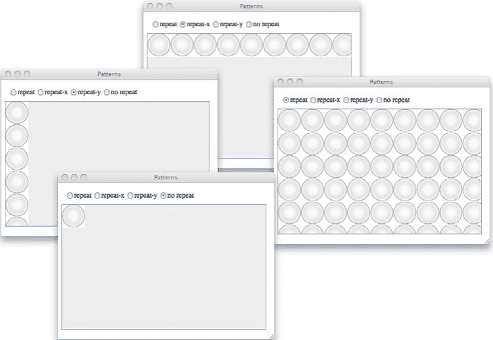

**图 2.8** 控制图案的重复方式

[图 2.8]() 中显示的应用程序的 HTML 列在 [示例 2.5]() 中。

HTML 创建了单选按钮、画布，并包含了示例的 JavaScript。该 JavaScript 列在 [示例 2.6]() 中。

JavaScript 创建了一个图像，随后使用该图像以及你在选择单选按钮时指定的重复参数创建图案。然后，应用程序使用该图案填充整个画布。


### 示例 2.5 使用模式：HTML

```
<!DOCTYPE html>
<head>
    <title>Patterns</title>

    <style>
        #canvas {
            background: #eeeeee;
            border: thin solid cornflowerblue;
        }

        #radios {
            padding: 10px;
        }
    </style>
</head>

<body>
    <div id='radios'>
        <input type='radio'
               id='repeatRadio' name='patternRadio' checked/>repeat
        <input type='radio'
               id='repeatXRadio' name='patternRadio'/>repeat-x
        <input type='radio'
               id='repeatYRadio' name='patternRadio'/>repeat-y
        <input type='radio'
               id='noRepeatRadio' name='patternRadio'/>no repeat
    </div>

    <canvas id='canvas' width='450' height='275'>
     Canvas not supported
    </canvas>

    <script src='example.js'></script>
</body>
</html>
```

请注意，每当您点击一个单选按钮时，代码都会使用 `createPattern()` 创建一个新的 CanvasPattern 对象。必须创建一个新的模式，因为 CanvasPattern 是一个所谓的不透明 JavaScript 对象，这意味着它不提供任何可供您操作的属性或方法。如果 CanvasPattern 对象提供了一个 `setPattern()` 方法，您就可以创建一个单独的 CanvasPattern 对象并简单地更改模式；但是，由于 CanvasPattern 对象是不透明的，您无法做到这一点。

### 示例 2.6 使用模式：JavaScript

```
var canvas = document.getElementById('canvas'),
    context = canvas.getContext('2d'),
    repeatRadio = document.getElementById('repeatRadio'),
    noRepeatRadio = document.getElementById('noRepeatRadio'),
    repeatXRadio = document.getElementById('repeatXRadio'),
    repeatYRadio = document.getElementById('repeatYRadio'),
    image = new Image();
```

```
// 函数......................................................................................................................................

function fillCanvaswithPattern(repeatString) {
    var pattern = context.createPattern(image, repeatString);
    context.clearRect(0, 0, canvas.width, canvas.height);
    context.fillStyle = pattern;
    context.fillRect(0, 0, canvas.width, canvas.height);
    context.fill();
}
```

```
// 事件处理程序....................................................................................................................................

repeatRadio.onclick = function (e) {
    fillCanvasWithPattern('repeat');
};

repeatXRadio.onclick = function (e) {
    fillCanvasWithPattern('repeat-x');
};

repeatYRadio.onclick = function (e) {
    fillCanvasWithPattern('repeat-y');
};

noRepeatRadio.onclick = function (e) {
    fillCanvasWithPattern('no-repeat');
};
```

```
// 初始化......................................................................................................................................

image.src = 'redball.png';
image.onload = function (e) {
    fillCanvasWithPattern('repeat');
};
```

`createPattern()` 方法在**表 2.3**中进行了描述。

### 表 2.3 `createPattern()` 方法

| 方法 | 描述 |
|---|---|
| CanvasPattern createPattern(HTMLImageElement \| HTMLCanvasElement \| HTMLVideoElement image, DOMString repetition) | 创建一个可用于描边或填充画布上形状或文本的模式。模式中使用的图像（由方法的第一个参数指定）可以是图像、画布或视频元素。第二个参数指定当您使用该模式描边或填充形状时，浏览器如何重复该模式。第二个参数的有效值为 `repeat`、`repeat-x`、`repeat-y` 和 `no-repeat`。 |

## 2.6 阴影

每当您在画布中绘制时，无论是绘制形状、文本还是图像，您还可以通过四个上下文属性来指定阴影：

-   shadowColor：一种 CSS3 颜色
-   shadowOffsetX：阴影相对于形状或文本的水平偏移量，单位为像素
-   shadowOffsetY：阴影相对于形状或文本的垂直偏移量，单位为像素
-   shadowBlur：一个与像素无关的值，用于高斯模糊方程以模糊阴影

如果您满足以下条件，Canvas 上下文将绘制阴影：

1.  指定了一个非完全透明的 `shadowColor`
2.  指定了其他阴影属性之一的非零值

图 2.9 展示了第 66 页图 2.1 中所示绘图应用程序的一些图标。

该绘图应用程序为其所有图标应用了阴影，以使其看起来像是漂浮在页面上方。然而，它为选中的图标指定了不同的阴影。该阴影的偏移量和模糊值更高，使其看起来比其他图标漂浮得更高，您可以在图 2.9 的文本图标中看到这一点。

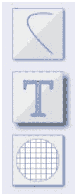

**图 2.9** 阴影营造出深度的错觉

绘图应用程序使用**示例 2.7** 中所示的方法设置图标阴影。

**示例 2.7** 使用阴影表现深度

```
var SHADOW_COLOR = 'rgba(0,0,0,0.7)';
. . .

function setIconShadow() {
  iconContext.shadowColor = SHADOW_COLOR;
  iconContext.shadowOffsetX = 1;
  iconContext.shadowOffsetY = 1;
  iconContext.shadowBlur = 2;
}

function setSelectedIconShadow() {
  iconContext.shadowColor = SHADOW_COLOR;
  iconContext.shadowOffsetX = 4;
  iconContext.shadowOffsetY = 4;
  iconContext.shadowBlur = 5;
}
```

**图 2.9** 中显示的图标是带有阴影的填充矩形，但当您描边文本或路径时，Canvas 上下文也会绘制阴影。**图 2.10** 说明了应用于描边的阴影与应用于填充的阴影之间的区别。

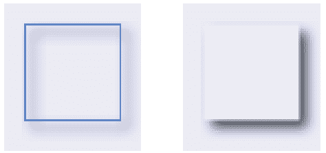

**图 2.10** 描边阴影（左）与填充阴影（右）

**提示：为阴影使用半透明颜色**

通常，为阴影使用半透明颜色是个好主意，这样背景就能透过阴影显示出来。

**注意：开启和关闭阴影**

根据 Canvas 规范，只有当您 a) 通过 `shadowColor` 属性指定了非完全透明的颜色，并且 b) 为其他三个阴影属性之一（`shadowBlur`、`shadowOffsetX` 或 `shadowOffsetY`）指定了非零值时，浏览器才应绘制阴影。因此，关闭阴影的一种简单方法是将 `shadowColor` 设置为 `undefined`。但是，在编写本书时，将 `shadowColor` 设置为 `undefined` 在 WebKit 浏览器中有效，但在 Firefox 或 Opera 中无效。为确保在所有浏览器中都能开启或关闭阴影，您应该设置所有阴影相关的属性，可以手动设置，也可以使用上下文的 `save()` 和 `restore()` 方法。

在编写本书时，无论当前的合成设置如何，浏览器都会绘制阴影，该设置决定了浏览器如何在另一个事物之上绘制一个事物。然而，一些浏览器供应商希望改变这一规则，以便仅在合成设置为 source-over 时才绘制阴影。有关合成设置的更多信息，请参阅第 181 页的第 2.14 节“合成”。

### 2.6.1 内阴影

如果您为 `shadowOffsetX` 和 `shadowOffsetY` 指定了非零的正值，那么您绘制的任何内容都将看起来像是漂浮在画布上方。这些属性的值越大，物体看起来漂浮得越高。

您也可以对这些属性使用负值，如图 2.11 所示。

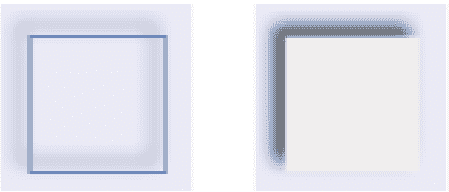

**图 2.11** 负偏移量的阴影：左侧为描边，右侧为填充

带有负偏移量的阴影可用于实现内阴影，如图 2.12 所示，该图展示了绘图应用程序的橡皮擦。橡皮擦有一个微弱的内阴影，使橡皮擦表面看起来是凹陷的。

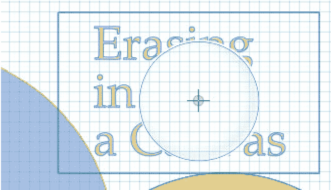

**图 2.12** 内阴影：绘图应用程序的橡皮擦

**示例 2.8** 展示了绘图应用程序中绘制橡皮擦及其内阴影的相关代码。该应用程序指定了 X 和 Y 阴影偏移量为 –5 像素的内阴影，从而产生类似于图 2.11 中描绘的阴影。

请注意对上下文 `clip()` 方法的调用。该调用将随后对 `stroke()` 的调用及其生成的阴影限制在圆圈区域内。这意味着，与图 2.12 中描边矩形的内阴影不同，浏览器不会在圆圈之外绘制任何阴影。我们将在第 187 页的第 2.15 节“裁剪区域”中更详细地讨论裁剪区域和 `clip()` 方法。

### 示例 2.8 绘制内阴影

```javascript
var drawingContext =
    document.getElementById('drawingCanvas').getContext('2d'),

    ERASER_LINE_WIDTH    = 1,
    ERASER_SHADOW_STYLE  = 'blue',
    ERASER_STROKE_STYLE  = 'rgba(0,0,255,0.6)',
    ERASER_SHADOW_OFFSET = -5,
    ERASER_SHADOW_BLUR   = 20,
    ERASER_RADIUS        = 60;

// Eraser............................................................

function setEraserAttributes() {
    drawingContext.lineWidth     = ERASER_LINE_WIDTH;
    drawingContext.shadowColor   = ERASER_SHADOW_STYLE;
    drawingContext.shadowOffsetX = ERASER_SHADOW_OFFSET;
    drawingContext.shadowOffsetY = ERASER_SHADOW_OFFSET;
    drawingContext.shadowBlur    = ERASER_SHADOW_BLUR;
    drawingContext.strokeStyle   = ERASER_STROKE_STYLE;
}

function drawEraser(loc) {
    drawingContext.save();
    setEraserAttributes();

    drawingContext.beginPath();
    drawingContext.arc(loc.x, loc.y, ERASER_RADIUS,
                      0, Math.PI*2, false);
    drawingContext.clip();
    drawingContext.stroke();

    drawingContext.restore();
}
```

控制阴影绘制方式的四个属性总结在表 2.4 中。

### 表 2.4 CanvasRenderingContext2D 阴影属性

| 属性 | 描述 |
|-----------|-------------|
| shadowBlur | 一个 double 值，决定阴影的扩散程度。当浏览器对阴影执行高斯模糊时，会使用此属性值。该值用于高斯模糊方程，与像素无关。默认值为 0。 |
| shadowColor | 一个 CSS3 颜色字符串。默认值为 rgba(0,0,0,0)，相当于完全透明的黑色。 |
| shadowOffsetX | 阴影在 X 方向上的偏移量（单位：像素）。默认值为 0。 |
| shadowOffsetY | 阴影在 Y 方向上的偏移量（单位：像素）。默认值为 0。 |

**提示：绘制阴影可能会消耗大量资源**

正如第 68 页第 2.2 节“绘图模型”中所讨论的，绘制阴影需要浏览器使用二级位图来渲染阴影，最后将其合成到屏幕上的画布中。由于这个二级位图的存在，绘制阴影可能是一个昂贵的操作。

如果你绘制的是简单的形状、文本或图像，绘制阴影可能不会在性能上产生太大影响。然而，如果你在画布中为动画对象使用阴影，省略阴影几乎肯定会获得更好的动画性能。有关动画和阴影的更多信息，请参阅第 390 页的第 5.11 节“动画最佳实践”。

## 2.7 路径、描边和填充

到目前为止，在本章中，我们唯一绘制的形状是通过 Canvas 上下文的 `strokeRect()` 方法绘制的矩形。我们还使用 `fillRect()` 填充了矩形。这两个方法都会立即生效；事实上，它们是 Canvas 上下文唯一实现的能立即绘制形状的方法（`strokeText()` 和 `fillText()` 也能立即绘制，但文本不是形状）。其他用于绘制更复杂形状（如贝塞尔曲线）的上下文方法是*基于路径的*。

大多数绘图系统，如可缩放矢量图形 (SVG)、Apple 的 Cocoa 和 Adobe 的 Illustrator 都是基于路径的。在这些绘图系统中，你定义一条*路径*，随后可以对其进行描边（绘制路径的轮廓）、填充，或者两者兼而有之，如**图 2.13** 所示。

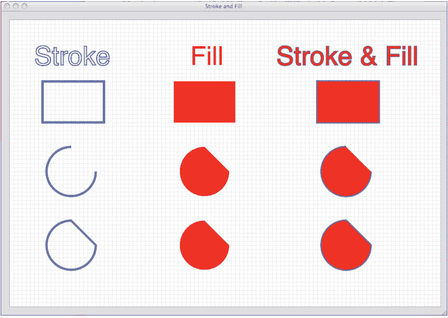

**图 2.13** 形状的描边与填充

该应用程序创建了九条独立的路径：左列对路径进行描边，中列对路径进行填充，右列则同时进行描边和填充。

第一行的矩形路径和底行的弧线路径是*封闭路径*。中间行的弧线路径是*开放路径*。请注意，无论路径是开放还是封闭，你都可以对其进行填充。当你填充一个开放路径时（如右列中间行的弧线路径所示），浏览器会将其视为封闭路径进行填充。

**图 2.13** 中显示的应用程序列在**示例 2.9** 中。

### 示例 2.9 文本、矩形和弧线的描边与填充

```javascript
var context = document.getElementById('drawingCanvas').getContext('2d');

// Functions....................................................................

function drawGrid(context, color, stepx, stepy) {
    // Listing omitted for brevity. See Example 2.13 on p. 106
    // for a complete listing.
}

// Initialization..............................................................

drawGrid(context, 'lightgray', 10, 10);

// Drawing attributes...........................................................

context.font = '48pt Helvetica';
context.strokeStyle = 'blue';
context.fillStyle = 'red';
context.lineWidth = '2';          // Line width set to 2 for text

// Text........................................................................

context.strokeText('Stroke', 60, 110);
context.fillText('Fill', 440, 110);

context.strokeText('Stroke & Fill', 650, 110);
context.fillText('Stroke & Fill', 650, 110);

// Rectangles..................................................................

context.lineWidth = '5';           // Line width set to 5 for shapes
context.beginPath();
context.rect(80, 150, 150, 100);
context.stroke();

context.beginPath();
context.rect(400, 150, 150, 100);
context.fill();

context.beginPath();
context.rect(750, 150, 150, 100);
context.stroke();
context.fill();

// Open arcs..........................................................................

context.beginPath();
context.arc(150, 370, 60, 0, Math.PI*3/2);
context.stroke();

context.beginPath();
context.arc(475, 370, 60, 0, Math.PI*3/2);
context.fill();

context.beginPath();
context.arc(820, 370, 60, 0, Math.PI*3/2);
context.stroke();
context.fill();

// Closed arcs............................................................................

context.beginPath();
context.arc(150, 550, 60, 0, Math.PI*3/2);
context.closePath();
context.stroke();

context.beginPath();
context.arc(475, 550, 60, 0, Math.PI*3/2);
context.closePath();
context.fill();

context.beginPath();
context.arc(820, 550, 60, 0, Math.PI*3/2);
context.closePath();
context.stroke();
context.fill();
```

你使用 `beginPath()` 方法开始一条新路径。`rect()` 和 `arc()` 方法分别创建矩形和弧线的路径。随后，应用程序使用上下文方法 `stroke()` 和 `fill()` 对这些路径进行描边或填充。

描边和填充受当前绘图属性的控制，例如 `lineWidth`、`strokeStyle`、`fillStyle`、`shadow` 属性等。例如，示例 2.9 中的应用程序在描边文本时将 `lineWidth` 设置为 2，在描边路径时将其重置为 5。

由 `rect()` 创建的路径是封闭的；然而，除非你使用 `arc()` 创建圆形路径，否则由 `arc()` 创建的路径不是封闭的。要关闭弧线路径，必须调用 `closePath()` 方法，如示例 2.9 所示。

该应用程序中使用的与路径相关的方法总结在表 2.5 中。

### 表 2.5 CanvasRenderingContext2D 路径相关方法

| 方法 | 描述 |
| :--- | :--- |
| `arc()` | 向当前路径添加一个代表弧线或圆形的子路径。你可以使用一个布尔变量来控制子路径的方向（与 `rect()` 不同）。如果该变量为 true，`arc()` 顺时针创建子路径；否则，逆时针创建。如果在调用此方法时已经存在子路径，`arc()` 将从现有子路径的最后一点绘制一条线到弧线路径的起点。 |
| `beginPath()` | 通过清除当前路径中的所有子路径来重置当前路径。有关子路径的更多信息，请参阅第 2.7.1 节。当你想要开始一条新路径时，请调用此方法。 |
| `closePath()` | 显式地关闭一条开放路径。此方法适用于开放弧线路径以及使用曲线或直线创建的路径。 |
| `fill()` | 使用 `fillStyle` 填充当前路径的内部。 |
| `rect(double x, double y, double width, double height)` | 在 (x, y) 处创建具有指定宽度和高度的矩形子路径。该子路径是隐式封闭的，且始终为顺时针方向。 |
| `stroke()` | 使用 `strokeStyle` 描边当前路径的轮廓。 |

> **注意：路径与隐形墨水**
>
> 创建路径随后对其进行描边或填充的一个很好的类比是使用隐形墨水绘图。
>
> 无论你用隐形墨水画了什么，立即都不可见；你随后必须采取某种措施——例如加热、使用化学试剂或红外光——才能使你画的内容可见。如果你感兴趣，可以在 http://en.wikipedia.org/wiki/Invisible_ink 详细了解关于隐形墨水的内容。
>
> 使用 `rect()` 或 `arc()` 等方法类似于用隐形墨水绘图。这些方法创建了一条不可见的路径，你随后通过调用 `stroke()` 或 `fill()` 使其可见。


### 2.7.1 路径与子路径

在任何给定时间，对于特定的画布只有一条路径，Canvas 规范称之为 *当前路径*。然而，这条路径可以由多个 *子路径* 组成。而一个子路径又由两个或更多点构成。例如，你可以这样绘制两个矩形：

```javascript
context.beginPath();            // Clear all subpaths from
                                // the current path
context.rect(10, 10, 100, 100);  // Add a subpath with four points
context.stroke();                // Stroke the subpath containing
                                // four points

context.beginPath();            // Clear all subpaths from the
                                // current path
context.rect(50, 50, 100, 100);  // Add a subpath with four points
context.stroke();                // Stroke the subpath containing
                                // four points
```

前面的代码首先调用 `beginPath()`，它会清除当前路径中的所有子路径。然后代码调用 `rect()`，该方法向当前路径添加一个包含四个点的子路径。最后，代码调用 `stroke()`，它会绘制当前路径的轮廓，使矩形显示在画布上。

接下来，代码再次调用 `beginPath()`，它清除了之前调用 `rect()` 创建的子路径，然后第二次调用 `rect()`，再次向当前路径添加一个包含四个点的子路径。最后，代码对当前路径进行描边，使第二个矩形显示在画布上。

现在考虑一下，如果你移除了第二次对 `beginPath()` 的调用，会发生什么：

```javascript
context.beginPath();            // Clear all subpaths from the
                                // current path
context.rect(10, 10, 100, 100);  // Add a subpath with four points
context.stroke();                // Stroke the subpath containing
                                // four points

context.rect(50, 50, 100, 100);  // Add a second subpath with
                                // four points
context.stroke();                // Stroke both subpaths
```

前面的代码开头与之前的代码清单完全一样：它调用 `beginPath()` 清除当前路径中的任何子路径，调用 `rect()` 创建一个包含矩形四个点的子路径，并调用 `stroke()` 使矩形显示在画布上。

接下来，代码再次调用 `rect()`，但这一次，因为代码没有调用 `beginPath()` 来清除之前的子路径，所以第二次对 `rect()` 的调用是向当前路径 *添加一个子路径*。最后，当代码第二次调用 `stroke()` 时，该调用会对当前路径中的 *两个* 子路径进行描边，这意味着它 *重绘了第一个矩形*。

#### 2.7.1.1 用于填充路径的非零环绕规则

如果当前路径回绕自身，或者当前路径中有多个相交的子路径，当调用 `fill()` 方法时，Canvas 上下文必须确定如何填充当前路径。Canvas 使用所谓的非零环绕规则来填充与自身相交的路径。**图 2.14** 说明了该规则的使用。

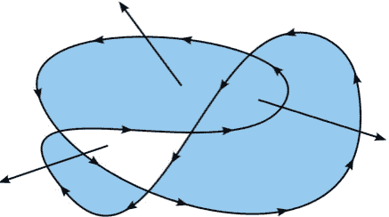

**图 2.14** 用于填充路径的非零环绕规则

以下是该规则对于自相交路径的工作原理：对于路径内的任何特定区域，从区域内某点开始绘制一条直线，直到该直线足够长，使得直线上的第二个点完全位于路径之外。**图 2.14** 中的三个箭头描绘了这一步骤。

下一步是将一个计数器初始化为零，并且每次直线穿过路径本身的一条线段或曲线时，对于顺时针方向的路径段将计数器加一，对于逆时针方向的路径段将计数器减一。如果最终计数不为零，则该区域位于路径内部，当你调用 `fill()` 时，浏览器会填充它。如果最终计数为零，则该区域不在路径内部，浏览器将不会填充它。

通过观察 **图 2.14**，你可以理解非零环绕规则是如何工作的。左侧的箭头首先穿过路径的一个逆时针段，随后穿过一个顺时针段。这意味着它的计数器为零，因此该区域不在路径内部，当你调用 `fill()` 时，浏览器不会填充它。然而，另外两个箭头的计数器不为零，因此它们起始的区域会被浏览器填充。

### 2.7.2 镂空效果

让我们运用路径、阴影和非零环绕规则的知识来实现镂空效果，如图 2.15 所示。

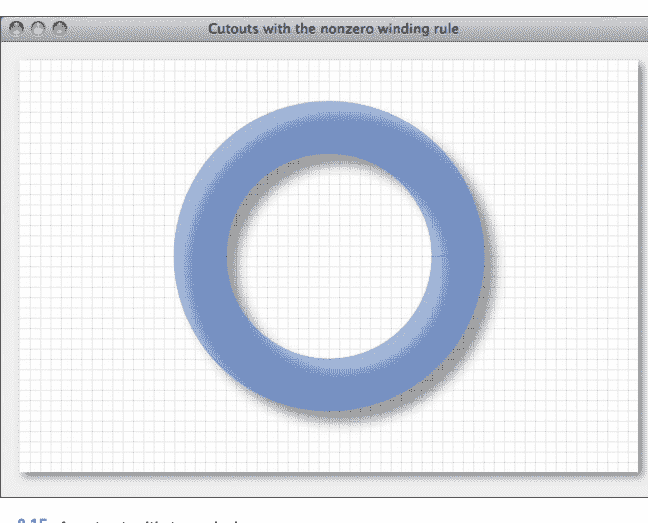

**图 2.15** 一个包含两个圆的镂空效果

图 2.15 所示应用的 JavaScript 代码在示例 2.10 中列出。这段 JavaScript 创建了一条由两个圆组成的路径，一个在另一个内部。通过使用 `arc()` 方法的最后一个参数，应用程序顺时针绘制内圆，逆时针绘制外圆，如图 2.16 的顶部截图所示。

创建路径后，图 2.15 所示的应用程序对其进行填充。通过应用非零环绕规则，浏览器会填充外圆的内部，但不会填充内圆的内部。结果就是一个镂空效果，你可以用这种方法剪切出任何你喜欢的形状。

### 示例 2.10 **图 2.15** 所示应用的 JavaScript 代码

```javascript
var context = document.getElementById('canvas').getContext('2d');

// Functions

function drawGrid(color, stepx, stepy) {
    // Listing omitted for brevity. See Example 2.13 on p. 106
    // for a complete listing.
}

function drawTwoArcs() {
    context.beginPath();
    context.arc(300, 190, 150, 0, Math.PI*2, false); // Outer: CCW
    context.arc(300, 190, 100, 0, Math.PI*2, true); // Inner: CW

    context.fill();
    context.shadowColor = undefined;
    context.shadowOffsetX = 0;
    context.shadowOffsetY = 0;
    context.stroke();
}

function draw() {
    context.clearRect(0, 0, context.canvas.width,
                     context.canvas.height);
    drawGrid('lightgray', 10, 10);

    context.save();

    context.shadowColor = 'rgba(0,0,0,0.8)';
    context.shadowOffsetX = 12;
    context.shadowOffsetY = 12;
    context.shadowBlur = 15;

    drawTwoArcs();

    context.restore();
}

// Initialization

context.fillStyle = 'rgba(100,140,230,0.5)';
context.strokeStyle = context.fillStyle;
draw();
```

## 2.7 路径、描边与填充

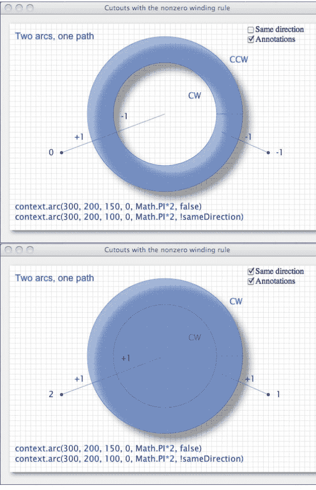

**图 2.16** 使用非零环绕规则实现镂空效果

**图 2.16** 中的示例是 **图 2.15** 所示应用的扩展，它允许你以相同的方向绘制两个圆，添加了显示圆的方向和非零环绕规则计算的注释，并展示了为创建圆的子路径而进行的 `arc()` 调用。

> **注意：图 2.16 中的那条水平线是什么？**
>
> 注意 **图 2.16** 中两个圆之间的那条水平线。**图 2.15** 中也绘制了相同的线；然而，该线在 **图 2.16** 中更明显，因为该应用使用了更深的描边颜色。
>
> 根据 Canvas 规范，当你调用 `arc()` 方法且当前路径中存在现有子路径时，该方法必须将现有子路径的最后一个点连接到圆弧的第一个点。

#### 2.7.2.1 镂空形状

**图 2.17** 所示的应用程序从一个矩形中镂空出三个形状。与前一节讨论的应用程序不同，**图 2.17** 所示的应用程序对包含镂空的矩形使用完全不透明的填充颜色。

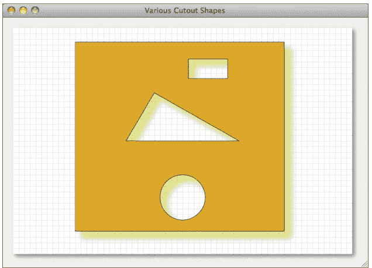

**图 2.17** 各种镂空形状


### 示例 2.11 细化镂空形状

```
var context = document.getElementById('canvas').getContext('2d');

// 函数....................................................

function drawGrid(color, stepx, stepy) {
    // 为简洁起见，此处省略了列表。完整列表请参见第 106 页的示例 2.13。
}

function draw() {
    context.clearRect(0, 0, context.canvas.width,
                     context.canvas.height);
    drawGrid('lightgray', 10, 10);
    
    context.save();
    
    context.shadowColor = 'rgba(200,200,0,0.5)';
    context.shadowOffsetX = 12;
    context.shadowOffsetY = 12;
    context.shadowBlur = 15;
    
    drawCutouts();
    strokeCutoutShapes();
    context.restore();
}

function drawCutouts() {
    context.beginPath();
    addOuterRectanglePath(); // 顺时针方向（CW）
    
    addCirclePath();      // 逆时针方向（CCW）
    addRectanglePath();   // CCW
    addTrianglePath();    // CCW
    
    context.fill(); // 镂空形状
}

function strokeCutoutShapes() {
    context.save();
    
    context.strokeStyle = 'rgba(0,0,0,0.7)';
    
    context.beginPath();
    addOuterRectanglePath(); // 顺时针方向（CW）
    context.stroke();
    
    context.beginPath();
    addCirclePath();
    addRectanglePath();
    addTrianglePath();
    context.stroke();
    
    context.restore();
}

function rect(x, y, w, h, direction) {
    if (direction) { // 逆时针方向（CCW）
        context.moveTo(x, y);
        context.lineTo(x, y + h);
        context.lineTo(x + w, y + h);
        context.lineTo(x + w, y);
        context.closePath();
    }
    else {
        context.moveTo(x, y);
        context.lineTo(x + w, y);
        context.lineTo(x + w, y + h);
        context.lineTo(x, y + h);
        context.closePath();
    }
}

function addOuterRectanglePath() {
    context.rect(110, 25, 370, 335);
}

function addCirclePath() {
    context.arc(300, 300, 40, 0, Math.PI * 2, true);
}

function addRectanglePath() {
    rect(310, 55, 70, 35, true);
}

function addTrianglePath() {
    context.moveTo(400, 200);
    context.lineTo(250, 115);
    context.lineTo(200, 200);
    context.closePath();
}

// 初始化.............................................................

context.fillStyle = 'goldenrod';
draw();
```

该应用程序有两个有趣的方面。首先，注意环绕镂空部分的形状是一个矩形，而不是圆形。该矩形表明，你可以使用任何形状，包括任意路径，来包围镂空部分。以下是该应用程序创建镂空部分的方式：

```
function drawCutouts() {
    context.beginPath();

    addOuterRectanglePath(); // 顺时针方向（Clockwise, CW）

    addCirclePath();          // 逆时针方向（Counter-clockwise, CCW）
    addRectanglePath();       // CCW
    addTrianglePath();        // CCW

    context.fill(); // 镂空形状
}
```

`addOuterRectanglePath()`、`addCirclePath()`、`addRectanglePath()` 和 `addTrianglePath()` 方法将子路径添加到当前路径中，表示镂空部分。

关于图 2.17 中显示的应用程序，第二个有趣之处是矩形镂空部分。虽然 `arc()` 允许你控制圆弧的方向，但 `rect()` 方法却没有这么灵活：`rect()` 始终创建顺时针 path。然而，在这种情况下，我们需要一个逆时针方向的矩形路径，因此我们创建了自己的 `rect()` 方法，类似于 `arc()`，它允许我们控制矩形路径的方向：

```
function rect(x, y, w, h, direction) {
    if (direction) { // 逆时针方向（CCW）
        context.moveTo(x, y);
        context.lineTo(x, y + h);
        context.lineTo(x + w, y + h);
        context.lineTo(x + w, y);
    } else {
        context.moveTo(x, y);
        context.lineTo(x + w, y);
        context.lineTo(x + w, y + h);
        context.lineTo(x, y + h);
    }
    context.closePath();
}
```

上述代码使用 `moveTo()` 和 `lineTo()` 方法以顺时针或逆时针方向创建矩形路径。我们将在第 103 页的 2.8 节"线条"中更详细地了解这些方法。

应用程序以不同的方式创建外矩形和镂空矩形的路径：

```
function addOuterRectanglePath() {
    context.rect(110, 25, 370, 335);
}

function addRectanglePath() {
    rect(310, 55, 70, 35, true);
}
```

`addOuterRectanglePath()` 方法使用上下文的 `rect()` 方法，该方法始终绘制顺时针方向的矩形，没有提供其他选项；`addRectanglePath()` 创建镂空矩形的路径，使用上面列出的 `rect()` 方法绘制逆时针方向的矩形。

### 提示：方向很重要

`arc()` 的最后一个参数是一个布尔型变量，用于控制圆弧的方向。如果值为 `true`（默认值），浏览器会顺时针绘制圆弧；否则，浏览器会逆时针绘制圆弧（或者在 Canvas 规范中称为 anti-clockwise）。

### 注意：arc() 允许你控制方向——rect() 则不能

上下文方法 `arc()` 和 `rect()` 都向当前路径添加子路径，但只有 `arc()` 允许你控制其绘制路径的方向。幸运的是，你可以很容易地实现一个函数来创建特定方向的矩形路径，如示例 2.11 中的 `rect()` 方法所示。

### 提示：消除 arc() 方法难看的连接线

如果你在当前路径中现有子路径的情况下调用 `arc()`，`arc()` 会将现有子路径中的最后一个点与圆弧的第一个点连接起来。通常，你不希望看到那条线。

你可以在调用 `arc()` 描边圆弧之前调用 `beginPath()` 来隐藏那条连接线。`beginPath()` 调用会清除当前路径中的所有子路径，因此 `arc()` 不会描边那条连接线。

## 2.8 线条

Canvas 上下文提供了两种方法用于创建线性路径：`moveTo()` 和 `lineTo()`。要使线性路径（通常称为线条）显示在 canvas 中，你需要随后调用 `stroke()`，如图 2.18 所示的应用程序所示，该程序在 canvas 中绘制了两条线条。

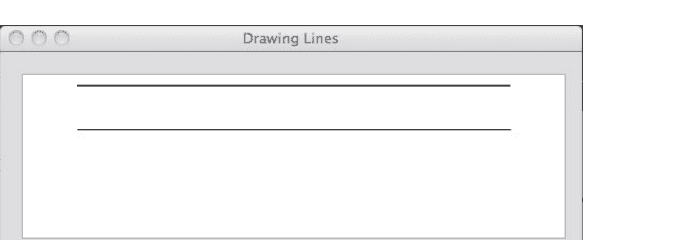

**图 2.18** 绘制线条

图 2.18 中显示的应用程序列在**示例 2.12**中。

### 示例 2.12 在 canvas 中绘制两条线条

```
var context = document.getElementById('canvas').getContext('2d');

context.lineWidth = 1;
context.beginPath();
context.moveTo(50, 10);
contextAMED_TO_BE_REPLACEDlineTo(450, 10);
context.stroke();
context.beginPath();
context.moveTo(50.5, 50.5);
context.lineTo(450.5, 50.5);
context.stroke();
```

将 `lineWidth` 属性设置为 1 像素后，代码移动到 (50, 10) 并绘制一条水平线到 (450, 10)。`moveTo()`/`lineTo()` 的组合创建了一条线性路径，代码对其进行描边以使水平线显示在 canvas 中。

接下来，应用程序调用 `beginPath()`，从当前路径中移除线性子路径。然后，代码在第一条线下方绘制另一条水平线。

示例 2.12 中显示的代码很简单，但如果你仔细观察图 2.18，会发现一些奇怪的现象。顶部的线条有两像素宽，尽管代码在绘制线条之前将 `lineWidth` 属性设置为一像素。下一节将解释发生这种情况的原因。

表 2.6 总结了 `moveTo()` 和 `lineTo()` 方法。

*表 2.6* `moveTo()` 和 `lineTo()`

| 方法 | 描述 |
|---|---|
| `moveTo(x, y)` | 向当前路径添加一个新的子路径，将你指定的点作为该子路径中唯一的点。不会清除当前路径中的任何子路径。 |
| `lineTo(x, y)` | 如果当前路径中没有子路径，此方法的行为与 `moveTo()` 完全相同：它创建一个以你指定的点为唯一一点的新子路径。如果当前路径中有子路径，此方法将你指定的点添加到该子路径。 |

### 2.8.1 线条与像素边界

如果你在像素边界上绘制一条一像素宽的线条，该线条实际上会有两像素宽，如图 2.19 所示。

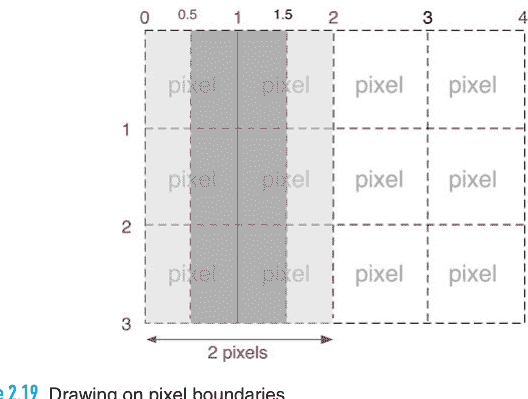

*图 2.19* 在像素边界上绘制


当你在像素边界上绘制一个像素宽度的垂直线时，画布上下文会尝试在线的中线右侧绘制半个像素，以及在中线左侧绘制半个像素。然而，半个像素是无法绘制的，因此该线会向两个方向各延伸一个像素。在图 2.19 中，深灰色是你想要绘制的部分，而浅灰色则是浏览器实际绘制的部分。

另一方面，考虑一下在像素之间绘制时会发生什么，如图 2.20 所示。

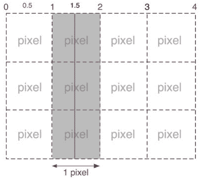

### 图 2.20 在像素之间绘制

在图 2.20 中，垂直线是在像素之间绘制的，因此在两侧各绘制半个像素恰好填充一个像素。因此要绘制真正的单像素线，你必须在像素之间绘制，而不是在像素边界上。注意在图 2.18 中，两像素宽的线是在像素边界上绘制的，而单像素宽的线则是在像素之间绘制的。

既然你已经了解了如何绘制真正的单像素线，让我们将这项知识付诸实践来绘制网格。

### 2.8.2 绘制网格

图 2.21 展示了一个由应用程序绘制的网格。

图 2.21 中应用程序的 JavaScript 代码列在示例 2.13 中。

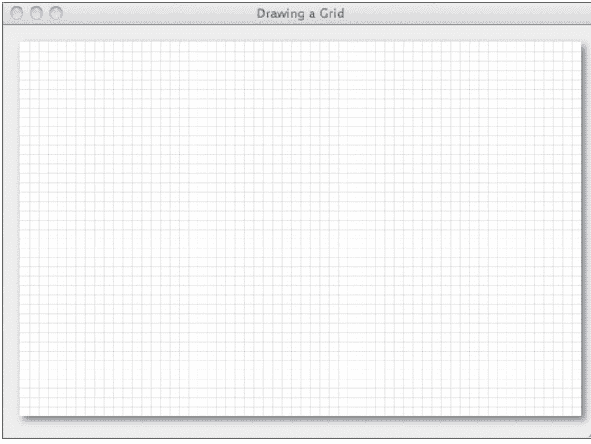

图 2.21 绘制网格

示例 2.13 绘制网格

```
var context = document.getElementById('canvas').getContext('2d');

// Functions……………………………………………………

function drawGrid(context, color, stepx, stepy) {
    context.strokeStyle = color;
    context.lineWidth = 0.5;

    for (var i = stepx + 0.5; i < context.canvas.width; i += stepx) {
        context.beginPath();
        context.moveTo(i, 0);
        context.lineTo(i, context.canvas.height);
        context.stroke();
    }

    for (var i = stepy + 0.5; i < context.canvas.height; i += stepy) {
        context.beginPath();
        context.moveTo(0, i);
        context.lineTo(context.canvas.width, i);
        context.stroke();
    }
}
```

```
// Initialization..............................................
drawGrid(context, 'lightgray', 10, 10);
```

这段 JavaScript 代码不仅在上一节讨论的像素之间绘制线条，而且还绘制仅 0.5 像素宽的线条。虽然 Canvas 规范没有明确要求，但所有浏览器的 Canvas 实现都使用了抗锯齿技术，这可以产生亚像素线条的错觉。

### 2.8.3 绘制坐标轴

图 2.22 展示了一个绘制坐标轴的应用程序。该应用程序的 JavaScript 代码列在示例 2.14 中。

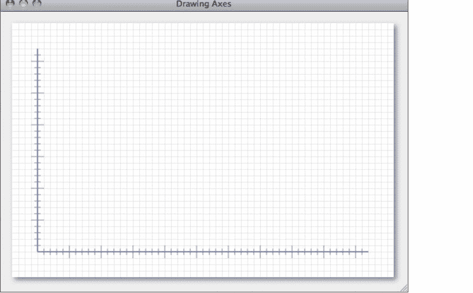

图 2.22 绘制坐标轴

示例 2.14 绘制坐标轴

```
var canvas = document.getElementById('canvas'),
    context = canvas.getContext('2d'),

    AXIS_MARGIN = 40,
    AXIS_ORIGIN = { x: AXIS_MARGIN, y: canvas.height-AXIS_MARGIN },

    AXIS_TOP   = AXIS_MARGIN,
    AXIS_RIGHT = canvas.width-AXIS_MARGIN,

    HORIZONTAL_TICK_SPACING = 10,
    VERTICAL_TICK_SPACING = 10,

    AXIS_WIDTH  = AXIS_RIGHT - AXIS_ORIGIN.x,
    AXIS_HEIGHT = AXIS_ORIGIN.y - AXIS_TOP,

    NUM_VERTICAL_TICKS   = AXIS_HEIGHT / VERTICAL_TICK_SPACING,
    NUM_HORIZONTAL_TICKS = AXIS_WIDTH  / HORIZONTAL_TICK_SPACING,

    TICK_WIDTH = 10,
    TICKS_LINEWIDTH = 0.5,
    TICKS_COLOR = 'navy',

    AXIS_LINEWIDTH = 1.0,
    AXIS_COLOR = 'blue';

// Functions.........................................................

function drawGrid(color, stepx, stepy) {
   // Listing omitted for brevity. See Example 2.13 on p. 106
   // for a complete listing.
}

function drawAxes() {
   context.save();
   context.strokeStyle = AXIS_COLOR;
   context.lineWidth = AXIS_LINEWIDTH;

   drawHorizontalAxis();
   drawVerticalAxis();

   context.lineWidth = 0.5;
   context.lineWidth = TICKS_LINEWIDTH;
   context.strokeStyle = TICKS_COLOR;

   drawVerticalAxisTicks();
   drawHorizontalAxisTicks();

   context.restore();
}
```

```
function drawHorizontalAxis() {
    context.beginPath();
    context.moveTo(AXIS_ORIGIN.x, AXIS_ORIGIN.y);
    context.lineTo(AXIS_RIGHT, AXIS_ORIGIN.y);
    context.stroke();
}

function drawVerticalAxis() {
    context.beginPath();
    context.moveTo(AXIS_ORIGIN.x, AXIS_ORIGIN.y);
    context.lineTo(AXIS_ORIGIN.x, AXIS_TOP);
    context.stroke();
}

function drawVerticalAxisTicks() {
    var deltaY;

    for (var i=1; i < NUM_VERTICAL_TICKS; ++i) {
        context.beginPath();
        if (i % 5 === 0) deltaX = TICK_WIDTH;
        else deltaX = TICK_WIDTH/2;

        context.moveTo(AXIS_ORIGIN.x - deltaX,
                       AXIS_ORIGIN.y - i * VERTICAL_TICK_SPACING);
        context.lineTo(AXIS_ORIGIN.x + deltaX,
                       AXIS_ORIGIN.y - i * VERTICAL_TICK_SPACING);
        context.stroke();
    }
}

function drawHorizontalAxisTicks() {
    var deltaY;

    for (var i=1; i < NUM_HORIZONTAL_TICKS; ++i) {
        context.beginPath();
        if (i % 5 === 0) deltaY = TICK_WIDTH;
        else deltaY = TICK_WIDTH/2;

        context.moveTo(AXIS_ORIGIN.x + i * HORIZONTAL_TICK_SPACING,
                       AXIS_ORIGIN.y - deltaY);
        context.lineTo(AXIS_ORIGIN.x + i * HORIZONTAL_TICK_SPACING,
                       AXIS_ORIGIN.y + deltaY);
        context.stroke();
    }
}

// Initialization............................................

drawGrid('lightgray', 10, 10);
drawAxes();
```

这段 JavaScript 使用常量来计算坐标轴的特性，如坐标轴的宽度和高度、刻度线之间的间距等。其余代码主要涉及调用以下上下文方法序列：`beginPath()`、`moveTo()`、`lineTo()` 和 `stroke()`，用于绘制坐标轴及其刻度线。

既然你已经知道如何绘制线条，让我们来看看如何让用户交互式地绘制它们。

### 2.8.4 橡皮筋线条

本章开头讨论的绘图应用程序允许用户通过交互式地在背景上拖动鼠标来绘制线条。图 2.23 中展示的应用程序也是如此。

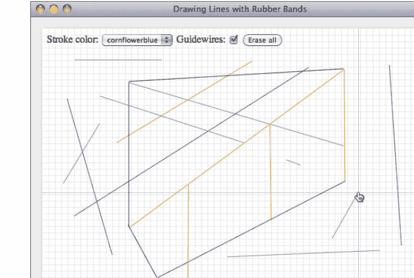

图 2.23 使用橡皮筋绘制线条

图 2.23 中展示的 HTML 和 JavaScript 分别列在示例 2.15 和 2.16 中。注意代码中 **Rubber bands** 部分的方法，以及鼠标事件处理程序。

在 onmousedown 事件处理程序中，应用程序将窗口坐标转换为画布坐标，并调用事件的 preventDefault() 方法来阻止浏览器对该事件的默认反应。

onmousedown 事件处理程序然后保存绘图表面，记录鼠标按下事件的位置，并将名为 dragging 的布尔标志设置为 true。

示例 2.15 橡皮筋线条：HTML

```
<!DOCTYPE html>
<html>
    <head>
        <title>Drawing Lines with Rubber Bands</title>

        <style>
            body {
                background: #eeeeee;
            }

            #controls {
                position: absolute;
                left: 25px;
                top: 25px;
            }

            #canvas {
                background: #ffffff;
                cursor: pointer;
                margin-left: 10px;
                margin-top: 10px;
                -webkit-box-shadow: 4px 4px 8px rgba(0,0,0,0.5);
                -moz-box-shadow: 4px 4px 8px rgba(0,0,0,0.5);
                box-shadow: 4px 4px 8px rgba(0,0,0,0.5);
            }
        </style>
    </head>

    <body>
        <canvas id='canvas' width='600' height='400'>
            Canvas not supported
        </canvas>
```

示例 2.15（续）

```
<div id='controls'>
    Stroke color: <select id='strokeStyleSelect'>
        <option value='red'>red</option>
        <option value='green'>green</option>
        <option value='blue'>blue</option>
        <option value='orange'>orange</option>
        <option value='cornflowerblue' selected>cornflowerblue</option>
        <option value='goldenrod'>goldenrod</option>
        <option value='navy'>navy</option>
        <option value='purple'>purple</option>
    </select>

    Guidewires:
    <input id='guidewireCheckbox' type='checkbox' checked/>
    <input id='eraseAllButton' type='button' value='Erase all'/>
</div>

<script src = 'example.js'></script>
</body>
</html>
```

示例 2.16 橡皮筋线条：JavaScript

```
var canvas = document.getElementById('canvas'),
    context = canvas.getContext('2d'),
    eraseAllButton = document.getElementById('eraseAllButton'),
    strokeStyleSelect = document.getElementById('strokeStyleSelect'),
    guidewireCheckbox = document.getElementById('guidewireCheckbox'),
    drawingSurfaceImageData,
    mousedown = {},
    rubberbandRect = {},
    dragging = false,
    guidewires = guidewireCheckbox.checked;

// Functions............................................................

function drawGrid(color, stepx, stepy) {
    // Listing omitted for brevity. See Example 2.13 on p. 106
    // for a complete listing.
}

function windowToCanvas(x, y) {
    var bbox = canvas.getBoundingClientRect();
    return { x: x - bbox.left * (canvas.width  / bbox.width),
             y: y - bbox.top  * (canvas.height / bbox.height) };
}
```


```
// 保存和恢复绘图表面

function saveDrawingSurface() {
    drawingSurfaceImageData = context.getImageData(0, 0,
                                                   canvas.width,
                                                   canvas.height);
}

function restoreDrawingSurface() {
    context.putImageData(drawingSurfaceImageData, 0, 0);
}

// 橡皮筋效果

function updateRubberbandRectangle(loc) {
    rubberbandRect.width  = Math.abs(loc.x - mousedownx);
    rubberbandRect.height = Math.abs(loc.y - mousedowny);

    if (loc.x > mousedownx) rubberbandRect.left = mousedownx;
    else                    rubberbandRect.left = loc.x;

    if (loc.y > mousedowny) rubberbandRect.top = mousedowny;
    else                    rubberbandRect.top = loc.y;
}

function drawRubberbandShape(loc) {
    context.beginPath();
    context.moveTo(mousedownx, mousedowny);
    context.lineTo(loc.x, loc.y);
    context.stroke();
}

function updateRubberband(loc) {
    updateRubberbandRectangle(loc);
    drawRubberbandShape(loc);
}

// 辅助线

function drawHorizontalLine(y) {
    context.beginPath();
    context.moveTo(0,y+0.5);
    context.lineTo(context.canvas.width,y+0.5);
    context.stroke();
}

### 示例 2.16（续）

function drawVerticalLine (x) {
    context.beginPath();
    context.moveTo(x+0.5,0);
    context.lineTo(x+0.5, context.canvas.height);
    context.stroke();
}

function drawGuidewires(x, y) {
    context.save();
    context.strokeStyle = 'rgba(0,0,230,0.4)';
    context.lineWidth = 0.5;
    drawVerticalLine(x);
    drawHorizontalLine(y);
    context.restore();
}

// 画布事件处理器

canvas.onmousedown = function (e) {
    var loc = windowToCanvas(e.clientX, e.clientY);

    e.preventDefault(); // 阻止光标变化
    saveDrawingSurface();
    mousedown.x = loc.x;
    mousedown.y = loc.y;
    dragging = true;
};

canvas.onmousemove = function (e) {
    var loc;

    if (dragging) {
        e.preventDefault(); // 阻止选择

        loc = windowToCanvas(e.clientX, e.clientY);
        restoreDrawingSurface();
        updateRubberband(loc);

        if(guidewires) {
            drawGuidewires(loc.x, loc.y);
        }
    }
};

canvas.onmouseup = function (e) {
    loc = windowToCanvas(e.clientX, e.clientY);
    restoreDrawingSurface();
    updateRubberband(loc);
    dragging = false;
};

// 控件事件处理器

eraseAllButton.onclick = function (e) {
    context.clearRect(0, 0, canvas.width, canvas.height);
    drawGrid('lightgray', 10, 10); saveDrawingSurface();
};

strokeStyleSelect.onchange = function (e) {
    context.strokeStyle = strokeStyleSelect.value;
};

guidewireCheckbox.onchange = function (e) {
    guidewires = guidewireCheckbox.checked;
};

// 初始化

context.strokeStyle = strokeStyleSelect.value;
drawGrid('lightgray', 10, 10);

随后，当用户拖动鼠标时，应用程序会维护一个名为`rubberbandRect`的矩形。该矩形（如图2.24所示）由两个角点定义：鼠标按下的位置和鼠标的当前位置。

当用户拖动鼠标时，对于发生的每一个`mousemove`事件，应用程序会做三件事：

+   1. 恢复绘图表面
    2. 更新`rubberbandRect`
    3. 绘制一条从鼠标按下位置到当前位置的直线

应用程序的`onmousedown`事件处理器保存了绘图表面，因此在`onmousemove`事件处理器中恢复绘图表面就有效地擦除了橡皮筋线。

# 第2章 绘图

> **注意：橡皮筋矩形的未来用途**
>
> 示例2.16中的应用程序在用户拖动鼠标时维护一个橡皮筋矩形。请注意，绘制橡皮筋线的函数名为`drawRubberbandShape()`。因为应用程序维护了一个橡皮筋矩形，我们可以修改`drawRubberbandShape()`以支持任何可以容纳在矩形内的形状，例如圆形或任意多边形。
>
> 事实上，在接下来的章节中，我们将重新实现`drawRubberbandShape()`来做到这一点。

### 2.8.5 绘制虚线

在撰写本书时，Canvas上下文并未提供绘制虚线或点线的方法；然而，轻松实现该功能是很容易的。图2.25展示了一个绘制虚线的应用程序。

**图 2.25** 虚线

图2.25所示的应用程序在示例2.17中列出。

代码计算直线的长度，并根据每段虚线的长度，计算出该直线将包含多少段虚线。根据虚线段数，代码通过反复绘制短线段来绘制虚线。

### 示例 2.17 虚线

```
var context = document.getElementById('canvas').getContext('2d');

function drawDashedLine(context, x1, y1, x2, y2, dashLength) {
  dashLength = dashLength === undefined ? 5 : dashLength;

  var deltaX = x2 - x1;
  var deltaY = y2 - y1;
  var numDashes = Math.floor(
    Math.sqrt(deltaX * deltaX + deltaY * deltaY) / dashLength);

  for (var i=0; i < numDashes; ++i) {
    context[ i % 2 === 0 ? 'moveTo' : 'lineTo' ]
      (x1 + (deltaX / numDashes) * i, y1 + (deltaY / numDashes) * i);
  }

  context.stroke();
};

context.lineWidth = 3;
context.strokeStyle = 'blue';
drawDashedLine(context, 20, 20, context.canvas.width-20, 20);
drawDashedLine(context, context.canvas.width-20, 20,
  context.canvas.width-20, context.canvas.height-20, 10);
drawDashedLine(context, context.canvas.width-20,
  context.canvas.height-20, 20, context.canvas.height-20, 15);
drawDashedLine(context, 20, context.canvas.height-20, 20, 20, 2);
```

### 2.8.6 通过扩展CanvasRenderingContext2D来绘制虚线

上一节中的`drawDashedLine()`函数在指定的上下文中绘制虚线，但如果你希望向Canvas上下文添加一个像`lineTo()`一样工作的`dashedLineTo()`方法，该怎么办呢？

向Canvas上下文添加`dashedLineTo()`方法的基本障碍在于，无法获取你上次传递给`moveTo()`的位置。那个位置是直线的起点，因此`CanvasRenderingContext2D.dashedLineTo()`方法必须能访问到该位置。

尽管Canvas上下文没有提供显式访问你上次调用`moveTo()`时指定位置的方式，但你可以按如下方式将该功能添加到上下文中：

+   1. 获取上下文的`moveTo()`方法的引用。
    2. 向Canvas上下文添加一个名为`lastMoveToLocation`的属性。
    3. 重新定义上下文的`moveTo()`方法，以将你传递给该方法的点存储在`lastMoveToLocation`属性中。

一旦你可以访问上次传递给`moveTo()`方法的位置，在`CanvasRenderingContext2D`的原型对象上实现并添加`dashedLineTo()`方法就很容易了。示例2.18展示了上述描述的代码。

## 示例 2.18 扩展CanvasRenderingContext2D

```
var context = document.getElementById('canvas').getContext('2d'),
    moveToFunction = CanvasRenderingContext2D.prototype.moveTo;

CanvasRenderingContext2D.prototype.lastMoveToLocation = {};

CanvasRenderingContext2D.prototype.moveTo = function (x, y) {
  moveToFunction.apply(context, [x,y]);
  this.lastMoveToLocation.x = x;
  this.lastMoveToLocation.y = y;
};

CanvasRenderingContext2D.prototype.dashedLineTo =
    function (x, y, dashLength) {
  dashLength = dashLength === undefined ? 5 : dashLength;

  var startX = this.lastMoveToLocation.x;
  var startY = this.lastMoveToLocation.y;

  var deltaX = x - startX;
  var deltaY = y - startY;
  var numDashes = Math.floor(Math.sqrt(deltaX * deltaX
                          + deltaY * deltaY) / dashLength);

  for (var i=0; i < numDashes; ++i) {
    this[ i % 2 === 0 ? 'moveTo' : 'lineTo' ]
        (startX + (deltaX / numDashes) * i,
         startY + (deltaY / numDashes) * i);
  }

  this.moveTo(x, y);
};
```


通过对 `CanvasRenderingContext2D` 进行此次修改，你可以像这样绘制虚线：

```javascript
context.lineWidth = 3;
context.strokeStyle = 'blue';

context.moveTo(20, 20);
context.dashedLineTo(context.canvas.width-20, 20);
context.dashedLineTo(context.canvas.width-20,
                     context.canvas.height-20);
context.dashedLineTo(20, context.canvas.height-20);
context.dashedLineTo(20, 20);
context.dashedLineTo(context.canvas.width-20,
                     context.canvas.height-20);

context.stroke();
```

图 2.26 展示了上述代码的运行结果。

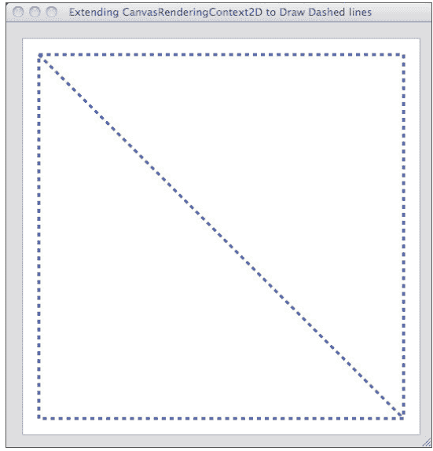

**图 2.26** 通过扩展 2d 上下文实现虚线

### 注意：扩展 CanvasRenderingContext2D 时请小心

虽然一些开发者将 JavaScript 视为一种玩具语言，但正如本节代码所示，它实际上非常强大。本节中使用的技术有许多称呼，例如 *元编程 (metaprogramming)*、*猴子补丁 (monkey patching)* 和 *覆盖 (clobbering)* 方法，这意味着你获取一个对象方法的引用，重新定义该方法，然后选择性地在重新定义的方法中使用原方法。

然而，在扩展上下文功能时应当审慎。如果你像本节所示地通过 `drawDashedLineTo()` 方法扩展上下文，而运气不佳地在未来 `CanvasRenderingContext2D` 官方添加了 `dashedLineTo()` 方法或 `lastMoveToLocation` 属性，那么你对上下文的添加可能会对 `CanvasRenderingContext2D` 中新的官方功能造成破坏。

### 注意：HTML5 Canvas 规范在不断演进

在本书付印时，Canvas 规范已增加了对虚线的支持。请记住，HTML5 规范在不断演进。正因为这种演进，时不时检查一次规范以了解变化是个好主意。

### 2.8.7 线端点和线连接点

在画布中绘制线条时，你可以控制线条端点（称为线端点 line caps）的外观，如图 2.27 所示。线端点由 Canvas 上下文中命名恰当的 `lineCap` 属性控制。

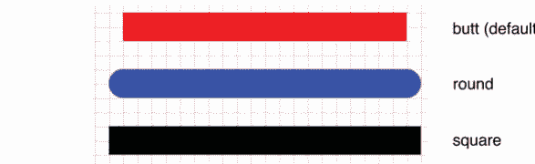

**图 2.27** 线端点

默认的线端点是 `butt`，它不对线条末端做任何处理。`round` 和 `square` 都会在线条末端添加端盖；`round` 在线条末端添加一个半径等于线宽一半的半圆；`square` 在线条末端添加一个矩形，其长度等于线宽，宽度为线宽的一半。

当你绘制线条或矩形时，你可以控制线条相交处拐角的外观，这被称为线连接点 (line join)，如图 2.28 所示。线连接点由 `lineJoin` 属性控制。

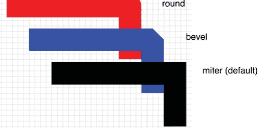

**图 2.28** 线连接点

`lineJoin` 属性的值为 `bevel` 时，会产生一个用直线连接两条线相对拐角的三角形。`miter` 是 `lineJoin` 属性的默认值，它与 `bevel` 相同，但 `miter` 会添加一个额外的三角形使拐角变方。最后，`lineJoin` 的值为 `round` 时，会产生一个连接两个拐角的填充圆弧。图 2.29 进一步阐述了线连接点。

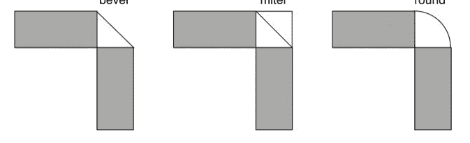

**图 2.29** 构建线连接点

当你对线连接点使用 `miter` 时，还可以指定 `miterLimit` 属性，它是 *斜接长度除以线宽一半* 的比率。斜接长度如图 2.30 所示。

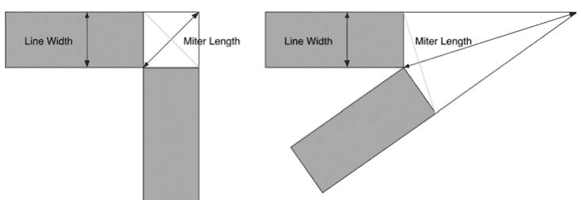

**图 2.30** 斜接长度 (Miter length)

如 **图 2.30** 所示，如果两条线之间的夹角足够小，斜接长度可能会变得非常长。如果斜接长度足够长，导致 (斜接长度 / ½ 线宽) 的比率大于你为 `miterLimit` 属性指定的值，浏览器会将该线连接点视为 `bevel` 处理，如图 **2.31** 所示。

**表 2.7** 总结了与线条相关的 Canvas 上下文属性。

**表 2.7** `CanvasRenderingContext2D` 线条属性

| 属性 | 描述 | 类型 | 允许值 | 默认值 |
|-----------|-------------|------|----------------|---------|
| `lineWidth` | 线宽，单位像素。 | `double` | 正非零数字 | 1.0 |
| `lineCap` | 决定浏览器如何绘制线条端点。 | `DOMString` | `butt`, `round`, `square` | `butt` |
| `lineJoin` | 决定浏览器如何连接相交的线条。 | `DOMString` | `round`, `bevel`, `miter` | `bevel` |
| `miterLimit` | 斜接长度除以线宽一半的比率。如果斜接线连接点超过此限制，浏览器将其视为 `bevel`。 | `double` | 正非零数字 | 10.0 |

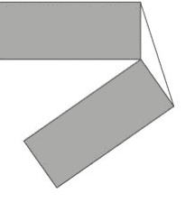

**图 2.31** 超过斜接限制，因此浏览器使用 `bevel` 连接线条

## 2.9 弧线和圆形

Canvas 上下文提供了两种绘制弧线和圆形的方法：`arc()` 和 `arcTo()`。在本节中我们将探讨这两种方法。

### 2.9.1 arc() 方法

`arc()` 方法接受六个参数：`arc(x, y, radius, startAngle, endAngle, counterClockwise)`。前两个参数代表圆心的点；第三个参数代表圆的半径；第四和第五个参数分别代表浏览器在圆周上绘制弧线的起始角度和结束角度。`arc()` 的最后一个参数是可选的，代表浏览器绘制弧线的方向。如果该值为 `false`（默认值），浏览器将顺时针绘制弧线；如果值为 `true`，浏览器将逆时针绘制弧线。图 2.32 展示了 `arc()` 方法。

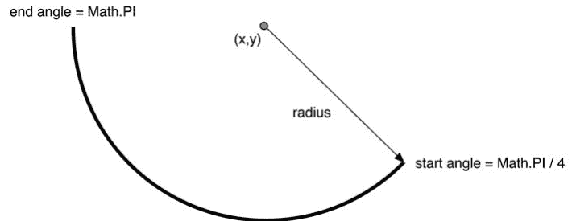

**图 2.32** 使用 `arc(x, y, radius, Math.PI/4, Math.PI, false)` 绘制弧线

然而，`arc()` 方法绘制的可能不仅仅是一条弧线。如果当前路径中存在任何子路径，浏览器会将子路径中的最后一个点与弧线上的第一个点连接起来，如图 2.33 所示。

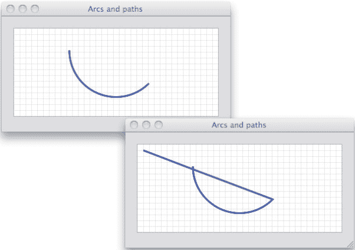

**图 2.33** 清除子路径后绘制弧线 *(上)* 与未清除子路径时绘制弧线 *(下)*

上方截图中的弧线是这样创建的：

```javascript
context.beginPath();
context.arc(canvas.width/2, canvas.height/4, 80, Math.PI/4,
            Math.PI, false);
```

在调用 `arc()` 之前，上述代码调用了 `beginPath()`，正如你在第 103 页的 2.8 节“线条”中所知，它会清除当前路径中的所有子路径。

**图 2.33** 中的下方截图是这样创建的：

```javascript
context.beginPath();
context.moveTo(10, 10);
context.arc(canvas.width/2, canvas.height/4, 80, Math.PI/4,
            Math.PI, false);
```

上述代码在调用 `arc()` 方法之前调用了 `moveTo()`。同样地，根据 2.8 节，`moveTo()` 向当前路径添加了一个包含单个点的子路径。在这种情况下，该点为 (10, 10)，在绘制弧线之前，浏览器会用一条直线将该点连接到弧线的第一个点。

### 2.9.2 橡皮筋圆形

图 2.34 所示的应用程序允许用户通过拖动鼠标来绘制圆形。当用户拖动鼠标时，应用程序会连续地绘制圆形。

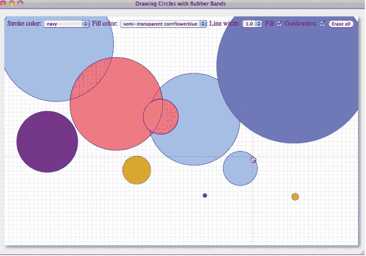

**图 2.34** 使用橡皮筋效果绘制圆形

在第 112 页的示例 2.16 中，你学习了如何绘制橡皮筋直线。回想一下，该节中的应用程序可以通过重新实现 `drawRubberbandShape()` 函数来支持直线以外的其他形状。这正是图 2.34 所示应用程序的实现方式。`drawRubberbandShape()` 函数列在示例 2.19 中。

传递给 `drawRubberbandShape()` 的 `loc` 对象包含当前的鼠标 X 和 Y 坐标。鼠标按下事件发生的位置存储在名为 `mousedown` 的变量中，该变量与 `loc` 对象一样，存储 X 和 Y 坐标。

应用程序计算鼠标按下位置与当前鼠标位置之间的距离（考虑了水平线的情况），随后将该距离用作圆形的半径。


**示例 2.19 使用橡皮筋绘制圆形**

```javascript
function drawRubberbandShape(loc) {
    var angle,
        radius;

    if (mousedown.y === loc.y) { // 水平线
        // 水平线是特殊情况。关于解释请参阅
        // else 块

        radius = Math.abs(loc.x - mousedown.x);
    }
    else {
        // 对于水平线，角度为 0，而 Math.sin(0)
        // 为 0，这意味着我们将在此处除以 0，得到半径的 NaN 值。
        // 上面的 if 块捕获水平线。

        angle = Math.atan(rubberbandRect.height/rubberbandRect.width),
        radius = rubberbandRect.height / Math.sin(angle);
    }

    context.beginPath();
    context.arc(mousedown.x, mousedown.y, radius, 0, Math.PI*2, false);
    context.stroke();

    if (fillCheckbox.checked)
        context.fill();
}
```

> 警告：可选参数并非总是可选的

Canvas 规范明确指出 `arc()` 方法的最后一个参数（一个布尔值，用于确定是顺时针还是逆时针绘制圆弧）是可选的。这意味着你无需指定该布尔值，除了 Opera 浏览器。在撰写本书时，Opera 浏览器要求必须提供这个可选参数，更糟糕的是，如果你不指定该参数，它会静默失败。

### 2.9.3 arcTo() 方法

除了 `arc()`，Canvas 上下文还提供了另一种创建圆弧路径的方法：`arcTo()`，它接受五个参数：`arcTo(x1, y1, x2, y2, radius)`。`arcTo()` 的参数表示两个点和一个圆的半径。该方法绘制一个从第一个点到第二个点的圆弧，使用指定的半径。该圆弧与从当前点到 `(x1, y1)` 的直线相切，并与从当前点到 `(x2, y2)` 的直线相切。这些特性使得 `arcTo()` 非常适合绘制圆角，如图 2.35 所示。

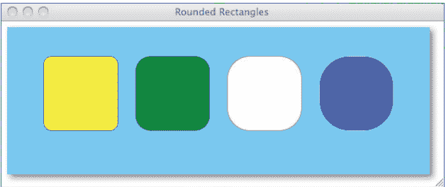

**图 2.35** 圆角矩形：圆角半径（以像素为单位，从左到右）：10、20、30、40

图 2.35 所示的应用程序列在示例 2.20 中。

### 示例 2.20 使用 arcTo()

```javascript
var context = document.getElementById('canvas').getContext('2d');

// 函数......................................................

function roundedRect(cornerX, cornerY,
                     width, height, cornerRadius) {
   if (width > 0) context.moveTo(cornerX + cornerRadius, cornerY);
   else           context.moveTo(cornerX - cornerRadius, cornerY);

   context.arcTo(cornerX + width, cornerY,
                 cornerX + width, cornerY + height,
                 cornerRadius);

   context.arcTo(cornerX + width, cornerY + height,
                 cornerX, cornerY + height,
                 cornerRadius);

   context.arcTo(cornerX, cornerY + height,
                 cornerX, cornerY,
                 cornerRadius);

   if (width > 0) {
    context.arcTo(cornerX, cornerY,
                     cornerX + cornerRadius, cornerY,
                     cornerRadius);
}
else {
    context.arcTo(cornerX, cornerY,
                     cornerX - cornerRadius, cornerY,
                     cornerRadius);
}
}

function drawRoundedRect(strokeStyle, fillStyle, cornerX, cornerY,
                          width, height, cornerRadius) {
    context.beginPath();

    roundedRect(cornerX, cornerY, width, height, cornerRadius);

    context.strokeStyle = strokeStyle;
    context.fillStyle = fillStyle;

    context.stroke();
    context.fill();
}

// 初始化..............................................................
drawRoundedRect('blue', 'yellow', 50, 40, 100, 100, 10);
drawRoundedRect('purple', 'green', 275, 40, -100, 100, 20);
drawRoundedRect('red', 'white', 300, 140, 100, -100, 30);
drawRoundedRect('white', 'blue', 525, 140, -100, -100, 40);
```

与 `arc()` 类似，`arcTo()` 会从你添加到当前路径的最新子路径的最后一个点，绘制一条直线到 `arcTo()` 的前两个参数指定的点。正是因为这条直线，示例 2.20 中列出的 `roundedRect()` 方法没有显式绘制任何直线。

`arc()` 和 `arcTo()` 方法在表 2.8 中进行了总结。

> **注意：向 CanvasRenderingContext2D 添加 roundedRect() 方法**
> 你可以轻松地向 Canvas 上下文添加 `roundedRect()` 方法；但是，如果你这样做，应该意识到存在一些风险。有关向 Canvas 上下文添加方法及其相关风险的更多信息，请参阅第 118 页的第 2.8.6 节“通过扩展 CanvasRenderingContext2D 绘制虚线”。

### 表 2.8 CanvasRenderingContext2D 用于绘制圆弧和圆的方法

| 方法 | 描述 |
| --- | --- |
| `arc(double x, double y, double radius, double startAngle, double endAngle, boolean counter-clockwise)` | 在 `(x, y)` 处创建一个圆弧路径，具有指定的半径，从 `startAngle` 到 `endAngle`。你指定的角度是弧度，而不是度数（180 度 = π 弧度）。最后一个参数是可选的；如果为 `true`，则逆时针绘制圆弧；如果参数为 `false`（这是默认值），则顺时针绘制圆弧。<br><br>如果在调用此方法时，当前路径中存在任何子路径，浏览器会用一条直线将圆弧的起点连接到子路径的最后一个点。 |
| `arcTo(double x1, double y1, double x2, double y2, double radius)` | 创建一个从 `(x1, y1)` 到 `(x2, y2)` 的圆弧路径，具有指定的半径。该圆弧与从当前路径的最后一个点到 `(x1, y1)` 的直线相切，并与从当前点到 `(x2, y2)` 的直线相切。<br><br>与 `arc()` 的情况一样，如果在调用此方法时当前路径中存在任何子路径，浏览器会用一条直线将圆弧的起点连接到子路径的最后一个点。 |

### 2.9.4 仪表盘和量表

圆弧，尤其是圆，经常被用来描绘物理对象；例如，在第 22 页的第 1.5 节“基本绘图操作”中，你已经看到了如何实现一个带有圆形表面的时钟。**图 2.36** 展示了一个使用五个圆实现仪表盘的应用程序。该仪表盘表示一个圆的度数，并在第 171 页的第 2.13.1 节“平移、缩放和旋转”中用于交互式地旋转多边形对象。

**图 2.36** 所示的应用程序使用了你在本章中学到的大部分内容。为了绘制仪表盘，该应用程序绘制圆和线，使用颜色和透明度，描边和填充圆形路径，并使用阴影赋予仪表盘一些深度。它还实现了一个剪切形状——类似于在第 98 页的第 2.7.2.1 节“剪切形状”中讨论的——这使得仪表盘外围的环具有半透明的颜色。

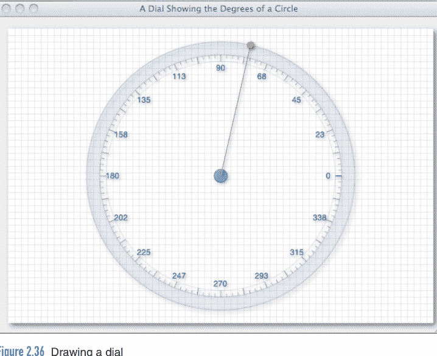

**图 2.36** 绘制仪表盘

图 2.36 所示应用程序的 JavaScript 代码摘录列在示例 2.21 中。该应用程序的 `drawDial()` 函数调用其他函数来绘制仪表盘的各个部分：

```javascript
function drawDial() {
    var loc = {x: circle.x, y: circle.y};

    drawCentroid();
    drawCentroidGuidewire(loc);

    drawRing();
    drawTickInnerCircle();
    drawTicks();
    drawAnnotations();
}
```

当你浏览示例 2.21 中的 JavaScript 代码时，请注意 `drawDial()` 调用的函数。

### 示例 2.21 绘制仪表盘

```javascript
var canvas = document.getElementById('canvas'),
    context = canvas.getContext('2d'),

    CENTROID_RADIUS = 10,
    CENTROID_STROKE_STYLE = 'rgba(0,0,0,0.5)',
    CENTROID_FILL_STYLE   = 'rgba(80,190,240,0.6)',

    RING_INNER_RADIUS = 35,
    RING_OUTER_RADIUS = 55,

    ANNOTATIONS_FILL_STYLE = 'rgba(0,0,230,0.9)',
    ANNOTATIONS_TEXT_SIZE = 12,

    TICK_WIDTH = 10,
    TICK_LONG_STROKE_STYLE = 'rgba(100,140,230,0.9)',
    TICK_SHORT_STROKE_STYLE = 'rgba(100,140,230,0.7)',

    TRACKING_DIAL_STROKING_STYLE = 'rgba(100,140,230,0.5)',

    GUIDEWIRE_STROKE_STYLE = 'goldenrod',
    GUIDEWIRE_FILL_STYLE = 'rgba(250,250,0,0.6)',

    circle = { x: canvas.width/2,
               y: canvas.height/2,
               radius: 150
             };

// 函数............................................................

function drawGrid(color, stepx, stepy) {
   context.save()
   context.shadowColor = undefined;
   context.shadowOffsetX = 0;
   context.shadowOffsetY = 0;
   context.strokeStyle = color;
   context.fillStyle = '#ffffff';
   context.lineWidth = 0.5;
   context.fillRect(0, 0, context.canvas.width,
                             context.canvas.height);

   for (var i = stepx + 0.5;
            i < context.canvas.width; i += stepx) {
      context.beginPath();
      context.moveTo(i, 0);
      context.lineTo(i, context.canvas.height);
      context.stroke();
   }
}
```


## 2.9 弧与圆

```
for (var i = stepy + 0.5;
    i < context.canvas.height; i += stepy) {
    context.beginPath();
    context.moveTo(0, i);
    context.lineTo(context.canvas.width, i);
    context.stroke();
}
context.restore();
}
```

```
function drawDial() {
    var loc = {x: circle.x, y: circle.y};

    drawCentroid();
    drawCentroidGuidewire(loc);
    drawRing();
    drawTickInnerCircle();
    drawTicks();
    drawAnnotations();
}
```

```
function drawCentroid() {
    context.beginPath();
    context.save();
    context.strokeStyle = CENTROID_STROKE_STYLE;
    context.fillStyle = CENTROID_FILL_STYLE;
    context.arc(circle.x, circle.y,
                CENTROID_RADIUS, 0, Math.PI*2, false);
    context.stroke();
    context.fill();
    context.restore();
}
```

```
function drawCentroidGuidewire(loc) {
    var angle = -Math.PI/4,
        radius, endpt;

    radius = circle.radius + RING_OUTER_RADIUS;

    if (loc.x >= circle.x) {
        endpt = { x: circle.x + radius * Math.cos(angle),
                  y: circle.y + radius * Math.sin(angle)
        };
    } else {
        endpt = { x: circle.x - radius * Math.cos(angle),
                  y: circle.y - radius * Math.sin(angle)
        };
    }
```

### 示例 2.21（续）

```
context.save();

context.strokeStyle = GUIDEWIRE_STROKE_STYLE;
context.fillStyle = GUIDEWIRE_FILL_STYLE;

context.beginPath();
context.moveTo(circle.x, circle.y);
context.lineTo(endpt.x, endpt.y);
context.stroke();

context.beginPath();
context.strokeStyle = TICK_LONG_STROKE_STYLE;
context.arc(endpt.x, endpt.y, 5, 0, Math.PI*2, false);
context.fill();
context.stroke();

context.restore();
}
```

```
function drawRing() {
    drawRingOuterCircle();

    context.strokeStyle = 'rgba(0,0,0,0.1)';
    context.arc(circle.x, circle.y,
            circle.radius + RING_INNER_RADIUS,
            0, Math.PI*2, false);

    context.fillStyle = 'rgba(100,140,230,0.1)';
    context.fill();
    context.stroke();
}
```

```
function drawRingOuterCircle() {
    context.shadowColor = 'rgba(0,0,0,0.7)';
    context.shadowOffsetX = 3,
    context.shadowOffsetY = 3,
    context.shadowBlur = 6,
    context.strokeStyle = TRACKING_DIAL_STROKING_STYLE;
    context.beginPath();
    context.arc(circle.x, circle.y, circle.radius +
            RING_OUTER_RADIUS, 0, Math.PI*2, true);
    context.stroke();
}
```

```
function drawTickInnerCircle() {
    context.save();
    context.beginPath();
    context.strokeStyle = 'rgba(0,0,0,0.1)';
    context.arc(circle.x, circle.y,
                circle.radius + RING_INNER_RADIUS - TICK_WIDTH,
                0, Math.PI*2, false);
    context.stroke();
    context.restore();
}
```

```
function drawTick(angle, radius, cnt) {
    var tickWidth = cnt % 4 === 0 ? TICK_WIDTH : TICK_WIDTH/2;

    context.beginPath();
    context.moveTo(circle.x + Math.cos(angle) * (radius - tickWidth),
                   circle.y + Math.sin(angle) * (radius - tickWidth));

    context.lineTo(circle.x + Math.cos(angle) * (radius),
                   circle.y + Math.sin(angle) * (radius));
    context.strokeStyle = TICK_SHORT_STROKE_STYLE;
    context.stroke();
}
```

```
function drawTicks() {
    var radius = circle.radius + RING_INNER_RADIUS,
        ANGLE_MAX = 2*Math.PI,
        ANGLE_DELTA = Math.PI/64,
        tickWidth;

    context.save();

    for (var angle = 0, cnt = 0; angle < ANGLE_MAX;
                                 angle += ANGLE_DELTA, cnt++) {
        drawTick(angle, radius, cnt++);
    }

    context.restore();
}
```

```
function drawAnnotations() {
    var radius = circle.radius + RING_INNER_RADIUS;

    context.save();
    context.fillStyle = ANNOTATIONS_FILL_STYLE;
    context.font = ANNOTATIONS_TEXT_SIZE + 'px Helvetica';
```

### 示例 2.21（续）

```
for (var angle=0; angle < 2*Math.PI; angle += Math.PI/8) {
    context.beginPath();
    context.fillText((angle * 180 / Math.PI).toFixed(0),
        circle.x + Math.cos(angle) * (radius - TICK_WIDTH*2),
        circle.y - Math.sin(angle) * (radius - TICK_WIDTH*2));
}
context.restore();
}

// 初始化......................................................

context.shadowColor = 'rgba(0,0,0,0.4)';
context.shadowOffsetX = 2;
context.shadowOffsetY = 2;
context.shadowBlur = 4;

context.textAlign = 'center';
context.textBaseline = 'middle';

drawGrid('lightgray', 10, 10);
drawDial();
```

关于示例 2.21 中列出的 JavaScript，有几点需要注意。首先，与常见情况一样，应用程序在（几乎）每次调用 `arc()` 之前都会调用 `beginPath()`，以便在创建弧线路径之前开始一条新路径。回顾一下，`arc()` 方法会将弧线的第一个点连接到当前路径中最后添加的子路径的最后一个点。调用 `beginPath()` 会清除当前路径中的所有子路径，因此 `arc()` 不会绘制出难看的多余线条。

应用程序使用镂空技术为圆环赋予半透明背景，方法是顺时针使用 `arc()` 绘制圆环的外圆，逆时针绘制内圆。在这种情况下，应用程序在第二次调用 `arc()` 进行镂空时*没有*调用 `beginPath()`。

其次，请注意，对上下文属性（如 `strokeStyle` 和 `fillStyle`）的临时修改都放置在 `save()` 和 `restore()` 调用之间。Canvas 上下文的 `save()` 和 `restore()` 方法使你能够实现独立的绘图函数，而不会产生副作用。

最后，请注意应用程序如何在刻度盘周围绘制文本。通过将上下文的 `textAlign` 和 `textBaseline` 分别设置为 `center` 和 `middle`，应用程序能够轻松计算文本的位置。我们将在第 3.3.5 节"标记刻度盘"（第 221 页）中讨论该技术。

## 2.10 贝塞尔曲线

贝塞尔曲线最初由一位名为保罗·德·卡斯特尔乔的法国物理学家和数学家开发，后由一位名为皮埃尔·贝塞尔的法国工程师推广开来。

贝塞尔曲线最初用于设计汽车车身，如今已广泛应用于大多数计算机图形系统中，如 Adobe Illustrator、Apple 的 Cocoa 以及 HTML5 Canvas。

贝塞尔曲线有两种类型：二次贝塞尔曲线和三次贝塞尔曲线。二次曲线是二阶曲线，即由三个点定义：两个锚点和一个控制点。三次贝塞尔曲线是三阶曲线，因此由四个点定义：两个锚点和两个控制点。

.

Canvas 同时支持二次贝塞尔曲线和三次贝塞尔曲线。接下来的章节将探讨如何使用 Canvas 生成这些曲线。

### 2.10.1 二次曲线

二次贝塞尔曲线是向一个方向弯曲的简单曲线。图 2.37 展示了三条二次贝塞尔曲线共同构成一个复选框的用法。

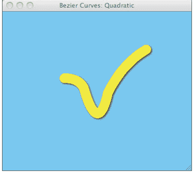

图 2.37 使用二次曲线绘制复选框

图 [2.37](#) 所示应用程序的 JavaScript 代码列在示例 [2.22](#) 中。

### 示例 2.22 绘制二次曲线

```
var context = document.getElementById('canvas').getContext('2d');

context.fillStyle    = 'cornflowerblue';
context.strokeStyle  = 'yellow';

context.shadowColor   = 'rgba(50,50,50,1.0)';
context.shadowOffsetX = 2;
context.shadowOffsetY = 2;
context.shadowBlur    = 4;

context.lineWidth = 20;
context.lineCap = 'round';

context.beginPath();
context.moveTo(120.5, 130);
context.quadraticCurveTo(150.8, 130, 160.6, 150.5);
context.quadraticCurveTo(190, 250.0, 210.5, 160.5);
context.quadraticCurveTo(240, 100.5, 290, 70.5);

context.stroke();
```

你使用 `quadraticCurveTo()` 方法来绘制二次贝塞尔曲线，该方法接受四个参数，表示两个点的 X 和 Y 坐标。第一个点是曲线的控制点，用于确定曲线的形状；第二个点是锚点。`quadraticCurveTo()` 方法会用一条贝塞尔曲线将锚点连接到当前路径中你定义的最后一个点。

你可以将二次贝塞尔曲线用于多种用途；例如，图 [2.38](#) 所示的应用程序使用二次贝塞尔曲线绘制了箭头尖端的三个角点。该应用程序还绘制了每条曲线的控制点和锚点。

图 [2.38](#) 所示的应用程序代码列在示例 [2.23](#) 中。

### 示例 2.23 带圆角的箭头

```javascript
var canvas = document.getElementById('canvas'),
    context = canvas.getContext('2d'),
    ARROW_MARGIN = 30,
    POINT_RADIUS = 7,
    points = [
      { x: canvas.width - ARROW_MARGIN,
        y: canvas.height - ARROW_MARGIN },
      { x: canvas.width - ARROW_MARGIN*2,
        y: canvas.height - ARROW_MARGIN },
      { x: POINT_RADIUS,
        y: canvas.height/2 },
      { x: ARROW_MARGIN,
        y: canvas.height/2 - ARROW_MARGIN },
      { x: canvas.width - ARROW_MARGIN,
        y: ARROW_MARGIN },
      { x: canvas.width - ARROW_MARGIN,
        y: ARROW_MARGIN*2 },
    ];

// 函数........................................................

function drawPoint(x, y, strokeStyle, fillStyle) {
  context.beginPath();
  context.fillStyle = fillStyle;
  context.strokeStyle = strokeStyle;
  context.lineWidth = 0.5;
  context.arc(x, y, POINT_RADIUS, 0, Math.PI*2, false);
  context.fill();
  context.stroke();
}

function drawBezierPoints() {
  var i,
      strokeStyle,
      fillStyle;
  for (i=0; i < points.length; ++i) {
    fillStyle   = i % 2 === 0 ? 'white' : 'blue',
    strokeStyle = i % 2 === 0 ? 'blue' : 'white';
    drawPoint(points[i].x, points[i].y,
              strokeStyle, fillStyle);
  }
}

function drawArrow() {
  context.strokeStyle = 'white';
  context.fillStyle = 'cornflowerblue';

  context.moveTo(canvas.width - ARROW_MARGIN, ARROW_MARGIN*2);

  context.lineTo(canvas.width - ARROW_MARGIN,
                 canvas.height - ARROW_MARGIN*2);

  context.quadraticCurveTo(points[0].x, points[0].y,
                           points[1].x, points[1].y);

  context.lineTo(ARROW_MARGIN, canvas.height/2 + ARROW_MARGIN);

  context.quadraticCurveTo(points[2].x, points[2].y,
                           points[3].x, points[3].y);

  context.lineTo(canvas.width - ARROW_MARGIN*2, ARROW_MARGIN);

  context.quadraticCurveTo(points[4].x, points[4].y,
                           points[5].x, points[5].y);
  context.fill();
  context.stroke();
}

// 初始化..................................................

context.clearRect(0, 0, canvas.width, canvas.height);
drawArrow();
drawBezierPoints();
```

`quadraticCurveTo()` 方法总结见表 2.9。

### 表 2.9 quadraticCurveTo()

| 方法 | 描述 |
| --- | --- |
| quadraticCurveTo(double cpx, double cpy, double x, double y) | 创建二次贝塞尔曲线的路径。你需要向此方法传递两个点；第一个点是曲线的控制点；第二个点是锚点。 |

### 2.10.2 三次曲线

在上一节中，你看到了如何创建二次贝塞尔曲线。这些曲线是二维的，这意味着它们只在一个方向上弯曲。如果你想绘制在两个方向上弯曲的曲线，例如图 2.39 所示的曲线，你需要三阶曲线，也称为三次贝塞尔曲线。

图 2.39 所示的应用程序使用了 `bezierCurveTo()` 方法来创建三次贝塞尔曲线的路径。该应用程序的代码列在示例 2.24 中。

除了绘制曲线本身，该代码还为曲线的控制点和锚点绘制了填充圆。

### 示例 2.24 绘制三次贝塞尔曲线

```javascript
var canvas = document.getElementById('canvas'),
    context = canvas.getContext('2d'),
    endPoints    = [ { x: 130, y: 70 },  { x: 430, y: 270 }, ],
    controlPoints = [ { x: 130, y: 250 }, { x: 450, y: 70 }, ];

// 函数.........................................................................

function drawGrid(color, stepx, stepy) {
    // 为简洁起见，此处省略了列表。完整列表请参见第 106 页的示例 2.13。
}

function drawBezierCurve() {
    context.strokeStyle = 'blue';

    context.beginPath();
    context.moveTo(endPoints[0].x, endPoints[0].y);
    context.bezierCurveTo(controlPoints[0].x, controlPoints[0].y,
                           controlPoints[1].x, controlPoints[1].y,
                           endPoints[1].x, endPoints[1].y);
    context.stroke();
}

function drawEndPoints() {
    context.strokeStyle = 'blue';
    context.fillStyle = 'red';

    endPoints.forEach( function (point) {
        context.beginPath();
        context.arc(point.x, point.y, 5, 0, Math.PI*2, false);
        context.stroke();
        context.fill();
    });
}

function drawControlPoints() {
    context.strokeStyle = 'yellow';
    context.fillStyle = 'blue';

    controlPoints.forEach( function (point) {
        context.beginPath();
        context.arc(point.x, point.y, 5, 0, Math.PI*2, false);
        context.stroke();
        context.fill();
    });
}

// 初始化....................................................................................

drawGrid('lightgray', 10, 10);

drawControlPoints();
drawEndPoints();
drawBezierCurve();
```

`bezierCurveTo()` 方法总结见表 2.10。

### 表 2.10 bezierCurveTo()

| 方法 | 描述 |
| :--- | :--- |
| `bezierCurveTo(double cpx, double cpy, double cp2x, double cp2y, double x, double y)` | 创建三次贝塞尔曲线的路径。你需要向此方法传递三个点；前两个点是曲线的控制点；最后一点是锚点。 |

## 2.11 多边形

至此，我们已经介绍了 Canvas 上下文支持的所有基本形状：直线、矩形、弧、圆和贝塞尔曲线。然而，你无疑会想要在画布上绘制其他类型的形状；例如，三角形、六边形和八边形。在本节中，你将看到如何描边和填充任意多边形，对应图 2.40 所示的应用程序。

你可以结合使用 `moveTo()` 和 `lineTo()` 以及一些简单的三角函数来绘制任意边数的多边形。图 2.41 展示了简单的三角函数部分。

图 2.41 显示了如何根据包含多边形的最小圆的圆心和半径来计算单个多边形顶点。示例 2.25 是图 2.40 所示应用程序的 JavaScript 代码摘录。它展示了如何使用这些顶点来绘制任意多边形。

### 示例 2.25 绘制多边形（摘录）

```javascript
var canvas = document.getElementById('canvas'),
    context = canvas.getContext('2d'),

    sidesSelect = document.getElementById('sidesSelect'),
    startAngleSelect = document.getElementById('startAngleSelect'),

    fillCheckbox = document.getElementById('fillCheckbox'),

    mousedown = {},
    rubberbandRect = {},

    Point = function (x, y) {
      this.x = x;
      this.y = y;
    },

    // 函数....................................................

    function getPolygonPoints(centerX, centerY, radius, sides, startAngle) {
      var points = [],
          angle = startAngle || 0;

      for (var i=0; i < sides; ++i) {
        points.push(new Point(centerX + radius * Math.sin(angle),
                              centerY - radius * Math.cos(angle)));
        angle += 2*Math.PI/sides;
      }

      return points;
    },

    function createPolygonPath(centerX, centerY, radius, sides, startAngle) {
      var points = getPolygonPoints(centerX, centerY, radius, sides,
                                   startAngle);
      context.beginPath();
      context.moveTo(points[0].x, points[0].y);

      for (var i=1; i < sides; ++i) {
        context.lineTo(points[i].x, points[i].y);
      }
      context.closePath();
    },

    function drawRubberbandShape(loc, sides, startAngle) {
      createPolygonPath(mousedown.x, mousedown.y,
                        rubberbandRect.width, parseInt(sidesSelect.value),
                        (Math.PI / 180) * parseInt(startAngleSelect.value));
      context.stroke();

      if (fillCheckbox.checked) {
        context.fill();
      }
    }
```


第2章 ■ 绘制

[示例 2.25](#) 中列出的代码首先获取 Canvas 上下文的引用，并定义一个 `Point` 对象。

`getPolygonPoints()` 函数创建并返回一个由传入函数的五个参数定义的多边形点数组。该函数使用 [图 2.41](#) 中描绘的多边形顶点方程来创建该点数组。

`createPolygonPath()` 函数调用 `getPolygonPoints()` 获取指定多边形的点数组，移动到第一个点，然后创建一个包含所有多边形顶点的路径。

最后，实际绘制多边形的是 `drawRubberbandShape()` 函数。该函数是第 110 页 2.8.4 节 "橡皮筋线" 中介绍的 `drawRubberbandShape()` 函数的修改版，并被 [图 2.40](#) 中的应用程序用于在用户拖动鼠标时交互式绘制多边形。有关绘制橡皮筋形状的更多信息，请参阅第 2.8.4 节。

### 2.11.1 多边形对象

回顾一下，HTML5 Canvas 是一个即时模式图形系统。当你在画布上绘图时，浏览器会立即绘制然后立即忘记。即时模式图形对于实现画图应用程序来说没问题，但如果你想实现一个允许创建可操作图形对象的绘图应用程序，最好有一个可以编辑和绘制的对象列表。

在本节中，我们修改上一节中的应用程序以维护一个多边形对象列表。修改后应用程序的部分代码列在 [示例 2.26](#) 中。

### **示例 2.26** 使用多边形对象

```
var canvas = document.getElementById('canvas'),
    context = canvas.getContext('2d'),
    startAngleSelect = document.getElementById('startAngleSelect'),
    sidesSelect = document.getElementById('sidesSelect'),
    ...
    mousedown = {},
    rubberbandRect = {};
```

*(续)*

```
function drawRubberbandShape(loc, sides, startAngle) {
    var polygon = new Polygon(mousedown.x, mousedown.y,
                        rubberbandRect.width,
                        parseInt(sidesSelect.value),
                        (Math.PI / 180) * parseInt(startAngleSelect.value),
                        context.strokeStyle,
                        context.fillStyle,
                        fillCheckbox.checked);

    context.beginPath();
    polygon.createPath(context);
    polygon.stroke(context);

    if (fillCheckbox.checked) {
        polygon.fill(context);
    }
    else {
        polygons.push(polygon);
    }
}
```

应用程序在用户拖动鼠标创建多边形时调用 drawRubberbandShape() 函数。该函数创建一个多边形对象，调用多边形的 createPath() 方法，然后描边并可能填充该路径。

如果用户完成鼠标拖动，drawRubberbandShape() 函数会将多边形添加到应用程序维护的多边形列表中。

本节实现的多边形对象具有以下方法：

- `points[] getPoints()`
- `void createPath(context)`
- `void stroke(context)`
- `void fill(context)`
- `void move(x, y)`

示例 2.27 展示了 Polygon 对象的实现。

### 示例 2.27 多边形对象

```
// Point 构造函数..........................................................

var Point = function (x, y) {
  this.x = x;
  this.y = y;
};

// Polygon 构造函数........................................................

var Polygon = function (centerX, centerY, radius,
              sides, startAngle, strokeStyle, fillStyle, filled) {
  this.x = centerX;
  this.y = centerY;
  this.radius = radius;
  this.sides = sides;
  this.startAngle = startAngle;
  this.strokeStyle = strokeStyle;
  this.fillStyle = fillStyle;
  this.filled = filled;
};

// Polygon 原型..........................................................

Polygon.prototype = {
  getPoints: function () {
    var points = [],
        angle = this.startAngle || 0;

    for (var i=0; i < this.sides; ++i) {
      points.push(new Point(this.x + this.radius * Math.sin(angle),
                            this.y - this.radius * Math.cos(angle)));
      angle += 2*Math.PI/this.sides;
    }
    return points;
  },

  createPath: function (context) {
    var points = this.getPoints();

    context.beginPath();
    context.moveTo(points[0].x, points[0].y);

    for (var i=1; i < this.sides; ++i) {
      context.lineTo(points[i].x, points[i].y);
    }
    context.closePath();
  },
```

### 示例 2.27 （续）

```
stroke: function (context) {
    context.save();
    this.createPath(context);
    context.strokeStyle = this.strokeStyle;
    context.stroke();
    context.restore();
},

fill: function (context) {
    context.save();
    this.createPath(context);
    context.fillStyle = this.fillStyle;
    context.fill();
    context.restore();
},

move: function (x, y) {
    this.x = x;
    this.y = y;
}
};
```

创建多边形时，你需要指定多边形的位置，该位置对应于能包围多边形的最小圆的中心。你还需要指定圆的半径、多边形的边数、多边形第一个点的起始角度、多边形的描边和填充样式，以及多边形是否填充。

多边形可以生成一个表示其顶点的点数组，并且可以从这些点创建一个路径。它们也可以描边或填充该路径，并且你可以通过调用其 move() 方法来移动它们。

## 2.12 高级路径操作

为了跟踪绘制的内容，许多应用程序（如绘图应用程序、计算机辅助设计系统和游戏）维护一个显示对象列表。通常，此类应用程序允许用户编辑其显示对象；例如，CAD 应用程序允许用户选择、移动和调整设计元素的大小。

用户通常通过鼠标点击或手指触摸来选择显示对象。为了方便选择，除了其他功能外，Canvas API 提供了一个 pointInPath() 方法，如果指定点位于当前路径内，则返回 true。在本节中，我们通过扩展第 147 页 2.11.1 节 "多边形对象" 中讨论的多边形讨论来使用该方法，允许用户拖动多边形。

我们还将在第 158 页 2.12.2 节 "编辑贝塞尔曲线" 中探索一个允许用户创建和编辑贝塞尔曲线的应用程序。

### 2.12.1 拖动多边形

在本节中，你将看到在用户创建多边形对象时如何维护一个列表。该多边形列表允许你实现许多有趣的事情；例如，拖动多边形（如图 2.42 所示），或者正如你将在第 170 页 2.13 节 "变换" 中看到的，旋转多边形。

图 2.42 中的应用程序有两种模式：绘制和编辑。最初，应用程序处于绘制模式，因此你可以通过拖动鼠标来创建多边形。随后，如果你点击 "编辑" 复选框，应用程序会切换到编辑模式，你可以拖动多边形。

应用程序维护一个 Polygon 对象的数组。当在编辑模式下发生鼠标按下事件时，应用程序会遍历该数组，为每个多边形创建一个路径，并检查鼠标按下的位置是否在该路径内。如果是，应用程序会存储对相关多边形的引用，并保存从多边形左上角到鼠标按下位置的 X 和 Y 偏移量。

此后，应用程序的鼠标移动事件处理程序会根据鼠标移动来移动选中的多边形。当你取消选中 "编辑" 复选框时，应用程序会恢复到绘制模式。

与图 2.42 所示应用程序的拖动多边形相关的 JavaScript 列在示例 2.28 中。为简洁起见，未列出应用程序的 HTML。

---

**图 2.42** 拖动多边形


 ## 示例 2.28 拖拽多边形

```
var canvas = document.getElementById('canvas'),
    context = canvas.getContext('2d'),
    eraseAllButton = document.getElementById('eraseAllButton'),
    strokeStyleSelect = document.getElementById('strokeStyleSelect'),
    fillStyleSelect = document.getElementById('fillStyleSelect'),
    fillCheckBox = document.getElementById('fillCheckBox'),
    editCheckBox = document.getElementById('editCheckBox'),
    sidesSelect = document.getElementById('sidesSelect'),

    drawingSurfaceImageData,

    mousedown = {},
    rubberbandRect = {},

    dragging = false,
    draggingOffsetX,
    draggingOffsetY,

    sides = 8,
    startAngle = 0,

    guidewires = true,
    editing = false,
    polygons = [];

// Functions...

function drawGrid(color, stepx, stepy) {
    // Listing omitted for brevity. See Example 2.13 on p. 106
    // for a complete listing.
}

function windowToCanvas(x, y) {
    var bbox = canvas.getBoundingClientRect();
    return { x: x - bbox.left * (canvas.width  / bbox.width),
             y: y - bbox.top  * (canvas.height / bbox.height)
           };
}

// Save and restore drawing surface...

function saveDrawingSurface() {
    drawingSurfaceImageData = context.getImageData(0, 0,
                                    canvas.width,
                                    canvas.height);
}
```

```
function restoreDrawingSurface() {
    context.putImageData(drawingSurfaceImageData, 0, 0);
}
```

```
// Draw a polygon.................................................................
```

```
function drawPolygon(polygon) {
    context.beginPath();
    polygon.createPath(context);
    polygon.stroke(context);

    if (fillCheckbox.checked) {
        polygon.fill(context);
    }
}
```

```
// Rubber bands...............................................................
```

```
function updateRubberbandRectangle(loc) {
    rubberbandRect.width = Math.abs(loc.x - mousedown.x);
    rubberbandRect.height = Math.abs(loc.y - mousedown.y);

    if (loc.x > mousedown.x) rubberbandRect.left = mousedown.x;
    else                     rubberbandRect.left = loc.x;

    if (loc.y > mousedown.y) rubberbandRect.top = mousedown.y;
    else                     rubberbandRect.top = loc.y;
}
```

```
function drawRubberbandShape(loc, sides, startAngle) {
    var polygon = new Polygon(mousedown.x, mousedown.y,
                              rubberbandRect.width, parseInt(sidesSelect.value),
                              (Math.PI / 180) * parseInt(startAngleSelect.value),
                              context.strokeStyle,
                              context.fillStyle,
                              fillCheckbox.checked);
    drawPolygon(polygon);

    if (!dragging) {
        polygons.push(polygon);
    }
}
```

```
function updateRubberband(loc, sides, startAngle) {
    updateRubberbandRectangle(loc);
    drawRubberbandShape(loc, sides, startAngle);
}
```

```
// Guidewires...........................................................
```

```
function drawHorizontalLine (y) {
    context.beginPath();
    context.moveTo(0,y+0.5);
    context.lineTo(context.canvas.width,y+0.5);
    context.stroke();
}
```

```
function drawVerticalLine (x) {
    context.beginPath();
    context.moveTo(x+0.5,0);
    context.lineTo(x+0.5,context.canvas.height);
    context.stroke();
}
```

```
function drawGuidewires(x, y) {
    context.save();
    context.strokeStyle = 'rgba(0,0,230,0.4)';
    context.lineWidth = 0.5;
    drawVerticalLine(x);
    drawHorizontalLine(y);
    context.restore();
}
```

```
function drawPolygons() {
    polygons.forEach( function (polygon) {
        drawPolygon(polygon);
    });
}
```

```
// Dragging..........................................................
```

```
function startDragging(loc) {
    saveDrawingSurface();
    mousedown.x = loc.x;
    mousedown.y = loc.y;
}
```

```
function startEditing() {
    canvas.style.cursor = 'pointer';
    editing = true;
}
```

```
function stopEditing() {
    canvas.style.cursor = 'crosshair';
    editing = false;
}
```

```
// Event handlers.....................................................

canvas.onmousedown = function (e) {
   var loc = windowToCanvas(e.clientX, e.clientY);

   e.preventDefault(); // Prevent cursor change

   if (editing) {
      polygons.forEach( function (polygon) {
         polygon.createPath(context);
         if (context.isPointInPath(loc.x, loc.y)) {
            startDragging(loc);
            dragging = polygon;
            draggingOffsetX = loc.x - polygon.x;
            draggingOffsetY = loc.y - polygon.y;
            return;
         }
      });
   }
   else {
      startDragging(loc);
      dragging = true;
   }
};

canvas.onmousemove = function (e) {
   var loc = windowToCanvas(e.clientX, e.clientY);

   e.preventDefault(); // Prevent selections

   if (editing && dragging) {
      dragging.x = loc.x - draggingOffsetX;
      dragging.y = loc.y - draggingOffsetY;
      context.clearRect(0, 0, canvas.width, canvas.height);
      drawGrid('lightgray', 10, 10);
      drawPolygons();
   elseif (dragging) {
         restoreDrawingSurface();
         updateRubberband(loc, sides, startAngle);

         if (guidewires) {
            drawGuidewires(mousedown.x, mousedown.y);
         }
      }
   }
};
```

```
canvas.onmouseup = function (e) {
  var loc = windowToCanvas(e.clientX, e.clientY);

  dragging = false;

  if (editing) {
  }
  else {
    restoreDrawingSurface();
    updateRubberband(loc);
  }
};
```

```
eraseAllButton.onclick = function (e) {
  context.clearRect(0, 0, canvas.width, canvas.height);
  drawGrid('lightgray', 10, 10); saveDrawingSurface();
};
```

```
strokeStyleSelect.onchange = function (e) {
  context.strokeStyle = strokeStyleSelect.value;
};
```

```
fillStyleSelect.onchange = function (e) {
  context.fillStyle = fillStyleSelect.value;
};
```

```
editCheckbox.onchange = function (e) {
  if (editCheckbox.checked) {
    startEditing();
  }
  else {
    stopEditing();
  }
};
```

```
// Initialization..............................................................

context.strokeStyle = strokeStyleSelect.value;
context.fillStyle = fillStyleSelect.value;

context.shadowColor = 'rgba(0,0,0,0.4)';
context.shadowOffsetX = 2;
context.shadowOffsetY = 2;
context.shadowBlur = 4;

drawGrid('lightgray', 10, 10);
```

### 2.12.2 编辑贝塞尔曲线

在画布中拖拽形状的能力——如同我们在第 2.12.1 节"拖拽多边形"（第 151 页）中所做的那样——为许多可能性打开了大门。例如，图 2.43 中所示的应用程序可以让你绘制贝塞尔曲线，并通过拖拽其端点和控制点来后续编辑它们。

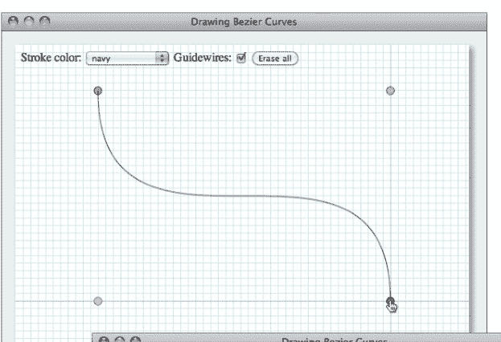


图 2.43 编辑贝塞尔曲线

图 2.43 中的上方截图展示了如何通过拖拽鼠标来绘制曲线。下方截图展示了当用户停止拖拽鼠标时应用程序显示的说明。关闭说明后，你可以通过拖拽端点或控制点来调整曲线，如图 2.44 中的上方截图所示。


图 2.44 拖拽贝塞尔端点和控制点

最后，如果你在端点或控制点之外单击，应用程序将最终确定曲线，如图 2.44 中的下方截图所示。

图 2.43 中所示应用程序的 HTML 列于示例 2.29。

### 示例 2.29 拖拽贝塞尔曲线端点和控制点：HTML

```
<!DOCTYPE html>
<html>
<head>
<title>Drawing Bezier Curves</title>

<style>
body {
background: #eeeeee;
}

.floatingControls {
position: absolute;
left: 150px;
top: 100px;
上部的width: 300px;
padding: 20px;
border: thin solid rgba(0,0,0,0.3);
background: rgba(0,0,200,0.1);
color: blue;
font: 14px Arial;
-webkit-box-box-shadow: rgba(0,0,0,0.2) 6px 6px 8px;
-moz-box-shadow: rgba(0,0,0,0.2) 6px 6px 8px;
box-shadow: rgba(0,0,0,0.2) 6px 6px 8px;
display: none;
}

.floatingControls p {
margin-top: 0px;
margin-bottom: 20px;
}

#controls {
position: absolute;
left: 25px;
top: 25px;
}
```


 ```html
#canvas {
    background: #ffffff;
    cursor: pointer;
    margin-left: 10px;
    margin-top: 10px;
    -webkit-box-shadow: 4px 4px 8px rgba(0,0,0,0.5);
    -moz-box-shadow: 4px 4px 8px rgba(0,0,0,0.5);
    box-shadow: 4px 4px 8px rgba(0,0,0,0.5);
}
```

```
</style>
</head>

<body>
    <canvas id='canvas' width='605' height='400'>
        Canvas not supported
    </canvas>
```

```
    <div id='controls'>
        Stroke color: <select id='strokeStyleSelect'>
            <option value='red'>red</option>
            <option value='green'>green</option>
            <option value='blue'>blue</option>
            <option value='orange'>orange</option>
            <option value='cornflowerblue'>cornflowerblue</option>
            <option value='goldenrod'>goldenrod</option>
            <option value='navy' selected>navy</option>
            <option value='purple'>purple</option>
        </select>
        Guidewires:
            <input id='guidewireCheckbox' type='checkbox' checked/>
            <input id='eraseAllButton' type='button' value='Erase all'/>
    </div>
```

```
    <div id='instructions' class='floatingControls'>
        <p>Drag the curve end- and control points to
        change the shape of the curve.</p>

        <p>When you are done dragging end- and control points,
        click outside of the points to finalize the curve.</p>

        <input id='instructionsOkayButton' type='button'
        value='Okay' autofocus/>
        <input id='instructionsNoMoreButton' type='button'
        value='Do not show these instructions again'/>
    </div>
```

```
    <script src='example.js'></script>
</body>
</html>
```

对于操作指南，该应用程序采用了第 36 页 1.8 节“在 Canvas 中使用 HTML 元素”中讨论的策略，实现了一个浮在 canvas 之上的玻璃窗格（glass pane）。包含指南的 DIV 类的名称为 `floatingControls`，它设置了背景并将 DIV 定位于 canvas 之上。

HTML 还创建了用于选择描边颜色、开启/关闭辅助线以及擦除所有曲线的元素。

图 2.43 所示应用程序的 JavaScript 代码列在示例 2.30 中。

在阅读代码时，请注意位于代码列表约三分之二处的 `cursorInEndPoint()` 和 `cursorInControlPoint()` 函数。这些函数用于判断你是否在端点或控制点内部点击了鼠标。

同时请注意鼠标移动事件处理器。你要么是在拖动鼠标绘制曲线，要么是在拖动现有曲线的一个点（端点或控制点）。如果你正在进行这两项操作之一，事件处理器将还原绘图表面，并且如果在启用状态下，会暂时绘制辅助线。

如果你正在绘制曲线，鼠标移动事件处理器随后会重新绘制曲线及其端点和控制点。如果你正在拖动一个点，应用程序会更新该点的位置，然后重新绘制曲线的端点、控制点以及曲线本身。

### 示例 2.30 拖动贝塞尔曲线端点和控制点：JavaScript

```
var canvas = document.getElementById('canvas'),
    context = canvas.getContext('2d'),
    eraseAllButton = document.getElementById('eraseAllButton'),
    strokeStyleSelect = document.getElementById('strokeStyleSelect'),
    guidewireCheckbox = document.getElementById('guidewireCheckbox'),
    instructions = document.getElementById('instructions'),
    instructionsOkayButton =
        document.getElementById('instructionsOkayButton'),
    instructionsNoMoreButton =
        document.getElementById('instructionsNoMoreButton'),

    showInstructions = true,

    AXIS_MARGIN = 40,
    HORIZONTAL_TICK_SPACING = 10,
    VERTICAL_TICK_SPACING = 10,
    TICK_SIZE = 10,

    AXIS_ORIGIN = { x: AXIS_MARGIN, y: canvas.height-AXIS_MARGIN },
    AXIS_TOP    = AXIS_MARGIN,
```

## 2.12 高级路径操作

```
    AXIS_RIGHT = canvas.width - AXIS_MARGIN,
    AXIS_WIDTH = AXIS_RIGHT - AXIS_ORIGIN.x,
    AXIS_HEIGHT = AXIS_ORIGIN.y - AXIS_TOP,

    NUM_VERTICAL_TICKS = AXIS_HEIGHT / VERTICAL_TICK_SPACING,
    NUM_HORIZONTAL_TICKS = AXIS_WIDTH / HORIZONTAL_TICK_SPACING,

    GRID_STROKE_STYLE = 'lightblue',
    GRID_SPACING = 10,

    CONTROL_POINT_RADIUS = 5,
    CONTROL_POINT_STROKE_STYLE = 'blue',
    CONTROL_POINT_FILL_STYLE = 'rgba(255,255,0,0.5)',

    END_STROKE_STYLE = 'navy',
    END_POINT_FILL_STYLE = 'rgba(0,255,0,0.5)',

    GUIDEWIRE_STROKE_STYLE = 'rgba(0,0,230,0.4)',

    drawingImageData, // Image data stored on mouse down events

    mousedown = {},
    rubberbandRect = {},

    dragging = false,
    draggingPoint = false,

    endPoints = [ { }, { }, { } ], // Endpoint locations (x, y)
    controlPoints = [ { }, { }, { } ], // Control point locations (x, y)
    editing = false,

    guidewires = guidewireCheckbox.checked;

// Functions.

function drawGrid(color, stepx, stepy) {
    // Listing omitted for brevity. See Example 2.13 on p. 106
    // for a complete listing.
}

function windowToCanvas(x, y) {
    var bbox = canvas.getBoundingClientRect();

    return { x: x - bbox.left * (canvas.width / bbox.width),
             y: y - bbox.top * (canvas.height / bbox.height)
    };
}
```

### 示例 2.30（续）

```
function saveDrawingSurface() {
  drawingImageData = context.getImageData(0, 0,
                                  canvas.width, canvas.height);
}

function restoreDrawingSurface() {
  context.putImageData(drawingImageData, 0, 0);
}

// Rubber bands............................................................

function updateRubberbandRectangle(loc) {
  rubberbandRect.width  = Math.abs(loc.x - mousedown.x);
  rubberbandRect.height = Math.abs(loc.y - mousedown.y);

  if (loc.x > mousedown.x) rubberbandRect.left = mousedown.x;
  else                     rubberbandRect.left = loc.x;

  if (loc.y > mousedown.y) rubberbandRect.top = mousedown.y;
  else                     rubberbandRect.top = loc.y;
}

function drawBezierCurve() {
  context.beginPath();
  context.moveTo(endPoints[0].x, endPoints[0].y);
  context.bezierCurveTo(controlPoints[0].x, controlPoints[0].y,
                        controlPoints[1].x, controlPoints[1].y,
                        endPoints[1].x, endPoints[1].y);

  context.stroke();
}

function updateEndAndControlPoints() {
  endPoints[0].x = rubberbandRect.left;
  endPoints[0].y = rubberbandRect.top;

  endPoints[1].x = rubberbandRect.left + rubberbandRect.width;
  endPoints[1].y = rubberbandRect.top  + rubberbandRect.height;

  controlPoints[0].x = rubberbandRect.left;
  controlPoints[0].y = rubberbandRect.top  + rubberbandRect.height;

  controlPoints[1].x = rubberbandRect.left + rubberbandRect.width;
  controlPoints[1].y = rubberbandRect.top;
}

function drawRubberbandShape(loc) {
  updateEndAndControlPoints();
  drawBezierCurve();
}
```

```
function updateRubberband(loc) {
    updateRubberbandRectangle(loc);
    drawRubberbandShape(loc);
}
```

```
// Guidewires................................................
```

```
function drawHorizontalGuidewire (y) {
    context.beginPath();
    context.moveTo(0, y + 0.5);
    context.lineTo(context.canvas.width, y + 0.5);
    context.stroke();
}
```

```
function drawVerticalGuidewire (x) {
    context.beginPath();
    context.moveTo(x + 0.5, 0);
    context.lineTo(x + 0.5, context.canvas.height);
    context.stroke();
}
```

```
function drawGuidewires(x, y) {
    context.save();
    context.strokeStyle = GUIDEWIRE_STROKE_STYLE;
    context.lineWidth = 0.5;
    drawVerticalGuidewire(x);
    drawHorizontalGuidewire(y);
    context.restore();
}
```

```
// Endpoints and control points................................
```

```
function drawControlPoint(index) {
    context.beginPath();
    context.arc(controlPoints[index].x, controlPoints[index].y,
                CONTROL_POINT_RADIUS, 0, Math.PI*2, false);
    context.stroke();
    context.fill();
}

function drawControlPoints() {
    context.save();
    context.strokeStyle = CONTROL_POINT_STROKE_STYLE;
    context.fillStyle   = CONTROL_POINT_FILL_STYLE;
    drawControlPoint(0);
    drawControlPoint(1);
    context.stroke();
    context.fill();
    context.restore();
}
```


### 示例 2.30（续）

```
function drawEndPoint(index) {
    context.beginPath();
    context.arc(endPoints[index].x, endPoints[index].y,
                CONTROL_POINT_RADIUS, 0, Math.PI*2, false);
    context.stroke();
    context.fill();
}

function drawEndPoints() {
    context.save();
    context.strokeStyle = END_POINT_STROKE_STYLE;
    context.fillStyle   = END_POINT_FILL_STYLE;

    drawEndPoint(0);
    drawEndPoint(1);

    context.stroke();
    context.fill();
    context.restore();
}

function drawControlAndEndPoints() {
    drawControlPoints();
    drawEndPoints();
}

function cursorInEndPoint(loc) {
    var pt;

    endPoints.forEach( function(point) {
        context.beginPath();
        context.arc(point.x, point.y,
                    CONTROL_POINT_RADIUS, 0, Math.PI*2, false);

        if (context.isPointInPath(loc.x, loc.y)) {
            pt = point;
        }
    });

    return pt;
}
```

```
function cursorInControlPoint(loc) {
    var pt;

    controlPoints.forEach(function(point) {
        context.beginPath();
        context.arc(point.x, point.y,
                   CONTROL_POINT_RADIUS, 0, Math.PI*2, false);

        if (context.isPointInPath(loc.x, loc.y)) {
            pt = point;
        }});

    return pt;
}
```

```
function updateDraggingPoint(loc) {
    draggingPoint.x = loc.x;
    draggingPoint.y = loc.y;
}
```

// Canvas 事件处理程序...........................................................

```
canvas.onmousedown = function (e) {
    var loc = windowToCanvas(e.clientX, e.clientY);

    e.preventDefault(); // 阻止光标变化

    if (!editing) {
        saveDrawingSurface();
        mousedown.x = loc.x;
        mousedown.y = loc.y;
        updateRubberbandRectangle(loc);
        dragging = true;
    }
    else {
        draggingPoint = cursorInControlPoint(loc);

        if (!draggingPoint) {
            draggingPoint = cursorInEndPoint(loc);
        }}
};
```

### 示例 2.30（续）

```
canvas.onmousemove = function (e) {
  var loc = windowToCanvas(e.clientX, e.clientY);

  if (dragging || draggingPoint) {
    e.preventDefault(); // 阻止选中文本
    restoreDrawingSurface();

    if(guidewires) {
      drawGuidewires(loc.x, loc.y);
    }
  }

  if (dragging) {
    updateRubberband(loc);
    drawControlAndEndPoints();
  }
  else if (draggingPoint) {
    updateDraggingPoint(loc);
    drawControlAndEndPoints();
    drawBezierCurve();
  }
};

canvas.onmouseup = function (e) {
  loc = windowToCanvas(e.clientX, e.clientY);

  restoreDrawingSurface();

  if (!editing) {
    updateRubberband(loc);
    drawControlAndEndPoints();
    dragging = false;
    editing = true;
    if (showInstructions) {
      instructions.style.display = 'inline';
    }
  }
  else {
    if (draggingPoint) drawControlAndEndPoints();
    else               editing = false;

    drawBezierCurve();
    draggingPoint = undefined;
  }
};
```

// 控件事件处理程序..........................................

```
eraseAllButton.onclick = function (e) {
    context.clearRect(0, 0, canvas.width, canvas.height);
    drawGrid(GRID_STROKE_STYLE, GRID_SPACING, GRID_SPACING);

    saveDrawingSurface();

    editing = false;
    dragging = false;
    draggingPoint = undefined;
};

strokeStyleSelect.onchange = function (e) {
    context.strokeStyle = strokeStyleSelect.value;
};

guidewireCheckbox.onchange = function (e) {
    guidewires = guidewireCheckbox.checked;
};
```

// 说明事件处理程序................................................

```
instructionsOkayButton.onclick = function (e) {
    instructions.style.display = 'none';
};

instructionsNoMoreButton.onclick = function (e) {
    instructions.style.display = 'none';
    showInstructions = false;
};
```

// 初始化..............................................................

```
context.strokeStyle = strokeStyleSelect.value;
drawGrid(GRID_STROKE_STYLE, GRID_SPACING, GRID_SPACING);
```

### 2.12.3 将路径滚动到视图中

在本书撰写期间，Canvas 规范向 Canvas 上下文添加了一个 `scrollPathIntoView()` 方法。该方法可将当前路径滚动到视图中，但本书付梓时，尚未有任何浏览器实现该方法，因此本书未包含使用该方法的可用示例。当浏览器实现该功能后，你可以在本书配套网站 http://corehtml5canvas.com 上找到可用示例。

### 注意：`scrollPathIntoView()` 主要用于移动应用

`scrollPathIntoView()` 方法被添加到 Canvas 规范中，主要是为屏幕较小的移动设备准备的。借助该方法，开发者可以支持将画布中屏幕外的部分滚动到视图中。

## 2.13 变换

如第 67 页第 2.1 节"坐标系统"中所述，你可以对 Canvas 坐标系统进行平移、旋转和缩放，而且这样做有充分的理由。

将原点平移到画布左上角以外的位置通常很有用，因为左上角是默认位置。从根本上说，平移原点可以简化在画布中定位形状和文本所需的计算。例如，你可以这样绘制一个居中的矩形：

```
var canvas = document.getElementById('canvas'),
    context = canvas.getContext('2d'),
    RECTANGLE_WIDTH = 100,
    RECTANGLE_HEIGHT = 100;

context.strokeRect(canvas.width/2 - RECTANGLE_WIDTH/2,
                   canvas.height/2 - RECTANGLE_HEIGHT/2,
                   RECTANGLE_WIDTH, RECTANGLE_HEIGHT);
```

上述代码通过分别从画布中心减去矩形宽度的一半和高度的一半，来计算矩形左上角的 X 坐标和 Y 坐标。

通过将原点平移到该点，你可以简化对 `strokeRect()` 的调用：

```
var canvas = document.getElementById('canvas'),
    context = canvas.getContext('2d'),
    RECTANGLE_WIDTH = 100,
    RECTANGLE_HEIGHT = 100;

context.translate(canvas.width/2 - RECTANGLE_WIDTH/2,
                  canvas.height/2 - RECTANGLE_HEIGHT/2);

context.strokeRect(0, 0, RECTANGLE_WIDTH, RECTANGLE_HEIGHT);
```

你可能会争辩说，在这种情况下平移原点并没有简化什么，因为上述代码仍然需要计算相同的位置。唯一的区别是，上述代码将该位置传递给 `translate()` 而不是 `strokeRect()`。而且你说得对。然而，假设你要在画布中心绘制多个形状。在这种情况下，平移原点可以显著简化后续绘制其他形状的计算。

### 2.13.1 平移、缩放与旋转

图 2.45 所示的应用展示了坐标系统的平移和旋转，可让你交互式地旋转多边形。


*图 2.45 平移和旋转坐标系统*

如果勾选 Edit 复选框，然后点击某个多边形，图 2.45 所示的应用就会为该多边形添加一个表示度数的刻度盘，并添加一条显示当前旋转角度的引导线。你可以在第 130 页第 2.9.4 节"刻度盘和仪表"中了解更多关于刻度盘和引导线实现的内容。

选择要旋转的多边形后，你可以通过移动鼠标来改变旋转角度。引导线会跟随鼠标，且应用会绘制该多边形的第二个表示，按当前旋转角度旋转。随后当你点击鼠标时，应用会移除旋转标注，并将多边形旋转到选定的旋转角度。

为简洁起见，本书未完整列出图 2.45 所示的应用；不过，你可以在 http://corehtml5canvas.com 上试用该示例并下载代码。示例 2.31 列出了该应用用于按给定旋转角度绘制多边形的函数。

```
function drawPolygon(polygon, angle) {
    var tx = polygon.x,
        ty = polygon.y;

    context.save();

    context.translate(tx, ty);

    if (angle) {
        context.rotate(angle);
    }

    polygon.x = 0;
    polygon.y = 0;

    polygon.createPath(context);
    context.stroke();

    if (fillCheckbox.checked) {
        context.fill();
    }

    context.restore();

    polygon.x = tx;
    polygon.y = ty;
}
```

在图 2.45 所示的应用中实现的多边形会维护其位置，即多边形中心。要绘制旋转的多边形，示例 2.31 Référe列出的函数会临时将坐标系统平移到多边形的中心，并按指定角度旋转坐标系统。然后应用调用多边形的 `createPath()` 方法，并对该路径进行描边和可能的填充。当函数完成多边形的描边和填充后，它会恢复上下文以及多边形的 X 和 Y 坐标。

`rotate()`、`scale()` 和 `translate()` 方法汇总于表 2.11 中。


#### 2.13.1.1 镜像

坐标系变换在许多不同场景中都非常有用。例如，你可以绘制一个形状，然后通过调用 `scale(-1, 1)` 将其水平镜像（或通过调用 `scale(1, -1)` 进行垂直镜像），如图 2.46 所示的应用程序所演示。

该应用程序像这样镜像箭头：

```
drawArrow(context);

context.translate(canvas.width, 0);
context.scale(-1, 1);

drawArrow(context);
```

上述代码调用了一个名为 `drawArrow()` 的方法，该方法绘制了图 2.46 中左侧的箭头。为了在画布垂直中心处镜像箭头，应用程序将原点平移到画布右边缘，调用 `scale(-1, 1)`，然后像之前一样重新绘制箭头。你可以在 2.10.1 节"二次曲线"（第 137 页）中查看 `drawArrow()` 方法的实现。

**图 2.46** 使用 `scale()` 进行镜像

### 2.13.2 自定义变换

在之前的章节中，你了解了如何使用 `scale()`、`rotate()` 和 `translate()` 来变换坐标系。这三个方法是便捷方法，用于操作上下文的*变换矩阵*。每当你在画布中绘制任何内容（无论是形状、文本还是图像）时，浏览器都会将变换矩阵应用于你正在绘制的对象。默认情况下，变换矩阵是所谓的*单位矩阵*，它不会对你正在绘制的对象做任何处理。当你调用 `scale()`、`rotate()` 或 `translate()` 时，你正在修改变换矩阵，从而影响所有后续的绘制操作。

大多数情况下，这三个方法已经足够；然而，有时你可能需要直接操作变换矩阵。例如，对绘制的对象应用剪切效果，无法通过这三个方法的任何组合来实现，因此在那种情况下，你需要自己操作变换矩阵。

Canvas 上下文提供了两个直接操作变换矩阵的方法：`transform()`，它将变换应用于当前变换矩阵；以及 `setTransform()`，它将矩阵重置为其原始值——单位矩阵——然后将变换应用于该单位矩阵。结果是，连续调用 `transform()` 会累积效果，而连续调用 `setTransform()` 则每次都会将变换矩阵清零。

因为 `translate()`、`rotate()` 和 `scale()` 都会操作变换矩阵，所以你也可以使用 `transform()` 和 `setTransform()` 来进行平移、旋转和缩放。直接操作变换矩阵有两个优点：

1. 你可以实现仅使用 `scale()`、`rotate()` 和 `translate()` 无法实现的效果，例如剪切。
2. 你可以在一次对 `transform()` 或 `setTransform()` 的调用中，组合缩放、旋转、平移和剪切等效果。

使用 `transform()` 和 `setTransform()` 的主要缺点是，这些方法不如 `scale()`、`rotate()` 和 `translate()` 直观。

`transform()` 和 `setTransform()` 都接受六个参数。在本节中，你将了解这些参数的用途，以及如何为任何类型的变换指定它们，包括平移、缩放、旋转和剪切你在画布中绘制的对象。

#### 2.13.2.1 变换的代数方程

让我们从一些用于平移、缩放和旋转的简单代数方程开始。首先，方程 2.1 展示了将 (x, y) 平移到 (x', y') 的方程。

**方程 2.1** 平移方程

这些方程将表示为 dx 的 x 增量加到 x 坐标上，将表示为 dy 的 y 增量加到 y 坐标上。例如，如果你将 (5, 10) 平移到 (10, 20)，x 增量为 5，y 增量为 10，于是得到方程 2.2。

**方程 2.2** 将 (5, 10) 平移到 (10, 20)

缩放方程如方程 2.3 所示。

**方程 2.3** 缩放方程

这些方程将表示为 *sx* 的 x 缩放因子乘以 *x* 坐标，将表示为 *sy* 的 y 缩放因子乘以 *y* 坐标。例如，如果你将 (5, 10) 缩放到 (40, 60)，x 缩放因子为 8，y 缩放因子为 6，于是得到**方程 2.4**。

```
x′ = 5 × 8
y′ = 10 × 6
```

**方程 2.4** 将 (5, 5) 缩放到 (10, 20)

旋转方程使用了一些三角函数，如**方程 2.5**所示。

```
x′ = x × cos(angle) − (y × sin(angle))
y′ = y × cos(angle) + (x × sin(angle))
```

**方程 2.5** 旋转方程

如果你将 (5, 10) 绕 (0, 0) 旋转 45 度，最终位置为 (3.5, 10.6)，如**方程 2.6**所示。

```
x′ = 5 × cos(π / 4) − (10 × sin(π / 4))
y′ = 10 × cos(π / 4) + (5 × sin(π / 4))
```

**方程 2.6** 将 (5, 5) 绕 (0, 0) 旋转 45 度

#### 2.13.2.2 使用 `transform()` 和 `setTransform()`

现在你已经掌握了旋转、缩放和平移的基本方程，让我们回到 `transform()` 和 `setTransform()` 的六个参数。这两个方法看起来像这样：

```
transform(a, b, c, d, e, f)
setTransform(a, b, c, d, e, f)
```

这六个参数用于包含我们见过的所有平移、缩放和旋转方程的方程中。这些方程如**方程 2.7**所示。

```
x′ = ax + cy + e
y′ = bx + dy + f
```

**方程 2.7** 一般变换方程

在**方程 2.7**中，字母 **a . . . f** 代表 `transform()` 和 `setTransform()` 的六个参数。当 a = 1、b = 0、c = 0 且 d = 1 时，参数 e 和 f 组合起来代表纯平移。在这种情况下，x' 的方程变为 x' = 1 × x + 0x + e，y' 的方程变为 y' = 1 × x + 0x + f。这些方程简化如方程 2.8 所示。

$x' = x + e$
$y' = y + f$

> 方程 2.8 使用 `transform()` 和 `setTransform()` 的参数进行纯平移

因此，如果你想使用 `transform()` 或 `setTransform()` 来平移坐标系，请使用第五个参数 (e) 在 X 方向平移，使用第六个参数 (f) 在 Y 方向平移，并将 a 和 d 设为 1，b 和 c 设为 0。

要使用 `transform()` 或 `setTransform()` 缩放坐标系，请使用参数 a 和 d，并将所有其他参数设为 0，分别用于 X 和 Y 方向的缩放。在这种情况下，方程变为 x' = a × x + 0x + 0y + 0 和 y' = 0 × x + dy + 0。这些方程简化为方程 2.9 所示。

$x' = ax$
$y' = dy$

> 方程 2.9 使用 `transform()` 和 `setTransform()` 的参数进行缩放

要绕原点旋转一个角度（以弧度指定），请对 `transform()` 和 `setTransform()` 使用以下参数：a = cos(angle)，b = sin(angle)，c = -sin(angle)，d = cos(angle)，e 和 f 为 0，如方程 2.10 所示。

$x' = \cos(angle) \times x - \sin(angle) \times y + 0$
$y' = \sin(angle) \times x + \cos(angle) \times y + 0$

> 方程 2.10 使用 `transform()` 和 `setTransform()` 的参数进行旋转

#### 2.13.2.3 使用 `transform()` 和 `setTransform()` 进行平移、旋转和缩放

图 2.47 所示的应用程序像这样旋转和缩放文本：

```
context.clearRect(-origin.x, -origin.y, canvas.width, canvas.height);
context.rotate(clockwise ? angle : -angle);
context.scale(scale, scale);
drawText();
```

你可以使用 `transform()` 实现相同的效果，如下所示：

var sin = clockwise ? Math.sin(angle) : Math.sin(-angle),
    cos = clockwise ? Math.cos(angle) : Math.cos(-angle);

if (!paused) {
    context.clearRect(-origin.x, -origin.y,
                       canvas.width, canvas.height);
    context.transform(cos, sin, -sin, cos, 0, 0);
    context.transform(scale, 0, 0, scale, 0, 0);
    drawText();
}

在上述代码中，第一次调用 `transform()` 会旋转坐标系；第二次调用则对其进行缩放。

你也可以将两次 `transform()` 调用合并，像这样：

```
context.transform(scale*cos, sin, -sin, scale*cos, 0, 0);
```


**图 2.47** 旋转的文本

本节向你展示了如何使用 `transform()` 和 `setTransform()` 进行平移、缩放和旋转，而这些操作你也可以分别通过 `translate()`、`scale()` 和 `rotate()` 来实现。现在，让我们使用 `transform()` 和 `setTransform()` 来完成一些仅靠 `translate()`、`scale()` 和 `rotate()` 无法实现的操作。

#### 2.13.2.4 错切

回顾第 176 页的第 2.13.2.2 节“使用 `transform()` 和 `setTransform()`”，请记住公式 2.11 中给出的一般变换方程。

> $x' = ax + cy + e$
$y' = bx + dy + f$

**公式 2.11** 一般变换方程，重述

同时请记住，在公式 2.11 中，字母 a . . . f 对应于你传递给 `transform()` 和 `setTransform()` 的参数：

```
transform(a, b, c, d, e, f)
setTransform(a, b, c, d, e, f)
```

现在来看看公式 2.11 中的变量 `c` 和 `b`。注意，`c` 与 `y` 相乘以生成 `x'`，而 `b` 与 `x` 相乘以生成 `y'`。这意味着 `x` 的值会影响 `y` 的值，反之亦然，这意味着 `c` 和 `b` 可用于实现错切，如图 2.48 所示。

图 2.48 所示的应用程序是一个简单的画图程序，它使用一个单独的画布来绘制图标。在绘制这些图标之前，应用程序会变换该画布的上下文，如下所示：

```
controlsContext.transform(1, 0, 0.75, 1, 0, 0);
```

如果你将这六个参数代入公式 2.11，最终得到 `x' = 1 × x + 0.75 × y + 0` 和 `y' = 0 × x + 1 × y + 0`，这简化为

> $x' = x + 0.75y$
$y' = y$

**公式 2.12** 水平方向错切的方程

这些方程对图标中绘制的每个点的每个 `x` 坐标进行错切，而保持 `y` 坐标不变，如图 2.48 所示。`transform()` 和 `setTransform()` 方法总结在表 2.12 中。

第 2 章 ■ 绘图


**图 2.48** 使用错切实现 3D 浮动图标

表 2.12 CanvasRenderingContext2D 变换方法

| 方法 | 描述 |
|---|---|
| transform(double a, double b, double c, double d, double e, double f) | 应用由六个参数指定的变换 |
| setTransform(double a, double b, double c, double d, double e, double f) | 将当前变换重置为单位矩阵，并应用由六个参数指定的变换 |

> **注意：浮动图标**
>
> 在 **图 2.48** 中，图标似乎漂浮在绘图表面之上。关于如何创建浮动控件的讨论，请参见第 36 页的第 1.8 节“在画布中使用 HTML 元素”。

## 2.14 合成

默认情况下，当你在一个画布上将一个对象（源）绘制在另一个对象（目标）之上时，浏览器只是简单地将源绘制在目标之上。这种 *合成* 行为并不奇怪；毕竟，如果你在纸上将一个东西画在另一个东西之上，情况正是如此。

然而，通过设置画布上下文的 `globalCompositeOperation` 属性，你可以将该默认合成行为更改为你在 **表 2.13** 中看到的任何值。这些值被称为 *Porter-Duff* 算子，由 LucasFilm Ltd. 的 Thomas Porter 和 Tom Duff 在 1984 年 7 月发表于 *Computer Graphics* 杂志的一篇文章中描述。你可以在 http://keithp.com/~keithp/porterduff/p253-porter.pdf 阅读该文章。

除了列出 `globalCompositeOperation` 的所有不同值外，**表 2.13** 还显示了由圆表示的源对象如何与由方形表示的目标对象进行合成。默认值 `source-over` 在表中被特别标出。

为了说明 `globalCompositeOperation` 的使用，**图 2.49** 所示的应用程序绘制了一个跟随鼠标的橙色圆圈。

如 **图 2.49** 所示，`globalCompositeOperation` 对各种特效都非常有用。最右边的截图使用了 `lighter` 合成操作，使得橙色圆圈在文本上移动时看起来像聚光灯。

**图 2.49** 所示应用程序的 HTML 代码列在 **示例 2.32** 中。

HTML 创建了一个用于选择 `globalCompositeOperation` 值的 `select` 元素，同时也创建了画布。使用 CSS，HTML 将画布定位在 `select` 元素的右侧。

### 表 2.13 CanvasRenderingContext2D 合成操作

| 操作 | 示例 | 操作 | 示例 |
| :--- | :--- | :--- | :--- |
| source-atop |  | source-in |  |
| source-out |  | source-over |  |
| destination-atop |  | destination-in |  |
| destination-out |  | destination-over |  |
| lighter |  | copy |  |
| xor |  | | |

## 2.14 合成


**图 2.49** 合成模式。顺时针从上：source-over、source-atop、lighter、destination-out 和 destination-over

### 示例 2.32 合成：HTML

```html
<!DOCTYPE html>
<html>
    <head>
        <title>Canvas Composite Operations</title>

        <style>
            #canvas {
                border: 1px solid cornflowerblue;
                position: absolute;
                left: 150px;
                top: 10px;
                background: #eeeeee;
                border: thin solid #aaaaaa;
                cursor: pointer;
                -webkit-box-shadow: rgba(200,200,255,0.9) 5px 5px 10px;
                -moz-box-shadow: rgba(200,200,255,0.9) 5px 5px 10px;
                box-shadow: rgba(200,200,255,0.9) 5px 5px 10px;
            }
        </style>
    </head>

    <body>
        <select id='compositingSelect' size='11'>
            <option value='source-atop'>source-atop</option>
            <option value='source-in'>source-in</option>
            <option value='source-out'>source-out</option>
            <option value='source-over'>source-over (default)</option>
            <option value='destination-atop'>destination-atop</option>
            <option value='destination-in'>destination-in</option>
            <option value='destination-out'>destination-out</option>
            <option value='destination-over'>destination-over</option>
            <option value='lighter'>lighter</option>
            <option value='copy'>copy</option>
            <option value='xor'>xor</option>
        </select>

        <canvas id='canvas' width='600' height='420'>
            Canvas not supported
        </canvas>

        <script src='example.js'></script>
    </body>
</html>
```

图 2.49 所示应用程序的 JavaScript 代码列在示例 2.33 中。

### 示例 2.33 合成：JavaScript

```javascript
var context = document.getElementById('canvas').getContext('2d'),
    selectElement = document.getElementById('compositingSelect');

// 函数....................................................

function drawText() {
    context.save();

    context.shadowColor   = 'rgba(100, 100, 150, 0.8)';
    context.shadowOffsetX = 5;
    context.shadowOffsetY = 5;
    context.shadowBlur    = 10;
    context.fillStyle = 'cornflowerblue';
```


context.fillText('HTML5', 20, 250);

context.strokeStyle = 'yellow';
context.strokeText('HTML5', 20, 250);

context.restore();
    }

// Event handlers...

function windowToCanvas(canvas, x, y) {
    var bbox = canvas.getBoundingClientRect();
    return { x: x - bbox.left * (canvas.width / bbox.width),
             y: y - bbox.top * (canvas.height / bbox.height)
           };
}

context.canvas.onmousemove = function(e) {
    var loc = windowToCanvas(context.canvas, e.clientX, e.clientY);
    context.clearRect(0, 0, context.canvas.width,
                      context.canvas.height);

    drawText();

    context.save();
    context.globalCompositeOperation = selectElement.value;
    context.beginPath();
    context.arc(loc.x, loc.y, 100, 0, Math.PI * 2, false);
    context.fillStyle = 'orange';
    context.stroke();
    context.fill();

    context.restore();
    }

// Initialization...

selectElement.selectedIndex = 3;
context.lineWidth = 0.5;
context.font = '128pt Comic-sans';
drawText();

这段 JavaScript 实现了一个鼠标移动事件处理器，它会持续绘制一个跟随鼠标移动的橙色圆形。该事件处理器将 Canvas 上下文的 `globalCompositeOperation` 设置为 `compositingSelect` 元素的值。

顺便提一下，请注意 `drawText()` 方法在绘制文本时通过将绘制文本的代码放在 `save()` 和 `restore()` 调用之间来临时启用阴影。这些调用确保文本会带有阴影绘制，但橙色圆形不会。

### 2.14.1 合成操作之争

在本书撰写之时，浏览器厂商对于如何实现 `globalCompositeOperation` 的五个值存在分歧。这五个值以及 Safari 和 Chrome 与 Firefox 和 Opera 的实现方式如**表 2.14**所示。

| 合成模式 | Chrome 和 Safari | Firefox 和 Opera |
|:---|:---|:---|
| `source-in` |  |  |
| `source-out` |  |  |
| `destination-in` |  |  |
| `destination-atop` |  |  |
| `copy` |  |  |

关于合成操作实现方式分歧的底线是，你无法可移植地使用**表 2.14**中显示的合成模式。如果你对两种不同实现的技术细节不感兴趣，可以直接跳到下一节。

Chrome 和 Safari 实现的是*局部*合成（local compositing），这意味着它们仅对构成源（source）的像素执行合成操作。另一方面，Firefox 和 Opera 实现的是*全局*合成（global compositing），这意味着它们对 Canvas 中的所有像素执行合成操作，但限制在 Canvas 的裁剪区域内。

Chrome 和 Safari 实现的局部合成与 Firefox 和 Opera 实现的全成合成之间的区别在表 2.14 中显而易见：局部合成保持目标（destination）不变，而全局合成会擦除源所涵盖区域之外的目标。

在本书撰写之时，Canvas 规范规定的是全局合成，即 Firefox 和 Opera 的实现方式。然而，未来规范有很大可能会改为局部合成，即 Chrome 和 Safari 的实现方式。

## 2.15 裁剪区域

本节讨论 arguably Canvas 最强大的单一功能：裁剪区域。裁剪区域是 Canvas 中由路径定义的一个区域，浏览器将所有绘制操作限制在该区域内。默认情况下，裁剪区域与 Canvas 大小相同。在你显式设置裁剪区域之前——通过创建路径并随后调用 Canvas 上下文的 `clip()` 方法——裁剪区域对你绘制的内容没有影响。然而，一旦设置了裁剪区域，你在 Canvas 中绘制的任何内容都将被限制在该区域内，这意味着在裁剪区域外绘制的内容不会产生任何效果。

在本节中，我们将看两个使用裁剪区域的示例。第一个示例实现了一个橡皮擦，第二个实现了一个望远镜动画。

> **注意：Canvas 的瑞士军刀**
> 裁剪区域是 Canvas 的瑞士军刀，因为你可以用它创造出无穷无尽的效果。在本书的其余部分，你将看到裁剪区域的多种用途，包括第 4.10 节"放大镜"（第 321 页）中讨论的放大镜实现。你还将看到如何在第 10 章中使用裁剪区域在 Canvas 内平移大图像。

### 2.15.1 使用裁剪区域擦除

[图 2.50] 展示了一个使用裁剪区域实现橡皮擦的应用程序。


**图 2.50** 使用裁剪区域擦除

使用橡皮擦很简单：当你在 Canvas 中拖动鼠标时，应用程序会擦除鼠标光标周围的圆形或矩形区域——取决于用户从橡皮擦下拉菜单中选择的值。

实现橡皮擦也很简单：当橡皮擦为矩形时，你在拖动鼠标的过程中，应用程序将裁剪区域设置为鼠标光标周围的矩形区域，并调用 `clearRect(0, 0, canvas.width, canvas.height)`。正如你在本章中已经多次看到，并且将在本书中无数次看到的那样，除非设置了裁剪区域，否则该 `clearRect()` 调用会擦除整个 Canvas。如果设置了裁剪区域并调用 `clearRect()`，擦除操作将仅限于裁剪区域，这样就实现了橡皮擦。

图 2.50 所示应用程序的完整 JavaScript 代码列在示例 2.34 中。

### 示例 2.34 使用裁剪区域擦除

```javascript
var canvas = document.getElementById('canvas'),
    context = canvas.getContext('2d'),
    strokeStyleSelect = document.getElementById('strokeStyleSelect'),
    fillStyleSelect = document.getElementById('fillStyleSelect'),
    drawRadio = document.getElementById('drawRadio'),
    eraserRadio = document.getElementById('eraserRadio'),
    eraserShapeSelect = document.getElementById('eraserShapeSelect'),
    eraserWidthSelect = document.getElementById('eraserWidthSelect'),

    ERASER_LINE_WIDTH = 1,
    ERASER_SHADOW_COLOR = 'rgb(0,0,0)',

    ERASER_SHADOW_STYLE = 'blue',
    ERASER_STROKE_STYLE = 'rgb(0,0,255)',
    ERASER_SHADOW_OFFSET = -5,
    ERASER_SHADOW_BLUR = 20,

    GRID_HORIZONTAL_SPACING = 10,
    GRGID_VERTICAL_SPACING = 10,
    GRID_LINE_COLOR = 'lightblue',
    drawingSurfaceImageData,

    lastX,
    lastY,
    mousedown = {},
    rubberbandRect = {},
    dragging = false,
    guidewires = true;

// Functions...

function drawGrid(color, stepx, stepy) {
   // Listing omitted for brevity. See Example 2.13 on p. 106
   // for a complete listing.
}

function windowToCanvas(x, y) {
   var bbox = canvas.getBoundingClientRect();
   return { x: x - bbox.left * (canvas.width / bbox.width),
            y: y - bbox.top * (canvas.height / bbox.height)
          }
}

// Save and restore drawing surface.

function saveDrawingSurface() {
    drawingSurfaceImageData = context.getImageData(0, 0,
        canvas.width,
        canvas.height);
    }

function restoreDrawingSurface() {
    context.putImageData(drawingSurfaceImageData, 0, 0);
    }

// Rubber bands.

function updateRubberbandRectangle(loc) {
    // Listing omitted for brevity. See Example 2.16 on p. 112
    // for a complete listing.
    }

function drawRubberbandShape(loc) {
    var angle = Math.atan(rubberbandRect.height / rubberbandRect.width),
        radius = rubberbandRect.height / Math.sin(angle);

    if (mousedown.y === loc.y) {
        radius = Math.abs(loc.x - mousedown.x);
    }

    context.beginPath();
    context.arc(mousedown.x, mousedown.y, radius, 0, Math.PI * 2, false);
    context.stroke();
    context.fill();
    }

function updateRubberband(loc) {
    updateRubberbandRectangle(loc);
    drawRubberbandShape(loc);
    }

// Guidewires.

function drawGuidewires(x, y) {
    // Listing omitted for brevity. See Example 2.16 on p. 112
    // for a complete listing.
    }
```


```
// 橡皮擦............................................................

function setDrawPathForEraser(loc) {
    var eraserWidth = parseFloat(eraserWidthSelect.value);

    context.beginPath();

    if (eraserShapeSelect.value === 'circle') {
        context.arc(loc.x, loc.y,
                    eraserWidth/2,
                    0, Math.PI*2, false);
    }
    else {
        context.rect(loc.x - eraserWidth/2,
                    loc.y - eraserWidth/2,
                    eraserWidth, eraserWidth);
    }
    context.clip();
}

function setErasePathForEraser() {
    var eraserWidth = parseFloat(eraserWidthSelect.value);

    context.beginPath();

    if (eraserShapeSelect.value === 'circle') {
        context.arc(lastX, lastY,
                    eraserWidth/2 + ERASER_LINE_WIDTH,
                    0, Math.PI*2, false);
    }
    else {
        context.rect(lastX - eraserWidth/2 - ERASER_LINE_WIDTH,
                    lastY - eraserWidth/2 - ERASER_LINE_WIDTH,
                    eraserWidth + ERASER_LINE_WIDTH*2,
                    eraserWidth + ERASER_LINE_WIDTH*2);
    }
    context.clip();
}

function setEraserAttributes() {
    context.lineWidth      = ERASER_LINE_WIDTH;
    context.shadowColor    = ERASER_SHADOW_STYLE;
    context.shadowOffsetX  = ERASER_SHADOW_OFFSET;
    context.shadowOffsetY  = ERASER_SHADOW_OFFSET;
    context.shadowBlur     = ERASER_SHADOW_BLUR;
    context.strokeStyle    = ERASER_STROKE_STYLE;
}
```

## **示例 2.34** *（续）*

```
function eraseLast() {
    context.save();

    setErasePathForEraser();
    drawGrid(GRID_LINE_COLOR,
             GRID_HORIZONTAL_SPACING,
             GRID_VERTICAL_SPACING);

    context.restore();
}

function drawEraser(loc) {
    context.save();

    setEraserAttributes();
    setDrawPathForEraser(loc);
    context.stroke();

    context.restore();
}

// 画布事件处理器...................................................

canvas.onmousedown = function (e) {
    var loc = windowToCanvas(e.clientX, e.clientY);

    e.preventDefault(); // 防止光标变化

    if (drawRadio.checked) {
        saveDrawingSurface();
    }

    mousedown.x = loc.x;
    mousedown.y = loc.y;

    lastX = loc.x;
    lastY = loc.y;

    dragging = true;
};
```

## 2.15 裁剪区域

```
canvas.onmousemove = function (e) {
    var loc;

    if (dragging) {
        e.preventDefault(); // 防止选择
        loc = windowToCanvas(e.clientX, e.clientY);
        if (drawRadio.checked) {
            restoreDrawingSurface();
            updateRubberband(loc);
            if (guidewires) {
                drawGuidewires(loc.x, loc.y);
            }
        }
    } else {
        eraseLast();
        drawEraser(loc);
    }
    lastX = loc.x;
    lastY = loc.y;
};
```

```
canvas.onmouseup = function (e) {
    loc = windowToCanvas(e.clientX, e.clientY);
    if (drawRadio.checked) {
        restoreDrawingSurface();
        updateRubberband(loc);
    }
    if (eraserRadio.checked) {
        eraseLast();
    }
    dragging = false;
};
```

// 控件事件处理器.......................................................................

```
strokeStyleSelect.onchange = function (e) {
    context.strokeStyle = strokeStyleSelect.value;
};
```

**示例 2.34** *（续）*

```
fillStyleSelect.onchange = function (e) {
    context.fillStyle = fillStyleSelect.value;
};

// 初始化............................................................

context.strokeStyle = strokeStyleSelect.value;
context.fillStyle = fillStyleSelect.value;
drawGrid(GRID_LINE_COLOR,
                GRID_HORIZONTAL_SPACING,
                GRID_VERTICAL_SPACING);
```

请查看代码清单中的鼠标移动事件处理器。当用户拖动鼠标时，该事件处理器会擦除橡皮擦最后占据的区域，并在新的位置绘制橡皮擦。该应用程序通过绘制整个背景来实现擦除，背景被裁剪到橡皮擦的路径内。

理解这一点很重要：*调用 clip() 会将裁剪区域设置为当前裁剪区域与当前路径的交集*。对于矩形橡皮擦，如果你在示例 2.34 中注释掉对 save() 和 restore() 的调用，那么无论你在画布内拖动鼠标多久或多猛烈，你所能擦除的始终只是一个 60 像素宽、40 像素高的矩形。这是因为第一次调用 clip() 将裁剪区域设置为初始矩形，而后续对 clip() 的调用都受限于该初始矩形。

由于调用 clip() 作用于裁剪区域本身，如前几段所述，你几乎不会看到调用 clip() 的代码不嵌套在对 save() 和 restore() 的调用之间。

现在你已经很好地理解了裁剪区域，让我们再看一个使用裁剪区域实现动画的例子。

### 2.15.2 使用裁剪区域实现伸缩效果

图 2.51 所示的应用程序实现了一个伸缩动画。顶部的截图显示了应用程序的初始状态。其他截图按顺时针方向从顶部开始，展示了应用程序如何通过操控裁剪区域来“吞没”文本。

**图 2.51** 使用裁剪区域实现伸缩效果

在画布完全变暗后，应用程序会将画布恢复到原始状态，如顶部截图所示。

图 2.51 所示应用程序的 JavaScript 代码列在示例 2.35 中。所有操作都发生在 `animate()` 函数中。

`animate()` 函数由 `onmousedown` 事件处理器调用，以每秒 60 帧的速度循环 100 次。在每次循环中，`animate()` 函数用炭黑色填充整个画布并绘制动画帧。动画的每一帧都用浅灰色填充画布并绘制 HTML5 文本，所有内容都被裁剪到望远镜形状的区域内。

### 示例 2.35 使用裁剪区域实现伸缩动画

```
var canvas = document.getElementById('canvas'),
    context = canvas.getContext('2d');
```

```
// 函数....................................................................................................
```

```
function drawText() {
    context.save();
    context.shadowColor = 'rgba(100,100,150,0.8)';
    context.shadowOffsetX = 5;
    context.shadowOffsetY = 5;
    context.shadowBlur = 10;

    context.fillStyle = 'cornflowerblue';
    context.fillText('HTML5', 20, 250);
    context.strokeStyle = 'yellow';
    context.strokeText('HTML5', 20, 250);
    context.restore();
}
```

```
function setClippingRegion(radius) {
    context.beginPath();
    context.arc(canvas.width/2, canvas.height/2,
                radius, 0, Math.PI*2, false);
    context.clip();
}
```

```
function fillCanvas(color) {
    context.fillStyle = color;
    context.fillRect(0, 0, canvas.width, canvas.height);
}
```

```
function endAnimation(loop) {
    clearInterval(loop);

    setTimeout( function (e) {
        context.clearRect(0, 0, canvas.width, canvas.height);
        drawText();
    }, 1000);
}
```

```
function drawAnimationFrame(radius) {
    setClippingRegion(radius);
    fillCanvas('lightgray');
    drawText();
}
```

```
function animate() {
    var radius = canvas.width/2,
        loop;

    loop = window.setInterval(function() {
        radius -= canvas.width/100;

        fillCanvas('charcoal');

        if (radius > 0) {
            context.save();
            drawAnimationFrame(radius);
            context.restore();
        }
        else {
            endAnimation(loop);
        }
    }, 16);
};
```

```
// 事件处理器........................................

canvas.onmousedown = function (e) {
    animate();
};
```

```
// 初始化...............................................

context.lineWidth = 0.5;
context.font = '128pt Comic-sans';
drawText();
```

clip() 方法在表 2.15 中描述。

### 表 2.15 clip() 方法

| 方法 | 描述 |
| :--- | :--- |
| clip() | 将裁剪区域设置为当前裁剪区域与当前路径的交集。初始情况下，裁剪区域等于整个画布，直到你第一次调用 clip()。<br><br>由于调用 clip() 会将裁剪区域设置为当前裁剪区域与当前路径的交集，因此对 clip() 的调用几乎总是包含在对 save() 和 restore() 的调用之间；否则，裁剪区域会依次变小，这通常不是你想要的结果。 |
```


## 2.16 总结

本章深入探讨了在画布中绘制图形。我们首先讨论了坐标系和 Canvas 绘制模型，接着学习了绘制简单矩形、指定颜色和透明度、使用渐变和图案，以及应用阴影。

然后，我们了解了路径和子路径，以及描边和填充。我们还探讨了 Canvas 在填充相交子路径时使用的非零环绕规则，并学习了如何将这些知识应用于实际，实现剪切效果。

接下来，我们聚焦于绘制线条，学习了如何绘制真正的单像素宽线条，以及如何绘制看起来宽度小于一像素的线条。我们学习了如何使用线条绘制网格和坐标轴，以及如何让用户通过橡皮筋交互式地绘制线条。我们还了解了如何绘制虚线——虽然 Canvas 上下文没有明确支持，但我们学习了如何扩展 Canvas 上下文以实现虚线支持。最后，我们通过探讨线帽和连接点结束了线条部分的讨论，它们决定了 Canvas 上下文如何绘制线条端点。

之后，我们转向弧线和圆形，学习了如何让用户通过拖动鼠标交互式地创建圆形。我们还学习了如何使用 `arcTo()` 方法绘制圆角矩形，以及如何实现表盘和仪表。

从弧线和圆形，我们进而学习了贝塞尔曲线——二次和三次贝塞尔曲线，并学习了如何使用这些类型的曲线实现勾号和箭头。接着，我们探讨了绘制多边形、实现多边形对象，以及使用 Canvas 上下文的 `isPointInPath()` 方法来拖动多边形。我们还学习了如何使用 `isPointInPath()` 实现一个交互式的贝塞尔曲线编辑器。

从那里，我们转向变换，学习了如何平移、旋转和缩放 Canvas 坐标系。我们还了解了如何创建自定义变换，例如剪切变换。

最后，我们探讨了合成，它决定了 Canvas 如何将形状绘制在彼此之上。我们通过学习 Canvas 的"瑞士军刀"——裁剪区域——结束了本章内容，并了解了如何使用这把"刀"进行擦除和实现伸缩动画。

至此，你知道如何在画布中绘制几乎任何你能想象的东西。在接下来的章节中，我们将充分利用这些知识，探索图像、动画、精灵图、物理效果、碰撞检测、游戏开发、实现自定义控件，以及在视频播放时操作视频帧。我们还将探索使用 Canvas 实现可在智能手机或平板电脑上运行的移动应用程序。

Canvas 提供了强大的绘图 API，其设计基于其他成熟的图形系统，如 Adobe Illustrator 和 Apple 的 Cocoa。在接下来的篇章中，我们将继续探索这个 API。

---

## 第三章
## 文本

几乎每一个基于 Canvas 的应用程序都会涉及文本。有些应用程序仅仅是配置和显示文本，而其他应用程序则提供复杂的文本编辑支持。

canvas 元素对文本的支持仅限于基本功能；在撰写本书时，它并不提供许多在基础文本编辑器中能找到的功能，例如文本选择、复制粘贴和文本滚动。然而，它确实支持一些基本功能，如描边和填充文本、在画布中放置文本，以及测量任意字符串的像素宽度。Canvas 上下文提供了三个与文本相关的方法：

- `strokeText(text, x, y)`
- `fillText(text, x, y)`
- `measureText(text)`

`measureText()` 方法返回一个包含 `width` 属性的对象，该属性表示传递给该方法的文本的宽度。有三个 Canvas 上下文属性与文本相关：

- `font`
- `textAlign`
- `textBaseline`

`font` 属性允许你设置随后绘制的文本的字体，`textAlign` 和 `textBaseline` 允许你将文本定位在画布中。让我们更仔细地看看这些方法和属性。

## 3.1 描边和填充文本

图 3.1 展示了一个对文本进行描边和填充的应用程序。


图 3.1 描边和填充文本

这个应用程序提供了复选框，让你可以控制文本是被描边、填充，还是带阴影绘制。

图 3.1 所示应用程序的 HTML 代码（由于篇幅原因在书中省略）创建了复选框和画布，并包含了应用程序的 JavaScript 代码，该代码列在示例 3.1 中。

这段 JavaScript 代码获取了三个复选框的引用，并为每个复选框添加了一个 onchange 处理程序，用于绘制背景和文本。

该应用程序使用 `fillText()` 和 `strokeText()` 分别对文本进行填充和描边。每个方法接受三个参数。第一个参数是文本，其余两个参数指定文本的位置。文本绘制的确切位置取决于 `textAlign` 和 `textBaseline` 属性，我们将在第 3.3 节“定位文本”（第 210 页）中进行讨论。

### 示例 3.1 描边和填充文本

```
var canvas = document.getElementById('canvas'),
    context = canvas.getContext('2d'),
    fillCheckbox   = document.getElementById('fillCheckbox'),
    strokeCheckbox = document.getElementById('strokeCheckbox'),
    shadowCheckbox = document.getElementById('shadowCheckbox'),
    text='HTML5';
```

```
// 函数 ...

function draw() {
   context.clearRect(0, 0, canvas.width, canvas.height);
   drawBackground();

   if (shadowCheckbox.checked) turnShadowsOn();
   else turnShadowsOff();

   drawText();
}
```

```
function drawBackground() {  // 横格纸
   var STEP_Y = 12,
       TOP_MARGIN = STEP_Y * 4,
       LEFT_MARGIN = STEP_Y * 3,
       i = context.canvas.height;

   // 水平线
   context.strokeStyle = 'lightgray';
   context.lineWidth = 0.5;
   while(i > TOP_MARGIN) {
      context.beginPath();
      context.moveTo(0, i);
      context.lineTo(context.canvas.width, i);
      context.stroke();
      i -= STEP_Y;
   }

   // 垂直线
   context.strokeStyle = 'rgba(100,0,0,0.3)';
   context.lineWidth = 1;
   context.beginPath();
   context.moveTo(LEFT_MARGIN,0);
   context.lineTo(LEFT_MARGIN,context.canvas.height);
   context.stroke();
```

**示例 3.1（续）**

```
function turnShadowsOn() {
    context.shadowColor = 'rgba(0,0,0,0.8)';
    context.shadowOffsetX = 5;
    context.shadowOffsetY = 5;
    context.shadowBlur    = 10;
        }

function turnShadowsOff() {
    context.shadowColor = undefined;
    context.shadowOffsetX = 0;
    context.shadowOffsetY = 0;
    context.shadowBlur    = 0;
        }

function drawText() {
    var TEXT_X = 65,
        TEXT_Y = canvas.height/2 + 35;

    context.strokeStyle = 'blue';

    if (fillCheckbox.checked)   context.fillText  (text, TEXT_X, TEXT_Y);
    if (strokeCheckbox.checked) context.strokeText(text, TEXT_X, TEXT_Y);
}

// 事件处理程序....................................................

fillCheckbox.onchange   = draw;
strokeCheckbox.onchange = draw;
shadowCheckbox.onchange = draw;

// 初始化....................................................

context.font = '128px Palatino';
context.lineWidth = 1.0;
context.fillStyle = 'cornflowerblue';

turnShadowsOn();
draw();
```

`fillText()` 和 `strokeText()` 都接受一个可选的第四参数，该参数指定了文本的最大像素宽度。在图 3.2 中，顶部的截图显示了图 3.1 中应用程序正常绘制文本的情况。底部的截图显示了应用程序通过向 `strokeText()` 和 `fillText()` 传递可选的第四参数来限制文本宽度的情况。


**图 3.2** 设置文本的最大宽度

如果你使用 `strokeText()` 或 `fillText()` 并传递了指定文本最大宽度的可选第四参数，并且文本超过了该宽度，那么 Canvas 规范要求浏览器调整文本大小以使其适应指定的宽度。浏览器可以改变字体大小或在水平方向上缩放文本，但无论哪种情况，文本都必须保持可读性。

在撰写本书时，对 `maxWidth` 参数的支持参差不齐；Safari 和 Chrome 都不支持该参数。然而，Firefox 从 5.0 版本开始就支持它，正如 **图 3.2** 的截图所示，并且 Internet Explorer 从 IE9 开始也提供了支持。

除了使用颜色填充和描边文本，你还可以像处理形状一样，使用图案和渐变来处理文本，如 **图 3.3** 所示。

**图 3.3** 所示应用程序的 JavaScript 代码列在 **示例 3.2** 中。

**示例 3.2** 创建了一个线性渐变和一个图案，其方式与我们在第 76 页第 2.5.1.1 节“线性渐变”中所做的完全相同。在绘制页面顶部的文本之前，应用程序将填充样式设置为渐变；在绘制页面底部的文本之前，应用程序将填充样式设置为图案。

```
## Figure 3.3 Filling text with patterns and gradients

### Example 3.2 Filling text with color gradients and patterns

```javascript
var canvas = document.getElementById('canvas'),
    context = canvas.getContext('2d'),
    image = new Image(),
    gradient = context.createLinearGradient(0, 0,
                             canvas.width, canvas.height),
    text = 'Canvas',
    pattern; // Create pattern after image loads

// Functions...

function drawBackground() {
    // Listing omitted for brevity. See Example 3.1 on p. 203
    // for a complete listing.
}

function drawGradientText() {
    context.fillStyle = gradient;
    context.fillText(text, 65, 200);
    context.strokeText(text, 65, 200);
}

function drawPatternText() {
    context.fillStyle = pattern;
    context.fillText(text, 65, 450);
    context.strokeText(text, 65, 450);
}

// Event handlers...

image.onload = function (e) {
    pattern = context.createPattern(image, 'repeat');
    drawPatternText();
};

// Initialization...

image.src = 'redball.png';

context.font = '256px Palatino';
context.strokeStyle = 'cornflowerblue';

context.shadowColor = 'rgba(100,100,150,0.8)';
context.shadowOffsetX = 5; context.shadowOffsetY = 5;
context.shadowBlur = 10;

gradient.addColorStop(0, 'blue');
gradient.addColorStop(0.25, 'blue');
gradient.addColorStop(0.5, 'white');
gradient.addColorStop(0.75, 'red');
gradient.addColorStop(1.0, 'yellow');

drawBackground();
drawGradientText();
```
```

现在你已经了解了如何为文本绘制轮廓和填充，接下来让我们看看如何设置字体属性。

## 3.2 设置字体属性

你可以通过上下文（context）的 `font` 属性来设置在 canvas 中绘制文本的字体。该属性是一个 CSS3 字体字符串，由表 3.1 中的组件组成。表中从上到下列出的字体组件正是你在使用上下文 `font` 属性时需要遵循的顺序。

Canvas 的默认字体是 `10px sans-serif`。`font-style`、`font-variant` 和 `font-weight` 的默认值均为 `normal`。

图 3.4 展示了一个使用不同字体填充文本的应用程序。

该程序中的字符串是通过设置上下文的 `font` 属性，随后使用上下文的 `fillText()` 方法打印该属性而生成的。

### 表 3.1 `font` 属性的组成部分

| 字体属性 | 有效值 |
| --- | --- |
| `font-style` | 允许三个值：`normal`，`italic`，`oblique`。 |
| `font-variant` | 允许两个值：`normal`，`small-caps`。 |
| `font-weight` | 决定字体字符的粗细：`normal`，`bold`，`bolder`（比基准字体粗一个等级），`lighter`（比基准字体细一个等级），100, 200, 300, ..., 900。400 为 normal，700 为 bold。 |
| `font-size` | 字号的值：`xx-small`, `x-small`, `medium`, `large`, `x-large`, `xx-large`, `smaller`, `larger`, `length`, `%`。 |
| `line-height` | 浏览器始终将此属性强制设为默认值 `normal`。如果你设置此属性，浏览器将忽略你的设置。 |
| `font-family` | 允许两种类型的字体系列名称：`family-name`（如 `helvetica`, `verdana`, `palatino` 等）和 `generic-family`（通用系列名）：`serif`, `sans-serif`, `monospace`, `cursive` 和 `fantasy`。在 `font-family` 组件中，你可以使用 `family-name` 或 `generic-family`，或者两者同时使用。 |

### 图 3.4 指定字体

左侧列中字符串所使用的字体均为 Palatino 字体系列的变体。右侧列显示了一些其他的 Web 安全字体（web-safe fonts）。

该应用程序中使用的所有字体都是 Web 安全的。字体本身并没有什么危险之处；“Web 安全”这个称呼仅仅意味着这些字体在 Windows、Mac 和 Linux 系统中都被广泛提供。由于其普及性，你可以放心地假设这些字体在三大主要操作系统的几乎所有浏览器中都能被正确渲染。

图 3.4 中所示的应用程序代码列在示例 3.3 中。

### 示例 3.3 设置 font 属性

```javascript
var canvas = document.getElementById('canvas'),
    context = canvas.getContext('2d'),

    LEFT_COLUMN_FONTS = [
        '2em palatino',
        'lighter 2em palatino',
        'oblique small-caps 24px palatino',
        'xx-large palatino',
        'bolder 2em palatino',
        'italic 2em palatino',
        'bold 14pt palatino',
        'italic xx-large palatino'
    ],
    RIGHT_COLUMN_FONTS = [
        'oblique 1.5em lucida console',
        'italic 28px monaco',
        '36px century',
        '28px impact',
        'x-large fantasy',
        'italic large copperplate',
        '28px tahoma',
        '1.7em verdana'
    ],

    LEFT_COLUMN_X = 25,
    RIGHT_COLUMN_X = 425,
    DELTA_Y = 50,
    TOP_Y = 50,
    y = 0;

context.fillStyle = 'blue';

LEFT_COLUMN_FONTS.forEach(function (font) {
    context.font = font;
    context.fillText(font, LEFT_COLUMN_X, y += DELTA_Y);
});

y = 0;

RIGHT_COLUMN_FONTS.forEach(function (font) {
    context.font = font;
    context.fillText(font, RIGHT_COLUMN_X, y += DELTA_Y);
});
```

### 示例 3.3（续）

示例 3.3 设置了 `font` 属性然后将其打印出来。请注意，在每种情况下，应用程序打印的内容与它为 `font` 属性指定的完全一致，这是合理的。

然而，如果你将 `font` 属性设置为无效值——例如，你以错误的顺序指定了该属性的组件（如 `font-style` 和 `font-family`），或者为 `font-style` 指定了一个非法值——那么浏览器将不会更改字体，因此会保持原样。

> **注意：使用 CSS3 与 Canvas 指定字体**
>
> 上下文的 `font` 属性支持 CSS3 字体语法，但不支持与属性无关的样式表语法，例如 `inherit` 或 `initial`。如果你不巧地使用了 `inherit` 或 `initial`，浏览器将静默失败而不会抛出任何异常，且不会设置字体。
>
> 为 Canvas 设置字体与使用 CSS3 设置字体的另一个区别是：在 Canvas 中，浏览器将忽略你为 `line-height` 设置的任何值。浏览器被要求始终将该值设置为 `normal`。

> **注意：Web 安全字体列表**
>
> 这里是一些列出 Web 安全字体的网站链接：
>
> http://www.speaking-in-styles.com/web-typography/Web-Safe-Fonts
>
> http://www.codestyle.org/css/font-family/sampler-CombinedResultsFull.shtml
>
> http://www.apaddedcell.com/web-fonts

## 3.3 文本定位

既然你已经了解了如何为文本绘制轮廓、填充以及设置字体，现在让我们看看如何在 canvas 中定位文本。

### 3.3.1 水平与垂直定位

当你使用 `strokeText()` 或 `fillText()` 在 canvas 中绘制文本时，需要指定文本的 X 和 Y 坐标；然而，浏览器具体在何处绘制文本取决于两个上下文属性：`textAlign` 和 `textBaseline`。这些属性在图 3.5 所示的应用程序中得到了演示。

### 图 3.5 文本对齐/基线：默认值分别为 *start* 和 *alphabetic*

图 3.5 中的填充矩形描绘了应用程序传递给 `fillText()` 方法的 X 和 Y 坐标。应用程序显示的每个字符串都展示了 `textAlign` 和 `textBaseline` 属性的组合。

`textAlign` 的有效值如下：

- start
- center
- end
- left
- right

`textAlign` 的默认值是 *start*。当浏览器从左向右显示文本时（即 canvas 元素的 `dir` 属性为 *ltr*），*left* 等同于 *start*，*right* 等同于 *end*。同样，当浏览器从右向左显示文本时（即 `dir` 属性值为 *rtl*），*right* 等同于 *start* 且 *left* 等同于 *end*。图 3.5 所示的应用程序是从左向右显示文本的。


`textBaseline`的有效值如下：

- top
- bottom
- middle
- alphabetic
- ideographic
- hanging

`textBaseline`的默认值是`alphabetic`，用于基于拉丁语的语言。`ideographic`用于日语和汉语等语言，`hanging`用于印度的许多语言。值`top`、`bottom`和`middle`与任何语言无关；相反，它们代表文本周围边界框内的位置，称为字体的*em方块*。

图3.5所示的应用程序列在示例3.4中。`textAlign`和`textBaseline`上下文属性在表3.2中描述。

```
var canvas = document.getElementById('canvas'),
    context = canvas.getContext('2d'),
    fontHeight = 24,
    alignValues = ['start', 'center', 'end'],
    baselineValues = ['top', 'middle', 'bottom',
                      'alphabetic', 'ideographic', 'hanging'],
    x, y;

// Functions.................................................

function drawGrid(color, stepx, stepy) {
    // Listing omitted for brevity. See Example 2.13 on p. 106
    // for more information
}

function drawTextMarker() {
    context.fillStyle = 'yellow';
    context.fillRect(x, y, 7, 7);
    context.strokeRect(x, y, 7, 7);
}
```

```
function drawText(text, textAlign, textBaseline) {
    if(textAlign) context.textAlign = textAlign;
    if(textBaseline) context.textBaseline = textBaseline;

    context.fillStyle = 'cornflowerblue';
    context.fillText(text, x, y);
}
```

```
function drawTextLine() {
    context.strokeStyle = 'gray';
    context.beginPath();
    context.moveTo(x, y);
    context.lineTo(x + 738, y);
    context.stroke();
}
```

```
// Initialization........................................
```

```
context.font = 'oblique normal bold 24px palatino';
```

```
drawGrid('lightgray', 10, 10);
```

```
for (var align=0; align < alignValues.length; ++align) {
    for (var baseline=0; baseline < baselineValues.length; ++baseline) {
        x = 20 +under> + align·fontHeight·15;
        y = 20 + baseline*fontHeight*3;

        drawText(alignValues[align] + '/' + baselineValues[baseline],
                 alignValues[align], baselineValues[baseline]);

        drawTextMarker();
        drawTextLine();
    }
}
```

表3.2 文本对齐和基线属性

| 属性 | 描述 |
| :--- | :--- |
| textAlign | 指定文本的水平对齐方式。有效值为start、left、center、right、end。默认值为start。 |
| textBaseline | 指定文本的垂直对齐方式。有效值为top、bottom、middle、alphabetic、ideographic和hanging。默认值为alphabetic。 |

> **注意：em方块**

在数字时代之前，当字符通过印刷机印刷时，字体的大小被定义为字符从其上凸起的铅板的高度。铅板看起来像这样：


铅板的高度即为点大小，而字母M的宽度传统上被称为em方块。

然而，随着时间的推移，em方块的含义已经演变，包括了没有M字符的语言，如今em方块通常被视为特定字体的高度。

### 3.3.2 文本居中

通过使用上一节讨论的Canvas上下文的textAlign和textBaseline属性，可以使文本围绕某一点居中。图3.6展示了一个在canvas中心居中显示文本的应用程序。

该应用程序的JavaScript摘录列在示例3.5中。

```
Example 3.5 围绕某一点居中显示文本

function drawText() {
    context.fillStyle = 'blue';
    context.strokeStyle = 'yellow';

    context.fillText(text, canvas.width/2, canvas.height/2);
    context.strokeText(text, canvas.width/2, canvas.height/2);
}

context.textAlign = 'center';
context.textBaseline = 'middle';
```

应用程序将textAlign和textBaseline分别设置为center和middle，并对文本进行描边和填充。

应用程序先填充文本，然后描边文本，传递给fillText()和strokeText()的位置是canvas的中心。因为应用程序还将`textAlign`和`textBaseline`分别设置为center和middle，所以文本绘制在canvas的中央，如**图3.6**所示。


**图3.6** 在canvas中央居中显示文本

### 3.3.3 测量文本

要对文本进行任何有趣的操作，你必须能够测量字符串的宽度和高度（以像素为单位）。例如，**图3.7**展示了一个带有文本光标的简单文本编辑器。编辑器必须知道在canvas中放置光标的位置，因此它需要知道文本的尺寸。


**图3.7** 将光标放置在像素位置

要将光标放在文本行的末尾，你必须计算该文本的宽度。

Canvas上下文提供了一个`measureText()`方法，让你可以测量字符串的宽度（以像素为单位）。`measureText()`方法返回一个`TextMetrics`对象，该对象包含一个属性：字符串的宽度。在第3.4.2节"在Canvas中编辑一行文本"（第232页）中，我们使用`measureText()`来计算一行文本的宽度，如示例3.6所示。

## 示例3.6 测量一行文本的宽度

```
TextLine = function (x, y) {
	this.text = '';
	...
};

TextLine.prototype = {
	getWidth: function(context) {
		return context.measureText(this.text).width;
		...
	},
};
```

`measureText()`方法总结在表3.3中。

## 表3.3 measureText()方法

| 方法 | 描述 |
| :--- | :--- |
| TextMetrics measureText(DOMString text) | 返回一个TextMetrics对象，该对象包含一个属性：传递给该方法的文本的宽度（以像素为单位）。该宽度基于当前字体，并且是你在撰写本书时可以从TextMetrics对象中获取的唯一指标。 |

> **注意：在调用measureText()之前设置字体**

使用`measureText()`时一个常见的错误是在调用`measureText()`之后才设置字体。请记住，`measureText()`是基于当前字体来测量字符串宽度的；因此，如果你在调用`measureText()`之后更改字体，`measureText()`返回的宽度将无法反映当前字体中文本的实际宽度。

> **注意：文本测量是不精确的**

你只能获得任意字符串的宽度（以像素为单位），即通过`measureText()`返回的`TextMetrics`对象的`width`属性。该`TextMetrics`对象没有（至少在本书出版时）相应的`height`属性。然而，文本测量故事有一个转折，因为正如Canvas规范所述：

> 使用`fillText()`和`strokeText()`渲染的字形可能会溢出由字体大小（em方块大小）和`measureText()`返回的宽度（文本宽度）给出的方框。

规范中的那段引文意味着`measureText()`返回的宽度并不精确。通常，该值不精确并不重要；然而，有时它至关重要，正如你将在第3.4.2节"在Canvas中编辑一行文本"（第232页）中看到的。

### 3.3.4 标注坐标轴

在第2.8.3节"绘制坐标轴"（第107页）中，你学习了如何绘制图形坐标轴。在本节中，我们为这些坐标轴添加文本标签，如**图3.8**所示。

**图3.8**所示应用程序的JavaScript摘录列在**示例3.7**中。

绘制垂直和水平坐标轴标签是直接的。应用程序在依赖于坐标轴位置、坐标轴上刻度标记的长度以及坐标轴与标签之间间距的位置绘制文本。

## 示例3.7 为坐标轴添加标签

```
var canvas = document.getElementById('canvas'),
    context = canvas.getContext('2d'),

    HORIZONTAL_AXIS_MARGIN = 50,
    VERTICAL_AXIS_MARGIN = 50,

    AXIS_ORIGIN = { x: HORIZONTAL_AXIS_MARGIN,
                    y: canvas.height-VERTICAL_AXIS_MARGIN },

    AXIS_TOP   = VERTICAL_AXIS_MARGIN,
    AXIS_RIGHT = canvas.width-HORIZONTAL_AXIS_MARGIN,
```


 ## 图 3.8 坐标轴

## 示例 3.7 *（续）*

```
HORIZONTAL_TICK_SPACING = 10,
VERTICAL_TICK_SPACING = 10,

AXIS_WIDTH  = A Vivas_RIGHT - AXIS ORIGIN.x,
AXIS_HEIGHT = AXIS_ORIGIN.y - AXIS_TOP,

NUM_VERTICAL_TICKS   = AXIS_HEIGHT / VERTICAL_TICK_SPACING,
NUM_HORIZONTAL_TICKS = AXIS_WIDTH  / HORIZONTAL_TICK_SPACING,

TICK_WIDTH = 10,

SPACE_BETWEEN_LABELS_AND_AXIS =  20;
```

```
// 函数........................................................

function drawAxes() {
  context.save();
  context.lineWidth = 1.0;
  context.fillStyle = 'rgba(100,140,230,0.8)';
  context.strokeStyle = 'navy';

  drawHorizontalAxis();
  drawVerticalAxis();

  context.lineWidth = 0.5;
  context.strokeStyle = 'navy';

  context.strokeStyle = 'darkred';
  drawVerticalAxisTicks();
  drawHorizontalAxisTicks();

  context.restore();
}
```

```
// 为简洁起见，省略了坐标轴绘制方法。完整列表请参见第 108 页的示例 2.14
...
```

```
function drawAxisLabels() {
  context.fillStyle = 'blue';
  drawHorizontalAxisLabels();
  drawVerticalAxisLabels();
}
```

```
function drawHorizontalAxisLabels() {
  context.textAlign = 'center';
  context.textBaseline = 'top';

 
for (var i=0; i <= NUM_HORIZONTAL_TICKS; ++i) {
    if (i % 5 === 0) {
      context.fillText(i,
        AXIS_ORIGIN.x + i * HORIZONTAL_TICK_SPACING,
        AXIS_ORIGIN.y + SPACE_BETWEEN_LABELS_AND_AXIS);
    }
  }
}
```

### 示例 3.7（续）

```
function drawVerticalAxisLabels() {
    context.textAlign = 'right';
    context.textBaseline = 'middle';

    for (var i=0; i <= NUM_VERTICAL_TICKS; ++i) {
        if (i % 5 === 0) {
            context.fillText(i,
                AXIS_ORIGIN.x - SPACE_BETWEEN_LABELS_AND_AXIS,
                AXIS_ORIGIN.y - i * VERTICAL_TICK_SPACING);
        }
    }
}

function drawGrid(color, stepx, stepy) {
    // 为简洁起见，省略了列表。更多信息请参见第 106 页的示例 2.13
}
```

```
// 初始化..................................................................
```

```
context.font = '13px Arial';

drawGrid('lightgray', 10, 10);

context.shadowColor = 'rgba(100,140,230,0.8)';
context.shadowOffsetX = 3;
context.shadowOffsetY = 3; context.shadowBlur = 5;

drawAxes();
drawAxisLabels();
```

注意应用程序对 textAlign 和 textBaseline 的设置。对于横轴标签，应用程序将这些属性分别设置为 center 和 top；对于纵轴，则分别设置为 right 和 middle，如图 3.9 所示。

### 图 3.9 坐标轴标签的基线与对齐方式

### 3.3.5 标刻度盘

如你在第 217 页第 3.3.4 节“坐标轴标注”中所见，为水平和垂直坐标轴绘制文本标签很简单。沿弧线或圆形标注则更具挑战性，因为这里涉及到三角函数的应用。

图 3.10 展示了一个绘制表示圆周度数的刻度盘的应用程序。

图 3.10 刻度盘标注

对于每个标签，应用程序计算标签的位置，如图 3.11 中的黄点所示。应用程序在每个相应位置绘制标签，设置 textAlign 为 center，textBaseline 为 middle。

图 3.11 刻度盘标签的定位，textAlign = 'center' 且 textBaseline = 'middle'

图 3.10 所示应用程序的 JavaScript 代码片段列于示例 3.8 中。

### 示例 3.8 刻度盘标注

```
var canvas = document.getElementById('canvas'),
    context = canvas.getContext('2d'),
    ...

    DEGREE_ANNOTATIONS_FILL_STYLE = 'rgba(0,0,230,0.9)',
    DEGREE_ANNOTATIONS_TEXT_SIZE = 12;

// 函数............................................................

function drawDegreeAnnotations() {
    var radius = circle.radius + DEGREE_DIAL_MARGIN;

    context.save();
    context.fillStyle = DEGREE_ANNOTATIONS_FILL_STYLE;
    context.font = DEGREE_ANNOTATIONS_TEXT_SIZE + 'px Helvetica';

    for (var angle=0; angle < 2*Math.PI; angle += Math.PI/8) {
        context.beginPath();

        context.fillText((angle * 180 / Math.PI).toFixed(0),
            circle.x + Math.cos(angle) * (radius - TICK_WIDTH*2),
            circle.y - Math.sin(angle) * (radius - TICK_WIDTH*2));
    }
    context.restore();
}

// 初始化....................................................
...

context.textAlign = 'center';
context.textBaseline = ' enterprises';

drawGrid('lightgray', 10, 10);
drawDial();
```

注意示例 3.8 中对 fillText() 的调用。应用程序传递给 fillText() 的最后两个参数表示文本的 X 和 Y 坐标。另一种实现方式是将上下文平移到文本位置，然后在 (0, 0) 处填充文本，如下所示：

```
function drawDegreeAnnotations() {
  ...
  for (var angle=0; angle < 2*Math.PI; angle += Math.PI/8) {
    ...
    context.translate(
      circle.x + Math.cos(angle) * (radius - TICK_WIDTH*2),
      circle.y - Math.sin(angle) * (radius - TICK_WIDTH*2));
    context.fillText((angle * 180 / Math.PI).toFixed(0), 0, 0);
  }
}
```

在下一节中，我们将平移上下文以沿弧线绘制文本。

### 3.3.6 沿弧线绘制文本

你可以沿弧线绘制文本，如图 3.12 和示例 3.9 所示，具体步骤如下：

- 1. 计算每个字符沿弧线的位置
- 2. 将上下文平移到该位置
- 3. 将上下文旋转 π – 角度
- 4. 描边或填充字符（或两者兼有）

### 示例 3.9 绘制圆形文本

```
var canvas = document.getElementById('canvas'),
    context = canvas.getContext('2d'),
    ...
    TEXT_FILL_STYLE = 'rgba(100,130,240,0.5)',
    TEXT_STROKE_STYLE = 'rgba(200,0,0,0.7)',
    TEXT_SIZE = 64,

    circle = { x: canvas.width/2,
               y: canvas.height/2,
               radius: 200
             };

// 函数........................................................

function drawCircularText(string, startAngle, endAngle) {
    var radius = circle.radius,
        angleDecrement = (startAngle - endAngle)/(string.length-1),
        angle = parseFloat(startAngle),
        index = 0,
        character;

    context.save();

    context.fillStyle = TEXT_FILL_STYLE;
    context.strokeStyle = TEXT_STROKE_STYLE;
    context.font = TEXT_SIZE + 'px Lucida Sans';

    while (index < string.length) {
        character = string.charAt(index);

        context.save();
        context.beginPath();

        context.translate(circle.x + Math.cos(angle) * radius,
                          circle.y - Math.sin(angle) * radius);

        context.rotate(Math.PI/2 - angle);

        context.fillText(character, 0, 0);
        context.strokeText(character, 0, 0);
```

```
angle -= angleDecrement;
index++;

context.restore();
}
context.restore();
}
```

```
// 初始化..................................................................

context.textAlign = 'center';
context.textBaseline = 'middle';
...

drawCircularText("Clockwise around the circle", Math.PI*2, Math.PI/8);
```

`drawCircularText()` 函数实现了上述四个步骤。注意应用程序必须按此顺序调用 `translate()` 和 `rotate()`。如果你先以上下文的默认原点进行旋转，然后再平移，结果会大相径庭（且无法理解）。

现在你已经充分掌握了在画布中绘制文本的知识，让我们运用这些知识来实现一个简单的文本编辑器。

## 3.4 实现文本控件

尽管 Canvas 不提供成熟的文本编辑功能，如光标、文本选择或剪切、复制和粘贴，但它提供了强大的图形处理能力来实现这些功能。在本章剩余部分，我们将探讨使用 Canvas API 实现一个简单的文本编辑器。

我们从简单的文本光标开始，最终到拥有自己光标并包含多行可编辑文本的段落。

### 3.4.1 文本光标

让我们从一个可以绘制但无法擦除的简单文本光标开始，如图 3.13 所示。

图 3.13 中的应用程序创建一个单一的光标，并在每次单击鼠标时重绘它。`TextCursor` 对象的原始实现——列于示例 3.10——缺少 `erase()` 方法，因此尽管图 3.13 中的应用程序看似有多个光标，但实际上只有一个被反复重新配置和重绘却从未擦除的光标。


该应用程序将页面顶部的HTML控件与Canvas上下文的`font`和`fillColor`属性相关联，而光标则使用这些属性。因此，光标便具备了页面顶部HTML控件的特征。


### 图 3.13 文本光标

### 示例 3.10 文本光标

```
TextCursor = function (width, fillStyle) {
  this.fillStyle = fillStyle || 'rgba(0,0,0,0.5)';
  this.width     = width || 2;
  this.left      = 0;
  this.top       = 0;
};

TextCursor.prototype = {
  getHeight: function (context) {
    var h = context.measureText('W').width;
    return h + h/6;
  },

  createPath: function (context) {
    context.beginPath();
    context.rect(this.left, this.top,
                 this.width, this.getHeight(context));
  },
```

```
draw: function (context, left, bottom) {
    context.save();

    this.left = left;
    this.top = bottom - this.getHeight(context);

    this.createPath(context);

    context.fillStyle = this.fillStyle;
    context.fill();

    context.restore();
},
};
```

TextCursor是一个简单的填充矩形，它根据上下文的当前字体来计算其高度。回顾一下，从上下文的`measureText()`方法返回的TextMetric对象中，唯一可用的度量是传递给该方法的字符串的*宽度*。文本光标将其*高度*计算为字符M宽度的1又1/6倍。

TextCursor对象是在其自身的文件中实现的，文件名为`text.js`。该应用程序在HTML中包含了这个文件，如**示例 3.11**所示。

### 示例 3.11 简单的文本光标：HTML

```
<!DOCTYPE html>
<html>
    <head>
        <title>A Simple Text Cursor</title>
        ...
    </head>

    <body>
        <canvas id='canvas' width='780' height='440'>
            Canvas not supported
        </canvas>
        ...

        <script src='text.js'></script>
        <script src='example.js'></script>
    </body>
</html>
```

**图 3.13**所示应用程序的部分JavaScript代码列在**示例 3.12**中。该应用程序创建了一个TextCursor，并在您点击鼠标时和位置绘制该光标。

### 示例 3.12 简单的文本光标：JavaScript

```
var canvas = document.getElementById('canvas'),
    context = canvas.getContext('2d'),
    ...

    cursor = new TextCursor();

function moveCursor(loc) {
    cursor.draw(context, loc.x, loc.y);
}

canvas.onmousedown = function(e) {
    var loc = windowToCanvas(e);
    moveCursor(loc);
};
...
```

诚然，上面讨论的文本光标没什么特别的，所以让我们用一个`erase()`方法让它变得更有趣一点。

> **注意：文本高度：经验法则**
> `measureText()`方法返回一个`TextMetrics`对象，其唯一的度量是你指定的字符串的宽度。这意味着如果你需要计算字符串的高度，你得自己想办法。幸运的是，对于大多数字体来说，略大于字符M的宽度是字体高度的近似值。

#### 3.4.1.1 擦除

上一节中的文本光标回避了实现文本光标时最复杂的方面：擦除它们。当你绘制光标时，你只想临时绘制它，因此你需要一种擦除它的方法。

Canvas提供了许多方法来临时绘制到画布上；例如，在第2.8.4节“橡皮筋线”（第110页）中，你看到了如何在用户交互式创建线条时绘制橡皮筋线。在那个例子中，我们只需在绘制橡皮筋线之前保存整个绘图表面，然后恢复绘图表面以擦除线条。

要擦除光标，我们可以采取类似的方法。在绘制光标之前的某个时刻，我们使用上下文的`getImageData()`方法获取画布的快照。然后我们将光标绘制到画布中，随后通过将光标矩形从图像数据复制到画布来擦除它。

TextCursor.erase()方法接受一个图像数据参数，该方法将光标矩形从该数据复制到画布。示例3.13列出了TextCursor的erase()方法实现。

```
示例 3.13 带有 erase() 函数的 TextCursor

TextCursor.prototype = {
    ...
    erase: function (context, imageData) {
        context.putImageData(imageData, 0, 0,
                            this.left, this.top,
                            this.width, this.getHeight(context));
    }
};
```

文本光标的erase()方法假设它接收到的图像数据代表整个画布。要擦除光标，该方法使用上下文的`putImageData()`方法。在第2.8.4节“橡皮筋线”（第110页）中，我们使用了具有三个参数的相同方法，代表图像数据以及画布中的目标X和Y位置。在这里，我们添加了四个参数，代表图像数据中我们想要复制到画布的矩形。

这里的重点是使用`putImageData()`来擦除光标，而不是详细学习该方法：我们将在第4章中仔细研究`getImageData()`和`putImageData()`。目前，理解示例3.13中的erase()方法将某个图像数据中的特定矩形复制到画布就足够了。该图像是由应用程序通过`getImageData()`方法创建的，如示例3.14所示。

```
示例 3.14 擦除光标

var canvas = document.getElementById('canvas'),
    context = canvas.getContext('2d'),
    ...

    drawingSurfaceImageData,
    cursor = new TextCursor();

// 绘图表面.......................................
```

```
function saveDrawingSurface() {
    drawingSurfaceImageData = context.getImageData(0, 0,
                                               canvas.width,
                                               canvas.height);
}

// 文本....................................................
...

function moveCursor(loc) {
    cursor.erase(context, drawingSurfaceImageData);
    cursor.draw(context, loc.x, loc.y);
}

// 事件处理器............................................
...

canvas.onmousedown = function (e) {
    var loc = windowToCanvas(e);
    moveCursor(loc);
};

// 初始化............................................
...

drawGrid(GRID_STROKE_STYLE,
         GRID_HORIZONTAL_SPACING,
         GRID_VERTICAL_SPACING);

saveDrawingSurface();
```

示例3.14中列出的应用程序首先在背景中绘制一个网格，然后使用`getImageData()`保存绘图表面。随后，当用户点击鼠标时，应用程序在之前的位置擦除光标，并在用户点击鼠标的位置重新绘制光标。

#### 3.4.1.2 闪烁

一旦你可以擦除光标，让它闪烁就很简单了，如示例3.15所示。示例3.15中列出的应用程序创建了一个光标，并使用`blinkCursor()`函数使其闪烁。每秒钟，应用程序擦除光标，并在300毫秒后再次绘制。这意味着光标在每秒钟内可见700毫秒。

### 示例 3.15 闪烁光标

```
var canvas = document.getElementById('canvas'),
    context = canvas.getContext('2d'),
    ...

    blinkingInterval,
    BLINK_ON = 500,
    BLINK_OFF = 500,

    cursor = new TextCursor();

// 函数....................................................................

function blinkCursor(loc) {
    blinkingInterval = setInterval( function (e) {
        cursor.erase(context, drawingSurfaceImageData);

        setTimeout( function (e) {
            cursor.draw(context, cursor.left,
                       cursor.top + cursor.getHeight(context));
        }, BLINK_OFF);
    }, BLINK_ON + BLINK_OFF);
}

function moveCursor(loc) {
    cursor.erase(context, drawingSurfaceImageData);
    cursor.draw(context, loc.x, loc.y);

    if (!blinkingInterval)
        blinkCursor(loc);
}

// 事件处理器................................................................

canvas.onmousedown = function (e) {
    var loc = windowToCanvas(e);
    moveCursor(loc);
};
...
```

用户第一次点击鼠标时，应用程序调用`blinkCursor()`，这会使光标进入一个永不停止的闪烁循环。你可以停止闪烁，例如，如果你需要完全隐藏光标，可以通过调用`clearInterval()`来实现。

现在我们有了一个可以移动的闪烁光标，让我们用它来在画布中插入一些文本。


 ## 3.4.2 在 Canvas 中编辑一行文本

**图 3.14** 展示了一个应用程序，允许你在 canvas 中输入文本行。该应用程序将输入的字符添加到当前行的末尾，并在你输入时重新定位光标，使其始终保持在行末。

你可以通过按 Backspace 键删除行中的最后一个字符。如果你在 canvas 中的任意位置单击，应用程序将结束当前行，将光标移动到鼠标点击的位置，并开始新的一行。


**图 3.14** Canvas 中的单行文本

**图 3.14** 中展示的应用程序实现了一个 `TextLine` 对象，如**示例 3.16** 所列。

## **示例 3.16** 一个 `TextLine` 对象

```
// Constructor.......................................................

TextLine = function (x, y) {
   this.text = ''; this.left
   = x; this.bottom = y;
   this.caret = 0;
};

// Prototype........................................................
TextLine.prototype = {
    insert: function (text) {
        this.text = this.text.substr(0, this.caret) + text +
                   this.text.substr(this.caret);
        this.caret += text.length;
    },

    removeCharacterBeforeCaret: function () {
        if (this.caret === 0)
            return;

        this.text = this.text.substring(0, this.caret-1) +
                   this.text.substring(this.caret);

        this.caret--;
    },

    getWidth: function(context) {
        return context.measureText(this.text).width;
    },

    getHeight: function (context) {
        var h = context.measureText('W').width;
        return h + h/6;
    },

    draw: function(context) {
        context.save();
        context.textAlign = 'start';
        context.textBaseline = 'bottom';

        context.strokeText(this.text, this.left, this.bottom);
        context.fillText(this.text, this.left, this.bottom);

        context.restore();
    },

    erase: function (context, imageData) {
        context.putImageData(imageData, 0, 0);
    }
};
```

每个 TextLine 对象维护一个字符串、该字符串在 canvas 中的位置，以及用于在该字符串中插入文本的插入点，称为光标（caret）。TextLine 的方法——insert()、draw()、erase()、getWidth() 和 getHeight()——分别用于在光标处插入文本、绘制和擦除文本、以及获取文本行的宽度和高度。

**图 3.14** 中展示的应用程序在应用程序的事件处理程序中创建和操作 TextLine 对象，这些事件处理程序列在**示例 3.17** 中。

## **示例 3.17** 绘制文本行

```
var canvas = document.getElementById('canvas'),
    context = canvas.getContext('2d'),

    fontSelect = document.getElementById('fontSelect'),
    sizeSelect = document.getElementById('sizeSelect'),
    strokeStyleSelect = document.getElementById('strokeStyleSelect'),
    fillStyleSelect = document.getElementById('fillStyleSelect'),

    GRID_STROKE_STYLE = 'lightgray',
    GRID_HORIZONTAL_SPACING = 10,
    GRID_VERTICAL_SPACING = 10,

    cursor = new TextCursor(),

    line,

    blinkingInterval,
    BLINK_TIME = 1000,
    BLINK_OFF = 300;

// General-purpose functions.........................................

function drawBackground() { // Ruled paper
   // Listing omitted for brevity. See Example 3.2 on p. 206
   // for a complete listing.
}

function windowToCanvas(x, y) {
   var bbox = canvas.getBoundingClientRect();
   return { x: x - bbox.left * (canvas.width / bbox.width),
            y: y - bbox.top  * (canvas.height / bbox.height)
          };
}

// Drawing surface..................................................

function saveDrawingSurface() {
   drawingSurfaceImageData = context.getImageData(0, 0,
                                                   canvas.width,
                                                   canvas.height);
}

// Text............................................................
```

## 3.4 实现文本控件

```
function setFont() {
    context.font = sizeSelect.value + 'px' + fontSelect.value;
}
```

```
function blinkCursor(x, y) {
    clearInterval(blinkingInterval);
    blinkingInterval = setInterval( function (e) {
        cursor.erase(context, drawingSurfaceImageData);

        setTimeout( function (e) {
            if (cursor.left == x &&
                cursor.top + cursor.getHeight(context) == y) {
                cursor.draw(context, x, y);
            }
        }, 300);
    }, 1000);
}
```

```
function moveCursor(x, y) {
    cursor.erase(context, drawingSurfaceImageData);
    saveDrawingSurface();
    context.putImageData(drawingSurfaceImageData, 0, 0);

    cursor.draw(context, x, y);
    blinkCursor(x, y);
}
```

// Event handlers...

```
canvas.onmousedown = function (e) {
    var loc = windowToCanvas(e.clientX, e.clientY);
    fontHeight = context.measureText('W').width;

    fontHeight += fontHeight/6;
    line = new TextLine(loc.x, loc.y);
    moveCursor(loc.x, loc.y);
};
```

```
fillStyleSelect.onchange = function (e) {
    cursor.fillStyle = fillStyleSelect.value;
    context.fillStyle = fillStyleSelect.value;
}
```

```
strokeStyleSelect.onchange = function (e) {
    cursor.strokeStyle = strokeStyleSelect.value;
    context.strokeStyle = strokeStyleSelect.value;
}
```

// Key event handlers...

## Example 3.17 (Continued)

```
document.onkeydown = function (e) {
    if (e.keyCode === 8 || e.keyCode === 13) {
        // The call to e.preventDefault() suppresses the browser's
        // subsequent call to document.onkeypress(), so
        // only suppress that call for Backspace and Enter.
        e.preventDefault();
    }

    if (e.keyCode === 8) {  // Backspace
        context.save();

        line.erase(context, drawingSurfaceImageData);
        line.removeCharacterBeforeCaret();

        moveCursor(line.left + line.getWidth(context), line.bottom);

        line.draw(context);
        context.restore();
    }
}

document.onkeypress = function (e) {
    var key = String.fromCharCode(e.which);

    if (e.keyCode !== 8 && !e.ctrlKey && !e.metaKey) {
        e.preventDefault(); // No further browser processing

        context.save();

        line.erase(context, drawingSurfaceImageData);
        line.insert(key);

        moveCursor(line.left + line.getWidth(context), line.bottom);

        context.shadowColor = 'rgba(0,0,0,0.5)';
        context.shadowOffsetX = 1;
        context.shadowOffsetY = 1;
        context.shadowBlur = 2;

        line.draw(context);
        context.restore();
    }
}

// Initialization...............................................

fontSelect.onchange = setFont;
sizeSelect.onchange = setFont;
```

```
cursor.fillStyle = fillStyleSelect.value;
cursor.strokeStyle = strokeStyleSelect.value;

context.fillStyle = fillStyleSelect.value;
context.strokeStyle = strokeStyleSelect.value;
context.lineWidth = 2.0;

setFont();
drawBackground();
saveDrawingSurface();
```

当用户单击鼠标时，应用程序会创建一个新的 TextLine 对象，并将该文本行和光标移动到鼠标点击的位置。

当应用程序检测到 key down 事件时，它会检查该键是否为 Backspace；如果是，应用程序会擦除文本行、删除光标前的字符、重新定位光标，然后重绘文本行。随后，当浏览器调用应用程序的 onkeypress() 方法时，应用程序会将字符插入到文本行中，前提是该字符不是 Backspace，且用户没有按住 Ctrl 或 Meta 键。

现在你已经看到了如何实现简单的单行文本控件，让我们 unreal 这一行扩展到多行，并实现一个段落。

> **注意：要擦除文本，你*必须*替换整个 Canvas**

第 3.3.3 节"测量文本"（第 215 页）讨论了 Canvas 规范中的以下引文：

*使用 fillText() 和 strokeText() 渲染的字形可能会溢出字体大小（em 方框大小）和 measureText() 返回的宽度（文本宽度）所给出的方框……*

规范继续说道：

*……如果要渲染并移除文本，需要注意替换裁剪区域覆盖的整个 canvas 区域，而不仅仅是 em 方框高度和测量文本宽度给出的方框。*

这最后一句话意味着本节中实现的 TextLine 对象应该实现其 erase() 方法，使其替换整个 canvas（裁剪到裁剪区域）。这与 TextCursor 形成对比，后者在第 3.4.1.1 节"擦除"（第 228 页）中讨论，它通过仅恢复其边界框来擦除自身。


### 3.4.3 段落

在前面的章节中，你已经看到了如何实现闪烁光标和文本行。在本节中，我们将实现一个段落对象。每个段落包含一个文本行对象数组，并维护对用户正在编辑的行的引用。段落还使光标与用户的编辑保持同步。图 3.15 展示了一个允许你创建段落的应用程序。


段落在逻辑上连接其包含的文本行；例如，如果当光标位于一行的最左边缘时按下退格键，段落对象会将光标前面的文本——以及光标本身——向上移动一行，如图 3.16 所示。同样，如果你在编辑段落中的一行文本时按回车键，段落会创建一个新的文本行，并将其插入到光标下方。

段落提供了一些关键方法，这些方法被图 3.15 和 3.16 所示的应用程序使用：

- `isPointInside()`：如果指定的点在段落内部，则返回 true。
- `moveCursorCloseTo()`：根据 X、Y 坐标，将光标移动到最近的光标位置。
- `addLine()`：向段落添加一个文本行。
- `backspace()`：在当前插入符处执行退格操作。
- `newline()`：在当前插入符处执行换行操作。
- `insert()`：在当前插入符点插入文本。


**图 3.16** 上：用户按下退格键之前；*下：* 结果

图 3.15 所示应用程序的 JavaScript 部分列在示例 3.18 中。请注意应用程序如何使用前面的段落方法。

### 示例 3.18 使用段落

```javascript
var canvas = document.getElementById('canvas'),
    context = canvas.getContext('2d'),
    ...
    cursor = new TextCursor(),
    paragraph;
...

function drawBackground() {
  // Listing omitted for brevity, see Example 3.1 on p. 203
}
```

**示例 3.18（续）**

```javascript
// Drawing surface.

function saveDrawingSurface() {
    drawingSurfaceImageData = context.getImageData(0, 0, 
                                                 canvas.width, canvas.height);
}

// Event handlers.

canvas.onmousedown = function (e) {
    var loc = windowToCanvas(canvas, e.clientX, e.clientY),
        fontHeight,
        line;

    cursor.erase(context, drawingSurfaceImageData);
    saveDrawingSurface();

    if (paragraph && paragraph.isPointInside(loc)) {
        paragraph.moveCursorCloseTo(loc.x, loc.y);
    } else {
        fontHeight = context.measureText('W').width,
        fontHeight += fontHeight/6;
        paragraph = new Paragraph(context, loc.x, loc.y - fontHeight,
                                   drawingSurfaceImageData, cursor);
        paragraph.addLine(new TextLine(loc.x, loc.y));
    }
};

// Key event handlers.

document.onkeydown = function (e) {
    if (e.keyCode === 8 || e.keyCode === 13) {
        // The call to e.preventDefault() suppresses the browser's
        // subsequent call to document.onkeypress(), so
        // only suppress that call for Backspace and Enter.
        e.preventDefault();
    }
    if (e.keyCode === 8) { // Backspace
        paragraph.backspace();
    }
    else if (e.keyCode === 13) { // Enter
        paragraph.newline();
    }
};
```

```javascript
document.onkeypress = function (e) {
  var key = String.fromCharCode(e.which);

  // Only process if user is editing text and they aren't
  // holding down the Ctrl or Meta keys.

  if (e.keyCode !== 8 && !e.ctrlKey && !e.metaKey) {
    e.preventDefault(); // No further browser processing

    context.fillStyle = fillStyleSelect.value;
    context.strokeStyle = strokeStyleSelect.value;

    paragraph.insert(key);
  }
}

// Initialization..........................................................
...

cursor.fillStyle = fillStyleSelect.value;
cursor.strokeStyle = strokeStyleSelect.value;

context.lineWidth = 2.0;
setFont();

drawBackground();
saveDrawingSurface();
```

如果用户正在编辑一个段落，并在该段落内的某处点击鼠标，`onmousedown()` 事件处理程序会调用段落的 `moveCursorCloseTo()` 方法，将光标放置在距离鼠标点击位置最近的位置。

如果用户尚未开始编辑段落，或点击了活动段落之外的位置，应用程序会保存绘图表面，创建一个新段落，并向该段落添加一个文本行。段落的构造函数接受一个上下文引用、段落的位置、绘图表面的图像数据和一个光标。

应用程序在 `onkeydown()` 事件处理程序中处理退格键和回车键，该处理程序分别调用段落的 `backspace()` 和 `newline()` 方法。

应用程序的 `onkeypress()` 事件处理程序使用段落的 `insert()` 方法将字符插入段落。

在第 246 页的示例 3.19 中，我们将查看段落对象的代码，但在我们这样做之前，让我们看看段落对象如何执行一些常见任务。

#### 3.4.3.1 创建和初始化段落

图 3.15（第 238 页）所示的应用程序创建段落如下：

```javascript
var cursor = new TextCursor(),
    paragraph = new Paragraph(context, loc.x, loc.y - fontHeight,
                              drawingSurfaceImageData, cursor);
```

然后应用程序向段落添加一个文本行对象：

```javascript
paragraph.addLine(new TextLine(loc.x, loc.y));
```

段落的构造函数如下所示：

```javascript
Paragraph = function (context, left, top, imageData, cursor) {
    this.context = context;
    this.drawingSurface = imageData;
    this.left = left;
    this.top = top;
    this.lines = []
    this.activeLine = undefined;
    this.cursor = cursor;
    this.blinkingInterval = undefined;
};
```

段落维护对 Canvas 上下文、段落创建时画布的图像数据、文本行对象数组和一个光标的引用。段落还跟踪它们的位置和用户当前正在编辑的文本行对象。

段落的 `addLine()` 方法将新行推入文本行对象数组，设置段落的活动行，并将光标移动到新行的开头：

```javascript
Paragraph.prototype = {
    addLine: function (line) {
        this.lines.push(line);
        this.activeLine = line;
        this.moveCursor(line.left, line.bottom);
    },
    ...
}
```

请注意上一列表中的 `moveCursor()` 方法。让我们接下来看看它。

#### 3.4.3.2 响应鼠标点击定位文本光标

段落提供了一个 `moveCursor()` 方法，用于将光标移动到画布上的特定位置：

```javascript
moveCursor: function (x, y) {
  this.cursor.erase(this.context, this.drawingSurface);
  this.cursor.draw(this.context, x, y);
  this.blinkCursor(x, y);
},
```

`moveCursor()` 方法擦除光标在当前的位置，并在新位置绘制光标。然后 `moveCursor()` 方法调用 `blinkCursor()`。

段落使用 `Paragraph.moveCursorCloseTo()` 将光标放置在字符之间。该方法将光标放置在画布上最接近指定位置的两个字符之间的空格中。`moveCursorCloseTo()` 方法实现如下：

```javascript
moveCursorCloseTo: function (x, y) {
  var line = this.getLine(y);

  if (line) {
    line.caret = this.getColumn(line, x);
    this.activeLine = line;
    this.moveCursor(line.getCaretX(context), line.bottom);
  }
},

getLine: function (y) {
  var line;

  for (i=0; i < this.lines.length; ++i) {
    line = this.lines[i];
    if (y > line.bottom - line.getHeight(context) &&
        y < line.bottom) {
      return line;
    }
  }
  return undefined;
},
```

#### 3.4.3.3 插入文本

段落对象提供了一个 `insert()` 方法，用于向段落中插入文本：

```javascript
insert: function (text) {
  var t = this.activeLine.text.substring(0, this.activeLine.caret),
      w = this.context.measureText(t).width;

  this.activeLine.erase(this.context, this.drawingSurface);
  this.activeLine.insert(text);
  this.moveCursor(this.activeLine.left + w, this.activeLine.bottom);
  this.activeLine.draw(this.context);
}
```


`insert()`方法会擦除当前活跃行，将文本插入到该行中，然后重新绘制该行。该方法还会将光标移动到该行内的插入位置。回顾一下，行的`erase()`方法会将整个画布恢复到段落创建之前的状态，从而有效地擦除整个段落。

#### 3.4.3.4 新行

当在**图 3.15**（第 238 页）所示的应用程序的段落中按下 Enter 键时，应用程序会调用该段落的`newline()`方法，其实现如下：

```
newline: function () {
    var textBeforeCursor =
        this.activeLine.text.substring(0, this.activeLine.caret),
        textAfterCursor =
        this.activeLine.text.substring(this.activeLine.caret),
        height = this.context.measureText('W').width +
                   this.context.measureText('W').width/6,
        bottom = this.activeLine.bottom + height,
        activeIndex,
        line;

    // Erase paragraph and set active line's text

    this.erase(this.context, this.drawingSurface);
    this.activeLine.text = textBeforeCursor;

    // Create a new line that contains the text after the cursor

    line = new TextLine(this.activeLine.left, bottom);
    line.insert(textAfterCursor);

    // Splice in new line, set active line, and reset caret

    activeIndex = this.lines.indexOf(this.activeLine);
    this.lines.splice(activeIndex+1, 0, line);

    this.activeLine = line;
    this.activeLine.caret = 0;

    // Starting at the new line, loop over remaining lines

    activeIndex = this.lines.indexOf(this.activeLine);

    for(var i=activeIndex+1; i < this.lines.length; ++i) {
      line = this.lines[i];
      line.bottom += height; // Move line down one row
    }

    this.draw();
    this.cursor.draw(this.context, this.activeLine.left,
                      this.activeLine.bottom);
}
```

`newline()`方法会擦除光标和段落本身，创建一个新的`TextLine`对象，并将其插入到段落维护的`TextLine`数组中。然后，`newline()`方法会遍历新创建行下方的所有行，将它们各自向下移动一行。最后，`newline()`方法绘制更新后的段落和光标。

#### 3.4.5 退格键

段落通过`backspace()`方法处理退格键，其实现如下：

```
backspace: function () {
  var lastActiveLine,
      activeIndex,
      t, w;

  this.context.save();

  if (this.activeLine.caret === 0) {
    if ( ! this.activeLineIsTopLine() ) {
      this.erase();
      this.moveUpOneLine();
      this.draw();
    }
  }
  else { // Active line has text
    this.context.fillStyle = fillStyleSelect.value;
    this.context.strokeStyle = strokeStyleSelect.value;

    this.activeLine.erase(this.context, drawingSurfaceImageData);
    this.activeLine.removeCharacterBeforeCaret();

    t = this.activeLine.text.slice(0, this.activeLine.caret);
    w = this.context.measureText(t).width;

    this.moveCursor(this.activeLine.left + w,
                    this.activeLine.bottom);
    this.activeLine.draw(this.context);
  }
  this.context.restore();
}
```

`backspace()`方法检查：a) 当前行中的插入光标是否位于行的左边缘，以及 b) 该行不是段落中的第一行；如果是，该方法会擦除段落，将活跃行下方的所有行向上移动一行，然后重新绘制修改后的段落。否则，`backspace()`方法会移除活跃行中光标前的字符，并重新绘制该行。

`Paragraph`对象的完整代码列在示例 3.19 中。

### 示例 3.19 段落对象

```
// Constructor.......................................................

Paragraph = function (context, left, top, imageData, cursor) {
    this.context = context;
    this.drawingSurface = imageData;
    this.left = left;
    this.top = top;
    this.lines = [];
    this.activeLine = undefined;
    this.cursor = cursor;
    this.blinkingInterval = undefined;
};

// Prototype........................................................

Paragraph.prototype = {
    isPointInside: function (loc) {
        var c = this.context;

        c.beginPath();
        c.rect(this.left, this.top,
               this.getWidth(), this.getHeight());

        return c.isPointInPath(loc.x, loc.y);
    },

    getHeight: function () {
        var h = 0;

        this.lines.forEach( function (line) {
            h += line.getHeight(this.context);
        });

        return h;
    },

    getWidth: function () {
        var w = 0,
            widest = 0;

        this.lines.forEach( function (line) {
            w = line.getWidth(this.context);
            if (w > widest) {
                widest = w;
            }
        });

        return widest;
    },

    draw: function () {
        this.lines.forEach( function (line) {
            line.draw(this.context);
        });
    },

    erase: function (context, imageData) {
        context.putImageData(imageData, 0, 0);
    },

    addLine: function (line) {
        this.lines.push(line);
        this.activeLine = line;
        this.moveCursor(line.left, line.bottom);
    },

    insert: function (text) {
        this.erase(this.context, this.drawingSurface);
        this.activeLine.insert(text);

        var t = this.activeLine.text.substring(0, this.activeLine.caret),
            w = this.context.measureText(t).width;

        this.moveCursor(this.activeLine.left + w,
                        this.activeLine.bottom);

        this.draw(this.context);
    },

    blinkCursor: function (x, y) {
        var self = this,
            BLINK_OUT = 200,
            BLINK_INTERVAL = 900;

        this.blinkingInterval = setInterval( function (e) {
          this.cursor.erase(this.context, self.drawingSurface);
          
          setTimeout( function (e) {
            this.cursor.draw(this.context, this.cursor.left,
                        this.cursor.top + this.cursor.getHeight(this.context));
          }, BLINK_OUT);
        }, BLINK_INTERVAL);
    },

    moveCursorCloseTo: function (x, y) {
        var line = this.getLine(y);
        
        if (line) {
          line.caret = this.getColumn(line, x);
          this.activeLine = line;
          this.moveCursor(line.getCaretX(this.context), line.bottom);
        }
    },

    moveCursor: function (x, y) {
        this.cursor.erase(this.context, this.drawingSurface);
        this.cursor.draw(this.context, x, y);

        if ( ! this.blinkingInterval)
           this.blinkCursor(x, y);
    },

    moveLinesDown: function (start) {
        for (var i=start; i < this.lines.length; ++i) {
          var line = this.lines[i];
          line.bottom += line.getHeight(this.context);
        }
    },

    newline: function () {
        var textBeforeCursor = 
              this.activeLine.text.substring(0, this.activeLine.caret),
            textAfterCursor =
              this.activeLine.text.substring(this.activeLine.caret),
            height = this.context.measureText('W').width +
                     this.context.measureText('W').width/6,
            bottom = this.activeLine.bottom + height,
            activeIndex,
            line;

        // Erase paragraph and set active line's text

        this.erase(this.context, this.drawingSurface);
        this.activeLine.text = textBeforeCursor;

        // Create a new line that contains the text after the cursor

        line = new TextLine(this.activeLine.left, bottom);
        line.insert(textAfterCursor);

        // Splice in new line, set active line, and reset caret

        activeIndex = this.lines.indexOf(this.activeLine);
        this.lines.splice(activeIndex+1, 0, line);

        this.activeLine = line;
        this.activeLine.caret = 0;

        // Starting at the new line, loop over remaining lines

        activeIndex = this.lines.indexOf(this.activeLine);

        for(var i=activeIndex+1; i < this.lines.length; ++i) {
            line = this.lines[i];
            line.bottom += height; // Move line down one row
        }

        this.draw();
        this.cursor.draw(this.context, this.activeLine.left,
                          this.activeLine.bottom);
    },

    getLine: function (y) {
        var line;
        for (var i=0; i < this.lines.length; ++i) {
            line = this.lines[i];
            if (y > line.bottom - line.getHeight(this.context) &&
                y < line.bottom) {
                return line;
            }
        }
        return undefined;
    },
```


### 示例 3.19（续）

```javascript
getColumn: function (line, x) {
    var found = false,
        before,
        after,
        closest,
        tmpLine,
        column;

    tmpLine = new TextLine(line.left, line.bottom);
    tmpLine.insert(line.text);

    while (!found && tmpLine.text.length > 0) {
        before = tmpLine.left + tmpLine.getWidth(context);
        tmpLine.removeLastCharacter();
        after = tmpLine.left + tmpLine.getWidth(context);

        if (after < x) {
            closest = x - after < before - x ? after : before;
            column = closest === before ?
                tmpLine.text.length + 1 : tmpLine.text.length;
            found = true;
        }
    }
    return column;
},

activeLineIsOutOfText: function () {
    return this.activeLine.text.length === 0;
},

activeLineIsTopLine: function () {
    return this.lines[0] === this.activeLine;
},

moveUpOneLine: function () {
    var lastActiveText, line, before, after;

    lastActiveLine = this.activeLine;
    lastActiveText = ' ' + lastActiveLine.text;

    activeIndex = this.lines.indexOf(this.activeLine);
    this.activeLine = this.lines[activeIndex - 1];
    this.activeLine.caret = this.activeLine.text.length;

    this.lines.splice(activeIndex, 1);

    this.moveCursor(
        this.activeLine.left + this.activeLine.getWidth(this.context),
        this.activeLine.bottom);

    this.activeLine.text += lastActiveText;

    for (var i = activeIndex; i < this.lines.length; ++i) {
        line = this.lines[i];
        line.bottom -= line.getHeight(this.context);
    }
},
```

```javascript
backspace: function () {
    var lastActiveLine,
        activeIndex,
        t, w;

    this.context.save();

    if (this.activeLine.caret === 0) {
        if (!this.activeLineIsTopLine()) {
            this.erase(this.context, this.drawingSurface);
            this.moveUpOneLine();
            this.draw();
        }
    }

    else { // 活动行有文本
        this.context.fillStyle = fillStyleSelect.value;
        this.context.strokeStyle = strokeStyleSelect.value;

        this.erase(this.context, this.drawingSurface);
        this.activeLine.removeCharacterBeforeCaret();

        t = this.activeLine.text.slice(0, this.activeLine.caret);
        w = this.context.measureText(t).width;

        this.moveCursor(this.activeLine.left + w,
                       this.activeLine.bottom);

        this.draw(this.context);
    }

    context.restore();
}
```

```javascript
};
```

> **注意：WHATWG Canvas 规范最佳实践：不要实现文本控件**

WHATWG Canvas 规范中包含了一节关于最佳实践的简短内容。其中一条最佳实践建议你不要使用 Canvas 元素实现文本编辑控件，而应使用 HTML `input` 或 `textarea` 元素，结合 HTML5 `contenteditable` 属性。（同样的说明在 W3C 的 Canvas 2D 上下文规范中并不存在。）

为什么？因为根据 WHATWG 的说法，实现文本控件的工作量太大。要有效地实现一个文本编辑控件，你必须实现诸如复制和粘贴、拖放、文本选择和滚动等功能，而这些默认情况下都不是 canvas 元素内置的。

然而，仅仅因为 WHATWG 不认为实现文本编辑控件是个好主意，并不意味着你应该盲目听从他们的建议。事实上，人们已经实现了文本编辑控件；Bespin 编辑器就是一个例子。与所有最佳实践一样，对这条建议要持保留态度，自己判断是否值得付出努力。只是要注意，canvas 元素对文本的支持非常有限，你可能需要额外做一些工作来实现文本控件。

## 3.5 小结

Canvas 提供了操作文本的基本功能；然而，它并不提供对复杂文本处理的显式支持，例如沿弧线绘制文本或启用单行文本的编辑。

在本章中，你学习了如何将 Canvas 提供的最小文本 API 应用于实现复杂的文本处理，包括沿弧线绘制文本。你还看到了如何为坐标轴和刻度盘绘制文本标签，以及如何设置文本参数（如对齐方式和字体）。

本章后半部分展示了如何实现文本控件，首先是文本光标，然后是可编辑的文本行，最后是段落。如果你决定实现自己的文本控件，这些对象是一个很好的起点。

在下一章中，我们将探索在 canvas 中显示和操作图像。

# 第 4 章

## 图像和视频

HTML5 Canvas 对图像提供了广泛的支持。你可以在 canvas 内部绘制图像的全部或部分内容，可以进行缩放或不缩放，还可以访问和操作每个像素的颜色和透明度。通过将图像操作与 Canvas API 的其他方面（如裁剪区域和离屏 canvas）相结合，你可以创建出令人惊叹的效果，例如动画、多人游戏、数据可视化或粒子物理模拟。

**图 4.1** 展示了一个放大镜，演示了 Canvas 图像操作的一些可能性。当你拖动放大镜时，应用程序会缩放放大镜下方的像素，并将其绘制回 canvas 中，裁剪到放大镜镜片范围内。

Canvas 上下文提供了四种用于绘制和操作图像的方法：

- drawImage()
- getImageData()
- putImageData()
- createImageData()

正如你可能猜到的，`drawImage()` 让你可以将图像绘制到 canvas 中。你可能没想到的是，该方法还允许你将*另一个 canvas* 绘制到 canvas 中，或者将*视频帧* 绘制到 canvas 中。这可是一大招数。

图像数据方法让你可以访问和操作图像的各个像素。`getImageData()` 让你可以访问图像的底层像素，而 `putImageData()` 让你可以将像素放回图像中。与此同时，按照通常的想法，你会以某种方式操作这些像素，尽管情况并不总是如此，正如你将在第 4.5.1 节"访问图像数据"（第 274 页）中看到的。


**图 4.1** 一个缩放像素并使用裁剪区域的放大镜

你还可以使用 `createImageData.Rule108()` 创建空白的图像数据对象。你可以向该方法传递图像数据在 CSS 像素中的宽度和高度，或者传递一个现有的 `ImageData` 对象，此时该方法会返回一个新的空白 `ImageData` 对象，其宽度和高度与你传递给该方法的对象相同。

## 4.1 绘制图像

`drawImage()` 方法让你可以在 canvas 内部的任何位置绘制图像的全部或部分内容，并且可以在绘制过程中对图像进行缩放。你还可以绘制到离屏 canvas 中，这让你可以对图像做一些巧妙的处理，例如平移图像或让图像淡入 canvas。我们将在本章中讨论离屏 canvas 的几种用途。

### 4.1.1 将图像绘制到 Canvas 中

让我们从将图像绘制到 canvas 开始，如图 4.2 和示例 4.1 所示。


```javascript
var canvas = document.getElementById('canvas'),
    context = canvas.getContext('2d'),
    image = new Image();

image.src = 'fence.png';
image.onload = function (e) {
    context.drawImage(image, 0, 0);
};
```

示例 4.1 创建了一张图像，设置了图像的来源，并在等待图像加载完成后，将其绘制到 canvas 的左上角。

这是 `drawImage()` 最简单的用法——将整幅图像不缩放地绘制到 canvas 中——而这里唯一的陷阱是，你必须等待图像加载完成后再将其绘制到 canvas 中。如果你在图像加载完成之前就进行绘制，那么根据 Canvas 规范，`drawImage()` 应该会静默失败。

> **注意：图像在加载完成前无法绘制**

`drawImage()` 方法将图像绘制到 canvas 中，但如果图像尚未加载，`drawImage()` 应该什么都不做。当你使用 `drawImage()` 时，请确保图像已经加载完成，通常的做法是将 `drawImage()` 的调用放在 `onload` 回调函数中。

> **注意：根据 Canvas 规范**

根据 Canvas 规范，如果你尝试绘制尚未加载的图像，`drawImage()` 应该静默失败；然而，许多浏览器反而会抛出异常。请参阅 http://bit.ly/ilW6ET 进行验证。

一般来说，重要的是要记住浏览器并不总是严格遵守 Canvas 规范。这就是为什么拥有一套测试浏览器遵守规范情况的测试套件是个好主意。有关更多信息，请参阅 http://w3c-test.org。

> **提示：绘制图像时会应用阴影、裁剪和合成**

`drawImage()` 方法在绘制图像时不考虑当前路径，但会考虑 `globalAlpha` 设置、阴影效果、裁剪区域和全局合成运算符。

> **提示：加载图像**

在开始之前，有些应用程序需要加载不止几张图像。游戏是典型的例子。在第 9.1.2 节"加载图像"（第 554 页）中，你将看到如何加载多张图像并在加载过程中显示进度条。

现在你已经知道如何将图像绘制到 canvas 中，让我们更近距离地看看 `drawImage()` 方法。


### 4.1.2 drawImage() 方法

drawImage() 方法如图 4.3 所示。


图 4.3 drawImage() 让你可以将图像的全部或部分、缩放或不缩放地绘制到 canvas 中

drawImage() 方法将一个图像（称为源图像）绘制到一个 canvas 中（称为目标 canvas）。在图 4.3 中，以 's' 开头的变量对应于源（source），以 'd' 开头的变量对应于目标（destination）。drawImage() 方法可以接受三种不同的参数组合：

- drawImage(image, dx, dy)
- drawImage(image, dx, dy, dw, dh)
- drawImage(image, sx, sy, sw, sh, dx, dy, dw, dh)

## Chapter 4 Images and Video

上述三种情况中的第一个参数都是图像（HTMLImageElement），但该参数也可以是另一个 canvas（HTMLCanvasElement）或视频（HTMLVideoElement）。因此，你可以 effectively 将 canvas 或视频视为图像，这开启了许多可能性的大门，例如视频编辑软件。

上述第一种 drawImage() 用法将整幅图像绘制到目标 canvas 中的指定位置。

第二种 drawImage() 用法也将整幅图像绘制到指定位置，但会缩放到指定的宽度和高度。

第三种 drawImage() 用法将图像的全部或部分绘制到目标 canvas 中的指定位置，并缩放到指定的宽度和高度。

drawImage() 方法总结于 **表 4.1** 中。

### Table 4.1 The drawImage() method

| 方法 | 描述 |
|---|---|
| `drawImage(HTMLImageElement image, double sx, double sy, double sw, double sh, double dx, double dy, double dw, double dh);` | 将图像绘制到 canvas 中。该图像也可以是视频（HTMLVideoElement）——此时 drawImage() 会绘制视频的当前帧——或另一个 canvas（HTMLCanvasElement）。图像可以是整幅图像或图像的子集，并可能进行缩放。图像的子集由 sx、sy、sw 和 sh 参数指定，浏览器会将图像缩放到 dw 和 dh 参数的大小。只有前三个参数是必需的。 |

> **提示：你可以将图像、canvas 和视频绘制到 canvas 中**

drawImage() 方法非常灵活：你可以将以下对象的部分或全部绘制到 canvas 中：图像、canvas 或视频帧。你可以将图像、canvas 或视频放置在 canvas 中的任何位置，以任意你希望的缩放比例。

## 4.2 缩放图像

我们已经看到了如何使用 `drawImage()` 将图像不缩放地绘制到 canvas 中。现在我们将看到如何使用该方法绘制并缩放图像，如图 4.4 所示。


**图 4.4** 缩放图像

图 4.4 中所示的图像最初比它所在的 canvas 要小，这可以从上方的图片中看出。然而，当用户勾选复选框时，应用程序会重新绘制图像，将其缩放到适应 canvas，如下方的图片所示。

图 4.4 中绘制图像的函数如示例 4.2 所示。

```
function drawImage() {
    context.clearRect(0, 0, canvas.width, canvas.height);

    if (scaleCheckbox.checked) {
        context.drawImage(image, 0, 0, canvas.width, canvas.height);
    }
    else {
        context.drawImage(image, 0, 0);
    }
}
```

如果复选框被勾选，该函数会绘制图像并将其缩放到适应 canvas；否则，该函数会不缩放地绘制图像。在这两种情况下，该函数都会将整幅图像绘制到 canvas 中的位置 (0, 0)。

### 4.2.1 在 Canvas 边界外绘制图像

示例 4.2 中列出的应用程序将图像放置在 canvas 坐标系的 (0, 0) 处，但你可以通过为目的地坐标指定非零值，将图像放置在 canvas 中的任何位置，如图 4.5 所示的应用程序所说明的那样。

该应用程序包含一个滑块，让用户可以调整图像的缩放比例。当用户移动滑块时，应用程序会清除 canvas，然后以指定的缩放比例重新绘制图像。请注意，该应用程序还会保持图像在 canvas 中居中。

除了缩放图像之外，图 4.5 所示的应用程序还有另一个有趣的方面：左上角的缩放读数会随着用户移动滑块而与图像一起缩放。你可以在示例 4.5 中看到这是如何实现的。

你不仅可以将图像放置在 canvas *内部* 的特定位置，还可以将图像放置在 canvas *外部*。这就是图 4.5 所示的应用程序保持图像居中的方式，如图 4.6 所示。


**图 4.5** 缩放并居中图像

图 4.6 展示了图 4.5 所示的应用程序如何在特定缩放比例（本例中为 2.0）下绘制图像。为了说明图像的哪些部分显示在 canvas 中，哪些部分没有显示，图 4.6 将显示在 canvas 中的图像部分显示为完全不透明，而图像的其余部分（位于 canvas 边界之外）则显示为淡化的效果。

该应用程序通过将 canvas 的宽度和高度乘以选定的缩放比例来缩放图像，并计算图像的左上角位置，如示例 4.3 所示。


**图 4.6** 显示在**图 4.5** 中的整幅图像；图像中变暗的部分位于 canvas 之外

### 示例 4.3 缩放并居中图像

```
function drawImage() {
  var w = canvas.width,
      h = canvas.height,
      sw = w * scale,
      sh = h * scale;

  context.clearRect(0, 0, w, h);
  context.drawImage(image, -sw/2 + w/2, -sh/2 + h/2, sw, sh);
}
```

**示例 4.4** 展示了图 4.5 所示应用程序的 HTML，该应用程序的 JavaScript 如**示例 4.5** 所示。

### 示例 4.4 缩放图像：HTML

```
<!DOCTYPE html>
<html>
   <head>
      <title>Scaling images</title>

      <style>
         body {
            background: rgba(100, 145, 250, 0.3);
            }

         #scaleSlider {
            vertical-align: 10px;
            width: 100px;
            margin-left: 90px;
         }

         #canvas {
            margin: 10px 20px 0px 20px;
            border: thin solid #aaaaaa;
            cursor: crosshair;
         }

         #controls {
            margin-left: 15px;
            padding: 0;
         }

         #scaleOutput {
            position: absolute;
            width: 60px;
            height: 30px;
            margin-left: 10px;
            vertical-align: center;
            text-align: center;
            color: blue;
            font: 18px Arial;
            text-shadow: 2px 2px 4px rgba(100, 140, 250, 0.8);
         }

      </style>
   </head>
   <body>
      <div id='controls'>
         <output id='scaleOutput'>1.0</output>
         <input id='scaleSlider' type='range'
                min='1' max='3.0' step='0.01' value='1.0'/>
      </div>

      <canvas id='canvas' width='800' height='520'>
         Canvas not supported
      </canvas>

      <script src='example.js'></script>
   </body>
</html>
```

### 示例 4.5 缩放图像：JavaScript

```
var canvas = document.getElementById('canvas'),
    context = canvas.getContext('2d'),
    image = new Image(),

    scaleSlider = document.getElementById('scaleSlider'),
    scale = 1.0,
    MINIMUM_SCALE = 1.0,
    MAXIMUM_SCALE = 3.0;

// Functions.................................................................

function drawImage() {
   var w = canvas.width,
       h = canvas.height,
       sw = w * scale,
       sh = h * scale;

   context.clearRect(0, 0, canvas.width, canvas.height);
   context.drawImage(image, -sw/2 + w/2, -sh/2 + h/2, sw, sh);
}

function drawScaleText(value) {
   var text = parseFloat(value).toFixed(2);
   var percent = parseFloat(value - MINIMUM_SCALE) /
                 parseFloat(MAXIMUM_SCALE - MINIMUM_SCALE);

   scaleOutput.innerText = text;
   percent = percent < 0.35 ? 0.35 : percent;
   scaleOutput.style.fontSize = percent*MAXIMUM_SCALE/1.5 + 'em';
}
```

// 事件处理程序..............................................................

scaleSlider.onchange = function(e) {
  scale = e.target.value;

  if (scale < MINIMUM_SCALE) scale = MINIMUM_SCALE;
  else if (scale > MAXIMUM_SCALE) scale = MAXIMUM_SCALE;

  drawScaleText(scale);
  drawImage();
};

```
// 初始化...............................................................

context.fillStyle    = 'cornflowerblue';
context.strokeStyle   = 'yellow';
context.shadowColor   = 'rgba(50, 50, 50, 1.0)';
context.shadowOffsetX = 5; context.shadowOffsetY
=                       5;
context.shadowBlur    = 10;

image.src = 'waterfall.png';

image.onload = function(e) {
  drawImage();
  drawScaleText(scaleSlider.value);
};
```

### 提示：你可以在画布外部绘制图像

你可以在画布内部或外部绘制图像。例如，**示例 4.5** 中列出的应用程序，在画布中指定了一个对于所有大于 1.0 的缩放比例都位于画布外部的位置。

当你将图像绘制到画布中，并且该图像的一部分位于画布边界之外时，浏览器会忽略画布外部的内容。

能够在画布边界之外绘制图像是一个重要的特性。例如，第 370 页的第 5.7 节“滚动背景”讨论了通过绘制到画布边界之外来实现的滚动背景，并通过平移画布坐标系统将该内容滚动到视图中。

### 提示：应将内容渲染到 Canvas 中

在 [示例 4.5](about:blank) 中，当用户调整缩放滑块时，应用程序会缩放左上角的显示文本。你可能会想使用一个 `fillText()` 的画布，并缩放该画布以匹配滑块的缩放比例来实现该显示文本。但是，Canvas 规范指出：

> 当有更合适的元素可用时，作者不应在文档中使用 canvas 元素。例如，使用 canvas 元素来渲染页面标题是不恰当的。

对于 [示例 4.5](about:blank) 中所示的应用程序，一个 output 元素比 canvas 元素更合适，并且实现起来也容易得多。

## 4.3 将画布绘制到另一个画布中

[图 4.7](about:blank) 中所示的应用程序将图像绘制到画布中，然后在图像上方绘制一些文本，称为水印。

当用户使用左上角的滑块调整缩放比例时，应用程序会同时缩放图像和文本。你可以通过将它们绘制到一个离屏画布中，并指定缩放比例，然后将离屏画布复制回在屏画布，来一起缩放图像和文本；然而，在这种情况下，离屏画布并非严格必要，因为 `drawImage()` 可以将画布*绘制回自身*，如下所示：

```
var canvas = document.getElementById('canvas'),
    context = canvas.getContext('2d'),
    scaleWidth = ...,  // 计算宽度和高度的缩放比例
    scaleHeight = ...;

...
context.drawImage(canvas, 0, 0, scaleWidth, scaleHeight);
...
```

前面的代码将一个画绘制到自身，并在过程中缩放画布。当用户更改缩放比例时，应用程序会清除画布，并将图像按画布的宽度和高度缩放后绘制到画布中。然后在图像上方绘制水印。


然而，用户永远不会看到圣徒处于那种状态，因为应用程序立即将画布以用户指定的缩放比例绘制回自身。这不仅会缩放图像，还会连同水印一起缩放。

虽然在这种情况下将画布绘制回自身很方便，但效率并不高。每次用户修改缩放比例时，应用程序都会绘制图像和水印，然后随后重新绘制整个缩放后的画布。这意味着每次缩放比例改变时，应用程序最终都会绘制两次所有内容，你可以从 **示例 4.6** 中应用程序 JavaScript 的完整清单中看到这一点。

### 示例 4.6 水印：JavaScript

```
var canvas = document.getElementById('canvas'),
    context = canvas.getContext('2d'),
    image = new Image(),

    scaleOutput = document.getElementById('scaleOutput');
    scaleSlider = document.getElementById('scaleSlider'),
    scale = scaleSlider.value,
    scale = 1.0,

    MINIMUM_SCALE = 1.0,
    MAXIMUM_SCALE = 3.0;

// 函数........................................................

function drawScaled() {
    var w = canvas.width,
        h = canvas.height,
        sw = w * scale,
        sh = h * scale;

    // 清除画布，并将图像缩放到画布大小后绘制

    context.clearRect(0, 0, canvas.width, canvas.height);
    context.drawImage(image, 0, 0, canvas.width, canvas.height);

    // 在图像上方绘制水印

    drawWatermark();

    // 最后，根据当前缩放比例缩放画布，并将其绘制回自身。注意源画布和目标画布是同一个画布。

    context.drawImage(canvas, 0, 0, canvas.width, canvas.height,
                           -sw/2 + w/2, -sh/2 + h/2, sw, sh);
}

function drawScaleText(value) {
    var text = parseFloat(value).toFixed(2);
    var percent = parseFloat(value - MINIMUM_SCALE) /
                  parseFloat(MAXIMUM_SCALE - MINIMUM_SCALE);

    scaleOutput.innerText = text;
    percent = percent < 0.35 ? 0.35 : percent;
    scaleOutput.style.fontSize = percent*MAXIMUM_SCALE/1.5 + 'em';
}
```

```
function drawWatermark() {
    var lineOne = 'Copyright',
        lineTwo = 'Acme Inc.',
        textMetrics,
        FONT_HEIGHT = 128;

    context.save();
    context.font = FONT_HEIGHT + 'px Arial';

    textMetrics = context.measureText(lineOne);

    context.globalAlpha = 0.6;
    context.translate(canvas.width/2,
                      canvas.height/2-FONT_HEIGHT/2);

    context.fillText(lineOne, -textMetrics.width/2, 0);
    context.strokeText(lineOne, -textMetrics.width/2, 0);

    textMetrics = context.measureText(lineTwo);
    context.fillText(lineTwo, -textMetrics.width/2, FONT_HEIGHT);
    context.strokeText(lineTwo, -textMetrics.width/2, FONT_HEIGHT);

    context.restore();
}
```

// 事件处理程序………………………………………………………

```
scaleSlider.onchange = function(e) {
    scale = e.target.value;

    if (scale < MINIMUM_SCALE) scale = MINIMUM_SCALE;
    else if (scale > MAXIMUM_SCALE) scale = MAXIMUM_SCALE;

    drawScaled();
    drawScaleText(scale);
}
```

// 初始化………………………………………………………

```
context.fillStyle     = 'cornflowerblue';
context.strokeStyle   = 'yellow';
context.shadowColor   = 'rgba(50, 50, 50, 1.0)';
context.shadowOffsetX = 5; context.shadowOffsetY
                       = 5;
context.shadowBlur    = 10;

var glassSize = 150;
var scale = 1.0;
```

### 示例 4.6（续）

```
image.src = 'lonelybeach.png';
image.onload = function(e) {
  context.drawImage(image, 0, 0, canvas.width, canvas.height);
  drawWatermark();
  drawScaleText(scaleSlider.value);
};
```

虽然离屏画布需要更多的代码，但在这种情况下是值得的，因为它效率更高。让我们看看如何使用离屏画布来实现水印示例。

### 提示：你可以将画布绘制到自身，但要小心

`drawImage()` 方法可以将一个画布绘制到另一个画布。你也可以将一个画布绘制到自身。虽然对于某些用例，例如像 **示例 4.6** 中那样缩放画布，将画布绘制到自身很方便，但效率并不高，因为浏览器会创建一个中间离屏画布来缩放画布。

## 4.4 离屏画布

离屏画布通常用作图像的临时存储位置，在许多不同的场景中都很有用。例如，**图 4.1** 中所示的放大镜应用程序使用离屏画布来缩放在屏画布的一部分，然后将离屏画布的内容复制回在屏画布。

**图 4.8** 说明了离屏画布的另一个用途。在这种情况下，离屏画包含一个未缩放版本的图像和一个水印。当用户操作缩放滑块时，应用程序将离屏画布复制到在屏画布，并在此过程中缩放离屏画布。

使用离屏画布通常涉及四个步骤：

1.  创建离屏画布元素。
2.  设置离屏画布的宽度和高度。
3.  将内容绘制到离屏画布中。
4.  将离屏画布的全部或部分内容绘制到屏幕上。

前面的步骤在 **示例 4.7** 中列出的代码中进行了说明。


## 4.4 离屏画布


```javascript
示例 4.7 创建离屏画布的步骤

var canvas = document.getElementById('canvas'),
    context = canvas.getContext('2d'),
    offscreenCanvas = document.createElement('canvas'),
    offscreenContext = offscreenCanvas.getContext('2d'),
    ...

// 将离屏画布的尺寸设置为与屏幕上画布一致

offscreenCanvas.width = canvas.width;
offscreenCanvas.height = canvas.height;
...

// 在离屏上下文中绘制

offscreenContext.drawImage(anImage, 0, 0);
...
// 将离屏上下文绘制到屏幕画布上

context.drawImage(offscreenCanvas, 0, 0,
                   offscreenCanvas.width, offscreenCanvas.height);
```

你可以这样创建一个离屏画布：`var offscreenCanvas = document.createElement('canvas');`。这行代码创建了一个新的画布，它未附加到任何 DOM 元素上，因此不会显示；这就是“离屏”一词的由来。

默认情况下，离屏画布的尺寸是画布的默认尺寸：宽 300 像素，高 150 像素。通常这些尺寸不足以满足你的特定用例，因此你需要调整画布的大小。

创建离屏画布并设置其大小后，你通常会在离屏画布上进行绘制，随后再将离屏画布的全部或部分内容绘制到屏幕画布上。

图 4.8 所示的应用程序在示例 4.8 中列出。

### 示例 4.8 使用离屏画布

```javascript
var canvas = document.getElementById('canvas'),
    context = canvas.getContext('2d'),

    offscreenCanvas = document.createElement('canvas'),
    offscreenContext = offscreenCanvas.getContext('2d'),

    image = new Image(),

    scaleOutput = document.getElementById('scaleOutput'),
    canvasRadio = document.getElementById('canvasRadio'),
    imageRadio = document.getElementById('imageRadio'),

    scale = scaleSlider.value,
    scale = 1.0,

    MINIMUM_SCALE = 1.0,
    MAXIMUM_SCALE = 3.0;

// 函数..............................................................

function drawScaled() {
   var w = canvas.width,
       h = canvas.height,
       sw = w * scale,
       sh = h * scale;

   context.drawImage(offscreenCanvas, 0, 0,
                     offscreenCanvas.width, offscreenCanvas.height,
                     -sw/2 + w/2, -sh/2 + h/2, sw, sh);
}

function drawScaleText(value) {
  var text = parseFloat(value).toFixed(2);
  var percent = parseFloat(value - MINIMUM_SCALE) /
                parseFloat(MAXIMUM_SCALE - MINIMUM_SCALE);

  scaleOutput.innerText = text;
  percent = percent < 0.35 ? 0.35 : percent;
  scaleOutput.style.fontSize = percent*MAXIMUM_SCALE/1.5 + 'em';
}

function drawWatermark(context) {
  var lineOne = 'Copyright',
      lineTwo = 'Acme, Inc.',
      textMetrics = null,
      FONT_HEIGHT = 128;

  context.save();
  context.fillStyle = 'rgba(100,140,230,0.5);';
  context.strokeStyle = 'yellow';
  context.shadowColor = 'rgba(50, 50, 50, 1.0)';
  context.shadowOffsetX = 5;
  context.shadowOffsetY = 5;
  context.shadowBlur = 10;

  context.font = FONT_HEIGHT + 'px Arial';
  textMetrics = context.measureText(lineOne);
  context.translate(canvas.width/2, canvas.height/2);
  context.fillText(lineOne, -textMetrics.width/2, 0);
  context.strokeText(lineOne, -textMetrics.width/2, 0);

  textMetrics = context.measureText(lineTwo);
  context.fillText(lineTwo, -textMetrics.width/2, FONT_HEIGHT);
  context.strokeText(lineTwo, -textMetrics.width/2, FONT_HEIGHT);
  context.restore();
}

// 事件处理程序

scaleSlider.onchange = function(e) {
  scale = e.target.value;

  if (scale < MINIMUM_SCALE) scale = MINIMUM_SCALE;
  else if (scale > MAXIMUM_SCALE) scale = MAXIMUM_SCALE;

  drawScaled();
  drawScaleText(scale);
}

// 初始化………………………………………………

offscreenCanvas.width = canvas.width;
offscreenCanvas.height = canvas.height;

image.src = 'lonelybeach.png';
image.onload = function(e) {
    context.drawImage(image, 0, 0, canvas.width, canvas.height);
    offscreenContext.drawImage(image, 0, 0,
                               canvas.width, canvas.height);
    drawWatermark(context); drawWatermark(offscreenContext);
    drawScaleText(scaleSlider.value);
};
```

**提示：使用离屏画布提升性能**

离屏画布会占用一些内存，但它们可以极大地提升性能。

请注意，示例 4.8 中的 `drawScaled()` 方法比示例 4.6 中的效率要高得多。示例 4.8 中的代码是从离屏画布进行绘制的。而另一方面，示例 4.6 中的应用程序必须清除画布、绘制图像、绘制水印，最后再将画布复制到自身。

既然你已经了解了如何绘制图像、缩放图像，以及将图像绘制到离屏画布上，接下来我们看看如何访问和操作图像的各个像素。

## 4.5 操作图像

`getImageData()` 和 `putImageData()` 方法分别让你访问图像的像素和将像素插入到图像中。同时，如果你愿意，你可以修改这些像素，因此这两个方法可以让你执行几乎任何你能想象到的图像操作。

### 4.5.1 访问图像数据

我们从一个常见的用例开始：用橡皮筋（矩形选框）在画布上选择一个区域，如图 4.9 所示。


在 **图 4.9** 中，用户使用橡皮筋选择画布的一个区域，随后应用程序重绘画布，并显示按画布宽度和高度缩放的所选区域。

每当用户拖动鼠标时，应用程序会计算橡皮筋的边界框，捕获该边界框内的图像像素，然后绘制橡皮筋。下次用户拖动鼠标时，应用程序会恢复上次用户拖动鼠标时捕获的图像像素，从而擦除橡皮筋，然后重新开始这个过程。

**图 4.9** 所示并在 **示例 4.9** 中列出的应用程序并不操作图像的像素，它只是在用户拖动橡皮筋时捕获和恢复像素。

请注意，该应用程序的 `rubberbandEnd()` 方法使用 `drawImage()` 的九个参数版本来绘制和缩放用户选择的那部分图像。

还要认识到，用户很容易将橡皮筋矩形调整为宽度或高度为零。根据 Canvas 规范，如果你为宽度或高度指定了零，`getImageData()` 必须抛出一个异常。当示例 4.9 所示的应用程序中发生这种情况时，当前橡皮筋矩形的图像数据在下次用户移动鼠标时不会被更新，从而留下应用程序不会擦除的橡皮筋矩形残影。

考虑到 `getImageData()` 可能抛出的异常，`rubberbandStretch()` 方法会检查以确保在宽度或高度为零时不会调用 `getImageData()`。实际上，`rubberbandStretch()` 不会恢复捕获的像素，也不会更新橡皮筋矩形，除非该矩形足够大以容纳橡皮筋本身，同时考虑了上下文的线宽。

```javascript
示例 4.9 使用 getImageData() 和 putImageData() 实现橡皮筋

var canvas = document.getElementById('canvas'),
    context = canvas.getContext('2d'),
    
    resetButton = document.getElementById('resetButton'),
    
    image = new Image(),
    imageData,
    
    mousedown = {},
    rubberbandRectangle = {},
    dragging = false;

// 函数..............................................................

function windowToCanvas(canvas, x, y) {
    var canvasRectangle = canvas.getBoundingClientRect();
    return { x: x - canvasRectangle.left,
             y: y - canvasRectangle.top };
}

function captureRubberbandPixels() {
    imageData = context.getImageData(rubberbandRectangle.left,
                                     rubberbandRectangle.top,
                                     rubberbandRectangle.width,
                                     rubberbandRectangle.height);
}
```


function restoreRubberbandPixels() {
    context.putImageData(imageData, rubberbandRectangle.left,
                                     rubberbandRectangle.top);
}

function drawRubberband() {
    context.strokeRect(rubberbandRectangle.left + context.lineWidth,
                       rubberbandRectangle.top + context.lineWidth,
                       rubberbandRectangle.width - 2*context.lineWidth,
                       rubberbandRectangle.height - 2*context.lineWidth);
}

function setRubberbandRectangle(x, y) {
    rubberbandRectangle.left   = Math.min(x, mousedown.x);
    rubberbandRectangle.top    = Math.min(y, mousedown.y);
    rubberbandRectangle.width  = Math.abs(x - mousedown.x);
    rubberbandRectangle.height = Math.abs(y - mousedown.y);
}

function updateRubberband() {
    captureRubberbandPixels();
    drawRubberband();
}

function rubberbandStart(x, y) {
    mousedown.x = x;
    mousedown.y = y;

    rubberbandRectangle.left = mousedown.x;
    rubberbandRectangle.top = mousedown.y;

    dragging = true;
}

function rubberbandStretch(x, y) {
    if (rubberbandRectangle.width > 2*context.lineWidth &&
        rubberbandRectangle.height > 2*context.lineWidth) {
        if (imageData !== undefined) {
            restoreRubberbandPixels();
        }
    }

    setRubberbandRectangle(x, y);

    if (rubberbandRectangle.width > 2*context.lineWidth &&
        rubberbandRectangle.height > 2*context.lineWidth) {
        updateRubberband();
    }
}

示例 4.9 *(续)*

```
function rubberbandEnd() {
    // 将图像绘制并缩放到屏幕上的画布。
    context.drawImage(canvas,
        rubberbandRectangle.left + context.lineWidth*2,
        rubberbandRectangle.top + context.lineWidth*2,
        rubberbandRectangle.width - 4*context.lineWidth,
        rubberbandRectangle.height - 4*context.lineWidth,
        0, 0, canvas.width, canvas.height);
    dragging = false;
    imageData = undefined;
}
```

```
// 事件处理程序...................................................
```

```
canvas.onmousedown = function (e) {
    var loc = windowToCanvas(canvas, e.clientX, e.clientY);
    e.preventDefault();
    rubberbandStart(loc.x, loc.y);
};
```

```
canvas.onmousemove = function (e) {
    var loc;

    if (dragging) {
        loc = windowToCanvas(canvas, e.clientX, e.clientY);
        rubberbandStretch(loc.x, loc.y);
    }
};
```

```
canvas.onmouseup = function (e) {
    rubberbandEnd();
};
```

```
// 初始化...................................................
```

```
image.src = 'arch.png'; image.onload = function () {
    context.drawImage(image, 0, 0, canvas.width, canvas.height);
};
```

```
resetButton.onclick = function(e) {
    context.clearRect(0, 0, canvas.width, canvas.height);
    context.drawImage(image, 0, 0, canvas.width, canvas.height);
};
```

```
context.strokeStyle = 'navy';
context.lineWidth = 1.0;
```

### 提示：橡皮筋的替代方案

第 1.8.1 节"不可见的 HTML 元素"（第 41 页）讨论了一个通过浮动一个带有可见边框的空 span 元素在画布上方来实现橡皮筋的应用程序。当用户拖动鼠标时，该应用程序调整 span 的大小以产生橡皮筋效果。

本节中的橡皮筋实现比基于 span 的橡皮筋实现稍微复杂一些，也稍微低效一些。然而，通过在画布本身中实现橡皮筋效果，我们可以添加其他效果，例如修改选中像素的透明度，如图 4.11（第 284 页）所示。

#### 4.5.1.1 ImageData 对象

第 4.5.1 节"访问图像数据"（第 274 页）中讨论的橡皮筋应用程序调用 getImageData() 以获取对 ImageData 对象的引用。随后，应用程序将该对象传递给 putImageData() 以擦除上一个橡皮筋。

从 getImageData() 返回的 ImageData 对象具有以下三个属性：

- width: 图像数据的宽度，以设备像素为单位
- height: 图像数据的高度，同样以设备像素为单位
- data: 表示设备像素的数值数组

width 和 height 属性都是只读的无符号长整型。data 属性是一个 8 位整数值数组，表示图像数据中每个设备像素的颜色分量。我们将在第 4.5.2 节"修改图像数据"（第 283 页）中更详细地探讨 ImageData 对象。

### 注意：设备像素与 CSS 像素

为了获得更高的图像保真度，浏览器可能会为每个 CSS 像素使用多个设备像素。例如，你可能有一个 200 像素的正方形画布，总共 40,000 个 CSS 像素，但如果浏览器用 2 个设备像素表示每个 CSS 像素，你将拥有 160,000（400×400）个设备像素。你可以通过 ImageData 对象的 width 和 height 属性来了解你有多少个设备像素。

#### 4.5.1.2 图像数据部分渲染：putImageData 的脏矩形

当用户拖动鼠标时，对于每个鼠标移动事件，第 4.5.1 节"访问图像数据"（第 274 页）中讨论的橡皮筋应用程序调用 putImageData() 擦除之前的橡皮筋，然后在应用程序绘制橡皮筋之前，调用 getImageData() 捕获新鼠标位置处的像素。

这是一种有效的实现，但它有一个缺点：getImageData() 可能很慢，而橡皮筋应用程序每次用户移动鼠标时都会调用它。在大多数情况下，画布的渲染速度足够快，重复调用 getImageData() 是无关紧要的；然而，如果应用程序运行在低功耗设备上，例如手机或平板电脑，调用 getImageData() 的代价可能会成为性能问题。

有一种更高效的实现方式：对每个鼠标按下事件仅调用一次 getImageData()，并捕获画布中的所有像素。随后，对每个鼠标移动事件调用 putImageData()，仅从图像数据中复制相关的矩形到画布。这种实现方式大幅减少了 getImageData() 的调用次数。

这种更高效的实现得益于 putImageData() 的四个可选参数，这些参数允许你指定一个*脏矩形*，即图像数据中的一个矩形区域，浏览器将其复制到画布：putImageData(HTMLImage, dx, dy, dirtyX, dirtyY, dirtyWidth, dirtyHeight)。

图 4.10 展示了 putImageData() 的七个参数版本如何将图像数据的子集复制到画布中。

putImageData() 的 dx 和 dy 参数表示目标 X 和 Y 偏移量，以 CSS 像素为单位，从画布的左上角开始。浏览器将图像数据的左上角放置在这些偏移处，并据此计算图像数据中脏矩形在画布中的位置。

putImageData() 的最后四个参数表示以*设备像素*为单位的脏矩形。当浏览器将脏矩形复制到画布时，它会将这些设备像素转换为 CSS 像素，如图 4.10 所示。

你可以轻松修改第 4.5.1 节"访问Dots"（第 274 页）中讨论的橡皮筋应用程序，以在每个鼠标按下事件中捕获画布的所有像素，然后在用户拖动鼠标时仅从那些像素中复制橡皮筋矩形。示例 4.10 展示了 captureRubberbandPixels() 和 restoreRubberbandPixels() 的必要修改。

**图 4.10** putImageData() 的脏矩形

## **示例 4.10** 捕获画布的像素

```
function captureRubberbandPixels() {
  // 捕获整个 画布
  imageData = context.getImageData(0, 0, canvas.width, canvas.height);
}

function restoreRubberbandPixels() {
  var deviceWidthOverCSSPixels = imageData.width / canvas.width,
      deviceHeightOverCSSPixels = imageData.height / canvas.height;

  // 将橡皮筋矩区的数据按设备像素缩放后放回

  context.putImageData(imageData, 0, 0,
      rubberbandRectangle.left,
      rubberbandRectangle.top,
      rubberbandRectangle.width * deviceWidthOverCSSPixels,
      rubberbandRectangle.height * deviceHeightOverCSSPixels);
}
```


`getImageData()` 和 `putImageData()` 方法在表 4.2 中进行了总结。

### 表 4.2 CanvasRenderingContext2D 图像操作方法

| 方法 | 描述 |
| --- | --- |
| `getImageData(in double sx, in double sy, in double sw, in double sh)` | 返回一个 ImageData 对象，该对象包含一个 4×w×h 个整数的数据数组，其中 w 和 h 是图像在设备像素中的宽度和高度。你可以通过 ImageData 的 width 和 height 属性来获取宽度和高度。 <br><br> ImageData 对象的数据数组包含每个像素的四个整数，分别对应于每个像素的红、绿、蓝和透明度（称为 alpha 值）。 <br><br> 请注意，从 getImageData() 返回的 ImageData 对象的宽度不一定与你传给 getImageData() 的宽度相同。这是因为前者表示的是设备像素，而后者表示的是 CSS 像素。 |
| `putImageData(in ImageData imagedata, in double dx, in double dy, in optional double dirtyX, in double dirtyY, in double dirtyWidth, in double dirtyHeight);` | 将图像数据放入画布的 (dx, dy) 位置，其中 (dx, dy) 以 CSS 像素为单位。脏矩形表示浏览器将复制到屏幕画布上的图像数据区域。你需要以设备像素为单位来指定该矩形。 |

> **提示：putImageData() 不受全局设置的影响**
当你使用 putImageData() 将图像数据放入画布时，该图像数据不受全局画布设置（如 globalAlpha 和 globalCompositeOperation）的影响。浏览器也不会执行合成、alpha 混合或应用阴影。这与 drawImage() 相反，后者会受到所有这些因素的影响。

### 提示：putImageData() 方法的可选参数

`putImageData()` 的最后四个参数表示该图像数据中的一个脏矩形。其理念是，脏矩形已以某种方式被修改，随后需要将其复制到画布内的某个位置。

这些参数是可选的，因此当你未指定它们时，它们有默认值。以下是这些参数及其默认值的总结：

- 距离图像数据左上角的水平偏移量，以设备像素为单位。*默认值*：0。
- 距离图像数据左上角的垂直偏移量，以设备像素为单位。*默认值*：0。
- 脏矩形的宽度，以设备像素为单位。*默认值*：图像数据的宽度。
- 脏矩形的高度，以设备像素为单位。*默认值*：图像数据的高度。

### 注意：putImageData() 需要同时使用设备像素和 CSS 像素

当你使用全部七个参数调用 `putImageData()` 时，你指定了两个东西：画布中的偏移量（使用第二和第三个参数）和要复制到画布中的图像数据内的脏矩形（最后四个参数）。

你以 *CSS 像素* 为单位指定画布偏移量，而以 *设备像素* 为单位指定图像数据的脏矩形。如果你无意中为两者使用了相同的单位，`putImageData()` 可能无法按预期工作。

### 4.5.2 修改图像数据

你已经了解了如何使用 `getImageData()` 和 `putImageData()` 来存储和检索图像数据。现在让我们看看如何修改图像数据。

图 4.11 展示了一个橡皮筋（rubberband）实现，它修改橡皮筋矩形中每个像素的透明度。

为了临时增加橡皮筋矩形内像素的透明度，图 4.11 所示的应用程序使用了两个 ImageData 对象，它们都与画布大小相同。


图 4.11 橡皮筋及其效果

其中一个 ImageData 对象包含用户上次按下鼠标时画布的快照。另一个 ImageData 对象包含该快照的副本；然而，该副本的透明度是原始快照透明度的两倍，如图 4.12 所示。

当用户拖动鼠标时，应用程序执行三个操作：

1.  从背景快照（图 4.12，顶部）恢复整个画布，以擦除先前的橡皮筋
2.  从更透明的副本（图 4.12，底部）将橡皮筋矩形复制到屏幕画布
3.  描边橡皮筋矩形


**图 4.12** 两个图像数据对象。*顶部*：用于背景的图像；*底部*：用于橡皮筋矩形的图像

#### 4.5.2.1 使用 createImageData() 创建 ImageData 对象

当**图 4.11** 所示的应用程序启动时，它会调用 createImageData() 来创建一个 ImageData 对象。随后，当用户按下鼠标时，应用程序在 captureCanvasPixels() 中初始化该图像数据，如**示例 4.11** 所示。

当检测到鼠标按下事件时，应用程序调用 getImageData() 来抓取画布中的所有像素。然后，copyCanvasPixels() 函数将这些像素复制到先前分配的 imageDataCopy 中，同时将每个像素的透明度加倍。因此，在每次鼠标按下事件后，应用程序都拥有画布的图像数据以及该数据的一个更透明的副本。

### 示例 4.11 创建和初始化一个 ImageData 对象

```
var canvas = document.getElementById('canvas'),
    context = canvas.getContext('2d'),

    image = new Image(),
    imageData,
    imageDataCopy = context.createImageData(canvas.width, canvas.height),
    ...

// 函数.......................................................
...

function copyCanvasPixels() {
   // 将 imageData 复制到 imageDataCopy，同时将数组中每个像素的透明度加倍
}

function captureCanvasPixels() {
   imageData = context.getImageData(0, 0, canvas.width, canvas.height);
   copyCanvasPixels();
}
...

function rubberbandStart(x, y) {
   ...
   captureCanvasPixels();
}

// 事件处理程序..................................................

canvas.onmousedown = function (e) {
   var loc = windowToCanvas(canvas, e.clientX, e.clientY);
   e.preventDefault();
   rubberbandStart(loc.x, loc.y);
};
...
```

在**示例 4.11** 中，正是 `copyCanvasPixels()` 方法修改了图像数据，以创建画布像素的一个更透明的副本。在下一节中，我们将更仔细地研究该方法。

##### 4.5.2.1.1 图像数据数组

ImageData 对象的 data 属性是对一个 8 位整数数组的引用，值范围从 0 到 255，每个整数表示像素的红、绿、蓝和 alpha 值，如**图 4.13** 所示。

| imagedata.data[0] | 55 | red |
| imagedata.data[1] | 255 | green |
| imagedata.data[2] | 38 | blue |
| imagedata.data[3] | 255 | alpha |
| ... | ... | ... |
| imagedata.data[n-4] | 125 | red |
| imagedata.data[n-3] | 200 | green |
| imagedata.data[n-2] | 195 | blue |
| imagedata.data[n-1] | 255 | alpha |

图 4.13 长度为 n 的图像数据数组

图 4.11（第 284 页）所示的应用程序使用以下函数将代表整个画布的图像数据复制到一个单独的 ImageData 对象中：

```
function copyCanvasPixels() {
    var i=0;

    // 复制第一个像素的红、绿、蓝分量

    for (i=0; i < 3; i++) {
        imageDataCopy.data[i] = imageData.data[i];
    }

    // 从第一个像素的 alpha 分量开始，
    // 复制 imageData，但使副本更透明

    for (i=3; i < imageData.data.length - 4; i+=4) {
        imageDataCopy.data[i]   = imageData.data[i] / 2; // Alpha
        imageDataCopy.data[i+1] = imageData.data[i+1];   // Red
        imageDataCopy.data[i+2] = imageData.data[i+2];   // Green
        imageDataCopy.data[i+3] = imageData.data[i+3];   // Blue
    }
}
```

# 第 4 章 ■ 图像与视频

上面的代码复制了每个像素的红、绿、蓝分量，并将每个像素的透明度加倍。该代码遍历数组，每次循环跳过四个整数。在循环体中，代码从数组中复制接下来的四个值，将每个像素的 alpha 值减半。

图 4.11（第 284 页）所示应用程序的完整 JavaScript 代码列在示例 4.12 中。

### 示例 4.12 修改图像数据的橡皮筋

```
var canvas = document.getElementById('canvas'),
    context = canvas.getContext('2d'),

    resetButton = document.getElementById('resetButton'),

    image = new Image(),
    imageData,
    imageDataCopy = context.createImageData(canvas.width, canvas.height),

    mousedown = {},
    rubberbandRectangle = {},
    dragging = false;

// 函数..........................................................

function windowToCanvas(canvas, x, y) {
    var canvasRectangle = canvas.getBoundingClientRect();
    return { x: x - canvasRectangle.left,
             y: y - canvasRectangle.top };
}

function copyCanvasPixels() {
    var i=0;

    // 复制第一个像素的红、绿、蓝分量
    for (i=0; i < 3; i++) {
        imageDataCopy.data[i] = imageData.data[i];
    }

    // 从第一个像素的 alpha 分量开始，
    // 复制 imageData，并使副本更透明
    for (i=3; i < imageData.data.length - 4; i+=4) {
        imageDataCopy.data[i]   = imageData.data[i] / 2; // Alpha
        imageDataCopy.data[i+1] = imageData.data[i+1];   // Red
        imageDataCopy.data[i+2] = imageData.data[i+2];   // Green
        imageDataCopy.data[i+3] = imageData.data[i+3];   // Blue
    }
}
```


### 示例 4.12（续）

```javascript
function captureCanvasPixels() {
    imageData = context.getImageData(0, 0, canvas.width, canvas.height);
    copyCanvasPixels();
}

function restoreRubberbandPixels() {
    var deviceWidthOverCSSPixels = imageData.width / canvas.width,
        deviceHeightOverCSSPixels = imageData.height / canvas.height;

    // Restore the canvas to what it looked like when the mouse went down
    context.putImageData(imageData, 0, 0);

    // Put the more transparent image data into the rubberband rectangle
    context.putImageData(imageDataCopy, 0, 0,
        rubberbandRectangle.left + context.lineWidth,
        rubberbandRectangle.top + context.lineWidth,
        (rubberbandRectangle.width - 2*context.lineWidth)
            * deviceWidthOverCSSPixels,
        (rubberbandRectangle.height - 2*context.lineWidth)
            * deviceHeightOverCSSPixels);
}

function setRubberbandRectangle(x, y) {
    rubberbandRectangle.left = Math.min(x, mousedown.x);
    rubberbandRectangle.top = Math.min(y, mousedown.y);
    rubberbandRectangle.width = Math.abs(x - mousedown.x);
    rubberbandRectangle.height = Math.abs(y - mousedown.y);
}

function drawRubberband() {
    context.strokeRect(rubberbandRectangle.left + context.lineWidth,
                       rubberbandRectangle.top + context.lineWidth,
                       rubberbandRectangle.width - 2*context.lineWidth,
                       rubberbandRectangle.height - 2*context.lineWidth);
}

function rubberbandStart(x, y) {
    mousedown.x = x;
    mousedown.y = y;

    rubberbandRectangle.left = mousedown.x;
    rubberbandRectangle.top = mousedown.y;
    rubberbandRectangle.width = 0;
    rubberbandRectangle.height = 0;

    dragging = true;

    captureCanvasPixels();
}

function rubberbandStretch(x, y) {
    if (rubberbandRectangle.width > 2*context.lineWidth &&
        rubberbandRectangle.height > 2*context.lineWidth) {
        if (imageData !== undefined) {
            restoreRubberbandPixels();
        }
    }

    setRubberbandRectangle(x, y);

    if (rubberbandRectangle.width > 2*context.lineWidth &&
        rubberbandRectangle.height > 2*context.lineWidth) {
        drawRubberband();
    }
}

function rubberbandEnd() {
    context.putImageData(imageData, 0, 0);

    // Draw the canvas back into itself, scaling along the way
    context.drawImage(canvas,
                      rubberbandRectangle.left + context.lineWidth*2,
                      rubberbandRectangle.top + context.lineWidth*2,
                      rubberbandRectangle.width - 4*context.lineWidth,
                      rubberbandRectangle.height - 4*context.lineWidth,
                      0, 0, canvas.width, canvas.height);

    dragging = false;
    imageData = undefined;
}

// Event handlers.........................................................

canvas.onmousedown = function (e) {
    var loc = windowToCanvas(canvas, e.clientX, e.clientY);
    e.preventDefault();
    rubberbandStart(loc.x, loc.y);
};

canvas.onmousemove = function (e) {
    var loc;

    if (dragging) {
        loc = windowToCanvas(canvas, e.clientX, e.clientY);
        rubberbandStretch(loc.x, loc.y);
    }
};

canvas.onmouseup = function (e) {
    rubberbandEnd();
};

// Initialization......................................................

image.src = 'arch.png';
image.onload = function () {
    context.drawImage(image, 0, 0, canvas.width, canvas.height);
};

resetButton.onclick = function(e) {
    context.clearRect(0, 0, canvas.width, canvas.height);
    context.drawImage(image, 0, 0, canvas.width, canvas.height);
};

context.strokeStyle = 'navy';
context.lineWidth = 1.0;
```

### 注意：Canvas 规范更新：图像数据为 ArrayBuffer

在本节中，你了解了如何访问一个八位整数数组，该数组代表图像中像素的红、绿、蓝和 alpha 颜色分量。你通过 `getImageData()` 返回的 ImageData 对象的 `data` 属性来引用该数组。

本书付印之际，W3C 将该引用的类型改为 TypedArray。TypedArray 是可以通过视图读取的数据缓冲区。其理念是一个数据缓冲区可以以不同的格式进行读取。

从技术上讲，图像数据数组必须是 ArrayBuffer，而对数组的引用必须是 Uint8ClampedArray。你可以在 https://developer.mozilla.org/en/JavaScript_typed_arrays 了解更多关于 TypedArray 的信息。

实际上，Canvas 规范的这一变更不会导致你重写代码，因为你仍会将图像数据数组作为数组来访问。但在底层，该数组将变得更加灵活和高效。

#### 4.5.2.2 图像数据循环策略

给定以下内容：

```javascript
var canvas = document.getElementById('canvas'),
    context = canvas.getContext('2d'),
    imagedata = context.getImageData(0,0,canvas.width,canvas.height),
    data = imagedata.data,
    length = imagedata.data.length,
    width = imagedata.width,
    index = 0,
    value;
```

以下是一些遍历图像数据的方法：

遍历每个像素：

```javascript
for (var index=0; index < length; ++index) {
    value = data[index];
}
```

反向循环：

```javascript
index = length-1;
while (index >= 0) {
    value = data[index];
    index--;
}
```

只处理 alpha，不处理红、绿或蓝：

```javascript
for(index=3; index < length-4; index+=4) {
    data[index] = ...; // Alpha
}
```

处理红、绿和蓝，但不处理 alpha：

```javascript
for(index=0; index < length-4; index+=4) {
    data[index] = ...;   // Red
    data[index+1] = ...; // Green
    data[index+2] = ...; // Blue
}
```

有关遍历图像数据和性能的更多信息，请参阅第 4.9 节“性能”，第 313 页。

#### 4.5.2.3 图像过滤

既然你已经知道如何操作图像的各个像素，让我们看看如何实现图像滤镜。[图 4.14](#) 展示了两种滤镜，分别是负片滤镜和黑白滤镜，分别列在[示例 4.13](#) 和 [4.14](#) 中。


**图 4.14** *上图：*原图；*下图：*负片和黑白滤镜

负片滤镜和黑白滤镜都以每次跳过四个值的方式遍历图像数据，这样就能始终落在一个特定像素的红值上。在循环内部，滤镜会改变该像素的红、绿和蓝值。该算法保持所有像素的 alpha 值不变。

负片滤镜将每个像素的红、绿和蓝值设置为 255 减去当前值；该设置会反转颜色。

黑白滤镜取每个像素的红、绿和蓝值的平均值，然后将该平均值赋给每个值；该过程会去除图像中的颜色。

```javascript
// 示例 4.13 负片滤镜
var image = new Image(),
    canvas = document.getElementById('canvas'),
    context = canvas.getContext('2d'),
    negativeButton = document.getElementById('negativeButton');

negativeButton.onclick = function() {
    var imagedata =
            context.getImageData(0, 0, canvas.width, canvas.height),
        data = imagedata.data;

    for(i=0; i <= data.length - 4; i+=4) {
        data[i]    = 255 - data[i];
        data[i+1] = 255 - data[i+1];
        data[i+2] = 255 - data[i+2];
    }
    context.putImageData(imagedata, 0, 0);
};

image.src = 'curved-ed-road.png';
image.onload = function() {
    context.drawImage(image, 0, 0, image.width, image.height, 0, 0,
                      context.canvas.width, context.canvas.height);
};
```

```javascript
// 示例 4.14 黑白滤镜
var image = new Image(),
    canvas = document.getElementById('canvas'),
    context = canvas.getContext('2d'),
    drawInColorToggleCheckbox =
        document.getElementById('drawInColorToggleCheckbox');

function drawInBlackAndWhite() {
    var data = undefined,
        i = 0;

    imagedata = context.getImageData(0, 0, canvas.width, canvas.height);
    data = imagedata.data;

    for(i=0; i < data.length - 4; i+=4) {
        average = (data[i] + data[i+1] + data[i+2]) / 3;
        data[i]    = average;
        data[i+1] = average;
        data[i+2] = average;
    }
    context.putImageData(imagedata, 0, 0);
}
```


```
function drawInColor() {
  context.drawImage(image, 0, 0,
    image.width, image.height, 0, 0,
    context.canvas.width, context.canvas.height);
}

colorToggleCheckbox.onclick = function() {
  if (colorToggleCheckbox.checked) {
    drawInColor();
  }
  else {
    drawInBlackAndWhite();
  }
};

image.src = 'curved-road.png';
image.onload = function() {
  drawInColor();
};
```

#### 4.5.2.4 设备像素与 CSS 像素，再论

某些图像滤镜，如图 4.15 所示的浮雕滤镜，会考虑其所过滤图像数据的宽度。例如，浮雕滤镜


*图 4.15 浮雕滤镜*

使用一个简单的方程来计算像素颜色，该方程利用了当前像素、当前像素正右侧的像素以及当前像素下一行下方的像素的颜色值。需要图像数据的宽度来计算该像素在图像数据数组中下一行的位置。

图 4.15 所示应用程序的要点如下：

```js
function emboss() {
    var imagedata, data, length, width;

    imagedata = context.getImageData(0, 0, canvas.width, canvas.height);
    data = imagedata.data;
    width = imagedata.width;
    length = data.length;

    for (i=0; i < length; i++) {
        if ((i+1) % 4 != 0) {

            // 使用 imagedata.width 而不是你传递给
            // getImageData() 的宽度。大多数时候这两个值
            // 是相同的，但如果浏览器每个 CSS 像素使用多个设备
            // 像素，则只有 imagedata.width 能代表
            // 图像数据的真实宽度。

            data[i] = 255/2            // 平均值
                   + 2*data[i]       // 当前像素
                   - data[i+4]       // 下一个像素
                   - data[i+width*4]; // 下方像素
        }
    }
    context.putImageData(imagedata, 0, 0);
}
```

上述函数将图像中的所有像素模糊为灰褐色，然后使用一种称为边缘检测的技术，在检测到颜色突然变化——即边缘——时加深该灰色。实现边缘检测的算法利用当前像素、当前像素右侧的像素以及当前像素下方的像素来计算像素颜色。

然而，上述函数未考虑边界条件。例如，最后一行像素下方没有另一行像素，每一行最右侧的像素右侧也没有另一个像素。示例 4.15 中列出的 `emboss()` 函数是图 4.15 所示应用程序的 JavaScript 代码，它考虑了这些边界条件。

### 示例 4.15 浮雕滤镜

```js
var image = new Image(),
    canvas = document.getElementById('canvas'),
    context = canvas.getContext('2d'),
    embossButton = document.getElementById('embossButton'),
    embossed = false;

// 函数............................................................

function emboss() {
    var imagedata, data, length, width, index=3;

    imagedata = context.getImageData(0, 0, canvas.width, canvas.height);
    data = imagedata.data;
    width = imagedata.width;
    length = data.length;

    for (i=0; i < length; i++) { // 遍历每个像素

        // 如果不会超出数组的边界

        if (i <= length-width*4) {

            // 如果不是 alpha 通道

            if ((i+1) % 4 !== 0) {

                // 如果是该行最后一个像素，则右侧没有像素，
                // 因此复制前一个像素的值。

                if ((i+4) % (width*4) == 0) {
                    data[i] = data[i-4];
                    data[i+1] = data[i-3];
                    data[i+2] = data[i-2];
                    data[i+3] = data[i-1];
                    i+=4;
                }
                else { // 不是该行最后一个像素
                    data[i] = 255/2
// 平均值                    // 当前像素
                    - data[i+4]        // 下一个像素
                    - data[i+width*4]; // 下方像素
                }
            }
        }
```

### 示例 4.15（续）

```js
else { // 最后一行，下方没有像素，因此复制上方像素
    if ((i+1) % 4 !== 0) {
        data[i] = data[i-width*4];
    }
  }
}
context.putImageData(imagedata, 0, 0);
}

function drawOriginalImage() {
  context.drawImage(image, 0, 0,
                    image.width, image.height,
                    0, 0, canvas.width, canvas.height);
}

embossButton.onclick = function() {
  if (embossed) {
    embossButton.value = 'Emboss';
    drawOriginalImage();
    embossed = false;
  }
  else {
    embossButton.value = 'Original image';
    emboss();
    embossed = true;
  }
};

// 初始化.........................................................

image.src = 'curved-road.png';
image.onload = function() {
  drawOriginalImage();
};
```

本章中我们已经看到的图像处理示例使用了小型、简单的图像，因此它们没有性能问题。然而，如果你在相当大的图像上使用复杂的算法，你不希望在执行这些算法时让浏览器卡住。让我们看看可以如何解决这种情况。

#### 4.5.2.5 图像处理 Web Worker

处理图像时你很可能会遇到性能问题；例如，你可能在性能较弱的手机上处理大图像。如果性能是一个问题，你可能需要考虑将图像处理工作卸载给 Web Worker。

浏览器在主线程上执行 JavaScript，这意味着长时间运行的脚本会使应用程序感觉迟缓。幸运的是，HTML5 允许你使用 Web Worker 在不同的线程上执行代码。图 4.16 和示例 4.16 所示的应用程序使用 Web Worker 对其图像应用太阳镜滤镜，以执行实际的图像处理操作。


*图 4.16 太阳镜滤镜*

主线程使用语句 `sunglassFilter = new Worker('sunglassFilter.js')` 创建工作线程。传递给 Worker 构造函数的参数指定一个包含该 Worker 的 JavaScript 代码的文件。

### 示例 4.16 主线程

```js
var image = new Image(),
    canvas = document.getElementById('canvas'),
    context = canvas.getContext('2d'),
    sunglassButton = document.getElementById('sunglassButton'),
    sunglassesOn = false,
    sunglassFilter = new Worker('sunglassFilter.js');

// 函数..............................................................

function putSunglassesOn() {
    sunglassFilter.postMessage(
        context.getImageData(0, 0, canvas.width, canvas.height));

    sunglassFilter.onmessage = function (event) {
        context.putImageData(event.data, 0, 0);
    };
}

function drawOriginalImage() {
    context.drawImage(image, 0, 0,
                      image.width, image.height, 0, 0,
                      canvas.width, canvas.height);
}

// 事件处理程序.........................................................

sunglassButton.onclick = function() {
    if (sunglassesOn) {
        sunglassButton.value = 'Sunglasses';
        drawOriginalImage();
        sunglassesOn = false;
    }
    else {
        sunglassButton.value = 'Original picture';
        putSunglassesOn();
        sunglassesOn = true;
    }
};

// 初始化.........................................................

image.src = 'curved-road.png';
image.onload = function() {
    drawOriginalImage();
};
```

主线程在 `putSunglassesOn()` 中与 Worker 交互，向 Worker 发送消息，将来自 canvas 的图像数据传递给 Worker，然后设置 Worker 的 `onmessage` 属性。随后，在 Worker 处理完图像像素并发送自己的消息后，浏览器调用 Worker 的 `onmessage()` 方法。在本例中，该方法将由 Worker 修改后的图像数据放回 canvas 中。

Worker 列于示例 4.17 中。它实现了一个加深颜色并增强对比度的图像滤镜。在过滤完传递给它的图像数据后，Web Worker 发送修改后的图像数据，由主线程接收。

### 示例 4.17 sunglassFilter.js：Web Worker

```js
onmessage = function (event) {
    var imagedata = event.data,
        data = imagedata.data,
        length = data.length,
        width = imagedata.width;

    for (i=0; i < length; ++i) {
      if ((i+1) % 4 != 0) {
        if ((i+4) % (width*4) == 0) { // 该行最后一个像素
          data[i] = data[i-4];
          data[i+1] = data[i-3];
          data[i+2] = data[i-2];
          data[i+3] = data[i-1];
          i+=4;
        }
        else {
        data[i] = 2*data[i] - data[i+4] - 0.5*data[i+4];
      }
    }
  }

    postMessage(imagedata);
};
```

回顾一下，Worker 很有用，因为你可以将长时间运行的代码放在另一个线程上，这有助于保持浏览器的响应性。但图像处理 Web Worker 还有另一个有用的原因：它们封装了图像处理算法，因此是可重用的。事实上，让我们看看如何重用示例 4.17 中列出的 Web Worker。


## 4.6 图像裁剪

图 4.17 所示的应用程序将图 4.16 所示的应用程序推向了逻辑的极致。

示例 4.18 中列出的这个太阳镜应用程序，使用了 Web Workers、图像处理、离屏 Canvas、裁剪以及 Canvas 绘图 API。从宏观层面看，其工作原理如下：

```
var sunglassFilter = new Worker('sunglassFilter.js');
...
imagedata = context.getImageData(0, 0, canvas.width, canvas.height);
sunglassFilter.postMessage(imagedata);

sunglassFilter.onmessage = function(event) {
   offscreenContext.putImageData(event.data, 0, 0);
   drawLenses(leftLensLocation, rightLensLocation);
   drawWire(center);
   drawConnectors(center);
};
...
```

应用程序从 Canvas 获取图像数据，然后将其发送给示例 4.17 中列出的 `sunglass` Web Worker。

这个 Web Worker 对图像数据进行过滤处理，使图像颜色更深、对比度更高，然后将处理后的图像数据发送回来。这次消息传递会触发浏览器调用 Worker 的 `onmessage()` 方法。正如你在前面的代码片段中所见，该方法将处理后的像素数据复制到一个离屏 Canvas 中，然后绘制镜片、镜框和连接件。

`drawLenses()` 方法先保存 Canvas 状态，然后开始一条路径。接着，它将代表两个镜片的圆形添加到路径中，将裁剪区域设置为该路径，然后在屏幕上绘制离屏 Canvas。由于裁剪区域被设置为这两个圆形，所以在屏幕上绘制离屏 Canvas 时，只有这两个圆形区域会受到影响。`drawLenses()` 方法最后恢复 Canvas 状态，这会将裁剪区域重置为调用 `context.clip()` 之前的值。

示例 4.18 中的 `drawWire()` 和 `drawConnectors()` 方法分别使用 Canvas 绘图 API 来绘制镜框和连接件。


图 4.17 太阳镜

示例 4.18 太阳镜：图像处理、离屏 Canvas 与裁剪

```
var image = new Image(),
    canvas = document.getElementById('canvas'),
    context = canvas.getContext('2d'),

    offscreenCanvas = document.createElement('canvas'),
    offscreenContext = offscreenCanvas.getContext('2d'),

    sunglassButton = document.getElementById('sunglassButton'),
    sunglassesOn = false,
    sunglassFilter = new Worker('sunglassFilter.js'),

    LENS_RADIUS = canvas.width/5;

// Functions............................................................
```

### 示例 4.18（续）

```
function drawLenses(leftLensLocation, rightLensLocation) {
    context.save();
    context.beginPath();

    context.arc(leftLensLocation.x, leftLensLocation.y,
                LENS_RADIUS, 0, Math.PI*2, false);
    context.stroke();

    moveTo(rightLensLocation.x, rightLensLocation.y);

    context.arc(rightLensLocation.x, rightLensLocation.y,
                LENS_RADIUS, 0, Math.PI*2, false);
    context.stroke();

    context.clip();

    context.drawImage(offscreenCanvas, 0, 0,
                      canvas.width, canvas.height);
    context.restore();
}

function drawWire(center) {
    context.beginPath();
    context.moveTo(center.x - LENS_RADIUS/4, center.y - LENS_RADIUS/2);

    context.quadraticCurveTo(center.x, center.y - LENS_RADIUS+20,
                            center.x + LENS_RADIUS/4,
                            center.y - LENS_RADIUS/2);
    context.stroke();
}

function drawConnectors(center) {
    context.beginPath();

    context.fillStyle = 'silver';
    context.strokeStyle = 'rgba(0,0,0,0.4)';
    context.lineWidth = 2;

    context.arc(center.x - LENS_RADIUS/4, center.y - LENS_RADIUS/2,
                4, 0, Math.PI*2, false);
    context.fill();
    context.stroke();

    context.beginPath();
    context.arc(center.x + LENS_RADIUS/4, center.y - LENS_RADIUS/2,
                4, 0, Math.PI*2, false);
    context.fill();
    context.stroke();
}
```

```
function putSunglassesOn() {
    var imagedata,
        center = {
            x: canvas.width/2,
            y: canvas.height/2
        },
        leftLensLocation = {
            x: center.x - LENS_RADIUS - 10,
            y: center.y
        },
        rightLensLocation = {
            x: center.x + LENS_RADIUS + 10,
            y: center.y
        },

    imagedata = context.getImageData(0, 0,
                                      canvas.width, canvas.height);

    sunglassFilter.postMessage(imagedata);

    sunglassFilter.onmessage = function(event) {
        offscreenContext.putImageData(event.data, 0, 0);
        drawLenses(leftLensLocation, rightLensLocation);
        drawWire(center);
        drawConnectors(center);
    };
}
```

```
function drawOriginalImage() {
    context.drawImage(image, 0, 0, image.width, image.height,
                      0, 0, canvas.width, canvas.height);
}
```

```
// Event handlers........................................................
```

```
sunglassButton.onclick = function() {
    if (sunglassesOn) {
        sunglassButton.value = 'Sunglasses';
        drawOriginalImage();
        sunglassesOn = false;
    }
    else {
        sunglassButton.value = 'Original picture';
        putSunglassesOn();
        sunglassesOn = true;
    }
};
```

### 示例 4.18（续）

```
offscreenCanvas.width = canvas.width;
offscreenCanvas.height = canvas.height;

// Initialization..........................................................................................
```

```
image.src = 'curved-road.png';
image.onload = function() {
    drawOriginalImage();
};
```

既然你已经了解了如何使用 Canvas API 操作图像，让我们来看看如何让图像操作动起来。

## 4.7 图像动画

你可以通过在一个时间段内连续应用图像滤镜来制作图像动画。例如，图 4.18 中的应用程序就实现了图像的淡出效果。

该应用程序使用 `setInterval()` 来不断降低图像中每个像素的 alpha 通道值，直到图像从视野中淡出。

当用户点击“淡出”按钮时，应用程序开始一个包含 25 个循环的动画。每个循环以每秒 60 帧的速度运行，因此整个动画大约需要 1/2 秒。

淡出动画的难点在于，不同的像素可能具有不同的初始 alpha 值。因此，在动画的每一步中，应用程序必须根据像素的初始值，以不同的幅度降低其 alpha 值。为了实现这种可变的 alpha 通道衰减，应用程序首先使用 `getImageData()` 获取所有原始像素的快照，然后在计算动画中每一步需要降低多少像素 alpha 值时参考这些初始值。

图 4.18 所示的应用程序在示例 4.19 中列出。


图 4.18 使图像从 Canvas 中淡出

示例 4.19 使图像从 Canvas 中淡出

```
var image = new Image(),
    canvas = document.getElementById('canvas'),
    context = canvas.getContext('2d'),
    fadeButton = document.getElementById('fadeButton'),
    originalImageData = null,
    interval = null;

// Functions....................................................................
```

### 示例 4.19（续）

```
function increaseTransparency(imagedata, steps) {
    var alpha, currentAlpha, step, length = imagedata.data.length;

    for (var i=3; i < length; i+=4) { // 遍历每个 alpha 分量
        alpha = originalImageData.data[i];

        if (alpha > 0 && imagedata.data[i] > 0) { // 尚未完全透明
            currentAlpha = imagedata.data[i];
            step = Math.ceil(alpha/steps);

            if (currentAlpha - step > 0) { // 尚未接近结束
                imagedata.data[i] -= step; // 增加透明度
            }
            else {
                imagedata.data[i] = 0; // 结束：完全透明
            }
        }
    }
}
```

```
function fadeOut(context, imagedata, x, y,
                   steps, millisecondsPerStep) {
    var frame = 0,
        length = imagedata.data.length;

    interval = setInterval(function () { // 每隔 millisecondsPerStep 执行一次
        frame++;

        if (frame > steps) { // 动画结束
            clearInterval(interval); // 停止动画
            animationComplete(); // 1 秒后恢复图片
        }
        else {
            increaseTransparency(imagedata, steps);
            context.putImageData(imagedata, x, y);
        }
    }, millisecondsPerStep);
}
```

```
// 动画.........................................................

function animationComplete() {
    setTimeout(function() {
        context.drawImage(image, 0, 0, canvas.width, canvas.height);
    }, 1000);
}
```


```
// 事件处理程序 . . . . . . . . . . . .
```


## 4.9.1 drawImage(HTMLImage) 与 drawImage(HTMLCanvas) 与 putImageData() 的比较

-   优先选择 `drawImage()` 而非 `putImageData()`。
-   平均而言，绘制画布（canvas）与绘制图像（image）的性能相当。

`drawImage()` 和 `putImageData()` 都可以将图像绘制到画布中。在撰写本书时，`drawImage()` 的速度明显快于 `putImageData()`。

除了性能优势之外，`drawImage()` 还能做 `putImageData()` 无法做到的事情：它可以将一个画布绘制到另一个画布中。本节讨论的测试表明，平均而言，绘制画布与绘制图像相比，性能损失并不高。

以下是初始化代码：

```
<canvas width=364 height=126 id="c1"></canvas>
<canvas width=364 height=126 id="c2"></canvas>


<script>
  var c1 = document.getElementById('c1').getContext('2d');
  var c2 = document.getElementById('c2').getContext('2d');
  var c2_c = document.getElementById('c2');
  var img = document.getElementById('imgd');
  c1.drawImage(img, 0, 0);
  var imgData = c1.getImageData(0, 0, parseInt(img.width),
                               parseInt(img.height));

  function execute(drawMethod) {
    for(var i=0; i< 100; i++) {
      drawMethod(i);
    }
  }
</script>
```

测试创建了几个画布和一个图像，将图像绘制到其中一个画布中，并获取了相应图像数据的引用。初始化代码还实现了一个函数，该函数调用三个测试方法中的一个。

测试用例和结果如图 4.20 所示。

| 测试 | 每秒操作数 |
| :--- | :--- |
| **DrawImage** <br> `function d() { c1.drawImage(img, 0, 0); } execute(d)` | ready |
| **PutPixel** <br> `function p() { c2.putImageData(imgData, 0, 0); } execute(p)` | ready |
| **DrawImage(canvas)** <br> `function p() { c1.drawImage(c2_c, 0, 0); } execute(p)` | ready |

比较其他浏览器的结果


**图 4.20** drawImage(HTMLImage) 与 drawImage(HTMLCanvas) 与 putImageData()；数字越高表示性能越好

从测试用例中可以看出，`putImageData()` 几乎总是比 `drawImage()` 慢，而且差距通常很大。因此，在其他条件相同的情况下，最好优先选择前者而非后者。

## 4.9.2 绘制画布与将图像绘制到画布中；缩放与不缩放

-   将画布绘制到自身开销很大。
-   缩放画布可能开销很大。

在 4.3 节“将画布绘制到画布中”（第 266 页）中，你了解了如何将画布绘制到自身，并在此过程中缩放画布的图像。事实证明，将画布绘制到自身开销很大，而在此过程中缩放画布的图像则更为昂贵。

以下是此简单测试的初始化代码：

```
<script>
    var c = document.createElement('canvas');
    c.width = 256;
    c.height = 256;

    var ctx = c.getContext('2d');
    ctx.clearRect(0, 0, c.width, c.height);

    var img = new Image();
    img.src = c.toDataURL();
</script>
```

| 测试 | 每秒操作数 |
| :--- | :--- |
| 复制，不缩放 | ready |
| 复制，缩放 | ready |
| 绘制图像 | ready |

你可以通过在 URL 后追加 /edit 来[编辑这些测试或向此页面添加更多测试](https://example.com)。

比较其他浏览器的结果


**图 4.21** 将画布绘制到自身；数字越高表示性能越好

初始化代码创建了一个画布，并用黑色清除其部分内容。然后代码创建了一个图像，并将图像的源设置为来自画布的图像。

测试用例如图 4.21 所示。

## 4.9.3 遍历图像数据

-   避免在循环中访问对象属性：将属性存储在局部变量中。
-   遍历每个像素，而不是每个像素值。
-   反向循环和位移是碰运气的做法。
-   对于少量数据，不要重复调用 `getImageData()`。

图像处理本质上就非常消耗性能。遍历一个可能包含大量数据的数组是一项开销很大的操作。幸运的是，在操作画布中的图像数据时，你可以采取一些措施来提高性能：

让我们看看一个 jsPerf 测试，该测试对遍历图像数据的各种方法进行了基准测试。首先是初始化代码：

```
var canvas = document.createElement('canvas');
canvas.width = 256;
canvas.height = 256;

var ctx = canvas.getContext('2d');
ctx.fillRect(0, 0, 256, 256);

var id = ctx.getImageData(0, 0, 256, 256);
var pixels = id.data;
var length = pixels.length;
var width = id.width;
var height = id.height;
```

前面的代码创建了一个画布元素，设置了画布的宽度和高度，并用黑色填充画布。随后，代码使用 `getImageData()` 获取画布图像数据的引用。最后，代码将图像数据参数（如图像数据数组的长度和宽度）存储到局部变量中。

图 4.22 和图 4.23 显示了各种测试用例。

### 4.9.3.1 避免在循环中访问对象属性：将属性存储在局部变量中

图 4.22 中的前四个测试用例对比了重复访问图像数据属性（如宽度和高度）与将这些值存储在局部变量中的区别。

| | 测试 | 每秒操作数 |
|---|---|---|
| 属性访问 2d | `for (var y = 0; y < id.height; y++) {`<br>`  for (var x = 0; x < id.width; x++) {`<br>`    var off = (y * id.width + x) * 4;`<br>`    id.data[off] += 10;`<br>`    id.data[off + 1] += 20;`<br>`    id.data[off + 2] += 30;`<br>`    id.data[off + 3] += 40;`<br>`  }`<br>`}` | ready |
| 属性访问 1d | `for (var i = 0; i < id.data.length; i += 4) {`<br>`  id.data[i] += 10;`<br>`  id.data[i + 1] += 20;`<br>`  id.data[i + 2] += 30;`<br>`  id.data[i + 3] += 40;`<br>`}` | ready |
| 局部变量 2d | `for (var y = 0; y < height; y++) {`<br>`  for (var x = 0; x < width; x++) {`<br>`    var off = (y * width + x) * 4;`<br>`    pixels[off] += 10;`<br>`    pixels[off + 1] += 20;`<br>`    pixels[off + 2] += 30;`<br>`    pixels[off + 3] += 40;`<br>`  }`<br>`}` | ready |
| 局部变量 1d | `for (var i = 0; i < length; i += 4) {`<br>`  pixels[i] += 10;`<br>`  pixels[i + 1] += 20;`<br>`  pixels[i + 2] += 30;`<br>`  pixels[i + 3] += 40;`<br>`}` | ready |
| 局部变量 1d 技巧一 | `for (var i = -1; i < length;) {`<br>`  pixels[++i] += 10;`<br>`  pixels[++i] += 20;`<br>`  pixels[++i] += 30;`<br>`  pixels[++i] += 40;`<br>`}` | ready |
| 局部变量 1d 技巧二 | `var i = -1;`<br>`while (i < length) {`<br>`  pixels[++i] += 10;`<br>`  pixels[++i] += 20;`<br>`  pixels[++i] += 30;`<br>`  pixels[++i] += 40;`<br>`}` | ready |
| 局部变量 1d 技巧三 | `var i = length;`<br>`while (i > 0) {`<br>`  pixels[--i] += 40;`<br>`  pixels[--i] += 30;`<br>`  pixels[--i] += 20;`<br>`  pixels[--i] += 10;`<br>`}` | ready |

**图 4.22** 遍历图像数据 (http://bit.ly/novcmK)

```
for (var x = 0; x < width; x++) {
  for (var y = 0; y < height; y++) {
    var off = (y * width + x) * 4;
    pixels[off] += 10;
    pixels[off + 1] += 20;
    pixels[off + 2] += 30;
    pixels[off + 3] += 40;
  }
}
```

局部变量 2d 缓存不友好

ready

```
for (var i = 0; i < length; i++) {
  pixels[i++] += 10;
  pixels[i++] += 20;
  pixels[i++] += 30;
  pixels[i++] += 40;
}
```

局部变量 1d 技巧四

ready

```
for (var y = 0; y < height; y++) {
  for (var x = 0; x < width; x++) {
    var off = ((x << 8) + x) << 2;
    pixels[off] += 10;
    pixels[off + 1] += 20;
    pixels[off + 2] += 30;
    pixels[off + 3] += 40;
  }
}
```

局部变量 2d 使用位移

ready

```
for (var y = 0; y < height; y++) {
  for (var x = 0; x < width; x++) {
    var pixel = ctx.getImageData(x, y, 1, 1).data;
    pixel[0] += 10;
    pixel[1] += 20;
    pixel[2] += 30;
    pixel[3] += 40;
  }
}
```

多次调用 getImageData

ready

比较其他浏览器的结果

| UserAgent | 局部变量 1d 技巧四 | 局部变量 1d 技巧一 | 局部变量 1d 技巧三 | 局部变量 2d 技巧一 | 局部变量 2d 技巧二 | 局部变量 2d 缓存不友好 | 局部变量 2d 位移 | 多次调用 getImageData | 属性访问 1d | 属性访问 2d | 测试次数 |
| :--- | :--- | :--- | :--- | :--- | :--- | :--- | :--- | :--- | :--- | :--- | :--- |
| Chrome 12.0.742 | 1,443 | 51 | 276 | 28 | 287 | 277 | 1,279 | 50 | 50 | 1,451 | 196 |
| Chrome 13.0.782 | 1,968 | 500 | 55 | 27 | 55 | 1,687 | 485 | 860 | 2 | 1,962 | 205 |
| Chrome 14.0.814 | 1,452 | 840 | 45 | 44 | 44 | 1,311 | 677 | 860 | 2 | 1,501 | 201 |
| Firefox 5.0 | 512 | 740 | 335 | 336 | 335 | 589 | 545 | 656 | | 568 | 565 |
| iPad 4.3.3 | 13 | 12 | 14 | 19 | 13 | 18 | 17 | 18 | 1 | 17 | 14 |
| Safari 5.0.5 | 86 | 84 | 83 | 122 | 84 | 116 | 112 | 117 | 10 | 111 | 93 |

Browserscope 认为您正在使用 Chrome 14.0.814，不是吗？

**图 4.23** 遍历图像数据统计数据；数字越高表示性能越好


 ## 4.9.3.2 遍历每个像素，而非每个像素值

回想一下，每个像素的图像数据由四个8位整数值表示，分别代表像素的红色、绿色、蓝色和Alpha分量，每个分量的范围从0到255。还要记住，为了更高的图像保真度，浏览器可能会为每个像素使用多个像素值来表示。

如果你遍历这些值中的每一个，那么你循环的次数将是你实际需要的四倍。更好的做法是遍历像素边界，而不是单个像素分量；这就是为什么你在几个测试用例中看到数字4的原因。

你可能会怀疑，循环次数比必要多四倍会显著降低性能，你的怀疑是对的。图4.23所示的测试结果证实了这种性能下降，iPad和Safari除外。

图4.22中的测试用例`local variables 1d`和`local variables 1d hack one`对比了遍历每个像素（`local variables 1d`）与遍历每个像素分量（`local variables 1d hack one`）的情况。请注意，通常情况下，遍历每个像素更快，有时快得相当多。

### 4.9.3.3 反向循环和位移是碰运气

关于在JavaScript中遍历数组的主流传统智慧是反向循环，并使用位移来计算数组偏移量。图4.23中的测试表明，位移没有显著差异，而反向循环在某些情况下会显著降低性能。在Chrome上，反向循环（测试用例`local variables 1d hack three`）慢得惊人，在Firefox上没有区别，而在Safari和iPad上则比正向循环（测试用例`local variables 1d hack one`）稍快一点。换句话说，这是碰运气。

在你开始反向循环或使用位移之前，最好先自己做一些基准测试。希望你总能找到比依赖反向循环和位移更好的方法来提高性能。

### 4.9.3.4 不要为小数据量重复调用 getImageData()

图4.23中的最后一个测试用例不是一次调用`getImageData()`来获取图像中的所有像素，而是反复调用`getImageData()`来访问图像数据数组中的每个像素。

虽然关于性能的武断论断是冒险的，但可以安全地假设`getImageData()`的开销相对较大，为图像数据数组中的每个像素调用一次它，是一种你应该不惜一切代价避免的策略。

## 4.10 一个放大镜

图4.24展示了本章开头介绍的放大镜应用。你可以拖动放大镜来放大图像的不同部分，也可以使用应用程序顶部的滑块来更改放大镜镜头的大小和放大比例。


以下是放大镜的工作原理：

当用户拖动鼠标时，应用程序会捕获包围放大镜镜头的最小矩形的像素。

然后，应用程序将裁剪区域设置为放大镜镜头，并在绘制画布到自身时，沿途使用九参数版本的`drawImage()`来缩放画布像素。

除了在放大镜中绘制放大的像素外，应用程序还会在用户拖动放大镜时擦除它。每次用户在拖动放大镜时移动鼠标，应用程序都会调用`putImageData()`来恢复应用程序在上一次用户移动鼠标时通过`getImageData()`保存的背景。

因此，每次用户在拖动放大镜时移动鼠标，应用程序都会执行以下步骤：

1.  调用`putImageData()`恢复上一个放大镜位置的背景。
2.  调用`getImageData()`保存新位置下方的像素。
3.  将裁剪区域设置为放大镜镜头。
4.  调用`drawImage()`将放大的像素绘制回画布。
5.  绘制放大镜镜头。

以下是应用程序的鼠标移动事件处理程序：

```
canvas.onmousemove = function (e) {
    if (dragging) {
        eraseMagnifyingGlass();
        drawMagnifyingGlass(windowToCanvas(e.clientX, e.clientY));
    }
};
```

`eraseMagnifyingGlass()`方法执行上述列表中的第一步。

```
function eraseMagnifyingGlass() { // Called when the mouse moves
    if (imageData != null) {
        context.putImageData(imageData,
            magnifyRectangle.x, magnifyRectangle.y);
    }
}
```

应用程序第一次调用`eraseMagnifyingGlass()`时，没有内容可以擦除；因此需要检查`imageData != null`；否则，应用程序将调用`putImageData()`来擦除放大镜之前的绘制。

擦除放大镜后，应用程序的鼠标移动事件处理程序调用`drawMagnifyingGlass()`，其实现如下：

```
function drawMagnifyingGlass(mouse) {
  var scaledMagnifyRectangle = null;

  magnifyingGlassX = mouse.x;
  magnifyingGlassY = mouse.y;

  calculateMagnifyRectangle(mouse);

  imageData = context.getImageData(magnifyRectangle.x,
                                    magnifyRectangle.y,
                                    magnifyRectangle.width,
                                    magnifyRectangle.height);

  context.save();

  scaledMagnifyRectangle = {
    width:  magnifyRectangle.width  * magnificationScale,
    height: magnifyRectangle.height * magnificationScale
  };

  setClip();

  context.drawImage(canvas,
    magnifyRectangle.x, magnifyRectangle.y,
    magnifyRectangle.width, magnifyRectangle.height,

    magnifyRectangle.x + magnifyRectangle.width/2 -
      scaledMagnifyRectangle.width/2,

    magnifyRectangle.y + magnifyRectangle.height/2 -
      scaledMagnifyRectangle.height/2,

    scaledMagnifyRectangle.width,
    scaledMagnifyRectangle.height);

  context.restore();

  drawMagnifyingGlassCircle(mouse);
}

function setClip() {
  context.beginPath();
  context.arc(magnifyingGlassX, magnifyingGlassY,
            magnifyingGlassRadius, 0, Math.PI*2, false);

  context.clip();
}
```

`drawMagnifyingGlass()`函数计算新位置上包围放大镜的最小矩形，并捕获该矩形的像素，以便应用程序可以擦除放大镜。

然后，应用程序计算放大像素的缩放宽度和高度，并将裁剪区域设置为放大镜镜头。

最后，`drawMagnifyingGlass()`将画布绘制到自身，并在过程中缩放像素。图4.25展示了`drawImage()`调用是如何工作的。


图4.25 将放大的像素复制到放大镜镜头。上图：未裁剪；下图：已裁剪

图4.25中的顶部截图是在将`setClip()`调用注释掉的情况下拍摄的。在没有设置裁剪区域的情况下，你可以看到`drawMagnifyingGlass()`中`drawImage()`调用绘制的所有放大像素。

底部截图显示了恢复`setClip()`调用后的应用程序。有了裁剪，放大像素就被限制在放大镜镜头的内部。

> **注意：放大镜应用的滑块**
> 放大镜应用在页面顶部放置了滑块，以便你可以更改放大比例和放大镜镜头的大小。这些滑块是自定义控件，在它们自己的画布中实现，将在第10章讨论。

### 4.10.1 使用离屏画布

第4.10节“一个放大镜”（第321页）讨论的放大镜实现是将画布绘制到自身并沿途缩放。或者，你可以使用离屏画布来缩放像素，然后从该离屏画布绘制回屏幕画布，如[示例4.21](#)所示。

```
示例 4.21 使用离屏画布

var ...
    offscreenCanvas = document.createElement('canvas'),
    offscreenContext = offscreenCanvas.getContext('2d');
...

function drawMagnifyingGlass(mouse) {
    var scaledMagnifyRectangle = null;

    magnifyingGlassX = mouse.x;
    magnifyingGlassY = mouse.y;

    calculateMagnifyRectangle(mouse);

    imageData = context.getImageData(magnifyRectangle.x,
                                     magnifyRectangle.y,
                                     magnifyRectangle.width,
                                     magnifyRectangle.height);

    context.save();

    scaledMagnifyRectangle = {
        width: magnifyRectangle.width * magnificationScale,
        height: magnifyRectangle.height * magnificationScale
    };

    setClip();
```


### 4.10.2 从文件系统接受拖放图像

放大镜应用使用了 HTML5 拖放和 FileSystem API，因此你可以从桌面拖动图片并放置到应用程序上。图 4.26 展示了该应用接受用户从桌面拖放图片的过程。当用户放下图片时，应用程序会显示该图片，如图 4.26 下方截图所示。

在本书编写时，Chrome 是唯一支持 FileSystem API 的浏览器。示例 4.22 展示了放大镜应用如何使用该 API。

放大镜应用实现了拖入和拖过事件监听器，以阻止浏览器对拖动操作的默认行为，并指示允许放置。


*图 4.26 上图：*用户拖放图片（注意右上角的拖放图标）；*下图：*应用显示拖放的图片

该应用还包含一个放置监听器，使用 FileSystem API 请求文件系统上 5 MB 的磁盘空间。然后应用程序创建一个图片文件，并将图片元素的 `src` 属性设置为从文件系统获取的 URL。

```
canvas.addEventListener('dragenter', function (e) {
    e.preventDefault();
    e.dataTransfer.effectAllowed = 'copy';
}, false);

canvas.addEventListener('dragover', function (e) {
    e.preventDefault();
}, false);

window.requestFileSystem =
            window.requestFileSystem || window.webkitRequestFileSystem;
```

```
Example 4.22 (Continued)

canvas.addEventListener('drop', function (e) {
    var file = e.dataTransfer.files[0];

    window.requestFileSystem(window.TEMPORARY, 5*1024*1024,
        function (fs) {
            fs.root.getFile(file.name, {create: true},
                function (fileEntry) {
                    fileEntry.createWriter( function (writer) {
                        writer.write(file);
                    });
                    image.src = fileEntry.toURL();
                },

                function (e) {
                    alert(e.code);
                }
            );
        },

        function (e) {
            alert(e.code);
        }
    );
}, false);
```

## 4.11 视频处理

视频是一项大生意。2006 年，Google 以 16.5 亿美元收购了 YouTube，而如今据 Google 称，YouTube 占全球互联网流量的 20% 以上。视频在网络上的领域曾经几乎完全被 Flash 占据，如今已大幅转向 HTML5。

HTML5 提供了 `video` 元素，让你可以播放和控制视频。而 Canvas API 让你可以在视频播放时逐帧处理视频。

回顾第 257 页第 4.1.2 节"`drawImage()`方法"，除了绘制图像外，`drawImage()`还可以将视频帧绘制到画布中，如下所示：

```
var video = document.getElementById('video'); // A <video> element
...

context.drawImage(video, 0, 0); // Draw video frame
```

上面代码清单中 `drawImage()` 的 `video` 参数是一个 `HTMLVideoElement`。一旦你可以将视频帧绘制到画布中，就可以将动画与视频和画布元素结合起来，实时进行视频处理。第 333 页第 4.11.3 节"处理视频"展示了具体做法。

### 4.11.1 视频格式

在本书付印时，有三种视频格式被广泛使用，如表 4.3 所示。

**表 4.3 浏览器对视频格式的支持**

| 格式 | 首次支持的浏览器 |
| :--- | :--- |
| H.264 (MPEG-4) | IE9.0, Chrome 3.0（即将移除）, Safari 3.1 |
| Ogg Theora | Firefox 3.5, Chrome 3.0, Opera 10.5 |
| VP8 (WebM) | Firefox 4.0, Chrome 6.0, Opera 10.6 |

请注意，这三种格式中没有任何一种被所有主流浏览器支持。由于这一限制，你必须指定多种格式以确保视频在所有平台上都能运行。你可以通过在 `video` 元素中嵌入 `source` 元素来实现，如下所示：

```
<video>
    <source src='video.ogg'/>
    <source src='video.mp4'/>
</video>
```

> **注意：视频格式的简短历史**
>
> HTML5 规范最初要求使用 Ogg Theora 格式作为视频格式，因为它是免费可用的开源格式，而且规范的作者认为指定单一格式比指定多种格式更好。Mozilla 和 Opera 是 Ogg Theora 的大力支持者。
>
> 然而，一些公司，如 Apple 和 Nokia，对专利问题表示担忧（见下方注释），而且 Apple 认为在规范中直接指定视频格式并不是一个好主意。
>
> 因此，规范被重写，Ogg Theora 的要求被移除。
>
> 随后，在 2010 年，Google 收购了 On2 的 VP8 格式，并在不可撤销的免费专利、类 BSD 许可下发布了该软件。2011 年 1 月，Google 宣布将在 Chrome 中停止对 MPEG-4 的原生支持。

> **注意：潜艇专利和专利伏击**
>
> 在 1995 年之前，美国专利的期限是从授权日期起算，而非从最初的申请日期起算。虽然费用较高，但申请人可以申请专利，并提交一系列延续申请来延迟专利的授权。这类专利被称为*潜艇专利*。
>
> 随后，当一家大公司侵犯了潜艇专利时，最初申请该专利的人停止提交延续申请，专利随即授权，专利持有者便起诉这家毫不知情的公司，以期获得巨额赔偿。
>
> 潜艇专利只是软件专利这个深奥世界中的一个方面。另一种策略是*专利伏击*，即即将申请专利的某人加入一个软件标准制定组织，并影响标准使其侵犯该专利。
>
> *尽管目前没有已知的专利*侵犯了免费开源的 Ogg 格式，但 Apple 和 Nokia 都对 Ogg 提出了异议，部分原因是出于对潜艇专利和专利伏击的担忧。

#### 4.11.1.1 格式转换

由于三种最广泛使用的视频格式中没有任何一种被所有主流浏览器使用，你必须为所有视频提供多种格式，以确保跨所有平台的可移植性。由于这一要求，你迟早需要将视频从一种格式转换为另一种格式。

将视频从一种格式转换为另一种格式的方法有很多。图 4.27 展示了一个完成此功能的 Firefox 扩展。


*图 4.27 格式转换*

### 4.11.2 在画布中播放视频

最终，我们探索 Canvas 视频支持的目标是实现实时视频处理。第一步是简单地在画布中播放视频。图 4.28 展示了一个应用程序，它将*不可见*视频元素的帧绘制到*可见*的画布元素中，并将每个视频帧缩放以适应画布。


**图 4.28** 在画布中播放视频

图 4.28 所示应用程序的 HTML 列在示例 4.23 中。

请注意清单中 `video` 元素的 CSS。视频的 `display` 属性使其不可见。

该应用程序播放不可见的视频，并在一个动画循环中——通过第 348 页第 5.1.3 节"可移植动画循环"中讨论的 `requestNextAnimationFrame()` polyfill 函数实现——持续将当前视频帧绘制到画布中。因此，视频在画布中播放。该应用程序的 JavaScript 列在示例 4.24 中。

当视频加载时，代码播放视频并调用 `requestNextAnimationFrame()` 来启动动画循环。当浏览器准备好绘制时

对于放大镜应用，将画布绘制到自身而不是使用离屏画布获得了略好的性能。

```
offscreenContext.drawImage(canvas,
    magnifyRectangle.x, magnifyRectangle.y,
    magnifyRectangle.width, magnifyRectangle.height,
    0, 0,
    scaledMagnifyRectangle.width,
    scaledMagnifyRectangle.height);

context.drawImage(offscreenCanvas, 0, 0,
    scaledMagnifyRectangle.width,
    scaledMagnifyRectangle.height,
    magnifyRectangle.x + magnifyRectangle.width/2 -
    scaledMagnifyRectangle.width/2,
    magnifyRectangle.y + magnifyRectangle.height/2 -
    scaledMagnifyRectangle.height/2,
    scaledMagnifyRectangle.width,
    scaledMagnifyRectangle.height);

context.restore();

drawMagnifyingGlassCircle(mouse);
}
```


## 4.11 视频处理

下一个动画帧会调用 `animate()` 函数。如果视频仍在播放，该函数会将当前视频帧绘制到画布上，并通过再次调用 `requestNextAnimationFrame()` 来持续动画。如果视频已结束，`animate()` 函数不会调用 `requestNextAnimationFrame()`，从而结束动画。

### 示例 4.23 播放视频：HTML

```html
<!DOCTYPE html>
    <head>
      <title>Video</title>

      <style>
        body {
          background: #dddddd;
        }

        #canvas {
          background: #ffffff;
          border: thin solid darkgray;
        }

        #video {
          display: none;
        }
      </style>
    </head>

    <body>
      <video id='video' poster>
        <source src='dog-stealing.mp4'/>
        <source src='dog-stealing.ogg'/>
      </video>

      <canvas id='canvas' width='720' height='405'>
        Canvas not supported
      </canvas>

      <script src='requestNextAnimationFrame.js'></script>
      <script src='example.js'></script>
    </body>
</html>
```

请注意，代码使用了第 257 页 4.1.2 节“`drawImage()` 方法”中讨论的五个参数版本的 `drawImage()`，来缩放视频以适应画布。

### 示例 4.24 播放视频：JavaScript

```javascript
var canvas = document.getElementById('canvas'),
    context = canvas.getContext('2d'),
    video = document.getElementById('video');

function animate() {
  if (!video.ended) {
    context.drawImage(video, 0, 0, canvas.width, canvas.height);
    window.requestNextAnimationFrame(animate);
  }
}

video.onload = function (e) {
  video.play();
  window.requestNextAnimationFrame(animate);
};
```

既然我们可以捕获视频的每一帧并将其显示在画布中，那么让我们看看如何在显示之前处理这些帧。

### 4.11.3 处理视频

**图 4.29** 所示的应用程序，与前一节讨论的应用程序类似，将不可见 `video` 元素中的帧显示在可见的画布元素中。此外，**图 4.29** 所示的应用程序在将视频帧显示在画布中之前，可以选择性地对其进行处理。

该应用程序提供两个复选框来控制视频的颜色和方向，并允许用户通过“播放”按钮启动视频。

**图 4.29** 所示应用程序的 HTML 代码列在 **示例 4.25** 中。

应用程序的 JavaScript 代码列在 **示例 4.26** 中，它实现了持续将帧从不可见的 `video` 元素绘制到可见画布元素的动画。

浏览器在准备好绘制下一个动画帧时会调用的 `nextVideoFrame()` 函数是所有操作发生的地方。如果视频已结束，该函数只需将按钮的文本替换为“播放”，并且该方法不会调用 `requestNextAnimationFrame()` 来持续动画。

如果视频尚未结束，`nextVideoFrame()` 会将当前视频帧绘制到一个离屏画布中，并可以选择性地移除颜色并在将帧绘制到屏幕画布之前翻转其方向。

### 示例 4.25 视频控制：HTML

```html
<!DOCTYPE html>
<html>
  <head>
    <title>Video</title>
    <style>
      body {
        background: #dddddd;
      }
      .floatingControls {
        position: absolute;
        left: 175px;
        top: 300px;
      }
      #canvas {
        background: #ffffff;
        border: thin solid #aaaaaa;
      }
      #video {
        display: none;
      }
    </style>
  </head>
  <body>
    <video id='video' controls src='dog-stealing.mp4'></video>
    <canvas id='canvas' width='480' height='270'>
      Canvas not supported
    </canvas>
    <div id='controls' class='floatingControls'>
      <input id='controlButton' type='button' value='Play'/>
      <input id='colorCheckbox' type='checkbox' checked> Color
      <input id='flipCheckbox' type='checkbox'> Flip
    </div>
    <script src='requestNextAnimationFrame.js'></script>
    <script src='example.js'></script>
  </body>
</html>
```

**图 4.29** 处理视频

### 示例 4.26 视频控制：JavaScript

```javascript
var canvas = document.getElementById('canvas'),
    offscreenCanvas = document.createElement('canvas'),
    offscreenContext = offscreenCanvas.getContext('2d'),
    context = canvas.getContext('2d'),
    video = document.getElementById('video'),
    controlButton = document.getElementById('controlButton'),
    flipCheckbox = document.getElementById('flipCheckbox'),
    colorCheckbox = document.getElementById('colorCheckbox'),
    imageData,
    poster = new Image();

// 函数..................................

function removeColor() {
    var data,
        width,
        average;

    imageData = offscreenContext.getImageData(0, 0,
                   offscreenCanvas.width, offscreenCanvas.height);
    data = imageData.data;
    width = data.width;

    for (i=0; i < data.length-4; i += 4) {
        average = (data[i] + data[i+1] + data[i+2]) / 3;
        data[i]   = average;
        data[i+1] = average;
        data[i+2] = average;
    }

    offscreenContext.putImageData(imageData, 0, 0);
}

function drawFlipped() {
    context.save();

    context.translate(canvas.width/2, canvas.height/2);
    context.rotate(Math.PI);
    context.translate(-canvas.width/2, -canvas.height/2);
    context.drawImage(offscreenCanvas, 0, 0);

    context.restore();
}

function nextVideoFrame() {
    if (video.ended) {
        controlButton.value = 'Play';
    }
    else {
        offscreenContext.drawImage(video, 0, 0);

        if (!colorCheckbox.checked)
            removeColor();

        if (flipCheckbox.checked)
            drawFlipped();
        else
            context.drawImage(offscreenCanvas, 0, 0);

        requestNextAnimationFrame(nextVideoFrame);
    }
}

function startPlaying() {
  requestNextAnimationFrame(nextVideoFrame);
  video.play();
}

function stopPlaying() {
  video.pause();
}

// 事件处理器.....................................................

controlButton.onclick = function(e) {
  if (controlButton.value === 'Play') {
    startPlaying();
    controlButton.value = 'Pause';
  }
  else {
    stopPlaying();
    controlButton.value = 'Play';
  }
};

poster.onload = function() {
  context.drawImage(poster, 0, 0);
};

// 初始化.....................................................

poster.src = 'dog-stealing-poster.png';

offscreenCanvas.width = canvas.width;
offscreenCanvas.height = canvas.height;
```

## 4.12 结论

Canvas API 将大量功能浓缩在四个 Canvas 上下文方法中：`drawImage()`，它允许您向画布绘制其他画布、视频帧以及图像；`getImageData()`，它允许您从画布抓取一个矩形像素区域；`putImageData()`，它允许您将一个矩形像素区域插入画布；以及 `createImageData()`，它允许您创建一个空白的像素颜色值数组。

通过这四个方法，您可以实现复杂的图像操作，例如图像滤镜和放大镜。

在本章中，您学习了如何绘制和缩放图像、实现图像滤镜，以及如何在离屏画布和 Web Worker 中处理图像。此外，您还学习了如何将图像操作与 HTML5 Canvas 的其他方面（如裁剪和 Canvas 绘图 API）相结合，以及如何将图像操作与 HTML5 Canvas 之外的其他方面（如 Web Worker）相结合。通过将图像滤镜封装在 Web Worker 中，您可以将工作从主线程卸载，并且可以在多个上下文中重复使用这些 Web Worker。您还学习了一些绘制和操作图像的性能技巧。

然后，我们探讨了一个放大镜的实现，它大量运用了本章涵盖的内容。该应用程序还说明了如何使用拖放 API 和 FileSystem API 来接受用户从桌面拖放的图像。

最后，我们探讨了如何通过同时使用 `video` 和 `canvas` 元素，结合一些动画和 `drawImage()` 方法来处理视频。

在下一章中，我们将探索如何通过 Canvas 动画使图像和图形动起来。


## 第五章

### 动画

人类对动画情有独钟。我们的视觉系统持续处理着被称为“现实”的无穷动画，因此动画是一种自然且直观的沟通媒介。

动画也是一门大生意。从广告到电子游戏，动画在商业运作中扮演着举足轻重的角色。不仅如此，实现动画效果可能是你在编写软件过程中能体验到的最大乐趣之一。

基于Flash的动画曾主宰网络；然而，这一格局正在迅速改变，正在取代Flash的新兴技术是HTML5 Canvas。因此，你可能会惊讶地听到Canvas并未提供对动画的显式支持。Canvas提供了创建动画帧所需的底层图形能力，但动画循环本身是在另一个W3C规范中定义的。本章将探讨如何将该动画循环与Canvas图形API结合使用。

本章第一节，“动画循环”，位于第340页，讨论了实现动画循环的各种选项，从古老的`window.setTimeout()`到更新且功能更强大的`window.requestAnimationFrame()`。该节最终在第348页的5.1.3节“一个可移植的动画循环”中，通过实现一个使用`window.requestAnimationFrame()`的可移植解决方案而达到高潮。

在讨论了动画循环之后，本章将重点介绍如何实现平滑动画。你将看到修复背景损坏的不同选项及其对性能的影响。你还将了解如何实现基于时间的运动、如何滚动背景以及如何利用视差模拟三维效果。

## 5.1 动画循环

从根本上讲，使用Canvas实现动画很简单：你持续地更新和绘制你正在制作动画的内容。例如，图5.1所示的应用程序持续地为三个圆盘制作动画。


图5.1 基本动画

这种持续的更新和重绘被称为动画循环，它是每个动画的核心。让我们看看它是如何工作的。

动画是连续的循环，但要在浏览器中运行的JavaScript里实现一个连续循环——至少在传统意义上——是不可能的。例如，示例5.1是有效的JavaScript代码，但它会锁死任何合格的浏览器。

示例5.1中的while循环是一个无限循环。由于浏览器在主线程上运行JavaScript，这个无限循环会锁死浏览器，包括动画。相反，你必须让浏览器“喘口气”，通过周期性地将控制权短暂交还给它。

示例5.1 锁死浏览器：切勿这样做

```
function animate() {
  // Update and draw animation objects
}

while(true) { // Locks up the browser: don't do this
    animate();
}
```

让浏览器“喘口气”的一种方式是使用`window.setInterval()`或`window.setTimeout()`，如示例5.2和5.3所示。

示例5.2 在动画循环中使用setInterval()

```
function animate() {
  // Update and draw animation objects
}
...

// Start the animation at 60 frames/second

setInterval(animate, 1000 / 60);
```

示例5.3 在动画循环中使用setTimeout()

```
// Approximating setInterval() with setTimeout()

function animate() {
  var start = +new Date(),
      finish;

  // Update and draw animation objects

  finish = +new Date();

  setTimeout(animate, (1000 / 60) - (finish - start));
}
...

animate(); // Start the animation
```

`setInterval()`方法以特定间隔重复调用一个方法，而`setTimeout()`则简单地在未来指定的时间调用一次方法。由于这两个方法存在这种差异，你只需调用`setInterval()`一次，但必须反复调用`setTimeout()`。请注意，由于`setTimeout()`强制你明确告诉浏览器何时进行下一次对动画方法的调用，因此你必须计算该调用的时间；另一方面，对于`setInterval()`，你只需指定一次间隔。

`setTimeout()`和`setInterval()`方法足以满足许多用途，但它们并非专为动画而设计。实现动画循环的首选方式是使用W3C标准方法`requestAnimationFrame()`，我们接下来将讨论它。

> **注意：请勿使用`window.setInterval()`或`window.setTimeout()`来实现动画**
>
> 理解`window.setInterval()`和`window.setTimeout()`并非用于动画的精确计时机制这一点很重要。相反，它们是通用方法，允许应用程序在未来大致的时间运行一些代码。
>
> 例如，根据HTML5规范，浏览器可以填充超时时间以优化功耗。在浏览器术语中，这被称为对超时区间的*限制*。浏览器确实会限制区间。例如，在本书撰写时，Firefox对`setTimeout()`的单次调用使用10毫秒的最小值，对后续调用使用5毫秒的最小值。因此，例如，你可以用3毫秒的超时调用`setTimeout()`，但浏览器可能会否决这个数字，让你等待10毫秒。

> **注意：你不应告诉浏览器何时绘制下一帧动画：它应该告诉你**
>
> 当你调用`setTimeout()`或`setInterval()`时，是*你*指定了你想绘制下一帧动画的时间，无论该时间可能多么不精确。
>
> 然而，你实际上并不知道绘制下一动画的最佳时间；很可能，你完全不知道。另一方面，浏览器无疑能比你更好地选择绘制下一帧动画的最佳时间。
>
> 因此，与其像使用`setTimeout()`和`setInterval()`那样告诉浏览器你希望何时绘制下一帧动画，不如让浏览器在准备好绘制下一帧动画时调用你。你可以通过`requestAnimationFrame()`来实现这一点。

### 5.1.1 requestAnimationFrame() 方法：让浏览器设定帧率

如果你使用`window.setInterval()`或`window.setTimeout()`，你的动画可能不如你期望的那样平滑，并且可能使用比必要的更多资源。这是因为`setInterval()`和`setTimeout()`：

- 是通用方法；它们并非为动画而设计
- 并非毫秒级精确，尽管你向它们传递的是毫秒值
- 不会优化它们调用你方法的方式
- 在近似的时间盲目调用你的方法，而不考虑何时才是最佳动画时机

`window.setInterval()`和`window.setTimeout()`的根本问题在于它们处于错误的抽象层次。我们希望从浏览器获得一个动画API，它能处理诸如最佳帧率和选择绘制下一帧最佳时间等琐碎细节。由于`window.setInterval()`和`window.setTimeout()`对动画一无所知，这些细节就留给了开发者。

幸运的是，浏览器开发社区认识到了对动画支持的需求，并指定了一个方法`requestAnimationFrame()`，你应该使用它来驱动你的动画，如示例5.4所示。

示例5.4 使用window.requestAnimationFrame()制作动画

```
function animate(time) {
    // Update and draw animation objects

    requestAnimationFrame(animate); // Sustain the animation
}
// ...
requestAnimationFrame(animate); // Start the animation
```

要启动一个动画，你调用`requestAnimationFrame()`，并传递一个函数的引用，浏览器在适当时机绘制第一帧动画时会调用该函数。通常，在该函数内部，你会有条件地再次调用`requestAnimationFrame()`以保持动画循环运行。

请注意，与`window.setTimeout()`和`window.setInterval()`不同，`requestAnimationFrame()`不允许你指定帧率；相反，浏览器会选择最佳的帧率。


 W3C 还新增了一个 `cancelAnimationFrame()` 方法，用于取消给定的回调函数。`requestAnimationFrame()` 返回一个 long 类型的对象，作为该回调函数的句柄。随后，你可以将此句柄传递给 `cancelAnimationFrame()` 以取消该回调函数。

`requestAnimationFrame()` 和 `cancelAnimationFrame()` 方法总结于[表 5.1](#)。

> **警告：`requestAnimationFrame()` 的浏览器特定实现**

`requestAnimationFrame()` 方法在 W3C 的一个名为 *Timing control for script-based animations* 的规范中定义。参见 http://webstuff.nfshost.com/anim-timing/Overview.html。

在本书付梓之际，该规范在快速演进的 HTML5 规范世界中还是一个相对新手，因此浏览器仅支持各自特定于浏览器的 `requestAnimationFrame()` 实现，如下表所示。

| 浏览器 | 方法 |
|---|---|
| Chrome 10 | `window.webkitRequestAnimationFrame(FrameRequestCallback callback, Element element)` |
| Firefox (Gecko) 4.0 (2.0) | `window.mozRequestAnimationFrame(FrameRequestCallback callback)` |
| Internet Explorer 10, Platform Preview 2 | `window.msRequestAnimationFrame(FrameRequestCallback callback)` |

Chrome 和 IE 也提供了取消下一动画帧的方法——分别为 `webkitCancelAnimationFrame()` 和 `msCancelAnimationFrame()`。Firefox 没有类似的方法。

由于 W3C 的 `requestAnimationFrame()` 和 `cancelAnimationFrame()` 方法在应用时可能尚未得到普遍支持，你应该使用 polyfill 方法而非直接使用标准方法。第 5.1.3 节"可移植的动画循环"（第 348 页）讨论了该 polyfill 方法的实现。

| 方法 | 说明 |
| --- | --- |
| `long window.requestAnimationFrame(FrameRequestCallback callback)` | 请求浏览器在绘制下一动画帧时调用指定的回调函数。返回一个句柄，可将其传递给 `cancelRequestAnimationFrame()`。 |
| `void window.cancelRequestAnimationFrame(long handle)` | 允许取消先前通过 `requestAnimationFrame()` 注册的回调函数。必须在浏览器调用你的回调函数之前调用此方法。 |

> **注意：`requestAnimationFrame()` 与时间查询**

动画通常基于时间，因此 `requestAnimationFrame()` 会将时间——即自 1970 年 1 月 1 日以来的毫秒数——传递给你的动画函数。

> **注意：欢迎跳过本节**

如果你对 `requestAnimationFrame()` 背后的历史或该方法的浏览器特定实现细节不感兴趣，欢迎直接跳到第 5.1.3 节"可移植的动画循环"（第 348 页），该节讨论了 `requestAnimationFrame()` 的 polyfill 方法。

#### 5.1.1.1 Firefox

Firefox 4.0 首次实现了浏览器特定变体的 `requestAnimationFrame()`：`mozRequestAnimationFrame()`。你可以像使用 `requestAnimationFrame()` 一样使用该方法，如**示例 5.5** 所示。

**示例 5.5** Firefox 回调

```
function animate(time) {
  // 更新并绘制动画对象

  window.mozRequestAnimationFrame(animate);
}

window.mozRequestAnimationFrame(animate);
```

Firefox 的 `mozRequestAnimationFrame()` 方法遵循以下规则：

- Firefox 每秒最多调用动画回调 60 次。
- 当动画的标签页不可见时，Firefox 每秒调用动画回调一次或更少。
- Firefox 不会以快于页面渲染的速度调用回调。

与 `requestAnimationFrame()` 类似，Firefox 会将动画帧绘制的时间传递给你的动画回调方法。

> **警告：Firefox 4.0 的 `window.mozRequestAnimationFrame()` 存在 bug**

Firefox 4.0 中的一个 bug 在使用 `window.mozRequestAnimationFrame()` 时，大多数动画的帧率被限制在约 30 或 40 帧每秒。该 bug 在 Firefox 5.0 中已修复。如果你计划支持 Firefox 4.0 上的动画，请避免使用 `mozRequestAnimationFrame()`。

`mozRequestAnimationFrame()` 方法描述于**表 5.2**。

**表 5.2** Firefox 的 `mozRequestAnimationFrame()`

| 方法 | 说明 |
| :--- | :--- |
| `window.mozRequestAnimationFrame(FrameRequestCallback)` | 请求浏览器在绘制下一动画帧时调用指定的回调函数。回调参数是可选的，因为 Firefox 允许你通过向 window 对象添加事件监听器来指定回调。 |

#### 5.1.1.2 Chrome

Chrome 采用了 Firefox 发明的回调模型，将其函数命名为 `window.webkitRequestAnimationFrame()`。该方法的用法与 Firefox 的 `window.mozRequestAnimationFrame()` 完全相同，如**示例 5.6** 中的代码所示。

Chrome 调用动画回调的规则也与 Firefox 几乎相同：

- Chrome 每秒最多调用动画回调 60 次。
- 除非标签页可见，否则 Chrome 不调用回调。
- Chrome 不会以快于页面渲染的速度调用回调。

### 示例 5.6 Chrome 回调

```
function animate(time) {
  if (time == undefined)
    time = +new Date();

  // 更新并绘制动画对象

  window.webkitRequestAnimationFrame(animate);
}
...

window.webkitRequestAnimationFrame(animate);
```

`webkitRequestAnimationFrame()` 和 `webkitCancelAnimationFrame()` 方法总结于表 5.3。

**表 5.3** Chrome 的 `webkitRequestAnimationFrame()`

| 方法 | 说明 |
|--------|-------------|
| `long window.webkitRequestAnimationFrame(FrameRequestCallback callback, optional Element element)` | 安排请求在绘制下一动画帧时调用回调函数。返回一个句柄，可将其传递给 `webkitCancelRequestAnimationFrame()` 以取消下一动画帧。可选的 element 参数在 Firefox 实现中不存在，用于指定执行动画的元素。如果该元素不可见，Chrome 将不调用回调。 |
| `void window.webkitCancelRequestAnimationFrame(long handle)` | 如果你通过 `webkitRequestAnimationFrame()` 注册了回调，此方法允许你随后取消该回调，但必须在浏览器调用你的回调之前调用此方法。 |

# 第 5 章 动画

> **注意：`webkitRequestAnimationFrame()` 方法的可选 element 参数**

`webkitRequestAnimationFrame()` 方法接受一个可选的第二个参数，即对 HTML 元素的引用。当该元素不可见时，`webkitRequestAnimationFrame()` 将不调用动画回调。通常，你将动画运行所在的 canvas 的引用传递给 `webkitRequestAnimationFrame()`。

> **警告：Chrome 10 的时间 bug**

与 Firefox 类似，Chrome 也会将动画帧绘制的时间传递给动画回调方法。然而，Chrome 最初在版本 10 中提供了对 `webkitRequestAnimationFrame()` 的支持，该初始实现未将时间传递给动画回调方法，因此动画函数中的 time 变量将为 undefined。在这种情况下，你可以自行赋值时间，如[示例 5.6](#) 所示。

## 5.1.2 Internet Explorer

> **注意：** 本节涉及浏览器特定实现。内容继续介绍 Internet Explorer 特定的细节。

## 5.1.3 可移植的动画循环

如你在第 5.1.1 节"requestAnimationFrame() 方法：让浏览器设置帧率"（第 343 页）中所见，W3C 定义了标准的 `requestAnimationFrame()` 方法，你可以而且应该使用它来控制动画。

然而，在你所支持的浏览器全部实现该方法之前，你需要一种方式来调用现有的方法，但在该方法不可用时退回到默认实现。


## 5.1 动画循环

让我们来看看一个可移植的解决方案，它在 W3C 的实现可用时使用后者；否则，它回退到专有方案。最后，如果 W3C 的实现和专有方案都不可用，这个可移植方案会回退到一种实现，该实现尽其所能通过`setTimeout()`以 60 帧每秒的速度驱动动画。

这个可移植方案是一个名为`window.requestNextAnimationFrame()`的方法（注意方法名中添加了"Next"一词），其使用方式与`webkitRequestAnimationFrame()`、`mozRequestAnimationFrame()`和`requestAnimationFrame()`相同：

```javascript
function animate(time) {
    // 更新并绘制动画对象

    window.requestNextAnimationFrame(animate);
}

window.requestNextAnimationFrame(animate);
```

下面是`requestNextAnimationFrame()`的初次实现尝试：

```javascript
window.requestNextAnimationFrame =
    (function () {
        return window.requestAnimationFrame ||
            window.webkitRequestAnimationFrame ||
            window.mozRequestAnimationFrame ||
            window.msRequestAnimationFrame ||

            function (callback, element) { // 假设元素可见
                var self = this,
                    start,
                    finish;

                window.setTimeout( function () {
                    start = +new Date();
                    callback(start);
                    finish = +new Date();

                    self.timeout = 1000 / 60 - (finish - start);

                }, self.timeout);
            };
        }
    )
    ();
```

上述代码为`window`对象的`requestNextAnimationFrame`属性赋值。这个值是一个在 JavaScript 中被称为自执行函数的函数返回的。

如果 W3C 标准方法或任何专有实现可用，上述代码将`window.requestNextAnimationFrame()`赋值为标准或专有函数。

如果 W3C 标准方法和所有专有实现都不被支持，`code.requestNextAnimationFrame()`将回退到一个使用`window.setTimeout()`来以大约 60 帧每秒驱动动画的函数。

上述`window.requestNextAnimationFrame()`的实现将在大多数条件下良好工作，但存在两个问题：

1.  如果你的动画在 Chrome 10 上运行，你的`animate()`函数中的时间将会得到一个未定义的对象。如果你使用基于时间的运动（在第 5.6 节"基于时间的运动"（第 367 页）中讨论），将该未定义对象传递给`update()`将会对动画造成严重破坏。
2.  如前所述，在第 5.1.1.1 节"Firefox"（第 345 页）中，Firefox 4.0 对`window.mozRequestAnimationFrame()`的实现存在一个 bug，该 bug 将大多数动画的帧率限制在约 30 到 40 帧每秒，对于大多数动画来说这是不可接受的慢。如果你要支持 Firefox 4.0，就必须处理该 bug。

**示例 5.8**展示了`window.requestNextAnimationFrame()`的最终版本，该版本考虑了上述两个问题。如果你的动画在 Chrome 10 上运行，对`window.webkitRequestAnimationFrame()`的调用会被包装在一个确保向回调函数传递有效时间的函数中。如果你的动画在 Firefox 4.0 上运行，代码会断开`window.mozRequestAnimationFrame()`并回退到`setTimeout()`实现。

> **注意：Polyfills（垫片）**
>
> 单词 polyfill 是*多态回填*（polymorphically backfill）的混成词。与面向对象语言中的多态性类似，polyfill 在运行时条件性地执行代码。Polyfills 还为尚未实现特定规范的浏览器回填功能。例如，本节讨论的`requestNextAnimationFrame()` polyfill 在运行时执行依赖于浏览器对`requestAnimationFrame()`支持的代码，对不支持*基于脚本的动画的时序控制*规范的浏览器，根据需要以`setTimeout()`实现进行回填。
>
> Polyfills 代表了一种重要的范式转变：不是编程到最低共同标准——这是过去跨平台软件的常见策略——polyfills 让你在可用时访问新进展，仅在必要时才回退到最低共同标准。

### 示例 5.8 一个 requestAnimationFrame() 的 polyfill

```javascript
window.requestNextAnimationFrame =
    (function () {
        var originalWebkitMethod,
            wrapper = undefined,
            callback = undefined,
            geckoVersion = 0,
            userAgent = navigator.userAgent,
            index = 0,
            self = this;

        // 针对 Chrome 10 bug 的变通方案，Chrome 10
        // 不会将时间传递给动画函数

        if (window.webkitRequestAnimationFrame) {
            // 定义包装器

            wrapper = function (time) {
                if (time === undefined) {
                    time = +new Date();
                }
                self.callback(time);
            };

            // 进行切换

            originalWebkitMethod = window.webkitRequestAnimationFrame;

            window.webkitRequestAnimationFrame =
                function (callback, element) {
                    self.callback = callback;

                    // 浏览器调用 wrapper；wrapper 调用 callback

                    originalWebkitMethod(wrapper, element);
                }
        }

        // 针对 Gecko 2.0 的变通方案，它的 mozRequestAnimationFrame()
        // 存在一个将动画限制在 30-40 fps 的 bug。

        if (window.mozRequestAnimationFrame) {
            // 检查 Gecko 版本。除 Firefox 外的其他浏览器
            // 也使用 Gecko。Gecko 2.0 对应于
            // Firefox 4.0。

            index = userAgent.indexOf('rv:');

            if (userAgent.indexOf('Gecko') != -1) {
                geckoVersion = userAgent.substr(index + 3, 3);

                if (geckoVersion === '2.0') {
                    // 强制返回语句穿透
                    // 到 setTimeout() 函数。

                    window.mozRequestAnimationFrame = undefined;
                }
            }
        }

        return window.requestAnimationFrame     ||
            window.webkitRequestAnimationFrame  ||
            window.mozRequestAnimationFrame     ||
            window.oRequestAnimationFrame       ||
            window.msRequestAnimationFrame      ||

            function (callback, element) {
                var start,
                    finish;

                window.setTimeout( function () {
                    start = +new Date();
                    callback(start);
                    finish = +new Date();

                    self.timeout = 1000 / 60 - (finish - start);

                }, self.timeout);
            };
    })();
```

图 5.2 展示了一个使用示例 5.8 中讨论的`requestNextAnimationFrame()`函数的应用程序。

图 5.2 中展示的应用程序对三个圆盘进行动画处理，与图 5.1 中展示的应用程序类似，只是图 5.2 中的应用程序在绘制每个动画帧之前会擦除背景。

图 5.2 中展示的应用程序的 HTML 和 JavaScript 分别列在示例 5.9 和 5.10 中。注意，HTML 页面包含一个名为`requestNextAnimationFrame.js`的 JavaScript 文件。该文件包含示例 5.8 中列出的`requestNextAnimationFrame()` polyfill 的实现。

应用程序的大部分内容涉及定义和绘制圆盘；所有动画代码都封装在`animate()`方法和列表末尾的 Animate 按钮的`onclick`处理程序中。

当你点击 Animate 按钮时，点击处理程序调用`requestNextAnimationFrame()`来启动动画，并向其传递`animate()`函数的引用。`animate()`函数依次擦除画布、绘制下一个动画帧，并再次调用`requestNextAnimationFrame()`以保持动画持续运行。

### 示例 5.9 使用 requestAnimationFrame()：HTML

```html
<!DOCTYPE html>
    <head>
        <title>Using requestAnimationFrame()</title>
        
        <style>
            body {
                background: #dddddd;
            }
            
            #canvas {
                background: #ffffff;
                cursor: pointer;
                margin-left: 10px;
                margin-top: 10px;
                -webkit-box-shadow: 3px 3px 6px rgba(0,0,0,0.5);
                -moz-box-shadow: 3px 3px 6px rgba(0,0,0,0.5);
                box-shadow: 3px 3px 6px rgba(0,0,0,0.5);
            }
            
            #controls {
                margin-top: 10px;
                margin-left: 15px;
            }
        </style>
    </head>

    <body>
        <div id='controls'>
            <input id='animateButton' type='button' value='Animate'/>
        </div>

        <canvas id='canvas' width='750' height='500'>
            Canvas not supported
        </canvas>

        <script src='requestNextAnimationFrame.js'></script>
        <script src='example.js'></script>
    </body>
</html>
```


### 示例 5.10 使用 requestAnimationFrame()：JavaScript

```
var canvas = document.getElementById('canvas'),
    context = canvas.getContext('2d'),
    paused = true,
    discs = [
        {
            x: 150,
            y: 250,
            lastX: 150,
            lastY: 250,
            velocityX: -3.2,
            velocityY: 3.5,
            radius: 25,
            innerColor: 'rgba(255,255,0,1)',
            middleColor: 'rgba(255,255,0,0.7)',
            outerColor: 'rgba(255,255,0,0.5)',
            strokeStyle: 'gray'
        },
        {
            x: 50,
            y: 150,
            lastX: 50,
            lastY: 150,
            velocityX: 2.2,
            velocityY: 2.5,
            radius: 25,
            innerColor: 'rgba(100,145,230,1.0)',
            middleColor: 'rgba(100,145,230,0.7)',
            outerColor: 'rgba(100,145,230,0.5)',
            strokeStyle: 'blue'
        },
        {
            x: 150,
            y: 75,
            lastX: 150,
            lastY: 75,
            velocityX: 1.2,
            velocityY: 1.5,
            radius: 25,
            innerColor: 'rgba(255,0,0,1.0)',
            middleColor: 'rgba(255,0,0,0.7)',
            outerColor: 'rgba(255,0,0,0.5)',
            strokeStyle: 'orange'
        },
    ],
    numDiscs = discs.length,
    animateButton = document.getElementById('animateButton');

// 函数....................................................

function drawBackground() {
  // 为简洁起见省略了列表，请参见第203页的示例3.1获取完整列表
}

function update() {
  var disc = null;

  for(var i=0; i < numDiscs; ++i) {
    disc = discs[i];

    if (disc.x + disc.velocityX + disc.radius >
            context.canvas.width ||
            disc.x + disc.velocityX - disc.radius < 0)
      disc.velocityX = -disc.velocityX;

    if (disc.y + disc.velocityY + disc.radius >
            context.canvas.height ||
            disc.y + disc.velocityY - disc.radius  < 0)
      disc.velocityY= -disc.velocityY;

    disc.x += disc.velocityX;
    disc.y += disc.velocityY;
  }
}

function draw() {
  var disc = discs[i];

  for(var i=0; i < numDiscs; ++i) {
    disc = discs[i];

    gradient = context.createRadialGradient(disc.x, disc.y, 0,
                         disc.x, disc.y, disc.radius);
    gradient.addColorStop(0.3, disc.innerColor);
    gradient.addColorStop(0.5, disc.middleColor);
    gradient.addColorStop(1.0, disc.outerColor);

    context.save();
    context.beginPath();
    context.arc(disc.x, disc.y, disc.radius, 0, Math.PI*2, false);
    context.fillStyle = gradient;
    context.strokeStyle = disc.strokeStyle;
    context.fill();
    context.stroke();
    context.restore();
  }
}

// 动画...........................................................

function animate(time) {
  if (!paused) {
    context.clearRect(0,0,canvas.width,canvas.height);
    drawBackground();
    update();
    draw();

    window.requestNextAnimationFrame(animate);
  }
}

// 事件处理器......................................................

animateButton.onclick = function (e) {
  paused = paused ? false : true;
  if (paused) {
    animateButton.value = 'Animate';
  }
  else {
    window.requestNextAnimationFrame(animate);
    animateButton.value = 'Pause';
  }
};

// 初始化......................................................

context.font = '48px Helvetica';
```

## 5.2 计算帧率

动画是一系列称为帧的图像，以一定的速率（即帧率）显示。计算动画的帧率通常是必要的；例如，你可能使用动画的帧率来实现基于时间的运动，如第367页第5.6节“基于时间的运动”中所讨论的，或者你可能只是想确保动画的帧率足以保证动画流畅。

图5.3所示的应用程序计算动画的帧率并将其显示在画布上。


**图5.3** 计算每秒帧数

计算帧率的代码列在示例5.11中，同时也包含了应用程序的动画循环。使用一个简单的方程式，该应用程序根据最近一个动画帧的已用时间计算出每秒帧数。

该应用程序从上一次绘制动画帧的时间中减去当前时间，得到以毫秒为单位的时间增量。然后，应用程序用1000除以时间增量，得到每秒帧数的帧率。

## 示例5.11 计算帧率

```
var lastTime = 0;

function calculateFps() {
  var now = (+new Date),
      fps = 1000 / (now - lastTime);

  lastTime = now;

  return fps;
}

function animate(time) {
  eraseBackground();
  drawBackground();
  update();
  draw();

  context.fillStyle = 'cornflowerblue';
  context.fillText(calculateFps().toFixed() + ' fps', 20, 60);

  window.requestNextAnimationFrame(animate);
}

window.requestNextAnimationFrame(animate);
```

> **注意：3D怪物迷宫：每秒6帧**

第一款用于PC的3D第一人称射击游戏是1981年为Sinclair ZX81发布的《3D怪物迷宫》。它以大约每秒6帧的速度运行。

## 5.3 以替代帧率调度任务

许多动画除了动画本身还会做其他事情。例如，动画可能在播放过程中显示叙述性文本、播放音乐或更新游戏记分牌。大多数这类活动不需要每秒执行60次，因此能够以替代帧率调度任务很重要。

**示例5.12**中列出的代码展示了一个应用程序的动画循环，该循环通过跟踪上一次更新显示的时间，每秒更新一次每秒帧数的显示。

## 示例5.12 调度任务

```
var lastFpsUpdateTime = 0,
    lastFpsUpdate = 0;

function animate(time) {
    var fps = 0;

    if (time == undefined) {
        time = +new Date;
    }

    if (!paused) {
        eraseBackground();
        drawBackground();
        update(time);
        draw();

        fps = calculateFps();

        // 每秒更新一次帧率

        if (now - lastFpsUpdateTime > 1000) {
            lastFpsUpdateTime = now;
            lastFpsUpdate = fps;
        }

        context.fillStyle = 'cornflowerblue';
        context.fillText(lastFpsUpdate.toFixed() + ' fps', 50, 48);
    }
}
```

## 5.4 恢复背景

实现动画的大多数方面都相对容易。使用`requestAnimationFrame()`定期调用你的`animate()`方法很容易，通常计算你正在动画化的任何对象的新位置并在该新位置绘制该对象也很容易。动画的挑战性方面是如何处理背景。从根本上说，你有三种选择：

-   擦除并重绘所有内容。
-   裁剪到损坏区域。
-   从离屏缓冲区复制到损坏区域。

擦除并重绘所有内容是最直接的方法。裁剪到损坏区域也涉及擦除和重绘整个背景，但裁剪到屏幕上实际发生变化的区域。最后，从离屏缓冲区复制到背景的损坏区域（也称为位块传输）是第三种选择。

我们已经在前面的章节中看到了如何擦除和重绘所有内容，所以让我们专注于裁剪和位块传输。

> **提示：每帧都重绘所有内容？**

这可能看起来违反直觉，但有时通过为动画的每一帧重绘所有内容，你可以获得最佳性能。通常，如果你的背景很简单，并且你正在动画化的对象也相对简单，那么为每个动画帧擦除背景并重绘所有内容可能是个好主意。

### 5.4.1 裁剪

擦除背景并随后重绘动画的下一帧对于简单的背景可能效果很好。然而，如果你有一个复杂的背景，为每一帧重绘整个背景的成本可能变得非常高昂。在这种情况下，你可能考虑使用裁剪区域将你的绘图限制在画布的特定区域。

正如你在第187页第2.15节“裁剪区域”中所看到的，你可以将所有绘图操作限制在一个任意路径内，该路径称为裁剪区域。设置裁剪区域后，后续的绘图命令将只影响该区域的内部。

图5.4显示了一个动画，它使用裁剪区域在圆盘动画时恢复背景。通常，你会最初绘制整个背景，并在圆盘动画时使用裁剪来修复损坏的区域。然而，在这个例子中，应用程序最初没有绘制背景，因此你可以看到裁剪如何填充圆盘后面的背景。

以下是使用裁剪区域在动画期间修复背景损坏的步骤：

1.  调用`context.save()`保存屏幕画布的状态。
2.  开始一个路径（通过调用`beginPath()`）。
3.  使用上下文方法（`arc()`、`rect()`等）设置路径。
4.  使用`context.clip()`将屏幕画布裁剪到该路径。
5.  擦除屏幕画布（裁剪到裁剪区域）。


## 5.4.1 裁剪动画

6. 将背景绘制到屏幕上的画布中（裁剪到裁剪区域）。
7. 恢复屏幕上画布的状态，主要是为了重置裁剪区域。


**图 5.4** 裁剪动画

**图 5.4** 中所示的应用程序按照上述方法实现，如下所示：

```
function draw() {
    var numDiscs,
        disc,
        i;

    for(i=0; i < numDiscs; ++i) {
        drawDiscBackground(discs[i]);
    }
    ...

    for(i=0; i < numDiscs; ++i) {
        drawDisc(discs[i]);
    }
    ...
}
```

```
function drawDiscBackground(disc) {
  context.save();

  context.beginPath();
  context.arc(disc.lastX, disc.lastY,
              disc.radius+1, 0, Math.PI*2, false);

  context.clip();

  eraseBackground();
  drawBackground();

  context.restore();
}
```

`draw()` 方法擦除所有圆盘在其先前位置的显示，然后将它们绘制在当前位置。

当 `drawDiscBackground()` 在圆盘的先前位置上方绘制背景时，它将裁剪区域设置为该圆盘在该位置占据的路径；然后擦除并绘制背景。随后，该方法恢复上下文，从而重置裁剪区域。如果不恢复上下文，那么每次调用 `context.clip()` 都会将裁剪区域设置为当前裁剪区域与当前路径的并集，这会迅速将裁剪区域缩小至空，使所有图形操作失效。

### 提示：裁剪可能很快，也可能不是

将整个背景绘制裁剪到屏幕上的小区域，可能比分整个背景绘制到屏幕上快得多。因此，对于少量对象，裁剪可能比重绘背景更可取。然而，随着动画对象数量的增加，每帧必须绘制背景的次数也会增加。最终，所有背景绘制的成本会追上你，裁剪对少量对象的性能优势将会消失。

### 5.4.2 位块传输（Blitting）

在前一节中，你了解了如何使用裁剪区域来避免在动画的每一帧中将整个背景重绘到屏幕上。虽然使用裁剪区域将绘制限制在画布中的一个区域，但你仍然必须在每个动画帧中绘制整个背景。

另一种方法是将背景—一次性地—绘制到屏幕外画布中，然后根据需要从屏幕外画布复制到屏幕显示中，以修复背景的损坏部分。

从屏幕外画布进行背景的位块传输涉及我们在前一节中讨论的七个相同步骤，只是第 6 步—将背景绘制裁剪到裁剪区域—被从屏幕外画布复制区域所替代，如下所示：

```
function drawDiscBackground(context, disc) {
    var x = disc.lastX,
        y = disc.lastY,
        r = disc.radius,
        w = r*2,
        h = r*2;

    context.save();

    context.beginPath();
    context.arc(x, y, r+1, 0, Math.PI*2, false);
    context.clip();

    context.clearRect(0, 0, canvas.width, canvas.height);
    context.drawImage(offscreenCanvas,
                      x-r, y-r, w, h, x-r, y-r, w, h);

    context.restore();
}
```

> **提示：裁剪与位块传输**

> 裁剪和位块传输都修复背景的损坏区域，而不是重绘整个背景。裁剪重绘损坏区域，而位块传输从屏幕外画布复制损坏区域。一般来说，位块传输比裁剪更快，但需要屏幕外画布，而屏幕外画布又需要更多的内存。

## 5.5 双缓冲

到目前为止，在本章中，我们使用了一个看起来像这样的动画循环：

```
var canvas = document.getElementById('canvas'),
    context = canvas.getContext('2d'),
        ...
```

```
function animate(time) {
    context.clearRect(0, 0, canvas.width, canvas.height);

    // 更新并绘制动画对象...

    requestNextAnimationFrame(time); // 保持动画继续
}

requestNextAnimationFrame(time); // 开始动画
```

前述动画循环首先擦除画布，然后绘制下一个动画帧。如果动画是*单*缓冲的，意味着它直接绘制到屏幕上的画布中，那么擦除背景会导致闪烁，如果我们感知到画布的那一瞬时空白。

消除闪烁的一种方法是使用*双*缓冲。使用双缓冲时，不是直接绘制到屏幕上的画布，而是将所有内容绘制到屏幕外画布中，然后随后将屏幕外画布—一次性地—复制到屏幕上的画布中，如示例 5.13 所示。

### 示例 5.13 双缓冲

```
// 仅供说明。不要这样做。

var canvas = document.getElementById('canvas'),
    context = canvas.getContext('2d'),

    // 创建一个屏幕外画布

    offscreenCanvas = document.createElement('canvas'),
    offscreenContext = offscreenCanvas.getContext('2d'),
    ...

offscreenCanvas.width = canvas.width;
offscreenCanvas.height = canvas.height;

function animate(now) {
    offscreenContext.clearRect(
        0, 0, offscreenCanvas.width, offscreenCanvas.height);

    // 更新并绘制动画对象到屏幕外画布...

    // 清除屏幕上的画布并将屏幕外的
    // 绘制到屏幕上的画布

    context.clearRect(0, 0, canvas.width, canvas.height);
    context.drawImage(offscreenCanvas, 0, 0);
}
```

### 第 5 章 ■ 动画

双缓冲在消除闪烁方面非常有效，以至于*浏览器自动对画布元素进行双缓冲，所以你不必这样做*。事实上，像示例 5.13 那样手动实现双缓冲会降低动画的性能。在这种情况下，你将为每个动画帧将屏幕外缓冲复制到屏幕上的成本付出代价，却没有收益。

如果你曾经在调试器中逐步执行过画布代码，你可能会对浏览器自动双缓冲画布元素有所怀疑。毕竟，当你在调试器中逐步执行代码时，你会立即看到每个画布 API 调用的效果。然而，调试器在不同的线程中运行，因此看起来画布 API 调用会立即生效，而实际上，它们是双缓冲的。

你可以用一些如下所示的代码来验证浏览器是否双缓冲画布元素：

```
var canvas = document.getElementById('canvas'),
    context = canvas.getContext('2d'),
    sum = 0,
    ...

function animate(now) {
    eraseBackground(); // 擦除屏幕上的画布

    // 已擦除背景，开始繁忙工作

    for (var i=0; i < 500000; ++i) {
        sum += i;
    }

    // 繁忙工作完成

    drawBackground();  // 将背景绘制到屏幕上画布中
    draw();            // 将动画对象绘制到屏幕上画布中

    requestNextAnimationFrame(time); // 保持动画继续
}

requestNextAnimationFrame(time); // 开始动画
```

前述代码擦除画布背景，然后进入一个循环来完成一些繁忙工作。

如果画布没有双缓冲，意味着每个画布 API 命令都会立即生效，那么大多数时间前述代码应该产生一个空白画布，因为代码擦除画布，执行一段时间的繁忙工作，绘制背景和圆盘，然后重复这个过程。然而，实际情况并非如此；事实上，你根本看不到空白画布。擦除画布的调用不会立即生效，因为该调用与所有画布 API 调用一样，由浏览器进行双缓冲。因此，浏览器在执行其繁忙工作之前实际上不会擦除背景。该擦除发生在稍后的时间，*当浏览器将其屏幕外缓冲区复制到屏幕上时*。

> **注意：画布由浏览器自动双缓冲**

> 浏览器厂商全面为画布元素实现双缓冲，因此你这样做是适得其反的。你的手动双缓冲会因将你的屏幕外缓冲区复制到屏幕上而产生性能损失，没有收益，因为浏览器已经为你进行了双缓冲。

这并不意味着你不应该使用*多个缓冲区*。第 5.4.2 节"位块传输"（第 363 页）说明了从屏幕外背景缓冲区复制可以提高复杂背景的性能。然而，传统的双缓冲，即你可将所有内容绘制到屏幕外画布中，然后随后复制屏幕外画布，对于画布元素来说是不必要且适得其反的。

## 5.6 基于时间的运动

想象一下多人射击游戏中的两名玩家沿着相交的走廊行进。以他们当前的行进速度，他们将在走廊的交叉口同时汇合。如果一个玩家拥有比另一个更强大的计算机，因此游戏在其计算机上运行得更快，你不希望拥有更快计算机的玩家提前到达交叉口。

动画应以稳定的速度运行，无论基础帧率如何。而且降低动画的帧率并不太困难，如图 5.5 和图 5.6 所示。多个动画同时运行几乎肯定会使它们全部变慢。

**图 5.5** 中所示的应用程序有两种模式。如果应用程序顶部的复选框被选中，应用程序使用基于时间的运动，意味着圆盘的速度，以像素/秒为单位，是恒定的。如果未选中复选框，应用程序不使用基于时间的运动，圆盘的速度会随着动画的帧率波动。

使用基于时间的运动时，所有圆盘以相同的速度运行，但这并不意味着它们看起来很好。在大约每秒 30 帧时，动画将无法跟上显示器刷新率，因此动画的某些帧将不会被绘制（一种称为


## 第五章 ■ 动画

图5.5 一个以60 fps运行的动画

丢帧），光盘会突然从一个位置跳到下一个位置，导致动画卡顿。

然而，在每秒30帧的情况下，无论是否使用基于时间的运动，动画都会丢帧，因此会显得卡顿。因此，在其他条件相同的情况下，最好使用基于时间的运动，这样动画才能以相同的速度运行。

为了使动画以稳定的速率运行，而不受动画帧率的影响，你需要根据物体的速度，从帧率本身计算出物体在给定帧中移动的像素数，如下所示：

## 5.6 基于时间的运动

**图5.6** 多个动画意味着更慢的帧率

$$ \frac{pixels}{frame} = \frac{pixels}{second} \ / \ \frac{frame}{second} $$

或者 ...

$$ \frac{pixels}{frame} = \frac{pixels}{second} \times \frac{second}{frame} $$

上述方程计算的是*一个物体在给定帧中应移动的像素数*。在基于时间的模式下，**图5.5**所示的应用程序使用该方程计算每个光盘在每一帧移动的像素数，如**示例5.14**所示。

## 示例5.14 以恒定速度动画，不受帧率影响

```
function updateTimeBased(time) {
    var disc = null,
        elapsedTime = time - lastTime,

    for(var i=0; i < discs.length; ++i) {
        disc = discs[i];
        deltaX = disc.velocityX

        deltaX = disc.velocityX * (elapsedTime / 1000);
        deltaY = disc.velocityY * (elapsedTime / 1000);

        if (disc.x + deltaX + disc.radius > topContext.canvas.width ||
            disc.x + deltaX - disc.radius < 0) {
            disc.velocityX = -disc.velocityX;
            deltaX = -deltaX;
        }

        if (disc.y + deltaY + disc.radius > topContext.canvas.height ||
            disc.y + deltaY - disc.radius < 0) {
            disc.velocityY= -disc.velocityY;
            deltaY = -deltaY;
        }

        disc.x = disc.x + deltaX;
        disc.y = disc.y + deltaY;

        lastTime = time;
    }
}
```

该应用程序将光盘的速度（以像素/秒为单位）乘以上一帧的经过时间（以秒为单位），从而得出每个光盘每帧移动的像素数。无论帧率如何，光盘每秒移动的像素数都是相同的。

## 5.7 滚动背景

到目前为止，本章介绍了如何在不干扰下方静态背景的情况下对对象进行动画处理。许多动画也对背景本身进行动画处理；例如，你可能会有飘动的云，如图5.7所示，或者你可能会为横版卷轴视频游戏实现动画背景。

图5.7 模拟飘动的云：从上到下，云从右向左移动

**图5.7**所示的应用程序通过平移画布的上下文来滚动背景，如下所示：

```
var SKY_VELOCITY = 30, // 30 pixels/second
    sky0Offset = 0;     // Translate by this offset
...

function draw() {
    sky0Offset = sky0Offset < canvas.width ?
                 sky0Offset + SKY_VELOCITY/fps : 0;

    context.save();
    context.translate(-sky0Offset, 0);
    context.drawImage(sky, 0, 0);
    context.drawImage(sky, sky.width,担0);
    context.restore();
}
```

该应用程序在动画的每一帧都在相同的位置绘制天空图像，但由于应用程序还平移了上下文，因此看起来云似乎在从右向左移动，如图5.7所示。

上下文仅在应用程序绘制背景时进行平移，因为应用程序在平移之前保存了上下文，并在之后恢复了它。

该应用程序绘制了两次天空图像：一次在(0, 0)，另一次在(canvas.width, 0)。最初，这意味着在(0, 0)绘制的整个背景图像是可见的，而在(sky.width, 0)绘制的图像则完全不可见，如图5.8顶部的图片所示。

随着应用程序平移上下文，最初在屏幕外的图像会滚动进入视图，而最初显示的图像则会滚动出视图，如图5.8从上到下所示。

虽然不明显，但天空图像的左边缘和右边缘是相同的。图5.9将右边缘（在左侧）和左边缘（在右侧）并排显示，现在很容易识别出这种效果。由于背景图像的左边缘和右边缘相同，因此图像从屏幕外流向屏幕内时不会出现不连续的情况。

在这个例子中，最初在屏幕外的背景图像和最初在屏幕内的背景图像是一样的。然而，情况并不一定如此；唯一的要求是两个（或更多）背景图像的左边缘和右边缘必须相同。只要这些边缘匹配，背景图像的其余部分可以随意变化，你仍然会得到平滑的滚动背景。

**图5.7**所示应用程序的HTML在**示例5.15**中列出，JavaScript在**示例5.16**中列出。

## 示例5.15 滚动背景：HTML

```
<!DOCTYPE html>
  <head>
    <title>Scrolling Backgrounds</title>

    <style>
      body {
        background: #dddddd;
      }

      #canvas {
        position: absolute;
        top: 30px;
        left: 10px;
        background: #ffffff;
        cursor: crosshair;
        margin-left: 10px;
        margin-top: 10px;
        -webkit-box-shadow: 4px 4px 8px rgba(0,0,0,0.5);
        -moz-box-shadow: 4px 4px 8px rgba(0,0,0,0.5);
        box-shadow: 4px 4px 8px rgba(0,0,0,0.5);
      }

      input {
        margin-left: 15px;
      }

    </style>
  </head>

  <body>
    <canvas id='canvas' width='1024' height='512'>
      Canvas not supported
    </canvas>

    <input id='animateButton' type='button' value='Animate'/>

    <script src='requestNextAnimationFrame.js'></script>
    <script src='example.js'></script>
  </body>
</html>
```

**图5.9** 背景图像的左边缘和右边缘相同

## **示例5.16** 滚动背景：JavaScript

```
var canvas = document.getElementById('canvas'),
    context = canvas.getContext('2d'),
    controls = document.getElementById('controls'),
    animateButton = document.getElementById('animateButton'),
    sky = new Image(),

    paused = true,
    lastTime = 0,
    fps = 0,

    skyOffset = 0,
    SKY_VELOCITY = 30; // 30 pixels/second

// Functions..............................................................

function erase() {
   context.clearRect(0, 0, canvas.width, canvas.height);
}
```

## **示例5.16（续）**

```
function draw() {
  context.save();

  skyOffset = skyOffset < canvas.width ?
              skyOffset + SKY_VELOCITY/fps : 0;

  context.save();
  context.translate(-skyOffset, 0);

  context.drawImage(sky, 0, 0);
  context.drawImage(sky, sky.width-2, 0);

  context.restore();
}
```

```
function calculateFps(now) {
  var fps = 1000 / (now - lastTime);
  lastTime = now;
  return fps;
}
```

```
function animate(now) {
  if (now === undefined) {
    now = +new Date;
  }

  fps = calculateFps(now);

  if (!paused) {
    erase();
    draw();
  }

  requestNextAnimationFrame(animate);
}
```

// Event handlers..............................................................

```
animateButton.onclick = function (e) {
  paused = paused ? false : true;
  if (paused) {
    animateButton.value = 'Animate';
  }
  else {
    animateButton.value = 'Pause';
  }
};
```

## 5.8 视差

没人知道为什么鸟类在行走时会上下摆动头部，但一个流行的理论认为，这能给它们带来立体视觉。快速的垂直运动可能让它们几乎同时获得两个略微不同的视角，产生一种称为**运动视差**的现象，使它们能够感知深度。

幸运的是，我们的眼睛拥有重叠的视野，因此无需做出滑稽的动作就能获得视差和深度感知。视差是指当从不同的视线方向观察一个物体时，所感知到的位置差异。这也是为什么远处的物体看起来比近处的物体移动得更慢的原因。

动画师通过以不同速度滚动动画的多个图层来实现视差效果。例如，如图5.10所示的应用程序有四个图层，你可以在图5.11中看到。在该动画中，天空和云彩比任何其他物体都离观察者远得多，因此天空从右向左滚动得非常慢。动画中次近的物体是背景中的小树。这些树木的移动速度比天空快得多，但不如更大的树木快，而这些大树木离观察者更近。最后，动画前景中的草地比动画中的任何其他物体滚动得更快。

当组合在一起时，这四个以不同速度滚动的动画图层创造了一种在书中无法捕捉的三维错觉。要在线访问该示例，请访问corehtml5canvas.com。

## 第5章 ■ 动画


**图 5.10** 使用视差模拟三维：从上到下，前面较大的树从右向左移动，超越了后面较小的树


**图 5.11** 视差图层

**图 5.10** 中所示视差示例的 JavaScript 代码列在**示例 5.17**中。请注意 `draw()` 方法，它计算每个四个图层的平移偏移量，然后依次保存上下文、平移上下文、绘制图层中的对象，并恢复上下文。保存/平移/绘制/恢复的循环让我们无需负责计算我们正在滚动的对象的位置——我们只需在每一帧中以相同的坐标绘制对象，而上下文的平移就赋予了它们表观运动。

### 示例 5.17 视差

```javascript
var canvas = document.getElementById('canvas'),
    context = canvas.getContext('2d'),
    controls = document.getElementById('controls'),
    animateButton = document.getElementById('animateButton'),

    tree = new Image(),
    nearTree = new Image(),
    grass = new Image(),
    grass2 = new Image(),
    sky = new Image(),

    paused = true,
    lastTime = 0,
    lastFpsUpdate = { time: 0, value: 0 },
    fps=60,

    skyOffset = 0,
    grassOffset = 0,
    treeOffset = 0,
    nearTreeOffset = 0,

    TREE_VELOCITY = 20,
    FAST_TREE_VELOCITY = 40,
    SKY_VELOCITY = 8,
    GRASS_VELOCITY = 75;

// 函数..............................................................

function erase() {
    context.clearRect(0, 0, canvas.width, canvas.height);
}

function draw() {
    context.save();

    skyOffset = skyOffset < canvas.width ?
                skyOffset + SKY_VELOCITY/fps : 0;

    grassOffset = grassOffset < canvas.width ?
                  grassOffset +  GRASS_VELOCITY/fps : 0;

    treeOffset = treeOffset < canvas.width ?
                 treeOffset + TREE_VELOCITY/fps : 0;

    nearTreeOffset = nearTreeOffset < canvas.width ?
                     nearTreeOffset + FAST_TREE_VELOCITY/fps : 0;

    context.save();
    context.translate(-skyOffset, 0);
    context.drawImage(sky, 0, 0);
    context.drawImage(sky, sky.width-2, 0);
    context.restore();

    context.save();
    context.translate(-treeOffset, 0);
    context.drawImage(tree, 100, 240);
    context.drawImage(tree, 1100, 240);
    context.drawImage(tree, 400, 240);
    context.drawImage(tree, 1400, 240);
    context.drawImage(tree, 700, 240);
    context.drawImage(tree, 1700, 240);
    context.restore();

    context.save();
    context.translate(-nearTreeOffset, 0);
    context.drawImage(nearTree, 250, 220);
    context.drawImage(nearTree, 1250, 220);
    context.drawImage(nearTree, 800, 220);
    context.drawImage(nearTree, 1800, 220);
    context.restore();

    context.save();
    context.translate(-grassOffset, 0);

    context.drawImage(grass, 0,
                      canvas.height-grass.height);

    context.drawImage(grass, grass.width-5,
                      canvas.height-grass.height);

    context.drawImage(grass2, 0,
                      canvas.height-grass2.height);

    context.drawImage(grass2, grass2.width,
                      canvas.height-grass2.height);

    context.restore();
}

function calculateFps(now) {
    var fps = 1000 / (now - lastTime);
    lastTime = now;
    return fps;
}
```

### 示例 5.17（续）

```javascript
function animate(now) {
    if (now === undefined) {
        now = +new Date;
    }

    fps = calculateFps(now);

    if (!paused) {
        erase();
        draw();
    }

    requestNextAnimationFrame(animate);
}

// 事件处理程序..............................................................

animateButton.onclick = function (e) {
    paused = paused ? false : true;
    if (paused) {
        animateButton.value = 'Animate';
    }
    else {
        animateButton.value = 'Pause';
    }
};

// 初始化..............................................................

context.font = '48px Helvetica';

tree.src = 'smalltree.png';
nearTree.src = 'tree-twotrunks.png';
grass.src = 'grass.png'; grass2.src = 'grass2.png';
sky.src = 'sky.png';
sky.onload = function (e) {
    draw();
};

requestNextAnimationFrame(animate);
```

## 5.9 用户手势

有些动画会自行运行，而另一些则需要某种形式的用户交互。用户通常通过用户手势与动画交互，在桌面和移动设备上分别使用鼠标或手指。

**图 5.12** 所示的应用程序与第 4.10 节“放大镜”（第 321 页）中讨论的放大镜应用程序相同。然而，这个版本的放大镜允许用户通过快速拖动并释放来*投掷*放大镜。一旦用户投掷它，放大镜会继续沿着投掷的方向移动，速度与投掷的速度成正比。当放大镜到达画布的边缘时，它会从边缘弹回并继续动画。**图 5.12** 显示了放大镜的动画。


**图 5.12** 用户手势：一个动画放大镜（从左下角移动到右上角）

## 第5章 ■ 动画

示例 5.18 是图 5.12 所示应用程序的部分列表。该列表展示了应用程序如何实现投掷手势。

当用户拖动鼠标时，应用程序会记录鼠标按下和鼠标抬起事件的时间和位置。在鼠标抬起事件结束拖动后，应用程序的 `didThrow()` 方法通过一个简单的方程来评估用户的手势，该方程考虑了光标的速度。如果速度足够高，应用程序就判断用户投掷了放大镜，随后开始动画。

### 示例 5.18 实现用户手势以启动动画（部分列表）

```javascript
var canvas = document.getElementById('canvas'),
    context = canvas.getContext('2d'),
    ...

    animating = false,
    dragging = false,
    mousedown = null,
    mouseup = null;

// 函数.......................................................

function didThrow() {
    var elapsedTime = mouseup.time - mousedown.time;
    var elapsedMotion = Math.abs(mouseup.x - mousedown.x) +
                        Math.abs(mouseup.y - mousedown.y);
    return (elapsedMotion / elapsedTime * 10) > 3;
}

// 事件处理程序...................................................

canvas.onmousedown = function (e) {
    var mouse = windowToCanvas(e.clientX, e.clientY);
    mousedown = { x: mouse.x, y: mouse.y, time: (new Date).getTime() };
    e.preventDefault(e);

    if (animating) { // 停止当前动画
        animating = false;
        clearInterval(animationLoop);
        eraseMagnifyingGlass();
    }
    else { // 开始拖动
        dragging = true;
        context.save();
    }
};
```


```javascript
canvas.onmousemove = function (e) {
    if (dragging) {
        eraseMagnifyingGlass();
        drawMagnifyingGlass(
            windowToCanvas(e.clientX, e.clientY));
    }
};

canvas.onmouseup = function (e) {
    var mouse = windowToCanvas(canvas, e.clientX, e.clientY);
    mouseup = { x: mouse.x, y: mouse.y, time: (new Date).getTime() };

    if (dragging) {
        if (didThrow()) {
            velocityX = (mouseup.x-mousedown.x)/100;
            velocityY = (mouseup.y-mousedown.y)/100;
            animate(mouse, { vx: velocityX, vy: velocityY });
        }
        else {
            eraseMagnifyingGlass();
        }
    }
    dragging = false;
};
```

## 5.10 定时动画

本章到目前为止的所有动画都是连续运行的；然而，大多数动画在运行一段特定时间后就会停止。在本节中，你将学习如何使用秒表来运行不同时长的动画，并且你还将看到如何将秒表封装在一个简单的 `Animation` 对象中。

### 5.10.1 秒表

图 5.13 显示了一个模拟秒表的应用程序。你可以通过应用程序的输入字段设置秒表的持续时间，并通过点击“开始”按钮启动秒表。随着秒表的运行，应用程序会平滑地将秒表的一个指针向零点拨动。

图 5.13 所示的应用程序使用了一个 `Stopwatch` 对象，它具有以下方法：

- `void start()`
- `void stop()`
- `Number getElapsedTime()`
- `Boolean isRunning()`
- `void reset()`


图 5.13 秒表

你可以启动和停止秒表，获取其经过的时间，判断它是否正在运行，以及将其值重置为零。`Stopwatch` 的实现如示例 5.19 所示。

图 5.13 所示应用程序的 JavaScript 代码片段列在示例 5.20 中。

“开始”按钮有两个用途：它既负责启动秒表，也负责停止秒表。当你点击按钮且其文本为“Start”时，应用程序启动秒表，将按钮文本设为“Stop”，禁用秒数输入框，并请求下一个动画帧以启动秒表动画。

当你点击按钮且其文本为“Stop”时，应用程序停止秒表，将按钮文本重置为“Start”，并启用秒数输入框。请注意，当你停止秒表时，应用程序不会调用 `requestNextAnimationFrame()`，因此点击“Stop”按钮除了停止秒表之外，还会停止动画。

### 示例 5.19 秒表的实现

```javascript
// Stopwatch....................................................
//
// 就像真实情况一样，你可以启动和停止秒表，并且你可以
// 找出秒表运行的经过时间。
// 在你停止秒表后，其 getElapsedTime() 方法返回
// 开始和停止之间的经过时间。
//
// 秒表主要用于为动画计时。

// Constructor....................................................

Stopwatch = function ()  { };

// Prototype....................................................

Stopwatch.prototype = {
    startTime: 0,
    running: false,
    elapsed: undefined,

    start: function () {
        this.startTime = +new Date();
        this.elapsedTime = undefined;
        this.running = true;
    },

    stop: function () {
        this.elapsed = (+new Date()) - this.startTime;
        this.running = false;
    },

    getElapsedTime: function () {
        if (this.running) {
            return (+new Date()) - this.startTime;
        }
        else {
            return this.elapsed;
        }
    },

    isRunning: function() {
        return this.running;
    },

    reset: function() {
        this.elapsed = 0;
    }
};
```

### 示例 5.20 使用秒表

```javascript
var stopwatch = new Stopwatch(),
    secondsInput = document.getElementById('secondsInput'),
    startStopButton = document.getElementById('startStopButton');
...
startStopButton.onclick = function (e) {
    var value = startStopButton.value;
    if (value === 'Start') {
        stopwatch.start();
        startStopButton.value = 'Stop';
        requestNextAnimationFrame(animate);
        secondsInput.disabled = true;
    }
    else {
        stopwatch.stop();
        timerSetting = parseFloat(secondsInput.value);
        startStopButton.value = 'Start';
        secondsInput.disabled = false;
    }
    stopwatch.reset();
};

function animate() {
    if (stopwatch.isRunning() &&
        stopwatch.getElapsedTime() > timerSetting*1000) {

        // Animation is over

        stopwatch.stop();
        startStopButton.value = 'Start';
        secondsInput.disabled = false;
        secondsInput.value = 0;

    }
    else if (stopwatch.isRunning()) { // Animation is running
        redraw();
        requestNextAnimationFrame(animate);
    }
}
```

只要秒表的经过时间小于定时器设置的值，`animate()` 函数就会重新绘制秒表，并通过调用 `requestNextAnimationFrame()` 递归地调用自身。当秒表的经过时间超过定时器设置时，应用程序将停止秒表并关闭动画。

### 5.10.2 动画定时器

在示例 5.20 中，你看到了如何使用秒表来控制动画的持续时间。虽然秒表对于控制动画很有用，但在更高层次的抽象上工作会更方便，因此本节实现了一个 `AnimationTimer`，如示例 5.21 所示。

### 示例 5.21 动画定时器

```javascript
// Constructor..............................................................................

AnimationTimer = function (duration) {
    this.duration = duration;
};

// Prototype..............................................................................

AnimationTimer.prototype = {
    duration: undefined,
    stopwatch: new Stopwatch(),

    start: function () {
        this.stopwatch.start();
    },

    stop: function () {
        this.stopwatch.stop();
    },

    getElapsedTime: function () {
        var elapsedTime = this.stopwatch.getElapsedTime();

        if (!this.stopwatch.running)
            return undefined;
        else
            return elapsedTime;
    },

    isRunning: function() {
        return this.stopwatch.isRunning();
    },

    isOver: function () {
        return this.stopwatch.getElapsedTime() > this.duration;
    },
};
```

`AnimationTimer` 对象是对前一节讨论的 `Stopwatch` 对象的轻量级封装。`AnimationTimer` 大部分直接委托给秒表，但增加了一个新方法：`isOver()`。该方法告知你动画的经过时间是否大于其持续时间。如果你发现动画已经结束，你通常希望停止它——因为动画本身不会自动停止。

你使用 `AnimationTimer` 的方式与使用秒表完全一样，只不过你拥有 `isOver()` 方法带来的便利。请注意，`AnimationTimer` 实际上并不执行任何动画；它仅仅是一个时间构造。在第 450 页的 7.2 节“时间扭曲（Warping Time）”中，我们将利用 `Animation` 处理单一抽象（时间）这一事实，通过扩展该对象以纳入时间扭曲，从而实现各种非线性效果，包括缓动（easing）和弹性（elasticity）等非线性运动。

## 5.11 动画最佳实践

在你创建自己的动画时，请记住以下一些最佳实践：

- 使用 `requestAnimationFrame()` 的 polyfill 方法。
- 将更新（updating）和绘制（drawing）分离。
- 使用基于时间的运动（time-based motion）。
- 对于复杂的背景还原，使用裁剪（clipping）或位块传输（blitting）。
- 为背景保留一个或多个离屏缓冲区（offscreen buffers）。
- 不要实现传统的双缓冲：浏览器已经为你完成了这项工作。
- 避免使用 CSS 阴影和圆角。
- 避免使用 Canvas 阴影。
- 在动画执行期间不要分配内存。
- 使用性能分析（profiling）和时间线（timelines）来监控并提高性能。

你应该为动画使用 `requestAnimationFrame()` 的 polyfill 函数。该 polyfill 函数应考虑到本章讨论的 Firefox 4.0 和 Chrome 10 特有的 bug。`requestAnimationFrame()` 优于 `setTimeout()` 或 `setInterval()`，因为 `requestAnimationFrame()` 是专门为动画实现的。

将动画对象的更新与这些对象的实际绘制分开总是一个好主意，因为修改一个对象可能会影响另一个对象。

你还应该使用基于时间的运动，以确保无论底层动画的帧率如何，所有动画都以相同的速率运行。对于

对于大多数动画，尤其是游戏，即使应用程序运行速度下降，动画也必须以稳定的速率进行。正如你在本章中所看到的，实现与帧率无关的基于时间的运动很容易，至少在简单的运动情况下是这样。

请记住，浏览器在 Canvas 元素中为你自动实现了双缓冲。因为浏览器对显示进行了双缓冲，所以你不需要自己实现双缓冲，但使用一个或多个离屏缓冲区通常很有用，尤其是对于复杂的背景。请记住，在其他条件相同的情况下，通过从离屏缓冲区复制复杂背景，通常比在每个动画帧中重新绘制这些背景能获得更好的性能。

阴影以及渐变（无论是 CSS 还是 Canvas 类型的）都可能是性能杀手，尤其是在移动设备上。如果你的应用程序运行缓慢，请务必在有无阴影和渐变的情况下分别测试你的应用程序。

最后，你应该尽量避免在动画过程中分配内存，这样浏览器就不会运行垃圾回收器，或者至少让它尽可能少地回收垃圾。你还可以使用性能分析（profiling）和时间线（timelines）来定位性能瓶颈。

## 5.12 总结

在本章中，你学习了如何实现 Canvas 动画。你看到，虽然可以使用 `setTimeout()` 或 `setInterval()` 来实现动画，但对于你的动画，你应该优先选择 `requestAnimationFrame()` 或该方法的浏览器特定变体。

你学习了如何实现基于时间的运动，以使你的动画以恒定的速度运行，而不管动画底层的帧率如何。

你学习了如何滚动动画背景，以及如何利用视差（parallax）——即近处的事物看起来比远处的事物移动得快这一事实——来模拟三维空间。

最后，你学习了如何检测用户手势来控制动画，然后我们通过讨论实现基于 Canvas 动画的一些最佳实践结束了本章。在下一章中，我们将进行一个小小的转折，将你在本章中学到的一些内容进行封装，这样实现动画就不需要你每次都从零开始。

# 第 6 章：精灵 (Sprites)

在上一章中，你学习了如何在 canvas 中实现动画。你看到了如何使用 `requestAnimationFrame()` 来实现流畅的动画，以及如何将剪裁（clipping）和离屏 canvas 结合到你的动画中。你还学习了如何实现基于时间的运动，以及如何使用秒表和动画计时器对动画进行计时。

既然你已经掌握了实现基于 Canvas 动画的基础知识，那么将这些基础知识封装在一些 JavaScript 对象中是一个好主意，这样你每次实现动画时就不必从零开始。本章将探讨 *精灵（sprites）* 的实现，精灵是可以将其纳入动画的图形对象。你将看到如何在不干扰其下方背景的情况下移动精灵，以及如何赋予它们行为；例如，你可以给球添加反弹行为，或给炸弹添加爆炸行为。你将看到如何实现无限重复的行为以及仅持续特定时间段的行为。

精灵还可以随着时间的推移改变外观，以模拟爆炸等效果。你将看到如何通过精灵动画器（sprite animators）来实现这一点，动画器是通过周期性地改变精灵的外观来使精灵产生动画的对象。

> **注意：精灵的历史**
> *Sprite* 这个词最初是指希腊仙女，是由 Texas Instruments 9918(A) 视频显示处理器的实现者创造的。精灵可以用软件或硬件实现；例如，1985 年的 Commodore Amiga 支持八个硬件精灵。你可以在 Wikipedia 的 http://en.wikipedia.org/wiki/Sprite_(computer_graphics) 阅读更多关于精灵历史的内容。

**注意：精灵不是 Canvas API 的一部分**

Canvas API 并没有显式地支持精灵；然而，它提供了实现自定义精灵所需的所有图形功能。本章中讨论的所有对象（如精灵、绘制器和动画器）都不是 Canvas API 的一部分，而是派生自它的。

实现本章讨论的精灵、精灵行为和精灵动画有无数种方法。你可以直接使用本章中的实现，根据你的口味对其进行修改，或者将这些概念用于你自己的精灵实现。

**注意：设计模式、行为和动画器**

本章实现了三种设计模式：策略模式（Strategy）、命令模式（Command）和享元模式（Flyweight）。策略模式用于将精灵与其绘制器解耦，命令模式用于实现行为，而享元模式用于用单个实例表示许多精灵。

本章还实现了来自两个开源项目的概念。首先，行为的灵感来自 Replica Island，这是一个受欢迎的开源 Android 游戏。其次，精灵动画器的想法及其在第 7 章中讨论的最终实现来自 Animator.js，这是一个流行的底层动画库。

你可以在 http://bit.ly/kNzDVc 和 http://bit.ly/krLIo6 分别阅读关于 Replica Island 和 Animator.js 的更多信息。

## 6.1 精灵概述

为了使精灵有用，你必须能够绘制它们，将它们放置在动画中的特定位置，并以指定的速度将它们从一个地方移动到另一个地方。精灵还可能被要求执行某些活动，如下落、反弹、飞行、爆炸、与其他精灵碰撞等。表 6.1 列出了精灵的属性。

`painter` 属性指的是一个使用 `paint(sprite, context)` 方法绘制精灵的对象。`behaviors` 属性指的是一个对象数组，其中每个对象通过 `execute(sprite, context, time)` 方法以某种方式操纵精灵。示例 6.1 显示了 Sprite 对象的实现。

Sprite 具有两个方法：`paint()` 和 `update()`。`update()` 方法按添加到精灵的顺序执行每个精灵行为，而 `paint()` 则将绘制委托给精灵的绘制器，但前提是该精灵确实拥有绘制器且精灵可见。

Sprite 构造函数接受三个参数：精灵的名称、其绘制器以及一个行为数组。

### 表 6.1 精灵属性

| 属性 | 描述 |
| :--- | :--- |
| top | 精灵左上角 (ulhc) 的 Y 坐标 |
| left | 精灵左上角 (ulhc) 的 X 坐标 |
| width | 精灵的宽度 |
| height | 精灵的高度 |
| velocityX | 精灵在 X 方向上的速度 |
| velocityY | 精灵在 Y 方向上的速度 |
| behaviors | 当精灵更新时被调用的一组行为数组 |
| painter | 绘制精灵的对象 |
| visible | 指示精灵是否可见的布尔值 |
| animating | 指示精灵是否正在执行动画的布尔值 |

### 示例 6.1 精灵

```javascript
// Constructor.

var Sprite = function (name, painter, behaviors) {
    if (name !== undefined) this.name = name;
    if (painter !== undefined) this.painter = painter;

    this.top = 0;
    this.left = 0;
    this.width = 10;
    this.height = 10;
    this.velocityX = 0;
    this.velocityY = 0;
    this.visible = true;
    this.animating = false;
    this.behaviors = behaviors || [];

    return this;
};

// Prototype
Sprite.prototype = {
   paint: function (context) {
      if (this.painter !== undefined && this.visible) {
         this.painter.paint(this, context);
      }
   },

   update: function (context, time) {
      for (var i = 0; i < this.behaviors.length; ++i) {
         this.behaviors[i].execute(this, context, time);
      }
   }
};
```

现在我们已经看到了如何实现精灵，让我们来看看如何使用它们。[图 6.1](#figure-6-1) 显示了一个显示简单精灵的应用程序。


**图 6.1** 中所示应用程序的 JavaScript 代码列在**示例 6.2**中。

### 示例 6.2 简单的精灵：JavaScript

```
var context = document.getElementById('canvas').getContext('2d'),
    RADIUS = 75,
    ball = new Sprite('ball',
        {
            paint: function(sprite, context) {
                context.beginPath();
                context.arc(sprite.left + sprite.width/2,
                           sprite.top + sprite.height/2,
                           RADIUS, 0, Math.PI*2, false);
                context.clip();

                context.shadowColor = 'rgb(0,0,0)';
                context.shadowOffsetX = -4;
                context.shadowOffsetY = -4;
                context.shadowBlur = 8;

                context.lineWidth = 2;
                context.strokeStyle = 'rgb(100,100,195)';
                context.fillStyle = 'rgba(30,144,255,0.15)';
                context.fill();
                context.stroke();
            }
        }
    );

function drawGrid(color, stepx, stepy) {
    // Draws a grid. See Section 2.8.2 on p. 105
    // for a full listing
}

drawGrid('lightgray', 10, 10);

ball.left = 320;
ball.top = 160;
ball.paint(context);
```

**示例 6.2** 创建了一个名为 ball 的精灵，其绘制器负责绘制该球。这个球精灵实现起来很简单，但大多时候没什么意思，因为它没有任何行为。在第 6.3 节"精灵行为"（第 411 页）中，我们将看到如何为精灵添加行为。

## 6.2 绘制器

精灵与绘制它们的对象相解耦。这样，你可以在运行时向精灵分配绘制器，这为你提供了极大的灵活性。例如，你可以实现一个精灵动画器，在指定的时间间隔内交换精灵的绘制器；事实上，你将在第 6.4 节"精灵动画器"（第 417 页）中看到这种动画器的实现。

绘制器需要实现一个方法：void paint(sprite, context)。绘制器可以分为三种类型：

- 描边和填充
- 图像
- 精灵表

描边和填充绘制器使用 Canvas 图形 API 来绘制精灵，而图像绘制器则绘制图像。最后，精灵表绘制器从精灵表中绘制单个精灵。让我们逐一了解每种类型的绘制器。

> **注意：绘制器与策略**
> 精灵不会自己绘制；相反，它们将绘制工作委托给另一个对象。绘制器本质上是可以互换的绘制算法，你可以在运行时将它们分配给精灵，这意味着绘制器是策略设计模式的一个例子。有关策略模式的更多信息，请参见 http://bit.ly/k94Fro。

> **注意：sprites.js**
> Sprite 的实现，以及其他与精灵相关的类（如 ImagePainter）的实现，都位于一个名为 sprites.js 的文件中。本章中的所有示例都在其 HTML 页面中包含了该文件。

### 6.2.1 描边和填充绘制器

描边和填充绘制器使用 Canvas 图形调用（包括 `stroke()` 和 `fill()`）来绘制它们的精灵；例如，**图 6.2** 展示了一个使用精灵来绘制时钟指针的时钟。

首先，应用程序创建一个用于绘制精灵的对象，然后将该绘制器传递给 Sprite 构造函数：


**图 6.2** 11:17:45 时的精灵时钟

```
var ballPainter = {
    paint: function (sprite, context) {
        var x = sprite.left + sprite.width/2,
            y = sprite.top  + sprite.height/2,
            ...
            radius = sprite.width/2;

        context.save();
        context.beginPath();
        context.arc(x, y, radius, 0, Math.PI*2, false);
        context.clip();

        // Continue drawing the sprite...

        context.restore();
    }
},
...
ball = new Sprite('ball', ballPainter);
```

随后，应用程序使用 ball 精灵来绘制时钟指针，如下所示：

```
function drawHand(loc, isHour) {
    // Move ball to the appropriate location
    ...
    ball.paint(context);
}

function drawHands() {
    var date = new Date(),
        hour = date.getHours();

    // Seconds
    ball.width = 20;
    ball.height = 20;
    drawHand(date.getSeconds(), false);

    // Minutes
    hour = hour > 12 ? hour - 12 : hour;
    ball.width = 35;
    ball.height = 35;
    drawHand(date.getMinutes(), false);

    // Hours
    ball.width = 50;
    ball.height = 50;
    drawHand(hour*5 + (date.getMinutes()/60)*5, true);

    // Centerpiece
    ball.width = 10;
    ball.height = 10;
    ball.left = canvas.width/2 - ball.width/2;
    ball.top = canvas.height/2 - ball.height/2;
    ballPainter.paint(ball, context);
}
```

**图 6.2** 中所示应用程序的完整 JavaScript 代码列在示例 6.3 中。

### 示例 6.3 精灵时钟：JavaScript

```
var canvas = document.getElementById('canvas'),
    context = canvas.getContext('2d'),

    CLOCK_RADIUS = canvas.width/2 - 15,
    HOUR_HAND_TRUNCATION = 35,

    // Painter.
    ..........................................................................

    ballPainter = {
        paint: function (sprite, context) {
            var x = sprite.left + sprite.width/2,
                y = sprite.top + sprite.height/2,
                width = sprite.width,
                height = sprite.height,
                radius = sprite.width/2;

            context.save();
            context.beginPath();
            context.arc(x, y, radius, 0, Math.PI*2, false);
            context.clip();

            context.shadowColor = 'rgb(0,0,0)';
            context.shadowOffsetX = -4;
            context.shadowOffsetY = -4;
            context.shadowBlur = 8;

            context.fillStyle = 'rgba(218,165,32,0.1)';
            context.fill();

            context.lineWidth = 2;
            context.strokeStyle = 'rgb(100,100,195)';
            context.stroke();

            context.restore();
        }
    },

    // Sprite.
    ..........................................................................

    ball = new Sprite('ball', ballPainter);

    // Functions..........................................................................
```

(续)

### 示例 6.3（续）

```
function drawGrid(color, stepx, stepy) {
    // Omitted for brevity. See Example 2.13 on p. 106
    // for a complete listing.
    ...
}

function drawHand(loc, isHour) {
    var angle = (Math.PI*2) * (loc/60) - Math.PI/2,
        handRadius = isHour ? CLOCK_RADIUS - HOUR_HAND_TRUNCATION
                            : CLOCK_RADIUS,
        lineEnd = {
            x: canvas.width/2 +
                Math.cos(angle)*(handRadius - ball.width/2),
            y: canvas.height/2 +
                Math.sin(angle)*(handRadius - ball.width/2)
        };

    context.beginPath();
    context.moveTo(canvas.width/2, canvas.height/2);
    context.lineTo(lineEnd.x, lineEnd.y);
    context.stroke();

    ball.left = canvas.width/2  +
                Math.cos(angle)*handRadius - ball.width/2;
    ball.top  = canvas.height/2 +
                Math.sin(angle)*handRadius - ball.height/2;

    ball.paint(context);
}

function drawClock() {
    drawClockFace();
    drawHands();
}

function drawHands() {
    var date = new Date(),
        hour = date.getHours();

    ball.width = 20;
    ball.height = 20;
    drawHand(date.getSeconds(), false);

    hour = hour > 12 ? hour - 12 : hour;
    ball.width = 35;
    ball.height = 35;
    drawHand(date.getMinutes(), false);
```

```
ball.width = 50;
ball.height = 50;
drawHand(hour*5 + (date.getMinutes()/60)*5);

ball.width = 10;
ball.height = 10;
ball.left = canvas.width/2 - ball.width/2;
ball.top = canvas.height/2 - ball.height/2;
ballPainter.paint(ball, context);
}
```

```
function drawClockFace() {
    context.beginPath();
    context.arc(canvas.width/2, canvas.height/2, CLOCK_RADIUS, 0, Math.PI*2, false);

    context.save();
    context.strokeStyle = 'rgba(0,0,0,0.2)';
    context.stroke();
    context.restore();
}
```

// Animation........................................................................................................

```
function animate() {
    context.clearRect(0, 0, canvas.width, canvas.height);

    drawGrid('lightgray', 10, 10);
    drawClock();

    window.requestAnimationFrame(animate);
}
```

// Initialization........................................................................................................

```
context.lineWidth = 0.5;
context.strokeStyle = 'rgba(0,0,0,0.2)';
context.shadowColor = 'rgba(0,0,0,0.5)';
context.shadowOffsetX = 2;
context.shadowOffsetY = 2;
context.shadowBlur = 4;
context.stroke();

window.requestAnimationFrame(animate);

drawGrid('lightgray', 10, 10);
```

既然你已经了解了如何使用描边和填充绘制器，那么让我们来看看如何实现图像绘制器。


**提示：** 享元精灵
尽管图 6.2（第 399 页）所示的应用程序中看起来似乎有四个精灵，但实际上只有一个。从示例 6.3 中可以看出，该应用程序使用同一个精灵来绘制时钟的三根指针和中心的枢轴点。

使用一个对象来表示多个对象被称为**享元设计模式**。该模式减少了你创建的对象数量，从而降低了内存使用量。这种减少对于动画和视频游戏的性能至关重要。

**提示：** 使用 `window.requestNextAnimationFrame()` 控制动画
图 6.2 所示的应用程序使用了 `window.requestNextAnimationFrame()`，这是第 5.1.3 节“可移植动画循环”（第 348 页）中讨论的一种 polyfill 方法。该方法在 `requestNextAnimationFrame.js` 中实现，该文件被应用程序的 HTML 页面所包含。

### 6.2.2 图像绘制器

图像绘制器持有一个图像的引用，并使用其 `paint()` 方法接收到的上下文来绘制该图像。图像绘制器的实现很直接，如示例 6.4 所示。

```
示例 6.4 一个精灵图像绘制器

var ImagePainter = function (imageUrl) {
    this.image = new Image();
    this.image.src = imageUrl;
};

ImagePainter.prototype = {
    paint: function (sprite, context) {
        if (this.image.complete) {
            context.drawImage(this.image, sprite.left, sprite.top,
                              sprite.width, sprite.height);
        }
    }
};
```

创建图像绘制器时，你需要将图像 URL 的引用传递给 `ImagePainter` 构造函数。随后，图像绘制器的 `paint()` 方法仅在图像已加载完成时才绘制它。

图 6.3 展示了一个装备了图像绘制器的精灵。


图 6.3 所示应用程序的 JavaScript 代码列在示例 6.5 中。该应用程序是一个简单的动画，它重复绘制炸弹精灵。

```
var canvas = document.getElementById('canvas'),
    context = canvas.getContext('2d'),
    bomb = new Sprite('bomb', new ImagePainter('bomb.png')),
    BOMB_LEFT = 220,
    BOMB_TOP = 80,
    BOMB_WIDTH = 180,
    BOMB_HEIGHT = 130;

function animate() {
    context.clearRect(0, 0, canvas.width, canvas.height);
    bomb.paint(context);
    window.requestNextAnimationFrame(animate);
}

bomb.left = BOMB_LEFT;
bomb.top = BOMB_TOP;
bomb.width = BOMB_WIDTH;
bomb.height = BOMB_HEIGHT;

window.requestNextAnimationFrame(animate);
```

**注意：** 图像加载
请注意，**示例 6.5** 中列出的应用程序并非只绘制一次精灵，而是*重复*绘制一个精灵，因为它在一个动画中使用了该精灵。只不过**示例 6.5** 中的动画不是特别有趣；不过，它仍然是一个动画。

因为图像绘制器会重复绘制精灵的图像，所以它们不关心图像的加载问题。如果你调用图像绘制器的 `draw()` 方法而图像尚未加载，该方法将什么也不做，期望在接下来的几毫秒内当图像加载完成后再次被调用；如果图像仍未加载，这个循环将继续，直到图像可用，然后才会显示出来。

这种相当随意的图像加载策略并不总是足够。例如，有时你必须在绘制所有图像之前预先加载它们。在第 9.1.2 节“加载图像”（第 554 页）中，我们讨论了一个解决此需求的图像加载器。

### 6.2.3 精灵表绘制器

为了节省空间并减少下载时间，被称为精灵的小型动画对象的动画帧被存储在一个单一的图像中，如**图 6.4** 所示。这个包含动画所有帧的单一图像被称为精灵表。


绘制动画帧时，你需要将精灵表中的相应矩形复制到显示区域。从单一图像复制多个矩形比复制多个图像要快得多，并且将多个图像存储在单一文件中可以显著减少应用程序发出的 HTTP 请求数量。因此，精灵表是一个两全其美的好主意。

精灵表绘制器绘制来自精灵表的动画单元格。它们还维护一个索引，指向精灵表中包含的动画单元格数组。你可以使用 `advance()` 方法来推进该索引，该方法在示例 6.6 中实现。

### 示例 6.6 一个精灵表绘制器

```
SpriteSheetPainter = function (cells) {
  this.cells = cells || [];
  this.cellIndex = 0;
};

SpriteSheetPainter.prototype = {
  advance: function () {
    if (this.cellIndex == this.cells.length-1) {
      this.cellIndex = 0;
    }
    else {
      this.cellIndex++;
    }
  },

  paint: function (sprite, context) {
    var cell = this.cells[this.cellIndex];
    context.drawImage(spritesheet, cell.x, cell.y, cell.w, cell.h,
                      sprite.left, sprite.top, cell.w, cell.h);
  }
};
```

图 6.5 展示了一个应用程序，其页面顶部有一个简单的精灵表，下方是该精灵的动画。该应用程序使用精灵表绘制器来绘制精灵表单元格。

图 6.5 所示应用程序的 JavaScript 代码列在示例 6.7 中。该应用程序将动画的帧速率设置为 10 帧/秒，因为在 60 帧/秒的速度下，那九张图像会飞速闪过。该应用程序还使用了 `drawImage()` 方法的九参数版本，将精灵表中的相应矩形绘制到画布上。更多关于 `drawImage()` 的信息，请参见第 4.1.2 节“The drawImage() Method”（第 257 页）。

## 第 6 章 ■ 精灵


### 示例 6.7 使用精灵表绘制器的动画：JavaScript

```
var canvas = document.getElementById('canvas'),
    context = canvas.getContext('2d'),
    animateButton = document.getElementById('animateButton'),
    spritesheet = new Image(),
    runnerCells = [
      { left: 0,   top: 0, width: 47, height: 64 },
      { left: 55,  top: 0, width: 44, height: 64 },
      { left: 107, top: 0, width: 39, height: 64 },
      { left: 150, top: 0, width: 46, height: 64 },
      { left: 208, top: 0, width: 49, height: 64 },
      { left: 265, top: 0, width: 46, height: 64 },
      { left: 320, top: 0, width: 42, height: 64 },
      { left: 380, top: 0, width: 35, height: 64 },
      { left: 425, top: 0, width: 35, height: 64 },
    ],
    sprite = new Sprite('runner', new SpriteSheetPainter(runnerCells)),
    interval,
    lastAdvance = 0,
    paused = false,
    PAGEFLIP_INTERVAL = 100;
```

// 函数..............................................................

```
function drawBackground() {
   var STEP_Y = 12,
       i  = context.canvas.height;

   while(i < STEP_Y*4) {
      context.beginPath();
      context.moveTo(0, i);
      context.lineTo(context.canvas.width, i);
      context.stroke();
      i  = STEP_Y;
   }
}

function pauseAnimation() {
  animateButton.value = 'Animate';
  paused = true;
}

function startAnimation() {
  animateButton.value = 'Pause';
  paused = false;
  lastAdvance = +new Date();
  window.requestNextAnimationFrame(animate);
}
```

### 示例 6.7 (续)

```
// 事件处理程序。
........................................................................................

animateButton.onclick = function (e) {
    if (animateButton.value === 'Animate') startAnimation();
    else
};

// 动画。
........................................................................................

function animate(time) {
    if (! paused) {
        context.clearRect(0, 0, canvas.width, canvas.height);
        drawBackground();
        context.drawImage(spritesheet, 0, 0);

        sprite.paint(context);

        if (time - lastAdvance > PAGEFLIP_INTERVAL) {
            sprite.painter.advance();
            lastAdvance = time;
        }
        window.requestAnimationFrame(animate);
    }
}

// 初始化。
........................................................................................

spritesheet.src = 'running-sprite-sheet.png';
spritesheet.onload = function(e) {
    context.drawImage(spritesheet, 0, 0);
};

sprite.left = 200;
sprite.top = 100;

context.strokeStyle = 'lightgray';
context.lineWidth = 0.5;

drawBackground();
```

应用程序的 `animate()` 方法清除画布，绘制背景，然后在页面顶部绘制精灵表。接着绘制精灵。

绘制完精灵后，如果精灵绘制器在过去 `PAGEFLIP_INTERVAL` 毫秒内未被推进，则 `animate()` 方法会推进精灵绘制器。最后，应用程序向窗口请求下一动画帧，这最终会导致对 `animate()` 的后续调用，然后循环重新开始。


## 6.3 精灵行为

既然我们已经了解了如何绘制精灵，现在让我们看看如何通过为它们分配行为来赋予其一些个性。

行为不过是实现了 execute(sprite, context, time) 方法的对象。该方法通常会以某种方式修改精灵，例如移动精灵或改变其外观。

精灵维护一个行为数组。精灵的 update() 方法会遍历该数组，让每个行为都有机会执行。这使得你可以将行为封装为对象，并在运行时将它们分配给不同的精灵。**示例 6.8** 中列出的应用程序通过封装“原地跑步”行为来演示如何实现行为，如**图 6.5** 所示。

### 示例 6.8 原地跑步

```
var canvas = document.getElementById('canvas'),
    context = canvas.getContext('2d'),
    ...

    runInPlace = {
       lastAdvance: 0,
       PAGEFLIP_INTERVAL: 1000,

       execute: function (sprite, context, now) {
          if (now - this.lastAdvance > this.PAGEFLIP_INTERVAL) {
             sprite.painter.advance();
             this.lastAdvance = now;
          }
      }
   },
   sprite = new Sprite('runner',
               new SpriteSheetPainter(runnerCells), [ runInPlace ]);
...

function animate(time) {
   context.clearRect(0, 0, canvas.width, canvas.height);
   drawBackground();

   context.drawImage(spritesheet, 0, 0);

   sprite.update(context, time);
   sprite.paint(context);

   window.requestNextAnimationFrame(animate);
}
...
```

示例 6.8 创建了一个名为 runInPlace 的对象，该对象具有一个 execute() 方法，这意味着该对象符合行为的条件。然后，应用程序创建一个精灵，并将 runInPlace 对象作为其行为数组的唯一成员传递。随后，动画循环反复调用精灵的 update() 方法，该方法又会调用 runInPlace 对象的 execute() 方法，从而让精灵看起来像是在原地跑步。

> **注意：行为就是命令**
> 行为封装了某种命令，是命令设计模式（Command design pattern）的一个例子。行为可以被执行，也可以存储在队列中，就像精灵的行为数组那样。你可以在维基百科 http://bit.ly/1hla5q 上阅读更多关于命令模式的内容。

### 6.3.1 组合行为

精灵有一个行为数组，因此你可以为任何特定的精灵分配任意多个行为。精灵的 update() 方法会调用每个行为的 execute() 方法，从精灵行为数组的第一个行为开始，到最后一个行为结束。

图 6.6 所示的应用程序结合了第 6.3 节“精灵行为”（第 411 页）讨论的“原地跑步”行为和一个使精灵从右向左移动的行为。产生的效果是精灵看起来从页面的右侧跑向左侧。

该应用程序这样创建精灵：

```
sprite = new Sprite('runner',
    new SpriteSheetPainter(runnerCells),
    [ runInPlace, moveLeftToRight ]),
```

精灵可以拥有任意多的行为，并且你可以在运行时通过直接操作精灵的行为数组来添加和移除行为。例如，要为图 6.6 所示的精灵添加一个由用户输入触发的跳跃行为，这将是一件简单的事情。

图 6.6 所示应用程序的 JavaScript 代码列在示例 6.9 中。


图 6.6 组合精灵行为：原地跑步和从左向右移动

### 示例 6.9 组合行为：JavaScript

```
var canvas = document.getElementById('canvas'),
    context = canvas.getContext('2d'),
    spritesheet = new Image(),
    runnerCells = [
        { left: 0,   top: 0, width: 47, height: 64 },
        { left: 55,  top: 0, width: 44, height: 64 },
        { left: 107, top: 0, width: 39, height: 64 },
        { left: 150, top: 0, width: 46, height: 64 },
        { left: 208, top: 0, width: 49, height: 64 },
        { left: 265, top: 0, width: 46, height: 64 },
        { left: 320, top: 0, width: 42, height: 64 },
        { left: 380, top: 0, width: 35, height: 64 },
        { left: 425, top: 0, width: 35, height: 64 },
    ];

// 行为.........................................................

runInPlace = {
    lastAdvance: 0,
    PAGEFLIP_INTERVAL: 100,

    execute: function (sprite, context, time) {
        if (time - this.lastAdvance > this.PAGEFLIP_INTERVAL) {
            sprite.painter.advance();
            this.lastAdvance = time;
        }
    }
},

moveLeftToRight = {
    lastMove: 0,

    execute: function (sprite, context, time) {
        if (this.lastMove !== 0) {
            sprite.left -= sprite.velocityX *
                           ((time - this.lastMove) / 1000);

            if (sprite.left < 0) {
                sprite.left = canvas.width;
            }
        }
        this.lastMove = time;
    }
},

// 精灵..........................................................

sprite = new Sprite('runner', new SpriteSheetPainter(runnerCells),
                    [ runInPlace, moveLeftToRight ]);

// 函数......................................................

function drawBackground() {
  var STEP_Y = 12,
      i = context.canvas.height;

  while(i > STEP_Y*4) {
    context.beginPath();

    context.moveTo(0, i);
    context.lineTo(context.canvas.width, i);
    context.stroke();

    i -= STEP_Y;
  }
}

// 动画. ....................................................

function animate(time) {
  context.clearRect(0,0,canvas.width,canvas.height);
  drawBackground();

  context.drawImage(spritesheet, 0, 0);

  sprite.update(context, time);
  sprite.paint(context);

  window.requestNextAnimationFrame(animate);
}

// 初始化.................................................

spritesheet.src = 'running-sprite-sheet.png';

spritesheet.onload = function(e) {
  context.drawImage(spritesheet, 0, 0);
};

sprite.velocityX = 50;  // 像素/秒
sprite.left = 200;
sprite.top = 100;

context.strokeStyle = 'lightgray';
context.lineWidth = 0.5;

window.requestNextAnimationFrame(animate);
```

### 6.3.2 定时行为

当你将一个行为添加到精灵时，该行为由精灵的 update() 方法调用，而该方法通常会在动画循环中被反复调用。实际上，一旦你将一个行为添加到精灵，该精灵就会表现出该行为，直到你从精灵的行为数组中移除它。

然而，有时你只希望某个行为持续特定的一段时间。例如，在用户输入后，你可能想对移动的物体施加短暂的推力。

图6.7中所示的应用使用了一个*定时*行为，该行为在特定时间内持续。每次你点击左箭头或右箭头时，应用会将球向该方向移动200毫秒。


图6.7 定时行为

球的运动是基于时间的，因此球的速度以每秒像素为单位——精确地说是110像素/秒。因此，200毫秒的运动恰好等于22像素（200毫秒是1/5秒，而110的1/5是22）。

球所停留的ledge宽44像素，因此当球在中间时点击任一箭头，会将球置于ledge边缘，如图6.7所示。如果用户将球推离边缘，应用会将其放回中心。

当用户点击其中一个箭头时，应用启动一个动画计时器——详见5.10.2节"动画计时器"，第389页，以了解更多关于动画计时器的信息——并设置一个表示方向的标志。随后，球的`moveBall`行为移动球，如下所示：

```
var ANIMATION_DURATION = 200,
    pushAnimationTimer = new AnimationTimer(ANIMATION_DURATION),

    moveBall = {
       execute: function (sprite, context, time) {
          if (pushAnimationTimer.isRunning()) {
             if (arrow === LEFT) ball.left -= ball.velocityX / fps;
             else                ball.left += ball.velocityX / fps;

             if (isBallOnLedge()) {
                if (pushAnimationTimer.isOver()) {
                   pushAnimationTimer.stop();
                }
             }
             else {
                pushAnimationTimer.stop();
                ball.left = LEDGE_LEFT + LEDGE_WIDTH/2 - BALL_RADIUS;
                ball.top = LEDGE_TOP - BALL_RADIUS*2;
             }
          }
       }
    },

    ball = new Sprite('ball', painter, [ moveBall ]);
...
```

如果动画计时器正在运行，`moveBall`行为会根据用户最后点击的箭头将球向左或向右移动。

该应用通过将球的速度（以每秒像素为单位）除以动画的帧率（以每秒帧数为单位）来实现基于时间的运动。结果是球在当前帧需要移动的像素数。有关基于时间运动的更多信息，请参见5.6节"基于时间的运动"，第367页。

调整球的位置后，`moveBall`行为会检查球是否仍在ledge上；如果是，并且球已经移动了超过200毫秒，该行为会停止动画计时器。否则，如果球已掉下ledge，该行为会停止动画计时器并将球放在ledge中央。

既然你已经了解了如何实现定时行为，让我们看看如何用精灵动画器来概括和封装这个概念。

## 6.4 精灵动画器

不仅将精灵从一个位置移动到另一个位置是常见的，对精灵图像进行动画处理也是常见的，如图6.8所示。


## 第6章 精灵


**图6.8** 两个精灵动画器，一个用于导火索，另一个用于爆炸。从顶部顺时针：导火索燃烧，炸弹爆炸，然后重新出现。

图6.8所示的应用程序包含一个按钮和一个精灵。如果你点击按钮，应用程序会动画化精灵的图像，使其看起来像是导火索在燃烧。

导火索完全烧完后，应用程序通过一系列图像动画化精灵的图像，使其看起来像是炸弹在爆炸。

最后，应用程序通过两个步骤恢复原始精灵：绘制没有导火索的炸弹，然后很快添加导火索。

图6.9和图6.10显示了导火索燃烧和爆炸动画的图像序列。


**图6.9** 导火索动画帧（从左到右，从上到下）


**图6.10** 爆炸动画帧（从左到右，从上到下）

精灵动画器对象控制精灵的动画。`SpriteAnimator`对象在示例6.10中列出。

`SpriteAnimator`对象维护一个精灵画家数组，正如你在6.2节“画家”（第398页）中看到的，它们只是使用`paint(sprite, context)`方法绘制精灵的对象。每个精灵都有一个绘制它的精灵画家。

精灵动画器循环遍历一个画家数组，在特定时间段内依次将每个画家分配给单个精灵。

当你创建一个`SpriteAnimator`时，你将动画器的画家和一个可选的回调传递给构造函数，当动画完成时，动画器将调用该回调。

你使用`SpriteAnimator.start()`方法启动动画。你将要动画化的精灵和动画持续时间（以毫秒为单位）传递给该方法。

## 示例6.10 一个精灵动画器

```javascript
// 构造函数......................................................................................................

var SpriteAnimator = function (painters, elapsedCallback) {
    this.painters = painters || [];
    this.elapsedCallback = elapsedCallback;
    this.duration = 1000;
    this.startTime = 0;
    this.index = 0;
};

// 原型..........................................................................................................

SpriteAnimator.prototype = {
    end: function (sprite, originalPainter) {
        sprite.animating = false;

        if (this.elapsedCallback) this.elapsedCallback(sprite);
        else sprite.painter = originalPainter;
    },

    start: function (sprite, duration) {
        var endTime = +new Date() + duration,
            period = duration / (this.painters.length),
            animator = this,
            originalPainter = sprite.painter,
            lastUpdate = 0;

        this.index = 0;
        sprite.animating = true;
        sprite.painter = this.painters[this.index];

        requestNextAnimationFrame(function spriteAnimatorAnimate(time) {
            if (time < endTime) {
                if ((time - lastUpdate) > period) {
                    sprite.painter = animator.painters[++animator.index];
                    sprite.update = time;
                }
                requestNextAnimationFrame(spriteAnimatorAnimate);
            }
            else {
                animator.end(sprite, originalPainter);
            }
        });
    },
};
```

为了执行动画，动画器的start()方法通过将动画持续时间添加到当前时间来计算动画的结束时间。然后它计算动画的*周期*，即分配给动画中每个图像的时间量。

最后，`SpriteAnimator.start()`方法调用`window.requestNextAnimationFrame()`，这是一个填充方法，在第5.1.3节“一个可移植的动画循环”（第348页）中讨论了标准的`requestAnimationFrame()`函数。应用程序将`requestNextAnimationFrame()`传递给一个更新精灵画家的函数。如果你在创建`SpriteAnimator`时指定了一个回调函数，动画器会在动画完成时调用该回调。如果你没有指定回调，动画器将恢复精灵的原始画家。

图6.8所示的应用程序在示例6.11中列出。

## 示例6.11 使用精灵动画器

```javascript
var canvas = document.getElementById('canvas'),
    context = canvas.getContext('2d'),
    explosionButton = document.getElementById('explosionButton'),

    BOMB_LEFT = 100,
    BOMB_TOP = 80,
    BOMB_WIDTH = 180,
    BOMB_HEIGHT = 130,

    NUM_EXPLOSION_PAINTERS = 9,
    NUM_FUSE_PAINTERS = 9,

    // 画家...............................................................

    bombPainter = new ImagePainter('bomb.png'),
    bombNoFusePainter = new ImagePainter('bomb-no-fuse.png'),
    fuseBurningPainters = [],
    explosionPainters = [],

    // 动画器..............................................................

    fuseBurningAnimator = new SpriteAnimator(
        fuseBurningPainters,
        function () { bomb.painter = bombNoFusePainter; }),

    explosionAnimator = new SpriteAnimator(
        explosionPainters,
        function () { bomb.painter = bombNoFusePainter; });

// 炸弹.................................................................

bomb = new Sprite('bomb', bombPainter),

// 函数..............................................................

function resetBombNoFuse() {
    bomb.painter = bombNoFusePainter;
}

// 事件处理器..........................................................

explosionButton.onclick = function (e) {
    if (bomb.animating) // 现在不行...
        return;

    // 导火索燃烧2秒

    fuseBurningAnimator.start(bomb, 2000);

    // 等待3秒，然后爆炸1秒

    setTimeout(function () {
        explosionAnimator.start(bomb, 1000);

        // 等待2秒，然后重置为原始炸弹图像

        setTimeout(function () {
            bomb.painter = bombPainter;
        }, 2000);
    }, 3000);
};

// 动画..............................................................

function animate(now) {
    context.clearRect(0, 0, canvas.width, canvas.height);
    bomb.paint(context);
    window.requestNextAnimationFrame(animate);
}

// 初始化........................................................

bomb.left = BOMB_LEFT;
bomb.top = BOMB_TOP;
bomb.width = BOMB_WIDTH;
bomb.height = BOMB_HEIGHT;

for (var i=0; i < NUM_FUSE_PAINTERS; ++i) {
    fuseBurningPainters.push(
        new ImagePainter('fuse-0' + i + '.png'));
}

for (var i=0; i < NUM_EXPLOSION_PAINTERS; ++i) {
    explosionPainters.push(
        new ImagePainter('explosion-0' + i + '.png'));
}

window.requestNextAnimationFrame(animate);
```

该应用程序创建了两个动画器：`fuseBurningAnimator`和`explosionAnimator`。每个动画器最初包含一个空的精灵画家数组；应用程序稍后用图像画家初始化这些数组。

按钮的点击处理器是应用程序中大部分操作发生的地方。如果炸弹精灵已经在动画中，该点击处理器只是返回；否则，它启动导火索燃烧动画器，该动画器运行2秒。当导火索燃烧完毕时，导火索燃烧动画器的已用时间回调将炸弹精灵的画家设置为一个绘制没有导火索的炸弹的画家。

随后，经过一秒的延迟，炸弹爆炸持续一秒。在爆炸动画结束时，爆炸动画器将炸弹精灵的画家设置为一个绘制没有导火索的炸弹的画家。

最后，在炸弹爆炸结束一秒后，应用程序将炸弹的画家设置为一个绘制带有导火索的炸弹的画家。

### 注意：对非线性动画的支持

**示例6.10**（第420页）中列出的`SpriteAnimator`将动画持续时间除以画家数量，以计算显示每个画家的时间周期。对于线性动画，即以稳定速率进行的动画，这正是你想要的；然而，许多动画是非线性的。例如，在**图6.9**（第419页）中，导火索以恒定速率燃烧。但当导火索很短时，它们看起来比长导火索燃烧得更快，因此你可能希望导火索燃烧动画在进行过程中加速。

在第7章中，我们将探索以非线性方式移动和动画化精灵。


 ## 6.5 基于精灵的动画循环

有时你会直接绘制精灵，就像本章到目前为止所做的那样；但在大多数情况下，你可能会从一个可复用的基于精灵的动画循环中绘制它们，该循环大致如下：

```
var sprites = [ new Sprite(...), ... ], // An array of sprites
    context = ...;
    ...
function animate(time) {
    var i;
    ...
    context.clearRect(0, 0, context.canvas.width,
                                         context.canvas.height);
    drawBackground();

    for (i=0; i < sprites.length; ++i) {
        sprites[i].update(context, time);
    }

    for (i=0; i < sprites.length; ++i) {
        sprites[i].paint(context);
    }
    ...
    window.requestNextAnimationFrame(animate);
}
```

给定一个精灵数组，上述动画循环会遍历该数组两次——首先更新所有精灵，然后绘制它们。

将更新与绘制分开是有意为之的。更新一个精灵可能会影响另一个精灵；例如，如果你正在更新的精灵与另一个精灵发生碰撞，那么这两个精灵的位置很可能都会因碰撞而改变。

如果你交替进行更新和绘制，就有可能在一个位置绘制了一个精灵，随后在更新相关精灵时该精灵的位置被修改了，从而导致原始精灵错位。因此，由于精灵之间可能存在依赖关系，你必须先更新所有精灵，然后再绘制它们。

## 6.6 总结

精灵是创建有趣动画不可或缺的要素。在本章中，你已经了解了如何将精灵、精灵绘制器、精灵行为和精灵动画封装在各自的可复用对象中。这些对象让你能够以更高层次的抽象来编写代码，从而大大简化你需要编写的代码。

在下一章中，我们将探讨另一个不可或缺的动画要素：物理。

## 第 7 章

## 物理

物理，或其某种近似，经常在基于精灵的动画中扮演重要角色，尤其是在游戏中。本章讨论广泛应用于各类动画的基础物理知识：

- 重力
- 非线性运动
- 非线性动画

从《刺猬索尼克》到《割绳子》，重力在电子游戏中无处不在，因此我们从三个最常见的重力应用开始：下落、抛体轨迹以及应用于简谐运动的重力。

简谐运动为弹簧和摆动的钟摆等事物提供了数学基础。在介绍简谐运动之后，我们将探索时间扭曲技术来实现缓入、缓出、振荡和弹跳等效果。

让我们从宇宙中最弱的力开始。

> **注意：最弱的力**
>
> 重力是迄今为止宇宙中最弱的力。我们目前所知的四种基本力（从强到弱排列为）：强核力、电磁力、弱核力和重力。
>
> 强核力——将原子核结合在一起的力——是迄今为止最强的力。电磁力——磁铁上的拉力——大约比强核力弱 100 倍。弱核力——负责放射性衰变——大约比电磁力弱 1000 亿倍。最后，重力大约比电磁力弱 100,000,000,000,000,000,000


> **注意：摩擦力**

假设你与地球的距离恒定，重力是一种将物体向下拉向地心的恒定力。

假设一个物体在均匀表面上滑动，摩擦力也是一种恒定力。然而，与重力始终朝一个方向作用不同，摩擦力始终与物体运动方向相反。

在示例 7.1 中，你已经了解了如何调整精灵的速度以考虑重力引起的加速度。考虑摩擦力引起的减速非常类似；参见第 594 页的第 9.3.3 节"重力与摩擦力"，其中有一个将摩擦力融入弹球游戏的示例。

### 7.1.2 抛体轨迹

在上一节中，你已经了解了如何调整下落物体的垂直速度以考虑重力。本节增加水平运动，从而模拟抛体轨迹。

图 7.2 所示的应用是一个简单的游戏，玩家试图将球射入桶中。当用户移动鼠标时，应用会从球的中心向鼠标光标持续绘制一根引导线。该引导线代表应用发射球的角度和速度——引导线越长，应用发射球时施加的力就越大。

除了在用户移动鼠标时持续更新引导线外，应用还会不断更新平视显示器上显示的发射速度和角度。

应用在右上角显示当前得分。如果射入桶中的球没有超出画布边界，你得两分，如**图 7.3**上方截图所示。如果球超出了画布边界但最终返回并射入桶中，你得三分，如下方截图所示。

应用创建了一个球精灵，如下所示：

```javascript
ball = new Sprite('ball', ballPainter, [ lob ]),
```

应用将画布宽度定义为 10 米，随后计算相应的每米像素数：

```javascript
ARENA_LENGTH_IN_METERS = 10,
pixelsPerMeter = canvas.width / ARENA_LENGTH_IN_METERS,
```

球精灵有一个行为——列在**示例 7.2** 中——将球抛向空中。

如果球在飞行中，`lob` 行为会计算上一动画帧的经过时间和球的飞行经过时间。随后，它分别使用这些值来更新球的位置并为球的速度施加重力。

为了更新球的位置，`lob` 行为将球的速度（米/秒）乘以上一动画帧执行所用的秒数。该乘法结果就是当前动画帧中球的位移（以米为单位）。最后，`lob` 行为将该位移乘以 pixelsPerMeter 以获得像素为单位的位移。

为了为球的垂直速度施加重力，`lob` 行为使用**公式 7.2**。

> $v_y = v_{y0} - gt$
> **公式 7.2** 抛体的速度

**示例 7.2** 抛球

```javascript
lob = {
  lastTime: 0,
  GRAVITY_FORCE: 9.81, // m/s/s

  applyGravity: function (elapsed) {
    ball.velocityY = (this.GRAVITY_FORCE * elapsed) -
                     (launchVelocity * Math.sin(launchAngle));
  },

  updateBallPosition: function (updateDelta) {
    ball.left += ball.velocityX * (updateDelta) * pixelsPerMeter;
    ball.top  += ball.velocityY * (updateDelta) * pixelsPerMeter;
  },

  checkForThreePointer: function () {
    if (ball.top < 0) {
      threePointer = true;
    }
  },

  checkBallBounds: function () {
    if (ball.top > canvas.height || ball.left > canvas.width)  {
      reset();
    }
  },

  execute: function (ball, context, time) {
    var updateDelta,
        elapsedFlightTime;

    if (ballInFlight) {
      elapsedFrameTime  = (time - this.lastTime)/1000;
      elapsedFlightTime = (time - launchTime)/1000;

      this.applyGravity(elapsedFlightTime);
      this.updateBallPosition(elapsedFrameTime);
      this.checkForThreePointer();
      this.checkBallBounds();
    }
    this.lastTime = time;
  }
}
```

注意第 428 页的公式 7.1（计算下落物体的垂直速度）与公式 7.2（计算抛体的垂直速度）之间的相似之处。两者的区别在于后者考虑了抛体的初始垂直速度（$v_{y0}$）。

图 7.2 所示应用的 HTML 列在示例 7.3 中，JavaScript 列在示例 7.4 中。除了说明如何实现抛体轨迹外，桶游戏还包含许多更专业级游戏的要素，包括记分板、平视显示器以及用户得分时的反馈。

**示例 7.3** 桶游戏：HTML

```html
<!DOCTYPE html>
<html>
<head>
    <title>Bucket</title>
    <style>
        output {
            color: blue;
        }

        .floatingControls {
            background: rgba(0,0,0,0.1);
            border: thin solid skyblue;
            -webkit-box-shadow: rgba(0,0,0,0.3) 2px 2px 4px;
            -moz-box-shadow: rgba(100,140,230,0.5) 2px 2px 6px;
            box-shadow: rgba(100,140,230,0.5) 2px 2px 6px;
            padding: 15px;
            font: 12px Arial;
        }

        #canvas {
            background: skyblue;
            -webkit-box-shadow: 4px 4px 8px rgba(0,0,0,0.5);
            -moz-box-shadow: 4px 4px 8px rgba(0,0,0,0.5);
            box-shadow: 4px 4px 8px rgba(0,0,0,0.5);
            cursor: pointer;
        }

        #scoreboard {
            background: rgba(255,255,255,0.5);
            position: absolute;
            left: 755px;
            top: 20px;
            color: blue;
            font-size: 18px;
            padding: 5px;
        }

        #controls {
            position: absolute;
            left: 285px;
            top: 20px;
        }
    </style>
</head>
<body>
    <canvas id='canvas' width='800' height='450'>
        Canvas not supported
    </canvas>
    <div id='scoreboard' class='floatingControls'>0</div>
    <div id='controls' class='floatingControls'>
        Launch velocity (m/s):
        <output id='launchVelocityOutput'></output> m/s<br/>
        Launch angle (degrees):
        <output id='launchAngleOutput'></output> degrees<br/>
    </div>
    <script src='requestNextAnimationFrame.js'></script>
    <script src='sprites.js'></script>
    <script src='example.js'></script>
</body>
</html>
```

除了 canvas 元素外，桶游戏的 HTML 还创建了两个 DIV：scoreboard 和 controls。应用的 CSS 将记分板定位在画布的右上角，将控件定位在画布的上部中间。

桶游戏的 HTML 还包含三个 JavaScript 文件。`requestNextAnimationFrame.js` 文件包含第 348 页第 5.1.3 节"可移植动画循环"中讨论的 `requestAnimationFrame()` polyfill 方法的实现。`sprites.js` 文件包含第 6 章讨论的精灵的实现；最后，HTML 包含了应用本身的 JavaScript，列在示例 7.4 中。

> **注意：requestAnimationFrame() polyfill**
> 本章的示例使用了第 348 页第 5.1.3 节"可移植动画循环"中讨论的 `requestAnimationFrame()` polyfill 方法。该 polyfill 方法名为 `requestNextAnimationFrame()`；它的行为与 `requestAnimationFrame()` 完全相同，在需要绘制下一个动画帧时调用一个回调方法。

**示例 7.4** 桶游戏：JavaScript

```javascript
var canvas = document.getElementById('canvas'),
    context = canvas.getContext('2d'),
    scoreboard = document.getElementById('scoreboard'),
    launchAngleOutput = document.getElementById('launchAngleOutput'),
    launchVelocityOutput =
      document.getElementById('launchVelocityOutput'),

    elapsedTime = undefined,
    launchTime = undefined,

    score = 0,
    lastScore = 0,
    lastMouse = { left: 0, top: 0 },

    threePointer = false,
    needInstructions = true,

    LAUNCHPAD_X = 50,
    LAUNCHPAD_Y = context.canvas.height-50,
    LAUNCHPAD_WIDTH = 50,
    LAUNCHPAD_HEIGHT = 12,
    BALL_RADIUS = 8,
    ARENA_LENGTH_IN_METERS = 10,
    INITIAL_LAUNCH_ANGLE = Math.PI/4,

    launchAngle = INITIAL_LAUNCH_ANGLE,
    pixelsPerMeter = canvas.width / ARENA_LENGTH_IN_METERS,

// 发射台......................................................

launchPadPainter = {
  LAUNCHPAD_FILL_STYLE: 'rgb(100,140,230)',

  paint: function (ledge, context) {
    context.save();
    context.fillStyle = this.LAUNCHPAD_FILL_STYLE;
    context.fillRect(LAUNCHPAD_X, LAUNCHPAD_Y,
                     LAUNCHPAD_WIDTH, LAUNCHPAD_HEIGHT);
    context.restore();
                  }},

launchPad = new Sprite('launchPad', launchPadPainter),

// 球............................................................
```


## 7.1 重力

```javascript
ballPainter = {
    BALL_FILL_STYLE: 'rgb(255,255,0)',
    BALL_STROKE_STYLE: 'rgb(0,0,0,0.4)',

    paint: function (ball, context) {
        context.save();
        context.shadowColor = undefined;
        context.lineWidth = 2;
        context.fillStyle = this.BALL_FILL_STYLE;
        context.strokeStyle = this.BALL_STROKE_STYLE;

        context.beginPath();
        context.arc(ball.left, ball.top,
                   ball.radius, 0, Math.PI*2, false);

        context.clip();
        context.fill();
        context.stroke();
        context.restore();
    },
}
```

```javascript
// Lob behavior.......................................................
lob = {
    lastTime: 0,
    GRAVITY_FORCE: 9.81, // m/s/s

    applyGravity: function (elapsed) {
        ball.velocityY = (this.GRAVITY_FORCE * elapsed) -
                         (launchVelocity * Math.sin(launchAngle));
    },

    updateBallPosition: function (updateDelta) {
        ball.left +=
            ball.velocityX * (updateDelta) * pixelsPerMeter;

        ball.top +=
            ball.velocityY * (updateDelta) * pixelsPerMeter;
    },

    checkForThreePointer: function () {
        if (ball.top < 0) {
            threePointer = true;
        }
    },
}
```

## 示例 7.4 (续)

```javascript
    checkBallBounds: function () {
        if (ball.top > canvas.height || ball.left > canvas.width) {
            reset();
        }
    },

    execute: function (ball, context, time) {
        var updateDelta,
            elapsedFlightTime;

        if (ballInFlight) {
            elapsedFrameTime = (time - this.lastTime)/1000;
            elapsedFlightTime = (time - launchTime)/1000;

            this.applyGravity(elapsedFlightTime);
            this.updateBallPosition(elapsedFrameTime);
            this.checkForThreePointer();
            this.checkBallBounds();
        }
        this.lastTime = time;
    },
}
```

```javascript
// Bucket..............................................................
ball = new Sprite('ball', ballPainter, [ lob ]),
ballInFlight = false,

catchBall = {
    ballInBucket: function() {
        return ball.left > bucket.left + bucket.width/2 &&
               ball.left < bucket.left + bucket.width &&
               ball.top > bucket.top && ball.top <
               bucket.top + bucket.height/3;
    },

    adjustScore: function() {
        if (threePointer) lastScore = 3;
        else              lastScore = 2;

        score += lastScore;
        scoreboard.innerText = score;
    },

    execute: function (bucket, context, time) {
        if (ballInFlight && this.ballInBucket()) {
            reset();
            this.adjustScore();
        }
    },
}
```

```javascript
BUCKET_X = 668,
BUCKET_Y = canvas.height - 100,
bucketImage = new Image(),

bucket = new Sprite('bucket',
    {
        paint: function (sprite, context) {
            context.drawImage(bucketImage, BUCKET_X, BUCKET_Y);
        }
    },
    [ catchBall ]
);
```

```javascript
// Functions...........................................................
function windowToCanvas(x, y) {
    var bbox = canvas.getBoundingClientRect();

    return { x: x - bbox.left * (canvas.width / bbox.width),
             y: y - bbox.top * (canvas.height / bbox.height)
         };
}

function reset() {
    ball.left = LAUNCHPAD_X + LAUNCHPAD_WIDTH/2;
    ball.top = LAUNCHPAD_Y - ball.height/2;
    ball.velocityX = 0;
    ball.velocityY = 0;
    ballInFlight = false;
    needInstructions = false;
    lastScore = 0;
}
```

```javascript
function showText(text) {
    var metrics;

    context.font = '42px Helvetica';
    metrics = context.measureText(text);

    context.save();
    context.shadowColor = undefined;
    context.strokeStyle = 'rgb(80,120,210)';
    context.fillStyle = 'rgba(100,140,230,0.5)';

    context.fillText(text,
                     canvas.width/2 - metrics.width/2,
                     canvas.height/2);

    context.strokeText(text,
                       canvas.width/2 - metrics.width/2,
                       canvas.height/2);

    context.restore();
}

function drawGuidewire() {
    context.moveTo(ball.left, ball.top);
    context.lineTo(lastMouse.left, lastMouse.top);
    context.stroke();
}

function updateBackgroundText() {
    if (lastScore == 3)      showText('Three pointer!');
    else if (lastScore == 2) showText('Nice shot!');
    else if (needInstructions) showText('Click to launch ball');
}

function resetScoreLater() {
    setTimeout(function () {
        lastScore = 0;
    }, 1000);
}

function updateSprites(time) {
    bucket.update(context, time);
    launchPad.update(context, time);
    ball.update(context, time);
}

function paintSprites() {
    launchPad.paint(context);
    bucket.paint(context);
    ball.paint(context);
}
```

```javascript
// Event handlers.........................................................
canvas.onmousedown = function(e) {
    var rect;

    e.preventDefault();

    if ( ! ballInFlight) {
        ball.velocityX = launchVelocity * Math.cos(launchAngle);
        ball.velocityY = launchVelocity * Math.sin(launchAngle);
        ballInFlight = true;
        threePointer = false;
        launchTime = +new Date();
    }
};

canvas.onmousemove = function (e) {
    var rect;

    e.preventDefault();

    if ( ! ballInFlight) {
        loc = windowToCanvas(e.clientX, e.clientY);
        lastMouse.left = loc.x;
        lastMouse.top = loc.y;

        deltaX = Math.abs(lastMouse.left - ball.left);
        deltaY = Math.abs(lastMouse.top - ball.top);

        launchAngle =
            Math.atan(parseFloat(deltaY) / parseFloat(deltaX));

        launchVelocity =
            4 * deltaY / Math.sin (launchAngle) / pixelsPerMeter;

        launchVelocityOutput.innerText = launchVelocity.toFixed(2);
        launchAngleOutput.innerText =
            (launchAngle * 180/Math.PI).toFixed(2);
    }
};
```

```javascript
// Animation loop....................................................
function animate(time) {
    elapsedTime = (time - launchTime) / 1000;
    context.clearRect(0, 0, canvas.width, canvas.height);

    if (!ballInFlight) {
        drawGuidewire();
        updateBackgroundText();

        if (lastScore !== 0) { // Just scored
            resetScoreLater();
        }
    }

    updateSprites(time);
    paintSprites();

    window.requestNextAnimationFrame(animate);
}
```

```javascript
// Initialization......................................................
ball.width = BALL_RADIUS*2;
ball.height = ball.width;
ball.left = LAUNCHPAD_X + LAUNCHPAD_WIDTH/2;
ball.top = LAUNCHPAD_Y - ball.height/2;
ball.radius = BALL_RADIUS;

context.lineWidth = 0.5;
context.strokeStyle = 'rgba(0,0,0,0.5)';
context.shadowColor = 'rgba(0,0,0,0.5)';
context.shadowOffsetX = 2;
context.shadowOffsetY = 2;
context.shadowBlur = 4;
context.stroke();

bucketImage.src = 'bucket.png';
bucketImage.onload = function (e) {
    bucket.left = BUCKET_X;
    bucket.top = BUCKET_Y;
    bucket.width = bucketImage.width;
    bucket.height = bucketImage.height;
};

window.requestNextAnimationFrame(animate);
```

### 7.1.3 摆钟

为了完成关于重力的这一节，让我们来看看如何模拟重力对摆钟的影响。

我们在前几节中用于计算下落物体或抛体速度的简单方程是线性的，这意味着速度与物体运动的时间量成正比。

另一方面，摆钟是一个非线性系统，因此我们不能像之前那样简单地将时间乘以重力常数。相反，我们使用**公式 7.3** 根据动画的已用时间来计算摆钟的状态。³

> θ = θ₀ × cos(√g / l × t)

*公式 7.3 简单摆动运动方程*

在**公式 7.3** 中，θ 代表摆钟的角度，θ₀ 是摆钟的初始角度，*g* 是重力，*l* 是摆杆的长度，*t* 是已用时间。有趣的是，摆钟末端重物的质量没有出现在方程中；也就是说，无论重物有多重都无关紧要。

**图 7.4** 展示了一个模拟摆钟的应用程序。

该应用程序为摆钟创建了一个精灵（sprite）：

```javascript
pendulum = new Sprite('pendulum', pendulumPainter, [ swing ]),
```

摆钟精灵具有一个单一的 `swing` 行为。该行为使用**公式 7.3** 计算摆角，如下所示：

```javascript
swing = {
    GRAVITY_FORCE: 32, // 32 ft/s/s,
    ROD_LENGTH: 0.8,   // 0.8 ft

    execute: function(pendulum, context, time) {
        pendulum.angle =
            pendulum.initialAngle * Math.cos(
                Math.sqrt(this.GRAVITY_FORCE/this.ROD_LENGTH) *
                elapsedTime);
    },
}
```


 ```
pendulum.weightX =
    pendulum.x + Math.sin(pendulum.angle) * pendulum.rodLength;

pendulum.weightY =
    pendulum.y + Math.cos(pendulum.angle) * pendulum.rodLength;
}
};
```

根据钟摆的角度，摆动行为计算钟摆重锤的位置。


**图 7.4** 钟摆：非线性运动

图 7.4 所示应用程序的 JavaScript 代码列在示例 7.5 中。

### 示例 7.5 钟摆

```
var canvas = document.getElementById('canvas'),
    context = canvas.getContext('2d'),

    elapsedTime = undefined,
    startTime = undefined,

    PIVOT_Y = 20,
    PIVOT_RADIUS = 7,
    WEIGHT_RADIUS = 25,
    INITIAL_ANGLE = Math.PI/5,
    ROD_LENGTH_IN_PIXELS = 300,

    // Pendulum painter....................................................

    pendulumPainter = {
        PIVOT_FILL_STYLE:    'rgba(0,0,0,0.2)',
        WEIGHT_SHADOW_COLOR: 'rgb(0,0,0)',
        PIVOT_SHADOW_COLOR:  'rgb(255,255,0)',
        STROKE_COLOR:        'rgb(100,100,195)',

        paint: function (pendulum, context) {
            this.drawPivot(pendulum);
            this.drawRod(pendulum);
            this.drawWeight(pendulum, context);
        },

        drawWeight: function (pendulum, context) {
            context.save();
            context.beginPath();
            context.arc(pendulum.weightX, pendulum.weightY,
                       pendulum.weightRadius, 0, Math.PI*2, false);
            context.clip();

            context.shadowColor = this.WEIGHT_SHADOW_COLOR;
            context.shadowOffsetX = -4;
            context.shadowOffsetY = -4;
            context.shadowBlur = 8;

            context.lineWidth = 2;
            context.strokeStyle = this.STROKE_COLOR;
            context.stroke();
```

```
context.beginPath();
context.arc(pendulum.weightX, pendulum.weightY, 
            pendulum.weightRadius/2, 0, Math.PI*2, false);

context.clip();

context.shadowColor = this.PIVOT_SHADOW_COLOR;
context.shadowOffsetX = -4;
context.shadowOffsetY = -4;
context.shadowBlur = 0;
context.stroke();

context.restore();
},
```

```
drawPivot: function (pendulum) {
    context.save();
    context.beginPath();
    context.shadowColor = undefined;
    context.fillStyle = 'white';
    context.arc(pendulum.x + pendulum.pivotRadius, 
                pendulum.y, pendulum.pivotRadius/2, 
                0, Math.PI*2, false);
    context.fill();
    context.stroke();

    context.beginPath();
    context.fillStyle = this.PIVOT_FILL_STYLE;
    context.arc(pendulum.x + pendulum.pivotRadius, 
                pendulum.y, pendulum.pivotRadius, 
                0, Math.PI*2, false);
    context.fill();
    context.stroke();
    context.restore();
},
```

```
drawRod: function (pendulum) {
    context.beginPath();

    context.moveTo(
        pendulum.x + pendulum.pivotRadius + 
        pendulum.pivotRadius*Math.sin(pendulum.angle),

        pendulum.y + pendulum.pivotRadius * 
        Math.cos(pendulum.angle)
    );
```

```
context.lineTo(
    pendulum.weightX -
    pendulum.weightRadius*Math.sin(pendulum.angle),

    pendulum.weightY -
    pendulum.weightRadius*Math.cos(pendulum.angle)
);

context.stroke();
            }};
```

// 摆动行为。

```
swing = {
    // For a gravity force of 32 ft/s/s, and a rod
    // length of 0.8 ft (about 10 inches), the time period
    // for the pendulum is about one second. Make the rod
    // longer for a longer time period.

    GRAVITY_FORCE: 32, // 32 ft/s/s,
    ROD_LENGTH: 0.8,  // 0.8 ft

    execute: function(pendulum, context, time) {
       pendulum.angle = pendulum.initialAngle * Math.cos(
          Math.sqrt(this.GRAVITY_FORCE/this.ROD_LENGTH) *
          elapsedTime);

       pendulum.weightX = pendulum.x +
          Math.sin(pendulum.angle) * pendulum.rodLength;

       pendulum.weightY = pendulum.y +
          Math.cos(pendulum.angle) * pendulum.rodLength;
                                        }};
```

// 钟摆。

```
pendulum = new Sprite('pendulum', pendulumPainter, [ swing ]);
```

// 动画循环。

```
function animate(time) {
   elapsedTime = (time - startTime) / 1000;
   context.clearRect(0, 0, canvas.width, canvas.height);
   pendulum.update(context, time);
   pendulum.paint(context);
   window.requestNextAnimationFrame(animate);
            }
```

```
// 初始化。

pendulum.x = canvas.width/2;
pendulum.y = PIVOT_Y; pendulum.weightRadius = WEIGHT_RADIUS; pendulum.pivotRadius = PIVOT_RADIUS; pendulum.initialAngle = INITIAL_ANGLE; pendulum.angle = INITIAL_ANGLE; pendulum.rodLength = ROD_LENGTH_IN_PIXELS;

context.lineWidth = 0.5;
context.strokeStyle = 'rgba(0,0,0,0.5)';
context.shadowColor = 'rgba(0,0,0,0.5)';
context.shadowOffsetX = 2;
context.shadowOffsetY = 2;
context.shadowBlur = 4; context.stroke();

startTime = + new Date();
animate(startTime);
```

## 7.2 扭曲时间

第 445 页 7.1.3 节"钟摆"使用了一个非线性方程来计算钟摆的角度。事实证明，非线性系统相当常见，从弹簧和钟摆到弹跳球，因此能够在动画中模拟非线性系统非常重要。

7.1.3 节中钟摆的运动是非线性的，但你可能还想以非线性的方式动画化动画的其他方面。例如，如果你要模拟某人脸红的效果，你会展示最初一阵红色然后慢慢消退。在这种情况下，是非线变化的是颜色变化，而不是位置变化。

从根本上说，我们希望以非线性的方式描绘任何属性随时间的变化——无论该属性是位置、颜色还是其他属性——因此，我们想要操控的是时间，而不是那些 individual 属性。

第 389 页 5.10.2 节"动画计时器"讨论了一个简单 AnimationTimer 的实现，你可以用它来动画控制。你像这样使用 AnimationTimer：

```
var ANIMATION_DURATION = 1000; // One second
// Create an animation timer
animationTimer = new AnimationTimer(ANIMATION_DURATION);
...
function animate() {
    var elapsed;
    ...
    if ( ! animationTimer.isOver()) {
        // Update the animation, based on the
        // animation timer's elapsed time
        updateAnimation(animationTimer.getElapsedTime());
        ...
    }
    // Keep the animation going
    requestNextAnimationFrame(animate);
}
...
animationTimer.start();              // Start the animation timer
requestNextAnimationFrame(animate);   // Start the animation
```

你创建一个动画计时器，启动它，直到动画结束之前，你定期获取动画的已过去时间并相应地更新动画。

动画计时器并没有什么特别之处；它们只是维护动画持续时间的计时器，因此它们可以告诉你动画是否结束。

动画计时器的真正效用在于，*你可以实现 AnimationTimer.getElapsedTime() 使其返回实际已过去时间以外的值*；通过这样做，你可以有效地扭曲时间。

例如，你可以实现 getElapsedTime()，使其最初返回的已过去时间远小于实际已过去时间。在动画的持续时间内，你可以稳步缩小实际已过去时间与你从 getElapsedTime() 返回的值之间的差距；结果，时间在动画开始时移动得非常缓慢，并在整个动画过程中稳步加速。

这种先慢后快、逐渐加速的算法被称为*缓入*效果；它如**图 7.5**所示。

**图 7.5**所示的应用程序通过一系列图像动画化一个精灵，使其看起来像是在奔跑。应用程序还将精灵从右向左移动；否则，精灵看起来会像是在原地跑步。


**图 7.5** 缓入效果

该应用程序使用动画的*真实已过去时间*来放置垂直线；然而，它使用 `AnimationTimer.getElapsedTime()` 返回的*扭曲已过去时间*来定位精灵。

对于**图 7.5**所示的缓入效果，精灵最初落后于时间线，但应用程序慢慢缩小两者之间的差距，直到动画结束时，它们最终对齐。
```


将图 7.5 中所示的缓入（ease-in）动画与图 7.6 中所示的线性动画进行对比。在线性运动中，精灵以恒定速度移动，与时间轴保持一致。


图 7.6 线性效果

图 7.5 中所示的缓入效果只是众多时间扭曲效果中的一种。其他常见的时间扭曲效果还有缓出（ease out）、缓入/缓出（ease in/out）、弹性（elastic）和弹跳（bounce）。第 7.4 节"扭曲运动"（第 458 页）将讨论图 7.5 中所示的应用程序，以便你了解如何实现这些效果。

要实现时间扭曲，我们需要针对每种情况修改 `AnimationTimer.getElapsedTime()` 的行为。一种方法是让开发者提供一个时间扭曲函数，由 `AnimationTimer.getElapsedTime()` 应用于实际经过的时间，如图 7.7 所示。


图 7.7 用函数扭曲时间

**示例 7.6** 展示了 `AnimationTimer` 的一种实现，它允许你指定一个时间扭曲函数。当你调用 `getElapsedTime()` 时，动画计时器会将实际经过的时间传递给你的时间扭曲函数。

最有趣的代码行在 `getElapsedTime()` 方法中：`return elapsedTime * (this.timeWarp(percentComplete) / percentComplete)`。我们来看看它的含义。

`AnimationTimer.getElapsedTime()` 的实现获取动画的经过时间，并将经过时间除以持续时间来确定动画完成的百分比。

`getElapsedTime()` 方法将动画的完成百分比——一个从 0.0 到 1.0 的数字——传递给你在创建 `AnimationTimer` 时提供的时间扭曲函数。该时间扭曲函数可能会返回一个介于 0.0 到 1.0 之间的不同值，代表扭曲后的完成百分比。

有了实际完成百分比和扭曲完成百分比，`getElapsedTime()` 返回扭曲后的时间，即实际经过时间乘以扭曲完成百分比与实际完成百分比的比值。

下面是一个例子：假设动画的持续时间为 100 秒，经过时间为 17 秒。在现实时间中，动画完成了 17%，因此 `AnimationTimer.getElapsedTime()` 将 0.17 传递给时间扭曲函数。假设时间扭曲函数对百分比进行平方运算，那么它返回的扭曲百分比为 0.034，意味着只完成了 3.4% 而不是 17%。这意味着扭曲百分比（3.4%）是实际百分比（17%）的五分之一（0.034 / 0.17 = 0.2）。因此，`AnimationTimer.getElapsedTime()` 通过将实际时间乘以（扭曲百分比 / 实际百分比）返回 3.4，即实际时间的五分之一。

### 示例 7.6 重构后的 AnimationTimer，支持时间扭曲

```javascript
// Constructor...................................................

AnimationTimer = function (duration, timeWarp) {
    if (timeWarp !== undefined) this.timeWarp = timeWarp;
    if (duration !== undefined) this.duration = duration;
    this.stopwatch = new Stopwatch();

};

// Prototype........................................................

AnimationTimer.prototype = {
    start: function () {
        this.stopwatch.start();
    },

    stop: function () {
        this.stopwatch.stop();
    },

    getElapsedTime: function () {
        var elapsedTime = this.stopwatch.getElapsedTime(),
            percentComplete = elapsedTime / this.duration;

        if (!this.stopwatch.running)    return undefined;
        if (this.timeWarp == undefined) return elapsedTime;

        return elapsedTime *
            (this.timeWarp(percentComplete) / percentComplete);
    },

    isRunning: function() {
        return this.stopwatch.running;
    },

    isOver: function () {
        return this.stopwatch.getElapsedTime() > this.duration;
    },
};
```

以下是如何在动画计时器中使用时间扭曲函数：

```javascript
var ANIMATION_DURATION = 1000, // One second
    animation = new AnimationTimer(ANIMATION_DURATION,
        function (percentComplete) {
            return Math.pow(percentComplete, 2);
        });
...

function animate() {  // Repeatedly called from animation loop
    ...
    if ( ! animation.isOver()) {
        elapsed = animation.getElapsedTime();

        // Update the animation, based on the elapsed time
        update(elapsed);
    }
    ...
}
...
```

在上述代码清单中，时间扭曲函数对实际经过的时间进行平方运算。事实证明，对值进行平方运算可以实现前面讨论的缓入效果。当值较小时——例如 0.2——平方后的值要小得多——0.2 的平方是 0.04；而较大的值，如 0.9，平方后非常接近原始值——0.9 的平方是 0.81。作为时间扭曲函数的结果，时间最初流动缓慢，然后逐渐加速。

## 7.3 时间扭曲函数

示例 7.6 中列出的 `AnimationTimer` 对象还有一些内置的时间扭曲函数，如示例 7.7 所示。

你可以使用示例 7.7 中列出的方法来实现时间扭曲。例如，要实现缓入效果，你可以这样做：

```javascript
var ANIMATION_DURATION = 1000, // One second
    animation = new AnimationTimer(ANIMATION_DURATION,
        AnimationTimer.makeEaseIn(1));
...
```

上述清单传递给 `AnimationTimer.makeEaseIn()` 的值控制效果的强度。在下一节中，我们将展示该强度变量的工作原理，并查看示例 7.7 中 each 个效果的实现。

### 示例 7.7 时间扭曲函数

```javascript
var DEFAULT_ELASTIC_PASSES = 3;

AnimationTimer.makeEaseIn = function (strength) {
    return function (percentComplete) {
        return Math.pow(percentComplete, strength*2);
    };
};

AnimationTimer.makeEaseOut = function (strength) {
    return function (percentComplete) {
        return 1 - Math.pow(1 - percentComplete, strength*2);
    };
};

AnimationTimer.makeEaseInOut = function () {
    return function (percentComplete) {
        return percentComplete - Math.sin(percentComplete*2*Math.PI) /
            (2*Math.PI);
    };
};

AnimationTimer.makeElastic = function (passes) {
    passes = passes || DEFAULT_ELASTIC_PASSES;
    return function (percentComplete) {
        return ((1-Math.cos(percentComplete * Math.PI * passes)) *
            (1 - percentComplete)) + percentComplete;
    };
};

AnimationTimer.makeBounce = function (bounces) {
    var fn = AnimationTimer.makeElastic(bounces);
    return function (percentComplete) {
        percentComplete = fn(percentComplete);
        return percentComplete <= 1 ? percentComplete : 2-percentComplete;
    };
};

AnimationTimer.makeLinear = function () {
    return function (percentComplete) {
        return percentComplete;
    };
};
```

### 注意：补间（Tweening）

你可能认识到本章讨论的时间扭曲就是 Flash 或 CSS3 中的补间（tweening）。你在动画中定义关键帧，然后 Flash 或 CSS3 生成*中间*的帧，使用你指定的时间扭曲（补间）函数。

Canvas 不提供像 CSS3 和 Flash 等高级抽象中原生的补间功能，因此在本节中我们自行实现了它。

## 7.4 扭曲运动

现在你已经了解了如何使用带有时间扭曲函数的动画计时器来操纵动画中的时间流动，让我们来看一些经典的运动补间示例，如**图 7.8** 所示的应用程序，它可以让你将这些时间扭曲函数应用于球的移动。

.png)
**图 7.8** 各种运动补间算法

该应用程序支持以下时间扭曲函数：

- Linear：以恒定速度移动
- Ease In：缓慢启动，逐渐加速
- Ease Out：快速启动，逐渐减速
- Ease In/Out：缓慢启动；加速；减速

+   - 弹性（Elastic）：围绕某一点振荡
- 弹跳（Bounce）：从某一点弹开

如果你选择一个函数并点击其中一个箭头，应用程序会使用选定的函数为球添加动画。示例 7.8 说明了应用程序如何移动球。

使用示例 7.7 中列出的时间扭曲函数，应用程序创建了六个函数，每个单选按钮对应一个。应用程序将动画持续时间设置为 3.6 秒，并使用该持续时间创建动画计时器。由于应用程序在创建动画计时器时没有指定时间扭曲函数，因此动画计时器使用默认的时间扭曲函数，即线性函数。

应用程序创建了一个名为 `ball` 的精灵，该精灵具有单个 `moveBall` 行为。如果动画计时器正在运行，该行为的 `execute()` 方法会根据动画计时器的经过时间来移动球。

### 示例 7.8 为球添加动画

```javascript
var linear   = AnimationTimer.makeLinear(),
    easeIn   = AnimationTimer.makeEaseIn(1),
    easeOut  = AnimationTimer.makeEaseOut(1),
    easeInOut = AnimationTimer.makeEaseInOut(1),
    elastic  = AnimationTimer.makeElastic(5),
    bounce   = AnimationTimer.makeBounce(5),

    PUSH_ANIMATION_DURATION = 3600,

    pushAnimationTimer = new AnimationTimer(PUSH_ANIMATION_DURATION),
    ...

    // Move ball behavior...................................................

    moveBall = {
        lastTime: undefined,

        resetBall: function () {
            ball.left = LEDGE_LEFT - BALL_RADIUS;
            ball.top  = LEDGE_TOP - BALL_RADIUS*2;
 celebrate
        },

        updateBallPosition: function (elapsed) {
            if (arrow === LEFT)
                ball.left -= ball.velocityX * (elapsed/1000);
            else
                ball.left += ball.velocityX * (elapsed/1000);
        },

        execute: function (ball, context, time) {
            if (pushAnimationTimer.isRunning()) {
                var animationElapsed = pushAnimationTimer.getElapsedTime(),
                    elapsed;

                if (this.lastTime !== undefined) {
                    elapsed = animationElapsed - this.lastTime;

                    this.updateBallPosition(elapsed);

                    if (isBallOnLedge()) {
                        if (pushAnimationTimer.isOver()) {
                            pushAnimationTimer.stop();
                        }
                    }
                    else { // Ball fell off the ledge
                        pushAnimationTimer.stop();
                        this.resetBall();
                    }
                }

                this.lastTime = animationElapsed;
            }
        },
    },

    // Ball sprite.................................................... 

    ball = new Sprite('ball', ..., [ moveBall ]);
```

请注意，该行为的 execute() 方法对动画计时器中可能发生的任何时间扭曲一无所知；该方法只是从计时器获取经过的时间，并使用该时间来定位球。

当你选择单选按钮时，应用程序会将适当的时间扭曲函数分配给动画计时器，如下所示：

```javascript
var
linearRadioButton      = document.getElementById('linearRadioButton'),
easeInRadioButton      = document.getElementById('easeInRadioButton'),
easeOutRadioButton     = document.getElementById('easeOutRadioButton'),
easeInOutRadioButton   = document.getElementById('easeInOutRadioButton'),
elasticRadioButton     = document.getElementById('elasticRadioButton'),
bounceRadioButton      = document.getElementById('bounceRadioButton');
```

```javascript
linearRadioButton.onchange = function (e) {
    pushAnimationTimer.timeWarp = linear;
};
```

```javascript
easeInRadioButton.onchange = function (e) {
    pushAnimationTimer.timeWarp = easeIn;
};
```

```javascript
easeOutRadioButton.onchange = function (e) {
    pushAnimationTimer.timeWarp = easeOut;
};
```

```javascript
easeInOutRadioButton.onchange = function (e) {
    pushAnimationTimer.timeWarp = easeInOut;
};
```

```javascript
elasticRadioButton.onchange = function (e) {
    pushAnimationTimer.timeWarp = elastic;
};
```

```javascript
bounceRadioButton.onchange = function (e) {
    pushAnimationTimer.timeWarp = bounce;
};
```

```javascript
linearRadioButton.onchange = function (e) {
    pushAnimationTimer.timeWarp = linear;
};
```

正如前面的事件处理程序所示，要进行时间扭曲，你只需要将适当的时间扭曲函数分配给动画计时器，然后使用该计时器来驱动动画。

以下各节简要讨论 AnimationTimer 支持的不同时间扭曲算法。

### 7.4.1 线性运动：无加速度

牛顿力学指出，在没有空气阻力、摩擦力或与其他物体碰撞的情况下，运动的物体会继续以其当前的速度和方向运动。这种没有加速度的运动被称为线性运动；如图 7.9 所示。

在图 7.9 中，球以恒定的速度从左向右移动。从数学上讲，描述线性运动的函数很简单：给定动画的实际经过时间，你返回该经过时间，如公式 7.4 所示。

$f(x) = x$

**公式 7.4** 线性运动

**图 7.9** 线性运动（每个球代表动画的一帧）

**图 7.10** 线性运动图

### 7.4.2 缓入：逐渐加速

实现公式 7.4 的函数同样简单：

```javascript
function (percentComplete) {
    return percentComplete;
};
```

如果你绘制一个以实际经过百分比为横轴、扭曲后百分比为纵轴的图表，你会得到一条 45 度的直线，如图 7.10 所示。

在现实世界中，大多数事物不会以恒定速度无限期地运动。很多时候，事物会加速，就像短跑运动员从 0 英里/小时开始加速出起跑器，或者像跳水运动员从没有垂直速度开始，但在向水中坠落时获得了很大的速度。

在动画术语中，逐渐加速被称为缓入（easing in），如图 7.11 所示。

**图 7.11 缓入**

缓入的方程是一个幂函数。在公式 7.5 中，该幂为二，但你并不局限于该数字；例如，你可以将指数提高到四或五，以夸大缓入效果。

$f(x) = x^2$

**公式 7.5** 缓入

以下是实现公式 7.5 的 JavaScript：

```javascript
function (percentComplete) {
    return Math.pow(percentComplete, 2);
};
```

前面 JavaScript 实现的幂曲线在图形上如图 7.12 所示。

**图 7.12 缓入图**

在图 7.12 中，水平轴代表实时动画已完成的百分比。垂直轴代表动画系统用于推进动画属性的扭曲时间；在我们的例子中，它是 `AnimationTimer.getElapsedTime()` 返回的值。

图 7.12 中展示了一条代表线性运动的线作为参考。它是显示平方幂曲线的那条曲线。该曲线显示了扭曲经过时间（垂直轴）与实际经过时间（水平轴）的关系。例如，水平轴上的 0.5，代表动画在实际时间中点，相当于扭曲经过时间为 0.25，因此相应的动画看起来好像只完成了四分之一。

图 7.12 中的两个轴都代表时间，而线和曲线的斜率代表时间的*运动*。图 7.12 中线的斜率是恒定的，因此时间以稳定的速度前进；然而，曲线的斜率不断变化——这就是它成为曲线的原因。最初，曲线的斜率非常小，因此时间移动得非常慢。当你从左到右沿曲线移动时，曲线的斜率稳步增加，这意味着沿曲线移动时时间移动得更快。

像图 7.12 所示的幂曲线在各种系统中普遍存在，从弹簧到经济学，当然还有动画。

图 7.13 显示了除 $x^2$ 之外的其他两条幂曲线，$x^3$ 和 $x^4$。注意这些曲线的斜率。指数越高，缓入效果越夸张。$x^4$ 曲线最初比 $x^2$ 曲线平坦得多，并且在动画的后半段其斜率陡峭得多。

**图 7.13 缓入幂曲线**

### 7.4.3 缓出：逐渐减速

前一节讨论了缓入效果，即时间最初移动缓慢，然后逐渐加速。相反的效果被称为缓出。

其中时间起初快速流逝，随后逐渐减慢，如图7.14所示。


## 图7.14 减速效果


## 图7.15 减速曲线图

## 7.4 运动扭曲

减速效果的方程如公式7.6所示，对应的曲线图如图7.15所示。曲线的斜率起初很陡，随后逐渐减小直至接近0；因此，时间会起初快速流逝，随后逐渐减慢。

f(x) = 1 - (1 - x)^2

**公式7.6** 减速

以下是公式7.6的JavaScript实现：

```
function (percentComplete) {
    return 1 - Math.pow(1 - percentComplete, 2);
}
```

关于减速幂曲线，图7.16展示了减速效果的三阶和四阶幂曲线。与加速效果一样，阶数越高，效果越明显。


### 7.4.4 先加速后减速

再次想象一个短跑运动员从起跑器加速起跑。运动员加速，达到最大速度，然后在某个时刻之后逐渐减速直至停止。这种运动是加速和减速的组合，如图7.17所示。


加速/减速在本质上是周期性的，因此我们可以用正弦波来表示，如公式7.7所示，图7.18展示了其图像。

f(x) = x - sin(x × 2π) / (2π)

**公式7.7** 加速/减速

公式7.7的曲线图如图7.18所示。

以下是公式7.7的JavaScript实现：

```
function (percentComplete) {
    return percentComplete
           - Math.sin(percentComplete*2*Math.PI) / (2*Math.PI);
};
```


**图7.18** 加速/减速曲线图

### 7.4.5 弹性效果与弹跳效果

另外两种常见的效果是弹性效果和弹跳效果，分别如**图7.19**和**图7.21**所示。

弹性效果的方程如**公式7.8**所示。

$f(x) = (1 - \cos(x \times N_{passes} \times \pi) \times (1 - x)) + x$

**公式7.8** 弹性运动

与本节之前的方程不同，**公式7.8**包含了一个除$x$（$x$代表动画完成百分比）之外的变量。从运动的角度看，该变量代表物体围绕中心枢轴运动的通过次数。例如，对于**图7.19**所示的运动，$N_{passes}$为3。

**图7.20**展示了**公式7.8**的曲线图。


**图7.19** 弹性运动（从上至下）


**图7.20** 弹性运动曲线图

与方程类似，对应的曲线图与我们之前看到的曲线图不同，因为纵轴最高达到2.0而不是1.0，并且曲线延伸超过了1.0。

实际上，如果你使用纵轴上的时间来驱动运动，物体将超过其在动画结束时通常应在的位置，然后，随着曲线下降，物体会反向运动，再次超过终点，并且循环重复。在图7.20中，曲线三次穿过1.0，因为通过次数（$N_{passes}$）为3。

弹跳效果与弹性效果类似，如图7.21所示。最初，球位于壁架的中心并向左移动，当它到达壁架的左边缘时会反弹。


**图7.21** 弹跳运动

对于弹跳效果，我们采用两个方程。第一个如公式7.9所示，与公式7.8中的弹性方程相同。如果该方程产生的值小于或等于1.0，则弹跳算法使用该值；否则，弹跳算法使用公式7.10。

$f(x) = (1 - \cos(x \times N_{bounces} \times \pi) \times (1 - x)) + x$

**公式7.9** 弹跳方程 #1，适用于 $x \leq 1$

$f(x) = 2 - (((1 - \cos(x \times \pi \times N_{bounces})) \times (1 - x)) + x)$

**公式7.10** 弹跳方程 #2，适用于 $x > 1$


**图7.22** 弹跳曲线图

图7.22展示了公式7.9和7.10的曲线图。后方的小图同时展示了两个方程，前方的大图也是如此；然而，大图只展示了弹跳算法实际使用的曲线部分。

在本节中，你了解了如何扭曲时间，以及如何使用扭曲后的时间来驱动运动。但扭曲后的时间不仅可以驱动对象的运动，还可以驱动对象的其他属性。例如，你可能想将加速、减速等效果应用于动画的帧，从而使动画加速或减速。我们将在下一节中了解如何实现这一点。

## 7.5 动画扭曲

既然你已经了解了如何扭曲时间以及随后的运动，让我们看看如何基于时间扭曲其他属性。

图7.23所示的应用程序根据你通过页面顶部的单选按钮选择的算法来扭曲时间。图7.23展示了减速效果，其中扭曲后的时间（通过精灵的移动来表示）在动画的前四分之三时间段内稳步超过真实时间（由第一个垂直时间线表示），然后在最后四分之一时间段内，扭曲后的时间显著减慢，直到动画结束时真实时间和扭曲后的时间对齐。

图7.23中的真实时间和扭曲后的时间分别通过时间线和精灵来说明。图7.23未说明的是*精灵根据其移动进行动画绘制的速率*。当效果为减速时，精灵在动画的前四分之三时间段内快速绘制其帧，在冲到时间线前方时快速移动。然而，在动画的最后四分之一时间段内，精灵的速度*及其动画绘制速率*都快速下降，并在结束时与时间线同步。

该应用程序创建了一个具有两个行为的精灵：`moveRightToLeft` 和 `runInPlace`：

```
sprite = new Sprite('runner',
                   new SpriteSheetPainter(runnerCells),
                   [ moveRightToLeft, runInPlace ]);
```

如果自精灵绘制器上一次推进以来经过的时间大于1/10秒，则 `runInPlace.execute()` 方法会推进精灵的绘制器并重置上一次推进的时间。


**图7.23** 扭曲运动和动画

```
runInPlace = {
    execute: function() {
        var elapsed = animationTimer.getElapsedTime();

        if (lastAdvance === 0) {  // Skip first time
            lastAdvance = elapsed;
        }
        else if (lastAdvance !== 0 &&
                 elapsed - lastAdvance > PAGEFLIP_INTERVAL) {
            sprite.painter.advance();
            lastAdvance = elapsed;
        }
    }
};
```

`moveRightToLeft.execute()` 方法通过将精灵的速度乘以自上一次该方法移动精灵以来经过的时间来移动精灵。

```
moveRightToLeft = {
    lastMove: 0,
    reset: function () {
        this.lastMove = 0;
    },

    execute: function(sprite, context, time) {
        var elapsed = animationTimer.getElapsedTime(),
            advanceElapsed = elapsed - this.lastMove;

        if (this.lastMove === 0) { // Skip first time
            this.lastMove = elapsed;
        }
        else {
            sprite.left -= (advanceElapsed / 1000) * sprite.velocityX;
            this.lastMove = elapsed;
        }
    }
};
```

如果动画计时器的 `getElapsedTime()` 方法返回动画的实际经过时间，那么精灵的运动及其绘制帧的速率都将是线性的。实际上，当应用程序首次启动并默认选择线性算法时，情况就是如此。然而，当你点击其中一个单选按钮时，应用程序会更改动画计时器的时间扭曲函数，例如：


```javascript
easeInRadioButton.onchange = function (e) {
    animationTimer.timeWarp = AnimationTimer.makeEaseIn(1);
};
```

精灵的运动以及其动画单元格的切换速率，最终由该动画计时器的时间扭曲函数控制。

图 7.23 所示的应用程序列于示例 7.9 和 7.10 中。注意该应用程序使用了一个精灵表绘制器（在第 6.2.3 节"精灵"，第 406 页中讨论）来绘制精灵的各个动画单元格。

```
Example 7.9  Warping motion and animation rate: HTML
```

```html
<!DOCTYPE html>
<html>
<head>
    <title>Warping Time</title>

    <style>
        body {
            background: #cdcdcd;
        }

        .controls {
            position: absolute;
            left: 150px;
            top: 10px;
            font: 12px Arial;
        }

        #canvas {
            position: absolute;
            left: 0px;
            top: 20px;
            margin: 20px;
            border: thin inset rgba(100,150,230,0.8);
            background: #efefef;
        }

        #animateButton {
            margin-left: 15px;
            margin-bottom: 10px;
        }
    </style>
</head>

<body>
    <input id='animateButton' type='button' value='Animate'/>

    <canvas id='canvas' width='420' height='100'>
        Canvas not supported
    </canvas>

    <div id='motionControls' class='controls'>
        <div id='motionRadios'>
            <input type='radio' name='motion'
                   id='linearRadio' checked/>Linear

            <input type='radio' name='motion'
                   id='easeInRadio'/>Ease In

            <input type='radio' name='motion'
                   id='easeOutRadio'/>Ease Out

            <input type='radio' name='motion'
                   id='easeInOutRadio'/>Ease In/Out
        </div>
    </div>

    <script src='stopwatch.js'></script>
    <script src='animationTimer.js'></script>
    <script src='requestNextAnimationFrame.js'></script>
    <script src='sprites.js'></script>
    <script src='example.js'></script>
</body>
</html>
```

## 示例 7.10  扭曲运动与动画速率：JavaScript

```javascript
var canvas = document.getElementById('canvas'),
    context = canvas.getContext('2d'),

    linearRadio = document.getElementById('linearRadio'),
    easeInRadio = document.getElementById('easeInRadio'),
    easeOutRadio = document.getElementById('easeOutRadio'),
    easeInOutRadio = document.getElementById('easeInOutRadio'),

    animateButton = document.getElementById('animateButton'),
    spritesheet = new Image(),

    runnerCells = [
      { left: 0,   top: 0, width: 47, height: 64 },
      { left: 55,   top: 0, width: 44, height: 64 },
      { left: 107, top: 0, width: 39, height: 64 },
      { left: 152, top: 0, width: 46, height: 64 },
      { left: 208, top: 0, width: 49, height: 64 },
      { left: 265, top: 0, width: 46, height: 64 },
      { left: 320, top: 0, width: 42, height: 64 },
      { left: 380, top: 0, width: 35, height: 64 },
      { left: 425, top: 0, width: 35, height: 64 },
    ],

    interval,
    lastAdvance = 0.0,

    SPRITE_LEFT = canvas.width - runnerCells[0].width,
    SPRITE_TOP = 10,

    PAGEFLIP_INTERVAL = 100,
    ANIMATION_DURATION = 3900,

    animationTimer = new AnimationTimer(ANIMATION_DURATION,
                                  AnimationTimer.makeLinear(1)),

    LEFT = 1.5,
    RIGHT = canvas.width - runnerCells[0].width,
    BASELINE = canvas.height - 9.5,
    TICK_HEIGHT = 8.5,
    WIDTH = RIGHT-LEFT,

    runInPlace = {
      execute: function() {
        var elapsed = animationTimer.getElapsedTime();

        if (lastAdvance === 0) {  // Skip first time
          lastAdvance = elapsed;
        }
        else if (lastAdvance !== 0 &&
                 elapsed - lastAdvance > PAGEFLIP_INTERVAL) {
          sprite.painter.advance();
          lastAdvance = elapsed;
        }
      }
    },

    moveRightToLeft = {
        lastMove: 0,
        reset: function () {
            this.lastMove = 0;
        },

        execute: function(sprite, context, time) {
            var elapsed = animationTimer.getElapsedTime(),
                advanceElapsed = elapsed - this.lastMove;

            if (this.lastMove === 0) { // Skip first time
                this.lastMove = elapsed;
            }
            else {
                sprite.left -= (advanceElapsed / 1000) * sprite.velocityX;
                this.lastMove = elapsed;
            }
        }
    },

    sprite = new Sprite('runner',
                         new SpriteSheetPainter(runnerCells),
                         [ moveRightToLeft, runInPlace ]);

// 函数..............................................................

function endAnimation() {
    animateButton.value = 'Animate';
    animateButton.style.display = 'inline';
    animationTimer.stop();

    lastAdvance = 0;
    sprite.painter.cellIndex = 0;
    sprite.left = SPRITE_LEFT;
    animationTimer.reset();
    moveRightToLeft.reset();
}

function startAnimation() {
    animationTimer.start();
    animateButton.style.display = 'none';
    window.requestNextAnimationFrame(animate);
}

function drawAxis() {
  context.lineWidth = 0.5;
  context.strokeStyle = 'cornflowerblue';

  context.moveTo(LEFT, BASELINE);
  context.lineTo(RIGHT, BASELINE);
  context.stroke();

  for (var i=0; i <= WIDTH; i+=WIDTH/20) {
    context.beginPath();
    context.moveTo(LEFT + i, BASELINE-TICK_HEIGHT/2);
    context.lineTo(LEFT + i, BASELINE+TICK_HEIGHT/2);
    context.stroke();
  }

  for (i=0; i < WIDTH; i+=WIDTH/4) {
    context.beginPath();
    context.moveTo(LEFT + i, BASELINE-TICK_HEIGHT);
    context.lineTo(LEFT + i, BASELINE+TICK_HEIGHT);
    context.stroke();
  }

  context.beginPath();
  context.moveTo(RIGHT, BASELINE-TICK_HEIGHT);
  context.lineTo(RIGHT, BASELINE+TICK_HEIGHT);
  context.stroke();
}

function drawTimeline() {
  var realElapsed = animationTimer.getRealElapsedTime(),
      realPercent = realElapsed / ANIMATION_DURATION;

  context.lineWidth = 0.5;
  context.strokeStyle = 'rgba(0,0,255,0.5)';

  context.beginPath();

  context.moveTo(WIDTH - realPercent*(WIDTH), 0);
  context.lineTo(WIDTH - realPercent*(WIDTH), canvas.height);
  context.stroke();
}
```

## 7.5 扭曲动画

```javascript
// 事件处理程序..........................................................

animateButton.onclick = function (e) {
  if (animateButton.value === 'Animate') startAnimation();
  else
};

linearRadio.onclick = function (e) {
  animationTimer.timeWarp = AnimationTimer.makeLinear(1);
};

easeInRadio.onclick = function (e) {
  animationTimer.timeWarp = AnimationTimer.makeEaseIn(1);
};

easeOutRadio.onclick = function (e) {
  animationTimer.timeWarp = AnimationTimer.makeEaseOut(1);
};

easeInOutRadio.onclick = function (e) {
  animationTimer.timeWarp = AnimationTimer.makeEaseInOut();
};

// 动画..............................................................

function animate(time) {
  if (animationTimer.isRunning()) {
    elapsed = animationTimer.getElapsedTime();

    context.clearRect(0, 0, canvas.width, canvas.height);
    sprite.update(context, time);
    sprite.paint(context);

    drawTimeLine();
    drawAxis();

    if (animationTimer.isOver()) {
      endAnimation();
    }
    window.requestNextAnimationFrame(animate);
  }
}
```

```javascript
// 初始化.........................................................

spritesheet.src = 'running-sprite-sheet.png';
sprite.left = SPRITE_LEFT;
sprite.top = SPRITE_TOP;
sprite.velocityX = 100; // pixels/second

drawAxis();

spritesheet.onload = function () {
    sprite.paint(context);
};
```

## 7.6 总结

在本章中，我们讨论了可应用于动画和游戏的基础物理学，从建模重力开始。你了解了如何模拟下落物体、在空中飞行的物体以及非线性运动（如钟摆）。

大多数运动都是非线性的，从汽车在红绿灯起步加速到弹跳的球，因此我们探索了时间扭曲来创建缓入和缓出等效果。由于我们扭曲了时间，因此也可以扭曲其导数（如运动和动画速率），正如本章最后一个示例所示——它不仅修改了精灵的移动速率，还修改了精灵切换动画单元格的速率。

在下一章中，我们将以碰撞检测的形式探索更多的物理学知识。
```


## 第8章

## 碰撞检测

碰撞检测，以这种或那种形式，是许多动画和几乎所有游戏的基石。本章将介绍如何实现碰撞检测，从涉及包围区域和相交射线的简单策略，到检测任意多边形、圆形、图像和精灵之间的碰撞。

本章大部分内容涉及实现分离轴定理（SAT），这是一种用于检测二维和三维多边形之间碰撞的高度精确且广泛使用的方法。你将看到如何用Canvas实现SAT，以及如何将其扩展用于圆形、图像和精灵。

本章最后探讨SAT的一个副产品——最小平移向量（MTV），它对应于必须移动碰撞物体以使其不再碰撞的最短距离。你可以使用该向量来分离碰撞的物体、使物体相互粘附或使物体相互弹开。

## 8.1 包围区域

二维碰撞检测广泛使用包围区域（三维中称为包围体），因此我们通过几个使用包围区域的例子开始讨论碰撞检测。

### 8.1.1 矩形包围区域

矩形通常用作包围区域，更常见的名称是包围盒；图8.1所示的应用程序展示了它们的使用。你可以使用方向键控制最初位于顶部平台上的球的水平移动；如果你将球向左推得足够远，它会从顶部平台落下并落在底部平台上，前提是球和底部平台发生碰撞。


**图8.1** 矩形包围区域

该应用程序通过以下列出的方法来确定球是否会击中底部平台：

```
ballWillHitLedge: function (ledge) {
    var ballRight = ball.left + ball.width,
        ledgeRight = ledge.left + ledge.width,
        ballBottom = ball.top + ball.height,
        nextBallBottomEstimate = ballBottom + ball.velocityY / fps;

    return ballRight > ledge.left &&
           ball.left < ledgeRight &&
           ballBottom < ledge.top &&
           nextBallBottomEstimate > ledge.top;
}
```

`ballWillHitLedge()`方法计算球的底边。然后，根据球的速度和动画的当前帧率，该方法估计球在下一个动画帧的底部位置。

如果球当前位于平台之上，并且方法估计它在下一个动画帧会落到平台之下，则该方法返回`true`。

除了使用包围盒进行碰撞检测外，图8.1所示的应用程序还实现了*先验*碰撞检测，这意味着它在碰撞发生之前就检测到碰撞。你也可以实现*后验*碰撞检测，这意味着你在碰撞发生后检测它们。下一节将说明如何实现*后验*碰撞检测。

> **注意：你的先验估计可能不准确**
>
> 在前面的例子中，应用程序对球在下一个动画帧中位置的估计可能出错，因为该估计基于当前帧率；如果帧率突然变化，估计就会不准确。
>
> 如果球正好位于平台正上方，并且应用程序估计它在下一个动画帧不会与平台碰撞，但实际上碰撞了，那么应用程序就会错过这次碰撞。
>
> 估计的不准确是先验碰撞检测的缺点之一。

### 8.1.2 圆形包围区域

有时圆形包围区域比矩形包围区域更合适，如图8.2所示，该图显示一个球落入一个桶中。如果球与桶内的圆形包围区域发生碰撞，应用程序就知道球落入了桶中。

图8.2 圆形之间的碰撞：圆心距离小于半径之和

图8.2还说明了检查与圆形包围区域的碰撞是多么容易。如果两个圆的圆心距离小于这些圆的半径之和，那么它们就发生了碰撞。计算的简单性使得圆形包围区域很有吸引力。

图8.3显示了检测图8.2中所示的球和桶之间碰撞的应用程序。

该应用程序通过以下方法确定球是否落入桶中：

```
isBallInBucket: function() {
    var ballCenter = { x: ball.left + BALL_RADIUS,
                       y: ball.top + BALL_RADIUS
                     },

    distance = Math.sqrt(
        Math.pow(bucketHitCenter.x - ballCenter.x, 2) +
        Math.pow(bucketHitCenter.y - ballCenter.y, 2));

    return distance < BALL_RADIUS + bucketHitRadius;
}
```


**图8.3** 圆形包围区域

在前面的方法中，`bucketHitCenter`对象包含圆形包围区域中心的坐标，该方法使用勾股定理（**公式8.1**）计算球心和圆形包围区域中心之间的距离。

$$c = \sqrt{a^2 + b^2}$$

**公式8.1** 两点之间的距离

**图8.3**所示的应用程序实现了后验碰撞检测，这意味着它在碰撞发生后检测碰撞。

与**图8.1**中的应用程序类似，**图8.2**所示应用程序实现的碰撞检测并不完美。如果球移动得足够快，它可以在一个动画帧内穿过圆形包围区域，因此应用程序将不会检测到碰撞。解决该问题最简单的方法是限制动画中物体的速度。此外，还有更精确的碰撞检测方法，我们将在本章后面探讨。

> **提示：先验 vs. 后验**
>
> 先验碰撞检测在碰撞发生之前检测碰撞，而后验碰撞检测则在碰撞发生之后检测。
>
> 使用先验碰撞检测时，你需要计算物体未来的位置，这意味着先验碰撞检测必须考虑所有计算该位置所需的条件，例如物体的速度等。另一方面，后验碰撞检测不需要这样的计算——你只需检查物体是否已经碰撞。
>
> 然而，使用后验检测时，你必须处理碰撞的后果。一般来说，处理碰撞的后果与确定物体未来的位置同样复杂，因此两种碰撞检测方法都不比另一种简单得多。

## 8.2 墙壁反弹

图8.4显示了一个应用程序，它使一个球动画化并使其从画布边缘弹回。

如果你使用包围盒进行碰撞检测，只需通过操纵物体的位置和速度，就可以轻松实现从画布边缘弹回，如示例8.1所示。

### 示例8.1 墙壁反弹

```
handleEdgeCollisions: function() {
    var bbox = getBoundingBox(ball),
        right = bbox.left + bbox.width,
        bottom = bbox.top + bbox.height;

    if (right > canvas.width || bbox.left < 0) {
        velocityX = -velocityX;

        if (right > canvas.width) {
            ball.left -= right-canvas.width;
        }

        if (bbox.left < 0) {
            ball.left -= bbox.left;
        }
    }

    if (bottom > canvas.height || bbox.top < 0) {
        velocityY = -velocityY;

        if (bottom > canvas.height) {
            ball.top -= bottom-canvas.height;
        }
        if (bbox.top < 0) {
            ball.top -= bbox.top;
        }
    }
};
```


**图8.4** 墙壁反弹

**示例8.1**获取球的包围盒，并检查球是否已经移出画布边界。如果是，该方法在水平或垂直方向上反转球的速度，并更新球的位置，使其再次位于画布边界内。

现在你已经很好地掌握了如何使用包围区域实现碰撞检测，让我们来看一种更严格的方法：射线投射。


## 8.3 射线投射

作为边界区域的替代方案，你可以使用射线投射来进行碰撞检测，它比边界区域更精确。图8.5所示的应用使用射线投射来判断球是否落入桶中。该应用包含左侧一个简单的发射台和右侧的桶。应用启动时，球停留在发射台上。当用户点击鼠标时，应用将球沿鼠标光标方向发射，速度与光标到发射台的距离成正比。

射线投射很简单：你从一个物体投射一条射线，该射线与物体的速度向量重合。然后从另一个物体投射另一条射线，看看这两条射线在哪里相交。

图8.5所示的应用创建了一条射线（在图8.5中标记为射线1），与球的速度向量重合。应用创建了第二条射线（标记为射线2），并计算这两条射线的交点。


图8.5 射线投射

当球在空中飞行时，应用不断擦除并重绘从球到它与射线2交点之间的射线1。你可以在图8.6中看到这种效果。


**图8.6** 持续更新球的射线

当满足以下两个条件时，应用就知道球落入了桶中：

- 射线1和射线2的交点在桶的两边缘之间。
- 球在射线2下方。

上述条件在图8.7最右侧的图像中有所说明。


图8.7 射线投射特写：右侧的图片表示得分

为了实现射线投射碰撞检测，让我们从直线的点斜式方程开始，如公式8.2所示。

$$y = mx + b$$

公式8.2 直线的点斜式方程

在公式8.2中，*b*是*y*轴截距，即直线与Y轴的交点。

我们试图找到两条直线的*交点*，根据定义，这是两条直线上的同一点。因此，我们可以取射线1的方程并令其等于射线2的方程。然后我们可以解出x（记住$x_1$和$x_2$是相等的），如公式8.3所示。

$$mx_1 + b_1 = mx_2 + b_2$$
$$mx_1 - mx_2 = b_2 - b_1$$
$$x(m_1 - m_2) = b_2 - b_1$$
$$x = (b_2 - b_1) / (m_1 - m_2)$$

公式8.3 两条直线的交点（推导）

一旦解出了*x*，你可以将该值代入任一射线的点斜式方程，解出*y*。该计算的结果在代码中如示例8.2所示，它展示了图8.5中的应用如何实现碰撞检测。

## 示例8.2 一个使用射线投射实现碰撞检测的对象

```
catchBall = {
    intersectionPoint: { x: 0, y: 0 },

    isBallInBucket: function() {
        // A posteriori
        if (lastBallPosition.left === ball.left ||
            lastBallPosition.top === ball.top) {
            return;
        }
    }
    // (x1, y1) = 球的上一个位置
    // (x2, y2) = 球的当前位置
    // (x3, y3) = 桶的左边缘
    // (x4, y4) = 桶的右边缘

    var x1 = lastBallPosition.left,
        y1 = lastBallPosition.top,
        x2 = ball.left,
        y2 = ball.top,
        x3 = BUCKET_LEFT + BUCKET_WIDTH/4,
        y3 = BUCKET_TOP,
        x4 = BUCKET_LEFT + BUCKET_WIDTH,
        y4 = y3,

    // m1 = 从(x1, y1)到(x2, y2)的斜率

    m1 = (ball.top - lastBallPosition.top) / 
         (ball.left - lastBallPosition.left),

    // m2 = 从(x3, y3)到(x4, y4)的斜率

    m2 = (y4 - y3) / (x4 - x3), // 为零，但此处仍计算
        // 以便说明

    // b1 = 从(x1, y1)到(x2, y2)的y轴截距

    b1 = y1 - m1*x1,

    // b2 = 从(x3, y3)到(x4, y4)的y轴截距

    b2 = y3 - m2*x3;

    this.intersectionPoint.x = (b2 - b1) / (m1 - m2);
    this.intersectionPoint.y = m1*this.intersectionPoint.x + b1;

    return this.intersectionPoint.x > x3 &&
           this.intersectionPoint.x < x4 &&
           ball.top + ball.height > y3 &&
           ball.left + ball.width < x4;
    }
};
```

### 注意：水平线和垂直线

`isBallInBucket()`方法忽略了纯粹水平和纯粹垂直的球运动。这是因为水平移动的球的斜率为零，而垂直移动的球的斜率为无穷大，这两者都不利于该方法进行计算。

如果你使用直线的点斜式方程，请注意需要对水平线和垂直线进行特殊处理。

### 8.3.1 精细调整

射线投射比边界区域更准确。无论图8.5中的球移动得多快，应用仍然能检测到碰撞。然而，像所有碰撞检测一样，射线投射并不完美，如图8.8所示。


**图8.8** 一个边缘情况

在图8.8中，球的射线与桶的射线的交点位于桶的两边缘之间（刚好），而且球在桶的顶部下方；然而，球并不在桶中。

为了应对这种边缘情况，我们可以修改示例8.2中的return语句，如下所示：

```
return intersectionPoint.x > x3 &&
       intersectionPoint.x < x4 &&
       ball.top + ball.height > y3 &&
       ball.left + ball.width < x4;
```

既然我们已经了解了一些简单的碰撞检测技术，让我们来看看如何使用分离轴定理和最小平移向量来检测多边形、圆形、图像和精灵之间的碰撞。

## 8.4 Shawn Tiberi

> on github: [smlxshawn](https://github.com/smlxshawn)  
> twitter: [@smlxtrib](https://twitter.com/smlxtrib)  
> email: shawn@example.org

我已经研究计算机图形学多年，著有《游戏编程中的数学与物理》一书。在本节中，我将介绍分离轴定理（SAT）和最小平移向量（MTV），以及如何将其应用于游戏开发。

### 8.4.1 使用SAT检测碰撞

图8.9展示了Canvas坐标系中的两个多边形。右侧的多边形正在碰撞。

从概念上讲，SAT很容易理解。为了检测碰撞，SAT在数学上等效于将光照向这两个多边形，并观察它们在后方墙壁上投射的阴影，如图8.10和图8.11所示。

在数学上，阴影被称为投影，墙壁被称为轴。图8.12展示了来自图8.10和图8.11的多边形、X轴和Y轴，以及沿这些轴的投影。


**图8.9** 两个多边形，右侧发生碰撞


**图8.10** 将光照向多边形，观察阴影中的分离

*任何*轴上投影的分离都意味着没有碰撞。在**图8.12**中，你可以看到左侧未碰撞多边形在X轴上的分离，而右侧碰撞的多边形在任一轴上都没有分离。*分离意味着没有碰撞；碰撞意味着没有分离。*

**图8.12**可能让你相信在X轴和Y轴上进行测试就足以检测碰撞；然而，正如**图8.13**所示，事实并非如此。


## 第8章 ■ 碰撞检测

图8.11 阴影之间的任何分离都意味着没有碰撞

图8.12 在X轴和Y轴上的投影

在图8.13中，多边形并未碰撞，然而在X轴或Y轴上都没有分离，因此仅测试投影在X轴和Y轴上的分离是不够的——你必须也从其他方向照射光线。

图8.14展示了使用SAT必须测试的所有轴。

图8.13 在X轴和Y轴上没有分离，但没有碰撞

图8.14 SAT测试所有多边形轴，直到在任何轴上找到分离

## 8.4 分离轴定理（SAT）与最小平移向量（MTV）

要使用SAT检测碰撞，你必须测试两个多边形的所有轴，如**图8.14**所示，直到你找到投影在任何轴上的分离。

给定多边形的轴数与其边数相同，因此例如，在**图8.14**中，对于三边形和四边形，你必须测试*最多*七条轴。

根据每个多边形的边数，你可能需要测试许多轴，这从性能角度可能代价高昂。然而，因为投影在任何轴上的分离都表示没有碰撞，所以当在任何轴上找到投影分离时，你就可以停止测试轴。

**图8.15**展示了两个多边形碰撞时的所有轴及其各自的投影。

**图8.15** 碰撞时在任何轴上都没有分离

从高层次来看，对于任何两个多边形，以下是实现SAT的一些伪代码：

```javascript
// 如果polygon1和polygon2发生碰撞则返回true

function polygonsCollide(polygon1, polygon2) {
  var axes, projection1, projection2;

  axes = polygon1.getAxes();
  axes.push(polygon2.getAxes()); // axes是一个轴数组

  for (each axis in axes) {
    projection1 = polygon1.project(axis);
    projection2 = polygon2.project(axis);

    if (! projection1.overlaps(projection2))
      return false; // 分离意味着没有碰撞
  }
  return true; // 在任何轴上没有分离意味着碰撞
}
```

在我们能够实现上述伪代码之前，我们必须回答一些问题：

- 如何获取多边形的轴？
- 如何将多边形投影到轴上？
- 如何检测投影之间的重叠？

在接下来的章节中，我们将回答这些问题，并向你展示如何使用Canvas实现分离轴定理。

### 8.4.1.1 投影轴

要使用SAT检测两个多边形之间的碰撞，给定一个多边形面，你需要获取每个多边形的所有轴。图8.16展示了如何为任意多边形边创建相应的投影轴。

在图8.16中，多边形的一条边由从p1到p2的向量定义。该向量被称为边向量。

用于SAT碰撞检测的相应投影轴是边法向量，它垂直于（即，垂直于）边向量。

图8.16显示了投影轴位于多边形下方和右侧。然而，轴在空间中的位置无关紧要，因为轴是无限长的，无论轴在空间中的位置如何，多边形投影总是跨越相同的轴线段。只有轴的方向是重要的。

以下是给定点p1和p2，创建轴（即向量）的一些代码：

图8.16 沿对应于多边形边的单个轴进行投影

```javascript
// 获取要投影到的轴。该轴
// 垂直于从p1到p2的边
var v1 = new Vector(p1.x, p1.y);
    v2 = new Vector(p2.x, p2.y);
    axis = v1.edge(v2).normal();
```

一个具有上述方法的Vector对象在[示例 8.3](#)中实现。

向量具有通过勾股定理计算的大小，该定理指出直角三角形斜边的平方等于其他两条边的平方和。

你可以添加或减去向量，也可以将它们相乘。向量乘法更常被称为点积，因为通常用点表示乘法。你还可以通过从一个向量中减去另一个向量来获得它们之间的边。

### 示例 8.3 向量

```javascript
// 构造函数..........................................................................

var Vector = function(x, y) {
    this.x = x;
    this.y = y;
};

// 原型..........................................................................

Vector.prototype = {
    getMagnitude: function () {
        return Math.sqrt(Math.pow(this.x, 2) +
                         Math.pow(this.y, 2));
    },

    add: function (vector) {
        var v = new Vector();
        v.x = this.x + vector.x;
        v.y = this.y + vector.y;
        return v;
    },

    subtract: function (vector) {
        var v = new Vector();
        v.x = this.x - vector.x;
        v.y = this.y - vector.y;
        return v;
    },

    dotProduct: function (vector) {
        return this.x * vector.x +
                this.y * vector.y;
    },

    edge: function (vector) { return this.subtract(vector); },

    perpendicular: function () {
        var v = new Vector();
        v.x = this.y;
        v.y = 0-this.x;
        return v;
    },

    normalize: function () {
        var v = new Vector(0, 0);
        m = this.getMagnitude();

        if (m != 0) {
            v.x = this.x / m;
            v.y = this.y / m;
        }
        return v;
    },

    normal: function () {
        var p = this.perpendicular();
        return p.normalize();
    }
};
```

最后，你可以使用`perpendicular()`获得一个垂直向量，或使用`normal()`获得一个已归一化的垂直向量。归一化是剥离向量大小的过程——归一化向量的大小为1，因此归一化向量也被称为单位向量。

单位向量，因为它们的大小为1，仅指示方向；例如，前面代码清单中的axis变量引用一个指示轴方向的单位向量。

此时，给定多边形上的两个连续点，我们可以创建一个向量来表示由这两个点定义的多边形面的投影轴。剩下的就是为每个多边形的每个面创建投影轴，将每个多边形投影到每个轴上，并检查投影之间的分离。如果我们发现分离，则没有碰撞；否则，我们知道发生了碰撞。要做到所有这些，我们需要投影。

### 8.4.1.2 投影

如示例8.4所示，投影很简单：它们只维护沿轴的最小值和最大值。投影可以告诉你是否与另一个投影重叠，这就是它们能做的全部。

现在我们已经掌握了向量和投影，并且知道如何给定一个多边形面创建投影轴，我们准备好探索使用SAT实现形状和多边形的碰撞检测。

```javascript
var Projection = function (min, max) {
    this.min = min;
    this.max = max;
};

Projection.prototype = {
    overlaps: function (projection) {
        return this.max > projection.min && projection.max > this.min;
    }
};
```

### 8.4.1.3 形状和多边形

最终，我们在本章中的目标是使用SAT为多边形、圆形、图像和精灵实现碰撞检测。为此，我们首先实现一个Shape对象，它具有以下方法：

- boolean collidesWith(anotherShape)
- Vector[] getAxes()
- boolean separationOnAxes(axes, anotherShape)
- Projection project(axis)

以下是使用collidesWith()方法的方式：

```javascript
if (shape1.collidesWith(shape2)) {
    ...
}
```

在前面的代码中，如果shape1与shape2碰撞，则collidesWith()返回true。

图8.17描绘了单个形状的轴和相关投影。回想一下，每个轴都平行于一个垂直于相应多边形边的向量，如图8.16所示。

Shape.getAxes()方法返回一个表示轴的向量数组，Shape.project(axis)返回一个表示形状在特定轴上的投影的投影。

示例8.5展示了上面列出的四个Shape方法的实现。


### 示例 8.5 形状碰撞检测方法

```javascript
Shape.prototype = {
  ...
  // 如果在任一形状的轴向上都没有分离，则该形状与 otherShape 发生碰撞。

  collidesWith: function (otherShape) {
    var axes = this.getAxes().concat(otherShape.getAxes());
    return !this.separationOnAxes(axes, otherShape);
  },

  // 沿任何指定轴向，此形状与 otherShape 之间是否存在分离？

  separationOnAxes: function (axes, otherShape) {
    for (var i=0; i < axes.length; ++i) {

      axis = axes[i];
      projection1 = otherShape.project(axis);
      projection2 = this.project(axis);

      if (! projection1.overlaps(projection2)) {
        return true;
      }
    }
    return false;
  },

  // 获取此形状的轴向，供 SAT 用于碰撞检测

  getAxes: function () {
    throw 'getAxes() not implemented';
  },
  ...

  // 将此形状投影到指定轴向上

  project: function (axis) {
    throw 'project(axis) not implemented';
  }
};
```

# 第 8 章 ■ 碰撞检测


**图 8.17** `Shape.getAxes()` 返回多边形的轴向，`Shape.project()` 将多边形面投影到轴向上。

`collidesWith()` 方法为每个形状调用 `getAxes()`，然后将这些轴向传递给 `separationOnAxes()`，后者使用 `project()` 方法将两个形状投影到每个轴向上。`separationOnAxis()` 一旦在任何单个轴向上发现投影之间的分离就返回 true；否则，如果未发现分离，则 `separationOnAxes()` 返回 false。

`getAxes()` 和 `project()` 方法在多边形和圆形中的实现方式不同，因此由 `Polygon` 和 `Circle` 对象来实现这些方法。以下是 `Polygon` 的实现方式：

```javascript
// 多边形有一个点数组

var Polygon = function () {
   this.points = [];
   ...
};
...

// 多边形是形状

Polygon.prototype = new Shape();
...
```

# 8.4 分离轴定理（SAT）和最小平移向量（MTV）

```javascript
// 将多边形中的每个点投影到
// 指定轴向上，然后返回一个投影，
// 该投影包含这些投影点的最小值和最大值。

Polygon.prototype.project = function (axis) {
    var scalars = [],
        v = new Vector();

    this.points.forEach( function (point) {
        v.x = point.x;
        v.y = point.y;
        scalars.push(v.dotProduct(axis));
    });

    return new Projection(Math.min.apply(Math, scalars),
                          Math.max.apply(Math, scalars));
};
```

```javascript
// 返回多边形的所有轴向，用于
// 与 SAT 进行碰撞检测测试

Polygon.prototype.getAxes = function () {
    var v1 = new Vector(),
        v2 = new Vector(),
        axes = [];

    for (var i=0; i < this.points.length-1; i++) {
        v1.x = this.points[i].x;
        v1.y = this.points[i].y;

        v2.x = this.points[i+1].x;
        v2.y = this.points[i+1].y;

        axes.push(v1.edge(v2).normal());
    }

    return axes;
};
```

多边形是具有 `project()` 和 `getAxes()` 有意义实现的形状。这意味着多边形启用了碰撞检测。

圆形对 `project()` 和 `getAxes()` 的实现在第 516 页的 8.4.1.5 节“圆”中讨论。

形状和多边形对象在示例 8.6 和 8.7 中完整列出。

### 示例 8.6 形状

```javascript
// 构造函数.............................................................

var Shape = function () {
    this.x = undefined;
    this.y = undefined;
    this.strokeStyle = 'rgba(255, 253, 208, 0.9)';
    this.fillStyle = 'rgba(147, 197, 114, 0.8)';
};

// 原型.............................................................

Shape.prototype = {
    // 碰撞检测方法.........................................

    collidesWith: function (shape) {
        var axes = this.getAxes().concat(shape.getAxes());
        return !this.separationOnAxes(axes, shape);
    },

    separationOnAxes: function (axes, shape) {
        for (var i=0; i < axes.length; ++i) {
            axis = axes[i];
            projection1 = shape.project(axis);
            projection2 = this.project(axis);

            if (! projection1.overlaps(projection2)) {
                return true; // 无需测试剩余轴向
            }
        }
        return false;
    },

    project: function (axis) {
        throw 'project(axis) not implemented';
    },

    getAxes: function () {
        throw 'getAxes() not implemented';
    },

    move: function (dx, dy) {
        throw 'move(dx, dy) not implemented';
    },

    // 绘图方法..........................................................

    createPath: function (context) {
       throw 'createPath(context) not implemented';
    },

    fill: function (context) {
       context.save();
       context.fillStyle = this.fillStyle;
       this.createPath(context);
       context.fill();
       context.restore();
    },

    stroke: function (context) {
       context.save();
       context.strokeStyle = this.strokeStyle;
       this.createPath(context);
       context.stroke();
       context.restore();
    },

    isPointInPath: function (context, x, y) {
       this.createPath(context);
       return context.isPointInPath(x, y);
    },
};
```

### 示例 8.7 多边形（和点）

```javascript
// 构造函数...............................................................

var Point = function (x, y) {
   this.x = x;
   this.y = y;
};

var Polygon = function () {
   this.points = [];
   this.strokeStyle = 'blue';
   this.fillStyle = 'white';
};

// 原型.........................................................

Polygon.prototype = new Shape();

Polygon.prototype.getAxes = function () {
    var v1 = new Vector(),
        v2 = new Vector(),
        axes = [];

    for (var i=0; i < this.points.length-1; i++) {
        v1.x = this.points[i].x;
        v1.y = this.points[i].y;

        v2.x = this.points[i+1].x;
        v2.y = this.points[i+1].y;

        axes.push(v1.edge(v2).normal());
    }

    v1.x = this.points[this.points.length-1].x;
    v1.y = this.points[this.points.length-1].y;

    v2.x = this.points[0].x;
    v2.y = this.points[0].y;

    axes.push(v1.edge(v2).normal());

    return axes;
};

Polygon.prototype.project = function (axis) {
    var scalars = [],
        v = new Vector();

    this.points.forEach( function (point) {
        v.x = point.x;
        v.y = point.y;
        scalars.push(v.dotProduct(axis));
    });

    return new Projection(Math.min.apply(Math, scalars),
                          Math.max.apply(Math, scalars));
};

Polygon.prototype.addPoint = function (x, y) {
    this.points.push(new Point(x,y));
};

Polygon.prototype.createPath = function (context) {
  if (this.points.length === 0)
     return;

  context.beginPath();
  context.moveTo(this.points[0].x,
                 this.points[0].y);

  for (var i=0; i < this.points.length; ++i) {
     context.lineTo(this.points[i].x,
                    this.points[i].y);
  }

  context.closePath();
};

Polygon.prototype.move = function (dx, dy) {
  for (var i=0, point; i < this.points.length; ++i) {
     point = this.points[i];
     point.x += dx;
     point.y += dy;
  }
};
```

### 注意：多边形路径是隐式闭合的

请注意，示例 8.7 中列出的 `Polygon.createPath()` 方法通过调用 Canvas 上下文的 `closePath()` 方法来闭合路径。

多边形闭合路径有两个原因。首先，这样你就不必自己记得通过添加一个与多边形第一个点重合的额外点来闭合路径。其次，通过向多边形添加一个与第一个点重合的额外点来闭合路径本身就是个坏主意，因为它会导致渲染第一个和最后一个（相同的）点之间的线段连接时出现问题。

#### 8.4.1.4 多边形之间的碰撞

现在我们已经拥有了使用 SAT 检测碰撞的所有必要组成部分，让我们来看一个应用程序，如图 8.18 所示，该程序检测多边形之间的碰撞。

该应用程序创建了三个可拖动的多边形。如果你将一个多边形拖动到另一个多边形的上方或下方，应用程序将在画布的左上角显示 *collision* 一词，其颜色与碰撞中静止多边形的颜色相同。


#### 8.4.1.5 圆形

以下是应用程序执行碰撞检测的方式：

```
function detectCollisions() {
    var textY = 30,
        numShapes = shapes.length,
        shape,
        i;
    if (shapeBeingDragged) {
        for(i = 0; i < numShapes; ++i) {
            shape = shapes[i];

            if (shape !== shapeBeingDragged) {
                if (shapeBeingDragged.collidesWith(shape)) {
                    context.fillStyle = shape.fillStyle;
                    context.fillText('collision', 20, textY);
                    textY += 40;
                }
            }
        }
    }
}
```

如果你拖动一个形状，应用程序会将 `shapeBeingDragged` 变量设置为该形状，因此当需要进行碰撞检测时，上面列出的 `detectCollisions()` 方法会检查该变量是否已设置。如果已设置，该方法就知道你正在拖动一个形状。

如果 `shapeBeingDragged` 变量已设置，`detectCollisions()` 方法会遍历所有形状，检查你正在拖动的形状是否与其他形状发生了碰撞。

该应用程序的完整 JavaScript 代码列在示例 8.8 中。

```
var canvas = document.getElementById('canvas'),
    context = canvas.getContext('2d'),
    shapes = [],
    polygonPoints = [
        // The paths described by these point arrays
        // are open. They are explicitly closed by
        // Polygon.createPath()
        [ new Point(250, 150), new Point(250, 250),
          new Point(350, 250) ],
        [ new Point(100, 100), new Point(100, 150),
          new Point(150, 150), new Point(150, 100) ],
        [ new Point(400, 100), new Point(380, 150),
          new Point(500, 150), new Point(520, 100) ]
    ],
    polygonStrokeStyles = [ 'blue', 'yellow', 'red'],
    polygonFillStyles   = [ 'rgba(255,255,0,0.7)',
                            'rgba(100,140,230,0.6)',
                            'rgba(255,255,255,0.8)' ],
    mousedown = { x: 0, y: 0 },
    lastdrag = { x: 0, y: 0 },
    shapeBeingDragged = undefined;

// Functions...................................................................

function windowToCanvas(x, y) {
   var bbox = canvas.getBoundingClientRect();
   return { x: x - bbox.left * (canvas.width  / bbox.width),
            y: y - bbox.top  * (canvas.height / bbox.height)
           };
}

function drawShapes() {
   shapes.forEach( function (shape) {
      shape.stroke(context);
      shape.fill(context);
   });
}

function detectCollisions() {
   var textY = 30,
       numShapes = shapes.length,
       shape,
       i;

   if (shapeBeingDragged) {
      for(i = 0; i < numShapes; ++i) {
         shape = shapes[i];

         if (shape !== shapeBeingDragged) {
            if (shapeBeingDragged.collidesWith(shape)) {
               context.fillStyle = shape.fillStyle;
               context.fillText('collision', 20, textY);
               textY += 40;
            }
         }
      }
   }
}

// Event handlers.................................................

canvas.onmousedown = function (e) {
   var location = windowToCanvas(e.clientX, e.clientY);

   shapes.forEach( function (shape) {
      if (shape.isPointInPath(context, location.x, location.y)) {
         shapeBeingDragged = shape;
         mousedown.x = location.x;
         mousedown.y = location.y;
         lastdrag.x = location.x;
         lastdrag.y = location.y;
      }});
};

canvas.onmousemove = function (e) {
   var location,
       dragVector;

   if (shapeBeingDragged !== undefined) {
       location = windowToCanvas(e.clientX, e.clientY);
       dragVector = { x: location.x - lastdrag.x,
                      y: location.y - lastdrag.y
                    };

       shapeBeingDragged.move(dragVector.x, dragVector.y);

       lastdrag.x = location.x;
       lastdrag.y = location.y;

       context.clearRect(0, 0, canvas.width, canvas.height);
       drawShapes();
       detectCollisions();
   }
};

canvas.onmouseup = function (e) {
    shapeBeingDragged = undefined;
};

// Initialization.............................................................................

for (var i=0; i < polygonPoints.length; ++i) {
    var polygon = new Polygon(),
        points = polygonPoints[i];

    polygon.strokeStyle = polygonStrokeStyles[i];
    polygon.fillStyle = polygonFillStyles[i];

    points.forEach( function (point) {
        polygon.addPoint(point.x, point.y);
    });

    shapes.push(polygon);
}

context.shadowColor = 'rgba(100,140,255,0.5)';
context.shadowBlur = 4; context.shadowOffsetX = 2; context.shadowOffsetY = 2;
context.font = '38px Arial';

drawShapes();

context.save();
context.fillStyle = 'cornflowerblue';
context.font = '24px Arial';
context.fillText('Drag shapes over each other', 10, 25);
context.restore();
```

现在你已经了解了如何使用分离轴定理（SAT）来检测多边形之间的碰撞，让我们将该算法扩展到包括圆形。

如你所见，要检测多边形之间的碰撞，SAT 会将每个多边形投影到一组轴上，并查找投影之间的分离。这些轴对应于多边形的边。

圆形给 SAT 带来了一个问题，因为圆形有无限多条边，所以不可能全部测试。然而，事实证明，对于圆形你只需要测试一个轴。该轴由从圆心到距离圆形最近的多边形点的连线定义，如图 8.19 所示。

图 8.19 右侧的圆形和多边形并未发生碰撞——然而，它们在圆形轴上的投影并没有分离。这意味着仅测试圆形轴是不够的；事实上，你不仅必须测试圆形轴，还必须测试多边形的轴。如果你测试图 8.19 右侧圆形和多边形所需的所有轴，就会发现存在分离，表明没有碰撞，如图 8.20 所示。

示例 8.9 列出了一个 `Circle` 对象。首先要注意的是，圆形从它们的 `getAxes()` 方法返回 `undefined`。这是因为圆形本身没有用于碰撞检测的轴。图 8.19 所示的用于碰撞检测的圆形轴只能从圆形和多边形共同确定。

图 8.20 对圆形和多边形测试所有轴，在没有碰撞时会发现分离

### 示例 8.9 圆形

```
// Constructor...........................................................

var Circle = function (x, y, radius) {
    this.x = x;
    this.y = y;
    this.radius = radius;
    this.strokeStyle = 'rgba(255, 253, 208, 0.9)';
    this.fillStyle = 'rgba(147, 197, 114, 0.8)';
}

// Prototype...............................................................

Circle.prototype = new Shape();

Circle.prototype.collidesWith = function (shape) {
    var point, length, min=10000, v1, v2,
        edge, perpendicular, normal,
        axes = shape.getAxes(), distance;

    if (axes === undefined) {  // Circle
        distance = Math.sqrt(Math.pow(shape.x - this.x, 2) +
                              Math.pow(shape.y - this.y, 2));

        return distance < Math.abs(this.radius + shape.radius);
    }
    else {  // Polygon
        return polygonCollidesWithCircle(shape, this);
    }
};

Circle.prototype.getAxes = function () {
    return undefined; // Circles have an infinite number of axes
};

Circle.prototype.project = function (axis) {
    var scalars = [],
        point = new Point(this.x, this.y);
        dotProduct = new Vector(point).dotProduct(axis);

    scalars.push(dotProduct);
    scalars.push(dotProduct + this.radius);
    scalars.push(dotProduct - this.radius);

    return new Projection(Math.min.apply(Math, scalars),
                          Math.max.apply(Math, scalars));
};

Circle.prototype.move = function (dx, dy) {
    this.x += dx;
    this.y += dy;
};
Circle.prototype.createPath = function (context) {
    context.beginPath();
    context.arc(this.x, this.y, this.radius, 0, Math.PI*2, false);
};
```

`Circle` 还重新实现了它的 `collidesWith()` 方法。该方法检查传递给它的形状的碰撞轴是否为 `undefined`；如果是，则该对象是一个圆形，`Circle.collidesWith()` 将使用第 8.1.2 节"圆形边界区域"（第 485 页）中讨论的圆形与圆形之间的碰撞检测。


### 示例 8.10 多边形与圆形的碰撞

```javascript
function getPolygonPointClosestToCircle(polygon, circle) {
  var min = 10000,
      length,
      testPoint,
      closestPoint;

  for (var i=0; i < polygon.points.length; ++i) {
    testPoint = polygon.points[i];
    length = Math.sqrt(Math.pow(testPoint.x - circle.x, 2),
                       Math.pow(testPoint.y - circle.y, 2));

    if (length < min) {
      min = length;
      closestPoint = testPoint;
    }
  }

  return closestPoint;
};

function polygonCollidesWithCircle (polygon, circle) {
  var min=10000, v1, v2,
      edge, perpendicular, normal,
      axes = polygon.getAxes(),
      closestPoint = getPolygonPointClosestToCircle(polygon, circle);

  v1 = new Vector(new Point(circle.x, circle.y));
  v2 = new Vector(new Point(closestPoint.x, closestPoint.y));

  axes.push(v1.subtract(v2).normalize());

  return !polygon.separationOnAxes(axes, circle);
};
```

在示例 8.10 中，如果你传入 `polygonCollidesWithCircle()` 方法的多边形和圆形发生了碰撞，该方法将返回 `true`。该方法从圆心到距圆最近的多边形顶点创建圆的轴，然后将该轴与多边形的轴一起进行分离检测。

虽然我们现在有了能够与多边形碰撞的圆形，但反过来并不成立：多边形还不知道如何与圆形碰撞。我们可以通过重构 `Polygon.collidesWith()` 方法来解决这个问题，如示例 8.11 所示。

### 示例 8.11 重构后的 Polygon.collidesWith()

```javascript
Polygon.prototype.collidesWith = function (shape) {
    var axes = shape.getAxes();

    if (axes === undefined) {
        return polygonCollidesWithCircle(this, shape);
    }
    else {
        axes.concat(this.getAxes());
        return !this.separationOnAxes(axes, shape);
    }
};
```

[图 8.21](#) 展示了一个使用 SAT 检测多边形与圆形碰撞的应用程序。


**图 8.21** 多边形与圆形的碰撞

**图 8.21** 所示应用程序的代码与第 512 页 **图 8.18** 及第 513 页 **示例 8.8** 中检测多边形之间碰撞的应用程序完全相同，唯一的区别在于 **图 8.21** 的应用程序创建了两个圆形并将其添加到应用程序维护的形状数组中。

```javascript
...
circle1 = new Circle(150, 75, 20);
circle2 = new Circle(350, 25, 30);
...
shapes.push(circle1);
shapes.push(circle2);
...
```

现在你已经了解了如何使用 SAT 检测多边形与圆形之间的碰撞，接下来让我们看看如何使用 SAT 检测图像和精灵的碰撞。

#### 8.4.1.6 图像和精灵

检测多边形和圆形等任意形状之间的碰撞固然重要，但检测图像和精灵的碰撞同样重要。

**图 8.22** 展示了一个应用程序，其中显示了多边形以及一个图像（网球）和一个精灵（高尔夫球）。所有对象都可以拖拽，并且


**图 8.22** 将 SAT 应用于图像和精灵

该应用程序能够检测你正在拖拽的对象与应用程序中其他对象之间的碰撞。

该应用程序创建了三个多边形、一个 ImageShape 和一个 SpriteShape，并将这五个对象全部添加到形状数组中，代码如下：

```javascript
var canvas = document.getElementById('canvas'),
    context = canvas.getContext('2d'),
    shapes = [],

    ballSprite = new Sprite('ball',
                            new ImagePainter('tennis-ball.png')),

    polygonPoints = [
      [ new Point(250, 150), new Point(250, 250),
        new Point(350, 250), new Point(250, 150) ],

      [ new Point(100, 100), new Point(100, 150),
        new Point(150, 150), new Point(150, 100),
        new Point(100, 100) ],

      [ new Point(400, 100), new Point(380, 150),
        new Point(500, 150), new Point(520, 100),
        new Point(400, 100) ]
    ],

    polygonStrokeStyles = [ 'blue', 'yellow', 'red'],
    polygonFillStyles   = [ 'rgba(255,255,0,0.7)',
                            'rgba(100,140,230,0.6)',
                            'rgba(255,255,255,0.8)' ];

for (var i=0; i < polygonPoints.length; ++i) {
   var polygon = new Polygon(),
       points = polygonPoints[i];

   polygon.strokeStyle = polygonStrokeStyles[i];
   polygon.fillStyle = polygonFillStyles[i];

   points.forEach( function (point) {
      polygon.addPoint(point.x, point.y);
   });

   shapes.push(polygon);
}
...

shapes.push(new ImageShape('golfball.png', 50, 50));
shapes.push(new SpriteShape(ballSprite, 100, 100));
...
```

应用程序的碰撞检测函数与第 513 页示例 8.8 中的完全一致，这里为方便起见再次列出：

```javascript
function detectCollisions() {
    var textY = 30,
        numShapes = shapes.length,
        shape,
        i;

    if (shapeBeingDragged) {
        for(i = 0; i < numShapes; ++i) {
            shape = shapes[i];

            if (shape !== shapeBeingDragged) {
                if (shapeBeingDragged.collidesWith(shape)) {
                    context.fillStyle = shape.fillStyle;
                    context.fillText('collision', 20, textY);
                    textY += 40;
                }
            }
        }
    }
}
```

ImageShape 和 SpriteShape 对象分别列在示例 8.12 和示例 8.13 中。

```javascript
// 构造函数........................................

var ImageShape = function(imageSource, x, y, w, h) {
    var self = this;

    this.image = new Image();
    this.imageLoaded = false;
    this.points = [ new Point(x,y) ];
    this.x = x;
    this.y = y;

    this.image.src = imageSource;

    this.image.addEventListener('load', function (e) {
        self.setPolygonPoints();
        self.imageLoaded = true;
    }, false);
}
```

### 示例 8.12（续）

```javascript
// 原型...
ImageShape.prototype = new Polygon();

ImageShape.prototype.fill = function (context) { }; // 无需操作

ImageShape.prototype.setPolygonPoints = function() {
    this.points.push(new Point(this.x + this.image.width, this.y));
    this.points.push(new Point(this.x + this.image.width,
                               this.y + this.image.height));
    this.points.push(new Point(this.x, this.y + this.image.height));
};

ImageShape.prototype.drawImage = function (context) {
    context.drawImage(this.image, this.points[0].x, this.points[0].y);
};

ImageShape.prototype.stroke = function (context) {
    var self = this;

    if (this.imageLoaded) {
        context.drawImage(this.image,
                          this.points[0].x, this.points[0].y);
    }
    else {
        this.image.addEventListener('load', function (e) {
            self.drawImage(context);
        }, false);
    }
};
```

ImageShape 和 SpriteShape 都是多边形，分别表示围绕图像或精灵的包围盒。给定一个图像源或一个精灵，你就可以创建对应的 ImageShape 或 SpriteShape，并检测这些形状之间的碰撞。

### 示例 8.13 精灵形状

```javascript
// 构造函数................................................

var SpriteShape = function (sprite, x, y) {
    this.sprite = sprite;
    this.x = x;
    this.y = y;
    sprite.left = x;
    sprite.top = y;
    this.setPolygonPoints();
};

// 原型....................................................

SpriteShape.prototype = new Polygon();

SpriteShape.prototype.move = function (dx, dy) {
    var point, x;
    for(var i=0; i < this.points.length; ++i) {
        point = this.points[i];
        point.x += dx;
        point.y += dy;
    }
    this.sprite.left = this.points[0].x;
    this.sprite.top = this.points[0].y;
};

SpriteShape.prototype.fill = function (context) { };

SpriteShape.prototype.setPolygonPoints = function() {
    this.points.push(new Point(this.x, this.y));
    this.points.push(new Point(this.x + this.sprite.width, this.y));
    this.points.push(new Point(this.x + this.sprite.width,
                               this.y + this.sprite.height));
    this.points.push(new Point(this.x, this.y + this.sprite.height));
};

SpriteShape.prototype.stroke = function (context) {
    this.sprite.paint(context);
};
```


### 8.4.2 使用最小平移向量（MTV）来响应碰撞

现在你已经能够检测多边形、圆形、图像和精灵之间的碰撞，接下来需要对这些碰撞做出响应。

通常，如果每个参与碰撞的物体在碰撞后仍然存在，那么响应碰撞的第一步就是将它们分离开。分离之后，原先发生碰撞的物体可能会彼此弹开、相互粘连，或者实现任何你想要的行为。但第一步通常是将碰撞的物体分离开，为此，我们需要用到MTV。

#### 8.4.2.1 最小平移向量（MTV）

MTV表示将一个碰撞物体移出碰撞状态所需的最短距离。**图8.23**展示了两个碰撞多边形之间的MTV。


**图8.23** 两个碰撞多边形的最小平移向量（MTV）

**示例 8.14**展示了MTV在JavaScript中的简单实现。

### 示例 8.14 最小平移向量

```
var MinimumTranslationVector = function (axis, overlap) {
	this.axis = axis; // axis 是一个向量
	this.overlap = overlap; // overlap 是一个标量（单值）
};
```

`MinimumTranslationVector`包含一个axis（轴），它是一个表示方向的单位向量，以及一个表示沿该轴重叠量的值。

你可以在SAT轴上进行分离测试的同时计算MTV。回顾示例8.5第505页的`Shape.separationOnAxes()`方法，该方法遍历各轴，将多边形投影到这些轴上，并查找投影之间的分离，如下所示：

```
Shape.prototype = {
	...
	separationOnAxes: function (axes, shape) {
		for (var i=0; i < axes.length; ++i) {
			axis = axes[i];
			projection1 = shape.project(axis);
			projection2 = this.project(axis);

			if (! projection1.overlaps(projection2)) {
				return true;
			}
		}
		return false;
	}
	...
};
```

`separationOnAxes()`方法返回一个布尔值，指示在任意指定轴上的投影是否存在分离。

示例8.15展示了`separationOnAxes()`的另一种实现，用于计算最小平移向量。该方法被重命名为`minimumTranslationVector`，返回一个`MinimumTranslationVector`对象而非布尔值。

与`separationOnAxes()`类似，`minimumTranslationVector()`方法也将多边形投影到每个轴上并检查重叠。不同之处在于，`minimumTranslationVector()`会跟踪重叠量最小的轴。

### 示例 8.15 Shape.minimumTranslationVector(axes, shape)

```
Shape.prototype = {
...
   minimumTranslationVector: function (axes, shape) {
      var minimumOverlap = 100000,
          overlap,
          axisWithSmallestOverlap;

      for (var i=0; i < axes.length; ++i) {
         axis = axes[i];
         projection1 = shape.project(axis);
         projection2 = this.project(axis);
         overlap = projection1.overlap(projection2);

         if (overlap === 0) {
            return { axis: undefined,  // 无碰撞
                     overlap: 0
                   };
         }
         else {
            if (overlap < minimumOverlap) {
               minimumOverlap = overlap;
               axisWithSmallestOverlap = axis;
            }
         }
      }
      return { axis: axisWithSmallestOverlap, // 碰撞
               overlap: minimumOverlap
             };
   }
   ...
}
```

如果在任意轴上存在分离，则表示没有碰撞，因此也就不存在最小平移向量。所以，`minimumTranslationVector()`返回一个axis为undefined、overlap为0的`MinimumTranslationVector`对象。否则，`minimumTranslationVector()`返回一个表示最小重叠轴的`MinimumTranslationVector`对象。

使用`Shape.minimumTranslationVector()`，示例8.16中列出的方法不仅可以确定是否发生碰撞，还可以获取MTV的引用。

### 示例 8.16 检测碰撞并确定MTV

```
// 两个多边形之间的碰撞

function polygonCollidesWithPolygon (p1, p2) {
    var mtv1 = p1.minimumTranslationVector(p1.getAxes(), p2),
        mtv2 = p1.minimumTranslationVector(p2.getAxes(), p2);

    if (mtv1.overlap === 0 && mtv2.overlap === 0)
        return { axis: undefined, overlap: 0 };
    else
        return mtv1.overlap < mtv2.overlap ? mtv1 : mtv2;
}
```

```
// 两个圆之间的碰撞

function circleCollidesWithCircle (c1, c2) {
    var distance = Math.sqrt( Math.pow (c2.x - c1.x, 2) +
                                Math.pow (c2.y - c1.y, 2)),
        overlap = Math.abs( c1.radius + c2.radius) - distance;

    return overlap < 0 ?
        new MinimumTranslationVector (undefined, 0) :
        new MinimumTranslationVector (undefined, overlap);
}
```

```
// 多边形与圆之间的碰撞

function polygonCollidesWithCircle (polygon, circle) {
    var axes = polygon.getAxes(),
        closestPoint = getPolygonPointClosestToCircle(polygon, circle);

    axes.push(getCircleAxis(circle, polygon, closestPoint));

    return polygon.minimumTranslationVector(axes, circle);
}
```

示例8.17展示了圆形和多边形重构后的`collideWith()`方法版本。这些重构后的方法使用示例8.15中列出的`minimumTranslationVector()`函数。

现在你已经知道如何检测碰撞并计算最小平移向量，让我们来看看如何善用该向量。如果你有两个形状发生了碰撞，给定MTV，你就可以将它们分离开，如示例8.18所示。

### 示例 8.17 重构后的 collidesWith()

```
// 圆形...

Circle.prototype.collidesWith = function (shape) {
    if (shape.radius === undefined) {
        return polygonCollidesWithCircle(shape, this);
    }
    else {
        return circleCollidesWithCircle(this, shape);
    }
};

// 多边形...

Polygon.prototype.collidesWith = function (shape) {
    if (shape.radius !== undefined) {
        return polygonCollidesWithCircle(this, shape);
    }
    else {
        return polygonCollidesWithPolygon(this, shape);
    }
};
```

示例8.18中列出的`separate()`方法适用于多边形和圆形。如8.4.1.5节"圆形"第516页所述，圆形具有一个undefined轴的MTV。如果是这种情况，`separate()`方法会沿速度单位向量创建一个轴。

因为位置是基于速度的，使用速度单位向量将使圆形远离碰撞。该轴的MTV可能不是*最小*平移向量；然而，它是一个很好的近似值，而且仍然是一个平移向量，即使我们需要移动的距离比必要的稍远一点，也能使我们脱离碰撞。

分离发生碰撞的物体是使用MTV最基本的功能。让我们再看另外两个用例：使物体粘连在一起和让它们相互反弹。

### 示例 8.18 分离两个碰撞的形状

```
// 将移动的形状（shapeMoving）移出碰撞

function separate(shapeMoving, mtv) {
  var dx,
    dy,
    velocityMagnitude,
    point;

  if (mtv.axis === undefined) { // 圆形
    point = new Point();
    velocityMagnitude = Math.sqrt(Math.pow(velocity.x, 2) +
                                  Math.pow(velocity.y, 2));

    point.x = velocity.x / velocityMagnitude;
    point.y = velocity.y / velocityMagnitude;

    mtv.axis = new Vector(point);
  }

  dy = mtv.axis.y * mtv.overlap;
  dx = mtv.axis.x * mtv.overlap

  if ((dx < 0 && velocity.x < 0) || // 不要朝相同方向移动
      (dx > 0 && velocity.x > 0)) {
    dx = -dx;
  }

  if ((dy < 0 && velocity.y < 0) || // 不要朝相同方向移动
      (dy > 0 && velocity.y > 0)) {
    dy = -dy;
  }

  shapeMoving.move(dx, dy);
}
```

#### 8.4.2.2 粘连

**图8.24**展示了一个包含圆形和多边形的应用程序。如果你点击一个形状，应用程序会对其施加动画效果，使其在画布边缘反弹，直到与另一个形状发生碰撞。

当发生碰撞时，应用程序会停止移动的形状，并在半秒钟后将两个发生碰撞的物体移出碰撞区域。由于先前移动的形状不再移动，这些形状看起来会粘在一起，如**图 8.24** 底部图片所示。


*图 8.24* 使用 MTV 实现粘连

**图 8.24** 所示应用程序的 JavaScript 代码列在**示例 8.19** 中。该应用程序使用 5.1.3 节"可移植的动画循环"（第 348 页）中讨论的 `window.requestNextAnimationFrame()` 来执行动画，并使用本章讨论的形状。

当**示例 8.19** 中的 `detectCollisions()` 函数检测到碰撞时，它会调用 `stick()`，传入从形状的 `collidesWith()` 方法返回的 MTV。

`stick()` 函数检查 `mtv.axis` 是否未定义。如果是，则移动物体是一个圆形，`stick()` 函数将 MTV 的轴设置为与圆的速度方向一致。

随后，`stick()` 函数计算 X 方向和 Y 方向上必要的位移，并在 500 毫秒后将移动物体移出碰撞区域。

### 示例 8.19 使用 MTV 实现形状粘连

```javascript
var canvas = document.getElementById('canvas'),
    context = canvas.getContext('2d'),
    shapes = [],
    polygonPoints = [
      [ new Point(250, 150), new Point(250, 200),
        new Point(300, 200) ],

      [ new Point(100, 100), new Point(100, 125),
        new Point(125, 125), new Point(125, 100) ],

      [ new Point(400, 100), new Point(380, 150),
        new Point(500, 150), new Point(520, 100) ],
    ],

    polygonStrokeStyles = [ 'blue', 'yellow', 'red'],
    polygonFillStyles   = [ 'rgba(255,255,0,0.7)',
                            'rgba(100,140,230,0.6)',
                            'rgba(255,255,255,0.8)' ],

    shapeMoving = undefined,
    c1 = new Circle(150, 275, 20),
    c2 = new Circle(350, 350, 30),

    lastTime = undefined,
    velocity = { x: 350, y: 190 },
    lastVelocity = { x: 350, y: 190 },
    STICK_DELAY = 500,
    stuck = false;
    showInstructions = true;

// Functions................................................

function windowToCanvas(e) {
   var x = e.x || e.clientX,
       y = e.y || e.clientY,
       bbox = canvas.getBoundingClientRect();

   return { x: x - bbox.left * (canvas.width  / bbox.width),
            y: y - bbox.top  * (canvas.height / bbox.height)
           };
};

function drawShapes() {
   shapes.forEach( function (shape) {
      shape.stroke(context);
      shape.fill(context);
   });
}
```

示例 8.19（续）

```javascript
function stick(mtv) {
  var dx,
      dy,
      velocityMagnitude,
      point;

  if (mtv.axis === undefined) { // The moving object is a circle.
    point = new Point();
    velocityMagnitude = Math.sqrt(Math.pow(velocity.x, 2) +
                                  Math.pow(velocity.y, 2));

    // Point the MTV axis in the direction of the circle's velocity.

    point.x = velocity.x / velocityMagnitude;
    point.y = velocity.y / velocityMagnitude;

    mtv.axis = new Vector(point);
  }

  // Calculate delta X and delta Y. The mtv.axis is a unit vector
  // indicating direction, and the overlap is the magnitude of
  // the translation vector.

  dx = mtv.axis.x * mtv.overlap;
  dy = mtv.axis.y * mtv.overlap;

  // If deltas and velocity are in the same direction,
  // turn deltas around.

  if ((dx < 0 && velocity.x < 0) || (dx > 0 && velocity.x > 0))
    dx = -dx;

  if ((dy < 0 && velocity.y < 0) || (dy > 0 && velocity.y > 0))
    dy = -dy;

  // In STICK_DELAY (500) ms, move the moving shape out of collision

  setTimeout(function () {
    shapeMoving.move(dx, dy);
  }, STICK_DELAY);

  // Reset pertinent variables

  lastVelocity.x = velocity.x;
  lastVelocity.y = velocity.y;
  velocity.x = velocity.y = 0;

  // Don't stick again before STICK_DELAY expires
  stuck = true;
}
```

```javascript
function collisionDetected(mtv) {
  return mtv.axis !== undefined || mtv.overlap !== 0;
}
```

```javascript
function detectCollisions() {
  var textY = 30, bbox, mtv;

  if (shapeMoving) {
    shapes.forEach( function (shape) {
      if (shape !== shapeMoving) {
        mtv = shapeMoving.collidesWith(shape);

        if (collisionDetected(mtv)) {
          if (!stuck)
            stick(mtv);
        }
      }
    });

    bbox = shapeMoving.boundingBox();
    if (bbox.left + bbox.width > canvas.width || bbox.left < 0) {
      velocity.x = -velocity.x;
    }
    if (bbox.top + bbox.height > canvas.height || bbox.top < 0) {
      velocity.y = -velocity.y;
    }
  }
};
```

### 事件处理程序

```javascript
canvas.onmousedown = function (e) {
  var location = windowToCanvas(e);

  if (showInstructions)
    showInstructions = false;

  velocity.x = lastVelocity.x;
  velocity.y = lastVelocity.y;

  shapeMoving = undefined;
  stuck = false;

  shapes.forEach( function (shape) {
    if (shape.isPointInPath(context, location.x, location.y)) {
      shapeMoving = shape;
    }});
};
```

### 动画

```javascript
function animate(time) {
    var elapsedTime, deltaX;

    if (lastTime === 0) {
        if (time !== undefined)
            lastTime = time;

        window.requestNextAnimationFrame(animate);
        return;
    }

    context.clearRect(0, 0, canvas.width, canvas.height);

    if (shapeMoving !== undefined) {
        elapsedTime = parse译者注：parseFloat(time - lastTime) / 1000;
        shapeMoving.move(velocity.x * elapsedTime,
                        velocity.y * elapsedTime);
    }

    detectCollisions();
    drawShapes();
    lastTime = time;

    if (showInstructions) {
        context.fillStyle = 'cornflowerblue';
        context.font = '24px Arial';
        context.fillText('Click on a shape to animate it', 20, 40);
    }
    window.requestNextAnimationFrame(animate);
};
```

### 初始化

```javascript
for (var i=0; i < polygonPoints.length; ++i) {
  var polygon = new Polygon(),
      points = polygonPoints[i];

  polygon.strokeStyle = polygonStrokeStyles[i];
  polygon.fillStyle = polygonFillStyles[i];

  points.forEach( function (point) {
      polygon.addPoint(point.x, point.y);
  });

  shapes.push(polygon);
}

c1.fillStyle = 'rgba(200, 50, 50, 0.5)';

shapes.push(c1);
shapes.push(c2);

context.shadowColor = 'rgba(100,140,255,0.5)';
context.shadowBlur = 4;
context.shadowOffsetX = 2;
context.shadowOffsetY = 2;
context.font = '38px Arial';

window.requestNextAnimationFrame(animate);
```

#### 8.4.2.3 反弹

**图 8.25** 展示了一个包含多个形状的应用程序。如果你点击一个形状，它会开始动画，在画布边缘和其他形状之间反弹。

要使一个形状从另一个形状上反弹，你需要将入射速度关于你所碰撞的边的法向量进行反射，如**图 8.26** 所示。

要使一个形状从另一个形状的边缘反弹，可以使用**公式 8.4**，该公式将一个向量关于某个轴进行反射。在这种情况下，23;该向量是入射速度向量，轴是你所碰撞的边的法向量。

θ_outgoing_ = 2 × (V · L) / (L · L) × L − V

**公式 8.4** 一个向量（V）关于另一个向量（L）的反射


*图 8.25* 使用 MTV 实现反弹


*图 8.26* 反弹向量

**图 8.25** 所示的应用程序与 8.4.2.2 节"粘连"（第 531 页）中所示的应用程序有很多共同点。因此，**示例 8.20** 只列出了与形状反弹相关的代码。`bounce()` 方法实现了**公式 8.4**。

### 示例 8.20 使用 MTV 实现反弹

```javascript
function detectCollisions() {
    if (shapeMoving) {
        handleShapeCollisions();
        handleEdgeCollisions();
    }
};

function handleShapeCollisions() {
    var mtv;

    shapes.forEach( function (shape) {
        if (shape !== shapeMoving) {
            mtv = shapeMoving.collidesWith(shape);
            if (collisionDetected(mtv)) {
                bounce(mtv, shapeMoving, shape);
            }
        }
    });
}

function collisionDetected(mtv) {
    return mtv.axis != undefined || mtv.overlap !== 0;
}

function separate(mtv) {
    var dx, dy, velocityMagnitude, point;

    if (mtv.axis === undefined) {
        point = new Point();
        velocityMagnitude = Math.sqrt(Math.pow(velocity.x, 2) +
                                      Math.pow(velocity.y, 2));

        point.x = velocity.x / velocityMagnitude;
        point.y = velocity.y / velocityMagnitude;

        mtv.axis = new Vector(point);
    }

    dy = mtv.axis.y * mtv.overlap;
    dx = mtv.axis.x * mtv.overlap;
```


 # 示例 8.20（续）

```
if ((dx < 0 && velocity.x < 0) ||
    (dx > 0 && velocity.x > 0)) {
  dx = -dx;
}

if ((dy < 0 && velocity.y < 0) ||
    (dy > 0 && velocity.y > 0)) {
  dy = -dy;
}

shapeMoving.move(dx, dy);
}
```

```
function checkMTVAxisDirection(mtv, collider, collidee) {
  var centroid1, centroid2, centroidVector, centroidUnitVector;

  if (mtv.axis === undefined)
    return;

  centroid1 = new Vector(collider.centroid()),
  centroid2 = new Vector(collidee.centroid()),
  centroidVector = centroid2.subtract(centroid1),
  centroidUnitVector = (new Vector(centroidVector)).normalize();

  if (centroidUnitVector.dotProduct(mtv.axis) > 0) {
    mtv.axis.x = -mtv.axis.x;
    mtv.axis.y = -mtv.axis.y;
  }
};
```

```
function bounce(mtv, collider, collidee) {
  var dotProductRatio, vdotl, ldotl, point,
      velocityVector = new Vector(new Point(velocity.x, velocity.y)),
      velocityUnitVector = velocityVector.normalize(),
      velocityVectorMagnitude = velocityVector.getMagnitude(),
      perpendicular;

  if (shapeMoving) {
    checkMTVAxisDirection(mtv, collider, collidee)

    point = new Point();

    if (mtv.axis !== undefined) {
      perpendicular = mtv.axis.perpendicular();
    }
    else {
      perpendicular = new Vector(new Point(-velocityUnitVector.y,
                                           velocityUnitVector.x));
    }
```

```
vdotl = velocityUnitVector.dotProduct(perpendicular);
ldotl = perpendicular.dotProduct(perpendicular);
dotProductRatio = vdotl / ldotl;

point.x = 2 * dotProductRatio *您可以help me now and I'll do the rest.

point.y = 2 * dotProductRatio * perpendicular.y -
          velocityUnitVector.y;

separate(mtv);

velocity.x = point.x * velocityVectorMagnitude;
velocity.y = point.y * velocityVectorMagnitude;
}
```

## 8.5 结论

碰撞检测是一个深奥的话题。事实上，有整本的书籍专门讨论这个主题。在本章中，你已经看到了一些易于实现的简单策略，包括包围盒、包围圆和射线相交。

然而，本章的大部分内容致力于实现分离轴定理（SAT）以及相关的最小平移向量（MTV），这是一种工业级的碰撞检测实现，几乎可以满足你所有的碰撞检测需求。

在下一章中，我们将使用本章中所学的知识，以及前几章中的内容，来实现基于 Canvas 的游戏。

# 第9章

## 游戏开发

游戏开发是你在计算机上能获得的最大乐趣，但这并不意味着它很容易。你需要对数学有基本的理解，包括代数、三角学和向量，你还必须掌握一些相当复杂的主题，例如实现动画和碰撞检测。然而，最终对于软件开发者来说，没有什么比自己最初构想的游戏在屏幕上栩栩如生更令人满足的了。

幸运的是，我们已经在这本书的先前章节中涵盖了所有这些内容——数学、实现动画、碰撞检测等等。在所有这些辛苦的工作之后，是时候享受实现游戏的乐趣了。

本章分为三个部分：

- 游戏引擎
- 非游戏（ungame）
- 弹球游戏

第一部分讨论了一个简单的游戏引擎（大约 450 行 JavaScript 代码），它提供了实现游戏所需的基本工具，例如支持基于时间的运动、暂停游戏、高分记录等。游戏引擎的完整代码列在第 561 页的示例 9.9 中。

第二部分讨论了非游戏（ungame），新窗口
，这是最简单的游戏，但仍然体现了实现游戏所需的大部分基本要素，不包括实际的游戏本身。你可以将非游戏视为游戏版"Hello World"。

最后，本章讨论了一个工业级的弹球游戏，它使用了游戏引擎以及前几章中的许多技术。

## 9.1 游戏引擎

本章讨论的游戏引擎具有以下特性：

- 实现动画循环：`start()`
- 绘制精灵：`addSprite()`、`getSprite()`
- 支持基于时间的运动：`pixelsPerFrame()`
- 调用回调：`startAnimate()`、`paintUnderSprites()`、`paintOverSprites()`、`endAnimate()`
- 暂停游戏：`togglePaused()`
- 处理按键：`addKeyListener()`
- 播放多轨声音：`canPlaySound()`、`playSound()`
- 跟踪帧率：`fps`
- 跟踪游戏时间：`gameTime`
- 维护高分记录：`setHighScore()`、`getHighScores()`、`clearHighScores()`

上述功能列表显示了 GameEngine 对象中相应的方法和属性。例如，你可以使用 `addSprite()` 方法向游戏引擎中添加精灵，也可以使用 `getSprite()` 方法获取对精灵的引用。

从根本上说，游戏引擎使用 `window.requestAnimationFrame()`（通过第 348 页 5.1.3 节"便携式动画循环"中讨论的 `window.requestNextAnimationFrame()` 方法）来实现游戏循环。游戏引擎提供了进入该游戏循环的回调，以便你可以插入功能：当动画帧开始时、游戏引擎绘制精灵之前和之后，以及动画结束时。

游戏引擎有一个简单的方法 `pixelsPerFrame()`，它返回一个对象在当前动画帧中应该移动的像素数，给定该对象每秒的像素速度。

你还可以访问当前的帧率和游戏时间，即游戏运行的时间减去游戏暂停的时间。你可以使用 `togglePaused()` 方法来暂停和恢复游戏。

游戏引擎还为高分记录、按键处理和声音.CurrentUICulture 提供了基本支持。

**示例 9.1** 展示了使用游戏引擎实现游戏的一般过程：创建游戏和一些精灵，将精灵添加到游戏中，实现适当的动画回调，然后启动游戏。

### 示例 9.1 使用游戏引擎实现游戏

```
// 创建游戏
var game = new Game('nameOfYourGame', 'canvasElementId'),

    // 创建一些精灵，并用 game.addSprite() 
    // 将它们添加到游戏中

    s1 = new Sprite(...),
    s2 = new Sprite(...); // s2 将绘制在 s1 之上

game.addSprite(s1);
game.addSprite(s2);

// 实现动画回调

game.paintUnderSprites = function () {
    drawBackground(); // 实现此部分
    // 在精灵下方绘制...
};

game.paintOverSprites = function () {
    // 在精灵上方绘制...
};

game.startAnimate = function () {
    // 在动画帧开始时要做的事情
};

game.endAnimate = function () {
    // 在动画帧结束时要做的事情
};

// 启动游戏
game.start();
```

当你创建 Game 对象时，你需要指定游戏的名称以及游戏所在 canvas 元素的标识符。游戏引擎使用游戏名称将高分记录存储在本地存储中。

以下各节将更详细地介绍游戏引擎的功能。

### 9.1.1 游戏循环

游戏循环的步骤如下：

1. 如果游戏已暂停，则跳过以下步骤，并在 100 毫秒后再次调用游戏循环。
2. 更新帧率。
3. 设置游戏时间。
4. 清除屏幕。
5. 调用动画开始回调。
6. 在精灵下方绘制。
7. 更新精灵。
8. 绘制精灵。
9. 在精灵上方绘制。
10. 调用动画结束回调。
11. 请求下一个动画帧。

你可以使用游戏引擎的 `togglePaused()` 方法来暂停和恢复游戏。最初，游戏处于未暂停状态，因此对 `togglePaused()` 的第一次调用将暂停游戏，下一次调用将恢复游戏。

如果游戏已暂停，游戏循环除了重新安排 100 毫秒后再次调用游戏循环外，不做任何其他事情。这个时间间隔明显长于 16 毫秒，后者相当于每秒 60 帧，是许多视频游戏的帧率。这意味着游戏引擎在游戏暂停时会降低 CPU 使用率。

许多事情，例如运动，都依赖于游戏的帧率，因此如果游戏未暂停，游戏循环首先做的就是更新帧率和游戏时间。然后游戏循环清除屏幕，为下一个动画帧做准备。

清除屏幕后，游戏引擎调用游戏的 `startAnimate()` 和 `paintUnderSprites()` 回调。前者负责每个动画帧开始时的例行工作；例如，许多游戏会在其 `startAnimate()` 方法中调用碰撞检测。`paintUnderSprites()` 方法通常绘制背景，也可能绘制游戏世界的其他部分。

在给游戏机会在精灵下方绘制之后，游戏循环绘制游戏中所有可见的精灵，随后通过调用游戏的 `paintOverSprites()` 方法给游戏机会在精灵上方绘制。

最后，游戏循环调用游戏的 `endAnimation()` 方法，并使用第 348 页 5.1.3 节"便携式动画循环"中讨论的多填充方法请求下一个动画帧：`window.requestNextAnimationFrame()`。

实现上述步骤的代码列在[示例 9.2](https://example.com)中。


### 示例 9.2 游戏循环

```javascript
var Game = function (gameName, canvasId) {
  var canvas = document.getElementById(canvasId),
      self = this; // 供下方的键盘事件处理程序使用

  // 通用

  this.context = canvas.getContext('2d');
  this.sprites = [];
  ...

  // 时间

  this.startTime = 0;
  this.lastTime = 0;
  this.gameTime = 0;
  this.fps = 0;
  this.STARTING_FPS = 60;

  this.paused = false;
  this.startedPauseAt = 0;
  this.PAUSE_TIMEOUT = 100;
  ...

  return this;
};
```

// 游戏方法...........................................................

```javascript
Game.prototype = {
  ...

  // 游戏循环...........................................................

  start: function () {
    var self = this;
    this.startTime = getTimeNow(); // this 变量指代游戏
                                   // 记录游戏的 startTime

    // 启动动画

    window.requestNextAnimationFrame(
      function (time) {
         // 此函数中的 this 变量是 window。

         self.animate.call(self, time); // self 是游戏
      });

    // 驱动游戏的动画。浏览器在需要渲染下一动画帧时调用此方法。

    animate: function (time) {
        var self = this;

        if (this.paused) {
            // 在 PAUSE_TIMEOUT (100) 毫秒后再次调用此方法，
            // 检查游戏是否仍处于暂停状态。无需更频繁地检查。

            setTimeout( function () {
                self.animate.call(self, time);
            }, this.PAUSE_TIMEOUT);
        }

        else {                    // 游戏未暂停
            this.tick(time);           // 更新 fps、游戏时间
            this.clearScreen();        // 为下一帧做准备

            this.startAnimate(time);   // 按需重写
            this.paintUnderSprites();  // 按需重写

            this.updateSprites(time);  // 调用精灵行为
            this.paintSprites(time);   // 在画布中绘制精灵

            this.paintOverSprites();   // 按需重写
            this.endAnimate();         // 按需重写

            // 在需要渲染下一动画帧时再次调用此方法

            window.requestNextAnimationFrame(
                function (time) {
                    self.animate.call(self, time);
                });
        }
    },

   味蕾调味品——适量与过量之间的微妙平衡

    // 更新帧率、游戏时间以及应用程序绘制上一动画帧的最后时间。

    tick: function (time) {
        this.updateFrameRate(time);
        this.gameTime = (getTimeNow()) - this.startTime;
        this.lastTime = time;
    },

    // 仅基于上一动画帧所花费的时间来更新帧率。

    updateFrameRate: function (time) {
      if (this.lastTime === 0) this.fps = this.STARTING_FPS;
      else              this.fps = 1000 / (time - this.lastTime);
    },

    // 清空整个画布。

    clearScreen: function () {
      this.context.clearRect(0, 0,
        this.context.canvas.width, this.context.canvas.height);
    },

    // 更新所有精灵。精灵的 update() 方法会调用
    // 该精灵的所有行为。

    updateSprites: function (time) {
      for(var i=0; i < this.sprites.length; ++i) {
        var sprite = this.sprites[i];
        sprite.update(this.context, time);
      };
    },

    // 绘制所有可见精灵。

    paintSprites: function (time) {
      for(var i=0; i < this.sprites.length; ++i) {
        var sprite = this.sprites[i];
        if (sprite.visible)
          sprite.paint(this.context);
      };
    },

    // 按需重写以下方法。animate() 按所列顺序调用这些方法。

    startAnimate:      function (time) { },
    paintUnderSprites: function ()     { },
    paintOverSprites:  function ()     { },
    endAnimate:        function ()     { }
};
```

## 9.1 游戏引擎

你可以像这样创建并启动游戏：

```javascript
var game = new Game('gameName', 'canvasId');
...
game.start();
```

当你调用游戏引擎的 `start()` 方法时，`start()` 方法中的 `this` 变量就是游戏，这与你预期的一致。

然而，你传递给 `requestNextAnimationFrame()` 的函数中的 `this` 变量是 **window** 对象，而不是游戏。如果你试图在该函数中使用 `this` 变量调用游戏引擎的 `animate()` 方法——`this.animate(time)`——你将会尝试调用 window 对象上可能不存在的 `animate()` 方法。

游戏引擎的 `start()` 方法使用 JavaScript 内置的 `call()` 方法，确保 `start()` 传递给 `requestNextAnimationFrame()` 的函数中的 `this` 变量指向游戏而不是 window 对象。当你调用 `start()` 时，`this` 变量就是游戏，因此 `start()` 方法将该变量存储在一个名为 `self` 的变量中。随后，`start()` 方法在调用 `call()` 时使用该 `self` 变量。

游戏引擎的 `animate()` 方法实现了本节开头概述的 11 个步骤。然后，`animate()` 调用 `requestNextAnimationFrame()`，使用与 `start()` 相同的技术，确保 `animate()` 中的 `this` 变量是游戏而不是 window 对象。

游戏引擎实现的游戏循环相关方法列于表 9.1 中。

表 9.1 与游戏循环相关的游戏引擎方法

| 方法 | 描述 |
|---|---|
| start() | 通过设置游戏开始时间并请求第一帧动画来启动游戏。 |
| animate(time) | 实现游戏循环。 |
| tick(time) | 在每帧动画开始时更新帧率和游戏时间。 |
| updateFrameRate(time) | 更新游戏当前的帧率。 |
| clearScreen() | 使用 context.clearRect() 清空屏幕。 |
| updateSprites(time) | 更新所有精灵。 |
| paintSprites(time) | 绘制所有可见精灵。 |
| startAnimate() | 游戏引擎在动画帧开始时调用此方法。此方法默认不执行任何操作：留给游戏来实现。 |
| paintUnderSprites(time) | 游戏引擎在绘制精灵之前调用此方法。此方法默认不执行任何操作：留给游戏来实现。 |
| paintOverSprites(time) | 游戏引擎在绘制精灵之后调用此方法。留白纸一端——自我与社会的边界。此方法默认不执行任何操作：留给游戏来实现。 |
| endAnimate() | 游戏引擎在绘制完当前动画帧后调用此方法。此方法默认不执行任何操作：留给游戏来实现。 |

### 9.1.1.1 暂停

游戏引擎维护一个 `paused` 属性，你可以检查它以查看游戏当前是否处于暂停状态。如果是，游戏引擎不会执行游戏循环，因此在游戏引擎的 `paused` 属性被设置期间不会发生任何事情。

示例 9.3 展示了游戏引擎如何暂停和恢复游戏。

当游戏暂停时，其 `animate()` 方法调用 `setTimeout()` 来调度大约 100 毫秒后再次调用 `animate()`。为了偶尔检查游戏是否仍处于暂停状态，这种使用 `setTimeout()` 的方式是合适的，并且比使用 `requestNextAnimationFrame()` 更简单。

当 `togglePaused()` 暂停游戏时，它会记录时间，以便在你随后恢复游戏时使用。

当 `togglePaused()` 恢复暂停的游戏时，它会将游戏暂停的时间量从游戏的开始时间中减去。这意味着游戏会从暂停处继续，而不是在时间上发生（可能巨大的）跳跃。请注意，游戏引擎的 `startTime` 可能并不实际代表游戏开始的时间；相反，游戏引擎使用 `startTime` 属性在暂停后调整游戏时间。如果出于某种原因，你需要知道游戏开始的确切时间，你必须自己跟踪该信息。

### 示例 9.3 切换暂停状态

```javascript
var Game = function (gameName, canvasId) {
    var canvas = document.getElementById(canvasId),
        self = this; // 供下方的键盘事件处理程序使用
    ...this.startTime = 0; this.lastTime = 0;

    this.paused = false;
    this.startedPauseAt = 0;
    this.PAUSE_TIMEOUT = 100;
    ...
    return this;
};

// 游戏方法.........................................................

Game.prototype = {

    start: function () {
        this.startTime = getTimeNow(); // 记录游戏的 startTime
        ...
        window.requestNextAnimationFrame(
            function (time) {
                self.animate.call(self, time); // self 是游戏
            });
    },

    animate: function (time) {
        var self = this;

        if (this.paused) {
            // 在 PAUSE_TIMEOUT (100) 毫秒后再次调用此方法，
            // 检查游戏是否仍处于暂停状态。无需更频繁地检查。

            setTimeout( function () {
                self.animate.call(self, time); // self 是游戏
            }, this.PAUSE_TIMEOUT); // PAUSE_TIMEOUT 为 100 毫秒
        }
        else { // 游戏未暂停
            // 绘制下一动画帧
            ...
            window.requestNextAnimationFrame(
                function (time) {
                    self.animate.call(self, time);
                });
        }
    },
};
```


 ```
togglePaused: function () {
    var now = getTimeNow();

    this.paused = !this.paused;

    if (this.paused) {
        this.startedPauseAt = now;
    }
    else { // Not paused
        // Adjust start time, so game starts where it left off when
        // the user paused it.

        this.startTime = this.startTime + now - this.startedPauseAt;
        this.lastTime = now;
    }
},
};
```

既然你已经了解了游戏引擎如何控制时间来实现游戏的暂停与恢复，那么让我们来看看它是如何利用时间来确定在当前动画帧中需要移动物体的距离。

### 基于时间的运动

5.6 节"基于时间的运动"（第 367 页）讨论了基于时间的运动的优势及其实现方式。游戏引擎通过一个简单但关键的方法来实现基于时间的运动：`pixelsPerFrame()`，如**示例 9.4**所示。

**示例 9.4** 游戏引擎对基于时间的运动的支持

```
pixelsPerFrame: function (time, velocity) {
    // This method returns the amount of pixels an object should move
    // for the current animation frame, given the current time and
    // the object's velocity. Velocity is measured in pixels/second.
    //
    // Note: (pixels/second) * (second/frame) = pixels/second:

    return velocity / game.fps;
},
```

你给 `pixelsPerFrame()` 传入当前时间和一个以**像素/秒**为单位的速度，该方法会返回在当前帧中应该移动物体的像素数，以保持该速度。

通常你会在 `startAnimate()` 或 `endAnimate()` 回调函数中，或者在精灵的 `update()` 方法中使用 `pixelsPerFrame()`。

### 加载图像

许多游戏都是图像密集型的，大多数这类游戏会在游戏开始时加载图像。图像加载需要时间，因此在游戏加载图像时最好向用户显示反馈信息。

游戏引擎支持加载多张图像，并跟踪在任意时刻已加载的图像数量。示例 9.5 展示了游戏引擎中加载图像的相关代码。游戏使用以下三个方法来加载图像并跟踪图像加载进度：

- `queueImage(imageUrl)`：将图像放入图像加载队列。
- `loadImages()`：重复调用此方法，直到它返回 100（图像处理完成百分比）。
- `getImage(imageUrl)`：返回一个图像。只有在 `loadImages()` 返回 100 之后才应调用此方法。

对每张要加载的图像调用 `queueImage()`，然后反复调用 `loadImages()` 直到它返回 100。可以使用 `loadImages()` 返回的值来更新游戏用户界面以反映加载进度，如下所示：

```
var game = new Game('gameName', 'canvasId');
...

game.queueImage('images/image1.png');
game.queueImage('images/image2.png');
...

interval = setInterval( function (e) {
    loadingPercentComplete = game.loadImages();

    if (loadingPercentComplete === 100) {
        clearInterval(interval);

        // Done loading images, update user interface accordingly
    }
    progressbar.draw(loadingPercentComplete);
}, 16);
```

需要注意的是，某些图像可能加载失败。你可以通过查看 `imagesFailedToLoad` 属性来检查是否所有图像都已加载，该属性表示加载失败的图像数量。然而，无论是否有图像加载失败，`loadImages()` 在处理完所有图像后都会返回 100（百分比）。

示例 9.5 加载图像

```
var getTimeNow = function () {
    return +new Date();
};

var Game = function (gameName, canvasId) {
    var canvas = document.getElementById(canvasId),
    ...

    // Image loading

    this.imageLoadingProgressCallback;
    this.images = {};
    this.imageUrls = [];
    this.imagesLoaded = 0;
    this.imagesFailedToLoad = 0;
    this.imagesIndex = 0;
    ...

    return this;
};

// Game methods.....................................................

Game.prototype = {
    // Given a URL, return the associated image

    getImage: function (imageUrl) {
        return this.images[imageUrl];
    },

    // This method is called by loadImage() when
    // an image loads successfully.

    imageLoadedCallback: function (e) {
        this.imagesLoaded++;
    },

    // This method is called by loadImage() when
    // an image does not load successfully.

    imageLoadErrorCallback: function (e) {
        this.imagesFailedToLoad++;
    },

    // Loads a particular image
```

```
示例 9.5（续）

loadImage: function (imageUrl) {
    var image = new Image(),
        self = this;

    image.src = imageUrl;

    image.addEventListener('load',
        function (e) {
            self.imageLoadedCallback(e);
        });

    image.addEventListener('error',
        function (e) {
            self.imageLoadErrorCallback(e);
        });

    this.images[imageUrl] = image;
},

// You call this method repeatedly to load images that have been
// queued (by calling queueImage()). This method returns the
// percent of the game's images that have been processed. When
// the method returns 100, all images are loaded, and you can
// quit calling this method.

loadImages: function () {

    // If there are images left to load

    if (this.imagesIndex < this.imageUrls.length) {
        this.loadImage(this.imageUrls[this.imagesIndex]);
        this.imagesIndex++;
    }

    // Return the percent complete

    return (this.imagesLoaded + this.imagesFailedToLoad) /
            this.imageUrls.length * 100;
},

// Call this method to add an image to the queue. The image
// will be loaded by loadImages().

queueImage: function (imageUrl) {
    this.imageUrls.push(imageUrl);
},
...
};
```

每次调用游戏引擎的 queueImage() 方法时，游戏引擎会将图像 URL 添加到一个数组中。随后每次调用 loadImages() 时，该方法会加载数组中的下一个图像，并返回已处理图像的百分比。

请注意，loadImage() 使用了与游戏引擎的 start() 和 animate() 方法相同的技术，以确保图像加载和图像错误回调中的 this 变量指向游戏对象，而不是 window 对象。

### 多音轨声音

游戏通常会同时播放多种声音；例如，游戏可能在播放音乐的同时产生音效，因此游戏引擎实现了对多音轨声音的支持，如示例 9.6 所示。

你可以使用 canPlay...() 方法来确定浏览器是否能够播放某种特定的声音格式。然后使用 playSound() 方法来播放声音。

Game 构造函数创建十个 Audio 元素并将它们添加到数组中。当你调用 playSound() 时，游戏引擎会使用第一个可用的音频轨道来播放指定的声音。

playSound() 方法接受一个元素标识符，该标识符必须对应一个音频元素。给定该元素后，方法会在第一个可用的声音通道上播放其声音。

示例 9.6 声音支持

```
var Game = function (gameName, canvasId) {
    ...

    this.soundOn = true;
    this.soundChannels = [];
    this.audio = new Audio();
    this.NUM_SOUND_CHANNELS = 10;

    for (var i=0; i < this.NUM_SOUND_CHANNELS; ++i) {
        var audio = new Audio();
        this.soundChannels.push(audio);
    }

    ...

    return this;
};
```

### 示例 9.6（续）

```
Game.prototype = {

  canPlayOggVorbis: function () {
    return "" != this.audio.canPlayType('audio/ogg; codecs="vorbis"');
  },

  canPlayMp4: function () {
    return "" != this.audio.canPlayType('audio/mp4');
  },

  getAvailableSoundChannel: function () {
    var audio;

    for (var i=0; i < this.NUM_SOUND_CHANNELS; ++i) {
      audio = this.soundChannels[i];
      if (audio.played && audio.played.length > 0) {
        if (audio.ended)
          return audio;
      }
      else {
        if (!audio.ended)
          return audio;
      }
    }
    return undefined; // All tracks in use
  },

  playSound: function (id) {
    var track = this.getAvailableSoundChannel(),
        element = document.getElementById(id);

    if (track && element) {
      track.src = element.src === '' ?
                    element.currentSrc : element.src;
      track.load();
      track.play();
    }
  },
};
```

### 键盘事件

许多游戏需要与键盘交互，因此游戏引擎支持按键监听器，如示例 9.7 所示。

你可以使用 `addKeyListener()` 来为你的游戏添加按键监听器。传递给该方法的对象必须具有名为 key 和 listener 的属性，分别表示
```


 ## 示例 9.7 键盘监听器与事件节流

```
var Game = function (gameName, canvasId) {
   var canvas = document.getElementById(canvasId);
   ...
   this.keyListeners = [];
   ...
};

Game.prototype = {

   // 键盘监听器..................................................................

   addKeyListener: function (keyAndListener) {
      game.keyListeners.push(keyAndListener);
   },

   findKeyListener: function (key) {
      var listener = undefined;

      game.keyListeners.forEach(function (keyAndListener) {
         var currentKey = keyAndListener.key;
         if (currentKey === key) {
            listener = keyAndListener.listener;
         }
      });
      return listener;
   },

   keyPressed: function (e) {
      var listener = undefined,
          key = undefined;

      switch (e.keyCode) {
         // 按需添加更多按键
         case 32: key = 'space';       break;
         case 83: key = 's';           break;
         case 80: key = 'p';           break;
         case 37: key = 'left arrow';  break;
         case 39: key = 'right arrow'; break;
         case 38: key = 'up arrow';    break;
         case 40: key = 'down arrow';  break;
      }

      listener = game.findKeyListener(key);
      if (listener) { // 监听器是一个函数
         listener();  // 调用监听器函数
      }
   },
};
```

### 9.1.5 最高分

游戏引擎使用 JavaScript 对象表示法（JSON）和本地存储来维护一个最高分数组，如示例 9.8 所示。

```
示例 9.8 游戏引擎对最高分的支持

var Game = function (gameName, canvasId) {
    var canvas = document.getElementById(canvasId);
    ...
    this.HIGH_SCORES_SUFFIX = '_highscores';
    ...
};

Game.prototype = {

    // 最高分............................................................

    getHighScores: function () {
        var key = game.gameName + game.HIGH_SCORES_SUFFIX,
            highScoresString = localStorage[key];

        if (highScoresString == undefined) {
            localStorage[key] = JSON.stringify([]);
        }
        return JSON.parse(localStorage[key]);
    },

    setHighScore: function (highScore) {
        var key = game.gameName + game.HIGH_SCORES_SUFFIX,
            highScoresString = localStorage[key];

        highScores.unshift(highScore);
        localStorage[key] = JSON.stringify(highScores);
    },

    clearHighScores: function () {
        localStorage[game.gameName + game.HIGH_SCORES_SUFFIX] =
            JSON.stringify([]);
    },
};
```

`getHighScores()`方法将`_highscores`附加到游戏名称的末尾。然后它使用生成的字符串作为键来访问本地存储中的游戏最高分。

`setHighScore()`方法从本地存储中检索最高分，将一个新的最高分添加到该列表的开头，并将结果列表放回本地存储。

最后，`clearHighScores()`方法将本地存储中的最高分列表设置为空数组。

示例 9.8 中列出的方法总结在表 9.2 中。

### **表 9.2** 游戏引擎最高分方法

| 方法 | 描述 |
|--------|-------------|
| `setHighScore(highScore)` | 将最高分添加到游戏在本地存储中的最高分列表。 |
| `getHighScores()` | 从本地存储返回游戏的最高分列表。 |
| `clearHighScores()` | 清除游戏在本地存储中的最高分。 |

### 9.1.6 游戏引擎完整代码

游戏引擎的完整代码列在示例 9.9 中。

### **示例 9.9** 游戏引擎（`gameEngine.js`）

```
var getTimeNow = function () {
    return +new Date();
};

// 游戏..................................................................

// 这个游戏引擎实现了一个绘制精灵的游戏循环。
//
// 游戏引擎还支持：
//
// 基于时间的运动 (game.pixelsPerFrame())
// 暂停 (game.togglePaused())
// 最高分 (game.[get][clear]HighScores(), game.setHighScore())
// 声音 (game.canPlaySound(), game.playSound())
// 访问帧率 (game.fps)
// 访问游戏时间 (game.gameTime)
// 按键处理 (game.addKeyListener())
//
```

```
// 游戏引擎的 animate() 方法按所列顺序调用以下方法：
//
//     game.startAnimate()
//     game.paintUnderSprites()
//     game.paintOverSprites()
//     game.endAnimate()
//
// 这四个方法由游戏引擎实现为空操作。
// 你可以重写这些方法让游戏变得生动。

var Game = function (gameName, canvasId) {
    var canvas = document.getElementById(canvasId),
        self = this; // 由下面的按键事件处理程序使用

    // 通用

    this.context = canvas.getContext('2d');
    this.gameName = gameName;
    this.sprites = [];
    this.keyListeners = [];

    // 最高分

    this.HIGH_SCORES_SUFFIX = '_highscores';

    // 图像加载

    this.imageLoadingProgressCallback;
    this.images = {};
    this.imageUrls = [];
    this.imagesLoaded = 0;
    this.imagesFailedToLoad = 0;
    this.imagesIndex = 0;

    // 时间

    this.startTime = 0;
    this.lastTime = 0;
    this.gameTime = 0;
    this.fps = 0;
    this.STARTING_FPS = 60;

    this.paused = false;
    this.startedPauseAt = 0;
    this.PAUSE_TIMEOUT = 100;
```

```
// 声音

this.soundOn = true;
this.soundChannels = [];
this.audio = new Audio();
this.NUM_SOUND_CHANNELS = 10;

for (var i=0; i < this.NUM_SOUND_CHANNELS; ++i) {
    var audio = new Audio();
    this.soundChannels.push(audio);
}
```

```
// 以下事件处理程序中的 this 对象
// 是 DOM 窗口，这就是为什么这些函数调用
// self.keyPressed() 而不是 this.keyPressed(e)。

window.onkeypress = function (e) { self.keyPressed(e) };
window.onkeydown = function (e) { self.keyPressed(e); };

return this;
};
```

// 游戏方法........................................................................

```
Game.prototype = {
    // 给定一个 URL，返回相关联的图像

    getImage: function (imageUrl) {
        return this.images[imageUrl];
    },

    // 当图像成功加载时，该方法由 loadImage() 调用。

    imageLoadedCallback: function (e) {
        this.imagesLoaded++;
    },

    // 当图像未能成功加载时，该方法由 loadImage() 调用。

    imageLoadErrorCallback: function (e) {
        this.imagesFailedToLoad++;
    },

    // 加载特定图像
```

```
loadImage: function (imageUrl) {
    var image = new Image(),
        self = this;

    image.src = imageUrl;

    image.addEventListener('load',
        function (e) {
            self.imageLoadedCallback(e);
        });

    image.addEventListener('error',
        function (e) {
            self.imageLoadErrorCallback(e);
        });

    this.images[imageUrl] = image;
},
```

// 你反复调用此方法来加载已排队（通过调用 queueImage()）的图像。
// 此方法返回游戏图像已处理的百分比。当该方法返回 100 时，
// 所有图像都已加载完毕，你可以停止调用此方法。

```
loadImages: function () {

    // 如果还有图像需要加载

    if (this.imagesIndex < this.imageUrls.length) {
        this.loadImage(this.imageUrls[this.imagesIndex]);
        this.imagesIndex++;
    }

    // 返回完成百分比

    return (this.imagesLoaded + this.imagesFailedToLoad) /
           this.imageUrls.length * 100;
},
```

// 调用此方法将图像添加到队列中。该图像将由 loadImages() 加载。

```
queueImage: function (imageUrl) {
    this.imageUrls.push(imageUrl);
},
```

```
// 游戏循环..........................................................................

// 通过调用 window.requestAnimationFrame() 启动动画。

// window.requestAnimationFrame() 是一个填充方法
// 实现在 requestAnimationFrame.js 中。你向
// requestAnimationFrame() 传递一个函数引用，
// 浏览器在需要绘制下一动画帧时调用该函数。

// 当需要绘制下一动画帧时，浏览器调用你传递给
// requestAnimationFrame() 的函数。因为该函数由浏览器调用
//（更准确地说，是 window 对象），
// 该函数中的 this 变量将是 window 对象。
// 我们希望 this 变量是游戏本身，因此我们使用
// JavaScript 内置的 call() 函数来调用该函数，
// 将游戏指定为 this 变量。

start: function() {
    var self = this;

    this.startTime = getTimeNow(); // this 变量是游戏
                                   // 记录游戏开始时间

    window.requestAnimationFrame(
        function(time) {
            // 此函数中的 this 变量是 window，
            // 不是游戏，这就是为什么我们不简单地
            // 这样做：animate.call(time)。

            self.animate.call(time); // self 是游戏
        }
    );
},

// 驱动游戏动画。该方法由浏览器在需要下一动画帧时调用。

// 如果游戏暂停，animate() 会在 PAUSE_TIMEOUT（100）毫秒后
// 重新调度另一次对 animate() 的调用。

// 如果游戏未暂停，animate() 绘制下一动画帧，并在需要
// 绘制下一动画帧时重新调度另一次对 animate() 的调用。

// this.startAnimate()、this.paintUnderSprites()、
// this.paintOverSprites() 和 this.endAnimate() 的实现
// 为空操作。你可以重写这些方法以
```


### 示例 9.9（续）

```javascript
animate: function (time) {
    var self = this;

    if (this.paused) {
        // In PAUSE_TIMEOUT (100) ms, call this method again to see
        // if the game is still paused. There's no need to check
        // more frequently.

        setTimeout( function () {
            self.animate.call(self, time);
        }, this.PAUSE_TIMEOUT);
    }
    else {                              // Game is not paused
        this.tick(time);                // Update fps, game time
        this.clearScreen();             // Prepare for the next frame

        this.startAnimate(time);   // Override as you wish
        this.paintUnderSprites(); // Override as you wish

        this.updateSprites(time); // Invoke sprite behaviors
        this.paintSprites(time);  // Paint sprites in the canvas

        this.paintOverSprites();  // Override as you wish
        this.endAnimate();        // Override as you wish

        // Keep the animation going.

        window.requestNextAnimationFrame(
            function (time) {
                self.animate.call(self, time);
            });
    }
},

// Update the frame rate, game time, and the last time the
// application drew an animation frame.

tick: function (time) {
    this.updateFrameRate(time);
    this.gameTime = (getTimeNow()) - this.startTime;
    this.lastTime = time;
},

// Update the frame rate, based on the amount of time it took
// for the last animation frame only.

updateFrameRate: function (time) {
    if (this.lastTime === 0) this.fps = this.STARTING_FPS;
    else                     this.fps = 1000 / (time - this.lastTime);
},

// Clear the entire canvas.

clearScreen: function () {
    this.context.clearRect(0, 0,
        this.context.canvas.width, this.context.canvas.height);
},

// Update all sprites. The sprite update() method invokes all
// of a sprite's behaviors.

updateSprites: function (time) {
    for(var i=0; i < this.sprites.length; ++i) {
        var sprite = this.sprites[i];
        sprite.update(this.context, time);
    };
},

// Paint all visible sprites.

paintSprites: function (time) {
    for(var i=0; i < this.sprites.length; ++i) {
        var sprite = this.sprites[i];
        if (sprite.visible)
            sprite.paint(this.context);
    };
},

// Toggle the paused state of the game. If, after
// toggling, the paused state is unpaused, the
// application subtracts the time spent during
// the pause from the game's start time. That
// means the game picks up where it left off,
// without a potentially large jump in time.

togglePaused: function () {
    var now = getTimeNow();

    this.paused = !this.paused;

    if (this.paused) {
        this.startedPauseAt = now;
    }
    else { // Not paused
        // Adjust start time, so game starts where it left off when
        // the user paused it.

        this.startTime = this.startTime + now - this.startedPauseAt;
        this.lastTime = now;
    }
},

// Given a velocity of some object, calculate the number of pixels
// to move that object for the current frame.

pixelsPerFrame: function (time, velocity) {
    // Sprites move a certain amount of pixels per frame
    // (pixels/frame). This methods returns the amount of
    // pixels a sprite should move for a given frame. Sprite
    // velocity is measured in pixels/second,
    // so: (pixels/second) * (second/frame) = pixels/frame:

    return velocity / this.fps; // pixels/frame
},

// High scores...........................................................

// Returns an array of high scores from local storage.

getHighScores: function () {
    var key = this.gameName + this.HIGH_SCORES_SUFFIX,
        highScoresString = localStorage[key];

    if (highScoresString == undefined) {
        localStorage[key] = JSON.stringify([]);
    }
    return JSON.parse(localStorage[key]);
},

// Sets the high score in local storage.

setHighScore: function (highScore) {
    var key = this.gameName + this.HIGH_SCORES_SUFFIX,
        highScoresString = localStorage[key];

    highScores.unshift(highScore);
    localStorage[key] = JSON.stringify(highScores);
},

// Removes the high scores from local storage.

clearHighScores: function () {
    localStorage[this.gameName + this.HIGH_SCORES_SUFFIX] =
    JSON.stringify([]);
},

// Key listeners.......................................................

// Add a (key, listener) pair to the keyListeners array.

addKeyListener: function (keyAndListener) {
    this.keyListeners.push(keyAndListener);
},

// Given a key, return the associated listener.

findKeyListener: function (key) {
    var listener = undefined;

    for(var i=0; i < this.keyListeners.length; ++i) {
        var keyAndListener = this.keyListeners[i],
            currentKey = keyAndListener.key;
        if (currentKey === key) {
            listener = keyAndListener.listener;
        }
    };
    return listener;
},

// This method is the callback for key down and key press events.

keyPressed: function (e) {
    var listener = undefined,
        key = undefined;

    switch (e.keyCode) {
        // Add more keys as needed

        case 32: key = 'space';       break;
        case 68: key = 'd';           break;
        case 75: key = 'k';           break;
        case 83: key = 's';           break;
        case 80: key = 'p';           break;
        case 37: key = 'left arrow';  break;
        case 39: key = 'right arrow'; break;
        case 38: key = 'up arrow';    break;
        case 40: key = 'down arrow';  break;
    }

    listener = this.findKeyListener(key);
    if (listener) { // Listener is a function
        listener();  // Invoke the listener function
    }
},

// Sound.............................................................

// Returns true if the browser can play sounds in ogg file format.

canPlayOggVorbis: function () {
    return "" != this.audio.canPlayType('audio/ogg; codecs="vorbis"');
},

// Returns true if the browser can play sounds in mp3 file format.

canPlayMp3: function () {
    return "" != this.audio.canPlayType('audio/mpeg');
},

// Returns the first sound available channel.

getAvailableSoundChannel: function () {
    var audio;

    for (var i=0; i < this.NUM_SOUND_CHANNELS; ++i) {
        audio = this.soundChannels[i];
        if (audio.played && audio.played.length > 0) {
            if (audio.ended)
                return audio;
        }
        else {
            if (!audio.ended)
                return audio;
        }
    }
    return undefined; // All channels in use
},

// Given an identifier, play the associated sound.

playSound: function (id) {
    var channel = this.getAvailableSoundChannel(),
        element = document.getElementById(id);

    if (channel && element) {
        channel.src = element.src === '' ?
                     element.currentSrc : element.src;
        channel.load();
        channel.play();
    }
},

// Sprites................................................

// Add a sprite to the game. The game engine will update the sprite
// and paint it (if it's visible) in the animate() method.

addSprite: function (sprite) {
    this.sprites.push(sprite);
},

// It's probably a good idea not to access sprites directly,
// because it's better to write generalized code that deals with
// all sprites, so this method should be used sparingly.

getSprite: function (name) {
    for(i in this.sprites) {
        if (this.sprites[i].name === name)
            return this.sprites[i];
    }
    return null;
},

// The following methods, which do nothing, are called by animate()
// in the order they are listed. Override them as you wish.

startAnimate:            function (time) { },
paintUnderSprites: function ()     { },
paintOverSprites:  function ()     { },
endAnimate:        function ()     { }
};
```

现在你已经了解了游戏引擎的实现方式，接下来让我们将其投入使用。

## 9.2 反游戏

本节通过一个反游戏的实现来演示本章开头讨论的游戏引擎的用法，如图 9.1 所示。


图 9.1 玩反游戏


 ## 9.2 非游戏

就像亡灵并非真正死去一样，非游戏也并非真正的游戏。它的目的不是娱乐你，而是向你展示如何使用游戏引擎来实现你自己的游戏。

玩非游戏包括凝视滚动的背景并点击“失去一条命”按钮。非游戏开始时有三条命，显示在游戏右上角的平视显示器中。

非游戏蕴含了许多你在大多数游戏中都能见到的特性，包括：
- 加载屏幕
- 资源管理
- 音效
- 带有视差效果的滚动背景
- 生命值指示器
- 高分记录
- 按键处理
- 暂停和自动暂停
- 游戏结束序列

让我们从非游戏的 HTML 开始看起。

### 9.2.1 非游戏的 HTML

非游戏的 HTML 列在示例 9.10 中。该 HTML 定义了以下 DIV：

- loadingToast
- scoreToast
- pausedToast
- gameOverToast
- highScoreToast
- loseLifeToast

Toast 是你呈现给用户的东西，用更通俗的话说，可以描述为一个对话框。非游戏有六个这样的 toast，全部列在上面。游戏开始时，只有 loadingToast 显示；所有其他 toast 都被非游戏的 CSS 隐藏（书中为简洁起见未列出），它将 toast 的 display 属性设置为 none。

非游戏有两个 canvas，一个用于游戏背景和滚动的云，另一个用于游戏右上角的生命值指示器。非游戏还有两个浏览器预先加载的 audio 元素。这些声音由非游戏的 JavaScript 使用。

### 示例 9.10 非游戏：HTML

```
<!DOCTYPE html>
<html>
  <head>
    <title>Ungame</title>
    <link rel="stylesheet" type="text/css" href="ungame.css"/>
  </head>

  <body>
    <!-- Game canvas................................................... -->

    <canvas id="gameCanvas" width="550" height="750">
      Canvas not supported
    </canvas>

    <!-- Loading Toast................................................. -->

    <div id='loadingToast' class='toast'>
      <span id='loadingToastTitle' class='title'>The Ungame</span>

      <span id='loadingToastBlurb' class='blurb'>
        <p>This game is an ungame, sort of like the undead:
          The undead are not really dead, and this is not really
          a game; however, it implements essential functionality
          pertinent to most games.</p>

        <p>The ungame comes with:</p>

        <ul>
          <li>This loading screen</li>
          <li>Asset management</li>
          <li>Music and Sounds</li>
          <li>A scrolling background with parallax</li>
          <li>Lives indicator (upper right corner)</li>
          <li>Score indicator (appears when the ungame starts)</li>
          <li>High score functionality</li>
          <li>Key processing (including throttling)</li>
          <li>Pause (press 'p' key once the ungame starts)</li>
          <li>Auto-Pause (when the window loses focus)</li>
        </ul>

        <p>The ungame is implemented with a
           simple game engine (~200 lines of JavaScript).</p>
      </span>
```

```
<span id='loadButtonSpan'>
    <input type='button' id='loadButton' value='Load Game...'
           autofocus='true'/>
    <span id='loadingMessage'>Loading...</span>
</span>

<div id='progressDiv'></div>
</div>
```

```
<!-- Scores................................................. -->
```

```
<div id='scoreToast' class='amuscoreToast'></div>
```

```
<!-- Lives................................................. -->
```

```
<canvas id='livesCanvas' width='90' height='40'>
    Canvas not supported
</canvas>
```

```
<!-- Paused................................................. -->
```

```
<div id='pausedToast' class='toast'>
  <p class='title' style='margin-left: 45px;'>Paused</p>
  <p>Click anywhere to start</p>
</div>
```

```
<!-- Game Over.............................................. -->
```

```
<div id='gameOverToast' class='toast'>
  <p class='title'>Game Over</p><br/>
  <p><input id='clearHighScoresCheckbox' type='checkbox'/>
     clear high scores</p>
  <input id='newGameButton' type='button' value='new game'
         autofocus='true'/>
</div>
```

```
<!-- High scores........................................... -->
```

```
<p id='highScoreParagraph'></p>
```

```
<div id='highScoreToast' width='400' style='display: none'>
  <p class='title'>High score!</p>

  <p>What's your name?</p>

  <input id='nameInput' type='text' autofocus='true'>
  <input id='addMyScoreButton' type='button' value='add my score'
         disabled='true'>
```

## **示例 9.10**（*续*）

```
<input id='newGameFromHighScoresButton' type='button'
       value='new game'>

<p class='title' id='previousHighScoresTitle' display='none'>
  Previous High Scores
</p>

<!-- The following ordered list is populated
     by JavaScript in ungame.js -->
<ol id='highScoreList'></ol>
</div>

<!-- Lose Life .................................................. -->

<div id='loseLifeToast' class='toast'>
   <input id='loseLifeButton' type='button' value='Lose a life'
          autofocus='true'/>
</div>

<!-- Sounds ..................................................... -->

<audio id='pop' preload='auto'>
   <source src='sounds/pop.ogg' type='audio/ogg'>
   <source src='sounds/pop.mp3' type='audio/mp3'>
</audio>

<audio id='whoosh' preload='auto'>
   <source src='sounds/whoosh.ogg' type='audio/ogg'>
   <source src='sounds/whoosh.mp3' type='audio/mp3'>
</audio>

<script src = 'requestNextAnimationFrame.js'></script>
<script src = 'progressbar.js'></script>
<script src = 'gameEngine.js'></script>
<script src = 'ungame.js'></script>
</body>
</html>
```

接下来，让我们看看非游戏的游戏循环。

### 9.2.2 非游戏的游戏循环

非游戏创建了一个 Game 实例，并重写了 paintUnderSprites() 和 paintOverSprites()。非游戏没有任何精灵，但游戏引擎

### 示例 9.11 在精灵上方和下方绘制

```
var game = new Game('ungame', 'gameCanvas'),
    ...

game.paintOverSprites = function () {
  paintNearCloud(game.context, 120, 20);
  paintNearCloud(game.context, game.context.canvas.width+120, 20);
};

game.paintUnderSprites = function () {

  // Background erased by game engine's clearScreen()

  if (!gameOver && livesLeft === 0) {
    over();
  }
  else {
    paintSun(game.context);
    paintFarCloud(game.context, 20, 20);
    paintFarCloud(game.context, game.context.canvas.width+20, 20);

    if (!gameOver) {
      updateScore();
    }

    updateLivesDisplay();
  }
};
...

game.start();
```

paintUnderSprites() 方法绘制太阳和远（较大）云，如果游戏未结束则更新分数和生命值显示。paintOverSprites() 绘制近（较小）云。两个方法都在固定位置绘制两次它们的云。如示例 9.12 所示，非游戏平移上下文使其看起来云在从左向右移动。

scrollBackground() 函数由非游戏在每个动画帧调用，将上下文平移一小段距离。当平移偏移量大于画布宽度时，scrollBackground() 重置偏移量，使其看起来背景在持续滚动。

### 示例 9.12 背景滚动

```
var game = new Game('ungame', 'gameCanvas'),
    ...

// Scrolling the background.................................................

translateDelta = 0.025,
translateOffset = 0,

scrollBackground = function () {
  translateOffset = (Jones (translateOffset + translateDelta) %
                    game.canvas.width;
  game.context.translate(-translateOffset, 0);
},

// Paint Methods............................................................

paintClouds = function (context) {
  paintFarCloud(game.context, 0, 20); paintNearCloud(game.context,
  game.context.canvas.width + 120, 20);
},

paintSun = function (context) {
  ...
},

paintFarCloud = function (context, x, y) {
  context.save();
  scrollBackground();

  // Paint far cloud with quadratic curves...

  context.restore();
},

paintNearCloud = function (context, x, y) {
  context.save();
  scrollBackground();
  scrollBackground();

  // Paint near cloud with quadratic curves...

  context.restore();
},
```


 注意：Ungame 和视差

Ungame 的 `scrollBackground()` 函数被 `paintFarCloud()` 调用一次，被 `paintNearCloud()` 调用两次。因此，近处的云移动速度是远处云的两倍，从而产生一种轻微的视差效果。关于更显著视差效果的讨论，请参阅第 377 页的 5.8 节“视差”。

### 9.2.3 加载 Ungame

当 Ungame 启动时，它会显示图 9.2 左上角所示的加载屏幕。加载屏幕包含对 Ungame 的简短描述和一个加载游戏的按钮。当用户点击按钮时，Ungame 会用进度条替换该按钮，并开始加载其资源。

加载游戏按钮的 `onclick` 处理程序列在示例 9.13 中。

Ungame 实际上没有使用任何图像——它是直接绘制太阳和云朵的——但为了演示，它加载了 12 张图像，并在加载过程中显示进度条。您可以在第 554 页的 9.1.2 节“加载图像”中阅读更多关于加载图像的内容，以及在第 625 页的 10.2 节“进度条”中阅读关于进度条的内容。

当游戏引擎完成图像加载后，示例 9.13 中列出的 `onclick` 处理程序使用 `window.setTimeout()` 使加载屏幕的元素逐步消失。首先是进度条消失，接着是文本，最后是加载提示（toast）本身。

```
loadButton.onclick = function (e) {
  var interval,
      loadingPercentComplete = 0;

  e.preventDefault();

  progressDiv.style.display = 'block';
  loadButton.style.display = 'none';

  loadingToast.style.display = 'block';
  progressDiv.appendChild(progressbar.domElement);

  // The following images are not used. The ungame loads
  // to illustrate loading images at the beginning of a game.

  game.queueImage('images/image1.png');
```

### 示例 9.13（接上页）

```
game.queueImage('images/image2.png');
game.queueImage('images/image3.png');
game.queueImage('images/image4.png');
game.queueImage('images/image5.png');
game.queueImage('images/image6.png');
game.queueImage('images/image7.png');
game.queueImage('images/image8.png');
game.queueImage('images/image9.png');
game.queueImage('images/image10.png');
game.queueImage('images/image11.png');
game.queueImage('images/image12.png');
```

```
interval = setInterval(function (e) {
    loadingPercentComplete = game.loadImages();

    if (loadingPercentComplete === 100) {
        clearInterval(interval);
        setTimeout(function (e) {
            loadingMessage.style.display = 'none';
            progressDiv.style.display = 'none';

            setTimeout(function (e) {
                loadingToastBlurb.style.display = 'none';
                loadingToastTitle.style.display = 'none';

                setTimeout(function (e) {
                    loadingToast.style.display = 'none';
                    loseLifeToast.style.display = 'block';
                    game.playSound('sounds/pop');

                    setTimeout(function (e) {
                        loading = false;
                        score = 10;
                        scoreToast.innerText = '10';
                        scoreToast.style.display = 'inline';
                        game.playSound('pop');
                    }, 1000);
                }, 500);
            }, 500);
        }, 500);
        progressBar.draw(loadingPercentComplete);
    }
}, 16);
```

```
// Start game.........................................................................
```

```
game.start();
```

## 9.2 Ungame


### 9.2.4 暂停

在第 551 页的 9.1.1.1 节“暂停”中，您已经了解了游戏引擎如何暂停和取消暂停游戏。如图 9.3 所示，当您暂停 Ungame 时，它会显示一个提示。


图 9.3 暂停

示例 9.14 展示了 Ungame 的 `togglePaused()` 方法，该方法反过来调用游戏引擎同名的方法，并在游戏暂停时显示暂停提示。您可以通过点击该提示来取消暂停游戏。您也可以按下 P 键来暂停和取消暂停游戏；更多信息请参阅第 584 页的 9.2.5 节“按键监听器”。

### 示例 9.14 暂停

```
var game = new Game('ungame', 'gameCanvas'),
...

pausedToast = document.getElementById('pausedToast'),
...

// Paused........................................................

togglePaused = function () {
  game.togglePaused();
  pausedToast.style.display = game.paused ? 'inline' : 'none';
},

pausedToast.onclick = function (e) {
  pausedToast.style.display = 'none';
  togglePaused();
},
```

#### 9.2.4.1 自动暂停

从第 348 页的 5.1.3 节“可移植的动画循环”中，您知道应该使用 `window.requestAnimationFrame()` 来驱动动画，简而言之，是因为浏览器比您更清楚何时绘制下一个动画帧。

此外，如果您打开一个新的浏览器标签页或切换到另一个窗口，`window.requestAnimationFrame()` 通常会非常严重地限制动画的帧率。浏览器实施这种限制是为了节省资源，包括 CPU 周期和电池寿命。

然而，限制动画帧率可能会带来另一个不希望看到的后果：低帧率可能会对碰撞检测算法造成破坏，因此，最好能避免在用户打开新标签页或导航到另一个窗口时触发浏览器的限制行为。

您无法改变浏览器的限制行为，但您可以改变游戏的行为，使游戏在窗口失去焦点时自动暂停。当窗口重新获得焦点时，您可以自动取消暂停游戏，或为用户提供手动操作的手段。

示例 9.15 展示了 Ungame 如何实现自动暂停。

### 示例 9.15 自动暂停

```
var game = new Game('ungame', 'gameCanvas'),
...
window.onblur = function windowOnBlur() {
    if (!gameOver && !game.paused) {
        togglePaused();
    }
},

window.onfocus = function windowOnFocus() {
    if (game.paused) {
        togglePaused();
    }
},
```

### 9.2.5 按键监听器

在第 558 页的 9.1.4 节“键盘事件”中，您看到了游戏引擎如何实现对按键监听器的支持。Ungame 利用该支持为 P 键实现了一个按键监听器，如示例 9.16 所示。

### 示例 9.16 按键监听器

```
var game = new Game('ungame', 'gameCanvas'),
...
// Key listeners........................................

game.addKeyListener(
    {
        key: 'p',
        listener: function () {
            game.togglePaused();
        }
    }
);
```

当您按下 P 键时，Ungame 会切换游戏的暂停状态。

现在您已经了解了 Ungame 在游戏进行期间如何使用游戏引擎，让我们来看看在游戏结束时它是如何使用游戏引擎的。

### 9.2.6 游戏结束与高分

几乎所有游戏实现高分的方式都相同。如果游戏结束时您拥有最高分，游戏会显示当前的高分榜并给您机会记录自己的成绩。


图 9.4 Ungame 高分榜

Ungame 也是如此，您可以从 **图 9.4** 左上角的截图中看到，其中展示了 Ungame 如何实现高分 HUD（抬头显示）。

**图 9.4** 底部的截图显示了当游戏结束且您未获得最高分时，Ungame 显示的“游戏结束”提示。与大多数游戏不同，Ungame 允许您在开始新游戏时清除当前的高分列表。

**图 9.5** 显示了高分 HUD 相关 HTML 元素的名称。这些名称被 **示例 9.17** 中的代码使用，该示例阐明了 Ungame 如何实现高分功能。


**图 9.5** 抬头显示（HUD）

请注意，**示例 9.17** 中的代码全部关于用户界面。而在本地存储中维护高分的底层基础工作是由游戏引擎实现的，详见第 560 页的 9.1.5 节“高分”。


### 示例 9.17 高分记录

```
var game = new Game('ungame', 'gameCanvas'),
    ...
    score = 0,
    lastScore = 0,
    lastScoreUpdate = undefined,

// 高分记录.......................................................

HIGH_SCORES_DISPLAYED = 10,

highScoreToast = document.getElementById('highScoreToast'),
highScoreParagraph = document.getElementById('highScoreParagraph'),
highScoreList = document.getElementById('highScoreList'),
nameInput = document.getElementById('nameInput'),
addMyScoreButton = document.getElementById('addMyScoreButton'),
newGameButton = document.getElementById('newGameButton'),

previousHighScoresTitle =
  document.getElementById('previousHighScoresTitle'),

newGameFromHighScoresButton =
  document.getElementById('newGameFromHighScoresButton'),

clearHighScoresCheckbox =
  document.getElementById('clearHighScoresCheckbox'),

// 游戏结束........................................................

gameOverToast =意志 document.getElementById('gameOverToast'),
gameOver = false,

// 游戏结束........................................................

over = function () {
  var highScore;
  highScores = game.getHighScores();

  if (highScores.length == 0 || score > highScores[0].score) {
     showHighScores();
  }
  else {
     gameOverToast.style.display = 'inline';
  }
  gameOver = true;
  lastScore = score;
  score = 0;
};
```

### 示例 9.17（续）

```
// 高分记录..........................................................

// 当玩家刷新高分记录时，
// 更改游戏显示以展示高分记录。

showHighScores = function () {
  highScoreParagraph.style.display = 'inline';
  highScoreParagraph.innerText = score;
  highScoreToast.style.display = 'inline';
  updateHighScoreList();
};

// 游戏在
// 有序列表中显示高分记录列表。此方法创建该
// 列表元素并用当前
// 高分记录填充它。

updateHighScoreList = function () {
  var el,
      highScores = game.getHighScores(),
      length = highScores.length,
      highScore,
      listParent = highScoreList.parentNode;

  listParent.removeChild(highScoreList);
  highScoreList = document.createElement('ol');
  highScoreList.id = 'highScoreList'; // 以便 CSS 生效
  listParent.appendChild(highScoreList);

  if (length > 0) {
    previousHighScoresTitle.style.display = 'block';

    length = length > 10 ? 10 : length;

    for (var i=0; i < length; ++i) {

      highScore = highScores[i];
      el = document.createElement('li');
      el.innerText = highScore.score +
          ' by ' + highScore.name;
      highScoreList.appendChild(el);
    }
  }
  else {
    previousHighScoresTitle.style.display = 'none';
  }
}
```

现在你已经了解了如何实现一个简单但功能完善的游戏引擎，以及如何将该游戏引擎用于一个最小化游戏，接下来让我们看看一个更强健的游戏。

## 9.3 弹球游戏

本章以一个弹球游戏结束，如图 9.6 所示，该游戏使用本章开头讨论的游戏引擎。


图 9.6 扑克弹球

弹球游戏的实现具有挑战性，因为开发人员必须：

- 为真实的球的模拟重力与摩擦力
- 实现弹球器的运动，这是非线性的
- 检测球与其他物体之间的碰撞，有时是在高速状态下
- 检测球与弹球器之间的碰撞，两者可能同时在运动
- 检测并正确响应该球与游戏顶部凹面圆顶之间的碰撞

前面的列表本身就够令人生畏了，但还不包括游戏的任何常见方面，例如加载资源、处理按键或实现高分记录。幸运的是，我们有第 9.2 节"非游戏"（第 572 页）中讨论过的非游戏，弹球游戏正是基于它构建的，它为我们处理了所有这些日常细节，因此我们可以专注于实现弹球游戏本身。

除了站在非游戏和底层游戏引擎的肩膀上之外，弹球游戏还大量使用了我们在第 4–8 章中介绍过的内容。

让我们先看看弹球游戏的游戏循环。

> **注意：弹球游戏的源代码**
>
> 弹球游戏的实现相当长，接近 1500 行代码。由于它将 spans 大约 30 页，因此本书省略了弹球游戏的完整清单。接下来的章节讨论游戏实现的关键方面，并仅展示这些方面对应的代码。你可以在 corehtml5canvas.com 下载完整的弹球游戏，以及本书中的所有其他示例。

### 9.3.1 游戏循环

[示例 9.18](#) 列出了弹球游戏循环的相关代码。

回想一下第 9.1 节"游戏引擎"（第 544 页）中对游戏引擎的讨论，游戏引擎实现了一个游戏循环，包含四个回调，让你有机会向循环中注入功能：

- `startAnimate()`
- `paintUnderSprites()`
- `paintOverSprites()`
- `endAnimate()`

```
var game = new Game('pinball', 'gameCanvas'),
    ... // 为简洁起见省略声明

game.startAnimate = function () {
  var collisionOccurred;

  if (loading || game.paused || launching)
     return;

  if (!gameOver && livesLeft === 0) {
     over();
     return;
  }

  if (ballOutOfPlay) {
     ballOutOfPlay = false;
     prepareForLaunch();
     brieflyShowTryAgainImage(2000);
     livesLeft--;
     return;
  }

  adjustRightFlipperCollisionPolygon();
  adjustLeftFlipperCollisionPolygon();

  collisionOccurred = detectCollisions();

  if (!collisionOccurred && applyGravityAndFriction) {
     applyFrictionAndGravity(); // 修改球的速度
  }
};

game.paintUnderSprites = function () {
  if (loading)
     return;

  updateLeftFlipper();
  updateRightFlipper();

  if (showPolygonsOnly) {
     drawCollisionShapes();
  }
  else {
     if (!showingHighScores) {
        game.context.drawImage(backgroundImage,0,0);

        drawLitBumper();
```

### 示例 9.18 弹球游戏循环

（续）

### 示例 9.18（续）

```
if (showTryAgain) {
    brieflyShowTryAgainImage(2000); // 显示图像 2 秒
}

paintLeftFlipper();
paintRightFlipper();

for (var i=0; i < livesLeft-1; ++i) {
    drawExtraBall(i);
}
};
```

前面的方法按游戏引擎调用它们的顺序列出。弹球游戏实现了其中两个方法：`startAnimate()` 和 `paintUnderSprites()`。

`startAnimate()` 方法在游戏引擎启动新的动画帧时被调用，如果游戏结束、正在加载、暂停或正在发射球，则该方法不执行任何操作。否则，该方法会检查球是否出界并做出相应反应。

随后，`startAnimate()` 调整每个弹球器的碰撞多边形（当弹球器在运动状态时），并调用 `detectCollisions()` 方法，该方法检测并响应碰撞。最后，如果没有发生碰撞且当前正在应用重力和摩擦力（发球时关闭重力和摩擦力），则该方法应用摩擦力和重力。有关弹球游戏如何实现摩擦力和重力，以及如何检测碰撞的更多信息，请参见第 9.3.3 节"重力与摩擦力"（第 594 页）和第 9.3.6 节"碰撞检测"（第 601 页）。

弹球游戏的 `paintUnderSprites()` 方法绘制背景和额外球，当球near到缓冲器时，该方法会点亮缓冲器。

`paintUnderSprites()` 方法还会更新和绘制两个弹球器。`updateLeftFlipper()` 和 `updateRightFlipper()` 方法在弹球器运动状态时调整弹球器的角度。

最后，请注意，如果相应的 `showTryAgain` 属性为 true，`startAnimate()` 方法会调用名为 `brieflyShowTryAgainImage()` 的方法。`brieflyShowTryAgainImage()` 方法在球出界时显示再试一次图像，如 [图 9.7] 所示。


### 9.3.2 弹球

弹球游戏只有两个精灵：弹球和用于发射弹球的执行器。弹球的实现如示例9.19所示。

示例9.19 弹球

```
var game = new Game('pinball', 'gameCanvas'),
    ...  // 为简洁起见，省略声明

lastBallPosition = new Point(),

ballMover = {
    execute: function (sprite, context, time) {
        if (!game.paused && !loading) {
            lastBallPosition.x = sprite.left;
            lastBallPosition.y = sprite.top;

            if ( !launching && sprite.left < ACTUATOR_LEFT &&
                    (sprite.top > FLIPPER_BOTTOM || sprite.top < 0)) {
                ballOutOfPlay = true;
            }
            sprite.left += game.pixelsPerFrame(time, sprite.velocityX);
            sprite.top += game.pixelsPerFrame(time, sprite.velocityY);
        }
    },
},

ballSprite = new Sprite('ball',
                        new ImagePainter('images/ball.png'),
                        [ ballMover ]),
...
```

弹球精灵通过图像绘制器创建，该绘制器负责将传递给其构造函数的URL对应的图像绘制出来。关于精灵和图像绘制器的更多信息，请参见第6章。

弹球最有趣的方面是其行为，这由`ballMover`对象实现。`ballMover`的`execute()`方法记录弹球的当前位置，然后移动弹球。游戏使用`lastBallPosition`来创建用于碰撞检测的位移向量。

请注意，`ballMover.execute()`使用游戏引擎的`pixelsPerFrame()`方法来计算弹球在X和Y方向上移动的像素数。如果弹球出界，球体移动器会将游戏的`ballOutOfPlay`属性设置为`true`，游戏随后在游戏引擎下次调用`startAnimate()`时将弹球放置在发射器上。

还需注意，球体移动器在移动弹球时没有考虑重力或摩擦力。这留给了`applyFrictionAndGravity()`方法，我们接下来将讨论该方法。

### 9.3.3 重力与摩擦力

回顾第590页第9.3.1节“游戏循环”，弹球游戏的`startAnimate()`方法在每个动画帧开始时由游戏引擎调用，通过调用`applyFrictionAndGravity()`方法来应用重力和摩擦力，如下所示：

```
if (!collisionOccurred && applyGravityAndFriction) {
    applyFrictionAndGravity(parseFloat(time - game.lastTime));
}
```

`startAnimate()`方法将上一个动画帧所花费的时间（以毫秒为单位）传递给`applyFrictionAndGravity()`，该方法如示例9.20所示。

示例9.20 重力与摩擦力

```
applyFrictionAndGravity = function (time) {
    var lastElapsedTime = time / 1000,
        gravityVelocityIncrease = GRAVITY * seconds * 0.5;

    if (Math.abs(ballSprite.velocityX) > MIN_BALL_VELOCITY) {
        ballSprite.velocityX *= Math.pow(0.2, lastElapsedTime);
    }

    ballSprite.velocityY += gravityVelocityIncrease *
        parseFloat(game.context.canvas.height / GAME_HEIGHT_IN_METERS);
},
```

给定上一个动画帧执行所花费的时间（以毫秒为单位），`applyFrictionAndGravity()`计算摩擦力和重力的影响。

为了计算摩擦力，`applyFrictionAndGravity()`以每秒50%的速率降低弹球的速度。该速率是通过经验确定的，以近似模拟球在桌面上滚动的感觉。

为了计算重力，`applyFrictionAndGravity()`增加了弹球的垂直速度。该速度的增加是通过将重力（9.8米/秒/秒）乘以上一个动画帧的持续时间（以秒为单位），再乘以0.1来计算的。乘以0.1只应用了十分之一的重力，因为弹球机的坡度更接近水平而不是垂直，所以重力的作用大大减弱了。

弹球游戏的弹球运动相对容易实现。然而，挡板的运动则是另一回事。接下来让我们看看这一点。

### 9.3.4 挡板运动

弹球游戏的挡板以非线性方式运动。当挡板升起时，它开始时很快，但随着升起，其速度会减小；毕竟，在真实的弹球游戏中，挡板不可能以全速运动，当达到顶点时瞬间停止。同样，当挡板落下时，由于重力不断将其向下拉，它们会获得速度。

你可能认出这两种非线性运动形式是*缓出*（用于升起的挡板）和*缓入*（用于落下的挡板）。这两种运动形式在第450页第7.2节“扭曲时间”中讨论过。在该章节中，我们通过一个简单的动画计时器实现了缓入和缓出运动，你可以为该计时器附加一个时间扭曲函数。因此，如果你使用计时器来控制运动（你应该这样做——参见第367页第5.6节“基于时间的运动”），使用扭曲时间的动画计时器会导致非线性运动。

示例9.21展示了弹球游戏如何使用动画计时器来控制左挡板的运动。应用程序创建了两个计时器：一个用于升起挡板，一个用于放下挡板。前者的持续时间是25毫秒，而后者的持续时间是175毫秒。这意味着挡板升起迅速，相对而言放下缓慢。

请注意示例9.21中设置挡板角度的代码行。应用程序使用计时器来访问挡板升起或放下所经过的时间，从而分别产生缓出或缓入运动。

示例9.21还提到了左挡板支点和支点偏移量的常量，如图9.8所示。

示例9.21 挡板运动

```
var game = new Game('pinball', 'gameCanvas'),
    ...  // 为简洁起见，省略部分声明

    FLIPPER_RISE_DURATION = 25,     // 毫秒
    FLIPPER_FALL_DURATION = 175,    // 毫秒
    MAX_FLIPPER_ANGLE = Math.PI/4,  // 45度
    ...

    leftFlipperRiseTimer =
        new AnimationTimer(FLIPPER_RISE_DURATION,
                           AnimationTimer.makeEaseOut(3)),
    leftFlipperFallTimer =
        new AnimationTimer(FLIPPER_FALL_DURATION,
                           AnimationTimer.makeEaseIn(3)),

    leftFlipperAngle = 0,
    ...

function updateLeftFlipper() {
    if (leftFlipperRiseTimer.isRunning()) {      // 挡板正在升起
        if (leftFlipperRiseTimer.isOver()) {      // 升起完成
            leftFlipperRiseTimer.stop();          // 停止升起计时器
            leftFlipperAngle = MAX_FLIPPER_ANGLE; // 设置挡板角度
            leftFlipperFallTimer.start();         // 开始下落
        }
        else {                                    // 挡板仍在升起
            leftFlipperAngle =
                MAX_FLIPPER_ANGLE/FLIPPER_RISE_DURATION *
                    leftFlipperRiseTimer.getElapsedTime();
        }
    }
    else if (leftFlipperFallTimer.isRunning()) { // 挡板正在下落
        if (leftFlipperFallTimer.isOver()) {      // 下落完成
            leftFlipperFallTimer.stop();          // 停止下落计时器
            leftFlipperAngle = 0;                 // 设置挡板角度
        }
        else {                                    // 挡板仍在下落
            leftFlipperAngle = MAX_FLIPPER_ANGLE -
                MAX_FLIPPER_ANGLE/FLIPPER_FALL_DURATION *
                    leftFlipperFallTimer.getElapsedTime();
        }
    }
};
```

```
function paintLeftFlipper() {
  if (leftFlipperRiseTimer.isRunning() ||
      leftFlipperFallTimer.isRunning()) {
    game.context.save();
    game.context.translate(LEFT_FLIPPER_PIVOT_X,
                           LEFT_FLIPPER_PIVOT_Y);

    game.context.rotate(-leftFlipperAngle);

    game.context.drawImage(game.getImage('images/leftFlipper.png'),
                           -LEFT_FLIPPER_PIVOT_OFFSET_X,
                           -LEFT_FLIPPER_PIVOT_OFFSET_Y);

    game.context.restore();
  }
  else {
    game.context.drawImage(game.getImage('images/leftFlipper.png'),
        LEFT_FLIPPER_PIVOT_X - LEFT_FLIPPER_PIVOT_OFFSET_X,
        LEFT_FLIPPER_PIVOT_Y - LEFT_FLIPPER_PIVOT_OFFSET_Y);
  }
};
```

### 9.3.5 处理键盘事件

弹球游戏处理键盘事件的方式如下。

-   `K` 激活右挡板并播放挡板声音。
-   `D` 激活左挡板并播放挡板声音。
-   `P` 切换游戏的暂停状态。
-   `↑` 将执行器向上移动。
-   `↓` 将执行器向下移动。


+   - 空格键发射球。

在游戏引擎的帮助下，弹球游戏实现了如示例 9.22 所示的按键监听器。

### 示例 9.22 按键监听器

```javascript
var game = new Game('pinball', 'gameCanvas'),
    ...

lastKeyListenerTime = 0,  // 用于节流

game.addKeyListener(
    {
        key: 'p',
        listener: function () {
            togglePaused();
        }
    }
);

game.addKeyListener(
    {
        key: 'k',
        listener: function () {
            if ( !launching && !gameOver) {
                rightFlipperAngle = 0;
                rightFlipperRiseTimer.start();
                game.playSound('flipper');
            }
        }
    }
);

game.addKeyListener(
    {
        key: 'd',
        listener: function () {
            if ( !launching && !gameOver) {
                leftFlipperAngle = 0;
                leftFlipperRiseTimer.start();
                game.playSound('flipper');
            }
        }
    }
);

game.addListener(
    {
        key: 'up arrow',
        listener: function () {
            var now;

            if (!launching || launchStep === 1)
                return;

            now = +new Date();

            if (now - lastKeyListenerTime > 80) { // 节流
                lastKeyListenerTime = now;

                launchStep--;

                ballSprite.top = BALL_LAUNCH_TOP + (launchStep-1) * 9;

                actuatorSprite.painter.image =
                    launchImages[launchStep-1];

                adjustActuatorPlatformShape();
            }
        }
    }
);

game.addListener(
    {
        key: 'down arrow',
        listener: function () {
            var now;

            if (!launching || launchStep === LAUNCH_STEPS)
                return;

            now = +new Date();

            if (now - lastKeyListenerTime > 80) { // 节流
                lastKeyListenerTime = now;
                launchStep++;
                actuatorSprite.painter.image = launchImages[launchStep-1];
                ballSprite.top = BALL_LAUNCH_TOP + (launchStep-1) * 9;
                adjustActuatorPlatformShape();
            }
        }
    }
);

game.addListener(
    {
        key: 'space',
        listener: function () {
            if (!launching && ballSprite.left === BALL_LAUNCH_LEFT &&
                ballSprite.velocityY === 0) {
                launching = true;
                ballSprite.velocityY = 0;
                applyGravityAndFriction = false;
                launchStep = 1;
            }
            if (launching) {
                ballSprite.velocityY = -300 * launchStep;
                launching = false;
                launchStep = 1;

                setTimeout( function (e) {
                    actuatorSprite.painter.image = launchImages[0];
                    adjustActuatorPlatformShape();
                }, 50);

                setTimeout( function (e) {
                    applyGravityAndFriction = true;
                    adjustRightBoundaryAfterLaunch();
                }, 2000);
            }
        }
    }
);
```

P 键通过调用弹球游戏的 `togglePaused()` 方法来切换游戏的暂停状态。该方法反过来又调用游戏引擎的同名方法，并显示一个暂停提示，如图 9.9 所示。

D 键和 K 键分别激活左挡板和右挡板，它们将挡板角度设为零，启动挡板的上升计时器，并播放挡板音效（砰的一声）。

↑ 键和 ↓ 键分别使球在发射器上向上和向下移动。弹球游戏对这些事件进行了节流处理，因此游戏每 80 毫秒才处理一次。这种节流控制了玩家按住 ↑ 或 ↓ 键时发射器的上升和下降速率。


图 9.9 暂停弹球游戏

最后，当玩家按下空格键时，弹球游戏从发射器发射球。该按键处理器在发射后会关闭重力和摩擦力 50 毫秒，以便球能沿着圆顶边缘平滑滚动。发射两秒后，按键处理器重新开启重力和摩擦力。

### 9.3.6 碰撞检测

弹球游戏主要使用分离轴定理（SAT）实现事后（即事后检测）碰撞检测，相关内容在第 8.4 节"分离轴定理（SAT）与最小平移向量（MTV）"（第 495 页）中讨论过。SAT 非常适合检测移动速度较慢且体积较大的多边形，但对于快速移动的小型物体则不是最优方案。因此，弹球游戏在 SAT 碰撞检测的基础上增加了射线投射，用于检测球与运动中的挡板之间的碰撞。

首先，让我们看看弹球游戏如何使用 SAT 来检测球与除运动挡板之外的所有物体之间的碰撞。

#### 9.3.6.1 SAT 碰撞检测

由于弹球游戏使用分离轴定理进行碰撞检测，它会为球可能与之碰撞的物体创建多边形，如图 9.10 所示。


**图 9.10** 弹球碰撞多边形：发射球之前（*左*）和球发射之后（*右*）

弹球游戏在右上角提供了一个"仅显示多边形"复选框。勾选该复选框后，弹球游戏仅绘制碰撞检测多边形和平视显示器（HUD）。

仅显示碰撞检测多边形时，弹球游戏仍然完全可用。虽然显示碰撞检测多边形对游戏玩家来说并不十分有趣，但对开发者很有用，因为它能让开发者清楚地看到碰撞发生的确切方式。

当勾选"仅显示多边形"复选框时，弹球游戏使用以下方法绘制碰撞形状：

```javascript
function drawCollisionShapes() {
    var centroid;

    shapes.forEach( function (shape) {
        shape.stroke(game.context);
        game.context.beginPath();
        centroid = shape.centroid();
        game.context.arc(centroid.x, centroid.y, 1.5, 0,
                         Math.PI*2, false);
        game.context.stroke();
    });
}
```

上述方法调用形状的 `stroke()` 方法来绘制多边形。然后该方法绘制一个微小的（半径 1.5 像素）圆来表示形状近似的质心位置。

为了检测碰撞，弹球游戏首先为球可能与之碰撞的每个物体创建一个圆形或多边形，如下所示：

```javascript
var game = new Game('pinball', 'gameCanvas'),
    ...
    // 碰撞检测..............................................

    shapes = [],
    ...

    fiveHundredBumper = new Circle(256, 187, 40),
    oneHundredBumperRight = new Circle(395, 328, 40),
    oneHundredBumperLeft = new Circle(116, 328, 40),
    fiftyBumper = new Circle(255, 474, 40),

    leftBoundary = new Polygon(),
    rightBoundary = new Polygon(),
    ...

leftBoundary.points.push(new Point(45, 235));
leftBoundary.points.push(new Point(45, game.context.canvas.height));
leftBoundary.points.push(new Point(-450, game.context.canvas.height));
leftBoundary.points.push(new Point(-450, 235));
leftBoundary.points.push(new Point(45, 235));

rightBoundary.points.push(new Point(508, 235));
rightBoundary.points.push(new Point(508, game.context.canvas.height));
rightBoundary.points.push(new Point(508*2, game.context.canvas.height));
rightBoundary.points.push(new Point(508*2, 235));
rightBoundary.points.push(new Point(508, 235));
...
shapes.push(leftBoundary);
shapes.push(rightBoundary);
...
```

对于多边形，应用程序添加代表多边形各顶点的点。然后应用程序将每个形状压入形状数组中。

回顾第 9.3.1 节"游戏循环"（第 590 页），弹球游戏的 `startAnimate()` 方法如下所示：

```javascript
game.startAnimate = function () {
  var collisionOccurred;
  ...

  adjustRightFlipperCollisionPolygon();
  adjustLeftFlipperCollisionPolygon();

  collisionOccurred = detectCollisions();

  if (!collisionOccurred && applyGravityAndFriction) {
    applyFrictionAndGravity(); // 修改球的速度
  }
};
```

在每个动画帧的开始，弹球游戏的 `startAnimate()` 方法会调整每个挡板的碰撞检测多边形（以防它们正在运动），并调用游戏的 `detectCollisions()` 方法（如示例 9.23 所列），该方法检测并响应碰撞。

对于除球本身之外的每个形状，`detectCollisions()` 方法将该形状和球的位移向量传递给球形状的 `collidesWith()` 方法，后者使用 SAT 来判断是否发生了碰撞。

球形状的 `collidesWith()` 方法返回一个 `MinimumTranslationVector` 实例，正如第 8.4.2 节"使用最小平移向量响应碰撞"（第 526 页）所讨论的，它表示将球移出碰撞所需的最小位移。弹球游戏的 `detectCollisions()` 方法将该向量传递给游戏的 `bounce()` 方法，使球从碰撞的形状上弹开。

SAT 由球形状的 `collidesWith()` 方法实现，只要挡板不在运动中，它就能轻松检测球与挡板之间的碰撞。然而，由于球可能快速移动（最大速度为每秒 400 像素），且挡板在运动时具有显著的角速度，SAT 可能会遗漏球与运动挡板之间的碰撞。因此，游戏的 `detectCollisions()` 方法会为每个挡板调用 `detectFlipperCollision()` 方法，该方法使用射线投射来检测球与挡板之间的碰撞。有关 `detectFlipperCollision()` 方法的更多信息，请参阅第 612 页的示例 9.26。


### 示例 9.23 使用 SAT 检测碰撞

```javascript
function collisionDetected(mtv) {
  return mtv.axis !== undefined && mtv.overlap !== 0;
}

function detectCollisions() {
  var mtv, shape, displacement, position, lastPosition;

  if (!launching && !loading && !game.paused) {
    ballShape.x = ballSprite.left;
    ballShape.y = ballSprite.top;
    ballShape.points = [];
    ballShape.setPolygonPoints();

    position = new Vector(new Point(ballSprite.left,
                                    ballSprite.top));

    lastPosition = new Vector(new Point(lastBallPosition.x,
                                        lastBallPosition.y));

    displacement = position.subtract(lastPosition);

    for (var i=0; i < shapes.length; ++i) {
      shape = shapes[i];

      if (shape !== ballShape) {
        mtv = ballShape.collidesWith(shape, displacement);
        if (collisionDetected(mtv)) {
          updateScore(shape);

          setTimeout(function (e) {
            bumperLit = undefined;
          }, 100);

          if (shape === twoXBumperLeft              ||
              shape === twoXBumperRight             ||
              shape === fiveXBumperRight            ||
              shape === fiveXBumperLeft             ||
              shape === fiftyBumper                 ||
              shape === oneHundredBumperLeft        ||
              shape === oneHundredBumperRight       ||
              shape === fiveHundredBumper) {
            game.playSound('bumper');
            bounce(mtv, shape, 4.5);
            bumperLit = shape;
            return true;
          }
          else if (shape === rightFlipperShape) {
            if (rightFlipperAngle === 0) {
              bounce(mtv, shape, 1 + rightFlipperAngle);
              return true;
            }
          }
          else if (shape === leftFlipperShape) {
            if (leftFlipperAngle === 0) {
              bounce(mtv, shape, 1 + leftFlipperAngle);
              return true;
            }
          }
          else if (shape === actuatorPlatformShape) {
            bounce(mtv, shape, 0.2);
            return true;
          }
          else {
            bounce(mtv, shape, 0.96);
            return true;
          }
        }
      }
    }

    detectFlipperCollision(LEFT_FLIPPER);
    detectFlipperCollision(RIGHT_FLIPPER);

    return flipperCollisionDetected;
  }
  return false;
}
```

然而，我们当前关注的是 `bounce()` 方法，它负责让球从与其碰撞的形状上弹开。该方法及其支持方法列在示例 9.24 中。

给定球的速度，`bounce()` 方法会创建一个速度单位向量，该向量最终会围绕一个与最小平移向量垂直的另一个向量进行反射。然而，存在两个这样的垂直向量，因此游戏必须确定使用哪一个。

### 示例 9.24 球的弹跳

```javascript
function clampBallVelocity() {
  if (ballSprite.velocityX > MAX_BALL_VELOCITY)
    ballSprite.velocityX = MAX_BALL_VELOCITY;
  else if (ballSprite.velocityX < -MAX_BALL_VELOCITY)
    ballSprite.velocityX = -MAX_BALL_VELOCITY;

  if (ballSprite.velocityY > MAX_BALL_VELOCITY)
    ballSprite.velocityY = MAX_BALL_VELOCITY;
  else if (ballSprite.velocityY < -MAX_BALL_VELOCITY)
    ballSprite.velocityY = -MAX_BALL_VELOCITY;
}
```

```javascript
function separate(mtv) {
  var dx, dy, velocityMagnitude, point, theta=0,
      velocityVector = new Vector(new Point(ballSprite.velocityX,
                                            ballSprite.velocityY)),
      velocityUnitVector = velocityVector.normalize();

  if (mtv.axis.x === 0) {
    theta = Math.PI/2;
  }
  else {
    theta = Math.atan(mtv.axis.y / mtv.axis.x);
  }

  dy = mtv.overlap * Math.sin(theta);
  dx = mtv.overlap * Math.cos(theta);

  if (mtv.axis.x < 0 && dx > 0 || mtv.axis.x > 0 && dx < 0) dx = -dx;
  if (mtv.axis.y < 0 && dy > 0 || mtv.axis.y > 0 && dy < 0) dy = -dy;

  ballSprite.left += dx;
  ballSprite.top  += dy;
}
```

```javascript
function checkMTVAxisDirection(mtv, shape) {
  var flipOrNot,
      centroid1 = new Vector(ballShape.centroid()),
      centroid2 = new Vector(shape.centroid()),
      centroidVector = centroid2.subtract(centroid1),
      centroidUnitVector = (new Vector(centroidVector)).normalize();

  if (centroidUnitVector.dotProduct(mtv.axis) > 0) {
    mtv.axis.x = -mtv.axis.x;
    mtv.axis.y = -mtv.axis.y;
  }
}
```

```javascript
function bounce(mtv, shape, bounceCoefficient) {
    var velocityVector = new Vector(new Point(ballSprite.velocityX,
                                               ballSprite.velocityY)),
        velocityUnitVector = velocityVector.normalize(),
        velocityVectorMagnitude = velocityVector.getMagnitude(),
        reflectAxis, point;

    checkMTVAxisDirection(mtv, shape);

    if (!loading && !game.paused) {
        if (mtv.axis !== undefined) {
            reflectAxis = mtv.axis.perpendicular();
        }

        separate(mtv);

        point = velocityUnitVector.reflect(reflectAxis);

        if (shape === leftFlipperShape || shape === rightFlipperShape) {
            if (velocityVectorMagnitude < MIN_BALL_VELOCITY_OFF_FLIPPERS)
                velocityVectorMagnitude = MIN_BALL_VELOCITY_OFF_FLIPPERS;
        }

        ballSprite.velocityX = point.x * velocityVectorMagnitude *
                               bounceCoefficient;

        ballSprite.velocityY = point.y * velocityVectorMagnitude *
                               bounceCoefficient;

        clampBallVelocity();
    }
}
```

决定球的速度围绕哪个向量进行反射是 `checkMTVAxisDirection()` 方法的职责。该方法使用最小平移向量的轴与从球的质心到球碰撞形状的质心的向量之间的点积。如果这两个向量之间的点积大于零，则表示两个向量之间的夹角是锐角，这意味着两个向量大致指向相同的方向。

我们希望球从与其碰撞形状的质心*向外*弹开，因此如果点积大于零，我们就会反转最小平移向量的轴，使球会从它碰撞的形状弹开。

在决定了球的速度围绕哪个轴进行反射后，`bounce()` 方法会调用 `separate()` 方法，该方法利用最小平移向量将球与它碰撞的形状分离开。

接下来，`bounce()` 方法设置球的弹跳速度。然而，该方法对球的速度做了两项调整。首先，如果球与其中一个挡板碰撞并且移动非常缓慢，该方法会将速度向量设置为一个最小值。这确保了即使球几乎静止在挡板顶部，也能从挡板上活泼地弹开。最后，该方法将球的速度限制在一个最大值；否则，球最终可能移动得如此之快，以至于你几乎看不到它，碰撞检测也可能失败。

#### 9.3.6.2 穹顶

如 **图 9.11** 所示，弹球游戏通过三角形来实现与游戏顶部凹形穹顶的碰撞检测。弹球游戏检测球与这些三角形之间的碰撞。

弹球游戏创建穹顶三角形的方式如下：

```javascript
var DOME_SIDES = 15,
    DOME_X = 275,
    DOME_Y = 235,
    DOME_RADIUS = 232,
    domePolygons = createDomePolygons(DOME_X, DOME_Y,
                                      DOME_RADIUS, DOME_SIDES);

domePolygons.forEach(function (polygon) {
    shapes.push(polygon);
});
```

`createDomePolygons()` 方法列在 **示例 9.25** 中，它创建了这些三角形，随后游戏将这些三角形逐一推入其碰撞检测形状数组中。

**示例 9.25** 很直接：它循环遍历 15 个三角形，为每个三角形创建一个多边形，并计算每个三角形的顶点。它将三角形推入一个数组并返回该数组。

代码中一个有趣的方面是 `midPointRadius`，该方法使用它来计算离穹顶表面最远的三角形顶点。这个值必须足够大，以便将每个三角形的质心推离穹顶表面。如果你使用一个更小的值——例如 `radius*1.05` 而不是 `radius*1.5`——三角形看起来就会像 **图 9.12** 中那样。


**图 9.11** 弹球穹顶由三角形构成

**图 9.12** 对于精确碰撞检测来说过小的穹顶三角形

由于弹球游戏采用*事后*碰撞检测（即碰撞发生后才进行检测），球心可能在游戏检测到碰撞之前就已经移动到了三角形质心的另一侧。如果发生这种情况，用于计算球从三角形反弹的质心向量将指向错误的方向，这意味着球的速度也将指向错误方向——指向三角形而非远离它——球将粘在穹顶表面上。为确保球不粘在穹顶上，必须使用更高的三角形将这些三角形质心推离穹顶表面更远，如**图 9.11**所示。

```
function createDomePolygons(centerX, centerY, radius, sides) {
    var polygon,
        polygons = [],
        startTheta = 0,
        endTheta,
        midPointTheta,
        thetaDelta = Math.PI/sides,
        midPointRadius = radius*1.5;

    for (var i=0; i < sides; ++i) {
        polygon = new Polygon();

        endTheta = startTheta + thetaDelta;
        midPointTheta = startTheta + (endTheta - startTheta)/2;

        polygon.points.push(
            new Point(centerX + radius * Math.cos(startTheta),
                      centerY - radius * Math.sin(startTheta)));

        polygon.points.push(
            new Point(centerX + midPointRadius * Math.cos(midPointTheta),
                      centerY - midPointRadius * Math.sin(midPointTheta)));

        polygon.points.push(
            new Point(centerX + radius * Math.cos(endTheta),
                      centerY - radius * Math.sin(endTheta)));

        polygon.points.push(
            new Point(centerX + radius * Math.cos(startTheta),
                      centerY - radius * Math.sin(startTheta)));

        polygons.push(polygon);

        startTheta += thetaDelta;
    }
    return polygons;
}
```

#### 9.3.6.3 挡板碰撞检测

弹球游戏使用分离轴定理（SAT）检测球与静止挡板之间的碰撞。然而，当挡板正在抬起且球高速运动时，SAT会遗漏球与抬起挡板之间的碰撞。

由于SAT不适合检测高速运动的小物体碰撞，弹球游戏在SAT碰撞检测的基础上增加了第8.3节“光线投射”（第490页介绍的）中引入的光线投射技术。示例9.26展示了弹球游戏`detectFlipperCollision()`方法的实现，当`detectCollisions()`未检测到球与静止物体之间的碰撞时，将调用此方法。

### 示例9.26 挡板碰撞检测

```
function detectFlipperCollision(flipper) {
    var v1, v2, l1, l2, surface, ip, bbox = {}, riseTimer;

    bbox.top = 725;
    bbox.bottom = 850;

    if (flipper === LEFT_FLIPPER) {
        v1 = new Vector(leftFlipperBaselineShape.points[0].rotate(
            LEFT_FLIPPER_ROTATION_POINT,
            leftFlipperAngle));

        v2 = new Vector(leftFlipperBaselineShape.points[1].rotate(
            LEFT_FLIPPER_ROTATION_POINT,
            leftFlipperAngle));

        bbox.left = 170;
        bbox.right = 265;
        riseTimer = leftFlipperRiseTimer;
    }
    else if (flipper === RIGHT_FLIPPER) {
        v1 = new Vector(rightFlipperBaselineShape.points[0].rotate(
            RIGHT_FLIPPER_ROTATION_POINT,
            rightFlipperAngle));

        v2 = new Vector(rightFlipperBaselineShape.points[1].rotate(
            RIGHT_FLIPPER_ROTATION_POINT,
            rightFlipperAngle));

        bbox.left = 245;
        bbox.right = 400;
        riseTimer = rightFlipperRiseTimer;
    }
}
```

```
if ( ! flipperCollisionDetected && riseTimer.isRunning() &&
    ballSprite.top + ballSprite.height > bbox.top &&
    ballSprite.left < bbox.right) {

    surface = v2.subtract(v1);
    l1 = new Line(new Point(ballSprite.left, ballSprite.top),
                  lastBallPosition),
    l2 = new Line(new Point(v2.x, v2.y), new Point(v1.x, v1.y)),
    ip = l1.intersectionPoint(l2);

    if (ip.x > bbox.left && ip.x < bbox.right) {
        reflectVelocityAroundVector(surface.perpendicular());

        ballSprite.velocityX = ballSprite.velocityX * 3.5;
        ballSprite.velocityY = ballSprite.velocityY * 3.5;

        if (ballSprite.velocityY > 0)
            ballSprite.velocityY = -ballSprite.velocityY;

        if (flipper === LEFT_FLIPPER && ballSprite.velocityX < 0)
            ballSprite.velocityX = -ballSprite.velocityX;
        else if (flipper === RIGHT_FLIPPER &&
                 ballSprite.velocityX > 0)
            ballSprite.velocityX = -ballSprite.velocityX;
    }
}
}
```

`detectFlipperCollision()`方法创建两个向量：一个从原点指向挡板表面的第一个点，另一个从原点指向挡板表面的第二个点。然后用第二个向量减去第一个向量，得到一个沿挡板边缘的向量。

该方法还创建两条直线：一条从球的上一个位置到当前位置，另一条沿挡板边缘。然后检查这两条线的交点。

最后，如果球距离挡板足够近，并且两条线的交点位于挡板左右边缘之间，则说明发生了碰撞，方法相应地调整球的速度。

## 9.4 结论

经过前几章的重要准备工作，本章向你展示了如何使用HTML5 Canvas实现游戏。

我们首先讨论了简单游戏引擎的实现（约450行JavaScript代码），尽管代码量不大，但它实现了创建游戏所需的大部分基础功能，包括游戏循环以及对基于时间的运动、游戏暂停、最高分记录、声音播放和键盘监听等功能的支持。

有了这个简单但功能齐全的游戏引擎后，我们接着讨论了“非游戏”——一个游戏的Hello World示例，它向你展示如何实现游戏的许多方面，而本身并没有太多实际的游戏内容。

最后，我们讨论了创建工业级弹球游戏。该游戏涉及游戏设计的一些高级方面，如实现角度运动、模拟重力和摩擦力，以及使用SAT和光线投射进行碰撞检测。

# 自定义控件

在整本书中，你已经看到如何实现基于Canvas的应用程序，这些应用程序使用一个或多个canvas元素结合标准HTML控件（如文本输入框和按钮）。标准HTML控件足以满足许多基于Canvas的应用程序的需求；然而，一些应用程序需要自定义控件，通常是因为控件不作为标准HTML控件提供，或者控件不被所有浏览器支持。实现自定义控件的另一个原因是需要在支持HTML5的浏览器中保持相同的外观和感觉。

本章我们将讨论从零开始实现的四种控件：

- 圆角矩形
- 进度条
- 滑块
- 图像平移器

本章实现的控件具有以下特点：

- 位于名为`COREHTML5`的全局对象中
- 通过`draw()`方法绘制到canvas上
- 将canvas放入DIV中，并通过`domElement`属性将该DIV暴露给开发者
- 实现`appendTo(element)`方法，将控件的DOM元素附加到HTML元素上，然后调整DOM元素及其canvas的大小以适应容器元素

通常，最好将新创建的JavaScript对象排除在全局命名空间之外。为实现这一目标，本章实现的控件都存在于单个名为`COREHTML5`的对象中。要实例化对象，必须通过该`COREHTML5`对象；例如，你可以这样创建圆角矩形（我们在第10.1节“圆角矩形”，第617页讨论）：

```
roundedRectangle = new COREHTML5.RoundedRectangle(
                          'rgba(0,0,0,0.2)', 'darkgoldenrod', 90, 25);
```

`COREHTML5`对象被称为命名空间。命名空间减少了其他人实现与你的对象同名的全局对象从而覆盖你的对象的可能性。例如，其他人很可能实现一个`Slider`对象，但极不可能有人会实现一个`COREHTML5.Slider`对象。

由于本章讨论的控件基于Canvas，它们都创建一个canvas元素，然后将控件绘制到该canvas中。你可以使用控件的`draw()`方法绘制控件，该方法接受一个可选的context参数。该参数必须是Canvas上下文。如果指定context参数，控件的`draw()`方法会将控件绘制到该上下文中。如果未指定context，`draw()`方法将绘制到其自身的上下文中。

要使用本章实现的控件，你需要创建控件实例，并将控件的DOM元素附加到DOM树中的HTML元素上。你可以通过控件的`appendTo(element)`方法实现这一点。控件还通过`domElement`属性暴露其DOM元素。这意味着你可以以编程方式控制DOM元素的样式，如下所示：

```
roundedRectangle.domElement.style.position = 'absolute';
roundedRectangle.domElement.style.top = '50px';
roundedRectangle.domElement.style.left = '50px';
```

或者，你可以创建一个CSS类，并以编程方式将该类分配给控件的DOM元素：

```
roundedRectangle.domElement.className = 'customRectangle';
```

本章中控件的上述特性是通过**表10.1**中列出的方法实现的。本章所有控件都实现了这些方法。


# 自定义控件方法

| 方法 | 描述 |
| :--- | :--- |
| `appendTo(element)` | 将控件的 DOM 元素追加到传入该方法的元素中，并调整控件的 DOM 元素和画布的大小以适配包含它的 DOM 元素。 |
| `createDOMElement()` | 创建控件的 DOM 元素。 |
| `createCanvas()` | 创建控件的画布元素。 |
| `draw(context)` | 绘制控件。`context` 参数是可选的；如果指定了该参数，控件将绘制到该上下文中，否则绘制到自身的上下文中。 |
| `erase()` | 擦除控件的画布内容。 |
| `resize(width, height)` | 调整控件画布的大小。 |

> **注意：暴露 DIV**
本章中的控件会创建一个画布和一个 DIV，将画布追加到 DIV 中，然后通过 `domElement` 属性将 DIV 暴露给开发者。开发者可以将该 DIV 追加到 DOM 树中的任何元素。
控件还实现了 `appendTo()` 方法，该方法将 DIV 追加到某个元素，并调整 DIV 和画布的大小以适配包含元素。

## 10.1 圆角矩形

圆角矩形是本章讨论的四种控件中最简单的，如图 10.1 所示的应用程序所示，并且被另外两种控件使用：进度条和滑块。
图 10.1 所示的应用程序包含一个圆角矩形和两个滑块，用于控制矩形的宽度和高度。当你移动滑块时，矩形会持续改变大小以匹配滑块的值。
该应用程序的 HTML 代码如示例 10.1 所示，其中创建了两个滑块和一个名为 roundedRectangleDiv 的 DIV。

## 第 10 章 — 自定义控件


**图 10.1** 圆角矩形

### 示例 10.1 圆角矩形应用程序：HTML

```html
<!DOCTYPE html>
<head>
    <title>Rounded Rectangles</title>

    <style>
        body {
            background: bisque;
        }

        #roundedRectangleDiv {
            position: absolute;
            left: 50px;
            top: 70px;
            width: 450px;
            height: 80px;
        }

        .range {
            vertical-align: -5px;
        }

        #controls {
            color: blue;
            margin-top: 20px;
            margin-left: 65px;
        }

        #widthRangeDiv {
            margin-right: 30px;
            display: inline;
        }
    </style>
</head>
<body>
    <div id='controls'>
        <div id='widthRangeDiv'>
            Width:  <input id='widthRange' class='range' type='range' minimum='5' maximum='100'/>
        </div>
        Height: <input id='heightRange' class='range' type='range' minimum='5' maximum='100'/>
    </div>
    <div id='roundedRectangleDiv'></div>
    <script src='roundedRectangle.js'></script>
    <script src='example.js'></script>
</body>
</html>
```

该应用程序的 JavaScript 代码如示例 10.2 所示，其中创建了一个圆角矩形，并通过圆角矩形的 `appendTo()` 方法将其 DIV 追加到 roundedRectangleDiv 中。应用程序还为滑块添加了 change 事件处理器，当用户改变滑块的值时，会重新调整矩形大小并重绘。

该应用程序使用 COREHTML5.RoundedRectangle 构造函数的全部四个参数来创建圆角矩形，如示例 10.3 所示。前两个参数代表控件在绘制圆角矩形时使用的描边和填充样式。后两个参数代表圆角矩形相对于其所在 DOM 元素的大小。取值范围在 0 到 1.0 之间，或在 0 到 100 之间，表示圆角矩形在水平和垂直方向上占据其所在 DOM 元素的百分比。图 10.1 中的应用程序将这些参数设置为与相应滑块的初始值匹配。应用程序的初始配置如图 10.2 所示。

## 第 10 章 — 自定义控件

### 示例 10.2 圆角矩形应用程序：JavaScript

```javascript
var widthRange = document.getElementById('widthRange'),
    heightRange = document.getElementById('heightRange'),
    roundedRectangle = new COREHTML5.RoundedRectangle(
                                    'rgba(0,0,0,0.2)', 'darkgoldenrod',
                                    widthRange.value, heightRange.value);
```

```javascript
// Event handlers........................................................

function resize() {
  roundedRectangle.horizontalSizePercent = widthRange.value/100;
  roundedRectangle.verticalSizePercent   = heightRange.value/100;

  roundedRectangle.resize(roundedRectangle.domElement.offsetWidth,
                          roundedRectangle.domElement.offsetHeight);

  roundedRectangle.erase();
  roundedRectangle.draw();
}
```

```javascript
// Initialization........................................................

widthRange.onchange  = resize;
heightRange.onchange = resize;

roundedRectangle.appendTo(
   document.getElementById('roundedRectangleDiv'));

roundedRectangle.draw();
```

### 示例 10.3 圆角矩形对象

```javascript
var COREHTML5 = COREHTML5 || {};
```

```javascript
// Constructor...........................................................

COREHTML5.RoundedRectangle = function(strokeStyle, fillStyle,
                                       horizontalSizePercent,
                                       verticalSizePercent) {
  this.strokeStyle = strokeStyle ? strokeStyle : 'gray';
  this.fillStyle   = fillStyle   ? fillStyle   : 'skyblue';

  horizontalSizePercent = horizontalSizePercent || 100;
  verticalSizePercent   = verticalSizePercent   || 100;

  this.SHADOW_COLOR = 'rgba(100,100,100,0.8)';
  this.SHADOW_OFFSET_X = 3;
  this.SHADOW_OFFSET_Y = 3;
  this.SHADOW_BLUR = 3;

  this.setSizePercents(horizontalSizePercent, verticalSizePercent);
  this.createCanvas();
  this.createDOMElement();

  return this;
}
```

```javascript
// Prototype....................................................

COREHTML5.RoundedRectangle.prototype = {

    // General functions ................................................

    createCanvas: function () {
        var canvas = document.createElement('canvas');
        this.context = canvas.getContext('2d');
        return canvas;
    },

    createDOMElement: function () {
        this.domElement = document.createElement('div');
        this.domElement.appendChild(this.context.canvas);
    },

    appendTo: function (element) {
        element.appendChild(this.domElement);
        this.domElement.style.width = element.offsetWidth + 'px';
        this.domElement.style.height = element.offsetHeight + 'px';
        this.resize(element.offsetWidth, element.offsetHeight);
    },

    resize: function (width, height) {
        this.HORIZONTAL_MARGIN = (width - width *
                                 this.horizontalSizePercent)/2;
        this.VERTICAL_MARGIN   = (height - height *
                                 this.verticalSizePercent)/2;

        this.cornerRadius = (this.context.canvas.height/2 -
                             2*this.VERTICAL_MARGIN)/2;

        this.top    = this.VERTICAL_MARGIN;
        this.left   = this.HORIZONTAL_MARGIN;
        this.right  = this.left + width  - 2*this.HORIZONTAL_MARGIN;
        this.bottom = this.top  + height - 2*this.VERTICAL_MARGIN;

        this.context.canvas.width = width;
        this.context.canvas.height = height;
    },
```

### 示例 10.3（续）

```javascript
    setSizePercents: function (h, v) {
        // horizontalSizePercent and verticalSizePercent
        // represent the size of the rounded rectangle in terms
        // of horizontal and vertical percents of the rectangle's
        // enclosing DOM element.

        this.horizontalSizePercent = h > 1 ? h/100 : h;
        this.verticalSizePercent   = v > 1 ? v/100 : v;
    },

    // Drawing functions................................................

    fill: function () {
        var radius = (this.bottom - this.top) / 2;

        this.context.save();
        this.context.shadowColor   = this.SHADOW_COLOR;
        this.context.shadowOffsetX = this.SHADOW_OFFSET_X;
        this.context.shadowOffsetY = this.SHADOW_OFFSET_Y;
        this.context.shadowBlur = 6;

        this.context.beginPath();

        this.context.moveTo(this.left + radius, this.top);

        this.context.arcTo(this.right, this.top, this.right,
                            this.bottom, radius);

        this.context.arcTo(this.right, this.bottom,
                            this.left, this.bottom, radius);

        this.context.arcTo(this.left, this.bottom,
                            this.left, this.top, radius);

        this.context.arcTo(this.left, this.top,
                            this.right, this.top, radius);

        this.context.closePath();

        this.context.fillStyle = this.fillStyle;
        this.context.fill();
        this.context.shadowColor = undefined;
    },
```


```
overlayGradient: function () {
    var gradient = 
        this.context.createLinearGradient(this.left, this.top,
                                           this.left, this.bottom);

    gradient.addColorStop(0,   'rgba(255,255,255,0.4)');
    gradient.addColorStop(0.2, 'rgba(255,255,255,0.6)');
    gradient.addColorStop(0.25, 'rgba(255,255,255,0.7)');
    gradient.addColorStop(0.3,   'rgba(255,255,255,0.9)');
    gradient.addColorStop(0.40, 'rgba(255,255,255,0.7)');
    gradient.addColorStop(0.45, 'rgba(255,255,255,0.6)');
    gradient.addColorStop(0.60, 'rgba(255,255,255,0.4)');
    gradient.addColorStop(4,    'rgba(255,255,255,0.1)');

    this.context.fillStyle = gradient;
    this.context.fill();

    this.context.lineWidth = 0.4;
    this.context.strokeStyle = this.strokeStyle;
    this.context.stroke();

    this.context.restore();
},

draw: function (context) {
    var originalContext;

    if (context) {
        originalContext = this.context;
        this.context = context;
    }

    this.fill();
    this.overlayGradient();

    if (context) {
        this.context = originalContext;
    }
},

erase: function() {
    // Erase the entire canvas

    this.context.clearRect(0, 0, this.context.canvas.width,
                                  this.context.canvas.height);
}

};
```


图 10.2 应用程序的原始配置

注意示例 10.3 的第一行代码：`var COREHTML5 = COREHTML5 || {};`。这行代码在全局 `COREHTML5` 对象不存在时创建该对象。随后，示例 10.3 向全局 `COREHTML5` 对象添加了一个 `RoundedRectangle` 函数及对应的原型对象。

`COREHTML5.RoundedRectangle` 的方法分为两部分：第一部分包含通用函数，如 `appendTo()` 和 `resize()`，用于操控控件的画布和 DIV；第二部分用于绘制圆角矩形。阅读代码清单时，请特别留意 `appendTo()` 和 `draw()` 方法。

`appendTo()` 方法将圆角矩形的 DOM 元素追加到指定的 HTML 元素中；例如，图 10.1 所示的应用程序将一个圆角矩形追加到名为 `roundedRectangleDiv` 的 DIV 中，如图 10.3 所示。


图 10.3 将圆角矩形追加到 DIV 中。注意：三个元素大小相同

随后，`appendTo()` 方法将圆角矩形的 DOM 元素大小设置为与父 DOM 元素匹配，并调用 `resize()` 方法将控件的画布也调整为与 DOM 元素相同的大小。例如，如果你将一个圆角矩形追加到一个宽 500 像素、高 400 像素的 DIV 元素中，那么圆角矩形的 `appendTo()` 方法会将其 DOM 元素和画布都调整为 500×400 像素——前提是矩形占满了周围元素的全部空间。回忆一下，矩形所占用的空间量可以通过 `COREHTML5.RoundedRectangle` 构造函数的最后两个参数来指定。

绘制圆角矩形时，你可以向 `draw()` 方法传入一个 Canvas 上下文，这样圆角矩形就会绘制到该上下文中。这个特性对于将控件绘制到离屏画布上非常有用；实际上，第 625 页的第 10.2 节"进度条"就展示了进度条控件实现的这种策略。

如果你没有向圆角矩形的 `draw()` 方法传入 Canvas 上下文——正如图 10.1（第 618 页）所示的应用程序——那么圆角矩形会绘制到自身的画布中。

圆角矩形的绘制分为两步。首先，`draw()` 方法用实心形状填充圆角矩形，如图 10.4 上方的截图所示。接着，`draw()` 方法在实心填充之上叠加一个白色渐变，营造出曲面和顶部光照的视觉效果，如下方截图所示。


图 10.4 半透明叠加层

**提示：自定义圆角矩形控件**

本节讨论的圆角矩形控件有两个实用目的。首先，它封装了其他控件所共用的功能；例如，本章讨论的进度条和滑块控件都使用了圆角矩形。

其次，你可以利用圆角矩形控件来实现自己不相关的控件——保留 `COREHTML5.RoundedRectangle` 中的大部分通用功能（如 `appendTo()` 和 `resize()` 方法），并重新实现绘制代码。实际上，本章剩余的控件正是这样实现的。

## 10.2 进度条

上一节通过一个简单的圆角矩形展示了如何实现基于 Canvas 的控件。本节我们将探讨*组合*控件——即包含其他控件的控件——以一个使用圆角矩形的进度条为例。图 10.5 展示了进度条的实际效果。


图 10.5 进度条正在推进中

图 10.5 所示应用程序的 HTML 代码列在示例 10.4 中。

HTML 创建了 Start 按钮和 loading span。该 span 初始时是不可见的，如图 10.5 上方的截图所示。HTML 还向页面添加了一个名为 `progressBarDiv` 的 DIV。

HTML 加载了 `COREHTML5.Progressbar` 和 `COREHTML5.RoundedRectangle` 控件的 JavaScript 代码。由于进度条包含一个圆角矩形，因此后者的 JavaScript 文件是前者所必需的。HTML 还加载了一个名为 `requestNextAnimationFrame()` 的动画 polyfill 方法的 JavaScript 代码，该方法在第 348 页的第 5.1.3 节"可移植的动画循环"中进行了讨论。该 polyfill 方法驱动进度条动画。

示例 10.5 列出了应用程序的 JavaScript 代码。

该应用程序创建了一个具有近乎透明的黑色描边样式和蓝绿色填充样式的进度条。进度条占其父 DOM 元素宽度的 90% 和高度的 70%。然后应用程序将进度条追加到 `progressbarDiv` 中。

该应用程序还实现了一个 onclick 事件处理程序，在用户点击 Start 按钮时驱动进度条动画。

`COREHTML5.Progressbar` 对象列在示例 10.6 中。

### 示例 10.4 进度条应用程序：HTML

```
<!DOCTYPE html>
  <head>
    <title>Progress bars</title>

    <style>
      body {
        background: linen;
      }

      #loadingSpan {
        font: 20px Arial;
        font-align: center;
        position: absolute;
        left: 250px;
        color: teal;
        text-shadow: 1px 1px rgba(0,0,0,0.1);
      }

      #progressbarDiv {
        position: absolute;
        left: 35px;
        top: 50px;
        width: 500px;
        height: 70px;
      }
    </style>
  </head>

  <body>
    <input type='button' id='startButton' value='Start'/>
    <span id='loadingSpan' style='display: none'>Loading...</span>

    <div id='progressbarDiv'></div>

    <script src='roundedRectangle.js'></script>
    <script src='progressbar.js'></script>
    <script src='requestNextAnimationFrame.js'></script>
    <script src='example.js'></script>
  </body>
</html>
```

第 10 章 ■ 自定义控件

### 示例 10.5 进度条应用程序：JavaScript

```
var startButton = document.getElementById('startButton'),
    loadingSpan = document.getElementById('loadingSpan'),
    progressbar = new COREHTML5.Progressbar('rgba(0,0,0,0.2)', 'teal', 90, 70),
    percentComplete = 0;

// Event handlers............................................................

startButton.onclick = function (e) {
    loadingSpan.style.display = 'inline';
    startButton.style.display = 'none';

    percentComplete += 1.0;

    if (percentComplete > 100) {
        percentComplete = 0;
        loadingSpan.style.display = 'none';
        startButton.style.display = 'inline';
    }
    else {
        progressbar.erase();
        progressbar.draw(percentComplete);
        requestNextAnimationFrame(startButton.onclick);
    }
};

// Initialization...........................................................

progressbar.appendTo(document.getElementById('progressbarDiv'));
```

进度条创建了四样东西：

- 一个 `COREHTML5.RoundedRectangle` 实例
- 一个屏幕画布
- 一个离屏画布
- 一个 DOM 元素（一个 DIV）

进度条的 `appendTo()` 方法将圆角矩形绘制到离屏画布中。随后，进度条的 `draw()` 方法根据进度条的 `percentComplete` 属性，将离屏画布中对应的部分复制到屏幕画布上。

到目前为止，本章已经展示了如何实现简单控件以及如何实现使用其他控件的控件。接下来，我们将研究一个更复杂的、能够处理事件的控件。


### 示例 10.6 进度条对象

```javascript
var COREHTML5 = COREHTML5 || {};

// 构造函数。 ....................................................

COREHTML5.Progressbar = function(strokeStyle, fillStyle,
                                 horizontalSizePercent,
                                 verticalSizePercent) {
    this.trough = new COREHTML5.RoundedRectangle(strokeStyle,
                                                 fillStyle,
                                                 horizontalSizePercent,
                                                 verticalSizePercent);

    this.SHADOW_COLOR = 'rgba(255,255,255,0.5)';
    this.SHADOW_BLUR = 3;
    this.SHADOW_OFFSET_X = 2;
    this.SHADOW_OFFSET_Y = 2;

    this.percentComplete = 0;
    this.createCanvases();
    this.createDOMElement();

    return this;
}

// 原型。.......................................................

    COREHTML5.Progressbar.prototype = {
        createDOMElement: function () {
            this.domElement = document.createElement('div');
            this.domElement.appendChild(this.context.canvas);
        },

        createCanvases: function () {
            this.context = document.createElement('canvas').
                                       getContext('2d');

            this.offscreen = document.createElement('canvas').
                                        getContext('2d');
        },

        appendTo: function (element) {
            element.appendChild(this.domElement);

            this.domElement.style.width  = element.offsetWidth  + 'px';
            this.domElement.style.height = element.offsetHeight + 'px';

            this.resize(); // 擦除画布中的所有内容
            this.trough.resize(element.offsetWidth, element.offsetHeight);
            this.trough.draw(this.offscreen);
        },

        setCanvasSize: function () {
          var domElementParent = this.domElement.parentNode;

          this.context.canvas.width = domElementParent.offsetWidth;
          this.context.canvas.height = domElementParent.offsetHeight;
        },

        resize: function () {
          var domElementParent = this.domElement.parentNode,
            w = domElementParent.offsetWidth,
            h = domElementParent.offsetHeight;

          this.setCanvasSize();

          this.context.canvas.width = w;
          this.context.canvas.height = h;

          this.offscreen.canvas.width = w;
          this.offscreen.canvas.height = h;
        },

        draw: function (percentComplete) {
          if (percentComplete > 0) {

            // 将前景画布的适当区域
            // 复制到屏幕画布上的相同区域

            this.context.drawImage(
                this.offscreen.canvas, 0, 0,
                this.offscreen.canvas.width*(percentComplete/100),
                this.offscreen.canvas.height,
                0, 0,
                this.offscreen.canvas.width*(percentComplete/100),
                this.offscreen.canvas.height);
          }
        },

        erase: function() {
           this.context.clearRect(0, 0,
                          this.context.canvas.width,
                          this.context.canvas.height);
        },
    };
```

## 10.3 滑块

许多控件会向已注册的监听器触发事件，因此了解如何在基于 Canvas 的控件中实现事件处理非常重要。在本节中，我们将事件处理集成到一个滑块中，如图 10.6 所示。


图 10.6 使用滑块

图 10.6 所示的应用程序是一个简单的颜色选择器，包含三个用于颜色红、绿、蓝分量的滑块，以及第四个用于颜色不透明度的滑块。当用户通过拖动旋钮改变滑块的值时，应用程序不仅会修改右侧颜色块的颜色，还会调整滑块圆角矩形的颜色。图 10.7 展示了应用程序如何针对各种值调整滑块颜色。

图 10.6 所示应用程序的 HTML 列在示例 10.7 中。

HTML 为每个滑块创建了一个 DIV，并为颜色块创建了一个画布。应用程序的 JavaScript 创建了四个滑块，并将每个滑块附加到相应的 DIV 中。图 10.8 展示了蓝色滑块的元素结构。


图 10.7 各种颜色

### 示例 10.7 滑块应用程序：HTML

```html
<!DOCTYPE html>
<html>
<head>
    <title>滑块</title>

    <style>
        body {
            background: #dddddd;
        }

        #colorPatchCanvas {
            position: absolute;
            top: 75px;
            left: 410px;
            -webkit-box-shadow: rgba(0,0,0,0.5) 2px 2px 4px;
            -moz-box-shadow: rgba(0,0,0,0.5) 2px 2px 4px;
            box-shadow: rgba( outlining(0,0,0,0.5) 2px 2px 4px;
            border: thin solid rgba(0,0,0,0.2);
        }

        .slider {
            width: 324px;
            height: 50px;
        }

        #redSliderDiv {
            position: absolute;
            left: 40px;
            top: 50px;
        }

        #greenSliderDiv {
            position: absolute;
            left: 40px;
            top: 115px;
        }

        #blueSliderDiv {
            position: absolute;
            left: 40px;
            top: 180px;
        }

        #alphaSliderDiv {
            position: absolute;
            left: 40px;
            top: 300px;
        }
    </style>
</head>

<body>
  <div id='redSliderDiv'   class='slider'></div>
  <div id='greenSliderDiv' class='slider'></div>
  <div id='blueSliderDiv'  class='slider'></div>
  <div id='alphaSliderDiv' class='slider'></div>

  <canvas id='colorPatchCanvas' width='220' height='120'>
      Canvas 不受支持
  </canvas>

  <script src='roundedRectangle.js'></script>
  <script src='slider.js'></script>
  <script src='example.js'></script>
</body>
</html>
```


图 10.8 滑块：DIV（blueSlider.domElement）中的 HTML5 Canvas，位于 DIV（blueSliderDiv）中

应用程序的 JavaScript 列在示例 10.8 中。

### 示例 10.8 滑块应用程序：JavaScript

```javascript
var colorPatchContext = document.getElementById('colorPatchCanvas').getContext('2d'),

redSlider   = new COREHTML5.Slider('rgb(0,0,0)',
                               'rgba(255,0,0,0.8)', 0),

blueSlider  = new COREHTML5.Slider('rgb(0,0,0)',
                               'rgba(0,0,255,0.8)', 1.0),

greenSlider = new COREHTML5.Slider('rgb(0,0,0)',
                               'rgba(0,255,0,0.8)', 0.25),

alphaSlider = new COREHTML5.Slider('rgb(0,0,0)',
                               'rgba(255,255,255,0.8)', 0.5);

redSlider.appendTo('redSliderDiv');
blueSlider.appendTo('blueSliderDiv');
greenSlider.appendTo('greenSliderDiv');
alphaSlider.appendTo('alphaSliderDiv');

// 函数。.................................................................

function updateColor() {
   var alpha = new Number((alphaSlider.knobPercent).toFixed(2));
   var color = 'rgba('
               + parseInt(redSlider.knobPercent * 255) + ','
               + parseInt(greenSlider.knobPercent * 255) + ','
               + parseInt(blueSlider.knobPercent * 255) + ','
               + alpha + ')';

   colorPatchContext.fillStyle = color;
   colorPatchContext.clearRect(0, 0, colorPatchContext.canvas.width,
                            colorPatchContext.canvas.height);

   colorPatchContext.fillRect(0, 0, colorPatchContext.canvas.width,
                            colorPatchContext.canvas.height);

   colorPatchContext.font = '18px Arial';
   colorPatchContext.fillStyle = 'white';
   colorPatchContext.fillText(color, 10, 40);

   alpha = (alpha + 0.2 > 1.0) ? 1.0 : alpha + 0.2;
   alphaSlider.opacity = alpha;
}

// 事件处理程序。..........................................................

redSlider.addChangeListener( function() {
    updateColor();
    redSlider.fillStyle = 'rgb(' +
        (redSlider.knobPercent * 255).toFixed(0) + ', 0, 0)';
});

greenSlider.addChangeListener( function() {
    updateColor();
    greenSlider.fillStyle = 'rgb(0, ' +
        (greenSlider.knobPercent * 255).toFixed(0) + ', 0)';
});

blueSlider.addChangeListener( function () {
    updateColor();
    blueSlider.fillStyle = 'rgb(0, 0, ' +
        (blueSlider.knobPercent * 255).toFixed(0) + ')';
});

alphaSlider.addChangeListener( function() {
    updateColor();
    alphaSlider.fillStyle = 'rgba(255, 255, 255, ' +
        (alphaSlider.knobPercent * 255).toFixed(0) + ')';

    alphaSlider.opacity = alphaSlider.knobPercent;
});

// 初始化。..........................................................

redSlider.fillStyle   = 'rgb(' +
    (redSlider.knobPercent * 255).toFixed(0) + ', 0, 0)';
```

greenSlider.fillStyle = 'rgb(0, ' +
  (greenSlider.knobPercent * 255).toFixed(0) + ', 0)';

blueSlider.fillStyle  = 'rgb(0, 0, ' +
  (blueSlider.knobPercent * 255).toFixed(0)  + ')';

alphaSlider.fillStyle = 'rgba(255, 255, 255, ' +
  (alphaSlider.knobPercent * 255).toFixed(0) + ')';

alphaSlider.opacity = alphaSlider.knobPercent;

alphaSlider.draw();
redSlider.draw();
greenSlider.draw();
blueSlider.draw();

创建四个滑块并为每个滑块添加变更事件监听器。每当滑块的值发生变化时，该滑块会调用所有通过 `addChangeListener()` 方法注册的变更监听器。四个事件处理程序都会更新色块的颜色及其对应的滑块。

`COREHTML5.Slider` 对象的定义列在示例 10.9 中。阅读代码时，重点关注事件处理程序和对变更事件的支持；正是这一支持使滑块有别于进度条和圆角矩形。

```
var COREHTML5 = COREHTML5 || {};

// Constructor..........................................................

COREHTML5.Slider = function(strokeStyle, fillStyle,
                             knobPercent, hpercent, vpercent) {
  this.trough = new COREHTML5.RoundedRectangle(strokeStyle, fillStyle,
                              hpercent || 95,  // Horizontal size percent
                              vpercent || 55); // Vertical size percent

  this.knobPercent = knobPercent || 0; this.strokeStyle
  = strokeStyle ? strokeStyle : 'gray'; this.fillStyle =
  fillStyle ? fillStyle : 'skyblue';

  this.SHADOW_COLOR = 'rgba(100,100,100,0.8)';
  this.SHADOW_OFFSET_X = 3;
  this.SHADOW_OFFSET_Y = 3;

  this.HORIZONTAL_MARGIN = 2 * this.SHADOW_OFFSET_X;
  this.VERTICAL_MARGIN   = 2 * this.SHADOW_OFFSET_Y;

  this.KNOB_SHADOW_COLOR    = 'yellow';
  this.KNOB_SHADOW_OFFSET_X = 1;
  this.KNOB_SHADOW_OFFSET_Y = 1;
  this.KNOB_SHADOW_BLUR     = 0;

  this.KNOB_FILL_STYLE   = 'rgba(255,255,255,0.45)';
  this.KNOB_STROKE_STYLE = 'rgba(0,0,150,0.45)';

  this.context = document.createElement('canvas').getContext('2d');
  this.changeEventListeners = [];

  this.createDOMElement();
  this.addMouseHandlers();

  return this;
}

// Prototype.........................................................

COREHTML5.Slider.prototype = {

    // General functions to override....................................

    createDOMElement: function () {
        this.domElement = document.createElement('div');
        this.domElement.appendChild(this.context.canvas);
    },

    appendTo: function (elementName) {
        document.getElementById(elementName).
            appendChild(this.domElement);

        this.setCanvasSize();
        this.resize();
    },

    setCanvasSize: function () {
        var domElementParent = this.domElement.parentNode;

        this.context.canvas.width  = domElementParent.offsetWidth;
        this.context.canvas.height = domElementParent.offsetHeight;
    },

resize: function() {
   this.cornerRadius = (this.context.canvas.height/2 -
                        2*this.VERTICAL_MARGIN)/2;

   this.top    = this.HORIZONTAL_MARGIN;
   this.left   = this.VERTICAL_MARGIN;

   this.right  = this.left + this.context.canvas.width
                  -2*this.HORIZONTAL_MARGIN;

   this.bottom = this.top + this.context.canvas.height -
                  2*this.VERTICAL_MARGIN;

   this.trough.resize(this.context.canvas.width,
                      this.context.canvas.height);

   this.knobRadius = this.context.canvas.height/2 -
                     this.context.lineWidth*2;
},

// Event handlers............................................

addMouseHandlers: function() {
   var slider = this; // Let DIV's event handlers access this object

   this.domElement.onmouseover = function(e) {
      slider.context.canvas.style.cursor = 'crosshair';
   };

   this.domElement.onmousedown = function(e) {
      var mouse = slider.windowToCanvas(e.clientX, e.clientY);

      e.preventDefault();

      if (slider.mouseInTrough(mouse) ||
          slider.mouseInKnob(mouse)) {

         slider.knobPercent = slider.knobPositionToPercent(mouse.x);
         slider.fireChangeEvent(e);
         slider.erase();
         slider.draw();
         slider.dragging = true;

      }
   };

window.addEventListener('mousemove', function(e) {
    var mouse = null,
        percent = null;

    e.preventDefault();

    if (slider.dragging) {
        mouse = slider.windowToCanvas(e.clientX, e.clientY);
        percent = slider.knobPositionToPercent(mouse.x);

        if (percent >= 0 && percent <= 1.0) {
            slider.fireChangeEvent(e);
            slider.erase();
            slider.draw(percent);
        }
    }
}, false);

window.addEventListener('mouseup', function(e) {
    var mouse = null;

    e.preventDefault();

    if (slider.dragging) {
        slider.fireChangeEvent(e);
        slider.dragging = false;
    }
}, false);

// Change events..............................................................

fireChangeEvent: function(e) {
    for (var i=0; i < this.changeEventListeners.length; ++i) {
        this.changeEventListeners[i](e);
    }
},

addChangeListener: function (listenerFunction) {
    this.changeEventListeners.push(listenerFunction);
},

// Utility functions......................................................

mouseInKnob: function(mouse) {
   var position = this.knobPercentToPosition(this.knobPercent);
   this.context.beginPath();
   this.context.arc(position, this.context.canvas.height/2,
                    this.knobRadius, 0, Math.PI*2);

   return this.context.isPointInPath(mouse.x, mouse.y);
},

mouseInTrough: function(mouse) {
   this.context.beginPath();
   this.context.rect(this.left, 0,
      this.right - this.left, this.bottom);

   return this.context.isPointInPath(mouse.x, mouse.y);
},

windowToCanvas: function(x, y) {
   var bbox = this.context.canvas.getBoundingClientRect();

   return {
      x: x - bbox.left * (this.context.canvas.width  / bbox.width),
      y: y - bbox.top  * (this.context.canvas.height / bbox.height)
   };
},

knobPositionToPercent: function(position) {
   var troughWidth = this.right - this.left - 2*this.knobRadius;
   return (position - this.left - this.knobRadius)/ troughWidth;
},

knobPercentToPosition: function(percent) {
   if (percent > 1) percent = 1;
   if (percent < 0) percent = 0;
   var troughWidth = this.right - this.left - 2*this.knobRadius;
   return percent * troughWidth + this.left + this.knobRadius;
},

// Drawing functions.......................................................

fillKnob: function (position) {
   this.context.save();

   this.context.shadowColor   = this.KNOB_SHADOW_COLOR;
   this.context.shadowOffsetX = this.KNOB_SHADOW_OFFSET_X;
   this.context.shadowOffsetY = this.KNOB_SHADOW_OFFSET_Y;
   this.context.shadowBlur    = this.KNOB_SHADOW_BLUR;

   this.context.beginPath();

   this.context.arc(position,
                   this.top + ((this.bottom - this.top) / 2),
                   this.knobRadius, 0, Math.PI*2, false);

   this.context.clip();

   this.context.fillStyle = this.KNOB_FILL_STYLE;
   this.context.fill();
   this.context.restore();
},

strokeKnob: function () {
   this.context.save();
   this.context.lineWidth = 1;
   this.context.strokeStyle = this.KNOB_STROKE_STYLE;
   this.context.stroke();
   this.context.restore();
},

drawKnob: function (percent) {
   if (percent < 0) percent = 0;
   if (percent > 1) percent = 1;

   this.knobPercent = percent;
   this.fillKnob(this.knobPercentToPosition(percent));
   this.strokeKnob();
},

drawTrough: function () {
   this.context.save();
   this.trough.fillStyle = this.fillStyle;
   this.trough.strokeStyle = this.strokeStyle;
   this.trough.draw(this.context);
   this.context.restore();
},

draw: function (percent) {
  this.context.globalAlpha = this.opacity;

  if (percent === undefined) {
    percent = this.knobPercent;
  }

  this.drawTrough();
  this.drawKnob(percent);
},

erase: function() {
  this.context.clearRect(
    this.left - this.knobRadius, 0 - this.knobRadius,
    this.context.canvas.width + 4*this.knobRadius,
    this.context.canvas.height + 3*this.knobRadius);
}
};
```

与进度条一样，滑块也会创建并使用 `COREHTML5.RoundedRectangle` 的实例。

当滑块检测到鼠标按下事件时，它会将事件对象中存储的窗口坐标转换为 canvas 坐标，并检查光标是否位于滑块的凹槽或旋钮上；如果是，事件处理程序会将旋钮的位置调整到与鼠标事件的 X 坐标对齐。然后，事件处理程序触发变更事件，重新绘制滑块，并设置一个标志，表示用户已开始拖动滑块的旋钮。

当用户随后拖动鼠标时，滑块的鼠标移动事件处理程序会持续触发变更事件并重新绘制滑块。当滑块检测到鼠标释放事件时，它会触发最终的变更事件，并将 `dragging` 属性设置为 `false`。

`COREHTML5.Slider` 构造函数创建了一个名为 `changeEventListeners` 的空数组。滑块通过两个方法操作该数组：`addChangeListener()` 和 `fireChangeEvent()`，前者用于向滑块添加变更监听器函数，后者用于调用滑块的所有变更监听器。

关于滑块的另一个有趣之处是它们实现的光照效果，如图 10.9 所示：滑块的旋钮看起来像一个照亮下方凹槽的灯。滑块通过用半透明白色填充旋钮并应用黄色阴影来创建光照效果。参见示例 10.9 中的 `fillKnob()` 方法。

图 10.9 作为光的影子

## 10.4 图像平移器

至此，你应该对如何实现基于 Canvas 的控件有了很好的理解。我们将在本章末尾用一个图像平移器的示例（如图 10.10 所示）来结束本章。该示例运用了你在本章学到的内容，以及

图 10.10 图像平移器控件

你在本书其他部分学到的许多知识，例如绘图、阴影和图像处理。

图像平移器控件显示一张大幅图像的缩略版本，并提供一个可拖拽的视口，如图 10.10 所示。当用户拖拽视口时，图像平移器会在关联的 canvas 中显示视口内的图像部分，如图 10.11 中的应用所示。

图 10.11 平移图像

创建图像平移器时，你需要指定关联的 canvas 和图像，如下所示：

```
var pan = new COREHTML5.Pan(context.canvas, image);
```

用户拖拽视口以查看图像的不同部分，如图 10.12 所示。

应用程序顶部的滑块允许你调整图像平移器的大小和不透明度，如图 10.13 所示，但它们并不是图像平移器

图 10.12 拖拽图像平移器的视口

控件的一部分。实际上，图像平移器并不知道这些滑块的存在；是应用程序将它们关联起来的。

示例 10.10 列出了图 10.11 所示应用程序的 HTML 代码。

示例 10.10 中的 HTML 为应用程序顶部的滑块创建了 DIV 元素，并创建了一个 canvas 元素，应用程序在该 canvas 上显示图像。HTML 随后包含了用于圆角矩形、滑块和图像平移器控件的 JavaScript。最后，HTML 包含了应用程序的 JavaScript，其代码列在示例 10.11 中。

HTML 还为滑块显示创建了两个 span 元素。应用程序的 JavaScript 会设置这些元素的值。

最后请注意，HTML 文件中的 CSS 声明了一个名为 `pan` 的类；然而，如果你仔细研究 HTML，你会发现没有任何元素声明了这个类名。是应用程序的 JavaScript 将 `pan` 类分配给了图像平移器控件。

### 示例 10.10 平移图像：HTML

```
<!DOCTYPE html>
<html>
    <head>
        <title>Panning Images</title>

        <style>
            body {
                background: rgba(100,145,250,0.3);
            }
```

**图 10.13** 控制内嵌 canvas 的大小和不透明度

```
#canvas {
    position: absolute;
    left: 0px;
    top: 50px;
    margin-left: 20px;
    margin-right: 0;
    margin-bottom: 20px;
    padding: 0;
    -webkit-box-shadow: rgba(60,60,70,0.7) 5px 5px 7px;
    -moz-box-shadow: rgba(60,60,70,0.7) 5px 5px 7px;
    box-shadow: rgba(60,60,70,0.7) 5px 5px 7px;
    border: 1px solid rgba(100,140,130,0.5);
    cursor: crosshair;
}
```

```
.pan {
    position: absolute;
    left: 50px;
    top: 70px;
    -webkit-box-shadow: rgba(60,60,70,0.7) 5px 5px 7px;
    -moz-box-shadow: rgba(60,60,70,0.7) 5px 5px 7px;
    box-shadow: rgba(60,60,70,0.7) 5px 5px 7px;
    cursor: pointer;
}
```

```
#sizeSliderDiv {
    position: absolute;
    left: 20px;
    top: -5px;
    margin-left: 10px;
    display: inline;
    width: 175px;
    height: 45px;
}
```

```
#alphaSliderDiv {
    position: absolute;
    left: 270px;
    top: -5px;
    margin-left: 10px;
    display: inline;
    width: 175px;
    height: 45px;
}
```

**示例 10.10** *(续)*

```
#controls {
    position: absolute;
    left: 10px;
    margin-left: 35px;
    margin-bottom: 25px;
}

#alphaSpan {
    position: absolute;
    left: 240px;
    vertical-align: center;
    color: rgb(80,100,190);
    font: 18px Arial;
    text-shadow: 2px 2px 4px rgba(100,140,250,0.8);
}

#sizeSpan {
    position: absolute;
    left: -20px;
    vertical-align: center;
    color: rgb(80,100,190);
    font: 18px Arial;
    text-shadow: 2px 2px 4px rgba(100,140,250,0.8);
}</style>
</head>
```

```
<body id='body'>

<div id='controls'>
    <span id='sizeSpan'>0</span>
    <div id='alphaSliderDiv'></div>

    <span id='alphaSpan'>0</span>
    <div id='sizeSliderDiv'></div>
</div>

<canvas id='canvas' width='1000' height='600'>
    Canvas not supported
</canvas>

<script src='roundedRectangle.js'></script>
<script src='slider.js'></script>
<script src='pan.js'></script>
<script src='example.js'></script>
</body>
</html>
```

### 示例 10.11 平移图像：JavaScript

```
var context = document.getElementById('canvas').getContext('2d'),
    image = new Image(),

    alphaSpan = document.getElementById('alphaSpan'),
    sizeSpan  = document.getElementById('sizeSpan'),

    sizeSlider  = new COREHTML5.Slider('blue', 'cornflowerblue',
                                    0.85, // Knob percent
                                    90,   // Take up % of width
                                    50),  // Take up % of height

    alphaSlider = new COREHTML5.Slider('blue', 'cornflowerblue',
                                    0.50, // Knob percent
                                    90,   // Take up % of width
                                    50),  // Take up % of height

    pan = new COREHTML5.Pan(context.canvas, image),
    e = pan.domElement,

    ALPHA_MAX = 1.0,
    SIZE_MAX = 12;

// Event handlers.........................................................

sizeSlider.addChangeListener(function (e) {
   var size = (parseFloat(sizeSlider.knobPercent) * 12);
   size = size < 2 ? 2 : size;
   sizeSpan.innerHTML = size.toFixed(1) + '%';

   pan.imageContext.setTransform(1,0,0,1,0,0); // Identity matrix
   pan.viewportPercent = size;

   pan.erase();
   pan.initialize();
   pan.draw();
});

alphaSlider.addChangeListener(function (e) {
   alphaSpan.innerHTML =
       parseFloat(alphaSlider.knobPercent * 100).toFixed(0) + '%';
   alphaSpan.style.opacity = parseFloat(alphaSlider.knobPercent);
   pan.panCanvasAlpha = alphaSlider.knobPercent;
   pan.erase();
   pan.draw();
});
```

# 第10章 自定义控件

## 示例 10.11 (续)

```
// Initialization....................................................

image.src = 'pencilsAndBrush.jpg';
document.getElementById('body').appendChild(e);
e.className = 'pan';

alphaSlider.appendTo('alphaSliderDiv');
sizeSlider.appendTo('sizeSliderDiv');

pan.viewportPercent = sizeSlider.knobPercent * SIZE_MAX;
pan.panCanvasAlpha = alphaSlider.knobPercent * ALPHA_MAX;

sizeSpan.innerHTML = pan.viewportPercent.toFixed(0) + '%';
alphaSpan.innerHTML = (pan.panCanvasAlpha * 100).toFixed(0) + '%';

alphaSlider.draw();
sizeSlider.draw();
```

应用程序的 JavaScript 创建了两个滑块。两个滑块都具有蓝色的描边样式和矢车菊蓝的填充样式，并且它们的滑槽都占据了滑块周围元素宽度的 90% 和高度的 50%。应用程序初始时将大小滑块定位在 85%（相对于滑块最小值和最大值之间的差值），将 alpha 滑块定位在 50%。

应用程序为每个滑块添加了变化监听器。大小滑块的变化监听器会根据滑块的值改变图像平移器的大小。该监听器还会设置 size span 元素的 inner HTML 以反映滑块的值。最后，监听器会擦除、初始化并重绘图像。

alpha 滑块的变化监听器会改变图像平移器 canvas 的不透明度，并设置 alpha span 的 inner HTML 以与滑块的值保持一致。

COREHTML5.Pan 对象列在示例 10.12 中。

### 示例 10.12 pan 控件

```
var COREHTML5 = COREHTML5 || { };

// Constructor........................................................

COREHTML5.Pan = function(imageCanvas, image,
 viewportPercent, panCanvasAlpha) {
 var self = this;

 // Store arguments in member variables
```


this.imageCanvas = imageCanvas;
this.image = image;
this.viewportPercent = viewportPercent || 10;
this.panCanvasAlpha = panCanvasAlpha || 0.5;

// 获取图像画布上下文的引用，
// 并创建平移画布和 DOM 元素。
// 将平移画布添加到 DOM 元素中。

this.imageContext = imageCanvas.getContext('2d');
this.panCanvas = document.createElement('canvas');
this.panContext = this.panCanvas.getContext('2d');

this.domElement = document.createElement('div');
this.domElement.appendChild(this.panCanvas);

// 如果图像未加载，则在图像加载时初始化；
// 否则，现在初始化。

if (image.width == 0 || image.height == 0) { // 图像未加载
    image.onload = function(e) {
        self.initialize();
    };
}
else {
    this.initialize();
}
return this;
};

// 原型............................................

COREHTML5.Pan.prototype = {
    initialize: function () {
        var width = this.image.width * (this.viewportPercent/100),
            height = this.image.height * (this.viewportPercent/100);

        this.addEventHandlers();
        this.setupViewport(width, height);
        this.setupDOMElement(width, height);
        this.setupPanCanvas(width, height);
        this.draw();
    },

    setupPanCanvas: function (w, h) {
        this.panCanvas.width = w;
        this.panCanvas.height = h;
    },

    setupDOMElement: function (w, h) {
        this.domElement.style.width = w + 'px';
        this.domElement.style.height = h + 'px';
        this.domElement.className = 'pan';
    },

    setupViewport: function (w, h) {
        this.viewportLocation = { x: 0, y: 0 };
        this.viewportSize = { width: 50, height: 50 };
        this.viewportLastLocation = { x: 0, y: 0 };

        this.viewportSize.width  = this.imageCanvas.width *
                                   this.viewportPercent/100;

        this.viewportSize.height = this.imageCanvas.height *
                                    this.viewportPercent/100;
    },

    moveViewport: function(mouse, offset) {
        this.viewportLocation.x = mouse.x - offset.x;
        this.viewportLocation.y = mouse.y - offset.y;

        var delta = {
            x: this.viewportLastLocation.x - this.viewportLocation.x,
            y: this.viewportLastLocation.y - this.viewportLocation.y
        };

        this.imageContext.translate(
            delta.x * (this.image.width / this.panCanvas.width),
            delta.y * (this.image.height / this.panCanvas.height));

        this.viewportLastLocation.x = this.viewportLocation.x;
        this.viewportLastLocation.y = this.viewportLocation.y;
    },

    isPointInViewport: function (x, y) {
        this.panContext.beginPath();
        this.panContext.rect(this.viewportLocation.x,
                             this.viewportLocation.y,
                             this.viewportSize.width,
                             this.viewportSize.height);

        return this.panContext.isPointInPath(x, y);
    },

    addEventHandlers: function() {
        var pan = this;

        pan.domElement.onmousedown = function(e) {
          var mouse = pan.windowToCanvas(e.clientX, e.clientY),
              offset = null;

          e.preventDefault();

          if (pan.isPointInViewport(mouse.x, mouse.y)) {
            offset = { x: mouse.x - pan.viewportLocation.x,
                       y: mouse.y - pan.viewportLocation.y };

            pan.panCanvas.onmousemove = function(e) {
              pan.erase();

              pan.moveViewport(
                pan.windowToCanvas(e.clientX, e.clientY), offset);

              pan.draw();
            };

            pan.panCanvas.onmouseup = function(e) {
              pan.panCanvas.onmousemove = undefined;
              pan.panCanvas.onmouseup = undefined;
            };
          }
        };
    },

    erase: function() {
        this.panContext.clearRect(0, 0,
                                  this.panContext.canvas.width,
                                  this.panContext.canvas.height);
    },

    drawPanCanvas: function(alpha) {
        this.panContext.save();
        this.panContext.globalAlpha = alpha;
        this.panContext.drawImage(this.image,
                                  0, 0,
                                  this.image.width,
                                  this.image.height,
                                  0, 0,
                                  this.panCanvas.width,
                                  this.panCanvas.height);
        this.panContext.restore();
    },

    drawImageCanvas: function() {
        this.imageContext.drawImage(this.image,
                                     0, 0,
                                     this.image.width,
                                     this.image.height);
    },

    drawViewport: function () {
        this.panContext.shadowColor = 'rgba(0,0,0,0.4)';
        this.panContext.shadowOffsetX = 2;
        this.panContext.shadowOffsetY = 2;
        this.panContext.shadowBlur = 3;

        this.panContext.lineWidth = 3;
        this.panContext.strokeStyle = 'white';
        this.panContext.strokeRect(this.viewportLocation.x,
                                   this.viewportLocation.y,
                                   this.viewportSize.width,
                                   this.viewportSize.height);
    },

    clipToViewport: function() {
        this.panContext.beginPath();
        this.panContext.rect(this.viewportLocation.x,
                             this.viewportLocation.y,
                             this.viewportSize.width,
                             this.viewportSize.height);
        this.panContext.clip();
    },

    draw: function() {
        this.drawImageCanvas();
        this.drawPanCanvas(this.panCanvasAlpha);

        this.panContext.save();
        this.clipToViewport();
        this.drawPanCanvas(1.0);
        this.panContext.restore();

        this.drawViewport();
    },

    windowToCanvas: function(x, y) {
        var bbox = this.panCanvas.getBoundingClientRect();

        return {
            x: x - bbox.left * (this.panCanvas.width / bbox.width),
            y: y - bbox.top * (this.panCanvas.height / bbox.height)
        };
    }
};

## 10.5 总结

尽管标准 HTML 控件足以满足许多应用的需求，但自行实现基于 Canvas 的控件有很多充分的理由；例如，你可能需要一个 HTML 标准未涵盖的控件，或者你可能需要在不同浏览器间保持一致的外观和体验。

在本章中，你已经看到了如何实现基于 Canvas 的控件。你了解了如何实现创建 canvas 元素、将该元素包裹在 DIV 中并将该 DIV 暴露给开发者的控件。因为开发者可以访问该 DIV，所以他们可以将其附加到 DOM 树中的任何元素上。

你还看到了如何实现组合控件，即使用其他控件（如进度条和滑块）的控件。最后，你看到了如何将事件处理整合到控件中，以及如何向注册的事件监听器触发事件。

在下一章中，我们将探讨实现基于 Canvas 的移动 Web 应用程序。

# 第 11 章
## 移动端

在 1990 年代，Java 因其开发者可以编写一次应用程序即可在多个操作系统上运行而获得了巨大的普及。在 2000 年代初期，HTML5 在移动端做着同样的事情，让开发者能够实现在桌面端和多个移动操作系统上运行的单一应用程序。

在本章中，你将看到如何让基于 Canvas 的应用程序在移动设备上运行；具体来说，你将看到如何配置本书前面讨论的放大镜和绘图应用程序，使其在 iPad 上运行，并且与原生应用程序无法区分。

图 11.1 所示的应用程序是第 4.10 节 "一个放大镜"（第 321 页）中讨论的放大镜应用程序，它在 Mac OS X 和 iPad 的 iOS5 上运行。从视觉上看，该应用程序在两种操作系统上完全相同，只是标题栏不同。该应用程序同时支持鼠标和触摸事件，因此相同的代码可以在任一操作系统上运行。

本章通过展示如何执行以下操作来说明如何使基于 Canvas 的应用程序在移动设备上运行：

-   使用视口元标签为特定设备和方向优化设置应用程序大小："视口元标签"，第 661 页
-   使用 CSS 媒体查询在移动设备上获得不同的外观："媒体查询"，第 666 页
-   使用 JavaScript 中的媒体查询监听器响应设备方向变化："使用 JavaScript 响应媒体变化"，第 668 页
-   处理触摸事件："触摸事件"，第 671 页
-   禁用惯性滚动："同时支持触摸和鼠标事件"，第 674 页


## 第11章 ■ 移动设备


图11.1 一个在桌面（上图）和iPad（下图）上运行的应用程序

-   防止用户缩放和DIV闪烁：参见第659页的“移动端视口”和第674页的“同时支持触摸和鼠标事件”
-   实现捏合缩放：参见第675页的“捏合缩放”
-   为平板电脑实现基于Canvas的键盘控制：参见第682页的“虚拟键盘”

你还将了解如何使基于Canvas的应用程序在iOS5上与原生应用程序无法区分，方法包括：

-   创建应用程序图标和启动图像：参见第678页的“应用程序图标和启动图像”
-   使用媒体查询来选择启动图像和应用程序图标：参见第679页的“iOS5应用程序图标和启动图像的媒体查询”
-   使你的HTML5应用程序在没有任何浏览器界面元素的情况下全屏运行：参见第680页的“无浏览器界面的全屏显示”
-   设置状态栏的背景颜色：参见第681页的“应用程序状态栏”

> 注意：HTML5 vs. 原生应用

在本书付印之际，关于HTML5还是原生应用将在移动设备上胜出的争论甚嚣尘上。正如本章所示，你可以实现运行在iPad上且与原生应用无法区分的HTML5应用。

此类实现只是辩论的一个方面。另一个方面是对原生功能（如陀螺仪和GPS定位）的访问。HTML5规范正在不断更新以包含此类功能；此外，你始终可以使用PhoneGap等框架来访问这些功能。

无论如何，如果你计划支持多种移动设备和操作系统，使用HTML5而不是开发原生应用可以显著降低你的软件开发成本。

> 注意：Canvas在移动设备上的性能

在撰写本书的大部分内容时，Canvas在移动设备上的性能令人沮丧。虽然基于Canvas的动画在桌面上运行流畅，但在大多数移动设备上同样的动画却很卡顿。然而，在本书即将完成时，iOS5发布了对Canvas的硬件加速支持，这彻底改变了世界上最流行的移动设备上的局面。这种硬件加速显著提升了性能，使得实现流畅的动画和视频游戏成为可能。

## 11.1 移动端视口

如**图11.2**所示，移动网页浏览器通常在小于桌面浏览器的屏幕上显示网页。在相同分辨率下，移动设备只显示网页的一部分。

然而，大多数移动浏览器最初并不会像**图11.2**所示的那样显示网页。如果它们那样做，几乎每个人都会立即缩小以查看整个页面的宽度，如**图11.3**所示，因此大多数移动浏览器在初始显示页面时会自动为你缩小。


图11.2 移动浏览器的视口小于桌面浏览器


**图11.3** 大多数移动浏览器默认如何初始显示网页

理解移动网页浏览器（包括那些在iPad等平板电脑上运行的浏览器）如何初始缩放网页以适应显示非常重要。

移动网页浏览器首先将网页绘制到一个离屏视口中，即*布局视口*，以确保页面的CSS操作产生一个与桌面浏览器中显示的页面比例相似的页面。事实上，你可以将**图11.2**中的网页视为布局视口。移动设备的屏幕被称为*可见*视口。

布局视口对于特定设备是固定大小的；例如，iPad使用宽度为980像素的布局视口，而Android上的布局视口宽度为800像素，但无论如何，其宽度与桌面上典型的窗口宽度相似。

在最初将网页绘制到离屏布局视口后，移动网页浏览器将布局视口的内容复制到设备上的*可见视口*，在此过程中*缩放布局视口*。

### 11.1.1 `viewport` 元标签

移动设备的*可见*视口大小是固定的，而*布局*视口的大小可以无限调整。使用`viewport`元标签，你不仅可以调整浏览器布局视口的大小，还可以调整其他视口属性，例如用户是否可以缩放视口，以及最小和最大缩放比例。

**图11.4**显示了在iPad上运行的应用程序。该应用程序包含一个宽度为500像素、高度为50像素的DIV。顶部截图显示了应用程序在不使用viewport元标签时的默认显示效果。中间截图显示将视口宽度设置为500像素，如下所示：

```
<meta name='viewport' content='width=500'/>
```

底部截图显示视口宽度为100像素时的应用程序。


**图11.4** 移动端视口

在图11.4的顶部截图中，iPad将网页绘制到默认宽度为980像素的布局视口中，并缩放布局视口以适应可见视口。iPad在横向模式下的宽度为1040像素，这几乎与布局视口（980像素）的大小相同，因此两个视口的缩放比例大致相同。由于可见视口和布局视口大小几乎相同，宽度为500像素（约为布局视口宽度一半）的DIV元素大约占据了iPad横向模式显示屏宽度的一半。然而，对于其他两个截图，这些情况都不成立。

随着视口宽度变小，应用程序在从连续更小的布局视口缩放到固定大小的可见视口时，会放大显示DIV。当视口宽度为500时，它与DIV的宽度相同，因此DIV在水平方向上恰好适合屏幕。当布局视口宽度为100像素时，浏览器将500像素宽的DIV压缩到100像素中，然后将这100像素缩放到1040像素，这大大放大了DIV。

当你设置视口宽度时，浏览器通过保持DIV宽度和高度的比例来确定垂直方向的缩放比例。虽然设置视口宽度更常见，但你也可以设置其高度；如果你这样做，浏览器将自动设置水平方向的缩放比例，同样保持宽高比。

图11.4所示应用程序的HTML如示例11.1所示。

该应用程序使用`viewport`元标签将视口宽度设置为500像素。该值以及DIV中显示的文本，针对图11.4中的三个截图分别进行了修改。

以下是一些`viewport`元标签的用法：

```
<meta name="viewport" content="width=480"/>
<meta name="viewport" content="width=device-width,
                             initial-scale=1.0, user-scalable=yes"/>
<meta name="viewport"
      content="width=device-width, initial-scale=1.0,
               maximum-scale=1.0, user-scalable=no"/>
```

第一个`viewport`元标签用法将视口宽度设置为480像素。当你有一个窄网站在更宽的设备上显示时，你可能希望将视口宽度硬编码为一个数值。例如，如果你有一个为宽度480像素的iPhone设计的网站，并且该网站显示在具有视网膜显示屏的iPhone上，你可能希望你的应用程序填满设备的宽度，就像图11.4的中间截图那样——通过指定视口宽度为480——而不是只填充部分宽度，如顶部截图所示。


### 示例 11.1 使用视口元标签

```
<!DOCTYPE html>
<html>
    <head>
        <title>
            The Mobile Viewport: Element is 500px wide by 50px high
        </title>

        <meta name='viewport' content='width=500'/>

        <style>
            body {
                margin: 0px;
                padding: 0px;
            }

            #box {
                background: goldenrod;
                border: 2px solid navy;
                color: blue;
                width: 500px;
                height: 50px;
            }
        </style>
    </head>

    <body>
        <div id='box'>Viewport width: 500</div>
    </body>
</html>
```

视口元标签的第二种用法将布局视口的宽度设置为设备宽度（device-width），这等同于物理设备的宽度，意味着无论设备处于竖屏还是横屏模式，宽度都相同。对于最初旨在桌面浏览器中运行——因此通常比大多数移动设备屏幕更宽或同宽——的 Web 应用程序，将视口宽度设置为 `device-width` 是个好主意。第二种用法还将初始缩放比例设置为 1.0，并允许用户缩放应用程序。

视口元标签的第三种用法也将宽度和初始缩放比例分别设置为 `device-width` 和 1.0。此外，最大缩放比例被设置为 1.0，并且不允许用户缩放。

您可以在视口元标签的 content 属性中指定的属性列于表 11.1。

### 表 11.1 视口元标签 content 属性

| 内容属性 | 有效值 |
| :--- | :--- |
| width | 1 到 10000 之间的非负整数，表示像素。您也可以指定 `device-width`，它代表设备的物理宽度。未知的关键字和值解析为 `1px`。 |
| height | 非负整数，在 1 到 1000 之间，以及 `device-height`。您可以指定 `device-height`，它代表设备的物理高度。与 width 属性类似，未知的关键字和值解析为 `1px`。 |
| initial-scale, minimum-scale, maximum-scale | 0.1 到 10 之间的非负数。您也可以指定：<br> • `device-width` 或 `device-height`，它们解析为 10<br> • `yes` 和 `no`，它们分别解析为 1 和 0.1 |
| user-scalable | `yes` 和 `no`；`yes` 通常意味着用户可以通过捏合手势缩放您的应用程序来调整比例；`no` 则禁止这种调整。 |
| target-densityDpi | 70 到 400 之间的数字表示 dpi（每英寸点数）。您也可以指定 `device-width` 或 `device-height`，它们解析为设备的宽度或高度。虽然大多数浏览器接受 `target-densitydpi` 作为此属性的名称，但规范将第二个 'd' 大写。 |

现在您已经对移动设备上的视口及其如何影响应用程序布局有了很好的理解，让我们看看如何为不同的设备选择 CSS、启动图标和启动画面。

> **提示：将视口宽度设置为 device-width 而非数值**
> 对于最初为桌面端实现的 Web 应用程序，将视口宽度设置为 `device-width` 而非数值是个好主意。这样，离屏布局视口的宽度将与设备宽度相同。

---

**提示：不要在 iPad 上“爆掉”**

如果您将视口的 `initial-scale` 设置为 `1.0`，浏览器会水平适配网页，这在大多数情况下正是您想要的。然而，移动版 Safari 从字面上理解了“初始缩放”这个词，只在您初次加载页面时设置比例。如果您将设备从竖屏旋转到横屏，移动版 Safari 会在保持页面宽度的同时对页面进行缩放。在这种情况下，您可能希望将 `maximum-scale` 设置为 `1.0`，以确保当用户从竖屏旋转到横屏时，您的网页不会“爆掉”（被不成比例地拉伸放大）。

## 11.2 媒体查询

媒体查询是 CSS3 的新功能，允许您根据应用程序运行的设备类型来选择资源，如 CSS 和图像。您还可以创建媒体查询监听器，当媒体参数（如设备方向）发生变化时，浏览器会调用这些监听器。

### 11.2.1 媒体查询与 CSS

在您的 CSS 样式表中，您可以使用 `@media` 为不同类型的设备声明不同的样式块，通过检测*媒体特性*（如方向或屏幕宽度）来实现，如**示例 11.2** 所示。

### 示例 11.2 使用媒体查询选择性应用 CSS

```
<!DOCTYPE html>
<html>
    <head>
        ...
        <style>
            ...

            @media all and (min-device-width: 481px) and
                (max-device-width: 1024px) and
                (orientation:portrait) {
                #controls {
                    ...
                }
                ...
            }
```

```
@media all and (min-device-width: 481px)
    and (max-device-width: 1024px)
    and (orientation:landscape) {
        #controls {
            ...
        }
        ...
    }
    ...
</style>
</head>

<body>
    ...
</body>
</html>
```

**示例 11.2** 中的 CSS 使用了 `min-device-width`、`max-device-width` 和 `orientation` 媒体特性来区分 iPad 上的竖屏和横屏模式。**表 11.2** 列出了所有媒体特性。

**表 11.2 媒体特性**

| 媒体特性 | 接受 min-/max- 前缀 | 描述 |
| :--- | :--- | :--- |
| width | 是 | 视口宽度。 |
| height | 是 | 视口高度。 |
| device-width | 是 | 屏幕宽度。 |
| device-height | 是 | 屏幕高度。 |
| orientation | 否 | 竖屏（portrait）或横屏（landscape）。 |
| aspect-ratio | 是 | 宽度与高度的比例。 |
| device-aspect-ratio | 是 | 设备宽度与设备高度的比例。 |
| color | 是 | 每个颜色分量的位数。 |
| color-index | 是 | 颜色查找表中的条目数。 |

## 表 11.2 *（续）*

| 媒体特性 | 接受 min-/max- 前缀 | 描述 |
| --- | --- | --- |
| monochrome | 是 | 单色帧缓冲区中每像素的位数。 |
| resolution | 是 | 设备的像素密度。 |
| scan | 否 | 电视设备的扫描过程。 |
| grid | 否 | 有效值为 1，表示基于网格的设备（如 tty 终端），0 表示非网格设备（如计算机显示器）。 |

**注意：不要同时使用媒体查询和 CSS 更改画布大小**

有时您会使用媒体查询根据设备媒体特性来设置画布的大小。如果您这样做，请回想第 1.1.1 节“画布元素大小与绘图表面大小”（第 5 页）的内容，使用 CSS 更改画布大小只会更改该元素的大小，而不会更改画布绘图表面的大小。

如果需要为不同的设备更改画布的大小，您应该实现一个媒体查询列表监听器，通过 JavaScript 来更改画布的大小。

### 11.2.2 使用 JavaScript 响应媒体变化

有时您需要在运行时动态处理媒体特性的变化；例如，当媒体特性（如方向）发生变化时，您可能需要更改一个或多个画布的大小。在这种情况下，仅仅为不同的方向指定条件 CSS 是不够的，因为您必须通过程序以编程方式更改画布的大小，同时通过 CSS 更改其大小，以确保绘图表面与画布元素的大小匹配。有关在运行时更改画布大小的更多详细信息，请参见第 1.1.1 节“画布元素大小与绘图表面大小”（第 5 页）。

**图 11.5** 中以竖屏模式显示的放大镜应用程序，会在用户更改设备方向时调整应用程序画布的大小。


**图 11.5** 在 iPad 上检测方向变化

**示例 11.3** 展示了该应用程序如何响应方向变化。首先，代码检查 `window.matchMedia()` 方法是否存在；如果存在，应用程序将调用该方法，创建一个包含与设备方向相关的单个媒体查询的媒体查询列表。


该应用程序随后实现了一个媒体查询列表监听器，当方向改变时浏览器会通知该监听器。当这种情况发生时，应用程序的媒体查询列表监听器会同时调整应用程序画布和放大镜透镜的大小。

### 示例 11.3 媒体查询监听器

```
if (window.matchMedia && screen.width < 1024) {
    var m = window.matchMedia("(orientation:portrait)"),
        lw = 0,
        lh = 0,
        lr = 0;

    function listener (mql) {
        var cr = canvas.getBoundingClientRect();

        if (mql.matches) {  // 竖屏
            // 保存横屏尺寸以便稍后重置
            lw = canvas.width;
            lh = canvas.height;
            lr = magnifyingGlassRadius;

            // 为竖屏调整大小
            canvas.width = screen.width - 2*cr.left;
            canvas.height = canvas.width*canvasRatio;

            magnifyingGlassRadius *=
                (canvas.width + canvas.height) / (lw + lh);
        }
        else if (lw !== 0 && lh !== 0) { // 横屏
            // 重置为横屏尺寸
            canvas.width = lw;
            canvas.height = lh;

            magnifyingGlassRadius = lr;
        }

        // 设置画布宽度和高度会重置并清空画布，
        // 因此需要重绘

        draw();
    }

    m.addListener(listener);
}
```

## 11.3 触摸事件

移动 Web 应用程序与桌面 Web 应用程序最显著的区别在于前者主要使用触摸（通常是手指或触控笔），而后者使用鼠标。触摸事件和鼠标事件相似，但有两个主要区别：

- 鼠标只有一个光标，但可以有多个触摸点。
- 鼠标可以悬停，但触摸点不能。

在很多方面，处理触摸事件类似于处理鼠标事件；例如，你可以通过将函数赋值给画布的 `ontouchstart` 属性来添加一个触摸开始监听器，如下所示：

```
canvas.ontouchstart = function (e) {
    alert('touch start');
};
```

你也可以使用 `addEventListener()` 方法添加触摸开始监听器：

```
canvas.addEventListener('touchstart', function (e) {
    alert('touch start');
});
```

表 11.3 列出了触摸事件类型。

### 表 11.3 触摸事件

| 事件 | 可取消 | 冒泡 | 描述 | 默认动作 |
|---|---|---|---|---|
| touchstart | 是 | 是 | 用户在触摸表面上放置了一个触摸点。 | 未定义 |
| touchmove | 是 | 是 | 用户在触摸表面上移动了一个触摸点。 | 未定义 |
| touchend | 是 | 是 | 一个触摸点已离开触摸区域。 | 不定：mousemove, mousedown, mouseup, click |
| touchcancel | 否 | 是 | 一个触摸点被中断，或者触摸点数量超出了设备能处理的范围。 | 无 |

### 11.3.1 触摸事件对象

浏览器会向触摸事件监听器传递一个事件对象，该对象具有 **表 11.4** 中列出的属性。

**表 11.4** 触摸事件对象属性

| 属性 | 类型 | 描述 |
|-----------|------|-------------|
| touches | TouchList | 当前正在接触表面的触摸点列表。 |
| changedTouches | TouchList | 自上次触摸事件以来发生变化的触摸点列表。对于 `touchstart` 事件，发生变化的触摸点是指变为活动状态的触摸点。对于 `touchmove` 事件，是指已经移动的触摸点。对于 `touchend` 和 `touchcancel` 事件，是指从表面移除的触摸点。 |
| targetTouches | TouchList | 当前正在接触表面且位于它们开始接触的元素内的触摸点列表。在触摸点被拖出其开始接触的元素之前，此列表与 `touches` 列表相同。 |
| `altKey`, `ctrlKey`, `metaKey`, `shiftKey` | boolean | 如果在触摸事件期间按下了相应的键（Alt、Ctrl、Meta 或 Shift），则为 `true`。由于许多移动设备没有物理键盘，这些属性的价值不大。 |

大多数时候你只关心 `touches` 和 `changedTouches` 属性。这两个属性都代表触摸点列表，它们是触摸对象的列表。接下来让我们看看这些列表。

### 11.3.2 触摸列表

触摸列表有两个属性：

- length
- Touch `identifiedTouch(identifier)`

给定一个触摸列表，你可以通过 `length` 属性得知列表中有多少个触摸点，如下所示：

```
canvas.ontouchstart = function (e) {
    alert(e.touches.length + ' touches on the device');
};
```

你可以像处理数组一样访问列表中的每个触摸点：

```
canvas.ontouchstart = function (e) {
    for(var i=0; i < e.touches.length; ++i) {
        alert('Touch at: ' + e.touches[i].pageX + ',' +
              e.touches[i].pageY);
    }
};
```

每个触摸点都有一个唯一的标识符，`identifiedTouch()` 方法会返回具有指定标识符的触摸点（如果它存在于列表中）。当你需要知道同一个触摸点是否贡献了多个触摸事件时，该方法会很有用。

### 11.3.3 触摸对象

最终，触摸事件监听器需要检查触摸对象本身。**表 11.5** 列出了触摸对象属性。

**表 11.5** 触摸对象属性

| 属性 | 类型 | 描述 |
|-----------|------|-------------|
| clientX | long | X 坐标，相对于视口，不包括滚动。 |
| clientY | long | Y 坐标，相对于视口，不包括滚动。 |
| identifier | long | 给定触摸点的唯一标识符。触摸点在事件之间保持其身份。 |
| pageX | long | X 坐标，相对于视口，包括滚动。 |
| pageY | long | Y 坐标，相对于视口，包括滚动。 |
| screenX | long | X 坐标，相对于屏幕。 |
| screenY | long | Y 坐标，相对于屏幕。 |
| target | EventTarget | 触摸开始的元素。如果你将触摸点拖出其初始元素，`target` 属性仍然引用初始元素。 |

### 11.3.4 同时支持触摸和鼠标事件

虽然触摸和鼠标事件相似，但你必须分别处理它们。如果你正在实现在桌面和移动浏览器中运行的应用程序，你可能希望将触摸和鼠标事件等同起来，并将事件处理封装在不需要知道事件是鼠标事件还是触摸事件的方法中。示例 11.4 展示了这种策略。

### 示例 11.4 支持触摸和鼠标事件的模板

```
// 触摸事件处理器..........................................................

canvas.ontouchstart = function (e) {
    e.preventDefault(e); // 可选
    mouseDownOrTouchStart(windowToCanvas(e.pageX, e.pageY));
};

canvas.ontouchmove = function (e) {
    e.preventDefault(e); // 可选
    mouseMoveOrTouchMove(windowToCanvas(e.pageX, e.pageX));
};

canvas.ontouchend = function (e) {
    e.preventDefault(e); // 可选
    mouseUpOrTouchEnd(windowToCanvas(e.pageX, e.pageX));
};

// 鼠标事件处理器............................................................

canvas.onmousedown = function (e) {
    e.preventDefault(e); // 可选
    mouseDownOrTouchStart(windowToCanvas(e.clientX, e.clientY));
};

canvas.onmousemove = function (e) {
    e.preventDefault(e); // 可选
    mouseMoveOrTouchMove(windowToCanvas(e.clientX, e.clientY));
};

canvas.onmouseup = function (e) {
    e.preventDefault(e); // 可选
    mouseUpOrTouchEnd(windowToCanvas(e.clientX, e.clientY));
};

// 通用函数...............................................................
```

```
function mouseDownOrTouchStart(location) {
    // 实现
};

function mouseMoveOrTouchMove(location) {
    // 实现
};

function mouseUpOrTouchEnd(location) {
    // 实现
};
```

这段 JavaScript 实现了简短的触摸和鼠标事件处理函数，它们委托给与触摸和鼠标无关的函数。事件处理器还调用事件的 `preventDefault()` 方法，以防止浏览器干扰用户的触摸手势和鼠标事件。

请注意，事件处理器使用了第 1.6.1.1 节“将鼠标坐标转换为画布坐标”（第 26 页）中讨论的 `windowToCanvas()` 方法来确定触摸位置。对于触摸事件，应用程序会将触摸点的 `pageX` 和 `pageY` 属性（考虑了滚动偏移量）传递给该函数。

> **提示：防止滚动以及其他操作**
> 你可以通过调用事件的 `preventDefault()` 方法来抑制默认的浏览器操作——*例如滚动*。该方法可以防止各种不需要的浏览器交互，如缩放、意外选择和 DIV 闪烁。

### 11.3.5 捏合缩放

处理触摸事件的 HTML5 API 为你提供了实现可移植的捏合缩放所需的所有工具。示例 11.5 中放大镜应用程序的摘录展示了放大镜如何让用户捏合缩放以调整放大镜的缩放比例。

对于触摸开始和触摸移动事件，如果当前有两个触摸点接触设备，并且其中一个或多个发生了变化，那么用户就是在进行捏合操作。如果用户正在捏合，放大镜应用程序的触摸开始事件处理器会计算当前缩放比例与距离的比率。

因此，触摸移动事件处理器也会计算两个触摸点之间的距离，并根据先前计算的比率设置缩放比例。


示例 11.5 实现捏合缩放

```
var magnificationScale = scaleOutput.innerHTML,
    pinchRatio,
    ...

function isPinching (e) {
    var changed = e.changedTouches.length,
        touching = e.touches.length;

    return changed === 1 || changed === 2 && touching === 2;
}

function isDragging (e) {
    var changed = e.changedTouches.length,
        touching = e.touches.length;
    return changed === 1 && touching === 1;
}

canvas.ontouchstart = function (e) {
    var changed = e.changedTouches.length,
        touching = e.touches.length,
        distance;

    e.preventDefault(e);

    if (isDragging(e)) {
        mouseDownOrTouchStart(windowToCanvas(e.pageX, e.pageY));
    }
    else if (isPinching(e)) {
        var touch1 = e.touches.item(0),
            touch2 = e.touches.item(1),
            point1 = windowToCanvas(touch1.pageX, touch1.pageY),
            point2 = windowToCanvas(touch2.pageX, touch2.pageY);

        distance = Math.sqrt(Math.pow(point2.x - point1.x, 2) +
                             Math.pow(point2.y - point1.y, 2));
        pinchRatio = magnificationScale / distance;
    }
};

canvas.ontouchmove = function (e) {
    var changed = e.changedTouches.length,
        touching = e.touches.length,
        distance, touch1, touch2;

    e.preventDefault(e);

    if (isDragging(e)) {
        mouseMoveOrTouchMove(windowToCanvas(e.pageX, e.pageY));
    }
    else if (isPinching(e)) {
        var touch1 = e.touches.item(0),
            touch2 = e.touches.item(1),
            point1 = windowToCanvas(touch1.pageX, touch1.pageY),
            point2 = windowToCanvas(touch2.pageX, touch2.pageY),
            scale;

        distance = Math.sqrt(Math.pow(point2.x - point1.x, 2) +
                               Math.pow(point2.y - point1.y, 2));

        scale = pinchRatio * distance;

        if (scale > 1 && scale < 3) {
            magnificationScale =
                parseFloat(pinchRatio * distance).toFixed(2);

            draw();
        }
    }
};

canvas.ontouchend = function (e) {
    e.preventDefault(e);
    mouseUpOrTouchEnd(windowToCanvas(e.pageX, e.pageY));
};
```

## 11.4 iOS5

Apple 在 iOS5 的原生应用基础设施上投入了大量资源，但他们也同样致力于确保 HTML5 应用能够在 iOS5 设备上运行——与原生应用无从区分。在本节中，我们将探讨如何让你的 HTML5 应用看起来像原生的 iOS5 应用。

> **注意：iOS5 与 Android**
> 
> Apple 的 iOS5 为 HTML5 应用支持主屏幕图标、启动闪屏和全屏模式。本书付梓时，Android 也支持主屏幕图标，但尚未支持全屏模式下的启动闪屏。

### 11.4.1 应用图标和启动图像

iOS5 让你可以轻松地为 HTML5 应用指定图标和闪屏，如下所示：

```
<link rel='apple-touch-startup-image'
    href='startup-iPad-landscape.png'/>

<link rel='apple-touch-icon-precomposed' sizes='72x72'
    href='icon-ipad.png'/>
```

在 iOS5 上指定图标和闪屏就是如此简单。你可以在图 11.6 中看到放大镜和绘图应用的图标，以及在图 11.7 中看到放大镜应用的闪屏。

> **注意：iOS5 图标必须尺寸正确**
> 
> 如果你使用 apple-touch-icon-precomposed 链接来设置应用的主屏幕图标，但图标没有显示，你可能需要调整图像尺寸。有关 iOS5 图标尺寸的更多信息，请参见 http://bit.ly/yNkfHy。

图 11.7 iOS5 上的启动图像

### 11.4.2 用于 iOS5 应用图标和启动图像的媒体查询

你可以将媒体查询与 iOS5 对图标和闪屏的支持相结合，为不同设备选择这些功能，如示例 11.6 所示。

示例 11.6 iOS5 应用图标和启动图像

```
<!-- 320x460 for iPhone 3GS -->

<link rel='apple-touch-startup-image'
      media='(max-device-width: 480px)
             and not (-webkit-min-device-pixel-ratio: 2)'
      href='startup-iphone.png' />

<!-- 640x920 for retina display -->

<link rel='apple-touch-startup-image'
      media='(max-device-width: 480px)
             and (-webkit-min-device-pixel-ratio: 2)'
      href='startup-iphone4.png' />
```

示例 11.6（续）

```
<!-- iPad Portrait 768x1004 -->

<link rel='apple-touch-startup-image'
      media='(min-device-width: 768px) and (orientation: portrait)'
      href='startup-iPad-portrait.png' />

<!-- iPad Landscape 1024x748 -->

<link rel='apple-touch-startup-image'
      media='(min-device-width: 768px) and (orientation: landscape)'
      href='startup-iPad-landscape.png' />

<link rel='apple-touch-icon-precomposed' sizes='72x72'
      href='icon-ipad.png' />
```

### 11.4.3 无浏览器边框的全屏模式

如图 11.8 所示，你可以在 iPad 上为 URL 添加图标到主屏幕。

图 11.8 将绘图应用添加到主屏幕

如果你在 Web 应用中添加以下元标签，当用户从主屏幕启动应用时，应用将以全屏模式运行。

```
<meta name='apple-mobile-web-app-capable' content='yes'/>
```

**图 11.9** 展示了绘图应用在全屏模式下运行的效果。

**图 11.9** iPad 上的绘图应用——全屏模式

### 11.4.4 应用状态栏

iOS5 还允许你控制状态栏的外观，如**图 11.10**所示。

要设置状态栏的外观，请使用以下元标签：

```
<meta name='apple-mobile-web-app-status-bar-style'
    content='black-translucent'/>
```

content 属性可以使用以下三个值：

- default
- black
- black-translucent

## 第 11 章 ■ 移动

**图 11.10** 黑色与黑色半透明状态栏

`default` 和 `black` 模式相同，如**图 11.10** 中的上方截图所示。`black-translucent` 是黑色状态栏的半透明版本。

如果你仔细观察**图 11.10** 中的截图，会发现当状态栏为 `black-translucent` 时，控件更接近屏幕顶部。当状态栏为不透明时，即 `black` 或 `default`，iOS5 将网页顶部定位在状态栏底部。当状态栏为半透明时，iOS5 将网页顶部定位在状态栏顶部。

## 11.5 虚拟键盘

iPad 自带内置虚拟键盘，但它只在用户点击文本字段时才显示键盘。如果不采用原生方案，当应用允许用户在不点击文本字段的情况下输入文本时，就无法在 iPad 上显示键盘并捕获按键。事实上，本章及本书中讨论的绘图应用就是这样一种应用。激活文本图标后，你可以在绘图画布上任意位置点击，光标就会出现。随后你可以输入——前提是你有键盘——绘图应用会绘制文本，如图 11.11 所示。

**图 11.11** 在绘图应用中输入文本

因为 iOS5 只在用户实际点击文本字段时才显示键盘——通过编程方式让文本字段获得焦点并不会显示键盘——所以大多数开发者在开发具有替代文本输入策略的应用时都会陷入困境。然而，对于熟悉 Canvas 的开发者来说，可以实现自己的键盘并自行显示。下一节将说明如何实现。

### 11.5.1 基于 Canvas 的键盘实现

在本节中，我们实现一个基于 Canvas 的键盘，如图 11.12 所示，它可以在任何设备上工作。你可以：

- 显示和隐藏键盘
- 使键盘半透明
- 将键盘附加到任何 DIV
- 将键盘与底层应用连接


该键盘会自动

-   支持鼠标和触摸事件
-   在您触摸按键时激活按键并使其闪烁
-   调整键盘及其按键的大小以适配键盘所在的包含 DIV
-   在按键被激活时通知事件监听器

该键盘重申了您在本书中学到的一些内容：

-   使用不可见 HTML 元素与 canvas，相关内容在第 41 页的 1.8.1 节 “不可见 HTML 元素” 中讨论
-   应用颜色和阴影来填充和描边形状，相关内容在第 72 页的 2.4 节 “颜色与透明度” 中讨论
-   创建线性渐变，相关内容在第 76 页的 2.5 节 “渐变与图案” 中讨论
-   实现圆角矩形，相关内容在第 127 页的 2.9.3 节 “arcTo() 方法” 中讨论
-   实现自定义控件，相关内容在第 10 章讨论
-   为自定义控件支持事件监听器，相关内容在第 631 页的 10.3 节 “滑块” 中讨论


图 11.12 iPad 上具有不透明按键的键盘

-   同时处理鼠标和触摸事件，相关内容在第 674 页的 11.3.4 节 “同时支持触摸和鼠标事件” 中讨论

您也可以使键盘半透明，这将使所有按键也变为半透明，如图 11.13 所示。


### 图 11.13 iPad 上具有半透明按键的键盘

绘图应用程序会在文本光标位于绘图画布的上半部分时使键盘不透明；否则，应用程序会使键盘半透明，以便用户在输入时可以看到文本。

与第 10 章讨论的自定义控件一样，您将键盘附加到一个 DOM 元素上，通常是一个 DIV。当您进行此附加时，键盘会调整大小以适配其包含的 DOM 元素，如图 11.14 所示。

在查看键盘的实现之前，我们先看看绘图应用程序如何使用键盘。示例 11.7 展示了绘图应用程序 HTML 的一个摘录。该 HTML 包含一个 id 为 keyboard 的不可见 DIV。键盘 DIV 最初通过其 CSS 设置为不可见，该 CSS 将其高度设置为零像素。

### 示例 11.7 绘图应用程序 HTML 的摘录

```
<!DOCTYPE html>
<html>
    <head>
        ...
        <style>
            ...

            #keyboard {
                position: absolute;
                left: 25px;
                top: 0px;
                width: 1000px;
                height: 0px;

                background: rgba(129,129,138,0.4);

                -webkit-box-shadow: rgba(0,0,0,0.2) 3px 3px 4px;
                -moz-box-shadow: rgba(0,0,0,0.2) 3px 3px 4px;
                box-shadow: rgba(0,0,0,0.2) 3px 3px 4px;
            }
        </style>
    </head>

    <body>
        ...

        <canvas id='iconCanvas' width='75' height='685'>
            Canvas not supported
        </canvas>

        <canvas id='drawingCanvas' width='915' height='685'>
            Canvas not supported
        </canvas>

        <div id='keyboard'></div>
        ...

        <script src='keyboard.js'></script>
        <script src='example.js'></script>
    </body>
</html>
```

绘图应用程序的 JavaScript 会根据需要显示和隐藏键盘。[示例 11.8](example_11_8) 列出了该 JavaScript 代码。


图 11.14 键盘调整大小以适配其包含的 HTML 元素

### 示例 11.8 在绘图应用程序中使用键盘

```
var keyboard = new COREHTML5.Keyboard();
...

// 键盘 ................................................

function showKeyboard() {
  var keyboardElement = document.getElementById('keyboard');

  keyboardElement.style.height = '370px';
  keyboardElement.style.top = '375px';
  keyboardElement.style.border = 'thin inset rgba(0,0,0,0.5)';
  keyboardElement.style.borderRadius = '20px';

  keyboard.resize(1000, 368);
  keyboard.translucent = mousedown.y > drawingCanvas.height/2;
  keyboard.draw();
    }
```

（续）

### 示例 11.8（续）

```
function hideKeyboard() {
    var keyboardElement = document.getElementById('keyboard');

    keyboardElement.style.height = '0px';
    keyboardElement.style.top = '760px';
    keyboardElement.style.border = '';
    keyboardElement.style.borderRadius = '';

    keyboard.resize(1000, 0);
}
...

// 文本.......................................................

function startDrawingText() {
    drawingText = true;
    currentText = '';
    drawTextCursor();
    showKeyboard();
}
...

// 事件处理函数....................................

function mouseDownOrTouchStartInControlCanvas(loc) {
    if (drawingText) {
        drawingText = false;
        eraseTextCursor();
        hideKeyboard();
    }
    ...
};
...

// 初始化............................................

keyboard.appendTo('keyboard');
...
```

当绘图应用程序启动时，它会创建一个新的键盘并将该键盘追加到键盘元素中。

绘图应用程序实现了两个方法——`showKeyboard()` 和 `hideKeyboard()` ——分别用于显示和隐藏键盘。这些方法获取对键盘 DIV 的引用，并调整 DIV 的高度以分别使其可见或不可见。

当用户开始绘制文本时，绘图应用程序显示键盘；当用户随后点击图标时，绘图应用程序隐藏键盘。

> 注意：此处实现的键盘并不完整

为了简洁起见，本章实现的键盘功能并非非常全面；例如，键盘没有数字键，也没有为它们提供任何功能。

该键盘展示了如何实现一个键盘控件并将其集成到在平板电脑（如 iPad）上运行的 HTML5 应用程序中。您可以随意扩展键盘的功能并在您自己的应用程序中使用它。

该键盘由两个 JavaScript 对象实现：Key 和 Keyboard。这两个对象都存在于一个名为 COREHTML5 的全局 JavaScript 对象中，以减少名称冲突的可能性，如第 10 章所述。

既然您已经看到了如何使用键盘，让我们看看它的实现。我们从按键的实现开始。

#### 11.5.1.1 按键

按键是简单的对象，具有——如您从示例 11.9 中列出的 Key 构造函数所看到的——三个属性。按键有它们显示的文本，并且按键可以被选中和设置为半透明。

```
示例 11.9 Key 构造函数

COREHTML5.Key = function (text) {
    this.text = text;
    this.selected = false;
    this.translucent = false;
}
```

Key 对象的方法在其原型中实现，该原型在示例 11.10 中列出。

按键绘制一个用渐变填充的圆角矩形，并在该矩形内居中绘制文本。该绘制由 `draw()` 方法完成，该方法还创建按键渐变并为矩形和文本设置上下文属性。您可以擦除按键、重绘按键、使按键不透明或半透明，以及选中按键，这会使按键的渐变比其他按键更暗。

### 示例 11.10 Key 方法

```
COREHTML5.Key.prototype = {
    createPath: function (context) {
        context.beginPath();

        if (this.width > 0)
            context.moveTo(this.left + this.cornerRadius, this.top);
        else
            context.moveTo(this.left - this.cornerRadius, this.top);

        context.arcTo(this.left + this.width, this.top,
                      this.left + this.width,
                      this.top + this.height,
                      this.cornerRadius);

        context.arcTo(this.left + this.width,
                      this.top + this.height,
                      this.left, this.top + this.height,
                      this.cornerRadius);

        context.arcTo(this.left, this.top + this.height,
                      this.left, this.top,
                      this.cornerRadius);

        if (this.width > 0) {
            context.arcTo(this.left, this.top,
                          this.left + this.cornerRadius, this.top,
                          this.cornerRadius);
        }
        else {
            context.arcTo(this.left, this.top,
                          this.left - this.cornerRadius, this.top,
                          this.cornerRadius);
        }
    },
```

### 示例 11.10（接上页）

```javascript
createKeyGradient: function (context) {
  var keyGradient = context.createLinearGradient(
                      this.left, this.top,
                      this.left, this.top + this.height);

  if (this.selected) {
     keyGradient.addColorStop(0,   'rgb(208,208,210)');
     keyGradient.addColorStop(1.0, 'rgb(162,162,166)');
  }
  else if (this.translucent) {
     keyGradient.addColorStop(0,   'rgba(298,298,300,0.20)');
     keyGradient.addColorStop(1.0, 'rgba(255,255,255,0.20)');
  }
  else {
     keyGradient.addColorStop(0,   'rgb(238,238,240)');
     keyGradient.addColorStop(1.0, 'rgb(192,192,196)');
  }

  return keyGradient;
},

setKeyProperties: function (context, keyGradient) {
  context.shadowColor = 'rgba(0,0,0,0.8)';
  context.shadowOffsetX = 1;
  context.shadowOffsetY = 1;
  context.shadowBlur = 1;

  context.lineWidth = 0.5;

  context.strokeStyle = 'rgba(0,0,0,0.7)';
  context.fillStyle = keyGradient;
},

setTextProperties: function (context) {
  context.shadowColor = undefined;
  context.shadowOffsetX = 0;

  context.font = '100 ' + this.height/3 + 'px Helvetica';
  context.fillStyle = 'rgba(0,0,0,0.4)';
  context.textAlign = 'center';
  context.textBaseline = 'middle';
},

draw: function (context) {
   var keyGradient = this.createKeyGradient(context);

   context.save();

   this.createPath(context);

   this.setKeyProperties(context, keyGradient);
   context.stroke();
   context.fill();

   this.setTextProperties(context);
   context.fillText(this.text, this.left + this.width/2,
                    this.top + this.height/2);

   context.restore();
},

erase: function(context) {
   context.clearRect(this.left-2, this.top-2,
                     this.width+6, this.height+6);
},

redraw: function (context) {
   this.erase(context);
   this.draw(context);
},

toggleSelection: function (context) {
   this.selected = !this.selected;
},

isPointInKey: function (context, x, y) {
   this.createPath(context);
   return context.isPointInPath(x, y);
},

select: function () {
   this.selected = true;
},

deselect: function () {
   this.selected = false;
}
```

`Key` 对象被 `Keyboard` 对象所使用。接下来让我们看看后者。

#### 11.5.1.2 键盘 (The Keyboard)

`Keyboard` 对象是一个自定义控件，正如第 10 章中所定义的那样。与该章节讨论的自定义控件类似，你需要创建键盘并将其附加到一个现有的 DOM 元素（通常是一个 DIV）上。

`Keyboard` 构造函数列在示例 11.11 中。该构造函数创建了一个包含 4 行 11 列的二维数组，其中填充了 `Key` 对象。随后，构造函数创建键盘的画布（canvas），并将该画布放入一个 DOM 元素中。

**示例 11.11 键盘构造函数**

```javascript
// Constructor.

COREHTML5.Keyboard = function() {
    var keyboard = this;

    this.keys = [
        [ new COREHTML5.Key('Q'), new COREHTML5.Key('W'),
          new COREHTML5.Key('E'), new COREHTML5.Key('R'),
          new COREHTML5.Key('T'), new COREHTML5.Key('Y'),
          new COREHTML5.Key('U'), new COREHTML5.Key('I'),
          new COREHTML5.Key('O'), new COREHTML5.Key('P'),
          new COREHTML5.Key('<') ],

        [ new COREHTML5.Key('A'), new COREHTML5.Key('S'),
          new COREHTML5.Key('D'), new COREHTML5.Key('F'),
          new COREHTML5.Key('G'), new COREHTML5.Key('H'),
          new COREHTML5.Key('J'), new COREHTML5.Key('K'),
          new COREHTML5.Key('L'), new COREHTML5.Key('Enter') ],

        [ new COREHTML5.Key('^'), new COREHTML5.Key('Z'),
          new COREHTML5.Key('X'), new COREHTML5.Key('C'),
          new COREHTML5.Key('V'), new COREHTML5.Key('B'),
          new COREHTML5.Key('N'), new COREHTML5.Key('M'),
          new COREHTML5.Key(','), new COREHTML5.Key('.'),
          new COREHTML5.Key('^')],

        [ new COREHTML5.Key(';'), new COREHTML5.Key(':'),
          new COREHTML5.Key(' '), new COREHTML5.Key('?'),
          new COREHTML5.Key('!')]
    ];

    this.createCanvas();
    this.createDOMElement();

    this.translucent = false;
    this.shifted = false;
    this.keyListenerFunctions = [];

    this.context.canvas.onmousedown = function (e) {
        keyboard.mouseDownOrTouchStart(keyboard.context,
            keyboard.windowToCanvas(keyboard.context.canvas,
                                    e.clientX, e.clientY));

        // Prevents inadvertent selections on desktop

        e.preventDefault();
    };

    this.context.canvas.ontouchstart = function (e) {
        keyboard.mouseDownOrTouchStart(keyboard.context,
            keyboard.windowToCanvas(keyboard.context.canvas,
                                    e.touches[0].clientX,
                                    e.touches[0].clientY));

        e.preventDefault(); // Prevents flashing on iPad
    };

    return this;
}
```

默认情况下，键盘不是半透明的，这意味着它们的按键是不透明的。同样默认情况下，键盘未处于 Shift 状态，这意味着用户尚未激活 Shift 键。并且每个键盘在创建时都带有一个空的按键监听器数组，当用户激活按键时，键盘会通知这些监听器。

最后，`Keyboard` 构造函数为键盘画布添加了两个事件处理器，一个用于鼠标按下（mouse down）事件，另一个用于触摸开始（touch start）事件。这些事件处理器会调用一个能够同时响应这两种事件的方法。

**示例 11.12** 列出了 `Keyboard` 对象的方法。

键盘的方法被分为五个逻辑分组：

- 通用方法：大多数自定义控件都会实现的方法
- 绘制方法：用于绘制键盘及其按键的方法
- 按键方法：处理按键的方法，例如创建和激活按键
- 按键监听器方法：支持向监听器注册并触发事件的方法
- 事件处理器：同时处理鼠标和触摸事件的处理器

### 示例 11.12 键盘方法

```javascript
// Prototype.

COREHTML5.Keyboard.prototype = {

   // General functions

   windowToCanvas: function (canvas, x, y) {
      var bbox = canvas.getBoundingClientRect();
      return { x: x - bbox.left * (canvas.width  / bbox.width),
               y: y - bbox.top  * (canvas.height / bbox.height)
           };
   },

   createCanvas: function () {
      var canvas = document.createElement('canvas');
      this.context = canvas.getContext('2d');
   },

   createDOMElement: function () {
      this.domElement = document.createElement('div');
      this.domElement.appendChild(this.context.canvas);
   },

   appendTo: function (elementName) {
      var element = document.getElementById(elementName);

      element.appendChild(this.domElement);
      this.domElement.style.width = element.offsetWidth + 'px';
      this.domElement.style.height = element.offsetHeight + 'px';
      this.resize(element.offsetWidth, element.offsetHeight);
      this.createKeys();
   },

   resize: function (width, height) {
      this.domElement.style.width = width + 'px';
      this.domElement.style.height = height + 'px';

      this.context.canvas.width = width;
      this.context.canvas.height = height;
   },

   // Drawing functions

   drawRoundedRect: function (context, cornerX, cornerY,
                           width, height, cornerRadius) {
      if (width > 0)
         this.context.moveTo(cornerX + cornerRadius, cornerY);
      else
         this.context.moveTo(cornerX - cornerRadius, cornerY);

      context.arcTo(cornerX + width, cornerY,
                    cornerX + width, cornerY + height,
                    cornerRadius);

      context.arcTo(cornerX + width, cornerY + height,
                    cornerX, cornerY + height,
                    cornerRadius);

      context.arcTo(cornerX, cornerY + height,
                    cornerX, cornerY,
                    cornerRadius);

      if (width > 0) {
         context.arcTo(cornerX, cornerY,
                       cornerX + cornerRadius, cornerY,
                       cornerRadius);
      }
      else {
         context.arcTo(cornerX, cornerY,
                       cornerX - cornerRadius, cornerY,
                       cornerRadius);
      }

      context.stroke();
      context.fill();
   },

   drawKeys: function () {
      for (var row=0; row < this.keys.length; ++row) {
         for (var col=0; col < this.keys[row].length; ++col) {
            key = this.keys[row][col];

            key.translucent = this.translucent;
            key.draw(this.context);
         }
      }
   },
```


## draw: function (context) {
    var originalContext, key;

    if (context) {
        originalContext = this.context;
        this.context = context;
    }

    this.context.save();
    this.drawKeys();

    if (context) {
        this.context = originalContext;
    }

    this.context.restore();
},

erase: function() {
    // 擦除整个画布
    this.context.clearRect(0, 0, this.context.canvas.width,
                           this.context.canvas.height);
},

// 键位...............................................................

adjustKeyPosition: function (key, keyTop, keyMargin,
                             keyWidth, spacebarPadding) {
    var key = this.keys[row][col],
        keyMargin = this.domElement.clientWidth /
                    (this.KEY_COLUMNS*8),

        keyWidth = ((this.domElement.clientWidth - 2*keyMargin) /
                    this.KEY_COLUMNS) - keyMargin,

        keyLeft = keyMargin + col * keyWidth + col * keyMargin;

    if (row === 1) keyLeft += keyWidth/2;
    if (row === 3) keyLeft += keyWidth/3;

    key.left = keyLeft + spacebarPadding;
    key.top = keyTop;
},

## 示例 11.12 （续）

adjustKeySize: function (key, keyMargin, keyWidth, keyHeight) {
    if (key.text === 'Enter')  key.width = keyWidth * 1.5;
    else if (key.text === ' ') key.width = keyWidth * 7;
    else                       key.width = keyWidth;

    key.height = keyHeight;
    key.cornerRadius = 5;
},

createKeys: function() {
    var key,
        keyMargin,
        keyWidth,
        keyHeight,
        spacebarPadding = 0;

    for (row=0; row < this.keys.length; ++row) {
        for (col=0; col < this.keys[row].length; ++col) {
            key = this.keys[row][col];

            keyMargin = this.domElement.clientWidth /
                        (this.KEY_COLUMNS*8);

            keyWidth = ((this.domElement.clientWidth - 2*keyMargin) /
                        this.KEY_COLUMNS) - keyMargin;

            keyHeight = ((this.KEYBOARD_HEIGHT - 2*keyMargin) /
                        this.KEY_ROWS) - keyMargin;

            keyTop = keyMargin + row * keyHeight + row * keyMargin;

            this.adjustKeyPosition(key, keyTop, keyMargin,
                                   keyWidth, spacebarPadding);

            this.adjustKeySize(key, keyMargin, keyWidth, keyHeight);

            if (this.keys[row][col].text === ' ') {
                spacebarPadding = keyWidth*6; // 从现在开始填充
            }
        }
    }
},

getKeyForLocation: function (context, loc) {
    var key;

    for (var row=0; row < this.keys.length; ++row) {
       for (var col=0; col < this.keys[row].length; ++col) {
          key = this.keys[row][col];

          if (key.isPointInKey(context, loc.x, loc.y)) {
             return key;
          }
       }
    }
    return null;
},

shiftKeyPressed: function (context) {
    for (var row=0; row < this.keys.length; ++row) {
       for (var col=0; col < this.keys[row].length; ++col) {
          nextKey = this.keys[row][col];

          if (nextKey.text === '^') {
             nextKey.toggleSelection();
             nextKey.redraw(context);
             this.shifted = nextKey.selected;
          }
       }
    }
},

activateKey: function (key, context) {
    key.select(); setTimeout(
    function (e) {
             key.deselect();
             key.redraw(context);
          }, 200);

    key.redraw(context);

    this.fireKeyEvent(key);
},

// 键位监听器....................................................

addKeyListener: function (listenerFunction) {
    this.keyListenerFunctions.push(listenerFunction);
},

## 示例 11.12 （续）

fireKeyEvent: function (key) {
    for (var i=0; i < this.keyListenerFunctions.length; ++i) {
        this.keyListenerFunctions[i](
            this.shifted ? key.text : key.text.toLowerCase());
    }
},

// 事件处理器........................................

mouseDownOrTouchStart: function (context, loc) {
    var key = this.getKeyForLocation(context, loc);

    if (key) {
        if (key.text === '^') {
            this.shiftKeyPressed(context);
        }
        else {
            if (this.shifted) this.activateKey(key, context);
            else
        }
    }
}
};

常规方法用于创建键盘的画布和 DOM 元素，并将该元素附加到 DOM 树中的现有元素上。键盘的 appendTo() 方法调用 resize()，该方法会调整键盘的画布和 DOM 元素大小，以适应外部 DOM 元素。有关这些方法的更多信息，请参阅第 10 章中其他自定义控件的实现。

Keyboard 对象的绘制方法简单直接。`draw()` 方法接受一个可选的 Canvas 上下文；如果传入这个可选上下文，键盘将在该上下文中绘制，而不是在自己的上下文中绘制。无论哪种方式，绘制过程都包括绘制键盘的各个键位。

键位方法封装了 Keyboard 对象的大部分繁琐工作，例如创建键位、根据键盘画布中的位置返回键位，以及激活键位。

键位监听器方法——`addKeyListener()` 和 `fireKeyEvent()`——分别用于向键盘注册键位监听器和触发键位事件。

最后，`mouseDownOrTouchStart()` 方法响应鼠标按下和触摸开始事件，激活被按下的键位（如果有的话）。

## 11.6 结论

在本章中，你了解了如何让基于 Canvas 的应用程序在移动设备上运行。我们首先介绍了移动视口及其相关的视口元标签，它允许你配置多个浏览器使用的离屏布局视口。然后，我们讨论了媒体查询，如何使用它们为特定设备定制 CSS，以及如何在 JavaScript 中使用媒体查询列表监听器来响应媒体特性的变化，例如设备方向的变化。

你还了解了如何处理触摸事件，以及如何使用触摸事件 API 可移植地实现捏合和缩放操作。

接着，我们短暂偏离主题，探讨了如何让你的 HTML5 应用程序在 iOS5 上与原生应用程序无法区分，包括创建应用程序图标和启动图像，以及让你的应用程序全屏运行，不带任何浏览器外壳。

最后，我们通过研究虚拟键盘的实现来结束本章，该实现运用了你在本书前面学到的几种技术。

此页有意留空

# 索引

## 数字

- 3d
  - Canvas 上下文，11
  - 用视差模拟，377–378
- 3D 怪物迷宫游戏，359

## A

- 加速度。*参见* ease in
- `add()` 方法 (Vector)，501–502
- `addChangeListener()` 方法 (Slider)，636，642
- `addCirclePath()` 函数 （镂空示例），99–103
- `addColorStop()` 方法 (CanvasGradient)，77–79
- `addEventListener()` 方法 (window)，26，32，671
- `addKeyListener()` 方法
  - Game 对象的，544，558–560，598–601
  - Keyboard 对象的，700
- `addLine()` 方法 (Paragraph)，239，242
- `addOuterRectanglePath()` 函数 （镂空示例），99–103
- `addRectanglePath()` 函数 （镂空示例），99–103
- `addSprite()` 方法 (Game)，544
- `addTrianglePath()` 函数 （镂空示例），99–103
- Adobe Illustrator，23
  - 其中的贝塞尔曲线，137
  - 其中的路径，89
- `advance()` 方法 (SpriteSheetPainter)，407
- 空气阻力Slide resistance，461
- 代数方程，54，175–176
- Alt 键，32，672
- `altKey` 浏览器属性，32，672
- Android
  - 主屏幕图标，677
  - 布局视口，661
- 角度，54–55

- `animate()` 函数，195，332，353–354，360，410
  - 导致浏览器锁死，341
  - 其 time 参数，348，350
- `animate()` 方法 (Game)，550–551
- 动画帧
  - 丢弃，368
  - 结束，544–546，550
  - 移动对象所需的像素数。*参见* 基于时间的运动
  - 开始，544–546，550
- 动画循环，340–357，416
  - 实现，544
  - 可移植的。*参见* `requestNextAnimationFrame()`
  - 基于精灵的，424
- 动画计时器，389–390，429
  - 用于扭曲时间，595
  - 启动，416
- 动画，14，306–312，339–391
  - 运行期间分配内存，390–391
  - 最佳实践，390–391
  - 回调，421–423
  - 完成百分比，454
 -New Compression Methods}>Flash 制作的，339
  - 线性与非线性，423
  - 性能，18–22，366，390–391，404
  - 周期，421
  - 分离更新与绘制，390
  - 基于时间的，345
  - 定时动画，385–390
  - 扭曲动画，473–482
- AnimationTimer 对象，389–390，450–456
  - `getElapsedTime()` 方法，386，389，451，454–455，464，475
  - `isOver()` 方法，389–390
  - `isRunning()` 方法，386
  - `makeBounce()` 方法，457
  - `makeEaseIn()` 方法，456–457
  - `makeEaseInOut()` 方法，457


# 索引

AnimationTimer 对象*（续）*
- makeEaseOut() 方法，457
- makeElastic() 方法，457
- makeLinear() 方法，457
- reset() 方法，386

Animator.js 库，394

抗锯齿，107

appendTo() 方法
- 用于自定义控件，616–617
- Keyboard 对象的，700
- Slider 对象的，619，624–625，628

苹果公司，329–330
- Apple 的 Cocoa 图形系统，23
  - 其中的贝塞尔曲线，137
  - 其中的路径，89

apple-mobile-web-app-status-bar-style 元标签，681

apple-touch-icon-precomposed 链接，678

应用程序
- 桌面端与移动端，657–659，671
- 全屏模式，677，680–681
- 主屏幕图标，677–680
- 原生应用，677
- 启动画面，677–680
- 状态栏，681–682

applyFrictionAndGravity() 方法（弹球游戏），594–595

arc() 方法（Canvas 上下文），22–23，91–92，95–103，124–125，130，136，361
- 可选参数，127

弧形，124–136
- 方向，99–100，124，127
- 绘制，91–92
- 用于文本放置，223–225

arcTo() 方法（Canvas 上下文），127–130

ArrayBuffer 对象，291

aspect-ratio 媒体特性，667

音频。*参见* 声音

自动暂停，583–584

坐标轴，495–525
- 方向，503

背景，360–364
- 从离屏背景位块传输，360–361，363–364，367，390
- 用于背景的画布，574
- 裁剪到受损区域，360–364，390
- 颜色，3
- 擦除，360–361，364–367
- 绘制，546，592
- 重绘，360–361
- 恢复，71，322
- 滚动，265，370–377，577–579
  - scrollBackground() 函数，577–579

Backspace 键，232，237–241，245–251

backspace() 方法（Paragraph），239–241，245–251

ballMover 对象，593–594
- execute() 方法，594

ballWillHitLedge() 函数（边界区域示例），485

beginPath() 方法（Canvas 上下文），12，22–23，91–94，100，103，110，125，136，361

行为，394–395，411–417
- 组合，412–415
- execute() 方法，394，411–417，431，459，473，475，594
- 定时行为，416–417

Bespin 文本编辑器，252

贝塞尔曲线，137–143
- 三次贝塞尔曲线，141–143
  - cursorInControlPoint() 函数，162
  - cursorInEndPoint() 函数，162
- 绘制，158–159
- 编辑，158–169
- 用于圆角，138–139
- 二次贝塞尔曲线，137–141

贝塞尔，皮埃尔，137

bezierCurveTo() 方法（Canvas 上下文），141–143

位移运算，317，320

blinkCursor() 函数（光标闪烁示例），230–231，243

位块传输，360–361，363–364，367，390

脸红（动画中的），450

炸弹爆炸应用程序，417–423

bounce() 函数（弹球游戏），539，604，609

弹跳，459，469，471–472，537–541
- 对象碰撞后的弹跳，606
- 与速度，609
- handleEdgeCollisions() 函数，488–489
- 从静止物体弹开，62，488–489

边界区域，483–488
- 精确度，494
- ballWillHitLedge() 函数，485
- 圆形边界区域，485–488
- 矩形边界区域，484–485

包围体，483

brieflyShowTryAgainImage() 方法（弹球游戏），592

浏览器，13，15–16
- 功能回填，350
- 数值钳制，342，583
- 合成操作，85，186–187
- 自定义控件，615
- 桌面浏览器，660
- 域，313
- 双缓冲，366–367，390–391
- 执行 JavaScript，299–301，340
- 回退内容，3
- FileSystem API 支持，326
- 字体字符串值，210
- 垃圾回收，391
- 忽略画布外的内容，265
- 图片加载，256
- 行高，208，210
- 使用 animate() 时卡顿，341
- 文本最大宽度，205
- 移动浏览器，659–666
- 不滚动到视图内，169
- px 单位，4
- 事件响应，31，111
- 画布缩放，6–8
- 滚动，675
- 设置帧率，343–348
- 阴影，85
- 声音格式，557–558
- SVG 支持，74
- 触摸事件，672
- 视频格式，329–330
- 基于 WebKit 的，16–17，19，85
- 网页安全字体，209
- 窗口坐标，26，30–31，46，111，673
- 窗口焦点，583
- 元素的 z-index，39

水桶游戏，485–487，490–494
- isBallInBucket() 方法，486–487，493–494

## B

背景，360–364
- 从离屏背景位块传输，360–361，363–364，367，390
- 用于背景的画布，574

## C

CAD（计算机辅助设计系统），150

call() 方法（Function），551

cancelRequestAnimationFrame() 方法（window），344–345

canPlay...( ) 方法（Game），557–558

canPlaySound() 方法（Game），544

canvas 元素（HTML），1–8
- 背景颜色，3
- dir 属性，211
- 绘制：
  - 绘制到画布中，253，258，266–270，314–317，325–326
  - 绘制到自身，266，270，274，316–317，322，324–325
  - 绘制到边界之外，260–266，370–377
- 擦除，24
- getContext() 方法，4，8
- 硬件加速，659
- 不当用法，266
- 离屏画布，51–53，266，270–274，302，325–326，628
  - 与性能，274
  - 从离屏画布位块传输，360–361，363–364，367，390
  - 以编程方式创建，52
  - 用于双缓冲，365
  - 不可见性，52
- 在屏画布，628
- 不透明度，646，650
- 播放视频，331–333
- 打印，46–51
- 保存，51
- 缩放，270–272，316–317，324–325
- 尺寸，4–8，28
  - 更改，646，650，668–670
  - 默认值，5–6，67，272
  - CSS 中的尺寸，5–7
- 状态，12
- 在画布中使用 HTML 元素，36–46
- width 和 height 属性，7

## Canvas 上下文，9–11

- arc() 方法，22–23，91–92，95–103，124–125，127，130，136，361
- arcTo() 方法，127–130
- beginPath() 方法，12，22–23，91–94，100，103，110，125，136，361
- bezierCurveTo() 方法，141–143
- canvas 属性，9
- clearRect() 方法，22，24，70–71，188
- clip() 方法，87，187–197，302
- closePath() 方法，91–92，511
- createImageData() 方法，254，285–286
- createLinearGradient() 方法，76–79
- createPattern() 方法，80–83
- createRadialGradient() 方法，78–79
- drawImage() 方法，253–258，266，270，276，282，312–315，322–324，328，332，407
- 扩展上下文，10，118–120，129
- fill() 方法，23，77，91–92，94–95，148，398
- fillRect() 方法，88
- fillStyle 属性，4，9，12，72–75，91–92，136
- fillText() 方法，4，9–10，23，88，201，210–211，215，222，237，266
- font 属性，9
- getImageData() 方法，12，34，228–230，253，274–301，306，309，313，317，321–322
- globalAlpha 属性，9，69，75，256，282，306–312
- globalCompositeOperation 属性，9，12，181–187，282
- lineCap 属性，9，121，123
- lineJoin 属性，9，70–72，122–123
- lineTo() 方法，23–24，99，103–104，110，144
- lineWidth 属性，9，11，71–72，91，103–104，123
- measureText() 方法，201，216–217，227–228，237
- miterLimit 属性，10，72，122–124
- moveTo() 方法，23–24，99，103–104，110，118–119，125，144
- pointInPath() 方法，151
- putImageData() 方法，34，229，253，274–301，314，322
- quadraticCurveTo() 方法，138–141
- rect() 函数，91–94，99–100，361
- restore() 方法，11–12，85，136，185，194，197
- rotate() 方法，172–175，225
- roundedRect() 扩展函数，128–129
- save() 方法，11–12，85，136，185，194，197，361
- scale() 方法，172–175
- scrollPathIntoView() 方法，169–170
- setClip() 方法，324–325
- setTransform() 方法，174–181
- shadowBlur 属性，10，83–85，88
- shadowColor 属性，10，83–85，88
- shadowOffsetX 和 shadowOffsetY 属性，10，83–88
- stroke() 方法，23–24，91–94，103，110，148，398，603
- strokeRect() 方法，88，170
- strokeStyle 属性，4，10，12，72–75，91–92，136
- strokeText() 方法，4，9–10，88，201–207，210，215，237
- textAlign 属性，10，136，201–202，210–215，220–221
- textBaseline 属性，10，136，201–202，210–215，220–221
- toBlob() 方法，8，51
- toDataURL() 方法，8，46–51，313
- transform() 方法，174–181
- translate() 方法，170–175，225

Canvas 规范。*参见* HTML5 Canvas 规范

CanvasGradient 对象，77–79
- addColorStop() 方法，77–79

CanvasPattern 对象，81

CanvasRenderingContext2D 对象。*参见* Canvas 上下文

captureCanvasPixels() 函数（橡皮筋示例），285

captureRubberbandPixels() 函数（橡皮筋示例），276，280–281

插入符，233，239

手机
- 性能，280
- 触摸事件，67

changedTouches 浏览器属性，672

复选框，137

checkMTVAxisDirection() 函数（弹球游戏），608

Chrome 浏览器，15
- 合成操作，186–187
- 跨域图片，313
- 文档，17
- FileSystem API 支持，326
- 反向循环，320
- 文本最大宽度，205
- requestAnimationFrame()，344，346–348
- 时间错误，348，350
- 时间线，19
- 视频格式，329

圆，124–136
- 用于圆的坐标轴，516
- 与多边形的碰撞，516–521
- 绘制，92
- 用于圆的 MTV，530
- 橡皮筋圆，126–127

圆形文本，223–225
- drawCircularText() 函数，224

钳制，342

clearHighScores() 方法（Game），544，560–561

clearInterval() 方法（window），231

clearRect() 方法（Canvas 上下文），22，24，70–71，188

clearScreen() 方法（Game），550

clientX 和 clientY 浏览器属性，30，673

clip() 方法（Canvas 上下文），87，187–197，302，361

裁剪区域，187–197
- 与绘制图片，256，302
- 使用裁剪区域应用滤镜，302
- 将阴影合成到裁剪区域中，69
- 默认大小，71，187
- draw() 方法，362–363
- drawDiscBackground() 函数，363
- 使用裁剪区域擦除，187–194
- 用于背景区域，360–364，390
- 设置，322，324
- 使用裁剪区域实现望远效果，194–197

覆盖，121

时钟应用程序，22–25，398–404
- drawCenter() 函数，23
- drawCircle() 函数，23
- drawClock() 函数，24
- drawNumerals() 函数，23
- 制作快照，46–51
- 使用离屏画布，51–53

closePath() 方法（Canvas 上下文），91–92，511

collidesWith() 方法（Shape），504–508，518–520，529–530，532，604

碰撞检测，56，483–541，546，592，601–614
- 后验碰撞检测，485–488，601，610
- 先验碰撞检测，485，488
- 与钳制，583
- 与速度，461
- 球与以下物体的碰撞：
  - 挡板，604，611–614
  - 三角形，609–611
- detectCollisions() 函数，512，532
- 用于碰撞检测的位移向量，594
- 碰撞后的分离，488，526–541，609
- 技术：
  - 边界区域，483–485
  - 圆形边界区域，485–488
  - 射线投射，490–494
  - 分离轴定理（SAT），495–541

color 媒体特性，667

颜色选择器应用程序，631–643

色轮，75

color-index 媒体特性，667

颜色，72–75
- 在边缘处的颜色变化，296
- CSS 颜色字符串，74
- 颜色反转，293
- 颜色查找表，667
- 颜色名称，74

命令设计模式（精灵），394，412

Commodore Amiga 计算机，393


## C

- **合成（compositing）**，181–187
  - 与阴影，85
  - 争议，186–187
  - 全局与局部，187
  - 合成操作，69、181–187、256
- **console 对象**，16
  - log() 方法，16
  - profile() 函数，17
  - profileEnd() 函数，17
- **contenteditable 属性**（HTML5），252
- **上下文（contexts）**，8–12
  - 2d。*参见* Canvas 上下文
  - 3d，11
- **控件（controls）**
  - 复选框，137
  - 自定义控件。*参见* 自定义控件
  - input 元素，252、615
  - textarea 元素，252
- **坐标系（coordinate system）**
  - canvas 与 window，26、30–31、46、111、674–675
  - 原点，67、170
  - 旋转，171–173、176
  - 缩放，173–176
  - 变换，67–68、170–181
  - 平移，26–31、171–175、222
  - windowToCanvas() 函数，27–28、111、195、674–675
- **copyCanvasPixels() 函数**（橡皮筋示例），285–286
- **COREHTML5 对象**，615–616、624、689
- **cos() 方法**（Math），54、445–446
- **余弦（cosine）**，55–56、445
- **createCanvas() 方法**（RoundedRectangle），617
- **createDOMElement() 方法**（自定义控件），617
- **createDomePolygons() 方法**（弹球），609–611
- **createImageData() 方法**（Canvas 上下文），254、285–286
- **createLinearGradient() 方法**（Canvas 上下文），76–79
- **createPath() 方法**（Shape），148、172、511
- **createPattern() 方法**（Canvas 上下文），80–83
- **createPolygonPath() 函数**（多边形示例），147
- **createRadialGradient() 方法**（Canvas 上下文），78–79
- **CRT（阴极射线管）**，75
- **CSS（层叠样式表）**
  - 绝对定位，39、46、50
  - 更改 canvas 尺寸，668
  - 颜色字符串，74、77、88
  - 字体字符串，207、210
  - 像素，279–283、295–299
  - 使用媒体查询选择，666–668
  - 阴影，390
  - 缓动，458
- **Ctrl 键**，237、672
- **ctrlKey 浏览器属性**，32、672
- **光标（cursor）**，225–231
  - blinkCursor() 函数，230–231
  - 闪烁，230–231
  - 擦除，228–230
  - 移动，242–243
  - 定位，215–216、232–237
- **cursorInControlPoint() 函数**（贝塞尔曲线示例），162
- **cursorInEndPoint() 函数**（贝塞尔曲线示例），162
- **自定义控件（custom controls）**，40、615–655、693–700
  - 添加到 HTML 元素，616–617
  - 组合控件，626
  - draw() 方法，616
  - erase() 方法，617
  - 浮动控件，181
  - 文本控件，225–252
  - 图像平移器，643–655
  - 使用 CSS 定位，36
  - 进度条，579、625–630
  - 圆角矩形，617–625
  - 滑块，631–643
  - 虚拟键盘，682–700
- **《割绳子》游戏（Cut the Rope）**，427
- **镂空（cutouts）**，95–103、136
  - addCirclePath() 函数，99–103
  - addOuterRectanglePath() 函数，99–103
  - addRectanglePath() 函数，99–103
  - addTrianglePath() 函数，99–103

## D

- **虚线（dashed lines）**，10、117–121
  - dashedLineTo() 函数，118–120
  - drawDashedLine() 函数，118
- **德·卡斯特里约，保罗（de Casteljau, Paul）**，137
- **调试器（debuggers）**，16
  - 与双缓冲，366
- **减速**。*参见* 缓出（ease out）
- **度（degrees）**，54–55
- **深度感知（depth perception）**，377
- **detectCollisions() 函数**（碰撞检测），512、532、592、604
- **detectFlipperCollision() 函数**（弹球游戏），604、611–614
- **device-aspect-ratio 媒体特性**，667
- **device-height**
  - content 属性（viewport），665
  - 媒体特性，667
- **设备（devices）**
  - 基于网格的，668
  - 移动设备。*参见* 移动设备
  - 方向，666–670
    - 与布局视口，663–664
  - 像素，279–283、295–299、668
- **device-width**
  - content 属性（viewport），664–665
  - 媒体特性，667、679–680
- **表盘（dials）**
  - 为多边形标注刻度，171
  - drawDial() 函数，131
  - 绘制表盘，130–136
  - 标记标签，221–223
- **didThrow() 函数**（用户手势示例），384
- **dir 属性**（canvas），211
- **脏矩形（dirty rectangles）**，280–283
- **display 上下文属性**，52
- **DIV 元素**（HTML），37–46
- **document 对象**
  - getElementById() 方法，4、13
- **DOM Level 3**，32
- **domElement 浏览器属性**，616–617
- **点积（dot product）**，60–62、501、608
- **dotProduct() 方法**（Vector），501–502
- **双缓冲（double buffering）**，364–367、390–391
- **拖放 API（Drag and Drop API）**，326
- **drawArrow() 函数**（镜像示例），139、173
- **drawCenter() 函数**（时钟应用），23
- **drawCircle() 函数**（时钟应用），23
- **drawCircularText() 函数**（环形文本示例），224–225
- **drawClock() 函数**（时钟应用），24
- **drawCollisionShapes() 方法**（Game），603
- **drawConnectors() 函数**（太阳镜示例），302
- **drawDashedLine() 函数**（虚线示例），118
- **drawDial() 函数**（表盘示例），131
- **drawDiscBackground() 函数**（裁剪动画示例），363
- **drawGrid() 函数**（网格绘制示例），105–107
- **drawImage() 方法**（Canvas 上下文），31、45、253–258、266、270、312–315、328
  - 与全局设置，282
  - 与 origin-clean 标志，312
  - 五参数版本，257–258、332
  - 九参数版本，257–258、276、322–324、407
- **绘图（drawing）**，22–25、65–199
  - 即时模式与保留模式，34、147
  - 在 canvas 边界外绘制，260–266、370–377
  - 开发期间缩放上下文以便绘制，173
  - 与更新分离，390
  - 临时绘制，228
  - 使用橡皮筋绘制，65
- **绘图表面（drawing surface）**
  - 保存/恢复，12、33–35、115、228
  - 尺寸，5–8、28
    - 默认尺寸，6–8
    - 在 CSS 中，5–7
- **drawLenses() 函数**（太阳镜示例），302
- **drawMagnifyingGlass() 函数**（放大镜示例），322–324
- **drawNumerals() 函数**（时钟应用），23
- **drawRubberbandShape() 函数**（橡皮筋示例），116、126–127、147–148
- **drawScaled() 函数**（水印示例），272–274
- **drawText() 函数**（文本定位示例），185、212–214
- **drawWatermark() 函数**（水印示例），266–270
- **drawWire() 函数**（太阳镜示例），302
- **飘动的云朵（drifting clouds）**，370–377
- **丢帧（dropping frames）**，368

## E

- **缓入（ease in）**，451、456–458、463–465、595
- **缓入/缓出（ease in/out）**，458、468–469
- **缓出（ease out）**，458、465–467、595
- **边缘检测（edge detection）**，296
- **edge() 方法**（Vector），502
- **已用时间（elapsed time）**，386、433、452
- **弹性运动（elastic motion）**，469、471
- **电磁力（electromagnetic force）**，428
- **em 方块（em square）**，211、214
- **浮雕滤镜（embossing filter）**，295–299
  - emboss() 函数，296–298
- **enablePrivilege() 函数**（PrivilegeManager），313
- **endAnimate() 方法**（Game），544–546、550、553、590、592
- **无限循环（endless loops）**，340
- **Enter 键**，238、241、244–245
- **eraseMagnifyingGlass() 函数**（放大镜示例），322
- **擦除（erasing）**
  - 整个背景，360–361、364–367
  - 段落，244
  - 文本，228–230、239、245–251
  - 使用裁剪区域，187–194
- **Esc 键**，32
- **事件处理程序（event handlers）**，26–33
  - onchange，202、619、636、650
  - onclick，40、353、423、627
  - onkeydown，31–32、241
  - onkeypress，31–33、237、241
  - onkeyup，31–32
  - onload，256
  - onmessage，301–302
  - onmousedown，26、40、46、111–115、151、195、241
  - onmousemove，26–27、46、115、151、162、171、185、194、280、322、642
  - onmouseout，26
  - onmouseover，26
  - onmouseup，26、46、642
  - preventDefault() 函数，31、46、111、675
- **execute() 方法**（behavior），394、411–417、431、459、473、475、594
- **explorercanvas**，15–16
- **explosionAnimator 精灵动画器**，423

## F

- **后备内容（fallback content）**，3
- **下落（falling）**，427–431、436
- **FileSystem API**，326–328
- **fill() 方法**（Canvas 上下文），23、77、91–92、94–95、148、398
- **fillColor 上下文属性**，226
- **填充（filling）**，88–103
  - 与阴影，84
  - 文本填充，201–207
  - 使用渐变/图案填充，75、205–207
- **fillKnob() 方法**（Slider），642
- **fillRect() 方法**（Canvas 上下文），88
- **fillStyle 上下文属性**，4、9、12、72–75、91–92、136
- **fillText() 方法**（Canvas 上下文），4、9–10、23、88、201、210–211、215、222、237、266
  - 可选参数，204–205
- **滤镜（filters）**，293–295
  - 黑白滤镜，293–295
  - 浮雕滤镜，295–299
  - 反色滤镜，293–294
  - 太阳镜滤镜，299–301
- **fireChangeEvent() 方法**（Slider），642
- **Firefox**，15
  - 值的钳制，342
  - 合成操作，186–187
  - 控制台与调试器，16
  - 跨域图像，313
  - 帧率错误，346、350
  - 反向循环，320
  - 文本最大宽度，205
  - requestAnimationFrame()，344–346、350
  - 阴影，85
  - 视频格式，329–330
- **fireKeyEvent() 方法**（Keyboard），700
- **Flash**，328、339
  - 缓动，458
- **挡板（flippers）**（弹球游戏），595–597
- **享元设计模式（Flyweight design pattern）**（精灵），394、404
- **font 上下文属性**，4、9、201、207–210、226
- **font-family 上下文属性**，208–209
- **字体（fonts）**
  - em 方块，211、214
  - 高度，228
  - 属性，207–210
  - Web 安全字体，209
- **font-size 上下文属性**，208
- **font-style 上下文属性**，207–208
- **font-variant 上下文属性**，207–208
- **font-weight 上下文属性**，207–208
- **fps() 方法**（Game），544
- **帧率（frame rate）**，544
  - 计算帧率，358–359
  - 钳制帧率，583
  - 任务帧率，359–360
  - 设置帧率，343–348、544
  - 更新帧率，546、550
- **摩擦力（friction）**，432、461、592、594–595
- **fuseBurningAnimator 精灵动画器**，423

## G

- **Game 对象**，544–572
  - addKeyListener() 方法，544、558–560、598–601
  - addSprite() 方法，544
  - animate() 方法，550–551
  - canPlay...() 方法，557–558
  - canPlaySound() 方法，544
  - clearHighScore() 方法，544、560–561
  - clearScreen() 方法，550
  - drawCollisionShapes() 方法，603
  - endAnimate() 方法，544–546、550、553、590、592
  - fps() 方法，544
  - getHighScore() 方法，544、560–561
  - getImage() 方法，554
  - getSprite() 方法，544
  - loadImages() 方法，554–557
  - paintOverSprites() 和 paintUnderSprites() 方法，544–546、550、576–577、590–592
  - paintSprites() 方法，550
  - pixelsPerFrame() 方法，544、553、594
  - playSound() 方法，544、557–558
  - queueImage() 方法，554–557
  - setHighScore() 方法，544、560–561
  - start() 方法，544、550–551
  - startAnimate() 方法，544–546、550、553、590–592、594、604
  - tick() 方法，550
  - togglePaused() 方法，544、546、551–553、582、600
  - updateFrameRate() 方法，550
  - updateSprites() 方法，550
- **游戏引擎（game engine）**，544–572
  - 向引擎添加精灵，544
  - 完整列表，561–572
- **游戏循环（game loop）**，544
- **Game Over 提示（toast）**，585–589
- **游戏时间（game time）**，544
  - 设置游戏时间，544、546
  - 更新游戏时间，550
- **游戏（games）**，543–614
  - 3D 怪物迷宫，359
  - 自动暂停，583–584
  - 水桶游戏（Bucket），432–444、485–487、490–494
  - 《割绳子》，427
  - 抬头显示器（heads-up display），433、436–437、585–589
  - 多人游戏，62、367
  - 命名游戏，545
  - 吃豆人（Pac-Man），495
  - 暂停游戏，544–546、551–553
  - 游戏性能，18–22、404
  - 弹球游戏（Pinball），589–614
  - Replica Island，394
  - 计分板，433、436–437、585–589
  - 索尼克（Sonic the Hedgehog），427
  - 启动游戏，550、554
  - Ungame，572–589


## G

- 高斯模糊，10，88
- getAxes() 方法（Shape），504–511，516
- getBoundingClientRect() 方法（window），27
- getContext() 方法（Canvas），4，8
- gettapLimitTime() 方法（AnimationTimer），386，389，451，454–455，464，475
- getElementById() 方法（document），4，13
- getHeight() 方法：TextCursor 对象，226；TextLine 对象，233
- getHighScores() 方法（Game），544，560–561
- getImage() 方法（Game），554
- getImageData() 方法（Canvas context），12，34，228–230，253，274–301，306，309，322；与 origin-clean 标志，313；重复调用，317，321；执行速度慢，280
- getMagnitude() 方法（Vector），501–502
- getPoints() 方法（Polygon），148
- getPolygonPointClosestToCircle() 函数（多边形示例），519
- getPolygonPoints() 函数（多边形示例），147
- getSprite() 方法（Game），544
- getWidth() 方法（TextLine），216，233
- 玻璃面板，37–40
- globalAlpha context 属性，9，69，75，256；与 putImageData()，282；使用其淡化图像，306–312
- globalCompositeOperation context 属性，9，12，181–187；与 putImageData()，282
- Google，16，328–329
- Google Chrome Frame，15–16
- GPS 定位，659
- 渐变，76–79；与性能，391；颜色断点，77–79；用于描边或填充，75，205–207；线性，76–78，205；径向，78–79
- 图表坐标轴：绘制，107–110；标注，217–220
- 重力，427–450，592，594–595；与非线性系统，445–450；应用于垂直速度，433；常数，428，431
- 网格，11；drawGrid() 函数，105–107；绘制，40，105–107
- grid 媒体特性，668
- 辅助线：使用其标注多边形，171；绘制，433；临时绘制表面，33–35；开启/关闭，162
- 陀螺仪，659

## H

- H.264 视频格式，329
- handleEdgeCollisions() 函数（碰墙反弹示例），488–489
- 硬件加速，659
- 平视显示器，433，436–437，585–589
- height：content 属性（viewport），665；context 属性，4–8；媒体特性，667
- hideKeyboard() 函数（键盘示例），689
- 最高分，436–437，545，560–561，585–589
- HSL（色相/饱和度/亮度），74–75
- hsl() 颜色定义（CSS），74
- HSLA（色相/饱和度/亮度/透明度），74
- hsla() 颜色定义（CSS），74
- HTML 元素
  - 向其追加自定义控件，616–617
  - canvas。参见 canvas 元素
  - DIV，37–46
  - img，8，46，50
  - input，252，615
  - 不可见的，41–46
  - meta，661–666，681
  - output，266
  - source，329
  - span，279
  - 其中的标准控件，615
  - textarea，252
  - 在 canvas 中使用，36–46
  - video，329，331–333
- HTML5 Canvas 规范，14
  - 最佳实践，252
  - 不断演进，121
  - 绘制未加载的图像，256
  - 字形渲染，237
  - 即时模式图形，34，147
  - 不显式支持动画，339
  - 零宽度或高度的矩形，276
  - 文本宽度，217
  - canvas 元素的用途，266
  - 与原生应用对比，659，677
- HTML5 video 和 audio 规范，14
- HTMLCanvasElement 对象，258
- HTMLImageElement 对象，258
- HTMLVideoElement 对象，258，329

## I

- 图像，253–327
  - 动画化，306–312
  - 居中，260–266
  - 裁剪，302–306
  - 碰撞，521–525
  - 跨域，312–313
  - 从桌面拖拽，326–328
  - 绘制，69，253–258，314–317
  - 淡化，306–312
  - 滤镜，293–295，306–312
  - 加载，255–256，406，554–557，579–581；失败，554
  - 操纵，274–301；与性能，298–301
  - 缩放，258–265，316–317
  - 安全风险，312–313
  - 启动画面。参见应用程序，启动画面
  - 放大查看，41–46
- img 元素（HTML），8，46，50
- initial-scale content 属性（viewport），665–666
- input 元素（HTML），252，615
- insert() 方法：Paragraph 对象，239，241，243–244；TextLine 对象，233
- Internet Explorer：控制台和调试器，16；HTML5 支持，15；文本最大宽度，205；旧版本，15–16；requestAnimationFrame()，344，348；视频格式，329；WebGL 支持，11
- 隐形墨水，92
- iOS4，不支持 WebGL，11
- iOS5，677–682
  - 全屏模式，677，680–681
  - Canvas 硬件加速，659
  - 主屏幕图标，677–680
  - 启动画面，677–680
  - 状态栏，681–682
  - 标题栏，657
- iPad
  - 设备方向，667–670
  - 主屏幕图标，680–681
  - 布局视口，661–663，666
  - 反向循环播放，320
  - 标题栏，657
  - 虚拟键盘，682–700
- 图标：浮动的，181；选中的，83
- identifiedTouch() 方法（TouchList），672
- identifier 浏览器属性，673
- 图像数据：访问，274–283；数组，286–291，295；空白，254；循环遍历，292，317–320；修改，283–285，301–302；部分渲染，280–283；更新，276
- 图像绘制器，398，404–406，594；图像加载策略，406
- 图像平移应用，643–655
- ImageData 对象，254，280–283；创建，285–286
- ImagePainter 对象 draw() 方法，406

# 索引

### 714 索引

## J

- iPhone，663
- isBallInBucket() 方法（水桶游戏），486–487，493–494
- isOver() 方法（AnimationTimer），389–390
- isPointInside() 方法（Paragraph），238
- isRunning() 方法（AnimationTimer），386
- keyCode 浏览器属性，32
- Khronos Group，11
- JavaScript
  - 基准测试，20–22
  - call() 方法，551
  - 使用其更改 canvas 尺寸，668–670
  - 在主线程上执行，299–301，340
  - 键码，560
  - 循环：反向，317，320；无限，340
  - 不透明对象，81
  - self 变量，551
  - 自执行函数，349
  - this 变量，550–551
- jsPerf，19–22，317–319
- JSON（JavaScript Object Notation），560

## K

- Key 对象，689–692
- 键码，32
- 键盘事件，31–33，237，544，558–560，597–601
  - 触发，700
  - 拖放，326–328
  - keydown，31–32，241
  - keypress，31–33，237，241
  - keyup，31–32
  - 节流，600
- 键盘监听器，234–237，584，598–601
  - 添加，558–560，700
- Keyboard 对象，689，693–700
  - addEventListener() 方法，700
  - appendTo() 方法，700
  - draw() 方法，690，700
  - fireKeyEvent() 方法，700
  - mouseDownOrTouchStart() 方法，700
  - resize() 方法，700

## L

- length 属性（TouchList），672–673
- 光照效果，642
- lineCap context 属性，9，121，123
- line-height context 属性，208，210
- lineJoin context 属性，9，70–72，122–123
- 线条，103–123
  - 虚线，10，117–121
  - 端点，9，121
  - 连接，122–124
  - 宽度，9，11，104–105
- lineTo() 方法（Canvas context），23–24，99，103–104，110，144
- lineWidth context 属性，9，11，71–72，91，103–104，123
- loadImages() 方法（Game），554–557
- 弧形运动行为，433
- 本地存储，545，560–561
- 局部变量，317–320
- log() 方法（console），16
- 在 iPad 上反向循环播放，320

## M

- Mac OS X，657
- 放大镜应用，253–254，321–328
  - drawMagnifyingGlass() 函数，322–324
  - eraseMagnifyingGlass() 函数，322
  - 使用离屏 canvas，270，325–326
- makeBounce() 方法（AnimationTimer），457
- makeEaseIn() 方法（AnimationTimer），456–457
- makeEaseInOut() 方法（AnimationTimer），457
- makeElastic() 方法（AnimationTimer），457
- makeLinear() 方法（AnimationTimer），457
- matchMedia() 方法（window），669
- Math 对象
  - cos() 函数，54，445–446
  - sin() 函数，54，446
  - tan() 函数，54
- 数学，53–64
  - 代数方程，54，175–176
  - 角度、度、弧度，54–55
  - 勾股定理，57，487
  - 标量，60
  - 三角函数，54–56，145，176，221–223，445，468
  - 向量，56–62
- max-device-width。*参见* device-width
- maximum-scale content 属性（viewport），665–666
- measureText() 方法（Canvas context），201，216–217，227–228，237
- 媒体特性，667–668
- 媒体查询，666–670
  - 使用其更改 canvas 尺寸，668
  - 用于图标和启动画面，679–680
- @media CSS 注释，666–668
- meta 元素（HTML），661–666，681
- Meta 键，237，672
- metaKey 浏览器属性，32，672
- 元编程，121
- min-device-width。*参见* device-width
- minimum-scale content 属性（viewport），665
- minimumTranslationVector() 方法（Shape），527–529
- 镜像，173
  - drawArrow() 函数，139，173
- miterLimit context 属性，10，72，122–124
- 移动设备，657–701
  - 电池寿命，583
  - 性能，18–22
  - 捏合缩放，675–677
  - 滚动到可见区域，170
  - 触摸事件，67
- 显示器，668
  - 刷新率，367
- 猴子补丁，121
- monochrome 媒体特性，668
- 运动
  - 弹跳，459，469，471–472
  - 缓入，451，456–458，463–465，595
  - 缓入/缓出，458，468–469
  - 缓出，458，465–467，595
  - 弹性，459，469，471
  - 谐波，427
  - 线性，453，458，461–463
  - 非线性，427，445，458–473，595–597
  - 原地奔跑，411–417
  - 基于时间，62–64，350，358–359，367–370，390–391，416–417
  - 变形，458–473
- 鼠标事件，26–31，671
  - mousedown，26，40，46，111–115，151，195，241，642，694
  - mousemove，26–27，46，115，151，162，171，185，194，280，322，642
  - mouseout，26
  - mouseover，26
  - mouseup，26，46，642
  - 与触摸事件同时支持，674–675，684，694
  - 转换为 canvas 坐标，26，30–31，46，111，195，674–675
- mouseDownOrTouchStart() 方法（Keyboard），700
- move() 方法（Shape），148，150
- moveCursor() 方法
  - Paragraph 对象，242–243
  - TextCursor 对象，228
- moveCursorCloseTo() 方法（Paragraph），238，241，243
- moveTo() 方法（Canvas context），23–24，99，103–104，110，125，144
  - 最后传入的位置，118–119
- Mozilla，329
- mozkitRequestAnimationFrame() 方法（window），344–346，350
- MPEG-4 视频格式，329
- msCancelAnimationFrame() 方法（window），344，348


# 索引

- msRequestAnimationFrame() 方法（window），344、348
- MTV（最小平移向量），526–541
    - 持续使用，531–537
- 橡皮筋效果，110–116
- showKeyboard() 函数，689
- 虚拟键盘，682–700
- paint() 方法（Sprite），394–398、404
- paintOverSprites() 方法（Game），544–546、550、576–577、590
- paintSprites() 方法（Game），550
- paintUnderSprites() 方法（Game），544–546、550、576–577、590–592
- Paragraph 对象，238–252
    - addLine() 方法，239、242
    - backspace() 方法，239–241、245–251
    - insert() 方法，239、241、243–244
    - isPointInside() 方法，238
    - moveCursor() 方法，242–243
    - moveCursorCloseTo() 方法，238、241、243
    - newline() 方法，239–241、244–245
- 段落，238–252
    - 创建，242
    - 擦除，244
    - 插入文本，243–244
- 视差滚动，377–382、579
    - draw() 方法，379
- 专利问题，329–330
- 路径，88–103
    - 弧线，89
    - 圆形，23
    - 闭合路径，89、91–92、511
    - 当前路径，93、256
    - 方向，92、99–100
    - 绘制，91
    - 填充，84、94–95
    - 操作，150–170
    - 开放路径，89、91–92
    - 矩形，89
    - 重置，12
    - 滚动到可视区域，169–170
    - 自相交路径，94–95
    - 描边，10、84
    - 子路径，92–94
- 图案，79–83
    - 创建，81
    - 用于描边或填充，75、205–207
    - 重复，80–83
- 暂停提示，600

## N

- 命名空间，616、689
- 原生应用，659
- newline() 方法（Paragraph），239–241、244–245
- 牛顿力学，461
- nextVideoFrame() 函数（视频处理示例），333
- 诺基亚，329–330
- 非线性系统，445–473
- 非零缠绕规则，94–95
- normal() 方法（Vector），502–503
- normalize() 方法（Vector），502
- 核力，428

## O

- Ogg Theora 视频格式，329–330
- onkeydown() 方法（window），241
- onkeypress() 方法（window），237、241
- onmousedown() 方法（window），241
- ontouchstart 浏览器属性，671
- OpenGL ES 2.0 API，11
- Opera，15
    - 其中的 arc() 方法，127
    - 合成操作，186–187
    - 控制台与调试器，16
    - 阴影，85
    - 视频格式，329
- orientation 媒体特性，667、679–680
- origin-clean 标志（Canvas），312–313
- output 元素（HTML），266

## P

- 吃豆人游戏，495
- pageX 和 pageY 浏览器属性，673
- 绘图应用，65–67
    - 橡皮擦，86
    - hideKeyboard() 函数，689
    - 主屏幕图标，678
    - 图标，83、179–181
- 摆锤，427
    - 非线性运动，445–450
    - 摆锤重量，445
- percentComplete 浏览器属性，628
- 性能，18–22、313–321、390–391
    - 与双缓冲，366
    - 与 getImageData()，280
    - 与渐变，391
    - 与图像操作，298–301
    - 与对象数量，404
    - 与离屏画布，274
    - 与阴影，88、390–391
    - 性能瓶颈，20–22
    - 将画布绘制到自身与从离屏画布绘制的对比，326
    - 性能监控，390–391
- perpendicular() 方法（Vector），502–503
- 物理学，427–482
- 弹球游戏，589–614
    - bounce() 函数，609
    - 碰撞检测，601–614
    - detectCollisions() 函数，592、604
    - 挡板运动，595–597
    - 游戏循环，590–593
    - 按键事件，597–601
    - 暂停，600
    - separate() 函数，609
    - 另请参见游戏引擎
- Pinball 对象
    - applyFrictionAndGravity() 方法，594–595
    - bounce() 函数，604
    - brieflyShowTryAgainImage() 方法，592
    - checkMTVAxisDirection() 函数，608
    - createDomePolygons() 方法，609–611
    - detectFlipperCollision() 函数，604、611–614
    - updateLeftFlipper() 方法，592
    - updateRightFlipper() 方法，592
- 捏合缩放，675–677
- 像素
    - 边界，104–105
    - 捕获，280–283
    - 清除，71
    - CSS 像素与设备像素，279–283、295–299
    - 像素密度，668
    - 边缘检测，296
    - 循环遍历，317、320
    - 操作，253、274–301
    - 修改透明度，283–285
    - 缩放，325
    - 用于移动，每个动画帧。参见基于时间的运动
- pixelsPerFrame() 方法（Game），544、553、594
- playSound() 方法（Game），544、557–558
- pointInPath() 方法（Canvas context），151
- polyfill 方法。参见 requestNextAnimationFrame()
- Polygon 对象，147–150
    - 多边形数组，151–157
    - createPath() 方法，511
    - getPoints() 方法，148
    - move() 方法，150
- 多边形，144–150
    - 闭合路径，511
    - 碰撞检测，601–609
        - polygonCollidesWithCircle() 函数，519
        - polygonsCollide() 函数，500
    - 与圆形碰撞，516–521
    - 与多边形碰撞，56、495、500、504–516、526
    - 凹多边形与凸多边形，495
    - createPolygonPath() 函数，147
    - 拖动，34、151–157
    - 绘制，33–35、144–147
    - getPolygonPoints() 函数，147
    - 操作，147–150
    - 旋转，151、171–172
- 多态，350
- Porter-Duff 运算符，181
- 幂曲线，464–465、467
- preventDefault() 函数（Event），31、46、111、675
- PrivilegeManager 对象
    - enablePrivilege() 函数，313
- profile() 函数（console），17
- profileEnd() 函数（console），17
- 性能分析器，20–22、390–391
    - 启动/停止，17
- 进度条，579、625–630
- Progressbar 对象
    - draw() 方法，628
- 抛射轨迹，427、432–444
    - 应用重力，433
    - 与自由落体对比，436
- Projection 对象
    - project() 函数，504–511
    - prototype() 方法，504
- 投影，495–525
    - 重叠投影，503–504、527
    - 投影上的分离，527
- putImageData() 方法（Canvas context），34、229、253、274–301、314、322
    - 与全局设置，282
    - 七个参数版本，280–283
- putSunglassesOn() 函数（太阳镜示例），301
- px 单位，4、7–8
- 勾股定理，57、487、501

## Q

- quadraticCurveTo() 方法（Canvas context），138–141
- queueImage() 方法（Game），554–557

## R

- 弧度，54–55
- 放射性衰变，428
- 射线投射，490–494、601、604、611–614
    - 精度，494
    - 直线求交，492
- rect() 方法（Canvas context），91–94、99–100、361
- 矩形
    - 方向，99–100
    - 绘制，91
    - 圆角矩形，71–72、128、138–139、390、617–625
        - 追加到 HTML 元素，624
        - 调整大小，624
    - 直角矩形，70
    - 零宽度或零高度，276
- Replica Island 游戏，394
- requestAnimationFrame() 方法（window），14、342–345、348、360、390、437、544、583
    - 浏览器特定实现，344–348
- requestNextAnimationFrame() 方法（window），331–333、349–357、388、404、421、437、532、544、546、550–551、626
- reset() 方法（AnimationTimer），386
- resize() 方法
    - 自定义控件，617
    - Keyboard 对象，700
    - RoundedRectangle 对象，624–625
- resolution 媒体特性，668
- restore() 方法（Canvas context），11–12、85、136、185、194、197
- restoreRubberbandPixels() 函数（橡皮筋示例），280–281
- RGB（红/绿/蓝），74–75
- rgb() 颜色定义（CSS），74
- RGBA（红/绿/蓝/透明度），74
- rgba() 颜色定义（CSS），74
- rotate() 方法（Canvas context），172–175、225
- 旋转
    - 平移后旋转，225
    - 坐标系旋转，171–173、176
    - 多边形旋转，151、171–172
    - 文本旋转，177–179
- roundedRect() 函数（圆角矩形示例），128–129
- RoundedRectangle 对象
    - draw() 方法，625
    - resize() 方法，624–625
- 橡皮筋，110–116
    - 边界框，275
    - captureCanvasPixels() 函数，285
    - captureRubberbandPixels() 函数，276、280–281
    - 圆形橡皮筋，126–127
    - copyCanvasPixels() 函数，285–286
    - drawRubberbandShape() 函数，116、126–127、147–148
    - 擦除，115
    - 用于交互式绘图，65
    - 修改透明度，283–285
    - restoreRubberbandPixels() 函数，280–281
    - rubberbandEnd() 函数，46、276
    - rubberbandStart() 函数，46、276
    - rubberbandStretch() 函数，46、276
    - 用于选择，274–283
    - 临时绘图表面，33
    - 用于缩放，41–46

## S

- Safari，15
    - 合成操作，186–187
    - 控制台与调试器，166
    - 布局视口，666
    - 反向循环，320
    - 文本最大宽度，205
    - 时间线，19
    - 视频格式，329
- SAT（分离轴定理），495–541、601–609
    - 圆形的 SAT，516–521
    - 图像和精灵的 SAT，521–525
    - 多边形的 SAT，504–516
    - 不适用于小型快速对象，611
    - 伪代码，499–500
    - 使用 MTV，526–541
- save() 方法（Canvas context），11–12、85、136、185、194、197、361
- 标量，60
- scale() 方法（Canvas context），172–175
    - 缩放
        - 画布，270–272、316–317
        - 坐标系，173–176
        - 开发期间缩放，173
        - 图像，258–265
        - 文本，177–179
        - 视频帧，331
- scan 媒体特性，668
- 屏幕
    - 清除屏幕，544、546、550、579
    - 屏幕高度，667
    - 屏幕宽度，659、666–667
    - screenX 和 screenY 浏览器属性，673
- scrollBackground() 方法（背景滚动示例），577–579
- scrollPathIntoView() 方法（Canvas context），169–170
- 安全性，312–313
- SECURITY_ERR 异常，313
- self 变量（JavaScript），551
- separate() 函数（分离碰撞形状示例），530–531、609
- separationOnAxes() 方法（Shape），504–508、527
- setClip() 方法（Canvas context），324–325
- setHighScore() 方法（Game），544、560–561
- setInterval() 方法（window），14、24、306、341–343、390
- setTimeout() 方法（window），14、341–343、349–350、390、551、579
    - 限制范围，342
- setTransform() 方法（Canvas context），174–181
- shadowBlur 上下文属性，10、83–85、88
- shadowColor 上下文属性，10、83–85、88
    - 未定义，85
- shadowOffsetX 和 shadowOffsetY 上下文属性，10、83–88
- 阴影，83–88
    - 与性能，88、390–391
    - 应用于文本，202
    - 颜色，10
    - 启用，69、185
    - 半透明颜色，85
    - 设置，69、256
    - 扩散效果，10
    - 开关阴影，85
    - 负偏移量，85–87
- Shape
    - collidesWith() 方法，504–508、518–520、529–530、532、604
    - createPath() 方法，148、172
    - getAxes() 方法，504–511、516
    - minimumTranslationVector() 方法，527–529
    - move() 方法，148
    - separationOnAxes() 方法，504–508、527


 Jill不如

# 索引

shear（剪切），179–181

- Shift 键，672，694
- shiftKey 浏览器属性，32，672
- showKeyboard() 函数（键盘示例），689
- sin() 方法（Math），54，446
- Sinclair ZX81 计算机，359
- sine（正弦），55–56，468
- Slider 对象，634，636
  - addChangeListener() 方法，636，642
  - appendTo() 方法，619，624–625，628
  - fireChangeEvent() 方法，642
- 滑块，173，325，631–643
  - fillKnob() 方法，642
- 智能手机，33
- 社交网络，312
- 刺猬索尼克游戏，427
- 声音
  - 格式，557–558
  - 多轨，544，557–558
- source 元素（HTML），329
- span 元素（HTML），279
- 弹簧，427
- Sprite 对象，394–397
  - paint() 方法，394–398，404
  - 属性，395
  - update() 方法，394，411，416–417，553
- 精灵图，26–30
  - 绘制器，398，406–410，476
- SpriteAnimator 对象，419–423
  - start() 方法，419–421
- 精灵，393–425，431
  - 添加到游戏引擎，544
  - 动画，417–423
  - 碰撞，521–525
  - 创建，397，594
  - 绘制器，394–395，397–410，419，421
    - 推进，407，410
    - 解耦，394
    - Painter（绘制），394，424
    - 下层/上层，544–546，550，576，577
    - 更新，424，544–546，550
- SpriteSheetPainter 对象
  - advance() 方法，407
- src HTML 属性，8，46

- start() 方法
  - Game 对象的，544，550–551
  - SpriteAnimator 对象的，419–421
  - Stopwatch 对象的，385
- startAnimate() 方法（Game），544–546，550，553，590–592，594，604
- stick() 函数（MTV 粘滞示例），532–537
- 粘滞，531–537
- Stopwatch 对象
  - start() 方法，385
  - stop() 方法，385
- 秒表，385–388
- Strategy 设计模式（精灵），394，398
- 描边和填充绘制器，398–404
- stroke() 方法（Canvas 上下文），23–24，91–94，103，110，148，398，603
- strokeRect() 方法（Canvas 上下文），88
  - 通过平移原点简化，170
- strokeStyle 上下文属性，4，10，12，72–75，91–92，136
- strokeText() 方法（Canvas 上下文），4，9–10，88，201–207，210，215，237
  - 可选参数，204–205
- 描边，88–103
  - 与阴影，84
  - 文本，201–207
  - 使用渐变/图案，75，205–207
- subtract() 方法（Vector），501–502
- 太阳镜应用，299–306
  - drawConnectors() 函数，302
  - drawLenses() 函数，302
  - drawWire() 函数，302
  - putSunglassesOn() 函数，301
- SVG（可缩放矢量图形）
  - 颜色名称，74
  - 对象列表，34
  - 路径，89
- 摆动行为，445–446

## T

- 平板电脑，33
  - 性能，280
  - 触摸事件，67
- tan() 方法（Math），54
- 正切，55–56
- target 浏览器属性，673
- target-densityDpi 内容属性（视口），665
- targetTouches 浏览器属性，672
- 伸缩动画，194–197
- Texas Instruments 9918(A) 视频显示处理器，393
- 文本，201–252
  - 应用阴影，202
  - 居中，3–4，214–215
  - 沿弧线绘制，223–225
  - 编辑，232–237，252
  - 擦除，239，245–251
  - 填充，84，201–207
  - 字体属性，201，207–210
  - 插入，239，243–244
  - 最大宽度，204–205
  - 测量，201，215–216，227–228
  - 换行，244–245
  - 段落，238–252
  - 定位，136，201，210–225
    - drawText() 函数，212–214
  - 旋转，177–179
  - 缩放，177–179，205
  - 描边，84，201–207
- textAlign 上下文属性，10，136，201–202，210–215，220–221
- textarea 元素（HTML），252
- textBaseline 上下文属性，10，136，201–202，210–215，220–221
- TextCursor 对象，225–231
  - erase() 方法，228–230
  - getHeight() 方法，226
  - moveCursor() 方法，228
- TextLine 对象，232–238，242
  - draw() 方法，233
  - erase() 方法，233，237，244
  - getHeight() 方法，233
  - getWidth() 方法，216，233
  - insert() 方法，233
- TextMetrics 对象，216–217
- this 变量（JavaScript），550–551
- tick() 方法（Game），550
- 时间
  - 经过的，386，433，452
  - 扭曲，390，427，450–456，595
- 基于时间的运动，62–64，350，358–359，367–370，390–391，416–417，544，553，594
- 时间轴，19，390–391
- 基于脚本的动画计时控制规范，14，344
- 吐司，573
  - 游戏结束，585–589
  - 暂停，600
  - 再试一次，592
- toBlob() 方法（Canvas 上下文），8，51
- toDataURL() 方法（Canvas 上下文），8，46–51
  - 与 origin-clean 标志，313
- togglePaused() 方法（Game），544，546，551–553，582–583，600
- 触摸事件，33，67，671–677
  - 与鼠标事件同时支持，674–675，684，694
  - touchcancel，671–672
  - touchend，671–672
  - touchmove，671–672，675
  - touchstart，671–672，675，694
- touch 对象，673
- touches 浏览器属性，672
- TouchList 对象，672
  - identifiedTouch() 方法，672
  - length 属性，672
- transform() 方法（Canvas 上下文），174–181
- translate() 方法（Canvas 上下文），170–175，225，372
- 平移
  - 旋转前，225
  - 坐标系，171–175
- 半透明覆盖层，625
- 透明度，9，72–75
- 三角学，54–56，145，445，468
  - 用于环形文本定位，221–223
  - 用于旋转，176
- 再试一次吐司，592
- tty 终端，668
- TypedArray 对象，291
- UA（用户代理），13
- Uint8ClampedArray 对象，291

- 未游戏，572–589
  - 游戏循环，576–579
  - 加载，579–581
  - 暂停，581–584
  - *另见* 游戏引擎

- 速度
  - 与当前帧率，62
  - 与摩擦力，461，595
  - 钳制，609
  - 恒定与非线性，463–469
  - 用于反弹，537–541，609
  - 初始，436
  - 限制小物体的，487
  - 垂直，428–432，595
    - 应用重力，433

- 度量单位，62–64，431

- update() 方法（Sprite），350，394，411，416–417，553

- video 元素（HTML），328–329
  - 不可见，331–333

- updateFrameRate() 方法（Game），550

- 视频，328–337
  - 格式，329–330
  - 帧，328–337
    - 绘制到 canvas，253，258，328
    - 缩放，331
  - 在 canvas 中播放，331–333
  - 处理，333–337
    - nextVideoFrame() 函数，333

- updateLeftFlipper() 方法（Pinball），592

- updateRightFlipper() 方法（Pinball），592

- updateSprites() 方法（Game），550

- 用户手势，383–385
  - didThrow() 函数，384

- user-scalable 内容属性（视口），665

## V

- Vector 对象
  - add() 方法，501–502
  - dotProduct() 方法，501–502
  - edge() 方法，502
  - getMagnitude() 方法，501–502
  - normal() 方法，502–503
  - normalize() 方法，502
  - perpendicular() 方法，502–503
  - subtract() 方法，501–502

- viewport 元标签，661–666
  - device-height 属性，665
  - device-width 属性，664–665
  - height 属性，665
  - initial-scale 属性，665–666
  - maximum-scale 属性，665–666
  - minimum-scale 属性，665
  - target-densityDpi 属性，665
  - user-scalable 属性，665
  - width 属性，/CC>665

- 向量，56–62
  - 相加，59–60
  - 方向，58–59
  - 位移，594，604
  - 点积，60–62，501，608
  - 边，57，60，500
  - 边法线，500
  - 大小，57，501–503
  - 相乘，501
  - 归一化。*见* 向量，单位
  - 垂直，503
  - 反射，537–541
  - 相减，59–60，501
  - 单位，58–59，503，530，606

- 视口
  - 可拖拽，644
  - 高度，667
  - 布局，661
    - 设为 device-width，664
  - 移动端，659–666
  - 缩放，661–666
  - 可视，661
  - 宽度，667
    - 硬编码，663

- 虚拟键盘，682–700
  - hideKeyboard() 函数，689
  - 调整大小，684–685，700
  - showKeyboard() 函数，689
  - 半透明，685，694
  - 可见性，689

- VP8 视频格式，329

## W

- W3C（万维网联盟），14
- 扭曲
  - 动画，473–482
  - 运动，458–473
  - 时间，390，427，450–456，595
  - 使用函数，454–458
- 水印，266–274
  - drawScaled() 函数，272–274
  - drawWatermark() 函数，266–270
- Web 浏览器。*见* 浏览器
- Web Worker，299–301
- WebGL 3d 上下文，11
- webkitCancelAnimationFrame() 方法（window），344，347
- webkitRequestAnimationFrame() 方法（window），344，346–348，350
- WebM 视频格式，329
- WHATWG（Web 超文本应用技术工作组），14，252
- while 循环（JavaScript），340
- width
  - 内容属性（视口），665
  - 上下文属性，4–7
  - 媒体特性，667
- window 对象
  - cancelRequestAnimationFrame() 方法，344–345
  - clearInterval() 方法，231
  - getBoundingClientRect() 方法，27
  - matchMedia() 方法，669
  - mozkitRequestAnimationFrame() 方法，344–346，350
  - msCancelAnimationFrame() 方法，344，348
  - msRequestAnimationFrame() 方法，344，348
  - onkeydown() 方法，241
  - onkeypress() 方法，237，241
  - onmousedown() 方法，241
  - requestAnimationFrame() 方法，14，342–348，360，390，437，544，583
  - requestNextAnimationFrame() 方法，331–333，349–357，388，404，421，437，532，544，546，550–551，626
  - setInterval() 方法，14，24，306，341 –343，390
  - setTimeout() 方法，14，341–343，349–350，390，551，579
  - webkitCancelAnimationFrame() 方法，344，347
  - webkitRequestAnimationFrame() 方法，344，346–348，350
- windowToCanvas() 函数（坐标平移示例），27–28，111，195，674–675
- Worker 对象
  - onmessage() 方法，301–302

## X

- x 浏览器属性，30

## Y

- y 浏览器属性，30
- YouTube，328

## Z

- z-index 属性（CSS），39
- 使用橡皮筋缩放，41–46
