# Java 核心 (编程语言 - JavaScript, Java)

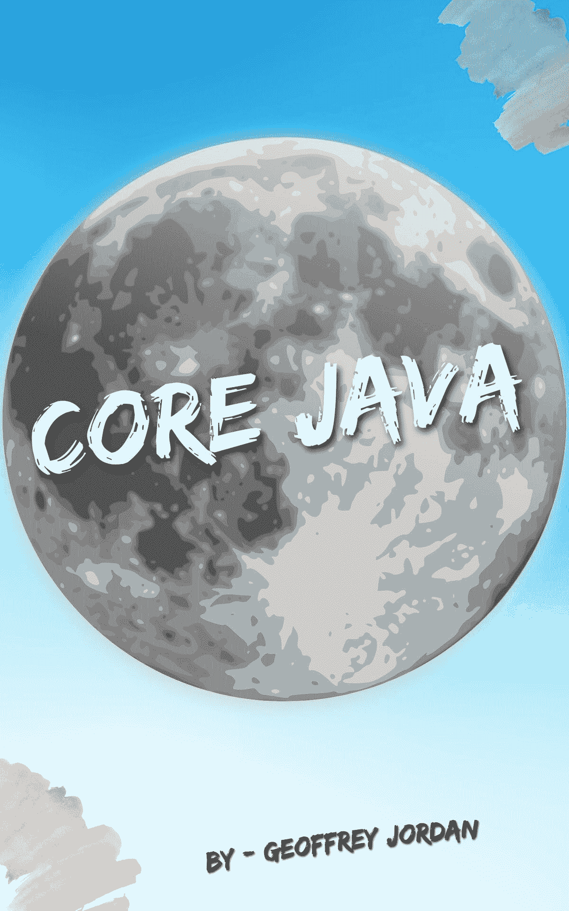

# 前言

核心 Java 是通用编程语言 Java 的一个子集，它允许开发者开发 Windows 桌面应用程序以及移动应用程序。它是最流行的编程语言之一，非常适合想要学习面向对象编程的初学者。

核心 Java 编程使用类似 C++ 的语法，易于学习、编写和编译。核心 Java 和 C++ 都是面向对象语言，但 C++ 是一种混合型面向对象语言，而核心 Java 是一种纯面向对象编程语言。

如果不熟悉核心 Java，就无法理解高级 Java。因此，如果你想精通 Java，核心 Java 将是你的第一步——学习所有基础知识和面向对象环境。

这本电子书教你 Java 应用程序、小程序、面向对象以及数据库连接，因此对于初学者以及 Web 开发者、Android 应用开发者和软件开发者来说，它都是一份极好的参考资料。

# 第 1 章：核心 Java 简介

## 1.1 核心 Java 概述

Java 由詹姆斯·高斯林于 20 世纪 90 年代初在 Sun Microsystem 开发，作为一种纯面向对象语言。核心 Java 被视为 Java 的子集。核心 Java 也称为 J2SE（Java 标准版）。Java 的核心组件于 1995 年 5 月由 Sun Microsystem 正式推出。后来在 2009 年，Java 与 Oracle 公司合并，如今 Java 是所有语言中最流行的。

核心 Java 的编码非常清晰且易于理解。它比其他编程语言快得多。编译后的 Java 代码可以在任何兼容平台上运行。核心 Java 允许我们动态链接新的类库、方法和对象。核心 Java 的运行时环境是操作系统，如 Unix、Windows、Linux、macOS。

核心 Java 的应用范围非常广泛，我们可以将核心 Java 用于 Android 应用开发、企业解决方案、Web 开发等。

以下是核心 Java 的十大用途：

- 软件开发
- 移动应用开发
- Web 开发
- 游戏开发
- 桌面 GUI 应用程序开发
- 人工智能
- 商业应用
- 云应用
- 嵌入式系统

## 1.2 Java 程序执行环境

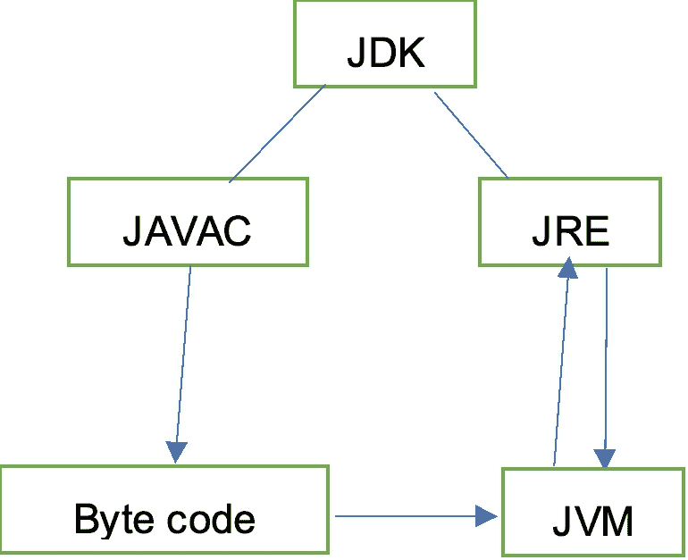


上图展示了 Java 程序执行环境的图形表示。这里 JDK（Java 开发工具包）是用于执行 Java 应用程序的软件。它分为两部分：JAVAC（Java 编译器）和 JRE（Java 运行时环境）。JAVAC 将输入的源代码转换为称为字节码的目标代码。目标代码文件将被传输到 JVM（Java 虚拟机），JVM 依赖于 JRE（Java 运行时环境），如 Windows、Linux、Unix、macOS 等。因此我们称 Java 为平台无关语言。最后，JVM 在 JRE 的帮助下生成输出。

程序员必须从命令提示符设置路径，然后使用下面给出的命令编译和执行程序。

1. 设置类路径的命令

   进入命令提示符 → 输入并回车

   (`Set path = c:\ program files\ java\ jdk1.8\ bin`)

2. 编译命令

   `javac filename.java`（回车）

3. 执行命令

   `java filename`（回车）

注意：程序员也可以使用多种开发环境，如 BlueJ、Apache、NetBeans IDE 8.0.2 来执行 Java 应用程序。

# 第 2 章：核心 Java 编程的基本元素

## 2.1 变量和数据类型

变量是在程序执行期间存储数据的实体。Java 允许我们使用字母、字母数字、单词作为变量。

示例

字母 – a- z

字母数字 – a1, b1, c1

单词 – num, result

注意：任何变量开头必须使用小写字母，因为 Java 是区分大小写的语言。

数据是程序中使用的原始事实和数字。Java 编程中使用的数据类型有五种，称为数据类型。

1. 整数：不带小数的数字称为整数。Java 使用简写`int`声明整数变量。

   示例

   `int a=5, b1, result;`

   注意：对于 4 字节的数字使用`int`，对于 8 字节的数字使用`long`。

2. 浮点数：带小数的数字称为浮点数。Java 使用简写`float`声明浮点数变量。

   示例

   `float b=3.145, c1, result;`

   注意：对于 4 字节的数字使用`float`，对于 8 字节的数字使用`double`。

3. 字符：所有键盘字符在编程中都视为字符。Java 使用简写`char`声明字符变量。必须使用单引号`' '`来存储字符。

   示例

   `char myChar = 'c';`

4. 字符串：字符序列称为字符串。Java 使用简写`string`声明字符串变量。必须使用双引号`" "`来存储字符串。

   示例

   `string txt = "John";`

5. 布尔值：存储 true 或 false 值。Java 使用简写`Boolean`声明布尔变量。

   示例

   `char myNum = true;`

注意：Java 程序中的任何语句都可以用分号（`;`）结束。

## 2.2 算术和逻辑运算符

算术运算符允许我们执行常见的数学运算。

Java 编程中使用的算术运算符有七种。

1. 加法（`+`）– 将两个值相加，例如（`a + b`）
2. 减法（`-`）– 从一个值中减去另一个值，例如（`a - b`）
3. 乘法（`*`）– 将两个值相乘，例如（`a * b`）
4. 除法（`/`）– 返回除法余数，例如（`a / b`）

# 第 3 章：核心 Java 中的输入输出编程

## 3.1 输入语句

在程序中插入数据的过程称为输入语句。几乎所有编程语言都使用输入语句来插入数据。作为一种面向对象的编程语言，Java 将输入视为对象。我们可以根据程序需求使用一个或多个输入语句。程序员在使用输入语句之前必须将输入输出库添加到程序中。让我们看看在 JAVA 中编写输入语句的规则。

### 语法：

```java
Scanner var = new Scanner(System.in);
Input variable = var.nextInt(); // 用于整数输入
var.close();
```

### 实现：

```java
Scanner a = new Scanner(System.in); // 需要导入 java.util.Scanner; 才能执行
number = a.nextInt();
a.close();
```

**注意：** 我们可以使用`nextFloat()`方法来输入实数。

## 3.2 输出语句

从程序中获取结果的过程称为输出语句。我们可以根据程序需求使用一个或多个输出语句。让我们看看在 JAVA 中编写输出语句的规则。

### 语法：

```java
System.out.println("字符串" + var); // 变量可以加在字符串之后或之前
```

### 实现：

```java
System.out.println("结果是 " + c);
```

如果使用`println`，打印后光标会移到下一行；如果使用`print`，光标则停留在同一行。

**注意：** `c`的值会与给定的字符串一起显示。

让我们编写一个 Java 程序，在输出中显示给定的文本。

**显示给定字符串的程序：**

```java
public class Main
{
    public static void main(String[] args)
    {
        System.out.println("Hi!, Welcome to Core Java");
    }
}
```

**输出：**

```
Hi!, Welcome to Core Java
```

## 3.3 I/O 程序

同时使用输入和输出语句的程序称为 I/O 程序。让我们看一些 Java 中 I/O 编程的示例。

**示例：** 编写一个使用输入语句对两个数求和的程序。

**Java 程序实现两数相加：**

```java
import java.util.Scanner;
public class InputOutput {
    public static void main(String[] args)
    {
        int a, b, result;
        Scanner sc = new Scanner(System.in);
        a = sc.nextInt();
        b = sc.nextInt();
        sc.close();
        result = a + b;
        System.out.println("给定两个数的和: "+result);    
    }
}
```

**输出：**

```
2
3
给定两个数的和: 5
```

**注意：** 这里的 2 和 3 是用户输入。

**示例：** 编写一个 Java 程序，使用输入语句执行所有算术运算。

**Java 程序实现所有算术运算：**

```java
import java.util.Scanner;
public class InputOutput {
    public static void main(String[] args)
    {
        int a, b, add, sub, mul, div, mod;
        Scanner sc = new Scanner(System.in);
        a = sc.nextInt();
        b = sc.nextInt();
        sc.close();
        add = a + b;
        sub = a - b;
        mul = a * b;
        div = a / b;
        mod = a % b;
        System.out.println("加法= "+add);
        System.out.println("减法= "+sub);
        System.out.println("乘法= "+mul);
        System.out.println("除法= "+div);
        System.out.println("余数= "+mod);    
    }
}
```

**输出：**

```
6
2
加法= 8
减法= 4
乘法= 12
除法= 3
余数= 0
```

**注意：** 这里的 6 和 2 是用户输入。

**注意：** 如果在程序中编写了输入语句，用户就可以输入或测试任何数据。

# 第 4 章：核心 Java 中的决策编程

## 4.1 决策

程序中的决策语句通过识别决策并访问解决方案来为我们提供选择。程序将产生布尔值 true 或 false 的评估结果作为输出。大多数编程语言都使用决策语句。

以下是核心 Java 中使用的决策语句：

1. `if` 语句
2. `if…else` 语句
3. 嵌套`if`语句
4. `else if`阶梯
5. `switch-case`语句

## 4.2 `if` 语句

如果条件为真，则执行一个语句块，这称为“if 语句”。

### 语法：

```java
if (条件)
    真语句;
```

### 实现：

```java
if(a>b)
    System.out.println("a 大于 b");
```

**注意：** 我们可以使用逻辑运算符构造任何条件。

**示例：**

**使用“if 语句”检查变量值的 Java 程序：**

```java
public class DecisionMaking
{
    public static void main(String[] args)
    {
        int a=5, b=5;
        if(a==b)
            System.out.println("两者相等");
    }    
}
```

**输出：**

```
两者相等
```

## 4.3 `if…else` 语句

如果条件为真，则执行真语句块；如果条件为假，则执行 else 语句块，这称为“if…else”语句。

### 语法：

```java
if (条件)
    真语句;
else
    假语句;
```

### 实现：

```java
if(a>b)
    System.out.println("a 大于 b");
else
    System.out.println("b 大于 a");
```

**示例：**

**使用 if..else 语句判断奇偶的 Java 程序：**

```java
public class DecisionMaking
{
    public static void main(String[] args)
    {
        int n=8;  
        if(n%2==0)
            System.out.println("给定数字是偶数");
        else
            System.out.println("给定数字是奇数");
    }
}
```

**输出：**

```
给定数字是偶数
```

## 4.4 嵌套`if`语句

如果在`if..else`中再使用一个`if`语句，则称为“嵌套`if`语句”。

### 语法：

```java
if (条件)
    if (条件)
        真语句;
    else
        假语句;
```

让我们在 Java 编程中实现该语法。

**示例：**

**使用嵌套 if 语句判断数字是否在 1 到 10 之间的 Java 程序：**

```java
public class DecisionMaking
{
    public static void main(String[] args)
    {
        int n=9;
        if(n<=10)
            if(n>=1)
                System.out.println("给定数字在 1 到 10 之间");        
            else
                System.out.println("给定数字不在 1 到 10 之间");        
    }  
}
```

**输出：**

```
给定数字在 1 到 10 之间
```

**注意：** 这里只有当两个条件都为真时，才会执行真语句，否则执行假语句。

## 4.5 `else if`阶梯

如果有两个或更多决策，我们可以使用`else if`阶梯来解释所有情况。

### 语法：

```java
if(条件)
    语句 1;
else if(条件)
    语句 2;
else if(条件)
    语句 3;
...
...
else
    语句 n;
```

**示例：**

### 使用 else if 阶梯判断三个数中最大值的 Java 程序

```java
public class DecisionMaking {
    public static void main(String[] args) {
        int a=10, b=30, c=20;
        if (a>=b && a>=c) 
            System.out.println(a+" is the largest Number"); 
        else if (b>=a && b>=c) 
            System.out.println(b+" is the largest Number"); 
        else
            System.out.println(c+" is the largest number");           
    }  
}
```

输出：

```
30 is the largest number
```

## 4.6 switch-case 语句

如果我们需要从多个代码块中选择一个执行，可以使用 switch-case 语句。

**语法**

```java
switch(expression)
{
    case 1:
        // 代码块
        break;
    case 2:
        // 代码块
        break;
    ……………………
    ……………………
    default:
        // 代码块
}
```

让我们看看它在 Java 编程中是如何实现的。程序员可以根据需要定义任意数量的 case。

该程序执行 case 测试，一旦找到匹配项，就使用`break`关键字终止代码执行。

**示例：使用 switch case 语句将给定数字转换为英文单词的 Java 程序。**


```java
public class DecisionMaking {
    public static void main(String[] args) {
        int num = 3; // 用户可以写入 1-5 之间的任意数字
        switch (num) {
            case 1:
                System.out.println("One");
                break;
            case 2:
                System.out.println("Two");
                break;
            case 3:
                System.out.println("Three");
                break;
            case 4:
                System.out.println("Four");
                break;
            case 5:
                System.out.println("Five");
                break;
        }         
    }  
}
```

输出：

```
Three
```

**注意：** 我们只给出了五个`case`，因此用户可以初始化和检查数字（1-5）。

# 第 5 章：Java 核心中的循环

## 5.1 循环

当给定条件为真时，代码段会反复执行，这称为循环。我们只能对顺序项应用循环。几乎所有编程语言都使用循环。它为我们处理大量顺序数据提供了便利。

Java 核心中使用了三种类型的循环：

1. `for`循环
2. `while`循环
3. `do while`循环

## 5.2 for 循环

特定的代码块会一直执行，直到满足给定条件。

**语法**

```java
for (初始化; 条件; 递增或递减)
{
    // 代码段
    …………
    …………
}
```

让我们为顺序数字 1 到 10 创建一个`for`循环。首先，我们取一个循环变量（`int i`）。在初始化部分，必须初始化第一个数字（`i=1`）。接下来，我们必须设置一个“条件”，以便覆盖所有数字（1-10）（`i<=10`）。由于数字（1-10）是递增顺序，因此在（递增或递减）部分我们写（`i=i+1`）。最后，我们得到如下所示的`for`循环。

```
for (i=1; i<=10; i=i+1)
```

现在让我们编写一个 Java 程序，使用`for`循环显示 2 的乘法表。

**示例**

```java
public class Looping {  
    public static void main(String[] args) {
        int i;
        for (i=2; i<=20; i=i+2) {
            System.out.println( i );
        }
    }  
}
```

输出：

```
2
4
6
8
10
12
14
16
18
20
```

### 嵌套 for 循环

如果在`for`循环内部再使用一个`for`循环，则称为嵌套`for`循环。用户必须注意，在执行过程中，外层的`for`循环每执行一次，内层的`for`循环就会完成整个迭代。

**示例**

```java
for(i = 1; i >= 3; i++) {
    for(j = 1; j >= 3; j++) {
    }
}
```

**注意：** 嵌套`for`循环用于二维数组以及许多其他应用。

## 5.3 while 循环

当布尔条件满足时，执行一组给定的指令。

**语法**

```java
while(条件)
{
    …………
    // 代码段
    …………
}
```

让我们为顺序数字 1 到 10 创建一个`while`循环。首先，在变量声明部分取一个循环变量（`int i=1`）。接下来，我们必须设置一个“条件”，以便覆盖所有数字（1-10）（`i<=10`）。由于数字（1-10）是递增顺序，因此在（递增或递减）部分我们写（`i=i+1`）。最后，我们得到如下所示的`while`循环。

```java
int i=1;
while(i<=10)
{
    i = i+1;
}
```

让我们编写一个 Java 程序，使用`while`循环显示 5 的乘法表。

**示例**

```java
public class Looping {  
    public static void main(String[] args) {
        int i=5;
        while(i<=50) {
            System.out.println(i);
            i=i+5;
        }
    }
}
```

输出：

```
5
10
15
20
25
30
35
40
45
50
```

## 5.4 do while 循环

一组语句至少执行一次，即使条件不满足也是如此。

**语法**

```java
do
{
    ………..
    代码段
    ………..
} while(条件);
```

让我们为顺序数字 1 到 10 创建一个`do`循环。首先，在变量声明部分取一个循环变量（`int i=1`）。接下来，我们必须设置一个“条件”，以便覆盖所有数字（1-10）（`i<=10`）。由于数字（1-10）是递增顺序，因此在（递增或递减）部分我们写（`i=i+1`）。最后，我们得到如下所示的`do`循环。

```java
do
{
    i = i + 1;
} while(i<=10);
```

**示例**

```java
public class Looping {  
    public static void main(String[] args) {
        int i=7;
        do {
            System.out.println(i);
            i=i+7;
        } while(i<=70);
    }  
}
```

输出：

```
7
14
21
28
35
42
49
56
63
70
```

# 第 6 章：Java 核心中的数组

## 6.1 数组

一组共享相同名称的元素，每个元素通过其位置来标识，这称为数组。它用于处理顺序或非顺序项。数组是 Java 中的一种对象类型，也称为容器对象。Java 为数组提供了动态分配功能。

**示例：**

```
num
num[0] 10
num[1] 30
num[2] 40
num[3] 60
```

这里，数组的名称为`num`，每个元素都通过其位置来标识，因此元素 60 位于位置 3，因为我们从 0 开始计数。

**注意：** 我们在示例中使用了二维数组。

Java 中有三种类型的数组：

1. 一维数组
2. 二维数组
3. 多维数组

## 6.2 一维数组

存储在一行中的一组元素称为一维数组。数组声明的语法如下所示。

**语法：**

```
数据类型 数组名称[ ] = { 元素 1, 元素 2……….., 元素 n};
```

**实现：**

```java
int array[ ] = {10,30,50,60};
```

让我们创建一个数组，其中有四个元素存储在位置（0-3）中，因此我们必须对位置（0-3）使用循环，并将数组元素与每个位置合并。

**示例**

```java
public class Array {
    public static void main(String[] args) {
        int num[]={10,20,30,40,50};
        int i;
        for(i=0; i<=4; i++) {
            System.out.println(num[i]);
        }
    }
}
```

输出：

```
10
20
30
40
50
```

**示例**

```java
public class Array {
    public static void main(String[] args) {
        int num[]={10,20,30,40,50};
        int i;
        for(i=4; i>=0; i--) {
            System.out.println(num[i]);
        }
    }
}
```

输出：

```
50
40
30
20
10
```

**注意：** 要反转数组的元素，我们必须以递减顺序创建循环并合并数组元素。

现在让我们看看如何在 Java 编程中处理多维数组。超过二维的数组不容易可视化，但其应用与日俱增。它们还可以容纳大量数据，这在数据分析中是一个有用的特性。

我们将讨论二维数组。

## 6.3 二维数组

按行和列存储的一组元素称为二维数组。它们形成行和列的矩阵。数组声明的语法如下所示。

**语法：**

```
数据类型 数组名称[ ] [ ] = { {行 1}, {行 2}……….., {行 n}};
```

**实现：**

```java
int mat [ ] [ ] = {{1,3,6}, {2,7,3}, {4,5,8}};
```

# 第 7 章：核心 Java 中的方法

## 7.1 方法

在 Java 编程中，用于特定操作的代码块被称为方法。在其他编程语言如 C、C++中，我们称之为函数。

Java 编程中使用三种类型的方法：

1. 内置方法
2. 用户定义方法
3. 抽象方法

## 7.2 内置方法

由语言开发者针对特定语言构建的方法称为内置方法。程序员可以导入特定的包，并在程序的任何位置使用内置方法。Java 内置方法用于字符串、数字、字符和数组。

让我们使用 Java 编程中的一个内置方法。

**使用内置方法将给定字符串转换为大写和小写的 Java 程序：**

```java
public class Method
{
    public static void main(String[] args)
    {
        String txt = "John";
        System.out.println(txt.toUpperCase());
        System.out.println(txt.toLowerCase());
    }
}
```

**输出：**

```
JOHN
john
```

## 7.3 用户定义方法

由用户或程序员为特定目的创建的代码块称为用户定义方法。用户定义方法可以在程序的任何位置调用。

**示例：**

**使用用户定义方法对两个数求和的 Java 代码：**

```java
class Method {
    // create a user-defined method
    public int addNumbers(int a, int b)
    {
        int sum = a + b;
        return sum;    // return value to main
    }
    public static void main(String[] args)
    {
        int num1 = 20;
        int num2 = 10;
        // create an object of Method
        Method obj = new Method();
        // calling user-defined method
        int result = obj.addNumbers(num1, num2);
        System.out.println("Sum is: " + result);
    }
}
```

**输出：**

```
Sum is: 30
```

**注意：** 上述程序将两个参数（`num1`、`num2`）传递给用户定义方法（`addNumbers`）以计算两个数的和。用户定义方法将结果作为参数返回。

## 7.4 抽象方法

没有方法体或实现的方法称为抽象方法。这种类型的方法对用户隐藏细节，专注于操作。它通过关键字`abstract`声明。

**使用抽象方法对两个和三个给定数进行乘法的 Java 代码：**

```java
abstract class Multiply {   
    public abstract int MultiplyTwoNum (int n1, int n2); 
    public abstract int MultiplyThreeNum (int n1, int n2, int n3);  
    public void show() {
        System.out.println ("Method of abstract class Multiply");
    }
}
// Regular class extends abstract class 
class AbstractMethod extends Multiply { 
    public int MultiplyTwoNum (int num1, int num2) { 
        return num1 * num2;
    }
    public int MultiplyThreeNum (int num1, int num2, int num3) { 
        return num1 * num2 * num3;
    }
    public static void main (String[] args)
    {
        Multiply obj = new AbstractMethod();
        System.out.println ("Multiplication of two numbers: " + obj.MultiplyTwoNum (10, 40)); 
        System.out.println ("Multiplication of three numbers: " + obj.MultiplyThreeNum (5, 10, 100)); 
        obj.show();
    }
}
```

**输出：**

```
Multiplication of two numbers: 400
Multiplication of three numbers: 500
Method of abstract class Multiply
```

# 第 8 章：核心 Java 中的 Applet

Java 中的`Applet`使其成为更强大的语言。在这种方式下，程序的输出将集成到网页中。程序员编写一个 Java 应用程序并保存为（`.java`）文件，然后创建一个包含 Applet 标签的 HTML 文件来调用（`.class`）文件。最后，输出将显示在现有的浏览器或`appletviewer`中。因此，Applet 托管在 Web 服务器上。每个 Applet 都会快速可靠地运行，而不需要大量系统资源。它在 Web 计算机中充当前端。

以下是 Applet 的生命周期。

1. `init()`：在这里我们初始化变量。它将在 Applet 运行期间被调用一次。
2. `start()`：此方法在`init()`之后调用。该技术用于重新启动 Applet。
3. `stop()`：用于暂停不需要运行的线程。
4. `destroy()`：如果需要从内存中移除 Applet，则调用此方法。

## 8.1 Applet 执行

首先，我们必须为特定目的编写一个应用程序，并将其保存为（`.java`）文件。让我们编写一个程序，在 Windows 的记事本中显示“Welcome to Applet world”，并将其保存为`demo.java`文件。我们必须在应用程序中导入`Applet`和`AWS`。这里我们使用了方法（`Graphics g`）。

```java
import java.applet.*;
import java.awt.*;
public class demo extends Applet
{
    public void paint(Graphics g)
    {
        g.drawString("Welcome to Applet world",100,100);
    }
}
```

**注意：** 在编译之前，必须将`demo.java`文件移动到正确的位置。复制该文件，转到`C:\Program Files\Java\jdk1.8.0\bin`并粘贴文件。

现在我们必须创建 HTML 文件（`any.html`），该文件调用（`demo.class`）以在网页上显示字符串。将其保存在与`demo.java`文件相同的位置。

让我们编写 HTML 标签。

```html
<html>
<body>
<applet code="demo.class" width=400 height=400>
</applet>
</body>
</html>
```

编译并运行现有程序。以管理员身份进入命令提示符。更改目录并使用`javac`进行编译。

```
c:\program files\java\jdk1.8.0\bin\javac demo.java (press enter)
c:\program files\java\jdk1.8.0\bin\appletviewer any.html (press enter)
```

这里，一旦我们编译了`demo.java`，另一个文件（`demo.class`）将自动创建并存储在`bin`中。之后`appletviewer`将调用该类来显示字符串，如下所示。


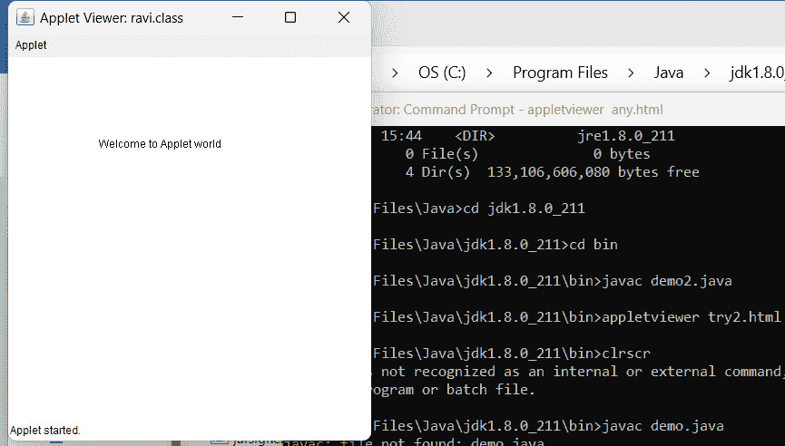

## 8.2 Applet 示例

### 1. 编写一个 Applet 程序来显示今天的日期。

```java
import java.applet.*;//to access showStatus()
import java.awt.*;//Graphic class is available in this package
import java.util.Date;//to access Date object
public class demo2 extends Applet
{
    public void paint(Graphics g)
    {
        Date d = new Date();
        showStatus("Today is" + d);
    }
}
```

`demo2.class`的 HTML 标签：

```html
<html>
<body>
<applet code="demo2.class" align="right" height="200" width="300">
</applet>
</body>
</html>
```

输出：

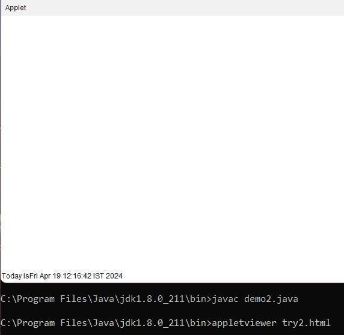

### 2. 绘制指定大小矩形的 Applet 程序。

```java
import java.applet.*;
import java.awt.*;
public class demo3 extends Applet
{
    int height, width;
    public void init()
    {
        height = getSize().height;
        width = getSize().width;
        setName("MyApplet");
    }
    public void paint(Graphics g)
    {
        g.drawRoundRect(10, 30, 120, 120, 2, 3);
    }
}
```

`demo3.class`的 HTML 标签：

```html
<html>
<body>
<applet code="demo3.class" width=400 height=400>
</applet>
</body>
</html>
```

输出：

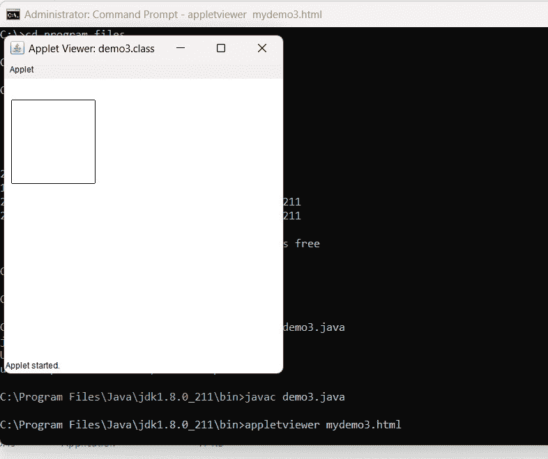

# 第 9 章：核心 Java 中的 AWT

AWT（抽象窗口工具包）是一个应用程序，包含丰富的 Java 库集，用于创建 GUI（图形用户界面）。AWT 的组件允许我们开发基于窗口的应用程序。我们可以使用 AWT GUI 编程创建事件、绘制形状、插入图像。AWT 组件是平台相关的。

## 9.1 AWT 的组件

在本节中，我们将讨论 AWT 中使用的不同组件。在操作 Windows 或浏览网页时，我们可以看到所有这些组件。在 Java GUI 编程中，组件被用作对象。

---

**注意：** 以下示例演示了 Java 中的二维数组。

**示例：**

显示给定二维数组元素的 Java 代码：

```java
public class Array {
    public static void main(String[] args) {
        int mat[][] = {{1,3,6}, {2,7,3}, {4,5,8}};
        int i, j;
        for (i=0; i<=2; i++) {
            for (j=0; j<=2; j++) {
                System.out.print(mat[i][j]);
            }
            System.out.println("");
        }
    }
}
```

输出：

```
1 3 6
2 7 3
4 5 8
```

以下是 AWT 中使用的组件列表。

1. `Button` – 用于创建带标签按钮的类。AWT 允许我们为按钮添加操作。

2. `Label` – 用于在容器中放置文本的对象。

3. `Check Box` – 一种图形组件，具有两种状态：开（true）或关（false）。

4. `Check Box Group` – 一组复选框。

5. `List` – 包含可滚动文本项列表的组件。

6. `Text Field` – 允许编辑单行文本。

7. `Text Area` – 允许编辑多行文本。

8. `Choices` – 一个弹出式选择菜单，所选选项将显示在顶部。

9. `Canvas` – 用于绘制内容的区域。

10. `Image` – 表示图形图像。

11. `Scroll Bar` – 允许用户选择值的范围。

12. `Dialog Box` – 用户可以插入某种形式的输入。

13. `File Dialog` – 用户可以选择特定文件。

## 9.2 AWT 编程

让我们使用 AWT 丰富的库在单个应用程序中创建一些组件。我们必须导入 `java.awt` 库才能访问所有功能。为了继承父类的所有方法和字段，我们必须扩展用户创建的类。

例如：`public class Myclass extends Frame`

所有组件都在用户类（例如 `Myclass()`）中初始化和创建。

程序员必须在 `Frame` 或 `Container` 中创建组件、设置大小和位置，并将创建的组件添加到框架中。

让我们创建一个组件（`Button`）

语法：`Component var = new Component("Label");`

实现：`Button b = new Button("Click me");`

现在，设置组件（`Button`）的大小和位置

语法：`component’s variable.setBounds(x-coordinate, y-coordinate, width, height);`

实现：`b.setBounds(70,140,50,20);`

我们必须将组件（`Button`）添加到框架中

语法：`add(Component’s variable);`

实现：`add(b);`

以下是程序员在创建组件时必须遵循的基本指令。

1. `setSize(height, width)` – 设置框架或容器的大小。

2. `setTitle("Title of Frame")` – 根据环境设置框架的标题。

3. `setLayout(null)` – 如果不需要布局，则程序员必须将其设置为 null。如果在其他应用程序中需要布局，则避免使用此指令。

4. `setVisible(true)` – 必须将可见性设置为 true。

牢记上述所有讨论，让我们创建一些 AWT 组件。

1. 创建并显示按钮、标签和文本字段的 AWT 程序。

```java
import java.awt.*;

public class Component extends Frame {
    Component() {
        // creating a button, label, text field
        Button b = new Button("Submit");
        Label l = new Label("Employee");
        TextField t = new TextField();
        // set size and position in container
        b.setBounds(70,140,50,20);
        l.setBounds(60, 70, 60, 30);
        t.setBounds(40, 100, 80, 30);
        // add the components to container
        add(b);
        add(l);
        add(t);
        setSize(300,300);
        setTitle("Label, text field and button");
        setLayout(null);
        setVisible(true);
    }
    public static void main(String args[]) {
        Component f = new Component();
    }
}
```

输出


2. 创建并显示多个复选框（必须选中其中一个）的 AWT 程序。

```java
import java.awt.*;

public class Component {
    Component() {
        // creating the frame with the title
        Frame f = new Frame("Checkbox Example");
        // creating the checkboxes
        Checkbox checkbox1 = new Checkbox("JavaScript");
        checkbox1.setBounds(100, 100, 80, 80);
        Checkbox checkbox2 = new Checkbox("CoreJava", true);
        checkbox2.setBounds(100, 150, 80, 80);
        // adding checkboxes to frame
        f.add(checkbox1);
        f.add(checkbox2);
        f.setSize(400,400);
        f.setLayout(null);
        f.setVisible(true);
    }
    public static void main(String args[]) {
        new Component();
    }
}
```

输出

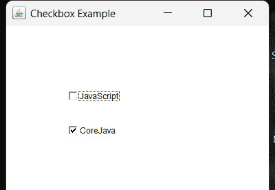

3. 创建并显示水果选择菜单的 AWT 程序。

```java
import java.awt.*;

public class Component {
    Component() {
        Frame f = new Frame();
        // creating a choice component
        Choice c = new Choice();
        c.setBounds(100, 100, 75, 75);
        // adding items to the choice menu
        c.add("Apple");
        c.add("Banana");
        c.add("Orange");
        c.add("Grapes");
        c.add("Mango");
        f.add(c);
        f.setSize(400, 400);
        f.setLayout(null);
        f.setVisible(true);
    }
    public static void main(String args[]) {
        new Component();
    }
}
```

输出

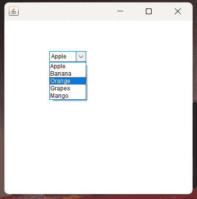

4. 创建并显示带滚动功能的水果列表的 AWT 程序。

```java
import java.awt.*;

public class Component {
    Component() {
        Frame f = new Frame();
        // creating the list of 5 rows
        List l1 = new List(5);
        l1.setBounds(100, 100, 75, 75);
        // adding list items into the list
        l1.add("Apple");
        l1.add("Banana");
        l1.add("Orange");
        l1.add("Grapes");
        l1.add("Mango");
        f.add(l1);
        f.setSize(400, 400);
        f.setLayout(null);
        f.setVisible(true);
    }
    public static void main(String args[]) {
        new Component();
    }
}
```

输出

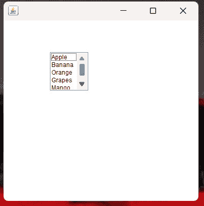

## 9.3 事件处理

一组相互交互的对象称为事件，Java 为我们提供了处理事件的功能。控制事件并决定发生什么的机制称为事件处理。AWT 的每个组件都被视为一个对象。

让我们创建一个事件：当用户点击按钮时，文本字段将显示“Welcome to Core Java”。

```java
import java.awt.*;
import java.awt.event.*;

public class Component extends Frame implements ActionListener {
    TextField tf;
    Component(){
        tf=new TextField();  //create components
        tf.setBounds(60,50,170,20);
        Button b=new Button("click me");
        b.setBounds(100,120,80,30);
        //register listener
        b.addActionListener(this);//passing current instance
        add(b);add(tf);
        setSize(300,300);
        setLayout(null);
        setVisible(true);
    }
    public void actionPerformed(ActionEvent e){
        tf.setText("Welcome to Core Java");
    }
    public static void main(String args[]){
        new Component();
    }
}
```

输出

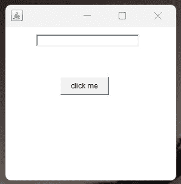

点击按钮后的输出。

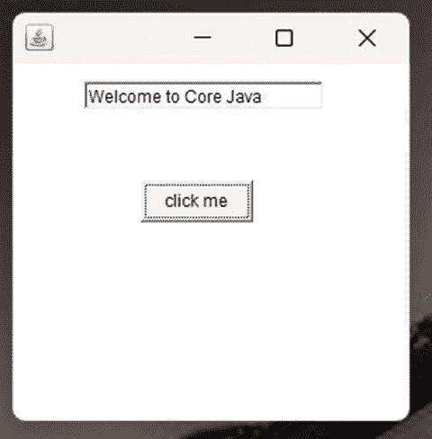

# 第 10 章 Core Java 中的 Swing

Java Swing 是一个用于创建桌面应用程序的复杂工具包。Swing 比 AWT 更复杂。它使用丰富的组件集。我们可以使用 Java Swing 轻松开发轻量级桌面应用程序。Java Swing 的包提供了比 AWT 更多的组件，例如 `Combo Box`、`Spinner`、`Slider` 等。

## 10.1 Swing 的组件

Swing 组件是开发基于窗口的应用程序的基本构建块。它提供了比 AWT 更好的功能。

以下是 Java Swing 中使用的组件：

1. `JButton` – `JButton` 类创建一个带标签的按钮。

2. `JColorChooser` – 它提供一个控制面板，允许用户操作和选择颜色。

3. `JcheckBox` – 一个 GUI 组件，可以处于开（true）或关（false）状态。

4. `JRadioButton` – 可以处于开（true）或关（false）状态，位于组中。

5. `JList` – 该类为用户提供可滚动的文本项列表。

6. `JComboBox` – 该组件为用户提供一个弹出式菜单，包含列表或选项。

7. `JTextField` – 一个文本组件，允许编辑单行文本。

8. `JpasswordField` – 用于密码输入的文本组件。

9. `JTextArea` – 一个文本组件，允许编辑多行文本。

10. `Imagelcon` – 从图像绘制图标。

11. `JScrollbar` – 它代表一个滚动条组件，允许用户从范围值中选择。

12. `JOptionPane` – 它提供一组标准对话框，用于提示用户输入值。

13. `JFileChooser` – 它代表一个对话框窗口，允许用户选择文件。

14. `JProgressBar` – 它显示任务完成的百分比。

15. `JSlider` – 用户可以通过在定义的区间内滑动旋钮来选择值。

16. `JSpinner` – 它是一个单行输入字段，允许用户从有序序列中选择数字或对象值。

## 10.2 Java Swing 编程

让我们使用 Java Swing 库创建一些复杂的组件。我们必须导入 `javax.swing`。接下来创建一个用户类，例如 `public class Myclass`。我们可以在 `public static void main(String args[])` 块中使用所有方法。

程序员必须创建框架，然后在框架或容器中设置组件的大小和位置，并将创建的组件添加到框架中。

让我们创建一个框架

语法：`JFrame var = new JFrame("Title of frame");`

实现：`JFrame f = new JFrame("My frame");`

创建一个组件（按钮）


语法：`Component var = new Component("Label");`

实现：`JButton b = new JButton("Click me");`

现在，设置组件（按钮）的大小和位置

语法：`component's variable.setBounds(x-coordinate, y-coordinate, width, height);`

实现：`b.setBounds(70,140,50,20);`

我们必须将组件（按钮）添加到框架中

语法：`frame variable.add(Component's variable);`

实现：`f.add(b);`

考虑到上述所有讨论，让我们创建一些 Java Swing 组件。

### 1. Java Swing 程序，用于创建并显示按钮、标签和文本字段。

```
import javax.swing.*;

public class Component {
    public static void main(String args[]) {       
        JFrame f = new JFrame("Java Swing components"); 
        // creating a button, label, text field  
        JButton b = new JButton("Submit");  
        JLabel l = new JLabel("Student's name");
        JTextField t = new JTextField();
        b.setBounds(20,120,95,30);     
        l.setBounds(30, 80, 100, 30);
        t.setBounds(10, 60, 150, 30);
        // adding all created components to frame     
        f.add(b);     
        f.add(l);
        f.add(t);    
        f.setSize(400,400);     
        f.setLayout(null);     
        f.setVisible(true);     
    }
}
```

输出

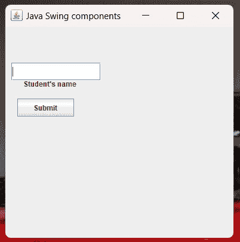

### 2. Java Swing 程序，用于创建并显示“男”和“女”单选按钮。

```
import javax.swing.*;

public class Component {
    public static void main(String args[]) {    
        JFrame f = new JFrame("Java Swing components"); 
        JRadioButton r1 = new JRadioButton("Male");    
        JRadioButton r2 = new JRadioButton("Female");    
        r1.setBounds(75,50,100,30);    
        r2.setBounds(75,100,100,30);    
        ButtonGroup bg = new ButtonGroup();    
        bg.add(r1); bg.add(r2);    
        f.add(r1); f.add(r2);      
        f.setSize(300,300);    
        f.setLayout(null);    
        f.setVisible(true);    
    }
}
```

输出

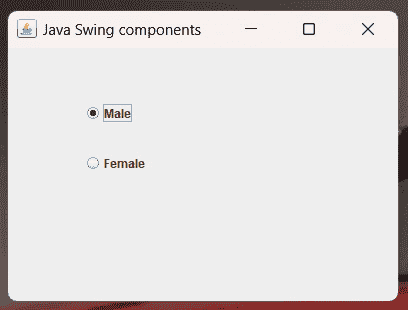

### 3. Java Swing 程序，用于创建并显示国家组合框。

```
import javax.swing.*;

public class Component {
    public static void main(String args[]) {    
        JFrame f = new JFrame("Java Swing components"); 
        String country[] = {"India","Aust","U.S.A","Newzealand"};       
        JComboBox cb = new JComboBox(country);    
        cb.setBounds(50, 50,90,20);    
        f.add(cb);        
        f.setLayout(null);    
        f.setSize(400,500);    
        f.setVisible(true);     
    }
}
```

输出

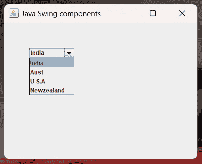

### 4. Java Swing 程序，用于创建并显示带有给定字符串的选项窗格。

```
import javax.swing.*;

public class Component {
    public static void main(String args[]) {       
        JFrame f = new JFrame("Java Swing components"); 
        JOptionPane.showMessageDialog(f,"Hello, Welcome to Core Java");  
    }
}
```

输出

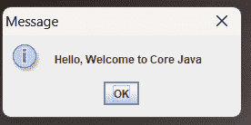

### 5. Java Swing 程序，用于创建并显示密码字段。

```
import javax.swing.*;

public class Component {
    public static void main(String args[]) {          
        JFrame f = new JFrame("Java Swing components"); 
        JPasswordField value = new JPasswordField();  
        JLabel l1 = new JLabel("Password:");    
        l1.setBounds(20,100, 80,30);    
        value.setBounds(100,100,100,30);    
        f.add(value);  f.add(l1);
        f.setSize(300,300);   f.setLayout(null);  f.setVisible(true);     
    }
}
```

输出

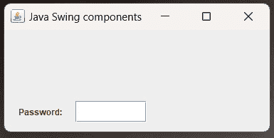

### 6. 一个程序，用于创建并显示使用 Java Swing 组件和 AWT 功能执行加法和减法的计算器。

```
import javax.swing.*;
import java.awt.event.*;

public class Component implements ActionListener{ 
    JTextField tf1,tf2,tf3;
    JButton b1,b2;
    Component(){
        JFrame f = new JFrame();
        tf1 = new JTextField();
        tf1.setBounds(50,50,150,20);
        tf2 = new JTextField();
        tf2.setBounds(50,100,150,20);
        tf3 = new JTextField();
        tf3.setBounds(50,150,150,20);
        tf3.setEditable(false);  
        b1 = new JButton("Add");
        b1.setBounds(50,200,50,50);
        b2 = new JButton("Sub");
        b2.setBounds(120,200,50,50);
        b1.addActionListener(this);
        b2.addActionListener(this);
        f.add(tf1); f.add(tf2); f.add(tf3); f.add(b1); f.add(b2);
        f.setSize(300,300);
        f.setLayout(null);
        f.setVisible(true);
    }        
    public void actionPerformed(ActionEvent e) {
        String s1 = tf1.getText();
        String s2 = tf2.getText();
        int a = Integer.parseInt(s1);
        int b = Integer.parseInt(s2);
        int c = 0;
        if(e.getSource() == b1){
            c = a + b;
        } else if(e.getSource() == b2){
            c = a - b;
        }
        String result = String.valueOf(c);
        tf3.setText(result);
    }
    public static void main(String[] args) { 
        new Component();
    }
}
```

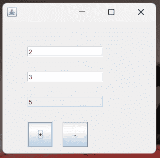

# 第 11 章

## Java 数据库连接

JDBC 是一个应用程序，它为客户端访问后端数据库创建环境。JDBC 是 Oracle 公司 Java 标准版的一部分。JDBC 为我们提供了创建、配置和链接数据库的功能。如果要创建环境，首先必须在 Excel 或使用 MySQL 中创建数据库表，然后编写一个使用 Swing、AWT 或 Java 代码的应用程序，作为前端客户端与数据库交互，因此必须将数据库文件链接到应用程序文件。

### 11.1 配置与连接

在本节中，我们将讨论如何创建 DSN（数据源名称）并将程序链接到数据库。用户在编写应用程序之前必须了解所有这些内容。我们以 Microsoft Excel 数据库为例。

以下是创建 DSN 以及链接的步骤：

1. 步骤 1：创建一个 Excel 工作表
2. 步骤 2：通过适当路径或控制面板进入管理工具，选择 ODBC（Oracle 数据库连接）。
3. 步骤 3：选择用户 DSN 或系统 DSN，点击“添加”选项卡，添加（`.xls`）文件，点击“下一步”。
4. 步骤 4：选择“Driver do Microsoft Excel(.xls)”。
5. 步骤 5：将数据源名称设置为与创建的（`.xls`）文件相同。
6. 步骤 6：选择“工作簿”选项卡，点击“确定”。

### 11.2 JDBC 编程

让我们编写一个 JDBC 程序。我们必须导入`java.sql`库，因为我们使用 SQL 命令（例如`"Select * from [Sheet1$]"`）来对数据库进行操作。用户必须了解 Java 异常处理。该程序通过 ODBC 与数据库链接。

示例：JDBC 程序，用于访问 Excel 文件（`demo.xls`）并显示内容。

```
import java.sql.*;

public class JdbcDemo
{
    public static void main(String[] args)
    {
        try
        {
            Class.forName("sun.jdbc.odbc.JdbcOdbcDriver");
            Connection con = DriverManager.getConnection("jdbc:odbc:demo");
            Statement st = con.createStatement();
            ResultSet rs = st.executeQuery("Select * from [Sheet1$]");
            ResultSetMetaData rsmd = rs.getMetaData();
            int numberOfColumns = rsmd.getColumnCount();
            while (rs.next())
            {
                for (int i = 1; i <= numberOfColumns; i++)
                {
                    if (i > 1)
                        System.out.print(", ");
                    String columnValue = rs.getString(i);
                }
            }
        }
        catch (Exception e)
        {
            System.out.println(e);
        }
    }
}
```

```java
System.out.print(columnValue);
}
System.out.println("");
}
st.close();
con.close();
} catch (Exception ex) {
System.err.print("Exception: ");
System.err.println(ex.getMessage());
}
}
}
```

输出

这里用户必须创建一个 Excel 文件（`demo.xls`），并按照步骤配置 ODBC 以创建 DSN，然后编译并运行程序以访问 Excel 文件。

# 第 12 章

## 核心 Java 编程

让我们从核心 Java 的各个方面（应用程序和小程序）编写程序。用户必须亲自尝试。

### 1. 示例（输入输出编程）：核心 Java 应用程序，计算两个数字的所有算术运算。

```java
import java.util.Scanner;

public class ArithmeticOp {
    public static void main(String[] args) {
        Scanner s = new Scanner(System.in);
        System.out.println("Enter the two numbers to perform operations ");
        System.out.print("Enter the first number : ");
        int x = s.nextInt();
        System.out.print("Enter the second number : ");
        int y = s.nextInt();         
        int add;
        add = x + y;
        System.out.println("Addition of Two Numbers : "+add);             
        int sub;
        sub = x - y;
        System.out.println("Subtraction of Two Numbers : "+sub);              
        int mul;
        mul = x * y;
        System.out.println("Multiplication of Two Numbers  : "+mul);            
        float div;
        div = (float) x / y;
        System.out.print("Division of Two Numbers  : "+div);
        int mod;              
        mod = x % y;
        System.out.println("Modulus of Two Numbers  : "+mod);
        break;
    }
}
```

输出

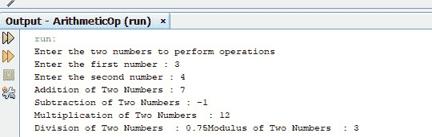

注意：这里用户必须根据提示输入第一个和第二个数字，然后得到相应的输出。

### 2. 示例（决策制定）：应用程序，计算学生的等级，即如果学生获得 60%以上则为第一等，50-59%之间为第二等，低于 50%为不及格。


```java
import java.util.Scanner;

public class DecisionMaking {
    public static void main(String[] args) {
        Scanner marks = new Scanner(System.in);
        System.out.println("Enter the percentage marks obtained: ");
        int x = marks.nextInt();
        if (x>=60 && x<=100)
            System.out.println("First class");
        else if (x>=50 && x<60)
            System.out.println("Second class");
        else
            System.out.println(" Failed");           
    }  
}
```

输出

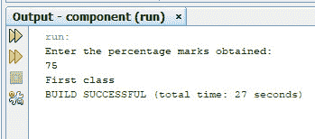

### 3. 示例（循环）：应用程序，计算从 1 到 10 的所有偶数和与奇数和。

```java
public class Looping {
    public static void main(String[] args) {
        int i, evensum=0, oddsum=0;
        for(i=1; i<=10;i++)
        {
            if(i%2==0)
                evensum=evensum + i;
            else  
                oddsum=oddsum + i;
        }       
        System.out.println("Evensum from (1-10) =" + evensum);
        System.out.println("Oddsum from (1-10) =" + oddsum);
    }  
}
```

输出

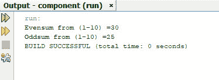

### 4. 示例（一维数组）：应用程序，对给定数组进行升序排序。

```java
public class SortArray {
    public static void main(String[] args) {
        int arr[] = {50, 20, 80, 70, 10, 30};
        int temp = 0;
        int a, b;
        System.out.println("Elements of original array: ");
        for (a = 0; a < 6; a++) {   // length of array=6
            System.out.print(arr[a] + " ");
        }
        for (a = 0; a < 6; a++) {
            for (b = a+1; b < 6; b++) {
                if(arr[a] > arr[b]) {
                    temp = arr[a];
                    arr[a] = arr[b];
                    arr[b] = temp;
                } } }
        System.out.println();
        System.out.println("Elements of array sorted in ascending order: ");
        for (a = 0; a < 6; a++) {
            System.out.print(arr[a] + " ");
        } } }
```

输出

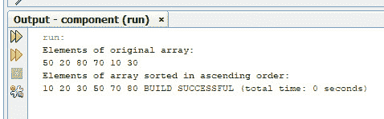

### 5. 示例（二维数组）：应用程序，对给定矩阵进行转置。

```java
public class TransposeMat {
    public static void main(String[] args) {        
        int original[][]={{1,3,4},{2,4,3},{3,4,5}};   
        int transpose[][]=new int[3][3];  //3 rows and 3 columns  
        for(int i=0;i<3;i++){   
            for(int j=0;j<3;j++){   
                transpose[i][j]=original[j][i];
            }   
        }    
        System.out.println("Printing the given Matrix:"); 
        for(int i=0;i<3;i++){   
            for(int j=0;j<3;j++){   
                System.out.print(original[i][j]+" ");   
            }   
            System.out.println();//new line   
        }   
        System.out.println("Printing Matrix After Transpose:"); 
        for(int i=0;i<3;i++){   
            for(int j=0;j<3;j++){   
                System.out.print(transpose[i][j]+" ");   
            }   
            System.out.println(); //new line   
        } }}  
```

输出

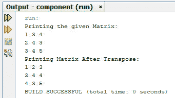

### 6. 示例（AWT）：应用程序，创建弹出菜单和文件子菜单。

```java
import java.awt.*;

public class PopupMenu{
    PopupMenu (){
        Frame f= new Frame("Menu and Submenu");
        MenuBar mb=new MenuBar();
        Menu menu=new Menu("File");
        Menu submenu=new Menu("Recent");
        MenuItem i1=new MenuItem("Open");
        MenuItem i2=new MenuItem("Save");
        MenuItem i3=new MenuItem("Save as");
        MenuItem i4=new MenuItem("File 1");
        MenuItem i5=new MenuItem("File 2");
        menu.add(i1);
        menu.add(i2);
        menu.add(i3);
        submenu.add(i4);
        submenu.add(i5);
        menu.add(submenu);
        mb.add(menu);
        f.setMenuBar(mb);
        f.setSize(400,400);
        f.setLayout(null);
        f.setVisible(true);
    }
    public static void main(String args[]) 
    {
        new PopupMenu ();
    }
}
```

输出

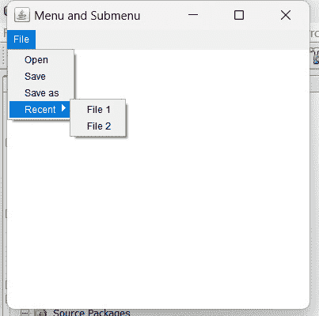

### 7. 示例（Java AWT）：应用程序，创建画布并在其中绘制椭圆。

```java
import java.awt.*;

public class CanvasCreation{
    public CanvasCreation ()   
    {   
        Frame c = new Frame("Canvas of AWT");  
        c.add(new MyCanvas());   
        c.setLayout(null);   
        c.setSize(400, 400);   
        c.setVisible(true);   
    }   
    public static void main(String args[])   
    {   
        new CanvasCreation ();   
    }   
}    
// to create Canvas 
class MyCanvas extends Canvas   
{           
    public MyCanvas() {   
        setBackground (Color.BLACK);   
        setSize(300, 200);   
    }   
    public void paint(Graphics g)   
    {   
        g.setColor(Color.red);   
        g.fillOval(75, 75, 150, 75);   
    }   
}      
```

输出

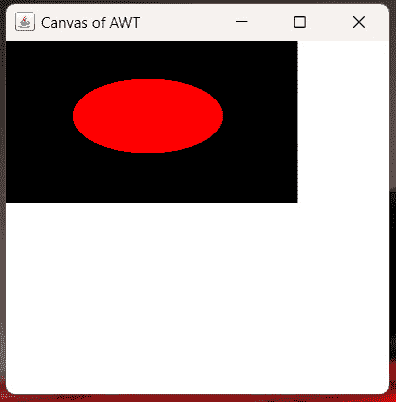

### 8. 示例（Java AWT 和 Swing 事件）：应用程序，创建计算器以执行加法、减法、乘法、除法。

```java
import javax.swing.*;
import java.awt.event.*;

public class MyCalculator implements ActionListener{ 
    JTextField tf1,tf2,tf3;
    JButton b1,b2,b3,b4;
    MyCalculator(){
        JFrame f= new JFrame();
        tf1=new JTextField();
        tf1.setBounds(50,50,150,20);
        tf2=new JTextField();
        tf2.setBounds(50,100,150,20);
        tf3=new JTextField();
        tf3.setBounds(50,150,150,20);
        tf3.setEditable(false);  
        b1=new JButton("+");
        b1.setBounds(50,200,50,50);
        b2=new JButton("-");
        b2.setBounds(120,200,50,50);
        b3=new JButton("*");
        b3.setBounds(190,200,50,50);
        b4=new JButton("/");
        b4.setBounds(260,200,50,50);
        b1.addActionListener(this);
        b2.addActionListener(this);
        b3.addActionListener(this);
        b4.addActionListener(this);
        f.add(tf1);f.add(tf2);f.add(tf3);f.add(b1);f.add(b2);f.add(b3);
        f.add(b4);
        f.setSize(300,300);
        f.setLayout(null);
        f.setVisible(true);
    }        
    public void actionPerformed(ActionEvent e) {
        String s1=tf1.getText();
        String s2=tf2.getText();
        int a=Integer.parseInt(s1);
        int b=Integer.parseInt(s2);
        int c=0;
        if(e.getSource()==b1){
            c=a+b;
        }else if(e.getSource()==b2){
            c=a-b;
        }else if(e.getSource()==b3){
            c=a*b;
        }else if(e.getSource()==b4){
            c=a/b;
        }            
        String result=String.valueOf(c);
        tf3.setText(result);
    }
    public static void main(String[] args) { 
        new MyCalculator ();
    } }
```

输出

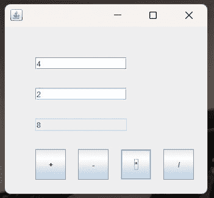

注意：这里用户必须在前两个文本框中输入两个数字，点击按钮进行计算，最终结果将显示在第三个文本框中。

### 9. 示例（Java Swing）：应用程序，创建水果表格。

```java
import javax.swing.*;

public class FruitTable{
    JFrame f;   
    FruitTable (){   
        f=new JFrame();   
        String data[][]={ {"1","Apple"},   
        {"2","Banana"},   
        {"3","Orange"},
        {"4","Grapes"},
        {"5","Mango"},};   
        String column[]={"Sl No.","Name of fruits"};         
        JTable jt=new JTable(data,column);   
        jt.setBounds(30,40,200,300);          
        JScrollPane sp=new JScrollPane(jt);   
        f.add(sp);          
        f.setSize(300,400);   
        f.setVisible(true);   
    }     
    public static void main(String[] args) {   
        new FruitTable ();   
    }    
}
```

输出

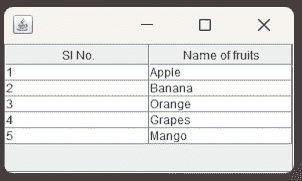

### 10. 示例（Java Swing）：创建文件、编辑和视图工具栏的应用程序。

```java
import java.awt.BorderLayout;
import java.awt.Container;
import javax.swing.JButton;  
import javax.swing.JFrame;
import javax.swing.JScrollPane;
import javax.swing.JTextArea;
import javax.swing.JToolBar;
public class Component{
    public static void main( String args[]) { 
        JFrame f = new JFrame("Java Swing ToolBar");
        f.setDefaultCloseOperation(JFrame.EXIT_ON_CLOSE);
        JToolBar toolbar = new JToolBar();
        toolbar.setRollover(true);
        JButton button = new JButton("File");
        toolbar.add(button);
        toolbar.addSeparator();
        toolbar.add(new JButton("Edit"));
        toolbar.addSeparator();
        toolbar.add(new JButton("View"));      
        Container contentPane = f.getContentPane();
        contentPane.add(toolbar, BorderLayout.NORTH);
        JTextArea textArea = new JTextArea();
        JScrollPane mypane = new JScrollPane(textArea);
        contentPane.add(mypane, BorderLayout.EAST);
        f.setSize(450, 250);
        f.setVisible(true);
    }
}
```

输出

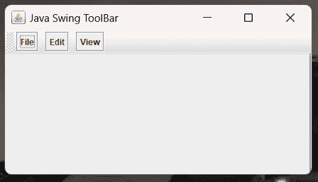

### 11. 示例（Java Swing）：创建桌面的应用程序。


```
import java.awt.BorderLayout;
import java.awt.Container;
import javax.swing.JDesktopPane;
import javax.swing.JFrame;
import javax.swing.JInternalFrame;
import javax.swing.JLabel;
public class Component extends JFrame{ 
public Component()  
{
CustomDesktopPane desktopPane = new CustomDesktopPane();
Container contentPane = getContentPane();
contentPane.add(desktopPane, BorderLayout.CENTER);
desktopPane.display(desktopPane);
setTitle("Java Swing Desktop");
setSize(300,350);
setVisible(true);
}
public static void  main(String args[])
{
new Component();
}
}
class CustomDesktopPane extends JDesktopPane 
{   
public void display(CustomDesktopPane dp)  
{
JInternalFrame f = new JInternalFrame("My Desktop " ,  true);   
f.setBounds(30, 30, 250, 85);
Container c1 = f.getContentPane( ) ;
c1.add(new JLabel("Hi! User, Welcome to Java Swing "));
dp.add( jframe );
f.setVisible(true);        
}
}
```

输出

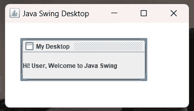

## 12. 示例（Java Swing）：根据需求创建画布绘制图形的应用程序。这里用户可以绘制任何形状，但必须相应地给出指令。

```
import java.awt.*;
import javax.swing.JFrame;     
public class UserGraphics  extends Canvas{
public void paint(Graphics g) { 
g.drawString("Hello",40,40);
setBackground(Color.BLUE);
g.fillRect(130, 30,100, 80);
g.drawOval(30,130,50, 60);
setForeground(Color.GREEN);
g.fillOval(130,130,50, 60);
g.drawArc(30, 200, 40,50,90,60);
g.fillArc(30, 130, 40,50,180,40);     
}
public static void main(String[] args) {
UserGraphics m=new UserGraphics ();
JFrame f=new JFrame();
f.add(m);
f.setSize(400,400);
//f.setLayout(null);
f.setVisible(true);
}  }
```

输出

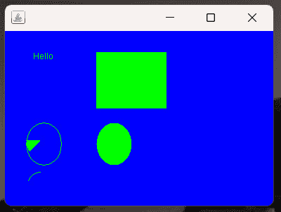

## 13. 示例（Java AWT、Swing 和 Applet）：处理 AWT 和 Swing 事件的小程序。

```
import java.applet.*;
import javax.swing.*;
import java.awt.event.*;
public class EventApplet extends JApplet implements ActionListener{ 
JButton b;
JTextField tf;
public void init(){
tf=new JTextField();
tf.setBounds(30,40,150,20);
b=new JButton("Click");
b.setBounds(80,150,70,40);
add(b);add(tf);
b.addActionListener(this);
setLayout(null);
}
public void actionPerformed(ActionEvent e){ 
tf.setText("Hi!, Welcome to Applet Event"); 
}
}
```

让我们创建一个 HTML 文件（`Event.html`）来处理上述程序的事件。

```
<html>
<body>
<applet code="EventApplet.class" width="300" height="300"> 
</applet>
</body>
</html>
```

注意：用户需要将应用程序文件和 HTML 文件保存在适当的位置，然后在命令提示符下编译程序，并使用`appletviewer`命令查看输出。

结束
