# npm 包创建：React JavaScript 库创建、测试与发布指南

## 简介

### 欢迎阅读 NPM 包！

NPM 是一个包含成千上万个包的数据库（存储）。开发者使用它来共享、管理、查找和安装库。

**提示：**

包有时也被称为库、插件、框架或工具。

包是一个包含`package.json`文件的目录（或项目），该文件用于记录关于它的信息。

发布 NPM 包是与他人共享代码并成为更优秀开发者的绝佳方式。这是为开发者社区做出贡献并展示各种技能的重要一步，例如：

- 沟通技能
- 协作技能
- 组织技能
- 技术技能
- 文档技能
- 问题解决技能

成为一名 NPM 包发布者是一种独特的方式，可以拥有一个成品，他人可以将其用作其应用程序的一部分或主要组件。

这本适合初学者的书籍讨论了你需要了解的所有内容，以便像专业人士一样创建、测试和发布 NPM 包。

## 本书如何帮助你

最好的学习方式是通过循序渐进的实践。换句话说，成为熟练的包发布者的最简单方法是主动构建 NPM 插件——而不仅仅是阅读或观看关于它们的视频。

因此，这本书是特意以项目为导向的，旨在让你在学习成为 NPM 包发布者的基本概念时，尽可能多地进行实践。

所以，打开你的文本编辑器（如 VS Code），在阅读本书的同时跟着写代码，这对你大有裨益。这样做，你将避免成为陷入“教程地狱”的一员。

## 学习路线图

本书的主要项目是一个推文按钮——你可以将其扩展到你的想象力所能及的任何规模。

不要被项目类型吓倒！你将踏上一段激动人心的旅程——在那里你将学习发布任何 NPM 包所需的基本概念。所以，给它一个机会吧。

## 前提条件

熟悉 Git、GitHub、React 和 JavaScript 将帮助你更好地学习 NPM 包发布。因此，为了更好地准备本书的内容，最好熟悉这些工具的基本方面。

## 本书使用的约定

你将在本书中发现的一些排版约定包括：

- **等宽字体：** 用于代码元素、文件名和文件扩展名。
- *斜体：* 用于标题。
- <u>下划线：</u> 用于突出显示链接文本。

## 问题与反馈

如有关于本书的问题或意见，请发送邮件至 `contact@codesweetly.com`，或在 Twitter 上给我发私信（`@oluwatobiss`）。

## 让我们开始吧！

下一章将讨论创建 NPM 包所需的文件和系统设置。

## 必需的文件和系统设置

以下是创建 NPM 包所需的系统和文件配置。

### 1. 安装 Git、Node 和 NPM

确保你的系统中已安装 Git、Node 10.16（或更高版本）以及 NPM 5.6（或更高版本）。

**提示：**

使用 [Git 教程](http://example.com) 和[包管理器](http://example.com)文章来在你的系统上安装、更新或验证 Git、NPM 和 Node。

### 2. 创建项目目录

为你的项目新建一个文件夹，如下所示：

```bash
mkdir thank-you-tweet-button-001
```

**注意：**

你可以使用任何你喜欢的名称。例如，本教程中我选择了`thank-you-tweet-button-001`。

随后，使用命令行导航到你的项目目录。

```bash
cd path/to/thank-you-tweet-button-001
```

### 3. 创建 package.json 文件

使用 NPM 为你的项目初始化一个 [package.json 文件](package.json file)。

```bash
npm init -y
```

让我们也初始化 Git。

### 4. 初始化 Git 仓库

在你项目的[根目录](root directory)中创建一个`.git`仓库：

```bash
git init
```

你现在需要指定希望 Git 忽略的文件。

### 5. 指定 Git 应忽略的文件

在你项目的根目录中创建`.gitignore`文件：

```bash
touch .gitignore
```

随后，打开刚创建的`.gitignore`文件，写入你希望 Git 忽略的文件名、文件夹或文件类型。

以下是一个示例：

```gitignore
.gitignore
/node_modules
/dist
```

上面的代码片段指示 Git 忽略跟踪当前目录中的`node_modules`和`dist`文件夹。

**注意：**

- 当前目录是指你正在其中工作的文件夹。
- 当前目录有时也被称为“当前工作目录（CWD）”或“工作目录”。

**有用的资源：**

查看 [gitignore 文件示例](gitignore)以了解更多关于 gitignore 的信息。

现在是时候暂存并提交你最近的更改了。

### 6. 暂存并将项目更改提交到 Git

在终端中输入以下命令，暂存并提交你最近的更改。

```bash
git add -A && git commit -m "Initialize project using CodeSweetly's guide"
```

上面的命令告诉 Git 暂存并提交项目中所有已修改和未跟踪的文件。

现在让我们为项目配置远程仓库。

### 7. 配置 GitHub 远程仓库

1. 前往 [GitHub 网站](https://github/) 登录，如果没有账户则[注册](https://github/)。
2. 注册账户后，在 GitHub 上为你的 Git 仓库创建一个主页（即仓库）。（你可以使用`thank-you-tweet-button-001`作为仓库名称，或任何你喜欢的其他名称。）
3. 为你的包创建远程仓库后，将项目中位于你本地系统的`.git`目录与 GitHub 上的远程仓库关联。要连接到远程仓库，通过本地终端进入你的包的根目录，然后执行`git remote add`命令。语法如下：

```bash
git remote add origin https://github.com/your-username/remote-repo-name.git
```

**注意：** 将上面代码中的`your-username`替换为你的 GitHub 用户名。同样，将`remote-repo-name`替换为你的远程仓库名称。

**有用的资源：**

[GitHub 文档中关于创建 GitHub 仓库的指南](https://docs.github.com/en/repositories/creating-and-managing-repositories/creating-a-new-repository)

你也可以将远程仓库添加到你的`package.json`文件中，方便想要为你的项目做出贡献的人访问。

```json
{
  "name": "thank-you-tweet-button-001",
  "version": "1.0.0",
  ...
}
```

```json
"repository": {
  "type": "git",
  "url": "https://github.com/your-username/app-repo-name.git"
},
"scripts": {
  "test": "echo \"Error: no test specified\" && exit 1
}
}
```

让我们将远程仓库的 Issues URL 作为包的 bug 跟踪器。并提供人们可以报告问题时使用的邮箱：

```json
{
  "name": "thank-you-tweet-button-001",
  "version": "1.0.0",
  "repository": {
    "type": "git",
    "url": "https://github.com/your-username/app-repo-name.git"
  },
  "bugs": {
    "url": "https://github.com/your-username/app-repo-name/issues",
    "email": "your-project-email@host.com"
  },
  "scripts": {
    "test": "echo \"Error: no test specified\" && exit 1
  }
}
```

```json
}
```

随后，暂存并提交你的更改：

```bash
git add -A && git commit -m "Create repository and bugs fields"
```

现在让我们将本地 Git 仓库推送到上游。

### 8. 将本地 Git 目录推送到远程仓库

成功将本地目录连接到远程仓库后，你就可以开始将本地项目推送到上游了。方法如下：

```bash
git push -u origin main
```

上面的命令指示 Git 将本地`main`分支的`.git`目录推送到 GitHub 上的远程`origin`分支。

> **注意：**
>
> 刷新远程仓库的页面，现在应该能看到你上传的内容了。

下一步是使用 React 设置项目。所以现在让我们开始吧。

## 配置 React

将 React 作为开发依赖安装：

```bash
npm i -D react
```

上面的命令告诉 NPM 将`react`作为你包的开发依赖安装。

**注意：**

- `react`包是一个包含 React 核心功能的库，用于创建 React 组件。
- `i`是`install`的简写。
- `-D`标志是`--save-dev`的简写。

但是，既然用户在生产环境中需要 React，为什么还要将其作为开发依赖安装呢？让我们来讨论一下原因。

### 为什么将 React 作为包的开发依赖安装？

将 React 作为开发依赖而不是依赖包安装，可以避免强制用户在安装你的包时下载 React。

React 要求项目中只能有一份`react`包的副本。

因此，将 React 指定为开发依赖可以避免强制用户在安装你的包时下载 React。这样，如果他们的项目已经有一份 React 副本，就不需要再安装额外的副本了。

开发依赖安装的一个注意事项是，你的包只能用于已预装 React 包的项目。不过，有一个很好的解决方法：

- 将`package.json`中`"devDependencies"`字段的`"react"`属性复制到`"peerDependencies"`中，如下所示：

```json
{
  "devDependencies": {
    "react": "^18.2.0"
  },
  "peerDependencies": {
    "react": "^18.2.0"
  }
}
```

将 React 指定为对等依赖项会告诉包管理器检查安装你的包的应用是否包含列出的`peerDependencies`。如果是，则该应用拥有你的包运行所需的依赖项。

但假设包管理器找不到`peerDependencies`。在这种情况下，某些 NPM 版本（如版本 7 和 8）会自动安装它们。但其他版本（如版本 3 到 6）会显示一条警告，说明你的包运行所需的依赖项，用户必须手动安装。

**提示：dependencies vs. devDependencies vs. peerDependencies**

- `dependencies`指定项目在生产环境中（当你的应用在实时服务器上运行时）依赖的包。
- `devDependencies`字段列出项目在生产环境中不需要，但本地开发和测试所需的包。
- `peerDependencies`列出项目期望其宿主应用在其`node_modules`目录中拥有的所有包。

那么，现在你已经安装了 React，我们可以讨论如何编写组件的测试用例了。

## 测试 React 组件

以下是编写组件测试用例所需的步骤。

### 1. 安装测试工具

安装项目的测试包：

```bash
npm i -D jest @testing-library/react
```

- `jest`是我们用来运行测试脚本并在命令行上打印测试结果的测试运行工具。
- `@testing-library/react`是 React 测试库，它提供你编写 React 组件测试用例所需的 API。

### 2. 将 Jest 指定为项目的测试运行工具

通过指定`jest`作为项目的测试运行工具来更新包的测试脚本。

```json
{
  "name": "thank-you-tweet-button-001",
```

```json
"version": "1.0",
"scripts": {
  "test": "jest"
}
}
```

### 3. 安装代码编译器

Jest 目前无法识别 JSX 语法。因此，您需要一个编译器（例如 Babel）来[将此类代码转换为普通的 JavaScript](https://example.com)。

**命令行**

```bash
npm i -D @babel/core @babel/preset-env @babel/preset-react @babel/cli
```

上述命令将安装`@babel/core`、`@babel/preset-env`、`@babel/preset-react`和`@babel/cli`。

- `@babel/core`是包含 Babel 核心功能的库。
- `@babel/preset-env`包含一组预定义的插件，用于将 ES2015+ 语法转换为浏览器能够理解的 JavaScript 代码。
- `@babel/preset-react`包含用于将 React 语法转换为浏览器兼容的 JavaScript 代码的预定义插件。
- `@babel/cli`是一个 CLI 工具，允许您在终端中运行 Babel 命令。

**注意：**

- Jest 开箱即用地带有`babel-jest`插件，它用于加载您的 Babel 配置并将项目的 JSX 代码转换为 JavaScript。
- 假设您使用了额外的代码转换器——例如 CSS 转换器。在这种情况下，请创建一个 Jest 配置文件，并在其他转换器旁边明确包含默认的`babel-jest`插件，如下所示：

```json
"transform": {
  "\\.[j]sx?$": "babel-jest",
  "\\.css$": "some-css-transformer",
  "\\.other$": "some-other-transformer"
}
```

`"\\.[j]sx?$": "babel-jest"`字段告诉 Jest 使用`babel-jest`来加载您的 Babel 配置，并将所有`.js`和`.jsx`文件转换为普通的 JavaScript。仅在您使用额外的代码转换器时才需要此配置。

现在让我们配置 Babel。

### 4. 配置 Babel 以编译您的代码

在项目的根目录下创建一个`babel.config.json`文件。

```bash
touch babel.config.json
```

随后，在新创建的文件中添加以下配置：

```json
{
  "presets": [
```

```json
["@babel/preset-env", { "targets": "defaults" }],
"@babel/preset-react"
]
}
```

上述配置告诉 Babel 使用`@babel/preset-env`和`@babel/preset-react`包将您的代码转换为浏览器兼容的 JavaScript 语法。

`"targets": "defaults"`选项告诉 Babel 将您的代码转换为与 [Browserslist 的默认浏览器](https://github.com/browserslist/browserslist#default-browser-usage)兼容的语法。

**提示：**

> 运行`npx browserslist`命令以查看 Browserlist 为您的目标选择的浏览器。

### 5. 配置 Jest 的测试环境

Node.js 是 Jest 的默认测试环境。因此，在为 Web 创建包时，您需要指定一个类浏览器的环境。为此，请安装`jest-environment-jsdom`库：

**命令行**

```bash
npm i -D jest-environment-jsdom
```

随后，在项目的根目录下创建一个`jest.config.json`配置文件（如果您还没有的话）。

**命令行**

```bash
touch jest.config.json
```

然后，在新创建的文件中添加以下配置：

**jest.config.json**

```json
{
  "testEnvironment": "jsdom",
  "moduleFileExtensions": ["js", "jsx", "json", "node"]
}
```

- `"testEnvironment"`字段告诉 Jest 使用`"jsdom"`测试环境。
- `"moduleFileExtensions"`字段列出了项目的文件扩展名。因此，每当您在不指定文件扩展名的情况下`require()`或`import`模块时，Jest 将按照此列表从左到右的顺序使用扩展名。

随后，更新`package.json`的测试脚本：

**package.json**

```json
{
  "name": "thank-you-tweet-button-001",
  "version": "1.0.0",
  "scripts": {
    "test": "jest --config jest.config.json"
  }
}
```

`--config jest.config.json`代码指定了 Jest 执行测试时应使用的配置文件。

**有用的资源：**

参考 Jest 文档以了解更多关于配置[测试环境](https://jestjs.io/docs/configuration#testenvironment)的信息。

### 6. 创建您的代码文件

在项目的根目录下创建以下文件：

- `TweetButton.jsx`
- `TweetButton.test.jsx`


```bash
touch TweetButton.jsx TweetButton.test.jsx
```

### 5. 编写您的测试用例

请记住，我们的目标是创建一个 Tweet 按钮 NPM 包。因此，测试您的 Tweet 按钮组件是否正确渲染至关重要。现在，打开新创建的测试文件（`TweetButton.test.jsx`）并复制以下测试用例：

```jsx
import React from "react";
import { render } from "@testing-library/react";
import { test } from "@jest/globals";
import { TweetButton } from "./TweetButton";

test("tweet button renders correctly", () => {
  render(<TweetButton />);
});
```

以下是我们在此测试代码片段中完成的主要工作：

- 我们导入了编写测试用例所需的包。
- 我们编写了一个测试用例，规定我们期望`<TweetButton />`组件能够无错地渲染。

假设您现在运行测试代码。测试将失败，因为您还没有开发用于该测试的组件。现在让我们来完成它。

### 8. 开发您的 React 组件

打开`TweetButton.jsx`文件，并开发 Tweet 按钮组件以通过预写测试，如下所示：

`TweetButton.jsx`

```jsx
import React from "react";

export function TweetButton() {
  const tweetURL = "https://twitter.com/intent/tweet?text=Thank+you,+%40oluwatobiss.+Your+book+helped+me+create,+test,+and+publish+an+NPM+package.%0A%0ACreating%20NPM%20Package:%20React%20JavaScript%20Guide%0A%0Ahttps%3A%2F%2Famzn.to%2F4aUJ3Qg";

  return (
    <div>
      <a
        href={tweetURL}
        target="_blank"
      >
        Send a thank you tweet
      </a>
    </div>
  );
}
```

> **注意：**
>
> 我们使用具名导出（named exportation）技术来导出`TweetButton`组件，因为[默认导出容易出错](https://the_default_export_can_be_error-prone)。因此，包作者应优先使用具名导出。

**有用资源：**

- 学习关于[具名导出](named_export)的知识。
- 学习关于[默认导出](default_export)的知识。

### 9. 运行测试

运行预写的测试，检查您的程序是通过还是失败。

```bash
npm run test TweetButton.test.jsx
```

一旦启动测试，Jest 将在编辑器的控制台上打印通过或失败的消息。消息将如下所示：

```text
$ npm run test TweetButton.test.jsx
```

```text
> thank-you-tweet-button-001@1.0.0 test
> jest --config jest.config.json TweetButton.test.jsx

PASS ./TweetButton.test.jsx

  √ tweet button renders correctly (19 ms)
```

```text
Test Suites: 1 passed, 1 total

Tests:       1 passed, 1 total

Snapshots:   0 total

Time:        4.277 s

Ran all test suites matching /TweetButton.test.jsx/i.
```

在确认组件按预期工作后，请暂存（stage）并提交最近的更改：

```bash
git add -A && git commit -m "Create Tweet button component"
```

然后，将提交推送到远程仓库：

```bash
git push -u origin main
```

到目前为止，`/internal-encouragements/`您一直在使用基本格式编写提交消息。然而，最佳实践是使用[Conventional Commits 标准](https://www.conventionalcommits.org/)。让我们详细讨论这一点。

**重要：**

在进入下一节之前，请确保您已将更改提交并推送到 GitHub。

## 使用 Conventional Commits

"Conventional Commits" 是一种标准化的提交消息编写模式，人类和机器都可读。

### Conventional Commits 消息的语法

以下是编写提交消息的 Conventional Commits 语法：

```text
type(scope): summary
```

- `type`是一个名词，如`fix`、`feat`和`chore`，用于指定您提交的更改类型。
- `scope`是可选的。它指示发生更改的包或文件。使用时，请确保将其括在圆括号中。
- 终端的冒号（`:`）和空格标志着类型和范围定义的结束。
- `summary`是对提交的简短描述。
- 类型、范围和摘要有时被统称为“提交消息的标头（header）”。

### 提示：开发者经常使用的 11 种提交 "type"

- `build`：用于影响应用程序构建步骤或外部依赖项的提交——例如，对 NPM 包的更新。

### 常见的提交类型

- `chore`：用于实现与维护相关的更新，例如更新`.gitignore`文件或现有的 API 密钥。
- `ci`：用于修改 CI（持续集成）配置的提交。
- `docs`：用于修改项目文档的提交。
- `feat`：用于向代码库添加新功能的提交。在语义化版本控制（SemVer）中，此提交类型等同于 MINOR 版本发布。
- `fix`：用于向代码库添加 Bug 修复的提交。在语义化版本控制（SemVer）中，此提交类型等同于 PATCH 版本发布。
- `perf`：用于提高应用程序性能的提交。
- `refactor`：用于对代码库特定部分进行重构的提交——例如，重命名一个函数。
- `revert`：用于将代码库恢复到之前提交历史的提交。您还可以将要恢复的提交 SHA 添加到页脚作为参考——例如，`Refs: 7b804hrw, b394c306`。
- `style`：用于修改代码风格的提交，例如添加分号、空格或缩进。
- `test`：用于修改应用程序测试代码的提交。

#### 实用资源

- [Git 提交消息三个主要部分](the three main parts of a Git commit message)的概览。
- 关于[持续集成和交付](continuous integration and delivery)的 Wikipedia 文章。
- 了解[语义化版本控制](Semantic Versioning)。

大多数开发人员使用插件来强制要求使用 Conventional Commits 格式编写提交消息。这样做可以避免忘记标准化您的消息。因此，让我们在工作流中也添加一些强制执行机制。

### 如何强制执行 Conventional Commits 格式

安装`@commitlint/config-conventional`和`@commitlint/cli`包，您将使用它们来为项目的提交消息强制执行 Conventional Commits 格式。

```bash
npm i -D @commitlint/config-conventional @commitlint/cli
```

上述命令将安装`@commitlint/config-conventional`和`@commitlint/cli`。

- `@commitlint/config-conventional`包包含一组 lint 规则（约定），您可以将其配置为项目的提交消息约定。默认情况下，`@commitlint/config-conventional`使用 Conventional Commits 规范。但您可以使用自己的规则覆盖默认设置。
- `@commitlint/cli`包使用您在项目的`commitlint.config.js`文件中配置的提交消息约定，在 CLI（命令行界面）上对您的提交消息进行 lint 检查。

安装`@commitlint/config-conventional`包并不会自动指示 commitlint 将其作为 lint 提交消息的约定。您需要在`commitlint.config.js`配置文件中明确指示 commitlint 这样做。

因此，在项目的根目录下创建一个`commitlint.config.js`文件。

```bash
touch commitlint.config.js
```

然后，将以下配置添加到新创建的文件中：

```js
module.exports = {
  extends: ["@commitlint/config-conventional"],
};
```

上述配置告诉 commitlint 使用 config-conventional 规则作为 lint 提交消息的标准。

#### 实用资源

关于[linting](linting)的文章。

让我们使用 Git hooks，使 commitlint 在您输入提交消息后运行。

### 如何配置项目的 Git Hooks

安装 husky，您将使用它来配置项目的[Git hooks](Git hooks)。

```bash
npm i -D husky
```

#### 注意

- Git hooks 是脚本，每当您初始化了 Git 的项目中发生某些特定事件时，Git 就会自动调用它们。例如，pre-commit hook 是 Git 在提交代码之前运行的脚本。而 post-commit hook 是 Git 在提交代码之后运行的脚本。
- Husky 是一个工具，使您能够更简单、更高效地使用 Git hooks。

要使用 husky 配合 Git hooks，您必须激活它们。现在我们就来执行此操作。

```bash
npx husky install
```

现在我们可以告诉 husky，每当您输入提交消息时就运行 commitlint。

### 如何让 Husky 在您输入提交消息时运行 Commitlint

在终端上运行以下命令，将 Git commit-msg hook 添加到项目的`.husky`目录中。

```bash
npx husky add .husky/commit-msg 'npx --no -- commitlint --edit ${1}'
```

上述命令告诉 husky 每当您输入提交消息时运行 commitlint。

换句话说，您之前安装的`commitlint/cli`包不会自动 lint 您的提交消息。相反，您需要使用 Git commit-msg hook，以便在输入提交消息时自动运行 commitlint。

因此，如果您现在使用格式无效的消息运行`git commit -m`命令，commitlint 将抛出错误。

例如，让我们使用非约定式的提交格式来提交最近的更改：

```bash
git add -A && git commit -m "Install plugins to enforce conventional commits"
```

一旦您运行上述提交命令，commitlint 将抛出如下错误：

```text
input: Install plugins to enforce conventional commits
subject may not be empty [subject-empty]
type may not be empty [type-empty]
found 2 problems, 0 warnings
Get help: https://github.com/conventional-changelog/commitlint/#what-is-commitlint

husky - commit-msg hook exited with code 1 (error)
```

`commitlint/cli`插件抛出上述错误是因为我们提供了非约定式的提交消息。现在让我们修复它：

命令行：

```bash
git add -A && git commit -m "chore(commitlint): install plugins to enforce conventional commits"
```

上述提交命令不会抛出错误，因为它符合 Conventional Commits 规范。换句话说，您应该看到如下成功消息：

命令行：

```text
[main ca32a4c] chore(commitlint): install plugins to enforce conventional commits
4 files changed, 1449 insertions(+), 18 deletions(-)
create mode 100644 .husky/commit-msg
create mode 100644 commitlint.config.js
```

很容易跳过使用标准化的提交消息，因为 Git hooks 严格限定在项目的本地仓库中，这意味着任何有权访问该仓库的人都可以更改这些 hooks。

换句话说，即使您运行`git clone`命令，Git 也永远不会将 hooks 从一个仓库复制到另一个仓库。因此，hooks 是不可共享的，并且可以被任何访问本地仓库的人更改。因此，每个开发人员都可以选择不标准化其提交消息。

所以，假设您希望在开发团队中强制执行特定的提交消息约定。在这种情况下，最好在 CI/CD 工作流中设置 GitHub Actions，以确保只有符合您指定提交约定的内容才能成功推送到项目的远程仓库。通过这样做，您将鼓励所有团队成员标准化他们的提交消息。

#### 实用资源

了解[GitHub Actions 的工作原理](how GitHub Actions work)。

现在让我们看看如何设置 GitHub Actions。

## 设置 GitHub Action

以下是将 Commitlint GitHub Action 添加到团队工作流的步骤。

### 1. 创建 GitHub Action 工作流文件

在项目的根目录下创建一个`.github`文件夹，其中包含一个`/workflows/commitlint.yml`文件。

命令行：

```bash
mkdir .github && mkdir .github/workflows && touch .github/workflows/commitlint.yml
```

上述代码段的含义如下：

- `mkdir .github`：创建`.github`目录。
- `mkdir .github/workflows`：在`.github`目录中创建`workflows`文件夹。
- `touch .github/workflows/commitlint.yml`：在`workflows`目录中创建`commitlint.yml`文件。
- `&&`语法表示“并且”。我们用它来链接多个命令行指令。

### 2. 定义 GitHub Action 工作流

打开新创建的工作流文件并复制以下代码：

```yaml
name: Lint Commit Messages
on: [pull_request, push]

jobs:
  commitlint:
    runs-on: ubuntu-latest
    steps:
      - uses: actions/checkout@v3
        with:
          fetch-depth: 0
      - uses: wagoid/commitlint-github-action@v5
```

上述代码段告诉 GitHub 使用 commitlint 对每个 pull request 和 push 事件的提交进行 lint 检查。

### 重要

> 上述代码的缩进格式至关重要。只有在使用正确的缩进时，GitHub Action 工作流才会成功。

### 3. 测试 GitHub Action 工作流

使用 Conventional Commits 格式编写提交消息，对最近的更改进行暂存（stage）并提交。

```bash
git add -A && git commit -m "ci(github): create commitlint github action"
```

然后，将提交推送到远程仓库：

```bash
git push -u origin main
```

推送提交后，你可以前往项目 GitHub 仓库的 "Actions" 标签页查看工作流。以下是我的截图：

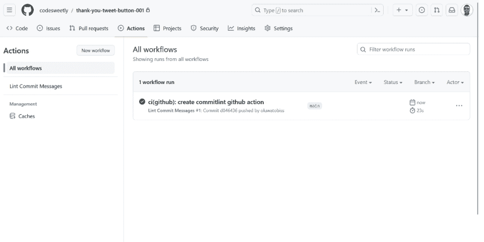

图 5-1. 查看 thank-you-tweet-button-001 GitHub 仓库的 GitHub Actions 工作流部分

## 有用资源：

[Commitlint GitHub Action 仓库](https://github.com/commitlint/commitlint-github-action)

现在让我们为`TweetButton`组件添加一些样式。

# 6 为 React 组件添加样式

以下是为你的包中的 React 组件添加样式的步骤。

**提示：**


建议为你的包使用`[<link rel="stylesheet">或内联样式](...)`。但为了简单起见，本指南将使用常规的 CSS 样式表。

### 1. 创建样式表

在根目录下为`TweetButton`组件创建一个 CSS 文件，如下所示：

```
touch index.css
```

然后，打开新创建的 CSS 文件并按如下方式声明样式：

```
.tweet-btn-container {
  margin-top: 30px;
}

.tweet-button {
  display: inline-block;
  text-decoration: none;
  font-size: 0.97rem;
  font-weight: bold;
  color: #333;
  background-color: #eee;
  padding: 17px 35px;
  border-radius: 7px;
  border-block: 1px solid #ccc;
  border-inline: 1px solid #333;
}

.tweet-button:hover {
  text-decoration: none;
  color: #fff;
  background-color: #1a8cd8;
  border-block-color: #1a8cd8;
}
```

下一步是将样式应用到组件上。所以，我们现在就开始吧。

### 2. 将 CSS 样式应用到你的组件

导入`index.css`样式文件并将其规则集应用到你的组件：

```
import React from "react";
import "./index.css";
```

`TweetButton.jsx`

```
export function TweetButton() {
  const tweetURL = "https://twitter.com/intent/tweet?text=Thank+you,+%40oluwatobiss.+Your+book+helped+me+create,+test,+and+publish+an+NPM+package.%0A%0ACreating%20NPM%20Package:%20React%20JavaScript%20Guide%0A%0Ahttps%3A%2F%2Famzn.to/4aUJ3Qg";

  return (
    <div className="tweet-btn-container">
      <a
        className="tweet-button"
        href={tweetURL}
        target="_blank"
      >
        Send a thank you tweet
      </a>
    </div>
  );
}
```

假设你现在运行测试代码。测试将会失败，因为 Jest 默认无法处理 CSS 文件。但你可以使用`jest-transform-css`库将样式表导入到 Jest 的 DOM 环境中。让我们看看如何操作。

### 3. 将你的 CSS 文件添加到 Jest 的 JSDOM

首先，安装`jest-transform-css`库：

```
npm i -D jest-transform-css
```

然后，打开你的`jest.config.json`配置文件并按如下方式更新其`"transform"`字段：

**jest.config.json**

```
{
  "testEnvironment": "jsdom",
  "moduleFileExtensions": ["js", "jsx", "json", "node"],
  "transform": {
    "^.+\\.css$": "jest-transform-css",
    "^.+\\.[j]sx?$": "babel-jest"
  }
}
```

- `"^.+\\.css$": "jest-transform-css"`字段告诉 Jest 使用`jest-transform-css`将 CSS 文件加载到 Jest 的`jsdom`中。
- `"\\.[j]sx?$": "babel-jest"`字段告诉 Jest 使用`babel-jest`加载 Babel 配置，并将所有`.js`和`.jsx`文件转换为纯 JavaScript。

### 4. 运行测试

运行你的测试代码：

**命令行**

```
npm run test
```

一旦测试通过，继续暂存并提交你的更改：

**命令行**

```
git add -A && git commit -m "style: create the tweet button's stylesheet"
```

请记住，浏览器不理解 React。所以，你需要将 JSX 语法转换为浏览器可以解析的 JavaScript 代码。我们现在就开始吧。

## 将 React 编译为 JavaScript

在终端中运行 Babel 编译命令，如下所示：

```
npx babel TweetButton.jsx -o index.js
```

**注意：**
- 如果`index.js`文件不存在，Babel 会自动创建它。
- `-o`选项是`--out-file`的简写形式。你可以使用这两个标志中的任意一个来输出包含编译代码的文件。
- 你还可以将编译命令添加到项目`package.json`文件的`"scripts"`字段中：

```
{
  "name": "thank-you-tweet-button-001",
  "version": "1.0.0",
  "scripts": {
    "build": "babel TweetButton.jsx -o index.js"
  }
}
```

这样做之后，你可以像这样在终端中运行 Babel：

**命令行**

```
npm run build
```

注意，你目前所有的文件都在根目录中。然而，常见的做法是将源代码放在`src`目录中，将编译后的代码放在`dist`文件夹中。所以，我们也来这样做吧。

**提示：源代码与编译代码**
- 源代码是你编写和编辑的原始文件。正是源代码被像 Babel 这样的编译器编译为分发代码。
- 分发代码是源代码的压缩和优化版本。换句话说，分发代码指的是编译器为你的项目自动生成的 JavaScript 文件。

# 8 区分源代码和分发代码

在你的包根目录中创建一个"源代码"目录（`./src`）和一个"分发"代码文件夹（`./dist`）。

```
mkdir src dist
```

然后，将你的 JSX、样式表和测试文件移动到源代码目录中。

```
mv TweetButton.jsx index.css TweetButton.test.jsx src/
```

并将编译后的 JavaScript 文件（`index.js`）移动到分发代码目录中。

```
mv index.js dist/
```

另一个常见的做法是将组件放在`"components"`目录中。所以，在`src`目录中创建一个`components`文件夹。

```
mkdir src/components
```

将你的组件和测试文件移动到新建的`components`文件夹中。

```
mv src/TweetButton.jsx src/TweetButton.test.jsx src/components/
```

让我们也更新构建脚本，以便 Babel 可以从源代码目录编译，并将编译结果输出到分发文件夹中。

```
{
  "name": "thank-you-tweet-button-001",
  "version": "1.0.0",
  "scripts": {
    "build": "babel src -d dist --ignore src/**/*.test.jsx",
    "test": "jest --config jest.config.json"
  }
}
```

上面的命令告诉 Babel 编译`src`目录，并将其输出保存到`dist`文件夹中。

换句话说，当你运行`npm run build`命令时，Babel 将编译源代码目录的全部内容，并将其输出到分发文件夹中。

**注意：**
- `-d`选项是`--out-dir`的简写形式。
- `--ignore src/**/*.test.jsx`代码告诉 Babel 忽略`src`目录中的任何`.test.jsx`文件。

此外，你可以配置构建脚本，在每次构建前清理分发（`dist`）文件夹：

**package.json**

```
{
  "name": "thank-you-tweet-button-001",
  "version": "1.0.0",
  "scripts": {
    "build": "rm -r dist && babel src -d dist --ignore src/**/*.test.jsx",
    "test": "jest --config jest.config.json"
  }
}
```

**注意：**
你的项目必须有一个`dist`文件夹。否则，`rm -r dist`命令会抛出`"rm: cannot remove 'dist': No such file or directory"`错误。

假设你现在运行测试代码。测试将会失败，因为你需要更新样式表的路径。

**TweetButton.jsx**

```
import React from "react";
import "../index.css";

export function TweetButton() {
  const tweetURL = "https://twitter.com/intent/tweet?text=Thank+you,+%40oluwatobiss.+Your+book+helped+me+create,+test,+and+publish+an+NPM+package.%0A%0ACreating%20NPM%20Package:%20React%20JavaScript%20Guide%0A%0Ahttps%3A%2F%2Famzn.to/4aUJ3Qg";

  return (
    <div className="tweet-btn-container">
      <a
        className="tweet-button"
        href={tweetURL}
        target="_blank"
      >
        Send a thank you tweet
      </a>
    </div>
  );
}
```

让我们再定义一个脚本，用于在每次构建时将样式表复制到`dist`目录中。

**package.json**

```
{
  "name": "thank-you-tweet-button-001",
  "version": "1.0.0",
  "scripts": {
    "build": "rm -r dist && babel src -d dist --ignore src/**/*.test.jsx && npm run copy-files",
    "copy-files": "cp ./src/index.css dist/",
    "test": "jest --config jest.config.json"
  }
}
```

现在，让我们再次运行全凭构建。

**命令行**

```
npm run build
```

你也可以运行测试来确认一切工作正常。

**命令行**

```
npm run test
```

随后，暂存并提交你最近的更改：

**命令行**

```
git add -A && git commit -m "build: specify items babel should compile"
```

### 有用的资源：
进一步了解[编译文件和目录](compiling files and directories)。
下一步是指定你的包的[入口点](entry point)。

# 定义包的入口点

将包含编译后代码的文件添加到你的包的`package.json`文件中的`"main"`字段：

**package.json**

```
{
  "name": "thank-you-tweet-button-001",
  "version": "1.0.0",
  "main": "./dist/components/TweetButton.js",
  "license": "ISC"
}
```

**提示：**
> 当用户运行`require("thank-you-tweet-button-001")`时，Node 会将调用解析为`require(<package.json:main>)`。

现在让我们暂存并提交你最近的更改：

**命令行**

```
git add -A && git commit -m "chore: define package's entry point"
```

那么，既然你已经构建好了你的包，让我们在发布到 NPM 之前先在本地测试它。

# 10 在本地测试未发布的包

本节将使用 Next.js 项目来讨论如何在将包发布到 NPM 之前在本地测试它。

**注意：**
> 选择 Next.js 纯属随机。本书的概念适用于其他 React 应用，如 Create React App、Vite 和 Gatsby。换句话说，如果你不熟悉 Next.js，也不用担心。我们只会使用它的基本功能来测试你的包。所以，放轻松——你完全没问题。

话不多说，让我们开始通过全局链接安装你的包。

### 1. 在系统中全局链接安装你的包

使用终端，导航到你的项目根目录（如果你还没有在那里）。然后，创建符号链接，如下所示：

**命令行**

```
npm link
```

`npm link`命令告诉 NPM 在你的系统全局目录中创建一个符号链接（symlink），指向你的包。

**提示：**
- 在包含你的`package.json`文件的目录中运行上述命令。否则，安装你的包的应用程序可能会抛出`"Module Not Found"`错误。
- 使用`npm ls --global`命令来确认你的全局文件夹的位置和内容。

### 有用的资源：
- NPM 关于 [npm link 命令](https://docs.npmjs.com/cli/v9/commands/npm-link)的文档。
- 了解[符号链接](https://en.wikipedia.org/wiki/Symbolic_link)。

现在让我们创建将用于测试该包的 Next.js 应用。

#### 2. 创建一个 NextJS 演示网站来测试你的包

首先，导航到你的项目根目录外的位置，这是你希望放置测试应用的地方。

然后，初始化一个 Next.js 应用，如下所示：

| 命令 | 描述 |
|---|---|
| `npx create-next-app@latest` | 初始化一个新的 Next.js 项目 |

运行上述命令后，Next 会询问以下问题：
- **确定要继续吗？(y)** 在键盘上输入`y`键继续。
- **你的项目叫什么名字？** 你可以随意命名——例如，`test-app-for-thank-you-tweet-button-001`。
- **你想在这个项目中使用 TypeScript 吗？» 否 / 是** 选择否，因为我们不打算在本教程中使用 TypeScript。
- **你想在这个项目中使用 ESLint 吗？» 否 / 是** 选择否，因为我们不打算在本教程中使用 ESLint。
- **你想在这个项目中使用 Tailwind CSS 吗？» 否 / 是** 选择否，因为我们不打算在本教程中使用 Tailwind CSS。
- **你想在这个项目中使用`src/`目录吗？» 否 / 是** 选择否，因为我们不打算在本教程中使用`src/`目录。
- **使用 App Router（推荐）？» 否 / 是** 选择是，因为我们同意使用 Next 的 App Router 配置。（如果你对 App Router 一无所知，也不用担心。我们只是使用 Next 的基本功能来理解如何测试你的包。）
- **你想自定义默认的导入别名吗？» 否 / 是** 选择否，因为我们同意在这个测试应用中使用 Next 的默认导入别名。

**有用的资源：**
- 查看 Next 的 [App Router 文档](https://nextjs.org/docs)以熟悉应用路由器范式。
- 了解 Next 的[导入别名](https://nextjs.org/docs/basic-features/typescript#path-aliases-and-absolute-imports)。

一旦你回答了所有问题，Next.js 就会创建你的新应用。所以，你可以从命令行导航到它，如下所示：

```
cd test-app-for-thank-you-tweet-button-001
```

现在让我们在新创建的 React 应用中安装你的包。

#### 3. 从系统全局文件夹安装你的包到测试应用

导航到你的测试应用的根目录（如果你还没有在那里），并从全局安装的包创建一个符号链接到你的 NextJS 演示应用的`node_modules`目录：

**命令行**

```
npm link package-name
```


**注意：**

- 将`package-name`替换为你的包在其`package.json`的`"name"`字段中定义的名称。例如，`npm link thank-you-tweet-button-001`。
- 每当你安装或卸载包时，NPM 会自动断开符号链接。所以，请记住在安装或卸载任何库后重新运行`npm link package-name`命令。

一旦你运行了上述命令，NPM 就会在测试应用的`node_modules`目录中链接安装该包。你可以像已经发布并从 NPM 安装它一样开始使用该库。例如，让我们将推文按钮添加到测试应用的首页。

#### 4. 在测试应用中使用链接安装的包

打开位于 Next.js 应用`app`文件夹中的`page.js`文件。

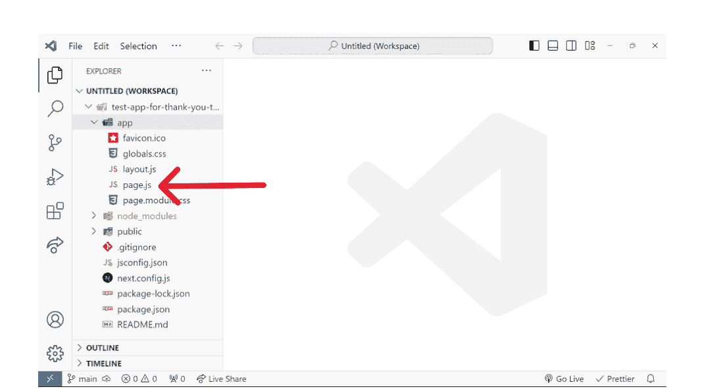

*图 10-1. 红色箭头指向`app`目录的`page.js`文件。*

然后，删除其内容并粘贴以下代码：

```javascript
import { TweetButton } from "thank-you-tweet-button-001";

export default function Home() {
  return (
    <main style={{ textAlign: "center", paddingTop: "30px" }}>
      <h1>Hi there! </h1>
      <TweetButton />
    </main>
  );
}
```

在上面的代码片段中，我们做了以下事情：

1. 从`thank-you-tweet-button-001`符号链接的包中导入了`TweetButton`组件。
2. 创建了一个`Home`组件，该组件渲染一个包含`<h1>`节点和你的`<TweetButton>`组件的`<main>`元素。

之后，运行测试应用，如下所示：

**命令行**

```bash
npm run dev
```

**注意：**

如果任何已安装的库使用事件监听器或生命周期效果，如`onClick()`、`onChange()`、`useState()`和`useEffect()`，Next.js 可能会抛出`"TypeError: Super expression must either be null or a function"`错误。

这个错误是因为所有 Next 的 App Router 组件默认都是[服务器组件](https://nextjs.org/docs/app/building-your-application/rendering/client-components)。

你可以通过在页面顶部、所有`import`语句上方声明一个`"use client"`指令来解决这个错误，如下所示：

**page.js**

```javascript
"use client";

import { useState } from "react";
import { TweetButton } from "thank-you-tweet-button-001";

export default function Home() {
  const [word, setWord] = useState("there");

  return (
    <main style={{ textAlign: "center", paddingTop: "30px" }}>
      <h1>Hello, {word}!</h1>
      <TweetButton />
    </main>
  );
}
```

通过这样做，Next.js 会将导入到页面中的所有模块视为客户端组件。

一旦你完成包的开发和测试，NPM 允许你取消链接这些符号链接。方法如下：

#### 5. 从测试应用中取消链接你的包

导航到你的测试应用的根目录（你导入和测试包的地方）。

```bash
cd path/to/the-project-you-will-use-to-test-the-package
```

然后从测试应用的`node_modules`目录中卸载该包，如下所示：

```bash
npm unlink package-name
```

**注意：**

将`package-name`替换为你的包在其`package.json`的`"name"`字段中定义的名称。例如，`npm unlink thank-you-tweet-button-001`。

一旦运行上述命令，NPM 将从`test-app`的`node_modules`文件夹中删除该包。

接下来的步骤是从全局目录中卸载该包。现在就开始吧。

### 6. 从全局文件夹中取消链接你的包

按照如下方式从全局文件夹中卸载该包：

```bash
npm rm --global package-name
```

**注意：**

- 将`package-name`替换为在`package.json`的`"name"`字段中定义的包名。例如，`npm rm --global thank-you-tweet-button-001`。
- 您可以在系统的任何目录下运行上述命令，因为卸载操作发生在全局目录中。

运行该命令后，NPM 将从系统的全局文件夹中删除该包。

**提示：**

- 使用`npm ls --global package-name`命令来确认该包已从全局目录中删除。

现在，既然您已经在本地创建并测试了您的包，是时候在 README 文件中记录该库的用途了。

## 创建 README

在项目的根目录下创建一个`README.md`文件：

```bash
touch README.md
```

之后，打开这个新创建的文件并说明：

- 您的包是什么
- 它解决了什么问题
- 该包的核心功能
- 演示 Demo 链接（如果有）
- 如何安装
- 如何使用
- 运行所需的依赖项

**这里有一个示例：**

> **注意**
>
> 本包是 [Creating NPM Package book](https://amzn.to/4aUJ3Qg) 中的一个项目。

# Thank You Tweet Button 001

一个简单易用的推文按钮，用于向 @oluwatobiss 表示感谢。

该按钮会自动在您的推文弹窗模态框中填充一段措辞得体的感谢信息。

### 功能

- 一个可以发布感谢信息的按钮

### 演示 Demo

https://codesweetly.com

### 安装

本节将介绍如何安装 Thank You Tweet Button 001 包。

#### 使用 npm

```bash
npm install thank-you-tweet-button-001
```

#### 使用 yarn

```bash
yarn add thank-you-tweet-button-001
```

#### 使用 pnpm

```bash
pnpm add thank-you-tweet-button-001
```

### 使用方法

```javascript
import { TweetButton } from "thank-you-tweet-button-001";

function App() {
  return <TweetButton />;
}
```

### 依赖项

- [React](https://github.com/facebook/react)

### 开发依赖项

- [Babel](https://github.com/babel/babel)
- [Jest](https://github.com/jestjs/jest)
- [Jest Transform CSS](https://github.com/dferber90/jest-transform-css)
- [React Testing Library](https://github.com/testing-library/react-testing-library)

现在让我们暂存并提交最近的更改：

```bash
git add -A && git commit -m "docs: create project's readme"
```

**实用资源：**

关于 [README](README) 文件的详细概述。

让我们再创建一个许可证文件，以便让人们知道您授予了他们什么样的权限。

## 创建 LICENSE

按照如下方式在项目的根目录下创建 LICENSE 文件：

```bash
touch LICENSE
```

然后，打开新创建的文件并填写您的许可证文本。

例如，如果您选择使用流行的 MIT 开源许可证，那么您可以使用 [choosealicense.com](https://choosealicense.com) 的文本。

**这里有一个示例：**

```text
MIT License

Copyright (c) 2024-present FirstName LastName & Company <username@yourdomain.com>

Permission is hereby granted, free of charge, to any person obtaining a copy of this software and associated documentation files (the "Software"), to deal in the Software without restriction, including without limitation the rights to use, copy, modify, merge, publish, distribute, sublicense, and/or sell copies of the Software, and to permit persons to whom the Software is furnished to do so, subject to the following conditions:

The above copyright notice and this permission notice shall be included in all copies or substantial portions of the Software.

THE SOFTWARE IS PROVIDED "AS IS", WITHOUT WARRANTY OF ANY KIND, EXPRESS OR IMPLIED, INCLUDING BUT NOT LIMITED TO THE WARRANTIES OF MERCHANTABILITY, FITNESS FOR A PARTICULAR PURPOSE AND NONINFRINGEMENT. IN NO EVENT SHALL THE AUTHORS OR COPYRIGHT HOLDERS BE LIABLE FOR ANY CLAIM, DAMAGES OR OTHER LIABILITY, WHETHER IN AN ACTION OF CONTRACT, TORT OR OTHERWISE, ARISING FROM, OUT OF OR IN CONNECTION WITH THE SOFTWARE OR THE USE OR OTHER DEALINGS IN THE SOFTWARE.
```

暂存并提交最近的更改：

```bash
git add -A && git commit -m "docs: create project's license"
```

**提示：如果不提供许可证会怎样？**

> “如果您不采用开源许可证，那么每个向您的项目做出贡献的人也将成为其作品的排他性版权持有者。这意味着没有人可以使用、复制、分发或修改他们的贡献——而这个“没有人”也包括您在内。” — [Open Source Guides](https://opensource.guide)

现在让我们讨论如何发布您的包以供公众使用。

## 将包发布到 NPM

以下是将您的包分享给全世界所需的步骤！

### 1. 提供有助于人们发现您包的信息

在`package.json`文件中添加以下字段，以便人们在搜索此类库时能获得关于您包的更多详细信息：

#### Description（描述）

使用`"description"`字段来描述您的包。

```json
{
  "name": "thank-you-tweet-button-001",
  "version": "1.0.0",
  "description": "Easy-to-use tweet button for saying thank you to @oluwatobiss.",
  "license": "ISC"
}
```

**提示：**

`"description"`属性使您的包在 NPM 网站上更容易被找到。它是人们运行`npm search`命令时显示的信息的一部分。

#### Keywords（关键词）

使用`"keywords"`字段列出表达您包用途的关键（主要）词汇。

**这里有一个示例：**

```json
{
  "name": "thank-you-tweet-button-001",
  "version": "1.0.0",
  "keywords": [
    "tweet",
    "twitter",
    "button",
    "thank you",
    "thanks"
  ],
  "description": "Easy-to-use tweet button for saying thank you to @oluwatobiss."
}
```

**提示：**

`"keywords"`属性使您的包在 NPM 网站上更容易被找到。它是人们运行`npm search`命令时显示的信息的一部分。

#### Author（作者）

使用`"author"`字段提供您作为包作者的信息。

```json
{
  "name": "thank-you-tweet-button-001",
  "version": "1.0.0",
  "author": "Example Name <examplename@codesweetly.com> (https://www.codesweetly.com)",
  "description": "Easy-to-use tweet button for saying thank you to @oluwatobiss."
}
```

定义`"author"`字段的另一种方式如下：

```json
{
  "name": "thank-you-tweet-button-001",
  "version": "1.0.0",
  "author": {
    "name": "Example Name",
    "email": "examplename@codesweetly.com",
    "url": "https://www.codesweetly.com"
  },
  "description": "Easy-to-use tweet button for saying thank you to @oluwatobiss."
}
```

#### License（许可证）

使用`"license"`字段让人们知道您允许他们使用该包的条款和条件。

```json
{
  "name": "thank-you-tweet-button-001",
  "version": "1.0.0",
  "license": "MIT",
  "description": "Easy-to-use tweet button for saying thank you to @oluwatobiss."
}
```

#### Homepage（主页）

使用`"homepage"`字段指定您包的主页。

```json
{
  "name": "thank-you-tweet-button-001",
  "version": "1.0.0",
  "homepage": "https://github.com/your-username/package-repo-name#readme",
  "license": "MIT"
}
```

现在让我们暂存并提交最近的更改：

```bash
git add -A && git commit -m "chore: make package discoverable"
```

一种常见的做法是仅发布您的包在生产环境中运行所需的文件。这样做可以避免用户下载不必要的内容。因此，我们也这样做。

### 2. 指定要发布到 NPM 的文件

在`package.json`文件中添加一个`"files"`字段，您可以在其中列出要发布到 NPM 的文件。

这里有一个示例：

**package.json**

```json
{
  "name": "thank-you-tweet-button-001",
  "version": "1.0.0",
  "files": ["./dist"],
  "license": "MIT"
}
```

NPM 默认包含以下文件，因此您无需在`"files"`字段中指定它们：

- `package.json`
- README
- LICENSE（LICENCE）
- `package.json`的`"main"`字段中指定的文件

**提示：**

NPM 注册表仅接受包含`package.json`文件的目录。

### 3. 确认 NPM 将要发布的文件

运行以下命令查看 NPM 将要发布的文件。

```bash
npm publish --dry-run
```


上述代码片段告诉 NPM 对你的包进行一次模拟发布（dry publication）。换句话说，该命令会显示一份报告，告知 NPM 在发布库时将执行的操作。

因此，你将看到类似这样的报告：

```bash
$ npm publish --dry-run
npm notice
npm notice � thank-you-tweet-button-001@1.0.0
npm notice === Tarball Contents ===
npm notice 1.1kB LICENSE
npm notice 1.2kB README.md
npm notice 817B dist/components/TweetButton.js
npm notice 455B dist/index.css
npm notice 1.5kB package.json
npm notice === Tarball Details ===
npm notice name: thank-you-tweet-button-001
npm notice version: 1.0.0
npm notice filename: thank-you-tweet-button-001-1.0.0.tgz
npm notice package size: 2.5 kB
npm notice unpacked size: 5.0 kB
npm notice shasum: 1ec5d31c3b9e223ad07e133d09dc7a9bd47047ba82b
npm notice integrity: sha512-fRglpZXrUAE2ql[... ]jyKX2AJ7XCubqQ==
npm notice total files: 5
npm notice
npm notice Publishing to https://registry.npmjs.org/ with tag latest and
default access (dry-run)
+ thank-you-tweet-button-001@1.0.0
```

“Tarball Contents”部分显示了 NPM 将要发布的所有文件。

#### 实用资源

讲解 [npm publish 如何工作](how npm publish works) 的文章。

一旦你对报告满意，请继续下一步。

### 4. 确认测试已通过

确保你所有的测试套件都已通过。

```bash
npm run test
```

### 5. 编译所有待处理的代码

确保你已经编译了源代码中的所有新更改。

```bash
npm run build
```

### 6. 暂存并提交最近的更改

暂存并提交你最近的更改。

```bash
git add -A && git commit -m "chore: specify files to publish to npm"
```

### 7. 将本地 Git 目录推送到远程仓库

将你的项目上传到 git 仓库。

```bash
git push -u origin main
```

### 8. 在 NPM 网站上登录或注册

前往 [NPM 网站](https://www.npmjs.com/)，登录，或者如果你还没有账号，请注册一个。

**注意：**

请确保在创建新账号后验证你的电子邮件。否则，在发布包时你会收到 403 Forbidden 错误。

### 9. 通过终端登录 NPM

通过命令行登录你的 NPM 账号，如下所示：

```bash
npm login
```

**提示：**

使用 `npm whoami` 命令检查你当前是否已登录。

### 10. 确认你的包名是否可用

使用以下命令检查你的包名是否可用。

| 命令行 |
| --- |
| `npm search package-name` |

**注意：**

将 `package-name` 替换为在 `package.json` 的 `"name"` 字段中定义的包名。例如，`npm search thank-you-tweet-button-001`。

如果没有人使用你想要的包名，上述命令将发出 `'No matches found for "your-package-name"'` 的消息。

然而，如果你拟定的包名目前已存在于 NPM 注册表中，在这种情况下，`npm search` 命令将显示有关找到的实例的一些信息。

或者，你也可以使用 NPM 网站的搜索栏，或在浏览器的地址栏中输入 `https://www.npmjs.com/package/your-package-name` 来看是否返回 404 页面。

如果你收到 404 错误页面，这意味着 `your-package-name` 可以用作你的包名。

但如果所有适合你插件的名字都被占用了，在这种情况下，NPM 允许你将项目作为作用域（scope）发布。

换句话说，你可以将你的包发布为 NPM 用户名的子部分。为此，请打开你的 `package.json` 文件，并在包名前加上你的 NPM 用户名。

#### 这是一个示例

`package.json`

```json
{
  "name": "@yourusername/thank-you-tweet-button-001",
  "version": "1.0.0"
}
```

现在让我们发布这个包吧！

### 11. 发布你的包！

进入包的根目录，使用以下命令发布：

```bash
npm publish
```

#### 收到错误消息了？

假设你为包名设置了作用域。在这种情况下，NPM 的默认设置认为作用域包是一个私有项目。因此，如果你使用 `npm publish` 命令来共享它，你会收到一个错误。

因此，要将你的包作为用户名的作用域发布，请在 `npm publish` 命令中添加 `--access=public` 标志：

```bash
npm publish --access=public
```

##### 提示

你可以在初始化过程中，通过使用 `npm init --scope=username` 命令代替 `npm init` 来将项目设为作用域包。

在发布到 NPM 后，建议测试实时包。现在就开始吧。

## 14. 在本地测试已发布的包

以下是测试实时包的步骤。

### 1. 安装包

使用终端，导航到你的 NextJS 测试应用的根目录，并像这样安装你的包：

```bash
npm install package-name --save
```

**注意：**

将 `package-name` 替换为在 `package.json` 的 `"name"` 字段中定义的包名。例如，`npm install thank-you-tweet-button-001 --save`。

### 2. 导入包

打开 Next.js 应用程序 `app` 文件夹中的 `page.js` 文件。

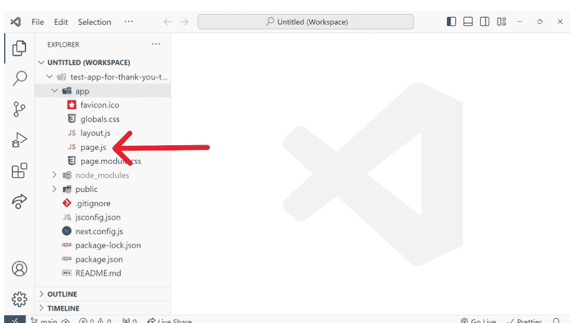

图 14-1. 红色箭头指向 app 目录的 page.js 文件

然后，如下导入并使用该包：

```javascript
import { TweetButton } from "thank-you-tweet-button-001";

export default function Home() {
  return (
    <main style={{ textAlign: "center", paddingTop: "30px" }}>
      <h1>Hi there! </h1>
      <TweetButton />
    </main>
  );
}
```

### 3. 运行本地服务器

在浏览器中运行测试应用，以确认你的包工作正常。

```bash
npm run dev
```

到目前为止，你已经在本地系统上测试了该包。然而，在实时服务器的生产环境中进行测试也是一个好的实践。所以，让我们使用 Vercel 来完成。

## 15. 使用 Vercel 测试已发布的包

以下是使用 Vercel 托管网站测试实时包的步骤。

### 1. 暂存并提交更改

暂存并提交 NextJS 测试应用的最近更改：

```bash
git add -A && git commit -m "Add tweet button"
```

### 2. 为你的 NextJS 测试应用配置 GitHub 远程仓库

1. 登录你的 GitHub 账号。
2. 为你的 NextJS 演示网站创建一个新的 GitHub 仓库。（你可以使用 `test-app-for-thank-you-tweet-button-001` 作为仓库名称，或任何你喜欢的其他名称。）
3. 将演示网站的本地 `.git` 目录与远程 GitHub 仓库关联：

```bash
git remote add origin https://github.com/your-username/remote-repo-name.git
```

> **注意：** 将上述代码中的 `your-username` 替换为你的 GitHub 用户名。同样，将 `remote-repo-name` 替换为你的远程仓库名称。

### 3. 将本地 Git 目录推送到远程仓库

像这样将你的 NextJS 测试应用项目上传到 git 仓库：

```bash
git push -u origin main
```

### 4. 在 Vercel 网站上登录或注册

前往 [Vercel 网站](https://vercel.com)，使用你的 GitHub 账号登录或注册。

> **注意：** 使用托管 NextJS 测试应用项目的 GitHub 账号登录（或注册）Vercel。

### 5. 将项目部署到 Vercel 服务器

登录 Vercel 控制面板后，点击 “Add New” 按钮。

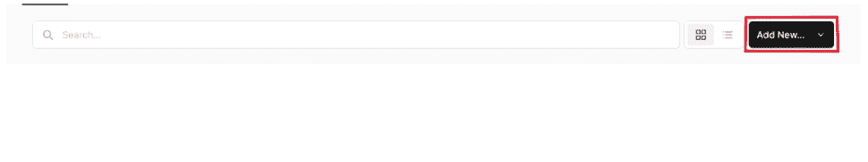

图 15-1. 红色矩形突出了 Vercel 的 “Add New...” 按钮。

然后点击下拉菜单中的 “Project” 选项。

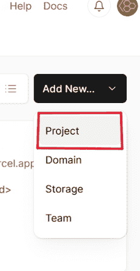

图 15-2. 红色矩形突出显示 “Add New...” 按钮的 “Project” 选项。

之后，你将在 “Import Git Repository” 下看到 Git 仓库列表。点击你想要部署的项目旁边的 “Import” 按钮。

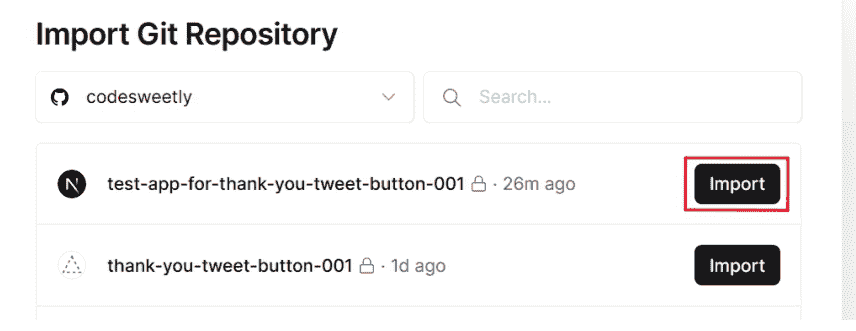

图 15-3. 红色矩形突出了 Vercel 的 “Import” 按钮。

接下来，点击 “Configure Project” 部分下的 “Deploy” 按钮来部署演示应用！

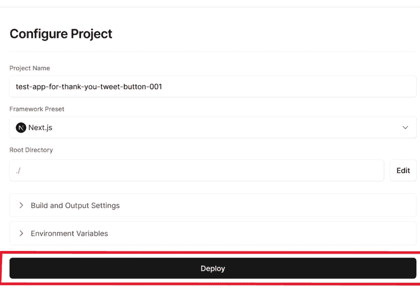

图 15-4。红色矩形框高亮显示了 Vercel 的“部署”按钮。

> **注意：**
>
> 由于您已将 NextJS 演示网站的 GitHub 仓库与 Vercel 集成，因此每当您将更改推送到 GitHub 时，Vercel 将自动重新部署 `test-app`。

### 6. 在在线演示网站上测试包

成功部署演示网站后，点击祝贺屏幕上的“继续到仪表板”按钮。

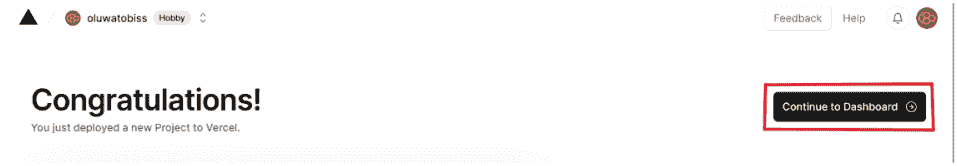

*图 15-5。红色矩形框高亮显示了 Vercel 的“继续到仪表板”按钮。*

然后，点击“访问”按钮查看部署的演示网站。

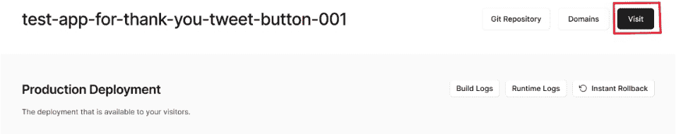

*图 15-6。红色矩形框高亮显示了 Vercel 的“访问”按钮。*

在浏览器中打开演示应用后，测试 Tweet 按钮以确认其是否正常工作！


*图 15-7。查看 Tweet 按钮的演示网站。*

现在，让我们讨论如何在进行重大更改时更新包的版本。

## 更新包的版本

最佳的发布实践是，在进行任何重大更改时更新包的版本号。这样做将帮助用户了解库版本发布中的更改类型。

以下是更新包版本号的语法：

```bash
npm version update-type
```

上述命令告诉 NPM 将包的版本号更新为指定的更新类型。

###### 注意

- 将 `update-type` 替换为您包的语义化版本发布类型（`patch`、`minor` 或 `major`）。
- 当对包进行向后兼容的更改而不引入新功能时，使用 `patch`。
- 当引入向后兼容的新功能时，使用 `minor`。
- 当进行任何**不**向后兼容的更新时，使用 `major`。
- 向后兼容意味着特定版本的软件（或包）可以使用其所有先前版本的 API（例如调用器）而不会抛出任何错误。

### 有用的资源

- NPM 关于[语义化版本控制](https://docs.npmjs.com/about-semantic-versioning)的文档。
- 了解[声明、初始化和调用](https://docs.npmjs.com/about-semantic-versioning)之间的区别。

让我们看一些示例。

#### 示例 1：如何将包更新为补丁版本

打开您的 `TweetButton` 组件文件，并将 `<div>` 元素更新为 `<section>` 元素，如下所示：

```javascript
import React from "react";
import "../index.css";

export function TweetButton() {
  const tweetURL = "https://twitter.com/intent/tweet?text=Thank+you,+%40oluwatobiss.+Your+book+helped+me+create,+test,+and+publish+an+NPM+package.%0A%0ACreating%20NPM%20Package:%20React%20JavaScript%20Guide%0A%0Ahttps%3A%2F%2Famzn.to/4aUJ3Qg";

  return (
    <section className="tweet-btn-container">
      <a
        className="tweet-button"
        href={tweetURL}
        target="_blank"
      >
        Send a thank you tweet
      </a>
    </section>
  );
}
```

我们所做的更改是补丁更新，因为：

1. 我们没有引入任何新功能。
2. 我们引入的更改没有破坏与先前版本的兼容性。

更新代码后，运行构建步骤：

```bash
npm run build
```

###### 注意

建议在提交更改之前，现在在本地测试更新的包。如果您需要回顾所需步骤，请参阅第 10 章。

准备好保存更改后，运行提交，如下所示：

```bash
git add -A && git commit -m "refactor: change div to section element"
```

由于我们进行了补丁修改，请按如下方式更新包的版本：

```bash
npm version patch
```

因此，NPM 将增加 `package.json` 中 `"version"` 字段的第三位数字。例如，从 `"1.0.0"` 变为 `"1.0.1"`。

之后，将您最近的提交上传到 git 仓库。

```bash
git push -u origin main
```

并发布包的最新版本：

```bash
npm publish
```

###### 注意

现在是使用您的 NextJS 演示网站测试补丁发布的好时机。请记住在测试前更新 `test-app` 的当前版本。例如，运行 `npm install thank-you-tweet-button-001@latest`。

现在让我们进行次要更新。

#### 示例 2：如何将包更新为次要版本

打开您的 `TweetButton` 组件文件，并按如下方式添加一个新属性：

```javascript
import React from "react";
import "../index.css";

export function TweetButton(props) {
  const tweetURL = `https://twitter.com/intent/tweet?text=Thank+you,+%40oluwatobiss.+Your+book+helped+me+create,+test,+and+publish+${
    props.number && props.number > 1 ? props.number : "an"
  }+NPM+${
    props.number && props.number > 1 ? "packages" : "package"
  }.%0A%0ACreating%20NPM%20Package:%20React%20JavaScript%20Guide%0A%0Ahttps%3A%2F%2Famzn.to/4aUJ3Qg`;

  return (
    <section className="tweet-btn-container">
      <a
        className="tweet-button"
        href={tweetURL}
        target="_blank"
      >
        Send a thank you tweet
      </a>
    </section>
  );
}
```

**注意：**

`props.number && props.number > 1 ? props.number : "an"` 代码使用了以下概念：

- 与逻辑运算符
- 链式三元运算符

我们所做的更改是次要更新，因为：

1. 我们引入了一个新功能（`number` 属性）。


## 2. 兼容性与次要版本更新

这些更改没有破坏与先前版本的兼容性。换句话说，用户无需修改代码库即可使用此次要版本。那些不提供属性而使用该包的用户可以继续这样做。此升级仅提供了一个新的“可选”功能。

换句话说，在运行新的构建并发布次要更新后，用户将有两种可选方式来使用`TweetButton`包：

### 选项 1（不带属性）

```javascript
// page.js

import { TweetButton } from "thank-you-tweet-button-001";

export default function Home() {
  return (
    <main style={{ textAlign: "center", paddingTop: "30px" }}>
      <h1>Hi there! </h1>
      <TweetButton />
    </main>
  );
}
```

### 选项 2（带属性）

```javascript
// page.js

import { TweetButton } from "thank-you-tweet-button-001";

export default function Home() {
  return (
    <main style={{ textAlign: "center", paddingTop: "30px" }}>
      <h1>Hi there! </h1>
      <TweetButton number={3} />
    </main>
  );
}
```

更新`TweetButton.jsx`代码后，运行构建步骤：

```bash
npm run build
```

> **注意：**
>
> 建议在提交更改之前，先在本地测试更新的包。如果您需要回顾所需步骤，请参阅第 10 章。

准备好保存更改后，运行提交，如下所示：

```bash
git add -A && git commit -m "feat: allow users to specify the number of published packages"
```

由于我们进行了次要修改，请按如下方式更新包的版本：

### 命令行

```bash
npm version minor
```

因此，NPM 将：

1. 增加`package.json`中`"version"`字段的第二位数字。
2. 将第三位数字重置为零。

例如，从`"1.0.1"`变为`"1.1.0"`。

之后，将您最近的提交上传到 Git 仓库。

### 命令行

```bash
git push -u origin main
```

并发布包的最新版本：

### 命令行

```bash
npm publish
```

> **注意：**
>
> 现在是使用您的 NextJS 演示网站测试次要发布的好时机。请记住在测试前更新`test-app`的当前版本。例如，运行`npm install thank-you-tweet-button-001@latest`。

## 示例 3：如何将包更新为重大版本

打开您的`TweetButton`组件文件，并为组件添加第二个属性：

```javascript
// TweetButton.jsx

import React from "react";
import "../index.css";

function generateStarIcons(rating) {
  const megaStars = `M⭐️ x ${Math.round(rating / 5)}`;
  let stars = "";

  for (let i = 0; i < rating; i++) {
    stars += " ⭐ ";
  }

  return rating > 10 ? megaStars : stars;
}

export function TweetButton(props) {
  const tweetURL = `https://twitter.com/intent/tweet?text=Thank+you,+%40oluwatobiss.+Your+book+helped+me+create,+test,+and+publish+${
    props.number && props.number > 1 ? props.number : "an"
  }+NPM+${
    props.number && props.number > 1 ? "packages" : "package"
  }.%0A%0ABook's+Rating:+${props.rating}-star+rating!+${generateStarIcons(props.rating)}+%0A%0ACreating%20NPM%20Package:%20React%20JavaScript%20Guide%0A%0Ahttps%3A%2F%2Famzn.to/4aUJ3Qg`;

}
```

```javascript
return props.rating ? (
  <section className="tweet-btn-container">
    <a
      className="tweet-button"
      href={tweetURL}
      target="_blank"
    >
      Send a thank you tweet
    </a>
  </section>
) : (
  <div
    style={{
      display: "flex",
      justifyContent: "center",
      marginTop: "30px",
    }}
  >
    <p
      style={{
        backgroundColor: "#DC3545",
        color: "#fff",
        width: "35%",
        borderRadius: "5px",
        padding: "15px 20px",
      }}
    >
      Error: Props 'rating' is missing in 'TweetButtonProps'.
    </p>
  </div>
);
}
```

我们所做的改动是一次**重大更新**，因为：

1. 我们引入了新功能（`rating`属性）。
2. 我们所做的更改破坏了与软件包先前版本的兼容性。

> **注意：**
>
> 此次更新引入了破坏性变更，因为此前该软件包允许用户在不提供任何必需参数的情况下使用`<TweetButton />` API。但现在他们必须提供`rating`参数（`<TweetButton rating={value} />`）才能使库正常工作。否则，组件将报错。

更新`TweetButton.jsx`代码后，运行构建步骤：

### 命令行

```bash
npm run build
```

> **注意：**
>
> 建议在提交更改之前，先在本地测试更新后的软件包。如需回顾所需步骤，请参阅第 10 章。

准备保存更改时，执行如下提交：

### 命令行

```bash
git add -A && git commit -m "feat: make users provide a rating" -m "BREAKING CHANGE: This commit breaks compatibility with the previous version"
```

### 提示

- 每个`-m`标志告诉 Git 开始一个新段落。
- 第一个`-m`开始提交消息的标题。
- 第二个`-m`开始消息的正文。
- 以`BREAKING CHANGE`文本开头是指示提交中破坏性变更的方式之一。我们将在本书后面讨论另一种方法。

由于我们做了重大修改，请像这样更新软件包的版本：

```bash
npm version major
```

因此，NPM 将会：

1. 增加`package.json`中`"version"`字段的第一位数字。
2. 将第二位和第三位数字重置为零。

例如，从`"1.1.0"`变为`"2.0.0"`。

随后，将您最近的提交上传到 Git 仓库。

```bash
git push -u origin main
```

并发布软件包的最新版本：

```bash
npm publish
```

> **注意：**
>
> 现在是使用您的 NextJS 演示网站测试主要版本的发布的好时机。请记住在测试之前更新`test-app`的当前版本。例如，运行`npm install thank-you-tweet-button-001@latest`。

您用于更新软件包版本的`npm version update-type`语法对于次要更新来说是可以的。然而，自动化版本控制过程更为有效。让我们讨论一下如何实现。

## 自动化版本管理

安装`release-it`，您将使用它来管理正在发布的软件包版本。

```bash
npm i -D release-it
```

然后，将`release-it`添加到项目`package.json`文件的`"scripts"`字段中，以便您可以使用`npm run release`命令来执行它。

```json
{
  "name": "thank-you-tweet-button-001",
  "version": "2.0.0",
  "scripts": {
    "release": "release-it",
    "test": "jest --config jest.config.json"
  }
}
```

### 提示

您也可以使用`npx release-it`命令来运行`release-it`。

暂存并提交您最近的更改。

```bash
git add -A && git commit -m "chore(release-it): install version management plugin"
```

## 如何发布软件包的最新版本

在终端中运行以下命令以发布项目的最新版本：

```bash
npm run release
```

> **重要：**
>
> 运行上述命令之前，您的工作目录必须是干净的。否则，`release-it`会抛出错误。因此，请确保先暂存并提交所有更改。

运行上述命令后，`release-it`会询问一些关于发布的问题。以下是一些问题：

- **Select increment (next version):** 目前选择`patch`选项。
- **Publish thank-you-tweet-button-001 to npm?** 在键盘上输入`Y`，允许`release-it`将此版本发布到 NPM。
- **Commit (Release 2.0.1)?** 在键盘上输入`n`，阻止`release-it`将此版本提交到 Git。（我们选择此选项是因为`release-it`的默认提交消息格式不符合 Conventional Commits 规范。输入`Y`会导致 Commitlint 抛出错误。）
- **Tag (2.0.1)?** 在键盘上输入`Y`，允许`release-it`使用此发布版本号创建标签。
- **Push?** 在键盘上输入`Y`，允许`release-it`将此版本推送到项目的远程仓库。

`release-it`软件包预装了一些可以覆盖的默认选项。让我们讨论一下如何实现。

### 有用的资源

查看`release-it`的默认选项。

## 如何覆盖 Release-It 的默认配置

在项目的根目录中创建一个`.release-it.json`配置文件，您将用它来覆盖`release-it`的一些默认选项。

```bash
touch .release-it.json
```

> **注意：**
>
> 您可以使用`--config path/release-it.json`来更改配置文件的位置。

创建配置文件后，打开它并添加您希望覆盖的选项。

### 以下是一个示例

```json
{
  "git": {
    "commitMessage": "chore: release v${version}"
  }
}
```

上面的配置告诉`release-it`对每个版本发布使用`"chore: release v${version}"`字符串作为 Git 提交消息。

仅使用该配置文件来指定您希望覆盖的默认选项。

### 提示

您也可以通过向`package.json`文件添加`release-it`属性来指定`release-it`的配置，如下所示：

```json
// package.json
{
  "name": "thank-you-tweet-button-001",
  "version": "2.0.1",
  "release-it": {
    "git": {
      "commitMessage": "chore: release v${version}"
    }
  },
  "license": "MIT"
}
```

定义好您希望覆盖的选项后，暂存并提交您的更改。

### 命令行

```bash
git add -A && git commit -m "chore(release-it): specify options to overwrite"
```

然后，执行`npm run release`命令来发布项目的最新版本。

运行发布命令后，`release-it`会问以下问题：

- **Select increment (next version):** 目前选择`patch`选项。
- **Publish thank-you-tweet-button-001 to npm?** 在键盘上输入`Y`，允许`release-it`将此版本发布到 NPM。
- **Commit (chore: release v2.0.2)?** 在键盘上输入`Y`，允许`release-it`将此版本提交到 Git。（我们选择此选项是因为我们已经在`.release-it.json`配置文件中指定了正确的提交消息格式。）
- **Tag (2.0.2)?** 在键盘上输入`Y`，允许`release-it`使用此发布版本号创建标签。
- **Push?** 在键盘上输入`Y`，允许`release-it`将此版本推送到项目的远程仓库。

## Release-It 如何确定软件包的最新版本

开箱即用，`release-it`通过以下任一方式确定项目的最新版本：

1. 如果您的项目有`package.json`文件，`release-it`将使用其`"version"`字段的值。您可以告诉`release-it`跳过此过程。
2. 如果您的项目没有`package.json`文件但有 Git 标签。在这种情况下，`release-it`将使用最新的 Git 标签。
3. 假设您的项目既没有`package.json`文件也没有 Git 标签。在这种情况下，`release-it`将使用`0.0.0`作为最新版本。

您也可以使用插件来覆盖`release-it`确定最新版本的默认模式。让我们讨论一下如何实现。

## 如何向 Release-It 提供推荐版本

安装`@release-it/conventional-changelog`，您将配置它来向`release-it`提供推荐的版本提升（版本号）。

### 命令行

```bash
npm i -D @release-it/conventional-changelog
```

然后，转到您的`release-it`配置文件，并将`@release-it/conventional-changelog`插件添加到其中，如下所示：

```json
// .release-it.json
{
  "plugins": {
    "@release-it/conventional-changelog": {
      "preset": "conventionalcommits"
    }
  }
}
```

```json
"git": {
  "commitMessage": "chore: release v${version}"
}
```

上述代码片段告诉`release-it`使用`@release-it/conventional-changelog`插件，并应用`conventionalcommits`预设来确定推荐的版本。

> **注意：**
>
> `preset`字段定义了你的项目所使用的[提交信息格式](link)。

配置好`@release-it/conventional-changelog`插件后，请暂存并提交你的更改。

### 命令行

```bash
git add -A && git commit -m "chore(release-it): use plugin to provide recommended bump to release-it"
```

然后，执行`npm run release`命令来发布项目的最新版本。

> **注意：**
>
> 你可以看到，`release-it`不再询问你“选择增量（下一个版本）”，因为它现在使用配置的插件来确定推荐版本。

至此，我们已经进行了几次提交，但目前还没有文件来记录项目的显著变更。让我们通过自动生成[变更日志](link)来解决这个问题。

## 自动化变更日志管理

在你的`release-it`配置文件的`plugins`选项中添加一个`infile`字段：


```json
.release-it.json

{
  "plugins": {
    "@release-it/conventional-changelog": {
      "infile": "CHANGELOG.md",
      "preset": "conventionalcommits"
    }
  },
  "git": {
    "commitMessage": "chore: release v${version}"
  }
}
```

`infile`字段指定了你希望写入项目变更日志的文件名。（如果该文件不存在，`release-it`将自动创建。）

### 注意

- `@release-it/conventional-changelog`插件会将有关当前项目版本的详细信息添加到`infile`中。因此，在指定`infile`选项之前发布的提交信息不会自动显示在`CHANGELOG`中。
- `@release-it/conventional-changelog`插件还接受其他选项，如`header`、`strictSemVer`和`writerOpts`。

定义好`infile`字段后，请暂存并提交你的更改。

```bash
git add -A && git commit -m "chore(release-it): let release-it auto-generate project's changelog"
```

让我们也为`TweetButton`组件添加第三个属性。

```jsx
import React from "react";
import "../index.css";

function generateStarIcons(rating) {
  const megaStars = `⭐⭐⭐⭐⭐ x ${Math.round(rating / 5)}`;
  let stars = "";

  for (let i = 0; i < rating; i++) {
    stars += "⭐";
  }

  return rating > 10 ? megaStars : stars;
}
```

```jsx
export function TweetButton(props) {
    const tweetURL = `https://twitter.com/intent/tweet?text=Thank+you,+%40oluwatobiss.+Your+book+helped+me+create,+test,+and+publish+${
        props.number && props.number > 1 ? props.number : "an"
    }+NPM+${
        props.number && props.number > 1 ? "packages" : "package"
    }.%0A%0AMy+Favorite:+${props.bestNPMPackage}%0A%0ABook's+Rating:+${props.rating}-star+rating!+${generateStarIcons(props.rating)}%0A%0ACreating%20NPM%20Package%20React%20JavaScript%20Guide%0A%0Ahttps%3A%2F%2Famzn.to/4aUJ3Qg`;

    return props.rating && props.bestNPMPackage ? (
        <section className="tweet-btn-container">
            <a
                className="tweet-button"
                href={tweetURL}
                target="_blank"
            >
                Send a thank you tweet
            </a>
        </section>
    ) : (
        <div
            style={{
```

```jsx
display: "flex",
justifyContent: "center",
marginTop: "30px",
}}
```

```jsx
>
<p
style={{
backgroundColor: "#DC3545",
color: "#fff",
width: "35%",
borderRadius: "5px",
padding: "15px 20px",
}}
>
```

错误：`'TweetButtonProps'`中缺少一个或多个必需的属性。

```jsx
</p>
</div>
);
}
```

我们所做的更改是一个重大更新，因为：

1. 我们引入了一个新功能（`bestNPMPackage`属性）。
2. 我们所做的更改破坏了与该包先前版本的兼容性。

### 注意

此更新引入了一个破坏性变更，因为该包以前允许用户仅使用一个必需属性来使用`<TweetButton />` API。但现在，他们必须提供两个属性（`<TweetButton rating={value} bestNPMPackage="value" />`），库才能正常工作。否则，组件将发出错误。

更新完`TweetButton.jsx`代码后，运行你的构建步骤：

```bash
npm run build
```

### 注意

建议在提交更改之前，在本地测试你更新后的包。如果需要回顾所需步骤，请参考第10章。

准备好保存更改后，像这样运行提交：

```bash
git add -A && git commit -m 'feat(tweetbutton)!: make users to specify the best npm package they have created'
```

### 提示

- 感叹号（`!`）意味着破坏性变更。
- 在提交信息中使用感叹号时，请使用单引号（`'`）。否则，bash会发出“未识别的历史记录修饰符”错误。

之后，执行`npm run release`命令来发布你项目的最新版本并生成`CHANGELOG`。

图18-1。红色箭头指向包的`CHANGELOG`文件。

### 注意

现在是使用你的 NextJS 演示网站测试最新发布的好时机。请记住，在测试之前更新测试应用的当前版本。例如，运行`npm install thank-you-tweet-button-001@latest`。

检查生成的`CHANGELOG`文件时，你会注意到它只包含最近一次提交的信息。然而，自从我们在`release-it`配置文件中添加了`infile`字段以来，我们已经进行了两次提交。那么，为什么`release-it`省略了第二次提交呢？让我们讨论一下原因。

## 为什么 CHANGELOG 会忽略某些提交？

`CHANGELOG`文件忽略某些提交，是因为`@release-it/conventional-changelog`插件预配置了以下`types`选项：

```json
"types": [
  {"type": "feat", "section": "Features"},
  {"type": "fix", "section": "Bug Fixes"},
  {"type": "chore", "hidden": true},
  {"type": "docs", "hidden": true},
  {"type": "style", "hidden": true},
  {"type": "refactor", "hidden": true},
  {"type": "perf", "hidden": true},
  {"type": "test", "hidden": true}
]
```

`types`预设规定：

1. 你希望在生成的`CHANGELOG`中显示或隐藏的提交类型。
2. 对于你选择显示的每种提交类型，`release-it`应使用的章节标题。

换句话说，`release-it`的默认设置隐藏了`chore`类型的提交。

因此，默认情况下，`CHANGELOG`文件会忽略任何你以`chore`类型为前缀的提交信息。但你可以覆盖默认配置。让我们来讨论一下如何操作。

## 如何覆盖 CHANGELOG 的默认设置

你可以通过使用`release-it`的配置文件来指定你希望覆盖的`types`，从而覆盖`CHANGELOG`的默认配置。

以下是一个示例：

```json
"plugins": {
  "@release-it/conventional-changelog": {
    "header": "# Changelog",
    "infile": "CHANGELOG.md",
    "preset": {
      "name": "conventionalcommits",
      "types": [
        { "type": "build", "section": " Dependency" },
        { "type": "chore", "section": " Chores" },
        { "type": "docs", "section": " Documentation" },
        { "type": "feat", "section": " New Feature" },
        { "type": "fix", "section": " Bug Fix" },
        { "type": "refactor", "section": " Code Refactoring" },
        { "type": "style", "section": " Styling and Formatting" },
        { "type": "test", "section": " Code Testing" }
      ]
    }
  }
}
```

### 注意

- 你只需指定你希望覆盖的默认选项。
- `types`字段基于[Conventional Changelog Configuration Spec](https://conventional-changelog.github.io/conventional-changelog/config-spec/)。

现在让我们暂存并提交最近的更改。

```bash
git add -A && git commit -m "chore(release-it): overwrite changelog's default configuration"
```

同时，让我们将按钮的“Send”文本替换为“Post”。

```jsx
TweetButton.jsx

import React from "react";
import "../index.css";

function generateStarIcons(rating) {
  const megaStars = `🔥🔥🔥🔥🔥 x ${Math.round(rating / 5)}`;
  let stars = "";

  for (let i = 0; i < rating; i++) {
    stars += "⭐ ";
  }

  return rating > 10 ? megaStars : stars;
}

export function TweetButton(props) {
  const tweetURL = `https://twitter.com/intent/tweet?text=Thank+you,+%40oluwatobiss.+Your+book+helped+me+create,+test,+and+publish+${
    props.number && props.number > 1 ? props.number : "an"
  }+NPM+${
    props.number && props.number > 1 ? "packages" : "package"
  }.%0A%0AMy+Favorite:+${props.bestNPMPackage}%0A%0ABook's+Rating:+${props.rating}-
```

```jsx
star+rating!+${generateStarIcons(props.rating)}+%0A%0ACreating%20NPM%20Package:%20React%20JavaScript%20Guide%0A%0Ahttps%3A%2F%2Famzn.to/4aUJ3Qg`;

return props.rating && props.bestNPMPackage ? (
  <section className="tweet-btn-container">
    <a
      className="tweet-button"
      href={tweetURL}
      target="_blank"
    >
      Post a thank you tweet
    </a>
  </section>
) : (
  <div
    style={{
      display: "flex",
      justifyContent: "center",
      marginTop: "30px",
    }}
  >
    <p
      style={{
        backgroundColor: "#DC3545",
        color: "#fff",
        width: "35%",
        borderRadius: "5px",
        padding: "15px 20px",
      }}
    >
      ⬜ Error: One or more required props are missing in 'TweetButtonProps'.
    </p>
  </div>
);
}
```

继续执行构建步骤：

```bash
npm run build
```

### 注意

> 建议在提交更改之前先本地测试更新后的包。如需回顾所需步骤，请参阅第10章。

准备好保存更改后，执行如下提交：

```bash
git add -A && git commit -m "fix(tweetbutton): change send text to post"
```

然后，执行`npm run release`命令来发布项目的最新版本。

### 注意

现在是时候用 NextJS 演示网站测试最新发布了。测试前记得更新`test-app`的当前版本。例如，运行`npm install thank-you-tweet-button-001@latest`。

你现在可以看到，生成的`CHANGELOG`中出现了`chore`提交类型。同样，`fix`提交类型的部分现在有了“Bug Fix”标题。以下是我的截图：

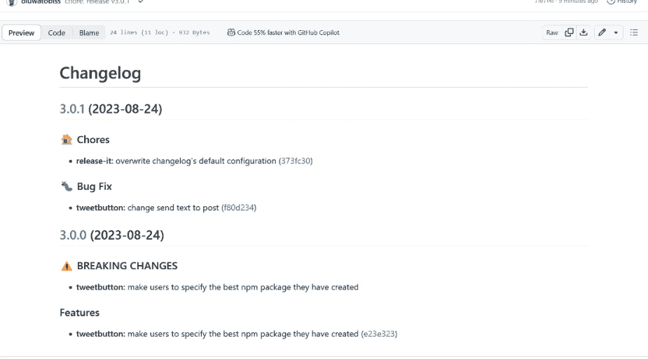

*图18-2。在 GitHub 上查看包的 Changelog。*

目前，如果你进入项目 GitHub 仓库的主页并查看“Releases”部分，你只会看到项目的标签，而没有任何发布版本。

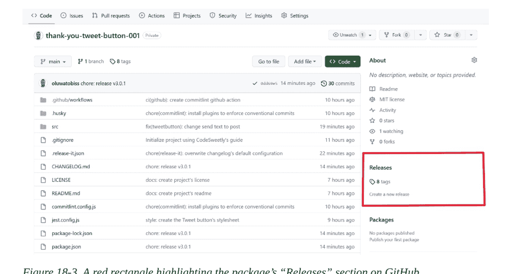

*图18-3。红色矩形突出显示 GitHub 上包的“Releases”部分。*

没有发布版本的原因是我们尚未发布任何版本。现在让我们通过自动化流程来解决这个问题。

# 19

## 自动化 GitHub 发布

以下是自动生成项目[GitHub releases](https://github.com)的步骤。

### 1. 获取 GitHub 个人访问令牌

从[https://github.com/settings/tokens/new?scopes=repo&description=release-it](https://github.com/settings/tokens/new?scopes=repo&description=release-it)生成 GitHub 个人访问令牌。

### 注意

- `release-it`发布需要访问的只有`repo`权限范围——不需要`admin`或其他权限范围。
- 稍后您将使用生成的令牌来授予`release-it`访问项目 GitHub 仓库的权限。

### 2. 复制生成的令牌

生成令牌后，将其复制并保存在您的系统中——例如，保存在 Word 文档中。您很快会将其粘贴到其他地方。

### 3. 创建 GitHub 环境变量

以下是如何创建用于自动生成包 GitHub 发布版本的环境变量：

- 进入包的 GitHub 仓库主页，点击“Settings”标签页。

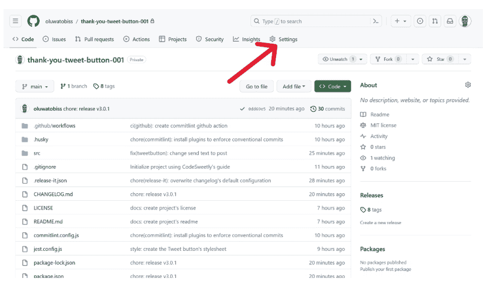

**图19-1。**红色箭头指向包的 GitHub 仓库的“Settings”标签页。

- 点击左侧边栏的“Secrets and variables”菜单。

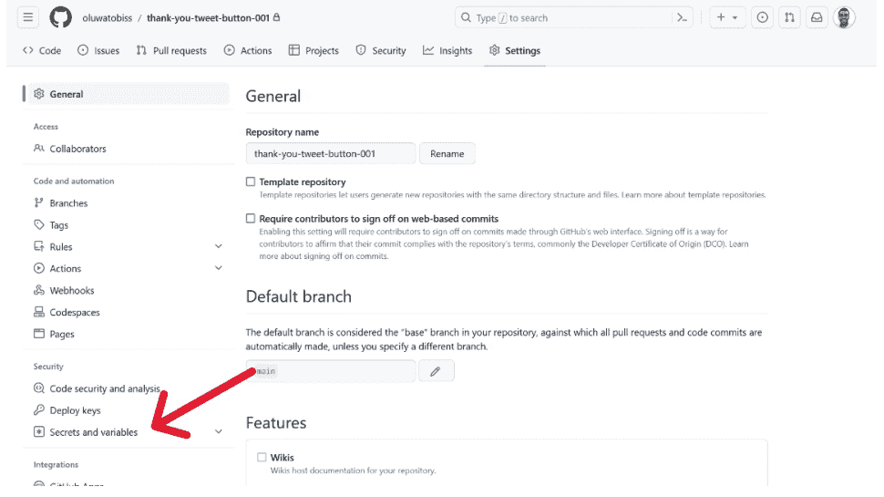

**图19-2。**红色箭头指向包的 Settings 中的“Secrets and variables”菜单。

- 点击“Secrets and variables”菜单的“Actions”选项。

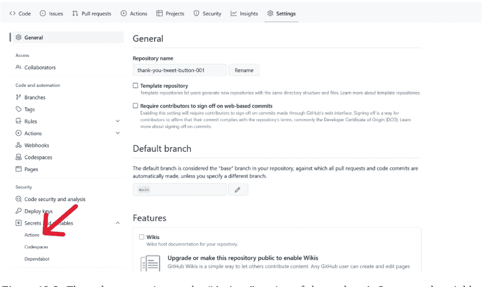

**图19-3。**红色箭头指向包的 Secrets and variables 菜单的“Actions”选项。


- 在“Actions secrets and variables”页面点击“New repository secret”按钮。

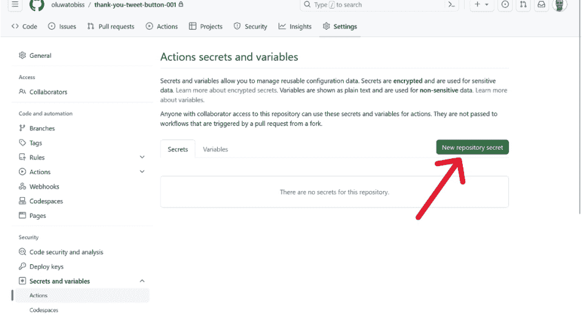

**图 19-4。**红色箭头指向包的 Actions secrets and variables 页面的“New repository secret”按钮。

- 在“Name”字段中输入“RELEASE_IT_GITHUB_TOKEN”。（注意：这里可以使用任何名称，但就本教程而言，我们使用“RELEASE_IT_GITHUB_TOKEN”。）
- 同时在“Secret”字段中输入您之前生成的个人访问令牌。
- 然后，点击“Add secret”按钮。

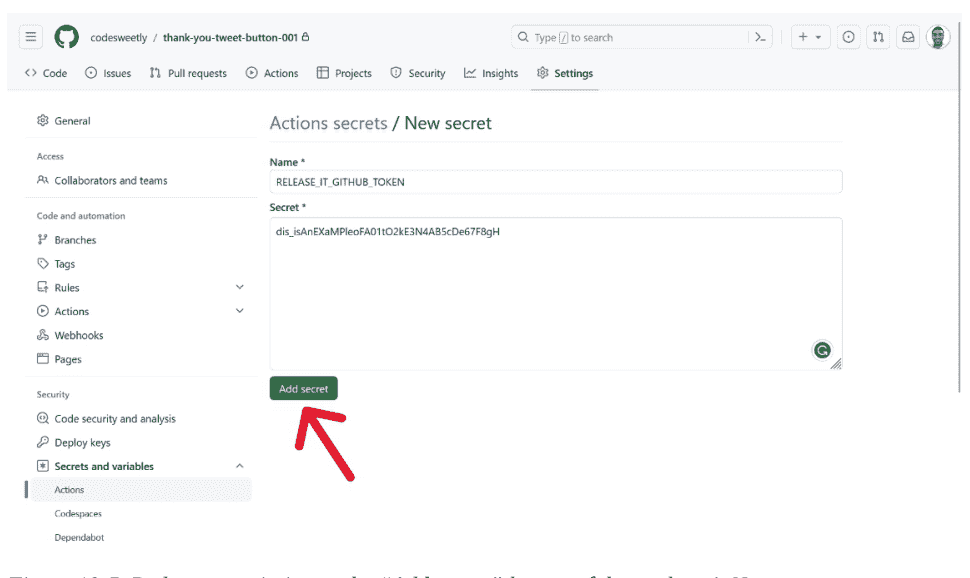

**图 19-5。**红色箭头指向包的 New secret 页面的“Add secret”按钮。

让我们也让`release-it`知道 GitHub 令牌的名称。

### 4. 告知 Release-It 您的 GitHub 令牌名称

在`release-it`配置文件的`github`选项中添加`release`和`tokenRef`字段。

```json
.release-it.json
{
  "github": {
    "...": "...",
    "release": true,
    "tokenRef": "RELEASE_IT_GITHUB_TOKEN"
  },
  "git": {
    "commitMessage": "chore: release v${version}"
  }
}
```

### 5. 在本地项目中使 GitHub 密钥可用

进入项目根目录并创建`.env`文件。

```bash
touch .env
```

然后，打开新创建的`.env`文件并添加您的 GitHub action 密钥。

```env
RELEASE_IT_GITHUB_TOKEN="dis_isAnEXaMPleoFA01tO2kE3N4AB5cDe67F8gH"
```

### 6. 阻止 Git 监控环境文件

将`.env`文件添加到`.gitignore`以防止 Git 跟踪它。

```gitignore
/node_modules
/dist
.env
```

### 7. 安装加载 .env 文件的插件

安装`dotenv-cli`，您将用它来加载`.env`文件。

```bash
npm i -D dotenv-cli
```

### 8. 在发布项目最新版本时加载 .env 文件

像下面这样，在`package.json`文件的`release`字段中添加`dotenv`和`--`：

```json
{
  "name": "thank-you-tweet-button-001",
  "version": "3.0.1",
  "scripts": {
    "release": "dotenv release-it --",
    "test": "jest --config jest.config.json"
  }
}
```

### 9. 暂存并提交您的更改

使用 Conventional Commits 格式来暂存并提交最近的更改。

```bash
git add -A && git commit -m "chore(github): configure release-it to auto-generate project's github releases"
```

让我们也将按钮的“tweet”文本替换为“message”。

**TweetButton.jsx**

```javascript
import React from "react";
import "../index.css";

function generateStarIcons(rating) {
    const megaStars = `★★★★★ x ${Math.round(rating / 5)}`;
    let stars = "";

    for (let i = 0; i < rating; i++) {
        stars += " ☆ ";
    }
    return rating > 10 ? megaStars : stars;
}

export function TweetButton(props) {
    const tweetURL = `https://twitter.com/intent/tweet?
text=Thank+you,+%40oluwatobiss.+Your+book+helped+me+create,+test,+
and+publish+${
    props.number && props.number > 1 ? props.number : "an"
}+NPM+${
    props.number && props.number > 1 ? "packages" : "package"
}.%0A%0AMy+Favorite:+${props.bestNPMPackage}%0A%0ABook's+Rating:+${props.rating}-
star+rating!+${generateStarIcons(props.rating)}%0A%0ACreating%20NPM%20Package%20React%20JavaScript%20Guide%0Ahttps%3A%2F%2Famzn.to/4aUJ3Qg`;

    return props.rating && props.bestNPMPackage ? (
        <section className="tweet-btn-container">
            <a
                className="tweet-button"
                href={tweetURL}
                target="_blank"
            >
                Post a thank you message
            </a>
        </section>
    ) : (
        <div
            style={{
                display: "flex",
                justifyContent: "center",
                marginTop: "30px",
            }}
        >
            <p
                style={{
                    backgroundColor: "#DC3545",
                    color: "#fff",
                    width: "35%",
                    borderRadius: "5px",
                    padding: "15px 20px",
                }}
            >
                Error: One or more required props are missing in 'TweetButtonProps'.
            </p>
        </div>
    );
}
```

继续执行构建步骤：

```bash
npm run build
```

**注意：**

> 建议在提交更改之前先本地测试更新后的包。如需回顾所需步骤，请参阅第 10 章。

准备好保存更改后，执行如下提交：

```bash
git add -A && git commit -m "fix(tweetbutton): change tweet text to message"
```

然后，执行`npm run release`命令来发布你项目的最新版本。

运行`release`命令后，`release-it`会提出如下类似的问题：

- **将 thank-you-tweet-button-001 发布到 npm 吗？**在键盘上输入 Y，以允许`release-it`将此版本发布到 NPM。
- **提交（chore: release v3.0.2）吗？**在键盘上输入 Y，以允许`release-it`将此版本提交到 Git。
- **创建标签（3.0.2）吗？**在键盘上输入 Y，以允许`release-it`创建一个包含此版本号的标签。
- **推送吗？**在键盘上输入 Y，以允许`release-it`将此版本推送到你项目的远程仓库。
- **在 GitHub 上创建发布版本（Release 3.0.2）吗？**在键盘上输入 Y，以允许`release-it`创建此版本的 GitHub 发布版本。

如果你现在查看 GitHub 仓库主页的“Releases”部分，你会看到你最新的发布版本！

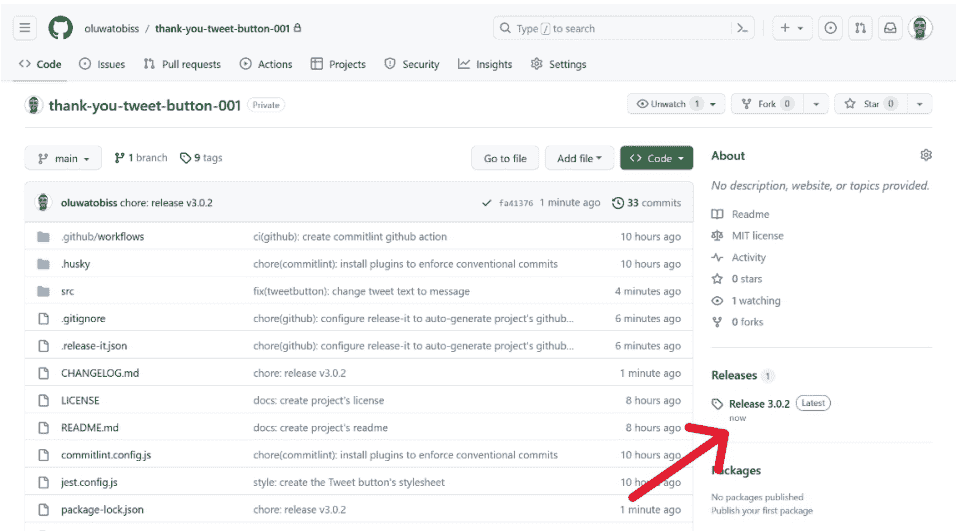

*图 19-6。红色箭头指向软件包最新的 GitHub 发布版本。*

你可以点击最新发布版本的标签来查看其说明和二进制文件的链接。这是我个人的截图：

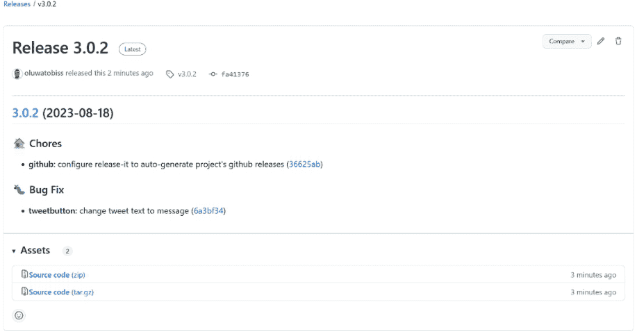

*图 19-7。查看软件包最新的 GitHub 发布版本。*

**注意：**

现在是使用你的 NextJS 演示网站测试最新发布版本的好时机。记得在测试前更新测试应用的当前版本。例如，运行`npm install thank-you-tweet-button-001@latest`。

### 尾声

哇！恭喜……你成功了！

你现在是一名 NPM 包发布者了。你已经掌握了使用 React JavaScript 创建、测试和发布 NPM 包所需的一切。

以下是我的成果：

- [软件包的 GitHub 仓库](https://github.com)
- [软件包在 NPM 上的发布](https://npmjs.com)

我也很想看到你的作品。所以，请随时[联系我](mailto:example@example.com)，分享你发布的包的链接。

#### 那么，下一步是什么？

是时候在你迄今为止学到的概念基础上继续前进了。只有通过实践才能变得更好。所以，如果你在创建 NPM 包时仍然感到生疏，也绝不要气馁。只需不断练习、构建和发布。

重要的是，始终要敢于将你的库部署上线，供公众使用！你会惊讶于人们对你产品的欣赏程度。

每当你遇到困难时，可以回顾本书来复习课程。是的，你也可以在 [Twitter 上关注我](https://twitter.com)，以获取本书的重要更新和更多信息。

#### 书评

感谢你购买本书。希望你觉得它对你有所帮助。

请在亚马逊上撰写一条有用的评论，以帮助潜在读者利用你客观的反馈做出购买决策。你的意见也是改进 CodeSweetly 产品的关键因素。谢谢你！

有关 CodeSweetly 的更多信息，请访问 codesweetly.com。

#### 你可能会喜欢的其他书籍


《CSS Grid 指南》

[在亚马逊上购买](https://www.amazon.com)

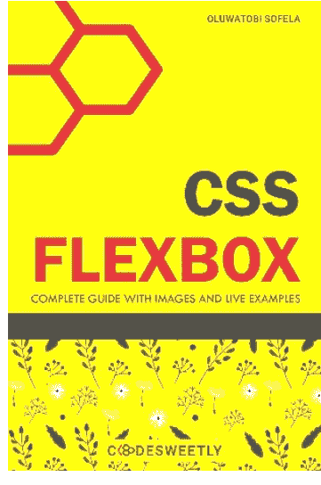

CSS Flexbox：完全指南

[在亚马逊上购买](https://www.amazon.com)


##### 图解 Flexbox

[在亚马逊上购买](https://amazon.com)


##### 图解 CSS Grid

[在亚马逊上购买](https://amazon.com)

# 索引

### A

- `action`, vii, viii, 29, 30, 31, 32, 33, 34, 128, 129, 131
- `add`, viii, 4, 5, 7, 14, 16, 17, 22, 24, 25, 26, 27, 28, 29, 31, 33, 38, 39, 41, 48, 49, 50, 54, 63, 64, 66, 69, 73, 76, 79, 84, 85, 86, 93, 94, 97, 98, 101, 104, 105, 107, 108, 110, 112, 113, 116, 120, 122, 129, 130, 131, 132, 133, 135
- `alias`, 53
- `aliases`, 53
- `app`, viii, ix, xii, 5, 6, 10, 11, 24, 26, 51, 52, 53, 54, 55, 56, 57, 58, 63, 66, 80, 81, 82, 84, 85, 86, 87, 88, 91, 94, 98, 102, 117, 123, 137
- `author`, 4, ix, 71
- `automating`, x, 103, 104, 112, 126

### B

- `Babel`, vii, 14, 15, 16, 38, 41, 42, 44, 45, 47, 48, 64
- `background`, 36
- `backgroundColor`, 100, 115, 121, 134
- `bestNPMPackage`, 114, 115, 116, 121, 134
- `border`, 36
- `borderRadius`, 100, 115, 122, 135
- `break compatibility`, 92, 95, 100, 115
- `breaking change`, 101, 116
- `breaks compatibility`, 101
- `browser`, 15, 16, 17, 39, 78, 82, 88
- `bug`, 6, 24, 118, 119, 123
- `build`, xiii, 24, 42, 44, 45, 47, 48, 76, 92, 95, 96, 97, 101, 116, 119, 122, 135, 138
- `bump`, 109, 110
- `button`, 2, 4, 5, 6, 14, 18, 19, 21, 22, 34, 36, 37, 39, 42, 44, 45, 46, 47, 49, 53, 54, 55, 56, 58, 62, 63, 69, 70, 71, 72, 73, 74, 75, 78, 80, 81, 84, 85, 86, 87, 88, 92, 94, 96, 98, 99, 102, 104, 106, 108, 114, 117, 120, 121, 123, 128, 129, 130, 132, 133, 134, 136, 137, 138
- `Button`, xiii, 62, 89

### C

- `Chained ternary operator`, 95
- `changelog`, x, 28, 109, 110, 111, 112, 113, 117, 118, 119, 120, 123
- `className`, 37, 46, 92, 94, 99, 114, 121, 134
- `clean`, 45, `superfamilies`, 106
- `Client Component`, 57
- `commit`, vi, vii, ix, x, xi, 4, 6, 7, 22, 23, 24, 25, 26, 27, 28, 29, 32, 33, 39, 48, 49, 50, 64, 66, 73, 76, 84, 92, 93, 97, 101, 102, 105, 106, 107, 108, 110, 111, 113, 116, 117, 118, 120, 122, 123, 132, 133, 135, 136
- Commit Types
  - `chore`, 23, 24, 29, 50, 73, 76, 105, 107, 108, 110, 112, 113, 118, 119, 120, 123, 130, 133, 136
- `commitlint`, vii, 25, 26, 27, 28, 29, 31, 32, 33, 34, 106
- `commitMessage`, 107, 108, 110, 112, 130
- `compatible`, 15, 16, 90, 91
- `compile`, vii, ix, 16, 41, 42, 43, 44, 45, 48, 49, 76
- `compiler`, vii, 14, 42
- `component`, vii, viii, xii, 9, 11, 13, 19, 20, 22, 34, 35, 36, 44, 49, 56, 57, 75, 91, 94, 98, 101, 113, 116
- `config`, 15, 16, 17, 18, 21, 25, 26, 29, 38, 42, 44, 45, 47, 105, 106, 107, 119, 132
- `configuration`, vii, ix, x, 1, 4, 9, 15, 16, 17, 18, 24, 25, 26, 38, 45, 53, 84, 87, 106, 107, 109, 110, 111, 112, 113, 117, 118, 119, 120, 130, 133
- `convention`, vi, xiii, 25, 29


- `conventional`, vii, 22, 23, 24, 25, 26, 28, 29, 33, 106, 109, 110, 112, 113, 117, 119, 132
- `conventionalcommits`, 22, 110, 112, 119
- `CSS`, viii, 15, 35, 36, 37, 38, 43, 46, 47, 53, 64, 75, 91, 94, 98, 113, 120, 133, 141

### D

- `declaration`, 91
- `demo`, viii, x, 52, 54, 61, 62, 85, 87, 88, 89, 94, 98, 102, 117, 123, 137
- `dependency`, vii, 9, 10, 11, 24, 61, 63, 64, 119
- `deploy`, x, 86, 87, 88, 138
- `description`, ix, 23, 69, 70, 71, 72, 126
- `devDependencies`, 10, 11
- `directory`, vi, vii, viii, ix, x, xii, 1, 2, 3, 4, 5, 6, 7, 11, 16, 17, 18, 22, 25, 27, 29, 31, 32, 33, 34, 35, 42, 43, 44, 45, 46, 47, 48, 51, 52, 53, 54, 55, 57, 58, 61, 65, 72, 74, 76, 79, 80, 81, 84, 85, 86, 88, 93, 97, 102, 106, 109, 123, 126, 127, 128, 129, 131, 136, 138
- `dotenv`, 132

### E

- `env`, xi, 14, 15, 16, 131, 132
- `environment`, vii, x, xi, 17, 18, 37, 127, 131
- `error`, 5, 6, 19, 20, 28, 29, 46, 52, 56, 77, 78, 79, 91, 100, 101, 106, 115, 116, 122, 135
- `ESLint`, 53
- `esm`, 44, 45
- `example`, x, 3, 15, 62, 65, 70, 71, 73, 78, 91, 94, 98, 107, 119
- `exclamation`, 116
- `export`, 20, 21, 26, 37, 46, 55, 56, 81, 91, 94, 96, 99, 114, 120, 133

### F

- `feat`, 23, 24, 97, 101, 116, 118, 119
- `feature`, 24, 51, 61, 62, 90, 91, 92, 95, 100, 115, 118, 119
- `field`, 7, 10, 11, 15, 17, 38, 41, 49, 54, 58, 69, 70, 71, 72, 78, 80, 93, 102, 104, 109, 110, 112, 113, 117, 119, 129, 130, 132
- `file`, xii, xiii, xiv, i, 1, 2, 3, 5, 15, 16, 17, 18, 19, 23, 25, 31, 32, 35, 36, 38, 41, 42, 43, 45, 46, 49, 52, 54, 55, 59, 61, 64, 65, 69, 73, 74, 91, 94, 98, 104, 106, 107, 109, 110, 111, 112, 113, 117, 118, 130, 131, 132
- `File`, vi, vii, viii, xi, 1, 2, 31, 38, 131, 132
- `files`, vi, vii, ix, 3, 4, 15, 16, 18, 29, 37, 38, 42, 43, 44, 47, 48, 64, 66, 73, 74, 75, 76, 137
- `fix`, 23, 24, 28, 111, 118, 119, 122, 123, 124, 135
- `flag`, 9, 79, 101
- `function`, 20, 24, 37, 46, 55, 56, 53, 81, 91, 94, 96, 98, 99, 113, 114, 120, 133

### G

- `generate`, x, 42, 111, 113, 117, 118, 123, 126, 127, 129, 133
- `generateStarIcons`, 98, 99, 113, 114, 120, 121, 133, 134
- `git`, vi, vii, ix, x, xi, xiii, 1, 2, 3, 4, 5, 6, 22, 24, 26, 27, 29, 33, 39, 48, 50, 64, 66, 73, 76, 84, 85, 86, 93, 97, 101, 102, 105, 106, 107, 108, 109, 112, 113, 116, 120, 122, 130, 131, 133, 135, 136
- `git clone`, 29
- `gitHub`, vii, viii, ix, x, xiii, 4, 5, 6, 7, 16, 20, 22, 28, 29, 30, 31, 32, 33, 34, 35, 64, 72, 84, 85, 86, 88, 106, 109, 110, 113, 119, 123, 124, 126, 127, 130, 131, 133, 136, 137, 138
- `gitignore`, 3, 24, 131
- `global`, vii, 51, 52, 54, 58

### H

- `header`, 24, 101, 113, 119
- `hidden`, 118
- `home`, 4, 55, 56, 81, 96
- `homepage`, ix, 54, 72
- `hook`, 27, 28
- `hooks`, vii, 26, 27, 29
- `host`, 6, 11, 84, 86
- `husky`, vii, 26, 27, 28, 29

### I

- `ignore`, vi, x, 3, 44, 45, 47, 117, 118
- `import`, ix, 17, 39, 20, 36, 57, 46, 53, 55, 56, 57, 63, 81, 96, 87, 91, 94, 96, 98, 113, 120, 133
- `include`, 15
- `infile`, 112, 113, 117, 119
- `inline`, 35, 36
- `install`, vii, viii, ix, xi, x, xii, 1, 9, 10, 11, 13, 14, 17, 25, 26, 27, 28, 29, 38, 51, 52, 54, 56, 61, 62, 83, 80, 94, 98, 102, 104, 105, 109, 117, 123, 132, 137
- `interface`, 25
- `ISC`, 49, 70


#### J

`JavaScript`, 3, viii, xiii, 14, 15, 16, 38, 39, 41, 42, 43, 138  
`Jest`, vii, viii, 13, 14, 15, 16, 17, 18, 19, 21, 37, 38, 42, 44, 45, 64, 105, 132  
`JSDOM`, viii, 17, 38  
`JSX`, 14, 15, 17, 18, 19, 20, 31, 37, 38, 41, 42, 43, 44, 45, 46, 47, 91, 94, 96, 98, 101, 113, 116, 120, 133

#### K

关键词, ix, 70, 71

#### L

许可证, ix, 49, 64, 65, 66, 67, 70, 72, 73, 108  
链接, viii, xiv, 4, 35, 51, 52, 54, 61, 85  
代码检查, 25, 26, 27, 32  
实时, x, 11, 61, 62, 79, 80, 82, 84, 88, 138  
本地, vii, viii, ix, x, 4, 7, 11, 29, 50, 51, 59, 76, 80, 82, 95, 101, 116, 122, 131, 135

#### M

主分支/主要的, xiii, x, 19, 22, 24, 29, 33, 49, 55, 56, 74, 85, 96, 74, 93, 96, 97, 102, 106, 123, 127, 136  
主版本号, x, 90, 91, 98, 100, 102, 115  
`Math.round`, 98, 113, 120, 133  
次版本号, x, 90, 91, 94, 95, 97, 98, 103  
`MIT`, 65, 72, 73, 108  
`mkdir`, 2, 31, 43, 44  
模式, 29, 109  
模块, 21, 26, 52  
模块（复数）, 3, 11, 17, 21, 51, 54, 57, 58, 131

#### N

下一个/下一步, xi, 7, 22, 36, 48, 51, 52, 53, 54, 56, 57, 58, 85, 71, 86, 108, 108, 111, 138  
`NextJS`, viii, ix, 52, 84, 80, 84, 85, 86, 88, 94, 102, 117, 123, 137  
`Node`, v, 1, 3, 11, 17, 38, 49, 54, 56, 57, 58, 131  
`NPM`, 1, 3, 4, vi, viii, ix, x, xii, xiii, xiv, 1, 2, 9, 11, 13, 14, 17, 19, 20, 21, 24, 25, 36, 37, 38, 39, 42, 45, 46, 47, 50, 51, 52, 54, 56, 57, 58, 62, 63, 69, 70, 71, 73, 74, 75, 76, 77, 78, 79, 80, 82, 90, 91, 92, 93, 94, 97, 98, 99, 101, 102, 103, 104, 105, 106, 108, 109, 111, 114, 116, 117, 121, 122, 123, 132, 133, 135, 136, 137, 138  
`npx`, 16, 27, 41, 52, 105

#### P

包/软件包, 1, 3, 4, vi, vii, viii, ix, x, xi, xii, xiii, xiv, 1, 2, 4, 5, 6, 9, 10, 11, 13, 14, 15, 16, 17, 18, 19, 20, 23, 24, 25, 27, 28, 29, 35, 37, 38, 41, 42, 43, 44, 45, 46, 47, 48, 49, 50, 51, 52, 53, 54, 56, 57, 58, 59, 61, 62, 64, 67, 69, 70, 71, 72, 73, 74, 75, 77, 78, 79, 80, 81, 82, 84, 88, 89, 90, 91, 92, 93, 94, 95, 97, 98, 99, 100, 101, 102, 103, 104, 105, 106, 107, 109, 110, 111, 112, 113, 114, 115, 116, 117, 119, 121, 122, 123, 124, 127, 128, 129, 130, 132, 134, 135, 136, 137, 138  
参数, 94, 98, 100, 115  
补丁, x, 90, 91, 92, 93, 94, 106, 108  
性能, 24, 118  
发布/帖子, 4, 27, 62, 75, 120, 121, 122, 134  
生产环境, 9, 11, 73, 82  
项目, vi, vii, x, xi, xii, xiii, 1, 2, 3, 4, 5, 6, 7, 10, 11, 13, 14, 15, 16, 17, 18, 24, 25, 26, 27, 29, 31, 33, 41, 42, 46, 51, 52, 53, 57, 61, 62, 64, 65, 66, 67, 76, 78, 79, 85, 86, 87, 104, 105, 106, 108, 109, 110, 111, 113, 117, 123, 126, 131, 132, 133, 136  
属性, 94, 95, 96, 99, 114, 115, 116, 120, 121, 122, 133, 134, 135  
发布, 3, 4, viii, ix, xii, xiii, 20, 37, 46, 50, 51, 54, 66, 67, 69, 73, 74, 75, 76, 77, 78, 79, 80, 84, 90, 91, 93, 94, 95, 97, 98, 99, 102, 106, 108, 114, 120, 124, 133, 136, 138  
推送, vii, ix, x, 7, 22, 29, 32, 33, 76, 85, 88, 93, 97, 102, 106, 109, 136

#### R

评分, 98, 99, 100, 101, 113, 114, 115, 116, 120, 121, 133, 134  
`React`, 3, vii, viii, xiii, 7, 9, 10, 11, 13, 14, 15, 16, 19, 20, 35, 37, 39, 41, 46, 51, 54, 56, 64, 91, 94, 98, 113, 120, 133, 138  
`README`, viii, 59, 61, 62, 64, 72, 74, 119  
重构, 24, 93, 118, 119  
发布/版本, x, xi, 24, 90, 104, 105, 106, 107, 108, 109, 110, 111, 112, 113, 117, 118, 119, 120, 123, 124, 126, 127, 130, 132, 133, 136, 137  
`release-it`, 104, 105, 106, 107, 108, 109, 110, 111, 112, 113, 117, 118, 119, 120, 126, 130, 132, 133, 136  
远程, vii, ix, x, 4, 5, 6, 7, 22, 29, 33, 76, 84, 85, 106, 109, 136  
根目录/根, 2, 3, 4, 16, 17, 18, 25, 31, 35, 42, 43, 51, 52, 54, 57, 61, 65, 79, 80, 106, 131  
路由, 53, 56  
规则集, 36

#### S

作用域, 23, 24, 78, 79, 126  
脚本, 5, 6, 13, 14, 18, 27, 41, 42, 44, 45, 47, 104, 132  
搜索, 69, 70, 71, 77, 78  
密钥, x, 127, 128, 129, 130, 131  
章节/部分, 22, 34, 51, 62, 75, 78, 87, 91, 92, 93, 94, 95, 99, 114, 118, 119, 121, 123, 124, 134, 136  
语义化, 24, 90, 91  
语义化版本控制, 24, 90, 91  
服务器, ix, x, 11, 56, 82, 86  
设置, xiv  
源代码/源, viii, 42, 43, 44, 45, 65, 67, 76  
`src`, 42, 43, 44, 45, 47, 53  
阶段, vi, ix, xi, 4, 6, 22, 33, 39, 48, 49, 64, 66, 73, 76, 84, 105, 106, 108, 110, 113, 120, 132  
标准化, 23, 25, 29  
星标/星级, 98, 99, 113, 114, 120, 121, 133, 134  
`strictSemVer`, 113  
字符串, 18, 107  
样式, 24, 34, 35, 36, 39, 55, 57, 81, 96, 100, 115, 118, 119, 121, 134  
样式表, viii, 35, 37, 39, 43, 46, 47  
样式处理, viii, 35, 119

##### 符号链接

- 符号链接, 52
- 符号链接（`symlink`）, 51, 52, 54
- 符号链接的（`symlinked`）, 56
- 符号链接（`symlinks`）, 57

语法, vii, 4, 14, 15, 16, 23, 32, 39, 90, 103  
系统, 4, vi, viii, xiv, 1, 4, 51, 52, 54, 58, 82, 126

#### T

标签, 75, 106, 109, 123, 136  
Tarball（压缩包）, 74, 75  
团队, 29, 31  
三元运算符, 95  
测试, 3, vii, viii, ix, x, xii, 5, 6, 11, 13, 14, 17, 18, 19, 20, 21, 24, 33, 37, 38, 39, 42, 43, 44, 45, 46, 47, 50, 51, 52, 53, 54, 56, 57, 58, 59, 64, 75, 76, 79, 80, 82, 84, 85, 86, 88, 91, 92, 94, 97, 98, 99, 101, 102, 105, 114, 116, 117, 118, 119, 120, 122, 123, 132, 133, 135, 137, 138  
测试运行器, vii, 13, 14  
`testEnvironment`, 17, 38  
令牌/令牌, x, 126, 129, 130  
`tokenRef`, 130  
转换, 14, 15, 16, 17, 37, 38, 64  
`tsc`, 41, 42, 44, 45  
推文/发布, xiii, 2, 4, 5, 6, 14, 18, 19, 20, 21, 22, 34, 36, 37, 39, 42, 44, 45, 46, 47, 49, 53, 54, 55, 56, 58, 62, 63, 69, 70, 71, 72, 73, 74, 75, 78, 80, 81, 84, 85, 88, 89, 91, 92, 94, 95, 96, 98, 99, 102, 104, 106, 108, 114, 117, 120, 121, 123, 132, 133, 134, 135, 136, 137, 138  
`TweetButton`, 18, 19, 20, 21, 34, 35, 37, 41, 42, 43, 44, 46, 49, 55, 56, 57, 63, 75, 81, 91, 94, 95, 96, 98, 99, 101, 113, 114, 116, 120, 122, 133, 135  
`TweetButtonPropsType`, 94, 99, 100, 114, 115, 120, 122, 133, 135  
`tweetURL`, 20, 37, 46, 91, 92, 94, 99, 114, 120, 121, 133, 134  
`twitter`, 20, 37, 46, 70, 91, 94, 99, 114, 120, 133, 138  
类型, xiii, 5, 6, 23, 24, 28, 64, 90, 103, 118, 119, 123  
类型（复数）, xiii, 3, 20, 117, 118, 119, 123  
`TypeScript`, 3, xiii, 7, 9, 16, 35, 41, 48, 53, 64, 138

#### U

卸载, 54, 57, 58  
取消链接, viii, 57, 58  
已解压, 75  
未发布, viii, 51  
更新, x, 1, 14, 18, 24, 38, 44, 46, 89, 90, 91, 92, 93, 94, 95, 96, 97, 98, 100, 101, 102, 103, 115, 116, 117, 122, 123, 135, 137, 138  
上传, 7, 76, 85, 93, 97, 102  
上游, 7  
`url`, 5, 6, 71  
`use client`, 56  
`useEffect`, 56  
`useState`, 56

#### V

变量, x, 127, 128, 129  
`Vercel`, ix, x, 82, 84, 85, 86, 87, 88  
版本, x, xi, 5, 6, 11, 14, 18, 42, 44, 45, 47, 49, 69, 70, 71, 72, 73, 75, 78, 89, 90, 91, 92, 93, 94, 95, 97, 98, 100, 101, 102, 103, 104, 105, 106, 107, 108, 109, 110, 111, 112, 113, 115, 117, 119, 123, 130, 132, 136, 137  
版本控制, 24, 90, 91, 103  
`Vite`, 51  
对比/ versus, 11, 42

#### W

网站, 4, viii, ix, x, 4, 52, 70, 71, 77, 78, 84, 85, 88, 89, 94, 98, 102, 117, 123, 137  
`whoami`, 77  
工作流, vii, viii, 25, 29, 31, 32, 33, 34  
`writerOpts`, 113
