# Vista 小工具创建指南：使用 HTML、CSS 和 JavaScript（附 RSS、Ajax、ActiveX (COM) 和 Silverlight 示例）


### 创建 Vista® 小组件

使用 HTML、CSS 和 JavaScript，以及 RSS、Ajax、ActiveX (COM) 和 Silverlight®™ 示例


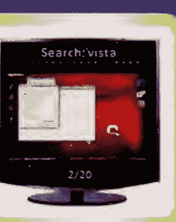

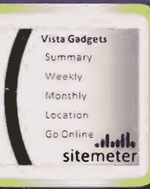

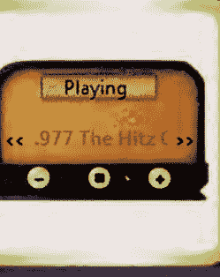

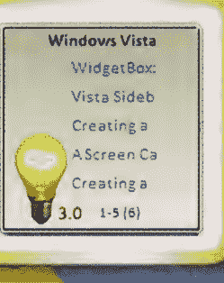

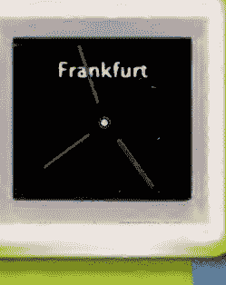

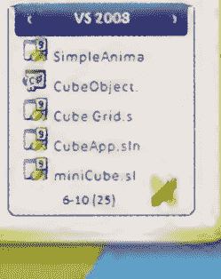


# 第三部分 高级示例


# 第四部分 附录

# 关于作者

**Rajesh Lal** 是一位作家、技术布道者和专注于 Web 技术的解决方案工程师。他因在 Windows Vista 和侧边栏 Gadget 方面的文章而获得众多奖项。他是 *Windows Vista Magazine* 和 Code Project 网站的常客。凭借在 IT 行业十余年的经验，从图形设计师、软件开发人员、架构师、团队负责人、项目负责人到独立顾问，Rajesh 乐于采用客观务实的方法来使用 Microsoft 技术开发应用程序。他拥有计算机科学硕士学位，并持有 MCSD 和 MCAD 认证。

要阅读他的 Vista Gadget 博客，请访问 www.innovatewithgadgets.com。


# 献词

献给爸爸妈妈
感谢你们赋予我的一切

# 致谢

写作是一场迷人的旅程。我要特别感谢 Marc Clifton、Todd Brakke 和 Margo Catts，他们陪我一同走过了这段旅程。他们在每一步都为我提供修正、注释、批评和帮助。感谢 Joshua Heyer (Shog9) 和 Rama Krishna 对本书的审阅以及他们提供的宝贵建议。我还想感谢 Luiji 博士，在我需要的时候给予了我所有的鼓励。

我深深感谢 Sams/Que 出版社的策划编辑 Loretta Yates，她对质量和进步有着无与伦比的执着，如果没有她，这本书绝不可能面世。感谢来自 Pearson Technology Group 的 Jennifer Gallant、Cindy Teeters 和 Rosemary Lewis。

我要向来自微软的各位表示感谢，感谢他们投入时间与精力使本书在各方面趋于完善，特别是 Brian Teutsch、Daniel Moth 和 Annuska Perkins。我还要感谢 Rick Kingslan、Karen Wong 和 Mark Schmidt。

最后，我要提到我的兄弟 Rakesh 和 Rajeev，感谢我从他们身上学到的所有美好事物，以及 Simple 和 Shilpi 如此优秀的陪伴。还有我的灵感来源和原动力 Neelu。

# 我们期待您的反馈！

作为本书的读者，*您*是我们最重要、最关键的评论员。我们非常重视您的意见，想知道我们的做法中哪些是正确的，哪些可以做得更好，您希望我们出版哪些领域的内容，以及任何您愿意分享的睿智见解。

您可以直接给我发送电子邮件或写信，告诉我您对本书的喜爱或不满之处，以及我们可以如何让我们的书籍变得更强大。

*请注意，我无法为您提供与本书主题相关的技术问题解答；此外，由于收到的邮件量巨大，我可能无法回复每一条消息。*

写信时，请务必注明本书的书名、作者，以及您的姓名和电话或电子邮件地址。我会认真审阅您的建议，并与参与本书编写的作者和编辑分享。

**电子邮件：** consumer@samsprinting.com

**邮寄地址：**
Greg Wiegand
Associate Publisher
Sams Publishing
800 East 96th Street
Indianapolis, IN 46240 USA

# 读者服务

请访问我们的网站并在 informit.com/register 注册本书，以便便捷地获取本书可能提供的任何更新、下载或勘误表。

# 引言

随着 PC 操作系统在全球范围内最大规模的发布，2007 年的 Windows Vista 为小工具（Gadgets）开发时代开启了大门。小工具驻留在 Windows Vista 侧边栏（Sidebar）上，它们体积小、轻量化，且能成为非常实用的应用程序。侧边栏是一个全新的创新平台，它为用户提供了一种与信息交互的独特方式。

本书面向希望创建功能丰富且外观专业的 Vista 侧边栏小工具的人群。它是为设计师、开发人员以及任何具备 HTML、CSS 和 JavaScript 基础知识并希望利用这个新颖创新平台的读者而编写的指南。无论您是想为公司创建一个小工具，还是身为一名拥有绝佳创意并希望在侧边栏小工具平台上实现的程序员，甚至是一名想要尝试小工具平台开发业余爱好者，本书都旨在为您提供关于*能用*这个新平台做什么以及*如何*实现的思路。

## 本书内容

本书首先简要介绍小工具的背景，然后对小工具开发的架构提供广泛且清晰的视图。小工具的设计考量是本书的重要组成部分，它们贯穿于几乎所有涉及小工具开发的章节中。在阅读完小工具开发的概念和范围后，本书将引导您创建一个名为 MyBlog 的小工具。在此过程中，文中将详细阐述该小工具的架构、设计约束和实现细节，随后详细介绍适用于所有小工具开发的标准实践。最后一节将探讨利用 .NET、XML、XHTML、CSS、Ajax 和 Microsoft Silverlight 实现的更高级的小工具示例。

本书分为三个大节。

### 第一节：基础

第一节的四个章节提供了侧边栏小工具的详尽背景。本节解释了小工具的类型、架构以及小工具开发背后的技术。“设计方法”一章将帮助您了解一个仅仅是“好看”的小工具与一个专业、丰富且值得占用用户桌面空间的小工具之间的区别。最后一章讨论了小工具的盈利模式：即销售小工具需要了解的知识。

### 第二节：开发小工具

本节将引导您完成小工具的标准开发流程。它详细介绍了如何创建基于 RSS/Atom 馈送的基础 MyBlog 小工具。同时，本节还涵盖了用户界面、设计准则和常见假设的最佳实践。后续章节将根据标准实践对基础小工具进行改进，并讨论小工具的部署与分发。

### 第三节：高级示例

本节涉及高级示例。您将能够创建高级小工具，如站点统计小工具、广播小工具和 YouTube 视频小工具。所有示例均遵循标准模式，使您能够在需要时更轻松地切换想要的功能和特性。您还将通过一个 .Net 最近使用（MRU）小工具示例，学习如何使用 ActiveX COM 来创建实用程序小工具。最后一章将向您展示如何使用 Microsoft Silverlight 创建小工具。您还将看到如何仅用几分钟时间利用 Microsoft Popfly 创建一个侧边栏小工具。

如果您是相对较新的小工具开发人员，我建议您从第一节开始。如果您已经具备小工具的基础背景知识，只想开始分步实践小工具开发，可以直接从第二节“开发小工具”开始。第三节“高级示例”面向那些已经开发过小工具并希望在基础开发之上更进一步的人。第三节的每一章实际上都是一个针对特定类型小工具在特定场景下的高级示例。

# 特色功能与符号说明

本书旨在成为一份关于小工具开发的确凿、精确且具体的指南。通过删减冗余信息并过滤、突出关键信息，我们力求使其尽可能详尽。本书包含多种特性和约定，以帮助您最大限度地利用书中的内容。

HTML、CSS 和 JavaScript 代码块将如下显示：

```
<HTML>
Code in HTML, CSS, and JavaScript
</HTML>
```

单行代码示例将如下显示：

```
Statement one;

Statement two;
```

其他注释也将以两个反斜杠的形式出现在代码中：

```
// Comment one
// Comment two
```

本书还使用以下方框来标注重要信息：

> **NOTE（注）**

“注”包含额外的补充信息，以扩展您对某个主题的理解。

> **TIP（提示）**

“提示”提供讨论主题的替代方案、快捷方式或内部信息。

> **CAUTION（注意）**

“注意”提醒您潜在的陷阱和误区。

# 支持网站

本书配有支持网站，您可以在其中下载所有代码和小工具。该网站还包含我撰写的关于侧边栏小工具的博客以及我对小工具开发的一些个人观点。欢迎访问该网站并与我个人联系。您也可以在那里找到勘误表和最新的信息。

访问 www.innovatewithgadgets.com


# 第一部分
## 基础

## 本部分内容
- 第1章 创新Windows Vista侧边栏小工具 7
- 第2章 架构 29
- 第3章 设计方法 49
- 第4章 销售你的小工具 75

# 第1章
## 创新Windows Vista侧边栏小工具

> "...未来投资公司的唯一理由是其创新能力..."
—杰夫·伊梅尔特，通用电气首席执行官

### 小工具与Vista侧边栏简介

对许多人来说，侧边栏小工具是Windows Vista操作系统中最酷的新功能。小工具是驻留在Windows Vista侧边栏或Windows Vista桌面上的小型轻量级应用程序。它们提供即用型信息，并轻松访问常用功能和工具。

小工具提供多样化的功能，从让你一览即将到来的日程安排，到列出在线联系人，再到展示你Flickr账户的图片幻灯片，以及提供轻松控制媒体播放器的方式。小工具可以有各种专门用途。如图1.1所示，它们可以是时钟、计算器、游戏、便笺等等。

**本章内容**
- 小工具与Vista侧边栏简介
- 用小工具创新
- 深入了解小工具
- 小工具的多平台支持

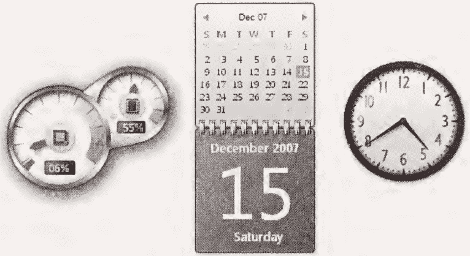
**图1.1** 小工具可以放置在Vista桌面的任何位置，但大多数都组织在Windows侧边栏上。

#### Windows侧边栏

Windows侧边栏是Microsoft Windows Vista桌面侧边的一个窗格，用于放置和组织小工具。你可以轻松自定义Windows侧边栏以适应你的偏好：始终置于顶层或位于最大化窗口下方。如果你不想将小工具保留在Windows侧边栏上，可以将它们拖到桌面上并隐藏侧边栏。Windows侧边栏也可以通过系统托盘中的图标激活。

小工具可以有多个实例，既可以在侧边栏上，也可以在Windows桌面上，并且可以配置不同的设置。例如，你可以有两个时钟小工具的实例，一个显示加利福尼亚州圣地亚哥的当前时间，另一个显示法国巴黎的时间。

Vista侧边栏小工具由HTML、CSS、JavaScript和图像文件组成，它们协同工作以完成各种任务。你可以托管一个迷你网页、调用Web服务、与业务应用程序集成，甚至调用操作系统API来创建自定义应用程序。

#### 小工具背后的技术

小工具是使用标准Web技术开发的，即HTML、CSS和JavaScript，但它们也可以使用DHTML、Ajax和ActiveX COM等技术来实现高级功能。小工具可以被视为具有高级特性和属性的HTML应用程序（HTA）。小工具中使用的所有接口，包括小工具主窗口、设置页面以及弹出窗口，都是HTML页面。

小工具还可以使用高级插件，如Adobe Flash、Windows Media Player和Microsoft Silverlight。任何可以在网页中托管的内容都可以用于小工具开发。

图1.2概述了用于小工具开发的技术和相关平台。大多数技术在许多应用中重叠。

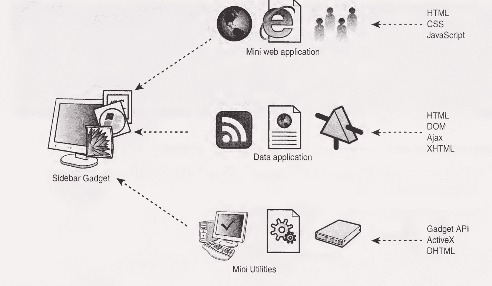
**图1.2** 不同类型的应用程序需要在小工具开发中使用不同的技术。

在下一节中，我们将更详细地讨论这些技术。

可以使用侧边栏小工具创建不同类型的应用程序：

- **迷你Web应用程序**—迷你Web应用程序使用HTML、CSS和JavaScript，可以显示来自网站的小型网页或现有Web应用程序的部分功能。或者它们只是在弹出窗口上显示现有网站。
- **数据应用程序**—收集和聚合数据的数据应用程序现在非常流行，因为XML文件提供了互操作性优势。XML数据以RSS/Atom订阅源、纯XML文件、XHTML页面和提供XML数据的Web服务等形式在整个互联网上可用。
- **使用小工具对象模型和Windows API为常用工具和功能提供快捷方式的轻量级应用程序**—快速信息和常用功能、工具及应用程序的快捷方式也是开发小工具的吸引力选项之一。你可以使用小工具API开发实用程序，这些实用程序公开系统功能，如硬件信息、文件和文件夹、网络、内存、CPU等。

DHTML、XML、XHTML和Ajax是开发数据应用程序的工具。

### 小工具简史

Windows XP包含一个名为*活动桌面*的功能，该功能提供在桌面上托管使用Microsoft频道定义格式（CDF）构建的网页和频道的功能。这很重要，因为它提供了一些现在在桌面小工具中找到的功能。Vista侧边栏小工具是活动桌面的逻辑演进。

> **注意**
> 频道定义格式（CDF）是一个标准XML文件，可帮助网站管理员组织其网站。它用于以层次结构格式存储与网站相关的网站信息和图像文件位置。
> 更多信息可在http://msdn2.microsoft.com/en-us/library/aa768024.aspx（关键词“创建频道定义格式”）找到。

小工具随着计算的不同趋势而发展：

- 鉴于当前宽屏显示器/双显示器的趋势，高效利用桌面空间
- 更好地个性化桌面体验
- 对轻量级应用程序的需求
- 新的仪表板式数据呈现，允许访问各种不同的数据源和格式

侧边栏小工具技术比活动桌面更具结构性，并遵循可扩展模型。它附带一套完整的API来支持丰富而强大的应用程序。

### 用小工具创新

侧边栏小工具以独特的方式提供信息并与用户交互。它从各种来源提取有用信息，例如后台运行的应用程序、RSS订阅源、企业解决方案或Web应用程序（见图1.3）。你可以用小工具做的事情有无限可能。

小工具平台让你可以快速访问桌面和Web应用程序，这使其成为一个平台，你可以在其中以独特的方式进行创新和实施想法。它通过在Windows侧边栏中提供即用型格式的信息，减少了有用信息与用户之间的差距。

例如，你不再需要打开网站来阅读新闻。相反，新闻小工具在侧边栏中显示最新新闻；RSS阅读器小工具让你喜爱的博客触手可及。

侧边栏小工具可以做的一些事情包括：

- 托管网页，阅读RSS订阅源
- 连接到Web服务
- 使用在线流媒体服务器播放音频/视频
- 提供系统信息
- 托管计算器、游戏、日历等
- 连接到企业范围的应用程序，如Microsoft SharePoint

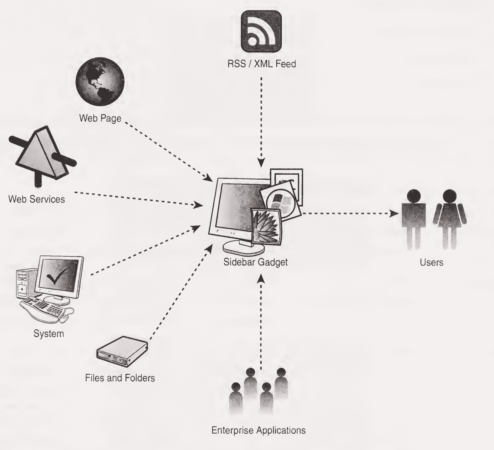
**图1.3** 小工具从多个来源提取信息并呈现给用户。

考虑一个实用程序小工具的例子。许多用户想知道他们的CPU使用率是多少，这以前需要启动Windows任务管理器。随着Vista中小工具的可用性，你只需按住Windows键并按空格键（在桌面上显示侧边栏的快捷方式），然后查看CPU计量表小工具。如果你有宽屏显示器或双显示器，只需将侧边栏和需要的小工具一直显示在屏幕上就更简单了。

想象一个应用程序，它可以使用本机Windows应用程序和实时在线数据，以你想要的方式为你提供想要的信息。例如，你可以为你家乡喜欢的广播频道制作一个收音机小工具，或一个与实时流音频服务器结合的媒体播放器，或一个托管在小工具中的网页部分，而你之前需要去网站才能访问。这些都是一些节省时间的功能和指尖信息，使小工具非常有用。


## 小工具的类型

小工具大致可分为四种主要类型：

- 信息小工具
- 应用程序小工具
- 实用小工具
- 趣味小工具

这种分类会影响小工具的实现方式，并决定实现所采用的技术。表 1.1 对每种小工具类型做了简要概述，后续章节将对每种类型进行更详细的介绍。

| 小工具类型 | 类型 | 用途 | 技术 | 示例 |
|---|---|---|---|---|
| 信息 | 数据源为在线订阅源/XML Web 服务 | 新闻/博客/交通数据等 | HTML、CSS、JavaScript、DOM | RSS 订阅源小工具、Live Search Maps |
| 应用程序 | 来自其他企业应用程序的数据 | 企业应用程序的子集功能 | Windows 脚本、VBS、企业应用程序 API 等 | Outlook 附加小工具、Microsoft Dynamics 小工具 |
| 实用 | 独立应用程序 | 快速访问常用功能和工具 | 小工具对象模型、动态链接库 | CPU 仪表、驱动器信息小工具、最近使用的 Office 文档小工具 |
| 趣味 | 可以是独立应用程序，也可以从 RSS 订阅源获取数据 | 用于娱乐 | DHTML、小工具对象模型、Ajax 等 | 扫雷小工具、Soapbox 视频小工具 |

### 信息小工具

信息小工具可以轻松获取来自网页、RSS 订阅源或 Web 服务的相关内容。此类小工具的示例包括股票行情查看器、RSS 订阅源阅读器、货币转换器或显示实时交通数据的小工具。图 1.4 展示了一个显示当地天气情况的小工具示例。

该小工具从在线 Web 服务获取数据。你可以对比图 1.5 中小工具里与天气相关的数据和网站上的数据，看看它们的相似之处。

天气小工具通过查询位于 URL http://weather.msn.com 的 Web 服务来获取特定城市的气候状况数据。Web 服务以文本格式将当前天气信息返回给小工具。随后，小工具将数据渲染显示出来，并附带小工具提供的其他用户友好图片。在图 1.4 和图 1.5 的示例中，向 Web 服务查询的城市是加利福尼亚州的圣迭戈。根据返回的数据（华氏 72 度），小工具显示了明亮的太阳图片。

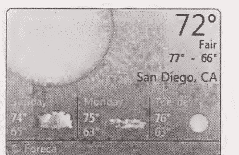

*图 1.4 天气小工具是信息小工具类型的一个示例。*

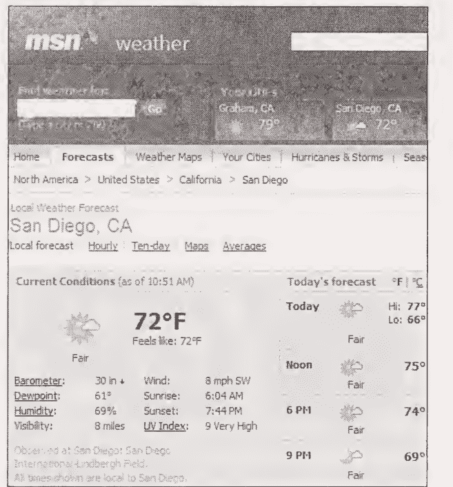

*图 1.5 位于 http://weather.msn.com 的天气 Web 服务根据位置提供当前天气状况的数据。*

### 应用程序小工具

应用程序小工具依赖其他应用程序来获取所需的信息。例如，Outlook 小工具可以显示来自 Microsoft Outlook 的即将到来的日程安排，Messenger 小工具可以显示即时通讯应用程序中的在线联系人（参见图 1.6）。显然，这些小工具离开其主应用程序就没什么用处了，但它们确实可以作为快速获取基本信息的实用工具。

图 1.6 中展示的应用程序小工具使用 Windows API 和注册表信息来访问与对应应用程序相关的常用数据。最近使用列表（MRU）由 Windows 操作系统在注册表中维护。最近使用的文档小工具列出了最近使用过的 Microsoft Office 文档，而 Outlook 日程安排小工具则显示来自 Microsoft Outlook 的即将到来的日程。

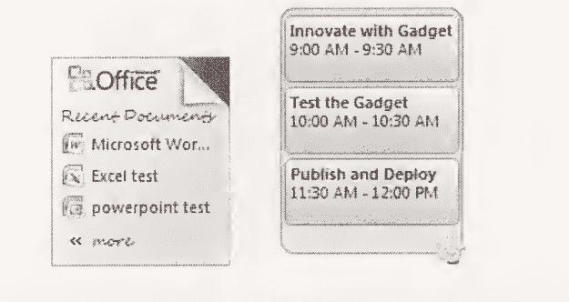

*图 1.6 最近使用的文档小工具和 Microsoft Outlook 小工具提供了对当前数据的快速访问。*

你可以通过小工具对象或 ActiveX 技术来访问这些与应用程序相关的信息源。

### 实用小工具

实用小工具是独立的迷你应用程序，旨在实现对常用功能的快速访问，例如 CPU 仪表、日历控件等（参见图 1.7）。

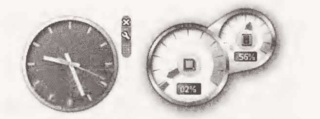

*图 1.7 用于显示时间的时钟小工具和显示实时 CPU 使用率的 CPU 仪表小工具都是实用小工具的示例。*

实用小工具通常使用本地计算机的资源来快速提供有用的信息。这些小工具使用 Windows API 来访问操作系统的高级功能。

### 趣味小工具

趣味小工具是最受欢迎的小工具类型。与其他小工具类型不同，它们没有特定的实现方式。它们可以像信息小工具一样使用在线订阅源来显示有趣的信息，甚至可以是具有类似实用小工具属性的独立游戏。趣味小工具可以使用存储在本地计算机中的图片来展示幻灯片，同时也可以充当应用程序小工具。这些小工具的目的是提供趣味和娱乐。

它们通常采用实用小工具的形式，是用于娱乐和游戏的独立轻量级应用程序，例如扫雷小工具。但开发者也将其创建为信息小工具甚至应用程序小工具。世界各地的开发者都在构思将在线订阅源、Windows 应用程序等结合在一起的创意，旨在打造一个用于娱乐的小工具平台。

图 1.8 展示了一个视频小工具，它从 soapbox.msn.com 获取 RSS 订阅源，并在弹出窗口中嵌入的 Flash 播放器中播放视频。

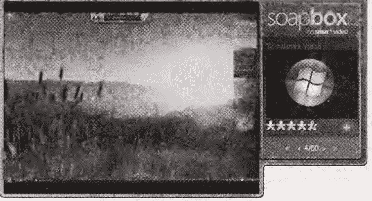

*图 1.8 该视频小工具从 http://videos.msn.com 提供的 RSS 订阅源获取数据，并在 Flash Player 插件中播放媒体。*

归根结底，小工具的核心在于提升生产力和个性化用户的信息可视化体验。它们开启了一个充满创新和新颖创意的世界，而这些在目前的 Windows 平台上尚未被广泛发掘。

## 深入了解小工具

要更深入地了解小工具，你需要知道小工具的局限性是什么、小工具的用途是什么以及小工具不能做什么。你还需要了解小工具的不同视图以及如何自定义小工具。

值得讨论的一些主题包括：

- 小工具不是什么
- 小工具的不同视图
- 不透明度级别和始终置于顶层属性
- 使用弹出窗口获取更多信息
- 其他自定义选项

### 小工具不是什么

小工具是面向特定任务的应用程序。它们并非设计用来替代功能完善的应用程序，而是设计为要么以一小部分功能独立运行，要么作为应用程序的补充。

作为小工具开发者，请记住小工具是轻量级的。没有必要试图在小工具中塞入过多信息。只需向用户提供最有趣的信息，然后让他们自行前往网站或应用程序以更深入地了解这些信息。

小工具不是功能完善的应用程序，因此在创建小工具时需要考虑以下几点：

- 小工具不是可执行文件。
- 小工具不作为独立进程运行，而是在侧边栏窗格中运行，也可以拖放到 Windows 桌面上。
- 小工具不会出现在"开始"菜单或任务管理器中，也无法通过 Alt + Tab 键访问。
- 小工具没有带有菜单、工具栏或最大化和最小化按钮的窗口对话框。
- 小工具不是完整的网页：你不能在小工具中点击导航链接。

### 不同视图——小工具的三副面孔

根据用户的选择，小工具可以提供三种不同的视图：

- **停靠视图**——小工具被放置在 Windows Vista 侧边栏上（参见图 1.9）。它提供小工具的基本信息，并有一个可选的弹出窗口用于显示更多信息。这也是所有小工具的默认视图。

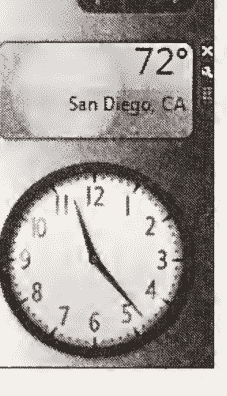

*图 1.9 小工具添加后会被停靠在 Vista 侧边栏中。这是小工具的默认状态。*

- **浮动视图**——浮动小工具可以从侧边栏窗格拖放到桌面上，这可以提供更大更清晰的信息视图（参见图 1.10）。
- **多实例视图**——你还可以同时拥有多个小工具实例，既可以在侧边栏窗格中，也可以在桌面上。当你希望按不同条件过滤信息并分别显示在各个小工具实例中时，多实例视图非常有用。例如，要比较两个不同地点的天气，你只需添加两个小工具实例，每个实例各自自定义为对应的城市即可。


 ## 不透明度级别和始终置顶属性

小工具提供了独特的自定义级别。当小工具处于浮动视图时，你可以右键单击小工具并勾选始终置顶属性（见图 1.11）。这使得小工具能够始终保持在所有运行中的窗口之上，从而提高效率和实用性。例如，在运行 CPU 密集型应用程序时，你可以在其上方看到 CPU 计量器，并实时监控使用情况。

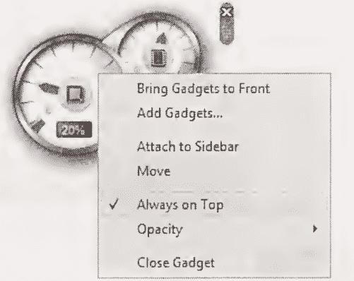

图 1.11 始终置顶属性确保小工具即使在其他应用程序的最大化窗口之上也可见。

小工具还具有一个不透明度属性，使用户能够自定义其不透明度级别。不透明度级别以百分比形式定义。例如，50% 的不透明度级别与始终置顶属性一起使用时，当小工具位于其他应用程序之上时会产生半透明效果。

### 使用弹出窗口获取更多信息

小工具还具有可选的弹出窗口，可用于根据用户选择提供进一步的交互式信息（见图 1.12）。

弹出窗口是显示与小工具内有限信息量相关的额外信息的绝佳工具。它还使用户能够与小工具交互，并从小工具导航到另一个资源。如果你单击桌面或桌面上的任何其他窗口，弹出窗口会自动隐藏。

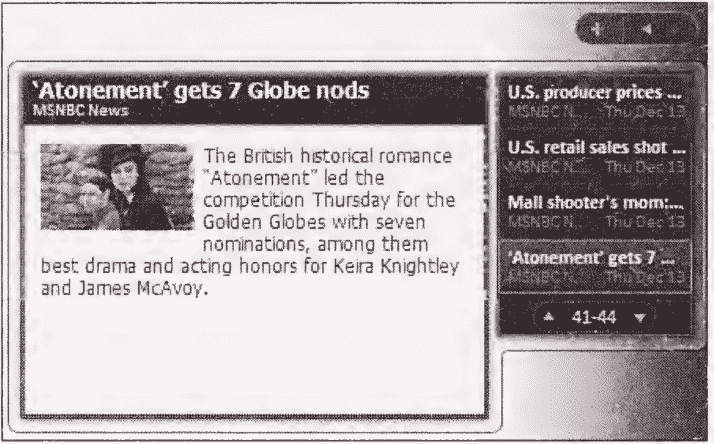

**图 1.12** 提要标题小工具中的弹出窗口用于显示用户选择的提要的详细信息。

### 自定义

所有小工具都有一个设置和配置页面，你可以通过在上下文菜单中单击选项（通过右键单击小工具显示）或单击设置图标来访问，如图 1.13 所示。设置页面使用户能够按自己的方式自定义小工具，提供更加个性化的体验。当你想要具有不同数据的小工具的多个视图时，这特别有用。

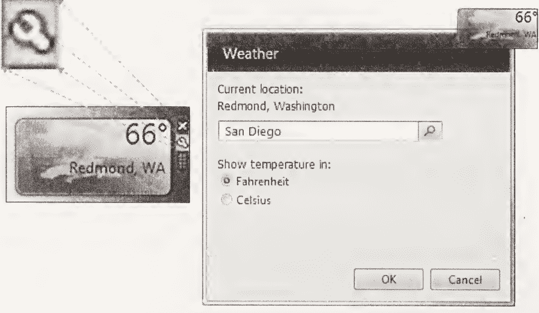

**图 1.13** 小工具的设置页面，当前位置设置为圣地亚哥的天气小工具。注意更改摄氏或华氏温度的选项。

### 小工具的多平台支持

这正迅速成为小工具的时代。微软小工具平台有三种不同类型的小工具：

- 边栏小工具（Windows Vista 桌面）
- 网络小工具（Live.com 或 Live Spaces）
- SideShow 小工具（辅助硬件设备）

边栏小工具面向桌面；网络小工具在网页浏览器中运行，无论是在 Live.com 页面还是 Live Spaces，而 SideShow 小工具面向辅助硬件设备。

边栏小工具使用 DHTML 作为开发平台，面向桌面。你为 Windows 边栏编写的小工具是使用小工具对象模型开发的，这使你可以与桌面以及 Web 服务进行交互。它们不在 Web 浏览器上运行，而是在边栏或桌面上作为小型迷你应用程序运行。

网络小工具通常被认为驻留在 Live.com 上（见图 1.14）。它们用 DHTML 和 Ajax 库编写。它们在任何 Web 浏览器中运行，并托管在 live.com 或 Live Spaces 中。

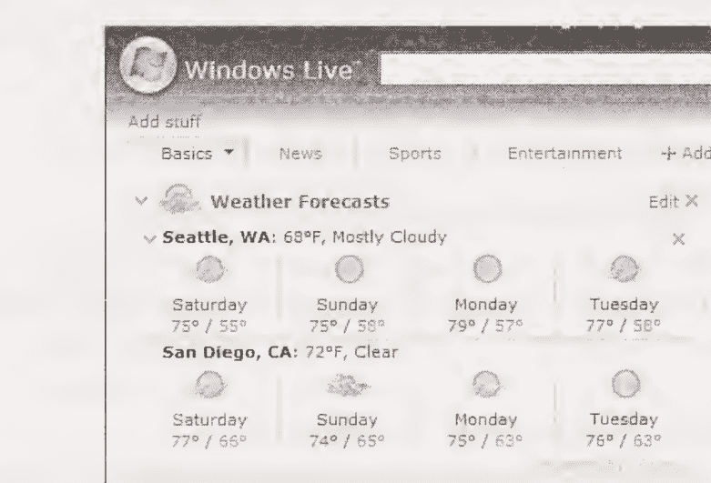

> Live.com 和 Live Spaces 的网络小工具托管在 Web 服务器上，而不是边栏上，在浏览器内部运行。开发人员使用微软提供的 JavaScript 库以及托管它们的平台来开发这些小工具。有关 Live 小工具开发的更多信息，请访问 http://microsoftgadgets.com/livesdk/index。

SideShow 是硬件设备，例如可以在笔记本电脑的侧面找到（见图 1.15）、在智能便携设备上，甚至可以在手机上找到。

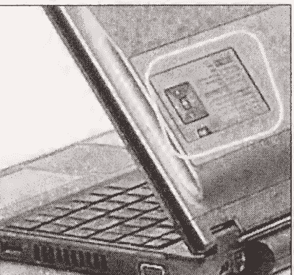

**图 1.15** Windows SideShow 设备可以是笔记本电脑的一部分、智能便携式对象设备，或具有 SideShow 功能的手机。

SideShow 小工具是用 C++ 开发的应用程序编写的，更面向设备。Windows SideShow 的小工具是在 PC 上运行的迷你应用程序，它将数据发送到具有 Windows SideShow 平台的设备。小工具从数据源（如应用程序或 Web 服务）检索数据，并将此数据发送到 Windows SideShow 平台，该平台将其发送到适当的设备。小工具可以使用以下选项之一与 Windows SideShow 平台通信：

- C++ 与 SideShow COM API
- SideShow 托管 API 与 C# 或 Visual Basic .NET
- 微软边栏小工具，使用 SideShow 对象模型

SideShow 设备特别有趣，因为当笔记本电脑关闭、合上或处于睡眠状态时，它们仍然可以工作。因此，你可以访问边栏小工具已发送到设备的信息。

#### 不同小工具的交汇点

你可以在不同平台上开发的不同小工具在很多方面也是相似的。它们的统一目标是从不同的应用程序、Web 服务和 XML 提要中提供快速信息。

大多数网络小工具都可以调整以作为边栏小工具运行。小工具箱是一种边栏小工具，可以在边栏中包含任意数量的网络小工具。有关小工具箱小工具的更多详细信息，请查看附录 B。

边栏小工具还可以在 SideShow 设备上创建数据，因此边栏天气小工具可以将信息发送到笔记本电脑侧面的设备，如图 1.16 所示。

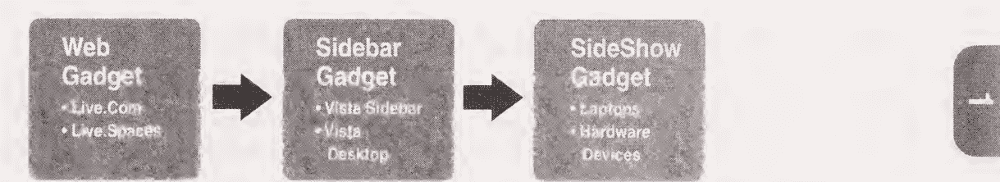

图 1.16 网络小工具可以转换为边栏小工具，边栏可以将数据发送到 SideShow 设备。

## 开发平台

不同的小工具平台使用不同的开发平台：

- 边栏小工具使用小工具对象模型、HTML、CSS 和 JavaScript。
- 网络小工具主要使用 DHTML 与 Ajax 库。
- SideShow 小工具使用 C++、SideShow COM API 和 SideShow 托管 API 与托管代码。

表 1.2 展示了不同小工具平台之间差异的综合图表。

| 小工具平台 | 目标 | 用途 | 技术 | 示例 |
|---|---|---|---|---|
| 边栏小工具 | Windows Vista 桌面 | 触手可及的信息 | 小工具对象模型、HTML、CSS、JavaScript | RSS 提要小工具、Live Search 地图 |
| 网络小工具 | Live.com、Live Spaces | 网站之间的信息共享 | DHTML 与 Ajax 库 | HTML 沙盒 |
| SideShow 小工具 | 笔记本电脑、智能设备、辅助硬件设备 | 从硬件设备访问信息 | C++、SideShow COM API、SideShow 托管 API、C#.NET | PowerPoint SideShow 小工具 |

### 小工具生态系统

微软小工具在 http://gallery.live.com 上有一个在线社区，使用户能够浏览大量现有的现成小工具。Live.com 的画廊不仅托管各种类型的小工具，还为每种类型的小工具提供专用论坛，拥有来自世界各地的数千名用户。这些论坛对于与其他小工具开发人员互动以及分享想法、问题和解决方案非常有用。

Gallery.Live.com 还托管一个开发人员中心，为几乎所有类型的小工具提供软件开发工具包。

### 其他桌面小工具/小组件平台

除了微软之外，所有流行的互联网供应商都有自己的桌面小工具版本。虽然*小工具*和*小组件*这两个词可以互换使用，在广义上两者都用于访问远程数据的小型轻量级应用程序，但根据它们托管的环境存在一种分类。

- 桌面小工具驻留在计算机桌面上。
- 网络小工具托管在网页上。

所有主要软件供应商都有自己的小工具版本。有些被称为小工具，有些被称为小组件。许多小工具在不同版本的 Windows 上工作。

图 1.17 显示了在 Windows XP 和 Windows Vista 上工作的小工具。请注意，AveDesk 和 DesktopX 小工具仅在 Windows XP 中工作。另一方面，Adobe AIR、Yahoo! Widgets、Google 桌面、KlipFolio、Opera 和 Samurize 小工具在 Windows XP 和 Windows Vista 上都能工作。本书的主题边栏小工具仅在 Windows Vista 上工作。

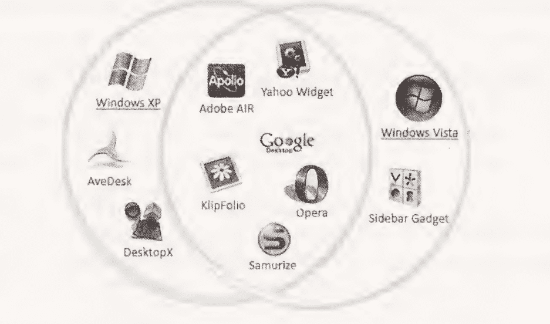

图 1.17 桌面小工具有许多相互竞争的技术。

所有桌面小工具都有一个共同的目标：触手可及的信息。以下各节详细介绍了各种桌面小工具/小组件。

#### Yahoo! Widgets——Konfabulator

Konfabulator 是 Yahoo! 公司推出的流行桌面小工具平台。与 Windows Vista 边栏类似，Yahoo! 小组件也使用可以在桌面中移动的面板，可用于托管多个小组件。更多信息请访问 http://widgets.yahoo.com/。


**优点：**

- 作为最早的小部件平台之一，因此非常流行
- 拥有超过 4,000 个小部件，以及庞大的在线社区和用户群
- 同时支持 Windows 和 Mac OS X

**缺点：**

- 使用专有的 XML 格式进行开发
- 设计和开发小部件需要较高的学习成本
- 需要在计算机上安装运行时

#### Apple Dashboard Widgets

Apple 的 Dashboard 是运行在 Mac OS 操作系统上的一个应用程序。它托管了许多小部件，这些小部件使用 HTML、CSS、XML 和 JavaScript 等标准 Web 技术进行开发。作为一个平台，它相当受欢迎。更多信息请参见 http://www.apple.com/downloads/dashboard/。

**优点：**

- 基于标准 Web 技术、JavaScript、HTML 和 CSS 进行开发
- 使用现有的 Ajax 库和 DashCode IDE 来编写 Dashboard 小部件
- 拥有庞大的用户群和在线社区支持

**缺点：**

- 每个小部件都是一个网页，可能会占用大量系统资源
- Apple 的小部件仅能在 Mac OS 操作系统上运行

#### Google Desktop

Google Desktop 起初是一款桌面搜索工具，后来扩展了侧边栏面板和托管小工具的功能。更多信息请参见 http://desktop.google.com/。

**优点：**

- 如果你了解 HTML 和 JavaScript，就很容易上手。
- 更好的平台集成、拖放支持等。
- Google Gadget Designer，一款用于编写小工具的开发工具。
- 资源占用不大。

**缺点：**

- 使用其专有的 XML 文件，并非基于 W3C 标准。
- 需要下载 Google Desktop 软件包。
- 对开发者来说并不是一个很好的平台。
- 不支持 Mac OS X。

#### DesktopX Widgets

DesktopX 是 Stardock 于 2000 年创建的 Windows 小部件引擎。它是一款桌面增强应用程序，帮助用户添加小型应用程序。更多信息请参见 http://www.stardock.com/products/desktopx/。

**优点：**

- 在同类产品中历史最悠久（约 7 年），因此是一个稳定、成熟的平台。
- 集成 COM/ActiveX 支持。
- 独特的动画引擎。
- 可以将内容导出为可执行文件。

**缺点：**

- DesktopX 的运行时版本售价 14.95 美元。
- 需要下载并安装运行时。
- 创建小部件的学习成本较高。
- 开发者社区规模不大。

#### Samurize Widgets

Samurize 是一款面向 Microsoft Windows 的桌面增强引擎，主要用于系统监控工具。更多信息请参见 http://www.samurize.com。

**优点：**

- 创建小部件更加容易。
- 拥有丰富的小部件库。
- 内置大量便捷的系统/网络监控功能。

**缺点：**

- 用户界面更侧重于功能。
- 使用 VBScript 运行时引擎。

#### KlipFolio Widgets

KlipFolio 是一款小型的个人 Dashboard 和侧边栏工具，适用于 Windows XP 和 Windows Vista。更多信息请参见 http://www.klipfolio.com/。

**优点：**

- KlipFolio 使用名为 *Klips* 的文件来提供丰富的功能。
- 能够轻松读取或解析互联网上的任何 XML。
- 同时适用于 XP 和 Windows Vista。
- 拥有优秀的社区支持、论坛和实用指南。

**缺点：**

- 仅限 Windows 操作系统。
- 使用专有的 KlipScript 和内置数据结构。
- 开发学习成本较高。
- 需要下载并安装引擎。

#### Adobe AIR/Apollo Widgets

Adobe AIR（原名 Apollo）是一个跨平台的小部件创建引擎。通过 AIR，开发者可以使用 HTML、Ajax、Flash 和 Flex 来构建并将富互联网应用程序部署到桌面端。更多信息请参见 http://labs.adobe.com/technologies/air/。

**优点：**

- 跨平台
- 与 Adobe 产品 Flash 和 Flex 紧密集成
- 使用 HTML、JavaScript 和相关技术进行简单开发

**缺点：**

- Flex 和 Flash 的学习成本较高
- 主要用于在桌面上创建 Web 应用程序
- 打包整个应用程序而不仅仅是小部件

#### AveDesk Widgets

AveDesk 是一款免费的 Windows XP 小部件引擎。它是一款桌面增强应用程序，运行名为 *desklets* 的小部件。更多信息请参见 http://www.avedesk.org/。

**优点：**

- 由社区驱动。
- AveDesk desklets 是使用 Visual C++ 开发的强力插件，而非脚本。

**缺点：**

- 用户无法轻松为 AveDesk 创建自定义 desklets。
- 仅支持 Windows XP。

#### Opera Widgets

Opera 是一种跨平台的小部件技术，可在所有主流操作系统和设备上运行。它由位于挪威奥斯陆的 Opera Software 开发。更多信息请参见 http://widgets.opera.com/。

**优点：**

- 支持多种版本的 Microsoft Windows、Mac OS X、Linux、FreeBSD 和 Solaris。
- 用于移动设备、游戏机和交互式电视。
- Opera 的技术也被其他大型软件和服务供应商授权使用。

**缺点：**

- Opera 是专有软件。
- 开发过程复杂。

## 小工具比较图表

面对如此众多不同的小工具和小部件技术，用户无论使用哪种操作系统都有多种选择。图 1.18 展示了适用于不同操作系统的流行小工具。

Vista 小工具与其他产品相比，最重要的区别在于它们基于标准 Web 技术（即 HTML、CSS 和 JavaScript），并且不需要安装运行时应用程序。表 1.3 比较了各种小工具/小部件平台（按字母顺序排列）。

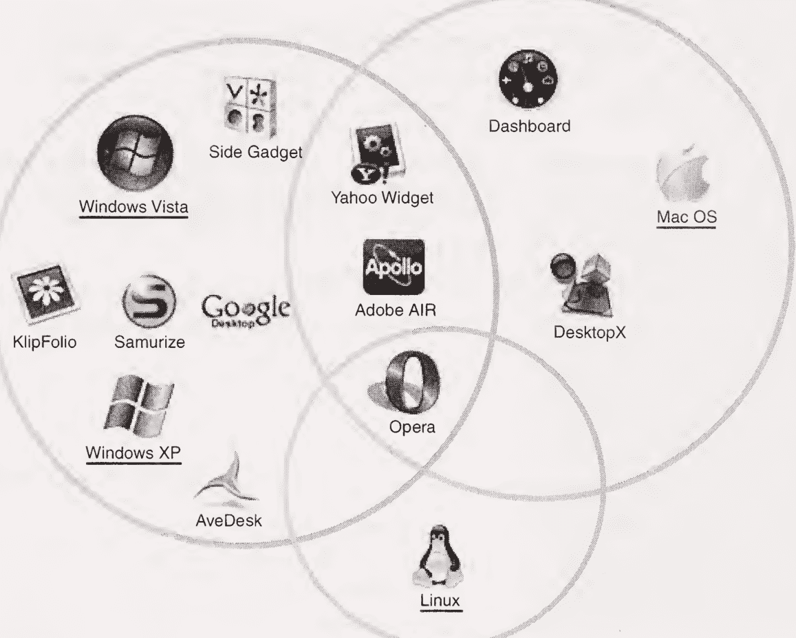

### TABLE 1.3 各种小工具/小部件平台比较

| 小工具/小部件 | 供应商 | 操作系统 | 技术 | 许可证 |
|---|---|---|---|---|
| Apollo | Adobe Inc. | Windows OS, Mac OS | HTML JavaScript, Flash, Flex | 免费软件 |
| AveDesk | Andreas Verhoeven | Windows XP | 标准 Web 技术\*, C++ | 捐赠软件 |
| Dashboard | Apple Computer | Mac OS X | 标准 Web 技术\*, C++ | Mac OS 内置组件 |
| DesktopX | Stardock | Windows XP | 标准 Web 技术\*, C++ | 共享软件 |
| Google Desktop gadget | Google | Windows XP, Windows Vista | 标准 Web 技术\* | 免费软件 |
| KlipFolio | Serence | Windows XP, Windows Vista | XML , JavaScript | 免费软件 |
| Microsoft Sidebar gadget | Microsoft | Windows Vista | 标准 Web 技术\*, Gadget Object Model, ActiveX | Vista OS 内置组件 |
| Opera | Opera Software | Windows XP, Windows Vista, Mac OS X, Linux | 标准 Web 技术* | 免费软件 |
| Samurize | Gustaf & Oscar Lundh | Windows XP, Windows Vista | JavaScript, C++ | 半免费软件 |
| Yahoo Widget | Yahoo Inc. | Windows OS Mac OS | XML, JavaScript | 免费软件 |

\*标准 Web 技术：HTML、CSS、XML 和 JavaScript

# 第 2 章

## 架构

> "最高尚的乐趣是理解的喜悦。"
> ——列奥纳多·达·芬奇

**本章内容**

- 小工具概述
- 小工具开发背后的技术
- 小工具对象模型
- 侧边栏小工具：未来之路

### 小工具概述

小工具是一组 HTML、XML、JavaScript、CSS 和图像文件，打包成一个文件。扩展名为 .gadget 的小工具包实际上是一个 Zip 文件，其中包含运行该小工具所需的这些文件。图 2.1 展示了一个简单小工具的常见布局。

通常一个小工具包含以下文件夹和文件：

- en-US 文件夹
  - main.html
  - Settings.html
  - Flyout.html
  - Main.js
  - Gadget.xml（包含正确的映射）
- Images 文件夹
  - Dragicon.png
  - Logo.png
  - Icon.png

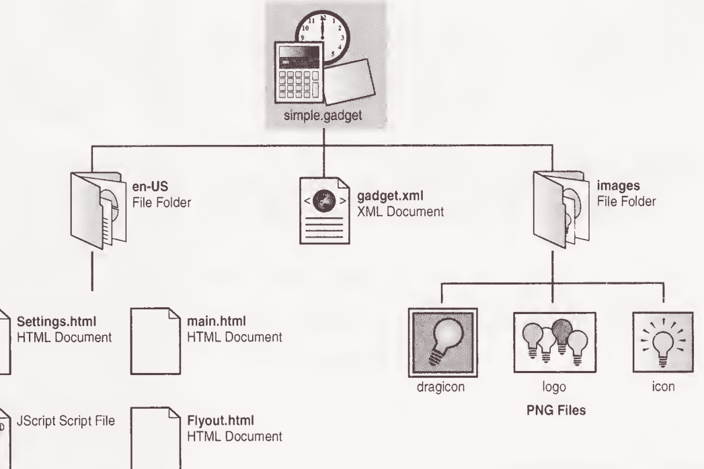

表 2.1 说明了小工具附带的所有文件。请注意，文件名并非固定不变，而是通过映射来指定。gadget.xml 包含对 Main.html 和其他图像文件的引用，而 Main.html 则包含对 Settings、Main.Js 和弹出窗口文件信息的进一步引用。

### TABLE 2.1 典型小工具中的不同文件

| 文件 | 描述 |
| :--- | :--- |
| Main.html | 主 HTML 页面，构成小工具的背景。 |
| Settings.html | 向用户提供可更改的小工具设置。 |
| Flyout.html | 用于弹出窗口的 HTML 文件。 |
| Main.Js | 小工具的核心代码/脚本。 |
| Gadget.xml | 定义小工具属性的 XML 文件，包括名称、图标和描述。用于小工具选择器窗口。 |
| Icon.png | 在小工具被拖入小工具选择器窗口时显示。 |
| Logo.png | 在显示描述时，显示在小工具选择器窗口的右下角。 |
| Dragicon.png | 在小工具被拖入小工具选择器窗口时显示。 |

图 2.2 展示了 Vista 小工具选择器中的 Simple Gadget。请注意，小工具选择器会在窗口底部提供小工具的简要描述。


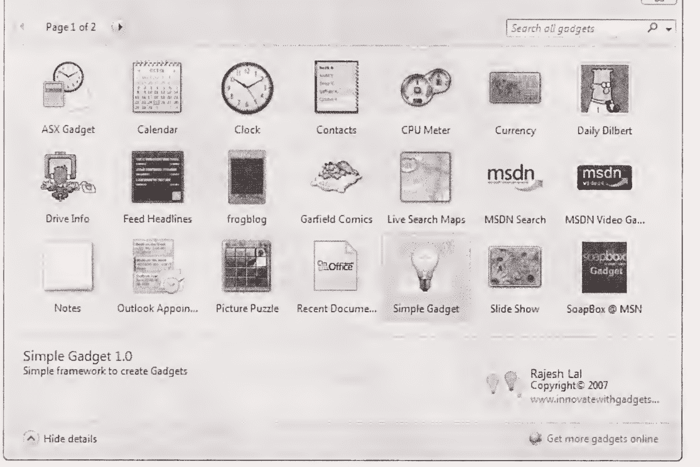

图 2.2 小工具选择器窗口按字母顺序显示计算机中所有可用的小工具。

### 清单文件 gadget.xml

小工具包包含文件 gadget.xml，其中包含侧边栏识别和显示小工具所需的所有信息，包括这个小工具是什么以及如何运行这个小工具。这就是小工具清单文件。它包含有关小工具的元数据，例如名称、作者、信息网址、版权等。gadget.xml 文件还包含小工具的图标、要显示的名称以及与小工具相关的任何网站等信息。它还包含对用于运行小工具的 .html 文件的引用。

图 2.3 展示了小工具的清单文件。注意 src 被赋值为 main.html，这决定了小工具的主窗口。

清单文件中的大多数参数都是不言自明的；不过，表 2.2 提供了有关清单文件 gadget.xml 中一些参数的更多详细信息。

#### 表 2.2 小工具清单文件中使用的不同参数

| 标签 | 说明 |
| :--- | :--- |
| `<name>` | 小工具在选择框中显示的名称。 |
| `<author>` | 编写小工具的个人或公司名称。 |
| `<copyright>` | 版权信息。 |
| `<description>` | 小工具的说明及其功能。 |
| `<icon>` | 用作选择框中显示的图标的图标文件名。 |
| `<code>` | 构成小工具的 HTML 文件名。 |
| `<website>` | 与小工具相关的网站。 |

```
<?xml version="1.0" encoding="utf-8" ?>
<gadget>
  <name>Simple Gadget</name>
  <namespace>Innovate.Gadgets</namespace>
  <version>1.0</version>
  <author name="Rajesh Lai">
    <dp src="images/logo.png" />
    <info url="http://www.InnovatewithGadgets.com" />
  </author>
  <copyright>Copyright© 2007</copyright>
  <description>Simple framework to create Gadget skis</description>
  <icons>
    <icon width="70" height="80" src="images/icon.png" />
  </icons>
  <hosts>
    <host name="sidebar">
      <base type="HTML" apiVersion="1.0.0" src="main.html" />
      <permissions>Full</permissions>
      <platform minPlatformVersion="1.0" />
      <defaultImage src="images/dragicon.png" />
    </host>
  </hosts>
</gadget>
```

图 2.3 gadget.xml 文件包含用于描述小工具并将其与侧边栏中其他小工具区分开来的信息。

大多数情况下，小工具有三个 HTML 文件，分别用于主窗口、设置页面和弹出窗口。小工具可以为这些文件中的每一个关联不同的样式表信息以及不同的 JavaScript 代码文件。不同的功能也可以封装在不同的代码文件中。这增加了小工具布局的复杂性，但有助于维护过程。图 2.4 展示了此类小工具的布局。

## 用户界面和展示

小工具的结构来自构成用户界面的三个 HTML 页面：

- main.html——小工具的小型"主页"。当小工具停靠在侧边栏中以及取消停靠（显示在桌面上）时，你都会看到这个页面。
- Settings.html——使用户能够自定义小工具的页面。例如，这个页面将管理更改基于天气的小工具的城市设置。
- Flyout.html——通常显示与 main.html 页面中用户选择相关的信息的 HTML 页面。这是一个可选页面。

### 层叠样式表

样式表通常用于将网页的展示与其结构（即页面的 HTML）分离。层叠样式表（CSS）在小工具中用于类似的目的。CSS 文件有助于展示小工具的 HTML 文件。人们可以将小工具 HTML 页面的所有展示部分封装在一个 CSS 文件中。有关 CSS 和 HTML 的优秀教程可以在以下链接找到：http://www.w3.org/Style/Examples/011/firstcss。

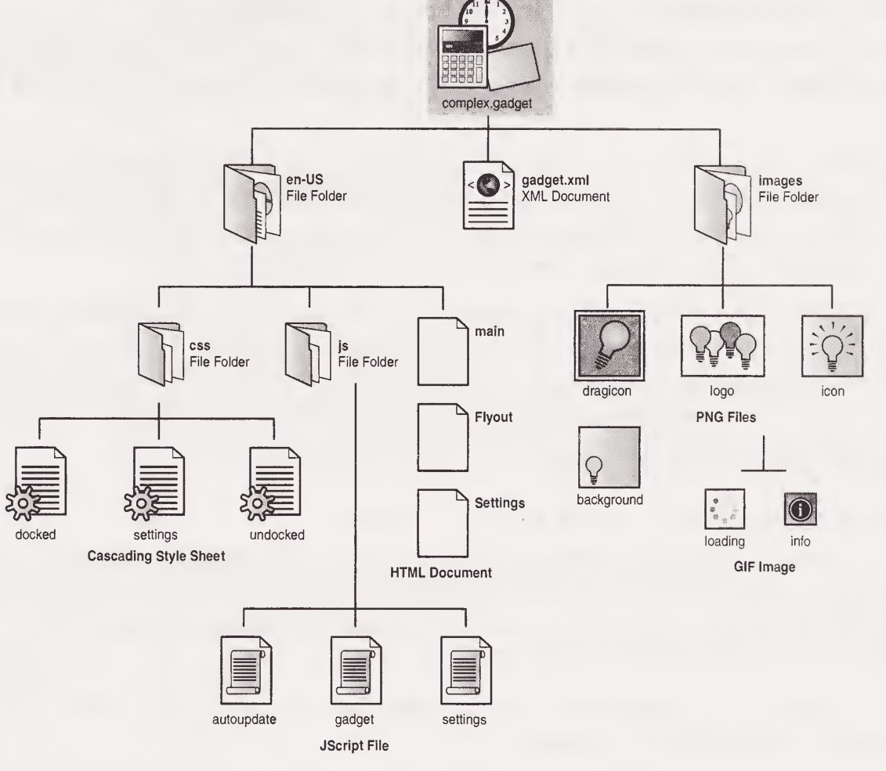

#### 图 2.4 复杂的小工具可以有多个 JavaScript 和样式表文件。

在典型情况下，单个 CSS 文件有助于展示小工具中的主 HTML 页面。如果小工具取消停靠时大小发生变化，拥有两个 CSS 文件（gadget.css 和 gadgetundocked.css）可以使你相应地更改展示。

设置页面以及弹出页面也可以使用不同的样式表。Settings.css 是 settings.html 页面的样式表。如果弹出窗口的展示与主小工具窗口不同，弹出窗口也可以使用单独的 CSS 文件。

样式表信息也可以通过 HTML 页面中的 `<STYLE>` 标签包含在内，但拥有单独的 CSS 文件有助于长期保持模块化和可维护性。

以下是小工具开发中可以使用的不同 CSS 文件列表：

- gadget.css，用于小工具的主窗口
- undocked.css，小工具在浮动（未停靠）模式下使用
- Settings.css，用于设置页面的展示
- Flyout.css，用于弹出窗口

## 小工具的核心功能：JavaScript

JavaScript 提供了小工具的核心功能。结构（HTML）和展示（CSS）构成了小工具的骨架和身体，但正是 JavaScript 为其增添了生命力。

小工具的核心，即使小工具动态化的部分，是一个或多个 JavaScript 代码片段。通常，所有这些 JavaScript 文件都被放在 js 文件夹中。这些 JavaScript 文件处理小工具的功能，并在需要该功能的相应 HTML 文件（主文件、设置或弹出窗口）中引用。

还会添加其他 JavaScript 文件以实现附加功能，例如通过互联网更新小工具（autoupdate.js）或在 Settings.html 页面中添加菜单等。所有 CSS 和 JS 文件都是可选的；甚至名称也不是固定的。脚本和样式表信息都可以包含在 HTML 页面本身中，但为了模块化，它们被放在单独的文件中。

### 资源、PNG 和其他文件

图像是小工具开发中非常重要的部分。它们为小工具的外观增添了专业感。如果你想让你的小工具占据数百万用户的桌面空间，它需要看起来不错。小工具的图像就像计算机中的壁纸和图标。每个人都喜欢好看的。

图 2.5 展示了小工具所需的图像。icon.png、Logo.png 和 dragicon.png 可以在小工具选择器库中找到。

背景图像用作小工具的"壁纸"。它是一个半透明的图像，出现在小工具的背景中。加载图像和信息图像通常用于向用户展示状态。表 2.3 展示了图像列表及其特定用途。

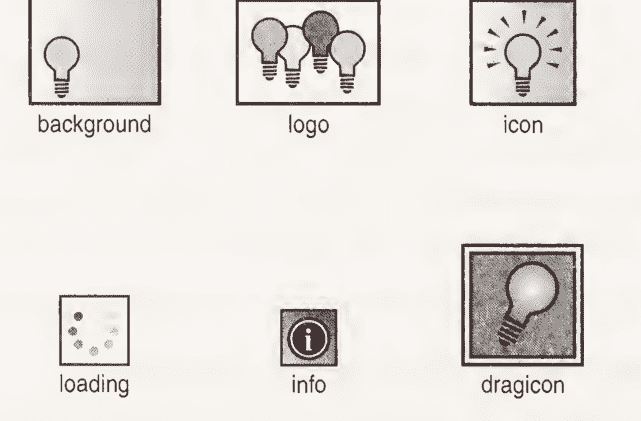

图 2.5 典型的小工具将包含图标、徽标、拖动图标和背景图像。

loading.gif 和 info.gif 具有非常重要的用途。loading.gif 文件直观地告知用户小工具正在尝试从互联网加载数据，这可能需要一些时间。同样，info.gif 文件用于数据未加载或服务未响应时。你将在第 3 章"设计方法"中了解更多关于使用 PNG 和 GIF 文件的信息。

#### 表 2.3 小工具的常见图像集

| 标题 | 用途 |
| :--- | :--- |
| logo.png | 显示在小工具选择器窗口的右上角，以及小工具的描述。 |
| icon.png | 显示在小工具选择器中，带有标题。 |
| background.png | 这是小工具的"壁纸"。 |
| dragicon.png | 当你拖动小工具时，拖动图标出现在小工具选择器窗口中。 |
| loading.gif | 用于显示某些长时间运行任务的状态。 |
| info.gif | 用于在小工具窗口中向用户显示错误、信息或警告。 |

## 小工具开发背后的技术

小工具开发从 HTML 和 JavaScript 开始。具备标准 Web 技术（如 CSS、XML 和文档对象模型（DOM Level 1））的基本知识有助于加快开发过程。

DOM Level 1 是一组访问 HTML 页面元素的规范。更多信息可以在 http://www.w3.org/TR/REC-DOM-Level-1/ 找到。

Windows Vista 侧边栏为小工具开发提供了丰富的小工具对象模型，这是一组用于访问操作系统文件和功能的方法。这可以用于创建能够访问操作系统资源的小工具。小工具对象模型还支持 ActiveX 技术（COM），可以进一步用于扩展小工具的功能。

小工具技术可以分为以下几个部分（见图 2.6）：

*   小工具作为 MSHTML 组件运行。
*   它使用标准 Web 技术，HTML、CSS、XML、DOM Level 1 和 JavaScript。
*   Vista 侧边栏提供了用于与本地计算机相关功能的小工具对象模型。
*   小工具还支持 ActiveX 技术（COM）以实现高级功能。


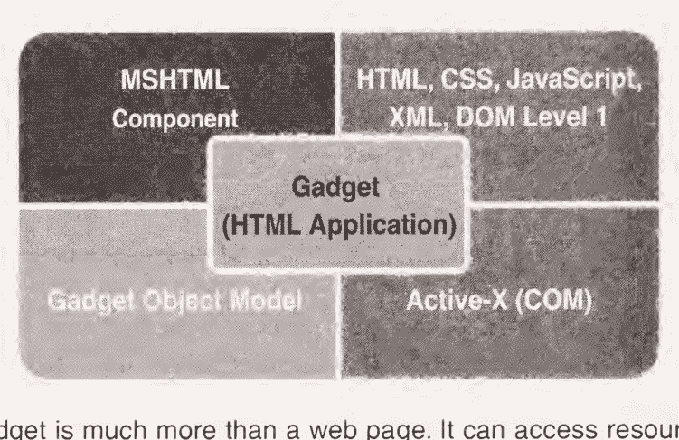

图 2.6 小工具远不止是一个网页。它可以访问本地计算机的资源，播放媒体文件，甚至运行 Excel 表格。

### MSHTML 组件：小工具的核心

小工具的核心是 Windows Vista 操作系统的一个固有对象，称为 Microsoft HTML (MSHTML) 组件。该组件提供了将 HTML 页面作为微型浏览器页面进行托管的能力，但不包含地址栏、导航栏、菜单等任何相关功能。

你可以在 Microsoft 开发者网络 (MSDN) 网站上找到一篇关于 MSHTML 组件的优秀文章：http://msdn2.microsoft.com/en-us/library/bb508516.aspx（或使用关键词 "reusing MSHTML" 搜索）。

小工具开发者可以像创建网页一样，以类似的方式使用图像、CSS 和 JavaScript。丰富的 HTML 渲染能力允许实现高级图形、用户交互和层叠样式表。

### 标准 Web 技术

HTML、CSS 和 JavaScript 等标准 Web 技术构成了小工具的结构、呈现和行为基础。以下是用于小工具开发的各类技术的完整列表：

- HTML
- CSS
- JavaScript/VBScript
- XML/XHTML
- 文档对象模型 (DOM Level 1)

文档对象模型 (DOM) 是 HTML 页面的对象模型，小工具可以通过 JavaScript 访问它，用于创建动态且丰富的呈现效果。HTML DOM 与小工具附带的 DOM 之间略有不同。小工具中不允许使用 JavaScript 警告或任何类型的模式对话框。

### 侧边栏小工具作为 HTML 应用程序

侧边栏小工具更像一个 HTML 应用程序 (HTA)，而不是一个 HTML 网页。网页无法访问本地资源，但 HTML 应用程序可以访问本地计算机的所有资源。

核心 MSHTML 组件的配置类似于赋予 HTML 应用程序或本地计算机区域安全配置的一组权限。该模型在功能上将侧边栏小工具与简单的网页区分开来。

与网页相比，小工具在配置上有几方面的不同。小工具被视为可执行代码，可以利用任何已安装的 ActiveX 对象。侧边栏小工具具有“初始化并脚本化 ActiveX 控件”选项，在 Internet Explorer 中，该选项被标记为不安全。因此，在编写小工具程序时，了解各种 IE 安全权限之间的差异以及任何适用的限制非常重要。

小工具还可以访问跨域的数据源：它们可以聚合和收集来自多个网站和 Web 服务的数据。相反，本地网页尝试访问跨域数据或其他网页时，会触发安全警告。侧边栏小工具还可以被设置为下载和安装新的 ActiveX 控件。此功能在 Internet Explorer 中默认是禁用的。小工具可以被设计成间谍软件或恶意软件，从而危及用户计算机的安全。有关安全的更多信息，请参阅附录 A。

与网页的行为相反，小工具始终

- 在安全区域运行，这意味着小工具有权访问所有系统资源。
- 能够初始化并脚本化 ActiveX 控件，而无需像网页那样征求用户许可。
- 可以访问跨域的数据源。
- 能够下载和安装新的 ActiveX 控件。
- 以标准权限和操作运行。
- Internet Explorer 的保护模式不适用。

MSHTML 组件中的这些配置使小工具功能丰富，更像典型的桌面应用程序，但出于同样的原因，也容易受到安全问题的影响。一个外观炫酷的小工具也可能是一个木马程序，它看起来合法，但被设计成具有破坏性。表 2.3 比较了网页与 HTML 应用程序。有关 HTML 应用程序的更多信息，请访问 http://msdn2.microsoft.com/en-us/library/ms536496.aspx。

| HTML 网页 | 作为 HTML 应用程序的小工具 |
|:---|:---|
| 未经警告无法访问本地计算机的资源 | 可以访问本地计算机资源 |
| 无法访问来自不同域的数据 | 可以访问来自不同域的数据，使用 Ajax 方法 |
| ActiveX 控件需要用户允许 | 在 HTA 内运行 ActiveX 控件不需要权限 |
| 对用户安全 | HTML 应用程序可能危及用户安全 |

**表 2.3** HTML 应用程序比 HTML 网页功能更强大

来自未经验证开发者的小工具可能会损害你的计算机。通常，出现在 http://gallery.live.com 上的小工具在接受公开分发前会经过与安全相关问题的检查。但散布在 Web 上的小工具可能不安全。

**注意**

根据经验法则，如果你不知道小工具的来源，就不要安装它。

另一种方法是使用证书对小工具进行签名以验证其真实性。

### 小工具对象模型

Windows Vista 附带了一个小工具对象模型，这是一组暴露给 JavaScript 的 API，使小工具能够与操作系统交互。

小工具使用这些 API 在小工具页面内与操作系统交互、维护会话状态、管理输入输出操作以及访问系统中的本地文件和文件夹。通过小工具对象模型，可以使用大量的方法、属性和函数。下一节将讨论小工具对象模型并详细讨论这些 API。

有关小工具对象模型的更多信息，可以在 MSDN 上使用关键词 "Windows Sidebar Object Reference" 查找：http://msdn2.microsoft.com/en-us/library/aa965853(VS.85).aspx。

在后面的章节中，我们将更详细地讨论小工具对象模型。

### ActiveX 技术

小工具开发的一个重要方面是其对 ActiveX 组件的支持。当你需要使用已创建的 ActiveX 控件中的自定义功能，或者要在小工具中集成自定义 ActiveX 组件（例如 Windows Media Player）时，会用到 ActiveX (COM) 技术。例如，你可能想要实现一个小工具，在小工具的弹出窗口中显示 Microsoft Excel 工作表的一部分。

ActiveX 组件可以集成到小工具内的任何 HTML 页面中，包括主窗口的 HTML、弹出页面或设置页面。操作系统中安装的任何 ActiveX 控件，或者你自己编写的任何用于与自己小工具交互的 ActiveX 控件，都可以用来扩展小工具的功能。

从小工具中可以访问 ActiveX 对象，并为小工具提供了相当大的灵活性和强大的功能：

- ActiveX 可以直接嵌入到 HTML 页面中。
- 可以直接从小工具中访问 Media Player、Microsoft Office 和其他 Windows 应用程序。
- 你可以使用脚本中的 `CreateObject` 方法来使用现有的 ActiveX COM 组件。
- 你还可以创建自己的 ActiveX 控件来与小工具交互。


### 用户交互与侧边栏事件

Gadget 对象模型提供了一组丰富的属性、方法和事件，用于用户交互。所有这些 API 和事件都可以在脚本文件中使用。用户交互可以分为以下三个部分，这三个部分本身涵盖了两个 API 以及若干侧边栏事件方法：

- 核心 `System.Gadget`
- 侧边栏事件
- Gadget 设置 `System.Gadget.Settings`

`System.Gadget` 是一个命名空间，将所有与用户交互相关的 API 归为一组。它通过允许小工具响应用户事件（例如将小工具拖动到侧边栏上或从侧边栏上移走）来帮助小工具与用户进行交互。

侧边栏事件是在小工具中发生特定事件时调用的方法。这些方法通常用于设置特定属性或更改用户界面。例如，如果希望在小工具取消停靠（浮动在桌面上）时更改其大小，就必须使用小工具提供的 `OnUndock()` 方法。

诸如 `OnDock`、`OnSettingsClosed`、`OnUnDock` 等事件均可通过 `System.Gadget` 获取。你可以在本章稍后的"侧边栏事件"部分查看事件列表。

`System.Gadget.Settings` 用于维护与当前用户相关的会话状态或信息。它使小工具能够与各种设置进行交互。设置对象特别重要，在小工具开发中使用最为频繁。它对于读取、写入和更新本地变量及设置的值非常有用。

### `System.Gadget` 对象

除了小工具与侧边栏之间的交互外，Gadget 对象模型还负责处理侧边栏事件、设置页面和弹出窗口，以及与 SideShow 小工具的交互。

`System.Gadget` 对象进一步细分为以下子对象，以支持这些操作：

- `System.Gadget`—用于小工具与侧边栏之间的交互。
- `System.Gadget.Sidebar`—用于处理侧边栏特定的事件和属性，例如 `onDockSideChanged` 事件。
- `System.Gadget.Flyout`—用于设置弹出窗口的属性。
- `System.Gadget.Settings`—用于读取和写入设置。
- `System.Gadget.Sideshow`—在小工具与 SideShow 设备交互时，帮助设置侧边栏小工具的属性和功能。

#### 侧边栏事件

深入了解以下常见的小工具事件，有助于理解侧边栏与小工具之间的交互：

- **onDock**—当小工具停靠到侧边栏时，此事件被调用。用于调整小工具大小、更换图片或刷新数据。
- **onSettingsClosed**—如果小工具具有自定义设置，并且需要根据设置更改更新小工具，则此事件非常有用。
- **onSettingsClosing**—当设置页面正在关闭时触发此事件。对于保存设置等操作很有用。
- **onShowSettings**—当设置页面打开时触发此事件。用于初始化默认值或从本地文件或文件夹获取当前设置。
- **onUndock**—当小工具从侧边栏拖动到 Windows 桌面时发生此事件。通常用于更改小工具的大小、图片等。
- **visibilityChanged**—当小工具的可见性从可见变为不可见（或反之）时触发此事件。

#### Gadget 设置

`System.Gadget.Settings` 是负责自动区分小工具的对象。例如，一个天气小工具可以显示圣地亚哥的天气，而该小工具的另一个实例则可以显示华盛顿州雷德蒙德的天气。这使用户能够创建多个小工具，并且侧边栏会自动记住哪些设置与哪个小工具相关联。

此对象依赖于当前用户的选择，是按用户独立的。两个重要的方法是：

- **System.Gadget.Settings.write("user-variable","value")**—此方法用于将用户的引用设置为变量中的值。
- **System.Gadget.Settings.read("user-variable")**—此方法用于从用户变量中检索相同的值。

这些方法是小工具开发中所有会话状态管理的基础。请注意，设置并非存储在本地计算机上；设置文件中的代码将用户的偏好存储在由 Vista 侧边栏管理的会话中。

在天气小工具的设置页面中，当选择一个城市并按下"确定"关闭设置窗口时，将发生以下过程：

1. `OnSettingsClosing` 事件触发。
2. 一个变量（例如 `WeatherCity`）被更新。
3. 该变量被设置。在本例中为 `System.Gadget.Settings.write("WeatherCity","San Diego")`。

当 `OnSettingsClosed` 事件触发时，小工具的主窗口将刷新并更新为与所选城市（本例中为圣地亚哥）相关的天气信息。背景图片也会相应更新以反映当前值（参见图 2.8）。

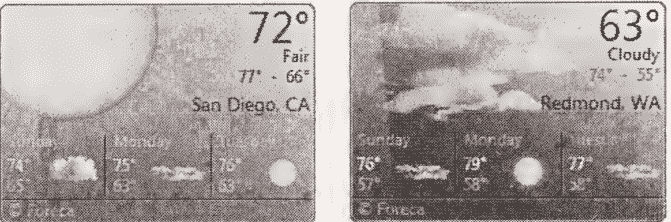
**FIGURE 2.8** 两个具有不同 WeatherCity 变量值的小工具实例。

Vista 侧边栏会为用户管理会话，即使你关闭侧边栏或重启计算机也是如此。

### 访问文件系统的 API

侧边栏提供了相应的 API，使开发者能够与文件系统通信并获取有关硬件、网络和计算机的信息。例如，Vista 操作系统自带的 CPU 仪表小工具和幻灯片放映小工具都是小工具使用这些 API 而非 ActiveX 控件的绝佳示例。

文件系统 API 包括：

- System.Shell
- System.Network

#### System.Shell 访问文件和文件夹

`System.Shell` 提供了对 Windows Vista shell 的访问，可对文件夹、文件、磁盘驱动器等进行高级访问。例如，要打开一个网页，你可以通过几种不同的方式调用 `System.Shell.execute` 并传入 URL。

例如，以下代码打开了一个指向网站 www.innovatewithgadgets.com 的网页浏览器：

```javascript
System.Shell.execute("http://www.innovatewithgadgets.com ");
```

另一个示例是从 `System.Shell` 对象获取图片文件夹（内置文件夹）的路径，代码如下：

```javascript
var myPicturePath = System.Shell.knownFolder ("Pictures");
```

`System.Shell.knownFolder` 方法接受以下字符串并返回对应的文件夹路径：

- Desktop
- Startup
- StartMenu
- Documents
- Programs
- CommonStartup
- CommonPrograms
- PublicDesktop
- PublicFavorites
- PublicDocuments
- System
- SystemX86
- Profile
- Windows
- Pictures
- Music
- Videos
- ProgramFiles
- ProgramFilesCommon
- ProgramFilesX86
- ProgramFilesCommonX86
- AdminTools
- CommonAdminTools
- PublicMusic
- PublicPictures
- PublicVideos
- UserProfiles
- Downloads
- PublicDownloads
- GadgetsUser
- RecycleBinFolder

上述方法及字符串列表提供了访问本地计算机上所有常用文件夹的快捷方式。在创建使用不同文件夹中文件的实用工具小工具时，这非常有用。

`System.Environment` 对象也可以用来读取路径，例如 `System.Environment.getEnvironmentVariable("Folder name")`。

`System.Shell` 进一步细分为以下对象，分别用于访问单项、文件夹、回收站和磁盘驱动器：

- System.Shell.Folder
- System.Shell.Item
- System.Shell.Recyclebin
- System.Shell.drive

#### System.Network

`System.Network` 对象用于确定网络连接状态。例如，要访问无线连接的信息，请使用以下 API：`System.Network.Wireless`。

### 与系统交互的核心功能

操作系统功能、硬件信息和 ActiveX 控件等由以下对象处理：

- System.Machine
- System.Environment

`System.Machine` 用于确定计算机的处理器和内存特性。例如，如果你想查看计算机的可用内存，可以在 JavaScript 代码中尝试使用 `availableMemory` 属性，如下所示：

```javascript
VariableforMemory = System.Machine.availableMemory;
```

`System.Environment` 用于确定有关系统和已登录用户的信息。此信息通过 `getEnvironmentVariable` 方法访问。例如：

```javascript
var tempValue = System.Environment.getEnvironmentVariable("Temp");
```

将返回用户 Rajesh 的临时文件夹路径，即 `C:\Users\Rajesh\AppData\Local\Temp` 文件夹（假设登录用户为 Rajesh）。

以下两个 API 用于访问有关计算机硬件和不同 CPU 的信息：

- System.Machine
- System.Machine.CPU

要检测有关电源的信息（在计算机使用电池供电时特别有用），需使用 `System.Machine` API 的 `PowerStatus` 方法：

- System.Machine.PowerStatus

要访问系统的音频和时间信息，可使用以下 API：

- System.Sound
- System.Time
- System.Time.TimeZone

### 通信及其他 API

Gadget 对象模型还支持一组通信 API，包括：

- System.Contact
- System.MessageStore


 System.Contact 及相关对象可访问本地计算机“联系人”数据库中存储的通讯录。它会返回包含所有联系人信息的集合对象。

以下这组 API 允许小工具访问 Windows Contact 数据存储中的信息：

- System.Contact
- System.ContactManager

System.MessageStore 可访问文件夹集合，这些集合存储本地计算机中的电子邮件。

以下是有助于在 Windows Mail 中访问邮件和其他消息的有用 API：

- System.MessageStore
- System.MessageStoreFolder
- System.MessageStoreMessage

### 其他杂项对象

以下两个对象与小工具的调试和跟踪信息相关。此对象可为小工具提供诊断功能：

- System.debug
- System.Diagnostic.EventLog

这些对象还有助于诊断小工具开发过程中的任何错误。

### Sidebar 图形协议

Sidebar 小工具还支持一组用于在小工具中呈现的对象。它们也被称为*图形协议*，能够轻松访问小工具 HTML 页面内的图形。

Sidebar 有三种用于图像处理的特定协议：

- gBackground—背景元素/对象
- gImage—图像对象
- gText—文本对象

这些方法让你可以直接访问大量图像处理功能。

这些小工具专用协议是非常出色的工具，在以下功能的小工具设计中提供了更好的灵活性：

- 动态生成缩略图
- Alpha 透明度
- 处理图像
- 在透明区域上放置文本和图像
- 背景图像

例如，可以使用 addShadow 方法为与 gBackground 协议一起使用的图像添加阴影。

```
<g:background id="imageBG" src="images\background.png" />
imageBG.addShadow("black", 40, 40, 0, 0);
```

这会添加一个半径为 40、Alpha 透明度值为 40 的阴影。

有关 addshadow 和其他方法的更多信息，可以在 MSDN 的 http://msdn2.microsoft.com/en-us/library/aa359356(VS.85).aspx 找到。

这些协议可以轻松应用于小工具中使用的图像上的特殊滤镜，例如阴影、发光、亮度等，而无需进行任何实际的图形处理。附录 A 通过示例小工具 GraphicDemo.gadget 进一步详细介绍了这些小工具协议。

## Sidebar 小工具：未来之路

小工具会留在这里，还是只是一个阶段？我应该对小工具开发感兴趣吗？Sidebar 小工具的未来是什么？有这么多不同的小工具和小组件引擎可用，我应该使用哪一个？我应该学习所有引擎吗？如果有的话，小工具开发的未来会是什么？每当一项新技术或平台出现在市场上时，这些问题总是会浮现在脑海中。

事实是，Sidebar 小工具将继续存在。微软预计在未来两年内 Vista 操作系统的销量约为 2 亿台。尽管普及速度比微软希望的要慢，而且尽管成功推出新操作系统总是存在问题，但人们已经开始大量使用 Windows Vista。

小工具已经是最酷的新工具。用户发现小工具是高效的省时应用程序。Live Gallery (http://gallery.live.com) 中已经有数千个有用的 Sidebar 小工具，而且数量每天都在增长。从此只会越来越好。

趣味小工具和实用小工具目前非常受欢迎，但用户正在意识到小工具在商务环境中的潜力。未来，很容易想象小工具与 Microsoft SharePoint 通信，为你提供库存管理系统中的常规销售更新。你会看到小工具操作与 Microsoft BizTalk 和 Microsoft Dynamics 相同的数据。你可以看到小工具与任务跟踪系统交互，从数据库中拉取数据，让你随时掌握网络信息。

小工具平台充满了未来创新和产品潜力。

### W3C Widgets 1.0

就在我输入这些内容时，万维网联盟 (W3C) 正在致力于标准化小组件，定义为

> "……用于显示和更新远程数据的小型客户端应用程序，以允许在客户端计算机上进行单次下载和安装的方式进行打包。该小组件可能在典型的 Web 浏览器界面之外执行。示例包括时钟、股票行情收录器、新闻播报器、游戏和天气预报器。一些现有的行业解决方案名称包括'小组件'、'小工具'或'模块'。"

尽管微软没有直接与 W3C 合作，但大多数 Microsoft Sidebar 小工具设计都符合 Widgets 1.0 标准中定义的标准。

工作草案可以在 http://www.w3.org/TR/widgets/ 找到。

W3C 于 2007 年 10 月发布了基于标准规范的工作草案，包括以下标准：

- Atom Auto discovery
- CSS 2.1 Specification
- Dashboard Reference, Apple Computer, Inc.
- HTML 4.01 Specifications
- Internationalized Resource Identifiers (IRIs)
- XHTML 1.0
- ZIP File Format Specification

该草案描述了小组件打包、小组件配置文件、小组件脚本接口、小组件自动发现和安全模型的可能标准化。

大多数 Windows Vista Sidebar 小工具规范都遵循相同的思路，因此最终我们可能会看到更标准化的 Sidebar 小工具。

# 第三章

## 设计方法

> "你知道你已经达到了设计的完美，不是当你没有什么可以再添加的时候，而是当你没有什么可以再删减的时候。"
>
> ——安托万·德·圣-埃克苏佩里

#### 设计考量

本章讨论小工具设计和用户界面。设计始于决定你要开发的小工具类型、它将显示的信息、用户界面、使用模式以及小工具行为的因素。

设计包括尺寸、图像、文本和"外观和感觉"。你还要决定小工具如何与用户交互，以及它如何与系统交互。本章讨论视觉主题、小工具如何看起来像 Windows Vista 的一部分，以及整体用户体验。

在开始之前，请记住以下两点：

- **证明空间的合理性**—Windows Vista Sidebar 既不太高也不太宽。它在任何时候最多只能容纳五到六个小工具。成千上万其他可在网上免费获得的小工具将争夺相同的屏幕空间。因此，提供用户急需的功能集是一个重要因素。准备好说服用户，你的小工具证明了其占用空间的合理性。

- **确保整体质量**—如果用户在整个小工具中体验不到质量，他们可能会得出结论认为到处都缺乏质量。这意味着你需要关注图标、图像、文本、背景和交互的质量。这些元素中的每一个都同等重要。一个好的想法和出色的实现配上平庸的用户界面无法经受竞争的考验（见图 3.1）。

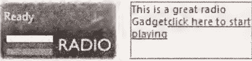

**图 3.1** 两个执行相同功能的小工具，一个具有漂亮的界面，另一个则简单朴素。你会更喜欢哪一个？

在设计小工具之前，请考虑以下四个因素（见图 3.2）：

- 信息优先
- 正确的用户界面
- 小工具的使用模式
- 小工具的行为

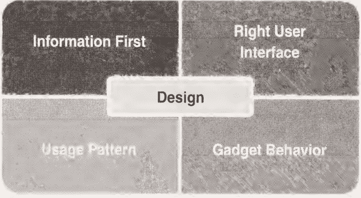

**图 3.2** 小工具的设计是开发的重要方面。

#### 将信息放在首位

小工具是为了单一任务而设计的。在设计小工具时，请记住小工具应该有一组与特定任务相关的小目标。小工具应该只显示适合该任务且仅适合该任务的数据。小工具窗口中的信息应满足以下规则：

- 实时数据
- 供快速访问的信息
- 用户的选择
- 供进一步操作的简要信息

让我们更仔细地看看这些究竟意味着什么。


##### 实时数据

小工具应仅显示定期变化的信息，例如实时动态、新闻更新、每日天气、电池状态等。信息如果超过一天不更新，就会让小工具变得乏味。

用户希望在小工具中看到活跃且有趣的内容。趣味类小工具可以例外，但如果能加入实时数据会更具吸引力。例如，在侧边栏中放置一款热门游戏的简化版本固然不错，但如果能加入定期更新的排行榜或游戏的实时动态，则效果更佳。如果无法实现，添加更换小工具壁纸（背景图片）的功能也是一个不错的选择。

##### 便捷的信息访问

小工具特别适合展示那些用户无需启动应用程序或打开网页就能查看的信息。典型例子包括股票行情、事件日历、交通地图、当地燃油价格等。任何能为用户节省时间的信息，都让小工具所占用的空间物有所值。

##### 与用户个人相关的信息

小工具的核心在于用户的选择与偏好。如果某家报纸的填字游戏拥有大量用户，那么基于该主题的小工具很可能会立即受到他们的欢迎。个性化定制的小工具非常受欢迎，例如用于 Flickr 网站的小工具可以展示用户自己分享的相片，或用户最喜爱的博客订阅源。

##### 支持进一步决策的信息

小工具应展示足够的信息，以便用户决定后续操作。例如，网站统计小工具不应展示与网站使用相关的每一个细节，而应展示一周或一天的统计数据，让用户自行决定下一步行动。

#### 案例研究：Soapbox 视频小工具

假设你想创建一个视频小工具（见图 3.3）。任务是为 http://soapbox.msn.com 的视频订阅源创建一个小工具，目标是实现以下内容：

- 以简洁且美观的方式列出 soapbox.msn.com 上频繁更新的视频
- 在浮出面板（flyout）中播放视频

视频订阅源通常包含视频的缩略图、评论和用户评分。具备这些目标的小工具为你提供了以下设计决策选项：

- 为每个视频提供缩略图和评分
- 添加按类别浏览视频的功能
- 支持按关键词搜索视频的功能
- 视频大小调整选项，支持 Windows Media Player 和 Flash Player
- 支持分页式便捷访问视频列表

图 3.3 展示了包含所有这些选项的 Soapbox 视频小工具的预览。有关该小工具的更多信息，请访问 http://www.codeproject.com/KB/gadgets/SoapBoxGadget.aspx。

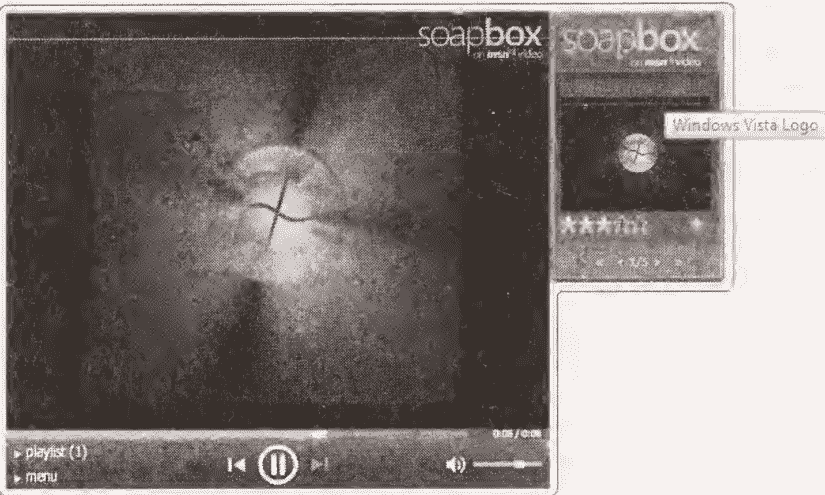

**图 3.3** 这款功能完善的小工具可让用户快速访问 Soapbox 视频。

尝试通过提供与特定任务相关的完整功能集来让你的小工具功能丰富（见图 3.4）。像用户一样思考。如果小工具展示的是视频列表，那么它还应该对视频进行分类，并让用户轻松访问视频订阅源中的所有项目。

提供完整的功能集并不意味着小工具应该做遍 Soapbox 视频网站上的所有事情。网站上的视频分享和评论功能可能不需要包含在小工具中。这里的完整功能是指小工具应能访问视频订阅源中的所有信息，这是小工具的输入。用户应该能够筛选视频、对视频进行排序、按关键词搜索，并以他们想要的方式播放视频。在第 11 章中，我们将介绍如何使用 YouTube 视频反馈创建视频小工具。

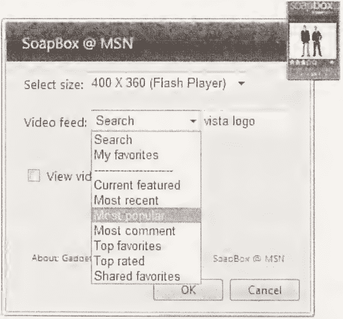

**图 3.4** 这款小工具能够对 MSN Soapbox 视频进行分类，让用户轻松找到自己想观看的视频。

参考小工具开发指南的 checklist，并将其与该小工具进行对比。该小工具展示了哪些实时信息？

- 频繁更新的 soapbox 订阅源。
- 当前精选视频。
- 最近更新的视频。

该小工具是否提供了对其所提供信息的快捷访问？

- 点击缩略图即可在浮出面板中播放视频。
- 支持浏览视频列表。

该小工具是否给了用户选择权？

- 设置页面提供了自定义视频列表的选项。
- 用户可以选择媒体播放器和视频大小。

该小工具提供的信息是否有助于用户决定下一步行动？

- 小工具在主窗口中提供了视频的评分、缩略图和标题，供用户决定是否观看。
- 小工具提供了“上一页”和“下一页”选项，用于浏览订阅源中的视频。

### 构建合适的用户界面

小工具是一种视觉体验，合适的用户界面至关重要。以下是创建用户界面的四个要点：

- 保持小工具简洁且美观。
- 仅展示相关信息。
- 尽可能使用图标、图片等视觉元素，而非文字。
- 确保小工具不要过于突兀。

#### 简洁与美观

小工具应该看起来简洁且美观。请看图 3.5 中提供的小工具示例。

显然，第一组对象都比那个令人讨厌的时钟和难以辨认的便签更简洁、更美观。如果小工具要成为桌面的一部分，用户每天都会看到它；务必确保它清晰且美观。颜色和字体的选择也会产生很大影响。

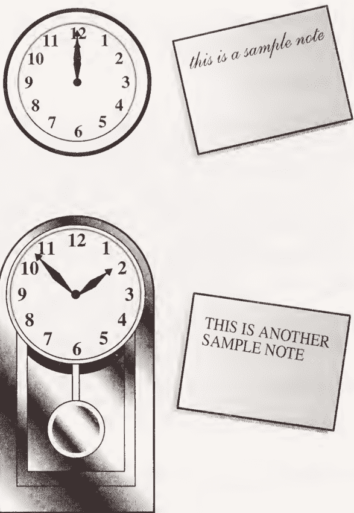

**图 3.5** 选择清晰的图片和美观的字体，对小工具设计的提升大有裨益。

#### 仅展示相关信息

小工具的最大宽度为 130 像素。可用空间非常有限，尤其是当你想传达大量信息时。但这并非不可能做到。看看图 3.6 中所示的 RSS 订阅源小工具和日历小工具。

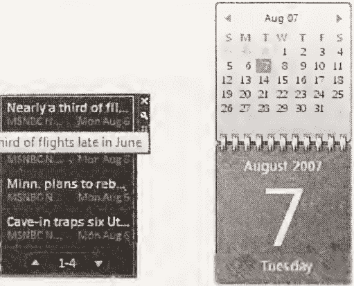

**图 3.6** RSS 订阅源小工具在窗口中部分显示标题，完整标题以工具提示（tooltip）形式展示。

那么，究竟是什么让这些设计精良的小工具脱颖而出呢？首先，标题长度通常应控制在空间允许的范围内。对于某些小工具，比如这个 RSS 新闻订阅器，这难以做到。但在这种情况下，工具提示被有效地加以利用。此外，虽然本书中的黑白照片无法清晰展示，但这些字体采用了不同的颜色来突出标题。

RSS 阅读器小工具没有试图承载过多功能。它一次仅显示四条记录，而日历小工具则根据用户选择仅显示当前月份或当前日期。

图 3.7 展示了另外两个小工具，它们被设计用于实现相同的目标，但设计却极其糟糕。

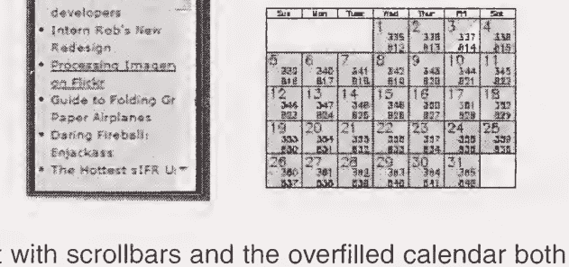

**图 3.7** 带有滚动条的小工具和过度填充的日历都试图在狭小空间中塞进太多信息。

小工具中出现滚动条是不可接受的。使用分页要好得多，因为滚动条会进一步缩小本已有限的小工具空间。提供分页功能，通过“上一页”和“下一页”选项及页码来浏览多个项目，可以消除小工具屏幕上的杂乱感。博客小工具和日历小工具都在狭小空间中塞入了过多信息。在设计自己的小工具时，应努力避免这类设计失误。

#### 善用视觉元素

尽可能多地使用图标、图片和符号；它们提供了功能性的视觉线索（见图 3.8）。例如，天气小工具可以用云、太阳和雨的图片来替代相应的文字，以展示不同的天气状况。恰当使用图片让小工具更加用户友好。

图 3.8 比较了两个小工具。两者展示相同的信息，设计不同。然而，顶行的设计采用了视觉元素，为用户提供了丰富的体验。在设计小工具时，请检查以下几点：

- 小工具中展示的任何信息是否可以用视觉元素替代？
- 小工具是否过于朴素，或缺乏设计感？

视觉主题将在后续章节中更详细地介绍。


##### 良好的设计

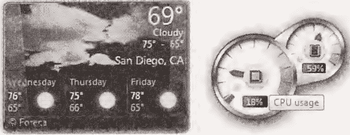

##### 糟糕的设计

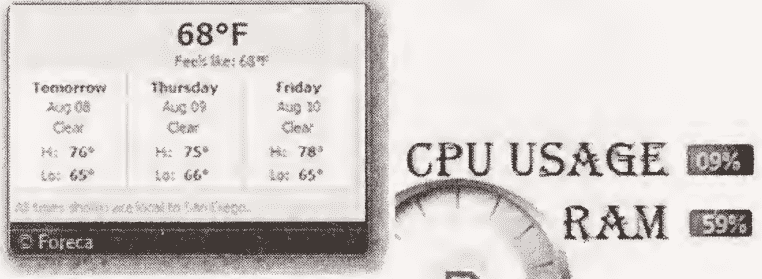

图 3.8 天气小工具中的云朵和太阳图片描绘了天气情况。以 CPU 仪表盘形式呈现的计算机使用情况比纯文本更加直观。

##### 不过于突兀

小工具的设计不应过于突兀。应尽量避免使用按钮和用户控件。例如，使用"上一张"和"下一张"按钮会让小工具显得难看。相反，应使用恰当的图片，并在鼠标移过小工具时显示它们。

图 3.9 比较了两种不同设计的图片幻灯片小工具。下方的小工具显示了浏览上一张或下一张图片的按钮。这些按钮对于良好的设计来说过于突兀。上方的图片是良好设计的示例。小工具的默认视图（左上）没有任何"上一张"或"下一张"按钮。当鼠标移过小工具时，会显示上一张和下一张图片。

图片幻灯片小工具在鼠标悬停时显示操作按钮（图片）。良好的鼠标悬停效果（参见图 3.9 右上角的图片）配合适当的视觉效果，构成了良好的设计。请注意，这些不是按钮，而是与小工具主题相协调的图片。

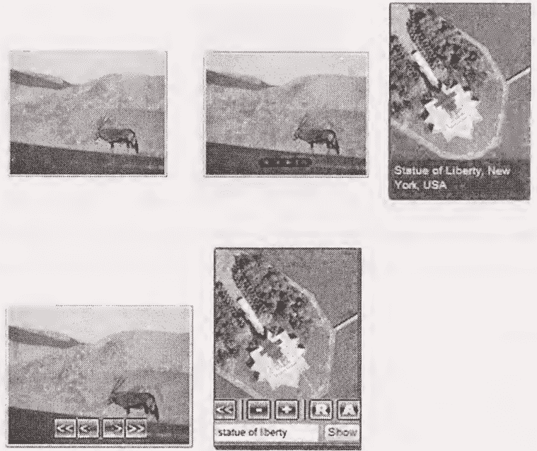

图 3.9 始终可见的"上一张"和"下一张"按钮用于在图片幻灯片小工具中浏览图片（下方图片），但对于小空间来说它们过于突兀。

### 使用模式

你想要创建的小工具类型也会对其设计产生影响。如前所述，有四大类：

- 信息型小工具
- 应用程序型小工具
- 实用型小工具
- 娱乐型小工具

这些分类都有共同的用户界面准则，但每一类都有其特定的设计模式，需要在开发过程中加以考虑。

#### 信息型小工具

信息型小工具从多个来源收集数据，具有时效性。信息型小工具通常使用包含 10 个或更多项目的 RSS 源。要在小工具中全部显示它们，应提供页码和上一页/下一页选项。使用此类选项也被称为*分页*。这些小工具会定期刷新数据，因此它们在视觉上不应具有干扰性或过于突兀（见图 3.10）。如前所述，不应有滚动条。

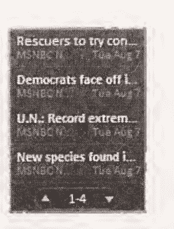

图 3.10 这个 RSS 阅读器小工具示例具有 1–4 的分页选项，没有干扰性的图片。这反映了良好的小工具设计。

#### 应用程序型小工具

这些小工具依赖其他应用程序或产品获取数据，作为副产品或数据可视化的快速工具。设计这些小工具时应考虑主要产品或应用程序。视觉主题应与原始应用程序保持一致（见图 3.11）。

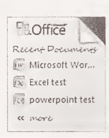

图 3.11 应用程序型小工具模仿原始应用程序的用户界面。

这是 Microsoft Office 最近文档小工具的示例。该小工具显示最近使用的 Microsoft Office 文档。相应的 Microsoft Office 标志以及 Microsoft Word、Excel 和 PowerPoint 的图标使小工具看起来丰富且悦目。

> **注意**

请注意，图 3.11 所示的小工具由 Microsoft 开发，它使用的图标和图片受 Microsoft 版权保护，未经许可不得在公开发布的小工具中使用。请查阅 https://www.microsoft.com/about/legal/permissions/default.mspx 中的"Microsoft 版权内容的使用"。

#### 实用型小工具

实用型小工具提供快速信息或常用工具和功能的快捷方式。实用型小工具中不应有花哨的装饰。尺寸应适当：它应该是所有其他类型小工具中最小的，并应与其提供的功能相匹配（见图 3.12）。

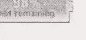

图 3.12 电池监控小工具以适当的尺寸显示剩余百分比和时间。

此示例显示了一个指示移动 PC 剩余电池电量的实用型小工具。它提供的信息是剩余电池百分比和剩余时间。背景是一块电池的图片，其中百分比部分填充了颜色。这是一个良好的设计。没有花哨的装饰，但尺寸适当，设计直观。

#### 娱乐型小工具

娱乐型小工具比其他类型的小工具更容易分散注意力。因此，用户可能会更频繁地更换它们。它们的目的是娱乐用户或为用户提供一些有趣的活动。如果你要制作娱乐型小工具，必须对目标用户有深入的了解，并且小工具应具有一些动态功能，以保持用户较长时间的兴趣。它在视觉上也应令人愉悦（见图 3.13）。

视觉愉悦的体验来自颜色的恰当使用以及整洁清晰的图片。请记住以下快速提示：

- 不要使用太多颜色；尽量坚持两到三种颜色。
- 不要在小工具窗口中使用超过一种亮色。
- 检查良好的对比色或同一颜色的不同色调。

> **提示**
> 要更好地了解不同的颜色和对比效果，请访问 http://www.colorsontheweb.com/。

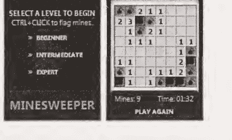

图 3.13 这款扫雷小工具具有视觉愉悦的界面。

此处所示的示例是一款扫雷小工具。它仅使用了几种颜色：灰色、黑色和红色。它很好地利用了红色和黑色之间的对比，颜色也反映了游戏的个性。

### 小工具不适用于什么

到目前为止，我们已经讨论了不同的使用模式以及小工具的用途。本节将告诉你小工具不适用于什么。在设计小工具时请牢记以下规则：

- 小工具不应用作完整应用程序（如电子邮件或即时通讯）的替代品。
- 小工具不应设计为对时间敏感的应用程序。
- 小工具不应包含直接广告。

小工具不用于通知目的。新邮件或即时消息的通知不应是小工具的功能。即时通讯和邮件通知等应用程序需要更强大的应用程序，如 MSN Messenger 和 Microsoft Outlook。小工具是轻量级的，旨在补充这些应用程序，而不是与它们竞争。

小工具也不适用于需要立即关注的通知应用程序，因为小工具不是在用户桌面上运行的可执行文件。它们位于侧边栏中，用户可能已经关闭或隐藏了侧边栏以避免干扰。小工具不应是关键应用程序。

小工具可以用于广告目的，但不应包含横幅广告或文字广告。小工具的小尺寸不允许这样做。查看下一章以了解小工具的商业模式详情。

### 小工具行为

行为与小工具和用户交互的方式有关。小工具在特定情况下的反应方式、小工具的用途以及不适用于什么——所有这些决定了小工具的行为。

你需要考虑以下几点以确保适当的小工具行为：

- 小工具配置
- 刷新小工具
- 错误、信息和警告
- 服务不可用信息

#### 小工具配置

大多数小工具都有一个可选的设置页面，可用于配置小工具。你可以通过右键上下文菜单中的选项菜单访问它，或点击小工具右上角的设置图标（见图 3.14）。

小工具配置是用户自定义小工具的唯一选项。它是每个小工具实例的单一管理页面。设置页面中的任何配置更改仅应用于该小工具实例。请明智地选择用户可以更改的内容


#### 刷新小工具

如果你的小工具显示实时数据，你可能需要定期或在用户要求时刷新它。请记住，如果用户的网络连接较慢，小工具重新加载可能需要一些时间。建议在等待屏幕上使用加载图像，并显示消息`Getting data...`或`loading...`（见图3.15）。

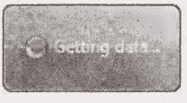

**图 3.15** 天气小工具显示"Getting Data"屏幕，以及Vista忙碌光标（左图）来显示状态。

#### 错误、信息和警告

小工具有时需要向用户显示状态。例如，RSS订阅小工具需要在订阅源不可用时告知用户，或者在没有网络连接从远程服务器获取数据时进行提示。这些消息也可以是自定义错误消息、警告或其他信息。所有这些状态消息都应以*内联文本*形式显示，并使用标准的16×16图标来表示消息类型，如图3.16所示。小工具中不允许使用弹出对话框。

图 3.16 错误、信息和警告的标准图标需要用于对应的状态。

小工具是一个包含脚本的HTML文件，因此请确保你已处理了小工具中所有可能的错误。如果出现意外错误或警告，请按图3.15所示的"Getting Data"屏幕相同的方式显示，或显示"Service Not Available"屏幕。如果小工具内部的错误未得到适当处理，将显示默认运行时错误消息以及行号。

JavaScript错误消息（如图3.17所示）令人烦恼。出现一次这样的消息，用户就会对小工具失去信心，毫不犹豫地移除甚至卸载它。良好的做法是将每个JavaScript函数封装在错误处理程序中，即try-catch块。

图 3.17 典型的JavaScript错误消息，像这样，对最终用户来说太模糊而无用。

try-catch块是一段代码，确保如果在try块中发生任何错误，则执行catch块。以下是JavaScript中的示例。该代码确保用户不会看到默认的JavaScript错误对话框：

```
try
{
    // your script code here
}
catch (e)
{
    //set and display your inline error message and icon here
}
```

#### 服务不可用信息

"Service Not Available"是在大多数常见场景中使用的默认屏幕。在适当的情况下使用"Service Not Available"屏幕。例如，如果小工具在移动笔记本电脑上，而笔记本电脑与网络断开连接，则显示带有信息图标的屏幕，如图3.18所示。

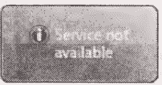

图 3.18 当没有网络连接时，天气小工具显示"Service Not Available"屏幕，并带有信息图标。

示例代码如下所示：

```
if (CheckInternetConnection)
{
  // your functionality code here
}
else
{
  //set and display your inline "Service not available" message and icon here
}
```

### 用户界面的挑战

小工具看起来很简单，但开发一个功能丰富且有效的小工具需要的不仅仅是HTML和JavaScript代码。小工具的设计几乎总是决定了小工具的命运。因此，在开发小工具时，需要记住的一个重要因素是尺寸限制。

到目前为止，我们是以系统化的方式来处理小工具设计的。如果你优先考虑信息并考虑使用模式，你就可以开发出良好的用户界面并确保小工具的行为。现在是时候给小工具设定边界了。请注意，我说的*边界*是指小工具所有界面的实际尺寸。

小工具不应被视为网页。例如，图3.19中的星座小工具超出了侧边栏的宽度，并有滚动条。这不是一个好的设计。小工具窗口的大小不应大于停靠时的侧边栏。只有在非停靠模式下，较大的尺寸才是可取的。

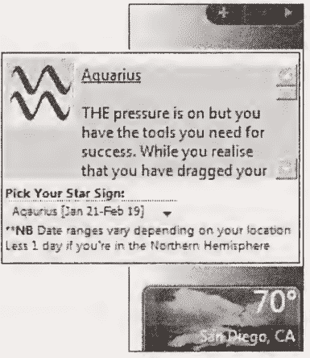

图 3.19 宽度大于侧边栏的星座小工具在桌面上看起来很笨重。

在设计特定类型的小工具时，了解要使用的标准尺寸对于你在小工具开发中取得成功至关重要。

#### 标准尺寸

小工具中的所有界面都是HTML页面，每个页面都有推荐和允许的尺寸。这些尺寸在相应的CSS文件中设置。对于你可能使用的不同类型的页面，有不同的推荐尺寸。这些页面类型包括

- 停靠时的小工具页面
- 未停靠的小工具
- 设置页面
- 弹出页面

每种类型在以下部分有更详细的说明。表3.1总结了每种页面类型的推荐和最大尺寸。这些尺寸是微软推荐的。有关指南的更多信息，请访问http://msdn2.microsoft.com/en-us/library/aa511443.aspx。

| 表 3.1 每种页面类型的最大尺寸 |
| :--- | :--- | :--- | :--- |
| 页面类型 | 推荐宽×高 | 最大宽×高 | 最小宽×高 |
| 停靠时的小工具主页面 | 130像素×150像素（5像素透明边框（左侧2/右侧3）） | 130×200 | 130像素×57像素 |
| 未停靠时的小工具页面（浮动） | 250像素×180像素 | 400像素×400像素 | 130像素×57像素 |
| 设置页面 | 280像素×180像素 | 300像素×400像素 | 可变 |
| 弹出页面 | 320像素×240像素 | 400像素×400像素 | 可变 |

#### 停靠时的小工具页面

停靠时的小工具宽度不应超过130像素。侧边栏宽度为150像素。用于小工具背景的图片需要在左侧留有2像素、右侧留有3像素，以实现小工具的阴影效果。这5像素有时也保持透明（见图3.20）。

小工具的最小高度为57像素，以容纳右上角的"设置"和"拖动"图标。停靠小工具的最大高度为200像素。请记住，有效利用空间的小工具更有可能被使用。

停靠小工具的推荐尺寸为130×150像素。

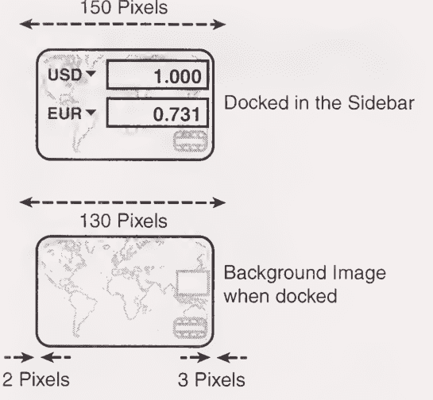

图 3.20 货币小工具的停靠尺寸为130像素宽、83像素高。

#### 未停靠的小工具

未停靠小工具的尺寸应根据小工具的功能而有所不同。如果小工具在未停靠时需要更多空间来显示更多信息，则尺寸会相应变化。最大尺寸为400×400像素，推荐尺寸为250×180（见图3.21）。


图 3.21 货币小工具的未停靠尺寸为254×196像素。

### 设置页面

设置页面的大小（如图3.22所示）取决于提供给用户的自定义程度。例如，天气小工具只需要有城市和温度单位的选项。设置页面的最大允许尺寸为300×400。推荐尺寸为278×180。

#### 弹出页面

弹出窗口用于额外信息，是可选的。弹出页面允许的最大尺寸为400×400像素。推荐尺寸为320×240。


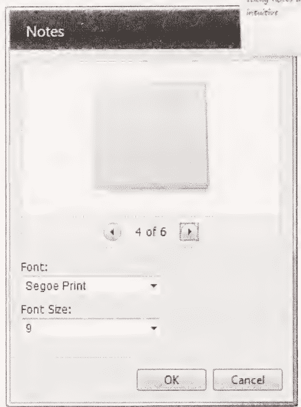

图 3.22 小工具的设置页面尺寸为 278×310。

### 其他界面指南

以下是需要考虑的其他界面指南列表：

-   对文本、光标、图标等使用 Windows 风格。因为小工具运行在 Vista 操作系统中，所以使用的图像、文本和图标应与 Vista 主题保持一致。
-   小工具在停靠和未停靠状态下应使用相似的样式。字体、颜色和大小的使用在停靠和未停靠状态之间不应有太大差异。
-   小工具应具有自解释性，无需帮助文件。小工具是轻量级应用程序，应易于理解和使用。
-   安装后，小工具应立即开始工作。初始配置会让小工具显得笨重。小工具应提供可正常工作的默认设置。例如，天气小工具安装后会立即显示默认城市的天气。用户可以稍后对其进行自定义。安装后立即要求用户进行配置不符合惯例，应避免。
-   提供调整小工具在停靠状态下大小的功能在优秀设计中至关重要。在停靠状态下提供必要的迷你版本的小工具，会立即成为用户的最爱。
-   弹出窗口应用于显示附加信息，但请记住，当焦点在其他任何窗口时，它们会自动隐藏。弹出窗口不能用于显示实时数据更新。

#### 视觉主题

视觉主题决定了小工具的外观和风格。视觉主题涉及图像、文本、字体、颜色、大小和样式——所有这些的结合。它关乎用户看到的一切，也关乎他们看不到的一切。它们共同作用，为用户呈现统一的主题。以下是为小工具开发主题时需要考虑的项目列表：

-   标题
-   图标
-   拖动图像
-   背景图像
-   控件
-   文本和样式

小工具的视觉主题从其图标和标题开始，它们在安装后出现在小工具选择器窗口中。

##### 标题

小工具的标题应保持为两到三个有意义的单词，最多 15 个字母，以便在小工具选择器中正确显示。例如，对于 Google 搜索小工具，使用标题 "Google Search" 而不是 "Google.com Search bar." 图 3.23 显示了小工具选择器窗口中的两个小工具。第一个名称为 "Currency"，第二个名称为 "MyMoneyGadget"，显示为 "MyMoneyGad...." 您可以通过保持标题简短来避免这种不理想的结果。

##### 图标

透明图标能提供丰富的外观。icon.png 是一个尺寸为 64×64 的图像文件。图 3.23 显示了两个比较世界不同货币的小工具版本。左侧图像使用了有意义的标题和有吸引力的图标。右侧图像，MyMoneyGadget，不是有意义的标题，且图标非常粗糙。这不是一个好的设计。

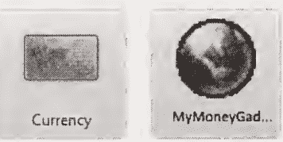

> 图 3.23 为避免一开始就吓跑潜在用户，小工具应具有有吸引力的图标和简短的标题。

##### 拖动图像

拖动图像是当您尝试将图像从选择器窗口拖动到 Vista 侧边栏时出现的。拖动图像的源文件是 `drag.png`。它旨在显示实际工作小工具在停靠尺寸下的截图（参见图 3.24）。

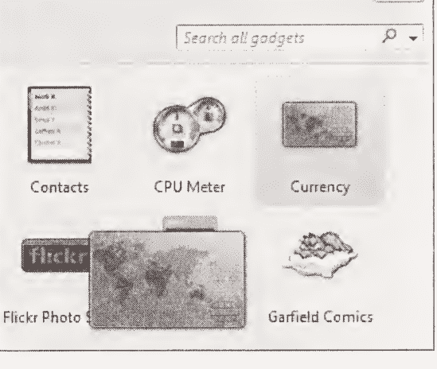

**图 3.24** 当在选择器窗口中拖动时钟小工具时，它会显示 `drag.png` 图像。

##### 背景图像

小工具的背景图像是小工具的壁纸。它通常是一个带有圆角的纯色图像。图像根据小工具的功能进行选择。例如，对于货币小工具，世界地图的图像是合适的（参见图 3.25）。小工具的不同模式（如停靠和未停靠）使用不同的图像。用于不同尺寸的小工具的图像也可以不同。


**图 3.25** 货币小工具使用不同的图像来显示不同尺寸的小工具背景。

当小工具停靠时，图像应在左侧有 2 像素、右侧有 3 像素的阴影。当图像未停靠时，阴影应更明显——左侧 10 像素，右侧 18 像素。

您可以使用图像编辑软件或 Vista 小工具模型提供的图形协议为图像添加阴影。对于停靠图像的两到三像素阴影，可以使用不透明度为 25% 的黑色阴影；对于未停靠小工具图像的 10 像素阴影，可以使用不透明度为 75% 的值。

##### 控件

对于需要出现在小工具上的任何控件或操作按钮，只能使用与 Windows 一致的图形图像。图 3.26 显示了其中一些图形及其可能代表的操作。如果操作按钮需要在小工具主窗口中显示，请始终尝试将它们默认隐藏，仅在鼠标悬停或小工具处于活动状态时激活。所有这些图形图像都可以在本书下载部分的“附加内容”中找到。


图 3.26 应使用与 Windows Vista 用户界面一致的图形图像。

图 3.27 显示了一个具有控件的小工具示例，这些控件在用户将鼠标悬停在小工具上之前是隐藏的。


图 3.27 便笺小工具默认（左侧图像）不显示操作按钮。当鼠标移动到便笺小工具上时（右侧图像），操作按钮可见。

##### 文本和样式

设计小工具时，用于格式化小工具内文本的字体和样式也非常重要。样式表是用于描述 HTML 页面呈现方式的语言。小工具可以对小工具窗口的不同页面（如设置页面和弹出窗口页面）使用多个样式表。您应该使用的样式表和字体取决于小工具的功能和主题，并且可能因不同的小工具而异。以下是可以帮助您进一步理解 HTML 和 CSS 的链接：http://www.w3.org/Style/Examples/011/firstcss。

以下是应用于不同页面的一些标准样式信息。这些样式有助于小工具与 Windows Vista 保持一致的外观。

###### 对于小工具窗口：

字体：Calibri 或 Segoe UI

```
Style:
body
{
    margin: 0px;
    padding: 0px;
    color: #000;
    font-family: Calibri, Tahoma, sans-serif;
}
```

###### 对于设置窗口：

字体：Segoe UI

```
Style:
body
{
    padding: 0;
    margin: 0px;
    font-family: Segoe UI, Tahoma, sans-serif;
    font-size:12px;
}
```

###### 对于弹出窗口：

字体：Calibri

```
Style:
body
{
    margin: 0px;
    padding: 0px;
    color: #ffffff;
    font-size: 10px;
    font-family: Calibri, Tahoma, sans-serif;
}
```

**注意**

这些只是合适的样式表信息的建议。用户应根据小工具提供的功能集进行更改。例如，图 3.27 所示的便笺小工具使用斜体字体。

#### 小工具中的透明图像

小工具窗口中使用的图像具有阴影效果，有时还有半透明的椭圆形。这些图像使用 PNG 或 GIF 图像格式。推荐小工具使用 PNG 格式的图像。接下来的几节将更详细地描述这些格式。

##### Alpha 透明度

Microsoft 从 Windows Vista 开始支持具有 alpha 透明度的 PNG 图标。创建 alpha 透明图像是组合两个图像的过程：将一个中心图像放置在背景图像之上，以创建部分透明的外观。它用于显示具有透明或半透明像素的图像。

Alpha 透明度在用于小工具的图像中被广泛使用，以创建阴影或椭圆形效果。

##### 便携式网络图形文件

PNG 是 Portable Network Graphics 的缩写。它是一种具有 48 位颜色的高级图形格式。它是开始取代 GIF 图像使用的标准格式之一，而 GIF 仅限于 8 位颜色（256 种颜色）。它还包括一个用于显示透明度的 alpha 通道。

这是小工具中所有图像使用的标准格式。PNG 文件允许每个像素（点）具有任何级别的透明度，从完全不透明到完全透明以及介于两者之间的任何程度。

PNG 图像格式结合了 GIF 和 JPG/JPEG 的最佳功能。它支持二进制透明度和 alpha 透明度，这意味着图像的每个像素也可以具有 256 种不同透明度级别中的任何一种。假设它们具有相同数量的颜色，PNG 格式生成的文件大小与等效的 GIF 图像大致相同。附录 A 展示了如何在 Adobe Photoshop 中创建 PNG 图像。

##### GIF 文件限制

图形交换格式是由 CompuServe 开发的一种流行的位图图形文件格式。迄今为止，它是网络上使用最广泛的图形格式。考虑到 GIF 文件也可以是透明的，您可能会想知道为什么不想使用它们而倾向于 PNG。不使用 GIF 格式有三个原因：


+   - GIF 文件仅支持 100% 透明；无法创建半透明阴影效果。
- GIF 图像仅限于 8 位颜色，因此色彩不够丰富。
- PNG 格式由万维网联盟（W3C）推荐，该组织负责管理万维网的标准。

### 关于辅助功能

辅助功能是一种让应用程序能够被最广泛人群访问的方式。这包括视力不佳、运动障碍等残疾人士，也包括喜欢使用键盘快速访问的用户、带宽有限的用户、使用较旧计算机的用户，以及使用纯文本浏览器、屏幕阅读器和其他设备访问应用程序的用户。要了解更多关于为应用程序添加辅助功能的信息，请访问 Microsoft 辅助功能开发中心：http://msdn2.microsoft.com/en-us/accessibility/default.aspx。

对于侧边栏小工具而言，辅助功能涉及主题颜色、高色彩对比度以及通用的 HTML 可访问性。为小工具添加辅助功能意味着在设计时注意以下几个方面：

+   - 键盘访问
- HTML 可访问性
- 主题颜色和对比度

#### 键盘访问

最基本的辅助功能场景之一是一些用户仅使用键盘。这也是高级用户的需求，他们喜欢使用键盘的速度，而非鼠标等点击设备。因此，具体来说，侧边栏和小工具本身应该可以通过键盘访问。

表 3.2 列出了侧边栏提供的键盘支持

**表 3.2 访问侧边栏小工具的快捷键**

| 键盘操作 | 操作 |
| :--- | :--- |
| Windows 徽标键 + 空格键 | 将所有小工具置于最前面，并将焦点置于 Windows 侧边栏上 |
| Windows 徽标键 + G | 在多个小工具之间循环切换 |

在您的 小工具获得焦点后，您必须确保其所有功能都可以通过键盘访问。以下列出添加辅助功能时需要牢记的要点：

+   - 小工具加载时应设置焦点。
- 用户应该能够使用 Tab 键在小工具中的控件和链接之间切换。
- 回车键应起到鼠标点击的作用，用于按下按钮或跟随链接，并应调用控件或链接的 onclick 事件。
- 应调用 onfocus 和 onfocusout 函数来模拟鼠标悬停效果。
- 除了小工具主页之外，小工具的弹出窗口和设置页面也应该可以通过键盘访问。

第 6 章"设计模式和标准实践"中的"关于辅助功能"部分将向您展示如何在小工具中实现这些功能。

#### 通用 HTML 可访问性

由于小工具中使用的所有页面（主小工具窗口、弹出窗口和设置页面）都是 HTML 页面，可访问性规则同样适用于它们。要遵守这些规则，您应注意以下几点：

+   - 为图像和链接提供替代文本。在图像中设置 ALT 标签，在锚点元素中设置 Title 标签。alt 文本以及 title 充当图像的简短描述，其目的与图像或链接本身相同。如果图像纯粹是装饰性的，则设置 alt=""。例如，如果小工具有一张天气图像，则设置 alt="多云" 或 alt = "部分晴朗"。反映图像传达的内容即可满足此要求。
- 以模块化的方式创建内容，使页面结构（HTML）、呈现（CSS）和行为（JavaScript 功能）分别位于不同的页面中，并且 HTML 页面在没有 CSS 文件的情况下也可以访问。

这些指南来自 W3C 的 Web 内容可访问性指南 2.0 倡议，可在以下网址找到：http://www.w3c.org/TR/WCAG20/。

#### 主题颜色和对比度

在为小工具添加辅助功能时，接下来需要考虑小工具中背景、图像、HTML 页面元素等使用的颜色。

+   - 选择对比鲜明的前景和背景颜色，使您的小工具信息更加清晰可见。这对于文本颜色与背景颜色尤为重要。对比度是亮度、色调和饱和度的函数。这里有一个来自 Lighthouse for the Blind 的资源链接，该机构是视力障碍方面的专家：http://www.lighthouse.org/accessibility/effective-color-contrast/。
- 避免使用红色和绿色的组合，因为红绿色盲患者无法区分红色和绿色。还有其他类型的色盲，但红绿色盲最为常见。
- 不要单独使用颜色来传达信息。

## 第 4 章
### 销售您的小工具

> "将服务作为您的首要任务，而不是成功，成功自会随之而来。"
—佚名

+   ### 本章内容
* 小工具盈利模式
* 小工具如何为您带来业务
* 支持您的小工具

### 小工具盈利模式

侧边栏小工具开发平台是新兴的，但它使用 HTML、CSS 和 JavaScript 等标准 Web 技术。这些技术在过去几年中已经成熟，并拥有庞大的开发者社区。侧边栏小工具的开发周期比常规软件短得多：开发迅速、部署简单、几乎无需维护。这使得 侧边栏小工具开发平台对开发者来说极具吸引力。这是一个充满创新机会的平台。这是一种提供快速信息和工具的新方式。

基于互联网的服务公司的盈利模式取决于一件事：流量。而 侧边栏小工具具有驱动流量的潜力。未来几年将有超过 1 亿的 Windows Vista 用户。如果您的小工具在其中 1% 的用户中受欢迎，想象一下您的小工具出现在 100 万用户的桌面上。对您网站的引用也将直接为他们引流至您的在线业务门户。如何利用这种新的交互方式以及这组来到您网站的新客户，取决于您自己和您的个人服务。

侧边栏小工具是一个迷你应用程序，兼具 Web 应用程序的简洁性和 Windows 应用程序的强大功能。它是一个小巧轻量的工具。侧边栏小工具不应被创建为一个完整的软件应用程序，无论是作为可下载产品销售，还是作为"先试用后购买"的工具。 侧边栏小工具的盈利模式最适合作免费服务，以驱动流量到您的网站，或作为更大应用程序的附属产品。

现在是否能从小工具中赚取数百万尚有争议，但潜力是存在的，而且可能性是无限的。您自己算算；假设您的小工具很受欢迎：

+   - 明年将有 1 亿 Windows Vista 用户（微软预测）。
- 1% 的用户使用受欢迎的小工具，意味着 100 万用户。
- 如果这 100 万用户中有 5% 成为客户，您就有 20,000 名潜在客户。
- 潜在收入等于 20,000 乘以 $ x（每位用户的销售额）。

*用户*将免费使用 小工具；*客户*是指那些 小工具用户中 5% 的人，他们继续从小工具提供商的网站购买服务。我们将在后面的章节中详细讨论这一点。

您构建的小工具类型取决于您想使用哪种盈利模式来吸引潜在买家：

+   - **拉取模式**（Pull model）— 一种免费工具，将客户吸引到网站
- **推送模式**（Push model）— 一种增强现有应用程序或服务的工具

我们将在以下章节中讨论这两种模式。

## 拉取模式

在拉取模式中，您通过在 Web 上免费分发有用的 侧边栏小工具，创造新的方式来营销您的在线业务。 小工具应包含您想出售给买家的功能子集，并且需要有足够的信息来保持用户的兴趣，最终将至少一部分用户转化为买家。

使用拉取模式的 小工具应包含指向提供产品或服务的网站的链接。

> 使用拉取模式创建成功的 小工具有两个关键：
- 利用 小工具平台创建免费的创新服务，将客户拉到您的网站。
- 创建一个销售在线服务的网站，并使用 小工具作为营销工具，以 侧边栏小工具的形式提供免费的基本服务。


##### 模型中的步骤和不同角色

拉取模型需要一系列步骤，并随着侧边栏小工具的发展而演进。已经拥有在线服务或产品可供销售的公司也可以采用这种模型。在实际操作中，该模型遵循以下一般步骤，如图 4.1 所示：

- 你拥有一个网站，提供你想要销售的服务和/或产品。
- 选择服务的一个子集，作为基础免费服务提供。
- 创建一个侧边栏小工具，将该免费服务交付给用户。
- 建立用户基础。
- 引导感兴趣的用户（潜在客户）访问提供更完整服务（需付费）的网站。


**图 4.1** 拉取模型使用小工具将流量引导至网站。

该小工具提供一项基础服务，在公共服务器上对所有用户免费开放。这项基础服务应足以激发用户对相关产品和服务的兴趣。

##### 案例研究：珍本书销售网站

TrickofMind 是一家虚构的互联网公司，拥有少量开发者和资源，希望在网上销售珍稀益智书籍。该公司已有书籍目录和支付网关，但缺乏可能成为客户的用户。

你作为一名分析师，制定了以下利用侧边栏小工具平台的计划：

1. 创建"每日谜题"侧边栏小工具。该小工具以 RSS 源的形式每天提供一个益智谜题。
2. 使用 feedburner.com 等在线跟踪工具追踪你的 RSS 源。附录 A 包含关于跟踪 RSS 源的章节。
3. 将你的侧边栏小工具部署在公共可用的服务器上，例如 http://gallery.com，以便用户查找和下载。不要忘记添加关键词和标签，使其易于搜索。
4. 为用户提供持续稳定的服务，例如每天一道趣味问题，并通过侧边栏小工具提供某种互动方式，例如回复链接或网站链接。
5. 为对益智书籍感兴趣的用户提供网站链接。让你的网站保持动态、内容丰富且有趣，足以吸引用户定期回访。

已经存在每天提供谜题、益智游戏或问题的网站，但在桌面上提供益智内容的侧边栏小工具会使你的产品更具实用性。每天送达桌面的趣味谜题对于益智爱好者来说是非常有吸引力的服务。

小工具为"基础免费服务 + 付费专业服务"这一传统模式提供了一种新途径。几乎所有互联网公司都试图利用这种模式来产生流量和收入。这种模式并不新鲜，但利用侧边栏小工具的方式是全新的。

每天，数以百万计的用户在寻找能为他们提供每日喜爱活动内容的小工具。提供这些每日服务的网站确实存在，但它们中的大多数通过群发邮件或在线论坛来交付。在撰写本文时，还没有人以最先进的侧边栏小工具的形式将内容直接送达你的桌面。利用小工具平台，在别人之前抢走这些客户。请查看附录 B"Extras"部分中的 TrickofMind 小工具。

#### 推送模型

推送模型依赖于增强现有服务和提高客户满意度。

这种模型适用于你已拥有在线业务和客户基础的情况。使用侧边栏小工具来增强客户体验，并为你的客户提供专属的"额外"服务。这不仅会提升现有客户的满意度，还会成为吸引新客户的绝佳营销工具。利用侧边栏平台创建附加服务，为用户提供快速、现成且对他们有益的信息。任何每日变化且客户需要的信息，都可以作为信息小工具来提供。

> **提示**
>
> 考虑使用适当的认证方法，确保只有付费用户才能访问小工具的功能。

##### 模型中的步骤和不同角色

推送模型从现有的网络服务开始，但现有客户基础是推送模型与拉取模型的区别所在。在已有客户的情况下，推送模型具有更大的营销潜力。你的用户已经在访问你的网站，获取频繁更新的数据或信息。以下列表描述了推送模型的组成部分，如图 4.2 所示：

- 现有网络应用或服务
- 现有客户基础
- 基于现有服务的即用型信息小工具
- 在网络门户中部署小工具
- 与拉取模型相比，提高了现有客户的满意度


**图 4.2** 推送模型利用现有客户基础。

##### 案例研究：房地产网络服务

假设你拥有一个为物业管理者展示房屋租赁列表的网站。你的网站从多个经纪人和私人来源接收更新信息。目前，物业管理者访问该网站，根据自己的偏好（如区域、价格范围和日期）筛选结果。这些信息本质上是动态的，每天都在变化。物业管理者总是在寻找新的租赁列表，但他们很容易错过一些信息。

作为分析师，你制定了利用推送模型开发侧边栏小工具的计划。

1. 以 XML 格式提供全局列表作为 RSS 源，以日期和地区作为参数。

2. 创建"最新列表"侧边栏小工具，使用租赁列表的特定设置将源数据筛选为前 20 条列表。让该小工具每小时更新一次源数据。

3. 将你的侧边栏小工具专门部署在面向物业管理者的网络应用中。

以下是好处列表：

- 使用该小工具可确保重要信息的顺畅流通。
- 该小工具使物业管理者无需访问网站即可查看列表信息。通过设置多个小工具实例，物业管理者可以建立不同的搜索条件。
- 这带来了更好的信息流通，降低了搜索成本，减少了潜在的列表遗漏。
- 使用小工具可提高物业管理者的满意度。

推送模型帮助物业管理者快速高效地查看有用信息。借助侧边栏小工具的强大功能，物业管理者可以在更短的时间内管理更多的房产，从而提高他们的收入和客户满意度。

推送模型可用于许多拥有现有客户基础的在线业务。将这种向客户提供功能的新方式视为为你提供显著竞争优势的手段。

### 小工具如何为你带来商业价值

通常，小工具并非作为独立产品来销售。推送和拉取这两种收入模型都利用 Vista 侧边栏小工具作为高效开展业务的工具。该平台提供了一种与客户互动的独特方式。小工具的商业模式不是通过销售小工具本身来获利，而是通过小工具所支持的信息、服务或产品来盈利。

原因很简单。侧边栏小工具基于 HTML、CSS 和 JavaScript，因此当你部署小工具时，其源代码实际上是随小工具一起分发的。.gadget 扩展名只不过是 .zip 扩展名的伪装。任何知道这一点的人都可以打开 HTML 文件的源代码并进行修改。此外，数千种小工具可在网上免费获取，提供各种各样的服务，这使得销售小工具变得困难——如果不是不可能的话。

有四种小工具可以产生收入（见图 4.3）：

- 广告小工具，用作广告工具的小工具
- 企业级应用的附属产品小工具
- 实用工具小工具，提供精简版的实用工具
- 免费信息小工具，收集趋势和使用统计数据


**图 4.3** 这四种类型的小工具都能产生收入。


 ## 广告小工具

广告小工具（Ad Gadget）旨在为某项服务进行广告宣传。它基于"拉取"（pull）商业模式，即你创建一项免费的服务子集，但促使用户订阅更高级的功能集。广告小工具成为网络上已有服务的起点，并以如下方式助力业务：

- Sidebar 小工具中的免费基础服务充当网站上实际服务的广告。
- 网站上的服务可以是免费的，其收入模式来自网站上的广告横幅。
- 网站上的服务可以是专业版账户（Pro Account）的付费订阅。这里的收入来自订阅用户。

> **提示**

广告小工具并非用于展示广告，而是作为特定服务的广告工具来使用。

#### 案例研究：网站统计——采用拉取模式的广告小工具

像 sitemeter.com 这样的网站统计提供商公司，会展示特定客户网站的访客统计信息。它免费提供最近一个月的信息。该统计提供商公司的收入模式基于网站上的广告横幅和付费专业版账户。

除了提供免费的基礎服务（最近一个月的统计数据）外，如果该组织创建一个 Sidebar 小工具来宣传其免费服务会怎样？小工具中的信息会勾起用户的兴趣，促使他们访问网站以获取更详细的统计数据。

以下是拉取模式对网站统计小工具的作用方式（另见图 4.4）：

- Sidebar 小工具中的免费基础统计数据将用户拉取到网站。该小工具包含一个指向网站的链接，网站提供详细的统计数据。用户通过小工具访问网站的频率要高于直接浏览网站。
- 小工具提供免费的基礎服务子集，同时推动用户前往网站查看详细统计数据。这有助于增加网站广告横幅的收入。
- 小工具有助于为网站引流。它还充当营销专业版账户付费订阅的工具。付费订阅的收入模式因小工具的存在而得到强化。


**图 4.4** 用于网站统计的广告小工具在 Vista Sidebar 上提供免费基础服务的子集。

此处的拉取模式有两种收入模式：网站广告的收入，以及来自 Sidebar 小工具链接的用户所带来的收入。最终还将有用户成为专业版账户订阅者所带来的收入，该账户提供详细的年度统计信息和其他高级服务，并附带付费订阅。

##### 使用广告小工具的优势

广告小工具不仅为 Web 服务提供广告宣传，还作为营销工具免费出现在在线社区中。以下列出了广告小工具的优势：

- 通过小工具免费为服务做广告。
- 广泛可用性（小工具可以在 http://gallery.live.com 等免费在线社区中提供，让数百万用户接触到该服务。）
- 增加服务用户数量。
- 提高现有付费账户持有者的满意度。

##### 小工具作为附属产品

作为企业级应用附加组件的小工具也是一种很好的销售工具。这类小工具遵循推送模式，面向现有用户。

任何企业级应用，如客户关系管理（CRM）或企业资源规划（ERP）应用，都涉及大量频繁更新的数据。用户有时会发现难以为特定场景筛选出与他们相关的数据。在这种情况下，提供即用型数据的 Sidebar 小工具非常有用（见图 4.5）。


**图 4.5** 用作附属产品的 Sidebar 小工具既能提高主应用的可用性，也能提升客户满意度。

小工具作为附属产品，对现有客户来说是一个有用的工具。要为企业级应用启用小工具，你必须确保以下几点：

- 首先，以开放的 XML 格式（推荐使用 RSS 摘要格式）公开要在小工具中显示的必要数据。
- 提供一种验证用户身份的方式，以显示按个人用户筛选的数据。
- 使用 Ajax 和 SOAP 等现有 Web 技术，从 XML Web 服务访问安全数据。

这类小工具作为实际应用的互补产品，主要用于显示与用户相关的信息以及频繁更新的数据。

#### 案例研究：Microsoft CRM 小工具——作为附属产品的小工具

Microsoft Dynamics 客户关系管理是一款强大的企业级应用。它与 Microsoft Office 应用、Microsoft Outlook 以及 Blackberry 移动设备的集成能力，使其成为一款最先进的应用。

CRM 的一个重要功能是作为与特定成员相关的所有客户数据和账户的中央存储库。通常，成员必须登录 Microsoft Dynamics，并通过应用提供的用户界面、内联网应用或网站，按不同标准访问筛选后的信息。创建一个显示与当前成员关联的账户和联系人列表的小工具具有极大的帮助。用户不再需要启动 Microsoft Dynamics 并前往账户页面获取这些信息。这是因为企业应用通过支持以下内容实现了小工具开发（如图 4.6 所示）：

- Microsoft CRM 通过 Web API 公开数据。
- 可以从小工具进行成员身份验证。
- 企业应用提供用于访问数据的 Web 服务。


**图 4.6** 企业级应用需要通过 Web API 公开数据，并应支持小工具开发所需的技术。

##### 使用附属产品小工具的优势

用作附属产品的小工具是对主应用的补充。该案例研究展示了企业级应用的成员如何从小工具的使用中获益。作为附属产品的小工具通过以下方式提高主产品的可用性：

- 提供即用型信息。
- 提供经过筛选的相关数据。
- 显示与已登录成员相关的数据。
- 如果使用多个小工具实例，使成员能够使用不同的筛选条件搜索信息。

### 实用小工具

实用小工具通常是 Windows 应用的精简版本，提供对操作系统提供的快速工具和功能的访问。一些实用小工具提供 CPU 使用率或可用磁盘空间等信息。这类小工具可用于在拉取模式中创造收入。

实用小工具既可以是主应用的基础版本，也可以是补充应用的附属产品。例如，小工具形式的基础实用工具可以在互联网上免费分发，而功能更丰富的应用及其高级功能则可以从你的网站购买。如果小工具很受欢迎，它将为你的网站带来流量，最终帮助销售应用。

在实际实现中，实用小工具通常是完整应用的精简版本。此功能可以作为活动组件公开，供小工具调用和使用。在这种情况下，全功能应用存在于提供商的网站上，而 Sidebar 小工具平台则以以下方式使用：

- 一个包含应用基础版或精简版的 Sidebar 小工具
- 一个作为应用附属产品的小工具

对于在线销售产品和开展业务的公司来说，试用软件相当普遍。添加 Sidebar 小工具可以成为该实用工具的重要广告，并可作为软件的试用版本加以利用。

#### 案例研究：备份软件实用小工具

DBKP 是一家虚构的备份软件公司，提供稳健、可靠且完整的备份软件。该公司提供以下来实现的软件"试用版本"——作为一个提供某些基本免费服务的小工具。

该公司创建了一个提供对应用热门功能快速访问的小工具，使用应用也使用的动态链接库中公开的 API。

##### 实用小工具的优势

实用小工具既可以是公司广告的免费服务，也可以是实际应用的附属产品。它为公司提供以下优势：

- Sidebar 小工具中的恰当功能集可以使其迅速流行，从而为网站带来大量流量。
- 小工具提供对备份应用功能的快速访问，使应用更加实用。

旨在推动用户购买实际产品的实用小工具功能集，必须精心选择，以便将潜在用户转化为购买产品的客户。

###### 免费信息小工具

免费信息小工具，顾名思义，提供定期更新的信息作为免费服务。反过来，它从小工具用户那里收集使用统计数据。这可以被视为类似于挖掘 Web 日志的过程，即分析 Web 日志以获取页面使用统计数据。页面浏览量、页面停留时长和访问次数等信息被用于决策。唯一的区别是现在你通过小工具提供数据，并追踪 RSS 摘要而非网页。


免费信息小工具的收入模式基于当前的广告趋势，该趋势重视用户选择。也就是说，这种收入模式在很大程度上依赖于与查看特定信息的用户数量相关的统计数据。与被分享次数较多或被评论或浏览过的信息相关的数据会被用于广告目的。

例如，提供视频源的小工具可以使用关于哪个视频被分享或播放次数最多的统计信息。对这类信息的需求构成了免费信息小工具的基础。这些小工具还能推广其父网站，并有助于通过横幅广告产生收入。

有关从小工具收集使用统计数据的更多信息，请参见附录 A。

免费信息小工具甚至可以使用实时数据流来传输诸如广播或播客等内容。它还可以内置广告，就像真实的广播或视频频道一样。

这些小工具以 RSS 订阅源的形式从提供商网站获取数据，并将格式化后的数据显示给用户。信息订阅源中的数据可以包含指向图片、音频、视频的链接，或者只是纯文本或 HTML。小工具提供信息的标题和简短描述。用户可以点击其中任何一个来阅读信息或播放相关的音频或视频。

这种收入模式基于信息的使用统计以及网站中的广告横幅。整个广告网络正在转向这种基于使用信息的趋势。

要创建免费信息小工具，请遵循以下步骤：

1.  以 RSS 订阅源的形式提供你的数据。
2.  跟踪订阅源中各个项目的使用情况。
3.  提供从小工具到实际网站的链接。

#### 案例研究：NYBC 新闻小工具，一个免费信息小工具

NYBC 是一家纽约广播公司，通过其网站提供新闻访问服务，但消费者似乎并没有使用该服务。它提供了很多选项供用户发表意见、提问、与记者互动，以及对新闻进行评分并与他人分享。

该公司以 RSS 订阅源的形式在网站上免费提供本地头条新闻。可用数据有多种格式：音频、视频和带图片的 HTML。NYBC 还为现场评论提供流媒体服务器。客户主要在纽约本地，并且在报纸市场有很大的影响力。它的目标是获得线上存在感。

该公司利用边栏小工具平台来解决这个问题。作为公司的一名分析师，你为纽约人设计了一个新闻小工具。该小工具提供以下功能：

-   以 RSS 订阅源形式提供的、频繁更新的新闻
-   内置的小工具广播功能，用于直播
-   指向新闻网站的链接

###### 小工具的好处

在你的桌面上有一个小工具，它能以文本、音频和视频的形式提供定期更新的新闻，这比访问网站获取信息要有吸引力得多。在当前情况下，小工具平台可以提供以下好处：

-   订阅者喜欢他们喜爱报纸的易于使用的小工具。
-   在线活动将会增加，因为每条新闻都会有一个指向网站的相应链接。
-   RSS 订阅源可以轻松跟踪使用信息。
-   流媒体服务器还可以包含音频和视频广告。

###### 支持你的小工具

支持一个小工具类似于支持任何产品，但在很多方面它相对更容易。小工具支持至关重要，因为如果你正在开发一个用于创收的小工具，你必须确保它能正常工作。

由于小工具不附带帮助文件，如果你想包含某种教程，就必须在支持页面上完成。请记住，小工具的核心在于交互性。一个专门用于该小工具的论坛对于从用户那里获取反馈（以建议和新功能请求的形式）非常有帮助。与任何软件产品一样，你需要为新功能和服务提供升级路径。

可以帮助维护小工具的支持功能包括：

-   指向描述功能的支持页面的链接。
-   用于联系开发人员或提供小工具公司的电子邮件链接。
-   一个在线论坛，为用户提供一个与彼此以及开发人员/公司就问题进行有力沟通的机制。在小工具中提供指向论坛的链接会很有帮助。
-   一个专门用于建议、新功能等的页面。
-   自动更新功能。在附录 A 中有更详细的介绍。

应在“设置”页面中提供链接，使用户能够访问相应的网页。

# 第四部分 销售你的小工具

## 本部分内容

| 章节 | 标题 | 页码 |
| :--- | :--- | :--- |
| 第四章 | 销售你的小工具 | ... |
| 第五章 | ... | ... |
| 第六章 | ... | ... |
| 第七章 | ... | ... |
| 第八章 | ... | ... |

## 第四章 销售你的小工具

表 4.1 应用程序与边栏小工具之间的区别

| 应用程序 | 边栏小工具 |
| :--- | :--- |
| 通常有相关的帮助文件。 | 没有帮助文件。 |
| 有一个“关于”页面，包含用于联系的公司或开发者信息。 | 小工具的“设置”页面可用于添加电子邮件地址或网站信息。 |
| 产品通常有专门的论坛用于支持和庞大的用户社区。 | 以电子邮件地址形式提供的联系信息。最好有一个支持/建议页面。一个轻量级的讨论板论坛也很有帮助。 |
| 附带自动更新功能。 | 需要可升级，并且需要用户交互来进行升级。 |
| 弹出页面。 | 320 像素×240 像素。 |

# 第五部分 开发小工具

## 本部分内容

| 章节 | 标题 | 页码 |
| :--- | :--- | :--- |
| 第五章 | 使用 RSS/Atom 订阅源创建一个简单小工具 | 91 |
| 第六章 | 设计模式和标准实践 | 115 |
| 第七章 | MyBlog 小工具再探 | 139 |
| 第八章 | 调试和部署小工具 | 159 |

## 第五章 使用 RSS/Atom 订阅源创建一个简单小工具

> "化繁为简的能力，意味着剔除不必要的东西，让必要的东西得以显现"
> - 汉斯·霍夫曼

### 订阅源小工具

信息小工具的一种类型是订阅源小工具，这是一种使用在线订阅源来显示数据的小工具。订阅源通常使用 XML 数据格式，其中包含所有数据以及关于数据的信息——即元数据。一个典型的订阅源图标如图 5.1 所示。

订阅源可以是 RSS 2.0 或 Atom 1.0 的形式。这两种格式都以 XML 文件的形式存储元数据。

### 订阅源简要背景

Really Simple Syndication（RSS）和 Atom 是用于博客订阅源的联合格式。RSS 由哈佛大学开发。它是一个封闭的标准，不可扩展，而 Atom 基于 RSS，是一种更新的、开放且可扩展的格式。它支持所有类型的有效负载，如 XML、XHTML、base64 编码的二进制文件等，以及 RSS 最初支持的文本和 HTML。有关 RSS 的更多信息可以在哈佛大学网站 http://cyber.law.harvard.edu/rss/rss.html 上找到，有关 Atom 联合格式的信息可以在 http://tools.ietf.org/html/rfc4287 上找到。

**本章内容**

-   订阅源小工具
-   MyBlog 小工具的基本框架
-   MyBlog 小工具如何工作
-   MyBlog 小工具的组成部分

图 5.1 一个标准的订阅源图标。带有此图标的网站表示其内容以 RSS 联合形式提供。

另一个区别在于格式存储数据的方式。以下是 Atom 和 RSS 格式中一个节点的简单示例。请注意元数据字段和内容类型的差异。

```
ATOM 1.0 节点:

<entry>
  <title>WidgetBox: A Windows Vista Sidebar Gadget</title>
  <link href="http://www.innovatewithgadgets.com/2007/07" />
  <id>2786381406870346951</id>
  <published>2007-07-25T17:39:00.000-07:00</published>
  <updated>2007-07-26T11:35:05.078-07:00</updated>
  <content type='html'> ...博客的实际内容...    </content>
</entry>
```

```
RSS 2.0 节点:

<item>
  <title>WidgetBox: A Windows Vista Sidebar Gadget</title>
  <link>http://www.innovatewithgadgets.com/2007/07</link>
  <description>           ...博客的实际内容...    </description>
  <pubDate>Tue, 04 September 2007 04:00:00 GMT</pubDate>
  <guid> 2786381406870346951</guid>
</item>
```

从这些示例中可以看出，Atom 节点中的单个条目以字段标签 `<entry>` 开头，而 RSS 节点以 `<item>` 开始和结束。另一个明显的区别是内容，在 RSS 中存储在 `<description>` 标签内，而在 Atom 中则存储在 `<content>` 标签内。RSS 允许在描述部分使用文本和 HTML，而 Atom 中的内容可以是 XML、XHTML、图像（以 base64 编码数据的形式）等类型，并在此示例中通过 type 属性指定，如 `<content type='html'>`。

在开发过程中，解析 XML 文件时，你只需要为每种联合格式切换标签。如果读取的是日期，你需要在 RSS 格式中查找 `<pubDate>`，在 Atom 格式中查找 `<published>`。

### 关于 MyBlog 小工具

MyBlog 小工具是一个信息小工具，用于显示来自在线博客订阅源的数据。它支持 RSS 2.0 和 Atom 1.0 订阅源。此示例需要博客的标题。

要在侧边栏上显示。该小工具还会从网络源中获取博客条目、每篇博客的实际内容以及发布日期。

MyBlog 小工具的设计目的是在小工具窗口中显示最后五篇博客的标题，当用户点击标题时，博客的描述会显示在弹出窗口中（见图 5.2）。在此示例中，当小工具首次加载时，它会读取 www.innovatewithgadgets.com/atom.xml 上的博客。

用户可以在“设置”页面更改源 URL。


**图 5.2** MyBlog 小工具从在线源中显示我博客上的最后五篇标题。它还会在弹出窗口中显示完整的博客条目。

MyBlog 小工具第一个版本的目标是创建一个具有以下功能的简单小工具：

-   该小工具显示博客的最后五篇标题。
-   它在弹出窗口中显示博客的内容及日期。
-   该小工具支持 RSS 2.0 和 Atom 1.0 格式。
-   它允许用户更改源。

## MyBlog 小工具的基本框架

要创建侧边栏小工具，你需要一个 HTML 编辑器和一种将相关文件分组的方法。Dreamweaver、Visual Studio、Visual Studio Express Edition（免费下载）以及 Microsoft Expression Studio 都是可用于此目的的 HTML 编辑器。Visual Studio Express 版本可以在 http://www.microsoft.com/express/download/ 下载。

书中的所有示例都是使用 Visual Studio 2005 创建的。要创建小工具，请按照以下步骤操作：

1.  在 Visual Studio 中新建一个网站（Shift+Alt+N），将位置选择为文件系统，在 Visual Studio 已安装模板中选择“空网站”，然后输入路径为 `%userprofile%\AppData\Local\Microsoft\Windows Sidebar\Gadgets\MyBlog.Gadget`。这会在 `%userprofile%\AppData\Local\Microsoft\Windows Sidebar\Gadgets\` 中创建一个名为 MyBlog.Gadget 的文件夹。

    > **注意**
    >
    > `%userprofile%` 相当于用户的配置文件文件夹。例如，如果你登录 Vista 的用户名是 John，那么 `%userprofile%` 会转换为 `C:\Users\John`。尝试在 Windows 资源管理器中输入 `%userprofile%`。

2.  在项目中新建一个文件夹，并将其命名为 Images，用于存储与小工具相关的图像。直接在标准小工具文件夹中创建小工具，可以在开发过程中进行并排测试。

3.  在 My对于小工具所需的文件放入 MyBlog.Gadget 文件夹后，可以通过小工具选择器窗口将小工具添加到侧边栏中。

4.  要直接查看小工具文件和随书附带的小工具结构，请安装 MyBlog.Gadget 小工具，然后在 Visual Studio 2005 中打开一个 Web 项目。

5.  选择位置类型为文件系统，浏览并输入路径为 `%userprofile%\AppData\Local\Microsoft\Windows Sidebar\Gadgets\MyBlog.Gadget`。

### 所需文件

要创建侧边栏中的小工具，至少需要两个文件：一个作为小工具主窗口的 HTML 文件，以及一个名为 `Gadget.xml` 的 XML 清单文件，即小工具配置文件。所有其他文件都是可选的。

如果我们想要实现功能，还需要另外两个 HTML 文件：一个用于弹出窗口，另一个用于小工具的设置面板。此外，还需要一个脚本文件用于核心功能，以及一个样式表文件用于小工具展示。诚然，脚本和样式表也可以包含在 `Gadget.html` 文件中，但通常将它们作为单独的文件是一个很好的做法。

MyBlog 小工具所需的文件列表包括：

-   `Gadget.html` 用于小工具的主窗口
-   `Gadget.css` 用于小工具样式表
-   `Gadget.js`，提供核心功能的小工具脚本文件
-   `Flyout.html` 用于显示博客条目的弹出窗口
-   `Settings.html` 用于设置对话框页面
-   `Gadget.xml` 用于维护小工具配置

总之，MyBlog 小工具需要在 MyBlog.Gadget 文件夹中放置六个文件，并在 Images 文件夹中放置一些用于图标、背景和徽标的图像。

### 目录结构

小工具的目录结构由一个名为 MyBlog.Gadget 的文件夹组成，其中包含三个 HTML 文件：`Gadget.HTML`、`Flyout.HTML` 和 `Settings.HTML`。还有一个样式表文件 `Gadget.css`、一个 JavaScript 文件 `Gadget.js` 和一个清单文件 `Gadget.xml`，以及一个子文件夹 Images（见图 5.3）。


**图 5.3** 简单小工具的目录和文件结构包含一些 HTML 文件、一个 JavaScript 文件、一个样式表文件和一个 XML 文件。

在 MyBlog.Gadget 中创建一个以区域设置名称命名的文件夹——例如，en-US 表示英语，fr-FR 表示法语（法国）等——并将整个文件列表放入该文件夹中，可以使小工具适用于该区域设置（见图 5.4）。

拥有特定区域设置的文件夹有助于为多个区域设置创建多个版本的小工具。例如，考虑一个在法国显示法语文本但在美国显示英语的小工具。该小工具可以有两个文件夹：例如，一个 en-US，包含英语版本的文件，另一个 fr-FR，包含相同文件夹的法语版本。Vista 侧边栏会自动检查区域设置文件夹并相应地显示适当的语言。更多详细信息可以在第 7 章“MyBlog 小工具再探”中找到。


**图 5.4** 带有区域设置信息的简单小工具的目录和文件结构。

> **警告**
>
> 图 5.4 所示的小工具仅在英语区域设置的计算机上工作，但图 5.3 所示结构的小工具在所有区域设置上都能工作。

Images 文件夹包含与小工具相关的图像文件。这些文件的路径需要在小工具清单文件以及小工具主窗口的 HTML 文件中引用。

以下是 MyBlog 小工具使用的图像文件列表：

-   about.png 用于设置页面，显示“关于此小工具”图像。
-   background.png 是小工具的壁纸。
-   drag.png 在小工具选择器中拖动小工具时显示。
-   icon.png 用于在小工具选择器中区分不同的小工具。
-   logo.png 用于品牌标识，当用户在小工具选择器窗口中点击“更多详情”时显示。

你可以在图 5.5 中看到这些文件各自的外观。

在表 5.1 中，你可以看到创建 MyBlog 小工具所需的每个文件的摘要。


**图 5.5** 一组图像用于侧边栏小工具。

**表 5.1** 小工具至少需要以下文件集

| 文件类型   | 文件名                                   | 说明                                                                   |
| :--------- | :--------------------------------------- | :--------------------------------------------------------------------- |
| 清单小工具 | `Gadget.xml`                             | 定义小工具属性的 XML 文件，包括名称、图标和描述                        |
| 主窗口     | `Gadget.html`                            | 定义小工具的主窗口                                                     |
| 弹出窗口   | `Flyout.html`                            | 弹出窗口                                                               |
| 设置文件   | `Settings.html`                          | 为用户设置提供用户界面                                                 |
| 脚本       | `Gadget.js`                              | 小工具核心功能                                                         |
| 样式表     | `Gadget.css`                             | 用于主窗口的样式表                                                       |
| 背景       | `Background.png`                         | 小工具背景                                                               |
| 其他图像   | `about.png`, `icon.png`, `drag.png`, `logo.png` | 在小工具选择器窗口中使用                                        |

### MyBlog 小工具的工作原理

到目前为止，我们讨论了制作小工具所需的文件以及小工具的目录结构。本节将更深入地探讨小工具的工作原理，并梳理从首次加载小工具到显示数据，以及用户更改设置时所涉及的步骤。

图 5.6 显示了一个信息小工具的详细布局。图中显示了 Vista 侧边栏内的一个小工具，它从在线博客网站读取源。在本例中，博客为 http://innovatewithgadgets.com/atom.xml。图中还显示了所有不同的文件，以便让你了解它们在 Vista 侧边栏中的作用。如你所见，`Gadget.html` 成为小工具的主窗口，而 `Gadget.xml` 用于配置小工具，并由 Vista 侧边栏显式使用以区分不同的小工具。

图5.6 该图展示了MyBlog小工具的完整布局和架构。

以下列表描述了Windows Vista边栏加载小工具时采取的步骤：

- 1. Windows Vista边栏读取Gadget.xml清单文件，以查找用于主窗口的HTML文件（本例中为Gadget.html）。
- 2. Gadget.html在边栏小工具窗口内加载；它引用了Gadget.css样式表以及Gadget.js脚本文件。
- 3. 小工具的主窗口从Gadget.css检索并显示样式信息。
- 4. 核心小工具代码定义在Gadget.js JavaScript文件中，其中包含使用默认Feed获取在线Feed的代码。
- 5. "设置"页面（Settings.html）用于更改默认Feed。
- 6. 数据获取后，Feed的标题会写入小工具的主窗口，其他所需信息（如详情、发布日期等）则存储在内存中，以便在弹出窗口（Flyout）中显示。

## 清单文件

小工具的根文件是Gadget.xml清单文件。它包含Windows Vista边栏所需的边栏级配置信息，用于识别每个小工具，包括其名称、作者等。它还包含定义小工具布局的HTML文件的名称。以下是MyBlog小工具清单文件的内容：

```xml
<?xml version="1.0" encoding="utf-8" ?>
<gadget>
  <name>Blog Gadget</name>
  <namespace>Innovate.Gadgets</namespace>
  <version>1.0</version>
  <author name="Rajesh Lal">
    <logo src="images/logo.png" />
    <info url="www.innovatewithgadgets.com" />
  </author>
  <copyright>Copyright&#169; 2008</copyright>
  <description>Display XML Feeds from blogs</description>
  <icons>
    <icon width="70" height="80" src="images/icon.png" />
  </icons>
  <hosts>
    <host name="sidebar">
      <base type="HTML" apiVersion="1.0.0" src="gadget.html" />
      <permissions>Full</permissions>
      <platform minPlatformVersion="1.0" />
      <defaultImage src="images/drag.png" />
    </host>
  </hosts>
</gadget>
```

图5.7展示了小工具选择器（Gadget Picker）窗口中的小工具。gadget.xml直接转换为显示在小工具选择器中的值。小工具的名称和苦于与其他小工具一起显示。当用户点击小工具并在左下角选择"查看详情"时，徽标、描述、作者、版权和Info URL会显示在详细信息部分。

表5.2列出了gadget.xml文件中的关键词，以及它们的值和说明。

### 表5.2 最常用的字段及其值列表

| 关键词 | 值 | 说明 |
| :--- | :--- | :--- |
| `<name>` | Blog Gadget | 小工具的名称，显示在小工具选择框中 |
| `<author>` | Rajesh Lal | 编写小工具的人员姓名 |
| `<logo>` | Images/logo.png | 将用于小工具选择器的"显示详细信息"部分 |
| `<copyright>` | Copyright 2008 | 版权信息，包括名称和版权日期 |
| `<description>` | Display XML Feeds from blogs | 小工具的说明及其功能描述 |
| `<icon>` | Images/Icon.png | 图标文件的名称及相对路径，显示在小工具选择框中的图形 |
| `<src>` | Gadget.html | 构成小工具的HTML文件名称 |
| `<info url>` | www.innovatewithgadgets.com | 与小工具关联的网站 |

# 第5章 使用RSS/Atom Feed创建简单小工具

图5.7 小工具选择器窗口，显示MyBlog小工具。请注意gadget.xml的相应值如何显示在小工具选择器窗口中。

这些值用于小工具选择器窗口。

> **注意**
> 小工具选择器是用于安装和卸载小工具的窗口。它是你在Vista边栏中点击"添加小工具"时出现的窗口。

除了配置外，用户还需要知道"设置"页面在哪里以及如何自定义小工具的值；在本例中，即小工具要跟踪的Feed。下一节将讨论此主题。

## 小工具设置

"设置"页面是一个HTML文件，可用于更改当前会话的值。MyBlog小工具使用"设置"页面让用户更改Feed URL，如图5.8所示。用户所做的所有更改都存储在内存中，并由Vista边栏管理。

默认的Feed URL（在用户更改之前）是一个Atom格式的Feed，URL为www.innovatewithgadgets.com/atom.xml。这个默认Feed是在gadget.js文件中的小工具加载函数中设置的。这也可以看作是用默认值进行初始化，发生在小工具首次加载时。"设置"页面允许用户更改Feed URL的默认值。此更改在"设置"页面关闭时生效，小工具从内存中获取新值。

**图5.8** "设置"页面是一个HTML文件，允许用户更改默认Feed。

以下JavaScript代码在小工具的主窗口中初始化Feed URL的值。它检查用户是否已设置Feed URL，如果没有，则将URL设置为默认值。用户设置Feed URL后，小工具会从新URL获取数据。

```javascript
if (System.Gadget.Settings.read("FeedURL")=="")
    {
        DefaultFeed = "http://innovatewithgadgets.com/atom.xml";
        System.Gadget.Settings.write ("FeedURL", DefaultFeed);
    }
```

`FeedURL`是存储内存中Feed URL的变量，并根据值中指定的源获取数据。

"设置"页面使用两个JavaScript函数来加载和保存URL Feed信息。如下所示的`LoadSettings`加载Feed URL的初始值：

```javascript
function loadSettings()
{
    if (System.Gadget.Settings.read("FeedURL") == "")
        {
        document.getElementById('TextBoxFeedURL').value =
            "http://innovatewithgadgets.com/atom.xml";
        }
    else
        {
        document.getElementById('TextBoxFeedURL').value =
        System.Gadget.Settings.read("FeedURL");
    }
}
```

接下来，`saveSettings`函数保存用户输入的值：

```javascript
function saveSettings()
{
    System.Gadget.Settings.write("feedChanged",true);
    System.Gadget.Settings.write("FeedURL", document.getElementById('TextBoxFeedURL').value );
}
```

`TextBoxFeedURL`是"设置"页面中接收Feed值的文本框，如前面图5.8所示。

变量`feedchanged`与`FeedURL`一起设置，以便让小工具知道Feed已更改，需要从新的在线源刷新数据。`document.getElementById`是用于获取文本框值的方法。

这两个函数都需要作为JavaScript代码驻留在"设置"页面中。如果你在Visual Studio设计器中打开Settings.html文件，可以看到这两个函数。

## MyBlog小工具的组成部分

小工具可以进一步分为三个部分：从RSS/Atom格式的在线Feed以XML文件形式获取的数据、获取数据的核心功能，以及最终的数据展示（见图5.9）。

图5.9 小工具包括数据、核心功能和展示。

以下各节将更详细地介绍这三个部分。

### 数据

- 在线Feed的标题，例如"Windows Vista边栏博客"或"XYZ的博客"
- 博客的作者
- 最近发布的五篇博客条目标题
- 最近五篇博客条目的描述（将在弹出窗口中显示）
- 每篇博客条目的发布日期（将在弹出窗口中显示）

首先需要确定在线Feed是RSS格式还是Atom格式。以下是一个典型的Atom Feed：

```xml
<?xml version="1.0" encoding="UTF-8" ?>
<feed xmlns="http://www.w3.org/2005/Atom" xml:lang="en">
 <entry>
 <title></title>
 <content></content>
 <published></published>
 </entry>
 <entry>… </entry>
</feed>
```

这是一个典型的RSS Feed的样子：

```xml
<?xml version="1.0" encoding="UTF-8" ?>
<rss version="2.0">
 <channel>
 <item>
 <title></title>
 <description></description>
 <pubDate></pubDate>
 </item>
 <item>…</item>
 …
 </channel>
</rss>
```

Atom Feed的根节点由`<feed>`标签标识，Feed中的每个条目都是`<entry>`标签的子节点；而RSS中的根标签是`<rss>`，每个子节点都在`<channel>`标签内，并由`<item>`标签标识。

此小工具所需的数据在Atom文件中的`<title>`、`<content>`和`<published>`标签内。对于RSS Feed，相同的数据在`<title>`、`<description>`和`<pubDate>`标签内。


### 小部件的核心功能

MyBlog 小部件的核心代码实际上是一组位于 `Gadget.js` 文件中的 JavaScript 函数。这包括用于首次设置小部件、与在线 feed 通信以及下载和解析数据的函数。该文件还包含了将下载的数据存储在内存中，并将其显示在主窗口和弹出窗口（flyout window）中的代码。最后，管理用户设置和显示弹出窗口的代码也位于 `Gadget.js` 文件中。

核心 JavaScript 文件 `Gadget.js` 通过 `<script>` 标签被包含在三个文件中：主小部件文件 `Gadget.html`、设置文件 `Settings.html` 以及弹出窗口 `Flyout.html`，如下行所示。设置页面的功能已在上一节中讨论过。本节将讨论围绕主窗口 `Gadget.html` 和弹出窗口中显示数据的核心功能。

```
<script src="Gadget.js" type="text/javascript"></script>
```

`Gadget.html` 将核心函数用于以下操作：

- 首次设置小部件
- 设置弹出窗口和设置页面的 HTML 路径
- 设置默认的 feed URL
- 使用 Ajax 获取 feed
- 解析 feed
- 将数据保存在内存中以便在弹出窗口中显示

`Settings.html` 文件嵌入了用于加载设置和保存设置的 JavaScript。最后，`Flyout.html` 文件嵌入了 JavaScript，以便根据点击的标题动态创建内容，而与该标题相对应的数据则存储在内存中。

### 主小部件窗口

第一步是首次设置小部件。`Gadget.html` 调用一个 *body on load* 函数 `Setup()`，该函数在 `Gadget.js` 中定义。

`Setup` 函数负责：

- 主小部件元素的尺寸和位置
- 设置弹出窗口和设置窗口
- 使用默认设置调用 `getFeed` 函数

完成后，就可以借助 Gadget API 来设置设置窗口和弹出窗口的路径了：

```
System.Gadget.Flyout.file = "Flyout.html";
System.Gadget.settingsUI = "Settings.html";
```

现在需要使用 Ajax 获取 feed。`GetFeed()` 函数执行远程调用并下载在线 feed。此过程使用 `XMLHttpRequest` 对象发起异步调用以打开 feed URL，并在完成后调用一个函数。回调函数 `parseFeed()` 负责解析接收到的 XML 文件。

> **注意**
> JavaScript 对象表示法 (JSON) 是一种轻量级的数据交换格式，与 XML 相当。有关 JSON 的更多信息，请访问 http://www.json.org。

`XMLHttpRequest` 是 JavaScript 用于通过互联网获取数据的对象。数据可以是 XML、HTML、文本或 JSON 形式。这是 AJAX（异步 JavaScript 和 XML）的核心组件，也是让信息小部件能够正常工作的关键。对于任何需要从 Web 获取数据的小部件，都需要使用 `XMLHttpRequest` 对象。
要创建 `XMLHttpRequest` 对象，请输入以下代码：

```
var req = new ActiveXObject("Microsoft.XMLHTTP");
```

该对象的常用方法和属性列在表 5.3 中。

**表 5.3** XMLHttpRequest 对象的常用方法和属性

| 方法 | 描述 |
| --- | --- |
| abort() | 停止当前的请求 |
| getAllResponseHeaders() | 将完整的标头集（标签和值）作为字符串返回 |
| getResponseHeader("headerLabel") | 返回单个标头标签的字符串值 |
| open("method", "URL"[, asyncFlag[, "userName"[, "password"]]]) | 为待处理的请求分配目标 URL、方法和其他可选属性 |
| send(content) | 发送请求，可选地包含可提交的字符串或 DOM 对象数据 |
| setRequestHeader("label", "value") | 为随请求发送的标头分配标签/值对 |
| **属性** | **描述** |
| Onreadystatechange | 每次状态改变时触发的事件处理程序 |
| readyState | 对象状态整数：<br>0 = 未初始化<br>1 = 加载中<br>2 = 已加载<br>3 = 交互<br>4 = 完成 |
| responseText | 服务器进程返回数据的字符串版本 |
| responseXML | 服务器进程返回数据的 DOM 兼容文档对象 |
| Status | 服务器返回的数字代码，例如 404 表示“未找到”或 200 表示“确定” |
| statusText | 伴随状态码的字符串消息 |

`GetFeed` 函数使用 `XMLHttpRequest` 对象从 URL 获取数据：

```
rssObj = new ActiveXObject("Microsoft.XMLHTTP");
rssObj.open("GET", System.Gadget.Settings.read("FeedURL"), true);
rssObj.onreadystatechange = function()
{
    if (rssObj.readyState === 4)
    {
        if (rssObj.status === 200)
        {
            rssXML = rssObj.responseXML;
            parseRSS();
        }
        else
        {
            error.innerText = " Service not available";
            chkConn = setInterval(getFeed, 30 * 60000);
        }
    }
    else
    {
        loading.title = "Connecting...";
    }
}

rssObj.send(null);
```

> **注意**
> `readyState = 4` 表示 `XMLHttpRequest` 对象已完成数据获取过程，`200` 是服务器返回的数字代码。状态 200 表示数据已成功接收。

在这段代码中，我们尝试加载 feed URL，并在状态更改时调用函数，该函数检查当前状态，如果返回状态为 200 则调用 `parseRSS()`，否则设置“服务不可用”屏幕。

解析 XML 的行为实际上是扫描接收到的数据并过滤出应用程序所需的信息。在 `rssXML` 对象中加载 XML feed 后，检查 `feedType` 是 Atom 还是 RSS，并根据 `feedType` 将值存储在数组中。代码通过检查 `rssXML` 中的标签名 `entry` 来决定 feed 类型是 RSS 还是 Atom。

```
if ( rssXML.getElementsByTagName("entry").length > 0 )
{
    feedType = "Atom";
}
else
{
    feedType = "RSS";
}
if ( feedType == "Atom" )
{
    rssItems = rssXML.getElementsByTagName("entry");
    blogTitles = rssXML.getElementsByTagName("title");
    blogAuthor = rssXML.getElementsByTagName("author")[0].firstChild.text;
    myblogTitle = blogTitles[0].text + " - " + blogAuthor ;
}
else
{
    rssItems = rssXML.getElementsByTagName("item");
    blogTitleChannel = rssXML.getElementsByTagName("channel");
    myblogTitle = blogTitleChannel[0].firstChild.text;
}
```

由于数据还需要在弹出窗口中显示，下一步是创建数组并将值存储在这些数组中，如下代码所示：

```
var Descriptions = new Array();
var Titles = new Array();
var PublishedList = new Array();
var Authors = new Array();
```

如你所见，小部件的核心功能来自脚本文件中的代码。小部件首先设置弹出窗口和设置页面，初始化 feed URL，然后使用 Ajax 技术获取数据。收到数据后，`parseFeed` 函数解析数据并将值存储在内存的数组中。

### 使用 CSS 和 DOM 进行呈现

小部件的最后一部分涉及在小部件窗口、弹出窗口和设置页面中呈现数据。呈现过程使用获取的数据来构建小部件的显示结构，即小部件的 HTML 部分。与小部件关联的 CSS 文件用于小部件的视觉呈现。原始数据根据 CSS 文件中定义的标准字体名称和大小进行样式化。CSS 文件还决定了小部件的尺寸以及 HTML 元素在小部件中的位置。最后，使用文档对象模型 (DOM) 来动态设置值。你已经看到了 `GetElementById` 和 `GetElementByTagNames` 函数的使用，这些是用于访问文档元素的标准函数。

#### CSS

级联样式表用于数据的呈现。它有助于将数据的结构与窗口样式分离。

你可以为所有 HTML 文件（`Gadget.html`、`Settings.html` 和 `Flyout.html`）使用同一个 CSS 文件。你只需要在相应的 HTML 文件中链接该 CSS 文件即可。

在 MyBlog 小部件中，`Gadget.html` 通过以下语句链接到 CSS 文件：

```
<link rel="stylesheet" type="text/css" href="gadget.css" />
```

CSS 信息也可以直接放入 HTML 文件中，就像在 `Flyout.html` 文件中所做的那样。样式表定义在 HTML 文件的 `<head>` 标签内，如下所示：

```
<style>
body
  {
    font-family: Calibri;
    font-size: 2px ;
    width:500px;
    height:620px;
    margin:0px;
    padding:0px;
    overflow: auto;
  }
</style>
```

请注意，body 的 `overflow` 属性确保了如果 HTML 页面内容长于指定高度，弹出窗口中会出现滚动条。

主窗口 HTML 文件中的内容被包裹在 DIV 块中，这些块在 CSS 文件中用于应用相应的样式。DIV 块还允许 JavaScript 访问 DOM 内部的元素。

```
<div id="blogtitle">Windows Vista Sidebar </div>
<div id="content">
<div id="loading" title ="Connecting...wait"></div>
<div id="error"></div>
<a href="http://www.innovatewithgadgets.com" title ="blog website" >
<div id="mylogo" title ="Go to Gadgets Blog Website">
```

`blogtitle` 块在 CSS 文件中有如下条目；这确保了博客标题出现在左上角 (10px, 10px) 并且以海军蓝色显示：


#### DOM

文档对象模型是 HTML 文件的标准表示方法。它使脚本能够动态访问和更新文档的内容、结构和样式。

例如，要设置 blogtitle 块内的文本，你需要调用

```javascript
document.getElementById("blogtitle").title ="Vista Gadget";
```

getElementById 函数是 DOM 中用于访问 HTML 文档元素的标准函数。

这里是一些更多使用 DOM 访问之前提到的 DIV 块的示例。以下 DOM 方法在小工具的 resize 函数中被调用：

```javascript
document.getElementById("contenttable").height = "90%";
document.getElementById("content").style.top ="24px";
document.getElementById("content").style.width = "80px";
document.getElementById("content").style.left = "38px";
document.getElementById("content").style.fontsize ="11px";
document.getElementById("mylogo").style.left ="2px";
document.getElementById("mylogo").style.top ="70px";
document.getElementById("mylogo").style.height="70px";
```

##### 主窗口中的标题

当数据被获取时，parseRSS 函数首先更新小工具主窗口中的标题。Gadget.html 页面中的 DIV 块需要用博客中最近的五篇文章标题来更新。以下代码展示了第一个将用博客标题更新的 DIV 元素。其 id 是 cell0。这五个元素分别是 cell0、cell1、cell2、cell3 和 cell4，它们用博客条目标题进行更新。

```html
<table id="contenttable" width="100%" height="100%" border="0"
	cellpadding="0" cellspacing="0">
	<tr>
		<td class="title" valign="middle"
		onmouseover="this.style.background='url(images/shadow.png)';"
		onmouseout="this.style.background='none';">
			<div style="Hello" id="cell0"></div>
		</td>
	</tr>
</table>
```

以下代码使用循环将博客条目标题添加到这五个 DIV 元素中的每一个：

```javascript
for (i=0; i<5; i++) {
if (feedType == "Atom" )
{
if (rssItems[i].getElementsByTagName("title")) { rssTitle =
rssItems[i].getElementsByTagName("title")[0].text; }
if (rssItems[i].getElementsByTagName("content")) { rssSummary =
rssItems[i].getElementsByTagName("content")[0].text;  }
if (rssItems[i].getElementsByTagName("published")) {rssPubDate =
rssItems[i].getElementsByTagName("published")[0].text; }
}

else
{
if (rssItems[i].getElementsByTagName("title")) {rssTitle =
rssItems[i].getElementsByTagName("title")[0].text;}
if (rssItems[i].getElementsByTagName("description")) {rssSummary =
rssItems[i].getElementsByTagName("description")[0].text; }
if (rssItems[i].getElementsByTagName("pubDate")[0]) {rssPubDate =
rssItems[i].getElementsByTagName("pubDate")[0].text; }
}
Titles[i] = rssTitle
Descriptions[i] = rssSummary;
PublishedList[i] = rssPubDate;

document.getElementById("cell" + (cell)).innerHTML =
'<div align="left" onclick="showFlyout(\'' + i + '\');">'
+ Mid(rssTitle,0,12) + '</div>';

document.getElementById("cell" + (cell)).title = rssTitle;
}
```

这段代码展示了如何为博客条目标题设置 DIV 元素。注意 `showFlyout` 函数，它也被添加到单元格的 `innerHTML` 中。当小工具窗口中的标题被点击时，会调用 `showFlyout(i)` 函数。`ShowFlyout` 和 `HideFlyout` 函数都使用小工具对象模型的内置命名空间 `System.Gadget.Flyout` 来显示或隐藏弹出窗口。

```javascript
function showFlyout(i)
{
    if (System.Gadget.Flyout.show == false)
    {
        myWidthVariable =System.Gadget.Settings.read("FlyoutWidth");
        myHeightVariable =System.Gadget.Settings.read("FlyoutHeight");
        System.Gadget.Settings.write("currentClickedCell", i);
        System.Gadget.Flyout.file = "Flyout.html";
        System.Gadget.Flyout.show = true;
    }
    else
    {
        hideFlyout();
    }
}
function hideFlyout()
{
    System.Gadget.Flyout.show = false;
}
```

当弹出窗口加载时，会调用 startUpPage 函数，该函数设置弹出窗口的宽度和高度。以下是弹出窗口的 HTML 代码：

```html
<body  onload="startUpPage()">
<table cellpadding = 10 cellspacing = 10 width=100% height = 100%><tr>
<td valign=top>
<script  type="text/javascript">BuildMyBlog();</script>
</td></tr>
</table>
</body>
```

以下是 Gadget.js 文件中的 startupPage 函数：

```javascript
function startUpPage()
{
    document.body.style.width = System.Gadget.document.parentWindow.myWidthVariable;
    document.body.style.height = System.Gadget.document.parentWindow.myHeightVariable;
}
```

创建博客内容的主函数是 BuildMyBlog 函数。该函数从父窗口 Gadget.html 数组中获取值：

```javascript
function BuildMyBlog()
{
    var BlogTitle= System.Gadget.document.parentWindow.Titles;
    var BlogDescription = System.Gadget.document.parentWindow.Descriptions;
    var BlogPublished = System.Gadget.document.parentWindow.PublishedList;
    var i = System.Gadget.Settings.read("currentClickedCell");

    try
    {
        document.write('<h3><font face = "Calibri" color="#006699">' +
        BlogTitle[i] + '</font></h3><hr noshade="true" size="1"><font face
        ="Calibri" size = "2">' + BlogDescription[i] + '</font><hr
        noshade="true" size="1"> <font face ="verdana" size = 1>Date
        Published:"' + BlogPublished[i] + '</font>');
    }
    catch(e)
    {
        document.write('Error occured !')
    }
}
```

BuildMyBlog 函数使用 JavaScript 的 Document.Write 根据 i 的值以及存储在数组 BlogTitle、BlogDescription 和 BlogPublished 中的相应值来动态创建内容。

## 综合运用

是时候看看完整的结构了。目前有三个 HTML 页面，它们都与 Gadget.js 文件相关联。主窗口负责小工具的初始化、获取数据、解析数据并将其存储在列表中。设置页面从内存中加载设置，同时也允许用户更改设置，更改后的设置会再次存储在内存中。最后，弹出窗口基于存储在父小工具窗口数组中的已解析数据，显示博客条目和发布日期。弹出窗口在启动时也会设置自己的尺寸。

以下是 MyBlog 小工具使用的 JavaScript 函数列表。你可以从图 5.10 中直观地了解这些函数的使用方式。

主窗口：
-   Setup（设置）
-   Settings（配置）
-   Resize（调整大小）
-   Get feed—parse feed（获取源—解析源）
-   Save in memory（保存到内存）
-   Settings closed（设置关闭）

设置页面：
-   LoadSettings（加载设置）
-   SaveSettings（保存设置）

弹出页面：
-   Startup page（启动页面）
-   Build blog（构建博客）

**图 5.10** 该图展示了小工具中函数的调用顺序。

所有文件创建完毕并在本地机器上测试小工具后，你需要将整个文件夹压缩为 MyBlog.zip，并将扩展名从 MyBlog.zip 改为 MyBlog.Gadget。

> **注意**
有时压缩文件夹也会包含文件夹结构。这不是小工具的有效包。要正确操作，请打开 MyBlog.Gadget 文件夹，选择文件夹*内*的所有文件，在上下文菜单中选择“发送到”，然后从子菜单中选择“压缩（zipped）文件夹”。压缩文件将根据文件夹中的某个文件命名。完成后，将压缩文件重命名为你想要的小工具名称，然后将压缩文件的扩展名更改为 .gadget。

你已准备好部署和分享小工具了。你可以将小工具作为单个扩展名为 .gadget 的文件进行分发。要安装小工具，最终用户需要双击小工具文件，该文件会自动安装小工具。

在图 5.11 中，你可以看到如何使用 Windows 压缩工具创建 zip 文件。

**图 5.11** 不要选择 MyBlog.Gadget 进行压缩，而是选择 MyBlog.Gadget 文件夹内的文件进行压缩。

## 第6章 设计模式和标准实践

> “设计是施加有意义秩序的有意识努力。”
> ——维克多·帕帕纳克

### 设计模式

设计模式是指针对反复出现的问题经过验证的解决方案。标准实践指的是重用已知方法来开发类似于常见应用程序的功能。

虽然小工具是轻量级应用程序，不遵循完整的软件开发生命周期（SDLC），但开发小工具与开发软件类似。了解现有的模式和实践，并采用标准化的方法，对小工具开发大有帮助，并能确保开发过程顺利进行。

特定类型小工具的通用功能是什么？小工具开发中的哪些因素使你能够扩展现有的小工具，或者根据新的需求定制小工具？这些是你在开发小工具之前需要回答的一些问题。第 5 章“创建带有 RSS/Atom 源的简单小工具”侧重于小工具的基本功能。本章采取更系统化的方法。基本目标是创建一个动态且松耦合的小工具，使其能够自我适应和扩展。

## 本章内容
-   设计模式
-   设计模式的要素
-   常见假设
-   添加可访问性


### 设计模式与标准实践

本章列出了一组设计模式和标准实践，以辅助小工具开发。它提供了一致且标准的开发框架。此列表并非旨在面面俱到，而是旨在引导你在小工具开发的语境中思考设计模式。

以下标准模式和实践（如图6.1所示）对于小工具开发具有重要益处：

- 可维护性
- 可定制性
- 可扩展性


以下各节将更详细地讨论这些方面。

#### 可维护性

采用标准设计模式有助于维护小工具，并使其更容易添加新功能。小工具上传后，你可能会收到来自世界各地用户的大量改进、增强和添加新功能的请求。

例如，尽管第5章介绍的MyBlog小工具功能齐全，但开始使用后，你可能希望添加新功能。如果你在编写小工具时遵循良好的开发实践，升级小工具就会变得更加容易。

#### 可定制性

小工具可能需要定制以满足特定用户需求。例如，MyBlog小工具可用于任何现有博客，但如果你需要为具有独特功能集的特定博客定制它，那么在编写小工具时考虑到可定制性的可能性将对你有利。想象一个显示每日小技巧的小工具（例如，来自www.trickofmind.com）。除了周五，它每天都有一个常规问题，周五则是一个大型谜题。你可以利用这一点，基于MyBlog小工具创建一个“每日小技巧”小工具，该小工具在周五或当问题较长时具有自定义操作。

#### 可扩展性

小工具的理想特性之一是可扩展性。这样小工具就可以用来扩展现有功能。例如，倒计时至某个事件的计数器小工具非常受欢迎，但如果你创建一个可以扩展自身以适应Microsoft Outlook中的事件的小工具，它也会成为一个有用的工具。

设计模式为小工具开发提供了通用的布局和结构，有助于巩固小工具的基础。它帮助你基于包含所有公共文件和功能的现有模板来创建小工具。它还有助于你独立理解小工具的每个组件。

#### 设计模式的要素

根据设计模式，小工具的实现可分为三个主要部分（见图6.2）：

- 物理文件结构的布局
- 功能的可重用性
- 定制化的显示和呈现


在前一章中，你学习了如何创建一个简单的小工具。在本章中，我们将扩展该小工具，并使用上述三种模式的标准化版本构建一个框架。首先是文件和目录结构。拥有模块化的文件结构非常重要，因为这可以将每个实体分离到单个文件中，而不会影响整个小工具。

可重用性的第二个重要方面是所有小工具共有的标准功能。MyBlog小工具是一个信息小工具。如果你创建一个包含信息小工具所有公共功能的核心模板，就可以轻松扩展它来创建任何类型的信息小工具。

最后，解决定制化显示和呈现的问题很重要，这是针对正在实现的特定小工具的。尽管小工具使用特定需求的图像和呈现方式，但设计模式可以从默认图像和呈现方式开始。这使得小工具框架可以立即投入使用。

#### 文件和文件夹的标准布局

一个标准小工具包含以下文件：

- 一个XML文件
- HTML文件
- JavaScript文件
- 层叠样式表（CSS）文件
- 图像
    - 用于小工具选择器中的配置
    - 用于小工具中使用

小工具的标准实践涉及小工具布局的三个方面：

- 模块化的文件结构——小工具的模块化实践是拥有关联样式表（CSS）文件的HTML文件。这些文件包含用于与小工具对象模型、互联网以及彼此交互的JavaScript功能。为每个功能单独设置JavaScript文件也是一个很好的实践。
- 区域设置信息——本地化是使小工具适应特定区域语言和文化的过程。Microsoft边栏的本地化策略是自动的且基于目录的，JavaScript文件也是如此。这意味着，如果你创建一个以特定区域设置（例如en-MX）命名的文件夹，并将所有XML、HTML、CSS和JavaScript文件放入该文件夹中，当边栏处于该区域设置下时，会自动检索这些目录中的文件。
- 图像分组——一个小工具包含多个相关图像。这些图像可分为标准小工具配置图像以及在小工具HTML文件中显示的图像。标准图像是图标、拖动图标和标志。这些图像用于在小工具选择器窗口中标识和描述小工具。所有其他图像供小工具窗口使用。

##### 小工具目录和文件结构

让我们来看一下小工具当前的目录结构。MyBlog小工具具有简单的目录结构，如图6.3所示。


此处显示的目录结构不是模块化的。所有JavaScript文件都在单个gadget.js文件中。弹出窗口和设置HTML文件内嵌了样式信息。所有文件都组合在根文件夹中，图形文件在images文件夹中。MyBlog小工具也不支持本地化。因此，在本章中，我们将创建一个标准的MyBlog小工具，并将其命名为MyBlog Standard。内部包含所有文件的文件夹名称为MyBlogStandard.Gadget。

要遵循标准布局模式，必须完成三件事：

- 模块化文件结构，使每个文件拥有自己的关联CSS和JavaScript文件
- 将图像分为根级别的配置图像和小工具图像
- 为小工具提供特定的区域设置信息

边栏从特定的区域设置文件夹开始查找文件以适应本地化，然后进行更通用的搜索，顺序如下：

1. 语言 – 国家文件夹（例如：en-US）
2. 语言文件夹（例如：en）
3. 根文件夹（在本例中为MyBlogStandard.Gadget）

##### 标准布局

如果你使用标准实践的布局修改MyBlog小工具目录结构，你将得到如图6.4所示的结构。这是适用于各种小工具的标准且可扩展的结构。注意每个HTML文件如何拥有关联的CSS和JavaScript文件。这将HTML结构与其行为（JavaScript）和呈现（CSS）分离。顾名思义，GadgetUndocked.css用于设置小工具窗口未停靠时的样式。应用标准设计后，文件数量增加了，但文件现在更小、更具模块化、结构化，并且具有自解释性。


此结构还可以支持多种语言。对于你想要包含的每种语言，你需要添加一个类似于已显示的en-US文件夹的文件夹，例如en-MX（西班牙语-墨西哥），然后添加HTML文件（小工具、设置和弹出窗口）以及与该区域设置相关的图像。这种额外的优势带来了一些复杂性，并且仅在你希望你的小工具在多种区域设置下可用时才有用。对于每个区域设置，你都需要一个特定于区域设置的文件夹。

如果你只想支持操作系统提供的所有可用区域设置，而无需为特定区域设置定制小工具，你只需要将小工具文件放在根文件夹中。在这种情况下，类似这样的目录结构是最佳选择（见图6.5）。从现在开始，示例框架将使用此结构。

如图6.5所示，它展示了一个详细的混合目录结构，介于MyBlog小工具的原始结构和完整的结构化框架之间。这既用户友好，又便于维护和定制。

#### 可重用功能

小工具的所有功能都封装在与每个HTML文件关联的JavaScript代码中。经过重构后，三个HTML文件（小工具窗口、弹出窗口和设置）各有三个不同的JavaScript文件。JavaScript中的大多数函数对于所有信息小工具都是通用的，可以封装在信息小工具的框架中（见图6.6）。


图 6.5 简化的文件夹和文件结构的标准布局。

图 6.6 代码的模块化有助于重用。

让我们逐一查看这三个模块。首先是小工具窗口。

### 小工具窗口代码

小工具窗口是停靠时在 Windows 边栏中显示的主窗口，当取消停靠时则浮动在 Windows 桌面上。小工具窗口代码是小工具功能的核心，可以进一步细分为以下列表。该列表包括与小工具窗口相关的所有小工具通用的标准函数。

- 小工具配置函数
- 设置相关函数
- 用于生成和配置弹出窗口的 JavaScript 代码
- 与小工具类型相关的函数

#### 小工具配置函数

小工具配置函数可以被视为与小工具初始化相关的 JavaScript 代码。需要一个 `setup()` 函数的框架，如下所示：

- On Load 函数，用于首次设置小工具
- 小工具设置，用于设置所有默认值和配置
- Setup size，用于配置小工具尺寸的大小
- OnDock，用于在小工具停靠时重新配置
- OnUndock，用于在小工具取消停靠时设置尺寸等（可选）

以下是示例代码：

```javascript
function setup()
{
    SystemSetup();
    Resize();
    getFeed();
    window.setInterval(getFeed, (30 * 60000));
}

function SystemSetup()
{
    System.Gadget.Flyout.file = "Flyout.html";
    System.Gadget.settingsUI = "Settings.html";

    if (System.Gadget.Settings.read("FeedURL")=="")
    {
        DefaultFeed = "http://innovatewithgadgets.com/atom.xml";
        System.Gadget.Settings.write("FeedURL",DefaultFeed);
    }
    if (System.Gadget.Settings.read("FlyoutWidth")=="")
    {
        System.Gadget.Settings.write("FlyoutWidth",600);
    }
    if (System.Gadget.Settings.read("FlyoutHeight")=="")
    {
        System.Gadget.Settings.write("FlyoutHeight",600);
    }
}
```

在这段代码中，`Setup` 函数对所有小工具都是通用的，在小工具加载时被调用。`SystemSetup()` 和 `Resize()` 函数也是所有小工具都需要的，但 `getFeed` 和 `window.setInterval` 函数是信息小工具特有的。请注意，`SystemSetup()` 函数初始化弹出窗口、设置页面、默认订阅源 URL 和弹出窗口的尺寸。这些值可以动态更改，但需要在使用前进行初始化。

#### 设置相关函数

`settingsClosed` 函数是一个非常重要的函数，因为它决定了小工具是否需要根据新的设置刷新数据。

你可能想知道为什么我们需要在小工具窗口代码中有一个设置相关函数。答案是当用户关闭设置页面时，需要更新小工具窗口。

以下是示例代码供你了解。首先是要用 `settingsClosed` 函数的名称初始化属性 `System.Gadget.onSettingsClosed`。

`System.Gadget.onSettingsClosed = settingsClosed;`

```javascript
function settingsClosed(event)
{
    if (event.closeAction == event.Action.commit)
    {
        if (System.Gadget.Settings.read("feedChanged"))
        {
            page=0;
            Refresh ();
        }
    }
}

function Refresh()
{
    Resize();
    getFeed();
}
```

`event.closeAction` 属性告诉小工具在设置页面中是按了确定按钮还是取消按钮。`event.Action.commit` 属性声明用户在设置中点击了确定按钮。这一点，结合示例中 `feedchanged` 变量的值，决定了小工具窗口的内容是否需要刷新。`refresh` 函数是前一节讨论的 `Setup` 函数的一个子集。

#### 弹出窗口相关函数

弹出窗口相关函数有两个：

- `ShowFlyout`，在需要时显示弹出窗口
- `HideFlyout`，在不需要时隐藏弹出窗口

以下是一些示例代码：

```javascript
//Flyout-related functions
function showFlyout(i)
{
    if (System.Gadget.Flyout.show == false)
    {
        myWidthVariable = System.Gadget.Settings.read("FlyoutWidth");
        myHeightVariable = System.Gadget.Settings.read("FlyoutHeight");
        System.Gadget.Settings.write("currentClickedCell", i);
        System.Gadget.Flyout.file = "Flyout.html";
        System.Gadget.Flyout.show = true;
    }
    else
    {
        hideFlyout();
    }
}
function hideFlyout()
{
    System.Gadget.Flyout.show = false;
}
//End Flyout-related functions
```

#### 与小工具类型特定的函数

最后，我们有两个与开发的小工具类型特定的函数：

- `GetFeed`
- `ParseFeed`

这部分因不同类型的小工具而异。这些函数与订阅源小工具相关。

#### 弹出窗口

小工具可重用代码的下一部分属于弹出窗口。弹出窗口中有两个函数可以被重用：

- 一个 `Initialize` 函数，用于设置窗口的尺寸
- 一个 `BuildContent` 函数，用于在弹出窗口中渲染 HTML

`Flyout.html` 页面包含了对这两个函数的引用。弹出窗口可以渲染简单的 HTML（如 MyBlog 小工具），也可以用于渲染嵌入的 Flash 或 Microsoft Silverlight 对象。

以下是在弹出窗口的 `BuildContent` 函数中动态构建 HTML 内容的示例：

```javascript
function StartUpPage()
{
    document.body.style.width =
    System.Gadget.document.parentWindow.myWidthVariable;
    document.body.style.height =
    System.Gadget.document.parentWindow.myHeightVariable;
}
function BuildContent ()
{
    var BlogTitle = System.Gadget.document.parentWindow.Titles;
    var BlogDescription = System.Gadget.document.parentWindow.Descriptions;
    var BlogPublished = System.Gadget.document.parentWindow.PublishedList;
    var i = System.Gadget.Settings.read("currentClickedCell");

    flyoutHtmlString  = "<h3>" + BlogTitle[i] + "</h3>";
    flyoutHtmlString += BlogDescription[i];
    flyoutHtmlString += BlogPublished[i];
    document.write(flyoutHtmlString);
}
```

这里需要注意的关键点是值从父级小工具窗口传递到弹出窗口的方式。当前单元格的值存储在变量 `currentClickedCell` 中，这也是数组的选定索引。它存储了与博客条目相关的标题、描述和日期。

#### 设置页面函数

最后是设置页面。设置页面需要三个标准函数；如果你知道它们，你就几乎了解了通过设置页面自定义小工具的所有内容：

- `LoadSettings`
- `SaveSettings`
- `SettingsClosing`（事件作为参数传递）

`LoadSettings` 函数设置设置页面中的默认配置或加载用户保存的设置。类似地，如果用户更改了小工具的配置，需要一个 `SaveSettings` 函数来保存设置。这些设置通常存储在 JavaScript 变量中，这些变量驻留在内存中，并由边栏管理。当计算机关闭或重新启动时，这些设置不会持久保存。设置也可以从本地文本或 XML 文件加载并保存到这些文件中，这使得小工具能够在重新启动之间保留配置设置。

以下是 MyBlog 标准小工具的 `LoadSettings` 和 `SaveSettings` 函数示例。请注意，如果内存中尚不存在，`FeedURL` 变量会在首次加载。

```javascript
function loadSettings()
{
    if (System.Gadget.Settings.read("FeedURL") == "")
    {
        document.getElementById('TextBoxFeedURL').value =
        "http://innovatewithgadgets.com/atom.xml";
    }
    else
    {
        document.getElementById('TextBoxFeedURL').value =
        System.Gadget.Settings.read("FeedURL");
    }
    document.getElementById('txtWidth').value =
    System.Gadget.Settings.read("FlyoutWidth");
    document.getElementById('txtHeight').value =
    System.Gadget.Settings.read("FlyoutHeight");
}

function saveSettings()
{
    System.Gadget.Settings.write("feedChanged", true);
    System.Gadget.Settings.write("FeedURL",
    document.getElementById('TextBoxFeedURL').value );
    System.Gadget.Settings.write("FlyoutWidth",
    document.getElementById('txtWidth').value );
    System.Gadget.Settings.write("FlyoutHeight",
    document.getElementById('txtHeight').value );
}
```

最后一个基本函数是在点击设置页面的确定按钮或取消按钮时触发的。它是 `SettingsClosing` 函数，将事件操作作为参数传递。事件可以是 `event.Action.commit` 或 `event.Action.cancel`。

当设置页面关闭时，此函数会自动触发。如果用户点击确定按钮，Commit 事件成为 `SettingsClosing` 事件的参数；如果点击取消按钮，Cancel 事件成为参数（参见图 6.8）。

根据事件，采取进一步操作。如果是 commit 事件，则调用 `SaveSettings`。如果是 cancel 事件，则仅关闭设置页面而不保存任何设置。


### 显示与呈现

到目前为止，在设计模式中，您已经了解了布局和文件结构的标准化方法。您还研究了大多数小工具共有的所有功能和事件。设计模式的最后一部分是小工具的视觉效果；即，用于使小工具在视觉上具有吸引力的图像和图标。虽然大多数这些图像对于不同的小工具需要有所不同，但标准命名约定可以重用，这有助于开发过程。

呈现还包括应用于所有三个窗口的样式：小工具窗口、设置页面和弹出窗口。

显示与呈现包括以下内容：

-   通用图像
-   标准图像与背景
-   小工具样式表

#### 通用图像

顾名思义，通用图像可以在多个小工具之间重用。这些是标准图标和动画 GIF 文件，可用于所有小工具。第一个示例是用于向用户传达特殊消息（如警告、错误或其他信息）的标准图标（见图 6.8）。


图 6.8 红色叉号用于传达错误状态；蓝色 i 图像用于信息；黄色感叹号图像用于向用户传达警告消息。

通用图像的另一个示例可以是动画加载图像，用于在获取数据时向用户显示等待状态（见图 6.9）。


图 6.9 动画加载 GIF 用于向用户显示等待状态。

#### 标准图像与背景

每个小工具都需要单独的图形表示，包括图标、徽标和拖动图标。徽标图像用于在选择器窗口的小工具描述中显示。

一些标准图像可以作为开始使用。这些包括用于构建带 Alpha 透明度的圆角方形图像的背景、用于信息的 info.png 图像，以及在小工具加载源或执行任何耗时操作时出现的加载动画。此处的示例使用图 6.10 所示的标准图像，这些图像为框架中的 MyBlog 小工具创建。您可以更改这些图像以自定义小工具。


图 6.10 框架的标准图像。可以为每个小工具更改这些图像。

#### 小工具样式表

最后，样式表文件决定了小工具的呈现方式。在此示例中，您将为小工具呈现创建四种不同的样式表。小工具窗口有两个样式表：一个用于停靠状态，一个用于浮动状态。浮动状态样式是可选的，仅当您的小工具在浮动状态下需要不同的样式表时才需要。以下是小工具中常见的样式表文件：

-   `Gadget.css` 定义小工具停靠时的样式表，`GadgetUndocked.css` 定义小工具在用户桌面上浮动时的样式表
-   `Flyout.css` 定义弹出窗口的样式表
-   `Settings.css` 定义设置页面的样式表

以下描述了各小工具窗口的标准样式表信息。这些字体和样式信息是 Windows Vista 操作系统的默认值。

##### 用于小工具窗口

```
Font: Calibri or Segoe UI
Style:
body
{
    margin: 0px;    padding: 0px;
    color: #000;
    font-family: Calibri, Tahoma, sans-serif;
}
```

##### 用于设置窗口

```
Font: Segoe UI
Style:
body
{
    padding: 0;    margin: 0px;
    font-family: Segoe UI, Tahoma, sans-serif;
    font-size:12px;
}
```

##### 用于弹出窗口

```
Font: Calibri
Style:
body
{
    margin: 0px;    padding: 0px;
    color: #ffffff;
    font-size: 10px;
    font-family: Calibri, Tahoma, sans-serif;
}
```

尽管每个小工具的样式表信息也会有所不同，但框架为每个样式表提供了起点，以便您稍后可以单独对其进行更改，并在不影响其他小工具的情况下测试最佳视觉效果。

### 常见假设

为了使小工具健壮，您不仅需要应用标准设计，还需要加强小工具的保护，使其免受可能导致小工具崩溃的常见陷阱和假设的影响。标准做法可以帮助您避免这些常见假设。以下是初始列表：

-   小工具将始终工作。
-   互联网连接将始终存在。
-   将定期更新。
-   当前数据将可从缓存访问。
-   仅将所有内容存储在系统内存中是可以的。

#### 小工具将始终工作

首要假设是小工具将在所有用户中正常工作。通常并非如此。因为小工具不是编译的可执行文件，即使是最功能完善的小工具有时也会抛出 JavaScript 错误（见图 6.11）。


图 6.11 一个典型的 JavaScript 错误对话框，显示错误的行号。

可能有许多不同的原因。使用媒体播放器插件或使用系统文件夹的小工具在一台具有媒体插件的 Vista 机器上可以工作，但在另一台没有的机器上可能会抛出错误。

这是我的一次亲身经历。我从 live.gallery.com 下载了一个视频小工具。加载小工具时，我遇到了图 6.11 所示的错误。我点击了"否"并继续；小工具在大多数情况下正常工作，但时不时会抛出 JavaScript 错误。我在小工具作者的页面上添加了关于此错误的评论。作者立即回复说，他无法在他的计算机上模拟此错误，并表示可能是我这边的错误。嗯！我可以同意错误可能出在我这边，但我是想帮忙。因此我建议，由于小工具即使在有错误消息的情况下也能正常工作，也许添加错误处理程序来避免这些消息是个好主意。他从未回复，也没有添加我建议的错误处理程序；我加载他的小工具时仍然遇到相同的错误。这给了我一个非常重要的教训：不要假设您的代码将始终有效。

即使功能保持不变，此消息也可能导致用户对小工具失去信心。

防御性编程中的一个重要技术是通过将每个 JavaScript 函数封装在 try-catch 语句中来创建错误处理程序。这可以防止用户看到 JavaScript 错误，并向用户显示更有意义的消息，如下例所示：

```
try
{
    // do gadget complex function
    // which may cause error
}
catch(e)
{
    document.write('Error occurred in gadget function!');
}
```

这是一个非常简化的 try-catch 语句示例。在小工具中，您可能希望根据设计指南显示错误图标和消息。

#### 互联网连接

第二个假设涉及互联网连接的可用性。在创建使用互联网获取数据的小工具时，应涵盖"无互联网"的情况。如果互联网连接不可用，小工具应从本地缓存加载所需数据，或向用户显示有关互联网连接状态的消息。

小工具还需要定期检查互联网连接，以便自动从使用缓存数据的本地状态切换到使用实时数据的连接状态，而无需用户干预。

以下是测试互联网连接是否存在的示例代码。此函数将 URLtoTest（一个网站 URL）作为输入参数，并使用 Ajax 确定互联网连接的当前状态。

 ```javascript
var InternetConnected;
CheckInternet(URLtoTest)
{
    try
    {
        rssObj = new ActiveXObject("Msxml2.XMLHTTP");
        rssObj.open("GET", URLtoTest, false);
        rssObj.onreadystatechange = function() {
            if (rssObj.readyState === 4)
            {
                if (rssObj.status === 200)
                    InternetConnected = true;
                else
                    InternetConnected = false;
            }
        }
    }
    catch(e)
    {
        document.write('Error occurred in check internet function!');
    }
}
```

`URLtoTest`可以是你要获取数据的URL，也可以是一个普通网站（如google.com），仅用于测试互联网连接。`InternetConnected`是一个全局变量，在调用函数获取数据之前可以对其进行检测。

#### 定期更新 Feed

另一个需要考虑的方面是自动更新。依赖在线 Feed 的小工具需要随时保持与在线 Feed 的同步，而在线 Feed 一天之内可能会多次变化。如果你的小工具基于新闻 Feed，你可能希望每五分钟就检查一次更新。博客 Feed 可以设置为每隔几小时检查一次。

JavaScript 包含一个标准定时器函数，应在小工具首次设置默认值时进行配置：

```
window.setInterval(function, delay in milliseconds);
```

以下是带有具体数值的函数：

```
window.setInterval(getFeed, (60 * 60 * 1000));
```

这段代码将间隔设置为一小时，这意味着 `getFeed` 函数会自动每小时调用一次。 DFS 如果你还记得 `initialize` 函数 `setup()`，`SetInterval` 函数就是在该函数内部添加到 `getFeed` 函数中的。

```
// 初始化函数
function setup() {
    SystemSetup();
    Resize();
    getFeed();
    window.setInterval(getFeed, (60 * 60 * 1000));
}
```

这只需要设置一次，之后每小时该函数都会自动被调用。是不是很棒？

#### Feed 数据的缓存

创建使用在线 Feed 的小工具时出现的另一个问题是缓存。由于小工具基于 MSHTML 组件，它会在首次从在线源获取 Feed 数据时对其进行缓存。缓存的数据随后存储在计算机中，以便更快地访问。这一特性有一个缺点：有时在线 Feed 已经更新，但 MSHTML 组件仍然读取缓存中的数据。

为了确保从 Feed 获取最新数据，你需要让 MSHTML 组件误以为每次获取数据时都是在请求一个新的 URL。由于你的 Feed URL 是固定的，你需要为其添加一个包含随机数的参数，以使整个 URL 变得唯一。这更像是一种技巧，用于确保每次打开 Feed 时都能获取数据。

这是获取缓存数据的默认代码：

```
rssObj.open("GET", "http://innovatewithgadgets.com/atom.xml",true);
```

在末尾添加随机数可以确保小工具每次都能从在线资源获取数据，而不是从缓存中读取。

```
rssObj.open("GET", "http://innovatewithgadgets.com/atom.xml" + "?randomid=" + Math.random()*1 ,true);
```

#### 内存和会话管理

小工具中存储的系统变量和数据保存在计算机的本机内存中，由 Sidebar 管理。如果小工具在内存中存储了大量信息，最终可能会降低系统性能。

大量信息应存储在本地文本或 XML 文件中，而不是内存中。常见的做法是使用 `LoadXML` 和 `SaveXML` 函数，这些函数会将大量数据存储并在本地文件中动态显示，而不是从内存中读取。

以下是加载 XML 文件的部分函数。请注意，文件在显示信息之前需要被解析。

##### LoadXML

```
function loadXML(localfilename)
{
var xmlDoc;
xmlDoc=new ActiveXObject("Microsoft.XMLDOM");
xmlDoc.async=false;
xmlDoc.load(localfilename);
return(xmlDoc);
}
```

`LoadXML` 文件使用 Microsoft XMLDOM ActiveX 来加载现有的 XML 文档。

##### SaveXML

```
function SaveXML(localfilename, element)
{
xmlDoc = new ActiveXObject("Microsoft.XMLDOM");
xmlDoc.async="false";
xmlDoc.load(localfilename);
xmlObj=xmlDoc.documentElement;
rssAddedItems= xmlObj.getElementsByTagName("item");
rssAddItems[0].appendChild(rssItems[i]);
}
```

`SaveXML` 函数使用 Microsoft XML 文档来创建 XML 元素，并将数据保存回 XML 文件。这两个函数在附录 A"工具、技巧和窍门"中有更详细的讨论。

### 添加无障碍功能

在第三章中，我们概述了如何在小工具中添加无障碍功能。在本节中，我们将更深入地探讨如何在小工具中实现这些功能。

一项重要的设计原则是确保小工具的所有功能都可以通过键盘访问。以下是添加无障碍功能时需要注意的重要要点：

- 小工具加载时将焦点置于其上。

- 用户应能使用 Tab 键在小工具中浏览控件/链接。

- Enter 键应像鼠标点击一样，可以按下按钮或打开链接，并且应触发控件/链接的 `onclick` 事件。

- 通过使用 `onfocus` 和 `onfocusout` 函数启用鼠标悬停效果。

- 除了小工具的主页面外，小工具的 **Flyout** 和 **Settings** 页面也应能从键盘访问。

让我们逐一讨论这些要点，看看如何实现完整的无障碍功能。

#### 小工具加载时将焦点置于其上

要在小工具加载后将焦点置于其上，在 HTML 页面的 body 标签的 `onload` 事件中添加 `document.body.focus()`，如下所示：

```
<body onload="setup();document.body.focus();" >
```

这段代码确保小工具在加载时获得焦点，用户可以使用键盘在小工具中浏览链接或控件。请注意，如果多个小工具同时加载，此事件会按顺序为每个小工具触发，最后加载的小工具将获得最终焦点。

#### 添加 Tab 控件

用户应能使用 Tab 键浏览小工具中的每个控件或链接。要启用此功能，请在每个链接和控件中添加 `tabindex`。这可以直接在 HTML 页面的元素上完成。也可以使用以下代码动态地为元素设置：

```
<td class="subtitle" tabindex="1" id="blogtitle" ondblclick ="Refresh();">Sidebar Gadget</td>
```

请注意，在前面的代码中标题的 `tabindex` 设置为 1，而在下面的代码中动态生成时设置为 2。前者表示第一个 Tab 停靠点，后者表示第二个。

```
var akey = 2; //第二个 Tab 停靠点的 accesskey
myitem.innerHTML = '<a class="title" tabindex="'+akey+'" align="left" href="JavaScript:ShowFlyout(\' ' + i + ' \");">' +
<div class="title" >' + Mid(rssTitle,0,11) + '</div></a>';
```

#### Enter 键模拟鼠标点击

这是键盘无障碍部分中最重要的一部分。你需要从键盘模拟 `onclick` 事件。有两种方法可以实现。

- 将 `onclick` 事件改为 `href`。

- 捕获元素的 `onkeyup`、`onkeydown` 或 `onkeypress` 事件。

接下来的两节将分别讨论这两种方法。

#### 将 onclick 事件改为 href

将带有 `onclick` 事件的元素改为锚点元素（A），并将 `href` 属性设置为原始的 `onclick` 事件。锚点元素通常用作创建指向另一页面链接的 HTML 标签。

例如，假设你有以下元素：

```
<div class="testclass" id='testElement' onclick='doThis();'></div>
```

将其改为：

```
<a class="testclass" id='testElement' href="JavaScript:doThis();"></a>
```

锚点元素会自动处理 Enter 键按下事件。当焦点位于锚点元素上且用户按下 Enter 时，`href` 属性会自动被调用。无需捕获 Enter 按钮的按键事件。

请注意，我在函数调用前使用了 `JavaScript:`。这确保了该链接是用于 JavaScript 函数的，否则小工具会将所有 `href` 标签解析为 `href` 链接，而不是 JavaScript 函数。

#### 捕获元素的 onkeyup、onkeydown 或 onkeypress 事件

如果你无法将元素改为使用 `href`，另一种选择是捕获按键事件，如 `onkeyup`、`onkeydown` 和 `onkeypress`。

让我们再看一下博客标题代码，并为其添加了 `onkeyup` 事件。请注意，有一个 `Refresh()` 函数由博客标题元素的双击事件调用：

```
<td class="subtitle" tabindex="1" id="blogtitle" valign="middle" onkeyup="keyboardAccess('refresh','0');" title="Double click to refresh"
ondblclick="Refresh();">Sidebar Gadget</td>
```

请注意添加的 `keyboardAccess` 函数，它在 `onkeyup` 事件触发时被调用：

```
onkeyup="keyboardAccess('refresh','0');"
```

以下是 `keyboardAccess` 函数的代码：

```
// 用于键盘访问
function keyboardAccess(from,id)
{
    switch (window.event.keyCode)
    {
        case 13: // 在 Enter 键按下时模拟 onclick 事件（键码 13）
        {
            if (from==="refresh")
                Refresh();
        }
    }
}
```


```javascript
else if (from==="item")
    ShowFlyout(id);
else if (from==="paging")
    ChangePage(id);
else if (from==="changefeed")
    ChangeFeed(id);
    break;
}
}
}
```

此函数调用不同的方法来模拟鼠标点击，具体取决于用户在何处按下了 Enter 键。

#### 使用 onfocus 和 onfocusout 事件实现鼠标悬停效果

小工具通常使用鼠标悬停效果。当使用键盘导航小工具时，重现该行为也很重要。例如：

```html
<td width="4" tabindex="8" align = right class="arrow" onfocus=
"ShowArrowTitle();" onfocusout="HideArrowTitle();" onkeyup="keyboardAccess
('changefeed',-1);" onclick="ChangeFeed(-1);" align="right"><div id=
"larrowtitle" onfocus="ShowArrowTitle();" onfocusout="HideArrowTitle();"
    style="visibility:hidden;cursor:hand;" title="previous
blog">&lsaquo;</div></td>
```

此 HTML 代码使用 onfocus 和 onfocusout 事件来模拟鼠标悬停功能。有关元素可用的 DHTML 事件完整列表，请访问 http://msdn2.microsoft.com/en-us/library/ms533051(VS.85).aspx。

#### 使小工具的弹出窗口和设置页面支持键盘访问

要使弹出窗口和设置页面可访问，首先使用前面"添加 Tab 控件"一节中讨论的 tabindex 关键字。

能够仅使用键盘关闭弹出窗口非常重要。最简单的方法是添加一个锚点元素"关闭"，并在 onclick/href 属性中添加 HideFlyout 函数。

```html
<a tabindex="1" href="JavaScript:hideFlyout();">Close</a>
```

请注意，当弹出窗口可见时，键盘事件会发送到弹出窗口，而不是主小工具窗口。

对于其他选项，您还应考虑以下几点：

- 如果小工具包含 HTML 控件，请使用 accesskey 属性设置键盘快捷键。然后，您可以使用 Alt 键配合访问键来访问控件。如果页面上有按钮和文本框等 HTML 控件，accesskey 属性非常有用。以下是代码示例：
- 左/右箭头键可用于上一项/下一项功能。
- 上/下箭头键可用于在下拉列表中移动。
- 如果小工具使用脚本，请使用与设备无关的函数，以便用户仅使用鼠标或键盘即可调用脚本。

```html
<button type="button" name="addText" accesskey="a" id="btnAddText" title="Add text" tabindex="2" onclick="addText(txtTextInput.value)">Add text</button>
```

此处使用访问键 *a* 来访问该按钮，用户现在可以通过按 Alt+a 来实现。

以下 URL 列出了键盘访问所需的所有代码。
http://www.innovatewithgadgets.com/Extra/Key-Codes-for-Keyboard-Access.htm

## 第7章
# MyBlog 小工具再探

> "设计一件物品时，始终要将其放在更大的背景中考虑——椅子之于房间，房间之于房屋，房屋之于环境，环境之于城市规划。"
> ——埃罗·沙里宁，建筑师

**本章内容**
- MyBlog 小工具回顾
- 将 MyBlog 小工具提升到新水平
- 停靠、未停靠和迷你版

### MyBlog 小工具回顾

MyBlog 小工具让您了解小工具平台可以实现的功能。大多数信息小工具使用 Atom 或 RSS 聚合形式的在线源。该源使用 Ajax 技术下载，并使用 JavaScript 代码提取。信息存储在内存中，并显示在弹出窗口中。

第5章"创建带 RSS/Atom 源的简单小工具"中的 MyBlog 小工具有一个简单目标：显示来自在线源的最后五篇博客文章。它具有以下特点：

- 在小工具窗口中显示最后五个标题
- 在弹出窗口中显示博客条目及其日期
- 支持 RSS 2.0 和 Atom 1.0
- 用户可以更改默认的源 URL 和弹出窗口尺寸

创建功能丰富的小工具需要比上述更多的数据选项和用户自定义选项。

在真实场景中，用户不应仅限于一个博客。用户应该能够在同一小工具中查看和管理多个博客。应该有从gadget中添加和编辑博客的选项，并可以自定义弹出窗口的大小。因为feed中的数据在 RSS 或 Atom 源中可能不完全可用，用户可能不得不点击源中的链接进入相应的页面，这些页面可以用 HTML 或 XHTML 编码。如果您从更大的背景来考虑 MyBlog 小工具，还可以添加许多功能。

但仅仅为小工具添加功能并不能使其更具吸引力。您必须确定哪些功能是真正必需的，并能为小工具带来真正的价值。正确的功能集和适当的实现是成功、受欢迎的小工具的关键。

在为小工具添加功能时，请记住以下两个问题：

- 该功能是否是必需的，是否为小工具增加了价值？
- 如何在不给用户体验增加复杂性的前提下实现该功能？简洁应始终是指导原则。

第一版 MyBlog 小工具是一个信息小工具的简单实现，它完全做到了其宣称的功能（见图 7.1）。但正如本章将要展示的，它需要额外的功能才能成为一个真正可用的小工具。


**图 7.1** 第一版 MyBlog 小工具的简单布局。

## 将 MyBlog 小工具提升到新水平

虽然 MyBlog 小工具涵盖了框架所需的基本功能和文件结构，但它还不完整。信息小工具需要可定制性和更多数据选项。在 MyBlog 小工具中，如果要显示另一个博客，您必须创建另一个小工具实例（见图 7.2）。


**图 7.2** 小工具显示来自三个不同博客的源。

相反，用户应该能够向小工具添加任意数量的博客，并能够轻松地在它们之间浏览。该小工具还仅限于显示最后五条博客条目。应该有一种方法来包含博客条目的多个页面（也称为*分页*）。

图 7.2 显示了三个小工具实例，使用三个不同的源：

- http://widgets-gadgets.com/atom.xml
- http://trickofmind.com/atom.xml
- http://innovatewithgadgets.com/atom.xml

优化小工具的空间也是可取的。行使减小小工具尺寸的选项可以提高其可用性。

最后，它应该提供为每个数据源自定义弹出窗口宽度和高度的选项。

下一版 MyBlog 小工具支持高级分页，使用户不仅限于最后五条博客条目，还可以浏览源中可用的所有数据。它还将有一个迷你版，以优化空间使用。图 7.3 展示了您将在本章中构建的小工具的概览。它可以从任意数量的在线源获取数据，并具有高级分页方案。

高级 MyBlog 小工具框架包括以下功能：

- 多个源
- 高级分页
- 停靠版和迷你版
- 不显眼的浏览方式
- 高级显示和呈现方式
- HTML 和 XHTML 数据


以下各节将逐一介绍这些功能。

### 添加多个源

要容纳多个源，必须在小工具窗口和设置页面中添加选项。小工具窗口需要以下补充：

- 用于多个源 URL 的内存存储
- 小工具首次运行时的默认源
- 显示博客标题的 HTML 代码，以及用于在博客之间浏览的左右箭头
- 用于浏览源的 `changeFeed()` 函数

如图 7.4 所示，设置页面需要以下补充：

- 查看源
- 添加、编辑和删除源
- 将源重置为默认值


图 7.4 设置页面包含了添加多个博客的选项，左上角的小工具窗口使用户可以通过点击左右箭头在博客之间进行导航。

#### 为小工具窗口添加多源选项

为了在内存中存储多个源，你需要三个数组来存储这些源的 URL 以及对应的弹出窗口宽度和高度：

```
var URLFeeds = new Array();
var URLFeedsW = new Array();
var URLFeedsH = new Array();
```

接下来，你需要配置小工具首次运行时显示的默认源。为此，你必须创建一个函数，将数组重置为默认值。

```
function DefaultFeeds()
{
    URLFeeds[0] = "http://innovatewithgadgets.com/atom.xml";
    URLFeedsW[0] = 600;
    URLFeedsH[0] = 600;

    URLFeeds[1] = "http://widgets-gadgets.com/atom.xml";
    URLFeedsW[1] = 700;
    URLFeedsH[1] = 600;

    URLFeeds[2] = "http://trickofmind.com/atom.xml";
    URLFeedsW[2] = 400;
    URLFeedsH[2] = 300;
}
```

现在你需要一些 HTML 代码来显示博客标题以及一些导航箭头。下表附加了左右导航箭头，并调用了 `ChangeFeed()` 函数，当用户点击导航箭头时该函数会被执行。

```
<table width="100%" height="20" border="0" cellpadding="3" cellspacing="2">
    <tr align="center" valign="middle">
    <td class="arrow" onclick="ChangeFeed(-1);" >
    <div id="Div1" style="visibility:hidden;"><b>&lsaquo;</b></div>
    </td>
    <td class="subtitle" id="Td1" valign ="middle" >Vista Gadget</td>
    <td class="arrow" onclick="ChangeFeed(+1);">
    <div id="Div2" style="visibility:hidden;"><b>&rsaquo;</b></div>
    </td>
    </tr>
</table>
```

现在几乎可以开始编写 `ChangeFeed()` 函数的代码了，该函数允许小工具遍历各个源。不过，在调用 `ChangeFeed` 函数之前，你首先需要使用 `Reset()` 函数来重置小工具窗口中的博客标题。

```
function Reset()
{
cell0.innerHTML = '<div title ="Not available">- / -</div>';
cell1.innerHTML = '<div title ="Not available">- / -</div>';
cell2.innerHTML = '<div title ="Not available">- / -</div>';
cell3.innerHTML = '<div title ="Not available">- / -</div>';
cell4.innerHTML = '<div title ="Not available">- / -</div>';
}
```

为什么调用这个 `Reset()` 函数呢？首先，假设旧源有五个博客条目，而新源只有四个博客条目。因此，如果你不重置博客标题，第五个 DIV 元素仍将保留旧条目。完成这一步后，你就可以继续编写 `ChangeFeed()` 函数了。

`ChangeFeed()` 函数有一个参数，表示遍历方向，+1 表示向前遍历，-1 表示向后遍历源列表。`URLFeedsCurrentID` 是一个变量，用于存储当前显示的源的索引。注意下面的代码处理了从开头到结尾以及从结尾到开头的循环：

```
function ChangeFeed(val)
{
    hideFlyout();
    reset();
try
{
    URLFeedsCurrentID = URLFeedsCurrentID + val;

    if (URLFeedsCurrentID == -1)
    {
```

```
URLFeedsCurrentID =URLFeeds.length -1;
}
if (URLFeedsCurrentID == URLFeeds.length)
{
URLFeedsCurrentID =0;
}
```

```
System.Gadget.Settings.write("FeedURL",URLFeeds[URLFeedsCurrentID]);
flyoutWidth= URLFeedsW[URLFeedsCurrentID];
flyoutHeight = URLFeedSH[URLFeedsCurrentID];
```

```
System.Gadget.Settings.write("FlyoutWidth",flyoutWidth);
System.Gadget.Settings.write("FlyoutHeight",flyoutHeight);
page=0;
Refresh();
document.getElementById("blogtitle").title ="loading...";
}
catch(exception)
{
document.write('Error occurred in changeFeed!');
}
```

现在让我们看看代码中发生了什么。`ChangeFeed` 函数接受参数 `val`，其值可以是正一或负一。如果用户点击前进箭头，则调用 `ChangeFeed(+1)`；如果点击后退箭头，则调用 `ChangeFeed(-1)`。

`URLFeedsCurrentID` 是一个全局变量，用于存储当前源在所有存储在数组中的源中的索引。当小工具加载时，`URLFeedsCurrentID` 初始化为零，并将源数组中的第一个源作为默认源。根据当前值，首先更新 `URLFeedsCurrentID`，然后根据 `URLFeedsCurrentID` 的值更新 `FeedURL` 的全局变量。

```
System.Gadget.Settings.write("FeedURL",URLFeeds[URLFeedsCurrentID]);
```

`URLFeedsCurrentID` 还决定了存储源对应的弹出窗口宽度和高度的数组的索引，

```
flyoutWidth= URLFeedsW[URLFeedsCurrentID];
flyoutHeight = URLFeedSH[URLFeedsCurrentID];
```

并且更新对应的宽度和高度全局变量：

```
System.Gadget.Settings.write("FlyoutWidth",flyoutWidth);
System.Gadget.Settings.write("FlyoutHeight",flyoutHeight);
```

因此，`ChangeFeed` 函数所做的就是更改全局变量的值，并调用 `Refresh` 函数，后者使用这些全局变量的当前值（`FeedURL`、`FlyoutWidth` 和 `FlyoutHeight`）重新初始化小工具。

`Refresh` 函数使用新的 `FeedURL` 调用 `getFeed` 并显示它：

```
function Refresh()
{
    SystemSetup();
    Resize();
    getFeed();
}
```

#### 添加设置页面代码

为了在设置页面中提供多个源，需要扫描小工具窗口中的源数组以获取所有可用项目，并将其插入到设置页面的下拉列表中。此例程在 `LoadFeed` 函数中调用，该函数如下所示：

```
function LoadFeeds()
{
    BlogFeeds= System.Gadget.document.parentWindow.URLFeeds;
    BlogFeedsW= System.Gadget.document.parentWindow.URLFeedsW;
    BlogFeedsH= System.Gadget.document.parentWindow.URLFeedsH;
    document.getElementById("rssFeed_SelectId").length = 0;
    AddItem("Select to edit","http://innovatewithgadgets.com/atom.xml");

    for (i=0; i<BlogFeeds.length ; i++)
    {
     AddItem(BlogFeeds[i],BlogFeeds[i]);
    }

     document.getElementById("rssFeed_SelectId").selectedIndex = 0;
      document.getElementById("TextBoxFeedURL").innerText =
      document.getElementById("rssFeed_SelectId").value;
}
```

`LoadFeed` 函数从 `parentWindow` 中获取 `URLFeeds`、`FeedWidth` 和 `FeedHeight` 的数组，并将值添加到下拉列表中。

接下来，调用 `AddItem` 函数将项目值及其索引插入到下拉控件 `rssFeed_SelectId` 中。

```
function AddItem(Text,Value)
{
    // 创建一个 Option 对象
    var opt = document.createElement("option");
```

```
// 将 Option 对象添加到下拉列表框
document.getElementById("rssFeed_SelectId").options.add(opt);
// 将文本和值赋给 Option 对象
opt.text = Text;
opt.value = Value;
}
```

在所有项目添加完毕后，设置页面中的文本框也会使用当前源 URL 文本进行更新。

接下来你需要一些功能来添加多个源（见图 7.5）。`AddFeed` 函数从输入框中获取值并更新 `URLFeeds` 数组。它还会检查该源是否已存在。


图 7.5 设置页面使用户能够向 MyBlog 小工具添加更多源。

```
function AddFeed()
{
    var feedrepeat = false;
    try
    {
        for (i=0;i<System.Gadget.document.parentWindow.URLFeeds.length;i++)
        {
            if (System.Gadget.document.parentWindow.URLFeeds[i] == 
document.getElementById("TextBoxFeedURL").value)
            {
                document.getElementById("statusid").innerText = "Feed already exists!";
                feedrepeat = true;
                break;
            }
        }
    }
}
```

```
if (feedrepeat == false)
{
    System.Gadget.document.parentWindow.URLFeeds.push
    (document.getElementById("TextBoxFeedURL").value);
    System.Gadget.document.parentWindow.URLFeedsW.
    push(document.getElementById("txtWidth").value);
    System.Gadget.document.parentWindow.URLFeedsH.push
    (document.getElementById("txtHeight").value);

    document.getElementById("statusid").innerText = "Feed added!";
    LoadFeeds();
}
}
catch(exception)
{
    document.write('Error occurred in AddFeed!');
}
}
```

现在是时候详细介绍 `AddFeed` 函数了。该函数分为两部分。第一部分检查该源是否已存在于数组中（为了模块化，这部分也可以封装为单独的函数 `CheckFeedExists`）。如果存在，则在设置页面的标签 `statusid` 中添加消息 `Feed already exists` 并显示给用户。如果源不存在，则使用数组的 `push` 方法将 `feedURL` 文本框 `TextBoxFeedURL`、`txtWidth` 和 `txtHeight` 的值保存到数组中，并使用消息 `Feed added!` 更新标签 `statusid`。

```
System.Gadget.document.parentWindow.URLFeeds.push
(document.getElementById("TextBoxFeedURL").value);
```

#### 移除和更新源

最后，你需要添加移除和更新源的功能（见图 7.6）。为此，你需要使用 `RemoveFeed` 和 `UpdateFeed` 函数，它们分别从 `URLFeeds` 数组中移除源以及更新 `URLFeeds` 数组中的条目。

```
function RemoveFeed()
{
    try
    {
        System.Gadget.document.parentWindow.URLFeeds.splice
        (document.getElementById("rssFeed_SelectId").selectedIndex-1,1);
        System.Gadget.document.parentWindow.URLFeedsW.splice
        (document.getElementById("rssFeed_SelectId").selectedIndex-1,1);
```


### 在小工具窗口中管理多个页面

馈送小工具的一个重要功能是能够遍历多篇博客文章。其目标是让用户可以轻松地在所有博客文章之间导航。图 7.7 展示了如何实现带箭头的页码，并用于遍历馈送中的所有博客文章。


图 7.7 在 MyBlog 小工具中管理多个页面。

管理多个页面需要在小工具中进行以下更改：

-   HTML 页面显示更改
-   页面功能更改
-   集成到 parseFeed 函数中的逻辑

在下面的 HTML 中，我添加了管理博客文章多个页面的标记，其本质上与小工具能够遍历多个馈送的方式类似。

```html
<table width="100%" height="100%" border="0" cellpadding="2" >
<tr align="center" valign="middle">

<td width="12" id="leftarrow" class="arrow" onclick="changePage(-1);" >
<div id="larrow" style="visibility:hidden;" title="previous 5 records">
<b>&lsaquo;</b>
</div>
</td>

<td width="44" class="sub" id="pageNum" align="center" >1/1</td>

<td width="12" id="rightarrow" class="arrow" onclick="changePage(+1);">
<div id="rarrow" style="visibility:hidden;" title="next 5 records">
<b>&rsaquo;</b>
</div>
</td>
</tr>
</table>
```

当小工具首次加载时，你必须更新 `pageNum` 元素，如图 7.7 所示，它显示为 < 16-20(22) >。请注意，相应的 HTML 代码将 `pageNum` 的默认值显示为 1/1，它会根据博客文章数量和当前页的值动态更改。

最初，`pageNum` 在 `parseFeed` 函数内固定为 1-5：

```javascript
pageNum.innerText = "1-5 (" + rssItems.length + ")";
```

每当用户点击“下一页”或“上一页”箭头时，就会调用 `ChangePage` 函数，该函数会评估当前页面并更新 `pageNum` 标签：

```javascript
function ChangePage(offset)
{
    hideFlyout();

    if ((page >0)||(off>0))
    {
        reset();
        myval = Math.ceil (rssItems.length/5);
        try
        {
            if (((page + off) > -1) && ((page + off) < myval))
            {
                page = page + off;
                parseFeed(page);
            }
            else if ((page + off) === myval)
            {
                page = 0;
                parseFeed(page);
            }
            else if ((page + off) === 0)
            {
                page = myval;
                parseFeed(page);
            }

            var startitems= 1 + 5 * page;
            var enditems = 5 + 5 * page;
            if (enditems > rssItems.length)
            {enditems = rssItems.length;}

            pageNum.innerText = startitems + "-" + enditems +
            " (" + rssItems.length + ")";
        }
        catch(exception)
        {
            document.write('Error in ChangePage function');
        }
    }
}
```

#### 不引人注目的遍历

在小工具中添加遍历选项和管理页面会在小工具窗口中增加四个箭头，这增加了用户界面的复杂性，并且违背了良好小工具设计的准则。因此，你必须添加不引人注目的遍历功能。这意味着只有当用户将鼠标悬停在它们上面时，才会显示这些箭头。

默认视图仍然是简单朴素的用户界面，并额外显示博客文章的数量。用户将鼠标悬停在此显示上，可以看到进一步的馈送遍历选项（参见图 7.8）。


图 7.8 不引人注目的遍历仅在鼠标悬停在小工具上时才显示页面箭头。

这个 `OnMouseHover` 函数是非常好的设计实践，而且易于实现。这种方法的明显缺点是，用户在将鼠标移动到页码上之前不知道它的存在。然而，设计效率的提高足以弥补这微小的可用性损失。

要实现鼠标悬停功能，必须修改标记：

-   必须添加一个 `<DIV>` 对象来封装用于页码和遍历的表格。
-   必须在 `onmouseover` 和 `onmouseout` 事件中调用 `ShowArrows` 和 `HideArrows` 函数。

实现 `<DIV>` 对象需要以下代码：

```html
<div id="pagingbar" title="" onmouseover="showArrows();" onmouseout="hideArrows();">
<table width="100%" height="100%" border="0" cellpadding="2" >
 <tr align="center" valign="middle">

   <td width="12" id="leftarrow" class="arrow" onclick="changePage(-1);" >
   <div id="larrow" style="visibility:hidden;" title="previous 5 records">
   <b>&lsaquo;</b>
   </div>
   </td>


   <td width="44" class="sub" id="pageNum" align="center" >1/1</td>


   <td width="12" id="rightarrow" class="arrow" onclick="changePage(+1);">
   <div id="rarrow" style="visibility:hidden;" title="next 5 records">
   <b>&rsaquo;</b>
   </div>
   </td>
 </tr>
</table>
</div>
```

实现显示和隐藏箭头功能相当简单，如下所示：

```javascript
function hideArrows()
{
  document.getElementById("larrow").style.visibility="hidden";
  document.getElementById("rarrow").style.visibility="hidden";
}
function showArrows()
{
  document.getElementById("larrow").style.visibility="visible";
  document.getElementById("rarrow").style.visibility="visible";
}
```

多个馈送之间的遍也可以用类似的方式实现。对于标题遍历，你可以使用以下代码：

```html
<div id="blogtitletable" onmouseover="showArrowTitle();" onmouseout="hideArrowTitle();">
  <table width="100%" height="20" border="0" cellpadding="3" cellspacing="2">
    <tr align="center" valign="middle">
      <td width="4" align=right class="arrow" onclick="changeFeed(-1);" align="right">
        <div id="larrowtitle" style="visibility:hidden;" title="previous blog"><b>&lsaquo;</b></div></td>
      <td class="subtitle" id="blogtitle" valign="middle">Vista Sidebar Gadget</td>
      <td width="4" align=left class="arrow" onclick="changeFeed(+1);" align="left">
        <div id="rarrowtitle" style="visibility:hidden;" title="next blog"><b>&rsaquo;</b></div></td>
    </tr>
  </table>
</div>
```

```javascript
function hideArrowTitle(){
  document.getElementById("larrowtitle").style.visibility="hidden";
  document.getElementById("rarrowtitle").style.visibility="hidden";
}

function showArrowTitle(){
  document.getElementById("larrowtitle").style.visibility="visible";
  document.getElementById("rarrowtitle").style.visibility="visible";
}
```

### 停靠、取消停靠和迷你版本

停靠版本是小工具驻留在侧边栏中的默认状态；当用户将小工具从 Vista 侧边栏拖出到桌面上时，就会出现取消停靠版本。这也被称为小工具的*浮动状态*。小工具的迷你版本是一个自定义选项，它使小工具保持停靠状态但减少其高度。小工具的核心是快速显示随时可用的信息，并且能够管理信息的显示区域以更好地适应用户的需求。这并不意味着你必须为每个小工具提供一个较大的取消停靠版本和一个较小的迷你版本。相反，它的意思是，如果这样做能增加小工具的价值，你就应该使用这些选项。

尽管小工具在桌面上浮动，但大多数时候它们都停靠在侧边栏上。侧边栏的高度有限，在特定时间只能容纳四到五个小工具。这使得有必要创建一个可以减少到最小可能大小的小工具选项。这有助于你的小工具与其他


通过占用尽可能少的侧边栏空间来实现小工具在侧边栏中的停靠（参见图7.9）。


图 7.9 采用最佳高度的“迷你”选项为用户提供更多灵活性。

对于未停靠的版本，您无需任何自定义配置；但“迷你”版本需要在设置页面中进行一些自定义配置。

## “迷你”版本的设置页面配置

设置页面需要提供一个复选框，供用户勾选或取消勾选以启用“迷你”选项。

```
<input id="minime" type="checkbox" /> mini-me</div>
```

接下来，添加加载设置的函数：

```
minime.checked = System.Gadget.Settings.read("mini");
```

最后，添加保存设置的函数：

```
System.Gadget.Settings.write("mini",minime.checked );
```

#### 小工具窗口配置

要将值从设置页面传递到小工具的主窗口，您需要一个内存变量来存储用户的选择，并在调整大小函数中编写代码，根据用户的配置来缩小小工具的尺寸。

小工具窗口需要根据用户的选择，按如下方式调整大小：

```
if (System.Gadget.Settings.read("mini") ==true)
    {
      with (document.body.style)
    {
      width = 130;
      height = 100;
    }
      System.Gadget.background = "url(../images/backgroundsmall.png)";
      document.getElementById("contenttable").height = "50%";
          document.getElementById("content").style.top = "18px";
          document.getElementById("content").style.width = "72px";
          document.getElementById("content").style.left = "42px";
          document.getElementById("content").style.fontsize ="9px";
          document.getElementById("mylogo").style.top = "54px";
          document.getElementById("pagingbar").style.top = "80px";
}
```

类似地，对于未停靠的版本，调整大小函数可以通过以下方式适应样式变化：

```
if (System.Gadget.docked)
    {
      System.Gadget.background = "url(../images/background.png)";
          document.getElementById("contenttable").height = "90%";
          document.getElementById("content").style.top ="20px";
          document.getElementById("content").style.width = "110px";
          document.getElementById("content").style.left = "8px";
          document.getElementById("content").style.height = "100px";
          document.getElementById("content").style.fontsize ="11px";

          document.getElementById("mylogo").style.left ="2px";
          document.getElementById("mylogo").style.top ="70px";
          document.getElementById("mylogo").style.height="70px";
          document.getElementById("pagingbar").style.top = "100px";
    }
  else
  {
   System.Gadget.background = "url(../images/undocked.png)";
          document.getElementById("contenttable").height = "384px";
          document.getElementById("content").style.top ="30px";
          document.getElementById("content").style.width = "430px";
          document.getElementById("content").style.left = "8px";
          document.getElementById("content").style.height = "384px";
          document.getElementById("content").style.fontsize ="11px";

          document.getElementById("mylogo").style.left ="2px";
          document.getElementById("mylogo").style.top ="70px";
          document.getElementById("mylogo").style.height="70px";
          document.getElementById("pagingbar").style.top = "400px";
}
```

> **注意**

上述代码示例摘自第11章“收音机小工具与YouTube小工具——趣味小工具”中讨论的媒体小工具。

# 项目提案书

致：董事会
发件人：技术部
日期：2023年10月27日
主题：关于开发新一代智能家居控制系统的提案

## 一、背景与目的
随着物联网技术的飞速发展，智能家居市场正经历前所未有的增长。为了巩固公司在该领域的领先地位，技术部提议启动“天枢”项目，旨在开发一款集高性能、高安全性与无缝生态兼容性于一体的新一代智能家居控制系统。

## 二、核心技术亮点
1. 自研低功耗AI芯片，提升边缘计算能力
2. 支持Matter 1.0标准，实现跨品牌设备互联
3. 基于本地化大模型的自然语言交互
4. 军事级数据加密与隐私保护机制

| 阶段 | 时间节点 | 主要交付物 |
| :--- | :--- | :--- |
| 需求分析 | 2023.11 - 2023.12 | PRD文档、原型图 |
| 架构设计 | 2024.01 - 2024.02 | 技术白皮书、API定义 |
| 核心开发 | 2024.03 - 2024.08 | Alpha/Beta版本 |
| 上线发布 | 2024.09 | 正式版软件及硬件套件 |

> “天枢”不仅是一个控制系统，更是未来智慧生活的中枢神经。它将改变人与居住空间的交互方式。

- 市场部
- 供应链中心
- 客服部
- 财务部

## 三、资源需求
本项目预计总投入为2,400万元人民币，其中研发投入1,800万元，市场推广及生态建设600万元。

敬请审阅。

技术部
2023年10月27日

# 第八章 调试与部署小工具

> “在我的机器上是好的。”——程序员十大借口之首
> ——www.geek24.com

设计和创建小工具只是小工具开发过程中的一半工作。小工具创建完成后，下一步是确保其准确性和一致性。这是通过调试小工具来完成的。调试是测试、定位并修复程序逻辑中错误的过程。小工具经过缺陷检查和正确测试后，需要进行适当的打包，才能使其可分发。

到目前为止，我们只涉及了小工具的设计和开发方面。调试小工具是这一过程中的下一个逻辑步骤，实际上与开发过程重叠。更简洁地说，调试是在小工具开发完成后对其进行优化的迭代过程。当您创建一个小工具时，您通过将其安装到侧边栏中来测试它。您需要测试小工具旨在实现的所有特性和功能。如果您遇到一些不一致之处，您需要修复它们并再次测试小工具。

如图所示，调试通常与开发过程本身所花费的时间一样多，并且是其不可或缺的一部分。


图 8.1 小工具开发的四个阶段是设计、开发、调试和部署。

## 调试小工具

调试过程通常涉及跟踪代码，以及在小工具执行期间监视值和状态。最常见的场景是

- 在特定时间点查找变量的值
- 计算表达式
- 基于特定条件或值分支代码的执行

小工具开发基于脚本语言，并且由于小工具的运行时环境本身就是侧边栏，因此调试能力相当有限。以下是一些有效调试小工具的方法：

- 使用额外的脚本，如Windows脚本宿主（WScript）或Visual Basic脚本（VBScript）来帮助您，即开发者，跟踪小工具的行为。
- 使用DOM中的额外方法，通过在小工具执行的特定点显示消息来协助验证小工具行为。
- 使用调试工具来检查小工具状态。

以下各节将探讨这些方法中的每一种。

### 使用WScript和VBScript进行调试

调试小工具最简单的方法是使用消息框在调试的不同步骤显示小工具中变量或表达式的值。

Windows脚本宿主（WScript）ActiveX对象和Visual Basic脚本（VBScript）都提供了在小工具中创建消息框的方法。Windows脚本宿主提供弹出功能，而VBScript具有内置的MsgBox函数。

#### JavaScript警告框和确认框

JavaScript有类似的警告框和确认框函数，但这两个模式对话框在Vista小工具中都会被抑制。使用弹出对话框违背了Windows Vista用户体验指南中关于侧边栏小工具的规定。有关Windows Vista用户体验指南的更多信息，请参见http://msdn2.microsoft.com/en-us/library/aa511258.aspx。

请注意，这里使用消息框功能仅用于调试目的。将消息框作为Vista小工具的一项功能仍然不是一个好的设计。

#### 使用WScript进行调试

Windows脚本宿主是Windows操作系统提供的一个ActiveX对象，用于执行高级系统级功能。它可以在小工具中用于生成用于调试目的的对话框。

要使用Windows脚本宿主弹出对话框（如图8.2所示），您需要使用ActiveX对象控件创建一个shell实例：

```
var WshShell = new ActiveXObject("WScript.Shell");
```

然后调用弹出函数

```
var i = WshShell.Popup("Hello Gadget World", 7,
"Innovate With Gadgets!", 32);
```


图 8.2 Windows脚本宿主可用于创建类似于JavaScript警告框的消息框。

您可以将Windows脚本宿主提供的功能包装成一个JavaScript函数，该函数接受要显示的消息作为参数。以下是创建一个


 ## 第 8 章 调试与部署 Gadget

弹出消息框，使用封装在 JavaScript 函数 `MessageJS` 内部的 Windows Script Host ActiveX 对象：

```
function MessageJS(prompt)
{
var WshShell = new ActiveXObject("WScript.Shell");
var returnValue = WshShell.Popup(prompt, 7, "Innovate With Gadgets!", 32);
}
```

假设你在 MyBlog Gadget 中添加了一个 feed，但在 gadget 窗口中看不到任何内容。你将如何通过调试来查明发生了什么？请按照以下步骤操作：

1. 在 `gadget.js` 文件中添加 `MessageJS` 函数。
2. 在 `ParseFeed` 函数中，在将标题放入数组的代码之前添加以下内容：
	`MessageJS(i + ":" + rssTitle);`
	`Titles[i] = rssTitle`
	`Descriptions[i] = rssSummary;`
	`PublishedList[i] = rssPubDate;`
3. 现在运行 gadget 时，在循环过程中，gadget 将显示 `rssTitle` 的值以及每次迭代的 `i` 值。

为了使其更具模块化，请将此函数放在一个单独的 JavaScript 文件 `debug.js` 中，并在 `gadget.html` 页面中引入：

```
<script src="code/Debug.js" type="text/javascript"></script>
```

现在来看一下 Windows Script Host 的 `popup` 函数的语法：

```
returnValue = WshShell.Popup(Text,[SecondsToWait],[Title],[Type])
```

`popup` 函数的语法包含四个参数。表 8.1 对其进行了更详细的描述。

**表 8.1 Windows Script Host 弹出对话框的参数**

| 序号 | 参数 | 描述 | 其他 |
|---|---|---|---|
| 1 | Text | 包含弹出消息框文本的字符串值 | |
| 2 | SecondsToWait | 显示弹出消息的最大时间（秒） | 可选，默认=无限 |
| 3 | Title | 标题文本字符串 | 可选 |
| 4 | Type | 按钮和图标的类型（数值，可选） | 这些决定了消息框的使用方式。 |

按钮 `Type` 的含义是通过结合表 8.2 和表 8.3 中的值来确定的。

**表 8.2 按钮类型值**

| 值 | 描述 |
|---|---|
| 0 | 确定 (OK) 按钮 |
| 1 | 确定 (OK) 和 取消 (Cancel) 按钮 |
| 2 | 中止 (Abort)、重试 (Retry) 和 忽略 (Ignore) 按钮 |
| 3 | 是 (Yes)、否 (No) 和 取消 (Cancel) 按钮 |
| 4 | 是 (Yes) 和 否 (No) 按钮 |
| 5 | 重试 (Retry) 和 取消 (Cancel) 按钮 |

**表 8.3 与按钮类型相关的图标**

| 值 | 描述 |
|---|---|
| 16 | 停止图标 |
| 32 | 问号图标 |
| 48 | 感叹号图标 |
| 64 | 信息图标 |

可能的返回值（表示点击了哪个按钮）列在表 8.4 中。

**表 8.4 popup 函数的返回值**

| 值 | 描述 |
|---|---|
| 1 | 点击了确定 (OK) 按钮 |
| 2 | 点击了取消 (Cancel) 按钮 |
| 3 | 点击了中止 (Abort) 按钮 |
| 4 | 点击了重试 (Retry) 按钮 |
| 5 | 点击了忽略 (Ignore) 按钮 |
| 6 | 点击了是 (Yes) 按钮 |
| 7 | 点击了否 (No) 按钮 |

如果用户在对话框过期前（由 `SecondsToWait` 参数决定）没有点击任何按钮，则返回值为 -1。

了解这些参数和返回值可以让用户在调试时实现高级的条件执行。用户可以实现一个条件消息框，并根据不同的选项执行不同的函数。这在后期的调试过程中非常有帮助。

> **注意**

关于 Windows Script Host 的更多信息，请访问 http://msdn2.microsoft.com/en-us/library/at5ydy31.aspx。

#### 使用 Visual Basic Script

Visual Basic Script 的 `MsgBox` 函数可用于调试目的。要将 VBScript 作为示例代码中的调试选项，你必须执行以下操作：

1. 添加一个包含所需调试函数的 `debug.vbs` 文件。
2. 在代码文件 (`gadget.html`) 中引入 gadget 的 `debug.vbs` 文件：
` <script src="code/Debug.vbs" type="text/vbscript"></script>`
3. 在 gadget 的代码文件 (`gadget.js`) 中调用该函数。

我在本书的其他补充材料中包含了一个可用于此目的的 `debug.vbs` 文件。通常，以下四个函数对调试很有帮助，当然你可以根据需求进一步扩展：

- `Message`：在弹出对话框中显示一个值
- `Assert`：检查表达式的有效性
- `Question`：条件消息框；后续执行取决于用户的选择
- `MessageDialog`：显示带有自定义标题文本的消息

你可以通过在 `gadget.html` 中引入 `.vbs` 文件 (`debug.vbs`) 将这些脚本集成到任何 gadget 中。它非常适合查看 gadget 内部不同执行点上的变量值。以下是 `debug.vbs` 中这四个函数的代码：

```
/////////////////////////////////////////////////
' The Debug.vbs file' VBScript File
/////////////////////////////////////////////////

Sub Message(alertmessage) 'For a modal dialog box to display value
    MsgBox alertmessage, 64 , "Innovate with Gadgets"
End Sub
```

此函数用于在弹出对话框中显示一个值。图 8.3 进一步详细介绍了 Visual Basic `Message` 函数在 gadget 中是如何使用的。

```
Sub Assert(exp,message) 'To evaluate an expression
    if (not exp) then
        MessageDialog message,48
    end if
End Sub
```

`Assert` 函数用于评估表达式并检查其有效性。

```
Function Question(alertmessage) 'To branch execution as per users choice
    Question= MsgBox(alertmessage, 1 , "Innovate with Gadgets")
End Function
```

`Question` 函数有助于根据用户的选择创建条件执行。

```
Sub MessageDialog(alertmessage, dialog)
'To display multiple debug messages with different dialog options
    MsgBox alertmessage, dialog, "Innovate with Gadgets"
End sub
```

让我们详细了解一下 Visual Basic Script 中 `MsgBox` 功能的语法。

```
MsgBox(prompt[,buttons][,title])
```

这里列出了三个最常用的参数及其描述：

- `prompt`（必填）——要在消息框中显示的消息。最大长度为 1,024 个字符。你可以使用回车符 (`Chr(13)`)、换行符 (`Chr(10)`) 或回车-换行符组合 (`Chr(13) & Chr(10)`) 在每行之间分隔行。
- `buttons`（可选）——一个值或多个值的和，用于指定要显示的按钮数量和类型、要使用的图标样式、默认按钮的标识以及消息框的模态性。虽然默认值为 0，但可能的值范围列在表 8.5 中。

**表 8.5 MsgBox 函数的按钮值**

| 值 | 描述 |
|---|---|
| 0 | `vbOKOnly`——仅确定按钮 |
| 1 | `vbOKCancel`——确定和取消按钮 |
| 2 | `vbAbortRetryIgnore`——中止、重试和忽略按钮 |
| 3 | `vbYesNoCancel`——是、否和取消按钮 |
| 4 | `vbYesNo`——是和否按钮 |
| 5 | `vbRetryCancel`——重试和取消按钮 |
| 16 | `vbCritical`——严重错误消息图标 |
| 32 | `vbQuestion`——警告查询图标 |
| 48 | `vbExclamation`——警告消息图标 |
| 64 | `vbInformation`——信息消息图标 |

- `title`（可选）——消息框的标题。默认是应用程序名称。

`MsgBox` 函数是此调试过程的核心，可以返回以下值之一，如表 8.6 所示。

**表 8.6 MsgBox 函数的返回值**

| 值 | 描述 |
|---|---|
| 1 | `vbOK`——点击了确定 |
| 2 | `vbCancel`——点击了取消 |
| 3 | `vbAbort`——点击了中止 |
| 4 | `vbRetry`——点击了重试 |
| 5 | `vbIgnore`——点击了忽略 |
| 6 | `vbYes`——点击了是 |
| 7 | `vbNo`——点击了否 |

### 使用 JavaScript 和 DOM 进行调试

第二种调试方案是使用 JavaScript 和 HTML 页面的文档对象模型 (DOM) 在测试期间显示值。可以使用文档对象模型的元素来显示调试消息。当你需要一种快速简便的方法来跟踪变量值时，这是一个很好的选择。

例如，`blogtitle` 是 gadget 的可见元素之一，其默认文本为 "Vista Sidebar Gadget"。

```
<td class="subtitle" id="blogtitle">Vista Sidebar Gadget</td>
```

使用 DOM，可以在 gadget 代码 (`gadget.js`) 中通过以下方式访问 `blogtitle` 的 `title` 属性：

```
document.getElementById('blogtitle').title = "currentFeed=" +
    System.Gadget.Settings.read("FeedURL");
```

或者使用简写形式：

```
blogtitle.title= "currentFeed="+System.Gadget.Settings.read("FeedURL");
```

图 8.4 显示了当鼠标悬停在标题元素上时，gadget 中的样子。

图 8.4 将调试信息放入工具提示（tooltip）是一种快速简单的测试方法。

这是一种基本的调试方式，可用于显示变量的值。gadget 中的任何可见元素都可以用来跟踪当前值。

这是一种调试特定值的简单快速的方法。无需引入文件或附加调试器。使用 DOM 找到你想用来显示变量值的元素。请确保在修复错误后将调试代码注释掉。在 gadget 开发中，没有像大多数高级编程语言那样“不含调试信息地编译”的选项。事实上，gadget 中根本没有“编译”这一说。

请注意，这种显示值的方法不会在特定点中断执行，这意味着如果你想调试循环中的值，这种方法可能只能让你看到循环中的最后一个值。在可能会丢失中间值的情况下，对话框可能是更好的调试选择。

JavaScript 还提供了一个 `document.write` 函数，它可以将内容写回 HTML 页面。实现 `document.write` 的一个好场景是在 `try-catch` 块中，如下所示：

```
try
{
    // my function
}
catch(exception)
{
    Document.write(' Error occurred in my function');
}
```

对于高级调试，需要一个合适的脚本调试工具。


### 调试工具

有多种脚本调试工具可用；其中最常见的是 Microsoft 脚本调试器。然而，无论您偏好使用哪种工具，所有这些调试工具都需要满足以下条件：

-   通过 Internet 选项中的“高级”选项卡启用 Internet Explorer 中的脚本调试功能
-   在调试器中，设置一个脚本语句作为希望暂停执行的位置
-   用户选择对话框以选择调试器

#### 在 Internet Explorer 中禁用脚本

要在 Internet Explorer 中禁用脚本，您需要访问 Internet 选项菜单中的“高级”选项卡。如图 8.5 所示，“禁用脚本调试（Internet Explorer）”和“禁用脚本调试（其他）”复选框都应取消选中。

![[图 8.5：Internet Explorer 中的“禁用脚本调试”选项]]

#### 调试器语句

需要在希望暂停执行的脚本位置插入一条调试器语句。在 VBScript 中调用调试器的等效语句是 `Stop` 函数。您可以通过以下两种方式之一调用它：

-   如图 8.6 所示，在脚本中添加以下内容以停止执行：
    `debugger;`
-   在 VBScript 文件内部调用 `Stop` 函数以暂停执行。

这段代码会告诉 Internet Explorer 暂停执行，并打开脚本调试器进行后续的单步执行。在调试器或 Stop 语句插入代码后，如图 8.6 所示，当运行中的小工具遇到该代码时，会出现一个 Windows 对话框，要求用户选择脚本编辑器。

![[图 8.6：执行在调试器语句处自动暂停]]

#### 选择调试器的对话框

当脚本执行到包含调试器或 stop 语句的行后，它会调用系统调试器选择窗口，供用户选择调试器并进一步调试代码。用户也可以取消调试并继续执行小工具代码（参见图 8.7）。

选择调试器后，代码会出现在调试器中，执行在调试器或 stop 语句处暂停（参见图 8.8）。

您也可以在调试模式下调用多个调试专用函数，以进一步跟踪变量。例如，`Debug.write` 或 `System.Debug.outputstring`("Message") 函数可用于将输出写入输出窗口。

Microsoft 脚本调试器可以从 Microsoft 下载中心 (http://www.microsoft.com/downloads) 下载。搜索 "Script Debugger for Windows NT 4.0 and Later"。

![[图 8.7：调试器选择窗口]]

![[图 8.8：Visual Studio 2005 调试器中的代码]]

> **注意**
>
> Firefox 也有可用的插件，可用于调试 JavaScript。更多信息可以在 http://www.codejacked.com/debugging-javascript-with-firefox/ 找到。

## 部署小工具

小工具测试完成后，下一步就是将其打包以便分发。

为了理解部署过程，您需要清楚地了解：

-   部署小工具的目标文件夹
-   小工具的安装过程
-   小工具的打包方式

小工具的打包方式既取决于目标文件夹，也取决于安装过程。在开始创建包之前，您必须确切知道这些包部署到何处，以及安装过程中究竟发生了什么。这些知识能让您更好地理解这些包。

### 小工具安装目标

小工具可以部署在三个不同的位置：

-   小工具用户文件夹：
    `%UserProfile%\AppData\Local\Microsoft\Windows Sidebar\Gadgets`
    例如，如果您的计算机用户名是 John，USER_DATA 通常对应 `C:\Users\john`，完整文件夹路径是
    `C:\Users\john\AppData\Local\Microsoft\Windows Sidebar\Gadgets`

-   小工具系统文件夹：
    `%SystemDrive%\Program Files\Windows Sidebar\Gadgets`
    如果操作系统安装在 C: 盘，完整路径是
    `C:\Program Files\Windows Sidebar\Gadgets`

-   小工具共享文件夹：
    `%SystemDrive%\Program Files\Windows Sidebar\Shared Gadgets`
    如果操作系统安装在 C: 盘，完整路径是
    `C:\Program Files\Windows Sidebar\Shared Gadgets`

Vista 边栏会自动检测这三个位置中的小工具。（我们将它们统称为 **小工具文件夹**。）

Windows Vista 自带的小工具位于小工具系统文件夹中。每当用户下载并安装小工具时，它通常会进入小工具用户文件夹。小工具共享文件夹旨在部署可供计算机所有用户访问的小工具。

默认情况下，小工具安装在特定于用户的小工具文件夹中：`%UserProfile%\AppData\Local\Microsoft\Windows Sidebar\Gadgets`

### 小工具安装过程

小工具安装过程分为三个步骤（参见图 8.9）。让我们以第 5 章“使用 RSS/Atom 源创建简单小工具”中创建的 MyBlog Gadget 为例：

![[图 8.9：小工具安装过程]]

1.  安装包的第一步是解压所有文件。
    -   小工具文件
        -   gadget.html 和 gadget.xml
        -   flyout.html
        -   settings.html
    -   代码
    -   图像
    -   样式表
2.  将所有文件放入一个以 `.gadget` 结尾的文件夹中。
    -   GadgetName.Gadget
3.  最后一步是将该文件夹放入一个小工具系统文件夹中。
    -   用户文件夹
    -   系统文件夹
    -   共享文件夹

这是安装过程的概述。如果您想随小工具一起使用自定义 ActiveX 对象，可能还需要额外的步骤来将其注册到计算机中。

### 小工具打包

要为 MyBlogPack 小工具创建可部署的包，您需要创建一个用户可以双击以启动安装过程的单个文件。

小工具可以使用以下部署方法之一进行分发：

-   文件夹结构，部署为一个名为 MyBlogPack.gadget 的文件夹。
-   一个 Zip 文件，将扩展名更改为 .gadget（例如，将 MyBlogPack.zip 更改为 MyBlogPack.gadget）。
-   一个 cabinet (CAB) 文件，例如 MyBlogPack.gadget。CAB 文件可以进行代码签名以提供额外的安全性。
-   Windows Installer (.msi 文件) 或 setup.exe。

本章后面的部分“使用 Cabinet 文件进行部署”将探讨如何将小工具部署为 cabinet 文件。接下来的两节将详细介绍通过文件夹结构和 Zip 文件进行部署。

#### 文件夹结构

部署小工具最简单的方法是使用文件夹结构。这仅建议在本地计算机上开发和测试小工具时使用。

图 8.10 展示了将所有小工具文件放入一个名为 GadgetName.Gadget 的文件夹并将其复制到一个小工具系统文件夹中。

![[图 8.10：MyBlogPack 小工具文件夹]]

如您所见，这是安装过程的最后一步，因此使用文件夹结构部署小工具是可行的。但是，如果您想分发您的小工具，则不推荐此方法，因为用户可能不知道小工具系统文件夹。

#### 使用 Zip 文件分发小工具

最流行的部署方法之一是 Zip 文件。您需要做的是将所有文件放在同一个文件夹中，然后使用 Windows 压缩文件夹选项（参见图 8.11）将它们压缩成单个 Zip 文件。

压缩后的文件将具有该文件夹中某个文件的名称。在此示例中，它变成了 Flyout.zip。下一步是将 Zip 文件名更改为 MyBlogPack.gadget。

小工具现在已准备好部署。在用户双击小工具或从网页下载后，他们将看到图 8.12 所示的对话框。


 ## 使用 Cabinet 文件进行部署

使用 Windows CAB 文件方法可以实现代码签名，从而确保额外的安全级别。代码签名是一种确保小工具来自有效的小工具提供商且未被任何人篡改的方法（见图 8.13）。


图 8.11 小工具的 Zip 打包选项。


图 8.12 小工具的默认安装消息附带安全警告。

用户点击"安装"后，软件包会经历标准的安装过程：解压、创建 MyBlogPack.gadget 文件夹，并将其移动到用户的小工具文件夹，即小工具的默认文件夹。

请注意发布者，在图 8.12 中为"未知发布者"，现在显示为"InnovateWithGadgets.com."

经过签名的 CAB 文件小工具会在安装过程中于安全警告的发布者部分显示公司名称。以 CAB 文件形式部署的小工具可以进行数字签名，并随数字证书一起传输。该证书可以自签名（由提供商签署），也可以从认证机构（CA）如 VeriSign 购买。


图 8.13 带有发布者名称和有效证书的小工具仍会显示安全警告。

### CAB 文件方法

本节将介绍如何使用自签名证书对小工具进行签名。使用 CAB 文件方法创建部署包需要三个步骤：

1. 创建 CAB 文件
2. 创建（或购买）证书
3. 使用创建的证书对 CAB 文件进行签名

#### 创建 CAB 文件

创建 CAB 文件需要专门的工具，可免费从 Microsoft.com 下载，地址为 http://support.microsoft.com/kb/310618/。只需搜索"Microsoft Cabinet Software Development Kit"。该工具包包含在 Visual Studio 2005 中，此处即使用此版本。创建 CAB 文件的步骤如下：

1. 以管理员身份运行 Visual Studio 2005 命令提示符，并将目录更改为包含所有待打包文件的文件夹。2005 命令提示符位于安装的 Visual Studio Tools 部分中。

对于示例小工具，您需要在命令提示符中输入以下内容：

`cd "Path of the Gadget"\MyBlogPack.gadget`

2. 输入

`cabarc -p -r N MyBlogvironments.gadget *`

然后按 Enter 键。此命令中使用的开关功能如下：

- `-p` 选项保留目录结构。
- `-r` 包含子目录中的文件。
- `-N` 创建新的 CAB 文件。

您可以在图 8.14 中查看运行 cabarc 命令的结果。


图 8.14 使用 Windows cabarc 生成 CAB 文件。

这将在同一目录中创建名为 MyBlogPack.gadget 的 CAB 文件。

#### 创建或购买证书

如果您需要购买证书，可以访问 www.verisign.com。个人证书每年费用约为 500 美元。要创建个人证书，请在命令提示符中输入 `makecert -sv "MyBlog.pvk" -n "CN=InnovateWithGadgets.com" MyBlog.cer`。

此命令中使用的开关功能如下：

- `-sv` 创建私钥。
- `-n` 设置"颁发给"字段。

随后 Visual Studio 会要求输入密码，该密码嵌入证书内部，当您尝试使用此证书对小工具（CAB 文件）进行签名时需要用到（见图 8.15）。


图 8.15 输入证书的可选密码。

您可能需要输入密码三次，但完成后您将看到"成功"消息，如图 8.16 所示。


图 8.16 创建发布者为 Innovatewithgadgets.com 的证书。

图 8.17 显示了创建证书和 CAB 文件后的文件夹结构。


图 8.17 创建了一对文件：MyBlog.cer 和 MyBlog.pvk。

#### 使用创建的证书对 CAB 文件进行签名

CAB 文件方法的最后一步是使用刚刚创建的证书对 CAB 文件进行签名。Visual Studio 2005 还附带内置的数字签名向导。只需在命令提示符中输入 `signtool signwizard` 并按 Enter 键。然后按照以下步骤操作：

1. 欢迎页面出现时，点击"下一步"。
2. 浏览并找到 .gadget 文件（见图 8.18）。点击"下一步"。


图 8.18 使用数字签名向导，使用刚刚创建的证书对小工具进行签名。

3. 选择"自定义签名选项"，然后再次点击"下一步"。
4. 522 在图 8.19 所示的签名证书页面上，点击"从文件中选择"，找到并打开步骤 2 中创建的 .cer 文件，然后点击"下一步"。


图 8.19 使用数字签名向导。

5. 下一步如图 8.20 所示，要求您输入在第一步中创建的私钥。点击"浏览"并选择 MyBlog.pvk 文件。点击"下一步"并重新输入刚刚创建的密码。选择哈希算法（或保留默认选择）。点击"下一步"。


图 8.20 在数字签名向导中添加私钥。

6. 数据描述页面可以填写小工具的简短描述和网页链接（点击"下一步"）。时间戳页面可用于标记小工具的创建时间（点击"下一步"）。

7. 您可以使用"高级"选项，通过检查证书的时间戳与公开可用的动态链接库来提供更高的安全级别。在时间戳页面中可以使用的一个 .dll 路径是 VeriSign 公共时间戳 .dll（http://timestamp.verisign.com/scripts/timstamp.dll）。点击"下一步"，然后在最终对话框中点击"完成"以完成 CAB 文件的签名（见图 8.21）。


图 8.21 完成数字签名向导。

小工具签名完成后，您可以双击该小工具以验证安全警告的发布者部分是否显示"InnovateWithGadgets.com"而非"未知"。

### Windows Installer（`.msi` 文件）或 `setup.exe`

Windows Installer 是一个软件包，可帮助在 Windows 上进行应用程序的安装、维护和卸载。Windows Installer 将安装包中的文件打包为 `.msi` 文件形式，有时也为单个 `setup.exe`。

Visual Studio 2005 附带可为此目的使用的 ClickOnce 安装程序。唯一需要注意的是小工具的目标文件夹。创建安装程序时，您需要根据小工具的类型将目标文件夹路径指定为其中一个 523 小工具文件夹。

使用 Windows Installer 包是将小工具直接安装到系统文件夹的唯一方法。否则，小工具将安装在用户根小工具文件夹中。

Windows Installer 还有助于打包需要在客户端计算机上注册的 ActiveX 控件或动态链接库。当您的小工具使用库文件时，有时会出现这种情况。

## 部署方法比较

到目前为止，您已经了解了用于小工具的各种安装机制。其中最简单的是使用 Zip 文件方法。表 8.7 显示了所有技术的详细比较及其优势。

| 方法 | 文件和文件夹 | 扩展名 | 支持 | 说明 | 优势 |
|--------|-------------------|-----------|----------|-------------|-----------|
| 文件夹 | 一个文件夹，MyBlog.Gadget，包含所有文件 | 无 | 用户、系统和共享小工具文件夹 | 直接将文件夹复制到小工具文件夹 | 即开即用；适用于设计、开发和调试 |
| Zip | 一个 Zip 文件，`myblog.zip`，将扩展名从 `.zip` 更改为 `.gadget`，所有文件压缩在 Zip 文件内 | `.gadget` | 用户的小工具文件夹 | 一键安装小工具 | 简单快捷，可通过网络分发 |
| Cabinet（CAB）文件 | 一个带有 `.gadget` 扩展名的 cabinet 文件 | `.gadget` | 用户的小工具文件夹 | 一键安装小工具 | 确保提供商有效，更安全 |
| 使用 `.msi` 或 `setup.exe` 的安装程序 | `.msi` 或 `setup.exe`；将所有文件压缩到其中的可执行文件 | `.msi` 或 `.exe` | 用户、系统和共享小工具文件夹 | 自定义分步安装向导 | 注册 `.dll`，高级选项 |


# 第部分

## 高级示例

## 本部分内容

| 章节 | 标题 | 页码 |
| :--- | :--- | :--- |
| 9 | 基于 Ajax 的网站统计小工具——信息类小工具 | 183 |
| 10 | 最近使用的 .NET 项目——应用类小工具 | 211 |
| 11 | 广播小工具和 YouTube 视频小工具——趣味小工具 | 237 |
| 12 | Silverlight 世界时钟——实用工具类小工具 | 261 |

## 第 9 章
### 基于 Ajax 的网站统计小工具——信息类小工具

## 本章内容
- 目标
- 功能与技术
- 设计考虑
- 开发小工具

> "想法的价值在于运用。"
> ——托马斯·爱迪生

### 目标

网站统计小工具提供了计数器和统计服务的简洁视图。数据由 www.sitemeter.com 提供（参见图 9.1）。该小工具使用 Ajax 技术从 SiteMeter 提供的 Web API 异步获取数据。该小工具还展示了如何在弹出窗口中提取在线网页的一部分，并动态显示服务器应用程序生成的图表和统计数据。正如你在第二部分中所见，Ajax 技术有助于以异步方式从在线数据源获取数据。

网站统计小工具的目标如下：

- 提供免费在线服务 www.sitemeter.com 的部分功能
- 显示页面访问量和页面浏览量的统计数据
- 包含地区、浏览器和操作系统信息的附加功能
- 提供访问详细统计信息网站的快捷链接
- 支持向网站统计小工具添加多个网站，并可轻松在不同网站之间切换


图 9.1 来自 SiteMeter 的网站统计小工具。

图 9.2 展示了该小工具在侧边栏中的显示效果。


图 9.2 网站统计小工具在 Vista 侧边栏中的简洁视图。

### 背景——www.sitemeter.com

SiteMeter 是一个在线 Web 服务，提供全面的实时网站跟踪和计数器工具。它让客户能够即时获取有关其网站受众的重要信息和数据，并以易于理解的方式提供有关访问量、页面浏览量和引荐链接的数据。

SiteMeter 提供了一个计数器*小部件*，这是一段可以嵌入网站的 JavaScript 代码，用于提供访问者计数器以及页面浏览量和访问量的详细统计信息。信息由 www.sitemeter.com 提供商积累收集，并可作为在线 Web 服务访问。

以下代码代表了嵌入在网站 http://innovatewithgadgets.com 中的计数器小部件。

```
<!-- SiteMeter XHTML Strict 1.0 -->
<script type="text/javascript"
src="http://s41.sitemeter.com/js/counter.js?site=s41vistagadgets">
</script>
```

这段代码有两个用途。第一是显示网站的访问者数量，如图 9.3 所示。第二是收集所有访问者信息并以即用格式显示统计数据。

请注意，计数器小部件链接的 URL 是 http://www.sitemeter.com/stats.asp?site=s41vistagadget。


图 9.3 计数器小部件显示访问次数，并链接到 sitemeter.com 以进一步显示详细的访问统计信息。

这里的 `s41vistagadget` 是 SiteMeter 用于标识网站 http://innovatewithgadgets.com 的唯一代码。此代码在你首次创建计数器时生成。

### 网站摘要页面

要显示网站上的访问者数量，你可以点击计数器，代码会引导你到 www.sitemeter.com 的网站摘要页面。网站摘要页面提供了网站使用情况摘要视图（参见图 9.4）。


图 9.4 sitemeter.com 上网站 innovatewithgadgets.com 的网站统计数据。

除了摘要之外，免费服务还提供最近的访问者信息、访问次数、页面浏览量、页面排名、导航趋势、位置跟踪、访问者跟踪、浏览器、操作系统等信息。在本书的示例中，我们将在网站统计小工具中最常用的功能。

网站统计小工具使用免费服务提供的功能来创建即用型信息小工具。有关 SiteMeter 提供的服务的更多信息，可以访问其网站 http://www.sitemeter.com。

> **注意**
>
> SiteMeter 小部件的 URL 是 http://www.sitemeter.com/stats.asp?site=s41vistagadget。`s41vistagadget` 是 SiteMeter 在你首次为网站创建计数器时生成的代码。此代码用于区分多个网站。

### 功能与技术

网站统计小工具显示了 www.sitemeter.com 提供的基本在线服务的子集。它使用 SiteMeter 提供的自定义 API 从服务器拉取信息。功能还包括柱状图和饼图的显示，如图 9.5 所示。这些功能特定于在线服务的实现，也可以使用 SiteMeter API 提供的数据进行自定义。

网站统计小工具使用了以下技术：

- www.sitemeter.com 提供的应用程序编程接口
- 使用 Ajax 和 DOM 加载部分网页（HTML 抓取）


图 9.5 网站统计小工具直接从服务器显示图表。

#### 应用程序编程接口

第一个挑战是从 www.sitemeter.com 提供的在线 API 访问数据。这是通过以下技术实现的：

- 使用 Ajax 方法获取文本数据
- 使用 JavaScript 和 DOM 进一步解析和存储数据

网站 http://www.sitemeter.com 提供了一个 API 来生成过去七天的页面访问报告。SiteMeter 代码（如前所述）是 API 提供的所有信息以及在线 Web 服务上显示数据的关键。此代码将小工具中显示的信息与特定网站关联起来。以下链接显示了 SiteMeter 代码为 sm5sitefreestuff 的网站信息：

```
http://sm5.sitemeter.com/rpc/v6/server.asp?a=GetChartData&n=9&p1=sm5sitefreestuff&p2=&p3=6&p4=0&p5=208%2E70%2E116%2E25&p6=HTML&p7=1&p8=%2E3Fa%3Dstatistics&p9=0&rnd=47190
```

在此 URL 中，你会发现文本字符串 p1= sm5sitefreestuff，它类似于每个 SiteMeter 账户分配的代码字符串。此链接在 Web 浏览器中打开时，会返回类似于以下内容的数据：

```
38,Sat,11/10|18,Sat,11/10|15,Sun,11/11|10,Sun,11/11|27,Mon,11/12|9,Mon,
11/12|17,Tue,11/13|8,Tue,11/13|30,Wed,11/14|13,Wed,11/14|27,Thu,11/15|9,
Thu,11/15|14,Fri,11/16|7,Fri,11/16|13,Sat,11/17|10,Sat,11/17|
```

格式为

```
http://sm5.sitemeter.com/rpc/v6/server.asp?
a=GetChartData &
n=9 &
p1=sm5sitefreestuff &
p2= &
p3=6 &
p4=0 &
p5=208.70.116.25 &
p6=HTML &
p7=1 &
p8=.?a=statistics &
p9= &
rnd=47190
```

传递给 SiteMeter URL 的参数因不同账户而异。p1= sm5sitefreestuff 需要替换为小部件中用户的代码字符串，以便用户能看到自己的统计数据。

请注意，URL http://sm5.sitemeter.com 使用的前缀（即 sm[服务器编号] 部分）与代码字符串相同。如果用户的账户在服务器 42 上，则此地址需要指向 http://s42.sitemeter.com，而且他的代码字符串也会有类似的前缀，例如 s42mysitecode。

SiteMeter 的服务器命名约定使用以下前缀：

sm1、sm2、sm3、sm4、sm5、sm6、sm7、sm8、sm9、s10、s11 -........ s50

请记住，账户必须是公开的。如果用户将账户设置为私有，则不会返回数据。

#### 使用 Ajax 方法处理文本数据

Ajax XMLHttpRequest 对象用于拉取 API 提供的文本数据。XMLHttpRequest 是 JavaScript 用于通过 Internet 获取数据的对象。数据可以是 XML、HTML、文本或 JSON 格式。这是 Ajax（Asynchronous JavaScript and XML，异步 JavaScript 和 XML）的核心组件，使信息小工具能够工作。

使用以下代码行创建 XMLHttpRequest 对象：

var req = new ActiveXObject("Microsoft.XMLHTTP");

表 9.1 列出了 XMLHttpRequest 对象最常用的方法，表 9.2 列出了其最常用的属性。

表 9.1 XMLHttpRequest 对象的常用方法

| 方法 | 描述 |
| :--- | :--- |
| abort() | 停止当前请求 |
| getAllResponseHeaders() | 以字符串形式返回完整的头信息（标签和值） |
| getResponseHeader("headerLabel") | 返回单个头标签的字符串值 |
| open("method", "URL"[, asyncFlag[, "userName"[, "password"]]]) | 分配待处理请求的目标 URL、方法和其他可选属性 |
| send(content) | 传输请求，可选附带可发送的字符串或 DOM 对象数据 |
| setRequestHeader("label", "value") | 为要随请求发送的头信息分配标签/值对 |

表 9.2 XMLHttpRequest 对象的常用属性

| 属性 | 描述 |
| :--- | :--- |
| onreadystatechange | 在每次状态变化时触发的事件处理程序 |
| readyState | 对象状态整数：<br>0 = 未初始化<br>1 = 加载中<br>2 = 已加载<br>3 = 交互中<br>4 = 完成 |
| responseText | 从服务器进程返回的数据的字符串版本 |


| 属性 | 描述 |
|------|------|
| responseXML | 从服务器进程返回数据的 DOM 兼容文档对象 |
| status | 服务器返回的数字代码，例如 404 表示"未找到"，200 表示"成功" |
| statusText | 与状态码一起返回的字符串消息 |

以下是函数中从在线 API 拉取信息的部分。

```
function getTextAjax()
{
    blogtitle.title = System.Gadget.Settings.read("sitemeterTitle");
    var SMC = System.Gadget.Settings.read("sitemeterCode");
    var firstthree = Mid(SMC,0,3);
    ajaxObj = new ActiveXObject("Microsoft.XMLHTTP");
    myURL = "http://" + firstthree +
    ".sitemeter.com/rpc/v6/server.asp?a=GetChartData&n=9&p1=" + SMC +
    "&p2=&p3=6&p4=0&p5=208%2E70%2E116%2E25&p6=HTML&p7=1" +
    "&p8=%2E%3Fa%3Dstatistics&p9=&rnd=47190";
    ajaxObj.open("GET", myURL, true);
    ajaxObj.onreadystatechange = function() {
        if (ajaxObj.readyState === 4) {
            if (ajaxObj.status === 200) {
                loading.innerText = "";
                page = 0;
                parseData(ajaxObj.responseText);
                content.style.visibility = "visible";
                loading.style.visibility = "hidden";
            } else {
                var chkConn;
                loading.innerText = "Unable to connect...";
                chkConn = setInterval(getTextAjax, 30 * 60000);
            }
        } else {
            loading.innerText = "...";
        }
    }
    ajaxObj.send(null);
}
```

此函数与第二部分中用于 MyBlog Gadget 的函数类似。唯一的区别在于，这里的数据是文本格式，而不是像 MyBlog Gadget 那样获取 XML 数据。使用此代码时，SiteMeter API URL 以 SiteMeter 代码作为参数打开，并附带请求站点统计信息的参数。服务器响应一个字符串，该字符串随后被传递给 `parseData` 函数。请注意，我们使用 `ajaxObj.responseText` 而不是 `ajaxObj.responseXML` 来获取此字符串。原因是返回数据是纯文本形式。`responseXML` 用于返回数据为 XML 格式的情况，以便可以进行进一步解析。

#### 使用 JavaScript 和 DOM 解析数据

检索数据后的下一步是将其解析并以人类可读的格式显示。最简单的形式下，`parseData` 函数如下所示：

```
function parseData(Data)
{
    SiteMeterDataValues = Data.split(";");

    for (i=0; i<SiteMeterDataValues.length-1; i=i+2)
    {
        PageViews[i] = SiteMeterDataValues[i];
        Visits[i] = SiteMeterDataValues[i+1];
    }

    cell0.innerHTML = '<div align="left" onclick="showFlyout(\'0\');">Summary</div>';
    cell1.innerHTML = '<div align="left" onclick="showFlyout(\'1\');">Weekly</div>';
    cell2.innerHTML = '<div align="left" onclick="showFlyout(\'2\');">Monthly</div>';
    cell3.innerHTML = '<div align="left" onclick="showFlyout(\'4\');">Location</div>';
    cell4.innerHTML = '<div align="left" onclick="showFlyout(\'8\');">Go Online</div>';
}
```

此函数接受 `getTextAjax` 函数返回的文本数据。它将数据拆分成 JavaScript 数组 `SiteMeterDataValues`，并将相应的值保存到 `PageViews` 和 `Visits` 数组中。`parseData` 函数还为要在 Gadget 窗口中显示的 HTML 单元格生成 HTML 数据。

#### 使用 Ajax 和 DOM 加载网页的一部分

通常，您会希望在 Gadget 的弹出窗口（Flyout）中显示网页的一部分（参见图 9.6）。这对于显示现成信息非常有用，例如，如果一个网站以 HTML 格式而非 XML 格式提供有用数据。在这种情况下，直接在 Gadget 中显示网页的一部分会很方便。开发人员无需实现额外的层来创建 RSS 提供源等并在 Gadget 中使用它。这种直接在 Gadget 窗口中加载网页一部分的功能为开发人员提供了相当大的灵活性。此外，还有以下好处：

- 服务器应用程序无需额外努力即可扩展在线服务以适应 Gadget 的要求。
- HTML 数据可以直接在 Gadget 中显示，无需像 XML 数据那样需要另一个库进行加载和解析。


网页中的 HTML 代码可能包含许多嵌套表格和页面元素，这可能会使遍历和解析数据变得有些棘手。Gadget 在分发之前应进行适当测试。

一个有用的工具是 Internet Explorer 开发者工具栏，这是一个免费的 Internet Explorer 插件，用于快速实时遍历网页并理解其元素和布局。可以从 http://www.microsoft.com/Downloads/details.aspx?FamilyID=e59c3964-672d-4511-bb3e-2d5e1db91038&displaylang=en 下载。

加载网页功能可分为三个部分：

- 准备 Gadget 以容纳返回的 HTML
- 使用 Ajax 加载网页并将其插入到 Gadget 中
- 提取文档的 HTML 部分用于在弹出窗口中显示

##### 准备 Gadget 以容纳返回的 HTML 数据

要填充从在线页面检索到的 HTML 数据，首先必须在 Gadget 主窗口 (gadget.html) 中创建一个隐藏的 DIV 元素。使用以下代码：

```
<div id='sitesummary' style="visibility:hidden;" ></div>
```

DIV 元素的目的是存储来自 Ajax 函数 `getHTMLAjax` 在当前页面中返回的 HTML。（请参阅下一节中该函数的代码。）

使用 DIV 元素存储 HTML 有许多优点。首先，由于 HTML 现在是 Gadget 主窗口文档对象的一部分，可以使用 DOM Level 1 方法（如 `GetElementById` 和 `GetElementsByTagName`）来搜索元素。其次，DIV 元素可以轻松容纳来自在线网页的 HTML 部分。

另一个优点是，一旦您拥有了原始格式的 HTML，就可以使用任何机制（例如正则表达式搜索）从中提取和解析信息。有许多 JavaScript 正则表达式库可用于此目的。正如您将在下一节的示例代码中看到的，使用 DIV 元素作为 HTML 数据的容器使 HTML 解析变得容易得多。

##### 使用 Ajax 加载网页并将其插入到 Gadget 中

XMLHttpRequest 对象用于检索 HTML。以下是接受 URL 作为参数并将返回的 HTML 保存到 Gadget 的 DIV 元素 `sitesummary` 中的函数。

```
function getHTMLAjax(pageURL) {
    htmlobj = new ActiveXObject("Microsoft.XMLHTTP");
    htmlobj.open("GET", pageURL, true);
    htmlobj.onreadystatechange = function() {
        if (htmlobj.readyState === 4) {
            if (htmlobj.status === 200) {
                document.getElementById('sitesummary').innerHTML
                    = htmlobj.responseText;
                parseHTML();
            } else {
                chkConn = setInterval(getHTMLAjax, 30 * 60000);
            }
        }
    }
    htmlobj.send(null);
}
```

请注意 `SetInterval` 调用，该调用在出错的情况下，会在 30 分钟后再次调用 `getHTMLAjax` 函数。此函数的详细信息已在第 5 章“创建带有 RSS/Atom 提供源的简单 Gadget”中讨论过。

请注意，HTML 作为文本返回并直接插入到之前创建用于保存数据的 DIV 元素中。`htmlObj.responseText` 属性包含整个页面的 HTML。例如，如果传递给函数的 URL 是 http://www.sitemeter.com/?a=stats&s=s41vistagadgets，则 DIV 元素 `sitesummary` 将包含网页的完整源代码，并成为 Gadget 窗口 HTML 页面源代码的一部分。

##### 提取文档的 HTML 部分用于在弹出窗口中显示

拥有网页的 HTML 后，棘手的部分是从中提取特定信息。如图 9.7 所示，网页包含大量信息，但 Gadget 只需要显示统计信息部分。您可以使用 Internet Explorer 开发者工具栏（前面提到过）来获取要提取的 HTML 元素（在本例中是一个表格）。

> 可以通过单击“查看”、“浏览器栏”、“IE 开发者工具栏”从 Internet Explorer 菜单栏启用 Internet Explorer 开发者工具栏。


开发者工具栏还有助于理解元素的布局和层级结构。图9.7展示了元素层级结构，说明了包含我们希望在弹出窗口中显示的信息的表格。以下函数`parseHTML`用于解析HTML文档以获取该表格。随后，该表格被存储在全局变量`SiteMeterSummary`中。

```
function parseHTML()
{
try{
    tcMain = document.getElementById("Table_01");
    if (tcMain)
    {
     var TableID = tcMain.childNodes[0] ;
     var dataTable = TableID.childNodes[1].childNodes[0].childNodes[0]
      .childNodes[0].childNodes[1].childNodes[1].childNodes[1]
      .childNodes[0].childNodes[0].childNodes[1].childNodes[0];
       if (dataTable)
       {
         var str = dataTable.outerHTML
          if (str)
          {
        SiteMeterSummary = str;
          }
        }
     }
    }
    catch
    (
    document.write('Error occured in parseHTML!');
    }
}
```

遍历HTML页面DOM节点有多种方法。这是最简单的方法之一，但网页HTML的任何更改都可能破坏此代码。此方法使用`childNodes`层级结构（这是W3C标准，DOM Level 1）来检索HTML元素集合。检索到的HTML数据存储在变量`str`中，然后存储在全局变量`SiteMeterSummary`中。

关于`childNodes`的更多信息，请访问 http://msdn2.microsoft.com/en-us/library/ms537445.aspx，W3C DOM Level 1规范请参阅 http://www.w3.org/TR/2000/WD-DOM-Level-1-20000929/。

此方法`parseHTML`是特定于实现的，其层级结构基于此特定页面的表格结构。例如，某个特定网页可能指定了表格ID `myuniquetable1`，您希望提取它。在这种情况下，您可以直接使用`getElementById`函数，而不是`childNodes`层级结构。

```
function parseHTML()
{
	tcMain = document.getElementById("myuniquetable1");
	if (tcMain)
	{
		var str = tcMain.outerHTML
			if (str)
			{
			SiteMeterSummary = str;
			}
	}
}
```

### 设计考虑

网站统计小工具是一个信息型小工具，因此设计需要简洁且功能齐全。基于此目标，设计考虑应侧重于

- 小工具中使用的主题和图像
- 小工具的布局
- 小工具的可用性

以下部分将从构建SiteMeter小工具的角度探讨这些设计考虑。

#### 小工具的主题和图像

对于网站统计小工具，设计从主题开始，即网站的标志和配色方案。图9.8展示了该标志。

> **注意**

需要注意的是，网站统计小工具以及小工具中使用的图标和标志均已获得网站 www.sitemeter.com 的许可。如果您想为第三方网站创建小工具和/或使用其标志、图标等，请确保您已获得相应许可。


图 9.8 带有 SiteMeter 标志的网站统计小工具图标赋予了小工具辨识度。

小工具的图标是为了匹配主题而创建的。请注意，标志中的图表如何象征性地代表小工具的核心功能。接下来是小工具窗口（参见图9.9）。信息型小工具需要简洁且功能丰富，因此匹配网站的绿色配色方案和简洁的布局是最佳选择。


**图 9.9** 侧边栏中的网站统计小工具模仿了 www.sitemeter.com 的主题。

网站的标志 www.sitemeter.com 赋予了小工具一种身份感。图9.10展示了小工具中用于模拟主题的一些图像。


**图 9.10** 网站统计小工具中使用的所有图像都采用相同的配色方案。

#### 小工具的布局

小工具的布局类似于示例框架，因为它使用相同的文件结构（参见图9.11）。它需要三个页面各自对应的代码文件——小工具窗口、弹出窗口和设置页面。在第二部分创建的小工具框架可以重复使用。

小工具清单文件被修改以适应网站统计小工具的特定信息：

```
<?xml version="1.0" encoding="utf-8" ?>
<gadget>
<name>- Site Statistics -</name>
<namespace>Innovate.Gadgets</namespace>
<version>1.0</version>
<author name="Rajesh Lal">
<logo src="images/logo.png" />
<info url="www.innovatewithgadgets.com" />
</author>
<copyright>Copyright&#169; 2008</copyright>
<description>Counter 'n' Statistics provided by Sitemeter.com</description>
  <icons>
    <icon width="70" height="80" src="images/icon.png" />
  </icons>
  <hosts>
    <host name="sidebar">
      <base type="HTML" apiVersion="1.0.0" src="gadget.html" />
      <permissions>Full</permissions>
      <platform minPlatformVersion="1.0" />
      <defaultImage src="images/drag.png"/>
    </host>
  </hosts>
</gadget>
```


图 9.11 网站统计小工具的文件结构和布局构建在 MyBlog 小工具框架之上。

如您在小工具清单中所见，标题和描述已更改，但所有其他细节几乎相同，只是图像现在指向专门为网站统计小工具创建的图像。

#### 小工具的可用性

小工具的可用性涉及小工具与用户交互的方式。换句话说，小工具提供了哪些选项让用户能够轻松浏览不同的网站？在这种情况下，小工具提供的选项包括允许用户指定多个网站，并轻松导航每个网站的站点统计数据。

标准的鼠标悬停效果在标题中显示箭头，用于浏览 SiteMeter 服务监控的不同网站。这使小工具保持简洁无杂乱。

图9.12展示了网站统计小工具在两个网站 www.innovatewithgadgets.com 和 www.widgets-gadgets.com 上的实例。


图 9.12 非侵入式地浏览多个网站统计数据，使小工具界面保持简洁。

请注意图9.12中，工具提示信息的恰当使用如何增强了可用性。双击标题可刷新站点摘要数据。

### 开发小工具

使用现有框架使创建小工具变得容易得多。第一部分是集成，然后是进一步完善框架以满足您的需求。在这里，我们从第7章“重温MyBlog小工具”中创建的小工具框架开始，并根据我们的需求进行定制。

首先，复制您的 MyBlog 小工具项目，并在 Visual Studio 中作为网站打开该文件夹，然后进行更改。要在开发过程中同时测试小工具，只需将项目源代码复制到用户小工具文件夹（`%UserProfile%\AppData\Local\Microsoft\Windows Sidebar\Gadgets`）。

在 Visual Studio 中，转到“文件”菜单，单击“打开”，然后是子菜单的名称，并提供文件夹路径的位置。确保您首先选择了“文件系统”。网站统计项目的源代码和小工具包含在本书的在线补充材料中。您可以直接在 Visual Studio 中打开文件夹来查看它们。打开网站后，您将在解决方案资源管理器中看到类似图9.11的文件结构。

小工具的开发可分为三个部分：

- 集成现有框架
- 使用 API 和在线网页检索站点摘要数据
- 基于 API 和 SiteMeter 代码显示图形和饼图

以下各部分将详细说明每个部分。

#### 集成现有框架

由于 MyBlog 小工具的现有框架也是一个信息型小工具，您需要此小工具的大部分通用功能。

首先从清单文件 `gadget.xml` 的更改开始，然后是标志、背景等的图像。然后我们需要定制设置页面，用于添加和删除项目，并适应标题和 SiteMeter 代码字符串。

将保留一个“迷你我”版本的小工具选项，以在较小的窗口中显示小工具。这有助于节省小工具空间，并提供一个额外的复选框用于添加功能。有关设置页面定制，请参见图9.13。其中大部分更改在 `Settings.html` 和 `theSettings.js` 文件中完成。

“添加功能”复选框扩展了基本小工具，以显示与网络浏览器、操作系统和区域信息相关的其他统计数据，这些数据在小工具的默认简单视图中不显示。


图 9.13 网站统计小工具的设置页面，包含添加功能和 SiteMeter 代码。

默认情况下，小工具窗口具有以下选项：

- 站点摘要
- 每周统计视图
- 每月统计视图
- 位置摘要
- 转到网站的快捷链接

当选择“添加功能”选项时，还会提供年度摘要、国家/地区视图、操作系统和浏览器信息（参见图9.14）。


在基础功能之上，附加功能还提供了以下内容：
- 年度统计
- 按地区统计
- 操作系统数据
- 使用的 Web 浏览器类型


**图 9.14** 勾选了“附加功能”的站点统计小工具显示了更多选项。

#### 使用 API 和在线网页检索站点摘要数据

检索数据是通过与两类相关的函数完成的：HTML 数据和文本数据。`getHTMLAjax` 函数解析在线网页并提取站点摘要。然后，使用 `parseHTML` 函数进一步解析这些 HTML 数据。`getTextAjax` 函数调用在线 API 并获取纯文本格式的数据。接着，`parseData` 函数处理这些信息。这两个函数调用被封装在 `getData` 函数中，该函数在小工具首次设置期间被调用。

以下是 `getData` 函数的代码，它在小工具首次加载时加载的 `setup` 函数内部被调用：

```
function setup()
{
    SystemSetup();
         Resize();
         getData();
}
function getData()
{
 getHTMLAjax("http://www.sitemeter.com/?a=stats&s=" +
 System.Gadget.Settings.read("sitemeterCode") + "&gadget=true");
 getTextAjax();
}
```

接下来的章节将更详细地介绍与 HTML 和文本相关的函数。

#### getHTMLAjax 函数

`getHTMLAjax` 函数加载需要从中获取信息的网页——在本例中，即显示摘要的统计页面。您需要从该页面获取 HTML 的摘要部分，并将其显示在弹出窗口中。此过程分为两部分：加载 HTML 页面，然后提取数据的 HTML 部分。

```
function getHTMLAjax(pageURL)
{
    htmlObj = new ActiveXObject("Microsoft.XMLHTTP");
    htmlObj.open("GET", pageURL, true);
    htmlObj.onreadystatechange = function()
    {
    if (htmlObj.readyState === 4)
    {
        if (htmlObj.status === 200)
        {
        document.getElementById('sitesummary').innerHTML =
        htmlObj.responseText;
        parseHTML()
        }
        else {
        chkConn = setInterval(getHTMLAjax, 30 * 60000);
        }
    }
        }
    htmlObj.send(null);
}
```

如函数所示，`pageURL` 是一个包含具有详细摘要的 SiteMeter 页面的变量。XMLHTTP 对象用于加载页面，页面的 HTML 被存储在小工具窗口的 `sitesummary` 元素中。

#### parseHTMLAjax 函数

将页面的 HTML 存储在 `sitesummary` DIV 元素之后，下一步是过滤所需的数据；即包含摘要 (Summary)、访问量 (Visits) 和页面浏览量 (Page View) 部分的 HTML 表格。为此，您首先需要找到 HTML 页面中具有唯一 ID 的最接近的表格。正如之前图 9.7 所示，这是通过 IE 开发者工具栏完成的。在这种情况下，表格的 ID 是 `Table_01`，包含所需 HTML 部分的表格位于 `Table_01` 内部，其层级结构如下代码所示：

```
function parseAjax()
{
    tcMain = document.getElementById("Table_01");
    if (tcMain)
    {
      var TableID = tcappen.comNodes[0] ;
      var dataTable = TableID.childNodes[1].childNodes[0].childNodes[0]
        .childNodes[0].childNodes[1].childNodes[1].childNodes[1].
        childNodes[0].childNodes[0].childNodes[1].childNodes[0];
if (dataTable)
{
var str = dataTable.outerHTML
SiteMeterSummary = str;
}
}
```

`dataTable` 存储了需要在小工具中显示的所需部分的 HTML 数据。数据表的 `outerHTML` 被存储在变量 `SiteMeterSummary` 中，以便在弹出窗口中显示。

#### getTextAjax 函数

`getTextAjax` 函数调用在线 API 从服务器检索信息。这会将 SiteMeter 代码字符串作为 URL 的参数之一发送，并检索文本数据，随后需要对其进行解析。

```
function getTextAjax() {
    error.style.visibility = "hidden";
    loading.style.visibility = "visible";
    content.style.visibility = "hidden";
    loading.style.visibility = "visible";
    loading.title  = "Connecting...";

blogtitle.innerText = Mid(System.Gadget.Settings.read("sitemeterTitle"),0,14);
blogtitle.title = System.Gadget.Settings.read("sitemeterTitle");

var SMC = System.Gadget.Settings.read("sitemeterCode");
var firstthree =  Mid(SMC,0,3);

ajaxObj = new ActiveXObject("Microsoft.XMLHTTP");

myURL = "http://" + firstthree + ".sitemeter.com/rpc/v6/server.asp?a=
GetChartData&n=9&p1=" + SMC + "&p2=&p3=6&p4=0&p5=208%2E70%2E116%2E25
&p6=HTML&p7=1&p8=%2E%3Fa%3Dstatistics&p9=&rnd=47190";

ajaxObj.open("GET", myURL, true);
ajaxObj.onreadystatechange = function() {
    if (ajaxObj.readyState === 4) {
        if (ajaxObj.status === 200) {
            loading.innerText = "";
            page = 0;
            parseData(ajaxObj.responseText);
            content.style.visibility = "visible";
            loading.style.visibility = "hidden";
        } else {
var chkConn;
loading.innerText = "Unable to connect...";
chkConn = setInterval(getTextAjax, 30 * 60000);
} else {
    loading.innerText = "...";
}
}
ajaxObj.send(null);
}
```

在此代码中，`myURL` 包含 API URL，使用 XMLHTTP 对象调用该 URL 以获取打开此网页地址所在周的数据。`parseData` 函数用于解析返回的数据，它接收参数 `ajaxObj.responseText`。

#### parseData 函数

该函数解析从服务器检索的数据，并将元素显示在小工具的主窗口中。此函数还处理“附加功能”选项。

```
function parseData(Data)
{

    SiteMeterDataValues = Data.split("|");
    for (i=0; i<SiteMeterDataValues.length-1; i=i+2)
    {
        PageViews[i] = SiteMeterDataValues[i];
        Visits[i] = SiteMeterDataValues[i+1];
    }

    if (System.Gadget.Settings.read("completeView") ==true)
    {
        cell0.innerHTML = '<div align="left" onclick="showFlyout(\'0\');">Summary</div>';
        cell1.innerHTML = '<div align="left"><a onclick="showFlyout(\'1\');">Week</a> /<a onclick="showFlyout(\'2\');">Mon</a> /<a onclick="showFlyout(\'3\');">Year</a></div>';
        cell2.innerHTML = '<div align="left"><a onclick="showFlyout(\'4\');">Region</a> /<a onclick="showFlyout(\'5\');">Location</a></div>';
        cell3.innerHTML = '<div align="left"><a onclick="showFlyout(\'6\');">OS</a> /<a onclick="showFlyout(\'7\');">Browser</a></div>';
        cell4.innerHTML = '<div align="left" onclick="showFlyout(\'8\');">Go Online</div>';
    }
else
{
cell0.innerHTML = '<div align="left"
    onclick="showFlyout(\'0\');">Summary</div>';
cell1.innerHTML = '<div align="left"
    onclick="showFlyout(\'1\');">Weekly</div>';
cell2.innerHTML = '<div align="left"
    onclick="showFlyout(\'2\');">Monthly</div>';
cell3.innerHTML = '<div align="left"
    onclick="showFlyout(\'4\');">Location</div>';
cell4.innerHTML = '<div align="left" onclick="showFlyout(\'8\');">Go
    Online</div>';
}
}
```

在此代码中，数据被分割并保存到两个数组中以便后续使用：页面浏览量和访问量。`parseData` 函数还为小工具窗口生成 HTML。变量 `completeView` 基于设置页面中的“附加功能”复选框。如您所见，对于每个单元格，都会向 `showFlyout` 函数传递一个唯一的数字。该数字在 1 到 8 之间变化。`showFlyout` 函数将在下一节中详细讨论。

#### 基于 API 的图表和饼图

使小工具如此丰富且用户友好的图表和饼图直接来自 SiteMeter 网站。虽然理论上可以根据服务返回的数据创建这些图表，但使用相同的 API 来显示网站上使用的图表要简单得多。

在与服务通信时，需要向 Web API 提供不同的参数。并且，根据参数的不同，网页上会生成并显示不同的图表。此功能在弹出窗口生成显示内容时实现。

#### `showFlyout` 函数

当用户点击单元格时，会调用 `showFlyout` 函数。传递给该函数的数字用于区分用户点击的单元格。例如，如果用户点击文本为 `Go Online` 的最后一个单元格，则向 `showFlyout` 函数传递参数 `8`。此操作将触发一个新的 Web 浏览器，URL 为 SiteMeter 上的统计页面。

在小工具窗口中，`showFlyout` 函数使用以下函数调用来打开包含该特定代码的 SiteMeter 页面的浏览器：

```
System.Shell.execute(statsURL);
```

`statsURL` 根据 SiteMeter 代码构建，然后传递给 shell 的 `execute` 函数以打开 Web 浏览器。


```javascript
function showFlyout(i)
{
	if (i==System.Gadget.Settings.read("currentClickedCell"))
	{
		System.Gadget.Flyout.show = false;
		System.Gadget.Settings.write("currentClickedCell", -1);
	}
	else
	{
		flyoutType = i;
		if (i==8)
		{
			var firstthree = Mid(System.Gadget.Settings.read("sitemeterCode"),0,3);
			var statsURL = "http://www.sitemeter.com/?a=stats&s=" + System.Gadget.Settings.read("sitemeterCode") + "&gadget=true"
			System.Shell.execute(statsURL);
		}
		else
		{
			System.Gadget.Settings.write("currentClickedCell", i);
			System.Gadget.Flyout.show = true;
		}
	}
}
```

`showFlyout`函数还会将点击的单元格索引（如果它不是8）存储到变量`currentClickedCell`中，该变量在弹出窗口加载时使用。表9.3展示了传递给`showFlyout`函数的`currentClickedCell`的不同值，以及这些值进一步存储在`flyoutType`变量中，随后用于`buildMyContent`函数。

##### 表9.3 用户点击对应单元格时存储的弹出窗口类型值

| 标题 | CurrentClicked | 显示内容 |
|---|---|---|
| 网站摘要 | ftype==0 | 在弹出窗口中显示网站摘要 |
| 每周 - 访问量 | ftype==1 | 在弹出窗口中显示每周访问量和页面浏览量图表 |
| 每月 - 访问量 | ftype==2 | 在弹出窗口中显示每月访问量和页面浏览量图表 |
| 每年 - 访问量 | ftype==3 | 在弹出窗口中显示每年访问量和页面浏览量图表 |
| 地区 - 大洲 | ftype==4 | 以饼图显示地区和大洲信息 |
| 位置 - 国家 | ftype==5 | 以饼图按国家显示位置信息 |
| 操作系统 | ftype==6 | 以饼图显示操作系统份额 |
| 网络浏览器 | ftype==7 | 显示用于访问网站的网络浏览器份额 |
| 上线 | ftype==8 | 使用浏览器打开统计页面 |

#### buildMyContent函数

以下是`buildMyContent`函数，它在弹出窗口页面加载时被调用。

```javascript
function buildMyContent()
{
 var ftype = System.Gadget.document.parentWindow.flyoutType
 var flyoutSiteSummary  = System.Gadget.document.parentWindow.SiteMeterSummary;
 var SMC = System.Gadget.Settings.read("sitemeterCode");
 firstthree =  Mid(SMC,0,3);
        try
        {
        if ( ftype==0)
         {
           flyoutTitle ="Site Summary ";
           dataFlyout = "<center>" + flyoutSiteSummary + "</center>";
         }
       if ( ftype==1)
         {
             flyoutTitle ="Weekly - Visits and Page Views";
             ImagePath= "http://" + firstthree + ".sitemeter.com/rpc/v6/server.php?a=GetChart&n=9&p1=" + SMC + "&p2=&p3=6&p4=0&p5=71%2E159%2E229%2E88&p6=HTML&p7=1&p8=%2E%3Fa%3Dstatistics&p9=&rnd=59693" ;
             dataFlyout = '<br><h3><font face ="Calibri" color="#006699">' + flyoutTitle + '</font>&nbsp;&nbsp;<a title ="More details at sitemeter statistics page" href="http://www.sitemeter.com/?a=stats&s=' + SMC + '&r=6&gadget=true" ></a></h3><hr noshade="true" size="1"></font>'
       }
       if ( ftype==2)
         {
            flyoutTitle ="Monthly - Visits and Page Views";
            ImagePath= "http://" + firstthree +".sitemeter.com/rpc/v6/server.php?a=GetChart&n=9&p1=" + SMC + "&p2=&p3=12&p4=0&p5=71%2E159%2E229%2E88&p6=HTML&p7=1&p8=%2E%3Fa%3Dstatistics&p9=&rnd=32494" ;
            dataFlyout = '<br><h3><font face ="Calibri" color="#006699">' + flyoutTitle + '</font>&nbsp;&nbsp;<a title ="More details at sitemeter statistics page" href="http://www.sitemeter.com/?a=stats&s=' + SMC + '&r=12&gadget=true" ></a></h3><hr noshade="true" size="1"></font>'
        }
        if ( ftype==3)
        {
            flyoutTitle ="Yearly - Visits and Page Views";
            ImagePath= "http://" + firstthree + ".sitemeter.com/rpc/v6/server.php?a=GetChart&n=9&p1=" + SMC + "&p2=&p3=33&p4=0&p5=71%2E159%2E229%2E88&p6=HTML&p7=1&p8=%2E%3Fa%3Dstatistics&p9=&rnd=40437" ;
            dataFlyout = '<br><h3><font face ="Calibri" color="#006699">' + flyoutTitle + '</font>&nbsp;&nbsp;<a title ="More details at sitemeter statistics page" href="http://www.sitemeter.com/?a=stats&s=' + SMC + '&r=33&gadget=true" ></a></h3><hr noshade="true" size="1"></font>'
        }
        if (ftype==4)
        {
            flyoutTitle ="Region - Continents";
            ImagePath= "http://" + firstthree + ".sitemeter.com/rpc/v6/server.php?a=GetChart&n=9&p1=" + SMC + "&p2=&p3=81&p4=0&p5=71%2E159%2E229%2E88&p6=HTML&p7=1&p8=%2E%3Fa%3Dstatistics&p9=&rnd=33756" ;
            dataFlyout = '<br><h3><font face ="Calibri" color="#006699">' + flyoutTitle + '</font>&nbsp;&nbsp;<a title ="More details at sitemeter statistics page" href="http://www.sitemeter.com/?a=stats&s=' + SMC + '&r=81&gadget=true" ></a></h3><hr noshade="true" size="1"></font>'
        }
        if (ftype==5)
        {
            flyoutTitle ="Location - Countries";
            ImagePath= "http://" + firstthree + ".sitemeter.com/rpc/v6/server.php?a=GetChart&n=9&p1=" + SMC + "&p2=&p3=83&p4=0&p5=75%2E15%2E87%2E230&p6=HTML&p7=1&p8=%2E%3Fa%3Dstatistics&p9=&rnd=74995" ;
            dataFlyout = '<br><h3><font face ="Calibri" color="#006699">' + flyoutTitle + '</font>&nbsp;&nbsp;<a title ="More details at sitemeter statistics page" href="http://www.sitemeter.com/?a=stats&s=' + SMC + '&r=83&gadget=true" ></a></h3><hr noshade="true" size="1"></font>'
        }
        if (ftype==6)
        {
            flyoutTitle ="Operating System";
            ImagePath= "http://" + firstthree + ".sitemeter.com/rpc/v6/server.php?a=GetChart&n=9&p1=" + SMC + "&p2=&p3=19&p4=0&p5=75%2E15%2E87%2E230&p6=HTML&p7=1&p8=%2E%3Fa%3Dstatistics&p9=&rnd=48531" ;
            dataFlyout = '<br><h3 font face="Calibri" color="#006699">' + flyoutTitle + '</font>&nbsp;&nbsp;<a title="More details at sitemeter statistics page" href="http://www.sitemeter.com/?a=stats&s=' + SMC + '&r=19&gadget=true"> </h3><hr noshade="true" size="1"></font>'
        }
        if (ftype==7)
        {
            flyoutTitle = "Web browser used";
            ImagePath= "http://" + firstthree + ".sitemeter.com/rpc/v6/server.php?a=GetChart&n=8&p1=" + SMC + "&p2=&p3=13&p4=0&p5=75%2E15%2E87%2E230&p6=HTML&p7=1&p8=%2E%3Fa%3Dstatistics&p9=&rnd=97912" ;
            dataFlyout = '<br><h3 font face="Calibri" color="#006699">' + flyoutTitle + '</font>&nbsp;&nbsp;<a title="More details at sitemeter statistics page" href="http://www.sitemeter.com/?a=stats&s=' + SMC + '&r=13&gadget=true"> </h3><hr noshade="true" size="1"></font>'
            document.write(dataFlyout);
        }
        }
        catch(e)
        {
            document.write('Error occured in buildMyContent function');
        }
}
```

该函数需要两个值：SiteMeter代码和变量`SMC`。SiteMeter代码的前三个字符用于区分服务器，如前所述，在本章的"应用程序编程接口"部分有说明。这存储在名为`firstthree`的变量中。

根据表9.3，`buildMyContent`函数创建要在弹出窗口中显示的HTML。该函数调用在线URL并附带不同参数，以生成服务器统计信息的图像。HTML是基于生成待显示图像的Web API创建的。弹出窗口内容最终使用`document.write`函数渲染到窗口中。图9.15展示了用户选择每月访问量时的图表视图。


**图9.15** 弹出窗口根据用户在组件主窗口中点击的单元格生成并显示HTML。

让我们通过一个示例来说明，其中弹出窗口类型变量`ftype`的值为2。值为2意味着用户点击了组件主窗口中的每月摘要链接，需要在弹出窗口中显示相应的图表。这将调用以下代码部分：

```javascript
if ( ftype==2)
{
    flyoutTitle ="Monthly - Visits and Page Views";
    ImagePath= "http://" + firstthree +".sitemeter.com/rpc/v6/server.php?a=GetChart&n=9&p1=" + SMC + "&p2=&p3=12&p4=0&p5=71%2E159%2E229%2E88&p6=HTML&p7=1&p8=%2E%3Fa%3Dstatistics&p9=&rnd=32494" ;

    dataFlyout = '<br><h3><font face ="Calibri" color="#006699">' + flyoutTitle + '</font>&nbsp;&nbsp;<a title ="More details at sitemeter statistics page" href="http://www.sitemeter.com/?a=stats&s=' + SMC + '&r=12&gadget=true" ></a></h3><hr noshade="true" size="1"></font>'
}
```

这段代码可以理解为将值赋给三个变量：第一个是`flyoutTitle`变量，存储弹出窗口的标题。第二个是`ImagePath`变量，用于显示实际的图表或饼图（在本例中为图表），该图像基于www.sitemeter.com提供的Web API生成。最后一个变量是`dataFlyout`，它基本上封装了前两个变量，只是以HTML格式写入弹出窗口的HTML页面。

# 第9章 使用Ajax的网站统计组件——一种信息组件


# 第9章 使用Ajax的站点统计小工具——信息小工具

同样，当ftype值为7时，会显示网站的浏览器使用统计数据，如以下代码所示（参见图9.16）。请注意代码中对`imagepath`变量的解释。

```javascript
if (ftype==7)
{
    flyoutTitle ="Web browser used";
    ImagePath= "http://" + firstthree +
".sitemeter.com/rpc/v6/server.php?a=GetChart&n=9&p1=" + SMC + "
&p2=&p3=13&p4=0&p5=75%2E15%2E87%2E230&p6=HTML&p7=1&p8=%2E%3Fa%3Dstatistics&
p9=&rnd=97912" ;

    dataFlyout = '<br><h3><font face ="Calibiri" color="#006699">' +
 flyoutTitle + '</font>&nbsp;&nbsp;<a title ="More details at sitemeter
statistics page" href="http://www.sitemeter.com/?a=stats&s=' + SMC + '&r=
13&gadget=true" ></a></h3><hr noshade="true"
size="1"></font>'
}
```


**图9.16** 显示浏览器份额饼图的弹出窗口。

## 第10章
### 最近使用的.NET项目——应用程序小工具

> “让一切尽可能简单，但又不能过于简单。”
> ——阿尔伯特·爱因斯坦

**本章内容**
- 最近使用的.NET项目小工具
- 功能与技术
- 设计考量
- 开发小工具

### 最近使用的.NET项目小工具

这个.NET最近使用（MRU）项目小工具旨在提供一个快速访问Visual Studio中最近使用项目的工具。它会在小工具窗口中显示最近使用的项目，当用户点击链接时，相应的项目就会被打开（参见图10.1）。它支持三个版本的Visual Studio .NET：2003、2005和2008。

### 小工具的目标

该小工具的目标是利用Windows注册表和小工具平台，提供一种快捷方便的方式来访问小工具中最近使用的项目列表。它的开发目标如下：

- 小工具应列出最近使用的.NET项目的标题。
- 标题也应作为打开对应.NET项目的快捷方式。
- 小工具应能管理多页的最近使用项目。

图10.1展示了该小工具在侧边栏中的外观。


**图10.1** 显示Visual Studio 2008中最近使用项目的小工具。

> **注意**
>
> 本章不要求具备Visual Studio .NET的知识。使用过Visual Studio的程序员会发现它相当熟悉，但即使你不是.NET程序员，你也可以使用小工具的高级功能，包括注册表读取、Windows管理规范和ActiveX控件。

### 背景

最近项目列表显示在Visual Studio集成开发环境（IDE）中，如图10.2所示。第一个限制是，你必须先打开IDE，然后从IDE提供的列表中打开所需的项目。第二个限制是“最近项目”框的尺寸很小，只能显示有限数量的项目/解决方案信息。在图10.2中，它仅显示了最后五个项目。

最近使用的.NET项目小工具省去了打开Visual Studio IDE的步骤。你可以直接点击想要的项目，IDE就会打开并加载该项目。此外，在小工具中，你可以完全控制要显示的项目列表和数量。通过高级的多页管理，你可以在每个版本的Visual Studio中拥有超过50个项目的快捷方式，尽在掌握。


**图10.2** Visual Studio IDE显示的最近使用项目数量有限。

### 功能与技术

尽管小工具看起来很简单，但它需要高级功能来访问某些Windows特性，而这些特性通常无法通过HTML页面中的JavaScript直接访问。

首先，Visual Studio的最近使用项目保存在Windows注册表的一个记录列表中。如果你打开注册表编辑器（点击“开始”，“运行”，然后输入`regedit.exe`）并导航到以下键，你将看到与Visual Studio相关的MRU列表：

`HKEY_CURRENT_USER\Software\Microsoft\VisualStudio\8.0\ProjectMRUList`

图10.3显示了ProjectMRUList中的项目列表。注册表路径中的8.0决定了Visual Studio的版本。

如果你没有安装Visual Studio，可以尝试在注册表中搜索“MRUList”。你可能会发现一些有趣的应用程序最近使用项，例如Windows应用程序、媒体播放器、MSN Messenger、Microsoft Office等。大多数Microsoft应用程序都在注册表的MRUList下有这些设置。

最近使用的.NET项目小工具可以很容易地修改为创建Microsoft Office MRU小工具或媒体播放器MRU小工具。即使你不想创建MRU小工具，你可能也需要访问和枚举注册表以实现其他高级功能，例如检索应用程序的路径、保存和恢复特定小工具的设置等。


**图10.3** Visual Studio应用程序的最近使用项目存储在Windows注册表中。

第一个挑战是从侧边栏小工具访问Windows注册表。你可以通过以下方法之一来实现：

- 在小工具中使用ActiveX COM技术
- 使用Windows PowerShell和Windows管理规范（WMI）

#### ActiveX COM技术

ActiveX（COM）技术是一种架构，使开发者能够在Windows环境中创建可重用的组件。你可以用任何编程语言（如Visual C++、Visual Basic、Visual C#、.NET等）编写这些ActiveX组件。它们暴露一组公共方法，可以被其他应用程序调用。

如图10.4所示，ActiveX COM技术可用于访问所有Windows API和高级功能，例如驱动程序、硬件、输入/输出等。


**图10.4** ActiveX COM充当中间层，提供了对小工具无法直接使用的高级特性和功能的访问。

在本章中，我们将在Microsoft Visual Basic 6.0中创建一个MRU ActiveX DLL，这是创建ActiveX组件最简单的方法，并且它适用于该小工具。

#### 使用ActiveX组件

使用ActiveX组件的一个注意点是，它需要在用户的计算机上注册。这在部署过程中增加了一个额外的步骤。你不能仅仅压缩小工具并分发它；你需要创建一个安装包，在安装过程中也在计算机上注册小工具。小工具包包括`VisualStudioMRU.dll`文件以及其他小工具文件。

#### 小工具中的ActiveX COM

你可以通过JavaScript在小工具代码中初始化一个ActiveX COM对象，并可以调用ActiveX控件暴露的方法。以下是遍历MRU列表项目的示例JavaScript代码：

```javascript
function listMRURegistry()
{
    objMRU = new ActiveXObject("VisualStudioMRU.clsMRU");
    objMRU.VisualStudioMRU_Get (8);
    for (i=1; i<objMRU.CollectionCount; i++)
    {
    document.write(objMRU.colMRUFiles.Item(i));
    }
}
```

在本章后面的开发部分，你将看到ActiveX对象的详细信息。

以下是代码的详细说明：

- 第一行可以看到ActiveX组件对象的创建。动态链接库的名称是`VisualStudioMRU.dll`，ActiveX对象中的类文件名为`clsMRU`。
- 第二行调用了公共方法`VisualStudioMRU_Get`，参数为8，代表Visual Studio 2005的版本。参数7用于获取Visual Studio 2003的列表，9用于Visual Studio 2008。`VisualStudioMRU_Get`函数创建一个MRU项目的集合，并将其存储在集合`colMRUFiles`中。
- 第三行和第四行遍历集合并打印所有项目。

要从Windows注册表中读取信息，另一种方法利用了Windows Shell和WMI。它不需要注册ActiveX控件，可以与小工具代码一起嵌入到JavaScript代码中。我们将在下一节中探讨这种方法。


 ## Windows PowerShell 和 Windows Management Instrumentation

为了实现注册表访问和其他高级 Windows 功能，请使用 Windows PowerShell 和 Windows Management Instrumentation。在我们进一步了解如何在小工具中使用这些技术之前，让我们简要介绍一下这些技术。

#### Windows PowerShell

Windows PowerShell 是一个可扩展的命令行 shell 和脚本语言工具，可以直接从小工具中调用。它是操作系统中大多数管理工具的基础，基于 .NET Framework 2.0，因此公开了许多用于访问操作系统功能的功能。

Windows PowerShell 随 Microsoft Windows Vista 一起提供，可以通过 PowerShell 公开的脚本语言进行调用。

Windows PowerShell 的重要功能包括

- 高级脚本语言支持
- 访问文件系统
- 大量的注册表函数
- 帮助系统管理和加速自动化
- 对脚本进行数字签名的支持

#### Windows Management Instrumentation

Windows Management Instrumentation 是 Windows 驱动程序模型的扩展，用于本地和远程管理计算机桌面。它通过 Windows 脚本语言（如 Visual Basic Script 和 PowerShell）公开其功能。

Windows Management Instrumentation 的功能可以通过 `WinMgmt.exe` 访问，这是实现 WMI 核心服务的可执行文件。WMI 在 Microsoft Windows Vista 中作为服务运行。

WMI 的一些高级功能包括

- 支持 C/C++ COM 编程接口
- .NET 管理接口
- 远程功能
- 注册表访问和操作

通过脚本中的 WinMgmt.exe，可以使用 WMI 访问以下功能：

- 帐户和域
- 计算机硬件
- 计算机软件
- 连接到 WMI 服务
- 日期和时间
- 桌面管理
- 磁盘和文件系统
- 事件日志
- 文件和文件夹
- 网络
- 操作系统
- 性能监控
- 进程
- 打印
- 注册表
- 计划任务
- 服务

在 msdn.microsoft.com 上查找 "WMI Tasks for Scripts and Applications" 以获取每个功能的完整示例。你可以在 http://msdn2.microsoft.com/en-us/library/aa394585.aspx 上找到此处列出的每个项目的详细信息。

通过 VBScript 提供的所有这些 WMI 功能，实用程序侧边栏小工具几乎可以完成操作系统所做的所有事情，从管理 Windows 桌面到提供高级网络、打印、服务等功能。

> **注意**
>
> 要在小工具中使用 WMI 脚本，你需要添加一个 VBScript 文件，然后在 gadget.html 页面中使用以下代码片段将其包含进来：
>
> ```html
> <script src="code/EnumMRU.vbs" type="text/vbscript"></script>
> ```
>
> 只有这样，才能在 gadget 代码 Gadget.js 中调用 EnumMRU 文件中定义的函数。
>
> 下次你有了一个创新的实用程序侧边栏小工具想法时，请务必查看 WMI 能提供什么。这里有一点学习曲线，但这是非常值得的，因为 WMI 将为你节省可观的开发时间。

#### 用于注册表访问的 Windows Management Instrumentation

正如你所见，WMI 可以用于多种功能。让我们看看它如何帮助你读取注册表值。以下是使用 WMI 的脚本语言访问注册表的一些示例 VBScript 代码：

```vbscript
const HKEY_LOCAL_MACHINE = &H80000002
strComputer = "."

Set oReg=GetObject("winmgmt:{impersonationLevel=impersonate}
  !\\" & strComputer & "\root\default:StdRegProv")
strKeyPath = "HKEY_CURRENT_USER\Software\Microsoft\VisualStudio\
  8.0\ProjectMRUList"
oReg.EnumKey HKEY_LOCAL_MACHINE, strKeyPath, arrSubKeys
```

上述代码用于枚举注册表项中的所有值：

`HKEY_CURRENT_USER\Software\Microsoft\VisualStudio\8.0\ProjectMRUList`

现在你可以逐行查看代码：

- 第一行将 HKEY_LOCAL_MACHINE 变量初始化为机器可识别的标准十六进制值。
- strComputer（第 2 行）表示本地主机或正在使用的本地计算机，通常用单个点表示；此处也可以使用计算机名称。
- 第 3 行将 oReg 赋值为由 WinMgmt.exe 提供的用于访问注册表的对象（StdRegProv）。
- 第 4 行将注册表路径赋给需要枚举的键；在本例中为 strKeyPath。
- 第 5 行调用 EnumKeys 方法遍历键中的所有项目，并将它们存储在数组 arrSubKeys 中。

如果你觉得这段代码令人困惑，好消息是你不必记住所有这些细节；Microsoft 提供了一个 WMI 实用程序，可以自动为所选功能生成 VBScript 代码。图 10.5 的右侧展示了此生成代码的示例，当用户选择注册表类和属性时会出现。

> **注意**
>
> Microsoft 提供了一个用于生成 VBScript 代码的 WMI 实用程序。在 msdn.microsoft.com 上查找 "WMI Code Creator"，或访问 http://www.microsoft.com/downloads/details.aspx?FamilyID=2cc30a64-ea15-4661-8da4-55bbc145c30e&displaylang=en。


WMI 代码生成器可以创建 C#、Visual Basic.NET 和 VBScript 的 WMI 代码，所有这些代码都可以直接在小工具中使用。

### 设计考虑因素

正如前面章节所讨论的，小工具的设计是其创建中非常重要的方面，尤其是在可用性方面。示例小工具的设计考虑因素包括：

- 小工具中使用的主题和图像
- 小工具的布局
- 小工具的可用性

以下各节详细介绍了这些考虑因素，因为它们与 Visual Studio 小工具相关。

#### 小工具的主题

对于 Visual Studio MRU 小工具，设计从与 Visual Studio 本身相似的主题开始（参见图 10.6）。

小工具的图标经过创建，以匹配其帮助用户使用的产品的主题。当小工具列出最近使用的项目时，这种主题会在小工具窗口本身中持续存在（参见图 10.7）。


其目的是使其看起来与 Visual Studio 提供的用户界面相似。这为用户提供了熟悉的体验，并赋予了小工具一个身份。

请注意，如果你要为公司开发的应用程序创建小工具，你可以使用其图标和其他图像来赋予小工具该应用程序的外观和感觉；否则，你需要获得明确的许可才能在小工具中使用这些图标。

图 10.8 展示了小工具中用于模拟 Visual Studio 主题的一些图像。


所使用的图标反映了相应类型的 MRU 项目。

#### 小工具的布局

我们将使用前面讨论的两种方法进行注册表访问，这样你就可以获得两种不同但相似的文件结构布局。这为你提供了两个工作小工具，一个使用 WMI 技术，另一个使用 ActiveX COM 技术。

"最近的项目"小工具具有图 10.9 所示的布局。此布局在 EnumMRU.vbs 内部使用 WMI 脚本来访问注册表。


"最近的项目X"小工具使用在 Visual Basic 中开发的 ActiveX DLL 来枚举注册表值，其布局如图 10.10 所示。


"最近的项目X"小工具使用 VisualStudioMRU.dll 访问注册表。请注意，此小工具没有 flyout HTML 文件，因为不需要 flyout；小工具提供对最近使用项目的快速访问，因此在典型场景中，用户单击小工具标题即可在 Visual Studio 中打开项目。

#### 小工具的可用性

小工具使用户能够轻松搜索不同版本的 Visual Studio 项目。Visual Studio 项目按版本组织在不同的"页面"下，小工具使用户能够轻松浏览不同的版本页面。这有助于保持小工具整洁（参见图 10.11）。

注意工具提示信息的适当使用如何增强此小工具的可用性。此外，小工具标题上的手形光标以及用户双击标题时的加载图像都使功能不言自明。单击快捷方式会打开 Visual Studio。底部有页码管理多个页面，在鼠标悬停时激活。


图 10.11 该小工具支持不同版本的 Visual Studio——2003、2005 和 2008。

### 开发小工具

在准备就绪并考虑了所有设计选项之后，下一步就是开发小工具。首先从先前创建的小工具框架开始。这处理了所有需要的通用选项，因此你可以专注于高级选项。

小工具的开发可以分为三个部分：

- 集成现有框架
- 从注册表列出 MRU 项目，无论你是使用 WMI 脚本还是 Microsoft ActiveX 技术
- 根据版本打开 Visual Studio

#### 集成现有框架

从现有框架中，你需要移除与浮出控件相关的文件，并从设置页面移除选项，因为在这种情况下你需要一个简单的设置页面（见图 10.12）。

小工具的默认高度已设置为 146 像素，以容纳最近五个使用的项目及其各自的图标。Gadget.html 文件将包含框架中定义的五个 DIV 元素。这些将用于写入 MRU 项目的标题。最后，一个数组将被存储在内存中，以管理多个版本的 Visual Studio：

```javascript
function defaultMRU()
{
    MRUS[0] = 7; // visual Studio 2003
    MRUS[1] = 8; // Visual Studio 2005
    MRUS[2] = 9; // Visual Studio 2008
}
```

图 10.12 “最近项目小工具”的设置页面显示了“关于”屏幕。

默认值将是 Visual Studio 2005。因此，MRUS[1] 被选为默认值。当标题栏上的左箭头和右箭头点击事件触发时，会调用 changeMRU 函数。这类似于 MyBlogPack 小工具的工作方式。

```javascript
function changeMRU(val)
{
    reset();
    MRUCurrentID = MRUCurrentID + val;
    if (MRUCurrentID == -1)
    {     MRUCurrentID = MRUS.length - 1;     }

    if (MRUCurrentID == MRUS.length)
    {     MRUCurrentID = 0;     }

    System.Gadget.Settings.write("CurrentMRU", MRUS[MRUCurrentID]);
    page = 0;
    ReSetup();

    if (MRUCurrentID == 0)
    { document.getElementById("blogtitle").innerText = "VS 2003" }
    if (MRUCurrentID == 1)
    { document.getElementById("blogtitle").innerText = "VS 2005" }
    if (MRUCurrentID == 2)
    { document.getElementById("blogtitle").innerText = "VS 2008" }
}
```

MRUCurrentID 存储当前选定的 Visual Studio 版本以供显示。实际检索 MRU 项目的函数是 getMRU 函数。该函数以页码作为参数，并显示指定页面的前五个 MRU 项目。

```javascript
getMRU(0);
function getMRU(page)
{
    reset();
    var localMRU = System.Gadget.Settings.read("CurrentMRU");

    try
    {
        if (localMRU == 7)
            NumberofItems = enumerateRegistry("7.1", page);
        if (localMRU == 8)
            NumberofItems = enumerateRegistry("8.0", page);
        if (localMRU == 9)
            NumberofItems = enumerateRegistry("9.0", page);
        if (NumberofItems > 0)
        {
            loading.innerText = "";
            page = 0;
            content.style.visibility = "visible";
            loading.style.visibility = "hidden";
            error.style.visibility = "hidden";
        }
        else
        {
            var chkConn;
            content.style.visibility = "hidden";
            loading.style.visibility = "hidden";
            error.innerText = " No Settings Found!";
            error.style.visibility = "visible";
            chkConn = setInterval(getMRU(0), 5 * 60000);
        }
    }
    catch(e)
    {
        content.style.visibility = "hidden";
        content.style.visibility = "hidden";
        error.innerText = " No Settings Found!";
        error.style.visibility = "visible";
    }
}
```

该函数读取从小工具设置中选择的 `CurrentMRU`，并根据该值调用定义在 `enumMRU.vbs` 中的 `enumerateRegistry` 函数。

#### 从注册表列出 MRU 项目

小工具最关键的部分是注册表的枚举。Visual Studio 将所有 `ProjectMRUList` 项目存储在注册表的以下键中：

- `Software\Microsoft\VisualStudio\7.1\ProjectMRUList` 对应 Visual Studio 2003
- `Software\Microsoft\VisualStudio\8.0\ProjectMRUList` 对应 Visual Studio 2005
- `Software\Microsoft\VisualStudio\9.0\ProjectMRUList` 对应 Visual Studio 2008

如果你要在 `regedit.exe` 中浏览注册表树，图 10.13 显示了它的样子。

**图 10.13** 注册表显示了 Visual Studio 2005 的项目 MRU 列表。

注意 `ProjectMRUList` 以及状态栏左下角的路径。File1–File18 是版本 8.0（Visual Studio 2005）的最近使用项目。这些值需要转换为路径，该路径可以链接到小工具中显示的标题，以便当用户点击小工具时，他们使用此路径作为参数打开 Visual Studio 以打开特定项目。

让我们看看两种读取注册表键的方法：使用 Windows Management Instrumentation 脚本和 ActiveX (COM) 技术。

#### 使用 Windows Management Instrumentation 脚本

使用 WMI 时，第一步是找出如何从注册表枚举 ProjectMRULists 键。你需要创建 enumerateRegistry 函数，该函数接受 Visual Studio 的版本和页码来枚举注册表值。

以下是整个函数的伪代码：

```
Function enumerateRegistry
  - 枚举注册表 WMI 脚本
      - 分页脚本开始
      - 解析每个项目
      - 将 %USERPROFILE% 字符串替换为用户配置文件路径
      - 创建链接
      - 将项目和链接插入 Gadget.html 中的 DIV
      - 分页脚本结束
  - 返回找到的项目数
```

以下是执行枚举工作的 WMI 脚本部分：

```vbscript
Const HKEY_CURRENT_USER = &H80000001
enumerateRegistry = 0
strComputer = "."
Set oReg = GetObject("winmgmts:{impersonationLevel=impersonate}!\\" & _
  strComputer & "\root\default:StdRegProv")
strKeyPath = "Software\Microsoft\VisualStudio\" & path & "\ProjectMRUList"
oReg.EnumValues HKEY_CURRENT_USER, strKeyPath, arrValueNames, arrValueTypes
```

path 是 Visual Studio 的版本，默认值为 8.0。oReg.EnumValues 函数枚举由 strKeyPath 指定的注册表路径中的所有注册表值，并将值名称和类型存储在两个数组中：arrValueNames 和 arrValueTypes。

以下是 VBScript 中 enumerateRegistry 的完整函数：

```vbscript
function enumerateRegistry(path, page)

Const HKEY_LOCAL_MACHINE = &H80000002
Const HKEY_CURRENT_USER = &H80000001
Set oShell = CreateObject("Wscript.Shell")
Set filesys = CreateObject("Scripting.FileSystemObject")
enumerateRegistry = 0
strComputer = "."
Set oReg = GetObject("winmgmts:{impersonationLevel=impersonate}!\\" _
  & strComputer & "\root\default:StdRegProv")

strKeyPath = "Software\Microsoft\VisualStudio\" & path & "\ProjectMRUList"
oReg.EnumValues HKEY_CURRENT_USER, strKeyPath, arrValueNames, arrValueTypes
startpage = page * 5
endpage = (page * 5) + 4
For i = startpage to endpage
  document.getElementById("pageNum").innerText = startpage + 1 & "-" & endpage + 1 & " (" & UBound(arrValueNames)+1 & ")"

  if (i > UBound(arrValueNames)) then
    ' do nothing
  else
    iconimage = path
    oReg.GetStringValue HKEY_CURRENT_USER, strKeyPath, arrValueNames(i), strValue
    strUserProfile = oShell.ExpandEnvironmentStrings("%USERPROFILE%")
    strValue = Replace(strValue, "C:\Windows\system32\config\systemprofile", strUserProfile)
    finalstrValue = strValue

    if (InStr(1, strValue, "{E24C65DC-7377-472B-9ABA-BC803B73C61A}") > 0) then
      strValue = Mid(strValue, 1, InStr(1, strValue, "{E24C65DC-7377-472B-9ABA-BC803B73C61A}") - 3)
      iconimage = "Folder"
      finalstrValue = strValue
    end if

    if (InStr(1, strValue, "{F184B08F-C81C-45F6-A57F-5ABD9991F28F}") > 0) then
      strValue = Mid(strValue, 1, InStr(1, strValue, "{F184B08F-C81C-45F6-A57F-5ABD9991F28F}") - 3)
      iconimage = "VbProj"
      finalstrValue = strValue
    end if

    if (InStr(1, strValue, "{FAE04EC0-301F-11D3-BF4B-00C04F79EFBC}") > 0) then
      strValue = Mid(strValue, 1, InStr(1, strValue, "{FAE04EC0-301F-11D3-BF4B-00C04F79EFBC}") - 3)
      iconimage = "CsProj"
      finalstrValue = strValue
    end if

    if (InStr(1, strValue, "{8BC9CEB8-8B4A-11D0-8D11-00A0C91BC942}") > 0) then
      strValue = Mid(strValue, 1, InStr(1, strValue, "{8BC9CEB8-8B4A-11D0-8D11-00A0C91BC942}") - 3)
      iconimage = "VcProj"
      finalstrValue = strValue
    end if
```


```
if (InStr(1,strValue,"{E6FDF86B-F3D1-11D4-8576-0002A516ECE8}")>0)then
strValue = Mid(strValue,1,InStr(1,strValue,"{E6FDF86B-F3D1-11D4-8576-0002A516ECE8}")-3)
iconimage="Project"
finalstrValue = strValue
end if

if (InStr(1,strValue,"{66A26720-8FB5-11D2-AA7E-00C04F688DDE}")>0)then
strValue = Mid(strValue,1,InStr(1,strValue,"{66A26720-8FB5-11D2-AA7E-00C04F688DDE}")-3)
iconimage="Web"
finalstrValue = strValue
end if

linkSrc = "javascript:shellOpen('"+encodeURIComponent(finalstrValue)+"');"
slashpos = InStrRev(strValue,"\")
cell = i - (page * 5)

document.getElementById("cell" & cell).innerHTML = "<div onclick='" & linkSrc & "'>&nbsp;&nbsp;" & Mid(strValue,slashpos+1,11) +"</div>"
document.getElementById("cell" & cell).title = strValue
end if
Next

if (UBound(arrValueNames) > 0 ) then enumerateRegistry = UBound(arrValueNames) + 1
end function
```

这段代码首先枚举当前选定的 Visual Studio 版本的 `ProjectMRUList` 注册表值。在所有注册表值枚举完毕后，程序会检查这些值以确定项目的类型。表 10.1 显示了与相应项目类型相关联的典型 GUID 标识符列表。

花一点时间看看该函数的示例代码。在这里，这块代码检查 `strValue` 中的值是否包含标识符 `E24C65DC-7377-472B-9ABA-BC803B73C61A`（如表 10.1 所示，该标识符与 Web 项目相关联），如果包含，它将变量 `iconimage` 字符串赋值为 `Folder`。

```
if (InStr(1,strValue,"{E24C65DC-7377-472B-9ABA-BC803B73C61A}")>0)then
strValue = Mid(strValue,1,InStr(1,strValue,"{E24C65DC-7377-472B-9ABA-BC803B73C61A}")-3)
iconimage="Folder"
finalstrValue = strValue
end if
```

该字符串随后将与项目标题一起，决定需要显示哪个图标。

```
document.getElementById("cell" & cell).innerHTML = "<div onclick=""" & linkSrc & """> "
```

##### 表 10.1 Visual Studio 中的项目类型列表及其存储在注册表中的相应 GUID

| 项目类型 | 使用的图标 | GUID 标识符 |
|---|---|---|
| 解决方案文件夹 | Website | {66A2672B - 8BF5 - 11D2 - AA7E - 00C04F688DDE} |
| Visual Basic | VB Project | {F1840EF8 - 8B4A - 45F6 - A5F7 - 5ABD9991F28F} |
| Visual C# | C# Project | {FAE04EF0 - 3B1F - 11D3 - BF4B - 00C04F79EFBC} |
| Visual C++ | VC Project | {8BC9CEB8 - 8B4A - 11D0 - 8D11 - 00A0C91BC942} |
| Visual J# | Project | {E6DFB86B - F3D1 - 11D4 - 8576 - 0002A516ECE8} |
| Web 项目 | Folder | {E240C5DC - 7377 - 472B - 9ABA - BC8003B73C1A} |

关于项目标识符的更多信息，可以在 http://msdn2.microsoft.com/en-us/library/hb23x6f1k(V5.80).aspx 找到。

#### 使用 ActiveX (COM) 技术读取注册表设置

在上一节中，你看到了如何使用 WMI 脚本来枚举和使用注册表值。本节将讨论如何使用 ActiveX 控件来实现同样的结果。为此，你首先需要创建一个可以枚举注册表并将值存储在集合对象中的 ActiveX 库。

要在 Visual Basic 6.0 中创建 ActiveX 库，你需要在 Visual Basic 6.0 中打开一个新项目，并在“新项目”配置对话框中选择 **ActiveX DLL**（见图 10.14）。


##### 图 10.14 要创建 COM 库项目，请选择 ActiveX DLL。

将默认的 cls 名称更改为 `clsMRU`，将项目名称更改为 `VisualStudioMRU`，如图 10.15 所示。确保在属性窗口中将 `clsMRU` 的实例化（Instancing）设置为 `GlobalMultiUse`。


##### 图 10.15 包含单个类 clsMRU 的 Visual Studio MRU 项目，其实例化属性为 6 - GlobalMultiUse。

现在 ActiveX 组件已创建，下一步是为其添加注册表功能。

该 ActiveX DLL 由四个部分组成：

- 对 Windows 注册表 API 的引用
- 一个存储这些值并供 Gadget 查询的集合对象
- 一个遍历每个项目的注册表枚举函数
- 一个读取项目值的注册表读取函数

**Windows 注册表 API** 用于注册表访问的应用程序编程接口 (API) 是底层的 Windows API。Visual Basic 支持许多可用于此特定场景的 Windows API 函数。创建类后，你需要注册表相关的 API，如下代码所示：

```
'' Registry API's to Manipulate Windows
'    and Exploreres MRU's
Const HKEY_CLASSES_ROOT = &H80000000
Const HKEY_CURRENT_USER = &H80000001
Const HKEY_LOCAL_MACHINE = &H80000002
Const HKEY_USERS = &H80000003
Const HKEY_PERFORMANCE_DATA = &H80000004
Const ERROR_FILE_NOT_FOUND& = 2
Const ERROR_BADKEY& = 1010
Const REG_SZ = 1 ' Unicode nul terminated String
Private Declare Function RegCloseKey Lib "advapi32.dll" (ByVal hKey As Long) As Long
Private Declare Function RegOpenKey Lib "advapi32" Alias "RegOpenKeyA" _(ByVal hKey As Long, ByVal lpValueName As String, phkResult As Long) As Long
```

```
Private Declare Function RegOpenKeyEx Lib "advapi32" Alias "RegOpenKeyExA" (ByVal
hKey As Long, ByVal lpValueName As String, ByVal ulOptions As Long, ByVal
samDesired As Long, phkResult As Long) As Long
Private Declare Function RegQueryValueEx Lib "advapi32" Alias "RegQueryValueExA"
(ByVal hKey As Long, ByVal lpValueName As String, lpReserved As Long, lpType As
Long, ByVal lpData As String, lpcbData As Long) As Long
```

在 Visual Basic 中，当你需要调用 Windows API 时，需要提供一个调用注册表的底层 DLL 引用。上述代码引用了 `advapi32.dll`，它用于注册表访问。

**集合对象** 集合对象用于存储所有枚举的值以及将在 Gadget 中使用的标准属性。以下代码展示了如何使用公共集合数据结构来存储所有 MRU 项目：

```
Public colMRUFiles As New Collection
Public Sub AddCollection(file As String)
    colMRUFiles.Add file, UCase(file)
End Sub
' To add items in the collection

Public Sub ClearCollection()
    ' Clears all files from the list.
    Do While colMRUFiles.Count > 0
        colMRUFiles.Remove 1
    Loop
End Sub
' Clear all items from the collection
Public Property Get CollectionCount() As Long
    ' Returns the number of files in the list.
    CollectionCount = colMRUFiles.Count
End Property
```

代码展示了向集合添加项目、清空集合以及获取集合中项目数量的方法。下一个要求是枚举注册表，详见下一节。

**枚举注册表** 枚举注册表任务由 `VisualStudioMRU_Get` 函数完成，该函数基于传递的参数运行。在这种情况下，`p` 枚举 Visual Studio 2003、2005 或 2008 项目的 `ProjectMRUList`。以下是详细代码：

```
Public Sub VisualStudioMRU_Get(p)

    Dim buf As String
    Dim sKey As String
    Dim i As Integer
```

```
If (p = 7) Then
    sKey = "Software\Microsoft\VisualStudio\7.1\ProjectMRUList"
End If
If (p = 8) Then
    sKey = "Software\Microsoft\VisualStudio\8.0\ProjectMRUList"
End If
If (p = 9) Then
    sKey = "Software\Microsoft\VisualStudio\9.0\ProjectMRUList"
End If
    buf = RegRead(sKey, "File1", HKEY_CURRENT_USER)
    ClearCollection
    If Len(buf) Then
    For i = 1 To 50
        buf = RegRead(sKey, "File" & CStr(i), HKEY_CURRENT_USER)
        If Len(buf) Then
            AddCollection buf
        End If
    Next
    End If
End Sub
```

该函数将 Visual Studio 版本作为参数，并读取相应的注册表设置。它遍历注册表的所有值并将这些值添加到集合对象中。在添加项目之前，集合对象会被清空。请注意，调用 `RegRead` 函数是为了检索注册表中为特定文件存储的值。`RegRead` 函数将在下一节中描述。

#### RegRead 函数

枚举的最后一部分是 `RegRead` 函数，它在 `VisualStudioMRU_Get` 函数中被调用，用于读取从 `File1` 到 `File50` 的键值：

```
Public Function RegRead(sKey As String, sValueName As String, Optional vntOptionalHKey As Variant) As String
    ' Returns the Value found for this Key and ValueName
    '-------------------------------------------
    Dim lOptionalHKey As Long
    Dim lKeyType As Long
    Dim lHKey As Long 'return handle To opened key
    Dim lpcbData As Long 'length of data In returned String
    Dim sReturnedString As String 'returned string value
    Dim sTemp As String 'temp string
    Dim lRtn As Long 'success or Not success

    If IsMissing(vntOptionalHKey) Then
        lOptionalHKey = HKEY_CURRENT_USER 'Use current user
    Else
```


#### 编译 ActiveX DLL

创建完类并实现枚举注册表的功能后，下一步是测试并编译 ActiveX COM 对象。要测试功能，请向 ActiveX 项目添加一个演示项目，并通过直接调用类功能并传入参数来进行测试。为此，在 Visual Basic 中打开 VisualStudioMRU 项目，转到"文件"菜单并选择"添加项目"。然后从模板中选择一个标准 .exe。将添加一个标准窗体项目，可用于测试 VisualStudioMRU.DLL 的功能。

在获得一个经过完整测试、准备用于小工具的 ActiveX DLL 后，将其编译为 VisualStudioMRU.dll。要编译，请选择 VisualStudioMRU 项目，转到"文件"菜单，然后选择"生成 VisualStudioMRU.dll"。随后系统会提示您输入存储 VisualStudioMRU.DLL 的路径。

创建 VisualStudioMRU.dll 后，转到"项目" → "属性"，在"组件"选项卡中选择与刚创建的 DLL 的二进制兼容性（参见图 10.16）。

> **注意**
>
> 二进制兼容性确保 Visual Basic 不会更改任何现有的类、接口或类型库 ID；然而，为此 Visual Basic 需要项目指定一个现有的已编译版本，以便进行比较，确保现有接口未被破坏。


图 10.16 要编译 ActiveX DLL 项目，请确保进入"项目属性"并设置二进制兼容性。

DLL 实现二进制兼容后，即可使用。现在您只需将 DLL 放入小工具文件夹，并使用 regsvr32.exe 注册该 DLL。让我们逐步完成此过程。

1. 如果小工具路径为 %USERPROFILE%\AppData\Local\Microsoft\Windows Sidebar\Gadgets\Recent ProjectsX.gadget，请将 VisualStudioMRU.dll 复制到此文件夹。
2. 在"开始"菜单的搜索字段中键入 cmd.exe，右键单击 cmd.exe 文件，然后在子菜单中选择"以管理员身份运行"。
3. 当 cmd.exe 以管理员模式运行时，将目录更改为 %USERPROFILE%\AppData\Local\Microsoft\Windows Sidebar\Gadgets\Recent ProjectsX.gadget。
4. 当位于 Recent ProjectsX.gadget 时，键入 Regsvr32 "VisualStudioMRU.dll" 以注册该 DLL。

ActiveX DLL 成功安装后，小工具即可通过 JavaScript 中的小工具代码使用 ActiveX COM。

#### 读取注册表

在这两种读取注册表的场景中，您仍然需要打开用户选择的 Visual Studio 项目。为此，向 DIV 元素的链接添加一个 Shellopen 函数，如下所示：

```
linkSrc = "javascript:shellOpen('"+encodeURIComponent(finalstrValue)+"');"
```

ShellOpen 函数需要从以下键获取值，以获得 Visual Studio 可执行文件的路径：

```
HKEY_LOCAL_MACHINE\SOFTWARE\Microsoft\VisualStudio\8.0\InstallDir
```

ShellOpen 函数还接受 MRU 文件的路径作为参数，并在相应的 Visual Studio IDE 中打开解决方案。

```
function shellOpen(value)
{
    if (MRUS[MRUCurrentID]==7)
    {
        System.Shell.execute("C:\\Program Files\\Microsoft Visual Studio .NET 2003\\Common7\\IDE\\devenv.exe ", "\"" + decodeURIComponent(value) + "\"" );
    }
    if (MRUS[MRUCurrentID]==8)
    {
        System.Shell.execute("C:\\Program Files\\Microsoft Visual Studio 8 \\Common7\\IDE\\devenv.exe ", "\"" + decodeURIComponent(value) + "\"" );
    }
    if (MRUS[MRUCurrentID]==9)
    {
        System.Shell.execute("C:\\Program Files\\Microsoft Visual Studio 9.0 \\Common7\\IDE\\devenv.exe ", "\"" + decodeURIComponent(value) + "\"" );
    }
}
```

## 第 11 章

### 广播小工具与 YouTube 视频小工具——有趣的小工具

> "除非对自己所做的事感到乐趣，否则很少人会成功。"
> ——戴尔·卡耐基

### 媒体小工具

在本章中，我们将创建两个小工具，分别使用 Windows Media Player 和 Flash Player。这两种技术以嵌入式插件的形式用于小工具中。Windows Media Player 插件使用在线流媒体技术在广播小工具中播放音频，而 Flash Player 插件则用于下载和播放来自 YouTube.com 提供的源中的在线视频。

这些小工具的目的是在我们的框架中实现将小工具内嵌入媒体播放器控件的典型场景，当然也是为了获得一些乐趣。广播小工具嵌入了一个 Windows Media Player 控件，并直接从在线流媒体服务器读取数据。YouTube 视频小工具打开 YouTube 提供的在线源，并在嵌入式 Flash 播放器中播放项目。

## 本章内容

- 媒体小工具
- 广播小工具
- YouTube 视频小工具

## 广播小工具

广播小工具播放来自互联网的流媒体广播。在其最基本的形式中，广播小工具嵌入了 Windows Media Player 来完成大部分任务：从服务器流式传输音频、播放音频，以及提供音量控制、播放、暂停等基本功能。广播小工具有以下目标：

- 提供 Windows Media Player 的简单实现
- 从在线流媒体服务器播放音频
- 提供增大或减小媒体播放器音量的选项
- 支持多个流媒体服务器

### 背景——互联网广播

互联网广播通过互联网提供音频广播。互联网广播的音频内容使用流媒体技术：音频在播放时实时接收数据。最流行的音频流媒体格式是 MP3。

一些提供流媒体音频的流行互联网电台有：

- Live365——http://www.live365.com
- SHOUTcast——http://www.shoutcast.com/
- AOL Radio——http://music.aol.com

本示例重点介绍 SHOUTcast，它以播放列表文件的形式提供音频流式传输，可直接在 Winamp 播放器或 Real Player 中播放。

如果您访问 Shoutcast.com 并选择一个广播电台，它会要求您将 `shoutcast-playlist.pls` 文件保存到您的计算机中。如果您在 Microsoft WordPad 中打开 PLS 文件，您将看到流媒体服务器和电台标题的 URL。以下是一个热门电台 .977 The 80s Channel 的文件示例：

```
[playlist]
NumberOfEntries=17
File1=http://scfire-dll-aa03.stream.aol.com:80/stream/1040
Title1=(#1 - 220/500) .977 The 80s Channel
Length1=-1
File2=http://another streaming server URL
Title2=(#2 - 221/500) Another channel
Length2=-1
...
Version=2
```

您也可以在 RealPlayer 中打开播放列表文件，并在"属性"窗口中查看剪辑信息（参见图 11.1）。这些信息很重要，因为广播小工具需要标题和广播电台的 URL：

标题：.977 The 80s Channel
电台 URL：http://scfire-dll-aa03.stream.aol.com:80/stream/1040


图 11.1 播放列表文件也可以在 Real Player 的"剪辑信息"窗口中读取。

要下载免费版本的 Real Player，请访问 http://www.real.com/player。

### 功能与技术

要创建基于互联网广播的广播小工具，您需要在小工具中安装一个媒体播放器，能够直接从 URL 播放流媒体音频。有许多可用的 ActiveX 插件，如 Windows Media Player、Divx Player、Real Player 和 QuickTime，都可以嵌入到 HTML 页面中。

唯一的要求是该插件需要已经安装在用户的计算机上。本示例使用 Windows Media Player 对象，因为它默认安装在 Windows 机器上，而且也因为它提供了丰富的脚本支持。

获得在线音频的标题和 URL 后，您需要将其发送到媒体播放器并执行播放命令。要将 Windows Media Player 对象嵌入小工具的主窗口中，需要添加以下代码：

#### 10 可选 HKey = vntOptionalHKey

' 使用提供的那个
End If
1KeyType = REG_SZ ' 数据类型为字符串
1Rtn = RegOpenKeyEx(10OptionalHKey, sKey, 0&, KEY_READ, 1HKey)

If 1Rtn = 0 Then
    lpcbData = 1024 ' 获取这么多字符
    sReturnedString = Space$(lpcbData) ' 设置缓冲区
    1Rtn = RegQueryValueEx(1HKey, sValueName, ByVal 0&, _
        1KeyType, sReturnedString, 1lpcbData)
    If 1Rtn = 0 Then
        sTemp = Left$( Kens$(sReturnedString, 1lpcbData - 1)
    End If
    RegCloseKey 1HKey
End If
RegRead = sTemp
End Function

RegRead 函数从字符串值中提取数值数据，并返回包含完整路径的字符串。


```xml
<OBJECT id="mediaPlayer" width="0" height="0"
style="position:absolute; left:0;top:0;"
CLASSID="CLSID:6BF52A52-394A-11d3-B153-00C04F79FAA6"
type="application/x-oleobject">
<PARAM NAME="SendPlyStateChangeEvents" VALUE="True">
<PARAM NAME="AutoStart" VALUE="False">
<PARAM name="uiMode" value="invisible">
</OBJECT>
```

名称 mediaPlayer 是本示例将要在 JavaScript 中用于操作该对象的标识符。CLASSID 标签用于区分不同的 ActiveX 插件。参数 SendPlyStateChangeEvents 在媒体播放器状态发生变化时被调用，并在.gadget 代码中被捕获。

要为媒体播放器设置 URL，只需一行代码：

```
mediaPlayer.url = stationURL;
```

要播放流媒体音频和停止流媒体，您只需要两行代码：

```
mediaPlayer.controls.play();
mediaPlayer.controls.stop();
```

最后，还需要一行代码来更改媒体播放器的音量：

```
mediaPlayer.settings.volume = currentVolume;
```

### 设计考虑因素

收音机.gadget 是一个有趣的.gadget，因此设计需要直观且简洁。设计考虑因素包括赋予.gadget 独特的标识以及吸引人的外观和感觉。与大多数.gadget 一样，您的设计考虑围绕以下几点展开：

- .gadget 中使用的主题和图片
- .gadget 的布局
- .gadget 的可用性

以下各节将更详细地探讨这些方面，以收音机主题为例。

#### .gadget 的主题、外观和感觉

该.gadget 的主题是收音机播放器。所选图片是常见的经典实体收音机图片。该图片独特地标识了该.gadget（见图 11.2）。

.gadget 的图标选择与主题相匹配。接下来是.gadget 窗口（见图 11.3）。.gadget 的背景图片看起来像一台带有三个旋钮的收音机。


**图 11.2** 用于.gadget 图标的经典收音机图片使.gadget 的核心用途一目了然。


**图 11.3** 一款界面类似收音机的收音机.gadget。

收音机.gadget 设计具有简洁的界面：一个播放按钮，在播放音频时变为停止；以及音量增大和减小按钮。还有上一个和下一个链接，用于切换到上一个和下一个电台。

图 11.4 展示了.gadget 中用于匹配收音机主题的一些图片。


**图 11.4** 收音机.gadget 中使用的所有图片都遵循相同的经典收音机主题。

#### .gadget 的布局

.gadget 的布局与本书第二部分中创建的框架类似（见图 11.5）。但请注意，在本例中不需要弹出窗口。


**图 11.5** 收音机.gadget 布局简洁，没有弹出窗口

此处显示的.gadget 清单已更改，以容纳收音机.gadget 特有的信息。请注意名称和描述已更改，但图标和拖拽图片的名称保持不变。它们现在指向特定于该.gadget 的图片。

```xml
<?xml version="1.0" encoding="utf-8" ?>
<gadget>
  <name>- Radio Player -</name>
  <namespace>Innovate.Gadgets</namespace>
  <version>1.0</version>
  <author name="Rajesh Lal">
    <logo src="images/logo.png" />
    <info url="www.innovatewithgadgets.com" />
  </author>
  <copyright>Copyright&#169; 2008</copyright>
  <description>Radio Gadget powered by SHOUTcast</description>
  <icons>
    <icon width="70" height="80" src="images/icon.png" />
  </icons>
  <hosts>
    <host name="sidebar">
      <base type="HTML" apiVersion="1.0.0" src="gadget.html" />
      <permissions>Full</permissions>
      <platform minPlatformVersion="1.0" />
      <defaultImage src="images/drag.png"/>
    </host>
  </hosts>
</gadget>
```

#### .gadget 的可用性

当收音机正在播放时，.gadget 会添加跑马灯效果，使电台名称从右向左滚动。这是 Internet Explorer 特有的效果，但由于.gadget 基于 Internet Explorer 浏览器对象，您可以使用 Internet Explorer 支持的任何动态 HTML（DHTML）效果。

当.gadget 正在播放音频时，播放按钮变为停止图标（见图 11.6）。


**图 11.6** 收音机.gadget 向用户显示媒体播放器的状态。

请注意此图中起作用的跑马灯效果：.gadget 的状态为"正在播放"，并且播放按钮已更改为显示停止图标。

### 开发.gadget

该.gadget 的开发从已有的框架开始，但根据收音机.gadget 的需求进行定制。开发可以分为两部分：

- 集成现有框架
- 媒体播放器功能

#### 集成现有框架

从现有框架中，我们保留添加项目的设置，并对其进行定制以适应设置页面中的标题和 URL。收音机.gadget 的高度仅为 88 像素，因此不需要迷你模式选项。电台标题和电台 URL 存储在内存数组中（见图  hdc11.7）。


#### 媒体播放器功能

第二部分是在.gadget 中集成媒体播放器。要将媒体播放器嵌入.gadget，您需要将插件代码添加到 gadget.html 文件中，如下所示。接下来是调用媒体播放器对象 mediaPlayer（OBJECT 代码中的 ID）的不同方法。请注意，SendPlayStateChangeEvents 作为参数添加到媒体播放器，以及参数 uimode。还要注意 uimode 的值设置为 invisible 以隐藏媒体播放器的界面。

```html
<html>
<head>
<title>Radio Player</title>
<link href="style/gadget.css" rel="stylesheet" type="text/css" />
<script language="javascript" src="code/gadget.js" type="text/javascript"></script>

<script for="mediaPlayer" event="playstatechange(newstate)">
playStateChange(newstate);</script>

</head>

<body onload="loadMain();" scroll="no">
<g:background id="bkgImage"/>
<div id="gadgetText" >
<center><div id="playbackStatus">Ready</div></center>
<div id="nowPlaying" >Radio</div>
<div id="playbackControls">
</div>
<div id="plus" >
</div>
<div id="minus" >
</div>
</div>
    <OBJECT id="mediaPlayer" width="0" height="0"
        style="position:absolute; left:0;top:0;"
        CLASSID="CLSID:6BF52A52-394A-11d3-B153-00C04F79FAA6"
        type="application/x-oleobject">
        <PARAM NAME="SendPlayStateChangeEvents" VALUE="True">
        <PARAM NAME="AutoStart" VALUE="False">
        <PARAM name="uiMode" value="invisible">
    </OBJECT>
</body>
</html>
```

表 11.1 列出了可用于自定义 Windows Media Player 的所有参数，以及它们的默认值和描述。您还可以添加自定义参数，如前面代码中的 SendPlayStateChangeEvents。

##### 表 11.1 Windows Media Player 的高级可选参数列表

| 参数 | 默认值 | 描述 |
|---|---|---|
| AutoStart | True | 指定或检索一个值，指示当前媒体项是否自动开始播放。 |
| balance | 0 | 指定当前立体声平衡。值范围为 –100 到 100。 |
| baseURL | | 指定用于解析嵌入媒体项中的 URL 脚本命令的相对路径的基本 URL。 |
| captioningID | 0 | 指定显示字幕的元素名称。 |
| currentMarker | 0 | 指定当前标记编号。 |
| currentPosition | 0 | 指定媒体项中的当前位置（以秒为单位）。 |
| defaultFrame | - | 指定用于显示 URL 的帧名称。 |


##### 表 11.1 续

| 参数 | 默认值 | 描述 |
|:---:|:---:|:---|
| enableContextMenu | True | 指示是否启用上下文菜单（右键单击时出现）的值。 |
| enabled | False | 指示 Windows Media Player 控件是否启用。 |
| fullScreen | False | 指示视频内容是否以全屏模式播放。 |
| InvokeURLs | True | 指示 URL 事件是否应启动 Web 浏览器的值。 |
| Mute | False | 指示音频是否静音。 |
| PlayCount | 1 | 指定媒体项目播放的次数。最小值为 1。 |
| Rate | 1.0 | 指定播放速率。0.5 相当于正常播放速度的一半；2 相当于两倍。 |
| stretchToFit | False | 指示当视频窗口大于视频图像的尺寸时，控件显示的视频是否自动调整大小以适合视频窗口。 |
| uiMode | Full | 指定用户界面中显示哪些控件。可能的值：invisible、none、mini、full。 |
| URL | - | 指定要播放的媒体项目的名称。可以指定本地文件名或 URL。 |
| Volume | 上次设置 | 0 指定无音量，100 指定最大音量。 |
| windowlessVideo | False | 指示或检索 Windows Media Player 控件是否在无窗口模式下渲染视频的值。当 windowlessVideo 设置为 True 时，Media Player 控件直接在客户区域渲染视频，因此您可以应用特效或将视频与文本分层。 |

我们需要一些函数，以便能够从小程序窗口与 Media Player 对象进行交互。首先，我们需要知道媒体播放器的状态何时发生变化，例如当播放器状态从就绪变为播放时更新状态。还需要播放和停止 Media Player 对象的功能。我们需要以下函数：

- Media Player 对象的状态变化
- 广播播放和停止功能
- 音量控制功能

##### Media Player 对象的状态变化

作为参数添加的 `SendPlayStateChangeEvents` 事件会向用户更新状态。如果添加了自定义事件参数，需要将其与实际的 JavaScript 函数绑定。您可以通过在 gadget.html 文件的 head 部分使用以下 script 标签来实现：

```
<script for="mediaPlayer" event="playstatechange(newstate)">
playStateChange(newstate);</script>
```

小程序代码（gadget.js）中需要一个相应的函数来处理不同的状态事件，并在播放和停止状态之间更改“播放”按钮的图标。以下代码显示了代码文件中相应的函数：

```
function playStateChange(newstate)
{

    switch (newstate){
    case 1: // 已停止
        playbackStatus.innerHTML = "已停止";
        PlayImage.src = PlayImage.src.replace(/stop/, "play");
        break;

    case 2: // 已暂停
        playbackStatus.innerHTML = "已暂停";
        PlayImage.src = PlayImage.src.replace(/stop/, "play");
        break;

    case 3: // 正在播放
        playbackStatus.innerHTML = "正在播放";
        PlayImage.src = PlayImage.src.replace(/play/, "stop");
        break;

    case 6: // 缓冲中
        playbackStatus.innerHTML = "缓冲中";
        break;

    case 7: // 等待中
        playbackStatus.innerHTML = "等待中";
        break;

    case 8: // 媒体结束
        playbackStatus.innerHTML = "媒体结束";
        PlayImage.src = PlayImage.src.replace(/stop/, "play");
        break;

    case 9: // 转换中
        playbackStatus.innerHTML = "正在连接";
        break;

    case 10: // 就绪
        playbackStatus.innerHTML = "就绪";
        PlayImage.src = PlayImage.src.replace(/stop/, "play");
        break;
    }
}
```

`playStateChange` 参数会更新小程序中的状态文本以及小程序窗口中的图像，以向用户反映 Media Player 对象的当前状态。例如，如果小程序尝试连接到远程广播电台，小程序中的状态会显示为“正在连接。”

#### PlayRadio 函数

接下来是添加实际允许 Media Player 对象播放和停止的功能，这通过 `PlayRadio` 函数实现。`PlayRadio` 函数还会更新 Media Player 对象中的电台名称和电台 URL 参数。

在 Gadget 主窗口中有一个名为 `NowPlaying` 的元素：

```
<div id="nowPlaying" style="position:absolute;">Radio</div>
```

此 DIV 在 `PlayRadio` 函数中进行更新：

```
function PlayRadio()
{
var nowPlayingText =""
    if (PlayImage.src.indexOf("stop") > 0)
    {
        mediaPlayer.controls.stop();
          // 更新电台标题的代码
        nowPlaying.innerHTML = nowPlayingText;
    }
    else
    {
        mediaPlayer.controls.play();
        nowPlayingText =
          // 更新电台标题的代码
            nowPlaying.innerHTML = nowPlayingText;
    }
}
```

> **注意**
>
> `mediaPlayer`（在 `gadget.html` 文件中给出的 ID）用于直接调用 Media Player 对象的方法。

#### 音量控制功能

最后要添加的是控制音量的功能。Windows Media Player 将音量维护为 0（静音）到 100（最大音量）的百分比。因此，我们将默认音量设置为 50，并以 5% 的增量增加和减少音量。两个带有加号和减号符号的旋钮图像分别调用 `VolumeInc()` 和 `VolumeDec()` 函数。

```
var currentVolume = "50";
function VolumeDec() // 音量减少 5
{
    intVolume = parseInt(currentVolume);
    if (intVolume > 9)
    {
        intVolume = (intVolume - 5)
        changeVolume("" + intVolume);
        currentVolume = "" + intVolume;
        minus.title = "音量减小: " + intVolume
        plus.title = "音量增大: " + intVolume
    }
}
function VolumeInc() // 音量增加 5
{
    intVolume = parseInt(currentVolume);
    if (intVolume < 91)
    {
        intVolume = (intVolume + 5)
        changeVolume("" + intVolume);
        currentVolume = "" + intVolume;
        minus.title = "音量减小: " + intVolume
        plus.title = "音量增大: " + intVolume
    }
}
function changeVolume(value)
{
    currentVolume = "" + value + "";
    mediaPlayer.settings.volume = currentVolume;
    intVolume = parseInt(currentVolume);
}
```

此代码会更新 `mediaPlayer.settings.volume` 属性，并设置工具提示文本以向用户显示当前音量。

如您所见，Windows Media Player 对象具有非常丰富的脚本支持。它公开了一组属性和方法，可以直接从脚本代码调用。

> **注意**
>
> 有关 Windows Media Player 脚本支持的更多信息，可以在 MSDN 上标题为“Object Model Reference for Scripting”的文档中找到。链接如下：http://msdn2.microsoft.com/en-us/library/bb249259(VS.85).aspx。

## YouTube 视频小程序

本节介绍一个 YouTube 视频小程序。该小程序从 YouTube 下载 RSS 订阅源，并在弹出窗口中播放订阅源中的视频链接。视频由嵌入式 Flash Media Player 显示。YouTube 视频小程序提供以下功能：

- 提供 Flash Media Player 的简单实现
- 使用网站提供的 RSS 订阅源播放 YouTube 视频
- 在停靠状态时在弹出窗口中显示视频，在未停靠时在小程序窗口中显示视频
- 支持使用 RSS 订阅源按关键字搜索

### 背景——YouTube 视频订阅源

YouTube 是一个流行的视频分享网站，为媒体内容提供多种 RSS 订阅源。有关订阅源的更多信息，请访问 http://www.youtube.com/rssls。

YouTube 提供的一些热门订阅源包括

- 最近添加的视频，网址为 http://youtube.com/rss/global/recently_added.rss。
- 最近精选的视频，网址为 http://youtube.com/rss/global/recently_featured.rss。
- 最受欢迎的收藏视频，网址为 http://youtube.com/rss/global/top_favorites.rss。
- 评分最高的视频，网址为 http://youtube.com/rss/global/top_rated.rss。

YouTube RSS 订阅源还支持按标签提供订阅源。例如，使用以下 URL 可以动态创建标记为关键字“Vista”的视频的最新订阅源：http://www.youtube.com/rss/tag/vista.rss。

让我们看看单个项目的 RSS 订阅源是什么样子。以下是 YouTube：最近添加的视频订阅源的第一项内容：

```
<rss version="2.0" xmlns:media="http://search.yahoo.com/mrss/">
<channel>
    <title>YouTube :: 最近添加的视频</title>
    <link>http://youtube.com/rss/global/recently_added.rss</link>
    <image>
      <url>http://youtube.com/img/pic_youtubelogo_123x63.gif</url>
      <link>http://youtube.com</link>
      <title>YouTube</title>
      <height>63</height>
      <width>123</width>
    </image>
    <description>最近添加的视频</description>
```


[content]
<item>
<author>rss@youtube.com (3awnii)</author>
<title>Retoure El jadida - Azmmour</title>
<link>http://youtube.com/?v=oZf2K82eWRM</link>
<description><![CDATA[// ...   ]]></description>
<guid isPermaLink="true">http://youtube.com/?v=oZf2K82eWRM</guid>
<pubDate>Wed, 21 Nov 2007 04:25:01 -0800</pubDate>
<media:player url="http://youtube.com/?v=oZf2K82eWRM" />
<media:thumbnail url="http://img.youtube.com/vi/oZf2K82eWRM/default.jpg" />
<media:title>Retoure El jadida - Azmmour</media:title>
<media:category label="Tags"> lmzanzen</media:category>
<media:credit>3awnii</media:credit>
<enclosure url="http://youtube.com/v/oZf2K82eWRM.swf" duration="45" type="application/x-shockwave-flash"/>
</item>

<item>
Second item details comes here
</item>
...
</channel>
</rss>

一个典型的订阅源首先描述该订阅源的类型（在示例中为"最近添加的视频"），然后按顺序列出最多 20 个项目。注意"item"标签中的详细信息，它包含了有关该单个视频的信息，即**标题**、**media:player url**、**media:thumbnail**、**link** 和 **description** 标签，这些将在小工具中使用。

### 功能与技术

要创建一个小工具来播放视频，你需要在小工具中嵌入一个媒体播放器。YouTube 使用 Flash 媒体播放器进行视频流播放。Flash 媒体播放器的优点是你不需要为播放功能添加任何支持代码。 stirring


我将展示翻译后的内容：

[content]
[content]
<item>
<author>rss@youtube.com (3awnii)</author>
<title>Retoure El jadida - Azmmour</title>
<link>http://youtube.com/?v=oZf2K82eWRM</link>
<description><![CDATA[// ...   ]]></description>
<guid isPermaLink="true">http://youtube.com/?v=oZf2K82eWRM</guid>
<pubDate>Wed, 21 Nov 2007 04:25:01 -0800</pubDate>
<media:player url="http://youtube.com/?v=oZf2K82eWRM" />
<media:thumbnail url="http://img.youtube.com/vi/oZf2K82eWRM/default.jpg" />
<media:title>Retoure El jadida - Azmmour</media:title>
<media:category label="Tags"> lmzanzen</media:category>
<media:credit>3awnii</media:credit>
<enclosure url="http://youtube.com/v/oZf2K82eWRM.swf" duration="45" type="application/x-shockwave-flash"/>
</item>

<item>
Second item details comes here
</item>
...
</channel>
</rss>

一个典型的订阅源首先描述该订阅源的类型（在示例中为"最近添加的视频"），然后按顺序列出最多 20 个项目。注意"item"标签中的详细信息，它包含了有关该单个视频的信息，即**标题**、**media:player url**、**media:thumbnail**、**link** 和 **description** 标签，这些将在小工具中使用。

### 功能与技术

要创建一个小工具来播放视频，你需要在小工具中嵌入一个媒体播放器。YouTube 使用 Flash 媒体播放器进行视频流播放。Flash 媒体播放器的优点是你不需要为播放功能添加任何支持代码。YouTube 使用的 Flash 媒体播放器具有内置的播放功能，因此在你嵌入播放器并处理好 URL 参数后，就完成了。

以下 HTML 用于在 HTML 页面中嵌入 Flash 媒体播放器：

```
<object width="425" height="355">
<param name="movie" value="http://www.youtube.com/v/_S3LR6Tu7PE&rel=1"></param>
<param name="wmode" value="transparent"></param>
<embed src="http://www.youtube.com/v/_S3LR6Tu7PE&rel=1"
type="application/x-shockwave-flash"
wmode="transparent"
width="425"
height="355">
</embed>
</object>
```

视频 URL 的值是每个视频需要更改的参数。在前面的示例中，它设置为 http://www.youtube.com/v/_S3LR6Tu7PE。此 HTML 用于在小工具停靠时在弹出窗口中嵌入播放器，以及在小工具未停靠时在小工具窗口中嵌入播放器。

以下代码片段说明了如何使用 URL 参数动态创建弹出窗口中的 Flash 媒体播放器：

```
function BuildVideoObject()
{
Video_HtmlString = "<object width=\"425\" height=\"355\">
<param name=\"movie\" value=\"" + System.Gadget.Settings.read("sLink") + "
&rel=1\"></param>
<param name=\"wmode\" value=\"transparent\"></param>
<embed src=\""+ System.Gadget.Settings.read("sLink") +"&rel=1\" type=\
"application/x-shockwave-flash\" wmode=\"transparent\" width=\"425\" height=\
"355\"></embed>
</object>";
document.write(Video_HtmlString);
}
```

`BuildVideoObject` 函数创建 HTML 代码，以使用参数 `System.Gadget.Settings.read("sLink")` 动态嵌入 Flash 媒体播放器。每次用户点击视频播放时，该参数都会更新。

#### 设计考量

由于 YouTube 媒体播放器小工具的外观需要具有高科技感和媒体相关性，我为这个小工具使用了电视主题。我将小工具窗口的背景设置为显示视频缩略图的电视，并使用弹出窗口来播放视频。

该小工具的设计考量涉及

- 小工具中使用的主题和图片
- 小工具的布局
- 小工具的可用性

##### 主题与外观和感觉

此处展示的小工具主题是一台 LCD 电视，以体现视频播放器的功能（参见图 11.8）。你可以使用任何你想要的主题，但关键是要在小工具的功能与其外观和感觉之间建立某种联系。

接下来要做的是创建小工具窗口（参见图 11.9）。

YouTube 视频小工具使用户能够导航到下一个视频，并包含更改订阅源的选项。这是通过标准的多页面管理功能实现的，该功能已经是现有小工具框架的一部分。

252  第 11 章  广播小工具和 YouTube 视频小工具——趣味小工具


**图 11.8**  YouTube 视频小工具的图标类似于一台电视。


**图 11.9**  视频缩略图显示在电视屏幕图像中。

图 11.10 展示了小工具中用于匹配电视主题的一些图片。


**图 11.10**  小工具中使用的所有图片都遵循相同的 LCD 电视主题。

#### 小工具的布局

小工具的布局类似于本书第二部分中为 MyBlog 小工具创建的框架（参见图 11.11）。在本例中，弹出窗口用于播放视频，设置页面用于添加订阅源。


**图 11.11**  小工具使用了现有框架中的标准布局。

必须修改小工具清单以容纳特定于媒体小工具的信息。注意名称和描述的变化。

```
<?xml version="1.0" encoding="utf-8" ?>
<gadget>
  <name>- Video Gadget -</name>
  <namespace>Innovate.Gadgets</namespace>
  <version>1.0</version>
  <author name="Rajesh Lal">
    <logo src="images/logo.png" />
    <info url="www.innovatewithgadgets.com" />
  </author>
  <copyright>Copyright© 2008</copyright>
  <description>YouTube Video Gadget</description>
  <icons>
    <icon width="70" height="80" src="images/icon.png" />
  </icons>
  <hosts>
    <host name="sidebar">
      <base type="HTML" apiVersion="1.0.0" src="gadget.html" />
      <permissions>Full</permissions>
      <platform minPlatformVersion="1.0" />
      <defaultImage src="images/drag.png"/>
    </host>
  </hosts>
</gadget>
```

小工具清单中的大多数键值对都与其他所有小工具相似。图片名称 icon.png 和 dragicon.png 保持不变，但它们现在指的是特定于该小工具的图片，如前面图 11.10 所示。

#### 小工具的可用性

小工具的设计还需要确保小工具的可用性。有多个视频订阅源，每个订阅源包含多个视频。用户应该能够浏览单个订阅源的所有项目，还应该能够从页面级别更改订阅源。例如，图 11.12 显示了来自"评分最高"视频订阅源的第二项（2/15）。项目编号显示在电视屏幕图像的底部中央，订阅源标题显示在电视屏幕图像的顶部中央。

使 YouTube 视频小工具更有用且更有趣的一个特性是其未停靠时的行为。当小工具停靠时，弹出窗口会显示视频（参见图 11.13）。

弹出窗口在焦点离开窗口后立即消失；这防止了用户在焦点位于其他窗口时播放视频。因此，我们在小工具未停靠时添加了视频播放功能（参见图 11.14），以消除该限制并使其更具可用性。


**图 11.12**  显示订阅源标题以识别订阅源，项目编号（2/15）显示该特定订阅源的当前项目。


**图 11.13**  YouTube 视频小工具停靠时，在弹出窗口中显示视频。


**图 11.14**  YouTube 视频小工具未停靠时，在小工具窗口中显示视频，即使焦点在其他窗口也能播放视频。

### 开发小工具

可以使用第 8 章"调试和部署小工具"中创建的小工具框架，并根据该小工具的需求进行定制。小工具的开发可以分为两部分：

- 集成现有框架
- 添加附加功能

#### 集成现有框架

一个"搜索"项目被添加到现有框架中，用于按关键字创建 RSS 订阅源。这被添加到内存中的数组里，该数组包含所有流行的 RSS 订阅源（参见图 11.15）。


**图 11.15**  设置页面使用户能够添加基于关键字的订阅源。

这分为两部分：设置页面中的 HTML 代码和设置页面代码中的 JavaScript 代码。

**代码**  以下是添加搜索词功能的 HTML 代码：

```
<font face = "verdana" size="2">搜索词<br />
<input id="txtSearchTag"  type="text" value="Vista Gadget"/>


```


请注意，`addItem()` 和 `resetItem()` 函数是由 **Add Item** 图片和 **Reset Item** 图片的点击事件调用的。

添加项功能对应的 JavaScript 代码如下：

```
function addItem()
{
    var Itemrepeat = false
    for (i=0;i<System.Gadget.document.parentWindow.VideoURLs.length;i++)
    {
        var searchURL = "http://www.youtube.com/rss/tag/" +
    document.getElementById("txtSearchTag").value + ".rss";

    if (System.Gadget.document.parentWindow.VideoURLs[i] == searchURL)
     {
          document.getElementById("errorid").innerText = "Item already exists!";
          Itemrepeat = true;
          break;
     }
}

    if (Itemrepeat == false)
    {
        System.Gadget.document.parentWindow.VideoURLs.push(searchURL);
        System.Gadget.document.parentWindow.VideoURLTitles.push("Search: "
  + document.getElementById("txtSearchTag").value );
        document.getElementById("errorid").innerText = "Item added!";

    System.Gadget.Settings.write("VideoURL",System.Gadget.document.
    parentWindow.VideoURLs[System.Gadget.document.parentWindow.VideoURLs.
    length-1]);
         System.Gadget.Settings.write("VideoURLTitle",System.Gadget.document.
         parentWindow.VideoURLTitles[System.Gadget.document.parentWindow.
         VideoURLTitles.length-1]);

      System.Gadget.document.parentWindow.CodeCurrentId = System.Gadget.
      document.parentWindow.VideoURLTitles.length-1;
    }
}
```

此代码首先检查该 RSS 源是否已存在。如果已存在，则将 `errorid` 元素的 `innerText` 更新为 `Item already exists!` 消息；否则将以下 RSS 源添加到源数组中：

```
http://www.youtube.com/rss/tag/" + txtSearchTag.value + ".rss";
```

设置页面中的 resetItem() 函数调用小工具窗口代码页中的 DefaultCodes 函数，该函数会清除所有用户添加的源，并将源数组重置为默认源集合。

```
function resetItem()
{
System.Gadget.document.parentWindow.DefaultCodes();
}
```

以下是 DefaultCodes 函数的代码：

```
function DefaultCodes()
{
    VideoURLs.length = 0;
    VideoURLTitles.length = 0;

    VideoURLs[0] = "http://youtube.com/rss/global/top_rated.rss";
    VideoURLTitles[0] = "Top Rated";

    VideoURLs[1] = "http://youtube.com/rss/global/recently_added.rss";
    VideoURLTitles[1] = "Recently Added";

    VideoURLs[2] = "http://youtube.com/rss/global/recently_featured.rss";
    VideoURLTitles[2] = "Recently Featured";

    VideoURLs[3] = "http://youtube.com/rss/global/top_favorites.rss";
    VideoURLTitles[3] = "Top Favorites";

    // TOP VIEWED

    VideoURLs[4] = "http://youtube.com/rss/global/top_viewed_today.rss";
    VideoURLTitles[4] = "Today - Top Viewed";

    VideoURLs[5] = "http://youtube.com/rss/global/top_viewed_week.rss breeder";
    VideoURLTitles[5] = "Week - Top Viewed";

    VideoURLs[6] = "http://youtube.com/rss/global/top_viewed_month.rss";
    VideoURLTitles[6] = "Month - Top Viewed";

    VideoURLs[7] = "http://youtube.com/rss/global/top_viewed.rss";
    VideoURLTitles[7] = "All Times - Top Viewed";

}
```

### 附加功能

除了标准框架功能外，制作 YouTube 视频小工具所需的唯一功能就是取消停靠功能。取消停靠功能与本小工具相关，因为你可能需要让小工具在例如浏览网页时仍然播放视频。

如果视频播放功能仅在弹出窗口中，而当视频正在播放时打开了一个新的 Internet Explorer 会话，弹出窗口会折叠，立即停止媒体播放。这是弹出窗口的基本特性。因此，在小工具本身中播放视频是合理的。这需要额外的编码来实现在取消停靠状态下的工作。

**停靠与取消停靠** 为了适应停靠和取消停靠模式，你首先需要将小工具对象的停靠和取消停靠属性设置为函数。这些函数将在小工具状态从停靠状态切换到取消停靠状态以及反之时被调用。

你需要创建两个方法来修改小工具在两种不同状态下的外观、背景图片和尺寸。

```
System.Gadget.onUndock = undocked;
System.Gadget.onDock = docked;
function docked()
{
    System.Gadget.background = "url('../images/docked.png')";
    with (document.body.style)
    {
        width = 130;
        height = 134;
    }
    ReSetup();
}
function undocked()
{
    System.Gadget.background = "url('../images/undocked.png')";
    with (document.body.style)
    {
        width = 442;
        height = 420;
    }
    ReSetup();
}
```

这两个函数改变小工具的尺寸和背景图片，并调用 `ReSetup` 函数。`ReSetup` 函数随后调用 `systemSetup` 函数、`resize` 函数和 `getRSS` 函数来重新填充源。

与停靠和取消停靠模式相关的另一个函数是 Resize 函数：

```
function Resize()
{
    if (System.Gadget.docked)
    {
        System.Gadget.background = "url(../images/background.png";
        document.getElementById("contenttable").height = "90%";
        document.getElementById("content").style.top = "20px";
        document.getElementById("content").style.width = "110px";
        document.getElementById("content").style.left = "8px";
        document.getElementById("content").style.height = "100px";
        document.getElementById("content").style.fontsize = "11px";

        document.getElementById("mylogo").style.left = "2px";
        document.getElementById("mylogo").style.top = "70px";
        document.getElementById("mylogo").style.height="70px";
        document.getElementById("pagingbar").style.top = "100px";
    }
    else
    {
        System.Gadget.background = "url(../images/undocked.png";
        document.getElementById("contenttable").height = "384px";
        document.getElementById("content").style.top = "30px";
        document.getElementById("content").style.width = "430px";
        document.getElementById("content").style.left = "8px";
        document.getElementById("content").style.height = "384px";
        document.getElementById("content").style.fontsize = "11px";

        document.getElementById("mylogo").style.left = "2px";
        document.getElementById("mylogo").style.top = "70px";
        document.getElementById("mylogo").style.height="70px";
        document.getElementById("pagingbar").style.top = "400px";
    }
}
```

小工具窗口元素的样式根据 `System.Gadget.docked` 属性进行更改。

**小工具代码** 当小工具处于停靠状态时，小工具窗口在弹出窗口中保存视频缩略图。当小工具取消停靠时，视频播放器会嵌入到小工具窗口本身中：

```
if (System.Gadget.docked)
{
	document.getElementById("cell" + (cell)).innerHTML = '<div onclick="showFlyout(\'' + i + '\');" ><div class="sub" title=\''+ myTitle +'\'>'+ showimage +'</div></div>';
}
else
{
	myVideo_HtmlString = "<object width=\"425\" height=\"355\"><param name=\"movie\" value=\"" + rssLink + "&rel=1\"></param><param name=\"wmode\" value=\"transparent\"></param><embed src=\""+ rssLink +"&rel=1\" type=\"application/x-shockwave-flash\" wmode=\"transparent\" width=\"425\" height=\"355\"></embed></object>";
	document.getElementById("cell" + (cell)).innerHTML = myVideo_HtmlString;
}
```

本章附带的源代码包含此处讨论的两个小工具。YouTube 视频小工具的大部分功能与本书第二部分讨论的 RSS 源小工具类似。

使用 Ajax 方法下载源，然后进行解析并在小工具窗口中显示给用户。当点击特定视频项时，视频链接会动态填充到弹出窗口中。弹出窗口还包含视频的描述。所有常见功能此处不作详细介绍，建议用户在 Visual Studio 2005 或 Visual Studio Express 中作为网站打开相应小工具的源代码，查看小工具的布局和源代码。


## 第12章

### Silverlight 世界时钟——实用小工具

> "技术仅仅是一种工具。就促使孩子们一起工作和激励他们而言，教师才是最重要的。"
——比尔·盖茨

### Silverlight 小工具

本章的目标是在 Sidebar 小工具中利用 Microsoft Silverlight 技术，以小工具形式呈现一个世界时钟。世界时钟小工具可显示多个城市的时钟。这是一个简单的任务，使我们能够更多地专注于技术层面和实现部分。Microsoft Silverlight 是一款跨浏览器、跨平台的插件，用于提供下一代媒体体验和丰富的交互式应用程序。它支持 JavaScript 等脚本语言，以及 .NET 等高级编程语言。本章演示的小工具模型使用 JavaScript 来实现 Silverlight。

Silverlight 世界时钟使用 Microsoft Silverlight 1.1 技术创建一个时钟小工具，不仅拥有引人注目的图形，而且功能丰富。这也是使用可扩展应用程序标记语言（XAML）和 JavaScript 创建 Silverlight 插件小工具的一个很好教程。

## 本章内容

- Silverlight 小工具
- 设计考虑
- 开发小工具
- 使用 Microsoft Popfly 创建 Sidebar 小工具
- 下一步方向

该小工具的开发目标如下：

- 在 Sidebar 中实现 Microsoft Silverlight 技术
- 创建具有引人注目的图形和动画的小工具
- 制作一个支持多地点的功能丰富的世界时钟小工具
- 提供能够随时间推移用新地点扩展小工具的能力

图 12.1 展示了该小工具的外观。指向下方的是时针，指向左上方的是分针，指向右方的是秒针。虽然在此处无法看到，但三根指针分别使用颜色编码：绿色、蓝色和红色。控制时区的地点也显示在小工具顶部。此处显示的是*纽约*。点击该地点时，小工具时间会切换到基于其时区的下一个已存储区域。


### 背景——Microsoft Silverlight

Microsoft Silverlight 有助于创建富交互式应用程序（RIA）。RIA 是一种托管在 Web 浏览器中但行为类似桌面应用程序的应用程序。

以下是 Silverlight 应用程序在 Sidebar 小工具开发方面的一些流行功能：

- 包含引人注目的 2D 矢量图形和动画
- 支持 Ajax 以实现响应式互联网应用程序
- 流式传输视频/音频，并将视频质量从移动设备扩展到 720 行渐进式 HDTV 视频模式

> 要运行 Silverlight 应用程序，需要安装大小约为 4MB 的浏览器插件。本章示例使用 Silverlight 1.0，可从 http://www.microsoft.com/silverlight/downloads.aspx 下载。

#### Silverlight 的起源

Silverlight，也称为 WPF/E（Windows Presentation Foundation/Everywhere），是 Windows Presentation Foundation（WPF）的一个子集。它是一款面向 Web 浏览器的插件。WPF 是 .NET Framework 3.0 应用程序编程接口（API）的一部分，如图 12.2 所示。请注意，虽然 .NET 3.0 预装在 Windows Vista 中，但它也可以安装在 Windows XP 中。


图 12.2 Silverlight 及相关技术概览

WPF 利用了现代机器中先进的 3D 图形功能，这些功能在 Silverlight 中不可用。Aero 界面提供了透明的、类似玻璃的窗口边框。

图 12.3 展示了 Web 页面中 Silverlight 应用程序编程模型的概览。

Silverlight 应用程序嵌入在 Web 页面中。嵌入的对象从 XAML 文件中获取输入，并动态创建应用程序的用户界面。XAML 文件包含有关矢量、图形、动画以及指向音频、视频和图像资源链接的所有信息。

与用户交互和数据处理的核心功能来自代码隐藏文件，可以用 JavaScript、.NET 语言（如 C# 或 Visual Basic）编写，或来自 IronPython 等高级编程语言。

### 功能和技术

要在 Sidebar 中实现 Silverlight 技术，需要在小工具中包含许多特定于 Silverlight 的文件。还需要脚本代码来与 Silverlight 对象和动态创建 Silverlight 对象界面的 XAML 文件进行交互。世界时钟小工具显示多个区域的当地时间，并基于 XAML 文件（见图 12.4）。

如图 12.5 所示，小工具使用了以下技术：

- 用于创建 Silverlight 对象和交互的脚本
- 用于小工具的 Microsoft Silverlight
- 用于矢量图形和动画的 XAML 文件


图 12.5 在 HTML 页面中嵌入 Silverlight 对象需要包含一组特定于 Silverlight 的 JavaScript 文件和一个核心 XAML 文件。

让我们看看这些技术是如何在小工具中实现的，从小工具窗口开始，它承载了 Silverlight 对象。

#### 用于创建 Silverlight 对象的 JavaScript

小工具的主窗口包含一个 DIV 元素，该元素嵌入了 Silverlight 对象以及 Silverlight.js、CreateSilverlight.js 和 code.js 脚本文件。以下展示了小工具窗口的 HTML 代码，即嵌入 Silverlight 对象的 gadget.html 文件。

```html
<html xmlns="http://www.w3.org/1999/xhtml">
<head>
    <title>Silverlight World Clock</title>
    <script type="text/javascript" src="Silverlight.js"></script>
    <script type="text/javascript" src="CreateSilverlight.js">
    </script>
    <script type="text/javascript" src="code.js"></script>
    <style type="text/css">
        .silverlightHost {
            height: 130px;
            width: 126px;
        }
    </style>
</head>
<body>
    <div id="SilverlightControlHost" class="silverlightHost">
        <script type="text/javascript">
            createSilverlight();
        </script>
    </div>
</body>
</html>
```

请注意 ID 为 SilverlightControlHost 的 DIV 元素，顾名思义，它承载 Silverlight 对象以及样式类 silverlightHost。silverlightHost 样式类设置 Silverlight 对象的高度和宽度。Silverlight 元素还包含一个脚本函数调用 createSilverlight()，该函数在包含的脚本文件 CreateSilverlight.js 中定义。

CreateSilverlight.js 如其名所示：它接受一个 XAML 文件（Clock.XAML）作为参数，并根据 XAML 文件中定义的接口创建 Silverlight 对象。以下是 createSilverlight() 函数，展示了小工具的内部工作原理：

```javascript
function createSilverlight()
{
    Silverlight.createObjectEx
    (
        {
            source: "code/Silverlightclock.xaml",
            parentElement: document.getElementById("SilverlightControlHost"),
            id: "SilverlightControl",
            properties: {
                width: "130",
                height: "126",
                isWindowless: "true",
                background:'#00000000',
                version: "1.0"
            },
            events: { onLoad: handleLoad }
        }
    );
}
```

该代码从父文档（gadget.html）中获取 SilverlightControlHost 元素，并使用定义的属性创建 SilverlightControl。另请注意事件 handleLoad，它被添加到 Silverlight 对象中，当 Silverlight 对象加载时将触发该事件。

#### Microsoft Silverlight

你已经了解了 Web 页面的 Silverlight 编程模型。用于小工具的编程模型略有不同，因为 Sidebar 小工具仅允许脚本语言，不允许在小工具中使用高级编程语言。

图 12.6 展示了适用于小工具开发的 Silverlight 模型版本。

该插件嵌入在小工具的主窗口文件 gadget.html 中。三个脚本文件用于创建数据并与数据进行交互。


 **图 12.6**  在侧边栏小工具中使用 Silverlight 编程模型类似于在网页中嵌入 Silverlight，但它不支持高级编程语言。

主要的逻辑位于 Gadget.js 中（与框架中一样），它直接操作数据。Silverlight.js 是微软提供的一个 JavaScript 文件，用于创建对象的实例。CreateSilverlight.js 则是用 XAML 文件和其他必需的属性初始化 Silverlight 对象的地方。

#### 可扩展应用程序标记语言

可扩展应用程序标记语言是一种基于 XML 的语言，用于描述应用程序的用户界面。Silverlight 的核心是一个 XAML 文件，用于创建引人注目的图形、2D 矢量图像和动画（见图 12.7）。


**图 12.7**  XAML 文件是 XML，可以使用任何支持的编程语言进行操作。

可与 Microsoft Silverlight 一起使用的编程语言包括 JavaScript、.NET 语言和高级动态语言。对于侧边栏小工具，只需要 JavaScript 即可创建和与 Silverlight 应用程序交互。下面来看一个示例 XAML 文件。

##### Hello World XAML 文件

要创建 XAML 文件，请打开 Windows 记事本并输入以下内容：

```
<Page xmlns="http://schemas.microsoft.com/winfx/2006/xaml/presentation"
    xmlns:sys="clr-namespace:System;assembly=mscorlib" xmlns:x=
    "http://schemas.microsoft.com/winfx/2006/xaml" >
    <Grid>
        <TextBlock Text="Hello World" />
    </Grid>
</Page>
```

完成后，将文件另存为 **HelloWorld.xaml**。保存文件时，请确保在“保存类型”下拉菜单中选择**所有文件 (*.*)**。要查看 XAML 文件，请在 Internet Explorer 中打开该文件。

> **提示**
> 你也可以使用 **XAMLPAD.exe** 来创建和编辑 XAML 文件。**XAMLPad** 可以从 http://msdn2.microsoft.com/en-us/library/ms742398.aspx 下载。

Microsoft Expression Studio 是可用于创建 XAML 文件的主要工具之一。你也可以使用 Microsoft Visual Studio 2008 来创建 Silverlight 应用程序本身。其他可用于创建 XAML 的工具有 XAMLPad 和 Aurora XAML Editor。

### 设计考虑

本章的重点是实现 Silverlight 技术。而且由于该小工具是一个实用小工具，设计应该简单直观。设计考虑包括：

- 小工具中使用的主题和图像
- 小工具的布局
- 小工具的可用性

#### 主题和图像

世界时钟小工具的主题需要简单直观（见图 12.8）。因为时钟的动画由 XAML 文件处理，所以你只需要为时钟的背景、图标图像和拖动图像创建图像。


**图 12.8**  适用于 Silverlight 小工具的简单直观的时钟图标。

图 12.9 展示了小工具中使用的一些图像，用于模拟 Silverlight 和时钟主题。


**图 12.9**  小工具中使用的不同图像，具有时钟主题。

#### 小工具的布局

该小工具的框架与我们现有的小工具框架类似。新增了三个文件：`Silverlight.js`、`CreateSilverlight.js` 和 `SilverlightClock.XAML`（见图 12.10）。这些文件专门用于创建和嵌入 Silverlight 对象。该小工具的其他文件结构和布局方面与现有框架类似。


**图 12.10**  小工具的布局包含了与 Silverlight 相关的额外文件。

小工具清单进行了更改，以容纳特定于 Silverlight 世界时钟小工具的信息。特别是名称和描述是需要实施的更改之一。然而，图标和拖动图像的名称保持不变。唯一需要更改的其他项目是图像文件夹中的实际图像。

```
<?xml version="1.0" encoding="utf-8" ?>
<gadget>
    <name>Silverlight Clock</name>
    <namespace>Innovate.Gadgets</namespace>
    <version>1.0</version>
    <author name="Rajesh Lal">
        <logo src="images/logo.png" />
        <info url="www.innovatewithgadgets.com" />
    </author>
    <copyright>Copyright&#169; 2007</copyright>
    <description>Shiny Silverlight Clock</description>
    <icons>
        <icon width="70" height="80" src="images/icon.png" />
    </icons>
    <hosts>
        <host name="sidebar">
            <base type="HTML" apiVersion="1.0.0" src="gadget.html" />
            <permissions>Full</permissions>
            <platform minPlatformVersion="1.0" />
            <defaultImage src="images/drag.png"/>
        </host>
    </hosts>
</gadget>
```

#### 小工具的可用性

Silverlight 世界时钟旨在为多个地区显示时间。用户可以在“设置”页面添加不同的城市及其本地时间。通过单击小工具中的城市名称，用户可以在一个时区位置之间切换。

例如，图 12.11 展示了四个 Silverlight 世界时钟小工具的实例，分别对应法兰克福、圣地亚哥、纽约和孟买的不同时区。


**图 12.11**  世界时钟小工具显示多个时区，并标注城市名称。

单击城市名称会将时钟设置为该城市，其不同的时区存储在内存中。

### 开发小工具

到目前为止，你已经了解了小工具的文件结构及其布局。它的设计元素和可用性也已经讨论过。本节讨论小工具的核心功能和开发过程。首先介绍小工具框架，然后根据其独特需求进行定制。

小工具的开发可以分为三个部分：

- 集成现有框架
- 创建 XAML 文件
- 集成 Silverlight 时钟逻辑

#### 集成现有框架

在现有框架中，添加了两个选项：一个用于添加新时间和位置的文本框，以及用于添加新城市和重置为默认值的按钮（见图 12.12）。


**图 12.12**  小工具的“设置”页面支持添加新城市及其时间。

当添加新位置时，新位置的时间差会根据计算机的当前时间进行保存。这个差值用于将来计算该位置的当前时间。

四个数组在主小工具中存储值：

```
var ClockLocations= new Array();
var ClockValuesHourDiff= new Array();
var ClockValuesMinDiff= new Array();
var ClockValuesSecDiff= new Array();
```

当用户添加新地区时，会从新时间中减去当前时间参数并存储在数组中。以下是添加具有新时间参数的新地区的代码：

```
var now = new Date();
var clockhours = now.getHours();
var clockminutes = now.getMinutes()
var clockseconds = now.getSeconds();

var hourPart= Mid(document.getElementById("txtTimeValue").value,0,2);
var minutePart= Mid(document.getElementById("txtTimeValue").value,3,2);
var secondPart= Mid(document.getElementById("txtTimeValue").value,6,2);

ClockLocations.push(timeLocation);
ClockValuesHourDiff.push(hourPart-clockhours);
ClockValuesMinDiff.push(minutePart-clockminutes);
ClockValuesSecDiff.push(secondPart-clockseconds);
```

当用户在“设置”页面重置项目时，会从“设置”页面调用 `DefaultTime` 函数，它将数组重置为只有一个位置 `MyHome`，如下所示：

```
System.Gadget.document.parentWindow.DefaultTimes();
Function DefaultTimes() {
ClockLocations.length=0;
ClockValuesHourDiff.length=0;
ClockValuesMinDiff.length=0;
ClockValuesSecDiff.length=0;

var now = new Date();
   ClockLocations[0] = "My Home";
   ClockValuesHourDiff[0] = now.getHours();
   ClockValuesMinDiff[0] = now.getMinutes() ;
   ClockValuesSecDiff[0] = now.getSeconds();
}
```

如代码所示，`MyHome` 位置将始终具有来自计算机的当前时间。接下来要处理的是 XAML 文件的创建。

#### XAML 文件

XAML 文件 `SilverlightClock.XAML` 是用户界面的核心。它有一个根元素 `Canvas`，用于承载应用程序中所有元素的矢量图形和动画。图 12.13 展示了世界时钟小工具中使用的 XAML 文件的概述。


[第 288 页]


图 12.13 XAML 文件是一种格式化的 XML 文件。

##### SilverlightClock.XAML 文件的元素

世界时钟小工具的 XAML 文件包含一些用于时钟指针的元素以及它们的动画代码。请注意，XAML 文件中没有任何图像。完整的时钟动画是一个基于 XAML 文件中提供的坐标动态创建的矢量图像。

`Canvas.Triggers` 包含需要进行动画处理的元素。`Ellipse`、`TextBlock`、`Path` 和其他项是用户界面的元素。`Path` 元素用于时钟指针，并对其应用动画。有三个时钟指针，分别命名为 `hourAnimation`、`minuteAnimation` 和 `secondAnimation`，如下一节所示。下一节将讨论动画的 XAML 代码。

##### 动画

时钟有三个指针的动画。时钟指针的旋转需要定义元素并设置动画环境。以下代码展示了时钟指针元素的定义：

```
<!-- Element (Hours hand)-->
<Path x:Name="HourHand" Stretch="Fill" Stroke="#FF008000"
    StrokeThickness="3" Width="33.413" Height="21.259"
        Canvas.Left="23.721"
        Canvas.Top="70.121"
        Data="M252,242 L298,183"
        RenderTransformOrigin="1.287, -0.266" >
    <Path.RenderTransform>
        <RotateTransform Angle="180" x:Name="hourHandTransform"/>
    </Path.RenderTransform>
</Path>
```

时钟指针元素被定义为一个名为 `HourHand` 的 `<Path>`。你还会注意到一些属性，如时钟指针的宽度和高度、描边颜色，以及用于指针位置的 `Canvas.Left` 和 `Canvas.Top`。其他属性用于在 Silverlight 对象上渲染指针。`Path.RenderTransform` 标签标识了实际动画 `hourHandTransform` 的名称，该动画定义在 `Canvas.Triggers` 部分中，如下所示。

XAML 文件中元素的动画由 XAML 文件中的 `Canvas.Trigger` 元素处理：

```
<Canvas.Triggers>
    <EventTrigger RoutedEvent="Canvas.Loaded">
        <BeginStoryboard>
            <Storyboard>
                <!-- This animation targets the hour hand transform -->
                <DoubleAnimation x:Name="hourAnimation"
                    Storyboard.TargetName="hourHandTransform"
                    Storyboard.TargetProperty="Angle" From="180" To="540"
                    Duration="12:0:0" RepeatBehavior="Forever"/>
                <!-- This animation targets the minute hand transform -->
                <DoubleAnimation x:Name="minuteAnimation"
                    Storyboard.TargetName="minuteHandTransform"
                    Storyboard.TargetProperty="Angle" From="180" To="540"
                    Duration="1:0:0" RepeatBehavior="Forever"/>
                <!-- This animation targets the second hand transform -->
                <DoubleAnimation x:Name="secondAnimation"
                    Storyboard.TargetName="secondHandTransform"
                    Storyboard.TargetProperty="Angle" From="180" To="540"
                    Duration="0:1:0" RepeatBehavior="Forever"/>
            </Storyboard>
        </BeginStoryboard>
    </EventTrigger>
</Canvas.Triggers>
```

Triggers 代码的第一部分定义了时钟指针的动画，命名为 `hourAnimation`。它的 `TargetName` 属性设置为 `hourHandTransform`。角度属性的值从 180 到 540，表示顺时针方向完整旋转 360°。

你可能已经注意到，动画代码必须放在 XAML 文件的 storyboard 元素内部。这是设计如此。

代码的第二部分是时钟指针的动画持续时间，`Duration="12:0:0"`，表示在 12 小时内时钟指针将从 180° 完整旋转到 540°。同样，分钟指针的持续时间为 `Duration="1:0:0"`，表示分钟指针在一小时内完成一次旋转。而秒针的持续时间为 `Duration="0:1:0"`，表示旋转必须每分钟完成一次。

##### Silverlight 时钟逻辑

小工具的时钟逻辑可以分为以下几个部分：

- XAML 文件创建一个带动画的时钟。
- 小工具代码根据选定的本地时间将时钟的时针、分针和秒针设置到特定角度。
- 小工具设置允许用户添加多个地点和时间，这些信息存储在内存中的数组中。
- 当用户点击某个地点时，显示数组中的下一个项，并将时钟调整为该本地区域的时间。

#### XAML 文件创建时钟

在图 12.14 中，左侧显示的是由 XAML 文件创建的带动画的时钟；右侧是一个透明图像，它成为小工具的背景以及时钟的宿主窗口。


图 12.14 时钟指针由 XAML 文件动态创建（左侧），以及时钟的背景图像（右侧）。

XAML 文件包含矢量文件中的图像以及动画信息。请注意，XAML 文件不包含任何允许其与外部世界交互的逻辑。没有代码文件的话，XAML 文件中的三个时钟指针将根据动画中的值永远旋转下去。

接下来我们实现时针、分针和秒针：

```
<!-- Element (Hours hand)-->
<Path x:Name="HourHand" Stretch="Fill" Stroke="#FF008000"
      StrokeThickness="3" Width="33.413" Height="21.259"
      Canvas.Left="23.721" Canvas.Top="70.121"
      Data="M252,242 L298,183"
      RenderTransformOrigin="1.287,-0.266" >
  <Path.RenderTransform>
    <RotateTransform Angle="180" x:Name="hourHandTransform"/>
  </Path.RenderTransform>
</Path>
```

```
<!-- Element (Minutes hand)-->
<Path x:Name="MinuteHand" Stretch="Fill" Stroke="#FF1B4AEE"
      StrokeThickness="2" Width="30.042" Height="25.321"
      Canvas.Left="28.2" Canvas.Top="72.352"
      Data="M252,242 L298,183"
      RenderTransformOrigin="1.287,-0.266" >
   <Path.RenderTransform>
      <RotateTransform Angle="180" x:Name="minuteHandTransform"/>
   </Path.RenderTransform>
</Path>
```

```
<!-- Element (Seconds hand)-->
<Path x:Name="SecondHand" Stretch="Fill" Stroke="#FFFF0000"
      StrokeThickness="1" Width="27.339" Height="22.207"
      Canvas.Left="31.445" Canvas.Top="71.415"
      Data="M252,242 L298,183"
      RenderTransformOrigin="1.287,-0.266">
   <Path.RenderTransform>
      <RotateTransform Angle="180" x:Name="secondHandTransform"/>
   </Path.RenderTransform>
</Path>
```

这段代码为时针、分针和秒针生成矢量图像。请注意，每个指针都与 `Canvas.Triggers` 部分中定义的一个变换相关联。当小工具加载时，XAML 文件读取定义信息（宽度、高度、上边距、左边距、数据等）并首次创建时钟。请注意，这些属性仅定义了用户界面和时钟的动画。XAML 文件不包含为特定区域设置时间的逻辑。该逻辑在小工具首次加载时调用的脚本中添加。

#### 小工具代码设置时间

小工具在首次加载时，会调用 Silverlight 对象的 `onload` 事件（`handleLoad`），该事件定义在 `CreateSilverlight` 代码文件中：

```
function createSilverlight()
{
    Silverlight.createObjectEx
    (
        {
        source: "code/Silverlightclock.xaml",
        parentElement: document.getElementById("SilverlightControlHost"),
        id: "SilverlightControl",
        properties: {
            width: "130",
            height: "126",
            isWindowless: "true",
            background: '#00000000',
            version: "1.0"
        },
        events: { onLoad: handleLoad }
    }
    );
}
```

##### HandleLoad 函数

当 Silverlight 对象加载完成后，它会调用小工具代码中的 `handleLoad` 函数：

```
function handleLoad(control, userContext, rootElement)
{
    SilverlightControl = control;
    theTextBlock = SilverlightControl.content.findName("location");
    theTextBlock.addEventListener("MouseLeftButtonDown", "txtLClicked");
    setClock(0);
}
```

`handleLoad` 函数做了两件事：

- 添加一个事件来捕获位置文本区域的鼠标点击。
- 将时钟设置为当前系统时间。

##### SetClock 函数

以下是 `SetClock` 函数中将时钟指针设置为当前时间的部分：

```
function setClock(clockValue) {
var now = new Date();
var hourAnimation = SilverlightControl.content.findName("hourAnimation");
var minuteAnimation = SilverlightControl.content.findName("minuteAnimation");
var secondAnimation = SilverlightControl.content.findName("secondAnimation");

// now is the current time in JavaScript
clockhours = now.getHours();
clockminutes = now.getMinutes();
clockseconds = now.getSeconds();
// Find the appropriate angle (in degrees) for the hour hand
// based on the current time.
if (hourAnimation)
{
    angle = (clockhours/12)*360 + clockminutes/2
    angle += 116.5;
    hourAnimation.from = angle.toString();
    hourAnimation.to = (angle + 360).toString();
}
```

## 多时区

该小工具使用数组来保存多个时区，以及每个时区与系统时间的时间差。以下是后台如何管理它（使用示例数据）：

```
function DefaultTimesAdd()
{
ClockLocations.length=0;
ClockValuesHourDiff.length=0;
ClockValuesMinDiff.length=0;
ClockValuesSecDiff.length=0;

var now = new Date();
   var GMTminus8 = 0;
   // 我将GMT-8作为当前的家时区
   // 如果你的位置是GMT-6，请将上述代码行中的
   // GMTminus8 的值初始化为2
   // 新的值将是 "var GMTminus8 = 2";
ClockLocations[0] = "San Diego";
ClockValuesHourDiff[0] = GMTminus8;
ClockValuesMinDiff[0] = 0 ;
ClockValuesSecDiff[0] = 0;
ClockLocations[1] = "New York";
ClockValuesHourDiff[1] = GMTminus8 + 3 ;
ClockValuesMinDiff[1] = 0;
ClockValuesSecDiff[1] = 0;

ClockLocations[2] = "Mumbai";
ClockValuesHourDiff[2] = GMTminus8 -1;
ClockValuesMinDiff[2] = 30;
ClockValuesSecDiff[2] = 0;

ClockLocations[3] = "Frankfurt";
ClockValuesHourDiff[3] = GMTminus8-3;
ClockValuesMinDiff[3] = 2;
ClockValuesSecDiff[3] = 0;
}
```

这是基于示例数据的。如果你想添加一个时间和地点，请在数组中添加小时、分钟和秒数与当前时间的差值。如果当前时间是圣地亚哥的时间，那么纽约的时间差将是小时3，分钟0，秒0。

```
if (minuteAnimation)
{
    angle = (clockminutes / 60) * 360;
    angle += 127;
    minuteAnimation.from = angle.toString();
    minuteAnimation.to = (angle + 360).toString();
}

if (secondAnimation)
{
    angle = (clockseconds / 60) * 360;
    angle += 127;
    secondAnimation.from = angle.toString();
    secondAnimation.to = (angle + 360).toString();
}
```

该函数根据当前时间以及时针、分针和秒针的现有值来设置时间。值116.5、127和127被添加到当前的时、分、秒设置中，以计算当前时间。它使用JavaScript内置的`Date`函数来获取当前时间。

```
var now = new Date();
// now是JavaScript中的当前时间
clockhours = now.getHours();
clockminutes = now.getMinutes();
clockseconds = now.getSeconds();
```

根据这些值，计算出角度，然后将时针、分针和秒针设置为相应的角度。

## 用户点击下一个时区

鼠标点击事件被添加在以下文本块中：

```
theTextBlock.addEventListener("MouseLeftButtonDown", "txtLClicked");
```

`txtLClicked`方法将文本更改为下一个时区：

```
function txtLClicked(sender, args)
{
    changeLocation(1);
    theTextBlock.Text = ClockLocations[ClockCurrentId];
}
```

你可以按如下方式实现`changeLocation`函数：

```
function changeLocation(val)
{
    ClockCurrentId = ClockCurrentId + val;
    if (ClockCurrentId == -1)
    {
        ClockCurrentId = ClockLocations.length - 1;
    }

    if (ClockCurrentId == ClockLocations.length)
    {
        ClockCurrentId = 0;
    }
    setClock(1);
}
```

`setClock`函数会更新时钟时间，这取决于当前系统时间是否可以直接使用，还是需要根据本地时间进行调整。

```
if (clockValue==0)           // 0 = 使用系统时钟的值
 {                           // now是JavaScript中的当前时间
       clockhours = now.getHours();
       clockminutes = now.getMinutes();
       clockseconds = now.getSeconds();
 }
 else
 {
   clockhours = now.getHours() + ClockValuesHourDiff[ClockCurrentId];
   clockminutes = now.getMinutes() + ClockValuesMinDiff[ClockCurrentId];
   clockseconds = now.getSeconds() + ClockValuesSecDiff[ClockCurrentId];
 }
```

## 使用 Microsoft Popfly 创建侧边栏小工具

Microsoft Popfly 是一个网站，允许用户使用 Microsoft Silverlight 和提供的一套在线工具来创建在线混搭、网页、小部件，甚至是 Vista 侧边栏小工具。

> **注意**

*混搭*是结合了两个或多个网站或服务功能的网络模块。

它提供了交互式工具，可以拖放来自多个供应商和服务的网络应用程序，并创建创新的网络模块。Popfly 要求用户使用其 Windows Live ID 登录。

## 网站比较小工具

本节将展示使用 Microsoft Popfly 创建用于网站比较的小工具的分步过程。想象一下，你想了解 Windows Live Search 中三个网站的受欢迎程度。标准是基于以下每个网站在 Live Search (www.Live.com) 中出现的搜索结果数量：

- www.innovatewithgadgets.com
- www.widgets-gadgets.com
- www.trickofmind.com
- www.csharptricks.com

例如，如果你搜索“www.innovatewithgadgets.com”并得到14个结果，同时www.widgets-gadgets.com有15个结果，www.trickofmind.com有11个结果，www.csharptricks.com有19个结果，你会认为csharptricks.com在所有网站中最受欢迎。第二部分是在获取每个网站的搜索结果数量后，以条形图形式显示小工具（见图12.15）。


图12.15 条形图反映了每个网站在Live Search中的结果数量。

## 使用 Microsoft Popfly 创建混搭

本节将探讨如何使用 Microsoft Popfly 创建混搭。Microsoft Popfly 有多个模块，也称为*块*，可用于创建混搭，然后将其转换为侧边栏小工具。在这种情况下，正在构建的混搭是一个使用Live.com和条形图模块的混搭。

# 第12章 Silverlight 世界时钟——实用小工具

这个过程分两步走：首先创建混搭，然后将其移植到 Vista 侧边栏。对于这个场景，需要以下内容：

- 四个 Live.com 搜索模块，每个网站一个
- 一个条形图模块，它接收搜索模块的输出并在图表中全部显示出来

登录 Microsoft Popfly 后，请按照以下分步流程操作：

1. 在左侧“工具”类别下的列表中找到标有“Live Search”的项目。
2. 将“Live Search”块拖到屏幕中间，这也称为*设计界面*。单击该块旁边的扳手图标进行放大。将操作更改为`totalNumberOfResults`，并将查询值更改为第一个网站 `www.innovatewithgadgets.com`，如图12.16所示。


图12.16 用于网站 www.innovatewithgadgets.com 的 Live Search 模块。

3. 单击扳手图标返回到设计界面。
4. 对于其余三个网站 www.widgets-gadgets.com、www.trickofmind.com 和 www.csharptricks.com，重复步骤1到步骤3。
5. 在左侧“显示”类别下的列表中找到标有“Bar Graph”的项目。
6. 将“Bar Graph”块拖到屏幕中间。
7. 单击其中一个“Search”块，然后单击“Bar Graph”块。这会将“Search”块与“Bar Graph”块连接起来。对每个“Search”块都执行此操作。更新后的设计界面应如图12.17所示。

## 使用 Microsoft Popfly 创建侧边栏小工具


图12.17 三个 Live Search 块与 Bar Graph 块连接。

8. 单击“Bar Graph”块旁边的扳手图标进行放大，然后单击“Switch to an Advanced View”按钮。用以下文本替换编辑器中的JavaScript代码：

```
barGraph.__reserved.pendingCalls = 1;
var result = barGraph.addBar(data["Live Search"], "blue", "http://www.innovatewithgadgets.com", "innovatewithgadgets.com");
var result2 = barGraph.addBar(data["Live Search (2)"], "Red", "http://www.widgets-gadgets.com", "widgets-gadgets.com");
var result3 = barGraph.addBar(data["Live Search (3)"], "Green", "http://www.trickofmind.com", "trickofmind.com");
var result4 = barGraph.addBar(data["Live Search (4)"], "Yellow", "http://www.csharptricks.com", "csharptricks.com");
```

该代码告诉“Bar Graph”块从每个“Live Search”块获取输入，并为它们创建条形图。

9. 单击扳手图标缩小。

10. 单击“Preview”链接查看混搭的实际运行效果。你将看到一个与图12.15类似的图像，该图已在本章前面展示过。

## 将混搭移植到 Vista 侧边栏作为小工具

当你对混搭满意后，单击右上角的“Save”链接将其保存到我的项目。在“我的项目”中，你会看到一个与他人共享混搭的选项。共享的混搭有一个可以添加为侧边栏小工具的选项（见图12.18）。


图 12.18 要将混搭应用移植到 Vista 侧边栏，首先需共享该小工具。

您可以自由尝试使用此混搭应用中的不同网站，甚至使用不同的可用模块来创建混搭应用。图 12.19 展示了使用 Microsoft Popfly 刚刚创建的侧边栏小工具。


图 12.19 Microsoft Popfly 可以在几分钟内创建出创新的侧边栏小工具。

### 接下来做什么

本章向您展示了如何使用 Silverlight 从零开始创建小工具，以及如何使用 Microsoft Popfly 等在线工具在几分钟内创建小工具。关键之处不在于工具，而在于侧边栏小工具所提供的创新平台。借助网站比较侧边栏小工具，我无需输入任何文字即可追踪四个网站的受欢迎程度，并即时查看结果。

回顾前面的章节，如果我需要观看 YouTube 上的热门视频，媒体小工具能让事情变得简单得多；如果您使用 Visual Studio，最近项目小工具则是不可或缺的工具。最后，我的博客小工具可以将我订阅的所有源整合成易于阅读的格式。

在您继续创建自己的小工具时，请以本书中的小工具示例作为基础。诚然，这些并非创建小工具的唯一方式，但它们确实为一个有用的起点，可助力您未来的小工具开发。

## 本部分内容

-   附录 A 技巧与窍门 289
-   附录 B 附加资源 315

## 技巧与窍门

> “这比我想象的深奥多了。”
>
> —— 夏洛克·福尔摩斯（《瑞盖特之谜》）

## 自动更新与用户追踪

几乎所有小工具在部署后都需要的一项关键功能，就是能够自动更新小工具。所需的能力是，确保当小工具的全新或更新版本可用时，用户能被通知并完成更新。此功能在小工具 API 中并未提供，因此我们必须创建自己的方法来更新小工具。

小工具不收集用户电子邮件，您无法发送通讯来通知所有小工具用户；它们也没有帮助部分，可能无法为用户提供更便捷的更新检查路径。而且，通常小工具也没有一个完善的网站，供用户返回检查最新版本。为避免出现多个版本的小工具流传的情况，在小工具本身中添加此功能至关重要。小工具应包含必要的代码，以便定期检查更新。

### 本附录内容

-   自动更新与用户追踪
-   读取 XML、XHTML、RSS/Atom、HTML、文本和 JSON 数据
-   全球化与本地化
-   图形设计
-   安全与其他资源

### 检查小工具的新版本

关于小工具更新，有三个需要考虑的方面：

-   将小工具版本信息置于线上
-   在小工具中添加代码，将当前版本与任何可用的新版本进行比较
-   如果有新版本可用，通知用户

#### 将小工具版本信息置于线上

请记住，`gadget.xml` 文件包含小工具的版本信息；获取小工具新版本的一种方法是将此文件托管在线上。如果您更新了小工具，您需要更新小工具清单文件中的版本字段。用户机器上的原始 `gadget.xml` 文件，其小工具版本可能如所示为 1.0：

```
<version>1.0</version>
```

而较新的小工具，其版本信息则包含为 1.1，以及一个新的 info url `www.innovatewithgadgets.com/newgadget`，这是较新小工具的下载 URL。更新后的 `gadget.xml` 文件如下所示。请注意其中的版本和 info url。

```
<?xml version="1.0" encoding="utf-8" ?>
<gadget>
  <name>- Innovate -</name>
  <namespace>Innovate.Gadgets</namespace>
  <version>1.1</version>
  <author name="Rajesh Lal">
    <logo src="images/logo.png" />
    <info url="www.innovatewithgadgets.com/newgadget" />
  </author>
  <copyright>Copyright© 2007-2008</copyright>
  <description>Sidebar Gadget description</description>
  <icons>
    <icon width="70" height="80" src="images/icon.png" />
  </icons>
  <hosts>
    <host name="sidebar">
      <base type="HTML" apiVersion="1.0.0" src="gadget.html" />
      <permissions>Full</permissions>
      <platform minPlatformVersion="1.0" />
      <defaultImage src="images/drag.png"/>
    </host>
  </hosts>
</gadget>
```

然后，您必须将更新后的 gadget.xml 文件托管在线上，以便在小工具代码中将其与现有版本进行比较。较新小工具的路径存储在 gadget.xml 的 info url 字段中。正如您稍后将看到的，此 URL 会被检索以通知用户有关新小工具的位置信息。

#### 插入代码以检查版本

下一步是在小工具中添加功能，以将现有小工具版本与线上可用的新版本进行比较。本书附带的 utility.js 文件中添加了一个函数 `checkForUpdate()` 来实现此功能。您可以通过将以下内容添加到 gadget.html 文件来访问这些函数：

```
<script src="code/utility.js" type="text/javascript"></script>
```

在 utility.js 文件中，您可以找到四个用于帮助管理更新的全局变量：

```
// for updating the gadget
var updateAvailable =false;
var globalUpdateMessage ="Go to gadget website";
var globalUpdateURL ="http://innovatewithgadgets.com";
var globalUpdateGadgetXML ="http://mywebsite.com/Gadget.xml";
// Change mywebsite.com value in globalUpdateGadgetXML variable to the
// gadget.xml file in your website
```

如果在线小工具的版本比现有小工具的版本更新，则 `updateAvailable` 变量将被设置为 `true`。变量 `globalUpdateURL` 存储用户可前往下载新小工具的 URL。此变量从较新版本的 gadget.xml 文件中的 info url 字段更新而来。最后，`globalUpdateGadgetXML` 变量保存着最新版本 gadget.xml 文件的路径。

请注意，`globalUpdateGadgetXML` 变量是在小工具的 utility.js 文件中声明的，并随小工具的第一个版本一起打包。因此，当您发布小工具的新版本时，您现有的用户群体已经拥有了一个更新 URL 指向此固定位置的小工具（在前面的代码中是 `http://mywebsite.com/gadget.xml`）。因为 URL 被编码到小工具中，您将无法更改它，并且必须确保将新的 gadget.xml 文件上传到该特定位置。

现在是时候实现 `checkForUpdate` 函数了：

```
// for updating the gadget
// include Utility.js in gadget.html
function checkForUpdate()
{
    var xmlDoc = new ActiveXObject("Microsoft.XMLDOM");
    xmlDoc.async = false;
    xmlDoc.load(globalUpdateGadgetXML);
    var gadget = xmlDoc.selectNodes("gadget");
    var Results = gadget[0].childNodes[2].text;
```

```
var InfoURL = gadget[0].childNodes[3].childNodes[1].getAttribute("url");
xmlDoc=null;
  if (Results > System.Gadget.version)
  {
    if (InfoURL.indexOf("http://")==-1)
    {
      InfoURL = "http://" + InfoURL;
      // InfoURL must contain http://
    }
    globalUpdateURL=InfoURL;
    globalUpdateMessage = "An update is available,";
    globalUpdateMessage += " visit" + globalUpdateURL;
    updateAvailable=true;
消息背景()
  }
  else
  {
    globalUpdateMessage = "Go to gadget website";
  }
}
```

函数 `checkForUpdate()` 使用 XMLDOM 加载在线的 `gadget.xml` 文件。然后它解析版本和 URL 信息：

```
var Results = gadget[0].childNodes[2].text;
```

`Results` 包含版本，而 `InfoURL` 是更新 URL：

```
var InfoURL = gadget[0].childNodes[3].childNodes[1].getAttribute("url");
```

> **注意**
>
> 请注意，此方法假设您的 gadget.xml 文件与示例中的 gadget.xml 文件结构相似。这里显示的父子关系 `gadget[0].childNodes[3].childNodes[1].getAttribute("url");` 是相对于 gadget.xml 文件中的节点而言的。此实现可以使用 XPath 等高级 XML 解析方法进一步改进。

然后，结果与 `System.Gadget.version` 进行比较，如果前者更大，则将 `updateAvailable` 标志设置为 `true`，并调用 `UpdateBackground` 函数。正如下一节将讨论的，`UpdateBackground` 函数会通知用户有关更新的信息。

### 通知用户存在较新版本

在检测到较新版本后，需要通知用户存在小工具的较新版本，并且小工具可以更新。这可以通过不同的方式来完成。


可以使用信息图标等视觉提示来传达信息；也可以显示一条消息，等等。重要的是要将新版本小工具可用的信息传达给用户。

一种不显眼的传达信息的方式是只更改背景图片，如图 A.1 所示。


图 A.1 左侧的图像显示小工具的常规状态。右侧的图像显示小工具的背景已更改为显示一个下载箭头，表示有可用更新。

以下是在该小工具中用于更改背景的代码：

```
function UpdateBackground()
{
  if (System.Gadget.Settings.read("mini") ==true)
  {
    if (updateAvailable)
    {
      System.Gadget.background =
        "url(../images/UpdateAvailableSmall.png)";
      document.getElementById("mylogo").title =globalUpdateMessage;
      document.getElementById("infourl").href = globalUpdateURL;
    }
  }
  else
  {
    if (updateAvailable)
    {
      System.Gadget.background = "url(../images/UpdateAvailable.png)";
      document.getElementById("mylogo").title =globalUpdateMessage;
      document.getElementById("infourl").href = globalUpdateURL;
    }
  }
}
```

这段代码假设 UpdateAvailable.png 文件存在。注意，该函数还会更新工具提示和指向新 URL 的链接。

### 跟踪你的用户

我要分享的下一个技巧是如何跟踪用户。我说的跟踪不是指跟踪用户的个人信息，而是统计数据，比如有多少人在使用这个小工具，或者用户如何按不同模式分组，如人口统计、使用习惯等。在写这本书之前，我创建了两个小工具并定期更新它们。在其中一次更新中，我开始跟踪用户。我惊讶地发现，其中一个工具有超过 10,000 名用户，而另一个则不到 10 人。显然，我知道应该把精力集中在哪个小工具上并继续支持它。

跟踪小工具的用户数量以及其他用户统计信息，可以提供大量有用的信息，用来进一步改进小工具。如果你在小工具中显示网页，你可以使用 sitemeter.com 等工具和控件轻松跟踪网页的访问者数量。

你可以通过两种方式来跟踪小工具的用户：

-   在链接中添加跟踪代码
-   跟踪小工具使用的 XML 源

#### 使用跟踪代码

第一种选择是在小工具指向你网站的所有链接中放置跟踪代码。例如，如果小工具链接到网站 www.innovatewithgadgets.com，将链接改为 www.innovatewithgadgets.com?gadget=true。通过这个 URL，网络流量分析软件可以收集该 URL 的特定信息。然后你可以使用这些信息来确定通过小工具访问你网站的访客数量。

对于使用在线源的小工具，跟踪用户的最佳方式是使用源分发网络，如 www.feedburner.com。

#### 使用 FeedBurner 进行源跟踪

FeedBurner 提供了一种简单的方式来分发你的 RSS/Atom 源，并提供了大量统计数据（参见图 A.2）。你只需要一个免费账户和你的 RSS/Atom 源的 URL。FeedBurner "烧制" 该源，并为你提供一个新的 RSS/Atom 源地址；例如，http://feeds.feedburner.com/trickofmind。

设置完成后，你可以在侧边栏小工具中使用 FeedBurner 的源地址，并使用 FeedBurner 的分析工具监控你的网站统计数据。

使用 FeedBurner 的源时需要考虑的一点是，使用 Microsoft XML DOM 而不是 AJAX（`XMLHTTPRequest` 对象）来检索源。FeedBurner 使用了多个安全和非安全服务器，这在使用 AJAX 调用时有时会导致问题。以下部分为你详细介绍了这两种方法。


图 A.2 Trickofmind 小工具源的最近 30 天统计数据。

## 读取 XML、XHTML、RSS/Atom、HTML、文本和 JSON 数据

侧边栏小工具经常需要从在线资源获取数据。这些数据通常有多种格式，如 XML、XHTML、RSS/Atom、HTML贴在阅读数据。`XMLHTTPRequest` 对象大多数情况下都能满足需求，但在某些情况下你需要额外的健壮性或灵活性。

使用 Microsoft XML DOM 比 AJAX 调用要健壮得多。如果你将源托管在 FeedBurner 等内容分发网络中，使用 AJAX 方法可能会不一致。如果需要额外灵活性地处理源，可以考虑使用 Windows RSS 平台。以下是从在线资源读取数据的选项：

-   `XMLHTTPRequest` 对象（AJAX 方法），用于读取 XML、XHTML、RSS/Atom、文本、HTML 和 JSON（JavaScript 对象表示法）格式的数据
-   Microsoft `XMLDOM` 对象，用于 XML、XHTML 和 RSS/Atom 数据格式
-   Windows RSS 平台和 Microsoft Feed Manager，专门用于 RSS/Atom 数据

我将在以下章节中比较这些方法。

### XMLHttpRequest 对象

`XMLHttpRequest`（XHR）对象是一个 API，脚本语言可以使用它从 Web 服务器检索 XML 和其他文本数据。这种通信可以是异步的，可用于检索几乎所有类型的数据，即 XML、HTML、文本、JSON 等。

以下是使用 `XMLHTTPRequest` 对象检索数据的示例，你可以在小工具模板 Innovate.gadget 中找到：

```
///////////////////////////////////////////////////////////////////////////
// XML Functions TO GET feed
///////////////////////////////////////////////////////////////////////////
function GetFeed() {
 try
 {
  error.style.visibility = "hidden";
    loading.style.visibility = "visible";
    content.style.visibility = "hidden";
  loading.style.visibility = "visible";
  loading.title  = "Connecting...";
  var rssObj  = new ActiveXObject("Microsoft.XMLHTTP");
  rssObj.open("GET", System.Gadget.Settings.read("FeedURL") + "?"
       + Math.random()*1 ,true);
  rssObj.onreadystatechange = function() {
      if (rssObj.readyState === 4) {
        if (rssObj.status === 200) {
          loading.innerText = "";
          rssXML = rssObj.responseXML;
          page = 0;
          ParseFeed();
          content.style.visibility = "visible";
          loading.style.visibility = "hidden";
          if (chkConn) { clearInterval(chkConn); }
        } else {
          var chkConn;
          content.style.visibility = "hidden";
          loading.style.visibility = "hidden";
          error.innerText = " Service not available ";
          error.style.visibility = "visible";
          chkConn = setInterval(GetFeed, 30 * 60000);
        }
      } else {
             loading.style.visibility = "visible";
             loading.title = "Connecting...";
      }
  }
  rssObj.send(null);
 }
 catch(e)
 {
             content.style.visibility = "hidden";
             loading.style.visibility = "hidden";
             error.innerText = " Service not available";
             error.style.visibility = "visible";
}
}
```

这也是当你尝试从在线资源异步读取文本、HTML 或 JSON 数据时的最佳方法。

有关 `XMLHttpRequest` 对象的更多信息，请参见 http://msdn2.microsoft.com/en-us/library/ms535874(VS.85).aspx。

### Microsoft XML DOM

XML DOM（文档对象模型）是通过 API 操作 XML 的标准对象模型。它适用于访问和操作 XML 文档及其元素、属性和文本。

以下是使用 XML DOM 检索数据的示例：

```
/////////////////////////////////////////////////////////////////////
// Using Microsoft.XMLDOM Functions TO GET  feed
/////////////////////////////////////////////////////////////////////
function getFeedXMLDOM() {
  try
  {
    error.style.visibility = "hidden";
    loading.style.visibility = "visible";
    content.style.visibility = "hidden";
    loading.style.visibility = "visible";
    loading.title  = "Connecting...";

    var xmlDocument = new ActiveXObject('Microsoft.XMLDOM');
    xmlDocument.onreadystatechange = function () {
      if (xmlDocument.readyState == 4) {
        loading.innerText = "";
        rssXML = xmlDocument;
        page = 0;
        ParseFeed();
        content.style.visibility = "visible";
        loading.style.visibility = "hidden";
      }
      else
      {
        loading.style.visibility = "visible";
        loading.title = "Connecting...";
      }
    };
```


### Windows RSS 平台与 Microsoft 订阅管理器

Windows Vista 和 IE 7 中一项重大的新增功能是 Windows RSS 平台的改进。Windows RSS 平台使应用程序能够访问和操作 RSS 订阅源。它公开了多个可在小工具中使用的 ActiveX 对象和 API。以下是可用于检索在线订阅源的对象列表：

-   `Feed` 对象操作单个 RSS 订阅源。
-   `FeedFolder` 对象提供操作公共订阅列表文件夹层次结构和订阅文件夹属性的方法。
-   `FeedItem` 对象包含 RSS 订阅源中单个项目的 方法和属性。
-   `FeedManager` 对象提供访问公共订阅列表的方法，该列表是用户订阅的 RSS 订阅源的层次结构。

这些对象可以组合使用以进行高级订阅源操作；例如，订阅新的订阅源、枚举现有订阅、访问订阅源属性、将订阅源管理到文件夹中、规范化订阅源的 XML 源等。它适用于各种订阅源和频道。ActiveX 对象可以通过以下代码实例化：

```
FeedManager = new ActiveXObject(Microsoft.FeedsManager);
```

如果您打算创建一个专门用于订阅管理的小工具，我建议您查阅 Windows Vista 附带的 `RSSFeeds.Gadget` 示例的脚本文件。

有关订阅对象的更多信息，请访问 http://msdn2.microsoft.com/en-us/library/ms684749(VS.85).aspx

主要区别在于使用的 ActiveX 对象。在 AJAX 方法中使用的是 `Microsoft.XMLHTTP`，而在前述方法中使用的是 `Microsoft.XMLDOM`。一旦检索到 XML 数据，两种方法都可以用相同的方式进行解析。

> **注意**
> `Microsoft.XMLDOM` 仅用于 XML 数据，不能用于文本或 HTML 数据。

以下是我个人经历的一个例子。我的一个小工具曾使用 `XMLHttpRequest` 对象处理由 FeedBurner 分发的 XML 数据。FeedBurner 使用多个服务器来管理带宽。同时使用了安全和非安全服务器，订阅源通过网络分发。这导致了 AJAX 方法的不一致性。当小工具的用户数量增加到超过 10,000 时，我开始收到用户的投诉。在很多情况下，用户会遇到未指明的错误。我将 `XMLHttpRequest` 对象改为 `XMLDOM`，从那以后，再也没有出现问题。现在同一个小工具的用户数已超过 25,000。

有关 XML DOM 的更多信息和初学者指南，请访问 http://msdn2.microsoft.com/en-us/library/aa468547.aspx

## 全球化与本地化

全球化使应用程序能够在不同国家/地区工作。全球化有两个方面：

-   **国际化** — 使应用程序能够克服语言或文化障碍使用；即，语言和文化信息来自资源，而不是硬编码在应用程序中。
-   **本地化** — 通过使用资源文件将应用程序文本翻译为特定语言和文化，从而翻译并启用产品以适应特定区域设置。

让我们看看小工具如何支持本地化。

首先看看通用的目录结构。如果文件结构位于公共根目录中，如图 A.3 所示，它可以在不做任何更改的情况下服务于多个区域设置。


**图 A.3** 该小工具适用于所有区域设置，但在每个区域设置中显示相同的信息、数据和图像。该小工具未针对特定区域设置进行定制。

此图中的小工具仅显示创建时使用的语言和文化。如果要让小工具支持不同的区域设置，需要在小工具包内创建多个文件夹——每个区域设置一个，每个文件夹包含本地化的 HTML、JavaScript 和图像文件。您也可以拥有不受区域设置限制的通用文件。这是可行的，因为侧边栏会自动检索与当前区域设置关联的相应目录中的 HTML 文件。

让我们看看侧边栏如何检查小工具文件夹内的文件。

如果当前区域设置是 `fr-FR`（法语-法国），侧边栏会按以下顺序在文件夹中查找文件和图像，直到找到匹配项：

1.  `GlobalDemo.gadget/fr-FR`
2.  `GlobalDemo.gadget/fr`
3.  `GlobalDemo.gadget`

因此，非区域特定的文件和图像可以放在 `GlobalDemo.gadget` 文件夹中，并可在整个小工具中使用。图 A.4 显示了一个具有三个区域设置的小工具：`en-US`（美式英语）、`es-ES`（西班牙西班牙语）和 `fr-FR`（法国法语）。


**图 A.4** 注意右侧的文件夹结构，显示了通用图像和样式文件夹位于非特定文化的根文件夹中。

您可以将小工具与所有区域设置文件夹一起打包，或者，如果您知道用户的区域设置，可以拥有多个 `.gadget` 包，每个区域设置一个。例如，在您的网站上，您可以询问用户的区域设置，并向他们提供相应包的下载链接。

### 本地化小工具示例

在本书的下载内容中，您会找到一个 `GlobalDemo.gadget`，其结构类似于图 A.4。使用 `local.js` 文件是存储特定区域设置文本的标准方式。以下是示例小工具中 `en-US/code` 文件夹内的 `local.js` 文件内容：

`en-US` 区域设置的 `local.js`：

```
// en-US 区域特定的 "sample" 文本
var globalTitle = "全球化示例";
var globalWelcomeMessage = "欢迎";
var globalDescription = "希望您喜欢！";
```

类似地，其他区域设置的 `local.js` 文件如下：

`es-ES` 的 `local.js` 文件：

```
// es-ES 区域特定的 "sample" 文本
var globalTitle = "示例的全球化";
var globalWelcomeMessage = "接待";
var globalDescription = "¡Espero que tengas gusto de él!";
```

`fr-FR` 的 `local.js` 文件：

```
// fr-FR 区域特定的 "sample" 文本
var globalTitle = "全球化示例";
var globalWelcomeMessage = "欢迎";
var globalSettingsDescription = "J'espère que vous l'aimez !";
```

这仅是向您展示一种标准做法；当然，真正的小工具会有比这三个全局变量多得多的数据。其背后的思想是，在使用这些变量的任何地方，包含 `local.js` 文件，小工具就会自动显示特定区域设置的文本。您可以在 `gadget.html` 中找到包含 `.js` 文件的代码：

```
<script src="code/local.js" type="text/javascript"></script>
```

以下是小工具在 `en-US` 区域设置下的实际效果：


**图 A.5** `GlobalDemo.gadget` 具有特定于当前区域设置 `en-US` 的背景图像。

以下是用于动态设置文本并在设置期间调用的函数 `SetGlobalText`：

```
function Setup()
{
    SystemSetup();
    Resize();
    SetGlobalText();
}

function SetGlobalText()
{
    gadgetTitle.innerText = globalTitle;
    helloglobal.innerText = globalWelcomeMessage;
    globaldescription.innerText = globalDescription;
}
```

示例小工具 `GlobalDemo.gadget` 使用通用样式信息，同时为每个区域设置指定不同的图像。您可以将此小工具作为创建自己的特定区域设置小工具的起点。下一节提供了此目的所需的区域设置和国家/地区代码列表。

### 带国家/地区代码的区域设置

要查看可在小工具内使用的所有区域设置的国家/地区代码列表，请访问 MSDN 的“语言代码”部分：http://msdn2.microsoft.com/en-us/library/ms533052(VS.85).aspx。

## 图形设计

我们在第 3 章“设计方法”中讨论了如何使小工具看起来优雅并与 Windows Vista 主题匹配。您看到了具有 Alpha 透明度和阴影的小工具背景图像如何增强呈现效果。在本节中，我们将更进一步，探讨如何为小工具中使用的图像实现这些效果。有两种方法：

-   使用小工具协议处理标准 PNG 图像，实现高级照片效果，如应用透明度、阴影、缩略图生成、图标提取等。
-   使用 Adobe Photoshop 或 Paint.NET 等照片编辑工具创建具有 Alpha 透明度和阴影效果的 PNG 图像。

本节将探讨这两种技术。Microsoft 提供了一组协议来高效地处理图像。这些协议是简单的 HTML 标签，可以应用于元素。无需使用任何照片编辑软件，这些协议就可以为图像添加效果。

### 用于图像和文本的小工具协议

有四个特定于小工具的协议可以为用户界面添加效果。所有这些协议都以字母 *g* 开头，并具有修改小工具外观的特殊属性和方法。它们与其他 HTML 元素一起应用于小工具中。列表如下：

g:background、g:text、g:image、gimage

正如你稍后将看到的，gimage 和 g:image 是两个独立的协议，用于不同的目的。gimage 协议是后来开发的，用于提供 g:image 中不具备的高级功能。

#### g:background

g:background 协议用于定义小工具的背景。它也可以包含多个 g:text 和 g:image 元素。该协议的方法列于表 A.1。

表 A.1 g:background 协议的方法
| 方法 | 描述 |
|---|---|
| addGlow | 添加发光效果 |
| addImageObject | 将 g:image 元素添加到 g:background 元素中 |
| addShadow | 为 g:background 图像添加阴影效果 |
| addTextObject | 将 g:text 元素添加到 g:background 元素中 |
| removeObjects | 移除所有 g:text 和 g:image 元素 |

本章附带的示例小工具 (GraphicDemo.gadget) 使用了这些方法。以下是 g:background 在 HTML 页面中的典型实现：

```
<g:background id="imgBackground" src="images\background.png" />
```

#### g:text 和 g:image

g:text 和 g:image 是两个特定于小工具的元素，用于修改文本和图像。它们也暴露了修改小工具外观的方法和属性，在 HTML 页面中的使用方式类似于 g:background 协议。g:text 和 g:image 元素的方法列于表 A.2。

```
<g:text id="txtDemo">Demo Text</g:text>
<g:image src="..\gDemo.png" id="imgDemo" />
```

表 A.2 g:text 和 g:image 的方法
| 方法 | 描述 |
|---|---|
| addGlow | 添加发光效果 |
| addShadow | 添加阴影效果 |

附录 A 技巧与窍门

#### gimage

gimage 协议也用于显示用户计算机上的图像。使用 gimage 的优势在于，你可以提供任何文件（不仅仅是图像）的路径，gimage 协议会提取该文件的图标并显示出来。此协议对于增强的缩略图处理和图像尺寸调整也非常有用。你可以将图像的高度和宽度指定为附加到源路径的查询字符串，如示例代码所示。请注意，此协议的实现与其他可作为 HTML 元素使用的协议略有不同。

以下示例展示了将 gimage 的源指定为 JavaScript 文件。

```

```

下面的示例展示了图像的动态缩略图生成。注意，它传递了高度和宽度作为查询字符串：

```
var requiredHeightWidth= "?width=15&height=15";
var gImage = document.createElement("img");
gImage.src = "gimage:///" + System.Gadget.path +
          "\\images\\gdemo.png" + requiredHeightWidth;
```

#### 示例小工具 g:Demo

本章的下载文件集包含小工具 GraphicDemo.gadget（见图 A.6）。我建议你尝试一下，看看前面各节讨论的协议示例。


图 A.6 小工具协议演示使用了 g:background 和 addShadow() 方法，为小工具背景添加了阴影效果。

以下是此小工具的 HTML 代码：

```
<body onload="Setup()">
   <g:background id="imgBackground" src="images\background.png">
   <div>
      <div id="blogtitletable">
<table width="100%" height="20"  border="0">
    <tr align="center" valign="middle">
        <td width="1"align="right"></td>
        <td class="subtitle" id="gadgetTitle" valign ="middle" >
            Gadget Protocol</td>
        <td width="1"align="right"></td>
    </tr>
</table>
</div>
<fieldset id="GDemoImage">
</fieldset>
    <div id="protocolbar" title="">
<table width="100%" height="20"  border="0">
<tr valign="middle">
<td><a onclick="addImage()">Add</a></td>
<td><a onclick="removeElements()">Remove</a></td></tr>
<tr valign="middle">
<td><a onclick="setBackgroundShadow()">Shadow</a></td></tr></table>
    </div>
    </div>
    </g:background>
</body>
</html>
```

请注意，这里使用了 g:background 协议来指定小工具的背景图像。
以下是 JavaScript 代码：

```
function Setup()
{
    setBackgroundShadow();
}
function setBackgroundShadow()
{
    if(backGroundShadow=="black")
    {
        imgBackground.opacity = 100;
        imgBackground.addShadow("black", 50, 50, 0, 0);
        backGroundShadow="color"
    }
    else
    {
        imgBackground.opacity = 100;
        imgBackground.addShadow("Color(255, 255, 0, 0)", 50, 25, 0, 0);
        backGroundShadow="black"
    }
}
```

setBackgroundShadow 方法使用了该协议的 opacity 和 addShadow 方法来添加阴影效果：

```
function addImage()
{
    var file= System.Gadget.path + "\\images\\gdemo.png";
    var oDemoRect = GDemoImage.getBoundingClientRect();
    var img = new Image();
    img.src = file;

    var imgDemo= imgBackground.addImageObject
    (file, oDemoRect.right - img.width - 10, oBoundingRect.top);

    imgDemo.opacity = 50;
    imgDemo.addGlow("Color(255, 255, 0, 0)",50,25);
}
```

addImage() 方法使用了 g:background 协议的 addImageObject() 方法来动态添加图像：

```
// 移除自加载以来添加到背景的所有图像和文本元素。
function removeElements()
{
    imgBackground.removeObjects();
}
```

removeElements 方法使用了 g:background 协议的 removeObjects 方法。

关于这些图形协议的更多信息，请参阅 http://msdn2.microsoft.com/en-us/library/bb508512(VS.85).aspx

### 注意

当你使用 Visual Studio 创建 HTML 页面时，默认情况下 Visual Studio 会在 <HTML> 元素中添加 DOCTYPE 和 xmlns 属性。请确保在测试小工具协议之前移除这些属性。你的 HTML 代码应如下所示：

<html><head> <title>My Gadget </title></head>...

与 Visual Studio 生成的默认 HTML 页面对比：

<!DOCTYPE html PUBLIC "-//W3C//DTD XHTML 1.0 Transitional//EN"
"http://www.w3.org/TR/xhtml1/DTD/xhtml1-transitional.dtd">
<html xmlns="http://www.w3.org/1999/xhtml" >
<head> <title> My Gadget </title></head>...

下一节将向你展示如何在 Adobe Photoshop 中创建透明 PNG 文件。

### 在 Photoshop 中创建透明 PNG 文件

由于小工具中使用的所有图像通常都是透明 PNG 图像，让我们在 Adobe Photoshop 中创建一个，具体是用于第 5 章的小工具的 icon.png。

1. 打开 Photoshop，点击文件、新建，并根据图 A.7 所示的规格进行配置。


图 A.7 此处显示的设置创建了一个 64×64 像素的透明图像。

2. 将图像放大到 400%，然后选择图 A.8 所示的圆角矩形工具。


图 A.8 工具栏中选中的是圆角矩形工具，它创建了椭圆矩形。凿刻的天空图案赋予了天空颜色；可以尝试其他组合和色调。

3. 你的图标背景已准备就绪；现在，在一个单独的窗口中打开你希望作为图标前景的图像。确保图像的宽度和高度均小于 64 像素。

4. 通过按 Ctrl+A 选择整个图像来复制图像图层。现在转到文件、新建图像，并按 Ctrl+C 复制到那里。现在你应该能看到两个图层中的图像。背景图层是空白的，前景图层是图像。

5. 在前景图像中，使用多边形套索工具选择图像的捕获边缘。

6. 在选区上右键单击，然后单击选择反选（见图 A.9）。


7. 按 Delete 键，并通过单击图层面板中背景图层旁边的眼睛图标确保背景图层不可见。

8. 将图层拖动到包含原始形状的窗口，并将其保存为 Vista 图标，使用 .png 格式（见图 A.10）。

现在你已经了解了使用 Adobe Photoshop 创建透明图标或 PNG 图像的一种方法，接下来要学习的是如何为小工具背景图像创建阴影/外边缘。

图 A.10 这是你可以用于小工具的透明图标。

### 在 Photoshop 中创建外边缘/阴影效果

小工具背景图像遵循半透明边缘或称为*阴影效果*。这赋予了小工具丰富而精致的外观。这可以通过小工具协议实现（请参阅"示例小工具 g:Demo"部分，在该部分中你使用 `g:background` 协议的 `addShadow` 方法添加了阴影效果），但对于那些想要亲自动手的人来说，这里有一种在 Photoshop 中实现的方法。

你可以在 Photoshop 中使用图层样式来实现这种效果，具体步骤如下。请注意，停靠图像的最大宽度需要为 130 像素，因此你需要考虑阴影，左侧应为 2 像素宽，右侧应为 3 像素宽。让我们开始吧。

- 1. 获取一张宽度等于 130 像素减去 5 像素，即 125 像素的图像。在 Photoshop 中打开它。本示例使用 Currency 小工具的默认图像，不带阴影（见图 A.11）。

图 A.11 这是带有阴影（左）和不带阴影（右）的停靠小工具的外观。

- 2. 转到"图像"菜单，选择"画布大小"。将画布大小的宽度和高度增加 5 像素，如图 A.12 所示。

- 3. 转到"图层"菜单，选择"图层样式"。点击"投影"。如图 A.13 所示的配置可沿图像右侧创建 3 像素的阴影，并在底部产生类似的阴影效果。

图 A.12 将画布大小增加五像素以容纳阴影。

图 A.13 这会在小工具背景图像的右侧和底部创建 3 像素的阴影。

- 4. 选择"外发光"，在左侧和顶部创建 2 像素的阴影，如图 A.14 所示。

图 A.14 要在左侧和顶部创建阴影，请使用"外发光"效果，将大小设置为 2 像素。

- 5. 将文件保存为 PNG 格式，就完成了。你可以在图 A.15 中看到结果。

图 A.15 背景 PNG 图像现在右侧有 3 像素阴影，左侧有 2 像素阴影。

请注意，小工具设计规范需要限制其左右阴影的宽度。然而，为了给小工具背景提供适当的阴影效果，顶部和底部也分别使用了 2 像素和 3 像素的阴影。

这是创建阴影的一种方法；如果你没有 Photoshop，可以尝试下载 Paint.NET，它提供了类似的创建阴影的选项。访问 http://www.getpaint.net/ 免费下载。

## 安全性和其他资源

小工具安全性是社区中备受关注的问题，因为许多小工具很容易被编写出来，从而给用户的计算机带来漏洞。小工具可以包含在本地执行的脚本，并且可以访问本地文件和文件夹。小工具在资源管理器的"本地计算机区域"中运行。该区域不会出现在 Internet Explorer 的安全选项卡中，但确实存在，作为第五个安全区域。管理员可以通过修改注册表来编辑该区域的设置。

计算机上所有用户的安全设置位于注册表中的以下位置：

`HKEY_LOCAL_MACHINE\Software\Microsoft\Windows\CurrentVersion\Internet Settings\Zones\0`

默认情况下，本地计算机区域中的脚本可以创建本地 ActiveX 控件的实例，并跨域下载数据。小工具也可以这样做，但有一个限制：小工具无法下载和安装*新的* ActiveX 控件。Windows Vista 中的用户帐户控制（UAC）阻止小工具以管理权限运行。

有关 Vista 安全性的更多信息，请访问 Windows Vista 边栏安全性 http://msdn2.microsoft.com/en-us/library/aa965881.aspx。

为避免这些安全问题，请记住以下几点：

- **避免在小工具中使用 ActiveX 控件**。最终用户可能会对使用或安装 ActiveX 控件的小工具感到不自在。如果你的小工具需要访问本地计算机的资源，请使用 Windows 管理规范（WMI）API 来查询和访问信息。WMI 非常强大，可以返回有关硬件设备和软件进程的详细信息。这在第 2 章"架构"中讨论过，并在第 10 章"最近使用的 .NET 项目——应用程序小工具"中 extensively 使用。

  但是请记住，使用 Vista 的用户帐户控制，小工具缺乏管理访问权限，可能无法使用 WMI API 的全部功能。请参阅 http://msdn2.microsoft.com/en-gb/library/aa826699.aspx 中的"用户帐户控制和 WMI"以及 http://msdn2.microsoft.com/en-us/library/bb498012.aspx 中的"检查你的小工具"以获取指南列表。

- **使用签名证书**以确保小工具来自正确的来源。你在第 8 章的"CAB 文件方法"部分看到了如何使用证书对小工具进行数字签名。但请记住，只有当证书来自 Thawte 或 VeriSign 等受信任的权威机构时，这才能保证 100% 的真实性。

- **使用 Windows Live Gallery**进行小工具部署。小工具准备好分发后，请考虑将其托管在 Windows Live Gallery http://gallery.live.com 上。Windows Live Gallery 会定期监控网站上托管的小工具并检查安全问题。这有两个好处：首先，小工具可以接触到数百万用户；其次，用户依赖该网站，对 Live Gallery 网站的信任度高于独立的小工具提供商。

### 保护你的代码

小工具是 HTML、CSS 和 JavaScript 文件，以及一些图像，全部压缩在一起。因此，小工具的源代码随小工具一起分发。因此，你可能会担心小工具中代码的知识产权。

保护知识产权的最佳方法是保护代码——即 JavaScript 文件。

以下是你可以使用的两种方法：

- **JavaScript 压缩器**——这些算法通常通过删除所有空白和注释将 JavaScript 文件大小减少一半。某些算法可以混淆函数名称以减小文件大小和脚本的可读性。该算法并非用于真正的混淆，但该过程使代码看起来混乱，在某种程度上，使外人难以理解。

  Douglas Crockford 制作的一个此类压缩器是 JsMin，你可以在 http://fmarcia.info/jsmin/test.html 找到它。还有一个随 DOJO 工具包提供的压缩器，可以在 http://www.dev411.com/dojo/javascript_compressor/ 找到。

- **JavaScript 混淆器**——这些算法将脚本转换为高度混乱和混淆的形式。这使得它们极难研究、分析、重用和修改，同时保留原始代码的功能。它们还完全隐藏了脚本的结构（控制流、子例程和类的划分）。

Java web 混淆器算法的缺点是它可能不完全准确，因此请先测试混淆后的代码或使用商业混淆器。就我个人而言，我发现 JavaScript 压缩器 JSMin 已经足够满足需求。

### 企业中的小工具（访问 SQL Server）

小工具还可以有效地用作企业级应用程序的补充。你在第 9 章"使用 AJAX 的网站统计小工具——信息小工具"中看到了小工具如何用于访问 Web 服务。让我们看看小工具如何访问本地或远程 SQL Server 数据库。

请注意，数据库连接对象 `adodb.connection` 是一个需要在客户端计算机上已安装的 ActiveX 控件。以下是访问本地或远程数据库中表的示例代码：

```javascript
Function AccessSQLServer(databaseSource, databaseName, username, passWord)
{
    var gadgetSqlConnection = new ActiveXObject("adodb.connection");
    gadgetSqlConnection.open("Provider=sqloledb;Data Source="
        + databaseSource+ ";Initial Catalog="+databaseName+";User
        Id="+userName+";Password="+passWord+";");
    var gQuery ="select * from TableName";
    var gadgetRecordSet = gadgetSqlConnection.Execute(gQuery);
    var result = "";
    while (gadgetRecordSet.eof == false)
    {
```


result = result + gadgetRecordSet (1) + "<br>";
gadgetRecordSet.moveNext();
    }
}
gadgetContent.innerHTML = result;
}

该函数接收 databaseSource、databaseName 以及用户名和密码作为参数，创建数据库连接实例，并使用提供的参数打开连接。随后，gadgetgRecordset 对象使用 gadgetgQuery 变量中提供的查询语句对数据库进行查询。

以下是另一个访问 Microsoft Dynamics 的小工具示例，http://www. codeproject.com/KB/gadgets/DynamicsCRMGadget.aspx。

### 资源与参考

如需更多资源和信息，请访问 http://www.innovatewithgadgets.com/Extra/Gadget-Links-Used.htm。您可以在该页面找到本书中使用的所有链接和参考资料。

## 附录 B

补充内容


> "这不是结束，甚至不是结束的开始。但这或许，是开始的结束。"

**温斯顿·丘吉尔爵士**

+   本附录内容

- 创建小工具的可重用框架
- 基于框架的示例小工具
- 分享您的小工具

### 创建小工具的可重用框架

本书的在线配套资料位于 www.innovatewithgadgets.com，其中包含一个小工具框架，提供开始创建您的第一个小工具所需的所有文件。项目模板 Innovate.Gadget 可以通过两种不同的方式使用：

- 将源 Innovate.gadget 文件夹用作您的小工具目录。
- 将 Innovate.gadget.zip 添加到 Visual Studio 的 Project Template 文件夹中。

要将 Innovate.gadget.zip 添加为项目模板，请将其复制到 C:\Users\[username]\Documents\Visual Studio 2005\Templates\ProjectTemplates。这假设 Visual Studio 安装在 C: 盘；否则请使用实际安装盘符。如果您使用的是 Visual Studio Express 或 Visual Studio 2008，请找到 Project Template 文件夹并将 zip 文件复制到该处。添加完成后，您在创建新网站时即可看到该项目模板，如图 B.1 所示。

在本书网站上，您还可以找到单独的图片文件和素材，可在您的小工具中使用，如图 B.2 所示。

316 附录 B 补充内容


图 B.1 Visual Studio 2005"新建网站"对话框中的小工具模板。


图 B.2 用于创建小工具的其他图片。

我还添加了证书 InnovateWithGadgets.cer，可用于为您的小工具签名。关于为小工具签名的更多详情，请参阅第 8 章"调试和部署小工具"。

### 基于框架的示例小工具

当我最初创建本书使用的小工具框架时，我惊讶于自己能够如此轻松地基于几乎任何创意创建小工具。作为示例，我收录了以下三个有趣的小工具：

- Widget-Box 小工具
- Comic-Strip 小工具
- Trick-of-Mind 小工具

> **注意**
这些小工具仅供教学目的使用。

以下各节将详细介绍这三个小工具，包括截图以展示其外观。与本书其他在线内容一样，您可以在 www.innovatewithgadgets.com 上找到更多信息。

#### Widget-Box 小工具

Widget-Box 小工具显示来自网站 http://widget-box.blogspot.com/ 的订阅源。您可以从众多网页小部件、游戏和视频中进行选择，这些内容被设计为可直接在网页、博客甚至您的 Vista 侧边栏中在线访问。图 B.3 展示了 Widget-Box 侧边栏小工具托管 SpringWidget 的效果。


以下是 Widget-Box 小工具支持的网页小部件列表：

- 适用于网页的 Google 小工具
- Flickr 幻灯片徽章
- Yahoo! 网页小部件
- Yourminis 网页小部件
- SpringWidget
- Ebay "To Go" 小部件
- Amazon 小部件
- Soapbox/YouTube 视频
- 以及更多

要与所有人分享小部件，请访问 www.blogger.com 并使用以下信息登录：

用户名：widgetboxgadget@gmail.com
密码：SidebarGadget

创建新帖子并添加小部件，如图 B.4 所示。


图 B.4 在描述中添加小部件代码并勾选预览；图中显示了 eBay "To Go" 小部件在预览模式下的效果及尺寸。

添加后，小部件会自动显示在小工具中。小部件标题末尾的尺寸专用于侧边栏小工具，请以您希望显示的格式（宽x高）添加尺寸。在图 B.4 中，尺寸为 355×300。

要创建个性化版本的小工具，请在 www.blogger.com 上创建一个博客，发布您想要添加的小部件帖子，并在设置页面中将小部件订阅源从 http://feeds.feedburner.com/Widget-Box 更改为您自己的订阅源。别忘了在 www.innovatewithgadgets.com 上与所有人分享您的小工具。

#### Comic-Strip 小工具

我创建的第二个小工具基于多个漫画条订阅源（见图 B.5）。这是一个有趣的小工具，值得一试。


图 B.5 设置 Comic-Strip 订阅源选项。

#### Trick-of-Mind 小工具

最后是我为个人网站 www.trickofmind.com 创建的小工具。图 B.6 展示了 Trick-of-Mind 小工具的实际效果。


图 B.6 Trick-of-Mind 小工具实际效果。

## 分享您的小工具

如果您使用该框架创建了小工具，别忘了与我们分享。我很乐意看到它。请通过电子邮件 connectrajesh@hotmail.com 将小工具发送给我。我会将其发布在 www.innovatewithgadget.com/extras 上，供其他开发者使用、审阅、评分和评论。

现在，开始创新吧！

## 索引

# A

- 关于屏幕（设置页面，Recent Project Gadgets），222
- 无障碍辅助技术
    - 回车键模拟鼠标点击，135-137
    - 弹出窗口，137-138
    - HTML，73
    - 键盘访问，72-73
    - 加载后将焦点置于小工具上，135
    - 设置页面，137-138
    - 添加选项卡控件，135
    - 主题颜色，73
- 访问信息（小工具设计），51
- Active Desktop 功能（Windows XP），9
- ActiveX COM，38，214
    - 在小工具内初始化，215
    - Windows 注册表，通过注册表读取设置，229-234
- 广告小工具
    - 优势，82
    - 案例研究，81
- Added Features 复选框（设置页面），Site Statistics 小工具，199
- AddFeed 函数，feed 小工具，147-148
- AddItem 函数，feed 小工具，146
- addShadow() 方法，46，304-306
- Adobe AIR 小部件，25
- 美学，用户界面设计，53

322 Ajax

## Ajax

- buildMyContent 函数，Site Statistics 小工具，205-210
- getData 函数，200
- getHTMLAjax 函数，200-201
- getTextAjax 函数，190，200-203
- parseData 函数，190，203-204
- parseHTML 函数，200
- parseHTMLAjax 函数，201-202
- ShowFlyout 函数，204-205
- Site Statistics 小工具
    - API，188-190
    - 在其中显示网页部分内容，190-194
- XMLHttpRequest 对象，188，192

## alpha 透明度，小工具设计，71

## Always On Top 属性，17

## 动画，Silverlight World Clock 小工具，273-274

## API（应用程序编程接口）

- Site Statistics 小工具，187
    - 数据检索，200-204
    - 图表，204-210
    - 解析数据，190
    - 饼图，204-210
    - 提取文本数据，188-189
- Windows 注册表，MRU Project Gadgets，230-231

## Apollo 小部件。参见 Adobe AIR 小部件

## Apple，Dashboard 小部件，23

## 应用程序小工具，13，58

## Assert 函数，调试小工具，164

## 前提假设

- feed 小工具
    - 缓存数据，133
    - 更新，132
- 功能，JavaScript 错误，130-131
- 网络连接，131
- 内存，133-134
- 会话管理，133-134

## Atom feed 小工具，91

- 数据存储，92
- feed 示例，103

## 音频（流媒体），在 Radio 小工具中播放，240

## 自动更新，289

- 检查更新，290
- 用户通知，292-293
- 通过插入代码检查版本，291-292
- 在线发布版本信息，290-291

## AveDesk 小部件，25

# B

## 背景图片

- 用作壁纸，34
- 小工具设计，68-69

## background.png 文件，35

## 行为（小工具设计）

- 配置小工具，60-61
- 显示小工具状态，61-62
- 错误消息，61-62
- 刷新小工具，61
- 服务不可用信息，62-63
- 警告，61-62

## 博客。参见 MyBlog 小工具

## body on load 函数，feed 小工具，104

## BuildContent 函数，124-125

## BuildMyBlog 函数，feed 小工具，111

## buildMyContent 函数，Site Statistics 小工具，205-210

## BuildVideoObject 函数，YouTube Video 小工具，251


- 按钮
  - 小工具设计，69
  - 与按钮类型关联的图标，163
  - type 值列表，163
- **buttons 参数（MsgBox 函数），165**

## C

- **CAB 文件**
  - 创建，175
  - 通过 CAB 文件部署小工具，174
    - 购买证书，176
    - 通过证书签名，178
    - Windows Installer，180
- **缓存订阅源小工具数据，133**
- **案例研究**
  - 广告小工具，81
  - 免费信息小工具，86
  - 小工具设计信息，51-53
  - 作为副产品的小工具，83
  - 拉取模型（小工具盈利模式），77
  - 推送模型（小工具盈利模式），79
  - 实用型小工具，85
- **CDF（频道定义格式），10**
- **ChangeFeed() 函数，订阅源小工具，144-146**
- **checkForUpdate() 函数，291**
- **单击事件（鼠标），Silverlight 世界时钟小工具，279-280**
- **Clock Gadget for Time，14**
- **时钟小工具，261**
  - 设计
    - 图像，268-269
    - 布局，269-270
    - 主题，268-269
  - 易用性，270
  - 开发
    - 动画，273-274
    - 集成现有框架，271-272
    - handleLoad 函数，277
    - 逻辑，275-280
    - 鼠标单击事件，279-280
    - 多语言支持，278-279
    - SetClock 函数，277-278
    - 设置时间
  - 功能特性，264-265
  - JavaScript，265-266
  - XAML，267-268，272-276
- **代码安全性，JavaScript，313**
- **集合对象，MRU Project 小工具，231**
- **颜色（主题），无障碍辅助技术，73**
- **漫画条小工具，319**
- **常见假设**
  - 订阅源小工具
    - 数据缓存，133
    - 更新，132
  - 功能，JavaScript 错误，130-131
  - Internet 连接，131
  - 内存，133-134
  - 会话管理，133-134
- **常见图像，显示/呈现（设计模式），128**
- **在线社区，小工具，21**
- **比较小工具，26**
- **比较型小工具（网站），280**
- **配置函数，122**

*如何让此索引更有用？请发邮件至 indexes@samspublishing.com 联系我们*

- 配置
  - 小工具行为，60-61
  - 小工具窗口，订阅源小工具，156-157
  - 设置页面，订阅源小工具，155
- 控件，小工具设计，69
- 转换小工具，20
- Counter Widget 功能（Sitemeter.com 网站），Site Statistic 小工具开发，184
- 国家/地区代码（本地化），302
- CPU 仪表小工具，14
- CSS（层叠样式表），32
  - 显示呈现（设计模式），129-130
  - 订阅源小工具，数据呈现，108
  - flyout.css 文件，33
  - gadget.css 文件，33
  - settings.css 文件，33
  - undocked.css 文件，33
- 货币小工具，64，68
- 可自定义设计模式，116
- 自定义
  - 小工具，18
  - Windows 侧边栏，8

## D

- Dashboard 小组件（Apple），23
- 数据应用程序，小工具开发，9
- 数据存储，订阅源小工具，92
- debugger 语句，169
- 调试小工具，160
  - debugger 语句，169
  - 禁用脚本调试选项（Internet Explorer），168
  - DOM，166-167
  - JavaScript，161，166-167
  - Systems Debugger Select 窗口，169
  - VBScript，164-166，169
  - WScript，161-163
- 部署小工具
  - CAB 文件，174
    - 购买证书，176
    - 通过证书签名，178
    - Windows Installer，180
  - 比较图表，180
  - 安装过程，172
  - 安装目标文件夹，171
  - 打包，172-173
- 设计
  ### 无障碍辅助
    - 添加 tab 控件，135
    - 回车键作为鼠标单击，135-137
    - 浮出窗口，137-138
    - HTML，73
    - 键盘访问，72-73
    - 加载后将焦点置于小工具上，135
    - 设置页面，137-138
    - 主题颜色，73
  ### 行为
    - 配置小工具，60-61
    - 显示小工具状态，61-62
    - 错误消息，61-62
    - 刷新小工具，61
    - 服务不可用信息，62-63
    - 警告，61-62
  ### 可自定义模式，116
  ### 目录结构，118-119
  ### 显示/呈现，127
    - 常见图像，128
    - 标准图像，128
    - 样式表，129-130
  ### 可扩展模式，117
  ### 文件结构，119
  ### 图像分组，118
  ### 信息，50
    - 案例研究，51-53
    - 轻松访问，51
    - 实时数据，51
    - 与个人用户相关，51
    - 展示足够内容以进行后续操作，51
    - 仅展示相关信息，54
  ### 本地化，118
  ### 可维护模式，116
  ### 模块化文件结构，118
  ### PNG 文件，71-72
  ### 确保质量，50
  ### 可复用功能，120
    - 浮出窗口，124-125
    - 小工具窗口，122-124
    - 设置页面函数，125-126
  ### 合理利用屏幕空间，49
  ### 标准文件/文件夹布局，118-120
  ### 样式，70
  ### 文本，70
  ### 透明图像，71
  ### 使用模式
    - 应用型小工具，58
    - 趣味型小工具，59
    - 信息型小工具，57
    - 实用型小工具，58-59
    - 小工具不适用的场景，60
  ### 用户界面
    - 美观性，53
    - 停靠页面尺寸，64
    - 浮出页面尺寸，65
    - 设计指南，66
    - 相关信息，54
    - 设置页面尺寸，65
    - 简洁性，53
    - 标准页面尺寸，64
    - 非停靠页面尺寸，65
    - 不打扰用户，56
    - 视觉效果，55
  ### 视觉主题
    - 背景图像，68-69
    - 按钮，69
    - 控件，69
    - 拖拽图像，68
    - 图标，67
    - 标题，67
- **Desktop（Google），23**
- **桌面小工具**
  - Adobe AIR 小组件，25
  - AveDesk 小组件，25
  - Dashboard 小组件（Apple），23
  - Desktop（Google），23
  - DesktopX 小组件，24
  - KlipFolio 小组件，25
  - Konfabulator（Yahoo widgets），22
  - Opera 小组件，26
  - Samurize 小组件，24
- **DesktopX 小组件，24**
- **目录**
  - 订阅源小工具结构，95
  - 目录结构，118-119
- **禁用脚本调试选项（Internet Explorer），168**
  - 显示/呈现（设计模式），127
    - 图像，128
    - 样式表，129-130
- 显示
  - 在浮出窗口中显示 HTML，193-194
  - 网页，Site Statistic 小工具，190-194
- 停靠小工具
  - 订阅源小工具，154-155
  - 页面尺寸，64
  - YouTube 视频小工具，258-259
- 停靠视图，16
- DOM（文档对象模型）
  - 调试小工具，166-167
  - 订阅源小工具，数据呈现，109-111
  - Site Statistic 小工具
    - 在其中显示网页的部分内容，190-194
    - 解析数据，190
- DOM Level 1（文档对象模型 Level 1），36
- 拖拽图像，小工具设计，68
- dragicon.png 文件，30，34-35

## E - F

- 轻松访问信息（小工具设计），51
- 效果，302。另见图形设计
- 回车键作为鼠标单击（无障碍辅助技术），135-137
- 企业级应用程序中的小工具，313
- Enumerate Registry，MRU Project 小工具，231-232
- 错误消息，小工具行为，61-62
- event.Action.commit 属性，123
- event.closeAction 属性，123
- 可扩展设计模式，117
- 添加功能到小工具，140
- 订阅源小工具，91-92，139
  - 添加功能到订阅源小工具，140
  - 高级框架，141
  - 数据缓存，133
  - 常用字段列表，99-100
  - 核心功能，104-107
  - 数据呈现，107
    - CSS，108
    - DOM，109-111
  - 数据部分，103
  - 数据存储，92
  - 部署，114
  - 框架，98
    - 目录结构，95
    - 图像文件，96
    - 必需文件，94-96
  - Gadget.xml 清单文件，98-99
  - JavaScript 函数，112-113
  - 主小工具窗口，104-107
  - Mini Me 选项，154
    - 小工具窗口配置，156-157
    - 设置页面配置，155
  - 鼠标悬停功能，152-154
  - 多个订阅源，142-148
  - 多页面管理，150-152
  - 移除订阅源，148-149
  - 设置页面，100-101
  - 不打扰式浏览，152-154
  - 更新，132
  - 更新订阅源，148-150
  - zip 文件，113-114
- 订阅源跟踪，294
- **FeedBurner 订阅源跟踪工具**，294
- **feedchanged 函数**，订阅源小工具，102
- **feedchanged 变量**，123
- **FeedURL**，订阅源小工具，101
- **文件系统 API**
  - System.Environment，43
  - System.Network，43
  - System.Shell，42-43
- **文件**
  - 标准小工具布局，118-120
  - 文件结构，119
- **Flash Media Player，在 YouTube 视频小工具中嵌入**，250-251
- **浮动状态**，订阅源小工具，154-155
- **浮动视图**，16
- **浮出页面尺寸**（用户界面设计），65
- **浮出窗口**，18，124-125，130
- **浮出窗口相关函数**，124
- **Flyout.css**，129
- **flyout.css 文件**，33
- **flyout.html 文件**，30，32
- **浮出窗口**
  - 无障碍辅助技术，137-138
  - 在其中显示 HTML，193-194
- **文件夹，标准小工具布局**，118-120
- **免费信息小工具**，85
  - 优势，87
  - 案例研究，86
- **趣味型小工具**，14-15，59
- **功能**
  - JavaScript 错误，130-131
  - 可复用功能，120
    - 浮出窗口，124-125
    - 小工具窗口，122-124
    - 设置页面函数，125-126

## G

- **Gadget 对象模型**，35，38-39
  - 小工具开发，9
  - Sidebar Events API，41
  - System.Contact API，45
  - System.debug API，45
  - System.Diagnostic.EventLog API，45
  - System.Environment API，43-44
  - System.Gadget API，40
  - System.Gadget.Settings API，40-42
  - System.Machine API，44
  - System.MessageStore API，45
  - System.Network API，43
  - System.Shell API，42-43
- **小工具选择器窗口**，30
- **小工具盈利模式**，75
  - 广告小工具
    - 优势，82
    - 案例研究，81
  - 免费信息小工具，85
    - 优势，87
    - 案例研究，86
  - 作为副产品的小工具，82
    - 优势，84
    - 案例研究，83
  - 拉取模型，76
    - 广告小工具，81
    - 优势，85
    - 案例研究，77
    - 实用型小工具，84-85
  - 推送模型，78
    - 案例研究，79
    - 作为副产品的小工具，82-84
    - 实用型小工具，84-85
- **小工具安装函数**，122


## H
- handleLoad 函数，Silverlight 世界时钟小工具，277
- Hello World XAML 文件，Silverlight 世界时钟小工具，268
- HideArrows 函数，源小工具，153
- HideFlyout 函数，124
- 托管网页小工具，19
- 悬停功能（鼠标），源小工具，152-154
- href 属性，将 onclick 事件更改为，136
- HTML（超文本标记语言）
  - 无障碍技术，73
  - 应用程序与网页，37
  - 为在弹出窗中显示而提取，193-194
  - 源小工具文件，94-95
  - flyout.html 文件，30-32
  - getHTMLAjax 函数，200-201
  - main.html 文件，30, 32
  - MSHTML（Microsoft HTML）组件，36-37
  - parseHTML 函数，200
  - parseHTMLAjax 函数，站点统计小工具，201-202
  - 读取，XHR（XMLHttpRequest）对象，295, 297
  - 通过 XMLHTTPRequest 对象检索，192
  - 设置页面，源小工具，100-101
  - settings.html 文件，30-32
  - 侧边栏小工具，37
  - 网页
    - 应用程序与，37
    - 在站点统计小工具中显示，192

## I
- icon.png 文件，30, 34-35
- 图标
  - 小工具设计，67
  - 用户界面设计，55
- 图像。另请参阅 **图形设计**
  - addShadow 方法，46
  - 背景图像
    - 作为壁纸，34
    - 小工具设计，68-69
  - background.png 文件，35
  - 显示/呈现（设计模式），128
  - 拖动图像，小工具设计，68
  - dragicon.png 文件，30, 34-35
  - 源小工具，96
  - gBackground 方法，45
  - GIF 文件，小工具设计，71-72
  - gImage 方法，45
  - 分组，小工具设计模式，118
  - icon.png 文件，30, 34-35
  - info.gif 文件，35
  - loading.gif 文件，35
  - logo.png 文件，30, 34-35
  - MRU 项目小工具，220
  - PNG 文件，小工具设计，71
  - Silverlight 世界时钟小工具，268-269
  - 站点统计小工具，195-196
  - 透明图像，小工具设计，71
  - 用户界面设计，55
  - 壁纸，34
- info.gif 文件，35
- 信息小工具，57
  - 站点统计小工具
    - “已添加功能”复选框，199
    - API，187-190, 204-210
    - 计数器小部件功能（Sitemeter.com 网站），184
    - 数据检索，200-204
    - 设计考虑因素，195-197
    - 开发，198-204
    - 在其中显示网页的部分内容，190-194
    - 目标，183
    - 图像，195-196
    - 集成到现有框架，199
    - 布局，196-197
    - Mini Me 版本，199
    - 站点摘要页面（Sitemeter.com 网站），185
    - 主题，195-196
    - 可用性，197
  - 天气小工具，12
- Initialize 函数，124
- Innovate.Gadget 项目模板（可复用框架），315
- 安装程序（Windows），通过 CAB 文件部署小工具，180
- 为部署安装小工具，172
- 国际化，299
- 互联网
  - 连接，常见假设，131
  - 电台，238-239
- Internet Explorer，禁用脚本调试选项，168

## J - K - L
- JavaScript，34
  - ActiveX COM 对象，在小工具内初始化，215
  - 调试小工具，161, 166-167
  - 错误，小工具
    - 设计，62
    - 功能，130-131
  - 源小工具中的函数，112-113
  - JSON，105
  - main.js 文件，30
  - 设置页面，源小工具，101
  - Silverlight 世界时钟小工具创建，265-266
  - 站点统计小工具，解析数据，190
  - Sitemeter.com 网站，计数器小部件功能，184
- JavaScript Compression，313
- JavaScript Obfuscator，313
- JSON（JavaScript 对象表示法），105, 295-297
- 键盘，无障碍技术，72-73
- KlipFolio 小部件，25
- Konfabulator（Yahoo widgets），22
- 图层样式（Photoshop），309
- 布局
  - 文件/文件夹，118-120
  - 电台小工具，241
  - Silverlight 世界时钟小工具，269-270
  - 站点统计小工具，196-197
  - YouTube 视频小工具，252-253
- Live Gadgets，19
- LoadFeed 函数，源小工具，146
- 加载小工具时聚焦（无障碍技术），135
- loading.gif 文件，35
- LoadSettings 函数，101, 125
- LoadXML 函数，133
- 本地化，299
  - 国家代码，302
  - 小工具设计模式，118
  - 小工具示例，300-302
- 逻辑，Silverlight 世界时钟小工具，275-280
- logo.png 文件，30, 34-35

## M
- 主小工具窗口，源小工具，104-107
- main.html 文件，30-32
- main.js 文件，30
- 可维护的设计模式，116
- 恶意软件，小工具作为恶意软件，37
- 混搭小工具，创建，281-283
- 媒体小工具
  - 电台小工具
    - 设计，240-242
    - 开发，243-248
    - 功能特性，239-240
    - 互联网电台，238-239
    - 要求，239
    - Windows Media Player，244-245
  - YouTube 视频小工具
    - BuildVideoObject 函数，251
    - 设计，251-253
    - 开发，255-260
    - 在其中嵌入 Flash Media Player，250-251
    - 视频源，249-250
- 媒体播放器功能，电台小工具，243-244
  - PlayRadio 函数，247
  - 状态变化，245-247
- 内存，常见假设，133-134
- Message 函数，调试小工具，164
- MessageDialog 函数，调试小工具，164
- MessageJS 函数，调试小工具，162
- Microsoft Feed Manager，通过它读取在线数据，298-299
- Microsoft Outlook Gadget，13
- Microsoft Popfly，通过侧边栏小工具创建
  - 混搭小工具，281-283
  - 网站比较小工具，280
- Microsoft Silverlight 应用程序
  - 功能特性，262
  - 起源，263
  - 运行，262
  - 侧边栏实现，264
- Microsoft Silverlight 世界时钟小工具，261, 266
  - 设计
    - 图像，268-269
    - 布局，269-270
    - 主题，268-269
    - 可用性，270
  - 开发，271
    - 动画，273-274
    - 集成到现有框架，271-272
    - handleLoad 函数，277
    - 逻辑，275-280
    - 鼠标点击事件，279-280
    - 多语言区域，278-279
    - SetClock 函数，277-278
    - 设置时间，276-277
    - SilverlightClock.XAML 文件，272-273
  - 功能特性，264-265
  - JavaScript，265-266
  - XAML，267-268, 272-276
- 扫雷小工具，59
- Mini Me 选项，源小工具，154
  - 小工具窗口配置，156-157
  - 设置页面配置，155
- Mini Me 版本，站点统计小工具，199
- 小型网络应用程序，小工具开发，9
- 模块化文件结构，118
- 鼠标
  - 点击事件
    - 作为 Enter 键（无障碍技术），135-137
    - Silverlight 世界时钟小工具，279-280
  - 悬停功能，源小工具，152-154
- MRU（最近使用）列表，13
- MRU（最近使用）项目小工具，211
  - ActiveX COM，214-215
    - 在小工具内初始化，215
  - 读取 Windows 注册表设置，229-234
  - 开发
    - 集合对象，231
    - 枚举注册表，231-232
    - 框架集成，222-225
    - 列出 Windows 注册表项，225-229
    - 读取 Windows 注册表，229-235
    - RegRead 函数，232-233
    - Windows 注册表 API，230-231
  - 目标，212
  - 图像，220
  - 布局，220
  - 主题，219
  - 可用性，221
  - Windows Power Shell，216
  - WMI，216-218, 226-229
- MsgBox 函数
  - buttons 参数，165
  - 调试小工具，166
  - prompt 参数，165
  - 返回值，166
  - title 参数，166
- MSHTML（Microsoft HTML）组件，36-37
- 多视图，16
- MyBlog 小工具，92, 139
  - 添加功能，140
  - 高级框架，141
  - 常用字段列表，99-100
  - 核心功能，104-107
  - 数据呈现，107
    - CSS，108
    - DOM，109-111
  - 数据部分，103
  - 部署，114
  - 框架，98
    - 目录结构，95
    - 图像文件，96
    - 所需文件，94-96
    - Gadget.xml 清单文件，98-99
  - JavaScript 函数，112-113
  - 主小工具窗口，104-107
  - Mini Me 选项，154
    - 小工具窗口配置，156-157
    - 设置页面配置，155

## G
- 小工具窗口，129
  - 配置函数，122
  - 源小工具，为 Mini Me 小工具配置，156-157
  - 弹出窗相关函数，124
  - 小工具特定函数，124
  - 设置相关函数，123
  - 标准函数，122
  - YouTube 视频小工具，259-260
- Gadget.css，129
- gadget.css 文件，33
- gadget.xml 文件，30-32
- Gadget.xml 清单文件，MyBlog 小工具，98-99
- 小工具
  - 应用程序小工具，13
  - 分类，12
  - 对比图表，26
  - 竞争版本，22
  - 转换，20
  - 核心功能，34
  - 自定义，18
  - 定义，7
  - 开发，8-9
  - 开发平台，21
  - 趣味小工具，14-15
  - 历史，9-10
  - 信息小工具，12
  - 限制，15-16
  - 恶意软件，37
  - 不同小工具之间的交汇点，20
  - 多版本，8, 22
  - 目的，7
  - 间谍软件，37
  - 支持，87-88
  - 实用小工具，14
  - 网络资源，在线社区网站，21
- GadgetUndocked.css，129
- gBackground 方法，45
- getData 函数，200
- getElementById 函数，源小工具，109
- GetFeed() 函数，105, 124, 132
- getHTMLAjax 函数，200-201
- getTextAjax 函数，190, 200-203
- GIF（图形交换格式）文件，71-72
- gImage 方法，45
- gimage 协议，304
- 全球化
  - 国际化，299
  - 本地化，299
    - 国家代码，302
    - 小工具示例，300-302
- globalUpdateGadgetXML 变量，291
- globalUpdateURL 变量，291
- Google Desktop，23
- 图形设计，302
  - gimage 协议，304
  - GraphicDemo.gadget，304-306
  - g:background 协议，303-306
  - g:image 协议，303
  - g:text 协议，303
  - 阴影效果，309-311
  - 透明 PNG 文件，307
- GraphicDemo.gadget，304-306
- 图表，站点统计小工具，204-210
- g:background 协议，303
  - GraphicDemo.gadget，304-306
  - removeElements 方法，306
  - removeObjects 方法，306
- g:image 协议，303
- g:text 协议，303

*如何使本索引更有用？请通过电子邮件联系我们：indexes@samspublishing.com*


- 鼠标悬停功能，152-154
- 多个源，142-148
- 多页面管理，150-152
- 从源中移除，148-149
- 设置页面，100-101
- 无干扰遍历，152-154
- 更新源，148-150
- 压缩文件，113-114

## N

### NET 最近使用项目小工具，211

- ActiveX COM，214-215
  - 在小工具内初始化，215
  - 读取 Windows 注册表设置，229-234
- 开发
  - 集合对象，231
  - 枚举注册表，231-232
  - 框架集成，222-225
  - 列出 Windows 注册表项，225-229
  - 读取 Windows 注册表，234-235
  - 读取 Windows 注册表设置，229-234
  - RegRead 函数，232-233
  - Windows 注册表 API，230-231
- 目标，212
- 图像，220
- 布局，220
- 主题，219
- 可用性，221
- Windows Power Shell，216
- WMI，216-218, 226-229
- 通知，小工具更新，292-293

## O

### On Load 函数，122

- onclick 事件，更改为 href 属性，136
- OnDock 函数，122
- onfocus 事件，137
- onfocusout 事件，137
- onkeydown 事件，136
- onkeypress 事件，136
- onkeyup 事件，136
- 在线数据读取
  - Microsoft Feed Manager，298-299
  - Windows RSS 平台，298-299
  - XHR (XMLHttpRequest) 对象，295-297
  - XML DOM，297-298
- 在线小工具社区，21
- OnMouseHover 函数，源小工具，152
- OnUndock 函数，122
- Opacity 属性，17
- Opera widgets，26
- Outlook Gadget (Microsoft)，13

## P

### 打包小工具进行部署，172

- parseData 函数，190, 203-204
- ParseFeed 函数，124
  - 调试小工具，162
  - 源小工具，150-151
- parseHTML 函数，200
- parseHTMLAjax 函数，站点统计小工具，201-202
- parseRSS 函数，源小工具，109

*我们如何让这个索引更有用？请发送电子邮件至 indexes@samspublishing.com 联系我们*

### Photoshop

334 Photoshop

- 图层样式，309
- 阴影效果，309-311
- 透明 PNG 文件，307

图片幻灯片小工具，56

饼图，站点统计小工具，204-210

PlayRadio 函数，Radio Gadgets，247

### PNG (Portable Network Graphic) 文件

- 小工具设计，71
- 透明文件，307

### Popfly，通过其创建 Sidebar 小工具

- 混搭小工具，281-283
- 网站比较小工具，280

### popup 函数

- 调试小工具，161
- 语法，162-163

移植混搭小工具，283

检测电源信息，44

### PowerStatus 方法 (System.Machine API)，44

### 表示/显示（设计模式），127

- 图像，128
- 样式表，129-130

prompt 参数 (MsgBox 函数)，165

### 推送模型（小工具收入模型），76

- 广告小工具，81
- 案例研究，77
- 实用工具小工具，84-85

### 推送模型（小工具收入模型），78

- 案例研究，79
- 小工具作为附属产品，82
- 优势，84
- 案例研究，83

## Q - R

Question 函数，调试小工具，164

### Radio Gadget

#### 设计

- 布局，241
- 主题，240
- 可用性，242

#### 开发

- 集成到现有框架，243
- 媒体播放器功能，243-247
- 音量功能，247-248

功能，239-240

网络电台，238-239

要求，239

Windows Media Player，高级可选参数列表，244-245

### 读取在线数据

- Microsoft Feed Manager，298-299
- Windows RSS 平台，298-299
- XHR (XMLHttpRequest) 对象，295-297
- XML DOM，297-298

RealPlayer，网络电台，239

最近文档小工具，13

最近项目小工具，222

最近 ProjectX 小工具，221

Refresh 函数，源小工具，146

刷新小工具行为，61

### RegRead 函数，MRU Project Gadgets，232-233

相关信息，小工具设计，51, 54

### removeElements 方法，g:background 协议，306

RemoveFeed 函数，源小工具，148-149

removeObjects 方法，g:background 协议，306

从源小工具中移除源，148-149

Reset() 函数，源小工具，144

Resize() 函数，123

可重用功能，120

- 弹出窗口，124-125
- 小工具窗口
  - 配置函数，122
  - 与弹出窗口相关的函数，124
  - 小工具特定函数，124
  - 与设置相关的函数，123
  - 标准函数，122
- 设置页面，功能，125-126

可重用框架，315

收入模型，75

- 广告小工具
  - 优势，82
  - 案例研究，81
- 免费信息小工具，85
  - 优势，87
  - 案例研究，86
- 小工具作为附属产品，82
  - 优势，84
  - 案例研究，83
- 推送模型，76
  - 广告小工具，81
  - 优势，85
  - 案例研究，77
  - 实用工具小工具，84-85
- 拉取模型，78
  - 案例研究，79
  - 小工具作为附属产品，82-84
- 实用工具小工具，84-85

RSS (Really Simple Syndication) 源小工具，61, 91

- 数据存储，92
- 源示例，103

RSS Reader 小工具，55, 57

RSS/Atom，读取，295, 296-299

## S

Samurize widgets，24

SaveSettings 函数，125-126

SaveXML 函数，133-134

脚本，通过禁用脚本调试选项（Internet Explorer）禁用，468

安全，312

- 代码，313
- 恶意软件，小工具作为载体，37
- 间谍软件，小工具作为载体，37
- 用户帐户控制，312
- Windows Live Gallery，312

SendPlayStateChangeEvent 事件，Radio Gadget 媒体播放器功能，245

服务不可用信息（小工具行为），62-63

会话管理，常见假设，133-134

SetClock 函数，Silverlight 世界时钟小工具，277-278

SetGlobalText 函数，301

SetInterval 函数，源小工具，132

Settings Closed 函数，123

### 设置页面

- 辅助功能技术，137-138
- 尺寸（用户界面设计），65
- 源小工具，100-101
  - 添加多个源，142, 146-148
  - 为 Mini Me 小工具配置，155
  - 从设置中移除源，148-149
  - 更新源，148-150
- 功能，125-126
- 最近项目小工具，222
- 站点统计小工具，199

### 设置窗口，129

### 与设置相关的函数，123

### settings.css 文件，33, 129

### settings.html 文件，30-32

### SettingsClosing 函数，126

### Setup 函数，104, 123

### Setup Size 函数，122

### 在 Photoshop 中创建阴影效果，309-311

### 图像中的阴影，addShadow 方法，46

### 共享小工具，320

### ShellOpen 函数，读取 Windows 注册表，234-235

### 快捷键，Sidebar 小工具访问，72

### ShowArrows 函数，源小工具，153

### ShowFlyout 函数，124

- 源小工具，110
- 站点统计小工具，204-205

### 附属产品，小工具作为，82

- 优势，84
- 案例研究，83

### Sidebar (Windows)

- 自定义，8
- 小工具，功能，10-11
- Silverlight 应用程序实现，264

### Sidebar Events API (Gadget Object Model)，41

### Sidebar 小工具，19-20

#### 辅助功能技术

- HTML 访问，73
- 键盘访问，72-73
- 主题颜色，73

addShadow 方法，46

作为 HTML 应用程序，37

未来，46

gBackground 方法，45

gImage 方法，45

#### 通过 Popfly 创建

- 混搭小工具，281-283
- 网站比较小工具，280

widget boxes，20

### Silverlight 应用程序

- 功能，262
- 起源，263
- 运行，262
- Sidebar 实现，264

### Silverlight 世界时钟小工具，261

#### 设计

- 图像，268-269
- 布局，269-270
- 主题，268-269
- 可用性，270

#### 开发，271

- 动画，273-274
- 集成到现有框架，271-272
- handleLoad 函数，277
- 逻辑，275-280
- 鼠标点击事件，279-280
- 多个区域设置，278-279
- SetClock 函数，277-278
- 设置时间，276-277
- SilverlightClock.XAML 文件，272-273
- 功能，264-265
- JavaScript，265-266
- XAML，267-268, 272-276
- 简洁性，用户界面设计，53

### 站点统计小工具，183

- API，187
  - 基于 API 的图表，204-210
  - 解析数据，190
  - 基于 API 的饼图，204-210
  - 拉取文本数据，188-189
- 设计
  - 图像，195-196
  - 布局，196-197
  - 主题，195-196
  - 可用性，197
- 开发，198
  - 数据检索，200-204
  - 集成到现有框架，199
- 目标，183
- Mini Me 版本，199
- Sitemeter.com 网站
  - Counter Widget 功能，184
  - 站点摘要页面，185
- 网页，显示部分，190-194

### 站点摘要页面 (Sitemeter.com 网站)，站点统计小工具开发，185

### Sitemeter.com 网站，站点统计小工具开发

- API，187-190
- Counter Widget 功能，184
- 站点摘要页面，185

### SQL Server，访问，313

### Soapbox Video Gadget，小工具设计案例研究，51-53

### 检测声音信息，44

- 间谍软件，小工具作为载体，37
- 标准文件/文件夹布局，118-120
- 标准图像，显示/表示（设计模式），128
- 标准化 widgets，47
- startUpPage 函数，源小工具，111
- 站点统计的统计数据/活动数据，183-186
- 统计
  - 源跟踪，294
  - 用户跟踪，294
- 状态显示（小工具行为），61-62
- Stop 函数，调试小工具，169
- 存储数据，源小工具，92
- 流音频，在 Radio Gadget 上播放，240
- 样式，小工具设计，70
- 样式表，显示/表示（设计模式），129-130
- 对小工具的支持，87-88
- System Debugger Select 窗口，调试小工具，169
- System.Contact API，45
- System.debug API，45
- System.Diagnostic.EventLog API，45
- System.Environment API，43-44
- System.Gadget API (Gadget Object Model)，40
- System.Gadget.onSettingsClosed 属性，123
- System.Gadget.Settings API (Gadget Object Model)，40-42
- System.Machine API，44
- System.MessageStore API，45
- System.Network API，43
- System.Shell API，42-43
- SystemSetup() 函数，123


 ## T

- **标签控件 (tab controls)**，辅助功能技术，135

- **文本 (text)**。*另见* **图形设计 (graphic design)**
  - 小工具设计，70
  - 读取，XHR (XMLHttpRequest) 对象，295-297

- **TextBoxFeedURL**，Feed 小工具，**102**

- **主题 (themes)**
  - 颜色，73
  - Radio 小工具，240
  - Silverlight 世界时钟小工具，268-269
  - 站点统计小工具，195-196

- **时间 (time)**
  - 信息检测，44
  - Silverlight 世界时钟小工具，设置，276-277

- **标题参数 (title parameter (MsgBox 函数))**，**166**

- **标题 (titles)**，小工具设计，**67**

- **追踪用户 (tracking users)**，**294**

- **透明图像 (transparent images)**，小工具设计，**71**

- **透明 PNG 文件 (transparent PNG files)**，**307**

- **遍历 Feed 小工具 (traversing feed gadgets)**，**152-154**

- **Trick-of-Mind 小工具**，**319**

## U

- **非停靠小工具 (undocked gadgets)**
  - Feed 小工具，154-155
  - 页面尺寸，65
  - YouTube 视频小工具，258-259

- **undocked.css 文件**，**33**

- **非侵入式遍历 (unobtrusive traversing)**，Feed 小工具，**152-154**

- **updateAvailable 变量**，**291**

- **UpdateFeed 函数**，Feed 小工具，**148-150**

- **更新 (updates)**
  - 自动更新，289
    - 检查更新，290
    - 在线发布版本信息，290-291
    - 用户通知，292-293
    - 通过插入代码进行版本检查，291-292
  - Feed 小工具，132
  - Feed 小工具中的 Feed，148-150

- **URLFeedsCurrentID 变量**，Feed 小工具，**145**

- **易用性 (usability)**，站点统计小工具设计，**197**

- **使用模式 (usage patterns (小工具设计))**
  - 应用程序小工具，58
  - 趣味小工具，59
  - 信息小工具，57
  - 工具小工具，58-59

- **用户账户控制 (User Account Control)**，安全，**312**

- **用户界面 (user interfaces)**，设计
  - 美学，53
  - 停靠页面尺寸，64
  - 弹出页面尺寸，65
  - 设计指南，66
  - 相关信息，54
  - 设置页面尺寸，65
  - 简洁性，53
  - 标准页面尺寸，64
  - 非停靠页面尺寸，65
  - 非侵入性，56
  - 视觉效果，55

- **用户通知 (user notifications)**，小工具更新，**292-293**

- **用户追踪 (user tracking)**，**294**

- **工具小工具 (utility gadgets)**，58-59, 84
- 优势，85
- 案例研究，85
- 时间时钟小工具，14
- CPU 监测小工具，14
- MRU 项目小工具，211
  - ActiveX COM，214-215
  - 读取 Windows 注册表设置，229-234
  - 集合对象，231
  - 枚举注册表，231-232
  - 框架集成，222-225
  - 目标，212
  - 图像，220
  - 布局，220
  - 列出 Windows 注册表项，225-229
  - 读取 Windows 注册表，234-235
  - 读取 Windows 注册表设置，229-234
  - RegRead 函数，232-233
  - 主题，219
  - 易用性，221
  - Windows Power Shell，216
  - Windows 注册表 API，230-231
  - WMI，216-218
  - 列出 Windows 注册表 MRU 项，226-229

## V

- **VBScript，调试小工具**，164-166, 169

- **Verisign 证书，购买**，176

- **通过插入代码进行版本检查**，291-292

- **版本信息，在线发布**，290-291

- **视频小工具 (Video Gadgets)**，15, 249
- BuildVideoObject 函数，251
- 设计
  - 布局，252-253
  - 主题，251
  - 易用性，253
- 开发
  - 停靠/非停靠功能，258-259
  - 现有框架集成，255-256
  - 小工具窗口，259-260
- Flash Media Player，嵌入，250-251
- 视频 Feed，249-250

- **Visual Studio, MRU 项目小工具**，211-213
- 框架集成，222-225
- 目标，212
- 图像，220
- 布局，220
- 主题，219
- 易用性，221
- Windows 注册表
  - 列出项，225-229
  - 读取，234-235
  - 读取设置，229-234

- **视觉主题 (visual themes (小工具设计))**
- 背景图像，68-69
- 按钮，69
- 控件，69
- 拖拽图像，68
- 图标，67
- 标题，67

视觉主题 339

*我们如何能让这个索引更有用？请发送邮件至 indexes@sampspublishing.com*

- **视觉效果 (visuals (小工具设计))**
  - GIF 文件，71-72
  - PNG 文件，71
  - 透明图像，71
  - 用户界面设计，55

- **音量函数 (volume functions)**，Radio 小工具，247-248

## W

- **W3C (万维网联盟)**，组件标准化，47

- **壁纸 (wallpaper)**，34

- **警告 (warnings)**，小工具行为，61-62

- **天气小工具 (Weather Gadget)**，12, 19, 61

- **Web 小工具 (web gadgets)**，19, 22

- **网页 (web pages)**
  - 显示，站点统计小工具，190-194
  - HTML 页面，与应用程序的区别，37
  - 站点统计小工具，数据检索，200-204

- **Web 资源 (web resources)**，共享小工具，320

- **网站比较小工具 (Website Comparison Gadgets)**，280

- **组件框 (widget boxes)**，20

- **Widget-Box 小工具**，317

- **组件 (widgets)**，标准化，47

- **Windows Cabinet (CAB) 文件**
  - 创建，175
  - 部署小工具，174
    - 购买证书，176
    - 通过证书签名，178
    - Windows Installer，180

- **Windows Installer**，通过 CAB 文件部署小工具，180

- **Windows Live Gallery**，安全，312

- **Windows Media Player**，高级可选参数列表，244-245

- **Windows Power Shell**，216

- **Windows 注册表 (Windows Registry)**
  - 访问
    - ActiveX COM，214-215
    - Windows Power Shell，216
    - WMI，216-218
  - 列出 MRU 项，225-229
  - 读取
    - 通过 ActiveX COM 读取设置，229-234
    - ShellOpen 函数，234-235

现在就说明，是逻辑而非技术，赋予了追踪者“追踪”的权力。因此，计算机系统表现出的智能，溯源于人的智能；同理，计算机系统掌握信息的权力，也终归于人的权力。

## WPF/E (Windows Presentation Foundation/Everywhere)。另见 Silverlight 应用程序, 263

## WScript，调试小工具，161-163

## X

## XAML (可扩展应用程序标记语言)

- Hello World 文件，268

Silverlight 世界时钟小工具，267-268, 272-276

## XHR (XMLHttpRequest) 对象，通过其读取在线数据，295-297

## XHTML (可扩展超文本标记语言)，读取，295

## XML (可扩展标记语言)

- Feed 小工具文件，94-95

gadget.xml 文件，30-32

Gadget.xml 清单文件，MyBlog 小工具，98-99

读取

    XHR (XMLHttpRequest) 对象，295-297

    XML DOM，297-298

## XML DOM (文档对象模型)，通过其读取在线数据，297-298

## XMLHTTPRequest 对象，105-107, 298

## XMLHTTPRequest 对象

- 方法，188

属性，188

拉取文本数据，188

检索 HTML，192

## Y - Z

## Yahoo 组件，Konfabulator，22

## YouTube 视频小工具，249

- BuildVideoObject 函数，251

设计

    布局，252-253

    主题，251

    易用性，253

开发

    停靠/非停靠功能，258-259

    现有框架集成，255-256

    小工具窗口，259-260

Flash Media Player，嵌入，250-251

视频 Feed，249-250

## zip 文件

- 部署小工具，173

Feed 小工具，113-114


## 在 InformIT 学习 IT

### 超越书本


**在 www.informIT.com/learn 学习 IT 的 11 种方式**

培生教育出版品牌的数字网络

BARRETT

ALEXANDRIA 图书馆
ALEXANDRIA, VA 22304

DEMCO


### 创建 Vista® 小工具

使用 HTML、CSS 和 JavaScript，包含 RSS、Ajax、ActiveX (COM) 和 Silverlight™ 示例

动手实践、基于项目的构建先进 Windows Vista 边栏小工具指南！

使用微软小工具平台，您可以创建小型、创新、单一用途的应用程序，它们驻留在 Windows Vista 桌面和边栏中。本书是设计、构建和部署这些令人兴奋的新应用的完整指南。

Rajesh Lal 首先通过示例展示了 Windows 小工具的广泛用途——包括从小工具产品和广告支持的小工具中获利的机会。然后，他一步一步地介绍了构建专业级小工具所需的所有技术和技术——包括小工具布局和打包、小工具对象模型、用户界面和视觉主题、安全性、本地化、部署等等。

在所学知识的基础上，Lal 带领您构建六个越来越复杂的小工具，包括一个用于监控网站使用统计的小工具、一个显示 YouTube 视频的小工具，以及一个能够在企业环境中生成最近使用的 Visual Studio 项目列表的小工具。本书最后收集了大量技巧，范围从微软 Silverlight 集成到通过互联网更新小工具。所有代码都可以从配套网站下载。

- **类别：** Windows Vista
- **涵盖：** Vista 边栏小工具
- **用户级别：** 初级–中级


$: $34.99 美国 / $37.99 加拿大 / £24.99 英国净价

www.innovatewithgadgets.com


...通过跟踪在线 RSS/Atom Feed 完成小工具开发全生命周期。

- **使用 Ajax 创建信息小工具**

网站统计小工具使用 Ajax 和 Sitemeter.com Web API 创建了一个模拟 Sitemeter.com 提供的在线免费服务的小工具。

- **使用 ActiveX (COM) 开发实用小工具**

创新的最近使用 .NET 项目小工具展示了如何读取和枚举注册表数据，并解释了如何利用 Windows PowerShell 和 Windows Management Instrumentation (WMI) 的高级功能。

- **在趣味小工具中整合网络收音机和 YouTube 视频**

这些小工具展示了如何在边栏小工具内部整合 Windows Media Player 和 Flash Media Player。了解如何使用 XMLDOM 读取在线 Feed，而非采用 Ajax 方法。

- **使用 Silverlight 创建前沿边栏小工具**

世界时钟小工具提供了 XAML 和微软 Silverlight 在小工具开发中的编程模型的内部视角。

- **使用 Microsoft Popfly.NET 开发边栏小工具**

网站比较小工具使用 Microsoft Popfly.net，借助 Live Search 和微软条形图服务来比较不同网站的流行度。

**Rajesh Lal** 是一位专注于 Web 技术的作者、技术布道者和解决方案工程师。他因在 Windows Vista 和边栏小工具方面的文章获得了众多奖项，是 *Windows Vista Magazine* 和 Code Project 网站的频繁撰稿人。凭借在 IT 行业十余年的经验，Rajesh 喜欢采用客观务实的方法来使用微软技术开发应用程序。他拥有计算机科学硕士学位，并持有 MCSD 和 MCAD 认证。访问他的 Vista 小工具博客，请前往 www.innovatewithgadgets.com。
