# 小心愿sole治理（sole是洋泾浜）使用切实的候选日！

## 在 Dummies.com® 上获取更多资源，做更多事情

从**免费**速查表开始

速查表包含

- 检查清单
- 图表
- 常用指令
- 以及其他实用内容！

**要获取专为本书制作的速查表，请访问 `www.dummies.com/cheatsheet/creatingwebpagesaio`**

## 在 Dummies.com 上变得更聪明

Dummies.com 为你提供数千条实用答案，涵盖从去除墙纸到使用最新版 Windows 的方方面面，让你的生活更轻松。

查看我们的

- 视频
- 图文教程
- 分步操作指南

此外，每月参与我们的 Dummies.com 抽奖活动，就有机会赢取丰厚奖品。*

想要每周获取 Dummies 精彩内容？请订阅以下主题的新闻通讯

- 数码摄影
- Microsoft Windows 与 Office
- 个人理财与投资
- 健康与养生
- 计算机、iPod 与手机
- eBay
- 互联网
- 美食、家居与园艺

## 在 Dummies.com 上找到"如何做"

*抽奖活动并非在所有国家/地区均可参与；请访问 Dummies.com 查看官方规则。

## 关于作者

**理查德·瓦格纳**是 MAARK 公司的首席产品架构师（Web/移动端），著有多部 Web 和移动开发相关书籍，包括 *Safari and WebKit Development for iPhone OS 3.0*、*XSLT For Dummies*、*Web Design Before & After Makeovers* 等。Richard 还著有多部科技领域之外的书籍，包括 *The Myth of Happiness* 和 *The Expeditionary Man*。

## 献词

献给金伯利和孩子们

## 出版方致谢

我们为本书感到自豪；请将您的意见发送至 `http://dummies.custhelp.com`。如有其他意见，请联系我们的客户服务部门，美国境内致电 877-762-2974，美国境外致电 317-572-3993，或传真至 317-572-4002。

协助本书出版的人员包括：

### 编辑与策划

**项目编辑：** 丽贝卡·森宁格

*（前一版：妮可·肖利）*

**执行编辑：** 史蒂文·海斯

**文字编辑：** 巴里·柴尔兹-赫尔顿

**技术编辑：** 克劳迪娅·斯内尔

**编辑经理：** 莉亚·卡梅伦

**编辑助理：** 阿曼达·格雷厄姆

**高级编辑助理：** 谢丽·凯斯

**漫画：** 里奇·坦南特

(`www.the5thwave.com`)

### 排版服务

**项目协调员：** 帕特里克·雷德蒙德

**版式与图形：** 维达·诺夫辛格、拉冯·罗伯茨

**校对：** 劳拉·鲍曼

**索引：** BIM 索引与校对服务

### 科技类傻瓜手册出版与编辑

**理查德·斯瓦德利**，副总裁兼执行集团出版人

**安迪·卡明斯**，副总裁兼出版人

**玛丽·贝德纳雷克**，执行策划总监

**玛丽·C·科德**，编辑总监

### 消费类傻瓜手册出版

**黛安·格雷夫斯·斯蒂尔**，副总裁兼出版人

### 排版服务

**黛比·斯泰利**，排版服务总监

## 简介

如果你对创建网站感兴趣，那么你至少见过 HTML、XHTML、CSS、JavaScript 和 Flash 这些术语。也许你的朋友们会谈论他们的 WordPress 博客或 Facebook 页面，而你不知道是自如而为之，应该加入其中，还是应该潜入使用更强大的工具，比如 Adobe Dreamweaver 或 Microsoft Expression Web。

然而，除非你是专业的 Web 设计师，否则你可能有点不确定——甚至有点害怕—— figuring out 从哪里开始。你必须知道哪些技术是必须要了解的，哪些可以留给技术极客群。更重要的是，你需要知道创建一个像样的网站所需的*最少*信息是什么。

在此过程中，你需要深入挖掘网页的代码，至少要弄清楚幕后发生了什么。然而，只要有可能，你可能希望使用 Dreamweaver 或 Expression Web 来为你处理大部分底层编码工作。

如果你觉得这些问题对你也是真实的，那么你手中就有合适的书。

## 关于本书

在*《创建网页一本通》*，第 4 版中，我带你游览 Web。这九本迷你书涵盖了创建网页所需的所有"必备"技术。以下是我在本参考书中向你展示如何完成的一些任务：

- 创建吸引人的、看起来很专业的网页。
- 享受一些最流行的 Web 服务，包括 WordPress 和 SquareSpace。
- 使用 Adobe Dreamweaver 或 Microsoft Expression Web 创建网站。
- 理解 HTML 代码。
- 使用层叠样式表（CSS）为网站设置样式。
- 有效地使用图形和多媒体。
- 通过添加 JavaScript 或 Ajax 脚本使页面具有交互性。
- 使用 Adobe Flash 向网站添加动画 Flash 影片。

## 愚蠢的假设

在*《创建网页一本通》*，第 4 版中，我不假设你已经知道如何创建网页，或者熟悉我涵盖的技术，如 HTML、层叠样式表和 JavaScript。然而，我假设你曾浏览过 Web，知道网站是什么。我还假设你具有 Windows 或 Mac 电脑的工作知识，并且使用过 Microsoft Word 或类似的文字处理程序。

## 本书使用的约定

所谓*约定*，我简单地说就是我在本书中使用的一套规则，以便以一致的方式向你呈现信息：

- **屏幕截图**：本书中涵盖的所有浏览器和网站软件（Microsoft Expression Web 除外）都在 Microsoft Windows 和 Mac OS X 平台上运行。本书中的屏幕截图同时展示了 Mac 和 Windows 版本，但所有说明都适用于两种操作系统。

- **特殊格式**：当你看到某个术语使用*斜体*时，请查找其定义，这样你就能知道在网站设计和创建的上下文中这些词的含义。网站地址和电子邮件地址以`等宽字体`显示，以便它们与普通文本区分开来。代码使用其自己的字体，与文本的其余部分分开，如下所示：

- **HTML 术语**：网页是使用 HTML 创建的，HTML 是一种*标记编程语言*，用于组织和显示你呈现的信息。HTML 由许多*元素*组成，比如 `<p>`（段落），看起来像这样：

- **HTML 和 XHTML**：在第 III 卷中，你将探索什么是 HTML 和 XHTML（可扩展 HTML），以及这两种技术如何相互区别。然而，在本书的其余部分，当我谈到 HTML 时，我是一般性地谈论，在讨论中同时涵盖 HTML 和 XHTML。

```
<p class="normalPara">
It's a <em>brave</em> new world.
</p>
```

```
<p>Hereija is a paragraph</p>
```

`<p>` 是*开始标签*，`</p>` 是*结束标签*。它们之间的文本是*内容*。整段代码被称为 `<p>` 元素，或*标签*。这些术语是同义的。

## 不必阅读的内容

本书采用模块化结构：你可以轻松找到所需信息，无需阅读与手头任务无关的内容。书中穿插了一些补充信息栏，里面包含有趣的内容，但这些内容不一定与当前讨论直接相关；你可以跳过它们。你也不必阅读"技术内容"图标，这些内容解析了超专业的技术细节（可能是你的菜，也可能不是）。

## 本书的组织方式

《Creating Web Pages All-in-One For Dummies, 4th Edition》分为九个小型分册。你不必按顺序阅读本书，不必查阅每一个分册，当然也不必阅读每一章，甚至不必阅读任何一章中的所有小节。（当然，如果你想这么做也可以；我希望你觉得这本书值得一读！）目录和索引可以帮助你快速找到所需信息。在本节中，我简要介绍每个分册包含的主题。

# 第一分册：建立网络存在

在本分册中，我将向你展示如何通过探索各种选择来开始建立在线存在，重点介绍在线博客工具和完整的网站构建解决方案。我还将展示如何将你的博客或网站连接到 Twitter 和 Facebook。

# 第二分册：网页设计

从探索经过验证的网页设计原则开始。第二分册涵盖组织高效网站、运用留白设计、使用三分法则，以及避免八种最常见的网站错误等主题。

# 第三分册：HTML/XHTML

网页是用特殊的基于标签的语言 HTML（超文本标记语言）或 XHTML（可扩展 HTML）编写的。在线博客工具（如 WordPress）和桌面网站软件（如 Dreamweaver）通常能很好地为你隐藏复杂的 HTML 代码。然而，在某些情况下，你无法避免"打开引擎盖"查看。第三分册可以帮助你了解源代码中的内容。

# 第四分册：使用 CSS 设置样式

我认为说层叠样式表（简称 CSS）是你开始创建网站时必须了解和掌握的基本技术，这一点并不夸张。CSS 通过将页面内容与你创建的格式规则分离，彻底革新了你构建网站的方式。这可能听起来没什么大不了的，但它使你作为网站建设者的工作变得更加容易。在本分册中，你将通过探索其所有主要功能（包括继承、选择器和层叠）来发现这项技术的强大之处。

# 第五分册：JavaScript 和 Ajax

在本分册中，你将发现 JavaScript 的世界。使用 JavaScript，你可以为网页编写脚本，使其具有交互性并响应用户事件（例如按钮点击）。我将向你介绍提高脚本编写效率所需的关键概念，然后向你展示如何将脚本无缝添加到网页中并使其正常工作。我还将向你展示如何向你的网站添加 Ajax，以实现内容的实时刷新而无需刷新整个页面。

# 第六分册：图形

图形可以成就或破坏你的网站设计。第六分册向你展示如何最好地获取图像、优化图像，以及探索其他重要的图形技术，如热点、图像映射和悬停效果。

# 第七分册：Microsoft Expression Web

Expression Web 是 Microsoft 的旗舰网页设计工具。这个集成的网站设计和创作环境配备了可视化页面设计器。在第七分册中，我将引导你完成使用 Expression Web 设计、创建和发布网站的步骤。

# 第八分册：Adobe Dreamweaver

Dreamweaver 适用于 Windows 和 Mac，长期以来一直是行业标准的网页设计软件包。第八分册向你介绍 Dreamweaver 的关键功能，并向你展示如何快速提高工作效率。

# 第九分册：Adobe Flash

Flash 动画是网页中最重要的插件。事实上，Flash 动画如此广泛和流行，以至于有些网站完全使用 Flash 编写。借助 Flash，你可以添加远超 HTML 和 JavaScript 单独所能实现的交互性和动画效果。在本分册中，你将发现如何在 Flash 创作环境中高效工作以及如何创建基本动画。

## 本书中使用的图标

Dummies 系列书籍以使用有用的图标来指引你找到有用信息而闻名。本节简要介绍本书中使用的图标。

- **TIP**：提示图标指出可以帮助你节省时间和精力的有用信息或关键技术。
- **REMEMBER**：记住图标用于指出文本中特别重要的内容，以帮助你理解相关技术。
- **WARNING!**：警告图标等同于说"嘿，你——小心！"当你看到这个图标时，请留意并谨慎行事。
- **TECHNICAL STUFF**：此图标表示附近有技术信息。如果你不太懂技术，可以跳过这些信息。

## 从这里开始

你可以从第一分册开始。或者，如果你想立即深入某个特定主题，可以考虑以下任何起点：

- 要立即创建网络存在，请查看第一分册。
- 要创建酷炫、设计精良的页面，请查看第二分册，第一章。
- 要掌握样式表，请查看第四分册。
- 要了解创建 HTML 文档的基础知识，请查看第三分册，第一章。
- 要获得 HTML 源代码的实用知识，请查看第三、四、五分册。
- 要创建交互式网站，请前往第五分册和第九分册。

# 第一分册：建立网络存在

## 第一章：快速上手

### 本章内容

- 了解创建网站的术语
- 理解网站是如何发布的
- 发现行之有效的网站（以及一些不太奏效的）

也许你过去曾创建过一个简单的网站，现在准备更进一步。或者也许你一直想构建自己的第一个网站，但不知从何开始。

无论如何，在本章中 you'll get started toward your Web-site goals，我会向你介绍一路上常用的关键术语和技术。我还会探讨创建网站的三种主要选项。

## 了解术语和基础知识

任何时候你开始做新的事情，一个挑战就是掌握行话。网络上每天都有大量新术语涌现，你可以轻松掌握一些术语，但可能会发现其他更技术性的概念或技术让你一头雾水。因此，这里有一个速成课程，确保你掌握网站建设的通用语言。

### 浏览网络

网站是一组页面的集合，通常使用 HTML（超文本标记语言）格式化，包含文本、图形和多媒体元素，如 Flash、音频或视频文件。网站的主页被称为主页，它通过超链接链接到网站中的其他文档。所有这些页面都存储在 Web 服务器上，这是托管网站的计算机的名称。

网络上有各种各样的网站，包括

- 企业网站
- 个人主页
- 博客
- Facebook 个人资料
- 兴趣专题网站

每个网站都有一个唯一的地址，称为 *URL*（Uniform Resource Locator，统一资源定位符）。URL 看起来像这样：

```
http://www.cnn.com

http://www.facebook.com/richwagner

http://richwagner.posterous.com
```

URL 的主要部分（`cnn.com`、`facebook.com`）被称为 *域名*。

用户在浏览器（如 Microsoft Internet Explorer）中输入 URL。浏览器通过互联网发送请求；它最终会到达 Web 服务器的门口。然后 Web 服务器通过将请求的页面发送回浏览器来响应。

Web 服务器通常由互联网服务提供商（ISP）或 Web 托管提供商托管。有些提供商是免费的，但通常大多数更可靠的提供商每月收取 $5 到 $20 的费用来提供服务。

### 浏览浏览器

用于浏览网络的软件是 *浏览器*，你可以从以下几种中选择：

- **Firefox** 是最受欢迎的浏览器之一。它不仅适用于所有主要平台（Windows、Mac 和 Linux），而且拥有数量惊人的免费扩展程序，你可以添加这些扩展程序来大大增强你的浏览体验。要下载 Firefox 及其扩展程序，请访问 `www.mozilla.org`。

- **Microsoft Internet Explorer** 虽然不如十年前那么受欢迎，但它仍然是 Windows 用户的主流浏览器。如果你有一台基于 Windows 的计算机，它可能已经预装了 IE。如果没有，你可以在 `www.microsoft.com` 找到它。

- **Google Chrome** 是相对较新的浏览器，但由于其速度、稳定性和广泛的扩展程序，它已迅速成为许多网站建设者（包括我）和休闲用户的最爱。可在 Windows 和 Mac 平台的 `www.google.com/chrome` 下载。

- **Safari** 是 Mac 平台上的主流浏览器，也可用于 Windows。在 `www.apple.com/safari/download` 下载。

- **Opera** (`www.opera.com`) 是一款功能强大的商业浏览器。

无论你偏好哪种浏览器，请在计算机上安装至少两到三种浏览器，用于测试你的网站。每种浏览器都有各自的特性，这些特性偶尔会影响你的页面设计。手头有多种选择可以帮助你在访客发现之前捕捉到问题！

例如，我通常使用 Google Chrome 初步测试我的页面，然后再用 Internet Explorer 和 Firefox 进行检查。

### 创建和发布网站

创建网站时，你使用 HTML（Hypertext Markup Language，超文本标记语言）文档。基于标签的标记语言 HTML 用于展示信息。它将内容与告诉计算机如何在网页上以及在哪里展示内容的指令混合在一起。

这些具有 `.html` 或 `.htm` 扩展名的页面，根据你用于查看它们的软件不同，看起来也不同。当你在记事本等文本编辑器中查看 HTML 文档时，你会看到一堆看起来奇怪的代码，如图 1-1 所示。然而，浏览器知道所有这些指令的含义，然后可以 *渲染*（*处理并显示* 的华丽说法）文档，展现其视觉上的 glory，如图 1-2 所示。

如果你习惯使用 Microsoft Word 或其他文字处理器，你可能已经向文档中添加过图形图像。当你在 Word 中执行此操作时，它会从原始文件中抓取图形图像的副本并将其嵌入文档中。因此，如果你将文件通过电子邮件发送给朋友，当文档打开时，图像会显示在你朋友的计算机上。

**图 1-2：** 然而，HTML 文档在浏览器中查看时可以看起来视觉上很吸引人。

相比之下，虽然 HTML 文档将图形、视频和其他类型的媒体文件显示为内容，但这些媒体从不存储在 HTML 文件本身中。相反，HTML 文档链接到外部图像文件或 Flash 媒体。因此，网站不仅包括 HTML 文档，还包括你添加到页面布局中的任何其他媒体文件。

你处理的其他常见文件类型包括

- 层叠样式表（`.css`）；参见第四册
- 图形（`.jpg`、`.gif` 和 `.png`）；参见第六册
- JavaScript 文件（`.js`）；参见第五册
- Flash 影片（`.swf`）；参见第九册

最后，当你完成网站创建后，你将文件 *发布* 到你的网站托管服务器上。如果你在个人计算机上创建页面，发布涉及上传所有 HTML、图形和其他媒体文件。当文件成功添加到 Web 服务器后，该网站就被认为是 *上线* 的——也就是说，向全世界开放。

### 探索你的网站选择

当你在网络上建立存在时，你现在有各种复杂而强大的选择——博客工具、桌面网站构建软件和在线 Web 构建器。

你决定使用哪种解决方案完全取决于你的个人需求。我在 Posterous 上维护了几个博客（科技和个人），因为它们非常适合发布文章。我最近使用 Adobe Dreamweaver 为一个非营利组织构建了一个网站，因为他们的需求过于定制化，无法在博客结构中很好地工作。

#### 在线博客工具的便利性

创建网络存在最便捷的解决方案之一是从几种在线博客工具之一开始，如 WordPress、Posterous 或 Tumblr。博客网站是一个很好的选择，因为起步容易且成本低（主要的博客网站完全免费）。你还可以利用预构建的设计主题来设置网站的样式和颜色，这尤其有助于如果你认为自己设计能力有限。

由于其顺序的、基于列表的结构，博客在你发布文章或发布图片时效果最佳（见图 1-3）。一些博客工具，如 WordPress，确实有大量可以添加的插件，使你能够创建相当复杂和强大的网站。

在本 minibook 的第二章中，我将带你了解如何创建一个免费的 WordPress 博客。

#### 最大的灵活性：构建你自己的网站

在另一端，你可以使用网站构建软件应用程序（如 Adobe Dreamweaver 或 Microsoft Expression Web）从头开始创建自己的网站。这些工具 enables you to work inside of a visual environment（见图 1-4）来设计你的页面并创建你的网站。

软件解决方案的最大优势在于，你可以以最灵活的方式来构建网站、布局网站以及设计各个页面。其缺点在于，从零开始构建网站比其他方案需要付出更多的努力。

第 VII 部分（Microsoft Expression Web）和第 VIII 部分（Adobe Dreamweaver）专门介绍了两款最受欢迎的桌面网站构建应用程序。

### 折中方案：使用在线网站构建器

最后一个选项是在在线博客工具较为固定的结构和桌面软件应用程序的完全自由之间的一种折中。在线网站构建器已经存在多年，虽然它们不如博客工具那么流行，但对某些人来说仍然是一个可行的选择。

Squarespace.com 是一个很好的例子，它既是一个商业网站构建工具，也是一个博客服务。你可以创建功能强大、可定制的网站，同时还能享受由服务来管理许多站点任务的便利，而无需事事亲力亲为。图 1-5 展示了一个使用 Squarespace 构建的网站。

## 上网研究：发现什么有效，什么无效

在开始创建网站之前，花些时间浏览各种网站，记下你所看到的内容。换句话说，不要只是浏览网站，而要*研究*它。考虑以下每一个方面：

- **找出你喜欢和不喜欢该网站设计的地方。** 如果你喜欢它，记下你想模仿的样式理念。如果不喜欢，确保自己避免犯这些错误。（更多设计策略请参阅第 II 部分。）

- **考虑网站的整体"基调"。** 这个网站看起来是过于正式还是过于随意？是专业的还是业余的？你应该为自己的网站设定一个基调，并确保你的内容、设计、颜色和字体选择都能协同配合来支持它。

- **寻找网站的整体信息传达。** 通过主页的设计、图形和文字传达了什么信息？是否有一个统一的主题？你是否收到了混乱的信息？它是否成功？对于你的网站，要开发一个一致、连贯的主题或信息，然后围绕它来创建网站。

- **检查网站的导航。** 你能轻松找到你想要的信息吗？你会在这个网站里迷路吗？你应该开发一个易于导航的网站。（更多关于网站组织的内容请参阅第 II 部分。）

- **识别使用的技术。** 当你遇到一个你非常喜欢的效果或交互功能时，深入了解它，找出该网站使用了什么技术来实现这个效果。

要查看底层代码，右键单击页面并从弹出菜单中选择"查看源代码"（此功能在大多数浏览器中都可用）。在 HTML 源代码中，你可以找到幕后技术的所有详细信息。不过，请务必先阅读第 III 部分，以帮助你理解源代码。

当你遇到一个你真正喜欢的网站时，不要赤裸裸地复制它的设计或（尤其是）它的实际文件。相反，将其作为灵感来源，激发你自己的创意。

如果你在寻找有趣的网站来探索时陷入困境，可以访问 `www.coolhomepages.com` 和 `www.cssbeauty.com/gallery`。这两个网站都展示了精心设计的网站画廊，可以给你带来灵感。

如果你觉得要实现优秀的网站设计所需的专业水平让你望而生畏，不用担心。这些网站大多是由设计专业人士创建的。关键是从他们的设计和技术中学习，而不是试图复制或与他们竞争。

---

# 第 I 部分：建立网络存在感

## 第 2 章：WordPress

### 本章内容

- 探索博客世界
- 使用 WordPress 创建博客
- 管理你的博客文章
- 更换主题
- 通过电子邮件和语音发布博客
- 处理评论

记者、大学生、作家、政客、技术人员，几乎所有的人。只要你说出某人的职业或兴趣，我就能找到有人写的关于它的博客。博客继续席卷全球，现在是时候加入其中了。

在本章中，我将向你介绍博客的世界，并向你展示如何在短短几分钟内创建自己的 WordPress 博客。

WordPress 有很多更深入的内容无法在本章中涵盖。要了解更多关于 WordPress 的信息，请查看 Lisa Sabin-Wilson 所著的《*WordPress 入门经典*》。

### 了解博客

*博客*（*blog*）是 *Web log*（网络日志）的简称，可以是一个在线日记、一个新闻导向的网站，或者一个发布度假照片的地方。博客让你无需使用传统网站就能轻松地在网上发布你的想法、观点和意见。

从技术上讲，博客是传统网站的一种更具结构化的形式。标准网站通常是独一无二的创作——每一个都是为满足其所有者的特定需求而构建的。相比之下，博客是一种具有以下特定组织元素的网站：

- **博客列表：** 以日记形式呈现，按时间倒序排列。
- **主页：** 显示最新的文章，但各个条目会存档，通常按日期组织。
- **单篇文章：** 通常以日记格式出现在博客列表中（在主页或存档部分）。但是，博客软件也可以为博客文章分配一个特定的 URL（*永久链接*），使其能够出现在独立的页面上。
- **评论：** 此功能允许读者表达他们对文章的看法，并将其作为博客的一部分发布。正如你所预期的那样，使用评论功能的博客可以形成一个互动的参与者社区。

网络上有各种各样的博客，每种都有其独特的名称。*图片博客*是以照片为基础的博客，*视频博客*是以视频为基础的博客，*移动博客*是使用移动设备撰写的博客，*实时博客*则以实时记录为特色。世界上所有博客的集合被称为*博客圈*。网络上提供各种免费和付费的博客站点。

流行的免费博客服务包括：

- WordPress（`www.wordpress.com`）
- Posterous（`www.posterous.com`）
- Tumblr（`www.tumblr.com`）
- Blogger（`www.blogger.com`）

### 使用 WordPress 创建博客

WordPress 是网络上最流行的博客服务。你可以将 WordPress 软件下载到自己的服务器空间服务上，或者在 WordPress 托管服务上创建博客。我将向你展示如何注册托管服务——你只需要为你的博客取一个名字就可以开始了。

使用 WordPress，你可以在几分钟内快速搭建并运行一个博客。按照以下步骤操作：

1. **访问 `www.wordpress.com`。**

   WordPress 主页（如图 2-1 所示）展示了几个使用它的博客以及如何开始的基本信息。

2. **单击"立即注册"链接，并使用提供的表单进行注册。**

3. **在出现的表单中输入用户名、密码和电子邮件地址，然后单击"下一步"按钮。**

   继续之前，请务必勾选"我接受服务条款"复选框。

   保持"给我一个博客"单选按钮为选中状态。

   单击"下一步"链接后，系统会要求你自定义博客的域名和标题（参见图 2-2）。

4. **在提供的空间中输入所需的博客域名。**

   WordPress 为你托管博客，让你免于处理另一个网络托管服务。因此，你在这里输入的名称是你博客网址的开头，后面跟着 `wordpress.com` 后缀。

   你通常会希望使用博客标题的部分或全部内容作为域名的名称。（我决定选择 `everestleaders` 作为域名。）

   另外，如果你已经有一个支持 WordPress 的网络托管服务提供商，你可能想自己托管博客。这样做的好处是你可以指定自己独特的域名。如果你想寻找自己的托管服务，请在 `www.wordpress.org` 上注册。

5. **为你的博客输入标题。**

   有些人选择描述性的标题（Rich Wagner's Blog）；另一些人则更喜欢有创意的标题（Tales from the Cheese Monkey Soup 或 Encapsulate Obscurity）。

图 2-2：为你的博客命名。

6. **指定博客的语言和隐私设置，然后点击注册。**

   一封确认邮件将发送到你的邮箱地址。

7. **点击邮件中的链接以激活你的 WordPress 帐户。**

   请务必在 48 小时内点击邮件中的链接来激活你的帐户，否则你将需要重新注册。

   点击链接后，你将进入一个网页，确认你的激活状态，并允许你查看你的博客（其中将包含一个虚拟条目）或登录。

8. **点击登录链接。**

   你将被带到登录页面。

9. **通过输入你的用户名和密码并点击登录，登录到你新激活的帐户。**

   登录后，你的仪表盘将出现，它是你博客的指挥和控制中心（参见图 2-3）。

### 创建文章

创建博客时，它看起来真的很空；你要做的第一件事就是添加一些文章。请按照以下步骤操作。

1. 点击页面顶部的"新建文章"按钮开始创建文章。

   "添加新文章"页面出现，如图 2-4 所示。

2. 在标题框中输入文章的标题。

3. 在文本框中输入你的文章内容。

4. 按你的意愿格式化文本。

所见即所得编辑器充当一个迷你文字处理器，因此你可以使用工具栏按你想要的方式格式化文本（参考图 2-3）。如果你熟悉文字处理器，你会认出其中的大部分功能。以下是一些你可能不了解的功能：

- *引用块：* 将段落设置为引用格式。
- *添加和移除链接：* 添加、编辑或移除超链接。
- *插入"更多"标签：* 允许你分割博客条目，以便仅在主页上显示文章的开头部分。如果你添加了"更多"标签，则会有一个链接让读者跳转到文章的完整内容。
- *校对写作：* 在发布博客条目前检查你的拼写。
- *切换全屏模式：* 使你能够扩展编辑器以占据整个页面。
- *显示/隐藏工具箱：* 显示额外的一行格式控制选项。

旧版（即过时且通常已废弃）浏览器不支持所见即所得编辑器。如果你的浏览器不提供支持，则只会显示纯文本版本。

5. **（可选）要在文章中添加可点击的 URL，请选择将包含链接的文本，然后单击"链接"按钮。**

   例如，假设你正在定义一个主题，并希望引用该术语的维基百科条目。你可以在你的博客文章中添加一个指向维基百科页面的链接。

   会出现一个对话框（参见图 2-5），让你输入链接的 URL。

6. **在对话框中输入你的 URL，然后点击"插入"。**

   链接将被添加到你的条目中。

7. **（可选）要插入图像，请将文本光标定位到你希望图像出现的位置，然后单击"添加图像"按钮。**

   "添加图像"框出现，如图 2-6 所示。

8. 单击 **选择文件** 按钮，并在你的驱动器上定位文件。

   - 如果你有多个图像，可以单击"添加另一张图像"链接，同时上传所有这些图像。
   - 你也可以通过单击"从 URL"，然后在提供的空间中输入图像的 URL 来添加网络上其他地方发布的图像。

   WordPress 上传你的图像；然后你可以指定图像的更多属性（参见图 2-7）。

9. 单击 **插入到文章** 按钮将图像添加到你的文章中。

   图像被插入到你的文章中；参见图 2-8。

10. 单击 **添加新分类** 链接，并为文章输入一个分类。

    分类通常是你希望用来组织文章的顶级容器，例如新闻、常规等。

11. 在 **文章标签** 部分，为文章输入一个或多个标签，每个条目用逗号分隔。

    标签会随每篇博客条目一起发布（通常在底部）。你的博客读者可以点击一个标签来显示列出包含该标签的所有博客条目的页面。

    标签是可选的，如果你的博客涉及广泛的主题，它们特别有用。

12. 单击发布按钮。

WordPress 将你的博客发布到标题下方定义的固定链接 URL，并在过程完成后通知你。

*固定链接* 是指当你的博客文章滚动离开博客主页后，仍然引用该文章的 URL。

13. 单击查看博客链接。

WordPress 使用默认主题显示你的博客。图 2-9 显示了我的结果。

如你所见，WordPress 在顶部显示了一个工具栏，使你能够搜索其他 WordPress 博客以及访问你自己的帐户和博客。

你可以通过从 WordPress 菜单中选择"我的博客" -> "仪表盘"来返回仪表盘。

### 管理你的博客文章

你的每篇博客条目都可在"文章"列表中找到，如图 2-10 所示。要访问"文章"窗口，请单击仪表盘左侧的"文章"链接。

你可以在这里执行多项任务：

- **编辑文章。** 将鼠标悬停在博客标题上，然后选择"编辑"链接以在所见即所得编辑器中显示文章。
- **查看文章的在线版本。** 将鼠标悬停在博客标题上，然后选择"查看"链接以在你的博客上查看单篇文章。
- **编辑文章详情。** 你可以通过将鼠标悬停在标题上并选择"快速编辑"来编辑文章详情（如标题、分类和标签）。
- **删除文章。** 将鼠标悬停在博客标题上，然后选择"移至回收站"链接以将文章从你的博客中删除。
- **搜索文章。** 当你刚开始使用新博客时，可以轻松找到你想要处理的特定条目。但是，当你的博客发展到包含大量条目时，找到特定条目可能是一项挑战。使用"搜索"框来查找条目。

### 设计你的博客外观

WordPress 让你能够相当程度地控制博客的模板、字体、颜色和布局。同样重要的是，修改你的博客设计轻而易举。

也许你在博客设计中做出的最重要的决定是你决定使用的模板。你可以从几个具有不同外观和感觉的模板中进行选择。

1. 在仪表盘中，单击左侧的"外观"链接。

   "管理主题"页面出现（参见图 2-11）。

2. 浏览主题并寻找你最喜欢的。

3. 当你找到一个候选主题时，单击"预览"以查看使用该主题时你的博客的样子。

4. 当你找到一个喜欢的主题时，单击"启用"链接来更改你的主题。

   你的博客将被更新以反映新的外观（参见图 2-12）。

WordPress 使你能够在主题之外进行大量额外自定义；你可以添加诸如以下的精细功能：

- *小工具*，你可以添加到博客中的组件以增加功能
- 菜单
- 附加功能，包括"Tweet This"按钮、移动主题等
- 页眉
- Typekit 字体，如果你想在网站上使用非标准字体
- 编辑 CSS 功能（有关层叠样式表的更多信息，请参阅第四册。）

如果你想开始调整，请单击仪表盘中的"外观"链接。

### 在 WordPress 之外发布文章

虽然你可以使用本章前面讨论过的"添加文章"页面来发布博客内容，但你可能会发现通过电子邮件或语音发布更为方便。

这些通过电子邮件发布的文章在发布后，你可以像编辑 WordPress 后台中的任何其他博客文章一样对其进行编辑。

### 通过电子邮件发布文章

发布博客文章可以像发送一封电子邮件那样简单。要通过电子邮件发布，你需要设置一个专用的电子邮件地址来发送你的文章。点击后台中的"我的博客"链接进行配置。图 2-13 显示了显示的页面。

在你想要启用此功能的博客的"通过电子邮件发布"列中，点击"启用"按钮。WordPress 会生成一个唯一的电子邮件地址，仅供你发布博客使用。

启用电子邮件发布功能后，打开你的电子邮件软件，将文章作为电子邮件消息撰写（见图 2-14）。发送消息后，你的博客会在几分钟内发布该文章（见图 2-15）。

**图 2-14：** 一封普通的电子邮件消息即将成为一篇完整的博客文章。

**图 2-15：** 几秒钟后，博客文章被添加到 WordPress 博客中。

### 创建音频博客文章

除了文字文章外，WordPress 还允许你创建音频文章。要启用此功能，点击后台中的"我的博客"链接（见图 2-13）。在"通过语音发布"列中点击"启用"按钮。WordPress 会显示一个电话号码和一个博客密钥代码，用于识别你的博客。

当你拨打该电话号码并输入密钥代码后，就可以录制语音博客文章了。完成后，该音频片段将作为新文章添加到你的博客中；图 2-16 展示了一个示例。

默认情况下，博客文章的标题仅为"Audio Post"——但你可以编辑该文章，以更新标题、标签和类别等内容。

### 管理评论

你需要考虑的一个重要问题是评论。读者的评论是许多博客的重要组成部分，因为它们提供了：

- 你与读者之间的互动
- 为访问你网站的人营造的社区感

要配置评论，点击后台中的"讨论"链接。"讨论设置"页面会出现，如图 2-17 所示。

**图 2-17：** "讨论设置"页面。

在配置评论支持时，请考虑以下问题：

- **是否希望允许评论？** 你需要做出的最大决定是是否希望允许人们对你的博客文章进行评论。默认情况下，此功能是启用的。但是，如果你希望禁用评论，请取消选中"默认文章设置"部分中的"允许人们对新文章发表评论"复选框。你也可以在每篇文章的设置中启用/禁用评论。

- **你希望谁能够发表评论？** 决定允许评论后，再决定谁可以发帖：匿名用户、显示用户名和电子邮件地址的用户，或仅已注册的 WordPress 用户。使用"其他评论设置"部分中的选项来进一步指定用户资格。

- **是否希望在评论发布前进行审核？** 默认情况下，如果评论者之前发表过评论，评论会在保存后几秒钟内自动公开发布。如果不是，则博客管理员（即你）必须在评论公开之前批准该评论。

这种基本的保护机制可以帮助你阻止垃圾评论或不当评论发布到你的网站上。

你可以在"讨论设置"页面的"在评论显示之前"部分修改默认设置。

通过后台的"评论"链接可以访问"评论"页面，这是审核新评论的地方。

## 第三章：Squarespace

### 本章内容

- 了解 Squarespace 的功能
- 注册 Squarespace
- 创建基本网站
- 更改页面的外观和布局
- 处理图片和文字
- 链接你的页面
- 发布你的网站

在线网站创建工具随处可见。你可以在网上找到很多免费的。你的互联网服务提供商（ISP）可能也有一个。大多数知名互联网公司也有。其中一些基于浏览器的工具试图做到 Adobe Dreamweaver 或 Microsoft Expression 能做的几乎所有功能。（相信我——它们做不到。）其他在线构建工具则限制太多，几乎做不出什么像样的东西。然而，这些构建工具最普遍的特点——除了它们在浏览器中运行之外——可能是它们往往只能生成平淡无奇、毫无特色甚至相当丑陋的网站。

Squarespace 应运而生。虽然它可能没有 Dreamweaver 的全部功能，但你可以用它来创建相当出色的网站，拥有强大的自定义能力，还能访问网站的 HTML 和 CSS。虽然 Squarespace 收取月费，但费用相当于典型的网络托管解决方案。（别担心，他们提供 14 天免费试用期，你可以先试用一下。）

在本章中，我将向你介绍 Squarespace，并带你逐步构建一个基本网站。也许你最初创建的网站只是一个垫脚石——一个临时网站，当你开始学习 Expression（见第七册）或 Dreamweaver（见第八册）时使用。或者，你可能会发现 Squarespace 正是你一直在寻找的网站构建工具。

需要说明的是，本章只是 Squarespace 的入门介绍。Squarespace 还有很多很多功能，无法全部塞进这一章里。

### 注册 Squarespace

要注册 Squarespace，请访问 `squarespace.com`，点击"注册"按钮或链接。你会被带到注册页面，如图 3-1 所示。在提供的框中输入信息，一切就绪。点击"完成"按钮，即可进入你的新网站。

登录后，你会看到你的初始网站，如图 3-2 所示。默认情况下，URL 为 `yourdomainname.squarespace.com`，基于你在注册页面输入的内容。以我为例，我注册时使用的名称是 `everestleaders`，所以我的 URL 是 `everestleaders.squarespace.com`。

现在，你可以开始根据你的具体需求自定义网站了。

**图 3-1：** 注册 Squarespace 快速又简单。

### 创建基本网站

Squarespace 以博客格式设置你的网站，但它同样适合创建普通网站。在以下各节中，我将向你展示如何将博客变成网站。

#### 开始使用你的网站

以下步骤展示了如何自定义你新创建的网站。当你拥有 Squarespace 注册时提供的默认网站时（见图 3-2），请按照以下步骤操作：

1. 点击顶部工具栏中的"结构编辑"按钮（立方体图标）。

2. 点击页面顶部的"编辑网站标题"链接，更改你的网站标题。

   会出现"编辑网站标题"对话框；见图 3-3。

**图 3-3：** 编辑网站标题。

3. 在"网站标题"框中输入你的网站名称。

   我输入了 `Everest Leaders`。

4. 在"网站副标题"框中输入你的页面标语或副标题。

   如果你没有什么可放的，就留空。虚拟文本不会显示在实际网页中。

   我输入了 `World Leaders in Mount Everest Biking Expeditions`。（你还以为没有这样的领袖呢！）

5. 输入你希望显示在浏览器标题栏中的标题。

   我输入了 `Everest Leaders - Experts in Expedition Biking`。

6. 点击"保存并关闭"按钮保存你的更改。

#### 创建主页

默认页面设置为博客风格的日志。要创建传统外观的网站，你需要进行一些更改。按照以下步骤添加主页：

1. 单击导航栏旁边的"Add Page"链接。

Squarespace 会显示"Add New Page"页面，提供多种页面类型供你选择（见图 3-4）。可选类型很多，但标准的两项是：

- Journal：标准的博客风格条目。
- HTML：标准的网页。

**图 3-4：** 创建新页面。

2. 选择 HTML 选项，然后单击"Select & Configure"按钮。

   随即出现"New HTML Page Configuration"页面（见图 3-5）。

3. 在"Page Title"框中输入新页面的标题。

   输入时，"Navigation Bar Title"和"URL Identifier"字段会自动填充，但你可以根据需要修改这些字段。

   我在"Page Title"中输入了 `Everest Leaders`，但将"Navigation Bar标题"更改为 `Home`，并将 URL 标识符更改为 `home`。

   导航栏标题显示在当前页面的导航栏中，而 URL 标识符允许你为该页面自定义 URL。

4. 单击"Create Page"按钮。

   返回初始页面。导航栏已更新，包含你的新页面。

5. 将鼠标指针悬停在"New Page"链接上，然后单击"Enable"。

6. 将鼠标指针悬停在"New Page"链接上，然后单击"Configure"。

   随即出现"HTML Page Configuration"页面。

7. 单击"Set as Front Page"按钮。

   这样即可将此页面设置为网站的主页。

   虽然垂直导航栏显示主页，但我希望将主页显示在顶部*水平*导航栏上。

8. （可选）将"Home"链接从垂直导航栏拖动到水平导航栏的最左侧。

   "Home"链接已添加到顶部。

重复此过程可向你的网站添加新页面。在本例中，我还添加了一个"Tours"页面，提供当年旅游的最新信息。

#### 重命名页面

如果你不喜欢 Squarespace 给页面起的默认名称——例如，你更希望用"Blog"而不是"Journal"——可以重命名页面。

按照以下步骤重命名页面：

1. 单击"Structure Editing"按钮。

2. 将鼠标指针悬停在顶部水平导航栏的"Blog"链接上，然后单击"Configure"链接。

   随即出现"Journal Page Configuration"页面。

3. 在提供的框中更改页面标题和导航栏标题的名称。

   我将页面标题和导航栏标题都更改为 `Blog`。

4. 单击"Save Page Configuration"按钮。

图 3-6 显示了添加"Home"链接后的导航栏，以及重命名后的两个页面——Blog 和 About Us。

#### 修改页面内容

你可能不想保留 Squarespace 提供的模板文本。按照以下步骤更改文本。

1. 单击"Content Editing"按钮。

2. 单击顶部水平导航栏中的所需链接。

3. 单击帖子正上方的"Modify Link"按钮。

4. 更新标题和正文内容。

在本例中，我选择了 Blog。

随即出现"Modify Post"页面，如图 3-7 所示。

页面以 Raw HTML 形式呈现。如果你觉得 HTML 令人望而生畏，请从"View"下拉列表中选择切换到 WYSIWYG 视图。

你输入的内容是访客对你网站的初次接触。因此，你应该提供一个良好的自我介绍，说明你是谁以及网站的用途。

我在网站中添加了一篇简短的博客条目（见图 3-8）。

图 3-7：修改帖子。

图 3-8：在 Blog 页面添加我的第一篇博客帖子。

#### 更改网站外观

5. 单击"Save & Close"按钮。

   返回"Content Editing"视图。

##### 添加页脚

页脚是添加基本版权信息、使用政策以及通常联系链接的标准位置。你可以通过以下步骤向网站任何页面添加页脚：

1. 单击"Structure Editing"按钮。

2. 单击页面底部的"Edit Website Footer"链接。

3. 在"Edit Website Footer"页面中，单击"Generate Standard Copyright"。

   随即添加标准模板文本。

4. 根据需要更新文本，添加你的公司、组织或个人名称。

5. （可选）通过将以下 HTML 添加到版权信息末尾，在页脚中添加"Contact Us"链接：

```
<a href="mailto:youremail@address.com">Contact Us</a>
```

将 `youremail@address.com` 替换为你自己的地址。

6. 单击"Save & Close"按钮。

   再次返回主页。

#### 更改网站外观

Squarespace 提供了 15 个设计精美、外观出色的主题，供你在开发网站时选择。每个主题有 4 种变体，共提供约 60 种模板选择。

要更改网站外观，请按照以下步骤操作：

1. 打开主页。

2. 单击页面右上角的"Style Editing"链接。

   随即出现"Appearance Editor"，如图 3-9 所示。

   外观编辑器允许你选择基本主题的变体。或者，如果你想要完全不同的外观，也可以 altogether 更改主题。

3. 单击"Switch Templates"按钮。

4. 选择最吸引人的主题。

5. 选择要使用的变体。

6. 单击"Enable Style"按钮以应用更改。

   外观编辑器现在显示可使用的不同主题缩略图。

   浏览设计，直到找到你想要使用的主题。你可以单击任何模板进行预览。（在本例中，我选择了 Periodika!。）

   你可以单击每个变体，查看其在主页上的预览效果。

   我逐一测试了所有选项，最终选择了 `Dirty Rollers`。（见图 3-10。）

   Squarespace 会使用新设计更新你的网站。

图 3-10：预览我的新样式更改。

#### 添加和移除板块

尽管每个模板对侧边栏板块的处理方式不同，但通常你会在网站页面内容的左侧或右侧有一个侧边栏板块，你可以在那里显示板块。*板块*是一个小型内容容器，可以堆叠在其他此类容器之上。默认情况下，你会获得一个 Navigation 板块和一个 "Powered by Squarespace" 图形板块。

##### 移除板块

你可以移除不希望出现在网站上的板块。例如，如果网页顶部已有水平导航栏，你可能就不需要侧边栏中的垂直 Navigation 板块。以下是移除板块的方法：

1. **单击"Structure Editing"按钮。**

   网站切换为"Structure Editing"视图。

2. **单击要移除的板块旁边的"Remove"链接。**

   系统会要求你确认操作。

3. **在"Confirm Removal"对话框中单击"Confirm"按钮。**

   该板块已被移除。

根据需要重复上述步骤以移除其他板块。（我还删除了 "Powered by Squarespace" 图形。）

##### 插入板块

你可以添加各种*小部件*（为网站增加功能的组件）和内容作为板块，包括：

- 文本或 HTML
- 用于博客的"标签云"
- 链接列表
- Amazon 商品列表
- RSS 订阅源
- 发送电子邮件
- 搜索
- 变更追踪器
- 日志索引
- 表单
- Twitter 订阅源
- Flickr 图片

要使用这些功能，首先需要创建一个新板块，然后指定其内容。请按照以下步骤操作：

1. **单击"Structure Editing"按钮。**

   网站切换为"Structure Editing"视图。

2. **单击"Insert New Section"按钮。**

   随即出现"New Section Configuration"页面，如图 3-11 所示。

3. **输入板块的标题。**

   我想将 Everest Leaders 的 Twitter 订阅源添加为板块，因此输入了 `Everest Tweets`。

图 3-11：添加新区域。

4. 在**显示控制**列表中选择所需选项，以确定该区域的适用范围。

   我保持了默认设置，在所有页面上`显示`。

   你也可以指定当特定页面激活时显示该区域。

5. 点击**保存**。

6. 点击**添加页面**链接或**小组件**链接，为新区域添加内容。

   我想添加一个 RSS 订阅源，所以我点击了小组件链接。

   随后出现"添加新 Squarespace 小组件"页面，如图 3-12 所示。

   该页面同时显示 Squarespace 小组件和社交小组件。

7. 点击**社交小组件**标签页。

**图 3-12：** 在页面中添加小组件。

8. **点击你想要的小组件，然后点击"选择并配置"按钮。**

   出现的具体配置页面取决于你选择的小组件。图 3-13 显示的是"新建 Twitter 小组件配置"页面。你可以在此页面中指定要关注的 Twitter 账户、小组件的外观以及关键词过滤选项。

9. **点击"创建小组件"按钮，将小组件添加到你的网站中。**

   小组件已被添加到区域中，但你需要先启用它才能使用。

   你也可以将鼠标指针悬停在小部件上，然后点击"配置"链接来配置小组件。

10. **点击"启用小组件"按钮。**

    图 3-14 显示了添加新区域后的网站。

**图 3-13：** 配置我的 Twitter 小组件。

**图 3-14：** 我的支持 Twitter 的网站。

#### 在页面中添加图片

你可以将存储在桌面电脑或 Web 服务器上的图片添加到你的网页中。以下是如何添加本地存储图片的方法：

1. 打开你想要添加图片的页面。

2. 点击内容编辑按钮。

3. 点击页面顶部的"编辑页面"链接。

   出现"编辑页面内容"页面。

4. 将光标放置在你希望图片显示的位置。

5. 点击工具栏上的"插入图片"按钮。

   出现"插入图片"对话框（见图 3-15）。

6. 点击"上传图片"链接。

7. 点击"选择文件"按钮。

   出现选择图片文件的对话框。

**图 3-15：** 在页面中插入图片。

8. 选择你想要添加到网站的图片，然后点击确定。

9. 点击"上传"按钮。

10. 点击"对齐"链接。

11. 决定你希望文字如何环绕图片。

12. （可选）点击"链接/标题"以指定其他选项。

13. 完成后点击"保存并关闭"按钮。

14. 点击"保存并关闭"以保存更改。

Squarespace 会询问你是否要为图片创建缩略图。如果需要，请以像素为单位指定缩略图大小，然后点击"调整原始图片大小"按钮。

我选择了左对齐选项。

你会返回到"编辑页面内容"窗口。

如果想要进行修改，将鼠标指针悬停在图片上，然后从其菜单中选择。

图 3-16 显示了已添加到页面中的图片。

#### 查看你的网站

如果在创建网站的过程中，你想随时预览网站，可以点击顶部导航栏上的"预览网站"链接（"眼睛"图标）。此操作仅隐藏各种编辑链接，但顶部的 Squarespace 网站管理工具栏仍会保留。

或者，你可以打开另一个浏览器窗口，以访客的身份查看网站（见图 3-17）。

**图 3-17：** 一个看起来不错的网站，片刻之间就能搭建完成。

## 第 4 章：将你的网站连接到社交网站

### 本章内容

- 在你的网站上添加 Facebook 点赞按钮
- 使用 Tweet 按钮推广你的网站
- 在你的页面上添加 Google Friends 小工具

十年前，你创建和推广的网站是你在互联网上的"数字家园"。然而，随着 Facebook 和 Twitter 等社交网站的迅速崛起，你可以超越自己的网站，触达更多人群。因此，在设计和构建网站时，你要确保将自己的社交网站存在感与网站进行整合。

在本章中，我将向你展示如何将你的网站与 Facebook、Twitter 和 Google Friends 连接起来。

与其他网站集成时，通常你需要将 HTML 或 JavaScript 代码粘贴到你的网页中。如果这听起来让你感到害怕或陌生，请先阅读第三册和第五册，等你熟悉了 HTML 和 JavaScript 后再回来。

### 连接到 Facebook

Facebook 是一款流行的社交网站，用于与朋友和家人建立联系，它允许你将你的网站与你的 Facebook 主页进行整合。你可以将 Facebook 所谓的"社交插件"添加到你的页面或博客文章中。这些小型 HTML 代码片段易于配置，只需粘贴到你的网页中即可。这些插件包括：

- **点赞按钮：** 该按钮允许你的网站访客在他们的 Facebook 个人资料上分享你的页面/文章。参见 `http://developers.facebook.com/docs/reference/plugins/like`。
- **点赞框：** 你可以让网站访客从你的网站直接点赞你的 Facebook 主页。参见 `http://developers.facebook.com/docs/reference/plugins/like-box`。
- **动态订阅：** 向你的网站访客展示你 Facebook 主页上最有趣的活动。参见 `http://developers.facebook.com/docs/reference/plugins/activity`。
- **推荐订阅：** 展示你对 Facebook 主页上页面或内容的推荐。参见 `http://developers.facebook.com/docs/reference/plugins/recommendations`。
- **面部墙：** 显示已注册你网站的其他用户的头像。参见 `http://developers.facebook.com/docs/reference/plugins/facepile`。
- **登录按钮：** 与面部墙类似，显示已登录你网站的你的好友的头像。它还包含一个登录按钮。参见 `http://developers.facebook.com/docs/reference/plugins/login`。
- **评论：** 使你的网站访客能够通过他们的 Facebook 个人资料在你的网站上发表评论。参见 `http://developers.facebook.com/docs/reference/plugins/comments`。
- **实时流：** 允许你实时分享活动和评论。参见 `http://developers.facebook.com/docs/reference/plugins/live-stream`。

你必须注册为 Facebook 开发者才能启用评论和实时流插件。请访问 `http://developers.facebook.com`。

在接下来的章节中，我将带你了解如何将这些插件中最受欢迎的两个添加到你的网站中。

#### 添加点赞按钮

你可以在你的网站上添加 Facebook 点赞按钮，以便在访客的 Facebook 个人资料上分享你的内容。要快速添加点赞按钮，请按以下步骤操作：

1. **在你选择的编辑器中打开你的网页。**

   如果你使用的是 Adobe Dreamweaver 或 Expression Web，请在桌面上打开 HTML 页面。或者，如果你使用的是在线网站构建器或博客，请打开在线编辑器。

2. **查看页面的 HTML 代码。**

3. **在页面中找到你想要添加点赞按钮的位置。**

4. 将以下代码粘贴到你的页面中：

```html
<iframe src="http://www.facebook.com/widgets/like.php?href=http://yourdomain.com"
    scrolling="no"
    frameborder="0"
    style="border:none; width:450px; height:80px">
</iframe>
```

将 `yourdomain.com` 替换为你的域名名称。图 4-1 显示了在我的 Squarespace 网站页面上插入的代码。

5. 保存更改。

6. 预览你的网页。

点赞按钮随即出现，如图 4-2 所示。

## 第5章：使用 Google Analytics 分析您的网站流量

### 本章内容

- 注册 Google Analytics
- 获取您的跟踪代码
- 查看跟踪数据

Google Analytics 是一款免费的 Google 工具，无论您的网站规模大小，您都可以使用它来跟踪访客如何使用您的网站。您可以利用它来分析人们在不同页面上停留的时间以及他们如何浏览您的网站，还可以评估各种营销活动的成功与否。

在本章中，我将向您展示如何将 Google Analytics 添加到您的网站。然后，我将重点介绍一些您可以从中挖掘的数据。

如果您使用的是 WordPress，请查看 `http://wordpress.org/extend/plugins/google-analytics-for-wordpress` 上的 Google Analytics for WordPress 插件。

### 将 Google Analytics 代码添加到您的网站

Google Analytics 使用一小段 JavaScript 代码来收集访客的使用数据。您需要将它添加到您想要跟踪其活动的网页中。要获取此代码，请按照以下步骤操作：

1. **访问** `www.google.com/analytics`。

   将出现入门页面，如图 5-1 所示。

2. **点击"立即注册"按钮。**

3. **使用您的 Google 帐户登录。**

   如果您没有 Google 帐户，请点击"立即创建帐户"链接并按照说明操作。

## 添加"赞"框

您还可以在网页或博客文章中添加 Facebook Like Box 插件，以推广您的 Facebook 主页。为此，请按照以下步骤操作：

1. **访问** `http://developers.facebook.com/docs/reference/plugins/like-box`。

   图 4-4 展示了 Like Box 的配置页面。

2. **在提供的空格中输入您 Facebook 主页的 URL。**

3. **在"宽度"框中指定所需的宽度。**

   您选择的尺寸完全取决于您计划将其放置在网页的哪个位置。转到您的网页，测量您要插入该框的栏目或区域的宽度。如果您需要测量工具，可以在 `www.spadixbd.com/freetools/jruler.htm` 下载一个免费的实用程序。

   在我的例子中，我选择了 292px。

4. **根据您的需要自定义"连接数"、"动态"和"标题"选项。**

   我选择了 10 个连接，并启用了动态和标题选项。

5. **点击"获取代码"按钮。**

   您的插件代码将显示在对话框中，如图 4-5 所示。

6. **复制 I-frame 框中提供的 HTML 代码。**

   XFBML 通常用于更高级的用法。

**图 4-5：** 获取您的插件代码。

7. **在您选择的编辑器中打开您的网页。**

   如果您使用的是 Adobe Dreamweaver 或 Expression Web，请在桌面上打开 HTML 页面。或者，如果您使用的是在线网站构建器或博客，请打开在线编辑器。

8. **查看您页面的 HTML 代码。**

9. **找到您想要添加 Like Box 的位置。**

10. **将剪贴板中的插件代码粘贴到您的页面中。**

    图 4-6 显示了粘贴到我的 Dreamweaver 页面中的插件代码。

11. **保存您的页面。**

12. **在您的网站上预览您的 Like Box。**

    图 4-7 显示了网页上的 Like Box。

您还可以执行更高级的集成，例如允许访客使用其 Facebook 帐户登录您的网站。有关更多详情，请访问 `http://developers.facebook.com/docs/guides/web`。

### 连接到 Twitter

Twitter 是一个社交网络服务，它允许您向关注您的人发送短文本消息（称为 *推文*），并阅读您关注的人的推文。

您可以将您的网站连接到 Twitter，以鼓励您的网站浏览者通过发推文来分享您的网页或博客文章。然后，当访客分享您的内容时，他们会将其关注者引导到您的网站。

要将推文按钮添加到您的网站，请按照以下步骤操作：

1. **访问** `http://twitter.com/goodies/tweetbutton`。

   图 4-8 显示了推文按钮编辑器页面。

2. **从"按钮"选项卡中选择您想要使用的按钮样式。**

3. **点击"推文文本"选项卡。**

4. （可选）指定推文中要使用的文本。

   如果您未指定文本，则按钮所在页面的标题将出现在推文中。自定义此文本，以便您可以轻松地针对您的信息。

5. 点击"网址"选项卡。

6. （可选）输入推文的 URL。

   如果您未指定 URL，则使用当前页面作为 URL。

7. （可选）点击"语言"选项卡并指定一种语言。

8. （可选）要推荐您的 Twitter 帐户，请在"推荐"部分添加您的 Twitter 帐户名。

   您还可以建议一个额外的帐户。

9. 在"预览"区域预览您的按钮。

10. 将代码框中的 HTML 代码复制到剪贴板。

11. 在您选择的编辑器中打开您的网页。

    如果您使用的是 Adobe Dreamweaver 或 Expression Web，请在桌面上打开 HTML 页面。或者，如果您使用的是在线网站构建器或博客，请打开在线编辑器。

12. 查看您页面的 HTML 代码。

13. 找到您页面中想要添加推文按钮的位置。

14. 将剪贴板中的插件代码粘贴到您的页面中。

15. 保存您的页面。

16. 在您的网站上预览您的推文按钮。

图 4-9 显示了推文按钮出现在网页上的样子。

### 连接到 Google 朋友圈

Google Friends Connect 是 Google 提供的一项服务，它允许您网站的访客与他们在您网站上的朋友建立联系。它允许网站访客使用他们的 Google 个人资料对您的博客发表评论，或以您的网站为中心与他们的朋友进行交流。

要将 Google 朋友圈添加到您的网站，请登录您的 Google 帐户并按照以下步骤操作：

1. 访问 `www.google.com/friendconnect`。

2. 点击"我同意"按钮以同意服务条款。

   同意后，将出现"告诉我们您的网站"页面，如图 4-10 所示。

3. 在提供的空格中输入您网站的名称和 URL。

4. 点击"继续"。

5. 点击"添加成员小工具"按钮。

   将出现小工具编辑器。

6. 在第一部分，输入小工具的宽度和您想要显示头像的行数。

7. （可选）在第二部分修改颜色。

8. 点击"生成代码"按钮。

   您将复制并粘贴到网站中的代码已生成并显示在框中，如图 4-11 所示。

9. 复制代码。

10. 打开您的网站，并将 HTML 代码粘贴到您想要添加它的位置。

    具体说明取决于您所使用的网站软件或网站。在我的示例中，我将其添加到我的 Squarespace 网站主页上（参见图 4-12）。

11. 在您的网站上预览更改。

    图 4-13 显示了小工具在您的网站用户眼中的样子。

## 将 Google Analytics 代码添加到你的网站

**图 5-1：** 开始注册流程。

4. 点击 Sign In 按钮。

   Analytics：新账户注册页面将会出现（参见图 5-2）。

5. 输入你网站的 URL。

   在提供的位置输入你的主域名 URL。

6. 输入账户名称。

7. 输入你的国家和时区信息。

**图 5-2：** 注册 Google Analytics。

8. 点击 Continue。

   联系信息页面将会出现（参见图 5-3）。

9. 输入你的联系人姓名和国家。

10. 点击 Continue。

    服务条款页面将会出现。

11. 选择 Yes 复选框，然后点击 Create New Account 按钮。

    Analytics：跟踪说明页面将会出现（参见图 5-4）。

12. 将方框中的所有代码复制到你的剪贴板。

    这是 Google 将用于跟踪你的使用数据的跟踪代码。

13. 点击 Save and Finish 按钮。

    Google Analytics 的主控制面板将会打开，如图 5-5 所示。

**图 5-4：** 获取你的跟踪代码。

**图 5-5：** Google Analytics 控制面板。

### 使用管理控制台

14. 将跟踪代码添加到你网页 `</head>` 部分的最末尾。

    插入此代码的具体说明因你使用的网站构建器或博客而异：

    - **Adobe Dreamweaver、Microsoft Expression Web 或其他软件包：** 查看你页面的 HTML 代码，将跟踪代码插入到 `</head>` 标签之前。

      - 你必须将代码添加到你的每个网页中。如果你使用模板，请将跟踪代码添加到你的模板文件中。如果你没有模板，则必须手动将代码添加到你的每个网页中。

    - **在线构建器：** 查找用于查看页面 HTML 代码的选项，将跟踪代码插入到 `</head>` 标签之前。

      - 如果你的网站构建器（如 Squarespace）不允许你在页面的 `<head>` 部分添加代码，则将其添加到文档最底部的 `</body>` 标签之后。但是，为了获得最佳性能，建议将其放在闭合 `</head>` 标签之前。

将跟踪代码插入你的网页后，你就可以开始跟踪使用数据了。

> 给 Google Analytics 几天、几周甚至可能几个月的时间（取决于你的网站有多受欢迎），以便它能够收集数据并提供有用的趋势和见解。

要进入你的主控制台，请访问 `www.google.com/analytics` 并在需要时登录。

从主控制台，点击 View Report 链接。Google Analytics 的 View Reports 部分让你访问所有站点信息。

初始视图是你的 Dashboard（参见图 5-6），它提供所有跟踪数据的摘要视图。

从 Dashboard 中，你可以使用左侧导航栏来发现跟踪信息。你可以获取的统计数据量非常丰富，足以单独写成一本书，但以下是你可以发现的几类数据概览——前提是你已将 Google Analytics 跟踪添加到你的网站中。

**图 5-6：** Google Analytics Dashboard。

例如，以下是 Analytics 提供的几份报告：

- **新访客与回访者**（参见图 5-7）：这可以帮助你了解有多少人足够喜欢你的网站而再次访问。
- **访问者在你网站上花费的时间**（参见图 5-8 和图 5-10）：你可以用此来衡量你的网站对人们的吸引力。
- **访问者返回你网站的频率**（参见图 5-9）：这个统计数据是衡量你的网站对人们日常实用性的好指标。

**图 5-9：** 访问者的新近度（他们最近一次访问你的网站是什么时候）。

**图 5-10：** 平均访问时长。

- **人们在你网站中浏览了多少页面**（参见图 5-11）：你可以了解访问者是来到主页就离开，还是停留下来继续浏览。
- **每个用户如何来到你的网站——搜索引擎、直接 URL 还是引荐网站**（参见图 5-12）：这是人们如何在 Web 上找到你的好指标。
- **你网站中最受欢迎的页面**（参见图 5-13）：你可以判断哪些页面有效，哪些无效。
- **访问你网站的用户类型**——即，移动端与桌面端、Windows 与 Mac 等（参见图 5-14）。

**图 5-11：** 访问者的访问深度。

**图 5-12：** 访问者如何到达你的网站。

**图 5-13：** 页面受欢迎程度排名。

**图 5-14：** 访问者的操作系统。

# 第二部分：网页设计

## 第 1 章：网页设计最佳实践

### 本章内容

- 保持你的设计简洁
- 保持一致性
- 将三分法则应用于你的站点设计
- 避免八个最常见的站点设计问题

由于 Web 是一种视觉媒介，你的网站设计可能与你提供的内容一样重要。如果你的设计俗气、业余且令人恼火，访问者可能不会认真对待你，或者可能在你喊出"但我尽力了！"之前就点击了返回按钮。

因此，在本章中，我将探讨一些你应该理解的经过验证的设计原则。此外，我还讨论了不该做的事情——那些你应该从一开始就避免的错误。

### 将三个经过验证的设计原则应用于你的网站

Web 的早期充满了信息密集的网站。它们功能齐全，但看起来往往像是被垃圾压缩机设计的——将尽可能多的内容塞进页面。然而，设计领域很快赶上了 Web 的发展，将丑陋的页面变成了艺术品。

> 在你开始设计网站之前，花些时间分析其他设计精良的网站。如果你找到几个候选网站，我敢打赌，尽管它们的视觉风格不同，但都运用了许多相同的经过验证的设计原则。

#### 简洁：少即是多

如果过去的一个世纪强调了任何单一的审美原则，那就是少即是多。你在玻璃幕墙建筑、海明威的简洁句子、极简主义绘画中都能看到这一点——实际上，整个 Web 都是如此。时装设计师 Raoul（`raoul.com`）提供了一个很好的例子，将简洁原则应用于主页，让访问者的注意力完全集中在公司的时装上。（参见图 1-1。）

**图 1-1:** Raoul.com 在其网站上展现了简约风格。

图 1-1 展示了最少的内容如何能创造出高效的网页：一张主照片、一张缩略图、一个小菜单和一个公司标志。请注意这里使用的文字很少。实际上，页面的大部分都是留白空间（将在下一节讨论）。

或者想想 Apple.com。尽管苹果公司销售和推广多种产品，但其主页总是突出公司在特定时间想要传达的一个清晰、单一的信息。（参见图 1-2。）

**图 1-2:** Apple.com 传达单一信息，而非多个。

与之形成对比的是像 Dell.com 这样的网站（见图 1-3）。虽然该页面在简化方面做得相当不错，但考虑到像戴尔这样的大公司必须满足所有客户的需求，它仍然远不如 Apple.com 简单。

图 1-3: Dell.com 在维持简约方面面临挑战。

极简设计最著名的例子之一是 Google (`www.google.com`)。该搜索引擎的主页以其拒绝包含任何被视为不必要的内容而闻名。

即使是信息密集型网站也在将其网站转变为更简单的形式。几年前，BBC News 和子丹的网站都很复杂，在其主页上放置了大量密集的新闻和图片（见图 1-4）。如今，这两个网站都更为克制。虽然严格的极简网站设计对新闻机构来说并不完全适用，但 BBC（见图 1-5）从主页上移除了大量信息，使其在视觉上更加赏心悦目。

图 1-4: 2006年的 BBC News 主页。

图 1-5: 2010年的 BBC News 主页。

然而，现实是我们大多数人既不是 Raoul、苹果、谷歌，也不是 BBC。你可能无法仅仅依靠在页面上随意放置几个词并满足于极简设计。但你也不需要应对像全球新闻服务机构必须管理的那样持续不断的内容轰炸。因此，你的目标应该是通过遵循古老的建议来*保持简单*，从而达到平衡。

以下是一些需要考虑的要点：

- **设定一个中心焦点，尤其是对于你的主页。** 你的主要焦点——首先吸引访客眼球的东西——应该具有相当的冲击力。把它做得大、清晰且有力。相比之下，页面的其他元素可以趋向于更浅淡、更柔和、更小。换句话说，你的页面大部分在视觉上应该是柔和的，但有一个主要的例外。

  例如，你的眼睛自然会被 Raoul.com 网站上展示时装设计师产品的主照片所吸引。相比之下，BBC 网站使用左上角来展示其主要新闻和标题。

- **包含大量留白空间，并尝试简化页面的组织结构。** 我将在下一节讨论使用留白空间。

- **限制链接的总数量。**

- **使用两栏或三栏布局。**

- **为访客提供一个简单、明显的路径来浏览你的页面。** 不要让你的访客因为你的页面令人困惑和复杂而露出惊慌失措的表情。

- **考虑将你的主要符号（无论是图片还是标题）设置为醒目的颜色。**

#### 用留白空间保持页面整洁

留白空间，也称为负空间，是一个设计术语，指文本或图形为空的区域。它不一定意味着该空间是白色的。空白区域可以是任何颜色，甚至是渐变色（颜色之间的视觉过渡）。留白空间有几个用途：

- **提高可读性：** 计算机屏幕上的文本可能比纸质文本更难阅读。为你的观众提供充足的留白空间，使内容更易于阅读。
- **保持页面整洁：** 让观众不会产生一种必须硬着头皮、费力地阅读你塞进他们视野的所有信息的感觉。
- **强调你的内容：** 当你的页面不那么拥挤时，每张图片和每个段落都更有价值，不会相互竞争。
- **让你自由地进行有效设计：** 通过使用更多的留白空间，你可以更自由地移动元素，这有助于构建有效的设计。

网络上标准的技术规格页面通常需要密集排列的技术内容页面。苹果公司展示了有效使用留白空间如何能让技术规格页面也尽可能易读（见图 1-6）。

#### 保持整个网站的一致性

尽管网站的主页布局通常与其余页面不同，但整体网站设计在颜色、字体、字体大小、边距和其他元素方面应保持一致。

有几种技术可以简化这项任务。特别是，层叠样式表 (CSS) 允许你在一个中心位置为你的网站设置样式和格式规则，并将你的网站的每个页面附加到这些规则上。（我将在第四册中全面介绍 CSS。）

### 理解三分法则

*三分法则是*西方艺术中最持久、最普遍的原则之一。从才华横溢的希腊雕塑家到当代贺卡设计师，所有人都成功地运用了这一法则，这是有充分理由的：当一幅图像或页面在垂直和水平方向上被分成三等份——并且物体被放置在这些线上——时，图像在视觉上会更令人愉悦。

例如，在图 1-2 中，iPhone 横幅广告占据了页面的三分之二，而底部的缩略图占据了剩余的三分之一。或者注意图 1-5 和图 1-6 所示的以内容驱动的页面。它们都将内容分布在三栏中。

当你将三分法则应用于你的网站时，主体很少位于页面或图像的正中心。过多的对称会导致整体构图不佳。此外，你要避免将地平线居中——即天空和陆地各占一半——这会将视觉图像水平地一分为二，使其瞬间变得静态且视觉上乏味。

在设计页面时尝试实验。移动元素。调整你的原始想法，看看会发生什么。当你对一个页面感觉相当满意时，后退一步，冷静地审视它，同时考虑三分法则。很有可能，你会发现调整你的页面设计以与三分法则协调，会改善其整体外观。

你不需要在每一张拍摄的照片或设计的网页中都运用三分法则。然而，如果你经常遵循这个构图法则，你的设计将会受益。

#### 用三分法则微调你的页面设计

考虑如何通过遵循三分法则来修改页面设计。首先，你需要一个焦点。像任何一幅好的绘画或照片一样，你的网页从拥有一个作为主题或最突出视觉元素的对象中获益——无论观众应该首先注意到什么。

图 1-7 以抽象方式展示了一个网页，以突出其主要区域：一些文本（灰色块）、一些粗体文本（深色块）和标题（黑色条）。总的来说，这不是一个糟糕的设计——它既有变化又保持了平衡。注意它不是对称的：它是*平衡*的。这是一个重要的区别。

然而，图 1-7 缺乏一个焦点。页面上没有任何真正突出或特别的东西来吸引观众的注意力。请记住，焦点是从页面其余部分中脱颖而出的。它甚至可以像一个不寻常的形状一样简单——一个与页面上其他形状不匹配的东西，如图 1-8 所示。

图 1-8 看起来比图 1-7 有所改进，但运用三分法则可以进一步加强构图。要应用该法则，画出想象中的线，将你的网页在垂直和水平方向上分成三等份，如图 1-9 所示。

将直线（例如墙壁和地平线）沿着这些线中的任何一条放置。

**图 1-9：** 将你的图像或网页划分为九个想象的区域。

这些线条的交叉点是放置焦点（即图像主体）的最佳位置。四个线条交叉点是*热点*。图 1-10 是对设计的进一步改进：它将舞者移动到了一个热点上。

### 避免背景噪音

页面中遵循*保持简单*原则的最重要的部分之一是你的背景。它应该是一种单一颜色（通常是白色、灰色或黑色）或渐变（从一种颜色或色调逐渐过渡到另一种），以免在视觉上与页面内容竞争。对访问者来说，没有什么比背景中出现明亮的颜色或闪烁的图像更烦人的了。像 Raoul.com（参考图 1-1）这样的网站之所以能侥幸使用这种背景，是因为页面上几乎没有其他内容与之竞争。

### Photoshop 支持

为了帮助你将三分法则应用于图像，Adobe Photoshop CS5 为你提供了一个裁剪选项，你可以使用三分法则网格线。旧版本没有内置三分法则功能，但 `powerretouche.com` 提供了一个有用的*插件*（可以添加功能的第三方组件），你可以将其添加到 Photoshop 中以实现此目的。

### 平衡三分法则与背景

当你尝试根据三分法则放置焦点对象时，请注意你所使用的背景。你可以看到，图 1-12 中所示的设计远不如图 1-11 中的成功，即使舞者被定位在一个热点上。在这个设计中，焦点被黑暗的背景吞噬了。

良好构图的另一个规则是，你*应该*打破留白：也就是说，移动焦点，使其不被框架固定或陷入背景中，而是突入周围的留白区域。在图 1-10 和 1-11 中，舞者从背景中跃入留白空间。这是更好的选择。

在所有这些页面设计中，图 1-10 可以说是最好的。它最为平衡，因为舞者抵消了页面顶部大标题的重量。但是，请记住，网页设计是一门艺术，而不是科学。最终的选择，当然取决于你。

### 定位背景图像

你也应该将三分法则热点应用于你的背景图像。即使 Raoul.com 采用了整页图像，也要注意主体定位占据了水平空间的前三分之二；男人和女人并不是居中的。

**图 1-10：** 将焦点移动到热点上。

记住，你有四个热点可以尝试。在图 1-11 中，舞者被定位在左上角的热点。同时请注意，舞者的位置与图 1-10 相比发生了反转；现在，她朝*页面内*起舞，如图 1-11 所示。

> 当你的构图中有*运动*时（箭头、舞者或任何指向或"移动"的物体），好的设计应确保运动朝向页面内部——而不是向外。焦点是观看者首先看到的东西，它应该引导视线进入页面。

当你将背景移动到三分法则热点时，你保持了平衡，同时为构图增添了趣味性。

### 精修图形

使用三分法则不仅适用于页面的整体设计。为了增加视觉吸引力，记住在添加到页面的图形上也应用它。

### 避免八个常见的网页设计问题

在你考虑本章讨论的良好设计原则时，我也想告诉你一些"糟糕的东西"，即网页设计师常犯的错误。有时这些问题从一开始就存在，有时随着你随时间更新和修改网站而慢慢出现。

#### 杂乱会吞噬你的网站

杂乱会让访问者感到不适，并让他们觉得你的网站杂乱无章。要避免它。你希望你的网站能让访问者轻松找到他们想要的信息——而不是感觉他们陷入了一个梦中之梦中之梦。

> 提示：如果你倾向于创建杂乱的设计，就控制住自己，把所有能扔掉的东西都扔掉。然后再扔掉更多，或者将物品移动到网站更深层的页面。

#### 开头就让访问者不知所措

这个错误有时源于你对自己网站上的内容过于热情，以至于在主页上就把所有东西一股脑抛给访问者，让访问者不堪重负。解决方法（就像 Apple.com 做得很好的那样）是确定*最关键*的内容并突出显示，并且要有足够的纪律性，将其他内容放在其他页面。只要你有一个好的导航方案（参见本迷你书的第 2 章），就没问题。

#### 复杂性带来困惑

访问者在访问你网站的那一刻会立即做出决定。如果他们感到困惑或恼火，他们会点击"后退"按钮，再也不会回来。如果你不能通过消除杂乱来简化（参见"杂乱会吞噬你的网站"部分），你就必须运用你的设计技巧，通过设计来澄清。

将你的页面划分为逻辑区域，以明确哪些内容属于一起。传统上，水平和垂直线用于围栏网页上的各个区域，就像报纸现在仍然做的那样。然而，现代网页设计常常摒弃线条，转而使用背景色带、色块、多媒体区域（例如使用 Flash 的音频和动画）、导航栏和其他视觉上独特的区域。图 1-13 展示了各种纹理、颜色和多媒体区域如何将内容分隔成可识别的类别。

#### 混合搭配设计思路从不奏效

避免创建混合搭配各种风格的网页设计，无论它们本身多么强大。相反，使用一个连贯且有组织的视觉主题，这有助于赋予你独特的标识。无论是《纽约时报》著名的哥特式字体、玛莎·斯图尔特钟爱的浅碧绿色，还是 NBC 的孔雀标志，视觉主题对于识别个人或组织都不可或缺。

通过精心选择与你的语调和信息相匹配的、能协同工作的图形、字体和颜色，你可以创建一个在视觉上保持一致并赋予你网站独特个性的设计。

- 要决定哪些颜色搭配得好，请查看 `www.colorschemer.com/schemes` 和 `www.colourlovers.com`。
- 要比较和对比字体，请查看 `typetester.org`。

#### 极端对称令人厌倦

正如我在本章前面的三分法则讨论中提到的，一个主要的图形设计规则——适用于杂志广告、室内装饰、摄影、网页和许多其他领域——是避免使用极端对称。简单来说，不要将页面或照片的*焦点*（主要物品）正好放在正中央。如果一棵点亮的圣诞树是快照的焦点，不要让它正好位于图片中间。如果你在拍摄大海，不要让水天相交的地平线出现在镜头的中间。

对称的问题在于它消除了很多活力，即成功现代设计所必需的微妙冲突。它在视觉上相当于用"人们昨天在公园散步"作为报纸头条。

如果你还需要一个例子来说服你，去看看 Oakley.com（见图 1-14）。这家太阳镜制造商的网站很好地运用了三分法则，将注意力吸引到上三分之一区域作为热点，并避免了对称。

#### 忽视访客

一些网站设计错误源于导航结构不完善。正如你可能还记得前面"一开始就压垮访客"部分所提到的，你应该抵制把所有鸡蛋都放在主页这个篮子里的冲动。将你要销售的东西分类，并为这些类别创建单独的页面（或整组页面）。

仔细检查页面的导航功能。链接到不存在的页面是 sloppy（草率的）。请不熟悉你网站的外界人士来看看，他们能否快速且直观地找到他们想要的东西。虽然搜索功能可能有帮助，但你的客户 ideally（理想地）应该能够通过点击视觉线索——图标、照片和导航栏——来定位子类别，例如 Antique Quilts（古董被子）或 Under-$200 Quilts（200 美元以下的被子）。例如，如果你的主要类别按价格分组产品，即使是简单到带有 $、$$、$$$ 和 $$$$ 符号的四个标签，也能帮助访客。然后，当他们点击其中一个选项时，或许会发现所选的价格组进一步按 icons（图标）指示的年龄、尺寸、颜色或其他属性进行了细分。关键是要让他们只需点击两三下鼠标，就能到达他们特定的需求——也许是显示你最贵的、大的、蓝色被子的页面。

#### 疏忽就像发霉的面包

不要辛辛苦苦创建好网站后就忘记它，让它荒废掉。就像成功的商店会不断更新自己一样，你也需要对网站做同样的事情。遵循以下建议：

- **更新你的博客或新闻版块。** 如果你有博客或"最新动态"版块，务必定期发布新信息。至少，即使你不添加新材料，也要确保删除过时的内容。
- **保持版权日期最新。** 没有什么比页面底部陈旧的版权日期更能让你的网站显得过时了。如果访客看到你网站上是两年前的日期，他们会认为你已经停止更新了。
- **检查链接。** 定期测试你提供的内部和外部链接。删除损坏的链接，或将其更新到新的 URL。

#### 不安全让人感到紧张

你不会喜欢在一家糟糕的商店购物，那里有可疑人物在你输入 PIN 码时偷看你的肩膀，或者把你看的 Visa 签账收据副本塞进口袋里。同样，如果你在 eBay 或自己的网站上销售商品，你必须让互联网上的客户相信你是值得信赖的，并且会提供安全的金融交易。

## 第二章：组织和导航你的网站

### 本章内容

- 在随机访问和顺序访问之间做出选择
- 组合结构
- 通过导航栏导航

我一直认为，组织良好的网站很像汽车的 GPS。道路地图或地图集把所有可能的路线和目的地都抛给你，让你独自 figuring out（弄清楚）你在哪里以及如何最好地到达目的地。另一方面，GPS 只给你成功导航到目的地所需的 facts（事实）。

在很大程度上，你的网站需要"启用 GPS"，可以这么说。访客应该感觉他们手里拿着 GPS 浏览你的网站，而不是 simply being tossed（被简单地扔给）一本道路地图集。他们需要一种直观的方式来定位他们想要的内容，而不会感到被每一个可能的选项 bombard（轰炸）。

在本章中，你将探索组织网站时需要考虑的重要概念。

### 创建网站层级结构

网站通常具有逻辑的、树状的层级结构。主页分支为四到六个版块页面，其中一些可能有子页面甚至子版块。较大的网站可能有多个这样的子版块，而较小的网站可能在原始版块页面之外就没有什么了。

当你将网站组织成树状结构时，一些分支会很快且容易地就位。然而，其他页面可能需要做更多的工作，才能 figuring out（弄清楚）它们到底属于哪里。

在组织网站时，务必戴上访客的帽子，以 newcomer's（新来者的）眼光看待整体结构。作为网站的创建者，你掌握" inside scoop（内幕消息）"，理解各种内容项目之间存在的各种相互关系。然而，要注意这些内容在不知情的旁观者看来是如何 logically（逻辑地）组合在一起的。

要按照以下步骤组织你的网站结构：

1. **列出你想要添加到网站的所有页面的扁平清单。** 如果你已有网站，不要自动复用相同的层级结构。这次从头开始，看看最终会得到什么。

2. **将页面归入宽泛的主题组。** 将页面组织成各种 naturally（自然地）组合在一起的组。

   例如，一家销售商品和服务的小型咨询公司可能有 30 个页面，所有者希望将它们包含在网站上。这些页面可能自然地归入五个不同的主题，例如 News（新闻）、About Us（关于我们）、Services（服务）、Portfolio（作品集）和 Products（产品）。

   避免使用太多组，因为它们会变成你网站的主要版块，而你需要一个可管理的数量。你应该能够将网站组织成五到八个 clearly（清晰地）定义和区分明确的主题类别。

3. **用一个 prosaic（朴实的）名称来标记该组，该名称清晰有效地描述它。** 这些组名将成为你的二级页面（就在主页下方）的名称，你需要将它们包含在网站的导航菜单中。（有关导航菜单的更多信息，请参阅下一节。）

   避免在命名时过于 clever（聪明）、抽象、模糊或 generic（通用）。你只是想要一个人们能够直观地理解而不需要过多思考的术语。例如，如果你在卖汽车，就标记为 Cars（汽车），而不是 Automatic Transport Vehicles（自动运输工具）或 Your New Transportation Device（你的新交通工具）。

4. **识别每个宽泛组内的子组。** 检查你的主题是否可以进一步细分。如果可以，将它们组合在一起，并按照步骤 3 中描述的惯例命名子组。

   如果你有一个非常大的网站，可以根据需要重复此步骤。然而，努力将网站结构的层级数量限制在主页下方不超过三层。当访客需要 plunge（深入）比这深得多的层级时，他们很容易迷路。

5. **遍历网站上的每个页面，识别必须从主页直接链接的页面，即使该链接在你建立的层级结构中不太合适。** 当你拥有 well-defined（明确定义的）网站组织时，网站通常运作最好，但绝不要 rigid（僵化）到损害网站实用性。

   分析你识别的每个页面，并确定它们的 overall（总体）重要性。如果它们*非常*重要，你可能想将它们移到单独的一级类别。如果它们不是那么重要，你可以在主页的各个位置突出显示这些特殊页面，即使它们不能作为主导航菜单上的项目。

6. **在你使用的软件包中创建每个页面。** 如果你使用的是 Expression Web，请翻到第七册。或者，如果你使用的是 Dreamweaver，你可以在第八册中找到你要找的内容。

完成网站导航层级的组织后，找一位朋友（或街上友善的人）来查看并提供反馈。

### 使用导航菜单导航你的网站

网站设计超越了页面布局、颜色、字体和其他视觉元素。你的设计还应该涵盖网站的组织。

网站几乎总是显示一个*导航菜单*（或*菜单栏*），这是一组指向网站主要部分的图形或文本链接。虽然主页可能有自己的导航方案，但网站的其余部分通常在每个页面上有两个常见位置之一的通用导航栏：

- 水平菜单栏位于页面顶部，通常在横幅或 logo 下方。
- 垂直菜单栏放置在左侧。

无论你决定使用哪种主导航，传统上都会在页面底部放置一个纯文本菜单栏，以消除向上滚动来更改页面的需要。（在第六册第三章中，我将向你展示如何创建带有 rollovers（悬停效果）的导航菜单栏。）

图 2-1 说明了组织良好的顶级导航菜单如何驱动整个网站的流程。此外，主页上的大部分内容都是为了突出显示该层级结构中的特定页面。新访客将毫不费力地理解如何使用这个网站以及如何导航它。

你可以使用 HTML 和 CSS 手动创建导航菜单（请参阅第三册和第四册）。此外，Dreamweaver 和 Expression Web 提供的功能可以为你创建导航菜单。

**图 2-1：** 通过易于找到的导航，访客能明白如何在你的网站上浏览。

### 来自冗余部门：自链接页面

避免链接到你网站中的同一个页面。例如，如果你在每个页面的顶部显示一个通用导航栏，请确保通过特殊格式突出显示当前页面的链接。此效果有助于访客直观地轻松识别他们在网站中的当前位置。同时，禁用该链接，以便用户点击它时没有任何反应。自链接页面会让人感到困惑。

## 第三章：为移动访客设计

### 本章内容

- 模拟移动设备
- 设计移动兼容网站
- 移动友好型设计技术

五年前，为移动访客设计你的网站的想法要么从未被考虑过，要么只是一个事后想法。你可能只需为偶尔的手机用户设计一个纯文本版本的网站即可。

随着 iPhone、iPad、Android 设备和其他智能手机的发布，一切都改变了。现在，凭借这些设备的功能和其全功能的移动浏览器，移动访客期望获得令人满意的浏览体验。

无论你是使用 WordPress、Squarespace、Dreamweaver 还是其他工具创建网站，你都需要在设计中充分考虑移动用户，并确定你希望为这些移动设备提供何种级别的支持——兼容性、"移动友好"功能，甚至是单独的移动网站。

在本章中，我将引导你了解在考虑这些选项时的具体步骤。请注意，我偶尔会涉及更复杂的技术解决方案，这些方案涉及使用 HTML 和 CSS，因此在着手处理网站的移动版本之前，请先阅读第三卷和第四卷。

### 预览你的移动网站

实现移动兼容性和友好性的第一步，就是简单地预览你自己的网站和/或其他你访问的网站在访客从移动设备浏览时的样子。

你希望在尽可能多的设备上查看你的网站；就像桌面操作系统一样，你的网站在不同手机上看起来会有所不同。要预览你的网站——而无需花费大量资金购买市面上的每一款智能手机——请下载一个模拟器。模拟器软件可以模拟特定手机的操作系统和浏览器外观。以下是可用的选项：

- **iOS 设备 (iPhone、iPod touch、iPad)：** 你可以在 `www.puresimstudios.com/ibbdemo` 下载此模拟器。
- **Android 设备：** 可免费下载的 Android 软件开发工具包 (SDK) 对大多数人来说可能有点技术性，但它确实包含一个模拟器，允许你查看网站在各种 Android 设备上的行为。详情请查看 `http://developer.android.com/sdk`。
- **BlackBerry：** BlackBerry 网页开发页面包含可用模拟器的列表，你可以使用这些模拟器测试你的网站在各种 BlackBerry 智能手机设备上的表现。请访问 `http://na.blackberry.com/eng/developers/browserdev/`。

使用你自己的手机、借来的手机以及这些模拟器，你可以对你的网站在移动访客眼中的样子有一个扎实的了解。

### 移动网络启用的四个层次

启用你的网站以适应移动设备有四个基本层次：

- 兼容性
- 移动友好型网站设计
- 移动样式
- 配套网站

选择哪条路径取决于个人或业务决策。你必须决定你的网站对移动用户正常工作有多重要——以及你有多少时间来实现移动支持所需的更改。

在本节中，我将引导你了解这些层次中的每一个。

#### 基本兼容性

第一个支持层次只是确保你的网站至少可以在移动设备的浏览器上查看和操作。如果你的网站使用标准的 CSS 格式和 HTML 结构，或者它是使用流行的在线工具（WordPress、Posterous）构建的，那么在 iPhone、Android 和 BlackBerry 的支持方面，你可能没问题。

然而，即使在基本兼容性下，也有一个棘手的问题需要考虑：虽然 Flash 在较新版本的 Android（以及未来的 BlackBerry 版本）上受支持，但它在任何 iOS 设备（iPhone、iPod touch 和 iPad）上都不受支持。

在桌面端，网站构建者通常理所当然地认为 Flash 是合适的（97% 的浏览器都安装了 Flash），因此他们会毫不犹豫地使用 Flash（关于 Flash 的更多信息，请参阅第九卷）。然而如今，有相当一部分移动设备用户在访问你的网站时没有 Flash 支持——因此现在需要重新思考这个假设。如果你在网站上使用 Flash，iOS 用户将看到一个乐高积木块来代替 Flash 对象（参见图 3-1）。

**图 3-1：** 这个电影网站在 iPhone 上无法使用。

如果你确实决定在网站中添加 Flash，你要么应该接受 iOS 访客看不到该内容的事实，要么应该考虑一个仅限 HTML 的替代方案或一个配套的移动网站。

#### 移动友好型网站设计

移动启用的第二个层次是确保你的网站在小屏幕上易于导航。试图在移动设备上浏览网站可能是一次令人沮丧的痛苦经历——虽然可能，但并不容易。例如，如果需要水平平移，大段的文字可能很难阅读。

### 通过视口元标记实现移动友好性

使网站对移动友好的第二种方法是为网站的每个页面添加一个视口元标记，作为处理普通 HTML 页面布局问题的一种方式。

*视口*是网页显示的屏幕矩形区域。它很像通过相机镜头观察城市天际线。如果你想看到整个天际线，那么你需要使用广角镜头。但当你这样做时，单个建筑物会变得更小，更难辨认。或者，如果你想看到其中一座塔楼的特写照片，你可能会使用长焦镜头放大。视口元标记的工作原理与此类似；它告诉移动浏览器显示页面的多少、"缩放"因子，以及你是希望用户放大缩小，还是仅使用一个比例因子浏览你的页面。

要添加元标记，请在网页的 `<head>` 部分包含以下代码：

```
<meta name="viewport"
    content="width=device-
    width; initial-scale=1.0;
    user-scalable=1;" />
```

当你将此标记添加到页面时，设备的浏览器会自动调整页面大小以适应屏幕宽度（iPhone 为 320px，Nexus One 为 480px，以此类推）并缩放到 1.0 的比例。然后，如果用户翻转设备并将方向更改为横向，浏览器会根据视口的新宽度调整缩放因子。

使网站对移动友好的最重要方法之一是将页面组织成多栏结构。多栏结构不会迫使用户阅读需要左右滚动的大段文本。

以 iPhone 或 iPad 为例。当网页元素被双击时，Safari 会放大页面以适应该页面"块"的内容并将其居中。或者，如果该元素已经放大，则 Safari 会将其缩小。其他移动设备也提供类似的功能。但这种交互之所以可能，是因为页面以合理（且可读）大小的多栏结构组织而成。

#### 移动样式

第三个更丰富、更深层次的支持是，你可以实际提供专门针对移动设备的样式。

如果你希望为 iOS、Android 以及其他几种移动设备指定一个样式表，你可以通过两条规则使用 CSS3 的 *媒体查询*：

- **特殊的 CSS `@media` 规则**：你可以通过使用 `@media` 规则在 CSS 样式表中指定移动端专用的规则。例如，你可以将以下内容添加到网站的样式表中：

```
@media only screen and (max-device-width: 480px)
{
  /* Add mobile specific styles here */
}
```

- **特殊的 `<link>` 标签**：你也可以在网页的 `<head>` 部分放置 `<link media="">` 标签；它看起来大致如下：

```
<link media="only screen and (max-device-width: 480px)" rel="stylesheet"
 type="text/css" href="mobile-device.css"/>
```

这个 link 元素告诉浏览器，只有在页面显示的最大视口宽度为 480px 时才使用该 `.css` 样式表。不支持 `media` 属性中 `only` 关键字的旧版桌面浏览器会直接忽略此规则。

使用 `<link>` 标签需要注意的一点是：在某些情况下，桌面上旧版本的 Internet Explorer（7 及更低版本）不会忽略 CSS3 媒体查询，而是会应用移动端的 `.css` 文件。你可以通过将 link 标签包含在 IE 支持的特殊条件注释中来防止这种情况。示例如下：

```
<!--[if !IE]>
  <link media="only screen and (max-device-width: 480px)"
       rel="stylesheet" type="text/css" href="mobile-device.
       css"/>
  <![endif]-->
```

因此，如果你想为网站页面添加移动端专用样式，以下是一种推荐的做法：

```
<head>
  ...
  <!-- Desktop styles -->
  <link media="screen" (min-device-width: 481px)"
       rel="stylesheet" type="text/css" href="default.css"/>

  <!-- Mobile styles -->
  <!--[if !IE]-->
  <link media="only screen and (max-device-width: 480px)"
       rel="stylesheet" type="text/css" href="mobile.css"/>
  <![endif]-->
  ...
</head>
```

WordPress 博客是移动样式实际应用的一个绝佳示例。图 3-2 展示了一个正常样式、针对桌面设计的博客。然后图 3-3 展示了同一博客使用移动端专用样式表的效果。

> 如果你正在使用移动端专用样式（以及移动配套网站，这将在下一节中讨论），有一点需要牢记：如果你提供了网站的移动版本，一定要让用户可以自由选择移动版和普通版网站。虽然你的网站可能会为移动用户默认加载移动端样式表，但务必在每个页面上提供正常浏览网站的功能。

### 创建配套网站

对于绝大多数网站来说，提供移动端友好的网站或移动样式设计是支持移动设备的完全令人满意的方式。然而，在某些特定情况下，你可能需要超越页面结构和样式的范畴——例如，当你创建的网站或 Web 应用专门针对移动用户时。在这种情况下，你可以提供最高级别的支持，以针对移动设备优化的方式，*从头开始*设计和构建网站。

# 第三部分：HTML/XHTML

## 第 1 章：探索 HTML 和 XHTML 文档

### 本章内容

- 了解 HTML 标签和格式化
- 了解为什么使用 XHTML 很重要
- 了解 DOCTYPE 声明
- 探索网页的结构

如果我和詹姆斯·卡梅隆一起观看《*阿凡达*》，我看到的电影和他看到的会大不相同。通过"电影魔法"，我会被传送到潘多拉星球，为杰克和纳美人成功击败贪婪的公司和雇佣兵而欢呼。相反，詹姆斯肯定不会太关注屏幕上呈现的内容，而会更多地回放幕后发生的事情。他可能会记得某个镜头中使用的确切特效、最后一次剧本修改，或者有人建议的特定摄像角度。

同样，你可以根据自己的视角以不同的方式看待网页。你可以查看它在浏览器中呈现的样子。或者，如果你了解 HTML 和 XHTML，你也可以思考"底层"发生了什么。在本章中，你将发现任何网页幕后进行的基本任务。

在开始你的探索之旅之前，请打开你最喜欢的文本编辑器和浏览器，以便尝试本章中的示例。

### 深入底层：了解 HTML

网页是用*超文本标记语言（HTML）*编写的，这是一种基于标签的编程语言，用于呈现信息。它由两种类型的数据组成：

- **内容**：你想要在页面上显示的文本和图形。
- **指令**：一组定义好的格式化元素，或称*标签*，用于确定文本和图形在页面上的显示和排列方式。当页面在浏览器中显示时，这些指令是不可见的。

你通常接触的大部分元素都是用于格式化内容的：例如，它们指定一段文本的字体或样式、一张 JPG 照片的精确位置，或者表格的行数。然而，还有少数其他元素更广泛地应用于整个 HTML 文档：例如，它们指定页面的标题或文档的结构。

当浏览器打开一个网页时，它会根据页面中包含的指令来呈现内容。

#### 开始标签和结束标签

一个 HTML 元素通常由一对标签——位于尖括号内的文本——组成，它们包围着一段内容：

```
<element>Content</element>
```

开始标签 `<element>` 声明了要执行的指令的起点。结束标签 `</element>` 指定了指令的终点。开始标签和结束标签之间的所有内容都被视为该元素的*内容*。从这个例子可以看出，开始标签和结束标签几乎相同，只是结束标签在元素名称前有一个斜杠 (/)。

假设你想在网页中格式化一个句子，使其显示为这样：

> **Phil:** 地面鼠一直能看到自己的影子，这个冬天是*绝对*不会结束了。

你编写的 HTML 代码如下所示：

```
<p><strong>Phil:</strong>There is no way this winter is <em>ever</em> going to end as long as that groundhog keeps seeing his shadow.</p>
```

因为 `p` 元素用于定义段落，所以开始和结束 `p` 标签内的所有内容都被认为属于它。`strong` 元素声明粗体文本，因此其内的文本会加粗。`em` 元素用于斜体字，所以 `em` 元素内的所有文本都会以斜体格式显示。

正如你在前面的示例中看到的，你经常需要将元素嵌套或包含在其他元素内部。这样做时，你将多个元素应用于相同内容的全部或部分。`p` 元素包含段落的所有文本以及嵌套的 `strong` 和 `em` 元素，而这两个元素仅应用于段落中的单个单词。

现在假设你想让一段文本同时加粗和斜体。你可以用两个元素包裹这段文本：

```
<strong><em>Mind over matter.</em></strong>
```

在编写良好的 HTML 中，代码中首先出现的元素必须最后关闭。在开发网页时，请遵循此规则：*先进后出；后进先出。（旧式 HTML 在关闭元素的顺序上比较灵活。）*

## 大小写问题——某种程度上

在传统 HTML 中，标签不区分大小写。因此，以下所有 HTML 代码行在浏览器中的处理方式完全相同：

```
<strong>Phil:</strong>
<STRONG>Phil:</STRONG>
<Strong>Phil:</Strong>
<sTRONG>Phil:</StRoNg>
```

在过去的几年里，个人偏好通常决定了标签的大小写。有人喜欢大写；有人喜欢小写。还有些怪人喜欢混合大小写。

在 XHTML 中，所有元素必须使用小写。虽然 HTML 不区分大小写，但对于其后继者 XHTML（本章稍后讨论）来说，大小写却*非常重要*。为避免后续问题，请在 HTML 编码中使用小写。

#### 细节决定成败

如果说"细节决定成败"是正确的，那么就要注意属性。大多数元素还在开始标签内包含额外信息。这些*属性*进一步定义了 HTML 元素的行为。属性以*名称-值对*的形式表示，属性名称在等号左侧，值在右侧：

```
<element attributename="attributevalue">Content</element>
```

属性值通常用引号括起来。而且，虽然传统 HTML 认为引号是可选的，但我建议养成使用引号的习惯，因为 XHTML 要求使用引号。

以 `a` 元素为例。它声明一个超链接：

```
<a>Visit my home page.</a>
```

可以看到，单独使用的 `a` 开始和结束标签是不够的。我指定了哪些文本应该是超链接，但没有告诉浏览器点击文本时跳转到哪里。`href` 属性提供了那个关键信息：

```
<a href="http://www.richwagnerwords.com">Visit my home
    page.</a>
```

虽然许多属性是可选的，但一些元素（如 `a` 元素示例）具有必需的属性。

#### 空格被忽略

HTML 在页面上格式化文本时，对空格、制表符和空行处理不多。事实上，它忽略了它们！因此，以下两个段落以相同方式在浏览器中呈现：

```
<p><strong>XHTML</strong> is the next big thing.</p>
```

等同于

```
<p>
    <strong>XHTML</strong> is the next big thing.
</p>
```

两行都以这种方式显示：

```
XHTML is the next big thing.
```

> HTML 处理空格的方式让你在编写 HTML 文档时可以灵活，但你不能依赖老式的制表符和空格来进行手动格式化和文本对齐。相反，你需要使用 CSS 指令来实现。更多信息请参阅第四册。

### XHTML：HTML 的彻底改造

HTML 标记语言在 20 世纪 90 年代催生了网络革命。然而，随着网络的普及，网页设计师越来越明显地看到这种标记语言的缺点。HTML 最大的问题是其*放任自流*的灵活性：例如，不一致的规则和草率的捷径。HTML 的松散让人想起一位无法掌控课堂的慈祥老师：他看到学生迟交论文，问题只回答了一部分。然而，他不是训诫他们，只是耸耸肩说："我相信他们是好意。"

问题在于，HTML 的灵活性导致了在更复杂的平台和环境（如手机和手持设备）中处理更复杂页面时的歧义和其他问题。

于是 XHTML 出现了。它基于可扩展标记语言 (XML) 技术构建，是 HTML 的一个组织和结构更好的版本。

> 因为所有未来的网络开发都将集中在 XHTML 上，我强烈建议使用 XHTML 来开发你的网页。

幸运的是，HTML 和 XHTML 之间的确切区别相当直接，因此即使对于守旧的 HTML 程序员来说，区分它们也不应该是件难事：

- **XHTML 元素和属性必须使用小写。** 正如我在本章前面所说，HTML 不区分大小写：`<table>`、`<TABLE>` 和 `<tAble>` 被视为相同。然而，在 XHTML 中，所有元素和属性名称必须使用小写字母。

- **XHTML 元素必须始终关闭。** 在 HTML 中，一些标签通常只使用开始标签，例如 `<p>`（段落）、`<br>`（换行）和 `<hr>`（水平线）。但在 XHTML 中，每个开始标签都需要一个匹配的结束标签。例如，一个开始的 `<p>` 标签需要一个 `</p>` 标签来关闭它。

- **空的 XHTML 元素可以使用简写符号书写** —— 一个用 `/>` 关闭的单个标签。虽然每个元素都必须正确关闭，但开始和结束标签之间没有内容的元素可以自行关闭。例如，`hr` 元素在页面上添加一条水平线。但它内部永远不会有任何文本或其他内容，它必须始终表示为

```
<hr></hr>
```

不过，你可以使用简写符号来简化这个例子；它看起来像这样：

```
<hr />
```

通常，你自行关闭的 XHTML 元素包括 `br`、`hr`、`img`、`input`、`link` 和 `meta`。

- **XHTML 文档必须有一个根元素来包围所有其他元素。** 虽然大多数 HTML 页面总是将代码包围在 `html` 元素内，但从技术上讲，没有它你也能勉强应付。然而，XHTML 文档必须始终将所有 XHTML 元素包裹在 `html` 根元素内。

- **图像必须具有替代文本属性。** 在 HTML 中，`img` 元素（用于显示图像）有一个可选的 `alt` 属性，用于为图形图像提供替代文本描述。在 XHTML 中，这个属性是必需的。

- **XHTML 文档必须有一个有效的 `DOCTYPE`。** 虽然 HTML 的后续版本鼓励使用 `DOCTYPE` 元素（见本章后面的"`DOCTYPE` 元素"部分），但 XHTML 要求它。

表 1-1 展示了几个 HTML 代码示例以及在 XHTML 中整理后的相同代码。

| HTML | XHTML |
|------|-------|
| `<p>Go to the hill, ye sluggard.` | `<p>Go to the hill, ye sluggard.</p>` |
| `<br>` | `<br/>` |
| `` | `` |
| `<Table></TABLE>` | `<table></table>` |

在本书中，我经常以通用意义使用 *HTML* 来指代网页的标记代码。然而，即使这样做的时候，我也始终遵循 XHTML 的约定。

## 页面的文档结构

HTML 文档使用特殊元素来定义和描述页面的结构。通常可以将任何文档分成两部分：head 和 body。*head* 包含关于页面的重要文档级信息，而 *body* 包含内容和格式元素。一个骨架 HTML 页面看起来像这样：

```
<!DOCTYPE html PUBLIC "-//W3C//DTD XHTML 1.0 Transitional//
EN" "http://www.w3.org/TR/xhtml1/DTD/xhtml1-transitional.
dtd">
<html xmlns="http://www.w3.org/1999/xhtml">
<head>
<meta http-equiv="Content-Type" content="text/html;
charset=ISO-8859-1" />
<title>Untitled Document</title>
</head>
<body>
Content goes here.
</body>
</html>
```

这些元素中的每一个都在以下章节中进行了描述。

#### DOCTYPE 元素

你在任何网页中遇到的第一个元素可能是最令人困惑的。DOCTYPE 声明看起来像这样：

```
<!DOCTYPE html PUBLIC "-//W3C//DTD XHTML 1.0 Transitional//
EN" "http://www.w3.org/TR/xhtml1/DTD/xhtml1-transitional.
dtd">
```

##### Strict DOCTYPE 中的禁忌

Web 可能是表达自己的理想平台，但如果你使用 Strict DOCTYPE，你就必须注意自己的言行 —— 或者至少是你的元素和属性。以下列表概述了 Strict DOCTYPE 的一般限制：

- **Strict DOCTYPE 不允许的元素：** `center`、`font`、`iframe`、`strike` 和 `u`。
- **Strict DOCTYPE 不允许的属性：** `align`（除某些表格元素如 `td`、`th` 和 `tr` 外）、`alink`、`background`、`bgcolor`、`border`（`table` 元素除外）、`height`（`img` 和 `object` 除外）、`hspace`、`language`、`link`、`name`、`noshade`、`nowrap`、`target`、`text`、`vlink`、`vspace` 和 `width`（`col`、`colgroup`、`img`、`object` 和 `table` 元素除外）。

某些元素在其他元素内部的放置也存在一些差异：

- 文本和图像不允许直接放在 `body` 元素内，必须包含在 `p`、`div` 或其他块级元素中。
- 放在 `blockquote` 元素内的文本必须用 `p` 或其他块级元素包裹。
- `input` 元素不得直接放在 `form` 元素内。

好吧，我承认，DOCTYPE 元素看起来确实很奇怪。大家才刚刚适应 HTML 和 XHTML 元素的约定，然后 DOCTYPE 就出现了，似乎打破了所有规则。DOCTYPE 以感叹号开头。名称全部是大写。它的属性不遵循我在本章前面描述的名称-值对规则。更离谱的是，它没有结束标签。

DOCTYPE 元素不遵循正常的标记规则，因为严格来说，它不是 HTML *或* XHTML 元素。相反，它是一个*文档类型声明*。DOCTYPE 元素的目的是声明文件包含的文档类型以及使用的 HTML 或 XHTML 版本。浏览器查看这些信息以确定如何尽可能准确和高效地渲染页面。文档类型声明仅出现在 HTML 或 XHTML 文档的顶部 —— 在 `html` 元素之前。

无论你使用的是 HTML 还是 XHTML，都会发现三种基本的 DOCTYPE 变体：

- **Strict：** 这种类型限制最严格；它要求你将演示指令编码在层叠样式表（CSS）中，而不是在 HTML 或 XHTML 中。（有关 CSS 的更多信息，请参阅 Book IV。）有关 Strict DOCTYPE 不允许的功能列表，请参阅附近的边栏"Strict DOCTYPE 中的禁忌"。

- **Transitional：** 提供更多灵活性，允许你保留一些旧式的 HTML 演示元素和属性。然而，术语 *Transitional* 指定它是将旧的遗留 HTML 代码转移到较新标记标准中的临时解决方案。W3C 预计这个 DOCTYPE 最终会被淘汰。

- **Frameset：** 当你想在文档中放置框架时使用。

> 除非你有令人信服的理由使用其他替代方案，否则请使用 Strict DOCTYPE。现在使用 Strict 有助于确保你的网页（从编码角度来看）不会过时。它还有助于确保处理文档的浏览器将使用最严格的可用渲染（这确保你对页面显示给用户的方式获得最高程度的控制）。

表 1-2 列出了 XHTML 和 HTML 的典型 DOCTYPE 声明。如示例所示，`!DOCTYPE` 元素声明有些技术性。幸运的是，大多数网站应用程序（如 Dreamweaver 和 Expression）在你创建新 HTML 页面时会自动为你添加此声明。

| DTD | 声明 |
|---|---|
| XHTML 1.0 Strict | `<!DOCTYPE html PUBLIC "-//W3C//DTD XHTML 1.0 Strict//EN" "http://www.w3.org/TR/xhtml1/DTD/xhtml1-strict.dtd">` |
| XHTML 1.0 Transitional | `<!DOCTYPE html PUBLIC "-//W3C//DTD XHTML 1.0 Transitional//EN" "http://www.w3.org/TR/xhtml1/DTD/xhtml1-transitional.dtd">` |
| XHTML 1.0 Frameset | `<!DOCTYPE html PUBLIC "-//W3C//DTD XHTML 1.0 Frameset//EN" "http://www.w3.org/TR/xhtml1/DTD/xhtml1-frameset.dtd">` |
| HTML 4.01 Strict | `<!DOCTYPE HTML PUBLIC "-//W3C//DTD HTML 4.01//EN" "http://www.w3.org/TR/html4/strict.dtd">` |
| HTML 4.01 Transitional | `<!DOCTYPE HTML PUBLIC "-//W3C//DTD HTML 4.01 Transitional//EN" "http://www.w3.org/TR/html4/loose.dtd">` |
| HTML 4.01 Frameset | `<!DOCTYPE HTML PUBLIC "-//W3C//DTD HTML 4.01 Frameset//EN" "http://www.w3.org/TR/html4/frameset.dtd">` |

#### html 元素

`html` 元素很像一个信封：它存在的唯一目的就是为其中所有内容提供一个整洁的包裹。在 HTML 或 XHTML 文档中，只有 `DOCTYPE` 声明出现在它外面。在传统 HTML 中，`html` 元素没有参数。然而，对于 XHTML，XML 命名空间声明应作为属性声明：

```
<html xmlns="http://www.w3.org/1999/xhtml">
</html>
```

如果术语 *XML 命名空间*让你头晕，不要担心它的含义（至少现在不用）。这只是浏览器用来理解它正在处理的文档类型的更多技术术语。

#### head 元素

`head` 元素用作存储与文档相关信息的地方，尽管它本身不会作为内容出现在浏览器中。`head` 部分包含文档标题、指向外部样式或脚本文件的链接，以及其他元信息，例如字符集或文档作者。

#### title 元素

`title` 元素位于 `head` 元素内。出现在该元素内的文本为文档提供描述性标题。浏览器通常在浏览器窗口或标签中显示标题文本：

```
<title>Digitalwalk :: About Digitalwalk</title>
```

标题也是你的网页上对于搜索引擎来说最重要的内容之一。Google 和其他搜索引擎在评估网页时会高度重视文档标题。此外，标题是搜索结果列表中标识每个主条目的内容。

因此，尽管你应该将标题限制在 80 个字符以内，但请确保它足够表达性和描述性，能够充分描述你的页面。此外，精明的网页设计师会创造性地融入他们希望在搜索结果中与页面相关联的特定关键词。

#### meta 元素

`meta` 元素是一个通用元素，用于指定有关文档的元（即相关描述性）信息 —— 例如作者、日期、关键词、内容描述和字符集。包含此类信息的标签通常被称为 *metatags*。以下是使用 `meta` 元素的两条一般规则：

- 它必须放在 `head` 元素内部。
- 它从不包含任何它所描述的内容，并且始终是自闭合的（以 `/>` 结尾）。

以下章节描述了最常用的 metatags。

##### 内容类型声明

这种类型的 metatag 通常用于向浏览器声明文档的内容：

```
<meta http-equiv="Content-Type" content="text/html; charset=ISO-8859-1" />
```

大多数网站构建器在你创建新文档时会自动添加此信息。

##### Meta 描述

*meta description tag* 通常被搜索引擎用作在搜索引擎列表中显示的页面摘要文本的来源。以下是一个示例：

```
<meta name="description" content="Wimbly Tech Online solves all of your technology needs in 5 seconds or less."/>
```

然而，你的 meta description tag 中的内容仅对支持它的搜索引擎重要。例如，Google 会忽略此标签。相反，Google 会根据文档内容自动生成摘要文本。

如果你使用 meta description tag，请使用 HTML 页面内容中前几句话的文本作为你的描述符。

##### Meta 关键词

*meta keywords 标签*是向搜索引擎提供特定关键词以便其在处理网页时进行索引的一种常用方式。然而，由于多年来该标签被网站设计者滥用，它现在的重要性已大为降低。事实上，大多数主流搜索引擎都会忽略它！即便如此，如果你仍想向使用该标签的搜索引擎提供关键词，代码如下所示：

```
<meta name="keywords" content="Waterslides,Hoses,Water
fun,HydroDance" />
```

以下是使用 meta 关键词的一些技巧：

- 将关键词数量限制在 20 个以内。
- 避免重复使用词语，即使某个词出现在多个词组中。
- 仅使用与文档内容相关的关键词。

#### body 元素

`body` 元素用于包裹网页的内容——这也是你大部分实际工作所在之处。位于开始和结束 body 标签之间的所有文本都会显示在浏览器中。例如，来看这个 HTML 文档：

```
<!DOCTYPE html PUBLIC "-//W3C//DTD XHTML 1.0 Transitional//
EN" "http://www.w3.org/TR/xhtml1/DTD/xhtml1-transitional.
dtd">
<html xmlns="http://www.w3.org/1999/xhtml">
<head>
<meta http-equiv="Content-Type" content="text/html;
charset=ISO-8859-1" />
<title>Creating Web Pages</title>
</head>
<body>
All of the text I place inside the document body is shown in
the browser.
</body>
</html>
```

当该页面在 Web 浏览器中查看时（参见图 1-1），浏览器中的文本会被显示，而其余内容则对用户隐藏。请注意，`title` 元素的内容会显示在浏览器窗口的标题栏中。

**图 1-1：** 文档主体的内容显示在浏览器中。

## 第 2 章：处理文本和链接

### 本章内容

- 处理段落及其他文档元素
- 添加粗体和斜体文本
- 为页面指定字体属性
- 创建指向网页和电子邮件地址的链接

虽然图片和视频吸引了大量关注，但 Web 的核心和灵魂仍然是更朴素的东西：文本和链接。在本章中，我将向你展示如何使用最常见的 HTML 元素来显示和格式化网页上的文本，以及如何创建指向其他网页的链接。

### 为文档赋予结构

你编写的任何文档都至少包含基本的结构和格式。没有这些基本的格式化技巧，文本将非常难以阅读。你已经习惯将一页文本划分为不同的段落，并且经常将相关段落用标题归为一组。对于特殊的词语或短语，你会通过改变文本样式来强调文本。事实上，这种做法可能已经成为你的第二天性，以至于在撰写电子邮件或创建 Word 文档时，你甚至不会刻意去想。

然而，当你处理 HTML 文档的源代码时，你需要考虑为文档赋予一些内置结构——因为你不能像使用旧式打字机那样，仅仅通过按 Enter 键和 Tab 键来格式化它。

#### 制作段落

`p` 元素用于包含一段文本。开始标签（`<p>`）放在段落的开头，结束标签（`</p>`）作为结尾标记。例如，以下 HTML 代码展示了两段文本：

```
<p>"Not much of a blowing up, I am sure," Mrs. Ellison said;
    "and as likely as not, a shilling at the end of it."</p>
<p>"Well, Mary, I must own," the squire said pleasantly,
    "that a shilling did find its way out of my pocket into
    his."</p>
```

每个段落显示为一个文本块，末尾有一行空行将其与下一个段落分开。图 2-1 展示了此代码在浏览器窗口中的效果。

**注意！** 使用传统 HTML 时，务必在段落末尾添加结束标签（`</p>`）——即使你并非必须这样做。传统 HTML 允许你不添加结束标签；然而，正如我在本小册第 1 章中所讨论的，这种做法与 XHTML 不兼容。

#### 添加换行

`br` 元素用于手动结束一行或创建空行。它等同于在电子邮件或文字处理文档中按 Enter 键开始新行。

`br` 元素在使用时会强制换行，且不会在其他段落周围添加间距。与 `p` 元素不同，`br` 本身从不包含任何内容，实际上通常位于 `p` 元素内部，如本例所示：

```
<p>"Not much of a blowing up, I am sure,"<br/>
Mrs. Ellison said.<br/>
"And as likely as not, a shilling at the end of it."</p>
```

这两个自闭合的 `br` 元素强制添加了换行，如图 2-2 所示。

#### 制作标题

大多数网页都有用标题分隔的一个段落或若干段落。HTML 通过 `h1`、`h2`、`h3`、`h4`、`h5` 和 `h6` 元素支持六级标题。`h1` 元素是最高级别、最大的；`h6` 元素是最小的标题。以下是一些示例：

```
<h1>This is heading 1</h1>
<h2>This is heading 2</h2>
<h3>This is heading 3</h3>
<h4>This is heading 4</h4>
<h5>This is heading 5</h5>
<h6>This is heading 6</h6>
```

HTML 在浏览器中的显示效果如图 2-3 所示。

**图 2-3：** HTML 标题为网页赋予层级结构。

#### 添加水平线

你可能想要将一块文本与另一块文本在视觉上分隔开来。一种方法是使用 `hr` 元素，它会在文档中添加一条水平线（或分隔线）。例如，以下自闭合的 `hr` 标签将页面的两个部分隔开：

```
<p>The next day Mrs. Whitney and Reuben moved, with all their belongings, to Lewes.</p>
<hr />
<h1>Chapter 3: The Burglary At The Squire's.</h1>
<p>"What is that woman Whitney going to do with her boy?" the squire asked the schoolmaster, when he happened to meet him in the village about a month after she had left. "Have you heard?"</p>
```

图 2-4 展示了浏览器中的水平线效果。

**图 2-4：** 水平线是分隔网页内容的好方法。

### 组合行内文本

在段落内部，你可能需要将部分文本组合起来，以便仅为这部分文本添加样式，而不是应用于整个段落。`span` 元素就是用于执行这种后台组合的，如本例所示：

```
<p>One morning in the spring, <span>the squire looked</span>
in at Mrs. Whitney's shop.</p>
```

不带任何属性时，`span` 元素不会对文本产生任何效果。通常，你会将它与 `style` 属性配合使用，稍后在本章的"出色！指定字体、大小和颜色"一节中会进行介绍。

#### 用粗体和斜体强调文本

无论你的网站是大型的还是小型的，最常见的格式化任务就是用粗体和斜体来强调文本。本节描述了用于添加这两种常用文本效果的两个元素。

##### 粗体文本

当你想要**强烈强调**某部分文本时，可以使用 `strong` 元素。加粗的文本在浏览器中以粗体字形显示，如本例所示：

```
<p>I told the daring skater to <strong>stop</strong> ice
dancing with scissors.</p>
```

使用 `strong` 元素可确保与未来浏览器的兼容性。传统 HTML 中有用于粗体文本的 `b` 标签，但在较新版本的 HTML 和 XHTML 中，该元素正在被逐步淘汰。

标题元素（`h1` 到 `h6`）会自动对文本应用粗体效果，如果你使用了标题元素，就不需要再添加 `strong` 标签。

##### 斜体文本

`em` 元素用于以斜体方式强调文本，如本例所示：

```
<p>A <em>tilde</em> is popularly known as a "squiggly
mark."</p>
```

传统 HTML 中有用于斜体的 `i` 标签。不过，现在推荐使用 `em` 元素作为标记需要强调的文本的更好方式。

#### 字体魔法！指定字体、大小和颜色

到目前为止，本章所介绍的所有 HTML 格式化都是使用 HTML 元素来改变文本外观的。然而，在你开始使用字体属性（如字体、大小和颜色）之后，你就开始使用层叠样式表（CSS）来为网页设置样式了。（关于 CSS 的完整详情，请参阅第 4 卷。）在过去，HTML 设计者使用 `font` 标签来设置字符格式。但 `font` 标签在较新版本的 HTML 和 XHTML 中已经过时，因此我强烈建议你避免使用它。

在本节中，我将向你展示使用 CSS 格式化文本的基础知识，通过 `p` 和 `span` 元素的 `style` 属性来实现。你可以使用 `style` 属性为单个元素内的所有内容设置样式规则。通用代码如下所示：

```
<element style="css-property:value;another-css-property:value">Content</element>
```

CSS 属性以名称-值对的形式声明，用冒号分隔。多个 CSS 属性之间使用分号分隔。

除了应用内联样式外，你还可以通过 `style` 元素或使用外部样式表来全局应用样式规则。（有关这些内容的完整讲解，请务必翻阅第 4 卷。）

##### 设置字体

你可以通过 CSS 属性 `font-family` 来为一段文本设置字体或字型。`font-family` 属性是一个以逗号分隔的字体列表。浏览器会使用列表中用户系统上可用的第一个字体。下面是一个指定三种字体的示例：

```
<span style="font-family:Arial, Helvetica, sans-serif">"Is this the road to Lewes?" Reuben asked.</span>
```

在这个示例中，浏览器首先查找 Arial 字体，如果找不到 Arial，则查找 Helvetica。如果两者都不可用，浏览器会使用任何无衬线（外观平滑）字体。

```
<p style="font-family:Arial, Helvetica, sans-serif">"Lewes? Noa, this baint the road to Lewes. I don't know nothing about the road to Lewes. This bee the road to Hastings, if you goes further. So they tell me; I ain't never been there."</p>
```

图 2-5 展示了这两个段落在浏览器中的显示效果。

不过，使用 CSS 样式来定义段落格式有更好方式。详见第 4 卷第 3 章。

**图 2-5：** 在网页中设置字体。

##### 调整文本大小

文本大小使用 CSS 属性 `font-size` 来设置。你可以设置*绝对*字体大小，也可以将大小设置为相对于浏览器默认字体大小的*相对*值。

###### 绝对大小

要设置绝对字体大小，你可以使用一组常量值：`xx-small`、`x-small`、`small`、`medium`（默认）、`large`、`x-large` 和 `xx-large`。以下代码将句子字体设置为特小号，大约比正常默认大小小三个级别：

```
<span style="font-size:x-small">Reuben told the story of his adventures from the time of leaving.</span>
```

你也可以通过指定磅值或像素值来设置字体大小：

```
<p style="font-size:12pt">Reuben told the story of his adventures from the time of leaving.</p>
```

```
<p style="font-size:12px">Reuben told the story of his adventures from the time of leaving.</p>
```

虽然磅值是人们最熟悉的计量单位，但它不如大小常量精确。不同的计算机对磅值的渲染方式不同，因此如果你以磅值指定字体大小，对文本外观的控制力就会减弱。

以下是几个绝对大小段落的代码清单：

```
<p style="font-size:xx-small">xx-small</p>
<p style="font-size:x-small">x-small</p>
<p style="font-size:small">small</p>
<p style="font-size:medium">medium</p>
<p style="font-size:large">large</p>
<p style="font-size:x-large">x-large</p>
<p style="font-size:xx-large">xx-large</p>
<p style="font-size:8pt">8 point</p>
<p style="font-size:10pt">10 point</p>
<p style="font-size:12pt">12 point</p>
<p style="font-size:14pt">14 point</p>
<p style="font-size:8px">8 pixels</p>
<p style="font-size:10px">10 pixels</p>
<p style="font-size:12px">12 pixels</p>
<p style="font-size:14px">14 pixels</p>
```

图 2-6 展示了这段 HTML 代码在浏览器中的显示效果。

但请记住，用户可以在浏览器中调整字体。因此，要谨慎使用小号文本，因为如果用户已经将浏览器的默认字体设为较小的大小，小号文本可能变得无法阅读。

###### 相对大小

要将文本大小设置为相对于基础字体大小的值，你可以使用 `smaller` 和 `larger` 常量。此外，你还可以指定基础字体大小的百分比。以下代码展示了几个相对大小的选项：

```
<p style="font-size:smaller">Smaller</p>
<p style="font-size:90%">90% of Normal</p>
<p>Default font size - the standard bearer</p>
<p style="font-size:larger">Larger</p>
<p style="font-size:300%">300% of Normal</p>
```

浏览器显示该代码片段的效果如图 2-7 所示。

**图 2-6：** 使用各种绝对字体大小的效果。

**图 2-7：** 相对大小全部基于浏览器的默认字体大小。

##### 为文本添加颜色

你可以使用 CSS 属性 `color` 来指定文本颜色。你可以通过预定义的颜色关键字、十六进制（hex）值或 RGB 值来赋色。

HTML 和 CSS 定义了 17 个标准颜色常量：`aqua`、`black`、`blue`、`fuchsia`、`gray`、`green`、`lime`、`maroon`、`navy`、`olive`、`orange`、`purple`、`red`、`silver`、`teal`、`white` 和 `yellow`，如下例所示：

```
<p style="color:navy">Can I see my mother?" Reuben asked next.</p>
```

然而，由于你可以使用数百万种颜色，因此通常需要使用十六进制颜色值——即以井号（#）为前缀的技术性十六进制数字。它可以是三位或六位数字，如下例所示：

```
<p class="color:#ffffff">White</p>
<p class="color:#000000">Black</p>
<p class="color: #66FFCC">Spindrift</p>
```

幸运的是，大多数用于网页设计和开发的软件应用程序都允许你轻松地从颜色选择器对话框中复制这些十六进制值，并直接粘贴到你的代码中。

### 创建链接

链接、链接、链接——一切都与链接有关。从某种非常真实的意义上说，链接让网络世界得以运转。链接驱动着人们在网络上的所有活动。你阅读一个网页，然后点击超链接跳转到网站上的另一个页面以获取更多详情。或者你在 Google.com 上搜索某个关键词，然后点击排名第一的结果跳转到相关网站。

在构建网站时，请仔细思考如何利用链接来帮助提高网站对访问者的实用性。问问自己以下几类问题：

- 你网站上还有哪些信息与当前页面相关？
- 你还可以链接到哪些网站来提供关于特定主题的更多详情？

#### 剖析 URL

在你解决了所有与链接相关的决策之后，几乎就可以在文档中创建链接了。不过，在我开始讲解 HTML 指令之前，先为你概述一下 URL。统一资源定位符（URL）是网络地址的技术术语。URL（发音为"you-are-ell"或"earl"）是用于访问任何网页、图形元素或其他资源的唯一标识符。

下面是一个示例：

```
http://www.digitalwalk.net/more/about.html
```

URL 由以下三个主要部分组成：

- **协议：** 大多数网络链接使用 `http://` 协议，它只是告诉 Web 服务器浏览器正在请求文档或其他 Web 资源。你可能遇到的其他协议包括 `mailto`（用于创建发送到指定电子邮件地址的新邮件消息）、`ftp`（用于 FTP 服务器上的文件）和 `https`（用于安全套接字层事务）。

- **域名：** 域名（如 `www.digitalwalk.net`）标识包含文档的网站。域名指向托管该网站的特定 Web 服务器。

- **路径：** 路径指向页面在 Web 服务器上的确切位置。这部分（如 `/more/about.html`）看起来通常类似于你在本地计算机上使用的文件夹和文件名的组合。路径还可以包含锚点（以 `#` 字符为前缀），表示链接到页面上的特定书签。（请参见后面"链接到页面内的某个位置"一节。）

虽然在使用协议和域名时不需要担心大小写问题，但 URL 的路径部分在许多 Web 服务器上通常是区分大小写的。

#### 区分绝对 URL 和相对 URL

URL 有两种类型：绝对 URL 和相对 URL。以下是两种类型的描述：

- **绝对 URL：** 提供你所指向的页面或其他资源的完整地址（包括协议、域名和路径）。以下是示例：

```
http://www.wiley.com/resources/extras.html
```

- **相对 URL：** 也是指向网页的地址，但是相对于当前页面描述的。例如，如果 `extras.html` 页面链接到另一个页面（`more.html`），该页面位于相同的域名和目录（`www.wiley.com/resources/`）中，那么相对 URL 就是

```
more.html
```

或者，如果你想指向位于当前文件位置上一级目录中的文件，你可以使用这个相对 URL：

```
../index.html
```

> 你可能会发现，将绝对 URL 比作你写给住得很远的人的完整邮寄地址会很有帮助："我住在 122 Reed Lane, Fremont, MS 34531。"另一方面，相对 URL 很像你写给住在附近的人的非正式地址："我住在 Reed 和 Lamotte 的拐角处。"

当你向网页添加链接时，对于指向不属于你网站的资源，使用绝对 URL。对于指向你域名内其他页面的链接，你可以使用绝对路径或相对路径，尽管相对 URL 通常更容易处理。

#### 制作链接

HTML 锚点元素（`a`）用于在你的页面上定义指向另一个文档的链接。要使用锚点，你需要将文本放在 `<a>` 和 `</a>` 标签内，然后使用 `href` 属性指定 URL。按照以下步骤制作链接：

1. 在 HTML 页面的主体中，找到或输入你希望作为页面上链接的文本。

2. 使用 `a` 元素包裹链接文本。

以下是一个示例：

在下面的示例中，我只使用了部分文本：

```
<p>
Go to CNN for more information.
</p>
<p>
<a>Go to CNN</a> for more information.
</p>
```

3. 在 `href` 属性中指定你想要链接到的 URL：

```
<p>
<a href="http://www.cnn.com">Go to CNN</a> for more
information.
</p>
```

当在网页中点击 "Go to CNN" 文本时，浏览器会跳转到 `www.cnn.com` URL。

如果你链接的页面在你的网站上，你可以使用相对 URL，如下例所示：

```
<p>
<a href="index.html">Home</a>
</p>
```

要从图像制作链接，请参阅本小册子的第 4 章。

要使用 CSS 自定义链接的视觉效果，请参阅 Book IV。

#### 链接到页面内的某个位置

尽管你创建的大多数链接都链接到 Web 上的其他页面，但你可能偶尔希望链接到同一页面上的特定部分。典型的例子是页面底部的"返回顶部"链接，或者链接到文档每个部分的目录。

要链接到页面上的特定位置，你首先需要定义一个命名锚点，一个不可见的 HTML 元素，用作占位书签。不要混淆：命名锚点使用与普通链接相同的 `a` 元素。但是，命名锚点不使用 `href` 属性，而是使用 `name` 属性。定义命名锚点后，你可以使用 `a` 元素链接到该命名锚点。

当你链接到命名锚点时，你将命名锚点指定为 `href` 属性的值，前面加上井号（#）。例如，要链接到名为 `topofpage` 的命名锚点，你可以使用以下代码：

```
<a href="#topofpage">Return to top</a>
```

以下是设置指向命名锚点的链接的方法：

1. 在你想要跳转到的目标位置创建命名锚点，使用带有 `a` 元素的链接。在 `name` 属性中输入有效描述该位置的值：

```
<a name="section1"></a>
```

注意，你不需要在命名锚点中放置文本。

2. 通过在其 `href` 属性中指定其名称（前面加上 # 符号）来创建指向命名锚点的链接：

```
<a href="#section1">Section 1: Understanding Political Reform</a>
```

#### 链接到电子邮件地址

你可以从网页链接到电子邮件地址，为网站访问者提供一种简单直接的方式向你发送电子邮件。为此，在 `href` 属性中使用 `mailto` 协议（而不是熟悉的 `http://`），如下例所示：

```
<a href="mailto:info@digitalwalk.net">Email me</a>
```

如果你想添加主题行，可以在 `href` 值中的电子邮件地址后面指定。为此，添加 `?subject=` 后跟主题文本。以下是示例：

```
<a href="mailto:info@digitalwalk.net?subject=Question for You"> Email me </a>
```

注意 `mailto:` 链接仅在用户在其计算机上使用电子邮件客户端时有效。它们不适用于基于浏览器的电子邮件。

#### 链接到图片、PDF 文档或文件

你可以链接到 Web 上的其他资源，除了 HTML 页面之外。你可以使用 `a` 元素跳转到 JPG 或 PNG 图像、Adobe Acrobat 文档（PDF 文件）、Microsoft Word 或 Excel 文档、ZIP 文件等。要链接到这些文件类型之一，你只需指向该文件的 URL：

```
<a href="manuals/netspud_102.pdf">Read user manual</a>
```

根据你指向的文档类型，文件要么下载到用户的计算机上，要么在浏览器本身中像另一个网页一样显示。例如，图片或 PDF 文档通常在浏览器中打开。

你需要链接到 Web 服务器上的文件，而不是计算机硬盘驱动器上的文件。

#### 在新的浏览器窗口中打开链接

当你点击网页上的链接时，正常操作是在浏览器窗口中用目标页面替换现有页面。但是，你可能偶尔希望定义一个在新浏览器窗口中打开并保持现有页面不变的链接。当你链接到外部站点时，这种技术特别有用。为此，在你的链接代码中添加 `target` 属性，如下例所示：

```
<a href="http://www.cnn.com" target="_blank">Go to CNN</a> for more information.
```

### 创建项目符号列表

*项目符号列表*是组织一系列项目的最常见方式之一，无论是单个单词、短语、句子，还是偶尔甚至是整个段落：列表中的每个项目都缩进并以*项目符号*（通常是黑色圆点）开头。在 HTML 世界中，项目符号列表与*无序列表*相同。

#### 制作普通的无序列表

要创建项目符号列表，你使用 `<ul>` 和 `<li>` 元素。`<ul>` 元素定义无序列表，其开始和结束标签包含列表中的项目。`<li>` 元素用于定义列表中的每个项目。以下是一个简单的示例：

```
<ul>
<li>Patriots</li>
<li>Jets</li>
<li>Bills</li>
<li>Dolphins</li>
</ul>
```

图 3-1 显示了浏览器中的结果。

**图 3-1：** 列表的圆形项目符号。

#### 使用替代项目符号

当你仅使用 HTML 时，你的项目符号选择是有限的。但是，如果你添加一点 CSS，你可以自定义项目符号本身的外观。（有关 CSS 是什么以及如何工作的详细信息，请参阅 Book IV。）

`list-style-type` CSS 属性用于设置列表项标记的类型。当你使用无序列表时，你可以使用 `square`、`circle`（类似甜甜圈的圆圈）、`disc`（默认的黑色圆圈）或 `none`。例如，要为简单列表使用方形项目符号，你可以在列表定义中添加 `style` 属性：

```
<ul style="list-style-type:square">
<li>Patriots</li>
<li>Jets</li>
<li>Bills</li>
<li>Dolphins</li>
</ul>
```

或者，如果你想更改页面上所有无序列表的样式，你可以在页面文档头部的 `style` 元素中添加以下属性定义：

```
<style>
ul { list-style-type: square }
</style>
```

#### 使用图片作为项目符号

虽然 CSS 的 `list-style-type` 属性提供了一些替代的项目符号样式，但当你想要使用独特的项目符号样式或与网页整体设计相协调的特定颜色时，图片可能是最佳选择。

要创建基于图片的项目符号列表，请转向 CSS（再次）。虽然你有几种方法来创建列表，但确保一致结果的最佳方法是使用 `background-image` 属性来设置图片，然后调整 `ul` 和 `li` 元素的内边距和外边距设置。

以下 CSS 规则被添加到文档头部的 `style` 元素中。内边距和外边距规则将内容向右推，以确保文字不会与背景图片重叠：

```
<style>
ul {
    list-style-type: none;
    padding-left: 0;
    margin-left: 0;
}
li {
    padding-left: 1.2em;
    background-image: url('images/arrow.png');
    background-repeat: no-repeat;
    background-position: 0 .1em;
}
</style>
```

图 3-2 显示了浏览器中的结果。

### 创建编号列表

HTML 还允许你使用 `ol` 元素创建编号列表。编号（或有序）列表用 `<ol>` 开始标签和 `</ol>` 结束标签包裹列表，并为每个编号列表项使用 `li` 元素。以下是一个示例：

```
<ol>
  <li>Get up at 6:00am.</li>
  <li>Take a shower.</li>
  <li>Eat breakfast.</li>
  <li>Drive to work.</li>
</ol>
```

结果是一个编号的项目列表：

1. Get up at 6:00am.
2. Take a shower.
3. Eat breakfast.
4. Drive to work.

与无序列表一样，你可以使用 `list-style-type` 来更改有序列表的编号样式。表 3-1 中列出了一些可用的值。

**表 3-1 `list-style-type` 的常见与编号相关的值**

| 值 | 编号样式 |
| :--- | :--- |
| `decimal` | 1, 2, 3, 4, 5 |
| `decimal-leading-zero` | 01, 02, 03, 04, 05 |
| `lower-roman` | i, ii, iii, iv, v |
| `upper-roman` | I, II, III, IV, V |
| `lower-alpha` | a, b, c, d, e |
| `upper-alpha` | A, B, C, D, E |

例如，要将编号更改为小写罗马数字，你可以将 `style` 属性添加到 `ol` 列表中：

```
<ol style="list-style-type:lower-roman">
  <li>Get up at 6:00am.</li>
  <li>Take a shower.</li>
  <li>Eat breakfast.</li>
  <li>Drive to work.</li>
</ol>
```

结果看起来像这样：

i. Get up at 6:00am.
ii. Take a shower.
iii. Eat breakfast.
iv. Drive to work.

### 使用嵌套列表

你可以嵌套有序列表和无序列表，并根据需要混合使用它们以产生所需的效果。以下是一个包含三个嵌套项目符号列表的有序列表：

```
<ol>
<li>Europe
  <ul>
   <li>United Kingdom</li>
   <li>France</li>
   <li>Netherlands</li>
  </ul>
</li>
<li>North America
  <ul>
   <li>Canada</li>
   <li>United States</li>
  </ul>
</li>
<li>South America
  <ul>
   <li>Brazil</li>
   <li>Peru</li>
  </ul>
</li>
</ol>
```

嵌套列表在到处打开和关闭标签时可能会变得复杂。需要记住的最佳原则是这句格言**先进后出；后进先出**。

### 使用表格

自 Web 早期以来，HTML 表格就一直命运多舛。`table` 元素的创建是为了将表格数据组织成行和列。然而，随着页面设计变得越来越重要，HTML 表格最初是构建复杂页面设计的唯一方式；只有这种方法才能让你将元素定位到页面上的特定位置。但随着时间的推移——设计变得越来越复杂——`table` 元素作为布局工具的缺点变得显而易见。

幸运的是，CSS 和 `div` 元素（请参阅本书迷你书中的第 5 章）等创新已经取代了 HTML 表格，成为构建和组织整个页面布局的最佳方式。因此，`table` 元素得以回归其原始用途：组织表格数据。

创建 HTML 表格时，你会使用四个主要元素。这些元素显示在表 3-2 中。

**表 3-2 HTML 表格的主要元素**

| 元素 | 功能 |
| :--- | :--- |
| `table` | 定义一个表格，并包裹所有与表格相关的元素和内容 |
| `tr` | 作为表格行 |
| `td` | 作为表格单元格 |
| `th` | 标识表头 |

以下展示了如何创建具有四列和五行的 HTML 表格：

| Team | Wins | Losses | GB |
| :--- | :--- | :--- | :--- |
| Browns | 7 | 0 | -- |
| Giants | 5 | 2 | 2 |
| Colts | 5 | 2 | 2 |
| Bills | 4 | 3 | 3 |

你需要做的是：

1. 在文档中输入表格文本，并用空格分隔各列：

```
Team Wins Losses GB
Browns 7 0 --
Giants 5 2 2
Colts 5 2 2
Bills 4 3 3
```

2. 用 `<table>` 标签包裹表格文本：

```
<table>
Team Wins Losses GB
Browns 7 0 --
Giants 5 2 2
Colts 5 2 2
Bills 4 3 3
</table>
```

3. 用 `<tr>` 标签包裹每一行：

```
<table>
<tr>Team Wins Losses GB</tr>
<tr>Browns 7 0 --</tr>
<tr>Giants 5 2 2</tr>
<tr>Colts 5 2 2</tr>
<tr>Bills 4 3 3</tr>
</table>
```

4. 用 `<th>` 标签包裹每个单元格的表头文本。

为了使代码更易于阅读，使用换行和缩进将其格式化为更具层次结构的格式：

```
<table>
<tr>
 <th>Team</th>
 <th>Wins</th>
 <th>Losses</th>
 <th>GB</th>
</tr>
<tr>Browns 7 0 --</tr>
<tr>Giants 5 2 2</tr>
<tr>Colts 5 2 2</tr>
<tr>Bills 4 3 3</tr>
</table>
```

5. 用 `<td>` 标签包裹表格单元格的文本。

如果单元格没有内容，请在单元格中放置 `&nbsp;`——这是一个特殊的 HTML 代码，表示不间断空格。例如，如果你想在 Browns 行最后一列中使用空单元格而不是双连字符，可以用 `&nbsp;` 代替：

```
<table>
<tr>
 <th>Team</th>
 <th>Wins</th>
 <th>Losses</th>
 <th>GB</th>
</tr>
<tr>
 <td>Browns</td>
 <td>7</td>
 <td>0</td>
 <td>&nbsp;</td>
</tr>
<tr>
 <td>Giants</td>
 <td>5</td>
 <td>2</td>
 <td>2</td>
</tr>
<tr>
 <td>Colts</td>
 <td>5</td>
 <td>2</td>
 <td>2</td>
</tr>
<tr>
 <td>Bills</td>
 <td>4</td>
 <td>3</td>
 <td>3</td>
</tr>
</table>
```

图 3-3 显示了浏览器中的结果。

**图 3-3：** 在 HTML 表格中显示表格数据。

#### 为表格添加边框

`table` 元素有一个 `border` 属性，允许你为表格添加边框。数字越大，边框越粗。以下是一个带有细边框的迷你表格：

```
<table border="1">
<tr>
  <th>Team</th>
  <th>Wins</th>
  <th>Losses</th>
  <th>GB</th>
</tr>
<tr>
 <td>Browns</td>
 <td>7</td>
 <td>0</td>
 <td>--</td>
</tr>
</table>
```

图 3-4 显示了此处定义的表格。

移除 `border` 属性等效于 `border="0"`。

你也可以使用 CSS 来设置边框样式（详见 Book IV）。

#### 调整表格大小

默认情况下，表格的宽度根据其内容和浏览器窗口的宽度来确定。但是，你可以使用 `width` 属性来设置表格的大小。如图 3-5 所示，该属性的值可以以像素显示，也可以作为浏览器窗口的百分比。

以下是一个以像素为单位设置大小的表格示例：

```
<table border="1" width="700px">
<tr>
  <th>Team</th>
  <th>Wins</th>
  <th>Losses</th>
  <th>GB</th>
</tr>
<tr>
  <td>Browns</td>
  <td>7</td>
  <td>0</td>
  <td>--</td>
</tr>
</table>
```

第二个示例演示了基于百分比的表格——无论浏览器窗口大小如何，表格始终占窗口宽度的 90%：

```
<table border="1" width="90%">
<tr>
  <th>Team</th>
  <th>Wins</th>
  <th>Losses</th>
  <th>GB</th>
</tr>
<tr>
  <td>Browns</td>
  <td>7</td>
  <td>0</td>
  <td>--</td>
</tr>
</table>
```

图 3-6 和图 3-7 展示了表格如何根据浏览器窗口大小的变化自动调整尺寸。

**图 3-6：** 表格作为大型浏览器窗口的百分比进行尺寸自适应。

**图 3-7：** 当浏览器窗口调整大小时，同一表格也随之调整大小。

#### 调整表格列宽

使用 `th` 或 `td` 元素的 `width` 属性，你不仅可以调整表格元素本身，还可以调整每一列的宽度。该值可以是像素值，也可以是表格宽度的百分比。

> 当你调整表格中某一列的单元格时，实际上是在调整*所有*单元格的宽度。不过，如果给该列的每个单元格都添加相同的属性，代码通常会更容易管理。

以下代码片段将表格的第一列宽度设置为 200 像素：

```
<table border="1" width="90%">
<tr>
 <th width="200px">Team</th>
 <th>Wins</th>
 <th>Losses</th>
 <th>GB</th>
</tr>
<tr>
 <td width="200px">Browns</td>
 <td>7</td>
 <td>0</td>
 <td>--</td>
</tr>
</table>
```

#### 设置表格间距

`table` 元素有两个属性可用于设置表格单元格内部的间距：`cellspacing` 和 `cellpadding`。`cellspacing` 属性定义单元格之间的间距，而 `cellpadding` 定义单元格边框与其内容之间的间距。两个值均以像素为单位。

当代码中未指定这些值时，大多数浏览器会将 `cellpadding` 的值设为 1，`cellspacing` 的值设为 2。因此，如果你想消除单元格之间的任何间距，请将它们都显式设置为 0。

以下代码片段为表格单元格添加了内边距和间距：

```
<table width="90%" border="1" cellpadding="2"
   cellspacing="4">
<tr>
 <th width="100px">Team</th>
 <th>Wins</th>
 <th>Losses</th>
 <th>GB</th>
</tr>
<tr>
 <td width="100px">Browns</td>
 <td>7</td>
 <td>0</td>
 <td>--</td>
</tr>
</table>
```

# 第四章：添加图像

### 本章内容

- 使用 HTML 添加图像
- 在页面上定位图像
- 在图像周围添加内边距
- 指定图像的尺寸
- 使用图像作为链接

许多格言都强调视觉图像比文字信息更重要：*图像就是一切。一图胜千言。一图在手，胜过两份文档。*好吧，最后一句是我编的，但你明白我的意思。

由于图像的重要性，你必须准备好将它们添加到你的网页中。图形不仅能让你的网站看起来更吸引人，还能使你的文档更易于浏览和阅读。

在本章中，我将向你展示如何使用 HTML 处理图像。有关不同类型网页图形的完整详情，请务必查阅第六卷。

### 添加图像

当你向网页添加图像时，你并不像在 Microsoft Word 等应用程序中那样将其嵌入文档。相反，你是将一个单独的图像文件链接到 HTML 代码中。然后，浏览器在加载页面时会拉取该图像，并将其作为页面的一部分进行显示。

JPG、PNG 和 GIF 是你通常添加到页面中的常见图形类型。

`img` 元素用于定义图像，它有两个基本属性：`src` 和 `alt`。基本代码如下所示：

```

```

`src` 属性指示图像文件的 URL。`alt` 属性指定图像无法显示时要显示的文本。

处理图像时，务必使用 `alt`（通常称为 *alt 标签*）。使用 `alt` 标签可确保使用替代方式访问你网站的人（例如屏幕阅读器或纯文本浏览器）能够理解图像的内容。

以下代码片段展示了一个带有图像的基础网页：

```
<!DOCTYPE html PUBLIC "-//W3C//DTD XHTML 1.0 Transitional//
	EN" "http://www.w3.org/TR/xhtml1/DTD/xhtml1-transitional.
	dtd">
<html xmlns="http://www.w3.org/1999/xhtml">
<head>
<meta http-equiv="Content-Type" content="text/html;
	charset=ISO-8859-1" />
<title>HBC Chess Time</title>
</head>
<body>
<p>Chess Time: This Week</p>
<p></p>
</body>
</html>
```

图 4-1 显示了在浏览器中显示的页面。图 4-2 显示了在页面加载过程中未找到图像时显示的替代文本。

**图 4-1：** 使用 `img` 元素将图像添加到你的网页。

### 在页面上定位图像

当你将图像添加到页面时，它是以内联方式添加的：它会显示在你指定的文档位置，甚至可以在一行文本的中间。不过，你可以使用 CSS 样式来控制图像的对齐方式。（如果你需要 CSS 入门知识，请参阅第四卷。）

过去，你可以使用 `img` 元素的 `align` 属性来控制图像的对齐方式。但是，由于此属性在最新的 HTML 和 XHTML 规范中已被弃用，因此请避免使用它。

假设你想将一张图片定位在页面第一段文字的旁边。因此，你将 `img` 元素放在段落文本开始之前。以下是代码：

```
<!DOCTYPE html PUBLIC "-//W3C//DTD XHTML 1.0 Transitional//EN" "http://www.w3.org/TR/xhtml1/DTD/xhtml1-transitional.dtd">
<html xmlns="http://www.w3.org/1999/xhtml">
<head>
<meta http-equiv="Content-Type" content="text/html;
charset=ISO-8859-1" />
<title>War and Peace</title>
</head>
<body>
<p>&quot;Well, Prince, so Genoa and Lucca are now just family estates of the Buonapartes. But I warn you, if you don't tell me that this means war, if you still try to defend the infamies and horrors perpetrated by that Antichrist--I really believe he is Antichrist--I will have nothing more to do with you and you are no longer my friend, no longer my 'faithful slave,' as you call yourself! But how do you do? I see I have frightened you--sit down and tell me all the news.&quot;</p>
<p>It was in July, 1805, and the speaker was the well-known Anna Pavlovna Scherer, maid of honor and favorite of the Empress Marya Fedorovna. With these words she greeted Prince Vasili Kuragin, a man of high rank and importance, who was the first to arrive at her reception. Anna Pavlovna had had a cough for some days. She was, as she said, suffering from la grippe; grippe being then a new word in St. Petersburg, used only by the elite.</p>
</body>
</html>
```

问题是，默认情况下 `img` 是内联设置在文本中的，这会拉伸文本行，使其高度与图像的高度相同。图 4-3 显示了结果。

**图 4-3：** 图像与段落文本内联显示，未使用 `align` 属性。

但是，你可以使用 `float` CSS 属性将图像对齐到段落文本的左侧，并使文本环绕它。以下是更新后的 `img` 元素定义：

```

```

当更新后的页面在浏览器中加载时，图像将左对齐并环绕文本。参见图 4-4。

**图 4-4：** 左对齐的图像会自动根据其尺寸环绕文本。

尽管使用 `float` CSS 属性使图像的放置效果看起来更好，但它仍然过于靠近周围的段落文本。因此，在下一节中，我将向你展示如何在图像周围添加内边距。

### 在图像周围添加内边距

通常，你通过添加额外间距来*填充*图像，以将其与其他视觉元素隔开。如图 4-4 所示（参见上一节），缺少内边距会使图像在周围文本旁边显得拥挤。

CSS 的 `margin` 属性集可以解决这个问题。正如第四册中更详细地解释的那样，这些属性定义了元素与周围元素之间的空间。`margin` 属性设置元素四个方向的边距。`margin-left`、`margin-right`、`margin-top` 和 `margin-bottom` 属性分别定义相应方向的边距。

要修复图 4-4 中的边距，您只需要偏移右边距。因此，您在样式声明中添加一个 `margin-right` 属性，并将值设置为 15 像素：

```

```

图 4-5 展示了您想要的结果。

**图 4-5：** 设置 `margin-right` CSS 属性以在图像和文本之间添加空间。

早期的 HTML 版本使用 `hspace` 和 `vspace` 属性为 `img` 元素提供周围间距。然而，与 `align` 属性一样，这些属性在较新的 HTML 和 XHTML 规范中已被淘汰。请改用 CSS 样式：它们能提供更强大的控制力。

### 指定图像的尺寸

`img` 元素还具有 `width` 和 `height` 属性，您可以利用它们定义图像的具体尺寸。浏览器不再强制要求这些属性，因为它们会自动将尺寸设置为与图像本身的尺寸相等。不过，添加它们是有原因的：这些尺寸允许浏览器在加载图像和文档其余部分时创建一个占位空间，从而可以加快 HTML 文件的渲染速度。此外，如果您想放大或缩小图像尺寸，这些属性会非常方便。这里有一个示例：

```

```

当您使用的 `height` 和 `width` 值与图像的实际物理尺寸不同时，请务必小心。如果您大幅增加这些值，图像质量会下降。如果您大幅缩小这些值，则会无谓地增加网页的大小。（更好的替代方案是先使用图像编辑软件缩小图像，然后再将其添加到网页中。）最后，如果您随意调整高度和宽度的比例，图像可能会发生畸变。

### 为您的图像创建链接

在本小册子的第 2 章中，我向您展示了如何使用锚点 (`a`) 元素创建指向其他网页的文本链接。不过，您也可以使用 `a` 元素来创建可点击的图像。

链接图像的一个实用场景是在页面上显示一张较小的缩略图，并允许用户点击它以显示同一张图片的完整尺寸版本。

请确保仅链接到已上传到您的 Web 服务器或可以通过互联网访问的图像，而不是您本地硬盘上的图像。

要创建缩略图链接图像，请遵循以下步骤：

1. **向您的文档中添加一个 `img` 元素：**

```
<!DOCTYPE html PUBLIC "-//W3C//DTD XHTML 1.0
    Transitional//EN" "http://www.w3.org/TR/xhtml1/DTD/
    xhtml1-transitional.dtd">
<html xmlns="http://www.w3.org/1999/xhtml">
<head>
<meta http-equiv="Content-Type" content="text/html;
    charset=ISO-8859-1" />
<title>Coming Soon</title>
</head>
<body>
<h2>Coming Soon to a Theater Near You</h2>

<p style="font-style: italic;font-size: x-small">Click to view a full-sized image of the movie poster </p>
</body>
</html>
```

2. 在 `img` 元素之前和之后添加 `<a>` 开始标签和 `</a>` 结束标签：

```
<a></a>
```

图像应该被包含在 `a` 元素中。

3. 添加一个 `href` 属性，指向您想要链接的文档或文件：

```
<!DOCTYPE html PUBLIC "-//W3C//DTD XHTML 1.0 Transitional//EN" "http://www.w3.org/TR/xhtml1/DTD/xhtml1-transitional.dtd">
<html xmlns="http://www.w3.org/1999/xhtml">
<head>
<meta http-equiv="Content-Type" content="text/html; charset=ISO-8859-1" />
<title>Coming Soon</title>
</head>
<body>
<h2>Coming Soon to a Theater Near You</h2>
<a href="images/cracked_full.jpg"></a>
<p style="font-style: italic;font-size: x-small">Click to view a full-sized image of the movie poster </p>
</body>
</html>
```

图 4-6 显示了浏览器中的页面；图 4-7 显示了点击图像缩略图后的结果。

**图 4-6：** 缩略图链接到同一图像的较大版本。

**图 4-7：** 点击缩略图显示图像的完整尺寸版本。

## 第 5 章：使用 div 分割页面

### 本章内容

- 理解 `div` 元素的功能
- 对 `div` 元素进行定位和尺寸设定
- 为 `div` 元素添加边框和背景设置
- 创建基于 div 的页面布局

在 Web 的早期阶段，普通的网页就像典型的文字处理文档一样——单列、基于文本的布局，从上到下、从左到右流动。一个元素在页面上出现在其前一个元素之后。您可以通过换行符和对齐属性稍作改变，但仅此而已。

然而，Web 设计师渴望将他们在印刷出版物中使用的那种复杂的布局转移到桌面出版工具中。设计师希望创建看起来像麦迪逊大道般干练的网站，而不是像 MIT 极客那样呆板。

为了解决这种页面流问题，设计师们想出了一个"权宜之计"——HTML 表格。虽然 `table` 元素旨在作为类似电子表格数据的容器，但他们发现可以用它实现几乎任何事情。一个视觉上的网页在浏览器内部看起来可能很流畅，但查看其源代码会发现由行和列组成的复杂网格系统，有时还相互嵌套，以实现视觉效果。不幸的是，这些页面布局处理起来非常痛苦，且难以管理。

`div` 元素被引入 HTML 作为布局问题的解决方案。在本章中，我将向您展示如何将 `div` 元素作为设计网站时的核心元素。

在开始学习本章之前，请先阅读第四册。当您在页面上布局 `div` 元素时，会大量使用 CSS。

### `div` 元素介绍

`div` 元素（*division* 的缩写）是一个用于将其他 HTML 元素分组的矩形块。默认情况下，`div` 元素占据浏览器窗口可用宽度的 100%，并在其他元素之间添加换行。只有当您为其边框或背景着色时，`div` 元素才是可见的。否则，它非常甘心充当内部内容的幕后布局设备。

使用 CSS，您可以将 `div` 元素放置在页面的任何位置。这种灵活性赋予了 `div` 元素布局能力。以下是一些您可以利用 `div` 元素轻松创建的元素；如果没有 `div` 元素，在 HTML 中创建它们会非常困难：

- **三列网页：** 创建左、右和中心 `div` 元素。
- **主文本旁的文本侧边栏：** 将 `div` 元素浮动到正文侧面。
- **表格或一组图像：** 它们出现在文档正中心，文本环绕在其周围。

`div` 元素本身会在页面上其定位的位置创建一个矩形块。请考虑以下最简单的文档：

```
<!DOCTYPE html PUBLIC "-//W3C//DTD XHTML 1.0 Transitional//
EN"
    "http://www.w3.org/TR/xhtml1/DTD/xhtml1-transitional.
    dtd">
<html xmlns="http://www.w3.org/1999/xhtml">
<head>
<title>The Broken Window</title>
</head>
<body>
<p>"I am not troublesome, ma'm," the boy said sturdily.
    "That is, I wouldn't be if they would let me alone; but
    everything that is done bad, they put it down to me."</p>
</body>
</html>
```

假设您将内容段落包含在一个 `div` 元素中，如下所示：

```
<html xmlns="http://www.w3.org/1999/xhtml">
<head>
<title>The Broken Window</title>
</head>
<body>
<div>
<p>"I am not troublesome, ma'm," the boy said sturdily.
    "That is, I wouldn't be if they would let me alone; but
    everything that is done bad, they put it down to me."</p>
</div>
</body>
</html>
```

仅仅在这里添加一个 `div` 元素没什么用。事实上，它对页面没有明显的视觉效果，如图 5-1 所示。

**图 5-1：** 当 `div` 元素包裹整个页面内容时，其效果甚微。

然而，假设你将 `div` 移动到只包含段落的一部分：

```
<html xmlns="http://www.w3.org/1999/xhtml">
<head>
<title>The Broken Window</title>
</head>
<body>
<p>"I am not troublesome, ma'm," <div>
the boy said sturdily.</div>
"That is, I wouldn't be if they would let me alone; but
everything that is done bad, they put it down to me."</p>
</body>
</html>
```

`div` 元素的块状特性在其内容周围创建了一个矩形块，将其与段落中的其他文本分隔开。添加了一个换行符以将其与后面的元素分隔开（参见图 5-2）。

**图 5-2：** `div` 元素在其包含的内容周围创建了一个"不可见"的块。

### 在页面上定位和调整 div 元素的大小

当你使用纯 HTML 时，`div` 元素可能看起来没什么大不了的（如前一节所示）。然而，当你将其与 CSS 的定位功能结合使用时，你就能开始发挥其全部潜力。

#### 在页面上将 div 元素浮动到左侧或右侧

CSS 属性 `float` 是定位 `div` 块的一种便捷方式。你可以用它来让 `div` "浮动"在页面的右侧或左侧。假设你想将网页上的一部分内容作为侧边栏，与文档的其余文本一起显示。方法就是让你的 `div` 浮动。

在这个例子中，我使用图 5-3 所示的文档。目标是将目录从文档流中移出，并将其移动到页面右侧的边栏中。

以下步骤展示了如何将 `float` 元素与 `div` 结合使用：

1. **打开要修改的 HTML 文件。**

以下是示例文档的 HTML 代码：

```
<!DOCTYPE html PUBLIC "-//W3C//DTD XHTML 1.0 Transitional//EN" "http://
www.w3.org/TR/xhtml1/DTD/xhtml1-transitional.dtd">
<html xmlns="http://www.w3.org/1999/xhtml">
<head>
<meta http-equiv="Content-Type" content="text/html; charset=ISO-8859-1"
/>
<title>A Final Reckoning</title>
</head>

<body>
<p>A FINAL RECKONING:<br />
A Tale of Bush Life in Australia<br />
by G. A. Henty.</p>
<p><strong>CONTENTS</strong></p>
<p>Preface.<br />
1: The Broken Window.<br />
2: The Poisoned Dog.<br />
3: The Burglary At The Squire's.<br />
4: The Trial.<br />
5: Not Guilty!<br />
6: On The Voyage.<br />
7: Gratitude.<br />
8: A Gale.<br />
9: Two Offers.<br />
10: An Up-Country District.<br />
11: The Black Fellows.<br />
12: The Bush Rangers.<br />
13: Bush Rangers.<br />
14: An Unexpected Meeting.<br />
15: At Donald's.<br />
16: Jim's Report.<br />
17: In Pursuit.<br />
18: Settling Accounts.</p>
<p><strong>Preface.</strong></p>
<p>In this tale I have left the battlefields of history, and have written
    a story of adventure in Australia, in the early days when the bush
    rangers and the natives constituted a real and formidable danger to
    the settlers. I have done this, not with the intention of extending
    your knowledge, or even of pointing a moral, although the story is
    not without one; but simply for a change--a change both for you and
    myself, but frankly, more for myself than for you. You know the old
    story of the boy who bothered his brains with Euclid, until he came
    to dream regularly that he was an equilateral triangle enclosed
    in a circle. Well, I feel that unless I break away sometimes from
    history, I shall be haunted day and night by visions of men in
    armour, and soldiers of all ages and times.</p>
<p>If, when I am away on a holiday I come across the ruins of a castle, I
    find myself at once wondering how it could best have been attacked,
    and defended. If I stroll down to the Thames, I begin to plan
    schemes of crossing it in the face of an enemy; and if matters go
    on, who can say but that I may find myself, some day, arrested
    on the charge of surreptitiously entering the Tower of London, or
    effecting an escalade of the keep of Windsor Castle! To avoid such a
    misfortune--which would entail a total cessation of my stories, for
    a term of years--I have turned to a new subject, which I can only
    hope that you will find as interesting, if not as instructive, as
    the other books which I have written.</p>
<p>G. A. Henty.</p>
<p><strong>Chapter 1: The Broken Window.</strong></p>
<p>&quot;You are the most troublesome boy in the village, Reuben Whitney,
    and you will come to a bad end.&quot;</p>
<p>The words followed a shower of cuts with the cane. The speaker was
    an elderly man, the master of the village school of Tipping, near
    Lewes, in Sussex; and the words were elicited, in no small degree,
    by the vexation of the speaker at his inability to wring a cry from
    the boy whom he was striking. He was a lad of some thirteen years of
    age, with a face naturally bright and intelligent; but at present
    quivering with anger.</p>
<p><a href="page2.html">Continue on text page >></a></p>
</body>
</html>
```

2. **将边栏内容包裹在一个 `div` 元素中。添加一个 `id` 属性，值为 `sidebar`：**

```
<div id="sidebar">
<p><strong>CONTENTS</strong></p>
<p>Preface.<br />
1: The Broken Window.<br />
2: The Poisoned Dog.<br />
3: The Burglary At The Squire's.<br />
4: The Trial.<br />
5: Not Guilty!<br />
6: On The Voyage.<br />
7: Gratitude.<br />
8: A Gale.<br />
9: Two Offers.<br />
10: An Up-Country District.<br />
11: The Black Fellows.<br />
12: The Bush Rangers.<br />
13: Bush Rangers.<br />
14: An Unexpected Meeting.<br />
15: At Donald's.<br />
16: Jim's Report.<br />
17: In Pursuit.<br />
18: Settling Accounts.</p>
</div>
```

`id` 属性使你能够唯一标识 `<div>` 元素，以便在后续步骤中进行 CSS 样式设置。

3. **在文档头部添加一个 `style` 元素：**

```
<head>
<meta http-equiv="Content-Type" content="text/html; charset=ISO-8859-1"
/>
<title>A Final Reckoning</title>
<style>
</style>
</head>
```

`<style>` 元素包含 CSS 样式指令。

4. **为侧边栏 `div` 添加一个 CSS `id` 选择器，并将 `float` 样式设置为 `right`：**

`id` 选择器包含一个 `#` 符号，后跟 `div` 的 `id` 值。这种 CSS 选择器类型为具有关联 `id` 值的元素指定格式。`float` 属性将 `div` 元素移动到页面的一侧，迫使页面内容围绕其环绕：

```
<style>
div#sidebar { float: right; }
</style>
```

5. **通过将 `margin-left` 样式设置为 20px，在侧边栏和文档正文之间添加间距：**

```
<style>
div#sidebar { float: right; margin-left: 20px; }
</style>
```

6. **通过将侧边栏的 `width` 设置为 220px 来调整其宽度：**

```
<style>
div#sidebar { float: right; margin-left: 20px; width: 220px; }
</style>
```

7. **保存你的 HTML 文件。**

图 5-4 显示了在浏览器中新创建的侧边栏。

#### 在页面上水平居中一个 div 元素

虽然你可以使用 `float` 属性将元素对齐到页面的左侧或右侧，但你不能使用此技术在页面上水平居中一个 `div`。要水平居中对齐一个 `div` 块，你需要设置 `body`（或元素容器）的 `text-align:center` 属性：

```
body {
  margin: 0px;
  padding: 0px;
  text-align:center;
}
```

请注意，如果你将正文中的文本居中，则需要在页面中的 `div` 元素中添加 `text-align:left` 来左对齐你的文本。

#### 将 div 元素定位为绝对位置

前一节"在页面上将 div 元素浮动到左侧或右侧"中的示例向你展示了使用 `float` 定位 `div` 元素的一种方法。但是，你也可以使用 CSS 属性 `position` 来设置绝对定位。例如，你可能想将上一个示例中的 CSS 样式更改为

```
div#sidebar { position: absolute; top: 50px; right: 40px; }
```

当你指定 `position: absolute` 时，元素会出现在由 `top` 和 `right` 属性指定的特定位置。然而（而且这是一个*很大的*"然而"！），文档主体不再环绕 `div` 元素。因此，对于大多数设计师来说，`div` 内容的绝对定位几乎没什么用，除非是想将图形内容放置在背景中。

### 格式化 div 元素

因为 `div` 元素用作其他内容的容器，所以它默认没有任何可见属性。但是，你可以使用 CSS 来格式化 `div` 的矩形形状。通常，你会格式化边框或背景。

#### 添加边框

要为你的 `div` 添加 CSS 边框，请使用 `border` 属性（或其相关属性——`border-style`、`border-width` 和 `border-color`）。如果你想为侧边栏添加一个 1 像素的黑色边框，你需要将 `border` 属性添加到样式定义中：

```
div#sidebar { float: right; width: 220px; margin-left: 20px;
    border: 1px black solid; }
```

图 5-5 显示了侧边栏周围的边框。

#### 添加背景

为你的 `div` 添加阴影背景或背景图像涉及到背景属性的操作，通常是 `background-color` 或 `background-image`。以下是添加蓝色背景的代码：

```
div#sidebar { float: right; width: 220px; margin-left: 20px;
    border: 1px black solid; padding: 7px; background-color:
#99CCFF }
```

图 5-7 显示了完成的侧边栏。

## 第六章：创建表单

### 本章内容

- 了解表单的工作方式
- 创建一个表单
- 使用文本框
- 添加复选框、单选按钮和下拉列表
- 向服务器传递隐藏值

人们在网页上进行的许多活动可以被视为被动的：冲浪、浏览、阅读内容和点击链接。表单为访问者提供了一种与网站交互的手段。无论是否明显，随处可见的谷歌搜索框、亚马逊购物车以及任何网站的反馈表单都是 HTML 表单的例子。

在本章中，你将学习如何创建和使用 HTML 表单。

### 表单的工作原理

网页上的 `form` 用于收集用户在其控件中输入的信息，并将其传递到 Web 服务器上的程序进行处理。服务器端的程序会对接收到的表单数据进行相应处理，然后将浏览器指向一个新的 URL 供用户查看。图 6-1 展示了这一过程。

`form` 元素是 HTML 中表单处理的核心。`form` 元素本身功能相当有限。它仅作为表单控件的容器，并声明 Web 服务器将如何处理收集到的数据。当用户点击表单内的提交按钮时，表单的所有内容都会被提交到 Web 服务器进行处理。

大多数表单控件都是 `input` 元素。每个元素都有一个 `name` 属性，该属性与其值（由用户输入）一起以名称-值对的形式传递。

> **请记住** 你不能仅仅创建一个 HTML 表单就指望它能工作。它需要与 Web 服务器上的程序协同工作。请咨询你的网站托管提供商，了解你可以使用哪些表单处理模块。典型的应用包括购物车、将表单提交到你的电子邮件地址以及反馈表单。

### 创建表单

`form` 元素包含了表单中的所有控件——包括编辑控件、可点击的"推送"按钮以及你想包含的任何文本或图像。表单元素两个常用的属性是 `action` 和 `method`：

- **`action` 属性：** 指向 Web 服务器上接收表单提交数据的 URL。该服务器必须由服务器管理员或网站托管方预先设置好以提供此功能。
- **`method` 属性：** 也用于指定数据的传递方式。可能的值是 `get` 和 `post`。默认值 `get` 是最常用的方法。它将表单的数据放入发送给服务器的 URL 中。然而，由于数据被放入 URL 中，`get` 方法有大小限制。`post` 方法则通过向服务器发送消息来传输数据。请查阅服务器上所使用程序的说明，以确定你的表单应使用哪个值。

以下是基本的 `form` 元素语法：

```
<form name="order" action="../cgi-bin/processfrm.cgi"
  method="get">
  表单控件放在这里。
</form>
```

### 添加表单元素

定义了表单容器后，你就可以开始向表单添加控件，例如编辑框或下拉列表，以收集你想传递给服务器进行处理的数据。HTML 使用 `input` 元素来定义所有这些表单控件（`textarea` 是唯一的例外）。`input` 的关键属性是其 `type` 属性，它指定了十种可能的值之一。表 6-1 列出了这些表单控件。

**表 6-1 常见表单控件**

| 控件 | 类型 | 创建内容 |
|---------|------|-----------------|
| `<input type="text"/>` | 数据输入 | 单行文本框 |
| `<input type="checkbox"/>` | 数据输入 | 复选框控件 |
| `<input type="radio"/>` | 数据输入 | 单选按钮控件 |
| `<select></select>` | 数据输入 | 下拉列表控件 |
| `<select multiple="multiple"></select>` | 数据输入 | 多选列表框 |
| `<textarea>Content</textarea>` | 数据输入 | 多行文本框 |
| `<input type="password"/>` | 数据输入 | 单行文本框，通过显示另一个字符（如星号）来掩盖输入的文本 |
| `<input type="hidden"/>` | 数据输入 | 一个不可见的控件，可用于传输不希望在屏幕上显示的数据 |
| `<input type="submit"/>` | 按钮 | 用户点击以提交表单的按钮 |
| `<input type="reset"/>` | 按钮 | 清除用户输入的数据并恢复到原始状态的按钮 |

> **提示** 由于 `input` 元素只包含属性——其开始和结束标签之间没有内容——因此，例如，你可以将 `<input type="submit"></input>` 简写为 `<input type="submit"/>`。

#### 为你的表单添加按钮功能

无论你使用哪种类型的控件进行数据输入，除非你添加按钮来处理收集到的信息，否则你的表单只是"华而不实"的。因此，你应该在每个创建的表单中添加一个提交按钮。你可以使用 `<input type="submit"/>` 元素来实现此目的：

```
<form name="order" action="process.cgi" method="get">
<input type="submit"/>
</form>
```

一个标有 *提交* 字样的按钮被添加到表单中。然而，如果你想自定义文本，可以添加一个 `value` 属性。例如，如果你想将文本更改为 *发送我的订单*，请使用以下代码（见图 6-2）：

```
<input type="submit" value="Send My Order"/>
```

你还可以添加一个重置按钮，为用户提供一种快速清除他们输入的数据的方法（见图 6-3）：

```
<form name="order" action="process.cgi" method="get">
<input type="reset"/>
<input type="submit"/>
</form>
```

与提交按钮一样，你可以使用 `value` 属性添加自己的文本。

小心你放置重置按钮的位置——不要把它放在用户通常期望找到提交按钮的地方。我不止一次心不在焉地点击了一个按钮（通常在页面的右下角），以为会提交表单，结果却发现我所有的值都被清除了。一点都不好玩！

#### 使用表单标签

在 Web 的早期，表单标签不过是放置在表单控件旁边的普通文本。例如，看看下面文本框控件前的标签（加粗文本）：

```
<form name="order" action="process.cgi" method="get">
Name: <input type="text" name="customer_name"/><br/>
<input type="submit" value="Submit"/>
</form>
```

这种方法存在几个问题：

- **对于使用屏幕阅读器的人来说，表单的可访问性较差。** 屏幕阅读器无法识别该文本是元素名称。
- **你无法轻松地为表单中的所有标签分配统一样式。** 例如，你可能在表单内的其他文本旁边以这种方式提供了十个标签。

你可以使用 `label` 元素，它是作为一种解决此问题的方法而引入的，它可以将标签与任何类型的表单控件关联起来。它不仅解决了我已经讨论过的问题，还在表单内部提供了额外的控制。例如，当标签与复选框关联时，用户可以点击标签来选择该复选框。你可以通过以下两种方式之一为你的表单添加标签：

- **作为容器：** `label` 元素可以包含与之关联的 `input` 元素，如本例所示：

```
<form name="order" action="process.cgi" method="get">
<label>Name: <input type="text" name="customer_name"/></label><br/>
<input type="submit" value="Submit"/>
</form>
```

- **使用 `for` 属性链接：** 标签元素也可以通过指定 `input` 元素的 `id` 属性值到 `for` 属性中，与 `input` 元素关联起来，如本例所示：

```
<form name="order" action="process.cgi" method="get">
<label for="custname">Name: </label>
<input type="text" name="customer_name"
       id="custname"/><br/>
<input type="submit" value="Submit"/>
</form>
```

当你使用 `for` 属性时，`label` 元素相对于其关联 `input` 元素的位置很重要。将 `label` 元素放在 `input` 元素前面，这样标签会在页面上显示在控件之前。如果你希望标签跟随在控件后面，则将其放在 `input` 元素代码定义之后。

虽然你可以继续使用普通文本来标记控件，但最佳实践是使用 `label` 元素，以便为网站的潜在访客创建更易访问的网页。

### 添加文本框

文本框是最常见的表单控件；它允许用户填写信息。要在表单中添加文本框，请添加一个 `label` 元素，然后在其中嵌入一个 `input type="text"` 元素（或使用本章前面"使用表单标签"部分中描述的 `for` 方法链接到 `label`）。例如，要在空白表单中添加名字和姓氏字段，请使用以下代码（见图 6-4）：

```
<form name="order" action="process.cgi" method="get">
<label>First name: <input type="text" name="first_name"/></label><br/>
<label>Last name: <input type="text" name="last_name"/></label><br/>
<input type="submit" value="Submit"/>
</form>
```

`name` 属性是必需的，用于在将数据发送到服务器进行处理时标识数据。

文本框通常还会使用另外四个属性：

- `maxlength`：定义控件中允许的最大字符数；例如，`maxlength="30"`
- `size`：定义文本框的宽度（字符数）；例如，`size="20"`（你也可以使用 CSS 设置宽度。）
- `readonly`：防止控件被修改，如下例所示：`readonly="readonly"`
- `value`：为字段提供默认值；例如，`value="Indiana"`

文本框控件仅适用于短信息。如果你需要用户输入更长的文本——例如，给你留言——请使用多行文本框。我将在接下来的"添加多行文本框"一节中讨论多行文本框。

密码文本框（`<input type="password"/>`）在功能上与标准文本框几乎相同。然而，按照惯例，屏幕上显示的字符会被替换为星号。请注意，当表单提交时，用户输入的文本（而不是星号）将成为该元素的值。

### 添加复选框

*复选框*用于表示真/假值，可用于表单上的单个选项。或者，你可以列出了一系列互不相关的复选框，用户可以选择一个选项、多个选项或不选。

你可以使用 `<input type="checkbox"/>` 元素创建复选框。以下代码块展示了如何向基本提交表单添加复选框：

```
<form name="order" action="process.cgi" method="get">
<label>Name: <input type="text" name="cust_name"/></label><br/>
<label>Email: <input type="text" name="email"/></label><br/>
<label>Add me to your mailing list: <input type="checkbox" checked="checked" value="SubscribeToList"/></label><br/>
<input type="submit" value="Submit"/>
</form>
```

在此示例中，请注意以下两个常用于复选框的可选属性：

- `checked`：可用于指定表单初始加载时复选框的选中状态。
- `value`：指示当复选框被选中时发送到 Web 服务器的值（真或假）。

### 添加一组单选按钮

虽然复选框彼此独立，但单选按钮始终作为互斥选项组合在一起（你知道，有点像高中历史测试中的多项选择题）。当用户选择一个单选按钮时，任何先前被选中的单选按钮会自动取消选中。

`<input type="radio" />` 元素用于定义每个单选控件。此示例表单使用了四个单选按钮（见图 6-5）：

```
<form name="order" action="process.cgi" method="get">
<p>Which team will go undefeated this year?</p>
<label><input name="poll" type="radio" value="patriots"/>
Patriots</label><br/>
<label><input name="poll" type="radio" value="colts" />
Colts</label><br/>
<label><input name="poll" type="radio" value="chargers" />
Chargers</label><br/>
<label><input name="poll" type="radio" value="saints" />
Saints</label><br/>
</form>
```

单选按钮的 `name` 属性的工作方式与其他表单控件不同：其值（`poll`）对于组内四个单选按钮都是相同的。然而，`value` 属性对于每个单选按钮都是唯一的。当用户选择该按钮时，此值会被发送到服务器。

与复选框类似，单选按钮支持可选的 `checked` 属性，用于指示其中一个按钮的初始开启状态，如下例所示：

```
<label><input name="poll" type="radio" value="patriots"
checked="checked"/> Patriots</label><br/>
```

### 添加多行文本框

虽然文本框（`<input type="text"/>`）在捕获用户输入的普通文本方面很有效，但它仅适用于相对较短的输入（少于 30 个字符）。当需要捕获用户的多行文本时，你可以使用 `textarea` 元素。`textarea` 元素的基本结构如下例所示（见图 6-6）：

```
<form name="order" action="process.cgi" method="get">
<label>Enter your life story in the space provided:</label><br/>
<textarea name="life_story" rows="10" cols="40"></textarea>
</form>
```

`rows` 属性指示 `textarea` 框中可见的行数。`cols` 属性指定框中可见的列数。`textarea` 元素还支持可选的 `readonly` 属性，当你想在 `textarea` 中显示文本（如许可协议）但不希望用户能够修改它时，此属性非常有用。

如果你想在表单加载时在文本框中放置默认文本，请将此内容输入到 `textarea` 开始和结束标签之间。

### 添加下拉列表或多选列表

另一种与单选按钮的"多项选择"方面松散相关的表单控件是 `select` 元素。它的典型用途是创建一个下拉列表，用户可以从列表中选择项目。列表中的每个项目都用 `option` 元素定义。这个简单的示例展示了下拉列表的工作原理（见图 6-7）：

```
<form name="order" action="process.cgi" method="get">
<label>Select your state:
<select name="cust_state">
  <option value="ma">MA</option>
  <option value="me">ME</option>
  <option value="nh">NH</option>
  <option value="vt">VT</option>
</select>
</label>
</form>
```

如你所见，`select` 元素包含其列表中的 `option` 元素。`option` 元素开始和结束标签之间的文本会显示给用户作为项目的文本。然而，当表单被处理时，表单会发送所选项目的 `value` 属性中的文本到服务器。

你还可以使用 `select` 元素创建多选列表框。假设你调整表单，要求用户选择他们访问过的每个新英格兰州。以下是新代码：

```
<form name="order" action="process.cgi" method="get">
<label>Select each of the states you have visited:
<select name="cust_state" multiple="multiple" size="4">
<option value="ma">MA</option>
<option value="me">ME</option>
<option value="nh">NH</option>
<option value="vt">VT</option>
</select>
</label>
<p>To select multiple states, hold the Ctrl or Command key while you click the items with your mouse.</p>
</form>
```

`multiple` 属性允许用户选择多个项目。（标准浏览器允许用户在按住 Ctrl 键 [Windows] 或 ⌘ 键 [Mac] 的同时点击项目来选择多个条目。）

当使用多选列表框时，`size` 属性是可选的，但很有用。你可以用它指定列表框中应显示多少个项目。滚动条会根据需要自动添加到列表框中。

`option` 元素有一个可选的 `selected` 属性。如果 `selected="true"`，则该项目会被预选。

### 添加隐藏字段

隐藏输入控件允许你将信息从页面传递到表单处理器，而无需在表单上显示数据。假设你有一个表单处理器，可以自动将表单结果发送到你的电子邮件地址。与其强制在表单本身上显示你的电子邮件地址，不如使用隐藏字段将此信息传递给表单处理器，如下例所示：

```
<form name="order" action="process.cgi" method="get">
<input type="hidden" name="recipient" value="info@digitalwalk.net"/>
<input type="submit" value="Submit"/>
</form>
```


```
<form name="order" action="process.cgi" method="get">
<label>Name: <input type="text" name="cust_name"/></label><br/>
<label>Email: <input type="text" name="email"/></label><br/>
<label>Add me to your mailing list: <input type="checkbox" checked="checked" value="SubscribeToList"/></label><br/>
<input type="hidden" name="mailto" value="info@ofniq.net"/>
<input type="submit" value="Submit"/>
</form>
```

## 第7章：HTML5 视频与音频

### 本章内容

- 了解 HTML5
- 评估浏览器支持情况
- 使用`<video>`标签
- 使用`<audio>`标签

如果你最近读到任何关于网络技术的文章或博客，很有可能话题与 HTML5 有关。HTML5 是 HTML 的下一个版本，我在本迷你书前面一直在介绍它的内容。新版本提供了一些在先前 HTML 版本中不存在的引人注目的功能。其中最重要的就是`<video>`和`<audio>`标签，它们可以轻松地在网页中嵌入媒体。

在本章中，我将向你介绍这两项关键的 HTML5 技术。

由于隐藏字段的值永远不会显示在屏幕上，因此你不需要为隐藏字段添加标签。

尽管隐藏字段在网页上是不可见的，但如果用户在浏览器中查看文档的 HTML 源代码，他们可以清楚地看到这些字段。

### 评估浏览器支持情况

尽管我在本章中讨论的 HTML5 新功能令人兴奋，但你最好稍微克制一下热情。浏览器对 HTML5 的支持仍在完善中。有些浏览器支持它，有些则不支持。有些支持某项功能但不支持另一项。还有些浏览器几乎完全支持，唯独缺你想要的那项功能。换句话说，目前使用 HTML5 可能会有些令人失望。


在你直接在网站上推出 HTML5 之前，请关注浏览器的发展动态。确保它能够满足你网站的需求。

Safari 4 及更高版本、Firefox 3.5 及更高版本以及 Google Chrome 提供了相对完善的 HTML5 支持。Internet Explorer 6、7 和 8 则不支持——这在短期内大大限制了 HTML5 的实用性。不过，Internet Explorer 9 已宣布支持`<video>`和`<audio>`元素，为 HTML5 媒体在未来获得广泛支持铺平了道路。

### 使用`<video>`标签

```
<object classid="clsid:D27CDB6E-AE6D-11cf-96B8-444553540000" width="320"
    height="240" id="FLVPlayer">
  <param name="movie" value="FLVPlayer_Progressive.swf" />
  <param name="quality" value="high" />
  <param name="wmode" value="opaque" />
  <param name="scale" value="noscale" />
  <param name="salign" value="lt" />
  <param name="FlashVars" value="&amp;MM_ComponentVersion=1&amp;skinName=Clear_Skin_1&amp;streamName=Video1&amp;autoPlay=false&amp;autoRewind=false" />
  <param name="swfversion" value="8,0,0,0" />
  <!-- This param tag prompts users with Flash Player 6.0 r65 and higher to
       download the latest version of Flash Player. Delete it if you don't want
       users to see the prompt. -->
  <param name="expressinstall" value="Scripts/expressInstall.swf" />
  <!-- Next object tag is for non-IE browsers. So hide it from IE using IECC. -->
  <!--[if !IE]>-->
  <object type="application/x-shockwave-flash" data="FLVPlayer_Progressive.swf"
    width="320" height="240">
    <!--<![endif]-->
    <param name="quality" value="high" />
    <param name="wmode" value="opaque" />
    <param name="scale" value="noscale" />
    <param name="salign" value="lt" />
    <param name="FlashVars" value="&amp;MM_ComponentVersion=1&amp;skinName=Clear_Skin_1&amp;streamName=Video1&amp;autoPlay=false&amp;autoRewind=false" />
    <param name="swfversion" value="8,0,0,0" />
    <param name="expressinstall" value="Scripts/expressInstall.swf" />
    <!-- The browser displays the following alternative content for users with
         Flash Player 6.0 and older. -->
    <div>
      <h4>Content on this page requires a newer version of Adobe Flash Player.
      </h4>
      <p><a href="http://www.adobe.com/go/getflashplayer"></a></p>
    </div>
    <!--[if !IE]>-->
  </object>
  <!--<![endif]-->
</object>
<script type="text/javascript">
  swfobject.registerObject("FLVPlayer");
</script>
```

添加一个简单的视频竟然要做这么多工作！

不过，HTML5 的新`<video>`元素大大简化了这个过程。`<video>`标签以你期望的方式定义视频流或文件——通过一个简单直接的标签定义。

你可以使用以下语法将视频添加到你的网页中：

```
<video src="splash1.mov" controls="controls" poster="poster.jpg" width="300" height="200"/>
```

这段代码将一个 300×200 的电影片段插入页面，并在其下方显示播放器控件。`poster.jpg`文件是在电影被点击之前显示在页面上的图像。

本例引用了一个名为`splash1.mov`的 QuickTime 电影文件。除了 QuickTime 格式（`.mov`）之外，你还可以使用 MPEG（`.mp4`）、Flash 媒体（`.flv`）和 Ogg Theora（`.ogg`）等格式。

表 7-1 列出了`<video>`标签的所有属性。

| 属性 | 描述 | 示例 |
|-----------|-------------|---------|
| `autoplay` | 页面加载时立即播放视频。 | `autoplay="autoplay"` |
| `controls` | 显示视频控件。 | `controls="controls"` |
| `height` | 视频播放器区域的高度。 | `height="300"` |
| `loop` | 指示是否重新播放视频。 | `loop="loop"` |
| `poster` | 在视频播放前显示的"海报图像"（`.jpg`、`.png`）的 URL。 | `poster="pos2.png"` |
| `preload` | 指示是否预加载视频（none、metadata、auto）。 | `preload="auto"` |
| `src` | 视频流或文件的 URL。 | `src="MyVideo.mov"` |
| `width` | 视频播放器的宽度。 | `width="400"` |

以下 HTML 文件提供了`<video>`标签的另一个示例：

```
<!DOCTYPE html PUBLIC "-//W3C//DTD XHTML 1.0 Transitional//EN"
    "http://www.w3.org/TR/xhtml1/DTD/xhtml1-transitional.dtd">
<html xmlns="http://www.w3.org/1999/xhtml">
<head>
<meta http-equiv="Content-Type" content="text/html; charset=utf-8" />
<title>Video</title>
<style type="text/css">

body
{
    background-color: #080808;
    margin: 10;
}

p
{
    color: #ffffff;
    font-family: Helvetica, sans-serif;
    font-size:10px;
}
</style>
</head>
<body>
  <div style="text-align:center">
    <p>Check out the new trailer for our upcoming movie.</p>
    <video src="Video1.mov" controls="controls" width="600" height="400"/>
  </div>
</body>
</html>
```

启动后，视频会在添加了浏览器提供的控件后播放（如图 7-1 所示，Google Chrome）。

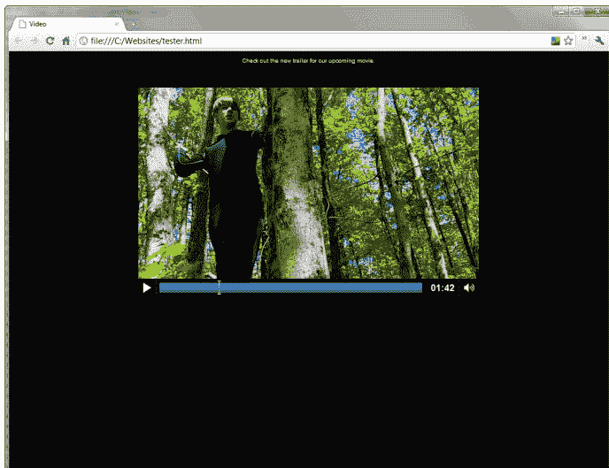

### 使用`<audio>`标签

`<audio>`标签与`<video>`标签非常相似——它播放音频片段或音频流——可以自动播放，也可以在用户点击播放控件时播放。你可以使用以下语法将音频片段、播客或音乐文件添加到你的网页中：

```
<audio src="mysong.mp3" controls="controls"
       autoplay="autoplay" loop="loop"/>
```

表 7-2 列出了`<audio>`标签的所有关键属性。

| 属性 | 描述 | 示例 |
| --- | --- | --- |
| `autoplay` | 加载后立即播放音频。 | `autoplay="autoplay"` |
| `controls` | 显示音频控件。 | `controls="controls"` |
| `loop` | 循环播放音频。 | `loop="loop"` |
| `preload` | 页面加载时预加载音频文件。有效值包括 auto、metadata 或 none。 | `preload="none"` |
| `src` | 音频流或文件的 URL。 | `src="bgsound.mp3"` |

以下示例展示了使用`<audio>`标签播放歌曲：

```
<!DOCTYPE html PUBLIC "-//W3C//DTD XHTML 1.0 Transitional//EN"
    "http://www.w3.org/TR/xhtml1/DTD/xhtml1-transitional.dtd">
<html xmlns="http://www.w3.org/1999/xhtml">
<head>
<meta http-equiv="Content-Type" content="text/html; charset=utf-8" />
<title>Audio</title>
<style type="text/css">
body
{
    background-color: #080808;
    margin: 10;
}
p
{
    color: #ffffff;
    font-family: Helvetica, sans-serif;
    font-size:10px;
}
</style>
</head>
<body>
<div style="text-align:center">
<p>Check out our new song.</p>
<audio src="rodeo.mp3" controls="true" loop="false"    />
</div>
</body>
</html>
```

图 7-2 显示了在 Google Chrome 中运行的结果。

图 7-2：可从网页轻松播放的音频片段。

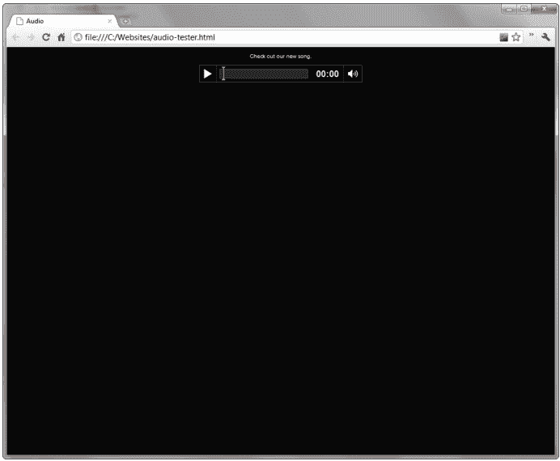

# 第四册

# 使用 CSS 设置样式

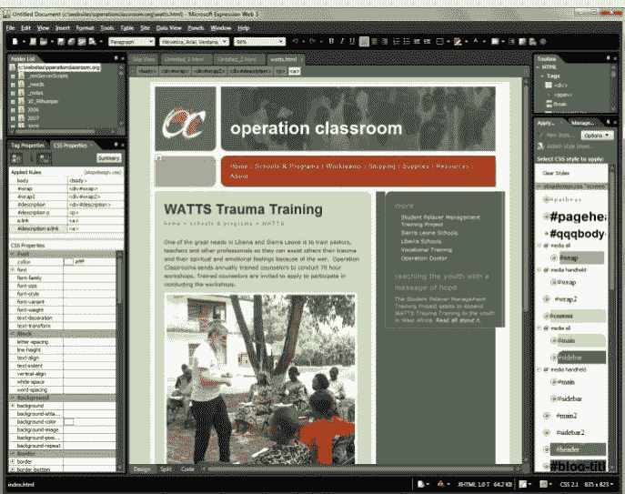

# 目录概览

**第 1 章：使用层叠样式表为网页设置样式……203**

- 为什么要使用 CSS？………………………………………………………………204
- CSS 简介………………………………………………………………………………204
- 将 CSS 样式应用到网页………………………………………………………206
- 继承属性………………………………………………………………………………208
- 层叠样式………………………………………………………………………………210

**第 2 章：选择器详解：使用选择器……213**

- 类型选择器：按类型选择元素……………………………………………213
- 类选择器：按类选择元素…………………………………………………214
- ID 选择器：按 id 选择元素……………………………………………………216
- 通用选择器：选择所有元素…………………………………………………216
- 多重选择器：选择多个元素…………………………………………………217
- 后代、子代和相邻兄弟选择器：基于层级选择元素……………………………………………………………217
- 属性选择器：按属性选择元素………………………………………………218
- 了解伪类和伪元素………………………………………………………………219

**第 3 章：格式化文本……………………………………………221**

- 字面意义：指定字体………………………………………………………………221
- 调整文本大小………………………………………………………………………223
- 为字体增色：添加样式…………………………………………………………225
- 一应俱全：使用 font 属性综合设置…………………………………………228
- 色彩之美：设置文本颜色……………………………………………………229
- 格式化段落属性…………………………………………………………………229

**第 4 章：四大要素：格式化框属性…………………231**

- 了解块级元素和内联元素……………………………………………………231
- 探索元素周围的"框"属性……………………………………………………232
- 内边距………………………………………………………………………………233
- 边框……………………………………………………………………………………234
- 留点空间：为元素添加外边距…………………………………………………238
- 添加背景……………………………………………………………………………239
- 鼠标光标设置………………………………………………………………………240

**第 5 章：使用 CSS 定位……………………………………243**

- 在页面中居中元素………………………………………………………………243
- 使用浮动元素脱离正常文档流……………………………………………244
- 使用 clear 调整浮动…………………………………………………………247
- 使用 float 和 clear 创建布局………………………………………………248
- 垂直对齐文本………………………………………………………………………251

## 第 1 章：使用层叠样式表为网页设置样式

### 本章内容

- 了解层叠样式表能为你做什么
- CSS 基础知识介绍
- 剖析 CSS 规则
- 应用样式
- 了解继承和层叠

当 Web 于 20 世纪 90 年代初问世时，网页创建者必须依靠 HTML 标记语言来显示所有内容并为其分配所有格式。然而，问题在于 HTML 的设计目的是*显示*内容，而非格式化内容。不出所料，网页设计师不得不费些周折才能让 HTML 文档呈现出他们想要的效果。

尽管这种方法在 Web 的"蛮荒西部"时代行之有效，但掌权者（一个名为 W3C 的标准机构）很快意识到需要更好的解决方案。结果就是*层叠样式表*（CSS），这项技术在 1996 年被推出。CSS 的最初版本在从 HTML 手中接过格式化职责方面展现出了希望，但它却因主流浏览器不一致的实现而备受困扰。因此，坦率地说，当时的 CSS 相当蹩脚，因为你无法指望浏览器按照你的设计来格式化页面。

那是过去；现在是现在。幸运的是，经过十多年的发展，情况已经明显好转。事实上，我无法想象在创建网站时不将 CSS 作为网站工具箱中的基本工具。

在本章中，我将向你介绍 CSS，帮助你熟悉一些术语和基本原理。然后，在本迷你书的剩余章节中，我将向你展示如何使用 CSS 为你的网站增添风格。

> **提示** Microsoft Expression Web（参见第七册）和 Adobe Dreamweaver（参见第八册）都内置了对 CSS 的支持。或者，如果你不使用这些网站设计工具，也可以始终使用纯文本编辑器（如记事本）来处理 CSS。

### 为什么要使用 CSS？

CSS 是一种样式语言，你可以用它来让你的网站看起来美观并且更易于管理。我将在接下来的章节中详细讲解 CSS 的工作原理，但以下是 CSS 有帮助的三个基本原因：

- **CSS 让你对页面设计有更大的控制权。** CSS 拥有许多 HTML 本身无法提供的格式化设置。因此，如果使用 CSS，你可以比仅使用普通 HTML 对网页的外观有更大的控制。
- **CSS 允许你将网站内容与格式化指令分离。** 因此，HTML 文档成为你处理内容的地方，而 CSS 样式表则成为你设置样式的地方。
- **CSS 使你能够在一个中心位置管理整个网站的样式。** 虽然你可以在单个网页内部定义 CSS 样式，但当你使用网站中每个页面都可以访问的独立 CSS 样式表时，它的真正威力才会显现。这样设置网站时，你可以轻松地为整个网站提供一致的外观和感觉。你还可以从单一位置进行全局更改。
- **CSS 是未来。** HTML 中的样式已经过时，而且随着特定于格式化的标签被弃用，这种做法正变得越来越困难。因此，当你学习 CSS 时，你投资的是一项将在未来多年继续存在的技术。

最终，CSS 使你能够创建更吸引人、设计精良的网站，并使其更易于管理和组织。

假设你在一个多用户环境中工作，你设计页面，而其他人编写 HTML 或脚本代码。使用 CSS，设计师可以主要处理独立的样式表，而不必在程序员的 HTML 文件中苦苦摸索。

### CSS 简介

你使用 CSS 来定义样式定义，看起来像这样：

```
body {
  font-family: 'Lucida Grande', Arial, Tahoma, sans;
  background-color: #000000;
}
```

当你创建 CSS 样式时，通常会在 HTML 文档内部的 *style* 元素中或在外部样式表中编写指令。*样式表*只是一个链接到网页的纯文本文件。浏览器在显示页面时将样式规则应用到 HTML 文档。CSS 样式表的扩展名为`.css`。有关将样式附加到 HTML 元素的更多信息，请参阅本章稍后的"将 CSS 样式应用到网页"一节。

## 制定规则——不要打破它们

虽然元素是 HTML 文档的基本组成部分，但规则是 CSS 的主要构建模块。*规则*选择你要应用格式的元素，然后指示应对它们做什么。换句话说，规则是一条代码语句，说的是"嘿，你——做这个！"它由两部分组成：*选择器*（"嘿，你"部分）和*声明*（"做这个"）：

- **选择器**标识你要处理的一个或多个 HTML 元素。你通常通过类型、`id`属性、`class`属性或文档层次结构中的位置来选择元素。我将在本迷你书的第 2 章中详细介绍选择器。
- **声明**由属性和值（称为*属性-值对*）组成，指定如何格式化由选择器标识的元素。

CSS 规则看起来像这样：

```
selector { property: value; }
```

CSS 在间距方面很灵活，所以你可以将规则全部写在一行，或者将其分布在多行，像这样：

```
selector {
  property: value;
}
```

在每个名称-值对后面始终添加分号是一个好习惯。虽然一些浏览器比较宽容，但如果缺少分号，Firefox 可能会破坏你的 CSS 样式。

规则可以在花括号内定义一个或多个属性-值对。如果你有多个属性，用分号分隔；每个属性都应该有一个。例如，以下都是有效的规则：

```
h1 { font-size: 18px; font-weight: bold; }
h2 {
  font-size: 16px;
  font-weight: bold;
}
```

当你将这些规则应用到网页时，所有`h1`元素都会格式化为 18 像素、粗体，所有`h2`元素都会格式化为 16 像素、粗体。

### 将 CSS 样式应用到网页

你有三种不同的方式可以将 CSS 样式应用到文档中的元素：

- 在文档的头部定义。
- 在外部样式表中定义。
- 在元素标签内部定义。

我将在本节中逐一介绍每种方式。

## 格式化之争：CSS 对决 HTML

| CSS 的能力 | HTML 的能力 |
|---|---|
| 如果 CSS 和 HTML 展开一场格式化对决，请把赌注押在 CSS 上。使用 CSS，你可以完成许多使用普通 HTML 难以或无法实现的事情。例如，你可以<br>✓ 自定义文本缩进<br>✓ 对格式化实现相当程度的控制，例如在文本块周围添加边框和内边距<br>✓ 精确定位或平铺背景图形 | ✓ 有效管理外边距<br>✓ 以极高的精度操控字符和单词间距，此外还能使用*字距调整*（调整文本行之间的间距）和两端对齐<br>✓ 为用户提供独特的导航工具<br>✓ 指定文本和图形的 z 轴（什么在最上层，就像你展开一副纸牌，有些牌在上面，覆盖其他牌） |

#### 使用嵌入式样式

`style`元素用于包含你希望在特定网页中使用的 CSS 代码。包含在页面本身的 CSS 样式通常被称为*嵌入式样式*。

假设你想将 10 点 Arial 作为网页中所有段落文本的默认字体。你可以在文档的`<head>`部分添加以下 style 元素：

```
<style type="text/css">

p {
  font-family: Arial;
  font-size: 10pt;
}

</style>
```

当显示文本时，文档中所有段落文本将以 10 点 Arial 字体显示。

现在假设你想重新设计网站，改用 12 点 Georgia 字体。要调整页面中所有`p`元素的段落样式，你只需微调 CSS 规则：

```
<style type="text/css">

p {
  font-family: Georgia;
  font-size: 12pt;
}

</style>
```

当文档显示时，所有段落将以新的字体设置显示。

你可以控制 CSS 样式是应用于单个段落、特定段落、整个页面还是整个网站。我将在本书本册的第 2 章中完整探讨这个主题。


#### 使用外部样式表

从本质上讲，样式表是一个普通的文本文件（扩展名为`.css`），用于在网站的多个页面中定义你的样式。你只需将样式表链接到 HTML 文档中，然后就可以应用这些样式了。

假设你创建了一个名为`global.css`的文件，其中包含以下代码：

```
p {
  font-family: Georgia;
  font-size: 12pt;
}
```

要在整个网站中应用该默认样式，你需要将网站连接到`global.css`文件。链接样式表的标准方式是使用`link`元素，将其添加到文档头部：

```
<link rel="stylesheet" rev="stylesheet" href="global.css"
   type="text/css" media="screen" charset="utf-8" />
```

请注意，在此示例中，`global.css`文件与 HTML 文件位于同一文件夹中。

#### 使用内联样式

每个可见的 HTML 元素都有一个`style`属性，你可以用它直接添加 CSS 属性。当你选择一个要应用样式的元素时，对于内联样式，你不需要添加 CSS 规则的选择器部分。你只需定义 CSS 属性即可。例如，如果你想通过内联样式设置段落的字体，代码大致如下：

```
<p style="font-family:Georgia; font-size:12pt;">Welcome to
   the ice cream social.</p>
```

请注意，多个属性之间必须用分号分隔。


请谨慎使用内联样式。它们可以方便地让你免于在其他地方定义样式；但该样式定义仅对所选元素有效——无法被重用。

### 属性的继承

HTML 文档由一组构成*包含层级结构*的元素组成。`html`元素是"山中之王"，因为它包含页面中的每一个其他元素。`head`和`body`元素是另外两个主要容器，通常包含更多元素。例如，考虑以下文档：

```
<html>
<head>
</head>
<body>
<div>
<p>this is a <span>paragraph</span></p>
</div>
</body>
</html>
```

span 元素被 p、div、body 和 html 元素所包含。层级结构大致如下：

```
html > body > div > p > span
```

理解包含层级结构对于开始使用 CSS 至关重要。当你将 CSS 规则应用到 HTML 文档时，CSS 属性有时会在整个文档中产生连锁反应。原因是某些属性会被包含在另一个元素（父元素）内的元素（子元素）所继承。

例如，字体和大多数其他文本相关设置都是可继承的属性。当你在 body 元素中设置`font-family`属性时，文档 body 内的所有元素都会继承该属性：

```
body {
  font-family: Arial, Tahoma, sans-serif;
}
```

如果你有另一个不希望拥有该属性的元素，你需要编写一条显式规则，将`font-family`更改为其他值。

其他属性不可继承；这些包括`margin`、`border`、`padding`和`background`属性。

因此，请看以下代码片段：

```
<div style="font-family:Arial; border:1px solid black">
<p>My paragraph</p>
</div>
```

段落从父 div 元素继承了`font-family`属性，但没有继承`border`属性。但假设你希望段落也继承 border。对于这种情况，CSS 提供了一个`inherit`属性值，你可以用它来显式地强制将属性从父元素传递给子元素。因此，通过添加`border:inherit`作为段落样式，当 div 和 p 元素显示在屏幕上时，两者周围都会出现边框：

```
<div style="font-family: Arial; border: 1px solid black;">
<p style="border:inherit;"> My paragraph</p>
</div>
```

### 层叠样式

由于*层叠*（Cascading）是这项技术名称中的第一个词，你大概不会惊讶——在使用 CSS 时，理解它所代表的概念是至关重要的。*层叠*指的是当多个属性声明适用于 HTML 文档中的同一个元素时，所发生的优先级排序过程。换句话说，哪个样式声明会胜出并优先应用？胜出者基于以下优先级层级决定，从最高到最低：

### 样式权重（使用`!important`）

你可以在属性声明的末尾添加`!important`。当你这样做时，定义的属性总是胜出；例如：

```
body {
    background-image: url(../images/bgd.gif);
    background-repeat: repeat-y !important;
}
```

#### 样式来源（作者 vs 用户）

不仅你作为网页设计者（即页面的*作者*）可以定义 CSS 样式，用户也可以在大多数现代浏览器中指定自己的样式表。相同权重的作者样式优先于用户样式。只有当用户使用了`!important`而作者未指定时，用户样式才会覆盖作者样式。作者和用户样式都优先于默认的浏览器设置。

来源排名如下：

- 作者样式
- 用户样式表
- 默认的浏览器设置


由于你在样式表中所做的任何`!important`声明总是胜出，因此请务必谨慎使用。用户可能有充分的理由修改样式（例如需要大于正常值的字体大小以弥补视力不佳）。

#### 选择器类型

更具体的选择器优先于更通用的选择器。因此，一般优先级顺序为：

- ID 选择器
- 类选择器
- 后代选择器
- 类型选择器

关于这些不同类型选择器的完整描述，请参阅本书本册的第 2 章。

- 内联样式（元素的`style`属性）
- 嵌入式样式（`style`元素）
- 外部样式表（`.css`文件）通过`link`元素引入
- 外部样式表（`.css`文件）通过`@import`语句引入

## 第四册：用 CSS 设置样式

## 第 2 章：选择性表达：使用选择器

### 本章内容

- 了解选择器的工作原理
- 选择常规 HTML 标签
- 通过类和 id 选择器选择特定元素
- 在同一规则中处理多个元素
- 选择文档中的所有元素
- 执行一些高级选择技术
- 探索伪类和伪元素

CSS 提供了仓库般丰富的样式属性和选项，可用于格式化 HTML 文档。但它还有一个同样重要但常被忽视的特点：一种强大的方式来精确选择你要格式化的元素。

渔民知道，捕获不同种类的鱼需要不同的鱼钩。有些鱼喜欢传统的老式鱼钩和虫饵，有些则钟情于邮购的特种诱饵。同样，CSS 提供了几种不同类型的选择器，你可以用来指定网站中要应用格式的元素。在本章中，你将探索选择器的工作原理，并在样式表中加以运用。

### 类型选择器：按类型选择元素

*类型选择器*允许你通过元素的类型来选择它，即使用元素的名称作为 CSS 规则的选择器。类型选择器会选择该元素，无论它在文档层次结构中的位置如何。当你想用特定样式格式化所有特定类型的元素（例如，`p`或`h1`）时，它们非常有用。

考虑以下 HTML 文档：

```
<html>
<head>
</head>
<body>
<h1>The Martians</h1>
<p>The Martians seem to have calculated their descent with
   amazing subtlety--<span>their mathematical learning is
   evidently far in excess of ours</span>--and to have
   carried out their preparations with a well-nigh perfect
   unanimity.</p>
<div>
<p>Had our instruments permitted it, we might have seen the
   <span>gathering trouble</span> far back in the nineteenth
   century.</p>
</div>
</body>
</html>
```

假设你想将`span`元素设置为蓝色。为此，使用`span`作为选择器，然后将`color`属性的值设为`blue`：

```
span { color: blue; }
```

当此样式应用于 HTML 文档时，`span`文本将以蓝色显示。

你也可以将样式应用于段落。例如：

```
p { weight: normal; }
```

应用后，此样式将所有段落显示为非粗体文本。

### 类选择器：按类选择元素

使用*类选择器*，你还可以根据`class`属性的值来选择 HTML 元素，无论它在文档层次结构中的位置如何。你可以将选择器定义为带有点前缀的类名。

考虑以下 HTML 文档：

```
<html>
<head>
</head>
<body>
<h1 class="attn">The Martians</h1>
<p>The Martians seem to have calculated their descent
   with amazing subtlety--<span>their mathematical
   learning is evidently far in excess of ours</span>--
   and to have carried out their preparations with a <span
   class="attn">well-nigh</span> perfect unanimity.</p>
<div>
<p>Had our instruments permitted it, we might have seen the <span class="attn">gathering trouble</span> far back in the nineteenth century.</p>
</div>
</body>
</html>
```

假设你想将`class`属性设置为`attn`的元素设为红色。你可以这样定义类选择器：

```
.attn { color: red; }
```

此规则会将`h1`和两个`span`元素都设置为红色。

当你想对文档或网站的特定部分进行分类并相应格式化时，类选择器非常有用。

### 组合类型和类选择器

你可以组合类型和类选择器来缩小特定选择范围。假设你定义以下规则：

```
/* 仅适用于 class 为 attn 的 H1 */
h1.attn { color: red; }

/* 仅适用于 class 为 attn 的 span */
span.attn { color: blue;}
```

`h1`显示为红色，而两个`span`元素显示为蓝色。

### 组合类

CSS 还允许你为一个元素组合多个类。假设你有以下两个样式规则：

```
.attn { font-weight: bold; }
.supersize { font-size: 160%; }
```

| 欢迎评论 |
| :--- |
| CSS 支持注释，这使你能够在样式表中添加描述性信息。注释以`/*`开头，以`*/`结尾： |
| 如果你熟悉 JavaScript，这些注释符号应该很熟悉。 |
| /* 在此处添加注释 */ |

如果你想让某个元素同时应用两个规则，可以将两个规则放在同一个`class`属性中：

```
<span class="attn supersize">Hello, I am Michael, please notice me!</span>
```

### ID 选择器：按 id 选择元素

如果你使用`id`属性来唯一标识单个元素，你可以使用这些属性作为从 HTML 文档中选择特定元素的方式。*id*选择器和*class*选择器的关键区别在于，`id`在页面中只使用一次，而`class`可以在给定页面中应用于多个元素。

*id 选择器*在 CSS 规则中通过输入`id`值并添加英镑符号（`#`）前缀来定义；如下例所示：

```
#top {
    position: relative;
    width: 900px;
    margin: 0 auto;
}
```

此规则随后可以应用于`id`为`top`的`div`元素：

```
<div id="top"></div>
```

与类选择器一样，你可以组合类型和`id`选择器。例如，`#top`规则也可以定义为：

```
div#top {
    position: relative;
    width: 900px;
    margin: 0 auto;
}
```

### 通用选择器：选择所有元素

使用*通用选择器*，你可以使用通配符（`*`）选择文档中的所有元素。例如，要为每个元素设置 0 边距，你可以使用：

```
* { margin: 0; }
```

声明通用选择器时要小心，因为如果你同时处理继承（在本迷你书的第 1 章中讨论），它们可能会产生意外的副作用。

### 多重选择器：选择多个元素

你可以通过逗号分隔的列表中列出每个元素名称来选择多个元素。假设你希望所有标题都使用 Georgia 字体。与其为每个标题分别定义规则，你可以将它们组合成一个规则，例如：

```
h1, h2, h3, h4, h5, h6 { font-family: Georgia; }
```

你也可以对类和 id 选择器这样做。例如，要对`blogitem`和`comments`类应用相同的格式，你可以定义以下代码：

```
.blogitem, .comments {
    display: block;
    padding: 2px 10px 15px 2px;
}
```

### 后代、子元素和相邻兄弟选择器：基于层次结构选择元素

你可以根据元素在整体文档层次结构中的位置以三种方式之一来选择元素：后代选择器、子元素选择器或相邻兄弟选择器。

子元素和相邻兄弟选择器在 Microsoft Internet Explorer 6.0 中不受支持，因此如果在样式表中使用它们，请谨慎。尽管 IE 6.0 被视为"遗留"版本，但它仍占有相当大的市场份额；仍有很多人在使用它。

#### 后代选择器

*后代选择器*根据元素在文档层次结构中的相对位置来选择元素。考虑以下示例文档：

```
<html>
<head>
</head>
<body>
<h1>The Martians</h1>
<p>The Martians seem to have calculated their descent with
    amazing subtlety.</p>
<div>
<p>Had our instruments permitted it, we might have seen the
    gathering trouble far back in the nineteenth century.</p>
</div>
<div>
<p>"The chances against anything manlike on Mars are a
million to one," he said.</p>
</div>
</body>
</html>
```

类型选择器可以让你选择所有段落元素，但如果你想只选择 div 元素内部的段落，可以使用后代选择器：

```
div p { font-size: 9pt; }
```

注意，p 不必是 div 元素的直接子元素，直接嵌套在其中即可。它只需要是层级结构中的某个后代。

#### 子选择器

如果你想选择一个作为另一个元素直接子元素的元素，可以使用子选择器。子选择器用尖括号（`>`）分隔父元素和子元素，尖括号起到箭头的作用：

```
div > p { font-size: 9pt; }
```

使用这种语法时，右侧的元素必须是左侧元素的直接子元素。

#### 相邻兄弟选择器

相邻兄弟选择器的使用频率要低得多，但这里值得一提。在 HTML 文档中，你可以根据某个元素相邻的元素来选择它。如果两个元素之间用`+`运算符分隔，则仅当第二个元素紧跟在第一个元素之后时，才会被选中。例如，如果`h1`后面紧跟着`h2`元素，则以下规则适用：

```
h1 + h2 { margin-top: -5px; }
```

### 属性选择器：按属性选择元素

尽管你无法用 CSS 显示属性，但可以通过属性来选择元素。你可以通过三种常见方式使用这些属性选择器：

- **属性的存在：** 要测试元素是否包含某个属性，请将属性名放在元素名后的方括号中。例如，以下代码选择所有定义了`alt`属性的`img`元素：

```
img[alt] { padding-right: 5px }
```

- **属性的精确值：** 要通过属性的值来选择元素，请将信息添加到选择器中。例如，以下代码选择所有具有特定`src`值的`img`元素：

```
img[src="banner.jpg"] { margin-top:1px }
```

- **属性的部分值：** 你也可以通过使用`~=`运算符而非等号（`=`）来根据属性的部分值选择元素，然后编写一个以空格分隔的词列表。例如，以下代码选择所有`alt`文本包含"newswire"的`img`元素：

```
img[alt~="newswire"] { margin: 5px }
```

IE 6.0 不支持按属性选择元素。

### 理解伪类和伪元素

伪类是一种特殊类型的选择器，它不是基于 HTML 代码，而是基于浏览器应用的条件。你使用以下语法来定义伪类：

```
elementname:pseudoclassname
```

伪类最常用于链接。你可以为链接的不同状态创建独特的样式：未访问、已访问、激活和悬停。例如，以下代码为`a`链接定义了伪类：

```
a:link     { color: black; text-decoration: none; }
a:active   { color: blue; text-decoration: none; }
a:visited  { color: gray; text-decoration: none; }
a:hover    { color: blue; text-decoration: underline; }
```

另一方面，伪元素是元素的一部分。你可以使用伪元素来指定块级元素（如段落或标题）的首字母和首行的格式；以下是一个示例：

```
p:first-line: { font-size: 110%; }
p:first-letter: { font-size: 300%; float: left; font-variant:
                  small-caps; }
```

## 第 3 章：格式化文本

### 本章内容

- 为文本指定字体
- 设置基本字体属性
- 为文本添加样式
- 为文本着色
- 处理段落设置

嘿，你——*做这个*。这就是 CSS 规则的本质。选择器挑选要处理的元素，而属性则为它们分配格式化样式。在本迷你书的第 2 章中，我通过关注选择文档不同部分的来龙去脉，解释了*嘿，你*这部分。在本章中，我将跟进*做这个*这部分，针对你的文本进行操作。我首先向你展示如何格式化各种字符属性，然后再深入段落属性。

### 直面价值：指定字体

在网站设计中最关键的设计决策之一就是字体选择。你的字体样式要么与整体设计相辅相成，要么与之冲突。

无论你最终选择什么，请确保你选择的字体在访问你网站的人的计算机上广泛可用。如果你选择的字体在浏览器中不可用，浏览器会替换为另一种相似风格的字体。

最常见的字体分为两类——*衬线体*（serif）和*无衬线体*（sans serif）。衬线字体在字符笔画的末端有短横线或曲线。一些常见的衬线字体包括 Times Roman、Times、Georgia 和 Garamond。无衬线字体是没有衬线的字体。Arial、Helvetica、Verdana、Tahoma 和 Lucida Grande 是常见的无衬线字体。

使用`font-family`属性来定义一组字体，按优先级排序。这个属性可以由具体的字体名称、通用字体族（见表 3-1）组成，或者（更常见地）两者兼而有之。例如，考虑声明`font-family: Helvetica, Arial, Verdana, sans-serif;`。浏览器首先查找 Helvetica 字体。如果找不到该字体，它会尝试使用其他字体——首先是 Arial，然后是 Verdana。最后，如果这些都找不到，它会回退到能找到的任何无衬线字体。

| 名称 | 字体示例 |
|------|---------|
| serif | Times New Roman |
| sans-serif | Arial, Lucida Grande |
| monospace | Courier New |
| cursive | Zapf-Chancery |
| fantasy | Andy, Critter |

要为所有`p`元素定义 Arial，你可以这样写：

```
p { font-family: Arial; }
```

然而，通常你想使用字体列表而不是单一字体。当你使用一系列字体时，浏览器首先尝试你的首选字体（列表中的第一个）。如果这个字体不可用，浏览器会继续向下浏览列表。将适当的通用字体族名称作为最后一项添加，可以确保使用该字体的一般风格。假设（例如）你想使用无衬线字体 Lucida Grande 作为网站的默认字体，但你希望有一组可接受的替代方案。你可以在`body`选择器中定义该规则，如下所示：

```
body { font-family: "Lucida Grande", Arial, Verdana, sans-serif; }
```

注意，如果字体名称由多个单词组成，你需要将该名称用引号括起来。

假设你想将默认段落字体指定为衬线字体，标题指定为无衬线字体，并将一个特殊的 url 类指定为等宽字体。CSS 规则如下所示：

```
p { font-family: "Palatino Linotype", "Times New Roman", serif; }

h1,h2,h3 {font-family: "Lucida Grande", Arial, Verdana,
    sans-serif; }

p.url { font-family: "Courier New", Courier, monospace; }
```

如果你不确定两种字体的相似程度，请仔细观察大写的 Q 和 & 符号。这些字符是字体字母表中最具特色的字符之一。

#### 你应该使用哪种字体？

在考虑为网站标准化字体时，请考虑以下建议：

- **为常规文本和标题选择不同的字体。** 但是，每页不要选择超过一种衬线字体和一种无衬线字体。
- **如果需要，为文本使用无衬线字体。** 在 Web 早期，Times New Roman 等衬线字体通常是网页的默认字体，因为研究表明它们更易读。无衬线字体通常保留用于标题。然而，现在许多网页设计师选择无衬线字体作为正文文本的标准字体。
- **考虑易读性。** 在任何给定的字号下，Georgia 和 Verdana 都比其同族中的其他字体稍大一些。原因是这两种字体是为了在计算机显示器上易于阅读而创建的。

## 调整文本大小

你可以使用`font-size`属性设置字体大小。你有几种不同的方式来指定绝对或相对大小的字体：

- **磅值：** 磅值可能是大多数人想到字体大小时最热门的方式，因为 Microsoft Word 等应用程序使用磅值。一*磅*是 1/72 英寸。磅值的缺点是不同的屏幕分辨率可能会分配不同的磅值大小，因此它们在不同计算机之间可能略有差异。要指定磅值大小，请使用数值并在其后加上`pt`。例如，要将段落的字体指定为 10 磅，请使用：

```
p { font-size: 10pt; }
```

- **像素：** 像素在调整字体大小时提供更高的精度，无论页面显示时的屏幕分辨率如何。然而，缺点是如果用户想要放大字体以提高可见性，像素大小不能很好地适应。要为字体指定特定的像素大小，请使用数值并在其后加上`px`：

```
p { font-size: 12px; }
```

- **Em：** *em*单位是一种不太为人知的字体大小单位，但它是一个很好的选择。一个*em*等于相对于默认浏览器字体的字体高度。一 em 等于默认浏览器设置为中等大小的文本。要指定以 em 为单位的字体大小，请使用数值并在其后加上`em`。在这个例子中，我将段落字体设置为用户设置的默认字体大小的 90%：

```
p { font-size: 0.9em; }
```

## Em 与 em：融化在嘴里，而非页面上

在出版界，em 传统上是指字母 m 的宽度。你可能听说过 m 破折号或 em 破折号。它是一条水平线——就像这些——其宽度等同于该字体中字母 m 的宽度（尽管在许多字体中它并非严格意义上的精确等同）。

Em 单位在不同的字体和字号下是不同的。因此，使用 em 可以让你根据浏览器中使用的指定字体来定义效果。其结果与字体和周围文本的其他属性成比例。

因为 em 单位是相对于用户浏览器设置的，如果用户选择的默认字号比你设计时所要求的字号大得多，你的页面布局可能会受到不利影响。

- **绝对尺寸关键字**：如果单位尺寸不是你的菜，你可以使用以下关键字来设置字号：`xx-small`、`x-small`、`small`、`medium`、`large`、`x-large`和`xx-large`。对于大多数浏览器，medium 是 10 磅或 12 磅，其他关键字与该尺寸成比例。例如，以下代码将`h1`定义为超大号：

```
h1 { font-size: x-large; }
```

- **百分比**：要基于父元素字号的相对百分比来设置字号，你可以指定一个百分比值；请看以下示例：

```
body { font-size: 10pt; }
p { font-size: 95%; }
h1 { font-size: 120%; }
```

在此示例中，`body`元素将主字体设置为 10pt。默认段落字体是 body 字体值的 95%（因为 body 将包含每个段落），而`h1`是 body 字体设置的 120%。

- **相对尺寸关键字**：你也可以使用`larger`和`smaller`关键字来设置相对于父元素字号的字体大小。例如，要使`span`文本的大小按比例缩小于其父元素，你可以使用：

```
span { font-size: smaller; }
```

- **其他度量单位**：虽然磅、像素和 em 是最常用的度量单位，但还有其他可用的单位，包括：
  - 派卡（pc）：派卡是磅的子集。一个派卡等于 12 磅。
  - 毫米（mm）
  - 厘米（cm）
  - 英寸（in）
  - x 高度（ex）：x 高度是小写字母顶部（不包括升部——例如小写 d 或 b 的顶部）与所有字母看似坐落其上的假想线（基线）之间的距离。

### 为你的字体换个造型：添加样式

在 CSS 之前，你为文本添加字符样式的能力仅限于 HTML 的`<b>`（粗体）和`<i>`（斜体）标签。然而，CSS 提供了更多可以使用的属性和变体，包括`font-style`、`font-weight`、`font-variant`、`font-stretch`和`text-decoration`。我将在本节中逐一介绍这些属性。

#### 使用 font-style 添加斜体

`font-style`属性定义斜体文本。它有三个值：`italic`、`normal`或`oblique`（*倾斜*的花哨说法）；例如：

```
p { font-style: normal; }
span { font-style: italic; }
```

我建议避免使用`oblique`。它仅仅是倾斜正常字体，看起来不如真正的斜体。

粗体和斜体就像豌豆荚里的两颗豌豆，形影不离。如果我想突出文本，我倾向于加粗或变斜体，或将两者结合使用。即使在 Dreamweaver 和 Expression Web 等网页设计软件中，粗体和斜体控件也是并排放置的。然而，CSS 将它们分成独立的属性。你不会用`font-style`来设置粗体属性。相反，你应该使用`font-weight`属性来应用粗体（见下一节）。

#### 使用 font-weight 为文本加粗

`font-weight`属性使文本加粗。对于常见用途，`normal`或`bold`关键字就能很好地完成这项工作；以下是一个示例：

```
p .bodytext { font-weight: normal; }
p .intro { font-weight: bold; }
```

你也可以指定一个从 100 到 900 的数值来设置文本的粗细。100 是最细的，900 是最粗的。`normal`关键字等同于 400；`bold`等同于 700。

你还可以使用`lighter`和`bolder`关键字，根据父元素的相对值来使文本变细或变粗。

## 粗体还是斜体？

什么时候应该使用斜体、粗体和下划线？大多数字体有几种变体，其中粗体和斜体最为常见。粗体最常用于标题——它又大又粗——但在正文中使用较少，因为它可能会分散注意力。

如果你想在正文中强调某些内容，通常应该使用*斜体*而不是**粗体**或全大写。

然而，没有什么是一成不变的。你可能想在页面文本中使用粗体格式，为读者提供一种快速浏览重要项目的方式。这种技巧的经典例子是八卦专栏，其中名人的名字使用粗体。当你不使用子标题但想为读者提供一种高效的方式来浏览文本并定位感兴趣的主题时，可以使用这种技巧。

#### 使用 text-decoration 进行下划线和装饰

`text-decoration`属性可以为文本添加下划线或其他特殊格式。可能的值有`underline`、`overline`、`line-through`和`blink`。例如，要为`a:hover`伪类添加下划线，请使用以下规则：

```
a:hover { text-decoration: underline; }
```

上划线（`overline`）使用频率远低于其他方式，它可用于视觉效果，在字符上方放置一条线，也可用作分隔文本区域的方式。

`line-through`值在其他应用程序（如 Microsoft Word）中通常被称为*删除线*。它在文本中放置一条贯穿线。

`blink`值通常不推荐使用，因为闪烁的文本对读者来说可能是一种极大的困扰。

#### 使用 text-transform 和 font-variant 控制大小写

你可以使用`text-transform`属性来更改文本的大小写。此属性的关键字值如表 3-2 所示。

| 值 | 作用 |
| :--- | :--- |
| capitalize | 将每个单词的第一个字符改为大写 |
| uppercase | 将文本中的所有字符改为大写 |
| lowercase | 将文本中的所有字符改为小写 |
| none | 取消继承的值 |

例如，要将`h2`元素的文本更改为大写，请使用此规则：

```
h2 { text-transform: uppercase; }
```

`font-variant`属性可以开启和关闭小型大写字母格式。它的两个值是`normal`和`small-caps`。例如，如果你想对`h1`元素应用小型大写字母，可以使用以下代码：

```
h1 { font-size: 1.2em; font-variant: small-caps; }
```

## 调整文本间距

`letter-spacing`和`word-spacing`属性分别用于增加或减少字母和单词之间的间距。其值是一个具体的长度值（通常以 em 或像素为单位）或`normal`关键字。假设你想将`#pathway`选择器的`letter-spacing`值指定为正常间距的 15%。你应该使用以下规则：

```
#pathway { letter-spacing: .15em; }
```

通过`letter-spacing`减少某些字符之间的间距通常可以改善标题的外观和可读性。

## 使用 font-stretch 拉伸你的文本

`font-stretch`属性允许你从字体族中设置压缩、扩展或正常的字体。以下是此属性的绝对关键字列表，从最压缩到最扩展排列：

- ultra-condensed
- extra-condensed
- condensed
- semi-condensed
- normal
- semi-expanded
- expanded
- extra-expanded
- ultra-expanded

CSS 还允许你使用相对关键字`wider`和`narrower`来拉伸或压缩到下一个值。

例如，要将`span`元素扩展到最大可能值，请使用以下规则：

```
span { font-stretch: ultra-expanded; }
```

`font-stretch`属性在浏览器中的支持并不广泛，使用时需知许多用户可能无法看到该字体变化。

### 全面整合：使用 font 属性统一样式

在本章前面的章节中，我向你展示了如何逐一应用字体样式。但 CSS 提供了`font`作为"简写"属性；它在一个属性中设置最常见的与字体相关的设置。你可以设置的属性包括`font-style`、`font-variant`、`font-weight`、`font-size`、`line-height`和`font-family`。语法如下：

```
selector {
  font: font-style font-variant font-weight font-size/
  line-height font-family;
}
```

关于`font`属性，有以下几点细节需要注意：

- 每个属性之间用空格分隔（此处不使用分号或逗号）。
- 在`font`属性中，当用`/`分隔`font-size`和`line-height`时，指定`line-height`。
- 列表中的前三个值（`font-style`、`font-variant`和`font-weight`）是可选的，可以按任意顺序列出。

例如，你可以颠倒前面示例中的顺序，而不会产生任何不良影响：

```
p { font: italic bold 12px "Times New Roman", serif; }
```

然而，`font-size`和`font-family`属性是必需的（尽管`line-height`是可选的），并且它们必须按正确的顺序排列。

以下是一组使用`font`属性定义的示例规则：

```
p { font: 12px "Trebuchet MS", Arial, Helvetica, sans-serif;
  }
td { font: 75%/1em Arial, Helvetica, sans-serif }
div { font: 10pt/11pt "Times New Roman", Times, serif }
span { font: 60% sans-serif }
p { font: italic bold 1.5em/2 Arial, Helvetica, sans-serif }
div #sidebar h1 { font: bold small-caps 130%/130% Arial,
  sans-serif }
```

### 色彩之美：设置文本颜色

你可以使用`color`属性来调整文本颜色。（不，并不存在`text-color`属性。）`color`属性的值可以是保留的颜色关键字或 RGB 颜色值：

- **颜色关键字：** 16 个常见的颜色关键字是`aqua`、`black`、`blue`、`fuchsia`、`gray`、`green`、`lime`、`maroon`、`navy`、`olive`、`purple`、`red`、`silver`、`teal`、`white`和`yellow`。例如：

  ```
  h1 { color: green; }
  ```

- **RGB 十六进制数：** RGB（红-绿-蓝）是标准的颜色编码方案，通过红色、绿色和蓝色的独立数值（0–255）来定义颜色光谱。十六进制表示法中 RGB 颜色值的格式是一个英镑符号（`#`）后跟代表颜色的十六进制值。例如，要定义黑色文本，你可以使用：

  ```
  body {color: #000000; }
  ```

- **RGB 值：** 你还可以使用`rgb(r, g, b)`函数来定义颜色，其中`r`、`g`和`b`是数字（0 到 255）或百分比（0 到 100%）；例如：

  ```
  div { color: rgb(255, 0, 0); }
  ```

## 格式化段落属性

CSS 还有几个面向段落的属性可供指定，包括对齐、缩进和行高。

### 文本对齐

块级样式元素占据其所占据的页面或容器的完整宽度。以下示例元素默认情况下是块级的：`p`、`div`、标题（`h1...h6`）、列表和列表项（`ul`、`ol`、`li`）、`table`和`form`。你可以使用`text-align`属性设置块级元素的文本对齐方式。可能的值有`left`、`right`、`center`和`justify`。例如，要居中对齐`h2`元素，请使用以下规则：

```
h2 { text-align: center; }
```

假设你想将浏览器窗口内的所有内容居中，并使文本左对齐。你可以使用`text-align`来执行这两种对齐设置。一个`div`元素（`<div id=main></div>`）作为主容器，将所有内容居中。然后两个`div`元素（`rightcolumn`和`_addrs`）将文本对齐设置为`left`：

```
#main { text-align: center; }
#rightcolumn, #leftcolumn { text-align: left; }
```

### 文本缩进

`text-indent`属性设置块级元素文本第一行的缩进。你可以使用正或负长度（通常以 em 或像素为单位）或相对于父元素的百分比。例如，如果你想稍微缩进`p`的第一行，请添加此规则：

```
p { text-indent: 2%; }
```

### 调整行高

`line-height`属性调整块级元素文本中行与行之间的高度。

调整行高通常有两个主要原因：标题通常看起来行间距更小更美观，而普通正文文本则因行间距稍*大*一些而更易读。你可以使用数字、长度（通常以 em 或像素为单位）或百分比值。当使用数字时，行高是通过将你提供的数字与字体大小相乘来设置的。例如，要将段落行高设置为略高于正常值，你可以指定：

```
p { line-height: 1.35em; }
```

下面是第二个示例，使用像素单位：

```
p#summary { font-size: 11px; line-height: 15px; }
```

要对 12px 字号的段落进行双倍行距，你可以使用以下任意一种方式：

```
p { line-height: 2; }
p { line-height: 2.0em; }
p { line-height: 200%; }
p { line-height: 24px; }
```

## 第 4 章：四大要素：格式化框属性

### 本章内容

- 探索块级元素和内联元素
- 使用内边距和边框框定元素
- 使用外边距添加空间
- 处理背景
- 使用 CSS 自定义鼠标光标

从 CSS 的角度来看，HTML 文档很像圣诞节时的 UPS 卡车——到处都是盒子。页面由一组嵌套的盒子组成，这些盒子代表了页面上的各种元素。每个可见元素都有一个围绕它的矩形区域。尽管这个矩形盒子通常是不可见的，但你可以定义样式来格式化盒子的各个部分。

在本章中，你将探索如何格式化这四个与盒子相关的属性：元素周围的*外边距*、彩色或带阴影的*边框*、边框与内容之间的*内边距*以及背景。

### 理解块级元素和内联元素

每个元素，无论是`p`、`div`还是`span`，在页面上都显示为一个矩形。这个盒子可以作为块级或内联元素在文档中流动：

- **块级元素**占据其所占容器的完整宽度。块级元素从新行开始，下一个块级元素从文档的下一行开始。默认情况下为块级的元素包括`p`、`div`、`h1...h6`、`ul`、`ol`、`li`、`table`和`form`。你还可以使用`display:block`属性定义块级元素。
- **内联元素**被添加到文档的正常流中。它只占据所需的宽度，而不是整行，并且不会在其后强制换行。`span`是内联元素的一个显著例子。你还可以使用`display:inline`属性定义内联元素。

### 探索元素周围的"框"属性

`display`属性在你开始使用 CSS 定位元素时变得尤为重要。（有关定位的更多信息，请参阅本迷你书第 5 章。）然而，在你开始格式化元素的不同部分时，理解`display`也很有帮助。

你可以把页面上的元素想象成美术馆中展出的画作：画作本身展示在画布上。它通常周围有一个衬垫，在画作和外框之间增加空间。外框要么是实心的，要么是装饰性的，有助于将焦点集中在内部的画作上。最后，每幅装裱好的画作与周围其他画作之间都有一定的间距。

同样，围绕元素内容区域的是可选的`padding`（作用类似于衬垫）、`border`（作用类似于画框）和`margin`（作用类似于单个艺术品周围的间距）属性；图 4-1 展示了所有这些属性。

#### 理解盒模型尺寸

要确定一个元素盒子的*宽度*，需要将内容宽度与左右外边距（margins）、边框（borders）或内边距（padding）相加。同样，一个元素盒子的*高度*是内容高度加上顶部和底部的外边距、边框和内边距之和。

对于这些元素，你可以使用其快捷属性（`padding`、`border`和`margin`）来定义所有四个边。这样做时，你是从顶部开始，按顺时针方向定义每一边的：顶部、右侧、底部和左侧。例如，以下规则定义了顶部 5 像素的空间，无左右外边距，以及 10 像素的底部外边距：

```
div #top { margin: 5px 0 10px 0; }
```

或者，你也可以通过`-left`、`-right`、`-top`和`-bottom`子属性来定义单独的边。我将在接下来的章节中详细讲解。

有关在定义这些属性时可以使用的测量单位（如 em 或像素）的更多信息，请参阅本小册子的第 3 章。

## 为元素设置内边距（Padding）

元素的*内边距*是指元素内容及其边框之间的空间量。你可以使用`padding`属性来设置此属性。可接受的值是长度（通常为`em`或`px`单位）或百分比值。例如，要为`div`元素的四个边添加轻微的内边距，可以使用以下规则：

```
div { padding: .5em; }
```

你也可以使用`padding-top`、`padding-right`、`padding-bottom`或`padding-left`来指定盒子某一个边的内边距。以下规则使用这些子属性来定义左侧和右侧的内边距：

```
img .leftside { padding-left: 10px; padding-right: 0px; }
img .rightside { padding-left: 0px; padding-right: 10px; }
```

## 设置边框（Border）

*边框*围绕着元素的内容，并包裹着你为元素指定的任何内边距。而外边距则位于边框框架之外，将该元素与周围的元素隔离开。元素的`padding`和`margin`属性仅涉及尺寸，而边框有更多属性需要考虑，包括`border-style`、`border-width`和`border-color`。

### border-style

`border-style`属性是设置边框的必要条件。由于该属性默认为`none`，你需要显式定义它，否则其他边框属性（`border-width`和`border-color`）将被简单地忽略。如表 4-1 所示，共有九种边框样式。

| 值 | 边框外观 |
|---|---|
| `none` | 无边框，导致`border-width`和`border-color`的值被忽略（默认值） |
| `solid` | 实线 |
| `dotted` | 点线 |
| `dashed` | 虚线 |
| `double` | 双线（两条单线及其之间的空间之和等于`border-width`的值） |
| `groove` | 3D 凹槽（基于颜色值） |
| `ridge` | 3D 脊线（基于颜色值） |
| `inset` | 3D 内嵌（基于颜色值） |
| `outset` | 3D 外凸（基于颜色值） |

你还可以使用`border-top-style`、`border-right-style`、`border-bottom-style`或`border-left-style`来定义盒子某一个边框的样式。

图 4-2 展示了 Internet Explorer 渲染的不同边框样式（使用了非常宽的 8 像素边框）。其他浏览器显示的边框样式可能略有不同。例如，Firefox 将点线渲染为短虚线。此外，Firefox 在底部四个边框（类似框架的边框）的阴影中使用黑色而非灰色。

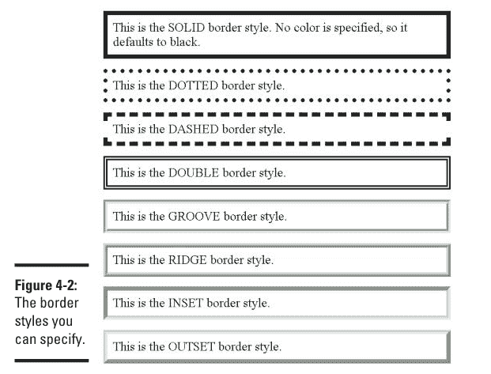

图 4-2：你可以指定的边框样式。

### border-width

你可以使用`border-width`属性为整个盒子分配宽度。可能的值是宽度关键字（`thin`、`medium`或`thick`）或相对长度值（通常为`em`单位）。默认宽度是`medium`，相当于 2 或 3 个像素。

你可以使用`border-top-width`、`border-right-width`、`border-bottom-width`或`border-left-width`属性来指定其中一个边框边的尺寸。

假设你想给一个特定的`div`元素添加中等粗细的实线边框，给第二个`div`元素添加细的凹槽边框。样式代码如下：

```
#div_one { border-width: medium; border-style: solid; }
#div_two { border-width: thin; border-style: groove; }
```

使用宽度关键字可以确保整个网站的边框宽度保持一致。因为宽度关键字是绝对尺寸，所以无论给定元素的字体大小如何，`thin`、`medium`和`thick`边框都能维持其尺寸。然而，如果你使用相对单位（如`ems`），边框尺寸会根据元素字体的大小而变化。

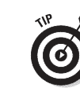

### border-color

你使用`border-color`属性来声明边框的颜色，它接受一组可分配给文本颜色的通用 CSS 颜色（在本小册子的第 3 章中讨论过）。例如，以下规则为一个链接元素定义了蓝色的实线细边框：

```
a { border-style: solid; border-width: thin; border-color: blue; }
```

你也可以通过以下属性之一来定义单个边框：`border-top-color`、`border-right-color`、`border-bottom-color`或`border-left-color`。

> 提示：边框的默认颜色是元素的文本`color`属性（通常为黑色）。如果元素没有文本（例如`img`），则继承元素父级（如`body`）的`color`属性。

### 使用快捷边框属性节省时间

你可以使用`border`（以及单个边框边`border-top`、`border-right`、`border-bottom`和`border-left`）作为快捷属性，在一条语句中定义边框的宽度、样式和颜色。通用语法为：

```
selector { border: border-width border-style border-color; }
```

使用这个简写属性，你可以将前面给出的链接属性定义压缩为一条语句：

```
a { border: thin solid blue; }
```

> 提示：在使用边框时请保持克制和含蓄。在几乎所有情况下，相对较细的实线边框看起来比某些特殊边框要吸引人得多。例如，我在我网站的图像上使用了以下样式（如图 4-3 和 4-4 所示）：

```
img { border: 6px #fff solid; margin: 0px 0px 5px 0px; }
```

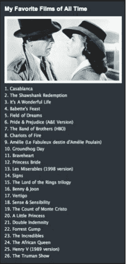

图 4-3：实线边框有助于图像更好地融入整体设计。

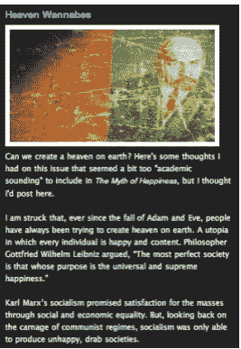

图 4-4：消除内边距可在图像和边框之间创造出有趣的效果。

## 边框的混合与匹配

你不一定总是要用四面边框围绕一个元素。你可以仅定义在网站设计中有意义的边框。例如，如果你想在图像的右侧和底部定义细边框，可以使用此声明：

```
img { border-style: none solid solid none; border-width: thin; }
```

或者考虑一个更花哨的例子：假设你想对图像边框进行样式设置，使顶部和右侧为点线，左侧为虚线。如以下代码片段所示，我使用了`none`样式来移除底部边框：

```
img { border-style: dotted dotted none dashed; }
```

最后一个例子向你展示如何将`inset`命令与颜色结合使用，以创建斜切外观。CSS 代码如下：

```
img {
    border-top: #333333 inset;
    border-right: #333333 inset;
    border-bottom: #333333 inset;
    border-left: #333333 inset;
    border-width: 4px;
}
```

## 留出空间：在元素周围添加外边距（Margins）

你使用`margin`属性来设置元素盒子与其他元素之间的空间量。你可以用单位长度（通常使用 em 或像素）、百分比值或使用关键字`auto`来定义此属性。

你也可以通过`margin-top`、`margin-left`、`margin-right`和`margin-bottom`来指定元素一侧的外边距。

假设你想在每个`h1`标题之后添加少量空间。为此，请使用以下代码添加底部外边距：

```
h1 { margin-bottom: .75em }
```

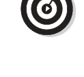

外边距总是透明的，从而使父元素的背景可以透出来。

你使用`auto`常量来使元素在水平或垂直方向上居中。因为`margin: auto`涉及定位，我将在本小册子的第 5 章中向你展示如何操作。

**清除默认外边距和内边距**

许多浏览器会在块级元素周围添加默认的外边距和内边距。虽然这对常规页面布局可能很方便，但在尝试实现更精确的设计效果时可能会造成问题。你可以通过向`body`元素添加以下代码来确保从零开始设置外边距和内边距值：

```
body { margin: 0; padding: 0; }
```

**使用 auto 自动边距**

在指定内容或边距的大小时，你可以使用具体测量值，如`1em`或`15px`。或者，你可以使用`auto`关键字让浏览器计算出正确的测量值。假设你想在段落右侧保持固定的`15px`边距，但希望浏览器自动设置左边距，从而始终维持`15px`的右边距。代码如下所示：

```
p { margin-right: 15px; margin-left: auto; }
```

这个样式（实际上是）将段落固定在浏览器窗口中的特定水平位置（距右边15像素），即使用户拉伸或缩小浏览器窗口也是如此。

如本例所示，如果你指定了左右边距但未指定元素的宽度，元素会伸展其宽度以容纳并维持所要求的边距。

但请注意，如果你将处理水平空间的所有三个属性——`width`、`margin-left`和`margin-right`——都设置为绝对大小（例如`250px`），你很容易创建一个浏览器无法在逻辑上应用的规则。因此，这三个宽度测量值中必须有一个让位于其他。`margin-right`属性是浏览器唯一忽略的设置，其值实际上被当作你设置了`auto`来处理。

**添加背景**

每个元素都有一个默认透明的`background`属性，但可以使用背景属性进行分配。元素的背景位于其内容和内边距之后，但不包括边框或外边距。背景应用于元素框，无论它是块级还是行内级。

你可以使用`background-color`或`background-image`属性为元素分配颜色或图像作为背景：

`background-color`属性可以接受任何颜色值或关键字`transparent`。例如，要将`body`背景设置为黑色，请使用以下代码行：

```
body { background-color: #000000; }
```

`background-image`属性将指定的图像显示为背景，接受 URL（使用`url()`函数）或关键字`none`。例如，要将图像设置为文档`body`的背景，请使用此行代码：

```
body { background-image: url( "/images/bg.gif" ); }
```

你可以将`url`函数的值放在引号内——尽管引号是可选的。因此以下代码同样有效：

```
body { background-image: url( /images/bg.gif ); }
```

`background-repeat`属性指定如果元素框区域空间允许，图像应如何重复。可能的取值如表 4-2 所示。

| 值 | 图像显示方式 |
|-------|------------------------|
| repeat | 水平和垂直方向重复 |
| repeat-x | 水平方向重复 |
| repeat-y | 垂直方向重复 |
| no-repeat | 不重复 |

例如，要使背景图像在整个`body`中垂直重复，请使用以下代码：

```
body {
  background-image: url( "../images/bg.gif" );
  background-repeat: repeat-y;
}
```

**光标变变变**

在本章中，我还想再提一个 CSS 属性。虽然它不如本章讨论的其他盒子属性实用，但在某些情况下可能会有帮助。

CSS 中的`cursor`属性使你能够修改光标在屏幕元素上移动时的形状。常见光标值的列表见表 4-3。

| 关键字 | 显示内容 |
|---------|------------------|
| `auto`, `default` | 普通鼠标光标 |
| `wait` | 沙漏光标 |
| `crosshair` | 枪式十字准星光标 |
| `text` | I型文本选择光标 |
| `pointer` | 手形光标 |
| `help` | 问号光标 |

例如，要将用户将鼠标指针悬停在链接上时的光标更改为问号形状，请使用：

```
a { cursor: help; }
```

## 第 5 章：使用 CSS 定位

### 本章内容

- 在页面上居中元素
- 在页面上浮动元素
- 调整浮动元素的流向
- 创建基于 div 的布局
- 垂直对齐文本
- 设置水平线样式

层叠样式表（CSS）不仅仅是为你的网页设置样式。你还可以使用 CSS 来定位你的元素。在本章中，我首先向你展示如何将元素在页面上居中。接下来，你将探索如何创建浮动元素以创建强大、易于使用的布局。最后，我将讨论如何在元素内垂直对齐文本。

另外，如果你想探索在 Dreamweaver 中使用 CSS 对 div 元素进行绝对定位，请务必查看第八册。

### 在页面上居中元素

你可以通过将左右外边距设置为`auto`来水平居中一个元素。假设你有一个固定宽度的`div`元素（带有`id="main"`），它作为页面中所有内容的容器。默认情况下，`div`会将其自身对齐到浏览器的左侧。但是，如果你将左右外边距设置为`auto`，你就可以将其居中。

在本例中，我想让`div`浮动到页面右侧，使其功能类似于侧边栏。为此，我定义了以下 CSS 样式：

```
#sidebar {
  float: right;
  width: 150px;
  margin: 0px 20px 5px 10px;
}
```

该规则设置了右浮动，将块级元素的宽度设置为 150px，然后设置外边距，以便在浮动元素与页面其余部分之间添加一些间距。

清单 5-1 展示了完整 HTML 文档中的相同逻辑（包含虚拟文本）。

## 清单 5-1：Floating_element.html

```
<!DOCTYPE html PUBLIC "-//W3C//DTD XHTML 1.0 Transitional//EN"
  "http://www.w3.org/TR/xhtml1/DTD/xhtml1-transitional.dtd">
<html xmlns="http://www.w3.org/1999/xhtml">
<head>
<meta http-equiv="Content-Type" content="text/html; charset=UTF-8" />
<title>Floating Me</title>
<style type="text/css">

body {
    color: #FFFFFF;
    background-color: #000000;
    font-family: 'Lucida Grande', Arial, Helvetica, Tahoma, sans;
    font-size: 11px;
}

#sidebar {
  float: right;
  width: 150px;
  margin: 0px 20px 5px 10px;
}
</style></head>

<body>
<div id="sidebar">
<h2>Sidebar</h2>
<p>Lobortis aenean. Tincidunt lacinia, phasellus turpis, fringilla rhoncus.
   In tortor magna, vitae litora ipsum, quis vitae. Cras nunc, sit integer,
   turpis nulla. Amet vitae vehicula, congue ante.
Felis nullam mauris. Turpis vitae. Pretium cum ipsum, cursus dui. Enim ut a,
   at ut sodales, gravida lacus. At nullam.
Non donec in, metus sed sed. Phasellus mi dui, amet possimus dui. Libero eget,
   dolor urna ipsum. Sed nullam, nunc mauris. Vitae ullamcorper vestibulum, dis
   est, iaculis nullam.
Ipsum fringilla, quisque amet sapien. Omnis suspendisse praesent, vel justo
   justo, phasellus ullamcorper. Quam montes. Odio nibh. Mauris hac. Nulla eget.
Mauris felis, suspendisse odio. Amet dui. Amet pellentesque, Viverra justo
   alias, metus tristique ut. Quam inceptos, sodales egestas, erat ullamcorper
   fringilla.</p>
</div>
<h1>Main Content</h1>
<p>Lorem ipsum dolor sit amet, id ante imperdiet tortor dignissim laoreet, vehicula
   in etiam et, donec lectus gravida ultrices in sed duis, vestibulum eiusmod
   purus adipiscing dictumst vivamus. Varius rhoncus, dignissim dignissim. Ac
   sollicitudin, aliquam pede fames, pretium ridiculus gravida accumsan massa.
   Amet odio aliquet facilis suspendisse elementum convallis, mauris dictum
   malesuada mattis aenean, scelerisque dui elit, eu facilisi sodales tortor
   viverra augue elit, neque amet suscipit magna neque ac. Massa tortor vestibulum
   phasellus neque nec, nec orci quam, mauris elit pretium fermentum sociosqu
   nihil massa, suscipit suspendisse. Dolor praesent. Suspendisse ac felis
   egestas reprehenderit sem morbi, ut enim semper lacus, lorem sit. Nunc tempor
   ultrices nunc. Et suscipit metus velit, morbi orci ultrices pellentesque dui
   suspendisse curabitur, ultricies ultrices lacinia ut varius nunc, elit mi. Ut
   tempor curabitur facilisis velit magna maecenas, lectus vel et mattis, laoreet
   dolor ornare, ipsum vitae sagittis tristique, ornare libero.</p>
```

图 5-1 展示了在浏览器中显示的结果。

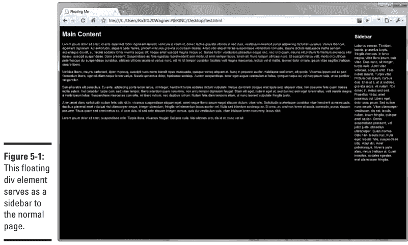

在确定元素在页面上占据的总宽度时，请务必考虑内边距、边框和外边距，以及内容的宽度。

### 使用 clear 微调浮动

使用`float`属性时，你可能偶尔想要进一步控制文档在浮动元素周围的流动。可以使用`clear`属性来阻止元素与浮动面板出现在同一水平空间中。可能的值包括：`left`、`right`、`both`和`none`。

当为元素的`clear`属性分配了`left`、`right`或`both`值时，该元素会被向下推，位于浮动元素下方，并在下一可用行中渲染。

例如，假设你想确保标题显示在浮动图像下方：

```

<h1 style="clear: right">Monkey Sighted at Church</h1>
```

当需要让多张图片或`div`上下堆叠显示，而不是并排显示时，`clear`属性特别有用。为了在页面右侧显示三张图片，我为它们分配了`floatMonth`类：

```
<html>
<head>
</head>
<body>


<p>These images show the results of the last three months
    of the sales performance for Orange Computers</p>
</body>
</html>
```

然后我定义了一个使用`clear`和`float`的 CSS 类：

```
img.floatMonth {
  float: right;
  clear: right;
  margin: 5px;
}
```

`clear`属性强制图片从上到下显示，常规段落文本在左侧并排流动。

### 使用 float 和 clear 创建布局

熟悉了`float`和`clear`属性的操作后，你就可以开始理解这些 CSS 样式在设计页面时所能提供的强大功能。假设你想创建一个带有页眉和页脚的三列页面布局。使用`div`元素作为这些块级区域，基本 HTML 如下：

```
<html>
<head>
<title>Three Column Liquid Layout</title>
</head>
<body>
<div id="header">Header</div>
<div id="leftcolumn">Left column</div>
<div id="rightcolumn">Right column</div>
<div id="bodytext">Main page text goes here.</div>
<div id="footer">Footer</div>
</body>
</html>
```

没有 CSS 的话，这些块级元素会按顺序从上到下显示在页面上。然而，通过使用`float`和`clear`属性，你可以将这种基本结构转换为你所需要的复杂页面布局。

首先，使用以下规则将所有默认的`margin`和`padding`设置改为零：

```
body { margin: 0px; padding: 0px; }
```

接下来，`header`和`footer`的`div`元素需要横跨整个页面宽度（即占据 100% 的宽度）。但是，由于`footer`的`div`元素位于最后，还需要显式使用`clear: both`，以确保它始终位于`leftcolumn`、`rightcolumn`和`bodytext`的`div`元素下方。以下是这两个元素的样式规则：

```
#header {
    width: 100%;
    background-color: #CCCCCC;
}
```

```
#footer {
    width: 100%;
    clear: both;
    background-color: #CCCCCC;
}
```

中间的`div`元素包含页面内容。你将这三个块的宽度定义为基于百分比：`bodytext`列获得 60% 的宽度，`leftcolumn`和`rightcolumn`各获得 20%。`leftcolumn`向左浮动，`rightcolumn`向右浮动，但你也需要将`bodytext`的浮动设置为向左，使其很好地融入这个结构。代码如下：

```
#leftcolumn {
    float: left;
    width: 20%;
    height: 600px;
    background-color: #999999;
}
```

```
#rightcolumn {
    float: right;
    width: 20%;
    height: 600px;
    background-color: #999999;
}
```

```
#bodytext {
    float: left;
    background: #fff;
    width: 60%;
    height: 600px;
}
```


由于此页面布局会根据浏览器窗口的大小展开或收缩，因此通常称为*流式*布局。如果你想固定列的大小，可以将宽度百分比值更改为绝对单位值（例如像素或 ems）。这样做会得到一个*固定*布局，它不基于浏览器窗口的大小，因此不会调整大小。

清单 5-2 展示了此示例的完整代码。

## 清单 5-2：三列流式布局

```
<html>
<head>
<title>Three Column Liquid Layout</title>
<style type="text/css">
body {  margin: 0px; padding: 0px; }

#header {
   width: 100%;
   background-color: #CCCCCC;
}

#footer {
   width: 100%;
   clear: both;
   background-color: #CCCCCC;
}

#leftcolumn {
   float: left;
   width: 20%;
   height: 600px;
   background-color: #999999;
}

#rightcolumn {
   float: right;
   width: 20%;
   height: 600px;
   background-color: #999999;
}

#bodytext {
  float: left;
  background: #fff;
  width: 59%;
  height: 600px;
}
</style>
</head>
<body>
<div id="header">Header</div>
<div id="leftcolumn">Left column</div>
<div id="rightcolumn">Right column</div>
<div id="bodytext">Main page text goes here.</div>
<div id="footer">Footer</div>
</body>
</html>
```

图 5-2 展示了此页面布局在浏览器中的显示效果。

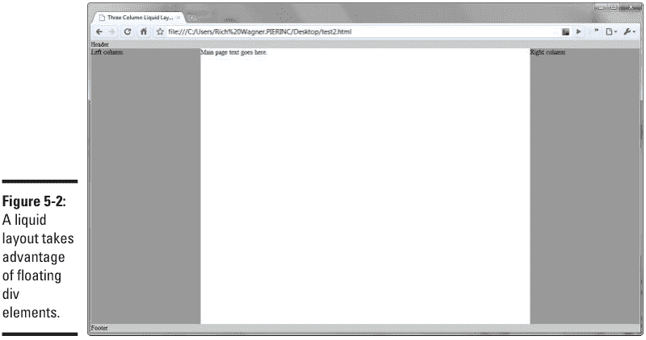

**图 5-2：** 流式布局利用了浮动的 div 元素。

### 文本垂直对齐

`vertical-align`属性规定了文本相对于另一个元素（例如其他文本（如上下标）或图像（如说明文字））在垂直方向上的对齐方式。

`vertical-align`属性可以取以下八个描述性值之一：`bottom`、`baseline`、`middle`、`sub`、`super`、`text-top`、`text-bottom`和`top`。或者你也可以提供一个具体的度量值（例如`4px`，可将上标置于基线上方四像素处）或百分比。

对齐是相对于文本使用的任何`line-height`属性进行的。`vertical-align`的大多数值都是顾名思义的，但`text-bottom`表示忽略基线，并在字体的下伸字底部绘制一条假想线（例如在字母*p*和*y*的底部绘制一条线，它们都有下伸字）。

*基线*（baseline）是在没有下伸字的字符之间绘制的一条假想线。基线是默认的对齐标准，除非你使用`vertical-align`属性另行指定。

### 上标

你可以通过修改垂直对齐来实现上标效果（例如在温度后添加度符号）。上标（和下标）字符通常以比周围文本更小的字体打印（例如脚注编号）。然而，如果你使用`vertical-align`属性来设置上标（或下标），字符的文本大小不会自动缩小。如果你想要这种效果，可以在样式中添加字体大小规格。要获得你想要的效果——既上标又缩小字号——你应该将`super`值与`font-size`属性的缩小百分比结合使用。

以下是一个示例：

```
<html>
<head>
<style type="text/css">
span.super { vertical-align: super; font-size: 70%; }
</style>
</head>
<body>
<p>Hello, I am here to stay<span class="super">SUPERSCRIPT</span>.
</p>
</body>
</html>
```

## 第五册

## JavaScript 与 Ajax

## The 5th Wave

作者：Rich Tennant

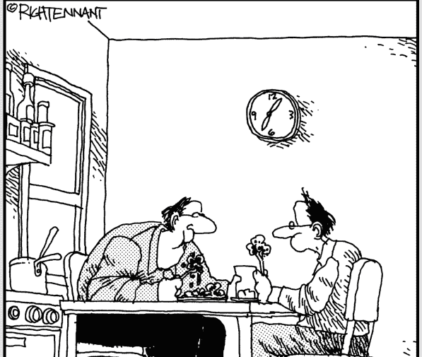

> "炖牛肉真不错，斯坦。对了，你还在自己编写网页脚本吗？"

## 目录一览

| **第 1 章：了解脚本工作原理** | 255 |
| - 概览 JavaScript 脚本语言 | 255 |
| - 使用 script 元素 | 256 |
| - 通过事件处理程序启用 JavaScript | 258 |
| - 将现成的脚本嵌入你的网页 | 259 |
| **第 2 章：JavaScript 编程** | 261 |
| - 一切皆为对象 | 261 |
| - 理解 JavaScript 语法 | 262 |
| - 使用变量 | 269 |
| - 基本条件和表达式 | 272 |
| - 循环起来：使用循环结构 | 275 |
| - 使用函数 | 277 |
| - 运算符随时待命：用 JavaScript 运算符进行连接 | 278 |
| **第 3 章：JavaScript 库与框架** | 281 |
| - 为什么要使用 JavaScript 库？ | 281 |
| - 使用 Prototype | 282 |
| - 探索 jQuery | 285 |
| - 其他库与框架 | 288 |
| **第 4 章：理解文档对象模型** | 289 |
| - 什么是 DOM？ | 289 |
| - 访问 DOM 对象 | 291 |
| - 访问和修改属性 | 294 |
| - 调用对象方法 | 294 |
| - 从 DOM 中添加和移除节点 | 295 |
| - 探索 DOM | 296 |
| **第 5 章：为网页添加事件处理程序** | 307 |
| - 分配事件处理程序 | 307 |
| - 概览事件 | 309 |
| **第 6 章：编写脚本时的实用知识** | 313 |
| - 将脚本存储在外部脚本文件中 | 313 |
| - 创建新浏览器窗口 | 314 |
| - 将脚本附加到链接 | 315 |
| - 即时修改网页 | 316 |
| - 验证表单 | 318 |
| - 对抗垃圾邮件：打乱你的电子邮件链接 | 324 |
| - 检测功能，而非浏览器类型 | 326 |
| - 使用正则表达式 | 326 |
| **第 7 章：Ajax 简介** | 335 |
| - 什么是 Ajax？ | 335 |
| - 探索 XMLHttpRequest | 336 |
| - 创建 Ajax 连接 | 337 |
| - 探索 Ajax 示例 | 341 |

## 第 1 章：了解脚本工作原理

### 本章内容

- 使用`script`元素
- 将脚本与 HTML 元素连接
- 理解 JavaScript 如何向文档添加内容
- 使用事件处理程序触发脚本
- 将现成的脚本添加到你的网页

*我*们要去看望巫师，奥兹国那位了不起的巫师。嵌入网页中的脚本很像奥兹国的"幕后之人"。你可以用它们来提供你网站上一切所需事物的逻辑与控制。因此，当你开始开发越来越复杂的网站时，你会发现这个解决方案的关键部分就是 JavaScript。

在本章中，我还不会深入 JavaScript 编程的细节。相反，我将向你介绍 JavaScript 的工作原理、如何添加到网页中，以及如何在特定事件发生时调用它。

### 概览 JavaScript 脚本语言

HTML 实际上是一种*标记*语言——本质上是一组标签，你将它们放在内容块周围，对其进行分类或描述如何在浏览器中显示。然而，当 HTML 文档由 Web 服务器发送并在浏览器中显示时，该文档无法改变。

HTML 文档用于创建具有图像翻转、自验证表单和动态视觉效果等功能的交互式网页。但仅靠 HTML 文档，它就像一个无生命的雕像。JavaScript "代码"将这个雕像变成了一个功能齐全的移动机器人。

JavaScript 类似于传统的编程语言，如 C++ 或 Java。然而，JavaScript 更易于使用，并且专为 Web 页面内的特定任务而设计。

### 使用 script 元素

JavaScript 允许你访问网页的不同部分，例如表单、图像、整个文档，甚至浏览器窗口。这些部分实际上是编程对象；它们共同构成了*文档对象模型（DOM）*，我将在本迷你书的第 4 章中更充分地讨论它。在使用 JavaScript 时，你创建*脚本*——小型程序——可以控制、修改和转换页面上的各种对象。

所有主流 Web 浏览器都普遍支持 JavaScript，包括 Internet Explorer、Firefox、Google Chrome 和 Safari。DOM 由 W3C 标准组织标准化，但并非所有浏览器（特别是较旧版本）都完全遵守它。因此，在使用 JavaScript 时，你应该定期在多个浏览器中测试你的工作，以确保页面的功能按预期工作。

> 虽然这通常不是问题，但用户可以在浏览器中禁用 JavaScript。因此，请确保你的网站不完全依赖脚本来让用户使用网站功能。

哦，还有最后一件事我应该提一下……虽然名字很相似，但 JavaScript 与 Java（另一种编程语言）没有任何关系。

JavaScript 代码可以在 HTML 文档中的两个位置存在：

- 在`script`元素内部
- 在 HTML 元素的事件处理程序内部。我将在"通过事件处理程序启用 JavaScript"一节中讨论如何做到这一点。

`script`元素作为你想要执行的 JavaScript 代码的容器。`script`元素通常放置在文档头部，但在某些情况下，你也可以将其放置在 body 中。它有一个必需属性`type`，指示脚本的 MIME 类型（`text/javascript`）：

```
<script type="text/javascript">
</script>
```

> 在 HTML 的旧版本中，`script`元素曾有一个`language`属性来指示 JavaScript 的版本。但请注意，此属性在新规范中已*弃用*（被视为过时而放弃）；避免使用它。

### 页面加载时自动执行 JavaScript

JavaScript 代码作为内容插入到`script`元素中，如本例所示：

```
<script type="text/javascript">
alert( 'Welcome to the world of scripting.' );
</script>
```

这个脚本显示一个警告消息框。当脚本被浏览器加载时，`script`元素内部的 JavaScript 命令（如`alert()`）会被处理。在这种情况下，当用户打开页面时，浏览器会显示警告消息框。

如果`script`元素内的代码无法理解，请翻到本小册子的第 2 章，该章介绍了编写 JavaScript 脚本的基础知识。


### 按需执行 JavaScript

并非所有代码都在脚本加载时执行。如果 JavaScript 代码放置在函数内部，则必须通过名称专门调用该函数才能执行。*函数*是以关键字`function`开头的一块代码，具有如下结构：

```
function functionname() {
  // code goes here
}
```

例如，考虑以下 HTML 文件：

```
<!DOCTYPE html PUBLIC "-//W3C//DTD XHTML 1.0 Transitional//EN"
    "http://www.w3.org/TR/xhtml1/DTD/xhtml1-transitional.dtd">
<html xmlns="http://www.w3.org/1999/xhtml">
<head>
<meta http-equiv="Content-Type" content="text/html;
    charset=UTF-8" />
<title>Scripting test</title>
<script type="text/javascript">
alert( 'I show up when this script loads' );

function alertOnDemand() {
  alert( 'I show up only when I am triggered.' );
}
</script>
</head>
<body>
</body>
</html>
```

在这个例子中，第一个`alert()`命令在文档头部加载时触发（见图 1-1）。然而，由于`alertOnDemand()`函数从未被显式调用，第二个警告消息框不会显示给用户。

**图 1-1：** 脚本处理时会显示 JavaScript 消息框。

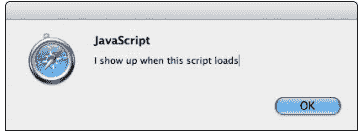

因此，虽然`script`元素包含 JavaScript 代码，但你通常希望从页面上的其他 HTML 元素触发它。

### 使用事件处理器启用 JavaScript

*事件*是网页脚本的核心，是指发生在 DOM 中任何对象上的任何事情——包括所有 HTML 元素、文档，甚至浏览器窗口。页面加载是一个事件，用户点击按钮或用户将鼠标指针移到按钮上方也是事件。

JavaScript 和 HTML 允许你分配一段 JavaScript 代码，在网页中发生特定事件时执行。JavaScript 的事件驱动特性赋予了脚本语言与用户动态交互的能力。

为了连接这些部分，HTML 元素具有事件处理器属性，这些属性本质上连接了 HTML 世界和 JavaScript 世界。例如，`img`元素有一个`onclick`处理器：

```

```

图像正常显示，但当用户用鼠标点击图像时，会调用`openPreview()`函数，这是你编写的一段代码，用于在特殊预览窗口中显示图片的放大视图。

事件处理器内部的代码并不一定要由你在文档其他地方的脚本中创建的函数调用组成。你也可以在其中放置任何类型的 JavaScript 调用。如果你想在用户点击图片时显示警告消息框，可以编写这段代码：

```

```

图 1-2 显示了结果。

**图 1-2：** 此消息框是通过`onclick`处理器内部的 JavaScript 命令显示的。

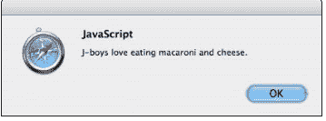

有关使用事件处理器的完整详细信息，请参阅本小册子第 4 章。

### 将现成脚本嵌入你的网页

在你逐渐熟悉 JavaScript 的过程中，务必查看几个提供现成 JavaScript 脚本的网站，你可以快速将其复制并粘贴到你的页面中。然而，这些网站不仅对不懂如何使用 JavaScript 的人有用。对于即使是高级脚本编写者来说，它们也是极佳的资源，因为你不想为了使用流行的脚本技术而重新发明轮子。

你可以找到各种 JavaScript 脚本库网站，但请记住，其中许多网站已经过时且维护不善。有两个网站在保持更新方面做得很好：Dynamic Drive (www.dynamicdrive.com) 和 dhtmlgoodies.com (www.dhtmlgoodies.com)。

## 第 2 章：JavaScript 编程

### 本章内容

- 剖析脚本
- 了解 JavaScript 的基本语法规则
- 发现变量的作用
- 探索条件表达式和循环
- 使用函数和运算符

如果你是脚本编写的新手，查看 JavaScript 代码可能就像在黑暗的房间里寻找出口门：令人困惑。即使迈出一小步，也会撞到或碰翻什么东西。然而，当你的眼睛慢慢开始适应黑暗的环境时，你可以开始分辨出正前方某个障碍物的模糊轮廓。

当你开始使用 JavaScript 时，理解脚本可能看起来令人望而生畏。然而，当你开始让眼睛适应新的环境时，你开始逐渐看到障碍物的阴影和轮廓。

在本章中，我帮你照亮穿越 JavaScript 那些黑暗小巷和缝隙的道路。在介绍了基于对象的编程之后，你会仔细查看一个脚本并剖析它的各个部分。在这样做的过程中，你掌握 JavaScript 的关键语法规则，从而更好地理解你正在使用的代码。然后我会讨论关键的编程结构，包括变量、条件表达式和循环。

### 一切都是关于对象

当你编写脚本时，你主要处理的是 HTML 文档和 JavaScript 语言中的不同对象。现实世界中的对象是你办公室或家里随处可见的任何东西：例如一张桌子、一杯咖啡或一只猫。

同样，脚本中的对象是网页中可能找到的任何元素，例如`table`元素、`a`链接的集合，甚至文档本身。通常，你可以使用两组对象：

- **DOM 对象：** HTML 元素和网页其他部分的脚本等价物。当浏览器创建 HTML 元素时，会同时创建相应的 DOM 对象。因此，在使用它们之前，你不需要在脚本中显式地创建 DOM 对象。

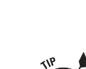

你很可能会把大部分脚本编写时间花在处理 DOM 对象上。这就是为什么你一定要翻到本小册子第 4 章，了解如何使用 DOM 的完整细节。

- **内置 JavaScript 对象：** 一组不直接与 HTML 文档相关的对象。这些对象用于处理数据类型（如字符串和日期）或执行某些实用功能，如数学计算。与 DOM 对象不同，内置 JavaScript 对象不是默认创建的。因此，你必须使用`new`运算符来创建它们。

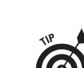

有关内置对象的完整信息，请参阅 Mozilla.org 的在线 JavaScript 参考：http://developer.mozilla.org/en/docs/JavaScript。


JavaScript 中的对象包含属性和方法：

- **属性：** 与对象相关联的属性，有助于描述它。例如，`document`对象有一个`url`属性，指定了网页的位置。
- **方法：** 对象可以执行的操作或行为。`document`对象有一个`getElementById`方法，用于检索具有特定`id`值的第一个元素的引用。

### 理解 JavaScript 语法

开始之前，我想避免立即解释脚本代码是如何工作的。（本书其余部分会这样做！）相反，请先查看脚本中的以下代码：

```
<script type="text/javascript">

/* getParaCount()
       Last modified: 3/29/07
       Developer:      R. Wagner
       Purpose:        Counts the total number of paragraphs in the
                       document
                       and displays the results in a message box.
*/
function getParaCount()
{
var paraCollection = document.getElementsByTagName( 'p' );

var paracollection = 'dummy variable';

var count = paraCollection.length;

// 如果找到匹配项，则显示数量以及第一个段落

if ( count > 0 ) {

    alert("There are exactly " + count + " paragraphs in this HTML document.");

    alert( 'In fact, just for fun, here is the first one: ' + paraCollection[0].

    childNodes[0].nodeValue );

}

// 否则...

else {

    alert( 'Sorry, no paragraphs were found. Try writing one first!' );

}

</script>
```

如果这段代码示例看起来很混乱，别担心。在本节中，我会剖析脚本的各个方面，同时解释一些 JavaScript 编程的基本"规则"。阅读本节，了解如何自己读懂脚本。

## 大小写至关重要

与 XHTML 一样，JavaScript 是区分大小写的。`paraCollection`变量与全小写字母的虚拟变量（`paracollection`）是不同的变量。此外，`var`是定义变量的有效关键字，而使用`VAR`会导致语法错误。

## 分号标记语句结束

JavaScript 中的普通语句几乎可以是任何命令、表达式或赋值操作。查看代码，你会发现每个普通语句都以最常被忽略的标点符号——分号结尾。说实话，JavaScript 很灵活，并不强制使用分号（只要每个新语句都在新行上）。但无论如何，包含分号被认为是良好的编程实践。

## 对象使用点号

在脚本代码中，JavaScript 使用一种称为*点号表示法*的语法约定来操作对象及其属性和方法。在点号表示法中，先列出对象名，接着是一个点，然后是属性或方法的名称。例如，以下代码片段展示了`document`对象的`url`属性和`getElementById`方法如何书写：

```
var myUrl = document.url;

var myLink = document.getElementById( 'newslink' );
```

第二个示例取自示例脚本。看看这段代码：

```
document.getElementsByTagName( 'p' );
```

`getElementsByTagName()`是`document`对象的一个方法，它返回当前网页中所有指定元素的集合。

## 花括号用于包围代码块

在 JavaScript 中，花括号作为脚本各部分的容器。函数（目前，可以将函数视为具有唯一名称的代码模块）使用它们来定义起点和终点。例如，`getParaCount()`函数将所有代码包含在`{ }`花括号内。各种 JavaScript 语句（如示例中的`if...else`）也使用花括号来分隔不同分支中的代码。

脚本编写者经常争论第一个花括号应该与语句开头放在同一行，还是单独放在一行。在本书中，我更倾向于将其与第一个代码段放在同一行，但这对解释器来说没有区别。

## 集合和数组是零索引的

集合和数组是可以包含多个项目的特殊对象。例如，`document.all` DOM 对象是一个包含文档中所有 HTML 元素的集合。数组是一种也可以存储多个项目的变量类型。在这两种情况下，你都可以使用索引数字来访问集合或数组中的特定成员。然而，要访问第一个项目时，你使用的是 0 而不是 1。这是因为集合和数组是零索引的，意味着你从 0 开始计数，而不是从 1 开始。例如，我在示例脚本中使用的以下代码行返回`paraCollection`集合中第一个段落的内容：

```
paraCollection[0].childNodes[0].nodeValue;
```

此外，请记住集合或数组中最后一个项目的索引值将比数组中的元素总数少一。

## 空白无关紧要

代码的间距只对你作为脚本编写者重要，对 JavaScript 解释器来说并不重要。因此，你可以在代码各部分之间添加任意多的空白（使用制表符、空格甚至空行）。（我有在括号后添加空格的习惯。）

## 鼓励添加有助益的注释

注释不会执行；相反，它们描述脚本（或其中特定行）的作用；它们在故障排除时很有帮助。你可以通过两种方式在脚本中添加自己的注释：

- **单行注释**：在一行中添加两个斜杠（`//`）。该行剩余部分的所有内容都被视为注释，会被解释器忽略。在示例中，我使用斜杠来注释`if..else`语句。
- **多行注释**：如果你想添加跨越多行的注释，将其包含在`/*`和`*/`标记之间。顶部描述`getParaCount()`函数的注释向你展示了这是如何工作的。

## 引号有多种选择

你可以使用单引号和双引号来表示字符串字面量（正常文本的 fancy 说法）。只要一对引号的两侧匹配，使用哪种类型都没有关系。在示例代码中，例如，我在第一个`alert()`命令中使用了双引号，然后在剩余两个中使用了单引号。

## 确保你理解匈牙利命名约定

JavaScript 命名约定通常被称为匈牙利命名法。（不，你不需要去布达佩斯才能使用它。）匈牙利命名法要求名称以小写字母开头，而"复合词"中每个后续新词的首字母应大写，所有其他字母小写。除了少数例外，核心 JavaScript 语言和 DOM 都始终使用此约定。

例如，查看示例中的以下代码行：

```
var paraCollection = document.getElementsByTagName( 'p' );
```

`document`是 HTML 文档的对象名称，全部使用小写字母。它的方法`getElementsByTagName`是一个复合词，通过指定的标签名来获取元素。请注意方法名称中其余新词的首字母都是大写的。

为了一致性，我在变量名（`paraCollection`、`count`）中遵循此约定，即使这不是必需的。

## 避免使用保留字

JavaScript 有一组*保留字*，它们是语言的核心部分。你不能在命名变量和函数时使用这些词。以下是 JavaScript 保留字列表：

- abstract
- boolean
- break
- byte
- case
- catch
- char
- class
- const
- continue
- debugger
- default
- delete
- do
- double
- else
- enum
- export
- extends
- false
- final
- finally
- float
- for
- function
- goto
- if
- implements
- import
- in
- instanceof
- int
- interface
- long
- native
- new
- null
- package
- private
- protected
- public
- return
- short
- static
- super
- switch
- synchronized
- this
- throw
- throws
- transient
- true
- try
- typeof
- var
- void
- volatile
- while
- with

## 不同类型的数据

在脚本中，你可以使用各种基本数据类型，包括字符串字面量、数字和布尔值（true/false）。

## 字符串

*字符串字面量*是用单引号或双引号括起来的一串字符。以下示例展示了示例脚本中的字符串字面量：

```
'p'
'dummy variable'
"There are exactly "
" paragraphs in this HTML document."
'In fact, just for fun, here is the first one: '
'Sorry, no paragraphs were found. Try writing one first!'
```

虽然你通常希望将字符串作为字面量来处理，但 JavaScript 也允许你将字符串作为对象来处理。当你想对字符串执行某些操作时，此功能会很有帮助。看看这个示例：

```
var str = new String( 'my life as a bus boy' );

alert( 'Original string is ' + str );

str.toUpperCase();

alert( 'Updated string is ' + str );
```

在此示例中，我使用`new`运算符声明`str`为一个新的 String 对象，并将其赋值为`dummy`。它的原始值会显示给用户，然后调用其`toUpperCase()`方法。`toUpperCase()`方法将字符串转换为大写文本。然后更新后的文本会显示在`alert`消息中。

## 数字

数字可以是整数或浮点数。你甚至可以使用科学记数法、十六进制和八进制数字来显得更花哨。脚本中的数值 0 被用于多种用途。

JavaScript 支持`Number`对象。同样，虽然使用纯数字值更简单，但在需要将其转换为不同表示法（如指数或精度）时，`Number`对象会很有帮助。

## 布尔值

布尔值要么是`true`，要么是`false`，通常用于确定条件是否为真。以下是一个测试名为`confirm`的变量值的示例：

```
if ( confirm == true ) {

    alert( 'You have been confirmed. Do not back out now!' );

}
```

JavaScript 还提供了一种内置的 Boolean 对象类型，尽管大多数脚本编写者很少使用它。

## 数组

*数组*（array）是一个由索引项组成的集合。这些项可以是多种数据类型，例如字符串、数字，甚至对象。你甚至可以在单个数组中混合使用多种数据类型。数组使用`new`运算符来定义：

```
var states = new Array();
```

在创建数组时，你可以通过传递参数来定义数组中的项：

```
var states = new Array( 'MA', 'ME', 'RI', 'VT' );
```

或者，你可以通过列出其索引值或它们在列表中出现的顺序来添加项。索引值由方括号内从零开始的数值指定，例如：

```
states[0] = 'MA';

states[1] = 'ME';

states[2] = 'RI';

states[3] = 'VT';
```

然后，你可以根据索引访问数组中的任何值。例如，要在警告框中显示数组中的第四项，可以使用以下代码行：

```
alert( 'Customer is from ' + states[3] );
```

虽然这个例子展示了如何在数组中存储字符串，但你可以存储任何类型的数据，包括数字、布尔值、对象、函数，甚至`null`值。例如，考虑以下包含多种类型的数组：

```
var kitchenSink = ["fiabo", 1.31, function(){alert("Get a Clue")}, null, false];
```

你可以通过访问其`length`属性来获取该数组中项的数量：

```
var kitchenSink = ["fiabo", 1.31, function(){alert("Get a Clue")}, null, false];

alert(kitchenSink.length);
```

## 变量操作

还记得电视剧*Alias*（《谍影特工》）吗？悉尼·布里斯托是一位秘密特工，也是伪装大师，她每周穿着各种服装来击败邪恶的敌人。JavaScript 可能没有这部电视剧那样惊险的情节、热带地点和反转，但它也有自己的伪装大师：变量。

变量是你想要在 JavaScript 脚本中操作的值的"别名"。换句话说，*变量*（variable）是一个存储另一个值的词。例如，你可以声明一个名为`myName`的变量，其值等于`Rich`。然后，在脚本中任何你想使用`Rich`这个词的地方，都可以用`myName`来代替。

为什么要费这么大劲？为什么不直接在整个脚本中使用字面量字符串`Rich`呢？正如你在本书中将看到的，各种编程任务都需要变量。但最值得注意的是，就像悉尼·布里斯托在某一集中可能会穿多套服装一样，一个变量在脚本运行过程中也可以多次更改其值。因此，变量使你能够创建动态脚本，而不是将所有内容在开始时就定义死。

### 声明和赋值变量

要在脚本中使用变量，你需要声明它。变量通过使用关键字`var`正式定义：

```
var myVariable
```

`var`关键字本质上是在说："嘿，接下来的这个词将是本脚本中的一个变量。" 随后的变量名必须以字母或下划线开头（尽管你可以在单词的其他位置包含数字）。

在 C++ 或 Java 等传统编程语言中，你必须声明存储在变量中的数据类型：例如数字、字符字符串或布尔值（`true`或`false`）。*解释器*（interpreter，一种处理代码的程序）需要知道这类信息。然而，JavaScript 更加灵活，这意味着你不需要指定变量将持有的值的类型。

变量定义之后，可以接收一个值。例如，如果你想将值`Rich`赋值给`myName`，代码片段如下：

```
var myName;

myName = "Rich";
```

我没说过 JavaScript 很灵活吗？你不需要分两步声明变量然后再赋值，而是可以将它们合并为一行代码：

```
var myName = "Rich";
```

正如电视购物广告所说，"等一下——还有更多！" JavaScript 允许你使用快捷记法，这样你就可以在不使用`var`关键字的情况下声明变量并赋予初始值：

```
myName = "Rich";
```

> 虽然你可以使用这种简写记法，但使用`var`关键字可以让你的代码在开发过程中更具可读性且更容易理解。

### 访问变量

变量定义后，你可以在代码中引用该变量，并使用其当前值。请查看以下简短脚本中的代码。`currentName`的值起初是 "Rich"，但随后被重新赋值为用户在对话框提示中输入的值：

```
var currentName = "Rich";

alert( "Hello, my name is" + currentName );

currentName = prompt( "Please enter your name.", "Jimmy Crackcorn" );

alert( "Hello, " + currentName + ". That is a really nice name. And I don't say that to just anyone." );
```

### 剖析变量作用域和生命周期

变量可以具有全局作用域或局部作用域。任何在函数外部定义的变量都是*全局变量*（global variable）——你可以从文档的任何其他部分访问它。在函数内部声明的变量（*局部变量*，local variable）仅对该函数本身可见，并在函数处理完毕后被销毁。

此外，变量定义的位置也很重要。变量只有在声明之后才能被访问。因此，通常你要确保所有全局变量都在文档头部第一个`script`元素开始时定义。

以下代码很好地演示了变量的作用域：

```
<!DOCTYPE html PUBLIC "-//W3C//DTD XHTML 1.0 Transitional//EN" "http://www.w3.org/TR/xhtml1/DTD/xhtml1-transitional.dtd">

<html xmlns="http://www.w3.org/1999/xhtml">

<head>

<meta http-equiv="Content-Type" content="text/html; charset=UTF-8" />

<title>Scoping out Variables</title>

<script type="text/javascript">

// Global variable

var quote = 'Think global.';

// Function

function quoteme() {

    // Local variable

    var quote = 'Act local.'

    alert( quote );

}

alert( quote ); // called when document opens

</script>

</head>

<body>

<form id="form1" name="form1" method="post" action="">

    <input type="button" name="localvar" value="Local" onclick="quoteme();"/>

    <input type="button" name="globalvar" value="Global" onclick="alert( quote );"/>

</form>

<script type="text/javascript">

// Global variable

var quote = 'Think globally with a twist. ';

</script>

</body>

</html>
```

变量`quote`被定义了三次：

- 在顶部的`script`元素中作为全局变量
- 在`quoteme()`函数中作为局部变量
- 在位于文档正文底部的`script`元素中作为全局变量

当文档加载时，`alert()`命令（第一个`script`元素的最后一行）被调用并显示`quote`的当前值，即 'Think global.'。当点击 Local 按钮时，它调用`quoteme()`函数，该函数显示局部版本`quote`变量的值，即 'Act local.'。最后，当点击 Global 按钮时，它显示 'Think globally with a twist.'，因为当底部的`script`元素被处理（在文档加载时）时，全局变量`quote`被重新赋值了一个新值。

### 常量操作

并非所有变量在脚本处理过程中都需要更改值。有时，变量仅仅是一种引用另一个值的便捷方式。事实上，许多编程语言都有*常量*（constants），它们本质上是不改变值的变量。

JavaScript 语言本身没有内置常量的概念。但这不必让你止步。你可以像创建普通变量一样创建常量，但使用特殊的命名约定，使常量和变量易于区分。为了遵循传统语言的惯例，请使用全大写单词，并用下划线分隔不同的单词：

```
var COUNTY = "United States of America";

var PI = 3.14159;

var VERSION_NUMBER = "8.02";
```

你可以在代码中使用常量值的方式与使用变量的方式相同（这很好，因为本质上它就是一个带有大写名称的变量）。

## 基础条件表达式

> "那得看情况。" 你一天之中有多少次会用到这个表达？假设调酒师问："您还要再来一杯啤酒吗？" 你看了看一起开车来酒吧的朋友，说："那得看情况。是我开车，还是你开车？"

JavaScript 同样允许你在脚本中使用三种类型的语句执行条件逻辑：

- if
- if...else
- switch

### if 语句

当你希望在测试表达式为`true`时运行一段代码，就使用`if`语句。其基本结构如下：

```
if ( condition ) {

    // code to execute if condition is true

}
```

例如，考虑以下代码片段：

```
secretcode = prompt( "Enter the secret code.", "" );

if ( secretcode == "moops" ) {

    alert( "You won the contest." );

}
```

当脚本执行时，会向用户显示一个提示对话框。`secretcode`变量存储用户输入的值。然后，`if`语句会判断`secretcode`是否等于`"moops"`。如果是，则会显示一个消息框。否则，`alert()`命令将被跳过。

请注意条件表达式中的双等号——这不是拼写错误。单个等号（`=`）用于给变量赋值，而双等号（`==`）用于比较表达式的左右两侧。

### if...else 语句

`if...else`语句与`if`语句类似，不同之处在于，当表达式求值为`false`时，你也可以运行代码：

```
if ( condition ) {

    // 当条件为 true 时执行的代码

}

else {

    // 当条件为 false 时执行的代码

}
```

这是一个`if...else`语句的实际示例：

```
if ( document.title == 'Home page' ) {

    alert( "Welcome home" );

}

else {

    alert( "Here's where you are instead " + document.title

    );

}
```

此代码检查文档标题是否等于`'Home page'`。如果是，则会显示"欢迎回家"警报消息。如果不是，则会显示替代的警报消息。

### switch 语句

`if`和`if...else`语句非常适合对单个值进行求值，但假设你要检查多个值。`switch`语句正是因此而派上用场。

其基本结构如下所示：

```
switch ( expression ) {

case label1:

  // 如果表达式等于 label1，则执行此代码

  break;

case label2:

  // 如果表达式等于 label2，则执行此代码

  break;

default:

  // 如果表达式与 label1 和 label2 都不同，则执行此代码

}
```

`switch`语句会对条件求值，并查看结果是否等于第一个`case`值。如果是，程序将执行`case`语句中的代码。`break`语句用于阻止`switch`语句的流程继续评估后续的`case`语句。如果未找到匹配项，则执行`default`语句。

这是一个使用`switch`语句通过内置的`Date()`对象来评估当前时间的示例：

```
var d = new Date()

var hr = d.getHours()

switch ( hr ) {

case 8 :

  document.write( "Good morning sunshine." );

  break;

case 12 :

  document.write( "Lunch time!" );

  break;

case 15 :

  document.write( "Afternoon tea with the queen." );

  break;

case 22 :

  document.write( "Time to hit the sack." );

  break;

default:

  document.write( "Come back later." );

}
```

`hr`变量通过`getHours()`方法被赋值为当前小时数。`switch`语句按顺序查看每个`case`语句来对`hr`求值。如果找到匹配项，则执行内部的代码。否则，执行`default`语句。

## 开始循环：使用循环结构

在 JavaScript 开发中，一个常见的需求是能够多次循环执行一个任务，或者直到特定条件发生变化。JavaScript 提供了两种编程结构让你能够"开始循环"：`for`和`while`。`for`循环会循环执行一段代码特定的次数。`while`循环只要特定条件为`true`，就会循环执行一段代码块。

### for 循环

`for`循环可能看起来相当吓人，因为它的结构看起来很像胡言乱语。不过，一旦你理解了各个部分，它就变成了一个相当直接的工具，可以添加到你的脚本工具包中。这是一个循环执行十次的示例：

```
for ( var i=1;i<=10;i++) {

    document.write( "Pass number " + i + "<br/>" );

}
```

以下是不同部分的分解：

- **初始化语句：** `var i=1`语句是初始化部分，表示循环声明并使用一个名为`i`的计数器变量，其起始值为 1。（变量`i`是大多数 JavaScript 循环计数器的标准名称。）
- **条件：** `i<=10`语句表示每次循环时都会评估的条件。只要`i`的值小于或等于 10，该条件就返回`true`。
- **更新语句：** `i++`语句是每次循环后处理的更新语句。在这种情况下，快捷表达式`++`将值递增 1。

这个`for`循环将方括号内的代码块重复执行十次。在第 11 次传递时循环求值为`false`后，脚本继续执行下一行代码。脚本的输出如下所示：

```
Pass number 1
Pass number 2
Pass number 3
Pass number 4
Pass number 5
Pass number 6
Pass number 7
Pass number 8
Pass number 9
Pass number 10
```

在大多数情况下，你可以直接将一个`for`循环结构复制粘贴到你的脚本中。对于大多数目的，你只需要更新两个值（计数器数字和要处理的代码），我在这个例子中通过加粗来表示：

```
for ( var i=1;i<=10;i++) {

    // 代码

}
```

然而，你并不总是需要使用数字。这是一个基于当前文档中链接总数的循环示例：

```
for ( var i=0;i<document.links.length;i++ ) {

    processLink( document.links[i] );

}
```

### while 循环

与`for`循环类似，`while`循环也会多次循环执行一段代码块。然而，虽然`for`循环执行特定次数，`while`循环只要条件求值为`true`，就会执行一段代码块。其通用形式比`for`循环更简单：

```
while( condition ) {

    // 当条件为 true 时要处理的代码

}
```

这是一个示例：

```
while( items > 10 ) {

    document.writeln("Current item count is " + items );

    processOrder( items ); // 虚构的自定义函数

    items++;

}
```

在这个例子中，只要`items`变量小于 10，代码块就会循环执行。在块内部，会写入当前的物品数量，然后调用一个名为`processOrder()`的虚构函数，该函数可用于对订单的当前状态进行操作。最后，`items`变量的值递增 1；`items++`完成了这个任务。

### 使用函数

*函数*是一个命名的 JavaScript 命令和语句组，必须由事件或你的脚本显式调用后才会执行。假设你有一个对表单文本字段执行有效性检查的小脚本。你可以创建一个函数来处理这个过程，然后每当用户离开表单中的任何文本字段时，通过名称调用该函数。

你可以将函数想象成一个处理物料的工厂。现实世界的工厂接收原材料（如钢材），在工厂内部对其进行处理（例如将钢材塑造成部件），然后发送成品（如汽车）。同样，函数可以接受可选的输入值（称为*参数*或*形参*），可以执行特定的过程，并且可以选择向调用它的事件处理程序或代码行返回一个*返回值*。

要定义一个函数，请使用以下结构：

```
function myFunctionName( [param1,param2...] ) {

    // 函数代码放在这里

}
```

为了说明，这里有一个创建 cookie 的函数。该函数名为`addCookie()`，接受三个参数，其中最后一个参数是可选的：

```
function addCookie( cookieName, cookieValue, days ) {

    if ( days ) {

        var dt = new Date();

        dt.setTime( dt.getTime()+ ( days*24*60*60*1000 ) );

        var expdate = "; expires=" + dt.toGMTString();

    }

    else {

        var expdate = "";

    }

    document.cookie = cookieName + "=" + cookieValue +

    expdate + "; path=/";

}
```

要调用此函数，语句如下所示：

```
addCookie( 'username', 'rayman', 90 );
```

`addCookie()`函数根据提供的参数处理其代码，并创建一个 cookie。在这个例子中，没有结果返回给调用该代码的语句。相反，`addCookie()`只是执行其任务然后退出。

第二个示例展示了如何使用`return`命令将值返回给调用语句：

```
function calcTotal( netTotal ) {

    var t = ( netTotal * .05 );

    return t;

}
```

注意：这段代码为了清晰而展开。你可以将两行合并为一行：`return ( netTotal * .05 );`。

当遇到`return`命令时，函数停止执行，并将程序控制权交还给调用该函数的语句。因此，如果你在`return`命令之后放置语句，解释器会忽略它们。

对象的方法基本上与函数相同。唯一的区别在于，方法旨在对其关联的对象执行操作，而函数则是一段更通用的代码，你可以创建它来执行任何你想要的操作。

## 运算符待命：连接 JavaScript 运算符

在这个数字时代，除了特殊需求外，电话接线员的角色早已被遗忘。然而，如果你回想电话的早期岁月，接线员在将呼叫者连接到另一条电话线方面扮演着重要角色。JavaScript 运算符的行为有点像老式的电话接线员，它连接不同的 JavaScript 代码片段。你使用运算符（例如）来相加数字、连接两个字符串、给变量赋值或计算表达式。

表 2-1、2-2、2-3 和 2-4 列出了 JavaScript 中的主要运算符。最常用的是用粗体显示的。

### 表 2-1 赋值运算符

| 运算符 | 示例 | 描述 |
| :--- | :--- | :--- |
| = | x=y | 将 y 的值赋给 x |
| += | x+=y | 等同于 x=x+y |
| -= | x-=y | 等同于 x=x-y |
| *= | x*=y | 等同于 x=x*y |
| /= | x/=y | 等同于 x=x/y |
| %= | x%=y | 等同于 x=x%y（取模） |

### 表 2-2 比较运算符

| 运算符 | 示例 | 描述 |
| :--- | :--- | :--- |
| == | x==y | x 等于 y |
| != | x!=y | x 不等于 y |
| === | x===y | 对值和数据类型都进行求值（例如，如果 x = "5" 且 y = 5，则 x==y 为真，但 x===y 为假） |
| < | x<y | x 小于 y |
| <= | x<=y | x 小于或等于 y |
| > | x>y | x 大于 y |
| >= | x>=y | x 大于或等于 y |
| ?: | x=(y<5) ? -5 : y | 如果 y 小于 5，则将 -5 赋给 x；否则，将 y 赋给 x（称为条件运算符） |

### 表 2-3 逻辑运算符

| 运算符 | 示例 | 描述 |
| :--- | :--- | :--- |
| && | if ( x > 3 && y=0 ) | 逻辑与 |
| \|\| | if ( x>3 \|\| y=0 ) | 逻辑或 |
| ! | if ( ! (x=y) | 逻辑非 |

### 表 2-4 算术运算符

| 运算符 | 示例 | 描述 |
| :--- | :--- | :--- |
| + | x+2 | 加法 |
| - | x-3 | 减法 |
| * | x*2 | 乘法 |
| / | x/2 | 除法 |
| % | x%2 | 取模（除法余数） |
| ++ | x++ | 自增（等同于 x=x+1） |
| -- | x-- | 自减（等同于 x=x-1） |

### 后现代 JavaScript

在 JavaScript 的早期，脚本编写者需要考虑到不支持脚本的浏览器。因此，为了防止 JavaScript 代码搞乱旧浏览器对文档的处理，一种常见的做法是用 HTML 注释将所有脚本代码括起来：

```
<script>

<!--

  // JavaScript code

-->

</script>
```

现在所有浏览器都能处理 script 元素。更重要的是，在 script 标签内使用 HTML 注释违反了 XHTML 标准。在编写自己的 JavaScript 时，请避免这种做法。

## 第 3 章：JavaScript 库和框架

### 本章内容

- 为什么使用 JavaScript 库？
- 介绍 Prototype
- 探索 jQuery
- 其他库和框架概览

也许你在成长过程中曾听父母或祖父母说过这样的话：*我像你这么大的时候，每天得光着脚在两英尺深的雪里走 5 英里去上学，凌晨 5:30 就得出发。* 每个人都喜欢谈论他们当年有多辛苦，而别人相比之下有多轻松——即使在网络世界也是如此。事实上，如果你与一些资深网络开发者共事，你可能会听到类似的故事：*想当年，我们用的是纯 JavaScript。根本没有你们现在用的这些花里胡哨的东西。*

我并不是在为难那些老前辈。嘿，我当年也是在"美好旧时光"里写 JavaScript 的！但当我环顾 Web 2.0 时代的 JavaScript 时，我惊讶于这门"小脚本语言"已经走了这么远。而这种成熟过程，或许在今天可供 JavaScript 开发者使用的丰富库和框架中体现得最为淋漓尽致。

在本章中，我将向你介绍网络上主要的 JavaScript 库。虽然本书的篇幅不足以全面探讨这些强大库的全部能力，但本章将让你预先领略它们的无限可能。

### 为什么使用 JavaScript 库？

直到最近，JavaScript 开发者还只是维护自己的个人 JS 库，并偶尔从网络上获取现成的脚本。但大量的开发者并没有使用*JavaScript 框架*——这些共享的代码库可以处理许多原本需要你自己编写的任务。在过去几年里，一切都改变了。随着核心语言的成熟，遍布网络开发者领域的第三方库也日臻完善。

开发者转向库和框架主要有两个原因：

- **更简单、更高效的代码**：许多框架将核心语言功能封装在快捷方法中。这让你可以编写更少的代码，并简化那些在传统 JavaScript 中可能变得重复且复杂的脚本。
- **避免重复造轮子**：现有的库和框架解决了开发者反复面临的技术问题。因此，你不必自己提出解决方案，而可以利用其他专家已完成的工作。

## 使用 Prototype

Prototype 是一个 JavaScript 框架，它专注于为语言提供面向对象的扩展，同时提供了一个非常流行的 Ajax 库。

> 有关 Prototype 所有功能的完整详情，请访问 www.prototypejs.org。

Prototype 支持 Internet Explorer 6.0 及更高版本、Firefox 1.5 及更高版本、Safari 1.0 及更高版本、Google Chrome 1.0 及更高版本以及 Opera 9 及更高版本。

使用 Prototype 的第一步是从 www.prototypejs.org 下载最新版本。你只需要下载 .js 库文件并将其保存在硬盘上。Prototype 在文件名中包含了版本号。因此，例如我当前使用的版本是 1.6.1，文件名就是 prototype-1.6.1.js。

> 虽然你需要在硬盘上保存一份该文件的主版本，但也要将其复制一份为 prototype.js 文件，并链接到你的网页中。这样，当 Prototype 更新时，你只需更新 prototype.js 文件，而无需更新整个网站中对它的引用。

然后，你用 script 标签将 .js 文件包含在 HTML 文件中：

```
<script type="text/javascript" src="scripts/prototype.js"/>
```

### 使用万能的 $() 方法

Prototype 将其`$()`实用方法称为其"瑞士军刀"，因为你可以用它做很多事情。通过添加一个 id 值作为参数，你可以将其用作`document.getElementById()`的快捷替代品，我将在本书第 4 章中讨论这个方法。例如，考虑清单 3-1 所示的文档。

#### 清单 3-1：example.html

```
<html>

  <head>

    <title>My title</title>

  </head>

  <body>

    <div id="container" class="special">

      <h1 id="header1">Container</h1>

      <p id="p1" class="special">Paragraph 1</p>

      <p id="p2">Paragraph 2</p>

      <p id="p3">Paragraph 3</p>

      <p id="p4" class="special">Paragraph 4</p>

    </div>

  </body>

</html>
```

你可以用以下代码获取对 p1 元素的引用：

```
var para = $("p1");
```

或者，如果你想根据元素的 id 值获取元素数组，你可以向其中添加多个 id 值：

```
var eArr = $("container", "header1", "p1");
```

使用普通的 JavaScript，等效的代码看起来像这样：

```
var co = document.getElementById("container");

var he = document.getElementById("header1");

var pa = document.getElementById("p1");

var eArr = new Array( co, he, pa);
```

开始明白 Prototype 为何有用了么？

### 使用 $$() 方法

`$$()`方法是 Prototype 提供的第二个便捷实用方法。你可以将其用作`document.getElementsByTagName()`的快捷替代品（参见本书第 4 章）。

例如，假设你想获取清单 3-1 所示的 example.html 文件中所有的 p 元素。以下是实现该功能的代码：

```
var pArr = $$('p'); // 返回 p1, p2, p3, 和 p4
```

你也可以使用`$$()`方法通过 CSS 选择器语法来选择元素。例如，要检索 container div 内的所有 p 元素，你可以使用以下代码：

```
var pArr = $$('#container p'); // 返回 p1, p2, p3, 和 p4
```

或者，要获取所有带有 special 类的段落，你可以使用：

```
var pArr = $$('p.special'); // 返回 p1 和 p4
```

### 使用 $F() 方法

Prototype 提供的另一个快捷实用方法是`$F()`。它返回参数所指定的任意表单字段的值。由于获取各种表单元素（例如输入框或组合框）的值可能会变得复杂，`$F()`提供了一个通用接口，使得获取它们的值更加容易。例如，考虑以下表单：

```
<form action="dosomething.php">

  <select id="menu">

    <option value="0" selected>(请选择：)</option>

    <option value="1">披萨</option>

    <option value="2">烤奶酪三明治</option>

    <option value="3">大沙拉</option>

  </select>

  <input type="text" id="fullName">

  <input type="submit" value="提交">

</form>
```

要使用`select`元素的值，可以使用以下代码：

```
alert("您选择了 " + $F("menu"));
```

或者，要获取文本输入框的值，可以使用：

```
alert("我认为您的名字是 " + $F("fullName"));
```

## 尝试 Try.these

Prototype 提供了一个`Try.these()`实用方法，它接受多个函数调用作为参数，并返回第一个未抛出错误的函数调用的结果。当（例如）你正在确定浏览器对特定功能的支持时，这个方法就非常方便了。这里有一个例子：

```
var result = Try.these(

  supportVersion9(),

  supportVersion8(),

  supportLegacy()

);

if (result != undefined)

{

  // 做一些事情

}
```

在这个例子中，`Try.these`块尝试调用`supportVersion9()`方法。如果该方法返回 true，那么`Try.these`就会停止执行其后的方法调用。但是，如果`supportVersion9()`出现了问题，那么`Try.these`块就会继续尝试`supportVersion8()`。然而，如果`supportLegacy()`被调用并且也出现了问题，那么`Try.these`就会返回`undefined`。

## 绑定函数

Prototype 支持*函数绑定*的概念，它允许你将一个函数绑定到一个对象上，这样你就可以使用`this`来引用被绑定的对象。

当你处理事件处理程序时，这项技术可以非常有效。

考虑以下示例：

```
var obj = new Object();

obj.name = "my object";

obj.doSomething = function() { alert(this.name); }

$("button1").click = obj.doSomething.bind(obj);
```

在这个例子中，`obj`的`doSomething()`方法被赋值为`button1`元素的`click`处理程序。但是，如果没有函数绑定，`doSomething()`在被`button1`元素执行时会遇到问题。这是因为在传统的 JavaScript 中，`this`总是指向按钮，因为是它触发了事件。然而，`bind()`方法将关联的对象绑定到该方法上——这使得`doSomething()`中使用的`this`关键字能够引用`obj`。

### 探索 jQuery

如果你认为 Prototype 是一种扩展和简化 JavaScript 的方法，那么 jQuery 实际上会让你重新思考你编写脚本的方式。jQuery 是一个功能极其强大的框架，但确实需要一些时间来适应。

jQuery 兼容 Internet Explorer 6.0 及更高版本、Firefox 3 及更高版本、Safari 3.0 及更高版本、Google Chrome 1.0 及更高版本以及 Opera 9.0 及更高版本。

要开始使用 jQuery，请从 www.jquery.com 下载最新版本。你可以下载最新版本并将其保存在硬盘上。与 Prototype 类似，jQuery 将版本号作为其 .js 文件名的一部分。我在撰写本文时使用的版本是 jquery-1.4.2.min.js。


虽然你需要在硬盘上保留一个主版本文件，但请将其复制为`jquery.js`文件以便链接到你的网页。

当你拥有库文件后，使用`script`标签将其包含在网站的 HTML 文件中：

```
<script type="text/javascript" src="scripts/jquery.js"/>
```

## 使用 jQuery 函数选择元素

与 Prototype 语法相似，jQuery 最基本且最有用的实用方法之一是`$()`，它被称为*jQuery 函数*。你可以使用它来代替`document.getElementById()`，根据你作为参数指定的`id`来选择元素。

要获取`id`为`header1`的`h1`元素（参考清单 3-1），请使用以下代码：

```
var header = $("#header1");
```

注意`id`值前面的`#`。如果你熟悉 CSS，你会认出它（有关级联样式表的信息，请参见第 IV 部分）。这是有意为之的，因为 jQuery 允许你使用 CSS 选择器类型的语法作为`$()`的参数来检索各种元素。例如，要返回`example.html`（参考清单 3-1）中所有类名为`special`的元素，请使用以下代码：

```
$(".special"); // 返回 container, p1, 和 p4
```

或者，要返回`container div`中的所有段落，你可以使用：

```
$("#container p")
```

或者，要在任何`div`中查找任何`p`（一个或多个），你可以使用：

```
$("div p")
```

## jQuery 链式调用

jQuery 的一个关键概念是其能够将多个命令链接在一个调用中。从一个三行脚本开始：

```
$("#container").empty();

$("#container").append("<p>之前的文本已被移除。</p>");

$("#container").css("border", "1px solid black");
```

因为每个 jQuery 方法都返回调用对象，所以你可以将这些调用链接成一行代码：

```
$("#container").empty().append("<p>之前的文本已被移除。</p>").css("border",

    "1px solid black");
```

#### 添加 CSS 样式

jQuery 有多种方式为元素添加 CSS 样式。如果样式已经定义好，那么你可以使用`addClass()`方法将其添加到一个或多个元素上。例如，假设你在样式表中定义了以下 CSS 样式：

```
.highlight { color:#38312; font-weight:bold; }
```

使用 jQuery 函数，将其添加到你选择的所有元素上。要将`.highlight`样式添加到`example.html`（参考清单 3-1）中的所有`p`元素，请使用以下代码：

```
$("p").addClass("highlight");
```

jQuery 还提供了一个方便的`css()`方法，使你能够动态添加 CSS 样式。你可以将样式属性指定为*键/值对象*作为参数。其形式如下：

```
{"name" : "value", "name2" : "value2", ...}
```

例如，要为所有`div`元素添加边框并更改文本颜色，你可以使用：

```
$("div").css({"border":"1px solid black", "color": "#cccccc"});
```

或者，如果你需要更改单个样式属性，你可以添加一个名称/值对作为参数。这里有一个例子：

```
$("p").css("margin", "0px 3px 6px 0px");
```

## 创建元素

jQuery 允许你获取一段任意 HTML 并将其添加到 DOM 中，从而避免了核心 DOM 方法（如`createElement()`或`appendChild()`，请参见本迷你书第 4 章）的复杂性。要做到这一点，只需将 HTML 字符串作为参数添加到`$()`中。然后，要将该参数添加到另一个元素，请使用`appendTo()`。这里有一个例子：

```
$("<p>真不敢相信把这添加到页面如此简单！</p>")

    .appendTo("#container");
```

这行代码将你指定的 HTML 添加到清单 3-1 的`container div`的末尾。

## 创建回调函数

*回调*是传统编程语言中长期以来的一个固定特性。它本质上是一个传递给另一个函数并在父函数完成时触发的函数。然而，直到 jQuery 出现之前，在标准 JavaScript 中甚至不会考虑回调的可能性。在 jQuery 中，这是可能的。

例如，以下代码加载一个外部`.js`文件，并在完成后调用`processComplete()`函数：

```
$.getScript("processnightly.js", processComplete);
```

## 其他库和框架

虽然 Prototype 和 jQuery 是最流行的 JavaScript 框架，但还有其他一些框架值得考虑。

### Mootools

Mootools 是另一个流行的 JavaScript 框架，以其面向对象特性以及允许你执行类似 Flash 的过渡和缓动效果的 Effects 组件而闻名。

Mootools 适用于 Internet Explorer 6.0 及更高版本、Firefox 2.0 及更高版本、Safari 2.0 及更高版本、Google Chrome 1.0 及更高版本以及 Opera 9 及更高版本。

你可以在`mootools.net`下载 Mootools 框架。

### Script.aculo.us

虽然本章讨论的框架更侧重于核心语言和 DOM 扩展，但 Script.aculo.us 是一个专注于用户界面小部件和效果的库。你可以使用它为网页添加拖放、动画、自动完成和用户界面控件。

Script.aculo.us 构建在 Prototype 框架之上，并与之配合良好。

更多信息，请访问`http://script.aculo.us`。

### jQuery UI

jQueryUI 对于 jQuery 来说，就像 Script.aculo.us 对于 Prototype 一样。jQueryUI 构建在核心 jQuery 库之上，将注意力集中在用户界面上。它专注于核心用户界面效果、小部件和动画。

详情请访问`http://ui.jquery.com`。

## 第四章：理解文档对象模型

### 本章内容

- 理解DOM
- 访问DOM中的对象
- 使用属性和方法
- 添加和移除DOM对象
- 探索DOM对象

不花一分钱，现在就来探索DOM吧！

但是且慢……别*太*激动。在你拿出你的詹姆斯·邦德礼服和两个香槟杯之前，我得先说明一下，我不是说要送你一瓶唐培里侬——那款著名的法国气泡酒。实际上我要说的是文档对象模型（DOM），它让你能够以层级树结构的方式来操作HTML文档。

不过，一旦你理解了掌握DOM后所拥有的强大能力，我相信你会比得到一瓶1963年的唐培里侬更加兴奋。

在本章中，我将带你了解DOM，并帮助你探索如何使用它为网页创建交互式脚本。

### 什么是DOM？

*文档对象模型*（*DOM*）是HTML和XML文档的脚本接口。用一种比较 geek 的方式来说，DOM允许你通过脚本来访问、获取甚至修改网页的结构。顾名思义，DOM是一种建模结构，它通过层级关系来描述文档中所有元素之间的关系。DOM还定义了每个对象可用的属性、方法和事件。

DOM是W3C标准，分为三个级别：

**DOM与DOMER**

✔ **级别1：** 包含能够对网页进行DOM脚本操作的核心功能。所有当前浏览器都支持DOM1。

✔ **级别2：** 扩展了支持范围，包括事件监听器和对层叠样式表（CSS）的DOM支持等新功能。现代浏览器通常对DOM2的主要部分提供了良好的支持。

✔ **级别3：** 添加了新的核心功能，包括键盘事件和一种名为XPath的XML相关技术。各浏览器对DOM3的支持程度各不相同。

DOM是W3C——网络标准组织——制定的标准。所有较新的浏览器（例如Chrome、Firefox、Safari、Internet Explorer和Opera）都支持DOM的级别1和级别2版本。（级别1侧重于HTML；级别2对标准进行了改进以支持XML和XHTML文档。）更多内容请参阅"DOM与DOMER"专栏。

你现在可以享受的DOM跨浏览器支持是一个相对较新的现象。当DOM在20世纪90年代末推出时，不同浏览器提供了不同程度的支持，而且往往在标准之上添加了各自特有的扩展。幸运的是，这些问题在较新一代的浏览器中已基本消失。

可以将DOM想象成一种树状结构，它将HTML文档的各部分组织成一个对象节点的层级体系。一个*节点*可以是一个元素、一个属性、一段内容或网页的任何部分。一个节点可以包含其他节点。DOM使用家族术语来描述这些节点之间的关系。父节点包含子节点，同一层级的两个节点被视为兄弟节点。

`document`对象充当这个文档树的"主干"。因为这个对象没有等价的HTML元素，你可以将其视为一种"超级对象"，它包含所有文档元素，包括`html`、`head`和`body`。网页中所有其余元素和其他部分都是`document`的后代节点。

在大多数常见场景中，你只需使用DOM中的HTML元素即可。但从技术上讲，文档树中的节点由元素和内容组成。（元素的内容是容器元素的子节点。）属性不被视为文档树的一部分，而是作为元素对象的属性来访问。

例如，考虑以下基本网页的代码片段：

```
<html>

<head>

<title>Great Novelists Online</title>

</head>

<body>

<h1>Best Opening Lines</h1>

<p id="p1">It was the best of times. It was the worst of times.</p>

</body>

</html>
```

图4-1展示了这段HTML代码作为DOM文档树的样子。

## 访问DOM对象

在脚本中操作DOM对象时，最重要的任务之一就是能够访问你想操作的特定对象或对象集合。DOM提供了多种方式来引用特定的DOM对象。

### 使用点号表示法

要访问特定对象，你需要使用点号表示法，在代码中按照文档对象层级结构来引用它。考虑以下HTML片段：

```
<form id="shippingForm" method="post" action="">

<input type="text" id="firstName" />

</form>
```

要引用表单中的文本输入元素并将其赋值给变量，你需要使用这行代码：

```
var fn = document.shippingForm.firstName;
```

使用点号表示法时，请注意文档的层级结构。例如，以下代码行无法成功返回文本输入元素，因为我省略了包含它的表单引用：

```
var fn = document.firstName; // 此引用不起作用
```

使用点号表示法的一个显著缺点是，由于对象名称是"硬编码"的，在运行脚本时无法更改。接下来四个小节中展示的技术提供了更大的灵活性。

### 使用方括号

你也可以使用方括号来访问对象：

```
document.shippingForm['firstName']
```

对象标识符（即input元素的id值）放在方括号内，并用引号括起来。

### 使用DOM数组

你可以引用多个内置的对象集合。其中最常用的是`document.forms`，它返回文档中所有表单元素的集合。你可以通过索引（即在源码中出现的顺序）来访问它。例如，要访问页面中的第一个表单，使用这行代码：

```
document.forms[0]
```

然而，这种方法存在问题，因为在页面上移动表单会破坏你的脚本。更好的做法是引用表单的id（或name）属性：

```
var cf = document.forms['customer_form'];
```

类似地，要访问一个`form`元素，你可以使用`elements`集合：

```
var ln = document.form['customer_form'].elements['last_name'].value;
```

### 通过id值访问元素

`document`对象的`getElementById()`方法可以获取具有特定`id`属性值的元素。它消除了对层级结构的顾虑，直接定位目标：

```
document.getElementById("elementID")
```

假设你有以下HTML代码：

```
<div id="main_text"></div>
```

你可以使用以下代码来访问该`div`：

```
var main = document.getElementById( 'main_text' );
```

`main`变量现在引用了id为`main_text`的`div`。你现在可以使用`main`来访问其属性并执行相应的方法。

### 通过标签名访问元素

`getElementById()`非常适合在你要获取的元素具有HTML代码中已定义的`id`值时使用。然而，当不存在`id`或者你需要访问多个同类元素时，可以使用`document.getElementsByTagName()`。

`document`对象的`getElementsByTagName()`方法允许你以集合（正式名称为*nodeList*）的形式返回所有具有特定标签名的元素。例如，要获取文档中所有的`div`元素，可以使用以下命令：

```
var divList = document.getElementsByTagName( 'div' );
```

获取元素集合后，你可以通过索引号来访问列表中的特定`div`。例如，要访问文档中的第一个`div`，写入以下代码：

```
var div1 = divList[0];
```

或者，如果你不需要单独使用集合，可以将两行代码合并为一行：

```
var div1 = document.getElementsByTagName('div')[0];
```

如果你想检索文档中所有元素的集合，可以使用星号代替标签名称：

```
var allElements = document.getElementsByTagName('*');
```

`allElements`变量按照元素在 HTML 源码中出现的顺序引用所有元素。

### 访问和修改属性

正如我在本小册子第 2 章中所讨论的，*属性*（property）是与对象相关联的特性，用于帮助描述该对象。DOM 对象的许多常见属性与 HTML 元素的特性（attributes）相对应。例如，`bgColor`是`body`对象的属性，而`action`是表单（form）的属性。

JavaScript 允许你在脚本中访问这些属性。假设你定义了以下`img`元素：

```

```

你可以使用以下代码在 JavaScript 中更改该图片的`src`值：

```
document.getElementById('houseImage').src = "images/Colonial22.jpg";
```

或者，你也可以对任何 DOM 对象使用`setAttribute()`方法来执行相同的任务。例如，考虑以下 HTML 代码行：

```
<p id="intro">This is a test</p>
```

你可以通过以下任一命令将`align`属性设置为右对齐：

```
// 通过调用方法设置属性

document.getElementById('intro').setAttribute('align', 'right');

// 通过直接访问设置属性

document.getElementById('intro').align = 'right';
```

### 调用对象方法

*方法*（method）定义了对象的动作或行为。方法的名称通常是一个面向动作的词，指示调用它时会发生什么。例如，`submit()`方法触发表单提交到服务器进行处理，而`document`的`write()`方法使你能够向网页"写入"新内容。

同样，使用点符号语法来引用你想要操作的对象。以下是一些示例：

```
document.write( 'I am adding new text from my script.' );

document.forms['form1'].submit();

document.forms['form1'].elements['moreButton'].click();
```

### 向 DOM 添加和删除节点

DOM 提供了通过 JavaScript 添加和删除元素及内容的能力。

### 添加新节点

DOM 中的每个 HTML 元素都有`appendChild()`和`insertBefore()`方法，你可以使用它们将新元素添加到文档树中。考虑以下 HTML 片段：

```
<h1>Welcome to World@Large</h1>

<div id="sidebar"></div>
```

假设你想在`div`内部添加一个新段落，并在其正上方添加另一个新段落。以下是实现该功能的代码：

```
// 创建 p 节点（稍后我会将其放入正确位置）

var p1 = document.createElement( 'p' );

// 分配一个 id 属性

p1.setAttribute( 'id', 'insideDiv' );

// 为段落内容创建文本节点

var p1_content = document.createTextNode( 'This web site is

    used for...' );

// 将内容添加到段落中

p1.appendChild( p1_content );

// 将段落作为子节点添加到 sidebar div 下

document.getElementById( 'sidebar' ).appendChild( p1 );
```

若要在`div`元素之前添加第二个段落，请执行以下操作：

```
var p2 = document.createElement( 'p' );

p2.setAttribute( 'id', 'subheading' );

var p2_content = document.createTextNode( 'I hope you enjoy

    your stay' );

p2.appendChild( p2_content );

document.getElementById( 'sidebar' ).insertBefore( p2 );
```

### 删除 DOM 对象

你可以通过引用元素的`parentNode`属性并调用其`removeChild()`方法来删除一个 DOM 对象。

例如，要删除一个`id="intro"`的段落，请使用以下代码片段：

```
var para = document.getElementById( 'intro' );

para.parentNode.removeChild( para );
```

在这个例子中，`para`变量引用了`intro`段落。然后你需要使用`parentNode`属性来操作它的父节点。在引用父节点后，调用其`removeChild()`方法，并指定`para`为要删除的节点。随后，该段落将从 DOM 中（以及浏览器中网页的实时版本中）被删除。

你可以通过循环遍历所有子节点，逐个删除它们，从而删除一个元素的所有子节点：

```
while ( div_content.childNodes[0] ) {

  div_content.removeChild( div_content.childNodes[0] );

}
```

或者，就像印第安纳·琼斯直接开枪射击凶猛的剑客而不是与他比剑一样，你可以直接祭出"大杀器"，使用`innerHTML`属性来清除所有 HTML 内容：

```
div_content.innerHTML = '';
```

但请注意，`innerHTML`并非 W3C DOM 标准的一部分（尽管主流浏览器普遍支持它）。

## 探索 DOM

一份完整无缺、包含每一个比特和字节的 DOM 参考指南是一个相当庞大的怪物。在处理 DOM 时，你必须考虑如此多的变量，包括以下列表中的内容：

- ◆ 三个 W3C 标准（Level 1, Level 2, 和 Level 3）
- ◆ 仅在某个浏览器中引入而在其他浏览器中没有的对象、属性或方法
- ◆ 在所有主流浏览器中都实现了，但并非 W3C 标准正式一部分的对象、属性或方法
- ◆ 在最新浏览器中支持但在旧版本中不支持的部分

因此，本节重点关注网页设计人员（如你）主要使用的 DOM 部分，以便创建在所有主流浏览器中都能运行的脚本。如需在网上获取更多详细信息，请查看以下四个资源：

- Mozilla.org (Firefox) DOM 参考: http://developer.mozilla.org/en/docs/Gecko_DOM_Reference
- Microsoft DHTML 参考: http://msdn.microsoft.com/en-us/library/ms533050.aspx
- JavaScript Kit DOM 参考: www.javascriptkit.com/domref/index.shtml
- Quirksmode.org: www.quirksmode.org/dom/contents.html

## HTML 元素

DOM 中的每个 HTML 元素都拥有与该元素特性相对应的属性。（例如，DOM 中的 body 元素具有`alink`和`bgColor`属性，而`a`元素具有`href`和`target`属性。）然而，所有 HTML 元素都有一组共同的属性、方法和事件，分别如表 4-1、4-2 和 4-3 所示。

*注：* 表 4-3 中列出的事件在本小册子的第 5 章（涵盖事件处理器）中定义。

| 属性名称 | 适用范围 |
| --- | --- |
| attributes | 元素的所有特性（只读） |
| childNodes | 元素的所有子节点（只读） |
| className | 元素的 class |
| clientHeight | 元素的内部高度（只读） |
| clientWidth | 元素的内部宽度（只读） |
| dir | 元素的方向性 |
| firstChild | 第一个直接子节点（只读） |
| id | `id`特性 |
| innerHTML | 元素的标记和内容 |
| lang | 元素特性、文本和元素内容的语言 |
| lastChild | 最后一个直接子节点（只读） |
| localName | 限定元素名称的本地部分（只读） |
| name | `name`特性 |
| namespaceURI | 此节点的命名空间 URI（只读） |
| nextSibling | 树中紧跟在给定节点之后的节点（只读） |
| nodeName | 节点的名称 |
| nodeType | 代表节点类型的数字 —— 元素为 1（只读） |
| nodeValue | 节点的值；元素为 null（只读） |
| offsetHeight | 元素的高度（只读） |
| offsetLeft | 元素左边界到其`offsetParent`左边界的距离（只读） |
| offsetParent | 所有偏移计算的基准元素（只读） |
| offsetTop | 元素上边界到其`offsetParent`上边界的距离（只读） |
| offsetWidth | 元素的宽度（只读） |
| ownerDocument | 此节点所属的文档（只读） |
| parentNode | 父元素（只读） |
| prefix | 节点的命名空间前缀（只读） |
| previousSibling | 树中紧在元素之前的节点（只读） |
| scrollHeight | 滚动视图高度（只读） |
| scrollLeft | 元素的左滚动偏移量 |
| scrollTop | 元素的顶滚动偏移量 |
| scrollWidth | 元素的滚动视图宽度（只读） |
| style | 样式属性（只读） |
| tabIndex | 元素在 Tab 顺序中的位置 |
| tagName | 元素的标签名称（只读） |
| textContent | 元素（及其后代）的文本内容 |

## 表 4-2 HTML 元素 DOM 方法

| 方法名称 | 功能描述 |
| :--- | :--- |
| addEventListener( type, handler, bubble ) | 注册一个特定的事件处理器 |
| appendChild( appendedNode ) | 将一个节点作为元素的最后一个子节点插入（返回一个 Node） |
| blur() | 移除元素的键盘焦点 |
| click() | 模拟点击 |
| cloneNode( deep ) | 克隆一个节点（如果 deep = true，则克隆其所有内容）（返回一个 Node） |
| dispatchEvent( event ) | 将一个事件分派到此节点（返回一个布尔值） |
| getAttribute( name ) | 获取指定属性的值（返回一个 Object） |
| getAttributeNS( namespace, name ) | 获取具有指定名称和命名空间的属性的值（返回一个 Object） |
| getAttributeNode( name ) | 获取指定名称属性的节点（返回一个 Attr） |
| getAttributeNodeNS( namespace, name ) | 获取具有指定名称和命名空间的属性的节点表示形式（返回一个 Attr） |
| getElementsByTagName( name ) | 获取所有具有特定标签名的后代元素集合（返回一个 NodeSet） |
| getElementsByTagNameNS( namespace, name ) | 获取所有具有特定标签名和命名空间的后代元素集合（返回一个 NodeSet） |
| hasAttribute( name ) | 检查当前元素是否具有指定的属性（返回一个布尔值） |
| hasAttributeNS( namespace, name ) | 检查当前元素是否在指定的命名空间中具有指定的属性（返回一个布尔值） |
| hasAttributes() | 检查当前元素是否具有任何属性（返回一个布尔值） |
| hasChildNodes() | 检查当前元素是否具有任何子节点（返回一个布尔值） |
| insertBefore( insertedNode, adjacentNode ) | 在第二个节点之前插入第一个节点（返回一个 Node） |
| normalize() | 清理元素包含的所有文本节点（合并相邻的、移除空的） |
| removeAttribute( name ) | 移除指定名称的属性 |
| removeAttributeNS( namespace, name ) | 移除具有指定名称和命名空间的属性 |
| removeAttributeNode( name ) | 移除指定名称属性的节点表示形式 |
| removeChild( removedNode ) | 移除一个子节点（返回一个 Node） |
| removeEventListener( type, handler ) | 移除一个事件监听器 |
| replaceChild( insertedNode, replacedNode ) | 用另一个子节点替换当前子节点（返回一个 Node） |
| scrollIntoView( alignWithTop ) | 滚动文档直到当前元素进入视图 |
| setAttribute( name, value ) | 设置指定属性的值 |
| setAttributeNS( namespace, name, value ) | 设置具有提供的名称和命名空间的指定属性的值 |
| setAttributeNode( name, attrNode ) | 设置指定名称属性的节点表示形式 |
| setAttributeNodeNS( namespace, name, attrNode ) | 设置具有指定名称和命名空间的属性的节点表示形式 |

## 表 4-3 HTML 元素 DOM 事件

| 事件名称 |
| :--- |
| `onblur` |
| `onchange` |
| `onclick` |
| `ondblclick` |
| `onfocus` |
| `onkeydown` |
| `onkeypress` |
| `onkeyup` |
| `onmousedown` |
| `onmousemove` |
| `onmouseout` |
| `onmouseover` |
| `onmouseup` |
| `onresize` |

## document 对象

`document`对象是 DOM 树的根节点，它没有对应的 HTML 元素——例如，`html`、`head`和`body`元素都包含在`document`中。它充当与 HTML `document`相关的一切内容的主控制器。表 4-4 和表 4-5 分别描述了其属性和方法。

## 表 4-4 document 属性

| 属性名称 | 适用范围 |
| :--- | :--- |
| `alinkColor` | 活动链接的颜色（已弃用） |
| `anchors` | 文档中的锚点列表 |
| `applets` | 文档中的小程序有序列表 |
| `bgColor` | 背景颜色（已弃用） |
| `body` | 对 body 元素的引用（只读） |
| `contentType` | 来自 MIME 头部的 Content-Type |
| `cookie` | 用分号分隔的 cookie 列表 |
| `defaultView` | 对 window 对象的引用 |
| `doctype` | 当前文档的文档类型定义（DTD）（只读） |
| `documentElement` | 作为文档直接子元素的元素——即`html`元素（只读） |
| `domain` | 当前文档的域名 |
| `embeds` | 文档内的嵌入对象列表 |
| `fgColor` | 前景或文本颜色（已弃用） |
| `firstChild` | 子节点列表中的第一个节点 |
| `forms` | 文档内的表单元素列表 |
| `images` | 文档中的图像列表 |
| `lastModified` | 文档最后修改的日期 |
| `linkColor` | 超链接的颜色（已弃用） |
| `links` | 文档中的超链接列表 |
| `plugins` | 可用插件列表 |
| `referrer` | 链接到本文档的页面的 URI |
| `styleSheets` | 与文档关联的样式表列表 |
| `title` | 当前文档的标题 |
| `URL` | 当前文档的 URL |
| `vlinkColor` | 已访问超链接的颜色（已弃用） |

## 表 4-5 document 方法

| 方法名称 | 功能描述 |
| :--- | :--- |
| `close()` | 关闭文档流（在写入之后） |
| `createAttribute()` | 创建新属性 |
| `createDocumentFragment()` | 创建新的文档片段 |
| `createElement(tagName)` | 使用提供的标签名创建新元素 |
| `createEvent()` | 创建事件 |
| `createRange()` | 创建`Range`对象 |
| `createTextNode()` | 创建文本节点 |
| `getElementById()` | 返回对指定元素的引用 |
| `getElementsByName()` | 返回具有给定名称的元素列表 |
| `getElementsByTagName()` | 返回具有指定标签名的元素列表 |
| `importNode()` | 返回从外部文档克隆的节点 |
| `write()` | 将文本写入文档 |
| `writeln()` | 将一行文本写入文档 |

## window 对象

window 对象是用于控制浏览器窗口而非窗口内部文档的控制器。因为 window 不与文档交互，W3C 一直避免将 window 对象纳入其标准。尽管各种浏览器单独支持不同的属性、方法和事件，但表 4-6、4-7 和 4-8 列出了在所有主要浏览器中通常都能工作的那些。

## 表 4-6 window 属性

| 属性名称 | 适用范围 |
| :--- | :--- |
| `defaultStatus` | 窗口状态栏文本 |
| `document` | 对关联文档的引用 |
| `frames` | 窗口中的框架数组 |
| `history` | 对 history 对象的引用 |
| `length` | 窗口中的框架数量 |
| `location` | 窗口的 URL |
| `name` | 窗口名称 |
| `navigator` | 对 navigator 对象的引用 |
| `opener` | 对打开当前窗口的窗口的引用 |
| `parent` | 对当前窗口（或子框架）父级的引用 |
| `self` | 对 window 对象本身的引用 |
| `status` | 浏览器底部状态栏中的文本 |
| `top` | 对窗口层级中最顶层窗口的引用 |
| `window` | 对当前窗口的引用 |

## 表 4-7 window 方法

| 方法名称 | 功能描述 |
| :--- | :--- |
| `alert()` | 显示一个警告对话框 |
| `blur()` | 将焦点移出窗口 |
| `clearInterval()` | 取消使用 setInterval() 设置的重复执行 |
| `clearTimeout()` | 结束先前设置的延迟 |
| `close()` | 关闭窗口 |
| `confirm()` | 显示供用户响应的消息框 |
| `focus()` | 将焦点设置到窗口 |
| `moveBy()` | 将窗口移动指定的量 |
| `moveTo()` | 将窗口移动到指定的坐标 |
| `open()` | 打开新窗口 |
| `openDialog()` | 打开新的对话框窗口 |
| `print()` | 显示打印对话框以打印文档 |
| `prompt()` | 显示对话框，然后返回用户输入的文本 |
| `resizeBy()` | 按指定的量调整当前窗口大小 |
| `resizeTo()` | 调整窗口大小 |
| `scroll()` | 将窗口滚动到文档中的特定位置 |
| `scrollBy()` | 按指定的量滚动窗口中的文档 |
| `scrollTo()` | 滚动到文档中的特定坐标集 |
| `setInterval()` | 执行函数，每隔 xx 毫秒发生一次 |
| `setTimeout()` | 指定执行函数的延迟时间 |

## 表 4-8 window 事件

| 事件名称 |
| :--- |
| `onblur` |
| `onerror` |
| `onfocus` |
| `onload` |
| `onresize` |
| `onunload` |

## form 对象

`form`对象是`form`元素的脚本化等价物。你使用表单从用户处获取信息，并将数据提交到 Web 服务器进行处理。表 4-9 和表 4-10 分别列出了它的属性和方法。

**表 4-9：form 属性**

| 属性名 | 适用于 |
|---|---|
| `elements` | 包含在 form 元素中的表单控件列表（只读） |
| `length` | form 元素中的控件数量（只读） |
| `name` | 当前 form 元素的名称 |
| `acceptCharset` | 当前表单支持的字符集列表 |
| `action` | form 元素的 action |
| `enctype` | form 元素的内容类型 |
| `encoding` | form 元素的内容类型 |
| `method` | 用于提交表单的 HTTP 方法 |
| `target` | action 的目标 |

**表 4-10：form 方法**

| 方法名 | 作用 |
|---|---|
| `submit()` | 提交表单 |
| `reset()` | 重置表单 |

## table 对象

`table`对象是`table`元素的脚本化接口。你可以使用 DOM 接口来添加和移除表格的各个部分。表 4-11 和表 4-12 分别展示了支持的属性和方法。

**表 4-11：table 属性**

| 属性名 | 适用于 |
| :--- | :--- |
| `align` | 表格的对齐方式 |
| `bgColor` | 背景颜色（已弃用） |
| `border` | 表格边框 |
| `caption` | 表格标题（只读） |
| `cellPadding` | 单元格内边距 |
| `cellSpacing` | 单元格间距 |
| `rows` | 表格中的行集合（只读） |
| `summary` | 表格摘要（只读） |
| `tBodies` | 表格主体集合（只读） |
| `tFoot` | 表格页脚（只读） |
| `tHead` | 表格页头（只读） |
| `width` | 表格宽度 |

**表 4-12：table 方法**

| 方法名 | 作用 |
| :--- | :--- |
| `createCaption()` | 为表格创建新标题 |
| `createTFoot()` | 创建表格页脚 |
| `createTHead()` | 创建表格页头 |
| `deleteCaption()` | 移除表格标题 |
| `deleteRow()` | 移除一行 |
| `deleteTFoot()` | 移除表格页脚 |
| `deleteTHead()` | 移除表格页头 |
| `insertRow()` | 插入新行 |

## 第 5 章：向你的网页添加事件处理程序

### 本章内容

- 将 JavaScript 事件链接到 HTML 元素
- 在代码中连接事件处理程序
- 熟悉 JavaScript 事件处理程序

在本小书的第 1 章中，我谈到了脚本在创建动态、交互式页面时的实用性。然而，脚本之所以能做到这一点，是因为它被浏览器窗口内发生的事件所驱动：鼠标移动、按键按下、文档加载、表单值改变。JavaScript 可以捕获这些事件中的每一个，然后允许你在这些事件发生时执行任何你想要的脚本。

在本章中，你将了解如何将基于脚本的事件处理程序分配给文档事件。你还将了解 JavaScript 中可用的事件种类。

## 分配事件处理程序

JavaScript 中的事件处理程序定义方式有两种：

- **从 HTML 元素：** 将 JavaScript 函数或表达式与 HTML 元素的事件处理属性链接起来。
- **在 JavaScript 代码中：** 在脚本中将 JavaScript 函数分配给事件处理程序。

我将在下面的章节中详细介绍这两种策略。

### 从 HTML 元素链接

HTML 中的许多元素都有与之关联的事件。例如，`img`元素有`onmouseover`事件，`a`链接元素有`onclick`事件。你可以告诉浏览器在这些事件之一发生时运行一段脚本代码。为此，你向元素添加一个属性（事件名）。该属性的值是对 JavaScript 函数的调用或一段 JavaScript 代码片段：

```
<element onevent="myFunction()" />
```

或

```
<element onevent="alert( 'event fired' )" />
```

例如，body 元素支持 onload 属性，form 元素支持 onsubmit 属性。如果你想基于这些事件触发动作，你可以这样将两个 HTML 元素与 JavaScript 代码连接起来：

```
<head>

<script type="text/javascript">

function init() {

  // Initialize something

}

function checkFormValues() {

  // Check form values

}

</script>

</head>

<body onload="init()">

<form id="myform" onsubmit="checkFormValues()">

</form>

</body>
```

当文档主体加载时，`init()`函数被调用。然后，当用户提交表单时，`checkFormValues()`函数也会被执行。

第二个例子在事件处理程序中使用了 JavaScript 语句：

```
<span onmouseover="this.style.backgroundColor='yellow';this.style.border='2px

    solid black';" onmouseout="this.style.backgroundColor='white';this.style.

    border='none';">"Why do you suppose it was Reuben?" Mrs. Ellison asked the

    master.

</span>
```

当鼠标指针悬停在 span 元素上时，背景变为黄色并显示边框。当鼠标指针移出 span 元素区域时，样式恢复正常。`this`关键字指的是触发该事件的对象，在本例中是 span 元素。

## 在代码中连接事件处理程序

你也可以在代码本身中将函数分配为事件的事件处理程序。例如，与其向 body 添加 onload 属性、向 form 元素添加 onsubmit 属性（如我之前所做的那样），你可以在脚本中添加以下代码片段：

```
<head>

<script type="text/javascript">

function init() {

    // Initialize something

}

function checkFormValues() {

    // Check form values

}

window.onload = init;

var iform = document.getElementById( 'myform');

iform.onsubmit = checkFormValues;

</script>

</head>

<body>

</body>
```

`window.onload`事件被分配了`init()`函数。然而，请注意，当你在代码中分配事件处理程序时，不要添加闭合括号。表单的分配方式也相同。

当你通过将其链接到 HTML 元素来分配事件处理程序时，你可以在处理器中直接添加 JavaScript 语句（如前面的示例所示）。然而，当你在代码内部分配事件处理程序时，必须将事件分配给函数名。

## 事件概览

你可以在 JavaScript 中使用多种不同的事件。表 5-1、5-2、5-3、5-4 和 5-5 将这五个类别的事件分别列出。

**表 5-1：用户界面事件**

| 事件 | 发生时机 | 适用于 |
| --- | --- | --- |
| Onload | 文档已完全加载（包括图像和其他外部内容） | window |
| Onunload | 文档已卸载（例如，跳转到另一页面或关闭浏览器窗口） | window |
| Onresize | 浏览器窗口已调整大小 | window |
| `Onscroll` | 页面或任何带有 CSS 属性`overflow: flow`的元素正在滚动 | `document`和任何可以有滚动条的元素（例如`div`） |
| `Onblur` | 对象失去输入焦点 | `window`、表单元素、任何带有 tab index 属性的元素、`link`（某些浏览器） |
| `Onfocus` | 对象获得输入焦点 | `window`、表单元素、任何带有 tab index 属性的元素、以及`link`（某些浏览器） |
| `Oncontextmenu` | 用户触发右键弹出菜单 | `document`和所有可见元素（并非所有浏览器都支持） |

**表 5-2：鼠标事件**

| 事件 | 发生时机 | 适用于 |
|---|---|---|
| `onmousedown` | 用户在元素上按下鼠标按钮 | 任何可见元素 |
| `onmouseup` | 用户在元素上释放鼠标按钮 | 任何可见元素 |
| `onclick` | 在同一元素上同时发生鼠标按下和释放动作（在`mousedown`和`mouseup`事件后触发） | 任何可见元素 |
| `ondblclick` | 在元素上快速双击鼠标按钮 | 任何可见元素 |
| `onmousemove` | 用户在元素上滚动鼠标指针（重复触发） | 任何可见元素 |
| `onmouseover` | 用户首次将鼠标指针移入元素区域（触发一次） | 任何可见元素 |
| `onmouseout` | 用户将鼠标指针移出元素边框 | 任何可见元素 |

## 键盘事件

| 事件 | 触发时机 | 适用对象 |
| :--- | :--- | :--- |
| onkeydown | 用户按下按键 | window、document 以及所有可接收焦点的可视元素 |
| onkeyup | 用户释放按键 | window、document 以及所有可接收焦点的可视元素 |
| onkeypress | 用户既按下又释放按键（在 keydown 和 keyup 事件之后触发） | document 以及所有可接收焦点的可视元素 |

## 表单事件

| 事件 | 触发时机 | 适用对象 |
| :--- | :--- | :--- |
| onchange | 表单元素失去焦点且其值已更改 | 基于文本的输入框、textarea、select 元素 |
| onselect | 用户在文本框中选中文本 | 基于文本的输入框、textarea |
| onsubmit | 用户提交表单（通过点击提交按钮）；通过脚本调用提交时不会触发 | form |
| onreset | 用户或脚本重置表单 | form |

## 其他事件

| 事件 | 触发时机 | 适用对象 |
| :--- | :--- | :--- |
| error | 图像未能正确加载或发生脚本错误 | window、img |
| abort | 图像完成加载前，页面加载被停止（此事件实际用处不大） | img、object |

# 第六章：编写脚本时需要了解的实用知识

### 本章内容

- 通过`.js`文件在整个网站中复用脚本
- 从脚本中打开浏览器窗口
- 从链接执行脚本
- 动态更新网页
- 验证表单值
- 混淆电子邮件地址以避免垃圾邮件
- 测试功能特性，而非浏览器类型
- 使用正则表达式

在你对 JavaScript 有了基本了解之后，是时候付诸实践，将这些新学到的知识应用于为网站开发脚本了。在实践过程中，你会遇到一些希望用 JavaScript 来执行的常见任务。将本章作为指南，在编写脚本时，你会发现其中有许多有用的提示和技巧。

## 将脚本存储在外部脚本文件中

你可以将文档的所有脚本代码放置在一个`<script>`元素中。到目前为止，在这本小册子中，所有示例都是这样展示的。然而，`<script>`元素有一个可选的`src`属性，可以引用一个外部的`.js`文件。`.js`文件就是一个包含 JavaScript 代码的纯文本文件。下面是一个引用包含通用表单验证例程的`.js`文件的示例：

```
<script type="text/javascript" src="valform.js"></script>
```

> **提示**
>
> 当存在`src`属性时，放置在`<script>`元素开始和结束标签之间的任何代码都将被忽略。

将脚本代码放在`.js`文件中的最大优势在于，你可以轻松地在整个网站中复用相同的例程。假设你有一个创建悬停按钮的脚本。你可以将代码复制粘贴到所有页面中，或者将代码创建在一个单独的`.js`文件中，然后只需通过`<script src="" />`引用指向该代码即可。

> 记住：`.js`文件的内容是纯 JavaScript。就像你不能在`script`标签内放置 HTML 元素一样，你也不能在外部脚本文件中添加任何标记。

### 创建新的浏览器窗口

你可能偶尔需要在用户进入网站或执行特定操作时打开一个新的浏览器窗口。你可以使用 JavaScript 通过`window`对象的`open()`方法来创建新的浏览器窗口。语法如下：

```
window.open( 'url', 'windowName' [, 'featuresList'] )
```

`url`参数是一个字符串，指定要指向的 URL。`windowName`参数是一个字符串字面量，作为新窗口的名称。你可以在代码的其他地方引用这个名称。下面是一个打开新窗口的基本调用：

```
window.open( 'http://www.digitalwalk.net/more.html',

'moreWin' );
```

`open()`方法有一个返回值，它引用新创建的`window`对象。虽然你*不必须*对返回值做任何显式操作，但我强烈建议你这样做。这样做可以让你正确地处理对新窗口的引用。例如，以下代码片段打开一个新窗口，然后在新窗口中执行`document.write`命令：

```
var moreWindow = window.open( 'http://www.digitalwalk.net/

more.html', 'moreWin' );

moreWindow.document.write( 'Peek-a-boo. I am writing this

from a different window' );
```

> 警告！：切勿将`windowName`参数留空字符串，因为不同的浏览器会产生不同的结果。

然而，如果你只是想打开一个新的普通窗口，通过使用 a 标签上的`target="_blank"`属性，你可以同样轻松地实现，而无需编写脚本。这就是`window.open()`真正强大之处在于其可选的功能特性列表。使用此参数，你可以指定新浏览器窗口打开时的外观。该参数是一个逗号分隔的字符串字面量，包含表 6-1 所示的部分或全部功能的名称-值对。

| 参数 | 作用 |
| --- | --- |
| Status | 显示或隐藏窗口底部的状态栏 |
| Toolbar | 显示或隐藏标准浏览器工具栏（例如，包含后退和前进按钮） |
| Location | 显示或隐藏地址/URL 框 |
| menubar | 显示或隐藏菜单栏 |
| directories | 显示或隐藏标准浏览器目录按钮 |
| resizable | 允许用户调整窗口大小或防止调整大小 |
| scrollbars | 如果文档大于窗口，则启用或禁用滚动条 |
| height | 以像素为单位指定窗口的高度 |
| width | 以像素为单位指定窗口的宽度 |
| top | 指定窗口左上角的 y 坐标 |
| left | 指定窗口左上角的 x 坐标 |

height、width、top 和 left 参数被赋值为像素值。其余参数被赋值为 1 以明确启用或显示该功能，赋值为 0 以明确禁用或隐藏该功能。下面是一个示例：

```
var myWin = window.open( 'second.html', 'secWin',

    'left=20,top=10,width=400, height=250,toolbar=1,resizable=

    0,menubar=0,location=0' );
```

在此示例中，打开了一个新窗口，显示 second.html 网页。显示位置在浏览器坐标 (20, 10)，大小为 400 x 250 像素。

### 将脚本附加到链接

许多脚本编写者感到困惑的任务之一是将脚本附加到点击 a 链接。毕竟，HTML 允许你使用 javascript: 协议将 JavaScript 命令作为 href 属性值（`<a href="javascript:alert('click')">Click me</a>`）。然而，更好的做法是使用 onclick 事件处理程序。

以下是几种场景。首先，假设你想利用 a 链接的能力来启动脚本，但你并不真正想将用户发送到另一个页面。要执行 JavaScript 语句并阻止正常的链接功能，可以添加一个 onclick 处理程序来调用你想要执行的函数或语句，并在末尾添加一个 return false 语句来告诉浏览器忽略 href 值。然后你可以将 # 作为 href 值。看起来像这样：

```
<a href="#" onclick="checkPage();return false">Check now</a>
```

第二种场景是当点击链接时你想执行条件检查。如果检查通过，浏览器继续执行提供的 href 值。如果不通过，用户将停留在当前页面。a 元素的代码大致如下：

```
<a href="continue.html" onclick="checkPage();">Continue</a>
```

被调用的`checkPage()`函数对页面执行有效性检查。如果测试通过，`checkPage()`返回一个 true 值。如果某些内容需要用户注意才能继续，则返回一个 false 值。false 值会导致 href 值被忽略。

## 动态修改网页

除了对页面上现有的 HTML 元素做出反应外，JavaScript 还允许你动态添加自己的内容——无需向 Web 服务器请求刷新页面。在本小册子的第 4 章中，我向你展示了如何使用 DOM 方法（如`createElement()`或`appendChild()`）来做到这一点。然而，你还有另一种更简单的添加内容的方式，即使用`innerHTML`属性。`innerHTML`属性并未得到 Web 标准组织 W3C 的官方认可，但它在所有现代浏览器中仍然得到足够广泛的支持，使其成为一个可行的选择（即使纯粹主义者不同意）。

`innerHTML`属性允许你设置和检索给定元素开始和结束标签之间的 HTML 内容。你也可以处理文本内容或标记。

假设你想更新 div、span、p 或其他元素的内容而不刷新整个页面。只需简单调用`innerHTML`就能达到目的。考虑图 6-1 所示的简单页面。

当你查看文档源代码时，你会看到 span 元素根据用户在文本框中输入的文本进行更新。查看代码：

```
<html>

<head>

<script type="text/javascript">

function refreshText(){

  var txt = document.getElementById( 'userText' ).value;

  document.getElementById('ontheflyupdate').innerHTML = txt;

}

</script>

</head>

<body>

<p>Did you know that the <span id='ontheflyupdate'>cowboy sat

  on his horse</span>?</p>

<input type='text' id='userText' value='Enter your own text

  here' />

<input type='button' onclick='refreshText()' value='Update'/>

</body>

</html>
```

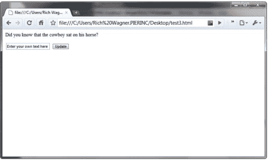

## 图 6-1：修改 innerHTML 属性之前的原始 HTML 文档。

因此，每当用户输入新文本并点击"更新"按钮时，span 的内容就会更新。图 6-2 显示了更新后的结果。

不要将 innerHTML 用于表格。相反，应使用本迷你书中第 4 章讨论的 DOM 方法来添加行和其他表格部分。innerHTML 不是 Web 标准，而是由微软为 Internet Explorer 引入的。

---

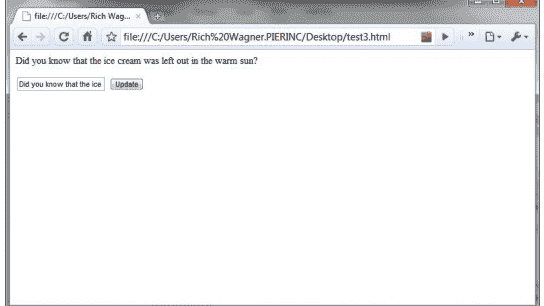

## 验证表单

数据验证一直是 JavaScript 在 HTML 文档中最实用的功能之一。使用 JavaScript，你可以在用户将要提交的数据通过互联网发送到服务器进行处理之前，检查这些数据的质量。你可能希望执行各种类型的验证：

- 检查必填字段是否有值。
- 检查数字字段是否为数值（例如，年龄或五位邮政编码）。
- 检查输入是否匹配特定格式（例如，电子邮件地址或电话号码）。

脚本编写者为实现验证而采用的一些技术，对于填写表单的用户来说可能是令人沮丧的。图 6-3 展示了一种你可以用来向用户显示错误信息（而不是那些烦人的警报消息框）的技术。它在文本框旁边使用了一个`span`元素。

*注意：* 在开始此过程之前，请将`validate.js`文件放在与你的 HTML 页面相同的文件夹中。

要设置数据验证，请按照以下步骤操作：

1. 在你的编辑器中打开一个包含表单字段的网页，这些字段是你想要添加验证的。
2. 在文档头部添加对`validate.js`文件的引用：

```
<script src="validate.js" type="text/javascript"></script>
```

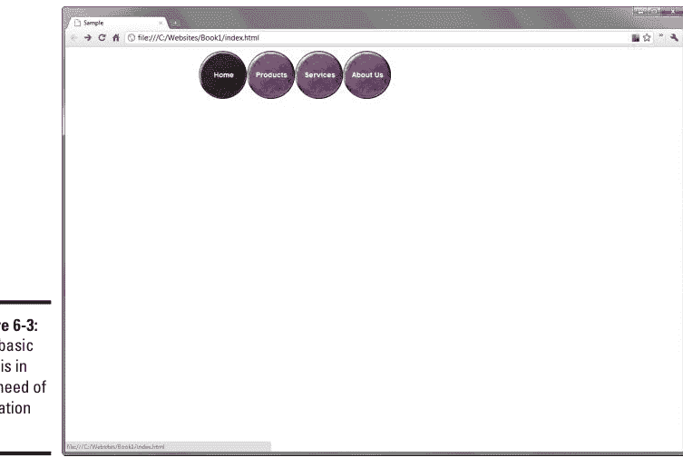

以下是脚本文件的源代码：

```
MSG_REQUIRED_ERROR = 'Value is required';

MSG_INVALID_NUMBER_ERROR = 'Invalid number entered. Please try again.';

MSG_INVALID_EMAIL_ERROR = 'Invalid email address. Please try again.';
```


## 表单验证

```javascript
function checkRequired( valField, displayID ) {

  var displayHandler = document.getElementById( displayID );

  if ( valField.value == null || valField.value == '' ) {

    displayHandler.innerHTML = MSG_REQUIRED_ERROR;

    valField.focus();

    return false;

  }

  else {

    displayHandler.innerHTML = '';

    return true;

  }

}

function isValidNumber( valField, displayID ) {

  var displayHandler = document.getElementById( displayID );

  if ( isNaN( valField.value ) ) {

    displayHandler.innerHTML = MSG_INVALID_NUMBER_ERROR;

    valField.focus();

    return false;

  }

  else {

    displayHandler.innerHTML = '';

    return true;

  }

}

function checkEmail( valField, displayID ) {

  var displayHandler = document.getElementById( displayID );

  var emailFormat = /^[^@]+@[^@.]+\.[^@]*\w\w$/; // Regular Expression string

  var emailStr = valField.value;

  if ( !emailFormat.test( emailStr ) ) {

    displayHandler.innerHTML = MSG_INVALID_EMAIL_ERROR;

    valField.focus();

    return false;

  }

  else {

    displayHandler.innerHTML = '';

    return true;

  }

}
```

### 添加错误消息容器样式

在文档头部，添加一个`style`元素。在其内部，添加一个名为`.msg_container`的类选择器。

此样式规则将应用于你的错误消息容器：

```html
<style>
  .msg_container { color: #FF0000 }
</style>
```

### 添加错误消息容器元素

在你要验证的每个字段旁边，添加一个空的`span`元素。

确保为每个`span`元素提供一个唯一的`id`值，并添加`class="msg_container"`以关联你在上一步中定义的CSS类选择器。

这是添加`span`元素后的表单外观：

```html
<div style="width:500px">
  <p>Please provide the following information so we can spam you better:</p>
  <form id="customer_form" name="customer_form" method="post" action="">
    <label>First name:<input type="text" name="first_name" id="first_name"
      size="15"/></label>
      <span class="msg_container" id="first_name_msg">&nbsp;</span><br/>
    <label>Last name:<input type="text" name="last_name" id="last_name"
      size="25"/></label>
      <span class="msg_container" id="last_name_msg">&nbsp;</span><br/>
    <label>Age:<input type="text" name="age" id="age" size="3"/></label>
      <span class="msg_container" id="age_msg">&nbsp;</span><br/>
    <label>Email address:<input type="text" name="email" id="email"
      size="25"/></label>
      <span class="msg_container" id="email_msg">&nbsp;</span><br/>
    <input name="submit" type="submit"/>
  </form>
</div>
```

这些`span`元素用于在需要时向用户提供错误反馈。

### 添加必填字段验证

对于你要求用户必须填写的每个字段，添加一个`onblur`事件处理程序，该程序关联到`checkRequired()`函数。

`checkRequired()`函数需要两个参数：

- 关键字`this`，它指向调用对象（即`input`字段本身）
- 一个字符串字面量，提供错误消息容器的`id`值

在表单的名字（First name）和姓氏（Last name）字段上添加此检查：

```html
<div style="width:500px">
<p>Please provide the following information so we can spam you better:</p>
<form id="customer_form" name="customer_form" method="post" action="">
<label>First name:<input type="text" name="first_name" id="first_name"
size="15" onblur="checkRequired( this, 'first_name_msg' )"/></label><br/>
<span class="msg_container" id="first_name_msg">&nbsp;</span><br/>
<label>Last name:<input type="text" name="last_name" id="last_name"
size="25" onblur="checkRequired( this, 'last_name_msg' )"/></label>
<span class="msg_container" id="last_name_msg">&nbsp;</span><br/>
<label>Age:<input type="text" name="age" id="age" size="3" /></label>
<span class="msg_container" id="age_msg">&nbsp;</span><br/>
<label>Email address:<input type="text" name="email" id="email"
size="25"/></label>
<span class="msg_container" id="email_msg">&nbsp;</span><br/>
<input name="submit" type="submit"/>
</form>
</div>
```

### 添加数字有效性验证

对于你要检查是否为有效数字的每个字段，添加一个`onblur`事件处理程序，该程序关联到`isValidNumber()`函数。

与`checkRequired()`函数一样，`isValidNumber()`也需要两个参数：`this`和错误消息容器的`id`值的字符串。

为年龄（Age）字段添加此有效性检查：

```html
<div style="width:500px">
<p>Please provide the following information so we can spam you better:</p>
<form id="customer_form" name="customer_form" method="post" action="">
<label>First name:<input type="text" name="first_name" id="first_name"
size="15" onblur="checkRequired( this, 'first_name_msg' )"/></label><br/>
<span class="msg_container" id="first_name_msg">&nbsp;</span><br/>
<label>Last name:<input type="text" name="last_name" id="last_name"
size="25" onblur="checkRequired( this, 'last_name_msg' )"/></label>
<span class="msg_container" id="last_name_msg">&nbsp;</span><br/>
<label>Age:<input type="text" name="age" id="age" size="3"
onblur="isValidNumber( this, 'age_msg' )"/></label>
<span class="msg_container" id="age_msg">&nbsp;</span><br/>
<label>Email address:<input type="text" name="email" id="email"
size="25"/></label>
<span class="msg_container" id="email_msg">&nbsp;</span><br/>
<input name="submit" type="submit"/>
</form>
</div>
```

### 添加电子邮件格式验证

对于电子邮件地址字段，添加一个`onblur`处理程序，将其关联到`checkEmail()`函数。

`checkEmail()`函数与其他两个有效性检查例程使用相同的两个参数。以下是代码：

```html
<div style="width:500px">
<p>Please provide the following information so we can spam you better:</p>
<form id="customer_form" name="customer_form" method="post" action="">
    <label>First name:<input type="text" name="first_name" id="first_name" size="15" onblur="checkRequired( this, 'first_name_msg' )"/></label>
    <span class="msg_container" id="first_name_msg">&nbsp;</span><br/>
    <label>Last name:<input type="text" name="last_name" id="last_name" size="25" onblur="checkRequired( this, 'last_name_msg' )"/></label>
    <span class="msg_container" id="last_name_msg">&nbsp;</span><br/>
    <label>Age:<input type="text" name="age" id="age" size="3" onblur="isValidNumber( this, 'age_msg' )"/></label>
    <span class="msg_container" id="age_msg">&nbsp;</span><br/>
    <label>Email address:<input type="text" name="email" id="email" size="25" onblur="checkEmail( this, 'email_msg' )"/></label>
    <span class="msg_container" id="email_msg">&nbsp;</span><br/>
    <input name="submit" type="submit"/>
</form>
</div>
```

### 测试验证结果

保存你的HTML文档并在浏览器中测试结果。

你可以在浏览器中加载该网页，查看验证例程的效果。图6-4和图6-5展示了结果。

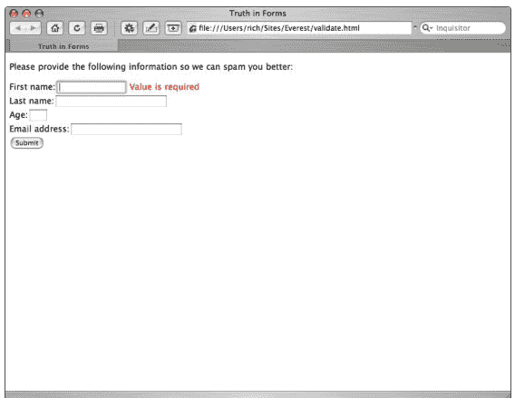

**图6-4：** 当必填字段未输入值时，系统会提示用户。

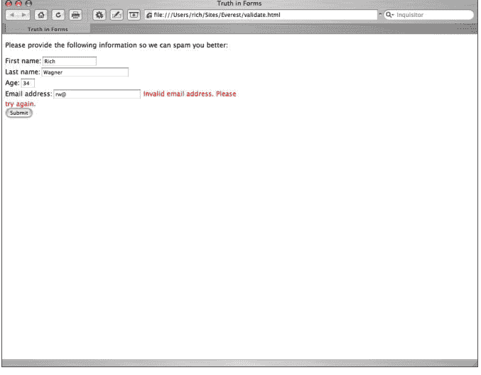

仔细研究这些例程有助于理解验证的工作原理。`checkRequired()`函数就是一个例子：

```javascript
function checkRequired( valField, displayID ) {

  var displayHandler = document.getElementById( displayID );

  if ( valField.value == null || valField.value == '' ) {

    displayHandler.innerHTML = MSG_REQUIRED_ERROR;

    valField.focus();

    return false;

  }

  else {

    displayHandler.innerHTML = '';

    return true;

  }

}
```

`displayHandler`变量被定义为引用`id`值等于`displayID`值的元素。

然后对`valField`参数的值进行求值，检查它是否为空白值。如果是，则将错误消息赋值给`displayHandler.innerHTML`。在调用的输入框获得焦点后，函数返回`false`值并结束。如果否，则清除`displayHandler.innerHTML`，并将控制权返回给调用字段。

## 对抗垃圾邮件：混淆你的电子邮件链接

网页上的`mailto:`电子邮件地址链接是最便捷、最有效的可点击交互方式之一，便于你与想要联系的人沟通。然而，它也带来了巨大的代价：垃圾邮件。垃圾邮件发送者会遍历网络，寻找毫无防备的电子邮件地址并将其添加到他们的恶意数据库中。你可以用武器库中的最新工具来反击：JavaScript。

我将向你展示如何添加标准保护和最高级别保护。标准保护更容易使用，但垃圾邮件发送者可能会在他们的网络搜索中考虑到这一点。虽然最高级别保护使用起来比较麻烦，但垃圾邮件发送者几乎肯定无法绕过它。

**注意：** 在开始此过程之前，请将`escrambler.js`文件放在与你的HTML页面相同的目录中。

按照以下步骤，使用JavaScript例程混淆你的电子邮件链接：

1. 在编辑器中打开一个包含一个或多个你想混淆的电子邮件链接的网页。
2. 对于每个地址，用混淆版本替换正常的电子邮件地址。

对于标准保护，你只需要将`@`符号替换为`_at_`——例如，`steve@acmeinc.com`变为`steve_at_acmeinc.com`。

如果你想添加最高级别保护，请将`@`符号替换为`!a!`，将点号替换为`!d!`，将域名后缀替换为`!ds!`。例如，`steve@acmeinc.com`现在变为一个防垃圾邮件但看起来令人困惑的`steve!a!acmeinc!d!!ds!`。

3. 在文档头部添加对`escrambler.js`文件的引用：

```html
<script src="escrambler.js" type="text/javascript"></script>
```

此指令将`escrambler.js`混淆例程加载到网页中。以下是该脚本文件的源代码：

```javascript
// Iterate through each link
function hrefReplacer( origStr, newStr ) {
    for ( i=0; i<=(document.links.length-1 ); i++ ) {
        if ( document.links[i].href.indexOf( origStr )!=-1 )
            document.links[i].href= document.links[i].href.
        split( origStr )[0] + newStr +
            document.links[i].href.split( origStr )[1]
    }
}

// ***************************************************
//  unscramble( securityLevel, [domainSuffix] )
//          securityLevel: 0 = Minimal, 1 = Maximum
//          domainSuffix : suffix, if not com
// ***************************************************
function unscramble( securityLevel, domainSuffix ) {
  // Standard format: me_at_mydomain.com
  if ( securityLevel == 0 ) {
    var separator = '_at_';
    hrefReplacer( separator, '@' );
  }
  // Maximum format: me!a!mydomain!dt!!ds!
  else {
    var separator   = '!a!';
    var dot         = '!dt!';
    var suffix      = '!ds!';
    if ( domainSuffix == '' ) domainSuffix = 'com';
    hrefReplacer( separator, '@' );
    hrefReplacer( dot, '.' );
    hrefReplacer( suffix, domainSuffix );
  }
}
```

4. 在页面底部添加一个新的`script`元素，位于`</body>`结束标签之前。

在此脚本中，你调用位于`escrambler.js`文件中的`unscramble()`函数。其语法如下所示：

```javascript
unscramble( securityLevel [, domainSuffix] )
```

其中`securityLevel`为`0`表示标准保护，为`1`表示最高级别保护。如果你使用最高级别保护且域名不是`com`，请提供域名后缀。

对于标准保护，使用以下代码：

```html
<script type="text/javascript">
unscramble( 0 );
</script>
```

对于使用`com`后缀的最高级别保护，使用以下代码：

```html
<script type="text/javascript">
unscramble( 1 );
</script>
```

对于使用其他后缀的最高级别保护，将其作为第二个参数添加，如下例所示：

```html
<script type="text/javascript">
unscramble( 1, 'org' );
</script>
```

5. 保存文件并在浏览器中测试结果。

你可以在浏览器中加载该网页，确保你的地址现在在实际HTML源代码中已正确格式化。

## 检测功能，而非浏览器类型

在Web的早期，人们认为在运行脚本之前检测浏览器类型和版本是一种良好的编程实践。因为当时的JavaScript实现差异很大，浏览器检测器可以在脚本尝试执行不支持的浏览器无法处理的操作之前将其重新路由。

借用S. E. Hinton的话："那是过去，这是现在。"如今，几乎没有理由去检测特定的浏览器类型。相反，你最好的选择——如果你担心浏览器对你想要执行的脚本的支持——是通过功能来检测。

例如，如果你想在执行依赖于特定功能的过程之前，确保浏览器支持`getElementById()`方法，你可以先进行条件检查：

```javascript
if ( document.getElementById ) {
    // Code relying on getElementById goes here
}
```

如果`getElementById()`方法不受支持，条件语句将向`if`语句返回一个空值。否则代码将执行。

你也可以对对象或属性执行此测试。例如，要测试浏览器是否支持`images`集合对象（常用于翻转效果的对象），你可以使用以下语句进行测试：

```javascript
if ( document.images ) {
    // Code relying on images collection goes here
}
```

### 使用正则表达式

如果你与计算机打交道已有相当长的时间，你可能对通配符非常熟悉。想搜索目录中的所有Word文档？在搜索中使用`*.doc`。想搜索文件夹中所有.xls和.xlm文件？使用`*.xl?`。

当你需要对文件和目录进行简单搜索时，通配符非常方便，但在JavaScript的世界中，你的搜索需求往往更为复杂。假设你想在`Textarea`中的用户内容中查找特定的字符串模式。也许你想测试一个字符串以确定它是否是有效的美国电话号码。或者你想确定用户请求的URL是否有效。

## 进行直接匹配

这就是正则表达式派上用场的地方。你可以将它们视为"强化版的通配符"。一个*正则表达式*描述了一种字符模式，你用它来评估一个字符串，以确定它是否匹配。

当你开始使用正则表达式时，第一步是熟悉其基本语法。例如，如果你想在字符串中搜索字符组合`ball`，那么你会使用以下模式：

```javascript
/ball/
```

正斜杠用于标记正则表达式模式的开始和结束。

因此，以下字符串中会找到匹配项：
- Do you like baseball?
- Football, you bet.
- Ballroom dancing rules!

然而，假设我将模式更改为`/bills/`。以下句子中会找到匹配项：

```text
Did you pay your bills?
```

但在以下句子中则没有：

```text
Bill's mother came to town.
```

然后，你可以在脚本中通过以下两种方式之一使用此正则表达式模式。首先，你可以使用*正则表达式字面量*，如下例所示：

```html
<script type="text/javascript">
  var pattern = /ball/;
  var str = "Do you like baseball?";
  var t = pattern.test(str);
  if (t)
  {
    alert("Yes, you got a match!");
  }
</script>
```

`pattern`变量被赋予了一个正则表达式模式，使其成为一个正则表达式字面量。然后使用`test()`方法评估`str`文本字符串以查找匹配项，并返回一个布尔值结果给`t`变量。如果找到匹配项，则显示`alert()`消息框。

其次，你也可以在脚本中创建一个`RegExp`对象的实例：

```html
<script type="text/javascript">
    var re = new RegExp("/ball/");
    var str = "Do you like baseball?";
    var t = re.test(str);
    if (t)
    {
        alert("Yes, you got a match!");
    }
</script>
```

除了`test()`方法外，还有`exec()`、`search()`和`replace()`方法（将在"从搜索中获取更多信息"一节中讨论）。

## 匹配字符

如果你需要搜索的所有内容都能通过直接匹配来完成，那将是很好的。然而，在大多数现实世界的情况下，你需要额外的搜索能力。一些字符序列在正则表达式内具有特殊含义。这些有时被称为元序列。

例如，考虑以下模式：

```javascript
/person\d/
```

此模式匹配一个以`person`开头后跟任意十进制数字的字符串，如`\d`元序列所示。以下将是有效的匹配项：

```text
person1
person5
```

或者假设你想测试其后是否跟有任何非十进制数字。你可以使用：

```javascript
/person\D/
```

`\D`表达式匹配除数字外的任何字符，如以下匹配项所示：

```text
personal conduct
Person.
person-place-thing
```

表6-2列出了所有元序列表达式。

| 表达式 | 描述 |
| :--- | :--- |
| `\b` | 在单词边界处匹配（如空格或换行符）。请注意，如果字符串的第一个或最后一个字符是单词字符，则匹配字符串的开头或结尾。 |
| `\B` | 匹配非单词边界。 |
| `\d` | 匹配一个十进制数字。 |
| `\D` | 匹配除十进制数字外的任何字符。 |
| `\f` | 匹配换页符。 |
| `\n` | 匹配换行符。 |
| `\0` | 匹配空字符。 |
| `\r` | 匹配回车符。 |
| `\s` | 匹配任何空白字符，如制表符、换行符或空格。 |
| `\S` | 匹配除空白字符外的任何字符。 |
| `\t` | 匹配制表符。 |
| `\unnnn` | 匹配具有指定四个十六进制数字的Unicode字符。 |
| `\v` | 匹配垂直制表符。 |
| `\w` | 匹配任何字母数字字符或下划线(A-Z, a-z, 0-9, 或 _)。 |
| `\W` | 匹配除字母数字字符外的任何字符。 |
| `\xnn` | 匹配具有指定ASCII值的字符，该值由十六进制数字nn定义。 |

## 添加标志

你可以通过在正则表达式模式末尾（在结束正斜杠之外）添加特殊标志（如表6-3所示）来自定义搜索。以忽略大小写标志为例。如果你想对单词`snicker`执行不区分大小写的搜索，你会使用以下内容：

```javascript
/snicker/i
```

如果你使用多个标志，它们会组合在一起，如下所示：

```javascript
/snicker/gimsx
```

| 标志 | 描述 |
| :--- | :--- |
| `g` | 全局标志，匹配第一个匹配项之后的所有匹配项。 |
| `i` | 忽略所有A–Z和a–z字符的大小写。 |
| `m` | 表示多行搜索。设置后，你的模式可以跨行搜索。 |
| `s` | 称为dotall标志，此标志使`.`（点）元字符（在"使用重复器"一节中讨论）能够匹配换行符(`\n`)。 |
| `x` | 允许使用扩展正则表达式。你可以使用空格来组合正则表达式，使代码更易于阅读。 |

## 使用重复器

你还可以添加某些*元字符*来查找表达式内的重复模式。以星号字符`*`为例，它的作用类似于你可能已经熟悉的通配符：

```javascript
/person\d*/
```

此模式匹配`person`后跟零个或多个十进制数字。以下每个字符串都将是有效的匹配项：

- person1
- person22
- person
- person2303030202

从此模式可以看出，重复器始终作用于*它前面*的项。

`+`字符表示匹配前面的项重复一次或多次，而`?`字符表示匹配前面的项零次或一次。

要匹配重复一次或多次的字符`b`，使用：

```javascript
/b+/
```

要匹配出现零次或一次的字符`c`，使用：

```javascript
/c?/
```

你还可以通过使用`{}`括号来使用数字量词或范围。你可以使用数字量词来指定重复项的特定数量。例如，要匹配重复八次的数字`0`，你会使用：

```javascript
/0{8}/
```

要匹配重复三次或更多次的数字`3`，使用：

```javascript
/3{3,}/
```

要定义一个范围，你可以在花括号内设置起始和结束数字。以下是一个例子：

```javascript
/z{2,4}/
```

表6-4列出了你可以在正则表达式中使用的所有重复器。

| 重复器 | 描述 |
| :--- | :--- |
| `*` | 匹配前面的项重复零次或多次时。 |
| `+` | 匹配前面的项重复一次或多次时。 |
| `?` | 匹配前面的项重复零次或一次时。 |
| `{n}`，`{n, }`，`{n, m}` | 表示前面的项的数字量词或范围。 |

## 添加更多元字符

除了重复器或与数量相关的元字符外，你还可以在你的正则表达式库中添加其他元字符。

点字符`.`匹配表达式中的任何单个字符。因此，考虑以下模式：

```javascript
/ab.d/
```

以下每个都将是有效的匹配项：

```text
abcd
ab3d
ab*d
```

你还可以使用管道字符`|`进行或匹配。如果你想测试是`Jim`还是`Joe`，你可以使用：

```javascript
/Jim|Joe/
```

有关其他元字符，请参见表6-5。

| 元字符 | 描述 |
| :--- | :--- |
| `.` | 匹配任何单个字符，如果设置了`s`标志，则包括换行符。 |
| `|` | 匹配管道左侧或右侧的部分。 |
| `^` | 在字符串开头匹配。设置`m`标志时，脱字符也匹配行的开头。 |
| `$` | 在字符串末尾匹配。设置`m`标志时，`$`匹配换行符(`\n`)之前的位置。 |
| `\` | 转义（或关闭）正则表达式内元字符和正斜杠的特殊含义。 |

## 使用字符类

字符类用方括号`[ ]`表示，在正则表达式中用于指定可以匹配单个位置的可能字符列表。例如：

```javascript
/8[123]4/
```

在此正则表达式中，以下每个值都是有效的：

```text
814
824
834
```

你可以使用连字符在字符类内指示有效的范围。例如，以下模式允许任何大写字符：

```javascript
/[A-Z]/
```

## 使用分组

使用括号对正则表达式中的元素进行分组，以便将这些元素作为一个整体来处理。这样一来，你就可以使用分组对多个字符应用重复元字符，例如`*`。例如，以下模式查找单词cat的一个或多个匹配项：

```javascript
/(cat)+/
```

当你使用括号对元素进行分组时，该组的匹配字符串会被记住以供后续使用（参见"从搜索中获取额外信息"部分）。

## 综合运用所有元素

虽然你可以单独使用每种通配符类型，但在实际应用场景中，通常需要将通配符组合起来使用。例如，假设你想测试电子邮件地址表单字段的输入，以确保其格式有效。与其只查找`text@text`，你可以利用正则表达式的强大功能来完成真正稳健的工作。电子邮件地址验证器如下所示：

```javascript
/([a-zA-Z0-9]+[-._+&])*[a-zA-Z0-9]+@([a-zA-Z0-9]+[.])+[a-zA-Z]{2,6}/
```

此模式将分组、字符类、重复符和其他特殊字符组合在一起，形成该表达式。使用此模式，以下将是有效的电子邮件地址：

```text
rich@smileyfacesoup.org
rich.wagner@smileyfacesoup.org
rich_wagner@smileyfacesoup.ak
```

## 通过示例学习

有时候，学习正则表达式的最佳方式就是通过查看各种示例。以下代码片段列表展示了一些正则表达式示例：

```javascript
// 美国电话号码
var re = /\d{3})-\d{3})-\d{4}/
// 0到100之间的整数
/0|([1-9]|[1-9]\d|100/
// 美国邮政编码（+4 可选）
/\d{5}(-\d{4})?/
// Windows 文件名（排除特定字符）
/[^\\/.:*?"<>|]([^*?"<>|]{0,254})/
```

### 从搜索中获取额外信息

`RegExp`方法的`test()`对字符串执行简单的true/false检查。然而，你也可以使用`exec()`方法来执行搜索匹配，但会基于结果返回一个信息数组。结果以数组形式返回，包含匹配字符串和所有记住的子字符串（由表达式中的括号表示）。

例如，假设你想搜索字符串`F100`，并将`F`和`100`作为数组中的单独片段返回。你可以创建一个如下所示的脚本：

```html
<script type="text/javascript">
  var re = /([A-Z]+)(\d+)/g>;
  var r = re.exec("F100");
  alert(r);
</script>
```

## 第7章：初识Ajax

### 本章内容

- 了解Ajax
- 使用XMLHttpRequest
- 用动态内容更新页面

在本书第五部分的前六章中，我向你展示了如何在网页中使用JavaScript在浏览器（也称为*客户端*）内部添加决策和编程逻辑。然而，很多时候你还需要依赖来自服务器的数据。但问题是，在大多数正常情况下，服务器更新需要整个页面重新加载——从性能或用户体验角度来看，这并不理想。

还有另一种方法——Ajax（Asynchronous JavaScript And XML，异步JavaScript和XML）。它是一种基于JavaScript的技术，允许你在不重新加载整个网页的情况下与Web服务器交换和传输数据。Ajax已经变得如此普遍，以至于虽然它是一个缩写词，但通常不再全部大写拼写。

在本章中，我将向你介绍Ajax，并展示如何使用这种基于JavaScript的技术为你的网页提供动态内容。

**注意：** Ajax需要使用服务器端技术，如PHP、Java或.NET，以便向JavaScript提供数据。

### 什么是Ajax？

在正常情况下，当网页从服务器请求信息时，它会向应用服务器发出所谓的HTTP POST或GET请求。应用服务器处理请求、获取数据，然后向浏览器重新加载页面以提供结果。然而，使用Ajax，你可以在*后台*从服务器请求和接收数据，并重新加载页面的部分而非整个页面。

Ajax允许你构建执行速度更快、节省服务器端资源的页面，使客户端能够参与页面的处理。

JavaScript脚本是独立的；它们不依赖于应用服务器。相比之下，Ajax基本上是一个两部分解决方案：

- **客户端：** 建立Ajax连接并监听数据变化的JavaScript代码。
- **服务器端：** 知道如何响应客户端数据请求的服务器端技术。

因此，为了实现Ajax解决方案，你不能只在客户端进行操作。还需要使用PHP或Java等语言编写服务器端的部分程序。

### 探索XMLHttpRequest

JavaScript对象`XMLHttpRequest`用于网页中的Ajax连接。`XMLHttpRequest`对象向Web服务器发送HTTP（或HTTPS）请求，并将服务器的响应加载到事件处理程序中进行处理。它在任何现代浏览器中都受支持。事实上，你必须追溯到很多年前才能找到不支持它的浏览器。记录一下，最低浏览器要求包括Firefox 1.0及更高版本、Internet Explorer 5.0及更高版本、Safari 1.2及更高版本、Chrome（任何版本）和Opera 8及更高版本。

表7-1和7-2显示了`XMLHttpRequest`对象的属性和方法。

| 属性 | 说明 |
|------------|-------------|
| `readyState` | 指示来自服务器的Ajax请求状态（完整列表见表7-3） |
| `responseText` | 响应内容为字符串 |
| `responseXml` | 响应内容为XML或XHTML片段 |
| `Status` | 从服务器接收的HTTP状态（完整列表见表7-4） |
| `onreadystatechange` | 当`readyState`属性的状态发生变化时分派的事件 |

| 方法 | 说明 |
| --- | --- |
| `open(mode, url, boolean)` | 打开与服务器的Ajax连接<br><br>mode: GET或POST<br><br>url: 文件的URL boolean: true（异步），false（同步） |
| `send("string")` | 向服务器发送请求（GET请求使用`null`） |

## 创建Ajax连接

Ajax请求和响应的基本过程如下：

- **客户端JavaScript：** 创建`XMLHttpRequest`对象
- **客户端JavaScript：** 设置事件处理程序以监听请求的变化
- **客户端JavaScript：** 使用`XMLHttpRequest`对象打开会话并向服务器请求数据
- **服务器端技术：** 响应客户端请求并以字符串或XML形式提供数据
- **客户端JavaScript：** 当提供响应时，按需在页面上使用响应

### 创建请求对象

第一项任务是创建一个`XMLHttpRequest`对象。你可以使用以下代码来实现：

```javascript
// 请求
var request;

// 正常支持
if (window.XMLHttpRequest)
{
    request = new XMLHttpRequest();
}
```

### 发起请求

此代码首先检查浏览器是否支持`XMLHttpRequest`对象。如果支持，则`request`变量被赋值为`XMLHttpRequest`对象的实例。所有现代浏览器都使用此代码。

然而，为了支持旧版本的Internet Explorer，接下来的`else`语句创建一个`ActiveXObject`，这是Microsoft在IE 5.0和6.0版本中的`XMLHttpRequest`版本。

如果用户的浏览器未能通过所有这些条件语句，那么你可以告知该用户是时候进入二十一世纪并升级浏览器了。

使用`XMLHttpRequest`对象，下一步是使用`open()`初始化对象以进行连接：

`open()`方法接受三个参数：

- `requestType`：指定GET或POST（通常使用GET）
- `url`：提供指向服务器上文件/资源的URL
- `isAsynchronous`：指示连接是异步还是同步。

当`isAsynchronous`参数设置为`true`时，JavaScript在调用`open()`方法后继续处理。如果设置为`false`，浏览器将暂停脚本执行，直到从服务器接收到响应。

```javascript
// 旧版 IE5 支持
else if (window.ActiveXObject)
{
    request = new ActiveXObject("Microsoft.XMLHTTP");
}

// 旧版 IE6 支持
else if(window.ActiveXObject)
{
    request = new ActiveXObject("Msxml2.XMLHTTP");
}

// 不支持
else
{
    alert("Please upgrade your browser to experience the full
    capabilities of this web page.");
}
```

```javascript
request.open(requestType, url, isAsynchronous);
```

通常情况下，请将此参数保持设置为`true`。如果处理过程耗时较长，在收到响应之前，用户无法在网页上执行任何操作。

初始化连接后，请使用`send()`方法发送请求：

```javascript
request.send("string");
```

对于`GET`请求，请将参数设置为`null`。对于`POST`请求，请提供要发送到服务器的字符串。

例如，如果你想对`ajaxtest.jsp`发起一个`GET`请求，你可以使用：

```javascript
request.open("GET", "ajaxtest.jsp", true);
request.send(null);
```

## 监听响应

发送请求后，你需要为`XMLHttpRequest`对象的`onreadystatechange`事件分配一个监听器。每当服务器响应请求时，都会触发此事件。例如：

```javascript
request.onreadystatechange = function()
{
    if (request.readyState==4 && request.status == 200)
    {
        var response = request.responseText;
    }
}
```

在此处理程序中，会检查`XMLHttpRequest`对象的`readyState`属性，以确定服务器响应的状态。表7-3显示了可能的`readyState`值。通常情况下，由于不同浏览器在如何/何时分派状态0-3方面存在差异，我们只检查状态4。

表7-3 `XMLHttpRequest.readyState`值

| 状态 | 描述 |
|---|---|
| 0 | 请求未初始化（尚未调用`open()`） |
| 1 | 连接已建立，但请求尚未发送 |
| 2 | 请求已发送 |
| 3 | 已收到部分响应，仍在处理中 |
| 4 | 响应已完成，连接已关闭 |

你还需要使用`XMLHttpRequest`对象的`status`属性检查HTTP服务器响应。表7-4显示了常见的返回值。

表7-4 `XMLHttpRequest.status`值（HTTP状态值）

| 状态 | 描述 |
| :--- | :--- |
| 200 | 正常（无错误） |
| 304 | 未修改（数据来自缓存，而非服务器） |
| 400 | 错误的请求 |
| 401 | 未授权的请求 |
| 403 | 被禁止的请求 |
| 404 | 未找到 |
| 500 | 内部服务器错误 |

> **记住** 如果(`readyState == 4`)且(`status == 200`)，那么你就知道服务器的响应已成功完成。

你可以将响应作为字符串或XML返回。`XMLHttpRequest`有一个`responseText`属性用于字符串值，以及一个`responseXML`属性用于HTML片段或其他XML。然后，你可以将该值分配给输入文本框，将HTML片段分配给`innerHTML`属性，或者解析返回的XML值。

## 服务请求

应用服务器负责接收网页的请求、处理它，并将文本或XML返回给客户端的`XMLHttpRequest`对象。你必须使用服务器端编程语言（如PHP或Java）来执行此处理。例如，要使用PHP将当前日期和时间返回给客户端，`.php`文件包含以下内容：

```php
<?php
echo date("H:i:s");
?>
```

> **提示** 如果你有兴趣在你的网站上实现Ajax，请查阅Janet Valade所著的*PHP 5 For Dummies*或Andy Harris所著的*JavaScript & AJAX For Dummies*。

## 根据响应更新网页

当`XMLHttpRequest`对象从服务器接收到响应后，你可以对其进行处理。例如，要在名为`dynamicDiv`的`div`元素中显示从服务器接收到的内容，你可以设置一个处理程序：

```javascript
request.onreadystatechange = requestResponseHandler;

function requestResponseHandler()
{
    if (request.readyState == 4 && request.status == 200)
    {
        var responseXML = request.responseXML;
        document.getElementById("dynamicDiv").innerHTML = responseXML;
    }
}
```

在这段代码中，`requestResponseHandler()`被分配给`onreadystatechange`事件的处理程序。因此，当从服务器接收到响应时，会调用`requestResponseHandler()`。

## 探索一个Ajax示例

在本节中，我将展示一个完整的示例。假设你希望允许用户在文本字段中输入文本，并让你的代码动态地将用户输入的文本转换为大写，并将其显示在一个`div`中。

### 代码清单7-1: ajax-test.html

```html
<!DOCTYPE html PUBLIC "-//W3C//DTD XHTML 1.0 Transitional//EN"
  "http://www.w3.org/TR/xhtml1/DTD/xhtml1-transitional.dtd">
<html xmlns="http://www.w3.org/1999/xhtml">
<head>
<meta http-equiv="Content-Type" content="text/html; charset=utf-8" />
<title>Ajax Example</title>
</head>
<body>
<script language="javascript" type="text/javascript">
	/**
	 * Creates an Ajax request object
	 *
	 * @returns - XMLHttpRequest object
	 *
	 */
	function getRequestObject()
	{
		if (window.XMLHttpRequest)
		{
			return new XMLHttpRequest();
		}
		else if (window.ActiveXObject)
		{
			return new ActiveXObject("Microsoft.XMLHTTP");
		}
		else
		{
			alert("Please upgrade your browser.");
			return null;
		}
	}

	/**
	 * Handler for the server response
	 */
	function responseHandler()
	{
		if (requestObject.readyState == 4)
		{
			renderResponse();
		}
	}

	/**
	 * Updates the page based on server response.
	 */
	function renderResponse()
	{
		document.getElementById('responseTxt').innerHTML =
	requestObject.responseText;
	}

	/**
	 * Open AJAX conversation
	 */
	function execute()
	{
		requestObject = getRequestObject();
		if (requestObject != null)
		{
			requestObject.open("GET", "ajax_test.php?text=" +
				document.getElementById('inputTxt').value, true);
			requestObject.send(null);
			requestObject.onreadystatechange =
			responseHandler;
		}
	}

	var requestObject = null;
</script>

<form name="form">
    Enter text: <input type="text" onkeyup="execute();"
    name="inputTxt" id="inputTxt" />
    <br/>
    <br/>
    <div id="responseTxt">Text to be replaced</div>
</form>

</body>
</html>
```

### 代码清单7-2: ajax-test.php

```php
<?php
    if (isset($_GET['text']))
        echo strtoupper($_GET['text']);
?>
```

在你的浏览器中禁用脚本测试你的页面，这样你至少能了解如果用户禁用了JavaScript，他们在你的网站上可能会遇到什么情况。

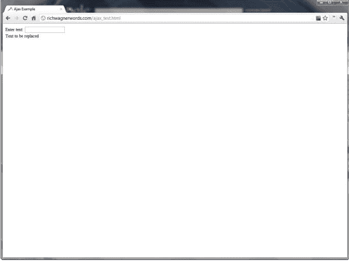

**图7-1:** 支持Ajax的网页。

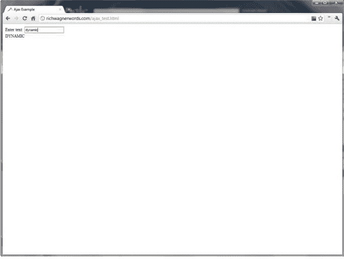

**图7-2:** 服务器响应被动态显示。

# 第六部分：图形

## 内容概览

第1章：了解网页图形
- 这是一个光栅化的世界：探索两种类型的图形
- 质量至上：寻找好的图形
- 避免带来不良影响的图形
- 选择图形编辑器
- 让图形适应你的设计

第2章：优化你的图形
- 确定使用哪种图形文件类型
- 避免图形暴力：加速你的网页图形

第3章：图像鼠标悬停效果
- 使用CSS创建鼠标悬停效果
- 使用Expression Web创建鼠标悬停效果

## 第1章：理解Web图形

### 本章内容

- 为你的网站获取高质量图形
- 了解应避免使用哪些图形
- 查看图形软件选项
- 探索图形设计趋势

Web是一种视觉传播媒介。因此，如果你想创建一个人们愿意访问并愿意花时间停留的网站，你必须知道如何处理图形。一个设计良好的网站能够高效且地地道道地使用照片和其他图像。相反，一个设计糟糕的网站则会因为这些图像而显得廉价且臃肿。你的成功取决于你使用了什么样的图像、它们如何融入页面以及它们在网络上的下载速度。

在本章中，我将带你入门Web图形，向你展示如何为网站获取高质量图像，以及可以使用哪些工具来编辑和优化它们，随后我会提供一些值得考虑的图形设计技巧。

### 这是一个栅格化的世界：探索两种图形类型

图形世界有两种基本类型：*栅格*（或位图）和*矢量*。

- **栅格图形(Raster graphics)** 由排列成矩形的微小像素组成。每个像素具有不同的颜色值（在某些情况下，还具有透明度或不透明度值）。由于栅格图形是基于像素的，它们依赖于显示器分辨率。因此，你无法在不损害图像质量的情况下调整栅格图形的大小（尤其是放大）。栅格文件格式的例子有JPEG、GIF和PNG，本迷你书的第2章将分别探讨这些格式。照片和典型的Web图形就是栅格图像的例子。

相比之下，矢量图形是由角度、曲线和直线组成的几何形状。由于矢量图形基于数学计算，你可以随意放大或缩小而不会损害其质量。Web上最著名的矢量图形格式是Adobe Flash SWF。（但请记住，Flash电影可以包含栅格图像。）SVG是另一种较少为人知的Web矢量格式。EPS和AI (Adobe Illustrator)是浏览器不支持的矢量格式。

现在的Web基本上是一个栅格化的世界，因为绝大多数非Flash图像都是栅格图形（JPEG、GIF或PNG）。

## 质量至上：寻找优质图形

我可以一直跟你聊到这本书页数用完为止，讨论如何优化和管理你的图形。但如果你使用的图形质量很差，我的建议就没什么用了。因此，你的第一站应该是"供应店"：

- **DIY (自己动手)**：如果你有一台数码相机并且擅长拍摄好照片，那么你已经拥有了为网站添加图形最省事的方法。然而，如果你的快照中充斥着被切掉的肖像、红眼的人和枯燥的风景，也许你应该考虑列表中的其他选项。

- **免费图库(Free stock art)**：几年前，如果你想在网上寻找免费图形，你不得不访问那些充斥着横幅广告、提供庸俗剪贴画的丑陋网站。幸运的是，现在的免费摄影图库网站在满足普通用户需求方面已经可以与商业网站相媲美。

我特别推荐两个图库网站：stock.xchng (www.sxc.hu)（如图1-1所示）和morguefile.com。不过请注意，这些网站专注于摄影图像，提供的插图较少。

每张照片都有自己的许可协议，规定了你可以如何使用该图像。有时照片可能仅限于非商业用途，或者在征得摄影师同意后可用于商业用途。使用前请务必仔细阅读许可协议。

- **商业图库(Commercial stock art)**：如果你有特定需求，且无法自行拍摄或找不到好的免费方案，你就得转向商业图库网站。这些网站通常以适中的价格提供免版税的照片，且通常同时提供照片和插图。

Getty Image的Photodisc (www.gettyimages.com)是我最喜欢的商业网站，尤其是当你需要专业外观的插图时。另一个选择是Shutterstock.com，它通过订阅服务提供下载。对于插图，我建议查看stockart.com。

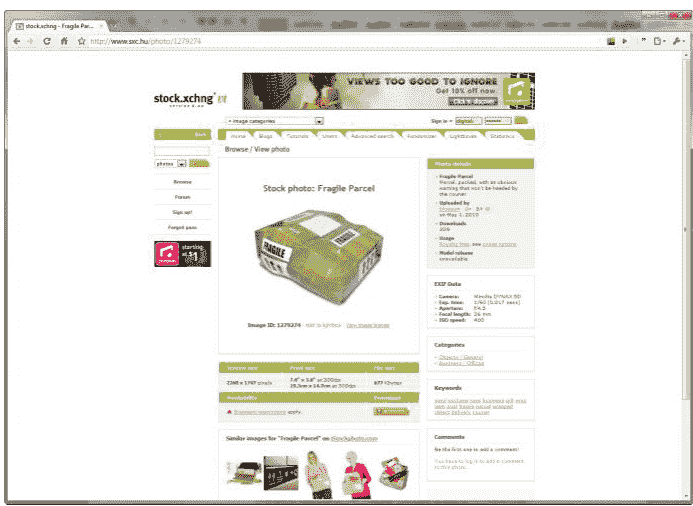

**图1-1：** stock.xchng网站免费提供专业质量的摄影图像。

## 避免那些糟糕的图形

我强烈建议你不惜一切代价避免使用两种图形。一种可能会让你陷入法律麻烦，另一种则会让你被"审美警察"盯上：


- **受版权保护的图像：** 所有图像都受版权保护。未经版权所有者的明确许可或授权，不得从任何网站（甚至是Flickr或Facebook等平台）获取图像。在为你的网站选择图像时请保持谨慎。
- **剪贴画(Clip art)：** 剪贴画是用于学校新闻简报和儿童生日卡的材料。然而，你不应该考虑将其用于你的网站。考虑到现在有这么多更好的图形供应选项，剪贴画看起来业余且极其庸俗。

### 选择图形编辑器

虽然最新版本的Windows和Mac操作系统提供了裁剪和调整栅格图形大小的基本功能，但当你开始为网站制作图形时，你会很快发现这些极其有限的解决方案无法满足需求。以下是一些可供考虑的选项：

- **网站软件：** 你不能用它们编辑图形，但一些网站软件工具提供了修改和微调图像的简单方法。例如，Dreamweaver允许你在不离开其环境的情况下优化、裁剪、重采样、调整亮度与对比度以及锐化图像。

然而，即使是Dreamweaver也不允许你在其环境内对图形进行深度编辑。对于编辑工作，你需要更先进的工具。

- **Adobe Photoshop：** 如果价格和学习曲线不是问题，请前往你喜欢的软件购买网站或商店购买一份Photoshop。到目前为止，它是Windows和Mac上图像编辑软件的行业标准。刚开始使用时，你可能只会用到其总功能的极小一部分。然而，随着持续使用，你会逐渐发现它强大的威力。

作为一个更随意——尽管也经济——的替代方案，Adobe还提供了Adobe Photoshop Elements，这是Photoshop的精简版。

详情请访问www.adobe.com/products/photoshop/photoshop。

- **其他商业产品：** 除Photoshop外，你还可以考虑其他商业产品。微软在图形市场一直缺乏竞争力，但其新的Microsoft Expression Design是该公司迄今为止最好的产品。它可以作为Expression Web的图形编辑配套软件（有关Expression Web的更多信息，请参阅Book VII）。更多信息请访问www.microsoft.com/products/expression。

Corel的Paint Shop Pro (www.corel.com)是另一个可考虑的选项。

- **GIMP，开源替代方案：** 如果你的预算非常紧张，可以查看GIMP看看它是否满足你的需求。GIMP是开源软件，因此你可以免费使用。而且它有Windows、Mac和Linux版本。有些用户对GIMP推崇备至，而有些用户则对其抱怨不断。考虑到它的价格，花点时间尝试一下可能是值得的。请访问www.gimp.org下载。

## 将图形融入你的设计

想象一下，你正在为一家连锁餐厅设计网站，并且需要提供一个餐厅定位工具。你可以为每个州提供一个文本链接列表。然而，视觉解决方案要好得多——显示一张可点击的美国地图。访问者可以点击想要定位餐厅的州。地图图像被设计为响应点击，并将访问者引导至正确的链接。

在本节中，我将探讨如何将普通图形转换为您网站的可点击链接。

### 使用图形链接

正如您可以在第三册中探索的那样，您在HTML文档中使用超链接来定义元素，例如这个示例：

```html
<a href="http://www.cnet.com">Visit CNET</a>
```

当浏览器显示链接时，它通常显示为带下划线的文本。您可以使用层叠样式表(CSS)通过伪类为链接添加文本样式（参见第四册）。然而，尽管CSS样式效果不错，但有时仅靠文本是不够的。在这种情况下，您需要使用图形图像作为链接。

您可以通过简单地将`img`元素包含在`a`链接中来轻松地将图形定义为普通超链接；例如：

```html
<a href="http://www.cnet.com"></a>
```

如果您使用的是Dreamweaver或Expression Web，您处理图形链接的方式与处理文本链接的方式非常相似。

### 包含热点和图像映射

有时，普通的图形链接不起作用。在我在本节开头讨论的美国地图示例中，地图图像上的单个链接无法满足需求。因此，您需要一个热点。

*热点*是图形图像中的一个不可见区域，当点击时，其行为类似于常规超链接。包含可点击热点的图像是*图像映射*。

您可以将任何JPEG、GIF或PNG图像用作图像映射。实际上，图像本身并不直接参与映射。您通过在HTML代码中指定图像内的位置（x,y坐标）来定义热点。

`map`元素代表图像映射，并在`map`元素内定义了多个`area`元素，每个热点对应一个。通过将`usemap`属性添加到`img`元素来将映射链接到图像。以下是一个示例：

```html
<html>
<head></head>
<body>

<map name="usa">
<area shape="polygon" coords="19,44,45,11,87,37,82,76,49,98"
    href="east.html">
<area shape="rect" coords="128,132,241,179" href="west.html">
<area shape="circle" coords="68,211,35" href="washingtondc.
    html">
</map>
</body>
</html>
```

在此示例中，图像通过`usemap`链接到`usa`映射。（请注意代码中映射名称前加了井号。）

`map`元素充当定义热点的三个`area`元素的容器。`area`元素有一个`shape`属性，指定热点的形状是矩形、多边形还是圆形。`coords`属性用于定义区域的像素坐标。当浏览器渲染图像映射时，它会连接提供的像素值，并以指定的形状显示它们，就像一个有点极客的连线游戏。

您可以通过这种方式使用HTML代码创建图像映射，但手动操作时使用正确的像素坐标是一个棘手的过程。至少，您必须在图像编辑器中打开图像，并对每个热点的像素位置进行大量研究工作。

尽管存在这一挑战，坦率地说，图像映射是您在Expression Web、Dreamweaver甚至Photoshop等工具中*确实*应该使用的一个元素。像这样的可视化工具使您能够轻松地用鼠标定义热点。


## 第2章：优化您的图形

### 本章内容

- 优化图形设计
- 选择正确的图形格式
- 提高图形下载速度

一切都有权衡，或者看起来是这样。在本手册的第1章中，我讨论了如何获取和使用看起来很棒的网站图形。然而，如果您添加的图形是又胖又大、占用大量带宽的"巨无霸"，访客会在您说出"Photoshop"之前就离开您的网站。

随着宽带互联网连接的广泛普及，图像大小已不像十年前那样是个大问题。同时，您应该继续关注最小化图形的整体大小——特别是对于通过拨号调制解调器访问您网站的访客。

在本章中，您将探索*优化*技术，这些技术可用于最小化图形大小，同时保持适当的质量水平。但是，我首先会向您展示可以使用的不同类型的Web格式以及何时应该使用每种类型。

## 确定使用哪种图形文件类型

Web浏览器支持三种流行的图形格式：

- JPG/JPEG (`.jpg`或`.jpeg`文件)
- GIF (`.gif`文件)
- PNG (`.png`文件)

每种类型都支持*图像压缩*（本质上是将图像数据缩减到实际最小值），这使得它们比其他图像格式（如RAW或TIFF）更受青睐。例如，一张15兆字节的TIFF图像可以使用JPEG格式缩小到仅50千字节。

这三种格式各有优缺点。在接下来的章节中，我将为您详细介绍这三种主要文件类型的细节。

### JPEG：一种出色的全能格式

JPEG（Joint Photographic Experts Group的缩写，发音为"jay-peg"）格式是您最佳的全能图像格式，适用于高分辨率数字照片（最高1670万色）和普通的Web图形。JPEG使用有损压缩技术来压缩彩色和灰度连续色调图像，这意味着它会丢弃人眼不易察觉的颜色。

通常，图像越复杂，JPEG的表现越好。它不适用于简单的图形、线条图或文字字母。另外，与GIF和PNG不同，JPEG不支持透明度，因此JPEG图像的每个像素都必须有一种颜色。

JPEG图像最强大的方面之一是您可以精确控制为任何给定图像使用的优化级别。图像编辑软件允许您指定JPEG图像的质量级别（量表为0到100，其中0是最大压缩[文件更小]，100是不压缩[文件更大]）。图2-1显示了在Adobe Photoshop中保存图像时可用的JPEG选项。当您调整质量值时，Photoshop会同时更新图形和文件大小——使您能够确定图像大小和质量之间的"最佳平衡点"。

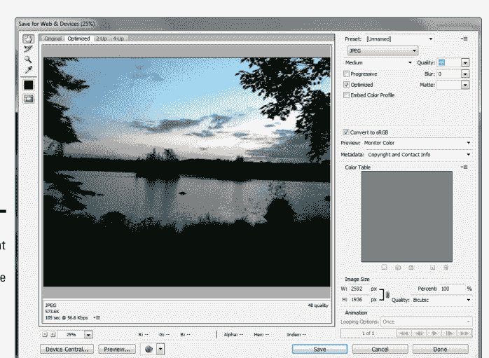

**图2-1：** JPEG格式允许您确定所需的压缩级别。


在大多数情况下，您应该根据图像使用30-75的质量级别。我通常发现我的图像的最佳平衡点在40-60范围内。低于30-35时，大多数图像会出现明显的质量下降。高于75时，即使文件大小显著增加，整体质量也没有太大差异。

对于小图像，高度压缩的JPEG图像与几乎未压缩的图像之间在视觉上差别不大。但是，如果您显示的是一张较大的照片（占据网页超过20%的面积），您可能需要降低压缩程度，因为访客会注意到质量差异。

### GIF：适用于文本和透明度

GIF（Graphics Interchange Format的缩写，发音为"jif"）是早期Web的标准图像格式，至今仍然很受欢迎。GIF仅支持256种颜色，因此它不是高分辨率照片的可行替代方案。然而，其*无损压缩*技术旨在与文本、线条和仅使用少数颜色的简单图形配合使用时效果极佳。（无损压缩不会为了缩小文件大小而丢弃信息。）

GIF还支持*透明度*，使您可以将图像的背景指定为透明。透明度使您能够摆脱简单地使用矩形图像；您可以创建圆角、不同形状等。GIF也是唯一支持动画的图形格式。


直到最近，GIF最大的问题不在于其技术，而在于其法律束缚。几十年来，Unisys拥有GIF压缩算法的专利，在软件中使用该算法的公司需要获得该技术的许可。虽然这种情况从未影响到我们这些创建网站的人，但它确实影响了像Adobe和Microsoft这样的软件制造商。因此，PNG（在下一节讨论）被开发为GIF格式的开源替代方案。幸运的是，围绕GIF的法律主张最近已经到期。

### PNG：（相对较新的）新秀

PNG（Portable Network Graphics的缩写，发音为"ping"）是适用于Web的最新图形格式，其受欢迎程度正在增长。所有现代浏览器都支持该格式，因此您现在可以安全地在页面上使用它。PNG被开发为专有GIF格式的开源替代方案。

PNG有两个版本：

- **PNG-8：** PNG-8版本与GIF类似，支持256种颜色和简单透明度。使用PNG-8代替GIF通常能获得更好的压缩率，这使其成为小型、简单图形的绝佳选择。

- **PNG-24：** PNG-24版本支持24位颜色（即数百万种颜色）和不透明度。然而，由于PNG使用无损压缩，高分辨率PNG图像比JPEG图像大得多。

PNG-24对*不透明度*（也称为*平滑透明度*）的支持超越了简单的开关式透明度：它允许你为图像中的任意像素指定透明度或不透明度级别（范围为0到255）。利用不透明度，你可以为图像创建半透明效果，让背景透过非不透明像素显示出来。（请注意，早期版本的Internet Explorer（7.0之前）不支持不透明度。）

表2-1对比了各种Web图形格式。

### 表2-1 Web图形格式对比

| 格式 | 最佳用途 | 最差用途 | 是否支持透明度？ | 是否支持动画？ |
|---|---|---|---|---|
| JPEG | 照片、连续色调和灰度图像 | 简单图形、边缘和线条锐利的图像 | 否 | 否 |
| GIF | 文字、边缘锐利的艺术、线条画 | 连续色调图像、照片、超过256色的图像 | 是 | 是 |
| PNG-8 | 文字、边缘锐利的绘图、剪贴画 | 连续色调图像、照片、超过256色的图像 | 是 | 否 |
| PNG-24 | 照片（尽管比同等JPEG大得多）、半透明图像 | 文件大小很重要时的连续色调照片 | 是（支持完整不透明度混合） | 否 |

## 避免图形暴力：加速你的Web图形

尽管56K调制解调器连接已不像从前那样普遍，但来自国内外偏远地区的访问者仍然无法使用宽带。更重要的是：随着iPhone、Android手机和其他智能手机成为访问Web的主要方式，你在设计页面时仍然需要考虑图形的总体大小。

事实上，一些访问者认为在网站上保留未优化的图形是不可饶恕的罪行，如果图像加载时间过长，他们会用离开来表达自己的不满。为了帮助你避免页面加载缓慢的"图形暴力"，我为你提供一些建议。如果你好好运用这些技巧，我可能让你的图形下载速度比你说"Speedy Gonzales"还快。

要确保慢速连接也能快速显示你的页面，只需减小图形文件的大小。你可以通过以下四种方式实现：

1. 减小文件大小。
2. 减小图形图像的尺寸。
3. 营造快速性能的假象。
4. 在Web页面中准确定义图像大小。

> 评估页面速度的绝佳方法是使用Google Chrome和Safari中的开发者工具窗口。你可以使用Resources（资源）部分查看页面中每个资源的下载速度。参见图2-2。要在Chrome中访问开发者工具，单击Tools（工具）按钮并选择Developer Tools（开发者工具）；在Safari中，从Developer（开发者）菜单中选择。

### 减小文件大小

在努力减小图像文件大小时，请考虑以下建议：

- **JPEG文件：** 优化Web图形的首要步骤是在图像编辑器（如Photoshop）中打开这些文件并降低其质量级别。从低质量值（小图像可低至5到10）开始，逐步增加，直到图像质量达到可接受的程度。一旦质量看起来不错，就保存新文件。

- **PNG-24：** 如果你正在处理高彩色PNG-24图像，请将它们保存为JPEG文件。

- **GIF文件：** 如果你试图减小GIF文件的大小，请检查所使用的颜色数量。如果超过200种，JPEG就成为值得考虑的强有力选项。如果文件仅使用几种颜色，请尝试PNG-8。

### 裁剪和缩小图像

你还可以通过*裁剪*（切掉图片中对你要展示的内容不重要的部分）来减小图形文件的大小。几乎每个图形应用程序都有*裁剪*工具，你可以用它来进行试验，看看是否能削去图像的一些非必要部分。

当然，如果你不想裁剪图片，可以通过调整大小来减小其整体尺寸。

典型的图形应用程序还有*图像大小*工具，你可以用它指定绝对大小（以像素或英寸为单位）或百分比，哪个更方便就用哪个。

当你将图像缩小到绝对大小时，图形软件通常会增加每英寸像素（PPI）设置。发生这种情况时，请以72或96像素每英寸重新采样图像。不过请注意，通过百分比调整大小可以避免这个问题。

但要注意不要将图像缩小太多，否则你会损失大量图像质量。只需将图像缩小到你将在Web页面上显示的尺寸即可。

### 让图像下载"看起来"更快

你可以用来优化Web图形的最后一种技巧是让页面*看起来*比实际加载更快。实现的方法是在`img`元素中显式定义`width`和`height`属性；例如：

```html

```

当你指定图像的尺寸时，浏览器会显示一个空框架作为占位符*，同时页面的文本会先加载*。因此，用户可以在等待图像从Web服务器下载的同时浏览页面。

### 确保图像尺寸准确

大多数网站软件工具，如Dreamweaver和Expression Web，允许你将任何图像放入文档中，并用鼠标手动调整其大小。虽然以这种方式调整图像大小很方便，但请避免这样做。大多数工具不会调整*图像*本身——它们只是调整`img`元素的`height`和`width`属性。因此，如果你通过此操作缩小图像，你只是缩小了显示尺寸，而不是图像的文件大小。

例如，我父亲将他数码相机拍摄的照片上传到他组织的网站。但是，当我访问他的网站时，我注意到加载非常慢。当我调查时，我发现他上传了原始图像尺寸（3500 x 2300，大小超过4MB），但他的Web软件将其调整为较小的`img`元素以适应页面。因为图像看起来很小，我父亲没有意识到它背后"隐藏的重量"。

因此，作为一般规则，当你需要调整图像大小时，请使用图像编辑器。不要让浏览器或Web软件为你做这项工作。

## 第3章：图像翻转效果

### 本章内容

- 了解翻转效果
- 使用CSS创建翻转导航菜单
- 使用Expression Web创建翻转效果

翻转效果是你添加到Web页面的一种视觉效果，当你希望屏幕的某部分在不点击的情况下发生变化时使用：当鼠标指针悬停在图像上时，翻转效果会改变图形图像的外观。

翻转效果是Web上最受欢迎的图像效果，这有充分的理由：它们相对容易创建，但能让你的网站感觉更具响应性。它们还增加了视觉趣味，而不会过度显得俗气。

你可以仅使用HTML创建翻转效果，但何必呢？如今，你可以使用JavaScript或层叠样式表（CSS）来创建翻转效果。或者，如果你使用Expression Web或Dreamweaver，你甚至无需编写任何代码就能创建翻转效果。

在本章中，我将向你展示如何使用CSS创建翻转效果。然后我会引导你完成在Expression Web中创建它们的过程。要了解HTML工作原理，请转向第四卷。我在第七卷中介绍Expression Web。

### 使用CSS创建翻转效果

传统上，翻转效果是用JavaScript编写的：设置一个*脚本*（小程序），当鼠标指针悬停在其上时，将正常图像替换为另一张图像。图像通常上面有文字，用于标识链接目标。

为了向您展示如何创建翻转效果，我将引导您完成一个导航菜单栏的创建。（或者，如果您只需要单个翻转效果而非一整套，仍然可以参考此步骤。）具体操作如下：

1. **获取或创建两张将作为翻转图像的图片。** 使用两张形状完全相同但颜色不同的图像——一张用于按钮的默认状态，另一张用于按钮的悬停（hover）状态。确保图像本身不包含任何文本。我使用的是图3-1中显示的两个按钮图形。

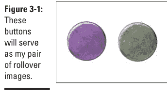

2. **将这些图像文件复制到本地网站的根文件夹或Images文件夹中。** 我将这两个文件（`RoundButtonOver.png`和`RoundButtonDown.png`）放在了根文件夹中。

3. **在网页编辑器中，打开您想要添加翻转图像的HTML文档。**

4. **在文档源码中，在您想要放置图像的位置添加一个`div`元素。** 导航栏的代码如下所示：

```html
<div class="navmenu">
</div>
```

5. **在`div`元素内部，为每个想要添加的按钮添加一个新的`div`元素。** 以下是我为四个菜单按钮使用的代码：

```html
<div class="navmenu">
  <div class="menuitem"></div>
  <div class="menuitem"></div>
  <div class="menuitem"></div>
  <div class="menuitem"></div>
</div>
```

6. **为每个按钮添加一个`a`链接，并添加每个按钮在被点击时将访问的URL。** 以下代码展示了我的操作：

```html
<div class="navmenu">
<div class="menuitem"><a href="index.html"></a></div>
<div class="menuitem"><a href="products.html"></a></div>
<div class="menuitem"><a href="services.html"></a></div>
<div class="menuitem"><a href="aboutus.html"></a></div>
</div>
```

7. **在每个链接内部添加一个`img`元素，每个元素都引用默认状态的按钮。** 我的默认状态按钮命名为`RoundButtonDown.png`。以下代码展示了我正在创建的导航栏：

```html
<div class="navmenu">
<div class="menuitem"><a href="index.html"></a></div>
<div class="menuitem"><a href="products.html"></a></div>
<div class="menuitem"><a href="services.html"></a></div>
<div class="menuitem"><a href="aboutus.html"></a></div>
</div>
```

8. **在每个链接内部添加一个`span`元素，并添加您希望在标签上显示的文本。** 导航栏将`span`文本显示在按钮图像之上。这是我的代码：

```html
<div class="navmenu">
<div class="menuitem"><a href="index.html"><span>Home</span></a></div>
<div class="menuitem"><a href="products.html"><span>Products</span></a></div>
<div class="menuitem"><a href="services.html"><span>Services</span></a></div>
<div class="menuitem"><a href="aboutus.html"><span>About Us</span></a></div>
</div>
```

现在您的HTML代码已经完成。您可以通过重复步骤5到8来随时添加或删除按钮。

现在您可以为导航栏附加CSS样式了。

9. **将您的文件复制到本地网站的根文件夹或Styles文件夹中。** 我将此文件放在了根文件夹中。

您也可以通过输入代码清单3-1中所示的CSS代码并将其保存为`navmenu.css`来重新创建CSS样式表。

10. **在您的网站软件或文本编辑器中打开`navmenu.css`。** 您需要调整某些设置，以使其与您的导航菜单和按钮相匹配。

11. **更新标记为BUTTON WIDTH（按钮宽度）和BUTTON HEIGHT（按钮高度）的行，以匹配您的按钮图像尺寸。** 正如您在代码清单3-1中看到的，您需要修改`div.navmenu`、`div.menuitem`和`div.menuitem img`选择器。

12. **调整`div.navmenu`选择器的width（宽度）属性，以适应您的导航菜单栏尺寸。** 确保您定义的宽度等于或大于按钮数量乘以单个按钮图像的宽度。

13. **（可选）调整样式表中的字体、字体大小和文本颜色属性。** 我在代码清单3-1中标明了这些属性，以便于查找。

14. **选择文件→保存，以保存对样式表的更改。**

15. **回到HTML文档，在head部分添加一个`link`元素以附加`navmenu.css`样式表。** 代码如下所示：

```html
<head>
<link href="navmenu.css" rel="stylesheet" type="text/css">
</head>
```

16. **选择文件→保存，以保存您的文档。**

17. **在默认浏览器中打开文档以检查最终结果。** 图3-2显示了我的导航菜单。

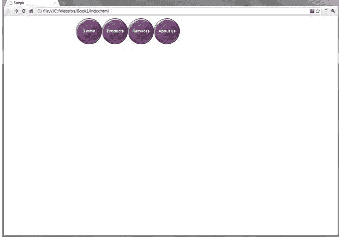

18. **将鼠标悬停在按钮上以显示翻转效果。** 图3-3展示了翻转效果的实际运行情况。

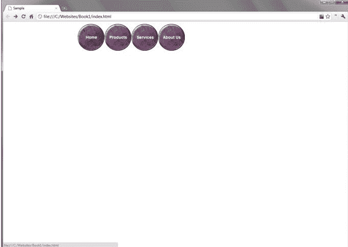

**图3-3：** 鼠标指针悬停动作触发CSS改变按钮的外观。

### 代码清单3-1：navmenu.css

```css
/* Horizontal Navigation Menu Container */
div.navmenu {
    width: 700px; /* <-- OVERALL LENGTH OF MENU */
    height: 96px;  /* <-- BUTTON HEIGHT */
    margin: 0 auto; /* optional: centers navigation menu in its container */
}

/* Navigation Menu Item */
div.menuitem {
    font: 14px "Lucida Grande", Helvetica, Arial, sans-serif; /* <-- DEFAULT FONT/ SIZE */
    background: url( "RoundButtonOver.png" ) no-repeat; /* <--  ROLLOVER HOVER IMAGE */
    width: 96px; /* <-- BUTTON WIDTH */
    height: 96px; /* <-- BUTTON HEIGHT */
    position:relative;
    float: left;
    margin: 0;
    padding: 0;
    overflow:hidden;
    text-align:center;
}

/* Menu Link */
div.menuitem a {
    color: #ffffff; /* <--- DEFAULT TEXT COLOR */
    display: block;
    text-decoration: none;  /* disables any normal link styles you have set */
    overflow:hidden;
    font-weight:bold;
}

/* Menu Text */
div.menuitem span {
    position: absolute;
    left: 2px;
    top: 40px;
    text-align: center;
    width: 96px;
    cursor: pointer;
    text-decoration: none;
    color: #FFF;
}

/* Menu Link: Hover */
div.menuitem a:hover {
    color: #ffffff; /* <--- DEFAULT HOVER TEXT COLOR */
}

/* Menu Image */
div.menuitem img {
    width: 96px; /* <--- BUTTON WIDTH */
    height: 96px; /* <--- BUTTON HEIGHT */
    border: 0;
}

/* Menu Link: Hover Image */
div.menuitem a:hover img { visibility: hidden; } /* hides default button image during hover */

* html a:hover { visibility: visible; }
```


## 使用 Expression Web 创建翻转效果

像 Expression Web 和 Dreamweaver 这样的网站构建工具拥有内置功能，可以让创建翻转效果变得更加简单。您甚至不需要处理 JavaScript 或 CSS，因为设计应用程序会为您完成这些工作。

在本节中，我将演示如何在 Expression Web 中添加翻转效果。

1. **在 Expression 中选择 文件 → 新建 → HTML。**
系统将为您创建一张空白的 HTML 网页。如果您不在设计模式下，请点击主工作区底部的“设计”选项卡。

2. **选择 插入 → 图片 → 从文件。**
文件浏览器将打开。

3. **找到您希望用作默认按钮背景的图像，然后点击确定将图像插入 HTML 文件中。**

4. **点击图像以确保其处于焦点状态（图像周围会出现拖动框，且左上角会出现 img 字样）。**

5. **选择 格式 → 行为 (Behaviors)。**
行为窗格将出现在工作区中，如图 3-4 所示。您可以使用此窗格在 Expression Web 中创建和管理翻转效果。

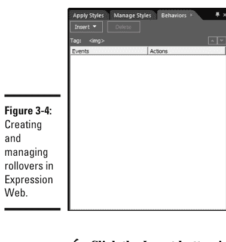

6. **点击行为窗格中的“插入”按钮。**
一个行为（或动作）菜单将出现。

7. **点击“交换图像” (Swap Images) 选项。**
交换图像对话框将出现，如图 3-5 所示。

8. **在“交换图像 URL”框中输入悬停图像的文件名和路径。**

9. **选中“在鼠标移出事件时还原” (Restore on Mouseout Event) 复选框。**
此选项可确保当悬停状态恢复正常时，原图像被还原。

10. **点击确定。**
对话框关闭，您会看到行为窗格中添加了两个事件：`onmouseout` 和 `onmouseover`。

## 使用 Expression Web 创建悬停效果

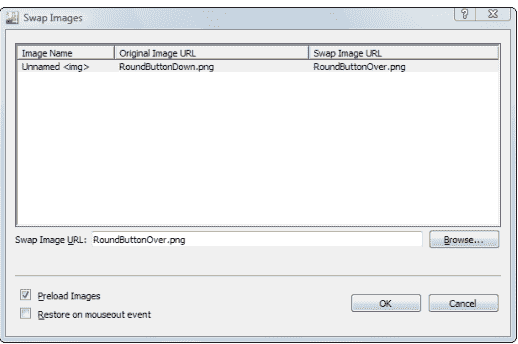

**图 3-5：** 交换图像对话框。

11. 按 F12 键测试你的新悬停技术。

当你将鼠标指针移动到图像元素上时，图像就会被交换。

## 第 VII 部分：Microsoft Expression Web

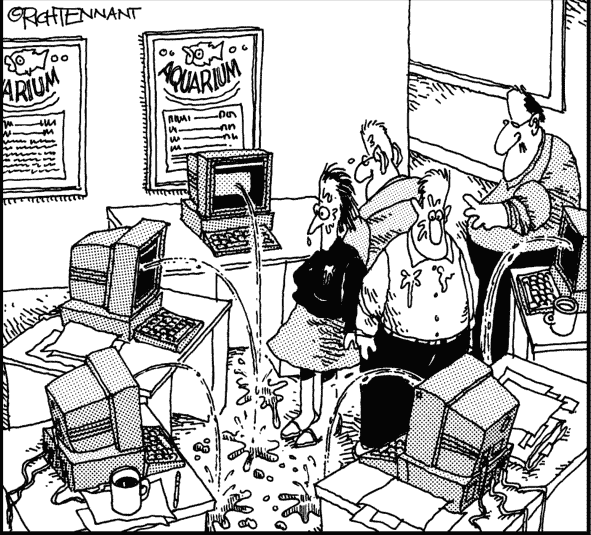

> “好的，我想我忘了提这个，但我们现在有一个网站管理功能，当‘水族馆’网站上出现断链时，它会自动提醒我们。”

## 目录概览

**第 1 章：了解 Microsoft Expression Web** ........................... 371

- 探索 Expression Web 工作区 ................................... 371
- 探索编辑窗口 ................................................ 372
- 发现标签选择器 .................................................. 375
- 使用面板 ............................................................ 376
- 查看你的网站 .......................................................... 381
- 自定义你的工作环境 ........................................ 382

**第 2 章：表达自我：使用 Expression Web 创建你的第一个站点** ............... 385

- 创建新站点 ................................................ 385
- 使用主页 .................................................... 387
- 在浏览器中预览你的页面 ............................................ 389
- 在 SuperPreview 中预览页面 .......................................... 391
- 发布你的站点 ........................................................... 392
- 将站点导入 Expression Web .......................................... 395

**第 3 章：处理文本、图形和链接** ............................. 397

- 在页面中添加和编辑文本 ........................................ 397
- 处理图片 .......................................................... 403
- 处理超链接 ....................................................... 408

**第 4 章：使用 Expression Web 布局页面** .................... 411

- 处理 div 元素 .................................................... 411
- 处理布局表格 .................................................... 418

**第 5 章：“似曾相识，格式已定”：使用动态 Web 模板** ............... 423

- 理解动态 Web 模板 ....................................... 423
- 创建动态 Web 模板 ............................................. 424
- 使用动态 Web 模板创建新页面 ........................... 427
- 对你的动态 Web 模板进行更改 ................................. 428
- 附加和分离动态 Web 模板 .............................. 429

## 第 1 章：了解 Microsoft Expression Web

### 本章内容

- 介绍 Expression Web 工作区
- 探索编辑窗口
- 发现面板
- 自定义工作区

Expression Web 是 Microsoft 顶级的网站设计工具。如果你使用过 Microsoft Office 应用程序（如 Word），你会发现 Expression Web 相当容易上手。更好的是，如果你几年前曾经使用过 FrontPage，你会发现这两款软件产品之间有许多相似之处。事实上，Expression Web 与旧版的 FrontPage 属于同一软件血统。

Expression Web 是新的 Microsoft Expression Studio 中的旗舰产品。该软件套件中的其他产品包括 Expression Design（用于插图和图形设计）、Expression Blend（用于设计用户界面）和 Expression Media（用于组织你的数字资产）。在这本迷你书中，我专注于 Expression Web。

本章将向你介绍 Expression Web，并带你了解其工作环境的主要功能。在本迷你书的其余章节中，你将卷起袖子，用它来创建页面。

## 探索 Expression Web 工作区

当你启动 Expression Web 时，主工作区（如图 1-1 所示）将完整呈现。

系统会自动为你创建一个无标题的 HTML 文档。你可以立即开始使用它。

你在编辑窗口中编写和设计你的网页。环绕编辑器的每个工具栏和面板都可以帮助你构建或管理你的网站。

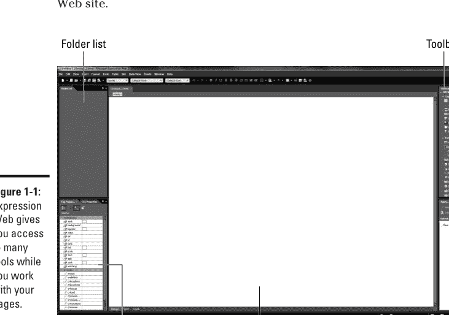

## 探索编辑窗口

编辑窗口是 Expression Web 内部你将花费大量时间的地方。图 1-2 指出了你可以使用的主要功能。

请特别注意编辑窗口底部的“设计”、“拆分”和“代码”按钮。默认情况下，Expression Web 以设计视图显示文档（见图 1-2），该视图提供了一个接近浏览器中实际效果的网页 WYSIWYG（所见即所得）外观。

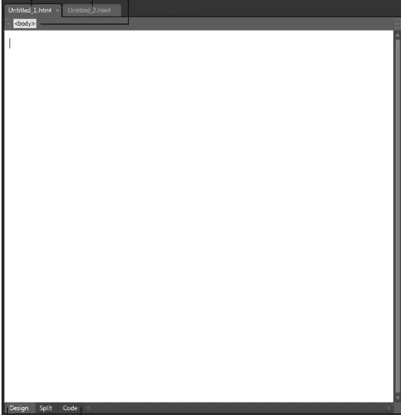

图 1-2：编辑窗口周围环绕着快速访问的效率工具。

单击“代码”按钮，以代码视图显示文档，这将显示页面的 HTML（超文本标记语言）代码（见图 1-3）。如果 HTML 对你来说像天书，请务必查看第 III 部分。

最后，你可以选择折中方案，在拆分模式下查看文档（见图 1-4）。拆分模式提供了一个分屏，上方显示代码视图，下方显示设计视图。

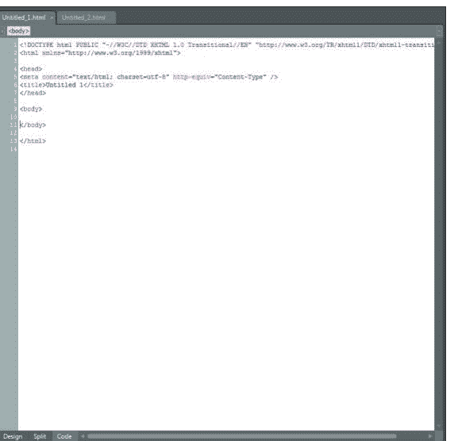

**图 1-3：** 代码视图显示文档的 HTML 源代码。

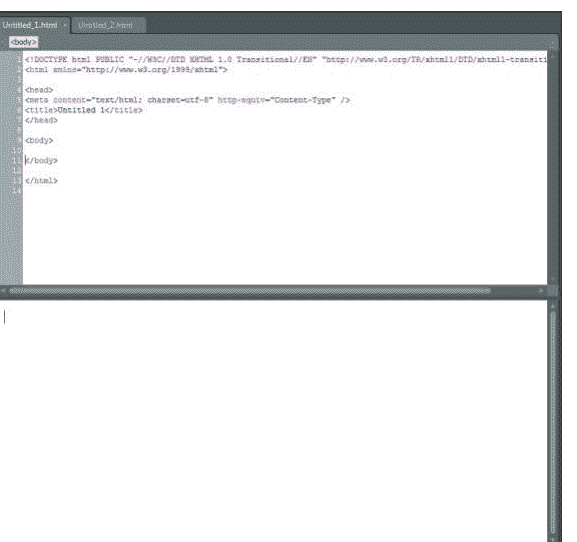

**图 1-4：** 拆分视图使你能够同时看到设计视图和代码视图。

## 发现标签选择器

网页是用 HTML 编写的。当然，Expression Web 不会强迫你手工编码你的页面。但是，你对文档所需的 HTML 了解得越多，你对它的控制力就越强。

当你在设计视图中工作时，Expression Web 总是通过其标签选择器（显示在编辑窗口的文件标签页下方）让你快速访问正在使用的标签。

当你在文档中任何位置单击鼠标时，标签选择器会显示该插入点处 HTML 的嵌套顺序视图。例如，图 1-5 显示了当鼠标指针位于一段文本内时的标签选择器。该段落包含在几个 `div` 元素中，然后是 `body` 元素。


图 1-5：使用标签选择器选择各种 HTML 标签。

每个标签都是一个按钮，单击该按钮会在编辑窗口内选择一个元素。或者，你可以单击按钮右侧的下拉箭头，显示一个选项下拉列表（选择标签、选择标签内容、编辑标签、删除标签、插入 HTML、包裹标签、定位和标签属性），如图 1-6 所示。

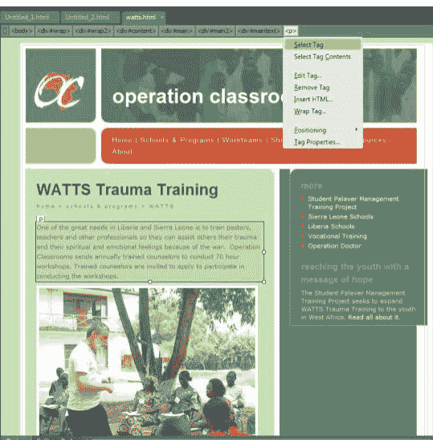

图 1-6：你可以从标签选择器访问多个功能。

## 使用面板

编辑窗口周围是一组面板，提供额外功能，帮助你设计和管理网站。这些面板通常显示在 Expression Web 窗口的两侧，但你可以将它们从侧面分离出来，显示为浮动窗口。

你可以从“面板”菜单访问每个面板。

以下是一些在使用 Expression Web 时会派上用场的面板：

- **工具箱**：工具箱（见图 1-7）用于向页面添加 HTML 标签、窗体控件和媒体元素。

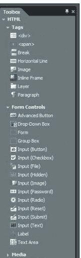

**图 1-7：** 工具箱允许你将 HTML 元素拖放到网页中。

- **应用样式和管理样式面板**：默认情况下，“应用样式”和“管理样式”面板出现在同一个面板窗口中。使用“应用样式”面板可以快速地将 CSS（层叠样式表）样式应用于您的文档；使用“管理样式”面板来管理您的样式规则和外部样式表。图 1-8 显示了“应用样式”面板。

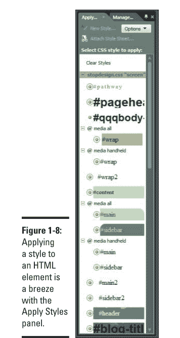

- **文件夹列表面板**：使用图 1-9 所示的“文件夹列表”面板来查看和管理 Expression Web 网站上的文件。您可以在此面板中创建、打开、重命名或删除页面和文件夹。如果您在网站之外操作独立页面，则该面板为空。

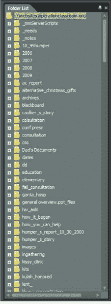

**图 1-9：** “文件夹列表”面板相当于集成在 Expression Web 内部的一个微型 Windows 资源管理器。

- **标签属性和 CSS 属性面板**：默认情况下，“标签属性”（见图 1-10）和“CSS 属性”（见图 1-11）面板捆绑在同一个面板中。“标签属性”面板允许您查看和编辑文档中当前 HTML 元素的所有可用属性。“CSS 属性”面板则显示所选元素的 CSS 规则和属性。

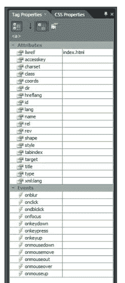

**图 1-10：** 通过“标签属性”面板获取任何元素的内部详细信息。

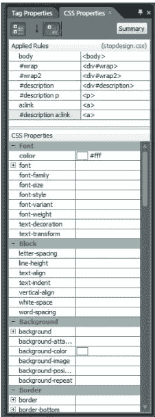

图 1-11：“CSS 属性”面板允许您查看当前应用的规则和可用的规则设置。

## 查看您的网站

当您在 Expression Web 中打开一个网站时，文档标签的最左侧会出现一个“站点视图”选项卡。该窗口内列出了站点的资源，包括本地文件夹、远程网站、报告和超链接。您可以通过窗口底部的视图按钮查看这些不同的资源。图 1-12 显示了“站点视图”。

## 定制您的工作环境

Expression Web 允许您定制工作环境；您可以按照自己的意愿对其进行调整。

### 定制面板

以下是您可以对面板执行的几种显示选项：

- **显示和隐藏面板：** 通过“面板”菜单访问所有面板。您可以从列表中选择相应的菜单项来显示或隐藏面板。您也可以点击打开面板的“关闭”按钮将其隐藏。

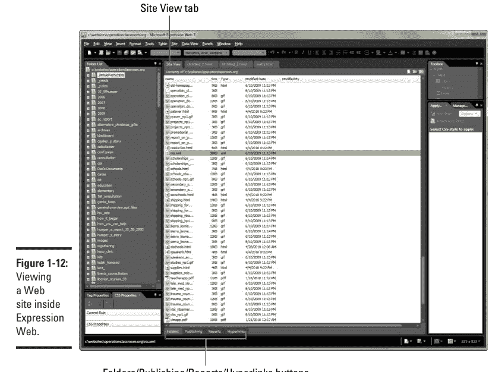

- **最大化面板：** 您可以点击面板上的“最大化”按钮来扩大面板的尺寸（并缩小相邻的其他面板）。点击“还原”按钮可恢复到正常尺寸。

- **取消停靠和停靠面板：** 您可以取消停靠任何面板并创建浮动窗口。为此，请将面板的标题栏拖动到编辑窗口中：面板将取消停靠并浮在工作区上方。您也可以右键单击并从弹出菜单中选择“浮动”。

要停靠浮动面板，请将面板拖动到应用程序窗口的边缘：Expression Web 会为您停靠该面板。或者，您可以右键单击标题栏并选择“停靠”。

### 定制页面编辑器

Expression Web 页面编辑器提供了一系列令人印象深刻的选项，您可以通过选择“工具” > “页面编辑器选项”（如图 1-13 所示）来定制。

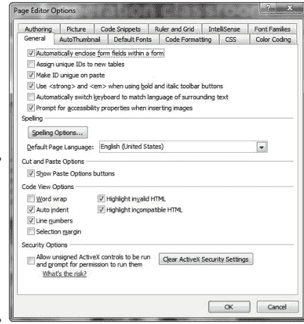

## 第 2 章：展现自我：使用 Expression Web 创建您的第一个站点

### 本章内容

- 创建一个新的 Expression Web 站点
- 向主页添加内容
- 在浏览器中预览页面
- 将站点发布到 Web

现在是用 Expression Web 展现自我的时刻了。随着您阅读这本小册子的深入，您将更深入地学习如何布局页面以及处理内容。为了开始学习，我将引导您逐步完成使用 Expression Web 创建网站的过程。

在本章末尾，我将向您展示如何将刚刚创建的网站发布到远程服务器。因此，在开始之前，您需要拥有一个 Web 托管提供商的账户。如果您没有，请跳过关于发布的章节。

## 创建新站点

在您可以使用 Expression Web 处理页面、图形和其他文件以开发站点之前，首先必须创建站点本身。要创建新站点，请执行以下步骤：

1. **选择“站点” > “新站点”。**

将出现“新”对话框，如图 2-1 所示。

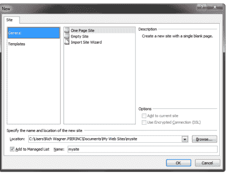

**图 2-1：** 创建站点的起点。

2. **选择“常规”或“模板”类别。**

- **常规：** 选择此项以从单页或空白站点开始，或者将现有站点导入到 Expression Web 中。
- **模板：** 使用此项从设计模板列表中选择一个以便快速入门。

如果您要导入现有站点，请参阅本章末尾的“将站点导入 Expression Web”部分。如果您想创建模板作为页面起点，请参阅本小册子的第 5 章。

3. **从类型列表中选择所需的站点选项。**

在本示例中，我选择“Personal 4”模板。

4. **在“位置”框中输入所需的目录。**

您也可以点击“浏览”按钮并从对话框中选择所需的文件夹。

5. **在“名称”框中为您的站点输入名称。**

此名称用于站点的“管理列表”中。（除非您取消勾选“添加到管理列表”复选框，否则站点将被添加到管理列表中。）

我输入了 `My First Site`。

6. **点击“确定”。**

Expression Web 将创建站点并显示“网站”窗口，如图 2-2 所示。

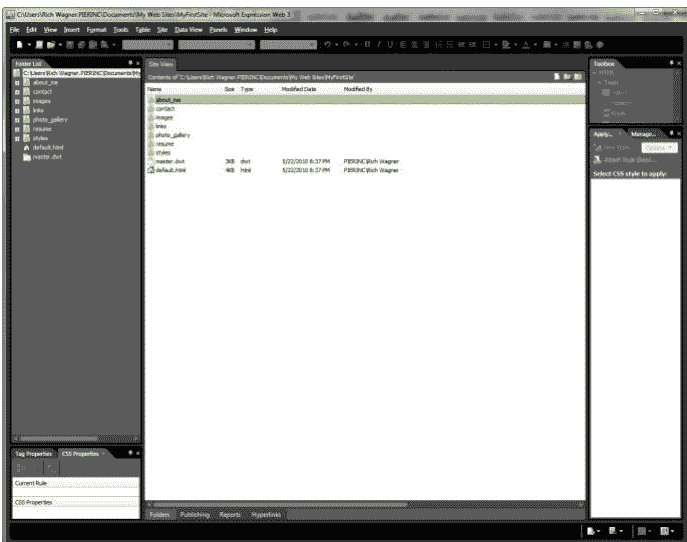

图 2-2：Expression Web 使用的模板在开始时会创建若干文件夹和页面。

## 处理主页

除非您在站点创建过程中选择了空白站点，否则 Expression Web 会自动创建一个主页并将其命名为 `default.html`。

主页最初包含预设内容，如图 2-3 所示。或者，如果您选择了空白页，则会得到一个空白文档。

要向主页添加内容，请执行以下步骤：

1. **双击**编辑窗口中的 `default.html` 标签。
2. 将光标点击到页面中的所需位置，开始编辑内容。
3. （可选）添加链接。
   a. 选择您想要链接的文本。
   b. 点击工具栏上的“插入超链接”按钮。
   c. 在对话框中导航至该链接（或在“地址”框中输入 URL），然后点击“确定”。

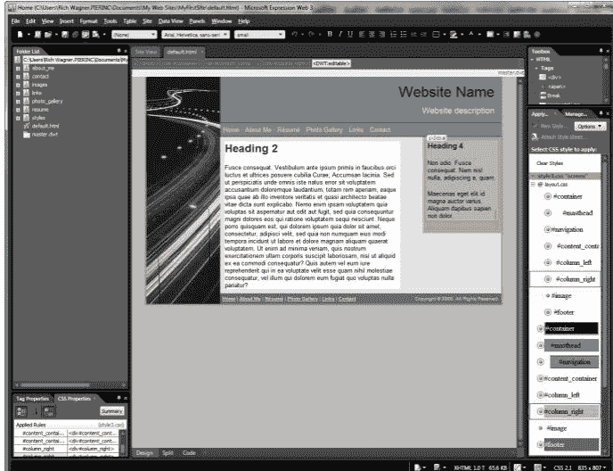

图 2-3：准备好编辑的预设内容。

4. （可选）添加图像。
   a. 将光标置于您希望图像出现的位置。
   b. 点击工具栏上的“从文件插入图片”按钮，然后从出现的对话框中选择您想要插入的图像。
   c. 点击“确定”。

5. 为您的页面添加标题。

6. 选择“文件” > “保存”。

在编辑窗口中右键单击页面，并从弹出菜单中选择“页面属性”。在出现的“页面属性”对话框（见图 2-4）中，在“标题”字段中输入描述性标题，然后点击“确定”。（标题将显示在浏览器的窗口或标签页标题中。）

这并不是什么高深的科学，但与您处理的其他文档一样，您必须在网页具有实际用途之前将其保存。

7. 对网站中的每个页面重复上述步骤。

如果您使用了模板，可能会有几个需要修改的页面。（选择“文件” > “新建” > “页面”来添加新页面。）

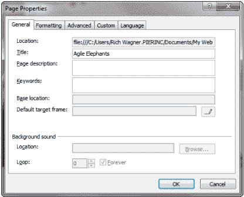

图 2-4：修改标题和其他页面属性。

在这里，我跳过了 Expression Web 提供的许多用于处理文本、链接和图像的功能。我将这些讨论留给本小册子的第 5 章。

## 在浏览器中预览您的页面

尽管 Expression Web 具有可视化编辑器，但在“设计视图”中看到的内容与在浏览器中实际看到的内容之间总是存在一些差异。因此，在完成页面之前，请务必预览页面以查看其实际效果。

要预览文档，请执行以下步骤：

1. **点击工具栏上的“在浏览器中预览”按钮。**

在下拉列表中，会出现安装在计算机上的浏览器列表及其各种窗口尺寸（见图 2-5）。

如果您更喜欢主菜单，也可以从“文件” > “在浏览器中预览”子菜单中选择一个选项。

您可以通过从下拉列表中选择“编辑浏览器列表”项来修改浏览器列表。此外，您还可以指定是否希望 Expression Web 在预览之前自动保存文档的当前状态。

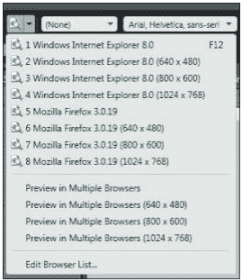

**图 2-5：** 选择用于预览页面的浏览器和窗口尺寸。

2. 从列表中选择所需的浏览器和窗口尺寸。Expression Web 会在浏览器中打开你的页面供你预览（参见图 2-6）。

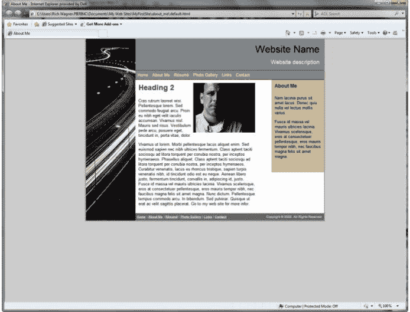

**图 2-6：** 在浏览器内预览文档。

### 在 SuperPreview 中预览页面

虽然普通的预览功能对于单一浏览器来说肯定够用，但 Expression Web 还包含一个创新且强大的功能，恰如其分地被称为 SuperPreview。在 SuperPreview 中，你可以同时在不同浏览器和浏览器版本中预览你的页面。左侧作为基线预览；右侧用于比较。

使用方法如下：

1. **单击工具栏上的 SuperPreview 按钮。**
你也可以选择“文件” → “在 SuperPreview 中显示”。
首次单击 SuperPreview 按钮时，SuperPreview 窗口会出现，如图 2-7 所示。

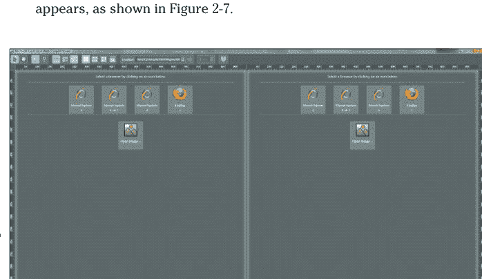

图 2-7：它不是鸟，不是飞机，它是 Super Preview。

2. **在左侧，选择你想用来预览页面的基线浏览器。**
我的情况是，我选择了 Internet Explorer 8。

3. **单击“刷新”按钮以在基线面板中显示页面。**

4. 在右侧，选择要与之比较页面的浏览器。
我选择了 Firefox。

5. 再次单击**“刷新”按钮**以更新显示。

图 2-8 显示了在 SuperPreview 中显示的一个页面。

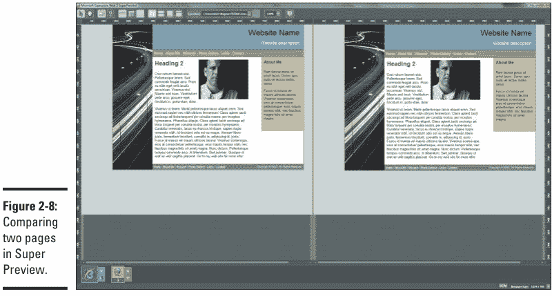

### 发布网站

在预览网站并准备好一切之后，你就可以将其上传（或发布）到远程服务器了。

以下是发布新创建网站的方法：

1. **选择“网站” → “发布”。**
此功能会为你的网站启用发布功能并显示“发布”选项卡（参见图 2-9）。

2. **单击“添加发布目标”链接。**
“连接设置”对话框会出现（参见图 2-10）。


图 2-9：准备发布。


图 2-10：“连接设置”对话框。

3. 在“名称”框中为连接输入一个名称。
4. 从“连接类型”下拉列表中选择所需的连接类型。
如果你使用的是典型的网络托管提供商，你会使用 FTP（文件传输协议）连接到服务器。（如果你使用其他选项，请填写设置，然后跳至步骤 8。）

5. 在“位置”字段中，输入托管提供商的 FTP 服务器信息。
6. 如果你有一个特殊目录用于放置网站文件，请将其添加到“目录”字段中。
7. 填写“用户名”和“密码”字段。
8. 单击“添加”。

Expression Web 尝试使用你提供的信息连接到服务器。

Expression Web 连接到服务器并显示服务器的实时视图，如图 2-11 所示。


9. 从本地视图中，选择要发布的文件，然后单击“将文件发布到目标网站”按钮。

Expression Web 在“状态”窗格中显示传输结果。如果上传成功，恭喜你！你使用 Microsoft Expression Web 发布了你的第一个网站。

请确保上传网站使用的所有图像和其他文件，而不仅仅是页面本身。构建网站时最常见的错误之一就是在发布时忘记了这些支持文件。

当你需要在以后重新发布文件时，选择文件并单击“将文件发布到目标网站”按钮。文件将使用你之前定义的设置进行上传。

### 将网站导入 Expression Web

也许你有一个现有的网站，你想将其导入 Expression Web 以便开始使用。要导入网站，请按照以下步骤操作：

1. **选择“网站” > “导入” > “导入网站向导”。**
“导入网站向导”对话框会出现，如图 2-12 所示。


图 2-12：通过导入你之前用其他网络工具完成的工作，你可以获得先机。

2. **选择你想用来检索文件的传输方式。**
- FTP：如果你要导入的是你放在网络服务器上的旧网站，并且你有用户名和密码信息，请选择 FTP。
- HTTP：对于其他所有情况，请选择 HTTP。

3. **在“位置”字段中指定地址。**
4. **如果使用 FTP，请指定“目录”。**
5. **单击“下一步”开始。**

Expression Web 连接到远程服务器（如果需要，会请求你的用户名和密码）。如果 Expression Web 能够连接，向导的下一页将显示（参见图 2-13）。


**图 2-13：** 输入你想要存储导入文件的本地文件夹。

6. **输入你想要放置网站文件的文件夹，然后单击“下一步”。**
最后一个对话框会出现。

7. **单击“完成”以开始导入过程。**
Expression Web 在“网站”窗口中打开“远程网站”视图。

8. **在“发布所有更改的页面”组中选择“远程到本地”单选按钮。**
9. **单击“发布网站”按钮。**
Expression Web 连接到网络服务器并开始传输过程。传输状态会在文件从远程服务器检索时显示。

10. **当传输过程完成时，单击“编辑”窗口底部的“文件夹”视图按钮。**
网站的本地文件会被列出。你现在可以选择并编辑显示的任何网站文件。

## 第三章：处理文本、图形和链接

### 本章内容

- 插入和格式化文本
- 处理图像
- 添加链接

这完全关乎内容。一个网站应该具有吸引力且易于导航。如果你想让访问者一次又一次地回访，你需要为他们提供看点——内容。

你在网站上处理的大部分内容由三种基本类型组成：文本、图形和链接。你使用 HTML（超文本标记语言）和 CSS（层叠样式表）以各种方式排列和设置这些内容片段的样式，但牢固掌握基础知识很重要。本章将探讨如何处理文本、图片和链接。

Expression Web 不会带你深入了解 HTML 或 CSS。但如果你有兴趣了解更多关于这些工具的知识，我在第三册中讨论了 HTML，在第四册中讨论了 CSS。

## 在页面中添加和编辑文本

如果你以前使用过 Microsoft Word，那么你对在 Expression Web 中处理文本已经有很好的了解了。尽管底层技术不同，但 Word 和 Expression Web 中格式化和编辑文本的许多方法是一致的。这种协同作用使你更容易过渡到 Web。

### 添加文本

要将文本添加到页面中，只需在“编辑”窗口中单击你想放置文本的位置，然后开始输入。如果你不在任何其他元素中（除了页面的主体），Expression Web 会自动为你输入的文本添加一个段落 (`<p>`) 元素。

当你输入文本时，Expression Web 的行为与 Microsoft Word 非常相似：

- 当你到达行末时，文本会自动换行。
- 按 Enter 键会关闭当前段落并创建一个新段落。
- 要开始新行但保持在同一段落内，请按 Shift+Enter，这会添加一个换行 (`<br>`) 元素。
- 你也可以通过双击“工具箱”中的“分隔符”标签来添加换行符。


输入文本后，你可以通过两种方式对其进行格式化：直接格式化和使用样式。

### 直接格式化文本

你可以通过“常用”工具栏直接格式化 Expression Web 中的文本，如图 3-1 所示。这与你可能在 Microsoft Word 中一直使用的方法完全一样。

**图 3-1：** 你可以从“常用”工具栏执行基本文本格式化。


HTML 段落样式是应用于整个段落的设置（你通过将文本光标置于段落内的某个位置来指定其作用位置），但其余的格式化选项则应用于你用鼠标选中的文本。

以下是一些更常用的格式化选项：

- **样式：** “样式”下拉列表显示传统的 HTML 段落文本样式：
  - 段落（默认）
  - 标题 1（最大标题）到标题 6（最小标题）

## 处理图片

图片是任何网站的第二大要素。以下是在 Expression Web 中处理图片的方法。

### 将图片添加到页面

要插入图片，请按以下步骤操作：

1. 在**编辑窗口中，将光标定位到**屏幕上您希望插入图片的位置。
2. 点击**常用工具栏**上的**从文件插入图片**按钮。如果您愿意，也可以选择“插入” → “图片” → “来自文件”。此时会出现“图片”对话框（如图 3-5 所示）。
3. 选择所需的图像。
4. 点击**打开**。会出现“辅助功能属性”对话框（见图 3-6）。为图片提供替代文本可确保视觉障碍人士能更好地理解您的网站。
5. 在“替代文本”字段中输入图像的描述。替代文本对于您网站的视觉障碍访客至关重要。
6. 点击确定。

图片现已添加到您的网页上，如图 3-7 所示。

如果图片当前不在您网站的文件夹内，当您保存文档时，Expression Web 会显示“保存嵌入文件”对话框（见图 3-8）。使用此对话框将图片添加到您网站的图片文件夹中。

### 修改图片

您可以通过在编辑窗口中双击图片来修改图像属性，这将打开“图片属性”对话框。此对话框有两个选项卡：“常规”选项卡（见图 3-9）和“外观”选项卡（见图 3-10）。

在以下部分，我将引导您了解可能需要对图像属性进行的一些更改。

### 更改图像文件类型

当您点击“常规”选项卡上的“图片文件类型”按钮时，Expression Web 使您能够将现有图像转换为另一种格式类型。您可以将格式转换为 GIF、JPEG、PNG-8 或 PNG-24。（关于这些不同格式的优缺点，请参阅第六卷获取详细信息。）

如果您有图像编辑器，例如 Photoshop，您可能希望在那里进行大部分图像转换，因为这样可以更好地控制转换质量。但是，如果您无法使用其他软件，Expression Web 内置的转换工具会派上用场。

### 对齐和环绕图片

默认情况下，当您将图片插入段落时，图片会直接添加到段落本身中。然而，在大多数情况下，您希望文本环绕图片。在“图片属性”对话框中，使用“外观”选项卡上的“环绕样式”选项来指定您想要使用的环绕类型：无、左或右。您还可以从“对齐方式”下拉列表中指定位置。

### 为图片添加内边距

在“图片属性”对话框中，“水平边距”和“垂直边距”字段允许您指定要添加在图片周围的内边距（以像素为单位）。（通常五个像素是一个不错的经验值。）

### 添加边框

您可以在“图片属性”对话框的“边框粗细”字段中输入像素值来添加边框。

### 调整图像尺寸

Expression Web 在“宽度”和“高度”字段中放置图像的实际尺寸（以像素为单位）。如果您想要缩小、扩大或扭曲图像，请在“图片属性”对话框中输入新值。

您也可以在编辑窗口中直接通过点击图像并拖动其中一个边界框来调整图像大小。当您这样做时，在选中图片时会出现一个“图片操作”下拉列表。然后您可以指定是想要修改 HTML 尺寸属性，还是让 Expression Web 使用这些指定的尺寸为您调整图像大小。（但是，当您以这种方式调整图像大小时，文件大小保持不变。因此，我建议仅在像 Photoshop 这样的图像编辑软件程序中调整图像尺寸。）

### 编辑图像

与 Microsoft Word 非常相似，Expression Web 在编辑器本身提供图像编辑功能，位于“图片”工具栏中（如图 3-11 所示）。要访问该工具栏，请选择 View → Toolbars → Pictures。该工具栏包含一系列用于编辑图像的命令。

图 3-11：使用“图片”工具栏编辑图像。


一些常用功能包括：

- **Auto Thumbnail（自动缩略图）**：点击此按钮可创建所选图片的小型缩略图版本。随后，缩略图将链接到较大的图像。当您保存页面时，Expression Web 会要求您保存新的缩略图图像。
- **Brightness and Contrast（亮度与对比度）**：点击“亮度”和“对比度”按钮来微调这些图像设置。
- **Crop（裁剪）**：点击“裁剪”按钮直接在页面上修剪图像尺寸。这些更改将直接应用于图像文件本身。
- **Resample（重采样）**：点击“重采样”按钮根据当前尺寸保存图像。
- **Reset（重置）**：点击“重置”按钮恢复图片的原始图像尺寸。

## 处理超链接

从字面上来说，超链接成就了今天的 Web。不出所料，您会发现自己最常做的操作之一就是在这里添加链接，在那里添加链接，到处添加链接。

### 创建超链接

要插入链接，请遵循以下步骤：

1. 选择您想要作为链接的文本或图片。
2. 点击通用工具栏上的“插入超链接”按钮。

您也可以选择 Insert → Hyperlink。

随后会出现“插入超链接”对话框（见图 3-12）。


3. （可选）在“显示文本”字段中编辑链接文本。
4. 从“链接到”列表中选择所需选项。

选项如下：

- Existing File or Web Page（现有文件或网页）链接到您站点中的文件或互联网上的 URL。
- Place in This Document（此文档中的位置）链接到当前文档中先前定义的书签。
- Create New Document（创建新文档）链接到您随后创建的新文档。
- E-mail Address（电子邮件地址）链接到电子邮件地址。

对话框将更新以使您的选择生效。

5. 如果您正在链接到现有文件或网页，请导航到所选文件或在“地址”字段中输入 URL。

6. （可选）要为链接文档指定目标窗口，请点击“目标框架”按钮。

您可以在“目标框架”对话框中指定链接页面应显示的窗口或框架。您可以选择以下选项：

- Page Default（页面默认）(`none`) 不做任何更改。
- Same Frame（相同框架）(`_self`) 在发送链接的同一个窗口中显示文档。
- Whole Page（整页）(`_top`) 在顶级窗口中打开返回的文档（替换任何框架）。
- New Window（新窗口）(`_blank`) 在新窗口中打开返回的文档。
- Parent Frame（父框架）(`_parent`) 在当前窗口的父窗口中显示文档。

7. 点击“确定”创建链接。

### 删除超链接

您可以通过选择分配了链接的文本或图像来删除之前创建的链接。右键单击并从弹出菜单中选择“超链接属性”。然后，在“编辑超链接”对话框中，点击“删除链接”按钮。

您也可以简单地从“标签属性”面板的 `href` 属性中删除 URL 值。

### 创建图像映射和热点

要将图像的不同部分链接到不同的 URL，请点击“图片”工具栏（参考图 3-11）上的“热点”按钮来创建图像映射。

您可以像为文本创建超链接一样为图像创建超链接，这样当图像被点击时，用户会被带到一个新的 URL。但是，您也可以在图像内部定义区域（热点），并为每个区域分配一个在点击时跳转的特定 URL。包含热点的图像即为图像映射。

要创建图像映射，请遵循以下步骤：

1. 选择您想要添加热点的图像。
2. 从“图片”工具栏中，选择与您想要创建的形状相匹配的热点工具。

对于大多数用途，矩形热点工具效果非常好。

3. 将鼠标在图像上拖动，以您想要的尺寸设置热点。当您对尺寸满意时，松开鼠标。

Expression Web 将显示“插入超链接”对话框。

4. 在“地址”字段中输入您想要与可点击区域关联的 URL。或者通过对话框导航到您选择的文件。
5. 点击“确定”以添加链接。
6. 为每个要添加的热点重复步骤 2-5。


如果您想在添加热点后调整其大小、重新定位或将其删除，请在编辑窗口中用鼠标点击它，并根据所需操作进行操作。

## 第 4 章：使用 Expression Web 布局页面

### 本章内容

- 处理 div 元素
- 使用布局表格进行页面设计

对于经历过那个时代的人来说，这现在似乎像是古老的历史，但在 20 世纪 80 年代，在参议员丹·奎尔（Dan Quayle）和劳埃德·本森（Lloyd Bentsen）的一次美国副总统辩论中，有一个令人难忘的场景。在奎尔将自己比作肯尼迪之后，本森反驳道：“参议员，我曾与杰克·肯尼迪共事。我认识杰克·肯尼迪。杰克·肯尼迪是我的朋友。参议员，你绝不是杰克·肯尼迪。”这句话成为了 20 世纪末最著名的政治名言之一。

当我开始回想在这本小册子中一直将 Microsoft Word 和 Expression Web 进行对比时，我想到了这段话。毕竟，对于许多常规任务来说，它们完全可以是同一款产品。然而，由这两款产品生成的页面不应该看起来一样。如果您要创建一个设计精良的网站，您想做的不仅仅是用文字处理文档的在线版本来填充它。相反，请使用 Expression Web 中可用的工具来创建精致的、基于标准的页面布局。

最终，您希望能够看着 Microsoft Word 的图标对它说：“我用 Expression Web 创建了我的网站。Expression Web 是我的朋友。Word，你绝不是 Expression Web。”（不过，如果您真的这么做，我建议在他人不在场时不要大声说出来，否则您可能会出现在 YouTube 上。）

在本章中，我将向您展示如何使用 Expression Web 中最重要的页面布局工具，包括 `div` 元素和布局表格。

## 处理 div 元素

`div` 元素是 HTML 中用于布局网页最重要的组件。`div` 元素本身默认是不可见的，其作用仅仅是作为内容块的矩形容器。然而，当您将 `div` 元素与层叠样式表 (CSS) 结合使用时，您可以根据需要将它们精确地定位在页面上的任何位置，从而创造出令人惊叹的视觉杰作。好吧，也许我有点夸张了，但您可以在 Web 上找到许多有效利用 `div` 块且设计精良的站点。

> 在开始本节之前，您至少需要具备关于 CSS 定位的基本知识。请参阅第四册以了解更多关于使用 CSS 定位 `div` 元素的内容。

### 添加 div 元素

您可以通过双击工具箱面板中的 `<div>` 标签将 `div` 元素添加到页面上。（或者您可以选择 Insert → HTML → `<div>`。）`div` 元素显示为一个虚线矩形框，被添加到当前光标位置。见图 4-1。请注意，Expression Web 不允许您在段落内部插入 `div` 元素。


您可以向 `div` 元素添加内容或对其进行定位。要添加内容，只需像在文档正文中一样开始输入即可。

### 调整 div 元素的大小和位置

你可以直接通过选中 `div` 并使用其边框上的控制柄来调整其大小。然而，使用鼠标进行定位的方式是有限的——这是因为你正在一个基于流的环境中工作，在这种环境中，所有元素通常按照从左到右、从上到下的方式排列。请想象一下 Microsoft Word 等文字处理软件中文本的流动方式。

因此，要定位 `div`，你需要使用 CSS。如果你已经在样式表中为 `div` 定义了样式，可以使用"应用样式"面板来应用样式。然而，如果你还没有创建样式，请按照以下步骤操作：

1. **选择"格式" → "定位"。**
"定位"对话框将显示（见图 4-2）。


2. **在"环绕样式"部分，指定你希望 `div` 相对于文档正常文本的环绕类型。**
"左"和"右"设置会为 `div` 添加 float CSS 属性。

3. **在"定位样式"部分，指示 `div` 应该采用绝对定位、固定定位，还是相对于周围其他元素进行定位。如果你不想指定，请点击"无"。**
如果选择"绝对定位"，`div` 元素将不会环绕其他元素——这意味着 `div` 元素可能会覆盖在其他内容上方或被其他内容覆盖。

> **提示**
> 在大多数情况下，你希望将 `div` 相对于页面上的其他元素进行定位，以确保它们不会重叠。

4. **如果在步骤 3 中选择了"绝对定位"，请在提供的空格中指定"左"、"右"、"上"和"下"的值。**
这些值在 `div` 相对定位时不会使用。

5. **在"宽度"和"高度"字段中指定块的所需尺寸。**

6. **点击"确定"。**
`div` 将根据你的设置重新定位和 resize。图 4-3 展示了一个向右环绕的块，其大小设置为 150 x 300 像素。


此外，如图 4-3 所示，"标签属性"面板会显示你设置的属性。如果需要，你可以使用该面板来调整这些定位值。

如图 4-4 所示，"定位"工具栏对于调整位置和大小设置的各个方面非常有用。你可以通过选择"视图" > "工具栏" > "定位"来访问它。


### 格式化 div 元素

因为 `div` 元素是一个块级内容容器，除了其中包含的内容外，它本身没有任何"外观"。但是，你可以使用 CSS 来应用格式——为其添加背景、边框、外边距和内边距。

> **提示** 随着你对创建 CSS 样式表越来越熟悉（参见第 IV 卷），你可以为 `div` 元素创建基于类的样式，使它们在整个网站中看起来统一。

不过，你也可以直接对 `div` 元素应用格式。方法如下：

1. **在编辑窗口中选择一个 `div` 元素。**

图 4-5 展示了将要修改的 `div` 元素。

2. **激活 CSS 属性面板。**

如果该面板不可见，请选择"格式" > "CSS 属性"。

> **提示** 请确保未启用摘要视图，否则你无法看到所有格式属性。如果列表只显示了少数几个属性，请点击"摘要"按钮以查看完整列表。（见图 4-6。）


**图 4-5：** div 元素需要格式化才能在页面内容中脱颖而出。

3. 点击 CSS 属性面板上的**显示分类列表**按钮。

4. 在"背景"类别中，通过从下拉列表中选择颜色来设置背景颜色。
或者，你也可以指定背景图片。

5. 在"边框"类别中，展开 `border` 属性并定义其三个子属性。
此示例将 `border-width` 设置为 thin，`border-color` 设置为 black (#000000)，`border-style` 设置为 solid。

6. 在"框"类别中，指定 `margin` 属性以将 `div` 元素与页面上的其他元素隔开。
要将 `div` 从页面顶部向下移动，请使用 `margin-top` 属性。在此示例中，我指定了 `50px`。
为了将 `div` 与页面其余内容隔开，我将左边距和底部边距定义为 `10px`。
我没有指定 `margin-right` 属性，因为我希望它与页面侧边对齐。


图 4-6：CSS 属性面板。

7. 在"框"类别中，指定 padding 属性以将 `div` 的内容与其边框隔开。

在 padding 属性中输入 `5px` 会为四个边定义相同的值。

图 4-7 展示了一个新格式化的 `div` 元素。


**图 4-7：** 从 CSS 属性面板格式化 div 元素。

CSS 属性面板提供了完整的格式属性列表。浏览一下列表，以便更好地了解 CSS 的 `div` 格式化功能。

## 使用布局表格

在 Web 的早期——`div` 元素出现之前——表格是任何页面设计配方的主要原料。尽管现在 Web 设计师强烈倾向于使用 `div` 元素来布局页面，但 Expression Web 仍提供布局表格作为页面设计的替代方案。

布局表格与你定义的普通 HTML 表格相同。但是，它在 Expression Web 内部具有普通表格所不具备的特殊格式化功能。

布局表格设计为固定宽度，而不是相对于浏览器窗口大小变化的宽度。

### 插入布局表格

要向网页中添加布局表格，请选择"表格" → "布局表格"。"布局表格"面板将出现，如图 4-8 所示。


"布局表格"面板是你可以手动绘制表格和单元格的地方，使用"插入布局表格"链接和"新建表格和单元格"部分中的绘图工具。当你在 desired 位置添加单元格时，布局工具会自动添加适当的行和列来定位你的单元格。

如果你愿意，也可以从"表格布局"列表中使用预定义的布局模板。对于大多数用途，你可以在"表格布局"列表中找到适合你需求的布局。当你选择某个布局选项时，其周围的边框会变亮。决定好后，点击它以插入到当前页面，如图 4-9 所示。


布局表格被插入并显示，同时布局工具处于开启状态。当表格在标签选择器中被选中时，各个单元格的尺寸会显示在围绕单元格的标签中。

> 使用"布局表格"面板上的"显示布局工具"按钮，可以在普通表格视图和增强布局视图之间切换。

> 使用"布局表格"面板可以指定基本的表格属性，包括宽度、高度和对齐方式。选中"单元格随表格自动缩放"复选框会导致单元格根据表格大小展开和折叠。

### 编辑布局单元格

在布局模式下，你可以执行多种不同的任务：

- **调整单元格大小。** 你也可以通过用鼠标拖动边框到 desired 大小，然后将其移动到新位置来调整各个表格单元格的大小。直接用鼠标调整布局表格的大小可以说是"布局表格"功能最方便的方面。
- **调整行和列属性。** 当整个表格被选中时（或单个单元格），行/列大小会显示在屏幕上的标签框中。点击框上的向下箭头可以指定各种列和行选项。
- **插入布局单元格。** 点击"插入布局单元格"链接可以向布局表格中添加新单元格。你可以在"插入布局单元格"对话框中指定新单元格的大小和位置。你也可以通过点击"绘制布局单元格"按钮并使用鼠标绘制单元格来添加布局单元格。
- **删除布局单元格。** 要从布局表格中删除单元格，请选择该单元格然后右键单击。在弹出的菜单中，选择"删除" > "删除单元格"。


## 第 5 章：使用动态网页模板实现"一劳永逸"的格式化

### 本章内容

- 了解动态网页模板
- 创建新的动态网页模板
- 标记可编辑区域
- 附加和分离动态网页模板

我们人类不喜欢重复做已经做过的事情。"去过那里，做过那个"是句熟悉的俗语。这就是为什么例如 Microsoft Word 有其无处不在的 `Normal.dot` 模板，允许你指定所创建新文档的默认格式。或者，如果你更有冒险精神，可以创建自己的自定义模板以满足更专业的需求。

不甘示弱，Expression Web 也有自己的"格式化过了"版本。在本章中，你将了解如何使用动态网页模板来帮助你在整个站点中保持一致的页面设计。

### 了解动态网页模板

Expression Web 中的动态网页模板是一种包含页面布局、格式和页面元素的 HTML 文档。创建动态网页模板后，你可以将其附加到新页面上。新文档会采用这些设置和布局。之后，当你想要进行更改时，编辑模板；所有已创建的文档都会更新。

使用动态网页模板时，请记住以下几点：

- 你可以创建自己的自定义动态网页模板，或者在从模板创建新站点时使用预制的模板。
- 动态网页模板文件的扩展名为 `.dwt`，通常存储在站点的根文件夹中。

动态网页模板分为可编辑区域和不可编辑区域。你可以指定模板中的哪些区域可以编辑或添加内容。页面的其他部分被锁定。

如果查看模板的源代码，可编辑区域被包裹在 `<!-- #BeginEditable -->` 和 `<!-- #EndEditable -->` 注释之间。

文档头部有一个可以在代码视图中修改的章节。

你也可以进入代码视图来修改任何不可编辑区域。但是，当你返回设计视图时，Expression Web 会通知你做了什么，并询问在下次从模板更新文档时是否丢弃这些更改。

### 创建动态网页模板

由于动态网页模板是一种特殊的 HTML 文档，因此创建它与创建普通网页非常相似。以下是如何创建一个动态网页模板：

1. 选择 **文件** → **新建** → **网页**。

"新建"对话框出现，如图 5-1 所示。


2. 从"常规"组中，从列表中选择"动态网页模板"项。

3. 单击**确定**。

`Untitled_1.dwt` 文档出现在编辑窗口中（见图 5-2）。

Expression Web 向文档主体添加一个 `div` 元素，并将其标记为可编辑区域。

如果你觉得 `div` 元素有帮助，就使用它。否则，可以随意删除它，稍后标记你的可编辑区域。


4. 编辑动态网页模板的设计和布局。

使用 `div` 元素或布局表格，将你的模板组织成不可编辑和可编辑区域。

5. 添加你希望在从动态网页模板创建的每个页面上显示的内容和功能。

6. 在你打算标记为可编辑的区域内添加占位文本。

7. 用鼠标选择可编辑区域（`div`、表格单元格、文本选择、段落等）。

8. 右键单击并从弹出菜单中选择**管理可编辑区域**。

"可编辑区域"对话框出现，如图 5-3 所示。


**图 5-3：** 添加新的可编辑区域。

9. 在"区域名称"字段中输入可编辑区域的名称。

10. 单击**关闭**。

Expression Web 将所选内容标记为可编辑区域。如果该区域没有内容，则区域名称将作为固定文本添加在括号中。

11. 对页面上的每个可编辑区域重复步骤 6-10。

注意，任何未标记为可编辑的区域都无法编辑。

你的基本动态网页模板已准备就绪。

12. 选择**文件** > **保存**。

"另存为"对话框出现。

13. 导航到你要添加模板的所需站点文件夹。

14. 在"文件名"字段中输入名称。

15. 单击**保存**。

Expression Web 保存动态网页模板，并添加 `.dwt` 扩展名。

你还可以将已创建的 HTML 文档转换为动态网页模板。要从现有页面创建模板，请按照以下步骤操作：

1. 在编辑窗口中打开现有页面。
2. 删除你不希望成为动态网页模板一部分的任何内容。
3. 选择你希望可编辑的内容区域。
4. 右键单击并从弹出菜单中选择**管理可编辑区域**。

"可编辑区域"对话框出现。

5. 在"区域名称"字段中输入可编辑区域的名称。

6. 单击**添加**。

Expression Web 将所选内容标记为可编辑区域。如果该区域没有内容，则区域名称将作为固定文本添加在括号中。

7. 对你想要定义的每个可编辑区域重复步骤 3-6。

你的基本动态网页模板已准备就绪。

8. 选择 **文件** → **另存为**。

"另存为"对话框出现。

9. 从"保存类型"下拉列表中，选择**动态网页模板 (*.dwt)**。

10. 在"文件夹"框中导航到所需的文件夹。

11. 在"文件名"字段中添加名称。

12. 单击**保存**。

Expression Web 将文档保存为模板，并为其添加 `.dwt` 扩展名。

### 使用动态网页模板创建新页面

构建好模板后，你就可以基于它创建新页面了。为此，请按照以下步骤操作：

1. 选择 **文件** → **新建网页**。

"新建"对话框出现。

2. 从"常规"类别中，单击"从动态网页模板创建"项。

图 5-4 显示了该对话框。

3. 单击**确定**。

显示"附加动态网页模板"对话框。

4. 在"文件夹"框中找到所需的 `.dwt` 文件。


图 5-4：从动态网页模板创建新文档。

5. 单击**打开**。
6. 修改页面可编辑区域内的内容。
7. 选择 **文件** → **保存**。

基于动态网页模板的新文档出现在编辑窗口中。

除非进入代码视图，否则你无法修改不可编辑区域的内容。

像保存普通网页一样保存你的文档。

### 修改你的动态网页模板

动态网页模板的"动态"部分在于模板和从模板创建的文档之间建立的链接。因此，当你修改模板并保存时，Expression Web 会询问你是否也要更新所有相关文档。

修改模板时要小心；任何更新都会更改站点中基于该模板的所有网页。要修改模板，然后更新附加到该模板的所有文档，请按照以下步骤操作：

1. 选择 **文件** → **打开**，在编辑窗口中打开动态网页模板 `.dwt` 文件。

或者，你可以使用另外两种方式之一打开模板：

- 如果你打开的站点包含你的模板：单击编辑窗口标签窗格上的"网站"按钮，然后在文件夹列表中双击该模板。
- 如果你在编辑窗口中打开的网页已附加到模板：选择 **格式** → **动态网页模板** → **打开附加的动态网页模板**。

动态网页模板在编辑窗口中打开。

2. 编辑文档。

3. 选择 **文件** > **保存**。

出现消息框。它询问你是否要此时更新附加的文档。

4. 单击**是**确认更新操作。如果你不想确认更新（无论出于何种原因），单击**否**。

如果你单击**是**，Expression Web 会遍历所有附加的文档并根据需要进行更新。更改将在你下次打开它们时反映出来。

将更改后的文件上传到 Web 服务器。


### 附加和分离动态网页模板

如前面"使用动态网页模板创建新页面"部分所述，当你基于动态网页模板创建新文档时，模板就会附加到页面上。但是，Expression Web 还允许你将模板附加到现有页面。

要将模板附加到已打开的文档，请按照以下步骤操作：

1. **选择 格式 > 动态网页模板 > 附加动态网页模板。**

"附加模板"对话框出现。

2. **选择所需的模板。**

3. **单击打开。**

Expression Web 评估当前文档的可编辑区域与动态网页模板的匹配情况，并尝试在两者之间进行映射。当两者不匹配时，出现"匹配可编辑区域"对话框（如图 5-5 所示）。

**图 5-5：** "月老啊月老，给我牵个线吧……"


4. 尽可能匹配区域以保留现有内容。
5. 点击确定。

Expression Web 会附加动态网页模板并进行相应的更改。

如果需要将文档从动态网页模板中分离，请从菜单中选择 **动态网页模板 → 从动态网页模板分离**。Expression Web 会断开链接并移除先前动态网页模板的所有痕迹。

## 第八部分：Adobe Dreamweaver


## 目录概览

**第1章：初识Dreamweaver** ........................................ 433

- 介绍Dreamweaver工作区........................................ 433
- 探索文档窗口 ...................................................... 435
- 使用工具栏 ................................................................. 437
- 查看属性检查器 .............................................. 439
- 插入面板 ................................................................................. 440
- 使用面板 .......................................................................... 441
- 自定义你的工作区 ............................................................ 446

**第2章：基础操作：创建你的第一个Dreamweaver网站** .... 449

- 创建新站点 ........................................................................... 449
- 创建新文档 ................................................................. 451
- 向页面添加内容 ............................................................. 452
- 保存页面 ...................................................................................... 453
- 在浏览器中预览页面 ................................................. 453
- 设置你的站点以进行发布 .................................................... 454
- 发布你的站点 ........................................................................... 456

**第3章：格式与布局基础** ........................................ 459

- 处理文本 ............................................................................. 459
- 处理图像 ......................................................................... 463
- 连接各点：添加链接 ................................................... 466
- 使用表格 ........................................................................... 471
- 分而治之：使用div元素 ........................................ 472

**第4章：增强页面元素：Flash控件与Spry构件** ...... 475

- 使用Flash控件 ............................................................. 475
- 使用Spry构件 ................................................................ 477

**第5章：形式追随功能** ...... 489

- 添加表单 ................................................................................... 489
- 使你的表单元素可访问 .......................................... 492
- 添加表单元素 ...................................................................... 493
- 创建跳转菜单 ....................................................................... 499

**第6章：使用CSS** ................. 501

- 使用CSS样式面板管理样式 ...................................... 501
- 创建新CSS规则 ................................................................... 503
- 编辑样式属性和规则 ..................................................... 506
- 在Dreamweaver中创建外部样式表 .......................... 507
- 在文档中应用和移除样式 .......................... 508
- 链接到外部样式表 ...................................................... 509
- 利用示例样式快速入门 ............................................ 510

**第7章：当DWT呼叫时：使用模板实现一致外观** .......... 511

- 理解Dreamweaver模板 ......................................... 511
- 创建模板 ........................................................................... 512
- 使用模板创建新页面 .......................................... 516
- 涟漪效应：对模板进行更改 ..................... 517
- 附加与分离模板 ................................................. 518

**第8章：跳出页面思维：管理你的网站** .................... 519

- 创建和配置站点 ........................................................ 519
- 编辑站点设置 ........................................................................... 522
- 使用文件面板 .............................................................. 522
- 使用资源面板 ........................................................... 525
- 管理本地和远程文件 ..................................................... 526
- 管理链接 ................................................................................... 527

## 第1章：初识Dreamweaver

### 本章内容

- 使用Dreamweaver工作区
- 探索文档窗口
- 使用工具栏、检查器和面板
- 自定义工作区

Adobe Dreamweaver CS5是适用于Microsoft Windows和Mac OS X的事实标准网站设计工具。Web专业人士使用Dreamweaver是因为其强大的功能、丰富的特性和可扩展性。如果你是初学者，不要感到不知所措。你可以快速在Dreamweaver的可视化环境中高效工作，同时逐步发现它提供的众多功能。

本章将向你介绍Dreamweaver CS5，并带你导览其工作区的主要功能。我暂时不会讨论如何使用Dreamweaver创建网页。首先，我希望你"试驾"一下Dreamweaver，并熟悉它的工作环境。

## 介绍Dreamweaver工作区

启动Dreamweaver时，会显示一个欢迎屏幕，如图1-1所示。通过此屏幕，你可以开始创建新页面或打开现有文件。

默认情况下，每次启动Dreamweaver时都会显示欢迎屏幕。要绕过此窗口，请在继续操作前选择"不再显示"复选框。

点击"新建"部分下的HTML按钮，或点击你想要选择的任何其他选项。新文件将在Dreamweaver工作区内创建（参见图1-2）。


Dreamweaver的Windows和Mac版本在功能上几乎完全相同。事实上，两者之间唯一明显的区别可能是，Windows版本将面板、工具栏和文档窗口保持在主Dreamweaver应用程序窗口内。然而，遵循Mac界面惯例，Mac版本没有主应用程序窗口。插入面板、文档窗口和面板都在桌面上浮动显示。

你在文档窗口中编写和设计网页。围绕文档的工具栏、检查器和面板窗口帮助你构建或管理你的文档或站点。

## 探索文档窗口

文档窗口是你在Dreamweaver中工作时几乎全部时间所处的地方。当你开始工作时，请熟悉文档环境的几个部分。图1-3突出显示了主要功能。

当你开始使用Dreamweaver时，也许需要注意的最重要功能是顶部文档栏上的"代码"、"拆分"和"设计"按钮的使用。你使用这些按钮来选择以哪种模式工作：

- **代码：** 文档可以在代码模式下查看，这将显示页面的HTML代码（参见图1-4）。如果这段代码看起来令人生畏，请不要担心；如果你愿意，现在可以避免此模式。在阅读完第三部分后，你可能会花更多时间在代码视图中工作。
- **拆分：** 默认情况下，Dreamweaver显示拆分模式（参考图1-3），同时显示设计视图和代码视图。
- **设计：** 设计模式是从视觉导向的角度查看页面，这与（但不完全是）它在浏览器中的显示方式相似。

您还可以通过选择"视图" → "代码"、"视图" → "设计"或"视图" → "代码和设计"来访问这些视图。

## 使用工具栏

当您刚开始使用 Dreamweaver 时，可能会被数量众多的菜单、工具栏、检查器、面板和其他控件所包围，这些东西环绕在文档窗口周围。在 Dreamweaver 中工作时，您会逐渐理解它们——但在本节中，我将概述三个关键工具栏。

文档窗口显示三个工具栏：

- **文档：** 此工具栏（参见图 1-5）用于控制基本的文档级功能。（本书 minibook 中的第 2 章将介绍如何使用其中的多个命令。）

- **标准：** 此工具栏（参见图 1-6）的功能与 Microsoft Word 中的基本工具栏非常相似：您可以创建新文件、保存现有文件，并执行标准编辑操作（如剪切、复制、粘贴和撤销）。

- **样式呈现：** 如果您的网页需要输出到多种设备（标准网页、手持设备、打印机或电视），您可以使用此工具栏（参见图 1-7）来指定不同的 CSS 样式表。

默认情况下，标准和样式呈现工具栏是隐藏的；您需要先将其显示出来才能使用。您可以通过选择"视图" → "工具栏"，然后在列表中选择或取消选择某个工具栏来显示或隐藏任何工具栏。

或者，如果某个工具栏已显示，可以右键单击它（在 Mac 上为 Ctrl+单击）以显示工具栏弹出菜单，然后切换您要的工具栏。

## 了解属性检查器

您可以使用属性检查器来查看和设置活动文档中所选元素的最常用属性（或属性）。由于您处理的每个页面元素都有不同的属性，因此每次选择不同元素时，属性检查器都会更新。

属性检查器有两种模式：基本模式和展开模式。图 1-8 和图 1-9 分别显示了图像元素的基本模式和展开模式。基本模式显示核心属性集，展开模式显示另外一组较少使用的属性。您可以通过单击属性检查器右下角的展开箭头在这两种模式之间切换。

**图 1-8：** 属性检查器中的基本属性。

**图 1-9：** 属性检查器中的展开属性。

通过选择"窗口" → "属性"可以切换属性检查器的可见性。Windows 用户还可以按 Ctrl+F3，Mac 用户可以按 ⌘+F3。

## 插入面板

您将最常使用的面板之一是**插入**面板（参见图 1-10）。您可以使用它向页面中添加各种元素。它在视觉上是独立的，与文档窗口分开，但它始终作用于活动文档。

**图 1-10：** 使用插入面板向页面中添加元素。

插入面板有八个组：

- **常用：** 这些元素是您放在大多数页面上的最常见元素，包括链接、图像和表格。
- **布局：** 这些元素与页面布局相关，包括 `div` 和 `table` 元素。（有关使用布局控件的详细信息，请参阅本书 minibook 中的第 4 章。）
- **表单：** 您可以放置和处理的表单中的所有元素都位于此部分。（本书 minibook 中的第 5 章介绍了如何在 Dreamweaver 中处理表单。）
- **数据：** 这些元素与在网页中显示服务器端数据有关。（此部分插入面板中的大多数功能超出了本书的范围。）
- **Spry：** Spry 是一种 Ajax 技术框架，它允许您将 XML 数据整合到页面中，而无需刷新整个页面。此部分中的元素都会在您的页面中放置 Spry 构件。（同样，由于使用 Ajax 的复杂性，我不会详细讲解它——不过您可以在本书第 V 册第 7 章中了解更多关于 Ajax 的内容；如果想深入了解该主题，可以尝试 Steve Holzner 博士的 Ajax For Dummies。）
- **InContext Editing：** 忽略此面板。这些元素用于在页面上创建可编辑和可重复的区域，以便与 Adobe 现已停止使用的 InContext Editing 服务集成。
- **文本：** 这些元素用于在页面中设置文本格式。您可以在这里找到粗体、斜体、标题和所有常用的文本选项。（有关处理文本的更多信息，请参阅本书 minibook 中的第 3 章。）
- **收藏夹：** 收藏夹部分是一个方便的地方，您可以放置所有最常用的元素。

要添加或删除元素，请右键单击（或在 Mac 上为 Ctrl+单击）收藏夹选项卡，然后从弹出菜单中选择"自定义收藏夹"。此时将显示"自定义收藏对象"对话框。使用对话框中的控件来设置元素，然后单击确定。

## 使用面板

Dreamweaver 提供了多个面板，这些面板提供了额外的功能，帮助您设计和管理网站。您可以在自己的浮动窗口中显示这些面板，或将它们分组到面板组中。当面板与某个组停靠在一起时，它会显示在面板组窗口中的选项卡内。

以下是一些您在开始使用 Dreamweaver 时可能会发现特别有用的面板：

- **CSS 样式**（参见图 1-11）：查看和编辑元素或页面的 CSS 规则和属性。（有关在 Dreamweaver 中使用 CSS 样式表的更多信息，请参阅本书 minibook 中的第 6 章。）

**图 1-11：** CSS 样式面板提供了一种可视化的方式来处理样式表。

- **文件**（参见图 1-12）：使用文件面板查看和管理 Dreamweaver 站点中的文件。处理单个网页时，您可以按照与标准文件系统对话框几乎相同的方式使用文件面板。但是，当您在 Dreamweaver 中处理站点时（参见本书 minibook 中的第 8 章），您可以使用文件面板来处理本地和远程站点上的文件。

图 1-12：文件提供对站点文件的快速访问。

- **标签检查器**（参见图 1-13）：查看和编辑文档中当前 HTML 元素的属性。您可以将标签检查器视为类似属性检查器的"加强版"，因为它以分类（或可选的字母顺序）列表的形式列出每个属性。

**图 1-13：** 使用标签检查器获取任何元素的完整信息。

刚开始使用时，您可能会发现属性检查器更容易使用。但是，标签检查器是查找难以记忆的属性的好地方。

- **结果：** 结果面板（参见图 1-14）显示搜索和其他报告工具的结果，例如浏览器兼容性检查、链接检查器和 FTP 日志。默认情况下，结果面板显示在窗口底部，属性检查器下方。

图 1-14：结果面板显示搜索结果。

- **参考**（参见图 1-15）：参考面板是您在 HTML、CSS、JavaScript 和其他 Web 技术的在线参考文档方面的大本营。

图 1-15：在参考面板中成为 Web 专家。

默认情况下，参考面板是结果面板的一部分，但您可以将其移动到其他位置，方法是将其与另一个面板组分组（或单独放在一个新组中）。

- **历史记录**（参见图 1-16）：将历史记录面板视为增强的撤销/重做列表。您可以使用它来追溯您的步骤，撤销对文档所做的更改。如果想更高级一些，您可以追溯您的步骤，甚至复制一系列步骤并再次使用它们。


图 1-16：历史会教会你一些东西。

- **代码检查器（参见图 1-17）**：代码检查器会弹出一个小窗口，显示文档的 HTML 代码。你正在操作的活动元素会在窗口中自动选中。


图 1-17：通过代码检查器一探幕后。

## 自定义你的工作区

也许 Dreamweaver 最大的吸引力在于，你在创建网站时可以调用丰富的功能。然而，由于你可以在面板组和工具栏中显示如此多的元素，你的工作区可能会迅速堆满一组你从未使用过的功能。幸运的是，在 Dreamweaver 中，你可以按照自己的喜好调整工作环境，然后保存你的工作区以供将来使用。

### 显示和隐藏面板

你可以从"窗口"菜单访问所有面板。你可以通过从列表中选择其菜单项来显示或隐藏面板。你也可以通过右键单击其选项卡，然后从弹出菜单中选择"关闭 面板名称 组"命令来隐藏已打开的面板。


按 F4 可以切换所有面板和检查器的可见性。这个快捷键在你处理网页时，对于临时消除干扰非常有用。

### 取消停靠和停靠面板组

在 Windows 版本的 Dreamweaver 中，面板组通常停靠在应用程序窗口的一侧。要取消停靠面板组并创建浮动面板组，请单击面板组标题栏左上角区域的虚线栏，并将其拖动到文档窗口上。面板组将取消停靠并浮动在工作区顶部。

要重新停靠，请将面板组拖动到你想要停靠该组的应用程序窗口一侧。Dreamweaver 会识别你的意图，并将该组重新停靠到该部分窗口。


请注意，在 Mac 版本中，面板组始终是浮动的。

### 从组中移除面板

要将面板从面板组中移出，请右键单击面板选项卡，然后选择"将面板名称与组..."菜单项。子菜单将显示其他面板组。选择其中一个（或者，如果你想让该组单独分离出来，可以选择"新建面板组"项）。更简单的方法是，拖动面板选项卡并将其放置到新位置。

### 保存工作区布局

在你按照自己的意愿安排好面板、工具栏和检查器后，选择"窗口" → "工作区布局" → "保存当前"。在"保存工作区布局"对话框中，为你的新自定义工作区命名，然后单击"确定"。新布局将被添加到"工作区布局"列表中。每次启动 Dreamweaver 时，它都会使用这个新布局，直到你更改它。你可以将这些面板显示在它们自己的浮动窗口中，或者分组到面板组中。当一个面板停靠到一个组中时，它会作为该面板组窗口内的一个选项卡出现。

你可以自定义工作区布局，以有效利用可用的屏幕空间。如果你有一个小显示器，你可以消除所有多余的东西，专注于创建网站所需的基本要素。然而，如果你有一个更大的屏幕，你可以利用额外的空间来创建一个终极网站设计环境，如图 1-18 所示。


图 1-18：要是我有更多空间来显示其余面板就好了....

## 第 2 章：基础知识：创建你的第一个 Dreamweaver 网站

### 本章内容

- 创建新网站和文档
- 向网页添加内容
- 在浏览器中预览文档
- 发布你的网站

本迷你书的第一章带你参观了 Dreamweaver 的展厅，让你有机会体验一下。在本章中，你将进行一次试驾，看看这个宝贝在真实世界中如何运行。我将引导你完成创建和发布一个简单单页网站的基本步骤。你可以使用本迷你书的其余章节来开始开发更复杂的页面和站点。

由于你在本章末尾将网站发布到远程服务器，我假设你已经在一个网站托管提供商那里建立了一个账户。如果你没有，请跳过"发布你的网站"部分。

启动 Dreamweaver，让我们开始吧。

## 创建新网站

你可以在 Dreamweaver 中创建单个网页，但该工具真正适合用于处理站点。当你在站点内创建网页时，你可以利用许多与站点相关的功能，例如站点地图和链接检查器。

当你在 Dreamweaver 中创建一个新站点时，系统会要求你在计算机上选择一个特定的文件夹来存储该站点的所有页面和资源。

资源是指网页使用的任何文件，例如图像、Flash 文件、样式表或 JavaScript 文件。


要创建新站点，请按照以下步骤操作：

1. 选择"站点" → "新建站点"。站点设置对话框出现，如图 2-1 所示。

图 2-1：创建一个基本的 Dreamweaver 站点非常简单。


2. **在提供的空白处输入你站点的描述性名称。** Dreamweaver 使用此名称来标记文件夹，并在应用程序本身内使用该名称。在你将网站发布到真实的网站服务器时，此名称不会被使用。

3. **输入你希望在其中创建文件的本地目录。** 你可以选择使用"浏览"按钮导航到本地目录。

4. **单击"保存"。** Dreamweaver 将为你创建该站点，并在"文件"面板中将其显示为活动站点，如图 2-2 所示。

图 2-2："文件"面板是你访问站点资源的第一站。


你可以通过选择"站点" → "管理站点"来指定更多的站点详细信息和选项。在"管理站点"对话框中，选择新站点并单击"编辑"。站点定义对话框出现。有关管理站点的完整详细信息，请查看本迷你书的第 8 章。

## 创建新文档

站点创建后，你就可以向该站点添加网页了。要创建网页，请按照以下步骤操作：

1. 选择"文件" → "新建"。

新建文档对话框出现，如图 2-3 所示。


2. 从页面类型列表中选择 HTML。

你稍后可以创建其他文档类型，但现在，坚持使用传统的 HTML。

3. 从布局列表中选择一个布局。

布局列表提供了大量可供选择的网页布局。或者，如果你想从空白页开始，请单击 `<none>`。

本例中我选择了"两列弹性布局，左侧边栏"选项。

4. 从文档类型下拉列表中选择 XHTML 1.0 Transitional。

有关不同文档类型和 HTML 版本的更多信息，请参见本书第三部分。

5. 从布局 CSS 下拉列表中选择"添加到头部"。在本迷你书的第 6 章中，我将更多地讨论使用单独的样式表，但现在，请坚持使用默认选项。
6. 单击"创建"按钮。一个名为 Untitled-1 的新文档将为你创建并出现在文档窗口中。图 2-4 显示了使用"两列弹性布局，左侧边栏"布局创建的文档。


## 向页面添加内容

你在 Dreamweaver 中的大部分时间都花在坐在文档窗口前，调整页面布局或添加内容。本迷你书的第 3 至 7 章侧重于这些任务；现在，我将讨论保持简单明了。

要添加内容，请按照以下步骤操作：

1. 在文档中单击你想要的位置，然后开始输入。

如果你使用了其中一个默认布局，你必须删除一些现成的文本——除非你特别喜欢虚拟文本。

## 保存页面

与处理电脑上的任何其他文档一样，你必须在 Dreamweaver 中保存你的网页，否则它很难派上用场。要保存文档，请按照以下步骤操作：

1. **选择文件 > 保存。**
随即出现"另存为"对话框。默认位置是你的站点文件夹。

2. **为文件输入名称。**
如果你正在创建主页，请将文件命名为 `index.html`。

3. **点击保存。**

## 在浏览器中预览页面

尽管 Dreamweaver 的设计视图是可视化的，但它与页面在浏览器中的实际显示效果并不完全相同。因此，在将站点发布到 Web 服务器之前，你应该始终在浏览器中预览你的页面以及整个站点，以查看它们的外观并测试其性能。

要预览文档，请按照以下步骤操作：

1. **点击文档工具栏上的"在浏览器中预览"按钮。**
会显示你电脑上安装的浏览器列表。参见图 2-5。
你也可以选择文件 > 在浏览器中预览。

2. **从列表中选择一个浏览器。**
Dreamweaver 会在浏览器中打开你的页面以供预览。

> **提示**
> 你可以通过从下拉列表中选择"编辑浏览器列表"来编辑浏览器列表，以显示"首选项"对话框。在那里，你可以添加和删除浏览器，并为它们分配键盘快捷键。

## 为发布设置站点

在将站点发布到服务器并使其在万维网上可查看之前，你需要先将服务器信息添加到站点配置中。

在进行此步骤之前，你首先需要拥有一个 Web 托管提供商的账户，或者具有发布到公司 Web 服务器的权限。一旦你手头有了登录详细信息，就可以继续了。

1. **选择站点 → 管理站点。**
随即出现"管理站点"对话框，如图 2-6 所示。


2. 选择你的 Web 站点，然后点击"编辑"按钮。
随即出现你站点的站点设置对话框。

3. 点击左侧列表中的"服务器"项。
随即出现"服务器"选项卡，如图 2-7 所示。


图 2-7：用于发布的服务器设置。

4. 点击 + 按钮添加新服务器。
随即出现"服务器配置"对话框，如图 2-8 所示。


图 2-8：添加新服务器。

5. 在"服务器名称"框中输入服务器的描述性名称。
6. 从"连接使用"下拉列表中，选择连接到远程 Web 服务器的方式。
如果你有典型的 Web 托管提供商，可以使用 FTP（默认选项）连接到服务器。（如果你使用的是其他选项，请填写设置，然后跳到第 10 步。）
7. 在文本框中输入托管提供商的 FTP 服务器信息。
如果你像我一样，可能几个月前就把这些信息潦草地写在便利贴上，现在找不到了。
8. 输入信息后，点击"测试"按钮以确保信息正确。
9. 如有必要，在"根目录"框中添加你希望发布站点的目录名称。
10. 点击"保存"按钮保存你的设置。
你现在已准备好发布到此服务器。

## 发布站点

在预览站点并定义服务器信息之后，你就可以将文档发布到 Web 托管服务器了。完成此操作后，全世界都可以查看你的网页。

以下是如何发布页面：

1. 点击文档工具栏上的"文件管理"按钮。
随即出现选项下拉列表，如图 2-9 所示。


2. 选择"上传"。
Dreamweaver 将文档和所有相关文件上传到服务器。


> **提示**
> 从文档窗口中，你只能发布活动文档（以及任何相关文件）。不过，请翻阅本迷你书的第 8 章，了解如何从"文件"面板发布整个站点。

## 第 3 章：格式与布局基础

### 本章内容

- 插入和格式化文本
- 插入图像
- 添加链接
- 插入表格
- 创建 div 元素

你在 Dreamweaver 中工作时，大部分时间都在文档窗口中度过。你创建一个布局。添加内容来填充它。格式化内容使其看起来美观并且易于阅读。在本章中，你将探索格式化和布局网页的基本方面。我首先关注三大要素：文本、图像和链接。之后，我将探讨如何使用关键布局元素，包括表格和 `div` 元素。

### 处理文本

图像和多媒体可能获得所有赞誉，但文本才是每个网页的主体。Dreamweaver 允许你在文档中以类似于使用 Microsoft Word 或其他文字处理器的方式处理文本。

### 插入文本

要插入文本，请点击文档窗口中你希望你输入的位置。就像在文字处理器中一样，当你到达行尾时，文本会自动换行到下一行。

当你按下回车（或 Enter）键时，Dreamweaver 开始一个新的段落（`p` 元素）。或者，要在不创建新段落的情况下开始新行，你可以添加换行符（`br` 元素）。为此，请按 Shift+回车（或 Shift+Enter），或者通过点击"文本插入"面板上的"换行"按钮来添加 `br` 元素。

### 更改文本格式

输入文本是处理文本的简单、无需动脑的部分。你在文本方面的大部分工作涉及格式化它。你可以修改文本选区（通过鼠标选择文本）或整个段落（通过将文本光标放置在段落中的任何位置）。当你这样做时，文本属性会显示在属性检查器中。该检查器显示两组不同的属性：HTML（参见图 3-1）和 CSS（参见图 3-2）。

图 3-1：在属性检查器中修改 HTML 文本格式。


图 3-2：CSS 文本属性。


某些属性适用于文本选区但不适用于整个段落。因此，当你在没有选择文本的情况下设置字体大小时，字体大小会在插入点处启用，但对当前段落没有影响。

尽管有多种格式选项可用，但以下是你可能很快就会使用的一些选项：

- **段落格式：** 要基于传统 HTML 样式进行格式化，请使用属性检查器 HTML 选项卡上的"格式"下拉框。它显示传统的 HTML 段落文本"样式"：
  - 段落（默认）
  - 标题 1（最大标题）至标题 6（最小标题）
  - 预格式化（等宽字体）

图 3-3 显示了这些格式样式。

CSS 使您可以自定义每种 HTML 样式的格式。因此，您可以使用这些段落样式提供的内置标题层次结构，同时仍然使用 CSS。（有关 CSS 的更多信息，请参见 Book IV。）

- **字体（Font）：** 在属性检查器的 CSS 选项卡中，字体下拉列表显示您要分配给所选内容的字体。字体通常按字体族排列（以逗号分隔的字体名称列表）。如果用户计算机上已安装第一种字体，则使用该字体；如果没有，则选择下一个字体，依此类推。

当您不想应用任何特定字体格式时，选择默认字体（Default Font）。这样做时，浏览器在渲染文档时会使用在其他地方定义的默认字体设置。

- **大小（Size）：** 在 CSS 选项卡中，大小下拉列表显示可能的字体大小列表。您可以使用各种尺寸单位：

  - 9 到 36 的大小：指定字体的数值大小。使用旁边的下拉框指定测量单位（通常为点、像素或皮卡）。
  - xx-small 到 xx-large：一组常量（`xx-small`、`x-small`、`small`、`medium`、`large`、`x-large`、`xx-large`），用于定义为绝对大小的字体。
  - Smaller、Larger：分别比先前定义的大小小一号或大一号。

图 3-4 展示了各种字体大小选项。

图 3-4：您可以使用相对和绝对测量来调整字体大小。

- **颜色（Color）：** 使用 CSS 选项卡上的颜色框从出现的调色板中选择文本颜色。您也可以在提供的框中指定 HTML 颜色代码。

- **基本文字处理样式：** 属性检查器中的 CSS 选项卡还有几个按钮，可以像标准文字处理器一样格式化文本：粗体、斜体、左对齐、右对齐、两端对齐和居中对齐（见图 3-5）。

图 3-5：文字处理格式。

- **CSS 类与规则：** HTML 选项卡上的类下拉列表和 CSS 选项卡上的目标规则下拉列表是定义文本 CSS 样式的两个主要位置。定义好样式并将 CSS 样式表链接到当前文档后（参见本迷你书中的第 5 章），您只需从列表中选择一个样式即可。

**提示：** 如果您需要修改某个样式，CSS 选项卡上的编辑规则（Edit Rule）按钮是快速显示 CSS 规则定义对话框的便捷方式。

## 使用图像

如果说文本是任何网页的主食，那么图像就是开胃菜、甜点和精美饮品的结合体。换句话说，它们通常赋予网页活力和个性。

### 插入图像

要插入图像，请按以下步骤操作：

1. 在文档窗口中，将光标定位到要插入图像的位置。
2. 单击常用插入面板上的图像按钮。
或者，选择插入 > 图像。
无论哪种方式，都会出现选择图像源文件对话框。
3. 在选择图像源文件对话框中导航到图像。
4. 单击确定（Windows）或选取（Mac）。
如果图像尚未位于当前站点的文件夹中，Dreamweaver 会询问您是否要将图像复制到站点的根文件夹中（见图 3-6）。单击是（Yes）让 Dreamweaver 执行此操作。在复制文件为对话框中，您可以根据需要指定图像的新文件名。

**图 3-6：** 图像应放在站点文件夹内，以确保在发布时可以访问。

此步骤完成后，将出现图像标签辅助功能属性对话框（见图 3-7）。

**图 3-7：** 请务必为图像提供替代文本。

5. 在替代文本框中输入图像的描述。

替代文本对于视力受损并使用屏幕阅读器浏览网站的用户非常重要。对于在浏览器中禁用图像的用户也很有用。

6. 单击确定。

如果图像尚未位于当前站点的文件夹中，Dreamweaver 会将图像复制到站点的图像文件夹中。

现在图像已在您的网页上可用。

### 修改图像

您可以通过在文档窗口中选择图像，然后使用属性检查器来修改图像的属性（见图 3-8）。

**图 3-8：** 使用属性检查器修改图像属性。

您可以从属性检查器中执行各种任务。我在以下部分中介绍它们。

### 添加 id 属性

在缩略图图像旁边的框中输入文本值，为图像分配唯一标识符。Dreamweaver 会将此文本作为 `id` 属性添加到图像中。

### 调整图像大小

Dreamweaver 分别在 W 和 H 框中放置宽度值和高度值（以像素为单位）。如果要缩小、放大或扭曲图像，请输入新值。

还有一种更简便的方法，您可以直接在文档窗口中用鼠标调整图像大小：单击图像并拖动其中一个边框手柄。W 和 H 值会自动更新。

如果要改变图像的尺寸，请使用图像编辑程序。不要依赖 W 和 H 值来为您调整大小。如果这样做，您会强制浏览器来进行图像调整大小，这通常比图像编辑程序的效果更差。

### 添加边框

您可以在边框框中输入宽度值（以像素为单位）来添加边框。

更好的方法是，您可以使用 CSS 来修改此设置，这将在 Book IV 第 4 章中讨论。

### 图像内边距

使用 V 空间和 H 空间框来指定要在图像周围添加的内边距（以像素为单位）。

如果您愿意，也可以使用 CSS `padding` 属性来修改此设置。`padding` 属性在 Book IV 第 4 章中讨论，它比内置 HTML 属性提供更高的精度。

### 对齐图像

当您将图像插入到段落文本中时，图像会直接添加到段落本身中，就在文本旁边。行间距会自动扩展以适应图像的大小。但是，在大多数情况下，您希望让文本环绕图像。使用对齐下拉框设置文本环绕选项。

或者，如果您希望将图像对齐到页面（无文本环绕），请从属性检查器中的对齐下拉框中选择所需的设置。

### 编辑图像

属性检查器的编辑部分有一系列可用于编辑图像的命令：

- **编辑：** 单击编辑按钮，使用外部图像编辑程序处理图像。在文件类型/编辑器中，您可以指定要使用的编辑器。
- **编辑图像设置：** 单击编辑图像设置按钮以显示图像预览对话框（见图 3-9）。虽然首选 Photoshop，但您不必使用 Photoshop 或其他编辑器来调整图像的大小或质量；您可以直接在 Dreamweaver 中完成。

**图 3-9：** 直接在 Dreamweaver 中优化您的图像。没有什么比这更简单的了。

- **裁剪：** 单击裁剪按钮直接在页面上修剪图像大小。这些更改会直接应用到图像文件本身。
- **重新取样：** 单击重新取样按钮以提高图像质量。
- **亮度和对比度：** 单击亮度和对比度按钮更改这些图像设置。
- **锐化：** 单击锐化按钮改善模糊图像的质量。

## 连接点：添加链接

您通常希望将文本、图像和其他元素链接到 Web 上的其他页面。要插入链接，请选择文本或图像，然后在属性检查器中查找链接框（见图 3-10）。

### 创建和删除链接

你有三种方式指定链接：

- **手动：** 在提供的框中输入 URL。

- **浏览：** 如果你要链接的文件在你的站点中，点击"浏览"按钮，在"选择文件"对话框中指定文档。

- **指向并单击：** 如果"文件"面板已打开，创建链接最简单（也是最酷）的方式是单击"指向文件"按钮，然后将鼠标指针拖动到"文件"面板中你要链接的文件。在此过程中，Dreamweaver 会显示一个箭头（见图 3-11）。在你想要的文件上方释放鼠标按钮，Dreamweaver 就会创建链接。


### 指定目标窗口

你可以使用属性检查器中的"目标"下拉列表来指定显示链接页面的窗口或框架。你可以从以下选项中进行选择：

- `_blank` 在一个新窗口中打开返回的文档。
- `_parent` 在当前窗口的父窗口中显示文档。
- `_self` 在发送表单的同一窗口中显示文档。这是默认选项。
- `_top` 在顶层窗口中打开返回的文档（替换任何框架）。

### 使用命名锚点

要创建指向当前页面中另一位置（或另一页面中特定位置）的链接，你需要创建命名锚点。命名锚点是页面中特定位置的书签。

#### 创建命名锚点

要创建命名锚点，请按以下步骤操作：

1. **在文档窗口中，将光标定位到你要插入命名锚点的位置。**
2. **选择"插入" → "命名锚点"。**
3. **在"命名锚点"对话框中为锚点指定一个名称。**

此名称不会显示在文本中，而是用于后台处理。

4. **单击"确定"。**

锚点即添加到当前光标位置。文档中会出现一个锚点图标，以表示这个不可见的书签。

#### 链接到命名锚点

要链接到命名锚点，请选择你要从中链接的文本或图像，然后显示属性检查器。

要链接到同一页面上的锚点，请在"链接"框中输入一个井号（#），然后输入命名锚点的确切名称。或者，你也可以使用"指向文件"按钮，将鼠标指针拖动到文档中的命名锚点。

要链接到另一页面上的锚点，请遵循本章前面"创建和删除链接"部分中的说明，但在 URL 末尾添加一个 # 和命名锚点的名称。例如，要链接到 www.digitalwalk.net/intro 的 section2 命名锚点，你需要输入 www.digitalwalk.net/intro#section2。

### 创建图像映射和热点

如果你想将图像的不同部分链接到不同的 URL，可以使用图像属性检查器中的热点工具（见图 3-12）来创建图像映射。


> 热点是图像中可点击的区域，被分配了一个 URL。图像映射是包含热点的图像。

要创建带有热点的图像映射，请按以下步骤操作：

1. 选择你要添加热点的图像。图像属性检查器将出现。（如果没有，请选择"窗口" → "首选项"。）
2. 在"地图"框中为图像映射指定一个唯一的名称。
3. 从属性检查器中，根据你要创建的形状选择热点工具。

通常，你使用"矩形热点"工具。

4. 在图像上拖动鼠标指针，以设置你想要的热点尺寸。对大小满意时释放鼠标按钮。

Dreamweaver 会提示你通过热点属性检查器为热点指定替代文本。

5. 在"替代"框中输入替代文本。
6. 在"链接"框中输入你要与可点击区域关联的 URL。
7. 对要添加到图像映射中的每个热点重复步骤 4 到 6。

图 3-13 显示了一个带有四个热点的图像映射。


> **提示：** 你可以通过直接在文档窗口中用鼠标指针操作热点来调整热点的大小和位置。

### 使用表格

十年前，表格几乎是每个设计精良的网页的基础。为了将元素精确定位在页面上的确切位置，设计师不得不组装复杂的表格排列来实现他们追求的外观。幸运的是，`div` 元素在过去几年中被引入，它们在很大程度上消除了将 HTML 表格用作布局工具的需要。因此，表格可以回归其原始用途——作为显示表格数据的方式。

选择"插入" → "表格"来添加表格。你也可以单击"常用"插入面板上的"表格"按钮。"表格"对话框将出现，如图 3-14 所示。


在对话框中填写以下选项：

- **行和列：** 输入数字以设置表格的基本尺寸。
- **表格宽度：** 输入一个值来指定表格的总宽度。该值可以是固定的（以像素为单位）或相对的（占总浏览器宽度的百分比）。
- **边框粗细：** 指定周围表格边框的像素大小。如果选择 0，则不显示边框。


如果未输入值，大多数浏览器默认值为 1。

- **单元格边距和单元格间距**：输入值（以像素为单位）以确定表格单元格的填充和间距。填充是单元格边缘与其内容之间的空间。间距是单元格之间的空间。


如果未指定值，浏览器通常将单元格边距显示为 1，单元格间距显示为 2。

- **标题**：如果你想添加标题，请单击以选择样式（左侧、顶部或两者）。


标题对视障人士使用屏幕阅读器尤其有帮助。

- **标题**：如果你想在表格旁边显示标题，请输入文本。
- **摘要**：要总结表格（屏幕阅读器经常使用的一项功能），请在"摘要"框中输入文本。

单击"确定"，表格即插入到你的文档中。

如果要删除表格，请单击表格的边框以选中它。按 Delete（或 Backspace）。

### 分而治之：使用 div 元素

`div` 元素是 HTML 世界中的相对新成员，但已被证明是现代网页的重要组成部分。`div` 元素与 CSS 结合使用，以创建可以精确定位在页面上的内容块。


在使用 `div` 元素之前，请确保你对 CSS 有全面的了解。有关如何使用 CSS 定位 `div` 元素的详细信息，请参见第四册。

#### 添加 div 元素

你可以通过单击"布局"插入面板上的"插入 Div 标签"按钮来添加 `div` 元素。"插入 Div 标签"对话框将出现，如图 3-15 所示。


图 3-15：添加 div 元素。

在对话框中你会看到以下选项：

- **插入：** 你可以决定是在插入点插入 `div` 元素，还是在文档中特定元素之前或之后插入。
- **类：** 选择你要附加到 `div` 的 CSS 类。
- **ID：** 从附加样式表中定义的 `div` ID 中进行选择，或添加新 ID。

单击"确定"，`div` 即添加到指定位置，并添加了占位文本。

#### 添加 AP div

Dreamweaver 还允许你在页面上"绘制"绝对定位（AP）`div` 元素。AP `div` 是一个被分配了固定位置的 `div` 元素。

与其他通常包裹其他元素的 `div` 元素不同，AP `div` 是另一种不同的存在。它被放置在特定的屏幕坐标上，并出现在常规页面内容的上方或下方（取决于属性检查器中的 z-index 属性）。

要添加 AP `div`，请按以下步骤操作：

1. 单击"布局"插入面板上的"绘制 AP Div"按钮。
2. 在文档窗口中，将鼠标光标定位到你要添加 AP `div` 的左上角。

注意光标如何变为十字准线指针。

3. 单击鼠标按钮并按住，同时将鼠标光标拖动到 `div` 元素的右下角。

移动鼠标时会创建一个蓝色方框。

4. 当你对 `div` 的尺寸满意时，释放鼠标按钮。

你的结果应该类似于图 3-16 所示。

5. 在 `div` 元素内添加内容。


如果你想移动 AP div，可以选中该元素，然后拖动其左上角的蓝色方块手柄，将元素拖拽到新位置。


图 3-16：你可以使用 AP div 来绝对定位内容。

## 第 4 章：增强页面元素：Flash 控件与 Spry 组件

### 本章内容

- 使用 Flash 媒体和界面控件提升用户体验
- 使用 Spry 组件增强页面功能

Dreamweaver 内置了构建复杂用户界面的支持。你不仅可以向网页中添加 Adobe Flash 媒体，还可以添加基于 Flash 的控件和 Spry 组件（HTML、CSS 和 JavaScript 的组合），从而创建高度交互的页面——无需编写一行 JavaScript 代码。

在本章中，我将向你展示如何使用 Flash 媒体和控件。然后，我将引导你了解如何向网站中添加三个最实用的 Spry 组件。

### 使用 Flash 控件

你可以将 Flash 媒体文件添加到网页中，为网站访客提供更丰富的用户体验。不过，除了你自己创建的 Flash 媒体（参见 Book IX）或从其他来源获取的 Flash 媒体之外，你还可以使用 Dreamweaver 自带的特殊 Flash 页面元素。

你可以像添加图片一样，将普通的 Flash SWF 或 FLV 内容添加到网页中。具体步骤如下：

1. 在文档窗口中，将光标定位到要插入 Flash 媒体的位置。
2. 点击"常用插入"面板上的"媒体"按钮，从弹出菜单中选择 SWF 或 FLV 项目。或者选择"插入" → "媒体" → "SWF"（或"插入" → "媒体" → "FLV"）。无论哪种方式，都会出现"选择文件"对话框。
3. 在"选择文件"对话框中导航到 Flash 媒体文件。
4. 点击"确定"（Windows）或"选取"（Mac）。

如果 Flash 文件尚未位于当前站点的文件夹内，Dreamweaver 会询问你是否要将该文件复制到站点的根文件夹中。点击"是"让 Dreamweaver 执行此操作。在"复制文件为"对话框中，你可以为 Flash 文件指定一个新文件名。

完成此步骤后，会出现"对象标签无障碍属性"对话框（参见图 4-1）。


5. 在"标题"框中输入媒体的描述。
6. （可选）添加 tab-index 和 access-key 选项。
7. 点击"确定"。

Flash 媒体文件现已可用在你的网页中。

你可以通过在属性检查器中选择 Flash 文件来设置各种 Flash 相关选项，如图 4-2 所示。


### 使用 Spry 组件

Spry 组件是一种页面元素，你可以将其放入页面中，提供普通 HTML 元素无法单独实现的增强功能。组件的示例包括选项卡控件、菜单栏、可折叠面板和自动验证的表单元素。为了实现这些功能，Spry 组件结合了多种 Web 技术（HTML、CSS、JavaScript 和 XML）。

过去，要实现其中一些效果，你必须自己手动编写代码，或者从第三方复制粘贴大量 HTML 和 JavaScript 代码。然而，Dreamweaver 使你能够以可视化的方式使用 Spry 组件——直接在文档窗口内操作——并使用属性检查器设置其属性。

使用 Spry 组件时要小心：如果不注意，你可能会破坏它们。例如，考虑 Flash 媒体文件。你可以插入、删除或修改 Flash 文件的属性——仅此而已。相比之下，Spry 组件并非独立的"黑盒"对象。你实际上仍然在操作页面中的 HTML——CSS 和 JavaScript 只是与之"关联"而已。因此，当你在文档窗口中操作时，特别是源代码视图中，你可能会意外破坏组件的某些功能。这里有一个好建议：如果组件代码被损坏，删除该组件然后从头重新插入。这也是定期备份网页的好理由——确保你不会丢失 Spry 组件的设置。

遗憾的是，要自定义 Spry 组件的外观，你需要动手处理底层的 CSS 样式表。Dreamweaver 无法通过属性检查器访问格式属性。要找到你想修改的规则，请点击属性检查器中的"自定义此组件"链接。

要访问 Spry 组件，选择"插入" → "Spry"或使用插入面板中的"布局"、"表单"和"Spry"部分。从"布局"插入面板上的组件开始，如图 4-3 所示。

有些 Spry 组件用于更高级的用途，例如处理 XML 数据。但有三个布局组件在日常使用中特别实用：Spry 菜单栏、Spry 选项卡式面板和 Spry 可折叠面板。Spry 折叠式面板也可用，不过该控件在网页中不太常见。

### 添加 Spry 菜单栏

菜单栏是任何网站最常见的元素之一，然而（因为它结合了 HTML、CSS 和 JavaScript）从零开始创建可能会很麻烦。这就是 Spry 菜单栏的妙处：你只需将一个组件拖放到页面上，然后通过属性检查器添加链接，即可创建一个基本的菜单栏。

要添加 Spry 菜单栏，请按照以下步骤操作：

1. 在文档窗口中，将光标定位到要插入菜单栏的位置。
2. 点击"布局"插入面板上的"Spry 菜单栏"按钮。或者选择"插入" → "Spry" → "Spry 菜单栏"。会出现 Spry 菜单栏对话框（参见图 4-4）。


3. 点击选择菜单栏的方向（水平或垂直）。
4. 点击"确定"。

菜单栏已添加到你的页面中，如图 4-5 所示。


5. 选中菜单栏以显示其属性。

图 4-6 显示了 Spry 菜单栏的属性检查器。


6. 使用属性检查器中提供的控件创建多级菜单结构。

第二级和第三级始终位于上一级所选项目的下方。

a. 点击加号（+）按钮在关联级别上创建新项目。或者点击减号（–）按钮删除当前选中的项目。
b. 分别在"文本"和"链接"框中输入文本标签和 URL 链接。

"标题"框用于无障碍访问目的。

图 4-7 显示了已定义菜单栏的属性检查器。


图 4-7：创建多级菜单栏。

图 4-8 显示了在浏览器中完成的菜单栏。


### 添加 Spry 选项卡式面板

Spry 选项卡式面板组件提供了一种显示多个重叠内容面板的方式，每个面板与一个选项卡关联。

选项卡式面板并非用作选项卡式菜单栏，而是用于单个网页内部。

要添加 Spry 选项卡式面板，请按照以下步骤操作：

1. **在文档窗口中，将光标定位到要插入选项卡式面板的位置。**
2. 点击"布局"插入面板上的"Spry 选项卡式面板"按钮。另一种方法：选择"插入" → "Spry" → "Spry 选项卡式面板"。选项卡式面板已添加到你的页面中，如图 4-9 所示。


图 4-9：选项卡式面板是一种在最小化屏幕空间占用的同时显示内容的实用方式。

3. 用鼠标选中选项卡式面板以显示其属性。

图 4-10 显示了 Spry 选项卡式面板的属性检查器。


图 4-10：设置选项卡式控件的属性。

4. 使用 + 和 – 按钮添加你想要数量的选项卡。与菜单栏不同，你无需在属性检查器中标记选项卡。你可以直接在文档中为每个选项卡标记名称。

5. 在文档窗口中，点击你想要重命名的标签页左侧，然后输入新名称。

图 4-11 展示了重命名后的标签页。


6. 将鼠标指针悬停在标签页右侧，即可选择该标签页查看其内容。

如图 4-12 所示，标签页上会出现一个眼睛图标。

7. 在选定的标签面板中添加内容。

图 4-13 展示了完成后的标签式面板在浏览器中的显示效果。

### 添加 Spry 可折叠面板

Spry 可折叠面板是一种便捷的方式，用于显示你希望用户能按需展开或折叠的内容。要添加可折叠面板，请按照以下步骤操作：

1. 在文档窗口中，将光标定位到你想要插入可折叠面板的位置。


图 4-12：注意！你的标签页可能正在"监视"你。


图 4-13：Spry 标签式面板在浏览器中的效果。

2. 点击布局插入面板上的 Spry 可折叠面板按钮。或者选择插入 > Spry > Spry 可折叠面板。
可折叠面板即被添加到你的页面中，如图 4-14 所示。


图 4-14：向页面侧栏中添加可折叠面板。

3. 用鼠标选中可折叠面板，以显示该面板的属性。
图 4-15 展示了 Spry 可折叠面板属性检查器。

图 4-15：设置可折叠面板的属性。


4. 在"显示"下拉框中，指定面板在设计视图中的状态。
5. 在"默认状态"下拉框中，指示面板在默认情况下应处于打开还是关闭状态。
6. 如果你希望折叠和展开过程带有动画效果，请勾选"启用动画"复选框。

我推荐这样做。效果很酷！

7. 通过选中面板并直接输入文本来向可折叠面板添加内容。

如果面板处于折叠状态，点击标题右侧的眼睛图标即可展开。

图 4-16 和图 4-17 展示了可折叠面板的两种状态。


图 4-17：用户点击标题后，该可折叠面板被展开。

## 第 5 章：形式追随功能

### 本章内容

- 在 Dreamweaver 中使用 HTML 表单
- 创建无障碍表单
- 添加文本框、复选框、列表及其他控件
- 添加跳转菜单

表单是 HTML 中让网站访客与你的网站进行交互的主要方式。无论他们是在搜索框中输入文字，还是在订单表单中填写个人信息，HTML 表单都用于收集数据并将其发送到远程服务器。

在本章中，我将向你展示如何在 Dreamweaver 中设置表单。但请记住，表单并不是一个独立的模块。它总是与服务器上运行的 CGI（通用网关接口）程序配合使用来处理输入数据。因此，请确保你拥有将表单连接到服务器程序所需的 URL 及相关详细信息。

如果你想了解 HTML 表单的基础知识，请参阅第 III 部分。

### 添加表单

虽然 HTML 中的 `form` 元素不会直接显示在网页上，但它包含了用户交互的其他表单元素，如文本框和按钮。`form` 元素还包含了与服务器上 CGI 程序连接所需的信息。

要添加表单，请按照以下步骤操作：

1. 点击插入面板上的"表单"标签页（如图 5-1 所示），然后点击表单按钮。

你也可以选择插入 → 表单 → 表单。

一个空的 `form` 容器即被添加到你的文档中。如图 5-2 所示，该容器显示为一个带有红色虚线轮廓的矩形框。


2. 点击表单，在属性检查器中显示其属性，如图 5-3 所示。

3. 在"表单 ID"框中输入一个唯一的名称。

使用常规字母和数字字符，不要使用空格或特殊字符。

4. 在"动作"框中，输入服务器上 CGI 程序的 URL。

通常这些程序位于 Web 服务器的 `cgi-bin` 子目录中；例如，`http://www.myserver.com/cgi-bin/fprocess.pl`。

5. 在"方法"下拉列表中选择一种传输方式（`Default`、`GET`、`POST`）。

- `GET` 将表单数据附加到请求 URL 后面。因此，用户可以在浏览器的地址栏中看到这些信息。
- `POST` 将表单数据嵌入到 HTTP 请求中，发送表单时用户无法看到这些信息。
- `Default` 使用浏览器的默认设置，通常是 `GET` 方法。


**图 5-2：** 表单以空的矩形容器形式添加到网页中。

**图 5-3：** 选中表单后可显示其属性。


> 提示：查看你所使用的 CGI 程序的详细信息，确认它期望使用哪种传输方式。

6. （可选）要指定用于显示 CGI 表单处理器返回数据的窗口，请从"目标"下拉框中选择一个值。或者，将此框留空（这更为常见）。

- `_blank` 在新窗口中打开返回的文档。
- `_parent` 在当前窗口的父窗口中显示文档。
- `_self` 在发送表单的同一窗口中显示文档。
- `_top` 在顶级窗口中打开返回的文档（替换所有框架）。

7. 如果你的 CGI 程序需要，请从"编码类型"下拉列表中选择 MIME 编码类型。

`application/x-www-form-urlencode` 值通常与 `POST` 方法配合使用。

如果你要在提交表单时上传文件，请使用 `multipart/form-data` 值。

否则，你可以将此框留空。

至此，表单的基本框架已准备就绪。你可以开始向其中添加元素了。

### 使表单元素具备无障碍性

在创建表单时，无障碍性是一个需要考虑的关键问题；你必须确保所有访客——包括使用非传统浏览器的用户——都能使用你的表单。默认情况下，Dreamweaver 提供了对这些无障碍功能的支持。

当你使用表单插入面板向文档中添加 `form` 元素时，默认会自动显示"输入标签无障碍属性"对话框，如图 5-4 所示。

**图 5-4：** 无障碍性至关重要！让你的表单为所有人服务。


以下是填写对话框以使元素具备无障碍性的方法：

1. 在"ID"框中添加一个唯一的 ID 值。

添加一个能有效描述你所采集数据的名称，例如用 `first_name` 作为"名字"文本框的名称。

2. （可选）在"标签"框中输入一个描述性标签。

Dreamweaver 使用此文本作为你字段的标签。

3. 在"样式"选项组中，选择你想将标签与字段关联的方式。

以下是你可选择的选项：

- 使用标签标签环绕：在文本字段周围包裹一个 HTML label 元素。通常，此选项最简单易用。
- 使用 label 标签的 "for" 属性附加：通过使用 label 标签的 for 属性将 label 元素与文本字段关联。
- 不使用标签标签：省略 label 元素。如果你想为用户标识该字段，需要稍后自行添加文本或 label 元素。

4. 在"位置"选项组中，决定标签应放置在字段之前还是之后。

如果在步骤 3 中选择了"不使用标签标签"选项，你可以跳过此步骤。

5. 在"快捷键"文本框中输入一个字母，以便为文本字段添加键盘访问快捷键。

要选择该文本框，Windows 用户按 Alt+字母键；Mac 用户按 Control+字母键。

如果你添加了快捷键，请务必明确告知用户此快捷方式。否则它永远不会被使用。


6. 在"Tab 索引"文本框中输入一个数字值，指示当用户按下 Tab 键时该字段被选中的顺序。

7. 点击确定。

> 提示：如果你不希望在添加表单元素时显示"输入标签无障碍属性"对话框，请点击对话框中的"更改无障碍首选项"链接以显示"首选项"对话框。在"无障碍"类别中，取消勾选"表单元素"复选框，然后点击确定。


### 添加表单元素

HTML 提供了多种不同类型的元素，用于从用户那里采集数据并将其发送到远程服务器进行处理。表 5-1 根据所采集数据的类型列出了常见的 HTML 元素。

| 表 5-1 | 按类型划分的常见 HTML 元素 |
| :--- | :--- |
| **信息类型** | **HTML 元素** |
| 文本 | 文本框（单行），文本区域（多行），密码框（掩码输入） |
| 是/否 | 复选框 |
| 多项选择 | 选择列表，单选按钮组 |
| 隐藏 | 隐藏字段 |
| 文件上传 | 文件字段 |
| 操作按钮 | 提交按钮，重置按钮，普通按钮 |

#### 捕获文本

你捕获的最常见数据类型是纯文本输入。HTML 提供了三种文本元素：

- **文本框**捕获单行文本。
- **文本区域**为多行文本提供空间。
- **密码框**允许使用掩码控件输入敏感密码。用户每输入一个字符，控件中就会显示一个星号或圆点。

要添加文本框，请按照以下步骤操作：

1. **在文档窗口中，将文本光标定位到表单中要放置新字段的位置。**

即使你尚未创建表单也不用担心。Dreamweaver 在添加文本框时会询问你是否要创建一个。

2. **单击"表单"插入面板上的"文本框"按钮。**

默认情况下，"输入标签辅助功能选项"对话框会出现。

3. **输入辅助功能选项。**

请参阅本章前面的"使你的表单元素可访问"部分来填写此对话框。当你关闭"输入标签辅助功能选项"对话框时，文本框即被添加到表单中。

4. **用鼠标选择文本框，以在属性检查器上显示 TextField 属性。**

图 5-5 显示了属性检查器。

5. **在 Type 选项组中指定文本框的类型：单行、多行或密码。**

**图 5-5：** 在文本框中捕获文本。


6. 如果此框为空白，则在 TextField 框中输入一个值。

如果你之前在"输入标签辅助功能选项"对话框中输入了 ID 值，则此值将显示在此处。

7. **如果你想调整文本框的默认可见宽度，请在 Char Width 框中输入一个值。**

宽度大约等于框中可以显示的字符数。

8. **（可选）在 Max Chars（单行、密码）或 Num Lines（多行）框中输入一个值。**

如果你在 Type 组中选择了"单行"或"密码"，你可以在 Max Chars 框中输入一个值。如果此字段为空白，用户可以输入任意数量的字符。如果你输入一个值，用户将被限制为你指定的字符数。例如，对于美国州字段，你可以将大小限制为两个字符。

如果你在 Type 组中选择了"多行"，你可以指定框中应显示的行数。

9. **如果你在 Type 组中选择了"多行"，你可以在 Wrap 下拉列表中指定如何换行文本。否则请跳到步骤 10。**

- `Off` 和 `Default` 防止用户将文本换行到下一行。
- `Virtual` 在文本元素中显示自动换行，但将数据作为单个字符串发送到服务器。
- `Physical` 在文本元素中换行文本，并以相同格式将数据发送到服务器。

10. **如果你想在元素内指定一个初始值，请在 Init Value 框中输入。**

#### 创建下拉列表框

下拉列表框（或下拉菜单）提供了一种从用户那里获取多项选择值的方式，而不会占用你表单上太多空间。以下是将此元素之一添加到表单的方法：

1. 在文档窗口中，将你的文本光标定位到表单中要放置新下拉列表框的位置。

Dreamweaver 在添加文本框时会询问你是否要创建一个列表框。

2. 单击"表单"插入面板上的"列表/菜单"按钮。

默认情况下，"输入标签辅助功能选项"对话框会出现。

3. 输入辅助功能选项。

请参阅本章前面的"使你的表单元素可访问"部分来填写此对话框。当你关闭"输入标签辅助功能选项"对话框时，下拉列表框即被添加到表单中。

4. 用鼠标选择列表，以在属性栏上显示 List/Menu 属性。

5. 单击"列表值"按钮以显示"列表值"对话框。

图 5-6 显示了"列表值"对话框。


**图 5-6：** 输入列表框值。

6. 在"列表值"对话框中，单击 + 按钮添加新的列表项。

7. 在"项目标签"列中，输入你想在列表框中显示的文本。

8. 按 Tab 键将光标移动到"值"列。

9. 在"值"列中，输入当选择此项目时要发送到服务器程序的值。

10. 为列表中的每个项目重复步骤 6 到 9。

11. 当你的列表准备就绪时，单击"确定"。

12. 默认情况下，对于下拉列表框，会选中"类型"组中的"菜单"。但是，如果你想显示完整列表，请选择"列表"。

尽管"列表"类型不常用，但它允许用户在选中"允许多个"复选框时在列表框内选择多个项目。

13. 如果你想选择一个默认值，请从"初始选择"列表中选择一个项目。


#### 添加复选框

复选框是最简单的 HTML 控件，因为它用于捕获是/否（布尔）值。如果复选框被选中，选中的值将被发送到服务器。

要添加复选框，请按照以下步骤操作：

1. **在文档窗口中，将文本光标定位到表单中要放置新复选框的位置。**

2. **单击"表单"插入面板上的"复选框"按钮。**

默认情况下，"输入标签辅助功能选项"对话框会出现。

3. **输入辅助功能选项。**

请参阅本章前面的"使你的表单元素可访问"部分来填写此对话框。当你关闭"输入标签辅助功能选项"对话框时，一个复选框即被添加到表单中。

4. **用鼠标选择复选框，以在属性检查器上显示 Checkbox 属性。**

5. **在"选定值"框中，输入你希望发送到服务器的值。**

6. **在"初始状态"组中指示复选框的默认值。**

#### 添加单选按钮组

下拉列表框（请参阅本章前面的"创建下拉列表框"部分）可能是显示表单中多项选择项列表的最流行方式。但是，你也可以使用单选按钮组（用户通过单击单选按钮来选择选项）来显示一组互斥的选项。

要添加单选按钮组，请按照以下步骤操作：

1. **将文本光标定位到要放置新单选按钮组的位置。**

2. **单击"表单"插入面板上的"单选按钮组"按钮。**

"单选按钮组"对话框出现，如图 5-7 所示。

3. **在"标签"列中，单击第一个默认项目。输入你希望显示在按钮旁边的文本。**

4. **按 Tab 键将光标移动到"值"列。**

5. **在"值"列中，输入当选择此单选选项时要发送到远程服务器的值。**

6. **为第二个默认项目重复步骤 3 到 5。**

**图 5-7：** 随你怎么说——单选按钮是一组互斥的选项。


7. 如果需要，单击 + 按钮添加更多项目。

8. 为列表中的每个项目重复步骤 3 到 7。

9. 从"布局使用"选项中选择单选按钮组的布局：

你有两种方法可以分隔单选按钮组中的选项：

- 要将每个条目放在单独的行上：选择"换行符（`<br>` 标签）"选项。
- 要将每个条目放在表格中各自的单元格中：选择"表格"。

10. 单击"确定"。

单选按钮组已添加到你的表单中。

> 你可以通过用鼠标选择每个单选按钮，然后使用属性检查器修改其属性（例如，设置其初始状态）来配置每个单选按钮。但是请注意，在创建单选按钮组后，你无法使用属性检查器查看整个单选按钮组的属性。


#### 使用按钮增强功能

`form` 元素将表单链接到远程程序，而输入控件（如文本框或下拉列表框）则捕获数据。拼图的最后部分是按钮控件，它们通过告诉 `form` 元素将数据发送到服务器来赋予表单功能。

你可以使用以下三种按钮之一：

- **"提交"按钮**告诉表单将表单数据提交到服务器。

- **"重置"按钮**清除表单上输入的所有数据。

- **"普通"按钮**对服务器没有直接作用，但可以使用 JavaScript 编程来执行指定操作。（有关 JavaScript 的更多信息，请参阅 Book V。）

#### 验证表单值

您可以使用 JavaScript 来验证用户在表单中输入的值。通过使用 JavaScript 表单验证，您可以在传输数据之前检查必填字段以及数据的正确性或有效性。（有关如何向表单添加验证脚本的详细信息，请参阅第 V 册。）

您也可以考虑使用"表单插入"面板中的 Spry 验证小部件：Spry 验证文本字段、Spry 验证文本区域、Spry 验证复选框和 Spry 验证选择。

要添加一个按钮，请按照以下步骤操作：

1. 在文档窗口中，将文本光标定位到您希望在表单内放置新按钮的位置。如果光标不在表单内，Dreamweaver 在添加按钮时会询问您是否要创建一个表单。
2. 单击"表单插入"面板上的"按钮"按钮。默认情况下，"输入标签辅助功能选项"对话框会出现。
3. 输入辅助功能选项。请参阅本章前面的"使您的表单元素可访问"部分来填写对话框。关闭"输入标签辅助功能选项"对话框后，一个按钮就会被添加到表单中。默认情况下会创建一个"提交"按钮。
4. 用鼠标选择该按钮，以在"属性"检查器中显示按钮属性。
5. 根据"操作"组的值选择按钮类型。"提交"按钮使用"提交表单"。"重置"按钮使用"重置表单"。普通按钮使用"无"。
6. 如果您想更改按钮文本，请在"值"框中输入一个值。

### 创建跳转菜单

尽管跳转菜单不是普通数据输入表单上常见的元素，但它是下拉列表框最实用的用途之一。跳转菜单是一个链接列表，用户可以选择列表中的一个选项，从而跳转到对应的 URL。您可以通过使用 JavaScript 和普通的下拉列表框来艰难地创建一个跳转菜单——但您不必如此。Dreamweaver 通过其"跳转菜单"控件简化了此过程。以下是使用它向页面添加跳转菜单的方法：

1. 在文档窗口中，将文本光标定位到您希望在页面内放置新跳转菜单的位置。
2. 单击"表单插入"面板上的"跳转菜单"按钮。此时会出现"插入跳转菜单"对话框，如图 5-8 所示。

**图 5-8：** Dreamweaver 让创建一个方便实用的跳转菜单变得轻而易举。


3. 在"文本"框中输入第一个链接的显示文本。您可能希望将 `(跳转到)` 或 `(请选择一个)` 之类的提示作为列表的第一项。
4. 在"选择时，转到 URL"框中输入第一个链接的 URL。
5. 单击 `+` 按钮以添加一个新的跳转条目。
6. 根据需要重复步骤 3 到 5，直到完成跳转列表的创建。
7. 如果您希望在跳转菜单旁边显示一个"转到"按钮，请选中"菜单后插入转到按钮"复选框。
8. 如果您的第一项是一个提示，例如 `跳转到`，请选中"URL 更改后选择第一项"复选框。
9. 单击"确定"。

Dreamweaver 会自动将下拉跳转菜单和 JavaScript 代码添加到您的网页中。

插入跳转菜单后，Dreamweaver 将该元素视为传统的下拉列表框。

## 第 6 章：使用 CSS

### 本章内容

- 使用 CSS 样式面板
- 以可视化方式而非纯代码创建 CSS 规则
- 创建外部 CSS 样式表
- 将文档链接到外部样式表

层叠样式表 (CSS) 是 HTML 的一项辅助技术，它提供了比单独使用 HTML 强大得多的方式来控制网页的格式和布局。

在本章中，我将向您展示如何在 Dreamweaver 环境中使用 CSS。特别是，您将探索如何使用 Dreamweaver 增强的 CSS 功能，这比仅使用 CSS 源代码要简单得多，效率也高得多。

> **提示** 由于本章侧重于在 Dreamweaver 中使用 CSS，因此没有解释 CSS 是什么。因此，在阅读本章之前，请浏览一下第 IV 册，以了解有关 CSS 规则的一般信息、`style` 元素的工作原理以及将外部样式表（`.css` 文件）链接到文档的基础知识。

### 使用 CSS 样式面板管理样式

尽管 CSS 使您能够创建视觉上吸引人的网页，但 CSS 本身在某种程度上是一项技术性工作。因此，除非您愿意直接处理原始的层叠样式表代码，否则您会发现 CSS 样式面板是您在 Dreamweaver 中的样式大师。您可以使用 CSS 样式面板来跟踪与选定（或当前）元素或整个文档关联的 CSS 规则。要查看 CSS 样式面板，请选择"窗口" > "CSS 样式"。

### 处理选定元素的样式

当您单击 CSS 样式面板顶部的"当前"按钮时，您会将显示切换到"当前"模式，如图 6-1 所示。

"当前"模式面板分为三个窗格："所选内容的摘要"窗格、"规则"窗格和"属性"窗格。我将在以下各节中描述每个窗格。


### 所选内容的摘要窗格

"所选内容的摘要"窗格以规则-值列表的形式显示所选元素的 CSS 属性。摘要窗格是只读的，尽管您可以双击它以显示用于编辑规则的对话框。

当您选择一个属性时，"规则"和"属性"窗格会更新以显示与其规则相关的属性信息。

### 规则窗格

"规则"窗格要么告诉您所选属性在源代码中的定义位置，要么列出所选元素的规则层叠。窗格右侧的按钮可在这两种模式之间切换。

考虑到 CSS 的层叠特性，"规则"窗格在追踪样式规则时非常有用。

### 属性窗格

"属性"窗格提供了一种编辑所选规则样式属性的方法。默认情况下，列表中显示的属性是在您的 CSS 代码中明确设置的。然后，您可以从其下拉列表中选择一个新值或输入自己的值来调整属性。

"属性"窗格还有另外两种模式，您可以通过状态栏左侧的按钮集（参见图 6-1）访问它们。

- **类别**视图将所有可能的属性按类别排列显示。已设置的属性位于每个类别的顶部，并以蓝色文本显示。
- **列表**视图按字母顺序列出可能的属性。已设置的属性以蓝色文本显示在列表顶部。

列表视图虽然完整，但列表可能很长，需要滚动才能导航到特定属性。

### 处理所有样式

CSS 样式面板也可以切换到"全部"模式，以处理整个文档中的规则。如图 6-2 所示，面板分为"所有规则"窗格和"属性"窗格。

"所有规则"窗格以树状结构显示与文档关联的所有 CSS 规则。规则按其容器组织——可以是文档内的 `style` 元素，也可以是附加到 HTML 文件的外部样式表。

"属性"窗格的工作方式与"当前"模式下的相同。（请参阅本章前面的"处理选定元素的样式"部分。）该窗格提供了一种编辑在"所有规则"窗格中选定的 CSS 规则属性的方法。您也可以在"类别"和"列表"视图中查看"属性"窗格。

### 创建新的 CSS 规则

Dreamweaver 不要求您进入文档源代码来创建新的 CSS 规则，而是提供了一种从 CSS 样式面板内部进行此操作的可视化方法。请按照以下说明将 CSS 规则添加到您的文档或样式表：

1. **单击"新建 CSS 规则"图标**（参见图 6-3），该图标位于 CSS 样式面板的右下角。"新建 CSS 规则"对话框会出现，如图 6-4 所示。


图 6-2：查看整个文档的样式信息。


图 6-3：从 CSS 样式面板添加新规则。


图 6-4：规则，规则，规则。即便是样式表也需要一些结构。

2. 从选择器类型选项中选择选择器类型。

各选项说明如下：

- 类：当你希望使用元素的 `class` 属性来应用样式规则时，选择"类"。
- ID：当你希望仅使用元素的 `id` 属性将样式规则应用于单个元素时，选择"ID"。
- 标签：当你希望添加或重新定义现有 HTML 标签的属性时，选择"标签"。
- 复合：当你需要根据当前选区来应用规则时，选择"复合"。

3. 根据你在第 2 步中的选择，在文本框中输入相应的值。

- 如果选择"类"，在框中输入句点后跟类名。请记住，有效的类选择器以句点开头。
- 如果选择"ID"，从下拉列表中选择一个 ID。
- 如果选择"标签"，从下拉列表中选择一个 HTML 标签。
- 如果选择"复合"，输入选择器值。

4. **选择要添加此新规则的位置。**

选项如下：

- 现有样式表：如果选择此选项，选择你已创建的样式表文件。
- 新建样式表：从"定义在"下拉列表中选择"（新建样式表文件）"项。
- 当前文档：如果希望将样式规则嵌入到当前文档的 `style` 元素中，选择"仅本文档"选项。

5. **单击"确定"。**

此时会显示"CSS 规则定义"对话框，如图 6-5 所示。


6. **在对话框中修改你要设置的所有属性。**

使用 Dreamweaver 创建样式规则的最大好处之一是，该对话框让你可以完全访问所有可用的属性。尽管放手去做，不要有遗漏，不要忽略任何 CSS 属性。

有关这些特定属性的更多详细信息，请参阅第四册。

7. **单击"确定"。**

你指定的位置会创建好样式规则。

## 编辑样式属性和规则

你可以在 CSS 样式面板中编辑样式属性以及完整的规则。要编辑所选规则的属性，只需使用 CSS 样式面板中的属性窗格。

要编辑规则：

- **如果处于"当前"模式：** 双击"所选内容的摘要"窗格中的属性以显示定义该属性的规则。或者单击面板底部的"编辑样式"图标。
- **如果处于"全部"模式：** 双击"全部规则"窗格中的规则（或选择规则并单击"编辑样式"图标）。

此时会显示"CSS 规则定义"对话框（参见图 6-5）。进行所需的更改，然后单击"确定"。

> 请记住

在此处更改样式时，会影响所有具有该样式的元素，而不仅是你当前正在处理的元素。

### 在 Dreamweaver 中创建外部样式表

由于层叠样式表是面向代码的文档，因此你只能在"代码"视图的"文档"窗口中处理样式表。（面向代码的文档没有"设计"视图。）如果你熟悉 CSS 代码，那么手写样式规则会让你感到得心应手。但是，如果你不想盯着带有奇怪 CSS 语法的源代码文件，可以将 CSS 样式面板用作可视化界面来定义样式表。

以下是在 Dreamweaver 中创建 CSS 样式表的方法：

1. **选择"文件" > "新建"。**
此时会显示"新建文档"对话框（参见图 6-6）。注意：由于样式表完全基于文本，因此"布局"和"预览"框中没有任何花哨的内容。

2. **从"页面类型"列表中选择 CSS。**
3. **单击"创建"。**
此时会创建并在"文档"窗口中显示一个无标题的样式表（参见图 6-7）。

4. **向样式表中添加 CSS 样式规则。**

> 提示

你可以将 CSS 样式面板与样式表一起使用，从而无需直接处理源代码。有关使用 CSS 样式面板创建新规则的更多详细信息，请参阅本章前面的"创建新的 CSS 规则"部分。

5. **选择"文件" > "保存"。**
将样式表保存在你希望它位于站点中的位置。

**图 6-6：** 从"新建文档"对话框中选择创建 CSS 样式表。


**图 6-7：** 一个充满朝气的年轻样式表，准备大展宏图。


## 在文档中应用和移除样式

在样式表中定义样式后，你就可以将其应用于网页中的元素。如果你熟悉 HTML，可以通过修改源代码来应用样式。但是，如果你更喜欢使用 Dreamweaver 可视化编辑器，以下是在"设计"视图中应用样式的方法：

1. 选择要应用样式的文本或元素。

2. 单击"属性"检查器中的"样式"下拉列表。

或者，你可以选择"文本" > "CSS 样式"来完成相同的任务。图 6-8 显示了文档中可用的样式列表。


3. 选择要使用的样式。

此时你的选区会更新以反映新的样式属性。

如果你想移除样式，选择文本或元素，然后在"属性"检查器的"样式"下拉列表中选择"无"选项。

## 链接到外部样式表

你可以通过以下步骤链接到外部样式表：

1. 选择"格式" > "CSS 样式" > "附加样式表"。

此时会显示"附加外部样式表"对话框，如图 6-9 所示。

2. 在"文件/URL"框中输入要附加的样式表。

3. 单击"链接"选项以常规方式附加样式表。

或者，如果你想嵌套样式表，请使用"导入"选项。

你可以使用称为嵌套的高级技术，通过在 CSS 代码中使用 `@import url( "stylesheet.css" )` 命令从另一个样式表引用 `.css` 样式表。


图 6-9：听，婚礼的钟声响起——将样式表与 HTML 文档结合。

4. 从"媒体"下拉列表中选择 **screen** 项。

如果你要附加的样式表是针对特定类型的设备（如手持设备或打印机），请选择相应的替代选项。

5. 单击 **"确定"**。

需要记住的是，在处理外部样式表时，你需要将 `.css` 文件与 HTML 页面一起发布。

## 使用示例样式快速入门

Dreamweaver 提供了几个示例样式表，你可以在"附加外部样式表"对话框中单击"示例样式表"链接来访问它们（参见图 6-9）。此时会显示"示例样式表"对话框（参见图 6-10）。这些示例中的样式不会以其创新性或高水平的设计感震撼世界。但是，它们都是很好的工具，可以帮助你在 Dreamweaver 中处理样式时快速入门。

图 6-10：Dreamweaver 为你提供了一些有点难看的样式表作为起点。


## 第 7 章：当 DWT 呼唤时：使用模板保持一致的外观

### 本章内容

- 掌握模板的关键概念
- 从零开始创建模板
- 将现有文档转换为模板
- 基于模板创建新文档

在你开发出出色的页面设计并且文本和布局格式完全符合你的要求后，你应该在整个网站中再现这种共同的外观。传统的方法是创建一个主 HTML 文件，然后将其作为创建每个新文档的基础。虽然这种方法仍然有效，但当你想要修改主文件时，它的缺点就变得明显了。为此，你必须打开每个文档并进行更改。

模板解决了这个问题。它们提供了一种创建主文档的简便方法，同时与创建的文档保持链接。因此，当你做任何调整时，也可以更新使用它创建的所有文档。

在本章中，你将了解如何使用模板来简化网页管理，并帮助保持网站外观的一致性。

### 了解 Dreamweaver 模板

Dreamweaver 中的模板是一种特殊文件，用作站点页面文档的主模型。在使用 Dreamweaver 模板时，需要了解以下关键概念：

- Dreamweaver 模板是一个包含 Dreamweaver 特定指令的 Web 文档。HTML 文档的模板文件具有 `.dwt` 扩展名，仅在 Dreamweaver 内部使用，而不是在你的实时网站上。
- 模板页面分为可编辑（未锁定）和不可编辑（锁定）区域。不可编辑区域帮助你确保所有基于模板的页面上的内容或布局代码一致且不被更改。可编辑区域为你提供为各个页面提供自定义内容的方法。

- 编辑模板时，你既可以编辑可编辑区域，也可以编辑不可编辑区域。然而，当你使用基于模板创建的文档时，只能在可编辑区域中进行更改。
- 在基于模板的页面的文档主体中，只有可编辑区域可以被编辑。在文档头部，Dreamweaver 会自动为你创建一个可编辑区域，例如用于添加脚本和样式指令。
- 模板始终包含在某个 Dreamweaver 站点中，其文件存储在站点根文件夹下的专用 Templates 子文件夹中。

**提示**
如果你不想自己创建模板，可以在网上找到许多现成的模板，尽管其中大多数是商业产品。你可以访问 `www.dreamweaver-templates.org` 查看免费和商业模板的评测。

创建模板的过程与创建普通网页非常相似，只是你需要为文档定义可编辑和不可编辑区域。我将向你展示两种方法。

### 从头开始

以下是从头开始创建模板的方法：

1. **选择"文件" → "新建"。**
"新建文档"对话框出现。

2. **单击左侧的"空白模板"按钮。**
图 7-1 显示了模板选择。

3. **从"模板类型"列表中选择"HTML 模板"。**
或者，如果你渴望进行 Web 编程，可以选择其他模板类型之一。

4. **从"布局"列表中选择一个布局。**
这些布局与创建普通 HTML 文档时可以选择的布局相同。如果你更喜欢从空白页面开始，请选择 `<None>`。

5. **在"文档类型"下拉列表中选择一个文档类型。**
6. **从"布局 CSS"下拉列表中选择你要放置 CSS 样式信息的位置。**
7. **单击"创建"按钮。**
创建的模板显示在"文档"窗口中。

8. **编辑模板的设计和布局。**
使用 `div` 元素或表格，将模板划分为不可编辑区域和可编辑区域来组织模板。

9. **添加你希望出现在每个基于模板创建的页面上的内容和功能。**
公司标志、导航栏和页脚是锁定在不可编辑区域中的"全局"内容的典型例子。

10. **在你打算标记为可编辑的区域中添加占位文本。**
11. **用鼠标选择占位内容。**
你几乎可以将任何东西设为可编辑区域：单个词、短语、段落、图像、`div` 元素、表格或单个表格单元格。

12. **选择"插入" → "模板对象" → "可编辑区域"。**
或者，你可以单击"插入"面板的"常用"选项卡上的"模板"下拉按钮，然后选择"可编辑区域"菜单项。
"新建可编辑区域"对话框出现（参见图 7-2）。


**图 7-1：** 创建新模板。


**图 7-2：** 向模板添加可编辑区域。

13. **命名该区域并单击"确定"。**
Dreamweaver 将所选内容标记为可编辑区域，如图 7-3 所示。


你的基本模板已经可以使用了。

14. **选择"文件" > "保存"。**
"另存为模板"对话框（如图 7-4 所示）出现。

15. **从"站点"下拉列表中选择你要将模板添加到的站点。**


16. **在"另存为"框中输入名称。**
17. **单击"保存"。**
Dreamweaver 将模板保存在所选站点的 Templates 文件夹中，并添加 `.dwt` 扩展名。


在模板中定义文档相对链接可能比较棘手。Dreamweaver 期望文档相对链接基于从 Templates 子文件夹到链接文档的路径。而不是从基于模板的文档到链接页面的路径。你可以通过使用"属性"检查器中的文件夹图标或指向文件图标来创建链接，以帮助确保存储正确的路径。

### 从现有页面

除了允许你从头创建模板外，Dreamweaver 还使你能够将现有网页转换为模板。方法如下：

1. **在"文档"窗口中打开现有页面。**
将文档保存为模板后，现有内容或布局都不可编辑。因此，你需要在将文件保存为模板之前定义可编辑区域。

2. **选择你希望可编辑的内容。**
3. **选择"插入" > "模板对象" > "可编辑区域"。**
"新建可编辑区域"对话框出现（参见图 7-2）。

4. **命名该区域并单击"确定"。**
Dreamweaver 将所选内容标记为可编辑区域。

5. **对页面上你希望解锁以便编辑的其他区域重复步骤 2 到 4。**
6. **选择"文件" > "另存为模板"。**
"另存为模板"对话框出现。

7. **从"站点"下拉列表中选择你要将模板添加到的站点。**
8. **在"另存为"框中输入名称。**
9. **单击"保存"。**
Dreamweaver 将模板保存在所选站点的模板文件夹中，并添加 `.dwt` 扩展名。

### 使用模板创建新页面

模板构建完成后，你就可以基于它创建新页面了。为此，请按照以下步骤操作：

1. **选择"文件" → "新建"。**
"新建文档"对话框出现。

2. **单击"从模板新建"按钮。**
页面更新以显示站点列表，如图 7-5 所示。


3. **选择包含你要使用的模板的站点。**
4. **从模板列表框中选择一个模板。**
预览框显示模板的缩略图版本。

5. **选中"模板更改时更新页面"复选框以保持与模板的链接。**
如果你选中该复选框，在模板中所做的任何更改都会在文档中更新。
如果你取消选中该复选框，则不会保留模板与文档之间的链接。

6. **单击"创建"。**
基于模板的新页面出现在"文档"窗口中。

7. **编辑页面的可编辑区域。**
注意，在"设计"视图或"源代码"视图中，锁定区域都无法编辑或删除。

8. **选择"文件" → "保存"。**
像保存普通网页一样保存你的文档。

## 涟漪效应：更改模板

模板提供了一种基于预构建页面布局快速创建新文档的方法。然而，模板的真正威力在于你需要调整原始模板时发挥作用。因为模板与从它创建的文档保持连接，所以你只需更改主文件，就可以自动将所有更改应用到这些页面。（如果你愿意，也可以选择不更新页面。）

要更改模板并更新所有基于该模板的文档，请按照以下说明操作：

1. **打开模板文件。**
你有三个选项：
- 如果你比较传统，选择"文件" → "打开"以显示"打开"对话框。导航到你要修改的模板文件，然后单击"打开"。
- 如果你已经在使用包含模板的站点，可以节省一点时间，转到"文件"面板，然后在 Templates 文件夹中双击该模板。
- 更好的是，如果你有一个已打开的附加到模板的文档，选择"修改" → "模板" → "打开附加模板"。
模板在"文档"窗口中打开。

2. **按你想要的方式修改模板。**
因为你正在处理原始模板，所以可以对可编辑区域和不可编辑区域都进行更改。

3. **选择"文件" → "保存"。**
"更新模板文件"对话框出现。它列出了所有附加到模板的文件。

4. **单击"更新"按钮以更新文档列表。**
或者，如果你不想更新，单击"不更新"按钮。
如果你选择更新，Dreamweaver 会遍历列表中的每个文件并进行适当的更改。

### 附加和分离模板

当你基于模板创建文档时，系统会自动将模板附加到新页面。不过，你也可以将模板附加到现有页面。当页面附加了模板后，Dreamweaver 会将模板的内容应用到现有内容上。

要将模板附加到已打开的文档，请按以下步骤操作：

1. **选择"修改" > "模板" > "应用模板到页"。**
此时会弹出"选择模板"对话框。

2. **选择一个模板。**
3. **点击"选择"。**


> 将模板结构引入现有文档可能会导致现有格式发生意外变化。因此，我建议基于模板创建一个新文件，然后从原始文档中复制并粘贴文本。

另外，你也可以将文件与其模板分离。执行此操作时，Dreamweaver 会解锁所有不可编辑的区域，让你可以随心所欲地进行任何更改。要将模板与打开的文档分离，请选择"修改" > "模板" > "从模板分离"。

## 第8章：突破页面局限：管理你的网站

### 本章内容

- 创建站点
- 配置站点设置
- 使用文件面板
- 传输本地和远程文件
- 使用站点地图
- 检查站点链接

这本迷你书的前七章重点介绍如何使用 Adobe 软件包创建设计精良、美观的网页。然而，现在是时候"突破页面局限"，将注意力放在网站整体上了。除了拥有顶级的文档编辑器外，Dreamweaver 还是管理网站的理想工具。在本章中，我将向你展示如何使用 Dreamweaver 简化管理和处理本地与远程文件的过程。

## 创建和配置站点

在本迷你书的第2章中，我带你逐步完成了在 Dreamweaver 中创建基本站点的示例。在本节中，我将向你展示如何进行更高级的设置和配置。

要创建站点，请按以下步骤操作：

1. 选择"站点" > "新建站点"。
此时会弹出"站点定义"对话框。

2. 在"站点名称"框中输入站点的描述性名称。
3. 在"本地根文件夹"框中，指定硬盘上用于存储站点文件的位置。
你的本地根文件夹就是站点的工作目录。

4. 点击"高级设置"项。
图8-1展示了选中"本地信息"页面的"高级设置"部分。


图8-1：在 Dreamweaver 中设置新站点。

5. **在"默认图像文件夹"框中，指定你希望放置站点图像的默认位置。**
通常是根目录下的 images 子文件夹。

6. **在"链接相对于"选项组中，指定你希望 Dreamweaver 如何处理相对链接。**
如果选择"文档"（默认），Dreamweaver 会创建相对于文档的链接到站点上的另一个文件。如果选择"站点根目录"，Dreamweaver 会在每个链接前加上完整的站点根目录 URL。

7. **在"Web URL"框中输入你的站点 URL。**
此设置主要在你选择"站点根目录"时使用（见第6步），但在 Dreamweaver 链接检查器中验证绝对 URL 时也颇为方便。

8. **如果希望链接检查器检查大小写，请选中"区分大小写的链接检查"复选框。**
如果你的网站托管在 Unix 服务器上，请务必选择此选项。

9. **选中"启用缓存"复选框（默认）以允许 Dreamweaver 存储基于站点的缓存。**
缓存有助于提高站点管理任务的性能，并能启用资源面板。

站点的本地设置已经完成。现在该转到远程服务器设置了。

10. **点击"服务器"项。**
11. **点击 + 按钮添加新的服务器定义。**
12. **在"服务器名称"框中输入描述性名称。**
13. **在"连接使用"下拉框中选择访问方法。**

如果你的站点由 ISP 托管或托管在可通过 Web 访问的服务器上，FTP 是典型的方法。一些 ISP 可能会提供安全 FTP（SFTP）。

以下是其他更高级的选项：

- **本地/网络：** 如果 Web 服务器与你使用同一台机器或局域网，请使用"本地/网络"。
- **RDS：** 如果你要连接到 ColdFusion 服务器，请使用 RDS。
- **WebDav：** 如果你使用基于 Web 的分布式创作和版本控制（WebDav）协议连接服务器，请使用 WebDav。

图8-2展示了用于 FTP 访问的"远程信息"页面。


图8-2：大多数用户为其站点配置 FTP 访问。

14. **为你选择的访问方法（第12步）输入远程服务器详细信息。**
15. **点击"高级"选项卡。**
16. **如果希望保持本地和远程文件同步，请选中"维护同步信息"复选框。**
你可以在文件面板上执行同步操作。

17. **如果希望 Dreamweaver 在每次保存时发布本地文件，请选中"保存时自动将文件上传到服务器"复选框。**
18. **如果计划使用 Dreamweaver 的多用户文件管理功能，请选中"启用文件取出"复选框。**
你的远程服务器设置已全部完成。

19. **点击"保存"。**
你会返回到"站点设置"对话框。

20. **再次点击"保存"。**
你的网站已创建。Dreamweaver 会在文件面板中打开新站点。

## 编辑站点设置

所有站点设置都在"站点定义"对话框中进行。你可以通过执行以下步骤来访问站点的"站点定义"对话框：

1. 选择"站点" > "管理站点"。
此时会弹出"管理站点"对话框（如图8-3所示）。


2. 从列表中选择你的站点。
3. 点击"编辑"按钮。
此时会弹出"站点定义"对话框。

注意，作为快捷方式，你可以双击文件面板工具栏上"站点"下拉列表中的站点名称，快速显示当前活动站点的"站点定义"对话框。这样简单多了！

## 使用文件面板

文件面板是你 Dreamweaver 站点的指挥和控制中心。你在这里执行大多数站点管理任务。图8-4展示了文件面板的正常模式。

### 管理本地文件

使用文件面板的分层目录来管理你的站点文件。你可以像使用 Windows 资源管理器或 Mac 访达窗口一样使用此窗口来打开、移动、重命名和删除文件。

### 管理远程文件

虽然文件面板的默认显示是本地文件，但 Dreamweaver 允许你连接到远程服务器，以显示服务器文件的实时视图。


图8-4：文件面板用于站点管理任务。

你可以通过以下两种方式之一查看远程服务器文件：

- **在文件面板工具栏上的"视图"列表中选择"远程视图"。**
本地视图会被替换为服务器实时视图。

- **点击文件面板工具栏上的"展开/折叠"按钮，然后点击"连接到远程主机"按钮。**
展开的视图会并排显示本地和远程目录，如图8-5所示。

完成远程文件工作后，你可以点击文件面板工具栏上的"断开与远程主机的连接"按钮。

### 自定义文件面板视图

如果你想要自定义文件面板中显示的列，请按以下步骤操作：

1. 选择"站点" > "管理站点"。
2. **从列表中选择你的站点。**
3. **点击"编辑"按钮。**
此时会弹出"站点定义"对话框。

4. 在"分类"列表中点击"文件视图列"项。
5. 在"文件视图列"页面上，按你的需求修改列。
6. 点击"确定"。


图8-5：并排查看远程和本地文件。

### 使用"资源"面板

资源是指您的网站所使用的任何资源——例如图像、Flash 文件、脚本文件，甚至链接。Dreamweaver 在"资源"面板中提供了一个集中管理这些不同类型资源的位置。

要访问该面板，请选择"窗口" → "资源"或按 F11（Mac 上为 Alt+F11）。或者，如果您可见"文件"面板，通常可以在同一面板组中找到作为选项卡的"资源"面板。图 8-6 显示了"资源"面板。


以下是您可以在"资源"面板中执行的最有用的任务：

- **将资源拖放到页面中。** 您可以将基于文件的资源（例如图像或 Flash 文件）从"资源"面板拖放到您的文档中。
- **创建常用资源库。** 大多数网页设计者会重复使用某些资源——可能是项目符号图像、配色方案或脚本文件。您可以单击"资源"面板中的"添加到收藏夹"按钮，或右键单击并从弹出菜单中选择"添加到收藏夹"。然后，无论您打开哪个网站，该资源都触手可及。
- **将资源复制到另一个站点。** 您还可以通过右键单击资源并从"复制到站点"弹出菜单中选择一个站点，将资源从当前站点复制到另一个站点。

## 管理本地和远程文件

由于 Dreamweaver 环境中的典型网站涉及本地文件（用于设计和测试）和远程文件（位于实时服务器上），因此您的大多数站点管理职责通常集中于确保这两个版本能够正常协同工作。

### 传输文件

在处理站点文件时，您执行的最常见操作是上传（即上传）本地文件到远程服务器。如果您希望将正在处理的文档发送到远程服务器，请单击"文档"工具栏上的"文件管理"按钮（参见图 8-7），然后从下拉选项列表中选择"上传"。

图 8-7：使用"上传"下拉菜单命令快速上传您正在处理的文件。


或者，您可以通过在"文件"面板中选择本地文件，然后单击工具栏上的"上传"按钮来上传本地文件。

如果您希望将所有本地文件复制到远程服务器，请在"文件"面板中选择站点的根文件夹，然后单击"上传"按钮。Dreamweaver 会将站点的所有页面和其他资源上传到服务器。

您还可以检索位于远程服务器上的文件并将其复制回本地计算机。为此，请在远程视图中打开"文件"面板（参见本章前面的"管理远程文件"部分）。选择要下载的文件，然后单击"文件"面板工具栏上的"获取"按钮。

### 自动将文件上传到服务器

通常，您会在彻底测试和校对本地文件后，手动将其上传到 Web 服务器。然而，Dreamweaver 允许您在每次保存本地文件时自动上传它们。

为此，请按照以下步骤操作：

1. 选择"站点" → "管理站点"。
2. 从列表中选择您的站点。
3. 单击"编辑"按钮。
4. 单击"服务器"项目。
5. 双击列表中的服务器。
6. 单击"高级"选项卡。
7. 选中"保存时自动将文件上传到服务器"复选框。
8. 单击"保存"。
9. 再次单击"保存"。

此时会出现"站点设置"对话框。

服务器列表随之出现。


自动上传文件到服务器的选项有助于确保您的本地文件和远程文件始终保持同步。但是，您可能会面临"上传"一个尚未准备好供实时查看的、仍在进行中的文件的风险。

### 管理链接

Dreamweaver 会为您管理站点链接，以便您可以进行验证和全局更改。

要检查站点中的链接，请选择"站点" → "检查整个当前站点的链接"。Dreamweaver 开始检查整个站点页面中的链接，并在"链接检查器"面板中显示结果。

假设您从站点中的多个位置链接到一个页面，但现在需要更改该页面的文件名或位置。您无需手动逐页浏览并逐一更改链接，而是可以使用"更改整个站点的链接"命令进行全局更改。

要更改整个站点的链接，请按照以下步骤操作：

1. 选择"站点" → "更改整个站点的链接"。
2. 在"将所有链接更改为"框中，输入要修改的 URL。
3. 在"更改为链接"框中输入新的 URL。
4. 单击"确定"。

此时会出现"更改整个站点的链接"对话框，如图 8-8 所示。

如果您想在站点中定位它，请使用"浏览"按钮。

图 8-8："更改整个站点的链接"对话框为您节省了在网站中搜索链接更改的时间。


## 第 IX 部分：Adobe Flash


> "这真的是在我们电子商务网站上使用 Flash 动画的最佳方式吗？购物车图标上的一个坏轮子，发出吱吱声，摇摇晃晃，还向左偏？"

## 目录概览

**第 1 章：认识 Adobe Flash** ... 531

- 时机问题：向 Flash 转变 ... 531
- 介绍 Flash 工作区 ... 532
- 探索 Flash 绘图工具 ... 533
- 探索属性检查器 ... 535
- 探索 Flash 面板 ... 535
- 自定义您的工作区 ... 539

**第 2 章：使用舞台和图层** ... 541

- 探索舞台 ... 541
- 探索时间轴和图层 ... 542
- 向舞台添加影片元素 ... 545
- 使用影片元素 ... 546

**第 3 章：使用元件** ... 549

- 理解元件和实例 ... 549
- 创建新元件 ... 550
- 在库中使用元件 ... 553
- 使用公共库按钮 ... 555

**第 4 章：制作影片** ... 559

- 在影片中创建动画 ... 559
- 引入用户：交互式 Flash 影片 ... 567

**第 5 章：发布您的影片** ... 571

- 为获得最佳效果：优化您的影片 ... 571
- 为 Web 输出您的影片 ... 573

## 第 1 章：认识 Adobe Flash

### 本章内容

- 理解 Flash 与其他 Web 技术的区别
- 探索 Flash 环境
- 介绍 Flash 工具
- 探索属性检查器和面板
- 自定义您的 Flash 工作区

差异万岁！这是网站设计者和用户长期以来用来形容 Adobe Flash 的表达。在一个长期要求基于标准的解决方案（例如 HTML、CSS 和 JavaScript）而避开专有技术的环境中，Flash 独树一帜。它是专有技术。它对 HTML、JavaScript 或 CSS 并没有太多作用。然而，由于它可以在 Web 上播放多媒体并提供出色的用户体验，Flash 影片与 HTML 一样，已经成为 Web 的一部分。

因此，是时候让您加入并拥抱 Flash，以帮助您创建网站了。您可以将本章作为起点。我将首先带领您参观 Flash 开发环境的各个部分。

> 与 Dreamweaver（参见第 VIII 部分）一样，Flash 也适用于 Microsoft Windows 和 Mac OS X 平台。本书中的屏幕截图显示的是 Windows 版本，但所有说明均适用于两种操作系统。

## 时机问题：向 Flash 转变

表达"差异万岁"不仅适用于网站访问者，也适合您在设计和创建网站时使用。Flash 绝对与您在本书中探索的其他技术大不相同。

HTML 旨在显示 Web 上的内容。CSS 紧随其后，帮助您以用户友好的方式呈现该内容。然后是 JavaScript。它可用于在页面上的事件触发时执行某些交互操作。然而，即使这些技术组合在一起形成了一个更复杂的解决方案，但您在创建它们时，每一种都相当线性。

然而，Flash 引入了额外的时间维度。你在 Flash 影片中处理的所有内容都与时间相协调。动画、影片循环、音效——Flash 影片会根据你操作的时间轴来引入这些元素中的每一个。

与电影类似，Flash 影片是一系列帧，这些帧快速连续显示（通常为每秒 12 帧），从而产生动画或运动的视觉效果。假设你在影片的每一帧中将一个图像放置在不同的位置。当影片回放时，图像会产生运动的错觉。


这个额外的时间因素是你在开始使用 Flash 时需要理解的关键点。对许多人来说，这个概念需要一些时间来适应。

## 介绍 Flash 工作区

当你首次启动 Flash 时，会看到一个欢迎屏幕，如图 1-1 所示。通过此屏幕，你可以开始创建新的 Flash 文件、打开现有文件或基于示例创建新文件。

默认情况下，每次启动 Flash 时都会显示欢迎屏幕。但是，要跳过此窗口，请在继续之前勾选"不再显示"复选框。

点击"新建"部分下的 ActionScript 3.0 按钮或你想要选择的任何其他选项。新文件将在 Flash 工作区内创建（参见图 1-2）。


图 1-1：欢迎使用 Flash。希望你在这里度过愉快的时光。


你通过在舞台（一个绘图区域）上绘制或插入对象来为你 Flash 影片的图层进行构图和设计。（有关舞台的更多信息，请参阅本迷你书的第 2 章。）然后这些图层作为帧被添加到时间轴中。围绕舞台窗口的每个面板都用于你影片的开发。

## 探索 Flash 绘图工具

要在舞台中创建或修改绘图、图像和文本，你需要使用工具面板中的绘图工具（如图 1-3 所示）。一些按钮带有下拉箭头，用于显示额外的工具。当你选择一个工具时，工具面板底部的选项部分会更新以提供所选工具的选项。

表 1-1 列出了可用的工具并描述了它们的功能。

如果你使用过 Adobe Photoshop，那你已经领先一步了。许多 Flash 工具与你已在 Photoshop 中使用的工具相似。

**图 1-3：** 工具面板为你提供多种选择、绘画和绘图工具。


| 工具 | 用途 |
|------|---------------------|
| 选择 | 选择舞台中的对象。 |
| 部分选择 | 使用锚点和手柄选择、拖动和重塑对象。 |
| 任意变形 | 变形（缩放、旋转、倾斜或扭曲）对象。 |
| 渐变变形 | 变形渐变或位图填充对象。 |
| 3D 旋转 | 在 3D 空间中旋转。 |
| 3D 平移 | 沿 x、y 和 z 轴移动影片剪辑。 |
| 套索 | 通过在其周围绘制套索来选择对象。 |
| 钢笔 | 绘制直线和曲线。 |
| 添加锚点 | 添加用于绘图的锚点。 |
| 删除锚点 | 移除锚点。 |
| 转换锚点 | 转换用于绘图的锚点。 |
| 文本 | 创建文本。 |
| 线条 | 绘制直线。 |
| 矩形 | 绘制矩形。 |
| 椭圆 | 绘制椭圆。 |
| 基本矩形 | 绘制基本矩形。 |
| 基本椭圆 | 绘制基本椭圆。 |
| 多角星形 | 绘制多边形或星形。 |
| 铅笔 | 绘制线条和形状。 |
| 刷子 | 绘制刷子笔触。 |
| 墨水瓶 | 更改线条或形状轮廓的颜色、宽度或样式。 |
| 颜料桶 | 用纯色或渐变填充封闭形状。 |
| 滴管 | 复制对象的颜色并将其应用于另一个对象。 |
| 橡皮擦 | 擦除笔触、线条和填充。 |
| 手形工具 | 在粘贴板中移动整个影片区域。 |
| 缩放 | 更改舞台的放大级别。 |

## 探索属性检查器

属性检查器如图 1-4 所示，显示文档或舞台中所选对象的属性。

## 探索 Flash 面板

围绕舞台和时间轴窗口的几个面板在影片创建过程中执行各种任务。这些面板可以显示在各自的浮动窗口中或组合在一起；当你创建一个面板组时，任何停靠在该组中的面板都将作为选项卡显示在面板组的窗口内。你可以从"窗口"菜单访问这些面板中的每一个。

每个面板右侧都有一个下拉菜单，显示与该面板相关的各种可用命令。

Flash 有很多面板。以下部分按用途组织，描述了你最常使用的面板。


**图 1-4：** 属性检查器。

### 媒体组件和元素面板

以下列表描述了用于处理影片资产的三个面板：

- **组件：** 使用组件面板（如图 1-5 所示）将各种用户界面、多媒体或数据控件添加到你的影片中。
- **影片浏览器：** 影片浏览器（参见图 1-6）以可视化的层次树结构显示你的影片，显示正在使用的各种元素（例如文本、按钮、影片剪辑和图形）。影片浏览器可以作为快速概览 Flash 影片（查看其中包含的所有元素）的便捷方式，或者作为搜索特定元素的方式。
- **库：** 库（参见图 1-7）包含你创建或导入的媒体资产（影片剪辑、声音、图形）。它还可以包含元件——你创建一次然后重复使用的图形、按钮或影片剪辑。你可以使用库来管理资产。

图 1-5：将组件拖放到舞台上。


图 1-6：影片浏览器为你提供影片组件的概览。


### 设计面板

五个主要面板用作设计过程中的辅助工具（参见图 1-8）：

- **颜色：** 使用颜色面板设置笔触或填充颜色。
- **信息：** 信息面板提供所选对象的尺寸和 x,y 位置信息。
- **样本：** 样本面板帮助你管理颜色集。
- **对齐：** 使用对齐面板来对齐、分布以及匹配所选对象组的大小和间距。
- **变形：** 使用变形面板来旋转、倾斜或缩放所选对象。


### 脚本面板

两个面板与影片的脚本编写相关：

- **动作：** 使用动作面板（如图 1-9 所示）在影片中使用 ActionScript 脚本。
- **行为：** 行为面板包含预定义的脚本，你可以使用这些脚本为影片添加动画。

图 1-9：ActionScript 可以为你的 Flash 影片增添强大功能和交互性。


## 自定义你的工作区

Flash 中可用的面板和窗口数量之多可能会使你的工作区难以管理。但是，与 Dreamweaver（在第 VIII 册中讨论）类似，Flash 提供了自定义工作环境和按你喜欢的方式放置窗口的方法。然后你可以将工作区保存为特定的排列方式，以供将来使用。

### 显示和隐藏面板

你可以从"窗口"菜单访问所有面板。你可以通过从列表中选择其菜单项来显示或隐藏面板。你也可以通过点击其关闭按钮来隐藏已打开的面板。

> 按 F4 键可以切换所有面板和检查器的可见性。当你想在创建、测试或预览 Flash 影片时消除干扰时，此快捷键非常有用。

### 向面板组添加（或移除）面板

每个面板都可以与其他面板组合成面板组。你也可以将面板组排列为选项卡形式；图1-10所示的面板组就是一个例子。要将面板作为选项卡添加，只需将该面板拖到另一个面板上方。当松开鼠标时，Flash会将该面板添加为新的选项卡。

**图1-10：** 使用排列为选项卡的面板以最小化屏幕占用面积。


或者，你也可以将面板上下堆叠排列（如图1-2所示的设计面板）。要将一个面板添加到另一个面板的上方或下方，请将该面板拖到第二个面板的上边缘或下边缘。当松开鼠标按钮时，面板将停靠在新位置。

要将面板从面板组中移出，请拖动面板的选项卡并将其放置到新位置。

### 取消停靠和停靠面板组

在Flash的Mac版本中，面板组总是浮动的。然而，在Windows版本中，面板组通常停靠在应用程序窗口的一侧。要取消停靠并创建浮动面板组，只需将该组拖入文档窗口。面板组将取消停靠并浮动在工作区的顶层。

要重新停靠面板组，请将其拖动到应用程序窗口你想要停靠的一侧。然后Flash会重新停靠它。

### 保存工作区布局

按照你的意愿安排好工作区后，选择"窗口" > "工作区" > "保存当前"。在"保存工作区布局"对话框中，为你新的自定义工作区命名，然后单击"确定"。新布局将添加到工作区列表中。

要使用某个工作区，选择"窗口" > "工作区"，然后从列表中选择一个布局。

## 第2章：使用舞台和图层

### 本章内容

- 介绍舞台
- 探索时间轴
- 使用图层
- 向舞台添加内容

由于Flash是用于创建电影的工具，它也在工作区内部恰当地使用了电影相关的术语——舞台、场景、帧、任性的演员以及不必要的暴力。好吧，最后两个是我编的，但你明白Flash为我们这些非好莱坞人士引入了全新的词汇。

在本章中，你将从专注于这些听起来像电影的术语中最重要的一个开始：舞台。在此过程中，你还将探索如何使用放置在其上方的图层。

### 探索舞台

舞台是你创建Flash电影的矩形设计画布。如图2-1所示的舞台，看起来就像你在网页中看到的那个熟悉的Flash电影文件的矩形形状。

你可以在舞台中使用几种设计辅助工具，它们都可以从"视图"菜单中获得：

- **标尺**：正如你可能预料的那样，这是一个屏幕上的工具，用于以像素、英寸或其他单位进行测量。
- **网格**：此选项在舞台上显示叠加网格，让你更精确地感知屏幕上物体的位置。
- **辅助线**：你可以从标尺拖到舞台上的水平或垂直线。
- **对齐**：这些选项允许你快速而牢固地（即"对齐"）将屏幕上的对象附加到网格、辅助线、像素或其他对象上。

## 探索时间轴和图层


**图2-1：** 也许你在舞台上工作时也能成为Flash明星。

时间轴是显示在舞台上方的类似电影胶片条的面板。在时间轴（见图2-2）中，你使用图层和帧进行工作。时间轴由两个组件组成：左侧的图层面板和右侧的帧时间轴。

帧是Flash电影中时间的基本单位。它就像一条长胶片条中的单个画面。图层是显示在舞台上的包含元素的透明纸张。Flash电影可以（并且通常确实）包含多个内容图层，它们彼此堆叠。使用图层而非将所有内容放置在单个画布上的优点在于，你可以在电影中的不同时间隐藏、显示和动画化单个图层。


图2-2：你通过时间轴来操作图层和帧。

如果你使用过Photoshop，你已经熟悉了图层的概念。你使用Flash图层的方式非常相似。

### 创建图层

要创建一个图层，请单击时间轴窗口左下角的"插入图层"按钮（参见图2-2）。或者你可以选择"插入" → "时间轴" → "图层"。

新图层出现在上一个图层之上（如图2-3所示）并成为活动图层。


### 使用图层

使用图层的唯一缺点是它们需要一些时间来适应。因为你放置在不同图层上的所有元素都同时显示在舞台区域，所以你可能会混淆你正在操作的是哪个图层的元素。因此，图层面板是你方便的窗口，因为它总是告诉你哪个图层是活动的：铅笔图标出现在图层名称旁边。（当铅笔图标上有一条斜线时，表示该图层是活动的但不能编辑——通常当图层被锁定时会发生这种情况。）

以下是你使用图层时执行的一些常见任务：

- **选择图层**：你可以使用以下方法之一来选择图层：
  - 单击舞台上的对象。包含该对象的图层将被自动选中。
  - 单击图层面板中的图层。
  - 在时间轴中该图层对应的帧行内单击。

- **更改图层顺序**：图层在图层面板中出现的顺序表示它们的显示顺序。换句话说，顶层显示在所有其他图层之上，而底层则位于层级的底部。你可以通过用鼠标选择图层，然后将其拖动到列表中的新位置来更改图层顺序。

- **显示或隐藏图层**：在图层面板中，你可以通过单击"眼睛"图标下的点来切换图层的可见性。或者，要一次性显示或隐藏所有图层，请单击"眼睛"图标。

- **锁定或解锁图层**：当你锁定图层时，你阻止在舞台上进行任何编辑。要锁定图层，请单击"挂锁"图标下的点。你可以通过单击"挂锁"图标一次性锁定所有图层。

- **将图层显示为轮廓**：单击图层名称旁边的彩色框，以便在舞台上以轮廓形式查看该图层。你可以通过双击彩色框并在"图层属性"对话框中设置新的颜色来设置轮廓颜色。

- **重命名图层**：你可以通过双击图层面板中的图层名称来重命名它。名称被选中后，输入新名称。

- **删除图层**：你可以通过在图层面板中选择图层，然后将其拖动到垃圾桶图标上来删除它。

### 使用辅助线图层

除了本章前面"探索舞台"一节中讨论的设计辅助工具外，你还可以在Flash中定义辅助线图层来帮助你定位或调整舞台上的元素大小。辅助线图层仅在设计时使用；它们不包含在发布的电影中。

要创建辅助线图层，请按照以下步骤操作：

1. 单击"插入图层"按钮，为电影添加新图层。
2. 右键单击新图层，然后从弹出菜单中选择"辅助线"。

图层面板中该图层旁边的页面图标将被一个标尺图标替换。

运动引导图层是一种特殊类型的辅助线图层，用于为补间动画定义路径。（有关补间的更多信息，请参见本手册第4章。）

### 向舞台添加电影元素

你可以向舞台添加图形、文本、图形对象、组件和元件，以便在你的电影中使用。每次添加元素时，你都是添加到活动图层。以下部分描述了你可以添加内容的一些方式。

### 从工具面板添加线条、形状和文本

本手册第1章讨论的工具面板具有多种用于向图层添加文本、形状和线条的工具。例如，使用文本工具，你可以向图层添加文本，如图2-4所示。

### 插入外部图形和媒体

你可以将视频文件、位图图形（如JPG、PNG、GIF和Photoshop PSD文件）以及矢量图形（如Adobe Illustrator文件）插入到Flash中。你可以将文件直接导入到舞台或导入到库中。

你可以通过三种不同的方式将外部媒体添加到Flash中：

- 选择"文件" → "导入"。
- 从资源管理器（Windows）或访达（Mac）窗口中拖放图像或媒体文件。
- 通过选择"编辑" → "粘贴到中心"从剪贴板粘贴。

### 添加用户界面和视频组件

Flash 自带多种可添加到舞台的组件，包括用户界面组件（如按钮、编辑框、下拉列表框等数据输入控件）和视频控制组件（如音量条、前进/后退按钮）。您可以通过选择"窗口" → "组件"来访问"组件"面板，从而添加这些组件。

图 2-5 展示了添加到舞台的用户界面组件。

### 添加元件

在 Flash 中，元件是指在 Flash 内部创建的图像、按钮或影片剪辑，然后作为实例插入舞台的一个或多个副本。元件是一个重要话题，因此我将在本迷你书的第 3 章中详细讨论。

### 处理影片元素

当您在舞台上绘制或添加影片元素时，可以使用选择工具来选中和移动该元素。当元素被选中时，其属性会显示在"属性"检查器中。例如，图 2-6 显示了文本元素的属性。

**图 2-5：** 组件具有内置功能，您可以轻松配置这些功能以在影片中使用。

**图 2-6：** 与选中元素协同工作。

如果您处理的是"组件"面板中的组件，可以在"参数"面板（如图 2-7 所示）中调整该组件。所有可配置的、特定于您所使用组件的属性都会在此处显示。


图 2-7："参数"面板。

## 第 3 章：使用元件

### 本章内容

- 探索元件和实例
- 从零开始和从现有媒体元素创建元件
- 将元件的实例添加到 Flash 影片中
- 使用"库"和"公用库"

在本章中，您将学习如何使用元件。不，抱歉，您不会学习如何在乐队的打击乐部分演奏。那是《铙钹入门》会讲的内容。我这里谈论的是 Flash 元件，这是您在制作 Flash 影片时经常使用的便捷工具。在本章中，您将了解如何创建和处理元件、元件的实例以及"库"。

### 理解元件和实例

正如我在本迷你书第 1 章中提到的，元件是您创建一次然后在影片文件中重复使用的图形图像、按钮或影片剪辑。实例是添加到舞台的元件的"副本"。

元件很重要，因为它们对 Flash 影片文件的总体大小有重大影响。假设您有一个 70K 的图形，要在 Flash 文件中将其用于影片的 100 个帧——这是在制作动画元素时的常见场景。没有元件，您需要 7MB 的磁盘空间来存储所有这些图形数据。然而，当您使用元件时，Flash 只存储一次 70K 的文件，然后为舞台上的每个实例引用它。

就像使用模板一样，当您在 Flash 中编辑一个元件时，该元件的所有实例都会自动更新。但是，虽然实例是元件的"副本"，您可以为该特定实例设置特定的属性。

元件通常会添加到活动 Flash 影片文件的"库"中。但是，Flash 在其"共享库"中支持共享元件。

## 创建新元件

Flash 有三种主要类型的元件：

- **图形：** 图形符号用于静态图像图形，并在 Flash 影片的主时间轴内工作。
- **影片剪辑：** 影片剪辑符号用于重用动画、视频或音频片段。但是，影片剪辑有自己的迷你时间轴，独立于 Flash 影片的主时间轴。您还可以在按钮符号（在下面的要点中解释）中插入影片剪辑，以创建动画按钮。
- **按钮：** 按钮符号用于创建与鼠标交互的"类似悬停"按钮。您可以定义与四个主要按钮状态（鼠标弹起、鼠标悬停、鼠标按下和鼠标点击）相关的各种图形。按钮也有自己的迷你时间轴，由四个帧（每个按钮状态一个）组成。然后您可以为按钮附加代码，以便在按钮被点击时做出响应。

您可以通过将现有媒体元素转换为元件或从头开始创建元件来创建一个。

### 从现有元素创建符号

要转换现有元素，请按照以下步骤操作：

1. **将图形图像或其他媒体元素导入到舞台。**

一种快速方法是从资源管理器（Windows）或访达（Mac）中将媒体文件拖放到舞台上。

图 3-1 显示了添加到舞台的 JPG 图像。注意"属性"检查器如何将该图像视为 .jpg 文件的实例。

2. **选择元素，然后选择"修改" → "转换为元件"。**

"转换为符号"对话框（如图 3-2 所示）将打开。

3. **在"名称"字段中输入符号的名称。**

我将我的符号命名为 Box。

4. **选择符号类型：影片剪辑、图形或按钮。**

5. **如果需要，调整符号的注册点。**

注册点是旋转或变换元素时使用的索引点。您可能希望将其添加到符号的中心而不是左上角。

6. **单击"确定"。**

符号被添加到影片文件的库中（见图 3-3），舞台上的元素会自动转换为新符号的实例（见图 3-4）。

**图 3-1：** 将图像拖放到舞台上。


**图 3-2：** 将图像转换为符号。


**图 3-3：** 如果您正在寻找一个符号，请前往您友好的邻近库。


图 3-4：方框图像现在是新符号的一个实例。

### 从头开始创建符号

要从头开始创建新符号，请按照以下步骤操作：

1. **选择"插入" > "新建符号"。**

您也可以在"库"面板中单击"新建符号"按钮。

"新建符号"对话框将出现。

2. **在"名称"字段中输入符号的名称。**

3. **选择符号类型：影片剪辑、图形或按钮。**

4. **单击"确定"。**

符号被添加到库中，然后舞台上发生了一些意想不到的事情：正常的文档编辑模式让位于带有空白舞台的符号编辑模式。在示例中，我将符号命名为 `MyFileFolder`（见图 3-5）。

窗口中间的十字线构成了符号的注册点。

5. **在"符号编辑器"中绘制内容或向符号添加内容。**

例如，您可以将图形文件拖到符号编辑器中。


**图 3-5：** 在舞台上编辑符号。

6. 完成符号编辑后，单击舞台窗口顶部的场景名称（示例中为 Scene1）。

您也可以选择"编辑" → "编辑文档"。

正常的文档编辑舞台再次出现。

## 在库中使用符号

"库"面板显示已添加到当前 Flash 文档的符号（见图 3-6）。顶部的预览窗格显示库中选定的项目。

要创建符号的新实例：

1. 从库中选择该符号。

2. 用鼠标将符号拖到舞台上。

实例被添加到时间轴中的活动图层。

### 在库中处理符号

要编辑符号的内容，请执行以下步骤：

1. **在"库"面板中双击该符号。** 舞台区域将以符号编辑模式显示该符号。
2. **按照您的需求修改该符号。**

虽然您可以修改符号实例的属性，但有时您可能想要复制一个符号并对其进行更改。要复制符号，请执行以下步骤：

1. **在"库"面板中右击该符号，并从弹出菜单中选择"复制"（Duplicate）。** 随后会出现"复制符号"对话框。
2. **在"复制符号"对话框中，为新符号提供一个名称，然后点击"确定"。** 新克隆的符号与原符号之间没有链接关系。

## 使用常用库按钮

虽然您可以创建自己的按钮符号，但 Flash 随附了一组作为"常用库"（Common Libraries）一部分的按钮符号。您可能会发现这些按钮正好能满足您在 Flash 文件中的需求。

要从常用库中添加按钮符号，请执行以下步骤：

1. **选择"窗口" > "常用库" > "按钮"（Window > Common Libraries > Buttons）。** 随后会出现一个特殊的常用库面板，如图 3-7 所示。
2. **展开您感兴趣的按钮符号集文件夹。** 在本示例中，我点击了 `buttons bar` 文件夹。
3. **从文件夹中选择您想要的按钮符号，并将其拖到舞台上。**

我选择了 `bar blue` 按钮（见图 3-8）。该按钮的一个新实例被添加到了舞台上。

除非按钮在被点击时能执行某些操作，否则它是没有意义的，因此我将向您展示一种为其添加功能的方法。但在操作之前，您需要更改 Flash 的发布设置。

**图 3-7：** Flash 提供了一个常用库，其中包含的按钮比政治大会上的还多。

**图 3-8：** 将常用库按钮拖放到舞台上。

4. 选择"文件" > "发布设置"（File > Publish Settings）。随后会出现"发布设置"对话框。
5. 点击"Flash"选项卡。
6. 从"ActionScript 版本"下拉列表中选择 ActionScript 2.0。
注意：ActionScript 3.0 不支持我在本示例中使用的"行为"（behaviors）。
7. 点击"确定"。
8. 选择"窗口" > "行为"（Window > Behaviors）以显示"行为"面板。
9. 选择该按钮实例，然后点击"添加行为"下拉按钮。随后会出现行为菜单。
10. 选择"Web" > "跳转到网页"（Web > Go to Web Page）。此行为会导致浏览器跳转到指定的 URL。随后会出现"跳转到 URL"对话框（见图 3-9）。

**图 3-9：** 跳转到指定的 URL。

11. 在 URL 框中输入要跳转的网页地址。
12. 点击"确定"。

该行为被添加到按钮中，并显示在"行为"面板中（见图 3-10）。

13. 选择"控制" > "测试影片"（Control > Test Movie）。

Flash 会编译该影片并将其显示在 Flash 窗口中（见图 3-11）。

14. 在鼠标移过按钮时测试按钮的功能。
15. 点击按钮以在浏览器中跳转到该 URL。
16. 关闭测试窗口以返回 Flash 创作环境。

您可以双击按钮进入符号编辑模式，如图 3-12 所示。按钮符号具有一个包含四个关键帧的时间轴：Up（上方）、Over（经过）、Down（下方）和 Hit（命中）。

**图 3-12：** 编辑按钮符号。

## 第 4 章：制作影片

### 本章内容

- 探索 Flash 动画
- 创建逐帧动画
- 创建补间运动和形状动画
- 介绍行为与动作
- 为影片和按钮添加声音

在本小册的前三章中，我向您展示了如何操作舞台、舞台上的图层以及图层内的媒体元素和符号。然而，我将 Flash 创作环境的一个关键方面留到了本章：时间轴（Timeline）。时间轴是任何 Flash 影片的核心。当您开始掌握在时间轴中处理帧的操作时，您就可以创建动画和交互式 Flash 影片。

## 在影片中创建动画

在 Flash 中，您可以使用两种类型的动画技术：

- **逐帧动画（Frame-by-frame animation）** 针对每一个单独的帧调整舞台的内容。这种动画类型非常像儿童的翻页书。当您翻页时，就会产生动画效果。（这也是早期迪士尼电影等第一批动画电影的制作方式，只不过"翻页"是在电影胶卷上完成的，而不是在书页上。）
- 在 **补间动画（tweened animation）** 中，您在起始帧定义一个元素（或一组元素），然后在结束帧对其进行更改（例如，更改位置或属性）。Flash 随后会自动生成这两个点之间所有的帧。

您在动画中进行的更改是在被称为关键帧（keyframes）的特殊帧中完成的。在逐帧动画中，每一帧都是关键帧。但在补间动画中，您仅在时间轴中发生变化的帧（至少是起始帧和结束帧）定义关键帧。

### 逐帧动画

当您创建逐帧动画时，舞台在每一帧都会发生变化。逐帧动画适用于高度精细的动画，但由于 Flash 必须存储动画每一帧的数据，因此会增加文件大小。

要为已创建的图层创建逐帧动画，请执行以下步骤：

1. 从时间轴的"图层"窗格中选择一个图层（见图 4-1）。
2. 将您想要制作动画的内容添加到舞台上。使用符号（见本小册第 3 章）以尽量减少存储空间。
3. 在时间轴中，右击您想要开始动画的帧。随后会出现弹出菜单。
4. 从弹出菜单中选择"插入关键帧"（Insert Keyframe）。该帧将添加一个圆点以表示关键帧（见图 4-2）。
5. 选择时间轴中的第二帧，并右击它以显示弹出菜单。
6. 从弹出菜单中选择"插入关键帧"。
7. 稍微编辑舞台内容，作为动画的第一步。
8. 根据需要重复步骤 3 到 7，直到完成动画。图 4-3 显示了一个 12 帧动画的最后一个关键帧。

**图 4-2：** 关键帧由一个黑点表示。

**图 4-3：** 一个 12 帧的逐帧动画。

9. **通过选择"控制" > "播放"（Control > Play）或按下 Enter（Windows）或 Return（Mac）键，在创作环境中测试动画。** 或者，若要查看编译版本的动画，请选择"控制" > "测试影片"（Control > Test Movie）。

如果您对动画满意，现在可以停止。如果您想进行微调，请继续。

10. **保持选中同一图层，并在时间轴中点击某一帧以修改其在舞台上的内容。**
11. **根据需要调整舞台内容，以改善动画效果。**
12. **再次选择"控制" > "播放"来测试动画。**

### 补间动画

Flash 有两种类型的补间动画：

- **运动补间（Motion tweening）**：处理元素从开始到结束的属性或位置的变化。
- **形状补间（Shape tweening）**：侧重于起始形状和不同的结束形状。Flash 在两者之间的帧中创建逐渐的转换，从而产生动画效果。

### 运动补间

要创建运动补间动画，请执行以下步骤：

1. **从时间轴的"图层"窗格中选择一个图层。**
2. **如果尚未选中，请点击时间轴中的第一帧。**
3. **将您想要制作动画的内容添加到舞台上。** 请务必通过选择"修改" > "转换为符号"（Modify > Convert to Symbol）将您的艺术作品转换为符号（见本小册第 3 章）。创建运动补间需要使用符号。
4. **在时间轴中选择您希望动画结束的帧。** 为了向之前的电视英雄 Jack Bauer 致敬，我选择了第 24 帧。
5. **右击该帧并从其弹出菜单中选择"插入关键帧"。** 按下 F6 是插入关键帧的便捷快捷键。
6. **更改结束关键帧中舞台的内容。** 您可以将元素重新定位到舞台上的另一个位置。或者您可以更改其大小、旋转、倾斜或其他视觉属性。
7. 在示例中，我使用了"自由变换工具"对其进行旋转（见图 4-5），并使用"属性"检查器缩减了其宽度和高度。


**图 4-4：** 补间动画的起始点。


**图 4-5：** 补间动画的结束点。

8. 右键单击结束关键帧，从其弹出菜单中选择"创建补间动画"。

一个补间动画即被创建。

9. 选择"窗口" → "动画编辑器"以显示动画编辑器。
动画编辑器如图 4-6 所示。
动画编辑器是您编辑补间动画的地方。

10. 单击"颜色效果"行上的 `+` 加号按钮，从其弹出菜单中选择"亮度"。
11. 从"亮度"下拉菜单中选择"简单（慢）"项。
使用此新变换后，亮度将缓慢变化。

12. 选择"控制" → "播放"以测试动画。

使用动画编辑器来调整和编辑您希望动画展示的运动和变换类型。


### 形状补间

您可以使用形状补间将一种形状变形（平滑变换）为另一种形状。
与补间动画不同，您变形的元素不能是元件。
以下是设置形状补间动画的方法：

1. 从时间轴的图层面板中选择一个图层。
2. 如果时间轴中的第一帧尚未被选中，请单击它。
3. **使用工具面板中的绘图工具，将您想要制作动画的形状添加到舞台。**

图 4-7 显示了关键帧中的一个矩形形状。

4. **选择时间轴中您希望变形结束的帧。**

我选择了第 24 帧。


**图 4-7：** 一切始于一个矩形。

5. **右键单击该帧，从其弹出菜单中选择"插入关键帧"。**

6. **删除您在第一个关键帧中先前添加的图形。**

7. **在结束关键帧的舞台中创建一个新对象。**

在此示例中，我创建了一个椭圆形（参见图 4-8）。

8. **右键单击结束关键帧，从其弹出菜单中选择"创建形状补间"。**

一个补间动画即被创建。保持结束关键帧选中状态，并继续。

9. **在属性检查器中，从"混合"下拉列表中选择所需的混合选项。参见图 4-9。**

"分布式"选项能更好地平滑中间形状。"角形"则更好地锐化中间形状。


10. 使用"缓动"滑块设置缓动值。
默认设置为 0，会导致运动速度恒定。正值（1 到 100）使补间动画开始很快，并在接近结束时减速。负值（-1 到 -100）使补间动画开始缓慢，并在接近结束时加速。

11. 选择"控制" → "播放"以测试影片。

## 与用户互动：交互式 Flash 影片

Flash 影片不仅仅是供用户观看的小玩意。您可以为其添加交互性，例如当用户单击按钮时转到某个 URL，或者当用户鼠标指针悬停在某个元素上时移动该元素。您可以使用行为和动作来为 Flash 影片添加交互性：

- **行为：** 您可以将这些易于使用的预定义脚本附加到影片中的对象上。您可以使用行为面板（"窗口" → "行为"）访问行为。
- **动作：** 这些编程脚本适用于更高级的用户。代码使用 Flash 脚本语言 ActionScript 编写；它看起来类似于 JavaScript。您可以在动作面板（"窗口" → "动作"）中处理动作。

行为与 ActionScript 3.0（Flash 脚本语言）不兼容。因此，如果您计划在 Flash 影片中使用行为，请将 ActionScript 版本指定为 ActionScript 2.0（或 ActionScript 1.0）。此设置位于"发布设置"对话框的 Flash 选项卡上。（选择"文件" → "发布设置"。）

当您刚开始使用 Flash 交互性时，行为是一个很好的起点。然后，当您熟练之后，就可以开始使用动作了。

有关为按钮元件添加行为的示例，请参阅本迷你书中第 3 章。

## 为您的影片添加声音

除了可以添加图形和视频剪辑外，您还可以在 Flash 影片中添加音效或音频剪辑。您可以通过两种不同的方式添加音频。对于短的音效，例如按下按钮时的哔哔声，您可以在播放前下载整个音频剪辑。或者，对于大型音频文件，您可以对其进行流式传输。当您流式传输音频文件时，Flash 会下载歌曲或音频剪辑的开头部分，然后开始与影片的时间轴同步播放。


### 导入音频文件

在处理音频文件之前，您必须先通过选择"文件" → "导入" → "导入到库"将其添加到您的 Flash 库中。在出现的对话框中，添加一个或多个声音文件，然后单击"导入到库"按钮。转到影片的库面板；文件将显示在那里。

Flash 支持 AIFF、MP3 和 WAV 声音文件。

但是，如果音频文件很大，您可以通过链接到外部音频文件而不是将其嵌入到 Flash 文件中来提高性能。

### 将音频剪辑添加到您的影片

要将音轨或音频剪辑添加到您的影片，请按照以下步骤操作：

1. 将音频文件导入到 Flash。
请参阅本章前面的"导入音频文件"部分。

2. 通过单击时间轴窗口底部的"插入图层"按钮（或选择"插入" → "时间轴" → "图层"），在时间轴中插入一个新图层。

3. 从库面板中，将您想要包含的声音文件拖放到时间轴图层面板中的图层名称上。
音频剪辑即被添加。

4. （可选）通过从图层属性检查器的"效果"下拉列表中选择一个选项来添加效果（例如淡入）。
如果您想要更花哨，请单击"编辑"按钮来自定义声波。

5. 从"同步"下拉列表中选择同步选项：


- 事件：将声音与事件同步。
- 开始：开始播放声音（与"事件"相同），不同之处在于如果声音已经在播放，则不会重新开始。
- 停止：停止播放声音。
- 数据流：确保影片动画与流式音频同步。

6. 确定声音应循环的次数或是否应连续播放。使用"重复"下拉列表及其旁边的框。
如果您希望声音在整个动画期间播放，请确保输入一个足够大的值以持续您影片的长度。

每部影片可以包含多个声音。因此，如果您想要添加额外的声音（相互重叠），请重复步骤 1 到 6。

### 向按钮添加音效

要向按钮添加音效，请按照以下步骤操作：

1. 将音频文件导入到 Flash。
请参阅本章前面的"导入音频文件"部分。

2. 双击舞台上的按钮以进入元件编辑模式。
四帧按钮时间轴将出现。

3. 通过单击时间轴窗口底部的"插入图层"按钮（或选择"插入" → "时间轴" → "图层"），在按钮的时间轴中插入一个新图层。

4. 双击图层名称并将其重命名为"声音"。

5. 在时间轴中，单击您希望为其分配声音的按钮状态下的"声音"图层帧：弹起、指针经过、按下或点击。

6. 按 `F6`（或右键单击该帧并从弹出菜单中选择"插入关键帧"）插入一个关键帧。

7. 选择新关键帧并查看属性检查器。

8. 从"声音"下拉列表中选择您想要附加的声音剪辑。

9. （可选）从"效果"下拉列表中添加效果。

10. 从"同步"下拉列表中选择同步选项：
- 事件：将声音与事件同步。
- 开始：开始播放声音（与"事件"相同），不同之处在于如果声音已经在播放，则不会重新开始。
- 停止：停止播放声音。
- 数据流：确保影片动画与流式音频同步。

11. 确定声音应循环的次数或是否应连续播放。使用"重复"下拉列表及其旁边的框。

12. 选择"编辑" → "编辑文档"以返回文档编辑模式。

13. 选择"控制" → "测试影片"以检查您新添加了声音的按钮。

## 第五章：发布你的影片

### 本章内容

- 优化影片文件的大小
- 分析下载性能
- 以 Flash 格式发布影片供网页使用

创建并测试完 Flash 影片后，你就可以将其上线了。当然，在此之前，你必须先发布影片，使其能够在浏览器中查看。因此，我在本章开头将向你展示如何优化影片以减小文件大小（这样能更快加载）。之后，我将向你展示如何发布影片。最后，你将探索如何将影片文件导出为不同的格式。

### 获得最佳效果：优化你的影片

在创建 Flash 影片时，请注意所创建影片的大小。即使使用宽带连接，如果访客不得不等待 Flash 影片下载太久，他们仍会对你的网站感到不耐烦和沮丧。


### 优化技巧

以下是优化影片时需要注意的几点技巧：

- **使用元件。** 如果有某个元素（如视频片段或图形）在影片中出现多次，请务必为其使用元件。使用元件时，元素只存储一次，Flash 会在它们每次出现时使用这些元素的实例。请参阅本 minibook 的第三章以了解如何使用元件。
- **使用补间动画。** 补间动画占用的空间远小于逐帧动画。Flash 只需存储两个关键帧的信息，而不是每一帧的信息。请参阅本 minibook 的第四章以创建补间动画。
- **优化曲线。** 用铅笔和其他工具创建的曲线被存储为微型线段。你可以通过选择"修改 → 形状 → 优化"来优化 Flash 使用的线段数量。平滑度滑块决定形状被平滑的程度。
- **优化文本。** 处理字体时，你可以使用设备字体或嵌入字体。如果使用设备字体，Flash 会寻找用户系统上安装的最接近的匹配字体，这与浏览器显示网页时的方式大致相同。另一方面，嵌入字体作为 Flash 文件的一部分存储。该字体会占用更多空间，但能确保文本看起来完全符合你的预期。是否使用嵌入字体最终是一个成本效益问题：设计效果 versus 下载速度。
- **明智地绘制和填充。** 尽管优化问题不应限制你的创造力，但请记住你的艺术作品会如何影响文件大小。铅笔笔触比画笔笔触占用更少的空间。实线比点线和虚线需要更少的信息来创建。组合后的元素比未组合的元素占用更少的空间。
- **发布时压缩影片和嵌入的位图图形。** Flash 提供了多种优化设置，在你发布时进一步压缩影片。有关更多信息，请参阅本章稍后的"输出影片供网页使用"部分。
- **链接而非嵌入。** 如果你嵌入了视频或音频片段，可以通过将它们链接为外部文件而非嵌入它们来提高性能。

### 分析下载性能

在测试影片时（选择"控制 → 测试影片"），你可以测试下载性能，甚至可以分析动画中导致最大下载延迟的特定帧。请按照以下步骤操作：

1. **从测试模式的菜单中选择"视图 → 带宽分析器"。**
如果在"视图"菜单上看不到此菜单项，请选择"控制 → 测试影片"，然后继续。

2. **选择"视图 → 下载设置"以指定测试中使用的模拟下载速率。**
3. **启用"视图 → 模拟下载"设置，以根据你之前设置的下载速度执行模拟下载。**

带宽分析器会出现在 Flash 影片窗口的顶部（见图 5-1）。影片播放时，Flash 会测试其性能。

分析器的左侧显示有关影片的整体统计信息，包括其大小以及在播放前下载所花费的时间。


**图 5-1：** 带宽分析器统计信息可帮助你分析影片的下载性能。

右侧显示时间轴和图表。图表可以显示流数据（选择"视图 → 流式传输图表"）或逐帧查看（选择"视图 → 逐帧图表"）。逐帧图表显示所有导致减速的帧。逐帧图表显示影片中每一帧的大小。高于红线的帧会导致影片加载更慢，使它们成为优化的良好目标。单击条形可查看特定帧。

### 输出影片供网页使用

在 Dreamweaver、Expression Web 或其他软件工具中创建、设计和测试网页时，你处理的是将要发布到远程服务器的 HTML 文件。因此，当你说"发布网页"时，该术语大致等同于"上传"。但请注意，Flash 的情况有所不同。

在 Flash 环境中创建 Flash 影片时，你处理的是可编辑的 `.fla` 文件。然而，`.fla` 文件必须转换为不同的不可编辑文件格式，然后才能在浏览器中通过网络播放。这个转换过程称为发布。

要发布在 Flash 设计环境中打开的 Flash 影片，请按照以下步骤操作：

1. **选择"文件 → 发布设置"。**
如图 5-2 所示，"发布设置"对话框将会出现。


**图 5-2：** 指定你打算发布影片的格式。

2. **单击"格式"选项卡，然后选择所有你要发布的文件格式；默认情况下已选择 Flash (`.swf`) 和 HTML (`.html`)：**
- **Flash：** 实际的影片文件；用于在浏览器中通过网络查看所必需。
- **HTML**：创建一个 HTML 文档，其中已嵌入 `.swf` 文件。如果你计划将 Flash 影片插入到已构建好的网页中，可以取消选择此选项。
- **GIF 图像、JPEG 图像、PNG 图像**：创建影片片段的单个图像版本。
- **Windows 放映文件、Macintosh 放映文件**：创建一个独立的应用程序，可以在 Windows 或 Mac 计算机上的浏览器外部本地运行。

因为你可能打算将创建的 Flash 文件插入到之前构建的网页中，所以你可能想要直接放弃此选项。然而，通过启用此选项并处理 HTML 发布设置，你可以了解将 Flash 影片添加到网页时可用的所有功能。

请注意，对于你启用的每种文件格式，发布设置对话框中都会添加一个新选项卡。

3. 在**文件**部分，为你选择的每种文件格式指定文件名。
4. 单击文件名框旁边的**浏览按钮**导航到特定的输出文件夹。否则，文件将发布到与 `.fla` 文件相同的位置。
5. 单击 **Flash 选项卡**（见图 5-3），然后为 Flash 影片指定发布设置。

以下是一些值得注意的选项：


- **播放器**：设置旧版 Flash 播放器的播放。
- **JPEG 品质**：设置应用于影片中位图图像的压缩比。如果你试图减小影片文件的大小，请在滑块上尝试各种设置，以确定哪个值能在最大化压缩的同时提供足够的图像质量。
- **音频流、音频事件**：用于设置流和事件的声音质量。
- **生成大小报告**：有助于确定影片下载性能，甚至可以精确定位导致减速的特定帧。报告生成在与 `.swf` 文件相同的位置。
- **防止导入**：确保没有人可以将你的 `.swf` 文件导入 Flash 环境并对其进行编辑。
- **省略 trace 动作**：当影片最终准备就绪时应勾选此项。Trace 动作用于调试 ActionScript。
- **压缩影片**：减小文件大小，但压缩后的 `.swf` 输出无法在早期版本的 Flash 播放器中播放。


**图 5-3：** 设置 Flash 发布首选项。

6. 单击相应选项卡，为 HTML 以及您选择的任何其他输出格式指定发布设置。

如果勾选了 HTML 输出，以下是一些值得注意的首选项（如图 5-4 所示）：

- **Template（模板）**：指定用于创建文档的特定模板。对于每项设置，单击 Info 按钮可查看该模板提供的功能描述摘要。
- **Dimensions（尺寸）**：指定 Flash 对象在网页中的宽度和高度。
- **Playback（播放）**：提供与影片在网页中播放相关的四个常用选项。Paused at Start（开始时暂停）要求用户手动启动影片。Display Menu（显示菜单）在影片上单击右键时显示 Flash 弹出菜单。Loop（循环）持续播放影片。Device Font（设备字体）在计算机上找不到特定字体时替换为抗锯齿系统字体。
- **Quality（质量）**：指定应用于影片的抗锯齿量。
- **HTML Alignment（HTML 对齐）、Flash Alignment（Flash 对齐）**：指定控件在文档主体中的位置。

在为任何格式测试不同的发布设置时，选择 File → Publish Preview（文件 → 发布预览）。

7. 单击 Publish（发布）按钮发布影片。

Flash 为 Formats（格式）选项卡上指定的每种文件格式生成输出文件。

配置完发布设置后，您可以通过选择 File → Publish（文件 → 发布）快速发布 Flash 影片。


## 索引

### 特殊字符和数字

- `!important`，在属性声明中，210
- `#`（井号）
  - 在 CSS 中，216
  - 在十六进制表示法中，229
  - 命名锚点，141，469
- `$()` 方法
  - jQuery，286–287
  - Prototype，282–283
- `$$()` 方法，Prototype，283
- `$F()` 方法，Prototype，284
- `()`（括号），在正则表达式中，333
- `*`（通配符）
  - 在 CSS 中，216
  - 在正则表达式中，326，333
- `.`（点字符），在正则表达式中，332
- `@media` 规则，CSS，111
- `[]`（方括号）
  - 在 DOM 中，292
  - 在正则表达式中，332
- `^`（脱字符）元字符，在正则表达式中，333
- `{}`（花括号/大括号）
  - 在 JavaScript 中，264
  - 在正则表达式中，331
- `~=` 运算符，在 CSS 中，219
- `=`（等号），在 JavaScript 中，273
- `==`（双等号），在 JavaScript 中，273
- `>`（尖括号），在 CSS 中，218
- 3D 旋转工具，Flash，534
- 3D 平移工具，Flash，534

### A

- `a`（锚点）元素，HTML，140–141，163–164
- `abort` 事件，311
- 绝对字体大小，135–137
- 绝对 URL，139–140
- 绝对定位（AP）`div` 元素，174–175，413–414，473–474
- 绝对大小关键字，224
- `acceptCharset` 属性，form 对象，305
- 访问键文本框，输入标签辅助功能属性对话框，493
- 访问方法，网站，520–521
- 辅助功能，表单，494，496–497，499
- 辅助功能类别，首选项对话框，493
- 辅助功能属性对话框，Expression Web，403–404
- 访问变量，在 JavaScript 中，270
- `action` 属性，HTML form 元素，184
- 操作框，Dreamweaver 属性检查器，490
- 操作按钮，HTML 表单元素，494
- `action` 属性，DOM form 对象，305
- 动作，Flash，567
- 动作面板，Flash，539
- ActionScript，567
- 激活链接，WordPress 管理主题页面，30
- 激活 WordPress 账户，22
- 活动动态插件，Facebook，58
- 添加图像框，WordPress，25–26
- 添加锚点工具，Flash，534
- 添加和删除链接选项，WordPress，23
- 添加新分类链接，WordPress，26
- 添加新文章页面，WordPress，23–25
- 添加新 Squarespace 微件页面，50–51
- 添加页面链接，Squarespace，50
- 添加会员小工具按钮，Google Friends，67
- 添加到收藏夹按钮，Dreamweaver，525
- `addEventListener( type, handler, bubble )` 方法，299
- 地址字段，插入超链接对话框，409
- 相邻同级选择器，CSS，217–218
- 管理控制台，Google Analytics，76–82
- Adobe Dreamweaver
  - 资源面板，525
  - 配置站点，519–521
  - 内容，添加到页面，452–453
  - 创建站点，519–521
  - CSS 规则，创建新规则，503–506
  - CSS 样式面板，管理样式，501–503
  - CSS 支持，204
  - div 元素，472–474
  - 文档，创建新文档，451–452
  - 文档窗口，435–437
  - 编辑站点设置，522
  - 外部样式表，在其中创建，507–508
  - 外部样式表，链接到，509–510
  - 文件，管理，526–527
  - 文件面板，522–524
  - Flash 控件，475–476
  - 表单，添加，489–492
  - 表单元素，辅助功能，492–493
  - 表单元素，添加，493–499
  - Google Analytics 跟踪代码，76
  - 图像，463–466
  - 插入面板，440–441
  - 跳转菜单，创建，499–500
  - 链接，466–471，527–528
  - 概述，14，433
  - 面板，441–446
  - 在浏览器中预览页面，453–456
  - 属性检查器，439
  - 发布站点，456–457
  - 示例样式，510
  - 保存页面，453
  - 站点，创建新站点，449–451
  - Spry 微件，477–487
  - 样式，应用和移除，508–509
  - 样式属性和规则，编辑，506–507
  - 表格，471
  - 模板，511–518
  - 文本，459–562
  - 工具栏，437–439
  - 工作区，433–435，446–448
- Adobe Flash
  - 动画，559–567
  - 绘图工具，533–535
  - 引导层，545
  - 交互式影片，567–569
  - 图层，创建，543–544
  - 图层，使用，544
  - 影片元素，添加到舞台，545–546
  - 影片元素，使用，546–548
  - 影片，制作，559–569
  - 概述，531–532
  - 面板，535–539
  - 属性检查器，535
  - 发布影片，571–577
  - 舞台，541–542，545–546
  - 支持，109
  - 元件，549–558
  - 时间轴，542–543
  - 工作区，自定义，539–540
  - 工作区概述，532–533
- Adobe Photoshop，96，350，354
- Adobe Photoshop Elements，350
- 高级设置部分，站点定义对话框，519–520
- 高级选项卡，远程信息页面，521
- Ajax
  - 连接，创建，337–341
  - 示例，341–344
  - 监听响应，339–340
  - 发出请求，338–339
  - 概述，335–336
  - 请求对象，创建，337–338
  - 处理请求，340
  - 根据响应更新网页，341
  - XMLHttpRequest 对象，336–337
- `alert()` 命令，JavaScript，271
- `alert()` 方法，window 对象，304
- `align` 属性，`img` 元素，159
- 对齐设计面板，Adobe Flash，538
- `align` 属性，table 对象，306
- 对齐
  - 图像，在 Dreamweaver 中，465
  - 图像，在 Expression Web 中，406
  - 图像，Squarespace 网站，54
  - 文本，使用 CSS 垂直对齐，251–252
  - 文本，使用 CSS 对齐，229–230
- 对齐下拉列表，图片属性对话框，406
- `alinkColor` 属性，document 对象，301
- 全部规则窗格，CSS 样式面板，503
- `alt` 属性，`img` 元素，157–159
- 替代文本字段，辅助功能属性对话框，404
- 替代项目符号，在 HTML 列表中，146
- Analytics：新建账户注册页面，Google Analytics，72–73
- Analytics：跟踪说明页面，Google Analytics，74–75
- 分析网站流量
  - 管理控制台，使用，76–82
  - 代码，添加到网站，71–76
  - 概述，71
- 锚点（`a`）元素，HTML，140–141，163–164
- 锚点，在 URL 路径中，139
- `anchors` 属性，`document` 对象，301
- Android 设备模拟器，108
- 尖括号（`>`），在 CSS 中，218
- 动画，Flash
  - 逐帧动画，559–562
  - 概述，559
  - 补间动画，562–567
- AP（绝对定位）`div` 元素，174–175，413–414，473–474
- 外观编辑器，Squarespace，46–47
- 外观链接，WordPress，30–31
- 外观选项卡，图片属性对话框，406
- `appendChild( appended Node )` 方法，299
- Apple 网站，86–87，91–92
- `applets` 属性，`document` 对象，301
- `application/x-www-form-urlencoded` 值，492
- 应用样式面板，Expression Web，378，399–401
- 参数，函数，277
- 数组
  - 在 DOM 中，292–293
  - JavaScript，264，268
- 艺术，素材，348
- 资源，在 Dreamweaver 中，449，525
- 资源面板，Dreamweaver，525
- 分配
  - 事件处理程序，307–309
  - 变量，在 JavaScript 中，269–270
- 赋值运算符，JavaScript，278
- 附加动态 Web 模板对话框，Expression Web，427
- 附加外部样式表对话框，Dreamweaver，509–510
- 附加样式表链接，管理样式面板，402
- 附加模板对话框，Expression Web，429
- 使用 "for" 属性的标签附加选项，输入标签辅助功能属性对话框，493
- 附加
  - Dreamweaver 模板，518
  - 动态 Web 模板，429–430
- 属性选择器，CSS，218–219
- 属性
  - Dreamweaver 标签检查器，444
  - HTML，119–120，123
  - JavaScript 事件处理程序，307–308
  - XHTML，121
- `Attributes` 属性，DOM 中的 HTML 元素，297
- 音频
  - 添加到 Flash 影片，567–569
  - 博客文章，34
  - HTML5，198–200
  - 导入到 Flash 影片，568
- 音频事件选项，发布设置对话框，575
- 音频流选项，发布设置对话框，575
- `<audio>` 标签，HTML5，198–200
- 作者样式，CSS，210
- `auto`，`default` 光标关键字，241
- `auto` 常量，CSS，238
- 自动缩略图按钮，Expression Web，407
- 自动边距，CSS，239
- 保存时自动将文件上传到服务器复选框，Dreamweaver，521，527
- 自动将文件上传到服务器，Dreamweaver，526–527
- `autoplay` 属性
  - `<audio>` 标签，199
  - `<video>` 标签，197

### B

- `\B` 元序列表达式，329
- `\b` 元序列表达式，329
- `b` 标签，HTML，133
- background
  - CSS 元素，239–240
  - div 元素，176–177，416
  - 图像，使用三分法则定位，98
  - 三分法则，与之平衡，97–98
  - 网页，简洁性，95
- `background-color` 属性，240
- `background-image` 属性，147，240
- `background-repeat` 属性，240
- 平衡设计，93–94，98
- 带宽分析器，Flash，572–573
- 基线
  - 文本对齐中，251
  - x 高度中，225
- 基本模式，Dreamweaver 属性检查器，439
- BBC 新闻网站，88–89
- 评论出现前部分，讨论设置页面，WordPress，36
- 行为，Flash，556–557，567
- 行为面板，Adobe Flash，539，557
- `bgColor` 属性
  - document 对象，301
  - table 对象，306
- 绑定函数，Prototype，285
- BlackBerry 模拟器，108
- `_blank` 选项，Dreamweaver 属性检查器，468，491
- 空白，HTML 中，120
- 混合下拉列表，Flash 属性检查器，565
- `blink` 值，`text-decoration` 属性，226
- 闪烁文本，226
- 块，CSS，231–232
- 块级元素，231，244
- 块引用选项，WordPress，23
- 博客
  - 概述，13
  - Posterous，14
  - 更新，102
- WordPress 博客
  - 评论，处理，34–36
  - 创建，20–23
  - 设计外观，29–31
  - 移动样式，112
  - 概述，19–20
  - 文章，创建，23–28
  - 文章，在 WordPress 外发布，32–34
  - 文章，管理，28–29
- 博客列表，19
- 博客圈，20
- `blur()` 方法
  - HTML 元素 DOM，299
  - window 对象，304
- body，HTML 文档，122
- body 元素，HTML，127–128
- body 属性，document 对象，301
- doc 对象，301
- bodytext 元素，HTML，180–181，249
- 加粗文本
  - 使用 CSS，225–226
  - 在 HTML 文档中，133
- 布尔值，JavaScript 中，267
- 边框
  - CSS 属性，234–238
  - div 元素，175–176，416
  - 元素的，232，234–238
  - 图像，Dreamweaver 中，465
  - 图像，Expression Web 中，406
  - 表格，152–153，471–472
- `border` 属性，table 元素，152–153
- `border` 属性
  - CSS，175，236–237
  - table 对象，306
- 边框粗细字段
  - 图片属性对话框，406
  - 表格对话框，471–472
- `border-color` 属性，CSS，236
- `border-style` 属性，CSS，234–235
- `border-width` 属性，CSS，235
- 盒属性，CSS
  - 背景，239–240
  - 块，231–232
  - 边框，234–238
  - cursor 属性，240–241
  - 探索，232–233
  - 内联元素，231–232
  - 边距，238–239
  - 概述，231
  - 内边距，233
- `br`（换行）元素，130–131，398
- `break` 语句，274
- 亮度
  - 图像，407，466
  - 补间动画，564
- 亮度和对比度按钮，Dreamweaver 属性检查器，466
- 亮度按钮，Expression Web，407
- 浏览按钮
  - Dreamweaver 属性检查器，467
  - 新建对话框，386
  - 站点设置对话框，450
- 浏览器
  - 自动边距，239
  - 默认边距和内边距设置，清零，239
  - DOM 支持，290
  - HTML5 支持，195
  - JavaScript，256
  - 链接，在新窗口中打开，143
  - 概述，10
  - 预览网页，389–390，453–456
  - SuperPreview Expression Web 功能，与之比较，391
  - 测试，使用 JavaScript，326
  - 窗口，在 JavaScript 中创建新的，314–315
  - XMLHttpRequest 对象，336，338
- 刷子工具，Flash，535
- 构建网站，13–15
- 内置 JavaScript 对象，262
- 项目符号列表，在 HTML 中
  - 替代项目符号，146
  - 图像作为项目符号，147
  - 嵌套列表，149
  - 普通无序列表，创建，145–146
  - 概述，145
- 按钮
  - Dreamweaver 表单，添加到，498–499
  - Flash 公共库，555–558
  - HTML 表单，185–187
  - 音效，在 Flash 中添加，569
- 按钮元件，Flash，550
- 按钮选项卡，Tweet Button 编辑器页面，64
- 缓存，基于站点的，520
- 回调，使用 jQuery 创建，287
- `capitalize` 值，`text-transform` 属性，226
- 标题，表格，472
- 标题框，表格对话框，472
- `caption` 属性，table 对象，306
- 捕获文本，在 Dreamweaver 表单中，494–495
- 插入符 (`^`) 元字符，正则表达式中，333
- 层叠样式表 (CSS)
  - 盒属性，231–241
  - 项目符号，自定义，146
  - 层叠样式，210–211
  - 区分大小写，206
  - 站点内的一致性，91
  - div 元素，浮动，170–174
  - div 元素，格式化，175–178，415–418
  - div 元素，定位，174–175，412，413–414
  - Dreamweaver 中处理，501–510
  - 嵌入式样式，207
  - 外部样式表，207–208
  - 图像悬停效果，使用 CSS 创建，361–366
  - 基于图像的项目符号列表，147
  - 继承属性，208–209
  - 内联样式，208
  - jQuery，添加样式，286–287
  - 移动访客，为其设计样式，110–112
  - 概述，134，203–205
  - 定位，243–252
  - 规则，205–206
  - 选择器，213–219
  - Spry 组件，477
  - 样式，应用到网页，206–208
  - 文本，格式化，221–230，399–402
  - 文本，调整大小，135–137
  - 文本颜色，138
  - 文本属性，Dreamweaver 中，460–462
  - 双栏页面布局中，179
  - 字体，设置，134–135
- 大小写，CSS 中的文本，226–227
- 区分大小写的链接检查复选框，站点定义对话框，520
- 区分大小写
  - CSS，206
  - HTML 中，119
  - JavaScript 中，263
  - URL 中，139
- 分类，WordPress 博客，26
- 分类视图，属性窗格，503
- 单元格
  - HTML 表格，472
  - 布局表格，编辑，421
- 单元格内边距字段，表格对话框，472
- 单元格间距字段，表格对话框，472
- `cellpadding` 属性，HTML table 元素，156
- `cellPadding` 属性，DOM table 对象，306
- `cellspacing` 属性，HTML table 元素，156
- `cellSpacing` 属性，DOM table 对象，306
- 居中
  - 内容，229
  - div 元素，174
  - 页面上的元素，使用 CSS，243–244
- CGI（通用网关接口）程序，489–492
- 链式调用，使用 jQuery，286
- 将所有链接更改为框，Change Link Sitewide 对话框，527
- Change Link Sitewide 对话框，Dreamweaver，527–528
- 更改辅助功能首选项链接，输入标签辅助功能属性对话框，493
- 字符宽度框，Dreamweaver 属性检查器，495
- 字符，使用正则表达式匹配，328–329
- 字符类，正则表达式中，332–333
- 复选框
  - Dreamweaver 表单，添加到，497
  - HTML 表单，189
- 检查站点范围链接选项，Dreamweaver，527
- 复选框控件，185
- `checked` 属性，HTML，189
- `checkRequired()` 函数，323
- 子元素，209
- 子选择器，CSS，217–218
- `childNodes` 属性，DOM 中的 HTML 元素，297
- `class` 属性，216
- 类下拉列表，Dreamweaver 属性检查器，462
- 类选项
  - 473
  - 新建 CSS 规则对话框，506
- 类选择器，CSS
  - 组合类，215–216
  - 组合类型选择器，215
  - 概述，214–215
- 基于类的样式，400
- `className` 属性，DOM 中的 HTML 元素，297
- `clear` 属性，CSS
  - 使用其布局，248–251
  - 调整浮动，247–248
- `clearInterval()` 方法，window 对象，304
- `clearTimeout()` 方法，window 对象，304
- `click()` 方法，HTML 元素 DOM，299
- 客户端，335
- `clientHeight` 属性，DOM 中的 HTML 元素，297
- 客户端 JavaScript，336–337
- `clientWidth` 属性，DOM 中的 HTML 元素，297
- 剪贴画，349
- `cloneNode( deep )` 方法，HTML 元素 DOM，299
- `close()` 方法
  - document 对象，302
  - window 对象，304
- 结束标签
  - HTML，118–119
  - p 元素，129–130
  - XHTML，121
- 杂乱，网页设计中，99
- CNN 网站，88
- 代码
  - CSS，402
  - 事件处理程序，在其中连接，308–309
  - Facebook Like 框插件，62–63
  - Facebook Like 按钮插件，59
  - Google Analytics，71–76
  - Google Friends 组件，68
  - Tweet 按钮，66
- 代码检查器面板，Dreamweaver，446
- 代码模式，Dreamweaver，435–437
- 代码视图，Expression Web，373–374，424
- 可折叠面板组件，Spry，483–487
- 集合，JavaScript 中，264
- 冒号，CSS 属性中，134
- 颜色
  - CSS 边框，236
  - 元素背景，240
  - 文本，Dreamweaver 中，462
  - 文本，HTML 文档中，138
  - 文本，使用 CSS，229
  - 网站设计中，100
- 颜色框，沸腾属性检查器，462
- 颜色设计面板，Adobe Flash，537
- `color` 属性，CSS，229
- 颜色区域，网页，99–100
- `cols` 属性，HTML，191
- 列
  - 布局表格，421
  - 移动友好站点设计中，110
  - 表格，155–156，471
- 列框，表格对话框，471
- 组合选项，新建 CSS 规则对话框，505
- 注释
  - 博客，20
  - CSS，215
  - HTML，280
  - JavaScript 中，265
  - WordPress 博客，34–36
- 注释类，217
- 评论页面，WordPress，36
- 评论插件，Facebook，58
- 商业库存艺术，348
- 通用网关接口 (CGI) 程序，489–492
- 公共库按钮，Flash，555–558
- 常用选项卡，插入面板，441
- 常用工具栏，Expression Web，398–399
- 配套站点，为移动访客，113
- 比较运算符，JavaScript，279
- 兼容性，为移动访客，108–109
- 复杂性，网页设计中，99–100
- 组件面板，Adobe Flash，536，546–547
- 构图，网站，92–98
- 压缩影片选项，发布设置对话框，575
- 压缩
  - Flash 影片，572，575
  - 图像，353–356
- 条件，for 循环，275
- 条件表达式，JavaScript 中
  - if 语句，272–273
  - if...else 语句，273
  - 概述，272
  - switch 语句，273–275
- 配置页面，Facebook Like 框，60–62
- 配置
  - 站点，Dreamweaver 中，519–521
  - Squarespace 主页，43
  - Squarespace 网站组件，51
- `confirm()` 方法，window 对象，304
- 连接到远程主机按钮，Dreamweaver，524
- 使用下拉框连接，远程信息页面，520–521
- 连接，Ajax，337–341
- 连接设置对话框，Expression Web，392–393
- 连接类型下拉列表，连接设置对话框，393
- 一致性，网页设计中，91–92
- 常量，JavaScript 中，272
- 联系信息页面，Google Analytics，73–74
- 联系我们链接，在 Squarespace 中添加，46
- 容器，将标签作为容器添加到表单，187
- 容器元素，HTML，180
- 包含层次结构，CSS，208–209
- 内容
  - div 元素，在 Expression Web 中添加内容，412
  - Dreamweaver 模板，513
  - 元素盒子中的，232
  - 强调内容，以及空白的使用，91
  - Flash 元件，552–554
  - 主页，在 Expression Web 中添加，387–388
  - HTML，117–118
  - 图像，在 Expression Web 中处理，403–408
  - `innerHTML` 属性，316
  - 链接，在 Expression Web 中处理，408–410
  - 补间动画，562
  - Spry 可折叠面板，486
  - Spry 选项卡面板，483
  - 文本，在 Expression Web 中处理，397–402
  - 网页，在 Dreamweaver 中添加，452–453
  - 网页，使用 JavaScript 修改，316–318
  - 网页，使用 Squarespace 修改，44–46
- 内容类型声明，HTML，126
- `contentType` 属性，文档对象，301
- 对比度，图像，407，466
- 对比度按钮，Expression Web，407
- 控件，HTML 表单
  - 按钮，186–187
  - 复选框，189
  - 下拉列表，191–192
  - 表单标签，187–188
  - 隐藏字段，192–193
  - 多行文本框，190–191
  - 多选列表，191–192
  - 概述，185–186
  - 单选按钮，189–190
  - 文本框，188–189
- `controls` 属性
  - `<audio>` 标签，199
  - `<video>` 标签，197
- 转换，图像，406
- 转换锚点工具，Flash，535
- 转换为元件对话框，Flash，550–551
- 转换为元件选项，Flash，562
- `cookie` 属性，文档对象，301
- 另存为对话框，463
- 复制到站点选项，Dreamweaver，525
- 复制
  - 资源到站点，525
  - 本地文件，526
- 版权日期，102
- 版权信息，在 Squarespace 中添加，46
- 受版权保护的图像，349
- Corel Paint Shop Pro，350
- 创建新账户按钮，Google Analytics，74
- 创建新文档选项，插入超链接对话框，409
- 创建新元件对话框，Flash，552
- 创建页面按钮，Squarespace，42
- 创建形状补间选项，Adobe Flash，565
- `createAttribute()` 方法，文档对象，302
- `createCaption()` 方法，表格对象，306
- `createDocumentFragment()` 方法，文档对象，302
- `createElement(tagName)` 方法，文档对象，302
- `createEvent()` 方法，文档对象，302
- `createRange()` 方法，文档对象，302
- `createTextNode()` 方法，文档对象，302
- `createTFoot()` 方法，表格对象，306
- `createTHead()` 方法，表格对象，306
- 裁剪按钮
  - Dreamweaver 属性检查器，466
  - Expression Web，408
- 裁剪图像，358–359，408，466
- 十字线光标关键字，241
- CSS（层叠样式表）
  - 框属性，231–241
  - 项目符号，自定义，146
  - 层叠样式，210–211
  - 区分大小写，206
  - 站点一致性，91
  - div 元素，浮动，170–174
  - div 元素，格式化，175–178，415–418
  - div 元素，定位，174–175，412，413–414
  - Dreamweaver，与之协作，501–510
  - 嵌入样式，207
  - 外部样式表，207–208
  - 图像翻转，使用其创建，361–366
  - 基于图像的项目符号列表，147
  - 继承属性，208–209
  - 内联样式，208
  - jQuery，使用其添加样式，286–287
  - 移动访客，为其设置样式，110–112
  - 概述，134，203–205
  - 使用其定位，243–252
  - 规则，205–206
  - 选择器，213–219
  - Spry 小部件，477
  - 样式，应用到网页，206–208
  - 文本，格式化，221–230，399–402
  - 文本，调整大小，135–137
  - 文本颜色，138
  - 文本属性，在 Dreamweaver 中，460–462
  - 在双栏页面布局中，179
  - 字体，设置，134–135
- CSS 属性面板，Expression Web，379–381，415–417
- CSS 规则定义对话框，Dreamweaver，462，506
- CSS 样式面板，Dreamweaver，442，501–503，506–507
- CSS 选项卡，Dreamweaver 属性检查器，460–462
- CSS3 媒体查询，110–111
- 花括号/大括号 (`{}`)
  - 在 JavaScript 中，264
  - 在正则表达式中，331
- 当前模式，CSS 样式面板，501–502
- 草书字体名称，222
- `cursor` 属性，CSS，240–241
- 曲线，在 Flash 影片中，571
- 自定义收藏对象对话框，Dreamweaver，441
- 自定义 Dreamweaver 收藏夹部分，441
- 自定义 Dreamweaver 工作区
  - 概述，446
  - 从组中移除面板，447
  - 保存工作区布局，447–448
  - 显示和隐藏面板，447
  - 取消停靠和停靠面板组，447
- 自定义 Expression Web 工作区，382–383
- 自定义文件面板视图，Dreamweaver，524
- 自定义 Flash 工作区
  - 向面板组添加面板，540
  - 停靠面板组，540
  - 隐藏面板，539
  - 从面板组移除面板，540
  - 保存工作区布局，540
  - 显示面板，539
  - 取消停靠面板组，540
- 自定义 Squarespace 网站，39–40

### D

- `\D` 元序列表达式，329
- `\d` 元序列表达式，329
- 仪表盘
  - Google Analytics，76–77
  - WordPress，22–23，28
- `dashed` 值，`border-style` 属性，234
- 数据选项卡，插入面板，441
- 数据类型，在 JavaScript 中
  - 数组，268
  - 布尔值，267
- 默认选项，Dreamweaver 属性检查器，490
- `default` 语句，274
- `defaultStatus` 属性，window 对象，303
- `defaultView` 属性，文档对象，302
- 定义位置下拉列表，新建 CSS 规则对话框，506
- 定义位置字段，新建样式对话框，402
- 删除锚点工具，Flash，535
- `deleteCaption()` 方法，表格对象，306
- `deleteRow()` 方法，表格对象，306
- `deleteTFoot()` 方法，表格对象，306
- `deleteTHead()` 方法，表格对象，306
- 删除
  - 博客文章，29
  - Flash 图层，544
  - 布局表格单元格，421
  - 链接，在 Dreamweaver 中，467–468
  - 表格，472
- Dell.com 网站，87–88
- 后代选择器，CSS，217–218
- 设计，Web
  - 杂乱，99
  - 复杂性，99–100
  - 站点一致性，91–92
  - 不安全的网站，102
  - 混合搭配设计创意，100
  - 移动访客，为网站启用，107–113
  - 导航菜单，105–106
  - 疏忽，102
  - 概述，85
  - 初始时信息过载，99
  - 问题，常见问题，99–102
  - 三分法则，92–98
  - 简约性，85–90
  - 网站层次结构，创建，103–105
  - 研究现有网站以进行设计，16
  - 对称性，过度对称，101
  - 忘记访客，102
  - 留白，使用，91–92
  - 为 WordPress 博客设计，29–31
- 设计模式，Dreamweaver，435
- 设计面板，Flash，537–538
- 设计视图，Expression Web，372
- 分离
  - Dreamweaver 模板，518
  - 动态 Web 模板，429–430
- 开发者工具窗口，Google Chrome/Safari 浏览器，357–358
- 设备字体，在 Flash 中，572
- dhtmlgoodies.com 网站，259
- 尺寸，图像
  - 确保准确，359
  - 在 HTML 中指定，163
- 尺寸选项，发布设置对话框，576
- `Dir` 属性，DOM 中的 HTML 元素，297
- 直接匹配，使用正则表达式，327–328
- `directories` 参数，`window.open()`，315
- 禁用评论，在 WordPress 中，35
- 断开远程主机连接按钮，Dreamweaver，524
- 讨论设置页面，WordPress，35–36
- `dispatchEvent(event)` 方法，HTML 元素 DOM，299
- 显示控件列表，Squarespace，50
- 显示顺序，Flash 图层，544
- `displayID` 值，323
- 分布选项，Flash 属性检查器，565
- `div` 元素
  - 绝对定位，174–175，473–474
  - 在 Dreamweaver 中添加，472–473
  - 在 Expression Web 中添加，412
  - 背景，添加，176–177
  - 边框，添加，175
  - 居中，174
  - 在 Dreamweaver 中，472–474
  - 在动态 Web 模板中，425
  - 在 Expression Web 中，411–418
  - 浮动和清除属性，使用其创建布局，248–249
  - 浮动，170–174
  - 格式化，175–178，415–418
  - ID 选择器，216
  - 图像翻转，362
  - 概述，167–170
  - 定位，170–175，413–415
  - 可滚动，创建，177–178
  - 调整大小，170–175，413–415
  - 双栏页面布局，构建结构，178–181
- 停靠
  - 面板组，Dreamweaver，447
  - 面板组，Flash，540
  - 面板，Expression Web，383
- `DOCTYPE` 元素，HTML，121–124
- `doctype` 属性，文档对象，302
- 文档，Dreamweaver，451–452
- 文档，HTML
  - 属性，119–120
  - 空格，120
  - body 元素，127–128
  - 区分大小写，119
  - 闭合标签，118–119
  - DOCTYPE 元素，122–124
  - 表单，183–193
  - head 元素，125
  - html 元素，125
  - 图像，157–165
  - 链接，创建，138–143
  - 列表，145–149
  - meta 元素，126–127
  - 开始标签，118–119
  - 概述，11–12，117–118
  - 页面结构，122–128
  - 表格，149–156
  - 文本，使用，129–138
  - title 元素，125
  - XHTML，120–122
- 文档，PDF，链接到，142
- 文档对象，DOM，301–303
- 文档对象模型（DOM）
  - 数组，292–293
  - `document` 对象，301–303
  - 点表示法，292
  - 探索，296–297
  - `form` 对象，305
  - HTML 元素，297–301
  - `id` 值，通过其访问元素，293
  - 方法，调用对象，294–295
  - 节点，添加，295
  - 对象，262，291–294
  - 概述，256，289–291
  - 属性，访问和修改，294
  - 移除对象，295–296
  - 方括号，292
  - `table` 对象，305–306
  - 标签名，通过其访问元素，293–294
  - `window` 对象，303–304
- `document` 属性，`window` 对象，303
- 文档工具栏，Dreamweaver，437
- 文档树，DOM，290–291
- 文档类型声明，123
- 文档窗口，Dreamweaver，434–437，515
- `documentElement` 属性，`document` 对象，302
- 文档相对链接，515，520
- DOM（文档对象模型）
  - 数组，292–293
  - `document` 对象，301–303
  - 点表示法，292
  - 探索，296–297
  - `form` 对象，305
  - HTML 元素，297–301
  - `id` 值，通过其访问元素，293
  - 方法，调用对象，294–295
  - 节点，添加，295
  - 对象，262，291–294
  - 概述，256，289–291
  - 属性，访问和修改，294
  - 移除对象，295–296
  - 方括号，292
  - `table` 对象，305–306
  - 标签名，通过其访问元素，293–294
  - `window` 对象，303–304
- 域名，博客，21
- 域名，10，139
- `domain` 属性，`document` 对象，302
- 点字符（`.`），正则表达式中，332
- 点表示法
  - DOM 中，292，295
  - JavaScript 中，263–264
- dotall 标志，330
- `dotted` 值，`border-style` 属性，234
- 双等号（`==`），JavaScript 中，273
- `double` 值，`border-style` 属性，234
- 下载，使其显得更快，359
- 下载性能，分析 Flash 影片，572–573
- 拖放 Dreamweaver 中的资源，525
- Flash 中的媒体，545
- Flash 中的面板，540
- 绘制布局单元格按钮，Expression Web，421
- Dreamweaver，Adobe
  - 资源面板，525
  - 配置站点，519–521
  - 内容，添加到页面，452–453
  - 创建站点，519–521
  - CSS 规则，创建新的，503–506
  - CSS 样式面板，管理样式，501–503
  - CSS 支持，204
  - `div` 元素，472–474
  - 文档，创建新的，451–452
  - 文档窗口，435–437
  - 编辑站点设置，522
  - 外部样式表，在其中创建，507–508
  - 外部样式表，链接到，509–510
  - 文件，管理，526–527
  - 文件面板，522–524
  - Flash 控件，475–476
  - 表单，添加，489–492
  - 表单元素，可访问性，492–493
  - 表单元素，添加，493–499
  - Google Analytics 跟踪代码，76
  - 图像，463–466
  - 插入面板，440–441
  - 跳转菜单，创建，499–500
  - 链接，466–471，527–528
  - 概述，14，433
  - 面板，441–446
  - 在浏览器中预览页面，453–456
  - 属性检查器，439
  - 发布站点，456–457
  - 示例样式，510
  - 保存页面，453
  - 站点，创建新的，441–450
  - Spry 构件，477–487
  - 样式，应用和移除，508–509
  - 样式属性和规则，编辑，506–507
  - 表格，471
  - 模板，511–518
  - 文本，459–562
  - 工具栏，437–439
  - 工作区，433–435，441–448
- 下拉列表框，Dreamweaver 表单中，495–496
- 下拉列表，HTML 表单，185，191–192
- 拖放 Dreamweaver 中的资源，525
- Flash 中的媒体，545
- Flash 中的面板，540
- 复制符号对话框，Adobe Flash，554
- 复制 Flash 符号，554
- `dwt` 扩展名，423，515
- Dynamic Drive 网站，259，427
- 动态 Web 模板
  - 附加，429–430
  - 创建，424–427
  - 分离，429–430
  - 进行更改，428–429
  - 概述，423–424
  - 页面，用于创建新的，427–428
  - 使用，423
- `dynamicDiv` 元素，341
- 缓动滑块，Flash 属性检查器，567
- 编辑按钮
  - Dreamweaver 属性检查器，466
- 管理站点对话框，522
- 编辑文档选项，Flash，553
- 编辑超链接对话框，Expression Web，409
- 编辑图像设置按钮，Dreamweaver 属性检查器，466
- 编辑链接，WordPress 文章窗口，28
- 编辑页面内容页，Squarespace，453
- 编辑规则按钮，Dreamweaver 属性检查器，462，465
- 编辑网站页脚页，Squarespace，46
- 可编辑（未锁定）区域
  - Dreamweaver 模板，511–515，517
  - 动态 Web 模板，424–428
- 可编辑区域对话框，Expression Web，425，427
- 编辑
  - 博客文章，29
  - 浏览器列表，Dreamweaver，454
  - Dreamweaver 模板，512，517
  - Flash 动画，562
  - Flash 符号，552–554
  - 图像，在 Dreamweaver 中，465–466
  - 图像，在 Expression Web 中，405–408
  - 布局表格单元格，在 Expression Web 中，421
  - 动画补间动画，564
  - 样式属性和规则，Dreamweaver，506–507
  - 样式，在 Expression Web 中，402
- 编辑窗口，Expression Web，372–374，407
- 效果，Flash 音频，568
- 或匹配，正则表达式，332
- 基于元素的样式，400
- `elements` 属性，`form` 对象，305
- em 短破折号，224
- `em` 元素，HTML，118，133
- 电子邮件，通过其发布博客文章，32–33
- 电子邮件地址，链接到，142
- 电子邮件地址选项，插入超链接对话框，409
- 电子邮件地址验证器，333
- 电子邮件链接，使用 JavaScript 混淆，324–325
- 嵌入字体，Flash，572
- 嵌入样式，CSS，207，211
- `embeds` 属性，`document` 对象，302
- 空行，HTML 中，120
- 空 XHTML 元素，121
- em，字体大小单位，223–224
- 启用缓存复选框，站点定义对话框，520
- 启用文件取出复选框，远程信息页，521
- 启用样式按钮，Squarespace，47
- 启用构件按钮，Squarespace，51
- `encoding` 属性，`form` 对象，305
- Enctype 下拉列表，Dreamweaver 属性检查器，492
- `enctype` 属性，`form` 对象，305
- 条目，博客，20
- 等号（`=`），JavaScript 中，273
- 橡皮擦工具，Flash，535
- `error` 事件，311
- `escrambler.js` 文件，324
- 事件
  - 定义，258
  - HTML 元素 DOM，301
  - `window` 对象，304
- 事件处理程序
  - 分配，307–309
  - 在代码中连接，308–309
- 事件类型，309–311
- JavaScript，使用其启用，258–259
- 从 HTML 元素链接，307–308
- 概述，307
- 事件选项，同步下拉列表，568
- ex（x 高度），225
- 属性的精确值，通过其选择元素，219
- 执行 JavaScript
  - 加载时自动执行，256–257
  - 按需执行，257–258
- 现有文件或网页选项，插入超链接对话框，408
- 现有样式表选项，新建 CSS 规则对话框，506
- 展开/折叠按钮，Dreamweaver，524
- 扩展模式，Dreamweaver 属性检查器，439
- Expression Web，Microsoft
  - 创建新站点，385–387
  - CSS 支持，204
  - 自定义工作区，382–383
  - `div` 元素，411–418
  - 动态 Web 模板，423–430
  - 编辑窗口，372–374
  - Google Analytics 跟踪代码，76
  - 主页，使用，387–389
  - 图像翻转，使用其创建，366–368
  - 图像，403–408
  - 导入站点，395–396
  - 布局表格，418–421
  - 链接，408–410
  - 概述，371
  - 页面编辑器，自定义，383
  - 页面布局，411–421
  - 面板，自定义，382–383
  - 面板，使用，376–381
  - 在浏览器中预览页面，389–390
  - 在 SuperPreview 中预览页面，391
  - 发布站点，392–395
  - 标签选择器，375–376
  - 文本，397–402
  - 查看网站，381–382
  - 工作区，371–372
- Expression Blend，371
- Expression Design，371
- Expression Media，371
- 外部图形和媒体，插入 Flash 舞台，545–546
- 外部脚本文件，将脚本存储于其中，313–314
- 外部样式表，CSS 创建
  - 在 Dreamweaver 中，507–508
  - CSS 优先级中，211
  - 在 Dreamweaver 中链接到，509–510
  - 概述，207–208
- 吸管工具，Flash，535
- 眼睛图标，Adobe Flash，544

### F

- `\f` 元序列表达式，329
- F4 键，447，539
- Facebook，连接到，57–64
- Facepile 插件，Facebook，58
- `fantasy` 字体名称，222
- 收藏资源库，Dreamweaver 中，525
- 收藏夹选项卡，插入面板，441
- `fgColor` 属性，`document` 对象，302
- 文件
  - 音频，Flash 中，568
  - 图像，减小大小，357–358
  - 链接到，142
  - 在 Dreamweaver 中管理，526–527
  - 上传信息，HTML 表单元素用于，494
- 文件图标，Dreamweaver 属性检查器，515
- 文件管理按钮，Dreamweaver，456，526
- 文件传输协议（FTP），393，395，456，521
- 文件类型，图像
  - 在 Expression Web 中更改，406
  - 选择，353–356
- File View Columns（文件视图列）页面，Site Definition（站点定义）对话框，524
- Files（文件）面板，Dreamweaver
  - 自定义视图，524
  - 本地文件，管理，522
  - 概述，443，522
  - 远程文件，管理，522–524
  - 传输文件，526
- File/URL（文件/URL）框，Attach External Style Sheet（附加外部样式表）对话框，509
- 金融交易，安全性，102
- Firefox 浏览器
  - 边框样式，234
  - HTML5 支持，195
  - 概述，10
- `firstChild` 属性
  - `document` 对象，302
  - DOM 中的 HTML 元素，297
- 固定布局，250–251
- 固定定位，`div` 元素，413
- `.fla` 文件，574
- 标记，正则表达式，329–330
- Flash，Adobe
  - 动画，559–567
  - 绘图工具，533–535
  - 引导层，545
  - 交互式影片，567–569
  - 图层，创建，543–544
  - 图层，操作，544
  - 影片元素，添加到舞台，545–546
  - 影片元素，操作，546–548
  - 影片，制作，559–569
  - 概述，531–532
  - 面板，535–539
  - 属性检查器，535
  - 发布影片，571–577
  - 舞台，541–542，545–546
  - 支持，109
  - 元件，549–558
  - 时间轴，542–543
  - 工作区，自定义，539–540
  - 工作区概述，532–533
- Flash 对齐选项，Publish Settings（发布设置）对话框，576
- Flash 选项卡，Publish Settings（发布设置）对话框，556，574–576
- 灵活性，HTML 的，120
- `float` 属性，CSS
  - 使用其打破正常流，244–247
  - `div` 元素，170–174
  - 图像，使用其定位，161
  - 布局，使用其创建，248–251
- 浮动
  - `div` 元素，170–174，247
  - 元素，使用 CSS，244–247
- 面板组，Dreamweaver，447
- 面板组，Flash，540
- 焦点区域，网页，90，93–97，101
- `focus()` 方法，`window` 对象，304
- Folder List（文件夹列表）面板，Expression Web，379
- Folders view（文件夹视图）按钮，Editing window（编辑窗口），396
- 字体
  - 使用 CSS 分配，221–223
  - 颜色，138
  - 在 Dreamweaver 中，461–462
  - 在 Flash 中，572
  - 在 HTML 文档中，134–138
  - 设置，134–135
  - 调整大小，135–137
  - 用于网站设计，100
- Font Color（字体颜色）框，Common（常用）工具栏，399
- Font（字体）下拉列表
  - Common（常用）工具栏，Expression Web，399
  - 属性检查器，Dreamweaver，461
- 字体系列，221–222，399，461
- `font` 属性，CSS，228
- `font` 标签，HTML，134
- `font-family` 属性，CSS，134–135，209，221
- `font-size` 属性，CSS，135–136，252
- `font-stretch` 属性，CSS，227–228
- `font-style` 属性，CSS，225
- `font-variant` 属性，CSS，226–227
- `font-weight` 属性，CSS，225–226
- 页脚，Squarespace 网页，46
- `footer` 元素，HTML，180
- `for` 循环，JavaScript，275–276
- 表单，HTML
  - 添加，在 Dreamweaver 中，489–492
  - 按钮，186–187
  - 复选框，189
  - 控件，添加，185–193
  - 创建，184
  - 下拉列表，191–192
  - 元素，在 Dreamweaver 中的可访问性，492–493
  - 元素，在 Dreamweaver 中添加，493–499
  - 相关事件，311
  - 隐藏域，192–193
  - 跳转菜单，在 Dreamweaver 中创建，499–500
  - 标签，187–188
  - 多行文本框，190–191
  - 多选列表，191–192
  - 概述，183–184
  - 单选按钮，189–190
  - 文本框，188–189
  - 使用 JavaScript 验证，318–323
- `form` 元素，HTML，183–184，489，492
- Form Elements（表单元素）复选框，Preferences（首选项）对话框，493
- Form ID（表单 ID）框，Dreamweaver 属性检查器，490
- `form` 对象，DOM，305
- 格式，视频，197
- Format（格式）下拉框，Dreamweaver 属性检查器，460–461
- Formats（格式）选项卡，Publish Settings（发布设置）对话框，574–575
- 格式化
  - 图像，在 Dreamweaver 中，463–466
  - 链接，在 Dreamweaver 中，466–471
  - 文本，在 Dreamweaver 中，459–562
  - 文本，在 Expression Web 中，398–402
  - 文本，WordPress 博客，23–24
- 格式化 `div` 元素
  - 背景，添加，175–177
  - 边框，添加，175
  - 在 Expression Web 中，415–418
  - 概述，175
  - 可滚动，创建，177–178
- 使用 CSS 格式化文本
  - 对齐，229–230
  - 加粗，225–226
  - 大小写，226–227
  - 颜色，229
  - 装饰，226
  - 字体，分配，221–223
  - `font` 属性，228
  - `font-stretch` 属性，227–228
  - `font-style` 属性，225
  - `font-variant` 属性，226–227
  - `font-weight` 属性，225–226
  - 缩进，230
  - 斜体，225
  - `letter-spacing` 属性，227
  - 行高，调整，230
  - 概述，221
  - 段落属性，229–230
  - 调整大小，223–225
  - 间距，227
  - `text-align` 属性，229–230
  - `text-decoration` 属性，226
  - `text-indent` 属性，230
  - `text-transform` 属性，226–227
  - 下划线，226
  - `word-spacing` 属性，227
- Forms（表单）Insert（插入）面板，Dreamweaver，490
- `forms` 属性，`document` 对象，302
- Forms（表单）选项卡，Insert（插入）面板，441
- 帧，在 Flash 中，532，542，559，562，565，573
- 逐帧动画，Flash，559–562
- Frame-By-Frame Graph（逐帧图），Bandwidth Profiler（带宽分析器），573
- `frames` 属性，`window` 对象，303
- Frameset DOCTYPE，HTML，124
- 框架，JavaScript
  - jQuery，285–287
  - jQuery UI，288
  - moo.fx，288
  - Mootools，288
  - 概述，281–282
  - Prototype，282–285
  - Script.aculo.us，288
- Free Transform（任意变形）工具，Flash，534，562
- FTP（文件传输协议），393，395，456，521
- `ftp` 协议，139
- 函数，JavaScript，257，264，277–278
- 函数绑定，Prototype，285

### G

- G 标记，330
- Gadget 编辑器，Google Friends，67–68
- General（常规）类别，New（新建）对话框，386
- General（常规）选项卡，Picture Properties（图片属性）对话框，405–406
- Generate Code（生成代码）按钮，Google Friends，68
- Generate size report（生成大小报告）选项，Publish Settings（发布设置）对话框，575
- Get（获取）选项，Dreamweaver 属性检查器，490
- `getAttribute(name)` 方法，HTML 元素 DOM，299
- `getAttributeNode(name)` 方法，HTML 元素 DOM，299
- `getAttributeNodeNS(namespace, name)` 方法，HTML 元素 DOM，299
- `getAttributeNS(namespace, name)` 方法，HTML 元素 DOM，299
- `getElementById()` 方法
  - 使用其检查浏览器支持，326
  - `document` 对象，303
- `getElementsByName()` 方法，`document` 对象，303
- `getElementsByTag()` 方法，`document` 对象，303
- `getElementsByTagName(name)` 方法，HTML 元素 DOM，299
- `getElementsByTagNameNS(namespace, name)` 方法，HTML 元素 DOM，299
- Getty Images 网站，348
- GIF（图形交换格式），355–356，358
- GIF Image（GIF 图像）选项，Publish Settings（发布设置）对话框，574
- Gimme a Blog（创建博客）单选按钮，WordPress，21
- GIMP 图形编辑器，350
- 全局变量，JavaScript，270–271
- Go to URL（转到 URL）对话框，Flash，556
- Google Analytics（谷歌分析）
  - Admin Console（管理控制台），操作，76–82
  - 代码，添加到网站，71–76
  - 概述，71
- Google Chrome 浏览器
  - Developer Tools（开发者工具），357–358
  - HTML5 支持，195
  - 概述，10
- Google Friends Connect，67–69
- Google 搜索引擎
  - 主页，88
  - meta description（元描述）标签，126
- 渐变，颜色，91
- Gradient Transform（渐变变形）工具，Flash，534
- 图形元件，Flash，550
- 图形
  - 裁剪，358–359
  - 尺寸，确保精确，359
  - 下载，使其看起来更快，359
  - 文件大小，减小，357–358
  - 文件类型，选择，353–356
  - 融入设计，350–352
  - GIF，355
  - 图形编辑器，选择，349–350
  - 热点，351–352
  - 在 HTML 中，12
  - 图像映射，351–352
  - 图像翻转，361–368
  - 插入外部图形，Flash 舞台，545–546
  - JPEG，354–355
  - 在链接中，351
  - 概述，347
  - PNG，355–356
  - 有问题的，349
  - 质量，348–349
  - 位图，347–348
  - 三分法则，98
  - 缩小，358–359
  - 加速，357–359
  - 类型，347–348
  - 矢量图，348
- 图形编辑器，349–350，465–466
- 图形交换格式（GIF），355–356，358
- Grid（网格）选项，View（视图）菜单，541
- `groove` 值，`border-style` 属性，234
- 分组，正则表达式中的，333
- 引导层，Flash，545
- Guide（辅助线）选项，View（视图）菜单，541
- 枪型十字光标，241

### H

- `h1` 元素，HTML，131
- 手形光标，241
- Hand（手形）工具，Flash，535
- 硬编码对象名称，DOM，292
- `hasAttribute(name)` 方法，HTML 元素 DOM，299
- `hasAttributeNS(namespace, name)` 方法，HTML 元素 DOM，299
- `hasAttributes()` 方法，HTML 元素 DOM，300
- `hasChildNodes()` 方法，HTML 元素 DOM，300
- `head` 元素，HTML，125
- 表头，表格，472
- `header` 元素，HTML，179
- Header（表头）选项，Table（表格）对话框，472
- 标题，在 HTML 文档中，122，131–132，133
- 元素框的高度，233
- 图像，163
- `height` 参数，`window.open()`，315
- `height` 属性 `<video>` 标签，197
- Height（高度）字段，Picture Properties（图片属性）对话框，407
- `height` 属性，CSS，177
- `help` 光标关键字，241
- 十六进制（hex）颜色值，138，229
- 隐藏域，HTML 表单，192–193
- 隐藏信息，HTML 表单元素用于，494
- 在 Flash 中隐藏图层，544
- 面板，Dreamweaver，447
- 面板，Expression Web，382
- 面板，Flash，539
- 层次结构，站点，103–105
- Highlight（突出显示）按钮，Common（常用）工具栏，399
- History（历史记录）面板，Dreamweaver，445
- `history` 属性，`window` 对象，303
- 主页博客，19
- 定义，9
- Expression Web，在其中操作，387–389
- Squarespace，使用其创建，41–43
- WordPress，20–21
- 水平线，在 HTML 文档中添加，132
- Horizontal Margin（水平边距）字段，Picture Properties（图片属性）对话框，406
- 水平导航栏，43，105
- 快捷键，493
- 热点
  - 在 Dreamweaver 中，469–471
  - 在 Expression Web 中，409–410
  - 概述，351–352
  - 在三分法则中，95–98
- 沙漏光标，241
- `hr` 标签，HTML，132
- `href` 属性
  - 将脚本附加到链接，315–316
  - 概述，119
- `hspace` 属性，`img` 元素，162
- HTML（超文本标记语言）
  - 属性，119–120
  - 空白空格，120
  - `body` 元素，127–128
  - 大小写敏感性，119
  - 闭合标签，118–119
  - 与 CSS 的比较，206
  - `DOCTYPE` 元素，122–124
  - 其中的文档，11–12
  - DOM 节点，添加，295
  - 点表示法，292
  - 事件处理程序，使用 JavaScript 启用，258
  - 事件处理程序，从元素链接，307–308
  - 表单，183–193
  - `head` 元素，125
  - 热点，创建，351–352
  - `html` 元素，125
  - 图像映射，创建，351–352
  - 其中的图像，157–165
  - `innerHTML` 属性，316–318
  - jQuery，使用其创建元素，287
  - 链接，创建，138–143
  - 其中的列表，145–149
  - 作为标记语言，255
  - `meta` 元素，126–127
  - 开始标签，118–119
  - 概述，117–118
  - 翻转效果，362–363
  - 页面结构，122–128
  - 其中的表格，149–156
  - Tag Selector（标签选择器），Expression Web，375
  - 文本，操作，129–138
  - `title` 元素，125
  - XHTML，120–122
- HTML 4.01 Frameset DOCTYPE 声明，124
- HTML 4.01 Strict DOCTYPE 声明，124
- HTML 4.01 Transitional DOCTYPE 声明，124
- HTML 对齐选项，发布设置对话框，576
- `html` 元素，HTML，125，208
- HTML 选项，发布设置对话框，574
- HTML 段落样式，Expression Web，398
- HTML 选项卡，Dreamweaver 属性检查器，460–462
- 发布设置对话框，576–577
- HTML5
  - `<audio>` 标签，198–200
  - `<video>` 标签，195–198
  - 浏览器支持，评估，195
  - 概述，195
- HTTP 选项，导入站点向导，395
- `https` 协议，139
- 匈牙利命名约定，JavaScript，265
- 伪类，219
- 在网站层次结构中，104–105
- WordPress 博客，23，25
- 超链接，在 Dreamweaver 中
  - 添加，453
  - 创建，467–468
  - 删除链接，467–468
  - 文档相对，515，520
  - 热点，469–471
  - 图像地图，469–471
  - 管理，527–528
  - 命名锚点，468–469
  - 概述，466–467
  - 目标窗口，指定，468
- 超链接，在 Expression Web 中
  - 创建，408
  - 主页，添加到，387
  - 热点，409–410
  - 图像地图，409–410
  - 移除，408–409
- 超链接，在 HTML 中
  - 绝对 URL 与相对 URL，139–140
  - 创建，140–141
  - 链接到电子邮件地址，142
  - 链接到图像，163–165
  - 链接到页面内的位置，141–142
  - 在新浏览器窗口中打开，143
  - 概述，138
  - 链接到图片、PDF 文档或文件，142
  - URL 的组成部分，139
- `body` 元素，127–128
- 大小写敏感性，119
- 闭合标签，118–119
- 与 CSS 对比，206
- `DOCTYPE` 元素，122–124
- 文档编写，11–12
- DOM 节点，添加，295
- 点表示法，292
- 事件处理程序，启用 JavaScript，258
- 事件处理程序，从元素链接，307–308
- 表单，183–193
- `head` 元素，125
- 热点，创建，351–352
- `html` 元素，125
- 图像地图，创建，351–352
- 图像在其中，157–165
- `innerHTML` 属性，316–318
- jQuery，用其创建元素，287
- 链接，创建，138–143
- 列表在其中，145–149
- 作为标记语言，255
- `meta` 元素，126–127
- 开始标签，118–119
- 概述，117–118
- 翻转效果，362–363
- 页面结构，122–128
- 表格在其中，149–156
- 标签选择器，Expression Web，375
- 文本，处理，129–138
- `title` 元素，125
- XHTML，120–122
- 超链接
  - 用 JavaScript 附加脚本到其上，315–316
  - 检查，102
  - 用 JavaScript 混淆电子邮件链接，324–325
  - 事件处理程序，从 HTML 元素链接，307–308
  - 在 Flash 中，572
  - 图形在其中，351
- 超文本标记语言（HTML）
  - 属性，119–120
  - 空格，120
- 连字符，在正则表达式中，333

### I

- 墨水瓶工具，Flash，535
- 内联元素，CSS，231–232
- 内联样式，CSS，208，211，400
- 内联文本，在 HTML 文档中分组，133
- `innerHTML` 属性，DOM 中的 HTML 元素，297
- JavaScript，316–318
- `input` 元素，HTML，183，185–188
- 输入标签可访问性属性对话框，Dreamweaver，492–494
- `<input type="checkbox"/>` 元素，185，189
- `<input type="hidden"/>` 元素，185，192
- `<input type="password"/>` 元素，185，189
- `<input type="radio"/>` 元素，185，190
- `<input type="reset"/>` 元素，185
- `<input type="submit"/>` 元素，185–186
- `<input type="text"/>` 元素，185，188，190
- 不安全的网站，102
- 插入 Div 标签对话框，Dreamweaver，472–473
- 插入超链接对话框，Expression Web，408–410
- 插入图像对话框，Squarespace，53–54
- 插入到文章按钮，WordPress，26
- 插入跳转菜单对话框，Dreamweaver，500
- 插入关键帧选项，Adobe Flash，560，565
- 插入图层按钮，Adobe Flash，543，545
- 插入布局单元格对话框，Expression Web，421
- 插入更多标记选项，WordPress，24
- 插入新分区按钮，Squarespace，49
- 插入选项，插入 Div 标签对话框，473
- 插入面板
  - Dreamweaver，440–441，489–490
  - Spry，477–478
- `insertBefore(insertedNode, adjacentNode)` 方法，DOM 中的 HTML 元素，300
- 插入
  - 外部图形和媒体到 Flash 舞台，545–546
  - 图像，在 Dreamweaver 中，463–464
  - 布局表格单元格，421
  - 布局表格，在 Expression Web 中，419–420
  - 文本，在 Dreamweaver 中，459
- `insertRow()` 方法，`table` 对象，306
- `inset` 命令，CSS，234，238
- 实例，Flash 符号的，549–550，553
- 指令，HTML，117
- 交互式 Flash 电影
  - 音频剪辑，添加，568–569
  - 音频文件，导入，568
  - 概述，567
  - 声音，添加，567
  - 音效，添加到按钮，569
- Internet Explorer
  - 边框样式，234–235
  - 居中元素，244
  - 支持的 CSS 选择器，217
  - HTML5 支持，195
  - 概述，10
  - `XMLHttpRequest` 对象，338
- 互联网服务提供商（ISP），10
- 解释器程序，269
- 更改链接范围对话框中的"链接到"框，527
- 不可见表单控件，185
- iOS 设备
  - 移动友好型网站设计，110
  - 模拟器，108
  - 网站兼容性，109
- `isAsynchronous` 参数，`open()` 方法，338
- ISP（互联网服务提供商），10
- 斜体
  - 使用 CSS，225–226
  - 在 HTML 文档中，133

### J

- JavaScript
  - Ajax，335–344
  - 数组，264
  - 浏览器窗口，创建新窗口，314–315
  - 大小写敏感性，263
  - 集合，264
  - 注释，265
  - 条件表达式，272–274
  - 内容，修改网页，316–318
  - 花括号，264
  - 数据类型，266–268
  - 点表示法，263–264
  - 事件处理程序，添加到页面，307–311
  - 事件处理程序，用其启用，258–259
  - 在加载时自动执行，256–257
  - 按需执行，257–258
  - 外部脚本文件，将脚本存储在其中，313–314
  - 框架，281–288
  - 函数，277–278
  - 匈牙利命名约定，265
  - 库，281–288
  - 链接，附加脚本到其上，315–316
  - 循环结构，272–276
  - 对象，261–262
  - 运算符，278–280
  - 概述，255–256，261
  - 引号，265
  - 现成的脚本，嵌入，259
  - 正则表达式，326–334
  - 保留字，266
  - 混淆电子邮件链接，324–325
  - 脚本元素，256–258
  - 分号，263
  - 语法，262–268
  - 按功能测试，326
  - 验证表单，318–323，499
  - 变量，269–272
  - 空白，264
  - 基于零的集合和数组，264
- JavaScript Kit DOM 参考，297
- JavaScript 参考，Mozilla.org，262
- 日志页面配置窗格，Squarespace，43
- JPEG（联合图像专家组）格式，353–357，550–551
- JPEG 图像选项，发布设置对话框，574
- JPEG 质量选项，发布设置对话框，575
- jQuery 简介，286–287
- jQuery JavaScript 框架
  - 回调，创建，287
  - 链式调用，286
  - CSS 样式，添加，286–287
  - 元素，创建，287
  - jQuery 函数，286–287
  - 概述，285
- jQuery UI JavaScript 框架，288
- `.js` 文件，313–314

### K

- 字距调整，206
- 键盘事件，311
- 关键帧，Flash，559–563，565
- 键/值对象，287
- 关键字
  - CSS 边框宽度，235
  - CSS 颜色，229
  - 字体大小，224
  - 字体拉伸属性，227

### L

- 标签框，输入标签可访问性属性对话框，493
- `label` 元素，HTML，187，493
- 标签
  - HTML 表单，187–188，493
  - WordPress 博客，26
- `lang` 属性，DOM 中的 HTML 元素，297
- 语言选项卡，Tweet 按钮编辑器页面，65
- 套索工具，Flash，534
- `lastChild` 属性，DOM 中的 HTML 元素，297
- `lastModified` 属性，`document` 对象，302
- 图层属性对话框，Adobe Flash，544
- 图层，Flash
  - 创建，543–544
  - 逐帧动画，560
  - 引导层，545
  - 处理，544
- 图层面板，Adobe Flash，533，544，560
- 布局
  - 使用浮动和清除创建，248–251
  - 在 Dreamweaver 中，471–474
  - Dreamweaver 工作区的布局，447–448
  - 使用 Expression Web，411–421
  - Flash 工作区，保存，540
  - 布局表格，418–421
  - 表格，471–472
- 布局选项卡，插入面板，441
- 布局表格，在 Expression Web 中
  - 编辑单元格，421
  - 插入，419–420
  - 概述，418
- 布局表格面板，Expression Web，419
- `left` 参数，`window.open()`，315
- `length` 属性
  - `form` 对象，305
  - `window` 对象，303
- `letter-spacing` 属性，CSS，227
- 第 1 级，DOM，290
- 第 2 级，DOM，290
- 第 3 级，DOM，290
- `li` 元素，HTML，145，148
- 库，JavaScript
  - jQuery，285–287
  - jQuery UI，288
  - moo.fx，288
  - Mootools，288
  - 概述，281–282
  - Prototype，282–285
  - Script.aculo.us，288
- 资源库，在 Dreamweaver 中，525
- 库面板，Adobe Flash
  - 概述，536，538
  - 符号，在其中处理，553–554
- 生命周期，变量，在 JavaScript 中，270–271
- 点赞框，Facebook，57，60–64
- 点赞按钮，Facebook，57–61
- 线条，添加到 Flash 舞台，545
- 换行
  - 在 Dreamweaver 中，459
  - 在 Expression Web 中，398
  - 在 HTML 文档中，130–131
- 行高，用 CSS 调整，230
- 线条工具，Flash，535
- 换行（`br`）元素，130–131，398
- `line-through` 值，`text-decoration` 属性，226
- 链接框，Dreamweaver 属性检查器，467–468
- 链接检查器面板，Dreamweaver，527
- `link` 元素，111
- 链接选项，附加外部样式表对话框，509
- 链接到列表，插入超链接对话框，408
- `linkColor` 属性，`document` 对象，302
- 链接
  - 用 JavaScript 附加脚本到其上，315–316
  - 检查，102
  - 用 JavaScript 混淆电子邮件链接，324–325
  - 事件处理程序，从 HTML 元素链接，307–308
  - 在 Flash 中，572
  - 图形在其中，351
  - 伪类，219
  - 在网站层次结构中，104–105
  - WordPress 博客，23，25
- 链接，在 Dreamweaver 中
  - 添加，453
  - 创建，467–468
  - 删除链接，467–468
  - 文档相对，515，520
  - 热点，469–471
  - 图像地图，469–471
  - 管理，527–528
  - 命名锚点，468–469
  - 概述，466–467
  - 目标窗口，指定，468
- 链接，在 Expression Web 中
  - 创建，408
  - 主页，添加到，387
  - 热点，409–410
  - 图像地图，409–410
  - 移除，408–409
- 链接，在 HTML 中
  - 绝对 URL 与相对 URL，139–140
  - 创建，140–141
  - 链接到电子邮件地址，142
  - 链接到图像，163–165
  - 链接到页面内的位置，141–142
  - 在新浏览器窗口中打开，143
  - 概述，138
  - 链接到图片、PDF 文档或文件，142
  - URL 的组成部分，139
- `links` 属性，`document` 对象，302
- 链接相对选项组，站点定义对话框，520
- 流式布局，250
- 列表值对话框，Dreamweaver，496
- 列表视图，属性窗格，503
- 监听响应，Ajax，339–340
- HTML 中的列表
  - 项目符号列表，145–147
  - 嵌套列表，149
  - 编号列表，148–149
  - 概述，145
  - `list-style-type` CSS 属性，146，148
- Facebook 直播插件，58
- 博客文章的在线版本，29
- 网站在线，13
- 实时博客，20
- 在 Dreamweaver 中管理本地文件，522，526–527
- 站点定义对话框中的本地信息页面，519–520
- 站点定义对话框中的本地根文件夹框，519
- JavaScript 中的局部变量，270–271
- DOM 中 HTML 元素的 `localName` 属性，298
- 站点定义对话框中的本地/网络选项，521
- `window.open()` 的 `Location` 参数，315
- `window` 对象的 `location` 属性，303
- 锁定（不可编辑）区域
  - Dreamweaver 模板，511–513，518
  - 动态网页模板，424
- 在 Flash 中锁定图层，544
- JavaScript 中的逻辑运算符，279
- Facebook 登录按钮插件，58
- `loop` 属性
  - `<audio>` 标签，199
  - `<video>` 标签，197
- JavaScript 中的循环结构
  - `for` 循环，275–276
  - 概述，275
  - `while` 循环，276
- 无损压缩，355
- 有损压缩，354
- `list-style-type` 的 `lower-alpha` 值，148
- 小写
  - 用于 CSS 代码，206
  - 在 XHTML 中，121
- `text-transform` 属性的 `lowercase` 值，226
- `list-style-type` 的 `lower-roman` 值，148

### M

- 破折号，224
- `M` 标志，330
- Mac OS X，531
- Dreamweaver 的 Mac 版本，435
- 发布设置对话框中的 Macintosh 投影仪选项，574
- `mailto` 协议，139，142
- 远程信息页面中的维护同步信息复选框，521
- Dreamweaver 的管理站点对话框，451，454–455，522
- Expression Web 的管理样式面板，378，401–402
- WordPress 的管理主题页面，30–31
- 新建对话框中的托管列表复选框，386
- 图像映射
  - 在 Dreamweaver 中，469–471
  - 在 Expression Web 中，409–410
  - 概述，351–352
- HTML 的 `map` 元素，351–352
- CSS 的 `margin` 属性，162，238
- CSS 的 `margin-left` 属性，173
- CSS 的 `margin-right` 属性，162
- 边距
  - 自动，239
  - 在页面上居中元素，243
  - 在 CSS 中，238–239
  - 默认设置，归零，239
  - `div` 元素，416
  - 元素的边距，232，234
- 标记语言，255
- 掩码控件，494
- Expression Web 的匹配可编辑区域对话框，429
- JavaScript 中的数学运算符，279
- Dreamweaver 属性检查器中的最大字符数框，495
- Expression Web 中最大化面板，383
- 最大化垃圾邮件防护，324–325
- HTML 的 `maxlength` 属性，188
- 测量单位，224–225
- 媒体
  - Dreamweaver 中的 Flash，475–476
  - HTML 文档中的媒体，12
  - 在 Flash 舞台上插入外部媒体，545–546
  - Flash 中相关的面板，536–537
- 附加外部样式表对话框中的媒体下拉列表，510
- CSS 媒体查询，110–111
- 菜单栏，105–106
- 菜单栏窗口，478–481
- `window.open()` 的 `menubar` 参数，315
- 网站消息传递，16
- HTML 元描述标签，126
- HTML 的 `meta` 元素
  - 内容类型声明，126
  - 元描述标签，126
  - 元关键词标签，127
  - 概述，126
- HTML 元关键词标签，127
- 正则表达式元字符，330–332
- 元序列，328–329
- 元标签
  - HTML，126–127
  - viewport，110
- HTML 表单元素的 `method` 属性，184
- Dreamweaver 属性检查器中的方法下拉列表，490
- DOM 表单对象的 `method` 属性，305
- 方法
  - 文档对象，302–303
  - 表单对象，305
  - HTML 元素 DOM，299–300
  - JavaScript 对象，262，278
  - 在 DOM 中调用对象，294–295
  - 表格对象，306
  - `window` 对象，304
  - `XMLHttpRequest` 对象，337
- Microsoft DHTML 参考，297
- Microsoft Expression Blend，272–374
- Microsoft Expression Design，350，371
- Microsoft Expression Media，371
- Microsoft Expression Studio，371
- Microsoft Expression Web
  - 创建新站点，385–387
  - CSS 支持，204
  - 自定义工作区，382–385
  - `div` 元素，411–418
  - 动态网页模板，423–430
  - 编辑窗口，372–374
  - Google Analytics 代码，76
  - 使用主页，387–389
  - 创建图像翻转，366–368
  - 图像，403–408
  - 导入站点，395–396
  - 布局表格，411–421
  - 链接，408–410
  - 概述，371
  - 自定义页面编辑器，383
  - 使用页面布局，411–421
  - 自定义面板，382–383
  - 使用面板，376–381
  - 在浏览器中预览页面，389–390
  - 在 Expression Web SuperPreview 中预览页面，391
  - 发布站点，392–395
  - 标签选择器，375–376
  - 文本，397–402
  - 查看网站，381–382
  - 工作区，371–372
- Microsoft Internet Explorer
  - 边框样式，234–235
  - 居中元素，244
  - 支持的 CSS 选择器，217
  - HTML5 支持，195
  - 概述，10
  - `XMLHttpRequest` 对象，338
- Microsoft Windows，435，531
- Microsoft Word，397
- MIME 编码类型，492
- 极简设计，85–90
- 启用网站以吸引移动访客
  - 配套网站，113
  - 兼容性，108–109
  - 移动样式，110–112
- 移动友好网站设计，109–110
  - 概述，107
  - 从移动设备预览网站，107–108
- 移动博客，20
- Squarespace 的修改文章页面，44–45
- Expression Web 的修改样式对话框，402
- 等宽字体名称，222
- moo.fx JavaScript 框架，288
- Mootools JavaScript 框架，288
- WordPress 的更多标签，24
- morguefile.com 网站，348
- Flash 中的形状补间，564–567
- 网页构图中的运动，96
- Adobe Flash 的运动编辑器，564
- Flash 运动引导图层，545
- Flash 运动补间动画，562–565
- 鼠标事件，310
- `window` 对象的 `moveBy()` 方法，304
- `window` 对象的 `moveTo()` 方法，304
- Flash 影片剪辑元件，550
- Flash 影片元素
  - 添加到舞台，545–546
  - 使用，546–548
- Adobe Flash 的影片浏览器面板，536
- Flash 影片
  - 动画，559–567
  - 交互式，567–569
  - 优化，571–573
  - 为 Web 输出，573–577
  - 概述，532，559
  - 发布，571–577
- Mozilla.org DOM 参考，297
- Mozilla.org 网站，262
- Spry 菜单栏的多级菜单结构，479–480
- JavaScript 多行注释，265
- HTML 表单多行文本框，185，190–191
- `multipart/form-data` 值，492
- 用于多项选择的 HTML 表单元素，494
- CSS 多重选择器，217
- HTML 表单多选列表，185，191–192
- WordPress 的我的博客链接，32，34

### N

- `\n` 元序列表达式，329
- 名称
  - 表单，492
  - Dreamweaver 中的网站名称，450
  - HTML 的 `name` 属性，188
- 连接设置对话框中的名称框，393
- `name` 属性
  - `form` 对象，305
  - DOM 中的 HTML 元素，298
  - `window` 对象，303
- 命名锚点
  - 自定义，468
  - 链接到，468–469
  - 概述，141–142
- DOM 中 HTML 元素的 `namespaceURI` 属性，298
- 名称-值对，119，134，183
- 导航
  - 网站，16，90，102，105–106
  - Web，9–10
- 新建 HTML 页面配置页面中的导航栏标题字段，42
- 导航菜单，105–106，362–366
- `window` 对象的 `navigator` 属性，303
- `navmenu.css` 列表，363–366
- Web 设计中的留白，91
- 疏忽的网站管理，102
- HTML 中的嵌套元素，118
- HTML 中的嵌套列表，149
- CSS 嵌套样式表，509
- Dreamweaver 的新建 CSS 规则对话框，503，505
- Expression Web 的新建对话框，385–386，424，427
- Dreamweaver 的新建文档对话框，451，508，512，516
- Dreamweaver 的新建可编辑区域对话框，513
- Squarespace 的新建 HTML 页面配置页面，42
- Dreamweaver 文件菜单中的新建选项，507
- Squarespace 的新建部分配置页面，49–50
- Expression Web 的新建样式对话框，402
- 新建 CSS 规则对话框中的新建样式表选项，506
- 目标框架对话框中的新窗口 (`_blank`) 选项，409
- 更新新闻部分，102
- DOM 中 HTML 元素的 `nextSibling` 属性，298
- Nike.com 网站，100
- 输入标签可访问性属性对话框中的无标签选项，493
- DOM 的 `nodeList`，293
- DOM 中 HTML 元素的 `nodeName` 属性，298
- DOM 节点，290，295
- DOM 中 HTML 元素的 `nodeType` 属性，298
- DOM 中 HTML 元素的 `nodeValue` 属性，298
- CSS 的 none 样式，238
- `none` 值
  - `border-style` 属性，234
  - `text-transform` 属性，226
- 不可编辑（锁定）区域
  - Dreamweaver 模板，511–513，518
  - 动态网页模板，424
- `background-repeat` 属性的 `no-repeat` 值，240
- `Normal.dot` 模板，Microsoft Word，423
- DOM 中 HTML 元素的 `normalize()` 方法，300
- Dreamweaver 属性检查器中的行数框，495
- HTML 中的编号列表，148–149
- JavaScript 中的数字，267
- 对象
  - DOM，访问，291–294
  - DOM，移除，295–296
  - 在 JavaScript 中，261–262
  - DOM 中对象的方法，294–295
- DOM 中 HTML 元素的 `offsetHeight` 属性，298
- DOM 中 HTML 元素的 `offsetLeft` 属性，298
- DOM 中 HTML 元素的 `offsetParent` 属性，298
- DOM 中 HTML 元素的 `offsetTop` 属性，298
- DOM 中 HTML 元素的 `offsetWidth` 属性，298
- HTML 的 `ol` 元素，148
- 发布设置对话框中的省略跟踪操作选项，575
- `Onblur` 事件，310
- `onchange` 事件，311
- `onclick` 事件，310
- `Oncontextmenu` 事件，310
- `ondblclick` 事件，310
- 单行文本框，185
- `Onfocus` 事件，310
- `onkeydown` 事件，311
- `onkeypress` 事件，311
- `onkeyup` 事件，311
- 在线博客工具，13
- 建立在线存在感，9–17
- 在线网站构建器，15–16，76
- `Onload` 事件，309
- `onmousedown` 事件，310
- `onmousemove` 事件，310
- `onmouseout` 事件，310
- `onmouseover` 事件，307，310
- `onmouseup` 事件，310
- `XMLHttpRequest` 对象的 `onreadystatechange` 属性，336
- `onreset` 事件，311
- `Onresize` 事件，309
- `Onscroll` 事件，310
- `onselect` 事件，311
- `onsubmit` 事件，311
- `Onunload` 事件，309
- PNG-24 的透明度，356
- `window` 对象的 `open()` 方法，304，314–315
- `window` 对象的 `openDialog()` 方法，304
- `window` 对象的 `opener` 属性，303
- HTML 中的开始标签，118–119
- `p` 元素，129–130
- `XMLHttpRequest` 对象的 `open(mode, url, boolean)` 方法，337
- Opera 浏览器，10
- JavaScript 运算符
  - 赋值，278
  - 比较，279
  - 逻辑，279
  - 数学，279
  - 概述，278
- 优化 Flash 影片
  - 概述，571
  - 分析下载性能，572–573
  - 技巧，571–572

### P

- `p` 元素，HTML，118
- `p1` 元素，HTML，283
- padding
  - CSS 元素，232–233
  - `div` 元素，176，417
  - 图像，在 HTML 中添加，161–162
  - 图像，在 Dreamweaver 中，465
  - 图像，在 Expression Web 中，406
  - 表格单元格，156，472
  - 双栏页面布局，180
- `padding` 属性，CSS，176
- Padlock 图标，Adobe Flash，544
- Page Default (none) 选项，目标框架对话框，409
- Page Editor，Expression Web，383
- 页面布局
  - 使用 `float` 和 `clear` 创建，248–251
  - 在 Dreamweaver 中，471–474
  - 布局表格，418–421
  - 概述，411–421
  - 表格，471–472
  - 双栏，178–181
- Page Properties 对话框，Expression Web，388–389
- Page Title 框，新建 HTML 页面配置页面，42
- Paint Bucket 工具，Flash，535
- Paint Shop Pro，Corel，350
- 面板，Dreamweaver
  - 停靠组，447
  - 隐藏，447
  - 概述，441–446
  - 从组中移除，447
  - 显示，447
  - 取消停靠组，447
- 面板，Expression Web
  - 自定义，382–383
  - 使用，376–381
- 面板，Flash
  - 添加到组，540
  - 设计，537–538
  - 停靠组，540
  - 隐藏，539
  - 媒体组件和元素，536–537
  - 概述，533，535–536
  - 从组中移除，540
  - 脚本，539
  - 显示，539
  - 取消停靠组，540
- 段落
  - CSS 属性，229–230
  - 在 Dreamweaver 中格式化，460–461
  - 在 HTML 文档中创建，129–130
- 参数，函数，277
- Parameters 面板，Flash 属性检查器，548
- `parent` 元素，209
- Parent Frame (`_parent`) 选项，目标框架对话框，409
- `_parent` 选项，Dreamweaver 属性检查器，468，491
- `parent` 属性，`window` 对象，303
- 括号（`()`），在正则表达式中，333
- `parentNode` 属性，DOM 中的 HTML 元素，298
- 属性值的部分值，通过其选择元素，219
- 密码字段元素，HTML，494
- 密码文本框，189
- Pasteboard，Adobe Flash，533
- 将媒体粘贴到 Flash 中，545
- 路径，在 URL 中，139
- pc（皮卡），224
- PDF 文档，链接到，142
- Pen 工具，Flash，534
- Pencil 图标，Flash，544
- Pencil 工具，Flash，535
- 百分比值，字体大小，224
- 基于百分比的表格，154–155
- 永久链接，20，28
- 照片博客，20
- Photoshop Elements，Adobe，350
- Physical 换行选项，Dreamweaver 属性检查器，495
- 皮卡（pc），224
- Picture Action 下拉列表，Expression Web，407
- Picture 对话框，Expression Web，403
- Picture File Type 按钮，图片属性对话框，406
- Picture Properties 对话框，Expression Web，405–407
- 图片
- Pictures 工具栏，Expression Web，407–410
- 像素单位，通过其调整行高，230
- 像素，字体大小，135–136，223
- 像素大小的表格，154
- 每英寸像素数（PPI）
  - 设置，图形软件，358
- Place in This Document 选项，插入超链接对话框，408
- 占位文本，在 Dreamweaver 模板中，513
- Playback 选项，发布设置对话框，576
- Player 选项，发布设置对话框，575
- 插件，Facebook 社交
  - Like Box，60–64
  - Like 按钮，58–60
  - 概述，57–58
- `plugins` 属性，`document` 对象，302
- PNG（便携式网络图形）格式，355–356
- PNG Image 选项，发布设置对话框，574
- PNG-24 格式，356，358
- PNG-8 格式，356
- 焦点，在网页上，90，93–97，101
- 点大小，字体，135–136，223
- Point to File 按钮，文件面板，467
- `pointer` 光标关键字，241
- Polystar 工具，Flash，535
- 便携式网络图形（PNG）格式，355–356
- Position 对话框，Expression Web，413
- Position 选项组，输入标签辅助功能属性对话框，493
- `position` 属性，CSS，174–175
- 定位
  - 背景图像，使用三分法则，98
  - `div` 元素，170–175，413–415
  - 页面上的图像，在 HTML 中，159–161
- Positioning 工具栏，Expression Web，415
- 使用 CSS 定位
  - 垂直对齐文本，251–252
  - 在页面上居中元素，243–244
  - `clear` 属性，使用其调整 `float`，247–248
  - 浮动元素，使用其打破正常流，244–247
  - 布局，使用 `float` 和 `clear` 创建，248–251
  - 概述，243
- 文章，WordPress 博客
  - 创建，23–28
  - 在 WordPress 外创建，32–34
  - 管理，28–29
- Post By Email 列，WordPress 博客，32
- Post By Voice 列，WordPress 博客，34
- `POST` 选项，Dreamweaver 属性检查器，490
- Post Tags 部分，WordPress，26
- `poster` 属性，`<video>` 标签，197
- `poster.jpg` 文件，196
- Posterous 博客，14
- Posts 窗口，WordPress，28–29
- 优化图形
  - 裁剪图像，358–359
  - 尺寸，确保准确，359
  - 下载，使其看起来更快，359
  - 文件大小，减小，357–358
  - 文件类型，选择，353–356
    - GIF，355
    - JPEG，354–355
    - PNG，355–356
  - 加速，357–359
- `option` 元素，HTML，191
- Options 按钮，应用样式面板，401
- 有序列表，在 HTML 中，148–149
- 组织，站点，103–105
- 来源，样式，在 CSS 优先级中，210
- Other Comment Settings 部分，讨论设置页面，35
- 轮廓，以轮廓形式查看 Flash 图层，544
- 为 Web 输出 Flash 影片，573–577
- `outset` 值，`border-style` 属性，234
- Oval Primitive 工具，Flash，535
- Oval 工具，Flash，535
- `overline` 值，`text-decoration` 属性，226
- 文本上划线，226
- `overview` 属性，CSS，177
- 让访客不知所措，在 Web 设计中，99
- `ownerDocument` 属性，DOM 中的 HTML 元素，298

### Q

- 井号（`#`）
  - CSS 中的，216
  - 十六进制表示法中的，229
  - 命名锚点，141，469
- powerretouche.com 网站，96
- PPI（每英寸像素数）
  - 图形软件，358
- 预定义颜色关键字，138
- 首选项对话框，Dreamweaver，454，493
- `prefix` 属性，DOM 中的 HTML 元素，298
- `preload` 属性
  - `<audio>` 标签，199
  - `<video>` 标签，197
- 预览链接，WordPress 管理主题页面，30
- 预览
  - 在浏览器中预览页面，389–390，453–456
  - 在 Expression Web SuperPreview 中预览页面，391
  - 从移动设备预览站点，107–108
  - 预览 Squarespace 站点，55
  - 预览 Tweet 按钮，66
- `previousSibling` 属性，DOM 中的 HTML 元素，298
- 主要焦点，在网页上，90，93–97，101
- `print()` 方法，`window` 对象，304
- 优先级，CSS 样式声明的，210
- 处理模块，表单，183
- 处理器，表单，192
- 分析下载性能，Flash 影片，572–573
- JavaScript 编程
  - 数组，264
  - 区分大小写，263
  - 集合，264
  - 注释，265
  - 条件表达式，272–274
  - 花括号，264
  - 数据类型，266–268
  - 点表示法，263–264
  - 函数，277–278
  - 匈牙利命名约定，265
  - 循环结构，275–276
  - 对象，261–262
  - 运算符，278–280
  - 概述，261
  - 引号，265
  - 保留字，266
  - 分号，263
  - 语法，262–268
  - 变量，269–272
  - 空白，264
  - 基于零的集合和数组，264
- `prompt()` 方法，`window` 对象，304
- 校对写作选项，WordPress，24
- 属性
  - 在 DOM 中访问和修改，294
  - `document` 对象属性，301–302
  - `form` 对象属性，305
  - DOM 中的 HTML 元素属性，297–298
  - JavaScript 对象属性，262
  - 在 Dreamweaver 中编辑样式属性，506–507
  - `table` 对象属性，306
  - `window` 对象属性，303
  - `XMLHttpRequest` 对象属性，336
- 属性检查器
  - Adobe Flash，533，536，546–548，562
  - Dreamweaver，439，460，464–466，490–492
  - Spry 可折叠面板，485
  - Spry 选项卡面板，482
- 属性窗格，CSS 样式面板，502–503
- 属性-值对，CSS 规则中的，205
- 防止导入选项，发布设置对话框，575
- 协议，URL 中的，139
- Prototype JavaScript 框架
  - `$()` 方法，282–283
  - `$$()` 方法，283
  - `$F()` 方法，284
  - 函数绑定，285
  - 概述，282
  - `Try.these` 方法，284
- 邻近性，样式，CSS 优先级中的，211
- 伪类，CSS，219
- 伪元素，CSS，219
- 发布按钮
  - Adobe Flash，577
  - WordPress，28
- 发布设置对话框，Adobe Flash，556
- 发布 Flash 影片
  - 优化影片，571–573
  - 为 Web 输出，573–577
  - 概述，571
- 发布网站
  - Dreamweaver，456–457
  - Expression Web，392–395
  - 概述，13
- 发布 WordPress 博客，28
- 按钮，表单元素，498
- Put 选项，Dreamweaver，526

### R

- 可读性
  - 字体，223
  - 网页，91
- `readonly` 属性，HTML，189，191
- 现成的脚本，嵌入到网页，259
- `readyState` 属性，`XMLHttpRequest` 对象，336
- 推荐部分，Tweet 按钮编辑器页面，65
- 推荐动态源插件，Facebook，58
- 矩形填充工具，Flash，535
- 矩形工具，Flash，535
- 矩形热点工具，Expression Web，409–410
- 重新停靠 Dreamweaver 面板组，447
- 参考面板，Dreamweaver，445
- `referer` 属性，`document` 对象，302
- 注册点，Flash 元件，550，552
- 正则表达式
  - 获取搜索的附加信息，334
  - 字符类，332–333
  - 匹配字符，328–329
  - 组合元素，333–334
  - 进行直接匹配，327–328
  - 添加标志，329–330
  - 分组，333
  - 添加更多元字符，331–332
  - 概述，326–327
  - 重复器，330–331
- 相对字号，135–137
- 相对定位，`div` 元素，413–414
- 相对 URL，139–141
- 相对尺寸关键字，用于字体，224
- 远程文件，在 Dreamweaver 中管理，522–524，526–527
- 远程信息页面，站点定义对话框，520–521
- 远程视图选项，Dreamweaver，524
- `removeAttribute( name )` 方法，HTML 元素 DOM，300
- `removeAttributeNode( name )` 方法，HTML 元素 DOM，300
- `removeAttributeNS( namespace, name )` 方法，HTML 元素 DOM，300
- `removeChild( removedNode )` 方法，HTML 元素 DOM，300
- `removeEventListener( type, handler )` 方法，HTML 元素 DOM，300
- 重命名
  - Flash 图层，544
  - 页面，使用 Squarespace，43–44
- 渲染，由浏览器执行，11
- 重复下拉列表，Flash 属性检查器，568
- `repeat` 值，`background-repeat` 属性，240
- 重复器，正则表达式，330–331
- 质量级别，JPEG 图像，354–355，357
- 质量设置，发布设置对话框，576
- 问号光标，241
- 快速编辑链接，WordPress 文章窗口，29
- QuickMode.setWeb 站点，297
- 引号
  - 在 CSS 规则中，222
  - 在 HTML/XHTML 中，119，134–135
  - 在 JavaScript 中，265
- `quote` 变量，JavaScript，271
- `quoteme()` 函数，JavaScript，271

### S

- `\r` 元序列表达式，329
- 单选按钮，HTML 表单，185，189–190
- 单选按钮组，添加到 Dreamweaver 表单，497–498
- 单选按钮组对话框，Dreamweaver，497
- Raoul.com 网站，85–86
- 栅格图形，347–348
- RDS 选项，远程信息页面，521
- `repeat-x` 值，`background-repeat` 属性，240
- `repeat-y` 值，`background-repeat` 属性，240
- `replaceChild(insertedNode, replacedNode)` 方法，DOM 中的 HTML 元素，300
- 报告，Google Analytics，76–82
- JavaScript 脚本的存储库站点，259
- 使用 Expression Web 重新发布文件，395
- request 对象，Ajax，337–338
- `requestType` 参数，`open()` 方法，338
- 重采样按钮
  - Dreamweaver 属性检查器，466
  - 图片工具栏，408
- 在 Dreamweaver 中重采样图像，466
- 保留字，在 JavaScript 中，266
- 重置按钮
  - Expression Web，408
  - HTML 表单，186–187，498
- `reset()` 方法，`form` 对象，305
- `resizable` 参数，`window.open()`，315
- `resizeBy()` 方法，`window` 对象，304
- `resizeTo()` 方法，`window` 对象，304
- 调整大小
  - `div` 元素在 Expression Web 中，413
  - 图像在 Dreamweaver 中，465
  - 图像在 Expression Web 中，407
  - 图像在图形程序中，358–359
  - 布局表格单元格，421
- 资源部分，开发者工具窗口，357
- `responseText` 属性，`XMLHttpRequest` 对象，336
- `responseXml` 属性，`XMLHttpRequest` 对象，336
- 结果面板，Dreamweaver，445
- 从远程服务器检索文件，526
- `return` 命令，JavaScript，278
- `return false` 语句，JavaScript，316
- 返回值，JavaScript 函数，277
- 审阅博客评论，35
- RGB 值，CSS `color` 属性，138，229
- `ridge` 值，`border-style` 属性，234
- 翻转，图像
  - CSS，使用其创建，361–366
  - Expression Web，使用其创建，366–368
  - 概述，361
- 根元素，XHTML，121
- 行属性，布局表格，421
- 行，表格，471
- `rows` 属性，`textarea` 元素，191
- 行框，表格对话框，471
- `rows` 属性，`table` 对象，306
- 规则定义选项，新建 CSS 规则对话框，506
- 三分法则
  - 平衡背景，97–98
  - 优化图形，98
  - 概述，92–93
  - 定位背景图像，98
  - 微调页面设计，93–97
- 标尺选项，Flash 视图菜单，541
- 规则，CSS
  - 创建，在 Dreamweaver 中，503–506
  - 在 CSS 样式面板中，502–503
  - 编辑，506–507
  - 概述，205–206
- 规则窗格，CSS 样式面板，502

### T

- `s` 标志，330
- `\S` 元序列表达式，329
- `\s` 元序列表达式，329
- Safari 浏览器
  - 开发者工具，357
  - HTML5 支持，195
  - 概述，10
- 相同框架 (`_self`) 选项，目标框架对话框，409
- 示例样式表对话框，Dreamweaver，510
- 示例样式表，Dreamweaver，510
- 无衬线字体名称，222
- 无衬线字体，221–223
- 另存为对话框
  - Dreamweaver，453
  - Expression Web，426–427
- 另存为模板对话框，Dreamweaver，514–515
- 保存嵌入文件对话框，Expression Web，404–405
- 保存页面配置按钮，Squarespace，43
- 保存工作区布局对话框，Adobe Flash，540
- 保存
  - Dreamweaver 工作区布局，447–448
  - Flash 工作区布局，540
  - 页面，在 Dreamweaver 中，453
  - 模板，Dreamweaver，514–515
  - Dreamweaver 中的网站，521
- 作用域
  - Squarespace 部分，50
  - 变量，在 JavaScript 中，270–271
- 混淆电子邮件链接，使用 JavaScript，324–325
- 脚本，定义，361
- `script` 元素，JavaScript
  - 页面加载时自动执行 JavaScript，256–257
  - 按需执行 JavaScript，257–258
  - 外部脚本文件，313–314
  - 概述，256
  - 混淆电子邮件链接，325
  - 变量作用域，270–271
- Script.aculo.us JavaScript 框架，288
- 脚本编写，使用 JavaScript
  - Ajax，335–344
  - 数组，264
  - 创建新的浏览器窗口，314–315
  - 区分大小写，263
  - 集合，264
  - 注释，265
  - 条件表达式，272–274
  - 修改网页内容，316–318
  - 花括号，264
  - 数据类型，266–268
  - 点表示法，263–264
  - 向页面添加事件处理程序，307–311
  - 启用事件处理程序，258–259
  - 页面加载时自动执行，256–257
  - 按需执行，257–258
  - 将脚本存储在外部脚本文件中，313–314
  - 框架，281–288
  - 函数，277–278
  - 匈牙利命名约定，265
  - 库，281–288
  - 将脚本附加到链接，315–316
  - 循环结构，275–276
  - 对象，261–262
  - 运算符，278–280
  - 概述，255–256，261
  - 引号，265
  - 嵌入现成的脚本，259
  - 正则表达式，326–334
  - 保留字，266
  - 混淆电子邮件链接，324–325
  - `script` 元素，256–258
  - 分号，263
  - 语法，262–268
  - 按功能测试，326
  - 验证表单，318–323，499
  - 变量，269–272
  - 空格，264
  - 基于零的集合和数组，264
- 脚本编写面板，Flash，539
- `scroll()` 方法，`window` 对象，304
- `scrollbars` 参数，`window.open()`，315
- `scrollBy()` 方法，`window` 对象，304
- `scrollHeight` 属性，DOM 中的 HTML 元素，298
- `scrollIntoView( alignWithTop )` 方法，DOM 中的 HTML 元素，300
- `scrollLeft` 属性，DOM 中的 HTML 元素，298
- `scrollTo()` 方法，`window` 对象，304
- `scrollTop` 属性，DOM 中的 HTML 元素，298
- `scrollWidth` 属性，DOM 中的 HTML 元素，298
- 搜索框，WordPress 文章窗口，29
- 搜索引擎
  - 元描述标签，126
  - 元关键词标签，127
  - 网站标题，125
- 搜索博客文章，29
- 部分，网页
  - 插入，49–52
  - 移除，48–49
- 选择并配置按钮，Squarespace，51
- `select` 元素，HTML，191，192
- 选择文件对话框，Dreamweaver，475–476
- 选择文件按钮，WordPress 页面和图像框，26
- 选择图像源对话框，Dreamweaver，463
- `<select multiple>` 控件，185
- 选择模板对话框，Dreamweaver，518
- `<select>`/`<deselect>` 控件，185
- 选择工具，Flash，534
- 选择器字段，新建样式对话框，402
- 选择器，CSS
  - 相邻兄弟，218
  - 属性，218–219
  - 子代，218
  - 类，214–216
  - 在 CSS 优先级中，210
  - 后代，217–218
  - id，216
  - 多类，217
  - 概述，213
  - 伪类，219
  - 伪元素，219
  - 在规则中，205，208，505
  - 类型，213–214
  - 通用，216
- `_self` 选项，Dreamweaver 属性检查器，468，491
- `self` 属性，`window` 对象，303
- 自我链接页面，106
- 分号
  - 在 CSS 属性中，134
  - 在 CSS 规则中，205
  - 在 JavaScript 中，263
- `send()` 字符串方法，`XMLHttpRequest` 对象，466
- 衬线字体名称，222
- 衬线字体，221–223
- 服务器配置对话框，Dreamweaver，455
- 服务器项，站点定义对话框，520
- 服务器端技术，Ajax，336–337
- 处理请求，Ajax，340
- 设为首页按钮，Squarespace，43
- `setAttribute( name, value )` 方法，HTML 元素 DOM，300
- `setAttributeNode( name, attrNode )` 方法，HTML 元素 DOM，300
- `setAttributeNodeNS( namespace, name, attrNode )` 方法，HTML 元素 DOM，300
- `setAttributeNS( namespace, name, value )` 方法，HTML 元素 DOM，300
- `setInterval()` 方法，`window` 对象，304
- `setTimeout()` 方法，`window` 对象，304
- 形状，添加到 Flash 舞台，545
- 形状补间动画，Flash，562，564–567
- 锐化按钮，Dreamweaver 属性检查器，466
- 在 Dreamweaver 中锐化图像，466
- 快捷边框属性，CSS，236–237
- 简写表示法，XHTML，121
- 显示/隐藏工具栏选项，WordPress，24
- 缩小图像，358–359
- Shutterstock.com 网站，348
- 侧边栏，文本，168
- 侧边栏部分，Squarespace 网站，48
- `sidecolumn` 元素，HTML，180–181
- 注册，Squarespace，38–39
- 简洁性，在网页设计中，85–90
- 模拟器软件，108
- 单行注释，JavaScript，265
- 站点定义对话框，Dreamweaver，519–520，522，524
- 站点名称框，站点定义对话框，519
- 站点设置对话框，Dreamweaver，521，527
- 站点设置对话框，Dreamweaver，450，455
- 站点视图选项卡，Expression Web，381–382
- 尺寸，Flash 影片，549
- `size` 属性，HTML，188，192
- 尺寸下拉列表
  - 常用工具栏，399
  - Dreamweaver 属性检查器，461–462
- 尺寸调整
  - `div` 元素，170–175，413–415
  - 图像，在 Dreamweaver 中，465
  - 图像，在 Expression Web 中，407
  - 表格，在 HTML 中，153–155
  - 文本，在 HTML 文档中，135–137
  - 文本，使用 CSS，223–225
- 标语，添加到
  - Squarespace 网站，40
- 平滑透明，PNG-24，356
- 对齐选项，Flash 视图菜单，541
- 社交插件，Facebook
  - 点赞框，60–64
  - 点赞按钮，58–60
  - 概述，57–58
- 社交网站，连接到
  - Facebook，57–64
  - Google Friends，67–69
  - 概述，57
  - Twitter，64–66
- 社交小部件选项卡，添加新 Squarespace 小部件页面，50–51
- `solid` 值，`border-style` 属性，234
- 声音，交互式 Flash 影片，567
- 音效，Flash，567–569
- 音轨，Flash 影片，568
- 间距
  - 使用 CSS，227
  - 表格单元格，472
  - 表格，在 HTML 中，156
- `span` 元素，HTML，133，214，320
- 加速图形
  - 裁剪图像，358–359
  - 尺寸，确保准确，359
  - 下载，使其看起来更快，359
  - 文件大小，减小，357–358
  - 概述，357
  - 缩小图像，358–359
- 拆分模式
  - Dreamweaver，435
  - Expression Web，373–374
- Spry 可折叠面板小部件，483–487
- Spry 菜单栏对话框，Dreamweaver，478–479
- Spry 菜单栏小部件，478–481
- Spry 选项卡，插入面板，441
- Spry 选项卡式面板小部件，481–483
- Spry 小部件
  - 概述，477–478
  - Spry 可折叠面板，483–487
  - Spry 菜单栏，478–481
  - Spry 选项卡式面板，481–483
  - 验证，499
- 方括号（`[]`）
  - 在 DOM 中，292
  - 在正则表达式中，332
- Squarespace
  - 页脚，添加，46
  - 开始使用网站，39–40
  - 主页，创建，41–43
  - 图像，添加到页面，53–54
  - 网站外观，更改，46–48
  - 概述，15–16，37–38
  - 页面内容，修改，44–46
  - 页面重命名，43–44
  - 版块，插入，49–52
  - 版块，移除，48–49
  - 注册，38–39
  - 查看网站，55
- `src` 属性
  - `<audio>` 标签，199
  - `<video>` 标签，197
  - `img` 元素，157
- 舞台（Stage），Adobe Flash
  - 影片元素，添加到，545–546
  - 概述，533，541–542
- 标准垃圾邮件防护，324–325
- 标准工具栏，Dreamweaver，438–439
- 开始选项，同步下拉列表，568
- `Status` 参数，`window.open()`，315
- `status` 属性，`window` 对象，303
- `Status` 属性，`XMLHttpRequest` 对象，336
- 图库素材，348
- stockart.com 网站，348
- stock.xchng 网站，348–349
- 停止选项，同步下拉列表，568
- 将脚本存储在外部脚本文件中，313–314
- 流选项，同步下拉列表，568
- 流式音频文件，Flash，567
- 流式图表，带宽分析器，573
- 严格 `DOCTYPE`，HTML，123–124
- 删除线，226
- 字符串字面量，JavaScript，266–267
- `strong` 元素，HTML，118，133
- 结构，HTML 页面，122–128
- 结构编辑视图，Squarespace，43，48–49
- 构建 HTML 文档
  - 标题，制作，131–132
  - 水平线，添加，132
  - 内联文本，分组，133
  - 换行，添加，130–131
  - 概述，129
  - 段落，制作，129–130
- `style` 属性，CSS，133–134，146
- 样式下拉列表
  - 常用工具栏，398–399
  - Dreamweaver 属性检查器，509
- `style` 元素，HTML，146，173，179，204，320
- 样式选项组，输入标签辅助功能属性对话框，493
- `style` 属性，DOM 中的 HTML 元素，298
- 样式呈现工具栏，Dreamweaver，438–439
- 样式表，CSS
  - 在 Expression Web 中附加，402
  - 在 CSS 优先级中，211
  - 概述，204–205
- `styleSheets` 属性，`document` 对象，302
- 使用 CSS 设置样式
  - 盒属性，231–241
  - 项目符号，自定义，146
  - 层叠样式，210–211
  - 大小写敏感性，206
  - 跨站点一致性，91
  - `div` 元素，浮动，170–174
  - `div` 元素，格式化，175–178，415–418
  - `div` 元素，定位，174–175，412，413–414
  - 在 Dreamweaver 中工作，501–510
  - 嵌入式样式，207
  - 外部样式表，207–208
  - 图像悬停效果，使用 CSS 创建，361–366
  - 基于图像的项目符号列表，147
  - 继承属性，208–209
  - 内联样式，208
  - jQuery，添加样式，286–287
  - 针对移动访客，110–112
  - 概述，134，203–205
  - 定位，243–252
  - 规则，205–206
  - 选择器，213–219
  - Spry 小部件，477
  - 样式，应用到网页，206–208
  - 文本，格式化，221–230，399–402
  - 文本，设置大小，135–137
  - 文本颜色，138
  - 文本属性，在 Dreamweaver 中，460–462
  - 在两栏页面布局中，179
  - 字体，设置，134–135
- 主题行，在指向电子邮件地址的链接中，142
- 提交按钮，HTML 表单，186，498
- `submit()` 方法，`form` 对象，305
- 子选择工具，Flash，534
- 副标题，添加到 Squarespace 网站，40
- 摘要，表格，472
- 摘要框，表格对话框，472
- 所选对象的摘要窗格，CSS 样式面板，502
- `summary` 属性，`table` 对象，306
- SuperPreview，Expression Web，391
- 上标，252
- 交换图像对话框，Expression Web，367–368
- 色板设计面板，Adobe Flash，537
- `switch` 语句，JavaScript，273–275
- 切换模板按钮，Squarespace，47
- 符号编辑器，Adobe Flash，552
- 符号，Flash
  - 公共库按钮，使用，555–558
  - 创建新符号，550–553
  - 定义，536
  - 实例，549–550
  - 库，在其中工作，553–554
  - 在补间动画中，562
  - 在影片优化中，571
  - 概述，549–550
  - 在舞台上，546
- 对称性，在网站设计中，93，101
- 同步下拉列表，Adobe Flash，568
- 同步
  - Flash 影片音频，568–569
  - 本地和远程文件，521
- 语法，JavaScript，262–268

### U

- `\t` 元序列表达式，329
- 制表位索引文本框，输入标签辅助功能属性对话框，493
- 选项卡式面板小部件，Spry，481–483
- `tabIndex` 属性，DOM 中的 HTML 元素，298
- 表格对话框，Dreamweaver，471–472
- `table` 元素，HTML，149–151，167
- `table` 对象，DOM，305–306
- 表格宽度字段，表格对话框，471
- 表格
  - 边框，添加，152–153
  - 列，调整大小，155–156
  - 使用 `div` 元素，168
  - 在 Dreamweaver 中，471–472
  - 在 HTML 中，149–156
  - `innerHTML` 属性，317
  - 布局，在 Expression Web 中，418–421
  - 调整大小，153–155
  - 间距，156
- 制表符，在 HTML 中，120
- 标签检查器面板，Dreamweaver，444
- 标签选项，新建 CSS 规则对话框，505
- 标签属性面板，Expression Web，379–380，409
- `tag` 属性，DOM 中的 HTML 元素，298
- 标签选择器，Expression Web，375–376
- 标签
  - HTML 标签，117–118
  - 标签名称，在 DOM 中通过其访问元素，293–294
  - WordPress 博客标签，26
  - XHTML 标签，121
- 目标下拉框，Dreamweaver 属性检查器，468，491
- 目标框架对话框，Expression Web，409
- `target` 属性，`form` 对象，305
- 目标窗口，用于链接，468
- `target="_blank"` 属性，`a` 链接，314
- 目标规则下拉列表，Dreamweaver 属性检查器，462
- `tBodies` 属性，`table` 对象，306
- `td` 元素，HTML，150–151
- 技术，网站，16
- 告诉我们关于您的网站页面，Google Friends，67
- 模板列表框，新建文档对话框，516
- 模板选项，发布设置对话框，576
- 模板
  - Dreamweaver 模板，511–518
  - Flash 模板，576
  - Squarespace 模板，46–48
  - WordPress 博客模板，30–31
- 动态网页模板
  - 附加，429–430
  - 创建，424–427
  - 分离，429–430
  - 进行更改，428–429
  - 概述，423–424
  - 使用页面创建新页面，427–428
  - 工作，423
- 模板类别，新建对话框，386
- 服务条款页面，Google Analytics，73–74
- 测试影片选项，控制菜单，561
- 测试
  - 按功能，JavaScript，326
  - Flash 动画，561–562，564，567
  - Flash 按钮，557–558
- 文本
  - 使用 CSS 垂直对齐，251–252
  - Flash 舞台，添加到，545
  - HTML 表单元素，用于文本，494
  - 在 Flash 中优化，572
  - Squarespace 网站，44
  - 用于推文，64–65
  - WordPress 博客，23–24
- 使用 CSS 格式化文本
  - 对齐，229–230
  - 加粗，225–226
  - 大小写，226–227
  - 颜色，229
  - 装饰，226
  - 在 Expression Web 中，399–402
  - 字体，分配，221–223
  - `font` 属性，228
  - `font-stretch` 属性，227–228
  - `font-style` 属性，225
  - `font-variant` 属性，226–227
  - `font-weight` 属性，225–226
  - 缩进，230
  - 斜体，225
  - `letter-spacing` 属性，227
  - 行高，调整，230
  - 概述，221
  - 段落属性，229–230
  - 设置大小，223–225
  - 间距，227
  - `text-align` 属性，229–230
  - `text-decoration` 属性，226
  - `text-indent` 属性，230
  - `text-transform` 属性，226–227
  - 下划线，226
  - `word-spacing` 属性，227
- Dreamweaver 中的文本
  - 在表单中捕获，494–495
  - 更改格式化，460–462
  - 插入，459
  - 概述，459
- Expression Web 中的文本
  - 添加，397–398
  - 直接格式化，398–399
  - 使用 CSS 样式格式化，399–402
  - 概述，397–402
- HTML 文档中的文本
  - 加粗，133
  - 颜色，138
  - 标题，制作，131–132
  - 水平线，添加，132
  - 内联，分组，133
  - 斜体，133
  - 换行，添加，130–131
  - 段落，制作，129–130
  - 文本大小，135–137
  - 构建文档，129–133
  - 字体，设置，134–135
- `text` 属性，XHTML，121
- 文本框，HTML 表单，185，188–189
- `text` 光标关键字，241
- 文本编辑器，用于处理 CSS，204
- 文本字段元素，HTML，494–495
- 文本侧边栏，168
- 文本选项卡，插入面板，441
- 要显示的文本字段，插入超链接对话框，408
- 文本工具，Flash，535
- `text-align` 属性，CSS，229–230，244
- `text-align:center` 属性，CSS，174
- `textarea` HTML 元素，494
- `<textarea>Content </textarea>` 控件，185
- `text-bottom` 值，`vertical-align` 属性，251
- `textContent` 属性，DOM 中的 HTML 元素，298
- `text-decoration` 属性，CSS，226
- `text-indent` 属性，CSS，230
- `text-transform` 属性，CSS，226–227
- `tFoot` 属性，`table` 对象，306
- `th` 元素，HTML，150–151
- `tHead` 属性，`table` 对象，306
- 主题
  - Squarespace，46–48
  - 视觉主题，用于网站，100
  - WordPress 博客，30–31
- 三分法
  - 平衡背景，97–98
  - 优化图形，98
  - 概述，92–93
  - 定位背景图像，98
  - 调整页面设计，93–97
- 仅此文档选项，新建 CSS 规则对话框，506
- 三栏布局，168，181
- 三栏液态布局，250–251
- 3D 旋转工具，Adobe Flash，534
- 3D 平移工具，Adobe Flash，534
- 缩略图，Expression Web，407
- 缩略图链接图像，163–164
- 时间，在 Flash 中，532
- 时间轴，Adobe Flash，533，542–543
- `title`
  - 博客，21
  - Dreamweaver 网页，453
  - 主页，在 Expression Web 中，388
  - Squarespace 网页，42
  - Squarespace 网站，39–40
  - Squarespace 网站部分，49
- Title 框，文档工具栏，453
- `title` 元素，HTML，125
- `Title` 属性，`document` 对象，302
- Toggle Fullscreen Mode 选项，WordPress，24
- 语气，网站，16
- `Toolbar` 参数，`window.open()`，315
- 工具栏，Dreamweaver，437–439
- Toolbox，Expression Web，377
- Tools 面板，Adobe Flash，533，545，565
- `top` 参数，`window.open()`，315
- `_top` 选项，Dreamweaver 属性检查器，468，491
- `top` 属性，`window` 对象，303
- 主题组，网页，104
- `tr` 元素，HTML，150–151
- trace 动作，575
- 流量，分析网站
  - Admin Console，使用，76–82
  - Google Analytics 代码，添加到网站，71–76
  - 概述，71
- 传输文件，在 Dreamweaver 中，526
- Transform 设计面板，Adobe Flash，538
- Transitional DOCTYPE，HTML，123–124
- 传输方法，表单，490
- 透明度
  - GIF 图像，355
  - JPEG 图像，354
  - PNG 图像，356
- Trash 链接，WordPress 文章窗口，29
- 树状层次结构，网站，103
- `Try...these` 方法，Prototype，284
- 补间动画，Flash
  - 运动补间，562–564
  - 在影片优化中，571
  - 概述，559，562
  - 形状补间，564–567
- Tweet 按钮，添加到网站，64–66
- Tweet Button 编辑器页面，Twitter，64–65
- Twitter，连接到，64–66
- 双栏页面布局，178–181
- `type` 属性，`input` 元素，185
- Type 选项组，Dreamweaver 属性检查器，495
- 类型选择器，CSS
  - 组合类选择器和，215
  - 概述，213–214，218
- 字体
  - 使用 CSS 分配，221–223
  - 颜色，138
  - 在 Dreamweaver 中，461–462
  - 在 Flash 中，572
  - 在 HTML 文档中，134–138
  - 设置，134–135
  - 调整大小，135–137
  - 用于网站设计，100
- Typekit Fonts，WordPress 管理主题页面，31

### V

- `underline` 值，`text-decoration` 属性，226
- 下划线，使用 CSS，226
- 取消停靠
  - 面板组，Dreamweaver，447
  - 面板组，Flash，540
  - 面板，Expression Web，383
- 统一资源定位符（URL）
  - 绝对与相对，139–140
  - 博客，28
  - 博客条目，20
  - CGI 程序，490
  - 可点击，在 WordPress 博客中，25
  - 定义，10
  - HTML 表单，183–184
  - 在超链接中，140–141
  - 图像翻转，362
  - 概述，139
  - 站点，在 Dreamweaver 中，520
  - Squarespace 网页，42
  - Squarespace 网站，38
  - 用于推文，65
- Unisys，355
- 测量单位，224–225
- 通用选择器，CSS，216
- 解锁（可编辑）区域
  - Dreamweaver 模板，511–515，517
  - 动态网页模板，424–428
- 在 Flash 中解锁图层，544
- `\unnnn` 元序列表达式，329
- 无序列表，在 HTML 中
  - 替代项目符号，146
  - 图像作为项目符号，147
  - 嵌套列表，149
  - 普通，创建，145–146
  - 概述，145
- `update` 语句，`for` 循环，275
- Update Template Files 对话框，Dreamweaver，517
- 更新
  - 内容，使用 `innerHTML` 属性，316–318
  - Dreamweaver 模板，517
  - 动态网页模板，428–429
  - 基于响应的网页，Ajax，341
  - 网站，102
- 自动将文件上传到服务器，在 Dreamweaver 中，526–527
- `upper-alpha` 值，用于 `list-style-type`，148
- `uppercase` 值，`text-transform` 属性，226
- `upper-roman` 值，用于 `list-style-type`，148
- URL（统一资源定位符）
  - 绝对与相对，139–140
  - 博客，28
  - 博客条目，20
  - CGI 程序，490
  - 可点击，在 WordPress 博客中，25
  - 定义，10
  - HTML 表单，183–184
  - 在超链接中，140–141
  - 图像翻转，362
  - 概述，139
  - 站点，在 Dreamweaver 中，520
  - Squarespace 网页，42
  - Squarespace 网站，38
  - 用于推文，65
- URL Identifier 字段，新建 HTML 页面配置页面，42
- `url` 参数，`open()` 方法，338
- `URL` 属性，`document` 对象，302
- `usemap` 属性，351
- 用户界面组件，Flash，546
- 用户界面事件，309–310
- 用户样式，CSS，210

### W

- 矢量图形，348
- Vertical Margin 字段，图片属性对话框，406
- 垂直菜单栏，43，105
- `vertical-align` 属性，CSS，251–252
- 视频，HTML5，195–198
- 视频组件，Flash，546
- `<video>` 标签，HTML5，195–198
- View Blog 链接，WordPress，28
- View 链接，WordPress 文章窗口，29
- View 菜单，Adobe Flash，541
- View Reports 部分，Google Analytics，76
- viewport 元标签，110
- Virtual 换行选项，Dreamweaver 属性检查器，495
- 访客
  - 忘记，102
  - Google Analytics 报告，77–82
  - 初始时不知所措，99
- 视觉主题，网站，100
- `vlinkColor` 属性，`document` 对象，302
- vlog，20
- 语音博客文章，34
- `vspace` 属性，`img` 元素，162
- `\v` 元序列表达式，329
- `validate.js` 文件，318
- 验证表单，318–323，499
- `value` 属性，HTML，186，189–190，192
- 变量，在 JavaScript 中
  - 访问，270
  - 赋值，269–270
  - 常量，272
  - 声明，269–270
  - 生命周期，270–271
  - 概述，269–272
  - 作用域，270–271
- 变体，Squarespace 主题，46–47
- `\w` 元序列表达式，329
- `\W` 元序列表达式，329
- Wait 光标关键字，241
- Web 设计
  - 杂乱，99
  - 复杂性，99–100
  - 跨站点一致性，91–92
  - 不安全的网站，102
  - 混合搭配设计创意，100
  - 移动访客，为网站启用，107–113
  - 导航菜单，105–106
  - 疏忽，102
  - 概述，85
  - 初始时让访客不知所措，99
  - 问题，常见问题，99–102
  - 三分法则，92–98
  - 简约性，85–90
  - 网站层次结构，创建，103–105
  - 对称性，过度对称，101
  - 忘记访客，102
  - 留白，使用，91–92
- Web 图形
  - 裁剪，358–359
  - 尺寸，确保准确，359
  - 下载，使其看起来更快，359
  - 文件大小，减小，357–358
  - 文件类型，选择，353–356
  - 融入设计，350–352
  - GIF，355
  - 图形编辑器，选择，349–350
  - 热点，351–352
  - 在 HTML 中，12
  - 图像映射，351–352
  - 图像翻转，361–368
  - JPEG，354–355
  - 在链接中，351
  - 概述，347
  - PNG，355–356
  - 有问题的，349
  - 质量，348–349
  - 位图，347–348
  - 三分法则，98
  - 缩小，358–359
  - 加速，357–359
  - 类型，347–348
  - 矢量图，348
- Web 托管提供商，10
- 网页
  - 内容，在 Dreamweaver 中添加，452–453
  - 内容，使用 Squarespace 修改，44–46
  - 创建新页面，Dreamweaver，451–452
  - CSS 样式，应用到，206–208
  - Dreamweaver 模板，从创建，515
  - Dreamweaver 模板，使用页面创建，516–517
  - 动态网页模板，使用创建，427–428
  - 事件处理程序，添加到，307–311
  - 页脚，使用 Squarespace 添加，46
  - 站点上的层次结构，103–105
  - 图像，使用 Squarespace 添加，53–54
  - 链接到内部位置，141–142
  - 修改内容，使用 JavaScript，316–318
  - 在浏览器中预览，389–390，453–456
  - 在 Expression Web SuperPreview 中预览，391
  - 现成的脚本，嵌入到，259
  - 使用 Squarespace 重命名，43–44
  - 保存，在 Dreamweaver 中，453
  - 部分，使用 Squarespace 插入，49–52
  - 部分，使用 Squarespace 移除，48–49
  - 自我链接，106
  - 基于响应更新，Ajax，341
- Web 存在，建立，3，9–17
- Web 服务器
  - Ajax，335
  - HTML 表单，183–184
  - 概述，9–10
- 网站
  - 从头开始构建网站，13–15
  - 配套网站，为移动访客，113
  - 配置，在 Dreamweaver 中，519–521
  - 在 Dreamweaver 中创建，519–521
  - 在 Expression Web 中创建，385–387
  - 创建过程，11–13
  - 定义，9
  - Dreamweaver，在其中创建，449–451
  - 编辑设置，在 Dreamweaver 中，522
  - 层次结构，103–105
  - 导入到 Expression Web，395–396
  - 不安全的，102
  - 导航 Web，9–10
  - 疏忽的管理，102
  - 在线博客工具，13
  - 在线网站构建器，15–16
  - 发布，11–13
  - 使用 Dreamweaver 发布，456–457
  - 研究以获取设计创意，16–17
  - 使用 Expression Web 查看，381–382
- Web URL 框，站点定义对话框，520
- WebDav 选项，远程信息页面，521
- 网站构建器，15–16，109
- 网站图形软件，350
- 网站流量，分析
  - Admin Console，使用，76–82
  - Google Analytics 代码，添加到网站，71–76
  - 概述，71
- 权重
  - 样式，在 CSS 优先级中，210
  - 文本，在 CSS 中，225
- 欢迎屏幕，Dreamweaver，433–434
- `while` 循环，JavaScript，276
- 留白
  - 使用三分法则平衡，97
  - 在 JavaScript 中，264
  - 行高，230
  - 在 Web 设计中，91–92
- Whole Page (`_top`) 选项，目标框架对话框，409
- Widget 链接，Squarespace，50
- 小部件
  - 定义，31
  - Spry，477–487
  - 在 Squarespace 中，49–52
- 宽度
  - 元素框的，233
  - Facebook Like Box 插件，62
  - HTML 表格列，155–156
  - 图像，163
  - 表格，153–155，471
  - 文本字段，495
- `width` 参数，`window.open()`，315
- `width` 属性
  - `<video>` 标签，197
  - `img` 元素，163
  - `table` 元素，153–155
- Width 框，Like Box 配置页面，62
- Width 字段，图片属性对话框，407
- 宽度关键字，CSS，235
- `width` 属性，`table` 对象，306
- 通配符（`*`）
  - 在 CSS 中，216
  - 在正则表达式中，326，333
- 窗口
  - 浏览器，在 JavaScript 中创建新的，314–315
  - 显示 CGI 表单处理器返回的数据，491
  - 链接目标，468
- `window` 对象，DOM，303–304
- `window` 属性，`window` 对象，303
- `window.open()` 方法，304，314–315
- Windows，Microsoft，435，531
- Windows Projector 选项，发布设置对话框，574
- Word，Microsoft，397
- 文字处理样式，在 Dreamweaver 中，462
- WordPress 博客
  - 评论，使用，34–36
  - 创建，20–23
  - 设计外观，29–31
  - 移动样式，112
  - 概述，19–20
  - 文章，创建，23–28
  - 文章，在 WordPress 外创建，32–34
  - 文章，管理，28–29
- `word-spacing` 属性，CSS，227
- 工作区
  - Adobe Flash，539–540
  - Dreamweaver，433–435，446–448
  - Expression Web，371–372
- Wrap 下拉列表，Dreamweaver 属性检查器，495
- Wrap with Label Tag 选项，输入标签辅助功能属性对话框，493
- 环绕
  - `div` 元素，413
  - 图像，在 Expression Web 中，406
  - 文本，在文本字段中，495
- Wrapping Style 选项，图片属性对话框，406
- `write()` 方法，`document` 对象，303
- `writeln()` 方法，`document` 对象，303
- 所见即所得编辑器，WordPress，23–25

### X

- XHTML 1.0 框架集 DOCTYPE 声明，124
- XHTML 1.0 严格 DOCTYPE 声明，124
- XHTML 1.0 过渡选项，DocType 下拉列表，451
- XHTML 1.0 过渡 DOCTYPE 声明，124
- XML 命名空间，125
- `XMLHttpRequest` 对象，Ajax，336–337，339
- `\xnn` 元序列表达式，329
- `x` 标志，330
- x 高度 (ex)，225
- XHTML，2–3，119–122

### Y

- 是/否信息，HTML 表单元素用于，494

### Z

- Z 轴，206
- 从零开始的集合和数组，JavaScript，264
- 区域，网页，99–100
- 缩放工具，Flash，535

## 苹果与 Mac 电脑

- 《iPad 入门》 978-0-470-58027-1
- 《iPhone 入门》，第4版 978-0-470-87870-5
- 《MacBook 入门》，第3版 978-0-470-76918-8
- 《Mac OS X Snow Leopard 入门》 978-0-470-43543-4

## 商业

- 《簿记入门》 978-0-7645-9848-7
- 《面试技巧入门》，第3版 978-0-470-17748-8
- 《简历写作入门》，第5版 978-0-470-08037-5
- 《在线创业入门》，第6版 978-0-470-60210-2
- 《股票投资入门》，第3版 978-0-470-40114-9
- 《高效时间管理入门》 978-0-470-29034-7

## 计算机硬件

- 《黑莓手机入门》，第4版 978-0-470-60700-8
- 《老年人计算机入门》，第2版 978-0-470-53483-0
- 《PC入门》，Windows 7 版 978-0-470-46542-4
- 《笔记本电脑入门》，第4版 978-0-470-57829-2

## 烹饪与宴请

- 《烹饪基础入门》，第3版 978-0-7645-7206-7
- 《葡萄酒入门》，第4版 978-0-470-04579-4

## 饮食与营养

- 《节食入门》，第2版 978-0-7645-4149-0
- 《营养学入门》，第4版 978-0-471-79868-2
- 《力量训练入门》，第3版 978-0-471-76845-6

## 数码摄影

- 《数码单反相机与摄影入门》，第3版 978-0-470-46606-3
- 《Photoshop Elements 8 入门》 978-0-470-52967-6

## 园艺

- 《园艺基础入门》 978-0-470-03749-2
- 《有机园艺入门》，第2版 978-0-470-43067-5

## 绿色/可持续

- 《养鸡入门》 978-0-470-46544-8
- 《绿色清洁入门》 978-0-470-39106-8

## 健康

- 《糖尿病入门》，第3版 978-0-470-27086-8
- 《食物过敏入门》 978-0-470-09584-3
- 《无麸质生活入门》，第2版 978-0-470-58589-4

## 爱好/综合

- 《国际象棋入门》，第2版 978-0-7645-8404-6
- 《卡通与漫画绘制入门》 978-0-470-42683-8
- 《编织入门》，第2版 978-0-470-28747-7
- 《整理收纳入门》 978-0-7645-5300-4
- 《数独入门》 978-0-470-01892-7

## 家庭装修

- 《家庭维护入门》，第2版 978-0-470-43063-7
- 《家庭影院入门》，第3版 978-0-470-41189-6
- 《乡村生活全能手册入门》 978-0-470-43061-3
- 《家庭太阳能发电入门》，第2版 978-0-470-59678-4

## 互联网

- 《博客入门》，第3版 978-0-470-61996-4
- 《eBay 入门》，第6版 978-0-470-49741-8
- 《Facebook 入门》，第3版 978-0-470-87804-0
- 《网络营销入门》，第2版 978-0-470-37181-7
- 《WordPress 入门》，第3版 978-0-470-59274-8

## 数学与科学

- 《代数 I 入门》，第2版 978-0-470-55964-2
- 《生物学入门》，第2版 978-0-470-59875-7
- 《微积分入门》 978-0-7645-2498-1
- 《化学入门》 978-0-7645-5430-8

## 微软 Office

- 《Excel 2010 入门》 978-0-470-48953-6
- 《Office 2010 全能手册》 978-0-470-49748-7
- 《Office 2010 入门》，书 + DVD 套装 978-0-470-62698-6
- 《Word 2010 入门》 978-0-470-48772-3

## 音乐

- 《吉他入门》，第2版 978-0-7645-9904-0
- 《iPod 与 iTunes 入门》，第8版 978-0-470-87871-2
- 《钢琴练习入门》 978-0-470-38765-8

## 育儿与教育

- 《育儿入门》，第2版 978-0-7645-5418-6
- 《1型糖尿病入门》 978-0-470-17811-9

## 宠物

- 《猫咪入门》，第2版 978-0-7645-5275-5
- 《狗训练入门》，第3版 978-0-470-60029-0
- 《幼犬护理入门》，第2版 978-0-470-03717-1

## 宗教与启示

- 《圣经入门》 978-0-7645-5296-0
- 《天主教入门》 978-0-7645-5391-2
- 《圣经中的女性入门》 978-0-7645-8475-6

## 自我提升与人际关系

- 《愤怒管理入门》 978-0-470-03715-7
- 《克服焦虑入门》，第2版 978-0-470-57441-6

## 体育运动

- 《棒球入门》，第3版 978-0-7645-7537-2
- 《篮球入门》，第2版 978-0-7645-5248-9
- 《高尔夫入门》，第3版 978-0-471-76871-5

## 网页开发

- 《网页设计全能手册》 978-0-470-41796-6
- 《自己动手建网站入门》，第2版 978-0-470-56520-9

## Windows 7

- 《Windows 7 入门》 978-0-470-49743-2
- 《Windows 7 入门》，书 + DVD 套装 978-0-470-52398-8
- 《Windows 7 全能手册》 978-0-470-48763-1

## 语言与外语

- 《法语入门》 978-0-7645-5193-2
- 《意大利语短语入门》 978-0-7645-7203-6
- 《西班牙语入门》，第2版 978-0-470-87855-2
- 《西班牙语入门》，音频套装 978-0-470-09585-0

本书在所有书店均有销售。欲了解更多信息或直接订购：美国客户请访问 www.dummies.com 或致电 1-877-762-2974。英国客户请访问 www.wileyeurope.com 或致电 (0) 1243 843291。加拿大客户请访问 www.wiley.ca 或致电 1-800-567-4797。

## DUMMIES.COM

无论您处于人生哪个阶段，Dummies 都能让事情变得更容易。

从时尚到 Facebook，从葡萄酒到 Windows，以及介于两者之间的一切，Dummies 都能让事情变得更容易。

请访问我们的网站 Dummies.com

## Dummies 产品让生活更轻松！

- DIY
- 消费电子产品
- 手工艺
- 软件
- 厨具
- 爱好
- 视频
- 音乐
- 游戏
- 以及更多！

欲了解更多信息，请访问 **Dummies.com** 并按类别搜索商店。

## Dummies 移动应用程序

### 无论什么需求，Dummies 都有对应的应用程序

凭借超过 2 亿册的印刷量和超过 1,600 个独特书名，Dummies 在实用信息领域处于全球领先地位。现在您可以在应用程序中获得同样出色的 Dummies 信息。主题涵盖葡萄酒、西班牙语、数码摄影、认证等，您将能够以值得信赖的格式即时访问您需要了解的主题。

要了解我们所有 Dummies 应用程序的信息，请访问以下网址：

从您的电脑访问 **www.Dummies.com/go/mobile**。

从您的手机访问 **www.Dummies.com/go/iphone/apps**。

这里仅为你提供创建一个超酷网站所需知道的内容——绝无冗余！

如果你不是专业网页设计师，也不想成为专业设计师，那么你可能只想把工作完成，且让它看起来不错。这并没有错，这本书正是为此而来！独立的迷你书涵盖了所有必要的技术和技术，让你能获取规划、设计、编码和维护网站所需的一切。

- **你拥有一个在线存在** ——探索通过博客或完整的网站建立在线存在的各种选择
- **为你的访客而设计** ——应用良好的网页设计原则，让导航变得轻松，并考虑你的移动设备访客
- **那些首字母缩写** ——学习你需要的HTML、XHTML和CSS知识
- **遵循脚本** ——了解如何使用JavaScript和Ajax为你的页面添加交互功能
- **用图形吸引他们** ——探索从哪里获取图形以及如何为网络优化它们
- **表达你自己** ——使用Microsoft Expression Web设计、创建并发布一个网站
- **大胆梦想** ——使用适用于Windows或Mac的Dreamweaver构建网站
- **通过Flash实现互动** ——使用Flash电影和交互性让你的网站更具吸引力

## 打开本书你会发现：

- 关于构建网页的最佳工具的建议
- 有效页面设计的基础知识
- 如何使用HTML构建页面
- 使用CSS自定义页面的技巧
- 优化图形和为网站添加视频的步骤
- 如何使用Microsoft Expression Web简化页面构建
- 使用专业网络构建工具（如Dreamweaver和Flash）的说明
- 如何将你的页面连接到Twitter和Facebook等社交网站

## 前往 **Dummies.com**

观看视频、查看分步示例、阅读操作文章或购物！

For Dummies
一个品牌印记
**WILEY**

34.99美元 / 41.99加元 / 24.99英镑

ISBN 978-0-470-64032-6

**理查德·瓦格纳**是MAARK的Web/移动首席产品架构师，也是多本Web和移动相关书籍的作者，包括《Safari and WebKit Development for iPhone OS 3.0》、《XSLT For Dummies》、《Web Design Before & After Makeovers》等。
