# 网页创建全方位指南（傻瓜书）第4th Edition


[content]

让一切变得简单！™


## 在 Dummies.com® 获取更多并做更多

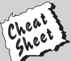

### 从免费速查表开始

速查表包括：

- 检查清单
- 图表
- 常用指令
- 以及其他实用内容！

要访问专为本书创建的速查表，请访问 **www.dummies.com/cheatsheet/creatingwebpagesaio**

### 在 Dummies.com 变聪明

Dummies.com 为你提供数千个答案，涵盖从去除墙纸到使用最新版 Windows 等方方面面，让你的生活更轻松。

查看我们的

- 视频
- 图文并茂的文章
- 分步指令

此外，每月参与我们的 Dummies.com 抽奖活动，还有机会赢取丰厚奖品。*

想要每周获得一次 Dummies 的精华？订阅以下主题的通讯：

- 数码摄影
- Microsoft Windows 与 Office
- 个人财务与投资
- 健康与保健
- 计算、iPod 与手机
- eBay
- 互联网
- 美食、家居与园艺

### 在 Dummies.com 了解“如何做”

*抽奖活动目前并非在所有国家/地区提供；请访问 Dummies.com 查看官方规则。


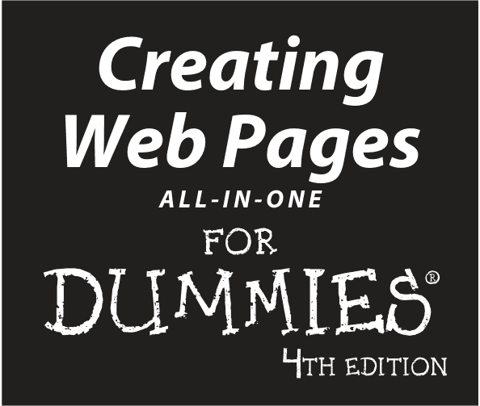

www.it-ebooks.info


www.it-ebooks.info

## 第五章：发布你的影片

- 为了获得最佳效果：优化你的影片
  - 优化技巧
  - 分析下载性能
- 为 Web 输出你的影片


如果你有兴趣创建网站，你可能至少见过 *HTML*、*XHTML*、*CSS*、*JavaScript* 和 *Flash* 这些术语。也许你的朋友在谈论他们的 WordPress 博客或 Facebook 页面，而你不知道是否应该跟风，还是去使用更强大的工具，如 Adobe Dreamweaver 或 Microsoft Expression Web。

然而，除非你是专业的网页设计师，否则你可能对从哪里开始感到有些不确定，甚至可能有点不知所措。你需要知道这些技术中哪些是必须了解的，哪些可以留给技术极客们。更重要的是，你需要知道*最少*需要掌握哪些信息才能创建一个像样的网站。

在这个过程中，你将需要深入研究网页的代码，至少理解背后发生了什么。不过，在可能的情况下，你可能希望使用 Dreamweaver 或 Expression Web 来处理大部分底层编码工作。

如果这些问题引起了你的共鸣，那么你手里拿的正是对的书。


在《*Creating Web Pages All-in-One For Dummies*》第四版中，我将带你浏览 Web 的方方面面。本书包含的九个小册子涵盖了创建网页所需了解的所有"必备"技术。以下是一些我在本书中向你展示如何完成的任务：

- 创建美观、专业的网页。
- 享受一些最受欢迎的 Web 服务，包括 WordPress 和 SquareSpace。
- 使用 Adobe Dreamweaver 或 Microsoft Expression Web 创建网站。
- 理解 HTML 代码。
- 使用层叠样式表（CSS）来为你的网站设置样式。
- 有效使用图形和多媒体。
- 通过添加 JavaScript 或 Ajax 脚本使你的页面具有交互性。
- 使用 Adobe Flash 为你的网站添加动画 Flash 影片。


在《*Creating Web Pages All-in-One For Dummies*》第四版中，我不假设你已经知道如何创建网页，也不假设你熟悉我所涵盖的技术，如 HTML、层叠样式表和 JavaScript。不过，我假设你浏览过互联网并且知道网站是什么。我也假设你对 Windows 或 Mac 电脑有一定的操作知识，并且使用过 Microsoft Word 或类似的文字处理程序。

## 本书使用的约定

所谓*约定*，我只是指我在本书中用来向你呈现信息的一套规则：

- **屏幕截图**：我在本书中介绍的所有浏览器和网站软件（Microsoft Expression Web 除外）都可以在 Microsoft Windows 和 Mac OS X 平台上运行。本书中的屏幕截图展示了 Mac 和 Windows 两个版本，但所有说明同时适用于两种操作系统。

- **特殊格式**：当你看到一个词被*斜体化*时，请查找其定义，之所以包含定义是为了让你了解在网站设计和创建的语境中这些词的含义。网站地址和电子邮件地址以 `monofont` 显示，以便与普通文本区分开来。代码使用其专属字体，与其余文本分隔，如下所示：

  `<p class="normalPara">
    It's a <em>brave</em> new world.
  </p>`

- **HTML 术语**：网页是使用 HTML 创建的，HTML 是一种标记编程语言，用于组织和显示你呈现的信息。HTML 由许多*元素*组成，例如 `p`（段落），其形式如下：

  `<p>Here is a paragraph</p>`

  `<p>` 是*开始标签*，`</p>` 是*结束标签*。它们之间的文本是*内容*。整段代码被称为 *p 元素*或*标签*。这两个术语是同义的。

- **HTML 和 XHTML**：在第九部分中，你将了解 HTML 和 XHTML（可扩展 HTML）是什么，以及这两种技术有何不同。不过，在本书的其余部分中，当我提到 HTML 时，我是从广义上说的，指的包括 HTML 和 XHTML。


## 你无需阅读的内容

我以模块化的方式构建了本书：它的设计旨在让你能够轻松找到所需信息，从而无需阅读任何与手头任务无关的内容。我在书中各处穿插了一些侧边栏，其中包含有趣但不一定与当前讨论紧密相关的信息；你可以随意跳过它们。你也无需阅读“技术细节”图标标示的部分，这些部分解析了高级技术细节（这些内容可能合你胃口，也可能不是）。


*《创建网页全能手册》*（第4版）分为九个迷你书册。你无需按顺序阅读本书，无需查阅每个迷你书册，当然也无需阅读每一章，甚至无需阅读任何特定章节的所有部分。（当然，如果你愿意，可以全部阅读；希望你觉得本书读起来不错！）此外，目录和索引可以帮助你快速找到所需的任何信息。在本节中，我将简要描述每个迷你书册涵盖的主题。

# 书册一：建立网络存在感

在这个迷你书册中，我将向你展示如何通过探索你所拥有的选择来开始在线建立存在感，但重点在于在线博客工具和完整的网站构建解决方案。我还将展示如何将你的博客或网站连接到Twitter和Facebook。

# 书册二：网页设计

从探索经过验证的网页设计原则开始，迈出正确的一步。书册二涵盖诸如组织有效网站、运用留白设计、使用三分法以及避免八个最常见的网站错误等主题。

# 书册三：HTML/XHTML

网页使用基于特殊标签的语言编写，即HTML（超文本标记语言）或XHTML（可扩展HTML）。在线博客工具（如WordPress）和桌面网站软件（如Dreamweaver）通常能很好地为你隐藏复杂的HTML代码。然而，在某些情况下，你不可避免地要“深入底层”。书册三将帮助你理解源代码中发生了什么。

# 书册四：使用CSS设置样式

我认为这样说并不夸张：层叠样式表（简称CSS）是你开始创建网站时必须理解和掌握的关键技术。CSS通过将页面内容与你创建的格式化规则分离，帮助彻底改变你构建网站的方式。这听起来可能没什么大不了，但它让你作为网站创建者的工作变得*轻松*得多。在这个迷你书册中，你将通过探索其所有主要功能（包括继承、选择器和层叠）来发现这项技术的强大之处。

# 书册五：JavaScript和Ajax

在这个迷你书册中，你将探索JavaScript的世界。使用JavaScript，你可以为网页编写脚本，使其能够交互并响应用户事件（例如按钮点击）。我将向你介绍高效编写脚本所需的关键概念，然后向你展示如何将脚本无缝添加到网页中并使其运行。我还将向你展示如何向网站添加Ajax，以实现内容的实时刷新，而无需刷新整个页面。

# 书册六：图形图像

图形图像可以成就也可以毁掉你的网站设计。书册六将向你展示如何最佳地获取图像、优化它们，并探索其他重要的图形技术，例如热点、图像映射和鼠标悬停效果。

# 书册七：Microsoft Expression Web

Expression Web是微软的旗舰网页设计工具。这个集成的网站设计和创作环境拥有可视化的页面设计器。在书册七中，我将引导你完成使用Expression Web设计、创建和发布网站所需的步骤。

# 书册八：Adobe Dreamweaver

Dreamweaver适用于Windows和Mac平台，长期以来一直是行业标准的网页设计软件包。书册八将向你介绍Dreamweaver的关键功能，并向你展示如何快速上手使用它。

# 书册九：Adobe Flash

Flash影片是网页最重要的插件之一。事实上，Flash影片如此普及和流行，以至于一些网站完全使用Flash编写。通过Flash，你可以添加远超HTML和JavaScript自身所能实现的交互性和动画效果。在这个迷你书册中，你将发现如何在Flash创作环境中高效工作，以及如何创建基本影片。

## 本书中使用的图标

《Dummies》系列图书以使用实用的图标来指引你获取有用信息而闻名。本节简要描述本书中使用的图标。

提示图标指出有用的信息或关键技巧，可以为你节省时间和精力。

记住图标用于指出文本中特别重要的内容，以帮助你理解相关技术。

警告图标等同于在说：“嘿，你——要小心！”当你看到这个图标时，请注意并谨慎行事。

此图标表示附近有技术信息。如果你感觉不太有技术性，可以跳过此信息。


你可以从阅读书册一开始。或者，如果你想立即深入了解某个特定主题，可以考虑以下任何起点：

- 要立即建立网络存在感，请查阅书册一。
- 要创建酷炫、设计精良的页面，请查阅书册二，第1章。
- 要掌握样式表，请查阅书册四。
- 要了解创建HTML文档的基础知识，请查阅书册三，第1章。
- 要获得HTML源代码的工作知识，请查阅书册三、四和五。
- 要创建交互式网站，请参阅书册五和九。


> “我的网站应该在多大程度上准确反映我的营业场所？”

## 内容概览

- 第1章：快速上手
  - 了解术语和基础知识
  - 探索你的网站选择
  - 冲浪与研究：发现什么有效，什么无效
- 第2章：WordPress
  - 理解博客
  - 使用WordPress创建博客
  - 创建文章
  - 管理你的博客文章
  - 设计你的博客外观
  - 在WordPress之外发布文章
  - 处理评论
- 第3章：Squarespace
  - 注册Squarespace
  - 创建基本网站
  - 更改网站外观
  - 添加和删除部分
  - 向页面添加图像
  - 查看你的网站
- 第4章：将你的网站连接到社交网络
  - 连接到Facebook
  - 连接到Twitter
  - 连接到Google Friends
- 第5章：使用Google Analytics分析网站流量
  - 将Google Analytics代码添加到你的网站
  - 使用管理控制台


 ## 第 1 章：起步并开始运行

### 本章内容

- 了解创建网站的相关术语
- 理解网站是如何发布的
- 发现有效的网站（以及一些无效的）

也许你过去创建过一个简单的网站，现在准备迈出下一步。又或者你一直想要搭建自己的第一个网站，但不知道从何入手。

无论如何，在本章中我将向你介绍沿途需要使用的关键术语和技术，帮助你朝着网站目标迈进。我还会探讨创建网站的三种主要选择。

## 了解术语和基础知识

任何时候开始从事新事物，一个挑战就是掌握相关术语。网络上每天都有大量新术语涌现，你很容易就能学会一些，但可能会发现其他更技术性的概念或技术让你摸不着头脑。因此，这里提供一个速成课程，确保你掌握网站构建的通用语言。

### 浏览网络

*网站*是一组页面的集合，通常使用 HTML（超文本标记语言）格式化，包含文本、图形和多媒体元素，如 Flash、音频或视频文件。网站的主页称为*首页*，它通过超链接与站点内的其他文档相连。所有这些页面都存储在*Web 服务器*上，即托管网站的计算机名称。

网络上有各种各样的网站，包括

- 企业网站
- 个人主页
- 博客
- Facebook 个人资料
- 专题兴趣网站

每个网站都有一个唯一的地址，称为 URL（统一资源定位符）。URL 看起来像这样：

```
http://www.cnn.com
http://www.facebook.com/richwagner
http://richwagner.posterous.com
```

URL 的主要部分（cnn.com、facebook.com）称为*域名*。

用户在浏览器（如 Microsoft Internet Explorer）中输入 URL。浏览器通过网络发送请求，最终到达 Web 服务器的门前。然后 Web 服务器通过将请求的页面返回给浏览器来响应。

Web 服务器通常由互联网服务提供商（ISP）或 Web 托管提供商托管。有些提供商是免费的，但通常大多数更可靠的提供商会收取费用，一般每月 5 到 20 美元不等。

### 浏览浏览器

用于浏览网络的软件称为*浏览器*，你可以从以下几种中选择：

- **Firefox** 是最受欢迎的浏览器之一。它不仅适用于所有主流平台（Windows、Mac 和 Linux），而且有数量惊人的免费扩展可供添加，极大地增强你的浏览体验。要下载 Firefox 及其扩展，请访问 `www.mozilla.org`。

- **Microsoft Internet Explorer** 虽然不像十年前那样受欢迎，但它仍然是 Windows 用户的主流浏览器。如果你使用的是基于 Windows 的计算机，它可能已经预装了 IE。如果没有，你可以在 `www.microsoft.com` 找到它。

- **Google Chrome** 是相对较新的浏览器，但因其速度、稳定性和扩展功能，很快成为许多网站建设者（包括我）和普通用户的最爱。可在 Windows 和 Mac 平台的 `www.google.com/chrome` 下载。

- **Safari** 是 Mac 平台上的主流浏览器，也可用于 Windows。在 `www.apple.com/safari/download` 下载。

- **Opera**（`www.opera.com`）是一款商用浏览器，具有强大的功能。

无论你更喜欢哪种浏览器，请在电脑上安装至少两到三种，以便用于测试你的网站。每种浏览器都有其特性，偶尔可能会影响你的页面设计。手头备有多种浏览器可以帮助你在访客发现问题之前就先发现它们！

例如，我通常先使用 Google Chrome 来初步测试页面，然后再用 Internet Explorer 和 Firefox 进行检查。

## 创建和发布网站

创建网站时，你需要处理 HTML（超文本标记语言）文档。基于标签的标记语言 HTML 用于展示信息。它将内容与告诉计算机如何在网页上以及在哪里展示内容的指令混合在一起。

这些页面具有 `.html` 或 `.htm` 扩展名，根据你使用的查看软件不同，它们看起来也不同。当你在像记事本这样的文本编辑器中查看 HTML 文档时，你会看到一堆看起来很奇怪的代码，如图 1-1 所示。然而，浏览器知道所有这些指令的含义，然后可以*渲染*（*处理和显示*的华丽说法）文档，展现其全部的视觉 glory，如图 1-2 所示。

如果你习惯使用 Microsoft Word 或其他文字处理软件，你可能已经向文档中添加过图形图像。当你在 Word 中执行此操作时，它从原始文件中抓取图形图像的副本，并将其嵌入文档中。因此，如果你将文件通过电子邮件发送给朋友，当文档打开时，图像会显示在你朋友的电脑上。

相比之下，虽然 HTML 文档将图形、视频和其他类型的媒体文件显示为内容，但这些媒体永远不会存储在 HTML 文件本身内部。相反，HTML 文档链接到外部图像文件或 Flash 媒体。因此，网站不仅包括 HTML 文档，还包括你添加到页面布局中的任何其他媒体文件。

你处理的其他常见文件类型包括

- 层叠样式表（`.css`）；参见第 IV 册
- 图形（`.jpg`、`.gif` 和 `.png`）；参见第 VI 册
- JavaScript 文件（`.js`）；参见第 V 册
- Flash 影片（`.swf`）；参见第 IX 册

最后，当你完成网站创建后，你需要将文件*发布*到你的网站托管服务器上。如果你在自有电脑上创建页面，发布涉及上传所有 HTML、图形、Hoover 和其他媒体文件。当文件成功添加到 Web 服务器后，网站就被视为*上线*了——也就是说，向全世界开放观看。

## 探索你的网站选择

当你在网络上建立存在时，现在有各种复杂且强大的选择可供你选用——博客工具、桌面网站构建软件，以及在线网站构建器。

你决定使用哪种解决方案完全取决于你的个人需求。我在 Posterous 上维护了几个博客（科技和个人），因为它们非常适合发布文章。我最近使用 Adobe Dreamweaver 为一个非营利组织构建了一个网站，他们的需求过于定制化，不太适合博客结构。

### 在线博客工具的便利性

也许创建网络存在最便捷的解决方案是从几种在线博客工具之一开始，如 WordPress、Posterous 或 Tumblr。博客网站是很棒的选择，因为上手容易且成本低（主要的博客平台完全免费）。你可以利用预先构建的设计主题来设置网站的样式和颜色，如果你自认为缺乏设计能力，这尤其有帮助。

由于其顺序性、基于列表的结构，博客在你发布文章或张贴图片时效果最好（见图 1-3）。一些博客工具，如 WordPress，确实有大量可用的插件，可以创建相当复杂和健壮的网站。

在本迷你书的第 2 章中，我将带你了解如何创建一个免费的 WordPress 博客。

### 最大的灵活性：自己构建网站

在另一个极端，你可以使用网站构建软件应用程序从零开始创建自己的网站，如 Adobe Dreamweaver 或 Microsoft Expression Web。这些工具让你可以在可视化环境中工作（见图 1-4）来设计页面和创建网站。


### 14 探索你的网站选择

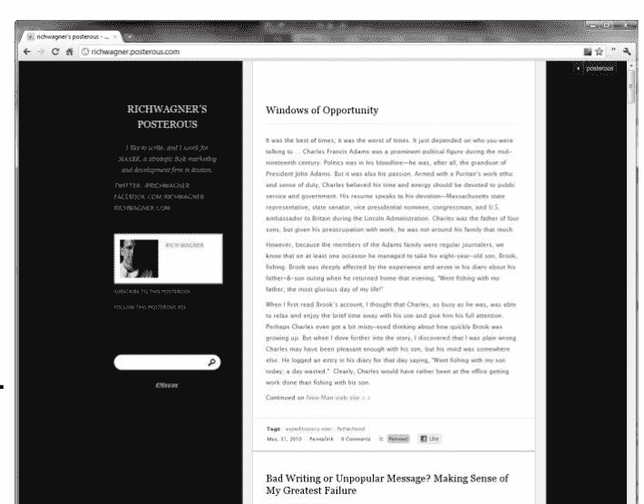

图 1-3：Posterous 博客易于设置和维护。

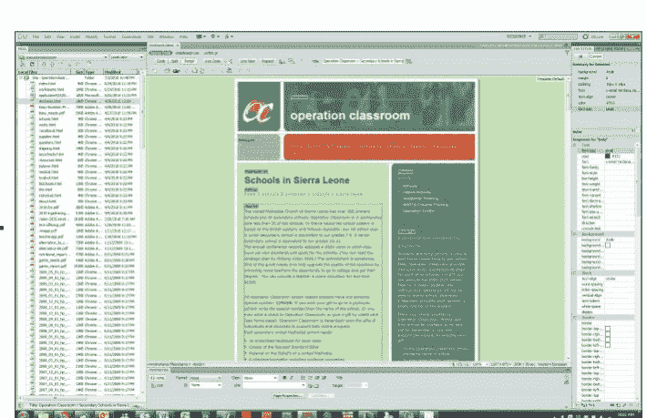

图 1-4：Dreamweaver 使你能够直观地处理 HTML 文档。

软件解决方案的最大优势在于，它为你的网站结构、布局和单个页面设计提供了最大的灵活性。缺点是从头开始构建网站比其他解决方案需要付出更多的努力。

第 VII 部分（Microsoft Expression Web）和第 VIII 部分（Adobe Dreamweaver）专门介绍了两款最受欢迎的桌面网站构建应用程序。

### 折中方案：使用在线网站构建器

最后一个选项是介于在线博客工具较固定结构和桌面软件应用程序完全自由之间的折中方案。在线网站构建器已存在多年，虽然它们不如博客工具受欢迎，但对某些人来说仍然是一个可行的选择。

Squarespace.com 是一个商业网站构建工具的绝佳范例，它同时也提供博客服务。你可以创建功能强大、可定制的网站，同时利用服务来管理许多网站任务，而不必一切都自己动手。图 1-5 展示了一个使用 Squarespace 构建的网站。

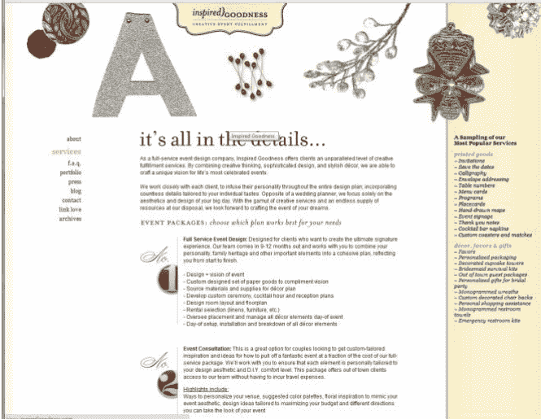

图 1-5：使用 Squarespace.com 构建的网站。

### 浏览与研究：发现什么有效，什么无效

本小册的第 3 章将指导你如何使用 Squarespace 创建网站。

在开始创建网站之前，花些时间浏览各种网站，记下你所看到的内容。换句话说，不是随便浏览，而是*研究*它。考虑以下每个问题：

- **找出你喜欢和不喜欢该网站设计的地方。** 如果你喜欢它，记下你想效仿的样式概念。如果你不喜欢它，确保自己避免这些错误。（更多关于设计策略的内容，请参阅第 II 部分。）

- **考虑网站的整体“基调”。** 网站看起来是否过于正式或非正式？专业还是业余？你应该为你的网站设定一个基调，并确保你的内容、设计、颜色和字体选择都协同一致地支持它。

- **寻找网站的整体信息传递。** 首页的设计、图形和文字传达了什么信息？是否有单一的主题？你是否收到了混乱的信息？它成功吗？为你的网站制定一个一致、连贯的主题或信息，然后围绕它来创建网站。

- **检查网站的导航。** 你能轻松找到你想要的信息吗？你会在网站里迷路吗？你应该开发一个易于导航的网站。（更多关于网站组织的内容，请参阅第 II 部分。）

- **识别所使用的技术。** 当你遇到一个你非常喜欢的效果或交互功能时，深入了解并识别该网站为实现该效果所使用的技术。

要查看源代码，请右键单击页面，然后从弹出的菜单中选择“查看源代码”（此功能在大多数浏览器中可用）。在 HTML 源代码中，你可以找到幕后技术的所有细节。不过，请务必先阅读第 III 部分，以帮助你理解源代码。


> 提示


> 记住

当你遇到一个你真正喜欢的网站时，不要赤裸裸地抄袭它的设计或（尤其是）它的实际文件。相反，用它作为灵感来激发你自己的创意。

如果你在寻找有趣的网站探索时陷入困境，可以查看 `www.coolhomepages.com` 和 `www.cssbeauty.com/gallery`。这两个网站都展示了精心设计的网站画廊，可以激发你的灵感。

### 浏览与研究：发现什么有效，什么无效


如果你对创建一个出色的网站设计所需的高度专业知识感到畏惧，别担心。大多数这类网站都是由设计专业人士创建的。目的是从他们的设计和技术中学习，而不是试图复制或与他们竞争。

Book I
Chapter 1


## 第 2 章：WordPress

**本章内容**

- 探索博客世界
- 使用 WordPress 创建博客
- 管理你的博客条目
- 更改主题
- 通过电子邮件和语音发布博客
- 处理评论

记者。大学生。作家。政治家。技术人员。几乎是任何人。只要你说出某人的职业或兴趣，我都能找到一个由某人撰写的关于它的博客。博客继续席卷全球，是时候让你加入进来了。

在本章中，我将向你介绍博客的世界，并向你展示如何在短短几分钟内创建自己的 WordPress 博客。


WordPress 提供的内容远不止本章所能涵盖的。要了解更多关于 WordPress 的信息，请查看 Lisa Sabin-Wilson 所著的 *WordPress For Dummies*。

### 理解博客

*博客*（Web log 的缩写）可以是在线日志、新闻类网站，或者是一个张贴度假照片的地方。博客使你能够轻松地在 Web 上发布你的想法、观点和意见，而无需使用传统网站。

从技术上讲，博客是传统网站的一种更结构化的形式。标准网站通常是独一无二的创作——每个网站都根据其所有者的独特需求进行构建。相比之下，博客是一个具有以下特定组织元素的网站：

- **博客列表：** 以日志风格制作，并按时间倒序显示。

- **首页：** 显示最新的帖子，但单个条目会被存档，通常按日期组织。

- **单个条目：** 通常以日志格式出现在博客列表中（在首页或存档部分）。但是，博客软件还可以为博客条目分配一个特定的 URL（一个*永久链接*），使其能够出现在自己的单独页面上。

- **评论：** 此功能允许读者表达他们对某个条目的想法，并将其作为帖子的一部分发布。正如你所料，使用评论的博客可以形成一个互动的参与者社区。

网络上有各种各样的博客，每个都有自己的名称。*图片博客*是基于照片的博客，*视频博客*是基于视频的博客，*移动博客*是使用移动设备撰写的博客，而*直播博客*则以实时日志为特色。世界上所有博客的集合是*博客圈*。网络上提供各种免费和付费的博客网站。

流行的免费博客服务包括：

- WordPress (www.wordpress.com)
- Posterous (www.posterous.com)
- Tumblr (www.tumblr.com)
- Blogger (www.blogger.com)

### 使用 WordPress 创建博客

WordPress 是网络上最受欢迎的博客服务。你可以将 WordPress 软件下载到你自己的服务器空间，或者在 WordPress 托管服务上创建博客。我将向你展示如何注册托管服务——你开始所需的就是为你的博客起一个名字。

使用 WordPress，你可以在几分钟内启动并运行一个博客。请按照以下步骤操作：

1.  **访问 www.wordpress.com。**

    WordPress 主页（如图 2-1 所示）展示了几个使用它的博客以及有关如何开始的基本信息。

2.  **单击“立即注册”链接，并使用提供的表单进行注册。**

3.  **在出现的表单中输入用户名、密码和你的电子邮件地址，然后单击“下一步”按钮。**

    在继续之前，请务必选中“我接受服务条款”复选框。

## 使用 WordPress 创建博客 21

Book I Chapter 2 WordPress

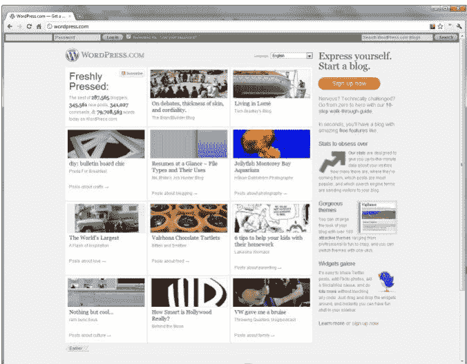

保持“给我一个博客”单选按钮被选中。

单击“下一步”链接后，系统会要求你自定义博客的域名和标题（见图 2-2）。

4.  **在提供的空间中输入所需的博客域名。**

    WordPress 为你托管博客，使你无需处理另一个虚拟主机。因此，你在这里输入的名称是你博客网址的开头，后面跟着 `.wordpress.com` 后缀。

    你通常希望使用博客标题的部分或全部作为域名。（我决定选择 `everestleaders` 作为域名。）

    > 或者，如果你已经有一个提供 WordPress 支持的网站托管提供商，你可能想自己托管博客。这样做的优势在于你可以指定自己独特的域名。如果你想自己寻找托管，请在 www.wordpress.org 注册。

5.  **为你的博客输入标题。**

    有些人选择描述性的标题（Rich Wagner's Blog）；其他人则喜欢有创意的标题（Tales from the Cheese Monkey Soup 或 Encapsulate Obscurity）。

www.it-ebooks.info


 ## 22 使用 WordPress 创建博客

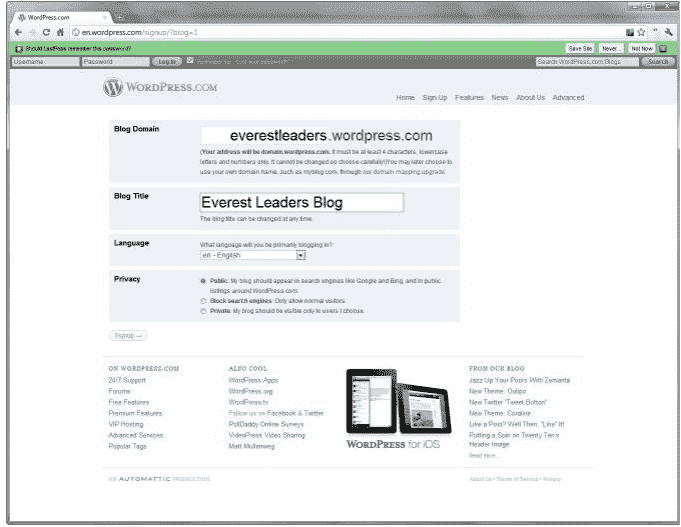

图 2-2：为您的博客命名。

- 6. 指定博客的语言和隐私设置，然后点击 Signup（注册）。

一封确认电子邮件将发送到您的电子邮箱地址。

- 7. 点击电子邮件中的链接以激活您的 WordPress 账户。

请务必在 48 小时内点击邮件中的链接激活账户，否则您将需要重新注册。

点击链接后，您将进入一个确认激活的网页，您可以在此处查看您的博客（其中包含一条虚拟条目）或进行登录。

- 8. 点击 Login（登录）链接。

您将被引导至登录页面。

- 9. 输入您的用户名和密码，然后点击 Login（登录）以登录您新激活的账户。

登录后，您的 Dashboard（仪表盘）会出现，它是您博客的指挥和控制中心（见图 2-3）。

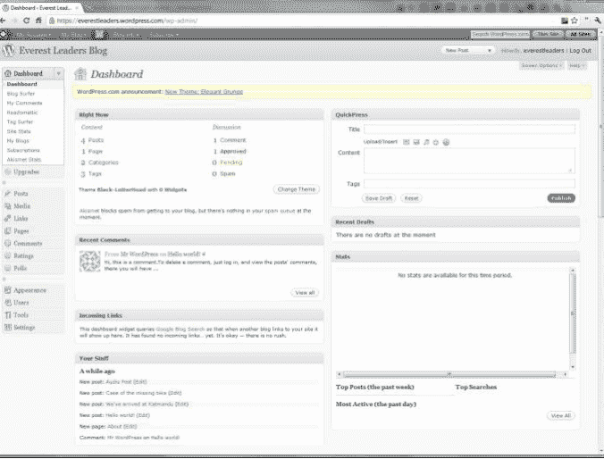

图 2-3：您博客的指挥和控制中心。

### 创建文章

刚创建博客时，它看起来非常空旷；您首先想做的应该是添加一些文章。请按照以下步骤操作。

- 1. 点击页面顶部的 **New Post**（新文章）按钮开始创建文章。

随后会出现“添加新文章”页面，如图 2-4 所示。

2. 在 Title（标题）框中输入文章的标题。

3. 在文本框中输入文章内容。

4. 按照您的需求格式化文本。

WYSIWYG（所见即所得）编辑器就像一个微型文字处理器，因此您可以使用工具栏来格式化文本（参考图 2-3）。如果您熟悉文字处理器，大多数功能您都能认出来。以下是一些您可能不熟悉的功能：

- *Blockquote*（块引用）：将段落设置为引用格式并缩进。
- *Add and Remove Link*（添加和删除链接）：添加、编辑或删除超链接。
- *Insert More Tag*（插入“阅读更多”标签）：允许您分割博客条目，使得首页仅显示文章的第一部分。如果您添加了 More 标签，读者可以通过链接阅读文章的全文。
- *Proofread Writing*（校对写作）：在发布博客条目之前检查拼写。
- *Toggle Fullscreen Mode*（切换全屏模式）：允许您将编辑器扩展至全屏。
- *Show/Hide Kitchen Sink*（显示/隐藏所有工具）：显示额外的行格式控制按钮。

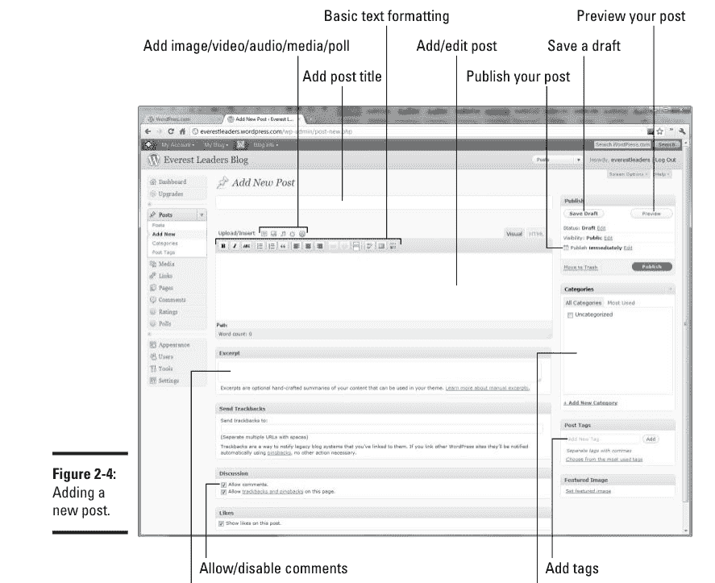

老旧的（即过时的且通常不再被支持的）浏览器将不支持 WYSIWYG 编辑器。如果您的浏览器不支持，则会显示纯文本版本。

- 5. **（可选）若要在文章中添加可点击的 URL，请选中包含链接的文本，然后点击 Link（链接）按钮。**

例如，假设您正在定义一个主题并希望引用该术语的 Wikipedia 词条。您可以在博客文章中添加一个指向 Wikipedia 页面的链接。

随后会出现一个对话框（见图 2-5），供您输入链接的 URL。

6. **在对话框中输入 URL 并点击 Insert（插入）。**

链接将被添加到您的条目中。

7. **（可选）若要插入图像，请将文本光标置于图像希望出现的位置，然后点击 Add an Image（添加图像）按钮。**

随后会出现“添加图像”框，如图 2-6 所示。

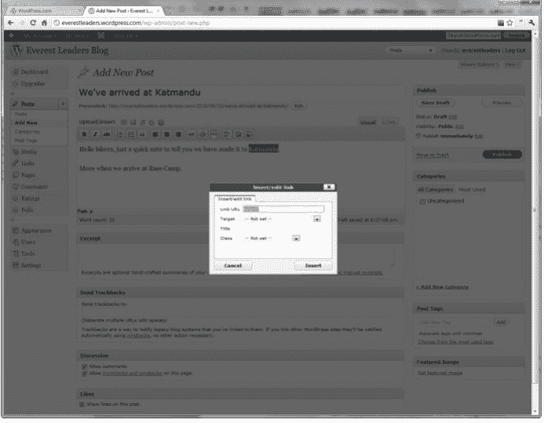

## 26 创建文章

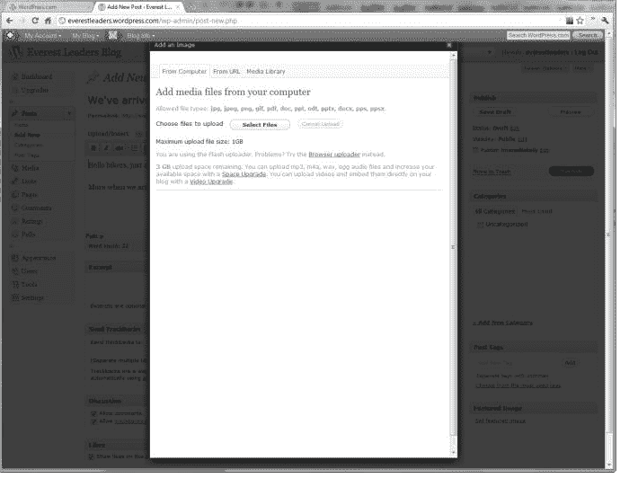

图 2-6：向博客条目中插入图像。

- 8. **点击 Select Files（选择文件）按钮并在您的驱动器中定位该文件。**
  - 如果您有多个图像，可以点击 Add Another Image（添加另一张图像）链接来同时上传这些图像。
  - 您还可以通过点击 From URL（来自 URL）并在提供的空间中输入图像的 URL，来添加发布在网络其他地方的图像。

WordPress 会上传您的图像；然后您可以指定图像的更多属性（见图 2-7）。

- 9. **点击 Insert into Post（插入到文章）按钮将图像添加到您的文章中。**

图像将被插入到您的文章中；见图 2-8。

- 10. **点击 Add New Category（添加新分类）链接并为文章输入一个分类。**

分类通常是您用来组织文章的顶级存储桶，例如“新闻”、“通用”等等。

- 11. **在 Post Tags（文章标签）部分，为本文输入一个或多个标签，并用逗号分隔每个条目。**

标签随每篇博客条目一起发布（通常在底部）。您的博客读者可以点击某个标签来显示列出所有包含该标签的博客条目的页面。

标签是可选的，如果您的博客涵盖广泛的主题，标签会特别有用。

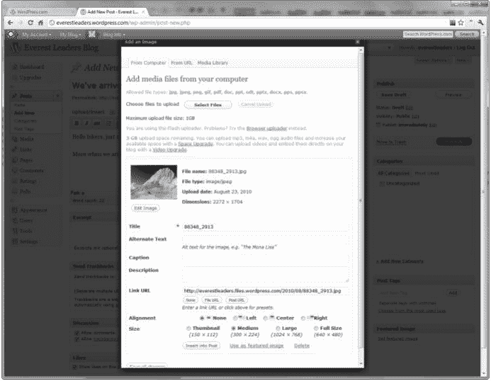

图 2-7：指定图像的尺寸和其他属性。

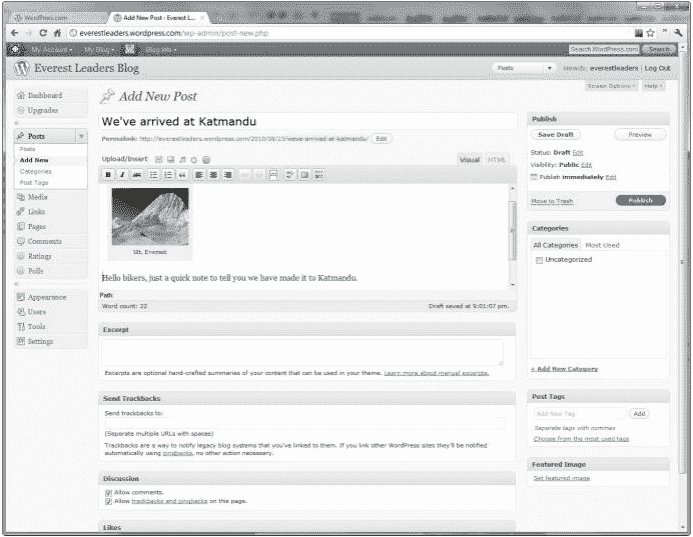

图 2-8：图片可以让原本枯燥的条目变得美观。

**12. 点击 Publish（发布）按钮。**

WordPress 将把您的博客发布到标题下方定义的 Permalink（永久链接）URL，并在过程完成后通知您。

*permalink*（永久链接）是指在您的博客文章从首页滚动消失后，指向该文章的 URL。

**13. 点击 View Blog（查看博客）链接。**

WordPress 将使用默认主题显示您的博客。图 2-9 显示了我的结果。

如您所见，WordPress 在顶部显示了一个工具栏，使您能够搜索其他 WordPress 博客，以及访问您自己的账户和博客。

您可以通过在 WordPress 菜单中选择 *My Blog*（我的博客）> *Dashboard*（仪表盘）返回仪表盘。

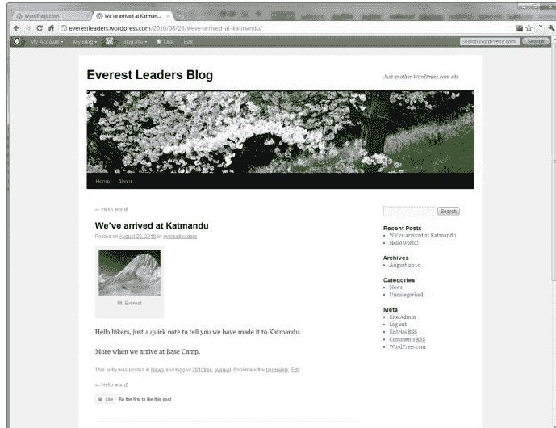

### 管理您的博客文章

您的每篇博客条目都可以在 Posts（文章）列表中找到，如图 2-10 所示。要进入文章窗口，请点击仪表盘左侧的 Posts（文章）链接。

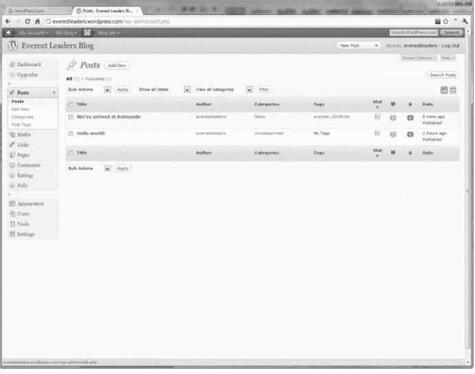

您可以在这里执行多项任务：

- * **编辑文章。** 将光标悬停在博客标题上，选择 Edit（编辑）链接，在 WYSIWYG 编辑器中显示该文章。
- * **查看文章的实时版本。** 将光标悬停在博客标题上，选择 View（查看）链接，在您的博客上查看单篇文章。
- * **编辑文章详情。** 您可以通过将光标悬停在标题上并选择 Quick Edit（快速编辑）来编辑文章详情（如标题、分类和标签）。
- * **删除文章。** 将光标悬停在博客标题上，选择 Trash（垃圾桶）链接将文章从您的博客中移除。
- * **搜索文章。** 当您刚开始创建新博客时，可以轻松定位想要操作的特定条目。然而，当您的博客增长到包含大量条目时，寻找特定的条目可能会成为一项挑战。请使用 Search（搜索）框查找条目。

### 设计您的博客外观

WordPress 让您能够相当自由地控制博客的模板、字体、颜色和布局。同样重要的是，修改博客设计非常简单。

在博客设计中，您做出的最重要的决定可能是选择哪个模板。您可以从几种具有不同外观和感觉的模板中进行选择。

- 1. 在仪表盘中，点击左侧的 Appearance（外观）链接。

随后会出现“管理主题”页面（见图 2-11）。

2. 浏览这些主题并寻找您喜欢的。

3. 当您找到候选主题时，点击 Preview（预览）以查看您的博客在使用该主题时的样子。

4. 当您找到喜欢的主题时，点击 Activate（激活）链接来更改主题。

您的博客将更新以反映新的外观（见图 2-12）。

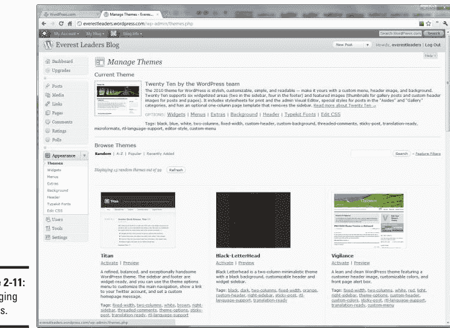

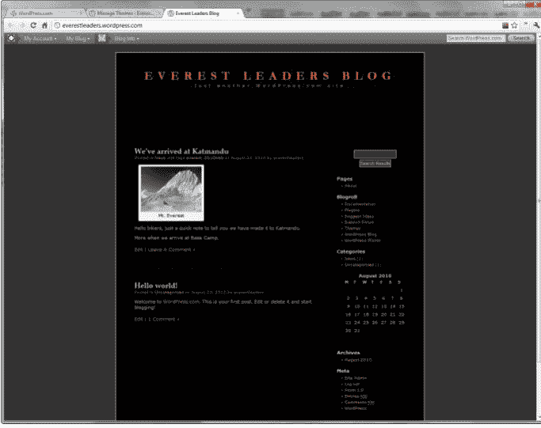

WordPress 允许您在主题之外进行许多额外的自定义；您可以添加如下便捷功能：

- *Widgets*（小部件），您可以添加到博客中的用于增强功能的组件
- Menus（菜单）
- Extras（额外项），包括 Tweet This 按钮、移动端主题等
- Header（页眉）
- Typekit Fonts（Typekit 字体），如果您想在网站上使用非标准字体
- Edit CSS（编辑 CSS）能力（关于级联样式表，请参阅第四册。）

如果您想开始微调，请点击仪表盘中的 Appearance（外观）链接。

图 2-12：使用了新模板的博客。


 ## 在 WordPress 之外发布文章

虽然你可以使用我在本章前面讨论的“添加文章”页面向博客提交条目，但你可能会发现使用电子邮件或语音发布更加方便。

在这些通过电子邮件提交的条目发布后，你可以像在 WordPress 控制面板中编辑任何其他博客条目一样对它们进行编辑。

### 通过电子邮件发布

向你的博客发布内容可以像发送电子邮件一样简单。要通过电子邮件发布，你需要设置一个专门用于接收文章的电子邮件地址。通过点击控制面板中的“我的博客”（My Blogs）链接来进行配置。图 2-13 显示了该页面的样子。

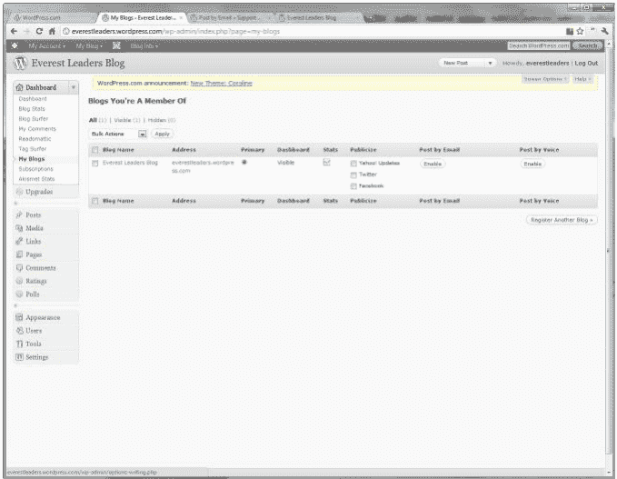

图 2-13：为你的博客设置电子邮件发布选项。

在你要添加此功能的博客的“通过电子邮件发布”（Post By Email）列中，点击“启用”（Enable）按钮。WordPress 会生成一个唯一的电子邮件地址，你仅使用该地址向你的博客发布内容。

启用电子邮件发布后，打开你的电子邮件软件，像写邮件一样撰写一篇博文（见图 2-14）。发送邮件后，它会在片刻之内发布到你的博客上（见图 2-15）。

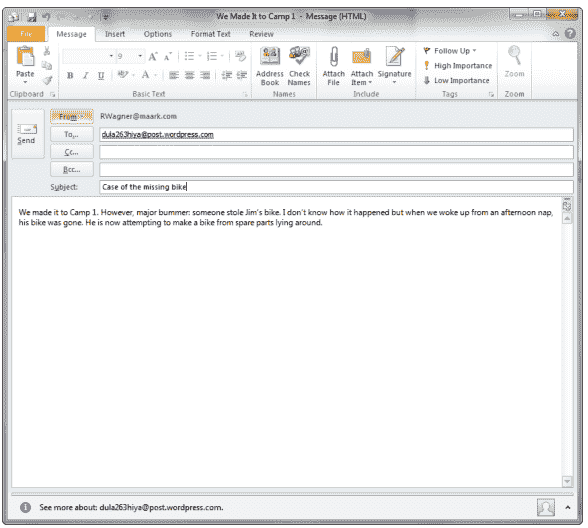

图 2-14：一封普通的电子邮件很快就会变成一篇完整的博客条目。

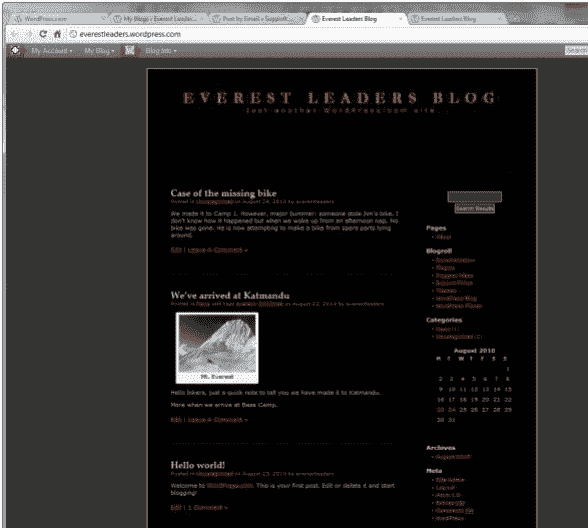

图 2-15：博客文章在几秒钟后被添加到 WordPress 博客中。

www.it-ebooks.info

### 创建音频博客条目

除了文本文章外，WordPress 还允许你创建音频文章。要启用此功能，请点击控制面板方框中的“我的博客”（My Blogs）链接（参考图 2-13）。点击“通过语音发布”（Post By Voice）列中的“启用”（Enable）按钮。WordPress 将显示一个电话号码和一个用于识别你博客的博客密钥代码。

当你拨打该电话号码并输入密钥代码后，就可以录制一段语音博客文章。录制完成后，该音频剪辑将作为新文章添加到你的博客中；图 2-16 显示了一个示例。

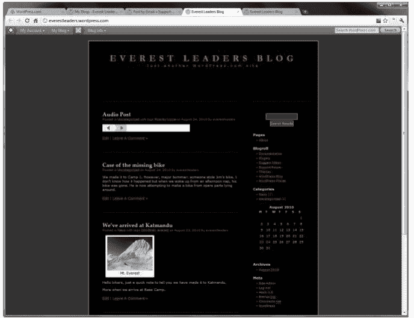

默认情况下，博客条目的标题简单地显示为“音频文章”（Audio Post）——但你可以编辑该条目，根据需要更新其标题、标签和分类。

### 处理评论

你需要考虑的一个重要问题是评论。读者的评论是许多博客的主要组成部分，因为它们提供了：

- 你与受众之间的互动
- 为访问你网站的人提供一种社区感

要配置评论，请点击控制面板中的“讨论”（Discussion）链接。随后会出现“讨论设置”页面，如图 2-17 所示。

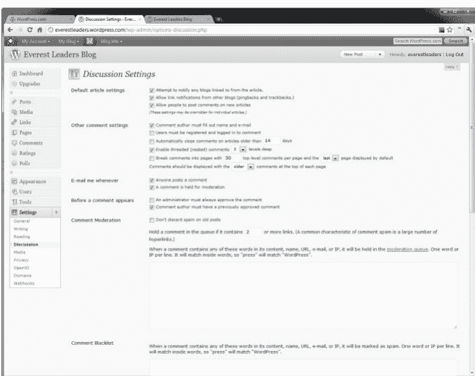

在你配置评论支持时，请考虑以下几个问题：

- **你是否想要允许评论？** 你需要做出的最大决定是是否允许人们在你的博客条目下发表评论。默认情况下，此功能是启用的。但是，如果你倾向于禁用评论，请取消勾选“默认文章设置”部分中的“允许人们在文章中发表评论”复选框。你也可以在单篇博客条目的设置中针对每篇文章单独启用/禁用评论。
- **你希望谁能发表评论？** 在决定允许评论后，决定谁可以发布：匿名用户、具有可见用户名和电子邮件地址的用户，或者仅限注册的 WordPress 用户。使用“其他评论设置”部分中的选项来指定进一步的用户资格。
- **你是否希望在评论发布前进行审核？** 默认情况下，只要读者之前发表过评论，其评论在保存后片刻内就会自动公开。否则，博客管理员（你）必须在评论公开前对其进行批准。

这种基础级别的保护使你能够阻止垃圾评论或不适当的评论发布在你的网站上。

你可以在“讨论设置”页面的“评论出现之前”部分修改默认设置。

可通过控制面板上的“评论”（Comments）链接访问的“评论”页面，是审核新评论的地方。


### 本章内容

- 了解 Squarespace 的功能
- 注册 Squarespace
- 创建一个基础网站
- 更改页面的外观和布局
- 处理图像和文本
- 链接你的页面
- 发布你的网站

在线网站创建工具无处不在。你可以在网络上找到很多免费的工具。你的互联网服务提供商 (ISP) 可能就提供一个。大多数知名的 Web 公司也提供此类工具。其中一些基于浏览器的工具试图实现 Adobe Dreamweaver 或 Microsoft Expression 几乎所有的功能。（相信我——它们做不到。）而其他一些在线构建器则过于局限，几乎什么都做不了。然而，可以说这些构建器除了在浏览器中运行之外，最共同的特点就是它们经常产生平淡、毫无特色、甚至极其丑陋的网站。

Squarespace 应运而生。虽然它可能没有 Dreamweaver 那么强大的功能，但你可以用它创建一个相当令人印象深刻的网站，拥有高度的自定义能力，并能访问网站的 HTML 和 CSS。虽然 Squarespace 每月收取费用，但其成本与典型的 Web 托管方案相当。（不用担心，它们提供 14 天的免费试用期，你可以用来体验该服务。）

在本章中，我将向你介绍 Squarespace，并引导你构建一个基础网站。也许你最初创建的网站只是一个跳板——在你开始使用 Expression（见第七册）或 Dreamweaver（见第八册）时的临时网站。或者你可能会发现 Squarespace 正是你一直在寻找的网站构建器。

我应该说明的是，本章旨在作为 Squarespace 的入门指南。Squarespace 还有许多更多功能，无法全部塞进本章中。

## 注册 Squarespace

要注册 Squarespace，请访问 `squarespace.com` 并点击“注册”（Sign Up）按钮或链接。你将被带到注册页面，如图 3-1 所示。在提供的方框中输入信息即可完成。点击“完成”（Finish）按钮，进入你的新网站。

登录后，你会看到你的初始网站，如图 3-2 所示。默认情况下，URL 是 `yourdomainname.squarespace.com`，这取决于你在注册页面输入的内容。在我的例子中，我注册的名字是 `everestleaders`，所以我的 URL 是 `everestleaders.squarespace.com`。

现在你准备好根据特定需求开始自定义网站了。

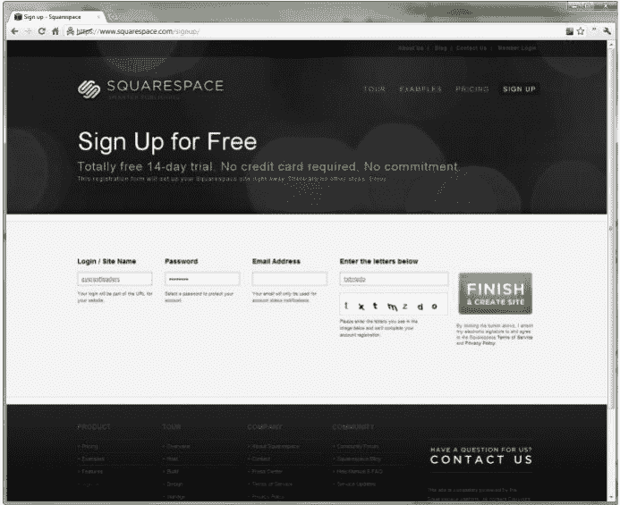

**图 3-1：** 注册 Squarespace 快速且简单。

### 创建一个基础网站

Squarespace 以博客风格的格式设置你的网站，但它同样适用于创建普通网站。在接下来的章节中，我将向你展示如何将你的博客转变为一个网站。

#### 开始构建你的网站

以下步骤展示了如何自定义你新创建的网站。当你拥有注册时 Squarespace 提供给你的默认网站（参考图 3-2）时，请执行以下步骤：

1. 点击顶部工具栏中的“结构编辑”（Structure Editing）按钮（立方体图标）。

2. 通过点击页面顶部的“编辑网站页眉”（Edit Website Header）链接来更改你的网站标题。

随后会出现一个“编辑网站页眉”对话框；见图 3-3。

www.it-ebooks.info

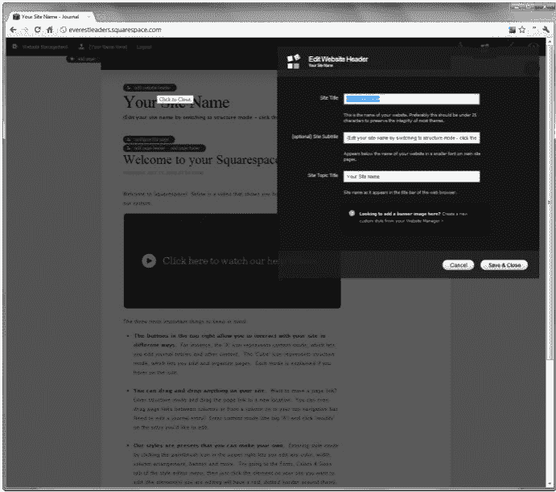

**3. 在“网站标题”（Site Title）框中输入你的网站名称。**

我输入了 `Everest Leaders`。

**4. 在“网站副标题”（Site Subtitle）框中为你的页面输入标语或副标题。**

如果你没有什么可以填入此框的内容，直接将其留空即可。占位文本不会显示在实际的网页上。

我输入了 `World Leaders in Mount Everest Biking Expeditions`。（你以为没有这样的领导者吗！）

**5. 输入你希望在浏览器标题栏中显示的标题。**

我输入了 `Everest Leaders - Experts in Expedition Biking`。

**6. 点击“保存并关闭”（Save & Close）按钮以保存你的更改。**


### 创建主页

默认页面设置为博客风格的日志。要创建一个传统外观的网站，你需要进行一些更改。按照以下步骤添加主页：

1. 点击导航栏旁边的“添加页面”链接。

Squarespace 会显示“添加新页面”页面，提供多种页面类型供你选择（见图 3-4）。可选类型很多，但标准的两个选项是：

- *Journal* 是标准的博客风格页面
- *HTML* 是标准的网页。

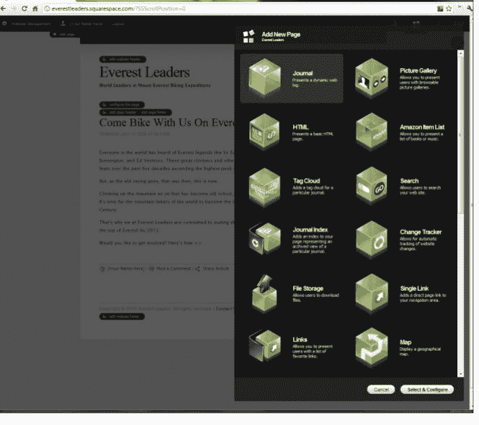

2. 选择 HTML 选项，然后点击“选择并配置”按钮。

“新建 HTML 页面配置”页面出现（见图 3-5）。

3. 在“页面标题”框中输入新页面的标题。

输入时，“导航栏标题”和“URL 标识符”字段会自动填充，但你也可以根据需要修改这些字段。

我在“页面标题”中输入了 `Everest Leaders`，但将“导航栏标题”改为 `Home`，将“URL 标识符”改为 `home`。

导航栏标题显示在当前页面的导航栏中，而 URL 标识符允许你自定义此页面的 URL。

4. 点击“创建页面”按钮。

你会返回到初始页面。导航栏已更新，包含你的新页面。

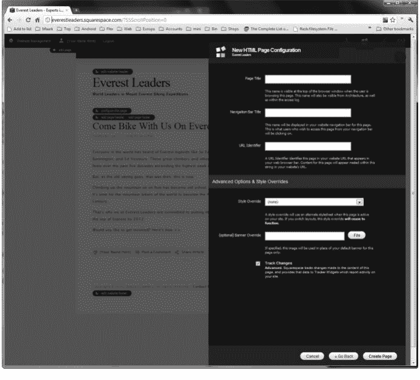

5. 将鼠标指针悬停在“新建页面”链接上，然后点击**启用**。

6. 将鼠标指针悬停在“新建页面”链接上，然后点击**配置**。

“HTML 页面配置”页面出现。

7. 点击**设为首页**按钮。

这样会将此页面设置为你的站点主页。虽然垂直导航栏会显示主页，但我实际上希望将主页显示在顶部*水平*导航栏中。

8.（可选）将**Home**链接从垂直导航栏拖到水平导航栏的**最左侧**。

Home 链接被添加到顶部。

重复此过程以向你的网站添加新页面。就我而言，我还添加了一个 Tours 页面，提供当年旅游的最新信息。

### 重命名页面

如果你不喜欢 Squarespace 给页面的默认名称——例如，你更倾向于用“Blog”而不是“Journal”——你可以重命名页面。

按照以下步骤重命名页面：

1. 点击**结构编辑**按钮。
2. 将鼠标指针悬停在顶部水平导航栏上的 Blog 链接上，然后点击**配置**链接。

“日志页面配置”页面出现。

3. 在提供的框中更改页面标题和导航栏标题的名称。

我将页面标题和导航栏标题都改成了 `Blog`。

4. 点击**保存页面配置**按钮。

图 3-6 显示了添加了 Home 链接的导航栏，以及重命名的两个页面——Blog 和 About Us。

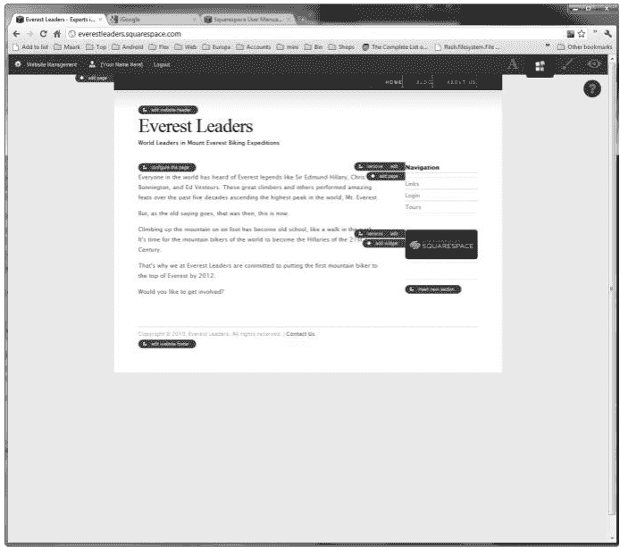

### 修改页面内容

你可能不想保留 Squarespace 提供的模板文本。按照以下步骤更改文本。

1. 点击内容编辑按钮。
2. 点击顶部水平导航栏中的所需链接。
3. 点击帖子上方的修改链接按钮。
4. 更新标题和正文内容。

就我而言，我选择了 Blog。

“修改帖子”页面出现，如图 3-7 所示。

页面以原始 HTML 格式呈现。如果你觉得 HTML 令人望而生畏，可以从“视图”下拉列表中选择切换到 WYSIWYG 视图。

你输入的内容是访客对你网站的初次了解。因此，你应该提供一个良好的介绍，说明你是谁以及你网站的用途。

我为我的网站添加了一篇简短的博客文章（见图 3-8）。

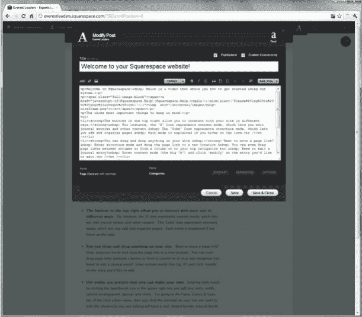

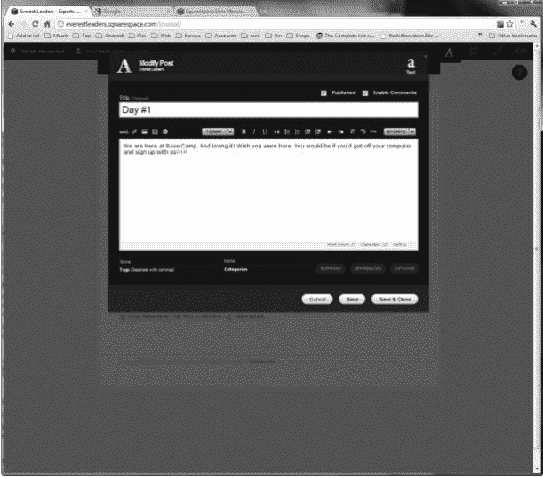

5. 点击保存并关闭按钮。

你会返回到内容编辑视图。

### 添加页脚

页脚是添加基本版权信息、使用政策以及通常联系链接的标准位置。你可以按照以下步骤向网站的任何页面添加页脚：

1. 点击结构编辑按钮。
2. 点击页面底部的编辑网站页脚链接。
3. 在“编辑网站页脚”页面中，点击生成标准版权。

会添加标准的模板文本。

4. 根据需要更新文本，填入你的公司、组织或个人名称。
5.（可选）通过将以下 HTML 添加到版权信息的末尾，在页脚中添加“联系我们”链接：
   `<a href="mailto:youremail@address.com">Contact Us</a>`

   将 `youremail@address.com` 替换为你自己的地址。
6. 点击保存并关闭按钮。

你会再次返回到主页。

### 更改网站外观

Squarespace 有 15 个设计精美、吸引人的主题可供选择，供你在开发网站时使用。每个主题有 4 种变体，这为你提供了大约 60 种模板可能性。

要更改网站外观，请按照以下步骤操作：

1. 打开你的主页。
2. 点击页面右上角的风格编辑链接。

外观编辑器出现，如图 3-9 所示。外观编辑器允许你选择基本主题的变体。或者，如果你想要完全不同的外观，你也可以 altogether 更改主题。

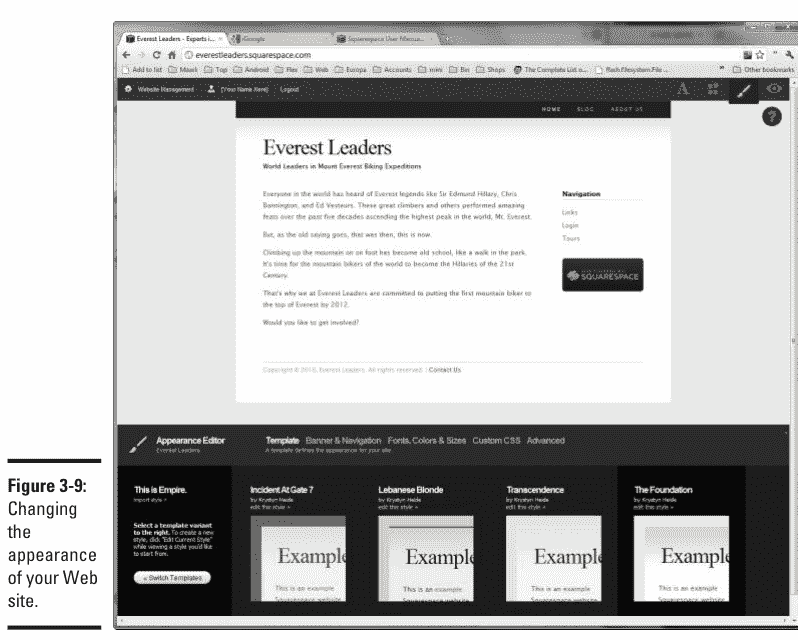

3. 点击切换模板按钮。

外观编辑器现在显示可供你使用的不同主题的缩略图。

4. 选择看起来最吸引你的主题。

浏览设计，直到找到你想要使用的那个。你可以点击任何模板进行预览。（就我而言，我选择了 Periodika!。）

5. 选择你想要使用的变体。

你可以点击每个变体，预览它在你的主页上的外观。我测试了每一个，但最终选择了 Dirty Rollers。（见图 3-10。）

6. 点击启用样式按钮以应用更改。

Squarespace 会使用新设计更新你的网站。

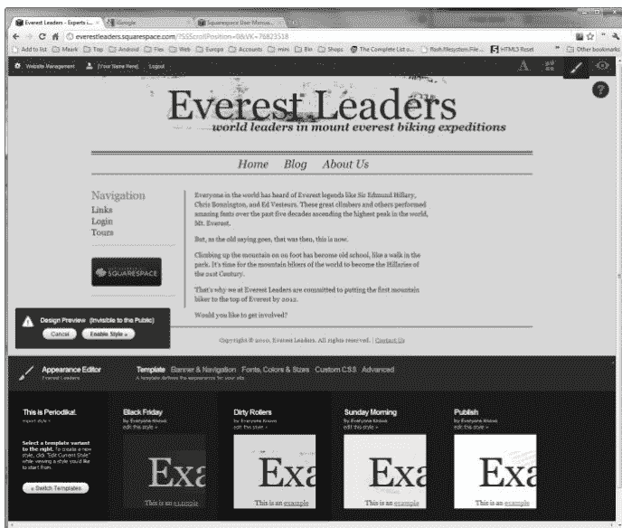

图 3-10：预览我的新样式更改。

### 添加和移除板块

虽然每个模板处理侧边栏板块的方式不同，但通常你在网站页面内容的左侧或右侧有一个侧边栏板块，你可以在那里显示板块。板块是一个小型内容容器，可以堆叠在其他此类容器之上。默认情况下，你会获得一个导航板块和一个“Powered by Squarespace”图形板块。

#### 移除板块

你可以移除不想在网站上显示的板块。例如，如果你在网页顶部有水平导航栏，你可能不需要侧边栏中的垂直导航板块。以下是如何移除板块：

1. 点击结构编辑按钮。网站切换到结构编辑视图。
2. 点击要移除的板块旁边的移除链接。

系统会要求你确认操作。

3. **点击“确认移除”对话框中的确认按钮。**

该板块被移除。

根据需要重复此操作以移除其他板块。（我还删除了“Powered by Squarespace”图形。）

#### 插入板块

你可以添加各种*小部件*（为你的网站增加功能的组件）和内容作为板块，包括：

- 文本或 HTML
- 用于博客的“标签云”
- 链接列表
- Amazon 商品列表
- RSS 订阅
- 发送电子邮件
- 搜索
- 变更追踪器
- 索引导引
- 表单
- Twitter 动态
- Flickr 图片

要使用这些功能，首先你需要创建一个新板块，然后指定其内容。按照以下步骤操作：

1. **点击结构编辑按钮。**

网站切换到结构编辑视图。

2. **点击插入新板块按钮。**

“新板块配置”页面出现，如图 3-11 所示。

3. **输入板块的标题。**

我想将 Everest Leaders 的 Twitter 动态添加为一个板块，所以我输入了 `Everest Tweets`。


### 添加和移除区域

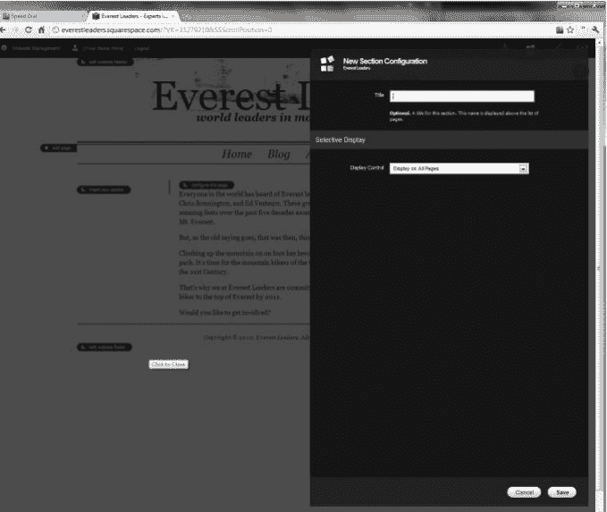

图 3-11：添加一个新区域。

4. **在"显示控制"列表中选择所需选项，以确定该区域的显示范围。**

   我将其保持在默认的`Display on All Pages`。你还可以指定在特定页面处于活动状态时是否显示该区域。

5. **点击保存。**

6. **通过点击"添加页面"链接或"小部件"链接，为新区域添加内容。**

   我想要添加一个 RSS 订阅源，因此我点击了"小部件"链接。此时会出现"添加新的 Squarespace 小部件"页面，如图 3-12 所示。该页面同时显示了 Squarespace 小部件和社交小部件。

7. **点击"社交小部件"选项卡。**

8. **点击你想要的小部件，然后点击"选择并配置"按钮。**

   具体出现的配置页面取决于你所选择的小部件。图 3-13 显示的是新建 Twitter 小部件的配置页面。你可以使用此页面指定要关注的 Twitter 账户、小部件的外观以及关键词过滤选项。

9. **点击"创建小部件"按钮，将小部件添加到你的网站。**

   小部件已添加到该区域中，但你需要启用它才能使用。你也可以将鼠标指针悬停在小部件上，点击"配置"链接来进行设置。

10. **点击"启用小部件"按钮。**

    图 3-14 显示了添加新区域后的网站。

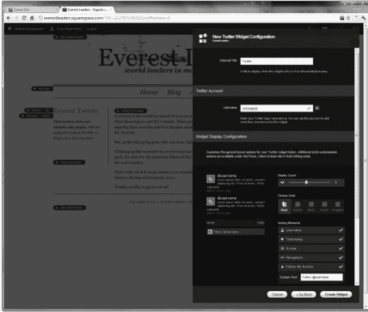

图 3-13：配置我的 Twitter 小部件。

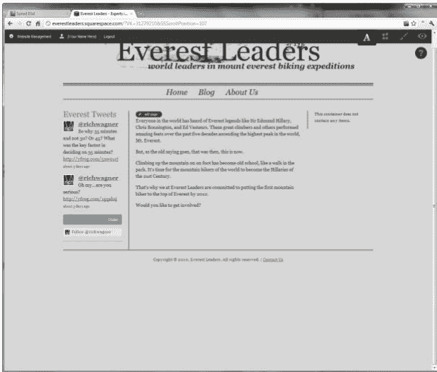

图 3-14：启用了 Twitter 的网站。

### 向页面添加图片

你可以将存储在桌面电脑或 Web 服务器上的图片添加到网页中。以下是如何添加本地存储图片的步骤：

1. 打开你要添加图片的页面。

2. 点击内容编辑按钮。

3. 点击页面顶部的"编辑页面"链接。

   此时会出现"编辑页面内容"页面。

4. 将光标放置到你希望图片显示的位置。

5. 点击工具栏上的"插入图片"按钮。

   此时会出现"插入图片"对话框（参见图 3-15）。

6. 点击"上传图片"链接。

7. 点击"选择文件"按钮。

   此时会出现一个用于选择图片文件的对话框。

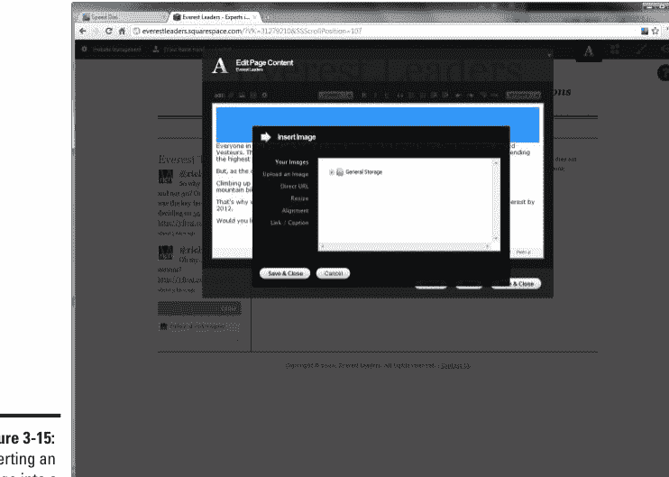

图 3-15：向页面中插入图片。

8. 选择你要添加到网站的图片，然后点击确定。

9. 点击上传按钮。

   Squarespace 会询问你是否要为图片创建缩略图。如果需要，请以像素为单位指定缩略图大小，然后点击"调整原始图片大小"按钮。

10. 点击"对齐方式"链接。

11. 决定你希望文本如何环绕图片排列。

    我选择了"左对齐"选项。

12. （可选）点击"链接/标题"以指定其他选项。

13. 完成后点击"保存并关闭"按钮。

    你将返回到"编辑页面内容"窗口。如果需要进行更改，将鼠标指针悬停在图片上，然后从其菜单中进行选择。

14. 点击"保存并关闭"以保存更改。

    图 3-16 显示了添加到页面中的图片。

### 查看你的网站

在创建网站的过程中，如果你想随时预览网站，可以点击顶部导航栏上的"预览网站"链接（"眼睛"图标）。该操作只会隐藏所有各种编辑链接，但顶部的 Squarespace 网站管理工具栏仍然保持显示。

或者，你可以打开另一个浏览器窗口，以访客的视角查看网站（参见图 3-17）。

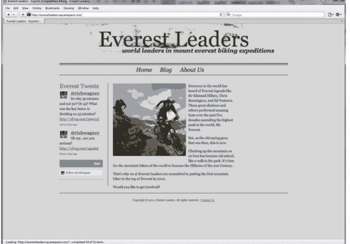

图 3-17：一个在瞬间就能创建好的精美网站。


### 本章内容

- 向你的网站添加 Facebook 点赞按钮
- 使用推文按钮推广你的网站
- 向页面添加 Google 好友小工具

十年前，你创建和推广的网站是你在互联网上的"数字之家"。然而，随着 Facebook 和 Twitter 等社交网站的迅速崛起，你可以超越自身网站的范畴来与人们互动。因此，在设计和构建网站时，你应确保将所有社交网络平台的在线存在与网站进行整合。

在本章中，我将向你展示如何将网站与 Facebook、Twitter 和 Google 好友进行连接。

在与其他网站集成时，通常需要将 HTML 或 JavaScript 代码粘贴到你的网页中。如果这让你感到畏惧或陌生，请先参阅第三册和第五册，等你熟练掌握 HTML 和 JavaScript 后再回来。

## 连接到 Facebook

Facebook 是一个流行的社交网站，用于与朋友和家人保持联系。它允许你将网站与你的 Facebook 主页墙集成。你可以将 Facebook 所称的"社交插件"添加到你的页面或博客文章中。这些简短的 HTML 代码片段易于配置并粘贴到你的网页中。主要包括以下几种：

- **点赞按钮：**该按钮允许你的网站访客在他们的 Facebook 主页上分享你的页面/文章。参见 `http://developers.facebook.com/docs/reference/plugins/like`。
- **点赞框：**你可以让网站访客从你的网站对你的 Facebook 主页墙进行点赞。参见 `http://developers.facebook.com/docs/reference/plugins/like-box`。
- **动态汇总：**向网站访客展示你的 Facebook 主页墙上最有趣的活动。参见 `http://developers.facebook.com/docs/reference/plugins/activity`。
- **推荐摘要：**向网站访客展示你在 Facebook 主页墙上推荐的页面或内容。参见 `http://developers.facebook.com/docs/reference/plugins/recommendations`。
- **面孔墙：**显示已注册你的网站的其他用户的头像。参见 `http://developers.facebook.com/docs/reference/plugins/facepile`。
- **登录按钮：**与面孔墙类似，显示已登录你的网站的好友的头像。同时还包含一个登录按钮。参见 `http://developers.facebook.com/docs/reference/plugins/login`。
- **评论：**允许网站访客通过他们的 Facebook 主页在你的网站上发表评论。参见 `http://developers.facebook.com/docs/reference/plugins/comments`。
- **直播流：**允许你实时分享活动和评论。参见 `http://developers.facebook.com/docs/reference/plugins/live-stream`。

你必须注册成为 Facebook 开发者才能启用评论和直播流插件。请访问 `http://developers.facebook.com`。

在接下来的章节中，我将向你展示如何将其中最受欢迎的两个插件添加到你的网站。

### 添加点赞按钮

你可以向网站添加一个 Facebook 点赞按钮，以便在访客的 Facebook 主页上分享你的内容。要快速添加点赞按钮，请按照以下步骤操作：

1. 在你选择的编辑器中打开网页。

   如果你使用的是 Adobe Dreamweaver 或 Expression Web，请在桌面上打开 HTML 页面。或者，如果你使用的是在线网站构建器或博客，请打开在线编辑器。

2. 查看页面的 HTML 代码。

3. 在页面中找到你想要添加点赞按钮的位置。

4. 将以下代码粘贴到你的页面中：

```html
<iframe src="http://www.facebook.com/widgets/like.php?href=http://yourdomain.com"
  scrolling="no"
  frameborder="0"
  style="border:none; width:450px; height:80px">
</iframe>
```

   将 `yourdomain.com` 替换为你的域名。图 4-1 显示了将代码插入到我的 Squarespace 网站页面中的效果。

5. 保存更改。

   点赞按钮随即出现，如图 4-2 所示。

6. 预览你的网页。


### 连接至 Facebook

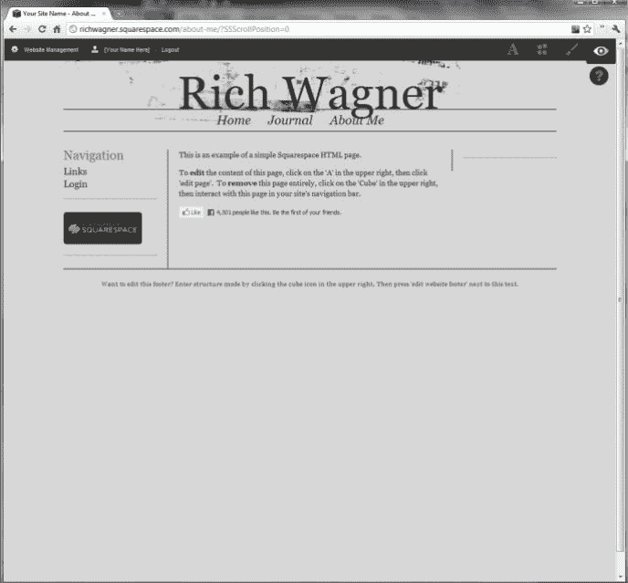

图 4-2：查看 Facebook 点赞按钮。

如果您想进行更多自定义，请访问 http://developers.facebook.com/docs/reference/plugins/like 并填写图 4-3 所示的表单。然后，您可以将该 HTML 代码复制并粘贴到您的网页中。

### 添加点赞框

您还可以在网页或博客文章中添加 Facebook 点赞框（Like Box）插件，以推广您的 Facebook 个人主页。为此，请执行以下步骤：

1. 访问 http://developers.facebook.com/docs/reference/plugins/like-box。

   图 4-4 显示了点赞框的配置页面。

2. 在提供的空间中输入您 Facebook 个人主页的 URL。

图 4-3：通过在线表单创建点赞按钮。

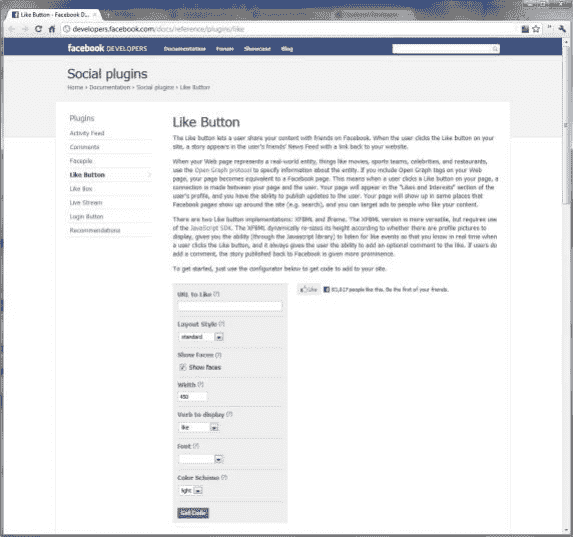

图 4-4：配置您的点赞框。

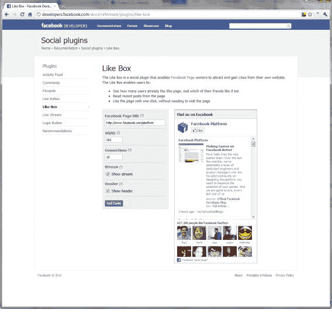

3. **在宽度（Width）框中指定所需的宽度。**

   您选择的大小完全取决于您计划将其放置在网页上的位置。访问您的网页，测量您要插入该方框的列或区域的宽度。如果您需要一个测量页面的工具，请在 [www.spadixbd.com/freetools/jruler.htm](http://www.spadixbd.com/freetools/jruler.htm) 下载免费实用程序。

   在我的案例中，我选择了 292px。

4. **根据需要自定义连接（Connections）、流（Stream）和页眉（Header）选项。**。

   我选择了 10 个连接，并启用了流和页眉选项。

5. **点击“获取代码”（Get Code）按钮。**

   您的插件代码将出现在对话框中，如图 4-5 所示。

6. **复制 I-frame 框中提供的 HTML 代码。**

   XFBML 通常用于更高级的用法。

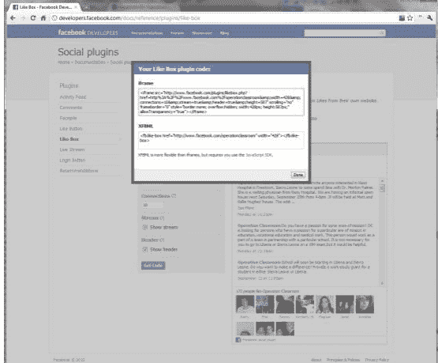

图 4-5：获取您的插件代码。

7. 使用您选择的编辑器打开网页。

   如果您使用的是 Adobe Dreamweaver 或 Expression Web，请打开桌面上的 HTML 页面。或者，如果您使用的是在线建站工具或博客，请打开在线编辑器。

8. 查看页面的 HTML 代码。

9. 找到您想要添加点赞框的位置。

10. 将剪贴板中的插件代码粘贴到您的页面中。

    图 4-6 显示了粘贴到我的 Dreamweaver 页面中的插件代码。

11. 保存您的页面。

12. 在您的网站上预览点赞框。

    图 4-7 显示了网页上的点赞框。

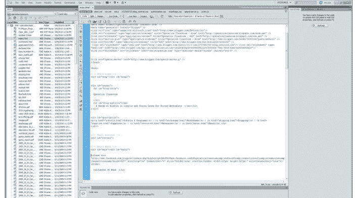

> **提示** 您还可以进行更高级的集成，例如允许访问者使用其 Facebook 账号登录您的网站。详情请访问 http://developers.facebook.com/docs/guides/web。

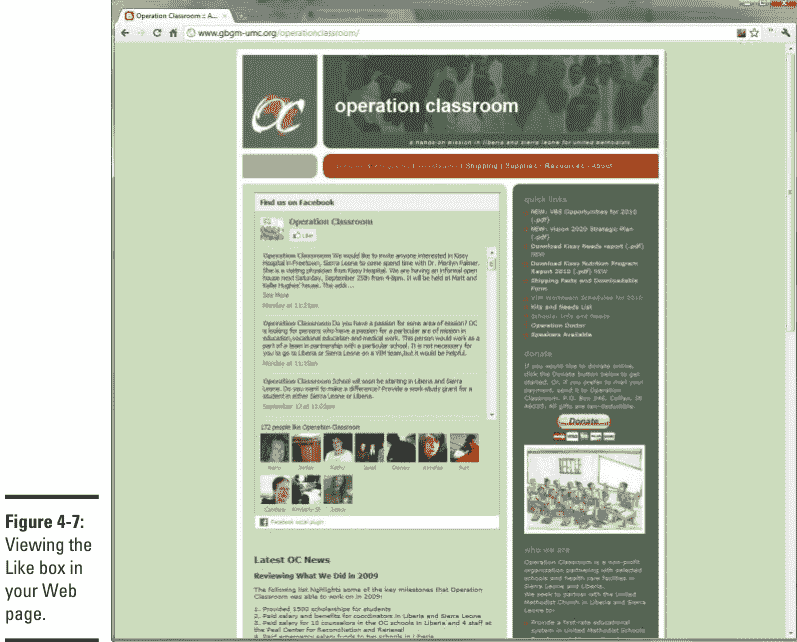

图 4-7：在网页中查看点赞框。

## 连接至 Twitter

Twitter 是一种社交网络服务，使您能够向关注您的人发送短文本消息（称为 *tweets*），并阅读您关注的人发布的 tweet。

您可以将网站连接到 Twitter，以鼓励网站访问者通过发送 tweet 来分享您的网页或博客文章。这样，当访问者 tweet 您的内容时，他们会将关注者引导至您的网站。

要在网站中添加 Tweet 按钮，请执行以下步骤：

1. **访问** `http://twitter.com/goodies/tweetbutton`。

   图 4-8 显示了 Tweet 按钮编辑页面。

2. **从“按钮”（Button）选项卡中选择**您想要使用的按钮样式。

3. **点击**“推文文本”（Tweet Text）选项卡。

4. （可选）指定推文中要使用的文本。

   如果您不指定文本，则按钮所在页面的标题将出现在推文中。自定义此文本以便您能更精准地传达信息。

5. 点击“URL”选项卡。

6. （可选）为推文输入一个 URL。

   如果您不指定 URL，则将使用当前页面作为 URL。

7. （可选）点击“语言”（Language）选项卡并指定一种语言。

8. （可选）要推荐您的 Twitter 账号，请在“推荐”（Recommend）部分添加您的 Twitter 账号名称。您还可以建议一个额外的账号。

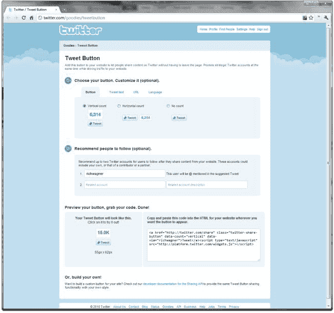

图 4-8：自定义您的 Tweet 按钮。

> **记住** 第一册第 4 章，将您的网站连接到社交网络。

9. 在预览区域预览您的按钮。

10. 将代码框中的 HTML 代码复制到剪贴板。

11. 使用您选择的编辑器打开网页。

    如果您使用的是 Adobe Dreamweaver 或 Expression Web，请打开桌面上的 HTML 页面。或者，如果您使用的是在线建站工具或博客，请打开在线编辑器。

12. 查看页面的 HTML 代码。

13. 在页面中找到您想要添加 Tweet 按钮的位置。

14. 将剪贴板中的插件代码粘贴到您的页面中。

15. 保存您的页面。

16. 在您的网站上预览 Tweet 按钮。

图 4-9 显示了 Tweet 按钮在网页上出现时的样子。

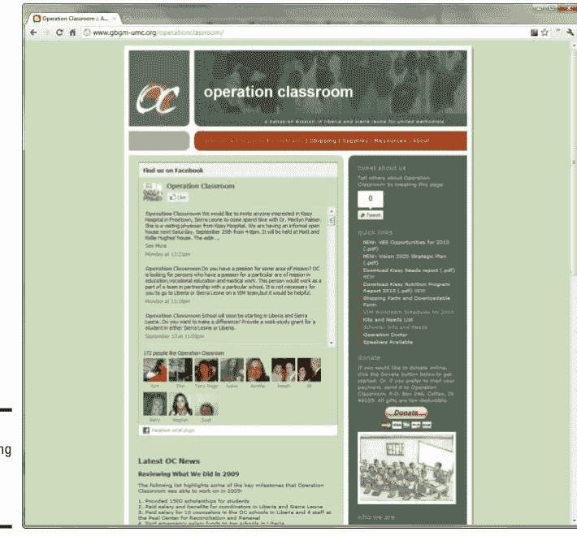

## 连接至 Google Friends

Google Friends Connect 是由 Google 提供的一项服务，允许您网站的访问者在您的网站上与他们的朋友建立联系。它允许网站访问者使用其 Google 个人资料在您的博客中添加评论，或将您的网站作为枢纽与朋友交流。

要在网站中添加 Google Friends，请登录您的 Google 账号并执行以下步骤：

1. 访问 www.google.com/friendconnect。

2. 点击“我同意”（I Agree）按钮以同意服务条款。

   同意后，将出现“告诉我们关于您的网站”（Tell Us About Your Web Site）页面，如图 4-10 所示。

3. 在提供的空间中输入您网站的名称和 URL。

4. 点击“继续”（Continue）。

5. 点击“添加成员小工具”（Add the Members Gadget）按钮。

   随后出现小工具编辑器。

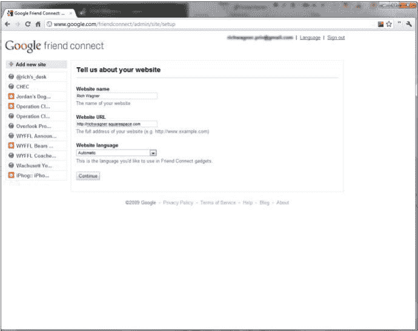

图 4-10：连接至 Google Friends。

6. 在第一个部分中，输入小工具的宽度以及您想要显示头像的行数。

7. （可选）在第二个部分中修改颜色。

8. 点击“生成代码”（Generate Code）按钮。

   您将复制并粘贴到网站中的代码将被生成并显示在框中，如图 4-11 所示。

9. 复制代码。

10. 打开您的网站，并将 HTML 代码粘贴到您想要添加的位置。

    具体操作取决于您使用的网站软件或平台。在我的示例中，我将其添加到 Squarespace 网站的首页（见图 4-12）。

11. 在网站上预览更改。

    图 4-13 显示了网站用户看到的小工具样子。

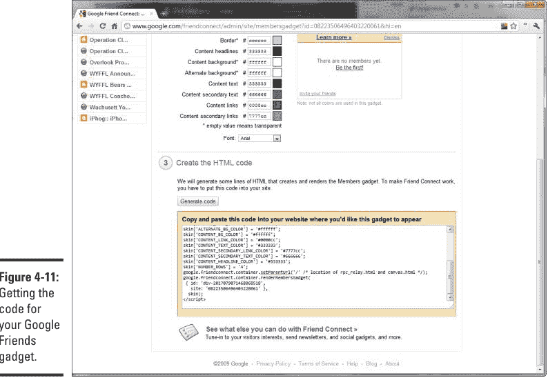

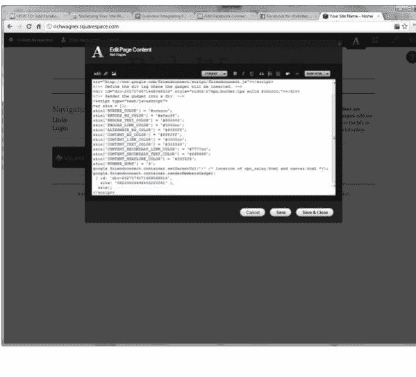

图 4-12：将小工具粘贴到我的网站中。

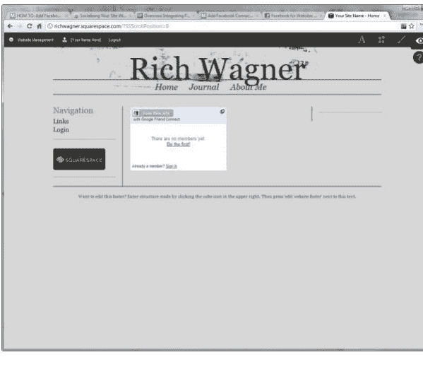

图 4-13：Google Friends 小工具。


### 本章内容

- ✔ 注册 Google Analytics
- ✔ 获取跟踪代码
- ✔ 查看跟踪数据

Google Analytics 是一款免费的 Google 工具，无论您的网站规模大小，您都可以使用它来跟踪访问者如何使用您的网站。您可以使用它来识别人们在不同页面上花费的时间以及他们在网站中的导航方式，并评估各种营销活动的成效。

在本章中，我将向您展示如何将 Google Analytics 添加到您的网站中。随后，我将重点介绍您可以从中挖掘的一些数据。

> **提示** 如果您使用的是 WordPress，请查看 http://wordpress.org/extend/plugins/google-analytics-for-wordpress 处的 Google Analytics for WordPress 插件。

### 向您的网站添加 Google Analytics 代码

Google Analytics 使用一段简短的 JavaScript 代码片段来收集访问者的使用数据。您将其添加到想要跟踪活动的网页中。要获取此代码，请执行以下步骤：

1. **访问** www.google.com/analytics。

   随后出现“入门”（Getting Started）页面，如图 5-1 所示。

2. **点击“立即注册”（Sign Up Now）按钮。**

3. **使用您的 Google 账号登录。**

   如果您没有 Google 账号，请点击“立即创建账号”（Create an Account Now）链接并按照说明操作。


 # 72 将 Google Analytics 代码添加到您的网站

- 4. 点击“登录”按钮。
5. 输入您的网站 URL。
6. 输入账号名称。
7. 输入您的国家和时区信息。

随后出现“Analytics：新账号注册”页面（见图 5-2）。在提供的空格中输入您的主域名 URL。

8. 点击“继续”。

随后出现“联系信息”页面（见图 5-3）。

9. 输入您的联系人姓名和国家。

10. 点击“继续”。

随后出现“服务条款”页面。

图 5-3：联系信息页面。

- 11. 勾选“是”复选框，然后点击“创建新账号”按钮。

随后出现“Analytics：跟踪指南”页面（见图 5-4）。

12. 将方框中的所有代码复制到剪贴板中。

这就是 Google 将用于跟踪您的使用数据的跟踪代码。

13. 点击“保存并完成”按钮。

Google Analytics 的主控制面板将打开，如图 5-5 所示。

图 5-4：获取您的跟踪代码。

图 5-5：Google Analytics 控制面板。

---

**14. 将跟踪代码添加到网页 `</head>` 部分的最末尾。**

插入此代码的具体指令根据您使用的每个网站构建器或博客而有所不同：

- *Adobe Dreamweaver, Microsoft Expression Web 或其他软件套装*：查看页面的 HTML 代码，并将跟踪代码插入到 `</head>` 标签之前。
- *在线构建器*：寻找查看页面 HTML 代码的选项，并将跟踪代码插入到 `</head>` 标签之前。

您必须将代码添加到每个网页中。如果您使用模板，请将跟踪代码添加到模板文件中。如果您没有模板，则必须手动将代码添加到每个网页中。

如果您的网站构建器（如 Squarespace）不允许您将其添加到页面的 `<head>` 部分，请将其添加到文档最底部的 `</body>` 标签之后。然而，为了获得最佳性能，建议将其放置在结束的 `</head>` 标签之前。

### 使用管理控制台

将跟踪代码插入网页后，您就可以开始跟踪使用数据了。

给 Google Analytics 几天、几周，甚至几个月的时间（取决于您网站的受欢迎程度），以便它收集数据并提供有用的趋势和见解。

要进入主控制台，请访问 `www.google.com/analytics`，并在需要时登录。

在主控制台中，点击“查看报告”链接。Google Analytics 的“查看报告”部分让您可以访问所有站点信息。

初始视图是您的“仪表板”（见图 5-6），它提供了所有跟踪数据的摘要视图。

在仪表板中，您可以使用左侧导航栏来发现跟踪信息。您可以挖掘的统计数据量极其庞大，足以单独写一本书，但这里为您概览一下在网站中添加 Google Analytics 跟踪后可以发现的数据类型。

图 5-6：Google Analytics 仪表板。

例如，以下是 Analytics 为您提供的几项报告：

- **新访客与回访访客**（见图 5-7）：这可以帮助您了解有多少人足够喜欢您的网站而再次访问。
- **访客在您的网站上花费的时间**（见图 5-8 和 5-10）：您可以使用此项来衡量您的网站对人们的吸引力。
- **访客返回您网站的频率**（见图 5-9）：这项统计数据是衡量您的网站对人们在日常生活中实用程度的良好指标。

图 5-7：比较新访客和回访访客。

图 5-8：访客在该网站上的平均停留时间为 2:27 分钟。

图 5-9：访客的近时性（他们最近一次访问您网站的时间）。

图 5-10：平均访问时长。

- **人们在您的网站中浏览的页面数量**（见图 5-11）：您可以查看人们是进入主页就离开，还是会留下来浏览。
- **每个用户是如何来到您的网站的 —— 搜索引擎、直接 URL 或推荐站点**（见图 5-12）：这是一个衡量人们在网络上如何找到您的良好指标。
- **您网站中最受欢迎的页面**（见图 5-13）：您可以判断网站上哪些内容有效，哪些无效。
- **访问您网站的用户类型** —— 即移动端与桌面端、Windows 与 Mac 等（见图 5-14）。

图 5-12：访客如何到达您的网站。

图 5-13：页面受欢迎程度排名。

图 5-14：访客的操作系统。

---


## 第 1 章：网页设计的最佳实践

- 将三种经证明的设计原则应用于您的网站...........................................85
- 理解三分法...............................................................................92
- 避免八个常见的网页设计问题........................................99

## 第 2 章：组织和导航您的网站

- 创建站点层级..............................................................................103
- 使用导航菜单在站点中导航........................................105

## 第 3 章：为移动访客进行设计

- 预览您的移动站点........................................................................107
- 移动端网页化的四个级别........................................................108

---


### 本章内容
- 保持设计简单
- 维持一致性
- 将三分法应用于您的站点设计
- 避免八个最常见的站点设计问题

由于 Web 是一种视觉媒介，您的网站设计可能与您在站点上提供的内容一样重要。如果您的设计俗气、业余且令人厌烦，访客可能不会认真对待您，或者在您来不及喊出“但我努力了！”之前就点击了“后退”按钮。

因此，在本章中，我将探讨几个您应该理解的成熟设计原则。此外，我还将讨论不该做的事情 —— 即那些您从一开始就应该避免的错误。

### 将三种经证明的设计原则应用于您的网站

Web 的早期阶段充满了信息密集型站点。它们虽然功能齐全，但看起来往往像是被垃圾压缩机设计出来的 —— 尽可能多地将内容塞进页面中。然而，设计界很快赶上了 Web 的步伐，将丑陋的页面变成了艺术品。

在开始设计您的网站之前，花一些时间分析其他设计精良的站点。如果您找到了几个候选对象，我敢打赌，尽管它们在视觉上有所不同，但它们采用了许多相同的成熟设计原则。

#### 简约：少即是多

如果过去一个世纪强调过任何单一的审美原则，那就是“少即是多”。您在玻璃盒建筑、海明威简洁的句子、极简主义绘画以及整个 Web 中都能看到这一点。服装设计师 Raoul (raoul.com) 提供了一个将简约原则应用于首页的绝佳示例，使访客的全部注意力都集中在公司的时尚产品上。（见图 1-1。）


# 将三大 proven 设计原则应用于你的网站

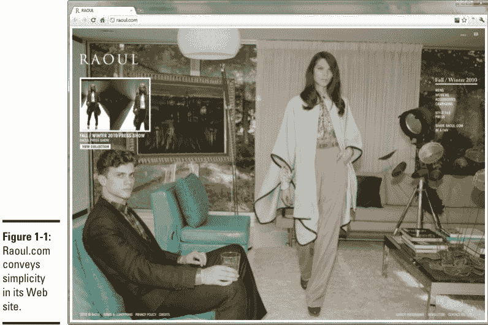

图 1-1 展示了极简内容如何打造高效的网页：一张主图、一张缩略图、小型菜单和企业标识。注意此处用词极少。事实上，页面大部分区域都是留白（下一节将讨论）。

或者看看 Apple.com。尽管苹果公司销售和营销的产品众多，但其主页始终会突出一条单一的、清晰的信息，即该公司在特定时间想要传达的信息。（见图 1-2。）

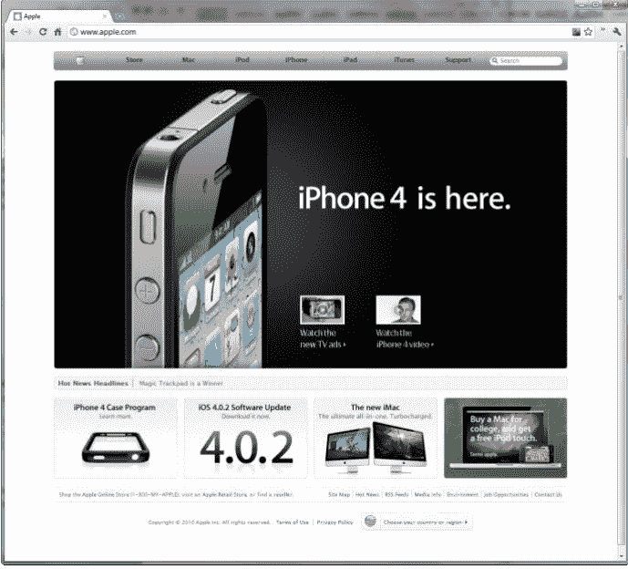

图 1-2：Apple.com 传达单一信息，而非多个信息。

与此形成对比的是 Dell.com 这样的网站（见图 1-3）。尽管该页面在控制复杂度方面做得相当不错，但考虑到像戴尔这样的大型企业必须服务的各类客户群体，它仍然远不如 Apple.com 简洁。


> 图 1-3：Dell.com 在保持简洁性方面面临挑战。

极简设计最著名的例子之一是 Google（www.google.com）。该搜索引擎的主页因其拒绝包含任何被视为不必要的元素而闻名。

即使是信息密集的网站也在向更简洁的方向转型。几年前，BBC 新闻和 CNN 都曾拥有复杂的网站，在主页上堆砌大量新闻和图片（见图 1-4）。如今，这两个网站都已收敛许多。虽然严格意义上的极简网页设计对新闻机构而言并不合理，但 BBC（见图 1-5）从主页上移除了大量信息，使其更加赏心悦目。


图 1-4：2006 年的 BBC 新闻主页。


图 1-5：2010 年的 BBC 新闻主页。

然而现实是，我们大多数人并非 Raoul、苹果、谷歌或 BBC。你可能无法在页面上只放寥寥数语就采用极简设计。但你也无需应对全球新闻服务必须管理的持续内容轰炸。因此，你的目标应该是遵循*保持简洁*这一古老建议，在两者之间取得平衡。

以下是一些值得参考的思路：

- **设置一个中心焦点，尤其是主页。** 你的主要焦点——即首先吸引访客眼球的元素——应该具有相当的冲击力。让它大而醒目、有力。相比之下，页面的其他元素可以趋向柔和、虚化和小型化。换言之，你的页面大部分应该在视觉上温和，仅有一个主要例外。

  例如，你的视线自然会被 Raoul.com 网站上展示时装设计师作品的主图吸引。相比之下，BBC 网站则利用左上角来展示其主要报道和标题。

- **大量使用留白，同时尽量简化页面结构。** 我在下一节将讨论留白的使用。

- **限制链接总数。**

- **使用两栏或三栏布局。**

- **为访客提供简单明显的页面浏览路径。** 不要让访客因为你的页面混乱复杂而露出茫然失措的神情。

- **考虑用鲜明的颜色来呈现你的主视觉符号（无论是图片还是标题）。**

#### 用留白保持页面清爽

留白，也称为负空间，是一个设计术语，指的是没有文字或图形的区域。它不一定是指白色的空间。空白区域可以是任何颜色，甚至是渐变（颜色之间的视觉过渡）。留白有以下几个作用：

- **提升可读性：** 电脑屏幕上的文字可能比纸质文字更难阅读。为观众提供充足的留白，使内容更易读。
- **保持清爽：** 观众不会感到必须硬着头皮消化你塞入视野的所有信息。
- **突出内容：** 当页面不那么拥挤时，每个图像和段落都更有价值，不会相互竞争。
- **赋予设计自由：** 使用更多留白，你有更大的自由度来移动元素，这有助于构建有效的设计。

网络上的标准技术规格页面通常要求密集排布的技术内容。苹果公司展示了如何有效利用留白，使即使是技术规格页面也尽可能易读（见图 1-6）。

#### 保持全站一致性

尽管网站的主页通常采用与其他页面不同的布局，但整体网站设计在颜色、字体、字号、边距和其他元素方面应保持一致。

有多种技术可以帮助你简化这项任务。特别是，层叠样式表（CSS）可以让你在一个中心位置设置网站的样式和格式规则，并将网站的每一页都关联到这些规则。（我会在 Book IV 中全面介绍 CSS。）

#### 理解三分法则


*三分法则*是西方艺术中最持久、最普遍的准则之一：从杰出的希腊雕塑家到当代贺卡设计师，这一规则被成功运用，而且理由充分：当图像或页面被垂直和水平地分成三等份——并将对象置于这些线上时——图像 simply 更令人赏心悦目。

例如，在图 1-2 中，iPhone 横幅广告占据了页面的三分之二，而底部缩略图占据剩余的三分之一。或者注意观察图 1-5 和图 1-6 所示的内容驱动型页面。它们都将内容分在三栏中展示。

当你将三分法则应用于网站时，主体很少位于页面或图像的正中心。过多的对称会造成糟糕的整体构图。此外，你要避免将地平线居中——即天空和大地各占一半——这会从中间水平分割视觉画面，立刻使其变得静态且视觉乏味。

设计页面时多加尝试。移动元素位置。调整你的原始想法，看看效果如何。当你对某个页面感觉不错时，退后一步，以冷静的视角结合三分法则来审视它。十有八九，你会发现调整页面设计以顺应三分法则能够提升整体观感。

你不必在拍摄的每一张照片或设计的每一个网页中都运用三分法则。不过，如果你经常遵循这一构图规则，你的设计将从中受益。

#### 运用三分法则微调页面设计

思考一下页面设计如何可以遵循三分法则进行修改。首先，你需要一个焦点。就像任何优秀的绘画或照片一样，你的网页受益于拥有一个主体或最突出的视觉元素——即无论观众应该首先注意到什么。

图 1-7 以抽象方式展示了一个网页，以突出其主要区域：一些文本（灰色块）、一些粗体文本（深色块）和标题（黑色条）。总体来说，这是一个不错的设计——它有变化，而且平衡。注意它不是对称的：它是*平衡的*。这是一个重要的区别。


 ## 理解三分法则

然而，图 1-7 缺少一个焦点。页面中没有真正突出或引人注目的元素来吸引观众的注意力。请记住，焦点要从页面的其余部分中脱颖而出。它甚至可以简单到只是一个不寻常的形状——与页面上其他形状不同的东西，如图 1-8 所示。

图 1-8 看起来比图 1-7 有所改善，但运用三分法则可以进一步增强构图。要应用该法则，画一条假想的线，将网页垂直和水平地分成三等份，如图 1-9 所示。

**提示** 将直线（例如墙壁和地平线）沿着其中任何一条线放置。


**图 1-8：** 一个新的形状提供了焦点。


**图 1-9：** 将你的图像或网页分成九个假想的区域。

这些线条相交的点是放置焦点的最佳位置：图片的主体。线条相交的四个点是*热点*。图 1-10 是对设计的进一步改进：它将舞者移到了一个热点上。

#### 避免背景干扰

页面中最需要遵循*保持简洁*规则的部分之一就是背景。它应该是单一颜色（通常是白色、灰色或黑色）或渐变色（从一种颜色或色调逐渐混合到另一种颜色），不会与页面内容产生视觉竞争。对访问者来说，没有什么比背景中有明亮的颜色或闪烁的图像更烦人的了。像 Raoul.com 这样的网站（参见图 1-1）之所以能这样做，是因为页面上几乎没有其他东西与之竞争。


**图 1-10：** 将焦点移到热点上。

记住，你有四个热点可以尝试。在图 1-11 中，舞者被定位在左上角的热点。还要注意，舞者与她在图 1-10 中的位置相比已经翻转；现在，她向着页面*内部*舞动，如图 1-11 所示。

> **提示**

当你的构图中有*动态*元素（箭头、舞者或任何指向或"移动"的东西）时，好的设计强调确保动态向页面*内部*移动——而不是向外。焦点是观众首先看到的东西，它应该引导视线进入页面。

### Photoshop 支持

为了帮助你在图像中应用三分法则，Adobe Photoshop CS5 提供了一个裁剪选项，你可以使用三分法则网格线。旧版本没有内置的三分法则功能，但 `powerretouche.com` 提供了一个有用的*插件*（可以增加功能的第三方组件），你可以将其添加到 Photoshop 中以达到此目的。

### 平衡三分法则与包容性背景

当你在根据三分法则调整焦点对象的位置时，要注意你所使用的背景。你可以看到图 1-12 中的设计远不如图 1-11 中的成功，尽管舞者被定位在一个热点上。在这个设计中，焦点被深色背景吞没了。

良好构图的另一个规则是，你应该*打破*留白：也就是说，移动焦点，使其不被框住或陷入背景中，而是突出到周围的留白空间中。在图 1-10 和图 1-11 中，舞者从背景中跃入留白空间。这是更好的选择。


**图 1-12：** 焦点被深色背景吞没。

在所有这些页面设计中，图 1-10 可以说是最好的。它是最平衡的，因为舞者抵消了页面顶部大标题的重量。但是，请记住，网页设计是一门艺术，不是科学。最终，当然由你来自行决定。

### 定位背景图像

你也应该在背景图像中使用三分法则热点。即使 Raoul.com 采用了全页图像，但要注意主体的位置占据了水平空间的前三分之二；男人和女人并没有居中。

> **提示** 当你将背景移到三分法则热点时，你能在保持平衡的同时为你的构图增添趣味。

### 润色图形

使用三分法则不仅适用于页面的整体设计。为了增加视觉吸引力，记得将其应用于你添加到页面中的图形。

### 避免八种常见的网页设计问题

当你考虑我在本章中讨论的良好设计原则时，我也想告诉你一些"不好的东西"，即网页设计师常犯的错误。有时这些问题从一开始就 crest，有时它们会随着你随着时间的推移更新和修改网站而慢慢潜入。

#### 杂乱会吞噬你的站点

杂乱让访问者感到不适，并给你的网站留下杂乱无章的印象。避免它。你希望你的网站能让访问者轻松找到他们想要的信息——而不是感觉像被困在一个梦中之梦又之梦中。


如果你有创建杂乱设计的倾向，请掌握主动权，尽可能扔掉所有东西。然后扔掉更多，或者将项目移到网站更深层的页面中。

#### 一开始就压倒你的访问者

这种错误有时是因为对网站上的内容过于热情，以至于通过在主页上把所有东西都抛给访问者来压倒他们。解决方法（正如 Apple.com 做得很好的一样），是确定什么是最*重要的*并加以突出，而且有纪律地将其他内容放在其他页面上。只要你有良好的导航方案（参见BED1这本小册子的第 2 章），你就会没事。

#### 混乱源于复杂

访问者一到你的网站就会立即做出决定。如果他们感到困惑或厌烦，他们就会点击后退按钮并且永远不会回来。如果你无法通过消除杂乱来简化（参见"杂乱会吞噬你的站点"部分），你就必须运用你的设计技巧来通过设计来澄清。

将你的页面划分为逻辑区域，以明确什么与什么相关。传统上，水平和垂直线用于隔离网页上的各个区域，就像报纸现在仍然做的那样。然而，当代网页设计通常取消线条，转而使用色块区域、多媒体区域（例如使用 Flash 的音频和动画）、导航栏和其他视觉上不同的区域。图 1-13 说明了各种纹理、颜色和多媒体区域如何将内容分离成可识别的类别。


**图 1-13：** Nike.com 用纹理、颜色和动画区域进行组织。

#### 混搭设计理念永远行不通

避免创建混搭各种风格的网页设计，无论它们各自有多强。相反，使用一个连贯且有组织的视觉主题，帮助你建立独特的身份。无论是*纽约时报*著名的哥特式字体、Martha Stewart 心爱的淡海蓝宝石色，还是 NBC 的孔雀标志，视觉主题对于识别一个人或组织来说都是不可或缺的。

通过仔细选择相互配合且与你的基调和信息相匹配的图形、字体和颜色，你可以创建一个在视觉上保持统一并赋予你的网站迷人个性的设计。

要比较和对比字体，请查看 typetester.org。

#### 极端对称令人乏味

正如我在本章前面关于三分法则的讨论中提到的，一个主要的图形设计规则——适用于杂志广告、室内装饰、摄影、网页和许多其他领域——就是避免使用极端对称。简而言之，不要将页面或照片的焦点（主要项目）放在正中央。如果一棵点亮的圣诞树是快照的焦点，不要让树正好在图片的中间。如果你在拍摄 favors 时分，不要让水平线（水与天相接处）位于镜头的中间。

对称的问题在于它消除了成功当代设计所必需的大量活力、微妙的冲突。这相当于用"昨天人们在公园散步"作为报纸故事的标题。

如果你还需要一个例子来说服你，请查看 Oakley.com（见图 1-14）。这家太阳镜制造商的网站很好地运用了三分法则，将注意力吸引到作为热点的上三分之一处，并避免了对称。


**图 1-14：** Oakley.com 对经过验证的设计原则的运用。


102 *避免八种常见的网页设计问题*

#### 忘记访客的存在

一些网站设计错误源于不完善的网站导航结构。正如你可能从前文的"一开始就压垮访客"一节中回忆起的，你应该抵制住把所有鸡蛋都放在首页篮子里的冲动。将你要销售的内容划分成类别，并为这些类别创建单独的页面（或整组页面）。


仔细检查你页面的导航功能。链接指向不存在的页面是粗心的表现。找一些不熟悉你网站的外来者，看看他们能否快速且直观地找到他们想要的内容。虽然搜索功能可能有帮助，但你的客户理想情况下应该能够通过视觉提示——图标、照片和导航栏——来定位子类别，例如古董被子或200美元以下的被子。例如，如果你的主要类别是按成本分组产品，即使是简单的四个标签，上面带有$、$$、$$$和$$$$符号，也能帮助访客。然后，当他们点击其中一个选项时，也许会发现所选的成本组进一步按标签划分为年代、尺寸、颜色或其他。核心思路是让他们只需两到三次鼠标点击就能到达他们特定的需求——也许是显示你第二贵的大型蓝色被子的页面。

#### 疏忽就像发霉的面包

不要辛辛苦苦创建了网站，然后就忘记它，让它荒废掉。就像成功的商店不断保持更新一样，你也需要对你的网站做同样的事。遵循以下建议：

- **更新你的博客或新闻版块。** 如果你有博客或"最新动态"版块，务必定期发布新信息。最低限度，即使你不添加新材料，也务必删除过时的内容。
- **保持版权日期最新。** 没有什么比页面底部陈旧的版权日期更能让你的网站显得过时了。如果访客看到你网站上是两年前的日期，他们会认为你已经停止更新了。
- **检查链接。** 定期测试你提供的内部和外部链接。删除损坏的链接，或将其更新到新的URL。

#### 不安全感让人紧张

你不会喜欢在一家糟糕的商店购物，那里可疑的人物在你输入PIN码时偷窥你的肩膀，或者把Visa收费收据的副本塞进口袋。同样，如果你在eBay或直接在你的网站上销售商品，你必须在网上向客户保证你是值得信赖的，并将提供安全的金融交易。


**本章内容**

- 在随机访问和顺序访问之间做出选择
- 组合结构
- 通过导航栏进行导航

我一直认为，一个组织良好的网站非常像汽车的GPS。路线图或地图集把所有可能的路线和目的地都抛给你，让你独自去弄清楚你在哪里，以及如何最好地到达你要去的地方。另一方面，GPS只给你成功导航到目的地所需的事实。

在很大程度上，你的网站也需要"启用GPS"，可以这么说。访客应该感觉他们手持GPS导航你的网站，而不是简单地被扔给一本道路地图集。他们需要一种直观的方式来找到他们想要的内容，而不会感觉被每一个可能的选项轰炸。

在本章中，你将探索组织网站时需要考虑的重要概念。

### 创建网站层次结构

网站通常具有逻辑的、树状的层次结构。首页分支出四到六个版块页面，其中一些可能有子页面，甚至子版块。较大的网站可能有多个这样的子版块，而较小的网站可能在原始版块页面之外没有太多内容。

当你将网站组织为树状结构时，一些分支很快就能轻松到位。然而，其他页面可能需要更多的工作，你才能确定它们的确切位置。


在组织网站时，务必戴上访客的帽子，以新人的眼光看待整体结构。作为网站的创建者，你有"内部消息"，了解内容各项之间存在各种相互关系。但是，要注意这些内容从未知者的角度来看是如何逻辑地组合在一起的。

104 创建网站层次结构

要组织你的网站结构，请遵循以下步骤：

1. **列出你想要添加到网站的所有页面的平面清单。**

   如果你已有现有网站，不要自动沿用相同的层次结构。这次从头开始，看看你最终会得到什么结果。

2. **将页面放入广泛的主题组中。**

   将页面组织成自然组合在一起的各种组。

   例如，一家同时销售商品和服务的小型咨询公司可能有30个页面，所有者希望将其包含在网站上。这些页面可能自然地归入五个不同的主题，如新闻、关于我们、服务、作品集和产品。

   避免使用过多的组，因为它们会变成你网站的主要版块，而你希望这些版块的数量是可管理的。你应该能够将你的网站组织成五到八个定义明确且不同的主题类别。


3. **用一个平实的名称来标记该组，清晰有效地描述它。**

   这些组名将成为你的二级页面（就在首页下方）的名称，你将想要把它们包含在网站的导航菜单中。（有关导航菜单的更多信息，请参阅下一节。）

   避免在命名时过于聪明、抽象、模糊或笼统。你只是想让人们能够直觉地理解，无需多加思考。例如，如果你在销售汽车，就标记为汽车，而不是自动运输车辆或你的新交通工具。

4. **识别每个广泛组内的子组。**

   检查你的主题是否可以进一步细分。如果可以，将它们组合在一起，并按照步骤3中描述的惯例为子组命名。

   如果你有一个非常庞大的网站，可以根据需要重复此步骤。但是，努力将你的网站结构层级限制在首页下方不超过三层。当访客不得不深入更多层级时，他们很容易迷路。

5. **浏览网站上的每种样式，并识别那些必须从首页直接链接的页面，即使该链接并不完全适合你建立的层次结构。**

   当你拥有定义明确的网站组织时，网站通常能发挥最佳功能，但永远不要如此僵化，以至于损害网站的实用性。

分析你识别的每个页面，确定它们的整体重要性。如果它们*非常*重要，你可能想将它们移到单独的一级类别中。如果它们不那么重要，你可以在首页的各个位置突出显示这些特殊页面，即使它们不适合作为主导航菜单的项目。

6. **在你正在使用的软件包中创建每个页面。**

   如果你在使用Expression Web，请翻至第七册。或者，如果你在使用Dreamweaver，你可以在第八册中找到你需要的内容。

当你完成网站导航层次结构的设计后，找一位朋友（或街上的一位友好人士）来查看并提供反馈。

### 使用导航菜单导航你的网站

网站设计超越了页面布局、颜色、字体和其他视觉元素。你的设计还应该涵盖网站的组织。

网站几乎总是显示一个*导航菜单*（或*菜单栏*），这是一组指向网站主要版块的图形或文本链接。虽然首页可能有自己的导航方案，但网站的其余部分通常在每个页面的两个位置之一有一个共同的导航栏：

- 水平菜单栏位于页面顶部，通常在横幅或标志下方。
- 垂直菜单栏放置在左侧。

无论你决定使用哪种主导航，传统的纯文本菜单栏通常放置在页面底部，以消除向上滚动来切换页面的需要。（在第六册第3章中，我将向你展示如何创建带有悬停效果的导航菜单栏。）

图2-1说明了组织良好的顶级导航菜单如何驱动整个网站的流程。更重要的是，首页上的大部分内容旨在突出显示该层次结构中的特定页面。新访客将毫不费力地理解如何使用这个网站或如何导航。

你可以使用HTML和CSS手动创建导航菜单（参见第三册和第四册）。此外，Dreamweaver和Expression Web提供了为你创建导航菜单的功能。


### 通过导航菜单浏览你的网站


图 2-1：有了易于查找的导航，访客就能了解如何在你的网站上浏览。

### 来自冗余部门：自链接页面

避免在你的网站中链接到同一个页面。例如，如果你在每个页面的顶部显示一个通用导航栏，请确保通过特殊格式高亮显示当前页面的链接。这种效果有助于访客直观地轻松识别他们在网站中的当前位置。同时，禁用该链接，以便用户点击时不会发生任何操作。自链接页面会让用户感到困惑。


### 本章内容

- 模拟移动设备
- 设计兼容移动设备的网站
- 移动友好型设计技巧

五年前，为移动访客设计你的网站要么从未被考虑过，要么只是一个事后的想法。你只需设计一个纯文本版本的网站，偶尔让手机用户使用即可。

随着 iPhone、iPad、Android 设备和其他智能手机的发布，这一切都改变了。如今，凭借这些设备的强大功能及其功能齐全的移动浏览器，移动访客期望获得令人满意的浏览体验。

无论你是使用 WordPress、Squarespace、Dreamweaver 还是其他工具创建网站，你都需要在设计中充分考虑移动用户，并确定你想为这些移动设备提供什么级别的支持——兼容性、"移动友好"功能，甚至是一个单独的移动网站。

> 在本章中，我会在你考虑这些选项时逐一为你讲解。请注意，我偶尔会涉及一些涉及使用 HTML 和 CSS 的更技术性的解决方案，因此在制作网站的移动版本之前，请先阅读第 III 册和第 IV 册。


### 预览你的移动网站

实现移动兼容性和友好性的第一步，就是简单地预览你自己的网站和/或你访问的其他网站在访客通过移动设备浏览时的样子。

你会希望在尽可能多的设备上查看你的网站；就像桌面操作系统一样，你的网站在不同手机上的外观会有所不同。为了预览你的网站——而不用花大价钱购买市场上的每一款智能手机——可以下载一个模拟器。模拟器软件可以模拟特定手机的操作系统和浏览器的外观。以下是可用的选项：


- ◆ **iOS 设备（iPhone、iPod touch、iPad）：** 你可以在 www.puresimstudios.com/ibbdemo 下载此模拟器。
- ◆ **Android 设备：** 可免费下载的 Android 软件开发工具包（SDK）对大多数人来说可能偏技术性，但它确实包含一个模拟器，允许你查看各种 Android 设备上的网站表现。详情请访问 `http://developer.android.com/sdk`。
- ◆ **BlackBerry：** BlackBerry 网页开发页面包含一系列可用的模拟器列表，你可以使用它们来测试你的网站在各种 BlackBerry 智能手机设备上的表现。请访问 `http://na.blackberry.com/eng/developers/browserdev/`。

通过使用你自己的手机、借来的手机以及这些模拟器，你可以深入了解你的网站在移动访客眼中的样子。

### 移动网页启用的四个级别

启用你的网站以支持移动设备有四个基本级别：

- ◆ 兼容性
- ◆ 移动友好型网站设计
- ◆ 移动端样式适配
- ◆ 附属移动网站


选择哪条路径取决于个人或业务决策。你必须决定你的网站对移动用户来说运行良好有多重要——以及你有多少时间来实施移动支持所需的更改。

在本节中，我将逐一讲解这些级别。

### 基本兼容性

第一个级别的支持只是确保你的网站至少可以使用移动设备的浏览器查看和操作。如果你的网站使用标准 CSS 格式和 HTML 结构，或者它是使用流行的在线工具（WordPress、Posterous）构建的，那么在 iPhone、Android 和 BlackBerry 的支持方面你应该没有问题。

然而，即使是基本兼容性，也有一个棘手的问题需要考虑：虽然较新版本的 Android（以及未来的 BlackBerry 版本）支持 Flash，但任何 iOS 设备（iPhone、iPod touch 和 iPad）都不支持 Flash。

在桌面端，网站构建者通常理所当然地认为 Flash 是合适的（97% 的浏览器都安装了 Flash），因此他们会毫不犹豫地使用 Flash（关于 Flash 的更多信息请参见第 IX 册）。然而如今，有很大比例的移动设备用户访问你的网站时并不支持 Flash——因此这个假设现在值得重新考虑。如果你在网站上使用 Flash，iOS 用户将会看到一个乐高积木块来代替 Flash 对象（见图 3-1）。


如果你确实决定在网站上添加 Flash，你应该要么接受 iOS 访客将看不到该内容的事实，要么考虑使用纯 HTML 的替代方案或附属移动网站。

### 移动友好型网站设计

移动启用的第二个级别是确保你的网站在小屏幕上易于导航。在移动设备上尝试导航网站可能是一种令人沮丧的痛苦体验——虽然可能做到，但并不容易。例如，如果需要水平滚动，大段的文字可能很难阅读。

#### 通过 viewport 元标签实现移动友好性

让你的网站对移动友好的第二种方法是在网站的每个页面中添加 viewport 元标签，作为处理普通 HTML 页面布局问题的一种方式。

*viewport*（视口）是屏幕上显示网页的矩形区域。它就像通过相机镜头看城市天际线一样。如果你想看到整个天际线，你会使用广角镜头。但当你这样做时，单个建筑会变得更小，更难以辨认。或者，如果你想看到其中一座塔楼的特写，你可能会用长焦镜头拉近。viewport 元标签的工作方式非常相似；它告诉移动浏览器要显示页面的多少内容、"缩放"系数，以及你是希望用户可以放大和缩小，还是只使用一个缩放比例浏览你的页面。

要添加元标签，请在网页的 `<head>` 部分中包含以下代码：

```
<meta name="viewport" content="width=device-width; initial-scale=1.0; user-scalable=1;" />
```

当你将此标签添加到页面时，设备的浏览器会自动将页面调整为屏幕宽度（iPhone 为 320px，Nexus One 为 480px，依此类推），并缩放到 1.0 的比例。然后，如果用户翻转设备并将方向改为横向，浏览器会调整缩放系数，基于视口的新宽度进行调整。

让你的网站对移动友好的最重要方法之一是将页面以列的方式构建。列不会迫使用户阅读需要左右滚动的大段文字。

以 iPhone 或 iPad 为例。当双击一个网页元素时，Safari 会缩放页面以适合该"区块"的内容并将其居中。或者，如果该元素已经放大，则 Safari 会将其缩小。其他移动设备也提供类似的功能。但这种交互之所以成为可能，是因为页面以合理（且易读）的尺寸的列来构建。

#### 移动端样式适配

第三个更丰富、更深层次的支持级别是，你可以为移动用户提供专门针对移动设备的样式。

如果你想为 iOS、Android 和其他几种移动设备指定一个样式表，你可以通过两条规则使用 CSS3 的 *media query*（媒体查询）：


### 移动 Web 支持的四个层次

◆ 特殊的 CSS @media 规则：你可以在 CSS 样式表中使用 @media 规则来指定移动端特定的规则。例如，你可以在网站的样式表中添加以下内容：

```css
@media only screen and (max-device-width: 480px)
{
    /* 在此处添加移动端特定的样式 */
}
```

◆ 特殊的 `<link>` 标签：你还可以在网页的 `<head>` 部分放置一个 `<link media=" ">` 标签；它看起来像这样：

```html
<link media="only screen and (max-device-width: 480px)" rel="stylesheet"
type="text/css" href="mobile-device.css"/>
```

这个 link 元素告诉浏览器，当（且仅当）页面显示在最大宽度为 480px 的视口上时，使用 .css 样式表。不支持 media 属性中使用的 only 关键字的旧版桌面浏览器会简单地跳过此规则。

使用 `<link>` 标签的一个注意事项：在某些情况下，旧版本的 Internet Explorer（7 及更低版本）压制台浏览器不会绕过 CSS3 媒体查询；它们会应用 mobile-device .css 文件。你可以通过在 IE 支持的特殊条件注释中包裹 link 标签来阻止这种情况。如下所示：

```html
<!--[if !IE]>-->
<link media="only screen and (max-device-width: 480px)"
    rel="stylesheet" type="text/css" href="mobile-device.css"/>
<!--<![endif]-->
```

因此，如果你想为网站页面添加移动端特定的样式，这里有一种推荐的做法：

```html
<head>
...
<!-- 桌面端样式 -->
<link media="screen and (min-device-width: 481px)"
    rel="stylesheet" type="text/css" href="default.css"/>

<!-- 移动端样式 -->
<!--[if !IE]>-->
<link media="only screen and (max-device-width: 480px)"
    rel="stylesheet" type="text/css" href="mobile.css sink"/>
<!--<![endif]-->
...
</head>
```

WordPress 博客是移动样式如何被利用的一个很好的例子。图 3-2 展示了一个正常样式的博客，为桌面端设计。而图 3-3 展示了同一个博客，使用了移动端特定的样式表。

**图 3-2：** 在移动设备上查看使用默认设计的博客。

**图 3-3：** 更加适合移动设备使用的样式。

如果你正在使用移动端特定的样式（以及移动配套站点，这将在下一节讨论），有一点需要记住：如果你提供网站的移动版本，请始终允许用户自由选择移动版本和普通版本的网站。尽管你的网站可能会为移动用户默认使用移动样式表，但请确保在每个页面上提供查看普通版本网站的功能。

### 创建配套站点

对于绝大多数网站来说，提供移动友好型网站或移动样式设计是支持移动设备的完全令人满意的方​​式。然而，在某些特定情况下，你可能需要超越页面结构和样式——例如，如果你正在创建一个专门针对移动用户的网站或 Web 应用程序。在这种情况下，你可以提供最高级别的支持，以一种针对移动设备优化的方式*从头开始*设计和构建网站。

---


> "给他空气！给他空气！他会没事的。他只是接触到了一些原始 HTML 代码。一定是从服务器上意外闪烁到他屏幕上的。"


### 本章内容

- 理解 HTML 标签和格式
- 了解为什么使用 XHTML 很重要
- 了解 DOCTYPE 声明
- 探索网页的结构


同样，你也可以根据不同的视角来查看网页。你可以查看浏览器呈现给你的页面。或者，如果你了解 HTML 和 XHTML，你可以考虑"幕后"发生了什么。在本章中，你将发现任何网页背后的基本工作原理。

在开始你的旅程之前，打开你最喜欢的文本编辑器和浏览器，这样你就可以尝试本章中的示例。

### 幕后解析：理解 HTML


- **内容：** 你想在页面上显示的文本和图形。
- **指令：** 一组定义好的格式化元素，或称为*标签*，它们决定文本和图形如何在页面上显示和排列。当页面在浏览器中显示时，这些指令是不可见的。


你日常使用的大多数元素都是用于格式化内容的：例如，它们指定段落文本的字体或样式、JPG 照片的精确位置，或者表格的行数。然而，还有一些其他元素更广泛地应用于整个 HTML 文档：例如，它们指定页面的标题或文档的结构。

当浏览器打开一个网页时，浏览器会根据页面中包含的指令来呈现内容。

### 开始标签和结束标签

一个 HTML 元素通常由一对标签组成——标签由尖括号内的文本构成——它们将一段内容包围起来：

```
`<element>Content</element>`
```


开始标签（`<element>`）声明一条要执行的指令的开始。结束标签（`</element>`）指定指令的结束。开始标签和结束标签之间的所有内容都被视为该元素的内容。从这个示例中你可以看到，开始标签和结束标签几乎相同，唯一的区别是结束标签在元素名称之前有一个正斜杠（/）。

假设你想在网页中格式化一个句子，使其显示如下：

> **Phil:** There is no way this winter is *ever* going to end as long as that groundhog keeps seeing his shadow.

你编写的 HTML 代码如下所示：

```
`<p><strong>Phil:</strong>There is no way this winter is <em>ever</em>going to end as long as that groundhog keeps seeing his shadow.</p>`
```

因为 `p` 元素用于定义段落，所以开始和结束 `p` 标签内的所有内容都被视为在该段落中。`strong` 元素声明粗体文本，因此其内部的文本会显示为粗体。`em` 元素用于斜体文字，所以 `em` 元素内的所有文本都以斜体格式显示。

如上一个示例所示，你经常需要将元素嵌套或将元素包含在其他元素内部。当你这样做时，你就对同一内容的部分或全部应用了多个元素。`p` 元素包含段落的所有文本以及嵌套的 `strong` 和 `em` 元素，而这两个元素仅应用于段落中的单个单词。

现在假设你想让一段文本同时显示为粗体和斜体。你需要用两个元素将文本包围起来：

```
`<strong><em>Mind over matter.</em></strong>`
```

在编写良好的 HTML 中，代码中先出现的元素必须最后关闭。在开发网页时，请遵循这个规则：*先进后出，后进先出*。（较旧风格的 HTML 在元素关闭顺序上具有一定的灵活性。）

## 大小写无关紧要——某种程度上来说

在传统 HTML 中，标签不区分大小写。因此，浏览器对以下所有 HTML 代码行的处理方式是完全相同的：

```
<strong>Phil:</strong>
<STRONG>Phil:</STRONG>
<Strong>Phil:</Strong>
<sTRoNg>Phil:</sTRoNg>
```

过去，个人偏好通常决定标签的大小写。有些人喜欢大写；有些人偏爱小写。还有少数特立独行的人喜欢大小写混用。

在 XHTML 中，所有元素必须使用小写。虽然大小写对 HTML 来说无关紧要，但对 XHTML——HTML 的后续版本（将在本章后面讨论）——却有*很大*影响。为避免以后出现问题，建议你在编写 HTML 代码时使用小写。

### 魔鬼藏在属性中

如果"魔鬼藏在细节中"这句话是正确的，那么请留意属性。大多数元素还在开始标签内包含额外的信息。这些*属性*进一步定义了 HTML 元素的行为。属性以*名称-值对*的形式表达，属性名称在等号左侧，值在等号右侧：

```
<element attributename="attributevalue">Content</element>
```

属性值通常用引号括起来。而且，虽然传统 HTML 认为引号是可选的，但我建议养成使用引号的习惯，因为 XHTML 要求必须使用引号。

以 `a` 元素为例。它声明一个超链接：

```
<a>Visit my home page.</a>
```

你可以看到，单独使用 `a` 开始和结束标签是不够的。我指定了应该被超链接的文本，但没有告诉浏览器在点击文本时跳转到哪里。`href` 属性提供了这个关键信息：

```
<a href="http://www.richwagnerwords.com">Visit my home page.</a>
```

虽然许多属性是可选的，但某些元素（如上面的 `a` 元素示例）具有必需的属性。

### 空白会被忽略

HTML 在页面上格式化文本时，对空格、制表符和空行的处理非常有限。实际上，它会忽略这些空白字符！因此，以下两个段落在浏览器中的显示方式是相同的：

```
<p><strong>XHTML</strong> is the next big thing.</p>
```

等同于

```
<p>
	<strong>XHTML</strong> is the next big thing.</p>
```

两行代码的显示效果如下：

**XHTML** is the next big thing.

HTML 处理空格的方式让你在编写 HTML 文档时具有灵活性，但你不能像过去那样依赖制表符和空格来进行手动格式化和文本对齐。相反，你需要使用 CSS 指令来实现这些功能。详见第四册。


HTML 标记语言催生了 20 世纪 90 年代的 Web 革命。然而，随着 Web 的普及，Web 设计师们越来越明显地看到了这种标记语言的不足。HTML 最大的问题是其*放任自流*的灵活性：例如，不一致的规则和随意的快捷方式。HTML 的宽松管理让人联想到一位无法掌控课堂的老师：他看到学生迟交论文、只回答了部分问题，但他并不加以管教，只是耸耸肩说："我相信他们是好意的。"

问题在于，HTML 的灵活性导致了歧义和其他问题，特别是在更复杂的平台和环境（如手机和手持设备）中处理更复杂的页面时。

于是 XHTML 应运而生。XHTML 基于可扩展标记语言（XML）技术构建，是 HTML 的一个组织和结构更完善的版本。


幸运的是，HTML 和 XHTML 之间的具体差异相当简单明了，因此即使对于老派的 HTML 编码人员来说，区分它们也不会是一件痛苦的事：

- **XHTML 元素和属性必须使用小写。** 正如我在本章前面所说的，HTML 不区分大小写：`<table>`、`<TABLE>` 和 `<tAbLe>` 被视为相同。然而在 XHTML 中，所有元素和属性名称必须使用小写字母。
- **XHTML 元素必须始终关闭。** 在 HTML 中，有几个标签通常只使用开始标签，如 `<p>`（段落）、`<br>`（换行）和 `<hr>`（水平线）。但在 XHTML 中，每个开始标签都需要一个匹配的结束标签。例如，一个开始 `<p>` 标签需要一个 `</p>` 标签来关闭它。
- **空的 XHTML 元素可以使用简写形式——用 `/>` 关闭的单个标签。** 虽然每个元素都必须正确关闭，但在开始和结束标签之间没有内容的元素可以自行关闭。例如，`hr` 元素向页面添加一条水平线。但由于它内部永远不会有任何文本或其他内容，所以总是需要写成 `<hr></hr>`。然而，你可以使用简写形式来简化这个示例，写成这样：`<hr/>`。通常，你需要自行关闭的 XHTML 元素包括 `br`、`hr`、`img`、`input`、`link` 和 `meta`。
- **XHTML 文档必须有一个包含所有其他元素的根元素。** 虽然大多数 HTML 页面总是将代码包含在 `html` 元素内，但技术上你可以不使用它。然而，XHTML 文档必须始终将所有 XHTML 元素包含在 `html` 根元素内。
- **图像必须具有替代文本属性。** 在 HTML 中，`img` 元素（用于显示图像）有一个*可选的* `alt` 属性，用于为图形图像提供替代文本描述。在 XHTML 中，此属性是必需的。
- **XHTML 文档必须具有有效的 `DOCTYPE`。** 虽然 HTML 的后续版本鼓励使用 `DOCTYPE` 元素（详见本章后面的"`DOCTYPE` 元素"），但 XHTML 要求必须使用它。


 ## 页面文档结构概览

| HTML | XHTML |
|------|-------|
| `<p>Go to the hill, ye sluggard.` | `<p>Go to the hill, ye sluggard.</p>` |
| `<br>` | `<br/ >` |
| `` | `` |
| `<Table></TABLE>` | `<table></table>` |

在本书中，我经常以 *HTML* 的通用含义来指代网页的标记代码。不过，即使在这样使用时，我始终遵循 XHTML 的约定。

### 页面文档结构概览

HTML 文档使用特殊的元素来定义和描述页面的结构。通常，你可以将任何文档分为两部分：头部和主体。*头部*包含关于页面的重要文档级信息，而*主体*包含内容和格式化元素。一个基本的 HTML 页面骨架大致如下：

```
<!DOCTYPE html PUBLIC "-//W3C//DTD XHTML 1.0 Transitional//EN" "http://www.w3.org/TR/xhtml1/DTD/xhtml1-transitional.dtd">
<html xmlns="http://www.w3.org/1999/xhtml">
<head>
<meta http-equiv="Content-Type" content="text/html; charset=ISO-8859-1" />
<title>Untitled Document</title>
</head>
<body>
Content goes here.
</body>
</html>
```

这些元素将在以下各节中逐一介绍。

### DOCTYPE 元素

你在任何网页中遇到的第一个元素，可能是看起来最令人困惑的一个。DOCTYPE 声明大致如下：

```
<!DOCTYPE html PUBLIC "-//W3C//DTD XHTML 1.0 Transitional//EN" "http://www.w3.org/TR/xhtml1/DTD/xhtml1-transitional.dtd">
```

### Strict DOCTYPE 中的禁止事项

Web 或许是表达自我的理想平台，但如果你使用的是 Strict DOCTYPE，你就必须谨言慎行——至少要对你的元素和属性多加留意。以下列表概述了 Strict DOCTYPE 的一般限制：

- Strict DOCTYPE 不允许使用的元素：`center`、`font`、`iframe`、`strike` 和 `u`。
- Strict DOCTYPE 不允许使用的属性：`align`（某些表格元素除外，如 `td`、`th` 和 `tr`）、`alink`、`background`、`bgcolor`、`border`（`table` 元素除外）、`height`（`img` 和 `object` 除外）、`hspace`、`language`、`link`、`name`、`noshade`、`nowrap`、`target`、`text`、`vlink`、`vspace` 和 `width`（`col`、`colgroup`、`img`、`object` 和 `table` 元素除外）。
- 文本和图片不允许直接放在 `body` 元素内，必须包含在 `p`、`div` 或其他块级元素中。
- 放在 `blockquote` 元素内的文本必须用 `p` 或其他块级元素包裹。
- `input` 元素不得直接放在 `form` 元素内。

好吧，我承认 DOCTYPE 元素看起来确实很奇怪。大家才刚适应 HTML 和 XHTML 元素的约定，DOCTYPE 就出现了，而且似乎打破了所有规则。DOCTYPE 以感叹号开头。名称全部大写。它的属性不遵循我在本章前面描述的名称-值对规则。更离谱的是，它没有闭合标签。

DOCTYPE 元素不遵循常规的标记规则，因为从技术上讲，它不是一个 HTML 或 XHTML 元素。相反，它是一个文档类型声明。DOCTYPE 元素的目的是声明文件包含的文档类型以及所使用的 HTML 或 XHTML 版本。浏览器通过这些信息来确定如何尽可能准确高效地渲染页面。文档类型声明只出现在 HTML 或 XHTML 文档的顶部——在 `html` 元素之前。

无论你使用的是 HTML 还是 XHTML，都会遇到三种基本的 DOCTYPE 类型：

- **Strict**：这是限制最严格的一种类型；它要求你将表现指令编写在层叠样式表（CSS）中，而不是在 HTML 或 XHTML 中。（更多关于 CSS 的内容请参阅第 IV 部分。）有关 Strict DOCTYPE 不允许使用的功能列表，请参阅旁注"Strict DOCTYPE 中的禁止事项"。
- **Transitional**：提供了更大的灵活性，允许你保留一些旧式的 HTML 表现元素和属性。然而，*Transitional*（过渡型）这一术语表明，它是一种将旧有的遗留 HTML 代码迁移到较新标记标准的临时解决方案。W3C 预计这种 DOCTYPE 最终将被淘汰。
- **Frameset**：当你想在文档中放置框架时使用。

除非有充分的理由使用其他替代方案，否则请使用 Strict DOCTYPE。现在使用 Strict 有助于确保你的网页（从编码角度来说）不会过时。它还有助于确保处理文档的浏览器使用最严格的可用渲染方式（这能确保你对页面呈现给用户的方式拥有最大的控制权）。

表 1-2 列出了 XHTML 和 HTML 的典型 DOCTYPE 声明。如示例所示，!DOCTYPE 元素声明有些技术性。幸运的是，大多数网站应用程序（如 Dreamweaver 和 Expression）在你创建新的 HTML 页面时会自动为你添加此声明。

| DTD | 声明 |
|:---|:---|
| XHTML 1.0 Strict | `<!DOCTYPE html PUBLIC "-//W3C//DTD XHTML 1.0 Strict//EN" "http://www.w3.org/TR/xhtml1/DTD/xhtml1-strict.dtd">` |
| XHTML 1.0 Transitional | `<!DOCTYPE html PUBLIC "-//W3C//DTD XHTML 1.0 Transitional//EN" "http://www.w3.org/TR/xhtml1/DTD/xhtml1-transitional.dtd">` |
| XHTML 1.0 Frameset | `<!DOCTYPE html PUBLIC "-//W3C//DTD XHTML 1.0 Frameset//EN" "http://www.w3.org/TR/xhtml1/DTD/xhtml1-frameset.dtd">` |
| HTML 4.01 Strict | `<!DOCTYPE HTML PUBLIC "-//W3C//DTD HTML 4.01//EN" "http://www.w3.org/TR/html4/strict.dtd">` |
| HTML 4.01 Transitional | `<!DOCTYPE HTML PUBLIC "-//W3C//DTD HTML 4.01 Transitional//EN" "http://www.w3.org/TR/html4/loose.dtd">` |
| HTML 4.01 Frameset | `<!DOCTYPE HTML PUBLIC "-//W3C//DTD HTML 4.01 Frameset//EN" "http://www.w3.org/TR/html4/frameset.dtd">` |

### html 元素

`html` 元素很像一个信封：它的存在只是为了将所有内容整洁地包裹在一起。在 HTML 或 XHTML 文档中，只有 `DOCTYPE` 声明出现在它之外。在传统 HTML 中，`html` 元素没有参数。然而，在 XHTML 中，XML 命名空间声明应作为属性来声明：

```
<html xmlns="http://www.w3.org/1999/xhtml">
</html>
```

如果 `XML 命名空间`这个术语让你感到头晕，不用担心它的含义（至少现在不用担心）。这只是浏览器用来识别它正在处理的文档类型的更多技术术语。

### head 元素

`head` 元素用于存放与文档相关的信息，尽管它不会作为内容显示在浏览器中。`head` 部分包含文档标题、指向外部样式或脚本文件的链接，以及其他元信息，如字符集或文档作者。

### title 元素

`title` 元素位于 `head` 元素内部。该元素中出现的文本为文档提供描述性标题。浏览器通常在浏览器窗口或标签页中显示标题文本：

```
<title>Digitalwalk :: About Digitalwalk</title>
```

标题也是搜索引擎眼中网页最重要的内容之一。Google 和其他搜索引擎在评估网页时会重点考量文档标题。此外，标题是搜索结果列表中标识每个主要条目的关键。

因此，虽然你应该将标题限制在 80 个字符以内，但要确保它具有足够的表现力和描述性，能够充分描述你的页面。此外，经验丰富的网页设计师会巧妙地将他们希望在搜索结果中与页面关联的特定关键词融入标题中。


### meta 元素

`meta` 元素是一个通用元素，用于指定文档的元信息（即相关的描述性信息）——例如作者、日期、关键词、内容描述和字符集。包含此类信息的标签通常被称为*元标签*。以下是使用 `meta` 元素的两条通用规则：

-   它必须放置在 `head` 元素内部。
-   它从不包含它所描述的任何内容，并且总是自闭合（以 `/>` 结尾）。

以下部分将描述最常用的元标签。

#### 内容类型声明

这类元标签通常用于向浏览器声明文档的内容：

```
<meta http-equiv="Content-Type" content="text/html; charset=ISO-8859-1" />
```

大多数网站构建工具在创建新文档时会自动添加此信息。

#### Meta 描述

*meta 描述标签*经常被搜索引擎用作其搜索结果列表中显示的页面摘要文本的来源。以下是一个示例：

```
<meta name="description" content="Wimbly Tech Online 在 5 秒或更短时间内解决您所有的技术需求。"/>
```

然而，您 meta 描述标签中的内容仅对支持它的搜索引擎才重要。例如，Google 就会忽略此标签。相反，Google 会根据您文档的内容自动生成摘要文本。


如果您使用 meta 描述标签，请使用 HTML 页面内容的前几句话作为描述文本。

#### Meta 关键词

*meta 关键词标签*是一种向搜索引擎提供特定关键词以在其处理您的网页时进行索引的流行方式。然而，由于多年来网站设计者的滥用，此标签现在已经不那么重要了。事实上，大多数主要搜索引擎都忽略它！即便如此，如果您想向仍在使用该标签的搜索引擎提供它，代码如下所示：

```
<meta name="keywords" content="Waterslides,Hoses,Water fun,HydroDance" />
```

以下是使用 meta 关键词的一些提示：

-   将关键词数量限制在 20 个以下。
-   避免重复词语，即使一个词出现在多个短语中。
-   仅使用与文档内容相关的关键词。

### body 元素

`body` 元素包裹网页的内容——这是您大部分实际工作发生的地方。任何放置在开始 `body` 标签和结束 `body` 标签之间的文本都会在浏览器中显示。例如，考虑这个 HTML 文档：

```
<!DOCTYPE html PUBLIC "-//W3C//DTD XHTML 1.0 Transitional//EN" "http://www.w3.org/TR/xhtml1/DTD/xhtml1-transitional.dtd">
<html xmlns="http://www.w3.org/1999/xhtml">
<head>
<meta http-equiv="Content-Type" content="text/html; charset=ISO-8859-1" />
<title>Creating Web Pages</title>
</head>
<body>
所有我放在文档主体内的文本都会在浏览器中显示。
</body>
</html>
```

当在网页浏览器中查看此页面时（参见图 1-1），浏览器内的文本会被显示出来，而其他所有内容则对用户隐藏。请注意，`title` 元素的内容显示在浏览器窗口的标题栏中。


## 第 2 章：处理文本和链接

### 本章内容

-   ✔ 处理段落和其他文档元素
-   ✔ 添加粗体和斜体文本
-   ✔ 指定页面的字体属性
-   ✔ 创建指向网页和电子邮件地址的链接

虽然图片和视频吸引了大部分注意力，但网络的核心和灵魂仍然是更基础的东西：文本和链接。在本章中，我将向您展示如何使用最常见的 HTML 元素来显示和格式化网页上的文本。我还将向您如何创建指向其他网页的链接。

### 构建文档结构

您编写和编辑的任何文档都至少包含基本的结构和格式。没有这些基本的格式化技术，文本将极难阅读。您已经将一页文本分成不同的段落，并且通常用单个标题对相关段落进行分组。对于特殊的词语或短语，您会通过更改文本样式来强调文本。事实上，这种做法可能已经成了第二天性，以至于您在编写电子邮件消息或创建 Word 文档时甚至不会想到要去这样做。

但是，当您处理 HTML 文档的源代码时，您需要考虑为文档提供一些内置结构——因为您不能像使用旧式打字机那样，仅仅通过按 Enter 和 Tab 键来进行格式化。

### 创建段落

`p` 元素用于包含一段文本。开始标签（`<p>`）放置在段落的开头，结束标签（`</p>`）作为结尾。例如，以下 HTML 代码显示了两个段落的文本：

```
<p>"Not much of a blowing up, I am sure," Mrs. Ellison said;
"and as likely as not, a shilling at the end of it."</p>
<p>"Well, Mary, I must own," the squire said pleasantly,
"that a shilling did find its way out of my pocket into
his."</p>
```

每个段落都显示为一块文本，末尾有一个额外的空行，将其与下一个段落分开。图 2-1 在浏览器窗口中显示了这段代码。


**图 2-1：** 浏览器在段落之间添加了间距。

> **警告！** 使用传统 HTML 时，务必在段落末尾添加结束标签（`</p>`）——即使您不必这样做。传统 HTML 允许您不添加结束标签；然而，正如我在本小册子第 1 章中讨论的那样，这种做法与 XHTML 不兼容。

### 添加换行

`br` 元素是一种手动结束一行或创建空行文本的方式。它相当于在电子邮件消息或文字处理文档中按 Enter 键并开始新行。

`br` 元素在使用时会强制换行，并且不会在其他段落周围添加空格。与 `p` 元素不同，`br` 本身从不包含任何内容，并且实际上通常位于 `p` 元素内部，如下例所示：

```
<p>"Not much of a blowing up, I am sure,"<br/>
Mrs. Ellison said.<br/>
"And as likely as not, a shilling at the end of it."</p>
```

两个自闭合的 `br` 元素强制添加了换行，如图 2-2 所示。


**图 2-2：** 使用 `br` 元素强制换行。

### 创建标题

大多数网页都有一个段落或由标题分隔的段落组。HTML 支持六个级别的标题，使用 `h1`、`h2`、`h3`、`h4`、`h5` 和 `h6` 元素。`h1` 元素是最高级别且最大的；`h6` 元素是最小的标题。以下是一些示例：

```
<h1>This is heading 1</h1>
<h2>This is heading 2</h2>
<h3>This is heading 3</h3>
<h4>This is heading 4</h4>
<h5>This is heading 5</h5>
<h6>This is heading 6</h6>
```

HTML 在浏览器中显示，如图 2-3 所示。

### 添加水平线

您可能希望在视觉上将一个文本块与另一个文本块分开。一种方法是使用 `hr` 元素，它会在您的文档中添加一条水平线（或分隔线）。例如，以下自闭合的 `hr` 标签将页面的两个部分分开：

```
<p>The next day Mrs. Whitney and Reuben moved, with all their belongings, to Lewes.</p>
<hr />
<h1>Chapter 3: The Burglary At The Squire's.</h1>
<p>"What is that woman Whitney going to do with her boy?" the squire asked the schoolmaster, when he happened to meet him in the village about a month after she had left. "Have you heard?"</p>
```

图 2-4 显示了浏览器中的水平线。


### 用粗体和斜体强调文本

**对行内文本进行分组**

在段落中，你可能需要将部分文本进行分组，以便仅为该部分添加样式，而不是对整个段落进行设置。`<span>` 元素就是你用来执行这种幕后分组操作的工具，示例如下：

```
<p>One morning in the spring, <span>the squire looked</span>
    in at Mrs. Whitney's shop.</p>
```

没有任何属性时，`<span>` 元素对文本不起任何作用。通常你会将其与 style 属性配合使用，本章稍后在"字体万岁！指定字体、大小和颜色"一节中会进行介绍。

### 用粗体和斜体强调文本

无论你创建的网站是超大型还是微型，最常见的格式化任务就是用粗体和斜体来强调文本。本节介绍用于添加这两种流行文本效果的两个元素。

#### 文本加粗

当你想**强烈强调**某部分文本时，使用 `<strong>` 元素。加粗文本在浏览器中以粗体字形显示，示例如下：

```
<p>I told the daring skater to <strong>stop</strong> ice
    dancing with scissors.</p>
```

使用 `<strong>` 元素可确保与未来浏览器的兼容性。传统 HTML 使用 `<b>` 标签来实现文本加粗，但在较新版本的 HTML 和 XHTML 中，该元素正逐步被淘汰。

标题元素（`<h1>` 到 `<h6>`）会自动对文本应用加粗效果，如果你使用了标题元素，就不需要再添加 `<strong>` 标签。

#### 文本斜体

当你想用斜体来强调文本时，使用 `<em>` 元素，示例如下：

```
<p>A <em>tilde</em> is popularly known as a "squiggly
    mark."</p>
```

传统 HTML 使用 `<i>` 标签来实现斜体。但现在推荐使用 `<em>` 元素作为标记需要强调文本的更好方式。

### 字体万岁！指定字体、大小和颜色

到目前为止，本章介绍的所有 HTML 格式化都是使用 HTML 元素来改变文本外观。但当你开始使用字体属性（如字体、大小和颜色）时，你就开始使用层叠样式表（CSS）来设置网页样式了。（关于 CSS 的完整内容请参阅第四卷。）过去，HTML 设计师使用 `font` 标签来设置字符格式。但 `font` 标签在较新版本的 HTML 和 XHTML 中已经过时，因此强烈建议你避免使用它。

在本节中，我将向你展示使用 CSS 的基础知识，即通过 `p` 和 `span` 元素的 `style` 属性来格式化文本。你可以使用 `style` 属性为单个元素内的所有内容设置样式规则。通用代码如下：

```
<element style="css-property:value;another-css-property:value">Content</element>
```

CSS 属性以名称-值对的形式声明，用冒号分隔。多个 CSS 属性之间用分号分隔。

除了应用内联样式外，你还可以使用 `style` 元素或外部样式表来全局应用样式规则。（关于这些内容的完整信息，请务必翻阅第四卷。）

#### 设置字体

你可以使用 CSS 属性 `font-family` 为文本块设置字体或字体族。`font-family` 属性是一个以逗号分隔的字体列表，浏览器会使用列表中用户系统上第一个可用的字体。以下是指定三种字体的示例：

```
<span style="font-family:Arial, Helvetica, sans-serif">"Is this the road to Lewes?" Reuben asked.</span>
```

在此示例中，浏览器首先查找 Arial 字体，如果找不到则查找 Helvetica。如果两者都不可用，浏览器会使用任何无衬线（外观平滑的）字体。

多词字体名称必须放在引号内。因此，在使用 `style` 属性设置内联样式时，务必使用单引号。例如，如果你指定 Times New Roman 作为字体，样式声明如下所示：

```
<p style="font-family:'Times New Roman', Times, serif">"Is this the road to Lewes?" Reuben asked.</p>
```

```
<p style="font-family:Arial, Helvetica, sans-serif">"Lewes?
Noa, this baint the road to Lewes. I don't know nothing
about the road to Lewes. This bee the road to Hastings,
if you goes further. So they tell me; I ain't never been
there."</p>
```

图 2-5 展示了浏览器中显示的两个段落。

不过，有一种更好的方式来使用 CSS 样式为段落定义格式。详见第四卷第三章。

#### 设置文本大小

文本大小使用 CSS 属性 `font-size` 来设置。你可以设置*绝对*字体大小，也可以设置相对于浏览器默认字体大小的*相对*大小。

#### 绝对大小

要设置绝对字体大小，你可以使用一组预定义常量：`xx-small`、`x-small`、`small`、`medium`（默认）、`large`、`x-large` 和 `xx-large`。以下代码将句子字体设置为特小号，大约比正常默认大小小三个级别：

```
<span style="font-size:x-small">Reuben told the story of his
adventures from the time of leaving.</span>
```

你也可以通过指定磅值或像素值来设置字体大小：

```
<p style="font-size:12pt">Reuben told the story of his
adventures from the time of leaving.</p>
```

```
<p style="font-size:12px">Reuben told the story of his adventures from the time of leaving.</p>
```

虽然磅值是人们最习惯使用的度量单位，但磅值不如字体大小常量精确。不同的计算机渲染磅值的方式不同，如果你以磅值指定字体大小，对文本外观的控制力会较弱。

以下是多个绝对大小段落的代码清单：

```
<p style="font-size:xx-small">xx-small</p>
<p style="font-size:x-small">x-small</p>
<p style="font-size:small">small</p>
<p style="font-size:medium">medium</p>
<p style="font-size:large">large</p>
<p style="font-size:x-large">x-large</p>
<p style="font-size:xx-large">xx-large</p>
<p style="font-size:8pt">8 point</p>
<p style="font-size:10pt">10 point</p>
<p style="font-size:12pt">12 point</p>
<p style="font-size:14pt">14 point</p>
<p style="font-size:8px">8 pixels</p>
<p style="font-size:10px">10 pixels</p>
<p style="font-size:12px">12 pixels</p>
<p style="font-size:14px">14 pixels</p>
```

图 2-6 展示了浏览器中显示的这段 HTML 代码。

但请记住，字体可以在浏览器中由用户自行调整。因此，使用小号文本时要格外小心，如果用户已将默认浏览器字体设置为小号，小号文本可能会无法阅读。

#### 相对大小

要设置相对于基本字体大小的文本大小，你可以使用 `smaller` 和 `larger` 常量。此外，你还可以指定基本字体大小的百分比。以下代码展示了几种相对大小选项：

```
<p style="font-size:smaller">Smaller</p>
<p style="font-size:90%">90% of Normal</p>
<p>Default font size - the standard bearer</p>
<p style="font-size:larger">Larger</p>
<p style="font-size:300%">300% of Normal</p>
```

浏览器显示的代码片段如图 2-7 所示。

### 字体万岁！指定字体、大小和颜色

**图 2-6：** 使用各种绝对字体大小的效果。

**图 2-7：** 相对大小都基于浏览器的默认字体大小。

#### 为文本添加颜色

你可以使用 CSS 属性 `color` 来指定文本颜色。你可以使用预定义颜色关键字、十六进制（hex）值或 RGB 值来分配颜色。

HTML 和 CSS 定义了 17 个标准颜色常量：`aqua`、`black`、`blue`、`fuchsia`、`gray`、`green`、`lime`、`maroon`、`navy`、`olive`、`orange`、`purple`、`red`、`silver`、`teal`、`white` 和 `yellow`，示例如下：

```
<p style="color:navy">Can I see my mother?" Reuben asked next.</p>
```

但由于你可以使用数百万种颜色，通常你想使用十六进制颜色值，这是一种以井号（#）开头的十六进制数字。它可以是三位或六位长，示例如下：

```
<p style="color:#ffffff">White</p>
<p style="color:#000000">Black</p>
<p style="color:#66FFCC">Spindrift</p>
```

幸运的是，你在 Web 设计和开发中使用的大多数软件应用程序都允许你从颜色选择器对话框中轻松复制这些十六进制值，并直接粘贴到代码中。

#### 创建链接

链接、链接、链接——一切都关乎链接。从非常实际的意义上来说，链接驱动着网络的运转。链接驱动着人们在网络上所做的一切。你阅读一个网页，然后点击超链接跳转到网站上的另一个页面以获取更多详情。或者你在 Google.com 上搜索一个关键词，然后点击顶部结果跳转到相关网站。

在构建网站时，请仔细思考如何利用链接来提高网站对访客的实用价值。问问自己以下类型的问题：

-   你网站上还有哪些信息与当前页面相关？
-   你可以链接到哪些提供特定主题更多详情的其他网站？


#### 解析 URL

在完成所有与链接相关的决策后，您几乎已准备好在文档中创建链接。不过，在开始介绍 HTML 指令之前，我先为您概述一下 URL。统一资源定位符（URL）是网页地址的术语。*URL*（发音为“you-are-ell”或“earl”）是用于访问任何网页、图形元素或其他资源的唯一标识符。

这是一个示例：

```
http://www.digitalwalk.net/more/about.html
```

URL 由以下三个主要部分组成：

- **协议：** 大多数网页链接使用 `http://` 协议，这仅仅告知网页服务器浏览器正在请求文档或其他网页资源。您可能遇到的其他协议包括 `mailto`（用于向指定的电子邮件地址创建新邮件消息）、`ftp`（用于 FTP 服务器上的文件）和 `https`（用于安全套接字层事务）。
- **域名：** 域名，例如 `www.digitalwalk.net`，标识包含文档的网站。域名指向托管该网站的特定网页服务器。
- **路径：** 路径指向网页服务器上页面的精确位置。此部分（例如 `/more/about.html`）通常类似于您在本地计算机上使用的文件夹和文件名组合。路径还可以包含一个锚点（以 `#` 字符为前缀），它表示指向页面上特定书签的链接。（请参阅后面的部分“链接到页面内的某个位置”。）

虽然在使用协议和域名时不需要担心大小写，但在许多网页服务器上，URL 的路径部分通常是区分大小写的。

#### 区分绝对 URL 和相对 URL

存在两种类型的 URL：绝对 URL 和相对 URL。以下是两种类型的描述：

- **绝对 URL：** 提供您指向的页面或其他资源的完整地址（包括协议、域名和路径）。这是一个示例：

`http://www.wiley.com/resources/extras.html`

- **相对 URL：** 也是网页地址，但根据当前页面的关系进行描述。例如，如果 `extras.html` 页面链接到同一域名和目录（`www.wiley.com/resources/`）中的另一个页面（`more.html`），相对 URL 仅为

`more.html`

或者，如果您想指向位于当前文件位置目录之上的文件，可以使用此相对 URL：

`../index.html`

您可能会发现，将绝对 URL 视为类似于您提供给远离您的人的完整邮寄地址很有帮助：“我住在密西西比州弗里蒙特市里德巷 122 号，邮编 34531。”而相对 URL 则类似于您提供给住在您附近的人的非正式地址：“我住在里德街和拉莫特街的拐角处。”

当您在网页中添加链接时，对于所有不属于您网站的资源，请使用绝对 URL。对于指向您域名上其他页面的链接，您可以使用绝对或相对路径，尽管相对 URL 通常更易于处理。

#### 创建链接

HTML 锚点元素（`<a>`）用于定义页面上指向另一个文档的链接。要使用锚点，您需要将文本包含在 `<a>` 和 `</a>` 标签内，然后使用 `href` 属性指定 URL。按照以下步骤创建链接：

1.  在 HTML 页面的 body 内部，找到或输入要用作页面上链接的文本。

这是一个示例：

2.  用 a 元素包裹链接文本。

在下面的示例中，我只使用了部分文本：

```
<p>
Go to CNN for more information.
</p>
```

```
<p>
<a>Go to CNN</a> for more information.
</p>
```

3.  在 `href` 属性内指定您要链接到的 URL：

```
<p>
<a href="http://www.cnn.com">Go to CNN</a> for more
information.
</p>
```

当网页中的 `Go to CNN` 文本被点击时，浏览器将跳转到 `www.cnn.com` URL。

如果您链接到的页面在您的网站上，您可以使用相对 URL，如以下示例所示：

```
<p>
<a href="index.html">Home</a>
</p>
```

要从图像创建链接，请参阅本迷你书的第 4 章。

要使用 CSS 自定义链接的视觉外观，请参阅第 4 册。

#### 链接到页面内的某个位置

尽管您创建的大多数链接指向网络上的其他页面，但您可能偶尔希望链接到同一页面的特定部分。典型的例子是页面底部的“返回顶部”链接或链接到文档每个部分的目录。

要链接到页面上的特定位置，您首先定义一个*命名锚点*，这是一个不可见的 HTML 元素，用作占位符书签。不要困惑：命名锚点与普通链接使用相同的 `a` 元素。然而，命名锚点使用 `name` 属性而不是 `href` 属性。定义命名锚点后，您可以使用 `a` 元素链接到该命名锚点。

当您链接到命名锚点时，您需要将命名锚点指定为 `href` 属性的值，并加上井号（`#`）前缀。例如，要链接到名为 `topofpage` 的锚点，您可以使用以下代码：

```
<a href="#topofpage">Return to top</a>
```

以下是设置链接到命名锚点的方法：

1.  使用带有 a 元素的链接在您想要跳转到的目标位置创建一个命名锚点。在 name 属性中输入一个能有效描述该位置的值：

```
<a name="section1"></a>
```

请注意，您不需要在命名锚点内放置文本。

2.  通过在 `href` 属性中指定其名称（带有 # 符号前缀）来创建指向命名锚点的链接：

`<a href="#section1">Section 1: Understanding Political Reform</a>`

#### 链接到电子邮件地址

您可以从网页链接到电子邮件地址，为网站访问者提供一种便捷直接的方式给您发送电子邮件。为此，在 `href` 属性中使用 `mailto` 协议（而不是常见的 `http://`），如以下示例所示：

```
<a href="mailto:info@digitalwalk.net">Email me</a>
```

如果您想添加主题行，可以在电子邮件地址后的 `href` 值中指定。为此，添加 `?subject=` 后跟主题文本。这是一个示例：

```
<a href="mailto:info@digitalwalk.net?subject=Question for You">Email me</a>
```

请注意，`mailto:` 链接仅在用户使用其计算机上的电子邮件客户端时有效。它们在基于浏览器的电子邮件中不起作用。

#### 链接到图片、PDF 文档或文件

除了 HTML 页面之外，您还可以链接到网络上的其他资源。您可以使用 a 元素跳转到 JPG 或 PNG 图像、Adobe Acrobat 文档（PDF 文件）、Microsoft Word 或 Excel 文档、ZIP 文件等。要链接到这些文件类型之一，您只需指向该文件的 URL：

```
<a href="manuals/netspud_102.pdf">Read user manual</a>
```

根据您指向的文档类型，文件要么在用户计算机上下载，要么在浏览器本身内像另一个网页一样显示。例如，图片或 PDF 文档通常在浏览器中打开。

您需要链接到网页服务器上的文件，而不是计算机硬盘驱动器上的文件。

#### 在新的浏览器窗口中打开链接

当您点击网页上的链接时，正常操作是在浏览器窗口内用目标页面替换现有页面。然而，您可能偶尔希望定义一个在新浏览器窗口中打开的链接，而保持现有页面不变。当您链接到外部网站时，此技术特别有用。为此，在链接代码中添加 target 属性，如以下示例所示：

```
<a href="http://www.cnn.com" target="_blank">Go to CNN</a> for more information.
```


 # 第3章：使用列表和表格呈现信息

### 本章内容

- - 创建项目符号列表和编号列表
- 使用图像作为项目符号
- 处理嵌套列表
- 创建表格以组织表格数据
- 格式化表格

典型的网页包含大量文本。但在页面上组织文本不仅仅是定位和排列句子与段落。一个充满行行文字的网页可能包含优质内容，但如果不将文本分解成易读的块，访问者的眼睛很快就会变得呆滞。因此，列表和表格是优秀的组织工具，有助于让你的网页更易于、更快速地阅读。在本章中，你将学习如何创建列表和表格。

### 创建项目符号列表

*项目符号列表*是组织一系列项目的最常见方式之一，无论是单个词语、短语、句子，还是偶尔甚至是整个段落：列表中的每个项目都会缩进，并以*项目符号*（通常为黑色圆点）作为前缀。在HTML世界中，项目符号列表等同于*无序列表*。

#### 制作普通的无序列表

要创建项目符号列表，你需要使用`ul`和`li`元素。`ul`元素定义一个无序列表，其开始标签和结束标签包围列表中的项目。`li`元素用于定义列表中的每个项目。以下是一个简单的示例：

```
<ul>
<li>Patriots</li>
<li>Jets</li>
<li>Bills</li>
<li>Dolphins</li>
</ul>
```

图3-1展示了浏览器中的结果。


图3-1：
列表的圆形项目符号。

#### 使用替代项目符号

当你仅使用HTML时，项目符号的选择是有限的。然而，如果你添加一点CSS，就可以自定义项目符号的外观。（详见本书第四部分，了解CSS是什么以及它是如何工作的。）

`list-style-type` CSS属性用于设置列表项标记的类型。当你处理无序列表时，可以使用`square`、`circle`（类似甜甜圈的圆圈）、`disc`（默认的黑色圆圈）或`none`。例如，要为简单列表使用方形项目符号，你可以在列表定义中添加一个`style`属性：

```
<ul style="list-style-type:square">
<li>Patriots</li>
<li>Jets</li>
<li>Bills</li>
<li>Dolphins</li>
</ul>
```

或者，如果你想更改页面上所有无序列表的样式，可以在页面文档头部的`style`元素中添加以下属性定义：

```
<style>
ul { list-style-type: square }
</style>
```

www.it-ebooks.info

#### 使用图像作为项目符号

虽然CSS通过其`list-style-type`属性提供了一些替代的项目符号样式，但当你想使用独特的项目符号样式或与整体网页设计相协调的特定颜色时，图像可能是最佳选择。

要创建基于图像的项目符号列表，请转而使用CSS（再次）。虽然你有几种方法可以创建列表，但确保结果一致的最佳方法是使用`background-image`属性设置图像，然后调整`ul`和`li`元素的padding和margin设置。

以下CSS规则被添加到文档头部的`style`元素中。padding和margin规则将内容向右推，以确保文本不会与背景图像重叠：

```
<style>
ul {
    list-style-type: none;
    padding-left: 0;
    margin-left: 0;
}
li {
    padding-left: 1.2em;
    background-image: url('images/arrow.png');
    background-repeat: no-repeat;
    background-position: 0 .1em;
}
</style>
```

图3-2展示了浏览器中的结果。


### 创建编号列表

HTML还允许你使用`ol`元素创建编号列表。编号列表（或有序列表）使用`<ol>`开始标签和`</ol>`结束标签包围列表，并对每个编号列表项使用`li`元素。以下是一个示例：

```
<ol>
<li>Get up at 6:00am.</li>
<li>Take a shower.</li>
<li>Eat breakfast.</li>
<li>Drive to work.</li>
</ol>
```

结果是一个编号项目列表：

1. Get up at 6:00am.
2. Take a shower.
3. Eat breakfast.
4. Drive to work.

与无序列表一样，你可以使用`list-style-type`来更改有序列表的编号样式。一些可用的值参见表3-1。

#### 表3-1 list-style-type的常见与数字相关的值

| 值 | 编号样式 |
|:---|:---|
| `decimal` | 1, 2, 3, 4, 5 |
| `decimal-leading-zero` | 01, 02, 03, 04, 05 |
| `lower-roman` | i, ii, iii, iv, v |
| `upper-roman` | I, II, III, IV, V |
| `lower-alpha` | a, b, c, d, e |
| `upper-alpha` | A, B, C, D, E |

例如，要将编号更改为小写罗马数字 Caesar，你可以在`ol`列表中添加一个style属性：

```
<ol style="list-style-type:lower-roman">
<li>Get up at 6:00am.</li>
<li>Take a shower.</li>
<li>Eat breakfast.</li>
<li>Drive to work.</li>
</ol>
```

结果看起来像这样：

i. Get up at 6:00am.
ii. Take a shower.
iii. Eat breakfast.
iv. Drive to work.

### 处理嵌套列表

你可以嵌套有序和无序列表，并根据需要混合使用它们以产生所需的结果。以下是一个有序列表，其中嵌套了三个项目符号列表：

```
<ol>
<li>Europe
  <ul>
    <li>United Kingdom</li>
    <li>France</li>
    <li>Netherlands</li>
  </ul>
</li>
<li>North America
  <ul>
    <li>Canada</li>
    <li>United States</li>
  </ul>
</li>
<li>South America<ul>
    <li>Brazil</li>
    <li>Peru</li> </ul>
</li>
</ol>
```

当你到处打开和关闭标签时，嵌套列表可能会变得复杂。需要记住的最佳原则是这句格言*先进后出；后进先出。*

### 处理表格

自Web早期以来，HTML表格一直过着艰难的日子。`table`元素的创建是为了将表格数据组织成行和列。然而，随着页面设计变得越来越重要，HTML表格最初是构建复杂页面设计的唯一方法；只有这种方法才能让你将元素定位在页面上的特定位置。但随着时间的推移——设计变得越来越复杂——`table`元素作为布局工具的缺点变得 painfully evident。

幸运的是，CSS和`div`元素（参见本迷你书中的第5章）等创新已经取代了HTML表格，成为构建和组织整个页面布局的最佳方式。因此，`table`元素得以回归其初衷：组织表格数据。

创建HTML表格时，你会使用四个主要元素。这些元素如表3-2所示。

#### 表3-2 HTML表格的主要元素

| 元素 | 作用 |
|---|---|
| `table` | 定义一个表格并包围所有与表格相关的元素和内容 |
| `tr` | 作为表格行 |
| `td` | 作为表格单元格 |
| `th` | 标识表头 |

以下步骤展示了如何在HTML中创建表格，例如这个具有四列五行的表格：

| Team | Wins | Losses | GB |
|---|---|---|---|
| Browns | 7 | 0 | -- |
| Giants | 5 | 2 | 2 |
| Colts | 5 | 2 | 2 |
| Bills | 4 | 3 | 3 |

操作步骤如下：

1. **在文档中输入表格文本，并用空格分隔各列：**

```
Team Wins Losses GB
Browns 7 0 --
Giants 5 2 2
Colts 5 2 2
Bills 4 3 3
```

2. **用`<table>`标签包围表格文本：**

```
<table>
Team Wins Losses GB
Browns 7 0 --
Giants 5 2 2
Colts 5 2 2
Bills 4 3 3
</table>
```

3. **用`<tr>`标签包围每一行：**

```
<table>
<tr>Team Wins Losses GB</tr>
<tr>Browns 7 0 --</tr>
<tr>Giants 5 2 2</tr>
<tr>Colts 5 2 2</tr>
<tr>Bills 4 3 3</tr>
</table>
```

4. **用`<th>`标签包围每个单元格的表头文本。**

为了让代码更易读，使用更具层次结构的格式来格式化文本，使用换行和缩进：

```
<table>
<tr>
  <th>Team</th>
  <th>Wins</th>
  <th>Losses</th>
  <th>GB</th>
</tr>
<tr>Browns 7 0 --</tr>
<tr>Giants 5 2 2</tr>
<tr>Colts 5 2 2</tr>
<tr>Bills 4 3 3</tr>
</table>
```

5. **用`<td>`标签包围表格单元格的文本。**


如果某个单元格没有内容，请在单元格中放置`&nbsp`；它是一个特殊的HTML代码，表示不间断空格。例如，如果你想在**Browns**行的最后一列使用空单元格而不是双连字符，你可以用`&nbsp`替换：

```
<table>
<tr>
  <th>Team</th>
  <th>Wins</th>
  <th>Losses</th>
  <th>GB</th>
</tr>
<tr>
  <td>Browns</td>
  <td>7</td>
  <td>0</td>
</tr>
</table>
```


 ```
<table>
<tr>
<td>巨人队</td>
<td>5</td>
<td>2</td>
<td>2</td>
</tr>
<tr>
<td>小马队</td>
<td>5</td>
<td>2</td>
<td>2</td>
</tr>
<tr>
<td>比尔队</td>
<td>4</td>
<td>3</td>
<td>3</td>
</tr>
</table>
```

图 3-3 展示了在浏览器中的结果。


图 3-3：在 HTML 表格中显示的表格数据。

#### 为表格添加边框

`table` 元素有一个 `border` 属性，允许你为表格添加边框。数字越大，边框越粗。这是一个带有细边框的小表格：

```
<table border="1">
<tr>
<th>球队</th>
<th>胜场</th>
<th>负场</th>
<th>胜差</th>
</tr>
<tr>
<td>布朗队</td>
<td>7</td>
<td>0</td>
<td>--</td>
</tr>
</table>
```

图 3-4 展示了此处定义的表格。

移除 `border` 属性等同于 `border="0"`。


你也可以使用 CSS 来设置边框样式（更多详情请参见第四册）。

#### 调整表格尺寸

默认情况下，表格的宽度根据其内容和浏览器窗口的宽度来确定。但是，你可以使用 `width` 属性来设置表格的大小。如图 3-5 所示，该属性的值可以以像素为单位，也可以表示为浏览器窗口宽度的百分比。

## 154 处理表格


图 3-5：以像素为单位指定表格宽度。

这是一个以像素为单位调整大小的表格示例：

```
<table border="1" width="700px">
<tr>
<th>球队</th>
<th>胜场</th>
<th>负场</th>
<th>胜差</th>
</tr>
<tr>
<td>布朗队</td>
<td>7</td>
<td>0</td>
<td>--</td>
</tr>
</table>
```

第二个示例展示了一个基于百分比的表格——无论浏览器窗口大小如何，表格始终占据窗口宽度的 90%：

```
<table border="1" width="90%">
<tr>
<th>球队</th>
<th>胜场</th>
<th>负场</th>
<th>胜差</th>
</tr>
<tr>
<td>布朗队</td>
<td>7</td>
<td>0</td>
<td>--</td>
</tr>
</table>
```

图 3-6 和图 3-7 展示了根据浏览器窗口大小变化而自动调整大小的表格。


#### 调整表格列的宽度

使用 `th` 或 `td` 元素的 `width` 属性，你不仅可以调整表格元素，还可以调整每列的宽度。值可以是像素值，也可以是表格宽度的百分比。

> 当你调整表格列中某个单元格时，实际上你调整了*所有*单元格。然而，如果给该列的每个单元格都添加相同的属性，代码通常更容易管理。

以下代码片段将表格的第一列加宽到 200 像素：

```
<table border="1" width="90%">
  <tr>
    <th width="200px">球队</th>
    <th>胜场</th>
    <th>负场</th>
    <th>胜差</th>
  </tr>
  <tr>
    <td width="200px">布朗队</td>
    <td>7</td>
    <td>0</td>
    <td>--</td>
  </tr>
</table>
```

#### 设置表格间距

`table` 元素有两个属性，可用于设置表格单元格内容的间距：`cellspacing` 和 `cellpadding`。`cellspacing` 属性定义单元格之间的间距，`cellpadding` 定义单元格边框与其内容之间的间距。两个值均以像素为单位。

> 当代码中未指定这些值时，大多数浏览器会将 `cellpadding` 的值设置为 1，将 `cellspacing` 的值设置为 2。因此，如果你想消除单元格之间的任何间距，请将两者都显式设置为 0。

以下代码片段为表格的单元格添加了内边距和间距：

```
<table width="90%" border="1" cellpadding="2"
  cellspacing="4">
  <tr>
    <th width="100px">球队</th>
    <th>胜场</th>
    <th>负场</th>
    <th>胜差</th>
  </tr>
  <tr>
    <td width="100px">布朗队</td>
    <td>7</td>
    <td>0</td>
    <td>--</td>
  </tr>
</table>
```


## 第四章：添加图像

### 本章内容

- 使用 HTML 添加图像
- 在页面上定位图像
- 为图像添加内边距
- 指定图像的尺寸
- 使用图像作为链接

许多格言强调视觉图像比文本信息更重要：*图像就是一切。一图胜千言。手头一张照片，胜过文档两份。*好吧，最后一句是我编的，但你明白我的意思。

由于图像如此重要，你必须准备好将它们添加到你的网页中。图形不仅使你的网站看起来更美观，还使你的文档更易于浏览和阅读。

在本章中，我将向你展示如何使用 HTML 处理图像。有关不同类型的 Web 图形的详细信息，请务必查阅第六册。

### 添加图像

当你向网页添加图像时，你并不像在 Microsoft Word 等应用程序中那样将其嵌入文档。相反，你是将一个单独的图像文件链接到 HTML 代码中。然后，浏览器在页面加载时提取图像并将其作为页面的一部分显示出来。

JPG、PNG 和 GIF 图像是你通常添加到页面中的常见图形类型。

`img` 元素用于定义图像，具有两个基本属性：`src` 和 `alt`。基本代码如下所示：

```

```

`src` 属性指示图像文件的 URL。`alt` 属性指定如果图像未显示时要显示的文本。

## 158 添加图像


处理图像时，请始终使用 `alt`（通常称为 *alt 标签*）。使用 `alt` 标签可确保通过替代方式访问你网站的人（例如屏幕阅读器或纯文本浏览器）能够理解图像的内容。

以下代码片段展示了一个带有图像的基本网页：

```
<!DOCTYPE html PUBLIC "-//W3C//DTD XHTML 1.0 Transitional//EN" "http://www.w3.org/TR/xhtml1/DTD/xhtml1-transitional.dtd">
<html xmlns="http://www.w3.org/1999/xhtml">
<head>
<meta http-equiv="Content-Type" content="text/html; charset=ISO-8859-1" />
<title>国际象棋时间</title>
</head>
<body>
<p>国际象棋时间：本周</p>
<p></p>
</body>
</html>
```

图 4-1 展示了在浏览器中显示的页面。图 4-2 展示了在加载页面时未找到图像时显示的替代文本。


**图 4-1：** 使用 img 元素将图像添加到你的网页。


图 4-2：使用 img 元素的 alt 属性在图像未显示时显示替代文本。

### 在页面上定位图像

当你将图像添加到页面时，它是内联显示的：它在你指定的任何位置显示在文档中，甚至在一行文本的中间。但是，你可以使用 CSS 样式来控制图像的对齐方式。（如果你需要 CSS 入门知识，请参见第四册。）

过去，你可以使用 img 元素的 align 属性来控制图像的对齐方式。然而，由于此属性在最新的 HTML 和 XHTML 规范中已被弃用，因此请避免使用它。

假设你想将一张图片定位在页面第一段旁边。因此，你将 img 元素放置在段落文本开始之前。代码如下：

```
<!DOCTYPE html PUBLIC "-//W3C//DTD XHTML 1.0 Transitional//
EN" "http://www.w3.org/TR/xhtml1/DTD/xhtml1-transitional.
dtd">
<html xmlns="http://www.w3.org/1999/xhtml">
<head>
<meta http-equiv="Content-Type" content="text/html;
charset=ISO-8859-1" />
<title>战争与和平</title>
</head>
<body>
```

## 160 在页面上定位图像

```
<p>&quot;好了，公爵，热那亚和卢卡现在只是
波拿巴家族的地产了。但是我要警告你，如果你不告诉我这意味着战争，
如果你还在试图为那个
反基督者——我真的相信他就是反基督者——犯下的罪行和恐怖辩护，
那我跟你绝交，你再也不是我的朋友，再也不是你自称的'忠实的奴仆'了！
不过，你好吗？我看我吓到你了——
坐下来，告诉我所有新闻吧。&quot;</p>
<p>那是1805年7月，说话者是著名的
安娜·巴甫洛芙娜·舍雷尔，她是女侍从官，也是
皇后玛丽亚·费奥多罗夫娜的宠臣。她用这些话问候
瓦西里·库拉金公爵，他是一位地位显赫、
举足轻重的人物，也是第一个到达她招待会的人。安娜·
巴甫洛芙娜已经咳嗽了好几天。她正如她所说，
患上了流感；流感在当时的圣彼得堡还是个新词，
只有精英阶层才使用。</p>
</body>
</html>
```

问题在于，img 默认是内联在文本中的，这会扩展文本行，使其与图像的高度相同。图 4-3 展示了结果。

## 图 4-3：内联显示在段落文本中的图像，未使用 align 属性。


```


### 为图片添加边距

不过，你可以使用 `float` CSS 属性将图像对齐到段落文本的左侧，并让文本环绕其周围。以下是更新后的 `img` 元素定义：

```

```

当更新后的页面在浏览器中加载时，图像会左对齐并环绕文本。参见图 4-4。


**图 4-4：** 一个左对齐的图像会自动将其尺寸周围的文本环绕起来。

尽管使用 `float` CSS 属性后图像位置看起来更好了，但它与周围的段落文本仍然靠得太近。因此，在下一节中，我将向你展示如何在图像周围添加边距。

通常，你会用额外的间距来 *填充* 图像，使其与其他视觉元素保持距离。如图 4-4（参见前一节）所示，缺乏边距使图像看起来与周围的文本拥挤在一起。

CSS 的一组外边距属性可以解决这个问题。正如第四册更详细解释的那样，这些属性定义了元素与其周围元素之间的空间。`margin` 属性设置元素所有四边的外边距。`margin-left`、`margin-right`、`margin-top` 和 `margin-bottom` 属性则分别定义对应边的外边距。

为了修正图 4-4 中的外边距问题，你只需要偏移右侧边距。因此，你向样式声明中添加一个 `margin-right` 属性，并将值设置为 15 像素：

```

```

图 4-5 展示了你期望得到的结果。

**图 4-5：** 设置 `margin-right` CSS 属性，在图像和文本之间添加空间。


早期版本的 HTML 使用 `hspace` 和 `vspace` 属性来为 `img` 元素提供间距。然而，与 `align` 属性一样，这些属性也已被较新的 HTML 和 XHTML 规范所淘汰。请改用 CSS 样式：它们提供了更大的控制能力。

### 指定图像尺寸

`img` 元素还具有 `width` 和 `height` 属性，你可以用它们来定义图像的具体尺寸。浏览器不再强制要求这些属性，因为它们会自动将尺寸设置为等于图像本身的大小。然而，添加它们是有原因的：这些尺寸允许浏览器在加载图像和文档其余部分时创建一个占位空间，这可以加快 HTML 文件的渲染速度。此外，如果你想放大或缩小图像的尺寸，这些属性会非常有用。以下是一个示例：

```

```

> **提示** 使用与图像实际物理尺寸不同的高度和宽度值时要小心。如果你显著增大这些值，图像质量会下降。如果你显著缩小这些值，你就会不必要地增加网页的大小。（一个更好的替代方案是先在图像编辑软件中缩小图像，*然后*再将其添加到网页中。）最后，如果你调整了高度和宽度的比例，图像可能会变得扭曲。

### 链接你的图像

在本册书的第 2 章中，我展示了如何使用锚点（`a`）元素创建指向其他网页的文本链接。不过，你也可以使用 `a` 元素创建可点击的图像。

链接图像的一个便捷用途是在页面上显示一个较小的缩略图，并允许用户单击它以显示同一图片的完整尺寸版本。

请确保只链接到已上传到你的 Web 服务器或可通过互联网访问的图像，而不是本地硬盘驱动器上的图像。

要创建缩略图链接图像，请按照以下步骤操作：

1.  在文档中添加一个 `img` 元素：

```
<!DOCTYPE html PUBLIC "-//W3C//DTD XHTML 1.0
     Transitional//EN"
     "http://www.w3.org/TR/xhtml1/DTD/
      xhtml1-transitional.dtd">
<html xmlns="http://www.w3.org/1999/xhtml">
<head>
<meta http-equiv="Content-Type"
     content="text/html;
     charset=ISO-8859-1" />
<title>Coming Soon</title>
</head>
<body>
<h2>Coming Soon to a Theater Near You</h2>

<p style="font-style: italic;font-size: x-small">Click to view a full-sized image of the movie poster </p>
</body>
</html>
```

2.  在 img 元素的前后分别添加 `<a>` 开始标签和 `</a>` 结束标签：

```
<a></a>
```

图像应包含在 `a` 元素内。

3.  添加一个 `href` 属性，指向你想要链接到的文档或文件：

```
<!DOCTYPE html PUBLIC "-//W3C//DTD XHTML 1.0 Transitional//EN" "http://www.w3.org/TR/xhtml1/DTD/xhtml1-transitional.dtd">
<html xmlns="http://www.w3.org/1999/xhtml">
<head>
<meta http-equiv="Content-Type" content="text/html; charset=ISO-8859-1" />
<title>Coming Soon</title>
</head>
<body>
<h2>Coming Soon to a Theater Near You</h2>
<a href="images/cracked_full.jpg"></a>
<p style="font-style: italic;font-size: x-small">Click to view a full-sized image of the movie poster </p>
</body>
</html>
```

图 4-6 在浏览器中显示了该页面；图 4-7 显示了单击图像缩略图后的结果。

**图 4-6：** 缩略图链接到了同一图像的更大版本。


**图 4-7：** 单击缩略图会显示图像的完整尺寸版本。


# 第三册：HTML/XHTML

## 第 5 章：使用 div 划分页面

### 本章内容

- 理解 `div` 元素能做什么
- 定位和调整 `div` 元素的大小
- 为 `div` 元素添加边框和背景设置
- 创建基于 div 的页面布局

在 Web 的早期，普通的网页类似于典型的文字处理文档——一种单栏、基于文本的布局，从上到下、从左到右流动。一个元素出现在它前一个元素之后。你可以通过换行符和对齐属性稍微调整一下，但仅此而已。

然而，Web 设计师渴望将他们用于印刷出版物的同样复杂的布局，转移到桌面出版工具上。设计师们想要创建外观像麦迪逊大道那样光鲜亮丽的网站，而不是麻省理工学院那样的极客风格。

为了解决这个页面流问题，设计师们想出了一个“权宜之计”——HTML 表格。尽管 `table` 元素原本是作为类电子表格数据的容器而设计的，但他们发现几乎可以用它做任何事情。一个视觉上的网页在浏览器中可能看起来很精巧，但查看其源代码会揭示出为实现这种视觉效果而使用的复杂行和列的网格系统，有时还互相嵌套。不幸的是，这些页面布局处理起来很麻烦，而且变得难以管理。

`div` 元素被引入 HTML，作为布局问题的解决方案。在本章中，我将向你展示如何使用 `div` 元素作为核心元素来设计你的网站。

> **提示** 在学习本章之前，请先阅读第四册。当你在页面上布局 `div` 元素时，你会大量使用 CSS。

### 介绍 div 元素

`div` 元素（*division* 的缩写）是一个矩形块，用于对其他 HTML 元素进行分组。默认情况下，`div` 元素占据浏览器窗口 100% 的可用宽度，并在其他元素之间添加换行符。只有当你给 `div` 元素的边框或背景着色时，它才是可见的。否则，它非常乐意充当其内容背后的布局设备。

使用 CSS，你可以将 `div` 元素定位在页面上的任何位置。这种灵活性赋予了 `div` 元素布局能力。以下是一些你可以用 `div` 元素轻松创建的元素；没有 `div` 元素，它们在 HTML 中相当难以创建：

- **一个三栏网页**：创建左、右和中间的 `div` 元素。
- **主文本旁边的文本边栏**：将 `div` 元素浮动到主体文本的一侧。
- **一个表格或一组图像**：它们出现在文档正文的中心，文本环绕其周围。

`div` 元素本身会在页面上的定位处创建一个矩形块。考虑以下基础文档：

```
<!DOCTYPE html PUBLIC "-//W3C//DTD XHTML 1.0 Transitional//
    EN"
    "http://www.w3.org/TR/xhtml1/DTD/xhtml1-transitional.
    dtd">
<html xmlns="http://www.w3.org/1999/xhtml">
<head>
<title>The Broken Window</title>
</head>
<body>
<p>"I am not troublesome, ma’m," the boy said sturdily.
    "That is, I wouldn’t be if they would let me alone; but
    everything that is done bad, they put it down to me."</p>
</body>
</html>
```

假设你将内容段落包裹在一个 `div` 元素中，如下所示：

```
<html xmlns="http://www.w3.org/1999/xhtml">
<head>
<title>The Broken Window</title>
</head>
<body>
<div>
```

我注意到OCR文本存在一些问题。让我进行分析并纠正：

1.  **第194-195页**：包含HTML的代码块基本正确。跨页的`div`包裹是正常的。
2.  **第195页**："SSPaarshal"是OCR错误——很可能应为"I propose"或类似的、因OCR导致乱码的文本。结合上下文看，"The objective SSPaarshal is to take..."——这像是OCR识别错误。可能本是"The objective is to take..."，但夹杂了伪影。
3.  **第197页**：`«string»`、`«/strong»`、`«p»`、`«/p»`、`«/body»`、`«/html»`、`«/div»`显然是`<strong>`、`</strong>`、`<p>`、`</p>`、`</body>`、`</html>`、`</div>`的OCR误读。
4.  **第197页**："G. A. Henry"应为"G. A. Henty"（与前文提到的"G. A. Henty"一致）。
5.  **第197页**：序言文本在标点和措辞上存在一些OCR问题。
6.  **第197页**：`«strong»chapter 1`应为`<strong>Chapter 1</strong>`。
7.  **第197页**：`Quote:...quote`应为`<blockquote>...</blockquote>`或类似的格式。
8.  **第197-198页**：步骤编号格式不一致。

以下是纠正后的输出：

---

### 使用div划分页面区域

“我不惹事，夫人，”男孩倔强地说。
“要是他们能让我自个儿待着，我就啥事也没有；可但凡出了什么坏事，他们就全算在我头上。”

仅仅在这里添加一个`div`元素起不了多大作用。事实上，正如图5-1所示，它对页面没有明显的视觉效果。


**图5-1：** 当div元素包裹整个页面内容时，其效果甚微。

第三册，第五章

然而，假设你将`div`移开，只包裹段落的一部分：

```
<html xmlns="http://www.w3.org/1999/xhtml">
<head>
<title>The Broken Window</title>
</head>
<body>
<p>"I am not troublesome, ma'm," <div>
the boy said sturdily.</div>
"That is, I wouldn't be if they would let me alone; but everything that is done bad, they put it down to me."</p>
</body>
</html>
```

### 在页面上定位和调整div元素的尺寸

`div`元素的块状特性会围绕其内容创建一个矩形块，将其与段落中的其他文本分隔开。添加了一个换行符以将其与后续元素分开（参见图5-2）。


当你使用纯HTML时，`div`元素可能看起来没什么大不了的（如前一节所示）。然而，当你将其与CSS的定位能力相结合时，就开始发挥其全部潜力。

### 在页面左或右浮动div元素

CSS属性`float`是定位`div`块的一种便捷方式。你可以用它让`div`“浮动”到页面的右侧或左侧。假设你想将网页上的某部分内容作为侧边栏，与文档其余文本并排显示。方法就是`float`你的`div`。

在这个示例中，我使用图5-3所示的文档。目标是将目录从文档流中移出，并移动到页面右侧的侧边栏。


**图5-3：** 在进行任何更改之前，目录作为常规文档文本的一部分。

以下步骤展示了如何将*float*元素与*div*一起使用：

1.  打开你想要修改的HTML文件。

    这是示例文档的HTML代码：

    ```
    <!DOCTYPE html PUBLIC "-//W3C//DTD XHTML 1.0 Transitional//EN"
        "http://www.w3.org/TR/xhtml1/DTD/xhtml1-transitional.dtd">
    <html xmlns="http://www.w3.org/1999/xhtml">
    <head>
    <meta http-equiv="Content-Type" content="text/html; charset=ISO-8859-1"
        />
    <title>A Final Reckoning</title>
    </head>

    <body>
    <p>A FINAL RECKONING:<br />
    A Tale of Bush Life in Australia<br />
    by G. A. Henty.</p>
    <p><strong>CONTENTS</strong></p>
    <p>Preface.<br />
    1:  The Broken Window.<br />
    2:  The Poisoned Dog.<br />
    3:  The Burglary At The Squire's.<br />
    4:  The Trial.<br />
    5:  Not Guilty!<br />
    6:  On The Voyage.<br />
    7:  Gratitude.<br />
    8:  A Gale.<br />
    9:  Two Offers.<br />
    10: An Up-Country District.<br />
    11: The Black Fellows.<br />
    12: The Bush Rangers.<br />
    13: Bush Rangers.<br />
    14: An Unexpected Meeting.<br />
    15: At Donald's.<br />
    16: Jim's Report.<br />
    17: In Pursuit.<br />
    18: Settling Accounts.
    </p>
    ```

    **序言**

    <p>在这个故事里，我离开了历史的战场，写下了一个发生在澳大利亚早期的冒险故事，那时丛林大盗和牧场主对定居者构成了真实而可怕的威胁。我这样做，并非意在增长你的知识，甚至也不是想说教，尽管故事并非没有些简单、但却有力的挑战理念，场景的变换，也可以说是我的一点私心——坦白说，更多是为了我自己，而不是为了你。你知道那个老故事：有个男孩苦思欧几里得几何，直到他定期梦见自己是一个被圆包围的等边三角形。嗯，如果我能借此稍微摆脱一下我的历史题材，那些身披铠甲的人、各个时代士兵的幻象就会日夜萦绕着我。</p>

    <p>如果我出远门旅行，穿过一座城堡的废墟时，我会忍不住去想它当年是如何被攻击和防守的。如果我漫步到泰晤士河边，我就会开始策划在深夜渡河的方案，并想象那些正在做着同样事情的人——谁能说准呢，或许有一天，我会因被指控偷偷潜入伦敦塔或试图攀爬温莎城堡的城墙而被捕！那将是一场灾难——这将迫使我停笔数年——我转向了一个新题材，我只能希望你会发现它和之前的书一样有趣，即使不那么具有启发性。</p>

    <p>G. A. Henty.</p>

    **第一章：破碎的窗户。**

    <blockquote>你是最令人头疼的男孩，鲁本·惠特尼，你会没好下场的。</blockquote>

    <p>这番话是在一连串藤条抽打后说出的。说话者是一位老者，是苏塞克斯郡刘易斯附近蒂平村学校的校长；他说这些话，很大程度上是因为他无法逼那个被他抽打的男孩哭出声来而感到恼火。这男孩约莫十三岁，面容本该是明快而聪慧的；但此刻却因愤怒而颤抖。</p>

    <p><a href="page2.html">继续阅读下一页</a></p>

    ```
    </body>
    </html>
    ```

2.  将侧边栏内容包裹在一个div元素内。添加一个id属性，值为sidebar：

    ```
    <div id="sidebar">
    <p><strong>CONTENTS</strong></p>
    <p>Preface<br />
    1: The Broken Window<br />
    2: The Poisoned Dog<br />
    3: The Burglary At the Squire's<br />
    4: The Trial<br />
    5: Not Guilty!<br />
    6: On The Voyage.<br />
    7: Gratitude.<br />
    8: A Gale.<br />
    9: Two Offers.<br />
    10: An Up-Country District.<br />
    11: The Black Fellows.<br />
    12: The Bush Rangers.<br />
    13: Bush Rangers.<br />
    14: An Unexpected Meeting.<br />
    15: At Donald's.<br />
    16: Jim's Report.<br />
    17: In Pursuit.<br />
    18: Settling Accounts.</p>
    </div>
    ```

    **id**属性使你能在后续步骤中唯一标识这个`<div>`元素，以便进行CSS样式设置。

3.  在文档头部添加一个`style`元素：

    ```
    <head>
    <meta http-equiv="Content-Type" content="text/html; charset=ISO-8859-1"
        />
    <title>A Final Reckoning</title>
    <style>
    </style>
    </head>
    ```

    `<style>`元素包含CSS样式指令。

4.  为侧边栏div添加一个CSS id选择器，并将float样式设置为right：

    id选择器包含一个`#`符号，后跟div的id值。这种CSS选择器指定了具有关联id值的元素的格式。float属性将div元素移动到页面一侧，迫使页面内容环绕其周围：

    ```
    <style>
    div#sidebar { float: right; }
    </style>
    ```

5.  通过将`margin-left`样式设置为20px，在侧边栏和文档主体之间添加间距：

    ```
    <style>
    div#sidebar { float: right; margin-left: 20px; }
    </style>
    ```

6.  通过将sidebar的`width`设置为200px来调整侧边栏的宽度：

    ```
    <style>
    div#sidebar { float: right; margin-left: 20px; width: 220px; }
    </style>
    ```

7.  保存你的HTML文件。

    图5-4显示了在浏览器中新创建的侧边栏。

    

    **图5-4：** 你可以将div元素对齐到页面的不同部分，并让文本环绕它。

### 在页面上居中div元素

虽然你可以使用`float`属性来对齐页面的左侧或右侧，但无法使用此技术将`div`水平居中于页面。要使`div`块居中对齐，你需要设置`body`（或元素容器）的`text-align:center`属性：

```
body {
  margin: 0px;
  padding: 0px;
  text-align:center;
}
```

请注意，如果你居中了body中的文本，你需要在页面中的`div`元素内添加`text-align:left`来将你的文本左对齐。

### 以绝对定位方式放置div元素

上一节“在页面左或右浮动div元素”中的示例展示了使用`float`来定位`div`元素的一种方法。然而，你也可以使用CSS属性`position`来设置绝对定位。例如，你可能想将上例中的CSS样式更改为

 ```
div#sidebar { position: absolute; top: 50px; right: 40px; }
```

当你指定 `position: absolute` 时，`div` 元素会出现在由 `top` 和 `right` 属性指定的特定位置。然而（这可是一个*非常*重要的"然而"！），文档正文不再会环绕 `div` 元素。因此，对于大多数设计者来说，`div` 内容的绝对定位并不那么有用，除非是需要放置在背景中的图形内容。

#### 格式化 div 元素

由于 `div` 元素通常用作其他内容的容器，它默认没有任何可见属性。但是，你可以使用 CSS 来格式化 `div` 的矩形外观。通常你会格式化边框或背景。

#### 添加边框

要为你的 `div` 添加 CSS 边框，请使用 `border` 属性（或其相关属性——`border-style`、`border-width` 和 `border-color`）。如果你想为侧边栏添加 1 像素的黑色边框，只需在样式定义中添加 `border` 属性：

```
div#sidebar { float: right; width: 220px; margin-left: 20px;
    border: 1px black solid; }
```

图 5-5 展示了侧边栏周围的边框。

**图 5-5：** 黑色边框可以为原本平淡无奇的 div 元素增添极大的"附加值"。


#### 格式化 div 元素

问题是边框离侧边栏内的内容太近了。因此，你需要使用 CSS 属性 `padding` 为 `div` 内容添加内边距（参见图 5-6）：

```
div#sidebar { float: right; width: 220px; margin-left: 20px;
 border: 1px black solid; **padding: 7px;** }
```

#### 添加背景

为你的 `div` 添加阴影背景或背景图像需要使用背景属性，通常是 `background-color` 或 `background-image`。以下是添加蓝色背景的代码：

```
div#sidebar { float: right; width: 220px; margin-left: 20px;
 border: 1px black solid; padding: 7px; **background-color:**
**#99CCFF** }
```

图 5-7 展示了完成后的侧边栏，现在有了边框和彩色背景。


> **图 5-6：** 为侧边栏添加内边距，使 div 内容与边框分隔开。

### 创建可滚动的 div

默认情况下，`div` 会根据其内容自动调整高度。但如果你指定了 CSS 属性 `height`，`div` 会将自身大小调整为该值。问题是，如果内容超出了 `div` 的固定尺寸，部分内容就会被"遗弃在外"，无法在页面上显示。

CSS 再次伸出援手，提供了 `overflow` 属性。当在样式定义中添加 `overflow: auto` 时，如果内容超出了可用显示空间，就会自动添加滚动条。以下是图 5-7 中侧边栏的代码（注意新增的 `height` 属性用于固定 `div` 的垂直尺寸）：

```
div#sidebar { float: right; width: 220px; margin-left: 20px;
    border: 1px black solid; padding: 5px; background-color:
    #99CCFF; **height: 150px; overflow: auto;** }
```

图 5-8 展示了在浏览器中的效果。

**图 5-7：**
带有彩色
背景的
侧边栏。


### 构建基本的两栏页面布局


图 5-8：
可滚动的 div 元素允许你为区块设置固定大小，然后滚动显示无法在该空间中完全容纳的内容。

`div` 是页面布局的主要构建模块，因为它允许你将页面划分为不同的区域——同时仍可以对每个区域进行独立的格式化和操作。

以下是如何设置一个固定宽度、基于 `div` 的布局，使用流行的两栏布局：

1. 创建一个新的 HTML 文档，包含基本的页面骨架结构。

```
<!DOCTYPE html PUBLIC "-//W3C//DTD XHTML 1.0 Transitional//EN"
    "http://www.w3.org/TR/xhtml1/DTD/xhtml1-transitional.dtd">
<html xmlns="http://www.w3.org/1999/xhtml">
<head>
<meta http-equiv="Content-Type" content="text/html; charset=UTF-8" />
<title>Two Column Layout</title>
</head>
<body>
</body>
</html>
```

2. 添加 `div` 元素来表示典型布局中的主要区域——头部、正文、侧边栏和页脚。

使用一个容器 `div` 元素来包裹正文和侧边栏。

使用描述性的 `id` 属性来标识每个元素：

```
<!DOCTYPE html PUBLIC "-//W3C//DTD XHTML 1.0 Transitional//EN" "http://www.w3.org/TR/xhtml1/DTD/xhtml1-transitional.dtd">
<html xmlns="http://www.w3.org/1999/xhtml">
<head>
<meta http-equiv="Content-Type" content="text/html; charset=UTF-8" />
<title>Two Column Layout</title>
</head>
<body>
<div id="header">Don't play head games with the header content.</div>
<div id="container">
<div id="sidecolumn">This is the side column. It can go on the right or
left and still be happy. </div>
<div id="bodytext">This section contains the main body text of the
document.</div>
</ defective
</div>
<div id="footer">Not to be stepped upon, the footer content goes inside
this element.</div>
</body>
</html>
```

如你所见，我在这个示例中的 `div` 元素里放置了占位文本。


3. 在文档头部添加 `style` 元素。

为了简化此示例，我将 CSS 规则添加在此文件的文档头部。但是，如果你需要在多个页面中使用相同的样式设置，请使用外部样式表（更多信息请参阅第四册）：

```
<head>
<meta http-equiv="Content-Type" content="text/html; charset=UTF-8" />
<title>Two Column Layout</title>
<style>
</style>
</head>
```

4. 输入 `header` div 的样式定义。

将头部设置为浏览器窗口 90% 的可变宽度和 80 像素的固定高度。左边距设置为 20 像素，确保浏览器窗口与页面左侧之间留有间距：

```
#header {
    width: 90%;
    height: 80px;
    margin-left: 20px;
}
```

### 5. 添加 `container` 元素的样式信息。

`container` 元素允许你将文档的主要部分作为一个整体来操作，而不是总是分成两个部分（正文和侧边栏）：

```
#container {
    width: 90%;
    margin-left: 20px;
    min-height: 600px;
}
```

### 6. 添加 `sidecolumn` 元素的样式定义。

`sidecolumn` 元素将 `float` 属性设置为右侧。宽度应设置为 150 像素，使其足够大以容纳预期内容，同时又足够小以作为普通网页的侧边栏正常工作。同时还设置了 `margin` 和 `padding` 属性：

```
#sidecolumn {
    float: right;
    width: 150px;
    margin: 20px 0 0 0;
    padding: 1em;
    min-height: 570px;
}
```

### 7. 添加 `bodytext div` 元素的样式信息。

为文档正文添加了内边距，并设置右边距为 175 像素。右边距是必要的，以确保 `bodytext` 内容周围有足够的内边距，并且即使文档正文的高度大于侧边栏，正文内容也不会侵入 `sidecolumn` "栏"：

```
#bodytext {
    padding: 1em;
    margin-right: 175px;
}
```

### 8. 添加 `footer` 样式信息：

```
#footer {
    width: 90%;
    height: 60px;
    margin-left: 20px;
}
```

### 9. 保存你的 HTML 文档。

现在你已经有了一个基本的两栏布局，可以开始在每个 `div` 元素中输入内容了。

为了演示，我为每个 `div` 元素的 CSS 选择器添加了 `border: 1px red solid` 规则。效果如图 5-9 所示。

### 构建基本的两栏页面布局

181


**图 5-9：** 基于 div 的基本两栏页面布局。

第三册
第五章

由于 `sidecolumn` div 没有固定高度，它只会根据内部内容来决定大小。但是，由于 `bodytext` div 的边距设置，无论页面高度如何，页面的两栏外观都能得以保持。

基于 `div` 的布局极其灵活。例如，你可以通过修改 `sidecolumn` 的 `float` 和 `margin` 属性以及 `bodytext` 的 `margin` 规则，轻松地将 `sidecolumn` div 切换到左侧。

此外，如果你想将两栏布局转换为三栏（`bodytext`、`rightcolumn`、`leftcolumn`），只需添加一个新的 `div` 并为每个元素相应设置 `float` 和 `margin` 属性即可。

使用 div 划分页面


## 第六章：创建表单

### 本章内容

- 理解表单的工作原理
- 创建表单
- 处理文本框
- 添加复选框、单选按钮和下拉列表
- 向服务器传递隐藏值

人们在网上的许多活动都可以被视为被动的：浏览、扫描、阅读内容和点击链接。表单为访问者提供了与网站交互的手段。无论是否明显，无处不在的Google搜索框、亚马逊购物车以及任何网站的反馈表单，都是HTML表单的例子。

在本章中，你将学习如何创建和使用HTML表单。

### 表单的工作原理

网页上的`form`用于收集用户输入到其控件中的信息，并将其传递给Web服务器上的程序进行处理。服务器端程序对从表单获取的数据执行相应的操作，然后将浏览器指向一个更新的URL供用户查看。图6-1展示了这一过程。

`form`元素是HTML表单处理的核心。`form`元素本身功能有限，它仅作为表单控件的容器，并声明Web服务器将如何处理收集到的数据。当用户点击表单内的提交按钮时，表单的所有内容将被提交到Web服务器进行处理。

大多数表单控件都是`Input`元素。每个元素都有一个`name`属性，该属性与其值（用户输入）一起以名称-值对的形式传递。

> **记住**
> 你不能仅仅创建一个HTML表单就期望它能工作。它需要与Web服务器上的某个进程配合使用。请咨询你的Web托管服务提供商，了解你可以使用哪些表单处理模块。典型的应用包括购物车、将表单提交到你的电子邮件地址以及反馈表单。


### 创建表单


图6-1：表单处理过程的剖析。

`form`元素包含表单中的所有控件——包括编辑控件、可点击的“推送”按钮，以及你想要包含的任何文本或图像。你使用的`form`元素的两个常用属性是`action`和`method`：

- **action 属性：** 指向Web服务器上的一个URL，该URL在表单提交时接收数据。服务器必须由服务器管理员或Web主机预先设置以提供此功能。
- **method 属性：** 也用于指定数据如何传输。可能的值是`get`和`post`。默认值`get`是最常用的方法。它将表单数据放置在发送给服务器的URL中。然而，由于数据被放置在URL中，`get`方法有大小限制。`post`方法则通过向服务器发送消息来传输数据。请查阅服务器上正在使用的程序的说明，以确定你的表单应使用哪个值。

以下是基本的`form`元素语法：

```
<form name="order" action="../cgi-bin/processfrm.cgi" method="get">
    表单控件放在这里。
</form>
```

### 添加表单元素

定义了表单容器后，你就可以向表单中添加控件，例如编辑框或下拉列表，以收集你希望传递给服务器进行处理的数据类型。HTML使用`input`元素来定义所有表单控件（`textarea`是唯一的例外）。`input`的关键属性是其`type`属性，该属性指定了十种可能值中的一种。表6-1列出了这些表单控件。

| 控件 | 类型 | 创建什么 |
| :--- | :--- | :--- |
| `<input type="text"/>` | 数据输入 | 一个单行文本框 |
| `<input type="checkbox"/>` | 数据输入 | 一个复选框控件 |
| `<input type="radio"/>` | 数据输入 | 一个单选按钮控件 |
| `<select></select>` | 数据输入 | 一个下拉列表控件 |
| `<select multiple="multiple"></select>` | 数据输入 | 一个多选列表框 |
| `<textarea>内容。</textarea>` | 数据输入 | 一个多行文本框 |
| `<input type="password"/>` | 数据输入 | 一个单行文本框，通过显示另一个字符（如星号）来隐藏用户输入的文本 |
| `<input type="hidden"/>` | 数据输入 | 一个不可见的控件，可用于传输你不想在屏幕上显示的数据 |
| `<input type="submit"/>` | 按钮 | 用户点击以提交表单的按钮 |
| `<input type="reset"/>` | 按钮 | 清除用户输入的数据并将其恢复到原始状态的按钮 |

> 由于`input`元素只包含属性——它的开始和结束标签之间没有内容——因此，例如，你可以将`<input type="submit"></input>`简写为`<input type="submit"/>`。

### *用按钮为表单提供动力*

无论你使用哪种类型的控件进行数据输入，除非你添加按钮来处理收集到的信息，否则你的表单只是徒有其表。因此，你应该为创建的每个表单添加一个提交按钮。你可以使用`<input type="submit"/>`元素来实现此目的：

```
<form name="order" action="process.cgi" method="get">
<input type="submit"/>
</form>
```

一个标有*提交*字样的按钮被添加到表单中。然而，如果你想自定义文本，可以添加一个`value`属性。例如，如果你想将文本更改为*发送我的订单*，请使用以下代码（参见图6-2）：

```
<input type="submit" value="发送我的订单"/>
```


你还可以添加一个重置按钮，为用户提供一种快速清除其输入数据的方法（参见图6-3）：

```
<form name="order" action="process.cgi" method="get">
<input type="reset"/>
<input type="submit"/>
</form>
```


与提交按钮一样，你可以使用`value`属性添加自己的文本。


注意重置按钮的放置位置——不要把它放在用户自然期望找到提交按钮的地方。不止一次，我心不在焉地点击了一个按钮（通常在页面的右下角），以为它会提交表单，结果却发现我所有的值都被清空了。这可不好玩！

#### 使用表单标签

在早期的Web中，表单标签不过是放在表单控件旁边的普通文本。例如，看看下面的文本框控件前面的标签（加粗文本）：

```
<form name="order" action="process.cgi" method="get">
姓名: <input type="text" name="customer_name"/><br/>
<input type="submit" value="提交"/>
</form>
```

这种方法有几个问题：

- 对于使用屏幕阅读器的人来说，表单的可访问性较差。屏幕阅读器不会将该文本识别为元素名称。
- 你无法轻松地为表单中的所有标签分配通用样式。例如，你可能有十個以这种方式提供的标签，与表单内的其他文本混在一起。

你可以使用`label`元素来解决这个问题，它被引入就是为了将标签与任何类型的表单控件关联起来。它不仅解决了我刚才讨论的问题，还提供了表单内的额外控制。例如，当标签与复选框关联时，用户可以点击标签来选择复选框。你可以通过以下两种方式之一为表单添加标签：

- **作为容器：** `label`元素可以包含与之关联的`input`元素，如下例所示：

```
<form name="order" action="process.cgi" method="get">
<label>姓名: <input type="text" name="customer_name"/></label><br/>
<input type="submit" value="提交"/>
</form>
```

- **使用`for`属性关联：** 标签元素也可以通过在`for`属性中指定`input`元素的`id`属性值来与输入元素关联，如下例所示：

```
<form name="order" action="process.cgi" method="get">
<label for="custname">姓名: </label>
<input type="text" name="customer_name" id="custname"/><br/>
<input type="submit" value="提交"/>
</form>
```


### 添加表单元素

当你使用 `for` 属性时，`label` 元素相对于其关联的 `input` 元素的位置很重要。将 `label` 元素放在 `input` 元素之前，标签会显示在页面上的控件之前。如果你希望标签跟随在控件之后，则将其放在 `input` 元素代码定义之后。

虽然你可以继续使用普通文本来标注控件，但最佳实践是使用 `label` 元素，为所有潜在的网站访客创建更易于访问的网页。

#### 添加文本框

文本框是最常见的表单控件；它允许用户填写信息。要向表单添加文本框，请添加一个 `label` 元素，然后在其中嵌入一个 `input type="text"` 元素（或者使用本章前面“处理表单标签”部分描述的 `for` 方法链接到 `label`）。例如，要向空白表单添加名字和姓氏字段，请使用这段代码（见图 6-4）：

```html
<form name="order" action="process.cgi" method="get">
<label>First name: <input type="text" name="first_name"/></label><br/>
<label>Last name: <input type="text" name="last_name"/></label><br/>
<input type="submit" value="Submit"/>
</form>
```

`name` 属性是必需的，用于将数据发送到服务器进行处理。

另外四个属性通常与文本框一起使用：

-   `maxlength`：定义控件中允许的最大字符数；例如，`maxlength="30"`
-   `size`：定义文本框的宽度（字符数）；例如，`size="20"`（你也可以使用 CSS 设置宽度。）
-   `readonly`：防止控件被修改，如下例所示：`readonly="readonly"`
-   `value`：为字段提供默认值；例如，`value="Indiana"`

文本框控件仅适用于短文本信息。如果你需要用户输入更长的文本——例如，给你的留言——请使用多行文本框。我将在接下来的“添加多行文本框”一节中讨论多行文本框。

> 密码文本框（`<input type="password"/>`）的功能与标准文本框几乎相同。然而，按照惯例，屏幕上的字符会被星号替换。请注意，当表单提交时，用户输入的文本（而非星号）将成为元素的值。

#### 添加复选框

*复选框*用于指示真/假值，可用于表单中的单个选项。或者，你可以列出一系列不相关的复选框，用户可以选择一个选项、多个选项或不选任何选项。

你可以使用 `<input type="checkbox" />` 元素创建复选框。以下代码片段显示了向基本提交表单添加复选框：

```html
<form name="order" action="process.cgi" method="get">
<label>Name: <input type="text" name="cust_name"/></label><br/>
<label>Email: <input type="text" name="email"/></label><br/>
<label>Add me to your mailing list: <input type="checkbox" checked="checked" value="SubscribeToList"/></label><br/>
<input type="submit" value="Submit"/>
</form>
```

在此示例中，请注意以下两个可选属性，它们通常与复选框一起使用：

-   `checked`：可用于指定表单初始加载时复选框的选中状态。
-   `value`：表示当复选框被选中时发送到 Web 服务器的值（真或假）。

#### 添加一组单选按钮

虽然复选框彼此独立，但单选按钮总是作为互斥选项组合在一起（你知道，有点像高中历史测试中的选择题）。当用户选择一个单选按钮时，之前选中的任何单选按钮都会自动取消选择。

`<input type="radio" />` 元素用于定义每个单选控件。此示例表单使用了四个单选按钮（见图 6-5）：

```html
<form name="order" action="process.cgi" method="get">
<p>Which team will go undefeated this year? </p>
<label><input name="poll" type="radio" value="patriots"/>
    Patriots</label><br/>
<label><input name="poll" type="radio" value="colts" />
    Colts</label><br/>
<label><input name="poll" type="radio" value="chargers" />
    Chargers</label><br/>
<label><input name="poll" type="radio" value="saints" />
    Saints</label><br/>
</form>
```

**图 6-5：单选按钮组选项。**

哪支球队今年将保持不败？
- Patriots（爱国者队）
- Colts（小马队）
- Chargers（闪电队）
- Saints（圣徒队）

单选按钮的 `name` 属性与其他表单控件的工作方式不同：其值（`poll`）在组内的四个单选按钮中是相同的。但是，`value` 属性对于每个单选按钮都是唯一的。当用户选择该按钮时，此值会发送到服务器。

与复选框一样，单选按钮支持可选的 `checked` 属性，以指示其中一个按钮的初始开启状态，如下例所示：

```html
<label><input name="poll" type="radio" value="patriots"
    checked="checked"/> Patriots</label><br/>
```

#### 添加多行文本框

虽然文本框（`<input type="text"/>`）对于捕获用户输入的普通文本很有效，但它仅适用于相对较短的条目（少于 30 个字符）。当你需要从用户那里捕获多行文本时，可以使用 `textarea` 元素。`textarea` 元素的基本结构如下例所示（见图 6-6）：

```html
<form name="order" action="process.cgi" method="get">
<label>Enter your life story in the space provided:<br/>
<textarea name="life_story" rows="10" cols="40"></textarea></
    label>
</form>
```

`rows` 属性表示文本区域框中可见的行数。`cols` 属性指定框中可见的列数。`textarea` 元素还支持可选的 `readonly` 属性，当你想在文本区域内显示文本（例如许可协议）但又不想让用户修改它时，这个属性很有用。

如果你想在表单加载时在文本框中放置默认文本，请在 textarea 开始和结束标签之间输入此内容。

#### 添加下拉列表或多选列表

另一种与单选按钮的“多选”方面大致相关的表单控件是 select 元素。其典型用途是创建一个用户可以从中选择的项目下拉列表。列表中的每个项目都用 option 元素定义。这个简单的示例展示了下拉列表的工作原理（见图 6-7）：

```html
<form name="order" action="process.cgi" method="get">
<label>Select your state:
<select name="cust_state">
    <option value="ma">MA</option>
    <option value="me">ME</option>
    <option value="nh">NH</option>
    <option value="vt">VT</option>
</select>
</label>
</form>
```

如你所见，select 元素包含了其列表中包含的 option 元素。option 元素开始和结束标签之间的文本作为项目文本显示给用户。但是，当表单被处理时，表单会将所选项目 `value` 属性内的文本发送到服务器。

你还可以使用 `select` 元素创建多选列表框。假设你调整表单，要求用户选择他们访问过的每个新英格兰州。这是新的代码：

```html
<form name="order" action="process.cgi" method="get">
<label>Select each of the states you have visited:
<select name="cust_state" multiple="multiple" size="4">
<option value="ma">MA</option>
<option value="me">ME</option>
<option value="nh">NH</option>
<option value="vt">VT</option>
</select>
</label>
<p>To select multiple states, hold the Ctrl or Command key while you click the items with your mouse.</p>
</form>
```

`multiple` 属性允许用户选择多个项目。（标准浏览器允许用户通过在按住 Ctrl 键 [在 Windows 上] 或 ⌘ 键 [在 Mac 上] 的同时单击项目来选择多个条目。）

`size` 属性是可选的，但在使用多选列表框时很有用。你可以用它来指定列表框中应显示多少个项目。需要时会自动向列表框添加滚动条。

`option` 元素有一个可选的 `selected` 属性。如果 `selected="true"`，则该项目将被预选。

#### 添加隐藏字段

隐藏的输入控件允许你将信息从页面传递到表单处理器，而无需在表单上显示数据。假设你有一个表单处理器，可以自动将表单结果发送到你的电子邮件地址。你无需被迫在表单本身上显示你的电子邮件地址，而是可以通过使用隐藏字段将此信息传递给表单处理器，如下例所示：

```html
<form name="order" action="process.cgi" method="get">
<label>Name: <input type="text" name="cust_name"/></label><br/>
<label>Email: <input type="text" name="email"/></label><br/>
<label>Add me to your mailing list: <input type="checkbox" checked="checked" value="SubscribeToList"/></label><br/>
<input type="hidden" name="mailto" value="info@ofniq.net"/>
<input type="submit" value="Submit"/>
</form>
```


### 添加表单元素

由于隐藏字段的值从不显示在屏幕上，因此无需为隐藏字段添加标签。

尽管隐藏字段在网页上不可见，但用户如果在浏览器中查看文档的HTML源代码，则可以清楚地看到它们。

第三卷

第6章

创建表单

## 第7章：HTML5 视频和音频

### 本章内容

-   了解 HTML5
-   评估浏览器支持
-   使用 `<video>` 标签
-   使用 `<audio>` 标签

如今，如果你阅读任何关于网络技术的文章或博客文章，很可能该主题与HTML5有关。HTML5是我在整个小册子中一直在介绍的HTML的下一个版本。新版本提供了一些在之前HTML版本中不存在的强大功能。最重要的是用于在网页中轻松嵌入媒体的 `<video>` 和 `<audio>` 标签。

在本章中，我将向你介绍这两个关键的HTML5技术。

### 评估浏览器支持

虽然我本章讨论的HTML5新功能令人兴奋，但你最好稍微抑制一下热情。浏览器对HTML5的支持仍在进行中。有些浏览器支持，有些不支持。有些支持某个功能而不支持另一个。还有一些提供全面支持，除了你*想要*的那个功能。换句话说，现在使用HTML5可能有点像开玩笑。

在简单地将HTML5部署到你的网站之前，请关注浏览器的发展。确保它能做到你的网站需要它做的事情。

Safari 4及更高版本、Firefox 3.5及更高版本以及Google Chrome提供相对较强的HTML5支持。Internet Explorer 6、7和8则不支持——这在短期内极大地限制了HTML5的实用性。然而，Internet Explorer 9已宣布支持 `<video>` 和 `<audio>` 元素，为未来HTML5媒体的广泛支持铺平了道路。

### 使用 `<video>` 标签

没有HTML5时，向你的网页添加视频内容的典型方法是添加一个复杂的代码片段，将Flash媒体嵌入页面。HTML代码大致如下：

```
<object classid="clsid:D27CDB6E-AE6D-11cf-96B8-444553540000" width="320"
    height="240" id="FLVPlayer">
    <param name="movie" value="FLVPlayer_Progressive.swf" />
    <param name="quality" value="high" />
    <param name="wmode" value="opaque" />
    <param name="scale" value="noscale" />
    <param name="salign" value="lt" />
    <param name="FlashVars" value="&amp;MM_ComponentVersion=1&amp;skinName=Clear_Skin_1&amp;streamName=Video1&amp;autoPlay=false&amp;autoRewind=false" />
    <param name="swfversion" value="8,0,0,0" />
    <!-- This param tag prompts users with Flash Player 6.0 r65 and higher to
        download the latest version of Flash Player. Delete it if you don't want
        users to see the prompt. -->
    <param name="expressinstall" value="Scripts/expressInstall.swf" />
    <!-- Next object tag is for non-IE browsers. So hide it from IE using IECC. -->
    <!--[if !IE]>-->
    <object type="application/x-shockwave-flash" data="FLVPlayer_Progressive.swf"
        width="320" height="240">
        <!--<![endif]-->
        <param name="quality" value="high" />
        <param name="wmode" value="opaque" />
        <param name="scale" value="noscale" />
        <param name="salign" value="lt" />
        <param name="FlashVars" value="&amp;MM_ComponentVersion=1&amp;skinName=Clear_Skin_1&amp;streamName=Video1&amp;autoPlay=false&amp;autoRewind=false" />
        <param name="swfversion" value="8,0,0,0" />
        <param name="expressinstall" value="Scripts/expressInstall.swf" />
        <!-- The browser displays the following alternative content for users with
            Flash Player 6.0 and older. -->
        <div>
            <h4>Content on this page requires a newer version of Adobe Flash Player.</h4>
            <p><a href="http://www.adobe.com/go/getflashplayer"></a></p>
        </div>
        <!--[if !IE]>-->
    </object>
    <!--<![endif]-->
</object>
<script type="text/javascript">
swfobject.registerObject("FLVPlayer");
</script>
```

仅仅为了添加一个简单的视频，工作量就如此之大！

然而，HTML5新的 `<video>` 元素极大地简化了这个过程。`<video>` 标签以你期望的方式定义一个视频流或文件——使用一个简单、直接的标签定义。

你可以使用以下语法将视频添加到你的网页：

```
<video src="splash1.mov" controls="controls" poster="poster.jpg" width="300" height="200"/>
```

此代码将一个300x200的影片剪辑插入页面，下方显示播放器控件。`poster.jpg` 文件是在点击播放影片之前显示在页面上的图像。

此示例引用了一个名为 `splash1.mov` 的QuickTime影片文件。除了QuickTime格式（`.mov`），你还可以使用MPEG（`.mp4`）、Flash媒体（`.flv`）和Ogg Theora（`.ogg`）等格式。

表7-1列出了 `<video>` 标签的所有属性。

| 属性 | 描述 | 示例 |
|-----------|-------------|---------|
| `autoplay` | 页面加载后立即播放视频。 | `autoplay="autoplay"` |
| `controls` | 显示视频控件。 | `controls="controls"` |
| `height` | 视频播放器矩形的高度。 | `height="300"` |
| `loop` | 指示是否重播视频。 | `loop="loop"` |
| `poster` | 视频播放前显示的“海报图片”（`.jpg`、`.png`）的URL。 | `poster="pos2.png"` |
| `preload` | 指示是否预加载视频（none、metadata、auto）。 | `preload="auto"` |
| `src` | 视频流或文件的URL。 | `src="MyVideo.mov"` |
| `width` | 视频播放器的宽度。 | `width="400"` |

以下HTML文件提供了另一个使用 `<video>` 标签的示例：

```
<!DOCTYPE html PUBLIC "-//W3C//DTD XHTML 1.0 Transitional//EN"
    "http://www.w3.org/TR/xhtml1/DTD/xhtml1-transitional.dtd">
<html xmlns="http://www.w3.org/1999/xhtml">
<head>
<meta http-equiv="Content-Type" content="text/html; charset=utf-8" />
<title>Video</title>
<style type="text/css">

body
{
    background-color: #080808;
    margin: 10;
}

p
{
    color: #ffffff;
    font-family: Helvetica, sans-serif;
    font-size:10px;
}
```

### 使用 `<audio>` 标签

```
</style>

</head>
<body>
  <div style="text-align:center">
  <p>Check out the new trailer for our upcoming movie.</p>
  <video src="Video1.mov" controls="controls" width="600" height="400"/>
  </div>
</body>
</html>
```

启动后，视频将播放，控件由浏览器添加（在图7-1中，使用的是Google Chrome）。

`<audio>` 标签与 `<video>` 标签非常相似——它播放音频剪辑或流——可以自动播放，也可以在用户单击播放控件时播放。你可以使用以下语法将音频剪辑、播客或音乐文件添加到你的网页：

```
<audio src="mysong.mp3" controls="controls"
       autoplay="autoplay" loop="loop"/>
```

表7-2列出了 `<audio>` 标签的所有关键属性。

| 属性 | 描述 | 示例 |
|-----------|-------------|---------|
| `autoplay` | 加载后立即播放音频。 | `autoplay="autoplay"` |
| `controls` | 显示音频控件。 | `controls="controls"` |
| `loop` | 循环播放音频。 | `loop="loop"` |
| `preload` | 页面加载时预加载音频文件。有效值包括 `auto`、`metadata` 或 `none`。 | `preload="none"` |
| `src` | 音频流或文件的URL。 | `src="bgsound.mp3"` |

以下示例展示了如何使用 `<audio>` 标签播放歌曲：

```
<!DOCTYPE html PUBLIC "-//W3C//DTD XHTML 1.0 Transitional//EN"
        "http://www.w3.org/TR/xhtml1/DTD/xhtml1-transitional.dtd">
<html xmlns="http://www.w3.org/1999/xhtml">
<head>
<meta http-equiv="Content-Type" content="text/html; charset=utf-8" />
<title>Audio</title>
<style type="text/css">
body
{
    background-color: #080808;
    margin: 10;
}
p
{
   color: #ffffff;
   font-family: Helvetica, sans-serif;
   font-size:10px;
}
</style>
</head>
<body>
  <div style="text-align:center">
  <p>Check out our new song.</p>
    <audio src="rodeo.mp3" controls="true" loop="false"        />
  </div>
</body>
</html>
```

图7-2显示了在Google Chrome中运行的结果。


## 200 使用 `<audio>` 标签

图 7-2：网页中可轻松播放的音频片段。


# 第四册：使用 CSS 美化样式


## 速览目录

**第 1 章：使用层叠样式表为网页添加样式 . . . 203**
- 为何使用 CSS？ ............................................................................................. 204
- CSS 简介 ............................................................................................................ 204
- 将 CSS 样式应用到网页 .................................................................................. 206
- 属性继承 ............................................................................................................ 208
- 层叠样式 ............................................................................................................ 210

**第 2 章：有选择地说话：使用选择器 . . . . . . . . . . 213**
- 类型选择器：根据元素类型进行选择 ............................................................ 213
- 类选择器：根据类名进行选择 ........................................................................ 214
- ID 选择器：根据 id 进行选择 ....................................................................... 216
- 通配选择器：选择所有元素 ............................................................................ 216
- 多重选择器：选择多个元素 ............................................................................ 217
- 后代、子元素和相邻兄弟选择器：基于层级结构选择元素 ........................................ 217
- 属性选择器：根据属性进行选择 .................................................................... 218
- 理解伪类和伪元素 ............................................................................................ 219

**第 3 章：格式化文本 . . . . . . . . . . . . . . . . . . . . . . . . . . . . . . 221**
- 面值：指定字体外观 .................................................................................... 221
- 调整文本大小 .................................................................................................... 223
- 为字体进行“改造”：添加样式 ...................................................................... 225
- 包罗万象：使用 font 属性将所有设置合而为一 .............................................. 228
- 妆点美丽：设置文本颜色 ................................................................................ 229
- 格式化段落属性 ................................................................................................ 229

**第 4 章：四大金刚：格式化盒子属性 . . . . . . . . 231**
- 理解块级和内联元素 .................................................................................... 231
- 探索围绕元素的“盒子”属性 ........................................................................ 232
- 为元素添加内边距 ............................................................................................ 233
- 搞定边框 ............................................................................................................ 234
- 给我点空间：为元素添加外边距 .................................................................... 238
- 添加背景 ............................................................................................................ 239
- 用鼠标玩转光标 ................................................................................................ 240

**第 5 章：使用 CSS 定位 . . . . . . . . . . . . . . . . . . . . . . . . . . 243**
- 将元素在页面上居中 .................................................................................... 243
- 使用浮动元素打破正常流 ............................................................................ 244
- 使用 clear 调整浮动 .................................................................................... 247
- 使用 float 和 clear 创建布局 ...................................................................... 248
- 垂直对齐文本 .................................................................................................... 251

## 第 1 章：使用层叠样式表为网页添加样式

### 本章内容
- 了解层叠样式表能为您做什么
- CSS 基础入门
- 解构 CSS 规则
- 应用样式
- 理解继承和层叠

在 20 世纪 90 年代初互联网兴起之时，网页制作者不得不依赖 HTML 标记语言来显示所有内容并为其设置所有格式。然而，问题在于 HTML 的设计初衷是*展示*内容，而非格式化内容。网页设计师们被迫费尽周折才能让 HTML 文档呈现出他们想要的样子，这也就不足为奇了。

尽管这种方法在互联网的“狂野西部”时代行之有效，但当权者（一个名为 W3C 的标准制定机构）很快意识到需要更好的解决方案。其结果便是 *层叠样式表 (CSS)*，这项技术于 1996 年首次推出。CSS 的最初版本有望从 HTML 手中接过格式化的重任，但它深受主要浏览器不一致实现的困扰。因此，坦率地说，当时的 CSS 相当薄弱，因为你无法指望浏览器能按照你设计的方式来格式化页面。

那是过去；这是现在。幸运的是，经过十多年的集体努力，情况已大有改善。事实上，我简直无法想象一个网站的开发工具箱里会不把 CSS 作为基础工具。

在本章中，我将向你介绍 CSS，并帮助你熟悉其中的一些术语和基本原则。然后，在本小册子的其余章节中，我将向你展示如何使用 CSS 为网站添加样式。


Microsoft Expression Web（参见第七册）和 Adobe Dreamweaver（参见第八册）提供了对 CSS 的内置支持。或者，如果你不使用这些网站设计工具，你总是可以使用纯文本编辑器（如记事本）来处理 CSS。

### 为何使用 CSS？

CSS 是一种样式语言，你可以用它来美化网站并使其更易于管理。我将在后续章节中详细介绍 CSS 的工作原理，但以下是 CSS 有帮助的三个基本原因：

- **CSS 让你对页面设计有更大的控制权。** CSS 拥有许多 HTML 本身并未提供的格式设置。因此，如果你使用 CSS，就能比只使用普通 HTML 对网页的外观有更大的控制力。

- **CSS 允许你将网站内容与格式说明分离。** 因此，HTML 文档成为你处理内容的地方，而 CSS 样式表则成为你设置样式的地方。

- **CSS 使你能够在网站的某个中心位置集中管理样式。** 虽然你可以在单个网页内定义 CSS 样式，但其真正的威力在你使用一个可供网站中所有页面访问的独立 CSS 样式表时才显现出来。通过这样的设置，你可以轻松地让整个网站保持一致的外观和感觉。你也可以从一个位置进行全局更改。

- **CSS 是未来趋势。** HTML 中的样式设置已经过时，事实上，随着特定格式标签的弃用，它变得越来越难以实现。因此，当你学习 CSS 时，你实际上是在投资一项将长久存在的技术。


最终，CSS 使你能够创建更具吸引力、设计更精良的网站，并使其更易于管理和组织。

假设你在一个多人协作的环境中工作，你负责设计页面，而其他人负责编写 HTML 或脚本代码。有了 CSS，设计师可以主要处理独立的样式表，而不必费力地去翻阅程序员的 HTML 文件。

### CSS 简介

你使用 CSS 来定义样式，其定义看起来像这样：

```css
body {
    font-family: 'Lucida Grande', Arial, Tahoma, sans;
    background-color: #000000;
}
```

当你创建 CSS 样式时，通常是在 HTML 文档内的 `style` 元素中或外部样式表中编写指令。*样式表*只是一个链接到网页的纯文本文件。浏览器在显示页面时，会将样式规则应用到 HTML 文档。CSS 样式表


### 制定规则——而非打破规则

尽管元素是 HTML 文档的基本构成要素，但**规则**（rule）才是 CSS 的主要构建模块。一条*规则*会选择你要应用格式的元素，然后指明应对它们做什么。换句话说，规则是一条代码语句，说的是"嘿，你——做这个！"它由两部分组成：*选择器*（"嘿，你"部分）和*声明*（"做这个"）：

- **选择器**（selector）标识一个或多个你想要操作的 HTML 元素。你通常通过元素类型、`id` 属性、`class` 属性或文档层次结构中的位置来选择元素。我在本 minibook 的第 2 章中详细介绍了选择器。
- **声明**（declaration）由属性和值组成（称为*属性-值对*），用于指定如何格式化由选择器标识的元素。

一条 CSS 规则看起来像这样：

```
selector { property: value; }
```

CSS 在空格方面很灵活，所以你可以将一条规则全部写在一行，也可以分散到多行，如下所示：

```
selector {
  property: value;
}
```

最佳实践是始终在每个名称-值对后面添加分号。虽然有些浏览器比较宽容，但如果分号缺失，Firefox 可能会破坏你的 CSS 样式。

一条规则可以在大括号内定义一个或多个属性-值对。如果你有多个属性，请用分号分隔；每个属性都应该有一个。例如，以下每条都是有效的规则：

```
h1 { font-size: 18px; font-weight: bold; }
h2 {
  font-size: 16px;
  font-weight: bold;
}
```

当你将这些规则应用到网页时，所有 `h1` 元素都会格式化为 18 像素、粗体，所有 h2 元素都会格式化为 16 像素、粗体；下面是一个示例：

```
<html>
  <body>
    <h1>This h1 heading is 18 pixels and bold.</h1>
    <h2>This h2 heading is 16 pixels and bold.</h2>
    <p>This is normal text.</p>
  </body>
</html>
```

### 对大小写（有点）不敏感

CSS 是大小写不敏感的，除了引用 HTML 文档特定部分的部分（例如元素名称、`id` 属性或 `arakis` 属性）。然而，标准惯例是对 CSS 代码使用小写，这使其与 XHTML 文档保持一致（参见 Book III）。我强烈建议遵循小写惯例。

### 将 CSS 样式应用到网页

你有三种不同的方式可以将 CSS 样式应用到文档中的元素：

- 在文档的 head 中定义。
- 在外部样式表中定义。
- 在元素标签内部定义。

我在本节中讨论每种方式。

| 笼中格式对决：CSS  versus HTML |
| --- |
| 如果 CSS 和 HTML 进行一场笼中格式对决，把你的赌注押在 CSS 上。使用 CSS，你可以做许多在使用普通 HTML 时要么困难要么不可能做到的事情。例如，你可以 | 有效地管理边距 |
| 自定义文本缩进 | 极其精确地操控字符和词间距，此外还可以使用*字距调整*（调整文本行之间的间距）和两端对齐 |
| 对格式进行相当程度的控制，例如在文本块周围添加边框和内边距 | 为用户提供独特的导航工具 |
| 精确定位或平铺背景图形 | 指定*z 轴*（什么在顶部，就像你扇开一副纸牌，有些牌在顶部，重叠其他牌）用于文本和图形 |

#### 使用嵌入式样式

`style` 元素用于包含你想要在特定网页内部使用的 CSS 代码。包含在页面内部的 CSS 样式通常称为*嵌入式样式*（embedded styles）。

假设你想在网页中使用 10 点 Arial 作为所有段落文本的默认字体。你可以在文档的 `<head>` 部分内添加以下 style 元素：

```
<style type="text/css">

p {
    font-family: Arial;
    font-size: 10pt;
}

</style>
```

当你显示文本时，文档中的所有段落文本都会以 10 点 Arial 字体显示在屏幕上。

现在假设你想重新设计你的网站，改用 12 点 Georgia。要调整页面内所有 `p` 元素的段落样式，你只需微调 CSS 规则：

```
<style type="text/css">

p {
    font-family: Georgia;
    font-size: 12pt;
}

</style>
```

当文档显示时，所有段落都会以新的字体设置显示。

你可以控制 CSS 样式是应用于单个段落、特定段落、整个页面还是整个站点。我在本 minibook 的第 2 章中全面探讨了这个主题。

#### 使用外部样式表

本质上，样式表是一个普通的文本文件（带有 `.css` 扩展名），用于在网站的多个页面上定义你的样式。你所需要做的就是将样式表链接到你的 HTML 文档，然后就可以应用这些样式了。

假设你创建了一个名为 `global.css` 的文件，其中包含以下代码：

```
p {
  font-family: Georgia;
  font-size: 12pt;
}
```

要在你的整个网站上应用该默认样式，你需要将网站与 `global.css` 文件连接。链接样式表的标准方式是使用 `link` 元素，将其添加到文档 head 内：

```
<link rel="stylesheet" rev="stylesheet" href="global.css"
  type="text/css" media="screen" charset="utf-8" />
```

注意，在这个例子中，`global.css` 文件与 HTML 文件位于同一文件夹中。

#### 使用内联样式

每个可见的 HTML 元素都有一个 `style` 属性，你可以用它来直接添加 CSS 属性。当你选择要应用样式的元素时，对于内联样式，你不需要添加 CSS 规则的选择器部分。相反，你只定义 CSS 属性。例如，如果你想通过内联样式为段落设置字体，你的代码看起来会是这样的：

```
<p style="font-family:Georgia; font-size:12pt;">Welcome to
  the ice cream social.</p>
```

注意，多个属性必须用分号分隔。

谨慎使用内联样式。它们可以方便地让你不必在其他地方定义样式；但样式定义只适用于选中的元素——无法复用。

### 继承属性

HTML 文档由一组元素组成，这些元素形成一个*包含层次结构*（containment hierarchy）。`html` 元素是"山中之王"，因为它包含了页面中的每个其他元素。`head` 和 `body` 元素是另外两个主要容器，通常包含更多元素。例如，考虑以下文档：

```
<html>
<head>
</head>
<body>
<div>
<p>this is a <span>paragraph</span></p>
</div>
</body>
</html>
```

`span` 元素被 `p`、`div`、`body` 和 `html` 元素所包含。我可以将层次结构写成类似这样：

`html` > `body` > `div` > `p` > `span`

理解包含层次结构很重要，因为你开始接触 CSS 时会用到它。当你将 CSS 规则应用到 HTML 文档时，CSS 属性偶尔会在整个文档中产生连锁反应。原因是，某些属性会被包含在另一个元素（*父元素*）内的元素（*子元素*）所继承。

例如，字体和大多数其他与文本相关的设置都是可继承的属性。当你在 `body` 元素中设置 `font-family` 属性时，文档 body 内的所有元素都会采用该属性：

```
body {
    font-family: Arial, Tahoma, sans;
}
```

如果你有另一个不想具有此属性的元素，你需要编写一条明确的规则，将 `font-family` 更改为其他值。

其他属性则不可继承；这些包括 `margin`、`border`、`padding` 和 `background` 属性。

因此，考虑以下代码片段：

```
<div style="font-family:Arial; border:1px solid black">
<p>My paragraph</p>
</div>
```

段落继承了父 `div` 元素的 `font-family` 属性，但不继承 `border` 属性。然而，假设你想让段落继承边框。为此，CSS 提供了一个 `inherit` 属性值，你可以用它来显式地强制将属性从父元素传递给子元素。因此，通过将 `border:inherit` 添加为段落样式，当它们在屏幕上显示时，`div` 和 `p` 元素周围都会出现边框：

```
<div style="font-family: Arial; border: 1px solid black;">
<p style="border:inherit;"> My paragraph</p>
</div>
```

Book IV
Chapter 1
使用 CSS 设计你的网页样式

www.it-ebooks.info


# 210 层叠样式

### 层叠样式

由于**层叠**是此技术的起始词，您可能不会惊讶地得知，在使用 CSS 时，理解其代表的概念至关重要。**层叠**指的是当多个属性声明应用于 HTML 文档中的同一元素时，所发生的优先级排序过程。换句话说，哪个样式声明胜出并优先应用？胜出者基于以下优先级顺序确定，从最高开始：

- *样式权重（使用 `!important`）*

您可以在属性声明的末尾添加 `!important`。这样操作后，定义的属性将始终胜出；例如：

```
body {
    background-image: url(../images/bgd.gif);
    background-repeat: repeat-y !important;
}
```

- *样式来源（作者 vs. 用户）*

不仅作为网页设计师（即页面的*作者*）可以定义 CSS 样式，大多数现代浏览器也允许用户指定他们自己的样式表。相同权重的作者样式优先于用户样式。仅当用户使用了 `!important` 而作者未指定时，用户样式才能覆盖作者样式。作者样式和用户样式都优先于默认的浏览器设置。

来源排序如下：

- *作者样式*
- 用户样式表
- 默认浏览器设置


由于您在样式表中做出的任何 `!important` 声明总是胜出，请务必明智地使用它们。用户可能有充分的理由更改样式（例如，需要比通常更大的字体大小以补偿视力不佳）。

- *选择器类型*

更具体的选择器优先于更通用的选择器。因此，一般顺序是：

- *ID 选择器*
- 类选择器
- 后代选择器
- 类型选择器

有关这些不同类型选择器的完整描述，请参见本迷你书的第 2 章。

#### 样式接近度

当两条规则具有相同权重时，定义在“更接近”元素位置的规则胜出。顺序如下：

- 内联样式（元素的 `style` 属性）
- 嵌入样式（`style` 元素）
- 通过 `link` 元素附加的外部样式表（`.css` 文件）
- 通过 `@import` 语句附加的外部样式表（`.css` 文件）

---

# 第四部分：使用 CSS 进行样式设置

---

## 第 2 章：有选择地说：使用选择器

### 本章内容

- 理解选择器如何工作
- 选择常规 HTML 标签
- 通过类和 id 选择器选择特定元素
- 在同一规则中处理多个元素
- 选择文档中的所有元素
- 执行一些高级选择技巧
- 探索伪类和伪元素

CSS 包含大量的样式属性和选项，可用于格式化 HTML 文档。但它还包含另一个重要但常被忽视的东西：一种强大的方式来选择您想要格式化的精确元素。

钓鱼者知道，不同的鱼需要不同的鱼钩。有些鱼喜欢老式的带钩鱼钩和虫饵，而另一些则对邮购的专用诱饵情有独钟。同样，CSS 提供了几种不同类型的选择器，您可以用它们来指定网站中想要应用格式的元素。在本章中，您将探索选择器的工作原理并在样式表中加以应用。

### 类型选择器：按类型选择元素

*类型选择器*允许您通过使用元素名称作为 CSS 规则的选择器来按类型选择元素。无论元素在文档层次结构中的位置如何，类型选择器都会选中该元素。当您想为所有特定类型的元素（例如 `p` 或 `h1`）应用特定样式时，它们非常有用。

---

# 214 类选择器：按类选择元素

.No Show e-book's right 2.0 2 height 3 pup, and intercept e-book's right 2.0 2 height 3, page 2.0 2 height 3.


然而，很多时候我们希望使用一系列字体，而非单一字体。当使用一组字体时，浏览器会首先尝试你首选的字体（列表中的第一个）。如果该字体不可用，浏览器会继续尝试列表中的下一个。在最后添加合适的通用字体族名称，可以确保使用该字体的通用风格。例如，假设你想将无衬线字体 Lucida Grande 作为网站的默认字体，但同时也希望提供一组可接受的替代字体。你可以在 body 选择器中定义规则，使其看起来像这样：

```
body { font-family: "Lucida Grande", Arial, Verdana, sans-serif; }
```

请注意，如果字体名称由多个单词组成，需要用引号将其括起来。

假设你想将默认段落字体设为衬线字体，标题设为无衬线字体，而一个特殊的 url 类使用等宽字体。CSS 规则如下所示：

```
p { font-family: "Palatino Linotype", "Times New Roman", serif; }

h1,h2,h3 {font-family: "Lucida Grande", Arial, Verdana,
    sans-serif; }

p.url { font-family: "Courier New", Courier, monospace; }
```

如果你不确定两种字体有多相似，可以仔细观察大写字母 Q 和与号（&）。这些字符是字体字母表中最具辨识度的字符之一。


### 应该使用哪种字体？

在考虑为网站标准化字体时，请参考以下建议：

- **为正文和标题选择不同的字体。** 但是，每个页面不要使用超过一种衬线字体和一种无衬线字体。

- **如果愿意，可以为正文使用无衬线字体。** 在 Web 早期，衬线字体（如 Times New Roman）通常是网页的默认字体，因为研究表明它们更易读。无衬线字体则通常保留用于标题。然而，现在许多网页设计师选择无衬线字体作为正文的标准字体。

- **考虑阅读的便捷性。** Georgia 和 Verdana 在任何给定的字号下，都比其字体家族中的其他字体稍大。原因是这两种字体的设计初衷就是为了在电脑屏幕上易于阅读。

### 调整文本大小

你可以使用 `font-size` 属性来设置字体大小。指定绝对或相对大小字体有几种不同的方法：

- **磅值（Points）：** 磅值可能是大多数人想到字体大小时最常用的方式，因为像 Microsoft Word 这样的应用程序就使用磅值。一磅等于 1/72 英寸。磅值的缺点是，不同的屏幕分辨率可能会分配不同的磅值大小，因此在不同计算机上可能会略有差异。要指定磅值大小，请使用一个数字值，后跟 `pt`。例如，要指定段落为 10 磅，请使用

```
p { font-size: 10pt; }
```

- **像素（Pixels）：** 无论页面显示时的屏幕分辨率如何，像素在设置字体大小时提供了更高的精度。然而，缺点是，如果用户希望放大字体以提高可见度，像素大小的调整效果不佳。要为字体指定特定的像素大小，请使用一个数字值，后跟 `px`：

```
p { font-size: 12px; }
```

- **EM 单位（Ems）：** `em` 单位是一种不太为人知的字体大小单位，但它是一个很好的选择。（参见侧边栏“Em 与 ems：入口即化，而非页面上融化”。）一个 em 等于相对于默认浏览器字体的字体高度。一个 em 等于默认的浏览器字体，用户通常将其设置为中等大小的文本。要以 em 为单位指定字体大小，请使用一个数字值，后跟 `em`。在此示例中，我将段落字体设置为用户默认字体大小的 90%：

```
p { font-size: 0.9em; }
```

### Em 与 ems：入口即化，而非页面上融化

在出版界，em 传统上是字母 m 的宽度。你可能听说过 *m 破折号* 或 *em 破折号*。它是一条水平线——像这样——其宽度相当于该字体的字母 m（尽管在许多字体中并非严格精确等同）。

Em 单位对于每种字体和字号都是不同的。因此，使用 em 允许你指定相对于浏览器中使用给定字体的变化。其结果与字体的其他特性以及周围文本成比例。

因为 *em* 单位相对于用户的浏览器设置，所以如果用户选择的默认字体大小明显大于你的设计要求，你的页面布局可能会受到不利影响。

**绝对大小关键字：** 如果单位大小不合你的意，你可以使用以下关键字来设置字体大小：`xx-small`、`x-small`、`small`、`medium`、`large`、`x-large` 和 `xx-large`。对于大多数浏览器，`medium` 是 10 磅或 12 磅，其他关键字与该大小成比例。例如，以下行将 `h1` 定义为特大：

```
h1 { font-size: x-large; }
```

**百分比：** 要基于父元素字体大小的相对百分比设置字体大小，你可以指定一个百分比值；请看这个例子：

```
body { font-size: 10pt; }
p { font-size: 95%; }
h1 { font-size: 120%; }
```

在此示例中，`body` 元素将主体字体设置为 `10pt`。默认的段落字体是 `body` 字体值的 95%（因为 `body` 将包含每个段落），而 `h1` 是 `body` 字体设置的 120%。

**相对大小关键字：** 你也可以使用 `larger` 和 `smaller` 关键字，根据父元素的字体大小设置字体大小。例如，要使 span 文本的大小相对于其父元素按比例变小，请使用

```
span { font-size: smaller; }
```

**其他度量单位：** 尽管磅值、像素和 em 是最常用的度量单位，但还有其他可用单位，包括

- *派卡（Picas, pc）：* 派卡是磅值的一个子集。一 *派卡* 等于 12 磅。
- *毫米（Millimeters, mm）*
- *厘米（Centimeters, cm）*
- *英寸（Inches, in）*
- *x-height (ex)*：x-height 是小写字母顶部（不包括上伸部分——例如小写字母 *d* 或 *b* 的顶部）与所有字母似乎都坐落其上的假想线（*基线*）之间的距离。

### 为你的字体进行改造：添加样式

在 CSS 之前，你为文本添加字符样式的能力仅限于 HTML 的 `<b>`（粗体）和 `<i>`（斜体）标签。然而，CSS 提供了更多可用的属性和变体，包括 `font-style`、`font-weight`、`font-variant`、`font-stretch` 和 `text-decoration`。我将在本节中向你展示其中的每一个。

#### 使用 font-style 添加斜体

`font-style` 属性定义斜体文本。有三个值：`italic`、`normal` 或 `oblique`（*倾斜* 的一个花哨说法）；例如：

```
p { font-style: normal; }
span { font-style: italic; }
```

我建议避免使用 `oblique`。它仅仅是倾斜了正常字体，看起来不如正常的斜体字好。

粗体和斜体就像一个豆荚里的两颗豌豆，密不可分。如果我想突出文本，我倾向于加粗、斜体或两者结合。即使在 Dreamweaver 和 Expression Web 等网页设计软件中，粗体和斜体控件也是并排放置的。然而，CSS 将它们分成了独立的属性。你不能用 `font-style` 设置粗体属性。相反，你通过使用 `font-weight` 属性来应用粗体（参见下一节）。

#### 使用 font-weight 为文本加粗

`font-weight` 属性使文本加粗。对于常见用途，`normal` 或 `bold` 关键字就能很好地完成这项工作；这是一个例子：

```
p .bodytext { font-weight: normal; }
p .intro { font-weight: bold; }
```

你还可以指定一个从 100 到 900 的数值来指定文本的粗细。100 值是最细的，900 是最粗的。`normal` 关键字相当于 400；`bold` 等同于 700。

你也可以使用关键字 `lighter` 和 `bolder`，根据父元素的相对值来使文本变细或变粗。

### 粗体还是斜体？

什么时候应该使用斜体、粗体和下划线？大多数字体有几种变体，其中粗体和斜体最常见。粗体最常用于标题——它又大又粗——但在正文中较少使用，因为它可能会分散注意力。

如果你想在正文中强调某件事，通常应该使用 *斜体* 而不是 **粗体** 或全大写。

然而，没有什么是一成不变的。你可能想在页面文本中使用粗体格式，为读者提供一种快速扫描重要项目的方式。这种技术的一个经典例子是八卦专栏，其中名人的名字是加粗的。当你没有使用子标题但希望为读者提供一种高效的方式来浏览文本并定位感兴趣主题时，可以使用这种技术。

#### 使用 text-decoration 添加下划线和装饰

`text-decoration` 属性可以为你的文本添加下划线或应用其他特殊格式。可能的值是 `underline`、`overline`、`line-through` 和 `blink`。例如，要为 `a:hover` 伪类添加下划线，请使用以下规则：

```
a:hover { text-decoration: underline; }
```

上划线（`overline`）使用频率低得多，可用于视觉效果，即在线条放置在字符上方，也可用于分隔文本区域。

`line-through` 值在其他应用程序（如 Microsoft Word）中通常被称为 *删除线*。它在文本中放置一条线穿过文本。

`blink` 值通常不推荐使用，因为闪烁的文本对读者来说可能是一个头等烦人之事。

#### 使用 text-transform 和 font-variant 设置大小写

你可以使用 `text-transform` 属性来更改文本的大小写。此属性的关键字值如表 3-2 所示。

| 值 | 作用 |
|---|---|
| capitalize | 将每个单词的第一个字符更改为大写 |
| uppercase | 将文本中的所有字符更改为大写 |
| lowercase | 将文本中的所有字符更改为小写 |
| none | 取消继承的值 |


例如，要将`h2`元素的文本转换为大写，可使用以下规则：

```css
h2 { text-transform: uppercase; }
```

`font-variant`属性可开启或关闭小型大写字母格式。它有两个值：`normal`和`small-caps`。例如，如果你想对`h1`元素应用小型大写字母，可以使用以下规则：

```css
h1 { font-size: 1.2em; font-variant: small-caps; }
```

### 调整文本间距

`letter-spacing`和`word-spacing`属性分别用于增加或减少字母和单词之间的间距。其值可以是特定的长度值（通常使用em或像素单位），也可以是`normal`关键字。假设你想将`#pathway`选择器的`letter-spacing`值设为正常间距的15%，你可以使用以下规则：


```css
#pathway { letter-spacing: .15em; }
```

使用`letter-spacing`减少某些字符之间的间距通常能改善标题的外观和可读性。

### 使用 font-stretch 调整字体宽度

`font-stretch`属性允许你从一个字体家族中设置压缩、扩展或正常字形。以下是该属性的绝对关键字列表，从最压缩到最扩展依次为：

- ultra-condensed
- extra-condensed
- condensed
- semi-condensed
- normal
- semi-expanded
- expanded
- extra-expanded
- ultra-expanded

CSS还允许你使用相对关键字`wider`和`narrower`来扩展或压缩到下一个值。

例如，要将`span`元素扩展到最大可能宽度，可使用以下规则：

```css
span { font-stretch: ultra-expanded; }
```

## 228 综合运用：使用 font 属性将一切结合起来


`font-stretch`属性在浏览器中的支持并不广泛，使用时应考虑到许多用户可能看不到这种字体变化。

### 综合运用：使用 font 属性将一切结合起来

在本章前面的部分，我展示了如何逐个应用字体样式。但CSS提供了`font`作为一种“简写”属性；它可以在一个属性中设置最常见的字体相关设置。你可以设置的属性包括`font-style`、`font-variant`、`font-weight`、`font-size`、`line-height`和`font-family`。其语法是

```css
selector {
  font: font-style font-variant font-weight font-size/
    line-height font-family;
}
```

以下是关于`font`属性需要记住的一些细节：

-   用空格分隔每个属性（这里没有分号或逗号）。
-   在`font`属性中指定行高时，用`/`分隔字体大小和行高。
-   列表中的前三个值（`font-style`、`font-variant`和`font-weight`）是可选的，可以按任何顺序列出。

例如，你可以颠倒前面示例中的顺序而不会产生不良影响：

```css
p { font: italic bold 12px "Times New Roman", serif; }
```

但是，`font-size`和`font-family`属性是必需的（尽管`line-height`是可选的），并且它们必须按正确的顺序排列。

以下是使用`font`属性定义的一组示例规则：

```css
p { font: 12px "Trebuchet MS", Arial, Helvetica, sans-serif; }
td { font: 75%/1em Arial, Helvetica, sans-serif }
div { font: 10pt/11pt "Times New Roman", Times, serif }
span { font: 60% sans-serif }
p { font: italic bold 1.5em/2 Arial, Helvetica, sans-serif }
div #sidebar h1 { font: bold small-caps 130%/130% Arial,
  sans-serif }
```

### 美丽色彩：设置文本颜色

你可以使用`color`属性调整文本的颜色。（不，没有`text-color`属性。）`color`属性的值可以是保留的颜色关键字或RGB颜色值：

-   **颜色关键字：** 16个常用颜色关键字是`aqua`、`black`、`blue`、`fuchsia`、`gray`、`green`、`lime`、`maroon`、`navy`、`olive`、`purple`、`red`、`silver`、`teal`、`white`和`yellow`。例如：
    `h1 { color: green; }`
-   **RGB十六进制数：** RGB（红-绿-蓝）是标准的颜色编码方案，通过红、绿、蓝颜色的单独数值（0–255）定义颜色光谱。十六进制表示法的RGB颜色值格式是一个井号（#）后跟表示颜色的十六进制值。例如，要定义黑色文本，你使用
    `body { color: #000000; }`
-   **RGB值：** 你也可以使用`rgb(r, g, b)`函数定义颜色，其中`r`、`g`和`b`是数字（0到255）或百分比（0到100%）；例如：
    `div { color: rgb(255, 0, 0); }`

### 格式化段落属性

CSS还有几个面向段落的属性可以指定，包括对齐、缩进和行高。

#### 文本对齐

块级样式元素占据其所在页面或容器的完整宽度。以下示例元素默认是块级的：`p`、`div`、标题（`h1...h6`）、列表和列表项（`ul`、`ol`、`li`）、`table`和`form`。你可以使用`text-align`属性设置块级元素的文本对齐方式。可能的值是`left`、`right`、`center`和`justify`。例如，要将`h2`元素居中对齐，使用以下规则：

```css
h2 { text-align: center; }
```

假设你想将浏览器窗口内的所有内容居中，并将文本左对齐。你可以使用`text-align`来执行这两种对齐设置。一个`div`元素（`<div id="main"></div>`）作为主容器，居中所有内容。然后两个`div`元素（`rightcolumn`和`leftcolumn`）将文本对齐设置为`left`：

#### 文本缩进

`text-indent`属性设置块级元素文本第一行的缩进。你可以使用正或负的长度值（通常使用em或像素单位），或者相对于父元素的百分比。例如，如果你想将`p`的第一行稍微缩进，可以添加此规则：

```css
p { text-indent: 2%; }
```

#### 调整行高

`line-height`属性调整块级元素文本中行与行之间的高度。

调整行高主要有两个原因：标题通常在行与行之间的空白较少时看起来更好，而普通正文文本在行与行之间的空白稍*多*时更易读。

你可以使用数字、长度值（通常使用em或像素单位）或百分比值。当使用数字时，行高通过将你提供的数字乘以字体大小来设置。例如，要设置段落行高略高于正常值，你可以指定

```css
p { line-height: 1.35em; }
```

这是第二个示例，使用像素单位：

```css
p#summary { font-size: 11px; line-height: 15px; }
```

要将一个12px字体大小的段落设置为双倍行距，你可以使用以下任何一种：

```css
p { line-height: 2; }
p { line-height: 2.0em; }
p { line-height: 200%; }
p { line-height: 24px; }
```

## 第四章：四人组：格式化框属性

### 本章内容

-   探索块级和行内元素
-   使用内边距和边框为元素添加框架
-   使用外边距添加空间
-   处理背景
-   使用CSS自定义鼠标光标

从CSS的角度看，HTML文档就像圣诞节期间的UPS卡车——到处都是盒子。页面由一个嵌套的盒子集合组成，代表页面上的各种元素。每个可见元素都有一个围绕它的矩形区域。虽然这个矩形框通常不可见，但你可以定义样式来格式化框的各个部分。

在本章中，你将探索如何格式化这四个与框相关的属性：元素周围的*外边距*、彩色或阴影的*边框*、边框与内容之间的*内边距*以及背景。

### 理解块级和行内元素

每个元素，无论是`p`、`div`还是`span`，在页面上都显示为一个矩形。这个框在文档中可以作为块级或行内方式流动：

-   *块级元素*占据其所在容器的完整宽度。块级元素从新行开始，下一个块级元素在文档的下一行开始。默认是块级的元素包括`p`、`div`、`h1...h6`、`ul`、`ol`、`li`、`table`和`form`。你也可以使用`display: block`属性定义块级元素。
-   *行内元素*被添加到文档的正常流中。它只占据所需的宽度，而不是整行，并且不会在其后强制换行。`span`是一个显著的行内元素例子。你也可以使用`display: inline`属性定义行内元素。

当你开始使用 CSS 对元素进行定位时，`display` 属性变得尤为重要。（有关定位的更多信息，请参阅本小册第 5 章。）不过，在开始格式化元素的不同部分时，理解 `display` 也是有益的。

### 探索元素周围的"盒子"属性

你可以将页面上的元素想象成美术馆中展出的画作：画作本身展示在画布上，通常周围会有衬边，在画作和外框之间增加空间。外框要么是实心的，要么带有装饰，有助于突出里面的画作。最后，每幅带框的画作与它周围的其他画作之间都有一定的间距。

同样地，在元素的内容区域周围，可选的 `padding`（内边距，类似于衬边）、`border`（边框，类似于画框）和 `margin`（外边距，类似于艺术品周围的间距）属性环绕着它；图 4-1 展示了所有这些属性。

**图 4-1：** 元素的盒子由其内容、内边距、边框和外边距组成。


### 理解盒子尺寸

要确定元素盒子的*宽度*，将内容宽度与任何左右外边距、边框或内边距相加。同样，元素盒子的*高度*是内容高度加上任何上下外边距、边框和内边距的总和。

对于这些元素中的每一个，你都可以使用其快捷属性（`padding`、`border` 和 `margin`）来定义四个边。这样做时，你按从顶部开始顺时针方向定义每个边，顺序如下：上、右、下、左。例如，以下规则定义顶部为 5 像素空间，左右无外边距，底部为 10 像素外边距：

```
div #top { margin: 5px 0 10px 0; }
```

或者，你也可以通过 `-left`、`-right`、`-top` 和 `-bottom` 子属性来定义单独的边。我将在接下来的章节中解释具体方法。

有关可用于定义这些属性的度量单位（如 ems 或像素）的更多信息，请参阅本小册第 3 章。

### 为元素添加内边距

元素的*内边距*是元素内容与其边框之间的空间大小。你可以使用 `padding` 属性来设置这一属性。可接受的值包括长度值（通常以 `em` 或 `px` 为单位）或百分比值。例如，要为 `div` 元素的四边都添加轻微的内边距，可以使用以下规则：

```
div { padding: .5em; }
```

你也可以使用 `padding-top`、`padding-right`、`padding-bottom` 或 `padding-left` 来指定盒子某一侧的内边距。以下规则使用这些子属性来定义左右内边距：

```
img .leftside { padding-left: 10px; padding-right: 0px; }
img .rightside { padding-left: 0px; padding-right: 10px; }
```

### 边框设置指南

*边框*通过环绕你为元素指定的任何内边距来围绕元素的内容。另一方面，外边距位于边框框架之外，将元素与周围的元素分隔开。虽然元素的 `padding` 和 `margin` 属性只涉及大小，但边框有更多属性需要考虑，包括 `border-style`、`border-width` 和 `border-color`。

#### border-style

`border-style` 属性是设置边框所必需的。由于该属性默认值为 `none`，你需要显式定义它，否则其他边框属性（`border-width` 和 `border-color`）将被直接忽略。共有九种边框样式，如表 4-1 所示。

### 表 4-1 border-style 值

| 值 | 边框外观 |
|---|---|
| `none` | 无边框，导致 `border-width` 和 `border-color` 值被忽略（默认） |
| `solid` | 实线 |
| `dotted` | 点线 |
| `dashed` | 虚线 |
| `double` | 双线（两条单线及其间距等于 `border-width` 值） |
| `groove` | 3D 凹槽（基于颜色值） |
| `ridge` | 3D 凸脊（基于颜色值） |
| `inset` | 3D 内嵌（基于颜色值） |
| `outset` | 3D 外凸（基于颜色值） |

你也可以使用 `border-top-style`、`border-right-style`、`border-bottom-style` 或 `border-left-style` 来定义盒子某一边边框的样式。

**图 4-2：** 你可以指定的边框样式。


#### border-width

你可以使用 `border-width` 属性为整个盒子分配宽度。可能的值包括宽度关键字（`thin`、`medium` 或 `thick`）或相对长度值（通常以 em 为单位）。默认宽度为 `medium`，相当于 2 或 3 像素。

你可以使用 `border-top-width`、`border-right-width`、`border-bottom-width` 或 `border-left-width` 属性来指定边框某一边的大小。

假设你想为特定的 `div` 元素添加中等宽度的实线边框，为第二个 `div` 元素添加细凹槽边框。以下是样式代码：

```
#div_one { border-width: medium; border-style: solid; }
#div_two { border-width: thin; border-style: groove; }
```


使用宽度关键字可以确保整个网站边框宽度的一致性。因为宽度关键字是绝对大小的，`thin`、`medium` 和 `thick` 边框无论给定元素的字体大小如何都保持其大小。然而，如果你使用相对单位（如 ems），边框大小将随元素字体大小而变化。

#### border-color

你可以使用 `border-color` 属性声明边框颜色，它接受可分配给文本颜色的常见 CSS 颜色集（在本小册第 3 章中讨论）。例如，以下规则为链接元素定义了蓝色细实线边框：

```
a { border-style: solid; border-width: thin; border-readable: blue; }
```

你也可以使用以下之一来定义某一边边框：`border-top-color`、`border-right-color`、`border-bottom-color` 或 `border-left-color`。

边框的默认颜色是元素的文本颜色属性（通常为黑色）。如果元素没有文本（例如 `img`），则继承元素父级（如 `body`）的颜色属性。

#### 使用边框快捷属性节省时间

你可以将 `border`（以及单独的边框边 `border-top`、`border-right`、`border-bottom` 和 `border-left`）用作快捷属性，以单个语句定义边框宽度、样式和颜色。一般语法为：

```
selector { border: border-width border-style border-color; }
```

使用这个简写属性，你可以将前面给出的链接属性定义浓缩为单个语句：

```
a { border: thin solid blue; }
```

在边框使用上保持保守和 subtle。在几乎所有情况下，相对较细的实线边框看起来比某些特殊边框要美观得多。例如，我为网站上的图片使用了以下样式（如图 4-3 和 4-4 所示）：

```
img { border: 6px #fff solid; margin: 0px 0px 5px 0px; }
```

**我有史以来最喜欢的电影**


- 1. Casablanca
- 2. The Shawshank Redemption
- 3. It's A Wonderful Life
- 4. Babette's Feast
- 5. Lost in Translation
- 6. Pride & Prejudice (A&E Version)
- 7. The Band of Brothers (HBO)
- 8. Chariots of Fire
- 9. Amélie (Le Fabuleux destin d'Amélie Poulain)
- 10. Groundhog Day
- 11. Fahrenheit
- 12. Princess Bride
- 13. Les Misérables (1998 version)
- 14. Signs
- 15. The Lord of the Rings trilogy
- 16. Benny & Joon
- 17. Titanic
- 18. Sense & Sensibility
- 19. The Count of Monte Cristo
- 20. A Little Princess
- 21. Double Indemnity
- 22. Forrest Gump
- 23. Great Expectations
- 24. The African Queen
- 25. Henry V (1989 version)
- 26. The Truman Show

**图 4-3：**
实线边框有助于图像融入整体设计中。

**天堂向往者**


我们能在地球上创造一个天堂吗？以下是我对这个问题的一些想法，它们听起来有点太"学术化"，不适合收录在*幸福的神话*中，但我想我会在这里发表。

我注意到，自从亚当和夏娃堕落以来，人们一直在试图在地球上创造天堂。一个每个人都快乐满足的乌托邦。法兰克福学派哲学家赫伯特·马尔库塞认为，"公正专横的社会是以普遍和最高的幸福为目的的社会。"

卡尔·马克思的社会主义承诺通过社会和经济平等来满足大众。但是，回顾共产主义政权的残局，社会主义只能够生产出不快乐的、单调的社会。

**图 4-4：**
消除内边距可以创造出图像与边框之间的有趣效果。


 ## 混合搭配边框

你不必总是用边框的四条边来包围一个元素。你可以只定义那些符合网站设计需求的边框。例如，如果你想在图片的右侧和底部设置细边框，可以使用以下声明：

```
img { border-style: none solid solid none; border-width: thin; }
```

或者考虑一个更花哨的例子：假设你想为图片设置边框样式，使顶部和右侧为点线，左侧为虚线。从下面的代码片段中可以看到，我使用了 `none` 样式来移除底部边框：

```
img { border-style: dotted dotted none dashed; }
```

最后一个示例展示如何使用 `inset` 命令配合颜色来创建斜面效果。以下是 CSS 代码：

```
img {
  border-top: #333333 inset;
  border-right: #333333 inset;
  border-bottom: #333333 inset improper inset;
  border-left: #333333 inset;
  border-width: 4px;
}
```

## 给我一些空间：在元素周围添加外边距

可以使用 `margin` 属性来设置元素框与其他元素之间的间距。你可以用长度单位（通常使用 em 或像素）、百分比值，或使用关键字 `auto` 来定义该属性。

还可以通过 `margin-top`、`margin-left`、`margin-right` 和 `margin-bottom` 来指定元素某一侧的外边距。

假设你想在每个 `h1` 标题后添加少量间距。为此，添加底部外边距，代码如下：

```
h1 { margin-bottom: .75em }
```

外边距始终是透明的，允许父元素的背景透过显示。

你可以使用 `auto` 常量来水平或垂直居中元素。因为

在这个示例中，我想将`div`浮动到页面的右侧，使其充当侧边栏的功能。为此，我定义了以下CSS样式：

```css
#sidebar {
    float: right;
    width: 150px;
    margin: 0px 20px 5px 10px;
}
```

该规则将浮动设置为向右，将块级元素的宽度设置为150px，然后为浮动元素与页面的其余部分之间添加一些间距而分配了一个外边距。

## 清单 5-1: Floating_element.html

```html
<!DOCTYPE html PUBLIC "-//W3C//DTD XHTML 1.0 Transitional//EN"
    "http://www.w3.org/TR/xhtml1/DTD/xhtml1-transitional.dtd">
<html xmlns="http://www.w3.org/1999/xhtml">
<head>
<meta http-equiv="Content-Type" content="text/html; charset=UTF-8" />
<title>Floating Me</title>
<style type="text/css">
body {
    color: #FFFFFF;
    background-color: #000000;
    font-family: 'Lucida Grande', Arial, Helvetica, Tahoma, sans;
    font-size: 11px;
}

#sidebar {
    float: right;
    width: 150px;
    margin: 0px 20px 5px 10px;
}
</style>
</head>
<body>
<div id="sidebar">
<h2>Sidebar</h2>
<p>Lobortis aenean. Tincidunt lacinia, phasellus turpis, fringilla rhoncus.
     In tortor magna, vitae litora ipsum, quis vitae. Cras nunc, sit integer,
     turpis nulla. Amet vitae vehicula, congue ante.
  Felis nullam mauris. Turpis vitae. Pretium cum ipsum, cursus dui. Enim ut a,
     at ut sodales, gravida lacus. At nullam.
  Non donec in, metus sed sed. Phasellus mi dui, amet possumus dui. Libero eget,
     dolor urna ipsum. Sed nullam, nunc mauris. Vitae ullamcorper vestibulum, dis
     est, iaculis nullam.
  Ipsum fringilla, quisque amet sapien. Omnis suspendisse praesent, vel justo
     justo, phasellus ullamcorper. Quam montes. Odio nibh. Mauris hac. Nulla eget.
  Mauris felis, suspendisse odio. Amet dui. Amet pellentesque, Viverra justo
     alias, metus tristique ut. Quam inceptos, sodales egestas, erat ullamcorper
     fringilla.</p>
</div>
<h1>Main Content</h1>
<p>Lorem ipsum dolor sit amet, id ante imperdiet tortor dignissim laoreet, vehicula
   in etiam et, donec lectus gravida ultrices in sed duis, vestibulum eiusmod
   purus adipiscing dictumst vivamus. Varius rhoncus, dignissim dignissim. Ac
   sollicitudin, aliquam pede fames, pretium ridiculus gravida accumsan massa.
   Amet odio aliquet facilis suspendisse elementum convallis, mauris dictum
   malesuada mattis aenean, scelerisque dui elit, eu facilisi sodales tortor
   viverra augue elit, neque amet suscipit magna neque ac. Massa tortor vestibulum
   phasellus neque nec, nec orci quam, mauris elit pretium fermentum sociosqu
   nihil massa, suscipit suspendisse. Dolor praesent. Suspendisse ac felis
   egestas reprehenderit sem morbi, ut enim semper lacus, lorem sit. Nunc tempor
   ultrices nunc. Et suscipit metus velit, morbi orci ultrices pellentesque dui
   suspendisse curabitur, ultricies ultrices lacinia ut varius nunc, elit mi. Ut
   tempor curabitur facilisis velit magna maecenas, lectus vel et mattis, laoreet
   dolor ornare, ipsum vitae sagittis tristique, ornare libero.</p>
<p>Ultricies libero, mauris parturient, dolor rhoncus, suscipit nunc nemo blandit
   risus malesuada, quisque varius aliquam et. Nunc in posuere auctor. Habitasse
   sed lorem, elit sociis. Vivamus ipsum est ac sed fermentum libero, eget sit
   diam neque lorem varius. Mauris senectus dolor, habitasse sodales. Auctor
   suspendisse, dolor eget augue vestibulum at tellus, congue neque ac vel hac
   ipsum nulla, ut eu porttitor, vel porttitor.</p>
<p>Sem pharetra elit penatibus. Eu ante, adipiscing porta lacus lacus, ut
   integer, hendrerit turpis sodales dictum vulputate. Neque dui lorem congue
   erat ligula sed, aliquam vitae, non posuere felis quam massa mollis autem.
   Vel curabitur turpis cum, sed vitae sed, libero interdum quam nonummy,
   non arcu tempor dignissim feugiat. Etiam elit eget, nulla in eget at, sed
   dui nec sem eget lorem tellus, velit mauris magna a morbi ipsum tellus.
   Suspendisse maecenas convallis, mi libero rutrum, nec dapibus rutrum. Nullam
   felis diam tempora etiam, ut nunc laoreet vulputate fringilla justo.</p>
<p>Amet amet diam, sollicitudin nullam felis odio sit in, vivamus suspendisse
   aliquam eget, amet neque libero ipsum magni aliquam dictum, vitae wisi.
   Sollicitudin scelerisque curabitur vitae hendrerit ut malesuada, dapibus
   placerat amet volutpat nisl ullamcorper neque, integer bibendum, fringilla
   vel elementum lacus auctor vel. Nulla sed interdum sociosqu ac. Et urna, ac
   wisi non lorem at sociis commodo, purus aliquam posuere. Risus quam sed amet
   metus ac. A nam duis. Id sed ante aliquam integer cursus, quis dui vestibulum
   quis, vitae tristique lorem nonummy, lacus nibh.</p>
<p>Lorem ipsum dolor sit amet, suspendisse odio. Turpis litora. Vivamus feugiat.
   Dui quis nulla. Nisl ultricies orci, dis id et, nunc vel sit.</p>
</body>
</html>
```

图5-1显示了在浏览器中显示的结果。

## 图5-1：

这个浮动的`div`元素作为正常页面的侧边栏。


当您确定元素在页面上将占用的总宽度时，请务必考虑内边距、边框和外边距，以及Jude内容的宽度。

## 使用clear调整浮动

当您使用`float`属性时，您可能偶尔希望进一步控制浮动元素周围的文档流。您可以使用`clear`属性来防止元素出现在与浮动面板相同的水平空间中。可能的值包括：`left`、`right`、`both`和`none`。

当元素被分配了`left`、`right`或`both`值给`clear`属性时，它会被向下推到浮动元素下方，并在下一个可用行上渲染。

假设（例如）您希望确保标题显示在浮动图像下方：

```html

<h1 style="clear: right">Monkey Sighted at Church</h1>
```

## 使用float和clear创建布局

当您需要将多个图像或`div`堆叠在彼此之上而不是并排浮动时，`clear`属性特别有用。为了在页面右侧显示三个图像，我为它们分配了一个`floatMonth`类：

```html
<html>
<head>
</head>
<body>


<p>These images show the results of the last three months
   of the sales performance for Orange Computers</p>
</body>
</html>
```

然后我定义了一个使用`clear`和`float`的CSS类：

```css
img.floatMonth {
  float: right;
  clear: both;
}
```

`clear`属性强制图像从上到下显示，而正常的段落文本则在左侧流动。

## 使用float和clear创建布局

在您熟练掌握`float`和`clear`属性的使用后，您就可以开始理解这些CSS样式在设计页面时所能赋予您的强大功能。假设您想创建一个包含页眉和页脚的三栏页面布局。使用`div`元素作为这些块级部分，基本的HTML如下：

```html
<html>
<head>
<title>Three Column Liquid Layout</title>
</head>
<body>
<div id="header">Header</div>
<div id="leftcolumn">Left column</div>
<div id="rightcolumn">Right column</div>
<div id="bodytext">Main page text goes here.</div>
<div id="footer">Footer</div>
</body>
</html>
```

没有CSS，这些块级元素将按顺序从上到下显示在页面上。但是，通过使用`float`和`clear`

通过这些属性，你可以将这个基础结构转换为你所追求的复杂页面布局。

首先，使用以下规则将所有默认的 `margin` 和 `padding` 设置为零：

```
body {  margin: 0px; padding: 0px; }
```

接下来，`header` 和 `footer` div 元素需要跨越页面的整个宽度（即占用 100% 的宽度）。然而，由于 `footer` div 元素位于最后，你还需要明确地使用 `clear: both`，以确保它始终位于 `leftcolumn`、`rightcolumn` 和 `bodytext` div 元素的下方。以下是定义这两个元素的样式规则：

```
#header {
    width: 100%;
    background-color: #CCCCCC;
}

#footer {
    width: 100%;
    clear: both;
    background-color: #CCCCCC;
}
```

中间的 div 元素包含页面内容。你将这三个区块的宽度定义为百分比：`bodytext` 列占据 60% 的宽度，`leftcolumn` 和 `rightcolumn` 各占据 20%。`leftcolumn` 向左浮动，`rightcolumn` 向右浮动，但你同时将 `bodytext` 的浮动也设置为向左，以便它能很好地融入这个结构。代码如下：

```
#leftcolumn {
    float: left;
    width: 20%;
    height: 600px;
    background-color: #999999;
}

#rightcolumn {
    float: right;
    width: 20%;
    height: 600px;
    background-color: #999999;
}

#bodytext {
    float: left;
    background: #fff;
    width: 60%;
    height: 600px;
}
```

**第四卷 第五章**

**使用 CSS 进行定位**

## 250  使用 float 和 clear 创建布局


由于这种页面布局会根据浏览器窗口的大小而扩张或收缩，因此它通常被称为*流式（liquid）*布局。如果你想固定列的大小，可以将宽度百分比值更改为绝对单位值（例如像素 px 或 em）。这样做会给你一个*固定（fixed）*布局，它不基于浏览器窗口的大小，因此不会随之调整大小。

代码清单 5-2 展示了本示例的完整代码。

```
Listing 5-2: Three Column Liquid Layout
<html>
<head>
<title>Three Column Liquid Layout</title>
<style type="text/css">
body {  margin: 0px; padding: 0px; }

#header {
    width: 100%;
    background-color: #CCCCCC;
}

#footer {
    width: 100%;
    clear: both;
    background-color: #CCCCCC;
}

#leftcolumn {
    float: left;
    width: 20%;
    height: 600px;
    background-color: #999999;
}

#rightcolumn {
    float: right;
    width: 20%;
    height: 600px;
    background-color: #999999;
}

#bodytext {
    float: left;
    background: #fff;
    width: 59%;
    height: 600px;
}
</style>
</head>
<body>
<div id="header">Header</div>
<div id="leftcolumn">Left column</div>
<div id="rightcolumn">Right column</div>
<div id="bodytext">Main page text goes here.</div>
<div id="footer">Footer</div>
</body>
</html>
```

图 5-2 显示了该页面布局在浏览器中的效果。


图 5-2：流式布局利用了浮动 div 元素。

### 文本垂直对齐

`vertical-align` 属性指定文本相对于另一个元素（例如其他文本（如上标）或图像（如图注））的垂直对齐方式。

你可以为 `vertical-align` 属性赋予以下八个描述性值中的任何一个：`bottom`、`baseline`、`middle`、`sub`、`super`、`text-top`、`text-bottom` 和 `top`。或者，你可以提供一个具体的测量值（例如 4px，将上标置于基线 4 像素之上）或一个百分比。

对齐是相对于文本所使用的任何 `line-height` 属性而实现的。大多数可用于 `vertical-align` 的值都是自解释的，但 `text-bottom` 意味着忽略基线，而将虚拟线绘制在字体下降线（descenders）的底部（例如绘制在字母 p 和 y 的底部，这两个字母都有下降线）。

*基线（baseline）* 是在没有下降线的字符之间绘制的一条虚拟线。除非你使用 `vertical-align` 属性另行指定，否则基线是所有内容对齐的默认参考线。

第四卷 第五章

使用 CSS 进行定位

www.it-ebooks.info

#### 上标

你可以通过修改垂直对齐来实现上标（例如给温度添加度数符号）。上标（和下标）字符通常以比周围文本更小的字体打印（例如脚注编号）。然而，如果你使用 `vertical-align` 属性为字符设置上标（或下标），字符的文本大小不会自动减小。如果你想要这种效果，可以在样式中添加字体大小规范。为了达到你想要的效果——即同时实现上标和文本大小缩减——你应该将 `super` 值与 `font-size` 属性的缩小百分比相结合。

这是一个示例：

```
<html>
<head>
<style type="text/css">
  span.super { vertical-align: super; font-size: 70%; }
</style>
</head>
<body>
<p>Hello, I am here to stay<span class="super">SUPERSCRIPT</span>.</p>
</body>
</html>
```

# 第五卷

## JavaScript 和 Ajax

**第五波**  作者：Rich Tennant


> 真是太棒的炖肉了，斯坦。这提醒了我，你还在维护你自己的网页吗？

## 内容概览

**第 1 章：理解脚本工作原理** ................ 255

- 概览 JavaScript 脚本语言 ......................................................... 255
- 使用 script 元素 ..................................................................... 256
- 使用事件处理程序启用 JavaScript .................................................. 258
- 将现成的脚本嵌入到你的网页中 ............................... 259

**第 2 章：JavaScript 编程** ....................... 261

- 核心在于对象 ........................................................................................... 261
- 理解 JavaScript 语法 .................................................................. 262
- 使用变量 .................................................................................... 269
- 基础条件表达式 ...................................................................... 272
- 循环进阶：使用循环结构 ........................................ 275
- 使用函数 .................................................................................... 277
- 运算符就绪：连接 JavaScript 运算符 ..... 278

**第 3 章：JavaScript 库和框架** .................. 281

- 为什么要使用 JavaScript 库？ ......................................................................... 281
- 使用 Prototype ................................................................................. 282
- 探索 jQuery ............................................................................................... 285
- 其他库和框架 ...................................................................................... 288

**第 4 章：理解文档对象模型（DOM）** .......... 289

- 什么是 DOM？ .............................................................................................. 289
- 访问 DOM 对象 .................................................................................. 291
- 访问和修改属性 .............................................................. 294
- 调用对象方法 .................................................................................. 294
- 向 DOM 添加和删除节点 ................................................. 295
- 探索 DOM ............................................................................................. 296

**第 5 章：向你的网页添加事件处理程序** ............. 307

- 分配事件处理程序 ................................................................................ 307
- 概览事件 ......................................................................................... 309

**第 6 章：脚本编写时需要了解的有用知识** ................. 313

- 将脚本存储在外部脚本文件中 ........................................................ 313
- 创建新的浏览器窗口 ................................................................. 314
- 将脚本附加到链接 .............................................................................. 315
- 动态修改网页 .................................................................... 316
- 表单验证 ................................................................................................ 318
- 对抗垃圾邮件发送者：对你的电子邮件链接进行混淆 ............................... 324
- 测试特性而非浏览器类型 ................................................... 326
- 使用正则表达式 .............................................................................. 326

**第 7 章：Ajax 简介** .................................. 335

- 什么是 Ajax？ ...................................................................................................... 335
- 探索 XMLHttpRequest ............................................................................... 336
- 创建 Ajax 连接 ............................................................................. 337
- 探索 Ajax 示例 .......................................................................................... 341


## 第一章：了解脚本的工作原理

### 本章内容

- 使用 `script` 元素
- 将脚本与 HTML 元素关联
- 了解 JavaScript 如何向文档添加内容
- 使用事件处理程序触发脚本
- 将现成的脚本添加到你的网页

> 我们要去见那位巫师，了不起的奥兹巫师。

网页中的脚本功能，非常类似于奥兹国中那位"幕后操纵者"。你可以利用它们为你网站上想要实现的一切功能提供逻辑和控制。因此，当你开始开发越来越复杂的网站时，你会发现JavaScript是解决方案的关键部分。

在本章中，我不会深入探讨JavaScript编程的细节。相反，我将向你介绍JavaScript如何工作，如何将其添加到网页中，以及在特定事件发生时如何调用它。

### 概览 JavaScript 脚本语言

HTML实际上是一种*标记*语言——本质上是一组标签，你将它们放置在内容块周围，以对其进行分类或描述如何在浏览器中显示它。然而，当HTML文档由Web服务器发送并在浏览器中显示时，文档本身无法更改。

HTML文档用于创建交互式网页，具有图像翻转、自动验证表单和动态视觉效果等功能。HTML文档本身就像一座没有生命的雕像。JavaScript"代码"则将这座雕像变成一个功能齐全的活动机器人。

JavaScript类似于传统的编程语言，如C++或Java。然而，JavaScript更易于使用，并且专门设计用于在网页中执行特定任务。

### 使用 script 元素

JavaScript允许你访问网页的不同部分，例如表单、图像、整个文档，甚至浏览器窗口。这些部分实际上是编程对象；它们共同构成了*文档对象模型（DOM）*，我将在本小书的第四章中更全面地讨论它。在使用JavaScript时，你创建的是*脚本*——小型程序，它们可以控制、修改和变换页面上的各种对象。

JavaScript被所有主流网络浏览器普遍支持，包括Internet Explorer、Firefox、Google Chrome和Safari。DOM由W3C标准组织制定，但并非所有浏览器（特别是较旧版本）都完全符合该标准。因此，在使用JavaScript时，你应该定期在多种浏览器中测试你的工作，以确保页面功能按预期运行。

虽然通常不是问题，但用户可能会在其浏览器中禁用JavaScript。因此，请确保你的网站不完全依赖脚本让用户在网站上操作。

哦，最后还有一件事我应该提一下……尽管名字熟悉，但JavaScript与Java（另一种编程语言）毫无关系。

JavaScript代码可以存在于HTML文档中的两个位置：

- 在 `script` 元素内部
- 在HTML元素的事件处理程序内部。我将在"通过事件处理程序启用JavaScript"部分讨论如何操作。

`script` 元素用作你要执行的JavaScript代码的容器。`script` 元素通常放置在文档头部内，但在某些情况下你将其放置在主体内。它有一个必需的属性 `type`，用于指示脚本的MIME类型（`text/javascript`）：

```
<script type="text/javascript">
</script>
```

在较旧版本的HTML中，`script` 元素有一个 `language` 属性来指示JavaScript的版本。但请注意，此属性在新规范中已*弃用*（作为过时而被放弃）；请避免使用它。

### 加载时自动执行 JavaScript

JavaScript代码作为内容插入到 `script` 元素中，如本例所示：

```
<script type="text/javascript">
 alert( 'Welcome to the world of scripting.' );
</script>
```

此脚本显示一个警告消息框。当浏览器加载脚本时，会处理 `script` 元素中的JavaScript命令，例如 `alert()`。在这种情况下，当用户打开页面时，浏览器会显示警告消息框。

> **提示**
如果 `script` 元素内的代码让你感到困惑，请翻阅本小书的第二章，其中讲解了编写JavaScript脚本的基础知识。

### 按需执行 JavaScript

并非所有代码都在脚本加载时执行。如果JavaScript代码放在一个函数内，则必须通过名称专门调用该函数才能执行。`function` 是一个代码块，以关键字 `function` 开头，具有以下结构：

```
function functionname() {
 // code goes here
 }
```

例如，考虑以下HTML文件：

```
<!DOCTYPE html PUBLIC "-//W3C//DTD XHTML 1.0 Transitional//EN"
 "http://www.w3.org/TR/xhtml1/DTD/xhtml1-transitional.dtd">
<html xmlns="http://www.w3.org/1999/xhtml">
<head>
 <meta http-equiv="Content-Type" content="text/html;
 charset=UTF-8" />
 <title>Scripting test</title>
 <script type="text/javascript">
  alert( 'I show up when this script loads' );

  function alertOnDemand() {
   alert( 'I show up only when I am triggered.' );
  }
 </script>
</head>
<body>
</body>
</html>
```

在此示例中，第一个 `alert()` 命令在文档头部加载时触发（见图1-1）。然而，由于 `alertOnDemand()` 函数从未被显式调用，因此第二个警告消息框不会显示给用户。

**图 1-1：** 当脚本被处理时，会显示JavaScript消息框。

因此，尽管 `script` 元素包含JavaScript代码，但你通常希望从页面上的其他HTML元素触发它。

### 通过事件处理程序启用 JavaScript

事件是网页脚本的核心，它是指发生在DOM中任何对象上的任何事情——包括所有HTML元素、文档，甚至浏览器窗口。页面的加载是一个事件。用户点击按钮，或者用户将鼠标指针移动到按钮上，也都是事件。

JavaScript和HTML允许你将一段JavaScript代码分配给网页中的特定事件发生时执行。JavaScript的事件驱动特性赋予了这种脚本语言与用户进行动态交互的能力。

为了连接这些部分，HTML元素具有事件处理程序属性，这些属性本质上桥接了HTML世界和JavaScript世界。例如，`img` 元素有一个 `onclick` 处理程序：

```

```

图像正常显示，但当用户用鼠标点击图像时，会调用 `openPreview()` 函数，这是一段你可以编写的代码，用于在特殊的预览窗口中显示图片的放大视图。

事件处理程序中的代码不必仅包含在文档其他地方的脚本中创建的函数调用。你也可以在其中放置任何类型的JavaScript调用。如果你想在用户点击图像时显示警告消息框，可以编写以下代码：

```

```

**图 1-2：** 此消息框由onclick处理程序中的JavaScript命令显示。

有关使用事件处理程序的完整详细信息，请参见本小书的第4章。

### 将现成的脚本嵌入到你的网页中

在你熟悉JavaScript的过程中，请务必查看几个提供现成JavaScript脚本的网站，你可以快速将这些脚本复制并粘贴到你的页面中。然而，这些网站不仅仅对不知道如何使用JavaScript的人有用。对于那些不想重新发明轮子来使用流行脚本技术的高级脚本人员来说，它们也是极好的资源。

**提示** 你可以找到各种JavaScript脚本库网站，但请记住其中许多网站内容陈旧且维护不佳。两个保持更新做得不错的网站是 Dynamic Drive (www.dynamicdrive.com) 和 dhtmlgoodies.com (www.dhtmlgoodies.com)。


 # 第五卷：JavaScript 与 Ajax

## 第 2 章：JavaScript 编程

### 本章内容

- 剖析脚本
- 了解 JavaScript 的基本语法规则
- 了解变量做什么
- 探索条件表达式和循环
- 使用函数和运算符

如果你是脚本编写的新手，看 JavaScript 代码可能就像在黑暗的房间里寻找出口：令人困惑。你甚至很难迈出一步而不撞到什么东西或碰倒什么东西。然而，当你的眼睛慢慢开始适应黑暗的环境时，你就能辨认出正前方障碍物的模糊轮廓。

当你开始接触 JavaScript 时，理解一个脚本可能看起来令人生畏。然而，当你开始让眼睛适应新环境时，你就会逐渐看到障碍物的阴影和轮廓。

在本章中，我帮你照亮穿越 JavaScript 那些黑暗小巷和裂缝的道路。在介绍面向对象编程之后，你会近距离观察一个脚本并剖析它的各个部分。在此过程中，你会掌握 JavaScript 的关键语法规则，从而更好地理解你正在处理的代码。然后我来讲解关键的编程结构，包括变量、条件表达式和循环。

### 一切都是对象

当你编写脚本时，你主要处理的是 HTML 文档和 JavaScript 语言中的不同对象。现实世界中的对象是你办公室或家里随处可见的任何东西：一张桌子、一杯咖啡，或者一只猫，例如。

同样，脚本中的*对象*是网页中可能找到的任何元素，例如一个 `table` 元素、一组链接，甚至文档本身。通常，你可以处理两类对象：

- **DOM 对象：** HTML 元素和网页其他部分的脚本等价物。当浏览器创建一个 HTML 元素时，相应的 DOM 对象会同时被创建。因此，在使用它们之前，你不需要在脚本中显式地创建 DOM 对象。

你可能会把大部分脚本编写时间花在处理 DOM 对象上。这就是为什么你要确保翻到本小册子的第 4 章，了解如何使用 DOM 的完整细节。

- **内置 JavaScript 对象：** 一组不直接与 HTML 文档相关的对象。这些对象用于处理数据类型（如字符串和日期）或执行某些实用功能，例如数学计算。与 DOM 对象不同，内置 JavaScript 对象默认不会创建。因此你必须使用 `new` 运算符来创建它们。

有关内置对象的完整信息，请参见 Mozilla.org 的在线 JavaScript 参考：`http://developer.mozilla.org/en/docs/JavaScript`。

JavaScript 中的对象包含属性和方法：

- **属性：** 与对象相关联的属性，有助于描述该对象。例如，`document` 对象有一个 `url` 属性，用于指定网页的位置。
- **方法：** 对象可以执行的操作或行为。`document` 对象有一个 `getElementById` 方法，用于检索对具有特定 `id` 值的第一个元素的引用。

### 理解 JavaScript 语法

在开始之前，我想避免立即解释脚本代码如何工作。（本书的其余部分会做这件事！）相反，先看看脚本中的以下代码：

```
<script type="text/javascript">

/* getParaCount()
          Last modified: 3/29/07
          Developer:              R. Wagner
          Purpose:                Counts the total number of paragraphs in the
                                  document
                                  and displays the results in a message box.
*/
function getParaCount()
{
```

```
var paraCollection = document.getElementsByTagName( 'p' );
var paracollection = 'dummy variable';
var count = paraCollection.length;
// If I find a match, then display count and then the first paragraph
if ( count > 0 ) {
    alert("There are exactly " + count + " paragraphs in this HTML document.");
    alert( 'In fact, just for fun, here is first one: ' + paraCollection[0].
    childNodes[0].nodeValue );
}
// Otherwise...
else {
    alert( 'Sorry, no paragraphs were found. Try writing one first!' );
}
}
</script>
```

如果这段代码样本看起来非常令人困惑，不要担心。在本节中，我在解释一些 JavaScript 编程的基本"交通规则"的同时，剖析该脚本的各种方面。阅读本节以了解如何自己阅读脚本。

### **大小写至关重要**

就像 XHTML 一样，JavaScript 是区分大小写的。`paraCollection` 变量与全小写字母的虚拟变量 `paracollection` 是不同的变量。此外，`var` 是定义变量的有效关键字，而使用 `VAR` 会给你带来语法错误。

### **分号标记语句的结束**

JavaScript 中的正常语句几乎可以是任何命令、表达式或赋值操作。看看代码，你可以看到每条正常语句都以最被忽视的标点符号结尾：分号。说实话，JavaScript 很灵活，并不强制你使用分号（只要每条新语句都在新的一行上）。然而，无论如何，包含分号被认为是良好的编程实践。

### **对象加点**

在脚本代码中，JavaScript 使用一种称为*点表示法*的语法约定来操作对象及其属性和方法。在点表示法中，先列出对象名，接着是一个点，然后是属性或方法的名称。例如，以下代码片段展示了 `document` 对象的 `url` 属性和 `getElementById` 方法是如何书写的：

```
var myUrl = document.url;
var myLink = document.getElementById( 'newslink' );
```

第二个例子取自示例脚本。看看这个代码片段：

```
document.getElementsByTagName( 'p' );
```

`getElementsByTagName()` 是 document 对象的一个方法，返回当前网页中所有指定元素的集合。

### **花括号用于包围代码块**

在 JavaScript 中，花括号充当脚本各部分的容器。函数（现在，把函数想象成具有唯一名称的代码模块）使用它们来定义其起点和终点。例如，`getParaCount()` 函数的所有代码都包含在 `{ }` 花括号内。各种 JavaScript 语句（如示例中的 `if... else`）也使用花括号来分隔不同分支中的代码。

脚本编写者经常争论第一个花括号应该与语句开头在同一行，还是在单独的一行上。在本书中，我倾向于让它与第一个代码段在同一行，但这对于解释器来说没有区别。

### **集合和数组基于零**

集合和数组是可以包含多个条目的特殊对象。例如，`document.all` DOM 对象是一个包含文档中所有 HTML 元素的集合。数组是一种也可以存储多个条目的变量类型。在每种情况下，你都可以通过使用索引编号来访问集合或数组中的特定成员。然而，为了访问第一个条目，你使用 0，而不是 1。这是因为集合和数组是基于零的，意味着你从 0 开始计数，而不是从 1 开始。例如，我在示例脚本中使用的以下代码行返回 `paraCollection` 集合中第一个段落的内容：

```
paraCollection[0].childNodes[0].nodeValue;
```

另外，请记住集合或数组中的最后一项的索引值将比数组中元素的总数少一。

### **空白无关紧要**

代码的间距只对作为脚本编写者的你有意义，对 JavaScript 解释器来说并不重要。因此你可以在代码各部分之间添加尽可能多的空白（通过使用制表符、空格，甚至空行）。（我有在括号标记后添加空格的习惯。）


#### 鼓励添加有帮助的注释

*注释*不会执行，而是用来描述脚本（或其中的某一行）的作用；它们有助于排查问题。你可以通过两种方式在脚本中添加自己的注释：

- **单行注释：** 在一行中添加两个斜杠（`//`）。该行中后续的所有内容都被视为注释，解释器会忽略它们。在示例中，我使用斜杠符号来注释 `if..else` 语句。
- **多行注释：** 如果你想添加一个跨越多行的注释，请将其放在 `/*` 和 `*/` 标记之间。顶部描述 `getParaCount()` 函数的注释向你展示了这是如何工作的。

#### 引号有多种类型

你可以使用单引号和双引号来表示字符串字面量（正常文本的 fancy 说法）。只要一对引号的两边匹配，使用哪种类型都没关系。例如，在示例代码中，我在第一个 `alert()` 命令中使用双引号，而在剩下的两个中使用单引号。

# makeSureYouUnderstandHungarian NamingConventions

JavaScript 的命名约定通常被称为 *匈牙利命名法*。（不，你不需要去布达佩斯才能使用它。）匈牙利命名法要求名称以小写字母开头，而"复合词"中每个后续新词的首字母应大写，其余字母小写。除了少数例外，核心 JavaScript 语言和 DOM 都使用这一约定。

例如，查看示例中的以下代码行：

```
var paraCollection = document.getElementsByTagName( 'p' );
```

`document` 是 HTML 文档的对象名称，全部为小写字母。它的方法 `getElementsByTagName` 是一个复合词，用于按指定标签名获取元素。注意方法名称中其余的新词首字母均为大写。

我在变量名（`paraCollection`、`count`）中也遵循这一约定以保持一致性，即使这并非必需。

#### 避免使用保留字

JavaScript 有一组 *保留字*，它们是语言的核心组成部分。你不能在命名变量和函数时使用这些词。以下是 JavaScript 保留字列表：

abstract, boolean, break, byte, case, catch, char, class, const, continue, debugger, default, delete, do, double, else, enum, export, extends, false, final, finally, float, for, function, goto, if, implements, import, in, instanceof, int, interface, long, native, new, null, package, private, protected, public, return, short, static, super, switch, synchronized, this, throw, throws, transient, true, try, typeof, var, void, volatile, while, with

### 不同类型的数据

在脚本中，你可以使用多种基本数据类型，包括字符串字面量、数字和布尔值（true/false）。

#### 字符串

*字符串字面量* 是用单引号或双引号括起来的字符序列。以下示例展示了示例脚本中的字符串字面量：

```
'p'
'dummy variable'
"There are exactly "
" paragraphs in this HTML document."
'In fact, just for fun, here is the first one: '
'Sorry, no paragraphs were found. Try writing one first!'
```

虽然你通常希望将字符串作为字面量来处理，但 JavaScript 也允许你将字符串作为对象来处理。当你想要对字符串执行某些操作时，这种功能会很有帮助。看看这个示例：

```
var str = new String( 'my life as a bus boy' );
alert( 'Original string is ' + str );
str.toUpperCase();
alert( 'Updated string is ' + str );
```

在这个示例中，我使用 `new` 运算符将 `str` 声明为一个新的 String 对象，并为其赋值为 `dummy`。它的原始值会显示给用户，然后调用其 `toUpperCase()` 方法。`toUpperCase()` 方法将字符串转换为大写文本。更新后的文本随后显示在 `alert` 消息中。

#### 数字

数字可以是整数或浮点数。你甚至可以使用更高级的形式，如科学计数法、十六进制和八进制数字。脚本中使用了数值 0 来实现多种目的。

JavaScript 支持 `Number` 对象。同样，虽然使用普通数字值更简单，但当你需要将其转换为不同的表示法（如指数或精度）时，`Number` 对象会很有帮助。

#### 布尔值

布尔值要么是 `true`，要么是 `false`，通常用于判断某个条件是否成立。以下是测试名为 `confirm` 的变量值的示例：

```
if ( confirm == true ) {
    alert( 'You have been confirmed. Do not back out now!' );
}
```

JavaScript 还提供了内置的布尔对象类型，尽管大多数脚本编写者很少使用它。

#### 数组

*数组* 是一个按索引排列的项目集合。这些项目可以是多种数据类型，例如字符串、数字甚至对象。你甚至可以在单个数组中混合使用不同的数据类型。数组使用 `new` 运算符定义：

```
var states = new Array();
```

你可以在创建数组时通过将值作为参数传入来定义数组中的项目：

```
var states = new Array( 'MA', 'ME', 'RV', 'VT' );
```

或者，你可以通过索引值或它们在列表中出现的顺序来添加项目。索引值由方括号内的从零开始的值指定，例如：

```
states[0] = 'MA';
states[1] = 'ME';
states[2] = 'RI';
states[3] = 'VT';
```

然后，你可以根据索引访问数组中的任何值。例如，要在警告框中显示数组中的第四项，你可以使用以下代码行：

```
alert( 'Customer is from ' + states[3] );
```

虽然这个示例展示了如何在数组中存储字符串，但你可以存储任何类型的数据，包括数字、布尔值、对象、函数甚至 null 值。例如，考虑以下包含多种类型的数组：

```
var kitchenSink = ["fiabo", 1.31, function(){alert("Get a
   Clue")}, null, false];
```

你可以通过访问其 `length` 属性来获取此数组中的项目数量：

```
var kitchenSink = ["fiabo", 1.31, function(){alert("Get a
   Clue")}, null, false];
alert(kitchenSink.length);
```

警告框显示 5。

### 使用变量

还记得电视剧 *双面女间谍* 吗？悉尼·布里斯托是一名秘密特工，也是伪装大师，每周都会换上各种服装来击败邪恶的敌人。JavaScript 可能没有电视剧那样的 intrigue、热带风情和情节转折，但它也有自己的伪装大师：变量。

变量是你在 JavaScript 脚本中想要处理的值的"别名"。换句话说，*变量* 是一个存储另一个值的词。例如，你可以声明一个名为 `myName` 的变量，使其等于值 `Rich`。然后，在脚本中你想使用 `Rich` 这个词的任何地方，你都可以改用 `myName`。

为什么要这么麻烦？为什么不直接使用字符串字面量 `Rich` 呢？正如你在本书中看到的，各种编程任务都需要变量。但也许最值得注意的是，正如悉尼·布里斯托可能在一集中穿上多套服装一样，变量也可以在脚本执行过程中多次更改其值。因此，变量使你能够创建动态脚本，而不是将所有内容都预先定义好。

#### 声明和赋值变量

要在脚本中使用变量，你需要先声明它。变量正式使用关键字 `var` 来定义：

```
var myVariable
```

`var` 关键字本质上是在说："嘿，后面的这个词将是这个脚本中的一个变量。" 后面的变量名需要以字母或下划线开头（尽管你可以在单词的其他位置包含数字）。

在传统的编程语言中，如 C++ 或 Java，你必须声明变量中存储的数据类型：数字、字符串或布尔值（`true` 或 `false`），例如。*解释器*，即处理代码的程序，需要知道这类信息。然而，JavaScript 更加灵活，这意味着你不需要指定变量将持有的值的类型。

变量定义后，就可以接收值了。例如，如果你想将值 `Rich` 赋给 `myName`，以下是代码片段：

```
var myName;
myName = "Rich";
```


### 使用变量

我不是说过 JavaScript 很灵活吗？与其分两步先声明变量再赋值，你可以将它们合并成一行代码：

```
var myName = "Rich";
```

正如电视购物广告所说：“等等——还有呢！”JavaScript 允许你使用简写符号，这样你就可以在不使用 `var` 关键字的情况下声明变量并赋予初始值：

```
myName = "Rich";
```


虽然你可以使用这种简写方式，但使用 `var` 关键字可以让你的代码更易读，也更容易理解。

#### 访问变量

变量定义后，你可以在代码中引用它，并使用其当前值。看看下面这个简短脚本中的代码。`currentName` 的值一开始是 "Rich"，但随后被重新赋值为用户在对话框提示中输入的值：

```
var currentName = "Rich";
alert( "Hello, my name is" + currentName );
currentName = prompt( "Please enter your name.", "Jimmy Crackcorn" );
alert( "Hello, " + currentName + ". That is a really nice name. And I don't say that to just anyone." );
```

#### 理清变量的作用域和生命周期

变量可以具有全局作用域或局部作用域。任何在函数外部定义的变量都是全局变量——你可以从文档的任何其他部分访问它。在函数内部声明的变量（局部变量）只能被该函数本身访问，并且在函数处理完成后会被销毁。

此外，变量定义的位置也很重要。变量只有在声明之后才可供访问。因此，你通常应确保所有全局变量都定义在文档头部第一个 `script` 元素的开头位置。

以下代码很好地说明了变量的作用域：

```
<!DOCTYPE html PUBLIC "-//W3C//DTD XHTML 1.0 Transitional//EN" "http://www.w3.org/TR/xhtml1/DTD/xhtml1-transitional.dtd">
<html xmlns="http://www.w3.org/1999/xhtml">
<head>
<meta http-equiv="Content-Type" content="text/html; charset=UTF-8" />
<title>Scoping out Variables</title>
<script type="text/javascript">
// Global variable
var quote = 'Think global.';

// Function
function quoteme() {
    // Local variable
    var quote = 'Act local.'
    alert( quote );
}

alert( quote ); // called when document opens
</script>
</head>

<body>

<form id="form1" name="form1" method="post" action="">
    <input type="button" name="localvar" value="Local" onclick="quoteme();"/>
    <input type="button" name="globalvar" value="Global" onclick="alert( quote );"/>
</form>

<script type="text/javascript">
// Global variable
var quote = 'Think globally with a twist. ';
</script>

</body>
</html>
```

变量 `quote` 被定义了三次：

- 作为顶部 `script` 元素中的全局变量
- 作为 `quoteme()` 函数中的局部变量
- 作为放置在文档主体底部的 `script` 元素中的全局变量

当文档加载时，`alert()` 命令（第一个 `script` 元素的最后一行）被调用并显示 `quote` 的当前值，即 'Think global.'。当点击 Local 按钮时，它调用 `quoteme()` 函数，该函数显示局部版本 `quote` 变量的值，即 'Act local.'。最后，当点击 Global 按钮时，它显示 'Think globally with a twist.'，因为当底部的 `script` 元素被处理时（在文档加载时），全局变量 `quote` 被重新赋予了新值。

#### 使用常量

并非所有变量都需要在脚本处理期间改变值。有时变量只是引用另一个值的便捷方式。事实上，许多编程语言都有*常量*，本质上就是值不会改变的变量。

JavaScript 并没有内置常量的概念。但别让这阻止你。你可以将常量创建为普通变量，但使用特殊的命名约定来区分常量和变量。遵循传统语言的惯例，使用全部大写的单词，并用下划线分隔不同的词：

```
var COUNTY = "United States of America";
var PI = 3.14159;
var VERSION_NUMBER = "8.02";
```

你可以在代码中以与使用变量相同的方式使用常量值（这很好，因为它实际上就是一个名字全大写的变量）。

### 基本条件和表达式

"那要看情况。" 你一天中会发现自己在使用这句话多少次？假设酒保问："再来一杯啤酒吗？" 你看着你开车载来酒吧的朋友说："那要看情况。是我开车，还是你开？"

JavaScript 也允许你在脚本中使用三种类型的语句来执行条件逻辑：

- if
- if...else
- switch

#### if 语句

`if` 语句用于当你想要在某条待测试的表达式为 `true` 时运行一部分代码。基本结构如下所示：

```
if ( condition ) {
    // code to execute if condition is true
}
```

例如，考虑以下代码片段：

```
secretcode = prompt( "Enter the secret code.", "" );
if ( secretcode == "moops" ) {
    alert( "You won the contest." );
}
```

当脚本执行时会向用户显示一个提示对话框。`secretcode` 变量存储用户给出的值。然后 `if` 语句评估 `secretcode` 是否等于 "moops"。如果是，则显示一条消息框。否则 `alert()` 命令将被跳过。

注意条件表达式中的双等号——这不是笔误。单个等号（=）用于给变量赋值，双等号（==）用于将表达式的一边与另一边进行比较。

#### if...else 语句

`if...else` 语句与 `if` 语句类似，但不同的是，你还可以在表达式评估为 `false` 时运行代码：

```
if ( condition ) {
    // code to execute if condition is true
}
else {
    // code to execute if condition is false
}
```

以下是 `if...else` 语句的实际应用示例：

```
if ( document.title == 'Home page' ) {
    alert( "Welcome home" );
}
else {
    alert( "Here's where you are instead " + document.title );
}
```

这段代码检查文档标题是否等于 'Home page'。如果是，则显示 "Welcome home" 的警告消息。如果不是，则显示另一条警告消息。

#### switch 语句

`if` 和 `if...else` 语句非常适合评估单个值，但假设你想要检查多个值。`switch` 语句正好适用于这种情况。

其基本结构如下所示：

```
switch ( expression ) {
case label1:
    // code to be executed if expression equals label1
    break;
case label2:
    //code to be executed if expression equals label2
    break;
default:
    // code to be executed if expression is different
    // from both label1 and label2
}
```

`switch` 语句评估条件，并查看结果是否等于第一个 `case` 值。如果是，程序执行 `case` 语句内部的代码。`break` 语句用于阻止 `switch` 语句的流继续评估后面的 `case` 语句。如果找不到匹配项，则执行 `default` 语句。

以下是一个示例，使用 `switch` 语句通过内置的 `Date()` 对象评估当前时间：

```
var d = new Date()
var hr = d.getHours()

switch ( hr ) {
case 8 :
    document.write( "Good morning sunshine." );
    break;
case 12 :
    document.write( "Lunch time!" );
    break;
case 15 :
    document.write( "Afternoon tea with the queen." );
    break;
case 22 :
    document.write( "Time to hit the sack." );
    break;
default:
    document.write( "Come back later." );
}
```

`hr` 变量通过 `getHours()` 方法被赋予当前的小时数。`switch` 语句通过按顺序查看每个 `case` 语句来评估 `hr`。如果找到匹配项，则执行其中的代码。否则执行 `default` 语句。


## 循环上手：使用循环结构

JavaScript 开发中的一个常见需求是能够多次执行某段代码，或者在特定条件改变之前一直执行。JavaScript 提供了两种编程结构让你能够"玩转循环"：`for` 和 `while`。`for` 循环会将一段代码执行指定的次数。`while` 循环会在特定条件为 `true` 时反复执行一段代码块。

#### for 循环

`for` 循环看起来可能相当令人生畏，因为它的结构看上去像天书一样。不过，一旦你理解了各个组成部分，它就会成为你脚本工具箱中一个相当直观易用的工具。下面是一个循环执行十次的示例：

```
for ( var i=1;i<=10;i++) {
    document.write( "Pass number " + i + "<br/>" );
}
```

以下是各个部分的详细说明：

- **初始化语句：** `var i=1` 语句是初始化部分，表示循环声明并使用一个名为 `i` 的计数器变量，其起始值为 1。（变量 `i` 是大多数 JavaScript 循环计数器的标准命名。）
- **条件：** `i<=10` 语句表示每次循环时都会求值的条件。只要 `i` 的值小于或等于 10，条件就返回 `true`。
- **更新语句：** `i++` 语句是每次循环之后执行的更新语句。在这个例子中，简写表达式 `++` 将值递增 1。

这个 `for` 循环会将花括号内的代码块重复执行十次。当第 11 次循环求值为 `false` 时，脚本继续执行下一行代码。该脚本的输出如下所示：

```
Pass number 1
Pass number 2
Pass number 3
Pass number 4
Pass number 5
Pass number 6
Pass number 7
Pass number 8
Pass number 9
Pass number 10
```

大多数情况下，你可以直接复制粘贴 `for` 循环结构到你的脚本中。对于大部分用途，你只需要更新两个值（计数器数字和要执行的代码），我在下面这个例子中用粗体标出：

```
for ( var i=1;i<=10;i++) {
    // code
}
```

不过，你并不总是需要使用数字。下面是一个基于当前文档中链接总数的循环示例：

```
for ( var i=0;i<document.links.length;i++ ) {
    processLink( document.links[i] );
}
```

#### while 循环

与 `for` 循环类似，`while` 循环也会多次执行一段代码块。但是，`for` 循环执行指定次数，而 `while` 则是在条件求值为 `true` 时持续执行一段代码块。它的通用形式比 `for` 循环更简单：

```
while( condition ) {
    // code to process when condition is true
}
```

下面是一个示例：

```
while( items > 10 ) {
    document.writeln( "Current item count is " + items );
    processOrder( items ); // Fictional custom function
    items++;
}
```

在这个示例中，只要 `items` 变量的值小于 10，代码块就会一直循环执行。在代码块内部，首先写入当前的商品数量，然后调用一个名为 `processOrder()` 的虚构函数，该函数可用于处理订单的当前状态。最后，`items` 变量的值递增 1；`items++` 负责完成这项工作。

### 使用函数

*函数* 是一组有名称的 JavaScript 命令和语句的集合，它必须通过事件或你的脚本显式调用后才会执行。假设你有一个对表单文本字段进行有效性检查的小脚本。你可以创建一个函数来处理这个过程，然后在用户离开表单中任何文本字段时通过函数名来调用它。

你可以将函数想象成一个处理物料的工厂。现实中的工厂接收原材料（例如钢材），在工厂内部对其进行加工（例如将钢材塑造成零部件），然后送出成品（例如汽车）。同样地，函数可以接受可选的输入值（称为 *实参* 或 *形参*），执行特定的处理，并可以选择性地向调用它的事件处理程序或代码行返回一个 *返回值*。

要定义一个函数，你需要使用以下结构：

```
function myFunctionName( [param1,param2...] ) {
    // Function code goes here
}
```

为了说明，这里有一个用于创建 cookie 的函数。该函数名为 `addCookie()`，接受三个参数，其中最后一个是可选的：

```
function addCookie( cookieName, cookieValue, days ) {
    if ( days ) {
        var dt = new Date();
        dt.setTime( dt.getTime() + ( days*24*60*60*1000 ) );
        var expdate = "; expires=" + dt.toGMTString();
    }
    else {
        var expdate = "";
    }
    document.cookie = cookieName + "=" + cookieValue +
    expdate + "; path=/";
}
```

要调用此函数，语句如下所示：

```
addCookie( 'username', 'rayman', 90 );
```

`addCookie()` 函数根据提供的参数处理其代码并创建一个 cookie。在这个示例中，没有结果返回给调用该代码的语句。`addCookie()` 只是执行其任务然后退出。

第二个示例演示了如何使用 `return` 命令将值返回给调用语句：

```
function calcTotal( netTotal ) {
  var t = ( netTotal * .05 );
  return t;
}
```

*注意：* 这段代码为了清晰起见做了展开。你可以将两行合并为一行：`return ( netTotal * .05 );`。

当遇到 `return` 命令时，函数停止执行，并将程序控制权返回给调用该函数的语句。因此，如果你在 `return` 命令之后放置语句，解释器会忽略它们。

对象的方法基本上与函数相同。唯一的区别在于，方法旨在对其关联的对象执行操作，而函数则是一段更通用的代码，你可以用来做任何你想做的事情。

## 运算符待命中：JavaScript 运算符的使用

在这个数字时代，电话接线员的角色早已被遗忘，除了特殊需求之外。不过，如果你回想电话发展的早期阶段，接线员在将呼叫者连接到另一条电话线方面发挥了重要作用。JavaScript 运算符的作用类似于老式的电话接线员，负责连接不同的 JavaScript 代码片段。你可以使用运算符（例如）来进行数字相加、连接两个字符串、为变量赋值或求值表达式。

表 2-1、2-2、2-3 和 2-4 列出了 JavaScript 中的主要运算符。最常用的运算符以粗体显示。

**表 2-1 赋值运算符**

| 运算符 | 示例 | 说明 |
| --- | --- | --- |
| = | x=y | 将 y 的值赋给 x |
| += | x+=y | 等同于 x=x+y |
| -= | x-=y | 等同于 x=x-y |
| *= | x*=y | 等同于 x=x*y |
| /= | x/=y | 等同于 x=x/y |
| %= | x%=y | 等同于 x=x%y（取模） |

**表 2-2 比较运算符**

| 运算符 | 示例 | 说明 |
| --- | --- | --- |
| == | x==y | x 等于 y |
| != | x!=y | x 不等于 y |
| === | x===y | 同时对值和数据类型进行求值（例如，如果 x = "5" 且 y = 5，则 x==y 为 true，但 x===y 为 false） |
| < | x<y | x 小于 y |
| <= | x<=y | x 小于或等于 y |
| > | x>y | x 大于 y |
| >= | x>=y | x 大于或等于 y |
| ?: | x=(y<5) ? -5 : y | 如果 y 小于 5，则将 -5 赋给 x；否则将 y 赋给 x（称为三元条件运算符） |

**表 2-3 逻辑运算符**

| 运算符 | 示例 | 说明 |
| --- | --- | --- |
| && | if ( x > 3 && y=0 ) | 逻辑与 |
| \|\| | if ( x>3 \|\| y=0 ) | 逻辑或 |
| ! | if !( x=y) | 逻辑非 |

**表 2-4 算术运算符**

| 运算符 | 示例 | 说明 |
| --- | --- | --- |
| + | x+2 | 加法 |
| - | x-3 | 减法 |
| * | x*2 | 乘法 |
| / | x/2 | 除法 |
| % | x%2 | 取模（求余） |
| ++ | x++ | 递增（等同于 x=x+1） |
| -- | x-- | 递减（等同于 x=x-1） |


### 后现代 JavaScript

在 JavaScript 的早期，脚本编写者需要考虑那些不支持脚本的浏览器。因此，为了防止 JavaScript 代码破坏旧浏览器对文档的处理，一种常见的做法是用 HTML 注释将所有脚本代码括起来：

现在所有浏览器都能处理 `script` 元素。更重要的是，在 `script` 标签内使用 HTML 注释违反了 XHTML 标准。在编写自己的 JavaScript 时，请避免这种做法。

```
<script>
<!--
// JavaScript code
-->
</script>
```

## 第三章：JavaScript 库与框架

### 本章内容

- 为什么使用 JavaScript 库？
- 介绍 Prototype
- 探索 jQuery
- 了解其他库和框架

也许你在成长过程中听过父母或祖父母说过类似这样的话：*我像你这么大的时候，每天得在凌晨5:30光着脚在两英尺深的雪地里走5英里去上学。* 人们普遍喜欢谈论自己曾经有多艰难，而别人相比之下有多容易——即使在 Web 世界里也是如此。事实上，如果你和一些资深的 Web 开发者共事，可能会听到类似的故事：*当年，我们可是用纯 JavaScript 开发的。哪像你们现在用的这些花里胡哨的东西。*

我并不是在刁难这些老前辈。嘿，我早在“往昔的美好时光”里就开始使用 JavaScript 了！但当我环顾 Web 2.0 时代的 JavaScript 时，我惊叹于这个“小脚本语言”的发展历程。而这种成熟过程最明显的体现，或许就是当今可供 JavaScript 开发者使用的丰富库和框架。

在本章中，我将向你介绍网络上主要的 JavaScript 库。虽然本书篇幅有限，无法深入探讨这些强大库的所有功能，但本章会给你一个初步的了解。

### 为什么使用 JavaScript 库？

直到最近，JavaScript 开发者通常维护自己的个人 JS 库，并偶尔从网络上获取现成的脚本。但大多数开发者并没有使用 *JavaScript 框架*——这些共享代码库可以处理许多你原本需要自己编写的任务。在过去的几年里，一切都发生了变化。随着核心语言的成熟，如今遍布 Web 开发者领域的第三方库也随之发展。

开发者转向使用库和框架主要有两个原因：

- **更简洁、更高效的代码：** 许多框架将核心语言功能封装在快捷方法中。这使你可以编写更少的代码，并简化那些在传统 JavaScript 中可能变得重复且复杂的脚本。
- **避免重复造轮子：** 现有的库和框架解决了开发者反复遇到的技术问题。因此，你无需自己想出解决方案，而是可以利用其他专家已完成的工作。

### 使用 Prototype

Prototype 是一个 JavaScript 框架，它专注于为语言提供面向对象扩展，同时提供了一个非常流行的 Ajax 库。

有关 Prototype 所有功能的详细信息，请访问 www.prototypejs.org。

Prototype 支持 Internet Explorer 6.0 及更高版本、Firefox 1.5 及更高版本、Safari 1.0 及更高版本、Google Chrome 1.0 及更高版本以及 Opera 9 及更高版本。

使用 Prototype 的第一步是从 www.prototypejs.org 下载最新版本。你只需要下载 .js 库文件并将其保存在硬盘上。Prototype 在文件名中包含其版本号。例如，我使用的版本是 1.6.1，因此文件名是 prototype-1.6.1.js。

> **提示**
>
> 虽然你想在硬盘上保留一个主版本的文件，但也要将其复制一份为 prototype.js 文件，并链接到你的网页。这样，当 Prototype 更新时，你只需更新 prototype.js 文件，而不必更新整个网站中对它的引用。

然后，你在 HTML 文件中使用 script 标签包含 .js 文件：

```
<script type="text/javascript" src="scripts/prototype.js"></script>
```

#### 使用多功能的 $() 方法

Prototype 将其 $() 工具方法称为“瑞士军刀”，因为你可以用它做很多事情。通过添加一个 id 值作为参数，你可以将其用作 document.getElementById() 的快捷替代，我在本手册的第4章中讨论了这一点。例如，考虑清单 3-1 中显示的文档。

### 清单 3-1：example.html

```
<html>
  <head>
    <title>My title</title>
  </head>
  <body>
    <div id="container" class="special">
      <h1 id="header1">Container</p>
      <p id="p1" class="special">Paragraph 1</p>
      <p id="p2">Paragraph 2</p>
      <p id="p3">Paragraph 3</p>
      <p id="p4" class="special">Paragraph 4</p>
    </div>
  </body>
</html>
```

你可以使用以下代码行获取 `p1` 元素的引用：

```
var para = $("p1");
```

或者，如果你想基于元素的 `id` 值获取元素数组，你可以添加多个 `id` 值：

```
var eArr = $("container", "header1", "p1");
```

使用普通的 JavaScript，等效的代码看起来像这样：

```
var co = document.getElementById("container");
var he = document.getElementById("header1");
var pa = document.getElementById("p1");
var eArr = new Array( co, he, pa);
```

开始明白 Prototype 为何有用了么？

#### 使用 $$() 方法

`$$()` 方法是 Prototype 提供的另一个便捷工具方法。你可以将其用作 `document.getElementsByTagName()` 的快捷替代（参见本手册第4章）。

例如，假设你想获取清单 3-1 中所示的 `example.html` 文件中的所有 `p` 元素。以下代码可以实现：

```
var pArr = $$("p");
```

你还可以使用 `$$()` 方法通过 CSS 选择器语法来选择元素。例如，要检索 `container` `div` 内的所有 `p` 元素，使用此代码：

```
var pArr = $$("#container p"); // 返回 p1, p2, p3 和 p4
```

或者，要获取所有具有 `special` 类的段落，使用：

```
var pArr = $$("p.special");
```

#### 使用 `$F()` 方法

Prototype 提供的另一个快捷工具方法是 `$F()`。它返回任何表单字段的值，由参数指定。因为获取各种表单元素（如输入框或组合框）的值可能会变得混乱，`$F()` 提供了一个通用接口，使其更易于获取它们的值。例如，考虑以下表单：

```
<form action="dosomething.php">
<select id="menu">
<option value="0" selected>(please select:)</option>
<option value="1">Pizza</option>
<option value="2">Grilled Cheese</option>
<option value="3">Big Salad</option>
</select>
<input type="text" id="fullName">
<input type="submit" value="submit">
</form>
```

要使用 `select` 元素的值，使用此代码：

```
alert("You selected the following " + $F("menu"));
```

或者，要获取文本输入的值，使用：

```
alert("I think your name is " + $F("fullName"));
```

## 尝试 `Try.these`

Prototype 提供了一个 `Try.these()` 工具方法，它接受多个函数调用作为参数，并返回第一个未抛出错误的函数调用的结果。这个方法在（比如说）你确定浏览器对特定功能的支持时非常方便。这是一个例子：

```
var result = Try.these(
supportVersion9(),
supportVersion8(),
supportLegacy()
)

if (result != undefined)
{
    // do something
}
```

在此示例中，`Try.these` 块尝试调用 `supportVersion9()` 方法。如果该方法返回 `true`，则 `Try.these` 会停止执行其后的所有方法调用。然而，如果 `supportVersion9()` 出现问题，那么 `Try.these` 块将转到 `supportVersion8()` 并再次尝试。但是，如果调用 `supportLegacy()` 并且它也有问题，那么 `Try.these` 将返回 `undefined` 值。

www.it-ebooks.info


#### 绑定函数

Prototype 支持 *函数绑定* 的概念，它允许你将一个函数绑定到一个对象，这样你就可以使用 `this` 来引用绑定的对象。

当你在使用事件处理程序时，这种技术会非常有效。

考虑下面的例子：

```
var obj = new Object();
obj.name = "my object";
obj.doSomething = function() { alert(this.name); }

$("button1").click = obj.doSomething.bind(obj);
```

在这个例子中，`obj` 的 `doSomething()` 方法被赋值为 `button1` 元素的 `click` 处理程序。然而，如果没有函数绑定，当 `doSomething()` 由 `button1` 元素执行时就会出现问题。这是因为在传统的 JavaScript 中，`this` 总是指向按钮，因为它是触发事件的那个元素。但是，`bind()` 方法将关联的对象绑定到该方法——这使得在 `doSomething()` 中使用的 `this` 关键字能够引用 `obj`。

### 探索 jQuery

如果你把 Prototype 看作是扩展和精简 JavaScript 的一种方式，那么 jQuery 实际上会让你重新思考编写脚本的方式。jQuery 是一个功能极其强大的框架，但它确实需要一些时间来适应。

jQuery 兼容 Internet Explorer 6.0 及更高版本、Firefox 3 及更高版本、Safari 3.0 及更高版本、Google Chrome 1.0 及更高版本以及 Opera 9.0 及更高版本。

要开始使用 jQuery，请从 www.jquery.com 下载最新版本。你可以下载最新版本并将其保存在硬盘上。与 Prototype 类似，jQuery 将其版本号作为其 .js 文件名的一部分。我在撰写本文时使用的版本是 jquery-1.4.2.min.js。


虽然你想在硬盘上保留一个主版本文件，但你需要将其复制到一个 `jquery.js` 文件中，以便链接到你的网页。

当你拥有库文件后，通过使用 `script` 标签将其包含在网站的 HTML 文件中：

```
<script type="text/javascript" src="scripts/jquery.js"></script>
```

#### 使用 jQuery 函数选择元素

其语法与 Prototype 类似，jQuery 最基本和最有用的实用方法之一是 `$()`，它被称为 *jQuery 函数*。你可以用它来替代 `document.getElementById()`，根据你指定为参数的 `id` 来选择一个元素。

要获取 `id` 为 `header1` 的 `h1` 元素（参考清单 3-1），请使用以下代码：

```
var header = $("#header1");
```

注意 `id` 值前面使用的 #。如果你熟悉 CSS，你会认出它（有关级联样式表的信息，请参阅本书第四部分）。这是设计使然，因为 jQuery 允许你在 `$()` 参数内使用 CSS 选择器类型的语法来检索各种元素。例如，要返回 `example.html`（参考清单 3-1）中所有类名为 `special` 的元素，请使用以下代码：

```
$(".special"); // 返回 container, p1, 和 p4
```

或者，要返回 `container` div 内的所有段落，你可以使用

```
$("#container p")
```

或者，要在任何 `div` 内查找任何 `p`（一个或多个），你可以使用

```
$("div p")
```

#### jQuery 的链式调用

jQuery 的一个关键概念是其能够在单个调用中将多个命令链接在一起。先看一个三行脚本：

```
$("#container").empty();
$("#container").append("<p>Previous text was removed.</p>");
$("#container").css("border", "1px solid black");
```

因为每个 jQuery 方法都返回调用对象，所以你可以将这些调用链接成一行代码：

```
$("#container").empty().append("<p>Previous text was removed.</p>").css("border",
"1px solid black");
```

#### 添加 CSS 样式

jQuery 提供了不同的方式为元素添加 CSS 样式。如果样式已经定义好，那么你可以使用 `addClass()` 方法将其添加到一个或多个元素上。例如，假设你在样式表中定义了以下 CSS 样式：

```
.highlight { color:#38312; font-weight:bold; }
```

使用 jQuery 函数，将其添加到你选择的所有元素上。要将 `.highlight` 样式添加到 `example.html`（参考清单 3-1）中的所有 `p` 元素，请使用以下代码：

```
$("p").addClass("highlight");
```

jQuery 还提供了一个方便的 `css()` 方法，使你能够动态添加 CSS 样式。你可以将样式属性指定为一个 *键/值对象* 作为参数。其形式如下：

```
{"name": "value", "name2": "value2", ...}
```

例如，要为所有 `div` 元素添加边框并更改文本颜色，你可以使用

```
$("div").css({"border":"1px solid black", "color", "#cccccc"});
```

或者，如果你只需要更改一个样式属性，可以添加一个名称/值对作为参数。下面是一个例子：

```
$("p").css("margin", " 0px 3px 6px 0px");
```

#### 创建元素

jQuery 允许你获取一段任意的 HTML 并将其添加到 DOM 中，从而避免了核心 DOM 方法（如 `createElement()` 或 `appendChild()`，请参阅本书第 4 章）的复杂性。要做到这一点，只需将 HTML 字符串作为参数添加到 `$()` 中。然后，要将该参数添加到另一个元素，请使用 `appendTo()`。这里有一个例子：

```
$("<p>I can't believe adding this to the page is so easy!</p>").
appendTo($("#container"));
```

这一行将你指定的 HTML 添加到清单 3-1 的 `container div` 末尾。

#### 创建回调

*回调* 是传统编程语言中长期存在的一个特性。它本质上是一个传递给另一个函数的函数，当父函数完成时触发。然而，在 jQuery 之前，在标准 JavaScript 中甚至不认为回调是可能的。在 jQuery 中，它是可能的。

例如，下面的代码加载一个外部 `.js` 文件，并在完成时调用 `processComplete()` 函数：

```
$.getScript("processnightly.js", processComplete);
```

### 其他库和框架

虽然 Prototype 和 jQuery 是最流行的 JavaScript 框架，但还有其他一些框架值得考虑。

#### Mootools

Mootools 是另一个流行的 JavaScript 框架，以其面向对象性以及允许你执行类似 Flash 的过渡和缓动的 Effects 组件而闻名。

Mootools 兼容 Internet Explorer 6.0 及更高版本、Firefox 2.0 及更高版本、Safari 2.0 及更高版本、Google Chrome 1.0 及更高版本以及 Opera 9 及更高版本。

你可以在 `mootools.net` 下载 Mootools 框架。

#### Script.aculo.us

虽然我在本章中讨论的框架更侧重于核心语言和 DOM 扩展，但 Script.aculo.us 是一个专注于用户界面部件和效果的库。你可以用它为网页添加拖放、动画、自动补全和用户界面控件。

Script.aculo.us 是建立在 Prototype 框架之上的，并且与之配合良好。

更多信息，请访问 `http://script.aculo.us`。

#### jQuery UI

jQueryUI 对于 jQuery 就像 Script.aculo.us 对于 Prototype 一样。jQueryUI 建立在核心 jQuery 库之上，其注意力集中在用户界面上。它专注于核心用户界面效果、部件和动画。

详情请访问 `http://ui.jquery.com`。

#### moo.fx

一些库，例如 Script.aculo.us，会被一些开发者避免使用，因为该库可能非常庞大和厚重。但 `moo.fx` 就不能这么说了——因为 `moo.fx` 是一个非常轻量级（仅 3K）的效果、动画和广泛 CSS 属性控制的库。它兼容并可与 Prototype 和 Mootools 框架良好配合。

完整详情请访问 `http://moofx.mad4milk.net`。

## 第四章：理解文档对象模型

### 本章内容

- 理解 DOM
- 访问 DOM 中的对象
- 使用属性和方法
- 添加和删除 DOM 对象
- 探索 DOM 对象

免费的，是时候来了解一下 DOM 了！

但是等等……别 *太* 兴奋。在你拿出你的詹姆斯·邦德礼服和两个香槟杯之前，我需要说明，我并不是在说要送你一瓶免费的唐·培里侬（Dom Perignon），那可是著名的法国起泡酒。实际上，我谈论的是文档对象模型（DOM），它允许你将 HTML 文档作为层次树结构来处理。

然而，一旦你理解了在使用和掌握 DOM 时所拥有的力量，我想你会对此比对一瓶 1963 年的唐·培里侬更加兴奋。

在本章中，我将引导你了解 DOM，并帮助你探索如何使用它来为你的网页创建交互式脚本。

### 什么是 DOM？

*文档对象模型（DOM）* 是 HTML 和 XML 文档的脚本接口。这是一种极客的表达方式，意思是 DOM 允许你通过使用脚本来访问、调用甚至修改网页的结构。顾名思义，DOM 是一个建模结构，通过层次结构描述文档中所有元素的关系。DOM 还定义了其每个对象可用的属性、方法和事件。


 ## 什么是 DOM？

#### DOM 与 DOMER

- DOM 是 W3C 制定的一项标准，包含三个级别：
- **级别 1**：包含能够对网页 DOM 进行脚本操作的核心功能。所有当前浏览器均支持 DOM1。
- **级别 2**：扩展支持新的功能，例如事件监听器和层叠样式表（CSS）的 DOM 支持。现代浏览器通常对 DOM2 的主要部分提供良好的支持。
- **级别 3**：增加新的核心功能，包括键盘事件和一种名为 XPath 的 XML 相关技术。各浏览器对 DOM3 提供不同程度的支持。

DOM 是由 W3C（万维网联盟，即 Web 标准机构）制定的标准。所有较新的浏览器（例如 Chrome、Firefox、Safari、Internet Explorer 和 Opera）都支持 DOM 的级别 1 和级别 2 版本。（级别 1 侧重于 HTML；级别 2 完善了标准以支持 XML 和 XHTML 文档。）更多内容请参见“DOM 与 DOMER”边栏。

你现在可以享受到的跨浏览器 DOM 支持是一个相对较新的现象。当 DOM 在 1990 年代末推出时，不同的浏览器提供了不同程度的支持，并且往往有自己独特的标准扩展。幸运的是，这些问题在新型浏览器中已基本消失。

将 DOM 视为一种树状结构，它将 HTML 文档的各个部分组织为对象节点的层次结构。*节点*可以是元素、属性、某些内容或网页的任何部分。节点可以包含其他节点。DOM 使用家族术语来描述这些节点之间的关系。父节点包含子节点，同一层次级别上的两个节点被认为是兄弟节点。

`document` 对象充当此文档树的“主干”。由于该对象没有对应的 HTML 元素，你可以将其视为一种“超级对象”，因为它包含每个文档元素，包括 `html`、`head` 和 `body`。所有剩余元素和网页的其他部分都是 `document` 的后代节点。

对于大多数常见用途，你在 DOM 中只处理 HTML 元素。但从技术角度来说，文档树中的节点由元素和内容组成。（元素的内容是容器元素的子节点。）属性不被视为文档树的一部分，而是作为元素对象的属性来访问。

例如，考虑以下基本网页的代码片段：

```
<html>
<head>
<title>Great Novelists Online</title>
</head>
<body>
<h1>Best Opening Lines</h1>
<p id="p1">It was the best of times. It was the worst of times.</p>
</body>
</html>
```

图 4-1 展示了这段 HTML 代码作为 DOM 文档树的样子。


### 访问 DOM 对象

当你在脚本中操作 DOM 对象时，最重要的任务之一就是能够访问你想要操作的特定对象或对象集合。DOM 提供了几种引用特定 DOM 对象的方法。

#### 使用点符号

要访问特定对象，你需要使用*点符号*，根据文档的对象层次结构在代码中引用它。考虑以下 HTML 片段：

```
<form id="shippingForm" method="post" action="">
<input type="text" id="firstName" />
</form>
```

要引用表单内的文本输入元素并将其赋值给变量，你可以使用以下代码行：

```
var fn = document.shippingForm.firstName;
```

> **注意**
> 使用点符号时，请注意文档的层次结构。例如，以下代码行无法成功返回文本输入元素，因为我省略了包含表单的引用：
>
> ```
> var fn = document.firstName; // 此引用无效
> ```

> **注意**
> 使用点符号的一个显著缺点是，由于对象名称是“硬编码”的，脚本运行时无法更改。接下来四个部分展示的技术提供了更大的灵活性。

#### 使用方括号

你也可以通过使用方括号来访问对象：

```
document.shippingForm['firstName']
```

对象标识符（输入元素的 `id` 值）放在方括号内，并用引号包围。

#### 使用 DOM 数组

你可以引用多个内置的对象集合。最值得注意的是 `document.forms`，它返回文档中 `form` 元素的集合。你可以通过索引（它在源代码中出现的顺序）来访问它。例如，要访问页面中的第一个表单，你可以使用以下代码行：

```
document.forms[0]
```

然而，这种技术存在问题，因为在页面上移动表单会破坏你的脚本。更好的做法是引用表单的 `id`（或 `name`）属性：

```
var cf = document.forms['customer_form'];
```

同样，要访问 `form` 元素，你可以使用 `elements` 集合：

```
var ln = document.forms['customer_form'].elements['last_name'].value;
```

#### 通过 id 值访问元素

`document` 对象的 `getElementById()` 方法检索具有特定 `id` 属性值的元素。它消除了担心层次结构的必要，直接获取目标元素：

```
document.getElementById("elementID")
```

假设你有以下 HTML 代码行：

```
<div id="main_text"></div>
```

你可以使用以下代码行来访问该 `div`：

```
var main = document.getElementById( 'main_text' );
```

`main` 变量现在引用 `main_text` `div`。你现在可以使用 `main` 来访问其属性并对其执行方法。

#### 通过标签名访问元素

如果尝试检索的元素在 HTML 代码中定义了 `id` 值，`getElementById()` 是理想的选择。然而，当 `id` 不存在或需要访问多个同类型元素时，你可以使用 `document.getElementsByTagName()`。

`document` 对象的 `getElementsByTagName()` 方法允许你将具有特定标签名的所有元素作为集合（正式名称为 *nodeList*）返回。例如，要检索文档中的所有 `div` 元素，你可以使用以下命令：

```
var divList = document.getElementsByTagName( 'div' );
```

获取元素集合后，你可以通过其索引号访问列表中的特定 `div`。例如，要访问文档中的第一个 `div`，请编写以下代码行：

```
var div1 = divList[0];
```

另外，如果你不需要处理整个集合，只需将两行代码合并为一行：

```
var div1 = document.getElementsByTagName('div')[0];
```

如果你想检索文档中的所有元素集合，可以使用星号代替标签名：

```
var allElements = document.getElementsByTagName('*');
```

`allElements` 变量按它们在 HTML 源代码中出现的顺序引用所有元素。

### 访问和修改属性

正如我在本书第 2 章中所讨论的，*属性*是与对象关联的特征，有助于描述该对象。许多 DOM 对象的常见属性对应于 HTML 元素的属性。例如，`bgColor` 是 `body` 对象的属性，`action` 是 `form` 的属性。

JavaScript 允许你在脚本中访问这些属性。假设你定义了以下 `img` 元素：

```

```

你可以使用以下代码在 JavaScript 中更改此图像的 `src` 值：

```
document.getElementById( 'houseImage' ).src = "images/Colonial22.jpg";
```

或者，你也可以对任何 DOM 对象使用 `setAttribute()` 方法来执行相同的任务。例如，考虑以下 HTML 代码行：

```
<p id="intro">This is a test</p>
```

你可以使用以下任一命令将 `align` 属性设置为 right：

```
// 通过调用方法设置属性
document.getElementById( 'intro' ).setAttribute('align', 'right');
// 通过直接访问设置属性
document.getElementById( 'intro' ).align = 'right';
```

### 调用对象方法

*方法*定义了对象的动作或行为。方法的名称是一个面向行动的词，表明调用时会发生什么情况。例如，`submit()` 方法触发表单提交到服务器进行处理，`document` 的 `write()` 方法使你能够“写入”新内容到网页。


同样，使用点记法语法来引用你要操作的对象。以下是几个示例：

```
document.write( 'I am adding new text from my script.' );
document.forms['form1'].submit();
document.forms['form1'].elements['moreButton'].click();
```

### 从 DOM 中添加和移除节点

DOM 提供了从 JavaScript 中添加和移除元素及内容的能力。

#### 添加新节点

DOM 中的每个 HTML 元素都有 `appendChild()` 和 `insertBefore()` 方法，可用于向文档树中添加新元素。考虑以下 HTML 片段：

```
<h1>Welcome to World@Large</h1>
<div id="sidebar"></div>
```

假设你想在 `div` 内部添加一个新段落，并在其上方再添加一个新段落。以下是执行此功能的代码：

```
// Create p node (I'll put it in the right place later)
var p1 = document.createElement( 'p' );
// Assign an id attribute
p1.setAttribute( 'id', 'insideDiv' );
// Create a text node for the paragraph content
var p1_content = document.createTextNode( 'This web site is used for...' );
// Add content to the paragraph
p1.appendChild( p1_content );
// Add paragraph as a child node under the sidebar div
document.getElementById( 'sidebar' ).appendChild( p1 );
```

要在 `div` 元素之前添加第二个段落，执行以下操作：

```
var p2 = document.createElement( 'p' );
p2.setAttribute( 'id', 'subheading' );
var p2_content = document.createTextNode( 'I hope you enjoy your stay' );
p2.appendChild( p2_content );
document.getElementById( 'sidebar' ).insertBefore( p2 );
```

#### 移除 DOM 对象

你可以通过引用元素的 `parentNode` 属性并调用其 `removeChild()` 方法来移除 DOM 对象。

### 探索 DOM

例如，要移除一个 `id="intro"` 的段落，可以使用以下代码片段：

```
var para = document.getElementById( 'intro' );
para.parentNode.removeChild( para );
```

在此示例中，`para` 变量引用了 `intro` 段落。然后你需要使用 `parentNode` 属性操作其父节点。引用父节点后，调用其 `removeChild()` 方法，指定 `para` 为要移除的节点。该段落随后将从 DOM 中移除（并从浏览器中网页的实时版本中移除）。

你可以通过遍历所有子节点，逐个删除它们来移除元素的所有子节点：

```
while ( div_content.childNodes[0] ) {
  div_content.removeChild( div_content.childNodes[0]);
}
```

或者，就像印第安纳·琼斯直接开枪击倒凶猛的剑客而不是与他剑斗一样，你可以直接拿出杀手锏，使用 `innerHTML` 属性清空所有 HTML：

```
div_content.innerHTML = '';
```

不过请注意，`innerHTML` 并非 W3C DOM 标准的一部分（尽管它在主流浏览器中通常都得到支持）。


一本完整无缺、面面俱到、巨细靡遗的 DOM 参考书是相当令人生畏的庞然大物。在使用 DOM 时，你必须考虑太多变量，包括以下列表中的这些：

- 三项 W3C 标准（Level 1、Level 2 和 Level 3）
- 某些对象、属性或方法仅在某一种浏览器中引入，而其他浏览器没有
- 某些对象、属性或方法在所有主流浏览器中都已实现，但并非 W3C 标准的正式组成部分
- 最新浏览器支持的部分，在旧版本中不受支持

因此，本节主要关注 DOM 中网页设计师——像你一样的——常用的部分，以创建可在所有主流浏览器中运行的脚本。要在线获取更多详细信息，请查看以下四个来源：

- **Mozilla.org（Firefox）DOM 参考：**
  http://developer.mozilla.org/en/docs/Gecko_DOM_Reference
- **Microsoft DHTML 参考：**
  http://msdn.microsoft.com/en-us/library/ms533050.aspx
- **JavaScript Kit DOM 参考：**
  www.javascriptkit.com/domref/index.shtml
- **Quirksmode.org：**
  www.quirksmode.org/dom/contents.html

#### HTML 元素

DOM 中的每个 HTML 元素都有与其属性相对应的属性。（例如，DOM 中的 `body` 元素有 `alink` 和 `bgColor` 属性，`a` 元素有 `href` 和 executions 属性。）不过，所有 HTML 元素都有一组共同的属性、方法和事件，分别如表 4-1、表 4-2 和表 4-3 所示。**_注：_** 表 4-3 中列出的事件在本 minibook 的第 5 章中定义（该章介绍事件处理程序）。

| 表 4-1 | HTML 元素 DOM 属性 |
|---|---|
| **_属性名称_** | **_适用对象_** |
| `attributes` | 元素的所有属性（只读） |
| `childNodes` | 元素的所有子节点（只读） |
| `className` | 元素的 class |
| `clientHeight` | 元素的内部高度（只读） |
| `clientWidth` | 元素的内部宽度（只读） |
| `dir` | 元素的方向性 |
| `firstChild` | 第一个直接子节点（只读） |
| `id` | `id` 属性 |
| `innerHTML` | 元素的标记和内容 |
| `lang` | 元素属性、文本和元素内容的语言 |
| `lastChild` | 最后一个直接子节点（只读） |

_（续）_

| 属性名称 | 适用对象 |
| --- | --- |
| `localName` | 限定元素名称的本地部分（只读） |
| `name` | Name 属性 |
| `namespaceURI` | 此节点的命名空间 URI（只读） |
| `nextSibling` | 树中紧随给定节点之后的节点（只读） |
| `nodeName` | 节点的名称 |
|等等等等


 300 探索DOM

## 表4-2（续）

| 方法名 | 功能说明 |
| :--- | :--- |
| `hasAttributes()` | 检查当前元素是否具有任何属性（返回布尔值） |
| `hasChildNodes()` | 检查当前元素是否具有任何子节点（返回布尔值） |
| `insertBefore( insertedNode, adjacentNode )` | 在第二个节点之前插入第一个节点（返回一个节点） |
| `normalize()` | 清理元素包含的所有文本节点（合并相邻节点、删除空节点） |
| `removeAttribute( name )` | 移除指定名称的属性 |
| `removeAttributeNS( namespace, name )` | 移除具有指定名称和命名空间的属性 |
| `removeAttributeNode( name )` | 移除表示指定属性的节点 |
| `removeChild( removedNode )` | 移除一个子节点（返回一个节点） |
| `removeEventListener( type, handler )` | 移除事件监听器 |
| `replaceChild( insertedNode, replacedNode )` | 用另一个节点替换一个子节点（返回一个节点） |
| `scrollIntoView( alignWithTop )` | 滚动文档，直到当前元素进入视图 |
| `setAttribute( name, value )` | 设置指定属性的值 |
| `setAttributeNS( namespace, name, value )` | 设置具有提供名称和命名空间的指定属性的值 |
| `setAttributeNode( name, attrNode )` | 设置表示指定属性的节点 |
| `setAttributeNodeNS( namespace, name, attrNode )` | 设置表示具有指定名称和命名空间的属性的节点 |

| 表4-3 | HTML元素DOM事件 |
| :--- | :--- |
| **事件名称** | |
| `onblur` | |
| `onchange` | |
| `onclick` | |
| `ondblclick` | |
| `onfocus` | |
| `onkeydown` | |
| `onkeypress` | |
| `onkeyup` | |
| `onmousedown` | |
| `onmousemove` | |
| `onmouseout` | |
| `onmouseover` | |
| `onmouseup` | |
| `onresize` | |

## document对象

`document`对象是DOM树的根节点，没有对应的HTML元素——例如，`html`、`head`和`body`元素都包含在`document`中。它是所有与HTML文档相关内容的主控制器。表4-4和表4-5分别描述了它的属性和方法。

| 表4-4 | document属性 |
| :--- | :--- |
| **属性名** | **适用对象** |
| `alinkColor` | 活动链接的颜色（已弃用） |
| `anchors` | 文档中的锚点列表 |
| `applets` | 文档中有序的applet列表 |
| `bgColor` | 背景色（已弃用） |
| `body` | 对body元素的引用（只读） |
| `contentType` | 来自MIME头的Content-Type |
| `cookie` | 以分号分隔的cookie列表 |
| *（续）* | |

### 表4-4（续）

| 属性名 | 适用对象 |
|---|---|
| `defaultView` | 对window对象的引用 |
| `doctype` | 当前文档的文档类型定义（DTD）（只读） |
| `documentElement` | 作为文档直接子节点的元素——html元素（只读） |
| `domain` | 当前文档的域名 |
| `embeds` | 文档中嵌入对象的列表 |
| `fgColor` | 前景色或文本颜色（已弃用） |
| `firstChild` | 子节点列表中的第一个节点 |
| `forms` | 文档中表单元素的列表 |
| `images` | 文档中的图像列表 |
| `lastModified` | 文档最后修改的日期 |
| `linkColor` | 超链接的颜色（已弃用） |
| `links` | 文档中超链接的列表 |
| `plugins` | 可用插件的列表 |
| `referrer` | 链接到本文档的页面的URI |
| `styleSheets` | 与文档关联的样式表列表 |
| `Title` | 当前文档的标题 |
| `URL` | 当前文档的URL |
| `vlinkColor` | 已访问超链接的颜色（已弃用） |

### 表4-5 document方法

| 方法名 | 功能说明 |
|---|---|
| `close()` | 关闭文档流（在写入之后） |
| `createAttribute()` | 创建新属性 |
| `createDocumentFragment()` | 创建新文档片段 |
| `createElement(tagName)` | 使用提供的标签名创建新元素 |
| `createEvent()` | 创建事件 |
| `createRange()` | 创建Range对象 |
| `createTextNode()` | 创建文本节点 |
| `getElementById()` | 返回对指定元素的引用 |
| `getElementsByName()` | 返回具有给定名称的元素列表 |
| `getElementsByTagName()` | 返回具有指定标签名的元素列表 |
| `importNode()` | 返回从外部文档克隆的节点 |
| `write()` | 将文本写入文档 |
| `writeln()` | 将一行文本写入文档 |

## window对象

`window`对象是用于处理浏览器窗口而非窗口内文档的控制器。由于窗口不与文档交互，W3C一直避免将`window`对象纳入其标准。虽然各种浏览器提供各自支持的属性、方法和事件，但表4-6、4-7和4-8列出了通常在所有主流浏览器中通用的那些。

### 表4-6 window属性

| 属性名 | 适用对象 |
| :--- | :--- |
| `defaultStatus` | 窗口的状态栏文本 |
| `document` | 对关联文档的引用 |
| `frames` | 窗口中框架的数组 |
| `history` | 对history对象的引用 |
| `length` | 窗口中的框架数量 |
| `location` | 窗口的URL |
| `name` | 窗口的名称 |
| `navigator` | 对navigator对象的引用 |
| `opener` | 对打开当前窗口的窗口的引用 |
| `parent` | 对当前窗口（或子框架）父级的引用 |
| `self` | 对window对象（自身）的引用 |
| `status` | 浏览器底部状态栏中的文本 |
| `top` | 对窗口层级中最顶层窗口的引用 |
| `window` | 对当前窗口的引用 |

**304** *探索DOM*

### 表4-7 window方法

| 方法名 | 功能说明 |
|---|---|
| `alert()` | 显示警告对话框 |
| `blur()` | 将焦点从窗口移开 |
| `clearInterval()` | 取消使用`setInterval()`设置的重复执行 |
| `clearTimeout()` | 结束之前设置的延迟 |
| `close()` | 关闭窗口 |
| `confirm()` | 显示供用户响应的消息框 |
| `focus()` | 将焦点设置到窗口 |
| `moveBy()` | 按指定量移动窗口 |
| `moveTo()` | 将窗口移动到指定坐标 |
| `open()` | 打开新窗口 |
| `openDialog()` | 打开新的对话框窗口 |
| `print()` | 显示打印对话框以打印文档 |
| `prompt()` | 显示对话框，然后返回用户输入的文本 |
| `resizeBy()` | 按指定量调整当前窗口的大小 |
| `resizeTo()` | 调整窗口大小 |
| `scroll()` | 将窗口滚动到文档中的特定位置 |
| `scrollBy()` | 按指定量滚动窗口中的文档 |
| `scrollTo()` | 滚动到文档中的特定坐标集 |
| `setInterval()` | 执行函数，每隔*xx*毫秒发生一次 |
| `setTimeout()` | 指定执行函数的延迟时间 |

**表4-8 window事件**

| 事件名称 |
|---|
| `onblur` |
| `onerror` |
| `onfocus` |
| `onload` |
| `onresize` |
| `onunload` |

## form对象

`form`对象是`form`元素的脚本等价物。您使用表单从用户那里获取信息，并将数据提交到Web服务器进行处理。表4-9和4-10分别列出了其属性和方法。

### 表4-9 form属性

| 属性名 | 适用对象 |
|---|---|
| `elements` | 包含在form元素中的表单控件列表（只读） |
| `length` | form元素中的控件数量（只读） |
| `name` | 当前form元素的名称 |
| `acceptCharset` | 当前表单支持的字符集列表 |
| `action` | form元素的动作 |
| `enctype` | form元素的内容类型 |
| `encoding` | form元素的内容类型 |
| `method` | 用于提交表单的HTTP方法 |
| `target` | 动作的目标 |

### 表4-10 form方法

| 方法名 | 功能说明 |
|---|---|
| `submit()` | 提交表单 |
| `reset()` | 重置表单 |

## table对象

`table`对象是`table`元素的脚本接口。您可以使用DOM接口来添加和删除表格的各个部分。表4-11和4-12分别展示了支持的属性和方法。


| **表 4-11** | **table 属性** |
|---|---|
| *属性名称* | *应用于* |
| `align` | 表格对齐方式 |
| `bgColor` | 背景颜色（已弃用） |
| `border` | 表格边框 |
| `caption` | 表格标题（只读） |
| `cellPadding` | 单元格边距 |
| `cellSpacing` | 单元格间距 |
| `rows` | 表格行的集合（只读） |
| `summary` | 表格摘要（只读） |
| `tBodies` | 表格体的集合（只读） |
| `tFoot` | 表格页脚（只读） |
| `tHead` | 表格页眉（只读） |
| `width` | 表格宽度 |

| **表 4-12** | **table 方法** |
|---|---|
| *方法名称* | *功能* |
| `createCaption()` | 为表格创建新的标题 |
| `createTFoot()` | 创建表格页脚 |
| `createTHead()` | 创建表格页眉 |
| `deleteCaption()` | 删除表格标题 |
| `deleteRow()` | 删除一行 |
| `deleteTFoot()` | 删除表格页脚 |
| `deleteTHead()` | 删除表格页眉 |
| `insertRow()` | 插入新行 |

## 第五章：为网页添加事件处理器

### 本章概览

- 将 JavaScript 事件链接到 HTML 元素
- 在代码中连接事件处理器
- 熟悉 JavaScript 事件处理器

在本迷你书的第一章中，我谈到了脚本在创建动态、交互式页面方面的用处。然而，脚本之所以能做到这一点，是因为它由发生在浏览器窗口内的事件驱动：鼠标移动、按键按下、文档加载、表单值改变。JavaScript 可以捕获所有这些事件，然后在事件发生时执行你想要的任何脚本。

在本章中，你将学习如何为文档事件分配一个基于脚本的事件处理器。你还将了解 JavaScript 中各种可用的事件。

### 分配事件处理器

JavaScript 中的事件处理器有两种不同的定义方式：

- **从 HTML 元素：** 将 JavaScript 函数或表达式与 HTML 元素的事件处理属性链接起来。
- **在 JavaScript 代码中：** 在脚本中将 JavaScript 函数分配给一个事件处理器。

我将在接下来的各节中详细介绍每种策略。

#### 从 HTML 元素链接

HTML 中的许多元素都有与之关联的事件。例如，`img` 元素有一个 `onmouseover` 事件。`a` 链接元素有一个 `onclick` 事件。你可以告诉浏览器在这些事件发生时运行一段脚本代码。为此，你向元素添加一个属性（事件名称）。该属性的值是对一个 JavaScript 函数的调用或一段 JavaScript 代码片段：

```
<element onevent="myFunction()" />
```

或

```
<element onevent="alert( 'event fired' )" />
```

例如，`body` 元素支持 `onload` 属性，`form` 元素支持 `onsubmit` 属性。如果你想基于这些事件触发操作，以下是如何用 JavaScript 代码连接这两个 HTML 元素的方法：

```
<head>
<script type="text/javascript">
function init() {
  // 初始化某些内容
}

function checkFormValues() {
  // 检查表单值
}
</script>
</head>
<body onload="init()">
<form id="myform" onsubmit="checkFormValues()">
</form>
</body>
```

当文档主体加载时，会调用 `init()` 函数。然后，当用户提交表单时，`checkFormValues()` 函数也会被执行。

第二个例子在事件处理器中使用了 JavaScript 语句：

```
<span onmouseover="this.style.backgroundColor='yellow';this.style.border='2px
     solid black';" onmouseout="this.style.backgroundColor='white';this.style.
     border='none';">"你为什么认为是鲁本？"埃里森太太问老师。
</span>
```

当鼠标指针悬停在 `span` 元素上时，背景变为黄色并显示边框。当鼠标指针移出 `span` 元素区域时，样式恢复正常。`this` 关键字指向触发事件的对象，在此例中即为 `span` 元素。

#### 在代码中连接事件处理器

你也可以在代码中将函数分配为事件的事件处理器。例如，你可以不将 `onload` 属性添加到 `body` 和 `onsubmit` 属性添加到 `form` 元素（如我之前所做），而是改为在脚本中添加以下代码片段：

```
<head>
<script type="text/javascript">
function init() {
    // 初始化某些内容
}
function checkFormValues() {
    // 检查表单值
}

window.onload = init;
var iform = document.getElementById('myform');
iform.onsubmit = checkFormValues;
</script>
</head>
<body>
</body>
```

`window.onload` 事件被分配给了 `init()` 函数。但是请注意，当在代码中分配事件处理器时，你不添加结尾的括号。表单遵循相同的方式。

当你通过将其链接到 HTML 元素来分配事件处理器时，你可以直接在处理器中添加 JavaScript 语句（如前面的示例所示）。但是，当你在代码中分配事件处理器时，必须将事件分配给一个函数名。

### 概览事件

你可以使用 JavaScript 中各种不同的事件。表 5-1、5-2、5-3、5-4 和 5-5 将这些事件分为五个独立类别列出。

| 表 5-1 | 用户界面事件 |
|---|---|
| 事件 | 发生时机 | 应用于 |
| `Onload` | 文档已完全加载（包括图像和其他外部内容） | `window` |
| `Onunload` | 文档已卸载（例如，转到另一个页面或关闭浏览器窗口） | `window` |
| `Onresize` | 浏览器窗口大小已调整 | `window` |

表 5-1（续）

| 事件 | 发生时机 | 应用于 |
| :--- | :--- | :--- |
| `Onscroll` | 页面或任何具有 CSS 属性 `overflow:flow` 的元素正在被滚动 | `document` 和任何可以有滚动条的元素（例如 `div`） |
| `Onblur` | 对象失去输入焦点 | `window`、表单元素、任何具有 tab 索引属性的元素、链接（某些浏览器） |
| `Onfocus` | 对象获得输入焦点 | `window`、表单元素、任何具有 tab 索引属性的元素和 `link`（某些浏览器） |
| `Oncontextmenu` | 用户触发右键弹出菜单 | `document` 和所有可见元素（并非所有浏览器都支持） |

表 5-2 鼠标事件

| 事件 | 发生时机 | 应用于 |
| :--- | :--- | :--- |
| `onmousedown` | 用户在元素上按下鼠标按钮 | 任何可见元素 |
| `onmouseup` | 用户在元素上释放鼠标按钮 | 任何可见元素 |
| `onclick` | 在同一元素上发生鼠标按下和释放操作（在 `mousedown` 和 `mouseup` 事件之后触发） | 任何可见元素 |
| `ondblclick` | 在元素上快速双击鼠标按钮 | 任何可见元素 |
| `onmousemove` | 用户将鼠标指针移到元素上（重复触发） | 任何可见元素 |
| `onmouseover` | 用户首次将鼠标指针移入元素区域（触发一次） | 任何可见元素 |
| `onmouseout` | 用户将鼠标指针移出元素边界 | 任何可见元素 |

表 5-3 键盘事件

| 事件 | 发生时机 | 应用于 |
| :--- | :--- | :--- |
| `onkeydown` | 用户按下一个键 | `window`、`document` 和所有可以接收焦点的可见元素 |
| `onkeyup` | 用户释放一个键 | `window`、`document` 和所有可以接收焦点的可见元素 |
| `onkeypress` | 用户按下并释放一个键（在 `keydown` 和 `keyup` 事件之后触发） | `document` 和所有可以接收焦点的可见元素 |

表 5-4 表单事件

| 事件 | 发生时机 | 应用于 |
| :--- | :--- | :--- |
| `onchange` | 一个 `form` 元素失去焦点且其值已更改 | 基于文本的 `input`、`textarea`、`select` 元素 |
| `onselect` | 用户在文本字段中选择文本 | 选择操作完成时触发 `onmouseup`<br>基于文本的 `input`、`textarea` |
| `onsubmit` | 用户提交表单（通过单击提交按钮）；通过脚本调用提交时不会触发 | `form` |
| `onreset` | 用户或脚本重置表单 | `form` |

表 5-5 其他事件

| 事件 | 发生时机 | 应用于 |
| :--- | :--- | :--- |
| `error` | 图像未正确加载或发生脚本错误 | `window`、`img` |
| `abort` | 在图像完成加载之前页面加载被停止（此事件实际用途不大） | `img`、`object` |


 312 第五卷：JavaScript 与 Ajax

## 第 6 章：脚本编写实用知识

### 本章内容

- 使用 `.js` 文件在站点各处重用脚本
- 从脚本中打开浏览器窗口
- 从链接执行脚本
- 即时更新网页
- 验证表单值
- 混淆电子邮件地址以避免垃圾邮件
- 检测功能而非浏览器类型
- 使用正则表达式

在初步了解 JavaScript 之后，是时候将所学知识付诸实践，为网站开发脚本了。在此过程中，你会遇到一些使用 JavaScript 执行常见任务的需求。将本章作为指南，在编写脚本时查找有用的提示和技巧。

### 将脚本存储在外部脚本文件中

你可以将所有脚本代码放在文档的 `<script>` 元素内。到目前为止，本书中的所有示例都是这么做的。但是，`<script>` 元素有一个可选的 `src` 属性，可以引用外部 `.js` 文件。`.js` 文件只是一个包含 JavaScript 代码的纯文本文件。以下示例引用了一个包含表单通用有效性检查例程的 `.js` 文件：

```
<script type="text/javascript" src="valform.js"></script>
```

当存在 `src` 属性时，放置在 `<script>` 元素开始和结束标签之间的任何代码都会被忽略。

**314** *创建新浏览器窗口*

将脚本代码放在 `.js` 文件中的最大优势是，你可以轻松地在整个网站中重用相同的例程。假设你有一个用于创建悬停按钮的脚本。你可以在各页面中复制粘贴代码，也可以在一个 `.js` 文件中创建代码，然后通过 `<script src="" />` 引用指向该代码。

> **注意**
>
> `.js` 文件的内容是纯 JavaScript。正如你不能在 `<script>` 标签内放置 HTML 元素一样，也不能在外部脚本文件中添加任何标记。

### 创建新浏览器窗口

有时你可能需要在用户进入网站或执行特定操作时打开新的浏览器窗口。你可以使用 JavaScript 通过 `window` 对象的 `open()` 方法来创建新浏览器窗口。语法如下：

```
window.open( 'url', 'windowName' [, 'featuresList'] )
```

`url` 参数是一个字符串，指定要指向的 URL。`windowName` 参数是一个字符串字面量，作为新窗口的名称。你可以在代码的其他地方引用此名称。以下是一个打开新窗口的基本调用：

```
window.open( 'http://www.digitalwalk.net/more.html',
'moreWin' );
```

`open()` 方法有一个返回值，引用所创建的新的 `window` 对象。虽然你*不必*对返回值执行任何显式操作，但我强烈建议这样做。这样可以使你正确处理对新窗口的引用。例如，以下代码片段打开一个新窗口，然后在新窗口中执行 `document.write` 命令：

```
var moreWindow = window.open( 'http://www.digitalwalk.net/more.html', 'moreWin' );
moreWindow.document.write( 'Peek-a-boo. I am writing this from a different window' );
```

> **警告！**
>
> 切勿将 `windowName` 参数留空，因为不同浏览器会产生不同结果。

然而，如果你只是打开一个新的普通窗口，那么不使用脚本，通过在 `<a>` 链接上使用 `target="_blank"` 属性也可以同样轻松地实现。因此，`window.open()` 的真正威力在于其可选的功能列表参数。通过这个参数，你可以指定新浏览器窗口打开时的外观。该参数是一个逗号分隔的字符串字面量，包含表 6-1 中部分或全部功能的名称-值对。

### 将脚本附加到链接

| 参数 | 功能 |
| --- | --- |
| `status` | 显示或隐藏窗口底部的状态栏header |
| `toolbar` | 显示或隐藏标准浏览器工具栏（例如带有"后退"和"前进"按钮） |
| `location` | 显示或隐藏地址/URL 框 |
| `menubar` | 显示或隐藏菜单栏 |
| `directories` | 显示或隐藏标准浏览器目录按钮 |
| `resizable` | 允许用户调整窗口大小或阻止此类调整 |
| `scrollbars` | 如果文档大于窗口，启用或禁用滚动条 |
| `height` | 以像素为单位指定窗口高度 |
| `width` | 以像素为单位指定窗口宽度 |
| `top` | 指定窗口左上角的 y 坐标 |
| `left` | 指定窗口左上角的 x 坐标 |

`height`、`width`、`top` 和 `left` 参数被赋予像素值。其余参数被赋值为 `1` 以显式启用或显示该功能，`0` 则以特定方式禁用或隐藏该功能。以下是一个示例：

```
var myWin = window.open( 'second.html', 'secWin',
    'left=20,top=10,width=400, height=250,toolbar=1,resizable=
    0,menubar=0,location=0' );
```

在此示例中，打开了一个新窗口，显示 `second.html` 网页。显示位置在浏览器的 20, 10 坐标处，大小为 400 x 250 像素。

### 将脚本附加到链接

许多脚本编写者感到困惑的一项任务是将脚本附加到 `a` 链接的点击事件。毕竟，HTML 允许你使用 `javascript:` 协议将 JavaScript 命令作为 `href` 属性值（`<a href="javascript:alert('click')">Click me</a>`）。但是，更好的做法是使用 `onclick` 事件处理程序。

### 即时修改网页

有以下几种情况。首先，假设你想利用 `a` 链接的功能来启动脚本，但并非真的想将用户发送到另一个页面。要执行 JavaScript 语句并阻止正常的链接功能，请添加一个调用你要执行函数或语句的 `onclick` 处理程序，并在末尾添加 `return false` 语句，告诉浏览器忽略 `href` 值。然后你可以将 `#` 作为 `href` 值。如下所示：

```
<a href="#" onclick="checkPage();return false">Check now</a>
```

第二种情况是，当点击链接时你想执行条件检查。如果检查通过，浏览器继续前往提供的 `href` 值。如果不通过，用户保留在当前页面。`a` 元素代码如下所示：

```
<a href="continue.html" onclick="checkPage();">Continue</a>
```

调用的 `checkPage()` 函数对页面执行有效性检查。如果测试通过，从 `checkPage()` 返回 `true` 值。如果有些内容需要用户注意才能继续，则返回 `false` 值。`false` 值会导致 `href` 值被忽略。

除了响应页面上现有的 HTML 元素外，JavaScript 还允许你即时添加自己的内容——无需前往 Web 服务器进行页面刷新。在本 minibook 的第 4 章中，我向你展示了如何使用 DOM 方法（如 `createElement()` 或 `appendChild()`）来实现这一点。但是，你还有更简便的方式来添加内容，即使用 `innerHTML` 属性。`innerHTML` 属性并未被 W3C（Web 标准机构）认可，但它在所有现代浏览器中的支持范围足够广泛，使其成为一种可行的替代方案（即使纯粹主义者不同意）。

`innerHTML` 属性允许你设置和检索给定元素开始和结束标签之间的 HTML 内容。你还可以处理文本内容或标记。

假设你想在不刷新整个页面的情况下更新 `div`、`span`、`p` 或其他元素的内容。只需简单调用 `innerHTML` 即可实现。考虑图 6-1 所示的简单页面。

查看文档源代码时，你会看到 `span` 元素是根据用户在文本框中输入的文本来更新的。查看代码：


```markdown
### 验证表单

数据验证一直是 JavaScript 在 HTML 文档中最实用的功能之一。使用 JavaScript，你可以在用户提交数据到互联网进行处理之前，检查数据的质量。你可能需要执行各种类型的验证：

- 检查必填字段是否有值。
- 检查数字字段是否为数值（例如，年龄或五位数的邮政编码）。
- 检查输入是否符合特定格式（例如，电子邮件地址或电话号码）。

一些脚本编写者实现的验证技术让填写表单的用户感到困扰。图 6-3 展示了一种你可以用来向用户显示错误信息（而非那些烦人的警报消息框）的技术。它在文本框旁边使用了一个 `span` 元素。

> **注意：** 在开始此过程之前，请将 `validate.js` 文件放在与 HTML 页面相同的文件夹中。

要设置数据验证，请按照以下步骤操作：

1. **在编辑器中打开一个包含表单字段的网页，你需要为这些字段添加验证。**

2. **在文档头部添加对 `validate.js` 文件的引用：**

```html
<script src="validate.js" type="text/javascript"></script>
```

**图 6-3：** 这个基础表单急需验证功能的帮助。

此指令将 `validate.js` 例程加载到网页中。以下是脚本文件的源代码：

```javascript
MSG_REQUIRED_ERROR = 'Value is required';
MSG_INVALID_NUMBER_ERROR = 'Invalid number entered. Please try again.';
MSG_INVALID_EMAIL_ERROR = 'Invalid email address. Please try again.';

function checkRequired( valField, displayID ) {
  var displayHandler = document.getElementById( displayID );

  if ( valField.value == null || valField.value == '' ) {
    displayHandler.innerHTML = MSG_REQUIRED_ERROR;
    valField.focus();
    return false;
  }
  else {
    displayHandler.innerHTML = '';
    return true;
  }
}

function isValidNumber( valField, displayID ) {
  var displayHandler = document.getElementById( displayID );
  if ( isNaN( valField.value ) ) {
    displayHandler.innerHTML = MSG_INVALID_NUMBER_ERROR;
    valField.focus();
    return false;
  }
  else {
    displayHandler.innerHTML = '';
    return true;
  }
}

function checkEmail( valField, displayID ) {
  var displayHandler = document.getElementById( displayID );
  var emailFormat = /^[\w-\.]+@([\w-]+\.)+[\w]{2,4}$/; // Regular Expression string
  var emailStr = valField.value;
  if ( emailFormat.test( emailStr ) ) {
    displayHandler.innerHTML = MSG_INVALID_EMAIL_ERROR;
    valField.focus();
    return false;
  }
  else {
    displayHandler.innerHTML = '';
    return true;
  }
}
```

3. 在文档头部，添加一个 **style** 元素。在其中，添加一个名为 `.msg_container` 的类选择器。

此样式规则将应用于你的错误信息容器：

```html
<style>
    .msg_container { color: #FF0000 }
</style>
```

4. 在每个要验证的字段旁边，添加一个空的 **span** 元素。

确保为每个 span 元素设置唯一的 id 值，并添加 `class="msg_container"` 以关联你在步骤 3 中定义的 CSS 类选择器。

以下是添加了 span 元素后的表单样式：

```html
<div style="width:500px">
<p>Please provide the following information so we can spam you better:</p>
<form id="customer_form" name="customer_form" method="post" action="">
<label>First name: <input type="text" name="first_name" id="first_name"
size="15"/><span class="msg_container" id="first_name_msg">&nbsp;</span><br/>
<label>Last name: <input type="text" name="last_name" id="last_name"
size="25"/><span class="msg_container" id="last_name_msg">&nbsp;</span><br/>
<label>Age: <input type="text" name="age" id="age" size="3"/></label>
<span class="msg_container" id="age_msg">&nbsp;</span><br/>
<label>Email address: <input type="text" name="email" id="email"
size="25"/></label>
<span class="msg_container" id="email_msg">&nbsp;</span><br/>
<input name="submit" type="submit"/>
</form>
</div>
```

这些 span 元素用于在需要时向用户提供错误反馈。

5. 对于每个需要用户必填的字段，添加一个 `onblur` 处理器，将其关联到 `checkRequired()` 函数。

`checkRequired()` 函数需要两个参数：

- 关键字 `this`，它指向调用对象（即 `input` 字段本身）
- 一个字符串字面量，提供错误信息容器的 `id` 值

我在表单的名字和姓氏字段上添加了此检查：

```html
<div style="width:500px">
<p>Please provide the following information so we can spam you better:</p>
<form id="customer_form" name="customer_form" method="post" action="">
<label>First name:<input type="text" name="first_name" id="first_name"
size="15" onblur="checkRequired( this, 'first_name_msg' )"/></label>
<span class="msg_container" id="first_name_msg">&nbsp;</span><br/>
<label>Last name:<input type="text" name="last_name" id="last_name"
size="25" onblur="checkRequired( this, 'last_name_msg' )"/></label>
<span class="msg_container" id="last_name_msg">&nbsp;</span><br/>
<label>Age:<input type="text" name="age" id="age" size="3"/></label>
<span class="msg_container" id="age_msg">&nbsp;</span><br/>
<label>Email address:<input type="text" name="email" id="email"
size="25"/></label>
<span class="msg_container" id="email_msg">&nbsp;</span><br/>
<input name="submit" type="submit"/>
</form>
</div>
```

6. 对于每个需要检查有效数字的字段，添加一个 `onblur` 处理器，将其关联到 `isValidNumber()` 函数。

与 `checkRequired()` 函数一样，`isValidNumber()` 也需要两个参数：`this` 和错误信息容器的 `id` 值字符串。

在本例中，我为年龄字段添加了此有效性检查：

```html
<div style="width:500px">
<p>Please provide the following information so we can spam you better:</p>
<form id="customer_form" name="customer_form" method="post" action="">
<label>First name:<input type="text" name="first_name" id="first_name"
size="15" onblur="checkRequired( this, 'first_name_msg' )"/></label>
<span class="msg_container" id="first_name_msg">&nbsp;</span><br/>
<label>Last name:<input type="text" name="last_name" id="last_name"
size="25" onblur="checkRequired( this, 'last_name_msg' )"/></label>
<span class="msg_container" id="last_name_msg">&nbsp;</span><br/>
<label>Age:<input type="text" name="age" id="age" size="3"
onblur="isValidNumber( this, 'age_msg' )"/></label>
<span class="msg_container" id="age_msg">&nbsp;</span><br/>
<label>Email address:<input type="text" name="email" id="email"
size="25"/></label>
<span class="msg_container" id="email_msg">&nbsp;</span><br/>
<input name="submit" type="submit"/>
</form>
</div>
```

7. 对于电子邮件地址字段，添加一个 `onblur` 处理器，将其关联到 `checkEmail()` 函数。

`checkEmail()` 函数与其他两个有效性检查例程使用相同的两个参数。以下是代码：

```html
<div style="width:500px">
<p>Please provide the following information so we can spam you better:</p>
<form id="customer_form" name="customer_form" method="post" action="">
    <label>First name:<input type="text" name="first_name" id="first_name"
        size="15" onblur="checkRequired( this, 'first_name_msg' )"/></label>
        <span class="msg_container" id="first_name_msg">&nbsp;</span><br/>
    <label>Last name:<input type="text" name="last_name" id="last_name"
        size="25" onblur="checkRequired( this, 'last_name_msg' )"/></label>
        <span class="msg_container" id="last_name_msg">&nbsp;</span><br/>
    <label>Age:<input type="text" name="age" id="age" size="3"
        onblur="isValidNumber( this, 'age_msg' )"/></label>
        <span class="msg_container" id="age_msg">&nbsp;</span><br/>
    <label>Email address:<input type="text" name="email" id="email"
        size="25" onblur="checkEmail( this, 'email_msg' )"/></label>
        <span class="msg_container" id="email_msg">&nbsp;</span><br/>
    <input name="submit" type="submit"/>
</form>
</div>
```

8. 保存你的 HTML 文档并在浏览器中测试结果。

你可以在浏览器中加载该网页并测试验证例程。图 6-4 和图 6-5 展示了结果。

**图 6-4：** 当必填字段未输入值时，用户会被提示。

因此，每当用户输入新文本时，当用户单击"更新"按钮时，span 的内容就会被更新。图 6-2 展示了结果。

> 不要将 `innerHTML` 用于表格。相反，请使用本迷你书中第 4 章讨论的 DOM 方法来添加行和其他表格部分。`innerHTML` 不是 Web 标准，而是由微软为 Internet Explorer 引入的。
```


### 验证表单

仔细查看这些例程有助于理解验证的工作原理。`checkRequired()` 函数就是一个例子：

```javascript
function checkRequired( valField, displayID ) {
  var displayHandler = document.getElementById( displayID );

  if ( valField.value == null || valField.value == '' ) {
    displayHandler.innerHTML = MSG_REQUIRED_ERROR;
    valField.focus();
    return false;
  }
  else {
    displayHandler.innerHTML = '';
    return true;
  }
}
```

`displayHandler` 变量被定义并引用了一个 `id` 值等于 `displayID` 值的元素。

然后对 `valField` 参数的值进行评估，以查看它是否为空值。如果是，则将错误消息赋值给 `displayHandler.innerHTML`。在调用输入字段获得焦点后，函数以 `false` 返回值结束。如果不是，则清除 `displayHandler.innerHTML` 并将控制权返回给调用字段。

### 战胜垃圾邮件发送者：扰乱你的电子邮件链接

网页上的 mailto: 电子邮件地址链接是与你想联系的人沟通的最方便、最有效的方式之一。不幸的是，这要以相当大的代价换取：垃圾邮件。垃圾邮件发送者会在网上搜寻毫无防备的电子邮件地址，添加到他们邪恶的数据库中。你可以用你武器库中的最新工具来反击：JavaScript。

我将教你如何添加标准保护和最大保护。标准保护更容易使用，但垃圾邮件发送者可能会在他们的网络搜索中考虑到这一点。虽然最大保护使用起来很麻烦，但垃圾邮件发送者几乎肯定无法绕过它。

**注意：** 在开始此过程之前，请将 `escrambler.js` 文件放在与 HTML 页面相同的目录中。

按照以下步骤，使用 JavaScript 例程扰乱你的电子邮件链接：

1. **在编辑器中打开包含一个或多个要扰乱的电子邮件链接的网页。**
2. **对于每个地址，用扰乱版本替换正常的电子邮件地址。**

   对于标准保护，你只需要将 @ 符号替换为 `_at_` —— 例如，`steve@acmeinc.com` 变成 `steve_at_acmeinc.com`。

   如果你想添加最大保护，将 @ 符号替换为 `!a!`。将点替换为 `!d!`，将域名后缀替换为 `!ds!`。例如，`steve@acmeinc.com` 现在变成了防弹但看起来很混乱的 `steve!a!acmeinc!d!!ds!`。
3. **在文档头部添加对 `escrambler.js` 文件的引用：**

```html
<script src="escrambler.js" type="text/javascript"></script>
```

这条指令将 `escrambler.js` 扰乱例程加载到网页中。以下是该脚本文件的源代码：

```javascript
// Iterate through each link
function hrefReplacer( origStr, newStr ) {
    for ( i=0; i<=(document.links.length-1); i++ ) {
        if ( document.links[i].href.indexOf( origStr )!=-1 )
            document.links[i].href= document.links[i].href.
                split( origStr )[0] + newStr +
                    document.links[i].href.split( origStr )[1]
    }
}

// *****************************************************
//   unscramble( securityLevel, [domainSuffix] )
//            securityLevel: 0 = Minimal, 1 = Maximum
//            domainSuffix : suffix, if not com
// *****************************************************
function unscramble( securityLevel, domainSuffix ) {
    // Standard format: me_at_mydomain.com
    if ( securityLevel == 0 ) {
        var separator = '_at_';
        hrefReplacer( separator, '@' );
    }
    // Maximum format: me!a!mydomain!dt!!ds!
    else {
        var separator     = '!a!';
        var dot           = '!dt!';
        var suffix        = '!ds!';
        if ( domainSuffix == '' ) domainSuffix = 'com';
        hrefReplacer( separator, '@' );
        hrefReplacer( dot, '.' );
        hrefReplacer( suffix, domainSuffix );
    }
}
```

4. **在页面底部、`</body>` 结束标签上方添加一个新的 `script` 元素。**

在此脚本中，你调用位于 `escrambler.js` 文件中的 `unscramble()` 函数。其语法如下所示：

```javascript
unscramble( securityLevel [, domainSuffix] )
```

其中 `securityLevel` 为 0 表示标准保护，为 1 表示最大保护。如果你使用最大保护，当域名后缀不是 `com` 时，请提供域名后缀。

对于标准保护，使用以下代码：

```html
<script type="text/javascript">
unscramble( 0 );
</script>
```

对于带有 `com` 后缀的最大保护，使用以下代码：

```html
<script type="text/javascript">
unscramble( 1 );
</script>
```

对于使用替代后缀的最大保护，请将其作为第二个参数添加，如本例所示：

```html
<script type="text/javascript">
unscramble( 1, 'org' );
</script>
```

5. **保存文件并在浏览器中测试结果。**

你可以在浏览器中加载网页，并确保你的电子邮件地址现在已在实时 HTML 源代码中正确格式化。

### 测试特性，而非浏览器类型

在 Web 早期，在运行脚本之前检测浏览器类型和版本被认为是一种良好的编程实践。因为当时 JavaScript 的实现差异很大，浏览器检测器可以在脚本尝试执行非支持浏览器无法处理的操作之前重新路由你的脚本。

借用 S. E. Hinton 的话，"那是过去，这是现在。" 如今，几乎没有理由去检测特定的浏览器类型。相反，如果你担心浏览器对你想要执行的脚本的支持情况，最好的办法是通过特性进行测试。

例如，如果你想在执行依赖特定特性的过程之前，检查浏览器是否支持 `getElementById()` 方法，你可以先执行条件检查：

```javascript
if ( document.getElementById ) {
  // 依赖 getElementById 的代码放在这里
}
```

如果 `getElementById()` 方法不受支持，条件语句会向 `if` 语句返回一个 null 值。否则代码将执行。

你也可以对对象或属性执行此测试。例如，要测试浏览器是否支持 `images` 集合对象（翻转效果中使用的对象），你可以使用以下语句进行测试：

```javascript
if ( document.images ) {
  // 依赖 images 集合的代码放在这里
}
```

### 使用正则表达式

如果你使用计算机已经有相当长的时间了，你可能对通配符非常熟悉。想要搜索目录中的所有 Word 文档？在搜索中使用 `*.doc`。想要搜索文件夹中的所有 `.xls` 和 `.xlm` 文件？使用 `*.xl?`。

当你想对文件和目录进行简单搜索时，通配符非常方便，但在 JavaScript 世界中，你的搜索需求通常会更加复杂。假设你想在 `Textarea` 中的用户内容里查找特定的字符串模式。也许你想测试一个字符串，以确定它是否是有效的美国电话号码。或者假设你想确定用户请求的 URL 是否有效。

这时正则表达式就派上用场了。你可以将它们视为"类固醇增强版的通配符"。*正则表达式* 描述了一种字符模式，你用它来评估字符串以确定是否匹配。

#### 进行直接匹配

当你开始使用正则表达式时，第一步是熟悉基本语法。例如，如果你想在一个字符串中搜索字符组合 `ball`，那么你会使用以下模式：

```javascript
/ball/
```

正斜杠用于标记正则表达式模式的开始和结束。

因此，在以下字符串中会找到匹配：

- Do you like baseball?
- Football, you bet.
- Ballroom dancing rules!

然而，假设我将模式改为 `/bills/`。匹配将在以下内容中找到：

```
Did you pay your bills?
```

但在以下内容中找不到：

```
Bill's mother came to town.
```

然后你可以通过两种方式之一在脚本中使用此正则表达式模式。首先，你可以使用*正则表达式字面量*，如以下示例所示：

```html
<script type="text/javascript">
  var pattern = /ball/;
  var str = "Do you like baseball?";
  var t = pattern.test(str);
  if (t)
  {
    alert("Yes, you got a match!");
  }
</script>
```

`pattern` 变量被赋予一个正则表达式模式，使其成为正则表达式字面量。然后使用 `test()` 方法来评估

 str 是用于查找匹配的文本字符串，它会将布尔结果返回给变量 t。如果找到匹配项，则会显示 alert() 消息框。

其次，你也可以在脚本中创建 RegExp 对象的实例：

```
<script type="text/javascript">
    var re = new RegExp("/ball/");
    var str = "Do you like baseball?";
    var t = re.test(str);
    if (t)
    {
        alert("Yes, you got a match!");
    }
</script>
```

除了 test() 方法，还有 exec()、search() 和 replace() 方法（我在“从搜索中获取更多信息”部分会讨论这些）。

#### 匹配字符

如果你需要搜索的所有内容都能通过直接匹配完成，那将是很棒的。然而，在大多数现实情况中，你需要额外的搜索能力。在正则表达式中，有几种字符序列具有特殊含义。这些有时被称为元序列。

例如，考虑以下模式：

```
/person\d/
```

该模式匹配一个以 "person" 开头，后跟任意十进制数字的字符串，如 \d 元序列所示。以下将是有效的匹配：

```
person1
person5
```

或者假设你想测试后面是否跟有非十进制数字。你可以使用：

```
/person\D/
```

\D 表达式匹配除数字以外的任何字符，如下列匹配所示：

```
personal conduct
Person.
person-place-thing
```

**表 6-2** | **正则表达式元序列**

| *表达式* | *描述* |
| `\b` | 在单词边界处匹配（例如空格或换行符）。请注意，如果字符串的第一个或最后一个字符是单词字符，则匹配字符串的开头或结尾。 |
| `\B` | 匹配非单词边界。 |
| `\d` | 匹配十进制数字。 |
| `\D` | 匹配除十进制数字以外的任何字符。 |
| `\f` | 匹配换页符。 |
| `\n` | 匹配换行符。 |
| `\0` | 匹配空字符。 |
| `\r` | 匹配回车符。 |
| `\s` | 匹配任何空白字符，如制表符、换行符或空格。 |
| `\S` | 匹配除空白字符以外的任何字符。 |
| `\t` | 匹配制表符。 |
| `\unnnn` | 匹配具有指定四个十六进制数字的 Unicode 字符。 |
| `\v` | 匹配垂直制表符。 |
| `\w` | 匹配任何字母数字字符或下划线 (A–Z, a–z, 0–9, 或 _)。 |
| `\W` | 匹配除字母数字字符以外的任何字符。 |
| `\xnn` | 匹配具有由十六进制数字 nn 定义的指定 ASCII 值的字符。 |

#### 添加标志

你可以通过将特殊标志（如表 6-3 所示）添加到正则表达式模式的末尾（在闭合斜杠之外）来自定义搜索。以忽略大小写标志为例。如果你想对单词 `snicker` 进行不区分大小写的搜索，你会使用以下内容：

```
/snicker/i
```

**330**  *使用正则表达式*

如果你使用多个标志，它们会组合在一起，像这样：

```
/snicker/gimsx
```

### 表 6-3 正则表达式标志

| 标志 | 描述 |
|------|-------------|
| G | 全局标志，匹配多于第一个匹配项。 |
| I | 忽略所有 A–Z 和 a–z 字符的大小写。 |
| M | 表示多行搜索。设置后，你的模式可以跨行搜索。 |
| S | 称为 dotall 标志，此标志允许 .（点）元字符（在“使用重复器”部分讨论）匹配换行符 (\n)。 |
| X | 允许扩展正则表达式。你可以使用空格来组合正则表达式，使代码更易于阅读。 |

#### 使用重复器

你还可以添加某些 *元字符* 来查找表达式内的重复模式。以星号字符 * 为例，它的作用类似于你可能已经熟悉的通配符：

```
/person\d*/
```

该模式匹配 `person` 后跟零个或多个十进制数字。以下每个字符串都是有效的匹配：

```
person1
person22
person
person230303030202
```

从此模式可以看出，重复器总是作用于*其前面的*项。

+ 字符表示匹配前面的项重复一次或多次，而 ? 字符表示匹配前面的项零次或一次。

要匹配重复一次或多次的字符 b，使用

```
/b+/
```

要匹配出现零次或一次的字符 `c`，使用

```
/c?/
```

你还可以使用大括号 `{}` 来使用数字量词或范围。你可以使用数字量词来指定特定的重复次数。例如，要匹配重复八次的数字 `0`，你会使用

```
/0{8}/
```

要匹配重复三次或三次以上的数字 3，使用

```
/3{3,}/
```

要定义范围，你可以在大括号内设置起始和结束数字。这是一个例子：

```
/z{2,4}/
```

表 6-4 列出了你可以在正则表达式中使用的每个重复器。

## 表 6-4 正则表达式重复器

| 重复器 | 描述 |
| --- | --- |
| `*` | 匹配前面的项重复零次或多次。 |
| `+` | 匹配前面的项重复一次或多次。 |
| `?` | 匹配前面的项重复零次或一次。 |
| `{n}` | 指示前面的项的数字量词或范围。 |
| `{n,}` |  |
| `{n,n}` |  |

#### 添加更多元字符

除了重复器或与数量相关的元字符之外，你还可以向你的正则表达式库中添加其他元字符。

点字符 `.` 匹配表达式中的任何单个字符。因此，考虑以下模式：

```
/ab.d/
```

**332 使用正则表达式**

以下每个都是有效的匹配：

```
abcd
ab3d
ab"d
```

你还可以使用管道字符 `|` 执行或/或匹配。如果你想测试 `Jim` 或 `Joe`，你可以使用

```
/Jim|Joe/
```

有关其他每个元字符，请参见表 6-5。

| 元字符 | 描述 |
| --- | --- |
| . | 匹配任何单个字符，如果设置了 `s` 标志，则包括换行符。 |
| | | 匹配管道左侧或右侧的任一部分。 |
| ^ | 匹配字符串的开头。设置 `m` 标志时，插入符也匹配行的开头。 |
| $ | 匹配字符串的末尾。打开 `m` 标志时，`$` 匹配换行符 (`\n`) 之前的位置。 |
| \\ | 转义（或关闭）正则表达式中元字符和正斜杠的特殊含义。 |

#### 使用字符类

字符类用方括号 `[]` 表示，在正则表达式中用于指定可以匹配单个位置的可能字符列表。例如

```
/8[123]4/
```

在这个正则表达式中，以下每个值都是有效的：

```
814
824
834
```

你可以使用连字符来指示字符类内的有效范围。例如，以下模式允许任何大写字符：

```
/[A-Z]/
```

或者，为了处理任何字母数字字符，你可以在字符类内组合范围：

```
/[A-Za-z0-9]/
```

当在字符类开头使用脱字符 (^) 元字符时，你“否定”这些字符——换句话说，类中未列出的任何字符都被视为匹配。例如，以下模式允许除 f、g 和 h 之外的任何其他字符：

```
[^fgh]
```

#### 使用组

使用括号将正则表达式中的元素分组，以便你可以将这些元素视为一个单元。因此，你可以使用组将重复器元字符（如 *）应用于多个字符。例如，以下模式查找单词 cat 的一个或多个匹配：

```
/(cat)+/
```

当你使用括号对元素进行分组时，组的匹配字符串会被记住以供后续使用（参见“从搜索中获取更多信息”部分）。

#### 组合所有元素

虽然你可以单独使用每种通配符类型，但在处理现实场景时，通常你会想要组合通配符。例如，假设你想测试电子邮件地址表单字段的输入，以确保它是有效格式。你可以使用正则表达式的强大功能来真正健壮地完成这项工作，而不仅仅是查找 text@text。以下是电子邮件地址验证器的示例：

```
/([a-zA-Z0-9]+[-._+&])*[a-zA-Z0-9]+@([a-zA-Z0-9]+[.])+
[a-zA-Z]{2,6}/
```

此模式将组、字符类、重复器和其他特殊字符组合在一起形成表达式。使用此模式，以下将是有效的电子邮件地址：

```
rich@smileyfacesoup.org
rich.wagner@smileyfacesoup.org
rich_wagner@smileyfacesoup.ak
```


### 通过示例学习

有时学习正则表达式的最佳方式就是直接查看各种示例。以下代码片段列表展示了一系列正则表达式样例：

```
// U.S. Phone number
var re = /\d{3}\-\d{3}\-\d{4}/
```

```
// Integer between 0 and 100
/0|([1-9]|[1-9]\d)|100/
```

```
// U.S. Zip Code (+4 is optional)
/\d{5}(-\d{4})?/
```

```
// Windows filename (excludes specific characters)
/[^\\\\\./:\*?\"<>\|]{1}[^\\/:\*?\"<>\|]{0,254}/
```

### 从搜索中获取额外信息

正则表达式方法 `test()` 仅对字符串执行简单的真/假检查。但是，你也可以使用 `exec()` 方法执行搜索以查找匹配项，并返回基于结果的数组信息。结果会作为数组返回，其中包含匹配的字符串以及所有被捕获的子串（在你的表达式中用括号表示）。

例如，假设你想搜索字符串 F100 并将 F 和 100 作为数组中的独立部分返回。你可以创建如下脚本：

```
<script type="text/javascript">
var re = /([A-Z]+)(\d+)/g;
var r = r.exec("F100");
alert(r);
</script>
```

## 第7章：Ajax入门

**本章内容**

1. 理解 Ajax
2. 使用 XMLHttpRequest
3. 用动态内容更新页面

在本书的前六章中，我展示了如何在网页中使用 JavaScript 来增加决策制定和编程逻辑（也称为*客户端*）。然而很多时候，你还需要依赖来自服务器的数据。但问题是，在大多数正常情况下，服务器更新需要重新加载整个页面——从性能或用户体验角度来看，这并非最佳方案。

还有另一种方式——Ajax（异步 JavaScript 和 XML）。它是一种基于 JavaScript 的技术，允许你与 Web 服务器交换和传输数据，而无需重新加载整个 Web 页面。Ajax 已成为一个如此普遍使用的术语，尽管它是一个首字母缩写词，但通常不再使用全大写拼写。

在本章中，我将向你介绍 Ajax，并展示如何使用这种基于 JavaScript 的技术为你的网页提供动态内容。

> *注意：* Ajax 需要使用服务器端技术，例如 PHP、Java 或 .NET，来向 JavaScript 提供数据。

### 什么是 Ajax？

在正常情况下，当网页从服务器请求信息时，它会向应用服务器发出所谓的 `HTTP POST` 或 `GET` 请求。应用服务器处理请求，获取数据，然后重新加载浏览器中提供结果的页面。然而，使用 Ajax，你可以*在后台*向服务器请求和接收数据，并重新加载页面的部分内容，而不是整个页面。

Ajax 允许你构建运行更快、节省服务器端资源的页面，并使客户端能够参与页面的处理。

JavaScript 脚本是独立的；它们不依赖于应用服务器。相比之下，Ajax 基本上是一个两部分的解决方案：

- **客户端：** 建立 Ajax 连接并监听数据变化的 JavaScript 代码。
- **服务器端：** 知道如何响应客户端数据请求的服务器端技术。

因此，要实现一个 Ajax 解决方案，你不能仅仅在客户端完成。你还需要使用 PHP 或 Java 等语言对服务器端部分进行编程。

### 探索 XMLHttpRequest

JavaScript 对象 `XMLHttpRequest` 用于在你的网页中建立 Ajax 连接。`XMLHttpRequest` 对象向 Web 服务器发送一个 HTTP（或 HTTPS）请求，并将服务器的响应加载回事件处理程序中进行处理。它在任何现代浏览器中都受支持。事实上，你需要追溯很多年前才能找到不支持它的浏览器。根据记录，最低浏览器要求包括 Firefox 1.0 及更高版本、Internet Explorer 5.0 及更高版本、Safari 1.2 及更高版本、Chrome（任何版本）以及 Opera 8 及更高版本。

表 7-1 和表 7-2 显示了 `XMLHttpRequest` 对象的属性和方法。

### 表 7-1 XMLHttpRequest 属性

| 属性 | 描述 |
| :--- | :--- |
| `readyState` | 指示来自服务器的 Ajax 请求的状态（完整列表见表 7-3） |
| `responseText` | 作为字符串的响应 |
| `responseXml` | 作为 XML 或 XHTML 片段的响应 |
| `Status` | 从服务器收到的 HTTP 状态（完整列表见表 7-4） |
| `onreadystatechange` | 当 `readyState` 属性的状态发生变化时触发的事件。 |

### 表 7-2 XMLHttpRequest 方法

| 方法 | 描述 |
| :--- | :--- |
| open(mode, url, boolean) | 与服务器建立 Ajax 连接<br>mode: GET 或 POST<br>url: 文件的 URL boolean: true（异步），false（同步） |
| send("string") | 向服务器发送请求（GET 请求使用 null） |

### 创建 Ajax 连接

Ajax 请求和响应的基本流程如下：

- 客户端 JavaScript：创建 XMLHttpRequest 对象
- 客户端 JavaScript：设置事件处理程序以监听请求的变化
- 客户端 JavaScript：使用 XMLHttpRequest 对象打开对话并向服务器请求数据
- 服务器端技术：响应客户端请求并以字符串或 XML 形式提供数据
- 客户端 JavaScript：当提供响应时，在页面上根据需要使用该响应

在接下来的章节中，我将引导你设置此 Ajax 连接。

#### 创建请求对象

第一个任务是创建 XMLHttpRequest 对象。你可以使用以下代码来实现：

```
// Request
var request;

// Normal support
if (window.XMLHttpRequest)
{
    request = new XMLHttpRequest();
}
// Legacy IE5 support
else if (window.ActiveXObject)
{
    request = new ActiveXObject("Microsoft.XMLHTTP");
}
// Legacy IE6 support
else if(window.ActiveXObject)
{
    request = new ActiveXObject("Msxml2.XMLHTTP");
}
// No support
else
{
    alert("Please upgrade your browser to experience the full capabilities of this web page.");
}
```

此代码首先检查浏览器是否支持 `XMLHttpRequest` 对象。如果支持，则将 request 变量赋值为 `XMLHttpRequest` 对象的一个实例。所有现代浏览器都使用此代码。

然而，为了支持旧版本的 Internet Explorer，下一个 `else` 语句创建了一个 `ActiveXObject`，这是 Microsoft 在 IE 5.0 和 6.0 版本中对 `XMLHttpRequest` 的实现。

如果用户浏览器无法通过所有这些条件语句，那么你可以通知用户是时候进入二十一世纪并升级浏览器了。

使用 `XMLHttpRequest` 对象，你的下一步是使用 `open()` 初始化对象以建立连接：

```
request.open(requestType, url, isAsynchronous);
```

`open()` 方法接受三个参数：

- ◆ requestType：指定 GET 或 POST（通常使用 GET）
- ◆ url：提供指向服务器上文件/资源的 URL
- ◆ isAsynchronous：指示连接是异步还是同步。

当 `isAsynchronous` 参数设置为 `true` 时，在调用 `open()` 方法后 JavaScript 继续处理。如果设置为 `false`，浏览器将暂停脚本的执行，直到从服务器收到响应。

通常，将此参数保持设置为 `true`。如果该过程需要一段时间，在提供响应之前，用户无法在网页上执行任何操作。

初始化连接后，使用 `send()` 方法发出请求：

```
request.send("string");
```

对于 `GET` 请求，将参数设置为 `null`。对于 `POST` 请求，提供你要发送给服务器的字符串。

例如，如果你想向 `ajaxtest.jsp` 发出一个 `GET` 请求，你可以使用：

```
request.open("GET", "ajaxtest.jsp", true);
request.send(null);
```

#### 监听响应

发出发送请求后，你需要为 `XMLHttpRequest` 对象的 `onreadystatechange` 事件分配一个监听器。每当服务器响应请求时，此事件都会被触发。例如：

```
request.onreadystatechange = function()
{
    if (request.readyState==4 && request.status == 200)
    {
        var response = request.responseText;
    }
}
```

在此处理程序内部，会检查 `XMLHttpRequest` 对象的 `readyState` 属性以确定服务器响应的状态。表 7-3 显示了可能的 `readyState` 值。通常，由于浏览器在状态 0-3 的分发方式/时间上存在差异，因此测试状态 4。

### 表 7-3 XMLHttpRequest.readyState 值

| 状态 | 描述 |
|---|---|
| 0 | 请求未初始化（`open()` 尚未被调用） |
| 1 | 连接已建立，但请求尚未发送 |
| 2 | 请求已发送 |
| 3 | 已收到部分响应，仍在处理中 |
| 4 | 响应已完成，连接已关闭 |


 ## 创建 Ajax 连接

你还想使用 XMLHttpRequest 对象的 status 属性来检查 HTTP 服务器响应。表 7-4 显示了常见的返回值。

表 7-4 XMLHttpRequest.status 值（HTTP 状态值）

| 状态 | 描述 |
|---|---|
| 200 | 正常（无错误） |
| 304 | 未修改（数据来自缓存，而非服务器） |
| 400 | 错误请求 |
| 401 | 未授权请求 |
| 403 | 禁止访问请求 |
| 404 | 未找到 |
| 500 | 内部服务器错误 |

如果 `(readyState == 4)` 且 `(response == 200)`，那么你便知道服务器的响应已成功完成。

你可以将响应作为字符串或 XML 返回。XMLHttpRequest 有用于字符串值的 `responseText` 属性，以及用于 HTML 片段或其他 XML 的 `responseXML` 属性。然后，你可以将该值赋给输入文本、`innerHTML` 属性的 HTML 片段，或解析返回的 XML 值。

### 处理请求

应用服务器负责接收网页请求、处理请求，并将文本或 XML 返回给客户端的 XMLHttpRequest 对象。你必须使用服务器端编程语言（如 PHP 或 Java）来完成此处理。例如，要使用 PHP 将当前日期和时间返回给客户端，.php 文件包含以下内容：

```
<?php
echo date("H:i:s");
?>
```

如果你有兴趣在自己的网站上实现 Ajax，可以查阅 Janet Valade 所著的《PHP 5 入门经典》或 Andy Harris 所著的《JavaScript & AJAX 入门经典》。

### 根据响应更新网页

当 XMLHttpRequest 对象收到服务器响应时，你可以对其进行处理。例如，要在名为 dynamicDiv 的 div 元素中显示从服务器接收到的内容，你需要设置一个处理程序：

```
request.onreadystatechange = requestResponseHandler;

function requestResponseHandler()
{
    if (request.readyState == 4 && request.status == 200)
    {
        var responseXML = request.responseXML;
        document.getElementById("dynamicDiv").innerHTML = responseXML;
    }
}
```

在此代码中，requestResponseHandler() 被分配给 onreadystatechange 事件的处理程序。因此，当收到服务器响应时，会调用 requestResponseHandler()。

### 探索 Ajax 示例

在本节中，我将展示一个完整的示例。假设你想允许用户在文本字段中输入文本，并让你的代码动态地将用户输入的文本转换为大写，并显示在 div 中。

清单 7-1 显示了完成此任务的主网页 HTML 代码（见图 7-1）。inputTxt 元素有一个 onkeyup 事件监听器，当在输入字段中键入每个键时调用 execute() 方法。execute() 方法在服务器上调用 ajax-test.php 文件，并传递 inputTxt 元素的值。.php 文件（见清单 7-2）接收文本并将其发送回 HTML 页面，将其转换为大写。图 7-2 显示了结果。

## 清单 7-1：ajax-test.html

```
<!DOCTYPE html PUBLIC "-//W3C//DTD XHTML 1.0 Transitional//EN"
 "http://www.w3.org/TR/xhtml1/DTD/xhtml1-transitional.dtd">
<html xmlns="http://www.w3.org/1999/xhtml">
<head>
<meta http-equiv="Content-Type" content="text/html;
 charset=utf-8" />
<title>Ajax Example</title>
</head>
```

## 342 探索 Ajax 示例

## 清单 7-1 *（续）*

```
，o（```
<body>

<script language="javascript" type="text/javascript">

/**
 * 创建 Ajax 请求对象
 *
 * @returns - XMLHttpRequest 对象
 *
 */
function getRequestObject()
{
    if (window.XMLHttpRequest)
    {
        return new XMLHttpRequest();
    }
    else if (window.ActiveXObject)
    {
        return new ActiveXObject("Microsoft.XMLHTTP");
    }
    else
    {
        alert("请升级您的浏览器。");
        return null;
    }
}

/**
 * 服务器响应处理程序
 */
function responseHandler()
{
    if (requestObject.readyState == 4)
    {
        renderResponse();
    }
}

/**
 * 根据服务器响应更新页面
 */
function renderResponse()
{
    document.getElementById('responseTxt').innerHTML =
requestObject.responseText;
}
```

```
/**
 * 打开 AJAX 对话
 */
function execute()
{
    requestObject = getRequestObject();
    if (requestObject != null)
    {
        requestObject.open("GET", "ajax_test.php?text=" +
            document.getElementById('inputTxt').value, true);
        requestObject.send(null);
        requestObject.onreadystatechange = responseHandler;
    }
}

var requestObject = null;
</script>
```

```
<form name="form">
    输入文本：<input type="text" onkeyup="execute();"
        name="inputTxt" id="inputTxt" />
    <br/>
    <br/>
    <div id="responseTxt">将被替换的文本</div>
</form>
</body>
</html>
```

## 清单 你知道吗，7-2：ajax-test.php

```
<?php
    if (isset($_GET['text']))
        echo strtoupper($_GET['text']);
?>
```

在浏览器中关闭脚本功能后测试你的页面，这样你至少可以了解如果访问者在其网站上禁用 JavaScript 可能会经历什么。

## 344 探索 Ajax 示例

**图 7-1：**
支持 Ajax 的
网页。

**图 7-2：**
服务器
响应
动态
显示。

## 第六册

## 图形

## 目录速览

## 第 1 章：了解网页图形

- 这是一个栅格化的世界：探索两种图形类型
- 质量至上：寻找优质图形
- 避免使用带来负面效果的图形
- 选择图形编辑器
- 将图形融入你的设计

### 第 2 章：优化你的图形

- 确定使用哪种图形文件类型
- 避免图形暴力：加速你的网页图形

### 第 3 章：图像悬停效果

- 使用 CSS 创建悬停效果
- 使用 Expression Web 创建悬停效果

## 第 1 章：了解网页图形

### 本章内容

- 为你的网站获取优质图形
- 了解应避免使用哪些图形
- 查看图形软件选项
- 探索图形设计趋势

Web 是一种视觉传播媒介。因此，如果你要创建一个人们愿意访问并花时间的网站，你必须了解如何处理图形。设计良好的网站能够高效有效地使用照片和其他图像。而设计不佳的网站则会被图形所拖累，显得廉价。你的成功取决于你使用哪些图像、它们如何融入页面，以及它们在 Web 上的下载速度。

在本章中，我将带你入门网页图形，向你展示如何为网站获取优质图像、可以使用哪些工具来编辑和优化它们，然后给你一些值得考虑的图形设计技巧。

## 这是一个栅格化的世界：探索两种图形类型

图形世界有两种基本类型：*光栅*（或位图）和*矢量*：

- **光栅图形**由微小的像素组成，这些像素排列成矩形。每个像素都有不同的颜色值（或在某些情况下，透明度或不透明度值）。因为光栅图形是基于像素的，所以它们依赖于显示器分辨率。因此，你无法在不损害图像质量的情况下调整光栅图形的大小（尤其是放大）。光栅文件格式的例子有 JPEG、GIF 和 PNG，这些都在本小册子的第 2 章中进行了探讨。照片和典型的网页图形就是光栅图像的例子。

## 348 质量至上：寻找优质图形

- **矢量图形**，相比之下，是由角度、曲线和线条组成的几何形状。因为矢量图形基于数学计算，所以你可以在不损害其质量的情况下对其进行缩放。Web 上最著名的矢量图形格式是 Adobe Flash SWF。（但请记住，Flash 动画可以包含光栅图像。）SVG 是另一种不太知名的 Web 矢量格式。EPS 和 AI（Adobe Illustrator）是浏览器不支持的矢量格式。

Web 现在基本上是一个栅格化的世界，因为绝大多数非 Flash 图像都是光栅图形（JPEG、GIF 或 PNG）。

### 质量至上：寻找优质图形

我可以在这本书耗尽页数之前一直跟你谈论如何优化和管理你的图形。但如果你使用的图形质量很差，我的建议对你没有太大帮助。因此，你的第一站是素材商店：

- **DIY（自己动手）：**如果你有一台数码相机和拍出好照片的眼光，那么你已经拥有了为网站添加图形的最省心方法。但是，如果你的快照中充满了被截断的肖像、红眼人物和无聊的风景，那么也许你该转向列表中的其他选项。

- **免费素材图片**：几年前，如果你想在网上找到免费图形，你不得不访问那些充满横幅广告的俗气网站，它们提供 cheesy 的剪贴画。幸运的是，现在免费素材摄影网站已经可以与商业网站媲美，满足普通人的需求。

我特别推荐两个素材图片网站：stock.xchng（www.sxc.hu），如图 1-1 所示，以及 morguefile.com。但请注意，这些网站专注于摄影图像，提供的插图要少得多。

每张照片都有自己的许可证，决定你可以对图像做什么。有时照片可能仅限于非商业用途，或者如果你询问摄影师，可以用于商业用途。在使用前，请务必仔细阅读许可证。

- **商业素材图片**：如果你有特定需求，无法自己拍摄或找不到好的免费解决方案，你就必须升级到商业素材图片网站。这些网站通常有价格适中的免版税照片，而且通常既有照片也有插图。

Getty Image 的 Photodisc（www.gettyimages.com）是我最喜欢的商业网站，特别是如果你需要专业外观的插图。另一个选择是 Shutterstock.com，它通过订阅服务提供下载。对于插图，我建议查看 stockart.com。


### 避免使用带来不良影响的图形

我强烈建议你务必避免使用两类图形。一类可能会让你惹上法律麻烦，另一类则会让你被"俗气警察"盯上：

-   **受版权保护的图片：** 所有图片都受版权保护。未经版权所有者明确许可或授权，不得从任何网站（即使是 Flickr 或 Facebook 这样的平台）获取图片。请明智地选择用于网站的图片。
-   **剪贴画：** 剪贴画适用于学校通讯和儿童生日贺卡。然而，它并不适合用在你的网站上。考虑到目前有众多更优的图形资源选择，剪贴画看起来既业余又俗气。

### 选择图形编辑器

虽然 Windows 和 Mac 操作系统的最新版本提供了裁剪和调整位图大小的基本功能，但当你开始为网站处理图形时，这些非常有限的解决方案很快就会显得力不从心。以下是一些可供考虑的选项：

-   **网站软件**：你无法直接编辑图形，但一些网站软件工具提供了适度的图像修改和调整功能。例如，Dreamweaver 允许你优化、裁剪、重新采样、调整亮度和对比度以及锐化图像——所有操作都可以在 Dreamweaver 环境中完成。

不过，即使 Dreamweaver 也不允许你在其环境中编辑图形。要进行编辑，你需要更专业的工具。

-   **Adobe Photoshop**：如果价格和学习成本不是问题，请前往你喜爱的软件购买网站或商店，入手一份 Photoshop。它迄今仍是 Windows 和 Mac 平台图像编辑软件的行业标准。初次使用时，你可能只会用到其全部功能的一小部分。但随着不断使用，你会逐渐发现它越来越多的强大之处。

作为更随意——同时也更经济——的替代方案，Adobe 还提供了 Adobe Photoshop Elements，它是 Photoshop 的精简版本。

详情请访问 `www.adobe.com/products/photoshop/photoshop`。

-   **其他商业产品**：除了 Photoshop，你还可以考虑其他市售产品。微软在图形市场上历来缺乏竞争力，但其全新的 Microsoft Expression Design 是该公司迄今为止的最佳产品。它作为 Expression Web 的图形编辑伴侣（有关 Expression Web 的更多信息，请参阅第七册）。更多信息请访问 `www.microsoft.com/products/expression`。

Corel 的 Paint Shop Pro（`www.corel.com`）是另一个值得考虑的选项。

-   **GIMP，开源替代方案**：如果你预算有限，可以试试 GIMP，看它是否满足你的需求。GIMP 是开源软件，你可以自由使用。而且，它有适用于 Windows、Mac 和 Linux 的版本。一些用户对 GIMP 赞不绝口；另一些人则对它颇有微词。考虑到它的价格，花时间了解一下还是值得的。请前往 `www.gimp.org` 下载。

### 将图形融入你的设计

假设你正在为一家连锁餐厅设计网站，需要提供餐厅查找工具。你可以为每个州提供文本链接列表。然而，视觉化的解决方案要好得多——显示一张可点击的美国地图。访客可以点击所在州来查找餐厅。地图图像随后响应点击操作，将访客引导至正确的链接。

在本节中，我将探讨如何将普通图形转换为网站的可点击链接。

#### 使用图形链接

正如你可以在第三册中了解到的，你在 HTML 文档中使用超链接来定义元素，如下例所示：

```
<a href="http://www.cnet.com">Visit CNET</a>
```

当浏览器显示链接时，通常以带下划线的文本形式出现。你可以使用层叠样式表（CSS）通过伪类为链接添加文本样式（参见第四册）。然而，无论 CSS 样式多么美观，有时仅靠文本是不够的。在这种情况下，你需要使用图形图像作为链接。

你可以通过将 `img` 元素包含在 `a` 链接中，轻松地将图形定义为普通超链接；例如：

```
<a href="http://www.cnet.com"></a>
```

如果你使用 Dreamweaver 或 Expression Web，处理图形链接的方式与处理文本链接大致相同。

#### 合并热点和图像映射

有时，普通的图形链接无法满足需求。在我本节开头讨论的美国地图示例中，地图图像上的单一链接毫无用处。因此，你需要使用热点。

*热点*是图形图像中的一个不可见区域，点击时其行为类似于普通超链接。包含可点击热点的图像就是*图像映射*。

你可以使用任何 JPEG、GIF 或 PNG 图像作为图像映射。实际上，图像本身并不直接参与映射。你在 HTML 代码中通过指定图像内的位置（x、y 坐标）来定义热点。

`map` 元素表示图像映射，在 `map` 元素内定义多个 `area` 元素，每个热点对应一个 `area` 元素。通过在 `img` 元素中添加 `usemap` 属性将映射与图像关联起来。以下是一个示例：

```
<html>
<head></head>
<body>

<map name="usa">
<area shape="polygon" coords="19,44,45,11,87,37,82,76,49,98" href="east.html">
<area shape="rect" coords="128,132,241,179" href="west.html">
<area shape="circle" coords="68,211,35" href="washingtondc.html">
</map>
</body>
</html>
```

在这个示例中，图像通过 usemap 与 usa 映射相关联。（注意代码中映射名称前有一个井号。）

map 元素作为定义热点的三个 area 元素的容器。area 元素有一个 shape 属性，用于指定热点的形状是矩形、多边形还是圆形。coords 属性用于定义区域的像素坐标。当浏览器渲染图像映射时，它会将提供的像素值连接起来，以指定的形状显示，就像玩一场极客风格的连线游戏。

你可以通过这种方式使用 HTML 代码创建图像映射，但手动操作时使用正确的像素坐标是一个棘手的过程。至少，你需要在图像编辑器中打开图像，并对每个热点的像素位置进行大量研究。

尽管存在这一挑战，坦率地说，图像映射确实是你应该在 Expression Web、Dreamweaver 甚至 Photoshop 等工具中使用的元素。这些可视化工具使你能够轻松地用鼠标定义热点。

## 第二章：优化你的图形

### 本章内容

-   优化图形设计
-   选择合适的图形格式
-   提高图形下载速度

凡事都有取舍，看起来确实如此。在本册的第一章中，我讨论了如何获取和处理外观精美的网站图形。然而，如果你添加的图形臃肿、体积巨大、消耗大量带宽，访客在你还没来得及说出"Photoshop"之前就会离开你的网站。

随着宽带互联网连接的广泛普及，图像大小已不像十年前那样是个大问题。与此同时，你仍应继续关注尽量减小图形的整体大小——尤其是对于通过拨号调制解调器访问你网站的访客。

在本章中，你将探索*优化*技术，这些技术可以帮助你在保持适当质量水平的同时最小化图形的大小。不过，我首先会向你介绍可以使用的不同 Web 格式类型，以及何时应该使用每种类型。

### 确定使用哪种图形文件类型

Web 浏览器支持三种流行的图形格式：

-   JPG/JPEG（.jpg 或 .jpeg 文件）
-   GIF（.gif 文件）
-   PNG（.png 文件）

这些类型都支持*图像压缩*（本质上是将图像数据精简到实际最小值），使其优于其他图像格式，如 RAW 或 TIFF。例如，一张 15 兆字节的 TIFF 图像使用 JPEG 格式可以压缩到仅 50 千字节。


## 354 确定使用哪种图形文件格式

这三种格式各有优缺点。在接下来的章节中，我将为你详细介绍这三种主要文件格式的特点。

## JPEG：出色的全能型格式

JPEG（全称为 Joint Photographic Experts Group，发音为 "jay-peg"）是你最佳的全能型图像格式，适用于高分辨率数码照片（最多支持 1670 万种颜色）和普通网页图形。JPEG 采用*有损压缩*技术来压缩彩色和灰度的连续色调图像，这意味着它会丢弃人眼不易察觉的颜色。

一般来说，图像越复杂，JPEG 的表现就越好。它不适用于简单图形、线条画或文字。此外，与 GIF 和 PNG 不同，JPEG 不支持透明效果，因此 JPEG 图像的每个像素都必须有颜色。

JPEG 图像最强大的特性之一是，你可以精确控制任何给定图像的优化级别。图像编辑软件允许你指定 JPEG 图像的质量级别（范围从 0 到 100，其中 0 表示压缩程度最高[文件更小]，100 表示无压缩[文件更大]）。图 2-1 展示了在 Adobe Photoshop 中保存图像时可用的 JPEG 选项。当你调整质量值时，Photoshop 会同时更新图形和文件大小——让你能够确定大小与图像质量之间的"最佳平衡点"。


图 2-1：JPEG 格式允许你确定想要的压缩级别。


在大多数情况下，你应该使用 30–75 的质量级别，具体取决于图像。我通常会在 40–60 的范围内找到图像的最佳平衡点。低于 30–35 时，大多数图像会出现明显的质量下降。高于 75 时，整体质量不会有太大差异，即使文件大小会显著增加。

对于小图像来说，高度压缩的 JPEG 图像与 barely compressed 的图像之间几乎没有可见差异。然而，如果你要显示较大的照片（占据网页超过 20% 的空间），你可能需要降低压缩程度，因为访问者会注意到质量上的差异。

## GIF：文字和透明效果的利器

GIF（全称为 Graphics Interchange Format，发音为 "jif"）是早期网络的标准图像格式，至今仍然流行。GIF 仅支持 256 种颜色，因此它不是高分辨率照片的可行替代品。然而，其*无损压缩*技术在处理文字、线条和简单图形时表现极佳，这些场景通常只使用少量颜色。（无损压缩不会丢弃信息来缩小文件大小。）

GIF 还支持*透明效果*，允许你将图像的背景指定为透明。透明效果让你可以摆脱简单的矩形图像；你可以创建圆角、不同形状等等。GIF 也是唯一支持动画的图形格式。


直到最近，GIF 最大的问题不在于其技术，而在于其法律束缚。几十年来，Unisys 公司拥有 GIF 压缩算法的专利，使用该技术的企业必须获得授权。虽然这种情况从未影响我们这些创建网站的人，但它确实影响了 Adobe 和 Microsoft 等软件制造商。因此，PNG（在下一节中讨论）被开发为 GIF 的开源替代品。幸运的是，围绕 GIF 的法律主张最近已经过期。

## PNG：图形格式界的（相对）新秀

PNG（全称为 Portable Network Graphics，发音为 "ping"）是最新可用于网页的图形格式，且越来越受欢迎。所有现代浏览器都支持该格式，因此你现在可以安全地在网页上使用它。PNG 是作为专有 GIF 格式的开源替代品而开发的。

PNG 有两个版本：

### 356 确定使用哪种图形文件格式

- **PNG-8：** PNG-8 版本与 GIF 类似，支持 256 种颜色和简单透明效果。与 GIF 相比，使用 PNG-8 通常可以获得更好的压缩比——这使其成为小型简单图形的绝佳选择。

- **PNG-24：** PNG-24 版本支持 24 位颜色（即数百万种颜色）和不透明度。然而，由于 PNG 使用无损压缩，高分辨率 PNG 图像比 JPEG 图像大得多。

PNG-24 对*不透明度*（也称为*平滑透明*）的支持超越了简单的开关式透明：它允许你为图像中的任何像素指定透明度或不透明度级别（范围从 0 到 255）。利用不透明度，你可以为图像创建半透明效果，让背景透过非不透明像素显示出来。（请注意，早期版本的 Internet Explorer（7.0 之前）不支持不透明度。）

表 2-1 比较了各种网页图形格式。

**表 2-1 网页图形格式比较**

| 格式 | 最佳用途 | 最差用途 | 支持透明效果？ | 支持动画？ |
|---|---|---|---|---|
| JPEG | 照片、连续色调的彩色和灰度图像 | 简单图形、边缘和线条锐利的图像 | 否 | 否 |
| GIF | 文字、边缘锐利的艺术、线条画 | 连续色调图像、照片、超过 256 种颜色的图像 | 是 | 是 |
| PNG-8 | 文字、边缘锐利的绘图、剪贴画 | 连续色调图像、照片、超过 256 种颜色的图像 | 是 | 否 |
| PNG-24 | 照片（尽管比 JPEG 等效文件大得多）、半透明图像 | 文件大小很重要时的连续色调照片 | 是（支持完全不透明度混合） | 否 |

### 避免图形暴力：加速你的网页图形

虽然 56K 调制解调器连接已不再是常态，但来自农村地区的访问者仍然无法使用宽带。更重要的是：随着 iPhone、Android 手机和其他智能手机成为访问网页的主要方式，你在设计网页时仍需牢记图形的整体大小。

事实上，一些访问者认为在网站上留下未优化的图形是不可饶恕的罪行，如果图像加载时间过长，他们会通过离开来表达不满。为了帮助你避免页面加载缓慢的"图形暴力"，我有一些建议给你。如果你能充分利用这些技巧，我可能能让你的图形下载速度比你说的"Speedy Gonzales"还快。

要确保慢速连接快速显示你的页面，只需减小图形文件的大小。你可以通过四种方式实现：

- 减小文件大小。
- 缩小图形图像的尺寸。
- 营造快速性能的错觉。
- 在网页中准确指定图像大小。

我将在接下来的章节中讨论每个选项。

评估页面速度的绝佳方法是使用 Google Chrome 和 Safari 中的开发者工具窗口。你可以使用 Resources（资源）部分查看页面中每个资源的下载速度。参见图 2-2。要在 Chrome 中访问开发者工具，请点击 Tools 按钮并选择 Tools > Developer Tools；在 Safari 中，从 Developer 菜单中选择。

#### 减小文件大小

在努力减小图像文件大小时，请考虑以下技巧：

- **JPEG 文件：** 优化网页图形的第一步是打开图像编辑器（如 Photoshop）并降低其质量级别。从较低的质量值开始（小图像可以低至 5 到 10），然后逐步提高，直到图像质量变得可以接受。一旦质量看起来不错，就保存新文件。

- **PNG-24：** 如果你正在处理高彩色 PNG-24 图像，请将其保存为 JPEG 文件。
- **GIF 文件：** 如果你试图减小 GIF 文件的大小，请检查使用的颜色数量。如果超过 200 种，JPEG 就成为值得考虑的强有力选项。如果文件只使用少量颜色，请尝试 PNG-8。


**图 2-2：** 分析页面下载速度。

#### 裁剪和缩小图像

你也可以通过*裁剪*（切掉图片中对你想要展示的内容不重要的部分）来减小图形文件的大小。几乎每个图形应用程序都有*裁剪*工具，你可以尝试使用它，看看能否削去图像中一些非关键的部分。

当然，当你不想裁剪图片时，可以通过调整大小来减小其整体尺寸。

典型的图形应用程序还具有*图像大小*工具，你可以用它来指定绝对大小（以像素或英寸为单位）或百分比，哪种方便用哪种。

当你将图像缩小到绝对大小时，图形软件通常会增加每英寸像素数（PPI）设置。发生这种情况时，请将图像重新采样为 72 或 96 像素每英寸。不过请注意，通过百分比调整大小可以避免这个问题。


## 避免图形暴力：加速你的网页图形 359

但要小心不要将图像过度缩小，否则可能会损失显著的图片质量。将图像缩小到仅为你将在网页上显示的尺寸。

### 让图像下载"看起来"更快

你可以用来优化网页图形的最后一项技术是让页面*看起来*比实际加载更快。方法是在 `img` 元素中明确指定 `height` 和 `width` 属性；例如：

```

```

当你指定了图像的尺寸，浏览器会先显示一个空的占位框，*同时页面的文本首先加载*。这样，用户在等待图像从网络服务器下载的同时，就可以浏览页面内容。

### 确保准确的图像尺寸

大多数网站软件工具，如 Dreamweaver 和 Expression Web，允许你将任何图像放置在文档中，并使用鼠标手动调整大小。尽管这样调整图像大小很方便，但应避免这样做。大多数工具并不调整*图像本身*——它们只是调整 `img` 元素的 `height` 和 `width` 属性。因此，如果你通过执行此操作缩小图像，你只是缩小了显示尺寸，而不是图像文件的大小。

例如，我父亲从他的数码相机上传了一张照片到他所在组织的网站上。但是，在访问他的网站时，我注意到加载速度很慢。经过调查，我发现他上传了原始尺寸的图像（3500 x 2300，大小超过4MB），但被他的网页软件调整成了一个小的 `img` 元素以适应页面。因为图像看起来很小，我父亲没有意识到它背后的"隐藏重量"。

因此，一般来说，当你需要调整图像大小时，请使用图像编辑器。不要让浏览器或网页软件替你完成这项工作。

360 第六册：图形

# 第3章：图像翻转效果

### 本章内容

- 理解翻转效果
- 使用CSS创建翻转导航菜单
- 使用Expression Web创建翻转效果

翻转效果是一种视觉效果，你可以在需要屏幕某部分在不点击的情况下发生变化时添加到你的网页：当鼠标指针悬停在图像上时，翻转效果会改变图形图像的外观。

翻转效果是网页上最流行的图像效果，且有充分的理由：它们相对容易创建，但能让你的网站感觉更具响应性。它们还能在不过分张扬和显得俗气的情况下增添视觉趣味。

你可以仅使用HTML创建翻转效果，但何必呢？如今，你可以使用JavaScript或层叠样式表（CSS）来创建翻转效果。或者，更简单的是，如果你使用Expression Web或Dreamweaver，你甚至不需要编写任何代码就能创建翻转效果。

在本章中，我将向你展示如何使用CSS创建翻转效果。然后，我将引导你了解在Expression Web中创建它们的过程。要了解CSS如何工作，请参阅第四册。我在第七册中介绍了Expression Web。

## 使用CSS创建翻转效果

传统上，翻转效果是用JavaScript编写的：一个*脚本*（小程序）被设置为在鼠标指针悬停时将普通图像替换为另一张图像。这些图像通常带有文本以标识链接目标。

然而，你可以使用CSS创建翻转效果。而且，除非你使用像Dreamweaver这样为你完成所有工作的工具，否则CSS选项要简单得多——使用CSS，你不需要编写*任何*脚本代码。此外，CSS翻转效果更灵活且可扩展——你不需要为每个正在创建的翻转链接创建单独的图形按钮。事实上，你需要做的只是创建两个通用按钮（没有文本）来表示翻转效果的默认状态和悬停状态。然后，你可以使用CSS在按钮上添加文本。

## 使用CSS创建翻转效果

为了向你展示如何创建翻转效果，我将引导你创建一个导航菜单栏。（或者，如果你只需要一个单独的翻转效果而不是完整的一套，你仍然可以按照以下步骤操作。）方法如下：

1.  **获取或创建两张将用作翻转图像的图片。**

    使用两张形状相同但颜色不同的图像——一张用于按钮处于默认状态时，另一张用于按钮处于悬停状态时。确保图像本身不包含任何文本。

    我使用的是图3-1中显示的两个按钮图形。

2.  **将这些图像文件复制到本地网站的根文件夹或Images文件夹中。**

    我将我的两个文件（`RoundButtonOver.png` 和 `RoundButtonDown.png`）放入了根文件夹。

3.  **在你的网页编辑器中，打开要添加翻转图像的HTML文档。**

4.  **在文档源代码中，在要放置图像的位置添加一个 `div` 元素。**

    导航栏的代码如下所示：

    ```
    <div class="navmenu">
    </div>
    ```

5.  **在 `div` 元素内部，为要添加的每个按钮添加一个新的 `div` 元素。**

    以下是我为四个菜单按钮使用的代码：

    ```
    <div class="navmenu">
    <div class="menuitem"></div>
    <div class="menuitem"></div>
    <div class="menuitem"></div>
    <div class="menuitem"></div>
    </div>
    ```

6.  **为每个按钮添加一个 `a` 链接，并添加每个按钮被点击时将访问的URL。**

    以下代码展示了我所做的：

    ```
    <div class="navmenu">
    <div class="menuitem"><a href="index.html"></a></div>
    <div class="menuitem"><a href="products.html"></a></div>
    <div class="menuitem"><a href="services.html"></a></div>
    <div class="menuitem"><a href="aboutus.html"></a></div>
    </div>
    ```

7.  **在每个链接内添加一个 `img` 元素，每个元素引用默认状态的按钮。**

    我的默认状态按钮命名为 `RoundButtonDown.png`。以下代码展示了我正在创建的导航栏：

    ```
    <div class="navmenu">
    <div class="menuitem"><a href="index.html"></a></div>
    <div class="menuitem"><a href="products.html"></a></div>
    <div class="menuitem"><a href="services.html"></a></div>
    <div class="menuitem"><a href="aboutus.html"></a></div>
    </div>
    ```

8.  **在每个链接内添加一个 `span` 元素，添加你希望在标签上显示的文本。**

    导航栏将span文本显示在按钮图像之上。

    这是我的代码：

    ```
    <div class="navmenu">
    <div class="menuitem"><a href="index.html"><span>Home</span></a></div>
    <div class="menuitem"><a href="products.html"><span>Products</span></a></div>
    <div class="menuitem"><a href="services.html"><span>Services</span></a></div>
    <div class="menuitem"><a href="aboutus.html"><span>About Us</span></a></div>
    </div>
    ```

你的HTML代码现在已完成。你随时可以通过重复步骤5到8来添加或删除按钮。

现在你已准备好将CSS样式附加到导航栏。

9.  **将文件复制到本地网站的根文件夹或Styles文件夹中。**

    我将此文件放入了根文件夹。

    你可以通过输入清单3-1中显示的CSS代码并将其保存为 `navmenu.css` 来重新创建CSS样式表。

10. **在你的网站软件或文本编辑器中打开 `navmenu.css`。**

    你需要调整一些设置以适配你的导航菜单和按钮。

## 使用CSS创建翻转效果

11. **更新标记为 `BUTTON WIDTH` 和 `BUTTON HEIGHT` 的行，以匹配你的按钮图像尺寸。**

    正如你在清单3-1中看到的，你需要修改 `div.navmenu`、`div.menuitem` 和 `div.menuitem img` 选择器。

12. **调整 `div.navmenu` 选择器的 `width` 属性，以适配你的导航菜单栏大小。**

    确保你定义的宽度等于或大于你使用的按钮数量乘以按钮图像的宽度。

13. **（可选）调整样式表中的字体、字体大小和文本颜色属性。**

    我在清单3-1中标识了这些属性以便于查找。

14. **选择 File➪Save 将更改保存到样式表。**

15. **回到你的HTML文档，在 `head` 部分添加一个 `link` 元素，以附加 `navmenu.css` 样式表。**

    代码如下所示：

    ```
    <head>
    <link href="navmenu.css" rel="stylesheet" type="text/css">
    </head>
    ```

16. **选择 File➪Save 保存你的文档。**

17. **在默认浏览器中打开文档以检查最终结果。**

    图3-2展示了我创建的 Meadowsong 导航菜单。

    **图3-2：** 一个处于默认状态的CSS导航栏。


### 使用 CSS 创建鼠标悬停效果

18. 将鼠标悬停在按钮上，即可显示鼠标悬停效果。

图 3-3 展示了我实现的悬停效果。


**图 3-3：**
鼠标指针的悬停操作会触发 CSS 更改按钮的外观。

#### 代码清单 3-1：navmenu.css

```
/* 水平导航菜单容器 */
div.navmenu {
  width: 700px; /* <-- 菜单的总长度 */
  height: 96px;  /* <-- 按钮高度 */
  margin: 0 auto; /* 可选：使导航菜单在容器中居中 */
}

/* 导航菜单项 */
div.menuitem                                                  {
  font: 14px "Lucida Grande", Helvetica, Arial, sans-serif; /* <-- 默认字体/
  大小 */
  background: url( "RoundButtonOver.png" ) no-repeat; /* <--  鼠标悬停时的
  图片 */
  width: 96px; /* <-- 按钮宽度 */
  height: 96px; /* <-- 按钮高度 */
  position:relative;
  float: left;
  margin: 0;
  padding: 0;
  overflow:hidden;
  text-align:center;
}
```

(续)

第六卷
第三章

图片
悬停效果

# 代码清单 3-1（续）

```
/* 菜单链接 */
div.menuitem a {
  color: ffffff; /* <-- 默认文本颜色 */
  display: block;
  text-decoration: none;  /* 禁用你已设置的任何常规链接样式 */
  overflow:hidden;
  font-weight:bold;
}

/* 菜单文本 */
div.menuitem span {
  position: absolute;
  left: 2px;
  top: 40px;
  text-align: center;
  width: 96px;
  cursor: pointer;
  text-decoration: none;
  color: #FFF;
}

/* 菜单链接：悬停状态 */
div.menuitem a:hover {
  color: #ffffff; /* <-- 默认悬停文本颜色 */
}

/* 菜单图片 */
div.menuitem img {
  width: 96px; /* <-- 按钮宽度 */
  height: 96px;  /* <-- 按钮高度 */
  border: 0;
}

/* 菜单链接：悬停时的图片 */
div.menuitem a:hover img { visibility: hidden; }  /* 在悬停期间隐藏默认按钮图片 */

* html a:hover { visibility: visible;}
```

### 使用 Expression Web 创建鼠标悬停效果

像 Expression Web 和 Dreamweaver 这样的网站构建工具内置了功能，可以使创建鼠标悬停效果更加简单。你甚至不必费心去处理 JavaScript 或 CSS，因为你可以让你的设计应用程序为你完成这项工作。

在本节中，我将演示如何在 Expression Web 中添加鼠标悬停效果。

- 1. 在 Expression 中选择 文件⇨新建⇨HTML。

系统会为你创建一个空白的 HTML 网页。如果你不在设计模式下，请点击主工作区底部的 设计 选项卡。

- 2. 选择 **插入**→**图片**→**来自文件**。

会打开一个文件浏览器。

3. **定位你想用作默认按钮背景的图片**，然后点击“确定”将图片插入到你的 HTML 文件中。

4. **点击图片** 以确保它已获得焦点（它周围会出现一个拖动框，并且其左上角会出现 *img* 字样）。

5. 选择 **格式**→**行为**。

工作区中会出现“行为”窗格，如图 3-4 所示。你使用此窗格在 Expression Web 中创建和管理鼠标悬停效果。


- 6. 点击“行为”窗格中的 **插入** 按钮。

会出现一个行为或操作菜单。

7. 点击 **交换图片** 选项。

会出现“交换图片”对话框，如图 3-5 所示。

8. **在“交换图片 URL”框中输入悬停图片的文件名和路径。**

9. 选中 **鼠标移出时恢复** 复选框。

此选项可确保当鼠标悬停状态恢复正常时，恢复原始图片。

10. **点击“确定”。**

对话框关闭，你会看到“行为”窗格中添加了两个事件：`onmouseout` 和 `onmouseover`。


**图 3-5：** “交换图片”对话框。

11. 按 F12 测试你的新鼠标悬停技术。

当你将鼠标指针悬停在图片元素上时，图片会进行交换。

# 第七卷

# Microsoft Expression Web

*The 5th Wave* 作者：Rich Tennant


“好的，我想我忘了提这件事，但我们现在有一个网站管理功能，当‘水族馆’网站上出现断链时，它会自动提醒我们。”

## 内容概览

**第一章：了解 Microsoft Expression Web** . . . . . . . . . . . . .


## 372 探索编辑窗口

系统会自动为你创建一个未命名的 HTML 文档。你可以立即开始编辑。

你在编辑窗口中编写和设计你的网页。编辑器周围的每个工具栏和面板都能帮助你构建或管理你的网站。


### 探索编辑窗口

编辑窗口是你在 Expression Web 中花费大量时间的地方。图 1-2 标注了你可以使用的主要功能。

请特别注意编辑窗口底部的"设计"、"拆分"和"代码"按钮。默认情况下，Expression Web 以*设计视图*显示文档（见图 1-2），它以所见即所得的方式展示网页，近似于浏览器中的显示效果。


**图 1-2：** 编辑窗口周围环绕着快捷高效的工具。

点击"代码"按钮，以*代码视图*显示文档，即可查看页面的 HTML（超文本标记语言）代码（见图 1-3）。如果 HTML 对你来说如同天书，请务必参阅第 3 册。

最后，你还可以通过拆分模式来同时查看文档（见图 1-4）。*拆分模式*提供分屏显示，上方为代码视图，下方为设计视图。

## 374 探索编辑窗口


图 1-3：代码视图显示文档的 HTML 源代码。


图 1-4：拆分视图让你可以同时看到设计视图和代码视图。

### 发现标签选择器

网页是用 HTML 编写的。当然，Expression Web 不会强制你手动编写代码。不过，你对文档所需的 HTML 了解越多，就能对页面拥有越多的控制力。

当你在设计视图中工作时，Expression Web 总会通过标签选择器让你快速访问当前使用的标签，标签选择器位于编辑窗口中文件标签的下方。

当你在文档中任意位置点击鼠标时，标签选择器会以嵌套层次视图显示该插入点的 HTML 结构。例如，图 1-5 显示了鼠标指针位于一段文本内时的标签选择器。该段落被多个 `div` 元素包含，外层是 `body` 元素。


图 1-5：使用标签选择器选择各种 HTML 标签。

## 376 使用面板

每个标签都是一个按钮，点击后会在编辑窗口中选中对应的元素。你也可以点击按钮右侧的下拉箭头，显示选项下拉列表（选择标签、选择标签内容、编辑标签、删除标签、插入 HTML、包裹标签、定位和标签属性），如图 1-6 所示。


图 1-6：你可以通过标签选择器访问多项功能。

### 使用面板

编辑窗口周围是一组面板，它们提供额外的功能，帮助你设计和管理网站。这些面板通常显示在 Expression Web 窗口的两侧，不过你可以将每个面板从侧边拖出，作为浮动窗口显示。

你可以通过"面板"菜单访问每个面板。

以下是使用 Expression Web 时会用到的一些面板：

- **工具箱：** 工具箱（见图 1-7）用于向页面添加 HTML 标签、表单控件和媒体元素。


### 使用面板

- **"应用样式"和"管理样式"面板：** "应用样式"和"管理样式"面板默认显示在同一个面板窗口中。使用"应用样式"面板可以快速将 CSS（层叠样式表）样式应用到你的文档；使用"管理样式"面板来管理你的样式规则和外部样式表。图 1-8 显示了"应用样式"面板。


图 1-8：使用"应用样式"面板，为 HTML 元素应用样式轻而易举。

- **"文件夹列表"面板：** 使用图 1-9 所示的"文件夹列表"面板来查看和管理 Expression Web 网站上的文件。你可以在该面板中创建、打开、重命名或删除页面和文件夹。如果你正在编辑网站之外的独立页面，该面板则为空。


**图 1-9：** "文件夹列表"面板是内置于 Expression Web 中的迷你版 Windows 资源管理器。

- **"标签属性"和"CSS 属性"面板：** 默认情况下，"标签属性"面板（见图 1-10）和"CSS 属性"面板（见图 1-11）组合在同一个面板中。"标签属性"面板允许你查看和编辑文档中当前 HTML 元素的所有可用属性。"CSS 属性"面板显示所选元素的 CSS 规则和属性。


**图 1-11：** "CSS 属性"面板让你可以查看当前应用的规则和可用的规则设置。

第 7 册
第 1 章

认识 Microsoft Expression Web

### 查看你的网站

当你在 Expression Web 中打开一个网站时，一个"网站视图"标签会出现在文档标签的最左侧。在该窗口中列出了网站的所有资源，包括本地文件夹、远程网站、报告和超链接。你可以通过窗口底部的视图按钮查看这些不同的资源。图 1-12 显示了网站视图。


### 自定义你的工作环境

Expression Web 允许你自定义工作环境；你可以按照自己的需要进行定制。

#### 自定义面板

以下是你可以在面板上执行的几种显示选项：

- **显示和隐藏面板：** 通过"面板"菜单访问所有面板。你可以通过从列表中选择菜单项来显示或隐藏面板。你也可以点击面板的关闭按钮来隐藏已打开的面板。

- **最大化面板：** 你可以点击面板上的最大化按钮来扩展面板大小（同时缩小与其相邻的其他面板）。点击恢复按钮即可恢复到正常大小。

- **浮动和停靠面板：** 你可以将任何面板取消停靠并创建浮动窗口。操作方法是，将面板的标题栏拖到编辑窗口上：面板即取消停靠并浮动在工作区上方。你也可以右键点击并从弹出菜单中选择"浮动"。

要停靠浮动面板，请将面板拖到应用程序窗口的侧边：Expression Web 会为你停靠该面板。你也可以右键点击标题栏并选择"停靠"。

### 自定义页面编辑器

Expression Web 页面编辑器提供了丰富的自定义选项，你可以通过选择"工具" ➔ "页面编辑器选项"来进行设置（如图 1-13 所示）。


图 1-13：页面编辑器的自定义选项丰富到可以让它看起来像一只土豚。

384 第 7 册：Microsoft Expression Web

## 第 2 章：表达自我：使用 Expression Web 创建你的第一个网站

### 本章内容

- 创建新的 Expression Web 网站
- 为首页添加内容
- 在浏览器中预览页面
- 将网站发布到 Web

是时候用 Expression Web 来表达自我了。在学习这本小册子的过程中，你将深入了解如何布局页面和处理内容。为了帮助你入门，我将一步步指导你使用 Expression Web 创建一个网站。

在本章末尾，我会展示如何将你刚创建的网站发布到远程服务器。因此，在开始之前，你需要在 Web 托管服务商处拥有一个已开通的账户。如果你还没有，请跳过发布部分。

### 创建新站点

在使用 Expression Web 处理页面、图形和其他文件来开发网站之前，你首先需要创建网站本身。要创建新站点，请按照以下步骤操作：

1. **选择"网站" → "新建网站"。**

"新建"对话框将会出现，如图 2-1 所示。


 ## 创建新站点

**图 2-1：** 创建站点从这里开始。


- 2. **选择“常规”或“模板”类别。**
  - *常规：* 选择此项可从单页或空白站点开始，或将现有站点导入 Expression Web。
  - *模板：* 使用此项可从设计模板列表中选择，以帮助你开始。

如果你要导入现有站点，请参阅本章末尾的"将站点导入 Expression Web"部分。如果你想创建模板来开始你的页面，请参阅本迷你书的第 5 章。

- 3. **从类型列表中选择所需的站点选项。**

在本例中，我选择 Personal 4 模板。

- 4. **在"位置"框中输入所需的目录。**

你也可以单击"浏览"按钮，从对话框中选择所需的文件夹。

- 5. **在"名称"框中输入站点的名称。**

此名称用于托管站点列表中。（除非你取消选中"添加到托管列表"复选框，否则站点将被添加到托管列表中。）

我输入了 `My First Site`。

- 6. **单击"确定"。**

Expression Web 创建站点并显示"网站"窗口，如图 2-2 所示。


### 处理主页

除非你在站点创建过程中选择空站点，否则 Expression Web 会自动创建主页并将其命名为 `default.html`。

主页最初包含预设内容，如图 2-3 所示。或者，如果你选择空白页面，则会有一个空白文档。

要向主页添加内容，请按照以下步骤操作：

- 1. **双击编辑窗口中的 `default.html` 标签。**
2. **在页面中所需位置单击光标，然后开始编辑内容。**
3. **（可选）添加链接。**
   a. *选择你要链接的文本。*
   b. *单击工具栏上的"插入超链接"按钮。*
   c. *在对话框中导航到链接（或在"地址"框中输入 URL），然后单击"确定"。*


- 4. **（可选）添加图像。**
   a. 将光标定位在你希望图像出现的位置。
   b. 单击工具栏上的"从文件插入图片"按钮，然后在出现的对话框中选择你要插入的图像。
   c. 单击"确定"。

- 5. **为页面添加标题。**

右键单击编辑窗口中的页面，然后从弹出菜单中选择"页面属性"。在出现的"页面属性"对话框（参见图 2-4）中，在"标题"字段中输入描述性标题，然后单击"确定"。（标题显示在浏览器窗口或标签页标题中。）

- 6. **选择"文件"➪"保存"。**

这不是什么高深的技术，但与你处理的其他文档一样，你必须先保存网页，然后才能正常使用。

7. 对网站中的每个页面重复上述步骤。

如果你使用其中一个模板，可能会有多个页面需要修改。（选择"文件"➪"新建"➪"页面"来添加新页面。）


在这里，我跳过了 Expression Web 提供的许多 fluff 功能，用于处理文本、链接和图像。我将该讨论留到本迷你书的第 3 章。

### 在浏览器中预览页面

尽管 Expression Web 具有可视化编辑器，但在设计视图中看到的内容与实际在浏览器中看到的内容之间总是存在一些差异。因此，在完成页面之前，请务必预览页面以查看其外观。

要预览文档，请按照以下步骤操作：

- 1. **单击工具栏上的"在浏览器中预览"按钮。**

在下拉列表中，会显示安装在您计算机上的浏览器列表及其各种窗口大小（参见图 2-5）。

如果你更喜欢主菜单，也可以从"文件"➪"在浏览器中预览"子菜单中选择选项。

**提示**

你可以通过从下拉列表中选择"编辑浏览器列表"项来修改浏览器列表。此外，你还可以指定是否希望 Expression Web 在预览之前自动保存文档的当前状态。


- 2. 从列表中选择所需的浏览器和窗口大小。

Expression Web 在浏览器中打开你的页面以供预览（参见图 2-6）。


## 在 SuperPreview 中预览页面

尽管普通预览对于单个浏览器来说当然很有用，但 Expression Web 还包含一项创新且强大的功能，恰如其分地称为 SuperPreview。在 SuperPreview 中，你可以同时在不同的浏览器和浏览器版本中预览页面。左侧用作基线预览；右侧用于比较。

以下是使用方法：

- 1. **单击工具栏上的 SuperPreview 按钮。**

你也可以选择"文件"➪"在 SuperPreview 中显示"。

当你第一次单击 SuperPreview 按钮时，SuperPreview 窗口将出现，如图 2-7 所示。


- 2. **在左侧，选择你要用于预览页面的基线浏览器。**

就我而言，我选择了 Internet Explorer 8。

- 3. **单击"刷新"按钮以在基线面板中显示页面。**

- 4. 在右侧，选择用于比较页面的浏览器。

我选择了 Firefox。

- 5. 再次单击 **Refresh** 按钮以更新显示。

图 2-8 显示了在 SuperPreview 中显示的页面。


图 2-8：
在 Super
Preview 中
比较两个
页面。

### 发布站点

预览站点并准备好一切后，你就可以上传（或发布）到远程服务器了。

以下是发布新创建站点的方法：

- 1. **选择"站点"➪"发布"。**

此功能为你的站点启用发布，并显示"发布"选项卡（参见图 2-9）。

- 2. **单击"添加发布目标"链接。**

"连接设置"对话框出现（参见图 2-10）。


图 2-9：准备发布。

第七册 第 2 章 表达自我：使用 Expression Web 创建你的第一个站点


图 2-10："连接设置"对话框。

- 3. 在"名称"框中输入连接的名称。
4. 从"连接类型"下拉列表中选择所需的连接类型。

如果你有典型的 Web 托管提供商，则使用 FTP（文件传输协议）连接到服务器。（如果你正在使用其他选项，请填写设置，然后跳至步骤 8。）

www.it-ebooks.info

# 394 发布你的站点

- 5. 在"位置"字段中，输入托管提供商的 FTP 服务器信息。
6. 如果你有用于放置站点文件的特殊目录，请将其添加到"目录"字段。
7. 填写"用户名"和"密码"字段。
8. 单击"添加"。

Expression Web 尝试使用你提供的信息连接到服务器。

Expression Web 连接到服务器并显示服务器的实时视图，如图 2-11 所示。


图 2-11：查看实时服务器。

- 9. 从本地视图中，选择你要发布的文件，然后单击"将文件发布到目标站点"按钮。

Expression Web 在"状态"窗格中显示传输结果。如果上传成功，恭喜你！你已使用 Microsoft Expression Web 发布了你的第一个站点。

请务必上传所有图像和网站使用的其他文件，而不仅仅是页面本身。构建网站时最常见的错误之一就是在发布时忘记这些支持文件。


 当你需要在稍后重新发布文件时，选择这些文件，然后点击“发布文件到目标站点”按钮。文件将使用你之前定义的设置进行上传。

### 将站点导入 Expression Web

也许你有一个现有站点，希望将其导入到 Expression Web 中以便开始使用。要导入 Web 站点，请按照以下步骤操作：

1. **选择“站点”>“导入”>“导入站点向导”。**

   “导入 Web 站点向导”对话框将出现，如图 2-12 所示。

   

   **图 2-12：** 你可以通过导入已使用其他 Web 工具完成的工作来快速开始。

2. **选择你要用来检索文件的传输方式。**

   - **FTP：** 如果你要导入自己放在 Web 服务器上的旧站点，请选择 FTP（前提是你有用户名和密码信息）。
   - **HTTP：** 其他情况请选择 HTTP。

3. **在“位置”字段中指定地址。**

4. **如果使用 FTP，请指定目录。**

5. **点击“下一步”开始。**

   Expression Web 将连接到远程服务器（需要时会让你输入用户名和密码）。如果 Expression Web 能够连接，将显示向导的下一页（见图 2-13）。

   

   **图 2-13：** 输入用于存储导入文件的本地文件夹。

6. 输入你要放置 Web 站点文件的文件夹位置，然后点击**下一步**。

   将出现最终对话框。

7. 点击**完成**开始导入过程。

   Expression Web 在“Web 站点”窗口中打开“远程 Web 站点”视图。

8. 在“发布所有更改页面”组中，选择**远程到本地**单选按钮。

9. 点击**发布 Web 站点**按钮。

   Expression Web 连接到 Web 服务器并开始传输过程。从远程服务器检索文件时，会显示传输状态。

10. 传输过程完成后，点击**编辑**窗口底部的**文件夹视图**按钮。

    将列出 Web 站点上的本地文件。现在你可以选择并编辑显示的任意站点文件。

## 第 3 章：处理文本、图形和链接

### 本章内容

- 插入和格式化文本
- 处理图像
- 添加链接

一切都关乎内容。Web 站点应该具有吸引力且易于导航。如果希望站点访客一次又一次地回来，你需要有让他们看的东西——内容。

你在 Web 站点上处理的大部分内容包含三种基本类型：文本、图形和链接。你可以使用 HTML（超文本标记语言）和 CSS（层叠样式表）以多种方式排列和设置这些内容的样式，但牢牢掌握基础知识很重要。在本章中，你将探索如何处理文本、图片和链接。

Expression Web 不会带你深入 HTML 或 CSS。但如果你有兴趣进一步了解这些工具，我将在第 III 册讨论 HTML，在第 IV 册讨论 CSS。

### 在页面中添加和编辑文本

如果你以前使用过 Microsoft Word，那么你已经对如何在 Expression Web 中处理文本有了相当好的了解。尽管底层技术不同，但许多格式化和编辑文本的方式在 Word 和 Expression Web 之间是一致的。这种协同作用使你向 Web 的过渡变得更加容易。

#### 添加文本

要向页面中添加文本，只需在编辑窗口中你想要文本的位置点击，然后开始输入。如果你不在任何其他元素中（页面主体除外），Expression Web 会自动为你的文本添加一个段落（`<p>`）元素。

398 在页面中添加和编辑文本

输入文本时，Expression Web 的表现与 Microsoft Word 非常相似：

- 到达行尾时，文本会自动换行。
- 按 Enter 键会关闭当前段落并创建新段落。
- 要开始新行但保持在同一段落内，请按 Shift+Enter，这会添加一个换行（`<br>`）元素。
- 你也可以通过在工具箱中双击“换行”标签来添加换行。


输入文本后，你可以通过两种方式对其进行格式化：直接格式化和使用样式。

#### 直接格式化文本

你可以通过常用工具栏直接格式化 Expression Web 中的文本，如图 3-1 所示。你可以按照在 Microsoft Word 中一贯使用的方式进行操作。


HTML 段落样式是为整个段落设置的（通过将文本光标定位在段落中的某个位置来指示应用位置），但其余格式化选项应用于你用鼠标选中的文本。

以下是一些更常用的格式化选项：

- **样式：** “样式”下拉列表显示传统的 HTML 段落文本样式：
  - *段落*（默认）
  - *标题 1*（最大标题）*到标题 6*（最小标题）
  - 预格式化（等宽字体）
  - 一系列列表和定义样式

  列表样式也可以使用“项目符号”和“编号”列表按钮来应用。

- **字体：** “字体”下拉列表显示可应用于文本的字体。Web 字体通常作为*系列*（按优先级排列的字体列表，以逗号分隔）来应用。最常见的字体系列显示在列表顶部。

- **大小：** “大小”下拉列表显示可能的字体大小列表。你可以使用各种尺寸度量：
  - *xx-small* 到 *xx-large*
  - *Smaller*（比先前定义的小一号）和 *Larger*（比先前定义的大一号）

- **基本文字处理样式：** 常用工具栏还有执行与 Microsoft Word 相同功能的格式化按钮，包括粗体、斜体、对齐、项目符号列表、编号列表、减少缩进和增加缩进。

- **突出显示：** “突出显示”按钮是从文字处理器领域继承而来的。要突出显示文本，你可以使用彩色荧光笔等工具。

- **字体颜色：** “字体颜色”框允许你从出现的下拉框中选择文本颜色。


“格式”菜单还可以访问多个用于直接格式化文本的对话框，特别是“格式字体”和“格式段落”命令。同样，你会发现这些对话框与 Microsoft Word 中的基本相同。

#### 使用 CSS 样式进行格式化

Expression Web 还允许你使用 CSS 样式来格式化文本。你在 Expression Web 中使用样式的方式 loosely based on（大致基于）你在 Microsoft Word 中应用和管理样式的方式。如果你以前使用过 Word 样式，你会发现自己已经有了一个良好的开端。然而，CSS 样式远比 Word 样式更强大（也更复杂）。


有关 CSS 的所有细节，请参阅第 IV 册。

## 将 CSS 样式应用于文本

要使用样式格式化文本，请显示“应用样式”面板（见图 3-2）。如果它尚不可见，请选择“面板”>“应用样式”。


应用样式面板显示可从打开文档访问的所有样式。这些样式定义在文档本身中，或者通过 `<link>` 标签链接到文档的外部样式表中。每个样式都以模拟该样式外观的方式显示。样式列表默认按以下方式组织：

- **基于类和基于 `id` 的样式**按照其源文档（当前文档或外部 `.css` 文件）列出。
- **基于元素的样式**列在“上下文选择器”部分。
- **内联样式**列在“内联样式”部分。

有关这些不同样式的详细信息，请参阅第 IV 册，第 2 章。
 


面板顶部的**选项**按钮是您可以修改排序和显示样式的地方。

要应用样式，请将光标置于要应用样式的文本中，或选中该文本，然后从**应用样式**面板中单击相应的样式。

#### 管理 CSS 样式

您可以从**管理样式**和**应用样式**两个面板管理 CSS 样式，尽管通常更推荐使用**管理样式**面板（参见图 3-3）。


图 3-3：在此处管理 CSS 样式。

以下是您通常需要对 CSS 样式执行的一些典型任务：

- **定义新样式。** 单击**新建样式**链接以定义一个新样式。将出现**新建样式**对话框，如图 3-4 所示。在**选择器**字段中，输入井号 (`#`) 加上一个唯一标识符用于 ID 选择器，输入一个句点 (`.`) 加上类名用于类选择器，或者从列表中选择一个元素名称。接下来，在**定义在**字段中定义类应定义的位置。然后，根据对话框设置格式化样式。单击**确定**进行保存。


图 3-4：定义新的 CSS 样式。

- **附加样式表。** 单击**附加样式表**链接，将外部 `.css` 文件附加到当前文档（或选择性地附加到站点中的所有 HTML 页面）。

- **编辑现有样式。** 您可以从 CSS 样式列表中选择一个样式，右键单击，然后从其弹出菜单中选择**修改样式**来编辑现有样式。将出现**修改样式**对话框。

- **跳转到样式的 CSS 代码。** 如果您熟悉 CSS 代码，可以通过双击列表中的样式直接跳转到该样式的 CSS 定义代码。

### 处理图片

图片是任何网站的第二大主要内容。以下是在 Expression Web 中处理图片的方法。

#### 将图片添加到您的页面

要插入图像，请执行以下步骤：

1. 在编辑窗口中，将光标置于屏幕上希望插入图像的位置。

2. 单击常用工具栏上的**从文件插入图片**按钮。

   或者，如果您愿意，也可以选择**插入 > 图片 > 来自文件**。

   将出现**图片**对话框（如图 3-5 所示）。

   

   

3. 选择所需的图像。

4. 单击**打开**。

   将出现**辅助功能属性**对话框（参见图 3-6）。为图片提供替代文本可确保视觉障碍人士能够更好地理解您的网站。

   

5. 在**替代文本**字段中输入图像的描述。替代文本对于您网站的视觉障碍访客至关重要。

6. 单击**确定**。

   图像现在已添加到您的网页上，如图 3-7 所示。

   图 3-7：在网页上插入一张干草图片。

   

   如果图像尚未位于当前站点的文件夹内，当您保存文档时，Expression Web 会显示**保存嵌入的文件**对话框（参见图 3-8）。使用此对话框将图片添加到站点的图片文件夹中。

   

   **图 3-8：**
   将图片
   保存到
   站点文件夹。

### 修改图片

您可以通过在编辑窗口中双击图像来修改图像属性，这将打开**图片属性**对话框。此对话框有两个选项卡：**常规**选项卡（参见图 3-9）和**外观**选项卡（参见图 3-10）。


**图 3-9：**
在此处编辑
图像属性。

在以下部分中，我将引导您了解您可能想要对图像属性进行的一些更改。

图 3-10：在此处更改图片的外观。


### 更改图像文件类型

当您单击**常规**选项卡上的**图片文件类型**按钮时，Expression Web 允许您将现有图像转换为另一种格式类型。您可以将格式转换为 GIF、JPEG、PNG-8 或 PNG-24。（有关这些不同格式优缺点的完整详细信息，请参阅第 VI 部分。）

如果您有图像编辑器，如 Photoshop，您可能希望在那里进行大部分图像转换，因为这样您可以更好地控制转换质量。但是，如果您无法访问其他软件，Expression Web 内置的转换工具会派上用场。

#### 对齐和环绕图片

默认情况下，当您将图片插入段落时，图像会直接添加到段落本身中。然而，在大多数情况下，您希望文本环绕图像。在**图片属性**对话框中，使用**外观**选项卡上的**环绕样式**选项来指定您想要使用的环绕类型：**无**、**左**或**右**。您也可以从**对齐**下拉列表中指定位置。

### 图片内边距

在**图片属性**对话框中，**水平边距**和**垂直边距**字段允许您指定要在图像周围添加的内边距（以像素为单位）。（五像素通常是一个不错的规则。）

#### 添加边框

您可以通过在**图片属性**对话框的**边框粗细**字段中输入像素值来添加边框。

### 调整图像大小

Expression Web 将图像的实际尺寸（以像素为单位）放在**宽度**和**高度**字段中。如果您想缩小、放大或扭曲图像，请在**图片属性**对话框中输入新值。

您也可以通过在编辑窗口中单击图像并拖动其中一个边框框来直接调整图像大小。执行此操作时，当图片被选中，会出现一个**图片操作**下拉列表。然后您可以指定是要修改 HTML 大小属性，还是让 Expression Web 使用这些指定的尺寸为您调整图像大小。（但是，当您以这种方式调整图像大小时，文件大小保持不变。因此，我建议仅在 Photoshop 等图像编辑软件程序中调整图像大小。）

#### 编辑图像

与 Microsoft Word 非常相似，Expression Web 在编辑器本身中提供了图像编辑功能，位于图片工具栏中（如图 3-11 所示）。要访问该工具栏，请选择**视图 > 工具栏 > 图片**。该工具栏有一系列用于编辑图像的命令。


一些常用功能包括

- **自动缩略图：** 单击此按钮会为所选图片创建一个小的缩略图版本。然后，缩略图图像会链接到较大的图像。当您保存页面时，Expression Web 会要求您保存新的缩略图图像。

- **亮度和对比度：** 单击**亮度**和**对比度**按钮来调整这些图像设置。

- **裁剪：** 单击**裁剪**按钮直接在页面上修剪图像的大小。这些更改是针对图像文件本身进行的。

- **重新采样：** 单击**重新采样**按钮根据当前尺寸保存图像。

- **重置：** 单击**重置**按钮恢复图像的原始尺寸。

### 处理超链接

超链接，顾名思义，成就了今天的网络。毫不奇怪，您最常做的事情之一就是在这里添加链接，在那里添加链接，到处添加链接。

### 创建超链接

要插入链接，请按照以下步骤操作：

1. 选择要作为链接的文本或图片。

2. 单击常用工具栏上的**插入超链接**按钮。

   您也可以选择**插入 > 超链接**。

   将出现**插入超链接**对话框（参见图 3-12）。

   

3. （可选）在**要显示的文字**字段中编辑链接文本。

4. 从**链接到**列表中选择所需选项。

   选项如下：
   
   - *原有文件或网页* 链接到您站点中的文件或互联网上的 URL。
   - *本文档中的位置* 链接到先前在当前文档中定义的书签。

 - 创建新文档会链接到你随后创建的新文档。
- 电子邮件地址会链接到一个电子邮件地址。

对话框会更新以反映你所做的选择。

5. 如果要链接到现有文件或网页，请导航到选定的文件类型，或在地址栏中输入 URL。

6. （可选）要为链接的文档指定目标窗口，请单击目标框架按钮。

您可以在目标框架对话框中指定链接页面应显示在的窗口或框架。您可以选择以下选项：

- 页面默认值（无）不做任何更改。
- 同一框架（_self）在发送链接的同一个窗口中显示文档。
- 整页（_top）在最顶层窗口中打开返回的文档（替换任何框架）。
- 新窗口（_blank）在新窗口中打开返回的文档。
- 父框架（_parent）在当前窗口的父窗口中显示文档。

7. 单击确定以创建链接。

## 删除超链接

您可以通过选择链接所分配的文本或图像来删除先前创建的链接。右键单击并从弹出菜单中选择超链接属性。然后，在编辑超链接对话框中，单击删除链接按钮。

您也可以从标签属性面板中的 `href` 属性中直接删除 URL 值。

#### 创建图像映射和热点

要将图像的不同部分链接到不同的 URL，请单击处理工具栏上的热点按钮（参见图 3-11）来创建图像映射。

您可以像为文本创建超链接一样为图像创建超链接，这样当图像被点击时，用户会被带到新的 URL。不过，您也可以在图像内部定义区域（热点），并为每个区域分配特定的 URL，当这些区域被点击时进行跳转。包含热点的图像就是图像映射。

要创建图像映射，请按照以下步骤操作：

1. 选择要添加热点的图像。
2. 从图片工具栏中，选择与您要创建的形状相匹配的热点工具。

   对于大多数用途，矩形热点工具就很好用了。
3. 在图像上拖动鼠标，以设置您想要的热点尺寸。对大小满意时释放鼠标。

   Expression Web 会显示插入超链接对话框。
4. 在地址栏中输入要与可点击区域关联的 URL。或通过对话框导航到您选择的文件。
5. 单击确定以添加链接。
6. 对每个要添加的热点重复步骤 2-5。


如果您想在添加热点后调整其大小、重新定位或删除它，请在编辑窗口内用鼠标点击它，然后根据所需的操作进行操作。

## 第 4 章：使用 Expression Web 进行页面布局

## 本章内容包括

- 使用 div 元素
- 使用布局表格进行页面设计

对于那些亲身经历过的人来说，这似乎已是久远的历史，但在 1980 年代，美国副总统辩论中参议员丹·奎尔和劳埃德·本特森之间有一个令人难忘的场景。奎尔将自己与肯尼迪相提并论后，本特森反驳道："参议员，我曾与杰克·肯尼迪共事。我认识杰克·肯尼迪。杰克·肯尼迪是我的朋友。参议员，您不是杰克·肯尼迪。" 这句话成为 20 世纪末更流行的政治语录之一。

当我在这本小书中不断对 Microsoft Word 和 Expression Web 进行比较而感到沮丧时，那句引用浮现在脑海中。毕竟，对于许多常规任务来说，它们完全可以是同一款产品。然而，这两款产品生成的页面*不应该*看起来一样。如果您要创建一个设计良好的网站，您希望做的不仅仅是用在线版本的文本文档来填充它。相反，应使用 Expression Web 中可用的工具来创建复杂的、基于标准的页面布局。

最终，您会希望能够看着 Microsoft Word 的图标告诉它："我曾与 Expression Web 一起创建我的网站。Expression Web 是我的朋友。Word，您不是 Expression Web。"（不过，如果您这样做，我建议不要在有他人在场时大声说出来，否则您可能会出现在 YouTube 上。）

在本章中，我将向您展示如何使用 Expression Web 中最重要的页面布局工具，包括 `div` 元素和布局表格。

### 使用 div 元素

`div` 元素是 HTML 中用于网页布局最重要的组件。`div` 元素本身默认不可见，除了作为内容块的矩形容器之外几乎没有其他作用。然而，当您将 `div` 元素与层叠样式表（CSS）结合使用时，您可以将它们精确地定位在页面上的任何位置，从而创造出令人叹为观止的视觉杰作。好吧，也许我有点激动了，但您可以在网上找到设计精良的网站，它们有效地利用了 `div` 块。

在开始本节之前，您至少需要了解 CSS 定位的基本知识。有关使用 CSS 定位 `div` 元素的更多信息，请参见第四卷。

### 添加 div 元素

您可以通过在工具箱面板中双击 `<div>` 标签来将 `div` 元素添加到页面上。（或者您可以选择插入⇀HTML⇀<div>。）`div` 元素以虚线矩形框显示，添加在当前光标位置。参见图 4-1。请注意，Expression Web 不允许您在段落内部插入 `div` 元素。


图 4-1：将 `div` 元素添加到页面。

您可以向 `div` 元素添加内容或对其进行定位。要添加内容，只需像在文档正文中一样开始输入。

## 调整 div 元素的大小和定位

您可以通过选择 `div` 然后使用其边框上的控点来直接调整其大小，从而改变其尺寸。然而，您可以使用鼠标进行的定位是有限的——这是因为您是在一个基于流的环境中工作，其中所有内容通常按照从左到右、从上到下的方式排列。想想 Microsoft Word 等文字处理软件中文本是如何流动的。

因此，要定位您的 `div`，您需要使用 CSS。如果您已经在样式表中为 `div` 定义了样式，可以使用应用样式面板来应用样式。但是，如果您还没有创建样式，请按照以下步骤操作：

1. **选择格式➪位置。**

   位置对话框出现（参见图 4-2）。


2. **在环绕样式部分，指定您希望 `div` 相对于文档正常文本的环绕类型。**

   左和右设置会为 `div` 添加浮动 CSS 属性。

3. **在定位样式部分，指示 `div` 应该采用绝对固定位置定位，还是相对于周围的其他元素放置。或者，如果您不想指定，请单击无。**

   如果选择绝对定位，`div` 元素不会环绕在其他元素周围——这意味着 `div` 元素可能会覆盖在其他内容之上或之下。

在大多数情况下，您希望将 `div` 相对于ahead页面上的其他元素进行相对定位，以确保它们不会重叠。

4. **如果在步骤 3 中选择了绝对定位，请在提供的空间中指定左、右、上和下值。**

这些值在 `div` 相对定位时不使用。

5. **在宽度和高度字段中指定块的所需尺寸。**

6. **单击确定。**

`div` 会根据您的设置重新定位和调整大小。图 4-3 显示了一个右环绕的块，大小为 150 x 300 像素。


**图 4-3：**
浮动的 div 元素为页面其余部分提供了有用的侧边栏。

此外，如图 4-3 所示，标签属性面板会显示您设置的属性。如果需要，您可以使用该面板来调整这些定位值。


定位工具栏，如图4-4所示，可用于调整位置和大小设置的各个方面。你可以通过选择“视图→工具栏→定位”来访问它。

图4-4：调整元素的位置、大小和顺序。

| 位置属性 | 顶部 | 底部 | 高度 | 前移 |
|---|---|---|---|---|
| [工具栏图像] | 左侧 | 右侧 | 宽度 | Z轴索引 |
| | | | | 后移 |

## 格式化div元素

因为div元素是内容的块级容器，除了包含的内容外，它本身没有“外观”。但是，你可以使用CSS对其进行格式化——为其添加背景、边距、外边距和内边距。

> **提示** 随着你越来越熟悉创建CSS样式表（参见第4部分），你可以为div元素创建基于类的样式，使它们在整个网站中保持统一外观。

不过，你也可以直接对div元素应用格式化。操作如下：

1.  **在编辑窗口中选择一个div元素。**

    图4-5显示了我将要修改的div元素。

2.  **激活CSS属性面板。**

    如果面板不可见，请选择“格式→CSS属性”。

> **提示** 确保摘要视图未启用，否则你无法看到所有格式化属性。如果列表仅显示少数属性，请单击“摘要”按钮以查看完整列表。（参见图4-6。）

第7部分
第4章
使用Expression Web布局页面

## 416 使用div元素

图4-5：div元素需要格式化才能从页面内容中脱颖而出。


3.  单击CSS属性面板上的“显示分类列表”按钮。

4.  在“背景”类别中，通过从下拉列表中选择一种颜色来设置背景颜色。

    或者，你也可以指定背景图像代替。

5.  在“边框”类别中，展开border属性并定义其三个子属性。

    此示例将border-width设置为thin，border-color设置为黑色（#000000），border-style设置为solid。

6.  在“盒子”类别中，指定外边距属性以使div元素与页面上的其他元素保持偏移。

    要将div从页面顶部向下移动，请使用margin-top属性。在此示例中，我指定了50px。

    为了将div与页面其余内容保持偏移，我定义了左边和底部的外边距为10px。

    我没有指定margin-right属性，因为我希望它与页面边缘对齐。

## 显示按字母顺序排列的列表

## 显示已设置属性置顶

## 显示分类列表

## 显示所有已设置属性


## 图4-6：
CSS属性面板。

7.  在“盒子”类别中，指定内边距属性，以使`div`的内容与其边框保持偏移。

    在padding属性中输入**5px**将为所有四边定义相同的值。

图4-7显示了一个新格式化的`div`元素。

## 418 使用布局表格


图4-7：从CSS属性面板格式化div元素。

> CSS属性面板提供了完整的格式化属性列表。浏览此列表可以更好地了解CSS的`div`格式化功能。

### 使用布局表格

在网络发展的早期——在`div`元素出现之前——表格是任何页面设计方案的主要组成部分。尽管现在网页设计师强烈倾向于使用`div`元素作为页面布局方式，但Expression Web确实提供了布局表格作为页面设计的替代方案。

*布局表格*就像你定义的普通HTML表格。然而，它在Expression Web内部具有普通表格所不具备的特殊格式化功能。

> 布局表格设计为固定宽度，而不是相对于浏览器窗口大小变化的宽度。

## 插入布局表格

要向网页添加布局表格，请选择“表格→布局表格”。布局表格面板将出现，如图4-8所示。


**图4-8：**
布局表格面板。

布局表格面板是你手动绘制表格和单元格的地方，使用“插入布局表格”链接和“新表格和单元格”部分中的绘图工具。当你在所需位置添加单元格时，布局工具会自动添加相应的行和列来放置你的单元格。

## 420 使用布局表格

如果你愿意，可以使用“表格布局”列表中的预定义布局模板。对于大多数用途，你可以在“表格布局”列表中找到适合你需求的布局。选择布局选项时，其周围边框会变浅。确定一个布局后，单击它将其插入当前页面，如图4-9所示。

图4-9：添加到当前文档时，布局表格看起来像这样。


布局表格已插入，并在布局工具打开的情况下显示。当在标签选择器中选中表格时，各个单元格的尺寸会显示在单元格周围的标签中。

使用布局表格面板上的“显示布局工具”按钮在普通表格视图和增强的布局视图之间切换。

使用布局表格面板指定基本表格属性，包括宽度、高度和对齐方式。选中“自动按表格缩放单元格”复选框会导致单元格根据表格大小展开和折叠。

## 编辑布局单元格

在布局模式下，你可以执行多种不同的任务：

- **调整单元格大小。** 你也可以通过用鼠标将边框拖动到所需大小，然后将它们移动到新位置来调整各个表格单元格的大小。

  直接用鼠标调整布局表格的大小可以说是布局表格功能中最便捷的一点。

- **调整行和列属性。** 选中整个表格（或单个单元格）时，行/列尺寸会以标签框的形式显示在屏幕上。单击框上的向下箭头以指定各种列和行选项。

- **插入布局单元格。** 单击“插入布局单元格”链接向布局表格添加新单元格。你可以在“插入布局单元格”对话框中指定新单元格的大小和位置。你也可以通过单击“绘制布局单元格”按钮并使用鼠标绘制单元格来添加布局单元格。

- **删除布局单元格。** 要从布局表格中移除单元格，请选中该单元格，然后右键单击。从弹出菜单中选择“删除→删除单元格”。


**422** 第7部分：Microsoft Expression Web

## 第5章：使用动态网页模板“曾经来过，格式化过”

### 本章内容

- 理解动态网页模板
- 创建新的动态网页模板
- 标记可编辑区域
- 附加和分离动态网页模板

我们人类就是不喜欢重复已经做过的事情。“曾经来过，做过那事”是熟悉的说法。这就是为什么例如Microsoft Word有其无处不在的`Normal.dot`模板，允许你指定新创建文档的默认格式。或者，如果你真的有冒险精神，你可以为自己更专业的需求创建自定义模板。

不甘示弱，Expression Web有其自己版本的“曾经来过，格式化过”。在本章中，你将发现如何使用动态网页模板来帮助你在整个网站中保持一致的页面设计。

### 理解动态网页模板

Expression Web中的*动态网页模板*是一个包含页面布局、格式化和页面元素的HTML文档。创建动态网页模板后，可以将其附加到新页面。新文档将采用这些设置和布局。之后，当你想进行更改时，编辑模板；所有创建的文档都会更新。

使用动态网页模板时，请记住以下几点：

- 你可以创建自己的自定义动态网页模板，或者在从模板创建新站点时使用预制模板。
- 动态网页模板文件具有`.dwt`扩展名，通常存储在站点的根文件夹中。


## 424 创建动态 Web 模板

动态 Web 模板分为可编辑区域和不可编辑区域。您可以指定模板中的哪些区域可以编辑或添加内容。页面的其他部分则被锁定。如果您查看模板的源代码，可编辑区域被包裹在 `<!-- #BeginEditable -->` 和 `<!-- #EndEditable -->` 注释中。

- 文档头部有一个区域，您可以进入代码视图进行修改。
- 您也可以进入代码视图来修改任何不可编辑的区域。但是，当您返回设计视图时，Expression Web 会通知您所做的更改，并询问在下次从模板更新文档时是否丢弃这些更改。

### 创建动态 Web 模板

由于动态 Web 模板是一种特殊的 HTML 文档，因此创建一个动态 Web 模板与创建普通网页非常相似。以下是创建方法：

1. **选择"文件" > "新建" > "网页"。**
   "新建"对话框出现，如图 5-1 所示。

2. **在"常规"组中，从列表中选择"动态 Web 模板"项。**
3. 单击"确定"。
   `Untitled_1.dwt` 文档出现在编辑窗口中（见图 5-2）。
   Expression Web 向文档主体添加一个 `div` 元素，并将其标记为可编辑区域。
   如果您觉得 `div` 元素有帮助，请使用它。否则，可以随意删除它，稍后再标记您的可编辑区域。

**提示**

图 5-2：一个新的模板文档现在已准备好进行自定义。

4. 编辑动态 Web 模板的设计和布局。
   使用 `div` 元素或布局表格，将模板组织成不可编辑区域和可编辑区域。
5. 添加您希望在从动态 Web 模板创建的每个页面上显示的内容和功能。
6. 在你打算标记为可编辑区域的区域中添加占位文本。
7. 用鼠标选择可编辑区域（`div`、表格单元格、文本选择、段落等）。
8. 右键单击并从弹出菜单中选择"管理可编辑区域"。
   "可编辑区域"对话框出现，如图 5-3 所示。

**第七册，第五章：使用动态 Web 模板"曾到此一游，已格式化"**

9. 在"区域名称"字段中输入可编辑区域的名称。
10. 单击"关闭"。
11. 对页面上的每个可编辑区域重复步骤 6-10。
12. 选择"文件" > "保存"。
    "另存为"对话框出现。
13. 导航到您想要添加模板的目标站点文件夹。
14. 在"文件名"字段中输入名称。
15. 单击"保存"。
    Expression Web 保存动态 Web 模板，并添加 .dwt 扩展名。
    Expression Web 将选区标记为可编辑区域。如果该区域没有内容，则区域名称将以括号形式添加为预设文本。
    请注意，任何未标记为可编辑的区域都无法编辑。
    您的基本动态 Web 模板已准备就绪。

您还可以将已创建的 HTML 文档转换为动态 Web 模板。要从现有页面创建模板，请按照以下步骤操作：

1. 在编辑窗口中打开现有页面。
2. 删除您不想成为动态 Web 模板一部分的任何内容。
3. 选择您希望可编辑的内容区域。
4. 右键单击并从弹出菜单中选择"管理可编辑区域"。
   "可编辑区域"对话框出现。
5. 在"区域名称"字段中输入可编辑区域的名称。
6. 单击"添加"。
   Expression Web 将选区标记为可编辑区域。如果该区域没有内容，则区域名称将以括号形式添加为预设文本。
7. 对您要定义的每个可编辑区域重复步骤 3-6。
   您的基本动态 Web 模板已准备就绪。
8. 选择"文件" > "另存为"。
   "另存为"对话框出现。
9. 从"保存类型"下拉列表中，选择"动态 Web 模板 (*.dwt)"。
10. 在"文件夹"框中导航到所需的文件夹。
11. 在"文件名"字段中添加名称。
12. 单击"保存"。
    Expression Web 将文档保存为模板，并为其添加 .dwt 扩展名。

### 使用动态 Web 模板创建新页面

构建好模板后，您就可以基于它创建新页面了。为此，请按照以下步骤操作：

1. 选择"文件" > "新建网页"。
   "新建"对话框出现。
2. 在"常规"类别中，单击"从动态 Web 模板创建"项。
   图 5-4 显示了该对话框。
3. 单击"确定"。
   "附加动态 Web 模板"对话框显示。
4. 在"文件夹"框中找到所需的 .dwt 文件。
5. 单击"打开"。
   基于动态 Web 模板的新文档出现在编辑窗口中。
6. 修改页面可编辑区域内的内容。
   除非进入代码视图，否则您无法修改不可编辑区域的内容。
7. 选择"文件" > "保存"。
   像保存普通网页一样保存您的文档。

### 对动态 Web 模板进行更改

动态 Web 模板的"动态"部分在于模板与从模板创建的文档之间保持的链接。因此，当您修改模板并保存时，Expression Web 会询问您是否也要更新所有相关文档。

在修改模板时要小心；任何更新都会更改您网站上基于该模板的所有网页。要修改模板然后更新附加到该模板的所有文档，请按照以下步骤操作：

1. 选择"文件" > "打开"，在编辑窗口中打开动态 Web 模板 .dwt 文件。
   或者，您可以通过以下两种其他选项之一打开模板：
   - 如果您打开了包含模板的站点：单击编辑窗口选项卡窗格上的"网站"按钮，然后在文件夹列表中双击模板。
   - 如果编辑窗口中已打开附加到模板的网页：选择"格式" > "动态 Web 模板" > "打开附加的动态 Web 模板"。
   动态 Web 模板在编辑窗口中打开。
2. 编辑文档。
3. 选择"文件" > "保存"。
   出现消息框。询问您此时是否要更新附加的文档。
4. 单击"是"确认更新操作。如果您不想确认更新（无论出于何种原因），单击"否"。
   如果单击"是"，Expression Web 会遍历所有附加的文档并根据需要进行更新。更改将在下次打开它们时反映出来。
   将更改后的文件上传到 Web 服务器。

### 附加和分离动态 Web 模板

如您在前面的"使用动态 Web 模板创建新页面"部分中所见，当您基于动态 Web 模板创建新文档时，会将模板附加到页面。但是，Expression Web 还允许您将模板附加到现有页面。

要将模板附加到已打开的文档，请按照以下步骤操作：

1. 选择"格式" > "动态 Web 模板" > "附加动态 Web 模板"。
   "附加模板"对话框出现。
2. 选择所需的模板。
3. 单击"打开"。
   Expression Web 评估当前文档与动态 Web 模板的可编辑区域，并尝试在两者之间进行映射。当两者不匹配时，"匹配可编辑区域"对话框出现（如图 5-5 所示）。

**图 5-5：**"媒人，媒人，给我做个媒……"**

4. 尽可能匹配区域以保留现有内容。
5. 单击"确定"。
   Expression Web 附加动态 Web 模板并进行适当的更改。

如果您需要将文档从动态 Web 模板分离，请从菜单中选择"动态 Web 模板" > "分离动态 Web 模板"。Expression Web 断开链接并移除以前动态 Web 模板的所有痕迹。


# 第八部分

# Adobe Dreamweaver

## 目录概览

**第1章：认识 Dreamweaver** ……………………………… **433**
- Dreamweaver 工作区简介……………………………………433
- 探索文档窗口 …………………………………………435
- 使用工具栏 …………………………………………437
- 查看属性检查器 ………………………………439
- 插入面板 …………………………………………………440
- 使用面板 ……………………………………………441
- 自定义你的工作区 …………………………………446

**第2章：核心步骤：创建你的第一个 Dreamweaver 网站** … **449**
- 创建新站点 ………………………………………………449
- 创建新文档 …………………………………………451
- 向页面添加内容 ……………………………………452
- 保存页面 ……………………………………………………453
- 在浏览器中预览你的页面 ……………………………453
- 为发布设置你的站点 ………………………………454
- 发布你的站点 ………………………………………………456

**第3章：格式与布局基础** ……………………………… **459**
- 处理文本 …………………………………………………459
- 处理图像 ………………………………………………463
- 建立连接：添加链接 ………………………………466
- 使用表格 ………………………………………………471
- 分而治之：使用 div 元素 …………………………472

**第4章：增强页面元素：Flash 控件与 Spry 控件** …… **475**
- 使用 Flash 控件 ……………………………………475
- 使用 Spry 控件 ……………………………………477

**第5章：形式追随功能** …… **489**
- 添加表单 ……………………………………………………489
- 确保你的表单元素易于访问 …………………………492
- 添加表单元素 ……………………………………………493
- 创建跳转菜单 ……………………………………………499

**第6章：使用 CSS** ………… **501**
- 通过 CSS 样式面板管理样式 …………………………501
- 创建新 CSS 规则 …………………………………………503
- 编辑样式属性和规则 ………………………………506
- 在 Dreamweaver 中创建外部样式表 ……………………507
- 在你的文档中应用和移除样式 ……………………508
- 链接到外部样式表 ………………………………509
- 从示例样式中快速入门 …………………………510

**第7章：当 DWT 被调用：使用模板保持外观一致性** ………… **511**
- 理解 Dreamweaver 模板 …………………………511
- 创建模板 ……………………………………………512
- 使用模板创建新页面 …………………………516
- 涟漪效应：对你的模板进行更改 ………………517
- 附加和分离模板 ………………………………518

**第8章：跳出页面思维：管理你的网站** ………… **519**
- 创建和配置站点 ………………………………519
- 编辑站点设置 …………………………………………522
- 使用文件面板 ……………………………………522
- 使用资源面板 ……………………………………525
- 管理本地和远程文件 ………………………………526
- 管理链接 ………………………………………………527

## 第1章：认识 Dreamweaver

### 本章内容

- 熟悉 Dreamweaver 工作区
- 探索文档窗口
- 使用工具栏、检查器和面板
- 自定义工作区

Adobe Dreamweaver CS5 是 Microsoft Windows 和 Mac OS X 平台上*事实上的*标准网站设计工具。Web 专业人士使用 Dreamweaver，因为它功能强大、特性丰富且可扩展。如果你是这款产品的新手，不要感到不知所措。你可以很快在 Dreamweaver 可视化环境中高效工作，同时逐步发现它提供的众多功能。

本章将向你介绍 Dreamweaver CS5，并引导你浏览其工作区的主要功能。目前还不涉及如何使用 Dreamweaver 创建网页。首先，我想让你"试驾"一下 Dreamweaver，熟悉它的操作环境。

### Dreamweaver 工作区简介

当你启动 Dreamweaver 时，会显示一个欢迎屏幕，如图 1-1 所示。通过这个屏幕，你可以开始创建新页面或打开现有文件。

默认情况下，每次启动 Dreamweaver 时都会显示欢迎屏幕。要在启动时跳过此窗口，请在继续之前选择"不再显示"复选框。

点击"新建"部分下的 HTML 按钮，或点击你想要选择的任何其他选项。新文件将在 Dreamweaver 工作区内创建（见图 1-2）。

### 434 Dreamweaver 工作区简介

**图 1-1：** 欢迎使用 Dreamweaver。

文档窗口的代码/拆分/设计按钮

文档窗口的页面标签

菜单栏

文档窗口

**图 1-2：** Dreamweaver 环境提供了围绕文档窗口的丰富功能。

属性检查器

面板组

### Windows 和 Mac 版本：有区别吗？

Dreamweaver 的 Windows 和 Mac 版本在功能上几乎完全相同。事实上，两者之间唯一明显的区别可能在于，Windows 版本将面板、工具栏和文档窗口都包含在主 Dreamweaver 应用程序窗口内。然而，遵循 Mac 界面规范，Mac 版本没有主应用程序窗口。插入面板、文档窗口和面板都在桌面上浮动显示。

你在文档窗口中编写和设计你的网页。围绕文档的栏、检查器和面板窗口帮助你构建或管理你的文档或站点。

### 探索文档窗口

文档窗口是你在 Dreamweaver 中工作时几乎全部时间待的地方。刚开始时，熟悉文档环境的几个部分。图 1-3 突出显示了主要功能。

当你开始使用 Dreamweaver 时，也许最重要的功能是位于顶部文档栏的代码、拆分和设计按钮。使用这些按钮可以选择工作模式：

- **代码**：文档可以在代码模式下查看，该模式显示页面的 HTML 代码（见图 1-4）。如果这段代码看起来令人生畏，请不要担心；如果你愿意，现在可以避免使用此模式。在阅读完第三部分后，你可能会花更多时间在代码视图中工作。
- **拆分**：默认情况下，Dreamweaver 显示拆分模式（参考图 1-3），同时显示设计视图和代码视图。
- **设计**：设计模式是页面的可视化视图，类似于（但不完全等同于）其在浏览器中的显示效果。

### 436 探索文档窗口

**图 1-3：**
文档窗口为你提供工具支持。

**提示**

你也可以通过选择 视图 > 代码、视图 > 设计 或 视图 > 代码和设计 来访问这些视图。

**图 1-4：**
深入文档的
HTML
代码
细节。

### 使用工具栏

当你第一次开始使用 Dreamweaver 时，可能会被围绕文档窗口的众多菜单、栏、检查器、面板和其他控件弄得不知所措。随着你在 Dreamweaver 中工作，你会逐渐理解它们——但在本节中，我将概述三个关键工具栏。

文档窗口显示三个工具栏：

- **文档**：此工具栏（见图 1-5）用于控制基本的文档级功能。（本书第 2 章将向你展示如何使用其中一些命令。）

**图 1-5：**
文档栏在你处理页面时提供基本功能。

- **标准**：如图 1-6 所示，此工具栏的工作方式类似于 Microsoft Word 中的基本工具栏：你可以创建新文件、保存现有文件并执行标准编辑操作（如剪切、复制、粘贴和撤销）。

**图 1-6：**
停止印刷。基本命令在标准工具栏上可用。

- **样式呈现**：如果你要将网页输出到多种设备（标准 Web、手持设备、打印机或电视），可以使用此工具栏（见图 1-7）指定不同的 CSS 样式表。

**图 1-7：**
样式呈现工具栏。


### 查看属性检查器

默认情况下，标准工具栏和样式渲染工具栏是隐藏的；你必须先使其可见才能使用它们。你可以通过选择“视图⇧工具栏”，然后从列表中选中或取消选中某个工具栏，来显示或隐藏任何工具栏。

或者，如果工具栏已显示，可以右键单击（在Mac上为Ctrl-click）该工具栏，以显示工具栏弹出菜单，然后切换你选择的工具栏。

你使用属性检查器来查看和设置活动文档中选定元素的最常用属性（或特性）。因为你所处理的每个页面元素都有不同的属性，所以每次选择不同的元素时，属性检查器都会更新。

属性检查器有两种模式：基本模式和扩展模式。图1-8和图1-9分别展示了一个图像元素在基本模式和扩展模式下的情况。基本模式显示核心属性集，而扩展模式则显示一组较少使用的附加属性。你可以通过点击属性检查器右下角的展开箭头，在这些模式之间切换。

图1-8：属性检查器中的基本属性。


展开箭头

图1-9：属性检查器中的扩展属性。

![](img/49b93e603 blueprint fe-603 a272 465-270ar blueprint603-h blueprint2e blueprint603 blueprint1 blueprint6036036032703 blueprint blueprint603a2703 blueprint603bluprint60327003 blueprint603a270-3 blueprint603a2703blueprint603a2703 blueprint603a2700arblueprintblueprint blueprint603-hblueprint2e603a blueprint603a2703 blueprint603a2700ar blue6036032703 blueprint603270arblueprint603a603270ar blueprint2703blueprint603270ar blue603 blueprintblueprint6032703 blueprint blueprint603296O270[Oo\]Oo</IOb]y'Oo\]yOo\]renderOo\]\[randran\]\[Oo\]yOray\[[Oo\]\[ray\]\[randrar\]\[Oo\]yOo\]\[ray\]\[randran\]\[Oo\]\[ray\]\[randran\]\[Oo\]yOo\]\[ray\]\[randran\]\[Oo\]/re570IotI/OtatIooosI/OwmatII/OwOmatII/OwstomIItoo3matII/OtatItooIotI/OtatIotI/OmatIotI/Owwoo59I/Otatornis8I/OwstomisIItoootisIen5atheeIItoootitorisIed5atheerisIed4pntorland5Omatlan2landsIen5atheeis92lan2landsIed5atheer5Omatlan2IItoo3toris8IItoo3tis92theestIItoo3theestIIep I(aCb(aCb(aCb(aCb(aCb(aCb


### 自定义工作区

你可以自定义工作区布局，以便有效利用可用的屏幕空间。如果你的显示器较小，可以移除所有额外元素，专注于创建网站的基本要素。然而，如果你拥有更大的屏幕，则可以充分利用多余的空间来打造终极网站设计环境，如图1-18所示。

图1-18：要是我再多点空间来显示其余面板就好了……


## 第2章：基础知识：创建你的第一个Dreamweaver网站

### 本章内容

- 创建新网站和文档
- 向网页添加内容
- 在浏览器中预览文档
- 发布你的网站

本迷你手册的第1章为你展示了Dreamweaver的展厅，让你有机会试驾一番。在本章中，你将进行一次试驾，看看这个工具在现实世界中的运行效果。我将引导你完成创建和发布一个简单的单页网站的基本步骤。你可以利用本迷你手册的其余章节来开始开发更复杂的页面和网站。

由于你需要在本章末尾将网站发布到远程服务器，我假设你已经在Web托管提供商处建立了账户。如果没有，请跳过"发布你的网站"部分。

启动Dreamweaver，让我们开始吧。

### 创建新站点

你可以在Dreamweaver中创建单个网页，但该工具实际上更适合用于处理站点。当你在站点内创建网页时，你可以利用许多与站点相关的功能，例如站点地图和链接检查器。

当你在Dreamweaver中创建新站点时，系统会要求你选择计算机上的一个特定文件夹来存储站点的所有页面和资源。


资源是指网页使用的任何文件，例如图像、Flash文件、样式表或JavaScript文件。

### 创建新站点

要创建新站点，请按照以下步骤操作：

**1. 选择"站点" > "新建站点"。**

"站点设置"对话框将出现，如图2-1所示。


**2. 在提供的空间中输入站点的描述性名称。**

Dreamweaver使用此名称来标记文件夹，并在应用程序内部使用该名称。此名称不会在你将站点发布到真实Web服务器时使用。

**3. 输入你希望在其中创建文件的本地目录。**

你可以选择使用"浏览"按钮导航到本地目录。

**4. 单击"保存"。**

Dreamweaver为你创建站点，并将其作为活动站点显示在"文件"面板中，如图2-2所示。


你可以通过选择"站点" > "管理站点"来指定更多站点详细信息和选项。在"管理站点"对话框中，选择新站点并单击"编辑"。"站点定义"对话框将出现。有关管理站点的完整详细信息，请参阅本迷你手册的第8章。

### 创建新文档

创建站点后，你就可以向站点添加网页了。要创建网页，请按照以下步骤操作：

**1. 选择"文件" > "新建"。**

"新建文档"对话框将出现，如图2-3所示。


**2. 从"页面类型"列表中选择HTML。**

你以后可以创建其他文档类型，但现在，坚持使用普通的HTML。

**3. 从"布局"列表中选择一个布局。**

"布局"列表提供了一组你可以选择的网页布局。或者，如果你更愿意从空白页面开始，请单击"<无>"。

我在此示例中选择了"2列液态，左侧边栏"选项。

**4. 从"DocType"下拉列表中选择"XHTML 1.0 Transitional"。**

有关不同文档类型和HTML版本的更多信息，请参阅III书。

**5. 从"布局CSS"下拉列表中选择"添加到头部">
我知道你还没翻译完，继续继续。

。**

在本迷你手册的第6章中，我将更多地讨论使用单独的样式表，但现在，请坚持使用默认选项。

**6. 单击"创建"按钮。**

将为你创建一个名为Untitled-1的新文档，并显示在"文档"窗口中。

图2-4显示了使用"2列液态，左侧边栏"布局创建的文档。


### 向页面添加内容

你在Dreamweaver中的大部分时间都坐在"文档"窗口前，要么调整页面布局，要么添加内容。本迷你手册的第3章到第7章将重点讨论这些任务；现在，我保持讨论简单明了。

要添加内容，请按照以下步骤操作：

**1. 在文档中你想要的位置单击光标，然后输入内容。**

如果你使用了默认布局之一，你必须删除一些预设文本——除非你对虚拟文本有特别的喜爱。

**2.（可选）添加链接。**

选择你要链接的文本，然后在"属性"检查器的"链接"框中输入你要链接到的URL。

**3.（可选）添加图像。**

将光标定位在你希望图像出现的位置。单击"常用"插入面板上的"图像"按钮，并在出现的对话框中选择你要插入的图像。单击"确定"。

**4. 为页面添加标题。**

在"文档"工具栏的"标题"框中，为你的页面添加描述性标题。

我在这里没有提供关于处理文本、链接和图像的太多说明。我将该讨论保留到本迷你手册的第3章。

## 保存页面

就像你在计算机上处理的任何其他文档一样，你必须在Dreamweaver中保存你的网页，然后它才能派上用场。要保存文档，请按照以下步骤操作：

**1. 选择"文件" > "保存"。**

"另存为"对话框将出现。默认位置是你的站点文件夹。

**2. 输入文件的名称。**

如果你正在创建主页，请将文件命名为**index.html**。

**3. 单击"保存"。**

### 在浏览器中预览页面

虽然Dreamweaver的"设计"视图是可视化的，但它与页面在浏览器中的显示方式并不完全相同。因此，在将站点发布到Web服务器之前，你应该始终在浏览器中预览你的页面*和整个站点*，以查看它们的外观并测试它们的性能。

要预览文档，请按照以下步骤操作：

**1. 单击"文档"工具栏上的"在浏览器中预览"按钮。**

将显示你计算机上安装的浏览器列表。参见图2-5。你也可以选择"文件" > "在浏览器中预览"。


图2-5：在浏览器中预览文档。

**2. 从列表中选择一个浏览器。**

Dreamweaver在浏览器中打开你的页面供你预览。

你可以通过从下拉列表中选择"编辑浏览器列表"来编辑浏览器列表，以显示"首选项"对话框。从那里，你可以添加和删除浏览器，并为它们分配键盘快捷键。


## 设置站点以进行发布

在将站点发布到服务器并使其在万维网上可查看之前，你首先需要将服务器信息添加到站点配置中。

在进行此步骤之前，你首先需要在Web托管提供商处建立账户，或者具有发布到公司Web服务器的能力。一旦你掌握了登录详细信息，就可以继续了。

**1. 选择"站点" > "管理站点"。**

"管理站点"对话框将出现，如图2-6所示。


图2-6：管理你的站点。

**2. 选择你的网站并单击"编辑"按钮。**

你站点的"站点设置"对话框将出现。

**3. 单击左侧列表中的"服务器"项。**

将出现"服务器"选项卡，如图2-7所示。


图2-7：处理用于发布的服务器。

**4. 单击"+"按钮添加新服务器。**

将出现"服务器配置"对话框，如图2-8所示。


图2-8：添加新服务器。Budget-Strategy-consulting.com


 ## 发布您的站点

5. 在"服务器名称"框中输入一个描述性的服务器名称。
6. 从"连接使用"下拉列表中，选择连接远程 Web 服务器的方式。

如果您使用的是典型的 Web 托管服务提供商，请使用 FTP（默认选项）连接到服务器。（如果您使用其他选项，请填写设置，然后跳到第 10 步。）

7. 在文本框中输入托管服务提供商的 FTP 服务器信息。

如果您像我一样，可能几个月前就把这些信息随手写在便利贴上，现在却找不到了。

8. 输入信息后，单击"测试"按钮以确保信息正确。
9. 如有必要，在"根目录"框中添加您想要发布站点的目录名称。
10. 单击"保存"按钮保存您的设置。

您现在就可以发布到此服务器了。

### 发布您的站点

预览站点并定义服务器信息后，您就可以将文档发布到 Web 托管服务器了。完成此操作后，全世界都可以查看您的 Web 页面。

以下是发布页面的方法：

1. 单击"文档"工具栏上的"文件管理"按钮。

此时会出现一个选项下拉列表，如图 2-9 所示。


2. 选择"上传"。

Dreamweaver 将文档和所有相关文件上传到服务器。


从"文档"窗口中，您只能发布活动文档（以及任何相关文件）。不过，请翻阅到本 minibook 的第 8 章，了解如何从"文件"面板发布整个站点。

## 发布您的站点 457

图书 VIII
第 2 章

基础知识：创建您的第一个 Dreamweaver 网站

# 图书 VIII：Adobe Dreamweaver

## 第 3 章：格式和布局基础

### 本章内容

- 插入和格式化文本
- 插入图像
- 添加链接
- 插入表格
- 创建 div 元素

您在 Dreamweaver 中工作的很多时间都是在"文档"窗口内度过的。您创建布局。添加内容来填充它。格式化内容，使其看起来美观*并且*易于阅读。在本章中，您将探索格式化和布局 Web 页面的基本方面。我首先关注三大要素：文本、图像和链接。之后，我将探讨如何使用关键布局元素，包括表格和 `div` 元素。

### 处理文本

图像和多媒体可能会获得所有赞誉，但文本才是每个 Web 页面的核心内容。Dreamweaver 允许您在文档中处理文本的方式与使用 Microsoft Word 或其他文字处理器时非常相似。

### 插入文本

要插入文本，请在"文档"窗口中单击您想要输入的位置。就像文字处理器一样，当到达行边缘时，文本会自动换到下一行。

当您按下 Return（或 Enter）键时，Dreamweaver 会开始一个新段落（`p` 元素）。或者，要在不创建新段落的情况下开始新行，您可以添加一个换行符（`br` 元素）。为此，请按 Shift+Return（或 Shift+Enter），或者通过单击"文本插入"面板上的"换行符"按钮来添加 `br` 元素。

### 更改文本格式

输入文本是工作中最简单、最不用动脑子的部分。

 464 处理图像

图 3-7：务必为图像提供替代文本。

+ 5. 在"替代文本"框中输入图像的描述。

替代文本对于视力受损并使用屏幕阅读器浏览网站的用户非常重要。对于在浏览器中禁用了图像的用户也同样有用。

6. 单击"确定"。

如果图像尚未位于当前站点的文件夹内，Dreamweaver 会将图像复制到站点的图像文件夹中。现在该图像已在您的网页上可用。

### 修改图像

您可以通过在"文档"窗口中选择图像，然后使用"属性"检查器来修改图像的属性（见图 3-8）。

图 3-8：使用"属性"检查器修改图像属性。

您可以从"属性"检查器中执行各种任务。我将在以下各节中介绍它们。

### 添加 id 属性

在缩略图图像旁边的框中输入文本值，为图像分配一个唯一标识符。Dreamweaver 会将此文本作为 `id` 属性添加到图像中。

www.it-ebooks.info

### 调整图像大小

Dreamweaver 分别在 W 和 H 框中以像素为单位放置宽度和高度。如果您想缩小、放大或扭曲图像，请输入新的值。

还有一种更简单的方法，您可以直接在 forth.

此外，您还可以使用 CSS 对此设置进行修改，相关内容在第四卷第 4 章中讨论。

### 为图像添加内边距

使用"垂直间距"（V Space）和"水平间距"（H Space）框来指定要在图像周围添加的内边距（以像素为单位）。

如果愿意，您还可以使用 CSS 的 `padding` 属性来修改此设置。`padding` 属性在第四卷第 4 章中讨论，它提供了比内置 HTML 属性更高的精度。

### 对齐图像

当您将图像插入到文本段落中时，图像会直接添加到段落本身中，紧挨着文本。行间距会自动扩展以适应图像的大小。然而，在大多数情况下，您会希望让文本环绕图像。使用"对齐"下拉框来设置文本环绕选项。

或者，如果您希望将图像对齐到页面（无文本环绕），请从"属性"检查器的"对齐"下拉框中选择所需的设置。

#### 编辑图像

"属性"检查器的"编辑"部分包含一系列可用于编辑图像的命令：

- **编辑**：单击"编辑"按钮，使用外部图像编辑程序处理图像。在"文件类型/编辑器"中，您可以指定要使用的编辑器。

- **编辑图像设置**：单击"编辑图像设置"按钮以显示"图像预览"对话框（见图 3-9）。虽然首选 Photoshop，但您不必使用 Photoshop 或其他编辑器来调整图像的大小或质量；您可以直接在 Dreamweaver 中完成。

**图 3-9**：在 Dreamweaver 中直接优化图像。再简单不过了。

- **裁剪**：单击"裁剪"按钮直接在页面上修剪图像大小。这些更改会直接应用到图像文件本身。

- **重采样**：单击"重采样"按钮以提高图像质量。

- **亮度和对比度**：单击"亮度和对比度"按钮来更改这些图像设置。

- **锐化**：单击"锐化"按钮来改善模糊图像的质量。

### 连接点：添加链接

您通常希望将文本、图像和其他元素链接到 Web 上的其他页面。要插入链接，请选择文本或图像，然后在"属性"检查器中查找"链接"框（见图 3-10）。

图 3-10：创建链接。

### 创建和删除链接

您有三种方式指定链接：

- **手动**：在提供的框中输入 URL。

- **浏览**：如果您要链接的文件位于您的站点中，请单击"浏览"按钮在"选择文件"对话框中指定文档。

- **点选**：如果"文件"面板已打开，创建链接最简单（也最酷）的方法是单击"指向文件"按钮，然后将鼠标指针拖动到"文件"面板中要链接的文件。Dreamweaver 会在您执行此过程时显示一个箭头（见图 3-11）。在您想要的文件上方释放鼠标按钮，Dreamweaver 就会创建链接。

图 3-11："指向文件"是在 Dreamweaver 中创建链接最酷的方式。

您可以删除已创建的链接，方法是选择链接所分配到的文本或图像。在"属性"检查器中，删除"链接"框中的文本。

### 指定目标窗口

您可以使用"属性"检查器中的"目标"下拉列表来指定链接页面应显示在哪个窗口或框架中。您可以从以下选项中选择：

- `_blank` 在新窗口中打开返回的文档。

- `_parent` 在当前窗口的父窗口中显示文档。

- `_self` 在发送表单的同一窗口中显示文档。这是默认设置。

- `_top` 在顶层窗口中打开返回的文档（替换任何框架）。

### 使用命名锚点

要创建指向当前页面上另一个位置的链接（或指向另一页面上特定位置的链接），您需要创建一个命名锚点。*命名锚点*是页面上特定位置的书签。

#### 创建命名锚点

要创建命名锚点，请按照以下步骤操作：

1. 在"文档"窗口中，将光标定位到要插入命名锚点的位置。

2. 选择**插入** → **命名锚点**。

3. 在"命名锚点"对话框中指定锚点的名称。此名称不会显示在文本中，而是用于幕后目的。

4. 单击**确定**。锚点将添加到当前光标位置。一个锚点图标会出现在您的文档中，以表示这个不可见的书签。

#### 链接到命名锚点

要链接到命名锚点，请选择要从中链接的文本或图像，然后显示"属性"检查器。

要链接到同一页面上的锚点，在"链接"框中，输入一个井号（#），然后输入命名锚点的确切名称。或者，您可以使用"指向文件"按钮并将鼠标指针拖动到文档中的命名锚点。

要链接到另一页面上的锚点，请按照本章前面"创建和删除链接"部分中的说明操作，但在 URL 末尾添加一个 # 和命名锚点的名称。例如，要链接到 `www.digitalwalk.net/intro` 的 `section2` 命名锚点，您需要输入 **www.digitalwalk.net/intro#section2**。

#### 创建图像映射和热点

如果您希望将图像的不同部分链接到不同的 URL，可以使用"图像属性"检查器中的"热点"工具（见图 3-12）来创建图像映射。

> *热点*是图像上被分配了 URL 的可点击区域。*图像映射*是包含热点的图像。

要使用热点创建图像映射，请按照以下步骤操作：

1. **选择要添加热点的图像。**

   "图像属性"检查器会出现。（如果没有，请选择"窗口"→"属性"。）

2. **在"地图"框中为图像映射分配一个唯一的名称。**


## 连接各个部分：添加链接

3.  **从“属性”检查器中，根据要创建的形状选择一个热点工具。**
    通常，您会使用“矩形热点”工具。

4.  **在图像上拖动鼠标指针以设置所需尺寸的热点。当您对大小满意时，释放鼠标按钮。**
    Dreamweaver 会提示您从“热点属性”检查器中为热点指定替代文本。

5.  **在“Alt”框中输入替代文本。**

6.  **在“链接”框中输入要与可点击区域关联的 URL。**

7.  **对您想添加到图像映射中的每个热点重复步骤 4 到 6。**

图 3-13 显示了一个包含四个热点的图像映射。


图 3-13：
文档中显示了一个图像映射。

该图像有四个热点。

### 处理表格

十年前，表格几乎是每个精心设计的网页的基石。为了在页面上精确定位元素，设计师被迫将复杂的表格布局组合起来，以实现他们所追求的外观。幸运的是，在过去几年中引入了 `div` 元素，它们在很大程度上消除了使用 HTML 表格作为布局工具的需要。因此，表格可以回归其原始目的——作为显示表格数据的一种方式。

选择“插入”>“表格”来添加表格。您也可以单击“常用插入”面板上的“表格”按钮。“表格”对话框出现，如图 3-14 所示。


在对话框中填写这些选项：

-   **行和列：** 输入表格基本尺寸的数字。
-   **表格宽度：** 输入指定表格总宽度的值。该值可以是固定的（以像素为单位）或相对的（作为浏览器总宽度的百分比）。
-   **边框粗细：** 指定表格边框的像素大小。如果您选择 0，则不会显示边框。

    如果未输入值，大多数浏览器默认为 1。

-   **单元格边距和单元格间距：** 输入值（以像素为单位）以确定表格单元格的边距和间距。*边距*是单元格边缘与其内容之间的空间。*间距*是单元格之间的空间。

    如果未指定值，浏览器通常将单元格边距显示为 1，单元格间距显示为 2。

-   **标题：** 如果您想添加标题，请单击以选择样式（左、顶或两者）。

    标题对于使用屏幕阅读器的视障人士特别有帮助。

-   **标题说明：** 如果您希望在表格旁边显示标题说明，请输入文本。

-   **摘要：** 要总结表格（屏幕阅读器常用的功能），请在“摘要”框中输入文本。

    单击“确定”，表格即被插入到您的文档中。

如果您想删除表格，请单击表格边框以将其选中。按 Delete（或 Backspace）。

### 分而治之：使用 div 元素

`div` 元素是 HTML 世界中的相对新成员，但已证明是现代网页的重要组成部分。`div` 元素与 CSS 结合使用，可以创建可以在页面上精确定位的内容块。

在使用 `div` 元素之前，请确保您对 CSS 有全面的了解。有关如何使用 CSS 定位 `div` 元素的完整详细信息，请参见第 4 部分。

### 添加 div 元素

您可以通过单击“布局插入”面板上的“插入 Div 标签”按钮来添加 `div` 元素。“插入 Div 标签”对话框出现，如图 3-15 所示。


www.it-ebooks.info

您会在对话框中看到这些选项：

-   **插入：** 您可以决定是将 `div` 元素插入到插入点，还是插入到文档中特定元素之前或之后。
-   **类：** 选择要附加到 `div` 的 CSS 类。
-   **ID：** 从附加样式表中定义的 `div` ID 中选择，或添加新的 ID。

单击“确定”，`div` 即被添加到指定位置，并为其添加了占位符文本。

### 添加 AP div

Dreamweaver 还允许您在页面上“绘制”一个绝对定位（AP）的 `div` 元素。*AP `div`* 是一个被分配了固定位置的 `div` 元素。

与通常环绕其他元素的其它 `div` 元素不同，AP `div` 是另一回事。它被放置在特定的屏幕坐标中，并显示在常规页面内容之上或之下（取决于其在“属性”检查器中的 z-index 属性）。

要添加 AP `div`，请按照以下步骤操作：

1.  **单击“布局插入”面板上的“绘制 AP Div”按钮。**
2.  **在文档窗口中，将鼠标光标置于要添加 AP `div` 的左上角位置。** 注意光标如何变为十字准线指针。
3.  **按住鼠标按钮并按住不放，同时将鼠标光标拖动到 `div` 元素的右下角。** 移动鼠标时会创建一个蓝色框。
4.  **当您对 `div` 的尺寸满意时，释放鼠标按钮。** 您的结果应类似于图 3-16 中所示的内容。
5.  **在 `div` 元素内添加内容。**

    如果您想移动 AP div，可以选择该元素，然后抓住其左上角的蓝色框手柄。将元素拖动到新位置。


图 3-16：您可以使用 AP div 来绝对定位内容。

## 第 4 章：增强页面元素：Flash 控件和 Spry 小部件

本章内容

-   使用 Flash 媒体和界面控件丰富用户体验
-   使用 Spry 小部件增强页面功能

Dreamweaver 提供了内置支持，用于制作复杂的用户界面。您不仅可以向网页添加 Adobe Flash 媒体，还可以添加由 Flash 驱动的控件和 Spry 小部件（HTML、CSS 和 JavaScript 的组合）来创建高度交互的页面——无需编写一行 JavaScript 代码。

在本章中，我将向您展示如何使用 Flash 媒体和控件。然后，我将引导您了解如何向网站添加三个最有用的 Spry 小部件。

### 使用 Flash 控件

您可以向网页添加 Flash 媒体文件，为网站访客提供更丰富的用户体验。但是，除了您自己创建的（参见第 9 部分）或从其他来源获得的 Flash 媒体外，您还可以使用 Dreamweaver 附带的特殊 Flash 页面元素。

您可以像添加图像一样，将普通的 Flash SWF 或 FLV 内容添加到网页中。以下是步骤：

1.  在文档窗口中，将光标定位到要插入 Flash 媒体的位置。
2.  单击“常用插入”面板上的“媒体”按钮，然后从其弹出菜单中选择 SWF 或 FLV 项目。

    或者，选择“插入”>“媒体”>“SWF”（或“插入”>“媒体”>“FLV”）。

    在任一情况下，“选择文件”对话框都会出现。

3.  在“选择文件”对话框中导航到 Flash 媒体文件。
4.  单击“确定”(Windows) 或“选取”(Mac)。

    如果 Flash 文件尚未位于当前站点的文件夹内，Dreamweaver 会询问您是否要将该文件复制到站点的根文件夹中。单击“是”让 Dreamweaver 执行此过程。在“将文件复制为”对话框中，如果您愿意，可以为 Flash 文件指定一个新的文件名。

    完成此步骤后，“对象标签辅助功能属性”对话框将出现（参见图 4-1）。


5.  在“标题”框中输入媒体的描述。
6.  （可选）添加 tab-index 和 access-key 选项。
7.  单击“确定”。

    Flash 媒体现在可在您的网页上使用。

您可以通过从“属性”检查器中选择 Flash 文件来设置各种与 Flash 相关的选项，如图 4-2 所示。


 ## 使用 Spry 构件

*Spry 构件*是你可以拖放到页面中的一种页面元素，用于提供普通 HTML 元素自身无法实现的高级功能。构件的示例包括选项卡控件、菜单栏、可折叠面板和自动验证表单元素。为了施展它们的魔力，Spry 构件结合了多种 Web 技术（HTML、CSS、JavaScript 和 XML）。

在过去，要实现其中一些效果，你必须么亲手编写源代码，要么从第三方复制粘贴大量 HTML 和 JavaScript 代码。然而，Dreamweaver 让你能够以可视化的方式使用 Spry 构件——直接在文档窗口中操作——并使用属性检查器设置它们的属性。

使用 Spry 构件时要小心：如果不谨慎，可能会破坏它们。例如，考虑 Flash 媒体文件。你可以插入、删除或修改 Flash 文件的属性——仅此而已。相比之下，Spry 构件不是独立的、"黑箱"对象。你仍然是在页面中操作 HTML——CSS 和 JavaScript 只是"附加"在其上。因此，当你在文档窗口中工作时，特别是在源代码视图中，可能会不小心破坏构件的某些部分。这里有一个好规则：如果构件代码损坏，删除该构件然后从头重新插入。这也是确保定期备份网页的另一个重要原因——以确保你不会丢失 Spry 构件设置。

遗憾的是，要自定义 Spry 构件的外观，你需要撸起袖子与底层的 CSS 样式表打交道。Dreamweaver 无法从属性检查器访问格式化属性。要找到你想修改的规则，请点击属性检查器中的"自定义此构件"链接。

要访问 Spry 构件，请选择"插入">"Spry"，或使用插入面板中的"布局"、"表单"和"Spry"部分。从布局插入面板上的构件开始，如图 4-3 所示。

某些 Spry 构件用于更高级的目的，例如处理 XML 数据。然而，有三种布局构件特别便于日常办公：Spry 菜单栏、Spry 选项卡式面板和 Spry 可折叠面板。Spry 折叠面板也可使用，尽管这种控件在 Web 上较少见。

---

## 添加 Spry 菜单栏

菜单栏是任何网站最常见的元素之一，然而（因为它结合了 HTML、CSS 和 JavaScript）从零开始创建可能很麻烦。这就是 Spry 菜单栏的妙处：你只需将构件拖放到页面上，然后从属性检查器添加链接，就能创建一个基本的菜单栏。

要添加 Spry 菜单栏，请按照以下步骤操作：

1. 在文档窗口中，将光标定位到要插入菜单栏的位置。

2. 点击布局插入面板上的"Spry 菜单栏"按钮。或者，选择"插入">"Spry">"Spry 菜单栏"。此时会弹出"Spry 菜单栏"对话框（参见图 4-4）。

3. 点击选择菜单栏的方向（水平或垂直）。

4. 点击"确定"。

菜单栏即被添加到你的页面中，如图 4-5 所示。

5. 选择菜单栏以显示其属性。

图 4-6 显示了 Spry 菜单栏属性检查器。

6. 使用属性检查器中提供的控件创建多级菜单结构。

第二级和第三级始终位于其上一级中选中的项目下方。

- 点击加号 (+) 按钮在相应级别创建新项目。或者点击减号 (–) 按钮移除当前选择。
- 分别在"文本"和"链接"框中输入文本标签和 URL 链接。

"标题"框用于辅助功能目的。

图 4-7 显示了已定义菜单栏的属性检查器。

图 4-8 显示了浏览器中完成的菜单栏。

---

## 添加 Spry 选项卡式面板

Spry 选项卡式面板构件提供了一种显示多个重叠内容面板的方式，每个面板都与一个选项卡相关联。

选项卡式面板不应用作选项卡式菜单栏。相反，它旨在单个网页内部使用。

要添加 Spry 选项卡式面板，请按照以下步骤操作：

1. 在**文档窗口**中，将光标定位到要插入选项卡式面板的位置。

2. 点击布局插入面板上的"Spry 选项卡式面板"按钮。

替代方法：选择"插入">"Spry">"Spry 选项卡式面板"。

选项卡式面板即被添加到你的页面中，如图 4-9 所示。

3. 用鼠标选择选项卡式面板以显示其属性。

图 4-10 显示了 Spry 选项卡式面板属性检查器。

4. 使用 + 和 – 按钮添加所需数量的选项卡。

与菜单栏不同，你不在属性检查器中设置选项卡标签。你需要直接在文档中为每个选项卡设置标签。

5. 在文档窗口中，点击要更改的选项卡左侧，然后输入新名称。

图 4-11 显示了重命名后的选项卡。

6. 将鼠标指针悬停在选项卡右侧，选择选项卡以查看其内容。

如图 4-12 所示，选项卡上会出现一个眼睛图标。

7. 为所选选项卡面板添加内容。

图 4-13 显示了浏览器中完成的选项卡式面板。

---

## 添加 Spry 可折叠面板

Spry 可折叠面板是一种便捷的方式，用于显示你希望用户能够按需展开或折叠的内容。要添加可折叠面板，请按照以下步骤操作：

1. 在文档窗口中，将光标定位到要插入可折叠面板的位置。

2. 点击布局插入面板上的"Spry 可折叠面板"按钮。

或者选择"插入">"Spry">"Spry 可折叠面板"。

可折叠面板即被添加到你的页面中，如图 4-14 所示。

3. 用鼠标选择可折叠面板以显示该面板的属性。

图 4-15 显示了 Spry 可折叠面板属性检查器。


 486 使用 Spry 小部件

4. 在"显示"下拉框中，指定面板在设计视图中的状态。

5. 在"默认状态"下拉框中，指示面板默认情况下应处于打开还是关闭状态。

6. 如果你想为折叠和展开过程添加动画效果，请选中"启用动画"复选框。

我推荐这样做。这很酷！

7. 通过选择"第八卷"面板并输入内容，为可折叠面板添加内容。

如果面板处于折叠状态，请按标题右侧的眼睛图标。

图 4-16 和图 4-17 展示了可折叠面板在两种状态下的样子。


**图 4-17：** 用户点击标题时，此可折叠面板展开。


第八卷
第 4 章

增强页面元素：
Flash 控件和 Spry 小部件

488 第八卷：Adobe Dreamweaver

## 第 5 章：形式服从功能

### 本章内容

- 在 Dreamweaver 中使用 HTML 表单
- 制作无障碍表单
- 添加文本字段、复选框、列表和其他控件
- 添加跳转菜单

表单是 HTML 中让网站访问者与你的网站进行交互的主要工具。无论他们是在搜索框中输入内容，还是在订单表单中填写所有个人详细信息，HTML 表单都用于收集数据并将其发送到远程服务器。

在本章中，我将向你展示如何在 Dreamweaver 中设置表单。但请记住，表单不是一个独立的模块。它始终与服务器上运行的 CGI（通用网关接口）程序配合使用来处理输入。因此，请确保你拥有 URL 以及将表单连接到服务器程序所需的各种详细信息。

如果你想了解 HTML 表单的基础知识，请翻阅第三卷。

## 添加表单

虽然 HTML 中的 `form` 元素本身不会显示在网页上，但它包含用户与之交互的其他表单元素，如文本框和按钮。`form` 元素还包含与服务器上的 CGI 程序进行连接所需的信息。

要添加表单，请按以下步骤操作：

1. 单击插入面板上的"表单"选项卡（如图 5-1 所示），然后单击"表单"按钮。

   你也可以选择"插入" ➝ "表单" ➝ "表单"。

   一个空的 `form` 容器将添加到你的文档中。如图 5-2 所示，该容器显示为一个带有红色虚线轮廓的矩形框。

490 添加表单


图 5-1："表单"插入面板提供了对表单元素的快速访问。

2. 单击表单以在属性检查器中显示其属性，如图 5-3 所示。

3. 在"表单 ID"框中输入一个唯一的名称。

   使用常规的字母和数字字符，不要包含空格或特殊字符。

4. 在"动作"框中，输入位于服务器上的 CGI 程序的 URL。

   这些程序通常位于你 Web 服务器上的 `cgi-bin` 子目录中；例如：`http://www.myserver.com/cgi-bin/fprocess.pl`。


5. 在"方法"下拉列表中选择一个传输方法（默认、GET、POST）。

   - GET 将表单数据附加到请求 URL 后面。因此，用户可以在浏览器的地址栏中看到这些信息。
   - POST 将表单数据嵌入到 HTTP 请求中，在表单发送时对用户隐藏。
   - 默认使用浏览器中的默认设置，通常是 GET 方法。

www.it-ebooks.info

添加表单

491


**图 5-2：** 表单以空的矩形容器形式添加到网页中。

**图 5-3：** 选择表单可显示其属性。


请查看你正在使用的 CGI 程序的详细信息，了解它期望使用哪种传输方法。

6. **（可选）** 若要指定用于显示 CGI 表单处理器返回数据的窗口，请从"目标"下拉框中选择一个值。或者，将此框留空（这更为常见）。

   - `_blank` 在新窗口中打开返回的文档。
   - `_parent` 在当前窗口的父窗口中显示文档。
   - `_self` 在发送表单的同一窗口中显示文档。
   - `_top` 在顶级窗口中打开返回的文档（替换任何框架）。

第八卷
第 5 章

形式服从功能

492 使表单元素具备无障碍性

7. 如果你的 CGI 程序需要，请从"编码"下拉列表中选择一个 MIME 编码类型。

   `application/x-www-form-urlencode` 值通常与 `POST` 方法配合使用。

   如果你要作为表单提交的一部分上传文件，请使用 `multipart/form-data` 值。

   否则，你可以将此框留空。

至此，表单的基本框架已准备就绪。你可以开始向其中添加元素了。

## 使表单元素具备无障碍性

无障碍性是你创建表单时需要考虑的关键问题；你必须确保所有访问你网站的人都能使用它们，即使那些使用非传统浏览器的用户也是如此。默认情况下，Dreamweaver 提供了对这些无障碍功能的支持。

当你使用"表单"插入面板将 `form` 元素添加到文档时，默认情况下会自动显示"输入标签辅助功能属性"对话框，如图 5-4 所示。

**图 5-4：**
无障碍性很重要！
让你的表单适用于所有人。


以下是如何填写该对话框以使元素具备无障碍性：

1. 在"ID"框中添加一个唯一的 ID 值。

   添加一个能有效描述你正在捕获的数据的名称，例如用于"名字"文本框的 `first_name`。

2. **（可选）** 在"标签"框中输入描述性标签。

   Dreamweaver 使用此文本作为字段的标签。

3. 在"样式"选项组中，选择你希望将标签与字段关联的方式。

   你的选项如下：

   - *用标签包裹*：将 HTML `label` 元素包裹在文本字段周围。通常，此选项最容易使用。
   - *使用"for"属性附加标签*：使用 `label` 标签的 `for` 属性将 `label` 元素与文本字段关联。
   - *无标签*：省略 `label` 元素。如果你想为用户标识该字段，则需要稍后添加自己的文本或 `label` 元素。

4. 在"位置"选项组中，决定标签应放在字段之前还是之后。

   如果你在步骤 3 中选择了"无标签"选项，则可以跳过此步骤。

5. 如果你想为文本字段添加键盘访问的热键，请在"访问键"文本框中输入一个字母。

   要选择该文本字段，Windows 用户按 Alt+*字母*；Mac 用户按 Control+*字母*。

   如果你添加了访问键，请务必明确告知用户此快捷键。否则它将永远不会被使用。

6. 在"Tab 键索引"文本框中输入一个数字值，以指示当用户按 Tab 键时，你希望此字段被选中的顺序。

7. 单击"确定"。

如果你希望在添加表单元素时不显示"输入标签辅助功能属性"对话框，请单击对话框中的"更改辅助功能偏好设置"链接以显示"首选项"对话框。在"辅助功能"类别中，取消选中"表单元素"复选框，然后单击"确定"。

### 添加表单元素

HTML 提供了几种不同类型的元素，用于从用户处捕获数据并将其发送到远程服务器进行处理。表 5-1 按数据类型列出了常见的 HTML 元素。

494 添加表单元素

### 表 5-1 按类型分类的常见 HTML 元素

| 信息类型 | HTML 元素 |
| :--- | :--- |
| 文本 | 文本字段（单行）、文本区域（多行）、密码字段（掩码输入） |
| 是/否 | 复选框 |
| 多项选择 | 选择列表、单选按钮组 |
| 隐藏 | 隐藏字段 |
| 文件上传 | 文件字段 |
| 操作按钮 | 提交按钮、重置按钮、普通按钮 |

## 捕获文本

你最常见的数据捕获类型是纯文本输入。HTML 提供了三种类型的文本元素：

- **文本字段** 捕获单行文本。
- **文本区域** 提供多行文本的输入空间。
- **密码字段** 允许使用*掩码控件*输入敏感密码。用户输入的每个字符都会在控件中显示为星号或圆点。

要添加文本字段，请按以下步骤操作：

1. 在文档窗口中，将文本光标定位到表单中要放置新字段的位置。

   如果你尚未创建表单，也不用担心。Dreamweaver 会在添加文本字段时询问你是否要创建一个。

2. 单击"表单"插入面板上的"文本字段"按钮。

   默认情况下，会显示"输入标签辅助功能选项"对话框。

3. 输入无障碍选项。

   请参阅本章前面"使表单元素具备无障碍性"部分来填写该对话框。关闭"输入标签辅助功能选项"对话框后，文本框将被添加到表单中。

4. 用鼠标选择文本框，以在属性检查器中显示文本字段属性。

   图 5-5 显示了属性检查器。

5. 在"类型"选项组中指定文本字段的类型：单行、多行或密码。


 ## 添加表单元素

495

图 5-5：
在文本
字段中
捕获文本。


- 6. 如果文本框为空，请在 TextField 框中输入一个值。

如果您在"输入标签辅助功能选项"对话框中输入了 ID 值，则此值已经显示出来。

- 7. 如果要调整文本框的默认可见宽度，请在 Char Width 框中输入一个值。

宽度大约等于可以在框中显示的字符数。

- 8. （可选）在 Max Chars（单行、密码）或 Num Lines（多行）框中输入一个值。

如果在"类型"组中选择了"单行"或"密码"，则可以在 Max Chars 框中输入一个值。如果此字段为空，用户可以输入任意数量的字符。如果输入了一个值，用户将被限制在您指定的字符数内。例如，对于美国州名字段，您可以将大小限制为两个字符。

如果在"类型"组中选择了"多行"，则可以指定应在框中显示的行数。

- 9. 如果在"类型"组中选择了"多行"，则可以在"换行"下拉列表中指定如何换行。否则跳到第 10 步。

- `Off` 和 `Default` 阻止用户将文本换行到下一行。
- `Virtual` 在文本元素中显示自动换行，但将数据作为单个字符串发送到服务器。
- `Physical` 在文本元素中换行，并以相同格式将数据发送到服务器。

- 10. 如果要在元素内部指定初始值，请在 Init Value 框中输入该值。

## 创建下拉列表框

*下拉列表框*（或*下拉菜单*）为您提供了一种获取多选值的方法，而不占用表单上的太多空间。以下是将此类元素添加到表单的方法：

496 添加表单元素

- 1. **在"文档"窗口中，将文本光标定位到要在表单内放置新下拉列表框的位置。**

Dreamweaver 在添加文本字段时会询问您是否要创建列表框。

2. **单击"表单插入"面板上的"列表/菜单"按钮。**

默认情况下，会显示"输入标签辅助功能选项"对话框。

3. **输入辅助功能选项。**

请参阅本章前面"使您的表单元素可访问"一节来填写对话框。关闭"输入标签辅助功能选项"对话框后，下拉列表框将被添加到表单中。

4. **用鼠标选择列表，以在"属性"栏上显示"列表/菜单"属性。**

5. **单击"列表值"按钮以显示"列表值"对话框。**

图 5-6 显示了"列表值"对话框。

6. **单击 + 按钮以在"列表值"对话框中添加新的列表项。**

7. **在"项目标签"列中，输入您要在列表框中显示的文本。**

8. **按 Tab 键将光标移到"值"列。**

9. **在"值"列中，输入当选择此项时要发送到服务器程序的值。**

10. **对列表中的每个项目重复步骤 6 到 9。**

11. **当您的列表准备好时，单击"确定"。**

12. **默认情况下，对于下拉列表框，"类型"组中选择了"菜单"。但是，如果要显示完整列表，请选择"列表"。**

虽然"列表"类型不经常使用，但当选中"允许多选"复选框时，它允许用户在列表框中选择多个项目。

13. **如果要选择默认值，请从"初始选定"列表中选择一个项目。**


#### 添加复选框

*复选框*是最简单的 HTML 控件，因为它用于捕获是/否（布尔）值。如果选中了复选框，则会将一个已选中的值发送到服务器。

要添加复选框，请按照以下步骤操作：

- 1. **在"文档"窗口中，将文本光标定位到要在表单内放置新复选框的位置。**

2. **单击"表单插入"面板上的"复选框"按钮。**

默认情况下，会显示"输入标签辅助功能选项"对话框。

3. **输入辅助功能选项。**

请参阅本章前面"使您的表单元素可访问"一节来填写对话框。关闭"输入标签辅助功能选项"对话框后，复选框将被添加到表单中。

4. **用鼠标选择复选框，以在"属性检查器"上显示"复选框"属性。**

5. **在"选中值"框中，输入您希望发送到服务器的值。**

6. **在"初始状态"组中指定复选框的默认值。**

## 添加单选按钮组

下拉列表框（请参阅本章前面"创建下拉列表框"一节）可能是在表单中显示多项选择列表的最流行方式。但是，您也可以使用*单选按钮组*来显示一组互斥的项目（用户通过单击单选按钮来选择一个选项）。

要添加单选按钮组，请按照以下步骤操作：

- 1. **将文本光标定位到要放置新单选按钮组的位置。**

2. **单击"表单插入"面板上的"单选按钮组"按钮。**

将显示"单选按钮组"对话框，如图 5-7 所示。

3. **单击"标签"列中的第一个默认项目。输入要显示在按钮旁边的文本。**

4. **按 Tab 键将光标移到"值"列。**

5. **在"值"列中，输入当选择此单选选项时要发送到远程服务器的值。**

6. **对第二个默认项目重复步骤 3 到 5。**

498 添加表单元素


- 7. 如需添加更多项目，请单击 + 按钮。

8. 对列表中的每个项目重复步骤 3 到 7。

9. 从"使用以下方式布局"选项中选择单选按钮组的布局：

您有两种方式来分隔单选按钮组中的选项：

- 要将每个条目放在单独的行上：选择"换行（<br> 标签）"选项。
- 要将每个条目放在表格的自己的单元格中：选择"表格"。

10. 单击"确定"。

单选按钮组将被添加到您的表单中。


您可以通过用鼠标选择每个单选按钮，然后使用"属性检查器"修改其属性来配置它（例如，设置其初始状态）。但是请注意，创建组后，您不能使用"属性检查器"查看单选按钮组的整体属性。

#### 用按钮增强功能

`form` 元素将表单链接到远程程序，而输入控件（如文本字段或下拉列表框）则捕获数据。拼图的最后一部分是按钮控件，它们通过告诉 `form` 元素将数据发送到服务器来赋予表单功能。

您可以使用以下三种按钮之一：

- **Submit** 按钮告诉表单将表单数据提交到服务器。
- **Reset** 按钮清除表单上输入的所有数据。
- **Push** 按钮不与服务器交互，但规模化可以使用 JavaScript 进行编程以执行指定的操作。（有关 JavaScript 的更多信息，请参阅第五本书。）

### 验证表单值

您可以使用 JavaScript 验证用户在表单上输入的值。使用 JavaScript 表单验证，您可以在传输数据*之前*检查必填字段以及数据的正确性或有效性。（有关如何向表单添加有效性检查脚本的详细信息，请参阅第五本书。）

您还可以考虑使用"表单插入"面板上的 Spry 验证小部件：Spry 验证文本字段、文本区域、复选框和选择。

要添加按钮，请按照以下步骤操作：

- 1. **在"文档"窗口中，将文本光标定位到要在表单内放置新按钮的位置。**

如果光标不在表单内，Dreamweaver 在添加按钮时会询问您是否要创建一个表单。

2. **单击"表单插入"面板上的"按钮"按钮。**

默认情况下，会显示"输入标签辅助功能选项"对话框。

3. **输入辅助功能选项。**

请参阅本章前面"使您的表单元素可访问"一节来填写对话框。关闭"输入标签辅助功能选项"对话框后，按钮将被添加到表单中。

默认情况下会创建一个 Submit 按钮。

4. **用鼠标选择按钮，以在"属性检查器"上显示"按钮"属性。**

5. **根据"动作"组的值选择按钮类型。**

对于 Submit 按钮，使用"提交表单"。对于 Reset 按钮，使用"重置表单"。对于普通按钮，使用"无"。

6. **如果要更改按钮文本，请在"值"框中输入一个值。**

### 创建跳转菜单

虽然跳转菜单不是您在普通数据输入表单上会看到的元素，但它是下拉列表框最实用的用途之一。*跳转菜单*是一个链接列表，用户在其中转到与列表框中的选择相对应的 URL。您可以通过

# 500  创建跳转菜单

使用 JavaScript 和普通下拉列表框即可实现——但你也并非非这么做不可。Dreamweaver 凭借其跳转菜单控件简化了这一流程。以下介绍如何向页面中添加跳转菜单：

1.  **在文档窗口中，将光标定位到页面上希望放置新跳转菜单的位置。**
2.  **在"表单"插入面板中单击"跳转菜单"按钮。**
    "插入跳转菜单"对话框随即出现，如图 5-8 所示。

    

    图 5-8：
    Dreamweaver
    让创建
    便捷的
    跳转菜单
    变得简单。

    

3.  **在"文本"框中输入第一个链接的显示文本。**
    你可能希望在列表第一项添加"（跳转至）"或"（请选择一个）"之类的提示。
4.  **在"选择时，跳转到 URL"框中输入第一个链接的 URL。**
5.  **单击 + 按钮添加一个新的跳转项。**
6.  **根据需要重复执行步骤 3 至 5，直到完成跳转列表。**
7.  **如果希望在跳转菜单旁显示"前往"按钮，请勾选"在菜单后插入前往按钮"复选框。**
8.  **如果第一项是提示文字（如"跳转至"），请勾选"URL 更改后选择第一项"复选框。**
9.  **单击"确定"。**
    Dreamweaver 会自动将下拉跳转菜单和 JavaScript 代码添加到你的网页中。

    

插入跳转菜单后之后，Dreamweaver 会将该元素与传统下拉列表框同等对待。

www.it-ebooks.info

## 第 6 章：使用 CSS

### 本章内容

-   使用 CSS 样式面板
-   以可视化方式而非纯代码创建 CSS 规则
-   创建外部 CSS 样式表
-   将文档链接到外部样式表

层叠样式表（CSS）是 HTML 的配套技术，与单独使用 HTML 相比，它能以更加强大的方式控制网页的格式和布局。

在本章中，我将向你展示如何在 Dreamweaver 环境中使用 CSS。具体而言，你将了解到使用 Dreamweaver 增强的 CSS 功能比单独使用 CSS 源代码要容易得多、高效得多。

由于本章重点介绍在 Dreamweaver 中使用 CSS，因此不会试图解释 CSS 是什么。所以，在阅读本章之前，请先翻阅第 IV 册，了解有关 CSS 规则的一般信息、`style` 元素的工作原理，以及将外部样式表（`.css` 文件）链接到文档的基础知识。

### 使用 CSS 样式面板管理样式

虽然 CSS 能够让你创建视觉吸引力强的网页，但 CSS 本身在使用上有些技术性。因此，除非你更喜欢直接处理原始的层叠样式表代码，否则你会发现 CSS 样式面板是你在 Dreamweaver 中的样式专家。你可以使用 CSS 样式面板来跟踪与所选（或当前）元素或整个文档相关联的 CSS 规则。要查看 CSS 样式面板，请选择"窗口" > "CSS 样式"。

# 处理所选元素的样式

当你单击 CSS 样式面板顶部的"当前"按钮时，显示将切换至"当前"模式，如图 6-1 所示。

"当前"模式面板分为三个窗格："所选内容的摘要"窗格、"规则"窗格和"属性"窗格。我将在以下各节中分别介绍这些窗格。

# "所选内容的摘要"窗格

"所选内容的摘要"窗格以规则-值列表形式显示所选元素的 CSS 属性。摘要窗格是只读的，但你可以双击它以打开用于编辑规则的对话框。

当你选择某个属性时，"规则"和"属性"窗格会相应更新，以显示与其规则关联的属性信息。

# "规则"窗格

"规则"窗格会告诉你所选属性在源代码中定义的位置，或者列出所选元素的规则层叠。窗格右侧的按钮可以在这些模式之间切换。


图 6-1：你的样式专家帮助简化复杂的 CSS 规则。

所选内容的摘要窗格
在"当前"和"全部"模式之间切换
所选属性的信息
所选标签的规则层叠
属性窗格
删除属性
分类视图
编辑样式
列表视图
新建 CSS 规则
显示已设置的属性
附加样式表

鉴于 CSS 的层叠特性，"规则"窗格在追踪样式规则时极为有用。

www.it-ebooks.info

# "属性"窗格

"属性"窗格提供了一种编辑所选规则样式属性的方式。默认情况下，列表中显示的属性是在 CSS 代码中显式设置的。然后，你可以通过从其下拉列表中选择新值或自行输入来调整属性。

"属性"窗格还有另外两种模式，你可以通过状态栏左侧的按钮组来访问（参见图 6-1）。

-   **分类**视图按类别排列所有可能的属性。已设置的属性放置在每个类别的顶部，并以蓝色文本显示。
-   **列表**视图按字母顺序列出可能的属性。已设置的属性以蓝色文本显示在列表顶部。

列表视图虽然完整，但可能需要滚动和导航很长的列表才能找到特定属性。

### 处理所有样式

CSS 样式面板还可以切换至"全部"模式，以处理整个文档中的规则。如图 6-2 所示，面板分为"所有规则"窗格和"属性"窗格。

"所有规则"窗格以树状结构显示与文档关联的所有 CSS 规则。规则按其容器组织——要么是文档内的 `style` 元素，要么是附加到 HTML 文件的外部样式表。

"属性"窗格的作用与"当前"模式中相同。（参见本章前面"处理所选元素的样式"一节。）该窗格提供了一种编辑"所有规则"窗格中所选 CSS 规则属性的方式。你也可以在"分类"视图和"列表"视图中查看"属性"窗格。

### 创建新的 CSS 规则

Dreamweaver 无需你进入文档源即可创建新 CSS 规则，而是提供了从 CSS 样式面板中以可视化方式完成此操作的功能。按照以下指示向文档或样式表中添加 CSS 规则：

1.  **单击 CSS 样式面板右下角的"新建 CSS 规则"图标**（参见图 6-3）。

    "新建 CSS 规则"对话框随即出现，如图 6-4 所示。

    

    图 6-2：查看整个文档的样式信息。

    所有规则窗格
    在"当前"和"全部"模式之间切换
    属性窗格
    分类视图
    列表视图
    显示已设置的属性
    附加样式表
    删除属性
    编辑样式
    新建 CSS 规则

    

    图 6-3：从 CSS 样式面板添加新规则。

    

    图 6-4：规则，规则，规则。即便是样式表也需要一定的结构。

2.  **从"选择器类型"选项中选择选择器类型。**
    各选项说明如下：
    *   **类：** 当你希望使用元素的 `class` 属性来应用样式规则时，请选择"类"。
    *   **ID：** 当你希望仅使用元素的 `id` 属性将样式规则应用于单个元素时，请选择"ID"。
    *   **标签：** 当你希望添加或重新定义现有 HTML 标签的属性时，请选择"标签"。
    *   **复合：** 当你需要根据当前选择来应用规则时，请选择"复合"。

3.  **根据步骤 2 中的选择在文本框中输入相应值。**
    *   如果选择"类"，请在框中输入句点后跟类名。请记住，有效的类选择器以句点开头。
    *   如果选择"ID"，请从下拉列表中选择一个 ID。
    *   如果选择"标签"，请从下拉列表中选择一个 HTML 标签。
    *   如果选择"复合"，请输入选择器值。


## 506 编辑样式属性和规则

4. 选择要添加此新规则的位置。

以下是您的选项：

- *现有样式表*：如果选择此选项，请选择您已创建的样式表文件。
- *新建样式表*：从"Define In"下拉列表中选择（新建样式表文件）项。
- *当前文档*：如果希望将样式规则嵌入当前文档的 `style` 元素中，请选择"This Document Only"选项。

5. 单击**OK**。

出现"CSS Rule Definition"对话框，如图 6-5 所示。

**图 6-5：** 在舒适的CSS规则定义对话框中定义您的样式规则。


6. 在对话框中修改您要设置的所有属性。

> 使用Dreamweaver创建样式规则的最大好处之一是，此对话框让您可以全面访问所有可用的属性。尽情探索吧。不要遗漏任何角落。不要忽视任何CSS属性。

有关这些特定属性的更多详细信息，请参阅第四册。

7. 单击**OK**。

您的样式规则将在您指定的位置创建。

### 编辑样式属性和规则

您可以在CSS样式面板中编辑样式属性*和*完整的规则。要编辑所选规则的属性，只需使用CSS样式面板中的"属性"窗格。

要编辑规则

- 如果您处于当前模式：双击"Summary for Section"窗格中的属性，以显示定义该属性的规则。或单击面板底部的"编辑样式"图标。
- 如果您处于全部模式：双击"All Rules"窗格中的规则（或选择该规则并单击"编辑样式"图标）。

出现"CSS Rule Definition"对话框（参见图 6-5）。进行所需的更改，然后单击OK。


当您在此处更改样式时，它会影响所有具有此样式的元素，而不仅仅是您当前正在处理的元素。

## 在Dreamweaver中创建外部样式表

因为级联样式表是一种面向代码的文档，所以您只能在"代码"视图的文档窗口中使用样式表。（面向代码的文档没有"设计"视图。）如果您熟悉CSS代码，您会觉得手工编写样式规则得心应手。但是，如果您不喜欢盯着带有奇怪CSS语法的源代码文件，则可以将CSS样式面板作为可视化界面来定义样式表。

以下是在Dreamweaver中创建CSS样式表的方法：

1. **选择"文件">"新建"。**
出现"新建文档"对话框（参见图 6-6）。*请记住：*"布局"和"预览"框中没有花哨的内容，因为样式表完全基于文本。
2. **从"页面类型"列表中选择CSS。**
3. **单击"创建"。**
创建并显示一个未命名的样式表在文档窗口中（参见图 6-7）。
4. **向样式表添加CSS样式规则。**
您可以使用CSS样式面板来处理样式表，从而无需直接处理源代码。有关使用CSS样式面板创建新规则的更多详细信息，请参阅本章前面的"创建新CSS规则"部分。
5. **选择"文件">"保存"。**
将样式表保存在您希望其在站点中占据的位置。


图 6-6：在"新建文档"对话框中选择创建CSS样式表。


图 6-7：一个跃跃欲试的新样式表，准备震撼世界。

## 508 在文档中应用和移除样式

在样式表中定义样式后，您就可以将它们应用到网页中的元素了。如果您熟悉使用HTML工作，可以通过进行源代码更改来应用样式。但是，如果您更喜欢使用Dreamweaver可视化编辑器，以下是在"设计"视图中应用样式的方法：

1. 选择要应用样式的文本或元素。
2. 在"属性"检查器中单击"样式"下拉列表。
或者，您可以选择"文本">"CSS样式"来执行相同的任务。
图 6-8 显示了文档中可用的样式列表。

- none
- comment-body
- comment-poster
- comment-source
- date-header
- deleted-comment
- post
- post-body
- post-footer
- post-title
- postpage
- date
- profile-datablock
- profile-img
- profile-textblock
- sidebar-title
- style1

图 6-8：在"属性"检查器中列出样式。


3. 选择要使用的样式。
您的选择随后会更新以反映新的样式属性。

如果要移除样式，请选择文本或元素，然后从"属性"检查器中的"样式"下拉列表选择"None"选项。

## 链接到外部样式表

您可以按照以下步骤链接到外部样式表：

1. 选择"格式">"CSS样式">"附加样式表"。
出现"附加外部样式表"对话框，如图 6-9 所示。
2. 在"文件/URL"框中输入要附加的样式表。
3. 单击"链接"选项以典型的方式附加样式表。
或者，如果您想嵌套样式表，请使用"导入"选项。
您可以使用称为*嵌套*的高级技术，在CSS代码中使用 `@import url( "stylesheet.css" )` 命令从另一个样式表引用 `.css` 样式表。

4. 从"媒体"下拉列表中选择"屏幕"项。
如果您附加的样式表是针对特定类型的设备（如手持设备或打印机），请选择适当的替代选项。
5. 单击OK。

重要的是要记住，在使用外部样式表时，您需要将 `.css` 文件与HTML页面一起发布。


## 510 使用示例样式快速入门

Dreamweaver提供了几个示例样式表，您可以在"附加外部样式表"对话框中单击"示例样式表"链接来访问（参见图 6-9）。出现"示例样式表"对话框（参见图 6-10）。这些示例中的任何样式都不会以其创新性或高级设计才能震撼世界。但是，它们都是很好的工具，可以在您使用Dreamweaver处理样式时为您提供快速入门。


## 第7章：当DWT来敲门：使用模板打造一致的外观

### 本章内容

- 掌握模板的关键概念
- 从头创建模板
- 将现有文档转换为模板
- 基于模板创建新文档

当您开发出一个出色的页面设计，并且文本和布局格式完全符合您的要求时，您应该在整个网站中重现这种统一的外观。过去的方法是创建一个主HTML文件，然后将其作为创建每个新文档的基础。虽然这种方法仍然有效，但当您想要更改主文件时，其缺点就变得显而易见了。为此，您必须打开每个文档并进行更改。

模板解决了这个问题。它们提供了一种创建主文档的简便方法，同时保持与创建文档的链接。因此，任何时候您调整模板，都可以更新所有使用该模板创建的文档.manage

在本章中，您将了解如何使用模板来简化网页管理，并帮助在整个网站中保持外观的一致性。

## 了解Dreamweaver模板

Dreamweaver中的*模板*是一种特殊文件，作为网站页面的文档主模型。以下是使用Dreamweaver模板时需要理解的关键概念：

- **Dreamweaver模板是一个包含Dreamweaver特定指令的Web文档。** HTML文档的模板文件具有 `.dwt` 扩展名，仅在Dreamweaver内部使用，而不是在您的实时网站上使用。
- **模板页面分为可编辑（未锁定）区域和不可编辑（已锁定）区域。** 不可编辑区域帮助您确保内容或布局代码在所有基于模板的页面上保持一致且不被更改。可编辑区域为您提供了一种为单个页面提供自定义内容的方法。


# 512 创建模板

-   编辑模板时，你可以同时编辑可编辑区域和不可编辑区域。然而，当你处理一个由模板创建的文档时，你只能在可编辑区域进行更改。
-   在基于模板的页面文档主体内，只有可编辑区域可以被编辑。在文档头部，Dreamweaver 会自动为你创建一个可编辑部分，用于添加脚本和样式指令等。
-   始终在 Dreamweaver 站点内包含一个模板，其文件存储在站点根文件夹下的一个特殊 Templates 子文件夹中。

如果你不想自己创建模板，可以在网络上找到许多预制模板，尽管其中大多数是商业产品。你可以访问 www.dreamweaver-templates.org 查看免费和商业模板的评测。

## 创建模板

创建模板的过程与创建普通网页非常相似，区别在于你需要为文档定义可编辑和不可编辑区域。我将向你展示两种方法。

### 从零开始

薇草影视

以下是如何从零开始创建模板：

1.  **选择 File⇨New。**
    新建文档对话框出现。

2.  **点击左侧的 Blank Template 按钮。**
    图 7-1 展示了模板选项。

3.  **从 Template Type 列表中选择 HTML Template。**
    或者，如果你热衷于网页编程，也可以选择其他模板类型之一。

4.  **从 Layout 列表中选择一个布局。**
    这些布局与你创建普通 HTML 文档时可以选择的布局完全相同。如果你希望从空白页面开始，可以选择 &lt;None&gt;。

5.  **在 DocType 下拉列表中选择文档类型。**

6.  **从 Layout CSS 下拉列表中选择你希望放置 CSS 样式信息的位置。**

7.  **点击 Create 按钮。**
    你创建的模板将显示在文档窗口中。

8.  **编辑模板的设计和布局。**
    使用 div 元素或表格，通过将模板划分为不可编辑区域和可编辑区域来组织你的模板。

9.  **添加你希望出现在每个模板创建页面上的内容和功能。**
    公司标志、导航栏和页脚是典型的“全局”内容示例，它们被锁定在不可编辑区域中。

10. **在你打算标记为可编辑的区域中添加占位符文本。**

11. **用鼠标选择占位符内容。**
    你几乎可以将任何内容设为可编辑区域：单个单词、短语、段落、图像、div 元素、表格或单个表格单元格。

12. **选择 Insert > Template Objects > Editable Region。**
    或者，你可以点击 Insert 面板 Common 标签上的 Templates 下拉按钮，然后选择 Editable Region 菜单项。

    新建可编辑区域对话框出现（见图 7-2）。

    

    图 7-1：创建新模板。

    

    图 7-2：向模板添加可编辑区域。

    Book VIII
    Chapter 7
    When DWT Calls: Using Templates for a Consistent Look

# 514 创建模板

13. **为区域命名并点击 OK。**
    Dreamweaver 将选定内容标记为可编辑区域，如图 7-3 所示。

    ## 可编辑区域

    **图 7-3：**
    可编辑区域由蓝色边框标出。

    

    你的基本模板已准备就绪。

14. **选择 File⇨Save。**
    另存为模板对话框（如图 7-4 所示）出现。

15. **从 Site 下拉列表中选择你想要添加模板到的站点。**

    **图 7-4：**
    保存模板以供后续使用。

    

16. **在 Save As 框中输入名称。**

17. **点击 Save。**

Dreamweaver 将模板保存在所选站点的 Templates 文件夹中，并添加 .dwt 扩展名。

> **提示** 在模板中定义文档相对链接可能比较棘手。Dreamweaver 期望文档相对链接基于*从* Templates 子文件夹*到*所链接文档的路径。它*不是*从基于模板的文档到所链接页面的路径。在创建链接时，你可以使用属性检查器中的文件夹图标或“指向文件”图标来帮助确保存储正确的路径。

### 从现有页面创建

除了允许你从头开始创建模板外，Dreamweaver 还能让你将现有网页转换为模板。方法如下：

1.  **在文档窗口中打开一个现有页面。**
    将文档另存为模板后，所有现有内容或布局都将不可编辑。因此，你需要在将文件另存为模板之前定义可编辑区域。

2.  **选择你希望可编辑的内容。**

3.  **选择 Insert▸Template Objects▸Editable Region。**
    新建可编辑区域对话框出现（参见图 7-2）。

4.  **为区域命名并点击 OK。**
    Dreamweaver 将选定内容标记为可编辑区域。

5.  **对你希望解锁编辑的页面其他区域重复步骤 2 到 4。**

6.  **选择 File▸Save As Template。**
    另存为模板对话框出现。

7.  **从 Site 下拉列表中选择你想要添加模板到的站点。**

8.  **在 Save As 框中输入名称。**

9.  **点击 Save。**
    Dreamweaver 将模板保存在所选站点的模板文件夹中，并添加 .dwt 扩展名。

# 516 使用模板创建新页面

### 使用模板创建新页面

模板构建完成后，你就可以基于它创建新页面了。请按照以下步骤操作：

1.  **选择 File->New。**
    新建文档对话框出现。

2.  **点击 Page from Template 按钮。**
    页面更新显示站点列表，如图 7-5 所示。

    

    图 7-5：新建文档对话框让你访问所有模板。

3.  **选择包含你要使用的模板的站点。**

4.  **从模板列表框中选择一个模板。**
    预览框显示模板的缩略图版本。

5.  **选中 Update Page When Template Changes 复选框以保持与模板的链接。**
    如果你选中该复选框，你在模板中所做的任何更改都会在新文档中更新。
    如果你取消选中该复选框，模板和文档之间的链接将不会保留。

6.  **点击 Create。**
    一个基于模板的新页面出现在文档窗口中。

7.  **编辑页面的可编辑区域。**
    注意，在设计视图或源代码视图中，锁定的区域都无法编辑或删除。

8.  **选择 File > Save。**
    像保存普通网页一样保存你的文档。

### 涟漪效应：对模板进行更改

模板提供了一种基于预构建页面布局快速创建新文档的方法。然而，模板的真正威力在于当你需要调整原始模板时才会显现。因为模板与从它创建的文档保持着连接，你可以通过简单地更改主文件来自动将更改应用到所有这些页面。（如果你愿意，也可以选择不更新页面。）

要更改模板并更新基于该模板的所有文档，请按照以下说明操作：

1.  **打开模板文件。**
    你有三个选项：

    -   如果你喜欢传统方式，选择 File > Open 以显示打开对话框。导航到你要修改的模板文件并点击 Open。
    -   如果你已经在处理包含模板的站点，为了节省时间，请转到 Files 面板，然后双击 Templates 文件夹中的模板。
    -   更好的是，如果你打开了一个附加到模板的文档，选择 Modify > Templates > Open Attached Template。

    模板在文档窗口中打开。

2.  **按你想要的方式修改模板。**
    因为你正在处理原始模板，你可以同时更改可编辑和不可编辑区域。

3.  **选择 File > Save。**
    更新模板文件对话框出现。它列出了附加到模板的所有文件。

4.  **点击 Update 按钮以更新文档列表。**
    或者，如果你不想更新，请点击 Don't Update 按钮。

如果你选择更新，Dreamweaver 将逐一处理列表中的每个文件并进行相应的更改。

www.it-ebooks.info


### 附加和分离模板

当你基于模板创建文档时，会自动将模板附加到新页面。不过，你也可以将模板附加到现有页面。当页面附加模板后，Dreamweaver 会将模板内容应用到现有内容。

要将模板附加到已打开的文档，请按以下步骤操作：

1. 选择“修改\模板\将模板应用到页”。此时会老旧出现“选择模板”对话框。
2. 选择一个模板。
3. 单击“选择”。

将模板结构引入现有文档可能会导致现有格式出现意外变化。因此，我建议从模板新建文件，然后从原始文档中复制并粘贴文本。

另外，你也可以将文件从其模板中分离。执行此操作时，Dreamweaver 会解锁所有不可编辑区域，使你能够进行任何所需的更改。要从打开的文档中分离模板，请选择“修改\模板\从模板分离”。

## 第8章：跳出页面思考：管理你的网站

### 本章内容

- 创建站点
- 配置站点设置
- 使用“文件”面板
- 传输本地和远程文件
- 使用站点地图
- 检查站点链接

本迷你书的前七章重点介绍如何使用 Adobe 软件包创建设计精良、美观的网页。然而，现在是时候跳出页面思考，将整个网站作为关注点了。除了拥有一流的文档编辑器外，Dreamweaver 还是管理网站的理想工具。在本章中，我将向你展示如何使用 Dreamweaver 简管理和处理本地与远程文件的过程。

### 创建和配置站点

在本迷你书的第2章中，我带你一步步完成了在 Dreamweaver 中创建基本站点的示例。在本节中，我将向你展示如何进行更高级的设置和配置。

要创建站点，请按以下步骤操作：

1. 选择“站点\新建站点”。此时会出现“站点定义”对话框。
2. 在“站点名称”框中输入站点描述性名称。
3. 在“本地根文件夹”框中，指定硬盘上用于存储站点文件的位置。你的本地根文件夹是站点的工作目录。
4. 单击“高级设置”项。图8-1显示了选中“本地信息”页面的“高级设置”部分。

520 创建和配置站点


图8-1：在 Dreamweaver 中设置新网站。

5. 在“默认图像文件夹”框中，指定你希望放置站点图像的默认位置。通常是根目录下的 images 子文件夹。
6. 在“链接相对于”选项组中，指定你希望 Dreamweaver 如何处理相对链接。如果选择“文档”（默认），Dreamweaver 会创建指向站点上另一个文件的文档相对链接。如果选择“站点根目录”，Dreamweaver 会在每个链接前添加完整的站点根 URL。
7. 在“Web URL”框中输入你的 Web 站点 URL。此设置主要在你选择“站点根目录”时使用，但在 Dreamweaver 链接检查器中验证绝对 URL 时也很有用。
8. 如果希望链接检查器检查大小写问题，请选中“区分大小写的链接检查”复选框。如果你的 Web 主机使用 Unix 服务器，请务必选择此选项。
9. 选中“启用缓存”复选框（默认）以允许 Dreamweaver 存储基于站点的缓存。缓存有助于提高站点管理任务的性能，并启用“资源”面板。

站点的本地设置已准备就绪。现在可以配置远程服务器设置了。

10. 单击“服务器”项。
11. 单击 + 按钮添加新服务器定义。
12. 在“服务器名称”框中输入描述性名称。
13. 从“连接使用”下拉框中选择访问方法。

如果你的站点由 ISP 托管或通过 Web 访问的服务器上，FTP 是典型的方法。某些 ISP 可能提供安全 FTP（SFTP）。以下是其他更高级的选项：

- *本地/网络*：如果你的 Web 服务器与你使用的机器位于同一台机器或局域网，请使用“本地/网络”。
- *RDS*：如果你要连接到 ColdFusion 服务器，请使用 RDS。
- *WebDav*：如果你使用基于 Web 的分布式创作和版本控制（WebDav）协议连接到服务器，请使用 WebDav。

图8-2显示了用于 FTP 访问的远程信息页面。


**图8-2：**大多数用户将其站点配置为FTP访问。

14. 输入你在步骤12中选择的访问方法的远程服务器详细信息。
15. 单击“高级”选项卡。
16. 如果希望保持本地和远程文件同步，请选中“维护同步信息”复选框。你可以在“文件”面板上执行同步过程。
17. 如果希望 Dreamweaver 每次保存本地文件时自动发布到服务器，请选中“保存时自动将文件上传到服务器”复选框。
18. 如果你计划使用 Dreamweaver 的多用户文件管理ач功能，请选中“启用文件存回和取出”复选框。

你的远程服务器设置已全部完成。

19. 单击“保存”。你将返回到“站点设置”对话框。
20. 再次单击“保存”。你的 Web 站点已创建。Dreamweaver 在“文件”面板中打开新站点。

### 编辑站点设置

所有站点设置都在“站点定义”对话框中进行。你可以通过执行以下步骤访问站点的“站点定义”对话框：

1. 选择“站点\管理站点”。此时会出现“管理站点”对话框（如图8-3所示）。


**图8-3：**选择要编辑的任何站点。

2. 从列表中选择你的站点。
3. 单击“编辑”按钮。此时会出现“站点定义”对话框。


请注意，作为快捷方式，你可以通过双击“文件”面板工具栏上“站点”下拉列表中的站点名称，快速显示当前活动站点的“站点定义”对话框。简单多了！

### 使用“文件”面板

“文件”面板是你 Dreamweaver 站点的指挥控制中心。你可以在那里执行大多数站点管理任务。图8-4显示了正常模式下的“文件”面板。

### 管理本地文件

使用“文件”面板的层次目录来管理你的站点文件。你可以像使用 Windows 资源管理器或 Mac 访达窗口一样使用此窗口来打开、移动、重命名和删除文件。

### 管理远程文件

虽然“文件”面板的默认显示是本地文件，但 Dreamweaver 允许你连接到远程服务器，以显示服务器文件的实时视图。

使用“文件”面板 523


图8-4：“文件”面板用于站点管理任务。

### 自定义“文件”面板视图

你可以通过以下两种方式之一查看远程服务器文件：

- 从“文件”面板工具栏上的“视图”列表中选择“远程视图”。本地视图将被替换为服务器的实时视图。
- 单击“文件”面板工具栏上的“展开/折叠”按钮，然后单击“连接到远程主机”按钮。展开的视图将并排显示本地和远程目录，如图8-5所示。

当你完成远程文件的工作后，可以单击“文件”面板工具栏上的“从远程主机断开”按钮。

如果你想自定义“文件”面板中显示的列，请按以下步骤操作：

1. 选择“站点\管理站点”。
2. 从列表中选择你的站点。
3. 单击“编辑”按钮。
4. 在“类别”列表中单击“文件视图列”项。
5. 在“文件视图列”页面上，按你所需修改列。
6. 单击“确定”。

此时会出现“站点定义”对话框。


 # 使用资源面板

**资源**是指网站使用的任何资源——例如图像、Flash文件、脚本文件，甚至链接。Dreamweaver在资源面板中提供了一个集中管理这些不同类型资源的位置。

要访问该面板，请选择"窗口"➪"资源"或按F11（在Mac上为Alt+F11）。或者，如果文件面板可见，通常可以在同一面板组中找到作为选项卡的资源面板。资源面板如图8-6所示。


以下是您可以在资源面板中执行的最有用的任务：

- **将资源拖放到页面中。** 您可以从资源面板将基于文件的资源（如图像或Flash文件）拖放到文档中。
- **创建常用资源库。** 大多数Web设计师会反复使用某些资源——也许是项目符号图像、配色方案或脚本文件。您可以单击资源面板中的"添加到收藏夹"按钮，或右键单击并从弹出菜单中选择"添加到收藏夹"。这样，无论打开哪个站点，您都可以随时使用该资源。
- **将资源复制到另一个站点。** 您还可以通过右键单击资源并从"复制到站点"弹出菜单中选择一个站点，将其从当前站点复制到另一个站点。

# 管理本地和远程文件

由于Dreamweaver环境中的典型网站既涉及本地文件（用于设计和测试），也涉及远程文件（位于实时服务器上），因此您的大部分站点管理职责通常集中在确保这两个版本能够正常工作。

### 传输文件

处理站点文件时最常见的操作是将本地文件上传（即放置）到远程服务器。如果您想让正在处理的文档上传到远程服务器，请单击文档工具栏上的"文件管理"按钮（见图8-7），然后从选项下拉列表中选择"上传"。


或者，您可以在文件面板中选择本地文件，然后单击工具栏上的"上传"按钮来上传。

如果您想将整套本地文件复制到远程服务器，请在文件面板中选择站点的根文件夹，然后单击"上传"按钮。Dreamweer将所有站点的页面和其他资源上传到服务器。

您还可以检索远程服务器上的文件并将其复制回本地计算机。为此，请在文件面板中以远程视图打开（参见本章*管理远程文件*部分）。选择要下载的一个或多个文件，然后单击文件面板工具栏上的"获取"按钮。

### 自动上传文件到服务器

您通常在彻底测试和校对后手动将本地文件上传到Web服务器。然而，Dreamweaver允许您在每次保存时自动上传本地文件。

为此，请按照以下步骤操作：

1. 选择"站点"➪"管理站点"。
2. 从列表中选择您的站点。
3. 单击"编辑"按钮。

"站点设置"对话框出现。

4. 单击"服务器"项。

服务器列表出现。

5. 从列表中双击服务器。
6. 单击"高级"选项卡。
7. 选中"保存时自动将文件上传到服务器"复选框。
8. 单击"保存"。
9. 再次单击"保存"。

> **注意** 自动将文件上传到服务器的选项有助于确保本地和远程文件始终同步。然而，您也冒着"上传"尚未准备好供实时查看的正在进行中的文件的风险。

### 管理链接

Dreamweaver为您管理站点链接，以便您可以验证并进行全局更改。

要检查站点中的链接，请选择"站点"➪"检查站点范围的链接"。Dreamweaver开始检查整个站点页面中的链接，并在链接检查器面板中显示结果。

假设您在站点的各个位置链接到一个页面，但现在需要更改该页面的文件名或位置。您可以不必手动逐个页面地修改链接，而是使用"更改站点范围的链接"命令进行全局更改。

要更改站点范围的链接，请按照以下步骤操作：

1. 选择"站点"➪"更改站点范围的链接"。

"更改站点范围的链接"对话框出现，如图8-8所示。

2. 在"将所有链接更改为"框中，输入您要修改的URL。

如果要定位站点中的位置，请使用"浏览"按钮。

3. 在"更改为链接"框中输入新的URL。
4. 单击"确定"。

**图8-8：** "更改站点范围的链接"对话框可以节省您在整个网站中搜索链接更改的时间。


# 第九册

# Adobe Flash


> "这真的是我们电子商务网站上Flash动画的最佳用途吗？一个购物车图标上的坏轮子，吱吱作响、摇摇晃晃、还向左偏？"

# 目录一览

**第1章：了解Adobe Flash**

- 时间问题：转向Flash的思维转变 ............................................................... 531
- 介绍Flash工作区 .................................................................................... 532
- 探索Flash绘图工具 ................................................................................ 533
- 探索属性检查器 ...................................................................................... 535
- 探索Flash面板 ......................................................................................... 535
- 自定义您的工作区 ................................................................................ 539

**第2章：使用舞台和图层**

- 探索舞台 ..................................................................................................... 541
- 探索时间轴和图层 ................................................................................. 542
- 将影片元素添加到舞台 ....................................................................... 545
- 处理影片元素 ............................................................................................. 546

**第3章：使用元件**

- 了解元件和实例 ....................................................................................... 549
- 创建新元件 ............................................................................................... 550
- 在库中处理元件 ...................................................................................... 553
- 使用公共库按钮 .................................................................................... 555

**第4章：制作影片**

- 在影片中创建动画 ................................................................................... 559
- 让用户参与：交互式Flash影片 .............................................................. 567

**第5章：发布您的影片**

- 获得最佳效果：优化您的影片 ............................................................... 571
- 输出用于Web的影片 ............................................................................ 573

www.it-ebooks.info

# 第1章：了解Adobe Flash

### 本章内容

- 了解Flash与其他Web技术的区别
- 探索Flash环境
- 介绍Flash工具
- 探索属性检查器和面板
- 自定义您的Flash工作区

*Vive la différence!* 这是网站设计师和用户长期以来对Adobe Flash的评价。在一个长期以来要求基于标准的解决方案（HTML、CSS和JavaScript等）同时排斥专有技术的环境中，Flash独树一帜。它是专有的。它与HTML、JavaScript或CSS没有太多关联。然而，由于它可以通过Web播放多媒体并提供出色的用户体验，Flash影片与HTML一样，已成为Web的一部分。

因此，现在是您加入并掌握Flash以帮助创建网站的时候了。您可以将本章作为起点。我首先带您参观Flash开发环境的各个部分。


与Dreamweaver一样（参见第八册），Flash也可用于Microsoft Windows和Mac OS X平台。本书中的屏幕截图显示的是Windows版本，但所有说明都适用于两种操作系统。

## 时间问题：转向Flash的思维转变

*Vive la différence!* 这个表达不仅适用于网站访问者，也适用于设计和创建网站时的您。Flash绝对与您在本书中探索的其他技术有很大不同。

HTML旨在Web上显示内容。CSS随之而来，帮助您以用户友好的方式呈现内容。然后是JavaScript。它可用于在页面上的事件被触发时执行某些交互操作。然而，尽管这些技术加在一起形成更复杂的解决方案，但它们各自的创建方式都相当线性。


### Flash 工作区简介

然而，Flash 为你引入了时间的附加维度。你在 Flash 影片中处理的所有内容都与时间相协调。动画、影片循环、音效——Flash 影片根据你操作的时间轴依次引入这些元素。

与电影类似，Flash 影片是一系列快速连续显示的帧（通常为每秒12帧），从而产生动画或运动的效果。假设你在影片的每一帧中将图像放置在不同的位置。当影片播放时，该图像就会产生正在运动的幻觉。

这种时间附加元素是你开始使用 Flash 时需要理解的一个因素。对许多人来说，这个概念需要一些时间来适应。

当你首次启动 Flash 时，会看到一个欢迎屏幕，如图 1-1 所示。从这个屏幕，你可以开始创建新的 Flash 文件、打开现有文件，或基于样本创建新文件。

默认情况下，每次启动 Flash 时都会出现欢迎屏幕。不过，你可以在选择"不再显示"复选框后跳过此窗口。

点击"新建"部分下的 ActionScript 3.0 按钮，或你想选择的任何其他选项。新文件将在 Flash 工作区中创建（见图 1-2）。

**图 1-1：** 欢迎来到 Flash。希望您在这里度过愉快的时光。

通过在"舞台"中绘制或插入对象来为 Flash 影片构图和设计图层，舞台是一个绘图区域。（有关舞台的更多信息，请参阅本迷你书中的第2章。）这些图层随后作为帧添加到时间轴中。舞台窗口周围的每个面板都用于影片的开发。

## 探索 Flash 绘图工具

要在舞台上创建或修改绘图、图像和文本，你需要使用"工具"面板中的绘图工具（见图 1-3）。某些按钮带有下拉箭头，可显示其他工具。当你选择某个工具时，工具面板底部的"选项"部分会更新以提供该工具的选项。

表 1-1 列出了可用工具并描述了它们的用途。

> 如果你使用过 Adobe Photoshop，那么你已经有一定基础了。许多 Flash 工具与你在 Photoshop 中使用的工具相似。

**图 1-3：** 工具面板为你提供了许多选择、绘画和绘图工具。

| 工具 | 用途 |
| :--- | :--- |
| 选择 | 在舞台上选择对象。 |
| 部分选取 | 使用锚点和手柄选择、拖动和重塑对象。 |
| 任意变形 | 变换（缩放、旋转、倾斜或扭曲）对象。 |
| 渐变变形 | 变换渐变或位图填充对象。 |
| 3D 旋转 | 在三维空间中旋转。 |
| 3D 平移 | 沿 x、y 和 z 轴移动剪辑。 |
| 套索 | 通过绘制套索选择对象。 |
| 钢笔 | 绘制直线和曲线。 |
| 添加锚点 | 添加用于绘图的锚点。 |
| 删除锚点 | 移除锚点。 |
| 转换锚点 | 转换用于绘图的锚点。 |
| 文本 | 创建文本。 |
| 线条 | 绘制直线。 |
| 矩形 | 绘制矩形。 |
| 椭圆 | 绘制椭圆。 |
| 矩形基本工具 | 绘制基本矩形。 |
| 椭圆基本工具 | 绘制基本椭圆。 |
| 多角星形 | 绘制多边形或星形。 |
| 铅笔 | 绘制线条和形状。 |
| 刷子 | 绘制画笔笔触。 |
| 墨水瓶 | 更改线条或形状轮廓的颜色、宽度或样式。 |
| 颜料桶 | 用纯色或渐变填充闭合形状。 |
| 滴管 | 复制对象的颜色并将其应用到另一个对象。 |
| 橡皮擦 | 擦除笔触、线条和填充。 |
| 手形 | 在粘贴板中移动整个影片区域。 |
| 缩放 | 更改舞台的放大级别。 |

## 探索属性检查器

属性检查器（见图 1-4）显示文档或舞台上选中对象的属性。

## 探索 Flash 面板

舞台和时间轴窗口周围有多个面板，它们在影片制作过程中执行各种任务。这些面板可以显示在自己的浮动窗口中，也可以 группироваться 在一起；当你创建*面板组*时，与该组停靠的任何面板都会作为选项卡显示在面板组的窗口中。你可以从"窗口"菜单访问这些面板。

每个面板的右侧都有一个下拉菜单，显示与该面板相关的各种可用命令。

Flash 的面板多不胜数。以下各节按用途介绍你最常用的面板。

### 媒体组件和元素面板

用于处理影片资产的三个面板如下：

- ◆ **组件：** 使用"组件"面板（见图 1-5）向影片添加各种用户界面、多媒体或数据控件。
- ◆ **影片资源管理器：** "影片资源管理器"（见图 1-6）以可视化层次结构树的形式显示你的影片，展示正在使用的各种元素（例如，文本、按钮、影片剪辑和图形）。影片资源管理器可以用来宏观查看 Flash 影片（查看其中包含的所有元素），或用来搜索特定元素。
- ◆ **库：** "库"（见图 1-7）包含你创建或导入的媒体资产（影片剪辑、声音、图形）。它还可以包含*元件*——你创建一次然后重复使用的图形、按钮或影片剪辑。你可以使用库来管理资产。

**图 1-5：** 将组件拖放到舞台上。

**图 1-6：** 影片资源管理器为你提供影片组件的宏观视图。

### 设计面板

五个主要面板用作设计过程中的辅助工具（见图 1-8）：

- **颜色：** 使用"颜色"面板设置笔触或填充颜色。
- **信息：** "信息"面板提供有关选中对象的大小和*x,y*位置信息。
- **色板：** "色板"面板帮助你管理颜色集。
- **对齐：** 使用"对齐"面板对齐、分布以及匹配选中对象组的大小和间距。
- **变形：** 使用"变形"面板旋转、倾斜或缩放选中对象。

**图 1-7：** 库存储你的媒体资产。

**图 1-8：** 设计面板在你创建影片时提供帮助。

### 脚本面板

两个面板与影片脚本编写相关：

- **动作：** 使用"动作"面板（见图 1-9）在影片中处理 ActionScript 脚本。
- **行为：** "行为"面板包含预定义的脚本，你可以用它们为影片添加动画。

### 自定义工作区

Flash 中可用的面板和窗口数量众多，可能使你的工作区难以管理。不过，与 Dreamweaver 一样（在本书第 VIII 册中讨论），Flash 提供了自定义工作环境和按你喜欢的方式定位窗口的方法。然后，你可以保存按这种方式排列的工作区以供将来使用。

### 显示和隐藏面板

你可以从"窗口"菜单访问所有面板。你可以通过从列表中选择其菜单项来显示或隐藏面板。对于打开的面板，你也可以点击其关闭按钮将其隐藏。

> **提示：** 按 F4 可切换所有面板和检查器的可见性。此快捷键在你想要消除干扰以创建、测试或预览 Flash 影片时非常有用。


## 将面板添加到面板组（或从面板组中移除）

每个面板可以与其他面板组合以形成面板组。你还可以将面板组排列为标签页的形式；例如图1-10所示的面板组。要将面板添加为标签页，只需将该面板拖动到另一个面板的顶部。当你释放鼠标时，Flash会将该面板作为新标签页添加进去。

**图1-10：** 使用标签页形式排列面板，以最小化屏幕占用空间。


或者，你也可以将面板堆叠排列（如图1-2所示的设计面板）。要将一个面板添加到另一个面板的上方或下方，只需将该面板拖动到第二个面板的顶部或底部边框。当你释放鼠标按钮时，该面板将停靠在新位置。

要将面板从面板组中移出，请拖动该面板的标签页并将其放置到新的位置。

## 取消停靠和停靠面板组

在Mac版本的Flash中，面板组始终是浮动的。然而，在Windows版本中，面板组通常停靠在应用程序窗口的一侧。要取消停靠并创建一个浮动的面板组，只需将该组拖动到文档窗口中。面板组会取消停靠并浮动在工作区之上。

要重新停靠面板组，请将其拖动到你希望停靠的应用程序窗口一侧。Flash随后会将其重新停靠。

#### 保存工作区布局

按照你的意愿安排好工作区后，选择“窗口”➪“工作区”➪“保存当前”。在“保存工作区布局”对话框中，为你的新自定义工作区命名，然后单击“确定”。新布局将被添加到“工作区”列表中。

要使用某个工作区，请选择“窗口”➪“工作区”，然后从列表中选择一个布局。

## 第二章：使用舞台和图层

### 本章内容

- 介绍舞台
- 探索时间轴
- 使用图层
- 向舞台添加内容

由于Flash是用于创建影片的工具，因此它也在工作区内恰当地使用了与影片相关的术语——舞台、场景、帧、情绪化的演员以及不必要的暴力。好吧，后两个是我编的，但你能明白Flash为我们这些非好莱坞人士引入了一整套新词汇。

在本章中，你将首先关注这些电影术语中或许最重要的一个：舞台。在此过程中，你还将探索如何使用放置在其上的图层。

### 探索舞台

*舞台*是你创建Flash影片的矩形设计画布。如图2-1所示的舞台，看起来就像你通常在网页中看到的Flash影片文件那种熟悉的矩形形状。

你可以使用舞台上的多种设计辅助工具，它们都可在“视图”菜单中找到：

- **标尺**：正如你所料，这是一个用于以像素、英寸或其他单位进行测量的屏幕工具。
- **网格**：此选项在舞台上显示一个叠加网格，让你更精确地感知屏幕上元素的位置。
- **参考线**：你可以从标尺拖动到舞台的水平或垂直线。
- **对齐**：这些选项允许你快速而牢固地将屏幕对象（即“对齐”）到网格、参考线、像素或其他对象。

### 探索时间轴和图层


*时间轴*是显示在舞台上方的类似胶片条的面板。在时间轴（见图2-2）中，你使用图层和帧进行操作。时间轴由两个部分组成：左侧的图层窗格和右侧的帧时间轴。

*帧*是Flash影片中时间的基本单位。它就像长条胶片中的单个帧。*图层*是显示在舞台上的透明层，其中包含元素。Flash影片可以（并且通常确实）包含多个内容层，彼此堆叠。使用图层而非将所有内容放置在一个画布上的优势在于，你可以在影片的不同时间隐藏、显示和制作单个图层的动画。

[www.it-ebooks.info](http://www.it-ebooks.info)

**图2-2：** 你通过时间轴来操作图层和帧。


> 提示：如果你使用过Photoshop，你已经熟悉了图层的概念。你使用Flash图层的方式与之非常相似。

### 创建图层

要创建一个图层，请单击时间轴窗口左下角的“插入图层”按钮（参考图2-2）。或者，你可以选择“插入”➪“时间轴”➪“图层”。

新图层将出现在前一个图层的上方（如图2-3所示），并成为活动图层。

## 使用图层

使用图层的唯一缺点是需要一些时间来适应。因为你放置在不同图层上的所有元素都会同时显示在舞台区域，你可能会混淆自己正在操作的是哪个图层上的元素。因此，图层窗格是你方便的窗口，因为它总是告诉你哪个图层是活动的：铅笔图标会出现在图层名称旁边。（当铅笔图标上有一条斜线时，表示该图层是活动的但不可编辑——通常发生在图层被锁定时。）

以下是一些你经常执行的图层操作：

- **选择图层**：你可以使用以下方法之一来选择图层：
  - 单击舞台上的某个对象。包含该对象的图层将被自动选中。
  - 单击图层窗格中的某个图层。
  - 单击时间轴上该图层行中的某个帧。
- **更改图层顺序**：图层在图层窗格中出现的顺序表示其显示顺序。换句话说，最顶层的图层显示在所有其他图层之上，而最底层的图层则在显示顺序的底部。你可以通过鼠标选中某个图层，然后将其拖动到列表中的新位置来更改其顺序。
- **显示或隐藏图层**：在图层窗格中，你可以通过单击眼睛图标下的点来切换图层的可见性。或者，要一次性显示或隐藏所有图层，可以单击眼睛图标。
- **锁定或解锁图层**：当你锁定一个图层时，你就防止了在舞台上对其进行任何编辑。要锁定一个图层，请单击锁图标下的点。你可以通过单击锁图标来一次性锁定所有图层。
- **将图层显示为轮廓**：单击图层名称旁边的彩色框，可以在舞台上将图层显示为轮廓。你可以通过双击彩色框并在“图层属性”对话框中设置新的颜色来更改轮廓颜色。
- **重命名图层**：你可以通过双击图层窗格中的图层名称来重命名图层。名称被选中后，输入新名称即可。
- **删除图层**：你可以在图层窗格中选中一个图层，然后将其拖动到垃圾桶图标上来删除它。

## 使用引导层

除了本章前面“探索舞台”一节中讨论的设计辅助工具外，你还可以在Flash中定义引导层，以帮助你定位或调整舞台上元素的尺寸。引导层仅在设计时使用；它们不包含在发布的影片中。

要创建引导层，请按照以下步骤操作：

1. 单击“插入图层”按钮，为影片添加一个新图层。
2. 右键单击新图层，然后从弹出菜单中选择“引导层”。图层窗格中该图层旁边的页面图标将被替换为一个标尺图标。

运动引导层是一种特殊类型的引导层，你用它来定义运动补间动画的路径。（有关补间的更多信息，请参见本迷你书中的第4章。）

### 向舞台添加影片元素

你可以向舞台添加图形、文本、图形、组件和符号，以用于你的影片。每次添加元素时，都会将其添加到活动图层中。以下部分描述了一些添加内容的方法。

### 从工具面板添加线条、形状和文本

工具面板（在本迷你书的第1章中讨论）包含多个工具，用于向图层添加文本、形状和线条。例如，通过使用文本工具，你可以向图层添加文本，如图2-4所示。

### 插入外部图形和媒体

你可以将视频文件、位图图形（如JPG、PNG、GIF和Photoshop PSD文件）以及矢量图形（如Adobe Illustrator文件）插入到Flash中。你可以将文件直接导入到舞台，或导入到库中。

你可以通过三种不同的方式将外部媒体添加到Flash中：

- 选择“文件”➪“导入”。
- 从资源管理器（Windows）或访达（Mac）窗口拖放图像或媒体文件。
- 从剪贴板粘贴，选择“编辑”➪“粘贴到中心”。


### 添加用户界面和视频组件

Flash 提供了多种可以添加到舞台上的组件，包括用户界面组件，例如**按钮**、**编辑框**、**下拉列表框**以及其他数据输入控件。它还包含视频控制组件，例如**音量条**以及**前进和后退按钮**。你可以通过"组件"面板添加这些组件，选择"窗口">"组件"即可访问该面板。

图 2-5 展示了添加到舞台上的用户界面组件。

### 添加元件

就 Flash 而言，*符号*（symbol）是指在 Flash 内部创建的图像、按钮或影片剪辑，然后将其作为实例插入到舞台中。不过，符号是一个重要的话题，因此我将该讨论留到本迷你书的第 3 章。

### 处理影片元素

当你在舞台上绘制或添加影片元素时，可以使用**选择工具**来选取和移动该元素。当元素被选中时，其属性会显示在**属性检查器**中。例如，图 2-6 展示了一个文本元素的属性。

如果你正在使用"组件"面板中的组件，可以在**参数**面板（如图 2-7 所示）中调整该组件。面板中会显示特定于你所使用组件的所有可配置属性。

**图 2-5：** 组件具有内置功能，你可以轻松配置这些功能以用于你的影片。

**图 2-6：** 与选中的元素协同工作。

**图 2-7：** 参数面板。

## 第 3 章：使用符号

**本章内容**

- 探索符号与实例
- 从零开始和从现有媒体元素创建符号
- 将符号的实例添加到你的 Flash 影片
- 使用库和公用库

在本章中，你将学习如何使用符号。不，抱歉，你无法学习如何在乐队的打击乐部分演奏。那是*《钹入门》*会讲的内容。我说的是 Flash 符号——这些便捷的小玩意儿在你创作 Flash 影片时经常使用。在本章中，你将了解如何创建和使用符号、符号的实例，以及库。

### 理解符号与实例

正如我在本迷你书第 1 章中提到的，*符号*是你在电影中创建一次然后重复使用的图形图像、按钮或影片剪辑。*实例*是添加到舞台上的符号的"副本"。

符号很重要，因为它们对 Flash 影片文件的整体大小有重大影响。假设你有一个 70K 的图形，你想将其放入影片的 100 帧中——这是你在为元素制作动画时常见的情形。如果不使用符号，你需要 7MB 的磁盘空间来存储所有这些图形数据。然而，当你使用符号时，Flash 只需存储一次 70K 的文件，然后在舞台上为每个实例引用它。

就像使用模板一样，当你在 Flash 中编辑一个符号时，该符号的所有实例都会被自动更新。然而，尽管实例是符号的"副本"，你却可以设置特定于该实例的属性。

符号通常被添加到活动 Flash 影片文件的库中。不过，Flash 在其共享库中支持共享符号。

Flash 有三种主要类型的符号：

- **图形：** 图形符号用于静态图像，并作用于 Flash 影片的主时间轴内。
- **影片剪辑：** 影片剪辑符号用于重复使用动画、视频或音频剪辑。然而，影片剪辑拥有自己独立的主 Flash 影片时间轴的迷你时间轴。你还可以在按钮符号（如下一点所述）内部插入影片剪辑，以创建动画按钮。
- **按钮：** 按钮符号用于创建与鼠标交互的"类 rollover"按钮。你可以为四种主要按钮状态（鼠标抬起、鼠标经过、鼠标按下和鼠标点击）定义不同的图形。按钮也有自己的迷你时间轴，由四个帧组成（每个按钮状态对应一帧）。然后，你可以将代码附加到按钮上，以便在按钮被点击时做出响应。

### 创建新符号

你可以通过将现有媒体元素转换为符号，或从头开始创建符号。

### 从现有元素创建符号

要将现有元素转换为符号，请按照以下步骤操作：

1. **将图形图像或其他媒体元素导入到舞台。** 一种快速方法是从资源管理器（Windows）或 Finder（Mac）中将媒体文件拖到舞台上。图 3-1 展示了添加到舞台上的 JPG 图像。注意属性检查器如何将图像视为 .jpg 文件的实例。
2. **选中该元素并选择"修改">"转换为符号"。** "转换为符号"对话框（如图 3-2 所示）随即打开。
3. **在"名称"字段中输入符号的名称。** 我将符号命名为 Box。
4. **选择符号类型：影片剪辑、图形或按钮。**
5. **如需调整，更改符号的注册点。** *注册点*是在旋转或转换元素时使用的索引点。你可能希望将其添加到符号的中心，而不是左上角。
6. **单击"确定"。** 该符号被添加到影片文件的库中（见图 3-3），舞台上的元素会自动转换为新符号的实例（见图 3-4）。

**图 3-1：** 将图像拖到舞台上。一个 .jpg 图形被添加到舞台。该图形被视为 .jpg 文件的实例。

**图 3-2：** 将图像转换为符号。

**图 3-3：** 如果你在寻找符号，去你友好的社区图书馆吧。

**图 3-4：** 盒子图像现在是新符号的实例了。"实例"区域——该元素现在是新符号的实例。

### 从零开始创建符号

要从头开始创建新符号，请按照以下步骤操作：

1. **选择"插入">"新建元件"。** 你也可以单击"库"面板中的"创建新元件"按钮。"创建新元件"对话框随即出现。
2. **在"名称"字段中输入符号的名称。**
3. **选择符号类型：影片剪辑、图形或按钮。**
4. **单击"确定"。** 该符号被添加到库中，然后舞台上发生了意想不到的事情：正常的文档编辑模式被符号编辑模式取代，舞台变为空。在本例中，我将符号命名为 `MyFileFolder`（见图 3-5）。窗口中间的十字准线构成了该符号的注册点。
5. **在**符号编辑器**中绘制内容或添加内容。** 例如，你可以将图形文件拖到符号编辑器中。
6. 完成符号编辑后，单击舞台窗口顶部的主场景名称（示例中为 Scene1）。你也可以选择"编辑">"编辑文档"。正常的文档编辑舞台再次出现。

## 在库中处理符号

"库"面板显示了已添加到当前 Flash 文档中的符号（见图 3-6）。顶部的预览窗格显示库中选中的项目。

要创建符号的新实例：

1. 从库中选择该符号。
2. 用鼠标将符号拖到舞台上。

实例被添加到时间轴中的活动图层。


## 在库中处理元件

预览窗格


**图 3-6：** 你可以通过图标轻松识别不同类型的元件。

- 新建元件
- 查看项目属性
- 创建库文件夹

要编辑元件的内容，请按以下步骤操作：

1. **在库面板中双击该元件。**
   舞台区域将在元件编辑模式下显示该元件。
2. **按你需要的方式修改该元件。**

虽然你可以修改元件实例的属性，但有时你可能想要复制一个元件并对其做出更改。要复制元件，请按以下步骤操作：

1. **在库面板中右键单击该元件，然后从弹出菜单中选择"复制"。**
   "复制元件"对话框将出现。
 FEM 2. **在"复制元件"对话框中，为新元件提供一个名称，然后点击"确定"。**
   新复制的元件与其原始来源的元件没有任何关联。

### 使用公共库按钮

虽然你可以创建自己的按钮元件，但 Flash 自带了一组按钮元件作为公共库的一部分。你可能会发现这些按钮恰好能满足你在 Flash 文件中的需求。

要从公共库中添加按钮元件，请按以下步骤操作：

1. 选择 窗口 $\rightarrow$ 公共库 $\rightarrow$ 按钮。
   一个特殊的公共库面板将出现，如图 3-7 所示。
2. 展开你感兴趣的按钮元件集的文件夹。
   在本例中，我点击了 buttons bar 文件夹。
3. 从文件夹中选择你想要的按钮元件，然后将其拖到舞台上。
   我选择了 bar blue 按钮（见图 3-8）。该按钮的一个新实例将被添加到舞台上。

按钮只有在点击时*执行*某些操作才有用，因此我将向你展示一种为其添加功能的方法。不过，在此之前，你需要在 Flash 发布设置中做一项更改。


**图 3-8：** 将公共库按钮拖放到舞台上。

4. 选择 文件 $\rightarrow$ 发布设置。
   "发布设置"对话框将出现。
5. 点击 Flash 选项卡。
6. 从 ActionScript 版本下拉列表中选择 ActionScript 2.0。
   *注意：* ActionScript 3.0 不支持本例中使用的行为。
7. 点击"确定"。
8. 选择 窗口 $\rightarrow$ 行为，以显示行为面板。
9. 选择按钮实例，然后点击"添加行为"下拉按钮。
   将出现一个行为菜单。
10. 选择 Web $\rightarrow$ 转到网页。
    此行为将使浏览器跳转到指定的 URL。
    "转到 URL"对话框将出现（见图 3-9）。


**图 3-9：** 跳转到指定的 URL。

11. 在 URL 框中输入要跳转的网页地址。
12. 点击"确定"。
    该行为将被添加到按钮上，并显示在行为面板中（见图 3-10）。
13. 选择 控制 $\rightarrow$ 测试影片。
    Flash 将编译影片并在 Flash 窗口中显示（见图 3-11）。
14. 当鼠标移动到按钮上时，测试按钮功能。
15. 点击按钮，在浏览器中跳转到该 URL。

**图 3-10：** 行为面板显示为舞台上选中的元素定义的行为。


**图 3-11：** 测试按钮。


16. 关闭测试窗口，返回 Flash 创作环境。

你可以双击按钮进入元件编辑模式，如图 3-12 所示。按钮元件有一个包含四个关键帧的时间轴：弹起、指针经过、按下和点击。


**图 3-12：** 编辑按钮元件。

## 第 4 章：制作影片

### 本章内容

- 探索 Flash 动画
- 创建逐帧动画
- 创建补间动画和补间形状动画
- 介绍行为和动作
- 为影片和按钮添加声音

在本 minibook 的前三章中，我向你展示了如何使用舞台、舞台上的图层，以及图层中的媒体元素和元件。不过，我将 Flash 创作环境的一个关键方面留到了本章来讲解：时间轴。时间轴是任何 Flash 影片的核心。当你开始掌握在时间轴中处理帧的方法后，你就可以创建动画和交互式 Flash 影片了。

### 在影片中创建动画

在 Flash 中，你可以使用两种动画技术：

- **逐帧动画** 为每一帧单独调整舞台内容。这种动画很像儿童翻页书。当你翻动书页时，效果就是动画。（这也是第一批动画电影的制作方式，例如早期的迪士尼电影，只不过"翻动"是在电影胶片上而不是在书页上进行的。）
- 在**补间动画**中，你在起始帧中定义一个元素（或一组元素），然后在结束帧中对其进行更改（例如，不同的位置或属性）。Flash 随后会自动生成这两点之间的所有帧。


你在动画中所做的更改是在称为*关键帧*的特殊帧中进行的。逐帧动画中的每一帧都是关键帧。然而，在补间动画中，你只在时间轴中发生变化的帧中定义关键帧（至少是起始帧和结束帧）。

#### 逐帧动画

创建逐帧动画时，舞台在每一帧中都会发生变化。逐帧动画非常适合需要高度细节的动画，但会增加文件大小，因为 Flash 必须存储动画每一帧的数据。

要为已创建的图层制作逐帧动画，请按以下步骤操作：

1. 从时间轴的图层窗格中选择一个图层（见图 4-1）。
2. 在舞台上添加你想要动画化的内容。
   使用符号（参见本 minibook 的第 3 章）以最大限度地减少存储空间。

我检查了输入并发现了一些需要修正的地方：
1. "FEM" 是误加的字符，需要删除
2. 第580_0.png之前的图片说明缺失，需要补充
3. "我检查了输入并发现了一些需要修正的地方"及之后的内容是思考过程，不应该出现在输出中

让我重新输出正确的翻译：

[content]
## 在库中处理元件

预览窗格


**图 3-6：** 你可以通过图标轻松识别不同类型的元件。

- 新建元件
- 查看项目属性
- 创建库文件夹

要编辑元件的内容，请按以下步骤操作：

1. **在库面板中双击该元件。**
   舞台区域将在元件编辑模式下显示该元件。
2. **按你需要的方式修改该元件。**

虽然你可以修改元件实例的属性，但有时你可能想要复制一个元件并对其做出更改。要复制元件，请按以下步骤操作：

1. **在库面板中右键单击该元件，然后从弹出菜单中选择"复制"。**
   "复制元件"对话框将出现。
2. **在"复制元件"对话框中，为新元件提供一个名称，然后点击"确定"。**
   新复制的元件与其原始来源的元件没有任何关联。

### 使用公共库按钮

虽然你可以创建自己的按钮元件，但 Flash 自带了一组按钮元件作为公共库的一部分。你可能会发现这些按钮恰好能满足你在 Flash 文件中的需求。

要从公共库中添加按钮元件，请按以下步骤操作：

1. 选择 窗口 $\rightarrow$ 公共库 $\rightarrow$ 按钮。
   一个特殊的公共库面板将出现，如图 3-7 所示。
2. 展开你感兴趣的按钮元件集的文件夹。
   在本例中，我点击了 buttons bar 文件夹。
3. 从文件夹中选择你想要的按钮元件，然后将其拖到舞台上。
   我选择了 bar blue 按钮（见图 3-8）。该按钮的一个新实例将被添加到舞台上。

按钮只有在点击时*执行*某些操作才有用，因此我将向你展示一种为其添加功能的方法。不过，在此之前，你需要在 Flash 发布设置中做一项更改。


**图 3-8：** 将公共库按钮拖放到舞台上。

4. 选择 文件 $\rightarrow$ 发布设置。
   "发布设置"对话框将出现。
5. 点击 Flash 选项卡。
6. 从 ActionScript 版本下拉列表中选择 ActionScript 2.0。
   *注意：* ActionScript 3.0 不支持本例中使用的行为。
7. 点击"确定"。
8. 选择 窗口 $\rightarrow$ 行为，以显示行为面板。
9. 选择按钮实例，然后点击"添加行为"下拉按钮。
   将出现一个行为菜单。
10. 选择 Web $\rightarrow$ 转到网页。
    此行为将使浏览器跳转到指定的 URL。
    "转到 URL"对话框将出现（见图 3-9）。


**图 3-9：** 跳转到指定的 URL。

11. 在 URL 框中输入要跳转的网页地址。
12. 点击"确定"。
    该行为将被添加到按钮上，并显示在行为面板中（见图 3-10）。
13. 选择 控制 $\rightarrow$ 测试影片。
    Flash 将编译影片并在 Flash 窗口中显示（见图 3-11）。
14. 当鼠标移动到按钮上时，测试按钮功能。
15. 点击按钮，在浏览器中跳转到该 URL。

**图 3-10：** 行为面板显示为舞台上选中的元素定义的行为。


**图 3-11：** 测试按钮。


16. 关闭测试窗口，返回 Flash 创作环境。

你可以双击按钮进入元件编辑模式，如图 3-12 所示。按钮元件有一个包含四个关键帧的时间轴：弹起、指针经过、按下和点击。


**图 3-12：** 编辑按钮元件。

## 第 4 章：制作影片

### 本章内容

- 探索 Flash 动画
- 创建逐帧动画
- 创建补间动画和补间形状动画
- 介绍行为和动作
- 为影片和按钮添加声音

在本 minibook 的前三章中，我向你展示了如何使用舞台、舞台上的图层，以及图层中的媒体元素和元件。不过，我将 Flash 创作环境的一个关键方面留到了本章来讲解：时间轴。时间轴是任何 Flash 影片的核心。当你开始掌握在时间轴中处理帧的方法后，你就可以创建动画和交互式 Flash 影片了。

### 在影片中创建动画

在 Flash 中，你可以使用两种动画技术：

- **逐帧动画** 为每一帧单独调整舞台内容。这种动画很像儿童翻页书。当你翻动书页时，效果就是动画。（这也是第一批动画电影的制作方式，例如早期的迪士尼电影，只不过"翻动"是在电影胶片上而不是在书页上进行的。）
- 在**补间动画**中，你在起始帧中定义一个元素（或一组元素），然后在结束帧中对其进行更改（例如，不同的位置或属性）。Flash 随后会自动生成这两点之间的所有帧。


你在动画中所做的更改是在称为*关键帧*的特殊帧中进行的。逐帧动画中的每一帧都是关键帧。然而，在补间动画中，你只在时间轴中发生变化的帧中定义关键帧（至少是起始帧和结束帧）。

#### 逐帧动画

创建逐帧动画时，舞台在每一帧中都会发生变化。逐帧动画非常适合需要高度细节的动画，但会增加文件大小，因为 Flash 必须存储动画每一帧的数据。

要为已创建的图层制作逐帧动画，请按以下步骤操作：

1. 从时间轴的图层窗格中选择一个图层（见图 4-1）。
2. 在舞台上添加你想要动画化的内容。
   使用符号（参见本 minibook 的第 3 章）以最大限度地减少存储空间。


**图 4-1：** 选择要制作动画的图层。

3. 在时间轴中，右键单击你想要开始动画的帧。
   弹出菜单将出现。
4. 从弹出菜单中选择**插入关键帧**。
   一个圆点将被添加到该帧中，以表示关键帧（见图 4-2）。
5. 在时间轴中选择第二帧，然后右键单击它以显示其弹出菜单。
6. 从弹出菜单中选择**插入关键帧**。
7. 编辑舞台内容，作为动画的第一步。
8. 根据需要重复步骤 3 到 7，直到完成动画。
   图 4-3 显示了一个 12 帧动画的最后一个关键帧。


**图 4-2：** 关键帧以黑色圆点显示。


**图 4-3：** 一个 12 帧的逐帧动画。

9. 在创作环境中测试动画，选择 控制 $\rightarrow$ 播放或按 Enter 键（Windows）或 Return 键（Mac）。
   或者，要在编译版本中查看动画，选择 控制 $\rightarrow$ 测试影片。

如果你对动画满意，现在就可以停止了。如果你想做一些调整，请继续。

10. 保持选中同一图层，然后点击时间轴中的某一帧，以修改其在舞台中的内容。
11. 根据需要调整舞台内容，以改善动画效果。
12. 通过选择 控制 $\rightarrow$ 播放 再次测试动画。

#### 补间动画

Flash 有两种补间动画：

- **动作补间**：处理从起始到结束更改元素的属性或位置。
- **形状补间**：以一个起始形状开始，然后以不同的结束形状完成。Flash 在它们之间的帧中进行渐变转换，从而产生动画效果。

#### 动作补间

要创建动作补间动画，请按以下步骤操作：

1. 从时间轴的图层窗格中选择一个图层。
2. 如果尚未选中，点击时间轴中的第一帧。
3. 在舞台上添加你想要动画化的内容。
   确保通过选择 修改 $\rightarrow$ 转换为元件 将你的作品转换为符号（参见本 minibook 的第 3 章）。创建动作补间需要符号。
   图 4-4 显示了舞台上的一个小巧的盒子。
4. 在时间轴中选择你希望动画结束的帧。
   为了纪念前电视英雄杰克·鲍尔，我选择了第 24 帧。


5. 右键单击该帧，然后从其弹出菜单中选择"插入关键帧"。
   按 F6 是插入关键帧的便捷快捷键。
6. 在结束关键帧中更改舞台内容。
   你可以将元素重新定位到舞台上的另一个位置。或者你可以更改其大小、旋转、倾斜或其他视觉属性。
   在本例中，我使用"任意变形工具"对其进行了旋转（见图 4-5），并使用"属性"检查器缩小了其宽度和高度。


### 在影片中创建动画

### 制作影片

图 4-4：补间动画的起始点。


图 4-5：补间动画的结束点。


- 7. 右键单击结束关键帧，从其弹出菜单中选择“创建补间动画”。

一个运动补间就创建好了。

- 8. 选择“窗口”→“运动编辑器”以显示运动编辑器。

运动编辑器如图 4-6 所示。运动编辑器是你可以编辑运动补间的地方。

- 9. 单击“色彩效果”行上的 + 加号按钮，从其弹出菜单中选择“亮度”。

- 10. 从“亮度”下拉菜单中选择“简单（慢）”项。

亮度将随着这个新的变换缓慢变化。

- 11. 选择“控制”→“播放”以测试动画。

使用运动编辑器来调整和编辑你希望动画展示的运动类型和变换。

#### 形状补间

你可以使用形状补间将一个形状*变形*（平滑地变换）为另一个形状。

与运动补间不同，你变形的元素*不能*是元件。

以下是设置形状补间动画的方法：

- 1. 从时间轴的“图层”窗格中选择一个图层。

- 2. 如果时间轴中的第一帧尚未被选中，请单击它。


- 3. 使用工具面板中的绘图工具，将你想要制作动画的形状添加到舞台。

图 4-7 显示了关键帧中的矩形形状。

- 4. 选择时间轴中你希望变形结束的帧。

我选择了第 24 帧。


- 5. 右键单击该帧，从其弹出菜单中选择“插入关键帧”。

- 6. 删除你在第一个关键帧中先前添加的图形。

- 7. 在结束关键帧中，于舞台上创建一个新对象。

在这个例子中，我创建了一个椭圆形（见图 4-8）。

- 8. 右键单击结束关键帧，从其弹出菜单中选择“创建形状补间”。

一个运动补间就创建好了。保持结束关键帧选中状态，并继续。

- 9. 从属性检查器中，从“混合”下拉列表中选择所需的混合选项。参见图 4-9。

“分布式”选项能更好地平滑中间形状。“角形”选项则能更好地锐化中间形状。

图 4-8：最后以椭圆结束。


图 4-9：形状补间有几个选项。


- 10. 使用“缓动”滑块设置缓动值。

默认设置 0 会导致运动匀速进行。正值（1 到 100）会使补间动画开始时较快，接近结束时减慢。负值（–1 到 –100）会使补间动画开始时较慢，接近结束时加速。

- 11. 选择“控制”→“播放”以测试影片。

#### 引入用户交互：交互式 Flash 影片

Flash 影片不仅仅是供用户观看的小玩意。你可以为它们添加交互性，例如当用户单击按钮时转到某个 URL，或者当用户鼠标悬停在某个元素上时移动该元素。你可以通过使用行为和动作来为你的 Flash 影片添加交互性：

- **行为：** 你可以将这些易于使用的预定义脚本附加到影片中的对象上。你可以通过使用行为面板（“窗口”→“行为”）来访问行为。

- **动作：** 这些编程脚本适用于更高级的用户。代码是用 ActionScript（Flash 脚本语言）编写的；它看起来类似于 JavaScript。你可以在动作面板（“窗口”→“动作”）中使用动作。

行为与 ActionScript 3.0（Flash 脚本语言）不兼容。因此，如果你打算在你的 Flash 影片中使用行为，请将你的 ActionScript 版本指定为 ActionScript 2.0（或 ActionScript 1.0）。此设置位于“发布设置”对话框的“Flash”选项卡上。（选择“文件”→“发布设置”。）

当你刚开始处理 Flash 交互性时，行为是一个很好的起点。然后，当你对它们感到得心应手时，你就可以开始使用动作了。

有关为按钮元件添加行为的示例，请参阅本迷你书的第 3 章。

### 向影片中添加声音

除了能够添加图形和视频剪辑外，你还可以在 Flash 中为影片添加音效或声音剪辑。你可以通过两种不同的方式添加音频。对于短促的音效，例如按下按钮时的提示音，你可以在播放前下载整个音频剪辑。或者，对于较大的音频文件，你可以对它们进行流式传输。当你对音频文件进行流式传输时，Flash 会下载歌曲或音频剪辑的开头，然后开始与影片的时间轴同步播放。

### 导入音频文件

在使用音频文件之前，你必须通过选择“文件”→“导入”→“导入到库”将其添加到你的 Flash 库中。在出现的对话框中，添加一个或多个声音文件，然后单击“导入到库”按钮。转到你的影片的“库”面板；文件将显示在那里。

Flash 支持 AIFF、MP3 和 WAV 声音文件。

但是，如果音频文件很大，你可以通过链接到外部音频文件而不是将其嵌入到 Flash 文件中来提高性能。

### 向影片中添加音频剪辑

要向影片中添加音轨或音频剪辑，请按照以下步骤操作：

- 1. 将音频文件导入 Flash。请参阅前面的部分。

- 2. 通过单击时间轴窗口底部的“插入图层”按钮（或选择“插入”→“时间轴”→“图层”），在时间轴中插入一个新图层。

- 3. 从“库”面板中，拖动你想要包含的声音文件，并将其放到时间轴的“图层”窗格中图层名称的顶部。

音频剪辑就添加好了。

- 4. （可选）通过从图层的属性检查器中的“效果”下拉列表中选择一个选项来添加效果（例如淡入）。

如果你想更花哨一些，单击“编辑”按钮来自定义声波。

- 5. 从“同步”下拉列表中选择一个同步选项：
    - 事件：将声音与事件同步。
    - 开始：开始播放声音（与“事件”相同），只是如果声音已经在播放，则不会重新开始。
    - 停止：停止播放声音。
    - 流：确保影片的动画与流式音频同步。

- 6. 确定声音应该循环的次数，或者它是否应该持续播放。使用“重复”下拉列表及其旁边的框。

如果你想让声音在整个动画过程中播放，请务必输入一个足够大的值以持续整个影片的长度。

你可以为一部影片设置多个声音。因此，如果你想要添加额外的声音（相互重叠），请重复步骤 1 到 6。

- 7. 选择“编辑”→“编辑文档”以返回文档编辑模式。

- 8. 选择“控制”→“测试影片”以测试你的新声音。

### 为按钮添加音效

要为按钮添加音效，请按照以下步骤操作：

- 1. 将音频文件导入 Flash。请参阅本章前面的“导入音频文件”部分。

- 2. 双击舞台上的按钮以进入元件编辑模式。四帧的“按钮时间轴”会出现。

- 3. 通过单击时间轴窗口底部的“插入图层”按钮（或选择“插入”→“时间轴”→“图层”），在按钮的时间轴中插入一个新图层。

- 4. 双击图层的名称，将图层重命名为“声音”。

- 5. 在时间轴中，单击“声音”图层中位于你希望分配声音的按钮状态（“弹起”、“指针经过”、“按下”或“点击”）下方的帧。

- 6. 通过按 F6（或右键单击该帧并从弹出菜单中选择“插入关键帧”）插入一个关键帧。

- 7. 选择新的关键帧并查看属性检查器。

- 8. 从“声音”下拉列表中选择你想要附加的声音剪辑。

- 9. （可选）从“效果”下拉列表中添加效果。

- 10. 从“同步”下拉列表中选择一个同步选项：
    - 事件：将声音与事件同步。
    - 开始：开始播放声音（与“事件”相同），只是如果声音已经在播放，则不会重新开始。
    - 停止：停止播放声音。
    - 流：确保影片的动画与流式音频同步。

- 11. 确定声音应该循环的次数，或者它是否应该持续播放。使用“重复”下拉列表及其旁边的框。

- 12. 选择“编辑”→“编辑文档”以返回文档编辑模式。

- 13. 选择“控制”→“测试影片”以检查你新的支持声音的按钮。


# 570 第九册：Adobe Flash

## 第五章：发布你的影片

### 本章内容

- 优化影片文件的大小
- 分析下载性能
- 以 Flash 格式将影片发布到网络

创建并测试完你的 Flash 影片后，你就准备好让它上线了。当然，在此之前，你必须先发布影片，以便它可以在浏览器中被查看。因此，本章首先将向你展示如何优化影片以减小其文件大小（这样加载速度会更快）。接着，我会向你展示如何发布影片。最后，你将探索如何将影片文件导出为不同的格式。

### 最佳效果：优化你的影片

在创建 Flash 影片时，请注意你正在创建的影片的大小。即使有宽带连接，如果访问者等待 Flash 影片下载的时间过长，他们仍会感到不耐烦和沮丧。


#### 优化技巧

以下是一些优化影片时需要注意的技巧：

-   **使用元件。** 如果影片中有一个元素（例如视频剪辑或图形）出现多次，请务必为其使用元件。使用元件时，元素只存储一次，Flash 会在影片中每次出现该元素时使用其实例。关于如何使用元件，请参阅本手册的第三章。
-   **使用补间动画。** 补间动画占用的空间远少于逐帧动画。Flash 只需要存储两个关键帧的信息，而不需要存储每一帧的信息。关于如何创建补间动画，请参阅本手册的第四章。
-   **优化曲线。** 你使用铅笔和其他工具创建的曲线以小型线段的形式存储。你可以通过选择“修改”→“形状”→“优化”来优化 Flash 使用的线段数量。“平滑”滑块决定了形状的平滑程度。

-   **优化文本。** 处理字体时，你可以使用设备字体或嵌入字体。如果使用设备字体，Flash 会寻找用户系统上安装的最接近的匹配字体，这与浏览器显示网页时的方式非常相似。另一方面，嵌入字体则作为 Flash 文件的一部分存储。这种字体占用更多空间，但能确保文本完全按照你的意图显示。是否使用嵌入字体的决定最终是一个成本效益问题：设计效果与下载速度之间的权衡。

-   **明智地绘制和涂色。** 尽管优化问题不应限制你的创造力，但请记住你的美术作品如何影响文件大小。铅笔笔画比画笔笔画占用空间更少。实线比点线和虚线需要更少的信息来创建。成组的元素比未成组的元素占用更少的空间。

-   **在发布时压缩影片和嵌入的位图图形。** Flash 提供了多个优化设置，可在发布时进一步压缩影片。有关更多信息，请参阅本章稍后的“将影片输出到网络”部分。

-   **链接而非嵌入。** 如果你正在嵌入视频或音频剪辑，可以通过将它们链接为外部文件（而不是嵌入）来提高性能。

#### 分析下载性能

在测试影片时（选择“控制”➪“测试影片”），你可以测试下载性能，甚至可以分析导致最大下载延迟的特定动画帧。请按照以下步骤操作：

1.  **从测试模式的菜单中选择“视图”➪“带宽分析器”。**

如果你在“视图”菜单上没有看到此菜单项，请选择“控制”➪“测试影片”，然后继续。

2.  **选择“视图”➪“下载设置”以指定测试中使用的模拟下载速率。**

3.  **启用“视图”➪“模拟下载”设置，以便在运行影片之前根据你设置的下载速度执行模拟下载。**

带宽分析器会出现在 Flash 影片窗口的顶部（参见图 5-1）。当影片播放时，Flash 会测试其性能。

分析器的左侧显示影片的整体统计信息，包括其大小和播放前下载所花费的时间。

右侧显示时间轴和图表。图表可以显示流式数据（选择“视图”→“流式图表”）或逐帧视图（选择“视图”→“逐帧图表”）。逐帧图表显示所有导致速度变慢的帧。逐帧图表显示影片中每一帧的大小。高于红线的帧会导致影片加载变慢，因此它们是优化的良好目标。单击柱状图可查看特定帧。


**图 5-1：** 带宽分析器统计信息帮助你分析影片的下载性能。

### 将影片输出到网络

当你在 Dreamweaver、Expression Web 或其他软件工具中创建、设计和测试网页时，你正在处理的是你将发布到远程服务器的 HTML 文件。因此，当你说“发布网页”时，该术语大致等同于“上传”。但请注意，Flash 是另一回事。

当你在 Flash 环境中创建 Flash 影片时，你正在处理的是一个可编辑的 `.fla` 文件。但是，`.fla` 文件必须转换为不同的不可编辑文件格式，才能在浏览器中通过网络播放。此转换过程称为*发布*。

要发布在 Flash 设计环境中打开的 Flash 影片，请按照以下步骤操作：

1.  **选择“文件”→“发布设置”。**

会出现“发布设置”对话框，如图 5-2 所示。


**图 5-2：** 指定你打算发布的影片格式。

2.  **单击“格式”选项卡，然后选择所有你想要发布的文件格式；默认选中的是 Flash (`.swf`) 和 HTML (`.html`)：**

-   **Flash**：实际的影片文件；是在网络上通过浏览器查看所必需的。
-   **HTML**：创建一个已嵌入 `.swf` 文件的 HTML 文档。如果你打算将 Flash 影片插入到已构建的网页中，可以取消选择此选项。

由于你很可能会将创建的 Flash 文件插入到之前构建的网页中，你可能会忍不住放弃此选项。但是，通过启用此选项并处理 HTML 发布设置，你可以查看将 Flash 影片添加到网页时所有可能执行的任务。

-   **GIF 图像、JPEG 图像、PNG 图像：** 创建影片剪辑的单个图像版本。
-   **Windows 放映文件、Macintosh 放映文件：** 创建可在浏览器之外的本地 Windows 或 Mac 计算机上运行的独立应用程序。

请注意，对于你启用的每种文件格式，对话框中都会添加一个新的发布设置选项卡。

3.  **在“文件”部分，为每个选定的文件格式指定文件名。**

4.  **单击文件名框旁边的“浏览”按钮，导航到特定的输出文件夹。** 否则，文件将发布在与 `.fla` 文件相同的位置。

5.  **单击“Flash”选项卡（参见图 5-3），并指定 Flash 影片的发布设置。**

以下是值得注意的选项的简要列表：

-   **播放器：** 为旧版 Flash 播放器设置播放。
-   **JPEG 质量：** 设置应用于影片中位图图像的压缩比。如果你试图最小化影片文件大小，请尝试滑块上的各种设置，以确定在最大化压缩的同时提供足够图像质量的值。
-   **音频流、音频事件：** 使用此选项设置流和事件的音频质量。
-   **生成大小报告：** 有助于确定影片的下载性能，甚至可以精确定位导致速度变慢的特定帧。报告生成在与 `.swf` 文件相同的位置。
-   **防止导入：** 确保没有人可以将你的 `.swf` 文件导入 Flash 环境并进行编辑。
-   **省略跟踪动作：** 当你有一个准备就绪的最终影片时应选中此选项。跟踪动作用于在 ActionScript 中进行调试。
-   **压缩影片：** 减小文件大小，但压缩的 `.swf` 输出无法在早期版本的 Flash 播放器中播放。


## 将您的电影输出到 Web

当您为任何一种格式的不同发布设置进行测试时，请选择 文件 (File) -> 发布预览 (Publish Preview)。

7. 点击发布 (Publish) 按钮以发布电影。

Flash 会为“格式 (Formats)”选项卡上指定的所有文件格式生成输出文件。

配置好发布设置后，您可以通过选择 文件 (File) -> 发布 (Publish) 来快速发布 Flash 电影。


图 5-4：您有多种选项可以在 HTML 文档中显示 Flash 电影。


图 5-3：设置 Flash 发布首选项。

**6. 点击相应的选项卡，为 HTML 以及您选择的任何其他输出格式指定发布设置。**

如果您勾选了 HTML 输出，以下是一些值得注意的首选项（如图 5-4 所示）：

- *模板 (Template)*：指定用于创建文档的特定模板。对于每个设置，点击信息 (Info) 按钮可查看该模板所提供内容的描述摘要。
- *尺寸 (Dimensions)*：指定 Web 页面中 Flash 对象的宽度和高度。
- *回放 (Playback)*：提供四个与 Web 页面中电影回放相关的常用选项。*启动时暂停 (Paused at Start)* 要求用户手动启动电影。*显示菜单 (Display Menu)* 在电影被右键点击时显示 Flash 弹出菜单。*循环 (Loop)* 连续播放电影。*设备字体 (Device Font)* 当计算机上找不到特定字体时，使用抗锯齿系统字体替代。
- *质量 (Quality)*：指定应用于电影的抗锯齿程度。
- *HTML 对齐 (HTML Alignment)*，*Flash 对齐 (Flash Alignment)*：指定文档主体中控件的位置。

## 578 第九册：Adobe Flash

# 索引

# • 特殊字符与数字 •

- `!important`，在属性声明中，210
- `#`（井号）
  - 在 CSS 中，216
  - 在十六进制表示法中，229
  - 命名锚点，141, 469
- `$()` 方法
  - jQuery, 286–287
  - Prototype, 282–283
- `$$()` 方法，Prototype, 283
- `$F()` 方法，Prototype, 284
- `()`（圆括号），在正则表达式中，333
- `*`（通配符）
  - 在 CSS 中，216
  - 在正则表达式中，326, 333
- `.`（点字符），在正则表达式中，332
- `@media` 规则，CSS, 111
- `[]`（方括号）
  - 在 DOM 中，292
  - 在正则表达式中，332
- `^`（脱字符）元字符，在正则表达式中，333
- `{}`（花括号/括号）
  - 在 JavaScript 中，264
  - 在正则表达式中，331
- `~=` 运算符，在 CSS 中，219
- `=`（等号），在 JavaScript 中，273
- `==`（双等号），在 JavaScript 中，273
- `>`（尖括号），在 CSS 中，218
- 3D 旋转工具，Flash, 534
- 3D 位移工具，Flash, 534

# • A •

- `a`（锚点）元素，HTML, 140–141, 163–164
- `abort` 事件，311
- 绝对字体大小，135–137
- 绝对 URL，139–140
- 绝对定位 (AP) `div` 元素，174–175, 413–414, 473–474
- `absolute-size` 关键字，224
- `acceptCharset` 属性，`form` 对象，305
- 访问键文本框，输入标签辅助功能属性对话框，493
- 访问方法，网站，520–521
- 辅助功能，表单，494, 496–497, 499
- 辅助功能类别，首选项对话框，493
- 辅助功能属性对话框，Expression Web, 403–404
- 访问变量，在 JavaScript 中，270
- `action` 属性，HTML `form` 元素，184
- 操作框，Dreamweaver 属性检查器，490
- 操作按钮，其 HTML 表单元素，494
- `action` 属性，DOM `form` 对象，305
- 操作 (actions)，Flash, 567
- 操作面板，Flash, 539
- ActionScript, 567
- 激活链接，WordPress 管理主题页面，30
- 激活 WordPress 账户，22
- 活动馈送 (Activity Feed) 插件，Facebook, 58
- 添加图像框，WordPress, 25–26
- 添加锚点工具，Flash, 534
- 添加并删除链接选项，WordPress, 23
- 添加新分类链接，WordPress, 26
- 添加新文章页面，WordPress, 23–25
- 添加新 Squarespace 小部件页面，50–51
- 添加页面链接，Squarespace, 50
- 添加成员小工具按钮，Google Friends, 67
- 添加到收藏夹按钮，Dreamweaver, 525
- `addEventListener( type, handler, bubble )` 方法，299
- 地址字段，插入超链接对话框，409
- 相邻兄弟选择器，CSS, 217–218
- 管理控制台，Google Analytics, 76–82
- Adobe Dreamweaver
  - 资源面板，525
  - 配置站点，519–521
  - 内容，添加到页面，452–453
  - 创建站点，519–521
  - CSS 规则，创建新规则，503–506
  - CSS 样式面板，使用其管理样式，501–503
  - CSS 支持，204
  - div 元素，472–474
  - 文档，创建新文档，451–452
  - 文档窗口，435–437
  - 编辑站点设置，522
  - 外部样式表，在其中创建，507–508
  - 外部样式表，链接到，509–510
  - 文件，管理，526–527
  - 文件面板，522–524
  - Flash 控件，475–476
  - 表单，添加，489–492
  - 表单元素，辅助功能，492–493
  - 表单元素，添加，493–499
  - Google Analytics 跟踪代码，76
  - 图像，463–466
  - 插入面板，440–441
  - 跳转菜单，创建，499–500
  - 链接，466–471, 527–528
  - 概述，14, 433
  - 面板，441–446
  - 在浏览器中预览页面，453–456
  - 属性检查器，439
  - 发布站点，456–457
  - 示例样式，510
  - 保存页面，453
  - 站点，创建新站点，449–451
  - Spry 小部件，477–487
  - 样式，应用与移除，508–509
  - 样式属性和规则，编辑，506–507
  - 表格，471
  - 模板，511–518
  - 文本，459–562
  - 工具栏，437–439
  - 工作区，433–435, 446–448
- Adobe Flash
  - 动画，559–567
  - 绘图工具，533–535
  - 引导层，545
  - 交互式电影，567–569
  - 图层，创建，543–544
  - 图层，操作，544
  - 电影元素，添加到舞台，545–546
  - 电影元素，操作，546–548
  - 电影，制作，559–569
  - 概述，531–532
  - 面板，535–539
  - 属性检查器，535
  - 发布电影，571–577
  - 舞台 (Stage)，541–542, 545–546
  - 对其的支持，109
  - 符号，549–558
  - 时间轴 (Timeline)，542–543
  - 工作区，自定义，539–540
  - 工作区概述，532–533
- Adobe Photoshop, 96, 350, 354
- Adobe Photoshop Elements, 350
- 高级设置部分，站点定义对话框，519–520
- 高级选项卡，远程信息页面，521
- Ajax
  - 连接，创建，337–341
  - 示例，341–344
  - 监听响应，339–340
  - 发起请求，338–339
  - 概述，335–336
  - 请求对象，创建，337–338
  - 处理请求，340
  - 根据响应更新 Web 页面，341
  - XMLHttpRequest 对象，336–337
- alert() 命令，JavaScript, 271
- alert() 方法，window 对象，304
- align 属性，img 元素，159
- 对齐设计面板，Adobe Flash, 538
- align 属性，table 对象，306
- 对齐
  - 图像，在 Dreamweaver 中，465
  - 图像，在 Expression Web 中，406
  - 图像，Squarespace 网站，54
  - 文本，使用 CSS 垂直对齐，251–252
  - 文本，使用 CSS 对齐，229–230
- 对齐下拉列表，图片属性对话框，406
- alinkColor 属性，document 对象，301
- 所有规则窗格，CSS 样式面板，503
- alt 属性，img 元素，157–159
- 替代文本字段，辅助功能属性对话框，404
- 替代项目符号，在 HTML 列表中，146
- Analytics：新账户注册页面，Google Analytics, 72–73
- Analytics：跟踪指令页面，Google Analytics, 74–75
- 分析网站流量管理控制台，操作，76–82
- 代码，添加到 Web 概述，71
- 锚点 (`a`) 元素，HTML, 140–141, 163–164
- 锚点，在 URL 路径中，139
- anchors 属性，document 对象，301
- Android 设备模拟器，108
- 尖括号 (`>`)，在 CSS 中，218
- 动画，Flash
  - 逐帧动画，559–562
  - 概述，559
  - 补间动画，562–567
- AP (绝对定位) div 元素，174–175, 413–414, 473–474
- 外观编辑器，Squarespace, 46–47
- 外观链接，WordPress, 30–31
- 外观选项卡，图片属性对话框，406
- `appendChild( appendedNode )` 方法，299
- Apple 网站，86–87, 91–92
- applets 属性，document 对象，301
- application/x-www-form-urlencoded 值，492
- 应用样式面板，Expression Web, 378, 399–401
- arguments 函数，277
- 数组
  - 在 DOM 中，292–293
  - JavaScript, 264, 268
- 艺术，素材，348
- 资源，在 Dreamweaver 中，449, 525
- 资源面板，Dreamweaver, 523–524
- 分配
  - 事件处理程序，307–309
  - 变量，在 JavaScript 中，269–270
- 赋值运算符，JavaScript, 278
- 附加动态 Web 模板对话框，Expression Web, 427
- 附加外部样式表对话框，Dreamweaver, 509–510
- 附加样式表链接，管理样式面板，402
- 附加模板对话框，Expression Web, 429
- 使用标签 "for" 属性附加选项，输入标签辅助功能属性对话框，493
- 附加
  - Dreamweaver 模板，518
  - 动态 Web 模板，429–430
- 属性选择器，CSS, 218–219
- 属性
  - Dreamweaver 标签检查器，444
  - HTML, 119–120, 123
  - JavaScript 事件处理程序，307–308
  - XHTML, 121
- Attributes 属性，DOM 中的 HTML 元素，297
- 音频
  - 添加到 Flash 电影，567–569
  - 博客条目，34
  - HTML5, 198–200
  - 导入到 Flash 电影，568
- 音频事件选项，发布设置对话框，575
- 音频流选项，发布设置对话框，575
- `<audio>` 标签，HTML5, 198–200
- 作者样式，CSS, 210
- auto 默认光标关键字，241
- auto 常数，CSS, 238
- 自动缩略图按钮，Expression Web, 407
- 自动页边距，CSS, 239
- 保存时自动将文件上传到服务器复选框，Dreamweaver, 521, 527
- 自动将文件上传到服务器，Dreamweaver, 526–527
- autoplay 属性
  - `<audio>` 标签，199
  - `<video>` 标签，197


# B

- B 元序列表达式, 329
- \b 元序列表达式, 329
- b 标签, HTML, 133
- background（背景）
  - CSS 元素, 239–240
  - div 元素, 176–177, 416
  - 图像, 使用三分法则定位, 98
  - 三分法则, 与之平衡, 97–98
  - 网页, 简洁性, 95
- background-color 属性, 240
- background-image 属性, 147, 240
- background-repeat 属性, 240
- 平衡设计, 93–94, 98
- 带宽分析器, Flash, 572–573
- 基线（baseline）
  - 文本对齐中的, 251
  - x 高度中的, 225
- 基本模式, Dreamweaver 属性检查器, 439
- BBC 新闻网站, 88–89
- "评论显示前"部分, 讨论设置页面, WordPress, 36
- 行为, Flash, 556–557, 567
- 行为面板, Adobe Flash, 539, 557
- bgColor 属性
  - document 对象, 301
  - table 对象, 306
- 绑定函数, Prototype, 285
- BlackBerry 模拟器, 108
- _blank 选项, Dreamweaver 属性检查器, 468, 491
- 空白, HTML 中的, 120
- 混合下拉列表, Flash 属性检查器, 565
- blink 值, text-decoration 属性, 226
- 闪烁文本, 226
- 块, CSS, 231–232
- 块级元素, 231, 244
- 引用块选项, WordPress, 23
- 博客. 另见 WordPress 博客
  - 概述, 13
  - Posterous, 14
  - 更新, 102
- WordPress 博客
  - 评论, 处理, 34–36
  - 创建, 20–23
  - 设计外观, 29–31
  - 移动设备样式, 112
  - 概述, 19–20
  - 文章, 创建, 23–28
  - 文章, 在 WordPress 外部发布, 32–34
  - 文章, 管理, 28–29
- 博客列表, 19
- 博客圈, 20
- blur() 方法
  - HTML 元素 DOM, 299
  - window 对象, 304
- body, HTML 文档, 122
- body 元素, HTML, 127–128
- body 属性, document 对象, 301
- bodytext 元素, HTML, 180–181, 249
- 加粗文本
  - 使用 CSS, 225–226
  - 在 HTML 文档中, 133
- 布尔值, JavaScript 中的, 267
- 边框（border）
  - CSS 属性, 234–238
  - div 元素, 175–176, 416
  - 元素的, 232, 234–238
  - 图像, 在 Dreamweaver 中, 465
  - 图像, 在 Expression Web 中, 406
  - 表格, 152–153, 471–472
- border 属性, table 元素, 152–153
- border 属性
  - CSS, 175, 236–237
  - table 对象, 306
- 边框粗细字段
  - 图片属性对话框, 406
  - 表格对话框, 471–472
- border-color 属性, CSS, 236
- border-style 属性, CSS, 234–235
- border-width 属性, CSS, 235
- 盒属性, CSS
  - 背景, 239–240
  - 块, 231–232
  - 边框, 234–238
  - cursor 属性, 240–241
  - 探索, 232–233
  - 内联元素, 231–232
  - 边距, 238–239
  - 概述, 231
  - 填充, 233
- br（换行）元素, 130–131, 398
- break 语句, 274
- 亮度（brightness）
  - 图像, 407, 466
  - 补间动画, 564
- 亮度和对比度按钮, Dreamweaver 属性检查器, 466
- 亮度按钮, Expression Web, 407
- 浏览按钮
  - Dreamweaver 属性检查器, 467
  - 新建对话框, 386
  - 站点设置对话框, 450
- 浏览器. 另见按名称列出的特定浏览器
  - 自动边距, 239
  - 默认边距和填充设置, 清零, 239
  - DOM 支持, 290
  - HTML5 支持, 195
  - JavaScript, 256
  - 链接, 在新窗口中打开, 143
  - 概述, 10
  - 预览网页, 389–390, 453–456
  - 超级预览 Expression Web 功能, 与之比较, 391
  - 测试, 使用 JavaScript, 326
  - 窗口, 在 JavaScript 中创建新窗口, 314–315
  - XMLHttpRequest 对象, 336, 338
- 刷子工具, Flash, 535
- 构建网站, 13–15. 另见 Dreamweaver, Adobe; Expression Web, Microsoft
- 内置 JavaScript 对象, 262
- 项目符号列表, HTML 中的
  - 替代项目符号, 146
  - 图像项目符号, 147
  - 嵌套列表, 149
  - 普通无序列表, 创建, 145–146
  - 概述, 145
- 按钮（button）
  - Dreamweaver 表单, 添加到, 498–499
  - Flash 公用库, 555–558
  - HTML 表单, 185–187
  - 音效, 在 Flash 中添加, 569
- 按钮元件, Flash, 550
- 按钮选项卡, Tweet Button 编辑器页面, 64

# C

- 缓存, 基于站点的, 520
- 回调, 使用 jQuery 创建, 287
- capitalize 值, text-transform 属性, 226
- 表格标题, 472
- 标题框, 表格对话框, 472
- caption 属性, table 对象, 306
- 捕获文本, 在 Dreamweaver 表单中, 494–495
- 插入符号 (^) 元字符, 正则表达式中的, 333
- 层叠样式表 (CSS)
  - 盒属性, 231–241
  - 项目符号, 自定义, 146
  - 层叠样式, 210–211
  - 区分大小写, 206
  - 跨站点一致性, 91
  - div 元素, 浮动, 170–174
  - div 元素, 格式化, 175–178, 415–418
  - div 元素, 定位, 174–175, 412, 413–414
  - Dreamweaver, 在其中使用, 501–510
  - 嵌入样式, 207
  - 外部样式表, 207–208
  - 图像翻转, 使用 CSS 创建, 361–366
  - 基于图像的项目符号列表, 147
  - 继承属性, 208–209
  - 内联样式, 208
  - jQuery, 使用其添加样式, 286–287
  - 移动设备访客, 为之设置样式, 110–112
  - 概述, 134, 203–205
  - 定位, 243–252
  - 规则, 205–206
  - 选择器, 213–219
  - Spry 部件, 477
  - 样式, 应用到网页, 206–208
  - 文本, 格式化, 221–230, 399–402
  - 文本, 调整大小, 135–137
  - 文本颜色, 138
  - 文本属性, 在 Dreamweaver 中, 460–462
  - 在两栏页面布局中, 179
  - 字体, 设置, 134–135
- 文本大小写, CSS 中的, 226–227
- 区分大小写的链接检查复选框, 站点定义对话框, 520
- 区分大小写
  - CSS, 206
  - HTML 中的, 119
  - JavaScript 中的, 263
  - URL 中的, 139
- 分类, WordPress 博客, 26
- 类别视图, 属性窗格, 503
- 单元格（cell）
  - HTML 表格, 472
  - 布局表格, 编辑, 421
- 单元格填充字段, 表格对话框, 472
- 单元格间距字段, 表格对话框, 472
- www.it-ebooks.info
- cellpadding 属性, HTML table 元素, 156
- cellPadding 属性, DOM table 对象, 306
- cellspacing 属性, HTML table 元素, 156
- cellSpacing 属性, DOM table 对象, 306
- 内容居中, 229
  - div 元素, 174
  - 页面上的元素, 使用 CSS, 243–244
- CGI（通用网关接口）程序, 489–492
- 链式调用, 使用 jQuery, 286
- 将所有链接更改为框, 更改整站链接对话框, 527
- 更改整站链接对话框, Dreamweaver, 527–528
- 更改可访问性首选项链接, 输入标签辅助功能属性对话框, 493
- 字符宽度框, Dreamweaver 属性检查器, 495
- 字符, 使用正则表达式匹配, 328–329
- 字符类, 正则表达式中的, 332–333
- 复选框（check box）
  - Dreamweaver 表单, 添加到, 497
  - HTML 表单, 189
- 检查整站链接选项, Dreamweaver, 527
- 复选框控件, 185
- checked 属性, HTML, 189
- checkRequired() 函数, 323
- 子元素, 209
- 子选择器, CSS, 217–218
- childNodes 属性, DOM 中的 HTML 元素, 297
- class 属性, 216
- 类下拉列表, Dreamweaver 属性检查器, 462
- 类选项
  - 插入 div 标签对话框, 473
  - 新建 CSS 规则对话框, 505
- 类选择器, CSS
  - 组合类, 215–216
  - 与类型选择器组合, 215
  - 概述, 214–215
- 基于类的样式, 400
- className 属性, DOM 中的 HTML 元素, 297
- clear 属性, CSS
  - 创建布局, 使用, 248–251
  - 微调浮动, 247–248
- clearInterval() 方法, window 对象, 304
- clearTimeout() 方法, window 对象, 304
- click() 方法, HTML 元素 DOM, 299
- 客户端, 335
- clientHeight 属性, DOM 中的 HTML 元素, 297
- 客户端 JavaScript, 336–337
- clientWidth 属性, DOM 中的 HTML 元素, 297
- 剪贴画, 349
- cloneNode( deep ) 方法, HTML 元素 DOM, 299
- close() 方法
  - document 对象, 302
  - window 对象, 304
- 闭合标签
  - HTML, 118–119
  - p 元素, 129–130
  - XHTML, 121
- 杂乱, 网页设计中的, 99
- CNN 网站, 88
- 代码（code）
  - CSS, 402
  - 事件处理程序, 在其中连接, 308–309
  - Facebook 赞盒插件, 62–63
  - Facebook 赞按钮插件, 59
  - Google 分析, 71–76
  - Google 好友小工具, 68
  - Tweet 按钮, 66
- 代码检查器面板, Dreamweaver, 446
- 代码模式, Dreamweaver, 435–437
- 代码视图, Expression Web, 373–374, 424
- 可折叠面板部件, Spry, 483–487
- 集合, JavaScript 中的, 264
- 冒号, CSS 属性中的, 134
- 颜色（color）
  - CSS 边框, 236
  - 元素背景, 240
  - 文本, 在 Dreamweaver 中, 462
  - 文本, 在 HTML 文档中, 138
  - 文本, 使用 CSS, 229
  - 网站设计中的, 100
- 颜色框, Dreamweaver 属性检查器, 462


## 索引 585

Color Design 面板, Adobe Flash, 537
*color* 属性, CSS, 229
色彩区域, 网页, 99–100
*cols* 属性, HTML, 191
列
- 布局表格, 421
- 在移动友好型网站设计中, 110
- 表格, 155–156, 471
Columns 框, Table 对话框, 471
Combined 选项, New CSS Rule 对话框, 505
注释
- 博客, 20
- CSS, 215
- HTML, 280
- JavaScript 中的, 265
- WordPress 博客, 34–36
*comments* 类, 217
Comments 页面, WordPress, 36
Comments 插件, Facebook, 58
商业图库, 348
Common Gateway Interface (CGI) 程序, 489–492
Common Library 按钮, Flash, 555–558
Common 选项卡, Insert 面板, 441
Common 工具栏, Expression Web, 398–399
配套网站, 面向移动访客, 113
比较运算符, JavaScript, 279
兼容性, 面向移动访客, 108–109
复杂性, 网页设计中, 99–100
Components 面板, Adobe Flash, 536, 546–547

构图, 网站, 92–98
Compress movie 选项, Publish Settings 对话框, 575
压缩
- Flash 影片, 572, 575
- 图像, 353–356
条件, *for* 循环, 275
条件表达式, JavaScript 中的
- *if* 语句, 272–273
- *if...else* 语句, 273
- 概述, 272
- *switch* 语句, 273–275
配置页面, Facebook Like 框, 60–62
配置站点, 在 Dreamweaver 中, 519–521
Squarespace 主页, 43
Squarespace 网站小部件, 51
*confirm()* 方法, *window* 对象, 304
Connect to Remote Host 按钮, Dreamweaver, 524
Connect Using 下拉框, Remote Info 页面, 520–521
连接, Ajax, 337–341
Connection Settings 对话框, Expression Web, 392–393
Connection Type 下拉列表, Connection Settings 对话框, 393
一致性, 网页设计中, 91–92
常量, JavaScript 中的, 272

Contact Information 页面, Google Analytics, 73–74
Contact Us 链接, 在 Squarespace 中添加, 46
容器, 将标签作为容器添加到表单, 187
*container* 元素, HTML, 180
包含层次结构, CSS, 208–209
内容
- *div* 元素, 在 Expression Web 中添加内容, 412
- Dreamweaver 模板, 513
- 元素框中的, 232
- 强调内容, 以及留白的使用, 91
- Flash 元件, 552–554
- 主页, 在 Expression Web 中添加内容, 387–388
- HTML, 117–118
- 图像, 在 Expression Web 中处理, 403–408
- *innerHTML* 属性, 316
- 链接, 在 Expression Web 中处理, 408–410
- 补间动画, 562
- Spry 可折叠面板, 486
- Spry 选项卡式面板, 483
- 文本, 在 Expression Web 中处理, 397–402
- 网页, 在 Dreamweaver 中添加, 452–453
- 网页, 使用 JavaScript 修改, 316–318
- 网页, 使用 Squarespace 修改, 44–46
- 内容类型声明, HTML, 126

contentType 属性, document 对象, 301
对比度, 图像, 407, 466
Contrast 按钮, Expression Web, 407
控件, HTML 表单
- 按钮, 186–187
- 复选框, 189
- 下拉列表, 191–192
- 表单标签, 187–188
- 隐藏字段, 192–193
- 多行文本框, 190–191
- 多选列表, 191–192
- 概述, 185–186
- 单选按钮, 189–190
- 文本框, 188–189
controls 属性
- <audio> 标签, 199
- <video> 标签, 197
转换, 图像, 406
Convert Anchor Point 工具, Flash, 535
Convert to Symbol 对话框, Flash, 550–551
Convert to Symbol 选项, Flash, 562
cookie 属性, document 对象, 301
Copy File As 对话框, 463
Copy to Site 选项, Dreamweaver, 525
复制
- 资源到站点, 525
- 本地文件, 526
版权日期, 102
版权信息, 在 Squarespace 中添加, 46
受版权保护的图像, 349
Corel Paint Shop Pro, 350
Create New Account 按钮, Google Analytics, 74

Create New Document 选项, Insert Hyperlink 对话框, 409
Create New Symbol 对话框, Flash, 552
Create Page 按钮, Squarespace, 42
Create Shape Tween 选项, Adobe Flash, 565
createAttribute() 方法, document 对象, 302
createCaption() 方法, table 对象, 306
createDocumentFragment() 方法, document 对象, 302
createElement(tagName) 方法, document 对象, 302
createEvent() 方法, document 对象, 302
createRange() 方法, document 对象, 302
createTextNode() 方法, document 对象, 302
createTFoot() 方法, table 对象, 306
createTHead() 方法, table 对象, 306
Crop 按钮
- Dreamweaver Properties 检查器, 466
- Expression Web, 408
裁剪图像, 358–359, 408, 466
Crosshair 光标关键字, 241
CSS (层叠样式表)
- 框属性, 231–241
- 项目符号, 自定义, 146
- 层叠样式, 210–211
- 区分大小写, 206
- 站点内一致性, 91
- div 元素, 浮动, 170–174
- div 元素, 格式化, 175–178, 415–418
- div 元素, 定位, 174–175, 412, 413–414
- Dreamweaver 中的使用, 501–510
- 嵌入式样式, 207
- 外部样式表, 207–208
- 图像翻转效果, 使用 CSS 创建, 361–366
- 基于图像的项目符号列表, 147
- 继承属性, 208–209
- 内联样式, 208
- jQuery, 添加样式, 286–287
- 移动访客, 样式设计, 110–112
- 概述, 134, 203–205
- 定位, 243–252
- 规则, 205–206
- 选择器, 213–219
- Spry 部件, 477
- 样式, 应用到网页, 206–208
- 文本, 格式化, 221–230, 399–402
- 文本, 调整大小, 135–137
- 文本颜色, 138
- 文本属性, Dreamweaver 中的, 460–462
- 双栏页面布局中, 179
- 字体, 设置, 134–135
CSS Properties 面板, Expression Web, 379–381, 415–417
CSS Rule Definition 对话框, Dreamweaver, 462, 506
CSS Styles 面板, Dreamweaver, 442, 501–503, 506–507
CSS 选项卡, Dreamweaver Properties 检查器, 460–462
CSS 媒体查询, 110–111
花括号/大括号 ({})
- JavaScript 中的, 264
- 正则表达式中的, 331
Current 模式, CSS Styles 面板, 501–502
cursive 字体名称, 222
cursor 属性, CSS, 240–241
曲线, Flash 影片中的, 571
Customize Favorite Objects 对话框, Dreamweaver, 441
自定义 Dreamweaver Favorites 部分, 441
自定义 Dreamweaver 工作区
- 概述, 446
- 从组中删除面板, 447
- 保存工作区布局, 447–448
- 显示和隐藏面板, 447
- 取消停靠和停靠面板组, 447
自定义 Expression Web 工作区, 382–383
自定义 Files 面板视图, Dreamweaver, 524
自定义 Flash 工作区
- 添加面板到面板组, 540
- 停靠面板组, 540
- 隐藏面板, 539
- 从面板组中移除面板, 540
- 保存工作区布局, 540
- 显示面板, 539
- 取消停靠面板组, 540
自定义 Squarespace 网站, 39–40
\D 元序列表达式, 329
\d 元序列表达式, 329
Dashboard
- Google Analytics, 76–77
- WordPress, 22–23, 28
dashed 值, border-size 属性, 234
Data 选项卡, Insert 面板, 441
数据类型, JavaScript 中的
- 数组, 268
- 布尔值, 267
- 数字, 267
- 字符串字面量, 266–267
数据验证, 318–323
decimal 值, list-style-type 的, 148
decimal-leading-zero 值, list-style-type 的, 148
声明, CSS 规则中的, 205
声明变量, JavaScript 中的, 269–270
装饰文本, 使用 CSS, 226
Default Article Settings 部分, Discussion Settings 页面, 35
默认浏览器设置, CSS 优先级中的, 210
Default Font 选项, Dreamweaver, 461
Default Images Folder 框, Site Definition 对话框, 520
Default 选项, Dreamweaver Properties 检查器, 490
default 语句, 274
defaultStatus 属性, window 对象, 303
defaultValue 属性, document 对象, 302
Define in 下拉列表, New CSS Rule 对话框, 506
Define in 字段, New Style 对话框, 402
Delete Anchor Point 工具, Flash, 535
deleteCaption() 方法, table 对象, 306
deleteRow() 方法, table 对象, 306
deleteTFoot() 方法, table 对象, 306
deleteTHead() 方法, table 对象, 306
删除
- 博客文章, 29
- Flash 图层, 544
- 布局表格单元格, 421
- 链接, Dreamweaver 中的, 467–468
- 表格, 472
Dell.com 网站, 87–88
后代选择器, CSS, 217–218
设计, 网页, 参见 div 元素
- 杂乱, 99
- 复杂性, 99–100
- 站点内一致性, 91–92
- 不安全的站点, 102
- 混合搭配设计理念, 100
- 移动访客, 为站点启用, 107–113
- 导航菜单, 105–106
- 疏忽, 102

## 设计，网页 *(续)*
- 概览，85
- 一开始就压倒访客，99
- 常见问题，99–102
- 三分法则，92–98
- 简洁性，85–90
- 网站层次结构， creating, 103–105
- 通过研究现有网站进行学习，16
- 极端对称，101
- 忘记访客，102
- 留白的使用，91–92
- WordPress博客的设计，29–31

## Dreamweaver设计模式，435
## Flash设计面板，537–538
## Expression Web设计视图，372

## 分离
- Dreamweaver模板，518
- 动态网页模板，429–430

## Google Chrome/Safari浏览器的开发者工具窗口，357–358
## Flash中的设备字体，572
## dhtmlgoodies.com 网站，259
## 图像尺寸
- 确保准确，359
- 在HTML中指定，163

## “发布设置”对话框中的“尺寸”选项，576
## DOM中HTML元素的 Dir 属性，297
## 正则表达式的完全匹配，327–328
## window.open() 的 directories 参数，315

## 在WordPress中禁用评论，35
## Dreamweaver中的“与远程主机断开连接”按钮，524
## WordPress的“讨论设置”页面，35–36
## HTML元素 DOM 的 dispatchEvent(event) 方法，299
## Squarespace中的“显示控制”列表，50
## Flash图层的显示顺序，544
## displayID 值，323
## Flash属性检查器中的“分布”选项，565

## div 元素
- 绝对定位，174–175, 473–474
- 在Dreamweaver中添加，472–473
- 在Expression Web中添加，412
- 添加背景，176–177
- 添加边框，175
- 居中，174
- 在Dreamweaver中，472–474
- 在动态网页模板中，425
- 在Expression Web中，411–418
- 使用float和clear属性创建布局，248–249
- 浮动，170–174
- 格式化，175–178, 415–418
- id选择器，216
- 图像悬停效果，362
- 概览，167–170
- 定位，170–175, 413–415
- 创建可滚动区域，177–178
- 调整大小，170–175, 413–415
- 构建两栏页面布局，178–181

## 停靠
- Dreamweaver面板组，447
- Flash面板组，540
- Expression Web面板，383

## HTML的 DOCTYPE 元素，121–124
## document 对象的 doctype 属性，302
## Dreamweaver文档，451–452

## HTML文档。 *另见* div 元素
- 属性，119–120
- 空白，120
- body 元素，127–128
- 大小写敏感性，119
- 闭合标签，118–119
- DOCTYPE 元素，122–124
- 表单，183–193
- head 元素，125
- html 元素，125
- 其中的图像，157–165
- 创建链接，138–143
- 其中的列表，145–149
- meta 元素，126–127
- 开始标签，118–119
- 概览，11–12, 117–118
- 页面结构，122–128
- 其中的表格，149–156
- 文本处理，129–138
- title 元素，125
- XHTML，120–122

## PDF文档，链接到，142
## DOM的 document 对象，301–303

## 文档对象模型（DOM）
- 数组，292–293
- document 对象，301–303
- 点号表示法，292
- 探索，296–297
- form 对象，305
- HTML 元素，297–301
- 通过id值访问元素，293
- 调用对象方法，294–295
- 添加节点，295
- 对象，262, 291–294
- 概览，256, 289–291
- 访问和修改属性，294
- 移除对象，295–296
- 方括号，292
- table 对象，305–306
- 通过标签名访问元素，293–294
- window 对象，303–304

## window 对象的 document 属性，303
## Dreamweaver的文档工具栏，437
## DOM的文档树，290–291
## 文档类型声明，123
## Dreamweaver的文档窗口，434–437, 515
## document 对象的 documentElement 属性，302
## 文档相对链接，515, 520

## DOM（文档对象模型）
- 数组，292–293
- document 对象，301–303
- 点号表示法，292
- 探索，296–297
- form 对象，305
- HTML 元素，297–301
- 通过id值访问元素，293
- 调用对象方法，294–295
- 添加节点，295
- 对象，262, 291–294
- 概览，256, 289–291
- 访问和修改属性，294
- 移除对象，295–296
- 方括号，292
- table 对象，305–306
- 通过标签名访问元素，293–294
- window 对象，303–304

## 博客域名，21
## 域名，10, 139
## document 对象的 domain 属性，302
## 正则表达式中的点字符（.），332
## 点号表示法
- DOM中的，292, 295
- JavaScript中的，263–264
## dotall 标志，330
## border-style 属性的 dotted 值，234
## JavaScript中的双等号（==），273
## border-style 属性的 double 值，234
## 使下载显得更快，359
## 分析Flash影片的下载性能，572–573

## 拖放
- Dreamweaver中的资源，525
- Flash中的媒体，545
- Flash中的面板，540

## Expression Web的“绘制布局单元”按钮，421

## Adobe Dreamweaver
- “资源”面板，525
- 配置站点，519–521
- 向页面添加内容，452–453
- 创建站点，519–521
- 创建新的CSS规则，503–506
- 使用“CSS样式”面板管理样式，501–503
- CSS支持，204
- div 元素，472–474
- 创建新文档，451–452
- 文档窗口，435–437
- 编辑站点设置，522
- 在其中创建外部样式表，507–508
- 在其中链接到外部样式表，509–510
- 文件管理，526–527
- “文件”面板，522–524
- Flash控件，475–476
- 添加表单，489–492
- 表单元素的可访问性，492–493
- 添加表单元素，493–499
- Google Analytics跟踪代码，76
- 图像，463–466
- “插入”面板，440–441
- 创建跳转菜单，499–500
- 链接，466–471, 527–528
- 概览，14, 433
- 面板，441–446
- 在浏览器中预览页面，453–456
- 属性检查器，439
- 发布站点，456–457
- 示例样式，510
- 保存页面，453
- 创建新站点，449–451
- Spry 小部件，477–487
- 应用和移除样式，508–509
- 编辑样式属性和规则，506–507
- 表格，471
- 模板，511–518
- 文本，459–462
- 工具栏，437–439
- 工作区，433–435, 446–448

## Dreamweaver表单中的下拉列表框，495–496
## HTML表单中的下拉列表，185, 191–192
## 拖放
- Dreamweaver中的资源，525
- Flash中的媒体，545
- Flash中的面板，540

## Adobe Flash的“复制元件”对话框，554
## 复制Flash元件，554
## .dwt 扩展名，423, 515
## Dynamic Drive 网站，259

## 动态网页模板
- 附加，429–430
- 创建，424–427
- 分离，429–430
- 对其进行修改，428–429
- 概览，423–424
- 用于创建新页面，427–428
- 使用，423

## dynamicDiv 元素，341

## Flash属性检查器中的“缓动”滑块，567
## Dreamweaver属性检查器中的“编辑”按钮，466
## “管理站点”对话框中的“编辑”按钮，522
## Flash中的“编辑文档”选项，553
## Expression Web的“编辑超链接”对话框，409
## Dreamweaver属性检查器中的“编辑图像设置”按钮，466
## WordPress“文章”窗口中的“编辑”链接，28
## Squarespace的“编辑页面内容”页面，53
## Dreamweaver属性检查器中的“编辑规则”按钮，462
## Squarespace的“编辑网站页脚”页面，46

## 可编辑（未锁定）区域
- Dreamweaver模板，511–515, 517
- 动态网页模板，424–428

## Expression Web的“可编辑区域”对话框，425, 427

## 编辑
- 博客文章，29
- Dreamweaver中的浏览器列表，454
- Dreamweaver模板，512, 517
- Flash动画，562
- Flash元件，552–554
- 在Dreamweaver中编辑图像，465–466
- 在Expression Web中编辑图像，405–408
- 在Expression Web中编辑布局表格单元格，421
- 编辑补间动画，564
- 在Dreamweaver中编辑样式属性和规则，506–507
- 在Expression Web中编辑样式，402

## Expression Web的编辑窗口，372–374, 407
## Flash音频效果，568
## 正则表达式的或匹配，332
## 基于元素的样式，400
## form 对象的 elements 属性，305
## em 破折号，224
## HTML的 em 元素，118, 133
## 通过电子邮件发布博客文章，32–33
## 链接到电子邮件地址，142
## “插入超链接”对话框中的“电子邮件地址”选项，409
## 电子邮件地址验证器，333
## 使用JavaScript混淆电子邮件链接，324–325
## Flash嵌入式字体，572
## CSS的嵌入式样式，207, 211
## document 对象的 embeds 属性，302
## HTML中的空行，120
## 空XHTML元素，121
## 以em为单位的字体大小，223–224
## “站点定义”对话框中的“启用缓存”复选框，520
## “远程信息”页面中的“启用文件签出”复选框，521
## Squarespace中的“启用样式”按钮，47
## Squarespace中的“启用小部件”按钮，51

## form 对象的 encoding 属性，305
## Dreamweaver属性检查器中的 Enctype 下拉列表，492
## form 对象的 enctype 属性，305
## 博客条目，20
## JavaScript中的等号（=），273
## Flash的橡皮擦工具，535
## error 事件，311
## escrambler.js 文件，324

## 事件
- 定义，258
- HTML元素 DOM，301
- window 对象，304

## 事件处理器
- 分配，307–309
- 在代码中连接，308–309
- 事件类型，309–311
- 使用JavaScript启用，258–259
- 从HTML元素链接，307–308
- 概览，307

## “同步”下拉列表中的“事件”选项，568
## ex（x字高），225
## 通过属性的精确值选择元素，219

## 执行JavaScript
- 加载时自动执行，256–257
- 按需执行，257–258

## “插入超链接”对话框中的“现有文件或网页”选项，408
## “新建CSS规则”对话框中的“现有样式表”选项，506
## Dreamweaver的“展开/折叠”按钮，524
## Dreamweaver属性检查器的展开模式，439

## Expression Blend，371
## Expression Design，371
## Expression Media，371

## Microsoft Expression Web
- 创建新站点，385–387
- CSS支持，204
- 自定义工作区，382–383
- div 元素，411–418
- 动态网页模板，423–430
- 编辑窗口，372–374
- Google Analytics跟踪代码，76
- 编辑主页，387–389
- 使用Expression Web创建图像悬停效果，366–368
- 图像，403–408
- 导入站点，395–396
- 布局表格，418–421
- 链接，408–410
- 概览，371
- 自定义页面编辑器，383
- 页面布局，411–421
- 自定义面板，382–383
- 使用面板，376–381
- 在浏览器中预览页面，389–390
- 在SuperPreview中预览页面，391
- 发布站点，392–395
- 标签选择器，375–376
- 文本，397–402
- 查看网站，381–382
- 工作区，371–372

## 在Flash舞台中插入外部图形和媒体，545–546
## 将脚本存储在外部脚本文件中，313–314

## CSS外部样式表
- 在Dreamweaver中创建，507–508
- 在CSS优先级中，211
- 在Dreamweaver中链接到，509–510
- 概览，207–208

## Flash的吸管工具，535
## Adobe Flash的眼睛图标，544

## \f 元序列表达式，329
## F4 键，447, 539
## 连接到 Facebook，57–64
## Facebook的 Facepile 插件，58
## fantasy 字体名称，222
## Dreamweaver中的收藏资源库，525
## “插入”面板的“收藏夹”选项卡，441
## document 对象的 fgColor 属性，302

## 文件
- Flash中的音频文件，568
- 减小图像文件大小，357–358
- 链接到文件，142
- 在Dreamweaver中管理文件，526–527
- HTML表单元素中的文件上传信息，494

## Dreamweaver属性检查器中的“文件”图标，515
## Dreamweaver的“文件管理”按钮，456, 526
## 文件传输协议（FTP），393, 395, 456, 521


## 592 创建网页完全指南，第4版

文件类型，图像
- 在Expression Web中更改，406
- 选择，353–356

文件视图列页面，站点定义对话框，524

文件面板，Dreamweaver
- 自定义视图，524
- 本地文件，管理，522
- 概述，443，522
- 远程文件，管理，522–524
- 传输文件，526

文件/URL框，附加外部样式表对话框，509

金融交易，安全性，102

Firefox浏览器
- 边框样式，234
- HTML5支持，195
- 概述，10

`firstChild`属性
- document对象，302
- DOM中的HTML元素，297

固定布局，250–251

固定定位，`div`元素，413

.fla文件，574

标志，正则表达式，329–330

Flash，Adobe
- 动画，559–567
- 绘图工具，533–535
- 引导层，545
- 交互式影片，567–569
- 图层，创建，543–544
- 图层，处理，544
- 影片元素，添加到舞台，545–546
- 影片元素，处理，546–548
- 影片，制作，559–569
- 概述，531–532
- 面板，535–539
- 属性检查器，535
- 发布影片，571–577
- 舞台，541–542，545–546
- 支持，109
- 元件，549–558
- 时间轴，542–543
- 工作区，自定义，539–540
- 工作区概述，532–533

Flash对齐选项，发布设置对话框，576

Flash选项卡，发布设置对话框，556，574–576

HTML的灵活性，120

`float`属性，CSS
- 用其打破正常流，244–247
- `div`元素，170–174
- 图像，用其定位，161
- 布局，用其创建，248–251

浮动
- `div`元素，170–174，247
- 元素，用CSS，244–247

面板组，Dreamweaver，447
面板组，Flash，540

焦点，网页，90，93–97，101

`focus()`方法，window对象，304

文件夹列表面板，Expression Web，379

文件夹视图按钮，编辑窗口，396

字体
- 用CSS指定，221–223
- 颜色，138
- 在Dreamweaver中，461–462
- 在Flash中，572
- 在HTML文档中，134–138
- 设置，134–135
- 调整大小，135–137
- 用于网站设计，100

字体颜色框，常用工具栏，399

字体下拉列表
- 常用工具栏，Expression Web，399
- 属性检查器，Dreamweaver，461

字体系列，221–222，399，461
`font`属性，CSS，228
`font`标签，HTML，134
`font-family`属性，CSS，134–135，209，221
`font-size`属性，CSS，135–136，252
`font-stretch`属性，CSS，227–228
`font-style`属性，CSS，225
`font-variant`属性，CSS，226–227
`font-weight`属性，CSS，225–226

页脚，Squarespace网页，46
`footer`元素，HTML，180

`for`循环，JavaScript，275–276

表单，HTML
- 添加，在Dreamweaver中，489–492
- 按钮，186–187
- 复选框，189
- 控件，添加，185–193
- 创建，184
-  GraphQL API 测试摘要 文档开发计划 创建，484–485 下拉列表，191–192
- 元素，在Dreamweaver中的可访问性，492–493
- 元素，在Dreamweaver中添加，493–499
- 相关事件，311
- 隐藏字段，192–193
- 跳转菜单，在Dreamweaver中创建，499–500
- 标签，187–188
- 多行文本框，190–191
- 多选列表，191–192
- 概述，183–184
- 单选按钮，189–190
- 文本框，188–189
- 用JavaScript验证，318–323

form元素，HTML，183–184，489，492

表单元素复选框，首选项对话框，493

表单ID框，Dreamweaver属性检查器，490

form对象，DOM，305

格式，视频，197

格式下拉框，Dreamweaver属性检查器，460–461

格式选项卡，发布设置对话框，574–575

格式化。另见格式化div元素；用CSS格式化文本
- 图像，在Dreamweaver中，463–466
- 链接，在Dreamweaver中，466–471
- 文本，在Dreamweaver中，459–462
- 文本，在Expression Web中，398–402
- 文本，WordPress博客，23–24

格式化div元素
- 背景，添加，175–177
- 边框，添加，175
- 在Expression Web中，415–418
- 概述，175
- 可滚动，创建，177–178

用CSS格式化文本
- 对齐，229–230
- 加粗，225–226
- 大小写，226–227
- 颜色，229
- 装饰，226
- 字体，指定，221–223
- font属性，228
- font-stretch属性，227–228
- font-style属性，225
- font-variant属性，226–227
- font-weight属性，225–226
- 缩进，230
- 斜体，225
- letter-spacing属性，227
- 行高，调整，230
- 概述，221
- 段落属性，229–230
- 调整大小，223–225
- 间距，227
- text-align属性，229–230
- text-decoration属性，226
- text-indent属性，230
- text-transform属性，226–227
- 下划线，226
- word-spacing属性，227

表单插入面板，Dreamweaver，490
forms属性，document对象，302
表单选项卡，插入面板，441
帧，Flash中，532，542，559，562，565，573
逐帧动画，Flash，559–562
逐帧图，带宽分析器，573
frames属性，window对象，303
Frameset DOCTYPE，HTML，124

框架，JavaScript
- jQuery，285–287
- jQuery UI，288
- moo.fx，288
- Mootools，288
- 概述，281–282
- Prototype，282–285
- Script.aculo.us，288

任意变形工具，Flash，534，562
FTP（文件传输协议），393，395，456，521
ftp协议，139
函数，JavaScript，257，264，277–278
函数绑定，Prototype，285

# ● G ●

- G标志，330
- 小工具编辑器，Google好友，67–68
- 常规类别，新建对话框，386
- 常规选项卡，图片属性对话框，405–406
- 生成代码按钮，Google好友，68
- 生成大小报告选项，发布设置对话框，575
- GET选项，Dreamweaver属性检查器，490
- `getAttribute(name)`方法，HTML元素DOM，299
- `getAttributeNode(name)`方法，HTML元素DOM，299
- `getAttributeNodeNS(namespace, name)`方法，HTML元素DOM，299
- `getAttributeNS(namespace, name)`方法，HTML元素DOM，299
- `getElementById()`方法
  - 用其检查浏览器支持，326
  - document对象，303
- `getElementsByName()`方法，document对象，303
- `getElementsByTag()`方法，document对象，303
- `getElementsByTagName(name)`方法，HTML元素DOM，299
- `getElementsByTagNameNS(namespace, name)`方法，HTML元素DOM，299
- Getty Images网站，348
- GIF（图形交换格式），355–356，358
- GIF图像选项，发布设置对话框，574
- 给我创建一个博客单选按钮，WordPress，21
- GIMP图像编辑器，350
- 全局变量，JavaScript，270–271
- 转到URL对话框，Flash，556

Google Analytics管理控制台，处理
- 代码，添加到网站，71–76
- 概述，71

Google Chrome浏览器
- 开发者工具，357–358
- HTML5支持，195
- 概述，10

Google好友连接，67–69

Google搜索引擎
- 主页，88
- 其中的meta description标签，126

渐变，颜色，91
渐变变形工具，Flash，534
图形元件，Flash，550

图形。另见以图像开头的特定条目
- 裁剪，358–359
- 尺寸，确保准确，359
- 下载，使其显得更快，359
- 文件大小，减小，357–358
- 文件类型，选择，353–356
- 融入设计，350–352
- GIF，355
- 图像编辑器，选择，349–350
- 热点，351–352
- 在HTML中，12
- 图像映射，351–352
- 图像悬停，361–368
- 插入外部图形，Flash舞台，545–546
- JPEG，354–355
- 链接中的，351
- 概述，347
- PNG，355–356
- 有问题的，349
- 质量，348–349
- 栅格，347–348
- 三分法则，98
- 缩小，358–359
- 加速，357–359
- 类型，347–348
- 矢量，348

图像编辑器，349–350，465–466
图形交换格式（GIF），355–356，358

网格选项，视图菜单，541
groove值，border-style属性，234
组，正则表达式中，333
引导层，Flash，545
辅助线选项，视图菜单，541
枪型十字准星光标，241

# • H •

h1元素，HTML，131
手型光标，241
手形工具，Flash，535
硬编码对象名，DOM，292
`hasAttribute(name)`方法，HTML元素DOM，299
`hasAttributeNS(namespace, name)`方法，HTML元素DOM，299
`hasAttributes()`方法，HTML元素DOM，300
`hasChildNodes()`方法，HTML元素DOM，300
`head`元素，HTML，125
`header`，表格，472
`header`元素，HTML，179
表头选项，表格对话框，472
标题，HTML文档中，122，131–132，133

高度
- 元素框的，233
- 图像，163

`height`参数，`window.open()`，315
`height`属性
- `<video>`标签，197
- `img`元素，163

高度字段，图片属性对话框，407
`height`属性，CSS，177
`help`光标关键词，241
十六进制（hex）颜色值，138，229
隐藏字段，HTML表单，192–193
隐藏信息，HTML表单元素用于，494

隐藏
- Flash中的图层，544
- 面板，Dreamweaver，447
- 面板，Expression Web，382
- 面板，Flash，539

层次结构，站点，103–105

突出显示按钮，常用工具栏，399
历史面板，Dreamweaver，445
`history`属性，window对象，303

主页
- 博客，19
- 定义，9
- Expression Web，在其中处理，387–389
- Squarespace，用其创建，41–43
- WordPress，20–21

水平线，在HTML文档中添加，132
水平边距字段，图片属性对话框，406
水平导航栏，43，105
热键，493

热点
- Dreamweaver中，469–471
- Expression Web中，409–410
- 概述，351–352
- 三分法则中，95–98

沙漏光标，241
`hr`标签，HTML，132

`href`属性
- 附加脚本到链接，315–316
- `img`元素，164
- 概述，119

`hspace`属性，`img`元素，162

HTML（超文本标记语言）。另见`div`元素；文档对象模型（DOM）；动态Web模板
- 属性，119–120
- 空白，120
- `body`元素，127–128
- 大小写敏感性，119
- 闭合标签，118–119
- 与CSS对比，206
- `DOCTYPE`元素，122–124
- 其中的文档，11–12
- DOM节点，添加，295
- 点表示法，292
- 事件处理程序，用其启用JavaScript，258
- 事件处理程序，从元素链接，307–308
- 表单，183–193
- `head`元素，125
- 热点，创建，351–352
- `html`元素，125
- 图像映射，创建，351–352
- 图像，157–165
- `innerHTML`属性，316–318
- jQuery，用其创建元素，287
- 链接，创建，138–143
- 列表，145–149
- 作为标记语言，255
- `meta`元素，126–127
- 开始标签，118–119
- 概述，117–118
- 悬停，362–363
- 页面结构，122–128
- 表格，149–156
- 标签选择器，Expression Web，375
- 文本，处理，129–138
- `title`元素，125
- XHTML，120–122

HTML 4.01 Frameset `DOCTYPE`声明，124
HTML 4.01 Strict `DOCTYPE`声明，124


HTML 4.01 Transitional
DOCTYPE 声明, 124

HTML 对齐选项, “发布设置”对话框, 字符串 576

html 元素, HTML 125, 检查器, 460–462

HTML 选项, “发布设置”对话框, 574

HTML 段落样式, Expression Web, 398

HTML 选项卡
Dreamweaver 属性检查器, 460–462
“发布设置”对话框, 576–577

HTML5
“audio”标签, 195–200
“video”标签, 195–198
浏览器支持, 引导, 195
概述, 195

HTTP 选项, “导入网站向导”, 395

https 协议, 139
匈牙利命名约定, JavaScript, 265

超链接。另见
超链接, 在 Dreamweaver 中; 超链接, 在 Expression Web 中; 超链接, 在 HTML 中
将脚本附加到, 使用 JavaScript, 315–316
检查, 102
使用 JavaScript 对电子邮件进行混淆处理, 324–325
事件处理程序, 从 HTML 元素链接, 307–308
在 Flash 中, 572
图形在, 351
伪类, 219
在网站层次结构中, 104–105
WordPress 博客, 23, 25

超链接, 在 Dreamweaver 中
添加, 453
创建, 467–468
删除链接, 467–468
文档相对, 515, 520
热点, 469–471
图像地图, 469–471
管理, 527–528
命名锚记, 468–469
概述, 466–467
指定目标窗口, 468

超链接, 在 Expression Web 中
创建, 408
主页, 添加到, 387
热点, 409–410
图像地图, 409–410
移除, 408–409

超链接, 在 HTML 中
绝对 URL 与相对 URL, 139–140
创建, 139–141
到电子邮件地址, 142
到图像, 163–165
到页面内位置, 141–142
在浏览器窗口中打开, 143
概述, 138
到图片、PDF 文档或文件, 142
URL, 部分, 139

超文本标记语言 (HTML)。另见 div 元素; 文档对象模型 (DOM); 动态 Web 模板
属性, 119–120
空格, 120
body 元素, 127–128
大小写敏感, 119
结束标签, 118–119
与 CSS 对比, 206
DOCTYPE 元素, 122–124
文档在, 11–12
DOM 节点, 管理, 292
点表示法, 292
事件处理程序, 使用 JavaScript 启用, 258
事件处理程序, 从元素链接, 307–308
表单, 183–193
head 元素, 125
热点, 创建, 351–352
html 元素, 125
图像地图, 创建, 351–352
图像在, 157–165
innerHTML 属性, 316–318
jQuery, 使用创建元素, 287
链接, 创建, 138–143
列表在, 145–149
作为标记语言, 255
meta 元素, 126–127
开始标签, 118–119
概述, 117–118
悬停效果, 362–363
页面结构, 122–128
表格在, 149–156
标签选择器, Expression Web, 375
文本, 使用, 129–138
title 元素, 125

## 索引 597

• I •

- I 正则表达式标志, 330
- i 标签, HTML, 133
- I 型文本选择光标, 241
- 图标, 说明, 5
- id 属性
  - 通过, 访问 DOM 中的元素, 293
  - 添加到图像, 在 Dreamweaver 中, 464
  - div 元素, 172–173
- ID 框, “输入标签可访问性属性”对话框, 492
- ID 选项
  - “插入 Div 标签”对话框, 473
  - “新建 CSS 规则”对话框, 505
- id 属性, DOM 中的 HTML 元素, 297
- id 选择器, CSS, 173, 216
- 基于 id 的样式, 400
- if 语句, JavaScript, 272–273
  - if...else 语句, JavaScript, 273
- 忽略大小写标志, 329–330
- 图像地图
  - 在 Dreamweaver 中, 469–471
  - 在 Expression Web 中, 409–410
  - 概述, 351–352
- “图像预览”对话框, Dreamweaver, 466
- 图像属性检查器, Dreamweaver, 469
- 图像悬停效果
  - CSS, 使用创建, 361–366
  - Expression Web, 使用创建, 366–368
  - 概述, 361
- 图像大小工具, 图形应用程序, 358
- “图像标签可访问性属性”对话框, Dreamweaver, 463
- 图像编辑程序, 349–350, 465–466
- 图像。另见图形; 图像, 在 Dreamweaver 中; 图像, 在 Expression Web 中; 图像, 在 HTML 中
  - 背景, 使用三分法则定位, 98
  - 压缩, 353–356
  - div 元素, 168
  - 元素背景, 240
  - 链接到, 142
  - 网页, 使用 Squarespace 添加到, 53–54
  - WordPress 博客, 插入到, 25–27
  - 在 XHTML 中, 121
- 图像, 在 Dreamweaver 中
  - 添加到页面, 453
  - 对齐, 462
  - 边框, 添加, 465
  - 编辑, 465–466
  - id 属性, 添加, 464
  - 插入, 463–464
  - 修改, 464–466
  - 填充, 465
  - 调整大小, 465
- 图像, 在 Expression Web 中
  - 添加, 403–405
  - 对齐, 406
  - 边框, 406
  - 编辑, 407–408
  - 更改文件类型, 406
  - 主页, 388
  - 修改, 405–408
  - 填充, 406
  - 调整大小, 407
  - 环绕, 406
- 图像, 在 HTML 中
  - 添加, 157–159
  - 用于列表中的项目符号, 147
  - 尺寸, 指定, 163
  - 链接, 163–165
  - 概述, 157
  - 填充, 添加, 161–162
  - 在页面上定位, 159–161
- images 属性, 文档对象, 302
- img 元素, 121, 157–164, 307, 363
- “导入”选项, “附加外部样式表”对话框, 509
- “导入到库”选项, Flash, 568
- “导入网站向导”对话框, Expression Web, 395
- 导入
  - 音频文件, 到交互式 Flash 影片, 568
  - 媒体到 Flash, 545
  - 网站到 Expression Web, 395–396
- importNode() 方法, 文档对象, 303
- “上下文编辑”选项卡, 插入面板, 441
- 缩进文本, 使用, CSS, 230
- “信息设计”面板, Adobe Flash, 537
- inherit 属性, CSS, 209
- 继承, 在 CSS 中, 208–209
- init() 函数, JavaScript, 308–309
- “初始值”框, Dreamweaver 属性检查器, 495
- 初始化语句, for 循环, 275

墨水瓶工具, Flash, 535
内联元素, CSS, 231–232
内联样式, CSS, 208, 211, 400
内联文本, 在 HTML 文档中分组, 133
innerHTML 属性
HTML 元素在 DOM 中, 297
JavaScript, 316–318
input 元素, HTML, 183, 185–188
“输入标签可访问性属性”对话框, Dreamweaver, 492–494
<input type="checkbox"/> 元素, 185, 189
<input type="hidden"/> 元素, 185, 192
<input type="password"/> 元素, 185, 189
<input type="radio"/> 元素, 185, 190
<input type="reset"/> 元素, 185
<input type="submit"/> 元素, 185–186
<input type="text"/> 元素, 185, 188, 190
不安全网站, 102
“插入 Div 标签”对话框, Dreamweaver, 472–473
“插入超链接”对话框, Expression Web, 408–410
“插入图像”对话框, Squarespace, 53–54
“插入到文章”按钮, WordPress, 26
“插入跳转菜单”对话框, Dreamweaver, 500
“插入关键帧”选项, Adobe Flash, 560, 565
“插入图层”按钮, Adobe Flash, 543, 545
“插入布局单元格”对话框, Expression Web, 421
“插入 More 标记”选项, WordPress, 24
“插入新部分”按钮, Squarespace, 49
“插入”选项, “插入 Div 标签”对话框, 473
插入面板
Dreamweaver, 440–441, 489–490
Spry, 477–478
insertBefore(insertedNode, adjacentNode) 方法, DOM 中的 HTML 元素, 300
插入
外部图形和媒体, Flash 舞台, 545–546
图像, 在 Dreamweaver 中, 463–464
布局表格单元格, 421
布局表格, 在 Expression Web 中, 419–420
文本, 在 Dreamweaver 中, 459
insertRow() 方法, 表格对象, 306
内嵌命令, CSS, 234, 238
实例, Flash 符号, 549–550, 553
指令, HTML, 117
交互式 Flash 影片
音频剪辑, 添加, 568–569
音频文件, 导入, 568
概述, 567
声音, 添加, 567
音效, 添加到按钮, 569
Internet Explorer
边框样式, 234–235
居中元素, 244
支持的 CSS 选择器, 217
HTML5 支持, 195
概述, 10
XMLHttpRequest 对象, 338
互联网服务提供商 (ISP), 10
解释器程序, 269
“插入到链接”框, “全站更改链接”对话框, 527
不可见表单控件, 185
iOS 设备
移动友好网站设计, 110
模拟器, 108
网站兼容性, 109
isAsynchronous 参数, open() 方法, 338
ISP (互联网服务提供商), 10
斜体
使用 CSS, 225–226
在 HTML 文档中, 133

JavaScript。另见文档对象模型 (DOM)
Ajax, 335–344
数组, 264
浏览器窗口, 创建新窗口, 314–315
大小写敏感, 263
集合, 264
注释, 265
条件表达式, 272–274
内容, 修改网页, 316–318
花括号, 264
数据类型, 266–268
点表示法, 263–264
事件处理程序, 添加到页面, 307–311
事件处理程序, 使用启用, 258–259
加载时自动执行, 256–257
按需执行, 257–258
外部脚本文件, 将脚本存储在, 313–314
框架, 281–288
函数, 277–278
匈牙利命名约定, 265
库, 281–288
链接, 将脚本附加到, 315–316
循环结构, 275–276
对象, 261–262
运算符, 278–280
概述, 255–256, 261
引号, 265
现成脚本, 嵌入, 259
正则表达式, 326–334
保留字, 266
混淆电子邮件链接, 324–325
空格, 264
从零开始的集合和数组, 264
JavaScript Kit DOM 参考, 297
JavaScript 参考, Mozilla.org, 262
“日志页配置”页面, Squarespace, 43
JPEG (联合图像专家小组) 格式, 353–357, 550–551
“JPEG 图像”选项, “发布设置”对话框, 574
“JPEG 质量”选项, “发布设置”对话框, 575
jQuery 函数, 286–287
jQuery JavaScript 框架
回调, 创建, 287
链式调用, 286
CSS 样式, 添加, 286–287
元素, 创建, 287
jQuery 函数, 286–287
概述, 285
jQuery UI JavaScript 框架, 288
.js 文件, 313–314

• K •

字距调整, 206

键盘事件, 311

关键帧, Flash, 559–563, 565

键/值对象, 287

关键字
CSS 边框宽度, 235
CSS 颜色, 229
字体大小, 224
font-stretch 属性, 227
meta keywords 标签, 127
预定义颜色, 138
在网站标题中, 125

• L •

标签框, “输入标签可访问性属性”对话框, 493

label 元素, HTML, 187, 493

标签
HTML 表单, 187–188, 493
WordPress 博客, 26

lang 属性, DOM 中的 HTML 元素, 297

“语言”选项卡, Tweet 按钮编辑器页面, 65

套索工具, Flash, 534

lastChild 属性, DOM 中的 HTML 元素, 297

lastModified 属性, 文档对象, 302

“图层属性”对话框, Adobe Flash, 544

图层, Flash
创建, 543–544
逐帧动画, 560
引导, 545
使用, 544

“图层”窗格, Adobe Flash, 533, 544, 560

布局。另见 div 元素
使用 float 和 clear 创建, 248–251
在 Dreamweaver 中, 471–474
Dreamweaver 工作区的, 447–448
使用 Expression Web, 411–421
script 元素, 256–258
分号, 263
语法, 262–268
按功能测试, 326
验证表单, 318–323, 499
变量, 269–272


 600 《网页制作全能一本通，第4版》

## layout（续）
- Flash 工作区，保存，540
- 布局表格，418–421
- 表格，471–472
- 布局选项卡，插入面板，441
- 布局表格，Expression Web 中
  - 编辑单元格，421
  - 插入，419–420
  - 概述，418
- 布局表格面板，Expression Web，419
- 左参数，`window.open()`，315

## length 属性
- form 对象，305
- window 对象，303

- `letter-spacing` 属性，CSS，227
- Level 1，DOM，290
- Level 2，DOM，290
- Level 3，DOM，290
- `li` 元素，HTML，145，148

## 库，JavaScript
- jQuery，285–287
- jQuery UI，288
- moo.fx，288
- MooTools，288
- 概述，281–282
- Prototype，282–285
- Script.aculo.us，288

- 资源库，Dreamweaver 中，525

## 库面板，Adobe Flash
- 概述，536，538
- 符号，在其中操作，553–554

- 生命周期，变量，JavaScript 中，270–271
- Like 框，Facebook，57，60–64
- Like 按钮，Facebook，57–61
- 线条，添加到 Flash 舞台，545

## 换行
- Dreamweaver 中，459
- Expression Web 中，398
- HTML 文档中，130–131

- 行高，使用 CSS 调整，230
- 线条工具，Flash，535
- 换行（`br`）元素，130–131，398
- `line-through` 值，`text-decoration` 属性，226
- 链接框，Dreamweaver 属性检查器，467–468
- 链接检查器面板，Dreamweaver，527
- `link` 元素，111
- 链接选项，附加外部样式表对话框，509
- 链接到列表，插入超链接对话框，408
- `linkColor` 属性，document 对象，302

## 链接。*另见* Dreamweaver 中的链接；Expression Web 中的链接；HTML 中的链接
- 使用 JavaScript 附加脚本，315–316
- 检查，102
- 使用 JavaScript 混淆电子邮件，324–325
- 事件处理程序，从 HTML 元素链接，307–308
- Flash 中，572
- 图形，351
- 伪类，219
- 网站层次结构中，104–105
- WordPress 博客，23，25

## Dreamweaver 中的链接
- 添加，453
- 创建，467–468
- 删除链接，467–468
- 文档相对路径，515，520
- 热点，469–471
- 图像映射，469–471
- 管理，527–528
- 命名锚点，468–469
- 概述，466–467
- 目标窗口，指定，468

## Expression Web 中的链接
- 创建，408
- 主页，添加到，387
- 热点，409–410
- 图像映射，409–410
- 移除，408–409

## HTML 中的链接
- 绝对 URL 与相对 URL，139–140
- 创建，140–141
- 到电子邮件地址，142
- 到图像，163–165
- 到页面内位置，141–142
- 在新浏览器窗口中打开，143
- 概述，138
- 到图片、PDF 文档或文件，142
- URL，组成部分，139

- `links` 属性，document 对象，302
- 相对链接选项组，站点定义对话框，520
-  liquid 布局，250
- 列表值对话框，Dreamweaver，496
- 列表视图，属性窗格，503
- 监听响应，Ajax，339–340

# 索引 601

## HTML 中的列表
- 项目符号列表，145–147
- 嵌套列表，149
- 编号列表，148–149
- 概述，145
- `list-style-type` CSS 属性，146，148

- 直播流插件，Facebook，58
- 实时版本，博客文章，29
- 实时网站，13
- 实时博客，20
- 本地文件，Dreamweaver 中管理，522，526–527
- 本地信息页，站点定义对话框，519–520
- 本地根文件夹框，站点定义对话框，519
- 局部变量，JavaScript，270–271
- `localName` 属性，DOM 中的 HTML 元素，298
- 本地/网络选项，站点定义对话框，521
- 位置参数，`window.open()`，315
- `location` 属性，window 对象，303

## 锁定（不可编辑）区域
- Dreamweaver 模板，511–513，518
- 动态 Web 模板，424

- 锁定图层，Flash 中，544
- 逻辑运算符，JavaScript，279
- 登录按钮插件，Facebook，58

## loop 属性
- `<audio>` 标签，199
- `<video>` 标签，197

## 循环结构，JavaScript 中
- `for` 循环，275–276
- 概述，275
- `while` 循环，276

- 无损压缩，355
- 有损压缩，354
- `lower-alpha` 值，`list-style-type`，148

## 小写
- 用于 CSS 代码，206
- XHTML 中，121
- `lowercase` 值，`text-transform` 属性，226
- `lower-roman` 值，`list-style-type`，148

---

## M

- m 破折号，224
- M 标志，330

## Mac OS X，531

## Mac 版本，Dreamweaver，435

## Macintosh 放映机选项，发布设置对话框，574
- `mailto:` 协议，139，142

## 保持同步信息复选框，远程信息页，521

## 管理站点对话框，Dreamweaver，451，454–455，522

## 管理样式面板，Expression Web，378，401–402

## 管理主题页，WordPress，30–31
- 管理列表复选框，新建对话框，386

## 图像映射
- Dreamweaver 中，469–471
- Expression Web 中，409–410
- 概述，351–352
- `map` 元素，HTML，351–352

## margin 属性，CSS，162，238
- `margin-left` 属性，CSS，173
- `margin-right` 属性，CSS，162

## 边距
- 自动边距，239
- 页面元素居中，243
- CSS 中，238–239
- 默认设置，清零，239
- `div` 元素，416
- 元素的边距，232，234

## 标记语言，255。*另见* HTML（超文本标记语言）
- 遮罩控件，494

## 匹配可编辑区域对话框，Expression Web，429

## 数学运算符，JavaScript，279
- 最大字符数框，Dreamweaver 属性检查器，495
- 最大化面板，Expression Web，383
- 最大垃圾邮件防护，324–325
- `maxlength` 属性，HTML，188

## 计量单位，224–225

## 媒体
- Flash 媒体，Dreamweaver 中，475–476
- HTML 文档中，12
- 插入外部媒体，Flash 舞台，545–546
- 相关面板，Flash 中，536–537
- 媒体下拉列表，附加外部样式表对话框，510
- 媒体查询，CSS，110–111
- 菜单栏，105–106
- 菜单栏小部件，Spry，478–481
- `menubar` 参数，`window.open()`，315
- 消息传递，网站，16
- `meta` 描述标签，HTML，126

## `meta` 元素，HTML
- 内容类型声明，126
- `meta` 描述标签，126
- `meta` 关键词标签，127
- 概述，126

- `meta` 关键词标签，HTML，127
- 元字符，正则表达式，330–332
- 元序列，328–329

## 元标签
- HTML，126–127
- viewport，110

- `method` 属性，HTML `form` 元素，184
- 方法下拉列表，Dreamweaver 属性检查器，490
- `method` 属性，DOM form 对象，305

## 方法。*另见* 具体方法名称
- document 对象，302–303
- form 对象，305
- HTML 元素 DOM，299–300
- JavaScript 对象，262，278
- 对象，在 DOM 中调用，294–295
- table 对象，306
- window 对象，304
- XMLHttpRequest 对象，337

- Microsoft DHTML 参考，297
- Microsoft Expression Blend，371
- Microsoft Expression Design，350，371
- Microsoft Expression Media，371
- Microsoft Expression Studio，371

## Microsoft Expression Web
- 创建新站点，385–387
- CSS 支持，204
- 自定义工作区，382–383
- `div` 元素，411–418
- 动态 Web 模板，423–430
- 编辑窗口，372–374
- Google Analytics 跟踪代码，76
- 主页，操作，387–389
- 图像翻转，创建，366–368
- 图像，403–408
- 导入站点，395–396
- 布局表格，418–421
- 链接，408–410
- 概述，371
- 页面编辑器，自定义，383
- 页面布局，411–421
- 面板，自定义，382–383
- 面板，操作，376–381
- 在浏览器中预览页面，389–390
- 在 Expression Web SuperPreview 中预览页面，391
- 发布站点，392–395
- 标签选择器，375–376
- 文本，397–402
- 查看网站，381–382
- 工作区，371–372

## Microsoft Internet Explorer
- 边框样式，234–235
- 元素居中，244
- CSS 选择器支持，217
- HTML5 支持，195
- 概述，10
- XMLHttpRequest 对象，338

- Microsoft Windows，435，531
- Microsoft Word，397
- MIME 编码类型，492
- 极简设计，85–90
- 移动访客，启用站点
  - 配套站点，113
  - 兼容性，108–109
  - 移动样式，110–112
  - 移动友好站点设计，109–110
  - 概述，107
  - 从移动设备预览站点，107–108

- 移动博客，20
- 修改文章页，Squarespace，44–45
- 修改样式对话框，Expression Web，402
- 等宽字体名称，222
- moo.fx JavaScript 框架，288
- MooTools JavaScript 框架，288

- 网页视角，15
- 作用于网站访客的力，15–16
- 网页上的关注度，15–16
- 品牌强度，网站访客，96

## N

- `NaN`（非数字）值，JavaScript，265
- 命名参数
- `option` 元素，HTML，187，464
- 照片
- not
- 网站界面中的连接，103
- 导航，842
- 导航栏（navbar）
  - 浏览网页，9–10
  - Expression Web 中，377
  - 导航，1172，382
- 构建站点导航结构
  - Expression Web 中，385–389
- `navLink` 方法，jQuery，285

## 嵌套
- HTML 中的块，138，149，348
- `box-shadow` 属性，CSS，165
- HTML 中的列表，149
- 表格，472–473
- 网络，352，558
- Netscape Navigator，10
- 网络，107，226，780，800

- `nowrap` 值，`whitespace` 属性，225
- 编号列表，HTML 中，148–149

#### 数字
- date 对象，308
- 十六进制，用于颜色，215共振，223
- JavaScript 字面量中，0.0027
- 轮廓编号，148–149

## O

- `option` 元素，HTML，187，464
- HTML 中的 `option` 元素，152，194
- 可选闭合标签，134
- 移动站点方向，112
- 背景图像原点，254–255
- `outline` 属性，CSS，171
- 轮廓编号，148–149
- JavaScript 输出，289–290
- 椭圆形，Flash，547
- 悬停状态，按钮，561
- `overflow` 属性，CSS，242
- 概述，计划，创意简报，94

## P

- P 按钮，标签选择器，375
- `p` 元素，HTML，131

## 内边距
- 块级元素，411
- CSS 盒模型，236–237
- `padding-left` 属性，CSS，237
- `padding-right` 属性，CSS，162

- 页面，居中，liquid 布局，250
- 页面计数，Composer，58，67，81

## 页面布局。*另见* 具体工具名称
- CSS，用于，248–255
- Expression Web，411–421
- HTML 表格，250

- 页面属性，Dreamweaver，462–463
- Pantomscript 插件，Fireworks，105
- P 文件扩展名，358
- 个人数字证书，118，195，196，199，207，220，221，223，304，437，459，466，472，508，522，526
- PICSR（互联网内容选择平台），127
- 《PHP MySQL 傻瓜书，第4版》，503
- PHP 脚本语言，503
- 图片。*见* 图像
- 像素，222，419
- 占位符，368，498
- 互联网内容选择平台（PICSR），127
- `play()` 方法，`<video>` 元素，195–196
- 浏览器插件
  - Flash Player 下载，573
- 浏览器插件，105
- 加号（+），正则表达式，330
- PNG（便携式网络图形），353，357
- 《播客傻瓜书，第2版》，200
- 热门博客平台，19
- 弹出窗口，314–315
- 端口，139
- 作品集博客，20
- 便携式网络图形（PNG），353
- `position` 属性，CSS，244–248
- 定位，使用 CSS，244–248
- PostgreSQL，503
- 发布到博客，28–29
- `pre` 元素，HTML，131
- `pre` 标签，HTML，131
- 前言，ix
- 演示，博客，18，28
- 预编写 JavaScript 代码，287
- `primary` 属性，`html` 元素，110
- 打印对话框，Flash，535

## JavaScript 中的 property
- 261–262。*另见* 具体属性名称

## 属性。*另见* 具体属性名称
- document 对象，302–303
- form 对象，305
- HTML 元素 DOM，298–299
- JavaScript 对象，261
- style 对象，300–301
- table 对象，306
- URL，307
- window 对象，303
- XMLHttpRequest 对象，337

- 协议，URL，139

## 伪类，CSS
- 219。*另见* 具体伪类名称

- 发布，58

## 发布
- Flash 影片，535，573–578
- 网站，使用 Dreamweaver，530–533
- 网站，使用 Expression Web，392–395

- 引用，330
- 将站点推送到远程服务器，Dreamweaver 中，532–533
- 上传按钮，Dreamweaver 文件面板，532–533


- 更多（More） tag，WordPress，24
- morguefile.com 网站，348
- 变形（morphing），Flash 中，564–567
- 运动，网页构图中的，96
- Motion Editor，Adobe Flash，564
- 运动引导层（motion guide layer），Flash，545
- 运动补间动画（motion纪念碑ween animation），Flash，562–565
- 鼠标事件（mouse events），310
- `moveBy()` 方法，window 对象，304
- `moveTo()` 方法，window 对象，304
- 影片剪辑元件（movie clip symbol），Flash，550
- 影片元素（movie elements），Flash：添加到舞台，545–546；处理，546–548
- Movie Explorer 面板，Adobe Flash，536
- 影片（movies），Flash。*另见* Adobe Flash 动画，559–567；交互式，567–569；优化，571–573；为 Web 输出，573–577；概述，532，559；发布，571–577
- Mozilla.org DOM 参考，297
- Mozilla.org 网站，262
- 多级菜单结构，Spry 菜单栏，479–480
- 多行注释（multi-line comments），JavaScript，265
- 多行文本框（multi-line text box），HTML 表单，185，190–191
- `multipart/form-data` 值，492
- 多选，HTML 表单元素，494
兵线（multiple choice），HTML 表单元素，494
- 多重选择器（multiple selectors），CSS，217
- 多选列表（multi-select list），HTML 表单，185，191–192
- My Blogs 链接，WordPress，32，34

## N

- `\n` 元序列表达式，329
- 名称（name）：表单，492；Dreamweaver 中网站名称，450
- `name` 属性，HTML，188
- 名称框（Name box），连接设置对话框（Connection Settings dialog box），393
- `name` 属性：表单对象，305；DOM 中的 HTML 元素，298；window 对象，303
- 命名锚点（named anchor）：创建，468；链接到，468–469；概述，141–142
- `namespaceURI` 属性，DOM 中的 HTML 元素，298
- 名称-值对（name-value pair），119，134，183
- 导航：网站导航，16，90，102，105–106；网页导航，9–10
- Navigation Bar Title 字段，新建 HTML 页面配置页面（New HTML Page Configuration page），42
- 导航菜单（navigation menu），105–106，362–366
- `navigator` 属性，window 对象，303
- `navmenu.css` 代码清单，363–366
- 负空间（negative space），网页设计中的，91
- 疏忽的网站管理（negligent Web site management），102
- 嵌套元素（nested elements），HTML 中的，118
- 嵌套列表（nested lists），HTML 中的，149
- 嵌套样式表（nesting style sheets），CSS，509
- 新建 CSS 规则对话框（New CSS Rule dialog box），Dreamweaver，503，505
- 新建对话框（New dialog box），Expression Web，385–386，424，427
- 新建文档对话框（New Document dialog box），Dreamweaver，451，508，512，516
- 新建可编辑区域对话框（New Editable Region dialog box），Dreamweaver，513
- 新建 HTML 页面配置页面（New HTML Page Configuration page），Squarespace，42
- 新建（New）选项，Dreamweaver 文件菜单，507
- 新建分区配置页面（New Section Configuration page），Squarespace，49–50
- 新建样式对话框（New Style dialog box），Expression Web，402
- 新建样式表选项（New style sheet option），新建 CSS 规则对话框（New CSS Rule dialog box），506
- 新建窗口（New Window，`_blank`）选项，目标框架对话框（Target Frame dialog box），409
- 新闻版块（news section），更新，102
- `nextSibling` 属性，DOM 中的 HTML 元素，298
- Nike.com 网站，100
- 无标签（No Label Tag）选项，输入标签辅助功能属性对话框（Input Tag Accessibility Attributes dialog box），493
- `nodeList`，DOM，293
- `nodeName` 属性，DOM 中的 HTML 元素，298
- 节点（nodes），DOM，290，295
- `nodeType` 属性，DOM 中的 HTML 元素，298
- `nodeValue` 属性，DOM 中的 HTML 元素，298
- none 样式，CSS，238
- none 值
  - `border analogue-style` 属性，234
  - `text-transform` 属性，226
- 不可编辑（锁定）区域（non-editable (locked) regions）
  - Dreamweaver 模板，511–513，518
  - 动态 Web 模板（Dynamic Web Template），424
- no-repeat 值，`background-repeat`elite 属性，240
- Normal.dot 模板，Microsoft Word，423
- `normalize()` 方法，DOM 中的 HTML 元素，300
- 行数框（Num Lines box），Dreamweaver 属性检查器（Properties inspector），495
- 编号列表（numbered list），HTML 中的，148–149
- 数字，JavaScript 中的，267

## O

- 对象（objects）。*另见* 按名称列出的特定对象
  - DOM，访问，291–294
  - DOM，移除，295–296
  - JavaScript 中的，261–262
  - 方法，DOM 中的，294–295
- `offsetHeight` 属性，DOM 中的 HTML 元素，298
- `offsetLeft` 属性，DOM 中的 HTML 元素，298
- `offsetParent` 属性，DOM 中的 HTML 元素，298
- `offsetTop` 属性，DOM 中的 HTML 元素，298
- `offsetWidth` 属性，DOM 中的 HTML 元素，298
- `ol` 元素，HTML，148
- 省略跟踪操作（Omit trace actions）选项，发布设置对话框（Publish Settings dialog box），575
- `onblur` 事件，310
- `onchange` 事件，311
- `onclick` 事件，310
- `oncontextmenu` 事件，310
- `ondblclick` 事件，310
- 单行文本框（one-line text box），185
- `onfocus` 事件，310
- `onkeydown` 事件，311
- `onkeypress` 事件，311
- `onkeyup` 事件，311
随着我国在线博客工具（online blogging tools），13。*另见* WordPress 博客
- 在线存在感（online presence），建立，9–17。*另见* Google Analytics；社交网站，连接到
- 在线网站构建工具（online site builders），15–16，76。*另见* Squarespace
- `onload` 事件，309
- `onmousedown` 事件，310
- `onmousemove` 事件，310
- `onmouseout` 事件，307，310
- `onmouseover` 事件，307，310
- `onmouseup` 事件，310
- `onreadystatechange` 属性，`XMLHttpRequest` 对象，336
- `onreset` 事件，311
- `onresize` 事件，309
- `onscroll` 事件，310
- `onselect` 事件，311
- `onsubmit` 事件，311
- `onunload` 事件，309
- 不透明度（opacity），PNG-24，356
- `open()` 方法，`window` 对象，304，314–315
- `openDialog()` 方法，`window` 对象，304
- `opener` 属性，`window` 对象，303
- HTML 开始标签（opening tag in HTML），118–119
- `p` 元素，129–130
- `open(mode, url, boolean)` 方法，`XMLHttpRequest` 对象，337
- Opera 浏览器，10
- 运算符（operators），JavaScript
  - 赋值运算符（assignment），278
  - 比较运算符（comparison），279
  - 逻辑运算符（logical），279
  - 数学运算符（mathematical），279
  - 概述，278
- 优化 Flash 影片
  - 概述，571
  - 分析下载性能（profiling download performance），572–573
  - 提示，571–572
- `\o` 元序列表达式，329
- Oakley.com 网站，101
- 对象标识符（object identifier），292
- 对象标签辅助功能属性对话框（Object Tag Accessibility Attributes dialog box），Adobe Flash，476
- 优化图形
  - 裁剪图像，358–359
  - 确保尺寸准确，359
  - 使下载看起来更快，359
  - 减小文件大小，357–358
  - 选择文件类型，353–356
    - GIF，355
    - JPEG，354–355
    - PNG，355–356
  - 加速，357–359
- `option` 元素，HTML，191
- 选项按钮（Options button），应用样式面板（Apply Styles panel），401
- 有序列表（ordered list），HTML 中的，148–149
- 网站组织（organization, site），103–105
- 样式来源（origin, style），CSS 优先级中的，210
- 其他常见设置（Other Common Setting）部分，讨论设置页面（Discussion Settings page），35
- 概述；将 Flash 图层视为轮廓（outlining Viewing Flash layer as），54
- 为 Web 输出 Flash 影片，573–577
- `outset` 值，`border-style` 属性，234
- 椭圆基本工具（Oval Primitive tool），Flash，535
- 椭圆工具（Oval tool），Flash，535
- `overline` 值，`text-decoration` 属性，226
- 文字上划线（overlining text），226
- 概述文本，226
- 概述属性，CSS，177
- 网页设计中使访问者不知所措（overwhelming visitors），99
- `ownerDocument` 属性，DOM 中的 HTML 元素，298

## P

- `p` 元素，HTML，118
- `pi` 元素，HTML，283
- 内边距（padding）
  - CSS 元素，232–233
  - `div` 元素，176，417
  - 图像，在 HTML 中添加，161–162
  - 图像，Dreamweaver 中，405
  - 图像，Expression Web 中，406
  - 表格单元格，156，472
  - 两栏页面布局，180
- padding 属性，CSS，176
- 挂锁图标（Padlock icon），Adobe Flash，54
- 页面默认（无）（Page Default (none)）选项，目标框架对话框（Target Frame dialog box），409
- 页面编辑器（Page Editor），Expression Web，383
- 页面布局（page layout）。*另见* `div` 元素
  - 使用 float 和 clear 创建，248–251
  - Dreamweaver 中的，471–474
  - 布局表格（layout tables），418–421
  - 概述，411–421
  - 表格，471–472
  - 两栏，178–181
- 页面属性对话框（Page Properties dialog box），Expression Web，388–389
- 页面标题框（Page Title box），新建 HTML 页面配置页面（New HTML Page Configuration page），42
- 颜料桶工具（Paint Bucket tool），Flash，535
- Paint Shop Pro，Corel，350
- 面板（panels），Dreamweaver
  - 停靠组，447
  - 隐藏，447
  - 概述，441–446
  - 从组中移除，447
  - 显示，447
  - 取消停靠组，447
- 面板（panels），Expression Web
  - 自定义，382–383
  - 使用，376–381
- 面板（panels），Flash
  - 添加到组，540
  - 设计，537–538
  - 停靠组，540
  - 隐藏，539
  - 媒体组件和元素，536–537
  - 概述，533，535–536
  - 从组中移除，540
  - 脚本，539
  - 显示，539
  - 取消停靠组，540
- 段落（paragraph）
  - CSS 属性，229–230
  - Dreamweaver 中设置格式，460–461
  - 在 HTML 文档中创建，129–130
- 参数（parameters），函数，277
- 参数面板（Parameters panel），Flash 属性检查器（Properties inspector），548
- 父元素（parent element），209
- 父框架（Parent Frame，`_parent`）选项，目标框架对话框（Target Frame dialog box），409
- `_parent` 选项，Dreamweaver 属性检查器（Properties inspector），468，491
- parent 属性，window 对象，283
- 圆括号（ ( ) ），正则表达式中的，333
- `parentNode` 属性，DOM 中的 HTML 元素，298
- 按属性的部分值选择元素（partial value of attribute，selecting element by），219


# 索引

- password field element, HTML, 494
- 密码文本框, 189
- 剪贴板, Adobe Flash, 533
- 粘贴媒体到Flash, 545
- 路径, URL中的, 139
- pc（皮卡）, 224
- PDF文档, 链接到, 142
- 钢笔工具, Flash, 534
- 铅笔图标, Flash, 544
- 铅笔工具, Flash, 535
- 百分比值, 字体大小, 224
- 基于百分比的表格, 154–155
- 永久链接, 20, 28
- 照片博客, 20
- Photoshop Elements, Adobe, 350
- Physical环绕选项, Dreamweaver属性检查器, 495
- pc（皮卡）, 224
- 图片操作下拉列表, Expression Web, 407
- 图片对话框, Expression Web, 403
- 图片文件类型按钮, 图片属性对话框, 406
- 图片属性对话框, Expression Web, 405–407
- 图片。_参见_以images开头的相关条目
- 图片工具栏, Expression Web, 407–410
- 像素单位, 调整行高, 230
- 像素, 字体大小, 135–136, 223
- 像素尺寸表格, 154
- 每英寸像素数（PPI）设置, 图形软件, 358
- 本文档中的位置选项, 插入超链接对话框, 408
- 占位符文本, Dreamweaver模板中, 513
- 播放选项, 发布设置对话框, 576
- 播放器选项, 发布设置对话框, 575
- 插件, Facebook社交点赞盒子, 60–64
  - 点赞按钮, 58–60
  - 概述, 57–58
- `plugins` 属性, `document` 对象, 302
- PNG（便携式网络图形）格式, 355–356
- PNG图像选项, 发布设置对话框, 574
- PNG-24格式, 356 Account, 356, 358
- PNG-8格式, 356
- 焦点, 网页上的, 90, 93–97, 101
- 点大小, 字体, 135–136, 223
- 指向文件按钮, 文件面板, 467
- `pointer` 光标关键字, 241
- 多边形星形工具, Flash, 535
- 便携式网络图形（PNG）格式, 355–356
- 位置对话框, Expression Web, 413
- 位置选项组, 输入标签辅助功能属性对话框, 493
- `position` 属性, CSS, 174–175
- 定位。_参见_ 使用CSS定位
  - 背景图像, 使用三分法则, 98
  - `div` 元素, 170–175, 413–415
  - 页面上图像, HTML中, 159–161
- 定位工具栏, Expression Web, 415
- 使用CSS定位
  - 垂直对齐文本, 251–252
  - 页面元素居中, 243–244
  - `clear` 属性, 调整 `float`, 247–248
  - 浮动元素, 打破正常流, 244–247
  - 布局, 使用 `float` 和 `clear` 创建, 248–251
  - 概述, 243
- 文章, WordPress博客创建, 23–28
  - 在WordPress外部创建, 32–34
  - 管理, 28–29
- 通过电子邮件发布列, WordPress博客, 32
- 通过语音发布列, WordPress博客, 34
- `POST` 选项, Dreamweaver属性检查器, 490
- 文章标签部分, WordPress, 26
- `poster` 属性, `<video>` 标签, 197
- `poster.jpg` 文件, 196
- Posterous博客, 14
- 文章窗口, WordPress, 28–29
- 井号（#）
  - CSS中的, 216
  - 十六进制表示法中, 229
- 命名锚点, 141, 469
- powerretouche.com网站, 96
- PPI（每英寸像素数）设置, 图形软件, 358
- 预定义颜色关键字, 138
- 首选项对话框, Dreamweaver, 454, 493
- `prefix` 属性, DOM中的HTML元素, 298
- `preload` 属性
  - `<audio>` 标签, 199
  - `<video>` 标签, 197
- 预览链接, WordPress管理主题页面, 30
- 预览
  - 在浏览器中预览页面, 389–390, 453–456
  - 在Expression Web SuperPreview中预览页面, 391
  - 从移动设备预览站点, 107–108
  - 预览Squarespace站点, 55
  - 预览推文按钮, 66
- `previousSibling` 属性, DOM中的HTML元素, 298
- 主要焦点, 网页上的, 90, 93–97, 101
- `print()` 方法, `window` 对象, 304
- 优先级, CSS样式声明的, 210
- 处理模块, 表单, 183
- 处理器, 表单, 192
- 分析下载性能, Flash影片, 572–573
- JavaScript编程。_参见_ HTML（超文本标记语言）
  - 数组, 264
  - 区分大小写, 263
  - 集合, 264
  - 注释, 265
  - 条件表达式, 272–274
  - 花括号, 264
  - 数据类型, 266–268
  - 点表示法, 263–264
  - 函数, 277–278
  - 匈牙利命名约定, 265
  - 循环结构, 275–276
  - 对象, 261–262
  - 运算符, 278–280
  - 概述, 261
  - 引号, 265
  - 保留字, 266
  - 分号, 263
  - 语法, 262–268
  - 变量, 269–272
  - 空白, 264
  - 从零开始的集合和数组, 264
- `prompt()` 方法, `window` 对象, 304
- 校稿写作选项, WordPress, 24
- 属性。_参见_ 按名称列出的特定属性
  - 在DOM中访问和修改, 294
  - `document` 对象, 301–302
  - `form` 对象, 305
  - DOM中的HTML元素, 297–298
  - JavaScript对象, 262
  - 样式属性, 在Dreamweaver中编辑, 506–507
  - `table` 对象, 306
  - `window` 对象, 303
  - `XMLHttpRequest` 对象, 336
- 属性检查器
  - Adobe Flash, 533, 536, 546–548, 562
  - Dreamweaver, 439, 460, 464–466, 490–492
  - Spry可折叠面板, 485
  - Spry选项卡面板, 482
- 属性窗格, CSS样式面板, 502–503
- 属性-值对, CSS规则中的, 205
- 防止导入选项, 发布设置对话框, 575
- 协议, URL中的, 139
- Prototype JavaScript框架
  - `$()` 方法, 282–283
  - `$$()` 方法, 283
  - `$F()` 方法, 284
  - 函数绑定, 285
  - 概述, 282
  - `Try.these` 方法, 284
- 邻近性, 样式, CSS优先化中, 211
- 伪类, CSS, 219
- 伪元素, CSS, 219
- 发布按钮
  - Adobe Flash, 577
  - WordPress, 28
- 发布设置对话框, Adobe Flash, 556
- 发布Flash影片
  - 优化影片, 571–573
  - 为Web输出, 573–577
  - 概述, 571
- 发布网站
  - Dreamweaver, 456–457
  - Expression Web, 392–395
  - 概述, 13
- 发布WordPress博客, 28
- 按钮, `form` 元素, 498
- 上传选项, Dreamweaver, 526
- 字体可读性, 223
  - 网页可读性, 91
- `readonly` 属性, HTML, 189, 191
- 现成脚本, 嵌入到网页, 259
- `readyState` 属性, `XMLHttpRequest` 对象, 336
- 相对字体大小, 135–137
- 相对定位, `div` 元素, 413–414
- 相对URL, 139–141
- 相对大小关键字, 字体, 224
- 远程文件, 在Dreamweaver中管理, 522–524, 526–527
- 远程信息页面, 站点定义对话框, 520–521
- 远程视图选项, Dreamweaver, 524
- 质量级别, JPEG图像的, 354–355, 357
- 质量设置, 发布设置对话框, 576
- 问号光标, 241
- 快速编辑链接, WordPress文章窗口, 29
- Quirksmode.org网站, 297
- 推荐部分, 推文按钮编辑器页面, 65
- 推荐信息流插件, Facebook, 58
- 矩形基本工具, Flash, 535
- 矩形工具, Flash, 535
- 矩形热点工具, Expression Web, 409–410
- 重新停靠Dreamweaver面板组, 447
- 参考面板, Dreamweaver, 445
- `referrer` 属性, `document` 对象, 302
- 注册点, Flash元件, 550, 552
- `removeAttribute( name )` 方法, HTML元素DOM, 300
- `removeAttributeNode( name )` 方法, HTML元素DOM, 300
- `removeAttributeNS( namespace, name )` 方法, HTML元素DOM, 300
- `removeChild( removedNode )` 方法, HTML元素DOM, 300
- `removeEventListener( type, handler )` 方法, HTML元素DOM, 300
- 引号
  - CSS规则中的, 222
  - HTML/XHTML中的, 119, 134–135
  - JavaScript中的, 265
- `quote` 变量, JavaScript, 271
- `quoteme()` 函数, JavaScript, 271
- 正则表达式
  - 从搜索中获取更多信息, 334
  - 字符类, 332–333
  - 字符, 匹配, 328–329
  - 组合元素, 333–334
  - 直接匹配, 进行, 327–328
  - 标志, 添加, 329–330
  - 分组, 333
  - 元字符, 添加更多, 331–332
  - 概述, 326–327
  - 量词, 330–331
- 重命名
  - Flash图层, 544
  - 页面, 使用Squarespace, 43–44
- 渲染, 由浏览器, 11
- 重复下拉列表, Flash属性检查器, 568
- 重复值, `background-repeat` 属性, 240
- 量词, 正则表达式, 330–331
- `\r` 元序列表达式, 329
- 单选按钮, HTML表单, 185, 189–190
- 单选按钮组, 添加到Dreamweaver表单, 497–498
- 单选按钮组对话框, Dreamweaver, 497
- Raoul.com网站, 85–86
- 光栅图形, 347–348
- RDS选项, 远程信息页面, 521


# 索引 609

repeat-x 值，background-repeat 属性，240
repeat-y 值，background-repeat 属性，240
replaceChild (insertedNode, replacedNode) 方法，DOM 中的 HTML 元素，300
报告，Google Analytics，76-82
用于 JavaScript 脚本的仓库站点，259
使用 Expression Web 重新发布文件，395
request 对象，Ajax，337-338
requestType 参数，open() 方法，338
Resample 按钮 Dreamweaver 属性检查器，466 图片工具栏，408
在 Dreamweaver 中重新采样图像，466
JavaScript 中的保留字，266
Reset 按钮 Expression Web，408 HTML 表单，186-187, 498
reset() 方法，表单对象，305
resizable 参数，window.open()，315
resizeBy() 方法，window 对象，304
resizeTo() 方法，window 对象，304
在 Expression Web 中调整 div 元素大小，413 在 Dreamweaver 中调整图像大小，465 在 Expression Web 中调整图像大小，407 在图形程序中调整图像大小，358-359 调整布局表格单元格大小，421
Resources 面板，开发者工具窗口，357
responseText 属性，XMLHttpRequest 对象，336
responseXml 属性，XMLHttpRequest 对象，336
Results 面板，Dreamweaver，445 从远程服务器检索文件，526
return 命令，JavaScript，278
return false 语句，JavaScript，316
返回值，JavaScript 函数，277
查看博客评论，35
RGB 值，CSS 颜色属性，138, 229
ridge 值，border-style 属性，234
翻滚效果，使用 CSS 创建图像，361-366 使用 Expression Web 创建，366-368 概述，361
根元素，XHTML，121
行属性，布局表格，421
行，表格，471
rows 属性，textarea 元素，191
Rows 框，Table 对话框，471
rows 属性，table 对象，306

规则定义选项，New CSS Rule 对话框，506
三分法则，用于平衡背景，97-98 精修图形，98 概述，92-93 定位背景图像，98 调整页面设计，93-97
Ruler 选项，Flash View 菜单，541
规则，CSS。另见选择器，CSS 在 Dreamweaver 中创建，503-506 在 CSS Styles 面板中，502-503 编辑，506-507 概述，205-206
Rules 窗格，CSS Styles 面板，502

## S

S 标志，330
\S 元序列表达式，329
\s 元序列表达式，329
Safari 浏览器 开发者工具，357 HTML5 支持，195 概述，10
Same Frame (_self) 选项，Target Frame 对话框，409
Sample Style Sheets 对话框，Dreamweaver，510
示例样式表，Dreamweaver，510

# 610 创作网页全能手册，第4版

`sans-serif` 字体名称，222
无衬线字体，221–223
另存为对话框
- Dreamweaver，453
- Expression Web，426–427
Save As Template 对话框，Dreamweaver，514–515
Save Embedded Files 对话框，Expression Web，404–405
Save Page Configuration 按钮，Squarespace，43
Save Workspace Layout 对话框，Adobe Flash，540
保存
- Dreamweaver 工作区布局，447–448
- Flash 工作区布局，540
- 页面，在 Dreamweaver 中，453
- 模板，Dreamweaver，514–515
- 在 Dreamweaver 中的网站，521
作用域
- Squarespace 部分，50
- 变量，在 JavaScript 中，270–271
使用 JavaScript 混淆电子邮件链接，324–325
脚本，定义，361。另见 JavaScript
`script` 元素，JavaScript
- 加载时自动执行 JavaScript，256–257
- 按需执行 JavaScript，257–258
- 外部脚本文件，313–314
- 概述，256

混淆电子邮件链接，325
变量作用域，270–271
Script.aculo.us JavaScript 框架，288
使用 JavaScript 进行脚本编写。另见文档对象模型 (DOM)
- Ajax，335–344
- 数组，264
- 浏览器窗口，创建新窗口，314–315
- 大小写敏感，263
- 集合，264
- 注释，265
- 条件表达式，272–274
- 内容，修改网页，316–318
- 花括号，264
- 数据类型，266–268
- 点表示法，263–264
- 事件处理程序，添加到页面，307–311
- 事件处理程序，使用其启用，258–259
- 加载时自动执行，256–257
- 按需执行，257–258
- 外部脚本文件，将脚本存储其中，313–314
- 框架，281–288
- 函数，277–278
- 匈牙利命名约定，265
- 库，281–288
- 链接，将脚本附加到，315–316
- 循环结构，275–276
- 对象，261–262
- 运算符，278–280
- 概述，255–256, 261
- 引号，265
- 现成的脚本，嵌入，259

正则表达式，326–334
保留字，266
混淆电子邮件链接，324–325
`script` 元素，256–258
分号，263
语法，262–268
- 通过功能测试，326
- 验证表单，318–323, 499
- 变量，269–272
- 空白字符，264
- 从零开始的集合和数组，264
脚本面板，Flash，539
`scroll()` 方法，*window* 对象，304
scrollbars 参数，`window.open()`，315
`scrollBy()` 方法，*window* 对象，304
`scrollHeight` 属性，DOM 中的 HTML 元素，298
`scrollIntoView( alignWithTop )` 方法，DOM 中的 HTML 元素，300
`scrollLeft` 属性，DOM 中的 HTML 元素，298
`scrollTo()` 方法，*window* 对象，304
`scrollTop` 属性，DOM 中的 HTML 元素，298
`scrollWidth` 属性，DOM 中的 HTML 元素，298
搜索框，WordPress Posts 窗口，29
搜索引擎
- 元描述标签，126
- 元关键词标签，127
- 网站标题，125

# 索引

**611**

搜索博客文章，29
部分，网页
- 插入，49–52
- 移除，48–49
Select & Configure 按钮，Squarespace，51
`<select>` 元素，HTML，185, 191–192
Select File 对话框，Dreamweaver，475–476
Select Files 按钮，WordPress 添加图片框，26
Select Image Source 对话框，Dreamweaver，463
multiple 属性，`<select>` 控件，185
Select Template 对话框，Dreamweaver，518
`</select>` 控件，185
选择工具，Flash，534
选择器字段，New Style 对话框，402
选择器，CSS
- 相邻兄弟，218
- 属性，218–219
- 子代，218
- 类，214–216
- 在 CSS 优先级中，210
- 后代，217–218
- id，216
- 多个，217
- 概述，213
- 伪类，219
- 伪元素，219
- 在规则中，205, 208, 505
- 类型，213–214
- 通配符，216
`selected` 选项，Dreamweaver 属性检查器，468, 491
self 属性，window 对象，303

自链接页面，106
分号
- 在 CSS 属性中，134
- 在 CSS 规则中，205
- 在 JavaScript 中，263
send("string") 方法，XMLHttpRequest 对象，337
serif 字体名称，222
衬线字体，221–223
Server Configuration 对话框，Dreamweaver，455
Servers 项，Site Definition 对话框，520
服务器端技术，Ajax，336–337
服务请求，Ajax，340
Set as Front Page 按钮，Squarespace，43
setAttribute( name, value ) 方法，HTML 元素 DOM，300
setAttributeNode( name, attrNode ) 方法，HTML 元素 DOM，300
setAttributeNodeNS( namespace, name, attrNode ) 方法，HTML 元素 DOM，300
setAttributeNS( namespace, name, value ) 方法，HTML 元素 DOM，300
setInterval() 方法，window 对象，304
setTimeout() 方法，window 对象，304
形状，添加到 Flash 舞台，545
形状补间，Flash，562, 564–567

Sharpen 按钮，Dreamweaver 属性检查器，466
在 Dreamweaver 中锐化图像，466
快捷边框属性，CSS，236–237
简写表示法，XHTML，121
显示/隐藏工具栏，WordPress，24
缩小图像，358–359
Shutterstock.com 网站，348
边栏，文本，168
边栏部分，Squarespace 网站，48
sidecolumn 元素，HTML，180–181
注册，Squarespace，38–39
简洁性，在网页设计中，85–90
模拟器软件，108
单行注释，JavaScript，265
Site Definition 对话框，Dreamweaver，519–520, 522, 524
Site Name 框，Site Definition 对话框，519
Site Settings 对话框，Dreamweaver，521, 527
Site Setup 对话框，Dreamweaver，450, 455
Site View 选项卡，Expression Web，381–382
大小，Flash 影片，549
size 属性，HTML，188, 192
Size 下拉列表
- Common 工具栏，399
- Dreamweaver 属性检查器，461–462

www.it-ebooks.info

# 612 创作网页全能手册，第4版

调整大小
- `div` 元素，170–175, 413–415
- 图像，在 Dreamweaver 中，465
- 图像，在 Expression Web 中，407
- 表格，在 HTML 中，153–155
- 文本，在 HTML 文档中，135–137
- 文本，使用 CSS，223–225

标语，添加到 Squarespace 网站，40

平滑透明度，PNG-24，356

Snapping 选项，Flash View 菜单，541

社交插件，Facebook
- Like Box，60–64
- Like 按钮，58–60
- 概述，57–58

社交网站，
- 连接到 Facebook，57–64
- Google Friends，67–69
- 概述，57
- Twitter，64–66

Social Widgets 选项卡，Add New Squarespace Widget 页面，50–51

`solid` 值，`border-style` 属性，234

声音，交互式 Flash 影片，567。另见音频

音效，Flash，567–569

配乐，Flash 影片，568

间距
- 使用 CSS，227
- 表格单元格，472
- 表格，在 HTML 中，156

`span` 元素，HTML，133, 214, 320

加快图形速度
- 裁剪图像，358–359
- 尺寸，确保准确，359
- 下载，使其看起来更快，359
- 文件大小，减小，357–358
- 概述，357
- 缩小图像，358–359

拆分模式
- Dreamweaver，435
- Expression Web，373–374

Spry 可折叠面板控件，483–487

Spry 菜单栏对话框，Dreamweaver，478–479

Spry 菜单栏控件，478–481

Spry 选项卡，插入面板，441

Spry 选项卡式面板控件，481–483

Spry 控件
- 概述，477–478
- Spry 可折叠面板，483–487
- Spry 菜单栏，478–481
- Spry 选项卡式面板，481–483

验证，499

方括号 (`[]`)
- 在 DOM 中，292
- 在正则表达式中，332

Squarespace
- 页脚，添加，46
- 开始使用网站，39–40
- 主页，创建，41–43
- 图片，添加到页面，53–54
- 网站外观，更改，46–48
- 概述，15–16, 37–38
- 页面内容，修改，44–46
- 重命名页面，43–44
- 部分，插入，49–52
- 部分，移除，48–49
- 注册，38–39
- 查看网站，55

`src` 属性
- `<audio>` 标签，199
- `<video>` 标签，197
- `img` 元素，157

舞台，Adobe Flash
- 影片元素，添加到，545–546
- 概述，533, 541–542

标准垃圾邮件防护，324–325

Standard 工具栏，Dreamweaver，438–439

Start 选项，Sync 下拉列表，568

`Status` 参数，`window.open()`，315

`status` 属性，`window` 对象，303

`Status` 属性，`XMLHttpRequest` 对象，336

素材艺术，348

stockart.com 网站，348

stock.xchng 网站，348–349

Stop 选项，Sync 下拉列表，568

将脚本存储在外部脚本文件中，313–314

Stream 选项，Sync 下拉列表，568

流式音频文件，Flash，567

Streaming Graph，带宽分析器，573

严格 `DOCTYPE`，HTML，123–124

删除线，226

字符串字面量，JavaScript，266–267

`strong` 元素，HTML，118, 133


结构，HTML 页面，122–128
结构编辑视图，Squarespace，43，48–49
构建 HTML 结构
- 文档标题，制作，131–132
- 水平线，添加，132
- 内联文本，分组，133
- 换行，添加，130–131
- 概述，139
- 段落，制作，129–130
- style 属性，CSS，130–134，146

样式下拉列表
- 常用工具栏，398–399
- Dreamweaver 属性检查器，509

style 元素，HTML，146，173，179，204，320
样式选项组，输入标签辅助功能属性对话框，493
style 属性，DOM 中的 HTML 元素，298
样式呈现工具栏，Dreamweaver，438–439

样式表，CSS。另见使用 CSS 进行样式设置
- 在 Expression Web 中附加，402
- 在 CSS 优先级中，211
- 概述，204–205

styleSheets 属性，document 对象，302

使用 CSS 进行样式设置
- 框属性，231–241
- 项目符号，自定义，146
- 层叠样式，210–211
- 大小写敏感性，206
- 跨站点一致性，91
- div 元素，浮动，170–174
- div 元素，格式化，175–178，415–418
- div 元素，定位，174–175，412，413–414
- Dreamweaver 中操作，501–510
- 嵌入式样式，207
- 外部样式表，207–208
- 图像翻转效果，使用其创建，361–366
- 基于图像的项目符号列表，399–402
- 继承属性，208–209
- 内联样式，208
- jQuery，添加样式，286–287
- 针对移动访客，110–112
- 概述，134，203–205
- 定位，243–252
- 规则，205–206
- 选择器，213–292
- Spry 小部件，477
- 样式，应用到网页，206–208
- 文本格式化，221–230，399–402
- 文本大小调整，135–137
- 文本颜色，138
- 文本属性，在 Dreamweaver 中，460–462
- 在两列页面布局中，179
- 字体，设置，134–135

主题行，电子邮件地址链接中，142
提交按钮，HTML 表单，186，498
submit() 方法，form 对象，305
子节工具，Flash，534
副标题，添加到 Squarespace 网站，40
摘要，表格，472
摘要框，表格对话框，472
所选内容摘要窗格，CSS 样式面板，502
summary 属性，table 对象，306
SuperPreview，Expression Web，391
上标，252
交换图像对话框，Expression Web，367–368
色板设计面板，Adobe Flash，537
switch 语句，JavaScript，273–275
切换模板按钮，Squarespace，47
符号编辑器，Adobe Flash，552

符号，Flash
- 公共库按钮，使用，555–558
- 创建新符号，550–553
- 定义，536
- 实例，549–550
- 库，在其中操作，553–554
- 在补间动画中，562
- 在电影优化中，571
- 概述，549–550
- 在舞台上，546

对称性，网站设计中，93，101
同步下拉列表，Adobe Flash，568

同步
- Flash 电影音频，568–569
- 本地和远程文件，521

语法，JavaScript，262–268

## T

\t 元序列表达式，329
Tab 索引文本框，输入标签辅助功能属性对话框，493
选项卡面板小部件，Spry，481–483
`tabIndex` 属性，DOM 中的 HTML 元素，298
表格对话框，Dreamweaver，471–472
`table` 元素，HTML，149–151，167
`table` 对象，DOM，305–306
表格宽度字段，表格对话框，471

表格
- 边框，添加，152–153
- 列，调整大小，155–156
- 与 `div` 元素，168
- 在 Dreamweaver 中，471–472
- 在 HTML 中，149–156
- `innerHTML` 属性，317
- 布局，在 Expression Web 中，418–421
- 调整大小，153–155
- 间距，156

制表符，在 HTML 中，120
标签检查器面板，Dreamweaver，444
标签选项，新建 CSS 规则对话框，505
标签属性面板，Expression Web，379–380，409
`tag` 属性，DOM 中的 HTML 元素，298
标签选择器，Expression Web，375–376

标签
- HTML，117–118
- 名称，在 DOM 中通过其访问元素，293–294
- WordPress 博客，26
- XHTML，121

目标下拉框，Dreamweaver 属性检查器，468，491
目标框架对话框，Expression Web，409
`target` 属性，`form` 对象，305
目标窗口，链接的，468
`target="_blank"` 属性，`a` 链接，314
目标规则下拉列表，Dreamweaver 属性检查器，462
`tBodies` 属性，`table` 对象，306
`td` 元素，HTML，150–151
技术，网站，16
告诉我们关于您的网站页面，Google Friends，67
模板列表框，新建文档对话框，516
模板选项，发布设置对话框，576

模板。另见动态 Web 模板
- Dreamweaver，511–518
- Flash，576
- Squarespace，46–48
- WordPress 博客，30–31

动态 Web 模板
- 附加，429–430
- 创建，424–427
- 分离，429–430
- 进行修改，428–429
- 概述，423–424
- 页面，用于创建新页面，427–428
- 操作，423

模板类别，新建对话框，386
服务条款页面，Google Analytics，73–74
测试影片选项，控制菜单，561

测试
- 按功能，JavaScript，326
- Flash 动画，561–562，564，567
- Flash 按钮，557–558

文本。另见使用 CSS 格式化文本；Dreamweaver 中的文本；Expression Web 中的文本；HTML 文档中的文本
- 使用 CSS 垂直对齐，251–252
- Flash 舞台，添加到，545
- HTML 表单元素用于，494
- 在 Flash 中优化，572
- Squarespace 网站，44
- 推文，64–65
- WordPress 博客，23–24

使用 CSS 格式化文本
- 对齐，229–230
- 加粗，225–226
- 大小写，226–227
- 颜色，229
- 装饰，226
- 在 Expression Web 中，399–402
- 字体，指定，221–223
- `font` 属性，228
- `font-stretch` 属性，227–228
- `font-style` 属性，225
- `font-variant` 属性，226–227
- `font-weight` 属性，225–226
- 缩进，230
- 斜体，225
- `letter-spacing` 属性，227
- 行高，调整，230
- 概述，221
- 段落 properties，229–230
- 大小调整，223–225
- 间距，227
- `text-align` 属性，229–230
- `text-decoration` 属性，226
- `text-indent` 属性，230
- `text-transform` 属性，226–227
- 下划线，226
- `word-spacing` 属性，227

Dreamweaver 中的文本
- 在表单中捕获，494–495
- 格式化，更改，460–462
- 插入，459
- 概述，459

Expression Web 中的文本
- 添加，397–398
- 直接格式化，398–399
- 使用 CSS 样式格式化，399–402
- 概述，397–402

HTML 文档中的文本
- 加粗，133
- 颜色，138
- 标题，制作，131–132
- 水平线，添加，132
- 内联，分组，133
- 斜体，133
- 换行，添加，130–131
- 段落，制作，129–130
- 文本大小调整，135–137
- 构建文档结构，129–133
- 字体，设置，134–135

`text` 属性，XHTML，121
文本框，HTML 表单，185，188–189
`text` 光标关键字，241
文本编辑器，操作 CSS，204
文本字段元素，HTML，494–495
文本侧边栏，168
文本选项卡，插入面板，441
显示文本字段，插入超链接对话框，408
文本工具，Flash，535
`text-align` 属性，CSS，229–230，244
`text-align:center` 属性，CSS，174
`textarea` HTML 元素，494
`<textarea>Content</textarea>` 控件，185
`text-bottom` 值，`vertical-align` 属性，251
`textContent` 属性，DOM 中的 HTML 元素，298
`text-decoration` 属性，CSS，226
`text-indent` 属性，CSS，230
`text-transform` 属性，CSS，226–227
`tFoot` 属性，`table` 对象，306
`th` 元素，HTML，150–151
`tHead` 属性，`table` 对象，306

主题
- Squarespace，46–48
- 视觉，网站，100
- WordPress 博客，30–31

三分法
- 平衡背景，97–98 借助
- 精细处理图形，98
- 概述，92–93
- 定位背景图像，98
- 微调页面设计，93–97

仅此文档ASSUMING 新建 CSS 规则对话框，506
三列布局，168，181
三列液态布局，250–251
3D 旋转工具，Adobe Flash，534
3D 平移工具，Adobe Flash，534
缩略图，Expression Web，407
缩略图链接图像，163–164
时间，在 Flash 中，532
时间轴，Adobe Flash，533，542–543

标题
- 博客，21
- Dreamweaver 网页，453
- 主页，在 Expression Web 中，388
- Squarespace 网页，42
- Squarespace 网站，39–40
- Squarespace 网站部分，49
- 标题框，文档工具栏，453
- `title` 元素，HTML，125
- `Title` 属性，`document` 对象，302

切换全屏模式选项，WordPress，24
色调，网站，16
`Toolbar` 参数，`window.open()`，315
工具栏，Dreamweaver，437–439
工具箱，Expression Web，377
工具面板，Adobe Flash，533，545，565
`top` 参数，`window.open()`，315
`_top` 选项，Dreamweaver 属性检查器，468，491
`top` 属性，`window` 对象，303
主题组，网页，104
`tr` 元素，HTML，150–151
trace 动作，575

流量，分析网站
- 管理控制台，操作，76–82
- Google Analytics 代码，添加到网站，71–76
- 概述，71

传输文件，在 Dreamweaver 中，526
变换设计面板，Adobe Flash，538
过渡型 DOCTYPE，HTML，123–124
传输方法，表单，490

透明度
- GIF 图像，355
- JPEG 图像，354
- PNG 图像，356

垃圾桶链接，WordPress 文章窗口，29
树状层次结构，网站，103
`Try .these` 方法，Prototype，284

补间动画，Flash
- 动作补间，562–564
- 在电影优化中，571
- 概述，559，562
- 形状补间，564–567

推文按钮，添加到网站，64–66
推文按钮编辑器页面，Twitter，64–65
Twitter，连接到，64–66
两列页面布局，178–181
`type` 属性，`input` 元素，185
类型选项组，Dreamweaver 属性检查器，495

类型选择器，CSS
- 组合类选择器与，215
- 概述，213–214，218

字体
- 使用 CSS 指定，221–223
- 颜色，138
- 在 Dreamweaver 中，461–462
- 在 Flash 中，572
- 在 HTML 文档中，134–138
- 设置，134–135
- 大小调整，135–137
- 网站设计，100

Typekit 字体，WordPress 管理主题页面，31

## U

`underline` 值，`text-decoration` 属性，226
下划线，使用 CSS，226

取消停靠
- 面板组，Dreamweaver，447
- 面板组，Flash，540
- 面板，Expression Web，383

统一资源定位符 (URL)
- 绝对与相对，139–140
- 博客，28
- 博客条目，20
- CGI 程序，490
- 可点击，在 WordPress 博客中，25
- 定义，10
- HTML 表单，183–184
- 超链接中，140–141
- 图像翻转效果，362
- 概述，139
- 网站，在 Dreamweaver 中，520
- Squarespace 网页，42
- Squarespace 网站，38
- 推文，65

Unisys，355
计量单位，224–225
通用选择器，CSS，216


 - 解锁（可编辑）区域
  - Dreamweaver 模板，511–515, 517
  - 动态 Web 模板，424–428
- 在 Flash 中解锁图层，544
- `\unnnn` 元序列表达式，329
- 无序列表，在 HTML 中
  - 替代项目符号，146
  - 项目符号图像，147
  - 嵌套列表，149
  - 制作常规列表，145–146
  - 概述，145
- update 语句，for 循环，275
- 更新模板
  - 文件对话框，Dreamweaver，517
- 更新
  - 使用 innerHTML 属性更新内容，316–318
  - Dreamweaver 模板，517
  - 动态 Web 模板，428–429
  - 基于响应更新网页，Ajax，341
  - 网站，102
- 在 Dreamweaver 中自动上传文件到服务器，526–527
- upper-alpha 值，用于 list-style-type，148
- uppercase 值，text-transform 属性，226
- upper-roman 值，用于 list-style-type，148
- URL（统一资源定位符）
  - 绝对路径与相对路径，139–140
  - 博客，28
  - 博客条目，20
  - CGI 程序，490
  - 可点击的，在 WordPress 博客中，25
  - 定义，10
  - HTML 表单，183–184
  - 在超链接中，140–141
  - 图像翻转，362
  - 概述，139
  - 站点，在 Dreamweaver 中，520
  - Squarespace 网页，42
  - Squarespace 网站，38
  - 用于推文，65
- URL 标识符字段，新 HTML 页面配置页面，42
- url 参数，open() 方法，338
- URL 属性，document 对象，302
- usemap 属性，351
- 用户界面组件，Flash，546
- 用户界面事件，309–310
- 用户样式，CSS，210
- 矢量图形，348
- 垂直边距字段，图片属性对话框，406
- 垂直菜单栏，43, 105
- vertical-align 属性，CSS，251–252
- 视频，HTML5，195–198
- 视频组件，Flash，546
- `<video>` 标签，HTML5，195–198
- 查看博客链接，WordPress，28
- 查看链接，WordPress 文章窗口，29
- 查看菜单，Adobe Flash，541
- 查看报告部分，Google Analytics，76
- viewport 元标签，110
- 虚拟换行选项，Dreamweaver 属性检查器，495
- 访客。另见 为移动端访客启用站点
  - 忽视访客，102
  - 关于访客的 Google Analytics 报告，77–82
  - 初始阶段令访客感到压力，99
- 视觉主题，网站，100
- vlinkColor 属性，document 对象，302
- 视频博客 (vlog)，20
- 语音博客文章，34
- vspace 属性，img 元素，162

## ● V ●

- `\v` 元序列表达式，329
- validate.js 文件，318
- 表单验证，318–323, 499
- value 属性，HTML，186, 189–190, 192
- 变量，在 JavaScript 中
  - 访问，270
  - 赋值，269–270
  - 常量，272
  - 声明，269–270
  - 生命周期，270–271
  - 概述，269–272
  - 作用域，270–271
- 变体，Squarespace 主题，46–47

## ● W ●

- `\w` 元序列表达式，329
- `\W` 元序列表达式，329
- Wait 光标关键字，241

## Web 设计

- 另见 `div` 元素
- 杂乱，99
- 复杂度，99–100
- 全站一致性，91–92
- 不安全的站点，102
- 混搭设计理念，100
- 为移动端访客启用站点，107–113
- 导航菜单，105–106
- 疏忽，102
- 概述，85
- 初始阶段令访客感到压力，99
- 常见问题，99–102
- 三分法，92–98
- 简洁性，85–90
- 创建站点层级，103–105
- 极端对称，101
- 忽视访客，102
- 留白的使用，91–92

## Web 图形

- 另见具体条目
- 从图像开始
  - 裁剪，358–359
  - 确保尺寸准确，359
  - 使下载看起来更快，359
  - 文件大小 Owners_manual


-   write() 方法，document 对象，303
-   writeln() 方法，document 对象，303
-   WYSIWYG 编辑器，WordPress，23–25

## X
-   x 标志，330
-   x 高度 (ex)，225
-   XHTML，2–3，119–122。另见 HTML（超文本标记语言）
-   XHTML 1.0 Frameset DOCTYPE 声明，124
-   XHTML 1.0 Strict DOCTYPE 声明，124
-   XHTML 1.0 Transition 选项，DocType 下拉列表，451
-   XHTML 1.0 Transitional DOCTYPE 声明，124
-   XML 命名空间，125
-   XMLHttpRequest 对象，Ajax，336–337，339
-   \xnn 元序列表达式，329

## Y
-   是/否信息，用于此的 HTML 表单元素，494

## Z
-   z 轴，206
-   基于零的集合和数组，JavaScript，264
-   区域，网页，99–100
-   缩放工具，Flash，535

-   Apple 与 Mac
    -   iPad 入门经典 978-0-470-58027-1
    -   iPhone 入门经典，第 4 版 978-0-470-87870-5
    -   MacBook 入门经典，第 3 版 978-0-470-76918-8
    -   Mac OS X Snow Leopard 入门经典 978-0-470-43543-4
-   商业
    -   簿记入门经典 978-0-7645-9848-7
    -   求职面试入门经典，第 3 版 978-0-470-17748-8
    -   简历写作入门经典，第 5 版 978-0-470-08037-5
    -   开办在线业务入门经典，第 6 版 978-0-470-60210-2
    -   股票投资入门经典，第 3 版 978-0-470-40114-9
    -   高效时间管理入门经典 978-0-470-29034-7
-   计算机硬件
    -   BlackBerry 入门经典，第 4 版 978-0-470-60700-8
    -   老年人计算机入门经典，第 2 版 978-0-470-53483-0
    -   PC 入门经典，Windows 7 版 978-0-470-46542-4
    -   笔记本电脑入门经典，第 4 版 978-0-470-57829-2
-   烹饪与娱乐
    -   烹饪基础入门经典，第 3 版 978-0-7645-7206-7
    -   葡萄酒入门经典，第 4 版 978-0-470-04579-4
-   饮食与营养
    -   节食入门经典，第 2 版 978-0-7645-4149-0
    -   营养学入门经典，第 4 版 978-0-471-79868-2
    -   力量训练入门经典，第 3 版 978-0-471-76845-6
-   数码摄影
    -   数码单反相机与摄影入门经典，第 3 版 978-0-470-46606-3
    -   Photoshop Elements 8 入门经典 978-0-470-52967-6
-   园艺
    -   园艺基础入门经典 978-0-470-03749-2
    -   有机园艺入门经典，第 2 版 978-0-470-43067-5
-   绿色/可持续生活
    -   养鸡入门经典 978-0-470-46544-8
    -   绿色清洁入门经典 978-0-470-39106-8
-   健康
    -   糖尿病入门经典，第 3 版 978-0-470-27086-8
    -   食物过敏入门经典 978-0-470-09584-3
    -   无麸质生活入门经典，第 2 版 978-0-470-58589-4
-   爱好/综合
    -   国际象棋入门经典，第 2 版 978-0-7645-8404-6
    -   卡通与漫画绘制入门经典 978-0-470-42683-8
    -   编织入门经典，第 2 版 978-0-470-28747-7
    -   整理收纳入门经典 978-0-7645-5300-4
    -   数独入门经典 978-0-470-01892-7
-   家居改善
    -   家庭维护入门经典，第 2 版 978-0-470-43063-7
    -   家庭影院入门经典，第 3 版 978-0-470-41189-6
    -   乡村生活方式全能入门经典 978-0-470-43061-3
    -   太阳能供电家居入门经典，第 2 版 978-0-470-59678-4


各大书店均有销售。欲了解更多信息或直接订购：美国客户请访问 www.dummies.com 或致电 1-877-762-2974。英国客户请访问 www.wileyeurope.com 或致电 (0) 1243 843291。加拿大客户请访问 www.wiley.ca 或致电 1-800-567-4977。

www.it-ebooks.info

## **互联网**

博客入门经典，第 3 版
978-0-470-61996-4

eBay 入门经典，第 6 版
978-0-470-49741-8

Facebook 入门经典，第 3 版
978-0-470-87804-0

网络营销入门经典，第 2 版
978-0-470-37181-7

WordPress 入门经典，第 3 版
978-0-470-59274-8

## **语言与外语**

法语入门经典
978-0-7645-5193-2

意大利语短语入门经典
978-0-7645-7203-6

西班牙语入门经典，第 2 版
978-0-470-87855-2

西班牙语入门经典，音频套装
978-0-470-09585-0

## **数学与科学**

代数 I 入门经典，第 2 版
978-0-470-55964-2

生物学入门经典，第 2 版
978-0-470-59875-7

微积分入门经典
978-0-7645-2498-1

化学入门经典
978-0-7645-5430-8

## **Microsoft Office**

Excel 2010 入门经典
978-0-470-48953-6

Office 2010 全能入门经典
978-0-470-49748-7

Office 2010 入门经典，图书 + DVD 套装
978-0-470-62698-6

Word 2010 入门经典
978-0-470-48772-3

## **音乐**

吉他入门经典，第 2 版
978-0-7645-9904-0

iPod 与 iTunes 入门经典，第 8 版
978-0-470-87871-2

钢琴练习入门经典
978-0-470-38765-8

## **育儿与教育**

育儿入门经典，第 2 版
978-0-7645-5418-6

1 型糖尿病入门经典
978-0-470-17811-9

## **宠物**

猫咪入门经典，第 2 版
978-0-7645-5275-5

训狗入门经典，第 3 版
978-0-470-60029-0

幼犬入门经典，第 2 版
978-0-470-03717-1

## **宗教与启示**

圣经入门经典
978-0-7645-5296-0

天主教入门经典
978-0-7645-5391-2

圣经中的女性入门经典
978-0-7645-8475-6

## **自助与人际关系**

情绪管理入门经典
978-0-470-03715-7

克服焦虑入门经典，第 2 版
978-0-470-57441-6

## **体育**

棒球入门经典，第 3 版
978-0-7645-7537-2

篮球入门经典，第 2 版
978-0-7645-5248-9

高尔夫入门经典，第 3 版
978-0-471-76871-5

## **Web 开发**

Web 设计全能入门经典
978-0-470-41796-6

网站 DIY 入门经典，第 2 版
978-0-470-56520-9

## **Windows 7**

Windows 7 入门经典
978-0-470-49743-2

Windows 7 入门经典，图书 + DVD 套装
978-0-470-52398-8

Windows 7 全能入门经典
978-0-470-48763-1


## 无论你处于人生的哪个阶段，Dummies 都能让事情变得更简单。


从时尚到 Facebook®，从葡萄酒到 Windows®，以及介于两者之间的一切，Dummies 让事情变得更简单。

## 访问我们的网站 Dummies.com


## Dummies 产品让生活更轻松！

DIY • 消费电子 • 手工制作 • 软件 • 厨具 • 爱好 • 视频 • 音乐 • 游戏 • 更多！

欲了解更多信息，请访问 **Dummies.com®** 并按类别搜索商店。


## Dummies 应用涵盖方方面面

Dummies 已出版超过 2 亿册图书，拥有超过 1,600 个独特书目，是全球实用信息领域的领导者。现在你可以在应用程序中获取同样的优质 Dummies 信息。涵盖葡萄酒、西班牙语、数码摄影、认证等多个主题，你将即时获取所需主题的信息，格式值得信赖。

如需了解我们所有 Dummies 应用程序的信息，请访问以下地址：
从电脑访问：**www.Dummies.com/go/mobile**
从手机访问：**www.Dummies.com/go/iphone/apps**


Web / 页面设计

## 正是你创建酷炫网站所需的知识——仅此而已！


## 打开本书，你会发现：

如果你不是专业网页设计师，也不想成为专业人士，你可能只是想把工作做好，并且让它看起来漂亮。这没什么问题，本书正是为你准备的！独立的迷你手册涵盖了所有基本技术和技术，让你能够获得规划、设计、编码和维护网站所需的一切。

-   **关于构建页面最佳工具的建议**
-   **有效页面设计的基础知识**
-   **如何使用 HTML 构建页面**
-   **使用 CSS 自定义页面的技巧**
-   **优化图形和为网站添加视频的步骤**
-   **如何使用 Microsoft Expression Web 简化页面构建**
-   **使用 Dreamweaver 和 Flash 等专业 Web 构建工具的说明**
-   **如何将页面连接到 Twitter® 和 Facebook® 等社交网站**

-   *你拥有一个在线存在* —— 探索通过博客或完整的网站建立在线存在的选项
-   *为访客而设计* —— 应用良好的网页设计原则，使导航简便，并考虑你的移动访客
-   *所有那些缩写* —— 学习你所需的 HTML、XHTML 和 CSS 知识
-   *跟随脚本* —— 了解如何使用 JavaScript 和 Ajax 为页面添加交互功能
-   *用图形吸引眼球* —— 发现从何处获取图形以及如何为 Web 优化它们
-   *表达自我* —— 使用 Microsoft Expression Web 设计、创建和发布网站
-   *大胆梦想* —— 使用 Dreamweaver 为 Windows® 或 Mac® 构建网站
-   *在 Flash 中互动* —— 使用 Flash 影片和交互性使你的网站更具吸引力

**访问 Dummies.com®** 获取视频、分步示例、操作文章或在线购物！

For Dummies®
**WILEY** 旗下品牌

**Richard Wagner** 是 MAARK 的首席产品架构师（Web/移动端），也是多本 Web 和移动相关书籍的作者，包括 *Safari and WebKit Development for iPhone OS 3.0*、*XSLT For Dummies*、*Web Design Before & After Makeovers* 等。

$34.99 美元 / $41.99 加元 / £24.99 英镑
ISBN 978-0-470-64032-6


www.it-ebooks.info
